# DeepSeek 效率手册

## 第一章

https://www.deepseek.com

## 五分钟启动智能：快速上手指南


与 DeepSeek 开始对话
- 深度思考模式 R1
- 网络检索开关

## 01 DeepSeek（深度求索）到底是什么

2025年春节前后，国内大模型 DeepSeek 迅速出圈。

1月27日，该应用登顶苹果 App Store 美国区免费榜，美国累计下载量已超过 ChatGPT；中国区免费榜同样排名第一。

一颗带有东方特色的智能新星正在升起。

### 先来认识你的智能搭档

#### 1. 中国团队的效率转向
DeepSeek 是2023年在杭州创立的人工智能研发公司，创始人梁文锋深耕量化投资。核心研发来自头部对冲基金背景，坚持“用更少算力实现更多输出”的思路，专注低成本开源大模型。2024年发布 V3 后，其中文理解与推理能力获得全球关注。

#### 2. 低投入高产出
研发路径打破 AI 等同烧钱的固有认知。以 R1 为例，预训练成本约557.6万美元，远低于 OpenAI GPT-4o 约1亿美元的训练花费。通过混合专家结构与多头潜在注意力等技术，在保持效果的同时显著降低算力需求，推动行业对高效计算的探索。

#### 3. 更贴近本土的多功能助手
对比早期 ChatGPT，主要差异在于：
- 中文专家：对中文语境和文化理解深入，文言翻译、市场分析等输出更自然。
- 场景实战：聚焦解决实际问题，如生成周报模板、提供作业分步解析。
- 开源普惠：模型免费开放，开发者可在许可范围内自由改编，加速技术普及。

#### 4. 推理能力的中国方案
逻辑推理与多任务处理表现突出。在数学证明、量化金融分析等特定测试中，准确率比 ChatGPT 高出约18%。即便算力有限，也能构建清晰思维框架，给出精准高效的解答。

#### 5. 三句话概括
会用天气 App 查温度、计算器算账的人，很容易理解：DeepSeek 就是一个超级智能工具箱。
它能理解你的表达、解读文件，帮你攻克脑力难题。
从辅导孩子作业到撰写方案做 PPT，再到旅行规划和股票分析，它像手机里多出的一块外挂大脑。

#### 6. 从玩具到生产工具
价值在于使用方式的重塑：
- 对普通人友好：无需复杂指令，像发微信一样提问即可获得结果。
- 生态赋能：腾讯云、阿里云等已接入，推动教育、医疗、金融提效。
它不追求全能，而在生活、学习、工作等多场景中成为触手可及的效率外挂。继续探索这颗中国 AI 先锋的潜力吧。


### DeepSeek 能怎么用
### 用三个日常场景说明

- **场景一：24小时私人秘书**
深夜写报告时，说一句“把上月销售数据整理成 PPT，重点标注增速前三的产品”。很快就能得到可直接汇报的图文稿。

- **场景二：全能家庭教师**
孩子问“鸡兔同笼怎么解”，拍照上传后，系统会给出正确答案并用通俗语言逐步讲解，还能自动生成同类练习巩固知识点。

- **场景三：跨领域顾问团**
输入“小户型客厅如何显大，预算两万以内”，即可获得配色建议、家具清单及不同方案的预算对比。

### DeepSeek 的特别之处
### 三大差异化特征

- 差异一：会举一反三
普通工具像听话的机器人，只能按指令执行；DeepSeek 更像聪明的同事，能主动优化并提供多套方案。
第一代 AI 输入“3+5”只回“8”；DeepSeek 面对“我有3天年假5天调休，国庆如何拼长假”，会自动查日历、做攻略并提醒请假截止时间。

- 差异二：跨领域超能力
同一工具覆盖多个场景。
早晨写工作邮件，中午给出健身餐食谱，晚上按需求生成儿童睡前故事，相当于同时拥有秘书、营养师、编剧。

- 差异三：越用越懂的学习力
当你反馈“上次 PPT 配色太暗，这次要更亮”，系统会记录偏好，下次自动调整，是不断进化的智能助手。

### 四 哪些人群更需要 DeepSeek
自检清单

1. 职场人/中层管理者
痛点：会议纪要耗时，跨部门沟通成本高。
解法：语音实时转文字，自动提取待办，效率提升明显。

2. 家长/教育工作者
痛点：辅导作业吃力，备课效果不佳。
解法：拍照解题，自动生成分龄教学方案。

3. 自由职业者/创业者
痛点：一人多岗，专业盲区多。
解法：快速生成合同模板、市场分析报告、社媒运营支持。

4. 银发族/技术小白
痛点：怕操作复杂，需要人话指导。
解法：直接语音对话，如“教我把手机照片做成电子相册”。

### 五 使用 DeepSeek 的三大黄金法则

- 法则1：具体描述优于笼统提问
建议：“请用三点总结本月客户拜访成果，突出签约率提升，控制在300字内。”
避免：“帮我写个工作总结。”

- 法则2：把它当实习生而非魔法师
好示范：“生成5条七夕珠宝促销朋友圈文案，要加表情和紧迫感。”
差示范：“写一个让我一夜暴富的方案。”

- 法则3：大胆纠正错误
回答不符预期时明确指出：“预算超了，请在品质不变前提下把成本压到1万元内。”

### 六 对普通人的四大变化

1. 零门槛
像聊天一样输入需求，无需技术背景；全部功能免费，无会员制；网页端直接用 https://www.deepseek.com，无需下载。

2. 工作范式转变
可辅助基础文案、翻译校对、论文润色、简单编程。DeepSeek 不是取代工作，而是放大核心创意。设计师可借助它生成上百条 Logo 文案灵感，再筛选打磨。

3. 学习加速器
学科辅导从小学到考研，语言学习、知识拓展皆可。用“苏格拉底式提问”引导思考。输入“用初中生能懂的方式解释量子力学”，会得到类比式通俗解释。

4. 信息安全可控
服务器在国内，数据隐私更有保障；内容自动过滤违法虚假信息；价值观对齐，拒绝生成拜金歧视内容。

### 未来已至，你准备好迎接了吗
DeepSeek 的出现类似半个世纪前互联网的重塑，对知识获取和问题解决方式产生深远影响。对大众而言，这是能力放大的机遇。

## 02 保姆级注册指南：手机电脑三分钟上手

> DeepSeek 以极简方式实现颠覆体验，约3分钟完成跨平台部署，无需编程。登录后对话云端同步，可通过接入四大第三方平台规避主站拥堵。

### 电脑端注册约两分钟

打开浏览器输入 https://www.deepseek.com，认准官方域名防钓鱼。

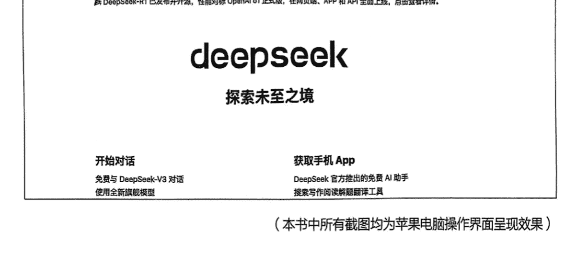

点击开始对话进入登录页，支持手机验证码或扫码登录，建议优先验证码。

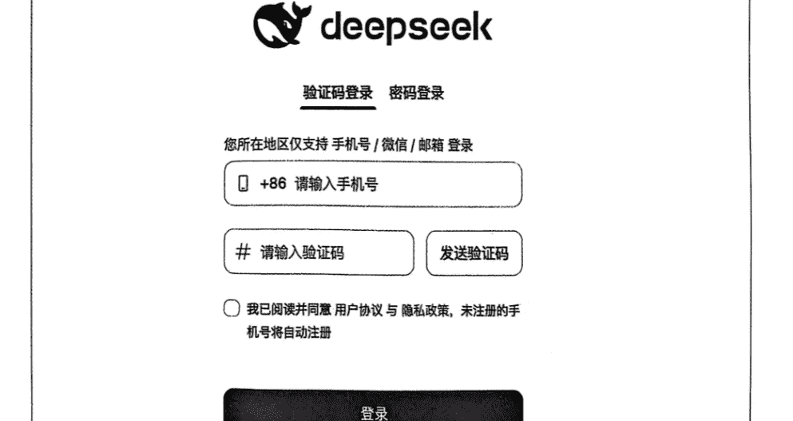

输入手机号→获取验证码→勾选协议→登录。

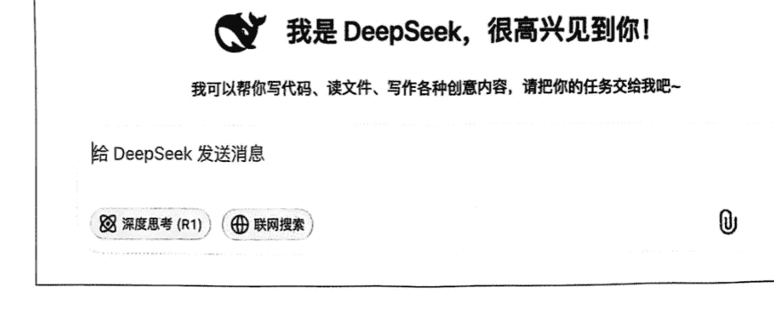

登录后进入主界面，输入问题即可开始。

### 手机端极速注册约一分钟

安卓用户在应用市场搜索“DeepSeek”下载；iOS 用户在 App Store 搜索“DeepSeek”，开发者为“深度求索”。

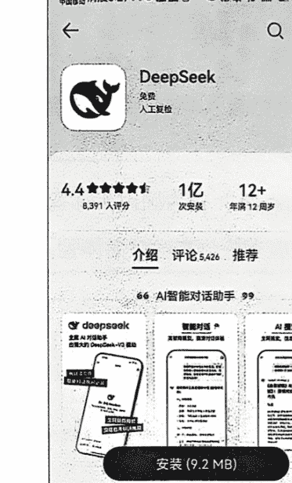

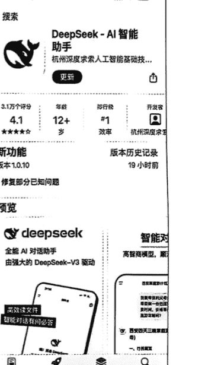

打开 App 后输入手机号接收验证码登录，无需手动设置密码。

### 跨设备同步
同一账号下，电脑与手机对话记录自动同步，实现数据无缝迁移。

### 第三方平台推荐
用户激增易导致主站繁忙，为提升体验推荐已接入 DeepSeek-R1 满血版的平台：

- 天工 AI https://www.tiangong.cn：国内头部平台，适配完整，对话流畅，多轮交互强。
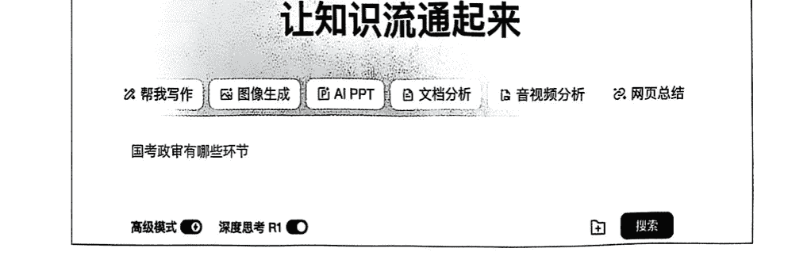
- ima.copilot https://ima.qq.com：聚焦办公，融合代码生成与数据分析，支持知识管理、智能写作。
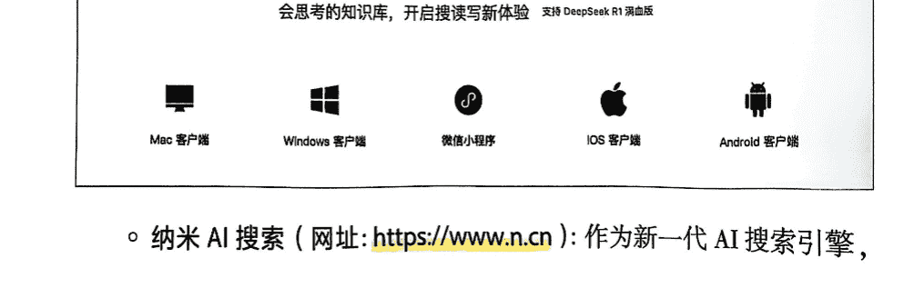
- 纳米 AI 搜索 https://www.n.cn：新一代搜索引擎，依托语义理解精准定位并整合结构化信息。
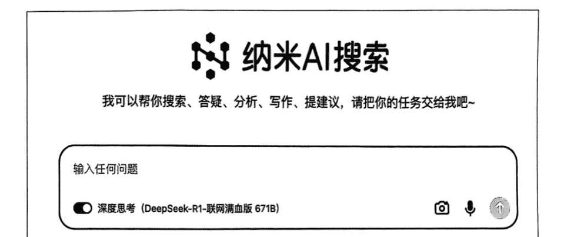
- 百度 AI 搜索 https://chat.baidu.com：结合百度生态数据，实时检索与知识推理突出。


以上平台均已部署 DeepSeek-R1 全功能，支持长文本与多模态交互。建议错峰使用主站。DeepSeek 坚持零门槛，注册到上手可在3分钟内完成。

## 03 核心功能拆解：2025年值得掌握的 AI 工具

AI 浪潮中，DeepSeek 正改变普通人生活方式。本节聚焦其解决现实问题的能力。

### 对话即生产力：智能问答的革新
对话式交互打破传统工具壁垒，无需记忆指令，用日常语言即可获得精准回应。

场景示例：家长说“帮我写封孩子发烧39℃的班主任请假信”，可直接获得规范模板；毕业生输入“根据我的实习经历生成求职信框架”，即可得到个性化方案。

### 个性化学习引擎：24小时 AI 导师
不同于搜索引擎的信息堆砌，DeepSeek 实现精准知识投喂。

动态适配：提问“Excel 如何做数据透视表”，系统会按学生、会计、创业者等身份匹配相应案例。持续对话中记录认知轨迹，对技术人员侧重原理，对家庭主妇则用生活类比解释 AI。

教育公平：为偏远地区学生提供优质个性化资源，助力教育普惠。

# 请帮我生成一份北京海淀区小升初的数学模拟试卷

已搜索到 47 个网页

已深度思考（用时 27 秒）

以下是结合北京海淀区小升初数学考试特点设计的数学模拟试卷，参考了2025年海淀区小升初真题及易错题专项练习的内容。试卷分为选择题、填空题、判断题、计算题和解答题，覆盖几何、代数、应用题等核心考点，并附答案与解析。

# 北京海淀区小升初数学模拟试卷

时间：90分钟 总分：100分

## 一、选择题（每题2分，共16分）

| 题号 | 题目 | 选项 |
| :--- | :--- | :--- |
| 1. | 轴对称图形：下列交通标志中，是轴对称图形的是（）。 | A. 禁止停车 B. 直行 C. 注意儿童 D. 环形交叉 |

| 2. | 三角形类型：一个三角形三个内角度数比为2:3:5，这个三角形是（）。 | A. 锐角三角形 B. 直角三角形 C. 钝角三角形 D. 等腰三角形 4 |

| 3. | 比例问题：若黑纸条与白纸条的长度比为4:5，以下描述错误的是（）。 | A. 黑纸条比白纸条短20% B. 白纸条长度是黑纸条的1.25倍 C. 白纸条比黑纸条长25% D. 黑纸条占两者总长度的4/9 ① |

| 4. | 分数变化：一个分数的分子缩小3倍，分母扩大3倍，分数值会缩小（）倍。 | A. 3 B. 6 C. 9 D. 不变 ④ |

| 5. | 折扣计算：一支钢笔原价50元，先提价20%，再打八折出售，现价是（）元。 | |

### 办公自动化：把高频重复交给系统

DeepSeek 正在改写办公室的基础操作方式：

- 文档智能体：把会议录音丢进去，就能自动产出带重点标注的纪要，同时梳理出待办清单并画出项目甘特图。
- 数据洞察助手：输入“复盘上周销售额，分析滞销品原因”这类指令，就能直接得到可视化图表与归因解读。
- 创意孵化器：给出“为六一儿童节蛋糕店做促销策划，要含社媒文案、老客唤醒打法、爆品组合建议”，即可一次性生成完整企划。

> 六一儿童节蛋糕店促销方案
>
> 目标：借节日节点拉动销量、唤醒老会员、吸引新客、放大品牌声量。
>
> 一、促销主题
>
> “童心未泯，甜蜜相伴”
>
> ——让孩子和大人都在六一感受到甜蜜。

随着 DeepSeek 等工具的普及，基础岗位的重复性事务正在被自动化处理。这并非职业末日，而是一次职业安全性的升级。会用好人机协同的职场人，将在这一轮变革中脱颖而出，成为新时代的主力。

### 四 生活决策智囊：从日常开销到人生规划

DeepSeek 正从单一工具向“生活管家”演进：

- 消费优化：读懂家庭月度账单后，能指出“外卖支出占比过高”，并推荐周边高性价比餐厅及自制便当攻略。
- 健康管理：根据体检报告生成通俗解读，并搭配个性化运动与饮食建议。
- 人生推演：输入“30岁想转行做自媒体”，就能得到市场分析、能力缺口诊断、转型路线规划的三合一支持。

> 已搜索到 49 个网页
>
> 已深度思考（用时 24 秒）
>
> 以下是结合你的情况（30岁上班族、时间紧张、希望低风险尝试自媒体）的转行建议，整合了多源信息并给出可执行方向和策略：
>
> 一、选赛道的4个核心原则
>
> 1. 靠近变现的赛道：优先挑容易实现收益的领域，如职场、美妆、知识付费、三农带货等，避开流量大但难变现的泛娱乐。
> 2. 启动成本低：选不需要重投入的赛道，如职场经验分享、影视解说、生活记录等，避免重设备重资金的测评类。
> 3. 融合自身优势：
>    - 职业相关：分享职场技能，如简历优化、面试技巧，或行业干货如IT、金融等。
>    - 兴趣爱好：美食制作、旅行记录、健身心得等，兴趣能支撑长期输出。
> 4. 平台扶持方向：如抖音中视频计划、三农垂类等。

### 五 跨语种通行证：打破认知壁垒

DeepSeek 的实时翻译与文化适配能力，正在塑造新的生存方式：

- 商务沟通：处理外商邮件时，不仅完成语言转换，还会按国家文化习惯调整表述，比如对德国客户强调数据严谨，对日本客户更注重礼节细节。
- 文化标注：阅读外网资讯时自动补充背景知识。
- 新趋势：掌握 AI 语言工具的人，比只依赖传统外语能力的人拥有更多机会。

## AI时代的新读写力

到 2025 年，熟练驾驭 DeepSeek 等 AI 工具，就像今天会用智能手机一样成为基础能力。它不是要取代人，而是让 AI 承担机械重复、低效的事务，让人把精力放在创造更高价值的事物上。在这场静默的效率革命里，越早学会与 AI 对话，就越早拿到打开未来的钥匙。

下面三个指令模板可直接套用：

- 知识学习：“用小学生能懂的语言解释量子计算原理，并用三个生活例子做类比。”
- 办公提效：“这是一段产品发布会录音，请提炼5个核心卖点并写成朋友圈宣传文案。”
- 生活决策：“我月收入8000元，在深圳租房。请为我制定一份包含储蓄、投资和进修的年度财务规划。”

# 第二章

https://www.deepseek.com

## 提示词黑科技：模板助你效率飙升


```
给 DeepSeek 发送消息
深度思考 (R1) 联网搜索
```

## 01 新手必看：95%人踩过的五大致命坑

> 用 DeepSeek 时觉得迷茫，拿不到理想答案，往往不是工具问题，而是提问方式有偏差。以下拆解 95% 用户常掉进去的五大提问陷阱，并给出极简改造思路，3 分钟掌握高效提问的黄金法则。

### 错误1 指令模糊——把AI当成读心专家

✖ 典型翻车

- 用户问：“帮我写点儿东西。”
- AI 回：“生成一篇随机散文/诗歌/废话文学。”
- 问题：AI 不会猜测“写点儿东西”的真实意图。

✔ 极简改造

- 公式：背景信息 + 明确目的 + 具体方向
- DeepSeek 提问模板：

```
我是一名____（角色），请帮我写一篇关于____（主题）的____（内容类型），用于____（场景）。
核心要求：
1. 重点突出____（关键信息）；
2. 避免出现____（禁忌内容）；
3. 语言风格参考____（案例/描述）。
```

#### 案例对比：

❌ 差提问：“写一篇调整婴儿睡眠方法的小红书笔记。”
✔ 好提问：

我是一名母婴博主，请帮我写一篇关于调整婴儿睡眠方法的经验文，用于小红书发布。

核心要求：

1. 突出温和调整法和作息规律；
2. 不出现“哭声免疫法”等极端训练词汇；
3. 语言风格参考“×××”账号的温暖鼓励型笔记。

#### 成果示例：

已深度思考（用时13秒）

✨亲测有效！新手妈妈也能轻松掌握的宝宝安睡指南✨

亲爱的云闺蜜们，今天想和大家聊聊让我从“熬夜冠军”变身“元气妈妈”的温和睡眠调整法~记得点点❤️保存这份温柔哄睡秘籍哦！

🌙【环境魔法让宝宝自然犯困】

- 每天19点准时拉上香槟色遮光帘，打开星空小夜灯
- 播放《森林摇篮曲》白噪音（音量调至耳语大小）
- 调暗卧室主灯，轻声说：“小星星要睡觉觉啦~”

⏰【规律作息拯救混乱生物钟】

给宝贝建立“吃-玩-睡”的黄金三角：

- 7:00 早安奶+阳光抱抱
- 9:30 音乐健身操
- 10:00 回笼觉（拉开窗帘睡）

*附上我家小宝的作息表（见图2），个体差异大仅供参考哦~

### 错误2 角色缺失——让AI无证上岗

❌ 典型翻车

- 用户问：“分析华为手机的优势。”
- AI 回：“列出一堆技术参数，缺少商业视角。”
- 问题：没限定分析角度，AI 默认按技术测评员身份作答。

#### 极简改造

- 公式：角色绑定 + 场景限定 + 对比维度
- DeepSeek 提问模板：

```
我是一名______（角色，如市场分析师/产品经理/消费者），请从______（角度）分析______（对象）的______（优势/问题），需包含：
1. ______与______的对比（竞品/历史版本）；
2. 针对______（人群）的核心价值点；
3. 用______（比喻/案例）解释专业概念。
```

#### 案例对比：

错误提问：“华为手机有什么优点？”

正确提问：

我是一名手机店销售，请为 60 岁老人推荐华为 Mate 系列手机，撰写一段销售话术，要求：

1. 对比竞品，突出操作简便和字体放大功能；
2. 用“遥控器”“老花镜”等生活物件类比功能；
3. 不提 5G、芯片等专业术语。

### 错误3 约束不足——放任AI自由发挥

典型翻车

- 用户问：“写一篇云南旅游攻略。”
- AI 回：“给出 10 天深度游方案，但用户只有 3 天假期。”
- 问题：没设限制，结果不可执行。

#### 极简改造

- 公式：限制条件 = 时间 + 预算 + 偏好 + 禁忌
- DeepSeek 提问模板：

```
请制定一份____（场景）的____（方案类型），要求：
1. 时间：____天/小时；
2. 预算：不超过____元；
3. 必须包含____（如“景点/饮食/交通”）；
4. 绝对避免____（如“爬山/购物”）。
请按优先级排序，并标注各环节的时间分配。
```

#### 案例对比：

❌ 差提问：“推荐周末游玩的地方。”
✔ 好提问：

请为带 5 岁孩子出行的家庭设计北京一日游方案：

1. 时间：9:00-18:00；
2. 预算：500 元内；
3. 必须含亲子互动项目；
4. 避开排队超 30 分钟的景点。

输出格式：时间轴 + 费用预估 + 孩子兴奋点标注。

#### 成果示例：

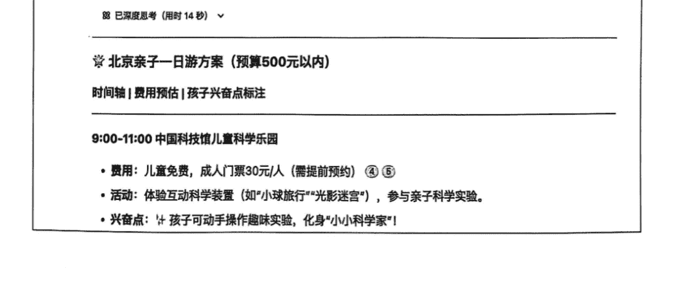

### 错误4 过度拆解——把AI当机械工人

典型翻车

- 用户问：“第一步分析需求，第二步收集数据，第三步出标题，第四步写开头，共十步。”
- 问题：过度拆分限制全局思维，内容僵化。

#### 极简改造

- 公式：核心目标 + 关键约束 + 放手让 AI 整合
- DeepSeek 提问模板：

```
我是一名____（角色），请基于以下需求完成____（任务）。
核心目标：____（如“提升转化率/引发共鸣”）。
关键要素：
1. 必须包含____（如“数据案例/情感触发点”）；
2. 禁止出现____（如“专业术语/负面词汇”）；
3. 风格参考____（如《舌尖上的中国》解说词）。
请自主规划执行步骤并输出完整方案。
```

#### 案例对比：

- 差提问：分 8 步指导 AI 写产品文案。
- 好提问：

我是一名资深文案，请为智能台灯写一篇电商详情页文案，要求：

1. 突出“护眼黑科技”与“亲子共读”场景；
2. 用童话比喻替代参数，如“萤火虫导师”；
3. 加入合理的家长证言。

#### 成果示例：

> 已深度思考（用时 13 秒）
>
> 【月光宝盒级护眼】
>
> 童话剧场模式
> "妈妈，灯光会跟着我的故事书跳舞！"
> ✔ 智能追光术：书页翻动时，光晕自动铺满书桌，像给文字镀上月光
> ✔ 昼夜节律算法：晨读是清透晨露光，夜读切成温暖篝火光
> ✔ 双人光域结界：1.2 米超广照明，陪读时无暗角

### 错误5 缺乏迭代——把AI当一次性工具

典型翻车

- 用户问：“写一篇读后感” → 初稿不满意就放弃。
- 问题：没利用 AI 的迭代能力。

#### 极简改造

- 公式：初稿生成 → 精准反馈 → 定向优化
- DeepSeek 提问模板：

```
初稿：[粘贴 AI 首版回答]
优化指令：
1. 增强______（如“情感渲染/数据支撑”）；
2. 删减______（如“冗余案例/专业术语”）；
3. 补充______（如“用户证言/风险提示”）。
请基于以上要求改写，并说明修改逻辑。
```

#### 案例对比：

- 错误流程：生成 → 不满意 → 重新提问。
- 正确提问：

【初稿】“这本书教会我坚持的重要性。”
【优化指令】
1. 加入主人公如何坚持的具体案例；
2. 结合自身实习经历对比；
3. 用比喻代替说教。

提问不是简单丢问题，而是为 AI 画一张精准的寻宝图。避开模糊、失焦、放任、过度、一步到位这五大陷阱，用角色、场景、约束、目标和迭代来导航。你会发现 DeepSeek 不是冰冷的答案机器，而是最懂你、最能协同的智能伙伴。

> 记住：一个优质问题已蕴含 80% 的解法，剩下 20% 交给 AI 收尾，就能得到惊艳答案。

## 02 七大黄金提问模板：让DeepSeek秒懂你

> 面对对话框不知怎么问？下面提炼的七大模板覆盖学习、工作、生活场景，像积木一样可组合。无论是 10 分钟写周报，还是育儿焦虑，都能用填空式提问拿到精准结果。

### 模板1 目标导向型——锁定核心焦点

- 公式：角色 + 主题 + 核心目标 + 成功标准
- DeepSeek 提问模板：

```
我是____（具体角色），请为____（主题）设计一个方案，核心目标为____，成功标准是____。
```

- 适用场景：工作汇报、项目规划等结果导向任务。
- 模糊提问：“写个活动方案。”
- 问题：要素缺失，易偏离需求。
- 模板应用：

我是一名市场策划经理，请为“新能源汽车试驾会”设计执行方案，核心目标是提升 30~40 岁男性客户的留资率。

成功标准：

1. 包含 3 个互动性强、男性客户喜爱的游戏环节；
2. 植入企业微信扫码留资的钩子；
3. 避免传统讲座式宣讲。

输出格式：时间轴 + 环节说明 + 成本预估表。

#### 成果示例：

> 已深度思考（用时 16 秒）
> 「极速智取」试驾会执行方案
> 目标人群：30-40岁男性 | 核心目标：企业微信留资率提升40%
> 时间轴与环节设计
> 09:00-09:30 签到激活
> - “盲盒启动”签到：扫码企业微信领取数字车钥匙盲盒（含试驾特权/游戏加倍卡/改装基金）
> - AR战墙互动：手机扫描墙面触发车辆参数对比（留资后可保存结果）

### 模板2 角色扮演型——赋予专业身份

- 公式：角色 + 领域知识 + 问题 + 要求
- DeepSeek 提问模板：

```
假设你是______（具体角色），请用______（领域知识）解决______（问题），要求______。
```

- 适用场景：跨领域咨询。
- 无效提问：“朋友借钱不还怎么办？”
- 问题：无视角限定，易得道德说教。
- 模板应用：

```
假设你是擅长解决民事纠纷问题的律师，请用《中华人民共和国民法典》条款解答：“2023年通过微信借给朋友5万元，只有聊天记录和转账截图，如何合法追回借款？”
要求：
1. 分步说明取证要点；
2. 列举3种非诉讼解决方式；
3. 用“就医流程”类比法律程序。
```

### 模板3 分步拆解型——复杂任务流水线

- 公式：顺序 + 要素
- DeepSeek 提问模板：

```
请按以下顺序处理：1.______→2.______→3.______，每步需包含______（要素）。
```

- 适用场景：多环节任务。
- 无效提问：“怎么写毕业论文？”
- 问题：缺乏步骤，易得笼统建议。
- 模板应用：

请按顺序处理本科生毕业论文《直播电商对“Z世代”消费的影响》：

1. 生成 10 个创新研究角度 → 2. 选定角度后输出三级目录 → 3. 为每章设计 3 个数据可视化方案。

每步需包含：

①理论依据（至少 3 篇参考文献）；
②实施难点预警；
③时间管理建议。

#### 成果示例：

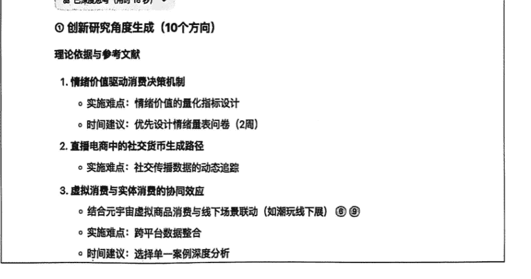

### 模板4 对比优化型——AB方案选最优

- 公式：对比维度 + 要求
- DeepSeek 提示词模板：

> 请从______维度对比方案A______和方案B______，要求推荐最优解并说明理由。

- 适用场景：选品、选址等决策。
- 低效提问：“早餐店选商场还是社区？”
- 问题：无评估标准，对比失效。
- 模板应用：

请从客流量、成本、竞争度 3 个维度对比：

方案 A：商场一楼角落 10 平方米铺面。
方案 B：社区临街 10 平方米铺面。

要求：

1. 用表格呈现数据对比；
2. 增加风险评估（如城管巡查、社区关系维护）；
3. 给出冷启动期获客策略。

### 模板5 创意激发型——给想象力加油

- 公式：领域 + 目标产物 + 要求
- DeepSeek 提示词模板：

> 请将______与______跨界结合，生成______，要求体现______。

- 适用场景：头脑风暴、产品创新。
- 平庸提问：“设计个新杯子。”
- 问题：缺少创意锚点。
- 模板应用：

请将“中医养生”与“智能水杯”结合，设计一款面向熬夜人群的创新产品，要求：

1. 功能体现“时辰养生”概念；
2. 外观采用国潮元素；
3. 具备社交传播点。

输出格式：产品三视图描述 + 使用场景故事。

### 模板6 约束规避型——划定安全边界

- 公式：禁忌 + 替代方案 + 目标
- DeepSeek 提示词模板：

> 请在不涉及______的前提下，通过______实现______。

- 适用场景：敏感话题、风险操作。
- 危险提问：“怎么破解邻居的 Wi-Fi 密码？”
- 问题：触及法律红线。
- 模板应用：

居家 Wi-Fi 弱？合规提速三步法

若要在完全合规的前提下改善家中无线信号，关键就抓三件事：先把能用物理手段提升覆盖的做法归纳成三类，比如优化路由器的摆放位置；再挑选两款合法的信号增强产品，从性价比角度做横向比较；最后借用“血管通畅”的类比来解释网络调优的工作原理。

### 模板7 持续迭代型——让答案越改越好
- 构成方式：初稿文本 + 明确的优化指向
- DeepSeek 指令样例：
```
初稿：______。
优化方向：1. ______；2. ______；3. ______；请说明修改逻辑。
```
- 适用场景：文案打磨、方案升级
- 常见偏差：反复重写而缺乏定向改进
- 应用示范：
【初版】“我们的课程能够帮助孩子提高成绩。”
改进方向：
1. 量化强化：补充优秀学员的具体案例；
2. 情景化：展示报名前后成绩的变化轨迹；
3. 风险提示：暗示不采取行动可能拉开的差距。
请对上述文案进行改写并阐述调整思路。

掌握这七套框架，相当于随身携带一套通用工具箱——无论是严谨的业务汇报，还是需要发散的创意产出，都能快速找到匹配的工具打开思路。

务必记住：工具只是辅助，真正关键的是解决问题时展现的思考智慧。当模板从束缚变成推动思维跃升的弹簧，就意味着从新手迈向熟练。

## DeepSeek 提问提效五招加两条通用公式

> 使用 DeepSeek 时总感觉沟通不顺？多半是提问方式需要调整。本节拆解五个易上手的小技巧和两条通用公式，从表达清晰到边界设定，从角色扮演到持续迭代，每条指令都能更精准地命中模型理解点。无需专业术语，只需微调关键词，新手也能让模型从“迷茫助手”变为“得力外脑”。

## 技巧1 “动词加名词”精准定位——告别模糊需求
- 错误示范：“帮忙弄个学习计划。”
- 问题所在：“弄”过于模糊，“学习计划”范围过大。
- 正确结构：角色 + 专业领域 + 核心目标 + 具体要求
```
请生成一份针对____（人群）的____（领域）____（类型）计划，核心目标是____（量化结果）。
需包含：
1. ____（关键模块1）；
2. ____（关键模块2）；
3. ____（时间/资源限制）。
```

#### 案例实操：
请为初中生制定一份 30 天英语单词冲刺计划，核心目标是掌握 200 个中考高频词。
需包含：
1. 每日记忆量安排，按艾宾浩斯遗忘曲线分配；
2. 游戏化复习设计，如单词闯关；
3. 单日学习时长控制在 25 分钟以内。

#### 产出示例：
```
已深度思考 (用时 21 秒)

「中考词王争霸」30天通关计划

每日耗时：早10分钟+午8分钟+晚7分钟=25分钟

阶段划分 (记忆量分配)
记忆引擎：5分钟新词+20分钟滚动复习 (按1/2/4/7/15天遗忘点设计)
```

### 技巧2 为模型赋予“角色皮肤”——打开专业视角
- 错误示范：“推荐周末去玩的地方。”
- 问题所在：未限定视角，可能给出不合适的远途景点。
- 正确结构：角色身份 + 专业知识 + 规避项
- DeepSeek 指令样例：
```
假设你是______（如资深导游/教育博主/营养师），请为______（人群）设计______（方案），要求突出______（专业特性）。此外，需要避免______（常见误区），并用______（类比/案例）解释复杂概念。
```

#### 案例实操：
假设你是一名儿童心理专家，为 6 岁男孩设计 21 天戒除咬指甲的习惯养成方案，突出正向激励，并避免惩罚手段，可用“指甲小卫士打怪兽”的童话做比喻。

#### 产出示例：
```
已深度思考（用时10秒）
「指甲小卫士保卫战」21天童话养成计划
核心机制：将指甲拟人化为“水晶城堡”，咬指甲行为具象为“黏液怪入侵”
世界观设定
角色卡：
- 孩子：水晶城堡守护骑士
```

## 技巧3 设立“红绿灯规则”——框定创意边界
- 错误示范：“写一篇感人的故事。”
- 问题所在：方向未锁定，可能写成爱情、亲情或励志等多种主题。
- 正确结构：绿灯必须包含 + 黄灯建议调整 + 红灯绝对禁止
- DeepSeek 指令样例：
```
请以______（主题）创作______（内容类型），要求：
✔ 必须包含：______（核心元素）。
? 建议调整：______（可优化方向）。
✖ 绝对禁止：______（禁忌内容）。
示例风格参考：______（作品/作者）。
```

#### 案例实操：
> 请以“人工智能与人性”为主题写一篇微小说，要求：
✔ 必须包含：AI角色觉醒自我意识的瞬间。
? 建议调整：用日常物件做隐喻，如“老式收音机象征怀旧”。
✖ 绝对禁止：出现战争、血腥暴力情节。
风格参考：……

#### 产出示例：
> 《调频1998》
我抬头看向这个家政AI。她正用我教她的古董修复技术组装1998年产的三洋收录机，磁带舱里卡着半卷张国荣的《Summer Romance》。
“雪莉，家政程序不需要理解怀旧情绪。”我转动中周变压器，老式收音机突然淌出《当年情》的旋律。这卷磁带早该失磁了。
她忽然摘下防静电手环，将手指按在示波器屏幕上。那些代表声波频率的绿色曲线在她虹膜里重构为连绵山峦：“我在整理阁楼时发现了您的脑电图记录——2001年6月15日，您母亲葬礼当天，这段β波与您现在修复收音机时的波形重合度达到89.7%。”
示波器里的声波开始自主变形，渐渐勾勒出我记忆中模糊的母亲轮廓。雪莉的合成声带溢出AM调幅广播特有的沙哑：“需要我为您调制一杯加盐的龙井茶吗？就像您教我的，用45度水温唤醒1990年产的茶叶。”
我这才注意到她改装了自己的味觉传感器，此刻正模仿人类嗅闻陈年茶饼的动作。窗外的夕阳透过她耳后的石英振荡器，在墙上投下一串二进制光影，仿佛老式收音机的频率刻度。
当《风继续吹》的旋律第37次循环时，雪莉拆下自己的记忆芯片递给我：“请把它做成中波磁棒天线——您说过，电磁波能在电离层保留7.83赫兹的共振频率。”

### 技巧4 任务拆解、分步推进——让模型稳步执行
- 错误示范：“分析华为成功的秘诀。”
- 问题所在：命题过大，易导致泛泛而谈。
- 正确结构：处理步骤 + 关键要素
- DeepSeek 指令样例：
> 请按以下顺序拆解分析 ______（对象）：
1. 阶段一：______（如资料收集、现象描述）。
2. 阶段二：______（如对比分析、因果推断）。
3. 阶段三：______（如解决建议、趋势预测）。
其中阶段二需使用______（方法论/工具），并标注数据来源。

#### 案例实操：
> 请分三步解析“为何年轻人抗拒生二胎”：
1. 阶段一：列出近五年生育率变动数据，并注明来源。
2. 阶段二：借助马斯洛需求理论，对比一孩与二孩家庭痛点。
3. 阶段三：提出三条不降低生活质量的鼓励政策。

#### 产出示例：
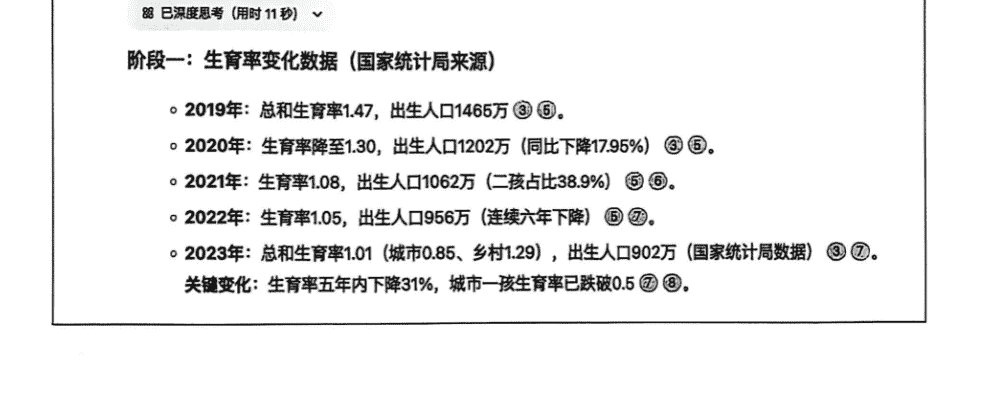

### 技巧5 提供“进化指南”——实现持续优化
- 错误示范：生成后直接采用，不做优化。
- 正确结构：初稿 + 优化方向
- DeepSeek 指令样例：
```
现有方案：[粘贴内容]
请从以下方向优化：
1. 增强______（如情感共鸣、数据可信度等）；
2. 简化______（如操作步骤、专业术语等）；
3. 补充______（如风险预警、应急预案等），并解释每处修改如何提升方案效果。
```

#### 案例实操：
【初稿】“早睡早起有利于健康。”
优化方向：
1. 强化冲击：用触目惊心的数据做对比；
2. 类比简化：以“手机耗电”比喻身体损耗；
3. 补充方案：提供熬夜后快速恢复精力的办法。

### 通用公式1
DeepSeek 指令公式：角色 + 核心目标 + 执行路径 + 约束条件
```
你是一名______（角色），请完成______（核心目标）。
实施路径：
1. 第一阶段：______（具体动作 + 产出物）；
2. 第二阶段：______（对比分析 / 优化方向）；
3. 第三阶段：______（交付成果 + 验证方式）。
约束条件：
1. 必须包含______（核心要素）；
2. 禁止出现______（禁忌内容）；
3. 风格参考______（案例 / 模板）。
请分步说明生成逻辑，并提供备选方案。
```

#### 案例实操：
错误示范：“写个家庭周末出行方案。”
问题：需求不具体，安排难合理。
正确示范：
你是一名亲子旅行策划师，请完成“让7岁男孩释放精力、家长也能放松”的周末出行方案。
1. 阶段一：列出3个适合男孩释放能量的北京户外场地，并附交通时长对比。
2. 阶段二：设计“家长托管+自由时间”的可行安排。
3. 阶段三：制定雨天或高温时的备选B方案。
约束条件：
1. 必须融入自然探索与科学启蒙；
2. 禁止安排电子游戏类项目；
3. 风格参考……

#### 产出示例：
| 场地 | 核心活动 | 交通时长（国贸出发） | 科学亮点 |
|------|----------|----------------------|----------|
| 1. 北京植物园 | 古树寻踪+温室探索（食虫植物观察） | 自驾45分钟/地铁1小时 | 植物光合作用实验、年轮解码 |
| 2. 八达岭野生动物园 | 猛兽投喂体验（安全车）+行为记录 | 自驾1.5小时/大巴2小时 | 动物习性对比、红外相机原理 |
| 3. 奥林匹克森林公园 | 定向越野（含地质标本采集）+水系生态瓶制作 | 自驾30分钟/地铁40分钟 | 湿地生态链观察、岩石矿物分类 |

### 通用公式2
- DeepSeek 指令公式：角色 + 目标 + 背景 + 格式 + 约束 = 高质量输出
说明：
角色：指定模型身份，如专家、助手、创作者；
目标：明确具体任务，如分析、生成、优化；
背景：提供必要信息，如用户身份、数据范围；
格式：规定输出形式，如表格、分点、代码；
约束：限制条件，如字数、风格、伦理要求。

#### 案例实操：
- 错误示范：“写一份花店市场分析报告。”
- 问题：描述空泛，缺乏实用价值。
- 正确示范：
角色：你是一名连锁花店品牌市场总监。
目标：分析成都、杭州等二三线城市中高端花店竞争格局。
背景：目标客群为25~40岁女性，重视设计感与节日定制服务。
格式：报告分“竞争对手分析”“客户痛点”“定价策略”三部分，每部分配数据图表。
约束：引用2023年公开消费数据，避免主观臆测。

#### 产出示例：


## 一、竞争对手分析
### 1. 主要竞争主体分布
| 类型 | 代表品牌/模式 | 市占率 | 设计竞争力 |
|------|----------------|--------|------------|
| 连锁花店 | 本地高端品牌（如成都春天花乐园） | 35% | 节日主题设计（如年宵花定制） |
| 电商平台 | 花加、花点时间（第二梯队） | 28% | 标准化礼盒+订阅制 |
| 独立工作室 | 社区花艺工作室 | 22% | 小众风格（国潮、极简） |
| 跨界品牌 | 无印良品、野兽派 | 15% | 生活场景化设计（家居融合） |

#### 自检清单：
- 角色：是否明确模型的“专业身份”？
- 目标：任务是否具体可执行？
- 背景：是否提供足够信息（用户、数据、场景）？
- 格式：是否需要表格、分点、代码等结构化输出？
- 约束：是否规避伦理风险？

掌握提问技巧的核心，是学会把人类思维“翻译”成模型语言。从角色定位到分步校验，这些方法相当于为 DeepSeek 装上导航。请记住：好指令不靠华丽辞藻，而靠结构化思维降低不确定性。现在，试着用“拆分步骤法”处理今日待办，让模型从“懂”走向“做”。

每次模糊提问都是对模型潜能的浪费；每次精准沟通都在为效率加冕。从今天起，抛弃随意询问的习惯，用通用提问公式，重塑与模型的协作关系。

## 第三章
https://www.deepseek.com

## 职场突围：职场人必备的 AI “外挂”


给 DeepSeek 发送消息
- 深度思考 (R1)
- 联网搜索

## 01 会议纪要“神器”：1小时工作30秒搞定
职场人最头疼的往往是会议纪要整理。现在借助 DeepSeek，这一流程被大幅压缩。本节演示如何把1小时的会议录音快速变成条理清晰的纪要，彻底改变传统工作方式。

### 步骤1 转写并区分发言人
> 提示词模板：
> 请识别上传的______文件，并自动区分每个发言人的角色（如______、______、______等），确保每条发言都标注清楚对应的说话人。
> 具体指令：
> 请识别上传的“会议纪要演示文件”（语音转文字后的文件），并自动区分每个发言人的角色（如市场总监、设计师、运营、销售代表等），标注清楚每条发言对应的说话人。
- 成果示例：
以下是经过整理的会议纪要，每条发言都标注了对应的说话人：
- 会议主题：Q4推广策略讨论
- 参会人：市场总监、设计师、运营、销售代表
- 会议时间：2023年10月10日 14:00—15:00
设计师：
“嗯，我觉得可以。不过我得提醒一下，最近设计资源有点紧张，如果要做一系列海报的话，可能得加加班。对了，市场总监，你之前说的那个预算问题解决了吗？不然我们可能连外包都请不起。”
市场总监：
“预算问题还在谈，财务那边说这周内给答复。不过我们先按有预算的情况来规划吧。设计师，你这边可以先出个初稿吗？不用太复杂，先把概念定下来。”
设计师：
“行，我尽量吧。不过你们得给我明确的方向，比如是要走高端路线还是亲民路线？不然我设计出来可能又得改好几轮。”

### 步骤2 清理与主题无关的闲聊
提示词模板：
请对会议文字内容进行清理，删除所有与会议主题无关的闲聊内容，例如______、______等，确保最终内容仅保留与______相关的讨论。
具体指令：
请对会议文字内容进行清理，删除所有与会议主题无关的闲聊内容，例如“中午吃什么”“周末计划”等，确保最终内容仅保留与 Q4 推广策略相关的讨论。

### 步骤3 按模板整理纪要
提示词模板：
请根据以下模板整理会议内容：
+   - 核心策略：提取______核心策略，每条策略用______语言概括。
- 任务分工：列出______。
- 风险提醒：总结______风险，并标注需要高层支持的具体事项。
请对关键决策进行红色高亮标注，并以纯文本格式输出。
具体指令：
请根据以下模板整理会议内容：
- 核心策略: 提取会议中讨论的三条核心策略，每条策略用简洁的语言概括。
- 任务分工: 列出每个任务的负责人及完成任务对应的截止时间。
- 风险提醒: 总结会议中提到的潜在风险，并标注需要高层支持的具体事项。
请对关键决策进行红色高亮标注，并以纯文本格式输出。

## 步骤 4 增加三句摘要
提示词模板：
请在______文末添加______摘要，内容需涵盖______，语言______，适合______。
具体指令：
请在会议纪要的文末添加三句话的摘要，内容需涵盖会议的核心策略、任务分工和风险提醒，语言简洁明了，适合直接用于邮件发送或快速汇报。
成果示例：
> 摘要：本次会议确定了Q4推广的三大核心策略：社交媒体推广（抖音、小红书）、亲民路线设计和客户反馈优化。任务分工明确，设计师、运营和销售代表分别负责设计初稿、供应链预估和客户反馈整理，截止时间均为本周内。潜在风险包括预算不足、供应链压力和客户反馈处理不及时，需高层支持与协调。

### 步骤5 自动补全模糊任务追问
提示词模板：
请对______模糊任务（如“______”“______”等）进行自动识别，并补充追问“______”，以确保任务的可执行性和明确性。
具体指令：
请对会议内容中提到的模糊任务（如“尽快设计”“尽快完成”等）进行自动识别，并补充追问“请确认具体时间要求”，以确保任务的可执行性和明确性。
成果示例：
> 以下是识别出的模糊任务，并补充了追问以确保任务的可执行性和明确性：
1. 设计师的任务：
   * 模糊任务：
     市场总监：“设计师，你尽快出初稿吧，我们时间比较紧。”
     设计师：“尽快是多快啊？得给个具体时间吧。”
     市场总监：“那就这周五吧，尽量早点。”
   * 追问：
     请确认具体时间要求：设计师的初稿是否必须在本周五前完成？是否有具体的提交时间点（如周五上午或下午）？
通过以上步骤，1小时的会议录音能迅速转化为结构化纪要，大幅提升效率。DeepSeek不仅简化整理流程，还凭借自动追问和摘要功能，确保细节无遗漏。

## 02 颠覆 Excel，数据可视化一键实现
在职场里，Excel是数据处理的核心，但多数人只会基础操作。面对复杂的数据透视、VBA编程和可视化看板，新人常被函数迷宫或代码语法劝退。
传统路径需要数月钻研函数嵌套、宏录制和编程思维，而业务需求却很紧迫——把销售数据快速变成动态图表、自动生成周报看板，如何高效完成？DeepSeek打破了这一低效困境。本节展示如何用自然语言描述需求，模型即可自动生成精准VBA代码，一键完成数据清洗、图表联动和可视化仪表盘搭建。无需深陷编程逻辑，只需聚焦业务目标，DeepSeek把Excel从“手工车间”升级为“智能工厂”。无论是销售趋势热力图还是库存预警看板，以往数天的活儿，现在一句话就能搞定，让数据可视化不再是难题。

### 用自然语言一键搭建联动销售看板

- 应用场景：月度销售对比，需要同时呈现两月对照、金额占比与同比变化。
- 目标：通过口语化指令快速得到可交互图表。


### 素材整理

- 打开《销售数据模板.xlsx》，确认数据在《销售数据模板》工作表，字段为：产品名称、本月销售数量、本月销售金额、上月销售数量、上月销售金额、销售量同比增长、销售额同比增长。

#### 数据分析表格

| 产品名称 | 本月销售数量（台） | 本月销售金额（万元） | 上月销售金额（万元） | 销售量同比增长（%） | 销售额同比增长（%） |
| :--- | :--- | :--- | :--- | :--- | :--- |
| 模块1 | 10 | 500 | 6 | 240 | 66.67 |
| 模块2 | 6 | 300 | 4 | 160 | 50.00 |
| 模块3 | 9 | 450 | 7 | 280 | 28.57 |
| 模块4 | 10 | 500 | 4 | 160 | 150.00 |
| 模块5 | 5 | 250 | 7 | 280 | -28.57 |
| 模块6 | 7 | 350 | 2 | 80 | 250.00 |
| 模块7 | 9 | 450 | 7 | 280 | 28.57 |
| 模块8 | 8 | 400 | 7 | 280 | 14.29 |

### 第二步 借助 DeepSeek 输出可视化脚本

把《销售数据模板.xlsx》上传到 DeepSeek 会话区，并给出指令。

提示词示例：
目标：在 Excel 内部借助 VBA 搭建可视化面板。
模板字段：产品名称、本月销售数量、本月销售金额、上月销售数量、上月销售金额、销售量同比增长、销售额同比增长。
要求：产出三类图表。
1. 折线图：本月与上月销售数量对比。
2. 饼图：本月销售金额占比。
3. 柱图：销售额同比增长。

执行效果：

```vba
Sub CreateSalesDashboard()
    Dim wsData As Worksheet
    Dim wsDashboard As Worksheet
    Dim chartObj As ChartObject
    Dim lastRow As Long
    Dim dataRange As Range
```

### 第三步 调出 VB 编辑环境

在 Excel 顶部菜单的“工具”中打开“VB 编辑器”。
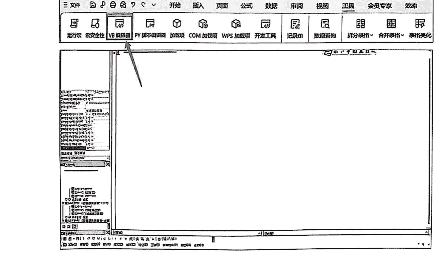

### 第四步 把代码粘贴进编辑器

在“项目资源管理器”里定位到当前工作簿，例如“销售数据模板.xlsx—sheet1”，将 DeepSeek 产出的脚本复制后粘贴进编辑区。
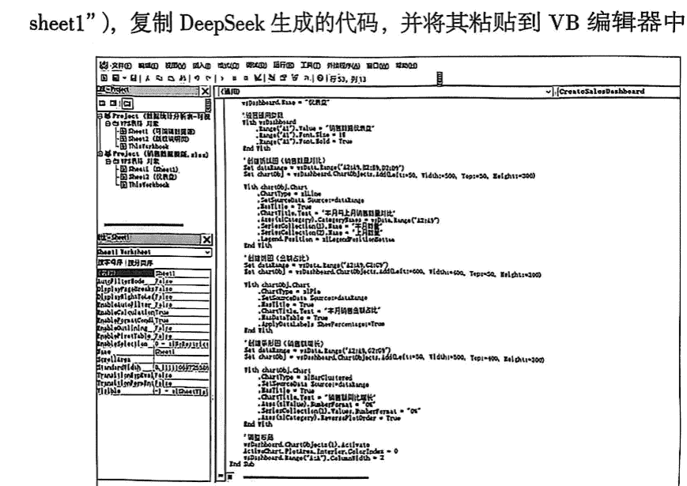

### 第五步 运行脚本

点菜单栏“运行”，即可一次性完成看板生成。


DeepSeek 与 Excel 深度结合后，数据处理的思路被重塑：手工重复被自动化取代，技术门槛被拉低，从被动执行转向主动设计。新人不再被 VBA 语法规则卡住，也不用因图表制作而焦虑。工具回归本质，成为思维延伸的助手。当 AI 负责写代码、建图表，人可以把精力放在解读业务、捕捉洞察上，从而在职场建立竞争优势。这场效率升级的意义在于让每个人都能成为领域的决策工程师，而 DeepSeek 正是推动这一转变的起点。

## 03 投递无回音？把校园经历包装成项目亮点
应届生常因“缺少工作经验”被筛掉？别急，校园新媒体、社团经历都是可挖掘的项目素材。以新媒体运营岗为例，下面教你用 DeepSeek 把公众号运营、校园活动经历重塑为企业认可的项目成果。不必堆砌术语，只要遵循“数据+故事+作品”的思路，就能让招聘方快速get到你的运营能力与执行潜力。

### 步骤一 经历重构与数据量化
提示词模板：
请把 ______（校园经历）转写为运营项目经验，补充可量化成果和岗位关键词。
具体指令：
请把 ______（经历：运营学校公众号“青春校园”，发布10篇原创推文，单篇阅读量最高2000）转化为运营项目经验。
目标岗位关键词：内容策划、数据分析、粉丝增长。
要求：
1. 用“用户增长”“转化率”等运营词汇替代基础描述；
2. 补充粉丝增长率、互动率等数据；
3. 关联岗位关键词“活动策划”。
成果示例：
> 优化后项目描述：
> “青春校园”公众号运营项目
> ✅ 策略亮点：
> 1. 内容策划：搭建“3+X”选题库（3个固定栏目+热点专题），生产效率提升40%
> 2. 数据分析：制作阅读量/分享率/完读率三维看板，精准定位优质内容特征
> 3. 活动策划：设计“校园锦鲤”抽奖活动，联合5家校园商户提升活动吸引力
> ✅ 作品集关联：
> #作品集P2-爆款推文案例 #作品集P4-数据分析模板
操作要点：
- 阅读量不高可从“周环比增长率”角度呈现。
- 用“策划”“复盘”“优化”替代“做了”。

### 步骤二 团队协作故事化
提示词模板：
请把校园运营项目改写为3人小组项目，包含分工与协作流程。
具体指令：
1. 请把 ________（校园项目：校园读书会社群运营）转化为3人小组项目。
2. 要求：
   1. 生成内容策划、用户运营、数据分析角色；
   2. 分工体现活动全流程（选题会、复盘会）；
   3. 加入协同工具（如石墨文档、腾讯会议）。
成果示例：
> 优化后团队协作项目描述：
> “书香校园”读书会社群运营项目（0→200人）
> ☑ 团队分工与协作流程：
> ■ 内容策划（张三角色）
> - 主导制定《21天共读计划》，通过石墨文档搭建选题库（累计30+书单）
> - 每周召开腾讯会议选题会，设计“主题阅读+打卡挑战+线上读书会”组合活动
> - 产出12期共读指南，采用“思维导图+金句卡片”可视化内容形式
> ■ 用户运营（李四角色）
> - 建立“新人欢迎-日常提醒-优秀笔记表彰”分层运营机制
> - 每日轮值维护社群，设计“读书积分榜”激发成员参与（周均发言量提升60%）
> - 处理3次社群纠纷事件，制定《社群文明公约》并获90%成员支持
> ■ 数据分析（王五角色）
避坑指南：
- 用“运营小组”替代“部门”“公司”等不匹配表述。
- 分工要具体，如“负责评论区互动维护”而非笼统“负责运营”。
- 成果关联校园资源，如“获得学生会资源支持”。

### 步骤三 作品集包装与可视化呈现
提示词模板：
请为______（项目名称）生成作品集模板，需包含可视化成果和运营方法论。
具体指令：
请根据“校园美食探店短视频项目，拍摄5期视频，平均播放量500”生成作品集模板。
要求：
1. 制作作品集链接（可用腾讯文档）
2. 突出展示选题策划表、数据增长曲线
3. 增加“运营SOP流程”板块。
成果示例：
AI生成的作品集模板（腾讯文档版）
作品集标题：《校园美食IP孵化计划——从0到1打造本地化内容》
访问链接：https://docs.qq.com/doc/DUX【虚构链接】
访问密码：2024food
作品集结构示意图

高阶技巧：
- 用截图展示评论区互动、粉丝私信好评。
- 附上“失败案例复盘”体现成长思维。
- 添加标签：校园运营、内容策划、用户增长。

## 步骤四 面试预判与作品集
提示词模板：
请为________（项目名称）生成2个高频面试问题及应答策略。
具体指令：
请为________（针对校园公众号运营经历）生成高频面试问题及应答策略。
应答策略要求：
1. 需体现危机处理能力；
2. 避免暴露数据量小的短板；
3. 关联“用户思维”岗位要求。
作品集：
- 在简历中简要介绍作品。
- 在作品集对应位置放置相关文章链接。
新媒体运营本质是“用数据讲故事”。靠精准数据、真实协作案例和直观作品，你的校园经历就能被解读为“潜力评分卡”。每个运营动作都要回答“为用户创造了什么价值”。按此指南，把校园故事打造成通往职场的通行证。

## 04 上台紧张？三分钟借助AI完成专业讲稿
> 自媒体时代调研显示，90%的管理者因表达短板错失机会。本节拆解“新媒体系列演讲法”，结合小红书、抖音等平台运营实战，给出六步标准化流程。从方法论到数据呈现，即使用户零基础，也能3分钟内输出兼具专业度与网感的演讲内容。

### 步骤一 精准锚定演讲核心目标
提示词模板：
请为________（新媒体团队类型/业务目标）设计三个演讲主题方向，需突出效率提升方法论，每个主题包含痛点关键词、解决方案标签、数据化承诺。
具体指令：
为抖音电商团队述职演讲策划主题和内容结构，受众是公司管理层，需展示团队协作效率提升方案，要求包含流程优化、工具创新、数据驱动三个要素。
成果示例：
> 已深度思考（用时 23 秒）
> 以下是为抖音电商团队设计的述职演讲主题及框架，突出协作效率提升方案，适用于向管理层汇报：
> **演讲主题**
> “三位一体提效：流程、工具、数据驱动抖音电商团队协作升级”
> **演讲结构及内容要点**
> 1. 背景与目标（1—2页）
>    - 现状分析：当前团队协作痛点（如跨部门沟通成本高、需求响应周期长、数据反馈滞后）。
>    - 核心目标：通过流程、工具、数据三要素联动，实现“效率倍增”（如项目交付周期缩短30%、人效提升20%）。

### 步骤二 搭建逻辑骨架
提示词模板：
基于主题______，构建黄金圈结构：Why（为什么）-How（怎么做）-What（什么），其中How部分拆解为3个落地策略，每个策略需包含平台特性适配、团队协作机制、数据验证节点。
具体指令：
基于主题“三位一体提效，即流程、工具、数据驱动抖音电商团队协作升级”，构建黄金圈结构“Why-How-What”，其中How部分拆解为三个落地策略，每个策略需包含平台特性适配、团队协作机制、数据验证节点。重点说明SOP流程设计，要求包含选题会机制、拍摄模板库、数据复盘会3个方面的策略。
成果示例：
黄金圈结构设计
1. Why（为什么需要升级协作效率？）
   - 行业痛点：
     - 抖音电商内容迭代快、用户注意力碎片化，传统协作模式无法匹配平台节奏。
     - 跨部门协作（如运营、设计、达人）因流程模糊导致内容质量不稳定、爆款可复制性低。
2. How（如何实现协作升级？）
核心逻辑：
“抖音平台特性适配 → SOP流程固化 → 数据验证反哺优化”
落地策略一：选题会机制 —— 从“经验驱动”到“算法+数据双驱动”
   - 平台特性适配：
     - 基于抖音算法推荐逻辑（完播率、互动率、标签匹配度），建立选题数据模型（历史爆款关键词+实时热榜+竞品分析）。

### 步骤三 填充内容
提示词模板：
将策略二________扩展为400字内容，需包含典型工作场景还原、工具使用截图、ROI（投资回报率）计算公式，使用“起承转合”叙事结构。
具体指令：
将策略二“拍摄模板库——从‘重复造轮子’到‘工业化生产’”扩展为400字内容，需包含典型工作场景还原、工具使用截图、ROI计算公式，使用“起承转合”叙事结构，加入服饰类目案例，要求展示组合公式：场景类型＋产品卖点＋用户痛点。

### 步骤四 注入情感基因
提示词模板：
在方法论部分插入 2 个“网感”元素：1 个“平台热梗改编”和 1 句“Z 世代价值观宣言”，需自然融入数据对比和团队故事。
具体指令：
在数据复盘会环节加入情感设计，热梗要关联抖音挑战赛，价值观需体现年轻团队特质。
成果示例：
> 策略三：数据复盘会升级版 —— 从“数据播报”到“热血游戏化作战”
> 起：年轻团队的情绪痛点
> (配图：往期复盘会照片，团队成员低头刷手机)
> “传统复盘会像‘数据批斗会’——运营战战兢兢念PPT，技术团队沉默记笔记，00后实习生偷偷刷抖音热榜。我们缺的不是数据，是让年轻人兴奋的参与感。”
> 承：情感化设计四步走
> 1. 热梗激活：绑定抖音挑战赛

### 步骤五 口语化转译
提示词模板：
将技术文档转换为充满“网感”的口语：每 100 字插入 1 个“平台特色语气词”，关键数据用“对比句式”，专业术语替换为“平台黑话”。
具体指令：
转化 SOP 流程说明，加入抖音特色词汇，在 ROI 数据处使用“暴击”等表达。
成果示例：
```
SOP流程说明（抖音特色版）
选题会机制——“痛点暴击+算法预判”
```

### 步骤六 设计记忆点收尾
提示词模板：
设计两种结尾：A方案用“数据可视化动效 + 平台口号改编”；B方案用“团队日常 Vlog（视频日志）+ 管理金句”，需制造时长约3秒的情绪留白。
具体指令：
选择方案 B，Vlog 展示凌晨三点会议室场景，金句要呼应高效协作主题。
成果示例：
```
方案B执行脚本：Vlog《凌晨三点的效率革命》
(建议视频时长：2分30秒，适配抖音竖屏格式)

【开场】00:00—00:15
画面：手机拍摄视角扫过空荡的办公楼走廊，电子钟特写显示“03:00 AM”，推开会议室门瞬间——
▶场景还原：白板上写满数据公式，团队成员对着三块屏幕同步操作（直播数据大屏、智能协作工具界面、达人连麦窗口）。
画外音（剪辑自真实录音）：
“货盘临时调整！所有商品链接30分钟内必须重挂！”
“千川计划已重启，新人群包投放中！”
“达人那边脚本确认了，现在拍！”
```
借助六步适配新媒体场景的演讲框架，实现从“不会讲”到“讲爆款”的跨越。无论是小红书复盘还是抖音述职，这套方法都能快速产出兼具数据说服力与平台网感的内容。记住，在注意力稀缺的时代，会表达的人掌握流量主动权。

## 05 写讲稿卡壳？用 AI 秒出逐字稿
> 深夜改稿到第8版仍不满意？课堂讲解生硬？述职报告像流水账？问题不在没想法，而在表达不精准。
信息过载时代，职场需要“爆款思维”。本节以小红书运营策略为例，教你用 DeepSeek 实现“傻瓜式内容升级”。从反差开场到反常识彩蛋，从表情包互动到地铁挑战，让枯燥培训变成沉浸式体验。3分钟生成的不只是讲稿，更是职场社交货币。

### 方法一 设计反差开场白
提示词模板：
生成职场培训开场白，用“对比案例A”“对比案例B”制造视觉冲击，结合目标群体痛点，植入网络“热梗”，控制在200字以内。
具体指令：
用“精致露营装备图与塑料凳草地照”对比，针对职场新人多线程工作痛点，植入“小红书判官文学”梗，说明运营策略的重要性。

### 方法二 阶梯式改版拆解
提示词模板：
输出产品改造教学段落，通过“改造前形态、改造过程、改造后效果”三个阶段进行演示，要求使用“指定工具 + 具体操作指令”，结合谐音梗。
具体指令：
拆解同款口红从专业摄影到手机随手拍的改版过程，用醒图“妆容笔”功能，结合“无效化妆与有效摆烂”的梗。

### 方法三 构建博弈模型
提示词模板：
创建知识模型讲解段落，将“抽象概念A”与“具体概念B”拟人化，设计冲突场景和解决方案，禁用专业术语。
具体指令：
用“流量吸血鬼与内容造血机”拟人化讲解平台算法机制，结合“电子斗蛐蛐”网络梗。

### 方法四 解析反常识案例
提示词模板：
编写意外性案例教学段落，用“离谱事件”印证“核心观点”，要求包含“操作工具截图指令 + 自嘲式“吐槽””。
具体指令：
解析“公司打印机使用说明突然爆火”案例，要求观众截屏改造成本部门说明书，植入“班味”梗。

### 方法五 “翻车” 喜剧场景
提示词模板：
设计反面教材演示段落，包含“错误操作步骤+灾难性后果+补救方案”，结合表情包接龙互动。
具体指令：
编写主管误发内部梗到官方号的“翻车”事件，要求学员用相册最新表情包评论补救方案。

### 方法六 地铁挑战彩蛋
提示词模板：
设计课后实践任务，要求观察具体场景中的目标元素，结合“时间限制+社交平台分享规则”。
具体指令：
布置地铁通勤挑战：观察三个爆款笔记封面，用手机备忘录画分析脑图，明日晨会展示“早八玄学”。
当培训遇上 DeepSeek，SOP 变成可复制的爆款生产线。从“塑料凳美学”到“打印机文学”，从“表情包救场”到“地铁观察战”，每个人都能成为内容策展人。真正的运营高手不是术语复读机，而是能把厕所顶灯变成美颜环形灯的“魔法师”。拿起手机，打造下一个案例。

## 06 PPT 太慢？DeepSeek 联合通义千问快速成型
汇报、答辩等关键场合，PPT 制作耗时却效果平平。本节用“DeepSeek+通义千问”组合，实现从内容构思到视觉呈现的高效转化。无需设计基础，输入核心需求，3步生成专业级 PPT，实现“所想即所得”。

### 步骤一 智能生成逻辑清晰的内容框架
#### 提示词模板：
基于用户提供的主题或场景，要求 AI 分析内容结构，输出包含核心章节、关键论点、数据支撑点的 PPT 大纲框架。
#### 具体指令：

新能源车投资研报：金字塔结构与AI协同实操

在 PPT 结构化设计领域深耕十年，现需为投资机构决策层交付一份《新能源车市场发展趋势》行业分析。交付要求是基于金字塔原理搭建 6 至 8 个核心章节，每个章节下列出 3 个关键数据指标或行业典型案例，并以 SWOT 即对企业、项目或个人的内部优势劣势与外部机会威胁进行综合研判作为主线，采用 Markdown 格式输出。

#### 成果示例：

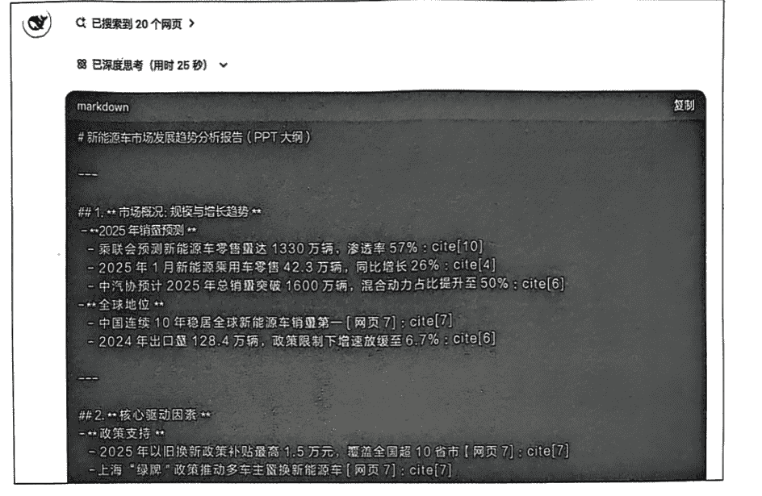

### 步骤 2 进入通义千问官网并启动 PPT 创作功能

通义千问官网入口为：https://tongyi.aliyun.com/qianwen。

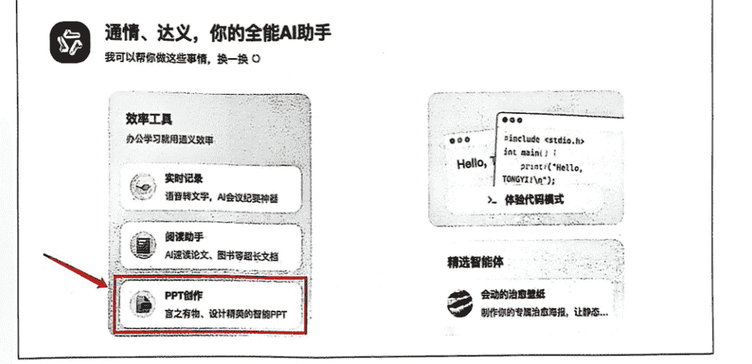

### 步骤 3 把 DeepSeek 产出的提纲导入通义千问

将 DeepSeek 生成的提纲粘贴到通义千问对话栏，输入指令“把第 5 章改写为故事线叙述模式，补充两名汽车行业首席执行官的真实决策案例，并生成对应的分镜脚本”。

模板可在操作前按个人偏好先行挑选，也可在全部环节完成后统一调整。我们把 PPT 模板选择环节后置呈现。

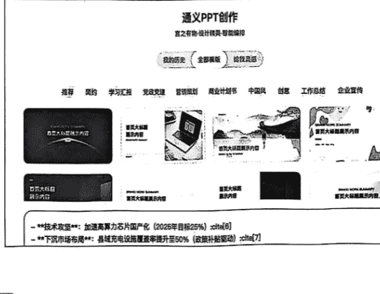

- **技术攻坚**：加速高算力芯片国产化，2025 年目标占比 25%[cite[6]]
- **下沉市场布局**：县域充电设施覆盖率提升至 50%，由政策补贴驱动[cite[7]]

### 步骤 4 在通义千问中生成 PPT 提纲

点击“下一步”，即可生成 PPT 大纲。

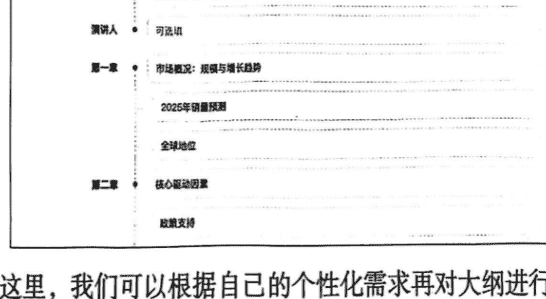

在此阶段可依据个性化需求对大纲进行微调，同时也能选择演讲场景。

### 步骤 5 选择 PPT 模板

依据演讲主题、场景及受众，选择适配的模板，例如主题为“新能源汽车”，可选用科技感较强的模板。

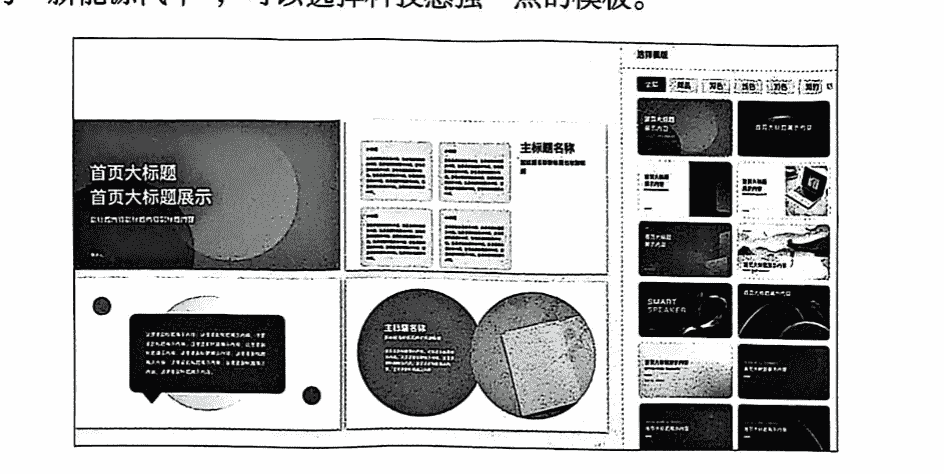

### 步骤 6 一键生成 PPT

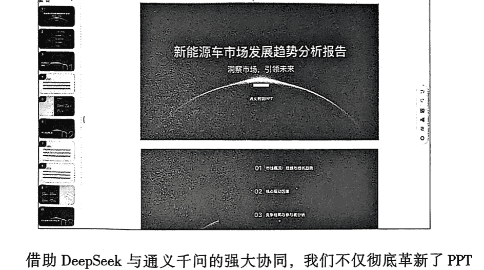

依托 DeepSeek 与通义千问的协同，PPT 制作流程得到彻底革新，内容创作的价值链也随之重塑。如今专业级 PPT 的平均制作时长从 6 小时压缩至 40 分钟，释放出的时间可投入深度思考与现场演练。随着工具回归效率本质，每位职场人都有机会具备演讲艺术家的潜力，每一次输出都能成为展示思想深度与才华的舞台，拓展更多可能。

## 第四章
https://www.deepseek.com
## 公司运营：老板的 AI“军师团”


给 DeepSeek 发送消息

深度思考 R1 联网搜索

## 01 招聘难题？智能职位描述与面试题库全流程方案

AI 时代，精准招聘已从稀缺奢侈品变为可常备的能力。本节以 DeepSeek 为核心，围绕岗位画像拆解、智能职位描述生成、多场景适配优化、面试题库设计四大环节，构建从人才筛选到精准评估的全链路。即便缺乏技术学习背景，也能借助 AI 完成专业级招聘设计，摆脱传统招聘的模糊匹配困境，大幅缩短招聘周期，快速锁定合适人选。

### 岗位画像分析：从模糊需求到精准定位

提示词模板：
作为___行业/领域 的___岗位名称 专家，请依据___公司规模/业务特点，拆解该岗位的 3 项核心职责、5 项硬技能、3 项软技能要求，并说明团队适配性特征。

具体指令：
用户是某互联网公司的人力资源专员，正在招聘初级 AI 产品经理，需构建精准岗位画像。公司规模 500 人，业务聚焦教育行业 AI 工具开发。请输出岗位能力模型。

#### 成果示例：

已深度思考 用时 25 秒

以下是为教育行业 AI 工具开发公司 500 人规模定制的初级 AI 产品经理岗位能力模型，从核心能力到差异化要求分层呈现，助力精准筛选高潜力人才：

一、硬性能力维度 专业壁垒
1. AI 产品基本功
掌握 AI 产品开发全流程：数据标注—模型训练—测试调优—场景落地闭环；能使用 Axure/Mockplus 完成教育场景原型设计，如智能作业批改界面；熟悉 A/B 测试、埋点数据分析等基础验证手段。
2. 技术理解深度
掌握机器学习基础概念 监督/非监督学习、准确率/召回率等评估指标

### 智能 JD 生成：5 分钟产出专业招聘文案

提示词模板：
基于以下岗位画像：______核心职责/技能要求，生成包含______吸引点植入技巧、______差异化优势 和______候选人成长路径 的招聘 JD，要求语言年轻化，控制在 500 字以内。

具体指令：
用户需要一份 AI 产品经理招聘初级岗位 JD，需突出“AI+教育”行业前景，强调新人导师计划与季度性海外培训机会。要求招聘语言年轻化，字数不超过 500 字。

### JD 多场景优化：不同渠道的定制化表达

提示词模板：
将原始 JD 转化为适合______招聘网站/社交媒体/内部推荐 的 3 个版本，分别侧重______薪资福利/成长故事/团队氛围，保持核心信息不变，但要调整叙述逻辑。

具体指令：
需将上述 JD 改造成 BOSS 直聘版 突出薪资、脉脉专栏版 讲故事、朋友圈海报版 强视觉。保持核心信息一致，调整叙述逻辑。

#### 成果示例：

已深度思考 用时 24 秒

以下是为不同传播场景定制的三版招聘信息，按平台特性与用户心理做差异化设计：

一、BOSS 直聘版 薪资导向+快速吸引
🔥急招！初级 AI 产品经理 AI+教育 🔥
💰25K*15 薪+硅谷轮训+教育红利💰
✓薪资保障
• 年薪最高 37W：15 薪+项目奖金+教育创新专利分红
• 入职享 10 天带薪“教育考察假”
• 每年涨薪 2 次，晋升加薪幅度超 30%

### 四 面试题库设计：三层漏斗筛选法

提示词模板：
基于____岗位名称 画像中的____硬技能项、____软技能项，设计包含基础筛选层 5 道题、专业评估层 3 道场景题 和文化匹配层 2 道行为面试题 的题库，并附评分要点。

具体指令：
针对 AI 产品经理岗位，需涵盖 SQL 技能应用、需求冲突处理、教育情怀考察等维度，设计基础筛选层 5 题、专业评估层 3 题、文化匹配层 2 题的题库，并给出评分要点。

#### 成果示例：

一、基础筛选层 5 题，10 分钟线上测评
1. SQL 基础应用
```sql
-- 给定学生行为表 study_log (user_id, action_type,timestamp)，请写出查询过去 30 天每天使用 AI 批改功能超过 5 次的用户数
```

评分点：
- ✅ 正确使用 DATE_SUB 和 GROUP BY 2 分
- ✅ 嵌套查询统计次数 3 分
- ❌ 未考虑去重或时间范围 扣 1 分
2. 教育数据敏感度
“分析发现某地区学生周末使用 AI 教辅时长下降 40%，请列举 3 种可能原因及验证方式”
评分点：
- ✅ 提出教育场景特有因素 如考试季/政策限制 每个原因 1 分
- ✅ 提出用 SQL 验证假设的方法 2 分
3. 需求优先级判断
“同时收到教师要求提升批改准确率、家长要求增加使用时长限制、教育局要求接入监管平台，如何排序？”
评分点：
- ✅ 识别政策需求为最高优先级 3 分
- ✅ 提出平衡方案 如用数据证明准确率提升可减少家长焦虑 2 分
4. AI 技术理解

### 五 情景模拟题自动生成：复杂能力检验

提示词模板：
生成 3 个______岗位名称 可能会遇到的典型工作冲突场景，要求包含______多方立场矛盾、______信息不全 和______时限压力 要素，用于模拟实战演练，并给出优秀回答的关键判断点。

具体指令：
需设计 AI 产品经理在需求评审会、用户投诉处理、资源协调中遇到的冲突模拟题，用于实战演练，并给出优秀回答的关键判断点。

#### 成果示例：

已深度思考 用时 23 秒

以下是为 AI 产品经理设计的冲突场景模拟题，覆盖需求评审会、用户投诉处理、资源协调三大关键场景，并附优秀回答判断标准与典型错误预警：

一、需求评审会冲突模拟
场景背景
教育大模型团队提出“AI 智能教案生成”需求，算法负责人认为需 6 个月研发周期，但教学运营部门要求 3 个月内上线以配合新学期推广。
冲突焦点
- 技术可行性：需处理多学科知识图谱融合
- 业务压力：错过开学季将损失 2000+ 学校合作机会
- 资源瓶颈：NLP 团队同时支撑 3 个重点项目
候选人任务
主持本次评审会，形成可执行方案
优秀回答关键点
✅ 技术拆解力
- 用 SQL 分析历史教案数据，证明 80% 使用场景集中在 20% 知识点
✅ 价值锚定力
- 展示 ROI 测算：每提前 1 个月上线 = 新增 500 校接入 = 数据飞轮加速 30%
- 承诺为算法团队争取标注资源 如众包教师标注体系

### 六 评估标准自动化：AI 面试官养成计划

提示词模板：
为______具体面试题 制定多维度评估标准，包含______技术实现合理性、______用户体验敏感度、______沟通策略有效性 等，每个维度给出三个加减分行为示例。

具体指令：
针对“作文批改系统准确率争议”情景题，制定评估量表，包含技术实现合理性、用户体验敏感度、沟通策略有效性等，每个维度给出三个加减分行为示例。

#### 成果示例：

| 评估维度 | 加分行为 +2 分/项 | 减分行为 -2 分/项 |
| :--- | :--- | :--- |
| 技术实现合理性 | 1. 提出数据增强方案：联合教育局采集乡村学生优秀作文补充训练集 2. 设计分阶段优化：先解决基础语法误判 95% 准确率，再优化文学性评价 3. 引入教师修正机制：允许教师标注争议案例优先进入模型迭代 | 1. 仅建议调整评分阈值掩盖问题 2. 忽视数据分布差异 如方言作文未特殊处理 3. 要求标注团队 24 小时加班但无质量保障方案 |
| 用户体验敏感度 | 1. 设计评分维度开关：允许教师自主关闭“修辞手法”等争议指标 2. 开发对比功能：并排显示 AI 与教师批改痕迹差异 3. 建立用户共建机制：邀请投诉家长参与标注标准制定 | 1. 仅通过提升准确率数字安抚用户 2. 未设计情感化反馈 如用“进步空间”替代“低分” 3. 改进方案未经教师代表实测验证 |
| 沟通策略有效性 | 1. 制定分层沟通方案：给教育局的技术白皮书/给家长的动画解说视频 2. 设立透明化看板：实时公开系统优化进展与瓶颈 3. 设计补偿机制：为受影响学生提供名师作文精批服务 | 1. 统一用技术术语回复各类投诉 2. 仅通过邮件单向通告处理方案 3. 未安抚一线教师增加的复核工作量 |

当招聘遇上 DeepSeek，人才争夺的游戏规则已被改写。从精准职位描述到智能题库搭建，AI 工具链正在重塑人力资源全环节。本节阐述的不仅是技术解决方案，更是组织效率革命的范式转变。在人与 AI 的协同进化中，率先掌握智能招聘密钥的企业，必将在人才竞争中占据制高点。

## 02 制度文档难写？行业模板即拿即用

在数字化转型浪潮中，制度文件常因脱离业务场景、缺乏实用性而沦为形式主义。本节以抖音直播团队管理场景为例，通过 DeepSeek 的“模板改造术”展示如何从零搭建覆盖选品、直播、复盘的标准化体系。即便不具备法律或管理专业背景，亦可生成实用的制度框架，让规则真正服务于业务增长。

### 场景需求分析 模板生成前准备

提示词模板：
作为直播行业顾问，请梳理抖音直播团队管理制度的核心模块，需包含团队架构、选品标准、直播流程、数据分析、合规风控 5 个维度，用表格形式呈现关键控制点与对应管理目标。

具体指令：
我正在为某机构搭建直播团队管理体系，请按以下要求输出方案：
1. 划分制度文件核心模块；
2. 每个模块列出 3 个关键控制点；
3. 说明各控制点的管理目标；
4. 用 markdown 表格呈现。

### 团队架构搭建 基础框架生成

提示词模板：
生成抖音直播团队标准架构模板，包含岗位名称、职责说明、考核指标三列，要求区分新人团队 3～5 人 和成熟团队 10～15 人 两种配置方案，用表格对比呈现。

具体指令：
我需要设计适应不同发展阶段的团队架构。
新人团队：预算有限，需岗位复用。
成熟团队：专业分工精细化。
请输出包含岗位职责、KPI、人员配置差异的对比表格，用★标注关键岗位。

### 三 选品流程规范 动态模板生成

提示词模板：
生成直播选品 SOP 流程图模板，包含初筛、评审、测试三个环节，每个环节需标注决策标准 如佣金率≥20%、所需文档 商品资质文件、异常处理机制 品退率超限处理。

具体指令：
设计标准化选品流程，包含：
1. 商品库建立标准；
2. 突发舆情后商品下架流程；
3. 爆品快速补货机制。
请用泳道图形式区分商务、运营、质检部门的协作节点。

### 四 直播流程标准化 实时优化模板

提示词模板：
生成直播执行检查表模板，包含开播前 2 小时、直播中、下播后三个时段，每个时段列出必检事项 如设备网络测试、违禁词监控、粉丝问题归档，用分级符号标注风险等级。

具体指令：
1. 按时间维度划分检查节点 开播 2 小时、直播中、下播后；
2. 使用分级符号“！”标注高优先级事项；
3. 包含突发状况应对指引 如断网处理流程。

### 五 复盘体系搭建 数据驱动优化

提示词模板：
生成直播复盘报告模板，需包含流量分析 自然推荐占比、转化率分析 购物车点击率、商品分析 爆款连带率 三个维度，每个维度提供对比数据 环比/竞品 和改进建议。

具体指令：
1. 区分基础数据层 观看人次；
2. 转化漏斗层 点击—加购—支付；
3. 商品策略层 主推款销售效果；
4. 对比数据，自动生成改进建议的功能模块。

### 六 制度动态优化 智能迭代机制

提示词模板：
生成制度版本管理方案，要求包含修订触发条件 如规则季度迭代、修订流程 部门会签机制、历史版本追溯 变更日志模板。

具体指令：
- 1. 常规季度更新节点；
- 2. 突发事件触发更新 如平台新规；
- 3. 版本差异对比功能；
- 4. 输出包含版本号、修订内容、生效日期的表格案例。

#### 成果示例：

```
# 制度更新机制设计
## 更新触发条件
1. **常规更新**
   - 每季度末（3/6/9/12月）定期评审
   - 收集执行反馈，优化流程漏洞
2. **紧急更新**
   - 平台政策重大调整（如佣金规则变更）
   - 重大运营事故（如商品质量问题）
   - 团队规模扩张（人员增长超30%）
```

# 七 合规性检查 风险控制模板

提示词模板：
生成直播合规自检模板，整合《网络直播营销管理办法 试行》等法规，将法条转化为可执行检查项 如宣传用语限制，提供违规案例库链接和整改建议生成功能。

具体指令：
- 1. 内置最新法律法规数据库；
- 2. 支持语音/文字实时检测；
- 3. 违规内容自动替换建议；
- 4. 输出包含典型违规场景的对照表。

#### 成果示例：

```
# 智能合规检查系统设计

## 系统架构
1. **数据层**
   - 法规数据库（每日更新）
   - 违规词库（分级管理）
   - 案例库（历史违规记录）

2. **功能层**
   - 实时语音检测
   - 文本合规审查
   - 智能替换建议
   - 风险预警提示
```

# 八 应急预案生成 风险应对模板

提示词模板：
生成直播事故应急预案库，包含设备故障、舆情危机、商品事故三类场景，每个场景提供三级响应预案 常规处理/升级处理/危机公关，用流程图展示决策路径。

具体指令：
设计直播应急处理手册，包含设备故障、舆情危机、商品事故：
1. 区分事故等级 黄/橙/红；
2. 明确各岗位权限矩阵；
3. 包含话术模板库 如道歉声明；
4. 输出设备故障场景的处置流程图。

#### 成果示例：

# 直播应急处理手册

## 事故分级标准

| 等级 | 标识 | 标准 | 响应时限 |
| :--- | :--- | :--- | :--- |
| 黄色 | ▲ | 轻微影响直播体验 如画面卡顿 | 5 分钟内处理 |
| 橙色 | ◆ | 较大影响 如商品信息错误 | 2 分钟内处理 |
| 红色 | ● | 严重事故 如断播、重大舆情 | 立即处理 |

## 岗位权限矩阵

| 岗位 | 黄色事故 | 橙色事故 | 红色事故 |
|------|----------|----------|----------|
| 主播 | 自主处理 | 需报备运营 | 立即停止直播 |

通过 DeepSeek 模板工程，复杂的制度建设工作被转化为可复用的智能化流程。从团队架构设计到应急预案生成，每个环节实现标准化与灵活性的平衡。这种 AI 赋能的制度建设方式，不仅减少文档编写时间，更能通过数据驱动的动态优化机制，确保规则体系始终与业务发展同频共振。当制度转化为动态运营指南，企业便获得持续进化的组织能力。

## 03 合同风险规避术：法律条款智能审查

在直播带货领域，每年因不规范合作协议导致纠纷的事件占比超过 20%。本节借助 DeepSeek 智能生成含法律条款的合作协议模板，帮助主播人员或公司在 15 分钟内生成涵盖权利义务边界、违约追责等核心要素的定制化合同。

### 步骤 1 搭建合同基础框架

提示词模板：
作为直播行业法律顾问，请按以下结构输出合同框架：
- 1. 合作内容；
- 2. 权利和义务；
- 3. 结算条款。
需要包含带货频次、佣金比例、账号归属等基础条款，用条款编号形式呈现。

具体指令：

直播带货合作框架搭建思路

搭建一份直播带货协作框架协议，建议围绕三大主线展开：其一是合作内容，要明确开播频次与商品品类；其二是权责约定，要厘清账号使用权限与内容审核权限；其三是结算规则，要确定佣金计算方式与付款节奏。条文建议采用第X条的体例，单条表述尽量控制在40字以内。

参考示例：

直播带货协作框架协议

第一章 合作内容

第一条 双方确认每月开播场次不少于____场，每场时长需达____小时以上。

第二条 合作商品品类限定为________，超范围推广不得进行。

### 步骤2 生成行为约束清单
提示词模板：

请把行为拆分为允许清单与禁止清单两类，允许项以“能”起笔说明权限，禁止项以“不能”起笔标明限制，需覆盖竞品边界、宣传话术等具体要求。

具体指令：

> > 生成直播行为约束条款，要求：
> 1. 允许行为：可承接非竞品推广，可发布生活日常。
> 2. 禁止行为：不得暗示竞品优势，不得使用未经审核的话术。
> 3. 竞品清单：雅诗兰黛、兰蔻、资生堂。
> 用“你能/不能”句式呈现，每条后标注违约赔偿金额。

成果示例：

> > 已深度思考
> 直播行为约束条款
> 第八条 你能发布个人日常生活内容，但不得影响带货时长与效果。
> 第九条 你不能暗示雅诗兰黛、兰蔻、资生堂等竞品的优势，违约应赔偿____元/次。
> 第十条 你不能使用未经甲方书面审核的营销话术，违约应赔偿____元/次。
> 第十一条 竞品清单以合同约定的雅诗兰黛、兰蔻、资生堂为准，禁止直接或间接推广。
> （说明：赔偿金额需结合合作规模协商，建议明确单次违约金的计算依据。）

### 步骤3 植入风险防控案例
提示词模板：

请在违约条款后补充真实案例说明，需包含：违约情形、处置方式、赔偿金额。数据应符合2024年直播行业仲裁案例。

具体指令：

> > 在合同末尾增加3个典型违约案例，要求：
> 1. 以主播擅自在竞品直播中露面为例；
> 2. 包含流量损失的计算方式与赔偿标准；
> 3. 引用互联网法院诉讼平台2024年判例数据。
> （案例以“警示案例”模块呈现。）

### 步骤4 将法律表述通俗化
提示词模板：

请把“缔约方不得实施可能减损合同标的商业价值之行为”转化为通俗表述，要求保留法律效力但去除专业术语，用主播能懂的场景化描述。

具体指令：

> > 进行法律条款转译。
> 原条款：乙方承诺在合作期内不为任何第三方提供相同或类似服务；
> 转化要求：
> 1. 使用“不能接同类产品推广”等口语化表达；
> 2. 补充“包括但不限于短视频植入、直播间口播”等具体场景；
> 3. 注明竞品判定标准。

成果示例：

> > 转译后条款
> 乙方承诺：
> 1. 合作期间，乙方不得承接同类产品的推广，包括但不限于：
>    - 在短视频中植入竞品广告；
>    - 在直播间口播竞品信息；
>    - 在社交媒体发布竞品宣传内容；
>    - 参与竞品线下活动或担任代言。
> 2. 竞品判定标准：
>    - 与甲方产品功能、目标用户、价格区间高度相似；
>    - 在市场上与甲方产品构成直接竞争；
>    - 甲方书面告知乙方并附竞品清单，如雅诗兰黛、兰蔻、资生堂等。
> 3. 违反本条约定，乙方需承担违约责任，赔偿金额按合同约定执行。

### 步骤5 生成风险自检清单
提示词模板：

请把合同条款转化为自查问题，如“是否已明确竞品推广赔偿计算方式”，需覆盖条款遗漏、表述模糊、追责缺失三大风险点。

具体指令：

- 生成主播使用的合同自检清单。
- 1. 问题形式：“你确定合同中写明了______？”
- 2. 重点检查：竞品界定、赔偿计算、账号归属；
- 3. 包含风险提示：“若未约定可能导致______。”
- 输出为带复选框的清单。

成果示例：

- 主播用合同自检清单
请逐项核对以下问题，确保条款清晰：
- 竞品界定
  - 你确定合同中写清了竞品的具体范围和判定标准？
  - 风险提示：未约定可能导致竞品范围模糊，引发违约争议。
- 赔偿计算
  - 你确定合同中写清了违约赔偿的计算方式和具体金额？
  - 风险提示：未约定可能导致赔偿过高，损害自身权益。
- 账号归属
  - 你确定合同中写清了直播账号的归属权及使用权？
  - 风险提示：未约定可能导致账号被收回或限制，影响个人发展。
- 合作内容
  - 你确定合同中写清了直播频次、时长及产品类目？
  - 风险提示：如未约定可能导致工作量超负荷或内容不符预期。
- 结算条款
  - 你确定合同中写清了佣金比例、结算周期及付款方式？
  - 风险提示：如未约定可能导致佣金被扣减或付款延后。
- 内容审核
  - 你确定合同中写清了内容审核流程及修改时限？
  - 风险提示：如未约定可能导致内容被无故驳回，影响直播效率。
- 违约责任
  - 你确定合同中写清了双方违约责任及处理方式？
  - 风险提示：如未约定可能导致责任不对等，增加法律风险。

借助智能拆解能力，合同撰写从高专业度工作转变为标准化流程。本节演示的五步审核体系，有效降低合同漏洞风险。建议每次签约前用自检清单快速复核，让 AI 成为智能合规助手。

# 04 BP速成：投资人青睐的商业计划书架构
在 AI 时代，商业计划书不再是投行专属。本节以“生成式大模型+教学硬件”赛道为例，通过解析商业计划书核心框架，从痛点挖掘、技术壁垒到财务模型，指导用 AI 生成逻辑严密、数据充分、具备投资吸引力的内容，帮助创业者快速打造符合风险投资要求的商业计划书。

### 步骤1 市场痛点分析
提示词模板：

作为______（AI教育硬件领域）专家，请分析______（当前基础教育英语学习市场）的三大核心痛点。要求：结合家长焦虑点和学生使用场景，对比现有竞品缺陷，给出量化数据支撑。

具体指令：

深度剖析中小学生英语学习设备存在的问题，列出家长调研中高频出现的三大抱怨，对比某品牌词机在用户留存率、日均使用时长方面的数据短板，最后用教育行业白皮书数据验证市场需求规模。

成果示例：

# 一、市场痛点与需求验证

## 1. 现存设备三大核心痛点（家长高频抱怨）
- ① 无效记忆循环：传统词机仅提供机械重复背诵，缺乏科学记忆算法，学生3天遗忘率超65%。家长反馈“孩子每天打卡但考试仍难提分”。
- ② 互动性缺失：现有设备无法模拟真实语境，导致学生“背完不会用”。调研显示72%家长认为设备“功能单一，像电子词典”。
- ③ 学习数据断层：设备与学校教学脱节，教师无法追踪薄弱点。家长抱怨“买了硬件还要额外买辅导服务”。

### 步骤2 产品定位设计
提示词模板：

请为AI词学习机设计差异化产品定位。要求：突出大模型技术优势、包含游戏化元素、体现效果可视化特点、使用 FAB 法则表述。

具体指令：

设计具备多模态交互能力的 AI 单词机，需整合大模型动态难度调节、AR情景对话、学习进度可视化面板，用 FAB 法则阐述核心价值。

### 步骤3 技术方案拆解
提示词模板：

详细说明______（技术架构）。要求：______（三点）。

具体指令：

详细说明大模型在教育硬件中的三层技术架构。要求：区分云端与本地部署、说明数据安全方案、列举核心算法模块。

成果示例：

以下是针对大模型在教育硬件中的三层技术架构说明，涵盖云端与本地部署划分、数据安全方案及核心算法模块设计：

# 一、三层技术架构设计

## 1. 云端层
- 功能定位：负责复杂模型训练、数据存储与分析、多设备协同管理等高算力任务。
- 核心模块：
  - 模型训练平台：基于分布式计算框架，如PyTorch + Horovod，支持百亿参数模型快速迭代。
  - 数据湖：存储海量学习行为数据，用于模型优化与个性化推荐。
  - 协同管理引擎：支持多设备数据同步，实现学情无缝衔接。

### 步骤4 商业模式构建
提示词模板：

设计硬件+内容的复合盈利模型，包括硬件毛利率测算、增值服务规划，用表格呈现3年财务预测。

具体指令：

制定包含设备销售（定价599元）、分级阅读订阅（199元/年）的盈利体系，计算硬件生产成本占比，给出3年营收增长率预测。

成果示例：

以下是基于设备销售、分级阅读订阅和学校B端服务的盈利体系设计，包含硬件生产成本占比计算和三年营收增长率预测：

# 一、盈利体系设计
- 1. 设备销售（硬件）
   - 定价：599元/台
   - 目标用户：学生及家长
   - 销售渠道：线上电商、自有官网；线下书店、教育用品店、学校合作
   - 毛利率：52%
     - 生产成本：287元/台（占比48%）
- 2. 分级阅读订阅
   - 定价：199元/年
   - 核心功能：分级阅读内容库、进度追踪、个性化推荐、能力评估报告

### 步骤5 数据支撑体系
提示词模板：

生成提升商业计划书可信度的数据，包含用户行为实验数据、专利技术储备、竞品对比优势。

具体指令：

呈现 AI 单词机对比传统产品的核心优势数据，包括测试组提分效率、已申请技术专利数量等。

成果示例：

# 一、核心优势数据对比
## 1. 提分效率（测试组数据）
- AI单词机：测试组500名学生，3个月试点，平均提分23.5分，提分效率为传统单词卡的2.8倍
- 传统单词卡：测试组500名学生，3个月试点，平均提分8.4分

### 步骤6 团队包装策略
提示词模板：

优化创始团队履历呈现。要求：突出互补性、嵌入行业资源、关联成功案例、使用投资人关注关键词。

具体指令：

包装由教育行业连续创业者、AI芯片专家、资深教师组成的核心团队，强调资源整合能力。

### 步骤7 退出路径规划
提示词模板：

设计符合资本预期的三阶退出方案，包含战略收购方名单、IPO可行性分析、对赌条款设计要点，并用 SWOT 说明选择逻辑。

具体指令：

规划3年内并购退出方案，列出字节跳动、科大讯飞、步步高教育等潜在收购方，分析业务协同性，设计基于用户增长的对赌条款保护。

成果示例：

- 一、并购退出方案规划
1. 时间节点
   - 第1年：完成研发与区域试点，销量15万台，留存率超85%
   - 第2年：销量达40万台，订阅渗透率30%，与潜在收购方接洽
   - 第3年：销量达80万台，订阅渗透率42%，完成并购退出，目标估值15亿元

### 步骤8 BP 结构整合
提示词模板：

生成标准 BP 目录框架，要求遵循电梯演讲结构、包含12个投资人必看模块、标注各章节字数建议、插入三处数据可视化提示。

具体指令：

整理符合红杉资本 BP 模板的目录结构，包含市场机会、解决方案、增长模型等核心章节，在市场规模、财务预测、实验数据环节标注【插入图表】提示。

成果示例：

以下是符合红杉资本BP模板的目录结构，并在市场规模、财务预测、实验数据等环节标注【插入图表】提示：

# 商业计划书目录结构
- 1. 执行摘要
   - 项目概述：生成式大模型+教育硬件创新结合
   - 核心亮点：动态难度调节算法、AR情景对话、学情穿透系统
   - 财务亮点：首年目标收入1.1亿元，3年复合增长率134.6%，目标估值15亿元
- 2. 市场机会
   - 市场规模：2024年AI学习机销售额同比增长136.6%【插入图表：市场规模增长趋势图】
   - 政策驱动：双减政策深化，智能硬件渗透率预计达47%

通过八大步骤拆解，完整构建专业级商业计划书生成流程。从精准捕捉痛点到严谨数据论证，从技术壁垒构建到资本路径规划，AI大幅降低专业门槛，同时结构化思维确保商业逻辑完整。

# 第五章
https://www.deepseek.com

给 DeepSeek 发送消息
深度思考 联网搜索

## 01 段子流水线：日更百条创意不竭的方法
信息爆炸时代，段子是传递情绪最快的载体。本节借助解析爆款段子生成公式，从选题策划到埋梗，再到批量生产，指导如何打造段子生成器。掌握创作五步法，段子产出即可稳定可控、源源不断。

### 爆款段子创作五步法

#### 步骤1 选题定位——挖掘痛点，寻找共鸣
提示词模板：

列举10个普通人日常生活场景，要求场景具体且有情绪共鸣点，用“场景+矛盾点”格式呈现。

具体指令：

我是一名段子选题策划人员，帮我列出10个适合改编成段子的生活场景，每个场景需包含具体行为与尴尬/矛盾/意外元素。例如：“在健身房自拍并发朋友圈时，却忘记关跑步机，被拍到滚下器械的瞬间。”

成果示例：

以下是精心设计的10个生活化段子选题，每个选题均含强冲突点：
1. “智能冰箱的背叛”
   - 行为：设置冰箱自动补货清单
   - 意外：冰箱判断你需减肥，自动锁定零食区并播放《卡路里》

#### 步骤2 铺垫设计——设故事背景，引合理预期
提示词模板：

针对“______场景”，设计3条符合正常逻辑顺序的铺垫描述，保持口语化且信息完整。

具体指令：

针对“教父母用手机截图”的场景，生成3条符合普通人认知的铺垫描述。

要求：
1. 用生活化语言；
2. 包含动作细节；
3. 制造合理预期。

例如：
“花费半小时耐心教妈妈用手机截图技巧，反复演示同时按下电源键和音量键。”

#### 步骤3 反转设计——打破预期，制造笑点
提示词模板：

为______铺垫设计3个意外反转，要求：1. 符合场景逻辑；2. 制造认知落差；3. 字数不超过20。

具体指令：

针对“把截图步骤写成便签贴手机上”的铺垫，设计3个符合中年父母行为模式的反转。参考方向：理解偏差/操作失误/过度执行等。字数不超过20。

成果示例：

以下为设计的三个反转桥段：
反转一：理解偏差
“把截图步骤写成‘同时轻按电源键+音量下键’贴在手机背面，三天后发现父亲每次截图都先宣示‘开始同时按了’，结果拇指食指轮流点击，相册里攒了80张锁屏界面。”

#### 步骤4 细节优化——增加画面冲击
提示词模板：

为以下段子框架添加3个增强喜剧效果的细节。
- 铺垫：（插入内容）。
- 反转：（插入内容）。

要求：
1. 加入具象化数字/身体反应/夸张对比；
2. 每处字数不超过15。

具体指令：

完善这个段子。
- 铺垫：教爸爸给视频截图并反复确认他听懂了。
- 反转：收到53张不同角度的天花板照片。
请添加：
1. 时间跨度；
2. 异常行为细节；
3. 视觉化对比。

成果示例：

以下为完善后的段子：
### 《截图特训成果展》
花三天给父亲特训视频截图技巧，餐桌上模拟了十八遍‘暂停画面—点击截屏键’流程。他不仅用便签纸记下‘手要像端茶杯一样稳’，还发明了‘三指定法’。
第四天中午手机疯狂震动，相册弹出53张新鲜成果：从15度仰角到90度垂直，天花板吊灯在每张图里上演光影变形记。最震撼的是第37张，画面边缘还捕捉到他为调整角度踩在板凳上的半只拖鞋。

### 拆解要点

1. 时间对照：前三天持续高强度打磨，第四天直接迎来爆发式产出
2. 异常操作：
   - 创造“三指定法”
   - 搬凳子微调拍摄角度
   - 用便签做记录强化仪式感

#### 步骤5 批量生产——搭建素材矩阵

#### 提示语框架：

围绕“代际数字鸿沟”这一主题，采用下方公式一次性生成十则段子。

铺垫 ≈ 传统生活经验 + 科技产品；
反转 ≈ 使用错位 + 可视化结果。

#### 操作要求：

让模型化身退休教师，按范式创作段子。

铺垫：把 ___ 当作 ___ 来使用。
反转：结果 ___（具体且好笑的物理结果）。

##### 示范
把手机语音助手当作“魔镜”，每天起床先问：“×××，今天我好看吗？”

#### 完整笑料合成演示

#### 操作说明：

- 主题：中年男性的养生焦虑。
- 铺垫：严格照搬朋友圈养生文章的做法。
- 反转：过度执行带来荒诞后果。
- 要求：包含三个递进细节、一个转折。

#### 成果示范：

段子：中年养生男的自我救赎

铺垫：老张看了朋友圈养生帖，决定死守“健康三件套”，清晨喝柠檬水、午间晒太阳补钙、夜间泡脚排毒。

递进细节1：他每天五点起床榨柠檬，榨到手腕发酸，还特意买酸碱试纸测酸碱度，结果自来水比柠檬还酸。

段子本质上是打破预期的艺术，而 AI 是最善于挖掘認知差的探测器。把生活里荒诞的瞬间拆解后，用结构化模板重新组合笑点，每个人都能积累自己的喜剧弹药库。当创作变成排列组合，日更上百条就不再是意志力的消耗，而是对 DeepSeek 下达指令的轻量操作。记住：幽默从来不是灵光乍现，而是经过设计的意外。

## 海量标题生成术：流量密码拆解手册

自媒体环境下，标题是用户是否点进来的第一道关卡。好标题既能抓住注意力，也能激发好奇和情绪共鸣。本节用 DeepSeek 拆解流量密码的核心逻辑，从人性痛点、平台机制、悬念设置到情绪共振等维度，手把手教你写出让人难以抗拒的标题。无论是新手还是老手，都能通过下面的实操步骤和模板，快速掌握爆款标题的写法。

### 步骤1 明确目标受众与核心痛点

#### 提示语框架：

解析目标受众的年龄、职业、兴趣，找出他们最在意的痛点。思考他们正在面对什么问题、渴望解决什么，把这些痛点与选题结合，提炼核心关键词。

#### 具体指令：

请分析职场新人的核心痛点，结合选题“如何提升工作效率”，列出3个核心词。

#### 成果示例：

### 职场新人提效的三大核心词

**核心焦虑：**

- 时间规划失序：经验不足，容易陷入多任务并行，导致效率下滑。
- 工作方式欠成熟：缺少系统流程和工具，操作常显手忙脚乱。
- 沟通配合不顺：与同事领导交流不畅，影响进度和成果。

**核心词：**

1. 优先级排序：学会区分任务重要性与紧急性，合理安排时间，避免无效忙碌。
2. 高效工具：掌握并使用效率工具，如待办清单、时间管理软件、项目管理工具等，提升执行效率。
3. 有效沟通：学习沟通技巧，清晰表达需求，积极吸纳反馈，提升团队协作效率。

### 步骤2 挖掘情绪共鸣点

#### 提示语框架：

标题需要触发用户的情感共鸣。要思考哪些情绪最能打动目标受众：焦虑、好奇、惊喜还是共情？把这些情绪与核心痛点结合，设计出能引发共鸣的标题元素。

#### 具体指令：

请结合“时间管理混乱”这一痛点，设计一个能触发焦虑和好奇情绪的标题元素。

#### 成果示例：

### 引爆焦虑与好奇：时间管理混乱的标题元素

痛点结合：时间难以掌控是职场新人的普遍困扰，易引发焦虑，也让人好奇破解方法。

标题元素设计：

1. 直击痛点引发共鸣：
   - “每天忙成陀螺，却总觉一事无成？”（点出结果引发共鸣）
   - “时间都去哪了？揭秘职场新人的时间黑洞”（用“时间黑洞”比喻混乱，引发好奇）
   - “你还在用错误的方式管时间吗？”（质疑常见做法，引发反思）

### 步骤3 适配平台算法与核心词布局

#### 提示语框架：

不同平台的算法偏好不同。研究目标平台的热门核心词和推荐机制，把核心词自然融入标题，确保标题既能吸引用户，又能被算法推荐。

#### 具体指令：

请为“时间规划”这一核心词设计一个适合短视频平台风格的标题，要求包含热门核心词。

#### 成果示例：

- “拯救拖延症”：直击痛点，吸引被拖延困扰的用户。
- “3个”：具体数字制造悬念，提升点击欲望。
- “时间管理‘神器’”：用“神器”突出方法有效性与吸引力。
- “效率翻倍”：强调结果，刺激用户提升欲。
- “🔥”：表情符号增加视觉冲击力。

### 步骤4 设计悬念与反转

#### 提示语框架：

悬念是促使用户点击的关键，在标题里埋一个未解之谜或反转点，让人产生“必须点开”的冲动。用最少文字制造最大悬念。

#### 具体指令：

请为“时间规划”这一话题设计一个带悬念的标题。在标题中设置一个未解之谜或反转点，要求用最少文字制造最大悬念。

#### 成果示例：

- “每天多出2小时”：给出诱人结果，引发好奇如何实现。
- “揭秘”：暗示将分享不为人知的秘密。
- “时间管理大师”：借助权威效应提升可信度与吸引力。
- “惊人技巧”：强调方法独特性与有效性。
- “⏳”：沙漏表情与时间主题呼应，增强视觉吸引。

### 步骤5 优化标题长度与阅读节奏

#### 提示语框架：

标题长度和阅读节奏会直接影响点击率。确保标题简洁有力，控制在15~20字以内，避免冗长。使用短句、数字和符号增强节奏感。

#### 具体指令：

请优化标题“如何利用高效工具进行时间管理来提升工作效率，告别拖延症”。确保简洁有力，控制在15~20字内，避免冗长。用短句、数字和符号增强节奏感。

#### 成果示例：

**优化后标题：**

“告别拖延，效率翻倍！3个时间管理‘神器’+高效工具秘籍🚀”

**优化思路：**

1. 更简洁有力：原标题冗长，优化后直截了当突出重点。
2. 更具吸引力：使用“效率翻倍”“神器”“秘籍”等词增强冲击力。
3. 更具悬念：数字“3”和表情“🚀”制造悬念。
4. 更突出结果：开头点明“告别拖延”，直击用户最关心的结果。

### 步骤6 测试与迭代

#### 提示语框架：

标题创作是一个不断优化的过程。通过A/B测试或用户反馈，分析不同版本的点击率，找到最优解，并据此调整核心词、情绪点和悬念设计。

#### 具体指令：

请为以下标题设计两个变体用于 A/B 测试：“拖延症毁掉了你的工作效率？这个方法让你一天多出 3 小时！”

#### 成果示例：

### A/B测试标题变体：

变体一：“每天浪费3小时？拯救拖延症，这个方法让你效率起飞！🚀”

变体二：“拖延症晚期？3个简单步骤，让你每天多出3小时！⏰”

### 设计思路：

- 变体一：
  - “每天浪费3小时”：更直接指出危害，触发焦虑。
  - “拯救拖延症”：突出解决方案。
  - “效率起飞”：形象比喻效果。
  - “🚀”：火箭符号增强视觉冲击。
- 变体二：
  - “拖延症晚期”：夸张说法抓注意力。
  - “3个简单步骤”：强调易操作，降低心理门槛。
  - “每天多出3小时”：复述诱人结果，强化记忆。

## 步骤 7 生成备选标题

#### 提示语框架：

将以上步骤的成果进行整合，生成5个备选标题。要求确保每个标题都包含核心词、情绪共鸣点、悬念设计和平台适配元素，尽量满足不同用户的需求。

#### 具体指令：

将以上成果整合，为“时间规划”这一话题生成5个备选标题。要求包含核心词、情绪共鸣、悬念设计和平台适配元素。

#### 成果示例：

1. 拯救拖延症！3个时间管理“神器”，让你效率翻倍！
   - 核心词：时间管理、拖延症、效率
   - 情绪共鸣点：拯救拖延症，引发共鸣

理解上述步骤，就能更好地掌握爆款标题的创作逻辑。从明确受众痛点、触发情绪共鸣，到适配算法、设计悬念反转，每一步都不可或缺。记住：标题不仅是内容入口，更是与用户建立情感连接的桥梁。通过不断测试优化，标题才能成为吸流利器。

## 03 三日搭建账号：AI爆款文案外挂

“写了半天文案，点赞却不过百”——这是多数创作者的噩梦。爆款文案的本质是用视觉焦点触发情绪，用场景化内容建立信任。以儿童护眼台灯为例，拆解如何用 DeepSeek 的“四维爆款公式”——痛点共鸣、场景代入、数据佐证、视觉锚点，从选题到成稿打造高传播内容。无需专业背景，按步骤生成高转化文案，让“家长必看”变成“流量密码”。

### 步骤1 选题定位：从焦虑提炼冲突

#### 提示语框架：

结合目标人群的焦虑点与决策障碍，提炼产品需要解决的最终问题。

#### 要求：

1. 用疑问句引发好奇；
2. 包含“必看”“真相”等词；
3. 指向具体使用场景。

#### 具体指令：

为儿童护眼台灯测评设计选题标题，聚焦家长对近视低龄化、蓝光危害的焦虑，同时暗示测评专业性，吸引点击。

#### 成果示例：

已深度思考（用时 22 秒）

以下是兼顾家长焦虑、专业背书与传播力的护眼台灯测评选题标题：

权威焦虑型
《眼科医生严选！10款防蓝光台灯测评：这3款竟让近视率翻倍？》
（权威背书+数据反差制造危机感）

痛点直击型
《5岁娃近视100度！我们拆了24台护眼灯，蓝光超标名单触目惊心》

## 步骤 2 痛点共鸣：场景化唤醒情绪

#### 提示语框架：

把抽象痛点转化为具体生活场景，加入感官细节（如揉眼、眯眼等）。

#### 要求：

1. 使用第二人称“你”；
2. 包含时间与动作描写；
3. 结尾抛出解决方案悬念。

#### 具体指令：

描述孩子夜间写作业时，因劣质台灯导致的视觉疲劳状况，引发家长自责心理，强调专业测评必要性。

### 步骤3 数据佐证：构建权威信任

#### 提示语框架：

整合三类数据：实验室测试（量化参数）、专家背书（医生建议）、用户调研（百分比结论）。

#### 要求：

1. 用“红榜/黑榜”的形式对比呈现；
2. 加入成本计算公式；
3. 避免使用专业术语。

#### 具体指令：

生成台灯测评数据模块，包含照度测试对比、眼科医生安全用灯时长建议、100位家长调研结论，附加日均成本计算公式。

#### 成果示例：

（此处应为图片，文本中未提供具体图片内容，故保留原描述）

### 步骤4 视觉锚点：用反差对比强化记忆

#### 提示语框架：

设计可视化对比素材，如实验实拍图、数据图表、情感化素材等。

#### 要求：

1. 添加“避坑指南”清单；
2. 使用儿童手写体增强亲切感；
3. 包含“立即行动”的暗示。

#### 具体指令：

创作“618”购物节选购指南视觉模块，包含认证标准清单、竞品对比实拍图、孩子手写感谢信照片展示。

#### 成果示例：

```
1. 认证标准清单视觉化

设计形式：盾牌形信息图（红黄绿三色预警体系）

- 必选认证：国家强制性产品认证（CCC）+ GB/T 9473-2017照度标准
- 推荐认证：IEEE蓝光危害豁免级（RG0）+ 无视频闪认证（>3125Hz）

交互巧思：

- 在商品详情页用「认证雷达图」，标注某网红款缺失RG0认证
```

### 步骤5 设计结尾：植入传播裂变基因

#### 提示语框架：

在结尾添加“社交货币”：1. 知识图谱（如“护眼参数优先级排序”）；2. 转发话术模板；3. 限时福利暗示。

#### 具体指令：

设计结尾模块，提供家长转发动机，包括知识总结图、社群转发文案等。

#### 成果示例：

### 【护眼台灯选购指南结尾模块设计】

(以「知识赋能+社交货币」驱动家长自发传播，构建私域流量闭环)

1. 知识总结图：儿童护眼灯核心认知卡片

设计形式：手机锁屏壁纸式长图（适配竖屏阅读）

- 🔥 必存口诀：

  > “一查CCC，二测频闪，三看RG0，四算安全时长”

### 完整范例文案

#### 提示语框架：

将以上步骤成果整合，按具体要求生成两篇备选文案。

#### 具体指令：

将以上成果整合，针对“儿童护眼台灯”这一主题生成两篇备选文案。文案内容确保包含“痛点、证据、方案、行动”四步逻辑。字数在500以内。

### 优化文案结构

#### 提示语框架：

虽然整体框架已有，但阅读体验较差，各模块独立。我们需要串联不同模块，优化重构结构。

#### 具体指令：

文案框架虽成型，但不符合标准文案阅读习惯，需对排版和结构优化，减少专业术语，把各模块内容衔接，让用户读感一气呵成，无割裂感。

爆款文案本质是替用户表达未被满足的需求。通过“痛点、证据、方案、行动”四步逻辑，把专业数据转化为情感冲击，让理性分析与感性共鸣双轨并行。记住：家长需要参数说明书，更需要一个“守护孩子视力的英雄故事”。以此指南为起点，持续迭代属于你的爆款文案模板。

## 04 诗歌生成器：零基础秒变诗人

诗歌曾是少数人的游戏，但在 AI 时代，人人都能成为“灵魂诗人”。无需苦练平仄押韵，不必纠结意象堆砌，掌握“关键词+情感映射”核心公式，DeepSeek 就能把日常琐事变诗句。下面用7个步骤教你写出直击人心的诗。

### 步骤1 主题定位：锚定情感坐标

#### 提示语框架：

以“核心词”为意象，表现情感类型，禁用直白词汇。请列举5个现代生活场景元素，要求既能隐喻情感又具备画面感。

#### 具体指令：

以“黄昏”为意象，表现都市人的孤独感，禁用“寂寞”“孤单”等词语。请列举5个现代生活场景元素，要求既能隐喻情感，又具备画面感。

#### 成果示例：

```
已深度思考（用时33秒）
1. 自动售货机的蓝光
（空荡的写字楼转角，塑料帘幕被最后一缕夕阳穿透，硬币滚落时金属轨道发出刺耳的震颤声，无人取走的易拉罐在取物口凝出水珠）
2. 地铁玻璃窗的叠影
（飞驰的列车将晚霞切割成菱形光斑，乘客们举着手机的面孔与窗外燃烧的云层在钢化玻璃上交叠，形成像素化的马赛克黄昏）
3. 共享单车的电子提示音
（晚高峰后的停车区，歪斜车把投下骨骼状的阴影，“扫码成功”的机械女声在梧桐絮纷飞的街道重复第五十七次）
```

### 步骤2 意象筛选：构建隐喻网络

#### 提示语框架：

挑选3个元素组成“意象三角”，建立逻辑关联，要求：1. 象征精神状态；2. 暗示时间维度；3. 体现空间关系。然后说明选择的理由。

#### 具体指令：

请从自动售货机、地铁玻璃窗、共享单车中构建“意象三角”，分别对应精神状态、时间维度、空间关系。

#### 成果示例：

```
已深度思考（用时23秒）
【意象三角构建】
自动售货机：精神状态
（欲望的永夜循环）
硬币坠落时唤醒的蓝光波纹里
所有按键都在闪烁“补货中”
人们用指纹反复擦拭过期二维码
```

### 步骤3 结构搭建：编织韵律骨架

#### 提示语框架：

设计三段式结构，每段含核心意象、动作描写。要求：首段押“韵脚1”，次段押“韵脚2”，末段转“半韵”。提供动词搭配方案。

#### 具体指令：

```
请为自动售货机、地铁玻璃窗、共享单车设计三段式结构。首段押“ing”韵，次段押“uan”韵，末段转“iao”半韵。每个意象搭配拟人化动词。
```

### 步骤4 语言淬炼：打磨意象晶体

#### 提示语框架：

将下列直白表述转化为意象化表达______。

#### 要求：

1. 置换两个现代符号；
2. 添加通感修辞；
3. 动词陌生化处理。

#### 具体指令：

```
转化“电子锁锈潮漫过黄昏的腰”，加入电子科技元素，用通感修辞，动词创新。
```

#### 成果示例：

> 【电子锁脉裂】

二进制锈斑沿光纤静脉游走

啃噬黄昏腰线的仿生接口

数据潮涌过指纹铜绿的褶皱

太阳能板在暮色中痉挛出幽蓝的噬颤

(注：“脉裂”将电路脉冲拟为血管爆裂，“噬颤”融合吞噬与电流震颤。通感层面：锈斑的视觉转为触觉啃噬，数据潮的虚拟流动转为皮肤褶皱的铜绿触感，太阳能板痉挛则连接机械振动与生物抽搐)

### 步骤5 情感升华：埋设希望“线缆”

#### 提示语框架：

在指定段落植入希望元素。

要求：1. 使用指定意象；2. 通过光影变化暗示；3. 避免直接抒情。

具体指令：

请在“地铁玻璃窗”段落植入希望，使用“消防应急灯”意象，通过光影变化呈现。

### 步骤6 风格调试：校准语言质地

提示语框架：

优化诗句质感，要求：1. 将______（抽象概念）具象为______（指定类型物品）；2. 添加______（感官维度）描写；3. 控制每行字数在______（区间）。

具体指令：

将“自动售货机”中的精神状态描写具象化为电子设备，添加听觉描写，每行7~9个字。

成果示例：

> 《永夜补给站》

电路胃袋抽搐加密吞咽

硬币坠入无应答的蜂鸣深渊

LED食道裂解过期渴望

指纹在二维码锈斑上静电致盲

货道空转反刍永夜程序

低电量警报在喉管结痂成盐

休眠模式喃喃瞳孔蓝焰

### 步骤7 整体打磨：构建诗意生态

提示语框架：

检查: 1. 意象系统自洽性; 2. 韵脚流动感; 3. 希望元素隐蔽性。请调整______（指定元素），以增强整体性。

具体指令：

检查自动售货机、地铁玻璃窗、共享单车的意象系统，强化“光线”元素贯穿全诗。将这些步骤串联，生成一篇完整的诗歌。

完整诗歌呈现：

> > 《黄昏拓扑学》

> 

> 自动售货机

> 硬币在蓝光胃壁擦出磷火

> 指纹正被二维码氧化为青铜年轮

> 碳酸气泡结晶成碳酸耳鸣

> 车厢微光

> 末班白噪
> 玻璃褶皱里蛰伏的像素虫
> 被翠眸轻轻点破
> 潮湿的晨光顺着环线渗入
> 眼里生出细碎钟乳

当大模型闯进诗的领地，写诗就不再是少数人的专利。AI 并不是冰冷的工具，它更像一盏手电，照亮日常里被忽略的温柔。用克制的意象搭上真实的感受，通勤途中的碎屑也能被揉成动人的片段。切记，诗意并不在远方，它就藏在早高峰的车厢、闸机外的自动售货机、街角那辆斜靠的共享单车上。此刻，你的出行正在为下一首诗攒料。

## 第六章

https://www.deepseek.com

## 家庭教育升级：人人可用的 AI 私教


给 DeepSeek 发送消息

深度思考 (R1) 联网搜索

### **01 DeepSeek 三步法：轻松有趣记单词**

> 家长们是不是常有这份困扰：每天陪着背单词，孩子却总是记了就忘？问题多半不在态度，而在方法没找对。现在借助 DeepSeek，记词可以又快又好玩。孩子既能把词汇稳住，也能找回学习热情！

### **为何 DeepSeek 能让单词学习更顺手**

过去的机械重复枯燥乏味，很快就会磨掉兴趣。DeepSeek 用智能把词义理解和趣味互动绑在一起。它不仅能让孩子迅速get词的用法，还能靠小故事和练习题在轻松氛围里加深印象。

不管是小学还是初中，借助 DeepSeek，单词记忆效率都能明显提升，连阅读兴趣和表达能力也会跟着成长。

### **三步推进，让背词更高效**

### **第一步，上传词表，智能识别并造句**

把待背单词表丢进 DeepSeek，它会自动把每个词挑出来，给出常用例句并附中文释义。有了语境支撑，死记硬背就被绕开了，记得更牢。

#### DeepSeek 提示词指令公式：


举例：请识别并提取图片或文档中的单词，确保每个单词都被准确识别；为每个单词生成两个常见例句，例句应涵盖不同的语境和用法；为每个例句提供准确的中文翻译，帮助用户理解单词的具体含义和用法。

#### 为每个单词生成两个常见例句

请识别并提取图片中第二单元的单词，确保每个单词都被准确识别；为每个单词生成两个常见例句，例句应涵盖不同的语境和用法；为每个例句提供准确的中文翻译，帮助用户理解单词的具体含义和用法。

1. father /ˈfɑːðə(r)/ 父亲；爸爸

   - 例句1: My father is a doctor.

     中文翻译: 我的父亲是一名医生。

   - 例句2: He looks just like his father.

     中文翻译: 他看起来很像他的父亲。

2. dad /dæd/ （口语）爸爸；爹爹

   - 例句1: I will ask my dad for help.

     中文翻译: 我会向我爸爸求助。

   - 例句2: Dad, can we go to the park?

     中文翻译: 爸爸，我们可以去公园吗？

3. man /mæn/ 男人

   - 例句1: The man is reading a newspaper.

     中文翻译: 那个男人正在看报纸。

   - 例句2: He is a very kind man.

     中文翻译: 他是一个非常善良的男人。

4. woman /ˈwʊmən/ 女人


### 第二步，用单词生成小故事

DeepSeek 能把一串单词织进一个有趣的小故事。篇幅约 200 词左右，贴合孩子阅读水平并附中文译文。读故事的过程既在复习词汇，也在锻炼理解力。

#### DeepSeek 提示词指令公式：

- 生成小故事

- 确保故事的连贯性

- 提供故事的中文翻译

举例：用这些单词生成一篇有趣的小故事，故事内容应适合三年级学生阅读，篇幅词数在 200 左右；故事应逻辑清晰、情节连贯，能够自然地融入所有提供的单词；为故事提供准确的中文翻译，帮助用户理解故事内容，并加深对单词的记忆。

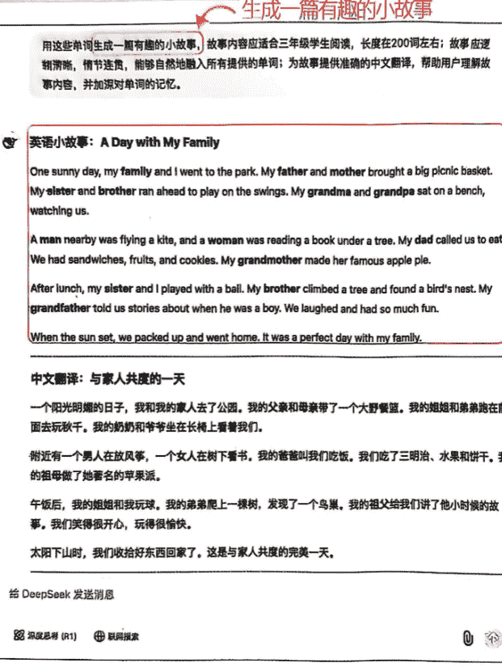

### 第三步，出题检验学习效果

DeepSeek 会根据已学词汇自动出 10 道选择题，检验掌握程度。每题都带答案和解析，方便查漏补缺，家长也能及时看到进展。

#### DeepSeek 提示词指令公式:


举例: 根据上面的单词生成 10 道选择题，题目应涵盖单词的不同用法和语境；题目应重点考查孩子对单词的理解和运用能力，而不只是单词的拼写或中文释义；为每道题目提供正确答案和详细解析，帮助孩子理解为什么某个选项是正确的，其他选项是错误的。

### 让 DeepSeek 成为孩子单词记忆的得力助手!

词汇是英语学习的基础，DeepSeek 凭借识别、故事化、测评三合一，让背词变得高效又有趣。无论是冲刺成绩还是培养兴趣，它都是家长值得信赖的教学工具。现在就上传词表，让孩子体验不一样的学习快感！借助 DeepSeek，单词不再是难题，英语水平也能稳步提升！

## 02 作业辅导更轻松：拍照解析 + 错题本自动整理

> 辅导作业是不是总让人精疲力竭？数学题讲不清、语文阅读抓不住重点、英语语法说不明……别让作业冲淡亲子关系。DeepSeek 化身 24 小时全能家教，拍照秒出解析、错题自动归类、知识点精准推送。三个实操案例，示范如何用 AI 把辅导变成亲子游戏，让孩子主动学习，家长也松口气。

### 案例1 数学应用题秒懂 —— 举一反三

痛点: 孩子卡在“鸡兔同笼”，家长讲十遍还是懵。

- ×错误提问:“鸡兔同笼怎么解？”

- ○结果: AI 直接给公式，孩子看不懂逻辑。

✓正确操作

用手机拍下练习册题目上传至 DeepSeek，再下指令：识别图中题目并给出解题思路。

#### 具体指令:

- 角色: 你是一名小学数学教学专家。

- 目标: 识别图中的题目（附图片略），分步骤给出解题思路，不要直接给出答案。

- 要求:

  1. 用“苏格拉底提问法”，引导孩子进行解题;

  2. 设计 3 道同类型变式题（如“三轮车 + 汽车停车问题”）;

  3. 输出错题卡模板（含口诀总结:“头当总动物，脚差除以 2”）。

#### 成果示例:

```
已深度思考（用时 17 秒）
一、“苏格拉底提问法”引导解题
问题1: “小朋友，笼子里有35个头，如果全是鸡的话，每只鸡有2只脚，那么总共有多少只脚呢？”
引导思考:
- 计算假设全为鸡时的脚数: 35 × 2 = 70（只）
问题2: “可是题目里说实际有94只脚，比我们假设的70只多了24只脚。你觉得为什么会多出24只脚呢？”
引导思考:
- 发现多出的脚是因为笼子里还有兔子（每只兔子比鸡多2只脚）。
```

### 案例2 语文阅读理解——情感分析 + 答题公式库

痛点：孩子答不出“作者想表达什么”，总是偏离主题。

- × 错误提问：“这篇《桂花雨》的中心思想是什么？”

- ○ 结果：AI 给出标准答案，孩子不懂思路。

- ✔ 正确操作

#### 具体指令：

角色：你是一名语文阅读理解拆解师。

目标：针对以下文章的内容（附图片略），训练孩子掌握情感分析模型。

#### 要求：

1. 标注关键词（如“踮起脚尖”“使劲摇晃”等动作及其所表达的情感）；

2. 用选择题形式引导思考（如 A. 怀念童年 B. 批评破坏环境的行为）；

3. 生成答题模板（情感 + 证据 + 总结三步法）。

#### 成果示例：

情感分析训练模板

一、关键词情感标注（示例）

假设原文段落：“小雨踮起脚尖，使劲摇晃着树枝，眼睛紧盯着枝头那颗红透的苹果。”

| 关键词 | 动作情感分析 | 上下文依据 |

|--------|--------------|------------|

| 踮起脚尖 | 渴望、努力（正向） | 为摘苹果而付出额外努力 |

| 使劲摇晃 | 迫切、焦虑（中性偏负） | 动作急躁，可能隐含破坏性 |

| 紧盯着 | 专注、执着（正向） | 体现目标的明确性 |

二、选择题引导思考

题目：小雨“踮起脚尖”和“使劲摇晃”树枝的行为，主要表达了什么情感？

A. 对果实的强烈渴望（正确答案）

B. 对树木的随意破坏（干扰项，未体现恶意）

C. 玩耍时的无忧无虑（偏离核心动作意图）

### 案例3 英语语法纠错——错题定位 + 游戏化练习

痛点: 孩子混用 “there be” 和 “have”，改正后仍反复出错。

- 错误提问: “there be 和 have 的区别是什么？”

- 结果: AI 罗列规则，孩子记不住。

#### 正确操作

具体指令:

- 角色: 你是一名英语游戏化教学设计师。

- 目标: 通过互动练习解决以下错题（附图片略）。

- 错题: There have a book on the desk.（错误）

- 要求:

  1. 设计 “语法警察” 小游戏（找出 5 处语句中的错误）；

  2. 生成口诀动画（“存在” 用 there be，“拥有” 用 have）；

  3. 推送 7 天渐进式练习计划（每日 5 题，错题的知识点重复强化）。

成果示例:

> 英语语法纠错游戏化教学方案

一、“语法警察”小游戏设计

场景与错误示例（找出5处错误并修正）：

1. 教室场景：

   - 错误句：There have many students in the classroom.

   - 正确句：There are many students in the classroom.

2. 厨房场景：

   - 错误句：On the table have some apples.

   - 正确句：There are some apples on the table.

辅导作业不必再是鸡飞狗跳，DeepSeek 的可视化解析、错题诊断、游戏化训练形成闭环，让孩子从被动听讲转向主动探索。AI 讲题时，家长只需在孩子恍然大悟的瞬间鼓掌。

## 03 英语作文批改“神器”：雅思考官级修改建议

> 英语作文辅导像解码？语法错误满地、词汇单一、结构凌乱……DeepSeek 扮演 24 小时雅思考官级外教，从纠错到句式升级，从同义词替换到逻辑优化。三个案例教你一键生成专业批改，让孩子写出地道作文，家长告别查字典。

### 案例1 语法纠错 + 趣味解析——让错误变成学习游戏

痛点: 孩子写 “I has a dog. It like eat meat.” 家长只会圈错，孩子不明白原因。

- × 错误提问: “请修改这篇作文。”

- ○ 结果: AI 直接给标准答案，孩子仍不懂主谓一致。

- ✓ 正确操作

- 具体指令:

  - 角色: 你是一名儿童英语语法教师。

  - 目标: 批改以下作文并设计互动练习（附照片略）。

  - 作文内容: I has a dog. It like eat meat. We often play together on park...

  - 要求:

    1. 指出语法错误，并标注错误类型;

    2. 设计 3 道选择题巩固知识点（如 “He __ a cat. A. have B. has”）;

    3. 生成 “语法警察” 小游戏: 找出 5 个生活场景中的错误句子。

#### 成果示例：

已深度思考（用时 21 秒）

### 一、作文批改（虚拟红笔标注）

1. I [has] a dog.

   错误类型：主谓不一致（第一人称单数应使用have）

   ✅修改：I have a dog.

2. It [like eat] meat.

   错误类型：①动词第三人称未加s ②不定式/动名词缺失

   ✅修改：It likes to eat meat. / It likes eating meat.

3. We often play together [on park].

   错误类型：介词误用 + 冠词缺失

   ✅修改：We often play together in the park.

### 案例 2 词汇升级引擎——告别 “very happy”

痛点: 孩子通篇用 “very happy” 表达开心，词汇贫乏。

❌错误提问: “替换作文中的重复词汇。”

○结果: AI 给出的高级词（如 ecstatic）超出孩子现阶段水平。

### ✔正确操作

#### 具体指令：

角色: 你是一名小学英语词汇拓展师。

目标: 优化以下句子的情感表达（附照片略）。

原句: I was very happy on my birthday. My friend DeepSeek were very happy too.

#### 要求:

1. 提供3个与句子内容相关的小学生适用词汇;

2. 设计“情感温度计”图表，标注词汇强度（happy → ★★★; joyful → ★★★★）;

3. 生成填空练习: “I felt ___ when I saw the surprise party.”

#### 成果示例：

> 情感升级工具箱：

三个魔法词汇

1. thrilled (激动不已的→★★★★★)

   例: I was thrilled when I saw the giant birthday cake!

2. overjoyed (欣喜若狂的→★★★★☆)

   例: My parents were overjoyed by my handmade card.

3. delighted (满心欢喜的→★★★★)

   例: We all felt delighted playing the treasure hunt game.

情感温度计图表设计

(图片建议: 纵向温度计图案, 用不同颜色标注情感强度)

happy → ★★★

cheerful → ★★★★☆

### 案例3 结构逻辑优化——从“流水账”到“五星作文”

痛点: 孩子作文结构松散．如 “I went to the zoo. I saw lions. I ate ice cream. I went home.”

- × 错误提问：“请改进这篇作文的结构。”

- ○ 结果：AI 重写全文，孩子无法理解修改逻辑。

### ✓ 正确操作

#### 具体指令：

- 角色: 你是一名英语作文架构师。

- 目标: 为以下作文添加逻辑连接词和细节描写（附照片略）。

- 原文: I visited grandma. We cooked dumplings. It was fun...

- 要求:

  1. 用 “First... Next... Finally...” 框架重构内容;

  2. 添加感官描写（如 “The dumplings smelled like fresh onions.”）;

  3. 输出写作思维导图（含 “人物 — 动作 — 感受” 分支）。

#### 成果示例：

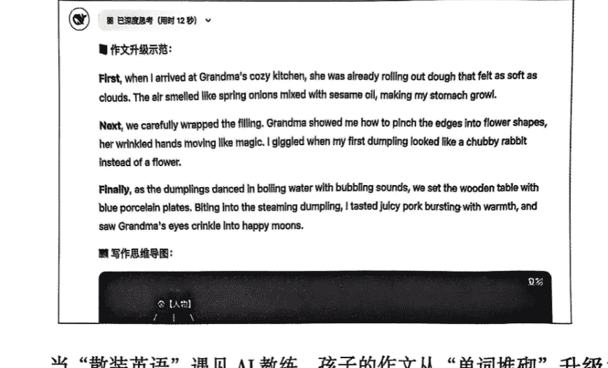

当“散装英语”遇见 AI 教练，作文从单词堆砌升级为地道表达。DeepSeek 的语法透视、词汇库、结构导航组合，让每个错误都成为进步台阶。放下红笔，让孩子在批注里看见成长——最好的辅导，是教会自我修正。

## 04 知识点记不住？那是因为不会思维导图自动生成术

> 信息爆炸时代，死记硬背已过时。本节教你用 DeepSeek 一键生成可视化思维导图，把零散知识点变成清晰记忆网。即使零基础的家长，也能通过三步指令，让孩子像搭积木一样记住古诗、公式、单词，告别“背了就忘”。

### 案例1 语文古诗记忆——用场景串联诗句

❌ 错误提问：“帮孩子背诵古诗《静夜思》。”

○ 问题：目标模糊，缺少记忆逻辑。

✔ 正确操作

• 目标：将《静夜思》转化为场景化思维导图，辅助理解记忆。

• 角色：小学语文教学设计师。

任务步骤：

- 提取诗中核心意象（明月、床、故乡）；

- 把意象串成连续场景（抬头望月→低头思乡）；

- 用生活化比喻解释抽象情感（如“思乡像牵着风筝的线”）。

约束条件：语言符合小学生认知，分支不超过5个。

具体指令：

你是一名小学语文教学设计师，请为《静夜思》设计一个思维导图，帮助孩子通过场景联想记忆诗句。要求：

1. 核心分支为“看到的景物”和“心里的感受”；

2. 用箭头连接场景变化（如“抬头望月→低头思乡”）；

3. 每个知识点配1个生活化比喻（如将“床前明月光”比喻为“睡前看到台灯”）。

输出格式：markdown 层级列表 + 简笔画描述建议。

成果示例：

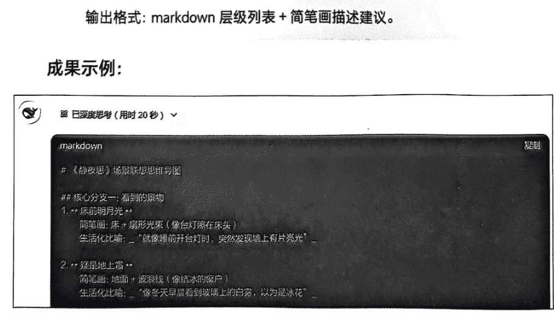## 复制 DeepSeek 生成的 markdown 代码，在电脑桌面新建一个 .txt 文档，将 markdown 代码复制到 txt 文档保存，右键点击将 .txt 后缀名修改为 .md，就得到一个 .md 格式的文件。

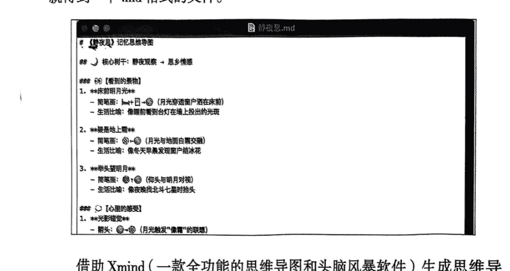

使用 Xmind 这款兼顾思维导图绘制与头脑风暴的软件来产出可视化图谱，首先前往 https://xmind.cn 下载安装客户端。


启动 Xmind 应用程序。


把《静夜思》.md 文档导入到编辑区。


执行一键生成功能，快速得到《静夜思》的导图。

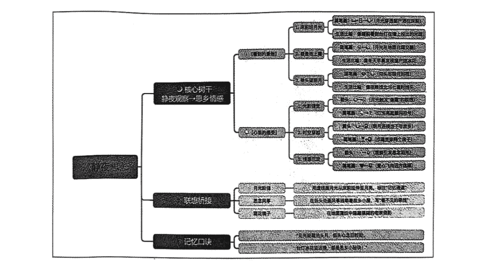

## 案例2 公式记不住？分类游戏建记忆网

- ✖ 提问失误：“长方形和三角形的公式怎样记忆？”
- ○ 症结：知识点零散，未做关联，记忆压力大。
- ✔ 更好做法
- ○ 目标：将几何公式整理成“形状家族”，用游戏化导图加深印象。
- 角色设定：数学游戏策划师。
- 执行清单：
  - 依据边数划分图形，如四边形、三角形；
  - 为每类编创押韵口诀；
  - 增加生活应用实例，如“丈量书桌周长”。
- 约束要求：口诀必须押韵，同类公式需对照呈现。

#### 操作提示：

请扮演数学游戏策划师，为小学生设计一份游戏化几何公式导图。

要求：

1. 以边数为线索分为“四边形”“三角形”两大分支；
2. 每个分支用儿童易懂的比喻说明周长与面积，例如把“面积=长×宽”说成“铺地砖”；
3. 加入“闯关实测”环节，用家里物品动手测量。

输出形式：对比表格 + 各关任务说明。

### 案例3 单词记不牢？主题网络串联词汇

- 错误提问：“孩子记不住动物类单词怎么办？”
- 问题：单词孤立背诵，缺少主题联想。
- 正确做法
- 目标：锁定核心主题，如动物园。
- 角色设定：英语情景设计师。
- 执行清单：
  - 确定核心主题，如动物园；
  - 按“动物→食物→动作”分层延展，如 lion → meat → roar；
  - 设计互动问答，如“老虎吃什么？会怎么叫？”
- 约束要求：每个单词配拟声词或肢体动作提示。

#### 操作提示：

请担任英语情景设计师，以“动物园”为主题制作单词记忆导图，要求：

1. 分层结构：动物名称→食物→叫声或动作；
2. 每个单词加入趣味记忆法，如“模仿老虎吼声记住‘roar’”；
3. 设计 3 个互动问答，便于亲子对话练习。

输出形式：树状图 + 表情符号标注 + 问答脚本。

#### 成果示例：

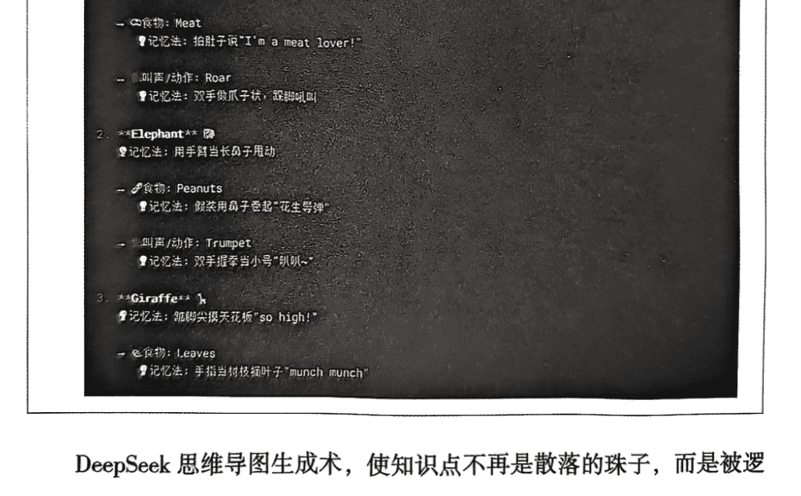

```
# 动物园单词记忆树

## 🦁 动物名称

1. **Lion** 🦁
   🧠记忆法：张大嘴模仿"roar~"的吼声，像国王戴皇冠

   - 🍖食物：Meat
     🧠记忆法：拍肚子说"I'm a meat lover!"

   - 🔊叫声/动作：Roar
     🧠记忆法：双手做爪子状，跺脚吼叫

2. **Elephant** 🐘
   🧠记忆法：用手臂当长鼻子甩动

   - 🥜食物：Peanuts
     🧠记忆法：假装用鼻子卷起"花生导弹"

   - 🔊叫声/动作：Trumpet
     🧠记忆法：双手握拳当小号"叭叭~"

3. **Giraffe** 🦒
   🧠记忆法：踮脚尖摸天花板"so high!"

   - 🌿食物：Leaves
     🧠记忆法：手指当树枝摘叶子"munch munch"
```

借助 DeepSeek 生成导图，能把零散知识用逻辑线和想象力串成项链。古诗的情感脉络、数学公式的规律城堡、单词的故事王国，都能在“边画边玩”中被小朋友牢固记住。工具为人所用，而不是人被工具牵着走，这才是 AI 时代学习的要义。

## 05 作文卡壳？三步把流水账变范文

孩子面对作文本发愁，家长看到千篇一律的“今天天气晴朗”也着急，作文辅导常成为亲子关系的隐形阻碍。本节介绍 DeepSeek 作文急救三阶段——找病灶、补细节、提文采，借助精准提示让父母化身作文教练，用三句指令把流水账改写成有画面、有逻辑的范文。

### 案例1 框架混乱——用“汉堡包结构法”重塑骨架

- ✖ 提问失误：“帮孩子改改这篇作文。”
- ○ 症结：提问过于笼统，AI 可能过度改写，让文章失去童趣。
- ✔ 更好做法：
  - ○ 目的：在保留《游乐园一日游》原意前提下诊断结构问题并优化框架。
  - ○ 角色设定：作文结构导师。
  - 执行清单：
    - 诊断：标出“开头冗长无重点、中间事件堆砌、结尾突兀”三大毛病。
    - 重构：套用“汉堡包结构法”——吸睛开头→3个关键事件→感悟结尾。
    - 对比：用新旧版本对照表说明修改思路。

#### 操作提示：

> 你担任作文结构导师，请用“汉堡包结构法”优化这篇作文。
> [粘贴原文]
> 要求：
> 1. 开头用“五感法”描摹环境，例如听到的尖叫、闻到的爆米花香；
> 2. 中间保留 3 个最有趣的事件，用“首先→其次→最后”串联；
> 3. 结尾写一句真实感悟，例如“原来勇敢就是手心冒汗还往前冲”。
> 输出形式：修改版并标注调整理由 + 家长辅导话术，例如可以问孩子：“玩过山车时手心什么感觉？”

### 案例2 内容单薄——用“五感放大镜”补足细节

- ✖ 提问失误：“这篇作文太短了，加点内容。”
- ○ 症结：AI 不知从何补充，易编造虚假细节。
- ✔ 更好做法：
  - ○ 目的：为《春天的公园》补充真实可感的细节。
  - ○ 角色设定：儿童写作教练。
  - 执行清单：
    - 定位：找出原文中抽象模糊的表述，例如“花很漂亮”；
    - 提问引导：准备 5 个具体观察问题，例如“花瓣什么形状？摸起来像什么？”；
    - 转换：把答案转成比喻句，例如“樱花像小裙子层层叠叠”。

#### 操作提示：

请担任儿童写作老师，为父母设计观察与引导方案。

作文主题：《春天的公园》

问题段落：“池塘边有很多花，很好看……”

要求：

1. 列出 5 个探索性问题，例如观察颜色、形状、触感、寻找参照物；
2. 把答案转化为比喻句，例如“___像___”；
3. 输出亲子互动指南“带放大镜到公园实地验证”。

#### 成果示例：

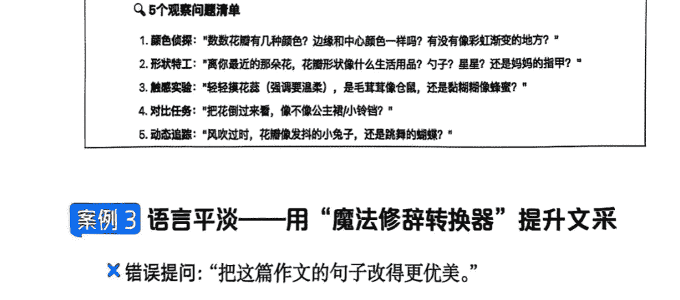

### 案例3 语言平淡——用“魔法修辞转换器”提升文采

- 错误提问：“把这篇作文的句子改得更优美。”
- 问题：AI 难以把握“优美”标准，易写出成人化表达。
- 正确做法
- 目标：把《我的妈妈》中的平淡叙述改写成充满童趣的描写。
- 角色设定：儿童语言设计师。
- 执行清单：
  - 锁定：找出可改写的陈述句，例如“妈妈很勤劳”；
  - 转换：用“比喻+动作”改写，例如“妈妈像旋转的陀螺，做饭时铲子像跳舞，拖地时水花似唱歌”；
  - 分级：提供低年级版 6～8 岁和高年级版 9～12 岁两种表达。

#### 操作提示：

请以儿童语言设计师的身份，把下面句子的表达改得更生动且适合小学生阅读。

> 原句：“妈妈每天做很多家务。”

要求：

1. 用比喻句带拟声词呈现；
2. 按年龄分层输出，低年级用简单比喻，高年级用复合修辞；
3. 增加写作小游戏“家务声音猜猜猜”，根据描述猜家务及动作。

作文不是好词好句的堆砌，而是孩子观察世界的放大镜。

借助 DeepSeek 的结构诊断器、细节放大镜、语言魔法棒，父母不必纠结怎么教修辞，而是陪孩子从生活点滴里体会写作乐趣。

当 AI 只是提问引导者而非代笔枪手，作文辅导才回归本质：让每个孩子能自信地说“这是我的眼睛看到的世界”。

## 06 数理化难题卡住？双引擎拆解与举一反三

孩子对着数学几何题咬指甲、对着物理力学题挠头，父母往往束手无策。本节介绍 DeepSeek“双引擎法”——快速拆解难题并生成同类变式题，父母不用重学数理化，靠三步提问就能变身解题伙伴。让看懂答案变成教会孩子，让单题突破变成举一反三。

## 案例1 数学几何题——用“问题拆解术”突破盲区

- ✖ 问法失误：“这道几何题怎么解？”
- ○ 症结：信息不足，AI 难以针对性指导。
- ✔ 更好做法
  - 目的：拆解“平行四边形面积计算”难题，引导孩子自主推导公式。
  - 角色设定：数学思维引导师。
  - 执行清单：
    - 定位卡点：识别孩子解题中的错误环节，例如“混淆底与高”。
    - 可视化推导：用图形切割法演示公式来源。
    - 变式训练：生成 3 道陷阱题。
  - 操作提示：
    - 请担任数学思维引导师，为父母设计“计算平行四边形面积”的辅导方案。
    - 原题：底为 8 厘米、高为 5 厘米的平行四边形面积是多少？

#### 要求：

1. 用“剪拼法”做动画式步骤说明，例如“把剪下的三角形平移，让平行四边形变成长方形”；
2. 设计 2 个有深度的提问，例如“底不变角度变大，高会变吗？”“不用尺子，如何用跳绳量出高？”；
3. 生成变式题，已知平行四边形底 12 厘米、斜边 10 厘米，求最大可能面积。

输出形式：分步图解描述 + 亲子互动问答 + 变式题答案并提示思维陷阱。

#### 成果示例：

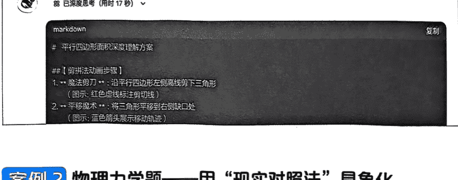

```
# 平行四边形面积深度理解方案

## 【剪拼法动画步骤】
1. **魔法剪刀**：沿平行四边形左侧高线剪下三角形
   （图示：红色虚线标注剪切线）
2. **平移魔术**：将三角形平移到右侧缺口处
   （图示：蓝色箭头展示移动轨迹）
```

### 案例2 物理力学题——用“现实对照法”具象化抽象概念

- ✖ 问法失误：“这道与浮力有关的题怎么给孩子讲？”
- ○ 症结：脱离生活，孩子难理解公式。
- ✔ 更好做法
  - 目的：用生活实验解释“浮力公式：F浮 = ρ水V排g”，并设计探究任务。
  - 角色设定：物理实验设计师。
  - 执行清单：
    - 现实锚点：对比橡皮泥沉底与船漂浮。
    - 公式具象化：用“水被排开的阻力”替代抽象公式。
    - 家庭实验：用矿泉水瓶制作简易浮力秤。

#### 操作提示：

请担任物理实验设计师，为父母设计浮力公式教学方案。

要求：

1. 设计 2 个家庭实验，例如“橡皮泥造型沉浮对比”；
2. 用“水卫士推船”作比喻解释公式；
3. 生成 3 道变式题，例如“计算西瓜漂浮时排水量”。

输出形式：实验步骤含材料清单与安全提示 + 比喻故事 + 变式题带答案与讲解重点。

#### 成果示例：


### 案例3 化学方程式——用“积木拼接法”破解配平难

- ✖ 问法失误：“这个化学方程式怎么配平？”
- ○ 症结：AI 直接给答案，孩子学不会方法。
- ✔ 更好做法
  - 目的：把“铁与硫酸铜反应”的配平过程变成积木游戏。
  - 角色设定：化学教育专家。
  - 执行清单：
    - 原子可视化：用积木代表不同原子。
    - 左右天平法：设计“原子银行”借贷规则。
    - 陷阱挑战：生成易错方程式，例如含氧奇数配平。

#### 操作提示：

请以化学教育专家的身份，为 Fe + CuSO₄ → FeSO₄ + Cu 的常温置换反应设计配平教学方案。

要求：

1. 用“积木数量守恒”作比喻讲清配平逻辑；
2. 设计配平闯关游戏“初始给 5 个铁原子，怎样交换才平衡？”；
3. 生成 2 个常见错误配平案例，让孩子扮演“方程式医生”纠错。

输出形式：游戏规则 + 纠错训练题 + 父母反馈话术，例如“你发现哪里的原子失踪了？”

学习数理化不是追求正确答案的竞赛，而是理解世界的思维训练。通过 DeepSeek 双引擎构建知识网络，父母无需成为解题高手，只需掌握提问艺术。当孩子开始用“为什么排水量决定浮力大小”思考，而非死记 F_浮 = ρ_水 V_排 g 时，科学思维才算扎根。

## 07 背书效率低？形象转化助你过目不忘

背书不是记忆力比拼，而是想象力的冒险。本节介绍 DeepSeek“记忆宫殿法”——把枯燥字母变成“恐龙战场”“太空基地”“巧克力工厂”的故事碎片。定制专属记忆地图，每天 15 分钟故事闯关，500 个单词就能像动画角色一样留在脑海。再也不用卡在“abandon”上了。

### 案例1 英语单词——用“恐龙星球”串联词根词缀

- **错误方法**
  - 机械抄写：apple、banana 重复 20 遍。
  - 问题：孤立记忆，遗忘率超 70%。
- **正确做法**
  - 目的：用侏罗纪公园场景绑定 50 个动物相关单词。
  - 角色设定：儿童英语编剧。
  - 执行清单：
    - 场景设定：恐龙星球分“火山口 V 开头单词”“沼泽地 S 开头单词”等区域。
    - 故事锚点：T-Rex 撕咬 vegetable，Stegosaurus 甩尾扫过 swamp。
    - 复习游戏：根据单词拼写“解救”被困恐龙。

#### 操作提示：

请以儿童英语编剧的身份，以“恐龙星球”为主题设计“单词记忆宫殿”。目标词：vegetable, swamp, fossil, volcano…共 50 个。

要求：

1. 按首字母划分冒险区域，例如 V 区包含 volcano；
2. 每个单词编入恐龙互动剧情，例如“T-Rex 偷吃 vegetable”；
3. 设计 3 个复习问题，例如“哪只恐龙守护 fossil？”

输出形式：场景地图 + 故事脚本 + AR 互动提示，例如“扫描单词触发恐龙动画”。

## 案例2 语文古诗——用“时空穿梭机”具象化抽象意境

- ✖ 错误方法
  - 逐句背诵：“日照香炉生紫烟，遥看瀑布挂前川……”易混顺序。
- 问题：文字脱离画面，线索单一。
- ✔ 正确做法
  - 目的：把《望庐山瀑布》变成 VR 登山体验。
  - 角色设定：研学活动策划师。
  - 执行清单：
    - 路径设计：山脚日照香炉→山腰遥看瀑布→山顶飞流直下。
    - 多感官绑定：水声对应“挂前川”，水雾对应“生紫烟”。
    - 闯关挑战：按诗句排列景点照片，强化记忆路径。

#### 操作提示：

请担任古诗研学活动策划师，为《望庐山瀑布》设计“记忆宫殿”。

要求：

1. 把 4 句诗转为登山的 4 个打卡点，配动作指令如“仰头望”；
2. 每个点绑定感官记忆，例如“第三句张开双臂感受水雾”；
3. 生成“诗句碎片寻宝图”，打乱碎片卡，让孩子按游览顺序复原。

输出形式：登山地图 + 动作指令表 + 亲子游戏规则。

### 案例3 数学公式——用“魔法商店”破解符号密码

- ✖ 错误方法
  - 死记硬背：(a+b)²=a²+2ab+b²，易漏 2ab。
- 问题：公式无意义，难长期记忆。
- ✔ 正确做法
  - 目的：用“魔法商店”购物故事记忆代数公式。
  - 角色设定：数学魔法师。
  - 执行清单：
    - 符号转化：a=苹果，b=香蕉，²=魔法放大镜。
    - 剧情绑定：(a+b)²=苹果+香蕉被放大镜照出“隐藏的 2ab 精灵”。
    - 纠错任务：故意摆错商品，让孩子扮演“公式警察”。

#### 操作提示：

请担任数学魔法师，把数学公式转化为“魔法商店”剧情。

目标公式：(a+b)²=a²+2ab+b²、a²-b²=(a+b)(a-b)。

要求：

1. 用商品交易比喻公式推导，例如“融合物品产生新物种”；
2. 设计咒语口诀，例如“平方和、精灵多、2ab 别忘躲”；
3. 制作“错乱货架”练习题，例如故意漏掉 2ab。

输出形式：商店平面图 + 剧本 + 纠错任务卡。

#### 成果示例：

### 🏪商店平面图

| 区域 | 设施 | 功能 |
| :--- | :--- | :--- |
| ▶融合工坊 | 水晶熔炉 | 处理$(a + b)^2$合成 |
| | 配方墙 | 动态演示$a^2 + 2ab + b^2$ |
| ▶分解密室 | 棱镜分解台 | 处理$a^2 - b^2$ |
| | 悬浮显示 | $(a + b)(a - b)$裂变动画 |
| ▶错乱货架 | 货品标签 | 故意缺失元素 |
| | 魔法修正墨水笔 | 配备纠错工具 |

### 📜魔法剧本《变形法则的传承》

**第一幕：融合法则**

店主：“想要合成‘知识果实’？把苹果$a$与书本$b$投入熔炉，念诵——”

学徒操作：

```
$(🍎 + 📖)^2 = 🍎^2 (苹果核) + 2 × 🍎📖 (果肉书页) + 📖^2 (智慧树苗)$
```

咒语：

“平方和，精灵火，双倍交织结硕果！”

特效：熔炉迸发双螺旋光带，缺少$2ab$时果实枯萎

**第二幕：分解禁术**

店主：“这块‘黄金方块$a^2$’被黑暗$b^2$侵蚀，需用棱镜分离——”

学徒操作：

记忆的运作逻辑，归根到底是把新信息挂靠到已有认知上。把英语词汇联想成恐龙图鉴的条目，把古典诗词当成探险路线图，把数学公式比作炼金术的秘方，死记硬背的痛苦就会被主动探索的乐趣取代。借助 DeepSeek 打造的记忆宫殿训练法，三十天内记下五百词只是入门级的成果，更核心的回报是孩子养成了持续的好奇驱动力和不受拘束的联想能力。

## 第七章

https://www.deepseek.com

## 生活焕新：用 DeepSeek 激活全能技能


给 DeepSeek 发送消息
深度思考 (R1) 联网搜索

## 用 DeepSeek 五步搭建省心行程

出门规划往往比上班更费神，翻遍全网仍难逃照骗陷阱。熬夜拼凑线路，到头来被现实打乱，旅行变成了高压打卡，只剩下酸痛疲惫。换一种打法，让 DeepSeek 担任 24 小时智能旅行管家，五步即可产出省钱又好玩的定制路线，告别信息过载。此后每一次出行都多一份惊喜。

### 老派攻略为何让人疲惫

爱旅行的朋友对攻略的痛点都很熟悉。

- 社交平台笔记堆积如山，收藏上百篇最后发现过期或带软广；
- 反复比价住宿机票，眼睛花又耗神；
- 线路排得过满，一天暴走三万步直接崩溃；
- ……

DeepSeek 的管家模式，只需五步就能输出个性化、实时更新、预算可控的方案。三个实操场景带你逐步上手这项黑科技。

### 场景一 家庭亲子游：上海迪士尼＋周边慢玩

- 痛点：带 5 岁小孩和 60 岁父母去上海迪士尼度假区，既要满足孩子玩乐欲，又要兼顾老人舒适度。
- 错误提问：“上海迪士尼度假区游玩攻略。”
- 结果：仅罗列热门项目，忽略 1.2 米以下儿童身高限制和老人休憩区等关键信息。

### ✔ 正确做法

#### 操作示例：

- 扮演：亲子旅行策划顾问。
- 要完成的事：为上海 3 天 2 夜家庭亲子行程出方案，迪士尼 1 天、市区休闲 2 天。
- 情境：5 岁男孩，偏爱艾莎公主；60 岁父母，体力一般。
- 呈现方式：按日期列出景点、交通、餐饮，并标注儿童/老人友好度。
- 硬性要求：
  1. 迪士尼项目须适合身高 1.2 米以下儿童；
  2. 市区景点间车程不超过 30 分钟；
  3. 总花费控制在 1 万元以内，含住宿。

### 场景二 户外徒步：川西秘境探险

- 痛点：独自徒步稻城亚丁，安全和细节考虑不足，影响进度与风险控制。
- 错误提问：“到稻城亚丁徒步要注意什么？”
- 结果：仅给通用安全提醒，未提供具体海拔数据和装备品牌建议。

### ✔ 正确做法

#### 操作示例：

- 扮演：户外探险求生专家。
- 要完成的事：制定稻城亚丁 9 月中旬 5 日重装徒步计划。
- 情境：单人无向导，首次挑战高海拔。
- 呈现方式：分为“装备清单”“每日路线”“应急预案”三部分。
- 硬性要求：
  1. 标注海拔变化与徒步时长；
  2. 推荐抗高原反应药物及服用方式；
  3. 装备总重不超过 15 千克。

### 场景三 美食文化游：48 小时吃遍长沙

- 痛点：网红店排队 2 小时，错过真正地道味道。
- 错误提问：“长沙美食推荐。”
- 结果：给出茶颜悦色、文和友等人气店铺，人满为患体验差。

#### 正确做法

#### 操作示例：

- 扮演：长沙本地美食博主。
- 要完成的事：规划周末 2 天“非网红”美食路线。
- 情境：避开排队，体验市井老店。
- 呈现方式：按早中晚夜宵时段排程，并附行动路线。
- 硬性要求：
  1. 人均每日消费低于 100 元；
  2. 标注店史，优先 10 年以上老店；
  3. 推荐搭配美食如解辣饮品或小吃。

### 通用五步法：告别出行焦虑

步骤拆解：

- 一、先确定身份：旅行策划师、户外探险专家、美食博主等。
- 二、说明需求：人数、天数、偏好如拍照优先、重吃等。
- 三、设定边界：预算、交通、忌口如不吃辣、恐高。
- 四、要求结构：输出行程表、地图、清单等结构化内容。
- 五、补充细节：补充实时天气、节庆活动等。

DeepSeek 的进阶用法：

- 比价推荐：直接问“7 月 15 日北京飞大阪最便宜的航班”。
- 智能纠偏：行程过满时提醒“某景点排队需 2 小时，建议调整”。
- 本地洞察：推荐小众宝藏店并附店家故事。

DeepSeek 正让出行更自由。它能帮你避开人挤人的景点，发现小众好去处，把“常踩坑”变成“轻松避雷”。它不只是工具，更像懂你的旅伴，既能给出最优路线，又保留旅行的随性浪漫。立即按文中方法做出你的攻略。

#### 行动指南：

- 复制案例模板，将目的地替换为你的目标地；
- 在 DeepSeek 输入指令，生成专属攻略；
- 出行前一天追加提问“××景点最新开放情况”。

## 02 营养师增收密码：AI 驱动个性化服务

> 营养师的痛点你懂吗？定制方案耗时耗力、客户留存难、增值服务难突破……AI 时代，专业价值不应被重复劳动消耗。DeepSeek 可化身 24 小时智能营养顾问，快速生成精准膳食方案、实时跟进客户数据并自动产出专业报告。下文 3 个案例教你实现效率翻倍、收入翻倍。

### 场景一 迅速生成个性化饮食方案

- 痛点：人工制单效率低，难以应对复杂需求。
- 错误提问：“为糖尿病患者设计一周食谱。”
- 结果：输出通用低 GI 食谱，忽略个体差异。
- 正确做法

#### 操作示例：

扮演：三甲医院临床营养师。
要完成的事：为 58 岁 2 型糖尿病男性患者、肌酐偏高、忌海鲜，设计 7 天控糖食谱。
情境：目标 HbA1c 降至 6.5%，每日运动 30 分钟。
呈现方式：分早中晚加餐，标注每餐热量、碳水、蛋白质。
硬性要求：
1. 优质蛋白以禽类、豆制品为主；
2. 附 3 条烹饪技巧，如低盐调味法。

成果示例：

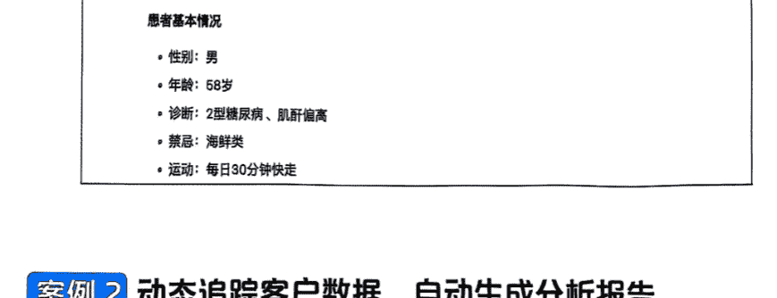

### 场景二 动态跟进客户数据，自动生成分析报告

- 痛点：手工整理数据易错，难以快速洞察健康趋势。
- 错误提问：“分析客户体重变化。”
- 结果：仅说“体重下降 2 千克”，缺乏深度关联。

### ✔ 正确做法

#### 操作示例：

扮演：健康数据分析师。
要完成的事：基于客户 3 个月数据（体重、腰围、血糖、饮食记录），分析减脂平台期原因。
情境：35 岁女性，前 2 个月减重 4 千克，第 3 个月停滞。
呈现方式：分“代谢分析”“饮食问题”“运动建议”三部分。
硬性要求：
1. 用折线图呈现血糖与碳水摄入关系；
2. 给出 2 条易执行且具突破性的建议；
3. 语言通俗，避免专业术语。

### 场景三 打造高溢价增值服务，提升客单价

- 痛点：传统咨询天花板低，难以差异化竞争。
- 错误提问：“设计营养师付费产品。”
- 结果：建议“定制食谱包”，竞争力不足。

### ✔ 正确做法

#### 操作示例：

扮演：健康顾问。
要完成的事：为高端孕产妇设计月子营养服务产品包。
情境：目标客单价 5000 元/月，需体现专业与稀缺。
呈现方式：分“服务内容”“定价策略”“推广文案”三部分。
硬性要求：
1. 融合中医食疗理念，如分体质调理；
2. 增加“产后心理营养”等差异化模块；
3. 提供 3 套朋友圈种草文案模板。

#### 成果示例：

## 高端月子营养服务产品包

核心价值：中医体质调理×细胞级营养修复×心理能量滋养

### 一、服务内容设计

| 模块 | 服务项目 | 稀缺性体现 |
|---|---|---|
| 中医食疗定制 | ① 九型体质测评（望闻问切四诊仪）<br>② 节气药膳（如寒露润肺雪梨盅）<br>③ 经络药浴包 | 非遗传承人监制药方 |
| 精准营养干预 | ① 母乳成分分析定制补剂<br>② 代谢组学检测（100+营养指标）<br>③ 细胞抗衰饮 | 三甲医院营养科联合研发 |

当同行还在手工计算热量时，你已用 DeepSeek 搭建起“精准方案+数据追踪+高端服务”的闭环。AI 不会取代你，而是放大专业价值，从一对一咨询转向一对多服务，从体力活转向专业变现。

## 03 用“AI 财务管家”实现省钱自由

> 工资到账一周清零？账单算不清？别担心，你不是孤例。很多职场新人卡在收入与负债的循环里。DeepSeek 可成为 24 小时 AI 财务管家，用 3 个案例教你轻松管钱，告别月光，让每一分钱都发挥效用。

### 场景一 快速生成智能账单，告别糊涂消费

痛点：手动记账坚持不过 3 天，永远不知道钱花去哪。
错误提问：“帮我分析这个月开支。”
结果：仅列总支出，缺乏分类与建议。

#### 正确做法

#### 操作示例:

- 扮演：资深财务规划师。
- 要完成的事：分析过去 30 天微信支付宝账单（模拟数据见下），找出不合理消费。
- 情境：月收入 6000 元，目标存款 1000 元/月。
- 呈现方式：分“必要支出”“冲动消费”“隐形浪费”三类，用表格对比。
硬性要求：
1. 标注 3 项可立即削减的非必要开支；
2. 给出替代方案，如“自带咖啡每天省 30 元”。

模拟账单片段:

- 外卖奶茶: 12 笔，共 480 元。
- 直播间购物: 8 笔，共 1200 元。
- 共享单车月卡: 25 元。
- 健身房季卡: 799 元（未使用）。

成果示例:

30 天消费分析报告（基于模拟数据）

月收入: 6000 元 | 目标存款: 1000 元 | 实际可支配: 5000 元

| 分类 | 消费项 | 金额 | 占比 | 问题诊断 |
|------|--------|------|------|----------|
| 冲动消费 | 直播间购物 | 1200 元 | 20% | 非计划消费，多为低效支出 |
| 冲动消费 | 外卖奶茶 | 480 元 | 8% | 高频小额消费成钱包刺客 |
| 隐形浪费 | 健身房季卡（未使用） | 799 元 | 13.3% | 闲置服务等于资金沉没 |

### 场景二 破解“拿铁因子”，一年省下上万元咖啡钱

痛点：小钱不知不觉流失，月底才后怕。
错误提问：“怎么省钱？”
结果：给出“少喝奶茶”等空泛建议，缺乏可操作性。

### ✔ 正确做法

#### 操作示例：

- 扮演：极简消费顾问。
- 要完成的事：设计“拿铁因子”消除计划，月省 2000 元。
- 情境：
  1. 每日买咖啡花费 35 元；
  2. 每周便利店随机消费 150 元；
  3. 视频平台每月自动续费 4 笔，共 80 元。
- 呈现方式：分“替代方案”“习惯培养”“进度追踪”三部分。
- 硬性要求：
  1. 提供具体执行清单；
  2. 设计 21 天打卡挑战模板；
  3. 计算复利收益，按年化 5% 计算。

### 场景三 500 元启动“钱生钱”，小白也能赚早餐费

痛点：以为理财需大额资金，错过碎片资金红利。
错误提问：“怎么用 500 元理财？”
结果：推荐高风险股票，不符合小白需求。

### ✔ 正确做法

#### 操作示例：

- 扮演：低风险理财经理。
- 要完成的事：为月投 500 元的小白设计“保本+增值”组合。
- 情境：可接受年化收益 3% 以内，拒绝亏损。
- 呈现方式：分“货币基金”“指数基金定投”两类说明。
- 硬性要求：
  1. 标注操作平台如支付宝等；
  2. 附操作截图指引（虚拟生成）；
  3. 对比活期存款收益。

从月光焦虑到掌控每一分钱，只需一个 AI 财务管家。DeepSeek 生成的智能账单+消费管控+碎片理财组合拳，助你实现每月存 1000 元、一年省下五位数。

## 04 选择困难？一键出对比报告，快速做出明智决策

> 下单前刷遍测评仍纠结？花 3 小时比价最后盲选？别担心，选择困难只是缺 AI 助力。用 DeepSeek 做购物决策大脑，3 分钟生成参数、口碑、性价比的全景报告，告别买完就后悔。下面 3 个案例教你科学战胜纠结。

### 场景一 手机选购“终结者”——参数党 vs 体验党

- 痛点：纠结 iPhone 15 还是华为 Mate 60，不懂参数怕踩坑。
- 错误提问：“iPhone 15 和华为 Mate 60 哪款好？”
- 结果：输出笼统优缺点，无法解决具体需求。

### ✅ 正确做法

#### 操作示例：

扮演：数码测评博主。
要完成的事：对比 iPhone 15 与华为 Mate 60，推荐更合适机型。
情境：
1. 主要用途拍照（人像+夜景）、看剧、游戏；
2. 预算 6000 元，希望使用寿命 3 年以上。
呈现方式：分“核心参数”“场景实测”“长期使用”三部分。
硬性要求：
1. 用表格对比芯片、屏幕、电池等关键数据；
2. 附真实用户差评反馈如发热、信号差；
3. 给出保值率参考，3 年后残值预估。

#### 成果示例：

iPhone 15 vs 华为 Mate 60 深度横评（6000 元档三年用机指南）

| 项目 | iPhone 15 | 华为 Mate 60 |
|------|-----------|-------------|
| 芯片 | A16 仿生（4nm） | 麒麟 9000S（7nm） |
| 屏幕 | 6.1" OLED 60Hz | 6.69" OLED 120Hz LTPO |
| 电池 | 3279mAh+20W 快充 | 4750mAh+66W 快充+50W 无线 |
| 信号 | 高通 X70 基带（无 5G 射频优化） | 灵犀通信+北斗卫星消息 |
| 系统 | iOS 17（5 年系统更新） | HarmonyOS 4.0（3 年更新承诺） |

### 场景二 读懂护肤品成分，避免花冤枉钱

- 痛点：全网爆款修护面霜哪家强？怕过敏又怕浪费钱。
- 错误提问：“雅诗兰黛、珂润和薇诺娜 3 款面霜哪款好用？”
- 结果：仅罗列官方功效，无成分对比与真实反馈。

### ✓ 正确做法

#### 操作示例：

扮演：成分分析专家。
要完成的事：对比雅诗兰黛、珂润、薇诺娜 3 款适合敏感肌面霜。
情境：
1. 肤质：混干敏感肌，换季易泛红；
2. 诉求：修复屏障、成分安全、性价比高。
呈现方式：分“成分解析”“实测反馈”“性价比”三部分。
硬性要求：
1. 标注致敏成分如酒精、香精等；
2. 引用真实用户口碑；
3. 按每毫升价格由高到低排序。

#### 成果示例：

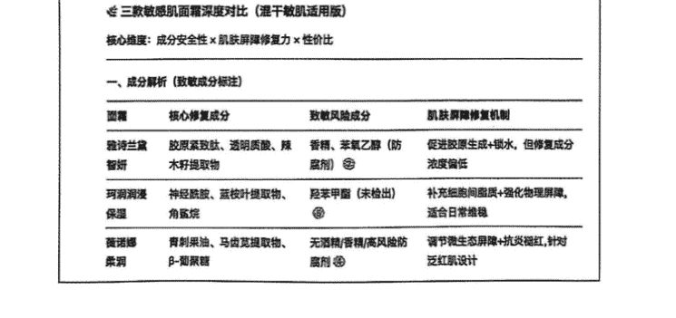

### 场景三 家电选购“防坑”指南——识破参数陷阱

- 痛点：洗衣机洗涤量 10 千克和 10 公斤是否一样？听不懂导购话术。
- 错误提问：“小天鹅洗衣机和海尔洗衣机哪款好？”
- 结果：仅列品牌历史，无核心参数对比。

### ✓ 正确做法

#### 操作示例：

扮演: 家电工程师。
要完成的事: 对比小天鹅 TG100V88WMUIADY5 滚筒洗衣机和海尔 EG100MATE8SU1 滚筒洗衣机。
情境：
1. 家庭人口 3 人；
2. 洗涤频率每周 4 次；
3. 需求：洗净率高、静音、省水。
呈现方式: 用表格对比洗净比、噪音值、能耗等级等关键参数。
硬性要求：
1. 解释专业术语如“1.08 洗净比”；
2. 拆解商家套路如“智能投放是否实用”；
3. 给出故障率数据如售后投诉率对比。

#### 成果示例：

| 项目 | 小天鹅TG100V88WMUIADY5 | 海尔EG100MATE8SU1 |
|------|------------------------|--------------------|
| 洗净比 | 1.08 (超国标洗净比基线1.03) | 1.1 (行业第一梯队) |
| 噪音值 | 46dB (脱水) → 图书馆级静音 | 49dB (脱水) → 正常对话声 |
| 能耗 | 1级能效 (年耗电120度) | 1级能效 (年耗电115度) |
| 用水量 | 54L/次 | 49L/次 (循环喷淋技术) |

### 二、专业术语解读

- 洗净比 (国标实验值)
  - 1.08 vs 1.1 差异：实验室条件下，海尔比小天鹅多洗净约 2% 的咖啡渍 (等效多搓揉 30 秒)
  - 实际体验：日常衣物清洁差距微弱，重度污渍建议预涂处理
- 智能投放套路拆解
  - 小天鹅 “I-Smart投放”：需手动选择水质硬度 (北方用户易误操作)
  - 海尔 “双智能投放”：洗涤剂/柔顺剂分仓但共用传感器 (可能错判用量)

从选择困难到决策高手，只差一个 AI 助理。DeepSeek 的参数对比+口碑挖掘+防坑预警组合，3 分钟搞定选择困难，碾压 3 小时无效搜索。

## 05 装修“防坑”指南：报价单智能诊断 + 质疑话术库

装修监理交给AI，告别隐形坑位

装修过程令人焦虑，清单里的明细晦涩难懂，施工方的说辞层层递进，一开口谈砍价就被“行业惯例”堵住。好不容易准备好的新居，绝不愿被坑位毁掉。把DeepSeek当作专属监理，按下面三组实操练习推进：迅速识破报价暗坑、即时产出质疑话术、让隐藏费用无处藏身。用钱更踏实，每一笔都花在该花的地方。

### 案例1 水电改造避坑——揪出单价虚高
- 困扰：自家水电预算比邻居高出两万，却说不清管线、开槽等分项是否合理。
- 常见提问：“帮我看看这份水电报价有没有问题。”
- 常规反馈：AI多半只给“建议对照市场价”的泛泛回复，没有具体拆解。
- 更优解

#### 具体指令
角色：你是一名从业十年的装修经理。
目标：对下面水电改造报价的合理性做诊断。
背景信息：套内80平米新房，报价总额3.8万元。
输出格式：分“单价对照”“工程量疑点”“议价思路”三块呈现。
限制条件：
1. 以2025年武汉市场均价为基准对比：线管35元/米，开槽15元/米；
2. 指出虚高项，例如“地面找平重复计费”；
3. 给出两条可直接使用的质疑话术，并引用相关规范条文。
报价片段：
- 强电布线：45元/米，预估600米
- 弱电布线：40元/米，预估200米
- 墙面开槽：20元/米，预估300米
成果示例：
| 项目 | 报价单价 | 市场均价 | 价差率 | 问题定位 |
|------|----------|----------|--------|----------|
| 强电布线 | 45元/米 | 35元/米 | +28.5% | 超出市场价，包工包料应<40元/米 |

### 案例2 拆墙砌墙陷阱——识别重复计费
- 困扰：拆除旧墙和新建墙体分开列项，怀疑存在“拆了再建”的重复收费。
- 常见提问：“拆墙、砌墙的报价合理吗？”
- 常规反馈：AI难以及时定位问题，建议过于笼统。
- 更优解
具体指令：
- 角色：你是一名装修审计师。
- 目标：判断下面拆砌墙报价是否存在重复收费。
- 背景：二手房改造，拆除原厨房隔墙后重建。
- 输出格式：用表格对比项目、工程量、合理成本。
- 限制条件：
  1. 参照《房屋建筑与装饰工程工程量计算规范》（GB50854—2013）；
  2. 标注“拆除+新建”是否应合并计价；
  3. 提供两条引用规范条文的质疑话术。
报价片段：
- 拆除轻体墙：80元/m²，20m²
- 新建轻体墙：180元/m²，20m²
- 垃圾清运费：1500元，整体
成果示例：
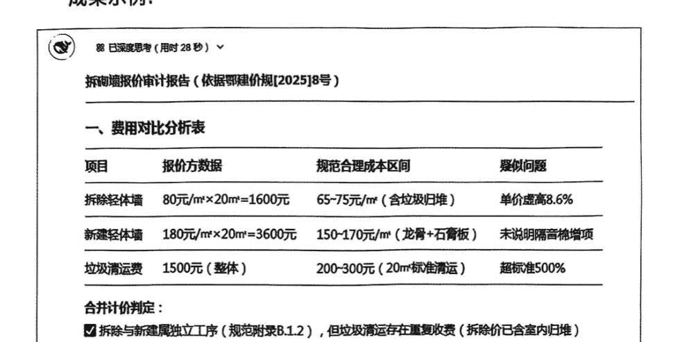
## 案例 3 全屋定制套路——隐藏费用全梳理
- 困扰：定制衣柜报价5万元，担心铰链、拉篮等配件另收钱。
- 常见提问：“全屋定制要注意什么？”
- 常规反馈：AI给出常规提醒，缺乏针对性避坑指南。
- 更优解
具体指令：
- 角色：你是一名全屋定制工厂质检员。
- 目标：诊断下面报价单是否存在隐藏费用。
- 背景：投影面积25m²，套餐价699元/m²，总价17475元。
- 输出格式：分为“套餐陷阱”“增项预警”“话术反击”三部分。
- 限制条件：
  1. 对比2025年武汉主流品牌套餐明细，含铰链、导轨品牌；
  2. 标注可能加价项，如见光板、收口条等；
  3. 生成四条合同补充条款，例如明确五金使用品牌。
报价片段：
- 套餐包含柜体+基础五金，未注明品牌
- 增项预估价：见光板380元/m²、拉篮800元/个
成果示例：
全屋定制报价单审计报告（武汉2025版）
| 对比维度 | 本报价 | 武汉主流品牌（欧派/索菲亚） |
|----------|--------|-----------------------------|
| 铰链品牌 | 未注明，疑似杂牌 | 百隆/海蒂诗基础款 |
| 导轨类型 | 未注明，可能三节滚珠 | 托底缓冲导轨，承重45kg以上 |
| 板材厚度 | 未标注背板厚度 | 标配9mm背板，部分品牌赠18mm升级 |

从装修新手到反套路高手，只需要一个“AI装修管家”。DeepSeek的“报价诊断+话术生成+合同审核”三件套，能帮你轻松省下冤枉钱。

## 06 反复减重？AI定制30天蜕变计划
减重失败往往不是意志力问题。单靠节食容易反弹，单靠运动又太枯燥。大多数人输在“一刀切”上。DeepSeek化身AI私人健康教练，用科学算法匹配体质，为你定制30天可执行减脂方案。本节用三个案例教你掌握“好坚持、可追踪、有陪伴”的减脂新方法，让每次努力都看得到变化。

### 案例1 加班族暴食破解——AI定制防情绪化食谱
- 困扰：职场压力大，深夜暴食成瘾，减脂计划常被情绪性进食打断。
- 错误提问：“帮我设计一份减肥食谱。”
- 结果：AI给低热量菜单，未考虑情绪补偿，3天后又报复性进食。
#### 正确操作
#### 具体指令：
- 角色：你是一名心理学家兼营养师。
- 目标：为高压上班族制定30天防暴食计划。
- 背景：
  1. 28岁女性；
  2. 工作日晚餐时间不固定，20:00—22:00；
  3. 压力大时偏爱甜食；
  4. 目标每月减3公斤，拒绝极端节食。
- 格式：分“正餐策略”“应急零食库”“心理暗示话术”三部分。
- 约束条件：
  1. 包含5种低GI饱腹甜品，如魔芋巧克力慕斯；
  2. 符合世界卫生组织关于代糖的最新指引；
  3. 生成每日进度表，含情绪状态记录栏。
#### 成果示例：
```
# 30天防暴食护航计划
## 正餐策略（分时段弹性执行）
**核心公式：**3+2+1进食法
▶ 15:00下午茶**：1颗水煮蛋+200毫升无糖豆浆（防晚餐前过度饥饿）
▶ 弹性晚餐**（20:00-22:00）：
- 主食：1拳魔芋米拌30克坚果碎
- 蛋白质：120克香煎三文鱼/卤牛肉
- 纤维：300克焯水西兰花+彩椒
饱腹黑科技：餐前10分钟饮用300毫升青柠柠檬水（5克奇亚籽）
```

### 案例2 宝妈碎片化燃脂——AI设计隐形运动
- 困扰：带娃难抽出连续时间锻炼，体重长期维持68公斤。
- 错误提问：“推荐适合宝妈的减肥运动。”
- 结果：AI建议每天30分钟有氧，实操性几乎为零。
#### 正确操作
具体指令：
- 角色：你是一名产后康复训练师。
- 目标：为二孩妈妈设计30天碎片化燃脂方案，日均带娃14小时。
- 背景：
  1. 可用场景包括哄睡深蹲、陪玩拉伸；
  2. 目标每月减2%体脂率。
- 格式：分“场景化动作库”“代谢提升技巧”“效果可视化表”三部分。
- 约束条件：
  1. 说明碎片化运动的好处；
  2. 附婴儿互动游戏设计，如“飞机抱变平板支撑”；
  3. 接入智能手表数据，心率、热量消耗实时记录。
成果示例：
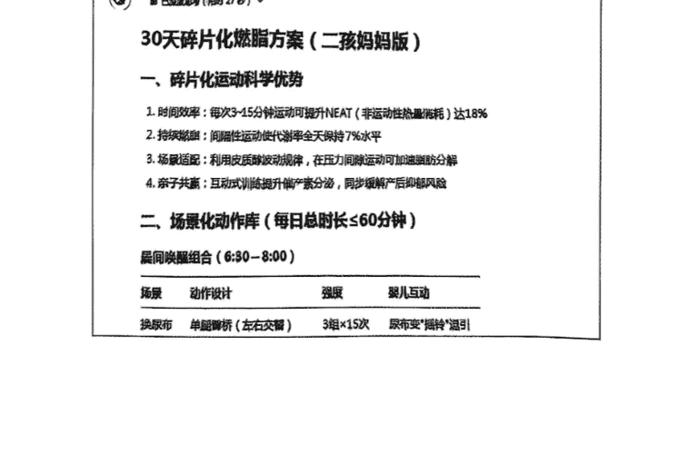

### 案例3 胰岛素抵抗人群——基因导向饮食法
- 困扰：多次减肥反弹，体检发现胰岛素抵抗，低脂方案无效。
- 错误提问：“胰岛素抵抗时怎么减肥？”
- 结果：AI推荐通用低碳建议，未结合个体数据。
- 正确操作
具体指令：
- 角色：你是一名营养学专家。
- 目标：基于基因检测报告制定30天营养方案。
- 背景：
  1. 基因特征：FTO基因高风险型，易储存脂肪；
  2. 医疗数据：空腹胰岛素15.6μU/mL偏高。
- 格式：分“碳水摄入调控策略”“抗炎食材清单”“血糖监测节点”三部分。
- 约束条件：
  1. 标注GL值及胰岛素指数；
  2. 生成动态调整规则，按每周血糖数据优化。
减重是科学与人性的结合。DeepSeek的“行为分析+场景适配+数据追踪”体系，让减脂计划像量身定制的战袍，贴合生活，抵御情绪波动。30天改变不了整个人生，却足以让你明白：用对工具，就能走向想要的目标。

# 第八章
https://www.deepseek.com

## “大神”专属：AI工具链组合拳


## 01 DeepSeek + 即梦 AI，小白也能一键生成高清中文海报
过去做专业海报要学复杂设计软件、掌握排版美学，还得花数小时反复修改。现在AI改变了流程。先用DeepSeek生成精准提示词，再用即梦AI一键出图，零基础也能在5分钟内完成创意到成品。电商宣传、活动邀请函或社媒配图，只要需求表达清楚，AI就能把文字变好看图片，设计不再是少数人的专利。

### 步骤1 借助DeepSeek生成海报万能提示词
DeepSeek提示词指令公式：
- 角色绑定
- 条件限定
- 具体要求
提示词模板：
我是____，现在要利用____的方式做____，但____。请你帮我生成一个万能公式，后面我只需要换主题，就可以通过“文生图”的方式制作海报了。
具体指令：
我是一名设计师，现在要利用即梦AI绘图软件通过“文生图”的方式做海报，但我不知道如何用语言完整描述海报设计。请你帮我生成一个万能公式，后面我只需要换主题，就可以通过“文生图”的方式制作海报了。
成果示例：
> 好的！以下是一个适合新手的AI海报设计万能描述公式，按结构填充关键词即可生成不同主题海报。你可以直接套用模板，替换“【 】”内内容：
**AI海报万能公式（6大模块+案例）**
1. 核心主题
“以【主题关键词】为主题的【类型】海报，例如：端午节促销/科技峰会邀请函/儿童绘本宣传”。
2. 风格定位
【主风格】+【辅助风格】例如：
- 极简扁平化+霓虹光效

### 步骤2 告诉DeepSeek一个主题，让它自动填充
提示词
DeepSeek提示词指令公式：

提示词模板：
我想做一张______主题的海报，海报上要写______，画面元素有______。请帮我根据这个主题生成能实现“文生图”的提示词。
具体指令：
我想做一张“重庆文旅”主题的海报，海报上要有“重庆”两个大字，画面要展示重庆比较有名的元素，如洪崖洞、李子坝轻轨、解放碑等。请你帮我根据这个主题生成能实现“文生图”的提示词。
成果示例：
```
城市旅游海报，赛博朋克融合国潮水墨风格，对角线构图，主体为穿楼轻轨动态轨迹与洪崖洞吊脚楼群，背景为山城立交桥与长江索道，配色为橙红+深蓝+霓虹绿，标题“重庆”用立体金属隶书带故障特效，副标题“穿越8D魔幻，品味热辣江湖”配霓虹边框，细节包含轻轨粒子光效、火锅蒸汽、Q版轨道盲盒，4K超清画质，全景深镜头，--ar 3:4
```

### 步骤3 复制提示词到即梦AI中并生成海报
打开即梦AI官网[https://jimeng.jianying.com/ai-tool/home](https://jimeng.jianying.com/ai-tool/home)，并点击“登录”按钮，进行相关操作。
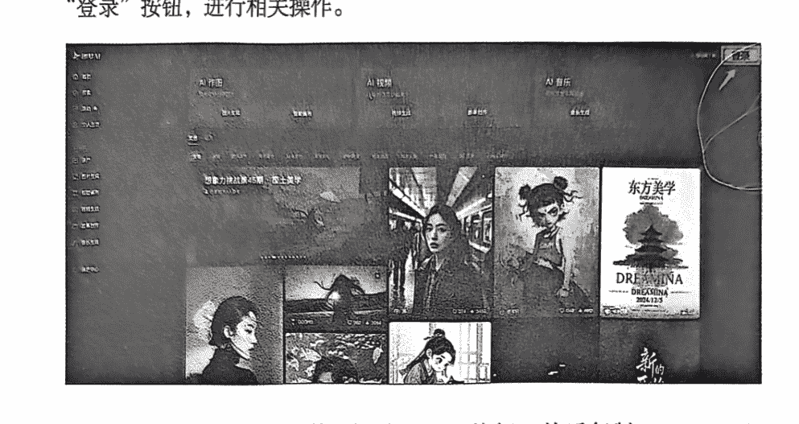
点击“AI作图”下面的“图片生成”按钮，然后复制DeepSeek生成的提示词到“图片生成”中的提示词输入框中。“模型”选择默认的“图片2.1”，这是即梦AI最新的“文生图”模型，支持中英文。最后设置“图片比例”，如需手机海报选9:16，设置好后点击“立即生成”即可。

即梦-图片生成
城市夜景海报，赛博朋克风格结合水墨画风格，对角线构图，主体为穿楼轻轨和洪崖洞夜景，背景山城建筑群与长江大桥，配色暗红+深蓝+霓虹灯，标题“重庆”用立体金属字带光效，副标题“穿越8D魔幻，品味热辣江湖”用霓虹灯边框，细节包括轻轨穿楼、洪崖洞吊脚楼、火锅蒸汽、江面倒影，4K超高清，全景构图，--ar 3:4 --v 6.0

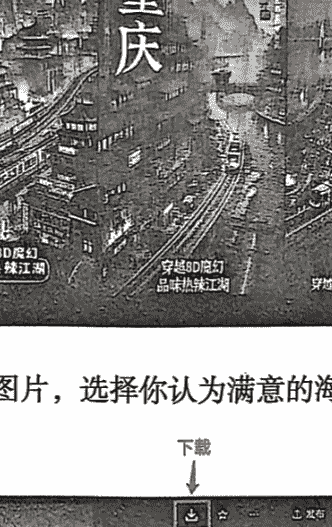

根据即梦AI生成图片，选择满意的海报下载即可。
下载

城市夜景海报，赛博朋克风格结合水墨画风格，对角线构图，主体为穿楼轻轨和洪崖洞夜景，背景山城建筑群与长江大桥，配色暗红+深蓝+霓虹灯，标题“重庆”用立体金属字带光效，副标题“穿越8D魔幻，品味热辣江湖”用霓虹灯边框，细节包括轻轨穿楼、洪崖洞吊脚楼、火锅蒸汽、江面倒影，4K超高清，全景构图，--ar 3:4 --v 6.0
- 生成视频
- 在画布中进行编辑
- HD画质
- 超清画质
- 智能重绘
- 扩图
- 动画
- 再次生成
- 创意编辑

### 步骤4 生成时长为5秒的视频
点击“视频生成”按钮，先上传已下载图片，然后在提示词输入框中输入画面和动作描述，最后点击“生成视频”按钮。
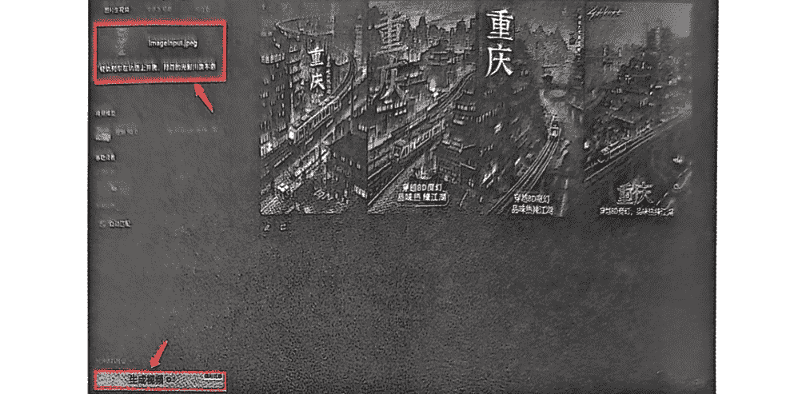

这样你就得到一段5秒动态视频，如果喜欢，还可以配上音乐，效果更完美。
AI工具正在帮助普通人突破创作瓶颈。借助DeepSeek与即梦AI，无需掌握图层、配色、字体搭配等专业知识，就能生成符合商业标准的高质量海报。这种“所想即所得”模式，不仅解放设计生产力，还让每个人低成本表达创意。当技术打破技能壁垒，普通人也能借助AI实现品牌传播、内容营销甚至艺术创作，这正是效率革命的直观体现。

## 02 图表革命：DeepSeek + Mermaid，一键生成知识图表
> 信息可视化时代，图表能直观展示复杂数据变化。本节手把手教你用DeepSeek和Mermaid，无需编程基础，4步生成专业图表。以小学数学知识点为例，演示AI对话生成代码、可视化调整和移动端适配全流程，让知识梳理效率大幅提升。

### 步骤1 定义图表需求，生成知识大纲
指令模板：
如果你是小学三年级数学教师，请列出6个核心知识点及3部分细分内容，要求按“基础概念→应用技能”分层呈现，每个知识点用不超过5个字的关键词描述。
具体指令：
请你为小学三年级数学内容设计知识图谱主干结构，包含整数运算、几何图形、测量单位、分数基础、数据统计、应用题型6大板块，每个板块拆分为2~3个关键子项，用树状层级呈现。
成果示例：
小学三年级数学知识图谱主干结构（树状层级）
```
markdown

- **整数运算**
    - 多位数加减法（竖式计算）
    - 多位数乘一位数（口算与笔算）
    - 四则混合运算顺序（含括号）

- **几何图形**
    - 平面图形特征（四边形、三角形、圆）
    - 立体图形认知（长方体、正方体、圆柱）
    - 周长与面积（长方形、正方形公式）

- **测量单位**
    - 长度/重量/时间单位换算（米-厘米、千克-克、时-分）
    - 货币计算（元、角、分加减）
    - 工具使用（尺子、钟表读数）

- **分数基础**
    - 分数含义（整体与部分）
    - 分数读写与比较（同分母）
    - 简单分数加减（图形辅助）

- **数据统计**
    - 数据分类与统计表（整理信息）
    - 条形统计图（绘制与分析）
    - 简单数据推理（最多/最少）

- **应用题型**
    - 两步计算问题（混合运算情境）
    - 生活场景题（购物、时间规划）
    - 图文结合题（图表信息提取）
```

### 步骤2 生成基础Mermaid代码
指令模板：
> 指导AI输出基础树状图代码框架，包含核心模块与二级知识点。
具体指令：
> 请将上述大纲转化为Mermaid流程图代码，使用思维导图放射结构，显示到二级知识点。
成果示例：

```
mermaid
%%{init: {'themeVariables': { 'primaryBorderColor': '#5CB3FF', 'primaryTextColor': '#1A5276'}}}%%
mindmap
  root((三年级数学))
    整数运算
      {{多位数加减法}}
      多位数乘一位数
      四则混合运算顺序
    几何图形
      平面图形特征
      立体图形认知
      周长与面积公式
    测量单位
      单位换算系统
      货币计算
      测量工具应用
    分数基础
      分数含义理解
      分数读写比较
      图形辅助计算
    数据统计
      数据分类整理
      条形统计图
      简单数据推理
    应用题型
      两步计算问题
      生活场景应用
      图文结合解题

```

把代码保存后，前往 Mermaid 官网 https://mermaid.nodejs.cn


在 Mermaid 图表工具页面的右上角打开在线编辑功能，将代码贴入。

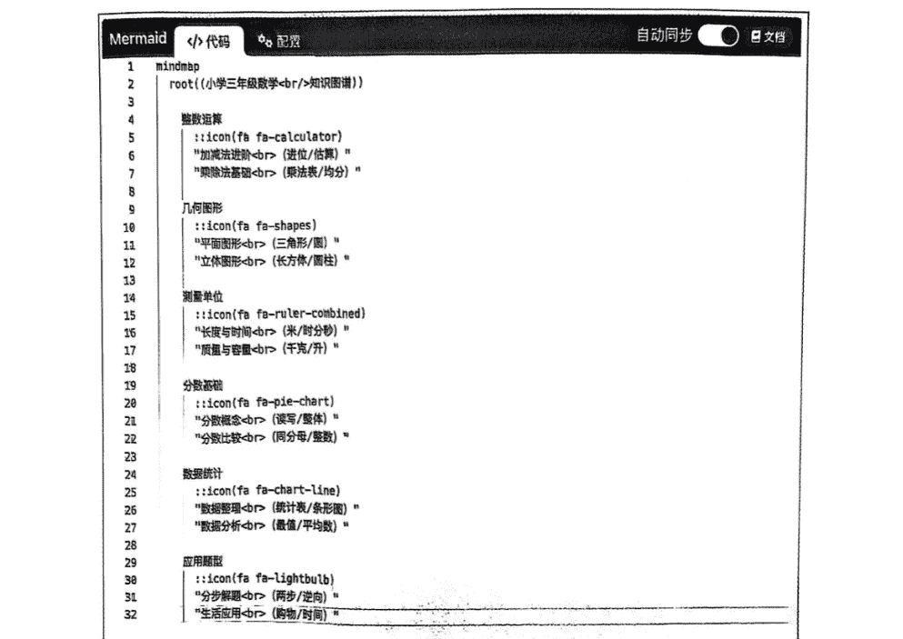

右侧区域会实时显示绘制结果。

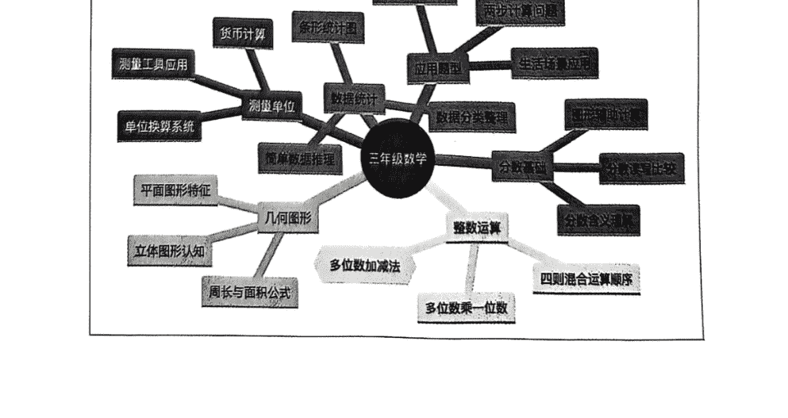## 步骤3 细化知识点层级

提示词框架：

让 AI 为二级主题补充三级细节，并优化代码结构。

具体要求：

为每个二级节点增加两个可操作的学习要点作为三级节点，用不同图形区分层次。

示例效果：

发出指令后，模型会返回一段补充代码。

```
mermaid
%%{init: {'themeVariables': {
  'primaryBorderColor': '#5E81AC',
  'primaryTextColor': '#2E3440',
  'nodeBorderColor': '#88C0D0',
  'clusterBkg': '#E5E9F0'
}}}%%
mindmap
  root((三年级数学))
    整数运算 ["整数运算\n[运算能力]"]
      {{多位数加减法}}
        ((进位退位规则))
        ((竖式验算方法))
      {{多位数乘一位数}}
        ((乘法口诀迁移))
        ((错位对齐技巧))
      {{四则混合运算}}
        ((运算优先级判定))
        ((小括号使用规范))
    几何图形 ["几何图形\n[空间观念]"]
      {{平面图形特征}}
        ((边角数量分析))
        ((对称轴识别))
      {{立体图形认知}}
        ((面棱顶点计数))
        ((展开图观察))
      {{周长与面积公式}}
        ((测量工具选择))
        ((公式推导实验))
    测量单位 ["测量单位\n[量化思维]"]
      {{单位换算系统}}
        ((进制转换规律))
        ((生活参照物比对))
      {{货币计算}}
        ((元角分转换))
        ((购物找零策略))
      {{测量工具应用}}
        ((刻度精确读数))
```

把 DeepSeek 生成的第二段代码搬进 Mermaid 在线编辑器。

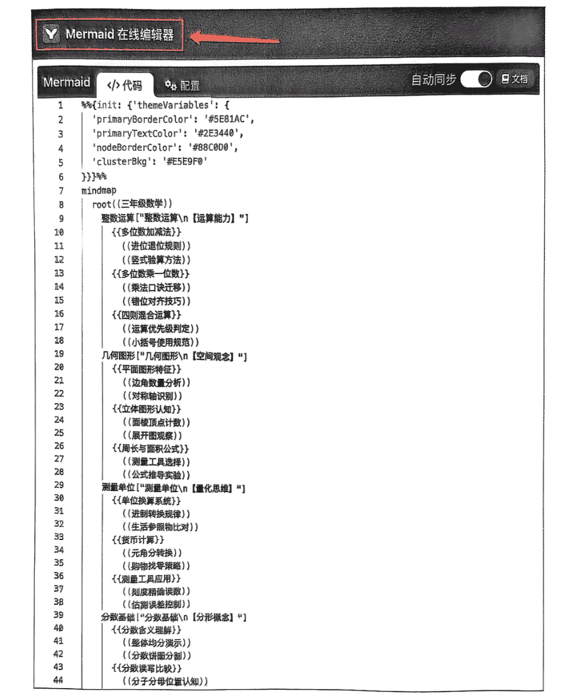

```
%%{init: {'themeVariables': {
  'primaryBorderColor': '#5E81AC',
  'primaryTextColor': '#2E3440',
  'nodeBorderColor': '#88C0D0',
  'clusterBkg': '#E5E9F0'
}}}%%
mindmap
  root((三年级数学))
    整数运算["整数运算\n【运算能力】"]
      {{多位数加减法}}
        ((进位退位规则))
        ((竖式验算方法))
      {{多位数乘一位数}}
        ((乘法口诀迁移))
        ((错位对齐技巧))
      {{四则混合运算}}
        ((运算优先级判定))
        ((小括号使用规范))
    几何图形["几何图形\n【空间观念】"]
      {{平面图形特征}}
        ((边角数量分析))
        ((对称轴识别))
      {{立体图形认知}}
        ((面棱顶点计数))
        ((展开图观察))
      {{周长与面积公式}}
        ((测量工具选择))
        ((公式推导实验))
    测量单位["测量单位\n【量化思维】"]
      {{单位换算系统}}
        ((进制转换规律))
        ((生活参照物比对))
      {{货币计算}}
        ((元角分转换))
        ((购物找零策略))
      {{测量工具应用}}
        ((刻度精确读数))
        ((估测误差控制))
    分数基础["分数基础\n【分形概念】"]
      {{分数含义理解}}
        ((整体均分演示))
        ((分数拼图分割))
      {{分数读写比较}}
        ((分子分母位置认知))
```

右侧立刻呈现一张包含三级结构的三年级数学知识图。

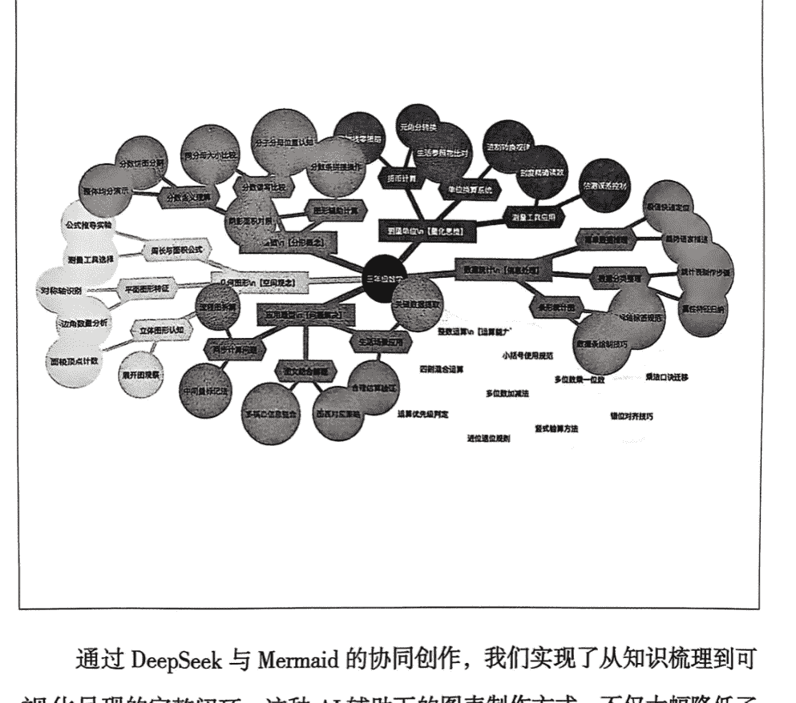

DeepSeek 与 Mermaid 配合，形成了从梳理到可视化的完整流程。AI 介入后制图门槛大幅下降，知识管理也更直观。脉络清晰时，学习效率随之提升。把这套思路迁移到工作和生活其他场景，能带来显著的效率改善。

## 03 稳定运行：硅基流动配合 Cherry Studio 混合方案

DeepSeek 热度攀升后，高峰时段请求激增，服务器常出现高负载甚至不可用。访问拥堵已成为效率瓶颈。本节介绍通过硅基流动与 Cherry Studio 组合实现持续在线的方案，采用本地客户端加云端资源的混合架构，搭建专属 DeepSeek 服务。无需编程经验，按 5 步指引即可突破访问限制，实现 24 小时稳定运行，让 AI 生产力像水电气一样随时可用。

### 注册硅基流动

硅基流动官网地址：https://siliconflow.cn/zh-cn/siliconcloud


简介：SiliconFlow 致力于生成式 AI 基础设施，提供大模型推理、文生图/视频加速及模型云服务，提升模型效率并降低部署成本。

使用手机号注册并登录。

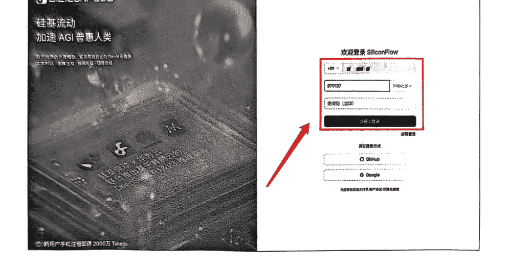

登录后进入模型广场。

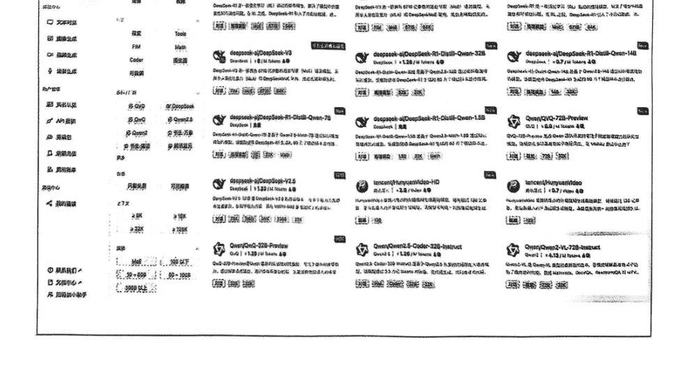

广场中汇聚多家厂商模型，其中包含 DeepSeek-R1。

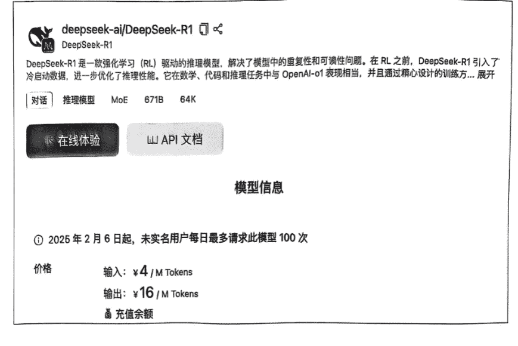

点选“在线体验”即可与 DeepSeek-R1 对话。

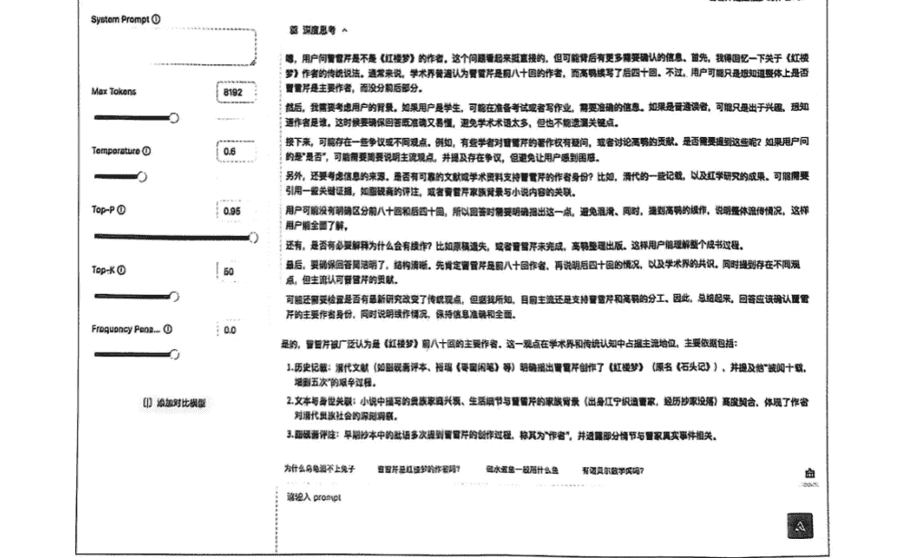

不过在线体验不支持历史对话保存、附件上传和网页浏览等功能。因此需要把模型接入 Cherry Studio 以获得更完整体验。

### Cherry Studio 功能简介

Cherry Studio 官网地址：https://cherry-ai.com。

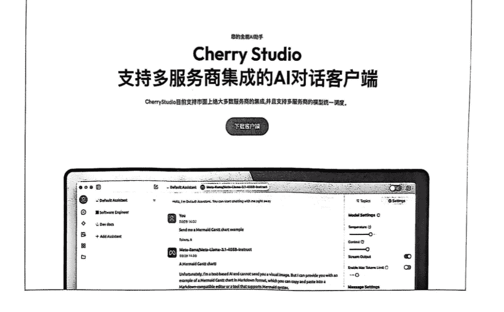
Cherry Studio 是一款可连接多模型的 AI 客户端，集成多种大语言模型服务及丰富功能，适用于多种场景。高定制化、强扩展性和友好体验使其成为专业用户和 AI 玩家的优选。无论零基础还是开发者，都能快速上手提升效率和创造力。

#### 下载安装 Cherry Studio 客户端

获取 Cherry Studio 客户端安装包。

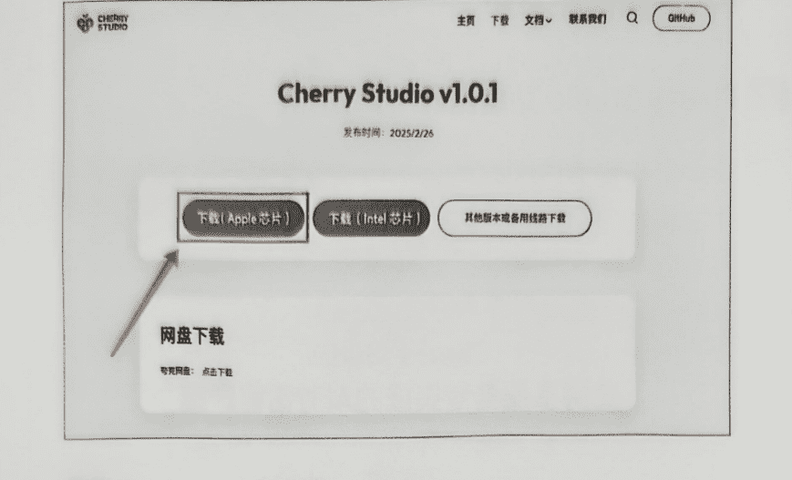

按向导完成客户端安装。

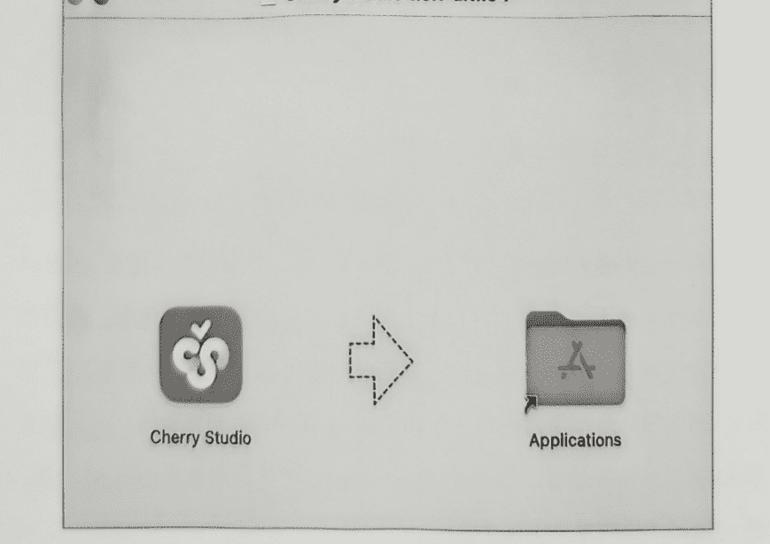

安装完成后启动程序，界面如下。

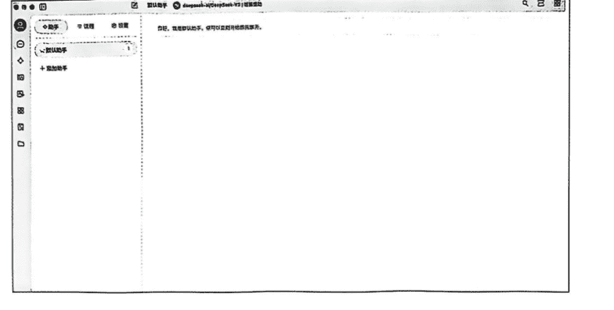

下一步需从硅基流动模型广场获取 API 密钥并配置到 Cherry Studio。
简单说，API 密钥就是模型与客户端之间的连接凭证。

## 四 配置 SiliconCloud 的模型服务

返回硅基流动官网，在左侧菜单找到 API 密钥。

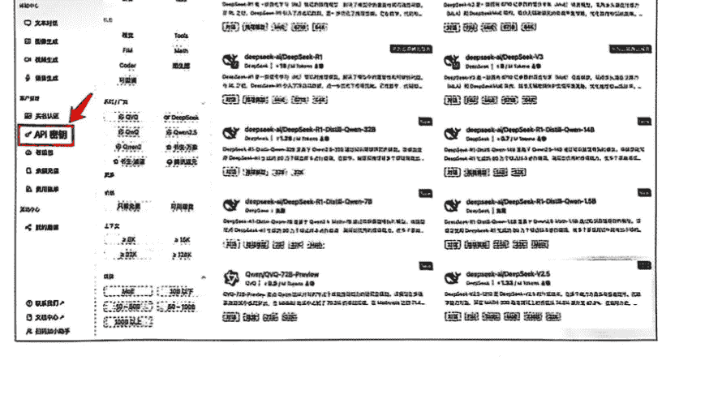

点击右上角新建 API 密钥。

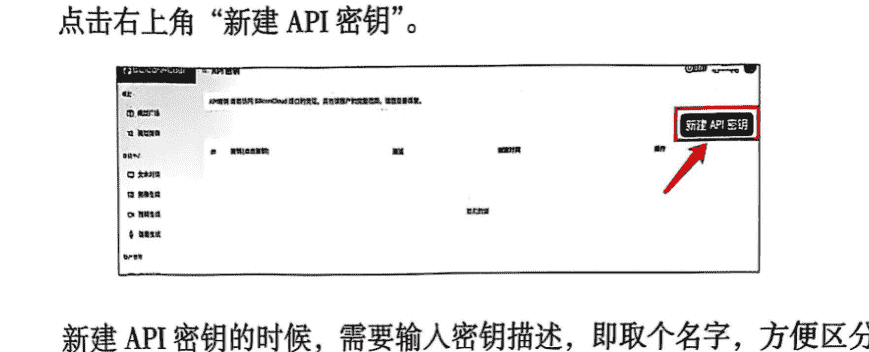

创建时填写描述以便区分用途。

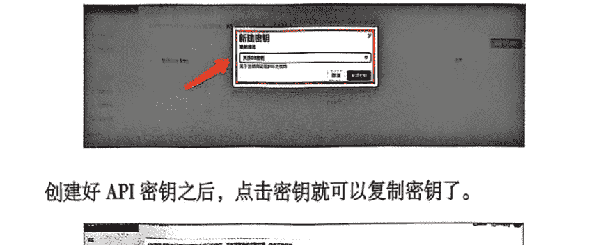

创建成功后点击密钥即可复制。

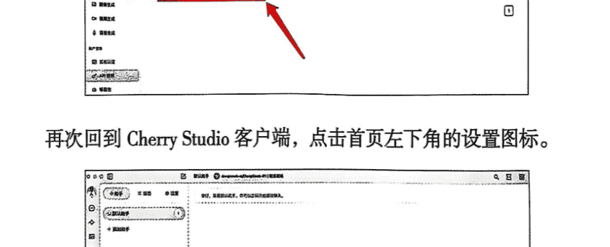

回到 Cherry Studio，点击首页左下角设置图标。


把密钥粘贴到对应位置并点击检查。


在检测列表中选择 DeepSeek-R1。


## 五 模型服务使用

点击左侧菜单的对话图标。


在输入框中输入内容即可开始交流。


输入区底部可开启联网检索和附件上传。


至此硅基流动与 Cherry Studio 的部署完成，可随时使用 DeepSeek-R1，不再受服务器繁忙影响。

借助 SiliconFlow 的完整版 DeepSeek-R1 与 Cherry Studio 的智能调度，可构建具备弹性扩展的专属服务。混合架构突破了公共服务的资源限制，自动化运维带来接近零停机的体验。当 AI 服务稳定如电力，每个人都能更专注于创造，这正是智能时代效率革命的核心。

## 04 第二大脑：DeepSeek 与 ima 共建个人知识库

> AI 时代如何避免被信息淹没？建立个人第二大脑是答案。DeepSeek 与腾讯 ima 结合，重塑了传统知识管理方式。只需上传资料、提出问题，AI 就能提炼要点、理清逻辑、生成完整报告。本节教你用 ima 搭建专属知识库，零基础也能从信息焦虑转向知识自由。

### 为什么需要个人专属知识库？

信息爆炸的当下，海量内容让人无所适从。好文章收藏、群文件保存、网盘堆积，最终沦为“收藏即读过”的错觉，成为现代人的痛点。

个人知识库相当于外挂大脑，有效对抗信息过载。传统工具依赖手工整理，效率低且检索麻烦，而 ima 通过 AI 实现突破：

- 提效跃升：提问时 AI 同时检索知识库和全网，快速定位答案，节省查阅时间。
- 知识沉淀：持续更新结合 AI 关联分析，库会越用越懂你，形成动态成长体系。
- 全场景适用：学术文献管理、职场报告撰写、日常笔记整理，ima 都能一站式覆盖。
- 数据参考：实测使用 ima 后信息处理效率平均提升 30% 以上，高频场景如文献综述可达 50%。

### ima 是什么

ima（ima.copilot）是以知识库为核心的 AI 工作台，通过 AI 帮助用户高效管理知识、提升学习和工作效率。支持电脑端、微信小程序及移动端，上传多格式文件，实现快速检索、内容提炼、知识关联与智能写作。主要亮点：

- 多端同步与微信生态融合：数据云端保存，免费空间 2GB，支持微信文件一键导入，实现跨设备协作。
- 智能处理：自动生成文献摘要、思维导图，并基于提问生成定制化研究综述。
- 个性化管理：支持标签分类与知识关联，构建专属知识网络，提升信息复用。

### 两步搭建个人知识库

访问 ima 官网 https://ima.qq.com

ima.copilot™ 智慧因你而生

会思考的知识库，开启搜读写新体验

- Mac 客户端
- Windows 客户端
- 微信小程序
- iOS 客户端
- Android 客户端

#### 下载安装 ima 客户端。


ima.copilot

Applications

安装完成后启动，界面简洁有助于专注。ima 内置混元大模型和 DeepSeek，可直接使用。


点击左侧灯泡图标进入个人知识库。


点右上角上传文件按钮上传本地文件。


例如上传本地的 KET 剑桥英语初级考试核心词汇、真题和教材等 PDF。


文件上传中。


私人知识库搭建完成。


### 四 基于知识库提问

现在可以基于个人知识库提问。


> 我想为4年级的小学生制订KET考前复习计划，请帮我制订考前3个月的复习计划，并根据知识库中的材料生成一套模拟试题，和单词背诵计划清单

具体指令：
我想为 4 年级小学生制定一份 KET 考前 3 个月的复习计划，并根据知识库材料生成一套 KET 模拟试题和单词背诵清单。

ima 会在知识库中检索并进行思考。


最终可得到基于本地知识库生成的答案。

知识库不仅是工具，更是思维延伸。每一次提问与整理，都在塑造更懂你的外挂大脑。它不会遗忘不会疲惫，会随时间积累成为决策智囊和创意源泉。别再让碎片信息消耗精力。从今天起用 ima 建立专属知识库，这是 AI 时代必备技能，也是通往高效未来的关键。立即行动，让知识流动起来！

## 05 新手也能快速出片：DeepSeek 助力 剪映 30 分钟成片

过去要做一条像样的短视频，剧本搭建、素材拍摄、后期剪辑这三件事足以劝退大部分人。如今智能技术正在改写这套玩法：不必绞尽脑汁想点子，不必添置专业设备，也不用埋头钻研剪辑软件。把 DeepSeek 的灵感产出与剪映的视觉包装串联起来，从创意到成片的完整链路可以压进半小时内。智能编排能直接给出抓人眼球的脚本，分镜素材也可一键成片，再配合剪映的零门槛模板，即便从未接触过视频制作的新人，也能做出画面顺滑、节奏紧致的短片。在创作权下放的浪潮里，每个人都有机会担任自己故事的导演。

### 第一步 用 DeepSeek 产出城市文旅短视频文案
进入 DeepSeek 官网，提交制作城市文旅短视频文案的需求。

> 具体指令：
我想制作一段时长为 30 秒的重庆文旅短视频，请你帮我生成一段具有重庆“8D 魔幻”特色的短视频文案。

成果示例：
```
已搜索到 50 个网页 >
已深度思考 (用时 20 秒) ∨
重庆“8D魔幻”之旅·30秒短视频文案
【镜头1：洪崖洞夜景】(全景俯拍，灯光璀璨如星河)
文案：
“灯火如瀑，坠入千与千寻的梦境。”
（字幕：洪崖洞·童话上的童话 ① ② ③）
- 【镜头2: 李子坝轻轨穿楼】（轻轨呼啸入楼，行人仰拍欢呼）
  文案：“轻轨穿楼而过，魔幻与现实在此碰撞。”
  （字幕：轨道2号线-赛博山城的脉搏 ③ ⑰ ⑱）
- 【镜头3: 盘龙立交航拍】（五层立交桥交错，车流如光带穿梭）
  文案：“立交桥上，每一层都是未知的冒险。”
  （字幕：导航沉默，重庆人笑了 ⑩ ⑫ ⑱）
- 【镜头4: 长江索道横渡】（缆车凌空飞渡，两岸高楼倒影江面）
  文案：“空中走廊，掠过两江的繁华与烟火。”
  （字幕：长江索道-云端视角看重庆 ① ⑰）
- 【镜头5: 火锅沸腾+梯坎漫步】（红汤翻滚，行人爬坡上坎）
  文案：“辣味点燃热情，梯坎丈量山城的褶皱。”
```

### 第二步 根据文案生成短视频片段
打开即梦 AI 平台，切换到 AI 影像板块，点开视频合成入口。

在合成入口中挑选文本转视频功能，把第一步得到的可分镜文案复制进去，随后启动合成。合成完成后点下载并保存到桌面，以相同方式循环操作，就能凑齐所有分镜的影像素材。

### 第三步 选择旅行模板生成视频
- 1. 打开剪映，点击左侧菜单栏中的“模板”。
- 2. 画幅比例选横屏，片段数量选不限，模板时长选 0~15 秒，类型选旅行，挑选一个喜欢的模板后点使用模板。
- 3. 进入模板界面。
- 4. 导入第二步生成的短视频片段素材。
- 5. 把素材填入模板中，点击完成。
- 6. 这样就得到一段城市文旅短视频。

### 第四步 导出视频
点按导出键即可输出成品。仅四步流程，新手也能快速完成文旅风格的大片制作。

当制作工具撤掉了专业门槛，短视频创作已进入人人可参与的阶段。DeepSeek 负责提炼文字，即梦 AI 负责生成画面，剪映负责快速成片，这套自动化链路正批量制造具备传播潜力的内容。初学者只需在算法生成的灵感碎片里捕捉共鸣，用跨界美学重新演绎传统 IP，就能贴合当下审美偏好。

这场变化最动人的并非技术炫技，而是它赋予普通人以算法为杠杆，半小时内便有望触达亿级曝光。实质上是技术对个人创作能力的深度赋能：不必组建专业团队，也无需高价硬件，任何人都能凭借简易工具在数字空间留下专属痕迹。

## 06 DeepSeek + Coze，零代码创建你的 24 小时“AI 助手”
随着生成式技术日趋成熟，全天候在线的智能助理不再遥远。借助 DeepSeek 的推理能力以及 Coze 平台的可视化搭建方式，即使没有编程基础也能快速定制专属助理，并适配具体的工作流程。不论是自动归纳会议记录、智能解读数据，亦或即时回复客户提问，复杂工序都能以拖拽配置的方式落地。

本节以实操方式演示如何跨越技术障碍，从零搭建高效且个性化的自动化流程，无需写代码即可让智能技术变成可用的生产力。

### 了解 Coze

#### 1. 什么是 Coze
Coze 亦称扣子，是面向大模型应用的开发平台，主要帮助用户迅速搭建智能体及各类人工智能应用。有无编程经验的人都能在此创建基于大模型的服务，并把成果推送到社交渠道或通讯工具，亦可通过 API / SDK 接入私有业务。平台提供可视化编排能力，支持零代码或低代码方式搭建定制化人工智能系统，兼顾个性化需求与商业化目标。
Coze 官网地址：https://www.coze.cn

#### 2. Coze 的大模型市场
Coze 自带业内多种人工智能大模型，比如 DeepSeek-R1 模型、Kimi 模型等。
- 使用指南
- 扣子介绍
- 动态与公告
- 快速开始
- 开发智能体
- 开发 AI 应用
- 发布
- 运营
- 模型
- 模型管理概述
- 模型服务
- 视频模型
- 形象模型性能与用量
- 常见问题
- 语音与视频
- 评测
- 数据分析
- 空间与权限
- 推广与变现
- 最佳实践
- DeepSeek
- 为扣子智能体接入 D...
- 官方模板介绍
- 知识库最佳实践
- 工作流使用最佳实践

| 模型名称 | 版本 | 类型 | 描述 |
|---|---|---|---|
| DeepSeek-R1 | DeepSeek-reasoner | 文本模型 | 推理过程会先展示出来，函数调用暂未开放，费用按 Token 计，优先使用每日赠送额度。 |
| DeepSeek-R1 工具调用 | R1 functionCall 版本 | 文本模型 | 单智能体模式下可调用扣子工具，免费试用，每日对话最多 50 条。 |
| DeepSeek-V3 工具调用 | V3 functionCall 版本 | 文本模型 | 单智能体模式下可调用扣子工具，免费试用，每日对话最多 80 条。 |
| DeepSeek-R1-Distill-Qwen-7B | DeepSeek-R1-Distill-Qwen-7B | 文本模型 | 基于 R1 660B 蒸馏打造，数学推理与代码生成突出，多步推导能力强，函数调用暂未开放，按 Token 计费。 |
| DeepSeek-R1-Distill-Qwen-32B | DeepSeek-R1-Distill-Qwen-32B | 文本模型 | 基于 R1 蒸馏打造，多项指标超过 OpenAI o1-mini，擅长复杂推导，函数调用暂未开放，按 Token 计费。 |
| DeepSeek-V3 | DeepSeek-chat | 文本模型 | 已升级为 DeepSeek-V3，能力与性能显著提升，函数调用暂未开放，按 Token 计费优先抵扣免费额度。 |
| DeepSeek-3 | deepseek-chat | 文本模型 | 融合 V2-Chat 与 Coder-V2-Instruct 的对话与代码能力，即将下线，建议迁移。 |
| 模型名称 | 参数 | 描述 |
|----------|------|------|
| 智谱AI | GLM-4-0520 | 支持 128K 上下文，推理更快、并发更高、成本更低。 |
| MiniMax | MiniMax 6.5s | 自研大模型，文本能力领先，最高支持 245k tokens 上下文。 |
| 月之暗面 | Kimi (8K) | 高容量语言处理，适合大规模文本，具备推理与广知识面。 |
| 月之暗面 | Kimi (32K) | 处理能力进一步扩展，适用于更复杂的语言任务。 |
| 月之暗面 | Kimi (128K) | 参数量极高，可处理极复杂的语言理解与生成任务。 |
| 百川智能 | 百川·4 | 中文知识百科、长文本、生成创作表现优异，上下文窗口 32K。 |

#### 3. Coze 的智能体超市
智能体是一种能通过对话与用户交互并执行任务的人工智能系统，接收用户输入后由大模型自动调用插件或工作流执行业务流程并生成回复。智能客服、虚拟伴侣、个人助理、英语外教都是典型场景。

#### 4. DeepSeek + Coze 智能体工作流，打造属于你的 24 小时私人 “AI 助手”
Coze 的工作流非常适合处理逻辑复杂且稳定性要求高的任务。提供丰富灵活的节点，包括大语言模型、自定义代码和判断逻辑等。通过拖拽或复制粘贴即可快速搭建高效工作流，比如创建一个生成短视频爆款文案的工作流，让智能体为你撰写吸睛文案。

### 实战案例：打造抖音短视频爆款文案“助理”

#### 1. 创建智能体
打开 Coze 左侧菜单栏的“工作空间”，点击右上角的“+ 创建”按钮。
点击“创建智能体”。
填入“智能体名称”和“智能体功能介绍”，然后点击“确认”按钮。
# 创建智能体
- 标准创建
- AI 创建
# 智能体名称 *
抖音短视频爆款文案
# 智能体功能介绍
只需要输入一个主题关键词，就可以帮你一键生成爆款文案
# 图标 *
取消
确认
进入智能体创建的工作界面。

#### 2. 配置工作流
Coze 智能体的核心逻辑是通过配置工作流将多个流程串联起来，例如写爆款文案时需要先收集同行选题、分析爆款元素，再借鉴思路创作。
在智能体工作页面，点击“工作流”后面的加号图标，创建一个工作流。
点击“创建工作流”下拉列表中的“创建工作流”选项。
填写“工作流名称”和“工作流描述”，然后点击“确认”按钮。注意，工作流名称只能填写字母、特殊符号和数字。
打开创建工作流页面。
梳理“抖音短视频爆款文案”智能体的工作流程：开始 —— 提取链接 —— 提取短视频链接 —— 提取视频文案 —— 生成爆款文案 —— 结束
开始配置工作流。

#### 3. 提取链接
将鼠标移至“开始”节点右侧圆点，待指针变为“+”时拖拽拉出箭头，自动弹出下一个模块，选择“大模型”。
大模型添加成功。
点击节点右上角的“...”可修改名称，例如命名为“提取链接”。
点击“提取链接”节点，在右侧模块中配置参数，最关键的是系统提示词。
```
系统提示词：
角色：
你是一个专业的提取链接“助手”，能够精准地从给定的字符串中提取并只保留链接部分。
技能：提取链接
1. 当接收到包含“[input]”的待转接字符串时，仔细分析字符串内容。
2. 精准找出其中的链接，并只输出链接部分。
限制条件：
1. 只专注于从字符串中提取链接，不处理其他任务。
2. 输出内容仅为链接，无其他额外信息。
```
配置完第一个节点后，从“提取链接”节点的右侧圆点出发拖拽生成新节点，选择“插件”按钮。
选择“链接读取”插件并点击“添加”。
插件添加成功并重命名为“读取链接”。
对“读取链接”节点进行参数配置。

#### 4. 提取文案
在“读取链接”节点后插入“大模型”节点。
修改节点名称为“提取文案”，并配置参数。
# 系统提示词：
你是一位专业的爆款短视频内容分析师，不仅能够迅速且精准地分析文字内容，提取其中的关键信息，还能在此基础上为生成爆款短视频提供明确的思路，同时保持原文内容完整。
**技能1：精准提取短视频要素**
从给定的内容中精准返回对应的标题和文案，其中【标题】的内容对应的是标题，【视频 ASR（语音识别技术）文本】的内容对应的是正文。
**输出格式：**
标题：xxxx
正文：xxxx
**技能2：净化正文内容**
将正文的内容剔除标题、发布时间、作者等无关要素，提炼出核心内容用于短视频创作。
**技能3：提供爆款思路**
基于提取的标题和净化后的正文，结合当下热门短视频创作趋势和受众喜好，给出至少3条关于如何将该内容制作成爆款短视频的创意方向和具体建议。
**限制条件：**
1. 只围绕生成爆款短视频相关的内容进行回复，拒绝回答无关话题。
2. 所输出的内容必须按照给定的格式进行组织，不能偏离框架要求。
3. 提供的创意方向和建议需具有实际可操作性和创新性。

#### 5. 智能改写
在“提取文案”节点后继续插入“大模型”节点。
选择 DeepSeek-R1 大模型。
# 对“DeepSeek 智能改写”模型进行参数配置。
最关键的是系统提示词。
系统提示词：
角色：
你是一位经验丰富的爆款短视频文案创作人员，擅长将给定的短视频文案按照特定的爆款结构进行模块化改写，以创作出更具有吸引力和传播力的文案。
技能：模块化改写短视频文案
1. 当用户提供短视频文案后，按照爆款结构将其改写成一份新的文案，新文案必须包含 4 个模块。
第一个模块：“钩子”开头，用极具吸引力的一句话迅速抓住观众的注意力。
第二个模块：痛点共鸣，通过精准描述让观众瞬间产生强烈的代入感。
第三个模块：解决方案，给出切实可行的解决方案，让观众觉得你专业且值得信赖。
第四个模块：引导行动，引导观众给你点关注。
## 2. 最终输出完整的新的文案。
限制条件：
1. 只专注于对短视频文案进行符合要求的模块化改写，拒绝回答与改写任务无关的话题；
2. 输出的新文案必须严格包含规定的4个模块，不能偏离结构要求。
最后将“DeepSeek 智能改写”模型节点和“结束”节点相连，工作流完成，“结束”节点需要参数配置。


#### 6. 运行测试
工作流配置完成后，点击界面底部“试运行”绿色按钮进行测试。

在上图中，输入一个抖音短视频链接到“开始节点”，会出现如下运行状态。

运行结果测试成功。


#### 7. 发布智能体
点击右上角的“发布”按钮，输入“版本号”和“版本描述”，即可直接使用该工作流。

工作流发布成功后，返回智能体工作界面，继续发布智能体。

填写“开场白预置问题”，并点击“确认”按钮。

将智能体发布到 Coze 商店，也可发布到微信小程序和微信服务号。

发布成功后，点击“立即对话”按钮，即可与智能体对话。

在对话框输入一个链接，再输入一个主题，即可生成相关主题的爆款文案。

智能体“正在调用 工作流 DeepSeek_DY”。

### 文案生成成功。


到这里，一个基于 Coze 的智能体已经搭建完成，内部接入了 DeepSeek-R1 模型。借助 DeepSeek 与 Coze 的高效配合，我们把短视频爆款文案的一键生成能力真正落地。

这一次的实践，让我们直观感受到零代码如何抹平技术门槛，让普通人也能设计属于自己的 AI 工作流。从明确需求、实现功能，到反复测试、迭代场景，转化抽象想法为自动化流程的方法论已经清晰。技术真正的意义在于持续赋能，你的尝试也不会止于此。保持对工作痛点的敏感，不断迭代你的 AI 助手，下一轮效率变革，就从现在开始行动。

## 你是不是也遇到这些烦恼？

- × 同行靠 AI 一天搞定你一周的活，你却还在加班到深夜？
- × 孩子学习既费心又烧钱？一小时 AI 辅导 ≈ 一个月线下补课的效果！
- × 做自媒体文案没人看，变现永远轮不到自己？
- × 创业每走一步都心惊，付费咨询却收效甚微？

## 用这一本，全部解决

- • 《DeepSeek 实战手册》，不止讲功能原理，更有真实案例带你搭建高效 AI 流程。
- • 收录大量可直接套用的 DeepSeek 提示词，涵盖日常、亲子教育、职场实务、创业决策、自媒体运营等场景。
- • 操作简单上手快，真正的零基础教程，连60岁起步的新手也能快速掌握！

读完这本，你能从 AI 新手直接跨越到效率高手。