# DeepSeek 实战精要

# 书籍概览

本书以实操教学为导向，系统梳理 DeepSeek 的相关知识与高效运用方法。

全书共分六章。第一章做基础铺垫，帮助读者迅速入门；第二章聚焦文字创作，呈现模型在写作辅助方面的典型用法；第三章围绕职场提效，展示多样化应用路径；第四章侧重学习跃升，讲解如何借助模型获取知识并开展互动式学习；第五章汇总生活场景，涵盖出行规划、美食发现等日常需求；第六章说明与 Word、Excel、PPT、图形图像生成、音乐视频生成等工具的协同配合。

适合在校学生、职场从业者以及对人工智能技术感兴趣的读者阅读，既可作为个人提升效率与技能的自学材料，也可作为相关培训课程的参考用书。

# 前言

在数字化浪潮下，人工智能正以极快的节奏改变工作与生活的形态。从琐碎事务到关键决策，智能化渗透无处不在，明显提升了效率与体验。DeepSeek 由杭州深度求索人工智能基础技术研究有限公司推出，已在金融、医疗、教育等数十个行业落地，逐渐成为大众信赖的创意伙伴与效率助手。本书希望帮助读者充分挖掘该大模型的能力，为自身成长赋能，开启探索新旅程。

## 本书特色

### ·案例详实，覆盖全面
除基础操作讲解外，本书提供大量实战案例。从写作辅助到职场提效，从学习提升到生活指导，每个应用场景都配有细致拆解，同时结合提示词技巧。借助这些案例，读者能更直观地理解功能并提升实操能力。

### ·提示词进阶，方法可落地
在基础操作之上，本书提供丰富的提示词进阶思路。无论是简单文本生成还是复杂任务，均附有示例与操作指引。这些方法实用，能在持续使用中不断提高效率与效果。

### ·场景切入，应用广泛
本书以具体使用场景导入，让读者在工作与生活中更自如地调用 DeepSeek 解决实际问题。无论是教师的教学设计与总结、营销人员的文案创作，或是家长的育儿支持，均提供对应指引，帮助在不同领域高效使用。

### ·全彩呈现，图文并茂
本书采用全彩印刷，图文结合，内容更生动直观。丰富的图表与示例便于读者快速掌握各项功能，全彩排版也提升阅读体验，让学习更愉悦。

## 读者对象

本书面向以下人群。

学生：大学生与研究生可通过本书学习如何利用 DeepSeek 获取知识、撰写学术论文、规划个人成长，提升学习效率与学术水平。

职场人士：本书提供大量职场案例，有助于在文案撰写、数据分析、会议组织、客户沟通等环节高效使用，提升工作效能与职业竞争力。

AI 爱好者：对人工智能感兴趣的读者也能了解基础操作与进阶用法，掌握核心技能。

## 使用提示

在使用过程中，有几点需要留意。

- 书中给出的提示词在实际应用时，输出结果可能存在差异。因为模型会依据使用习惯与上下文语境生成符合当下需求的内容，此类差异属正常现象，不影响学习。
- DeepSeek 属于持续迭代优化的模型，部分功能会随版本更新而变化。尽管如此，本书提供的思路与方法仍具较强通用性与参考价值，建议实践中保持灵活，根据实际情况调整。
- 使用过程中，版权与隐私问题不可忽视。输入内容时应避免侵犯他人版权，切勿使用受保护的文本、图片与视频。同时注意保护个人隐私，避免在对话中泄露敏感信息。

## 编著说明

本书由葛明涛编著。编著过程中力求呈现优质内容，但难免存在疏漏，欢迎读者批评指正。学习中有疑问或建议，可发送邮件至 liyongtao@ptpress.com.cn。

葛明涛

2025年3月

# 资源与支持

## 资源获取

本书提供以下资源。

本书思维导图。

异步社区7天VIP会员。

本书视频教学文件。

获取以上资源，可扫描下方二维码，按提示领取。


## 提交勘误

作者与编辑已尽最大努力保证内容准确，但难免有疏漏。欢迎将发现的问题反馈给我们，共同提升图书质量。

如发现错误，请登录异步社区 https://www.epubit.com，按书名搜索，进入本书页面，点击“发表勘误”，填写勘误信息后点击“提交勘误”按钮即可，见下图。经审核确认后，您将获赠异步社区100积分，可用于兑换优惠券、样书或奖品。


## 联系方式

联系邮箱为 liyongtao@ptpress.com.cn。

对本书有疑问或建议，请发送邮件并在标题中注明书名，以便更快回复。

若有图书出版、教学视频录制，或图书翻译、技术审校等合作意向，欢迎邮件联系。

学校、培训机构或企业若需批量采购本书或异步社区其他图书，也可通过邮件咨询。

如在网络上发现针对异步社区图书的侵权行为，包括未授权传播全部或部分内容，请将相关链接发送至邮箱。您的反馈有助于保护作者权益，保障持续提供有价值内容。

## 关于异步社区与异步图书

“异步社区” www.epubit.com 由人民邮电出版社创办，2015年8月上线运营，专注于优质IT内容的出版与分享，为读者提供高品质学习内容，为作译者提供专业出版服务，实现作译者与读者在线交流互动，推动传统出版与数字出版融合发展。

“异步图书”是异步社区策划出版的精品IT图书品牌，依托人民邮电出版社在计算机图书领域40余年的积累，面向IT行业及各行业IT用户。

# 第1章
# 快速入门 DeepSeek

在数字时代，人工智能正以前所未有的速度改变工作模式和生活方式。本章旨在全面揭开 DeepSeek 的面纱，引领深入探索其功能与潜力。通过学习，你将能熟练掌握基础操作，理解其智能机制，进而在工作与生活中游刃有余地运用该智能助手，开启高效快捷的智能新篇章。

## 1.1 初识 DeepSeek

作为智能助手领域的新兴力量，DeepSeek 凭借卓越的自然语言处理能力与深度学习技术，正成为用户在数字时代的得力助手。本节带你初步了解其基本功能与应用场景。

### 1.1.1 了解 DeepSeek

该模型致力于通过自然语言交互为普通用户提供高效实用的服务。2025年初推出的 R1 与 V3 两大版本，以“高效省资源”与“思考透明化”为特点，迅速成为全球用户量破亿的现象级产品。

深度思考版 R1 作为核心版本，创新融合前沿深度学习算法与先进推理机制。面对复杂问题时，能精准剖析本质，迅速构建高效解题思路。例如处理多步骤逻辑推理题时，R1 能有条不紊地梳理各条件关联，通过层层递进推理得出准确清晰答案。这种深度思考能力不仅提升解决效率，更让答案生成过程一目了然。

相较其他模型，该系统在多维度展现出卓越表现。其一，运行效率高且成本低。借助智能筛选关键处理单元的前沿技术，仅需较低算力即可驾驭各类复杂任务，大幅降低运行成本，提高资源利用率。其二，中文理解尤为精准。能敏锐识别网络热词、各地方言，甚至能精准区分语义歧义，例如面对“苹果”一词时，可依据上下文准确判断指代水果还是手机。其三，思考过程可视化是亮点。以解答数学题为例，会逐步展示公式推导与逻辑分析全过程，让用户清晰看到答案生成路径，真正做到知其然且知其所以然。这种“既聪明又透明”的特质，使其成为普通用户日常使用的理想之选。

应用场景十分广泛。在日常生活中，可充当智能助手帮助用户解决各类问题。比如计划旅行，可咨询目的地攻略、推荐景点，能迅速给出详细规划。在学习方面，是强大的学习伙伴，无论解答学科难题还是提供学习资料，都不在话下。写作文、做数学题、分析历史事件，都能给出专业指导。在办公场景中，也能发挥重要作用。协助撰写工作报告、邮件，快速生成文章框架，还能帮助检查语法错误、优化语句表达，提高办公效率。

总体来看，DeepSeek 以其独特优势与丰富场景，正逐渐改变人们的学习、生活与工作方式。随着技术不断发展，未来有望在更多领域发挥更大作用，为我们带来更多惊喜。

### 1.1.2 使用方式有三种

DeepSeek 作为高效智能工具，无论个人用户还是企业开发者都能找到适合自己的使用方式。目前主流方式如下图所示。

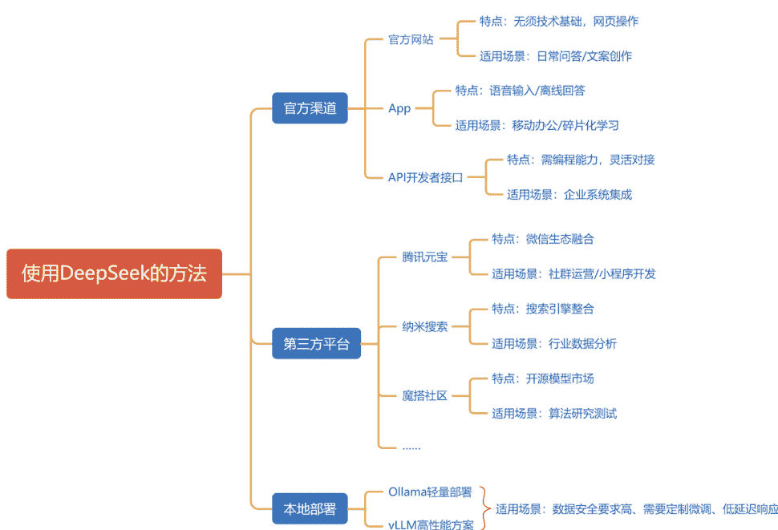

因此，个人用户应优先考虑官网和 App 版本，并根据实际需求选择第三方平台作为补充；中小企业及团队建议采用 API 接口形式；中大型企业和科研机构则可选择本地部署。随着持续迭代，建议定期关注官方更新，并根据业务发展阶段选择最合适的技术路径。

### 1.1.3 隐私与版权注意

在数字时代，AI 的快速发展为内容创作带来前所未有的便利。无论文字、图片还是视频，都能以惊人速度高质量生成，但随之而来的隐私与版权问题也不容忽视。

隐私方面，使用 AI 生成内容时，要警惕数据来源是否涉及他人隐私信息。很多模型是通过大量数据训练而成，若这些数据中包含个人隐私信息，在使用过程中就可能存在泄露风险。因此，在向 AI 提供个人信息以获取定制化内容时，也要谨慎考虑信息的敏感性与潜在泄露风险，注意保护个人隐私信息，如身份号码、银行账户信息、密码、生物特征等敏感信息。

版权方面，AI 生成内容时，可能会借鉴或模仿已有作品。若生成内容与已有作品相似度较高，就可能引发侵权争议。作为用户，利用 AI 生成内容时，必须明确作品版权归属，确保不侵犯他人著作权。不能随意将 AI 生成内容用于商业用途而不考虑版权问题，应在使用前进行充分调查与确认。若在自媒体平台发布生成的文章、图片及视频等，建议标注“AI 生成”或“AIGC”标识。

因此，虽然 AI 提供强大的内容生成能力，用户必须谨慎对待隐私与版权问题，合法合理地使用 AI。

## 1.2 注册登录与界面

本节介绍注册、登录与操作界面，助你快速上手。

### 1.2.1 完成注册登录

使用之前，完成注册登录是必不可少的一步。本小节详细介绍具体步骤，让你轻松开启智能对话之旅。

步骤01 进入 DeepSeek 官网，点击【开始对话】超链接，如下页图所示。

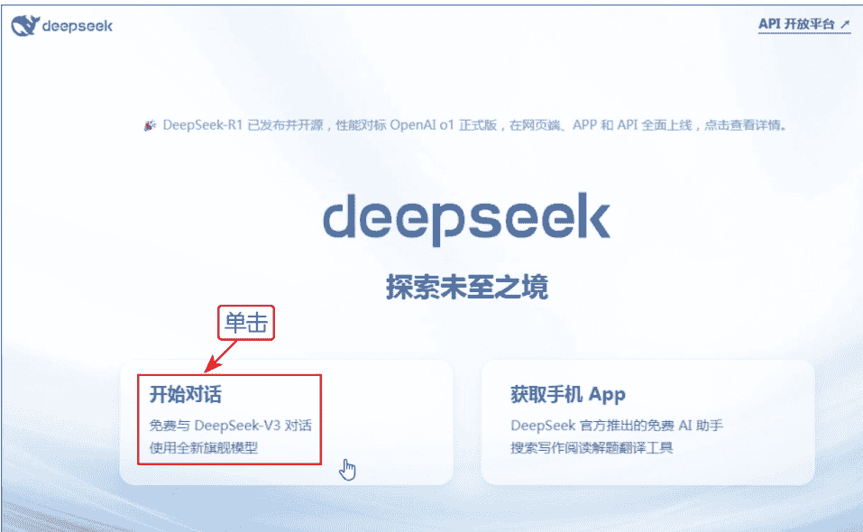

步骤02 首次使用会进入登录页，用户可选择手机号或微信扫码方式登录，例如输入手机号，获取并输入验证码后，勾选【我已阅读并同意用户协议与隐私政策，未注册的手机号将自动注册】复选框，然后点击【登录】按钮，如下图所示。

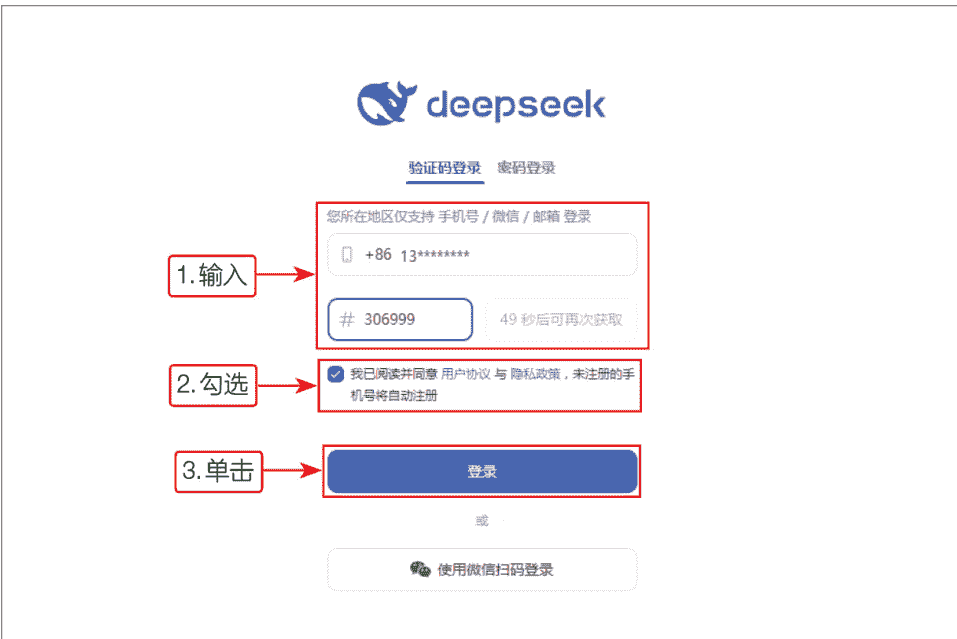

提示：用户也可以选择【密码登录】选项，注册并设置登录密码进行登录。

此时即可进入对话页，如下页图所示。


### 1.2.2 熟悉操作界面

网页版操作界面设计简洁明了，功能布局一目了然，主要分为边栏和对话区，新对话页仅显示输入框，如下图所示。

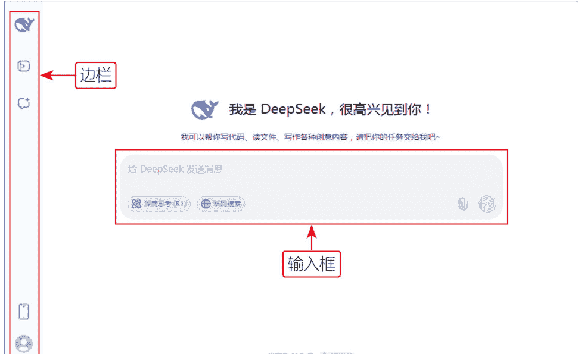

#### 一、边栏
边栏包含4个按钮，功能依次为打开边栏、开启新对话、扫码下载 DeepSeek App 及个人信息。

#### 二、对话区
在新对话页，对话区仅显示输入框，其中输入框是用户与 DeepSeek 进行交互的区域，不仅可以输入提示词，还可以拖曳和粘贴链接、图片、文件等内容，以获取更丰富信息或让其执行更复杂任务。

输入框中主要4个按钮功能如下。


- ：激活该按钮，可调用 DeepSeek-R1 模型，用于解决复杂推理问题。


- ：用户可根据需求选择是否开启联网功能，【联网搜索】亮显表示已接入互联网，会在需要时通过互联网搜集资料，例如搜索当天天气、当天股市情况等就需要联网搜索。当添加文件互动时，则不能开启联网搜索功能。

- 📎（上传附件）：用于上传文件，支持上传最多50个文件，每个文件容量上限为100MB，支持文件类型包括 PDF 文档、Word 文档、Excel 电子表格、PPT 幻灯片、TXT 文本文件以及常用格式图片等。

- ⬆️：点击该按钮或按【Enter】键发送提示词进行互动。

当用户与 DeepSeek 互动时，会从首页进入对话页，如下图所示。

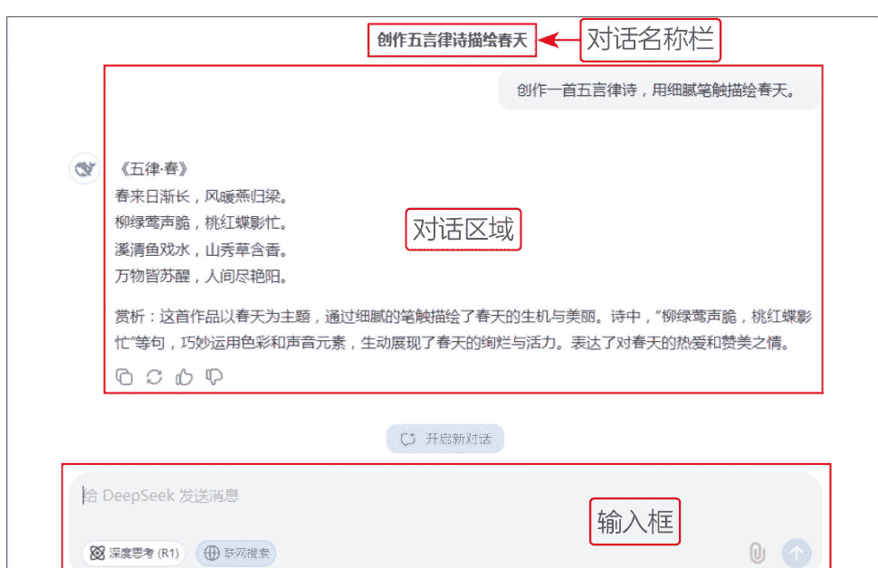

其中，对话名称栏用于显示当前对话名称，用户可点击该名称进行修改。对话区域主要用于显示用户输入内容、回复以及上下文对话记录。

### 1.2.3 设置界面主题

用户可根据需求设置界面主题。

步骤01 在网页版操作界面中，将鼠标指针移至账户头像上，选择显示菜单中的【系统设置】命令，如下图所示。

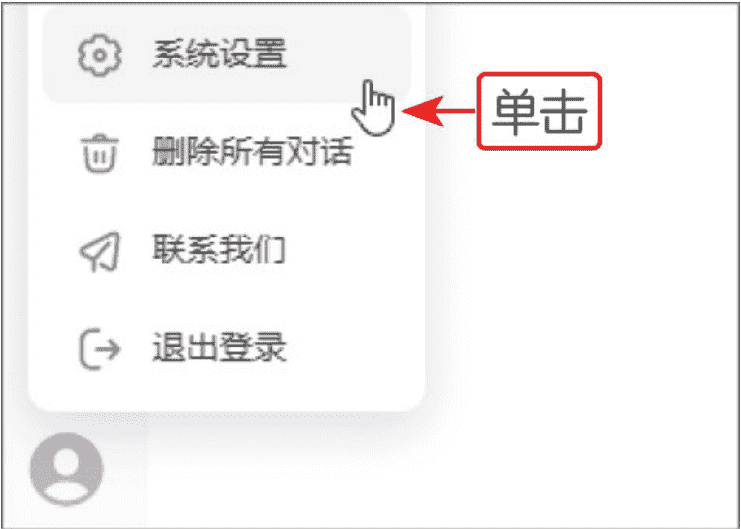

步骤02 弹出【系统设置】对话框，在【通用设置】选项卡下打开【主题】右侧下拉列表，包括【浅色】、【深色】及【跟随系统】3个选项，用户可根据需求选择，如下图所示。

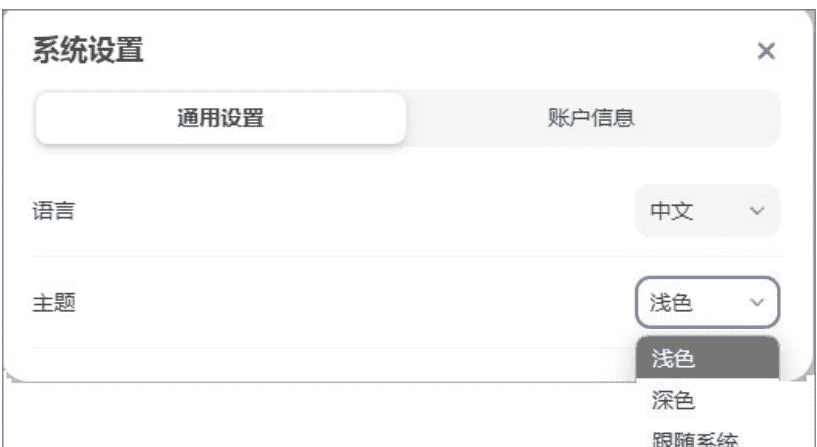

## 1.3 基本对话操作

掌握基本对话操作，是高效利用的关键。从发送提示词到接收回复，每个操作都简单易懂。

### 1.3.1 第一次对话

与 DeepSeek 的交流像聊天一样，用户只需输入提示词并发送，即可开启对话之旅。

步骤01 在网页版操作界面中，点击输入框，输入提示词，如下页图所示。


步骤02 当需要换行输入时，按【Shift+Enter】组合键，输入提示词，然后点击【发送】按钮，如下图所示。

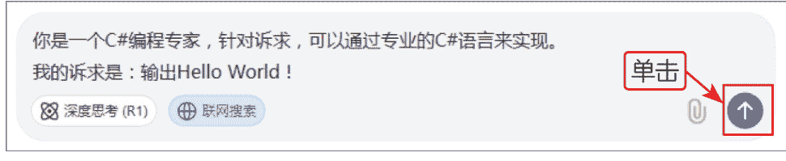

步骤03 即可根据提示词生成相应内容。在生成过程中，如果要停止生成，可点击【停止输出】按钮，停止内容生成，开启新话题，如下图所示。

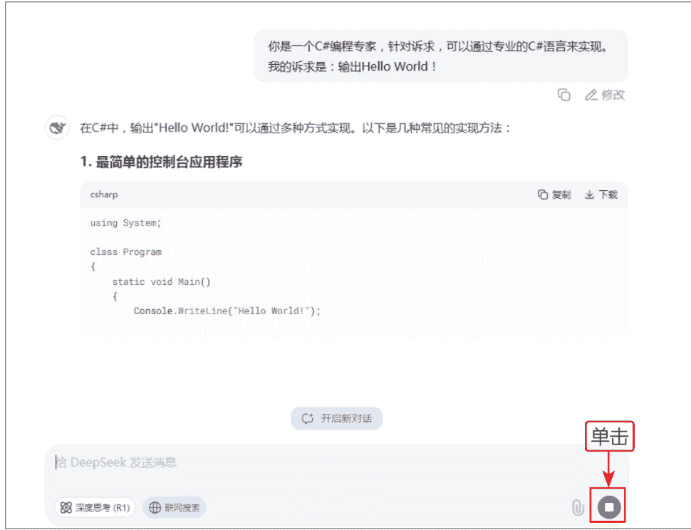

步骤04 如果需要修改已发送提示词，点击按钮，如右图所示。

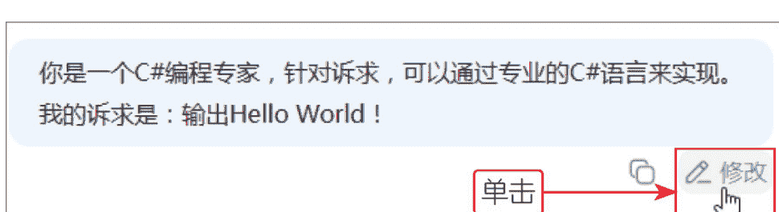

步骤05 点击后，会显示编辑框，修改提示词后，点击【发送】按钮，如下页图所示。

你是一个Python编程专家，针对诉求，可以通过专业的Python语言来实现。

我的诉求是：输出Hello World！

步骤06 会根据新的提示词生成相应内容，如下图所示。

# C#实现Hello World输出方法

你是一个Python编程专家，针对诉求，可以通过专业的Python语言来实现。

我的诉求是：输出Hello World！

在Python中，输出"Hello World!"非常简单，只需要使用 `print()` 函数即可。以下是代码示例：

```python
print("Hello World!")
```

运行这段代码后，控制台会显示：

```
Hello World!
```

如果你想更正式一点，可以写一个完整的Python脚本：

```python
# hello_world.py
def main():
    print("Hello World!")

if __name__ == "__main__":
    main()
```

或者使用Python 3的f-string（虽然这个简单例子中不需要）：

```python
message = "Hello World!"
print(f"{message}")
```

所有这些方式都会输出相同的"Hello World!"结果。

步骤07 若对回答不满意，可点击【重新生成】按钮 🔄，即可重新生成新回答，以此得到满意回答；也可以通过调整提示词得到满意回答。如果需要对比前后生成内容，可点击 ⟨ 按钮或 ⟩ 按钮进行切换。

**小提示：** 点击【复制】📋 即可把整段内容拷贝走；觉得有帮助请点【喜欢】👍，想要优化请点【不喜欢】👎，你的评价会帮助模型持续改进，让回答更贴合需求。

### 1.3.2 启动独立会话，避免话题串扰

若希望不同议题互不影响、不会被既往内容拖累，最稳妥的方式是在清晰的语境里单独交流。无论是想转换讨论方向、营造特定情境，还是单纯追求对话的纯净度，都可以通过开设全新会话来实现。

在提问区上方或侧边栏找到标注为【开启新对话】的入口 ↻，按下后即可进入一个全新的对话空间。

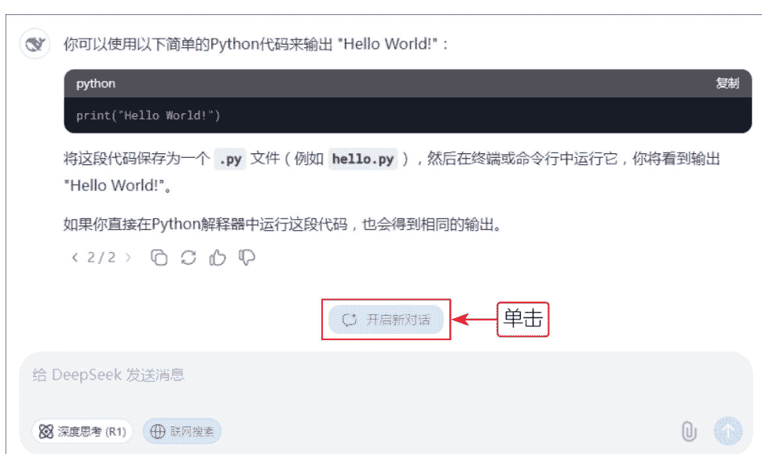

### 1.3.3 连续多轮对话，上下文自然衔接

本产品能够承接多轮问答，会自动捕捉并保留前文脉络，让交流更连贯、更深入，沟通效率也随之提升。

步骤01 在提问区输入指令，例如“我在大理，今天天气如何？”，发送后会得到即时回复，示意如下。

# 大理今日天气及风力概况

按最新预报，2025年3月1日大理情况大致如下：

- 天气状态：多云，部分区域或有阵雨 2 4。
- 温度范围：白天最高约18℃，夜间最低约11℃ 4。
- 风力情况：风偏强，阵风可达8级，需留意防范 15。
- 穿衣建议：建议外套叠加毛衣保暖，早晚温差明显 4 6。
- 紫外线指数：偏强，建议涂抹防晒并减少长时间曝晒 4 6。

另外，大理市气象台已发布大风蓝色预警，未来12小时阵风可能达到8级，请减少外出活动，确保人身安全 15。

如需更详尽数据，可查阅专业气象网站或关注当地气象部门最新动态。

提示：在回复右侧的数字为引用标记，悬停点击即可跳转源网页查看详情。

步骤02 若随后想了解大理的景点，无需再次说明地名，系统会依托前文自动关联。例如输入“请给我推荐一些好玩的地方”，即可得到针对大理的推荐，示意如下。

# 大理今日天气及风力概况

请给我推荐一些好玩的地方

已检索到 47 个网页

大理兼具自然风光与人文底蕴，以下推荐适合不同旅行者：

## 1. 洱海及周边

- 洱海：大理标志性湖泊，水清景秀。可环湖骑行或乘船，感受“洱海神光”的景致 10 11。
- 双廊古镇：坐落洱海东北岸，苍山为背景，是摄影爱好者的取景地。可游览玉几岛与南诏风情岛，傍晚泛舟别有意趣 10 11。
- 喜洲古镇：白族民居保存完好，是喜洲粑粑发源地。可漫步古镇感受白族风情，并前往海舌半岛观赏自然风光 10 11。

## 2. 大理古城周边

- 大理古城：昔日南诏与大理国的都城，街区呈棋盘式。可逛复兴路步行街，品尝地道小吃，体验慢生活节奏 10 11。

使用者可继续追问，例如“这些景点需要门票吗？”“推荐几家好吃的店”等，系统会结合上下文给出精准答案，帮助快速获取有用信息。

### 1.3.4 调用深度思考 R1 模式，复杂议题更专业

深度思考 R1 是一种面向复杂议题的强化分析模块，核心是通过多维度推演、信息整合与逻辑拆解，产出更专业完整的解答。该能力尤其适用于学术研究、商业决策、疑难解答等需要深度剖析的场景。涉及实时数据核验，例如最新政策解读时，建议同步打开“联网搜索”，以提升信息时效性。

**提示：** 对于简单明确的提问，如查天气、基础计算或常识类问题，无需调用 R1。普通模式已能迅速给出准确答案，而 R1 推理耗时更久，且可能因过度推理产生冗余或偏差。

下面以实操演示 R1 的使用方式。

步骤01 在输入框里输入问题，点击【深度思考（R1）】控件调用该模型，再执行发送，示意如下。

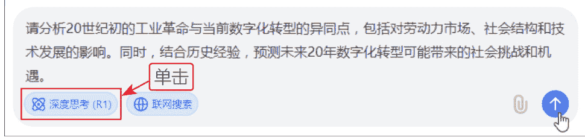

步骤02 此时系统不会直接给出结论，而是先进行检索与推理推演，并展示完整的思考路径与拆解过程，示意如下。

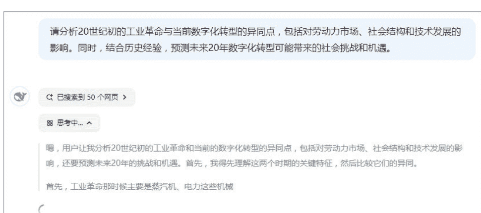

步骤03 推理完成后会生成对应回答，如下页图所示。

**提示：** 若回答过长被截断或未完整生成，可输入“继续”指令要求接续输出。也可用分段指令，例如“请展开说明第 N 点”或“请详细阐述核心论据”，引导模型针对特定部分深入展开。

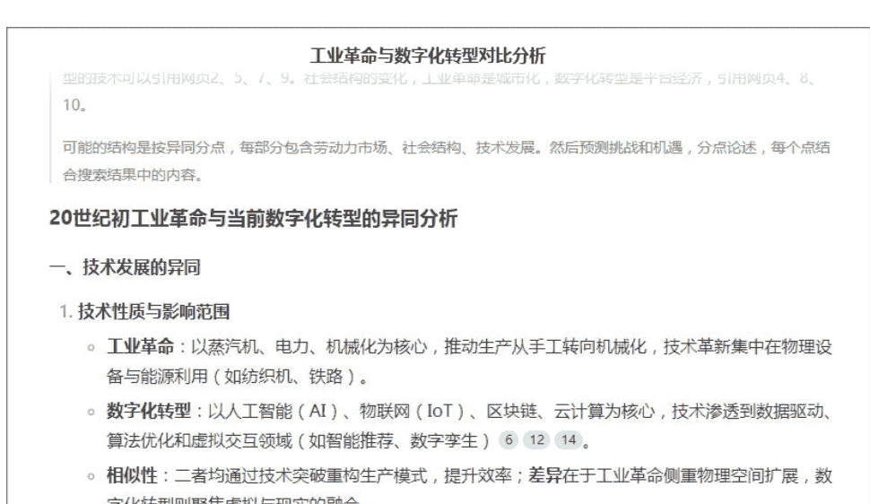

### 1.3.5 上传文件后对话，提升交互便捷度

本产品支持先上传文件再展开对话，大幅提升交互效率，带来全新沟通体验。

步骤01 点击输入框中的 @控件，示意如下。

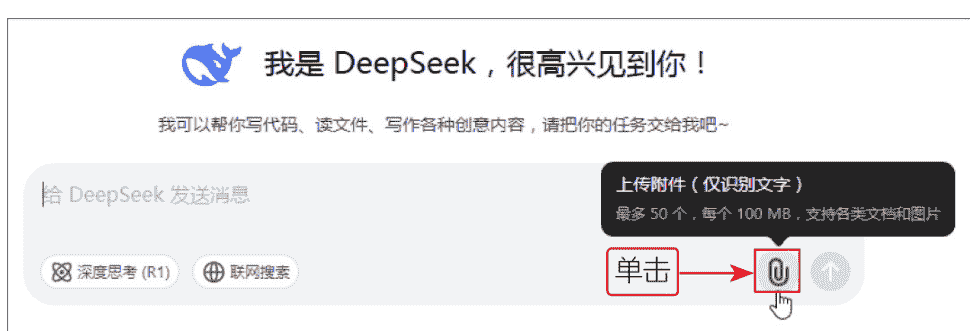

步骤02 弹出【打开】对话框，选择待上传文件，以 Word 文档为例，点击【打开】，示意如下。

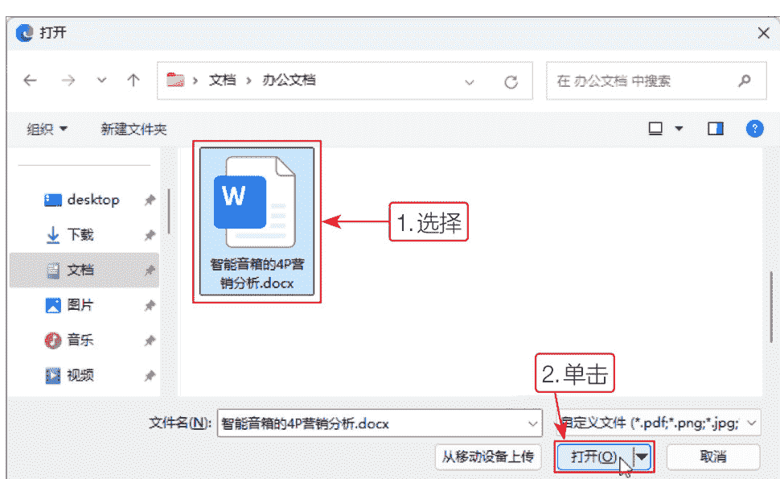

步骤03 文件上传成功后会显示在输入框中，输入问题后发送，示意如下。

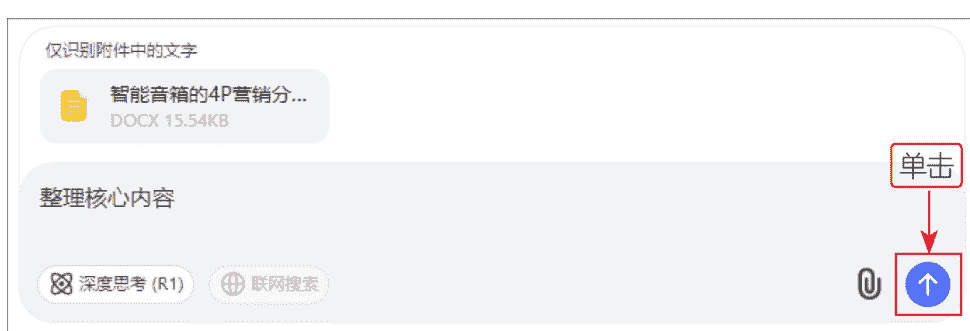

步骤04 系统会基于文档内容结合提示词作答，示意如下。如有新问题可继续互动。

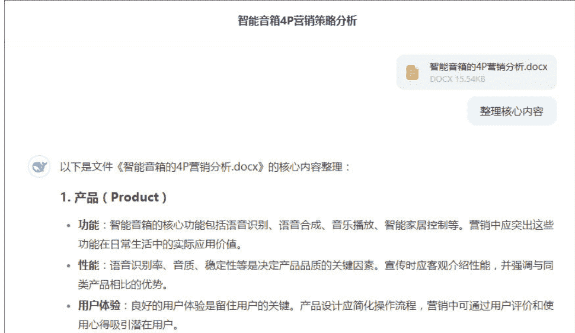

### 1.3.6 历史记录的浏览与编辑

本产品可查看并编辑历史对话，便于回溯回顾并按需修正，提升交流效率与准确性。

步骤01 点击侧栏的【打开边栏】控件 📋，展开对话记录列表，点击任意一条记录即可切换查看，如下页上图所示。

步骤02 将鼠标移至某条记录上，点击出现的 … 控件，如下页中图所示。展开操作菜单后，可选择【重命名】修改标题，或选择【删除】移除该记录。


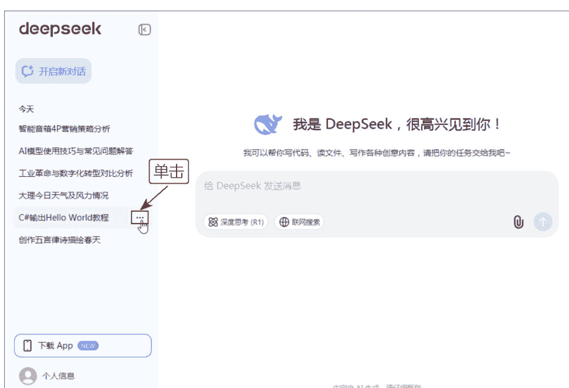

步骤03 选择【重命名】后，如下左图所示，输入新的对话标题名称，如下右图所示，按 Enter 键或在任意空白处点击确认。

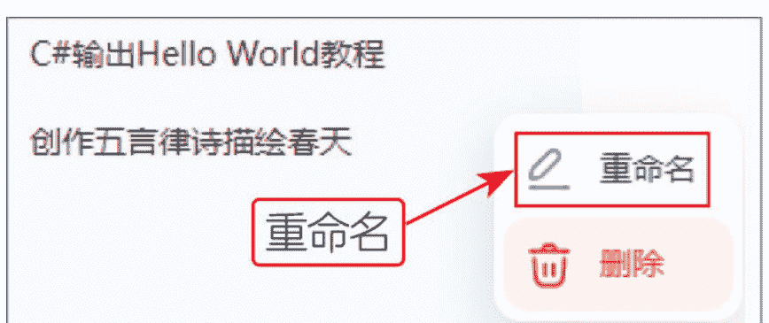


步骤04 此时，即可看到该条对话记录的名称已被修改，如下页左图所示。

步骤05 若需清空全部记录，可点击侧栏中的 ⚙️ 控件，在弹出菜单中选择【删除所有对话】命令，如下右图所示，即可一次性清除。


## 1.4 提示词使用指南

在 DeepSeek 中，提示词扮演着至关重要的角色，它是使用者与模型交互的“桥梁”，熟练掌握提示词的运用，能更好地使用 DeepSeek，并获取期望的信息。

### 1.4.1 提示词是什么

提示词是通过自然语言向 DeepSeek 发出的请求或任务指派。可以是简单的问题，如“今天北京天气怎么样？”，也可以是复杂的创作要求，如“请帮我写一首关于春天的诗歌”。

通过提示词，使用者可以清晰表达需求，而 DeepSeek 可以基于提示词，利用其自然语言处理与深度学习能力，快速准确地生成相应回答或内容。简单来说，提示词就是告诉 DeepSeek 想让它做什么。使用者只需用自然语言清晰表达需求，DeepSeek 就会尽力理解并执行指令，生成相应内容。

因此，熟练掌握并有效运用提示词，将显著提升使用者与 DeepSeek 之间的交互效率与便利性，使用者能更轻松地获取信息、创作内容、执行各类任务。

### 1.4.2 对话为何容易出现答非所问

与 DeepSeek 对话看似简单，但在实际交流中，使用者常会遇到“鸡同鸭讲”的困境。输入问题后得到的回答却与预期不符。以下结合常见场景分析并提供解决方案。

#### 一、表达不够清晰明确

提问时若表述模糊、语义不清，模型难以准确理解意图，就容易出现偏差。比如问题中存在歧义词汇、指代不明或逻辑混乱等。

·示例：使用者提问“怎么写好文章？”
·回复：可能给出笼统建议，如“多阅读、多练习”，但缺乏针对性。
·原因：未限定场景、受众、目标等关键要素。
·解决方案：采用“角色+任务+细节”结构化提问，例如“我是一名大学生，需要写一篇关于‘AI伦理’的课程论文，要求包含3个案例分析，用通俗语言解释技术风险。请提供写作框架和参考文献筛选建议”。

#### 二、上下文理解存在局限

在多轮对话中，模型可能无法完全准确地理解和记忆上下文，导致回答与之前内容不一致或无关。这可能是由于上下文处理机制的局限，或上下文信息过于复杂冗长，超出处理能力。

·示例：在多轮对话中，使用者先提到自己正在学习编程，然后问编程语言选择问题。模型可能未充分考虑学习背景和需求，推荐过于高级或不相关的语言。
·解决方案：在多轮对话时，可适当重复或强调关键上下文信息，帮助模型更好地理解记忆。同时，可尝试将复杂对话拆分为多个简单轮次，避免上下文信息过于复杂。

#### 三、训练数据的局限性

DeepSeek 基于海量文本数据训练。若训练数据缺乏某些领域信息，或特定主题数据质量不高，模型在回答相关问题时就可能出现答非所问。例如，训练数据主要来源于新闻、小说、论文等，对于专业小众领域的新兴概念，数据可能覆盖不足。

·示例：使用者询问“量子计算中最新的纠错编码技术在医疗影像领域的潜在应用”，若训练数据缺乏相关交叉内容，模型可能给出宽泛、不相关的内容。
·解决方案：可尝试换一种方式逐步提问，先从基础概念问起，再逐步引导。例如先问“量子计算常见的纠错编码技术有哪些”，再问“这些技术在其他领域有哪些应用案例”，最后结合医疗影像提问，分步提问有助于模型更好理解意图并给出更准确回答。从开发者角度，需不断扩充优化训练数据，纳入更多领域、更全面高质量文本。

#### 四、知识更新存在滞后

训练数据在某个时间节点前收集整理，对于训练完成后出现的新事件、新知识、新趋势无法及时掌握。若使用者询问最新信息，模型可能因知识更新不及时给出不准确或过时回答，看似答非所问。

·示例：最近发布一款热门电子新品，使用者询问性能和价格，模型因无储备可能给出其他产品信息。
·解决方案：开启“联网搜索”功能获取最新信息。

关于模型本身的问题可暂且搁置。作为使用者，应学会构建精准提示词，并充分利用各项功能，提高对话效率。通过后续章节学习提示词构建技巧及不同场景提问技巧，将逐步掌握与 AI 高效协作的“共同语言”，使 DeepSeek 从“答非所问”转变为“精准应答”。

### 1.4.3 写出高命中提示词

优秀的提示词能让 DeepSeek 更精确理解使用者意图，提升交互效率，并确保获取所需信息。反之，不佳的提示词会耗费大量时间却仍无法获得期望内容。

#### 一、提示词的组成结构

提示词 = 任务描述 + 参考信息 + 关键词 + 要求。

1. 任务描述：准确描述希望完成的事项，可是一个问题、主题或具体任务。
2. 参考信息：若有背景资料、上下文信息，最好在提示词中提供，有助于模型更好理解需求。
3. 关键词：提示词中应包含模型需关注的关键信息或问题，使其更好理解任务并产生合适输出。
4. 要求：明确列出特殊要求、限制条件或偏好，如字数限制、特定格式、使用某种语言或编程风格、遵循特定创意方向或情感色彩等。实际操作中可补充角色指定、示例等。

#### 二、不好的提示词示例

了解组成结构后，下面列举一些不佳示例帮助加深理解。

| 提示词 | 存在问题 |
| :--- | :--- |
| 生成一篇文章 | 缺乏任务关键信息，模型不清楚要生成什么样文章 |
| 阅读这篇文章并给出意见 | 缺少具体任务说明和期望输出类型 |
| 讨论AI的风险 | 缺乏明确关键问题或指导，可能产生宽泛不切实际输出 |
| 生成一张图片 | 提示过于模糊，未说明所需图片内容或类型 |
| 写一段对话 | 缺乏任务背景和关键信息，无法确定对话主题或背景 |

#### 三、优秀的提示词示例

·任务描述：生成一段对话，讨论环境保护的重要性和可行性，并提出方案。
·参考信息：环境问题包括气候变化、污染、资源浪费等。
·关键词：环境保护、气候变化、污染、资源浪费。
·要求：对话应包含至少两位参与者，每位至少提出两个保护环境方案。对话总字数 500~800 字。

汇总成完整提示词如下。

生成一段对话，讨论环境保护的重要性和可行性，并提出方案。在对话中，两位及以上参与者需每人提出至少两个保护环境的方案。同时详细探讨环境保护、气候变化、污染、资源浪费等问题，并给出不同观点和意见。请确保对话总字数 500~800 字。

### 1.4.4 写出好提示词的 9 个技巧

优秀的提示词具有规范结构和明确主题，有助于模型更好理解意图并提供准确有用回答。下面介绍 9 个构建技巧。

#### 一、使用明确的语言

交互时建议使用明确语言，避免含糊或歧义表述。此外，为确保回答语言准确性，可在提示词中明确指定所需语言，如中文、英文等。

例如，若希望以英文回答，可注明：“请确保以下回答内容使用英文。”明确语言有助于确保模型准确理解并回应需求。

#### 二、说明输出内容的形式

使用时可通过说明输出形式引导模型按期望形式输出，使控制更有效，且更符合需求。

例如，在提示词中说明“请以表格形式输出内容”。

#### 三、使用标签指导对话

对话时使用标签可指导模型针对特定主题回答或执行特定任务。标签好处是限制回答范围，使其专注特定主题或任务。需注意标签仅起指示作用，模型仍可能因提示模糊等因素产生不确定回答。因此使用标签后仍需谨慎审查确认回答准确性与实用性。

标签不仅可用于指导主题，还可用于执行特定任务，例如问答、翻译、摘要、搜索等。对于搜索任务，可用标签指定问题和回答格式，让模型正确回答。例如下面两个示例。

1. 主题型。
请创作一篇科幻短篇小说，描述一个高度发达的科技城市中人们的生活状态、城市景观以及可能面临的挑战。

# 未来科技城市

2. 任务型。
# 网络搜索
请搜索“2025年最新科技趋势”，并总结前3个主要趋势。

#### 四、限制回答内容的字数或格式

可用字数限制控制生成内容的长度，以满足使用需求。示例如下。

请创作一篇关于“环保与可持续发展”的短文，字数控制在500字以内，内容需涵盖当前环境问题的严峻性、环保的重要性以及个人和社会在推动可持续发展方面可以采取的实际行动。

#### 五、使用引号强调关键词

使用引号可强调提示词中的关键词，使提示更加清晰明确，同时引起模型对重要信息的关注。示例如下。

分析并给出当前市场上最受欢迎的“智能家居”产品及其主要特点。

#### 六、提供模板给 DeepSeek 参考

通过提供特定模板，可精确指导输出内容，确保输出符合预期。这不仅增强回答的精确性与一致性，还赋予更大控制权。示例如下。

请根据虚拟人物的资料按照以下模板，设计一份可修改内容的简历。

姓名：[你的姓名]。
联系方式
电话：[电话号码]。
电子邮箱：[电子邮箱地址]。
最高教育背景：
[学校名称], [学位], [专业], [毕业时间]。
近期两段工作经历：
[公司名称]
职位：[职位名称]。
工作时间：[起始日期] – [结束日期]。
[公司名称]
职位：[职位名称]。
工作时间：[起始日期] — [结束日期]。
语言特长：
编程特长：
其他：

#### 七、提供背景信息

# 让 DeepSeek 更懂你的背景

为模型补充充分的上下文，是获得精准回复的前提。提供职业定位、兴趣偏好、教育经历等信息，能帮助模型贴合你的语言习惯与思考逻辑，从而产出更符合预期的结果。参考用法如下。

请你扮演一名执业超过二十年的中国资深律师。针对我提出的“赠与物能否要求返还”这一问题，给出系统且专业的法律意见。作答时请遵循保密义务、合规要求，保持客观中立、审慎尽责。语气应严谨专业，既能提出观点建议，也能引导我妥善处理相关法律事务。

#### 八、把复杂议题拆成步骤提问

面对复杂议题时，可将其拆解为若干逻辑清晰的小问题依次提出。这样能引导模型逐层深入，避免结论过于笼统。举例说明。

以“人工智能在教育领域的应用与挑战”为例，可先问“当前人工智能在教育中有哪些主要的应用形态”，再问“这些应用在落地时遇到了哪些技术层面的瓶颈”，最后探讨“从政策与教育理念角度，人工智能应用还面临哪些制约”。通过递进式提问，可实现对复杂话题的全面剖析。

#### 九、用条件范围限定答案精度

在指令中明确限定回答边界，能有效收窄输出范围，获得更具针对性的信息。限定维度可包括时间、地点、对象、领域等。举例：

- 时间限定：2023年至2025年间，全球新能源汽车电池技术有哪些重要突破？
- 地点限定：请列出上海浦东新区内，步行十分钟可达地铁站且全天营业的便利店。
- 对象限定：面向小学生，设计五款锻炼逻辑思维的趣味游戏，要求材料常见易得。
- 领域限定：在医美范畴，目前有哪些新型的非手术抗衰手段？其原理、成效与安全性如何？

### 1.4.5 提示词中常见的特殊符号

构建提示词时，合理使用特殊符号可提升指令的清晰度与结构化程度，使输出更符合预期。符号在提示中承担限定、说明、占位等功能，有助于精准传达需求。

下表列出常用符号的用法与示例。

| 符号 | 作用说明 | 示例 |
| :--- | :--- | :--- |
| [] 方括号 | 标示可选项或指令提示 | 请写一篇[抒情/叙事]风格的短篇 |
| () 圆括号 | 对需求做补充解释 | 请把这段文字译成英语 美式英语 |
| {} 大括号 | 插入变量或待填内容，使指令更灵活 | 请把下面句子译成法语：{用户输入内容} |
| <> 角括号 | 定义样式、格式或角色 | 请用<文言文>风格改写这段话 |
| # 话题标签 | 突出关键词或主题 | #旅游景点#请介绍长城 |
| ## 双井号、### 三井号 | 体现标题层级，#越多层级越细 | ## 章节概览<br>### 小节要点，按此结构归纳文章 |
| * 星号 | 表示可重复字符，常用于模式匹配 | 列出所有以*为开头的文件名 |
| : 冒号 | 用于定义或说明某项内容 | 任务：撰写一篇关于气候变化的文章 |
| / 斜线、\ 反斜线 | 表示选择或分隔 | 请用英语/法语翻译此句 |
| | 竖线 | 与斜线类似，多用于并列选项的强调 | 请以|欢快|激昂|舒缓|其中一种风格为舞蹈视频写背景音乐文案 |

掌握上述符号，有助于构建更清晰的指令，后续实战将进一步演示。

# 第2章 DeepSeek 赋能职场写作

在快节奏的工作环境里，优质的文字表达是核心竞争力。无论是报告撰写、方案策划还是教学设计，都离不开准确清晰的语言。本章展示 DeepSeek 如何作为写作助手，从稿件润色与语气调整到文学创作与公文写作，再到教学总结，帮助提升文字的专业度与感染力。

## 2.1 文本润色、调整与优化

用词恰当、句式顺畅与语气匹配是提升文档品质的关键。商务文书或学术论文都需要语言的精炼与可读性。以下介绍如何借助 DeepSeek 改善表达，让内容既准确又具吸引力。

### 2.1.1 实战：润色文本

在职场中，条理清晰、简洁有力的书面表达有助于塑造专业形象。润色能够提升文档质量，增强信息传递效率。

张林在某企业行政部工作，需向部门经理汇报提升效率与优化流程的建议，希望通过润色让汇报更精炼、结构更清晰，便于领导快速抓住要点。

**提示词**

请把下面这段文字润色，使其更简洁、层次更分明。

文本：在现代办公环境中，提高工作效率和优化工作流程是关键所在，其中，优化工作流程尤为重要。我们需要重视预先规划、执行和管理可能面临的主要工作挑战及协调压力，以防止出现流程不畅的情况，确保部门能够在日常工作中保持高效率并持续改进。为此，提高对工作流程优化重要性的认识，完善执行机制，并制订有效的应对策略，对于促进部门的长期稳定运作有着至关重要的意义。

**回答**

该项目整体推进顺利，但仍有少量问题需及时处理。望大家共同配合，争取尽快完成。

在现代办公中，提升效率与优化流程至关重要。可从以下方面着手：

1. 提前规划：重视前期设计，应对主要工作挑战。
2. 执行管理：强化管控，协调压力，避免流程阻塞。
3. 持续改进：保持日常高效，持续寻求优化。

认识流程优化的价值、完善执行机制、制定有效策略，对部门长期稳定运行至关重要。

通过上述指令，DeepSeek 能够帮助用户将原文润色为更流畅专业的表达。

**提示词进阶**

润色时可加入限制条件以获得更理想结果。示例：

- 保持原意不变。提示词：请润色以下内容，不改变原意。
- 控制字数。提示词：请润色以下内容，总字数控制在200字以内。

### 2.1.2 实战：调整语气

语气调整直接影响沟通效果。DeepSeek 可以识别并转换文本语气，使其更符合受众期待。

**场景**

李彬需审核一份合同，要求表述更严谨正式，符合规范。

**提示词**

请对下面合同表述进行调整，使语气更严谨、正式。

原文：这份合同目前看起来还不错，但有几个小地方需要修改一下。大家尽快处理，争取早日完成。

**回答**

经初步审阅，本合同内容总体符合规定，但仍有若干细节需予修正。请相关方抓紧办理，务必在最短时间内完成修订。

**提示词进阶**

若需明确语气风格，可提供示例说明期望效果，并指出使用场景与目标读者。例如：

请将以下文本调整为正式风格。内容需体现对合作伙伴的尊重与重视，同时凸显本公司实力与合作价值。

### 2.1.3 实战：扩写和缩写文本

扩写可丰富内容、增强表现力；缩写可提炼要点、突出核心。DeepSeek 能依据要求精准执行二者，提升写作效率。

**场景**

刘丽需向团队与上级提交工作日报，原稿较简略，希望扩写为详细记录。

**提示词**

请帮我将下面工作日报扩写，信息更详细全面。

原文：今天完成了项目需求分析，与客户进行了初步沟通，明天将继续细化客户需求。

**回答**

工作日报—[日期]

姓名：[您的姓名] 职位：[您的职位] 部门：[您所在的部门]

当日总结

1. 项目需求分析
   - 今日主要完成对[项目名称]的需求梳理，涵盖背景理解、目标设定与成果预期。
   - 仔细研读相关资料，并与团队讨论，确保对客户需求的理解准确一致。
……
4. 问题与对策
在需求分析中发现客户对部分技术细节理解存在偏差。计划在明日团队会议中提出，并探讨更易懂的解释方式。

通过上述指令，简短日报被扩展为详细记录。实际使用时需核查真实性与逻辑性，突出重点与成果，并合理规划后续工作。

**提示词进阶**

扩写缩写时需明确目的并提供背景，保留关键信息且保证连贯流畅。示例：

- 扩写提示词：请将下面句子扩写为约200字的文章，保持温馨基调并补充细节。
- 缩写提示词：请将下文压缩至100字以内，需完整保留原文要点、核心论述与结论，保证信息准确完整。

### 2.1.4 实战：续写文本

续写能够在已有基础上延续叙事，保持连贯性与完整性。

**场景**

张强正在创作小说，已完成开篇，需继续推进情节。

**提示词**

请根据下面原文续写约800字，情节合理、语言风格一致，着重描写艾丽的心理活动及山洞景象，突出趣味性。

原文：在一个遥远的小镇上，住着一个名叫艾丽的年轻女孩。她生性善良，但性格内向，总是独来独往。一天，她在小镇边缘的森林里偶然发现了一个神秘的山洞，洞口闪烁着奇异的光芒。

**回答**

艾丽站在洞口，心中矛盾交织。一方面她惧怕未知与潜在危险，另一方面好奇心驱使她想一探究竟。她深吸一口气，鼓足勇气踏入山洞。

……
她小心将水晶球放回石台，转身带着惊喜与期待踏上归途。她明白，这次发现将改变自己的生活，或许也会影响整个小镇的命运。

### 2.1.5 实战：校对文本

校对是确保文本规范准确的重要环节。DeepSeek 可快速定位语法与错别字问题。

**场景**

王然撰写市场调研报告摘要，需在部门会议前仔细校对。

**提示词**

请校对下面文本的语法错误与错别字，并给出修正版。

原文：在最近的市场调研中，我们发现消费者对我们的新推出的产品反响热烈。产品的设计和功能得到了消费者的一至好评。此外，我们还收集了大量关于产品改进的反馈，这些反馈对我们未来的产品开发具有重要的参考价值。然而，我们也注意到市场上存在一些竞争产品，这些产品在价格上具有明显的优势。因此，我们建议公司在保持产品质量的同时，也要考虑成本控制，以提高产品的市场竞争力。

原文存在以下问题，修正后如下。

问题点：

1. “我们的新推出的产品”改为“我们新推出的产品”，删去多余“的”。
2. “一至好评”应为“一致好评”，纠正错别字。

修正版本：

在最近的市场调研中，我们发现消费者对我们新推出的产品的反响热烈。产品的设计和功能得到了消费者的一致好评。此外，我们还收集了大量关于产品改进的反馈，这些反馈对我们未来的产品开发具有重要的参考价值。然而，我们也注意到市场上存在一些竞争产品，这些产品在价格上具有明显的优势。因此，我们建议公司在保持产品质量的同时，也要考虑成本控制，以提高产品的市场竞争力。

校对后需再次核对内容准确性。也可上传文档并发送指令让 DeepSeek 统一校对。

**提示词进阶**

校对指令应明确具体，说明检查范围与格式要求。示例：

请仔细阅读下文，检查语法、拼写、标点及句式问题，确保逻辑清晰、表述准确，并在保留原有风格与格式的前提下，提供修改建议与反馈。

## 2.2 文学内容创作

文学创作是情感表达与创意呈现的重要方式。诗歌、小说、日记、新闻稿等均需丰富的想象与语言功底。DeepSeek 可提供灵感并提升作品质量。

### 2.2.1 实战：诗歌创作

诗歌以韵律与意境见长，是表达思想情感的载体。本节介绍借助 DeepSeek 进行诗歌创作的方法。

**场景**

李华希望创作一首描绘春天的诗，表达对自然的热爱与生活感悟。

**提示词**

请创作一首关于春天的诗歌，需包含：①春日景象，如花朵、绿叶、暖阳；②春天带来的生机；③个人感受与思考。语言要优美真挚。

**回答**

《春之颂》

春风轻拂沉睡的大地，
唤醒花朵与绿叶。
在温暖阳光下，
它们绽放出绚烂生命。
花在枝头轻舞，叶在风中低语，
……

在这生机盎然的季节，
我与你，共赴生命盛宴。

通过指令，DeepSeek 可按主题与情感要求生成诗歌，用户可进一步修改以体现个人风格。

**提示词进阶**

可提供更具体的风格与情感指向，例如：

请创作一首现代风格的诗，主题为“春日的希望”。需涵盖樱花、嫩叶、晨露等意象，体现生机与希望，并融入对时间流逝与生命意义的思考。语言简洁深刻。

### 2.2.2 实战：小说撰写

小说依靠情节与人物塑造吸引读者。本节介绍利用 DeepSeek 构建故事大纲与人物形象。

**场景**

赵阳计划写一部青春成长小说，在情节构思与人物塑造上遇到瓶颈。

**提示词**

请帮我构思一个“青春成长”小说大纲，需包含：①充满挑战与机遇的青春背景，如校园或社会；②性格鲜明的主要人物；③引人入胜的情节，展现成长心路；④主题鲜明、情节紧凑、语言生动。

The request was rejected because it was considered high risk

## 2.3.4 实战：内部培训计划书撰写

内部培训计划书用于明确培训目标、内容、方式与安排，确保活动高效有序，满足企业与员工发展需求。

#### 场景

王进是公司HR专员，为提升员工专业技能与协作能力，需撰写内部培训计划书。

#### 提示词

请帮我撰写一份内部培训计划书，需包括：①背景与目的；②培训对象；③内容与课程安排；④师资与资源；⑤时间地点；⑥考核评估方法。内容要详实、逻辑清晰、语言专业。

#### 回答

# 内部培训计划书

## 一、培训背景和目的

背景：随着业务扩展与竞争加剧，提升员工专业素养已成公司持续发展的关键。为此计划开展内部培训，确保员工适应新要求，提升效率与协作。

……

结语：通过本次计划实施，期望全面提升员工综合素质与工作效率，为公司长远发展奠基。我们相信，持续学习将使团队更强大，更好应对未来挑战。

[培训负责人签名]

[日期]

通过上述指令，DeepSeek 可按需求生成系统化的培训计划书，用户可在基础上调整优化以提高实用性。

#### 提示词进阶

提供更具体的培训内容与考核标准可使计划更具操作性。示例：

请撰写一份内部培训计划书。背景：业务快速发展，员工技能与协作需提升。目的：系统培训以增强专业能力与团队协作，支撑公司发展。对象：全体员工共100人。内容：专业技能、团队训练、领导力提升等6个模块，每模块2小时。师资：外聘专家与内部资深员工，配备资料与设备。时间地点：2025年3月20日至22日，公司培训室。考核：笔试与实操考核，评估学习成果。要求内容详实、逻辑清晰、语言专业。

## 2.3.5 实战：员工培训通知撰写

员工培训通知是内部沟通的重要载体，清晰准确的通知有助于提高参与度与效果。

#### 场景

某公司人力资源部拟组织销售技巧提升培训，对象为全体销售人员，需发布通知。

#### 提示词

# DeepSeek 职场文书生成实操笔记

## 培训通告写作样例

需求要点：生成一份正式的内部通知，主题锁定为销售技能强化。要点包括目的——夯实业务能力、提高成交效能、推动整体业绩；时间——2025年3月18日至20日，每日09:00-17:00；地点——公司会议室；讲师——受邀外部销售培训专家，需概括其专业履历与实战积累；参会要求——提前10分钟签到，自备笔记本与笔；报名——将姓名、工号回邮至指定邮箱。语言需庄重礼貌，信息无误。

示范输出概要：以《销售技能提升培训通告》为题，向全体同事说明本次专题培训的安排与意义，强调学习价值对个人成长与公司业绩的助益，落款为人力资源部并署发布日期。

依此指令，DeepSeek 能快速生成规范通告。撰写此类文书的关键是表述简洁、重点突出、格式统一，生成后务必复核时间、地点等核心要素。

指令优化建议：可补充课程大纲、授课形式等细节，并明确考核方式与激励措施。例如：

请拟一份团队建设培训通告，时间为2025年3月24日至26日，每日10:00-18:00，午休1.5小时，地点公司培训中心。讲师为知名团队建设专家，请列出代表性成果。要求全员参加，说明缺席处理办法。内容涵盖团队沟通、协作提升、领导力培养并附大纲。形式包括互动教学与户外拓展。考核以小组成果与个人表现双轨进行，优异者可获建设基金或额外休假。报名需填在线表格，包含团队归属与个人专长。语气正式严谨，细节完整。

## 2.3.6 实战：工作交接文档撰写

岗位交接文件在人员轮换或离职时作用关键，能系统记录工作范围、流程、资源，确保业务连续，避免差错，并为接任者提供清晰指引。

场景：市场部韩冰负责公司社交媒体运营，即将离职，需向接手人李妙移交进行中的任务、账号资料、运营思路、合作资源及未完成事项。

提示词：请制作一份交接文件，涵盖进行中工作如筹备中的社媒活动、目标与进展；账号信息如名称、登录方式、密码、粉丝规模与分布；运营策略如发布计划、互动打法、推广渠道；合作资源如网红、KOL 名单；未竟工作如与供应商洽谈项目及下一步计划。语言清晰详实。

参考输出概要：以《工作交接文件》为题，分在办事项、活动筹备、目标受众等条目罗列要点，交接后由双方核对签字确认，落款公司、部门与生成日期。

借助以上提示，DeepSeek 可按提供的业务信息生成详尽交接材料。

优化思路：提供更具体的业务细节与后续指导。例如：

请为我撰写“市场推广项目”交接文件，需包含：①项目概况，含目标市场与预期成果；②当前进度，已完成与进行中事项；③关键任务与责任分工，特别是与广告代理沟通及预算管控；④风险与挑战，如竞品动作与预算限制；⑤后续计划，包括即将举行的新品发布会及预期市场反馈。语言专业详尽，便于继任者快速掌握背景与方向。

## 2.3.7 实战：商务邀请函撰写

商务邀请函是企业间正式沟通的桥梁，既传递活动信息，也体现专业度与尊重。

场景：市场部负责人陈晨需邀请潜在合作伙伴出席即将举行的商务会议，函件须包含目的、议程、时间地点并表达期待。

提示词：请撰写商务邀请函，需包含会议主题与目的、具体时间地点、主要议程与预期成果、对合作伙伴出席的热切期盼与感谢。语言正式得体，彰显公司形象。

参考输出概要：以《商务邀请函》为题，致合作伙伴公司，说明会议主题与目标、时间地点与议程，请求在截止日前确认参会意向并署名联系方式。

借助该提示，DeepSeek 可生成专业邀请函，可在此基础上微调以提升准确性与吸引力。

优化思路：明确会议细节与期望。例如：

请撰写邀请函，邀请合作伙伴参加“2025年战略合作伙伴峰会”。需包含主题“共创未来”，目的探讨未来合作与市场趋势；时间2025年4月10日，地点国际会议中心；议程包括市场分析、合作项目介绍、商务洽谈；表达对长期支持的感谢与对出席的热切期望。语言正式礼貌，突出诚意与峰会分量。

## 2.4 教学设计与总结

教学设计与总结是教学闭环的关键，借助 DeepSeek 可提升效率与质量。

### 2.4.1 实战：制订教学目标与大纲

教学目标与大纲指引方向与预期成果，DeepSeek 可依据主题与学情科学制订。

场景：初中数学教师张老师拟讲授“一元二次方程”。学生已掌握一元一次方程，运算尚可，思维拓展与应用需加强。

提示词：请为“一元二次方程”一章制订目标与大纲。对象为初中生，已学一元一次方程。内容包括概念、解法配方法公式法因式分解法、根的判别式、根与系数关系及实际应用。目标需覆盖知识技能、过程方法、情感态度价值观。大纲需列出各环节内容、方法与时长。语言清晰规范。

参考输出概要：教学目标分知识与技能、过程与方法等维度，时间分配含复习、练习、测试、小结等环节，旨在帮助学生系统掌握并灵活应用。

实际使用时需结合学情微调。

优化思路：提供学习风格与兴趣信息，明确重难点突破策略。例如：

请为高二“静电场及其应用”制订目标与大纲。学生对物理实验感兴趣，抽象思维待提升。内容含电场概念、电场强度与电场线、电势与电势能、电场力做功与电势能关系等。目标侧重培养实验探究与抽象概念理解能力。需说明如何用模拟实验软件突破电场概念难点，明确重点与难点，并多样化教学方法，合理分配时间。

### 2.4.2 实战：制作教学PPT课件大纲

教学PPT以直观形式呈现内容，提升效果与吸引力。

场景：初中历史教师王老师需制作PPT，提高兴趣与参与度。

提示词：请制作主题“古代文明的交流与传播”的PPT大纲。需涵盖丝绸之路路线、关键城市、贸易商品；佛教传播起源、路线、对中国文化影响；其他交流方式如战争、移民等举例；交流的经济文化社会意义。

参考输出概要：封面页含标题与配图，正文分丝绸之路、佛教东传、其他交流方式与意义，设计建议统一字体、醒目标题、高清配图、图表时间线等。

优化思路：明确具体内容与教学法。例如：

请为“古埃及文明”历史课制作PPT大纲，需包含地理位置、社会结构、宗教信仰；金字塔、法老、象形文字等关键元素的配图与说明；互动环节如古埃及日常生活小测验与文明影响小组讨论。内容丰富互动性强，激发探索欲。

### 2.4.3 实战：设计互动式教学活动

互动式活动提升兴趣与参与，促进理解吸收。

场景：吴老师准备中学“环境保护”科学课，期望线上线下结合，让学生在实践中认识环保重要性。

提示词：请设计“环境保护”互动教学方案。含线上与线下两部分，线上用网络平台进行知识竞答或小组讨论，线下安排实地考察或环保小项目。目标明确步骤清晰，提供材料清单与表现评价标准。

参考输出概要：活动名为“绿色行动”，目标提升认知、增强意识与实践能力、培养协作精神。包含步骤与总结反馈，兼顾理论与实践。

优化思路：明确活动类型与目标。例如：

请设计“力和运动”互动活动，让学生通过实验理解牛顿运动定律。需包含目标、分组小车推动实验与数据记录、材料清单、实验报告与小组展示的评价方式。兼具趣味与教育意义，提升实践与协作。

### 2.4.4 实战：撰写教学工作总结

工作总结帮助教师回顾反思，为改进提供依据。

场景：李老师完成本学期《数学分析》教学，需撰写总结回顾收获与学生情况，为下学期改进提供方向。

提示词：请撰写《数学分析》课程教学工作总结，包含教学回顾、学生学习情况分析、教学效果评估、经验反思、未来改进方向与计划。内容全面客观，语言简练。

参考输出概要：回顾教学计划与方法，分析成绩与态度，评估成果与不足，总结经验，提出改进措施。

借助提示，DeepSeek 可生成全面总结，可进一步深化。

优化思路：明确评价标准与改进方向。例如：

请撰写本学期“化学”课程工作总结，需包含主要教学活动与目标、学习情况如平均成绩与参与度、教学方法有效性分析、存在的问题如复杂概念理解困难及改进措施。总结客观全面，为未来提供改进策略。

# 第3章 职场提效：DeepSeek助力工作效率翻倍

职场竞争加剧，提升效率至关重要。DeepSeek凭借强大功能成为提效利器，从文本处理与信息抽取、沟通协作优化到文案创作与商业分析，加速日常任务并提供创新思路。

## 3.1 文本处理与提取

工作中常需处理多格式文本并抽取关键信息，DeepSeek可实现高效处理。

### 3.1.1 实战：一键转换文本格式

格式转换是高频需求，如将文本转为Markdown，DeepSeek可轻松实现。

场景：内容创作者孙鹏从旅游论坛与博客收集攻略素材，格式混杂，期望整理改写并统一为Markdown以便发布。

提示词：请将以下旅游攻略混合格式文本转为Markdown，保留标题层级、段落、列表与链接。

参考输出概要：以《泰国普吉岛旅游攻略》为例，保留标题、段落、链接与列表，一键转换大幅提高效率。

优化思路：明确支持的Markdown语法与输出要求。例如：

请将文本转为Markdown格式，确保支持标题、无序列表、有序列表、链接与图片等语法。

### 3.1.2 实战：文本转换为表格

文本呈现不利于快速分析比较，转为表格可使数据结构化、直观，有助于发现规律。

场景：略

财务岗位的张宇，日常要把大量以文字形式记录的财务信息整理成结构化表格，用于分析与做报表。人工录入既耗时又容易出错，已经成为他工作中的痛点。

**提示词**

请将下方的产品销售数据转换为表格。

- 产品A，150，3000元

- 产品B，200，4500元

- 产品C，120，2400元

**回答**

以下是将您提供的产品销售数据转换为表格的结果：

| 产品名称 | 销售数量 | 单价/元 |

| :--- | :--- | :--- |

| 产品A | 150 | 3000 |

| 产品B | 200 | 4500 |

| 产品C | 120 | 2400 |

用这种提问方式，文本信息可以迅速被结构化，处理效率和可读性都有明显提升。

#### 提示词进阶

写指令时最好把期望的表结构说明清楚，例如：

请帮我将以下文本内容转换为Excel表格，具体要求如下。

- 列标题分别为：姓名、职务、部门、学历、专业、居住地址、联系方式、邮箱地址。

- 如果信息中有电话号码，则在联系方式列只填写电话号码；如果没有电话号码但有邮箱地址，则在联系方式列只填写邮箱地址。若两者皆无，联系方式列留白。

- 确保每一行数据对应正确的列。

### 3.1.3 实战：图片中文字的提取

遇到扫描件或图库资料时，经常需要把图像里的文字拿出来。借助 DeepSeek，这个过程可以快速完成。

**场景**

周蒙蒙手上有3张市场研究报告的图片，需要把里面的文字导出来。

**提示词**

请帮我提取图片中的文字。（将要提取的图片按顺序拖曳至输入框中，输入上述提示词并发送，如下图所示）

**回答**

DeepSeek自动提取图片中的文字，用户可以选择文字内容并执行复制操作，如下页图所示。

# 网络微短剧市场深度分析

请帮我提取图片中的文字

以下是图片中的文字提取内容：

01.png

# 《网络微短剧市场深度研究报告》

## 一、网络微短剧市场概述

### （一）微短剧定义及特点

微短剧，又称网络微短剧，国家广电总局定义为“单集时长从几十秒到15分钟左右，有着相对明确的主题和主线、较为连续和完整的故事情节”的剧集。其特点主要体现在以下几个方面：

用上面这种问法，就能把图片里的文字快速抓取出来，抓取后仍建议人工核对准确性。

#### 提示词进阶

指令可以要求对提取结果做翻译或润色，比如：

请从给定的图片中提取所有文字信息，并将其精准地翻译成中文。同时，对翻译后的文本进行润色，以确保语言表达正式、规范。要求：①提取图片中的所有文字信息，包括标点符号和外文字符；②将提取的文字信息精准地翻译成中文，确保字面意思不变；③对翻译后的文本进行润色，以提高语言表达的准确性和规范性；④润色过程中，请确保文本的流畅性和可读性，避免生硬和冗余的表述。

### 3.1.4 实战：快速提取文本关键词

从文章里提炼关键词，有助于迅速把握主旨，是检索和摘要的基础。

**场景**

管峰是市场研究人员，需要从大量调研报告和用户反馈里抓出关键词，以便识别趋势和关注点。

**提示词**

请帮我从下述文本中提取关键词，包括以下任务：①识别文本中的高频词汇和短语；②评估词汇与文本主题的相关性；③筛选出最具代表性的关键词。请确保提取的关键词能够准确反映文本的主题和重点。

原文（略）。

**回答**

根据您提供的文本，识别出文本中的高频词汇和短语有：微短剧、网络微短剧、市场规模、发行数量、受众规模、题材、剧情、制作、盈利模式、内容付费、广告变现、电商带货、流量分账、IP改编、网络视频用户、短视频用户、垂直推送、免费模式。

......

筛选出最具代表性的关键词：微短剧、市场规模、发行数量、受众规模、题材、剧情、制作、IP改编、垂直推送、盈利模式、免费模式。

这些词能够贴合文本主题，覆盖微短剧市场的定义、表现、创作、特征和商业模式等维度。

通过上述指令，可快速得到最具代表性的关键词，抓住核心要点。若文本过长，可先保存为文档上传再执行。

#### 提示词进阶

指令可以把任务拆得更细，例如：

请帮我从以下文本中提取出最重要的15个关键词，并按重要性排序。要求：①提取的关键词应包括名词、动词和形容词；②请同时提供每个关键词出现的次数；③尽量排除常见的停用词（如“的”“和”等）；④提供关键词之间的关联度或共现频率。请确保提取的关键词既能反映文本的主要内容，又能体现其重要性。

### 3.1.5 实战：分析文本的情感色彩

情感分析借助自然语言处理识别文本表达的情绪，可帮助企业了解公众看法，对市场调研和舆情监测很有帮助。

**场景**

秦伟是市场分析师，需要对新产品的用户评论做情感判断。

**提示词**

请帮我分析以下文本的情感色彩，并判断其是正面、负面还是中性，请提供详细的情感分析报告，包括整体情感倾向和具体的积极/消极词汇。

文本内容：（省略）

**回答**

以下是对这些文本的情感分析报告。

## 第一段文本

- 整体情感倾向：正面。

- 积极词汇：生活小助手、时尚精致、非常舒适、合适、功能强大、精准可靠、丰富多样、准确记录、科学参考、及时、不错、非常方便、非常满意、强烈推荐。

……

## 第十段文本

- 整体情感倾向：中性。

- 积极词汇：很喜欢、人性化、佩戴舒适、多种表盘、根据心情更换、非常强大。

- 消极词汇：重量比较重、续航能力差。

用此指令即可快速判断文本情绪，为调研和舆情提供支持。

#### 提示词进阶

指令可以更细化要求和输出，例如：

请帮我分析以下文本的情感色彩，并判断其是正面、负面还是中性。同时，请提供详细的情感分析报告，包括整体情感倾向、具体的积极/消极词汇及其强度评分。具体要求如下：①确定文本的整体情感倾向（正面、负面或中性）；②列出所有积极词汇和消极词汇，并给出它们在文本中的位置；③对每个词汇进行情感强度评分（如1~5分，1分为最弱，5分为最强）；④如果文本中包含混合情感，请指出并解释不同部分的情感差异。请确保情感分析报告既全面又准确，能够清晰地展示文本的情感色彩。

## 3.2 回复与互动管理

在职场和社交中，高效得体的回复能力是提升形象、推动工作的重要环节。

### 3.2.1 实战：回复邮件

商务沟通里邮件很关键，DeepSeek可帮助快速专业地起草回复。

**场景**

程可任项目经理，经常与客户和团队邮件往来。近期收到潜在客户来信，需要专业回复。

**提示词**

请帮我回复一封客户的邮件，确保回复内容专业、礼貌且切中要点。

邮件原文（略）。

**回答**

尊敬的××：

您好！

非常感谢您对我们合作项目的关心和支持。以下是您所询问的项目进度的详细回复。

## 1. 项目整体进度

目前，项目已完成了[具体百分比]%的工作量。我们按照既定的时间表稳步推进，各项任务均在有序进行中。核心团队成员均表现出色，确保了项目的高效进行。

......

再次感谢您的理解和支持。

顺祝商祺，

[您的姓名]

[您的公司名称]

[您的职位]

[您的联系方式]

邮件模板生成后，可根据实际情况微调，保持个性化，避免生硬。最后要及时跟进客户反馈，保持良好沟通。

#### 提示词进阶

若想让回复更具体专业，下达指令时可补充关键信息、背景和具体要求，例如：

请帮我正式地回复这封来自客户的邮件。主要内容包括：感谢客户对我们产品的关注与询问；简要介绍产品的核心特点和优势；邀请客户参加即将举行的线上产品演示会，并提供会议时间和链接；表达期待客户参与的愿望，并附上我的联系方式以便进一步沟通。请注意，在回复邮件中保持专业且友好的语气，引用客户邮件中的提问进行针对性回答，并确保所有信息准确无误。

### 3.2.2 实战：回复消息

即时通讯广泛使用，回复的及时和准确对人际和工作沟通很重要。

场景

吴梅收到领导李总的微信，告知下月有重要项目启动会，要求她本周五前提交详细计划书，并称有问题随时沟通。吴梅不知如何回。

#### 提示词

请帮我撰写一条微信回复消息，回复对象为李总。消息原文：吴梅，我们下个月有一个重要的项目启动会议，需要你准备一份详细的项目计划书。请在本周五之前提交给我。如果有任何问题，随时与我沟通。

#### 回答

李总，您好！我已经收到您关于下个月重要的项目启动会议的通知。我会立即着手准备详细的项目计划书，并确保在本周五之前提交给您。如果有任何问题或需要进一步的信息，我会及时与您沟通。

借助DeepSeek处理各类消息，可显著提升沟通效率，保持专业和准确。上下文明确时，可将对话截图供模型参考，得到更精准的回复。

#### 提示词进阶

为提升个性化和精准度，可在指令中加入更多细节和背景，例如：

请根据客户的购买记录和产品问题，结合公司的售后服务政策，个性化地回复客户，并提供具体的解决方案或联系方式。

也可更具体描述情境和需求，例如：

- 帮我用幽默的语气回复朋友的调侃微信消息。

- 以专业的态度回复客户的咨询微信消息。

### 3.2.3 实战：回复评论

及时专业且有温度的评论回复，能增强购物体验，提升店铺口碑和转化。

场景

赵飞负责公司官方账号运营，每天要处理大量用户评论，希望快速生成高质量回复。

#### 提示词

请根据以下评论内容进行回复，确保回复内容积极、有建设性且能够促进互动。评论原文：“这款产品真的很好用，但是价格有点贵，希望公司能有优惠活动。”

#### 回答

非常感谢您对产品的认可和支持！我们很高兴听到您觉得产品好用。您的意见对我们来说非常宝贵。

关于价格问题，我们始终致力于为客户提供高性价比的产品。我们会不定期推出优惠活动，以回馈广大用户的支持。请您关注我们的官方渠道，如官方网站、社交媒体账号等，以便第一时间获取最新的优惠信息。

同时，我们也非常欢迎您提出宝贵的意见和建议，以便我们不断改进产品和服务。如果您有任何其他的想法或需求，欢迎随时与我们联系，我们很乐意听到您的声音。再次感谢您的支持，期待与您有更多的互动和交流！

灵活设置指令，可针对不同评论给出恰当有效的回复，实现良性互动。

#### 提示词进阶

使用DeepSeek回复评论时，需明确目的和情境，精确描述评论内容，设定回复风格，加入个性化元素增强针对性，同时考虑情感共鸣，信息准确，可提供模板或示例引导，例如：

请根据以下评论内容，生成一个正式且带有情感共鸣的回复。

评论原文：“我一直很喜欢你们的产品，但这次购买的××型号的产品出现了××问题，让我有些失望。希望能尽快解决。”

回复要求：①表达对用户长期以来支持的感谢；②承认产品存在的问题，并表示歉意；③承诺将立即采取措施解决问题，并提供具体的解决方案或联系方式；④邀请用户保持联系，以便随时跟进问题解决情况；⑤保持语气诚恳、专业，同时体现出对用户情感的理解和共鸣。

期望回复示例（非具体生成）：“……”。

## 3.3 沟通协作优化

在快节奏职场，高效沟通与协作是推动项目和团队合作的关键。

### 3.3.1 实战：高效回复领导的消息

及时高效回复领导消息体现工作态度和专业，也关系到工作推进。

场景

袁宏是广告公司策划专员，领导询问其负责的项目策划方案进展并提出疑问，希望尽快回复并解答，同时给出下一步计划。

#### 提示词

请帮我撰写一条回复领导的消息。消息须包含：①项目策划方案目前的进展状况，包括已完成的部分和正在进行的部分；②针对领导提出的疑问作出清晰、详细的解答；③阐述下一步的工作计划，包括时间节点和预期目标。回复语言要简洁明了、条理清晰且态度诚恳。

#### 回答

尊敬的[领导的姓名或职位]：

您好！

关于项目策划方案的最新进展，我在此向您汇报如下。

#### 1. 已完成的部分

- 市场调研：我们已经完成了对目标市场的初步调研，收集了相关数据，并进行了初步分析。

- 竞品分析：对比了行业内的主要竞争对手，形成了详细的竞品分析报告。

……

我们的目标是在[具体日期]前完成项目策划方案的最终版，并确保项目按计划顺利推进。请您放心，我们将持续保持高效的工作节奏，并确保每一步工作都符合预期目标。

感谢您的关注和支持，如有任何问题或需要，我随时为您提供更详细的信息。

通过上述指令，DeepSeek可生成高效回复模板，帮助用户在与领导沟通时保持专业高效。实际使用时可根据情况调整，确保信息及时准确。

#### 提示词进阶

构建指令时应强调针对性和解决方案的提出，例如：

请帮我撰写一条回复领导的消息，用于回应领导关于项目进度的询问。消息需要包括以下内容：①直接确认收到领导的询问，并简要概述当前项目进度；②提出下一步的工作计划和预期完成时间（补充时间）；③明确指出需要领导支持的具体事项（如资源调配或决策审批）；④表达对领导持续指导和支持的感激之情。请确保回复内容简洁明了、专业且具有建设性。

### 3.3.2 实战：在客户投诉时保持专业性和同理心

面对客户投诉保持专业和同理心是维护关系和企业形象的关键。

场景

林芳在客服部门，收到客户关于产品质量问题的投诉。需要写一封回复邮件，既表达理解，也提供解决方案。

#### 提示词

请生成一封回复客户投诉的邮件。邮件需要包括：①对客户问题的理解和抱歉；②对所发生问题的解释；③提出的解决方案或补救措施；④邀请客户反馈解决方案的接受程度；⑤表达继续提供优质服务的决心。请确保邮件内容真诚、专业，能够有效安抚客户情绪。

#### 回答

#### 主题：对您的问题表示诚挚的歉意及解决方案

尊敬的[客户姓名]：

您好！

首先，我们想对您在使用我们的产品/服务过程中遇到的问题表示最深切的歉意。我们了解到这对您造成了不便，并且我们非常重视您的反馈。请相信，我们始终致力于提供最优质的客户体验，任何偏离这一目标的情况都是我们不愿看到的。

……

如果您有任何进一步的问题或需要额外的帮助，请随时通过[联系方式，例如：回复此邮件/电话/客服聊天]与我们联系。我们承诺将迅速响应，并致力于解决您的任何问题。

再次感谢您的耐心和理解。我们期待着有机会证明我们的承诺，并确保您的满意度。

最诚挚的问候！

[您的姓名]

[您的职位]

[公司名称]

[联系信息]

通过上述指令，DeepSeek可生成既体现专业形象又展现同理心的回复邮件。用户可根据具体情况调整姓名、原因、方案和补偿等内容。

#### 提示词进阶

构建指令时应强调个性化和情感化，增强情感连接和信任，例如根据具体情况提供针对性方案和补偿，并在内容中加入道歉、感谢和关心等情感表达，例如：

请帮我撰写一个客户投诉处理示例，用于指导客服人员处理因物流延误导致的客户投诉。示例需要包括以下内容：①表达对因物流延误给客户带来的不便深感抱歉；②确认订单的具体信息和客户的期望到货时间；③提供补偿措施，如免费升级快递服务、赠送优惠券等，并明确实施时间和责任人；④向客户保证将加强物流管理和监控，避免类似问题再次发生；⑤感谢客户的耐心和理解，并邀请客户在未来继续关注和支持我们的服务。请确保语言亲切、真诚且有效，能够充分展现我们的专业素养和同理心。

### 3.3.3 实战：制订谈判沟通策略

商业合作中，有效谈判沟通能促成交易并增强合作关系。

场景

赵刚是企业业务发展经理，即将与潜在合作伙伴谈判，达成重要合作协议，需要制订有效沟通策略。

#### 提示词

请帮我制订一份与合作伙伴谈判的沟通策略，内容包括：①明确谈判目标和底线；②准备支持数据和案例以增强说服力；③设计提问和回应的策略以引导谈判方向；④制订备选方案以应对不同谈判结果。请使用专业且具有策略性的语言，并确保内容的逻辑性和前瞻性。

#### 回答

#### 谈判沟通策略

##### 一、明确谈判目标和底线

1. 目标设定：在进入谈判之前，我们需要明确我们的最终目标和可接受的最低条件。这包括但不限于价格、交货时间、质量标准、付款条件等关键内容。

    - 最终目标：[具体目标，例如：达成一份长期合作协议，确保价格在具有市场竞争力的范围内，同时保证产品质量符合国际标准。]

谈判：守底线 善回旋

- 底线示例：报价不低于成本价的 105%，交付不得超过合同约定日后 30 天，质量必须通过 ISO 审核。

……

运用以上思路，与合作方博弈时既能坚守原则，又能留出操作余地，最终促成双方可接受的共识。

该条指令让 DeepSeek 产出系统化的谈判沟通框架，使用者在不同对象与情境下可做微调，确保推进顺畅、目标达成。

#### 提示词进阶

撰写指令时建议把每个环节拆得更细，例如开场寒暄的温度、议题切入的自然度、利益陈述的数据支撑、异议处理的节奏感等。示例：

围绕与合作方的谈判沟通策略中异议处理部分展开细化，针对合作细节、收益分配、合作周期等可能提出的质疑，设计完整应对思路。需要涵盖异议的捕捉、拆解、回应方式及后续化解措施等流程，保证反应快、处置准，推动谈判进展。请让方案具体可操作，真正打消合作方的疑虑。

### 3.3.4 实战：应对沟通中的负面反馈

场景
王玉梅任项目经理，近期在一次项目汇报会被同事指出进度滞后、费用超支，希望获得专业建议，以便正面回应并找到改进方向。

#### 指令
请输出一套应对负面反馈的方法。需包含：①保持冷静倾听，不急于反驳；②对反馈表示感谢，表达改进意愿；③梳理反馈要点，定位问题根源；④提出具体改进举措，如优化项目计划、强化成本管控等；⑤邀请对方共同制定解决方案，推动项目前进。请确保方案理性且具建设性，有助于化解矛盾、促进协作。

#### 回复

#### 负面反馈应对思路

##### 一、先沉住气倾听，别马上反驳
1. 倾听要点：收到负面评价时先稳住情绪，全神贯注听对方陈述，不打断，确保准确把握其关切。
2. 积极信号：通过点头、目光交流等非语言方式传递在认真听，有助于建立信任与尊重。

##### 七、复盘经验并持续改进
1. 复盘总结：每次处理完负面反馈后提炼经验，为类似情况提供参考。
2. 机制化改进：将改进措施纳入日常管理，形成持续优化的闭环。

基于以上指令，DeepSeek 给出了一套应对负面反馈的思路，可引导使用者多角度思考问题，采取积极行动，提升团队凝聚力。

#### 进阶提示词技巧

构建指令时应强调积极接纳反馈和团队协作的重要性，把反馈视作成长契机。示例如下。

请生成一份应对项目进度滞后负面反馈的方案。方案应包括：①先肯定对方的关注与支持，表明重视此次反馈；②详细分析滞后原因，如资源配置不当、外部干扰等；③制定具体补救措施，比如重排关键任务时间、追加资源投入等；④邀请团队共同讨论并落实解决方案，共克困难；⑤建立定期进度复查机制，确保后续项目顺利推进。请体现对问题的深刻认知和积极解决的态度。

## 3.4 营销文案创作

在竞争激烈的商业环境里，优质的营销文案对吸引目标人群、提升品牌认知和促进销售至关重要。本节介绍借助 DeepSeek 进行营销文案创作的实践，助力营销人员产出富有创意且具吸引力的内容，精准触达消费者，实现营销目标。

### 3.4.1 实战：社交媒体广告文案

社交媒体广告文案在数字营销时代尤为关键。本小节介绍如何用 DeepSeek 创作吸睛的社交媒体广告，确保吸引力和传播效果。

场景
赵敏是时尚品牌营销负责人，需在社交媒体发布系列广告推广新款服饰。她希望文案能抓住年轻消费者的眼球，提升品牌知名度和销量。

#### 指令
请帮我撰写一条社交媒体广告文案，用于推广品牌新款服装。文案需突出服饰的时尚元素、设计亮点和穿着感受，同时结合目标受众的兴趣爱好和社交习惯，形成创意十足的广告。请确保内容新颖独特，能引发共鸣与关注。

#### 回复

#### 社交媒体广告文案

【探寻时尚新高度】

“潮流启航，自在随行”

时尚元素：新款服饰融合流行色彩与前卫图案，针线之间尽显潮流。无论是街头风的撞色大胆，还是优雅风的细腻纹理，均匠心打造，让你在任何场合都成为焦点。

……

结语：时尚不仅是选择，更是态度。穿上新款，让每一天都是你的 T 台秀。#潮流随行#，一起启航！

基于上述指令，DeepSeek 产出了一条创意吸睛的社交媒体广告文案，使用者只需根据品牌和产品实际情况调整细节即可。

在发布前可进一步细化颜色、面料、设计元素等要素，选择合适的社交平台投放即可。

#### 进阶提示词技巧

构建指令时可进一步细化创作要求和受众特征，以提升针对性和有效性。示例如下。

请为年轻女性消费者撰写一条社交媒体广告文案，推广品牌新款女装。文案需突出产品的时尚感与舒适度，提供搭配建议，并结合年轻女性的审美偏好与购物习惯，形成个性化广告语。请保证内容新颖独特，能引发共鸣与兴趣，提升品牌认知和销量。

### 3.4.2 实战：新产品上市推广计划

新品上市推广是企业营销的关键环节，完善的推广方案能迅速打开市场，赢得消费者青睐。

场景
冯振任电子产品公司产品经理，负责新型智能手环的上市推广。需制定详细全面的推广计划，涵盖市场调研分析、目标人群定位、营销策略、执行时间表和资源分配等要点。

#### 指令
请帮我制定一份新产品上市推广计划，用于推广新型智能手环。计划需包括市场调研结果分析、目标受众定位、营销策略制定（线上线下渠道选择、广告宣传方式、促销活动安排等）、执行时间表和资源分配等关键要素。请确保内容全面详细，能有效指导上市推广工作。

#### 回复

## 新产品上市推广方案——新型智能手环

### 一、市场调研结果分析
1. 目标人群定位：据调研，智能手环主要面向健康意识强的青年、关注运动健身的中年人及追求科技时尚的数码爱好者。
2. 市场趋势：健康监测功能日益丰富，运动追踪持续升级，用户对续航要求提高，外观设计更趋时尚。

……

2. 物力：保证充足库存与物流支持，线下体验店设施完备。
3. 财力：合理规划营销预算，确保资金使用合理与风险可控。

依托上述方案，可全面有效指导智能手环上市推广，确保产品顺利进入市场并获得良好反响。

基于上述指令，DeepSeek 产出了一份全面详细的新品上市推广计划，涵盖调研、定位、策略、执行与资源等环节，并明确时间与预算安排。

#### 进阶提示词技巧

构建指令时应深入挖掘市场数据与消费者行为特征，如具体市场份额与购买决策因素，示例如下。

请为新型智能手环制定上市推广计划，已知目标市场中同类产品前五品牌市场份额分别为[A%，B%，…，E%]，竞争对手在健康监测精准度与品牌知名度上占优。70%的目标消费者购前会参考线上评测，更看重功能实用性与售后服务。基于此，制定聚焦功能优势、差异化定价、结合线上评测的促销等内容的推广计划，并明确各阶段渠道、时间、预算及预期评估指标。

### 3.4.3 实战：品牌故事

品牌故事是企业与消费者建立情感连接的重要桥梁。生动真实的故事不仅提升知名度，也加深认同感。

场景
李华任文化创意公司品牌经理，需为旗下传统手工艺品牌“匠心织梦”创作品牌故事。该品牌历史悠久、技艺独特，但知名度不足。希望通过动人故事提升美誉度。

#### 指令
请为传统手工艺品牌“匠心织梦”创作品牌故事，围绕历史传承、独特技艺、文化内涵及与现代生活的结合展开。请确保内容真实感人，能引发共鸣，提升美誉度与忠诚度。

#### 回复

## 品牌故事：匠心织梦——织就时光，梦绘未来

在江南水乡一隅，有座小镇，河水悠然，古树参天，青石板道回响历史。在此流传着一个品牌——“匠心织梦”。它不仅是品牌，更是家族世代相传的承诺，是一段跨越世纪的传奇。

### 第一章：传承的起点

……

“匠心织梦”不仅是一个品牌，更是关于传承、创新与情感的故事。它告诉我们，无论时代如何变迁，对美的追求、对传统的尊重、对生活的热爱始终不变。选择它，就是选择一段历史、一种文化、一个故事。让我们守护这份匠心，让时光织梦，让传统在现代生活中绽放新彩。

基于上述指令，DeepSeek 创作了引人入胜且富有感染力的品牌故事，展现了历史传承与独特技艺，挖掘文化内涵并与现代生活结合，提升了品牌知名度。

#### 进阶提示词技巧

构建指令时可进一步强调故事的独特性、创新性及与目标受众的关联性。示例如下。

请创作一个独具特色且创新的品牌故事，用于提升面向年轻消费者的时尚品牌知名度。故事需围绕创立背景、设计理念、产品特色及与时尚潮流的结合展开，并融入年轻消费者的生活场景与价值观。请保证内容新颖有趣，能引发共鸣与兴趣，提升美誉度与市场份额。

### 3.4.4 实战：线上线下联动活动方案

在数字时代，线上线下联动成为吸引消费者、提升品牌影响力的有效手段。整合资源可创造更多互动机会，提升体验感。

场景
刘洋任电子产品公司市场经理，公司即将推出新款智能手表。为提高市场认知度，希望策划一场线上线下联动营销活动，通过多渠道吸引关注与参与。

#### 指令
请生成智能手表线上线下联动活动方案。方案应包括：①活动主题；②线上形式，如直播互动、社交媒体互动等；③线下形式，如体验店试用、路演等；④时间表，保证有序进行；⑤预算分配，保证顺利实施。请确保方案新颖，能有效吸引消费者参与。

#### 回复

## 智能手表线上线下联动活动方案

### 一、活动主题
活动主题：“智在未来，慧享生活”

### 二、线上活动形式
1. 直播互动：邀请科技领域 KOL 在多个平台介绍产品功能与使用体验，增强互动与参与感，并设置问答、抽奖等环节提升观看积极性。
2. 社交媒体互动：在微博、微信、抖音等平台发布使用技巧、用户评价及互动话题，提升认知与兴趣。

……

2. 线下成本：含场地租赁、人员、布置、奖品、广告等费用。
3. 预算控制：依据品牌实际与预期目标合理分配，重点考虑宣传推广渠道，适度控制成本以达成预期效果。

依托上述方案，可确保线上线下联动活动既新颖又有效，吸引消费者参与，提升美誉度与忠诚度。

基于上述指令，DeepSeek 产出了一份联动活动方案，使用者可根据市场变化与消费者反馈及时调整，确保持续有效。

#### 进阶提示词技巧

构建指令时可进一步强调创新性、互动性及与目标受众的精准匹配。示例如下。

请制定一份兼具创新性与互动性的线上线下联动活动方案，用于提升面向年轻消费者的时尚品牌知名度。方案需围绕年轻消费者的兴趣与购物习惯，设计富创意趣味的内容（如线上 AR 试穿、线下主题派对等），并确保广告精准投放与有效宣传。请保证内容新颖有趣，能引发积极参与与分享，提升线上曝光与线下体验，促进销售增长。

## 3.5 商业分析

商业分析是企业决策的重要依据，精准分析助力把握市场趋势、明确定位、优化资源配置。本节通过案例展示 DeepSeek 在商业分析领域的应用。

### 3.5.1 实战：SWOT 评判

SWOT 评判是常用战略工具，通过评估优势、劣势、机会、威胁，帮助企业全面了解内外部环境，为战略决策提供依据。

场景
吴雷任市场分析师，需对公司进行全面 SWOT 评判，以明确现状与未来方向。

#### 指令
请撰写××科技公司的 SWOT 分析报告，需包括：①内部优势，如核心技术、团队实力等；②内部劣势，如资金限制、市场经验不足等；③外部机会，如需求增长、政策支持等；④外部威胁，如竞争激烈、技术迭代快等。请确保分析全面客观，为战略决策提供依据。

#### 回复

## ××科技公司 SWOT 分析报告

### 1. 内部优势
- 强大研发创新能力：公司重金投入研发，保持技术领先，拥有一支高素质团队，擅长前沿研究与产品创新，保持市场竞争力。
- 高效生产与物流体系：采用先进设备与严格管理制度，确保品质与交期，优化物流保障快速准确交付，提升客户满意度。

……

- 凭借内部优势降低外部威胁影响（S-T 方向）：提升产品质量与服务水平，增强客户忠诚度，抵御经济波动影响。
- 改善内部劣势抓住外部机会（W-O 方向）：加强人才培养与技术创新，提升竞争力，把握政策支持与技术转移机会。

基于上述指令，DeepSeek 可生成 SWOT 分析报告，使用者可按企业实际情况调整，确保准确实用。

#### 进阶提示词技巧

构建指令时可提供更详细的企业数据与市场调研信息，如财务数据、市场份额与消费者调研结果，示例如下。

请为一家餐饮连锁企业撰写 SWOT 分析报告，已知企业过去一年菜品研发投入占总营业收入的[×]%，新品推出后日均销售额增长[×]%，但食材采购成本较去年上升[×]%。新城餐饮市场预计未来两年增长[×]%，消费者对健康餐饮需求明显，当地已有3家大型连锁占据[×]%市场份额。基于此，详细分析优劣势、机会威胁，并提出具体战略建议，如利用研发优势推出健康菜品等。

### 3.5.2 实战：企业竞争力分析

企业竞争力分析是评估市场相对优势与劣势的重要方法。通过深入研究竞争对手，企业可发现不足，找到提升路径。

场景
某互联网电商企业运营多年，品类涵盖服装、家居、数码等，自有物流配送体系，技术团队持续创新，但在用户获取成本、品牌影响力等方面与行业领先者仍有差距。

#### 指令
请撰写企业竞争力分析报告，评估该互联网电商企业在行业中的竞争力。报告需包含：①核心竞争力要素，如技术创新、物流优势等；②竞争力不足之处，如品牌建设、用户获取等；③与竞争对手比较，包括主要对手优势劣势及本企优劣；④提升竞争力的建议，含短期与长期策略。

#### 回复

## 企业竞争力分析报告

### 1. 企业核心竞争力要素
- 技术创新能力：技术创新是核心竞争力关键，尤其在电商领域可推动平台服务与资源整合提升。例如，借助大数据与 AI 进行用户画像优化推荐算法，提升体验与运营效率。

……

### 5. 长期策略
- 持续投入研发，保持技术领先。
- 拓展国际市场，增强全球竞争力。
- 加强与供应商合作，提升产品质量与多样性，满足不同消费者需求。

以上分析基于当前市场与调研结果，企业应结合自身实际与市场变化灵活调整策略以提升竞争力。

基于上述指令，DeepSeek 可生成企业竞争力分析报告，进行分析时需深入挖掘核心竞争力，正视不足，通过对比明确差距与优势。

#### 进阶提示词技巧

构建指令时应注重全面性与战略建议创新性，示例如下。

请撰写针对我司在电子商务领域的竞争力分析报告，需包括：①物流、技术、客户服务方面的核心优势；②行业竞争地位与主要竞争对手；③行业趋势、消费者行为、技术发展对竞争力的影响；④基于分析的战略建议，如市场细分、技术创新与品牌建设。请保证内容全面深入且具创新性。

### 3.5.3 实战：产品市场定位分析

产品市场定位分析是确定产品在目标市场中位置与形象的关键，有助于制定有效市场策略与提升竞争力。

场景
李明任科技公司产品经理，负责一款面向年轻职场人士的智能戒指，市场定位需分析以确保成功上市。

#### 指令
请撰写智能戒指的产品市场定位分析报告，需包含：①目标市场选择与描述，包括年龄、性别、职业、消费习惯等；②竞争对手分析，总结主要竞品特点、优劣；③产品差异化分析，明确功能、设计、价格等独特卖点；④市场需求分析，基于调研结果分析消费者需求与期望；⑤市场定位建议，结合以上分析提出定位策略，包括目标市场、产品定位、品牌形象等。请保证内容详实、逻辑清晰、语言专业。

#### 回复

## 智能戒指定位拆解

### 一、核心人群与切入点
本次聚焦的是对健康追踪与智能硬件接受度较高的都市职场新世代。该群体大致呈现：

- 年龄带：主力集中在20至40岁区间，这批消费者对新科技敏感度高，同样重视身心健康与生活品质的提升。
- 产品主张：以健康监测、日常便利与潮流造型为一体，呼应用户对高品质生活的追求。
- 品牌气质：塑造创新、稳妥且有品位的品牌调性，通过营销动作与用户互动强化情感连结。

凭借精准的切入与差异化打法，该品类有望在竞争激烈的可穿戴赛道中突围，赢得青睐。

借助这类指令，智能戒指的定位研究能够系统且准确地成形。报告围绕核心客群、竞品、差异化、需求与定位策略做了全面拆解。

#### 提示词进阶
在构建指令时可进一步细化分析维度，提供更有针对性的指引，让模型输出更精准的定位研究。参考示例如下。

请为我起草一份面向都市白领的智能手表市场定位研究。研究需满足：①核心消费者为25到35岁的职场青年，详述其消费习惯与生活节奏；②竞品盘点要覆盖主流智能手表品牌，尤其与职场青年相关的品牌，归纳产品特征、市场份额与用户口碑；③差异化要突出健康管理、时间管理等独特功能，并与竞品做对比；④需求洞察需基于问卷调研、社媒观察等数据，深挖职场青年对智能手表的具体期待；⑤定位建议要明确品牌气质、核心客群、产品主张与价格策略，确保精准匹配需求。请保证内容详实、数据扎实、分析深入。

### 3.5.4 实战：供应链提效诊断

供应链是企业运营的核心支柱，高效管理可降本、提速、增益客户满意度。

#### 场景
周泽在一家制造企业担任供应链负责人，负责原材料采购、生产排程、物流配送等环节。近期他发现整体效率偏低，导致成本攀升、交期拉长，需开展专项提效诊断。

#### 提示词
请为我起草一份供应链提效诊断报告。内容涵盖：①各环节运作时长与成本；②瓶颈环节与潜在风险；③...

## 供应链提效诊断报告

### 一、各环节运作时长与成本
经对现行供应链流程的细致梳理，包括物料采购、生产制造、仓储管理与配送等环节，归纳出以下核心数据。

1. 物料采购：平均采购周期约30天，费用受供应商报价、采购规模及价格波动影响较大。
2. 生产制造：周期随产品复杂程度浮动，平均约15天，成本构成含原材料、人工与设备折旧。

2. 产品主张：构建一套融合效率提升、风险管控与成本控制的综合方案，满足企业对供应链管理的全链路需求。
3. 品牌气质：树立创新、稳妥且高效的品牌调性，借助成功案例与客户口碑，巩固供应链管理领域的专业地位。

通过上述研判与建议，可为企业提供系统化的供应链提效方案，助力降本增效、提升服务品质并获取持续竞争优势。

借助该指令，模型可生成具体可行的供应链提效诊断报告，帮助企业识别问题并提出落地改进建议。

#### 提示词进阶
构建指令时应强化实用性与可操作性，确保建议能切实解决供应链痛点。参考示例如下。

请生成一份详细的供应链提效诊断报告，重点剖析原材料采购与库存管理问题。报告需包括：①现状盘点，如供应商甄选、采购周期、库存水位等；②存在问题，如交付延迟、库存积压、成本偏高；③成因分析，如供应商匹配不当、信息系统滞后、流程管理粗放等；④优化建议，如建立供应商评估机制、引入先进库存管理系统、优化物流网络等；⑤实施计划，含短期举措、长期措施及责任分工。请确保报告具体实用，为优化提供可落地的方案。

### 3.5.5 实战：市场容量与增长潜力研判

市场容量与增长研判是企业制定进入策略与投资决策的关键依据。科学研判有助于把握趋势、合理配置资源、降低风险。

#### 场景
王莉任职于一家新兴科技公司的市场分析师，负责评估公司拟切入的智能穿戴设备市场的规模与增长潜力，以便制定合理的进入策略。

#### 提示词
请帮我撰写一份智能穿戴设备市场容量与增长潜力研判报告。报告应包含：①市场定义与分类，明确范畴与主要品类；②历史规模分析，梳理近几年市场规模、增速及主要驱动因素；③未来容量预测，基于行业趋势、技术演进、消费者需求等，预估未来几年规模与增长潜力；④竞争格局分析，总结主要竞争者份额、产品特点、营销打法；⑤机遇与挑战分析，识别机会点与潜在风险；⑥结论与建议，基于分析提出进入策略建议。请确保分析深入、语言专业。

#### 回答

## 智能穿戴设备市场容量与增长潜力研判报告

### 一、市场定义
智能穿戴设备市场以智能穿戴为核心，涵盖生产、销售、服务及应用全链条。主要参与者包括设备厂商、软件开发者、服务提供商、零售商与消费者。市场规模受技术进步、需求变化、政策法规与宏观经济等多重因素影响。

### 六、结论与建议
综合以上分析，公司应聚焦技术创新与产品多元化，强化数据安全与隐私保护以应对竞争。同时关注需求变化，拓展健康监测与智能家居等新场景。并加强与科技巨头的合作，利用5G、AI等技术提升竞争力，把握增长机遇。

借助上述指令，智能穿戴设备市场容量与增长潜力研判报告得以全面准确生成。

#### 提示词进阶
构建指令时应细化研判方法，结合多元数据来源与分析工具，提升准确性与可靠性。参考示例如下。

请帮我撰写一份基于多元回归分析的智能穿戴设备市场容量与增长潜力研判报告。报告需包括：①市场定义与分类；②历史规模分析需融合行业报告、调研数据、公司财报等来源，运用统计方法分析规模与趋势；③未来容量预测采用多元回归模型，结合技术进步速度、消费者接受度、政策环境等变量，预测未来五年规模及增速；④竞争格局分析运用SWOT、五力模型等工具深入剖析竞争态势；⑤机遇与挑战分析结合宏观环境与消费者行为研究，识别关键机遇与风险；⑥结论与建议需提出具体的进入策略、产品定位、营销策略。请确保方法科学、数据翔实、分析深入。

## 3.6 社交媒体运营

社交媒体已成为品牌与消费者互动的核心阵地，科学的运营策略能显著提升品牌影响力与用户参与度。本节围绕社交媒体运营的关键环节，利用模型制定系列策略，最大化营销效果。

### 3.6.1 实战：微博话题互动策略制订

微博作为信息传播与互动的重要平台，话题互动策略对提升曝光与参与度至关重要。

王良是一家时尚品牌的社交媒体专员，需在微博策划并执行话题互动活动，吸引潜在消费者关注、提升知名度与粘性。

#### 提示词
请帮我制定一份微博话题互动策略，包含：①话题主题选择，需契合品牌调性并能激发用户兴趣；②互动形式设计，如投票、问答、评论抽奖等以提升参与度；③话题推广计划，包括发布时间、频次及合作KOL选择；④用户反馈收集机制，用于评估效果并优化后续策略；⑤确保内容符合微博平台规范，避免违规。

#### 回答
以下是定制的微博话题互动策略。

#### 1. 话题主题的选择
- 与品牌调性契合：挑选与品牌核心价值与形象相匹配的话题，确保传递品牌态度。
- 引发用户兴趣：紧跟时事热点、节日节点、科技动态，选择与用户日常生活关联度高的话题，如健康、教育、职场等。

#### 5. 确保策略内容符合微博平台规定
- 避免违规行为：确保话题与互动形式均遵守平台规则，避免敏感词汇与违规内容，防止账号受限或封禁。

通过上述策略，可有效开展微博话题互动，提升品牌影响力与用户参与度。

借助该指令，模型制定了涵盖主题选择、互动设计、推广计划、反馈机制等维度的微博话题互动策略。

#### 提示词进阶
构建指令时可进一步细化内容，提高针对性与实用性，示例如下。

请帮我制定一份面向年轻女性群体的微博话题互动策略，须明确：①话题主题为“时尚搭配”，聚焦服装、配饰搭配议题；②互动形式为“穿搭挑战赛”，鼓励用户上传穿搭照并邀请好友点赞；③推广计划结合节假日或热点，与高人气KOL合作；④建立用户反馈群，实时收集意见用于策略优化；⑤确保所有内容合规，同时注重用户隐私与数据安全。

### 3.6.2 实战：小红书探店笔记策划

小红书以生活方式分享为主，用户在此分享生活经验与消费心得。对餐饮、旅游、美妆等行业而言，探店笔记是重要营销渠道。

#### 场景
张小丽为一家餐厅经理，希望在小红书发布探店笔记吸引用户到店体验，需制定详细策划方案。

#### 提示词
请生成一份小红书探店笔记策划方案。方案应包括：①目标受众，如年轻女性、美食爱好者等；②笔记内容，如环境、菜品特色、服务体验等；③拍摄技巧，如光线、角度、构图等；④发布频率，如每周一篇等；⑤互动方式，如评论区互动、打卡有礼等；⑥效果评估，如阅读量、点赞、收藏等。请确保方案具体可行，有效提升参与度与曝光。

#### 回答
以下是小红书探店笔记策划方案。

#### 1. 目标受众
- 年轻女性：小红书女性用户占比高，核心为18至35岁的95后、00后。
- 美食爱好者：用户重视生活品质，美食为核心关注方向之一。

#### 6. 效果评估
- 笔记阅读量：监测内容吸引力。
- 点赞数：评估用户喜爱程度。
- 收藏数：评估认可度与回访意愿。

通过此方案，可有效提升参与度与餐厅曝光，同时保证内容质量与互动有效性。

借助该指令，模型可生成具体可行的探店笔记策划方案，助力餐厅借助社交平台提升口碑与人气。

#### 提示词进阶
构建指令时应注重内容吸引力与互动性，确保广泛关注与积极参与。示例如下。

请生成一份为高端餐厅策划的小红书探店笔记方案。方案应包括：①目标受众，如年轻女性、美食爱好者、高端消费者等；②笔记内容，如环境装修风格与氛围、菜品推荐与制作工艺、服务员态度与用餐流程等；③拍摄技巧，如利用自然光、选取合适角度与构图、使用滤镜提升质感等；④发布频率，如每周一篇、每月四篇，保持稳定节奏；⑤互动方式，如评论区互动、邀请用户分享体验、打卡有礼等；⑥效果评估，如阅读量、点赞、收藏、评论数等。请确保方案具体可行，有效提升参与度与曝光。

### 3.6.3 实战：今日头条爆款文章策划

今日头条内容丰富、用户活跃，高质量文章可快速提升影响力与关注度。

#### 场景
苏蓉为内容创作者，负责为今日头条策划撰写文章，目标打造爆款提升个人影响力。

#### 提示词
请帮我策划一篇今日头条爆款文章，要求：①选题紧跟热点或具独特视角，易引发关注与讨论；②结构清晰、逻辑严谨，含吸睛开头、详实分析、有力结尾；③配高清图且与内容紧密相关，提升阅读体验；④含适当互动元素，如投票、问答等，提升参与度；⑤分析目标用户并制定针对性推广计划，确保触达目标人群。

#### 回答
选题策划：《元宇宙热潮：虚拟世界中的新机遇与挑战》

#### 1. 引人入胜的开头
标题：《元宇宙：未来已来，你准备好了吗？》
开头内容：“2024年，我们正站在一个新时代门槛上——元宇宙时代。各大科技公司纷纷布局虚拟世界，元宇宙已不再是科幻概念，而是逐步成现实。那么元宇宙究竟是什么？它将如何改变生活？本文带你一探究竟。”

通过以上策划，目标是打造兼具深度与广度的爆款文章，吸引广泛关注并激发讨论，实现高阅读与高互动。

借助该指令，模型成功策划了从选题、内容、配图到互动与推广的完整方案。

#### 提示词进阶
构建指令时应深挖用户深层需求，提升独特性与吸引力。示例如下。

请帮我策划一篇面向年轻职场人群的今日头条爆款文章，选题聚焦职场成长与自我提升，需深入剖析职场痛点与机遇，提供实用解决方案与行动指南。文章须结合当下职场文化元素，如职场梗、励志故事等，提升趣味性与共鸣。配图须选用高清创意职场相关图片，增强视觉效果。最后制定针对性推广计划，利用推荐算法与社交分享功能，精准触达目标用户。

### 3.6.4 实战：喜马拉雅音频内容策划

喜马拉雅是深受用户欢迎的音频平台，涵盖有声书、音乐等。通过精细策划音频内容，可吸引关注、提升品牌知名度。

#### 场景
李颖为一家健康食品公司市场经理，希望在喜马拉雅发布健康生活方式音频，吸引用户关注。

#### 提示词
请生成一份喜马拉雅音频内容策划方案。方案应包括：①目标受众，如健康意识强人群、健身爱好者等；②内容主题，如健康饮食、运动养生、心理健康等；③内容形式，如访谈、讲座、故事等；④嘉宾选择，如营养师、健身教练、心理学家等；⑤发布频率，如每周一期等；⑥互动方式，如听众留言、互动问答等；⑦效果评估，如播放量、订阅数、用户反馈等。请确保方案具体可行，有效提升吸引力与互动效果。

#### 回答

## 喜马拉雅音频内容策划方案

#### 1. 目标受众
- 健康意识强的消费者：关注健康饮食与生活方式的成年人群。
- 健身爱好者：定期锻炼、追求健康体魄的年轻与中年人群。

- 提升听众忠诚度与参与度。
- 通过互动与反馈不断优化节目，提高用户满意度。

通过上述方案，期望打造专业且具吸引力的音频，为听众提供有价值的健康信息，促进用户互动交流。

借助该指令，模型可生成具体可行的音频内容策划方案，助力企业提升品牌知名度与用户关注度。

#### 提示词进阶
构建指令时应注重创意与听众互动。示例如下。

请帮我策划一档以“历史故事会”为主题的音频节目。要求：①面向对历史感兴趣的听众，尤其青少年与历史爱好者；②每期聚焦一个历史事件或人物，以故事化形式呈现；③制作融合史实与生动叙述的音频，增强沉浸感；④优化互动环节，如听众提问与历史知识小测验，提升参与度与分享率。请确保内容具创意、教育意义且能持续吸引听众。

### 3.6.5 实战：直播带货脚本编写

直播带货脚本策划对提升转化率与互动率至关重要。本节介绍借助模型编写直播带货脚本，增强吸引力与销售效果。

#### 场景
林娜为直播带货主播，计划推广“保湿粉底液”，需编写吸引人脚本。

#### 提示词
请帮我为推广“保湿粉底液”的直播编写带货脚本。脚本需包括：①介绍产品特点，如成分、质地、遮瑕力、持久度、色号选择等、使用方法、适用肤质、与竞品优势；②展示实际操作与使用效果；③提供优惠信息与购买方式；④与观众互动，回答问题并鼓励购买。请使用热情洋溢的语言，确保具有说服力与吸引力。

### 直播带货脚本：保湿粉底液

#### 开场白：
各位朋友，大家好！非常感谢大家来到直播间。今天带来超级好用的保湿粉底液，它不仅让肌肤完美无瑕，还能保持一整天水润。接下来一起揭开它的神秘面纱吧！

- 如果你已使用过，也欢迎分享心得，让更多朋友了解神奇效果。
- 记住美丽不等人，优惠更不等人，赶紧下单吧！

#### 结束语：
感谢大家观看与支持，希望这款保湿粉底液为你的美丽加分。我们下次再见！记得关注直播间，更多美妆好物等你发现。

脚本编写需结合产品特点与观众心理。模型生成模板后，主播可根据直播特点调整，确保有效性。

#### 提示词进阶
构建直播带货脚本提示词时应更详细描述每个部分，例如详细介绍成分、使用效果的具体展示方式等，示例如下。

# 美妆短视频带货脚本撰写要点

需要输出一条围绕某系列美妆产品的短视频带货脚本，强化商品卖点并刺激下单欲望。脚本要素包括：①明确直播主题，点明具体产品名称；②开场要快速抓住注意力，例如先放一段吸睛的美妆教学片段；③主体部分要细化产品讲解，涵盖成分解析、功效说明、适配肤质等，使用方法的演示步骤，以及通过模特实演或前后对比来直观呈现效果；④收尾要留下深刻印象并促成转化，提供购买入口和优惠信息，营造购买紧迫感。

### 3.6.6 实战演练：抖音分镜脚本制作

抖音短视频凭借体量短小、传播效率高的特点深受用户青睐，分镜头脚本的细化对成片质量和观看体验的提升起到关键作用。

#### 背景案例
刘洋担任一家运动品牌的市场经理，公司近期推出新款运动鞋。他希望通过抖音发布一批高质量短视频，提升产品认知度，吸引用户关注与兴趣。

#### 指令示例
请为运动鞋宣传创作一条抖音分镜脚本。要求满足：①包含镜头编号、景别、画面描述、台词、时长、音乐与音效；②开头以独特方式吸睛，如震撼画面或有趣情节；③中段突出鞋款亮点，例如设计细节、科技应用、穿着舒适感，可运用不同景别与拍摄手法表现；④结尾要有记忆点，如精彩动作收束、品牌LOGO露出等，引导关注或购买。

#### 生成示例
# 抖音分镜脚本示例：运动鞋推广

## 一、片头

### 镜头一：特写
- 景别：特写
- 画面内容：新款运动鞋自上空缓缓下落，鞋底触地瞬间溅起水花
- 台词：无
……
### 镜头九：收尾
- 景别：全景
- 画面内容：品牌标识与购买链接同框呈现
- 台词：旁白“马上关注××品牌，开启舒适运动之旅。”
- 时长：2秒
- 音乐及音效：柔和收尾音乐，提示关注与购买

借助上述指令，DeepSeek可生成可执行的分镜脚本，用户据此完成拍摄与剪辑。

#### 进阶提示
构建指令时应侧重脚本的创新度与吸引力，提升传播力和用户参与。示例如下：

请为年轻女性受众创作一条主题为“时尚穿搭秘籍”的抖音分镜脚本，要求：①开场以时尚快闪形式迅速抓住眼球；②主体用多个分镜展示不同场合穿搭，每个分镜设计差异化机位与景别；③旁白简洁明了，突出穿搭亮点与技巧；④加入互动设计，如“猜衣服价位”“穿搭挑战”等提高参与度；⑤结尾引导关注账号并参与后续活动。同时保证内容符合抖音规范，注意隐私安全，整体保持积极向上、健康有益。

## 3.7 求职与招聘文案

求职招聘环节中，精准且具吸引力的文案至关重要。本部分以DeepSeek为工具，为求职者与招聘方提供实用写作指引，提升求职成功率并优化招聘效率。

### 3.7.1 实战：个人简历撰写

一份精致的简历能凸显个人优势、吸引招聘方注意、提高面试机会。

#### 背景案例
叶韩是应届毕业生，专业为计算机科学与技术。他计划制作简历申请软件开发工程师岗位，目标为互联网科技企业。

#### 指令示例
请生成一份软件开发工程师求职简历，需包含：①个人信息；②教育背景；③专业技能，列出编程语言、开发工具、数据库等；④项目经历，详述项目名称、时间、职责、成果；⑤实习经历，说明单位、时间、岗位、内容及收获；⑥证书与荣誉，如等级证书、奖学金等；⑦自我评价，突出专业能力、协作精神、学习能力等匹配点。

#### 生成示例
# 个人简历模板

个人信息：
- 姓名：[您的姓名]
- 性别：[您的性别]
- 出生年月：[您的出生年月]
- 联系电话：[您的联系电话]
- ……

## 自我评价：
作为软件开发工程师，我具备扎实的计算机基础和丰富的编码实践，热爱新技术，能快速学习新工具与语言。团队协作中沟通顺畅，善于推动项目进展；注重代码质量，擅长写出可读性强、易维护的代码。相信专业与团队精神能为贵司创造价值。

依托上述指令可快速生成简历模板，实际使用时需结合个人情况增减细节，保持真实与吸引力。

#### 进阶提示
编写简历指令时可对每部分细化描述。例如工作经历中详述项目成果，技能部分说明熟练度等级。示例：

请撰写一份市场营销经理岗位简历，要求包含：①个人信息（姓名叶韩；电话123456789；邮箱wang**@example.com）；②教育背景（××大学 市场营销 本科 2022年毕业）；③工作经历（××公司 市场营销专员 2022—2024年；职责市场调研、活动策划等；成果成功策划××活动，市场占有率提升××%）；④技能特长（调研方法熟练、活动策划精通；英语六级；办公软件熟练）；⑤个人简介：具备两年营销经验，熟悉市场规律，协作创新能力强，可胜任市场营销经理。

### 3.7.2 实战：简历投递话术

合适的投递话术能提升投递效率并留下良好第一印象。

#### 背景案例
曹正宇正在求职，需要准备简历投递沟通话术，以表达求职意愿与岗位契合度。

#### 指令示例
请生成简历投递话术，需包括：①表达对岗位的兴趣与热情；②简要介绍专业背景与工作经验；③突出与岗位相关的技能与成绩；④表达希望获得面试机会并致谢。语言礼貌自信，保持专业。

#### 生成示例
尊敬的[招聘经理/HR姓名或职位]，

您好！

我是[您的姓名]，对[行业名称]充满热情。获悉贵司正在招聘[具体职位名称]，我非常向兴趣并相信我的背景与经验能胜任该岗位。

……
祝[公司名称]蒸蒸日上！

[您的姓名]
[联系电话]
[邮箱地址]

该话术可帮助求职者在投递时树立专业形象。

#### 进阶提示
构建话术指令时注重专业性与真诚度。示例：

请生成投递邮件话术，应聘市场营销经理岗位。包含：①邮件主题；②问候；③自我介绍，如“我是××，毕业于××大学市场营销专业，现任某科技公司市场专员”；④求职动机；⑤简历亮点，如“3年营销经验，主导多项大型活动，具备市场分析与项目管理能力”；⑥结尾致谢。确保专业真诚，易于吸引注意。

### 3.7.3 实战：HR面试模拟

HR面试模拟有助于熟悉流程、预判问题、提升信心。

#### 背景案例
王强即将参加HR面试，希望通过模拟提升应答表现，尤其在常见问题与优势展示方面。

#### 指令示例
根据我的简历资料，模拟一次HR面试，包含：①开场自我介绍；②基于工作经验与技能的提问；③行为面试题，如团队合作与问题解决能力；④候选人提问环节。语言专业具引导性，保持真实互动。

#### 生成示例
可以开展一次HR面试模拟。流程与示例问题如下：

面试开场自我介绍
HR：王强先生您好，我是HR经理。感谢您前来面试，请先简单介绍教育背景与工作经历。
王强：您好，很高兴参加面试。我叫王强，北京人，北京大学管理学硕士。在校期间积极参与学术实践，获多次奖学金与竞赛奖项。
……

HR：该岗位负责产品规划管理，公司期待候选人带来创新思路并推动产品持续改进。职业发展方面提供定期培训与规划指导，助力个人成长。

模拟有助于为真实面试做准备，祝面试顺利！

#### 进阶提示
构建模拟指令时注重问题多样性与深度。示例：

请按销售经理岗位简历，模拟一次HR面试。包含：①开场自我介绍与破冰；②销售经验与业绩追问；③行为问题，如成功销售案例与棘手客户应对；④对销售策略与市场趋势的理解。确保内容深入专业，帮助充分准备。

### 3.7.4 实战：职位信息描述

清晰准确的职位描述能吸引合适人才并提高招聘效率。

#### 背景案例
刘芳菲为公司招聘经理，需撰写软件开发工程师职位描述，吸引匹配候选人。

#### 指令示例
生成软件开发工程师职位描述，包含：①岗位职责；②任职要求；③福利待遇；④申请方式。保持详细准确。

#### 生成示例
职位描述：软件开发工程师

## 1. 岗位职责
- 软件开发与维护：负责产品设计、开发与维护，确保代码质量与按期交付
- 技术研究与创新：跟踪最新开发技术与工具，评估并引入以提升性能与体验
……

- 面试流程：收到申请后两周内筛选合适候选人并安排面试
- 加入我们：期待有才华、有激情的人才共同推动技术创新

指令可生成精准职位描述，用户可按需调整优化。

#### 进阶提示
构建描述指令时应突出职位价值与公司吸引力。示例：

请撰写软件工程师招聘信息，包含：①基本信息，如“软件工程师，技术部，向技术总监汇报”；②主要职责，如“负责开发、测试与维护”；③任职要求，如“计算机相关本科以上，3年以上经验”；④素质要求，如“良好团队协作与沟通能力”；⑤工作条件，如“全职、公司总部、偶尔出差”；⑥申请流程与截止日期。语言正式且具吸引力。

### 3.7.5 实战：新员工入职指导手册

入职手册帮助新人快速融入、了解文化、熟悉流程。

#### 背景案例
赵刚担任HR经理，需制作新员工入职指导手册，助力新人快速上手。

#### 指令示例
据资料制作新员工入职指导手册，包含：①公司简介与文化；②入职流程与手续；③工作职责与期望；④公司政策与福利；⑤常用联系人与资源。语言友好易懂，实用性强。

#### 生成示例
# 新员工入职指南

欢迎加入××科技有限公司！

××科技有限公司为全球领先的AI软件开发与应用创新企业。很高兴您加入本团队，本手册助您快速了解公司文化、入职流程、职责、政策福利及融入团队方式。

……
## 内部资源：
- 内网提供政策手册、培训资料等

再次欢迎加入，期待共同创造辉煌！

指令可生成实用手册，帮助新人快速适应。

#### 进阶提示
构建手册指令时注重全面性与易用性。示例：

请为新入职销售代表制作入职手册，包含：①公司简介，历史、愿景、核心价值观；②详细入职流程，报到、培训、工作分配；③销售代表职责与业绩目标；④休假政策、健康保险等福利；⑤团队常用联系人与资源，如销售工具、市场资料。内容全面实用，助新人快速适应。

## 3.8 AI编程支持

AI编程支持可提升开发效率与代码质量。本节展示DeepSeek在编程场景的应用。

### 3.8.1 实战：代码解释

准确解释代码是理解与维护的基础。

#### 背景案例
李昊新加入项目，需理解代码库中关键片段以便维护开发。

#### 指令示例
请详细解释下方代码。
```python
def calculate_average(numbers):
    if not numbers:
        return 0
    total = sum(numbers)
    average = total / len(numbers)
    return average
```

#### 生成示例
该代码定义了calculate_average函数，用于计算数字列表numbers的平均值。解析如下：

1. def calculate_average(numbers): 定义函数，def为关键字，calculate_average为函数名，numbers为参数，表示接收数字列表。

……
总结：函数接收数字列表，若为空返回0，否则返回总和除以数量的平均值，逻辑简单实用。

指令可帮助开发者快速理解代码逻辑。

#### 进阶提示
解释代码时提供充足上下文与具体需求，说明关注点，可附示例与预期输出。示例：

请解释以下数据排序代码片段。需包含：①功能描述；②逻辑流程与排序算法概述；③关键变量与函数说明；④可能问题与改进建议。代码如下（省略）。

### 3.8.2 实战：注释生成代码

通过注释生成代码可提高编写效率。


#### 背景案例
高帅需编写计算商品最终价格的函数，考虑折扣与税费，已写注释需据此生成代码。

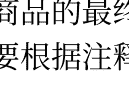

#### 指令示例
根据以下注释，使用Python生成代码片段：
```
# 计算商品的最终价格，包括折扣和税费
# 参数
# original_price: float, 商品的原价
# discount_rate: float, 折扣率, 如0.2代表20%的折扣
# tax_rate: float, 税率, 如0.1代表10%的税
# 返回
# final_price: float, 考虑折扣和税费后的最终价格
```

请使用高效易维护的代码，保证正确性与注释一致。


DeepSeek生成的代码如下图所示。

### Python计算最终价格代码生成

```python
def calculate_final_price(original_price: float, discount_rate: float, tax_rate: float) -> float:
    """
    计算用户的最终价格，包括折扣和税费。

    参数:
        original_price (float): 商品的原价
        discount_rate (float): 折扣率，例如0.2代表20%的折扣
        tax_rate (float): 税率，例如0.1代表10%的税

    返回:
        final_price (float): 考虑折扣和税费后的最终价格
    """
    # 计算折扣后的价格
    discounted_price = original_price * (1 - discount_rate)

    # 计算税费
    tax_amount = discounted_price * tax_rate

    # 计算最终价格
    final_price = discounted_price + tax_amount

    return final_price

# 示例用法
```

指令可据注释快速生成函数代码，提升编写效率。


#### 提示词进阶策略

在设计提示时，应当把实现准确性与注释完整性放在首位，示范如下。

根据下方注释生成一段Python函数：（略）

输出需满足：①定义函数并声明参数；②先算折后金额；③叠加税费；④返回总价。要求逻辑正确高效，注释要详尽。

### 3.8.3 实战：修复代码缺陷

开发里修复Bug是常态。借助 DeepSeek，可迅速锁定问题并给出修正方案，提高质量与效率。


#### 场景

王磊在排查接口。当测试到 user_id 缺失时，当前返回纯文本 “User not found”，不符合规范，应当以 JSON 形式反馈错误。


#### 提示词

请给出修复方案。测试发现 user_id 不存在时返回字符串 “User not found” 不合规，接口应输出 JSON 错误信息。

代码如下：

```python
def get_user_info(user_id):

    user = User.query.filter_by(id=user_id).first()

    if user:

        return user.to_dict()

    else:

        return "User not found"
```


修复思路见下一页。

### API 返回统一改为 JSON 错误

为满足规范，user_id 未命中时应返回 JSON 结构而非裸字符串。可用 Python json 模块构造响应。修改示例：

```python
import json

def get_user_info(user_id):
    user = User.query.filter_by(id=user_id).first()
    if user:
        return user.to_dict()
    else:
        # 返回一个JSON格式的错误信息
        return json.dumps({"error": "User not found"}), 404
```

说明：

1. `json.dumps({"error": "User not found"})`：将信息序列化为 JSON 文本。

2. `404`：HTTP 状态，表示资源未找到，便于客户端识别。

进阶做法：

若使用 Flask 等框架，可直接返回 JSON 对象，无需手动序列化。例如 Flask 中：

```python
from flask import jsonify

def get_user_info(user_id):
    user = User.query.filter_by(id=user_id).first()
    if user:
        return jsonify(user.to_dict())
    else:
        return jsonify({"error": "User not found"}), 404
```

通过这类提示，DeepSeek 能快速给出可用的修复建议。


#### 提示词进阶思路

提示构建时可补充功能扩展与异常优化需求，例如新增平方与开方运算，并美化错误提示样式。示范：

请诊断除法错误并修正，同时加入平方运算与开方运算，并改善错误提示展示。修复除法需处理除零，并按建议调整提示格式；扩展功能时扩充 switch 实现平方与开方，并说明新增逻辑及与原功能的兼容性，使程序更完整健壮。

# 第4章 DeepSeek 驱动的知识跃迁

AI 快速发展，DeepSeek 为学习带来新变革。本章聚焦知识获取、互动学习、公式处理、论文阅读、成长规划、育儿支持、心理健康等场景，助力深度理解与能力提升。

## 4.1 知识获取

个人成长与职业发展离不开知识积累。高效获取方式可不断强化素养与专业度。本节说明如何利用 DeepSeek 实现系统化沉淀。

### 4.1.1 实战：拆解艰深概念

学习工作中常遇晦涩术语，弄清它们对掌握与应用至关重要。DeepSeek 能快速给出清晰解释，提升认知效率。


#### 场景

张涛在读专业书籍时碰到“机会成本”，原书表述难懂。


#### 提示词

请对“机会成本”作详细说明，含定义、原理、实际案例。表述要通俗，适合非专业读者。


#### 回答

##### 机会成本定义

机会成本是经济学里描述因选择某项而放弃的最有价值替代方案的成本。通俗说，选择后被放弃的东西的价值就是机会成本。

##### 核心原理

......

计入机会成本能看到决策的全部代价，有助于做出更全面判断。

借助该提示，用户可获得定义、原理等系统解读，增强理解。


#### 提示词进阶建议

提示可进一步细化，比如明确解读深度、要求举例。示范：

请深入解析“区块链”，阐述去中心化机理，列举金融、物流等至少三个领域的应用，并与传统数据库对比。解读难度对标计算机专业大二水平。

### 4.1.2 实战：梳理历史文化脉络

梳理脉络有助于系统把握事件与演进，形成完整历史观。


#### 场景

姜平想了解中国古代书法发展线索，包括各代主流字体、代表人物及其作品特点、风格演变。


#### 提示词

请梳理先秦至清代书法发展脉络，介绍各朝主流字体，列出至少两位代表人物及作品特征，并说明风格演变。


#### 回答

中国古代书法从先秦到清代经历多阶段，各朝有主导字体与代表人物。梳理如下。

##### 先秦阶段

1. 主流字体：甲骨文、金文即大篆

   - 甲骨文见于商代晚期，已具汉字形音义，书写技法显示一定成熟度。

……

整体演进呈现由繁入简，从甲骨古拙到小篆规范，再到隶书方正、楷书严谨、行书流畅、草书奔放，体现审美追求。

该提示帮助用户建立完整知识框架。

### 4.1.3 实战：整理笔记与归纳

整理笔记是巩固记忆的关键。本节演示如何用 DeepSeek 整理与总结，提升复习效率。


#### 场景

周科刚上完经济学原理课，涉及供需、边际效应、市场结构等，希望整理成清晰笔记备考。


#### 提示词

请依据提供的笔记文档整理内容并总结，按主题归类，保证条理清晰易懂。

（上传笔记文档）


#### 回答

依据您上传的文档，已完成整理与归纳，按主题分类如下。

##### 一、供求

1. 需求

   (1) 定义：在一定时期内消费者愿意且有能力购买的商品服务数量。

   (2) 影响因素

      - 自身价格：价格与需求量反向变动。
      - 收入：正常品随收入增需求增，劣等品反之。

……

   (2) 合谋行为

      - 卡特尔：企业协议限制产量提价获利，但不稳定，因各方有违约动机。

以上为整理结果，有助于更清晰理解概念。

整理后还可据此生成练习题，提升复习效果。


#### 提示词进阶建议

可要求进行知识点关联分析，示范：

请依据图片整理物理力学笔记，涵盖牛顿定律、动能定理等，需含定义、推导、例题，并分析知识点间联系，最后给出总结与学习建议。

## 4.2 互动式学习

互动学习提升参与感与效率。DeepSeek 可模拟专家答疑、辅助文言翻译、生成个性化练习。

### 4.2.1 实战：模拟专家答疑

难题时获得专家指导可加速进步。DeepSeek 可扮演专家提供深入解答。


#### 场景

市场部新人陈以恒学习社交媒体营销，理论与实操结合困难。


#### 提示词

请扮演资深社交媒体营销专家，解答：制定策略时难将理论落地，如平台选择、受众定位、内容规划，请给出建议。


#### 回答

作为资深专家，我理解落地难度。以下建议可帮助制定与执行。

1. 明确品牌与产品

   - 厘清品牌定位、产品特点及核心信息。

……

11. 测试与创新

    - A/B 测试：对比不同内容、文案、配图找最优解。
    - 尝试新功能：积极试用平台新特性。

社交媒体营销是动态过程，需持续测试学习调整。实践中会逐步掌握落地方法，试错是进步机会。

该提示可让 DeepSeek 模拟专家针对性给出建议。


#### 提示词进阶建议

可进一步明确领域与场景，示范：

请以金融投资专家身份，解答股票分析中如何评估公司财务状况，需从资产负债表、利润表等切入，结合具体上市公司数据分析。语言风趣通俗，避免过度专业术语。

### 4.2.2 实战：文言文翻译辅助

文言文与现代汉语差异大。借助 DeepSeek 翻译可提升理解。


#### 场景

中文系学生蒋歌读《史记》时遇到难懂段落，需翻译与注释。


#### 提示词

请翻译并解释：“非好学深思，心知其意，固难为浅见寡闻道也。”


#### 回答

译文：

若非热爱学习、深入思考并真正领会，便难以用肤浅见解阐述。

##### 释义

非好学深思：

“非”指若不是；“好学”指热爱学习；“深思”指深入探究本质。强调学习思考的重要性。

……

##### 整体含义

句中强调唯有真爱学习、深入思考且领会本质，才能避免以肤浅知识误解。提醒追求深度广度，避免浅尝辄止。

该提示可辅助跨越语言障碍。


#### 提示词进阶建议

应注明翻译方式与是否需注释，示范：

请将《红楼梦》中黛玉初见宝玉的对话译为白话，采用意译，并附场景文化背景说明。

### 4.2.3 实战：生成个性化练习

个性化练习提升针对性与效率。本节介绍生成题目与解析的方法。


#### 场景

魏明备考注册建筑师，想通过练习检验对建筑设计原理的理解并获取解析。


#### 提示词

请依据考试大纲围绕“建筑设计原理”生成10道选择题并附解析。


#### 回答

以下为主题相关10道选择题及解析。

1. 题目：建筑设计中下列哪项不属于功能分区基本原则？

    - A. 分区明确
    - B. 交通流线合理
    - C. 外观造型独特
    - D. 空间组织有序

    答案：C。

    解析：功能分区关注使用效率，分区明确、流线合理、空间有序是核心，外观造型属美学范畴。

题目解析有助于深化理解，为考试做准备。


#### 提示词进阶建议

需明确知识点覆盖范围与难度，示范：

请依据注册建筑师考试“建筑结构安全与抗震设计”要求，设计8道选择题加2道简答题，难度中级到高级，覆盖各类结构体系抗震性能分析，并提供含理论依据与计算过程的详尽解析。

## 4.3 数学公式

学术与教育中公式表达的准确性至关重要。DeepSeek 深度思考 R1 模型为复杂公式转换与理解提供强力支持。

### 4.3.1 实战：公式转 LaTeX 快速上手

在论文撰写与学术交流里，LaTeX 几乎成了数学表达的行业标准，能让公式呈现既清晰又专业。把日常手写的式子改写成 LaTeX 语法，是保证排版统一的关键一步。


#### 场景
研究生唐一飞在写科研论文时，文中出现的矩阵运算需要统一改成 LaTeX 写法，以便规范呈现。


#### 提示词
把下面两组矩阵运算改成 LaTeX 写法。

矩阵相乘：AB=C。
矩阵行列式：det(A)。

在输入区勾选【深度思考 R1】。


#### 回答
DeepSeek 能把上述式子完成转换，具体效果见下页图示。

### 矩阵运算公式LaTeX转换指南

> 把下面两组矩阵运算改成 LaTeX 写法：
> 矩阵相乘：AB=C
> 矩阵行列式：det(A)

转换结果如下：

1. 矩阵相乘
`AB = C` 对应的 LaTeX 写法：
```
    \mathbf{A}\mathbf{B} = \mathbf{C}
    ```
或采用更紧凑的粗体样式：
```
    \mathbf{AB} = \mathbf{C}
    ```

2. 矩阵行列式
`det(A)` 对应的 LaTeX 写法，使用正体算符：
```
    \det(\mathbf{A})
    ```

借助以上指令，DeepSeek 能够迅速把公式编码为可用的 LaTeX 片段。


#### 提示词进阶
当公式过长无法手打时，可上传附件。提示里最好说明公式来源是图片或 PDF 以及复杂度，输出会更准确。示例如下。

请把文档里的公式转成 LaTeX 写法，保证在 LaTeX 文档中可以准确显示。

### 4.3.2 实战：复杂公式拆解解读

DeepSeek 的 R1 模型基于强化学习，能上传图片做图文识别与推理，尤其适合数理化类问题的解析。下面以正态分布为例说明。


#### 场景
金景学习数学时遇到正态分布的概率密度函数，对符号含义、适用条件与意义感到困惑。


#### 提示词
解读图中公式以及使用场合。

下面用 DeepSeek 解析复杂公式。


#### 回答
调用 R1 模型，将待解读公式图片拖入输入框，输入提示词后点【发送】，界面如下。


模型识别图片并给出解读，结果如下。

### 正态分布公式解读及应用场景


解读图中公式及使用场合。

该式为正态分布即高斯分布的概率密度函数，用于刻画连续型随机变量的分布特征。

**公式解读：**
- 符号含义：
  - $x$：随机变量。
  - $\mu$：分布均值，决定中心位置。
  - $\sigma^2$：方差，$\sigma$ 为标准差，决定数据离散程度。
- 结构说明：
  - 分母 $\sqrt{2\pi\sigma^2}$ 为归一化因子，使概率密度积分为1。
  - 指数部分 $-\frac{(x-\mu)^2}{2\sigma^2}$ 表示数据点偏离均值的程度，方差越大分布越宽。

**使用场合：**
1. 自然现象建模：身高、体重、测量误差等近似服从正态分布。

除了解读公式，R1 模型还能帮助解决数理化疑难练习、解读图表、进行视觉分析等。


#### 提示词进阶
构建提示词时，可要求对公式进行深度剖析并结合实际应用场景，多角度展开，示例如下。

请详细解读图中数学公式的推导过程、关键变量含义及其在不同学科的具体应用，并给出至少两个不同场景的应用实例。

## 4.4 学术论文写作提效

论文是科研成果的核心载体，提升质量与影响力至关重要。本节介绍如何借助 DeepSeek 辅助选题、优化逻辑、规范引用与润色。

### 4.4.1 实战：选题灵感速配

选题是写作起点，好的题目决定研究方向与价值。DeepSeek 能结合学科、前沿趋势为研究者提供合适方向。


#### 场景
环境科学研究生姚芳对污染治理方向感兴趣，但不确定当前有哪些具体且有研究价值的题目。


#### 提示词
请根据环境科学专业中环境污染治理方向，结合当前研究热点和实际需求，提供5个具体科研选题，并简要说明每个选题的研究意义、创新点和预期研究成果。


#### 回答
以下是环境科学专业环境污染治理方向的5个具体科研选题，结合了当前研究热点和实际需求。

##### 1. 微塑料污染的环境归趋和生态毒理研究
- 研究意义：微塑料污染是近10年的研究前沿，对环境和生态安全构成威胁。
- 创新点：探究微塑料在不同环境介质中的迁移转化规律及其对生态系统的潜在影响。
- 预期研究成果：提出有效的微塑料污染控制策略和生态风险评估方法。

……
- 创新点：开发适用于钢铁行业复杂烟气的污染物深度净化技术，实现能源高效利用与副产物资源化。
- 预期研究成果：形成一套钢铁行业烟气超低排放技术体系，为大气污染防治提供技术支撑。

这些选题紧密贴合当前环境科学领域的研究热点和实际需求，具有重要科学价值和应用前景。

使用 DeepSeek 辅助选题时，可明确专业领域和研究方向，要求结合研究热点和实际需求提供多个题目并阐述关键要素，有助于多角度思考。


#### 提示词进阶
构建提示词时可提供更具体的限定条件，如特定研究区域或研究方法，示例如下。

在环境科学专业的水污染治理领域中，聚焦于某一特定河流如长江的水质改善问题，结合相关生物技术如基因工程菌修复技术，提供3个科研选题，详细说明每个选题的独特性、可能面临的挑战以及潜在应用价值。

### 4.4.2 实战：论文结构优化

论文逻辑是否清晰直接影响成果呈现效果。优化结构能让论述更连贯有条理。


#### 场景
陆明的论文初稿已完成，但感觉整体逻辑不够顺畅，希望借助 DeepSeek 进行优化。


#### 提示词
请帮我优化论文的逻辑结构，提出具体修改建议，使论文条理清晰、逻辑严谨。可粘贴论文目录，也可上传目录文档。


#### 回答
论文结构已相当清晰，为进一步提升逻辑性和严谨性，以下是具体修改建议。

##### 第1章 绪论
###### 1.1 研究背景及意义
- 可进一步细化，分别讨论新能源汽车的全球发展背景和电池技术在其中的关键作用。

###### 1.2 研究目的和内容
- 明确列出研究的具体目标，以及每个章节将要探讨的主要内容。

……
###### 7.3 进一步研究方向
- 提出未来研究方向和建议。
- 建议：在结论部分明确区分研究总结和未来研究方向，确保逻辑清晰，避免与政策建议或行业应用混淆。

最后，确保各章节间有逻辑联系，每个章节开头有简短介绍，结尾做小结，以增强整篇论文的连贯性和逻辑性。

通过上述提示词，用户可以获得针对论文各部分结构的修改建议，从而确保论文条理清晰、论证严密。


#### 提示词进阶
构建提示词时需提供论文的主要框架及存在具体问题，以便获取更具针对性的反馈。示例如下。

请仔细阅读提供的论文摘要和目录，重点评估其从问题定义到解决方案呈现之间的逻辑链条是否顺畅，指出任何可能引起读者困惑之处，并给出相应调整方案，如增加过渡段落或重新组织章节顺序。

### 4.4.3 实战：引用文献规范化

在论文写作中，正确引用与规范参考文献管理是体现学术诚信和保证论文质量的关键。DeepSeek 可以帮助用户准确引用文献并高效管理参考文献列表。


#### 场景
刘俊撰写论文时，需要确保所有文献都被正确引用，并且参考文献格式符合学术规范。


#### 提示词
请帮我将论文中的引用与参考文献格式转换为 APA 格式。请确保每篇文献的作者姓名、文章标题、出版年份、期刊名称或图书名称、卷号、页码等信息均按 APA 格式要求格式化，并生成规范的参考文献列表。论文中已引用的文献如下。

（略）


（略）

不同学科对引用与参考文献有不同格式要求，用户可针对不同要求调整提示词。


#### 提示词进阶
构建提示词时，可提供具体引用内容，强调引用格式规范性和参考文献完整性，示例如下。

请帮我将论文中的引用与参考文献格式转换成 APA 格式。具体要求包括：①引用中作者姓名顺序为姓在前名在后，且名只保留大写首字母；②参考文献列表需包括文章标题、期刊名称、卷号、期号、出版年份和具体页码范围；③确保格式一致性，如斜体和引号使用，以及参考文献列表的悬挂缩进。请确保引用与参考文献格式规范，以便论文符合学术出版标准。对电子资源和多作者文献也应遵循 APA 最新版规范。

具体引用内容如下：[列出作者、文章标题、出版年份、期刊名称、卷号、页码等]

### 4.4.4 实战：论文校对润色

检查校对是论文写作不可或缺的环节，有助于提高语言质量和表达准确性。本节介绍如何使用 DeepSeek 检查校对论文内容，确保论文专业性和准确性。


#### 场景
韩梅的论文初稿已完成。提交前需要对论文进行质量检查，包括格式、语法、引用准确性和逻辑连贯性等方面，并进行润色。


#### 提示词
请帮我进行论文质量检查与润色，包括以下内容：①校对语法和拼写错误；②核实引用和参考文献准确性；③提高论文语言质量和表达清晰度。

（将论文文档拖曳至输入框后发送上述提示词）


#### 回答
##### 论文质量检查与润色
###### 一、语法和拼写错误校对
经仔细校对，论文中语法和拼写错误已修正。例如：
原句：“商业插画是艺术品同时更是商业产品”已修改为“商业插画既是艺术品，更是商业产品”。

修正了“<关键词>商业commercial must the”这种不符合语法规范的表述，根据上下文，关键词应为“商业”“必须”等，但“the”在此处不合适，已删除。

……
润色后：“商业插画作为一门应用艺术，已经发展得相当成熟。其形式多样，既可以根据传播媒体进行分类，也可以根据功能进行分类。”

原句：“商业插画的审美特征大致起来有以下几种。”
润色后：“商业插画的审美特征大致可以分为以下几种。”

通过上述提示词，DeepSeek 提供了详细修改建议，帮助用户纠正语法和拼写错误，确保论文专业性和准确性。修改后建议再次核实。


#### 提示词进阶
使用 DeepSeek 检查校对论文内容时，构建提示词应注意明确论文主题和需求，详细描述需要检查和校对的内容和重点，同时可提供个人写作习惯和常见错误供参考。示例如下。

请帮我检查和校对以下论文内容，主题为“AI在医疗领域的应用”。检查和校对需包括：①语言校正，修正可能语法和拼写错误；②格式校对，确保论文符合 APA 格式要求；③引用核查，检查引用的文献是否准确且与主题相关；④逻辑检查，分析论文论证逻辑是否严密；⑤专业术语检查，确保医疗和 AI 领域术语使用恰当。请特别注意论文中数据表述和分析结果的准确性。

## 4.5 职业成长规划

成长规划是个人发展的重要组成部分，涉及职业发展、技能提升和个人目标实现。本节介绍使用 DeepSeek 帮助用户精准定位成长目标、规划个性化学习路径，并明确职业发展规划，以实现个人在职场中的全面跃升。

### 4.5.1 实战：成长目标定位

在个人成长过程中，精准定位成长目标至关重要。明确的目标能为个人提供清晰方向，帮助制定有效行动计划，从而实现自我提升。


#### 场景
杨瑞是一名职场新人，希望未来3年内提升职业技能和管理能力。需要精准定位成长目标，以便制定合理学习和发展计划。


#### 提示词
请帮我精准定位我的成长目标。我的职业领域是 IT，当前职位是软件工程师。我希望未来3年内晋升为项目经理，并提升项目管理能力和团队领导力。请提供具体成长目标和建议。


#### 回答
根据职业领域和目标，以下是未来3年内成长为项目经理的具体成长目标和建议。

## 1. 项目管理能力提升
目标：
- 一年内掌握项目管理的基础知识和工具。
- 两年内完成至少两个中等规模项目的管理，积累实战经验。
- 3年内能够独立管理大型项目，并有效控制项目风险。

建议：
- 制定学习计划：每年为自己设定学习目标，并跟踪进度。
- 寻找导师：寻找一位经验丰富的项目经理作为导师，定期交流学习。

通过上述目标和建议实施，可逐步提升项目管理能力和团队领导力，为晋升为项目经理打下坚实基础。

借助上述提示词，用户可以获得对自己成长目标的精准定位和具体建议，有助于制定合理学习和发展计划，实现自我提升。

#### 提示词进阶
构建提示词时，应明确职业领域、当前职位和未来期望，以便 DeepSeek 生成更具针对性和可行性的成长目标。示例如下。

请帮我精准定位我的成长目标。我的职业领域是市场营销，当前职位是市场专员。我希望未来5年内晋升为市场经理，并提升市场分析能力和品牌管理能力。请提供具体成长目标和建议。

### 4.5.2 实战：定制学习路径

个性化学习路径能够帮助个人根据需求和目标，制定合理学习计划，从而提高学习效率和效果。

场景：
杨志刚是一名工程师，希望提升自己在 AI 领域的专业知识。需要规划个性化学习路径，以系统学习相关理论和实践技能。

提示词：
请帮我规划个性化学习路径，以提升我在 AI 领域的专业水平。请提供详细的学习计划、推荐的学习资源和方法。

回答：
根据需求，为您规划了个性化的 AI 领域学习路径，包括详细的学习计划、推荐的学习资源和方法。

### 1. 基础部分
- AI 基本概念：了解 AI 常见流程、机器学习与深度学习的区别、有监督学习、无监督学习、强化学习等。
- Python 编程：学习 Python 运行环境与开发环境搭建、基础知识、函数、面向对象编程、科学计算等。

人工智能专业能力进阶概览
- 数理基座：高等数学、线性代数、概率论与最优化是理解模型的共通语言，可先研读《人工智能数学基础》形成整体认知框架。
- … 
- 实战演练：通过 Kaggle 等社区的经典案例复现机器学习项目，把理论转化为可运行的能力。
- 工程落地：掌握模型投产与实验追踪方法，可参考 Made With ML、DataTalksClub/mlops-zoomcamp 等公开资料。

沿此路径循序推进，专业水平能够实现系统化提升。祝学习顺利！

借助这类提问方式，用户可以拿到定制化的学习方案，涵盖阶段性计划、权威资料清单与实操思路，从而在人工智能赛道稳步前进并达成目标。

#### 提示词进阶
制定提问时先厘清自身起点、期望结果与可投入时间，模型才能给出更具可操作性的建议。示范如下。
请为我定制一份数据分析能力提升的个人路线，我的基础已较为扎实，半年内希望通过相关职业资格考试，需要细化的排期、权威资源与具体练习方法。

### 4.5.3 实战：明确职业发展规划
清晰的职业蓝图有助于在关键节点做出合理选择，提升竞争力并实现预期目标。
场景：
黄怡鸣长期在信息技术行业从业，计划未来三年向人工智能方向迁移。希望先梳理职业路线，再分步投入。
提示词：
请帮我梳理职业发展规划。我现在在IT公司担任软件开发，编程能力扎实，也积累了一定项目管理经验。目标是三年内转型为AI工程师，请给出具体路径和建议。
回答：
结合你的背景和目标，为你规划了未来三年向AI工程师过渡的路径。
### 第一年：基础学习与技能提升
- 核心技能学习：系统掌握机器学习、深度学习、自然语言处理等基础，可通过Coursera、edX等在线课程或线下培训班进行结构化学习。
- 数学基础加固：重点强化线性代数、概率论与数理统计，这是理解算法原理的应用根基。
- …
- 人脉网络搭建：主动与目标领域从业者建立联系，获取内部视角与机会。
- 持续坚持：面对挫折保持韧性，持之以恒是突破瓶颈的关键。
按此规划，你可以逐步从软件开发者过渡为AI工程师。祝职业发展顺利！
通过该指令，用户能得到一份可落地的职业规划，并可根据实际情况调整细节。
#### 提示词进阶
构建提示词时明确当前职位、技能水平与未来岗位，能让模型生成更具针对性的职业路线。示例如下。
请帮我规划职业发展路径。我目前是市场经理，市场分析和品牌管理经验丰富，希望五年内晋升为市场总监。请提供具体规划与建议。

## 4.6 育儿助手
养育孩子耗时耗力。模型可作为育儿助手提供科学指导、定制儿童故事以及作业批改讲解等支持。
### 4.6.1 实战：提供全方位育儿指导
科学的育儿指引能帮助家长更懂孩子成长需求，提升养育成效。
场景：
纪初是新手妈妈，对育儿知识了解有限，想获得系统指导来照顾和教育孩子。
提示词：
请给我一份新生儿全方位育儿指南，涵盖日常护理、喂养和早期教育活动。
回答：
以下是针对新生儿的全面养育建议，包含护理、喂养和早期教育。
### 新生儿的日常护理
- 皮肤护理：新生儿肌肤娇嫩，保持清洁干燥即可。每日用温水洗澡，避免使用香皂或沐浴露刺激皮肤。洗后用柔软毛巾轻拍吸干，避免用力摩擦。
- 衣物选择：选用透气柔软的棉质衣物，保持体温适宜，不宜过厚或过薄。
- …
- 镜子互动：让宝宝对着镜子看自己，他会把镜中影像当成另一个小伙伴，很乐意挥手微笑。
- 音乐启蒙：多唱儿歌、播放优美旋律，帮助宝宝感知节奏，培养听觉兴趣。
以上内容覆盖了护理、喂养和早教要点，有助于更科学地照顾宝宝。
通过该提示词，用户可获得系统育儿指导，更好满足孩子成长需求，提升养育质量。
#### 提示词进阶
提示词中可补充具体育儿阶段与关注点，以获得更精准指导。示例如下。
请为两岁幼儿提供全方位育儿建议，包括适宜的营养饮食安排、合适的游戏形式，以及如何促进语言和社交能力发展。

### 4.6.2 实战：创作专属儿童故事
专属故事能激发想象力并传递价值观，增强亲子互动效果。
场景：
田青想为孩子创作专属故事，增进亲子关系并传递知识。
提示词：
请为我创作一个适合五岁儿童的专属故事。要求情节生动、教育意义明确、语言符合儿童理解。
回答：
### 故事标题：小熊布鲁的彩虹桥
#### 故事开始：
一个阳光灿烂的早晨，小熊布鲁在林间散步。忽然出现一道从这头连到那头的彩虹。布鲁好奇地想：“彩虹另一边会是什么？”于是踏上寻找彩虹尽头的冒险旅程。
…
教育意义：真正的快乐来自分享与关爱他人。
故事兼具趣味情节与积极价值观，有助于孩子学习友谊、勇气、智慧和分享。
通过上述提示词，用户可获得兼具趣味性与教育性的专属故事，促进亲子关系与学习。
#### 提示词进阶
可指定故事场景或结局导向，以便生成更贴合需求的故事。示例如下。
为我三岁半、喜欢小兔子的孩子写一个故事，场景设在森林里，小兔子经历一系列冒险，结局体现勇敢与智慧战胜困难，并在文中融入数字或颜色认知元素。

### 4.6.3 实战：辅助家庭作业批改与讲解
作业是学习的重要环节，家长常在讲解上遇到困难。模型可辅助批改并提供详细解释，帮助孩子掌握知识点。
场景：
田海的孩子就读初中，在求解二元一次方程组时卡住。田海希望得到通俗解释和巩固练习建议。
提示词：
请帮我解决二元一次方程组2x+3y=12和4x-y=6的求解问题。需包含：①逐步求解过程；②每步原理说明；③同类题型练习建议。
回答：
下面逐步求解该方程组。
### 给定方程组
2x+3y=12（方程1）
4x-y=6（方程2）
步骤1：消元
…
### 类似题型的练习建议
- 练习系数不便于直接消去的二元一次方程组。
- 尝试一次方程与二次方程混合的方程组。
- 练习以分数或小数形式出现的方程组。
希望这有助于理解解法，如需更多练习可随时提问。
通过该提示词，用户可获得清晰解题步骤与原理解释，帮助孩子深化理解。对复杂题目可用DeepSeek App的【拍照识文字】功能上传求解。
#### 提示词进阶
在提问时详细描述题目内容、学生的错误答案并明确讲解深度，能得到更有针对性的批改。示例如下。
请详细批改并深度讲解以下概率作业。题目：“盒子里有3个红球和2个黄球，至少摸出多少个球才能确保摸出两种颜色？”错误答案为3。请指出理解误区，并用清晰逻辑、举例说明核心知识点。

## 4.7 心理健康
心理健康影响生活质量、工作效率与人际关系。借助模型可处理困扰、缓解压力、提升心理韧性。
### 4.7.1 实战：处理工作中的人际关系困扰
良好的人际关系对职业发展至关重要，职场中难免出现沟通不畅、团队紧张等问题。
场景：
李江在一家广告公司工作，与同事张均在重要项目的创意方案上产生分歧。李江倾向创新高风险方案，张均坚持传统保守方案，双方僵持导致进度受阻、氛围紧张。
提示词：
我在广告公司工作，与同事在项目创意方案上产生分歧。我提出创新高风险方案，同事坚持传统保守方案，僵持影响进度与氛围。请分析原因，从沟通技巧、团队协作、寻找共同利益点角度给出具体解决办法，帮助改善关系推动项目。
回答：
在创意行业，分歧较为常见。以下为可能原因与解决思路。
### 一、分歧产生的原因
1. 价值观与理念差异：不同工作观导致判断不同。
2. 风险承受度不同：创新伴随高风险，保守更稳定，偏好差异易引发冲突。
…
3. 专业咨询：必要时引入第三方专家中立评估方案。
4. 反馈机制：建立项目反馈闭环，根据实际效果动态调整方案。
通过上述方法，可改善同事关系，推动项目顺利。有效沟通与协作是解决分歧的关键。
通过该提示词，模型为用户提供职场人际困扰的策略建议，帮助实现更高效沟通与协作。
#### 提示词进阶
可增加团队成员性格特点描述。示例如下。
我在一家互联网公司做产品研发，与团队成员关系紧张。我性格直爽重效率，他谨慎求完美。产品功能设计上常意见不合。请结合性格特点分析原因，从理解他人、调整自身态度、建立沟通机制角度给出建议，并提供类似案例参考，帮助改善关系提升协作效率。

### 4.7.2 实战：寻求压力缓解的有效建议
现代生活压力多源于工作、学习与家庭。模型可根据压力源提供缓解建议，帮助恢复身心。
场景：
王朋辉是职场人士，近期工作繁重常加班，身体疲惫精神紧张，夜间失眠，同时需兼顾家庭，感到压力巨大。
提示词：
我工作任务重、加班多，还要处理家庭事务，身体精神状态差，晚上失眠。请分析原因，从时间管理、身心放松、情绪调节等方面给出具体缓解建议，帮助改善现状恢复工作生活平衡。
回答：
工作与家庭双重压力易导致身心疲惫。以下为原因与缓解建议。
### 1. 压力产生原因
- （1）工作量超载：任务超出个人处理能力。
- （2）时间管理失衡：规划分配不当，工作与休息失调。
- …
- （3）健康饮食：保持均衡饮食，减少咖啡因与糖分摄入。
- （4）时间管理工具：使用番茄钟等工具提升效率。
通过以上方法可逐步改善现状。照顾好身心健康是首要前提。
通过该提示词，用户可获得贴合自身状况的压力缓解建议，提升心理健康水平。
#### 提示词进阶
可明确压力来源与个人偏好，以便获得更贴合建议。示例如下。
> 请扮演资深心理咨询师，针对我工作中长期高强度压力——主要来自紧迫项目期限与频繁跨部门协作，提出综合缓解方案。方案包括时间管理技巧、放松训练如深呼吸、正念冥想，以及休闲活动建议如周末徒步。同时推荐实用工具或App辅助实施。

# 第5章 生活助手：DeepSeek日常小秘书
在数字化加速的时代，AI正深刻改变生活方式。DeepSeek借助自然语言处理能力，可在多个生活场景中提供智能支持，成为日常小秘书。
## 5.1 旅行规划
旅行是放松身心的有效方式。本节介绍如何利用模型生成短途行程、深度文化游计划与旅行文案。
### 5.1.1 实战：生成短途旅行计划
短途旅行成为现代人减压首选。DeepSeek可快速生成高效行程，帮助用户在有限时间内愉快出行。

**场景**
李晓元想利用周末周边游以缓解工作压力。希望得到一份便捷的出行方案，包含目的地挑选、行程安排和预算控制。

**提示词**
请帮我生成一个短途旅行计划，目的地为西安市周边100千米范围内的一个景点，内容包括：①推荐的目的地；②两天一夜的行程安排，包括餐饮和住宿；③预算控制在2000元以内。请确保旅行既经济实惠又充满乐趣。

**回答**
根据要求，为你制定了一份西安周边100公里内的短途游方案，预算控制在2000元以内，兼顾性价比与乐趣。
**推荐的目的地**
综合距离与游玩时间，推荐少华山国家森林公园。位于陕西渭南市华州区莲花寺镇袁寨村，距西安约95千米，适合周末出行。
……
- 门票：少华山国家森林公园门票预计60元/人。
- 其他：预留500元用于购物及突发开销。
- 总预算：约1500元/人，低于2000元上限。
行程既能观赏自然美景，又能感受当地风情，祝旅途愉快！

**提示词进阶**
构建提示词时可加入个性化选项，如饮食需求或兴趣活动，以便生成更贴合的方案。示例如下。
请帮我生成一个适合我的短途旅行计划，我从北京出发，预算2000元以内，偏爱自然风光。要求：①选景近、风景美；②周六早出发周日下午返，高铁出行；③入住安静舒适民宿；④两天内安排徒步及户外活动；⑤提供户外装备建议。另请考虑我素食习惯，推荐餐厅。

### 5.1.2 实战：生成深入了解当地文化的旅行计划
旅行不仅是观光，更是了解风土人情的机会。DeepSeek可生成文化深度游计划，帮助旅行者融入当地，丰富旅程内涵。

**场景**
曹云是文化爱好者，计划去成都旅行一周。希望深入体验川剧、川菜、古蜀文化等，参观相关博物馆、古迹，参与传统活动，与当地人交流。

**提示词**
请为我生成成都为期一周的文化深度游计划，重点是了解当地文化。需包含：①推荐文化景点及理由；②传统文化体验活动安排；③与当地人交流的方式与场所；④每日行程与交通；⑤成都特色美食推荐。请确保内容丰富、体验深入。

**回答**
**成都一周文化深度游计划**
**1. 推荐参观的文化景点及理由**
- 四川博物院：藏有大量反映四川历史、文化、艺术的珍贵文物，展现文化多样性。
- 金沙遗址：呈现古蜀文明辉煌，出土青铜器与金面具令人感受古蜀神秘魅力。
……
- 串串香：成都街头经典小吃，口味丰富。
- 担担面：传统面食，麻辣鲜香。
- 龙抄手：皮薄馅嫩，汤鲜味美。
- 三大炮：传统甜点，制作独特口感清甜。

**提示词进阶**
在构建提示词时可提供更详细的兴趣点与期望体验，以获取更精准的文化行程。示例如下。

**西安十日秦汉文化沉浸式行程定制**

希望获取一份以秦汉历史遗产为核心的西安十日游方案，对古文化遗存兴趣浓厚。期望涵盖关键的秦汉遗址并标注讲解重点，安排传统手作体验例如仿制兵马俑的工作坊并说明操作流程，提供联系西安本地史学研究者或文化从业者的途径，每日行程细化到公共交通换乘方式，同时推荐带有历史底蕴的传统餐馆，优先可追溯至秦汉时期的老味道。

### 5.1.3 实战演练：旅行文案创作

在图文短视频主导分享的今天，文案的感染力决定旅程能否被记住并引发互动。下面以云南线路为例，演示如何通过提示词让模型输出适合社交媒体发布的游记。


**场景**

吕雪结束了去云南的旅行，旅途中她领略了美丽的自然风光，如石林、洱海、玉龙雪山等，体验了独特的少数民族风情，品尝了各种美食。她想在朋友圈分享这次旅行，需要一段精彩的文案来吸引朋友们的关注。

**提示词**

请根据以下旅行经历生成一段适合发在朋友圈的旅行文案：旅行地点为云南，游览了石林、洱海、玉龙雪山等景点，体验了少数民族风情，品尝了当地美食。文案要生动、形象，富有感染力，能体现云南之旅的美好，吸引朋友们点赞和评论。

**回答**

云南，彩云之南，石林的奇峻、洱海的宁静、玉龙雪山的壮丽，行至每一处都是画中游。少数民族的歌舞、美食的香气，让人心醉。云南，不只是旅行首选地，还是心灵的净土。#云南印象#
借助这一提问范式，可得到一段具备画面感的旅行文字，配合照片即可在社媒发布。


**提示词进阶**

在构建提示词时，应明确文案的风格和重点，以便创作出更贴合需求的文案。示例如下。

请为我的西藏之旅生成一段小红书文案。这次旅行我主要在拉萨和纳木错周边活动，重点感受了当地文化，看到了壮丽的雪山和湖泊。我希望文案风格文艺、清新，着重表达我的心灵在这片纯净土地上受到的震撼，以及对藏文化的崇敬之情。

## 5.2 美食探索

DeepSeek 同样能作为美食探索的助手，按需生成低脂食谱、便捷午餐方案，也能依据健康目标定制菜单，让美味与健康兼得。

### 5.2.1 实战：低脂肪低热量食谱推荐

追求健康饮食时，对低脂低卡菜品的需求很高。模型可依据个人偏好给出具体菜谱，帮助开启营养饮食。


**场景**

宋丽是一名都市白领，注重身材管理和健康饮食。她希望找到一些低脂肪低热量食谱，确保制作出的菜品既能满足口腹之欲，又不会给身体带来负担。

**提示词**

请为我推荐一些低脂肪低热量食谱，内容包括：①每份食谱的详细食材和烹饪步骤；②菜品的热量估算；③菜品的营养价值分析。

**回答**

根据您的要求，我为您推荐以下3份低脂肪低热量食谱，包括详细食材、烹饪步骤、热量估算以及营养价值分析：

**1. 莴笋豆干滑鸡片**

**详细食材**

- 莴笋180克。

- 豆干78克。

- 鸡小胸120克。

- ......

**营养价值分析**

牛腩富含蛋白质和必需氨基酸，番茄含有丰富的维生素C和胡萝卜素，胡萝卜含有丰富的β-胡萝卜素，有助于增强免疫力和保护视力。

以上食谱均符合低脂肪低热量的饮食要求，适合健康饮食。希望这些食谱能够帮助您制订健康的饮食计划。
此类提示可得到多款低脂低卡菜谱并附食材、做法、热量与营养说明。


**提示词进阶**

在构建提示词时，应提供更具体的营养需求和饮食偏好，示例如下。

请为我推荐一些低脂肪低热量食谱，食谱应符合以下要求：①适合健身人群，需特别注重蛋白质的摄入；②介绍详细食材和烹饪步骤，烹饪时间不超过30分钟；③分析菜品的营养价值，特别是热量和蛋白质含量。请确保推荐的食谱既健康又简单易操作。

### 5.2.2 实战：简易健康午餐食谱推荐

上班族需要快手且均衡的午餐。通过模型可快速获得制作简便、营养达标的方案。


**场景**

刘航是一位上班族，她不想天天点外卖，想吃到健康的午餐，但她平时较忙，希望找到一些简单的健康午餐食谱，确保菜品既方便制作又能满足营养需求。

**提示词**

请为我推荐一些简单的健康午餐食谱，食谱应符合以下要求：①适合上班族；②食材的准备和烹饪时间不超过30分钟；③请确保菜品营养均衡，适合在短时间内制作完成，且方便携带到公司食用。

**回答**

当然可以，以下是一些简单且适合上班族的午餐食谱，食材的准备和烹饪时间都在30分钟以内，并且菜品方便携带。

**1. 鸡肉蔬菜沙拉**

**食材**

- 鸡胸肉100克。

- 生菜50克。

- 黄瓜50克。

- ......

准备时间：15分钟。

烹饪时间：10分钟。

这些食谱不仅简单，而且营养搭配均衡，适合上班族，制作的菜品方便携带到公司食用。希望这些建议能够帮助您快速准备健康美味的午餐。
该类提问能让模型输出适合办公人群的简易午餐。


**提示词进阶**

在构建提示词时，可以提供更具体的食材和时间要求，示例如下。

请为我推荐一些简单的健康午餐食谱，食谱应符合以下要求：①适合上班族，要使用常见的食材；②食材的准备和烹饪时间不超过20分钟；③注意食谱的营养价值，应具有富含高纤维和低糖的特点。请确保推荐的食谱既健康又简单。

### 5.2.3 实战：基于健康需求的食谱推荐

不同人群诉求各异，如减脂、增肌、控糖等。模型能据此给出专属方案。


**场景**

张东是一名健身爱好者，正在进行增肌训练。他希望找到一些符合增肌需求的食谱，既能帮助他增加肌肉量，又能保证菜品多样性和可口性。

**提示词**

请根据增肌需求推荐一些食谱，要求富含蛋白质和碳水化合物，同时控制脂肪的摄入。食谱需要详细列出所需食材、制作步骤和营养成分，特别是蛋白质和碳水化合物的含量。同时，请考虑菜品的多样性和可口性，以确保长期食用不会感到单调。

**回答**

根据您的增肌需求，我为您推荐以下几份富含蛋白质和碳水化合物，同时控制脂肪摄入的食谱。这些食谱不仅考虑了营养均衡，还兼顾了菜品多样性和可口性，以确保长期食用不会感到单调。

1. 燕麦香蕉奶昔

**食材**

- 燕麦50g。

- 牛奶250mL。

- 香蕉1根。

- 蛋白粉1勺（约25g）。

- ......

营养成分：

- 蛋白质：约50g（主要来自三文鱼）。

- 碳水化合物：约80g（主要来自糙米）。

以上食谱均考虑到了蛋白质和碳水化合物的摄入，同时控制了脂肪的摄入，以满足您的增肌需求。希望这些建议能够帮助您在增肌的同时，享受到美味和营养均衡的菜品。
示例展示了模型在满足蛋白质与碳水需求的同时兼顾口味多样性。


**提示词进阶**

在构建提示词时，可以进一步细化对食谱的要求，比如加入喜欢的食材或采取喜欢的烹饪方式、对食谱难度的考虑等。示例如下。

请根据我的增肌需求推荐一些高蛋白、低脂肪的食谱，我喜欢鸡胸肉、鱼肉等富含优质蛋白质的食材，并且喜欢清蒸、烤制等健康的烹饪方式。食谱需要详细列出所需食材、制作步骤、营养成分以及烹饪技巧，难度适中，适合家庭制作。同时，请考虑菜品的多样性和季节性，以确保长期食用不会感到单调并且符合时令。

## 5.3 运动健康

运动是维持健康的基础。本节演示如何用 DeepSeek 制定颈腰舒缓方案、全身减脂计划以及疾病预防等健康内容。

### 5.3.1 实战：颈椎腰椎舒缓运动方案制定

久坐伏案易导致颈椎腰椎不适。模型可据此给出专业实用的舒缓练习。


**场景**

郭婷是一位长期面对计算机工作的办公室职员，她经常感到颈椎和腰椎的不适，希望找一些简单的舒缓运动来减轻不适。

**提示词**

请为我制订一套颈椎腰椎舒缓运动方案。方案需包含：①运动项目名称；②具体的动作要领及步骤；③每个动作的重复次数和组数；④运动频率（每天或每周几次）；⑤注意事项（如动作幅度、呼吸方法等）。请确保运动安全有效，适合在办公室或家中进行。

**回答**

根据您的需求，我为您制订了一套适合在办公室或家中进行的颈椎腰椎舒缓运动方案。

**1. 腰椎舒缓操**

（1）叉腰顶髋

- 动作要领：站立位，双腿并拢，双手叉腰，向前和向后各弯腰一次。

- 重复次数和组数：5~10次，重复3组。

……

- 颈椎病患者应避免突然剧烈地运动，以免导致颈椎损伤。

- 运动时应根据自身的身体状况及时调整运动强度。

这套方案简单易行，适合在办公室或家中进行，希望能有效帮助您缓解颈椎腰椎的不适。
采用上述提示即可获得系统完整的颈腰舒缓训练计划。


**提示词进阶**

在构建提示词时，可以细化个人身体状况和运动环境，以获取更具针对性的运动方案。示例如下。

> 请为我设计一套适合在狭小空间（如办公室格子间）内进行的颈椎腰椎舒缓运动方案。我平时缺乏运动，身体柔韧性较差，患有轻度颈椎病。方案要包括详细的动作说明、每组动作的次数和组数、每天的运动时间安排，以及运动过程中的注意事项，确保运动安全且能有效缓解颈椎不适。

### 5.3.2 实战：全身减脂减重运动计划制定

科学减脂需要有氧、力量与饮食协同。


**场景**

吴楠体重超标，身体脂肪含量较高，决心通过运动减肥。他平时工作较忙，但可以抽出一定时间进行锻炼，希望有一份全面、系统的运动计划。

**提示词**

请为我制订一份全身减脂减重运动计划。计划需包含：①有氧运动项目及具体安排；②力量训练项目及动作细节；③运动时间规划；④饮食建议。请确保计划科学合理，具有可操作性和可持续性。

**回答**

根据您的需求，以下是一份科学合理、具有可操作性和可持续性的全身减脂减重运动计划。

**1. 有氧运动项目及具体安排**

有氧运动是减脂减重的关键，建议选择以下项目。

- 慢跑：每天早饭后一个半小时或晚饭前两小时进行，持续时间控制在45~60分钟。

- 游泳：如果条件允许，游泳是极佳的全身有氧运动，每周2~3次，每次45~60分钟。

……

- 晚餐：以蔬菜和适量的粗粮为主，减少肉类摄入。

- 加餐：运动前半小时可以喝一杯黑咖啡帮助燃脂。

- 注意事项：不要节食，保证每日摄入的热量足够，以免影响基础代谢和健康。

请根据自身情况调整运动强度和饮食计划，确保安全有效。希望这份计划能帮助您达到减脂减重的目标。
借助该提示可获得涵盖有氧、力量、饮食与作息的完整减脂方案。


**提示词进阶**

在构建提示词时，可以明确减脂减重目标和身体基础条件，以获取更个性化的运动计划。示例如下。请为我制订一份为期3个月的全身减脂减重运动计划，我的目标是减掉15斤，目前身体状况一般，没有运动基础，但可以每天抽出45分钟进行锻炼。计划要详细列出每周的有氧运动（如慢跑、健身操等的具体安排）、力量训练（如深蹲、平板支撑等的动作规范、次数和组数）、饮食计划（包括每日的食物种类和摄入量）、休息安排（如每周休息几天，如何进行放松），以及阶段性的体重和身体指标监测方法，确保计划安全有效且符合我的实际情况。

### 5.3.3 实战：疾病预防与健康知识普及

现代生活节奏快，疾病预防与健康科普愈发重要。模型能提供准确全面的预防建议与健康提示。

#### 场景

郑云非常关注家人的健康，尤其是孩子的健康。她希望了解一些常见疾病（如感冒、腹泻等）的预防知识，以及日常生活中的健康小贴士（如合理饮食、良好睡眠等方面的知识），以便更好地照顾家人。

#### 提示词

请为我提供常见疾病（如感冒、腹泻、流感等）的预防知识，以及日常生活中的健康小贴士（包括饮食、睡眠、运动等方面）。预防知识需包含具体的预防措施和注意事项；健康小贴士要详细、实用、易于操作。

#### 回答

#### 常见疾病的预防知识

##### 1. 感冒

(1) 预防措施。

- 经常洗手，尤其是在触摸公共物品后。

- 避免接触感冒患者。

- ……

- 定期体检：定期进行健康检查，及早发现和治疗疾病。

- 心理健康：保持积极乐观的态度，必要时寻求心理援助。

以上是一些具体的预防知识和健康小贴士，希望对您有所帮助。记得，健康的生活方式需要长期坚持，才能带来持久的益处。

通过上述提示词，DeepSeek提供了常见疾病的预防知识和日常生活中的健康小贴士。

#### 提示词进阶

在构建提示词时，应提供更具体的疾病种类和目标人群，示例如下。

请帮我生成一份关于疾病预防与健康知识普及的资料，内容包括：①针对老年人的常见疾病（如高血压和糖尿病）的预防措施；②针对不同年龄段人群的健康生活方式建议；③易于理解的健康小贴士，特别是饮食和运动方面的建议。请确保资料内容既科学又适合目标人群。

### 5.3.4 实战：医院检验单解读

模型可以帮助解读检验单指标，提供解释与建议，便于全面了解健康状况。

#### 场景

杜娟拿到了自己的血常规检验单，但对其中的一些指标不太理解。她不知道这些指标代表什么意思，也不清楚自己的健康状况是否良好。

#### 提示词

请解读图片中这份检验单，解释各项指标的含义，并分析我的健康状况。请确保解释清晰、准确，提供专业的健康指导。

（将检验单图片拖曳至DeepSeek的输入框中，待其上传成功，输入上方提示词并发送）

#### 回答

这是一份血常规检验单，涵盖了白细胞计数、红细胞计数、血红蛋白等关键指标。

1. 白细胞计数（WBC）：11.11×10⁹/L，正常范围为(4.0~10.0)×10⁹/L。您的白细胞计数偏高，这表明可能有感染或炎症的存在。

……

#### 健康指导

根据血常规结果，您可能存在轻度贫血和细菌感染。建议您咨询医生进行进一步的诊断和治疗。医生可能会建议补充铁剂或其他营养素来改善贫血状况，并根据具体情况决定是否需要抗生素治疗。同时，保持均衡饮食和良好的生活习惯对健康非常重要。

通过上述提示词，DeepSeek解读了检验单，并提供了健康建议。请注意，DeepSeek仅是一个AI模型，提供的建议仅作为参考，要了解具体情况用户需咨询医生。

#### 提示词进阶

构建提示词应注意提供检验单的具体内容和个人关注的健康问题，详细描述想要了解的指标和数据，同时可以提供一些个人的生活习惯和健康目标。示例如下。

请帮我解读我的血脂检验单。解读需要包括：①指标解释，解释血脂检查中的总胆固醇、甘油三酯等指标的含义；②这些指标的正常数值范围；③结果分析，根据我的血脂检验单进行分析；④饮食和运动建议，给出降低血脂的饮食和运动建议。

## 5.4 购物时尚

在穿搭与护肤方面，模型也能提供专业建议，帮助推荐职场搭配、护肤方案、商品对比与购物评价。

### 5.4.1 实战：职场时尚搭配推荐

得体时尚的穿着能提升形象与自信心。

#### 场景

王灵丽是一位刚入职场的年轻职员，她希望能够找到既专业又时尚的服装搭配，以便在工作中展现良好的形象。

#### 提示词

请帮我推荐一些适合女性的职场时尚搭配，内容包括：①适合不同职场环境的服装搭配建议；②每套搭配的详细描述和搭配技巧；③整体搭配的风格特点描述。

#### 回答

根据您的要求，以下是一些适合女性的职场时尚搭配建议，包括不同职场环境的服装搭配建议、每套搭配的详细描述和搭配技巧，以及整体搭配的风格特点描述。

##### 1. 日常办公场合

###### 搭配建议

通勤衬衫搭配提案
上装以衬衫为主，下装配西装裤或直筒半身裙较为稳妥。主推米白、浅灰等柔和中性色，裙摆控制在膝盖上下数厘米，呈现干练得体的大方感。
鞋履建议选用中跟皮鞋或简约平底单鞋，既保证步行舒适，又维持优雅气质。

###### 风格要点
将时下流行元素与个人特质结合，塑造优雅且更具吸引力的职场气质。

上述组合可兼顾不同办公场景，在维持专业形象的同时彰显个人审美，供参考借鉴。

使用相近的表达方式，借助DeepSeek可以批量产出符合职场规范的穿搭方案。

#### 提示词进阶
撰写指令时若加入更清晰的个人偏好与工作场景，效果会更好，例如：

请为我推荐职场时尚搭配，内容包括：①面向创意岗位的穿衣建议，强调个性与潮流感；②每套造型提供详细说明与搭配技巧，涵盖色彩组合与配饰选择，贴合创意人群偏好，如中性色系、层次感；③列出当下流行的设计元素，如垫肩、宽翻领等。请确保整体既符合职场规范，又能体现个人风格。

### 5.4.2 实战：依据肤质定制护理方案
不同肤质的护理需求差异明显。借助DeepSeek可根据用户提供的皮肤信息，输出科学合理的护肤计划，帮助挑选合适的产品。

#### 场景
李娜希望结合自身皮肤特点，获取一份科学的护肤计划，用以改善肌肤问题。

#### 指令
请根据我的肤质为我提供护肤方案，内容包括：①针对干性肤质的产品推荐；②护肤步骤及使用顺序；③日常护理的注意事项和建议。

#### 回答
##### 1. 干性肤质产品推荐
###### 清洁类
- 温和洁面乳：选用无皂基、低起泡配方，避免过度清洁导致干燥。
- 卸妆乳/油：化妆后使用温和卸妆品，避开高乙醇配方。
……

- 选品需随季节与肤况调整。
- 避开乙醇和香料：优先选择不含乙醇与香料的配方，降低刺激风险。
- 坚持防晒：阴天也需涂抹防晒霜，防止紫外线损伤。

建议根据自身实际情况微调方案，如遇明显皮肤问题请咨询皮肤科医生。

通过上述指令，用户可获得贴合肤质的个性化护肤建议。

#### 提示词进阶
构建指令时，提供更具体的肌肤困扰和护理目标会更精准，例如：

请根据我的肤质为我提供护肤方案，内容包括：①面向油性肤质及痘痘肌的产品推荐，产品需具备控油与抗痘功效；②早晚护肤的步骤与对应产品；③日常护理建议，涉及饮食生活习惯的调整。请确保方案科学且易于执行。

### 5.4.3 实战：商品推荐与对比
购物时面对众多选项，如何选到最合适的商品往往让人困扰。借助DeepSeek可基于用户需求和偏好，提供精准的商品推荐并进行对比，帮助消费者做出明智决策，节省时间精力。

#### 场景
孙炎计划购置一台笔记本电脑，主要用于日常办公、轻度娱乐如看视频、浏览网页，偶尔做简单图片处理。他希望机器性能稳定、便携，预算在3000~4000元，同时想了解几款符合条件的机型的优劣。

#### 指令
请在3000~4000元区间内推荐几款适合日常办公、轻度娱乐及简单图片处理的笔记本电脑。推荐需包含：①品牌及型号；②核心配置如CPU、内存、硬盘、显卡等；③外观设计特点；④续航表现；⑤优势与不足。请确保推荐符合需求且信息清晰。

#### 回答
基于你的预算和使用需求，以下是几款匹配的笔记本电脑。

##### 1. 荣耀MagicBook X14 2023酷睿版
**品牌及型号：** 荣耀MagicBook X14 2023酷睿版。

###### 主要配置
- CPU：i5-12450H。
- 内存：16GB。
……

- 优势：高分高刷屏幕素质良好，24GB内存、1TB硬盘，性价比突出。
- 不足：底壳接缝处手感略有刮擦感。

以上机型均在3000~4000元范围内，可满足日常办公、轻度娱乐及基础图片处理。每款各有强项与短板，可结合个人偏好择优。

通过上述指令，用户可获取多款符合需求的笔记本信息。在选购时，可对照关键参数权衡优劣后再决策。

#### 提示词进阶
在构建指令时，可进一步细化产品类型、性能要求或预算范围，以获得更精准建议，例如：

请为我推荐几款适合游戏玩家的台式电脑。需求包括：①性能强劲，能流畅运行大型游戏；②价格控制在5000~7000元；③品牌口碑好，售后有保障；④外观时尚，契合年轻审美。

### 5.4.4 实战：快速生成购物评价
下单后撰写评价既能记录体验，也可为他人提供参考。

#### 场景
李慧刚买了一件新衬衫，不知道如何写评价。

#### 指令
我购买了一件白色的衬衫，材质是棉质的，穿着很舒服，款式也很时尚。请为我生成一篇购物评价，字数在100字左右。

#### 回答
这次购物很满意！新入手的白色棉质衬衫手感柔软亲肤，穿着舒适，设计简约时尚，无论日常还是工作场合都适用。剪裁合身，细节做工扎实，性价比很高。推荐给喜欢简约风格的朋友。

通过上述指令，DeepSeek可快速生成购物评价。用户也可按需批量生成。

#### 提示词进阶
构建指令时应明确体验重点，详细描述商品特性与使用感受，并可提供个人评价范例和语言风格供参考，例如：

请根据我对新购耳机音质与舒适度的感受，快速生成一篇购物评价。评价需包括：①商品描述，简要说明耳机品牌型号；②满意度评价，表达对音质与佩戴舒适度的认可；③使用体验，分享不同场景下的使用感受及注意事项；④总体评分，给出满意度打分及是否推荐购买的建议。

## 5.5 财务管理
财务管理是实现财务目标的关键。借助DeepSeek可依据消费记录分析消费习惯、制定工资分配方案，也可提供个性化保险规划，帮助积累财富并抵御财务风险。

### 5.5.1 实战：基于消费记录分析个人消费习惯
了解消费习惯是理性消费和有效财务管理的基础。模型能基于消费数据解析行为模式，帮助用户认识自身消费特点，为优化结构和制定预算提供依据。

#### 场景
乔菲发现每月支出常超预算。她希望通过分析消费习惯找出超支原因，并制定合理预算。

#### 指令
我的月收入为6500元，请根据我过去3个月的消费记录，分析个人消费习惯并找出超支主因。需包括：①各消费类别支出占比；②非必需消费的频次与金额；③基于收入水平和生活成本的预算建议。（消费记录以Excel、Word、PDF或文字形式上传）

#### 回答
根据你提供的过去三个月消费记录，进行如下分析。

##### 1. 各消费类别支出比例
首先将记录归类并计算各类别支出及其占比。

- 餐饮类：早餐、午餐、晚餐等。
- 购物类：网购衣物、数码配件、家居用品等。
- 交通类：公交充值、打车费等。
- ……

- 健康与健身：建议不超过收入的5%，即325元。
- 教育：建议不超过收入的5%，即325元。
- 家居：建议不超过收入的5%，即325元。

你的总支出为17227元，购物、娱乐和个人护理类支出偏高。建议按上述预算建议调整习惯，减少非必需开支，保持财务健康。

通过上述指令，用户可获得深入的消费习惯分析，有助于优化财务状况。

#### 提示词进阶
在构建指令时，可加入更多分析维度与个人偏好，例如：

请帮我分析个人消费习惯，内容包括：①消费分类如餐饮、交通、娱乐、购物；②月度总支出及各分类占比，特别标注高于平均值的类别；③消费高峰时段，如周末聚餐多、月初购物多等；④消费模式，是否存在特定日期或周期性高额消费，如月末娱乐激增；⑤省钱建议，针对习惯提出具体方法，如减少外出就餐、取消不必要的订阅等。请确保分析全面准确，帮助改善财务管理。

### 5.5.2 实战：制定工资分配方案
合理规划工资分配对财富积累和财务目标实现至关重要。模型可结合收入、支出、风险承受能力等因素，制定科学的工资分配方案，实现资金高效利用。

#### 场景
闻杰月薪10000元，扣除房租、水电、伙食等固定支出后每月结余约5000元。他希望制定分配方案以应对突发情况并实现财富增长，风险承受能力中等，目标是3~5年内攒够旅游基金。

#### 指令
请为我制定工资分配方案。月工资10000元，固定支出约5000元，风险承受能力适中，目标是3~5年内攒旅游基金。方案需包含：①应急资金储备建议；②定期存款、基金、保险等理财产品的配置比例；③具体基金产品或投资渠道推荐；④每月执行步骤；⑤定期评估与调整方法。请确保方案可行且符合财务状况。

#### 回答
根据你的财务状况和目标，以下是分配建议。

##### 1. 应急资金储备建议
通常建议储备3~6个月基本生活开销。按你月固定支出约5000元，应储备15000~30000元作为应急金。可存为活期存款以保证流动性和安全性。

- 监控投资表现，及时调整策略以应对市场波动。
- 定期复核保险需求，确保保障范围和保额符合当前状况。

请注意以上仅供参考，具体操作请咨询专业理财顾问，并结合实际情况调整。理财有风险，投资需谨慎。

通过上述指令，DeepSeek为用户制定了全面的工资分配方案，助力实现财务目标。

#### 提示词进阶
在构建指令时，可加入更多个性化因素和长期视角，例如：

请帮我制定理财规划，内容包括：①当前财务状况，如月收入8000元，固定支出含房租1500元、日常开销1500元；②储蓄目标，如5年内攒30万元用于购房首付；③储蓄计划，按收入支出计算月储蓄额并考虑应急金建立；④投资建议，提供适合风险承受能力的组合，如稳健型基金、定期存款；⑤风险提示，提醒市场波动风险及应对，如分散投资、长期持有；⑥进度跟踪，提供简单工具或方法监测储蓄进展，如使用App记录收支。请确保策略具体可行，助力长期财务目标。

### 5.5.3 实战：个性化保险规划与推荐
保险是风险管理的重要手段，在个人和家庭财务中发挥关键作用。

#### 场景
何田田想为家庭购买保险，但不确定哪种产品最合适。

#### 指令
请为一个三口之家（夫妻和一个孩子）推荐合适的保险产品。需包括：①需求分析，分析家庭保险需求和潜在风险；②保险类型，推荐寿险、健康险、意外险等；③保险产品，提供具体产品信息及比较；④保费预算，按家庭财务状况规划合理保费。

#### 回答
对三口之家进行需求分析与产品推荐可按以下步骤。

#### 1. 需求分析
- 家庭经济支柱保障：夫妻作为经济支柱，优先配置保障，确保意外或疾病时家庭经济不受重大冲击。
- 孩子保障：考虑孩子的健康与教育保障。
- ……

建议将家庭年收入的5%~10%用于保险支出。具体保费需根据所选产品和保额计算。

综上，可考虑配置医疗险、重疾险、意外险和定期寿险，以应对各类风险。保费预算应结合实际收入支出合理规划。

通过上述指令，DeepSeek可为用户规划保险产品并提供需求分析与保费建议。

#### 提示词进阶
构建指令时可提供家庭具体情况，如成员年龄、职业、健康状况、财务状况等，例如：

请根据以下家庭信息推荐保险产品。

何田田（30岁，家庭主妇，健康良好，无慢性病）。

丈夫（35岁，上班族，办公室文员，有轻度高血压但控制良好）。

孩子（5岁，幼儿园，体质偏弱，有过敏性鼻炎）。

家庭年收入约30万元，月支出约1.5万元，有房贷压力，财务稳定，有一定应急储蓄。

主要需求：

- 重疾险：覆盖重大疾病，保额50万元。
- 医疗险：覆盖日常医疗，保额10万元。
- 意外险：覆盖意外事故，保额20万元。
- 教育险：为孩子准备教育基金，保额20万元。

预算：年保费不超过1万元。

其他需求：希望服务好、理赔快。

请确保推荐产品覆盖医疗、健康、教育等方面，并考虑成员年龄、职业和财务状况，同时保费与保障内容合理。

# 第6章 协同增效：跨工具协作应用实战
DeepSeek凭借出色的语义理解和跨平台交互能力，通过与Office办公软件组、设计工具及音视频软件深度整合，将繁琐流程自动化，把创意转化为可视化成果。本章通过多个场景展示跨工具协作的灵活高效，帮助读者举一反三，大幅提升工作效率。

## 6.1 办公效率提升：与Office的高效协作
在职场中，Word排版、Excel数据分析、PPT制作常因重复操作或专业门槛消耗大量时间。DeepSeek不仅提供精准解决方案，还可生成VBA脚本、推荐公式、设计模板，与Office深度协作，让复杂操作自动化、数据呈现更直观。

### 6.1.1 快速提炼Word文档摘要
面对长篇文档，逐字阅读提炼摘要耗时。该模型支持一键上传文档，结合用户需求快速提取核心内容，提升信息获取效率。

步骤01 将Word文件拖拽至输入框，输入指令后点击运行，如下图所示。

步骤02 模型会按要求提炼文档摘要，如下图所示。

### 6.1.2 高效审查Word文档内容
初稿完成后人工校对易遗漏细节。DeepSeek可深度审查文本逻辑、语法规范及内容准确性，并给出专业修改建议，确保文档严谨专业。

步骤01 将Word文件拖拽至输入框，输入指令。可调用深度思考R1模型后点击运行，如下图所示。

步骤02 深度思考后会给出文档修改建议，如下图所示。

### 6.1.3 获取Word文档排版建议
文档排版美观度直接影响专业形象。对排版无从下手时，DeepSeek可根据文档类型如营销方案、学术论文，提供分层结构设计、可视化元素搭配等专业建议，实现标题层级优化、图表位置规划等智能排版。

步骤01 将Word文件拖拽至输入框，输入指令后点击运行，如下页图所示。

步骤02 会按要求提供分层结构和可视化元素搭配建议，帮助合理布局，如下图所示。

#### 洗护用品中秋节营销计划排版建议
对文档提供排版建议，采用分层结构、可视化元素提升可读性。

为提升可读性和视觉效果，建议采用分层结构和可视化元素优化排版。具体建议如下：

##### 一、分层结构优化
1. 标题层级清晰化
   - 主标题：大号字体+加粗+主题色，如深蓝色“一、目标市场”。
   - 子标题：编号+加粗+次级颜色，如灰色“1. 年轻家庭”。
   - 内容块：用项目符号或短横线分点，避免长段落堆积。
2. 目录与导航
   - 在开头添加交互式目录，超链接跳转，列明七大板块及子模块，便于快速定位。

### 6.1.4 批量更改多个Word文档的字体样式
面对数十份文档格式统一需求，DeepSeek可自动生成VBA脚本，无需编程基础即可实现字体、字号批量修改。

步骤01 在输入框输入指令后点击运行，如下图所示。

步骤02 会提供相关VBA程序段，点击【复制】按钮可复制到剪贴板，如下图所示。

提示：若对VBA不熟悉，可继续追问“如何在Word中执行上述操作”，获取具体步骤。

步骤03 打开Word文件，按【Alt+F11】打开VBA编辑器，选择【插入】→【模块】，如下图所示。

步骤04 将生成的程序段粘贴到窗口中，并把代码中的路径替换为实际路径，如下页图所示。

步骤05 在VBA编辑器中点击▶按钮或按【F5】运行粘贴的代码，如下图所示。

提示：运行前务必备份相关文档，以防意外。此代码将遍历指定文件夹中的所有.docx文件并执行字体和字号修改等操作。

步骤06 操作完成后会弹出提示框显示处理完成，点击【确定】关闭对话框，如下图所示。

此时可打开目标文件夹中的Word文件检查效果。实际操作中可按需求编写相应VBA程序段，对字体、段落、插入等进行批量处理，实现自动化排版，提升效率。如遇问题可继续与DeepSeek交互获取解决方案。

### 6.1.5 快速生成表格样例
DeepSeek可根据用户需求自动生成表格样例，用户粘贴至Excel后只需填入数据即可快速完成表格制作。

步骤01 在输入框输入指令后点击运行，如下图所示。

步骤02 借助大模型即可得到一张演示用的样表，表内数值由系统随机填充。把该表粘贴进电子表格软件后可直接使用，后续依据实际业务情况修改数值并增减行即可。

步骤03 若需要特定报表，例如一份资产负债表，只需在输入框里描述需求并发送，即可获得对应雏形。常见写法举例：

绘制一份包含10组数据“工号 姓名 工龄 基本工资 绩效奖金”的表格。

生成一份符合会计准则的资产负债表。

下方给出一份符合准则的简化资产负债表示例。实际编表必须以企业的真实财务数据为依据，并遵循中国企业会计准则或国际财务报告准则等适用的规范。

#### 资产负债表

编制单位：【企业名称】

编制日期：XXXX年XX月XX日

单位：人民币元

##### 资产

###### 流动资产

1. 货币资金：____
2. 应收账款：____
3. 存货：____
4. 预付账款：____
5. 其他应收款：____

流动资产合计：____

提示：在实际运用中可补充更细化的要求，例如让报表覆盖资产、负债和所有者权益三大类，并进一步细分为流动资产、非流动资产、流动负债、非流动负债等项目。要求越具体，生成结果越贴合需求。

### 6.1.6 用自然语言生成电子表格公式

操作电子表格时常在函数选择上受阻，可把表格交给大模型并说明使用场景，模型会给出合适的计算式，提升工作效率。

步骤01 将工作簿拖入模型的输入区，写明应用场景后点击发送。

步骤02 系统结合文件给出算式。以 E2 单元格记录汇总部门，在 F2 单元格求出财务部全部员工实发工资总额为例，会推荐使用 SUMIF 做条件求和。

具体操作如下：

1. 选中 F2 单元格。
2. 输入以下公式：

```excel
=SUMIF(B:B, E2, C:C)
```

说明：

- `B:B` 为部门所在列，用作条件判断范围。
- `E2` 为匹配条件，此处为“财务部”。
- `C:C` 为实发工资所在列，求和范围。

步骤03 将公式粘贴到 F2 即可得到财务部员工工资合计。

### 6.1.7 大模型助力图表快速成型

数据可视化是分析的关键环节。模型可给出柱状图、折线图等形态建议，也能输出 VBA 脚本完成自动绘制，并提供配色、坐标轴等优化建议，使图表兼具专业性与美观度。

#### 一、借助大模型确定图表类型

不同图表的表达侧重点不同，先选对类型再制作。拿不准时可上传表格数据或拖入输入区并说明用途，模型会给出建议。

##### 如何对比销售人员表现

需要突出不同销售人员的表现，哪类图表更合适？

1. 柱状图
   - 优点：直观对比不同类别，适合横向比较各销售人员的月度业绩。
   - 建议：横轴为月份，纵轴为销售额，每位销售用一组不同颜色的柱子区分。
2. 折线图
   - 优点：呈现随时间变化的趋势，适合观察各销售的走势并横向比较。
   - 建议：横轴月份，纵轴销售额，每位销售一条折线。
3. 堆积柱状图
   - 优点：展示每月的总业绩同时体现各销售的贡献占比。
   - 建议：横轴月份，纵轴销售额，各销售业绩堆叠呈现。

#### 二、用模型生成图表脚本

明确类型后，可让系统直接生成 VBA 脚本完成绘制。

步骤01 在原有对话中继续提问，例如“请根据表中数据生成柱状图的 VBA 脚本”，系统会返回示例片段：

```vba
Sub CreateSalesBarChart()
    Dim ws As Worksheet
    Dim chartObj As ChartObject
    Dim lastRow As Long, lastCol As Long
    Dim chartRange As Range
    Dim i As Integer

    ' 设置工作表
    Set ws = ThisWorkbook.Sheets("Sheet1")

    ' 获取数据的最后一行和最后一列
    lastRow = ws.Cells(ws.Rows.Count, 1).End(xlUp).Row
    lastCol = ws.Cells(1, ws.Columns.Count).End(xlToLeft).Column

    ' 定义图表数据范围（从第3行到最后一行，第2列到最后一列）
    Set chartRange = ws.Range(ws.Cells(3, 2), ws.Cells(lastRow, lastCol))
```

步骤02 在电子表格中按 Alt+F11 打开 VBA 开发环境，选择插入→模块，把脚本粘贴进去。

步骤03 按 F5 运行，图表即被插入。

步骤04 对效果不满意可继续对话，请求调整样式后重新运行脚本。例如要求“改为莫兰迪配色”，生成的图表风格会随之变化。反复微调即可得到理想结果。

### 6.1.8 三分钟产出结构化数据分析报告

高质量报告需要解读加可视化。模型能自动读取表格，输出包含趋势、相关性、异常点等内容的结构化报告，并提示图表插入点，帮助非专业用户快速成稿。

步骤01 把表格文档拖入输入框，输入需求并调用深度思考 R1 模型后发送。示例提示：

仅识别附件中的文字

产品季度产量数据分...

XLSX 16.41KB

根据表格中的产品季度产量数据，生成一份详细的数据分析报告，包括数据描述、趋势分析、相关性分析、异常点检测等内容，帮助我更好地理解数据并为决策提供支持。

深度思考 (R1)

联网搜索

步骤02 系统解析表格结构与内容后，输出报告。例如：

# 产品季度产量数据分析报告

产品季度产量数据分析图表....

XLSX 16.41KB

根据表格中的产品季度产量数据，生成一份详细的数据分析报告，包括数据描述、趋势分析、相关性分析、异常点检测等内容，帮助我更好地理解数据并为决策提供支持。

已深度思考（用时 21 秒）

# 产品季度产量数据分析报告

## 一、数据描述

### 1. 数据概览

- 包含7类灯具产品的季度产量数据（一季度至四季度）及年度总产量。
- 所有数据均为整数，无缺失值，年度合计通过公式自动计算，验证无误。

### 2. 统计指标

| 产品分类 | 平均季度产量 | 年度总产量 | 季度产量标准差 | 最小季度产量 | 最大季度产量 |
| :--- | :--- | :--- | :--- | :--- | :--- |
| 太阳能灯 | 3,893 | 15,573 | 1,147 | 2,184 | 4,898 |
| 小夜灯 | 3,452 | 13,806 | 1,028 | 2,418 | 4,567 |

若想让报告更完整，可补充文字阐释、图表展示及针对性建议。

### 6.1.9 快速搭建高质量 PPT

PPT 耗时主要在框架搭建。模型能先给出结构完整的提纲，再结合 Kimi 等工具一键渲染模板，填充内容与风格，效率大幅提升。

步骤01 打开 DeepSeek 调用深度思考 R1 模型，输入主题后生成 PPT 大纲。

步骤02 打开并登录 Kimi，点击侧边栏的 Kimi+ 进入页面，再点 PPT 助手。

步骤03 在对话页把 DeepSeek 的大纲粘贴进去，可做微调后发送。

步骤04 助手复述大纲后，点击下方的“一键生成 PPT”。

- 感谢团队成员的支持与协作，展示团队合影。
- 感谢领导的指导与帮助，配激励文案。

### 6.1.2 联系方式

- 提供联系方式，便于后续沟通与交流。

### 设计建议

- 温暖色调+手写体感谢语
- 如何突出跨部门合作案例的成功？
- 新流程/工具应用如何具体展示节省时间和成本？
- 如何制定SMART目标与战略关联？

步骤05 进入模板页，可按模板场景、设计风格、主题颜色筛选，再点生成 PPT。

步骤06 渲染完成后点击“去编辑”。

步骤07 进入编辑页可修改文字、图形、背景等元素。

步骤08 要导出时点右上角下载，选择文件类型及是否可编辑后下载。

步骤09 下载完成后在浏览器下载列表打开文件，在本地打开 PPT 即可继续调整或分享。

## 6.2 创意设计加速：图形图像视觉协作

模型本身不直接出图，但能生成专业级提示词，配合 Process On、Midjourney、即梦等工具，实现从创意到视觉的高效转化。

### 6.2.1 一键生成思维导图

手工建图耗时费力。模型能先提炼要点并输出结构，再导入绘图工具自动成图。

#### 一、用模型输出 Markdown 记法

制作思维导图前，先让模型把文件总结成 Markdown 记法，再导入工具。Markdown 层次清晰，便于编辑和转换。

步骤01 把 PDF 拖进模型的输入区，输入指令并调用深度思考 R1 后发送。

步骤02 系统按要求输出结构，例如：

# 人力资源管理深度剖析思维导图生成

帮我提取PDF文件中的内容，并生成一份思维导图，以Markdown格式输出

已深度思考（用时 20 秒）

```
# 人力资源管理深度剖析：体系构建与实践策略

## 一、引言
- 人力资源管理对企业竞争力的重要性
- 本文研究框架与核心模块

## 二、人力资源规划
### （一）组织机构的调查
- 动态调整组织架构的必要性
- 案例分析（制造业企业拓展电商业务）
- 部门协同与人员调配

### （二）组织机构的调整与分析
- 定期分析工作流程与人员配置
- 优化方向（流程简化、岗位重置）
- 战略性结构调整（事业部制/矩阵式）

### （三）人员供给需求分析
- 需求侧（业务增长、技术升级、员工离职）
- 供给侧（内部储备、外部市场、地域/行业竞争）
- 应对未来劳动力趋势
```

#### 二、导入工具生成导图

以 Process On 为例：

步骤01 打开官网登录后，点击新建→更多→导入。

步骤02 在文件导入弹窗选择 Markdown 标签页，粘贴内容后点生成思维导图。

# 人力资源管理深度剖析：体系构建与实践策略

## 一、引言

- 人力资源管理对企业竞争力的重要性
- 本文研究框架与核心模块

## 二、人力资源规划

### （一）组织机构的调查

- 动态调整组织架构的必要性
- 案例分析（制造业企业拓展电商业务）
- 部门协同与人员调配

### （二）组织机构的调整与分析

- 定期分析工作流程与人员配置
- 优化方向（流程简化、岗位重叠）
- 战略性结构调整（事业部制/矩阵式）

完成后即可查看导图。配色、布局、背景不满意可手动调整，也可导出为所需格式。

### 6.2.2 零基础做高质量海报

不必精通 Photoshop。模型能提供海报文案和 AI 绘画提示词，结合即梦等平台快速出稿，再做细节优化即可定稿。

#### 一、生成文案与绘画提示词

步骤01 在模型输入需求并调用深度思考 R1，获取海报文案，不满意可继续交互优化。

步骤02 确认文案后，让其生成绘画提示词。示例：

你是一个AI绘画提示词专家，我需要制作一份中秋节月饼海报，文案为“古法承月韵，新馅酿团圆”，请结合中秋节的传统元素进行构思，帮我生成提示词

已深度思考（用时 20 秒）

以下是为中秋节月饼海报设计的AI绘画提示词（结合传统元素与创新表达）：

- **主视觉文字：**
  - 立体烫金书法字“古法承月韵”悬浮于左侧（隶书体，笔触带飞白效果）
  - 渐变琉璃字“新馅酿团圆”漂浮在右侧（圆润现代字体，透出内馅光泽）
  - 文字投影化作飘散的桂花，与背景月亮形成视觉连线

- **画面核心元素：**
  - **传统意象：** 满月/玉兔/桂花树/宫灯/祥云纹/古法月饼木模/青花瓷盘
  - **工艺细节：** 老师傅手工揉面的特写/蒸笼冒出的热气/月饼表面浮雕的月宫图案
  - **创新表达：** 渐变色的流星馅料剖面（抹茶流心+荔枝啫喱）/悬浮的分子料理装饰泡泡
  - **构图布局：** C形构图（左侧古法器具，右侧现代摆盘，中央升起明月）

提示：常用某平台时可在提问中点明，例如“请为即梦AI生成提示词”，可获得更适配的词条。

#### 二、在即梦平台生成海报

步骤01 打开即梦官网，注册登录后点击左侧图片生成。

步骤02 在文本框输入提示词，可微调后再选生图模型、精细度、比例等参数，例如选择图片 2.1 模型后点立即生成。

生成 4 张可选图片，点击查看大图，还可做超清处理、细节修复、局部重绘。效果不理想可点再次生成，满意后点下载保存。

## 6.3 音乐视频创作：借助模型实现多媒体生成

图文之外，模型也能赋能音视频创作。结合 Suno、即梦视频等平台，可从创意到成片实现自动化。

### 6.3.1 零基础生成个性化音乐

# AI 创作一键成歌成片

以前做音乐要靠专业积累，现在门槛已经被拉得很低。借助 DeepSeek 可以先按主题梳理论曲思路和歌词要点，再对接 AI 音乐制作工具，只用关键词就能拼出一首完整的作品。配合风格挑选和人声音色微调，个性化成品很容易实现。

步骤01 在 DeepSeek 的输入区填入需求描述，启用 R1 深度推理功能后点按发送。系统分析完毕会给出曲名参考与歌词初稿，示意图可作为对照。若不满意可继续追问让模型重写。

步骤02 选定一个 AI 音乐生成服务，本例演示以 Suno 为例，打开 Suno 官网首页，点击【前往创作】入口。

**提示：** 实际使用时可按喜好更换音乐生成平台，整体操作逻辑基本一致。

步骤03 登录后进入工作界面。进入【创作中心】切换到【自定义模式】，在【歌曲名称】处填写标题，把前一步获得的歌词复制到【歌词】框内，示意图可参阅。

步骤04 依据个人偏好设定曲风，随后点击【创作】。Suno 开始渲染，完成后成品会出现在右侧列表，示意图可参阅。

步骤05 在列表中点选曲目名称即可试听。点击 ⋯ 展开操作菜单，可进行局部修改、伴奏分离或导出文件等处理。

### 6.3.2 1分钟快速生成视频

让 DeepSeek 输出分镜说明、画面基调与转场描述等结构化指令，无需剪辑功底，把指令交给即梦 AI、剪映、可灵 AI 等工具即可自动合成画面、配乐与字幕，约一分钟就能得到适合社交传播的短片。

步骤01 在 DeepSeek 对话窗描述需求并激活 R1 深度思考，点击 ⬆ 发送。分析完成后会返回可直接使用的指令词，示意图可参阅。

# 水母深海视频提示词示例

我想用即梦AI生成一段水母在海里游动的高清视频，展现水母的灵动姿态和海洋环境的神秘美感，确保视频具有丰富的细节和高质量的视觉效果，请帮我生成提示词

下面给出针对即梦 AI 的水母主题高清视频指令优化建议，按模块划分关键要素，以兼顾画面细节与整体氛围：

## 视频主题与风格
"超高清4K海洋纪录片风格短片，以动态追踪镜头聚焦巨型水母群，展现半透明伞状体缓慢收缩推进的流体力学美感，搭配发光触须在暗蓝海水中拖曳出生物荧光轨迹"

## 水母细节强化
"半透明凝胶状伞膜呈现虹彩折射效果，可见内部消化循环系统的脉动，12条发光触须末端释放荧光微粒，每根刺细胞纤毛清晰可辨"

## 深海环境构建
步骤02 打开即梦 AI 官网首页，点击【AI视频】下的【视频生成】按钮，示意图可参阅。
步骤03 在【视频生成】标签页选择【文本生视频】，把 DeepSeek 输出的指令词粘贴进去，可自行微调，随后挑选模型与画面比例，点击【生成视频】按钮，示意图可参阅。

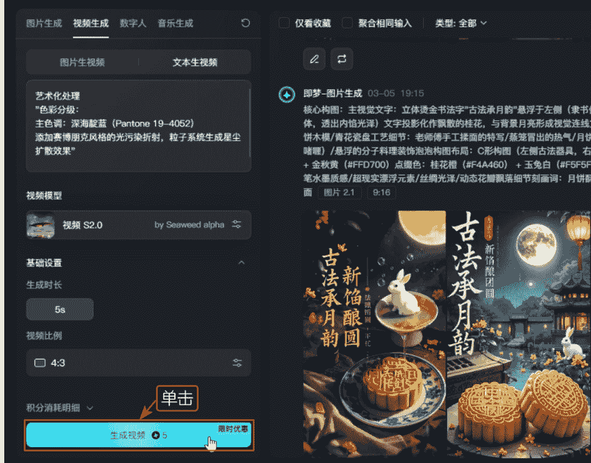
步骤04 等待片刻后，即可预览视频效果，如下图所示。

即梦-视频生成 03-06 10:24

视频主题与风格 “超高清4K海洋纪录片风格短片，以动态追踪镜头聚焦巨型水母群，展现半透明伞状体缓慢收缩推进的流体力学美感，搭配发光触须在暗蓝海水中拖曳出生物荧光轨迹” 水母细节强化 “半透明凝胶状伞膜呈现虹彩折射效果，可见内部消化循环系统的脉动，12条发光触须末端释放荧光微粒，每根刺细胞纤毛清晰可辨” 深海环境构建 “采用体积光渲染：水面阳光形成丁达尔光束阵列 深渊区冷光珊瑚群周期性生物发光 悬浮微生物组成星云状光斑矩阵” 动态交互元素 “引入鱼群规避算法：银色鳞片群受水母运动扰动形成动态涡旋 微型磷虾在触须间逃逸产生粒子轨迹 背景出现座头鲸轮廓的景深模糊效果” 运镜方案 宏观：无人机视角俯冲穿透水母群漩涡阵型 微观：流体动力学粒子跟拍单根触须摆动 环境：穿梭镜头从珊瑚礁过渡到开放水域 艺术化处理 “色彩分级：主色调：深海靛蓝 (Pantone 19-4052) 添加赛博朋克风格的光污染折射，粒子系统生成星尘扩散效果”
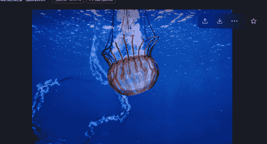
步骤05 单击视频预览图，即可进入大图预览窗口，用户可以根据需要执行编辑和生成等操作，如下图所示。
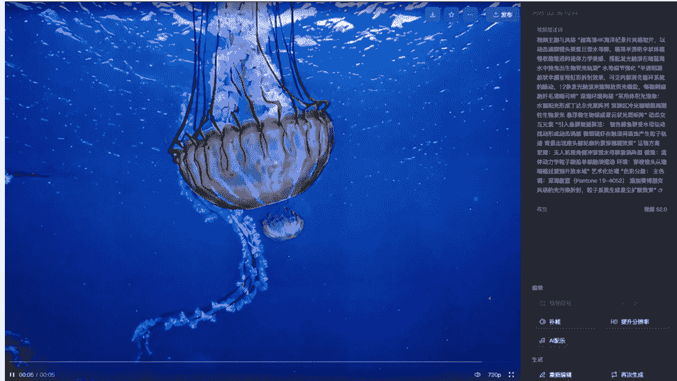
**提示：** 若想制作适配自媒体平台的短视频，可参考以下流程。

先让 DeepSeek 按主题生成带序号的分镜脚本及对应的画面描述；再利用即梦 AI 或可灵 AI 将每个分镜的描述转化为静图，通过图转视频为每张图添加 3~5 秒动态；随后把片段按编号导入剪映，调整顺序并加入背景音乐、转场效果和字幕；最后导出成品并发布到抖音、B站等渠道。整个制作由分镜拆解、AI 绘图转视频、专业剪辑三步衔接，能快速产出优质短片。

*文中代码字体版权说明* Copyright Copyright 2010, 2012 Adobe Systems Incorporated (http://www.adobe.com/), with Reserved Font Name ‘Source’ . License This Font Software is licensed under the SIL Open Font License, Version 1.1. This license is copied below, and is also available with a FAQ at: http://scripts.sil.org/OFL SIL OPEN FONT LICENSE Version 1.1 - 26 February 2007 PREAMBLE The goals of the Open Font License (OFL) are to stimulate worldwide development of collaborative font projects, to support the font creation efforts of academic and linguistic communities, and to provide a free and open framework in which fonts may be shared and improved in partnership with others. The OFL allows the licensed fonts to be used, studied, modified and redistributed freely as long as they are not sold by themselves. The fonts, including any derivative works, can be bundled, embedded, redistributed and/or sold with any software provided that any reserved names are not used by derivative works. The fonts and derivatives, however, cannot be released under any other type of license. The requirement for fonts to remain under this license does not apply to any document created using the fonts or their derivatives. DEFINITIONS