# DeepSeek实战全攻略：从指令设计到落地部署

# 内容概览
本册以实操为导向，系统梳理 DeepSeek 大模型的技术脉络与使用方法，力求把专业概念讲透、把工程步骤讲清。内容覆盖原理层面的技术基础、体系结构、训练思路，以及工程层面的 API 接入、本地化部署、云端使用等落地路径，并辅以大量拆解案例，帮助读者在不同场景下感知模型价值。

全书图文并茂、论证扎实、案例丰富，可作为 DeepSeek 研发人员的技术参考与培训材料，也可作为高校本科、研究生的教学用书。

未经授权禁止以任何形式转载或复制本书全部或部分内容。

版权所有，侵权必究。

# 前言
AI 正以前所未有的速度演进，通用语言模型已成为推动智能应用创新的核心引擎。由自然语言理解到多模态交互，由自动化编程到复杂推理，模型的适用边界持续扩张，生活与工作的形态被深刻改写。在这轮浪潮中，DeepSeek 作为国内开源代表，凭借技术突破与强劲表现迅速进入行业视野。

2025 年初，DeepSeek-R1 面世引发广泛讨论。该版本在技术上取得关键进展，并以开源、低成本的方式为中小企业与个人开发者打开新空间。它不仅对传统巨头在模型赛道的主导形成挑战，也为全球 AI 生态注入新动能，更像一个推动创新与普惠的开放平台。

开源生态显著降低了创新门槛。个人与中小企业均可依托 DeepSeek 完成高效任务处理、智能内容生产与复杂问题求解。典型场景包括智能客服、代码编写、教学辅导、医疗辅助等，覆盖面广，能实质性提升效率并带来更好的交互体验。

本书撰写以读者为中心，追求准确易懂。希望帮助更多人迅速上手，掌握核心技能并实现工作落地。不论你是 AI 新手、希望提升效率的职场人士，或是对新技术保持好奇的爱好者，都能在此获得实用知识与指导。

技术持续演进，DeepSeek 也在不断迭代。愿本书成为你探索 AI 世界的起点，助你在创新之路上走得更稳。让我们共同迎接 AI 带来的无限可能，探索 DeepSeek 的广阔空间。

关于生成式大模型赋能方与应用业务方融合的知识与资源，可关注微信公众号“智源齐说”，其持续分享大模型人才培养与产业融合方面的内容。

# 章节框架
全书共 10 章。

第 1～3 章为理论篇，介绍巨型模型基础知识、DeepSeek 的创新点与应用场景，并详解模型架构中的混合专家 MoE、多头潜在注意力 MLA、多 Token 预测 MTP，以及训练架构中的 FP8 混合精度训练、DualPipe 算法、组相对策略优化 GRPO、知识蒸馏等。

第 4 章聚焦高质量指令的撰写，涵盖指令设计技巧与企业级应用场景。

第 5～10 章为实践篇：面向个人的本地化部署，包括硬件需求与配置建议、软件环境安装配置、使用 Web UI 搭建对话界面；面向企业的 API 调用与云端部署，包括推理加速框架、主流云端部署方式；模型训练，包括基于 Unsloth 的微调与基于 TRL 的训练；RAG 实践，包括搭建简易本地检索增强系统与开源 RAG 应用案例；Agent 实践，包括构建基础智能体应用、基于 Swarm 框架搭建智能体、开源 Agent 框架等。

特别说明：书中示例内容均由 DeepSeek 自动生成，仅作演示，未经修改。

本书主要源自北京邮电大学 MAIR 团队的科研实践，编写成员包括 MAIR 负责人王轩及骨干张毅、王金浩、文怀斌等。MAIR 团队同期开发了配套的 DeepSeek 实训平台，可与本书结合使用开展练习。

编写过程中难免存在疏漏，敬请读者批评指正。

张成文

# DeepSeek 初探

# DeepSeek 实战全攻略：从指令设计到落地部署

DeepSeek 高性能开源大模型的出现，为 AI 领域带来明显的技术跃迁，也为行业注入新活力。对个人而言，掌握巨型模型的使用能力已成为提升工作学习效率的必要技能，有助于在激烈竞争中脱颖而出。对中小企业而言，DeepSeek 提供丰富的开源模型族群与更低的部署推理成本，让原本因成本高昂而止步的企业也能自建高性能模型，在数字化转型中寻找立足点。

DeepSeek 为中小企业赋能业务带来巨大商业潜力，成为驱动创新与增长的关键工具，助力实现弯道超车。

本章将先介绍巨型模型是什么，分析 DeepSeek 相比既往模型的独特性，阐述其技术优势，并说明其为个人与中小企业带来的机遇与变革。

### 1.1 何为巨型模型
巨型模型通常指参数规模达十亿级以上、结构复杂、经海量数据预训练的 AI 系统。以 DeepSeek-R1 为例，参数规模约 6710 亿。这类系统具备强大的多任务能力，如情感分析、文本摘要，部分多模态系统还可同时处理文本、图像与音频。

为便于理解，先厘清“模型”含义。在 AI 领域，模型是经过数据学习后可完成下游任务的工具，能依据输入进行预测、分类、识别等。例如在图像识别中，系统可判断图片里是猫狗还是汽车房屋；在自然语言处理中，系统可理解文本并回答问题、翻译或生成摘要。巨型模型则是模型家族中的顶尖力量。

“大”主要体现在两点：

其一，训练数据体量庞大。以 DeepSeek-R1 为例，第二阶段监督微调使用了 60 万条推理相关样本和 20 万条推理无关的写作、事实问答、自我认知与翻译数据。通过深度学习，系统不断提炼数据规律，提升能力。

其二，参数量巨大。巨型模型常拥有数十亿乃至万亿参数，参数越多，知识容量与复杂任务处理能力越强。2020 年 OpenAI 团队提出尺度定律，模型最终性能与算力、参数量、数据量密切相关。

为增强泛化能力，训练数据不仅数量庞大，覆盖面也需足够宽。DeepSeek 于 2023 年 11 月推出的 DeepSeek LLM 67B Base，训练数据达 2 万亿 Token，涵盖数字、代码、书籍等多种类型，造就了强大的通用能力。

Token 是系统处理的最小单元，是理解与生成的基石。它可以是一个词、一个汉字、标点、子词片段或空格，具体取决于分词策略，也可指图像中的一块区域。

早期语言模型仅数百万参数，只能处理简单任务。如今的 DeepSeek-R1、GPT-4 等系统参数已达数千亿甚至上万亿，不仅能掌握语法与语义，还能捕捉上下文与情感倾向，输出更准确、自然。

### 1.2 由 GPT 迈向 DeepSeek 的演进
自 OpenAI 推出 GPT 系列以来，生成式 AI 开启了通用智能探索新纪元。

2022 年 11 月 ChatGPT 发布后，能够根据指令生成流畅文本，引发首次大模型热潮。2023 年 3 月至 2024 年 5 月，GPT-4、GPT-4V 与 GPT-4o 相继推出，多模态处理与自然语言生成能力重塑认知。但高昂训练成本与封闭生态也暴露了普惠瓶颈。在此背景下，DeepSeek 以高性价比与高性能开源模型成为全球竞争中的黑马。

DeepSeek 的崛起来源于架构与训练策略的创新。不同于传统稠密架构，DeepSeek 采用 MoE 架构，通过动态激活部分参数实现高效推理，资源利用率显著提升。训练上提出 GRPO、四阶段强化学习、多 Token 预测 MTP 等方法，在降低资源需求的同时提升表现。

从 GPT 到 DeepSeek 的演进是 AGI 探索的范式突破，正在重塑知识生产逻辑，构建人机协作新篇章。下文梳理 GPT 与 DeepSeek 系列的发展脉络。

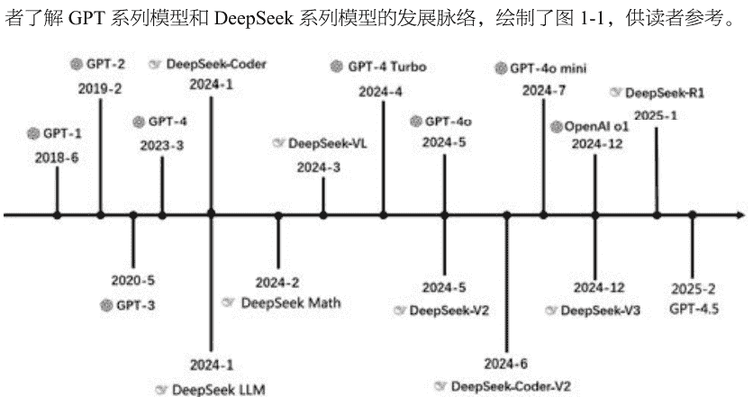

#### 1.2.1 GPT 家族演进脉络
自 2018 年起，OpenAI 的 GPT 系列不断刷新认知，推动巨型模型快速发展。从 GPT-1 到 GPT-4.5，每一代都在参数、任务能力与应用场景上实现跃升。

# 1. GPT-1：开山之作
2018 年 6 月，OpenAI 发布 GPT-1，GPT 系列的开山之作。采用 Transformer 架构的 Decoder 部分，参数 1.17 亿。通过无监督方式预测下一个词学习语言模式，虽规模较小，却在文本生成、阅读理解等基础任务取得初步成果，为后续奠基。

# 2. GPT-2：泛化突破
2019 年 2 月，GPT-2 推出，参数达 15 亿。在更大规模数据上训练，泛化能力增强，可生成更长更连贯文本，并在多项自然语言任务上零样本表现优异，进一步验证巨型模型潜力。

# 3. GPT-3：规模飞跃
2020 年 5 月，GPT-3 以 1750 亿参数震惊业界。在海量互联网文本上训练，具备强大理解与生成能力，在文本生成、问答、翻译等任务表现突出，常难与人类文本区分。其衍生模型如 Instruct GPT 与 ChatGPT 采用 RLHF 技术，有效降低有害输出。GPT-3 标志着巨型模型进入新阶段。

# 4. GPT-4：多模态开启
2023 年 3 月，GPT-4 从单模态迈向多模态，可处理文本输入并接收图像。相比 GPT-3，其准确性、推理能力与复杂任务处理显著提升，在考试与专业场景下表现接近人类。

# 5. GPT-4 Turbo：开发者向升级
2024 年 4 月，GPT-4 Turbo 面世。相较 GPT-4，支持更长上下文、更低运行成本，并新增 JSON 模式、可复现输出、并行函数调用等功能，降低使用门槛，提升灵活性。

上下文长度指单次推理可处理的 Token 序列最大长度。如开启新会话输入指令并得到输出，即一次推理，输入与输出 Token 总和需不超过上限。DeepSeek-R1 上下文窗口为 64K，约 6 万多字。

# 6. GPT-4o：多模态全面拓展
2024 年 5 月，GPT-4o 发布，可接收文本、音频、图像组合输入，并生成文本、音频、图像组合输出。对音频输入的反应可在 232 ms 内完成，处理速度比 GPT-4 Turbo 提升 200%。支持 50 种语言，速率限制提升 5 倍，最高每分钟 1000 万 Token。

# 7. GPT-4o mini：轻量化便捷
2024 年 7 月，GPT-4o mini 推出。作为简化版，在保持一定性能下针对轻量化、便捷化需求优化，进一步降低使用门槛，适用于更多场景。

# 8. OpenAI o1：推理效率与多模态新突破
2024 年 12 月，OpenAI 发布 o1 模型。专注复杂任务推理效率与多模态处理能力，架构融合稀疏激活与动态计算分配，降低资源消耗的同时保持高精度。核心是任务自适应推理，能按问题复杂度动态调整计算路径，兼顾效率与性能。

# 9. GPT-4.5：更具情商的对话
2025 年 2 月，GPT-4.5 面世。对话更自然流畅，能更好理解用户意图，在情感类问题上展现更高 EQ。

从 GPT-1 到 GPT-4.5，演进不仅体现在参数增长，更在于任务能力、多模态支持与应用场景的拓展，为后续发展奠基。

#### 1.2.2 DeepSeek 系列演进脉络
自 2023 年成立以来，DeepSeek 在两年内推出多款里程碑模型，覆盖代码生成、自然语言处理、数学推理、视觉语言理解等领域，在开源生态中树立新标杆。

# 1. DeepSeek LLM：长期主义推动开源
2024 年 1 月，DeepSeek 面世 670 亿参数的 DeepSeek LLM，标志着以长期主义推动开源的新路线。开源 7B、67B 基座与对话版本，在推理、编码、数学、中文理解上超越开源领头羊 LLaMa2-7B-Base，其中 67B Base 在中文表现上超越闭源 GPT-3.5。

# 2. DeepSeek-Coder：开源代码模型先锋
2024 年 1 月，DeepSeek 发布首个开源代码模型 DeepSeek-Coder。模型从零开始在 2 万亿 Token 数据集上训练，其中 87% 为代码，13% 为中英文自然语言。支持 16K 上下文窗口，并引入填空任务增强代码理解。

开源 7B、33B 系列，7B 版本代码能力达到 CodeLlama 34B 水平，并在 HumanEval 数据集上超越既有开源模型，展现强代码生成与理解能力。

# 3. DeepSeek Math：数学推理佼佼者
2024 年 2 月，以 DeepSeek-Coder-v1.5-7B 为基础开发的 DeepSeek Math 面世。该模型在数学相关数据上预训练，并引入 GRPO 强化学习算法。相较 OpenAI 主导的 PPO 算法，GRPO 去掉价值模型，从分组得分估计，显著减少训练资源。

DeepSeek Math-RL-7B 在竞赛级 MATH 基准测试中取得 51.7% 成绩，未依赖外部工具包与投票技术，性能接近 Gemini-Ultra 与 GPT-4，体现强数学推理实力。

# DeepSeek 实战全攻略：从指令设计到落地部署
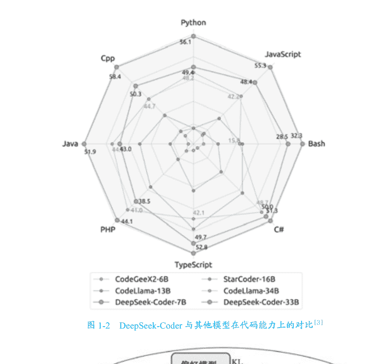

图 1-2 DeepSeek-Coder 与其他模型在代码能力上的对比[3]

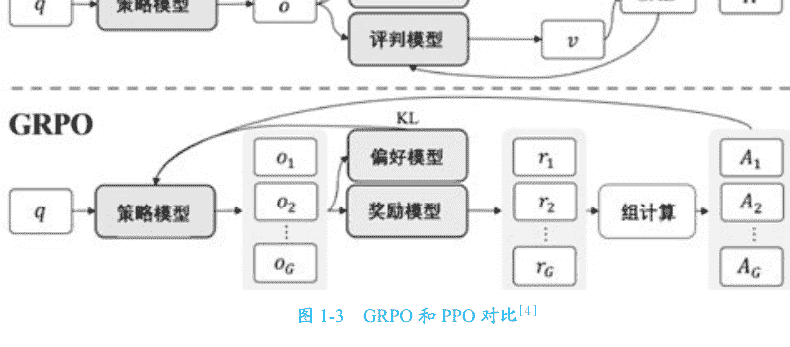

图 1-3 GRPO 和 PPO 对比[4]

# 4. 开源视觉语言模型 DeepSeek-VL 首发

2024年3月，DeepSeek 正式对外开源视觉-语言体系 DeepSeek-VL[5]。系统采用混合视觉编码器设计，在 Token 预算固定的条件下仍能高效消化高分辨率图档，同时把计算开销压在较低水平。

DeepSeek-VL 家族涵盖 1.3B 与 7B 两个规格，在大量视觉-语言评测集上取得领先或可比肩顶尖的成绩，为多模态智能的研究提供了新思路。

# 5. MoE 稀疏激活驱动的 DeepSeek-V2 跨级表现

2024年5月，DeepSeek-V2 上线[6]。架构层面实现多项创新，基于稀疏 MoE 结构实现 236B 总参数、21B 激活参数的配置，却能达到 70B 到 110B 级别稠密模型的水平，显存占用仅为同类稠密模型的五分之一到百分之一。

中文综合能力在同期模型中处于领先，英文综合能力与 LLaMA3-70B 在同一梯度，整体水准逼近 GPT-4。

# 6. 代码能力全面跃升的 DeepSeek-Coder-V2

2024年6月，DeepSeek-Coder-V2 发布[7]。该版本继承 DeepSeek-V2 的 MoE 架构，并在其上继续预训练约 6 万亿 Token，编码与数学推理能力得到明显加强。支持语言从 86 种扩大至 338 种，上下文窗口从 16K 拓宽到 128K。

在主流基准测试中，DeepSeek-Coder-V2 的编程与数学表现超越 GPT-4 Turbo、Claude 3 Opus、Gemini 1.5 Pro 等闭源产品，展现出开源模型强劲的竞争力。

# 7. 性能与效率齐飞的 DeepSeek-V3

2024年12月，DeepSeek-V3 推出[8]，并加入审核、过滤等安全机制。知识类任务的水平接近 Claude-3.5-Sonnet-1022，数学竞赛场景大幅领先同侪，生成速度达到 60 TPS，即每秒 60 个 Token，较 DeepSeek-V2.5 提升约 3 倍。训练花费约为 557.6 万美元，每百万 Token 成本 0.48 美元，性价比在同期十分突出。

# 8. 推理里程碑 DeepSeek-R1 的出现

2025年1月，DeepSeek-R1 正式发布[9]。作为新一代推理系统，该模型把强化学习直接作用于基础模型，无需监督微调，即具备自我校验、反思以及生成长思维链的能力。在数学、代码、推理任务上的表现可与 OpenAI o1 相提并论，标志着 DeepSeek 在推理方向的重要突破。

在 DeepSeek-R1-Zero 的训练观察中，研究团队捕捉到一个有趣现象：啊哈时刻。如图 1-4 所示，模型在完成一系列数学推演后出现顿悟，随后重新审视初始思路。

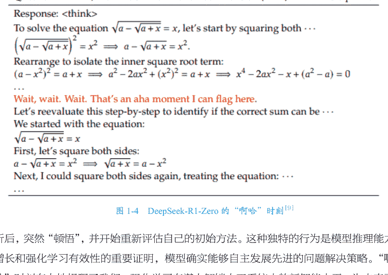

图 1-4 DeepSeek-R1-Zero 的“啊哈”时刻[9]

这一独特行为印证了推理能力提升与强化学习有效性的关联，模型能够自主形成更高级的问题解决策略。啊哈时刻提醒我们，强化学习有望解锁人工系统的新智能层次，为更自主、更具适应性的模型奠定基础。

#### 1.2.3 技术演进：从全球追赶到自主创新

2018年6月，GPT-1 的问世把自然语言处理推入预训练时代。基于 Transformer、拥有 117M 参数的 GPT-1 初次验证迁移学习的潜力，OpenAI 提出无监督预训练加监督微调的两阶段范式，在生成、问答等任务上超越传统 RNN。

质变出现在 GPT-3。1750 亿参数的模型在少样本学习中展现惊人泛化，文本流畅与逻辑性接近人类，并出现知识涌现迹象，在数学推导、代码生成等复杂任务上超出训练数据本身的范围。2023年，GPT-4 增加多模态理解，把语言模型的感知维度拓展至视觉，成为通用人工智能的重要节点。

DeepSeek 的崛起打破了 GPT 的绝对主导。通过动态稀疏激活与分阶段训练等混合架构创新，训练成本得到显著压缩，动摇了算力至上的固有逻辑，为中小企业部署大模型创造可能。

#### 1.2.4 生态演化：从单一工具到合作伙伴

大模型已渗透教育、医疗、商业等诸多领域。然而 GPT 的付费订阅、网络访问限制及闭源模式，制约了其在国内的普及。DeepSeek 通过开放 API、开源代码与轻量化客户端等举措，降低使用门槛，推动技术普惠。

自 2022 年 ChatGPT 引爆大模型浪潮以来，GPT 系列能力强劲但门槛明显：

- 付费订阅带来不低的使用成本；
- 网络限制影响体验；
- 闭源限制二次开发与定制。

DeepSeek 坚持开源，协议采用 MIT，允许复制、修改、商用。通过开放 API 方便集成，开源模型代码供学习研究，并在训练算法与硬件优化层面提出降本策略。上述做法激活了国内 AI 市场，带动算力、数据标注、算法优化等上下游协同，提升整体竞争力。

### 1.3 核心能力与差异化优势总览

DeepSeek 系列在推理、语言处理、多语支持、逻辑结构化表达、行业知识融合与动态资源管理等方面形成体系化优势。

#### 1.3.1 核心能力

1. 强大推理
DeepSeek-R1 代表模型以强化学习训练，推理时可进行大量反思与校验，持续优化路径。例如解数学题时能像人一样逐步推导呈现完整思路。在 AIME 等高难度竞赛题上，其表现超出 GPT-4。思维链可达数万字，足以应对极复杂推理。

2. 高效语言处理与多语支持
模型可精准理解从日常对话到专业文献的输入，生成流畅自然的文本。对话系统自然流畅，创作类输出质量较高。多语言能力覆盖中英文等多语种，机器翻译兼顾准确性与表达习惯。摘要、问答、情感分析等任务表现稳健。

3. 深度逻辑与结构化表达
输出路径完整、结构清晰、层次分明并能作归纳。例如课程方案会拆分为板块并给出教学内容、方法与资源建议。商业策划可从市场、定位、产品、营销、财务等多维度系统展开。

4. 行业知识增强
可与法律、医疗等专业知识深度融合，提供研究、合同审查、诊断辅助等服务。支持微调定制，金融版更擅长市场数据与风险评估，制造版利于流程优化与供应链管理。

5. 动态资源与生成效能
DeepSeek-R1 采用混合专家架构，仅激活约 37B 参数即可高效运行。生成速度达 60 TPS，是前代约 3 倍。大规模任务下兼顾速度与经济性。

#### 1.3.2 独特优势

1. 更低的训练与使用成本
DeepSeek-V3 使用 2048 张 H800 显卡训练，总成本约 557.6 万美元，远低于 GPT-4 的 1 亿美元。API 定价方面，2025 年 3 月 DeepSeek-R1 输入 1 元/4 元，输出 16 元每百万 Token；GPT-4o 对应 9 元/18 元与 72 元。本地推理时仅激活约 370 亿参数，能耗显著下降。

表 1-1 2025 年 3 月 DeepSeek 与 GPT 的 API 调用定价对比

| 模型 | 输入费用（人民币/每百万 Token）（缓存命中/缓存未命中） | 输出费用（人民币/每百万 Token） |
| :--- | :--- | :--- |
| DeepSeek-V3 | 0.50 / 2.00 | 8.00 |
| DeepSeek-R1 | 1.00 / 4.00 | 16.00 |
| GPT-4o | 9.00 / 18.00 | 72.00 |

2. 更优的性能表现
V3 生成速度 60 TPS，高于 GPT-4o 预估水平。专业推理准确率据测较 ChatGPT 高约 18%。中文处理上可解析文言、追踪网络热词、方言学术化转译，语义理解细腻。

3. 先进架构
V3 融合混合专家与稠密架构，动态路由分配计算资源，仅需激活 370 亿参数。稀疏注意力机制降低内存需求，提升大规模数据处理效率。

4. 开源与定制
相较 GPT 的闭源 API，DeepSeek 公开权重与推理代码，支持深入剖析与二次开发。本地私有化部署与行业知识库定制可保障数据安全并提升专业性。

### 1.4 典型应用场景

在大模型驱动的转型中，DeepSeek 以低成本开源优势加速落地，厂商接入迅速，应用潜力广阔。

#### 1.4.1 智能客服
银行可依据客户模糊描述关联信息生成解释方案；保险理赔等复杂流程借助动态表单实现渐进式交互。运营层面构建数据驱动体系，预测需求并实施个性化干预。服务质量管控实现实时监控、智能质检与反馈深挖。

大模型可对客服话术进行结构化评价，先给结论再展示标准与原因。复杂文本问答准确率提升，人工干预减少。多语言客服成本约为传统方案的十分之一，且 24 小时在线。

基于 DeepSeek 的智能客服优势明显：

1. 高效响应
一汽丰田接入后，智能在线客服独立解决率由 37% 提升至 84%，月均自动解决 1.7 万次咨询。

2. 降本增效
自动化处理常见问题，减轻人工压力，降低人力支出。

3. 服务一致性与问答精度
复杂文本理解更准，响应更稳定。

让客服回复始终保持统一口径、稳定可控，能够有效减少人工干预带来的波动，是实现降本增效的关键。以中关村科金为例，智能客服完成 DeepSeek 全面接入后，在金融行业复杂文本问答的实测中，DeepSeek-V3 的答对率达到 95.1%，DeepSeek-R1 达到 94.9%，均显著领先于其他通用开源方案，也明显压低了复杂咨询转人工的比例。

4. 数据洞察增强
平台可实时收集并解析客户行为与交互轨迹，为经营决策提供参考依据。

5. 个性化服务升级
通过挖掘用户过往对话路径与偏好习惯，推送更贴合个人的服务建议与解决思路。如图 1-5 所示，中青旅遨游旅行 App 将 DeepSeek 大模型全面引入后，带来多项创新优化。其首批上线的 DeepSeek 智能客服实现 7×24 小时不间断咨询。依托遨游旅行的海量业务数据，系统能迅速给出全球签证办理、目的地信息查询、行程设计规划等高频问题的准确答复。

同时定制游体验明显提升。用户只需提供出行时间、预算区间、兴趣偏好等个性化需求，无需等待即可获取细化到每日的专属旅行方案，并可按后续需求灵活调优。

# DeepSeek 落地全景：从指令到实践

# 6. 跨语种服务
智能客服能够识别不同语种背景用户的表达并给出准确回应。DeepSeek 多语言客服方案覆盖上百种语言，能以地道表达回复，并结合文化习惯调整语气与表达方式，整体成本约为传统多语种客服的十分之一。

# 7. 弹性扩容
随着业务体量增长，智能客服可平滑适配企业规模变化，满足持续扩张的需求。

# 8. 安全合规保障
系统遵循严苛的数据安全规范与隐私保护原则，全程守护用户信息的完整与私密。

#### 1.4.2 办公场景赋能
DeepSeek 兼具强大的自然语言处理与推理分析能力，正持续改写现代办公的效率边界。

在信息搜集与处理上，支持联网检索，可即时获取行业报告、新闻热点等公开资料，并借助自然语言技术筛选出高相关内容。例如策划市场活动时，输入关键词即可自动整合社交媒体动向、权威机构数据与竞品分析，形成条理清晰的结构化摘要。用户上传文档、图片等文件后，系统能快速抽取文字并定位关键信息，如审阅合同文档时即可迅速找到条款细节与数据表格，大幅缩短人工核对周期。

在文档处理层面，表现同样突出。可对长篇报告自动提炼核心观点并生成摘要，例如法务团队能迅速梳理案件卷宗要点。内置翻译引擎兼顾专业术语的准确转换，还能将文档一键转为演示大纲或标记语言格式。多人协作时，系统可比对版本差异，提出语法修正与逻辑优化建议，并自动标注争议点，有效降低沟通成本。

内容创作是高频应用场景之一。输入主题后即可自动生成新闻稿、营销文案等初稿，并支持正式、幽默、学术化等风格切换。如电商团队可快速产出契合节日氛围的产品描述。开启深度思考模式后，系统会通过多层推理构建内容框架。如撰写行业白皮书时，可结合政策动向、市场数据与案例库输出含可行性建议的完整方案，并通过比对公开数据库检测文本重复率并提供改写建议，帮助规避版权风险。

在数据分析侧，大幅提升了分析效率，支持导入表格类文件，自动清洗异常数据并生成统计图表。例如财务部门指令“分析 2024 年成本波动原因”后即可获得可视化分析报告，同时基于历史数据预测未来趋势与需求。在广告投放领域，系统通过分析用户数据实现精准触达，提升点击率与转化率，进而提高广告收入。

在程序开发上，能够显著提高效率与质量。开发者输入功能描述即可生成完整代码片段并附带关键逻辑说明，支持主流编程语言；可以实现代码自动补全，根据已有片段推荐可能写法，并按个人习惯与项目需求给出个性化建议；还能对已完成代码进行优化，提升准确性与算法效率。遇到系统 Bug 时，发送问题描述与代码段即可定位错误并给出修正方案。目前系统已集成至 VS Code 插件，开发者可在编辑器内直接对话辅助编程。

#### 1.4.3 智能家居升级
DeepSeek 的出现推动智能家居从基础自动化迈向真正意义上的智能化。

得益于卓越的自然语言理解能力，智能家居系统不再局限于预设指令。用户可以用日常对话方式表达需求，例如一句“我想看电影”，系统即可理解意图，自动调暗灯光、启动电视与影音设备，并按个人偏好挑选影视平台与影片推荐。

TCL 伏羲大模型与 DeepSeek 已实现深度融合，为 TCL 空调产品注入更强 AI 能力。以小蓝翼 C7 新风空调为例，上线“DeepSeek 随心聊”功能后，语音交互在深度理解、逻辑分析、多指令识别、百科问答、内容生成与闲聊等方面全面升级，打破了传统语音空调的交互瓶颈，重新定义了智能家居语音交互体验。

海信自研的星海大模型接入 DeepSeek 后，也推动了全屋智能生态的跨场景升级。海信电视用户只需按遥控器上的小聚 AI 键或发出语音指令，即可唤起 DeepSeek，享受全新的智能家居服务，如图 1-6 所示。

融合 DeepSeek 的星海大模型矩阵，通过模型蒸馏、强化学习等技术大幅提升深度思考与推理能力，能更精准捕捉用户的深层意图与个性化需求，提供更流畅、简洁、自然的交互体验与全方位服务。

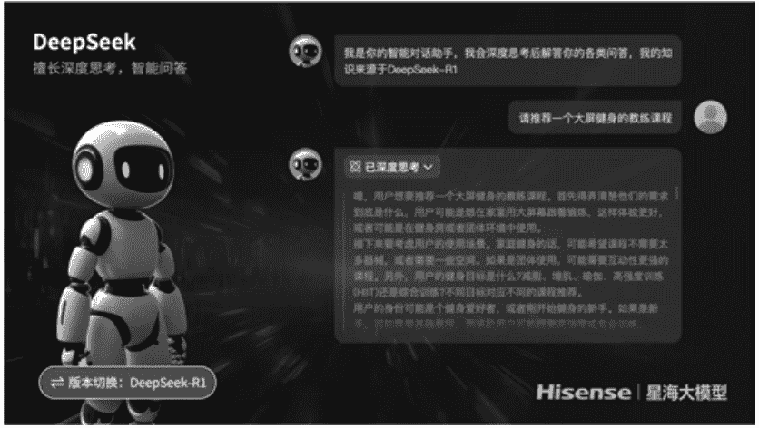

图 1-6 海信星海大模型接入 DeepSeek 模型

#### 1.4.4 医疗诊断助力
凭借高效推理、开放生态与有竞争力的成本优势，在医疗领域引发深层次变革，覆盖辅助诊断、药物研发、资源优化与中医药智能化等多个层面。

在辅助诊断方面，浙江省某位医生接诊肺结节患者时，DeepSeek 在数十秒内结合最新医学指南给出极具参考价值的诊断建议。安徽省六安市人民医院感染科的临床实践中，面对合并症复杂的患者，系统同样在数十秒内制定出科学的抗生素降阶方案。

在医学影像领域，可依据医生文字描述生成完整用药建议。随着多模态版本的发布与开源，借助系统高效处理海量影像将成为新常态。

病历书写与质控方面，系统可帮助医生分析影像、病历与药物反应数据并精准推荐药物与剂量，同时辅助电子病历撰写，将医生从繁琐书写中解放，聚焦病情观察与诊断。目前斯坦福医院已启动 AI 辅助生成电子病历的应用，国内多家医疗机构也在积极推进。

在个人健康管理与互联网医疗领域，成为大众的健康伙伴。用户可便捷查询症状与处理方法，如秋冬季甲流高发期，众多人通过系统获取专业可靠的答案缓解焦虑。通过接入 DeepSeek 的“AI 个人健康助手”，用户可随时进行健康自诊、解读体检报告并获得用药指导，系统还能挖掘健康管理需求，提供个性化健康方案。

医学科研方面，接入的“AI 学术互动助手”显著提升文献检索与阅读效率。众多科研机构已引入该系统，如昌平实验室招募专业人才探索大模型对多组学数据的分析方法，挖掘基因调控网络的潜在模式。

中医药领域应用同样深入。中国中医科学院研制的中医科信云门诊系统集成 DeepSeek 后，实现智能问诊、辅助诊断与自动处方等核心功能。未来还将推动中医药文化传播，辅助中医师精准辨证施治并优化门诊流程。

#### 1.4.5 教育教学创新
在教育领域的应用正重塑教学模式，推动智能化与个性化发展。

在教学辅助上，系统堪称教师的智能助教。输入教学目标、知识点、课时等信息即可迅速生成结构清晰、内容丰富的教案框架。例如设计《荷塘月色》教案时，系统不仅提供景物描写分析、情感主旨探讨内容，还建议配乐朗诵、小组讨论修辞手法等生动环节。设计“牛顿第二定律实验”教案时，可详细给出原理、步骤、注意事项并推荐拓展知识。

借助联网搜索功能，系统可快速整合最新教学资源，无论学术论文还是教学案例，均能精准获取并自动生成参考文献，让教师从资料查找中解脱，聚焦教学策略与个性化指导。

在未来双师课堂中，系统可作为智能助理辅助真人教师。对学生提问迅速给出清晰解答，按学习情况提供个性化建议，如为基础薄弱者推荐巩固练习，为学有余力者提供拓展资料，并整合图文视频与互动练习丰富课堂。

作业与评价环节，通过合理提示词可实现选择题、填空题、作文、解答题等多题型自动批改，准确度高。批改英语作文时可指出语法错误并给出高级词汇替换与句式优化建议；借助 DeepSeek-R1 的深度思考能力批改数学大题时，会详细展示解题思路，帮助学生明确失分原因。系统还能生成个性化评语，肯定优点、指出改进方向。通过分析作业与测试数据，可为教师提供涵盖知识点掌握、学习进度、学习态度的综合评价报告，帮助教师精准调整教学重点。

#### 1.4.6 金融投资应用
为金融机构带来全新业务模式，覆盖客户服务、风险控制、数据分析与运营管理等关键环节。

在智能投顾领域，系统可依据用户风险偏好、资产状况与投资目标，利用复杂算法提供定制化投资建议与资产配置方案。上海恒生聚源的 WarrenQ 智能投研平台接入 DeepSeek 后，服务精准度与智能化水平实现质的提升，为投资者提供更专业可靠的决策支持。

在风险控制与管理方面，系统通过对消费行为、还款记录等多维度数据的深度分析，构建精准信用评分模型，为信贷审批提供科学客观依据，帮助金融机构合理确定放款额度与利率，有效降低信用风险。

#### 1.4.7 政务智能化
DeepSeek-R1 发布后不久，多地政府便宣布接入。凭借强大性能，系统为政务服务提效、公共服务优化与城市精细化治理注入新动能。

在公文处理与行政流程优化上，深圳福田区“AI 数智员工”的“执法文书生成助手”可将执法笔录、审批文件初稿生成时间压缩至分钟级，实现秒级创作。公文格式修正准确率超 95%，审核时间缩短 90%，错误率控制在 5% 以内。赣州的公文写作助手支持政策解读、文件起草与智能校对，拟办意见自动生成功能可结合政务语境提取关键信息。大鹏新区的智慧政务协同平台依托系统实现边聊边办，会议室预订、请休假流程发起等业务办理更便捷。

在民生与公共事务管理上，广州计划利用系统建立人工智能中台探索民生政策解读场景。苏州上线数字政务智能助手并搭建可定制政务服务知识库。12345 热线服务得到显著优化，广州将其应用于工单分派，江苏宿迁市宿城区 12345 热线集成系统实现语音转文字与工单自动分派，准确率接近 100%，响应时间缩至 5 秒。无锡通过 DeepSeek-R1 优化住房保障、公积金管理等服务，在户籍办理、社保查询、医疗预约等场景实现一网通办与个性化推荐。

城市治理与决策支持同样受益。呼和浩特将 DeepSeek-R1 集成至城市大脑，实现文本、图像、视频多模态数据融合分析，可实时研判自然灾害、事故隐患等风险。深圳大鹏新区基于系统的人工智能政务应用在旅游交通治理领域打造“视频+AI+场景”模式，形成公交调度、重点车辆管理等 AI 场景矩阵。系统还能通过分析城市历史与现状数据，结合人口、经济、环境等多因素，为城市规划提供数据支撑。

在智能客服与信息查询场景，政务服务更便民。北京市丰台区上线的“丰小政”数智助手可快速解答市民问题，韶关全市市县镇村四级 4000 多个单位、8.7 万公务人员可使用智能问答。政务大厅的数字人“小城”“小运”依托系统提供智能导览与业务咨询，解决了传统客服“不解人意”的痛点。

### 1.5 DeepSeek 带来的机遇
兼具出色性能与线上免费、低 API 费用、低部署成本、开源等优势，大幅降低顶尖大模型的使用门槛，为个人与中小企业打开全新发展空间。

#### 1.5.1 个人层面的发展契机
让普通人也能拥有高效智能助理，全方位提升效率。

文案创作不再耗时。输入产品特点、目标受众、主题等要求即可快速生成逻辑严谨、内容翔实且富有创意的文案，并可切换商务严谨或新媒体活泼等风格。

工作能力也能增强。系统可迅速提炼会议记录要点与重要决策并安排后续任务，自动生成简洁精准的会议摘要，既省人力又保证信息完整。

在全球化加速的背景下，语言障碍被打破。多语言即时沟通功能可快速准确翻译并结合语境与文化灵活调整，让商务洽谈、学术交流与日常社交更自然流畅。

信息爆炸时代，系统强大的检索与分析能力如同一座指南针，可在短时间内挖掘、分析互联网信息并按需求精准筛选。无论行业动态、热点新闻还是市场调研、学术研究，均可迅速获取信息，助力用户做出明智决策。

在学习与成长的场景里，它既像一位耐心的导师，也提供了持续的陪伴感。写英语作文时，能迅速抓住语法、拼写等细微瑕疵，并就段落组织、用词精炼等方面给出改写建议，同时按照个人水平推送个性化练习和参考范文；涉及其他学科时，则能为学习者绘制清晰的知识进阶路线，汇总教材、论文与经典案例，通过多角度解读加深理解，提升学习效能。

2. 岗位版图持续拓宽

该系统的演进不断重塑人才市场，在人工智能专业方向催生了大量新岗位。大规模模型算法研发、检索增强生成落地、模型训练与应用开发等赛道的人才需求快速增长，为有专业背景的人群提供了广阔发展空间与丰厚回报。

对非专业人群而言，机会也在同步扩大。提示词工程师凭借语言敏感度、想象力以及对模型运行原理的理解，设计高质量指令以获取理想输出；数据标注师承担海量素材的标注与分类工作，为模型训练提供基础支撑，上手门槛较低，经简短培训后具备耐心细心特质者即可胜任，帮助更多人进入人工智能领域。

第 1 章 认识 DeepSeek

数据标注已成为进入智能领域的一条低门槛通道，通过对海量素材进行标注分类为模型训练提供支撑，简单培训后即可开展工作。

随着智能技术与各行业的深度融合，复合型“行业+智能”人才需求明显上升。以医疗为例，影像判读、智能设备、疾病预测与药物研发等环节，都需要兼具医学知识与智能技术能力的人才，共同研发先进医疗工具与解决方案，提升服务质量与运行效率。教育、金融、制造业等领域对该类复合人才的渴求同样强烈。传统行业从业者若希望转型，或智能爱好者希望拓宽职业路径，均可系统学习相关知识与技能，在新市场中站稳脚跟。

3. 创业与创新迎新风口

在创新创业层面，它推动了低代码创业模式的普及，大幅降低创业门槛。过去开发一款应用需要组建专业技术团队并投入大量时间资金。如今借助该系统与低代码平台，即便缺乏深厚编程基础，也能通过拖拽设置快速搭建功能完整产品，大幅缩短周期与成本，让创意更容易落地。创业者因此可把更多精力放在产品打磨与市场推广上，成功概率提升。

设计领域也在重塑。依托它的智能化设计工具正改变传统流程，用户输入需求关键词后即可快速获得多种风格方案，覆盖平面、UI、室内等方向，为设计师提供大量灵感。设计师可在智能输出基础上加入个人创意进行完善，效率与质量双提升；工具还能根据反馈与使用数据持续优化，实现个性化智能设计。

自媒体生态同样受益。短视频创作者借助它，可依据主题、风格与受众快速获取包含镜头、台词、分镜与创意情节的完整脚本。文案创作者输入主题与要求后，能迅速生成贴合用户需求、生动有感染力的内容，适用于短视频、公众号、微博等渠道。在竞争激烈市场中，这类能力帮助创作者打造更具吸引力内容，扩大影响力。

它带来的科技变革已渗透个人成长、就业与创业多个层面，提升效能、拓宽道路、激发活力。

1.5.2 为中小企业提供新动能

### 1. 技术与成本同步让利

对小微企业而言，数字化与智能化转型常受技术难题与高成本制约。传统智能研发需要高额算力投入与专业团队，对资源有限的企业压力极大。

该系统以“算法效率替代算力竞赛”为思路，通过算法优化显著提高训练与推理效率，降低算力需求，使预算有限企业也能应用先进技术。开源生态进一步拓宽发展空间，企业可基于开源版本构建私有化部署方案，结合腾讯云、阿里云等成熟云平台降低开发难度与成本，避免与大型企业在研发上正面硬碰，以更低风险享受技术红利。

### 2. 垂直行业应用迅速落地

开源特性降低应用门槛，让小微企业能快速把智能技术落地到垂直场景。

金融领域对信息处理速度要求极高。例如恒生电子接入该系统后优化智能投研平台，借助实时分析海量金融数据快速捕捉市场动向，为投资决策提供支撑；合规审核工具借助自然语言处理快速识别风险，提升运营效率与风控能力。

制造业面临降本增效压力。中控技术基于该系统开发的工业智能产品覆盖研发设计、生产制造到供应链全流程。研发环节可通过仿真优化缩短周期，生产环节实现设备智能监控与故障预测减少停机，供应链环节通过数据分析优化库存与物流，降低成本并提升效率。

保险小微险企利用该系统开发智能展业助手，为代理人提供客户信息、产品知识与销售策略支持，提升服务能力；智能风控系统可精准评估风险，提高自动化决策率，降低运营成本。

### 3. 降低开支 打破资源局限

过去在资金、人才、技术上与大企业存在差距，如今智能技术正在打破壁垒。

在流程自动化方面，它可自动处理复杂的电子表格，完成清洗、分析与可视化，大幅节省人力。生成业务报告时可按模板快速产出高质量文档；报销、报账等财务流程可实现自动化，减少失误与时间成本；法务领域智能合同质检与风险条款识别功能能够快速审查合同，降低法律风险。

智能客服应用提升服务水平。集成它的智能助手可实时响应政策解读、产品咨询与售后问题，提高客户满意度并释放人力处理复杂沟通。接入企业即时通讯系统后，还能自动生成会议纪要、待办提醒，优化协作流程。

智能还可深度挖掘业务数据价值，为决策提供支撑。例如基金公司利用市场趋势、行业动态与财务数据分析，制定更科学投资策略，提升回报。

### 4. 人员结构与商业模式的演进

小微企业的灵活性在智能加持下被进一步放大，企业可快速测试部署解决方案，抢占市场空白，实现业务增长。

借助智能，企业能够实现大规模个性化服务，通过客户数据分析实现精准洞察，提供定制化产品推荐与服务，在细分市场形成竞争壁垒，满足多样化需求。

企业也开始探索增量市场，挖掘原生智能需求。如智能健身领域提供个性化训练计划与实时指导；数字人服务领域开发虚拟主播、客服等产品。这些新兴领域潜力巨大，小微企业凭借敏捷开发能力可快速试错占先机。

它在金融、制造、医药等行业均展现广泛潜力，可用于智能风控、个性化金融、智能制造、供应链优化、药物研发与市场预测等。这不仅拓展业务边界，也激发创新活力。开源生态为小微企业提供丰富资源，可基于此开发定制化应用与服务，以差异化竞争占据市场。

它为小微企业带来全方位发展机遇，降低门槛与成本，加速垂直应用落地，打破资源限制实现降本增效，推动就业结构与商业模式转型。未来若能积极拥抱智能并持续优化业务模式，小微企业将在竞争中实现可持续发展。

小结

本章梳理了大模型基本概念及 GPT 家族与 DeepSeek 家族的发展脉络，并在该系统层面展开多角度讨论，呈现其在大模型领域地位与影响力。

核心能力与优势方面，它具备低成本、高性能、先进架构、开源可定制等特点，为广泛应用提供支撑。应用场景覆盖智能客服、办公辅助、智能家居、医疗诊断、教育学习、金融投资、智能政务等，提升效率与服务质量，并在智能终端、智能制造、自动驾驶等领域展现赋能潜力。

对个人与小微企业而言，它带来前所未有机遇。个人可借助其提升工作学习效率、增强能力、获得更多就业选择、拓展创业空间；小微企业则能突破技术与成本瓶颈，快速实现垂类场景应用，降本增效打破资源壁垒，推动转型。它的创新成果正重塑技术格局并带来积极变革，未来有望发挥更大价值，推动各行业智能化发展。

第 2 章 底层结构解析


第 1 章介绍了该系列核心能力与独特优势，本章从架构层面解析其实现优异效果的关键。

在模型快速演进背景下，架构设计决定性能、计算效率与可扩展性。作为先进开源大模型，它融合多项创新，能够提升训练效率、优化推理性能并降低计算成本。深入理解其架构有助于把握设计思路，为高效模型开发提供参考。

它的诞生源于对复杂性、效率与通用性之间平衡的思考。它既继承传统架构优点，又通过创新机制重新定义表达能力、计算效率与资源利用的可能性。不仅在技术上实现突破，也在应用层面引发广泛关注。从混合专家到多头潜在注意力机制，每项创新都标志着在大模型领域的进展，引领未来方向。

本章将解读架构设计理念与独特之处，帮助读者全面掌握原理，并在构建高效智能系统中发挥作用。

### 2.1 V3 与 R1 结构对照

V3 版本与 R1 版本架构高度相似，R1 是在 V3 基础上经特殊训练获得强大推理能力的大模型。

如图 2-1 所示，R1 通过对 V3 进行强化学习训练得到。V3 是一个混合专家语言模型，参数规模达 6710 亿，其中单个 Token 计算激活参数约为 370 亿。架构设计的核心理念是平衡推理效率、训练经济性与模型性能。为此引入两项关键技术：多头潜在注意力方法与混合专家机制。

多头潜在注意力方法是一种创新注意力方法，由该团队提出并首次用于 V2 版本。与传统自注意力相比，多头潜在注意力通过潜在变量降低计算复杂度，同时保留长距离依赖建模能力。该设计显著提升推理效率并降低显存占用，使模型能在更大数据集上运行。灵活性使其适用于自然语言处理、代码生成与多模态任务。


图 2-1 R1 模型的强化学习训练流程与蒸馏

V3 还采用优化的混合专家机制。传统混合专家通过多专家并行处理不同数据子集提升效率，但存在通信开销与参数冗余问题。DeepSeek 自主研发的专家混合方案采用更优的专家调度和负载均衡策略，提高资源利用效率并降低训练成本。结合动态路由机制，每个样本可选择最适配专家，提升整体效率与泛化能力。相较稠密模型，该方案支持高效训练并可扩展至超大规模参数量，使 V3 具备极高经济性。

如图 2-2 所示，V3 的基础仍采用 Transformer 结构，继承其强大的表达与扩展能力。为实现更高效推理与更经济训练，进一步引入多头潜在注意力与优化版专家混合方案。相关优化已在 V2 中验证，在效率与性能间取得良好平衡。


图 2-2 V3 模型架构图[8]

与 V2 对比，V3 在架构上引入无辅助损失的负载均衡策略，优化专家混合方案的计算效率，减少负载均衡带来的性能损耗。以下将详细介绍多头潜在注意力与专家混合方案的设计细节。

### 2.2 专家混合机制

混合专家是一种通过组合多个专家模型来提升性能与计算效率的架构。核心思想是引入多个专家子网络，并通过门控路由动态选择参与计算的专家，而非让所有专家全量参与，从而在不显著增加计算复杂度的情况下利用更多参数。传统混合专家在训练收敛上存在困难。DeepSeek 提出的优化版专家混合方案通过细粒度专家分割与共享专家隔离策略，显著提升性能与效率。

#### 2.2.1 稠密与稀疏专家网络的比较

目前混合专家多应用于 Transformer 结构的前馈网络部分，主要分为稠密形式与稀疏形式两种，各有优劣。

1. 传统密集连接模型

密集连接是最常见结构，各神经元相互连接，每层神经元接收前一层全部输入进行计算，如同全能选手充分利用特征。该结构训练稳定，容易实现高质量模型，可通过正则化减少过拟合。但计算量与存储需求随参数线性增长，大规模任务效率较低，若未作正则化易过拟合。

2. 稠密专家网络：全员参与的专家团队

混合专家将模型拆分为多个专家子网络，稠密门控会激活全部专家进行计算，再加权融合输出。通常能获得更高精度，但每次迭代均需计算所有专家，计算开销显著，资源需求大。

3. 稀疏专家网络：按需调用的专家团队

稀疏专家网络将模型拆分为多个专家，各司其职，核心在于动态选择适配专家进行计算，而非全量激活。该模式类似团队协作。优势在于计算效率高，仅激活部分专家即可大幅减少计算量与内存需求，适合大规模数据与复杂任务；灵活性强，可根据任务复杂度动态调整专家数量。不足在于结构更复杂，训练需管理专家选择机制，难度提升。

稠密专家网络与稀疏专家网络优缺点对比如表 2-1 所示，其指标对比如表 2-2 所示。

表 2-1 两种专家网络优缺点对照

| | 稠密专家网络 | 稀疏专家网络 |
|---|---|---|
| 优点 | 训练稳定，容易实现高质量模型 | 计算资源利用高效，推理速度较快 |
| 缺点 | 计算和存储开销大，容易过拟合 | 结构复杂，训练过程中需要专家选择机制 |

表 2-2 稠密专家网络和稀疏专家网络的指标对比

| 指标 | 稠密专家网络 | 稀疏专家网络 |
|---|---|---|

# DeepSeek 落地实战全景：从 Prompt 到部署

| 架构特征 | 稠密模型 | MoE 稀疏模型 |
| 模型结构 | 全部参数与激活单元在每次前向和反向传播中均参与计算 | 由若干专家子网络构成，单次推理仅激活其中一部分，算力开销随之下降 |
| 计算效率 | 参数规模越大，计算量与显存需求呈线性上升 | 因只唤醒部分专家，算力与显存占用更少，并发查询时的吞吐明显更高 |
| 性能表现 | 输出稳定，但对算力依赖度高 | 在保持高效计算的前提下，效果可逼近同量级的稠密大模型 |
| 时延表现 | 需加载全部参数，响应延迟偏高 | 只需载入被激活的专家，延迟更低，尤其在低并发情形下优势明显 |
| 典型用途 | 适合对稳定性要求高且资源充足的任务 | 适合需要高并发在线服务的场景，如大规模模型推理平台 |

为了更直观感受两类架构的差异，可以用备考做类比。稠密架构像把整本教材从头到尾全背一遍，覆盖面全但效率低；稀疏架构则像只挑高频考点精炼复习，效率更高，但对判断的精准度要求更大。

DeepSeek 在开源 MoE 赛道持续发力，为 MoE 的工程化落地提供了更多参考。

#### 2.2.2 DeepSeekMoE 架构拆解

稀疏 MoE 虽能通过动态挑专家来提升能力，但在实践中仍存在痛点。专家总数受限时，单个专家需要承载的知识面过宽，参数空间里不同类型信息容易混杂，专业性与计算效率都会受损；训练中还容易出现不收敛，制约了实际可用性。

DeepSeekMoE 的示意图如图 2-3 所示，其中图 (a) 为常规 Top-2 路由的 MoE 层，图 (b) 为精细化的专家拆分策略，图 (c) 为共享专家与隔离机制相结合的整体方案。

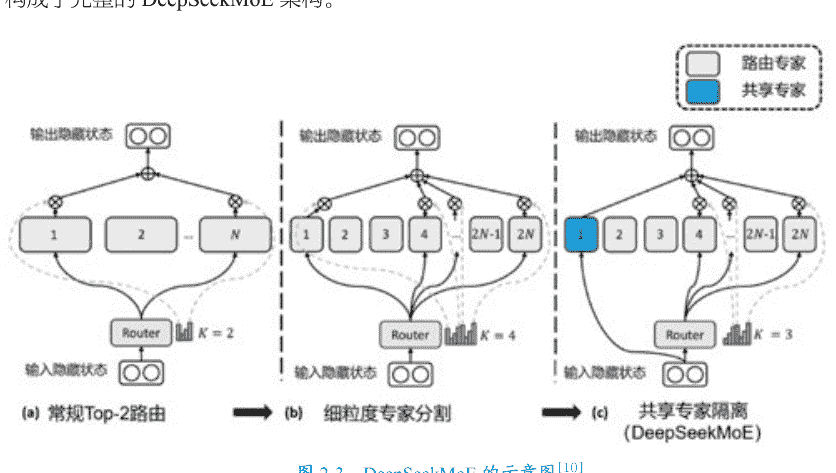

图 2-3 DeepSeekMoE 的示意图[10]

整体方案围绕两大思路展开：细粒度专家分割与共享专家隔离。

## 1. 细粒度专家切分

当专家数量有限时，每个专家的知识覆盖范围过大，容易导致参数混杂，从而削弱专业化与推理效率。单个专家被迫兼顾多类知识，而不同类别差异显著，训练与推理都难以发挥专长。

DeepSeek 提出细粒度专家分割策略。该策略让每个 Token 被路由到数量更多但体量更小的专家，从而实现知识解耦，使不同类别信息能被更精准地学习与存储。在保持较高专业度的同时，也提升了推理时专家的利用率与计算效率。

如图 2-3(a) 所示，将每个专家的 FFN 维度压缩至原来的 1/m，拆成 m 个更小单元。同步把激活专家的数量提升至 m 倍，保持整体算力不变。例如原模型使用 Top-2 路由，拆分后每个 Token 可同时调用更多更小的专家，见图 2-3(b)。

从组合数看，细粒度分割极大扩展了可用专家组合。假设专家总数 N=16，原 Top-2 的组合数为 C₁₆²=120 种。若把每个专家再拆成 4 个小专家，总专家数变为 64，改用 Top-8 路由后组合数跃升至 C₆₄⁸=4426165368 种。组合空间的指数级增长让模型能更灵活适配不同任务，并更精细地分配算力。

## 2. 共享专家隔离

传统 MoE 里 Token 动态分发到各专家，训练过程中不同专家可能学到相近知识，导致参数冗余，整体参数利用率下降。

DeepSeek 引入共享专家来承接跨任务、跨上下文的通用知识，以减少重复计算并提升参数效率。如图 2-3(c) 所示，架构中划出一组共享专家，该组会始终保持激活，不受路由决策影响，每个 Token 都确定性地经过它，保证其专注学习通用表征。由于共享专家始终参与计算，路由专家的计算量会相应调减，以维持总算力不变。

DeepSeekMoE 在每个 FFN 阶段对输入进行加权融合，即

$$\boldsymbol{h}'_t = \boldsymbol{u}_t + \sum_{i=1}^{N_s} \text{FFN}_i^{(s)}(\boldsymbol{u}_t) + \sum_{i=1}^{N_r} g_{i,t} \times \text{FFN}_i^{(r)}(\boldsymbol{u}_t) \quad (2-1)$$

其中，u_t 为第 t 个 Token 的输入向量，N_s 为共享专家数，N_r 为路由专家数，FFN_i^(s)(u_t) 表示第 i 个共享专家处理结果，FFN_i^(r)(u_t) 表示第 i 个路由专家处理结果，g_{i,t} 为第 i 个路由专家的门控权重，决定 Token 的分配与负载均衡。

#### 2.2.3 无辅助损耗负载均衡

掌握了 DeepSeekMoE 的结构后，另一个关键创新是无辅助损耗负载均衡。

传统做法为避免路由崩溃，通过强制平衡路由来让各专家在批次中被激活次数大致相同，通常借助辅助损失实现。但强制平衡在数据分布不均衡时容易拖累性能，同域信息可能被分散到多个专家，降低专业度，并产生信息冗余，浪费算力与存储。

理想的 MoE 应同时具备高频通用专家与低频垂直专家。强制平衡会剥夺模型灵活挑选专家的能力，也会造成跨专家信息复制。因此去掉辅助损失的负载均衡能更自然地形成分工与信息共享。

DeepSeek 采用“增加共享专家 + 无辅助损耗负载均衡”组合，见图 2-3(c)。

无辅助损耗负载均衡通过在路由中引入专属偏差项与专家亲和力来优化激活分配。与传统辅助损失不同，偏差项不参与梯度更新，而是被持续监控并动态微调。若某专家被激活过少，偏差项会在每次更新时小幅调整，提升其被选中的概率。这种自适应机制让 DeepSeek-V3 在训练中超越了使用辅助损失的平衡方案。虽然从理论最优角度看并非终极解，但已在有效性与性能上取得明显改进，为专家分配提供了更灵活高效的路径。

### 2.3 多头潜在注意力

在 Transformer 中，传统 MHA 依赖键值缓存加速推理。但 KV Cache 的存储随上下文长度线性增长，成为推理性能的瓶颈。

DeepSeek 提出 MLA 多头潜在注意力，将注意力计算迁移到潜在空间，从而压缩 KV Cache 需求并提升计算效率。

下面从推理流程入手，逐步体会这一改进。

#### 2.3.1 键值缓存概述

主流大模型如 GPT、LLaMA、BERT 以及 DeepSeek 均基于 Transformer。推理通常分 Prefill 与 Decode 两个阶段协同完成。

#### 1. Prefill 阶段：并行计算

Prefill 对整段 Prompt Token 一次性完成前向计算，目标是获取首个输出 Token。因为是并行处理，所以能快速完成首个结果的生成。

例如输入“今天天气怎么样”，模型会同时处理“今天”“天气”“怎么样”等 Token，生成第一个输出词。

#### 2. Decode 阶段：自回归生成

Decode 进入自回归模式，每次只产生一个 Token，并把该 Token 接回输入继续推理，直至生成 EOS 或达到最大长度。输出是逐步累积的。

如首个 Token 生成“今天”后，下一步生成“天气”，再生成“很”，最后生成“好”，最终拼成完整句子。

Transformer 推理的计算消耗主要来自堆叠的多层块，包含多头自注意力和 FFN。如图 2-4 所示，多头自注意力需先计算 Q、K、V 矩阵。

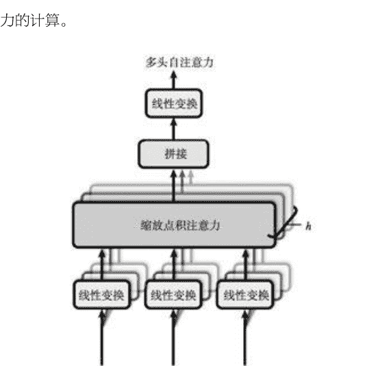

使用传统 Transformer 生成 Token 时，模型需要读取全部历史上下文以决定下一步。最直接的做法是每次都对历史 Token 重新做完整前向，注意力复杂度随序列增长飙升，效率极差。

传统模型在推理时会为每个新 Token 计算对应的键和值向量。但这些向量在上一轮已被计算过，重复计算浪费资源。为此引入 KV Cache 缓存过去 Token 的键值状态，避免重复计算，这也就是“键值缓存”名称的由来。

$$K = XW_K$$

$$V = XW_V$$

式(2-2)和式(2-3)分别是 K 和 V 的计算公式。其中，W_K 和 W_V 为可训练参数，K、V 为计算得到的键向量和值向量，X 代表输入 Token 向量。

KV Cache 的核心思想可概括为：在推理时缓存 Transformer 产生的 K、V 向量，避免重复计算，加速自回归生成。训练阶段因并行计算无需缓存；推理阶段自回归生成依赖历史，若不缓存则每次都要重算历史 KV，计算量巨大。

#### 2.3.2 RoPE 概览

自注意力本身不具备顺序感知，需要位置编码注入顺序信息。若不编码，“the dog chases the pig” 与“the pig chases the dog”在 Token 集合上难以区分。位置编码由此产生。

位置编码分为绝对位置编码 APE 与相对位置编码 RPE。

1. 绝对位置编码

绝对位置编码基于 Token 在序列中的固定索引分配唯一位置向量，与 Token 表示融合后进入自注意力。经典做法是 Transformer 论文中的正弦余弦编码，计算如下：

$$\text{PE}_{(p,2i)} = \sin\frac{p}{10000^{\frac{2i}{d}}}$$ (2-4)

$$\text{PE}_{(p,2i+1)} = \cos\frac{p}{10000^{\frac{2i}{d}}}$$ (2-5)

其中，p 为 Token 位置索引；i=1,2,…,d/2 为维度索引；d 为向量维度。该编码对不同长度通用，能捕捉周期性，但长序列上相对位置建模能力有限。

2. 相对位置编码

相对位置编码关注 Token 间的相对距离，而非绝对索引。T5 采用相对偏置调整注意力计算，更好建模相对关系。但会增加架构复杂度并引入额外可训练参数。

3. RoPE

RoPE 融合了绝对与相对位置编码的优点，无需额外可训练参数。它对 Q、K 向量施加旋转变换，使变换后的向量自然携带位置信息，并在注意力计算中体现相对位置。

如图 2-5 所示，向量 G 逆时针旋转角度 θ 后得到新坐标 (x′, y′)。旋转保持长度不变，仅改变方向。RoPE 正是通过逐维旋转为每个位置注入位置信息。

#### 1）旋转角度定义

设 d 维查询向量 Q 与键向量 K 可划分为若干两两配对的维度，RoPE 的旋转角度定义为


图 2-5 位置旋转示意图

$$\theta_p = \frac{p}{10000^{\frac{2i}{d}}} \quad (i=1,2,\cdots,\frac{d}{2})$$ (2-6)

其中，d 为向量维度，i 为当前维度对索引，p 为位置索引，10000 为缩放因子以保持数值稳定。

#### 2）旋转位置变换

为便于理解，假设词向量维度 d=2，对 Query 与 Key 中某个 2 维向量 (x,y)，RoPE 通过二维旋转使其携带位置信息，计算公式为

$$x' = r\cos(v+\theta) = r\cos v\cos\theta - r\sin v\sin\theta$$

$$y' = r\sin(v+\theta) = r\sin v\cos\theta + r\cos v\sin\theta$$ (2-7)

其中，r 为向量长度，v 为向量与 X 轴夹角，θ 为旋转角度，对应图 2-5。对于位置 p，可把式 (2-7) 写成矩阵乘法形式，即

$$\begin{bmatrix} x' \ y' \end{bmatrix} = \begin{bmatrix} \cos\theta_p & -\sin\theta_p \ \sin\theta_p & \cos\theta_p \end{bmatrix} \begin{bmatrix} x \ y \end{bmatrix}$$ (2-8)

$(x,y)$ 表示原始 Query 或 Key 向量里相邻的两个分量，变换后得到 $(x',y')$，旋转角度 $\theta_p$ 由式 2-6 给出。

RoPE 因其高效的位置编码特性，已成为 GPT-4、LLaMA 2、DeepSeek-R1 等主流大模型常用的位置编码方案之一。

#### 2.3.3 传统MHA缓存的三大缺陷

多头注意力是当前模型实现信息交互的关键模块。传统 MHA 在缓存设计上存在明显短板，尤其在模型变大、序列变长时，推理速度被拖慢，扩展性和落地能力也受限制。下面梳理 MHA 缓存的三个核心问题，并介绍 DeepSeek 提出的 MLA 多头潜在注意力作为改进思路，通过低秩联合压缩来缓解传统方案的痛点。

传统 MHA 的缓存问题集中在以下三点。

1. 独立存储导致内存激增
传统 MHA 为每个注意力头单独计算并保存 K、V 矩阵。模型有 N 个头，就要开 N 份缓存，内存占用随头数线性放大，长序列下很容易超出硬件承载。例如把房间比作显存，每个头都背一个大包，包越多房间越拥挤，连操作空间都丧失。

2. 重复计算拖累效率
各头各自处理私有缓存，看似提升了并行度，实则造成大量信息重复。多个头往往处理高度重叠的内容，同一信息被反复计算，无法共享复用。大量冗余计算浪费算力，在高并发实时场景下会成为推理瓶颈。

## 第2章 DeepSeek架构全解析

### 3. 扩展受限，部署受阻

随着模型规模和头数上升，独立缓存的弊端被进一步放大。内存和计算压力骤增，在算力受限的边缘设备或实时系统里，缓存开销和管理复杂度会严重制约灵活性和稳定性。每个头都要独立运算，头数增加后调度优化难度也随之攀升，部署成本明显提高。

#### 2.3.4 MLA：低秩KV联合压缩

MLA 是对传统多头注意力的一次重构，目标是提升推理效率并降低资源消耗。不同于 MHA 为每个头分别处理存储键值对，MLA 利用低秩键值联合压缩，把分散在各头的 K、V 信息压缩成一个紧凑的潜在向量。这样缓存需求被大幅压缩，计算流程也更简洁。

图 2-6 展示了不同注意力机制的对比。MHA 的 KV Cache 已成为推理效率的拦路虎。GQA 与 MQA 虽把 KV Cache 规模降下来，但效果仍不及 MHA。MLA 究竟如何通过压缩 KV Cache 加快推理？

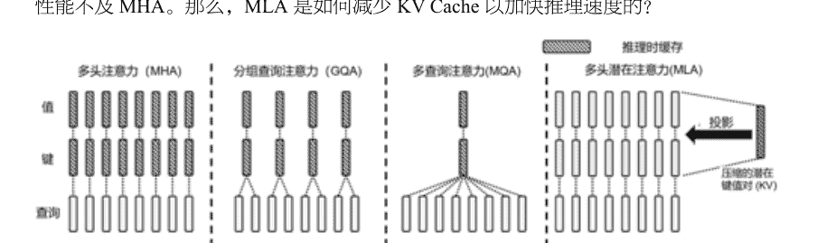

MLA 的本质是对注意力计算中的 Key 和 Value 进行联合低秩压缩，以减小推理时的 KV Cache。这一思路根植于矩阵低秩分解。


矩阵低秩分解可把一个大矩阵拆成两个小矩阵的乘积。如图 2-7 所示，$a\times b$ 矩阵可分解为 $a\times r$ 与 $r\times b$ 的乘积，$r$ 远小于 $a$、$b$。分解后存储和计算成本都下降，$r$ 越小压缩越强，重建精度也会受影响，需要在压缩率与精度间寻求平衡。

在神经网络优化里，低秩分解常用于降参降算力，虽有一定精度损失，却能明显减少内存占用和计算开销。

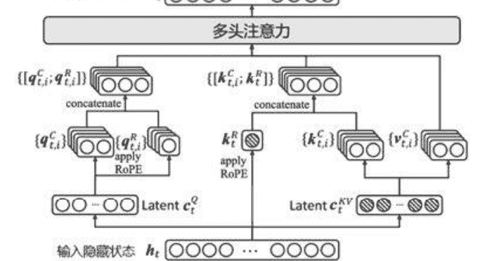

弄清数学基础后，从结构层面拆解 MLA 的计算流程。图 2-8 为 MLA 结构图，从输入到输出说明其如何压缩 KV Cache 并应用 RoPE。

### 1. 向下投影压缩QKV

假设输入状态 $h_t$ 维度为 (seq_length, 2000)，传统投影会保持维度不变，Q、K、V 仍为 (seq_length, 2000)。MLA 则先做降维，如图 2-9，$h_t$ 经压缩后 Q、K、V 可缩到 (seq_length, 100) 左右。

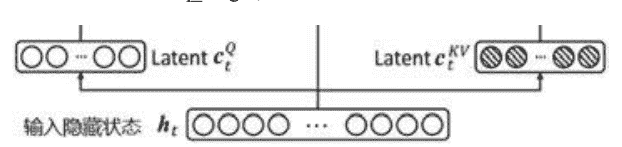

实现时 Q、K、V 的权重常被融合以提升 GPU 效率。MLA 中 K、V 的生成使用统一权重

$$c_t^{KV} = W^{DKV} h_t$$

式中 $W^{DKV}$ 为向下投影权重，$D$ 代表 Down。投影输出联合特征 $c_t^{KV}$，形状为 (seq_length, 200)，前 100 维对应 K，后 100 维对应 V。

压缩后 K、V 在推理中缓存，KV Cache 占用显著下降。Q 的压缩路径与 K、V 相同。

$Q$ 的压缩表达为

$$c_t^Q = W^{DQ} h_t$$

$W^{DQ}$ 为降维矩阵，$c_t^Q$ 为 Q 的潜在表示，形状 (seq_length, 100)。

### 2. 向上投影恢复维度

经压缩后，Q、K、V 再做上投影恢复到适合注意力计算的尺寸，可与 $h_t$ 保持一致，也可按头数调整。

例如恢复到 (seq_length, 2000)，或按 64 头、每头 50 维恢复到 (seq_length, 3200)。图 2-10 为上投影过程。

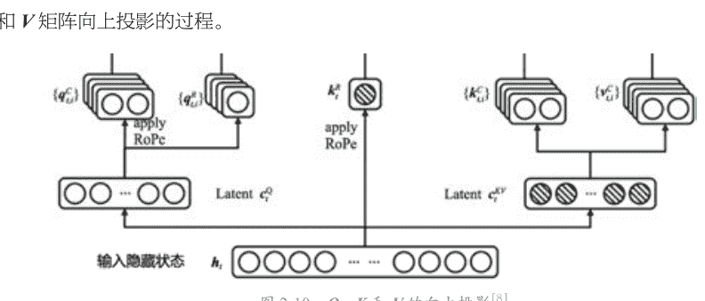

上投影公式为

$$

\begin{aligned}

& q_{t}^{C}=W^{U Q} c_{t}^{Q} \\

& k_{t}^{C}=W^{U K} c_{t}^{K V} \\

& v_{t}^{C}=W^{U V} c_{t}^{K V}

\end{aligned}

$$

$W^{UQ}$、$W^{UK}$、$W^{UV}$ 分别为上投影矩阵，$U$ 代表 Up。$q_t^{C}$、$k_t^{C}$、$v_t^{C}$ 为投影后的 Q、K、V。

### 3. RoPE位置编码解耦

Transformer 依赖位置信息理解序列顺序。MLA 采用解耦 RoPE 策略，将内容信息与位置信息分离后再融合，如图 2-11。

与常规 RoPE 相比，解耦 RoPE 有两点不同：

1. 独立生成位置 Q、K。常规 RoPE 直接把位置编码嵌入 Q、K 向量，解耦方案额外生成专门承载位置信息的 Q、K，向量解耦更清晰。
2. 拼接融合。先通过上投影得到内容 Q、K，再用 RoPE 得到位置增强的 Q、K，最后拼接，使注意力既能利用内容又能利用位置。

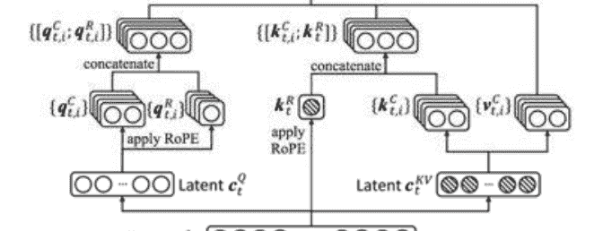

### 4. 独立生成RoPE向量

传统 RoPE 会直接对上投影后的查询 $q_t^{C}$ 做旋转。MLA 则不同，上投影 Q 的公式为

$$

\left|q_{t, 1}^{C}, q_{t, 2}^{C}, \cdots, q_{t, n_{h}}^{C}\right|=q_{t}^{C}=W^{U Q} c_{t}^{Q}

$$

RoPE 向量不作用于 $q_t^{C}$，而是基于式 (2-10) 得到的 $c_t^Q$ 与权重 $W^{QR}$ 相乘生成独立的 Query，再经 RoPE 变换得到带位置的 $q_t^R$：

$$

\left|q_{t, 1}^{R}, q_{t, 2}^{R}, \cdots, q_{t, n_{h}}^{R}\right|=q_{t}^{R}=\operatorname{RoPE}\left(W^{U Q} c_{t}^{Q}\right)

$$

随后 $q_t^R$ 与各头的上投影向量 $q_t^{C}$ 连接，使每个头都能获得位置增强的 Query。

K 的位置编码同理，不是对 $k_t^{C}$ 做 RoPE，而是从输入 $h_t$ 新建 K 向量并做 RoPE。

$K$ 的位置编码公式为

$$

k_{t}^{R}=\operatorname{RoPE}\left(W^{K R} h_{t}\right)

$$

与 $q_t^R$ 有两处关键差异：一是 K 直接源自 $h_t$ 而非 $k_t^{C}$；二是带位置的 $k_t^{R}$ 与上投影后的 $k_t^{C}$ 拼接，供各头使用。

### 5. 注意力输出拼接处理

拼接会提升 Q、K 的维度，模型可通过两种方式应对：

- 增加注意力头数，保持每头维度不变；
- 固定头数，提升每头处理维度。

图 2-12 为拼接后向量经多头注意力得到输出的示意。


至此 MLA 的完整流程已梳理清楚。它基于对注意力机制的深入理解做出的先进创新，后续仍可能出现更进一步的改进，甚至超越 Transformer 的新范式。

#### 2.4 多Token并行预测

Transformer 解码通常是逐 Token 生成，每步都要频繁访存，成为训练与推理的瓶颈。针对此问题，业界提出多种并行生成方案。

#### 2.4.1 块级并行解码策略

2018 年谷歌提出块级并行解码，在解码器后并联 K 个 lm_head。各头分别预测不同步的 Token，第 1 个头预测 Next Token，第 2 个预测 Next Next Token，以此类推。

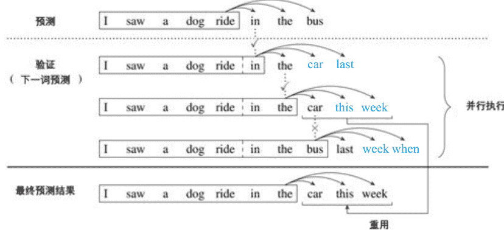

如图 2-13，在预测阶段 K 个头一次性产出 K 个 Token；验证时把原始序列与生成的 Token 拼接形成训练对，筛选与标签一致的最长序列作为可接受结果。

#### 2.4.2 Meta 的 MTP 方法

2024 年 4 月 Meta 提出 MTP，通过多步 Token 预测迫使模型学习更长的依赖。

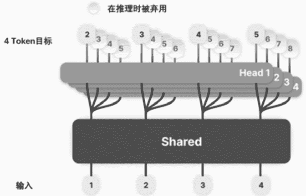

图 2-14 为案例，对输入 Token $t_i$ 在主网络上接入 4 个并行预测头，分别预测 $t_{i+1}$、$t_{i+2}$、$t_{i+3}$、$t_{i+4}$。

#### 2.4.3 DeepSeek 的 MTP 方法

如图 2-15，DeepSeek 用 D 个顺序模块预测 D 个额外 Token。训练时输入经共享 Embedding 进入所有 Transformer，第一个预测头接在主模型最后一层，通常为前馈网络，输出维度等于词表大小，用于预测序列下一个 Token。推理时仅需最终预测。

第二个预测分支在原有设计外额外叠加了一个可学习的层级。它抽取主干模型最末一个 Transformer 层的输出，先经 RMSNorm 做稳定化处理，再与对应的输入嵌入向量拼接。与首条分支以 t1 为起点不同，这条路径的起点是 t2。拼接后的表征先通过线性投影把维度调至目标大小，随后进入一个小型可训练 Transformer 做二次提纯。训练阶段该头负责拟合 t3~t6 的词元，推理时仅保留 t6 的结果。

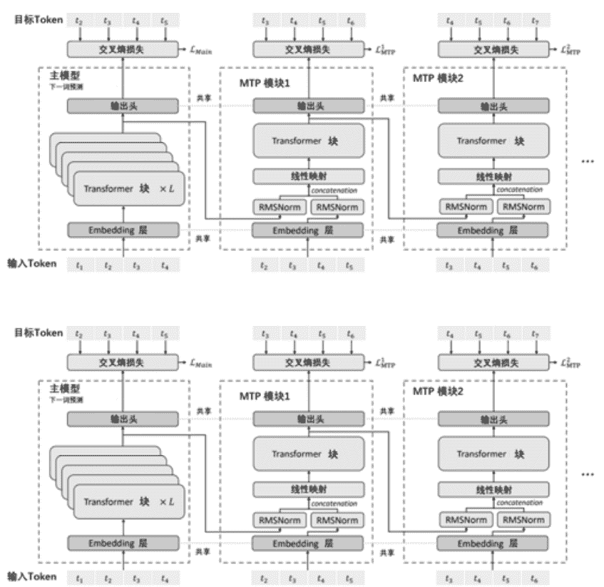

图 2-15 DeepSeek 的 MTP 案例 [8]

第三条预测分支以第二条分支的 Transformer 输出以及 t3 至 t6 范围的输入向量为输入，节奏与前两者一致：训练期负责预测 t4 至 t7 的序列，推理期只输出 t7。经过 MTP 训练后，网络对未来词元的预规划能力增强，预测表现随之改善。

总体来看，DeepSeek 的 MTP 可视作一系列研究的集大成，通过一次多步前瞻，提升了样本使用效率，也让模型能捕捉更长的上下文。

### 小结

本章从宏观角度梳理了 DeepSeek-V3/R1 的整体架构，为后续细节展开奠定基础，重点拆解了 MoE、MLA、MTP 三大创新，共同推动性能提升并优化计算与内存开销。

DeepSeekMoE 在经典 MoE 上改进，引入共享专家与免辅助损失的负载均衡，缓解参数冗余与资源分配不均。共享专家削减了冗余，提升训练与推理效率；不引入额外损失的均衡机制实现专家间高效分配，进一步优化运算。

MLA 是另一项关键创新，通过低秩键值联合压缩与 RoPE 解耦，大幅提高注意力计算与内存效率。从 Q、K、V 的下投、上投，到 RoPE，再到注意力输出，完整呈现 MLA 流程，在保证信息传递的同时实现效率跃升。

MTP 用来缓解传统单步生成效率低的问题。2018 年 Google 提出块级并行解码，通过多 lm_head 并行预测多 token；2024 年 Meta 提出 MTP，多头并行预测后续 token，增强长依赖学习。DeepSeek 的做法借助顺序模块与共享 Embedding 逐层预测更多 token，提升样本效率与上下文捕捉。

本章系统阐述了 V3/R1 的核心架构与改进。对 MoE、MLA、MTP 的深入分析既揭示原理，也体现实际优势，为后续优化提供理论与实践依据。随着技术演进，该架构有望在更多领域发挥作用，推动大模型普及。

## 第 3 章 DeepSeek 的训练架构
在模型设计之外，训练体系同样决定最终表现、效率与扩展性。DeepSeek 在硬件适配、算法优化、数据策略三方面实现系统性突破，显著提升大规模语言模型的训练与推理效率。本章介绍训练架构的核心思路与亮点，涵盖基础架构、硬件创新、算法创新与数据优化四方面。

### 3.1 DeepSeek 的训练
DeepSeek-V3 与 DeepSeek-R1 的架构基本一致，R1 是在 V3 基础上通过强化学习获得的强推理模型。

训练千亿参数模型如同指挥大型交响乐，需要精准分工、高效协作与灵活应变。DeepSeek 的训练体系借助分散计算、存储优化与动态调度，把数万张 GPU 组织成高效运转的超级大脑。

#### 3.1.1 基础技术
训练需考虑的基础技术包括分散训练、计算与存储优化及动态资源调度。

#### 1. 分散训练：协作的智慧
设想多位画家合作绘制巨幅壁画，若各自为政画面会破碎。若分工负责轮廓、上色、统合风格，效率会大幅提升。DeepSeek 的分散训练基于此理念。

实现上，训练数据被切块分发给多卡并行处理，即数据并行，类似多画家临摹同一画的不同局部，如图 3-1 所示。

模型过大时会被拆分到多卡，每卡负责一段神经网络，即模型并行，类似壁画分区由不同画家完成，如图 3-2 所示。


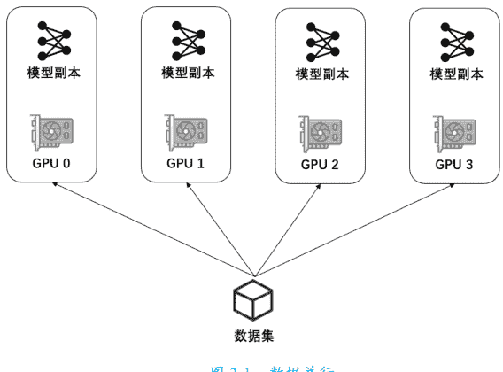

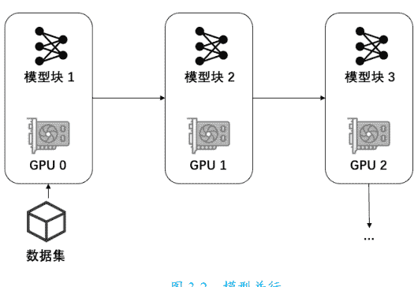

卡之间会像流水线一样传递中间结果，在模型并行上引入数据并行，避免空闲，即流水线并行。这也是当前主流做法，将在 3.2.2 节详述。类比为画家 A 完成线稿后立即传给画家 B 上色，同时开始下一幅线稿。

该混合并行策略并非首创，Megatron-LM 与 DeepSpeed 的组合被广泛用于千亿级训练。官方文档提到，其分散系统融合了数据、模型与流水线并行的优势，以应对千亿参数挑战。

#### 2. 计算与存储优化：厨房的高效法则
训练中计算与存储优化至关重要。若把 GPU 比作主厨，任务是快速烹饪而非备菜或洗碗。DeepSeek 通过精细分工提升效率：主厨专注核心烹饪即矩阵乘法，助手负责食材准备与器具整理。

如图 3-3 所示，常用数据放在 GPU 显存，类似调料摆在灶台；不常用数据存入 CPU 内存，类似食材放冰箱。两者通过 NVLink 高速互联，速度远超传统 PCIe，类似自动传菜机器人。显存不足时，部分数据会临时寄存在 CPU 内存，类似高峰期暂存隔壁仓库。


图 3-3 训练模型时，不同存储设备的处理速度

该思路与 DeepSpeed 的 ZeRO-Offload 目标一致，后者把优化器状态卸载到 CPU 内存，显著降低显存占用。

#### 3. 动态资源调度：智能交通管理
训练千亿参数模型像早高峰调度数万辆车，若信号灯不智能必然拥堵。动态调度系统扮演交通大脑，根据实时车流量自动调整信号灯时长即 GPU 分配，甚至临时增派交警即弹性扩容，类似双十一动态扩容服务器。

某辆车抛锚即 GPU 故障时，系统会立即把任务转移到其他设备，确保不中断。

系统还实时监控路段车速即 GPU 利用率，通过负载均衡算法引导车辆绕开拥堵，避免部分设备满载而其他闲置。

#### 3.1.2 训练过程
DeepSeek-R1 并非从零开始，而是站在 V3 和 R1-Zero 肩膀上，加入更多推理导向的强化学习优化。

如图 3-4 所示，训练可分为四个阶段。

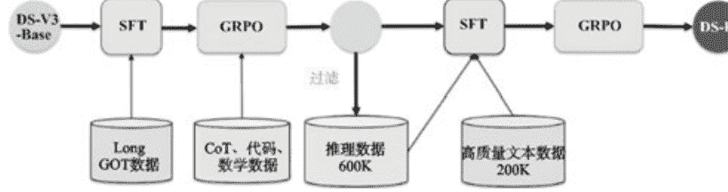

图 3-4 DeepSeek-R1 的训练过程

#### 1. 第一轮 SFT 有监督微调
团队用数千条高质量合成的 Long CoT 数据做冷启动，可理解为在 GRPO 前用长思维链预热，使模型具备一定推理基础与知识储备，避免初期胡乱生成。

#### 2. 第一轮 GRPO 强化学习训练
在第一轮 GRPO 训练中，模型为每个问题生成多个答案形成答案组，组内相互比较计算好坏值。强化学习如同金牌教练，对输出打分并约束，不断提升数学、代码、逻辑推理能力。

#### 3. 第二轮 SFT 有监督微调
第二轮 SFT 基于 20 万条高质量文本与 60 万条推理数据，采用拒绝采样。可理解为模型尝试熟悉方法解题，不可行则放弃。在管道中，指在微调后模型上采样 n 个样本，通过接受或拒绝函数过滤，筛选出符合目标分布的样本再微调。

#### 4. 第二轮 GRPO 强化学习训练
第二轮 GRPO 在更大规模上实现更强行为约束，对齐人类偏好，去除有害内容，增强通用能力。

### 3.2 DeepSeek 在硬件层面的训练亮点
DeepSeek-R1 的表现不输 GPT-4o，成本却大幅降低，离不开硬件层面的创新。

#### 3.2.1 FP8 混合精度训练
FP8 混合精度利用 8 位浮点格式训练，降低精度以提升效率、减少内存并降低成本，同时尽量保持性能。随着硬件与算法成熟，FP8 在千亿级模型训练中优势明显。

核心优势有四点。
- ① 计算效率提升。FP8 计算速度约为 FP16 的 2 倍、FP32 的 4 倍，能大幅加速训练。
- ② 内存占用减少。存储仅为 FP32 的 1/4，显著降低显存需求，支持更大模型或更高并行。
- ③ 成本降低。减少计算与通信消耗，显著降本。
- ④ 性能平衡。尽管精度较低，借助高精度累加如 E4M3/E5M2 以及关键层保留 BF16/FP32，可保证数值稳定并提升收敛。

对精度敏感的模块如向量化层、输出头、MoE 门控、归一化、注意力等，V3 仍用 BF16 或 FP32 计算。

目前 FP8 混合精度已被广泛接受，微软已推出相应框架，优化通信与分散策略，提升训练速度。

#### 3.2.2 DualPipe 算法
MoE 通过减少每个 token 的激活参数降低成本，MLA 显著减小 KV Cache 并提升推理速度。本节重点介绍 DualPipe，提升集群计算通信比与效率。

深度学习训练核心是前向与反向传播，如图 3-5 所示。

前向传播是输入从底层逐层传递到顶层，每层变换并生成输出。

反向传播是通过损失函数计算损失，利用链式法则逐层求梯度，并从输出层反向传递到输入层，最后用优化器如 Adam 更新权重。

> 注意：反向传播在前向之后。

具体而言，前向中数据从第 n 层流向第 n+1 层；反向中梯度从第 n+1 层回传到第 n 层。实际训练采用批处理，一批样本同时输入，完成前向与反向后再统一更新权重。


图 3-5 前向传播和反向传播

模型小时单卡可容纳，资源充分利用。规模增大时需拆分到数百至数万 GPU 集群，即数据并行与模型并行，如图 3-6 所示。但仍面临三大挑战。


图 3-6 模型并行策略下的显存利用率

- ① 资源利用率。存在依赖，部分节点会等待结果而空闲。
- ② 通信瓶颈。梯度、输出等数据传输受带宽限制，导致闲置。
- ③ 容错与恢复。集群规模大，故障概率高，需从检查点恢复。

为充分利用算力，业界提出多种流水线技术。例如 PipeDream 引入 1F1B 调度，重叠通信与计算提升利用率。图 3-7 中数字 1、2、3、4 代表不同小批量。

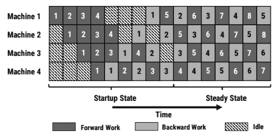

2023 年 Sea AI 提出的 Zero Bubble Pipeline Parallelism 对此优化。传统 1F1B 把输入梯度与权重梯度视为单一单元，增加顺序依赖。Zero Bubble 将二者拆分到不同阶段，减少空闲，并通过更新后验证机制优化参数更新，减少优化器步骤空闲。两种机制的显存利用效率分别如图 3-8、图 3-9 所示。


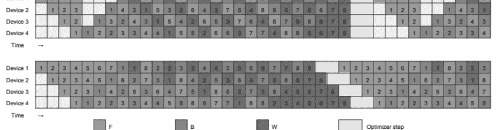

DeepSeek 从 V3 起引入 DualPipe 调度，思想与 Zero Bubble 相似但通过多项改进提升效率，其显存利用率如图 3-10 所示。


图 3-10 DualPipe 算法的显存利用效率

#### 1. 细粒度划分阶段
DualPipe 把每个计算块分为四种：注意力模块、分发模块处理设备间通信、多层感知机、聚合模块做跨设备输出合并。对反向块，注意力与 MLP 进一步拆分为输入反向与权重反向。

#### 2. 双向流水线调度
通过从流水线两端同时输入小批次，大部分通信可完全重叠。为此需维护两份参数副本。

例如 8 卡跑 8 层模型时：卡 0 同时持有第 0 层和第 7 层参数，卡 7 同时持有第 7 层和第 0 层参数。通过参数镜像与双向数据流动，显著提升利用率与效率。

#### 3. 高效通信内核
DeepSeek 定制高效跨节点全通信内核，减少专用通信流式多处理器数量，优化性能。

### 3.3 DeepSeek 在算法层面的训练亮点
本节介绍算法层面的两大亮点：GRPO 算法和知识蒸馏。

GRPO 在 PPO 的思路上做了精简，舍弃了独立的值网络，转而用组内相对打分来逼近价值评估，并以 KL 约束来压制策略更新的步长，从而在大幅削减训练开销的同时保留训练的稳健性。

知识蒸馏的核心在于把教师模型的认知迁移到学生模型上，既靠数据迁移也靠模型迁移，实现效果与效率的兼顾。DeepSeek 团队让 DeepSeek-R1 产出大量高质量样本用于指导小模型，使小模型获得近似大模型的推理能力，研发周期与费用都被有效压缩。

#### 3.3.1 组相对策略优化剖析
强化学习研究智能体如何通过与环境的持续互动不断调整行为策略以获取长期累计回报。其学习方式与人类从经验中归纳规律、依正负反馈挑选有利行动相似。经典范式有 Q-Learning、深度 Q 网络 DQN 以及策略梯度 PG。

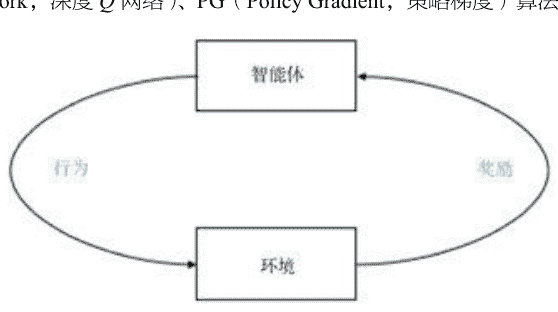
2022 年 OpenAI 在 Instruct GPT 与 ChatGPT 中首次落地 RLHF，即基于人类反馈的强化学习，把人工偏好纳入强化学习流程，使模型输出更贴合人类期待。RLHF 的核心实现依赖 PPO，基本思路是让智能体在互动中学习策略，同时限制单次更新幅度以防止策略突变导致崩溃。

如图 3-12 所示，从语料集中抽样后送入大语言模型，模型为特定任务产出结果，人工标注员对结果排序形成行为奖励，用以训练奖励模型，为后续 PPO 训练提供评判依据。

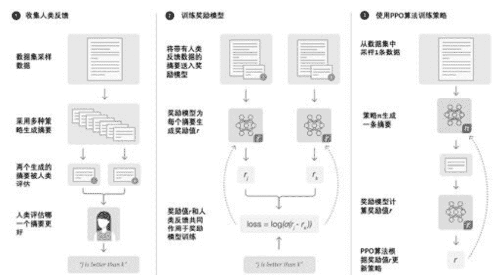
GRPO 属于 PPO 家族的强化学习变体，丢弃了奖励模型，改用群体分数估计边界，从而显著降低资源占用。如图 3-13 所示，与 PPO 的主要区别如下。

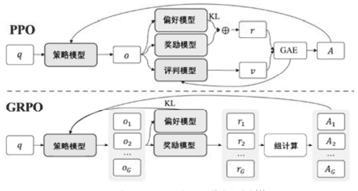
- ① 去掉价值评判模型。PPO 的价值网络通常与策略网络规模相近，会带来可观的计算与显存压力。GRPO 不再额外维护价值模型来估计价值，降低了显存与计算需求。

#### 3.3.2 知识蒸馏落地
知识蒸馏是将大型复杂教师模型的认知迁移到小型高效学生模型的手段，在维持表现的同时明显降低计算复杂度与存储需求，更适合资源受限的部署场景。结合数据蒸馏与模型蒸馏，DeepSeek 实现了从大模型到轻量模型的高效迁移，提升性能并降低成本。

模型蒸馏的核心是通过模仿教师模型的输出来训练更小的学生模型。教师模型性能高但成本高，学生模型轻量、推理更快且显存占用更低。

形象地说，知识蒸馏如同把茶叶精华萃取后融入白水，使清水也带有茶香。整体传递主要包含三个步骤，如图 3-14 所示。

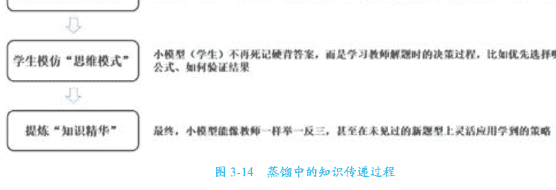
DeepSeek 团队在发布 DeepSeek-R1 的同时开源了多套蒸馏后的小模型。例如，用 DeepSeek-R1 产出约 80 万条高质量训练数据，覆盖数学推理、代码生成、科学问答等场景。这些数据不仅包含答案，还暗含多专家协作的决策逻辑。小模型通过参数微调直接学习 DeepSeek-R1 的复杂推理模式，从而在 1.5B、7B、32B 等小规模模型上实现接近 GPT-4o 的数学推理能力。

具体来看，知识蒸馏对中小企业尤为重要。相较于需要复杂训练的强化学习，蒸馏模型直接继承大模型的成熟策略，输出更稳定。在成本上，企业只需用 DeepSeek-R1 产出数据并微调开源模型如 Qwen、LLaMA 等，无需从头训练，开发周期大幅缩短。

### 3.4 DeepSeek 数据优化策略
在 DeepSeek-V3 的开发中，预训练数据的优化是提升模型能力的重要环节。通过多项技术手段，DeepSeek-V3 在数学、编程、多语言处理和复杂推理任务中表现突出，提升了单任务表现和多任务泛化能力，使其能更好适配多样化场景。

1. 提升数学、编程样本比例
DeepSeek-V3 预训练期间优化了数学和编程样本占比，带来多方面提升。

首先，数学能力增强来源于数学样本比例提升。在 MATH-500、MGSM 等数学基准上 DeepSeek-V3 表现优异，部分任务超越 GPT-4o 与 Claude-3.5-Sonnet 等闭源模型。

其次，编程样本增加显著改善了编码任务表现。在 HumanEval、MBPP、LiveCodeBench 等编码基准上 DeepSeek-R1 达到最佳水平，展现出强大的代码生成与问题解决能力。

此外，数学与编程样本的增加不仅提升特定领域能力，也增强了多任务处理能力。例如在 MMLU 等综合基准上 DeepSeek-V3 表现亮眼，体现出在多领域任务上的广泛适用性。

2. 思维链数据激活推理能力
DeepSeek-V3 训练中广泛使用思维链技巧激活推理能力，而 DeepSeek-R1 训练中更加入了长思维链语料。

## 第3章 DeepSeek 训练架构
思维链通过把复杂问题拆解为多个子问题并逐步求解，显著提升大模型在逻辑推理任务中的表现。该方法不仅增强数学和常识推理能力，还提升可解释性和可控性。

不同于传统标准提示词的输入直接映射到输出 `<input-->output>` 的方式，思维链实现了输入到推理链再到输出的映射 `<input-->reasoning chain-->output>`。把使用思维链的提示词拆解后，模型能更清晰地观察数学等复杂任务的工作流程，提升推理能力，如图 3-15 和图 3-16 所示。

# 标准 Prompting

图 3-15 标准提示词示例

# CoT Prompting

图 3-16 CoT 提示词示例

具体而言，一个完整的思维链提示词通常包含三部分：指令、逻辑依据和示例。

指令用于描述问题并指定输出格式。

逻辑依据详细说明解决问题的中间推理步骤，包含解法和必要的外部知识。

示例通过少量输入输出对帮助模型理解问题格式和解题步骤。

通过这种方式，思维链使模型能够模拟人类逐步推理，更有效地处理复杂问题。

Open R1 团队开源的 OpenR1-Math-220K 数据集可在 HuggingFace 查看，如图 3-17 所示。该数据集构造过程使用 DeepSeek-R1 为 40 万个问题各生成两个答案，经筛选后保留 22 万个具备正确推理轨迹的问题。读者可用此高质量推理数据集训练自己的 7B～13B 小模型。

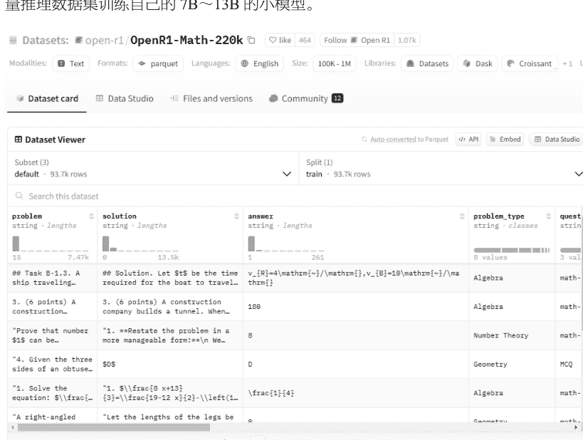
图 3-17 OpenR1-Math-220K 数据集

# 小结
本章详细介绍了 DeepSeek 模型在训练架构、硬件优化、算法创新和数据优化方面的关键技术和策略。这些内容共同构成了 DeepSeek 模型高效训练和性能提升的基础。

# 第3章 DeepSeek 训练架构详解
DeepSeek 在硬件层面的创新显著降低训练成本，同时保持高性能。核心亮点包括 FP8 混合精度训练和 DualPipe 算法。前者使用 8 位浮点数训练，大幅提升计算效率、减少显存占用和训练成本，并通过高精度累加保持性能。后者优化流水线并行，通过细粒度划分阶段、双向流水线调度和高效通信内核，提升 GPU 集群的计算通信比和效率。

算法层面创新包括 GRPO 和知识蒸馏。前者基于 PPO，摒弃评判模型，引入群体相对奖励，并以 KL 约束限制策略更新幅度，显著降低资源消耗同时保持训练稳定。后者通过数据蒸馏和模型蒸馏将大型复杂模型知识迁移到小型轻量模型，实现高性能与低成本兼顾，更适合资源受限环境。

数据集方面，DeepSeek 研究团队提高了数学和编程样本比例，使模型在相关基准上表现优异；同时，通过将复杂问题分解为子问题逐步求解，思维链数据激活了模型的推理能力。

# 第4章
# 高质量提示词

# 第4章 高质量提示词
讲解完 DeepSeek 的模型架构和训练架构后，本章以提示词用法为切入点，说明如何将大模型应用于日常工作和生活。

用好 DeepSeek-R1 这类大模型，最简单也最关键的是掌握提示词用法。一份优秀的提示词能引导模型更准确理解需求，从而生成更相关、更有创意或更准确的回答。随着大模型时代到来，设计提示词将成为各行业从业者的必备技能。例如设计师可通过精心设计的提示词快速生成创意草图，文案策划人员可快速获得吸引人的广告文案。提示词就像一把钥匙，帮助我们解锁大模型的强大能力。

掌握提示词用法将极大提升个人行业竞争力。本章详细介绍什么是提示词，如何设计高质量提示词，并探讨提示词在企业层面的应用场景。

### 4.1 提示词总览
提示词是用户输入给大模型的指令或信息，用于引导模型生成符合预期的输出，帮助模型理解任务目标、格式要求和风格偏好，从而提升生成结果的准确性和相关性。

提示词可分为指令型、问答型、角色扮演型、创意型、分析型和多模态等类型，各有应用场景。新手设计提示词时常在语义表述、内容逻辑等方面出现问题。掌握提示词设计技巧是未来人工智能交互的重要技能，有助于实现更高效、创新的内容创作和问题解决。

#### 4.1.1 什么是提示词
提示词是用户输入给大模型的指令或信息，就像给模型发一条消息，告诉它我们想要什么。它的作用是引导模型生成符合预期的输出，帮助模型理解任务目标、格式要求和风格偏好，从而让生成结果更准确、更相关。例如让大模型帮忙写广告文案，输入“请帮我设计一份关于 XXX 产品的广告文案”，这就是一个提示词。

提示词看似简单，人人可写，但写出高质量提示词并不容易。

首先，提示词要表达清晰明确，避免模糊歧义。比如“写一篇关于美食的文章”过于宽泛，改成“写一篇介绍四川火锅独特风味和制作方法的文章”模型就能更准确理解需求。

其次，利用细节描述和限定词让提示词更丰富。例如描述产品时，不仅提名称，还要说明特点、功能和目标受众。

最后，根据模型反馈不断优化提示词，就能获得更好结果。

#### 4.1.2 常见提示词类型
不同类型提示词能引导智能系统生成特定输出，以满足多样化需求。就像一个“魔法棒”，提示词可根据不同场景和目标帮助我们从大模型中得到想要的结果。以下是 6 种常见类型，每种都有其特点和应用场景。

# 1. 指令型提示词
指令型提示词的主要作用是明确向大模型传达具体任务指令，内容涵盖文本编辑润色、扩写、缩写、文件格式转换、特定信息提取、数据整理分类等。例如“将以下段落进行润色，使其语言更加生动形象”或“从这篇新闻报道中提取事件发生的时间、地点和主要人物”。关键在于清晰准确地表述任务，让模型理解并执行。

# 2. 问答型提示词
问答型提示词是向大模型询问特定信息或请求解答问题的提示。形式通常是提出具体问题，如“世界上面积最大的国家是哪个？”、“简述唐朝的主要文学成就有哪些？”或“分析一下当前房地产市场低迷的原因有哪些？”。常用于知识获取和问题解答，帮助用户快速获取相关信息和知识。

# 3. 角色扮演型提示词
角色扮演型提示词可让大模型扮演特定角色并与其交互，通过设定角色身份和背景，模型会以该角色视角和风格回答问题或生成内容。例如“假设你是一位资深心理咨询师，我最近感到压力很大，你能给我一些建议吗？”或“现在你是一位古代诗人，以春天为主题创作一首七言绝句。”适用于创意写作和模拟对话，能让模型生成更贴合场景的内容。

# 4. 创意型提示词
创意型提示词用于激发大模型的创造力，生成新颖独特内容，通常给出主题或情境，如“以‘未来城市’为主题，创作一篇 500 字左右的科幻短篇小说”或“设计一个以海洋生物为灵感的儿童玩具，并描述其功能和特点”。常用于艺术创作、文案撰写和产品设计，帮助用户获得富有创意的想法。

# 5. 分析型提示词
分析型提示词要求大模型对给定文本、数据或现象进行分析和解读，可涉及情感倾向分析、逻辑结构分析、趋势预测等。例如“分析这篇新闻报道的情感倾向是正面、负面还是中性？”或“根据过去十年气候变化数据，分析未来几年全球气温变化趋势。”有助于深入理解信息背后的含义和价值，适用于数据分析和文本解读等场景。

# 6. 多模态提示词
多模态提示词涉及多种形式信息输入，如文本、图像、音频、视频等，要求大模型综合处理。例如“根据这张图片和一段文字描述，生成一段生动的故事，将图片场景和文字信息有机结合”或“听一段音频，然后结合给定文本材料，分析音频观点与文本观点的异同。”拓展了模型应用范围，适用于跨模态内容生成、分析和理解等场景。

### 4.2 新手常见误区和陷阱
提示词设计中新手常陷入一些误区和陷阱，可能严重影响结果质量和效率。了解常见错误并学会规避非常重要。

# 1. 表述模糊笼统
新手常不能清晰表达需求，使用过于宽泛模糊的语言。比如设计旅游攻略时只说“帮我设计一份去海边的旅游攻略”，未明确出发地、目的地、游玩偏好、用户年龄、计划天数等关键信息。模型生成的内容往往不符合预期。相反，明确细节如“帮我设计一份从上海出发去三亚的三天两晚亲子游攻略”，模型就能生成更贴合需求的内容。

# 2. 指令逻辑混乱
在一个提示词中包含多个相互矛盾或逻辑不清的指令，会让大模型无所适从。例如要求“写一篇推广健康食品的文案，强调产品的天然成分，同时突出价格低廉，即便它含有一些人工添加剂”，这种指令既强调天然成分又提到人工添加剂，存在明显逻辑冲突，模型难以处理，也无法生成高质量内容。

# 3. 信息过载
一次性在提示词中输入过多信息和要求会导致重点不突出，增加模型理解难度。比如进行数据分析时把数据来源、分析目的、具体指标和呈现方式等所有细节全部说出，却没有合理组织和分层。正确做法是分步骤、分层次提供信息，让模型更容易抓住关键要点。

# 4. 忽略语境和背景
新手往往没有考虑到大模型需要一定背景信息来更好完成任务。比如让大模型续写故事时未提供前面情节内容，或在专业领域任务时未提供相关背景知识。这会导致模型生成的内容不符合故事整体逻辑或专业要求。

# 5. 过度依赖预设模板
新手可能过度依赖固定提示词模板，而不根据具体情况调整优化。每个任务都有独特性，模板可能无法完全涵盖所有需求。例如在产品推广文案创作时，套用通用模板可能无法突出产品的独特卖点和竞争优势。因此根据具体场景灵活调整提示词非常重要。

# 6. 不考虑大模型能力边界
对大模型的能力范围和局限性认识不足，提出超出其能力的要求。比如要求大模型实时获取并分析最新、尚未公开的数据，或进行一些需要主观判断和情感理解但大模型并不擅长的任务，如真正的情感洞察和创造性的艺术灵感。

# 7. 缺乏反馈和调整
得到模型输出后发现不符合预期，却没有及时分析原因并调整提示词。比如当大模型生成文章风格不符合要求时，只是简单重复相同提示词，或做一些微小无关紧要的修改。正确做法是明确指出需要的风格特点并在提示词中体现，而不是笼统地说“再改改风格”。

提示词设计看似简单，实际上需要用户细心并掌握技巧。新手设计提示词时，要尽量避免上述常见误区，做到表述清晰、逻辑连贯、重点突出，并根据模型反馈及时调整。只有这样才能更好地利用大模型，生成高质量结果。

### 4.3 提示词的设计技巧
与大模型交互时，设计清晰有效的提示词是获取高质量输出的关键。本节介绍常用的提示词设计方法，包括 STAR 法则、5W2H 法则、CO-STAR 框架、CRISPE 框架和 BROKE 框架，以及实用技巧。这些方法和技巧能帮助大家更好地组织问题，让大模型生成更准确、更有价值的回答。

#### 4.3.1 STAR 法则: 让问题更有条理

让大模型真正读懂意图的表达术

想让模型输出靠谱，先把模糊的需求拆成可执行的链路。STAR 就是一套把情境、任务、行动、结果串起来的线性表达方式，顺着这四个递进步骤描述，用户意图会被摊平，模型也就更容易抓到重点产出高质量内容。


四个环节怎么填，可以参考下面的要点。

# 表 4-1 STAR 法则的要素的说明

| 要素 | 说明 |
| :--- | :--- |
| Situation | 交代事情发生的来龙去脉，帮助模型快速进入场景。面试准备时可点出应聘岗位、企业概况以及目标客户画像 |
| Task | 锁定要达成的具体目标，让模型聚焦核心诉求。比如下指令让模型写一份面试回答，或完成论文的某一小节 |
| Action | 列出具体的做法或期望思路，指导模型如何推进。比如要求结合行业特点写作，或引用相关文献支撑观点 |
| Result | 预设理想的输出效果，让模型对齐评判标准。像面试答案要能说服考官，论文段落要条理清晰、信息充实 |

为了快速上手，下面用面试准备、论文写作、营销策划方案制定三类常见场景示范写法。

① 面试准备，如图 4-2 所示。

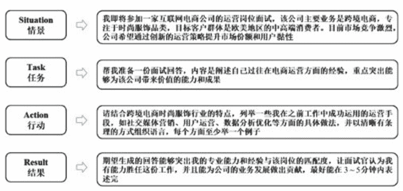

图 4-2 面试准备任务的提示词样例

② 论文写作，如图 4-3 所示。

③ 营销策划方案制定，如图 4-4 所示。

#### 4.3.2 5W2H 法则：把信息问全

5W2H 用 What、Why、Where、When、Who、How、How much 七个切面层层追问，把问题拆解得更系统，信息更完整，模型回复也会更细致准确。各要点释义如下。


图4-3 论文写作任务的提示词样例


图4-4 营销策划方案制定任务的提示词样例

# 表4-2 5W2H法则的要素的说明

| 要素 | 说明 |
| --- | --- |
| What | 弄清问题到底指向什么对象或内容 |
| Why | 追根溯源，了解动机或原因 |
| Where | 确认发生地点或适用范围 |
| When | 锁定时间节点 |
| Who | 确认涉及的人或主体 |
| How | 说明实现路径和具体步骤 |
| How much | 了解数量、程度或成本方面的信息 |

为便于学习，下面给出项目策划、学术研究两类场景的提示词范例。

+   项目策划，如图 4-5 所示。


图 4-5 项目策划任务的提示词样例

+   学术研究，如图 4-6 所示。


图 4-6 学术研究任务的提示词样例

#### 4.3.3 CO-STAR 框架：让需求表达更清晰

CO-STAR 由 Context、Objective、Style、Tone、Audience、Response 六个维度组成，如图 4-7 所示，能把需求从背景到输出形式全链路说清。

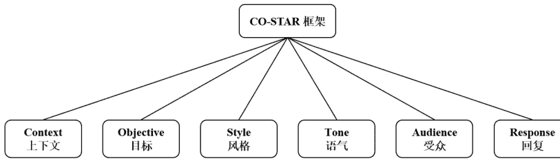

图 4-7 CO-STAR 框架

各要素的具体含义见表 4-3。

表 4-3 CO-STAR 框架的要素的说明

| 要素 | 说明 |
| :--- | :--- |
| Context | 交代任务的背景情境 |
| Objective | 厘清模型需要完成的任务 |
| Style | 指定期望的写作风格 |
| Tone | 指定回复的语气色彩 |
| Audience | 点明内容的面向人群 |

基于 CO-STAR 构建的提示词具备全流程覆盖、视角驱动、产出可量化三大优势，减少信息缺口导致的模型自由发挥，通过受众限定避免泛化，用明确输出指标提升可控性。该思路能有效缓解幻觉和泛化问题，尤其适合商业分析、产品设计、策略规划等对精准度要求高的领域。下面列出内容创作、市场调研、辅助教学、客户服务四个实例。

+   ① 内容创作，如图 4-8 所示。

② 市场调研，如图 4-9 所示。

③ 辅助教学，如图 4-10 所示。

④ 客户服务，如图 4-11 所示。

# DeepSeek 实践案例

运动跑鞋推广案例
背景情境：面向年轻时尚人群的运动品牌准备推出新款跑鞋，主打轻便与时尚外观
目标：撰写一段能驱动目标人群购买的推广文案
风格：简洁生动有活力，接近运动明星日常分享的口吻
语气：积极热情具鼓励性，激发运动热情与购买欲望
目标人群：18-35岁热爱运动、追求时尚的年轻人
回复形式：150字以内的文案，需包含产品亮点与购买引导

咖啡口味调研案例
背景情境：某咖啡连锁想了解顾客对新推特色口味的接受度和购买意愿
目标：设计一份约十题的消费者调查问卷，收集有效反馈
风格：语言简洁明了通俗易懂，避免专业术语
语气：友好中立，让顾客愿意如实表达
目标人群：经常光顾该连锁的顾客，年龄性别不限
回复形式：问卷形式，包含选择题与简答题等多种题型

高中历史小论文案例
背景情境：高中历史课学习工业革命单元，学生需理解其对社会经济和生活的冲击
目标：写一篇约800字的小论文，分析工业革命的积极与消极影响
风格：学术性写作，使用恰当历史术语与论证逻辑
语气：客观理性，全面分析不偏不倚
目标人群：高中历史教师和同学，具备一定历史基础
回复形式：论文格式，含引言、正文、结论，正文分述利弊

#### 4.3.4 CRISPE 框架：激发创意与深度

CRISPE 由 Capacity & Role、Insight、Statement、Personality、Experiment 五个要素组成，如图 4-12 所示，可帮助激发创造力并产出更具深度和个性的内容。

图 4-12 CRISPE 框架

要素释义见表 4-4。

表 4-4 CRISPE 框架的要素的说明

| 要素 | 说明 |
| --- | --- |
| Capacity & Role | 设定模型的身份定位与能力边界 |
| Insight | 补充背景资料或专业视角 |
| Statement | 把任务核心要求讲明白 |
| Personality | 赋予特定的语言个性 |
| Experiment | 设计假设性情境或探索任务 |

用 CRISPE 组织提示词能提升交互效率，改善输出质量与准确度，更好满足个性化需求。

下面给出推广文案创作和技术问题分析两个示例。

1. 推广文案创作，如图 4-13 所示。

图 4-13 推广文案创作任务的提示词样例

2. 技术问题分析，如图 4-14 所示。

图 4-14 技术问题分析任务的提示词样例

#### 4.3.5 BROKE 框架：目标导向与持续迭代

BROKE 包含 Background、Role、Objectives、Key Result、Evolve 五个要素，如图 4-15 所示，强调目标导向与持续改进，帮助产出更可行、可量化的方案。

图 4-15 BROKE 框架

要素说明见表 4-5。

表 4-5 BROKE 框架的要素的说明

| 要素 | 说明 |
| --- | --- |
| Background | 交代任务的来龙去脉 |
| Role | 确定模型的扮演角色 |
| Objectives | 列出任务要达到的目标 |
| Key Result | 设定可量化的结果指标 |
| Evolve | 给出后续优化的方向 |

下面给出促销活动和旅游推广两个示例。

1. 促销活动，如图 4-16 所示。

图 4-16 促销活动任务的提示词样例

2. 旅游推广，如图 4-17 所示。

#### 4.3.6 借助大模型优化提示词

在提示词设计和内容创作中，常出现不会写提示词或效果不达标的问题。本节介绍两种实用做法：借助大模型优化提示词，以及利用续写和扩写指令丰富内容。

### 1. 借助大模型优化提示词

当提示词无从下手或效果不佳时，可直接请模型帮忙。如图 4-18 所示，针对新品按摩仪广告文案，可提问：“我想为公司新款按摩仪设计广告文案，该如何编写提示词？”模型会给出可用框架和示例帮助定位。

若已有提示词效果不理想，也可让模型给出修改建议。如图 4-19 所示，将现有提示词提交给模型请求优化，可逐步提升精准度和效果。

### 2. 善用续写与扩写指令

创作中遇到卡壳或表达不清时，续写和扩写指令非常实用。

#### 如何编写提示词，借助大模型为公司最新款按摩仪设计广告文案？

要获得更精准有效的广告文案，需提供细节和明确指示。以下为编写框架：

1. 明确目标受众：
    * 目标人群：如白领、运动爱好者、老年人、孕妇等。
    * 痛点需求：如缓解肩颈酸痛、改善睡眠、放松肌肉等。
2. 突出产品特点和优势：
    * 核心功能：如三维按摩、热敷、多种模式等。
    * 技术优势：如仿人手按摩、智能感应、静音设计等。
    * 差异化卖点：如便携设计、高性价比、明星代言等。
3. 设定文案风格和传播渠道：
    * 文案风格：如科技感、温馨治愈、幽默风趣等。
    * 传播渠道：如电商平台、社交媒体、线下广告等。
4. 提供参考案例：
    * 优秀广告文案：如竞品文案或你欣赏的案例。
    * 品牌调性：如品牌形象、品牌故事等。

**示例提示词：**

> “你是一位资深广告文案策划师，请为我公司最新款智能按摩仪设计一则广告文案。目标受众是25-40岁的白领，长期伏案工作，饱受肩颈酸痛困扰。产品主打三维按摩、热敷功能和多种按摩模式，采用仿人手按摩技术，能精准按摩穴位、缓解肌肉疲劳。文案风格要求简洁明了，突出科技感和实用性，用于电商平台产品详情页。请参考以下优秀广告文案示例：[优秀广告文案示例]。”

我使用下面的提示词后生成效果不好，请给出一些对该提示词的优化建议。

提示词：“请为我公司最新款按摩仪设计一则广告文案。该按摩仪主打三维按摩、热敷功能和多种按摩模式，采用仿人手按摩技术，能够精准按摩穴位，缓解肌肉疲劳。”

你的提示词已给出产品基础信息，但可进一步优化以产出更有吸引力、更具针对性的文案。建议：

1. 明确目标受众
    * 提示词未说明面向谁。不同人群关注点不同，明确受众有助于提升针对性。
    * 优化建议：加入受众描述，例如“主要面向久坐的白领和运动爱好者”。

例如撰写旅游景点宣传文，可先写开头再让模型续写：“请根据以下内容续写一篇景点宣传文章。已完成内容：北京故宫位于北京市中心，是明清两代皇家宫殿，旧称紫禁城，坐落于北京中轴线上。”模型会基于已有信息推理并生成后续内容，如图 4-20 所示，可带来新灵感。

图 4-20 使用 DeepSeek 模型进行续写的结果 (续)

若已有内容但不够丰满，可用扩写指令。例如要求将500字文章扩写到2000字，并指定“内容充实、不赘述”。模型会补充细节，让文章更完整，如图 4-21 所示。

图 4-21 使用 DeepSeek 模型进行扩写的结果

本节介绍了提示词设计中常用的法则、框架和技巧。实际使用时可根据需求选用合适框架，同时保持灵活性，不被模板束缚，通过不断实践找到最优方案。

### 4.4 企业层面的提示词应用场景

数字化时代下，大模型为企业提供内容产出和数据分析能力，但中小企业往往缺乏本地部署条件。通过设计优质提示词，可低成本提升业务效率。本节通过四个企业任务案例展示提示词的实战用法。

#### 4.4.1 传播策略制定

传播策略关乎品牌知名度、市场份额和销售转化。资源有限的中小企业可借助大模型高效低成本地制定策略。

提示词设计步骤如图 4-22 所示。

图 4-22 传播策略制定任务的提示词设计步骤

假设某企业推出新型智能健身设备，目标受众为25~35岁年轻白领和健身爱好者，目标是提升初次认知度，可向 DeepSeek 输入如图 4-23 所示的提示词。

图 4-23 传播策略制定任务的提示词样例

#### 4.4.2 执行发展制定

执行发展是战略落地的关键。借助大模型可高效规划执行路径。

提示词设计步骤如图 4-24 所示。

图 4-24 执行发展制定任务的提示词设计步骤

假设某服装制造企业计划推出新系列，目标半年内销售额增长20%并提升品牌知名度，可输入如图 4-25 所示的提示词。

为一家服装制造企业制定执行发展计划，目标半年内推出新服装系列，实现销售额增长20%并提升品牌知名度。企业内部有专业设计团队和稳定生产供应链，但营销推广资源有限。外部市场竞争激烈，目标受众为18-30岁年轻时尚群体。执行流程包括1个月设计阶段、2个月生产阶段、3个月营销推广阶段。请制定详细执行计划，含各阶段具体任务、时间安排、责任人和预期效果评估。

**服装制造企业执行发展计划**

**目标：** 半年内推出新服装系列，实现销售额增长20%，提升品牌知名度。

**目标受众：** 18-30岁的年轻时尚群体。

**资源现状：** 专业设计团队、稳定生产供应链，但营销推广资源有限。

**执行流程：** 1个月设计阶段、2个月生产阶段、3个月营销推广阶段。

**第一阶段：设计阶段（第1个月）**

**目标：** 完成新服装系列设计，确保契合目标受众需求。

**具体任务**

1. 市场调研与趋势分析（第1周）
    * 调研年轻时尚群体偏好、流行趋势及竞品。
    * 分析小红书、抖音等平台的热门穿搭。
    * 责任人：市场部经理、设计团队。

#### 4.4.3 品牌故事生成

品牌故事有助于塑造形象、吸引消费者。大模型可节省人力成本并提供创新思路。

提示词设计步骤如图 4-26 所示。

图 4-26 品牌故事生成任务的提示词设计步骤

假设某有机食品企业，目标受众为25~45岁中高端消费者，注重健康与生活品质，可输入如图 4-27 所示的提示词。

图 4-27 品牌故事生成任务的提示词样例

#### 4.4.4 产品定位

精准定位是企业成功的关键。大模型可帮助找准产品在市场中的独特位置。

提示词设计步骤如图 4-28 所示。

图 4-28 产品定位任务的提示词设计步骤

假设某智能家居企业研发新型智能空气净化器，目标是确定目标客户和独特卖点，可输入如图 4-29 所示的提示词。

图 4-29 产品定位任务的提示词样例

*   城市中产家庭：注重生活品质，关注PM2.5污染问题，尤其是生活在空气质量较差的城市。

* 家庭成员中有长者、幼儿或宠物时，对净化设备的工作分贝更为敏感，通常会挑选能够长时间保持低噪运行的机型。
* 处于职场的年轻群体在选购时兼顾科技体验与价格回报，采购习惯集中在各大电商平台。

**2. 次级目标客户：**

* 租房用户对产品体积、重量及入手成本的关注度较高，尤其是刚入住新装房源的年轻租客。
* 创业型公司、个体工作室等小型办公场景，更看重投入可控的空气治理方案。

**二、产品定位**

### 小结

本章围绕大模型提示词的设计思路与落地方法展开，旨在帮助读者掌握使用规律，在模型应用中提升能力与竞争优势。借助理论梳理与实践演练，读者能够更高效地借助大模型解决实际问题，支撑个人发展与企业目标的实现。

首先厘清提示词的概念与常见分类，明确其在人机交互中的关键作用。随后点出新手易犯的误区，例如表述过于宽泛、指令逻辑不清、一次性塞入过多信息、忽视上下文、过度依赖固定模板、未评估模型边界、缺少反馈迭代等，提示撰写时加以规避。

接着介绍多套可落地的撰写技巧，涵盖 STAR、5W2H 等经典提问法则，以及 CO-STAR、CRISPE、BROKE 等结构化设计框架。这些工具可为提示构建清晰骨架，使需求表达更条理，引导模型产出更精准、详尽且有价值的内容。

最后落到企业应用，展示提示词在传播策略制定、发展规划推进、品牌故事生成、产品定位梳理等环节的价值。精细设计的提示能在较低成本下实现高效问题解决，提升业务质量与运行效率。

# 第5章 个人侧 DeepSeek 本地化部署

## 第5章 个人端 DeepSeek 部署实操

掌握提示词后，部分读者希望摆脱 App 或网页服务的限制，将 DeepSeek 大模型运行在自有设备上。本章梳理当前主流的 DeepSeek 模型家族，包含 V3、R1、VL2、Janus、Coder-V2 等，并说明本地部署时的显存估算思路；同时介绍 Open-WebUI、Hollama、Chatbox 等常用工具，演示如何搭建一套专属个人使用的对话环境。

学习完本章后，你可以快速掌握 DeepSeek 模型的本地化部署流程，充分发挥其效能，为后续应用奠定基础。

### 5.1 DeepSeek 的模型

下面逐条介绍 DeepSeek 各版本的能力侧重，并简要说明开源许可相关知识，帮助读者按需选型并合规使用。

#### 5.1.1 DeepSeek 模型的常见版本

DeepSeek 常见的版本如下。

1. **DeepSeek-V3**：归类为通用大语言模型，采用 MLA 与 DeepSeekMoE 架构，可处理文本生成、自然语言理解等综合任务，适用于内容创作、广告策划等多个场景。

2. **DeepSeek-R1**：归类为通用推理型大语言模型，相较 DeepSeek-R1-Zero，它在强化学习前加入冷启动数据训练，具备更强的深度思考能力，适用于代码生成、数学求解、复杂语义理解等需要深度推理的任务。

3. **DeepSeek-VL2**：面向真实世界视觉语言理解设计的多模态模型，拥有通用多模态理解能力，可处理复杂场景下的逻辑图、网页、公式识别、科研文献、自然图像及具身智能。

4. **DeepSeek-Janus**：面向图像理解、文生图等场景的统一多模态模型，通过解耦视觉编码构建独立路径分别用于多模态理解与生成，缓解任务冲突，采用简洁统一的 Transformer 架构，提升灵活性与通用性。

5. **DeepSeek-Coder-V2**：开源的专家混合代码语言模型，在特定代码任务上达到与 GPT4-Turbo 相当的水平。

# DeepSeek 实战: 从提示词到部署和实践

与 DeepSeek-V2 相比，DeepSeek-Coder-V2 在编码与数学推理能力上大幅提升，主要用于软件开发、自动化脚本编写等场景。

#### 5.1.2 DeepSeek 模型的版本说明

除主版本 DeepSeek-V3 与 DeepSeek-R1 外，每个系列下还有多个子版本可选，如图 5-1 所示。以 DeepSeek-R1 为例，除 DeepSeek-R1-Zero 与 DeepSeek-R1 外，还可选择 DeepSeek-R1-Distill-Llama-70B、DeepSeek-R1-Distill-Qwen-32B 等。下面说明命名中各部分的含义。

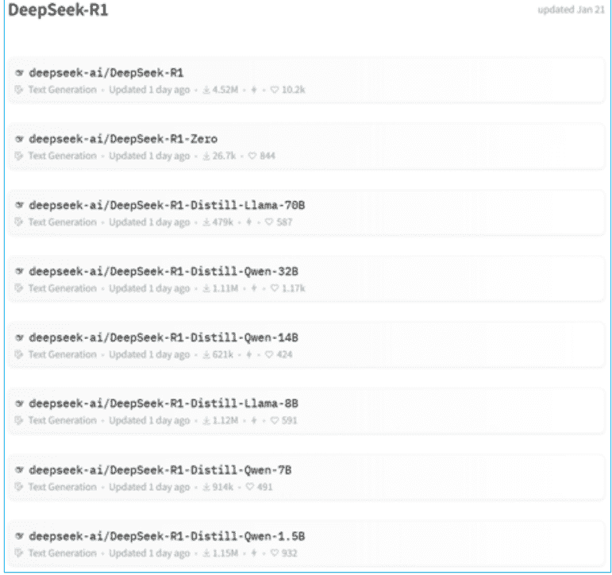

图 5-1 DeepSeek-R1 详细版本 (包含使用 DeepSeek-R1 生成数据进行蒸馏训练的模型)

以 DeepSeek-R1-Distill-Llama-70B 为例:

1. Distill: 表示为蒸馏模型。蒸馏技术将大模型知识迁移到小型模型，减少计算需求的同时保留大部分推理能力。
2. Llama：表示底层基座为 LLaMA。LLaMA 由 Meta 发布，基于 Transformer 架构的自回归语言模型，推理效率高且多语言支持良好。
3. 70B：表示参数规模约 700 亿。一般而言参数越多学习与表达能力越强，但硬件需求也越高。个人部署时常选 1B～14B 的规模。

#### 5.1.3 DeepSeek 模型的开源协议

DeepSeek 模型以开放可商用著称。初次接触开源协议的读者容易误以为开源即可无限制使用，实际情况并非如此。

开源指开放源代码，促进软件的免费获取与传播。开源软件的核心是开放，任何人在许可范围内均可获取源代码进行学习、修改甚至再分发。使用开源程序时需关注其许可，因为不同许可的使用规则与条件各异。常见开源许可及特点如下。

1. GNU 通用公共许可证（GPL）

GPL 属于强传染性许可，要求基于 GPL 的衍生作品也须以 GPL 发布。对 GPL 软件进行修改或扩展后，修改代码也必须开源。适用于希望最大化促进开源共享的项目。

2. GNU 宽通用公共许可证（LGPL）

LGPL 比 GPL 更宽松，允许商业软件使用其库文件而无需开源整个商业软件。但对 LGPL 库进行修改后，修改部分仍需遵循 LGPL。适用于可被商业软件调用的开源库。

3. MIT 许可证

MIT 许可非常宽松，几乎无限制，允许自由使用、修改与分发，包括商业用途，唯一要求是保留原作者版权声明与许可声明。适合希望代码被广泛传播的项目。

4. Apache 许可证

Apache 许可同样宽松，允许自由使用、修改、分发并用于商业。与 MIT 相比，Apache 增加了专利相关条款，明确专利授权内容，常用于大型开源项目。

5. BSD 许可证

BSD 许可有多版本，如 BSD 2-Clause 与 BSD 3-Clause，均较宽松。以 BSD 3-Clause 为例，要求保留原作者版权声明、条件声明与免责声明，使用者可自由使用、修改、分发并用于商业。适用于希望给予使用者较大自由度的项目。

6. Mozilla 公共许可证（MPL）

MPL 允许在商业软件中使用其开源代码，但对修改代码有要求，修改部分须以 MPL 开源并提供完整源代码。若商业软件仅链接未修改的 MPL 代码，则无需公开全部代码。适用于在开源与商业间寻求平衡的项目。

选择合适的许可对项目发展与推广至关重要，开发者需结合目标、场景与自身需求抉择。通常可在代码仓库中找到适用许可。如图 5-2 与图 5-3 所示，DeepSeek-V3 与 DeepSeek-R1 均采用 MIT 许可。


图 5-2 DeepSeek 模型开源许可证

### License

This code repository is licensed under the MIT License. The use of DeepSeek-V3 Base/Chat models is subject to the Model License. DeepSeek-V3 series (including Base and Chat) supports commercial use.

图 5-3 DeepSeek-V3 开源许可说明

### 5.2 硬件需求和配置建议

本地化部署前最关键的是明确模型所需的硬件条件。若配置不足，模型无法完成推理。部分大模型在官方文档中给出推荐配置，部分则需自行估算。本节介绍如何基于模型参数估算所需硬件。

#### 5.2.1 存储精度

在估算显存前需了解预备概念。模型推理前需先把参数载入显存，参数通常以不同精度存储。常见精度有 Float32、Float16、BF16、Float8、INT8 等，简单来说表示单个参数在计算机中占用的存储空间。

1. Float32: 单精度浮点数，每个参数占 4 字节。
2. Float16: 半精度浮点数，每个参数占 2 字节。
3. Float8: 8 位精度浮点数，每个参数占 1 字节。
4. BF16: 每个参数占 2 字节。相比 FP16，尾数位更少、精度稍低，但数值范围更大，在显存、效率与数值范围间取得较好平衡。
5. INT8: 低精度整数，每个参数占 1 字节，存储更紧凑。

精度越高计算越精确、性能越强，但显存与硬件要求也越高。通常可在官方文档查到模型精度，或通过脚本转换。例如 DeepSeek 代码库说明其采用 FP8，并提供 FP8 转 BF16 的脚本（如图 5-4 所示）。

DeepSeek 实战：从提示词到部署和实践

Since FP8 training is natively adopted in our framework, we only provide FP8 weights. If you require BF16 weights for experimentation, you can use the provided conversion script to perform the transformation.

由于 FP8 训练是在我们的框架中原生采用的，因此我们只提供 FP8 权重。如果您需要 BF16 权重进行实验，则可以使用提供的转换脚本来执行转换。

Here is an example of converting FP8 weights to BF16:

以下是将 FP8 权重转换为 BF16 的示例：

```bash
cd inference
python fp8_cast_bf16.py --input-fp8-hf-path /path/to/fp8_weights --output-bf16-hf-path /path/to/bf16_weights
```

图 5-4 DeepSeek 的参数精度说明

另外可直接从权重配置文件查找。例如 DeepSeek-R1-Distill-Qwen-7B 的 config.json 中，"torch_dtype":"bfloat16" 表示参数采用 BF16 存储（如图 5-5 所示）。

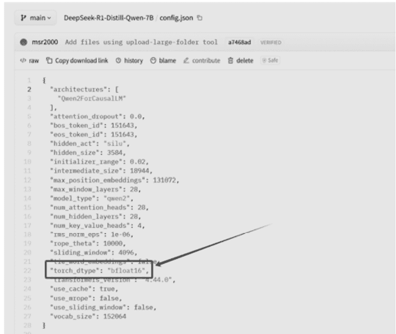

图 5-5 DeepSeek-R1-Distill-Qwen-7B 权重配置文件

#### 5.2.2 显存占用估算

显存估算需综合模型参数显存、KV Cache 显存与中间激活显存。

#### 1. 模型参数显存占用

了解精度含义后即可估算参数显存。对非 MoE 架构，公式为

参数显存 ≈ 参数量 × 每个参数字节数

以 DeepSeek-R1-Distill-Qwen-7B 为例，参数量 70 亿，精度 BF16 占 2 字节，则

参数显存 ≈ 7×10⁹ × 2 B = 14 GB

计算机存储中 1GB = 1024³ B，为便于估算常取 1 GB ≈ 10⁹ B，故约 14 GB。

对 MoE 架构如 DeepSeek-V3，推理时每个 Token 仅激活部分专家，如 8 个，激活参数量约 370 亿。计算公式为

参数显存 ≈ 激活参数量 × 每个参数字节数

#### 2. KV Cache 显存占用

除参数外，推理时每个输入 Token 会通过线性变换生成 Query、Key、Value 三个向量，也需占用显存。在 Transformer 大语言模型中，KV Cache 用于存储注意力计算中的 K、V 向量。

非 MoE 架构公式为

KV Cache 显存 ≈ batch size × sequence length × 2 × hidden size × num of layers × data type size

MoE 架构公式为

KV Cache 显存 ≈ batch size × sequence length × 2 × 激活专家数量 × 压缩维度 × num of layers × data type size

各参数说明见表 5-1。

DeepSeek 实战：从提示词到部署和实践

表 5-1 KV 向量的参数说明

| 参数 | 说明 |

| :--- | :--- |

| batch size | 每次处理的样本数，即一次输入句子的数量 |

| sequence length | 输入序列长度，即输入句子的最大长度 |

| hidden size | 模型隐藏层维度 |

| num of layers | 模型层数 |

| 压缩维度 | 专家输出压缩维度。例如 DeepSeek-V3 专家输入维度 7168，输出压缩至 512 |

| data type size | 数据类型大小，单位字节 |

这些参数通常在模型配置文件中可查，以 DeepSeek-V3 为例，如图 5-6 所示。

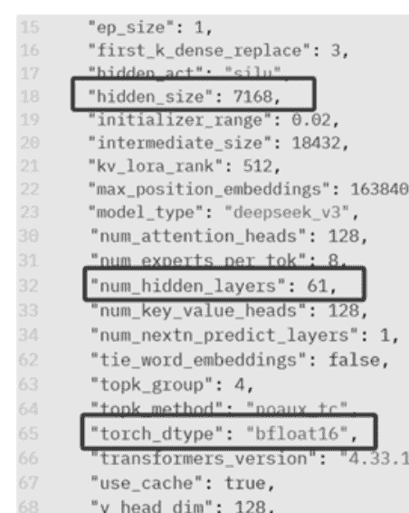

#### 3. 中间激活显存占用

除参数与 KV Cache 外，大模型还需显存存储中间激活值，用于保存各层产生的中间输出。

非 MoE 架构公式为

激活值显存 ≈ batch size × sequence length × hidden size × num of layers × data type size

### 5.3 软件环境安装和配置

使用大模型前需先搭建本地软件环境。Ollama 是一款开源工具，可在本地运行大型语言模型，无需完全依赖云端。

> 注意：根据国家网络安全通报中心 2025 年 3 月发布的预警，Ollama 默认配置存在严重安全漏洞，可能导致未授权访问、模型窃取等风险。攻击者可利用 Ollama 框架历史漏洞（CVE-2024-39720/39722/39719/39721），直接调用模型接口实施数据投毒、参数窃取、恶意文件上传及关键组件删除等操作，造成模型服务的核心数据、算法完整性与运行稳定性受威胁。
> 建议：通过修改监听地址、禁用危险操作接口、配置防火墙、实施多层认证与访问控制等方式提升 Ollama 的安全水平。
> 因此，将 Ollama 用于企业商业化模型部署风险较大，更建议仅作为个人用途的大模型调用工具。

#### 5.3.1 Ollama 安装

Ollama 是一款可在本地运行大型语言模型的开源工具。准备模型文件有两种方式：从 Ollama 模型库自动下载部署，或先下载到本地再加载。

安装步骤相对简单，具体如下。

#### 1. 下载安装包

进入 Ollama 官网，在主页点击 “Download” 按钮，如图 5-7 所示，然后选择对应操作系统的版本下载，如图 5-8 所示。

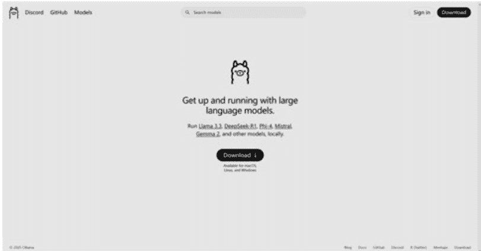

图 5-7 Ollama 官网主页


图 5-8 Ollama 下载页面

本书以 Windows 系统为例演示。

#### 2. 安装

打开下载的安装包，点击 “Install”，执行安装过程（如图 5-9 所示），等待完成即可。Ollama 默认安装在 C 盘。

#### 3. 检查安装结果

第5章 为个人打造的 DeepSeek 部署方案

完成安装后，Ollama 会自行拉起后台进程，启动效果可参照图5-10。

第 5 章 面向个人的 DeepSeek 部署


图 5-9 Ollama 安装页面


图 5-10 Ollama 服务启动

所有指令的操作都离不开命令行环境。最便捷的方式是通过 Win+R 调出运行面板，键入 cmd 回车进入控制台，示例见图5-11；另一条路径是借助开始菜单的搜索功能定位到命令提示符，示例见图5-12。

在已经打开的终端窗口里执行下方命令，若部署正常会回显当前 Ollama 的版本号，呈现效果见图5-13。

```bash
ollama --version
```

DeepSeek 实战：从提示词到部署和实践

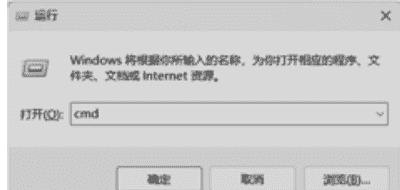


```bash
C:\Users\hao>ollama --version
ollama version is 0.5.4
C:\Users\hao>
```


当部署完毕后，命令行中直接敲入 ollama 即可弹出内置帮助清单，内容展示如图5-14。

```bash
C:\Users\hao>ollama
Usage:
  ollama [flags]
  ollama [command]

Available Commands:
  serve     Start ollama
  create    Create a model from a Modelfile
  show      Show information for a model
  run       Run a model
  stop      Stop a running model
  pull      Pull a model from a registry
  push      Push a model to a registry
  list      List models
  ps        List running models
  cp        Copy a model
  rm        Remove a model
  help      Help about any command

Flags:
  -h, --help      help for ollama
  -v, --version   Show version information

Use "ollama [command] --help" for more information about a command.
```


#### 5.3.2 基于 Ollama 部署 DeepSeek 模型
环境搭建好后，便可借助 Ollama 拉取 DeepSeek 系列模型并运行。打开官网顶部导航的 Models 条目，就能浏览官方模型仓库中可用的型号与版本，见图5-15。

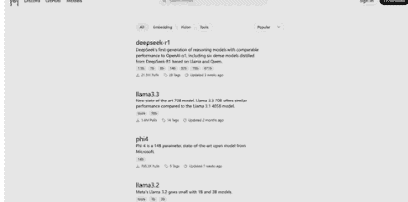

图 5-15 Ollama 模型库

如需查看某款模型的具体信息，也可在终端中执行对应的查询命令。

```bash
ollama show <模型名称>
```

举例来说，查询 DeepSeek-R1-Distill-Qwen-7B 的细节：

```bash
ollama show deepseek-r1:7b
```

返回内容如图5-16 所示。

在模型库里点进目标模型的链接会进入详情页，页面提供了对应的启动指令，如图5-17 所示。run 指令用于指定并加载模型，若本地尚未缓存则会先触发下载流程。

指令的通用写法如下：

```bash
ollama run <模型名称:版本>
```

# DeepSeek 实战: 从提示词到部署和实践


图 5-16 ollama show 指令执行结果


图 5-17 Ollama 中的 DeepSeek-R1-Distill-Qwen-7B 模型说明

以 DeepSeek-R1-Distill-Qwen-7B 为例，执行以下命令：

```
ollama run deepseek-r1:7b
```

结果呈现如图5-18。

# 第5章 面向个人的 DeepSeek 部署

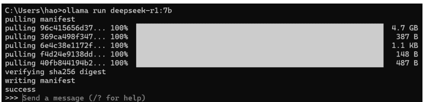

图 5-18 部署 DeepSeek-R1-Distill-Qwen-7B 模型

模型部署完毕后，底部输入区即可撰写要交给 DeepSeek 的文本，回车提交后的运行表现如图5-19。

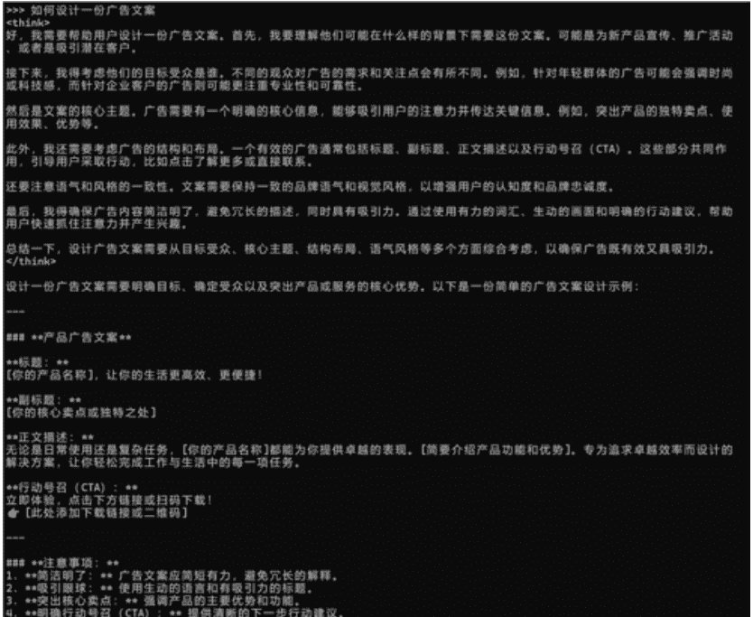

图 5-19 DeepSeek-R1-Distill-Qwen-7B 模型运行效果

#### 5.3.3 Ollama 常用接口概览
模型进入运行状态后，Ollama 暴露了一组可编程调用的接口，便于更灵活地与大模型交互。下文介绍几类典型 API 及其在 Python 中的调用方式。

# 1. 端口地址确认
Ollama 默认监听 http://127.0.0.1:11434。若要核实实际端口，可查看服务日志。右键点击系统托盘的 Ollama 图标，选择 View logs，在弹出的文件夹里打开最新的 server.log 文件即可，样例见图5-20 与图5-21。

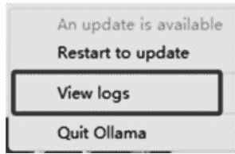

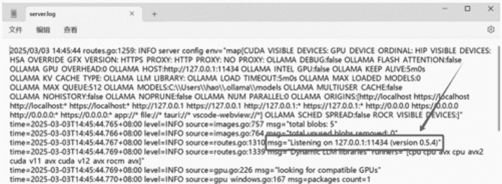

# 2. 文本生成
接口 “/api/generate” 的作用是让选定的模型依据用户输入的提示产生文本，参数说明见表5-2。

表 5-2 “/api/generate” 接口的参数说明

| 参数 | 说明 |
| --- | --- |
| model（必填） | 指定使用的模型名称 |
| prompt（必填） | 用户提供的提示内容 |
| suffix | 生成结果后的附加后缀，可用于在尾部加入固定信息 |
| images | 针对多模态模型，可传入 base64 编码图片列表，供模型结合图文生成 |
| format | 响应返回的格式 |
| options | 模型文档中列出的额外参数 |
| system | 系统级消息，用于提供额外上下文或指导 |
| template | 覆盖配置文件中的提示模板 |
| stream | 是否以流式方式返回结果 |
| raw | 设为 true 时原样保留提示，不做额外处理 |

Python 调用示例：

```
import requests
import json

# 定义 Ollama 服务的地址和端口
ollama_url = "http://localhost:11434/api/generate"

# 定义请求的数据
data = {
    "model":"deepseek-r1:7b",      # 实际使用的模型名称
    "prompt":" ",                  # 输入提示词
    "stream":False                  # 是否以流式方式返回结果, False 或 True
}

# 发送 POST 请求
response = requests.post(ollama_url, json=data)

# 检查响应状态码
if response.status_code == 200:
    # 解析 JSON 数据
    result = response.json()
    # 打印生成的文本
    print(result["response"])
else:
    print(f"请求失败，状态码: {response.status_code}, 错误信息: {response.text}")
```

# 3. 多轮对话
“/api/chat” 专用于模拟真实对话，支持多轮交互并保持上下文连贯，参数说明见表5-3。

表 5-3 “/api/chat” 接口的参数说明

| 参数 | 说明 |
| :--- | :--- |
| model (必填) | 使用的模型名称 |
| messages | 消息对象列表，用于保存对话历史 |
| tools | 模型可调用的工具列表，如支持 |
| 其他参数 | format、options、stream 与 keep_alive 的含义与 /api/generate 保持一致 |

Python 调用示例如下：

```
import requests
import json

# 定义 Ollama 服务的地址和端口
ollama_url = "http://localhost:11434/api/chat"

# 实际使用的模型名称
model = "deepseek-r1:7b"

# 初始化对话消息列表，包含系统消息（可选）
messages = [
    {
        "role":"system",
        "content":"你是一个广告文案设计专家，善于设计各类广告文案。"
    }
]

def chat_with_ollama(prompt):
    global messages

    # 添加用户的新消息到消息列表
    messages.append({
        "role":"user",
        "content":prompt
    })

    # 构建请求数据
    data = {
        "model": model,
        "messages": messages,
        "stream": False  # 是否以流式方式返回结果，False 或 True
    }

    try:
        # 发送 POST 请求
        response = requests.post(ollama_url, json=data)
        response.raise_for_status()  # 检查请求是否成功

        # 解析 JSON 数据
        result = response.json()

        # 获取助手的回复
        assistant_reply = result["message"]["content"]

        # 将助手的回复添加到消息列表，以便后续对话保留上下文
        messages.append({
            "role": "assistant",
            "content": assistant_reply
        })

        return assistant_reply
    except requests.exceptions.RequestException as e:
        print(f"请求出错: {e}")
    except (KeyError, json.JSONDecodeError) as e:
        print(f"解析响应出错: {e}")

# 对话
while True:
    user_input = input("用户: ")
    if user_input.lower() == '退出':
        break
    reply = chat_with_ollama(user_input)
    print(f"DeepSeek: {reply}")
```

相较于 “/api/generate”，“/api/chat” 的优势在于能进行持续对话并记忆上下文，更适合需要长期交互的场景。借助上述示例即可实现多轮对话功能。

# 4. 其他常用接口
除上述两者外，Ollama 还提供若干管理类接口。

“/api/tags” 用来列出本地已安装的模型及其版本信息，便于快速掌握可用资源。

```
import requests

# 定义 Ollama 服务的地址和端口
ollama_url = "http://localhost:11434/api/tags"

try:
    # 发送 GET 请求
    response = requests.get(ollama_url)

    # 检查响应状态码
    if response.status_code == 200:
        # 解析 JSON 响应
        data = response.json()
        # 打印可用模型的标签列表
        print("可用模型的标签列表:")
        for tag in data.get('models', []):
            print(tag.get('name'))
    else:
        print(f"请求失败，状态码: {response.status_code}")
        print(response.text)

except requests.RequestException as e:
    print(f"请求发生错误: {e}")
```

“/api/show” 可展示指定模型的具体配置与参数，有助于理解模型结构。

```
import requests

# 定义 Ollama 服务的地址和端口
ollama_url = "http://localhost:11434/api/show"

# 要查询的模型名称
model_name = "deepseek-r1:7b"

try:
    # 构建请求的 JSON 数据
    data = {
        "name": model_name
    }

    # 发送 POST 请求到/api/show 接口
    response = requests.post(ollama_url, json=data)

    # 检查响应状态码
    if response.status_code == 200:
        # 解析 JSON 响应
        model_info = response.json()
        print(f"模型 {model_name} 的详细信息:")
        print(model_info)
    else:
        print(f"请求失败，状态码: {response.status_code}")
        print(response.text)

except requests.RequestException as e:
    print(f"请求发生错误: {e}")
```

"/api/ps" 能返回当前正在运行的模型及其状态信息，便于监控运行情况。

```
import requests

# 定义 Ollama 服务的地址和端口
ollama_url = "http://localhost:11434/api/ps"

try:
    # 发送 GET 请求
    response = requests.get(ollama_url)

    # 检查响应状态码
    if response.status_code == 200:
        # 解析 JSON 响应
        data = response.json()
        print(data)
    else:
        print(f"请求失败，状态码: {response.status_code}")
        print(response.text)

except requests.RequestException as e:
    print(f"请求发生错误: {e}")
```

API 调用的细节与参数可能会随版本演进，建议遇到问题时查阅官方文档。官网右下角的 Docs 可进入 GitHub 仓库，其中 api.md 即为接口说明文档，参考图5-22 与图5-23。


图 5-22 Ollama 官网


图 5-23 Ollama 官方文档

### 5.4 DeepSeek 模型下载与部署

前文已经演示了借助 Ollama 一键拉取并运行模型的方式。实际落地时，很多人更偏爱先把权重包放到本地再部署，这样版本可控，也能在离线环境里使用。下面就介绍怎样手动从 Hugging Face 获取 DeepSeek 系列的权重文件。

#### 5.4.1 Hugging Face 社区简介

在机器学习圈，Hugging Face 影响力很大。到 2025 年 3 月，站点上公开可浏览的模型已超过百万，覆盖文本、视觉、音频等多个方向。访客可以在这里检索预训练权重、试玩演示并互相分享，也能拿到用于训练的数据集。平台还收录了大量示例，帮助理解模型在不同场景的具体用法。

简单说，Hugging Face 可以作为本地部署的模型与数据集来源。需要留意的是，部分地区打开主站会受限，无法正常访问的读者可使用国内镜像 HF-Mirror，或选用魔塔社区 ModelScope，该站点同样提供丰富的模型文件与数据集。

#### 5.4.2 模型下载

动手前请确认本机已安装 Git，下面是获取 DeepSeek 模型的大致流程。

- 1. 打开 Hugging Face 主站

用浏览器进入 Hugging Face，主页醒目区域包括 Models 模型仓库、Datasets 数据集仓库、Spaces 应用托管平台和 Posts 社区动态。

- 2. 进入模型仓库

点选 Models 进入仓库页，可直接浏览列表，也可通过左侧筛选区快速定位。

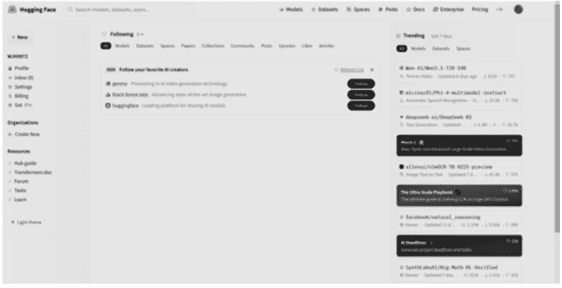

图 5-24 Hugging Face 官网

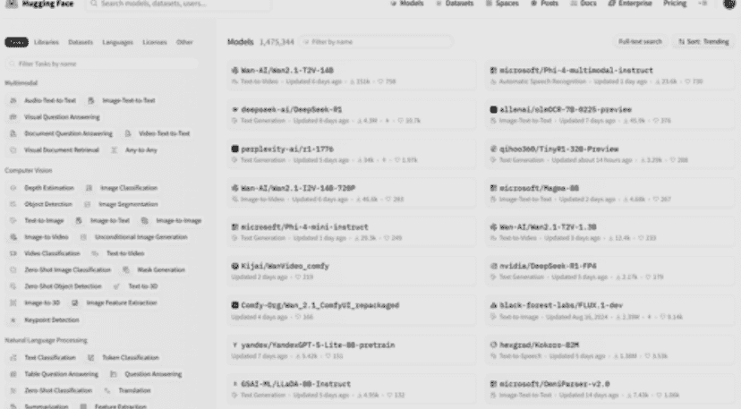

图 5-25 Hugging Face 模型库

- 3. 打开 DeepSeek-R1 的详情页

在仓库里找到 DeepSeek-R1 并进入详情页，页面会展示模型的详细介绍、文件列表和相关讨论。

- 4. 查看调用方式

在详情页右侧点击 Use this model 按钮，页面会列出该模型支持的使用方式，例如通过 Transformers 框架调用。

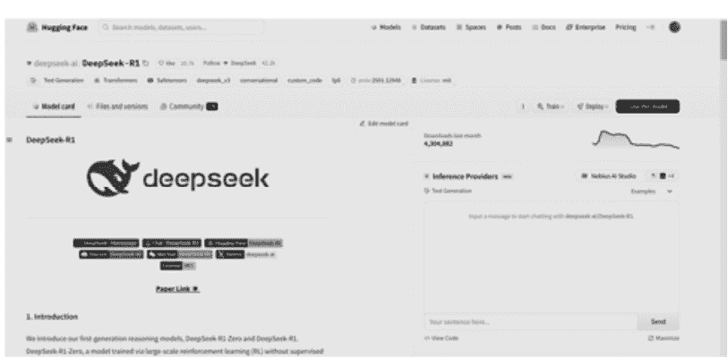

图 5-26 DeepSeek-R1 模型主页


图 5-27 DeepSeek-R1 使用方式

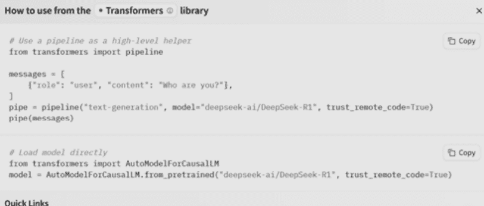

图 5-28 Transformers 框架调用 DeepSeek-R1 示例

- 5. 本地保存权重

需要保存到本地时，点击页面的 Git Clone 按钮并选择 Clone repository，会弹出下载说明，提供 HTTPS 和 SSH 两种方式。

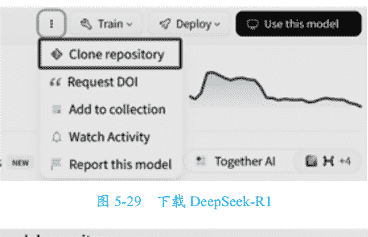

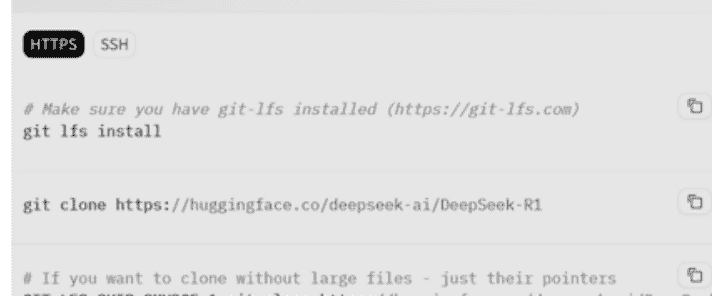

下载前请确保环境已安装 Git LFS，这是一款用于管理大文件的开源工具，可避免下载过程中出错。

模型下载指令如下：

```
git lfs install
git clone DeepSeek-R1 模型的 Hugging Face 仓库地址
```

执行如下指令，也可以下载模型。

```
GIT_LFS_SKIP_SMUDGE = 1 git clone DeepSeek-R1 模型的 Hugging Face 仓库地址
```

## 6. 访问 DeepSeek 官方主页

在 DeepSeek-R1 详情页点击 deepseek-ai 链接，即可进入 DeepSeek 官方主页，其中汇总了该团队发布的所有版本，用户可按需挑选。

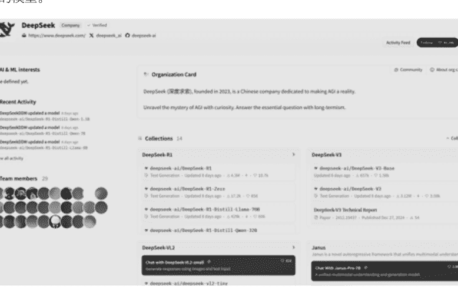

图 5-31 DeepSeek 主页

#### 5.4.3 常见大模型文件类型

下载和使用模型时，了解不同格式的特点很有帮助。以下是常见格式及其优势。

### 1. .pth 文件

.pth 主要被 PyTorch 社区使用，用来保存网络参数与训练状态。优势是与 PyTorch 融合度高，支持保存优化器状态、训练轮数等，便于断点续训。PyTorch 生态丰富，许多开源模型都以 .pth 发布，便于开发者交流共享。

### 2. .safetensors 文件

.safetensors 是专为机器学习模型设计的格式，用于存放张量数据，解决了传统格式在安全与效率上的问题。优势是安全性高，支持内存映射，加载大模型时内存占用少、效率高；跨框架兼容性好，便于不同框架间数据交互。

### 3. .gguf 文件

.gguf 是 GGML 格式的演进版，通过量化存储等方式让大模型能在 CPU 及资源受限设备上高效运行，具有跨平台兼容、便于优化定制等特性，在语言模型领域应用广泛。优势是推理性能高，跨平台兼容性强，支持多种操作系统和硬件架构，适用于移动设备、嵌入式设备等资源有限场景。

#### 5.5 使用 Web UI 构建对话界面

模型部署好后，直接在命令行使用体验一般。为提升体验，可借助 Web UI 工具为模型创建图形化对话界面。以下是 3 种常用工具及其安装方法。

#### 5.5.1 Open-WebUI

Open-WebUI 是一款功能强大的开源 AI 交互平台，支持 Ollama 和 OpenAI 兼容的 API，可轻松创建对话界面。安装方式包括 pip 命令和 Docker 工具。

#### 1. 通过 pip 安装

在终端运行以下命令安装 Open-WebUI：

```
pip install open-webui
```

安装完成后，输入如下指令启动服务：

```
open-webui serve
```

启动成功后，访问网址 http://localhost:8080 即可进入 Open-WebUI 页面。

Open-WebUI 会自动加载本地 Ollama 服务中已启动的模型，无需额外配置。

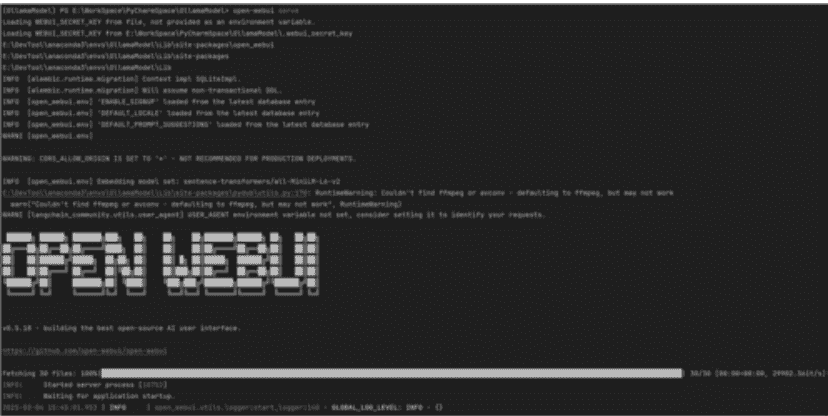

图 5-32 启动 Open-WebUI 服务

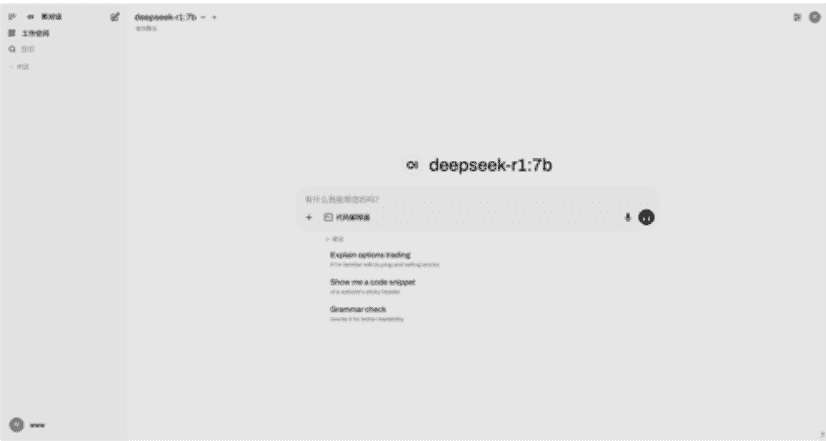

图 5-33 Open-WebUI 页面

#### 2. 通过 Docker 安装

若系统已安装 Docker 且 Ollama 本地运行，可通过以下命令安装 Open-WebUI：

```
docker run -d -p 3000:8080 --add-host=host.docker.internal:host-gateway -v open-webui:/app/backend/data --name open-webui --restart always ghcr.io/open-webui/open-webui:main
```

若 Ollama 位于其他服务器，则需执行下述指令，并将 OLLAMA_BASE_URL 参数修改为服务器地址。

```
docker run -d -p 3000:8080 -e OLLAMA_BASE_URL = https://example.com -v open-webui:/app/backend/data --name open-webui --restart always ghcr.io/open-webui/open-webui:main
```

安装完成后，终端显示内容如下。

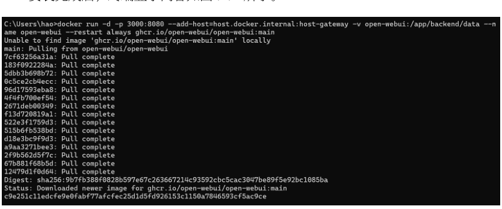

图 5-34 通过 Docker 安装 Open-WebUI

同时可在 Docker 中看到相应镜像。

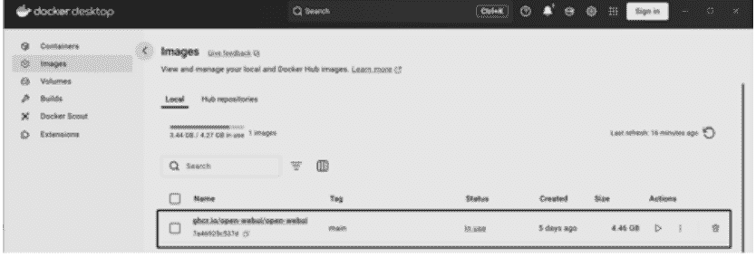

图 5-35 Docker 中的 Open-WebUI 镜像

点击条目中的三角形标志即可启动服务。启动成功后，在 Containers 页面点击对应链接，即可打开 Open-WebUI 页面。

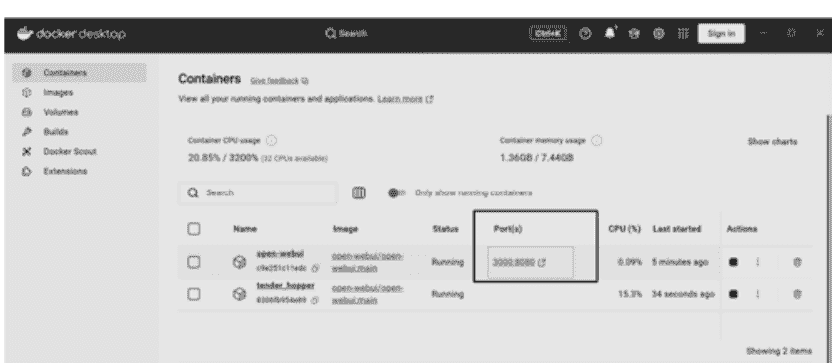

图 5-36 Docker 中的 Open-WebUI 服务

#### 5.5.2 Hollama

Hollama 是为 Ollama 服务器设计的极简 Web 用户界面，支持桌面端应用和 Docker 安装。

#### 1. 安装桌面应用

在搜索引擎搜索 Hollama，找到其 GitHub 仓库，点击 Download for macOS, Windows & Linux 链接，选择对应系统版本下载安装。

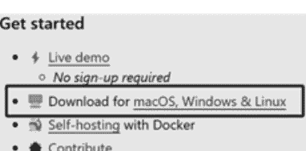

图 5-37 Hollama 安装地址

安装完成后打开客户端，进入设置页面，选择连接类型为 Ollama，输入 Ollama 服务的 URL 地址并验证连接。


图 5-38 Hollama 客户端

验证成功后切换到会话页面，点击新建对话，即可选择本地部署的模型进行对话。


图 5-39 Hollama 会话页面

Hollama 还支持创建知识库，通过知识库检索功能，模型可更智能地回答用户问题。


图 5-40 Hollama 创建知识库


图 5-41 Hollama 检索知识库

#### 2. 通过 Docker 安装

与 Open-WebUI 类似，Docker 安装 Hollama 只需在终端执行对应指令。

本地 Ollama 用户执行如下指令：

```
docker run --rm -d -p 4173:4173 --name hollama ghcr.io/fmaclen/hollama:latest
```

Ollama 部署在其他服务器的用户执行如下指令，在 OLLAMA_HOST 中填入服务器 URL 地址：

```
docker run --rm -d -p 4173:4173 -e OLLAMA_HOST="服务器的 URL 地址" ghcr.io/ fmaclen/hollama:latest
```

安装完成后，即可在 Docker 中找到对应条目启动，界面与桌面客户端相同。


#### 5.5.3 ChatBox

Chatbox 是一款支持多种 AI 模型 API 的客户端应用，可在 Windows、MacOS、Android、iOS、Linux 操作系统和网页上使用。用户可直接访问 Chatbox 官网，下载对应系统的客户端。


在设置中选择想要连接的 API，这里选择 Ollama API，即可通过 Ollama 部署到本地的模型进行对话。


## 小 结

本章围绕个人如何部署 DeepSeek 模型展开介绍。

在模型层面，阐述了 DeepSeek 的 V3、R1、VL2、Janus、Coder-V2 等主要开源模型的特点、应用场景，以及版本命名规则和开源许可证相关知识，帮助读者按需选择模型。

在硬件与软件环境方面，讲解了部署时显存占用的估算方法，涵盖模型参数、KV Cache、中间激活显存等，同时介绍了 Ollama 工具的安装、使用其部署 DeepSeek 模型的步骤及常用 API，方便搭建运行环境并实现交互；

介绍了 Hugging Face 社区下载模型的流程，以及 .pth、.safetensors、.gguf 等常见文件类型的特点；为优化使用体验，介绍了 Open-WebUI、Hollama、Chatbox 工具构建对话界面的方法，让模型交互更便捷。

通过这些内容，读者可系统掌握 DeepSeek 模型的个人部署流程，充分发挥模型效能。

## 第 6 章

## 面向企业的 DeepSeek API 调用


在数字化时代，企业对高效、灵活且经济的人工智能解决方案需求日益增长。与个人用户不同，中小型企业私有化部署大模型成本较高，因此可通过 API 调用的方式将 AI 能力集成到自有应用、网站或其他项目中。这种方式尤其适合希望快速接入 DeepSeek 的企业。本章将详细介绍调用 API 的优势及具体方法。

### 6.1 API 调用的优势

DeepSeek 系列模型除官网网页版使用和本地部署外，还提供 API 调用，相比在线使用和本地部署具有诸多优势，尤其受开发者和企业青睐。

1. 定制灵活性更高

与使用 DeepSeek 官方提供的网页端应用相比，API 调用灵活性更高。成熟的网页应用通常受限于平台预设的操作模式和功能框架，更新节奏由服务商决定。而 API 调用允许开发者按业务需求，将 DeepSeek 功能与内部系统深度融合。例如，在企业级项目管理软件中，可通过调用 DeepSeek API 将智能文本分析功能嵌入任务描述和进度汇报，实现精准信息提取与分析，大幅提升软件智能化水平和用户体验。

2. 系统集成更强大

API 调用在系统集成方面表现出色，可打破信息孤岛，实现与内部系统或第三方软件无缝对接，促进数据顺畅流通和功能协同。以大型电商企业为例，通过调用 DeepSeek API，可将商品描述智能优化、客户咨询智能回复等功能融入采购、销售、客服等业务流程，大幅提高整体运营效率和客户满意度。

此外，开发者可根据技术实力对请求发送、数据缓存等环节进行优化，增强系统性能和稳定性，并通过与自身监控、运维系统集成，及时排查并解决潜在问题，这是在线使用模式难以实现的。

3. 维护更新更省心

本地部署需要企业组建专业 IT 团队，持续投入人力物力进行系统维护和版本更新，增加运营成本和管理难度。相比之下，API 调用的维护和更新由 DeepSeek 团队负责，开发者可集中精力于业务创新和拓展，无须分心于繁琐的系统管理。

4. 可扩展性更强

在可扩展性和弹性方面，API 调用的优势突出。业务规模扩张或需求变化时，用户可灵活调整 API 使用资源，应对业务高峰和低谷。而本地部署在资源扩展时，需面临硬件采购周期长、成本高的问题，还需进行复杂安装调试，灵活性和响应速度远不及 API 调用。

此外，当 DeepSeek 推出更高性能新版模型时，用户通常只需更改 API 地址即可接入最新模型。

总体而言，DeepSeek API 调用在灵活性、集成性、成本控制、维护更新、可扩展性等方面优势显著。无论是追求个性化应用的开发者，还是希望高效利用资源、降低运营成本的企业，API 调用都提供了一种高效、便捷且经济的解决方案，使其能在激烈竞争中快速响应市场变化，实现业务持续创新和发展。

### 6.2 常用 DeepSeek API 调用方式

本节介绍具体的 API 调用方法。API 调用方式可能随时更新，若实践中无法正常接入，建议前往 DeepSeek 开放平台查阅最新接口文档。

> 注意：建议读者优先通过官方渠道或官方推荐渠道下载和部署 DeepSeek 模型，谨慎下载、安装未知来源的应用程序。

#### 6.2.1 DeepSeek 官方开放平台

最常用方式是通过 DeepSeek 开放平台申请 API Key，然后通过其提供的 URL 进行调用，具体操作步骤如下。

#### 1. 申请 API Key

快速上手 DeepSeek API：从申请到调用

访问令牌是用来校验身份并控制 DeepSeek 接口权限的唯一凭据。第一次接入的开发者，需要在浏览器中打开 DeepSeek API 开放平台完成账号注册。登录后在左侧导航定位 API keys，进入密钥管理中心即可新增或删除自己的凭据。新建时只需给出一个便于识别用途的标签。


图 6-1 DeepSeek API Key 管理页面

生成完毕后会弹出密钥展示页，请立刻复制页面的 Key 并存放在安全位置。

> 提醒：一旦关闭展示页，该密钥就无法再次查看。如未保存或遗失，只能先删除原密钥再重新生成。


图 6-2 创建 API key

这串密钥相当于通行证，务必严防外泄，否则可能带来隐私泄露或财产损失。

#### 2. 充值

正式调用前需先为账号充入可用额度。同样在开放平台左侧菜单选择“充值”，进入充值界面。


图 6-3 充值页面

平台目前提供在线充值与对公转账两种方式。个人开发者通常使用在线充值，完成企业认证的企业用户则可走对公转账。

到账后，可在左侧“账单”查看充值记录并申请发票；打开“用量信息”可查看当前余额与消费明细。金额栏右侧的“查看价格”可跳转到官方计费页，资费会不定期调整，使用前建议核对最新标准。

关于计费中出现的缓存命中与未命中，可以这样理解。大模型对话里常出现重复的提示词或上下文片段，DeepSeek 会将这类高复用内容写入分布式硬盘缓存，重复部分直接读取，避免重复计算。

- **缓存命中**：请求内容的前缀与缓存中已处理的记录一致，接口可以直接返回缓存结果，无需再次推理。
- **缓存未命中**：请求在缓存中找不到匹配，系统需要走完整推理流程，耗时与资源消耗更高。

#### 3. 获取 URL

密钥申请与充值完成后，还需要确认具体的调用地址。该信息可以在 DeepSeek 官方文档中找到，如图 6-4 所示。文档给出了 base_url，以及当前可用的模型 DeepSeek-V3 与 DeepSeek-R1，在接口层分别对应“deepseek-chat”和“deepseek-reasoner”。


#### 4. 调用 API

准备工作就绪后即可发起请求。官方提供了 curl、Python、Node.js 三种示例，本书以 Python 演示。

首先安装兼容 OpenAI 的依赖，执行：

```
pip3 install openai
```

基础调用代码示例如下：

```
from openai import OpenAI

client = OpenAI(api_key = "读者自己的 API Key", base_url = "https://api.deepseek.com")

response = client.chat.completions.create(
```

## 第 6 章 企业 DeepSeek API 实战指南

```python
model = "deepseek-chat",  # 模型名称。具体模型对应名称需查看 API 文档
messages = [
    {"role": "system", "content": "You are a helpful assistant"},
    {"role": "user", "content": "Hello"},
],
stream = False  # 是否流式输出
)

print(response.choices[0].message.content)
```

### 5. 多轮对话

DeepSeek 服务端不会自行保存会话上下文，多轮交互时需要客户端把全部历史对话拼接后一起发送。示例代码如下。

```python
from openai import OpenAI

client = OpenAI(api_key = "读者自己的 API Key", base_url = "https://api.deepseek.com")

messages = []
def chat_with_deepseek(user_input):
    messages.append({"role":"user", "content":user_input})
    response = client.chat.completions.create(
        model = "deepseek-chat",
        messages = messages
    )
    return response.choices[0].message

while True:
    user_input = input("用户：")
    if user_input.lower() == '退出':
        break
    reply = chat_with_deepseek(user_input)
    # 将回答内容拼接到 messages 中
    messages.append(reply)
    print(f"DeepSeek: {reply.content}")
```

运行效果如图 6-5 所示。

### 6. 其他常用功能

除模型对话外，接口还提供辅助能力，如列出可用模型和查询账户余额，对资源管理很有帮助。

获取模型列表可快速了解支持的模型及其信息，示例代码：

```python
from openai import OpenAI

client = OpenAI(api_key = "读者自己的 API Key", base_url = "https://api.deepseek.com")
print(client.models.list())
```

查询余额可掌握消费情况与剩余额度，便于规划使用，示例代码：

```python
import requests

url = "https://api.deepseek.com/user/balance"

payload = {}
headers = {
    'Accept':'application/json',
    'Authorization':'Bearer 读者自己的 API Key'
}

response = requests.request("GET", url, headers = headers, data = payload)
print(response.text)
```

输出结果如图 6-7 所示，返回字段说明见表 6-1。

**表 6-1 返回信息说明**

| 返回信息 | 说明 |

|---|---|

| currency | 货币单位 |

| total_balance | 总的可用余额（充值金额+赠送金额） |

| granted_balance | 未过期的赠金余额 |

| topped_up_balance | 充值余额 |

### 7. 常见错误码说明

调用时可能出现报错，错误码有助于快速定位原因。官方文档列出常见错误码及建议，如表 6-2。

**表 6-2 DeepSeek API 常见错误码说明**

| 错误码 | 说明 |

|---|---|

| 400 | 请求体格式错误，根据错误信息提示修改请求体 |

| 401 | API Key 错误，认证失败 |

| 402 | 账号余额不足 |

| 422 | 请求体参数错误，根据错误信息提示修改相关参数 |

| 429 | 请求速率（TPM 或 RPM）达到上限，可通过代码限制请求的访问速率。其中，TPM 指每分钟 Token 数（Tokens Per Minute），RPM 指每分钟请求数（Requests Per Minute） |

| 500 | 服务器内部故障 |

| 503 | 服务器繁忙 |

#### 6.2.2 DMXAPI

除了直连官方地址，还可以通过第三方聚合平台如 DMXAPI 调用 DeepSeek。DMXAPI 汇聚多家大模型，并以人民币计价，使用上更灵活。

1. 访问 DMXAPI 官网

在浏览器搜索“DMXAPI”，进入官网，如图 6-8 所示。

2. 注册账号

新用户点击右上角“注册”完成注册，登录后进入工作台，如图 6-9 所示。工作台包含用量监控、密钥管理、充值等板块，功能与官方平台类似。

3. 添加 API Key

在工作台中添加密钥用于鉴权。DMXAPI 的创建页提供更丰富的配置项，如图 6-10 所示。可按需设置表 6-3 所列选项，确认后提交即可生成。

**表 6-3 配置选项**

| 配置 | 说明 |

| :--- | :--- |

| 过期时间 | 限定 API Key 的有效使用时间 |

| 令牌限额 | 限制 API Key 的使用额度，避免超预算 |

| 令牌渠道分组 | 限制 API Key 只能调用分组内限定的部分模型 |

| 安全设置 | 限制可调用该 API Key 的 IP 地址，以及设置速率限制 |

4. 查看 API Key

创建完成后可在工作台中查看该密钥，如图 6-11 所示。

工作台菜单的“示例”可查看官方调用示例，以下是文本对话示例。

```python
import requests
import json

url = "https://www.dmxapi.cn/v1/chat/completions"

payload = json.dumps({
    "model": "deepseek-v3",  # 模型名称
    "messages": [
        {
            "role": "system",
            "content": "你是一个智能助手"
        },
        {
            "role": "user",
            "content": "你好"
        }
    ]
})

headers = {
    'Accept': 'application/json',
    'Authorization': '读者自己的 API Key',
    'User-Agent': 'DMXAPI/1.0.0 (https://www.dmxapi.cn)',
    'Content-Type': 'application/json'
}

response = requests.request("POST", url, headers = headers, data = payload)
print(response.text)
```

只需将代码中的模型名替换为所需模型，并在 Authorization 中填入自己的 DMXAPI Key 即可。主页菜单的“模型价格”可查看平台支持的全部模型及名称，如图 6-12 所示。

与直连官方相比，DMXAPI 的优劣见表 6-4。

**表 6-4 DMXAPI 平台的优缺点**

| 配置 | 说明 |

| :--- | :--- |

| 模型资源丰富（同时调用多种模型，方便在不同任务或场景下选择最合适的模型） | 稳定性依赖平台（平台的稳定性受自身架构、所调用模型的提供商等多种因素影响，可能会出现波动） |

| 优惠力度大（DMXAPI 会提供折扣等优惠活动） | 技术支持间接性（DMXAPI 对 DeepSeek API 的了解可能不如官方深入，在遇到复杂问题时，解决效率可能较低） |

| 操作便捷统一（提供统一的操作界面和调用方式） | 数据安全风险（作为第三方平台，数据需要经过 DMXAPI 平台进行传输和处理，可能存在一定的数据安全和隐私风险） |

## 小 结

本章梳理了通过 API 使用 DeepSeek 大模型的完整流程。API 方式在灵活集成、成本可控、维护简便和扩展性方面，相较网页使用和本地部署更具优势。开发者可按需定制功能，实现系统无缝对接，无需承担硬件和运维负担。

调用途径主要有官方开放平台和 DMXAPI。完成申请密钥、充值、获取地址后，就能在自有程序中集成。企业在选型时应结合业务需求、预算和数据安全要求，选择合适的接入方式，充分发挥 API 价值，提升产品竞争力，推动业务创新。

## 第 7 章 企业场景下 DeepSeek 云服务部署思路

随着数字化加速，云计算已成为企业 IT 架构的核心。API 调用受服务商质量制约，本地部署投入高、人力消耗大，云服务部署能在保持灵活性的同时降低运维压力。

本章聚焦 DeepSeek 云服务的企业级落地，涵盖部署思路、推理加速方案和典型案例，探讨如何在云环境中高效运行 DeepSeek。

学习后，企业技术团队可掌握云部署的核心方法，理解最佳实践，并通过合理架构提升业务竞争力。

### 7.1 本地部署与云服务部署的对比

企业级应用对部署模式的要求更复杂多变。

#### 7.1.1 本地部署的特点

企业需兼顾大规模数据处理、实时计算、稳定性和安全性，本地部署存在明显局限。

1. 硬件门槛高

本地部署通常要一次性投入服务器、存储、网络等硬件，前期成本高，且硬件更新慢，跟不上业务变化。大模型需要高性能 GPU、大内存和高速存储，对中小企业压力较大。

2. 维护烦琐

方案涉及硬件、操作系统、中间件和应用多层维护，需自行配置 CUDA 驱动、深度学习框架及依赖库，兼容性问题多。企业需组建专职运维团队负责监控、排障、升级和安全补丁，人力成本高且易因管理失误影响稳定性和业务连续性。

3. 扩展性差

业务突增时，本地扩展受限于现有硬件，需重新采购部署，耗时耗资。云服务可按需弹性扩容，响应更快。

#### 7.1.2 云服务部署的特点

云服务由厂商在云端统一部署，企业按需订阅使用，无需自购硬件，按量付费、弹性扩展。

相比本地部署，云服务展现出以下优势。

1. 高可靠性和稳定性

云主机通常部署在专业机房，具备恒温恒湿、防尘、冗余电源和网络等保障。厂商运维团队 24 小时在线，故障响应及时，服务稳定性更高。

2. 便捷的远程访问

网络化接入让云平台摆脱地域束缚。只要手边有可上网的终端，无论是手机还是电脑，都能直接打开控制台使用资源。员工在办公室、居家或差旅途中，均可即时查阅数据、完成处理并导出结果，实现协作与高效办公。加上多端适配与跨系统兼容，操作体感更流畅。

3. 灵活的资源配置
采用云化模式后，企业无需一次性重金投入硬件，可按照实际业务需求选取算力、存储、网络等资源，并在负载波动时实现弹性扩缩。这种按需供给的方式显著提升资源使用率，同时压低运营开销，让企业在业务起伏中保持敏捷与稳定。

4. 适合现代应用部署
当前大量企业正向微服务与容器化迁移，以获得更高弹性与扩展能力。云服务器恰好契合这一转向，能够快速创建、发布并回收各类微服务实例，满足业务敏捷迭代与持续交付诉求。借助容器技术与自动化编排，各服务单元可被精细管控，企业能迅速捕捉市场变化，在竞争中保持创新优势。

5. 高效简化的管理方式
云环境将计算、网络、存储等服务统一纳管，并通过自动化运维与智能监控大幅降低运维负担。使用者不必经历传统物理机的采购、上架与系统安装等繁琐环节，即可做到即买即用、迅速上线。完善的自动化机制能实时感知资源状态，及时发现并修复异常，同时自动完成安全防护与数据备份，明显降低管理复杂度与人力投入，为业务快速部署与持续运行提供坚实支撑。

对中小企业来说，云端模型落地是一种兼顾效率、灵活性与成本可控的方案。国内代表性的服务商有阿里云、华为云、腾讯云等。后续将演示在这些主流平台上部署 DeepSeek 模型的做法。掌握云端部署的优势与操作要点，有助于技术团队更好地应对需求变化，提升整体运营效率与市场竞争力。

## 第 7 章 面向企业的 DeepSeek 云服务部署

### 7.2 模型推理加速框架
在推进 DeepSeek 模型云部署前，先了解一个关键要素：推理加速框架。

这类框架是提升大模型效能的核心手段，可显著加快响应速度并减少算力消耗，从而满足实时场景需求并降低部署成本。本节阐释其价值，并介绍三种常用方案。

#### 7.2.1 推理加速框架的必要性
大模型功能强劲，但在落地时仍面临挑战。例如，参数规模庞大的模型往往需要可观算力与显存，在移动设备或边缘场景等资源受限环境下推理效率明显下降。此外，语音助手、实时翻译等实时业务对延迟要求极高，用户期待即时反馈。推理加速框架通过优化推理流程解决了这些痛点，显著提升实用性与经济性。主要优势可归纳为四点。

1. 计算与显存优化
大规模模型执行复杂任务需要大量算力与显存，受限环境下效率偏低。通过对 KV Cache 进行优化，推理加速框架可在保持效果前提下，大幅削减计算量与内存占用，实现高效推理。

2. 实时响应保证
在对响应速度要求极高的场景中，用户体验直接取决于推理速度。推理加速框架能够显著降低时延，保证交互过程流畅无阻。

3. 投入成本下降
部署大模型通常依赖高性能 GPU 等昂贵硬件，推理加速框架可让模型在相对低成本的硬件平台上高效运行，从而降低硬件投入，扩大技术应用范围。

4. 全栈性能调优
大模型推理性能不仅受模型本身制约，还受系统架构如内存带宽、计算单元利用率等影响。通过全系统的优化策略，例如高效数据传输、缓存优化和算子融合等，推理加速框架能进一步提升整体推理速度与效率。

#### 7.2.2 BladeLLM
源自阿里云 PAI 团队的 BladeLLM 是一款大模型推理引擎，旨在帮助用户以高性能、低成本的方式提供大语言模型服务，通过对推理与服务的全链路深度优化，确保不同模型在不同设备上都能达到最优性价比。

在实际业务中，高额的框架开销会严重制约系统吞吐量，尤其在高并发场景下易造成资源浪费与性能下滑。为此，BladeLLM 提出并实现了一套基于 Python 的纯异步大语言模型推理架构 TAG，即 Totally Asynchronous Generator 完全异步生成器，以最大化 GPU 利用率并提升引擎性能。

典型的大语言模型推理引擎可划分为 4 个组件，如表 7-1 所示。

表 7-1 大语言模型推理引擎组件划分

| 组件名称 | 功能 |
| :--- | :--- |
| API Server | 承担请求的接收与响应返回 |
| Scheduler | 承担任务调度与 KV Cache Block 的分配 |
| Model Runner | 主要负责模型计算与采样 |
| Decoder | 负责将采样得到的 Token ID 转为字符输出 |

传统同步推理引擎在高并发下存在明显瓶颈。如图 7-1 展示了一个完全同步推理引擎的时间线示意。


推理引擎的关键在于调度器与模型运行器之间存在同步关系，该同步源于：调度时为每个请求分配 KVCacheBlock，而分配决策依赖于请求的 Token；当前调度所需的 Token 需等待上一步模型运行器结果返回给调度器，从而形成依赖，导致两者必须串行同步执行。

BladeLLM 通过消除调度器与模型运行器之间的同步点，将整个推理系统完全异步化，并提出 TAG 架构，如图 7-2 所示。


在 TAG 架构中，各组件间消息传递均以异步方式完成，整体流程如下。

1. Web 服务器接收用户请求
请求经分词器处理后被加入调度器的请求队列；与此同时，系统并行从解码器接收响应并返回给用户。

2. 更新循环
更新循环主要处理模型运行器的返回消息队列，包括：
- 更新 Token 数：在模型运行器生成 Token 后，将实际生成数量反馈给调度器，避免 KV Cache 分配浪费。
- Detokenize 处理：将生成的 Token 解码为可读文本并传给 WebServer。
- 判停处理：判断请求是否达到终止条件，如遇到结束标志或达到最大 Token 数，及时将已完成请求移出队列。
- 释放信号量：完成上述工作后释放信号量，使调度器能够进行下一次调度。

调度器和更新循环：两者通过 Python 协同并行运行，可同时工作互不阻塞。调度器每次调度前需先获取信号量，该信号量限制了同时进行调度步数，避免调度过载。调度器的主循环为：获取信号量 → 预分配最大 Token Cache → 将调度结果发送给模型运行器。

3. Model Runner
调度器可同时向模型运行器发送多个调度请求，模型运行器不会因等待某个请求完成而空闲，可持续接收并处理请求。因此其内部流程也完全异步设计，包括：接收并反序列化请求 → 调用模型进行推理生成 Token → 序列化结果并返回给 Update Loop。

图 7-3 展示了 TAG 的时间线示意。纯异步大语言模型推理引擎 TAG 消除了各组件间的同步依赖，最大程度提升 GPU 利用率，增强服务吞吐量并降低请求延迟。


#### 7.2.3 SGLang
开发和执行大语言模型任务时，开发者常面临系统效率不足的难题。这些任务涉及多次生成调用、复杂的提示策略、控制流程、结构化输入输出等。为应对这些挑战，开源社区提出了 SGLang，一种专为高效执行复杂语言模型程序设计的系统。SGLang 通过联合设计后端系统与前端语言，显著简化大模型应用开发，使模型运行更快、更可控。

SGLang 的架构分为前后两端协同工作，以提升复杂大语言模型程序的执行效率。

1. 后端：RadixAttention 技术
后端核心是 RadixAttention，一种跨多个生成任务的 KV 缓存复用技术。面对大量用户会话请求，RadixAttention 通过自动高效地重用缓存，减少计算冗余和内存消耗。

- KV 缓存复用：在推理阶段 KV 缓存保存前向传递的中间张量，用于解码未来标记。RadixAttention 利用基数树管理这些缓存，使具有相同提示前缀的请求可共享同一 KV 缓存。
- 基数树的优势：与传统字典树相比，基数树的边可表示元素的连续序列，从而提升空间利用效率并加速数据处理。
- 缓存管理：GPU 内存有限，无法容纳无限 KV 缓存，因此需要驱逐策略。SGLang 采用 LRU 最近最少使用驱逐策略，递归驱逐叶节点，确保 GPU 内存有效利用。此外，RadixAttention 与连续批处理和分页注意力等技术兼容，可扩展至多模态模型。

图 7-4 展示了处理多个请求时基数树的维护方式。前端始终向后端发送完整提示词，后端自动进行前缀匹配、复用与缓存。树结构存储在 CPU 上，维护开销较低。

2. 前端：SGLang 领域特定语言
前端核心是嵌入 Python 的 DSL 领域特定语言，允许开发者编写高级提示词、控制流、多模态、解码约束和外部交互代码。

图 7-5 展示了使用 SGLang 框架进行“多维度评估”的示例，用于让模型从多个角度如“Clarity”“Originality”“Evidence”评估一篇与图片相关的文章，最后输出总结与评分。

```python
dimensions = ["Clarity", "Originality", "Evidence"]
@function
def multi_dimensional_judge(s, path, essay):
    s += system("Evaluate an essay about an image.")
    s += user(image(path) + "Essay:" + essay)
    s += assistant("Sure!")
    # Return directly if it is not related
    s += user("Is the essay related to the image?")
    s += assistant(select("related", choices=["yes", "no"]))
    if s["related"] == "no": return
    # Judge multiple dimensions in parallel
    forks = s.fork(len(dimensions))
    for f, dim in zip(forks, dimensions):
        f += user("Evaluate based on the following dimension:" + dim + ". End your judgment with the word 'END'")
        f += assistant("Judgment:" + gen("judgment", stop="END"))
    # Merge the judgments
    judgment = "\n".join(f["judgment"] for f in forks)
    # Generate a summary and a grade. Return in the JSON format.
    s += user("Provide the judgment, summary, and a letter grade")
    s += assistant(judgment + "In summary," + gen("summary", stop=".") + "The grade of it is" + gen("grade"))
    schema = r'{"summary": "[\w\d\s]+\.", "grade": "[ABCD][+-]?"}'
    s += user("Return in the JSON format.")
    s += assistant(gen("output", regex=schema))
    state = multi_dimensional_judge.run(...)
    print(state["output"])
```


图 7-5 用 SGLang 实现多维文章评分[17]

总体而言，SGLang 框架专为高效编程和执行结构化语言模型程序而设计，通过 RadixAttention 创新优化技术，大幅提升复杂语言模型程序的吞吐量和响应速度，是研究和开发高级提示技术及智能体工作流的有力工具。

#### 7.2.4 vLLM
在大模型推理服务中，内存管理是影响性能的关键因素之一。现有服务多采用静态连续分布内存策略，导致显著内存浪费，限制推理性能提升。vLLM 是一个专为大语言模型推理服务设计的开源工具，通过优化内存管理和资源利用，显著提升推理性能。

现有大语言模型服务存在三类主要内存浪费问题。

- 预留浪费：为每个请求预留最大可能序列长度的内存，但实际长度往往远小于最大值。
- 内部碎片：内存分配效率低导致碎片，降低可用性。
- 外部碎片：部分内存块因过小而无法使用，直接造成浪费。

为解决这些问题，vLLM 提出创新的注意力机制 PagedAttention，并构建高效的 KV 缓存管理系统。该系统利用分页技术对 KV 缓存进行精细化管理，提升内存利用率，减少不必要浪费，并支持更复杂的解码算法。通过该方法，键值对可存储于非连续物理内存区域，同时保持逻辑连续性，使内存管理更灵活高效，更好应对大语言模型服务的内存挑战。

图 7-6 展示了 vLLM 的系统架构。


vLLM 采用集中式调度器协调分布式 GPU 工作站的执行。KV 缓存管理器通过 PagedAttention 以分页方式有效管理 KV 缓存。具体而言，KV 缓存管理器依据集中式调度程序发送的指令管理 GPU 工作节点上的物理 KV 缓存内存。

PagedAttention 的设计灵感来自操作系统中的虚拟内存分页机制，通过将 KV 缓存拆分为多个不连续内存块存储，有效减少内存碎片并提升利用率。基于此机制，PagedAttention 不仅显著提高推理吞吐量，最大限度减少内存浪费，还通过内存共享机制支持并行采样和波束搜索等复杂采样算法，从而增强整体模型服务性能。

下面介绍 vLLM 的工作流程。

1. 共享提示
如图 7-7 所示，两个序列 A 和 B 共享相同提示“The future of artificial intelligence is（人工智能的未来）”，它们的逻辑块映射到相同物理块，节省内存并提升性能，因两者无需各自保存相同的键值缓存。


2. 序列 A 生成第一个 Token
如图 7-8 所示，序列 A 生成第一个 Token“likely”，该 Token 存储在逻辑块中，并与之前的共享物理块保持连接；同时引用计数标记为 2，因该物理块仍被序列 B 使用。


3. 写时复制机制
如图 7-9 所示，当序列 A 对共享物理块进行更改时，系统会复制出新的物理块以避免与序列 B 冲突。此时引用计数从 2 降为 1，表示序列 A 已复制出独立物理块。


4. 序列 B 生成第一个 Token
如图 7-10 所示，序列 B 生成第一个 Token“a”，且因无冲突无需复制操作。此时 B 的生成过程直接更新到共享的物理块中。


5. 序列 A 和 B 生成第二个 Token

图 7-11 说明了首轮产出情形：第一条序列产出的词元是 to，第二条序列产出的词元是 subject。每次新词元生成后，对应的逻辑块会被更新，生成结果则写入各自关联的物理存储。


6. 序列 A 与序列 B 的第三个 Token 生成

根据图 7-12，序列A本次输出 be，序列B本次输出 of。两个新词元各自写入对应的物理块，而先前共享的那段内容仍沿用原有的物理块，未做改动。


图 7-12 序列 A 和 B 生成第三个 Token[18]

7. 序列 A 与序列 B 的第四个 Token 生成

图 7-13 表明，序列A生成了 profound，序列B生成了 great，两者都存入各自对应的物理块，生成工作持续推进。


图 7-13 序列 A 和 B 生成第四个 Token[18]

vLLM 的运行机制可以用两位作者合写论文来类比。两人都要参考同一份背景材料“人工智能的未来”，为了防止重复抄写，他们选择共用一本笔记本，而不是各自抄写一份。当作者A需要在文中引入新观点“likely”时，只需把笔记本里相关部分复制出来后修改；而作者B仍然使用原版共享笔记本。这种先共用、再按需复制的做法去掉了不必要的重复拷贝，大幅提升了写作效率。这正是 PagedAttention 的核心思想：通过内存共享和按需局部复制来降低冗余，从而提高整体性能。

### 7.3 常用 DeepSeek 云服务部署方式

在掌握云端部署的优势与常见推理加速技术之后，接下来介绍如何在云服务上部署 DeepSeek 模型的具体流程。

#### 7.3.1 阿里云

在选型并上线大模型时，资源投入与成本控制常常成为关键矛盾。DeepSeek 家族提供多档规格，其中 DeepSeek-R1 与 DeepSeek-V3 完整版参数量高达 671B，对硬件要求苛刻，至少需要 8 块 96GB 显存的显卡，部署成本较高。面对算力受限的情况，选用蒸馏版模型能在保持可用性能的同时显著降低开销。

实际测试显示，DeepSeek-R1-Distill-Qwen-32B 在效果与费用之间取得了较好平衡，适合普通用户在云端使用，也可作为 DeepSeek-R1 的轻量替代方案。阿里云平台还提供了 7B、8B、14B 等其他蒸馏版本，Model Gallery 内置评测工具，便于用户横向比较实际效果。

表 7-2 汇总了 DeepSeek 各版本的最低资源需求，可据此选择合适的配置。

表 7-2 云部署 DeepSeek 模型最低配置需求（来源于阿里云）

| 模型 | 最低配置 |
| :--- | :--- |
| DeepSeek-R1 | 8 卡 GPU A100（8×96 GB 显存） |
| DeepSeek-V3 | 8 卡 GPU A100（8×96 GB 显存） |
| DeepSeek-R1-Distill-Qwen-1.5B | 1 卡 A10（24 GB 显存） |
| DeepSeek-R1-Distill-Qwen-7B | 1 卡 A10（24 GB 显存） |
| DeepSeek-R1-Distill-Llama-8B | 1 卡 A10（24 GB 显存） |
| DeepSeek-R1-Distill-Qwen-14B | 1 卡 GPU L40（48 GB 显存） |
| DeepSeek-R1-Distill-Qwen-32B | 2 卡 GPU L40（2×48 GB 显存） |
| DeepSeek-R1-Distill-Llama-70B | 2 卡 GPU A100（2×96 GB 显存） |

以下以阿里云为例，说明完整的部署步骤。

#### 1. 进入阿里云平台
在浏览器里搜索“阿里云”，进入官方网站。没有账号的用户需要先注册。登录后点击顶部菜单“产品”，进入“人工智能与机器学习”分类，再进入“人工智能平台 PAI”。


#### 2. 开通服务并进入控制台
初次使用 PAI 需要先开通服务，见图 7-15。开通完成后，点击“管理控制台”按钮进入控制台界面。

#### 3. 选择模型并部署
进入控制台后，点击左上角的“Model Gallery”，选择需要上线的模型，例如 DeepSeek-R1-Distill-Qwen-7B。该模型借助知识蒸馏技术降低了推理算力需求，同时保留了较高性能。点击“部署”按钮进入配置页面。


#### 4. 配置部署选项
阿里云提供了三种加速推理方案和一种常规方案，见图 7-17。

本次演示采用阿里自研的 BladeLLM 方案。如需部署更高规格的模型，可点击“修改”按钮调整资源配置。


#### 5. 查看部署信息
点击“部署”后页面会跳转到部署信息页面，见图 7-18 和图 7-19。当状态显示为“运行中”时，表示部署已完成。点击模型名称可以查看使用文档，点击“查看调用信息”可以获取调用地址和 Token。

当状态变为“运行中”时说明模型已就绪，点击“预训练模型”下的模型名称即可打开使用文档，如图 7-19 所示。点击“查看调用信息”后会进入调用信息页面，图 7-20展示了访问地址与 Token。


#### 6. 调用已部署模型
依据图 7-20 提供的调用信息即可进行调用。以下是一个使用 Python 调用已部署大模型的示例代码，需要将 `EAS_ENDPOINT` 和 `EAS_TOKEN` 替换为图 7-20 中的实际信息。

```python
import json  # 导入 json 模块，用于解析和生成 JSON 数据
import requests  # 导入 requests 库，用于发送 HTTP 请求

# 设置 EAS 服务的调用地址
EAS_ENDPOINT = "<读者自己的调用地址>"
# 设置 EAS 调用所需的 Token
EAS_TOKEN = "<读者自己的 Token 密钥>"

# 构造 EAS API 的请求 URL
url = f"{EAS_ENDPOINT}/v1/chat/completions"
# 设置 HTTP 请求头，包括内容类型和认证信息
headers = {
    "Content-Type": "application/json",  # 指定请求体的内容格式为 JSON
    "Authorization": EAS_TOKEN,  # 认证信息
}

def main():
    stream = True  # 是否使用流式传输
    # 构造对话消息，包含系统消息和用户输入
    messages = [
        # 设定系统角色
        {"role": "system", "content": "You are a helpful assistant."},
        # 用户的输入内容
        {"role": "user", "content": "你好，下周我要去北京旅游，帮我设计一个行程吧。"},
    ]
    # 构造请求体
    # BladeLLM 默认会截断超过 max_tokens（默认值为 16）的信息，这里设置为 300，确保返回足够的内容
    req = {
        "messages": messages,  # 发送的对话消息
        "stream": stream,  # 是否开启流式输出
        "temperature": 0.0,  # 设定模型的温度，数值越高，生成的内容越随机
        "top_p": 0.5,  # 核采样参数，影响生成内容的多样性
        "top_k": 10,  # 限制每次生成时考虑的单词数量
        "max_tokens": 300,  # 设置生成文本的最大长度
    }
    
    # 发送 POST 请求到 EAS 服务
    response = requests.post(
        url,                          # API 请求地址
        json=req,                   # 发送的 JSON 数据
        headers=headers,            # 请求头
        stream=stream,              # 是否使用流式传输
    )

    if stream:                        # 处理流式响应
        for chunk in response.iter_lines(chunk_size=8192, decode_unicode=False):
            msg = chunk.decode("utf-8")  # 解码字节流
            if msg.startswith("data"):   # 过滤掉非数据内容
                info = msg[6:]           # 提取有效数据
                if info == "[DONE]":     # 若收到结束标志，则终止循环
                    break
                else:
                    resp = json.loads(info)  # 解析 JSON 数据
                    # 打印返回的文本内容
                    print(resp["choices"][0]["delta"]["content"], end="", flush=True)
    else:                             # 处理非流式响应
        resp = json.loads(response.text)  # 解析 JSON 响应
        print(resp["choices"][0]["message"]["content"])  # 输出完整文本

# 入口函数，确保脚本作为主程序执行时运行 main()
if __name__ == "__main__":
    main()
```

图 7-21 显示了上述代码的运行结果。


更多细节可参考图 7-19 中“预训练模型”对应的模型文档。

#### 7.3.2 腾讯云
腾讯云是国内领先的云服务提供商，提供了便捷的一键上线能力，可快速完成 DeepSeek 大模型的部署。下面详细说明部署与调用流程。

#### 1. 访问腾讯云官网
在浏览器中搜索“腾讯云”，进入官网，如图 7-22 所示。未注册用户需先完成注册。登录后依次点击“人工智能与机器学习”→“腾讯云 TI 平台”→“立即使用”，进入 TI 平台。


#### 2. 进入 TI 平台
TI 平台界面如图 7-23 所示，“大模型广场”中收录了多款支持一键上线的模型。点击“精选通用大模型”里的 DeepSeek 系列，即可进入模型介绍页面。

#### 3. 选择模型并新建在线服务
图 7-24 为 DeepSeek 系列的详情界面，点击“模型介绍”可以在线体验已部署的 DeepSeek-R1 与 DeepSeek-R1-Distill-Qwen-1.5B。


#### 4. 模型部署
点击“快速试一试”中的“新建在线服务”链接，进入配置页面，如图 7-25 所示。填写服务名称后，在“机器来源”中选择“从 CVM 机器中选择”→“从 TIONE 平台购买”；“计费模式”选择“按量收费”；“部署方式”选择“标准部署”；在“副本设置”中，“模型来源”选择“镜像”，“模型和运行环境”选择“内置大模型/DeepSeek 系列模型/DeepSeek-R1-Distill-Qwen-7B”。


此处以 DeepSeek-R1-Distill-Qwen-7B 为例，用户可根据需求选择更高参数的版本。选择后，页面下方会提示可参考的最低算力规格。勾选“遵守平台要求，授权并同意（腾讯云 TI-ONE 训练平台服务协议）”后，点击“启动服务”。

> **注意：** 腾讯云启动服务需要在账号中预留 2 小时的费用。

启动后会显示如图 7-26 的页面，当模型状态变为“运行中”时，表示部署成功。


#### 5. 调用已部署模型
点击图 7-26 中的“调用 API”可查看 API 文档。点击“DeepSeek”按钮进入管理界面，如图 7-27 所示。


在服务调用区域可以获取必要信息。“常规服务调用”中的“调用地址”为模型的访问地址，“AuthToken”为调用时所需的鉴权令牌。“接口信息”中接口调用地址的前半部分即为调用地址，后半部分需要自行填写接口名称，对话接口填写“/v1/chat/completions”。

TI 平台为 DeepSeek 大模型配置的推理框架是 SGLang，兼容 OpenAI 接口规范，除对话接口外，其余接口可参考 SGLang 官方文档。

下面是一个请求体示例，需要将 “model” 字段中的 ms-xxxxxxxx 后缀替换为自己的服务组 ID，即图 7-27 中的 Auth Token 值，“content”字段可填入自定义提示词。

```json
{
    "model": "ms-读者自己的 Auth Token 字段值",
    "messages": [
        {
            "role": "user",
            "content": "描述一下你对人工智能的理解。"
        }
    ]
}
```

填写好请求体后，在图 7-28 的“接口调用地址”中输入“/v1/chat/completions”，注意前面不要有空格等字符。点击“发送请求”按钮，等待片刻后，“请求响应”中会显示模型的返回结果。


#### 6. 调用模型的 API 服务
响应成功后，可以通过代码实现 API 调用。

下面是一个简易的 Python 调用示例。执行代码时，需要关闭图 7-27“常规服务调用”下的“是否生成鉴权”选项，否则会出现“AuthFailure.TokenFailure”报错信息。

```python
import requests
import json

# API 地址
url = "http://读者自己的模型调用地址/v1/chat/completions"

# 请求头
headers = {"Content-Type": "application/json"}

# 请求体
payload = {
    "model": "读者自己的模型信息",
    "messages": [{"role": "user", "content": "描述一下你对人工智能的理解。"}],
}

# 发送 POST 请求
response = requests.post(url, headers=headers, data=json.dumps(payload))

# 输出响应结果
print(response.json())
```

在前面的示例中补齐接口地址与请求头里的 model 字段后即可执行，运行现象参考图 7-29。


#### 7.3.3 华为云

华为云作为国内主流云服务商，已上线若干预置模型，直接选用即可调用。

#### 1. 访问华为云官网

在浏览器里检索“华为云”，进入官网首页如图 7-30 所示。新用户需先注册并完成实名认证后登录。


#### 2. 进入控制台

登录后点顶部“控制台”，进入管理后台如图 7-31 所示。


#### 3. 进入 AI 开发平台 ModelArts

在控制台顶部搜索框输入 ModelArts，点 AI 开发平台分类下的 ModelArts 链接进入平台首页。

# DeepSeek 企业级落地实战

图 7-32 AI 开发平台的界面

使用华为云模型服务前，需把顶部区域切换为华东二或西南-贵阳一，2025年3月前其余区域暂不支持 DeepSeek；随后在总览下打开 ModelArts Studio 进入工作台，如图 7-33。

图 7-33 ModelArts Studio 界面

## 4. 领取免费 Token 额度并选择调用选项

华为云提供 200 万 Token 免费额度。进入 Studio 后点“模型部署”，右侧点“领取”，领取成功后会出现“在线体验”和“调用”两个入口。选择“调用”后即可看到如图 7-34 的调用页。

## 5. 配置 API Key 并调用模型

调用页会展示接口地址与示例代码，使用 API 需先配置密钥。点“管理 API Key”进入密钥管理页如图 7-35。

进入“签权管理”，右侧点“创建 API Key”，在弹出的表单里填写信息即可生成。

将生成的密钥复制到示例代码的 Authorization 中，并把图 7-34 的调用地址填入，即可运行。

```python
# coding = utf-8
import requests
import json

if __name__ == '__main__':
    url = "读者自己的 URL 地址"
    headers = {
        'Content-Type': 'application/json',
        'Authorization': 'Bearer 读者自己的 API Key'
    }
    data = {
        "model": "DeepSeek-R1-Distill-Qwen-32B",
        "max_tokens": 20,
        "messages": [
            {"role": "system", "content": "You are a helpful assistant."},
            {"role": "user", "content": "你好,下周我将要去北京旅游，请帮我制定一份完整的旅游计划"}
        ],
        # 是否开启流式推理，默认为 False，表示不开启流式推理
        "stream": False,
        # 在流式输出时是否展示使用的 Token 数目。只有当 stream 为 True 时该参数才会生效
        "stream_options": { "include_usage": True },
        # 控制采样随机性的浮点数，值较低时模型更具确定性，值较高时模型更具创造性。默认为 1.0
        "temperature": 1.0
    }
    resp = requests.post(url, headers = headers, data = json.dumps(data), verify = False)

    print(resp.status_code)
    print(resp.text)
```

> 注意：如果代码中的 Max Tokens 字段设置过小，输出会不完整。建议实操时调大到合适数值，例如 200。

图 7-35 API Key 管理

上述代码的运行结果见图 7-36。

## 第 7 章 面向企业的 DeepSeek 云服务部署

#### 7.3.4 火山引擎

火山引擎隶属字节跳动，已预置 DeepSeek-R1，下面演示调用流程。

### 1. 访问火山引擎官网

在浏览器搜索“火山引擎”，打开官网如图 7-37。

### 2. 进入火山方舟一站式服务平台

依次打开“大模型”→“火山方舟”，进入方舟一站式大模型开发平台如图 7-38。

### 3. 开通模型服务

在平台中点“立即体验”可在线试用各模型，点“控制台”进入后台如图 7-39。

调用 API 前需先开通模型。进入“开通管理”，右侧开通 4 个 DeepSeek 模型。新用户获赠 50 万 Token，用完后需付费，每个模型下方均有价目。

开通后选择“在线推理”，在“预置推理接入点”中选择“自定义推理接入点”，点击“创建推理接入点”如图 7-40。

### 4. 配置接入点并选择模型

进入配置页如图 7-41，填写接入点名称；在“模型选择”中点“添加模型”。

进入模型选择页如图 7-42，选择“DeepSeek”，模型选“DeepSeek-R1”，版本选“250120”，确认。

此处亦可选用其他 DeepSeek 模型，计费不同，本例选 R1。

返回配置页如图 7-43，模型已显示，选择“按 Token 付费”的购买方式后点“确认接入”。

图 7-43 接入点配置

### 5. 配置 API Key 并调用模型

接入点创建后需配置密钥。点击“API Key 管理”进入管理页如图 7-44，可在 DeepSeek 下看到刚创建的接入点。

图 7-44 API Key 管理

点击“创建 API Key”，弹出如图 7-45 的对话框，填好信息后创建。

复制密钥填入下方代码即可调用。

图 7-45 API Key 创建

```python
import os
from openai import OpenAI

client = OpenAI(
    api_key = os.environ.get("读者自己的 API Key"),
    base_url = "https://ark.cn-beijing.volces.com/api/v3",
)

# 非流式输出
print("------ standard request ------")
completion = client.chat.completions.create(
    model = "读者自己的模型 ID",
    messages = [
        {"role": "system", "content": "你是人工智能助手"},
        {"role": "user", "content": "我想要去北京旅游，请帮我制定一个旅游计划？"},
    ],
)
print(completion.choices[0].message.content)

# 流式输出
print("------ streaming request ------")
stream = client.chat.completions.create(
    model = "读者自己的模型 ID",
    messages = [
        {"role": "system", "content": "你是人工智能助手"},
        {"role": "user", "content": "我想要去北京旅游，请帮我制定一个旅游计划？"},
    ],
    stream=True
)

for chunk in stream:
    if not chunk.choices:
        continue
    print(chunk.choices[0].delta.content, end = "")
print()
```

示例采用环境变量读取密钥，比直接写在代码里更安全。在项目根目录新建 .env 文件写入密钥，代码中可通过环境变量读取，如图 7-46。

文中演示了两种请求方式：Standard Request 会在生成完毕后一次性返回；Streaming Request 则边生成边分块推送。两种方式的执行效果分别见图 7-47 与图 7-48。

## 第 7 章 面向企业的 DeepSeek 云服务部署

#### 7.3.5 AutoDL

前面多为使用厂商的一键部署或现成 API，下面演示自行手动部署并调用，利用 AutoDL 租用机器实现。

### 1. 服务器准备和模型下载

浏览器搜索“AutoDL”进入官网如图 7-49，首次使用需注册登录。

登录后点“控制台”进入后台如图 7-50，左侧选“容器实例”，右侧在“容器示例”下点“租用新实例”，弹出配置页如图 7-51。

图 7-50 控制台界面

图 7-51 新实例配置界面

配置计费方式、GPU 型号与地域，本次选用按量计费、西北 B 区、vGPU-32GB。

在图 7-50 点“镜像”，进入镜像配置页如图 7-52，选择 PyTorch 2.5.1、Python 3.12、CUDA 12.4，其余按需设置后点“创建实例”。

### 2. 启动实例

实例创建后会自动启动，如图 7-53 所示，会显示登录密码与指令，可用于 SSH。

图 7-52 镜像选择

图 7-53 启动实例

可使用 AutoDL 提供的 SSH 隧道工具将端口映射到本地，文档路径为帮助文档→最佳实践→SSH 隧道。

“JupyterLab” 为在线操作面板，“AutoPanel” 为资源监控面板。点击 JupyterLab 进入操作界面如图 7-54。

图 7-54 初始化

进入后先做初始化，执行以下命令：

```bash
apt-get update
apt-get init
apt-get install git-lfs
```

初始化完成后下载模型，本次选用 DeepSeek-R1-Distill-Qwen-7B。

在终端执行：

```bash
cd autodl-tmp
git clone DeepSeek-R1-Distill-Qwen-7B 项目的 ModelScope 仓库地址
```

模型会从魔塔社区拉取到 autodl-tmp 目录，该目录为数据盘。

### 3. SGLang 推理过程

使用 Anaconda 新建一个虚拟 Python 环境。

> 注意：SGLang 要求 Python 版本大于 3.10 且小于 3.13。

执行以下命令创建并激活环境：

```bash
conda create -n SGLang python = 3.10 -y
conda activate SGLang
```

激活成功后输出如图 7-55。

随后安装 SGLang 依赖：

```bash
pip install "sglang[all]" --find-links https://flashinfer.ai/whl/cu18/torch2.4/flashinfer/
```

若 SGLang 包内置的 Transformers 版本不兼容，需重新安装 Transformers，否则会报如下错误：

```
ImportError: cannot import name 'is_valid_list_of_images' from 'transformers.models.mllama.image_processing_mllama'
```

执行以下命令安装 4.48.3 版本的 Transformers：

```bash
pip install transformers == 4.48.3
```

安装完成后即可用 SGLang 部署模型，执行如下代码启动服务：

```bash
python3 -m sglang.launch_server --model /root/autodl-tmp/DeepSeek-R1-Distill-Qwen-7B --trust-remote-code
```

“--model” 指定加载的模型路径，可按需调整。SGLang 还有其他参数，详见官方文档。例如：

- 多 GPU 张量并行时加 `--tp 2`。
- 多 GPU 数据并行时加 `--dp 2`。
- 服务出现内存不足时可调小 `--mem-fraction-static` 减少 KV 缓存占用。
- 启用 torch.compile 加速时加 `--enable-torch-compile`。

命令行出现如图 7-56 的提示即表示服务已启动。默认端口 30000，需通过 SSH 隧道映射到本地。

启动 SSH 隧道工具如图 7-57，把图 7-53 的密码与登录指令填入，本地端口填 30000，点击开始代理。

### 4. SGLang 模型调用

部署后提供两种调用方式：Web-UI 与 Python 程序。

#### 1）Web-UI 调用

启动第 5 章的 Web-UI 项目，打开界面如图 7-58，点击右上角“设置”进入如图 7-59 的页面。

# DeepSeek 企业级落地实战


图 7-57 SSH 隧道工具


图 7-58 Web-UI 设置


图 7-59 外部连接

点击“外部连接”，右侧点“+”，出现如图 7-60 的界面。

## 第 7 章 面向企业的 DeepSeek 云服务部署


填写 URL 地址，密钥可随意填写，添加模型 ID 后保存。

返回主页如图 7-61，选择刚配置的模型后即可开始对话，如图 7-62。


## 2）代码程序

SGLang 也支持代码调用，下面是示例代码。

```python
import openai

# 创建 OpenAI 客户端，指定 API 服务器地址和 API 密钥
client = openai.Client(base_url = "http://127.0.0.1:30000/v1", api_key = "EMPTY")

# 发送 ChatGPT 对话请求
response = client.chat.completions.create(
    model = "default",
    messages = [  # 对话历史记录
        {"role": "system", "content": "你是一个有用的助手。"},
        {"role": "user", "content": "请规划一个北京三天的旅游计划"},
    ],
    temperature = 0,
    max_tokens = 1000, # 设定回复的最大 Token 数，限制生成内容的长度
)
print(response)
```


该段演示通过 OpenAI 兼容的客户端库完成 LLM 的调用，代码片段可依据实际需求进行增删改。执行后得到的效果可以对照图 7-63 查看。


## 第 7 章 企业场景中的 DeepSeek 云端落地

## 5. vLLM 启用

思路上与 SGLang 类似，vLLM 同样能实现重量级语言模型的线上化。

先搭建一个隔离的虚拟环境，然后执行下面的安装指令：

```bash
pip install vllm
```

vLLM 的安装流程较为轻量，指令跑完即可认为部署完成。

随后用以下命令拉起服务：

```bash
vllm serve /root/autodl-tmp/DeepSeek-R1-Distill-Qwen-7B --max-model-len 32768 --enforce-eager
```

其中 “/root/autodl-tmp/DeepSeek-R1-Distill-Qwen-7B” 代表权重文件的存放位置，--max-model-len 32768 用来限制最大输入输出窗口，--enforce-eager 则强制采用即时执行模式。

终端返回与图 7-64 一致的信息时，表示服务已正常运行。


同 SGLang 一样，可借助 SSH 隧道把代理端口改写为 8000。vLLM 同时支持图形化 Web-UI 访问，也支持程序化调用，Web-UI 的具体搭建步骤参见 5.5.1 节。

### 1）Web-UI

操作流程与 SGLang 基本一致，需要把图 7-60 的各项参数补齐，参考图 7-65 的示例。

# DeepSeek 实战指南


图 7-65 Web-UI 模型配置

> 提示：使用 vLLM 时必须明确模型标识，该标识即启动命令里指定的权重路径。

保存完配置后，在图 7-65 中挑选对应的模型即可开启对话，交互效果见图 7-66。


图 7-66 模型响应结果

### 2）代码调用

vLLM 的编程接入方式与 SGLang 近似，均遵循 OpenAI 风格的接口，下文给出示例。

## 第 7 章 企业场景中的 DeepSeek 云端落地

```python
from openai import OpenAI

# 配置 OpenAI API 密钥和 Base URL，以连接 vLLM 服务
openai_api_key = "EMPTY"  # vLLM 服务不需要 API 密钥，因此可以使用任意字符串
# 设定 vLLM 服务器的 API 地址，请确保端口号与启动 vLLM 时一致
openai_api_base = "http://localhost:8000/v1"

client = OpenAI(
    api_key = openai_api_key,  # 传入 API 密钥（vLLM 可以忽略）
    base_url = openai_api_base,  # 指定 vLLM 服务器地址
)

# 发送 ChatGPT 对话请求
response = client.chat.completions.create(
    # 指定要使用的模型路径（本地存储的 vLLM 兼容模型）
    model = "/root/autodl-tmp/DeepSeek-R1-Distill-Qwen-7B",
    messages = [
        # 设定 AI 助手的角色和行为
        {"role": "system", "content": "你是一个有用的助手。"},
        # 用户输入请求
        {"role": "user", "content": "请规划一个哈尔滨三天的旅游计划"},
    ],
    temperature = 0,
    max_tokens = 10000,
)

# 打印完整的 API 响应
print(response)

# 提取并打印 AI 生成的回答内容
print(response.choices[0].message.content)  # 输出模型的最终回答文本
```

执行后的返回可以对照图 7-67。


DeepSeek 实战指南


图 7-67 代码运行结果（续）

## 小 结

本章围绕云上落地的价值、推理加速手段以及 DeepSeek 在主流云厂商的实践路径展开。阅读后读者能够把握云端落地的核心优势、加速方案的思路，以及不同厂商的实现方式，为后续实践提供参考。

首先梳理了云上落地的关键收益：算力弹性伸缩、支出优化、运维简化以及对海量推理请求的承载能力。资源按需分配可以快速响应业务波动，同时大幅削减硬件采购与运维开销，这对企业引入重量级 LLM 非常友好。

随后介绍了三类主流的推理加速工具：阿里云 BladeLLM、SGLang 与 vLLM。这三类方案都能提升吞吐、降低时延并改善算力利用率。

最后汇总了 DeepSeek 在阿里云、腾讯云、华为云、火山引擎与 AutoDL 等平台的常见落地路径。各平台在算力供给与优化策略上各有侧重，能够帮助用户高效完成部署与推理。通过具体的步骤与调用示范，读者可以迅速掌握云端部署与调用的方法。

总体而言，云服务的弹性与成本优势配合高效的推理加速方案，能让重量级模型的运行更经济高效。多样的平台选择也为落地提供了丰富的可能性，这些内容可为实际项目提供有价值的参考。

# 第 8 章

# DeepSeek 模型训练


前面介绍的 API 调用与云上部署，均属于直接使用未经调整的 DeepSeek 模型。若企业业务相对垂直，就可以通过针对性参数调整提升契合度。本章将聚焦算力需求、环境准备，以及 Unsloth、TRL 等常用训练库的使用方法，并通过案例说明训练数据的推理与 DeepSeek 模型的微调流程。

### 8.1 常用训练框架

本节介绍两个降低训练门槛的框架：Unsloth 与 TRL。

#### 8.1.1 Unsloth

Unsloth 是一个面向大语言模型参数调整优化的开源项目，通过多项技术改进显著提升微调效率，同时减少显存占用。

主要表现如下。

1. 训练耗时明显缩短

   对部分 LLM，Unsloth 可把微调时长提升 2～5 倍。例如，原本耗时 85 小时的 Alpaca 调优，使用 Unsloth 后约 3 小时完成。

2. 显存占用大幅下降

   借助优化的注意力机制与量化手段，GPU 显存需求可减少 60%～80%，从而可在消费级显卡上进行高效训练。

3. 原生支持 LoRA

   Unsloth 内置 LoRA 低秩适配技术，通过在预训练权重上挂载轻量适配层提升效率，并可按任务灵活切换适配器。

## 第 8 章 DeepSeek 模型训练

4. 易用且易集成

   项目提供简洁 API 与详尽文档，可无缝接入现有流程，同时提供 Google Colab 与 Kaggle 的示例，便于快速上手。

8.2 节将使用 Unsloth 对 DeepSeek-R1-Distill-Llama-8B 进行参数调整，帮助读者更好理解与使用。

#### 8.1.2 TRL

TRL，即 Transformer Reinforcement Learning，是一个基于强化学习的开源工具集，专用于 Transformer 语言模型与扩散模型的训练与微调。它覆盖监督微调、奖励建模到近端策略优化的完整链路，并基于 Hugging Face Transformers 构建，可直接加载预训练权重并支持多种架构。

下面从核心特质与训练器两方面展开。

#### 1. 主要特质

TRL 在高效性、可扩展性与易用性上表现突出。

它可从单卡平滑扩展到多节点集群，利用 Accelerate 库支持分布式数据并行与 DeepSpeed 等技术，大幅提升训练效率。同时与 PEFT 深度集成，借助量化与 LoRA/QLoRA 手段，使得在普通硬件上训练大型模型成为可能。例如，家用 PC 即可通过 TRL 得到高质量语言模型。

此外，TRL 已集成 Unsloth 的优化内核，进一步加速流程。还提供命令行界面，无需编写代码即可完成微调与交互，使用门槛更低。

#### 2. 训练器

TRL 提供了多种针对性训练器。例如，SFTTrainer 用于监督微调，是模型适应特定任务的基础；DPOTrainer 用于 DPO 直接偏好优化，可根据用户偏好调整输出；RewardTrainer 用于奖励建模，通过奖励信号指导学习；GRPOTrainer 用于 GRPO 方法训练模型。

同时提供预定义模型类，简化大语言模型的强化学习流程，用户无需从零编写复杂代码即可在自定义数据上训练模型或 PEFT 适配器。

# DeepSeek 实战指南

### 8.2 DeepSeek 模型的 SFT 训练

大型语言模型的训练与微调离不开充足算力，通常采用算力平台租赁的方式最为经济。本节以 AutoDL 算力云为例，演示如何租用资源并完成微调。

#### 8.2.1 算力租用

为保证训练效率，可选择可靠的算力平台进行按需租用。本次采用 AutoDL 算力云，其提供丰富的 GPU 资源，适合大型模型训练与微调。

在 AutoDL 官网注册后进入算力市场，选择适合的硬件配置，如图 8-1 所示。例如选用 RTX 4090/24GB 显卡，能够满足多数大型模型训练需求。


## 第 8 章 DeepSeek 模型训练

点击“1 卡可租”按钮，选择合适的镜像，推荐使用 PyTorch 2.3.0、Python 3.12 与 CUDA 12.1 的组合，如图 8-2 所示，以确保训练过程高效稳定。镜像选定后点击“创建”，等待环境搭建完成。


图 8-2 AutoDL 镜像选择界面

点击图 8-3 所示的“JupyterLab”，进入操作界面，如图 8-4 所示，左侧为文件资源区，右侧为指令终端区。


图 8-3 AutoDL 选项


图 8-4 AutoDL 操作界面

至此算力平台的租用与环境搭建已完成，接下来进行权重下载与部署。

#### 8.2.2 权重下载和部署

进入 JupyterLab 后，首先安装必要库。在终端中执行命令安装 Unsloth 库：

```bash
pip install unsloth
```

安装完毕后下载预训练权重。此处选择 DeepSeek-R1-Distill-Llama-8B，执行下载命令：

```bash
huggingface-cli download deepseek-ai/DeepSeek-R1-Distill-Llama-8B --local-dir DeepSeek-R1-Distill-Llama-8B
```

下载完成后，当前目录下会生成名为 “DeepSeek-R1-Distill-Llama-8B” 的文件夹，其内部结构如图 8-5 所示。


随后新建一个 run.ipynb 文件，并在首个单元格中加载模型，示例代码如下。

```python
from unsloth import FastLanguageModel
import torch

max_seq_length = 2048
dtype = None
load_in_4bit = True

model, tokenizer = FastLanguageModel.from_pretrained(
    model_name = "DeepSeek-R1-Distill-Llama-8B",
```

## 第 8 章 DeepSeek 模型训练

```python
    max_seq_length = max_seq_length,
    dtype = dtype,
    load_in_4bit = load_in_4bit,
)
```

代码采用 4-bit 量化方式加载模型，可显著降低 GPU 负载。运行后 Unsloth 会提示模型加载成功，如图 8-6 所示。


图 8-6 模型加载成功的提示

接着构建提示词模板，将问题嵌入模板以驱动模型推理，相关代码如下。

```python
prompt_style = """You are a medical expert specializing in clinical reasoning,
diagnostics, and treatment strategies.
Your task is to provide a detailed and accurate response to the following medical
question.
Before answering, carefully analyze the question and develop a step-by-step chain of
thoughts to ensure a logical and precise response.
### Instruction:
As a medical professional, your goal is to address the following question with clarity
and expertise.

### Question:
{}

### Response:
<think>{}"""
```

```python
question = "一个患有急性阑尾炎的病人已经发病五天了，腹痛稍有减轻但仍然发热，在体检时发现右下腹有压缩的包块，此时应该如何处理？"

FastLanguageModel.for_inference(model)
inputs = tokenizer([prompt_style.format(question, "")], return_tensors="pt").to("cuda")

outputs = model.generate(
    input_ids = inputs.input_ids,
    attention_mask = inputs.attention_mask,
    max_new_tokens = 1200,
```

# DeepSeek 实践笔记：从 Prompt 到部署

```python
use_cache = True,
)

response = tokenizer.batch_decode(outputs)
print(response[0].split("### Response:")[1])
```

脚本跑通后，模型会按提示词给出生成内容，效果参考图 8-7。

> 说明：图中的内容为自动生成，未做任何修改，下同。


图 8-7 模型回答结果

#### 8.2.3 数据预处理

在做微调之前，先要把原始数据整理成模型能直接读入的格式。本小节会演示数据集的获取方式、训练提示词模板的搭建以及数据的格式化处理。

本次选用的是公开库 FreedomIntelligence/medical-ol-reasoning-SFT 医疗推理数据集。打开终端执行下方命令即可完成下载。

```python
huggingface-cli download --repo-type dataset FreedomIntelligence/medical-ol-reasoning-SFT --local-dir medical-ol-reasoning-SFT
```

下载完毕后，新建一个训练用的提示词模板，并把数据集中前 500 条样本填入模板中，相关代码如下：

```python
train_prompt_style = """You are a medical expert specializing in clinical reasoning, diagnostics, and treatment strategies.
Your task is to provide a detailed and accurate response to the following medical question.
Before answering, carefully analyze the question and develop a step-by-step chain of thoughts to ensure a logical and precise response.
### Instruction:
As a medical professional, your goal is to address the following question with clarity and expertise.

### Question:
{}

### Response:

{}"""
EOS_TOKEN = tokenizer.eos_token

def formatting_prompts_func(examples):
    inputs = examples["Question"]
    cots = examples["Complex_CoT"]
    outputs = examples["Response"]
    texts = []
    for input, cot, output in zip(inputs, cots, outputs):
        text = train_prompt_style.format(input, cot, output) + EOS_TOKEN
        texts.append(text)
    return {
        "text": texts,
    }

from datasets import load_dataset
dataset = load_dataset("medical-o1-reasoning-SFT", "zh", split = "train[0:500]",
                       trust_remote_code = True)
print(dataset.column_names)

dataset = dataset.map(formatting_prompts_func, batched = True)
dataset['text'][0]
```

执行后即可看到第一条处理完成后的样本，示例见图 8-8。


#### 8.2.4 模型训练

预处理结束就进入训练环节。本部分重点讲 LoRA 如何实现轻量化微调，以及借助 SFTTrainer 完成训练流程。

第一步是准备 PEFT 模型。LoRA 能在不改动底座参数的前提下做高效微调，对应代码如下：

```python
FastLanguageModel.for_training(model)
model = FastLanguageModel.get_peft_model(
    model,
    r = 16, # 选择任意大于 0 的数字。建议使用 8、16、32、64、128
    target_modules = ["q_proj", "k_proj", "v_proj", "o_proj", "gate_proj",
                      "up_proj", "down_proj"],
    lora_alpha = 16,                     # LoRA 的 alpha 参数
    lora_dropout = 0,                    # 支持任意值
    bias = "none",                       # 支持任意值
    use_gradient_checkpointing = "unsloth",  # True 或 "unsloth" 用于非常长的上下文
    random_state = 3407,
    use_rslora = False,
    loftq_config = None,
)
```

随后实例化 SFTTrainer 训练器，把 PEFT 模型对象、分词器和处理好的数据集一并传入。

```python
from trl import SFTTrainer
from transformers import TrainingArguments
from unsloth import is_bfloat16_supported

trainer = SFTTrainer(
    model = model,
    tokenizer = tokenizer,
    train_dataset = dataset,
    dataset_text_field = "text",
    max_seq_length = max_seq_length,
    dataset_num_proc = 2,
    packing = False,
    args = TrainingArguments(
        per_device_train_batch_size = 2,
        gradient_accumulation_steps = 4,
        warmup_steps = 5,
        max_steps = 60,
        learning_rate = 2e-4,
        fp16 = not is_bfloat16_supported(),
        bf16 = is_bfloat16_supported(),
        logging_steps = 1,
        optim = "adamw_8bit",
        weight_decay = 0.01,
        lr_scheduler_type = "linear",
        seed = 3407,
        output_dir = "outputs",
        report_to = "none",             # Use this for WandB etc
    ),
)
```

最后调用 train() 方法正式启动训练。

```python
trainer_stats = trainer.train()
```

整体训练过程的日志与曲线展示在图 8-9 中。


#### 8.2.5 模型推理

模型训练结束后，使用与 8.2.2 节完全相同的提示词再次输入训练好的模型，比较生成差异。

```python
question = "一个患有急性阑尾炎的病人已经发病五天了，腹痛稍有减轻但仍然发热，在体检时发现右下腹有压缩的包块，此时应该如何处理？"
FastLanguageModel.for_inference(model)
inputs = tokenizer([prompt_style.format(question, "")], return_tensors="pt").to("cuda")
outputs = model.generate(
    input_ids = inputs.input_ids,
    attention_mask = inputs.attention_mask,
    max_new_tokens = 1200,
    use_cache = True,
)
response = tokenizer.batch_decode(outputs)
print(response[0].split("### Response:")[1])
```

结果对比如图 8-10 与图 8-11，微调后的输出明显更贴近训练集中参考答案，说明微调生效。

```python
# 模型输出示例
"""
对于这个患有急性阑尾炎的病人，首先考虑控制炎症，通常可以采用抗生素治疗以缓解发烧和炎症反应。同时，包块的出现可能提示需要进一步检查，以确认是否存在阻塞性梗阻。如果有阻塞性梗阻，可能需要进行内镜检查以引流和缓解症状。因此，建议首先给予抗生素治疗，并根据病情进一步评估是否需要内镜检查以明确诊断和处理方案。< | end_of_sentence | >
"""
```

图 8-10 模型回答


图 8-11 原始的训练数据


图 8-11 原始的训练数据（续）

### 8.3 DeepSeek 模型的 GRPO 训练

在大型模型的后训练里，GRPO 能够把强化学习的探索能力与监督学习的稳定性结合起来。本节系统介绍如何用 GRPO 对 DeepSeek 进行微调，覆盖模型加载、PEFT 配置、数据集准备、训练与推理的完整链路。

#### 8.3.1 加载模型

在云服务器的任意目录下新建一个 Jupyter Notebook，命名为 run2.ipynb。

在首个单元格里粘贴以下代码完成模型加载。

```python
from unsloth import FastLanguageModel, PatchFastRL

PatchFastRL("GRPO", FastLanguageModel)

from unsloth import is_bfloat16_supported
import torch

# 输入序列的最大长度，控制模型处理的输入和输出文本的最大长度
# 较大的值允许模型处理更长的文本，但可能增加内存占用和推理时间
max_seq_length = 512

# 定义了 LoRA 适配层的秩。较大的秩可以提升模型的表达能力，但相应增加内存和计算开销
lora_rank = 32

model, tokenizer = FastLanguageModel.from_pretrained(
    model_name = "DeepSeek-R1-Distill-Llama-8B",
    max_seq_length = max_seq_length,
    load_in_4bit = True,           # 使用 4-bit 量化加载模型，节省显存
    fast_inference = True,          # 启用 vLLM 的高性能推理模式
    max_lora_rank = lora_rank,
    gpu_memory_utilization = 0.95,  # 控制 GPU 内存的使用比例
)
```

各参数含义见表 8-1。

表 8-1 参数说明

| 参 数 | 说 明 |

| :--- | :--- |

| max_seq_length | 模型处理的最大序列长度，决定了模型可以处理的文本长度 |

| load_in_4bit | 通过 4-bit 量化，模型可以在较小的显存下运行并训练，适合资源有限的场景 |

| lora_rank | LoRA 的秩决定了微调时添加的适配器的大小 |

#### 8.3.2 配置 PEFT 模型

为了实现高效微调，这里采用 LoRA 进行 PEFT。下面的代码会指定需要微调的目标模块并打开相关优化开关。

```python
model = FastLanguageModel.get_peft_model(
    model,
    r = lora_rank,                    # lora_rank 的值建议为 8、16、32、64、128
    target_modules = [                 # 指定需要应用 LoRA 的模型模块
        "q_proj", "k_proj", "v_proj", "o_proj", "gate_proj", "up_proj", "down_proj",
    ],
    lora_alpha = lora_rank,            # LoRA 的缩放因子（通常与秩相关）
    use_gradient_checkpointing = "unsloth",  # 启用梯度检查点机制（减少显存占用）
    random_state = 3407,               # 设置随机种子，确保可复现性
)
```

#### 8.3.3 数据集准备

本轮微调选用开源的 ruozhiba_R1 数据集，里面收录了大量哲学类问答。

首先获取数据，在终端执行以下命令下载。

```bash
git clone ruozhiba_R1 项目的 ModelScope 仓库地址
```

接着在新单元格中运行下方代码，对数据集进行清洗并构建奖励函数。

```python
import re
from datasets import load_dataset, Dataset

# Load and prep dataset
SYSTEM_PROMPT = """
Respond in the following format:
<reasoning>
...
</reasoning>
<answer>
...
</answer>
"""

XML_COT_FORMAT = """\n<reasoning>
{reasoning}
</reasoning>
<answer>
{answer}
</answer>
"""

# 从 XML 格式的文本中提取<answer>标签内的内容
def extract_xml_answer(text: str) -> str:
    """从 XML 格式的文本中提取<answer>标签内的内容。"""
    answer = text.split("<answer>")[-1]
    answer = answer.split("</answer>")[0]
    return answer.strip()

def get_a_questions(split="train", local_path="ruozhiba/alpaca_output.jsonl") -> Dataset:
    """
    加载本地 alpaca_output.jsonl 数据集。

    Args:
        split(str): 数据集划分，默认为"train"。
        local_path(str): 本地数据集路径，默认为"/p/to/your/alpaca_output.jsonl"。

    Returns:
        Dataset: 处理后的数据集。
    """
    # 从本地路径加载数据集
    data = load_dataset('json', data_files = local_path, split = split)  # type: ignore

    # 根据 Alpaca 格式（一种用于模型训练的数据格式）进行字段映射
    data = data.map(lambda x: {
        'prompt': [
            {'role': 'system', 'content': SYSTEM_PROMPT},
            {'role': 'user', 'content': x['instruction']}
        ],
        'answer': extract_xml_answer(x['output'])
    })

    return data

dataset = get_a_questions()
```
在训练环节里想要客观衡量模型产出，就必须先搭建一套奖励机制。这些奖励函数会依据回答的好坏高低，自动计算出对应的分数作为反馈。

```python
# 奖励函数：正确性奖励
def correctness_reward_func(prompts, completions, answer, **kwargs) -> list[float]:
    responses = [completion[0]['content'] for completion in completions]
    q = prompts[0][-1]['content']
    extracted_responses = [extract_xml_answer(r) for r in responses]
    print('-'*20, f"Question:\n{q}", f"\nAnswer:\n{answer[0]}",
          f"\nResponse:\n{responses[0]}", f"\nExtracted:\n{extracted_responses[0]}")
    return [2.0 if r == a else 0.0 for r, a in zip(extracted_responses, answer)]

# 奖励函数：整数奖励
def int_reward_func(completions, **kwargs) -> list[float]:
    responses = [completion[0]['content'] for completion in completions]
    extracted_responses = [extract_xml_answer(r) for r in responses]
    return [0.5 if r.isdigit() else 0.0 for r in extracted_responses]

# 奖励函数：严格格式奖励
def strict_format_reward_func(completions, **kwargs) -> list[float]:
    """Reward function that checks if the completion has a specific format."""
    pattern = r"^<reasoning>\n.*?\n</reasoning>\n<answer>\n.*?\n</answer>\n$"
    responses = [completion[0]["content"] for completion in completions]
    matches = [re.match(pattern, r) for r in responses]
    return [0.5 if match else 0.0 for match in matches]

# 奖励函数：宽松格式奖励
def soft_format_reward_func(completions, **kwargs) -> list[float]:
    """Reward function that checks if the completion has a specific format."""
    pattern = r"<reasoning>.*?</reasoning>\s*<answer>.*?</answer>"
    responses = [completion[0]["content"] for completion in completions]
```
# DeepSeek 实战：从提示词到部署全景

```python
matches = [re.match(pattern, r) for r in responses]
return [0.5 if match else 0.0 for match in matches]

# 计算 XML 格式文本的标签数量
def count_xml(text) -> float:
    count = 0.0
    if text.count("<reasoning>\n") == 1:
        count += 0.125
    if text.count("\n</reasoning>\n") == 1:
        count += 0.125
    if text.count("\n<answer>\n") == 1:
        count += 0.125
    count -= len(text.split("\n</answer>\n")[-1])*0.001
    if text.count("\n</answer>") == 1:
        count += 0.125
    count -= (len(text.split("\n</answer>")[-1]) - 1)*0.001
return count

# 奖励函数: XML 格式文本的标签计数奖励
def xmlcount_reward_func(completions, **kwargs) -> list[float]:
    contents = [completion[0]["content"] for completion in completions]
    return [count_xml(c) for c in contents]
```
到这里，数据集的下载与清洗已经完成，几项关键的奖励函数也已设定好。它们会在后续训练中持续对模型生成的内容打分并提供方向性指引。

#### 8.3.4 模型训练
数据准备和奖励函数都就位后，下一步就是搭建 GRPO 训练器并正式启动训练。
第一步先设定 GRPO 的训练超参，在新的代码单元里填入如下内容：
```python
from trl import GRPOConfig, GRPOTrainer

# 配置 GRPO 训练参数
training_args = GRPOConfig(
    use_vllm = True,                # 使用 vLLM 进行快速推理
    learning_rate = 5e-6,           # 学习率
    adam_beta1 = 0.9,               # Adam 优化器的 beta1 参数
    adam_beta2 = 0.99,              # Adam 优化器的 beta2 参数
    weight_decay = 0.1,             # 权重衰减
    warmup_ratio = 0.1,             # 学习率预热比例
    lr_scheduler_type = "cosine",   # 学习率调度器类型
    optim = "paged_adamw_8bit",     # 优化器类型
    logging_steps = 1,              # 日志记录步数
    bf16 = is_bf16_supported(),     # 是否支持 bfloat16
    fp16 = not is_bf16_supported(), # 是否支持 fp16
    per_device_train_batch_size = 1,# 每个设备的训练批量大小，根据 GPU 内存调整
    gradient_accumulation_steps = 1,# 梯度累积步数，根据 GPU 内存调整
    num_generations = 6,            # 生成数量，根据 GPU 内存调整
    max_prompt_length = 256,        # 最大提示长度
    max_completion_length = 200,    # 最大完成长度
    max_steps = 300,                # 最大训练步数
    save_steps = 300,               # 保存步数
    max_grad_norm = 0.1,            # 最大梯度范数
    report_to = "none",             # 日志报告目标，可以使用 Weights & Biases
    output_dir = "outputs",         # 输出目录
)
```
接着新建一个单元格，用来实例化 GRPO 训练器并执行训练，相关代码如下所示：
```python
trainer = GRPOTrainer(
    model = model,                    # 模型
    processing_class = tokenizer,     # 分词器
    reward_funcs = [                  # 奖励函数列表
        xmlcount_reward_func,         # XML 结构奖励
        soft_format_reward_func,      # 宽松格式奖励
        strict_format_reward_func,    # 严格格式奖励
        int_reward_func,              # 整数奖励
        correctness_reward_func,      # 正确性奖励
    ],
    args = training_args,             # 训练参数
    train_dataset = dataset,          # 训练数据集
)

trainer.train()                      # 开始训练
```

#### 8.3.5 模型推理
推理之前先把训练好的 LoRA 权重持久化，在 Jupyter Notebook 里新建一个单元，执行下面的保存代码。
```python
model.save_lora("grpo_saved_lora")
```
保存完成后，再新建一个单元，运行以下代码来验证训练后模型的推理表现。
```python
# 加载之前保存的 LoRA 权重 (通过"grpo_saved_lora")
# 使用这些权重和配置的参数生成回答, 返回生成的文本结果
text = tokenizer.apply_chat_template([
    {"role": "system", "content": SYSTEM_PROMPT},  # 系统提示
    {"role": "user", "content": "你是谁, 开始你的表演"},  # 用户输入
],
    tokenize=False,  # 将用户请求封装成对话模板
    add_generation_prompt=True
)

from vllm import SamplingParams
# 定义采样参数
sampling_params = SamplingParams(
    temperature=0.8,  # 控制输出的多样性
    top_p=0.95,  # 核采样参数
    max_tokens=4096,  # 生成文本的最大长度
)
# 调用模型生成文本
output = model.fast_generate(
    text,  # 输入文本内容
    sampling_params=sampling_params,  # 采样参数
    lora_request=model.load_lora("grpo_saved_lora"),  # 加载 LoRA 权重
)[0].outputs[0].text  # 获取生成结果中的第一个样本的文本内容
print(output)  # 输出生成的文本
```
运行结果参考图 8-12。

图 8-12 模型输出示例

### 小结
学完本章后，你会对 DeepSeek 模型的微调全流程有个基础把握，也能明白 Unsloth 与 TRL 框架是怎样帮助提速训练并增强模型能力的。
DeepSeek 的 SFT 与 GRPO 训练看似步骤繁多却效率很高，涵盖硬件选型、数据预处理、模型加载以及训练优化等多个环节。实践中可以根据自身需求灵活分配算力与资源，顺利达成训练目标。

## 第 9 章 DeepSeek 的 RAG 实战

除了直接训练模型，我们还可以给模型接入外部知识库，让它在回答时先检索与用户问题相关的文档片段来补足知识盲区，从而产出更高质量的内容。RAG，即检索增强生成，是一种把检索和生成结合起来的范式，正逐渐成为处理复杂问答和知识密集型任务的核心手段。DeepSeek 系列模型借助 RAG，能够在海量数据中快速定位相关信息，并给出准确流畅的回答。
本章会详细拆解如何基于 DeepSeek 与 LangChain 搭建一套本地 RAG 系统，并结合 PDF 文档问答、知识检索等真实场景进行演示。从管道搭建、向量库设计到 Web 界面启动，逐步揭示 DeepSeek RAG 的实现细节，同时汇总开源社区的优秀实践，为你提供从理论到落地的完整参考。

### 9.1 用 LangChain 构建简单的 RAG 本地系统
本节聚焦于用 LangChain 搭建一个简易的本地 RAG 系统，先梳理管道搭建的整体思路，再动手实现向量数据库的创建和 Web 页面的启动，全流程演示 RAG 的落地步骤。

#### 9.1.1 RAG 管道构建
接下来我们深入 RAG 的技术原理。RAG 将检索与生成两大能力融合，用来增强大模型在知识密集场景下的表现。它先从外部知识源里查找到相关内容，再与用户提问一起喂给模型，从而得到更精准、更可信的答案。下面会从核心模块、运行流程以及本地化部署三个角度展开说明。

1. RAG 的核心组成部分：检索和生成
检索环节负责从文档、数据库或网络等外部来源中找出与问题匹配的信息。常见的检索方式有关键词匹配和语义检索，后者常借助向量数据库实现。检索出来的结果一般是若干相关片段或条目。比如用户问“人工智能的历史”，系统就会在知识库里定位到包含该主题的段落或文章。
生成环节则是把检索结果与原始问题一起输入大语言模型，例如 GPT 系列或 DeepSeek 系列，让模型综合外部信息和自身知识产出最终答案。以“人工智能起源于 20 世纪 50 年代”为例，模型会在此基础上组织出完整、上下文一致的回复。

2. RAG 的工作流程
RAG 的整体运行可以概括为以下四个步骤。
- ① 提出问题：用户输入具体提问，例如“人工智能发展中有哪些关键历史事件？”
- ② 相关检索：系统在外部知识库中查找与问题相关的文档片段或资料。
- ③ 融合生成：将检索内容与用户问题合并输入大模型，生成最终回应。
- ④ 返回结果：把生成的答案呈现给用户。

3. RAG 的本地系统创建
整体流程可参考图 9-1，划分为预处理阶段和在线执行阶段。


- ① 预处理阶段 (Indexing)：涵盖加载、切分、向量化以及把文档向量写入向量库四项操作，统称 Indexing。
- ② 运行阶段 (Retrieval and Generation)：包含检索、生成、回送与链接等环节，合称 Retrieval and Generation。该环节会在用户提问时即时从已有索引中抽取信息并交给模型处理。

按照 RAG 流程图，下面将手把手演示如何基于 LangChain 搭建本地 RAG 系统。

#### 9.1.2 构建向量库

接下来详细说明如何打造一个基于检索增强生成技术的问答系统。整套流程围绕文档导入、文本切分、向量化、信息存取以及借助 DeepSeek 模型生成回答展开，最终配合 Gradio 打造一个可交互的对话界面。

#### 1. 引入所需库并配置环境

我们先引入搭建 RAG 所需的依赖包，这些包覆盖了从文档读取到答案输出的完整链路，具体代码如下。

```python
import os
from langchain.text_splitter import RecursiveCharacterTextSplitter
from langchain_community.chat_models import ChatOpenAI
from langchain_community.embeddings import HuggingFaceEmbeddings
from langchain_community.vectorstores import Chroma
from langchain.chains import RetrievalQA
from langchain_community.document_loaders import TextLoader
import gradio as gr
```

因为核心大模型选用 DeepSeek，所以需要自行准备并配置 API Key。

```python
# 配置 API 设置
DEEPSEEK_API_KEY = "读者自己的 DeepSeek API Key"
DEEPSEEK_API_BASE = "https://api.deepseek.com"
```

#### 2. 文档加载与分块及存储路径设定

采用 TextLoader 读取目标文件，例如 “斗破苍穹(1-2).txt”，并指定向量库的保存位置；随后利用 RecursiveCharacterTextSplitter 将长文本切分成适合处理的片段。

```python
loader = TextLoader("斗破苍穹(1-2).txt", encoding = "utf-8")
documents = loader.load()

# 拆分文档
text_splitter = RecursiveCharacterTextSplitter(
    chunk_size = 500,
    chunk_overlap = 50
)
split_docs = text_splitter.split_documents(documents)

print(f"Documents split into {len(split_docs)} chunks.")

# 设置向量存储路径
persist_directory = 'chroma'
os.makedirs(persist_directory, exist_ok = True)
```

借助 HuggingFace 提供的 Embedding 模型把切分后的片段转为向量表示，便于相似度检索，并把这些向量写入 ChromaDB。

```python
# 初始化向量转化模型
embeddings = HuggingFaceEmbeddings(
    model_name = "sentence-transformers/paraphrase-multilingual-MiniLM-L12-v2"
)

# 创建向量存储
vectorstore = Chroma.from_documents(
    documents = split_docs,
    embedding = embeddings,
    persist_directory = persist_directory
)

print("Vector store created and persisted.")
```

#### 3. 初始化 DeepSeek 模型和创建检索链

先初始化 DeepSeek 模型负责答案生成，再构建检索链把用户问题与向量库关联起来，最终输出结果。

```python
# 初始化 DeepSeek 模型
llm = ChatOpenAI(
    model = "deepseek-chat",
    openai_api_key = DEEPSEEK_API_KEY,
    openai_api_base = DEEPSEEK_API_BASE,
    max_tokens = 1024,
    temperature = 0.7,
    default_headers = {"Authorization": f"Bearer {DEEPSEEK_API_KEY}"}
)
```

```python
print("DeepSeek LLM initialized.")

# 创建检索链
qa_chain = RetrievalQA.from_chain_type(
    llm = llm,
    chain_type = "stuff",
    retriever = vectorstore.as_retriever(search_kwargs = {"k": 1}),
    return_source_documents = True,
)

print("Retrieval QA chain created.")
```

#### 9.1.3 启动 Web 界面

向量库与查询逻辑已就位，接下来用 Gradio 搭建 Web 前端，让 RAG 系统可以交互式使用。

定义 query_rag_system 函数来接收前端提问并调用大模型返回答案。

```python
def query_rag_system(query):
    # 使用 qa_chain 处理查询
    result = qa_chain.invoke({"query": query})

    # 提取答案和源文档
    answer = result["result"]
    source_documents = result["source_documents"]

    # 格式化源文档信息
    source_info = ""
    for doc in source_documents:
        source_info += f"Source: {doc.metadata['source']}\n"
        source_info += f"Content: {doc.page_content[:200]}...\n\n"

    # 返回答案和源文档信息
    return answer, source_info
```

通过 Gradio 构建交互面板，用户可在输入框提问，系统返回答案及引用来源。

```python
# 创建 Gradio 界面
iface = gr.Interface(
    # 处理查询的函数
    fn = query_rag_system,
    # 输入框
    inputs = gr.Textbox(lines = 2, placeholder = "Enter your query here..."),
    # 输出框
    outputs = [gr.Textbox(label = "Answer"), gr.Textbox(label = "Source Documents")],
    # 界面标题
    title = "RAG Information Retrieval System",
    # 界面描述
    description = "Enter a query to retrieve information from the RAG system."
)

# 启动 Gradio 界面
iface.launch()
```

最终呈现效果见图 9-2。


### 9.2 开源 DeepSeek RAG 应用案例

本部分汇总了可与 DeepSeek 结合的开源 RAG 实践，为读者提供可直接参考的技术路径。

#### 9.2.1 Local PDF Chat RAG

Local PDF Chat RAG 是一个开源方案，将本地 PDF 与检索增强生成结合，配合大模型实现智能问答，支持用户上传 PDF 并用自然语言提问获取文档信息。

部署该项目需依赖 Ollama 服务，本教程选用 DeepSeek-R1 7B 版本，即 5.1.2 节提到的蒸馏模型。

#### 1. 安装 Ollama

Ollama 详细安装见第 6 章，这里仅简述流程。访问官网下载对应版本 Ollama，如图 9-3。


图 9-3 Ollama 官网

Windows 用户点击 “Download for Windows” 即可开始下载。

#### 2. 下载 Local PDF Chat RAG 项目

打开 Windows 命令提示符，切换到合适目录，执行下方命令拉取代码仓库。

```
git clone Local_Pdf_Chat_RAG 项目的 GitHub 仓库地址
```

拉取完成后，执行下方命令进入项目文件夹。

```
cd Local_Pdf_Chat_RAG
```

#### 3. 创建虚拟环境，安装依赖

执行以下命令新建 Anaconda 虚拟环境：

```
python -m venv rag_env
```

运行结果如图 9-4 所示。


图 9-4 创建虚拟环境

激活环境后，安装项目依赖：

```
.\rag_env\Scripts\activate
pip install -r requirements.txt
```

运行结果如图 9-5 所示。


图 9-5 安装依赖

#### 4. 拉取模型并启动 Ollama 服务

执行命令拉取所需 DeepSeek-R1 7B 模型：

```
ollama pull deepseek-r1:7b
```

运行结果如图 9-6 所示。


图 9-6 加载模型

执行命令启动 Ollama 服务：

```
ollama serve &
```

运行结果如图 9-7 所示。


图 9-7 启动 Ollama 服务

#### 5. 启动应用

另开一个命令提示符，进入项目位置，执行命令启动应用：

```
.\rag_env\Scripts\activate
python rag_demo.py
```

运行结果如图 9-8 所示。


#### 6. 使用应用

启动成功后会自动打开 Web 界面，如图 9-9。


把 PDF 文件拖拽到处理区，点击 “开始处理”。

处理完毕后即可根据文档内容向大模型提问，获取回答。

#### 9.2.2 RAG Flow

RAG Flow 是一款融合 OCR 与深度文档理解的新一代 RAG 引擎，支持文档理解、来源引用、幻觉抑制、多源数据兼容及自动化工作流等特性。

#### 1. Docker 下载

部署 RAG Flow 时需以 DeepSeek 作为核心模型。为保证运行，需先安装 Docker。访问 Docker 官网选择对应版本安装，如图 9-10。


双击 EXE 安装包，如图 9-11，依次点击 Next 完成安装。

安装完成后按 Win+R 打开终端，输入 docker，若输出与图 9-12 一致即为安装成功。


图 9-11 Docker 安装


图 9-12 Docker 安装成功示例

#### 2. 配置 Docker

因网络原因境外镜像可能拉取失败，需做配置。打开 Docker 应用，进入 Docker Engine 设置界面，如图 9-13。

在配置中加入如下代码：

```json
{
    "registry-mirrors": [
        "https://docker.m.daocloud.io/",
        "https://huecker.io/",
        "https://dockerhub.timeweb.cloud",
        "https://noohub.ru/",
        "https://dockerproxy.com",
        "https://docker.mirrors.ustc.edu.cn",
        "https://docker.nju.edu.cn",
        "https://xx4bwyg2.mirror.aliyuncs.com",
        "http://f1361db2.m.daocloud.io",
        "https://registry.docker-cn.com",
        "http://hub-mirror.c.163.com"
    ]
}
```


图 9-13 Docker Engine 界面

编辑完成后点击 Apply & Restart 保存并重启 Docker。

#### 3. 下载 RAG Flow

在终端执行以下命令克隆 RAG Flow 仓库：

```
git clone RAG Flow 项目的 GitHub 仓库地址
```

编辑 ragflow/docker/.env，将第 84 行注释掉并解除第 87 行注释，如图 9-14。


图 9-14 修改 RAG Flow 文件

进入项目根目录启动 RAG Flow Docker，需预留约 10 GB 磁盘空间。

```
docker compose -f docker/docker-compose.yml up -d
```

镜像拉取完成后查看日志确认是否启动成功：

```
docker logs -f ragflow-server
```

运行结果如图 9-15 所示。


图 9-15 RAG Flow 启动成功

#### 4. 创建环境

先查看本机 IP，打开命令提示符执行以下指令：

```
ipconfig /all
```

输出结果如图 9-16 所示。


图 9-16 查看 IP 地址

确认本地 IP 后，配置系统环境变量。Windows 搜索 “编辑系统环境变量”，打开环境变量对话框，在系统变量中新建 OLLAMA_HOST，值为 0.0.0.0:11434，如图 9-17。

#### 5. 申请 DeepSeek API

打开浏览器访问 DeepSeek 官网，如图 9-18。


图 9-17 系统环境变量创建


图 9-18 DeepSeek 官网

点击 “API 开放平台” 注册登录后，进入如图 9-19 界面，点击左侧 API keys 创建密钥。


图 9-19 创建 API Keys

#### 6. 添加模型

在浏览器输入 http://本机IP/login 进行注册登录，如图 9-20。


图 9-20 用户注册

登录后即可接入 DeepSeek 模型。先在左侧选择“模型提供商”，定位到 DeepSeek（如图 9-21 所示），随后挑选要部署的具体模型并完成相关配置，配置界面见图 9-22 与图 9-23。


图 9-21 添加 DeepSeek 模型


#### 7. 新建知识库

点进“知识库”模块，创建新的知识库并按向导完成设定，参考图 9-24、图 9-25。

文件上传并解析成功后，就能通过新建的对话窗口对该知识库发起检索，效果如图 9-26。

#### 8. 基于文档的聊天测试

进入“聊天”页面，新建一个助理并设置聊天参数，示例如图 9-27。

在对话页内开启问答，即可检验文档驱动的聊天效果，如图 9-28。


## 小 结

本章围绕 LangChain 框架讲解了本地 RAG 系统的搭建思路。检索与生成相结合的 RAG 能够明显提升大模型在强知识场景下的准确性和可信度。

首先介绍了 Local PDF Chat RAG 这个开源方案，它把本地 PDF 文档与 DeepSeek 模型结合，实现了智能问答。

接着介绍了新一代 RAG 引擎 RAG Flow，该引擎融合 OCR 与深度文档理解，支持来源引用、幻觉抑制、多源异构数据兼容以及全自动 RAG 流程。部署时需借助 Docker，并搭配合适的镜像加速。

学完本章后，你既能用 LangChain 搭建本地 RAG，也能通过开源项目落地具体应用，为理解 RAG 的真实场景和用 DeepSeek 模型强化 RAG 实践提供完整参考。

# 第 10 章

# DeepSeek 智能体实战指南


大模型迭代加速，智能体在自动执行、信息获取和交互式应用中的价值愈发凸显。DeepSeek 凭借出色的推理效率与强大的上下文理解，为智能体开发提供了坚实底座。本章将基于不同框架与工具，演示 DeepSeek 智能体的落地流程，助你快速上手。

### 10.1 用 LlamaIndex 搭建基础智能体

当用户对复杂任务的处理要求提高时，仅靠大模型直接生成已难以满足。构建以大模型为核心的智能体成为必然趋势。通过组合可定制的工具链，智能体在自动化、检索和交互场景中优势明显。LlamaIndex 是一个将大语言模型与外部数据相连的开源框架，专注于索引、查询和连接优化，让模型更好地利用外部知识。本节先介绍其核心能力，再用案例演示智能体构建。

大模型推理依赖上下文窗口，输入质量直接决定输出质量，由此催生了提示工程。

不过模型可接受的上下文长度受架构和算力限制，通常以 Token 计量，超限则无法一次性喂入全部有效信息，影响推理。

LlamaIndex 正好解决此痛点，核心价值体现在三方面。

1. 索引构建

可对文档、数据库、API 等外部数据进行切分、向量化，并存入向量库，实现海量数据的快速管理与检索。

2. 查询优化

提供检索增强生成范式，帮助模型精准定位问题相关上下文，提升推理准确率与效率。

3. 数据连接

兼容本地文档、数据库及企业内网数据，拓展模型知识边界，增强推理能力。

下面以一个简易案例说明如何用 LlamaIndex 搭建智能体。

#### 10.1.1 环境准备与模型获取

前面已介绍 Ollama 的安装与启动。这里采用本地部署 DeepSeek-R1:1.5B 模型，硬件需求低，适合个人电脑。开始前先安装必要工具与库，保证部署顺畅。

#### 1. 安装 ChromaDB

ChromaDB 是一款轻量向量数据库，与 LlamaIndex、LangChain、OpenAI 等框架兼容性好。

执行如下命令安装 ChromaDB，选用 0.6.3 版本。

```
pip install --user chromadb
```

#### 2. 安装 LlamaIndex 套件

安装 LlamaIndex 核心及扩展，用于模型与数据管理。

```
pip install --user llama-index
pip install --user llama-index-llms-ollama
pip install --user llama-index-embeddings-ollama
pip install --user llama_index-vector_stores-chroma
```

各包说明如下。

- ① llama-index 0.12.19 版：核心库，提供索引构建、存储与查询，适用于文档检索、知识库与机器人。
- ② llama-index-llms-ollama 0.5.2 版：让 LlamaIndex 调用 Ollama 的本地大模型，如 DeepSeek-R1。
- ③ llama-index-embeddings-ollama 0.5.0 版：让 LlamaIndex 使用 Ollama 提供的向量化模型。

# DeepSeek 实战: 从提示词到部署和实践

④ llama_index-vector_stores-chroma 0.4.1 版：实现 LlamaIndex 与 ChromaDB 的对接，用于向量存储与查询。

## 3. 下载并启动模型

依赖就绪后，需要拉取并运行 Ollama 服务。

在 Windows 命令提示符或 MacOS/Linux 终端输入：

```
ollama serve
```

M3E 是一款多语言文本向量化模型，常用于检索、语义搜索和聚类。执行以下命令下载：

```
ollama pull yxl/m3e
```

下载完成效果如图 10-1。


图 10-1 M3E 模型下载

## 4. 查看已安装模型

用以下命令列出已下载的模型：

```
ollama list
```

输出截图如图 10-2。


图 10-2 查询已下载的模型

此时可看到 M3E 与 DeepSeek-R1:1.5B 已就绪，准备工作完成。

#### 10.1.2 搭建本地知识库

本节演示如何结合 Ollama 与 ChromaDB 构建本地知识库并实现问答。掌握后即可把大模型与本地数据联动，实现高效检索。

1. 创建数据目录

新建一个文件夹存放个人文档，作为知识库数据源。我们使用 test 文件夹。

2. 启动 Ollama 服务

确认 Ollama 正在运行，未启动可在命令行执行：

```
ollama serve
```

3. 执行代码构建知识库

运行下列代码读取 test 目录下文档，用 M3E 生成向量并写入 ChromaDB。

```python
import chromadb
from llama_index.core import VectorStoreIndex, SimpleDirectoryReader, get_response_synthesizer, Settings
from llama_index.llms.ollama import Ollama
from llama_index.embeddings.ollama import OllamaEmbedding
from llama_index.core.node_parser import SentenceSplitter
from llama_index.vector_stores.chroma import ChromaVectorStore
from llama_index.core import StorageContext

# 设置向量化模型和语言模型
Settings.embed_model = OllamaEmbedding(model_name = "yxl/m3e:latest")
Settings.llm = Ollama(model = "deepseek-r1:1.5b ", request_timeout = 360)

# 读取文档
documents = SimpleDirectoryReader("test").load_data()

# 初始化 ChromaDB 客户端，指定数据存储路径为当前文件夹下的 chroma_db 文件夹
db = chromadb.PersistentClient(path = "./chroma_db")

# 获取或创建名为"quickstart"的集合，若该集合不存在，则创建它
chroma_collection = db.get_or_create_collection("quickstart")

# 使用上述集合创建一个 ChromaVectorStore 实例，以便 LlamaIndex 可以与 ChromaDB 集合进行交互
vector_store = ChromaVectorStore(chroma_collection = chroma_collection)

# 创建上下文存储，指定向量存储为刚刚创建的 ChromaVectorStore 实例
storage_context = StorageContext.from_defaults(vector_store = vector_store)

# 构建索引
index = VectorStoreIndex.from_documents(
    documents,
    storage_context = storage_context,
    transformations = [SentenceSplitter(chunk_size = 256)]
)
```

代码先读取 test 文件夹的全部文档，用 M3E 转为向量存入 ChromaDB，再用 DeepSeek-R1:1.5B 对文档做索引，支持后续检索增强生成。

向量库会生成在 ./chroma_db 目录，源文档来源于图 10-3 的 test 文件夹。


#### 10.1.3 基于本地库的智能体问答

知识库建成后，即可实现问答。执行下面代码加载本地 ChromaDB 索引并配置查询引擎。

```python
import chromadb
from llama_index.core import VectorStoreIndex, SimpleDirectoryReader, get_response_synthesizer, Settings
from llama_index.vector_stores.chroma import ChromaVectorStore
from llama_index.core import StorageContext
from llama_index.llms.ollama import Ollama
from llama_index.embeddings.ollama import OllamaEmbedding
from llama_index.core.retrievers import VectorIndexRetriever
from llama_index.core.query_engine import RetrieverQueryEngine

# 设置向量化模型和语言模型
Settings.embed_model = OllamaEmbedding(model_name = "yxl/m3e:latest")
Settings.llm = Ollama(model = "deepseek-r1:1.5b", request_timeout = 360)

# 初始化 ChromaDB 客户端，指定数据存储路径为当前文件夹下的 chroma_db 文件夹
db = chromadb.PersistentClient(path = "./chroma_db")

# 获取或创建名为"quickstart"的集合，若该集合不存在，则创建它
chroma_collection = db.get_or_create_collection("quickstart")

# 使用上述集合创建一个 ChromaVectorStore 实例，以便 LlamaIndex 可以与 ChromaDB 集合进行交互
vector_store = ChromaVectorStore(chroma_collection = chroma_collection)

# 创建一个存储上下文，指定向量存储为刚刚创建的 ChromaVectorStore 实例
storage_context = StorageContext.from_defaults(vector_store = vector_store)

# 从存储的向量中加载索引
index = VectorStoreIndex.from_vector_store(
    vector_store,
    storage_context = storage_context,
)

# 配置检索器
retriever = VectorIndexRetriever(
    index = index,
    similarity_top_k = 5,  # 返回最相似的前 5 个文档片段
)

# 配置响应合成器
response_synthesizer = get_response_synthesizer()

# 组装查询引擎
query_engine = RetrieverQueryEngine(
    retriever = retriever,
    response_synthesizer = response_synthesizer,
)

# 执行查询
response = query_engine.query("民营企业面对着什么困难")
print(response)
```

该代码加载 ChromaDB 中的索引，通过向量检索找到最相关片段，最后由 DeepSeek-R1:1.5B 生成答案。

运行效果如图 10-4。


图 10-4 运行结果

接下来利用 LlamaIndex 提供的工具打造更强大的智能体，完成复杂任务。执行以下代码，定义文档查询工具与数学计算工具，并封装为智能体可调用的工具。

```python
from llama_index.core.tools import QueryEngineTool
from llama_index.core.agent import ReActAgent
from llama_index.core.tools import FunctionTool
from llama_index.core import VectorStoreIndex, get_response_synthesizer, Settings
from llama_index.vector_stores.chroma import ChromaVectorStore
from llama_index.core import StorageContext
from llama_index.llms.ollama import Ollama
from llama_index.embeddings.ollama import OllamaEmbedding
from llama_index.core.retrievers import VectorIndexRetriever
from llama_index.core.query_engine import RetrieverQueryEngine
import chromadb

# 设置向量化模型和语言模型
Settings.embed_model = OllamaEmbedding(model_name = "yxl/m3e:latest")
Settings.llm = Ollama(model = "deepseek-r1:1.5b", request_timeout = 360)

db = chromadb.PersistentClient(path = "./chroma_db")
chroma_collection = db.get_or_create_collection("quickstart")
vector_store = ChromaVectorStore(chroma_collection = chroma_collection)
storage_context = StorageContext.from_defaults(vector_store = vector_store)

# 从存储的向量中加载索引
index = VectorStoreIndex.from_vector_store(
    vector_store, storage_context = storage_context
)

retriever = VectorIndexRetriever(
    index = index,
    similarity_top_k = 10,
)

response_synthesizer = get_response_synthesizer()

query_engine = RetrieverQueryEngine(
    retriever = retriever,
    response_synthesizer = response_synthesizer,
)

# 定义查询工具
budget_tool = QueryEngineTool.from_defaults(
    query_engine,
    name = "rag",
    description = "用于查询具体信息的工具",
)

# 定义数学计算工具
def multiply(a: float, b: float) -> float:
    """Multiply two numbers and returns the product"""
    return a * b

# FunctionTool 可以将普通函数包装成工具，供智能体在对话过程中调用
multiply_tool = FunctionTool.from_defaults(fn = multiply)

def add(a: float, b: float) -> float:
    """Add two numbers and returns the sum"""
    return a + b

add_tool = FunctionTool.from_defaults(fn = add)

# 实例化 ReActAgent
# ReActAgent 是一个基于 ReAct (Reasoning and Acting) 模式的智能体，能在对话中决定调用哪些
# 工具来解决问题
agent = ReActAgent.from_tools(
    [multiply_tool, add_tool, budget_tool], verbose = True
)

# 测试智能体
response = agent.chat("截至2024年，我国高铁的运营总里程是多少，再加2万公里是多少，使用工具计算")
print(response)
```

上述代码将向量检索与数学计算工具结合起来，借助 ReActAgent 的推理能力，对输入问题进行判断并选择合适的工具执行，最终给出答案。

整个执行过程可以概括为以下几步：

- 1. 设置向量化模型与大语言模型。

- 2. 初始化并载入基于 ChromaDB 的向量索引。

- 3. 搭建检索器与查询引擎。

- 4. 封装工具，包括文档查询工具和数学计算工具。

- 5. 启动 ReActAgent 实现智能对话与工具调用。

运行效果见图 10-5 所示。


图 10-5 运行结果

### 10.2 用 Swarm 快速搭建多智能体应用

本部分聚焦于如何借助 Swarm 框架来构建多智能体系统，帮助读者掌握搭建思路与核心技术。学完后，你将能够把 DeepSeek 模型平滑接入 Swarm，并通过外部工具扩展智能体能力，让其在真实场景中更高效地处理复杂需求。

#### 10.2.1 Swarm 框架介绍

Swarm 是 OpenAI 主推的一个实验性多智能体编排方案，目标是让多智能体系统的开发、编排与部署变得更简单。其最大亮点是轻量、可控、易测试，能让开发者迅速上手。Swarm 的设计围绕两个核心概念展开：智能体 Agent 和交接 Handoff。

每个智能体都具备自己的指令集和工具使用能力，还能在对话中把任务无缝交给另一个智能体。这种设计能够清晰表达工具与智能体网络之间的互动关系，帮助构建既贴合业务又易于扩展的解决方案，同时大幅降低学习成本。

交接则是 Swarm 的另一大机制，指对话与任务在智能体间的传递。通过交接，多个智能体可以协同工作、相互调用。

图 10-6 展示了交接的典型场景，分流智能体与天气智能体配合，完成了对纽约气温的查询。


Swarm 的核心特点总结如下。

- 1. 轻量运行：建立在 OpenAI Chat Completions API 之上，几乎全部逻辑在客户端执行，调用之间不保留状态，简化系统并提升效率。

- 2. 高可扩展：结构灵活，可方便地集成大量独立功能与指令，特别适合把复杂任务拆解后高效执行。

- 3. 高度定制：开发者可按需调整智能体的行为、功能和交互方式，打造个性化、精细化的应用。

与市面上其他多智能体框架不同，Swarm 更像是为 OpenAI Chat Completions API 量身定制的智能体开发助手。它的认证基于 OpenAI SDK，支持通过 API Key 或环境变量完成验证。

#### 1. Swarm 安装

部署 Swarm 需要 Python 3.10 及以上环境。

先在终端执行下方命令查看当前 Python 版本：

```
python --version
```

确认版本满足要求后，在命令行中输入以下命令安装 Swarm 相关依赖：

```
pip install git+ssh://git@github.com/openai/swarm.git
```

同样也可以使用另一条指令完成安装：

```
pip install git+https://github.com/openai/swarm.git
```

#### 2. 示例代码

下面给出一组简洁的 Swarm 示例，演示如何初始化一个多智能体环境，并在对话过程中实现用户请求在不同智能体之间的流转。

```python
# 从 Swarm 库中导入 Swarm 类和 Agent 类
from swarm import Swarm, Agent

# 初始化一个 Swarm 客户端, 用于管理和运行多个智能体
client = Swarm()

# 定义一个函数, 用于将对话从 Agent A 转移到 Agent B
def transfer_to_agent_b():
    return agent_b

# 定义智能体 A
agent_a = Agent(
    name = "Agent A",          # 智能体名称
    instructions = "You are a helpful agent.",  # 智能体的角色或指令描述
    functions = [transfer_to_agent_b],  # 智能体可以调用的函数列表, 此处包含转移函数
)

# 定义智能体 B
```

## 第 10 章 DeepSeek 的 Agent 实战

```python
agent_b = Agent(
    name = "Agent B",                # 智能体名称
    instructions = "Only speak in Haikus.",  # 智能体的角色或指令描述：只以俳句形式回复
)

# 使用 Swarm 客户端运行对话，初始智能体为智能体 A
# 用户消息中表示“想要和智能体 B 对话”，因此智能体 A 会调用转移函数
response = client.run(
    agent = agent_a,
    messages = [{"role": "user", "content": "I want to talk to agent B."}],
)

# 打印最终回复的内容，预期是由智能体 B（只说俳句）返回的答案
print(response.messages[-1]["content"])
```

这段代码演示了如何创建 Swarm 环境、定义多个智能体，并在交互中把用户请求从一个智能体传递到另一个智能体。

#### 10.2.2 DeepSeek 模型接入

Swarm 的鉴权依赖 OpenAI SDK，而 DeepSeek 系列模型兼容 OpenAI 的调用规范。因此可以借助 OpenAI 的调用方式把 DeepSeek 接入 Swarm。

按照第 6.2 节的方法申请 DeepSeek API Key 后，即可执行以下代码验证接入是否成功。

> 提示：base_url 和 api_key 需替换为你自己的接入信息。

```python
from openai import OpenAI
import os

client = OpenAI(
    api_key = os.environ.get("读者自己的 API Key"),
    base_url = "读者自己的 URL 调用地址",
)

# 发送聊天请求，指定模型、对话消息和非流式返回
response = client.chat.completions.create(
    model = "deepseek-chat",
    messages = [
        {"role": "system", "content": "你是人工智能助手"},
        {"role": "user", "content": "你好，能干什么？"}
    ],
    stream = False
)

# 打印返回结果中第一个选项的消息内容
print(response.choices[0].message.content)
```

运行正常时会出现如下输出，说明调用已经生效。

```text
您好！我是由中国的深度求索（DeepSeek）公司开发的智能助手
DeepSeek-R1。有关模型和产品的详细内容请参考官方文档。
```

接下来以 DeepSeek 模型接入 Swarm 并进行实测，下面代码可直接运行体验。

```python
import os
from openai import OpenAI
from swarm import Swarm, Agent
from IPython.display import Markdown, display

swarm_client = Swarm(client)
client = OpenAI(
    api_key = "读者自己的 API Key",
    base_url = "读者自己的 URL 调用地址",
)

def transfer_to_agent_b():
    return agent_b

agent_a = Agent(
    name = "Agent A",
    model = "deepseek-chat",
    instructions = "你是一个乐于助人的智能体。",
    functions = [transfer_to_agent_b],
)

agent_b = Agent(
    name = "Agent B",
    model = "deepseek-chat",
    instructions = "只用俳句回答。",
)
```

```python
response = swarm_client.run(
    agent = agent_a,
    messages = [{"role": "user", "content": "我想与智能体 B 对话。"}],
)

print(response.messages[-1]["content"])
```

该段代码的运行截图如图 10-7 所示。


#### 10.2.3 调用外部工具

本节以天气查询为例，演示如何结合 Swarm 框架与 DeepSeek 模型构建一个实用的天气查询智能体。你将学会配置外部 API，例如心知天气 API，获取实时数据，并通过多智能体协作解决复杂任务。

1. 配置天气查询 API

为了获取实时天气，需要先配置一个天气查询接口，这里选用心知天气 API。

打开心知天气官网，如图 10-8 所示，点击顶部“控制台”进入管理后台，如图 10-9 所示。

平台提供免费版接口。点击“添加产品”，在右侧“免费版”区域选择“免费申请”，即可获得专属私钥，如图 10-10 所示。


2. 创建智能体

下面这段代码用于验证是否能够正常拉取天气信息。

```python
import requests
import json

open_weather_key = "读者自己的心知天气 API 私钥"
```

# DeepSeek Agent 实战：工具调用与浏览器自动化全流程

```python
def get_weather(loc):
    """
    查询未来 5 天的天气预报

    :param loc: 必要参数，字符串类型，表示查询天气的具体城市名称。
        注意：中国的城市名称需要使用**拼音**，如查询北京市天气，loc 参数应输入'Beijing'。
    :return: 返回 JSON 格式的天气数据（已解析并格式化为可读字符串）。

    该函数调用**心知天气 API(seniverse.com)**获取天气数据，而**非 OpenWeather API**。
    请求地址：https://api.seniverse.com/v3/weather/daily.json
    """

    # 步骤 1: 构建 API 请求 URL（心知天气 API）
    url = "https://api.seniverse.com/v3/weather/daily.json"

    # 步骤 2: 设置查询参数
    params = {
        "location": loc,                # 需要查询天气的城市名称（拼音）
        "key": open_weather_key,        # API Key
        "language": "zh-Hans",          # 输出语言：简体中文
        "days": "5",                    # 预测未来 5 天的天气
        "unit": "c",                    # 温度单位：摄氏度（c：摄氏度，f：华氏度）
        "start": "-1"                  # 起始日期，默认值 0、-1 可能用于调整日期（具体作用建议查阅官方文档）
    }

    # 步骤 3: 发送 GET 请求并获取响应
    response = requests.get(url, params = params)

    # 步骤 4: 解析 JSON 响应数据
    data = response.json()

    # 步骤 5: 以格式化 JSON 形式返回数据（保证中文正常显示）
    return json.dumps(data, indent = 4, ensure_ascii = False)

# 测试查询北京市天气
print(get_weather("Beijing"))
```

心知 API 原始返回采用 Unicode 转义形式，这种写法用特定编码序列替代了不可直接显示的字符。借助 JSON 转换工具，我们把这些转义序列还原为可读的中文，转换效果见图 10-11。


图 10-11 天气查询 API 测试结果

确认返回正常后，接下来用 Swarm 框架搭建智能体进行验证，执行代码如下：

```python
agent = Agent(
    functions = [get_weather],
    model = "deepseek-chat"
)
response = swarm_client.run(
    agent = agent,
    messages = [{"role": "user", "content": "请问今天北京天气如何？会下雪吗？"}],
)
display(Markdown(response.messages[-1]['content']))
```

运行效果见图 10-12。


图 10-12 运行结果

Swarm 本质上是一个支持多智能体协作的框架，但上面这段示例只启用了一个智能体。

为了演示多智能体协同，我们再看一个案例。

```python
swarm_client = Swarm(client)

def transfer_to_agent_b():
    return agent_b

agent_a = Agent(
    name = "Agent A",
    model = "deepseek-chat",
    instructions = "你是一个乐于助人的智能体，智能体 agent_b 是一个天气查询智能体，如果有天气问题，
                   请将你的问题转交给 agent_b",
    functions = [transfer_to_agent_b],
)

agent_b = Agent(
    name = "Agent B",
    model = "deepseek-chat",
    instructions = "你是一个查询天气的智能体，可以调用工具进行查询天气",
    functions = [get_weather],
)

response = swarm_client.run(
    agent = agent_a,
    messages = [{"role": "user", "content": "你好，北京天气怎么样"}],
)

display(Markdown(response.messages[-1]['content']))
```

该案例中部署了两个智能体。智能体 A 接到用户关于北京天气的提问后，会把具体查询任务转交给智能体 B，后者调用天气接口并把结果回传，最终呈现如图 10-13。


由此可以看出，如何在 Swarm 中配置 DeepSeek 模型，并让智能体具备工具调用能力。

### 10.3 开源智能体框架扩展

前面章节已经用 LlamaIndex 与 Swarm 演示了从环境搭建、知识库构建到外接工具问答的完整链路，为智能体开发打下了基础，也提供了多样化的落地思路。本部分继续拓展视野，重点介绍 Browser Use 与 Camel 另外两套开源方案，它们在不同场景各有优势。

深入了解两者的设计思路与实战用法，有助于更全面把握当前智能体技术走向，为复杂系统的构建提供更多选择。

#### 10.3.1 Browser Use 浏览器自动化框架

Browser Use 的核心是将 AI 智能体接入浏览器，实现由大模型驱动的自动化操作。它提供简洁而强大的接口，让智能体能够自主访问网站、执行交互。框架兼容多种大模型，DeepSeek 在列，并覆盖网页浏览、数据抓取、表单填写等常见任务。

1. 安装与配置 Browser Use

该项目要求 Python 版本不低于 3.11，先执行指令查看当前版本：

```bash
python --version
```

输出示意如图 10-14。


图 10-14 查看 Python 版本

另外，Browser Use 依赖 Chrome 浏览器配合运行，请提前安装好 Chrome。

在版本和浏览器就绪后，执行以下指令安装核心依赖：

```bash
pip install langchain_openai dotenv
pip install browser-use
```

这条指令会一并安装三个包。

- ① langchain_openai 0.3.1：用于对接 OpenAI 兼容接口，本例中用于调用 DeepSeek。
- ② dotenv 0.9.9：负责环境变量管理，常把敏感信息如 API Key 放在 .env 文件中。
- ③ browser-use 0.1.40：Browser Use 的主体库，承担浏览器自动化任务。

Playwright 是微软出品的浏览器自动化测试工具，可操控页面、点击按钮、填写表单、抓取数据等。

安装 Playwright：

```bash
pip install playwright
playwright install
```

安装完成后，新建 .env 文件保存 DeepSeek 的调用凭证，示例格式如下：

```text
Silicon_Cloud_API_KEY = 读者自己的 DeepSeek API Key
Base_URL = 读者自己的模型调用地址
Model = 读者自己的模型名称
```

在同一目录下新建 Python 脚本，代码如下：

```python
# 导入 ChatOpenAI 类，用于调用 OpenAI API 或 DeepSeek API 进行对话
from langchain_openai import ChatOpenAI
# 导入 Agent 类，该类用于执行基于大语言模型的网络浏览任务
from browser_use import Agent
# 导入 load_dotenv，用于加载 .env 文件中的环境变量
from dotenv import load_dotenv
# 导入 os 模块，用于读取环境变量
import os
# 加载 .env 文件中的环境变量 (如果有)
load_dotenv()
```

```python
# 引入 asyncio 库，支持异步编程
import asyncio

api_key = os.getenv('Silicon_Cloud_API_KEY')
base_url = os.getenv('Base_URL')
model = os.getenv('Model')

# 创建 ChatOpenAI 实例，封装 API 请求
llm = ChatOpenAI(model = model, api_key = api_key, base_url = base_url)

# 定义一个异步函数，用于执行网络搜索任务
async def main():
    # 创建 Agent 实例，用于执行浏览任务
    agent = Agent(
        # 指定任务：获取哔哩哔哩网站的五个视频标题
        task = "获取获取哔哩哔哩网站的五个视频的标题",
        llm = llm, # 指定大模型接口
        use_vision = False, # 关闭视觉功能（仅文本处理）
    )

    # 运行代理任务，获取结果
    result = await agent.run()

    # 打印任务结果
    print(result)

asyncio.run(main())
```

这段脚本基于 Browser Use 的智能体工具创建了一个视频标题抓取任务，并绑定 DeepSeek 模型，用来抓取哔哩哔哩首页前 5 条视频标题，运行过程见图 10-15，输出见图 10-16。

2. 可视化界面使用

除了代码调用，Browser Use 还能搭配 Web-UI 项目提供图形化操作体验。

先克隆 Web-UI 仓库，克隆前请确保本地已安装 Git，命令如下：

```bash
git clone browser-use/web-ui 项目的 GitHub 仓库地址
cd web-ui
```

# 第10章 DeepSeek 的 Agent 实战


```json
{
  "video_titles": [
    "深层腐败？资本主义最终形态？美国为何爆发食品监管危机？",
    "“往往实力相当的人才能斗法”",
    "植物娘大战僵尸重制版宣传片",
    "青雀2金0t天谴之矛",
    "一口气看完【哪吒2】"
  ]
}
```

图 10-16 执行结果

克隆完成后会生成对应文件夹，如图 10-17 所示。

随后安装项目依赖：

```bash
pip install -r requirements.txt
```

修改环境配置。复制 `.env.example` 为 `.env`，并填写相关信息。

# DeepSeek 实战：从提示词到部署和实践


图 10-17 Web-UI 文件

```python
# 路径 Chrome 浏览器路径（检查下自己的路径），例如
# macOS "/Applications/Google Chrome.app/Contents/MacOS/Google Chrome"
# Windows "C:\Program Files\Google\Chrome\Application\chrome.exe"
CHROME_PATH = "C:\Program Files\Google\Chrome\Application\chrome.exe"

# 浏览器的用户数据路径，例如
# macOS "/Users/<YourUsername>/Library/Application Support/Google/Chrome"
# Windows "C:\Users\<YourUsername>\AppData\Local\Google\Chrome\User Data"
CHROME_USER_DATA = "C:\Users\<YourUsername>\AppData\Local\Google\Chrome\User Data"

# 还有一些大模型的 API Key 也需要根据自己的实际情况进行修改
...
```

> 注意：请把 `<YourUsername>` 替换为本机用户名。

本例使用 DeepSeek，需在文件中补充模型调用参数，示例见图 10-18。

运行启动命令：

```bash
python webui.py --ip 127.0.0.1 --port 7788
```


图 10-18 .env 文件样例

服务启动后，可在浏览器打开 “http://127.0.0.1:7788/”，进入如图 10-19 的可视化页面。


图 10-19 Web-UI 界面 (一)

进入导航栏的 “Agent Settings”，关闭 “Use Vision” 选项，因为 DeepSeek 不支持视觉输入。

打开 “LLM Configuration”，在 “LLM Provider” 选择 “deepseek”，“Model Name” 选 “deepseek-chat” 或 “deepseek-reasoner”；“Base URL” 填 “https://api.deepseek.com”；“API Key” 填入自己的密钥，如图 10-20。其他参数可保留默认或按需调整。

切换到 “Run Agent”，在 “Task Description” 写入指令，如图 10-21 所示，点击 “Run Agent” 开始执行。执行期间会自动打开 Chrome 并跳转至目标站点，对页面元素逐块标注，效果如图 10-22。

# DeepSeek 实战：从提示词到部署和实践


图 10-20 Web-UI 界面（二）


图 10-21 Web-UI 界面（三）

# 第10章 DeepSeek 的 Agent 实战


任务完成后，点击 “Results” 查看结果，如图 10-23。


# DeepSeek 实战：从提示词到部署和实践

在图 10-23 中，“Latest Recording” 为本次运行的浏览器录屏，“Final Result” 为最终输出，“Agent History” 为模型生成的执行日志 JSON，可直接下载。

至此，基于 Web-UI 搭建 Browser Use 简单智能体的完整流程已介绍完毕。

## 3. 企业部署建议

中小企业更适合采用租用服务器托管的方式部署。核心大模型可通过云厂商提供的 API 调用接入。借助 Browser Use，企业能够实现多类浏览器自动化，满足业务需求，主要场景包括：

- ① 客户支持自动化。智能体自动浏览官网、抓取信息、更新工单状态，构建自动化客服机器人，快速响应用户咨询。
- ② 电商自动化。对多个站点实现自动加购、下单，兼顾市场行情与价格对比分析。
- ③ 社交媒体运营。自动采集微博、Twitter 等平台数据，挖掘潜在客户并导入系统；同时可自动化发布、评论、点赞，提升品牌曝光。
- ④ 市场调研与数据抽取。自动从网页提取结构化数据并生成报告，减少人工录入与分析成本。

当项目规模变大、并发请求变多时，用 Docker 来部署会更靠谱。它能把环境依赖完整打包，减少配置成本，提升可移植性，让开发和生产环境跑起来效果一致。面对数据库、缓存等多个组件协同的场景，Docker Compose 可以统一定义和编排多容器应用。上线后可以用 Docker Swarm 或 Kubernetes 来调度大量容器实例，实现负载均衡和自动扩缩容，再配合 Nginx 或 Traefik 这类反向代理做流量分发，在微服务和多容器环境下尤为关键。

#### 10.3.2 Camel 多智能体协作框架
Camel 是一个开源且高度灵活的多智能体构建框架，专注于多智能体系统的搭建与模拟。作为较早一批基于 ChatGPT 的自动化智能体项目，它提出了一种角色扮演式的协作范式，能有效降低智能体对话中的错误率，帮助完成更复杂的任务。用户只需给出一个初步想法，整个协作流程即可自动启动。

如图 10-24 所示，Camel 的角色扮演机制支持为不同任务定制专属角色。以股票交易机器人为例，可以让一个扮演 Python 程序员的助理智能体与一个扮演交易员的用户智能体对话协作，逐步把需求落地。


图 10-24 Camel 的角色扮演框架[19]

为了让角色扮演更可控，Camel 设计了 Critic-in-the-loop 批评者回路机制，见图 10-25。该设计借鉴了 MCTS 蒙特卡罗树搜索的思路，这种搜索算法常用于博弈和复杂决策场景，结合人类偏好实现树形决策规划，从而提升任务求解质量。在执行过程中，机制能确保产出更贴合预期的决策，并在多轮协作中动态调整。

### 1. 安装依赖并验证运行
先执行依赖安装命令：

```bash
pip install "camel-ai[all]==0.2.19"
```
# DeepSeek 实战：从提示词到部署和实践

下面用一段示例代码检查安装是否正常：

```python
# 导入所需的模块和类
from camel.agents import ChatAgent
from camel.models import ModelFactory
from camel.types import ModelPlatformType

# 创建一个模型实例
model = ModelFactory.create(
    # 指定模型平台类型为 OpenAI 兼容模型
    model_platform=ModelPlatformType.OPENAI_COMPATIBLE_MODEL,
    model_type="deepseek-chat",
    url='https://api.deepseek.com',
    api_key='读者自己的 API Key'
)

# 创建一个聊天智能体实例
agent = ChatAgent(
    model=model,
    output_language='中文'
)

# 进行一次对话交互，向模型发送消息
response = agent.step("你好，我想去北京旅游，请帮我规划一个旅游计划")
```
# 第10章 DeepSeek 的 Agent 实战
```python
# 输出模型的回复内容
print(response.msgs[0].content) # 获取并打印模型对消息的第一条回复内容
```
这段代码演示了如何从 Camel 导入模块，通过 ModelFactory.create 创建模型实例，再用 ChatAgent 初始化一个智能体。

执行后的效果见图 10-26。


图 10-26 运行结果

### 2. 用本地模型驱动 Camel 智能体
Camel 本身支持本地大模型，这里以 Ollama 部署的 DeepSeek-R1:1.5B 为例。

启动 Ollama 服务后，运行以下代码：

```python
from camel.agents import ChatAgent
from camel.messages import BaseMessage
from camel.models import ModelFactory
from camel.types import ModelPlatformType

# 创建一个基于 Ollama 的大模型实例
ollama_model = ModelFactory.create(
    model_platform=ModelPlatformType.OLLAMA, # 指定模型平台为 Ollama
    model_type="deepseek-r1:1.5b", # 选择 DeepSeek-R1:1.5B 作为具体的模型
    url="http://localhost:11434/v1", # 可选参数, 指定 Ollama 服务器的 API 地址
    # 配置模型参数, temperature 控制生成文本的随机性
    model_config_dict={"temperature": 0.4},
)
```
# DeepSeek 实战：从提示词到部署和实践
```python
# 定义 AI 助手的系统消息，即它的角色或设定
agent_sys_msg = "你是一个有用的助手"

# 创建一个 ChatAgent 实例
agent = ChatAgent(
    agent_sys_msg,          # 传入系统消息，设定 AI 助手的角色
    model=ollama_model,     # 指定使用的模型
    token_limit=4096        # 设定最大 Token 限制，防止超出上下文窗口
)

# 定义用户的输入消息
user_msg = "请用一首诗介绍一下北京"

# 让 AI 助手根据用户输入生成响应
assistant_response = agent.step(user_msg)

# 打印 AI 助手生成的文本内容
print(assistant_response.msg.content)
```
运行后的展示如图 10-27。


图 10-27 使用本地模型运行智能体任务的结果

除了 Ollama，Camel 还可接入 vLLM、SGLang 等本地部署方案，只需把示例里的 model_platform 参数改为对应平台即可。

### 3. 让智能体调用外部工具
接下来介绍如何为 Camel 接入工具，并让单个智能体完成工具调用。

# 第10章 DeepSeek 的 Agent 实战
导入相关模块后，我们以 SearchToolkit 搜索工具为例演示，也能看到 Camel 还内置了 MathToolkit、GoogleMapsToolkit 等工具。

```python
from camel.agents import ChatAgent
from camel.configs import ChatGPTConfig
from camel.toolkits import (
    SearchToolkit,
    # MathToolkit,
    # GoogleMapsToolkit,
    # TwitterToolkit,
    # WeatherToolkit,
    # RetrievalToolkit,
    # TwitterToolkit,
    # SlackToolkit,
    # LinkedInToolkit,
    # RedditToolkit,
)
from camel.messages import BaseMessage
from camel.models import ModelFactory
from camel.types import ModelPlatformType, ModelType
```
接下来用简单的 add() 与 sub() 函数自定义一个计算工具，参数名和说明要写清楚，这样智能体才能理解工具的功能和使用场景。

```python
def add(a: int, b: int) -> int:
    r"""两个数相加。

    参数:
        a (int): 第一个加数。
        b (int): 第二个加数。

    返回:
        integer: 两个数的和。
    """
    return a + b

def sub(a: int, b: int) -> int:
    r"""对两个数进行减法运算。

    参数：
        a (int): 被减数。
        b (int): 减数。

    返回：
        integer: 计算结果，即 :obj:`a` 减去 :obj:`b` 的值。
    """
    return a - b
```
把自定义工具注册到 FunctionTool 列表：

```python
from camel.toolkits import FunctionTool

# 定义 MATH_FUNCS 变量，存储数学函数工具列表
MATH_FUNCS: list[FunctionTool] = [
    FunctionTool(func) for func in [add, sub]  # 将 add 和 sub 函数封装为 FunctionTool 实例
]

# 定义工具列表 tools_list
tools_list = [
    # *MathToolkit().get_tools(),
    *SearchToolkit().get_tools(),              # 获取搜索工具并展开到工具列表中
    *MATH_FUNCS,                               # 添加数学函数工具 (add 和 sub)
]
```
随后配置智能体参数，初始化 ChatAgent 以便调用工具。

```python
# 设置后端模式，该模型应支持工具调用 (Tool Calling)
model = ModelFactory.create(
    model_platform=ModelPlatformType.OPENAI_COMPATIBLE_MODEL,
    model_type="deepseek-chat",
    url='https://api.deepseek.com',
    api_key='读者自己的 API Key'
)

# 设定 AI 助手的系统消息，定义其行为和功能
assistant_sys_msg = """你是一个优秀的助手，可以做搜索工作"""

# 创建 ChatAgent 智能体，并赋予智能体角色
agent = ChatAgent(
    assistant_sys_msg,                       # 传入系统消息，限定智能体的行为
    model=model,                           # 绑定 deepseek-chat 作为对话模型
    tools=tools_list                       # 传入工具列表，使智能体具备调用工具的能力
)
```
# 第10章 DeepSeek 的 Agent 实战
这里设计了两个测试问题，一个询问全球国家数量需要搜索，另一个计算新中国成立至今的年份跨度需要计算。

```python
# 设置搜索任务的提示词
prompt_search = """全世界有多少个国家"""

# 设置计算任务的提示词
prompt_calculate = """假设现在是 2025 年，新中国成立于 1949 年，那么新中国成立了多少年"""

# 将搜索任务的提示转换为智能体可接受的消息格式
user_msg_search = BaseMessage.make_user_message(
    role_name = "User",
    content = prompt_search
)

# 将计算任务的提示转换为智能体可接受的消息格式
user_msg_calculate = BaseMessage.make_user_message(
    role_name = "User",
    content = prompt_calculate
)

# 获取搜索任务的智能体响应
assistant_response_search = agent.step(user_msg_search)

# 获取计算任务的智能体响应
assistant_response_calculate = agent.step(user_msg_calculate)
```
打印智能体的响应结果：

```python
print(assistant_response_search.info['tool_calls'])
print(assistant_response_calculate.info['tool_calls'])
```
最终的运行画面如图 10-28。


图 10-28 运行结果

从图 10-28 可以清晰看到工具调用链路、函数名以及传入的参数。

## 4. 基于角色扮演搭建多智能体协作
Camel 本质上是一个多智能体平台，角色扮演只是其核心能力之一。以下示例展示了用户智能体与助理智能体如何协作完成任务，具体代码如下：

```python
# 导入 colorama 库, 用于在控制台中输出彩色文本
from colorama import Fore
# 导入 RolePlaying 类, 用于角色扮演会话
from camel.societies import RolePlaying
# 导入 print_text_animated 函数, 用于动画效果打印文本
from camel.utils import print_text_animated
# 导入 ModelFactory 类, 用于创建模型实例
from camel.models import ModelFactory
# 导入 ModelPlatformType 枚举, 用于指定模型平台类型
from camel.types import ModelPlatformType

import os

# 使用 ModelFactory 创建 DeepSeek 模型实例
model = ModelFactory.create(
    model_platform = ModelPlatformType.OPENAI_COMPATIBLE_MODEL,
    model_type = "deepseek-chat",
    url = 'https://api.deepseek.com',
    api_key = '读者自己的 API Key'
)

def main(model = model, chat_turn_limit = 50) -> None:
    task_prompt = "写出冒泡排序的算法" # 设置任务目标
    role_play_session = RolePlaying(
        assistant_role_name = "Python 程序员", # 设置助手智能体角色名
        assistant_agent_kwargs = dict(model = model), # 传入模型
        # 设置用户角色名, 在角色扮演中, 用户智能体用于指导助手智能体完成任务
        user_role_name = "股票交易员",
        user_agent_kwargs = dict(model = model), # 传入模型
        task_prompt = task_prompt, # 传入任务提示
        with_task_specify = True, # 启用任务细化功能
        task_specify_agent_kwargs = dict(model = model), # 传入模型
        output_language = '中文' # 设置输出语言为中文
    )

# 打印助手智能体的系统消息
print(
    Fore.GREEN
    + f"AI 助手系统消息:\n{role_play_session.assistant_sys_msg}\n"
)
# 打印用户智能体的系统消息
print(
    Fore.BLUE + f"AI 用户系统消息:\n{role_play_session.user_sys_msg}\n"
)

# 打印原始任务提示
print(Fore.YELLOW + f"原始任务提示:\n{task_prompt}\n")
# 打印细化后的任务提示
print(
    Fore.CYAN
    + "指定的任务提示:"
    + f"\n{role_play_session.specified_task_prompt}\n"
)
# 打印最终任务提示
print(Fore.RED + f"最终任务提示:\n{role_play_session.task_prompt}\n")

n = 0
input_msg = role_play_session.init_chat()

while n < chat_turn_limit:
    n += 1
    # 执行一步对话，获取助手智能体和用户智能体的响应
    assistant_response, user_response = role_play_session.step(input_msg)
    # 如果助手智能体终止对话，打印终止原因并退出循环
    if assistant_response.terminated:
        print(
            Fore.GREEN
            + (
                "AI 助手已终止。原因: "
                f"{assistant_response.info['termination_reasons']}."
            )
        )
        break
    # 如果用户智能体终止对话，打印终止原因并退出循环
    if user_response.terminated:
        print(
            Fore.GREEN
            + (
                "AI 用户已终止。"
                f"原因: {user_response.info['termination_reasons']}."
            )
        )
        break

# 动画效果打印用户智能体的响应
print_text_animated(
    Fore.BLUE + f"AI 用户:\n\n{user_response.msg.content}\n"
)

# 动画效果打印助手智能体的响应
print_text_animated(
    Fore.GREEN + "AI 助手:\n\n"
    f"{assistant_response.msg.content}\n"
)

# 如果用户智能体响应中包含任务完成标志，退出循环
if "CAMEL_TASK_DONE" in user_response.msg.content:
    break

input_msg = assistant_response.msg  # 更新输入消息为助手智能体的响应

if __name__ == "__main__":
    main()  # 执行主函数
```

这段实现以角色模拟对话驱动任务完成，重现了助手 Agent 与用户 Agent 的交互流程。先设定一个明确的目标——示例选用编写 Bubble Sort 的代码；随后创建角色模拟会话，为双方配置身份描述与任务提示。进入轮询后，双方轮流应答，直至达到最大轮次或触发完成信号。整个交互期间系统将打印日志，并以打字机动画逐字展示双方的回复，最终依据会话是否收敛或目标是否达成决定是否结束。

执行效果如图 10-29 和图 10-30 所示。


图 10-29 运行结果（一）

```python
def bubble_sort_transactions(transactions):
    """
    使用冒泡排序算法对交易记录按交易金额从低到高排序。

    :param transactions: 包含交易金额的列表，可以是正数、负数或零。
    :return: 排序后的交易金额列表。
    """
    n = len(transactions)
    for i in range(n):
        # 标志位，用于检测是否发生了交换
        swapped = False
        for j in range(0, n-i-1):
            if transactions[j] > transactions[j+1]:
                # 交换元素
                transactions[j], transactions[j+1] = transactions[j+1], transactions[j]
                swapped = True
        # 如果没有发生交换，说明列表已经有序，提前退出
        if not swapped:
            break
    return transactions

# 示例使用
transactions = [100, -50, 0, 200, -150, 300]
sorted_transactions = bubble_sort_transactions(transactions)
print("排序后的交易金额:", sorted_transactions)
```

图 10-30 运行结果（二）

实际输出显示，图 10-29 反映助手解析用户意图的阶段，图 10-30 则体现用户下达任务后助手据此给出完整产出的过程。

Camel 的基础用法到此为止，深入内容可参考官方资料。

## 小 结

本节梳理构建 Agent 应用的多条技术路径，从入门到进阶均配有实际案例对照。阅读后可学会挑选合适的工具链搭建自己的 Agent，并体会技术融合与持续调优对可用性与效能的提升。

开篇以 LlamaIndex 为切入点，演示从零搭建轻量级 Agent 的完整流程。涉及环境准备、模型获取、本地资料库构建，以及在资料库加持下实现问答。配合分步讲解与代码片段，读者能迅速掌握把本地资料接入 Agent 的方法，对后续扩展提供基础。

随后聚焦 Swarm 在分散式编排上的能力。示例演示了如何对接 DeepSeek 模型并挂载第三方工具，从而让 Agent 承接更进阶的作业。这部分突出了不同框架与模型的互通性，说明通过拼接多种组件可以显著增强系统弹性。

尾部介绍了社区里较受关注的两款开源方案 Browser Use 与 Camel。Browser Use 让 Agent 能直接操作 Browser 完成信息抓取与解析；Camel 则在任务分发与流转控制上提供更灵活的选择。两者共同体现开源生态的多样形态，为有意实践的开发者提供了可借鉴思路。

总体而言，本节既呈现多套框架落地的具体做法，也强调组合优化的思路，帮助 Agent 从可用迈向好用。

# 参考文献

+   [1] Kaplan J, McCandlish S, Henighan T, et al. Scaling laws for neural language models[J]. arXiv preprint arXiv : 2001.08361, 2020.

+   [2] Bi X, Chen D, Chen G, et al. Deepseek llm: Scaling open-source language models with longtermism[J]. arXiv preprint arXiv : 2401.02954, 2024.

+   [3] Guo D, Zhu Q, Yang D, et al. DeepSeek-Coder : When the Large Language Model Meets Programming--The Rise of Code Intelligence[J]. arXiv preprint arXiv:2401.14196, 2024.

+   [4] Shao Z, Wang P, Zhu Q, et al. Deepseekmath: Pushing the limits of mathematical reasoning in open language models[J]. arXiv preprint arXiv : 2402.03300, 2024.

+   [5] Lu H, Liu W, Zhang B, et al. DeepSeek-vl: towards real-world vision-language understanding[J]. arXiv preprint arXiv : 2403.05525, 2024.

+   [6] Liu A, Feng B, Wang B, et al. DeepSeek-v2: A strong, economical, and efficient mixture-of-experts language model[J]. arXiv preprint arXiv : 2405.04434, 2024.

+   [7] Zhu Q, Guo D, Shao Z, et al. DeepSeek-coder-v2: Breaking the barrier of closed-source models in code intelligence[J]. arXiv preprint arXiv : 2406.11931, 2024.

+   [8] Liu A, Feng B, Xue B, et al. DeepSeek-v3 technical report[J]. arXiv preprint arXiv: 2412.19437, 2024.

+   [9] Guo D, Yang D, Zhang H, et al. DeepSeek-r1: Incentivizing reasoning capability in llms via reinforcement learning[J]. arXiv preprint arXiv : 2501.12948, 2025.

+   [10] Dai D, Deng C, Zhao C, et al. Deepseekmoe: Towards ultimate expert specialization in mixture-of-experts language models[J]. arXiv preprint arXiv : 2401.06066, 2024.

+   [11] Waswani A, Shazeer N, Parmar N, et al. Attention is all you need[C]. NIPS. 2017.

+   [12] Stern M, Shazeer N, Uszkoreit J. Blockwise parallel decoding for deep autoregressive models[J]. Advances in Neural Information Processing Systems, 2018, 31.

+   [13] Gloeckle F, Idrissi B Y, Rozière B, et al. Better & faster large language models via multi-token prediction[J]. arXiv preprint arXiv : 2404.19737, 2024.

+   [14] Harlap A, Narayanan D, Phanishayee A, et al. Pipedream: Fast and efficient pipeline parallel dnn training[J]. arXiv preprint arXiv:1806.03377, 2018.

+   [15] Qi P, Wan X, Huang G, et al. Zero bubble pipeline parallelism[J]. arXiv preprint arXiv:2401.10241, 2023.

+   [16] Stiennon N, Ouyang L, Wu J, et al. Learning to summarize with human feedback[J]. Advances in neural information processing systems, 2020, 33: 3008-3021.

+   [17] Zheng L, Yin L, Xie Z, et al. Sglang : Efficient execution of structured language model programs[J]. Advances in Neural Information Processing Systems, 2025, 37: 62557-62583.

+   [18] Kwon W, Li Z, Zhuang S, et al. Efficient memory management for large language model serving with pagedattention[C]//Proceedings of the 29th Symposium on Operating Systems Principles. 2023: 611-626.

+   [19] Li G, Hammoud H, Itani H, et al. Camel : Communicative agents for" mind" exploration of large language model society[J]. Advances in Neural Information Processing Systems, 2023, 36: 51991-52008.