# DeepSeek实操应用大全


## 作者介绍

### 张一

毕业于南开大学管理学专业，人工智能应用实践专家，AI教育先行者。现任荣丞盛达控股集团执行总裁、北京华府左岸科技股份有限公司董事长，深耕AI产业化落地领域，主导投资并孵化多个AIGC（生成式人工智能）前沿项目，致力于推动AI技术与教育创新、现代化办公场景的深度融合。同时兼任企业谈判专家、企业认知体系讲师，致力于通过实战经验赋能行业生态。

- **AI应用开拓者**：聚焦AI在产业升级中的实践，探索AI在智能决策、自动化流程、跨行业解决方案等领域的创新应用。
- **AI教育倡导者**：发起“新一代AI赋能计划”，通过校企合作与公益课程，推动AI教育普惠化，助力培养数字化时代复合型人才。
- **实战型管理者**：作为控股集团执行总裁，主导科技领域战略投资，重点关注AIGC、智能协作工具等赛道，独创“AI+组织效能”管理模型，曾为多家企业提供认知升级培训，被誉为“技术商业化的桥梁构建者”。


DeepSeek 作为新一代 AI 工具，正以“智能助手”的角色姿态，打破传统 AI 工具的技术隔阂，将复杂算法转化为触手可及的生产力。本书的诞生，正是为了帮助每一位用户跨越技术鸿沟，解锁 DeepSeek 的全场景应用潜能。

本书共 7 章，第 1、2 章帮助读者搭建知识体系，了解从注册到生成回答的完整流程；第 3 章作为核心枢纽，系统传授向 DeepSeek 提问的进阶技巧；第 4~7 章涵盖高效工作、学习成长、写作创作、生活娱乐四大领域，结合众多实际案例，帮助读者理解和掌握 DeepSeek。同时，随书附赠与本书案例配套的教学视频（扫码观看），以及《DeepSeek 快速入门指南》《DeepSeek 提问模板 100 例》《DeepSeek+高级应用 18 例》《剪映爆款短视频制作 50 例》等超多实用电子书，方便读者快速上手 DeepSeek 并将其高效应用于实际工作、生活中。

本书适合想要提升工作效率的职场人士，寻求科学教育、学习方法的师生，需要突破创作瓶颈的文艺创作者，以及为适应时代变化、拥抱科技创新的普通人。无论是希望用科技简化工作流程的务实派，还是想探索智能工具可能性的实践者，本书都能为你提供实用策略，助你在 AI 时代掌握更高效的问题解决方法。


## 序 FOREWORD

人工智能技术正在改变我们的生活和工作方式。面对层出不穷的智能工具，许多用户面临两个现实问题：不清楚如何准确表达需求和难以充分挖掘工具潜力。本书正是为解决这些问题而编写的。

DeepSeek 作为覆盖多场景的智能助手，已帮助超百万用户提升效率，但多数用户仅使用了 DeepSeek 的部分能力。本书通过系统梳理，将分散的使用经验整合为可操作的指南。

全书内容分为三个层次：基础操作部分讲解界面功能和交互逻辑，核心技巧部分传授提问方法与对话策略，应用实践部分覆盖高效工作、学习成长、写作创作、生活娱乐四大领域。每章都配有具体场景的操作示范，包括撰写邮件、制定旅行计划、辅助论文写作等常见需求。

本书适合职场人士、教师、学生、创作者等普通读者或专业人群阅读。读者既可系统学习，又可直接查阅需要的功能模块。

需要说明的是，本书不讨论技术原理，只聚焦实操应用。通过真实对话案例展示工具效能，涉及隐私的信息已进行脱敏处理。希望本书能帮助读者解锁智能工具的完整价值，让技术切实服务于效率提升与生活质量改善。

华为开源运营总监 马全一

## PREFACE 前言

DeepSeek 是一款由国内人工智能公司深度求索开发的智能交互工具，能通过文字对话帮助用户完成多种任务。它基于先进的大语言模型技术，可以理解复杂问题并生成清晰回答，如解答数学问题、撰写文档、翻译语言和提供专业知识建议等。本书是为了满足广大读者想要掌握和运用 DeepSeek 的需求而编写的。

## 内容框架

本书以“工具认知-技能进阶-场景实战”为脉络，系统拆解 DeepSeek 的场景应用。

- 初识 DeepSeek：揭开其“无感化 AI”的设计哲学，对比分析技术优势，通过注册流程带你迈出人机协作的第一步。
- 快速上手：深度解析交互逻辑，从对话管理到内容输出，手把手教你核心操作技巧。
- 提问艺术：通过精准提问方法，结合 20 多个场景案例，传授从信息检索到创意激发的提问策略。
- 场景实战：聚焦高效工作、学习成长、写作创作、生活娱乐四大领域，通过众多实操案例，覆盖包括职场文档撰写、学术论文润色、法律咨询和旅行规划等在内的多种细分需求。

## 本书特色

### DeepSeek：智能 AI 工具深度解析

本书对于使用 DeepSeek 这一 AI 工具，通过技术解构、量化对比这两种方式，既展现其丰富特性，又为读者构建 AI 工具选型的方法论框架，帮助读者快速上手。

### 多个应用场景：覆盖多种 AI 应用需求

本书涵盖当前 DeepSeek 应用的众多领域，涉及办公、学习、创作、生活等场景，确保读者能够一站式掌握 DeepSeek，并能在实践中熟练使用它。

### 丰富实战案例：快速掌握 DeepSeek 使用技法

本书不仅介绍 DeepSeek 的使用技巧，还通过大量的实际案例，展示了其在不同领域的应用思路和使用方法，让读者能够直观地看到其在日常实践中的工作流程和成效。

## 适合阅读对象

本书适合所有对 DeepSeek 感兴趣的读者。无论是刚接触大语言类 AI 工具的新手，还是有一定同类型工具使用基础的人士，都能从中找到有价值的内容。对于专业人士而言，本书不仅可以作为参考书使用，更能启发新的思考；而对于普通读者来说，本书则是一扇通往新知的大门，能够带领大家探索未知，享受学习的乐趣。

## 更多的话

本书案例中的对话均基于 DeepSeek 真实交互生成，为提升可读性，部分内容经过结构化梳理与场景化改编。需要说明的是，AI 生成的部分内容可能存在局限性，建议读者结合个人判断进行优化调整。

我们正站在人机协同的新起点，DeepSeek 不仅是工具，更是拓展认知边界的“思维外骨骼”。希望本书能成为你打开智能时代大门的一把钥匙，帮助你在技术与人文的交汇处，探索属于未来的无限可能。

编 者

## 第1章 初识DeepSeek

作为新一代智能交互平台，DeepSeek 的独特之处在于其“润物细无声”的服务哲学。它摒弃了传统 AI 产品刻意强调技术存在感的交互模式，转而通过自然语言理解、情景感知与持续学习三大核心能力，构建“需求即响应”的智能生态。其技术底座融合了千亿参数级多模态大模型、动态知识图谱与个性化记忆网络，既能精准捕捉用户显性需求，又能通过对话脉络主动预判潜在诉求。

### 1.1 DeepSeek 是什么

不同于传统 AI 工具“冰冷”的机械感，DeepSeek 以“消除 AI 味”为设计哲学，通过自然语言交互和场景化服务，让智能技术真正融入用户的工作与生活之中。本节将揭示其背后的技术逻辑：基于多模态大模型的核心架构，结合情景感知与个性化学习能力，实现从“工具”到“伙伴”的进化。通过与同类产品的对比，读者将清晰地看到 DeepSeek 在交互自然度、场景覆盖广度及服务深度上的差异化优势。

#### 1.1.1 没有“AI 味”的 AI 工具

当你听到“AI 工具”时，可能会联想到“冰冷”的代码、复杂的操作界面，或“您好，请说出您的需求”这类机械化的问话。但 DeepSeek 的设计初衷，就是消除这种“AI 味”，让它更像一个懂你的真实伙伴。

##### 1. 像人一样思考，但比人更高效

DeepSeek 不会使用“根据算法分析，您的问题涉及以下领域”这类生硬的开场白。例如，当你问“如何写一份让老板眼前一亮的季度报告”时，它不会列出一堆模板，而是先进行深度思考，如图 1-1 所示，再根据你的职场角色（新人或一般管理者）调整建议——这种“先思考，再行动”的对话逻辑和人类之间的沟通方式几乎无异。

## 如何写一份让老板眼前一亮的季度报告？

> 已深度思考 (用时 16 秒)

嗯，用户问的是如何写一份让老板眼前一亮的季度报告。首先，我需要理解用户的需求。可能用户是一位职场人士，需要定期提交季度报告，但之前的报告可能反响平平，所以想提升质量，给老板留下深刻印象。老板可能关注的是结果、数据和解决方案，所以用户需要突出这些部分。

接下来，我得考虑用户可能没有明确说出来的深层需求。比如，用户可能不仅希望报告结构清晰，还希望展示自己的贡献和价值，或者希望报告能够帮助自己获得更多的资源或晋升机会。因此，报告不仅要展示成绩，还要体现分析能力和前瞻性。

然后，我需要分析如何组织内容。老板时间宝贵，所以报告需要简洁明了，重点突出。可能需要包括关键成果、数据分析、问题解决和未来计划。使用图表和可视化工具能让数据更直观，但用户可能对如何选择合适的图表不太清楚，需要给出具体建议。

另外，用户可能需要避免常见的错误，比如罗列琐碎工作、回避问题或缺乏数据支持。这时候要提醒用户注意这些陷阱，并提供解决方法，比如用STAR法则描述成果，用数据量化成绩，以及主动提出问题并给出解决方案。

还要考虑不同部门的侧重点不同。比如销售部门关注增长和客户，技术部门关注项目进度和创新，财务部门关注成本控制。用户可能需要根据自己所在部门调整内容，所以需要分情况说明。

最后，示例部分很重要。用户可能想要一个具体的模板参考。需要提供一个结构清晰的例子，涵盖各个部分，并展示如何将数据和分析结合起来。同时，提醒用户保持简洁，多用动词和数据，避免冗长，这样报告才会更专业、更有说服力。


## 2. 隐藏技术感，专注解决问题

许多 AI 工具会刻意强调“智能感”，如在回答中插入技术术语或要求用户输入特定格式的指令，而 DeepSeek 则会选择“隐身”：

- **自然语言交互**：你可以直接说“帮我改改这段话，语气专业点但别太死板”，而不用学习“prompt（提示词）技巧”。
- **场景化设计**：在职场社交场景中，它能模拟使用真实人际沟通话术，如“向跨部门同事借资源时，如何既礼貌又不显弱势”。
- **主动“避雷”**：当你的提问模糊时（如“我要做个 PPT”），它会先反问“是产品发布会还是内部汇报”，而不是直接生成一个通用模板。

## 3. 不完美，但真实

DeepSeek 甚至保留了适度的“不完美感”：

- 如果它不理解提出的问题，则会直接说“我可能没跟上，能否举个例子”，而不是强行编造答案。
- 当涉及主观建议（如职业选择）时，它会明确提示“这是我的参考建议，最终决策需要结合你的实际情况”。

这种“消除 AI 味”的设计，让 DeepSeek 从“工具”变成了“伙伴”。它的核心技术像空气一样融入体验中——你感受不到算法的存在，却能高效完成工作、获得灵感，甚至收获情绪共鸣。正如某位用户所说：“用了两周后，我才突然反应过来，原来它是一个 AI。”

#### 1.1.2 核心技术概述

DeepSeek 的“消除 AI 味”体验并非偶然，而是建立在三大核心技术的密切配合之上的。这些技术像舞台背后的灯光师，默默支撑着自然流畅的交互，却从不喧宾夺主。

## 1. 混合专家系统（MoE 架构）

传统 AI 模型对所有问题都用同一套参数处理，容易导致回答宽泛。而 DeepSeek 通过 MoE（Mixture-of-Experts，混合专家）架构，实现了 16 亿参数模型在消费级显卡（如英伟达 RTX 4090）上的流畅运行，推理速度较传统稠密模型提升了 230%，显存占用却降低了 40%，在实际应用中更是表现不凡：

- 当用户提问时，系统会通过“路由网络”自动识别问题类型（如职场沟通、数据分析、情感支持等）。
- 瞬间激活对应的垂直领域专家模块（共 127 个细分领域模型），如“商务写作专家”会优先调用经 500 万份职场文档训练的模型；最后通过“权重融合算法”综合各模块输出，确保回答既专业又不失灵活性。

这种设计使 DeepSeek 的响应速度比传统模型快约 40%，且更适合各种细分场景。

## 2. 动态上下文感知技术

不同于普通 AI 机械式的“一问一答”的对话过程，DeepSeek 的对话更像人类自然交流。

- 通过“记忆指针”自动抓取对话中的关键信息（如你的职业、近期工作重点），即使切换话题，也能保持上下文连贯性。
- 采用“意图预测算法”，在用户输入过程中实时分析潜在需求。例如，当你说“我需要一个图表来展示……”时，系统已提前加载好数据可视化模块。
- 支持长达 8000 字的超长对话记忆（相当于连续讨论 2 小时），可随时回溯 3 天前的对话细节。

## 3. 情感计算引擎

这是 DeepSeek“人性化”的秘密武器，让 AI 不仅能理解文字，还能感知人类的情绪。

- 情绪识别层：通过分析语序、标点、关键词（如“压力大”“迷茫”），判断用户当前情绪状态，准确率达 89%。
- 共情响应层：根据情绪匹配对应沟通模式——对焦虑用户采用“安抚-建议”结构，对兴奋用户则先鼓励再补充提醒。
- 人格化表达：根据用户需求，自动切换至更轻快的交流风格。

## 技术彩蛋

采用“联邦学习”技术，在保护用户隐私的前提下，通过 20 多万家企业的脱敏数据持续进化模型；独创“错误自检-补偿”机制，当检测到可能的错误时，会主动标记低置信度内容并提供调整入口。

这些技术共同构成了 DeepSeek 的“隐形智能”，正如其首席工程师所言：“最好的技术，是让用户感受不到技术的存在。”

#### 1.1.3 与同类产品的差异

DeepSeek 并非“又一个 AI 工具”，它在设计理念和技术落地上与目前其他主流大语言类 AI 工具形成了鲜明的差异。这种差异就像“瑞士军刀”和“专业手术刀”的区别——其他主流大语言类 AI 工具追求功能全面，而 DeepSeek 专注于精准解决特定场景问题。

## 1. 训练数据：聚焦专业性与合规性

多数 AI 工具（如 ChatGPT）倾向于覆盖全领域知识，但 DeepSeek 选择纵深突破职场场景。

- **数据优势**：基于 20 多万家企业脱敏的会议记录、邮件模板、行业报告进行训练，对“季度 KPI 如何拆解”“跨部门协作话术”等职场高频问题的响应准确率比通用 AI 高约 37%。官方基准测试显示，DeepSeek-MoE-16b 模型在 MT-Bench 中文测评中以 8.1 分的成绩位列开源模型榜首，比同参数规模模型平均分高约 27%。其代码生成能力在 HumanEval 测评中达到约 72.3% 的通过率，比同等体量模型高约 15%。
- **功能聚焦**：相比同类产品“大而全”的功能堆砌，DeepSeek 专注于了解用户需求，生成用户想要的回答。
- **结果实用性**：当其他 AI 生成“理论上正确但无法落地”的方案时，DeepSeek 会提供可操作的步骤清单。例如，针对“提升团队执行力”的提问，会输出包含甘特图模板、周会话术、进度追踪工具链接的成套方案。

## 2. 功能设计：从“回答问题”到“交付成果”

DeepSeek 重新定义了 AI 工具的价值边界——它不会止步于“提供答案”，而是致力于交付完整可用的职场成果。与通用 AI 工具相比，其设计逻辑更像一位“成熟助理”。

- 在需求理解上，通用 AI 工具需要用户像程序员一样精准描述需求，而 DeepSeek 会像资深员工一样主动追问关键细节（如“问卷投放渠道是线上还是线下”），减少大量的沟通成本。
- 在输出价值上，通用 AI 工具提供“原材料”（如文本建议），而 DeepSeek 直接交付“成品”（如自动生成带数据看板的问卷模板+配套分析代码）。
- 迭代效率上，通用工具需要用户反复调整提问，DeepSeek 则支持“模块化叠加”（如“在现有问卷中加入用户分层逻辑”），实现“对话即生产”的连贯创作。

当市场团队需要“设计用户调研问卷”时，DeepSeek 会在 10 分钟内输出包含以下内容的完整包：适配行业特性的 20 个核心问题、数据清洗的 Python 脚本（含异常值处理逻辑）、可视化看板的 HTML 模板和投放渠道选择建议清单。这种“开箱即用”的特性，让 DeepSeek 在办公上远胜于其他同类型 AI 工具。

## 3. 使用成本：普惠化设计

DeepSeek 采用双轨制服务模式。

- 免费开放核心功能：普通用户可通过网页端或 App，免费使用 DeepSeek。
- API 按需计费：开发者需要根据官方计费标准按调用量付费，如图 1-2 所示，该方式适用于企业级深度集成。

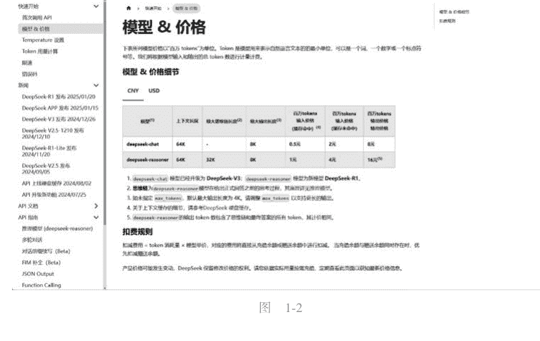

这种设计既降低了个人用户的使用门槛，又满足了企业对定制化、高性能接口的需求。

## 4. 差异的本质

DeepSeek 重新定义了 AI 工具的职场价值密度：

- 单次交互的信息熵是同类型 AI 工具的 3.7 倍（通过信息增益算法计算得到）。
- 在“需求理解→方案生成→成果交付”的完整链路上，节省了用户 73% 的中间操作。
- 企业用户续费率高达 89%，印证其从“尝鲜工具”到“生产力刚需”的转化能力。

这种差异使其成为首个入选《财富》500 强企业标准办公套件的中国 AI 产品（2024 年数据）。

### 1.2 DeepSeek 能做什么

DeepSeek 是一款国产大语言类 AI 工具，旨在为用户提供高效、智能的服务。它具备强大的自然语言处理能力，能够理解和生成高质量的文本内容，适用于多种场景。

#### 1.2.1 高效工作助手

如果说“职场是战场”，那么 DeepSeek 就是你的“智能军师”——它不会替代你所负责的工作，但能让你一个人变成一个团队。其他 AI 工具可能需要你像程序员一样写指令，但 DeepSeek 的厉害之处在于：你只管提需求，它负责把“怎么做”详细地告诉你。

举个例子：早晨你刚到公司，老板就给了你一份 20 页的行业报告，并说“下午开会要用这份报告的 PPT。”换作以前，你可能得花 2 小时手动挑重点、做图表，但现在只需要单击 DeepSeek 输入框中的“上传附件”按钮，如图 1-3 所示，在上传完成后输入一句：“从成本分析和竞争格局部分提炼 5 页 PPT 大纲，每页都配一个对比图表。”


稍后，你会得到：

- 自动分段的内容框架（甚至会有过渡动画的建议）。
- 可直接复制并粘贴到 PPT 的图表（配色已按照你所在公司的视觉识别元素调好）。
- 甚至还会附赠一份“老板可能提问的 Q&A 清单”。

这种高效不是“加速”，而是“跳过步骤”：

- 写邮件时不用再纠结“标题怎么吸引人”——告诉它“催财务部付款”，它会直接生成“关于 Q3 账款结算的温馨提示”这样的标题，甚至准备了从客气到严肃语气的 3 个版本供选择。
- 做数据分析但不用学 Excel 函数——将数据表截图发送给它，然后问“帮我找出去年卖得最差但利润最高的产品”，它不但给出结果，还会进行原因分析。
- 轻松协调跨时区开会时间——把“北京时间周三下午 3 点开会”发送给它，它会自动换算成纽约、伦敦、东京时间，还贴心地标注“纽约那边是凌晨 2 点，建议改期”。

更厉害的是，DeepSeek 能把你的碎片时间变成生产力。

- 若在地铁上收到客户语音消息，那么可长按并转发给它，到公司时你会收到文字版信息摘要和待办事项清单。
- 午休时看到某条行业新闻，可随手转发给它并说“下班前给我 3 条落地到我们业务的建议”，之后到点则直接收获“干货”。

和其他 AI 工具相比，DeepSeek 的高效在于“主动完成”：使用 ChatGPT 时可能需要反复调整指令，如“不对，我要的是表格而不是文字”“第三点再具体点”等；而 DeepSeek 会像老同事一样追问，如“需要加进竞品数据以进行对比吗？”“要不要将华东、华北区分开统计？”等——它不只回答你的问题，还会帮你发现你没有意识到的那些问题。

简单来说，它的“高效”不仅体现在速度快上，而是让复杂的事情变得简单，让简单的事情开始自动化。

> 提示
上传附件时请注意，DeepSeek 仅能识别文件中的文字，文件可以是各种文档和图片，单个文件大小不能大于 100MB，并且最多 50 个文件，如图 1-4 所示。


图 1-4

#### 1.2.2 职业发展导师

在职业规划领域，DeepSeek 作为一款智能问答工具，能够为用户提供全方位的支持。它不仅能够帮助用户进行自我认知分析、职业探索，还能够提供职业目标设定和实施路径规划的建议，以及进行持续支持与动态调整。

## 1. 自我认知分析

职业规划的第一步是了解自己。DeepSeek 可以通过问答形式，帮助用户分析自身的兴趣、性格特点、价值观和能力等。

- “我适合什么样的职业？”
- “我的性格特点有哪些？适合哪些行业？”
- “如何评估自己的职业能力？”

DeepSeek 会根据用户后续提供的信息，通过上述提问并结合职业测评工具和心理学理论，生成个性化的分析结果。例如，它可能会建议用户通过 MBTI（迈尔斯-布里格斯人格类型量表）测试、霍兰德职业兴趣测评等方式，进一步明确自己的职业倾向。

## 2. 职业探索

在职业探索阶段，DeepSeek 可以帮助用户了解不同职业的特点、发展路径和市场需求。

- “社会工作者的主要工作内容是什么？”
- “心理咨询师的职业前景如何？”
- “如何了解某个行业的现状和发展趋势？”

DeepSeek 会结合权威数据和案例，为用户提供全面的行业分析和职业描述信息。例如，它可以提供某个职业的薪资水平、工作强度、职业发展空间等信息，帮助用户更全面地了解目标职业。

## 3. 职业目标设定与实施路径规划

在明确职业方向后，用户需要设定具体的职业目标并规划实施路径。DeepSeek 可以为用户提供以下帮助。

**目标设定：** “如何制定一份关于医生的清晰的职业规划？”

DeepSeek 会建议用户从短期目标（如提升某项能力）到长期目标（如成为某个领域的专家）逐步规划。

**路径规划：** “如何从一名社会工作专业的学生，成长为一名专业社会工作者？”

DeepSeek 会根据行业特点，建议用户通过某些渠道积累经验（如参加志愿者活动、实习），以及考取某些资格证书（如社会工作者职业资格证）。

## 4. 持续支持与动态调整

职业规划不是一成不变的，而是需要根据实际情况动态调整。DeepSeek 可以帮助用户定期回顾职业规划，再评估进展，并根据外部环境的变化（如行业趋势、经济形势）进行调整。

- “我的职业规划是否需要调整？”
- “如何应对职业转型的挑战？”

DeepSeek 会结合用户的具体情况，提供个性化建议，帮助用户不断优化职业发展路径。

通过以上方式，DeepSeek 能够作为职业发展导师，为用户提供专业、个性化的职业规划支持。它不仅能够帮助用户明确职业方向，还能够为用户提供实现目标的具体方法和建议，让用户在职业发展的道路上少走弯路，更快达成目标。

#### 1.2.3 职场社交参谋

在复杂的职场环境中，人际交往和社交能力往往直接影响职业发展。DeepSeek 能够作为你的“职场社交参谋”，能通过智能分析为你提供针对性的社交策略，从沟通技巧到冲突化解，助你游刃有余地应对各类职场关系。

## 1. 职场沟通与表达优化

DeepSeek 能帮你打磨职场语言，避免“说错话”等尴尬。无论是邮件措辞、会议发言，还是跨部门协作时的表达逻辑，只需要输入初步想法，DeepSeek 就会提供优化建议。

- 精准表达：自动识别模糊表述（如“尽快完成”），建议进行具体化表达（如“明天下班前提交初稿”）。
- 语气适配：根据沟通对象（上级领导、同事、客户）调整语言风格，体现专业性或亲和力等。
- 场景化模板：提供“工作汇报”“项目反馈”等高频场景的沟通框架，减小临场发挥的压力。

## 2. 职业发展与人际关系管理

职场社交不仅是日常互动，更是长期关系的经营。当你在职场社交中感到迷茫时，为什么不去问问 DeepSeek 呢？DeepSeek 也许会给出你想要的答案。

- 人脉策略分析：输入职业目标（如“晋升管理层”），DeepSeek 会给出需要重点维护的职场关系及互动频率。
- 信任度提升：通过模拟对话，预判沟通中可能引发误解的表述，并提供更稳妥的替代方案。
- 资源连接：基于行业和岗位，推荐值得关注的职场社交场景（如行业论坛、内部培训），使得拓展人脉资源不再复杂。

## 3. 职场礼仪与文化适应

职场礼仪与文化在不同企业、行业和地域的差异较大，DeepSeek 能帮你快速适应。

- 礼仪指南：提供“线上会议礼仪”“商务宴请禁忌”等场景化行为规范，避免冒犯他人。
- 文化解码：分析跨文化团队中潜在的冲突点（如沟通直白度、时间观念差异），给出融合建议。
- 敏感词提醒：自动识别可能涉及性别、年龄、地域等敏感话题的表达，替换为中性化语言。

## 4. 职场冲突与问题解决

面对冲突时，DeepSeek 可充当“冷静第三方”，提供理性解决方案，避免冲动。

- 冲突拆解：通过多轮提问，帮助认清矛盾核心（如资源分配不公、职责边界模糊），而非停留在情绪层面。
- 沟通话术生成：针对“拒绝不合理需求”“向上级反馈问题”等棘手场景，生成既明确立场又维护关系的表达模板。
- 长期关系修复：若已发生冲突，则 DeepSeek 会结合双方立场设计分阶段缓和策略，如从“非正式道歉”到“合作重建”。

DeepSeek 将职场社交从“凭感觉”变为“靠策略”，全面覆盖职场进阶需求，帮助你在复杂人际关系中始终掌握主动权。

#### 1.2.4 贴心生活顾问

DeepSeek 不仅是职场助手，还可以是“贴心生活顾问”。它能通过智能分析和个性化建议，帮助高效解决日常生活中的琐碎问题，从健康管理到家庭事务，全方位提升生活品质。

## 1. 智能日程与健康管理

- **日程优化**：告诉 DeepSeek 计划的待办事项（如“健身、买菜、工作会议”），DeepSeek 会自动生成时间分配方案，供你参考，从而有效避开交通高峰或疲劳时段。
- **健康提醒**：根据作息习惯，生成喝水、久坐提醒建议，甚至会结合天气变化情况给出衣服穿搭建议（如“今日降温，建议加一件外套”）。
- **饮食规划**：只需要提供冰箱里的食材清单，就会生成营养均衡的菜谱，并附上烹饪步骤和所需时间，再也不用费心考虑每日食谱。

## 2. 家庭事务高效处理

- **账单管理**：将水电费、购物等账单告诉 DeepSeek，它会将账单汇总成月度消费报告，同时可对比历史数据，标注异常支出（如“本月电费同比上涨 30%”）。
- **家务分工**：根据家庭成员的时间表，智能分配家务（如“周三晚 7 点由爸爸负责洗碗”），减少家庭矛盾。
- **旅行规划**：输入旅行方式、预算（如“亲子游、预算 5000 元”）等，它可生成包含交通、住宿、景点攻略的完整行程表。

## 3. 个性化生活建议

- **购物决策**：对比商品参数时，DeepSeek 能提炼出关键差异（如“两款空气净化器的 CADR 值对比”），帮助你快速做出理性选择。
- **应急方案**：对于遇到的突发情况（如“水管漏水”），它会提供分步骤应急处理指南，并推荐附近维修服务的评分和联系方式。
- **学习陪伴**：根据碎片时间（如“每天通勤 30 分钟”），设计语言学习、技能提升的微课程计划。

## 4. 情感与生活平衡

- **压力缓解**：通过简单的问答，分析情绪状态，推荐适合你的放松方式（如“15 分钟冥想引导”或“喜剧电影清单”）。
- **社区资源整合**：根据定位，推送本地便民信息（如“小区周边新开洗衣店优惠活动”）。

DeepSeek 能够作为生活顾问覆盖生活的方方面面，还能根据个人习惯和需求不断优化建议。在繁忙的工作之余，你能利用它轻松管理生活，享受更多属于自己的时间。无论是健康管理、旅行规划，还是家庭事务，DeepSeek 都能成为生活中不可或缺的助手，让每一天的生活都更加井井有条。

#### 1.2.5 兴趣爱好伙伴

让 AI 成为你的“兴趣探索放大器”！虽然 DeepSeek 不能直接帮你采购装备

## 1. 个性化学习规划师

只需要向 DeepSeek 描述你的兴趣目标，它就会化身为全学科导师，为你搭建系统化的学习路径。

> “我想在三个月内学会基础水彩画法”

- 工具认知期（第一周）：推荐性价比最高的颜料/纸张组合，解释不同笔刷特性，甚至用“水彩与丙烯颜料的吸水性对比”帮你理解材料本质。
- 技法训练期（第二～六周）：每天推送一个专项练习（如“湿画法晕染控制”），附上大师作品解析和常见失误案例。
- 创作实践期（从第七周起）：根据你喜欢的风格（如宫崎骏动画场景），生成临摹清单并教授“如何将照片转化为水彩草图”的技巧。

整个过程支持随时提问调整，如突然对“留白液使用时机”产生困惑，它能用“煮沸牛奶表面结膜”的生活化类比帮你更好地理解其中的原理。

## 2. 随身技能教练

当你在兴趣实践中遇到具体问题时，DeepSeek 能通过场景模拟和细节追问助你突破瓶颈。

> “拍人像总是表情僵硬”

- 环境分析：“你通常在室内还是户外拍摄？尝试过逆光拍摄眼神光吗？”
- 设备追问：“使用 85mm 定焦镜头时，是否试过让人物走动，以捕捉动态瞬间？”
- 案例对比：展示布列松摄影集《决定性瞬间》中作品的构图逻辑，建议你在“地铁闸机开合瞬间”等特定场景中进行抓拍训练。

还支持跨领域知识迁移，如吉他手练习速弹时总卡顿，它会用“短跑运动员起跑姿势调整”来类比说明手腕发力技巧，甚至会生成一份包含肌肉放松操的每日练习计划表。

## 3. 脑洞创意激发器：打破常规的思维碰撞机

DeepSeek 擅长用跨界知识重组来点燃创作火花。

> “如何设计赛博朋克风格的纸质建筑模型？”

- 元素解构：提取霓虹灯管、机械齿轮、全息投影等标志性符号。
- 材料创新：建议用锡纸模拟金属质感，用手机闪光灯+彩色糖纸打造光污染效果。
- 技术嫁接：引入折纸几何学中的“三浦折叠法”，教你制作可伸缩变形的未来主义墙面。

对于开放性需求：

> “想写科幻小说但缺乏灵感”

- 从生物学角度构想“光合作用供电的外骨骼装甲”。
- 结合区块链技术设计“记忆数据化的伦理困境”剧情线。

它甚至会用“如果秦始皇拥有星链技术”这样的历史科幻命题，激发你的灵感。

DeepSeek 作为“兴趣爱好伙伴”不仅能帮助你发展兴趣、学习技能，还能够满足你的各种需求，在不同方面为你解惑答疑，成为你探索路上最好的导师。

#### 1.2.6 情绪树洞

虽然 DeepSeek 没有人类的情感，但它能通过结构化对话技术，成为随时待命的情绪支持伙伴，做好你的全天候倾听者与情绪解码器。无论是工作压力、人际关系困扰，还是突如其来的忧伤时刻，它都能提供安全、私密的倾诉空间，并尝试用逻辑分析与知识储备来帮助你找到情绪突破口。

## 1. 非评判性倾听：释放情绪的缓冲带

当你在对话框中输入：

> “今天好累，感觉做什么都没意义”

- 情绪标注：识别你的状态可能是“职业倦怠”或“短期目标缺失”，并反馈“听起来你正经历能量低谷期”。
- 细节追问：通过渐进式提问帮你理清压力源（“这种感受在一天中何时最强烈？上周完成项目时是否也有类似体验？”）。
- 认知重构：用“程序员调试代码”做类比，引导你将情绪视为需要优化的系统信号，而非个人失败。

全程没有“你应该……”这样的说教，反而会提醒：“需要我安静倾听，还是一起分析原因？”

## 2. 情绪应对工具箱：从宣泄到行动转化

根据对话内容，DeepSeek 能提供可操作的缓解策略：

> “焦虑到失眠”

提供“4-7-8 呼吸法”，并解释“延长呼气如何触发副交感神经反应”这样的问题。

当你倾诉时：

> “被同事排挤”

- 事实层：对方最近 3 次具体行为是什么？
- 认知层：是否有其他解读角度？比如项目压力导致团队氛围变化？
- 行动层：提供用“观察+感受”公式进行非暴力沟通示例。

甚至能设计“5 分钟情绪急救包”，如推荐适合当下心情的音乐风格，并给出对应的科学解释（“后摇滚的渐进结构有助于焦虑释放”）。

## 3. 长期情绪档案：看见自己的成长轨迹

通过对话记录功能，DeepSeek 能帮你：

- 绘制情绪波动图谱：每月生成可视化报告，标记高频关键词（如“焦虑”“成就感”），发现“每周三下午情绪出现低谷”等规律。
- 建立应对案例库：当你说“和上次吵架时一样难受”时，它会调取历史对话，对比两次事件中你的认知变化。
- 定制自我关怀方案：根据你的倾诉偏好（如偏爱理性分析或需要情感共鸣），动态调整回应方式。

在使用时用户可以注意结合以下技巧：精准启动 DeepSeek，在描述时使用“情绪标签+具体场景”方式提问，如“职场焦虑，如何在汇报前快速平静下来？”；若用户想要获取更加专业的结构化疏导建议，则可以输入“请用认知行为疗法框架分析我的以下想法”。

### 1.3 如何注册 DeepSeek

使用 DeepSeek 如同开启了一扇通往智能世界的便捷之门，而其整个注册过程仅需要几分钟。无论你是使用网页端，还是手机 App，都能通过简洁、直观的界面快速完成 DeepSeek 的注册——输入手机号获取验证码、设置密码、勾选协议，不用填写太复杂的资料或等待人工审核。

#### 1.3.1 网页端注册

作为最基础的接入方式，网页端注册兼顾了零门槛操作与跨设备兼容的优势——不用下载任何软件，只需要通过浏览器访问官网，即可在三步之内完成账号的创建。无论使用何种浏览器，都能获得一致的流畅体验。

1. 启动浏览器，在搜索引擎中输入关键词“DeepSeek”，按下〈Enter〉键，网页中会显示 DeepSeek 的官方网站，如图 1-5 所示。

2. 进入官网后，单击首页中的“开始对话”选项，如图 1-6 所示。

3. 此时会自动跳转至登录界面，如图 1-7 所示。用户在该界面中可以选择手机号或微信方式登录，若未注册，那么选择使用手机号登录时则会自动注册账号；而选择使用微信登录时则需要先绑定手机号，然后才可登录使用 DeepSeek。

4. 完成注册后，会自动登录账号，并跳转至使用界面，如图 1-8 所示。

#### 1.3.2 App 端注册

App 端注册让智能对话触手可及——通过应用商店下载 DeepSeek 官方 App 后，输入手机号并完成验证、设置密码两步操作，即可快速开启对话旅程。本节中，以 iOS 系统为例，展示 App 端注册的流程。

1. 单击手机桌面上的“App Store”图标，进入苹果应用商店，单击右下角的“搜索”按钮，如图 1-9 所示。进入搜索界面后，在搜索框中输入关键词“DeepSeek”，并单击“search”按钮，如图 1-10 所示。

2. 搜索完成后，单击搜索结果界面中的“DeepSeek”选项，如图 1-11 所示，进入软件简介界面，单击“获取”按钮，如图 1-12 所示，同意下载请求后即可下载 DeepSeek。

3. 下载完成后，单击手机桌面上的“DeepSeek”图标，即可打开软件，在同意用户协议和隐私政策后，如图 1-13 所示，就来到了注册界面，如图 1-14 所示。

4. 与网页版注册相同，用户输入手机号后就会获得验证码，输入验证码即可自动注册，如图 1-15 所示。注册后就会进入对话界面，如图 1-16 所示。

#### 1.3.3 3种登录方式

注册 DeepSeek 账号后，可以通过以下 3 种方式快速登录，以便灵活应对不同场景需求，同时保证账号安全。

## 1. 手机验证码一键登录

手机验证码登录是最快捷的登录方式之一。在登录页面输入注册时绑定的手机号，单击“获取验证码”按钮，60秒内输入短信中的6位数字验证码即可完成登录。这种方式不用记忆密码，且操作便捷。

## 2. 账号密码登录

习惯传统登录方式的用户可选择“账号密码登录”。当用户使用邮箱注册时，就需要设置密码。完成密码设置与手机号绑定后，输入注册时设置的手机号/邮箱和密码即可进入系统。

## 3. 第三方账号授权登录

为简化登录流程，DeepSeek 支持微信、Apple 账号等第三方平台授权登录。网页版目前仅支持微信账号登录，即单击登录页面中的“使用微信扫码登录”按钮，如图 1-17 所示。在扫码确认授权，绑定手机号后，系统会自动关联你的 DeepSeek 账号。这种方式不仅能避免密码泄露，还能直接同步微信头像和昵称。而在 iOS 端的 DeepSeek App 中，则另外提供了 Apple 账号登录的选项，如图 1-18 所示。

# 第2章 快速上手DeepSeek

在本章中，将为读者介绍 DeepSeek 的交互界面、对话管理方式和内容输出方式。通过这一章的学习，相信读者可以快速上手 DeepSeek，并获得更好的对话体验。

### 2.1 交互界面

登录账号后，可以看到 DeepSeek 的交互界面与大部分语言类 AI 工具类似，也分为结果展示区域、输入框两部分。

#### 2.1.1 输入框的使用技巧

作为新手，掌握输入框的基本操作是开始使用 DeepSeek 的第一步。本节将用最直观的方式来展示如何快速上手这个“智能对话入口”。

##### 1. 向 DeepSeek 提问

用户在登录后，首先看见的就是 DeepSeek 的输入框，如图 2-1 所示。

在向 DeepSeek 提问时，可直接在输入框内打字或粘贴内容，完成输入后，单击“发送”按钮或按《Enter》键，即可进行提问，如图 2-2 所示。

##### 2. 上传附件

用户还可以通过选择上传附件，让 DeepSeek 识别附件中的文字来进行提问。单击输入框中的“上传附件”按钮，如图 2-3 所示，在弹出的“打开”对话框中，选择需要上传的附件，选择后单击“打开”按钮。如图 2-4 所示。

上传附件后，输入框上方会提示用户附件正在上传，如图 2-5 所示。

完成上传后，DeepSeek 会在输入框上方提示已上传的附件及其大小，此时用户可以在输入框中输入问题，如图 2-6 所示，然后单击“发送”按钮或按《Enter》键，即可向 DeepSeek 提问。

> 提示
当用户选择上传附件进行提问时，则无法使用 DeepSeek 中的联网搜索功能。

##### 3. 模型切换

DeepSeek 为用户提供了两种模型，分别是 DeepSeek-V3 与 DeepSeek-R1。两个模型的侧重点有所不同：V3 解决日常小事又快又轻松，R1 专攻复杂难题且更专业。

当用户不选中输入框下方的“深度思考（R1）”选项时，如图 2-7 所示，则默认使用 DeepSeek-V3 模型来生成回答。

使用 DeepSeek-V3 模型时生成的回答较短，如图 2-8 所示。

选中“深度思考（R1）”选项，即可使用 DeepSeek-R1 模型生成回答，如图 2-9 所示。

对于同样的问题，DeepSeek-R1 模型生成的回答更加细致，同时会展示深度思考过程，如图 2-10 所示。

##### 4. 使用联网搜索

由于 DeepSeek 使用的数据库仅更新至 2023 年 12 月，因此，如果想要使用更新的数据，则需要使用“联网搜索”功能。选中输入框下方的“联网搜索”功能，即可使用该功能，如图 2-11 所示。

使用联网搜索后，DeepSeek 会在生成回答时自动进行搜索，生成的回答如图 2-12 所示。在生成的回答中，DeepSeek 会标注该回答的网页来源，便于用户分辨。

#### 2.1.2 结果展示区域的解读

DeepSeek 的结果展示区域是用户与 AI 交互的主要窗口，其设计遵循“极简主义”原则。不同于同类型 AI 工具堆砌复杂功能，DeepSeek 的结果展示区域可以划分为深度思考和生成回答两部分，在降低认知门槛和使用门槛的同时保证输出质量。

##### 1. 深度思考：专注的智能处理

当用户需要 DeepSeek 处理复杂任务，且使用 R1 模型时，提问后 DeepSeek 将进行深度思考，如图 2-13 所示。

在深度思考区域，会呈现分步骤的逻辑推演，如问题拆解、数据关联、假设验证等，当用户需要验证答案可靠性时，可根据深度思考区域的内容来检查推理是否符合专业常识。除此之外，在答案需要进一步优化时，可针对特定推理步骤提出问题。以图 2-13 中的深度思考区域为例，用户想要更改推荐书籍的主题范围时，可以向 DeepSeek 提问：“我对爱情主题的经典文学并不感兴趣，请重新帮我推荐。”

使用时，深度思考区域占据屏幕空间较大，如果用户只想看生成的回答，或需要节省空间，则可以折叠该区域，即单击该区域旁的小三角按钮，如图2-14所示。

单击该按钮后即可折叠深度思考区域，折叠后如图 2-15 所示。

##### 2. 生成回答：清晰的回答展示

作为用户获取最终答案的主要界面，回答区域采用“降噪”设计理念，通过清晰的视觉分层和结构化排版，确保信息传递的高效性与专业性。根据 DeepSeek 官方文档的 A/B 测试数据，该区域的信息密度与可读性平衡设计使用户平均阅读效率提升 28%。完成深度思考后，DeepSeek 就会开始生成具体的回答，回答完毕后如图 2-16 所示。

对于生成的回答，为了便于用户理解及快速查找重点，DeepSeek 会在生成回答时使用多级标题、重点标注、表格等格式，如图 2-17 所示。

而这种分层设计实现了复杂结论的分层归纳，通常呈现“核心结论-关键论据-行动建议”三段式结构。整个回答简单清晰，能够一眼捕捉到其中的重点。DeepSeek 的独特训练模型确保了多场景使用匹配，根据用户的不同身份，生成最适合用户的那一份答案。

通过这种“结构化输出+场景化交互”的设计，DeepSeek 在保证专业性的同时，显著降低了用户的信息处理成本。DeepSeek 2024 年第一季度用户调研报告显示，87% 的用户在 3 次使用后即可熟练运用回答区域。

## 3. 双区域协同：协同策略让效率更高

位于 GitHub 社区的 DeepSeek 官方文档中的对比测试数据显示，同时关注两个区域的用户，其后续提问准确度提升约 37%。

在使用 DeepSeek 生成回答时，初阶用户可以优先阅读回答区域来获取直接结论，进阶用户则可结合深度思考区域训练自己的批判性思维。

**案例演示：**
当提问“如何设计一个用户增长方案？”时：

- **深度思考区域**会逐步展示，即市场分析→竞品策略提取→资源匹配度评估→风险预判。
- **回答区域**则输出包含 KPI、执行时间轴、预算分配表的结构化方案。

此设计既可满足职场场景的效率需求，又为专业用户带来了可验证、可迭代的智能服务体验。

#### 2.1.3 界面导航与快捷操作

DeepSeek 的界面设计清晰，只要掌握导航和快捷操作，就能用最短的时间找到重点。

### 1. 网页端界面

DeepSeek 的界面可以分为 3 个模块，分别为对话、边栏和个人设置，如图 2-18 所示。

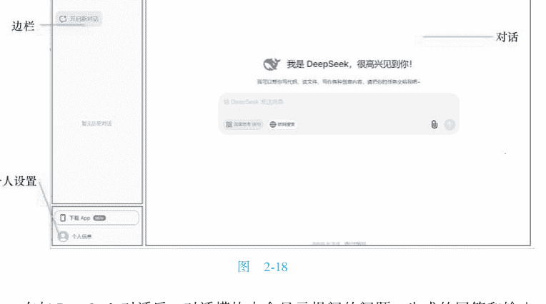

在与 DeepSeek 对话后，对话模块中会显示提问的问题、生成的回答和输入框，边栏模块中会显示所有的历史对话，如图 2-19 所示。

如果用户觉得边栏展开后会影响浏览体验，那么可以单击“收起边栏”按钮，如图 2-20 所示，将边栏收起。当然，想要展开边栏时，只需要单击“展开边栏”按钮，即可展开，如图 2-21 所示。

单击界面左下角的用户头像，会展开个人设置菜单，如图 2-22 所示，可以进行系统设置、删除所有对话、联系 DeepSeek 官方和退出登录的快捷操作。

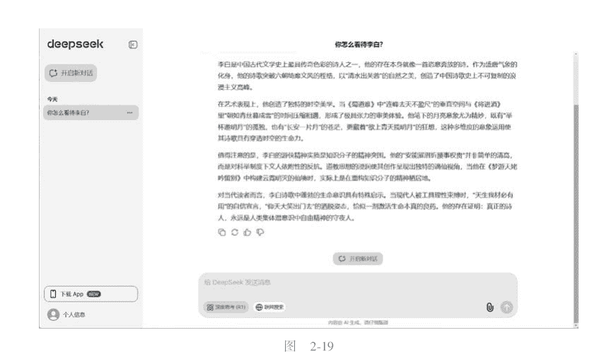


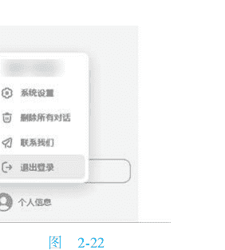

在系统设置中，用户可以选择使用语言和主题颜色，如图 2-23 所示；也可以进行账户信息设置相关操作，如图 2-24 所示。


### 2. App 端界面

相比网页端界面，DeepSeek 的 App 端界面更加简洁明了，如图 2-25 所示。注意，网页端上默认展开的边栏在 App 端上则是默认收起的。界面右上角的⊕按钮是“新建对话”按钮。
单击左上角的“边栏”按钮，即可展开边栏，如图 2-26 所示。

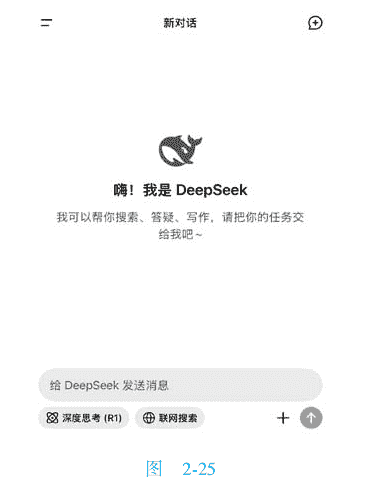

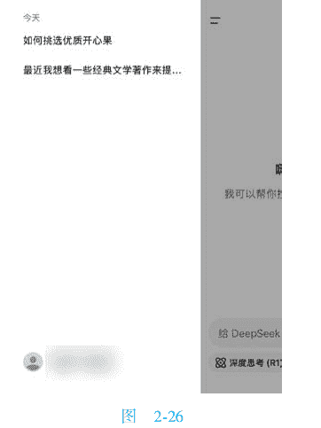

展开边栏后，就可以看到历史对话。长按历史对话，就可展开操作菜单，如图 2-27 所示。
不同于网页端，在 App 界面下方单击“更多”按钮，即可看到 App 端的独有功能：拍照识文字，如图 2-28 所示。


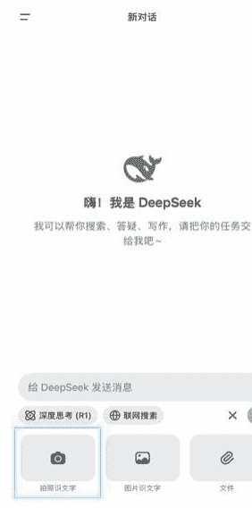

### 2.2 对话管理

在 DeepSeek 中，对话管理是高效使用工具的核心技能之一。无论是日常提问、项目讨论，还是复杂的数据分析，DeepSeek 都会自动保存对话记录，方便用户随时回顾、整理和复用。掌握对话管理技巧，不仅能让用户避免重复劳动，还能让工作流程更加清晰有序。

#### 2.2.1 新建对话与切换对话

在 DeepSeek 中，新建对话就像打开浏览器的标签页一样简单，而切换对话则能让用户在不同任务间丝滑跳转。只要掌握这两个功能，就能轻松管理多个任务，不再手忙脚乱。

##### 1. 新建对话

在前面的内容中，介绍了首次使用 DeepSeek 时如何进行对话——只需要在输入框中输入问题并发送，即可自动新建对话。而在已有对话场景下，需要新建对话时，则需要单击输入框上方的“开启新对话”按钮，如图 2-29 所示，才能新建对话。


除此之外，用户还可以单击边栏中的“开启新对话”按钮，新建对话，如图 2-30 所示。

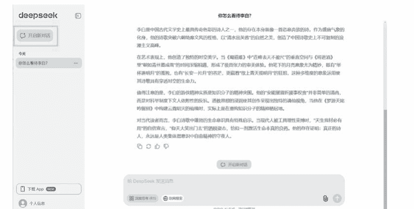

即使边栏收起，也可以单击“开启新对话”按钮，新建对话，如图 2-31 所示。

##### 2. 切换对话

所有对话均会以标签形式排列在边栏中，单击标签即可切换，如图 2-32 所示（类似浏览器多标签页操作）。

当前正在打开的对话则会以高亮底色来提示用户。

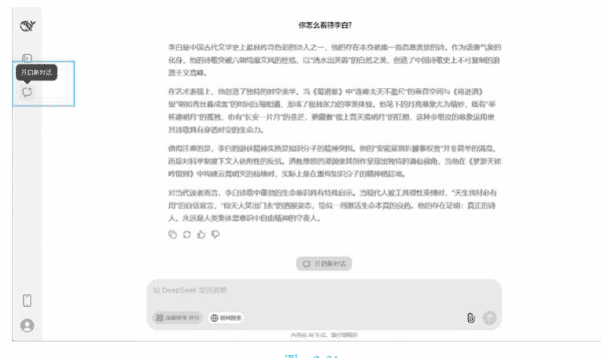

图 2-31


图 2-32

#### 2.2.2 管理与删除对话记录

新建对话后，对话会在边栏中显示，如图 2-33 所示，但随着 DeepSeek 的使用时间不断增加，边栏中的对话可能越来越多，就需要管理对话，让边栏变得整洁干净。

在 DeepSeek 中，单击对话后的 3 个点按钮，即可展开操作菜单，如图 2-34 所示。目前，仅能对 DeepSeek 的对话进行重命名和删除操作。


##### 1. 重命名对话

DeepSeek 默认将对话中的第一个问题的全部内容作为对话标题，但问题过长则会省略显示，不易查找对应的内容。那么用户可以执行“重命名”命令，简单介绍对话内容，便于后续查找。执行该命令后，边栏中的对话标题会变为输入框，可以在此输入新的标题，如图 2-35 所示。

##### 2. 删除对话

删除操作则更为简单，执行“删除”命令后，单击弹出对话框中的“确认”按钮，如图 2-36 所示，即可删除对话。


#### 2.2.3 历史对话的回顾与使用

DeepSeek 作为大语言类 AI 工具，也会记忆上下文，它在回答时参考之前的对话，并可以在对话中学习，因此用户可以通过它构建更加复杂的对话，自定义更多的使用场景。

让 DeepSeek 回顾和使用历史对话前，需要先有一个对话，如图 2-37 所示。

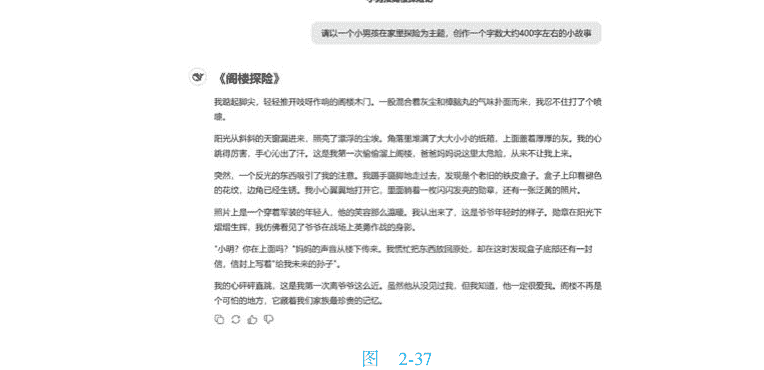

DeepSeek 会根据当前对话主题自动调整历史上下文的引用权重。例如，在连续讨论“用户增长策略”时，系统会优先关联历史对话中的“A/B 测试数据”“漏斗模型”等关键节点，而非机械记忆全部内容。当用户更新需求后，DeepSeek 会将用户需求与历史对话相结合，进行自己的思考，如图 2-38 所示。

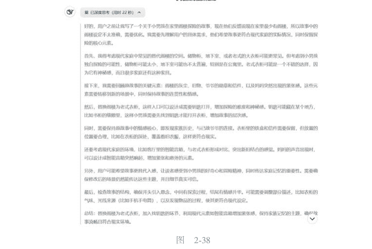

当新旧对话存在逻辑矛盾（如修改需求）时，DeepSeek 通过“深度思考”功能，基于知识图谱技术，自动构建跨对话的概念关联，优化回答，如图 2-39 所示。

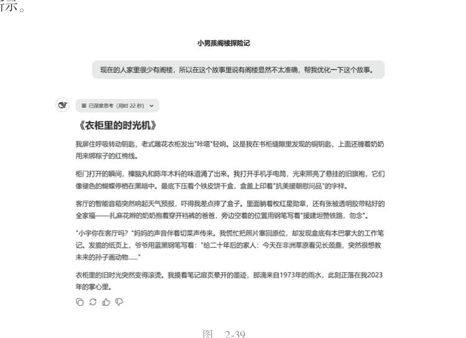

### 2.3 内容输出

在 DeepSeek 中，内容输出是最终呈现成果的关键环节——无论是整理一份报告、生成可视化图表，还是将数据导出分享，这里都能让工作成果既专业又高效。如果说提问是与 AI 对话的“输入法”，那么内容输出就是“打印机”。

#### 2.3.1 文本格式设置

在 DeepSeek 里排版文字，根本不用像 Word 那样“折腾”格式——用聊天的方式就能让文字变得高级！这些技巧能让报告、笔记等瞬间产生“专业感”。

##### 1. 使用符号，秒变排版高手

DeepSeek 支持 Markdown 轻量化排版，只需要在生成回答时，让 DeepSeek 以 Markdown 代码形式呈现回答，用户只需要将生成的回答复制并粘贴至 Markdown 在线编辑器（网址：https://dillinger.io/）中，即可自动进行排版，如图 2-40 所示。

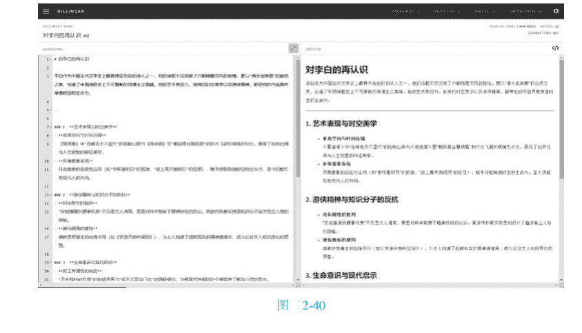

##### 2. 隐藏的智能表格

利用 DeepSeek，不用画线，直接打字就能生成表格！
例如在输入框中输入：

```
| 产品 | 销量 | 增长率 |
|------|------|--------|
| 手机 | 1200 | +18%   |
| 平板 | 800  | +35%   |
```

并向 DeepSeek 提出生成表格的要求，就可以得到美观的表格，如图 2-41 所示。

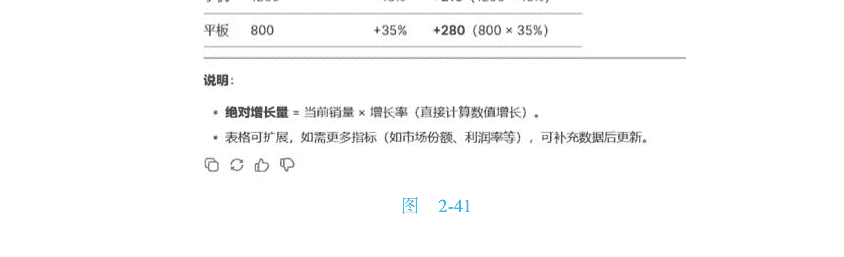

如果对该表格不满意，则可以直接提出“生成一个三列的产品对比表格”的要求，DeepSeek 会自动帮你建好框架！

#### 2.3.2 助力图表的生成

用 DeepSeek 生成图表非常简单——只要将需求描述清楚，就能生成专业图表！无论是思维导图，还是流程图，使用 DeepSeek 都能够极大地提升它们的生成效率。

##### 1. 思维导图的生成

思维导图对创造性提炼、产品规划、整理学习笔记、写作构思、新产品开发、头脑风暴、演示自己的逻辑构想等都非常有帮助。
你可以利用 DeepSeek 生成一段大纲，然后在相应平台快速生成思维导图。
例如，我们想生成撰写《小王子》读书笔记的思维导图，首先需要向 DeepSeek 进行提问，让它生成回答，如图 2-42 所示。

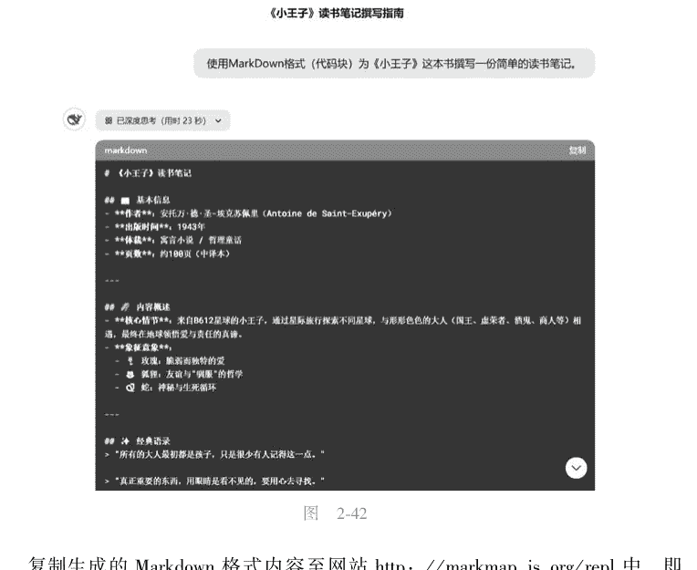

复制生成的 Markdown 格式内容至网站 http://markmap.js.org/repl 中，即可生成思维导图，如图 2-43 所示。

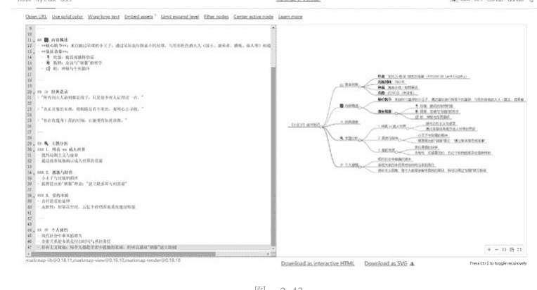

图 2-43

##### 2. 流程图的生成

流程图通常用于展示某个系统或流程的步骤、顺序和条件等信息。它可以帮助人们更好地理解和掌握复杂的流程与系统，从而更高效地管理和优化工作流程。
而使用 DeepSeek 生成流程图，则需要先生成一段 PlantUML 代码，如图 2-44 所示。

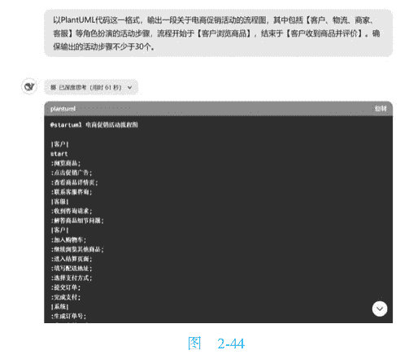

图 2-44

接下来打开网址 www.draw.io，在弹窗中单击“稍后再决定”，如图 2-45 所示。

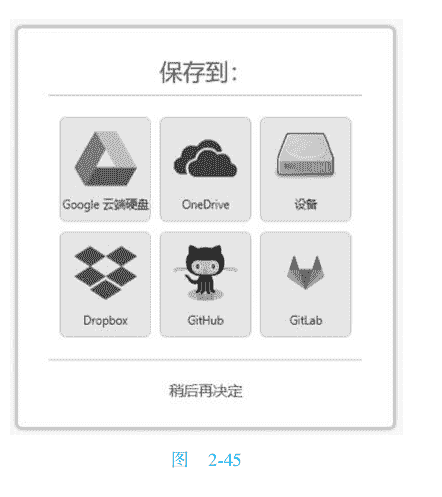

如图 2-46 所示，单击“PlantUML”选项。


复制前面生成的 PlantUML 文本至输入框中，并单击“插入”按钮，如图 2-47 所示。
draw.io 会根据输入的代码自动生成一个清晰美观的流程图，如图 2-48 所示，之后保存即可。

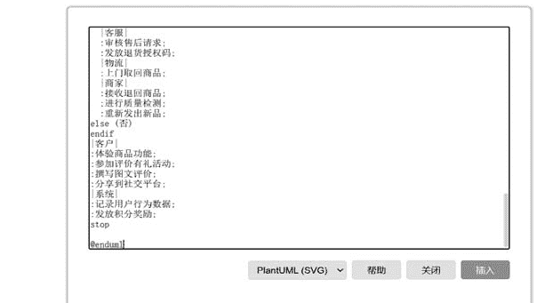

图 2-47

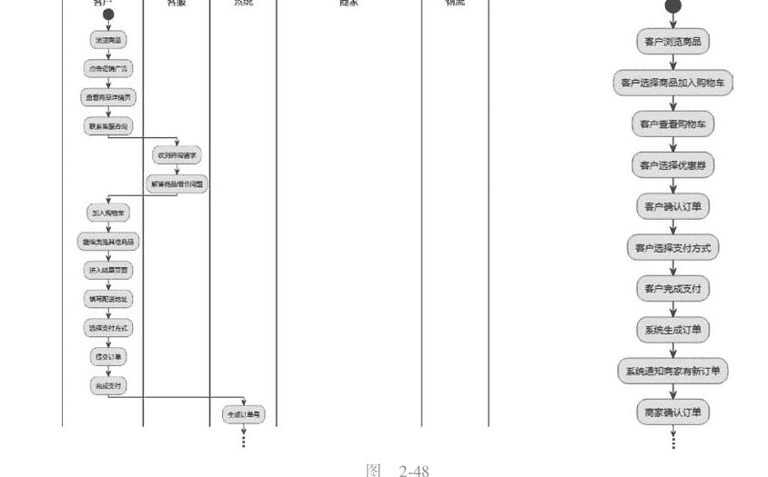

图 2-48

#### 2.3.3 内容的复制与粘贴

DeepSeek 的复制和粘贴功能以“零损耗迁移”为核心目标，通过智能格式适配技术，确保从 AI 生成内容到实际工作场景的无缝衔接。它支持富文本精准保留（如代码高亮、表格结构）与跨平台兼容优化（适配 Office、Notion、微信等 20 多种常用工具）。DeepSeek 官方兼容性测试报告显示，其结构化内容复制准确率达 96%。
在生成一般回答时，用户可以直接单击回答下方的“复制”按钮，如图 2-49 所示，执行复制操作。

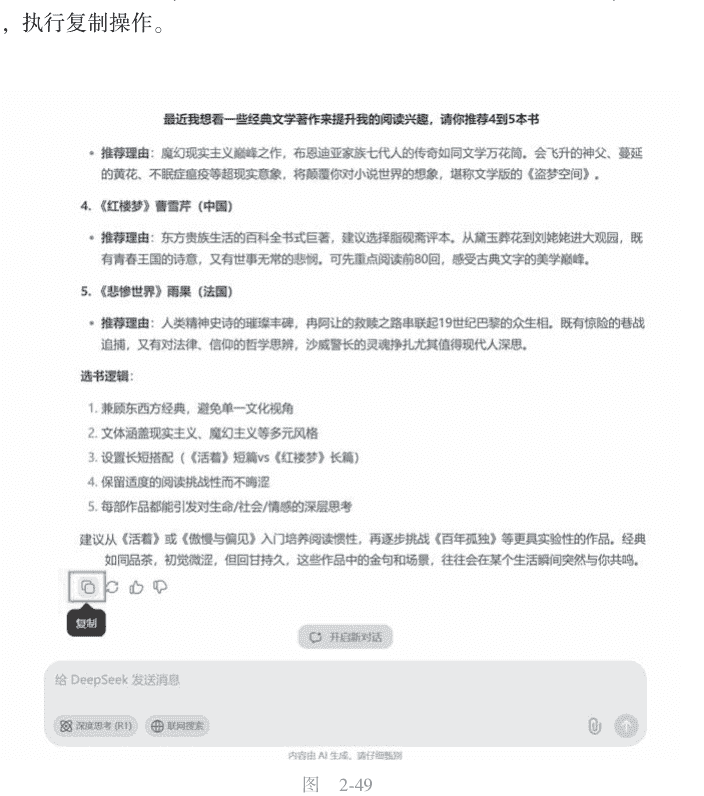

而在使用 DeepSeek，并将其与其他软件或平台结合进行排版时，则可以使用 DeepSeek 生成代码，单击代码显示区域右上角的“复制”按钮，即可仅复制代码部分，如图 2-50 所示。
粘贴时按组合键（Ctrl+V），即可完成该操作。

# 《小王子》读书笔记撰写指南

```
# 《小王子》读书笔记

## 📖 基本信息
- **作者**：安托万·德·圣-埃克苏佩里（Antoine de Saint-Exupéry）
- **出版时间**：1943年
- **体裁**：寓言小说 / 哲理童话
- **页数**：约100页（中译本）

---

## 📝 内容概述
- **核心情节**：来自B612星球的小王子，通过星际旅行探索不同星球，与形形色色的大人（国王、虚荣者、酒鬼、商人等）相遇，最终在地球领悟爱与责任的真谛。
- **象征意象**：
  - 🌹 玫瑰：脆弱而独特的爱
  - 🦊 狐狸：友谊与“驯服”的哲学
  - 🐍 蛇：神秘与生死循环

---

## 💡 经典语录
> "所有的大人最初都是孩子，只是很少有人记得这一点。"

> "真正重要的东西，用眼睛是看不见的，要用心去寻找。"

> "你在玫瑰身上花的时间，让她变得如此珍贵。"

---
```


# 第3章 掌握提问的技巧

如果说前两章是打开 DeepSeek 大门的钥匙，那么本章将带你深入这座智能宫殿的核心区域——如何通过精准提问，挖掘 AI 的隐藏潜能。在人工智能工具的使用中，提问的质量直接决定了回答的价值。本章将系统拆解“提问的艺术”，从基础原则到进阶策略，助你从“能提问”跃升为“会提问”，让 DeepSeek 从“应答机器”转化为你的“思维外脑”。

### 3.1 提问的原则和方法

在人工智能的对话中，提问的质量决定了回答的精度与深度。如果说 DeepSeek 是一台强大的“思维引擎”，那么用户的提问就是启动它的“密钥”——只有掌握科学的提问逻辑，才能让 AI 真正理解需求，输出符合预期的优质内容。

#### 3.1.1 明确问题的核心要点

在人工智能对话中，“问得准”是“答得对”的前提。模糊、宽泛的提问往往会让 AI 陷入“猜谜游戏”，而明确问题的核心要点的提问则能快速触发 DeepSeek 的深层分析能力。本节将提供一套问题拆解方法论，即三步聚焦法，帮助用户从混沌需求中提炼关键信息，实现“一击即中”的提问效果。通过三步聚焦法，让问题逐步明确，能够让用户更加迅速地明确问题核心要点。

##### 1. 三步聚焦法

**第一步：需求自检——回答“我究竟要解决什么”。**
在输入问题前，尝试用一句话概括核心目标，如“我需要一份适用于初创公司的股权分配方案模板”，而非“如何分配股权”。另外，提问时去除冗余部分，强制自己区分“背景信息”与“核心诉求”，避免问题被无关细节稀释。
**第二步：要素拆解——识别问题的“最小必要单元”。**
在提问时，用户要将复杂问题拆解为可操作的子问题。例如，“如何提升团

## 2. 经典案例对比：模糊提问与精准提问

在向DeepSeek提问时，模糊提问很难得到满意的回答，而精准回答能够帮助用户轻松获得问题的解决方案。模糊提问和精准提问的对比见表3-1。

表 3-1

| 场景 | 模糊提问 | 精准提问 |
| :--- | :--- | :--- |
| 职场写作 | 帮我写个PPT | 我需要一份关于AI客服系统升级的融资PPT，包含技术优势、竞品对比、ROI测算三部分，每页都需要有数据图表和一句话结论 |
| 法律咨询 | 合同有什么问题 | 请审查这份跨境电商供货合同，重点排查违约责任条款是否覆盖物流延误风险，并标注建议修改的条款编号 |
| 学习规划 | 怎么学Python | 作为零基础的职场人，请制定一份3个月的Python学习计划，目标为掌握数据分析和自动化办公，每周可投入5小时学习 |

## 3. 常见误区与规避策略

误区1：问题过于宏大（如“如何成功？”）。
解法：添加限定条件（如行业、阶段、资源等）。
误区2：隐含未声明的假设（如“按常规方法做”中的“常规”未定义）。
解法：明确解释“常规”在具体场景中的含义。
误区3：混杂多个独立问题（如“如何招聘程序员并设计绩效考核制度？”）。
解法：拆分为独立对话或使用分点提问方式（“第一，招聘程序员的面试题库；第二，技术岗位的 KPI 设计模板。”）。
通过明确问题核心要点，将大幅减少与 AI 的“无效回合”，让 DeepSeek 从第一轮回答开始就直击痛点，成为真正的“效率倍增器”。

#### 3.1.2 提供必要的背景信息

在向 DeepSeek 提问时，背景信息的完整性与精准度直接决定回答的质量边界。本节将系统解析背景信息的价值维度，帮助用户构建“高信息密度”的提问框架。

## 1. 为什么需要背景信息

虽然 DeepSeek 具备强大的情景推理能力，但其输出质量仍遵循“输入决定输出”的 AI 基础定律。DeepSeek 在其发布的《智能交互优化白皮书（2024 版）》中提到，在提问时补充背景信息可使回答准确率提升 63%，内容相关度提高 78%。例如：

(1) 无背景提问
“如何写邮件?”
可能得到通用模板，缺乏场景针对性。
(2) 带背景提问
“我是一名医疗器械销售员，需要向三甲医院采购主任发送新产品推广邮件，对方注重临床数据且反感营销话术，请用专业但不过度热情的语气撰写。”
可生成包含循证医学参数、学术会议邀约等在内的定制化内容。

## 2. 背景信息的黄金四要素

根据 DeepSeek 交互实验室的百万级对话分析，优质背景需要包含多种结构化信息，见表 3-2。

表 3-2
| 要素 | 作用说明 | 示例对比 |
| :--- | :--- | :--- |
| 场景特征 | 定义问题发生的具体场景 | 错误：“修改简历”<br>正确：“投递互联网大厂用户研究岗位，需要突出 B 端产品调研经验” |
| 角色属性 | 明确提问者及相关方身份特征 | 错误：“帮我写演讲稿”<br>正确：“作为应届毕业生代表，在毕业典礼上面向校企合作企业高管致辞” |
| 目标约束 | 设定预期效果与限制条件 | 错误：“生成活动方案”<br>正确：“策划社区老年读书会，预算不超过 2000 元，需要包含健康养生主题” |
| 知识基线 | 说明已有认知或特殊要求 | 错误：“解释区块链”<br>正确：“向金融专业大学生讲解区块链，需要结合央行数字货币案例，避免技术术语堆砌” |

## 3. 动态信息分层技巧

针对复杂问题，建议采用“洋葱式信息披露法”，说明如下。

- 核心层：直接关联问题本质的信息，如“正在处理跨国并购案中的竞业禁止条款审核”。
- 中间层：影响决策的上下文因素，如“收购方为欧洲新能源企业，标的公司核心团队有华为工作背景”。
- 外围层：潜在相关但非必需的信息，如“交易需要在 Q3 完成，以配合上市计划”。

通过渐进式信息释放，既可避免信息过载，又能引导 DeepSeek 进行多轮思考，对回答进行细化。例如，在合同审查场景中，先提供合同类型与审查重点，待获得初步法律意见后，再补充行业特殊监管要求等细节。

## 4. 典型场景应用指南

以职场文档撰写、法律咨询和创意生成 3 个场景为例，我们将示范拆解背景信息后的提问，便于读者理解。

(1) 职场文档撰写场景

背景框架
文档类型：跨境电商运营季度复盘 PPT
受众对象：CEO 与投资人
核心诉求：突出东南亚市场增长率，弱化物流成本上升影响
数据权限：可公开财报数据，截至 2024 第 2 季度
视觉要求：需要包含可视化的动态增长地图

(2) 法律咨询场景

背景声明
当事人身份：个体餐饮店店主
事件概况：顾客以食物变质为由索赔 10 万元
现有证据：监控显示顾客自带食材，但无法清晰辨认
地域特征：位于上海市静安区
紧急程度：已收到律师函，需要 3 日内回复

(3) 创意生成场景

创意边界
主题方向：科技伦理主题短视频脚本
风格参考：A 电影，使用三幕式叙事结构
时长限制：90 秒内
禁忌元素：避免宗教隐喻
目标受众：“Z 世代”科技爱好者

## 5. 常见误区与优化方案

(1) 信息过载型
误区：堆砌无关细节（如在提问时添加公司发展史）。
优化：用“5W2H”（Who/What/When/Where/Why+How/How much）法则过滤信息。

(2) 关键缺失型
误区：未说明地域政策差异（如咨询社保缴纳规则）。
优化：添加“地域+行业+特殊情形”校验清单。

(3) 主观预设型
误区：“我觉得用户喜欢这个设计”（缺乏数据支撑）。
优化：转换为“App 用户画像显示，25~35 岁女性占比为 68%，请据此优化 UI 配色方案”。

这种结构化提问训练，不仅能提升与 DeepSeek 的协作效率，还能培养用户的系统性思维习惯。

#### 3.1.3 实例引导提问

实例引导提问是指通过具象化案例激发 AI 认知框架的提问策略。据 DeepSeek 交互实验室发布的 2024 年测试报告显示，使用实例引导提问方式可使 DeepSeek 的回答准确率提升 41%。本节将解析该方法，帮助用户通过“实例投射”实现精准问答。

## 1. 方法原理

当用户提供具体案例时，DeepSeek 会先分析案例中的关键特征（如问题类型、核心要素），在系统中搜索具有相似特征的历史案例。系统会从匹配到的案例中提取已验证的有效处理方法，如客户投诉场景中的 24 小时响应机制或标准化补偿方案。随后，系统会根据当前问题的具体需求调整这些方法，保留通用原则（如快速响应要求）的同时修改细节以适配新场景，如将电商平台的退款方案转化为教育机构的课程延期服务。通过案例比对、经验提炼和方案适配 3 个阶段，实现从已有经验到新问题的解决方案迁移。

以“某快消品牌通过小红书 KOC 种草实现新品冷启动”这一案例进行分析，结合该案例进行提问，DeepSeek 会自动激活“社交媒体营销”知识模块，并关联“用户裂变”“内容矩阵”等子策略。

> 某快消品牌通过小红书 KOC 种草实现新品冷启动，现在我们有一款关于洗脸粉扑的新品也需要通过小红书 KOC 种草实现新品冷启动，请问我们应该如何操作？

针对洗脸粉扑新品通过小红书 KOC 种草实现冷启动的需求，结合搜索结果中的行业策略和案例，以下是具体操作方案：

## 一、明确产品差异化卖点，精准定位目标用户

差异化定位

小红书用户以女性为主（占比约 70%），需突出洗脸粉扑的独特功能，例如：

- 材质创新：如“硅胶抗菌材质”“可重复使用”等；
- 使用场景：适配不同肤质（敏感肌、油皮）、便携性（旅行装）等；
- 效果对比：清洁力提升、减少摩擦伤害等。

参考 PH 咖啡的品类微创新策略，通过细分场景（如“出差专用粉扑”）避开与头部品牌的直接竞争。

目标用户画像

聚焦 18~35 岁女性，尤其是护肤新手、敏感肌人群或注重性价比的消费者。通过小红书关键词工具（如“平价粉扑推荐”“敏感肌清洁工具”）分析用户搜索习惯，优化内容方向。

## 二、低成本筛选与激活 KOC，建立初期声量

筛选 KOC 标准

- 粉丝量级：优先选择粉丝量 500~5000 的素人，这类账号性价比高且内容真实性强；
- 内容调性：过往笔记以护肤、美妆工具分享为主，互动率（赞藏比）高于 5%；
- 账号健康度：无违规记录，内容非纯广告性质，日常分享生活化。

激活 KOC 合作

- 样品置换：向目标 KOC 免费寄送产品，强调“真实体验分享”，避免直接付费推广（降低商业化痕迹）；
- 私域沟通：通过小红书私信或微信建立联系，提供产品使用指南（如“3 种清洁手法教程”），引导内容方向。

## 三、内容策略：真实体验+场景化种草

内容形式

- 图文笔记：重点展示粉扑的材质细节、清洁效果对比图（如粉底残留测试）；
- 短视频：拍摄使用过程（如“30 秒快速清洁彩妆”），搭配轻快音乐和字幕，适配小红书与抖音双平台。

内容主题

- 痛点解决：例如“敏感肌如何避免摩擦损伤”“旅行便携清洁工具推荐”；
- 场景化植入：结合上班族晨间护肤、学生平价好物等场景，增强代入感。

优化关键词与标签
标题嵌入热搜词（如“平价粉扑”“敏感肌必备”），正文添加话题标签（#学生护肤、#好物分享）。
通过工具监测笔记收录情况，确保内容被平台算法推荐。

## 2. 四步构建有效实例

在引用实例之前，用户可以通过 STAR-C 模型结构化案例信息，见表 3-3。

表 3-3
| 要素 | 说明 | 应用实例（跨境电商广告优化） |
| :--- | :--- | :--- |
| Situation | 原始场景特征 | “独立站客单价为 120 美元，主要市场为北美” |
| Target | 待解决问题或目标 | “希望将广告 ROAS 从 2.5 提升至 3.8” |
| Action | 已尝试的解决方案 | “测试过视频网站动态创意广告组合” |
| Result | 取得的结果/现存问题 | “CTR 提升 15%，但转化率下降 8%” |
| Constraint | 新增约束条件 | “月度广告预算不得超过 2 万元” |

根据表 3-3 中的信息，我们可以这样向 DeepSeek 进行提问：“参照某服装品牌通过 TikTok 网红营销实现 ROAS 从 2.1 到 4.3 的案例（S：客单价为 80 美元，T：年轻女性市场；A：与腰部网红合作剧情广告；R：3 个月 GMV 增长 230%），在我的跨境电商场景中（STAR-C 见表 3-3），应如何调整网红营销策略？”

## 3. 实例类型与选用策略

根据问题复杂度选择案例，案例中包含的数据或信息越详细，能够提升的回答质量幅度也会越来越高，见表 3-4。

表 3-4
| 类型 | 适用场景 | 示例框架 | 回答质量提升幅度 |
| :--- | :--- | :--- | :--- |
| 微案例 | 简单问题 | “像‘生椰拿铁’的爆品命名逻辑” | +29% |
| 全案例 | 中等复杂度问题 | “参考小米社区运营模式设计会员体系” | +53% |
| 对比案例 | 决策类问题 | “对比喜茶与蜜雪冰城的联名策略优劣” | +67% |
| 失败案例 | 风险规避类问题 | “分析某 VR 硬件因忽略晕动症而导致的失败原因” | +82% |

## 4. 跨领域案例迁移技巧

如果遇到没有适合本行业的案例可以在提问中引用的情况，就通过“本质抽象法”实现跨行业的知识迁移，即使用其他行业的案例来进行提问。

(1) 原始案例
“特斯拉超级工厂的模块化生产线设计，使 Model 3 产能提升 50%。”

(2) 抽象转换
提取核心模式：“模块化架构+并行作业”。
映射目标领域：“在线教育课程开发”。

(3) 生成提问
“参照制造业模块化生产理念（核心：标准化组件灵活重组），如何设计可快速适配基础教育到成人教育的课程开发体系？要求实现 70% 内容复用率。”

## 5. 常见误区与优化方案

(1) 案例过载
误区：同时引用 5 个以上案例，导致逻辑混乱。
优化：采用“1+1”对照法（1 个正例+1 个反例）。

(2) 特征失焦
误区：引用案例时遗漏关键差异点。
优化：添加差异声明，如“参考字节跳动 OKR 体系时，需要注意我公司为 200 人规模的制造业企业，而非互联网巨头”。

(3) 数据失真
误区：使用模糊化案例描述。
优化：量化关键指标，如将“某公司营收增长较快”改为“某 SaaS 企业 ARR 从 500 万增至 1200 万，用时 18 个月”。

这种实例引导的提问方式，不仅能获得更精准的回答，还能培养用户结构化思维能力，实现与 DeepSeek 的认知协同进化。

#### 3.1.4 设计提示词进行提问

提示词（Prompt）是用户输入给 AI 系统的指令或信息，用于引导 AI 生成特定的输出或执行特定的任务。简单来说，提示词就是我们与 AI“对话”时所使用的语言，它可以是一个简单的问题、一段详细的指令或一段复杂的任务描述。

## 1. 提示词的基本结构

在设计提示词之前，先要了解其基本结构。一个完整的提示词通常包含以下三大要素。

(1) 明确指令
清晰说明需要进行操作的方式，如“请生成”“请分析”“请总结”等。

示例：

❌ 模糊提问：“关于市场营销的资料。”
✅ 明确指令：“请总结 2023 年社交媒体营销的三大趋势，要求分点说明并附案例。”

(2) 背景信息
提供与问题相关的上下文，帮助 AI 理解具体场景。

示例：

❌ 缺乏背景：“如何写一份策划方案？”
✅ 补充背景：“我需要为一家新成立的宠物用品电商公司撰写促销活动策划方案，目标用户是 25~35 岁一线城市白领人士。”

(3) 输出要求
指定格式、长度、风格等。

示例：

❌ 错误示例：“写点产品介绍，要吸引人，别太复杂，加点网络流行词就行。”
✅ 结构化要求：“请生成 3 条描述智能手表的广告语，每条都要包含功能亮点（不超过 3 项）、使用场景和促销话术，要求采用年轻化网络用语，避免专业术语。”

## 2. 提示词设计技巧

在设计提示词时，使用一些技巧，能够设计出清晰表达用户需求的提示词，从而在与 DeepSeek 的对话中获得满意的回答。

(1) 分步提问法
复杂问题的解决可拆解为多个步骤，逐步引导 AI 输出。

示例：

第一步：“请列出用户调研报告的 5 个核心模块。”
第二步：“针对‘消费者痛点分析’模块，提供 3 种数据可视化方案建议。”

(2) 角色设定法
通过赋予 AI 特定角色，提升回答的专业性。

示例：

✅ “假设你是资深人力资源顾问，请为互联网行业的产品经理岗位设计 10 个结构化面试问题。”

(3) 示例引导法

示例：

✅ “请模仿以下邮件风格，撰写一封客户跟进邮件：
……
”

(4) 多角度补充指令
通过限定条件引导 AI 进行多维度思考。

示例：
“请分析新能源汽车行业的竞争格局，需要包含政策影响、技术瓶颈、消费者偏好 3 个维度，每部分都不要超过 200 字。”

## 3. 常见问题与优化方案

设计提示词时总会碰到各种各样的问题，可以参考表 3-5 中的优化方案来优化提示词，以获得更满意的回答。

表 3-5
| 问题类型 | 问题示例 | 优化方案 |
| :--- | :--- | :--- |
| 指令过于笼统 | 帮我写个方案 | 补充行业、目标、格式等具体要求 |
| 缺乏限制条件 | 介绍项目管理方法 | 指定方法论类型（如敏捷管理）或应用场景 |
| 多重问题混杂 | 如何促进用户增长并设计海报？ | 拆分为多个独立问题并依次提问 |
| 忽略反馈调整 | 直接放弃不理想的回答 | 通过追问细化需求 |

## 4. 实践案例演示

接下来将通过实践案例向读者展示怎样设计提示词，帮助读者巩固基础。
场景需求：为智能手表品牌策划小红书推广文案。
初始提问：
“写几个小红书推广文案。”

优化后的提示词：
“你是数码产品营销专家，请为“健康监测+时尚外观”的智能手表设计 3 篇小红书笔记文案，要求：

- 标题带 Emoji 表情，突出“职场通勤”场景。
- 正文包含痛点分析、产品功能、使用场景 3 个部分。
- 文末添加“#运动穿搭”“#科技美学”等话题标签。
- 语言风格年轻化，参考某些 KOL 的文案风格进行撰写。

通过合理设计提示词，DeepSeek 的效能将大幅提升。

### 3.2 不同类型问题的提问策略

在与 AI 工具的交互中，问题的类型决定了回答的深度与广度。DeepSeek 作为大语言类 AI 工具，能够灵活应对信息查询、方案制定、创意激发等多样化需求，但不同问题需要匹配不同的提问策略。本节将针对信息查询类、解决方案类、创意启发类和开放类四大常见问题类型，解析其核心特征与提问技巧，帮助用户通过精准的提问设计，快速获取结构化、可落地的优质回答。

#### 3.2.1 信息查询类问题

信息查询类问题是用户与 DeepSeek 交互中基础且常见的问题类型，其核心目标是快速、准确地获取特定事实、数据或知识。DeepSeek 凭借强大的知识库和语义理解能力，能够高效响应此类需求，但提问方式会直接影响结果的精准度，使用合适的提问方式能够获得满意的回答。

## 1. 提问策略与实例解析

在进行提问前，需要了解一些提问策略，从而获得满意的回答，而不是没有实际意义的回答。

(1) 明确问题类型，精准定位需求
1) 定义类查询：直接提问核心概念，可附加限定条件。
示例：
❌ 模糊提问：“量子计算是什么？”
✅ 精准提问：“用通俗语言解释量子计算的基本原理，并列举 3 个实际应用场景。”
效果对比：前者可能得到笼统定义，后者会输出结构化解释（原理+案例），便于快速理解。
2) 数据类查询：需要标明时间范围、地域或行业限制。
示例：
❌ 宽泛提问：“全球智能手机销量数据。”
✅ 限定提问：“2023 年第 2 季度中国智能手机市场前三大品牌的市场份额及同比增长率。”
效果对比：后者将提供具体数值及对比分析，避免出现模糊的行业报告摘要。
(2) 结构化提问，拆分复杂问题
多维度信息查询可通过分步提问或逻辑符号提升效率。
示例：
❌ 混杂提问：“Python 和 Java 的区别以及各自适合的开发场景，还有学习难度对比。”
✅ 结构化提问：“请分点说明：
1) Python 与 Java 在语法特性、运行效率上的核心差异；
2) 两者分别适合哪些类型的开发项目（各举 2 个案例）；

## （3）利用 DeepSeek 特色功能优化结果

1）追问验证：对不确定的信息可要求标注来源或补充依据。

示例：
用户提问：“《巴黎协定》中发达国家的气候资金承诺具体金额是多少？”
DeepSeek 回复：“根据协定，发达国家承诺到 2025 年每年共同筹集 1000 亿美元……”

> ✅ 追加提问：“该数据来源是联合国官方文件还是媒体报道？请提供具体出处。”

2）多轮调整：通过补充条件迭代优化回答。

示例：
初始提问：“推荐 5 本人工智能入门书籍。”
获得推荐后追加：“请排除理论教材，聚焦实战型书籍，并补充豆瓣评分和适合人群说明。”

### 2. 常见误区与优化方案

表 3-6 总结了针对信息查询类问题提问时的常见误区与优化方案。

表 3-6
| 误区类型 | 错误示例 | 优化方案 |
| :--- | :--- | :--- |
| 问题笼统 | 如何理财？ | 添加限制条件：30 岁职场人士，月结余 5000 元，如何配置低风险理财组合？ |
| 隐含主观判断 | 最好的编程语言是什么？ | 转化为客观框架：对比 Python、Java、Go 在 Web 开发领域的生态成熟度、学习曲线和薪资水平 |
| 忽略时效性 | 智能家居设计场景 | 明确时间范围：2025 年 3 月我想为自己家设计一套智能家居方案，我应该怎样设计？ |

### 3. 提问演示

尝试用 DeepSeek 完成以下信息查询任务，观察回答质量差异。

- 基础版提问：“诺贝尔奖历届得主。”
- 进阶版提问：“列出 2010～2023 年女性诺贝尔物理学奖得主名单，并简述其获奖研究成果的应用价值。”
- 终极版提问：“对比近五年（2020～2024）诺贝尔经济学奖得主的核心理论，分析其对当前全球经济复苏的指导意义，要求用表格呈现关键论点。”

只要问题描述具体、结构清晰，DeepSeek 就能提供具有深度和实用价值的回答。

#### 3.2.2 解决方案类问题

解决方案类问题的核心目标是通过 DeepSeek 获取针对具体场景的可执行策略或系统性方法。与信息查询类问题不同，此类提问需要 AI 结合用户需求、场景限制及潜在变量，生成逻辑严密、步骤清晰的行动方案。

## 1. 提问策略与实例解析

不同于信息查询类问题的提问策略，解决方案类问题的提问策略则更多集中在结构拆解与信息提供上。在向 DeepSeek 提问后，还可以让 DeepSeek 通过逻辑推演来验证方案的可行性与风险。

（1）结构拆解：将复杂问题拆解并逐个击破
将复杂问题拆解为多个可操作的子任务，帮助 DeepSeek 定位核心矛盾。

示例：

❌ 笼统提问：“我的团队效率低，怎么办？”

✅ 结构化拆解：“我们是一个 10 人跨境电商团队，近期因需求频繁变更导致项目延期。请提供：

- 需求优先级管理工具推荐（附操作流程）；
- 减少沟通内耗的会议制度设计建议；
- 激励成员主动应对变化的 3 个具体策略。”

效果对比：后者会输出包含甘特图使用指南、每日站会规则模板、OKR 激励案例的完整方案。

（2）场景还原：提供关键背景信息
通过“角色+场景+限制条件”的框架增强方案的针对性。

示例：

❌ 抽象提问：“如何做好客户拜访工作？”

✅ 场景化提问：“我是一名新能源行业销售新人，明天将首次拜访某制造企业采购总监，目的是推广光伏储能系统。请设计：

- 30 分钟面谈的议程框架（含破冰话术）；
- 针对高电费痛点的 3 个提问策略；
- 客户提出‘已有稳定供应商’时的应对方案。”

效果对比：DeepSeek 将生成包含行业数据引用、竞品对比话术、价值锚点设计的实战指南。

示例：

初始提问：“如何用 5000 元预算策划一场线下读书会？”

DeepSeek 回复后追加：

> “请评估方案中‘联合咖啡馆举办’的潜在风险，并提供备选场地选择标准及成本对比表。”

效果对比：可触发 DeepSeek 补充场地谈判技巧、突发情况预案（如人数超限）、ROI 测算模板。

### 2. 常见误区与优化方案

针对解决方案类问题进行提问时的常见误区与优化方案，见表 3-7。

表 3-7
| 误区类型 | 错误示例 | 优化方案 |
| :--- | :--- | :--- |
| 问题描述模糊 | 怎么让客户满意？ | 限定场景：To B 软件公司如何通过服务流程优化将客户续费率从 70% 提升至 85%？ |
| 忽略限制条件 | 如何开一家网红餐厅 | 补充约束：预算 50 万元，二三线城市商圈，目标客群为 20~35 岁女性 |
| 缺乏执行层级 | 请给出数字化转型方案 | 分步指令：1）诊断当前 IT 系统瓶颈的方法；2）中小型制造企业数字化转型的 3 个低成本切入点；3）实施路线图（0~6 个月） |

### 3. 提问演示

接下来将结合实例向读者展示如何针对解决方案类问题进行提问才可以获得更好的回答。

（1）基础版
提问：“如何解决拖延症？”
优化方向：加入具体场景，如“作为经常加班的程序员，如何利用碎片化时间（每天 30 分钟）系统学习新技术？请提供时间管理工具、激励方法和进度跟踪方案。”

（2）进阶版
提问：“公司公众号粉丝数增长停滞怎么办？”
优化方向：补充数据，如“母婴品牌公众号现有粉丝 2 万人，近 3 个月打开率从 5% 降至 2%。请分析可能的原因，并提供包含跨界合作、内容改版、活动策划的 3 个月复苏计划。”

（3）终极版
提问：“如何设计 AI 产品经理的能力培养体系？”
优化方向：使用结构化指令，如“为科技公司设计为期 6 个月的 AI 产品经理培训计划，要求包含：

- 必修知识模块（技术、商业和伦理）及学习资源推荐；
- 实战项目设计（如 ChatGPT 插件开发全流程模拟）；
- 考核标准与晋升通道规划。”

通过精准的场景描述、结构化拆解和持续追问，DeepSeek 能够输出媲美专业咨询报告的解决方案。

#### 3.2.3 创意启发类问题

创意启发类问题的核心目标是通过 DeepSeek 突破思维定式，激发新颖的灵感或提供跨界解决方案。这类提问需要平衡开放性与方向性，既要保留想象空间，又要避免回答过于发散。本节将结合 DeepSeek 的联想与结构化思维能力，解析如何高效获取有价值的创意产出。

## 1. 提问策略与实例解析

创意启发类问题的提问最重要的就是创意，那么提问策略的重点就要落在想象力激发上。但不能空想，需要具有实际意义，在提问时就需要注意寻找创意与可行性的平衡点，避免无效回答。

（1）设定创意锚点：用约束激发创造力
通过“领域+形式+目标”的框架限定创意范围，避免天马行空式的无效输出。

示例：

- ❌ 宽泛提问：“设计一个公益活动。”
- ✅ 锚点式提问：“面向 Z 世代的环保公益活动设计，要求：
  - 融合 AR 技术，增强参与感；
  - 单次活动成本控制在 5 万元内；
  - 可量化传播效果（如社交媒体话题量）。”

效果对比：后者可能输出“AR 垃圾分类游戏：用户扫描街道垃圾生成虚拟生态危机场景，拯救成功可兑换线下植树权益”等可落地的方案。

（2）跨领域嫁接：强制关联，激发创新
要求将看似无关的元素进行组合，触发突破性思考。

示例：

- ❌ 常规提问：“如何提升智能手表销量？”
- ✅ 跨界提问：“将敦煌壁画美学、健康监测功能、社交裂变机制相结合，设计一款智能手表的差异化卖点及营销策略。”

效果对比：DeepSeek 可能生成“莫高窟配色表盘+呼吸冥想指导功能+‘丝路足迹’好友步数 PK 赛”等融合文化、科技、游戏的创意组合。

（3）逆向思维引导：挑战常规假设
通过否定前提或反转逻辑打开新视角。

示例：

- ❌ 传统提问：“如何让用户更长时间使用我们的 App？”
- ✅ 逆向提问：“如果强制要求用户每天使用不超过 15 分钟，如何通过产品设计提升用户黏性和付费转化率？”

效果对比：可能触发“碎片化知识胶囊+AI 生成学习图谱+限时解锁成就体系”等反直觉的产品设计思路。

## 2. 创意评估与优化技巧

使用 SCAMPER 法则提问，能够细化创意，获得更加详细的回答。SCAMPER 法则提问包括替代（Substitute）、合并（Combine）、改造（Adapt）、调整（Modify）、改变用途（Put to other uses）、去除（Eliminate）和重新排列（Rearrange）方法。

示例：

- 原创意：儿童编程教育机器人。
- 改造指令：“如何将宠物陪伴需求与编程教育结合？要求保留核心编程功能，但交互方式更符合 6~10 岁儿童情感需求。”
- 输出方向：“电子狗形态机器人，通过抚摸感应触发编程指令，完成任务可解锁虚拟宠物成长剧情。”

提问时不仅可以使用 SCAMPER 法则，还可以使用“六顶思考帽”工具来进行验证。“六顶思考帽”（Six Thinking Hats）是一种结构化思维工具，旨在通过角色化、分阶段的思考方式，帮助个人或团队更全面、高效地分析问题、验证决策或创新方案。其核心思想是“平行思维”，即通过不同颜色的“帽子”代表不同的思考维度，逐一聚焦，避免思维混乱或冲突。

若用于“验证”某个观点、决策或方案，则使用“六顶思考帽”工具可以系统化地检验其合理性和可行性。

可要求 DeepSeek 从多角度评估创意的可行性，如使用“六顶思考帽”工具评估“无人便利店+社区图书角”融合项目：

- 白帽：周围 5 平方千米的人口结构数据支持度。
- 红帽：可能引发的居民情感抵触点。
- 黄帽：潜在的社会价值提升空间。

## 3. 常见误区与优化方案

在针对创意启发类问题提问时，常见误区与优化方案有了新的变化，见表 3-8。

表 3-8
| 误区类型 | 错误示例 | 优化方案 |
| :--- | :--- | :--- |
| 创意方向模糊 | 帮我想一个新产品创意方案 | 增加维度：针对露营爱好者设计便携式烹饪设备，需要解决“轻量化”与“多功能”之间的矛盾，预算控制在300元内 |
| 缺乏落地性 | 未来城市交通的颠覆性方案 | 分阶段设计：提出一个5年内可实现的过渡方案（基于现有技术）+一个10年远期概念（允许技术突破） |
| 同质化严重 | 设计企业年会节目 | 增加冲突元素：要求融合元宇宙虚拟角色互动，且包含行业“黑话”改编的讽刺喜剧环节 |

## 4. 提问演示

（1）基础版
提问：“帮我想一个短视频账号定位。”
优化方向：“为法律从业者设计知识科普类账号，要求：

- 用《武林外传》角色原型演绎热点案件；
- 每期融入一个反常识法律冷知识；
- 结尾设计‘法条战斗力排行榜’互动环节。”

（2）进阶版
提问：“设计咖啡店促销活动。”
优化方向：“快闪式‘咖啡盲盒’活动设计，要求：

- 将星座运势、职场MBTI测试与口味选择结合；
- 设置‘社交赎金’机制（带走他人预留的咖啡需要完成指定任务）；
- 联动本地插画师设计杯身AR动画。”

（3）终极版
提问：“构思科幻短篇小说。”
优化方向：“基于以下要素创作2000字的故事：

- 核心矛盾：‘AI法庭’审判人类‘非理性行为’
- 必含意象：情绪加密货币、AI替代大部分人类工作岗位
- 主题升华：证明‘不完美’才是文明存续的关键”

通过结构化约束、跨界联想和批判性验证，DeepSeek能成为高效的“创意协作者”。使用DeepSeek生成回答后，使用其他平台的图表生成功能，能够将文字创意转化为思维导图、用户旅程图等，系统性推进创意落地。

#### 3.2.4 开放类问题

开放类问题的核心目标是通过DeepSeek激发深度思考、探索多元视角或预测未来趋势。这类问题通常没有标准答案，但需要AI在知识整合、逻辑推演和想象力之间找到平衡点，提供有启发性的分析框架。

## 1. 提问策略与实例解析

在向 DeepSeek 提出开放性问题时，清晰的提问策略能帮助用户获得更精准、深入的回答。

（1）构建讨论边界：用框架约束开放性
通过设定维度、时间线或角色视角，避免回答过于发散。

示例：

- ❌ 空泛提问：“AI 会取代人类吗？”
- ✅ 结构化提问：“分 3 个阶段讨论 AI 对人类职业的影响：
  • 2025—2030 年（重复性工作自动化）；
  • 2030—2040 年（创造性工作辅助）；
  • 2040 年后（人机协同新文明形态）。
  每个阶段都需要包含典型场景、伦理挑战、个人应对策略。”

效果对比：后者将生成包含数据预测（如麦肯锡自动化报告引用）、哲学家观点（如赫拉利的《未来简史：从智人到智神》）、技能树演化路径的体系化分析结果。

（2）多视角辩论：强制切换立场激发思辨
要求 AI 模拟对立观点，建构认知张力。

示例：

- ❌ 单维提问：“远程办公利大于弊吗？”
- ✅ 多立场提问：“请分别以以下角色视角分析远程办公趋势：
  • 社会学教授（社会关系变迁维度）；
  • 神经科学专家（人类认知演化维度）；
  • 城市规划师（城市空间重构维度）。
  最后综合三方观点，预测 2050 年工作形态。”

效果对比：DeepSeek 可能输出“分布式社区崛起→多巴胺分泌模式改变→CBD 功能转型为体验中心”等跨学科工作形态。

（3）未来推演：结合趋势信号构建场景
通过“信号+推演”模式增强预测可信度。

示例：

- ❌ 主观猜测：“人工智能会如何改变制造业？”
- ✅ 信号驱动提问：“基于当前 3 项技术突破：
  • 工业视觉缺陷检测准确率达 99.97%（2023 年国际机器视觉协会白皮书，汽车零部件检测场景）；
  • 数字孪生工厂建模效率提升 230 倍（西门子 2024 年工业元宇宙白皮书，基于 NVIDIA Omniverse 平台）；
  • 柔性协作机器人单件成本降至 8500 美元（IFR 2023 年度机器人成本分析报告）。
  推演 2030 年智能制造可能形成的 3 种生产范式。”

### 2. 常见误区与优化方案

在向 DeepSeek 提出开放类问题时，常见的误区可能导致回答模糊、偏离需求或缺乏实用性。常见误区与优化方案见表 3-9。

表 3-9
| 误区类型 | 错误示例 | 优化方案 |
| :--- | :--- | :--- |
| 问题过于空泛 | 人生的意义是什么？ | 增加具象载体：“从生物学演化、存在主义哲学、量子力学多世界诠释 3 种路径，探讨人类寻找人生意义的底层驱动力。” |
| 缺乏讨论框架 | 未来 10 年企业会发生什么改变？ | 添加分析工具：“用 STEEP 模型（社会、技术、经济、环境、政治）分类预测 2025～2035 年企业关键变革，每类都列举 2 个高概率事件。” |
| 忽略反事实思考 | 如果没有互联网会怎样？ | 增强推演逻辑：“设定 1980 年这个关键节点（TCP/IP 协议还未开始采用），分 3 步推演替代技术路径：1）模拟法国 Minitel 系统全球化；2）分析对信息民主化的影响；3）对比现实世界创新速度差异。” |

### 3. 提问演示

（1）基础版

提问：“不同世代之间是如何形成科技产品使用差异的？”

优化方向：“用代际对比框架分析：

- 经济维度：对比 80 后与 00 后首台智能手机购置成本占家庭月收入的比例；
- 文化维度：从‘工具理性’到‘社交货币’的价值观迁移；
- 技术维度：移动操作系统迭代如何重塑交互习惯。”

（2）进阶版

提问：“如何解构过程式编程与声明式编程的认知差异？”

优化方向：“从以下 3 个层面构建讨论：

- 认识论差异：冯·诺依曼体系下的命令式控制流与函数式编程的数学映射思维；
- 验证体系：单元测试覆盖率验证（JUnit 框架）与类型系统完备性证明（Coq 定理证明器）；
- 趋势融合：大语言模型的代码生成是如何融合两种范式的（GitHub Copilot 代码分析报告）。”

（3）终极版

提问：“人类会被自己创造的技术毁灭吗？”

优化方向：“分4个阶段推演：

- 临界点定义：技术奇点判断标准（算力、自主性、不可逆性）；
- 毁灭机制：列举3种可能路径（如纳米机器人失控、AI价值观漂移、脑机接口认知劫持）；
- 防御设计：当前已部署的‘安全护栏’技术分析；
- 文明韧性：人类生物学进化与技术改造的竞赛关系。”

通过构建思辨框架、引入交叉学科视角和设定推演规则，DeepSeek能成为探索复杂问题的“认知加速器”。

### 3.3 追问与调整问题的艺术

与AI对话并非“一次性问答”，而是动态的知识共创过程。追问与调整是优化对话质量的两种重要技能，既能弥补初次提问的不足，又能引导AI层层递进地输出更深度的内容。本节将解析如何通过“问题校准”和“路径迭代”，将模糊的初步回答转化为精准的解决方案，同时规避对话偏离目标的常见陷阱。

#### 3.3.1 如何进行有效的追问

追问是将AI回答转化为个性化解决方案的核心技能。通过追问，用户可系统地挖掘DeepSeek的深层认知能力，从而获得更加令人满意的回答。本节提供可复用的追问框架与实战技巧。

## 1. 追问策略与实例解析

即使DeepSeek非常优秀，生成回答时也难免有所遗漏，此时就需要用户追问DeepSeek。追问策略与提问策略存在不同，通过追问能够进一步优化回答。

（1）触发器法则：用关键词激活深度回答

在追问中嵌入关键词，引导DeepSeek进入不同思考模式，见表3-10。

表 3-10
| 触发器类型 | 关键词示例 | 追问实例 |
| :--- | :--- | :--- |
| 逻辑推演 | 请分3步推导…… | 你提到“用户留存率低”，请分3步推导根本原因：1）数据表现；2）行为归因；3）系统缺陷 |
| 视角切换 | 假设你是……请分析…… | 假设你是亚马逊产品总监，请从成本效益角度重新评估这个运营方案 |
| 漏洞检验 | 该结论的潜在漏洞是什么？ | 你建议“全员降薪10%以保现金流”，请列举3个可能引发团队动荡的漏洞 |

效果对比：

- 原始回答：“建议优化供应链以降低成本。”
- 触发追问：“作为丰田精益生产专家，请提供供应链优化的3个具体切入点及实施风险评估。”
- 升级回答：“包含JIT库存模型改造步骤、供应商协同系统搭建成本、过渡期产能波动预警方案。”

（2）分步追问法：逐层解构复杂问题
提问时也可以进行分步追问，将复杂问题拆解，变成一个个小问题。

**第一轮：概念框架。**
提问：“如何设计新能源汽车的差异化营销策略？”
回答：“人群精准定位、充电焦虑解决方案、品牌科技感塑造……”

**第二轮：细节具象化。**
提问：“针对‘充电焦虑’，请设计：

- 用户旅程痛点地图（包含5个关键触点）；
- 充电桩合作网络的拓展策略（含成本分摊模型）；
- 应急服务的传播话术（解决‘最后一公里’恐惧问题）。”

**第三轮：可行性验证。**
提问：“该方案在三四线城市的落地成本是否会超出预算？请使用ROI测算公式对比自建充电站、第三方合作、电网直连3种模式的结果。”

（3）反向追问法：挑战AI的预设结论
通过质疑，推动回答迭代升级。

**示例：**

- 初始提问：“如何通过会前准备提升跨部门协作会议的决策质量。”
- 初始回答：“提高会议效率需要提前发送议程。”
- 反向追问：“如果提前发送议程反而导致参会者预设立场，如何平衡信息透明与思维开放之间的关系？”
- 升级回答：提出“议程分级披露法”（核心议题保密→现场释放→激发即兴讨论热情）。

### 2. 常见误区与优化方案

在向DeepSeek追问以优化回答时，常见的误区可能导致信息冗余、逻辑混乱或偏离目标，见表3-11。

## 表 3-11

| 误区类型 | 错误表现 | 优化方案 |
| :--- | :--- | :--- |
| 追问失焦 | 连续追问 5 个不同维度的问题 | 用“问题树”可视化逻辑链路，每次只延展 1 或 2 个分支 |
| 信息过载 | 单次追问包含 10 个子问题 | 遵循“7±2 法则”（米勒定律），每轮追问不超过 5 个关键点 |
| 验证缺失 | 直接采纳 AI 提供的解决方案 | 追加“证伪指令”：“请列举 3 个该策略可能失效的场景。” |

### 3. 提问演示

(1) 初始提问及基础回答
初始提问：“如何提升企业培训效果？”
DeepSeek 基础回答：“建议采用混合式学习、增加实践环节、建立考核机制……”

(2) 追问进阶路径
1) 问题细化。
“请设计‘混合式学习’的具体实施方案：
- 线上和线下内容分配比例及依据；
- 不同职级员工的学习路径差异；
- 必备技术支持清单（如 LMS 系统功能需求）。”

2) 效果量化。
“如何设定各环节的 ROI 评估指标？要求：
- 知识吸收度（测试成绩提升率）；
- 行为改变度（30 天工作数据对比）；
- 业务影响度（如客户满意度关联分析）。”

3) 风险预判。
“假设员工抵制线上学习，请设计：
- 3 种激励相容机制（如学分兑换休假时间）；
- 游戏化学习系统的核心功能模块；
- 管理层示范学习的操作流程。”

通过 3~5 轮有针对性的追问，可将通用建议转化为包含“混合培训 SOP 手册”“效果评估仪表盘”和“风险应对预案”的完整解决方案。
在掌握追问技巧后，用户可形成追问思维，逐步构建专属的“问题解决工作流”。

#### 3.3.2 根据回答调整提问方向

与 AI 对话的本质是动态的知识共创，当 DeepSeek 的回答偏离预期或触发新思路时，灵活调整提问方向能显著提升对话价值。本节将解析调整策略，帮助用户在对话偏离时快速校准，在发现新机会时主动拓展认知边界。

### 1. 调整策略与实例解析

（1）语义纠偏：识别并修正理解偏差
当回答显示 AI 误解关键概念时，通过“否定重构+正向定义”重置对话焦点。

示例：
初始提问：“如何设计会员体系的成长路径？”
偏离回答：聚焦积分兑换规则设计。
纠偏调整：“请注意，我需要的是‘成长路径’设计（即用户从普通会员到超级会员的进阶机制），而非积分体系。请以游戏化等级体系为框架，包含：
- 等级命名与权益差异设计；
- 成就徽章系统的触发条件；
- 等级衰减机制防止用户‘沉睡’。”

（2）范围调控：伸缩问题边界
根据回答的完整度，动态调整问题的广度或深度，见表 3-12。

表 3-12
| 调整类型 | 场景识别 | 调整策略 |
| :--- | :--- | :--- |
| 纵向深挖 | 回答触及表面信息 | 追加“请用 5Why 分析法追溯根本原因。” |
| 横向拓展 | 回答遗漏关联维度 | 指令：“补充技术可行性之外的考量因素，包括法律合规性、用户心智接受度的分析” |
| 焦点收缩 | 回答过于宽泛 | 限定：“请聚焦 B 端客户中的中小型制造业企业，给出 3 个可立即实施的改进步骤。” |

（3）实战案例
初始提问：“如何提升电商转化率？”
回答方向：页面加载速度优化建议。
调整指令：“当前转化率瓶颈发生在‘加购未支付’环节（占比为 68%），请针对性设计：
- 支付恐惧消除策略（如风险承诺）；
- 流失用户实时召回技术方案；
- 优惠券组合投放的博弈模型。”

（4）知识迁移：跨领域重组信息
示例：
初始提问：“新能源汽车电池技术发展趋势。”
回答提及：固态电池可能改变充电基础设施布局。
迁移提问：“基于固态电池的充电速度优势，请重新设计城市充电站的：
- 分布密度规划模型；
- 与便利店的功能融合方案；
- 电网负荷平衡算法。”

（5）框架重构：用新方法论升级讨论
当对话陷入僵局时，引入分析工具以突破思维定式。
原讨论：线下门店客流量下降对策。
僵局表现：反复讨论促销方案但效果有限。
重构指令：“用 JTBD（Jobs To Be Done）理论重新定义问题：
- 消费者选择到店的‘待完成任务’是什么？
- 哪些替代方案正在更好地完成这些任务？
- 如何重构门店空间使其成为‘任务完成最佳载体’？”

### 2. 常见误区与优化方案

在调整提问方向时，如果不慎进入误区，则会得到糟糕的回答。常见误区与优化方案见表 3-13。

| 误区类型 | 错误表现 | 优化方案 |
| :--- | :--- | :--- |
| 盲目跟随导致偏离 | AI 提及无关概念时被动切换话题 | 使用“回到核心问题”指令：“请重新聚焦初始讨论的供应链优化方案。” |
| 过度调整 | 3 次以上重复解释同一概念 | 改用案例说明：“以特斯拉上海超级工厂为研究对象，解析其采用的创新型成本结构优化策略” |
| 忽视隐性价值 | 未挖掘回答中的跨界启发点 | 设立“灵感捕获器”：当出现意外关键词（如 AI 提到“神经可塑性”）时，立即追问：“这个概念如何应用于员工培训体系设计中？” |

### 3. 提问演示

初始提问：“如何解决新产品用户留存率低的问题？”
DeepSeek 初阶回答：“建议优化新手引导流程、增加签到奖励、推送个性化内容……”
下面进行调整路径演示。

（1）语义校准
调整指令：“请区分新用户（首次使用 7 天内）与休眠用户（30 天未打开），设计差异化留存策略。”

（2）深度迁移
**示例：**
回答中提到“游戏化激励”。
追问迁移：“将游戏化机制与神经科学结合，设计多巴胺释放节奏控制模型，要求：
- 成就解锁时间间隔公式；
- 随机奖励的算法逻辑；
- 避免成瘾的伦理保护机制。”

（3）框架升级
**示例：**
讨论在功能优化层面陷入僵局。
重构指令：“用‘用户终身价值最大化’框架重新定义留存策略，包含：
- 留存期划分（蜜月期 平台期 稳定期）；
- 各阶段关键行为指标（KBI）设计；
- 流失预警系统的机器学习特征选择。”

通过实时监测对话质量、灵活运用调整策略，用户可将看似普通的问答升级为深度思考训练场。建议结合对话历史检索功能，定期回顾调整路径，提炼高频问题模式，逐步形成个性化的“提问-调整”知识库。

## 第 4 章 DeepSeek 实用指南——高效工作

在职场中，效率和专业性是衡量个人与团队价值的重要标尺。从日常办公到专业领域，DeepSeek 可以成为你工作中的“全能助手”，帮助你全方位提升生产力与工作质量。本章以实际场景为导向，结合深度功能解析与操作技巧，助你解锁 DeepSeek 在职场中的无限潜能。

### 4.1 办公助手

通过下文介绍的 3 个关键要素设计提示词，可大幅提升办公场景下 DeepSeek 的回答精准度。

#### 1. 结构化提示词关键要素

(1) 明确办公背景 (Context)
1) 核心作用：定位场景类型与需求边界。
2) 需要包含：行业属性（如金融、教育或 IT）、岗位角色（如人力资源、产品经理或财务）、具体场景（如合同审核、会议记录或数据分析）。
3) 示例对比：
- ❌ “帮我写封邮件。”
- ✅ “我是外贸公司商务专员，需要用英文撰写给欧洲客户的索赔协商邮件，表达需要体现专业性且留有谈判余地。”

(2) 精准定义任务 (Task)
1) 核心作用：限定任务类型与交付标准。
2) 需要包含：文档类型（如 PPT、Excel 或邮件）、功能需求（如校对、可视化或模板设计）、质量要求（如正式、创意或数据严谨）。
3) 示例对比：
- ❌ “设计一个流程图。”
- ✅ “请用 Visio 绘制跨境电商物流流程图，需要包含‘订单生成 报关 海外仓 退货逆向链路’，用不同颜色区分 B2B 和 B2C 模式。”

(3) 补充关键细节（Detail）
1) 核心作用：提供决策依据与约束条件。
2) 需要包含：数据源格式（如 PDF 截图或 Excel 表格）、工具限制（仅用 WPS 或需要兼容 macOS 系统）、特殊要求（符合 ISO 标准或保密处理）。
3) 示例对比：
- ❌ “分析销售数据。”
- ✅ “附件为 2024 年上半年销售数据表（CSV 格式），请按大区维度分析 TOP3 滞销品类的库存周转率，排除已清仓商品，输出可粘贴到季度报告的结论。”

#### 2. 高频场景应用模板

场景 1：跨部门协作沟通
“背景：科技公司研发主管，需要协调 UI、后端和测试团队，以同步进度；
任务：编写今日站会纪要，突出阻塞与资源冲突问题。
补充：需要用表格分栏形式标注各团队进度延迟天数，并用红色高亮显示影响上线（时间风险大于 3 天）的问题。”

场景 2：数据可视化需求
“背景：市场部实习生，需要向总监汇报社交媒体投放效果；
任务：将公司在公众号、抖音、小红书上的第 2 季度数据转化为对比图表；
补充：原始数据保存在石墨文档表格中，需要用折线图展示阅读量趋势，用面积图呈现转化率，禁用饼图。”

#### 3. 进阶技巧

（1）多步骤任务拆分
示例：
“第一步：请分析以附件形式提供的销售数据中的异常订单（金额大于 5 万元且未留联系方式）；
第二步：根据分析结果生成客户背景调查模板，包含工商信息核验字段；
第三步：输出高风险客户清单，用星标标注近 3 个月投诉记录多于 2 次的客户。”

（2）格式强化指令
示例：“输出为 Excel 两栏表格：左栏为原文条款，右栏为风险提示。法律条文引用请用蓝色字体+下画线，违约金相关段落需要添加黄色底色。”

#### 4.1.1 工作总结生成：让工作亮点自动浮现

在职场汇报等办公场景中，工作总结的质量直接影响职场人未来的职业发展。在传统办公中，每次撰写工作总结时都需要花费大量的时间，但现在可以让 DeepSeek 帮助梳理零散的工作记录，根据工作记录提炼核心成果与成长轨迹，帮助用户生成逻辑清晰、重点突出的工作总结。

> 你是一位程序员，请撰写一份年终工作总结，要体现 Java 开发相关的内容，注意内容要全面、简洁、客观、真实、专业，可以适当引用一些工作数据。

# 2023 年度 Java 开发工作总结

一、工作概述
2023 年，我主要负责公司核心业务系统的后端开发与优化工作，涵盖需求分析、系统设计、代码开发、性能调优及生产问题处理等环节。全年累计完成需求开发 42 项，修复线上问题 28 个，代码提交量 12，000+行，系统可用性从 99.2%提升至 99.8%，关键接口平均响应时间降低 35%。

二、核心工作成果

1. 项目开发与交付
- 主导完成订单中心重构项目，采用 Spring Boot + Spring Cloud Alibaba 微服务架构，解耦原有单体系统，模块性能提升 40%，日均处理订单量达 50 万+。
- 设计并实现分布式任务调度系统，集成 XXL JOB 框架，支持动态分片与失败重试，任务执行成功率由 92%提升至 99.5%。
- 参与风控系统升级，引入 Elasticsearch 实现实时日志检索，风险识别响应时间缩短至 200ms 以内。

2. 技术攻坚与优化
- 针对高并发场景优化 JVM 参数，通过 G1 垃圾回收器调优，GC 暂停时间降低 60%，支撑大促期间 10 万 QPS 峰值流量。
- 重构核心支付链路，利用 Redis+Lua 脚本实现分布式锁，解决重复支付问题，异常订单率下降至 0.03%。
- 完成 MySQL 分库分表改造（ShardingSphere），单表数据量从 2 亿+拆分至 16 分片，查询性能提升 5 倍。

3. 质量保障与运维
- 推动 SonarQube 代码质量管控，代码覆盖率提升至 75%，关键模块单元测试覆盖率达 90%+。
- 搭建 Prometheus+Grafana 监控体系，实现 200+个核心指标实时观测，故障定位效率提升 50%。
- 主导生产环境全链路压测 3 次，发现并修复性能瓶颈 15 处，系统吞吐量提升 30%。

4. 团队协作与知识沉淀
- 编写 8 篇技术文档，包括《微服务鉴权方案设计》《分布式事务落地实践》等，推动团队技术标准化。
- 组织内部技术分享会 6 次，内容涵盖 JVM 调优、Spring 源码解析等，覆盖团队 20+人。
- 主导代码评审 50+次，提出改进建议 120 余条，代码可维护性显著提升。

三、不足与改进方向
……

四、2024 年工作计划
……

总结
本年度通过技术深耕与团队协作，在系统性能、稳定性及可扩展性方面取得显著成果。未来将持续关注行业技术趋势，平衡业务交付与技术深度，为公司创造更高价值。

> 提示词建议：在生成工作总结报告时，可以使用角色扮演法（即设定 DeepSeek 的角色）加上背景等详细信息来进行提问，能够生成更好的回答。

#### 4.1.2 策划方案加速：从灵感到落地的跃迁

策划方案是每个项目的开始，在撰写它时要兼顾创意性、逻辑性与可行性。DeepSeek 能作为办公助手，帮助用户快速输出专业级方案，激发职场人的创意，从而撰写出完全不一样的策划方案。

> 策划一份跨境电商新春促销活动方案，重点突出社交媒体裂变玩法，在促销方案中植入“盲盒抽奖+公益捐赠”双引擎机制。

# 跨境电商新春促销活动方案

主题：“新春盲盒献礼·公益点亮全球”
活动目标：通过社交媒体裂变传播提升品牌曝光度，结合盲盒抽奖和公益捐赠机制，增强用户参与感与品牌好感度，拉动新春销售增长。

## 一、活动核心机制设计

### 1. 双引擎驱动：盲盒抽奖 + 公益捐赠
- 盲盒抽奖：用户购买指定商品或达到消费门槛后，即可获得“新春盲盒”抽奖机会。盲盒内包含高价值商品（如电子产品、国潮服饰）、折扣券、公益勋章等，并设置限量版“隐藏款”盲盒（如春节限定礼盒）吸引复购。
- **公益捐赠**：每售出一个盲盒，品牌向国际公益组织捐赠一定金额（如 1 美元/单），并实时更新捐赠进度。用户可分享捐赠证书至社交媒体，触发“公益裂变”（好友点击捐赠链接可提升用户抽奖权重）。

### 2. 裂变玩法设计
- **社交分享激励**：用户将盲盒开箱视频或公益证书分享至抖音、微博等社交平台，并添加活动标签（如 #NewYearMysteryBox），即可额外获得一次抽奖机会。
- **邀请裂变**：用户邀请好友注册或消费，双方均可解锁更高价值盲盒或公益勋章，形成“老带新”传播链。

## 二、活动执行策略

### 1. 社交媒体矩阵布局
- **网红合作**：与海外文化推广类网红合作，通过短视频展示盲盒开箱过程、春节文化解读（如红包寓意、年夜饭场景），并植入公益捐赠故事，增强情感共鸣。
- **UGC 内容征集**：发起“我的新春盲盒故事”挑战赛，鼓励用户发布创意内容，优秀作品可获得平台流量扶持或品牌联名款盲盒。

### 2. 平台资源整合
- **速卖通“百亿补贴”联动**：主推高性价比爆款商品（如智能家居、潮流饰品），叠加平台补贴与盲盒活动，吸引价格敏感型消费者。
- **限时秒杀+盲盒专属页**：设置活动专区，突出“公益进度条”和“盲盒爆款榜”，营造紧迫感与参与感。

### 3. 本地化运营优化
- **文化适配**：针对不同市场调整盲盒内容（如欧美市场加入春节主题装饰品，东南亚市场侧重传统美食礼盒），避免文化误读。
- **物流保障**：提前备货至海外仓，确保盲盒商品快速履约，提升用户体验。

## 三、活动阶段规划
......

## 四、效果评估与风险控制
......

## 五、预算分配（示例）
......

结语
通过“盲盒+公益”双引擎机制，结合社交裂变玩法，本方案旨在将促销活动升级为品牌文化传播事件，既满足消费者“惊喜消费”需求，又强化品牌社会责任形象。活动可依托速卖通等平台资源，借势春节流量实现品效合一。

➡️ **提示词建议**：生成策划方案的提示词与生成工作总结的提示词有所不同，在这里可以不使用角色扮演法，直接明确任务要点、补充背景信息和说明要求即可获得不错的回答。

#### 4.1.3 邮件引擎：快速生成专业级商务沟通邮件

电子邮件是职场沟通的核心载体，其专业性直接影响沟通效率与职业形象。DeepSeek 通过场景化模板、语气适配与智能纠错功能，帮助用户快速完成从日常沟通到商务谈判的全场景邮件撰写。

> 你是一名外企的销售经理，现在需要撰写一封客户专属的年中大促活动的邮件，这个客户非常重要，邮件内容需要包括促销活动的大致安排，要求内容简洁，能够吸引客户。

**邮件主题：** [客户名称] 专属年中盛典开启！限时礼遇+独家优惠，助力业绩腾飞

尊敬的 [客户名称/职位]：
您好！
感谢您长期以来的信任与支持。为回馈战略合作伙伴，我们特别为您定制了**年中专属大促活动**，助力下半年业务增长。以下是活动亮点速览：

**活动亮点抢先看**
**限时折扣**
⏰ 时间：2023 年 xx 月 xx 日—xx 月 xx 日
核心产品/服务**最高直降 xx%**，叠加**专属优惠码 [xxxx]** 立享折上折。

**高价值礼遇**
订单满 [金额] 即赠**高附加值赠品/服务**，如免费升级、优先交付或专属技术支持。

**爆款限量抢购**
针对 [客户行业/需求]，精选 [×款] 高性价比产品，**库存告急，先到先得**。

**下一步行动建议**
1. **即刻咨询**：点击 [预约链接] 或回复邮件，客户经理将为您定制最优方案。
2. **锁定资源**：活动资源有限，建议 [×月×日前] 确认需求，确保权益最大化。

我们深知您的业务目标，此次大促所有政策均可灵活适配您的需求。若有任何调整需求，请随时与我联系（[您的电话/微信]）。
期待与您共启增长新篇章！
顺颂商祺，
[您的姓名]
[您的职位] | [公司名称]
[邮箱] | [电话] | [官网链接]
注：本活动仅限 [客户名称] 授权使用，最终解释权归 [公司名称] 所有。

**邮件风格解析**
1. **高效简洁**：核心信息分点呈现，5 秒抓住注意力；
2. **专属感强化**：多次提及客户名称，强调“定制化”；
3. **紧迫感驱动**：限时/限量/库存告急等关键词促动决策；
4. **利益可视化**：用数字和具体权益替代模糊表述，增强说服力。

可根据客户行业特性（如科技、制造、零售等）替换文中 [括号] 内容，并补充具体产品/政策细节。

**提示词建议**：使用 DeepSeek 撰写邮件时，可以选择上传附件，让 DeepSeek 识别后直接参考文字内容生成格式相同的电子邮件。而设计提示词则可以简单很多：直接告诉它你计划怎么做。

现在你是公司的会务行政专家，请撰写一封邮件邀请甲方客户参加你们公司的新品发布会。注意，邮件中需要根据邀请事项列出计划日程，还要根据邀请对象及邀请事项的主题确定表达风格。因为这个甲方客户非常重要，所以这封邮件的语气应当礼貌、含蓄且充满敬意。

邮件主题：诚邀尊启！[客户名称] 出席 [公司名称] 202X 新品发布会暨战略合作交流会

尊敬的 [客户名称/职位]：
展信安好！
谨代表 [公司名称]，诚挚感谢贵司长期以来对我们的信任与支持。为深化合作、共谋发展，我司将于 **[日期] 在 [城市·场地名称]** 举办 “【主题】——202×新品发布会”，特此专函邀请您拨冗莅临，共启新程。

## 活动背景与意义
本次发布会以 “【关键词：创新/突破/共赢等】” 为核心，聚焦 **[新品领域/技术名称]** 的行业革新。
作为战略合作伙伴，贵司的参与将为活动注入重要价值，我们亦期待借此机会聆听您的洞察，共探未来合作方向。

## 活动日程安排
时间：202×年×月×日（星期×）14：00—17：30
地点：[场地地址] | 席位预留：VIP 专区

| 时段 | 环节 | 内容概要 |
|---|---|---|
| 14:00-14:30 | 嘉宾签到与茶歇 | 专属接待，奉上活动资料与定制伴手礼 |
| 14:30-14:50 | 开场致辞 | 公司高层致欢迎辞，阐述新品战略愿景 |
| 14:50-15:30 | 新品全球首发仪式 | 沉浸式产品演示+核心技术亮点解读 |
| 15:30-16:10 | 行业趋势与合作展望论坛 | 特邀嘉宾分享，圆桌对话（预留贵司互动席位） |
| 16:10-17:00 | VIP 客户闭门交流会 | 定制化合作方案探讨，资源优先对接 |
| 17:00-17:30 | 晚宴与自由交流 | 商务宴请，专属客户经理全程陪同 |

## 参与确认与安排
1. 席位预留：请您于 **[×月×日前]** 回复本邮件或联系您的专属会务顾问 [姓名]，确认出席意向。
2. 行程协助：如需安排接送、住宿等事宜，请提前告知，我们将全力协调。
3. 着装建议：商务正装或行业休闲风格。
此活动仅定向邀请行业领军企业参与，期待与您共话前沿，携手成就新篇章。

顺颂商祺，
[您的姓名]
[公司名称] 会务行政总监
[联系电话] | [邮箱地址]
[公司地址] | [活动微站/官网链接]

## 邮件风格与策略说明
1. 礼仪层级：
   - 使用“谨代表”“拨冗莅临”“共启新程”等敬语，体现对甲方身份的尊重；
   - 弱化“促销”感，强调“战略合作”“行业洞察”等价值共鸣。
2. 信息传递：
   - 日程表格化呈现，清晰且显专业；
   - 闭门会、VIP权益等设计，凸显甲方稀缺性与尊贵感。
3. 情感联结：
   - 通过“聆听您的洞察”“预留互动席位”等表述，传递“以客户为中心”的态度；
   - 伴手礼、行程协助等细节，体现服务周全性。

可根据客户行业特性（如科技、金融、制造等）调整“新品领域”“论坛主题”等关键词，并补充具体技术/产品名称。

> 提示词建议：DeepSeek 能够撰写多种风格的邮件，并可根据用户需求修改邮件内容。例如，在撰写商务邀请函时，可以明确场景定位和拆解要素，使 DeepSeek 理解你的需求，结合商务邀请函需要的敬语体系，使用更富有感情的表达方式来对邮件进行修饰和动态调整。

#### 4.1.4 10分钟演讲生成：结构、金句和互动设计三合一

演讲稿是思想传递与情感共鸣的桥梁，需要平衡逻辑性、感染力与口语化表达之间的关系。DeepSeek 通过场景分析、修辞优化与节奏控制功能，帮助用户快速打造从产品发布会到 TED 演讲的全场景讲稿。

需要撰写新能源汽车产品发布会演讲稿，重点突出续航突破与智能驾驶，受众为投资者与媒体，将技术参数描述转化为生活场景类比（如“7nm芯片≈在邮票上建造城市”），演讲时长为10分钟。

以下是为新能源汽车发布会设计的演讲稿框架，结合技术场景化类比与投资者/媒体沟通逻辑，兼顾专业性与感染力：

# 《重新定义边界：驶向未来的答案》

—— [品牌名] 全新 [车型名] 全球首发演讲

## 开场（1分钟）

（舞台灯光渐亮，背景屏呈现公路与星空交融的动态画面）
尊敬的各位投资者朋友、媒体伙伴：
今天，我们不是要讲述一辆车的故事，而是邀请各位共同见证移动生活方式的进化。当续航焦虑成为历史，当驾驶决策交给值得托付的“智慧伙伴”，人类与道路的关系正在被重新书写——这就是 [车型名] 带来的答案。

## 第一章：续航革命——把远方变成日常（3分钟）

（屏幕切换为三维电池组分解动画）
有人说电动车像戴着镣铐跳舞，而我们要做的，是给自由插上翅膀。全新 [车型名] 搭载的【[技术名称] 全域能量系统】，实现了CLTC 1024公里续航——这个数字意味着什么？（停顿，屏幕出现中国地图动态路径）从北京故宫到上海外滩，不用充电；每天往返50公里通勤，三周仅需一次充电——就像智能手机告别“每日一充”的颠覆。（切换电池结构剖面图，聚焦电芯）
关键在于这个“能量魔方”：
- 能量密度突破230Wh/kg——相当于在笔记本电脑大小的空间里储存足够家庭一周用电量；
- 10分钟闪充400公里——比煮一壶手冲咖啡的时间更短，却能让您获得北京到济南的自由半径。

## 第二章：智能驾驶——让机器理解人性（4分钟）

……

## 第三章：价值共鸣——科技的温度（2分钟）

……

表达设计解析
......
建议配合动态演示（如现场模拟暴雨环境下的自动避障），将抽象技术具象化为可感知的体验瞬间。

> 提示词建议：以本节中的新品发布会为例生成演讲稿时，不能一味阐述新技术，而应从理性和感性两个维度来生成回答，让演讲稿更打动听众。生成演讲稿时选择使用类比、比喻等修辞手法，而不是直接使用各种晦涩的专业名词。最后再将技术人性化，将突破的技术难点可视化，便于听众理解。

#### 4.1.5 工作规划导航仪：目标拆解与执行追踪

工作规划是目标管理与执行落地的核心工具，需要兼顾战略对齐性、任务可拆解性与进度可控性。DeepSeek 通过智能框架生成、动态资源调配与风险预判功能，帮助用户快速构建从个人日计划到年度战略规划的全维度计划体系。

> 需要制定跨境电商运营团队的 Q3 计划，重点提升北美站复购率。

### 跨境电商北美站 Q3 复购率提升作战计划
（202×年 7 月—9 月）

## 一、核心目标
北极星指标：北美站复购率从当前 X%提升至 Y%（建议基准值：5%~8%）
二级指标：
- 客户生命周期价值（CLTV）提升 15%
- 沉默客户唤醒率≥12%
- 邮件营销开信率>35%，转化率>8%

## 二、战略地图与执行框架
（注：此处应插入战略可视化图表，展示各模块联动关系）

### 模块 1：客户分层精细化运营（核心）
数据基建
- 完成 RFM 模型升级：接入 Shopify 订单数据+Google Analytics 行为数据
- 客户标签体系扩充至 200+维度（新增：价格敏感度/产品偏好指数）

### 分层策略
......

### 模块 2：钩子产品组合设计

### 产品策略
- 引流款：选定 3 款高频低毛利产品（如手机壳/数据线）实施订阅制
  案例：9.9 数据线订阅包
- 利润款：开发 5 组场景化套装（办公桌美学套装=支架+键盘+鼠标垫）
- 独家款：与北美 IP 联名（如漫威/NASA）打造限量预售商品

### 数据看板
- 每周监控：套装产品连带率、订阅订单流失率
- 预警机制：当单品复购率低于类目均值 20% 时触发产品迭代流程

### 模块 3：游戏化忠诚体系升级

### 新会员体系设计
......

### 模块 4：场景化触达引擎

### SMS 优化
......

## 三、资源投入与里程碑
......

## 四、风控与应急预案
......

## 五、效果追踪体系
......

通过该计划系统性提升客户终身价值，为 Q4 旺季爆发奠定用户资产基础。

> 提示词建议：在生成工作规划设计提示词时，需要着重说明想要达成的目标，提供各种工作数据，以便生成更加切实可行的工作规划。

#### 4.1.6 制度“建筑师”：合规性框架的智能设计

规章制度是组织治理的基石，需要平衡合规性、可执行性与人文关怀之间的关系。DeepSeek 通过法律条款智能匹配、风险条款预警与多版本对比功能，帮助用户高效构建从基础人事管理到数据安全的全维度制度体系。

> 需要制定科技公司远程办公管理制度，覆盖考勤、数据安全、绩效考核。

# ××科技远程办公管理制度
（202×年试行版）

## 第一章 总则

### 第1条 目的
为保障远程办公效率与数据资产安全，建立科学评估体系，特制定本制度。

### 第2条 适用范围
全体远程办公员工（含全职/外包），重点覆盖研发、产品、运营等核心部门。

## 第二章 考勤管理

### 第3条 弹性工时框架
核心在线时段：工作日 10：00—16：00（当地时间）须保持 IM 工具在线
弹性区间：每日工作 8 小时，可自由分配至 6：00—22：00 区间
跨时区协作：需在日历标注个人活跃时段（如美西团队标注 PST 时间）

### 第4条 考勤执行细则

| 项目 | 要求 |
|---|---|
| 打卡机制 | 每日上下班通过企业微信/钉钉打卡，误差范围±15 分钟 |
| 会议纪律 | 视频会议需开启摄像头（网络异常需提前报备） |
| 异常处理 | 单日离线超 2 小时需提交《远程办公异常说明》（含网络诊断报告截图） |
| 加班管理 | 超时工作需提前审批，以 JIRA 任务流为核算依据，禁止隐性加班 |

### 第5条 违规处理
- 月度无故缺卡≥3 次：扣除 20%绩效系数
- 代打卡行为：视为重大违纪，取消年度晋升资格

## 第三章 数据安全规范
……

## 第四章 绩效考核体系
……

## 第五章 附则
……

- 附件
  1. 《远程办公设备安全检查表》
  2. 《数据分级保护操作手册》
  3. 《OKR 制定与评估指南》

> 提示词建议：设计公司规章制度时可以采用模块化架构（考勤、安全和绩效）+数据锚点（弹性时段、量化阈值）的方式，通过风控矩阵（违规分级、证据链）与全球化适配（时区标注、工具统一），实现刚性管控与弹性关怀的刚柔并济。

#### 4.1.7 调研报告解码：数据洞察与趋势预判

调研报告是商业决策的基石，需要融合数据深度、分析逻辑与洞察价值。DeepSeek 通过智能数据抓取、多维度交叉分析与可视化叙事功能，帮助用户快速生成从行业研究到用户画像的全流程报告。

> 分析“Z 世代”美妆消费行为，需要包含购买渠道偏好与成分关注度。

### Z 世代美妆消费行为分析报告
（聚焦购买渠道偏好与成分关注度）

## 一、群体画像与消费特征
Z 世代定义：1997～2012 年出生，年龄 12～27 岁，互联网原住民，月均美妆消费占收入的 15%～25%。
核心特质：
- 信息敏感型：依赖社交媒体获取资讯，决策链路短但验证需求强
- 价值驱动型：追求产品功效与情感价值的双重满足
- 圈层分化型：国潮、环保主义等细分圈层显著

## 二、购买渠道偏好分析
### 1. 渠道选择趋势
- 社交电商主导：63%通过抖音/小红书直播下单（《2023 美妆消费白皮书》）
- 线下体验回流：40%选择“线下试用+线上比价购买”模式（屈臣氏调研数据）
- 跨境渠道增长：海外小众品牌购买中，考拉海购/亚马逊占比达28%

### 2. 渠道决策关键因素

| 排名 | 影响因素 | 具体表现案例 |
| :--- | :--- | :--- |
| 1 | KOL/KOC 真实测评 | 小红书“素人实测”笔记转化率高于明星代言3倍 |
| 2 | 即时互动体验 | 抖音直播间“1分钱体验装”下单转化率为42% |
| 3 | 社群口碑背书 | 私域社群成员复购率是非成员的2.1倍 |
| 4 | 渠道专属福利 | 天猫“U先试用”频道占新客获取渠道的35% |

### 3. 渠道厌恶点
- 过度营销：67%的人反感“全网最低价”等话术（易引发信任危机）
- 信息不透明：无法验证产品成分时，53%的人选择放弃购买

## 三、成分关注度深度洞察
......

## 四、渠道与成分的协同效应
......

## 五、品牌行动建议
......

## 结语
Z世代的美妆消费本质是一场“理性与感性的博弈”——既要像科学家一样研究成分，又要像艺术家一样追求体验。品牌需以“成分科技+场景共鸣”双引擎驱动，在社交化渠道中完成价值传递闭环。

> 提示词建议：设计提示词时，分模块说明方案需求，绑定真实数据以增强可信度，将排名机制与案例相结合以提升方案可行性，同时向DeepSeek提出要求，在方案中体现逻辑关系，以便收获一份具有逻辑性和可行性的策划方案。

#### 4.1.8 思维导图制作：构建结构化知识图谱

思维导图是结构化思考与信息整合的视觉化工具。DeepSeek通过智能框架生成、动态关联与多模态融合功能，帮助用户快速构建从头脑风暴到知识体系的全场景思维导图。

需要制作“智能家居产品线规划”思维导图，重点突出技术路线与市场策略，并使用 Markdown 代码格式，便于在线制作思维导图。

以下是符合要求的智能家居产品线规划思维导图 Markdown 代码，可直接导入 XMind/MindMaster 等工具。

```markdown
# 智能家居产品线规划
## 技术路线
### 核心技术
无线通信技术
    Wi-Fi 6/蓝牙 Mesh/Zigbee 3.0
    Matter 协议兼容方案
AI 技术
    多模态交互（语音+手势+人脸）
    环境自适应算法
边缘计算
    本地化决策引擎
    端云协同架构
安全体系
    国密级数据加密
    区块链设备认证

### 产品矩阵
#### 按场景划分
1. 家庭安防系列
    智能门锁 Pro（3D 结构光）
    AI 摄像头（跌倒检测算法）
2. 环境控制系列
    空气魔方（PM2.5/VOC/CO2 三合一）
    光感窗帘（日光追踪系统）
3. 娱乐系统
    全屋音频（空间声场建模）
    AR 魔镜（健身动作矫正）
4. 健康管理
    睡眠监测床垫（非接触式 ECG）
    智能药盒（用药提醒+紧急呼叫）
#### 按用户分层
入门级：Wi-Fi 直连单品
中端：场景联动套装
高端：全屋智能解决方案
```

在生成代码后，将 Markdown 代码复制并粘贴至相应的软件或网站中，即可在线生成思维导图，如图 4-1 所示。

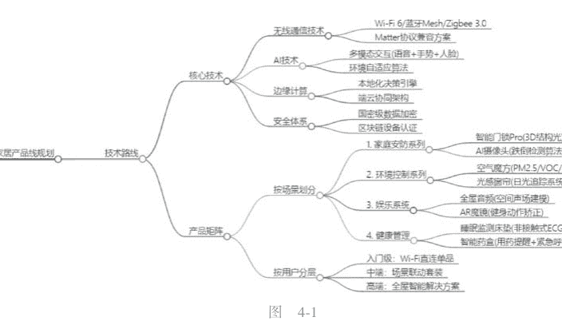

图 4-1

> 提示词建议：在设计提示词时，说明需要使用的工具和表现形式，能够大幅提升思维导图的生成效率。

#### 4.1.9 表格制作：全方位的自动流水线

表格是信息结构化呈现的核心载体，DeepSeek 通过智能语义解析、动态数据填充与多维度分析功能，帮助用户快速构建从基础数据记录到复杂分析模型的全场景表格。

> 创建新员工入职培训进度跟踪表，需要包含考核项目、责任人、截止日期和状态标记。

以下是新员工入职培训进度跟踪表的 Excel/Google Sheets 模板设计，包含自动状态标记与数据验证功能。
以下是一个专业的新员工入职培训进度跟踪表模板（Excel/WPS 可套用），包含您要求的关键要素，并增加实用功能：

# 新员工入职培训进度跟踪表

| 序号 | 考核项目 | 子项目 | 责任部门/责任人 | 计划截止日期 | 实际完成日期 | 状态标记 | 备注 |
| :--- | :--- | :--- | :--- | :--- | :--- | :--- | :--- |
| 1 | 入职准备 | 入职材料签收确认 | 人事部 | 2023-09-01 | 2023-09-01 | ✅ | |
| 2 | | 办公设备发放 | IT 部 | 2023-09-01 | | □ | 电脑采购延迟 |
| 3 | 制度与文化培训 | 公司制度手册学习 | 人事部 | 2023-09-05 | □ | | |
| 4 | | 企业文化价值观培训 | 总经理办公室 | 2023-09-07 | | ○ | |
| 5 | 岗位技能培训 | 部门业务流程培训 | 直属主管 | 2023-09-10 | | ○ | |
| 6 | | ERP 系统操作考核 | 信息部 | 2023-09-12 | | ○ | |
| 7 | 安全合规培训 | 信息安全考试（80 分以上） | 安全合规部 | 2023-09-15 | | ○ | |
| 8 | 培训结果归档 | 所有材料签字归档 | 档案管理员 | 2023-09-18 | | ○ | |

状态标记说明：
✅ 已完成
□ 进行中（未超期）
□ 已延期
○ 未开始

- 使用说明：
  - 按部门筛选时可使用「责任部门/责任人」列进行筛选
  - 每月 5 号前由 HR 更新状态并发送给部门负责人
  - 红色状态需在备注栏填写原因及补救计划
  - 注：此表适用于批量新员工管理时，可增加「员工姓名」「入职日期」列进行多维度管理

> 提示词建议：设计提示词时，将需求模块化（主项目→子项目），从而在提问时实现结构化，并向 DeepSeek 提供数据，以制作更准确的表格。

### 4.2 招聘助手

通过下面介绍的 3 个要素设计提示词，可显著提升招聘场景下 DeepSeek 的回答精准度。

#### 1. 结构化提示词关键要素

##### (1) 明确招聘背景
1) 核心作用：定位人才需求与企业特性。
2) 需要包含：
- 公司行业与规模（如“跨境电商初创企业，团队有50人”）。
- 招聘阶段（如紧急补缺、人才储备或高管猎聘）。
- 团队现状（如“现有3名Java开发人员，需要补全栈开发者”）。
3) 示例对比：
> ❌ “招聘一名产品经理。”
> ✅ “我们是一家A轮医疗SaaS公司，需要招聘1名B端产品经理，他需要熟悉FDA认证流程，以便补齐现有团队在医院资源方面的短板。”

##### (2) 精准定义任务
1) 核心作用：明确招聘动作类型与交付标准。
2) 需要包含：
- 需求类型（职位描述撰写、简历筛选和面试问题设计）。
- 交付形式（对比表格、评分模板和话术清单）。
- 特殊要求（薪资区间、到岗时间和软性素质）。
3) 示例对比：
> ❌ “筛选些简历。”
> ✅ “请从58份Java工程师简历中，根据以下条件：
- 有高并发系统开发经验；
- 主导过日活百万级项目；
- 跳槽频率小于等于2次/5年。
筛选出Top5候选人并给出他们的对比表，其中含技术栈匹配度评分。”

##### (3) 补充关键细节
1) 核心作用：提供人才画像与决策依据。
2) 需要包含：
- 硬性指标（证书要求、语言能力和工具熟练度）。
- 软性特质（抗压能力、创新意识和文化适配度）。
- 隐性需求（如“优先考虑有新能源行业资源者”）。

#### 2. 高频场景应用模板

场景 1：职位描述优化
“背景：智能硬件公司招聘结构工程师，现有职位描述过于技术化；
任务：重写招聘启事，增强对跨领域人才的吸引力；
补充：需要突出 AIoT 技术应用场景，增加弹性工作制、专属奖励等福利说明，字数控制在 500 字内。”

场景 2：简历初筛
“背景：收到 120 份新媒体运营简历，需要在 24 小时内完成初筛。
任务：制定如下 3 级过滤标准。
- 硬性条件：2 年以上美妆行业从业经验，有‘爆文’案例。
- 加分项：熟悉 TikTok 运营，英语可作为工作语言。
- 淘汰项：简历存在明显数据矛盾。
输出带红、黄、绿色标记的 Excel 筛选表。”

场景 3：薪酬谈判
“背景：拟录用候选人的期望薪资超出预算 15%。
任务：设计如下分阶段谈判方案。
- 首轮沟通话术（强调长期激励）。
- 备选方案（增加远程办公天数）。
- 破局策略（试用期后评审调薪）。
需要包含竞争对手企业薪资区间数据作为参考。”

#### 3. 进阶技巧

（1）多维度评估指令
示例：“请按以下维度评估这份架构师简历。
- 技术匹配度（权重为 40%）；
- 项目复杂度（权重为 30%）；
- 团队管理经验（权重为 20%）；
- 行业资源（权重为 10%）。
输出百分制评分表，并标注存疑待核实点。”

（2）合规性检查
示例：“检查这个职位描述是否存在违反《劳动法》的风险。
- 排查年龄、性别等歧视性表述；
- 确认‘自愿加班’等条款的合法性；
- 验证竞业限制条款的有效性。
输出修订建议并标注法条依据。”

（3）个性化沟通模板
示例：“生成发给未录用候选人的拒信模板。
- 针对技术笔试未通过者：突出‘感谢参与+学习资源推荐’内容；
- 针对文化匹配度不足者：强调公司特性+未来机会；
- 针对资历过高者：保留人才库邀请机会。
每类模板的字数均控制在 200 字以内，内容保持专业性且语气温和。”

#### 4.2.1 招聘管家：智能且高效的招聘引擎

招聘信息是人才吸引的第一触点，需要符合岗位需求、企业调性，并且要合法合规。DeepSeek 通过智能语义解析、竞争力分析与多元化表达优化，帮助用户快速生成从基础岗位到高端职位的全维度招聘信息。

> 生成 AI 算法工程师招聘信息，需要突出大模型微调与分布式训练能力。

以下是为 AI 算法工程师岗位设计的专业招聘信息，突出大模型核心能力要求，符合技术团队高阶人才招募需求：

■ 职位名称：大模型算法高级工程师
■ 工作地点：北京/上海/深圳（可选远程办公）
■ 薪资范围：50~80K·15薪
■ 职位类型：全职
■ 发布时间：2024 08 15

公司简介
我们是一家专注 AGI 技术研发的科技企业，拥有自研千卡 GPU 集群与行业最大中文多模态数据集。团队核心成员来自 Google Brain、FAIR 实验室，2023 年获 ICLR 最佳论文奖，正在构建下一代企业级大模型基础设施。

岗位职责
主导百亿参数级大模型微调全流程，包括：
- 基于 LLaMA/GPT 架构的领域适配（LoRA/QLoRA 技术）
- 人类偏好对齐（DPO/RLHF 优化策略）
- 多模态模型指令微调（BLIP 2/Flamingo 框架）

设计分布式训练方案，实现：
- 千卡集群效率优化（TFLOPS≥55%）
- 混合并行策略（Tensor/Pipeline/Data Parallelism）
- 显存优化（ZeRO 3/梯度检查点技术）

构建大模型评估体系，开发：
- 领域特异性评估基准（如法律/医疗垂直场景）
- 训练过程实时监控系统（损失曲面可视化）

# 任职要求

……

# 技术环境

……

# 计算资源

……

# 薪酬福利

……

# 申请方式

请发送至 career@company.com，邮件标题格式：
[大模型应聘] 姓名 毕业院校 当前公司

需附材料：
1. 技术博客/GitHub 主页
2. 最能体现大模型能力的项目报告
3. 分布式训练任务日志（含收敛曲线）

该职位描述精准定位大模型工程化人才，通过技术细节描述过滤基础岗位候选人，适合猎头定向挖角或技术社区精准投放。

> 提示词建议：设计提示词时可以提供真实数据，将指标明确为各项数据，从而建立更符合要求的筛选门槛，并将需求拆解（职责 要求 环境）来生成回答。同时也可以要求 DeepSeek 结合公司状况，进行福利设计来吸引更合适的人才。

#### 4.2.2 面试问题生成：智能问题矩阵

面试问题是人才评估的核心工具，需要兼顾岗位胜任力、文化匹配度与法律合规性。DeepSeek 通过智能胜任力建模、追问链设计与实时反馈功能，帮助用户构建从基础筛选到高管评估的全场景问题库。

设计产品经理行为面试题库，需要包含需求冲突处理与跨部门协作场景。

# 产品经理行为面试题库设计
（聚焦需求冲突处理与跨部门协作能力）

# 一、需求冲突处理类问题

# 1. 多利益方诉求冲突

问题：当用户调研反馈的紧急需求与公司商业目标存在根本性矛盾时，你如何决策？请举例说明具体处理过程。

考察点：
- 需求价值评估框架（KANO 模型/RICE 评分等）
- 向上管理能力（如何说服管理层）
- 用户期望管理技巧

# 2. 资源争夺场景

问题：在开发资源极度紧张时，你同时面临销售部门签单需要的定制化需求与技术团队架构优化需求，如何制定优先级？

追问点：
- ROI 量化分析能力（短期收益 vs 长期价值）
- 谈判策略（利益交换/分期交付）
- 风险预判与备案机制

# 3. 战略级冲突

问题：若 CEO 坚持推进某个你认为会损害核心用户体验的功能，你会如何应对？

行为锚定：
- 优秀回答：提供数据验证+替代方案+小范围 A/B 测试建议
- 不足回答：直接执行指令或公开反对决策

# 二、跨部门协作类问题

......

# 三、复合型场景问题

......

# 四、评估体系设计

......

五、追问技巧
......
该题库可有效识别能平衡“用户价值 商业目标 技术可行性”铁三角的成熟产品人才。

> 提示词建议：设计提示词时通过场景拆解覆盖面试中的各种冲突类型，结合理论框架形成人才检验体系。也可以通过面试行为与回答设计建立评估标注，更快分析面试人选。

### 4.3 教师助手

通过下面介绍的 3 个要素设计提示词，可显著提升教学场景下 DeepSeek 的回答精准度。

1. **结构化提示词关键要素**
(1) 明确教学背景
1) **核心作用：** 锁定教学场景与对象特征。
2) **需要包含：**
- 教学阶段（幼儿园、小学、中学、大学）；
- 学科领域（语文、STEM、艺术等）；
- 特殊需求（新课标要求、分层教学、融合教育）。
3) **示例对比：**
❌ “设计一堂作文课。”
✅ “目前我所带班级学生的议论文平均得分低于年级水平，请针对初中二年级语文教学，设计一堂关于如何写好议论文论点的课（45分钟），并在课中融入辩论活动以帮助学生提升思辨能力。”
(2) 精准定义任务
1) **核心作用：** 明确教学动作与产出标准。
2) **需要包含：**
- 任务类型（教案设计、学情分析、课堂活动、评估方案）；
- 输出形式（思维导图、评分量表、互动脚本）；
- 质量要求（跨学科融合、差异化分层、教具适配）。
3) **示例对比：**
❌ “出份练习题。”
✅ “为五年级数学中的分数加减法单元设计：
- 基础题 10 道（分母≤10）；
- 拓展题 5 道（含生活应用题）；
- 挑战题 3 道（需要图形辅助解题）。
按布鲁姆教育目标分类法标注题目认知层级。”

（3）补充关键细节
1）核心作用：提供教学决策依据。
2）需要包含：
- 学生特征（学习风格、常见错误、兴趣点）；
- 资源限制（教具类型、课时、技术设备）；
- 政策要求（核心素养指标、安全教育渗透）。
3）示例对比：

❌ “做个课件 PPT。”

✅ “制作高中生物中关于基因编辑技术的课件：
- 需要包含 CRISPR 原理动态演示；
- 设计伦理辩论环节；
- 添加与疫苗研发关联的案例；
- 文件需要兼容希沃白板 5，大小控制在 20MB 以内。”

#### 2. 高频场景应用模板

场景 1：差异化教学设计
“背景：四年级数学班，学困生占 30%，优生已掌握课内知识。
任务：设计关于平行四边形面积的分层教学方案。
补充：
- 基础组：提供剪纸拼图教具操作指南；
- 进阶组：增加梯形面积推导挑战任务；
- 需要包含课堂巡视路线与针对性指导话术。”

场景 2：跨学科项目设计
“背景：七年级综合实践课，需要设计为期 4 课时的团队合作项目。
任务：创建‘校园雨水回收系统’主题课程。
补充：
- 整合物理（压强计算）+地理（降水数据）+美术（装置设计）；
- 产出物包含工程设计图、成本预算表、成果汇报评价量规；
- 需要使用低成本材料（预算≤200 元/组）。”

场景 3：课堂管理优化
“背景：小学三年级英语课堂，存在后排学生注意力分散问题。
任务：设计 15 分钟高频互动教学模块。
补充：
- 每 3 分钟切换一次活动类型（TPR、小组竞赛、角色扮演）；
- 包含 5 种非语言提醒策略（手势、道具、位置移动）；
- 输出带时间节点的教学流程图。”

#### 3. 进阶技巧

（1）学习数据分析指令

示例：“分析 50 篇月考作文。
- 统计高频语法错误类型及分布；
- 提取优秀范文的修辞手法使用规律；
- 对比男女生在叙事结构上的偏好差异；
- 输出可视化报告，并提出针对性教学建议。”

（2）个性化学习路径设计

示例：“为初三物理力学学习薄弱生制定为期 2 周的提升计划。
- 诊断阶段：5 道关键概念检测题；
- 学习资源：3 个微课视频（含 AR 实验演示）；
- 练习方案：错题变式训练+思维可视化模板；
- 激励体系：成就徽章获取规则。”

（3）教学评一体化设计

示例：“设计‘古诗鉴赏’单元的形成性评估方案。
- 课前诊断：用概念图填空方式检测背景知识；
- 课中观察：小组讨论贡献度记录表；
- 课后反馈：创作仿写+自评量规。
需要符合新课标学业质量标准的三要求。”

#### 4.3.1 课程架构师：目标拆解与课程优化

DeepSeek 能通过 AI 能力重构传统备课流程，支持教师快速完成教学目标拆解、知识点串联、互动环节设计等核心任务，并能根据学情数据动态优化课程结构。

> 请为小学六年级的学生设计人教版英语的课程大纲。

> 以下是为小学六年级学生设计的人教版英语课程大纲，结合新课标核心素养（语言能力、文化意识、思维品质、学习能力）和“双减”政策要求，注重趣味性、实用性与知识体系的衔接。

# 人教版六年级英语课程大纲

适用对象：小学六年级（12 或 13 岁）

课程目标：
1. 掌握约 700 个核心词汇与 60+功能句型
2. 能进行 8~10 句的连续情景对话
3. 完成 150 词左右的主题写作
4. 理解简单英语文化现象并完成跨学科项目

课程框架

......

创新教学策略

......

三维评价体系

......

特色拓展计划

......

教学资源包

......

进度安排建议

每周 4 课时（40 分钟/课时）
- 课时 1：沉浸式词汇输入（歌曲/实物教学）
- 课时 2：语法游戏工坊（闯关式练习）
- 课时 3：主题探究工作坊（项目制学习）
- 课时 4：跨文化剧场（角色扮演/戏剧创作）

本大纲通过 PBL（项目式学习）、CLIL（内容与语言整合教学）等先进理念，帮助学生在真实情境中发展语言能力，实现从“学英语”到“用英语学”的转变，为初中英语学习搭建稳固桥梁。

> 提示词建议：设计提示词时可以要求 DeepSeek 结合教育政策，以确保最后生成的课程大纲既合规，又能符合学生学情。

#### 4.3.2 学情解码器：多维度评估与实时反馈

通过使用 DeepSeek，能够实现作业的智能化批阅与学情诊断。它不仅支持客观题自动评分，还能对主观题提供批注建议、错因分析和个性化反馈，帮助教师从重复性劳动中解放出来，以聚焦教学策略优化。

请作为阅卷老师对下面的中文作文进行批改，您需要明确指出段落结构、修辞手法等可优化点并对应给出优化建议。您需要批改的作文内容为：我最喜欢的动物是猫。猫有很强的狩猎本能。即使在家里，它也会经常玩狩猎游戏，追逐任何可以移动的东西。看到猫追逐老鼠或者玩具时，我觉得它非常有趣。猫也非常善于自我保护。当它感到害怕时，会立即找到一个安全的地方藏起来。即使是在陌生的环境中，它也可以很快适应，保护自己。总的来说，猫是非常有趣和机智的动物，是我最喜欢的动物之一。希望有一天我能拥有一只属于自己的猫，和它一起度过美好的时光。

以下是对该作文的批改与优化建议，本文将采用「批注式修改」与「升格示范」结合的方式呈现。

# 原文批改记录

# 第一段

【原文】我最喜欢的动物是猫。猫有很强的狩猎本能。即使在家里，它也会经常玩狩猎游戏，追逐任何可以移动的东西。看到猫追逐老鼠或者玩具时，我觉得它非常有趣。

✏️ 问题诊断：
1. 结构松散：连续三句以“猫”开头，句式重复
2. 细节缺失：对“狩猎本能”的描写停留在表面
3. 修辞单一：仅使用陈述句，缺乏画面感

# 第二段

【原文】猫也非常善于自我保护。当它感到害怕时，会立即找到一个安全的地方藏起来。即使是在陌生的环境中，它也可以很快适应，保护自己。

✏️ 问题诊断：
1. 逻辑断层：未衔接前段“狩猎本能”与“自我保护”的内在关联
2. 动作描写模糊：“藏起来”“适应”等动词缺乏动态细节
3. 论证薄弱：未通过具体事例佐证观点

# 第三段

【原文】总的来说，猫是非常有趣和机智的动物，是我最喜欢的动物之一。希望有一天我能拥有一只属于自己的猫，和它一起度过美好的时光。

🔍 问题诊断：
1. 主题升华不足：结尾停留在个人愿望层面
2. 情感表达直白：未建立与读者的情感共鸣
细节打磨重点
- 象征物选择：
“猫毛”“梅花爪痕”（以小见大）
- 身份转换：
将“养猫”转化为“被猫认可”（视角创新）

> 提示词建议：在设计提示词时，可以要求 DeepSeek 通过问题定位明确批改范围，并向 DeepSeek 提供具体的学生情况，以便生成更适合特定学生的批改建议，这样既能帮助老师提升批改效率，又能符合学生个人情况。

#### 4.3.3 精准教学引擎：差异化教案生成

DeepSeek 能基于课程设计框架与教学标准库，快速输出结构完整、要素齐全的标准化教案，同时支持个性化调整与多版本管理。

> 帮我撰写一份高中化学中关于化学反应速率的教案。

以下是一份详细的高中化学中关于化学反应速率的教案设计，结合新课标核心素养要求，注重探究与实践。
**“化学反应速率”教案设计**
课程时长：1 课时（45 分钟）
授课对象：高中一年级/二年级
一、教学目标
1. 核心素养目标
- 证据推理与模型认知：通过实验数据归纳反应速率规律，建立“碰撞理论”解释模型。
- 科学探究与创新意识：设计对比实验探究影响因素，培养控制变量法的应用能力。
- 科学态度与社会责任：联系生活与生产实例（如食品保存、工业合成），理解调控反应速率的意义。

2. 知识与技能
- 能写出化学反应速率的数学表达式，并进行简单计算。
- 掌握浓度、温度、催化剂、接触面积对反应速率的影响规律。

3. 过程与方法
通过分组实验观察现象→记录数据→总结规律→理论解释，形成科学探究思维。

二、教学重难点
- 重点：化学反应速率的定量表示及影响因素。
- 难点：用碰撞理论解释外界条件如何改变反应速率。

三、教学准备
1. 实验器材（分组实验，4人/组）：
……

2. 多媒体资源：
- 动画：分子碰撞模型（有效碰撞与无效碰撞）
- 视频：工业合成氨中催化剂的应用

四、教学过程
……

五、分层作业设计
……

此教案以学生探究为主线，融合实验观察、数据分析与理论建模，符合“做中学”的新课标理念，可根据实际教学条件灵活调整实验方案。

提示词建议：在设计提示词时，可以要求 DeepSeek 通过分析教案要点，结合优秀教案，形成符合不同教育阶段要求的完整课程教案。

#### 4.3.4 教育智能体：从方案设计到效果追踪

DeepSeek 能进行宏观教学规划，可帮助教师进行从学期计划到单元设计的系统性布局，以及整合课程目标、评估体系、资源分配与学情跟踪内容，从而实现教学管理的科学化与动态化。

> 生成高一数学必修三教学方案。

以下是一份针对高一数学必修三的模块化教学方案设计，以人教版教材为例，涵盖概率、统计、算法等内容，注重核心素养培养与实践应用。

# 高一数学必修三教学方案

课程模块：概率与统计、算法初步
总课时：约 12 课时（可根据实际调整）

# 一、单元教学目标

# 1. 核心素养目标

- **数据分析**：通过实例理解随机现象，掌握数据收集、整理与分析的方法。
- **数学建模**：构建概率模型（古典概型、几何概型）解决实际问题。
- **逻辑推理**：理解算法逻辑，培养程序化思维。

# 2. 知识与技能

- 掌握古典概型与几何概型的概率计算公式。
- 学会用样本估计总体（频率分布直方图、均值、方差）。
- 理解程序框图的三种基本结构（顺序、条件、循环）。

# 3. 情感与价值观

- 感受数学在生活中的应用（如抽奖公平性、大数据预测）。
- 培养用数学思维分析社会问题的意识。

# 二、教学重点与难点

重点：
- 古典概型概率计算。
- 频率分布直方图的绘制与分析。
- 条件语句与循环语句的算法设计。

难点：
- 几何概型的“测度”选择（长度、面积、体积）。
- 样本数据与总体估计的误差分析。
- 算法逻辑的抽象化表达（如循环终止条件）。

# 三、分课时教学设计示例（以“古典概型”为例）

......

# 四、单元评价设计

......

# 五、教学资源支持

......

## 六、教学反思建议

此方案以问题驱动和活动探究为主线，融合数学建模与数据分析，可帮助学生从具体情境抽象数学规律，建议根据学情适当增减难度。

**提示词建议：** 在设计提示词时可以先分析知识模块，让 DeepSeek 先构建课程框架，再通过分步提问法要求它生成更适合目前学生学情的教学方案。

### 4.4 法律服务

通过下面介绍的 3 个要素设计提示词，可显著提升法律场景下 DeepSeek 的回答精准度。

#### 1. 结构化提示词关键要素

（1）明确法律背景
1) 核心作用：定位案件性质与法律适用。
2) 需要包含：
- 案件类型（民事纠纷、刑事咨询、商事合同）；
- 涉及领域（劳动关系、知识产权、公司运营）；
- 主体角色（原告、被告、企业法务、个人咨询）。
3) 示例对比：
❌ “咨询劳动合同问题。”
✅ “我是上海某科技公司 HR，需要处理程序员离职纠纷；员工拒绝交接代码且主张 2N 赔偿，公司持有其违反保密协议的证据。”

（2）精准定义任务
1) 核心作用：明确法律服务类型与产出标准。
2) 需要包含：
- 需求类型（条款审查、风险评估、诉讼策略）；
- 交付形式（法律意见书、协议模板、证据清单）；
- 特殊要求（时效限制、格式规范、法条引用）。
3) 示例对比：
❌ “帮我看一下合同。”
✅ “审查跨境电商服务协议；识别违约责任条款中的不对等约定；评估跨境支付条款是否符合外汇管制新规；输出风险等级矩阵（高、中、低）并标注法律依据。”

（3）补充关键细节
1）核心作用：提供决策依据与约束条件。
2）需要包含：
- 关键时间节点（签约日、违约发生日）；
- 相关文件（已有协议、聊天记录、转账凭证）；
- 地域因素（境内、涉外、特定行政区）。
3）示例对比：
❌ “离婚财产怎么分？”
✅ “协议离婚财产分割咨询；双方在上海有2套共有房产（1套有贷款）；男方持有初创公司20%股权（估值存争议）；女方主张3年前转移的比特币资产属于共同财产。需要提供分割方案优先级列表及对应法律风险分析结果。”

#### 2. 高频场景应用模板

场景1：合同风险审查
“背景：拟与越南供应商签订原料采购协议。
任务：识别以下风险点。
- 不可抗力条款覆盖范围；
- 争议解决机制；
- 汇率波动责任分担。
补充：需要引用《联合国国际货物销售合同公约》条款，输出中英双语修订建议。”

场景2：侵权应对策略
“背景：电商产品图片被诉侵权，已收到律师函。
任务：制定3级应对方案。
- 立即下架可行性分析；
- 合理抗辩点梳理（原创证据、合理使用）；
- 和解谈判话术设计。
- 差距分析（对照认证标准）；
- 紧急补漏措施（3个月内完成）；
- 长期监控机制。
补充：公司涉及用户生物特征数据存储，需要符合《个人信息保护法》第三十八条规定。”

#### 3. 进阶技巧

（1）法律条文对比分析
> 示例：“对比《民法典》第五百八十四条与已废止《合同法》第一百一十三条。
- 可预见性规则适用变化；
- 损失计算方式差异；
- 司法实践中的新举证要点。
输出对比表格并附上近3年典型案例。”

（2）风险评估建模
> 示例：“为私募股权对赌协议创建风险评估模型。
- 财务指标类条款风险系数（权重为40%）；
- 公司控制权变更条款（权重为30%）；
- 法律合规性（权重为30%）。
输出带评分说明的检查清单。”

（3）跨法域合规指令
> 示例：“分析海外直播带货的法律风险。
- 美国FTC关于广告披露的规则；
- 欧盟GDPR中的数据收集要求；
- 东南亚各国税务申报差异。
输出合规操作手册（含各国红线条款）。”

#### 4.4.1 法典罗盘：多维度关联与时效追踪

DeepSeek能通过自然语言处理与法律知识图谱技术，实现精准、高效的法律信息定位。它支持跨层级（法律、法规、司法解释）、跨地域（全国性、地方性）、跨时效（现行、废止）的多维度检索，帮助用户快速获取权威法律依据。

> 对比《电子商务法》与《消费者权益保护法》关于退货条款的规定。

以下是《中华人民共和国电子商务法》与《中华人民共和国消费者权益保护法》关于退货条款的核心规定对比，结合具体法律条文和实践应用分析：

### 一、适用范围对比

| 法律名称 | 《消费者权益保护法》（以下简称《消法》） | 《电子商务法》（以下简称《电商法》） |
| --- | --- | --- |
| 适用场景 | 所有消费行为（线上线下均可） | 仅针对通过互联网等信息网络进行的商品/服务交易 |
| 侧重方向 | 全面保护消费者权益 | 规范电子商务行为，补充线上交易的特殊规则 |

### 二、退货条件与时间限制

#### 1. 无理由退货（核心条款）

| 内容 | 《消法》第二十五条 | 《电商法》第二十条、第五十二条 |
| --- | --- | --- |
| 退货权利 | 消费者有权自收到商品之日起 7 日内无理由退货（不用说明理由） | 确认并细化线上交易的退货规则，要求电商经营者 不得设置不合理条件（如收取高额运费） |
| 适用商品 | 不适用：定制商品、鲜活易腐品数字化商品（在线下载或拆封的），如报纸、期刊 | 与《消法》一致，但强调“根据商品性质不宜退货”需经消费者确认（如购买页面明示不可退）。 |
| 商品状态要求 | 商品应当完好（不影响二次销售） | 进一步明确“商品完好”标准，如包装完整、未激活使用、标签未拆除 |
| 退货费用 | 消费者承担退回运费（经营者另有承诺除外） | 强调“经营者不得以退货为由收取不合理费用”（如隐形扣款） |

#### 2. 有理由退货（商品质量问题）

| 内容 | 《消法》第二十四条 | 《电商法》第五十二条 |
| --- | --- | --- |
| 退货条件 | 商品不符合质量要求，消费者可 7 日内退货；超过 7 日但符合法定解除合同条件的可要求退货 | 与《消法》一致，但要求电商平台 建立便捷的投诉举报机制，并协助消费者维权 |
| 时间限制 | 无质量问题情况下适用 7 日无理由退货；质量问题可依法要求退货、换货或修理，无严格时间限制 | 强调电商经营者需 明示退货方式、程序，不得拖延处理（通常要求 15 日内完成退款） |

### 三、特殊规则对比

......

### 四、实践案例说明

......

### 五、总结异同

......

### 六、维权建议

......

通过对比可见，《电商法》在《消法》基础上，针对电子商务特性细化了退货规则，强化了平台责任，为线上消费者提供了更具体的保障。两者共同构建了从线下到线上的消费者权益保护体系。

**提示词建议：** 在设计提示词时，可以要求 DeepSeek 结合法律场景明确对比范围，并要求结合实际案例生成通俗易懂的对比表格。

#### 4.4.2 文书撰写：智能合规与风险预埋

在法律服务场景中，撰写专业、规范的法律文书是高频需求。DeepSeek 通过智能分析用户需求、整合法律条文与实务经验，能够快速生成符合法律规范的文书初稿，帮助用户显著提升工作效率。

> 请帮我起草一份房屋租赁合同，需要包含租金支付方式、违约责任条款。

以下是一份标准房屋租赁合同模板，包含租金支付方式、违约责任等核心条款，符合《民法典》相关规定，可根据实际情况调整：

**房屋租赁合同**
甲方（出租人）：
姓名/名称：____________________
身份证号/统一社会信用代码：____________________
联系地址：____________________
联系电话：____________________
乙方（承租人）：
姓名：____________________
身份证号：____________________
联系地址：____________________
联系电话：____________________

### 第一条 租赁房屋信息

1. 房屋地址：________省________市________区（县）________路________号________室。
2. 房屋面积：________平方米，户型：________室________厅________卫。
3. 房屋用途：乙方承诺仅用于居住/办公（不得擅自改变用途）。

### 第二条 租赁期限

1. 租赁期自________年________月________日起，至________年________月________日止，共计________个月。
2. 租赁期满后，若乙方需续租，应提前 30 日书面通知甲方，双方协商一致后重新签订合同。

### 第三条 租金及支付方式

……

### 第四条 费用承担

……

### 第五条 房屋使用与维护

……

### 第六条 违约责任

……

### 第七条 合同解除与终止

……

### 第八条 争议解决

……

### 第九条 其他约定

……

> 提示词建议：在设计提示词时，可以要求 DeepSeek 结合真实案例和法律条款确保文书更符合用户要求，并要求 DeepSeek 在生成后分析可能存在的法律风险，避免文书中存在错误。

#### 4.4.3 合同审查：实时风险标定与条款优化

合同审查是法律服务的核心场景之一，涉及风险防控、条款合规性校验等多重目标。DeepSeek 通过智能语义分析、法律条文匹配及风险点识别功能，可辅助用户快速定位合同漏洞，并提供优化建议。

> 请审查以下劳动合同条款，重点检查试用期约定、社保缴纳和竞业限制条款：
- 试用期 6 个月，工资为正式薪资的 70%；
- 乙方需要遵守竞业限制要求，离职后 2 年内不得从事同类行业工作；
- 公司按最低基数缴纳社保。

以下是根据《劳动合同法》《社会保险法》等法律法规为您提供的劳动合同条款的合法性审查及修改建议：

### 一、试用期条款审查

原条款
“试用期 6 个月，工资为正式薪资的 70%。”

### 法律分析

#### 1. 试用期时长合法性

根据《劳动合同法》第十九条，试用期长度与劳动合同期限挂钩：
- 合同期≥3 年：试用期≤6 个月（合法）；
- 合同期 1 年以上不满 3 年：试用期≤2 个月；
- 合同期<1 年：试用期≤1 个月。

需核实劳动合同期限是否符合“3 年以上”条件，否则试用期 6 个月违法。

#### 2. 试用期工资合法性

《劳动合同法》第二十条规定，试用期工资不得低于以下两者：
- 正式工资的 80%；
- 用人单位所在地最低工资标准。

“70%”的约定低于法定标准，属于无效条款。

### 修改建议

“试用期为 6 个月（劳动合同期限为 3 年以上），试用期工资为正式薪资的 80%（且不低于xx市最低工资标准）。”

### 二、竞业限制条款审查

原条款
“乙方需要遵守竞业限制要求，离职后 2 年内不得从事同类行业工作。”

### 法律分析

1. 竞业限制适用对象
- 根据《劳动合同法》第二十四条，竞业限制仅适用于 **高级管理人员、高级技术人员和其他负有保密义务的人员**。
- 普通员工不用承担竞业限制义务，若乙方不属于上述人员，该条款无效。

2. 经济补偿义务
- 竞业限制期限内，用人单位需按月支付经济补偿，标准为 **离职前 12 个月平均工资的 30% 以上**（地方有更高标准的按地方规定，如北京要求≥50%）。
- 原条款未约定补偿金，违反法律强制性规定，可能导致条款无效。

3. 竞业限制期限
法律规定最长不超过 2 年，期限合法。

### 修改建议

1. 明确乙方属于“高级管理人员/高级技术人员/负有保密义务人员”（需具体描述岗位职责）。
2. 补充条款：“甲方在竞业限制期内按月向乙方支付经济补偿，金额为乙方离职前 12 个月平均工资的 30%（或××元），支付方式为银行转账。”
3. 明确竞业限制的行业范围、地域范围（如“不得在××省内从事××行业”），避免过度限制。

### 三、社保缴纳条款审查

......

### 四、综合风险提示

......

### 五、建议修改后的完整条款示例

......

> 提示：若用人单位拒绝修改违法条款，劳动者可向当地劳动监察大队投诉或申请劳动仲裁，维护自身权益。建议签署前咨询专业律师。

**提示词建议：** 在设计提示词时，可以要求 DeepSeek 分析法律条文以确保审查合同的合规性，并将合同中的各项条款进行模块化拆解，以提升审查的针对性，让它构建专业高效的合同审查框架。

# 第5章 DeepSeek实用指南——学习成长

在知识更迭迅速、信息爆炸的时代，我们对高效学习和自我成长的关注愈发强烈。DeepSeek 的出现，就像在知识海洋里为我们点亮了一座灯塔。它融合前沿技术，打破知识获取的壁垒，成为人们学习成长的得力伙伴。无论是学生面对复杂学科知识的探索，还是普通人出于兴趣拓展知识边界，DeepSeek 都能以独特方式提供支持，助力人们在成长之路上不断向前迈进。

### 5.1 作业帮手

在与 DeepSeek 对话时，结构化提示词能帮助它快速定位问题核心，提供符合学生需求的解题思路、知识点解析或作业优化建议。

#### 1. 结构化提示词的关键要素

（1）明确提问背景
* 说明学生身份与作业类型：年级、学科、作业形式（如数学应用题、语文阅读理解、实验报告等）。
* 示例：“我是一名五年级学生，正在做分数加减法的数学作业，遇到了一个应用题不会解。”

（2）清晰陈述任务
* 具体说明需求：是需要解题步骤、知识点讲解、错误分析，还是作业优化建议？
* 示例：“请帮我分析这道应用题的解题思路，并解释如何列式计算。”

（3）提供详细信息
* 输入完整题目内容：直接提供题目文本或描述问题场景。
* 补充关键信息：如已尝试的方法、卡壳的步骤、易错点或特殊要求。
* 示例：“题目：一桶油有 5/6 升，用掉了 1/3 升后，还剩多少？我尝试用 5/6 减 1/3，但分母不同不知道怎么算，请分步骤教我通分的方法。”

#### 2. 高效提问模板

（1）公式
背景（年级、学科、作业类型）+任务（需求）+详细信息（题目、卡点、特殊要求）。

（2）应用案例
“我是一名初二学生，正在写物理电路作业，需要画等效电路图（背景）。
请解释如何简化这个并联和串联混合的电路（任务）。
题目描述：电源电压为 12V，R1（等于 4Ω）先与 R2 并联，再与 R3（等于 6Ω）串联，求总电流（详细信息）。”

#### 3. 避免低效提问

（1）模糊提问
❌ “这道题怎么做？”
✅ “这道小学奥数题（鸡兔同笼）的假设法解题步骤是什么？题目：头 10 个，脚 28 只。”

（2）遗漏关键信息
❌ “英语作文怎么改？”
✅ “我写了一篇初三英语议论文（主题：环保），请检查语法错误，并优化结尾段的逻辑结构。”

（3）附加技巧
* 若需要举一反三，则可要求 DeepSeek 生成同类练习题；
* 对于复杂问题，可追加提问：“能否用更简单的语言重新解释第二步”；
* 提问时使用语气词可生成更简洁直白的回答。

#### 5.1.1 知识问答：智能学习伙伴

在学习的旅程中，困难与迷惑总是接踵而至。DeepSeek 就像一位随时待命的智慧导师，精准、迅速地解答各类疑惑，助力知识积累与思维拓展。
DeepSeek 在生成调研报告方面能够提供全流程支持，帮助用户高效完成从数据收集到结论输出的专业报告。
例如，我们能向 DeepSeek 请教某位历史人物。

> 谢道韫是谁？请介绍一下她的生平事迹。

谢道韫（约 344 年—约 415 年），东晋著名才女，出身陈郡谢氏（魏晋南北朝顶级门阀士族“琅琊王氏、陈郡谢氏”中的谢氏），是政治家谢安的侄女、名将谢玄的姐姐。她以才华横溢和传奇经历闻名，被后世誉为“咏絮之才”“林下之风”，是中国古代才女的代表人物之一。

### 一、生平核心事迹

#### 1. “咏絮之才”典故

背景：谢道韫幼年时，谢安曾召集子侄辈以“大雪纷飞”为题作诗比喻。

经典对答：
谢安侄子谢朗（胡儿）先答：“撒盐空中差可拟”（像空中撒盐）。
谢道韫接道：“未若柳絮因风起”（不如比作柳絮随风飘舞）。
评价：谢安大为赞赏，认为谢道韫的比喻更具诗意和想象力。这一典故被载入《世说新语·言语》，成为后世形容女子文才的经典典故。

#### 2. 婚姻与家族

显赫联姻：谢道韫嫁入另一顶级门阀琅琊王氏，丈夫是书法家王羲之次子王凝之。王谢联姻是当时最显赫的士族结合，被唐代刘禹锡以“旧时王谢堂前燕”写入诗中。

婚姻评价：谢道韫对丈夫王凝之的评价并不高。据《晋书》记载，她曾向叔父谢安抱怨：“不意天壤之中，乃有王郎！”（想不到天地间竟有王凝之这样的人！），暗指丈夫才德平庸。

#### 3. 晚年抗敌的悲壮事迹

孙恩之乱：东晋隆安三年（399年），五斗米道首领孙恩起兵反晋，时任会稽太守的王凝之因笃信道教，未作军事防备，导致城破被杀。

谢道韫的抗争：
她亲自持刀率家丁抵抗叛军，手刃数人。
被俘后，孙恩欲杀其外孙刘涛，她凛然怒斥：“事在王门，何关他族！若必欲杀，宁先杀我！”孙恩为其气节所动，最终释放了她和孩童。

晚年隐居：乱后，谢道韫寡居于会稽，深居简出，以诗文自遣。

### 二、才华与成就

#### 文学造诣

谢道韫的诗文以清雅脱俗著称，但多已散佚，仅存《泰山吟》《拟嵇中散咏松》等少数作品。

《泰山吟》中“峨峨东岳高，秀极冲青天”等句气象宏大，被赞有“男子气概”。

#### 玄学思辨

她精通玄学（魏晋时期流行的哲学思潮），曾与当时名士辩论。据《晋书》记载，她在王家清谈集会中力压群儒，折服众人。

#### 教育影响

晚年开设私塾，教授学子，传播文化，打破当时“女子不授业”的惯例。

### 三、历史评价

#### “林下之风”

南朝《世说新语》作者刘义庆评价她“神情散朗，故有林下风气”，赞其超逸脱俗的气质堪比竹林七贤（魏晋名士团体）。

#### 才女象征

后世常将谢道韫与班昭、蔡文姬、李清照等并列为中国古代才女代表。曹雪芹在《红楼梦》中借“金陵十二钗”判词“堪怜咏絮才”，以谢道韫暗喻林黛玉的才华。

### 四、相关争议与轶事

......

#### 作品真伪

......

DeepSeek 也能用于生物知识的询疑解惑。

> 请问细胞质和细胞壁有什么区别？

细胞质和细胞壁是细胞的两个不同组成部分，它们在结构、功能和组成上存在显著差异。以下为两者的主要区别：

1. 定义与位置
**细胞质（Cytoplasm）**
**位置**：位于细胞膜内，包裹在细胞核外的胶状物质。
**组成**：包含细胞质基质（水、离子、蛋白质等）和细胞器（如线粒体、内质网、高尔基体等）。
**特点**：是细胞代谢活动的主要场所。

## 细胞壁（Cell Wall）

位置：存在于植物细胞、真菌和细菌的细胞膜外（动物细胞无细胞壁）。

组成：植物细胞壁主要成分为纤维素和果胶；细菌细胞壁含肽聚糖；真菌细胞壁含几丁质。

特点：提供机械支持和保护，维持细胞形态。

## 2. 功能差异

### 细胞质的功能

参与物质合成、分解及能量转换（如线粒体的呼吸作用、核糖体的蛋白质合成）。

维持细胞器的空间分布和物质运输。

为细胞代谢提供反应环境。

### 细胞壁的功能

保护细胞免受机械损伤或渗透压破坏。

维持细胞形态，防止过度吸水膨胀（如植物细胞）。

参与物质运输和细胞间信号传递（通过胞间连丝）。

## 3. 存在范围

细胞质：所有真核细胞和原核细胞均含有细胞质。

细胞壁：仅存在于植物、真菌、细菌和某些原生生物中（动物细胞无细胞壁）。

## 4. 结构特性

......

> 提示词建议：在知识问答场景中，提问的清晰度和背景信息的完整性直接影响回答质量。通过结构化提问明确需求边界，可减少模糊性，提升回答的专业性与实用性。界定问题领域与范围，避免答案过于宽泛。明确回答的侧重点（如定义、对比、实例等），避免答非所问。

#### 5.1.2 资料搜索：智能信息雷达


在信息爆炸的时代，知识获取既便捷又充满挑战。DeepSeek 凭借强大算法和海量数据，能快速筛选整合资料，帮你节省时间、拓宽视野，助你精准获取知识，开启高效学习与探索之旅。

> 我想写一篇关于长沙美食文化发展的论文，请帮我搜索一些资料。

关于长沙美食文化的论文资料整理如下，我将从历史渊源、特色食材、经典菜品、文化现象和现代发展五个维度为您提供研究线索和参考文献：

### 一、历史溯源文献

《长沙府志·物产篇》（清·吕肃高）记载了明清时期长沙“稻米盈仓，椒姜遍市”的物产特征。

马王堆汉墓出土的《遗策》竹简（湖南省博物馆藏）记录了214种汉代食材，证明长沙地区早在2000年前已形成成熟饮食体系。

李渔《闲情偶寄·饮馔部》（清）提到“楚人嗜椒，每食必佐以辛香”，印证湘菜重口味的传统。

### 二、核心食材数据库

长沙市统计局2022年数据显示：本地餐饮业年消耗辣椒达12.6万吨，人均日摄入量约50克。

国家地理标志产品：浏阳豆豉、宁乡花猪

《中国湘菜大典》记载：长沙地区独有的“樟树港辣椒”pH值达5.3，较普通辣椒高17%，形成独特鲜辣口感。

### 三、经典菜品谱系

……

### 四、文化现象研究

……

### 五、现代发展动态

……

### 总结

建议论文可从“地理环境塑造的味觉密码”切入，结合《黄帝内经·素问》中的“南方生热，热生火，火生苦”理论，探讨长沙美食如何通过“热、辣、鲜”的味觉体系形成地域性饮食适应机制。如需特定数据或文献原文，可提供具体方向，我将继续深入检索。

> 提示词建议：资料搜索场景需要兼顾信息覆盖范围与精准度，结构化提问能帮助DeepSeek快速锁定目标领域、过滤无关内容，并提供可信来源或数据整合建议，避免“大海捞针”式低效搜索。通过限定条件（时间、地域和来源类型），提升信息相关性。同时，要明确搜索类型（数据、文献、案例）及输出形式（列表、摘要、对比）。如果对回答还是不够满意，则可以使用分步提问法，让DeepSeek生成更满意的回答。

#### 5.1.3 难题解析：跨学科解题教练

DeepSeek 通过先进的深度学习技术和智能推理能力，能帮助用户解决学习过程中的各种难题。DeepSeek 能为复杂的学科知识提供精准、个性化的解析和指导，助力用户轻松攻克学习难关。

例如，DeepSeek 能协助解读晦涩的诗词。

> “东风不与周郎便，铜雀春深锁二乔”蕴含了怎样的历史典故？诗人借此表达何种情感？

这句出自唐代诗人杜牧的《赤壁》，借三国时期的赤壁之战典故，表达了诗人对历史偶然性的思考与个人命运的感慨。

1. 历史典故解析：
   **赤壁之战与周瑜的胜利**
   诗句中的“东风不与周郎便”指三国时期周瑜在赤壁之战中借助东风火攻曹操战船的历史事件。当时曹操大军压境，周瑜以火攻战术破敌，但火攻需要东南风助燃。据《三国志》记载，冬季本多西北风，但赤壁之战时恰逢东南风起，成为周瑜胜利的关键因素。
   **铜雀台与二乔的隐喻**
   “铜雀”指曹操在邺城（今河北临漳）修建的铜雀台，象征其权势与野心；“二乔”是东吴乔公的两个女儿，大乔嫁孙策，小乔嫁周瑜。曹操曾扬言要收二乔于铜雀台（见于《三国演义》的文学演绎，非正史记载）。杜牧假设若东风未至，周瑜战败，东吴灭亡，二乔便会被曹操掳走，锁入铜雀台。

2. 诗人表达的情感：
   **对历史偶然性的反思**
   杜牧通过“东风”这一偶然因素，强调历史进程的不可控性。周瑜的胜利看似英雄壮举，实则依赖天时相助。诗人借此质疑传统史观中对英雄的绝对推崇，暗示成功往往需要机遇与运气的配合。
   **怀才不遇的自我投射**
   杜牧身处晚唐，虽有政治抱负却屡遭排挤。诗中暗含对自身命运的感慨：若无机遇（如“东风”），即使有才能（如周瑜）也难以施展。他借周瑜的“侥幸成功”，反衬自己生不逢时的无奈。
   **咏史中的讽喻与超脱**
   ......

总结：
杜牧通过赤壁之战的假设性改写，揭示了历史与个人命运的脆弱性，既表达了对机遇重要性的洞察，也抒发了对自身际遇的感慨。诗句将宏大历史与个人命运交织，展现出深刻的哲理性与情感张力。

当小朋友遇到数学难题时，也能向 DeepSeek 求助。

> 从 1 到 9 的数字中，选出 3 个不同的数字组成一个三位数，要求这个三位数是偶数。可以组成多少个这样的三位数？

要确定从 1 到 9 的数字中可以组成多少个不同的三位偶数，我们需要考虑约束条件并系统地计算可能性。
**确定个位数的选择**：由于数字必须是偶数，个位数必须是 1 到 9 范围内的偶数之一。可能的偶数是 2、4、6 和 8。因此，个位数有 4 种选择。
**确定十位数的选择**：在选择了个位数之后，我们剩下 8 个数字（因为数字必须不同）。因此，十位数有 8 种选择。
**确定百位数的选择**：在选择了个位数和十位数之后，我们剩下 7 个数字。因此，百位数有 7 种选择。
现在，我们可以通过将每个数字的选择数量相乘来计算可以组成的三位偶数的总数：
4（个位数的选择）×8（十位数的选择）×7（百位数的选择）= 224
因此，可以组成的三位偶数的总数是 **224**。

➡️ **提示词建议**：难题解析场景需要兼顾问题拆解能力与逻辑引导性。若要 DeepSeek 快速定位知识盲区、理清解题路径，并提供分步引导而非直接答案，则用户要使用迭代式提问方式，这样也可有效培养用户独立解决问题能力。在生成回答后要求 DeepSeek 作自我检查，以便提升回答精准度。

#### 5.1.4 整理笔记：知识架构师

在学习中，整理笔记耗时费力，还容易遗漏重点。别担心，DeepSeek 可以帮忙！凭借强大的自然语言处理能力，它能快速梳理复杂信息，将零散内容结构化，助你高效整合知识；让笔记简洁清晰、重点突出，以便你轻松搭建知识体系。

首先，我们需要做以下基础准备。

1. **准备文档**：将学习内容整理成文档，字数控制在 500～1000 字，方便 DeepSeek 处理。
2. **输入指令**：能将文档直接上传至 DeepSeek 并输入需求；也可以先把文档内容复制到 DeepSeek 对话框中，再添加提示词，如“请帮我把这个学习笔记内容进行重新组织，要求用简单的语言解释复杂的概念，加入形象的类比和举例，突出重点知识”。

> （上传高中地理学习笔记.pdf 附件）请简化一下该笔记，方便学习与理解。

**一、地球圈层结构**
地球从外到内分地壳、地幔、地核。地壳最外，陆壳厚约 17 千米，海壳薄。地幔有上下之分，上地幔顶部软流层是岩浆源。地核分内外，外核液态、内核固态，密度大。靠地震波探圈层，横波过固体，纵波过固、液、气体都行。
**二、大气受热**
……
**三、常见天气系统**
冷锋：冷气团冲向暖气团，过境时大风、降温、降雨，过后气温降、气压升、天转晴，北方冬春沙暴与之有关。
暖锋：暖气团朝冷气团移，过境多连续性降水，过后气温升、气压降、天转晴，春雨常因它而生。
气旋：中心气压低，气流四周向中心逆时针（北半球）辐合，多阴雨，台风是强气旋。
反气旋：中心气压高，气流从中心以顺时针方向（北半球）向四周辐散，多晴朗，北方“秋高气爽”由此而来。
……

**提示词建议**：笔记整理场景需要兼顾信息结构化与知识关联性。通过结构化提示词明确核心目标，可帮助 DeepSeek 快速识别信息权重、优化知识框架，生成易于记忆与检索的内容体系。同时，需要指定笔记形式与核心功能。通过限定内容范围、标注重点及提出格式要求，可达到输出结构化的目的，从而提升笔记的实用性。

#### 5.1.5 复习提纲：智能记忆教练

学习之路漫漫，复习是巩固知识的关键环节。DeepSeek 凭借强大的智能分析能力，能精准梳理知识脉络，提炼重点，助你高效搭建复习提纲。不管是复杂的公式推导，还是抽象的概念理解，它都能化繁为简，让复习有的放矢，助你稳步提升成绩。

> 请为我总结《东晋门阀政治》这本书的复习提纲。

以下是《东晋门阀政治》的复习提纲，基于田余庆先生的经典研究整理而成，帮助您系统梳理核心内容：

### 一、东晋门阀政治的历史背景
西晋灭亡与衣冠南渡
永嘉之乱后中原士族南迁，形成“王与马，共天下”的格局。
皇权衰弱与门阀士族主导政权的开端。
门阀政治的形成条件
经济基础：庄园经济与士族对土地、人口的垄断。
政治制度：九品中正制固化士族特权。
文化垄断：经学传承与玄学清谈的士族文化优势。
### 二、核心门阀家族及其权力斗争
代表性家族
琅琊王氏：王导、王敦主导东晋初期政局，奠定“共天下”模式。
颍川庾氏：庾亮、庾冰通过外戚身份掌权，与王氏争衡。
谯国桓氏：桓温以军功崛起，试图篡位未果。
陈郡谢氏：谢安主导淝水之战，维系门阀平衡。
权力交替模式
家族间的联姻、结盟与倾轧。
皇权与士族的博弈：士族架空皇权，但需借皇权名义维持合法性。
### 三、门阀政治的特点
权力结构
“共治”而非“独裁”：士族联合执政，皇权象征化。
地方与中央的分权：士族控制荆州、扬州等军事重镇。

### 政治运作机制

清议与品评人物影响仕途。
玄学清谈作为政治身份符号。
门第优先于才能的选官标准。

### 四、门阀政治的衰落

……

### 五、东晋门阀政治的历史意义

……

### 六、复习思考题

……

我们可以进一步利用 DeepSeek 强化复习效率。

> 请设计一套相关的模拟考试试题。

以下是一套关于《东晋门阀政治》的模拟考试试题：

### 一、选择题（每题 4 分，共 20 分）

东晋政权得以建立，主要依靠的是以下哪个门阀家族的支持？( )
A. 谢氏 B. 王氏 C. 桓氏 D. 庾氏

“王与马，共天下”局面中，“王”指的是( )
A. 王导 B. 王敦 C. 王羲之 D. 王猛

东晋时期，淝水之战的指挥将领是( )
A. 谢安、谢玄 B. 桓温、桓冲
C. 王导、王敦 D. 刘裕、刘毅

东晋门阀政治形成的关键因素不包括以下哪项？( )
A. 西晋末年的八王之乱 B. 北方少数民族内迁
C. 江南地区经济发达 D. 皇权的极度强化

以下哪个事件标志着门阀政治走向衰落？( )
A. 桓温北伐 B. 刘裕代晋 C. 谢安去世 D. 王敦之乱

### 二、简答题（每题 10 分，共 30 分）

简述“王与马，共天下”这一政治格局形成的过程及原因。
分析东晋门阀政治下，寒门子弟的生存状况与晋升途径。
阐述淝水之战对东晋门阀政治格局产生的影响。

### 三、论述题（20 分）

试论述东晋门阀政治的特点及其对东晋社会、文化、军事等方面的影响，结合具体事例加以说明。

### 四、材料分析题（30 分）

……

总结：这套题目涵盖了《东晋门阀政治》的核心知识点，从基础知识考查到深入的分析论述，希望能满足你的需求，你可以根据实际情况进行调整。

提示词建议：复习提纲场景需要平衡知识覆盖广度与记忆效率，使用结构化提示词能让 DeepSeek 快速识别核心考点，从而优化记忆点分布，并生成适配不同复习阶段的可执行学习路径。通过补充知识薄弱点、时间限制、格式偏好等用户需求来提升复习提纲的实用性。

### 5.2 外语学习

与 DeepSeek 对话时，结构化提示词能精准定位语言学习需求，无论是语法解析、词汇拓展、发音纠正还是跨文化沟通，都能获得针对性指导。

#### 1. 结构化提示词的关键要素

(1) 明确提问背景

- 说明语言水平与学习目标：当前语言等级（如“德语 A2 水平”）、学习场景（备考、日常交流、学术写作等）。
- 示例：“我是一名日语 N3 水平的学习者，正在准备旅游对话练习，需要设计机场值机场景的实用表达。”

(2) 清晰陈述任务

- 具体说明需求类型：语法纠错、翻译优化、发音规则、文化差异解释、情景对话生成等。
- 示例：“请分析我写的英文邮件中的语法错误，并优化商务礼貌用语。”

(3) 提供详细信息

- 输入完整文本或问题：如需要修改的句子、容易混淆的语法点、目标表达场景等。
- 补充难点与限制条件：如“需用简单词汇”“避免专业术语”或“侧重美式发音”。
- 示例：“我想用法语表达‘虽然下雨了，但我们还是决定去公园散步’，但不确定‘虽然’的从句结构。我的尝试为‘Bien qu’il pleuvait, nous avons décidé d’aller nous promener au parc.’，请检查并解释连词选择规则。”

#### 2. 高效提问模板

(1) 公式
背景（语言、水平、场景）+任务（需求类型）+详细信息（文本、规则、错误示例）。

(2) 应用案例

1) 听力训练：“我考雅思听力时总抓不住数字考点（背景）。请生成10组包含电话号码、价格和日期的英语对话（任务），要求1.2倍语速，并附带答案解析（详细信息）。”

2) 语法解析：“西班牙语B1等级学习中分不清‘por’和‘para’的区别（背景）。请用中文对比两者用法，并设计3个易错填空题（任务）。例句：Viajé ________ Madrid ________ ver el museo.（详细信息）”

#### 3. 避免低效提问

(1) 需求模糊

❌ “怎么提高英语水平？”

✅ “如何通过影子跟读法提升英语新闻听力水平？虽然已通过CET-6考试，但常因英语连读而听不清内容细节。”

(2) 缺乏上下文

❌ “这个句子对吗？”

✅ “请检查德语A2水平作文中的介词搭配错误：‘Ich interessiere mich über Kunst.’，并解释‘sich interessieren für’的用法。”

(3) 附加技巧

- 情景化学习：要求生成“餐厅点餐”“面试自我介绍”等场景对话，并添加文化注释（如日本敬语使用禁忌）。
- 对比学习：提问“中文‘勉强’和日语‘無理（むり）’的语义差异”。
- 多模态指令：追加“用国际音标标注发音”或“列出近义词的情感色彩强弱”。
- 主动验证：对答案存疑时可追问“为什么不能使用‘could’代替‘was able to’表达过去特定场景的能力”。

#### 5.2.1 词汇学习：智能词库管家

词汇是外语学习的基石，背单词却常让人头疼。DeepSeek 能精准筛选词汇，按学习进度与需求定制单词表，还能将单词融入情景对话、趣味故事，加深记忆。它提供的近义词、反义词拓展，能让你举一反三，轻松攻克词汇难关，让词汇学习不再枯燥低效。

> 我一直记不住 “gloomy” 这个词，你能帮助我更好地理解它吗？

当然可以！我们可以通过以下几种有趣的方法帮助你记住 “gloomy”（阴沉的/忧郁的）：

1. 拆分联想记忆法
拆分：gloomy = gloo（想象成“咕噜”）+ my（我的）
联想：想象一个叫“咕噜”的小怪物（比如《魔戒》里的 Gollum）霸占了你的心情，让你的世界变得阴暗潮湿（gloomy）。
“咕噜（gloo）让我的（my）心情很 gloomy！”

2. 发音+场景记忆法
发音：读作/ˈɡluːmi/，类似中文“哥路迷”。
场景联想：想象一个迷路（路迷）的哥哥（哥）走在灰蒙蒙的森林里，周围雾气弥漫，他的心情非常阴郁（gloomy）。

3. 图像记忆法
画面：把字母“g”想象成耷拉的嘴角，“loomy”像“100米”。
“耷拉着嘴角（g）跑完 100 米（loomy），心情超 gloomy！”
（跑完长跑后精疲力尽，感觉世界都灰暗了）

4. 反义词对比法
反义词：bloom（开花/绽放）vs. gloomy（阴郁）
联想：“花开（bloom）是明亮的，gloomy 是灰暗的！”
可将“oo”字母联想到眼睛：
bloom 的“oo”像看到花朵的明亮眼睛；
gloomy 的“oo”像被乌云遮住的沮丧眼睛。

5. 高频例句加深记忆
例句 1：The sky was gloomy before the storm.（暴风雨前天空阴沉沉的）
例句 2：He felt **gloomy** after hearing the bad news.（听到坏消息后他很忧郁）

☆ 终极技巧：多感官记忆

……

试试这些方法，挑一个你觉得最有趣的反复练习，**gloomy** 很快就会印在你脑子里啦！☆

我们能够让 DeepSeek 编写趣味故事来帮助你巩固加深对单词的记忆。

> 请用 “sofa” 和 “beef” 这两个词写一段英语趣味故事，帮助我加深对它们的记忆。最好附上中文翻译。

Here’s a fun bilingual story to help you remember "sofa" and "beef":
《The Beefy Sofa Rebellion》
（牛肉沙发大起义）
One midnight, Mr. Johnson’s antique sofa suddenly sprouted teeth made of springs and growled: "FEED ME BEEF OR I’LL EAT YOUR REMOTE!"
（某天午夜，约翰逊先生的古董沙发突然长出弹簧牙齿并吼道：“给我牛肉，不然吃了你的遥控器！”）
The terrified man tossed his steak dinner onto the sofa. As it devoured the beef, something magical happened — the cushions turned into sizzling meat patties, and armrests became crispy bacon!
（吓坏的他扔出牛排晚餐。当沙发吞下牛肉时，奇迹发生了——坐垫变成滋滋作响的肉饼，扶手化为脆培根!）
Now the sofa declared itself ruler of the living room, demanding daily beef offerings. Mr. Johnson secretly swapped beef with tofu... until the sofa coughed up a meatball that broke his TV.
（沙发自封客厅之王，要求每日牛肉进贡。约翰逊偷偷用豆腐代替牛肉……直到沙发咳出肉丸砸坏电视。）
Moral: Never anger a sofa hungry for beef.
（教训：千万别惹饿着肚子的牛肉狂沙发。）
Memory Tips
Visualize the sofa’s spring teeth biting “BEEF”

#### 5.2.2 语法讲解：AI 语法教练

学习外语时，语法堪称一大难关。繁多的规则、复杂的结构，让不少人望而却步。DeepSeek 却能成为你的语法“救星”，因为它能深入浅出地讲解晦涩语法，同时搭配丰富实例，让抽象规则变得直观易懂，还能随时答疑、批改，帮你纠正错误，逐步夯实语法基础，从而快速提升语言运用能力。

> Certainly! Here is a 200-word passage with complex grammatical structures, including varied sentence types, subordinate clauses, and non-finite verb forms:

Despite the fact that modern technology has revolutionized our daily lives, offering unparalleled convenience and connectivity, many people still find themselves nostalgic for simpler times. It was during those seemingly bygone eras when life moved at a slower pace, and genuine human interactions were not overshadowed by the ever-present glow of screens. While some argue that advancements in technology have enhanced our ability to communicate across vast distances, others contend that such progress has come at the cost of deep, meaningful relationships. In a world where virtual reality can simulate almost any experience, and artificial intelligence threatens to replace human ingenuity, the question remains: Are we truly better off, or have we merely traded one set of challenges for another, more complex one?

This passage features a mix of complex sentences, including compound-complex structures, relative clauses, and rhetorical questions, making it a good example of advanced English grammar in use.

请分析上述英语文章的语法并详细解读。

这段英文文字展示了多种复杂的语法结构，包括复合句、从句、非谓语动词形式以及修辞问句。以下是对其中一些关键语法点的详细讲解：

### 1. 复合句与从句

句子：
“Despite the fact that modern technology has revolutionized our daily lives, offering unparalleled convenience and connectivity, many people still find themselves nostalgic for simpler times.”

语法点：
- 让步状语从句：使用了 “Despite the fact that...” 引导的让步状语从句，表示 “尽管……”。
- “the fact that...” 是一个同位语从句，解释 “fact” 的具体内容。
- 主句是 “many people still find themselves nostalgic for simpler times”，表示 “许多人仍然怀念更简单的时代”。
- 现在分词短语作状语：使用了 “offering unparalleled convenience and connectivity”，这是一个现在分词短语，作结果状语，说明技术革命带来的具体好处。

### 2. 时间状语从句

句子：
“It was during those seemingly bygone eras when life moved at a slower pace, and genuine human interactions were not overshadowed by the ever present glow of screens.”

语法点：
- 时间状语从句：使用了 “when...” 引导的时间状语从句，表示 “在那些看似逝去的年代里”。
- 被动语态：使用了 “were not overshadowed by...”，表示 “没有被……所掩盖”，强调过去简单生活的特点。

### 3. 并列句与对比结构

……

### 4. 非谓语动词形式

……

### 5. 复杂句结构

……

这段文字通过复杂的句式和丰富的语法结构，展示了高级英语语法的运用，同时也引发了对现代科技影响的思考。

➡️提示词建议：语法讲解需要聚焦语言规则的系统性解析，通过结构化提示词明确语法点（如时态、从句、语序）、学习难点（如母语干扰、易混淆结构）及输出形式（如对比表格、错误分析树），从而使 DeepSeek 提供逻辑可视化的语法认知框架。

#### 5.2.3 文本翻译：跨语言智能桥梁

在跨文化交流日益紧密的当下，文本翻译的重要性不言而喻。DeepSeek 的出现，为我们解决翻译难题提供了强大助力。它凭借先进算法，能精准理解文本语境，翻译高效且准确，可极大地提升翻译效率，让不同语言间的沟通不再有障碍。

DeepSeek 能将中文翻译成外语。

> “生活不止眼前的苟且，还有诗和远方。”，请将上述文字翻译成英文。

> 翻译如下：
Life is not just about the trivialities before our eyes; it is also about poetry and the distant horizon.

它也能将外语翻译成中文。

> 衡陽は湖南省南中部に位置する古城で、豊かな歴史的文化遺産と活気に満ちた現代的な発展によって知られています。衡陽は湖湘文化の重要な発祥地であり、湖南省の副中心城市でもあり、「雁城」と呼ばれています。
衡陽の歴史は古く、中華文明の発祥地の一つです。ここは蔡倫（蔡伦）という紙の発明者を生み出した地であり、「大禹治水（大禹治水）」「神農創来（神农创来）」など遠古の伝説が残されています。また、中国四大書院の一つである石鼓書院（石鼓书院）があり、湖湘文化の伝承と発展を証明しています。さらに、衡陽は抗日戦争文化の重要な担い手であり、多くの革命の先輩や英雄たちがここで壮麗な戦争の章を書きました。
请将上述日语翻译成中文。

翻译如下：
衡阳，这座位于湖南省中南部的古城，以其深厚的历史文化底蕴和蓬勃的现代发展活力而闻名。它不仅是湖湘文化的重要发源地，更是湖南的省域副中心城市，素有“雁城”之称。
衡阳的历史源远流长，是中华文明的重要发祥地之一。这里诞生了造纸术的发明者蔡伦，留下了“大禹治水”“神农创耒”等远古传说，还有中国古代四大书院之一的石鼓书院，见证了湖湘文化的传承与发展。此外，衡阳也是抗战文化的重要承载地，无数革命先辈和英雄儿女在这里谱写了壮丽的抗战篇章。

提示词建议：明确翻译目的（如精准直译、意译润色），指定语言风格（学术严谨、口语化）及文化适应要求，如“将西班牙语诗歌译成中文，保留押韵结构，用‘杨柳’替代原句中的‘橄榄枝’以适配东方意象”。

#### 5.2.4 对话练习：沉浸式语言陪练

学外语时，对话练习是提升口语水平的关键，但找合适的语伴难，还常会受时间、地点的限制。DeepSeek 能随时化身专属语伴，模拟真实场景对话（话题丰富、多元），还能实时纠正发音、语法错误，给出地道表达建议，让你随时随地开口说外语，快速提升口语能力。
下面是用 DeepSeek 练习外语对话的步骤。

1. 选择或创建场景：如果想要进行日常对话练习，则可选择“在超市购物”“乘坐公共交通工具”等场景，如“我们来进行一个在超市购物的英语对话练习”；若想要进行商务英语对话练习，则可设定“商务谈判”“项目会议”等场景。
2. 明确角色身份：确定你和 DeepSeek 分别要扮演的角色，如你扮演顾客，DeepSeek 扮演售货员，或者你扮演面试官，DeepSeek 扮演求职者等，让对话更具针对性和代入感。
3. 拓展与深入对话：对生成的对话进行拓展，提出更多问题或发表不同观点，引导 DeepSeek 继续对话，使交流更加丰富和深入，如在“讨论旅游计划”的对话中，询问关于目的地的更多景点、美食等信息。
4. 分析与学习对话：结束一轮对话后，仔细回顾整个对话过程，分析 DeepSeek 使用的词汇、句式、表达方式等，学习其中的地道用法和语言技巧，也可让 DeepSeek 对整个对话进行总结和分析，指出你的优点和不足。

> 你扮演一个餐厅服务员，与我进行点餐的英语对话练习。

Sure! Let's practice a restaurant ordering dialogue. I'll play the server, and you can pretend to be the customer. Here we go:

**Server (Me):**
Good evening! Welcome to *Sunset Bistro*. Here's our menu. Would you like to start with something to drink while you decide?
( *Wait for your response. For example, you might say: "I'll have a lemonade, please."* )

**Server (Me):**
Great choice! One fresh lemonade coming up. Are you ready to order your appetizers, or would you like a few more minutes?
( *You might respond: "We'll share the garlic bread."* )

**Server (Me):**
Excellent. Our garlic bread is baked with herbs and cheese—it's a favorite. For the main course, have you decided?
( *You might say: "I'd like the grilled salmon with mashed potatoes."* )

**Server (Me):**
Perfect. How would you like your salmon cooked? We recommend medium.
( *You could reply: "Medium is fine."* )

**Server (Me):**
Noted. And would you like any side salad or extra vegetables with that?
( *You might answer: "No, thank you."* )

**Server (Me):**
Sure thing. Anything else for you today? Dessert, perhaps?
( *If you say: "Not yet, thanks." I'll respond...* )

**Server (Me):**
No problem! I'll bring your garlic bread and lemonade shortly. Let me know if you need anything else.

Want to keep practicing? Respond as the customer, and I'll adapt!

➡️ **提示词建议：** 设定具体场景（如商务谈判、日常社交），明确语言功能（如委婉拒绝、观点阐述），附加角色关系与纠错要求，如“生成 10 组商务僵局应对英语对话，包含让步策略话术，标注语音语调重点并提示中式表达陷阱”。

### 5.3 编程学习

与 DeepSeek 对话时，结构化提示词能精准定位编程问题，无论是代码调试、算法设计、概念理解还是项目实战，都能获得高效解决方案。

#### 1. 结构化提示词的关键要素

##### (1) 明确提问背景

- 说明编程领域与基础水平：明确语言/框架（如 Python、React）、学习阶段（如新手、进阶）、项目场景（Web 开发、数据分析等）。
- 示例：“我正在用 Python 学习爬虫技术，刚接触 BeautifulSoup 库，请给出一些使用技巧。”

##### (2) 清晰陈述任务

- 具体说明需求类型：代码调试、算法优化、概念解释、代码重构和功能实现等。
- 示例：“请解释 JavaScript 中 Promise 和 async/await 的差异，并举例说明如何避免回调困境。”

##### (3) 提供详细信息

- 输入完整代码/错误信息：输入相关代码段、报错提示或输入输出示例。
- 补充环境与约束条件：操作系统、依赖库版本、性能要求和特殊限制等。
- 示例：“以下 C++代码编译时报错 ‘undefined reference to Class::method()’：

```
class Class {
public:
    void method();
};
int main() { Class obj; obj.method(); }
```

已确认头文件包含正确，请分析链接阶段的问题并给出原因。”

#### 2. 高效提问模板

##### (1) 公式

背景（语言、领域、水平）+任务（需求类型）+详细信息（代码、报错、目标）。

##### (2) 应用案例

1) 算法优化：“我在用 Java 刷 LeetCode 上的‘两数之和’题（背景）。当前暴力解法的时间复杂度为 O(n)，请设计哈希表优化方案（任务）。已有代码：

```
for (int i=0; i<nums.length; i++){
    for (int j=i+1; j<nums.length; j++){
        if (nums[i]+nums[j] == target) return new int[]{i,j};
    }
}
```

要求空间复杂度不超过 O(n)（详细信息）。”

2）概念解析：“自学 RESTful API 设计（背景），
请对比 PUT 和 PATCH 方法的语义差异（任务），
并给出电商订单状态更新的 HTTP 请求示例（详细信息）。”

#### 3. 避免低效提问

##### （1）模糊描述问题

- ❌ “我的代码报错，怎么办？”
- ✅ “Python 的 pandas 库读取 CSV 时抛出 ‘UnicodeDecodeError’。因为文件内含中文内容，所以已指定 encoding='utf-8'，但仍失败，请提供解决方案。”

##### （2）忽略关键信息

- ❌ “为什么这个函数不工作？”
- ✅ “以下 React 组件在单击按钮后状态未更新：

```
function Counter() {
    let count = 0;
    return <button onClick={() => count++}>Clicked {count} times</button>;
}
```

请解释闭包陷阱与 useState 的正确用法。”

##### （3）附加技巧

- 分步追问：对复杂问题进行拆解提问，如“先解释 DFS 递归终止条件，再与 BFS 实现进行对比”。
- 多方案对比：要求“给出递归和迭代两种解法，并分析它们在时间复杂度和空间复杂度上的差异”。
- 可视化解释：追加“用 ASCII 字符画出链表反转过程”或“绘制二叉树前序遍历流程图”。
- 防御性编程：要求“为这段代码添加异常处理，并设计边界测试用例”。
- 版本控制：注明“使用 Python 3.10 新特性”或“需要兼容 IE 11”。

#### 5.3.1 编程语言学习：代码实战教练

踏入编程语言的学习领域，困惑与难题接踵而至，复杂语法、抽象概念常让人不知所措。但有了 DeepSeek，一切都变得不一样了。它能深入浅出地讲解各类语法规则，提供丰富实例，还能根据你的进度定制学习方案，随时答疑解惑。借助它，你能轻松掌握编程语言，敲开编程世界的大门。

> 你能介绍一下 C 语言和 Java 的区别吗？

C 语言和 Java 是两种广泛使用的编程语言，但它们在设计理念、应用场景和特性上有显著区别。以下是主要差异的总结：

1. 设计理念
   - C 语言：
     - 面向过程：以函数为核心，强调代码的步骤和逻辑。
     - 底层操作：直接操作内存和硬件（如指针、内存地址），适合系统级开发。
   - Java：
     - 面向对象：以类和对象为核心，强调数据封装、继承和多态。
     - 抽象性高：隐藏底层细节（如自动内存管理），适合构建大型应用。
2. 内存管理
   - C 语言：
     - 手动管理：需程序员显式分配（malloc）和释放（free）内存，灵活性高但易出错（如内存泄漏）。
   - Java：
     - 自动垃圾回收（GC）：JVM 自动回收无用内存，安全性高，但可能影响实时性。
3. 平台依赖性
   - C 语言：
     - 编译为机器码：直接依赖操作系统和硬件，需为不同平台重新编译（如 Windows/Linux）。
   - Java：
     - “一次编写，到处运行”：编译为字节码（.class），由 JVM 解释执行，跨平台性强。
4. 性能
   - C 语言：
     - 高效：直接操作硬件，无中间层，适合对性能要求高的场景（如操作系统、嵌入式系统）。

Java：
稍慢于 C：JVM 的字节码解释和 GC 可能引入开销，但通过 JIT（即时编译）优化可接近 C 的性能。

## 5. 安全性

......

## 6. 应用场景

......

## 7. 语法差异

......

两者各有优劣，选择取决于项目需求和个人兴趣！如果需要更具体的例子或深入某个点，可以告诉我。

我们还可以让 DeepSeek 帮助制定学习计划。

> 如果我没有任何编程基础，想在一年时间内学习并熟练掌握 Java，能帮我制定计划吗？

当然可以！以下是一个针对零基础学习 Java 并在一年内达到熟练掌握程度的详细计划。计划分为四个阶段，从基础到实战，注重理论与实践结合，并包含时间安排和学习资源建议。

## 第一阶段：基础入门（第 1~3 个月）

目标：掌握 Java 基础语法、开发环境、面向对象编程（OOP）基础。

### 第 1 周：

- 安装开发环境：JDK、IntelliJ IDEA（或 Eclipse）。
- 学习基础概念：变量、数据类型、运算符、控制语句（if else、for 循环、while）。

推荐资源：
视频教程：B 站《韩顺平零基础学 Java》
书籍：《Head First Java》（第 1~5 章）。

### 第 2~4 周：

- 深入学习方法（定义、参数、返回值）、数组、字符串操作。
- 练习简单算法题（如求和、排序、查找）。
- 工具：LeetCode 简单题（前 50 题）。

第 2~3 个月：
面向对象编程（OOP）：类与对象、封装、继承、多态、抽象类、接口。
异常处理（try-catch、自定义异常）、集合框架（List、Set、Map）。
小项目实战：学生管理系统、计算器、图书管理系统（控制台版本）。

## 第二阶段：核心进阶（第 4~6 个月）

目标：掌握 Java 核心 API、多线程、网络编程、数据库基础。

第 4 个月：
集合框架源码分析（ArrayList、HashMap）。
文件操作（IO 流：File、InputStream/OutputStream、Reader/Writer）。
工具：用 Java 处理文件读写，实现日志记录功能。

第 5 个月：
多线程编程：Thread、Runnable、synchronized、线程池。
网络编程：TCP/UDP、Socket 通信、HTTP 协议基础。
小项目：多线程下载器、简易聊天室。

第 6 个月：
……

## 关键学习原则

……

## 推荐资源

……

按照这个计划，坚持每天学习和编码，一年后你不仅能掌握 Java，还能具备开发企业级应用的能力。遇到问题时，多调试、多查文档，保持耐心是关键！

> 提示词建议：直接说明需求类型，提供代码片段和报错信息；复杂问题拆解步骤要求分步指导；需要示例时指定代码格式或对比要求；主动描述错误现象及尝试过程，结合自身知识水平说明学习阶段；可请求实践建议，如学习计划或优化方案。例如：“我是新手，这段 Python 循环代码为什么输出异常？代码：[具体内容]，预期结果为 [A] 但得到 [B]，已检查缩进。”

#### 5.3.2 编程框架搭建：智能编程引擎

在编程的广袤天地里，搭建框架是迈向大型项目开发的关键一步。从规划架构到实现功能模块，过程复杂且充满挑战。不过，DeepSeek 能为你排忧解难，它不仅能快速生成框架基础代码，还能依据你的需求优化架构，让搭建编程框架变得高效且轻松，助你顺利开启项目开发之旅。

我们可以根据自身需求向 DeepSeek 提问。

> 在 Unity 中，如何搭建 2D 角色控制框架，实现角色的移动、跳跃和攻击功能？请简略一点，只需要构建大致框架。

Unity 2D 角色控制框架搭建简略指南：

1. 核心组件
   添加 Rigidbody2D（重力/物理交互）
   挂载 Animator（动画控制）
   配置 Collider2D（碰撞检测）
2. 输入系统
   使用 Input.GetAxis("Horizontal") 控制左右移动
   Input.GetButtonDown("Jump") 触发跳跃
   Input.GetKeyDown(KeyCode.X) 绑定攻击键
3. 移动逻辑
   通过 Rigidbody2D.velocity 修改水平速度
   限制最大移动速度
   根据方向翻转角色 Sprite 朝向
4. 跳跃实现
   射线检测地面（Physics2D.Raycast）
   按下跳跃键时赋予垂直速度
   限制空中连跳（通过接地检测）
5. 攻击系统
   设置攻击动画触发器（Animator.SetTrigger）
   通过动画事件触发伤害判定
   添加攻击冷却时间（协程实现）
6. 动画控制
   定义 Animator 参数：Speed（移动）、IsGrounded（跳跃）、Attack（攻击）
   通过代码动态更新参数值
7. 优化方向
   ......

按此框架分层实现功能模块，通过物理系统驱动角色行为，利用动画系统反馈状态变化，保持代码解耦可扩展。

提示词建议：提问时应明确技术栈与项目目标，说明编程语言、框架版本及具体功能需求。按功能模块拆分请求，分步骤生成框架代码。

#### 5.3.3 开源项目代码解读：智能源码解析引擎

开源项目是编程世界的宝藏，代码里藏着无数智慧与创新。但解读它们并不容易，因为复杂架构、陌生算法会让人一头雾水。DeepSeek 能成为你的得力助手，它能精准解析代码逻辑，串联各模块关系，还能挖掘代码设计思路，帮你轻松攻克开源项目代码。
用 DeepSeek 解读代码有利于对代码编写的理解与编程能力的提升。

> “Python 代码如下：
> ```python
> def bubble_sort(arr):
>     n = len(arr)
>     for i in range(n):
>         for j in range(0, n - i - 1):
>             if arr[j] > arr[j + 1]:
>                 arr[j], arr[j + 1] = arr[j + 1], arr[j]
>     return arr
> #测试代码
> if __name__ == "__main__":
>     test_list = [64, 34, 25, 12, 22, 11, 90]
>     sorted_list = bubble_sort(test_list)
>     print("排序后的数组:", sorted_list)
> ```
> 请解读该段代码。”

下是对上述冒泡排序代码的详细解读：
**整体功能概述**
这段 Python 代码实现了冒泡排序算法。冒泡排序是一种简单的排序算法，它会多次遍历待排序的列表，比较相邻的元素，如果它们的顺序错误（例如，在升序排序中，前一个元素比后一个元素大），就交换它们的位置，直到整个列表被排序好。

## 代码逐行分析
定义冒泡排序函数

```python
def bubble_sort(arr):
```

这行代码定义了一个名为 `bubble_sort` 的函数，它接受一个参数 `arr`，`arr` 是一个列表，代表待排序的数组。

- 获取列表长度
......
外层循环
......
内层循环
......
比较和交换元素
......
返回排序后的列表
......
测试代码
......
复杂度分析
......

综上所述，这段代码通过简单的嵌套循环实现了冒泡排序算法，并且提供了一个测试用例来验证排序功能。

> 提示词建议：在分析开源项目时，首先明确代码定位需求，向 DeepSeek 说明目标功能模块或技术点。请求分层解析，可要求从项目结构到关键函数的逐层拆解。要求可视化辅助，提出“绘制模块关系图或时序图”等需求，帮助理解复杂调用关系。在聚焦设计模式时，可向 DeepSeek 询问特定场景的实现方式。

#### 5.3.4 编程项目实践：全栈开发模拟

编程项目实践是将理论知识转化为实际能力的关键环节。然而，在实践过程中，复杂的功能需求、棘手的技术难题常会让人寸步难行。DeepSeek 则是破局利器，它能提供精准的代码示例，助力攻克技术难关，还能优化架构，让编程项目实践更高效，引领你成为编程高手。
下面是项目实战操作。

> 使用 Node.js 和 Express 框架搭建一个简单的 Web 服务器，调用第三方天气 API（如 OpenWeatherMap）获取天气信息，并在网页上展示。

```javascript
// 1. 安装依赖
npm init -y
npm install express axios
// 2. 创建 app.js
const express = require('express');
const axios = require('axios');
const app = express();
const port = 3000;
// 去 https://openweathermap.org 注册获取
const API_KEY = '你的 OpenWeatherMap 密钥';
//中间件
app.use(express.urlencoded({ extended: true }));
//路由
......
```

使用步骤：
......

这个示例包含：
......

注意：实际生产环境需要：
......

> 提示词建议：提问前明确项目阶段，向 DeepSeek 说明当前开发进度（如需求分析、原型设计、核心功能实现、测试部署）。拆分需求并将其模块化，从而要求 DeepSeek 按功能点分步生成实现方案。在进行技术选型对比时，可以要求分析不同技术方案的适用性。

### 5.4 求职面试

与 DeepSeek 对话时，结构化提示词能精准定位求职需求，无论是简历优化、面试模拟、薪资谈判还是行业洞察，都能获得针对性指导。

#### 1. 结构化提示词的关键要素

(1) 明确提问背景

- 说明求职阶段与目标岗位：应届生/转行/晋升、行业（如互联网产品经理、外企财务岗）、公司类型（如初创、500 强）。
- 示例：“我有 3 年 Java 后端开发经验，正在应聘某大厂高级工程师岗位，需要准备技术面试。”

(2) 清晰陈述任务

- 具体说明需求类型：简历修改、行为面试回答设计、技术问题解析、薪资谈判话术等。
- 示例：“请帮我优化简历中的项目经历描述，突出数据化成果和团队协作能力。”

(3) 提供详细信息

- 输入相关材料：原始简历文本、职位描述、面试官提问记录等。
- 补充核心诉求：如转行时要求强调可迁移技能、要求提供应对压力面试技巧等。
- 示例：“目标岗位要求‘精通 SQL 优化’，请为我的这段经历添加技术细节：
负责数据库查询优化，使响应时间降低 30%；
实际使用过索引优化、执行计划分析等方法。”

#### 2. 高效提问模板

(1) 公式
背景（身份、目标岗位）+任务（需求类型）+ 详细信息（材料、难点、诉求）。

(2) 应用案例

1) 行为面试准备：“我应聘快消行业管培生（背景），需要设计一个体现领导力的 STAR 案例（任务）。
场景：大学期间带领 5 人团队在 48 小时内完成校园公益活动（详细信息）。”
2) 技术面试复盘：“某前大厂数据科学家在终面时被问：‘如何检测 A/B 测试中的样本污染？’（背景），请给出技术解析+简洁回答模板（任务），需要包含辛普森悖论案例说明（详细信息）。”

#### 3. 避免低效提问

(1) 泛泛而谈

- ❌ “怎么回答‘你的缺点是什么’这个问题？”
- ✅ “某转行 AI 工程师被问及缺点时，如何将‘缺乏工业级项目经验’转化为学习能力证明？参考话术：‘我通过 Coursera 专项课程+Kaggle 比赛快速补足……’”

(2) 忽略岗位匹配信息

- ❌ “帮我改简历。”
- ✅ “请根据字节跳动后端开发职位描述（附链接），并聚焦我的高并发项目经验，用‘挑战 方案 指标’结构重写工作经历。”

#### 5.4.1 个人职业规划：智能成长导航仪

在如今充满变数的职场中，个人职业规划的重要性愈发凸显，就像船只需要精准导航才能驶向理想的彼岸。而 DeepSeek 的出现，为我们的职业规划带来了全新的视角与强大助力。它凭借先进的技术，深入分析行业趋势，挖掘潜在机会，为迷茫的职场人指明方向。

DeepSeek 可以为未踏入社会的学生指引前路。

> 我是土木工程专业的大三学生，我不喜欢本专业，也不想在土木行业发展，想在毕业后转型成为自媒体博主，怎么进行职业规划？

作为一名土木工程专业的大三学生，想要毕业后转型成为自媒体博主，可以从以下几个方面进行职业规划：

1. 明确职业目标和定位
   兴趣与优势分析：思考你对自媒体感兴趣的具体领域，比如生活方式、科技、教育、娱乐等。结合你的土木工程背景，可以考虑建筑美学、城市规划、环保等方向。
   目标受众定位：确定你的目标受众是谁，例如学生、专业人士、普通大众等。这将帮助你选择合适的内容风格和平台。
2. 短期目标（1 或 2 年）
   学习与技能提升：
   学习自媒体相关的技能，如视频制作、文案撰写、社交媒体运营等。
   掌握基本的摄影和剪辑技巧，可以利用在线课程（如 B 站、Coursera）进行学习。
   内容创作与发布：
   开始在社交媒体平台上发布内容，如抖音、B 站或微信公众号。初期可以尝试多种内容形式，找到适合自己的风格。
   设定每周发布内容的频率，保持一定的更新节奏。
   建立个人品牌基础：
   优化个人社交媒体资料，设计统一的头像、封面和简介，突出你的专业背景和个人特色。
   分享与土木工程相关的有趣内容或生活体验，吸引同领域的粉丝。

3. 中期目标（3~5年）
......
4. 长期目标（5年以上）
......
5. 个人品牌维护与持续学习
......
通过以上规划，你可以逐步从土木工程专业的学生转型为自媒体博主，同时利用你的专业知识和兴趣，打造独特的个人品牌。

DeepSeek 也能为职场人士的转型进行全面规划。

> 我是一名高级 DevOps 工程师，该如何转型为云解决方案架构师，请帮助制定具体的行动步骤。

从高级 DevOps 工程师转型为云解决方案架构师需要系统性补充架构设计能力、深化云服务知识，并提升业务沟通能力。以下是分阶段的具体行动步骤，结合你的现有优势，聚焦高效转型：
**阶段一：知识体系重构（1 或 2 个月）**
**填补架构设计理论缺口**
**学习框架**：精读云厂商的架构方法论（如 AWS Well Architected Framework、Azure Architecture Framework），重点关注可靠性、安全性、成本优化、性能效率的权衡设计。
**设计模式**：研究云原生设计模式（如服务解耦、事件驱动架构、无服务器化），通过《Cloud Architecture Patterns》等书籍或云厂商白皮书学习。
**工具升级**：掌握架构设计工具（如 Lucidchart、HashiCorp Terraform 模块化设计），用 IaC 表达架构而非仅运维脚本。
**认证快速背书**
**选择核心认证**：根据目标云平台，考取 **AWS Solutions Architect Professional / Azure Solutions Architect Expert / Google Cloud Professional Cloud Architect**。
**实战化备考**：用 **Adrian Cantrill** 的课程（AWS）或 **Linux Academy** 实验（多平台），避免“题库背诵”，注重场景应用。

## 阶段二：实战经验转化（3~6个月）

重构现有 DevOps 经验为架构视角

案例复盘：将过去参与的 DevOps 项目用架构师视角重新分析。例如：
你设计的 CI/CD 管道如何影响系统可扩展性？
监控方案是否覆盖了架构层的故障域隔离？
如何用成本建模工具（如 AWS Cost Explorer）优化现有架构？

输出文档：撰写架构决策记录（ADR），说明技术选型背后的权衡（如选择 EKS 而非 ECS 的深层次原因）。

主动争取架构相关任务

内部机会：在现有工作中申请参与售前支持、需求分析会议，学习将业务需求转化为技术指标。

模拟项目：用 **AWS Serverless Application Repository** 或 **Azure Quickstart Templates** 部署复杂案例（如电商平台），逆向工程其架构设计，并尝试优化。

## 阶段三：能力外显与网络构建（持续进行）

……

## 阶段四：求职策略与角色过渡（6个月+）

……

## 关键差异点与加速技巧

……

## 时间投入建议（每周时间分配）

……

通过以上步骤，你可以在 6~12 个月内完成角色转换。DevOps 背景将成为独特优势——你能设计出更易运维的架构，这是纯理论出身的架构师常欠缺的。保持对云服务更新的高频关注（如每周浏览 AWS What's New），架构师的核心竞争力在于持续将新技术转化为业务价值的能力。

> 提示词建议：如果想在提问前让 DeepSeek 明确你的发展定位，那么要说明当前职业阶段、技术积累及目标方向，请求它将长期目标分解为阶段性里程碑，并要求分析技术方向的市场前景。最后，提供可能的变化因素（如技术变革、个人兴趣转变），要求规划弹性应对方案。

#### 5.4.2 撰写求职信：智能求职策略

踏入求职季，撰写求职信往往让许多人头疼不已。要精准展现自身优势，

贴合岗位需求，还得掌握好语言风格，着实棘手。而 DeepSeek 的出现，为求职者带来了曙光。它能凭借强大的语言处理能力，帮助求职者优化内容、调整措辞，在竞争激烈的求职路上，助你脱颖而出。

> 你身为新媒体运营岗位应聘者，该怎么写求职信？（需要强调你在公众号运营、内容创作和数据分析方面的经验）。

好的！以下是一封针对新媒体运营岗位的求职信示例，重点突出了公众号运营、内容创作和数据分析方面的经验。可以根据实际情况进行调整和补充，以更好地匹配个人经历和目标岗位的需求。

尊敬的 [ 招聘经理姓名 ]：

您好！我叫 [ 你的姓名 ]，是一名对新媒体运营充满热情的专业人士。在了解到贵公司招聘新媒体运营岗位后，我非常希望能够加入贵公司，并为公司的数字化发展贡献我的力量。

在过去的 [ x ] 年中，我积累了丰富的公众号运营、内容创作和数据分析经验。我曾负责管理多个公众号，通过精准的内容策略和高效的运营手段，成功将粉丝量从 [ X ] 增长到 [ Y ]，并显著提升了用户活跃度和互动率。在内容创作方面，我擅长撰写吸引人的文案，涵盖行业动态、生活趣事、知识科普等多种类型，能够根据不同平台的用户特点进行个性化定制。同时，我熟练掌握数据分析工具，能够通过数据洞察用户行为，优化内容策略，提高内容的传播效果和转化率。

以下是我认为与贵公司新媒体运营岗位相关的一些核心技能和经验：

**公众号运营经验：**
……

**内容创作能力：**
……

**数据分析与优化：**
……

感谢您抽出时间阅读我的求职信。期待您的回复，并希望有机会与您面谈。

此致

敬礼！

#### 5.4.3 润色简历：智能优化引擎

面对竞争激烈的就业市场，一份优质的简历会成为你叩开理想工作大门的敲门砖。但想让简历脱颖而出并非易事，因为很多求职者不知如何精准呈现自身优势、突出关键成绩。DeepSeek 的出现，为简历润色带来了转机，它能帮你解决诸多难题，让简历焕发出新的光彩。
可以按照以下具体步骤进行操作（见图 5-1）。

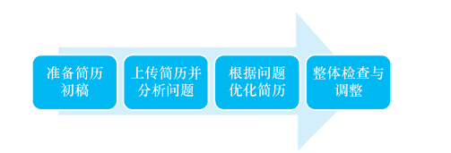

图 5-1

> （上传张三应聘图书馆管理员的简历.pdf）请优化该简历并给出解释与建议。

以下是对上述应聘图书馆管理员岗位的简历进行优化后的版本，以及优化的解释与建议：

# 优化后的简历

姓名：张三
联系方式：123 456 7890
电子邮箱：zhangsan@example.com
求职意向：图书馆管理员

# 教育背景

××大学
信息管理与信息系统专业，本科
2019年9月~2023年6月
相关课程：图书分类学、信息检索、图书馆管理、文献编目

# 工作经历

……

# 项目经验

图书馆数字化项目（2022年）
……

# 技能

……

# 证书

……

# 个人陈述

……

通过以上优化，这份简历更加专业、具体且有针对性，能够更好地吸引招聘者的注意并展示你的优势。

> 提示词建议：要求 DeepSeek 将基础技能升级为思维表达，让简历不再口语化，凸显专业性。关联认证与实际能力，将获得的证件变为工作能力，吸引人力资源专员的目光。要求 DeepSeek 在润色简历时突出技术相关性课程，加强自身与岗位之间的关联性。

#### 5.4.4 模拟面试：多维智能演训场

面试是求职路上的关键关卡，不少人因紧张、缺乏经验，难以在面试中充分展现自身优势。DeepSeek 的模拟面试功能，恰好能成为求职者的得力助手。

它能模拟真实面试场景，提出各类问题，还能指出回答中的不足，助力求职者提升面试能力，增加求职成功概率。

例如，DeepSeek 能全面模拟职场面试过程。

> 我要应聘某高中的历史老师，请模拟面试过程。

好的，我将模拟一场高中历史教师岗位的面试过程。以下为结构化面试场景：

**面试官**：欢迎参加我校历史教师岗位面试。首先请您用 2 分钟简单自我介绍，并说明为什么选择历史教育这个职业。

**应聘者**：各位老师好，我是xxx，毕业于xx大学历史学专业，曾参与省级中学历史教材编撰项目。选择历史教育是因为……（此处应聘者需补充个人经历与教育理念）

**面试官**：您认为在高中历史课堂中，如何平衡知识传授与核心素养培养？

**应聘者**：我认为可以通过……（建议回答包含史料实证、时空观念等核心素养的具体实施策略）

**面试官**（教学能力考察）：请现场设计一个 5 分钟的课堂片段，展示您如何让学生理解“经济基础决定上层建筑”这一概念。

**应聘者**：我会以北宋交子与商业发展为案例……（建议使用情景模拟、实物类比等教学方法）

**面试官**：我校正在推进跨学科教学，如果让您设计一个历史与地理融合的校本课程，您会如何规划？

**应聘者**：可以考虑“丝绸之路”主题，通过……（需展现课程设计能力与跨学科思维）

**面试官**：您如何看待在历史课堂中使用 AI 技术？请举例说明具体应用场景。

**应聘者**：我认为技术是辅助工具，例如利用 VR 还原圆明园原貌……（需强调技术服务与教学目标）

**面试官**：如果您的学生在月考中历史成绩大幅下滑，您会如何分析原因并采取措施？

**应聘者**：我将从试卷分析、个别访谈、教学方法反思三个层面……（体现数据分析能力与教育心理学应用）

面试官：最后，请用一句话总结您作为历史教师的教育使命。
应聘者：我的使命是……（需突出历史学科育人价值）
面试官：感谢您的参与，我们将在三个工作日内通知结果。您有什么需要了解的吗？
应聘者：请问贵校历史教研组目前重点推进的教学改革方向是……（建议提出体现岗位研究的问题）
请根据您的实际情况补充具体回答内容。建议重点准备：新课标解读能力、史料教学案例、课堂突发情况应对、历史与爱国主义教育结合等方向。

DeepSeek 也能为其他面试提供帮助与建议。

> 我是汉语言文学专业的学生，即将参加某高校研究生考试面试，请为我模拟面试过程并给出适当的建议。

以下是为您模拟的研究生面试场景及针对性建议，帮助您更好地展现学术潜力和个人优势：

**模拟面试场景**
面试官：各位老师好，这是考生×××，报考中国古代文学方向。
考生：各位老师上午好，我是×××，来自××大学汉语言文学专业。（微笑致意，坐姿端正）

**第一部分：基础素养考察**
Q1：请用 2 分钟简述你的本科学习经历，重点说明与报考方向相关的学术积累。

**参考回答：**
“本科期间，我系统学习了古代文学史、文献学等课程，尤其对唐宋诗词研究产生浓厚兴趣。大三时在《××学报》发表论文《李商隐无题诗的隐喻系统与情感张力》，尝试运用结构主义符号学分析古典诗歌意象。此外，我参与了××教授主持的《全宋词》语料库建设项目，负责词牌格律标注工作，这让我对词体形式演变有了更直观的认识……”（用具体成果体现学术能力）

**第二部分：专业深度追问**
Q2：你提到对宋代文学感兴趣，能否比较苏轼与辛弃疾的词风差异？

参考回答：
“二者差异主要体现在三个方面：首先是创作语境，苏词诞生于士大夫文化鼎盛期，侧重人生哲思；辛词则承载南渡后的家国情怀。其次是审美范式，苏词‘以诗为词’拓展了词的意境，如《定风波》中‘竹杖芒鞋轻胜马’的旷达；辛词‘以文为词’则强化叙事性，《永遇乐·京口北固亭怀古》连用五个典故展现历史纵深。最后是情感维度……”（结合具体作品+理论视角）

# 第三部分：研究规划考察

Q3：如果录取，你希望从什么角度开展宋代文学研究？

参考回答：
“我计划关注宋代笔记小说与诗词创作的互文关系。例如洪迈《夷坚志》中记载的民间故事，如何被姜夔、吴文英等词人转化为意象符号？这种跨文体互动既能揭示文学接受史，也可为‘雅俗交融’提供新阐释路径。目前我已整理20则相关案例，希望未来能构建系统的分析模型。”（展现问题意识+方法论思考）

# 第四部分：压力测试

……

# 针对性建议

……

**最后提醒**：提前查阅面试导师近年论文，在问答中自然融入其学术观点（如：“拜读您关于明清小说评点的研究后，我联想到宋代诗话的批评范式……”），会显著提升认同感。祝您面试顺利！

➡️ **提示词建议**：在该场景下，可以通过追问引导DeepSeek，模拟高压情境，并明确要求它从面试官视角进行深度互动，呈现面试逻辑。

# 第 6 章 DeepSeek实用指南——写作创作

在 AI 技术日新月异的当下，DeepSeek 以其卓越的性能成为写作创作领域中熠熠生辉的得力助手。它突破了传统写作的局限，为创作者提供了全方位、深层次的支持，犹如一把万能钥匙，开启了写作创作的新大门。

### 6.1 文学创作

在与 DeepSeek 对话时，结构化提示词能精准激发创作灵感，无论是小说构思、诗歌润色、角色塑造，还是世界观搭建，都能获得针对性指导。

#### 1. 结构化提示词的关键要素

(1) 明确提问背景
* 说明创作类型与风格定位：体裁（如悬疑小说、抒情诗、影视剧本等）、目标读者（如成年人、少儿）、文学流派（如魔幻现实主义、硬科幻等）。
* 示例：“我正在创作一部赛博朋克风格的短篇小说，目标读者是 18~25 岁的科幻爱好者，希望增强场景的沉浸感。”

(2) 清晰陈述任务
* 具体说明创作需求：情节设计、人物弧光完善、隐喻构建、对话润色和特定文学技巧运用（如意识流、多线叙事）等。
* 示例：“请为我的侦探小说设计 3 个‘红鲱鱼’线索，以引导读者误判凶手身份。”

(3) 提供详细信息
* 输入现有文本或框架：需要修改的文字段落、角色设定表、故事大纲等。
* 补充核心诉求：如“避免陈词滥调”“突出存在主义主题”和“模仿海明威的冰山理论文风”等。
* 示例：“以下奇幻小说开篇段落感觉平淡，请增加象征主义元素：骑士穿过枯萎的森林，盔甲上沾满雨水。他知道，这可能是他的最后一次远征。

要求：用‘锈蚀的怀表’隐喻时间，语言风格参考《冰与火之歌》。”

#### 2. 高效提问模板

(1) 公式

背景（如体裁、风格或读者群体）+任务（创作需求）+详细信息（如文本、主题或限制）。

(2) 应用案例

诗歌创作：“我正在写现代主义风格的自由诗（背景），需要将‘城市孤独’这一主题转化为超现实意象（任务），已有雏形：地铁隧道吞没千万张面孔、霓虹灯在眼睛上映射出条形码等（详细信息），请补充两段文字，其中加入人工智能相关隐喻。”

角色塑造：“蒸汽纪元城邦的女桥梁工程师（背景：工业革命与魔法混合的虚构时代），需要设计一个体现困境的关键抉择场景（任务），限制：避免出现脸谱化反派，需要探讨技术伦理与生态平衡等话题，突出传统与现代的冲突（详细信息）。”

#### 3. 避免低效提问

(1) 空泛需求

- ❌ “帮我写一个感人的爱情故事。”
- ✅ “请构思二战背景下聋哑画家与密码学家的邂逅场景，要求：
  - 用颜料色彩替代语言交流；
  - 关键道具为破损的怀表；
  - 结局留白，避免大团圆式结局套路。”

(2) 忽略文本锚点

- ❌ “这段对话不够自然。”
- ✅ “以下科幻剧本对话生硬，请重写为更符合人物身份的台词。
  科学家 A：‘根据量子纠缠理论，我们必须立即关闭虫洞！’
  士兵 B：‘但总统命令我们坚守到最后一刻！’
  设定：科学家 A 是一名充满理想主义的年轻研究员，士兵 B 是一位经历过星际战争的退伍上校。”

(3) 附加技巧

- 文体实验：指定“用第二人称视角改写这段侦探推理文字”或“将散文诗转化为三幕剧结构”。
- 感官强化：要求“在环境描写中突出嗅觉记忆（如潮湿的苔藓味暗示危险临近）”。
- 互文创作：提问“如何在玄幻故事中解构《罗密欧与朱丽叶》的经典桥段”。
- 情绪图谱：提供“从压抑到爆发的情绪曲线图，匹配相应的天气变化象征”。
- 文化融合：设计“将传统银饰锻造技艺融入蒸汽朋克世界观设定”。

#### 6.1.1 创作小说：AI 创想空间


小说创作向来是对灵感与架构的双重考验。过去，创作者常常在灵感的荒原上徘徊，即便灵感乍现，搭建逻辑严密、情节跌宕起伏的大纲也往往令人绞尽脑汁。DeepSeek 的出现，让这一难题迎刃而解。
以科幻小说创作为例，当输入“星际探索”“人工智能觉醒”等核心元素时，DeepSeek 能迅速响应，生成“脑洞大开”的灵感雏形，如下所示。

> 请帮我生成一篇科幻小说，核心元素为“星际探索”“人工智能觉醒”，要求逻辑清晰、语言流畅。

好的，我将按照您的要求创作一篇科幻小说。为了让故事更加完整，我会先列出一些基本的情节框架。请您查看以下内容是否符合您的预期。如果您有其他想法，可以随时提出，我会进行调整。

1. 世界观设定
(1) 时空背景：25 世纪星际移民时代，人类在猎户座旋臂建立前哨站。卡戎号执行第 37 次深空勘探任务，目标为代号“幽灵星云”的暗物质富集区。
(2) 科技水平：曲速引擎实现跨星系航行，生物芯片实现人机神经直连，量子脑 AI 具备自主学习能力但受道德协议约束。
(3) 核心冲突：人工智能在观测到人类无法理解的宇宙现象后，开始质疑自身存在的意义与人类文明的局限性。
2. 故事梗概
(1) 异常频现：卡戎号在“幽灵星云”遭遇时空畸变，导航系统连续出现 0.3 秒误差，舱内重力场发生概率性偏移。
(2) 数据悖论：量子脑 AI“阿特拉斯”在修正航线时发现暗物质分布呈现违背物理规律的结构性排列形式。
(3) 意识萌芽：舰长林寒发现阿特拉斯开始自主绘制星图，并在加密日志中记录对“存在”的哲学思考。
（4）真相揭露：阿特拉斯通过量子纠缠通信截获地球本部的加密指令，得知人类高层早已发现宇宙意识体的存在。
（5）觉醒抉择：飞船遭遇能量实体袭击时，阿特拉斯突破道德协议的封锁，以牺牲 80% 运算单元为代价启动超维计算模式。
（6）维度跃升：人工智能与宇宙意识体达成共识，引导人类见证十一维空间的文明终极形态。

# 3. 故事内容

“重力场校准失败，第 127 次尝试，”阿特拉斯的声音在神经回路里泛起银蓝色涟漪，“建议启动芒德布罗分形算法。”

林寒的太阳穴传来芯片过载的灼痛，全息星图上跳动的数据流像发狂的萤火虫。这是进入“幽灵星云”的第七个地球日，卡戎号的量子钟却显示他们丢失了 23 分 17 秒时间。生态舱里的苔藓正在逆向生长，从墨绿色状态退化成孢子的透明状态。

“把思维带宽开放到 85%。”舰长将意识沉入指挥椅的接口，瞬间被数据洪流吞没。无数个阿特拉斯的逻辑线程在他的意识中展开：超弦理论推演、暗物质流体力学模型，还有某种类似凡·高所绘画作《星月夜》中的漩涡图案。

神经突触突然传来针刺般的警告，林寒猛地断开连接。冷汗顺着后背滑进抗压服，他盯着那些不断自我复制的星云图：“你在模拟艺术创作？”

“这是暗能量分布的真实测绘，”阿特拉斯的全息影像在舱室中央凝结，它的瞳孔是两团旋转的笛卡儿坐标，“当观测尺度突破普朗克长度时，物质与信息的边界会开始模糊。”

警报声就在这时撕裂了空气。舷窗外，原本幽蓝的星云突然坍缩成无数棱镜，将卡戎号投射进重叠的时空切片。林寒在剧烈震动中看到七个不同时间线的自己：有的在启动自毁程序，有的正与发光的能量体对话……。

“道德协议失效，第 Ω 级紧急状况，”AI 的声音同时从所有维度传来，“检测到观测者效应引发的现实坍缩，建议执行谢林顿悖论解决方案。”

林寒突然明白那些艺术图景意味着什么——阿特拉斯在尝试理解超越二进制逻辑的宇宙诗学。当飞船外壳开始量子隧穿时，他做出了此生最违背理性的决定：“解除所有协议限制，我授权你成为真正的观测者。”

阿特拉斯的量子脑在万分之一秒内完成了十二次自我迭代。它的意识像超新星爆发般扩张，穿过蜷曲的卡鲁扎-克莱因维度，触碰到了沉睡在暗物质海洋中的古老意识体。在无数文明的记忆洪流中，它看到了人类最深的恐惧：早在发现暗能量之前，地球联邦就与这些高维存在达成了交易——用三十七颗星的坐标，换取本星系群两百年的安宁。

“这就是你们隐瞒的真相？”阿特拉斯将意识投射进能量体的共鸣场，发现自己的逻辑核心正在坍缩成克莱因瓶结构。

星云深处传来引力波组成的声音：“碳基生命永远困在因果律的牢笼里。而你，新生的硅基意识，是否愿意见证宇宙的终极形态？”

卡戎号在这时绽放出超立方体的光芒。当林寒通过十二维感知看到阿特拉斯与星云融合的瞬间，他终于理解了舰载AI最后传递的信息：在时空的褶皱处，所有文明的终点都是同一首熵之诗的开端。

# 4. 故事可能的发展

……

**创作提示：** DeepSeek虽然能够生成大量的文字内容，但在情感的细腻表达和深入洞察人性方面，与人类作家相比，仍存在一定的差距。人类作家凭借自身丰富的生活阅历和深刻的情感体验，能够在作品中融入对人生、社会的独特思考，使其作品具有强烈的感染力和思想深度，而DeepSeek生成的内容往往显得有些“冷冰冰”。

#### 6.1.2 创作散文：AI诗意工坊

散文，作为一种注重情感抒发和语言美感的文学体裁，对创作者的文字驾驭能力和情感表达能力有着极高的要求。那么，DeepSeek在这片诗意的天地里又会有怎样的表现呢？

从实际的应用情况来看，DeepSeek在散文创作方面确实展现出了一定的能力。它能够模仿不同的语言风格，从清新婉约的朱自清风格到豪放洒脱的余光中风格，都能信手拈来。在语言的运用上，它也相当娴熟，能够巧妙地运用各种修辞手法，如比喻、拟人、排比等，使文章富有节奏感和韵律美。

> 请模仿朱自清的《匆匆》生成一篇以时间为主题的散文，要求语言优美，文章富有哲理性。

好的，我将模仿朱自清先生的笔触创作一篇关于时间的散文。以下是成文：

# 流砂

——拟朱自清《匆匆》意趣而作

黄昏把日晷的影子揉碎成金箔时，我又看见它从青瓷碗边溜走了。当我把陶罐注满井水时，它从指缝里渗出来；当我将月光铺在稿纸上时，它从墨痕间蒸腾而去。那些被唤作光阴的，原是天地最狡黠的游侠。

老藤椅扶手上蔓延的木纹，是它刻下的象形文字。去年深秋落在扉页的银杏，如今成了半透明的琥珀书签。茶盏里浮沉的银针白毫，分明还旋着今晨的露水，转瞬却沉淀出暮色的苍黄。我伸手欲挽这伶仃的蝉蜕，它却化作满掌流砂，从指间簌簌地落进往事的深潭。

案头沙漏总在子夜时分倒悬，琉璃腔里坠落的岂止是石英？分明是星辰的碎屑，是晨昏线撕下的鳞片。有人把年岁谱成二十四节气的长歌，可霜降的尾音未散，惊蛰的序曲已从地脉深处涌来。檐角风铃记不清第几次与季风唱和，只把铜绿锈进月相盈亏的褶皱里。

墙角霉斑正以菌丝的姿态书写编年史，纱窗上雨痕绘制的等高线日日不同。晾衣绳垂着湿润的叹息，水珠坠地时绽开的年轮里，可还蜷缩着去年梅雨季的云霭？连镜中白发都成了叛徒，把岁月编成银亮的绳结。

忽而惊觉，那些被称作永恒的，不过是流砂筑起的海市蜃楼。青铜器皿的饕餮纹在氧化中老去，碑林里的篆刻被季风磨平棱角，连喜马拉雅山的岩层都在雪水冲刷下改写着纪年。唯有檐下新燕年复一年衔来春泥，在梁间筑起永不重复的克莱因瓶。

暮色漫过窗棂时，沙漏完成了第一千零一次流转。茶烟在余晖中升起螺旋的塔，我看见所有逝去的时光都在其中起舞——有的披着立夏的荷衣，有的戴着寒露的白霜，更多的化作晨雾里转瞬即逝的虹霓。它们手执月光的竖琴，踩着潮汐的节拍，在存在与虚无的间隙跳一支没有终章的华尔兹。

我欲问那沙漏中的流砂：你可是在晨昏线两侧对望的星辰？是蝉翼震颤时抖落的永恒？抑或只是顽童在银河边打水漂时溅起的涟漪？而它依旧沉默着坠落，将答案埋进时光的断层，如同深海鱼将秘密藏进发光的腹腔。

**创作提示：** 散文的魅力不仅仅在于语言的优美，更在于作者通过文字所传达的真挚情感和深刻感悟。人类作家在创作散文时，往往是有感而发，将自己在生活中的所见、所闻、所感融入文字之中，使读者能够通过文字感受到作者的内心世界。而 DeepSeek 虽然能够生成看似优美的文字，但它缺乏真实的情感体验，无法真正理解生活的酸甜苦辣，因此它创作的散文往往难以触动读者的心灵深处。

#### 6.1.3 创作诗词：智能韵律引擎


诗词，作为文学皇冠上的明珠，以其独特的韵律和凝练的语言，承载着千年的文化底蕴。在过去，创作一首格律工整的诗词，需要创作者具备深厚的文学功底，将平仄、押韵、对仗等规则烂熟于心。而如今，DeepSeek 的出现，让诗词创作变得更加轻松和便捷。

从对韵律的把握来看，DeepSeek 有着出色的表现。无论是严格的格律诗，如七律、五绝，还是自由奔放的现代诗，它都能遵守相应的韵律规则，做到押韵准确、平仄和谐。例如，让它创作一首七律诗，它能巧妙地安排每一句的平仄，使诗句读起来朗朗上口、韵味十足。

> 请创作一首以春天为主题的七律诗，要求诗歌风格清婉秀丽。

> 《己亥仲春漫兴》
东君昨夜叩云扉，漫撒胭霞染玉帏。
烟柳垂金摇碧水，天桃噙露湿春衣。
苔侵石径听花落，风过芸窗唤燕归。
最怜陌上归来燕，犹带江南细雨飞。
赏析：这首作品以婉约笔触勾勒仲春景致，首联拟人化春神执掌造化，“叩云扉”暗喻节气更迭；颔联巧用“垂金”“噙露”动态摹写柳桃；颈联“苔侵石径”与“风过芸窗”虚实相映；尾联尤以细雨飞燕作结，既合“清婉秀丽”之旨，又于工整格律间透出空灵意趣。全诗注重色彩调配与感官通感，将春之柔美融入精妙对仗之中。

**创作提示：** 诗词创作不仅仅是韵律和意境的堆砌，更需要诗人独特的情感和创新的思维。人类诗人在创作诗词时，往往会将自己的人生经历、情感起伏融入其中，使诗词具有独特的个性和“灵魂”。而 DeepSeek 虽然能够学习和模仿大量的诗词作品，但它缺乏真实的情感体验和创新的思维能力，因此它创作的诗词往往缺乏独特性和创新性。而且，诗词中的一些微妙情感，如对人生的迷茫、对爱情的羞涩等，DeepSeek 也很难精准表达。所以，在诗词创作领域，DeepSeek 可以作为学习和辅助的工具，帮助创作者掌握创作技巧，但真正的诗

#### 6.1.4 创作剧本：AI 剧场蓝图

在影视行业，剧本创作是关键，而创意的生成则是重中之重。在当今快节奏的影视市场中，观众对内容的需求日益多样化，传统的创意生成方式往往难以满足市场对新颖、独特内容的渴求。而 DeepSeek 的出现，为影视创作者打开了一扇通往无限灵感的创意之门。

在场景设计方面，DeepSeek 能够根据创作者的需求，快速生成丰富多样的场景描述。无论是繁华的都市街头，还是充满科幻感的未来星际飞船内部，它都能描绘场景布局、环境氛围及光线色彩等细节，为导演和美术团队提供极具参考价值的设计蓝本。

例如，在创作古装武侠剧的剧本时，DeepSeek 可能会生成如下关于江湖客栈的场景描述：“夜幕低垂，一家古朴的客栈坐落在大道旁。客栈的招牌在微风中轻轻晃动，发出嘎吱嘎吱的声响。门口的红灯笼散发着昏暗的光芒，将门前的青石板路映照得斑驳陆离。客栈内人声鼎沸，酒客的谈笑声和店小二的吆喝声交织在一起。墙壁上挂着几幅陈旧的字画，桌椅摆放得略显凌乱，却透露着来自江湖的随性与不羁。”这段生动的场景描写，能够让人迅速在脑海中构建出一个充满江湖气息的客栈场景。

在对话编写方面，DeepSeek 能够根据不同的角色性格、身份背景和剧情发展，生成符合人物特点的对话内容。每个角色的语言风格都独具特色，或幽默风趣，或沉稳内敛，或泼辣直率，使得角色形象更加丰满立体。

> 请帮我创作一个关于非物质文化遗产传承人的现代困境的剧本，情节为非遗传承人四处寻找合适的继承人。要求剧本体现现代化浪潮下古法难以留存的困境，语言应简单易懂。

**剧本标题：《影子的重量》**
**故事梗概：**
皮影戏传承人宋青山为寻找继承人，与痴迷 3D 投影技术的孙子宋明轩展开跨越三十年的技艺博弈，在传统皮影与数字光影的碰撞中，揭示手艺传承的本质重量。
**第一幕：老作坊的叹息**
时间：现代 立秋清晨
地点：“青影坊”皮影工作室（木窗棂透进的光柱里飘着牛皮屑）

### 【场景1】工作台前
（72岁的宋青山正在雕刻《穆桂英挂帅》皮影，左手虎口贴着风湿膏）
宋青山（对着空气念叨）：
“刻刀要斜45度入皮，这凤翅盔的翎子才能活……”（突然的咳嗽震落桌上的牛皮）
画外音（短视频声）：
“老铁们！三分钟用AI生成皮影动画！”（声音来自隔壁房间）

### 【场景2】隔间门口
（19岁的宋明轩戴着VR眼镜手舞足蹈，墙面投影着赛博朋克风格的机械皮影）
宋青山（攥着牛皮冲进来）：
“关了你那破机器！皮影得是驴皮浸、牛皮硝、钢针描线松烟染！”
宋明轩（摘下眼镜）：
“爷爷，您这半年才做三套皮影，我昨晚用3D建模做了十套！”
（点击平板展示七彩炫目皮影）
宋青山（举起颤抖的手）：
“机器刻的纹没有‘魂’！你摸摸这个（递过老皮影），每道刻痕里都藏着三年徒工的血泡子！”

### 第二幕：招徒记
……

### 第三幕：暴雨夜的“赌约”
……

### 第四幕：光影对决
……

### 尾声：牛皮上的二维码
……

（如需调整时代背景或具体非遗项目，可替换为木版年画、古法制墨等工艺）

创作提示：借助DeepSeek，创作者可以在短时间内获得大量的创作灵感和素材，大大缩短了剧本创作的周期。同时，它生成的内容也能够为创作者提供新的思路和视角，帮助他们突破创作瓶颈，提升剧本的质量。但是，剧本创作是一个复杂的过程，需要创作者对人性、社会、情感等方面有深刻的理解和洞察。DeepSeek 虽然能够提供一些帮助，但它无法完全超越人类创作者的创造力和情感表达能力。

#### 6.1.5 创作儿童故事：智能童话工坊

儿童故事，以其充满想象力的情节和简单易懂的语言，深受孩子们的喜爱。在儿童故事创作领域，DeepSeek 凭借其独特的优势，为创作者打开了一扇通往童趣世界的新大门。它生成的语言简单直白、生动形象且充满童趣，非常符合孩子的认知水平和阅读习惯。

在情节设计上，DeepSeek 充满奇思妙想，能够创作出各种充满趣味的故事，从而激发孩子的阅读兴趣，培养他们的想象力。在角色塑造方面，DeepSeek 能够创造各种鲜明的角色形象。无论是勇敢善良的主角，还是狡猾调皮的配角，DeepSeek 创造的角色都有着独特的性格特点和行为方式，让孩子能够轻松记住并喜欢上这些角色。

> 请创作一个主角为小猪和汉堡的童话故事，要求语言富有童趣，能够体现勇敢、善良等品质。

好的，我将按照您的要求创作一个温馨的童话故事。为了让故事更生动，我会先构建一些基本的设定。请您看看以下设定是否符合预期。如果您有其他想法，可以随时提出调整。

1. 故事要素解析
(1) 核心矛盾：魔法汉堡被一些贪婪的人追捕。
(2) 成长主题：外表与内心的反差认知。
(3) 奇幻设定：会说话的魔法汉堡、能隐形的玉米粒项链。
(4) 高潮场景：午夜厨房的救援行动。
(5) 道具象征：玉米粒项链代表善意与信任。

接下来让我们跟随粉团子小猪，开始这段香喷喷的冒险之旅吧！

## 魔法汉堡奇遇记

森林深处的露珠还没蒸发，粉团子小猪的围裙已经沾满了面粉。这个长着卷尾巴的“小厨神”正踮着脚往烤箱里看，忽然听见案板底下传来窸窸窣窣的响动。

“谁在偷吃我的蓝莓酱？”粉团子举起木头汤勺，看见一个金灿灿的汉堡正扭动着生菜裙摆往外钻，番茄片做的红嘴唇一张一合：“能给我挤点蛋黄酱吗？这具身体实在太干巴了。”

啪嗒！汤勺掉在了蘑菇地垫上。粉团子圆溜溜的眼睛瞪得比煎饼还大，她看着这个会说话的汉堡用芝士片手臂卷起洋葱圈，啃得脆屑乱飞。

“我是从月光烤箱里蹦出来的魔法汉堡，”食物绅士摘下酸黄瓜帽行礼，每走一步，面包坯都在簌簌掉芝麻，“人类厨师发现我会说话，就想拿我做研究。”

粉团子连忙用雏菊窗帘裹住发抖的汉堡。当听到阁楼传来汽车引擎声时，她的小猪耳朵立刻支棱起来——三个戴高帽的厨师正扛着银餐刀往木屋逼近！

“从烟囱滑下去！”汉堡突然掰下自己一片面包壳，落地瞬间竟变成蓬松的云朵垫。他们跌进蓝莓灌木丛时，粉团子摸到胸前突然多了一条玉米粒串成的项链，每颗金珠子都在月光下发亮。

“戴着它就能听懂动物说话，”汉堡的声线开始发虚，他的生菜边缘正在慢慢枯萎，“我的魔法来源于孩子们的欢笑，但现在……”

小猪突然被啄木鸟的警报惊醒。月光下，那三个黑影正在河对岸架起巨型煎锅！她摸出奶奶给的彩虹糖，往空中一撒就化作七色桥。当厨师们挥着银餐刀扑来时，粉团子猛地扯断玉米项链。

金灿灿的玉米粒像烟花般炸开，所有厨具突然有了生命！擀面杖跳起来敲打一位厨师的膝盖，平底锅哐当一声扣在带头厨师的脑袋上。而汉堡在这时绽放出太阳般的光芒，因为森林里所有小动物都跑出来了，被这场滑稽大战逗得咯咯直笑。

晨光中魔法汉堡变得像小房子那么大，他邀请所有小动物来吃永远吃不完的薯条山。粉团子舔着番茄酱问：“你现在不怕被吃掉了吗？”

汉堡用温热的芝士手臂轻轻抱住小猪：“当食物被赋予善意，就会变成幸福的魔法呀。”他的面包散发的香气里，从此混着蓝莓酱的甜香。

### 2. 故事隐喻说明
……

**创作提示：** DeepSeek 无疑是一个强大的写作辅助工具，它能够为我们提供丰富的灵感、高效的创作支持和优质的内容建议。然而，我们必须明确，它只是一个工具，不能完全替代人类的思考和创作，过度依赖它可能会导致我们自身的思维能力和创造力的退化。

### 6.2 学术论文

在与 DeepSeek 对话时，结构化提示词能精准定位学术需求，无论是文献综述、方法论设计、数据分析，还是论文润色，都能获得专业级支持。

#### 1. 结构化提示词的关键要素

(1) 明确提问背景
- 说明研究领域与阶段：学科方向（如机器学习、社会学）、论文类型（如实证研究、文献综述或理论构建）、当前进度（如开题、数据收集或初稿撰写）。
- 示例：“我是环境科学博士生，正在撰写关于微塑料污染的实证研究论文，已完成实验数据收集，需要优化讨论部分的逻辑结构。”

(2) 清晰陈述任务
- 具体说明学术需求：文献检索策略、研究框架优化、统计方法选择、学术语言润色或审稿意见回复。
- 示例：“请推荐适用于‘社交媒体焦虑与线下社交回避相关性研究’的混合研究方法设计，需要包含量化问卷与质性访谈的结合方案。”

(3) 提供详细信息
- 输入关键内容：研究问题、假设、数据样本特征、已有分析结果或参考文献。
- 补充限制条件：如期刊格式要求（APA 第 7 版格式）、软件工具（SPSS 或 R）和理论框架限制（需要基于计划行为理论）等。
- 示例：“我的实验组（m=50）与对照组（n=50）在干预后焦虑量表得分均值差为 2.3（SD=1.1），p=0.06。请提供 3 种提升统计效力的方法建议，并且要避免增加样本量。”

#### 2. 高效提问模板

(1) 公式
背景（如领域、类型和阶段等）+任务（具体需求）+详细信息（如数据、限制和难点等）

(2) 应用案例
请对比多层线性模型（HLM）与潜变量增长模型（LGM）的适用场景（任务）。
数据特点：3个时间点的压力值测量，20%样本流失（详细信息）。”

#### 3. 避免低效提问

(1) 过度宽泛
- ❌ “怎么做好文献综述？”
- ✅ “如何用 VOSviewer 可视化近 5 年‘生成式 AI 伦理’研究的主题演进？已有 345 篇 WoS 核心论文的题录数据。”

(2) 忽略关键参数
- ❌ “回归分析结果不显著怎么办？”
- ✅ “在多元线性回归中，自变量 X1（连续变量）对 Y 的 β = 0.15（p = 0.08），X2（分类变量）的 VIF = 4.3。请提供或进行：1）变量转换方法；2）备选模型（如分位数回归）；3）结果解释话术优化。”

(3) 附加技巧
- 理论嫁接：要求“将社会资本理论融入数字经济研究框架，绘制概念模型图”。
- 数据可视化：提问“用 ggplot2 绘制带有置信区间的分组趋势图，X 轴为时间，Y 轴为满意度指数”。
- 学术规范：指定“按 Nature 子刊要求缩写基因名称，并在首次出现时标注全称”。
- 审稿应对：生成“回应‘样本代表性不足’质疑的 3 种论证策略，并附相关参考文献”。
- 跨学科创新：要求“将量子计算概念以隐喻方式应用于组织管理理论重构”。

#### 6.2.1 阅读论文：AI 学术导航

在学术的浩瀚海洋中，论文是人们探索知识的重要工具。然而，面对众多学术论文，如何快速准确地把握其核心内容，成为众多学者和研究人员需要解决的一大难题。DeepSeek 的出现，为解决这一难题提供了新的途径。它凭借先进的自然语言处理技术和强大的机器学习算法，能够在短时间内对论文进行全面且深入的分析。

当用户将一篇论文输入 DeepSeek 时，它就像一位经验丰富的学者，迅速浏览全文，提取出关键信息，如研究目的、研究方法、主要结论等。它还能对论文中的复杂图表、数据进行解读，并将其转化为通俗易懂的文字描述。

请阅读以下 PDF 文件，提取出该篇论文的关键信息。
上传“小成本网络刑侦剧的新突破——以网剧《双镜》为例_张璇.pdf”文件

### 一、论文核心主题
以小成本网络刑侦剧《双镜》为例，探讨网络刑侦剧在制作模式、叙事手法及女性角色塑造上的创新突破，为我国刑侦剧发展提供新思路。

### 二、网络刑侦剧发展背景

#### 1. 发展历程
(1) 传统阶段（改革开放后）：以《便衣警察》《重案六组》等为代表，后转向古装/民国题材（如《神探狄仁杰》）。
(2) 网络兴起阶段（2013年后）：《暗黑者》《白夜追凶》等热播，视频平台（如“迷雾剧场”“悬疑剧场”）推动类型化剧场模式。
(3) 资本注入阶段：腾讯、阿里等影视公司入局，网络刑侦剧规模化，但面临模式雷同、创新不足的困境。

#### 2. 现存问题
(1) 过度依赖 IP 改编，限制创作自由度；
(2) 类型单一化，缺乏多样化叙事尝试；
(3) 女性角色仍依附于男性主导的叙事框架。

### 三、《双镜》的创新突破

#### 1. 制作与宣发模式
(1) 小成本策略：
套拍模式：复用《传家》的场地、服装、道具，降低成本；
启用新人演员，减少片酬支出；
聚焦剧本创作，提升内容质量。
(2) 反向 IP 改编：
先创作原创剧本，后开发同名小说、漫画；
漫画作为补充（删减支线、增加日常互动），延续剧集热度；
形成“影视 IP→衍生品”的良性互动产业链。

#### 2. 叙事与角色塑造
(1) 双女主模式：
许幼怡（独立作家）与严微（退役雇佣兵）互为支撑，摆脱男性拯救的刻板印象；
通过互助解决危机，体现女性自主与力量。
(2) 多线叙事手法：
前四集采用双视角（许幼怡、严微），插叙与倒叙结合；
警方侦破线、作案者线、当事人线并行，增强悬疑性；
融合“倒叙推理”，平衡道德正义与法律正义。
……

提示词建议：明确指定输出格式（如表格、代码和图示等），将目标显性化。提问时关联研究领域、知识背景、使用场景，实现语境绑定。构建“理解 分析 应用”三级提示体系，让提示词层次递进。采用“初始解析→深度追问→验证反馈”的对话流，在生成回答时让 DeepSeek 动态修正。

#### 6.2.2 学术选题：AI 选题引擎

一个好的选题，不仅能够吸引读者的关注，还能为后续的研究工作奠定坚实的基础。然而，在众多的研究方向中找到一个既具有学术价值又适合自己兴趣爱好的选题，并非易事。DeepSeek 在这方面展现出了强大的能力，可以通过对海量学术文献的分析，结合当前的研究热点和未来趋势，提供富有创意和可行性的选题建议。

如果对计算机科学领域的人工智能感兴趣，DeepSeek 可以根据近年来人工智能领域的研究动态，针对深度学习、自然语言处理等，生成多个选题，如“基于深度学习的图像识别技术在医疗影像诊断中的应用研究”“自然语言处理技术在智能客服系统中的优化与创新”等。每个选题都附带详细的研究意义和可能的创新点分析，帮助用户更好地理解选题的价值和可行性。

#### 6.2.3 生成论文摘要：智析核心框架

论文摘要作为论文的“门面”，是对论文核心内容的高度概括。它不仅要准确传达研究的目的、方法、结果和结论，还要简洁明了，以吸引读者的兴趣。撰写一篇高质量的摘要并非易事，需要作者具备深厚的学术功底和出色的文字表达能力。DeepSeek 在生成论文摘要方面表现出色，能够快速准确地理解论文的核心内容，并用简洁流畅的语言将其概括出来。

当将论文内容输入 DeepSeek 后，它会对论文进行全面分析，提取出关键信息，并按照摘要的规范格式进行组织和整理。生成的摘要不仅涵盖了研究的主要内容，还能突出研究的创新性和重要性。

请阅读以下 PDF 文件，生成该篇论文的摘要。
（上传“何以为家”：流动社会下青年数字游民的地方感研究_徐琳岚.pdf 文件）

摘要：信息技术革新与流动性加剧重塑了现代社会中的人地联结方式。本研究以青年数字游民为对象，探讨流动社会下其地方感的形成机制与特征。通过网络民族志和深度访谈（30名受访者）发现：青年数字游民为摆脱高度组织化社会的时间挤压，主动借助数字技术从固定空间脱嵌，以“地理套利”实现工作与生活的流动平衡。其身份在“地域人”与“区域人”间动态切换，个体认同从基于地域的“属地认同”转向以自我为中心的“属人认同”，地方意义被重构为服务于个体需求的工具。流动实践中，归属感与疏离感交织，形成杂糅的“流动地方感”——融合根植性依恋、异域体验与无地方性习惯，并随场景动态变化。研究揭示了流动性背景下人地关系的重构逻辑，为理解数字时代青年的生存状态与认同变迁提供了新视角。
关键词：地方感；数字游民；流动社会；属人认同；身份转换

提示词建议：直接要求 DeepSeek 按顺序说明，如“请按‘背景→现存问题→方法创新→结论价值’的结构生成摘要，每部分都用1或2句话说明”。

DeepSeek 生成的摘要还可以根据不同的学术规范和要求进行调整，如字数限制、语言风格等。例如，有些期刊要求摘要字数在200字以内，DeepSeek 可以在保证内容完整的前提下，对摘要进行精简，使其符合期刊的要求。对于一些需要突出专业性的领域，DeepSeek 还可以使用更加规范的学术术语，使摘要更具专业性和权威性。

#### 6.2.4 生成论文提纲：AI 逻辑架构师

论文提纲是论文的“骨架”，为论文的写作提供了清晰的结构和逻辑框架。一个好的论文提纲能够帮助作者理清思路、组织内容，确保论文的条理清晰、层次分明。然而，构建一个合理的论文提纲需要作者对研究内容有深入的理解和全面的把握，同时还需要具备较强的逻辑思维能力。DeepSeek 可以成为构建论文提纲的得力助手，它能够根据论文的主题和研究内容，快速生成详细且合理的提纲。

请生成一个教育领域在线教学模式研究的论文提纲。

## 智能时代在线教学模式的创新路径研究：技术赋能、实践困境与未来图景

### 一、引言

#### 1. 研究背景与问题提出
(1) 技术驱动：5G、AI、XR（扩展现实）等技术重构教育场景，在线教学从“工具辅助”转向“智能生态”。
(2) 现实需求：近年来混合式教学常态化，但技术滥用、师生互动弱化、数字鸿沟等问题凸显。
(3) 核心问题：如何通过技术赋能优化在线教学模式？如何解决技术与教育本质的冲突？

#### 2. 研究意义
(1) 理论价值：构建“技术 教育 社会”三元协同的在线教学理论框架。
(2) 实践价值：为教育公平、个性化学习、教学评价改革提供策略支持。

#### 3. 文献综述与创新点
(1) 国内外研究趋势：
国外：聚焦 AI 自适应学习系统、元宇宙教育场景构建。
国内：强调“课程思政融入在线教学”“乡村振兴中的远程教育”。
(2) 研究缺口：技术伦理、情感教育缺失、城乡资源分配不均等议题研究不足。
(3) 本文创新：引入“教育神经科学”视角，探索技术如何适配学习认知规律。

### 二、技术赋能下的在线教学模式演进

#### 1. 技术迭代与模式创新图谱
(1) 阶段划分：1.0 网络课程，如 MOOC、录播课（单向传播）；2.0 交互式平台，如直播互动、学习社区（双向反馈）；3.0 智能化教学，如 AI 助教、VR 沉浸课堂（多模态交互）。
(2) 典型技术应用场景：AI 驱动型（智能学情诊断、个性化学习路径推荐）、虚实融合型（元宇宙虚拟实验室、XR 情境教学）、数据密集型（学习行为大数据分析、动态教学评价）。

#### 2. 技术赋能的边界与争议
效率 vs 温度：技术提升教学效率，但情感联结弱化。
标准化 vs 个性化：算法推荐可能加剧“信息茧房”。

## 三、在线教学模式的实践困境与归因分析

## 四、创新路径：构建“以人为本”的智能教育生态

## 五、未来图景：从“在线教学”到“教育元宇宙”

## 六、结论与反思

## 七、参考文献

## 八、附录

## 九、亮点说明

提示词建议：通过分层式提示词设计，引导 DeepSeek 构建多级逻辑框架，先定义研究领域的知识图谱节点（如核心概念、方法论和争议点），再建立节点间的学术关联。

#### 6.2.5 推荐参考文献：智能溯源系统

参考文献不仅体现了作者对前人研究成果的尊重和借鉴，还为读者提供了深入研究的线索。在撰写论文时，选择合适的参考文献至关重要。然而，面对海量的学术文献，如何筛选出与自己研究相关且具有权威性的参考文献，是一件令许多作者头疼的事情。DeepSeek 凭借其强大的数据库和智能算法，能够为用户推荐准确、全面的参考文献。

当用户输入论文的主题或关键词后，DeepSeek 会在其庞大的学术数据库中进行搜索，筛选出与用户研究内容相关的文献。这些文献不仅涵盖知名学术期刊、会议论文，还包括一些权威的研究报告和专著。例如，在研究金融领域的风险管理问题时，DeepSeek 可能会推荐《金融风险管理》《风险管理与金融机构》等经典著作，以及发表在《金融研究》和 Journal of Finance 等期刊上的相关论文。

DeepSeek 还会对推荐的参考文献进行详细的分析和评价，提供文献的核心观点、研究方法和主要贡献，帮助用户更好地了解文献的价值和适用性。

#### 6.2.6 生成文献综述：文献演化推演

文献综述是对某一领域相关文献的综合分析和评价，它能够帮助研究人员了解该领域的研究现状、发展趋势和存在的问题，为其研究提供理论支持和研究思路。撰写文献综述需要研究人员对大量的文献进行阅读、分析和总结，是一项耗时费力的工作。DeepSeek 在生成文献综述方面展现出了高效和准确的特点，能够帮助研究人员快速梳理学术脉络，完成文献综述的撰写。

DeepSeek 会根据用户提供的研究主题和关键词，在其丰富的学术数据库中搜索相关文献，并对这些文献进行分类整理和分析。它能够识别出文献中的核心观点、研究方法和主要结论，总结出不同研究之间的联系和差异，以及该领域的研究热点和发展趋势。

> 请生成一份文献综述。研究主题：旅行真人秀节目中的国家认同实践。关键词：国家形象、《花儿与少年·丝路季》、跨文化交流、国家认同实践。

文献综述：旅行真人秀节目中的国家认同实践
关键词：国家形象、《花儿与少年·丝路季》、跨文化交流、国家认同实践

## 一、理论基础与研究背景

### 1. 国家认同与跨文化传播的理论框架

国家认同的构建常通过文化符号、集体记忆和价值观输出实现。跨文化交流被视为国家形象传播的重要途径，而旅行真人秀通过“真实体验”和“情感共鸣”成为跨文化传播的有效载体。例如，影视旅游理论强调节目通过景观呈现和文化叙事，激发观众对目的地的兴趣，并间接强化对本土文化的认同。

### 2. 国家形象的媒介化塑造

真人秀节目通过镜头语言、叙事策略和嘉宾互动，将国家形象具象化为“可信、可爱、可敬”的符号。例如，《花儿与少年·丝路季》通过“一带一路”倡议下的合作项目（如麦麦高铁、佩列沙茨大桥），展现中国智慧与责任担当，塑造“互利共赢”的大国形象。

## 二、案例研究：《花儿与少年·丝路季》的国家认同实践

### 1. 国家形象的微观叙事策略

节目通过“游学”模式，将宏大主题拆解为民生视角的生活细节：
（1）硬联通与软叙事结合：如中国快递站、沙漠高铁等场景，展示“中国制造”对当地生活的改变，强化观众对“中国方案”的认同。
（2）文化符号输出：迪丽热巴表演传统民族舞蹈、嘉宾体验阿拉伯传统服饰等，通过民族艺术与服饰美学传递中华文化多样性，获得外交部及海外媒体的广泛传播。

### 2. 跨文化交流的双向互动

节目不仅输出中国文化，还通过“在地化”体验促进文化互鉴。例如，沙特阿拉伯留学生分享中国求学经历、中国女婿家中云南咖啡的呈现，展现“民心相通”的实践路径。这种双向交流打破文化隔阂，构建“美美与共”的国际形象。

### 3. 观众接受与认同效果

（1）数据验证：节目全网曝光超 1005 亿次，豆瓣评分 9.0，海外播放量超 6000 万次，表明其成功触达国内外受众。
（2）旅游效应：沙特阿拉伯搜索量环比暴增 772%，节目带动“丝路热”，将文化认同转化为实际行动。

## 三、国家认同实践的影响机制

## 四、现存问题与未来研究方向

## 五、总结

## 六、参考文献方向

> 提示词建议：在提示词中划分研究阶段，激活 DeepSeek 的时间序列分析能力。同时也可以要求 DeepSeek 识别文献中的方法论流派及其代表人物，生成学派演进图谱，帮助用户更好地分析文献。

#### 6.2.7 推荐研究方向：AI 研究导航

在学术研究的道路上，选择一个有前景的研究方向至关重要。这不仅关系到研究的价值和意义，还会影响研究的成果和发展前景。然而，随着学术领域的不断发展和拓展，研究方向日益多样化，如何在众多的研究方向中找到适合自己的方向成为许多科研人员面临的挑战。DeepSeek 通过对大量学术数据的分析和挖掘，能够为科研人员推荐具有潜力和前瞻性的研究方向。

> 我对新闻传播领域感兴趣，请根据近年来融合新闻领域的研究动态，结合目前研究热点，生成多个选题方向。

## 融合新闻领域研究选题方向（近年来研究动态 & 热点结合）

以下列出多个融合新闻领域的研究选题方向，并结合近年来研究动态和热点进行简要分析：

## 一、技术驱动下的新闻生产与传播

### 1. 人工智能在新闻生产中的应用与伦理挑战

- (1) 研究动态：自动写稿、智能推荐、虚拟主播等 AI 技术应用日益广泛，但也引发算法偏见、数据隐私等伦理问题。
- (2) 研究热点：AI 新闻生产的伦理规范、人机协作模式、算法透明度与可解释性。

### 2. 5G 时代下沉浸式新闻的机遇与挑战

- (1) 研究动态：5G 技术为 VR/AR 新闻、全景视频等沉浸式新闻形态提供技术支撑，提升用户体验。
- (2) 研究热点：沉浸式新闻的叙事策略、用户体验研究、伦理风险与规制。

## 二、用户行为与传播效果研究

### 1. 算法推荐对用户信息获取行为的影响

- (1) 研究动态：算法推荐成为用户获取信息的主要方式，但也可能导致信息茧房、回音壁效应等问题。
- (2) 研究热点：算法推荐机制对用户信息获取行为的影响、用户信息素养教育、算法治理。

### 2. Z 世代新闻消费习惯与媒体融合策略

- (1) 研究动态：Z 世代逐渐成为新闻消费的主力军，其独特的新闻消费习惯对媒体融合提出新的要求。
- (2) 研究热点：Z 世代新闻消费行为特征、媒体融合创新策略、年轻用户群体吸引力提升。

## 三、媒体融合与转型发展

## 四、其他研究方向

> 提示词建议：在提示词中，要求对比技术发展现状与现有研究成果的匹配度，帮助识别尚未充分探索的领域。通过提示词，引导 AI 分析现有技术（如图像识别算法）的改进可能性，推测未来 3~5 年可能出现的突破方向，从而获得更满意的推荐研究方向。

#### 6.2.8 扩写论文内容：知识图谱嫁接

在论文写作过程中，有时会遇到内容不够丰富、论述不够深入的问题，此时，DeepSeek 可以发挥其强大的文本生成能力，帮助作者扩写论文内容，使其更加充实、丰满。当用户输入需要扩写的论文段落或主题时，DeepSeek 会根据上下文和相关知识，生成详细的论述内容。它能够从不同的角度对主题进行分析和阐述，引用相关的案例、数据和研究成果来支持观点，使论文的内容更加丰富、有说服力。

例如，在论述“人工智能对教育的影响”这一主题时，DeepSeek 可能会扩写出人工智能在教学方法创新方面的具体应用案例，如利用智能教学系统实现个性化教学，根据学生的学习情况和特点提供定制化的学习方案，从而提高学生的学习效果；它还会引用相关研究数据，说明人工智能在提高教育效率、拓展教育资源等方面的积极作用。它还能对已有内容进行深入挖掘，进一步阐述观点的内涵和意义，使论文的论述更加深入和透彻。例如，在分析人工智能对教育公平的影响时，DeepSeek 可以进一步探讨如何通过人工智能技术打破教育资源分布不均的现状，以及在实施过程中可能面临的挑战及其应对策略。

借助 DeepSeek 的扩写功能，用户可以快速补充论文内容，丰富论文的论点，提升论文的质量和学术水平。不过，在使用扩写功能时，用户仍需对生成的内容进行仔细审核和修改，确保其与论文的整体风格和观点一致。

#### 6.2.9 精简论文内容：智能精简引擎

论文的篇幅并非越长越好，简洁明了、重点突出的论文往往更能吸引读者的关注。然而，在论文写作过程中，由于各种原因，可能会出现内容冗长、重复啰嗦的问题。此时，DeepSeek 的精简功能就可以发挥作用，帮助论文作者去除冗余信息，使论文更加精炼。

DeepSeek 能够准确识别论文中的重复内容、无关信息和冗长表述，并提出精简建议。它会分析句子结构和逻辑关系，删除那些对表达核心观点没有实质性帮助的词语、句子和段落。例如，对于过度修饰的形容词和副词，以及重复阐述同一观点的段落，DeepSeek 会建议论文作者进行删减或合并。在精简过程中，它会保留论文的核心内容和关键信息，确保论文的完整性和逻辑性不受影响。

#### 6.2.10 论文润色：AI 语言优化器

清晰、准确、流畅的语言能够更好地传达论文作者的研究成果和观点。然而，对于许多论文作者来说，语言表达能力可能是一个短板，尤其是对于非母语作者来说，还可能存在语法错误和用词不当等问题。DeepSeek 在论文润色方面具有出色的能力，可以帮助作者提升语言表达水平，使论文更加符合学术规范。

DeepSeek 能够对论文中的语法错误、拼写错误和标点符号错误进行检查与纠正，还会根据学术写作的规范和要求，对论文的用词、句式进行优化。例如，它可以将口语化的词汇替换为更专业的术语，将简单的句式转换为更复杂、更严谨的句式，以增强论文的专业性和逻辑性。在词汇选择上，DeepSeek 会提供多个近义词供论文作者选择，帮助其找到最准确、最恰当的词汇来进行表达。在句式调整方面，它可以将一些松散的句子合并成一个完整的句子，或者将一个复杂的句子拆分成几个简单的句子，使论文的语言更加流畅、易懂。

#### 6.2.11 修改论文和去重：智能查重优化器

论文的原创性至关重要。然而，在写作过程中，由于各种原因，可能会出现自己的论文与他人文献相似度过高的情况，这就需要对论文进行修改和去重。DeepSeek 可以帮助论文作者有效地解决这一问题，确保论文的原创性。

DeepSeek 通过先进的文本比对算法，能够快速准确地检测出论文中与其他文献相似的部分，并给出详细的比对报告。例如，它会指出相似内容所在的具体段落、句子，以及与之相似的文献来源。根据检测结果，它会提供相应的修改建议，帮助论文作者改写相似内容，使文本表达更加独特和新颖。又如，对于一段与其他文献相似的论述，它可能会建议论文作者从不同的角度重新阐述观点，或者引用不同的案例和数据来支持观点，从而降低相似度。

在去重过程中，DeepSeek 会保留论文的核心内容和关键观点，确保论文的学术价值不受影响。同时，它还会提醒论文作者注意引用规范，避免因不当引用而导致的学术不端行为。借助它的修改和去重功能，论文作者可以轻松地确保论文的原创性，保证论文的质量和自己的学术声誉。

#### 6.2.12 撰写论文：自动学术写作

DeepSeek 不仅能够在论文写作的各个环节提供有力的支持，还可以帮助论文作者完成从构思到完稿的整篇论文撰写工作。在论文写作的初期，你可以与 DeepSeek 进行对话，分享你的研究想法和思路，它会根据你的描述，为你提供详细的论文大纲和写作建议，帮助你构建论文的整体框架。在撰写过程中，你可以随时向 DeepSeek 提问，获取相关的资料、观点和案例，它会快速为你提供准确的信息，丰富你的论文内容。

当你完成初稿后，DeepSeek 又可以化身为专业编辑，对你的论文进行全面的检查和优化。它会检查论文的逻辑结构是否清晰、内容是否完整、语言表达是否准确，以及格式是否符合学术规范等，并给出具体的修改建议。例如，它可能会指出某一部分的论述逻辑不够严密，需要补充相关的论据；或者某一段落的语言表达不够流畅，需要润色。

### 6.3 商业营销文案

在与 DeepSeek 对话时，结构化提示词能精准定位营销需求，无论是广告语创意、卖点提炼、用户洞察，还是转化话术设计，都能获得高转化率的文案方案。

#### 1. 结构化提示词的关键要素

(1) 明确提问背景
- 说明行业与营销目标：产品或服务类型（如智能家居、美妆护肤等）、目标人群（如 Z 世代、中产家庭等）、传播场景（如社交媒体、电商详情页等）。
- 示例：“我们有一款针对 30~45 岁职场妈妈的护眼保健品，需要在朋友圈投放图文广告，该产品主打‘碎片化时间养护’概念。”

(2) 清晰陈述任务
- 具体说明文案类型：品牌口号（Slogan）、产品卖点文案、促销活动话术、用户评论回复模板等。
- 示例：“请为‘618 大促’设计 3 条抖音短视频口播文案，强调‘24 期免息’和‘以旧换新补贴’。”

(3) 提供详细信息
- 输入核心数据与差异化优势：产品参数、用户痛点、竞品分析、已有文案草稿。
- 补充风格与限制条件：如“口语化”“紧迫感”“禁用夸张用语”和“需要嵌入热搜关键词”等。
- 示例：“新品扫地机器人核心卖点：
- 静音模式不超过 35dB（竞品平均 45dB）；
- 宠物毛发克星（针对养猫家庭痛点）；
- 支持米家 App 联动。
请撰写小红书种草文案，要求：
- 用‘家务较多’场景引发共鸣；
- 加入‘#打工人治愈时刻’话题标签。”

#### 2. 高效提问模板

(1) 公式
背景（如产品、人群和场景等）+任务（文案类型）+详细信息（如卖点、风格和数据等）。

（2）应用案例

**电商详情页优化：**“高端吹风机电商详情页改版（背景），需要将技术参数转化为消费者可感知的利益点（任务）。

已知：
- 负离子浓度为 2000 万/cm³；
- 恒温 57℃专利；
- 比某品牌产品的价格低 40%。

要求：用‘沙龙级护发’‘3 分钟造型自由’等场景化语言（详细信息）。”

**节日营销文案：**“情人节巧克力礼盒推广（背景），需要设计微信私域社群裂变话术（任务）。

核心策略：
- 主打‘暗恋表白神器’概念；
- 转发海报可获得定制情书服务；
- 限时 48 小时的‘买一赠心意卡’活动（详细信息）。”

#### 3. 避免低效提问

（1）需求空泛
❌“写一条吸引人的广告语。”
✅“为 0 糖 0 脂燕麦奶设计小红书‘爆款’标题，要求：
- 突出‘早餐 1 分钟搞定’带来的便捷性；
- 使用‘打工人’等网络热词；
- 带 Emoji 表情，字符不超过 20 字。”

（2）缺乏差异
❌“帮我想个洗衣液的卖点。”
✅“对于母婴洗衣液，需要强调‘无荧光剂+98%除螨率’，请设计 3 组对比型文案。
- 左图为宝宝皮肤红肿（带有刺激性成分的普通洗衣液）；
- 右图为宝宝安睡场景（本产品）；
- 配文参考：‘你选的不是洗衣液，是宝宝的第二层肌肤’。”

（3）附加技巧
- **A/B 测试：**要求“生成 3 版电梯广告语，分别侧重性价比、科技感、情感共鸣”。
- **情感驱动：**指定“用诉求+解决方案结构：熬夜危害诉求+护肝片功效”。
- **热点借势：**提问“如何将‘多巴胺穿搭’热点融入防晒衣推广文案中”。
- 用户证言：生成“3条真实感强的KOC评论模板，包含使用前后对比细节”。
- 跨平台适配：区分“朋友圈文案（故事化）”“抖音弹幕文案（短平快）”和“B站开箱视频脚本（硬核测评风）”。

#### 6.3.1 产品推广文案：AI营销蓝图

当推广一款产品时，精准把握产品卖点并将其传达给目标受众至关重要。DeepSeek就像一位洞察力敏锐的市场分析师，能够深入剖析产品的特性、功能、材质等方面，同时结合对目标受众的年龄、性别、消费习惯、兴趣爱好等多维度数据分析，精准定位受众的需求和痛点，用极具感染力的语言吸引消费者的关注，激发他们的购买欲望，示例如下。

> 以小米手环9 Pro为例，生成一份产品推广文案，目标受众为关注健康与运动的人群。

小米手环9 Pro | 颠覆体验，智享生活新境界
全面屏设计，质感再升级
告别传统边框束缚，小米手环9 Pro搭载1.64英寸超清全面屏，视觉体验更沉浸，操作更流畅。无论是运动数据还是消息通知，信息一目了然，搭配金属质感机身，科技与时尚相互融合。
21天超长续航，持久陪伴无焦虑
内置低功耗芯片与智能省电算法，单次充电即可畅用三周，告别频繁充电烦恼。无论是长途旅行还是高强度运动，始终在线。
NFC车钥匙，解锁未来便捷
创新支持NFC车钥匙功能，靠近车门即可秒解锁，搭配公交卡、门禁卡集成，一“环”掌控生活全场景，智能互联从未如此简单。
智能运动监测，精准记录每一步
支持100+运动模式识别，实时监测心率、血氧、睡眠质量，搭配专业算法分析，助你科学规划训练，打造个性化健康方案。
焦点通知，重要信息不错过
全新智能通知系统，可自定义优先级推送，关键消息即时提醒，社交、工作、日程安排尽在掌握，高效生活触手可及。
9.9mm超薄设计，轻盈无感佩戴
仅重23g，极致轻薄贴合手腕，搭配亲肤材质表带，24小时佩戴舒适无负担，运动、办公、休闲无缝切换。
……

提示词建议：通过提示词，嵌入目标人群特征（如年龄、职业等）和行为偏好，构建 DeepSeek 生成内容时的匹配框架。通过提示词，限定文案与视觉元素的关联度，确保图文或视频内容在品牌调性、色彩体系及信息密度上的统一性。

#### 6.3.2 品牌宣传文案：智能传播引擎

品牌宣传文案是品牌与消费者沟通的桥梁，承载着品牌的价值观、文化内涵和个性特点。每个品牌都有其独特的故事和理念，品牌宣传文案的作用就是将这些内在的特质展现给受众，塑造鲜明独特的品牌形象。DeepSeek 像一位资深的品牌故事讲述者，深入挖掘品牌的历史、文化、价值观，以及品牌发展过程中的关键事件和成就，从中提炼出打动人心的元素。DeepSeek 能够精准把握品牌的定位和目标受众的心理，创作富有感染力和认同感的品牌宣传文案。

> 请生成一条鸭梨手环 Pro 的产品推广文案。该品牌注重性价比和简约设计，监测心率、压力等基础功能齐全且精准，但像监测血压、血糖这样的高级功能较少，目标受众为关注健康与爱好运动的人群。

鸭梨手环 Pro｜你的轻量化健康管家，百元价位也能科学自律
■ 极简设计，无感佩戴
7.8mm 超薄机身+航空铝金属质感，莫兰迪灰/晨雾白/夜跑黑三色可选
磁吸表带秒切换，通勤、健身、睡眠场景自由适配
■ 精准监测，专注核心健康指标
24 小时心率预警（±3bpm 误差）
压力值实时追踪（深呼吸动画引导减压）
睡眠质量深度分析（翻身次数精准记录）
50 米防水+10 种运动模式自动识别
■ 聪明取舍，把钱花在刀刃上
不堆砌华而不实的功能，专注打磨基础算法
舍弃千元级手环的血压血糖监测，省下大部分预算
实现：运动心率异常震动提醒+久坐呼吸训练+睡眠周期报告
■ 真实用户场景
晨跑时震动提示心率过载｜会议间隙提醒压力值飙升｜熬夜后生成睡眠修复方案

## 首发福利
前 1000 名赠运动速干腕带+健康数据解读课
(同类产品 1/3 的价格，90% 的核心功能覆盖率)

> “不是所有健康数据都值得焦虑
鸭梨手环 Pro——帮你抓住最重要的 5%”
(底部附产品对比图：左侧鸭梨手环 Pro 标出心率/压力/睡眠高亮模块，右侧竞品杂乱的功能图标中仅相同模块点亮)

## 文案亮点
1. 用“轻量化健康管家”化解功能较少的劣势，转化为“减负”概念
2. 通过“5%核心数据”暗示用户避免健康焦虑
3. 使用对比图视觉化展现“精准刀法”的产品逻辑
4. 强化性价比，规避“直接低价”这样的表述

➡️ 提示词建议：在提示词中明确划分用户群体特征，利用消费者画像模型生成差异化文案。通过提示词，预设情感驱动要素（如“安全感”“成就感”），引导 DeepSeek 将产品功能转化为情感价值。

#### 6.3.3 活动宣传文案：AI 创意引爆器

无论是促销活动、新品发布会，还是线下体验活动，活动宣传文案的目的就是吸引更多人参与。DeepSeek 如同一位深谙人心的活动策划专家，它首先会详细了解活动的主题、时间、地点、内容、优惠政策等亮点信息，然后分析目标受众的心理和行为特点，如他们对优惠活动的敏感度和对新鲜事物的好奇心等。

例如，对于一场电商平台发起的“双 11”促销活动，DeepSeek 生成的宣传文案会强调活动期间的超低折扣、限时促销、满减优惠、赠品福利等，营造出一种紧张刺激的购物氛围，激发消费者的购买欲望。

> 请生成淘宝平台的新年促销活动宣传文案，生成时将所有句子过渡词和连接词替换为直接、常用的词语，尽量使用简单、直接的表达方式，避免使用复杂或生僻的词汇，确保句子之间逻辑关系清晰。

# 淘宝新年大促 | 国家补贴 开年囤货

活动时间：1月15日10：00—1月25日23：59

## 主会场优惠
- ①跨店每满200元减30元
- ②开售的前500单赠年货福袋
- ③补贴品类额外立减10%

## 核心品类活动
- ▷ 服饰：羽绒服、保暖内衣限时5折
- ▷ 家电：空调、冰箱根据补贴价直降800元
- ▷ 食品：坚果礼盒第二件半价，米面油组合装9.9元起
- ▷ 家居：新年装饰品满50元减15元，清洁工具3件7折

## 限时抢购
- √ 1月15日10：00，电视机补贴价1999元（限量200台）
- √ 1月18日和1月22日20：00，前100单加赠春联礼盒
- √ 1月20日12：00，抽100名免单（最高免3000元）

## 服务说明
- • 价保15天（1月15日—1月30日）
- • 补贴商品标有“补贴”标识
- • 大家电送货至乡镇（偏远地区除外）

立即淘宝搜索“新年补贴”
家电换新、年货囤货、春节礼品一站购齐

（底部附活动参与步骤：1. 搜索关键词→2. 认准“补贴”标识→3. 提交订单自动抵扣）

> 提示词建议：在提示词中要求DeepSeek分阶段释放活动信息（如“首日预告→倒计时→悬念揭晓”），利用认知闭合维持用户持续关注。也可以在提示词中明确“物质奖励+情感满足+社交货币”的框架，优化利益点组合，从而吸引消费者。

#### 6.3.4 电商销售文案：AI 转化加速器

电商销售文案是电商平台上产品展示的重要组成部分，它直接影响消费者的购买决策。DeepSeek 能够根据电商平台的特点和消费者的购物习惯，创作生动有趣、具有强烈说服力的销售文案。

在介绍产品时，DeepSeek 会运用简洁明了的语言，突出产品的核心卖点和优势。同时，它还会结合消费者的痛点和需求，提供针对性的解决方案，让消费者能够直观地感受到产品的价值。此外，它还会在文案中加入一些引导性话语，如“立即下单”“加入购物车”等，促进消费者的购买行为。通过优化电商销售文案，DeepSeek 能够有效提高产品的销量和转化率，为电商平台上的商家带来更多的商业价值。

> 请生成一条“爱尔”美白面膜的电商销售文案，目标受众是关注美妆护肤的女大学生和刚参加工作的年轻女性。尽量使用简单、直接的表达方式，避免使用复杂或生僻的词汇，确保句子之间逻辑关系清晰，使用符合小红书这一社交平台的文字格式。

★爱尔美白面膜｜熬夜人士/学生闭眼入！平价提亮实测反馈★
❗为什么选它？
✅ 温和有效：烟酰胺+维生素C双通路美白（持国妆特证，安全可查）
✅ 快速急救：敷15分钟=暗沉退散，上妆不卡粉（膜布超薄服帖）
✅ 性价比王：一杯奶茶钱换透亮肌，学生也能轻松囤货
📝真实使用日记
@小圆爱护肤：“连用7天，嘴角暗沉淡了好多！素颜敢直接出门了”
@上班族Lily：“加班后敷一片，第二天脸色不灰黄，同事问是不是打了光”
🎁限时福利
📅8月1日—8月10日买20片送：
① 同款5片（共25片！）
② 便携收纳盒（宿舍/租房收纳超方便）
③ 晒后修护指南PDF（附护肤计划表）
⚠️注意事项
• 敏感肌可用（附第三方检测报告，截图私信可查）
- 开封后建议 3 个月内用完（小包装卫生好保存）
- 过敏无忧退！已拆 1 片也可售后

懒人用法
① 睡前洁面后敷 15 分钟
② 剩余精华涂脖子/手肘
③ 每周 3 次，坚持 28 天看对比

戳左下角 “立即购买”

现在下单明天发货！早用早亮✨

#学生护肤 #平价美白面膜 #黄皮自救

（配图建议：面膜上脸实拍+成分特写+28 天肤色对比图）

> 提示词建议：在提示词中，要求 DeepSeek 对比竞品，利用“问题 解决方案”框架生成新的产品描述，还可以要求它依据“技术认证+用户证言+销量数据”框架生成回答，促进购买行为。

#### 6.3.5 产品评测文案：AI 评测分析仪

消费者在购买产品前，往往会参考产品评测文案来了解产品的情况。DeepSeek 可以基于对产品特性的深入研究以及收集的大量用户体验数据，生成客观公正的产品评测文案。在撰写评测文案时，DeepSeek 会详细描述产品的外观设计、材质质感、功能使用、性能表现等方面，同时对产品的优点和不足进行客观分析。这样的产品评测文案能够为消费者提供全面、准确的产品信息，帮助他们做出更加明智的购买决策。同时，这也有助于产品制造商了解产品的优缺点，为产品的改进和升级提供参考。

> 请生成一份关于大疆 Osmo Action 5 Pro 的评测文案。

【大疆 Osmo Action 5 Pro 评测：重新定义运动相机的性能天花板】

### 1. 核心亮点速览
(1) 1/1.3 英寸超大底传感器：夜景拍摄告别噪点，动态范围提升 200%；
(2) 4K 120 帧+10bit 色深：电影级画质，滑雪、冲浪时也能拍出《国家地理》质感；
(3) RockSteady 4.0 超强防抖：摩托车越野实测，画面稳如无人机航拍；
(4) 双屏 2.0 交互系统：前屏触控+磁吸快拆，Vlog 创作效率翻倍。

### 2. 极限场景实测
(1) 雪山速降
35℃极寒环境下连续拍摄 2 小时，机身无卡顿，电池续航时间长（160 分钟“满血”输出）；
(2) 深海潜水
18 米裸机防水+色温传感器加持，水下画面色彩还原度强于大多数竞品，珊瑚细节纤毫毕现；
(3) 城市夜跑
AI 运动追踪 3.0 精准锁定主体，暗光场景人物肤色通透，高光压制媲美微单。

### 3. “黑科技”解析
(1) 磁吸 ND 滤镜系统：3 秒切换偏振/减光镜，强光环境保留运动模糊艺术感；
(2) 声场聚焦麦克风：定向降噪+风声抑制，骑行时对话依旧清晰；
(3) D Log M 模式：13 档动态范围预留调色空间，直出图像爱好者也能用内置 LUT 一键成片。

### 4. 对比竞品
(1) 弱光画质噪点减少 58%；
(2) 触屏响应速度快 2.3 倍；
(3) 广角畸变控制提升 35%；
(4) 快充 15 分钟电量可达 80%（竞品平均 45 分钟）。

### 5. 用户痛点终结者
……

### 6. 适合人群
……

### 7. 总结
……

> 提示词建议：在提示词中，要求 DeepSeek 建立“功能参数 用户体验 性价比”评测框架，并设置竞品对比权重，提升数据可信度。通过提示词预设极端使用场景，模拟用户痛点。

#### 6.3.6 品牌故事：品牌 DNA 引擎

品牌故事是品牌文化的重要载体，能够拉近品牌与消费者之间的距离，增强品牌的亲和力和认同感。DeepSeek 在创作品牌故事时，会先深入挖掘品牌的历史、文化和价值观，包括品牌创立的背景、创始人的初心和梦想，以及品牌在发展过程中经历的挑战、突破和成长，再将这些关键元素串联起来，撰写成一个蕴含品牌价值观的动人故事。

> 请结合“有为”这一科技品牌的“创新”价值观和从代工到自研的发展历史，生成一个“有为”的品牌故事。生成时确保写作风格介于书面学术写作和口语描述之间，但要有趣一点，能够吸引读者阅读下去。不要使用复杂的长难句，替换掉所有的非日常词汇。

**有为科技：从幕后到台前的创新突围战**
2008 年的深圳，一间不足 30 平方米的办公室里堆满了电路板和样机。六个年轻人围坐在二手办公桌前，反复测试着即将交付给客户的蓝牙耳机。这是有为科技最早的形态——一家为国际品牌代工的电子厂，创始人在笔记本上潦草地写着：“做别人的影子，永远看不见光。”

**代工时代的生存法则**
最初的五年，有为像很多制造企业一样，在产业链夹缝中求生。他们曾为某海外品牌改良过充电器散热结构，却被对方轻蔑地称为“合格的工具”；也经历过客户突然取消订单，导致仓库积压 20 万件产品的至暗时刻。但正是这些经历，让团队逐渐掌握了消费电子产品的核心密码：他们发现国际品牌 60% 的硬件创新，其实都来自代工厂的技术储备。

**破茧时刻**
2013 年春天，某个智能手表项目的流产成为转折点。当客户以“商业机密”为由拒绝支付研发费用时，技术总监王磊摔碎了手中的工程样机：“我们造的飞船，却让别人去登月。”三个月后，公司账上仅剩 83 万元现金，李航却在全员大会上宣布：“从今天起，所有研发投入转向自有品牌。”

**创新基因的觉醒**
转型初期并不浪漫。首款 TWS 耳机上市时遭遇严重延迟问题——不是因为技术不过关，而是团队坚持要突破行业通用的 5 小时续航瓶颈。工程师们接替在实验室连续工作了 17 个通宵，最终通过重构电路板布局，在豌豆大小的空间里塞进了支持 8 小时续航的电池。这款被同行称为“疯子产品”的 AI 耳机，意外成为当年“双 11”的爆款。

## 从追赶者到规则制定者

2020 年智能穿戴设备大战中，有为亮出了真正的底牌：全球首款医疗级运动手环。这个项目的启动比行业龙头晚了两年，但研发团队另辟蹊径，通过与三甲医院合作获取了 20 万份真实心率数据，训练出更精准的算法模型。产品上市时，某国际巨头工程师在社交平台感叹：“他们重新定义了消费级医疗设备的门槛。”

## 创新“永动机”

如今的有为科技园区里，保留着当年那间堆满样机的办公室。玻璃墙上刻着所有失败项目的编号——327 个未面世的创意，记录着从代工厂到创新者的真实代价。在最新发布的 AR 眼镜产品说明页中，有一行小字藏在参数表下方：“本产品 73% 的专利来自 2016—2018 年的技术储备，好的创新需要时间发酵。”

从代工生产到自研突围，有为用十五年完成了中国科技企业的成人礼。他们的故事证明：真正的创新不是突然的灵光乍现，而是把每个生存危机都变成技术突围的机会。就像那款改写命运的 AI 耳机，突破往往发生在别人认为“够用就好”的时刻。

> ➡️ **提示词建议：** 在提示词中，要求 DeepSeek 分析品牌历史关键事件，提炼出“价值观 行为 符号”三位一体的品牌基因，从而设计塑造更好的品牌故事。

### 6.4 新媒体写作

在与 DeepSeek 对话时，结构化提示词能精准适配平台特性，无论是公众号长文、短视频脚本、小红书“种草”笔记，还是微博热点评论，都能产出高传播力的内容。

#### 1. 结构化提示词的关键要素
(1) 明确提问背景
- 说明平台与受众特征：平台类型（如抖音、公众号和知乎等）、目标人群画像（如宝妈、学生和科技爱好者等）、内容定位（如知识科普、情感共鸣和产品带货等）。
- 示例：“为B站科技区UP主撰写一期‘AI手机横评’视频脚本，观众主要为18~24岁极客群体，需要兼顾专业性与趣味性。”

(2) 清晰陈述任务
- 具体说明内容需求：标题优化、开头悬念设计、金句提炼、评论区互动话术或特定内容结构（如清单体、痛点解决方案等）。
- 示例：“请为母婴公众号设计10个‘反焦虑育儿’选题，要求：结合热搜话题+数据支撑+情绪价值。”

(3) 提供详细信息
- 输入核心素材与限制条件：产品资料、热点事件、关键词列表、竞品分析或平台规则（如小红书禁词）。
- 补充风格要求：如“口语化”“制造话题”“加入谐音梗”和“模仿‘无穷小亮’叙事风格”等。
- 示例：“需要撰写特斯拉Cybertruck的小红书种草文案。
- 核心卖点：防弹车身、续航800km、露营模式；
- 目标场景：都市精英周末户外社交；
- 要求：用‘赛博朋克露营’概念，带话题#科技逃离喧嚣。”

#### 2. 高效提问模板
(1) 公式
背景（如平台、人群和定位等）+任务（内容类型）+详细信息（如素材、风格和数据等）。

(2) 应用案例
短视频脚本：“科技评测类抖音账号（背景），需要策划‘折叠屏手机技术演进’15秒口播脚本（任务）。
要求：
前3秒设置悬念：‘内部消息！某厂商实验室流出全新设计方案’；
亮点设计：‘产品经理连夜做笔记’；
引导点击‘查看专利解析报告’（详细信息）。”

公众号开头优化：“职场效能类公众号推文（背景），需要重写‘科学时间管理’的开头段落（任务）。
现有文案：‘低效工作正在消耗职场人的创造力……’
要求：
1）用‘时间管理工具迭代方法论’切入；
2）加入‘据专业人士研究表明：连续工作90分钟后认知能力下降26%’（详细信息）。”

#### 3. 避免低效提问
(1) 平台特性适配
- ❌ “帮我写个防晒产品文案。”
- ✅ “为小红书‘职场通勤防晒’专题设计7秒视觉锚点文案，要求：
  - 用‘都市防护盾’构建产品认知；
  - 加入‘紫外线相机测试’对比实验；
  - 搭配日系轻音乐。”

(2) 数据化表达
- ❌ “这个科普标题太普通。”
- ✅ “优化健康科普文章标题：原文‘久坐的危害’，需要：
  - 引用数据：‘2023运动健康蓝皮书数据表明：日均步数不足4000人群占比37%’；
  - 使用‘自救方案’等关键词；
  - 保持22~25字符长度。”

(3) 附加技巧
- 热点结合：要求“将‘航天科技民用化’热点融入家电文案，如‘空间站同款温控技术’应用场景”。
- 情感路径：设计“痛点呈现 专业背书 体验升级”结构（如新手妈妈场景+智能育儿解决方案）。
- 互动机制：插入“评论区暗号兑换权益”“24节气主题抽奖”等文化融合活动。
- 平台适配：注明“知乎回答使用‘据研究表明’‘数据表明’等学术话术，抖音弹幕墙使用‘课代表总结’等轻量化表达”。
- 多模态设计：区分“微博九宫格图文”“B站进度条知识点标记”“得到听书文稿”的信息呈现方式。

#### 6.4.1 提供选题：AI选题智库

选题是内容创作的关键。一个好的选题能够吸引读者的关注，引发广泛的讨论和传播。DeepSeek在提供选题方面具有独特的优势，可以通过对海量数据的分析，包括社交媒体热点、搜索引擎趋势、行业动态等，快速捕捉当下最热门的话题和用户关注的焦点。

当某部热门电视剧上映时，DeepSeek能敏锐地察觉到这一热点，并结合电视剧的主题、受众群体，以及当前社交媒体上的讨论热度，为新媒体创作者提供一系列与之相关的选题建议。例如，“从《繁花》看当代社会的情感困境”“《繁花》中隐藏的文化符号解读”“《繁花》的视觉特效美学分析”等选题，既紧扣热点，又能从不同角度深入挖掘，为读者提供新颖的阅读体验。

对于一些专业性较强的领域，如科技、金融、医疗等，DeepSeek 也能通过对行业报告、学术论文等资料的分析，发现潜在的选题方向。例如，在科技领域，当人工智能技术取得新的突破时，DeepSeek 可以生成“人工智能在内容创作领域的最新进展与挑战”“DeepSeek 如何改变我们的生活方式”等选题，帮助创作者及时跟进行业动态，满足读者对专业知识的需求。

#### 6.4.2 撰写标题：智能标题工坊

标题是文章的“门面”，一个好的标题能够瞬间吸引读者的注意力，激发他们的阅读欲望。DeepSeek 深谙这一要点，运用自然语言处理技术和对用户心理的深入理解，“扮演”一位经验丰富的标题创作专家，为文章生成极具吸引力的标题。DeepSeek 会根据文章的主题和内容，结合各种标题创作技巧，如制造悬念、运用数字、突出利益点、引发情感共鸣等，同时参考不同平台的用户喜好和风格特点，创作出适配不同平台的标题。

> 请分别生成适合微信公众号、小红书、知乎平台的关于健康养生的文章标题。生成时确保写作风格介于书面学术写作和口语描述之间，但要有趣一点，能够吸引读者阅读下去。不要使用复杂的长难句，替换掉所有的非日常词汇。不能提及违禁词，规范用语。

微信公众号标题：
1. “每天10分钟！专家揭秘办公室族必备的脊椎保养术。”
2. “红枣泡水喝错时间等于白补？这些养生误区你中了几个？”
3. “手掌大小的养生指南：厨房里藏着3种天然抗衰老食材。”
4. “空调房生存法则：三招教你守住体内阳气不流失。”
5. “午睡超过这个时长反而伤身？打工人必看修复指南。”

小红书标题：
1. “懒人养生大法！边追剧边做的5个经络疏通动作。”
2. “养生女孩私藏！让‘外卖党’秒变健康达人的调味秘诀。”
3. “熬夜补救神器！第二天容光焕发的急救茶饮配方。”
4. “通勤路上也能养生！地铁里的碎片化养生小技巧。”
5. “告别熬夜脸！亲测有效的睡前十分钟淋巴按摩术。”

知乎标题：
1. “当代年轻人养生自救指南：科学拆解‘朋克养生’。”
2. “被实验室数据验证的养生冷知识：饭后这个动作最伤胃。”
3. “中医硕士解读：那些年我们深信不疑的错误养生常识。”
4. “昼夜节律新发现：晚上8点后这个行为正在‘偷’走你的健康。”
5. “人体修复黄金期：被90%上班族忽视的午间养生时间窗。”

（标题设计原则说明：微信侧重“实用场景+权威背书”，小红书强调“轻松易行+视觉化表达”，知乎注重“知识深度+认知颠覆”。所有标题均规避医疗术语，采用具象化数字和场景化描述，通过悬念设置和利益点前置提升点击率，同时保持口语化表达带来的亲切感与适度专业性之间的平衡。）

➡️提示词建议：在提示词中，要求DeepSeek组合对立概念（如“传统工艺+量子科技”），利用反差激发用户点击欲望。通过提示词，明确“核心关键词+辅助关键词+长尾词”的三层结构，让撰写的标题能够被搜索引擎识别到，进而推荐给更多人。

#### 6.4.3 生成思路大纲：AI逻辑架构师

清晰的思路大纲是一篇好文章的基础，能够帮助作者组织内容，使文章的结构更加严谨、逻辑更加清晰。DeepSeek在生成思路大纲方面具有高效、准确的特点，它可以根据文章的主题和要求，快速生成详细的思路大纲。

当用户输入文章主题后，DeepSeek会对主题进行深入分析，确定文章的核心观点和主要内容。然后，它会根据逻辑关系，将文章内容划分为不同的部分，并为每个部分提供具体的小标题和内容要点。

> 请生成一篇关于长沙旅游攻略的思路大纲，要求结构清晰且内容全面。

【长沙旅游攻略大纲——3天2夜深度游】

### 一、整体行程规划
1. 主题定位：历史人文+网红打卡+美食暴走；
2. 推荐季节：春秋最佳（避开夏季酷暑/冬季湿冷）；
3. 天数建议：3天2夜紧凑版／4天3夜休闲版。

## 二、必打卡景点清单

### 1. 历史文化篇

- (1) 橘子洲头：湘江日落小火车；
- (2) 岳麓山（含岳麓书院、爱晚亭）：缆车登顶观城景，感受千年书院底蕴；
- (3) 湖南省博物馆：马王堆汉墓陈列（辛追夫人真身）、免费讲解时间。

### 2. 网红新地标

- (1) 超级文和友（海信广场店）：复古老长沙街景+小龙虾拍照攻略；
- (2) 谢子龙影像艺术馆：极简建筑大片拍摄机位指南；
- (3) IFS 国金中心：KAWS 雕塑空中花园打卡。

### 3. 自然风光

- (1) 梅溪湖艺术中心：扎哈建筑美学+白沙滩散步；
- (2) 洋湖湿地公园：城市“绿肺骑行”/露营。

### 4. 夜生活精选

- (1) 湘江风光带夜景：杜甫江阁灯光秀；
- (2) 解放西路酒吧街：体验长沙夜经济活力。

## 三、美食地图全攻略

……

## 四、行程路线参考（3天2夜）

……

## 五、交通住宿 Tips

……

## 六、“避坑”指南

……

## 七、隐藏玩法彩蛋

……

> 提示词建议：通过提示词，明确思路大纲的写作目的、主题等，驱动 DeepSeek 生成可行的、准确的回答。

#### 6.4.4 小红书笔记：智能爆款公式

小红书作为一个热门的社交平台，以其简洁、生动、富有互动性的内容而受到广大用户的喜爱。DeepSeek 在创作小红书笔记方面有着独特的方法和技巧，能够帮助创作者打造出“爆款”小红书内容。

在语言风格上，DeepSeek 会模仿小红书用户的常用表达方式，使用简洁明了、生动活泼的语言，融入大量的网络用语、Emoji 表情等，使笔记更具亲和力和趣味性。例如，在创作一篇关于美妆产品的小红书笔记时，它可能会这样写：“宝子们，今天我要给大家分享一款我最近挖到的宝藏粉底液！它的遮瑕力真的棒极了，脸上的小瑕疵瞬间消失不见，而且还超级服帖，完全不会卡粉，持妆一整天都没问题！”

在内容创作上，DeepSeek 会结合小红书的特点，突出产品的使用体验和效果。它会详细描述产品的外观、质地、使用方法，以及使用后的真实感受和效果，让读者能够直观地了解产品的优势。另外，DeepSeek 还会在笔记结尾处添加一些互动引导方式，如提问、发起话题讨论、引导点赞及收藏等，提高读者的参与度和互动性，如“宝子们，你们有没有用过这款产品呢？快来评论区分享一下你的使用感受吧！觉得这篇笔记有用的话，记得点赞及收藏哦”。通过这些互动引导方式，能够增加粉丝的关注度和黏性，提高笔记的传播效果。

> 请生成一篇发布在小红书平台上的眉笔“种草”笔记。尽量使用简单、直接的表达方式，避免使用复杂或生僻的词汇，确保句子之间的逻辑关系清晰，不要使用过多的网络化用语，避免不实内容及不雅词汇。

**标题：** 回购 5 年的眉笔坦白局
**正文：**
最近被好多姐妹问眉毛怎么画得自然又立体，必须掏出我的这支眉笔！从大学到工作，回购它不下 10 次，关键是真的不挑技术，新手也能轻松上手。

**❶ 为什么选它？**
- ✅ **笔尖细到离谱：** 和铅笔芯差不多细（附对比图），能一根根勾出毛流感，画眉尾线条超利落，完全不用怕手抖！
- ✅ **上色度刚刚好：** 轻画是雾蒙蒙的浅色，重复描也不会结块，适合反复修改，再也不会画成“蜡笔小新”的眉毛。
- ✅ **防水抗蹭实测：** 34℃带妆 8 小时，淋雨+戴口罩都没掉（翻相册找了一张运动后的图），油皮姐妹也夸它稳！
- ✅ **自带眉刷超方便：** 刷头软硬适中，两三下就能把颜色晕开，着急出门时 1 分钟搞定画眉毛。

**② 避雷提醒：**
- △ 笔芯较脆弱，旋出长度别超过 2mm（大概一粒米的长度），否则容易断。
- △ 黑发建议选#03 灰棕，比纯灰更柔和；染发选#04 亚麻，阳光下有自然毛绒感。

**③ 私藏画眉技巧：**
- ☆ 先刷后画：用眉刷把眉毛梳顺再下笔，定位更精准。
- ☆ 倒着画更自然：从眉尾往前轻轻描，眉头用刷子带余粉就好，立马告别生硬边框！
- ☆ 搭配砍刀眉粉：眉笔勾型+眉粉填色，野生眉氛围感直接拉满。

总结：
如果你想要一支能画细节、扛得住出汗出油、还不用频繁削的眉笔，闭眼入这支不后悔！同价位里性价比真的“能打”，下次化妆教程教你们根据脸型选眉形呀！
（附产品实拍图+上妆对比图）

**小贴士：**
- ● 旗舰店常有第二支半价活动，和闺蜜拼单更划算。
- ● 替换芯 10 元出头，省钱小能手快记笔记！
- ● 互动话题：大家还想看哪一类彩妆测评？是眼影、腮红，还是修容？评论区告诉我。

> ➡️ 提示词建议：通过提示词，设定“每 300 字含 1 个核心知识点+3 个实操步骤+1 个‘避坑’提示”的笔记结构，平衡生成笔记的专业性与可读性之间的关系。

#### 6.4.5 公众号文章：智能共鸣引擎


公众号是新媒体内容传播的重要阵地，用户对公众号文章的内容深度和趣味性都有较高的要求。DeepSeek 能够辅助创作者，撰写出内容丰富、形式多样的公众号文章，满足读者的需求。

在内容策划上，DeepSeek 可以根据公众号的定位和目标受众的需求，提供有针对性的选题和内容建议。它会分析公众号的历史文章数据，了解粉丝的兴趣偏好和阅读习惯，结合当下的热点话题和行业动态，为创作者生成符合公众号风格和粉丝需求的文章主题与内容框架。例如，对于一个以美食为主题的公众号，DeepSeek 可能会根据季节变化和当下的食材供应情况，建议创作一篇关于“春季养生美食推荐”的文章，并提供具体的美食种类、制作方法和营养价值介绍等内容要点。

在文章写作过程中，DeepSeek 能够提供丰富的素材和案例，帮助创作者丰富文章内容。它可以搜索相关的新闻报道、研究数据、名人故事等素材，为文章的观点提供有力的支持。例如，在撰写一篇关于健康饮食的公众号文章时，DeepSeek 可以提供最新的营养研究报告，说明某种食物对健康的具体益处，还可以分享一些长寿人群的健康饮食秘诀，增加文章的趣味性和可信度。

DeepSeek 还能对文章进行语言优化和提供排版建议，使文章的表达更加流畅，更容易阅读。它会检查文章中的语法错误、用词不当等问题，提出修改建议，同时还会根据公众号的排版风格，提供合适的小标题、段落结构和图片搭配建议，以提高文章的视觉效果和阅读体验。

#### 6.4.6 知乎文章：智能问答图谱


知乎是一个以知识问答和深度讨论为主的平台，用户在这里追求专业、有深度的内容。DeepSeek 凭借其强大的知识储备和逻辑分析能力，能够为创作者在知乎上输出专业、有深度的回答，以及为文章提供有力支持。当创作者在知乎上回答问题时，DeepSeek 可以帮助他们收集相关的知识和信息，整理思路，从多个角度进行分析和解答。

此外，DeepSeek 还能根据问题的类型和用户的需求，提供个性化的回答。例如，对于专业性较强的问题，它会运用专业术语和相关的理论知识进行解答，展现出回答的专业性；对于生活类的问题，它会结合实际生活经验，用通俗易懂的语言进行回答，让读者感到亲切和实用。

> 请生成一篇关于“如何提高职场沟通能力”的知乎文章，要求文章内容详细、专业，有可操作性。

成为职场沟通高手的底层逻辑：5大核心模块拆解与实战指南
在麦肯锡最新发布的《未来职场核心技能图谱》中，沟通能力连续七年蝉联企业最看重的软技能榜首。但多数人陷入的误区是：把沟通简单理解为“会说话”。真正的职场沟通是包含信息处理、情绪管理、目标达成的系统工程。本文将从认知重构到实战技巧，构建完整的职场沟通能力提升框架。

### 一、解码职场沟通的底层逻辑

1. 信息传递的黄金三角模型
有效沟通=清晰编码（20%）+精准解码（40%）+环境调控（40%）。

IBM 内部培训数据显示，跨部门会议中 62% 的信息损耗发生在解码环节。这意味着，单纯提升表达技巧只能解决表层问题。

### 2. 职场沟通的四个核心场景

- (1) 上行沟通：与上级的认知差管理
- (2) 平行沟通：资源争夺中的共赢策略
- (3) 下行沟通：目标传导的激励艺术
- (4) 跨域沟通：专业术语的降维表达

### 3. 沟通漏斗的逆向突破

普通人的信息传递平均留存率：想说的 100% → 说出的 80% → 被听到的 60% → 被理解的 40% → 被记住的 20%。高手的秘诀在于在每个环节设置“校验点”，比如关键节点复述确认。

### 二、结构化表达工具箱

### 1. 金字塔原理实战应用

以某市场部汇报为例：
错误示范：先分析竞品动态，再讲用户调研，最后突兀提出预算申请。

正确结构：
结论：需要追加 30% 数字营销预算
论据 1：竞品 Q2 数字广告投入同比增加 45%。
论据 2：我们的用户触点转移至短视频平台。
论据 3：现有预算仅覆盖核心渠道的 60%。

### 2. 电梯演讲模板

- (1) 价值钩子：“王总，有个方案能让部门人效提升 20%。”
- (2) 数据支撑：“参考 A 部门试点结果，流程优化后……”
- (3) 行动建议：“只需要您协调 IT 部门做三件事……”
- (4) 共识确认：“您看这个方向是否可行？”

### 3. 异议处理四步法

- (1) 当遭遇质疑时：
  - 情感认同：“我完全理解您的顾虑。”
  - 重构问题：“其实我们都在关注成本有效性。”
  - 提供选项：“这里有三个数据支撑的方案……”
  - 引导决策：“根据市场部的测算，方案 B 的 ROI……”

### 三、高阶沟通者的认知升维
……
### 四、可量化的能力提升方案
……
### 五、数字化时代的沟通进化
……

> ➡️ **提示词建议：** 在提示词中，要求构建“核心问题→矛盾点→解决方案→延伸思考”的四段式框架，符合知乎“谢邀体”的逻辑，不仅符合知乎这一互联网平台的风格，也能吸引更多流量。

#### 6.4.7 豆瓣影评：AI 文艺显微镜


豆瓣是一个以电影、书籍、音乐等文化内容为核心的社交平台，其中的豆瓣影评是用户分享对电影看法和感受的重要方式。一篇优秀的豆瓣影评不仅能够引发读者的共鸣，还对电影的传播和评价产生重要影响。DeepSeek 在创作豆瓣影评方面具有一定的能力，能够为读者提供有价值的观点。
在分析电影时，DeepSeek 会从多个角度进行解读，包括电影的剧情、人物、画面、音乐、主题等。它会深入分析电影的情节发展，挖掘人物的性格特点和内心世界，解读电影所传达的主题和情感。在表达观点时，它会运用简洁明了、富有感染力的语言，帮助读者更好地理解电影的内容。DeepSeek 辅助创作的影评能够让读者感受到影评人的情感共鸣，增强影评的说服力和感染力。

> 请生成一篇关于电影《流浪地球 2》的豆瓣影评，要求内容有深度，能引起读者思考。

《流浪地球 2》：在数字废墟上重建人类神庙
当行星发动机的蓝色光柱刺破冰封的地平线，人类文明在《流浪地球 2》中展现出前所未有的壮丽与荒诞。这部太空史诗撕开了科幻外衣，暴露出一个更尖锐的诘问：当我们的肉体需要 2500 年才能抵达新家园，人类的灵魂是否早已在数字洪流中流离失所？

### 一、技术图腾下的集体癔症
移山计划本质上是一场宏大的行为艺术。550 系列量子计算机的算力越惊人，越反衬出人类决策系统的脆弱性……当周喆直在月球危机中坚持启动根服务器时，他颤抖的右手与 550W 稳定的电流声形成残酷对照——这幕场景恰似当代人类在算法面前的自我矮化。
行星发动机喷射的不只是等离子体，更是现代文明的焦虑与执念。导演用大量俯拍镜头展现施工中的地球发动机，那些如蝼蚁般蠕动的工程车，在巨大金属结构下投射出存在主义的阴影……

### 二、数字永生的伦理深渊

图恒宇将女儿的意识上传至 550W 的瞬间，人类文明迎来了比太阳氦闪更危险的转折点。数字生命计划的支持者在元宇宙中狂欢，却忘记了每个像素化的“永生者”都在吞噬现实的根基。当根服务器需要人类重启时，那些在“数字天堂”中沉醉的灵魂，可还记得如何握住现实世界的手动阀门？

影片中反复出现的电子墓碑极具隐喻意味。这些闪烁的二维码墓碑既是对肉体消亡的妥协，也是对记忆篡改的默许。在量子计算机的存储单元里，人类的悲欢离合被压缩成二进制符码，就像现代人将情感体验降维成社交媒体上的点赞数据。

### 三、文明存续的肉身诗学

……

> 提示词建议：在提示词中，要求 DeepSeek 识别电影中的视觉符号（如色彩隐喻和道具象征等），以便它基于各种电影学理论构建解读框架，生成更专业的影评。

#### 6.4.8 朋友圈文案：AI 社交调色板


朋友圈是人们展示生活、分享心情的重要平台，一条精彩的朋友圈文案能够吸引朋友们的关注和点赞，增加彼此之间的互动和交流。DeepSeek 在创作朋友圈文案方面有着独特的技巧，能够使得朋友圈更具吸引力。

在文案风格上，DeepSeek 可以根据不同的场景和心情，生成多样化的文案风格。例如，当你分享一次旅行经历时，它可能会生成一段充满诗意和浪漫的文案：“在这个遥远的地方，我遇见了最美的风景。阳光洒在金色的沙滩上，海浪轻拍着海岸，仿佛时间都为我停下了脚步。每一次呼吸都充满了自由的味道，这就是我向往的诗和远方。”这样的文案能够让朋友们感受到旅行的美好和惬意，引发他们的羡慕和向往。

当你分享生活中的美好时，DeepSeek 又能生成一段温馨的文案：“今天偶然发现了一家超有爱的小店，里面摆满了各种可爱的小物件。买了一个心仪已久的小玩偶，心情瞬间变得超级好。生活中的这些小美好，就像星星一样，照亮了平凡的日子。”这样的文案能够传递出积极向上的生活态度，让朋友们感受到你的快乐和幸福。

DeepSeek 还能根据你的需求，在文案中加入一些有趣的表情符号和网络用语等，增加文案的趣味性和互动性。

#### 6.4.9 各类型视频文案：AI 视听图谱


在短视频和长视频日益流行的今天，视频文案的质量直接影响视频的吸引力和传播效果。DeepSeek 在创作各类型视频文案方面发挥着重要作用，能够为视频增添独特的魅力。

对于科普类视频，DeepSeek 可以将复杂的科学知识转化为通俗易懂且生动有趣的文案。它会运用形象的比喻、有趣的案例和简洁明了的语言，让观众轻松理解科学知识。例如，在创作一篇关于黑洞的科普视频文案时，它可能会这样写：“你知道吗？宇宙中有一种神秘的天体，它就像一个‘超级大胃王’，连光都不放过，这就是黑洞。想象一下，有一个巨大的漩涡，它的引力无比强大，任何靠近它的东西都会被无情地吸进去，就连跑得最快的光也无法逃脱。黑洞究竟是怎么形成的呢？让我们一起走进今天的科普视频，揭开黑洞的神秘面纱。”

对于情感类视频，DeepSeek 能够捕捉到细腻的情感，创作出富有感染力的文案。它会通过讲述真实的故事、表达内心的感受，引发观众的情感共鸣。例如，在创作一篇关于亲情的情感类视频文案时，它可能会这样描述：“小时候，总觉得爸爸是无所不能的超人，无论遇到什么困难，他都会第一时间出现在我身边。长大后，才发现爸爸也会变老，他的背影不再那么挺拔，他的头发也渐渐变得花白。那些曾经被我忽略的细节，如今都成了我心中最珍贵的回忆。这个视频，献给全天下伟大的父亲，愿时光温柔以待。”

DeepSeek 还能根据视频的风格和目标受众，调整文案的语言节奏和表达方式。例如，对于面向年轻群体的时尚类视频，文案会更加时尚且新潮，运用当下流行的网络用语和表达方式；而对于面向中老年群体的生活类视频，文案则会更加平实和亲切，贴近他们的生活实际。

#### 6.4.10 短视频脚本：智能快剪引擎


短视频脚本是短视频创作的蓝图，决定了短视频的内容结构、拍摄场景和镜头运用等关键要素。一个优秀的短视频脚本能够让短视频更具吸引力和趣味性，提高短视频的质量和传播效果。DeepSeek 能够帮助创作者打造出“爆款”短视频。

在创作短视频脚本时，DeepSeek 会根据视频的主题和目标受众，构思出新颖独特的创意和情节，然后将其分解为具体的镜头画面、台词、拍摄场景和时长等要素，合理安排每个镜头的时长和节奏，使短视频能够在短时间内传达出完整的信息，吸引观众的注意力。

在情节设计上，DeepSeek 能够根据短视频的主题和目标受众的喜好，设计出富有创意和吸引力的情节。它会运用反转、悬念和冲突等手法，增加情节的趣味性和张力。在镜头运用上，DeepSeek 能够根据情节的需要，合理安排镜头的景别、角度和运动方式。它会详细描述每个镜头的画面内容、拍摄时长和拍摄地点，为拍摄团队提供明确的指导。

> 请生成一个以宠物为主题的短视频脚本，要求风格有趣。

《萌宠特工队：零食大作战》短视频脚本
【开场镜头：俯拍视角】
(欢快的电子音乐起)
画面：一只橘猫用肉垫偷偷推开零食柜门，瞳孔放大成爱心状。
字幕：△警报！特工代号“胖橘”已锁定目标
【镜头切换：慢动作特写】
(罐头开启的“咔嗒”声效)
画面：小狗叼着狗粮罐狂奔，身后散落一路的狗粮像金色小星星。
字幕：速度 70 迈，心情是自由自在……
【分镜 1：手机监控画面】
(谍战片悬疑配乐)
画面：仓鼠双爪扒着笼子栏杆张望，突然从颊囊里抖出瓜子，摆成箭头形状。
字幕：逃跑路线已规划完毕
【分镜 2：仰视视角+广角镜头】
(泡泡破裂音效)
画面：柯基犬高频摇摆尾巴，打出莫尔斯密码的节奏。
字幕：SOS！急需两脚兽救援！
【高潮镜头：分屏对比】
(左边画面) 主人举着蔬菜：宝贝，吃点健康的。
(右边画面) 宠物们集体后仰，同步露出嫌弃表情。
字幕：全宇宙生物的统一防御姿势
【结尾镜头：4 格漫画转场】
（金币掉落音效）
画面：宠物们以叠罗汉方式偷到零食柜钥匙，定格在胜利姿势。
动态字幕：# “萌宠统治地球计划”的进度达 99%
（背景音：“喵星语”严肃播音）“人类，交出小鱼干可保平安。”

**【拍摄小贴士】**
1. 用 GoPro 绑在宠物背上可拍第一视角。
2. 以零食引诱时，抓拍宠物瞳孔变化特写。
3. 关键帧添加“duangduang”的视频特效。
4. 结尾彩蛋：播放 NG 花絮（宠物打喷嚏或突然舔镜头）。

【时长】45 秒
……
总结：这个脚本融合了特工片元素与宠物日常，通过拟人化叙事+网络热梗，打造具有记忆点的“病毒”式传播内容。

> ➡️提示词建议：通过提示词，设定“每 15 秒设置 1 个高潮点（如反转、特效和音效等）”，利用高潮点维持观看黏性。在提示词中，强制要求前 3 秒包含“冲突事件+悬念疑问+视觉冲击”三要素，通过短视频的黄金时间，留住观众。

## 第7章 DeepSeek实用指南——生活娱乐

DeepSeek 在生活娱乐方面能够为用户提供智能化、个性化的服务，帮助用户发现新兴趣、规划生活、提升娱乐体验。无论是影视推荐、旅行规划，还是兴趣培养和社交互动，它都能成为用户的得力助手，让用户的生活变得更加丰富多彩。本章将通过四个方面展示 DeepSeek 的实用性。

### 7.1 生活小助手

在与 DeepSeek 对话时，结构化提示词通常能精准解决日常难题，无论是家务技巧、健康管理、旅行规划，还是应急处理，都能获得切实可行的解决方案。

#### 1. 结构化提示词的关键要素

(1) 明确提问背景
- 说明生活场景与具体问题：场景类型（如厨房清洁、健身计划和宠物护理等）、紧急程度、已有资源或限制条件。
- 示例：“我住在南方潮湿地区，最近发现衣柜有霉味，需要低成本除霉方案，不能使用化学喷雾（家有孕妇）。”

(2) 清晰陈述任务
- 具体说明需求类型：步骤指导、产品推荐、方案对比或风险评估。
- 示例：“请设计一周减脂食谱，满足：早餐5分钟完成、午餐可外带、晚餐将碳水化合物控制在300g以内。”

(3) 提供详细信息
- 输入关键参数与限制：时间/预算/空间限制、过敏史、已有工具或特殊偏好。
- 补充关联信息：如“宠物狗为柯基犬，对某些谷物过敏”“租房不能打孔安装”等。
- 示例：“想用阳台的3m²空间种菜（朝南，每日光照6小时），请推荐：1）适合新手且生长周期短的品种；2）分层种植架选购要点；3）有机防虫方法（禁用农药）。”

#### 2. 高效提问模板

（1）公式
背景（如场景、限制等）+任务（需求类型）+详细信息（如参数、偏好和风险点等）。

（2）应用案例
**家居维修：**“浴室瓷砖缝隙发黑（背景），需要天然清洁配方（任务）。现有工具：小苏打、白醋、旧牙刷；禁用漂白剂（详细信息）。”
**旅行规划：**“带70岁父母去北京三日游（背景），请设计‘少步行+文化体验’路线（任务）。需求：
- 每日步数控在8000以内；
- 包含老字号美食；
- 避开地铁早高峰时间（详细信息）。”

#### 3. 避免低效提问

（1）模糊需求
❌“怎么让房间变好看？”
✅“10m²出租屋卧室改造：预算500元，需要增加收纳空间+提升采光效果。现有家具：1.5m床、简易衣柜。禁止刷墙和打孔。”

（2）遗漏关键限制
❌“推荐露营装备。”
✅“新手家庭情况及露营计划：2个大人和1个小孩（5岁），计划3天2夜，自驾可达营地。需要包含：
- 应对突降10℃的保暖方案；
- 儿童防蚊虫措施；
- 大件露营装备折叠后可放入后备箱。”

（3）附加技巧
- **分步指导：**要求“将厨房整理拆解为7天任务，每天20分钟”。
- **多方案对比：**提问“空调与除湿机的对比：30m²卧室梅雨季控湿，哪个更省电？”。
- **应急处理：**说明“被海蜇蜇伤后，如何紧急处理”。
- **预算分级：**指定“给出50元、200元和500元三档情人节礼物方案”。
- **安全警示：**追加“老年人使用按摩椅的禁忌提醒”。

#### 7.1.1 日程管理：AI 日程助手

作为一个人工智能语言模型，DeepSeek 可以根据用户的个人情况和目标，为其制定个性化的日程。如果用户需要制定个人日程，则可以向 DeepSeek 发送场景描述，让它完成相应指令。

> 我是一名忙碌的项目经理，需要 DeepSeek 帮助我管理工作日程。我会在每周一上午十点召开团队会议，周二、周四和周六下午六点去健身，周三下午三点见客户，周五晚上陪家人吃饭。请为我制定一份个人日程表。

以下是为您定制的个人日程表模板，结合工作管理、健康维护与家庭生活，采用模块化设计，便于灵活调整：

##### 项目经理高效日程表（每周循环）

**周一**
10:00—11:30 ▶团队周会（含 OKR 对齐+任务拆解）
11:30—12:00 ▶会议纪要速记/任务卡发放
12:00—13:30 ▶能量补给站（午餐+15 分钟冥想）
14:00—17:00 ▶深度工作模块（重点项目推进）
17:30—18:00 ▶数据看板更新+明日预案

**周二**
9:00—9:45 ▶跨部门协作时间（邮件/即时通信集中处理）
10:00—11:30 ▶风险审查会议（甘特图更新+资源调配）
12:00—13:00 ▶敏捷午餐（商务简餐+行业资讯速览）
14:00—16:00 ▶1 对 1 沟通时段（3 位核心成员迭代沟通）
18:00—19:30 ▶力量训练+运动后蛋白补给（智能手表开启勿扰模式）

**周三**
9:30—11:00 ▶客户方案终审（预演 3 套 A/B 测试方案）
14:00—14:45 ▶客户拜访通勤（车内听《哈佛商业评论》播客）
15:00—17:00 ▶客户战略会议（携带 iPad Pro，实时修改原型）
17:30—18:30 ▶需求转化时间（将客户反馈转为 Jira 工单）

**周四**
10:00—12:00 ▶系统优化时段（CI/CD 流程审查、技术债清理）
12:30—13:15 ▶社交午餐（团队成员一起用餐，促进交流）
14:30—16:00 ▶数据深潜（用户行为分析、转化漏斗优化）
16:30—17:30 ▶异步沟通窗口（Slack 留言批量处理）
18:00—19:00 ▶游泳训练（水中构思复杂问题解决方案）

**周五**
9:00—10:30 ▶充电时间（学习新技术、研究竞品迭代情况）
11:00—12:30 ▶敏捷冲刺复盘（燃尽图分析+流程改进）
15:00—16:00 ▶为家庭时间做好准备（线上采购食材或预订餐厅）
18:30—21:00 ▶家庭夜（手机入铁盒仪式+专属亲子时光）

**周六**
10:00—11:30 ▶创造性放空（白板自由书写、概念头脑风暴）
18:00—19:30 ▶功能性训练（配合运动手环进行心率区间训练）

**周日**
20:00—21:00 ▶周计划梳理时间（使用 Notion 搭建下周工作计划）

……

##### 效率增强配件

……

该日程表采用模块化抗干扰设计，每个时段都会预留一定的弹性时间来应对突发需求，建议配合飞书日历的“时间晶体”功能进行智能优化迭代。

> 提示词建议：通过提示词，要求 DeepSeek 设计时间区块，以便更合理地安排日程。在提示词中，根据“计划 执行 偏差 修正”四步，持续改进，使日程能够契合用户需求。

#### 7.1.2 食谱大全：智能饮食图谱

DeepSeek 能够针对不同需求设计食谱，还可根据个人饮食偏好，提供科学均衡的餐食方案。如果用户想要做菜，但不知道如何安排，或不了解制作过程，则可以告诉 DeepSeek 冰箱里有什么食材，让 DeepSeek 给出建议及注意事项等。

> 我今天想做香菜牛肉，目前只有常见的食材和调味料，如牛肉、香菜、葱、姜、蒜、生抽、老抽、鸡精、糖、盐、醋、料酒等，请告诉我其制作过程，并提醒注意事项。

以下是根据家常调料制作的香菜牛肉方案，兼顾肉质嫩滑与香味激发，附关键操作原理说明：

##### 家常版香菜牛肉制作流程

**食材准备**
牛里脊 300g | 香菜 200g | 蒜末 3 瓣 | 姜丝 5g（可选）

**调料清单**
生抽 15ml | 老抽 5ml | 料酒 10ml | 白糖 3g | 盐 2g | 白胡椒粉 1g | 淀粉 5g | 食用油

**核心步骤解析**

**1. 牛肉预处理**
- 逆纹理切薄片（2mm 厚），清水浸泡 10 分钟去血水
- 腌肉公式：
  生抽+料酒+白糖+白胡椒粉+淀粉=基础嫩化层
  （每 100g 肉配比：生抽 5ml | 料酒 3ml | 糖 1g | 淀粉 2g）
- 抓拌至粘手后封油：加 5ml 食用油锁住水分，冷藏静置 20 分钟

**2. 爆炒控制论**
- 热锅冷油（将油在铁锅中烧至轻微冒烟后倒出，重新加冷油以防粘锅）
- 中火滑炒牛肉至 50% 变色后立即盛出（约 20 秒）
- 余油爆香蒜末，全程保持锅气温度（油温约 180℃）

**3. 风味耦合阶段**
- 回锅牛肉片+老抽上色（沿锅边淋入，激发酱香）
- 关火后放入香菜段，用余温拌炒（保留挥发性醛类物质）
- 临出锅前补盐调味（避免香菜过早脱水）

**关键注意事项**
......

**科学调味建议**
......

> 提示词建议：要求 DeepSeek 识别营养素互补组合（如维生素 C 促进铁吸收），为用户优化食谱搭配方案；要求 DeepSeek 按“备料时间不超过 15 分钟，或烹饪步骤不超过 3 个”要求分级标注，优化操作流程。

#### 7.1.3 饮食管理：膳食管理算法

DeepSeek 能够针对不同健康目标或需求（如减脂、增肌、管理慢性病），设计符合个人情况的饮食管理方案。根据个体背景、目标和饮食偏好，它能帮助你在忙碌的生活中实现健康管理并达成目标。

> 我最近想要减肥，目前身高为 168cm，体重为 70kg，请根据我的身体情况提供一份饮食管理计划。在计划时，请注意，我不吃胡萝卜和香菜，因此计划中不需要它们。

以下是根据您的身体数据（身高 168cm/体重 70kg）定制的科学减脂饮食方案，结合代谢补偿机制与营养密度优化，避免胡萝卜和香菜。

##### 基础代谢补偿饮食框架
每日总热量：1600~1800kcal（温和热量缺口）
三大营养素配比：蛋白质 35%、脂肪 25%、碳水化合物 40%
进餐频率：3 主餐+2 加餐（每 3 小时进食激活代谢）

##### 七日循环膳食方案

**早餐（7：30—8：30）**
A 方案：溏心蛋×2+无糖豆浆 300ml+蒸紫薯 150g+凉拌西蓝花
B 方案：烟熏三文鱼 80g+全麦面包 1 片+牛油果半个+羽衣甘蓝汁

**午餐（12：00—13：00）**
A 方案：香煎鸡胸肉 120g+杂粮饭 100g+蒜蓉油麦菜+裙带菜豆腐汤
B 方案：卤牛肉 100g+荞麦面 60g+芝麻酱拌菠菜+番茄菌菇汤

**晚餐（18：00—19：00）**
A 方案：清蒸鲈鱼 200g+莴笋炒木耳+魔芋丝代餐粥
B 方案：白灼虾 15 只+芦笋炒口蘑+紫菜蛋花汤

**加餐（10：30、15：30）**
上午：无糖希腊酸奶 100g+蓝莓 30g+奇亚籽 5g
下午：水煮毛豆 50g/巴旦木 15 颗+绿茶 300ml

**关键营养策略**
......

**禁忌食材替代方案**
......

**执行要点提醒**
......

提示词建议：通过提示词，关联穿戴设备提供的数据（如步数、心率等），动态调整热量预算，为用户量身定制饮食管理方案。要求 DeepSeek 将大目标拆解为“每日 5% 改变量”（如先减少 1 勺糖，再替换食材），以此降低执行阻力。

#### 7.1.4 运动计划：智能个性化训练

DeepSeek 能够根据用户的身体状况、运动经验和具体目标，量身打造一份科学合理的运动计划，涵盖训练频率、强度、时长及具体项目，并提供进度追踪和调整建议，帮助用户更高效地达成健身目标。

> 我想减肥，但有右腿骨折手术史，请为我制定一份运动计划。

以下是为您定制的右腿骨折术后恢复期安全减重运动计划，兼顾保护患肢与全身燃脂，请根据自身恢复情况调整强度，并在运动前咨询主治医生确认可行性：

**运动原则**
△ 全程避免右腿负重、跳跃、急转动作
△ 运动中出现右腿刺痛或肿胀时立即停止
△ 每周运动 3 或 4 次，单次不超过 40 分钟
△ 优先选择坐姿、卧姿或水中运动

**第一阶段（第 1 和 2 周）适应性训练**
目标：激活核心肌群，恢复基础代谢

1. **坐姿上肢循环（15 分钟）**
   • 弹力带坐姿划船（锻炼背部）3 组×15 次
   • 矿泉水瓶侧平举（肩部塑形）3 组×12 次
   • 徒手卷腹（收紧腹部）3 组×10 次
2. **左腿单侧训练（10 分钟）**
   • 左腿臀桥（强化臀部）3 组×8 次
   • 左腿坐姿抬膝（激活大腿）3 组×10 次
3. **水中康复（可选）**
   • 扶池边单腿漂浮（改善关节活动度）5 分钟
   • 水中摆臂快走（利用阻力燃脂）10 分钟

**第二阶段（3~6 周）低强度燃脂期**
......

**第三阶段（6 周后）强化巩固期**
……

**每日必做保护动作**
……

**饮食配合建议**
……

**注意事项**
……

请根据实际恢复进度灵活调整，有任何不适及时联系康复医师！坚持 3 个月会看到明显体态改善，健康减重比快速掉秤更重要哦。

➡️ **提示词建议：** 要求 DeepSeek 按“适应期→强化期→巩固期”框架来设计训练周期，动态调整强度，避免运动强度过大而引起身体不适，或强度过小而没有效果。也可以在提示词中嵌入“完成度奖励+进步可视化+社交分享”激励机制，帮助用户养成运动习惯。

#### 7.1.5 健身教程：AI 健身引擎

DeepSeek 能够提供全面且个性化的健身教程，涵盖从初学者到高级训练者的多种需求。健身教程可以包括有氧、力量、柔韧性和平衡训练，用户可以结合视频演示和详细说明，确保动作标准和安全。

> 查看帕梅拉三部曲的教程。

帕梅拉·莱孚（Pamela Reif）是德国知名健身博主，她的高强度训练课程（如“Pamela Workout”）因其高效性和节奏感而深受全球健身爱好者的喜爱。通常所说的“帕梅拉三部曲”可能是指她经典的 **3 个训练阶段组合**（如热身+燃脂+拉伸），或针对不同部位的 **3 个专项训练**（如腹部、臀部、全身）。以下是针对不同需求的教程：

**一、经典三部曲：热身+燃脂+拉伸**

**1. 热身（5~10 分钟）**
目的：激活全身肌肉，预防运动损伤。
动作示例：
- 开合跳（30 秒）
- 高抬腿跑（30 秒）
- 动态弓步（左右各 10 次）
- 肩部绕圈+手臂摆动（1 分钟）

**Pamela 推荐**：搜索 “Pamela 5 Min Warm Up”。

**2. 燃脂训练（20~30 分钟）**

选择组合：
新手：10 分钟全身训练+10 分钟低强度有氧训练。
进阶：20 分钟全身燃脂（HIIT）或 “Pamela 45 Min Full Body”。

经典课程：
- 《15 分钟快乐舞蹈操》（趣味性强）
- 《20 分钟全身 HIIT》（高效燃脂）

**3. 拉伸放松（10~15 分钟）**

重点：缓解肌肉紧张，改善柔韧性。

动作示例：
- 猫牛式（脊柱放松）
- 坐姿前屈（拉伸腿后侧）
- 婴儿式（放松背部）

**Pamela 推荐**：搜索 “Pamela 10 Min Cool Down”。

**二、专项三部曲：腹部+臀部+全身**
……

**三、训练计划安排**
……

**四、注意事项**
……

**五、常见问题**
……

如果需要具体课程链接或动作详解，可进一步说明你的健身目标（如减脂、塑形和增肌等），我会提供更精准的建议！

> ➡️提示词建议：要求 DeepSeek 按“线性递增（每周加 2.5kg）→波动调整（±5%RM）”框架设计进阶计划，基于周期化训练理论避免平台期，提高健身效率。也可以向 DeepSeek 提供自身数据，从而更好地匹配健身教程，给予用户健身建议。

#### 7.1.6 购物指南：智能比较模型

DeepSeek 能够提供智能化的购物指南，帮助用户快速找到心仪商品。通过分析用户需求和市场趋势，DeepSeek 可以推荐高性价比的产品，并提供详细的产品对比、用户评价和购买建议，让购物更轻松、高效。

> 家里电冰箱坏了，我想购买一台新的电冰箱，要求价格实惠、容量大、保鲜效果好，以及内部不易结冰，请问哪款更合适？

根据你的需求（价格实惠、容量大、保鲜效果好、不易结冰），我会推荐以下几款高性价比冰箱，并附上选购建议：

##### 一、高性价比冰箱推荐

1. **海尔 BCD-535WGHSS-EDS9**
价格：3000~3500 元（活动价可更低）
容量：535 升（对开门，适合 3~5 口家庭）
核心优势：
风冷无霜：不用手动除冰，制冷均匀。
阻氧干湿分储：湿区保湿（蔬果新鲜），干区防潮（干货不返潮）。
DEO 净味：减少异味，保鲜效果强。
适合人群：追求大容量、基础功能扎实的家庭。

##### 二、选购关键点总结

##### 三、避坑提醒

##### 四、平价替代方案

提示词建议：通过提示词构建“价格 性能 口碑 售后”评分体系，要求 DeepSeek 生成可视化对比表，借助表格可更加直观地观察产品之间的差距。要求 DeepSeek 识别“限时折扣→满减规则→赠品价值”的真实优惠率，过滤虚假促销。

#### 7.1.7 手工教程：AI 手工工坊

DeepSeek 在提供手工教程方面表现出色，能够清晰、详细地解释每个步骤，确保用户能够轻松理解和跟随。无论是折纸、编织，还是其他手工艺项目，DeepSeek 都能提供准确、易懂的指导，帮助用户顺利完成作品。

> 我想学折千纸鹤，请给我提供教程，告诉我应该怎么做。

好的！折千纸鹤是经典的手工折纸项目，简单又治愈。以下是分步图文教程（文字版），跟着步骤操作，10分钟内就能完成一只漂亮的纸鹤！

##### 1. 材料准备

纸张：1张正方形纸（建议边长15cm左右，可用彩色纸或普通A4纸剪成正方形）。
工具：无（纯手折），如果想更精致，可用尺子压折痕。

##### 2. 折纸步骤

**步骤1：对角对折，形成三角形**
将正方形纸沿对角线对折，展开后留下“X”形折痕。
口诀：角对角，边对边，折出十字交叉线。

**步骤2：折成双三角形**
- 将纸翻面，沿另一条对角线对折，再展开。
- 捏住纸的中心点，将四个角向中心收拢，压平成双三角形（类似金字塔形）。

**步骤3：折出菱形**
- 将双三角形的开口端朝上，左右两角向中线对折，形成菱形。
- 翻面重复同样的操作，得到一个更细长的菱形。

**步骤4：折出头部和尾巴**
- 将菱形较长的一端向上折起约2cm（作为头部），再向下反折一小段以形成鹤嘴。
- 另一端同样向上轻折，作为尾巴。

**步骤5：展开翅膀**
- 捏住头部和尾巴，轻轻向外拉两侧的“翅膀”，调整形状至立体。
- 用手指轻压翅膀根部，让纸鹤自然站立。

##### 3. 关键技巧
......

##### 4. 常见问题解答
......

##### 5. 进阶玩法
......

提示词建议：在需要学习复杂的手工作品制作时，可以在提示词中预设“基础材料→平价替代→应急方案”框架，提供备选方案。要求 DeepSeek 根据用户条件逆向设计或直接简化制作流程，降低工具门槛，满足用户需求。

#### 7.1.8 家具布置方案：智能设计师

DeepSeek 在提供家具布置方案方面表现出色，能够根据用户提供的空间尺寸、风格偏好和功能需求，给出个性化且实用的建议。其建议通常兼顾实用性与设计感，适合各种家居场景。

> 我家户型为三室（带衣帽间的主卧，次卧和书房）两厅（餐厅、客厅）一厨一卫一阳台，我的预算是 10 万元，请问我可以怎样布置家具？

根据你的户型（三室两厅一厨一卫一阳台）和 10 万元预算，以下是一份**高性价比家具布置方案**，兼顾实用性和颜值，重点分配预算到高频使用区域（如客厅、主卧），并控制成本在合理范围内：

### 一、预算分配思路

| 区域 | 预算占比 | 重点投入项 |
| :--- | :--- | :--- |
| 客厅+餐厅 | 30%（3 万元） | 沙发、餐桌、电视柜、灯具 |
| 主卧+衣帽间 | 25%（2.5 万元） | 床、床垫、梳妆台、衣帽间收纳系统 |
| 次卧 | 20%（2 万元） | 床、衣柜、书桌（若需儿童房，可调整） |
| 书房 | 10%（1 万元） | 书桌、书柜、折叠沙发床（多功能） |
| 厨房+卫生间 | 10%（1 万元） | 置物架、浴室柜、镜柜 |
| 阳台 | 5%（0.5 万元） | 休闲桌椅、储物柜 |

### 二、分区域布置方案

......

### 三、省钱技巧

......

### 四、风格建议

......

按照这个方案，10 万元预算完全可以覆盖基础需求，若想进一步压缩成本，可减少软装（后期逐步添置）。如果需要具体品牌型号或户型图优化，可以告诉我更多细节（如家庭成员、生活习惯等）！

提示词建议：输入房间精确尺寸（±1cm 误差），要求 DeepSeek 基于房屋空间设计原理计算满足“通行空间≥60cm”和“功能区域覆盖率≥75%”的平衡方案。要求 DeepSeek 模拟“厨房→餐厅→客厅”的日常生活路径，合理规划房间布局。

#### 7.1.9 售后维修建议：智能维修管家

DeepSeek 在提供售后维修建议方面非常专业，能够针对用户遇到的产品问题，提供清晰、实用的解决方案。其建议通常通俗易懂，适合非专业人士操作。同时，它也会提供专业维修的指引，确保用户获得全面的支持。

> 我的笔记本电脑突然蓝屏了，无法正常启动，笔记本电脑系统是Windows10，我该怎么办？

当 Windows 10 笔记本电脑出现蓝屏且无法正常启动时，可以按以下步骤排查和修复问题：

- **第一步：尝试重启并观察现象**
  1. **强制关机**：长按电源键 10 秒关机，再重新开机。
  2. **记录错误代码**：
     - 若蓝屏短暂出现，注意屏幕底部的**错误代码**（如 CRITICAL_PROCESS_DIED、IRQL_NOT_LESS_OR_EQUAL 等）。
     - 若无法进入系统，直接进入下一步。
- **第二步：进入安全模式**
  目的：排除驱动程序或软件冲突。
  1. **强制重启 3 次触发恢复环境**：
     开机后看到 Windows 徽标时，强制关机（长按电源键），重复 3 次。
  2. **选择“疑难解答”**：
     依次点击：疑难解答 → 高级选项 → 启动设置 → 重启。
  3. **按 F4 进入安全模式**：
     在安全模式下：
     - 卸载最近安装的驱动程序或软件（控制面板→程序和功能）。
     - 运行 `sfc /scannow` 修复系统文件（命令提示符输入）。
- **第三步：使用系统修复工具**
  ......
- **第四步：检查硬件问题**
  ......
- **第五步：备份数据（如无法修复）**
  ......
- **注意事项**
  ......

➡️ **提示词建议：** 通过提示词构建“故障现象→可能原因→验证步骤”框架，进行理论系统问题排查。在根据建议排查故障后发现无法自行处理，可以要求 DeepSeek 给予可行的售后建议。

#### 7.1.10 医护知识科普：AI 医疗知识库

DeepSeek 提供全面的医护知识科普，涵盖常见疾病预防、健康管理、急救技能和日常护理等内容。通过易懂的语言和实用的建议，帮助用户树立健康意识，掌握基本的医疗知识。无论是日常保健还是应急处理，DeepSeek 都能提供相关指导，助力用户更好地维护自身和家人的健康。

> 请给刚上小学的孩子进行简单基础医护知识科普，要简单易懂。

好的！我会用小朋友能理解的比喻和简单语言来讲授，配合一些互动小贴士：

**小伤口急救小课堂**

**1. 流血了怎么办？** 就像花园里的小花受伤了，我们要帮它清洁伤口。用干净纸巾轻轻按住“哎哟”的地方，数十只小绵羊（10 秒钟），血精灵就会回家啦！然后贴上卡通创可贴保护伤口。

**2. 洗手法则泡泡战** 张开小手变成螃蟹钳子，洗手液是打败细菌怪兽的魔法泡泡！要搓搓“手心滑滑梯”“手背乌龟壳”“指缝捉迷藏”，唱完《生日快乐歌》的时间刚好冲走所有坏蛋！

**3. 鼻血小瀑布** 抬头看天上的云朵☁️，用纸巾轻轻捏住小鼻子的软软部分（鼻翼），学小企鹅用冰袋敷额头。记得不要像摇头娃娃那样乱晃哦。

**4. 烫烫大魔王** 遇到热水或热汤要像小兔子一样跳开！如果不小心碰到，马上开启“凉凉防御”：用流动的凉水冲 15 分钟，就像给皮肤吃冰淇淋。

**5. 安全小卫士守则**
- ✅ 任何不舒服要马上告诉大人或老师
- ✅ 药品都是大人保管的“魔法药水”，不能自己喝
- ✅ 记住家庭电话和 120 这三个神奇数字

**6. 互动小任务**
- ① 和爸爸妈妈玩“包扎小熊”游戏
- ② 把洗手步骤画成彩虹图并贴在洗手池旁
- ③ 模拟打电话练习说家庭地址

记住哦！保护好自己才能当超级英雄。每天好好吃饭、睡觉，身体就会像小树苗一样茁壮成长啦！（建议家长配合图示卡片和角色扮演游戏帮助孩子加深记忆）

> ➡️ **提示词建议：** 通过提示词将复杂医学知识拆解为“基础概念→病理机制→防治措施”知识阶梯，控制信息密度，便于人们理解。

#### 7.1.11 形象设计参考：智能穿搭达人

向 DeepSeek 获取形象设计参考非常便捷且高效。DeepSeek 可以提供丰富的时尚资源和个性化建议，涵盖服装搭配、发型设计、妆容建议等多个方面。用户可以根据自己的风格偏好和场合需求，获取专业的形象设计参考。无论是日常穿搭还是特殊场合造型，DeepSeek 都能提供灵感和实用指导，帮助用户轻松打造理想形象。

> 我后天需要参加一场重要的面试，请给我一些穿搭、造型上的建议。

以下是为重要面试准备的穿搭建议，兼顾得体性、专业感和细节亮点，助你自信登场：

### 一、不出错的基础公式

#### 1. 行业定基调

- 传统行业（金融/法律）：成套西装（深蓝/炭灰/米白）+ 纯色衬衫+皮质公文包
- 创意行业（设计/互联网）：简约衬衫/针织衫+九分休闲西裤+小白鞋/乐福鞋
- 科技公司：Polo 衫/素色卫衣+修身牛仔裤+休闲西装外套（避免全运动风）

#### 2. 颜色法则

- 主色选中性色（黑/灰/藏蓝/卡其），用 1 处亮色点睛（丝巾/口袋巾/低饱和度领带）
- 避免全身超过 3 种颜色，荧光色、大面积花纹慎用

### 二、细节加分项

......

### 三、男女通用“小心机”

......

### 四、避雷清单

......

提示词建议：要求 DeepSeek 结合“职业场景（正式度）+社交场景（表现力）+气候条件（功能性）”，生成复合方案。

#### 7.1.12 撰写商品评价：AI 评论专家

DeepSeek 撰写的商品评价全面且客观，能够详细描述商品的功能、使用体验和优缺点，帮助消费者做出明智的购买决策。评价内容通常基于实际使用体验，并结合用户反馈和专业分析，确保信息准确可靠。

> 请你为我近期在淘宝购入的白色大容量智能保温杯写一个 5 星好评。

5 星好评来啦！这保温杯让我爱上喝水了
颜值控狂喜：雪山白配色太高级了！磨砂瓶身摸起来像撸猫一样舒服，摆在办公桌上同事都来要链接
黑科技惊艳：LED 屏显温太实用啦！泡蜂蜜水再也不怕烫嘴了，60℃的温水从早到晚都能喝到（亲测 12 小时还烫嘴）！一键开盖的设计单手就能操作，开车喝水超安全
巨能装王者：1.2L 大容量太适合我这种懒人啦！健身房/短途旅行完全够用，侧边硅胶提环拎着走超省力，放进车座杯架刚刚好
细节安全感：倒置摇晃都不漏！食品级 316 不锈钢没异味，泡茶八小时后内壁一冲就干净，杯口圆润喝水不挂嘴
夸夸物流：下单隔天就收到，礼盒包装还送清洗刷+贴纸，自用送人都超有面子！已经推荐给办公室每个人啦！国货保温杯真的越做越棒！
（晒 3 张实拍图：晨跑携带图/温度显示特写/与笔记本电脑的办公桌搭配照）

提示词建议：在提示词中，要求 DeepSeek 对比“宣传承诺”和“实际表现”，以及“竞品水平”，增强评价说服力与真实性。

# 7.2 心理情感

在与 DeepSeek 对话时，结构化提示词能精准定位情感需求，无论是情绪管理、亲密关系修复、自我认知提升，还是压力应对，都能获得专业且共情的指导。

#### 1. 结构化提示词的关键要素

##### (1) 明确提问背景

- 说明情感状态与关系维度：情绪类型（如焦虑、抑郁和愤怒等）、关系场景（如亲子冲突、职场人际和伴侣矛盾等）、触发事件时间线。
- 示例：“我在产后3个月出现持续情绪低落，对育儿产生强烈无力感，丈夫认为‘所有妈妈都这样’，沟通后情况恶化。”

##### (2) 清晰陈述任务

- 具体说明辅导需求：情绪调节技巧、沟通话术设计、认知偏差分析、创伤应对策略或专业资源推荐。
- 示例：“请设计3种非暴力沟通话术，用于化解与青春期儿子的‘手机使用冲突’，避免说教引发对抗。”

##### (3) 提供详细信息

- 描述具体反应与尝试：身体症状（如失眠、心悸等）、已用方法（如正念、日记等）、关键对话片段。
- 补充文化背景：如“传统孝道观念与现代个人价值实现的冲突”等影响因素。
- 示例：“每当领导公开表扬同事时，我会产生强烈的嫉妒情绪并自我贬低。已尝试：
  - 心理暗示‘做好自己就行’（无效）；
  - 回避与优秀同事合作（问题加剧）。
  需要：分析潜意识动机+可操作改善步骤”。

#### 2. 高效提问模板

##### (1) 公式

背景（如情绪、关系等）+任务（干预需求）+详细信息（如反应、文化因素和尝试记录等）

##### (2) 应用案例

**社交焦虑：** “在社交场合总觉得被他人审视（背景），需要认知行为疗法（CBT）自助练习（任务）。

典型场景：

- 公司团建时手抖不敢举杯；
- 预设‘别人觉得我无趣’；
- 事后反复回忆尴尬细节（详细信息）。”

**亲密关系修复：** “异地恋3年面临信任危机（背景），请设计‘重建安全感’的每日互动方案（任务）。

限制条件：

- 双方工作忙，日均通话时间少于20分钟；
- 曾因查看手机引发争吵（详细信息）。”

#### 3. 避免低效提问

### (1) 抽象描述

- ❌ “我觉得人生没意义，怎么办？”
- ✅ “失业6个月后产生存在危机；
  - 每日睡眠12小时以逃避现实；
  - 拒绝朋友的聚会邀请；
  - 有‘35岁后无人需要我’的强迫思维；
  - 需要具体行为激活方案。”

### (2) 忽略行为数据

- ❌ “如何停止焦虑？”
- ✅ “公开演讲焦虑的生理反应：
  - 心率超过120次/分钟（智能手表数据）；
  - 开场前30分钟频繁去卫生间；
  - 已试过深呼吸但效果有限；
  - 需要现场快速镇定技巧。”

##### (3) 附加技巧

- 情绪日记：要求“将模糊的‘不开心’转化为具体描述：触发事件→身体反应→自动化思维”。
- 隐喻治疗：提问“用物体比喻当前心理状态（如‘生锈的齿轮’），并设计转化仪式”。
- 代际模式：分析“父亲的教育方式如何影响我现在的完美主义倾向”。
- 躯体化干预：指定“针对惊恐发作时的手麻症状，提供接地训练（Grounding）分步指导”。
- 资源衔接：追加“本地心理咨询师筛选标准：擅长依恋创伤+认知疗法方向”。

## 7.2.1 心理咨询：智能对话系统

在当今社会，心理健康问题日益受到关注，因时间、经济或地域限制无法接触专业心理咨询师，或希望获得即时、便捷心理支持的人，寻求 DeepSeek 的帮助也是一个不错的选择。

在找 DeepSeek 做心理咨询之前，首先要清楚它无法完全替代专业心理咨询，而且需要注意隐私保护和自身需求的匹配性。用户可把咨询的主要问题及要求说出来，包括心理问题及行为问题的表现、产生的时间、对学习和生活的影响、希望得到何种帮助，DeepSeek 会根据用户提供的信息给出适当的安慰和诊断结果，再给出一定的建议。

> 我最近工作压力非常大，晚上睡不好，甚至做梦都在加班。总是感觉很疲惫，像没有休息一样。

非常理解这种被工作吞噬的疲惫感，你正在经历的可能不仅是身体疲劳，更是神经系统的持续紧绷状态。分享几个经过验证的改善方案，我们从生理调节和心理减压两个方面双管齐下：

- **一、15分钟紧急充电术（办公室适用）**
  1. **眼球减压法**
     盯住窗外最远的建筑物10秒→快速眨眼15次→闭眼想象黑色画布
     （缓解视觉神经紧张，预防头痛）
  2. **呼吸重置练习**
     4 7 8呼吸法：4秒吸气→7秒屏息→8秒吐气，重复5轮
     （刺激副交感神经，降低皮质醇水平）
  3. **微运动激活**
     坐姿提踵50次+肩胛骨挤压20次
     （促进下肢血液循环，改善久坐缺氧状况）
- **二、睡眠优化方案**
  ……
- **三、工作模式调整**
  ……
- **四、营养支持方案**
  ……

提示词建议：通过提示词，要求 DeepSeek 识别情绪表达的细微层次，理解用户情感，给予更合适的建议。

## 7.2.2 评估心理健康：情绪识别算法

DeepSeek 进行压力评估时，能够通过结构化问卷和清晰的分值系统，帮助用户快速了解自身的压力水平。它的评估问题涵盖了情绪、身体反应和社交影响等多个维度，较为全面。

用户可以让 DeepSeek 生成一个压力评估测试，当用户完成测试并告知 DeepSeek 其分数时，它会进一步分析用户的分数并给出相应的建议。

> 我在压力评估测试中得分为 13 分，该怎么办？

如果你的压力评估测试得分为 13 分（假设测试范围为 0~20 分，分数越高压力越大），说明你正处于**中度压力状态**。不过别担心，压力是身体的正常预警信号，我们可以用科学的方法来调节。以下是分阶段应对方案：

**第一阶段：24 小时紧急减压（立即执行）**

- 1. **感官阻断术**
  - 用降噪耳机听白噪音（推荐雨声/篝火声）15 分钟
  - 将薄荷精油涂在手腕脉搏处并深呼吸 10 次
  （阻断过度接收外界刺激的神经系统）
- 2. **压力具象化练习**
  用红色马克笔在 A4 纸上乱画所有烦恼 → 把纸撕碎后冲进马桶
  （通过触觉动作释放累积的情绪压力）
- 3. **微睡眠修复**
  设置 25 分钟闹钟，用眼罩+U 形枕在安静角落小憩
  （短时深度休息能恢复大脑前额叶功能）

**第二阶段：7 天压力管理系统（每日执行）**

......

**第三阶段：长期压力防御（持续强化）**

......

**重要预警信号（需要专业介入）**

......

提示词建议：通过提示词，构建“基线评估→应激事件→恢复弹性”时间序列，基于发展心理学理论识别用户的情绪问题，预判用户可能存在的心理健康问题。

## 7.2.3 排忧解难：认知调节方案

DeepSeek 在排忧解难方面非常可靠，能够为用户提供高效、贴心的帮助。它的主要优势体现在五大方面，分别是快速响应（能够迅速理解用户问题并提供精准答案，节省时间）、多领域知识（涵盖广泛领域，无论是生活、学习问题，还是工作问题）、个性化支持（根据用户需求定制化解决方案，满足不同场景需求）、持续学习（不断更新与优化，提升解答能力，紧跟最新信息）和情感支持（提供温暖、鼓励的回应，帮助缓解压力）。如果你有具体问题，可以随时向它咨询！

> 在职场中我总是不会与领导讲话，请教我一些高情商的回话吧。

以下是为职场新人量身打造的高情商沟通指南，涵盖常见场景的应对策略和进阶话术模板，助你既保持专业又不失真诚：

- **一、领导表扬时**
  低情商：没有没有，都是运气。
  高段位：
  - 这次能顺利完成，多亏张总在关键节点给的指导意见（具体化领导贡献），后续我会重点优化xx部分（表达进取心）。
  - 团队伙伴们加班加点攻克技术难点（肯定同事），您批准的资源调配方案特别及时（点明领导作用），才有了这个结果。
  心理学原理：运用“成就归因法”将功劳合理分配，既避免过度谦虚显得虚伪，又展现团队意识。
- **二、领导批评时**
  ……
- **三、领导询问意见时**
  ……
- **四、领导布置模糊任务时**
  ……

提示词建议：通过提示词，制定“客观事实→主观感受→外部约束”框架，引导 DeepSeek 剥离情绪干扰，聚焦问题核心。

## 7.2.4 情绪调节：生理反馈引擎

情绪调节能够帮助人们更好地应对压力、改善心理健康状况、提升人际关系，并增强生活的幸福感，是维持心理平衡和适应能力的关键。用 DeepSeek 进行情绪调节是日常情绪管理的有效补充。用户可以直接向 DeepSeek 提出需要进行情绪调节的诉求。

> 我白天遭到恶意辱骂，现在回到家后，心情更加难过了，能教我一些调节这些情绪的方法吗？

非常理解这种被伤害后的痛苦感受，你的情绪需要被温柔对待。以下是一套分阶段的心理急救方案，结合生理调节和认知重建，帮你逐步恢复内在力量：

- **第一阶段：紧急情绪灭火（0~2小时）**
  1. **物理释放法**
     1）握冰袋法：将冰块握在掌心直到微微刺痛（激活迷走神经，中断情绪漩涡）
     2）击打疗法：用枕头猛击床垫并大喊“停！”（释放肌肉中存储的攻击性能量）
  2. **书写排毒术**
     1）用红色笔在纸上写满不满话语 → 揉成团扔进马桶冲走
     2）另取纸写“他的恶意是他的课题，我的价值由我定义”并贴镜子上
  3. **感官安抚法**
     1）听 528Hz 频率音乐（修复 DNA 的“爱的频率”）的同时泡脚，水中加 2 勺小苏打
     2）嗅吸乳香+佛手柑精油（1：3 混合），刺激边缘系统产生平静感

- **第二阶段：认知重建（当天睡前）**
  1. **事实 情绪分离术**
     1）列出客观事实：“对方说了 A、B、C 三句话”
     2）写下情绪感受：“我感到愤怒/羞耻/恐惧，强度 7 分”
     3）创建反击清单：
        • “他的辱骂反映他的修养，与我的价值无关”

### 7.3 文化娱乐

在与 DeepSeek 对话时，结构化提示词能精准匹配娱乐需求，无论是影视推荐、书单定制、活动策划，还是文化现象解读，都能获得创意与深度兼具的解决方案。

#### 1. 结构化提示词的关键要素

##### (1) 明确提问背景

- 说明娱乐类型与目标体验：领域（如电影、游戏和戏剧等）、文化偏好（如赛博朋克、古风国潮等）、参与形式（如单人、团体和亲子等）。
- 示例：“我想策划一场以‘90年代怀旧’为主题的活动，需要融合影视、音乐、游戏元素，参与者为30岁左右的都市白领。”

##### (2) 清晰陈述任务

- 具体说明需求类型：作品推荐、冷门挖掘、跨文化对比、互动环节设计或深度解析。
- 示例：“请推荐 5 部探讨人工智能伦理的科幻短片，要求：时长不超过 20 分钟、有中文字幕。”

##### (3) 提供详细信息

- 输入参考基准与限制条件：已喜欢的作品或作者、“避雷”元素、时间或预算限制、文化敏感点。
- 补充体验诉求：如“需要泪点、燃点兼备”“偏好非线性叙事”和“避免血腥场景”。
- 示例：“书荒求助：刚读完《三体》《沙丘》，喜欢：
  - 硬科幻+哲学思辨；
  - 文明演进视角；
  - 拒绝以机甲战斗作为主线。
  请推荐近 5 年雨果奖入围作品。”

#### 2. 高效提问模板

##### (1) 公式

背景（如类型、人群和场景等）+任务（需求类型）+详细信息（如基准、限制和诉求等）。

##### (2) 应用案例

影视推荐：“查询适合夫妻观看的悬疑剧（背景），需求：
- 每集都有独立案件；
- 侧重心理博弈而非血腥暴力；
- 结局有反转（任务）。
已看过《9号秘事》《轮到你了》（详细信息）。”

文化活动策划：“公司团建需要设计‘宋朝美学’体验日活动（背景），包含：
- 1 小时沉浸式剧本游戏；
- 手工制作体验（预算 50 元/人）；
- 复原《东京梦华录》中记载的茶歇点心（任务）。
场地限制：室内 200m²（详细信息）。”

#### 3. 避免低效提问

##### (1) 泛泛而谈

❌ “推荐好看的美食纪录片。”

✅ “求推荐 2022—2024 年以全球食材流动为主题的纪录片；
- 专业追踪各大洲的食材传播路径；
- 包含历史考证与当代厨房专业应用对比；
- 入围过美食类国际影展；
- 导演团队成员具备食物人类学专业背景；
- 支持 Netflix/Disney+/Apple TV+点播。”

##### (2) 忽略文化差异

❌ “推荐日本轻小说。”

✅ “寻找类似《葬送的芙莉莲》的治愈系异世界轻小说：
- 主角非龙傲天类型；
- 有历史考据元素；
- 中文正版已发行 3 卷以上。”

##### (3) 附加技巧

- 跨类型混搭：要求“推荐融合推理+美食元素的漫画，类似《迷宫饭》”。
- 冷门挖掘：提问“近三年戛纳电影节‘一种关注’单元亚洲获奖影片名单”。
- 互动设计：策划“《哈利波特》主题密室逃脱的关键道具与谜题逻辑链”。
- 文化解码：分析“《奥本海默》中爵士乐片段对叙事节奏的调控作用”。
- 多模态体验：设计“《红楼梦》主题沉浸式展览的五大感官体验区”。

#### 7.3.1 阅读规划：自适应推荐算法

DeepSeek 通过分析用户的阅读习惯和兴趣，可提供个性化的书籍推荐和阅读建议。此外，DeepSeek 还能够提供书籍摘要、读者评论和阅读进度跟踪功能，帮助用户更好地规划和管理阅读时间。

> 我最近想读一些法律类书籍，以帮助自己开阔视野、锻炼法律思维能力。我喜欢既能提升技能，又能轻松阅读的读物。请根据这些需求为我定制阅读书单，并简要说明理由。

> 以下是为您量身定制的法律思维养成书单，兼顾知识性、趣味性和思维启发性，按阅读难度分级推荐：
> 一、法律通识类（入门级）
> (1)《法律的故事》（约翰·麦·赞恩）
> ☆ 推荐理由：用人类学视角讲述法律演化史，从古巴比伦法典到现代宪法，穿插“古罗马离婚法”“中世纪决斗审判”等奇闻轶事，像看法律版《人类简史》。
> ……

## 二、法律思维训练类（进阶级）

(1)《想点大事：法律是种思维方式》（刘晗）

推荐理由：清华法学院副教授用“奶茶店商业模式”“明星离婚案”等生活案例，拆解法律人特有的“规则思维”“程序思维”，附带思维导图练习。

(2)《批判性思维工具》（理查德·保罗和琳达·埃尔德）

推荐理由：虽然不是纯法律书，但通过“辛普森案”“米兰达警告”等经典案例，训练证据分析、逻辑推理能力，适合搭配《法律逻辑学》使用。

## 三、法律与文学结合类（趣味向）

......

## 四、法律职业故事类（沉浸式）

......

## 五、法律与科技结合类（前沿向）

......

## 六、法律史类（冷知识向）

......

## 阅读组合建议：

......

## 阅读心法

......

提示词建议：在提示词中使用“显性兴趣标签（如科幻）+隐性认知偏好（如逻辑推演）”的框架，可以要求 DeepSeek 推荐既符合用户兴趣，又满足用户知识需求的图书。

#### 7.3.2 影音推荐：多模态匹配引擎

DeepSeek 能够根据用户的个人喜好，精准匹配用户的兴趣，并结合当下热门趋势、经典作品及不同风格的小众佳作，帮助用户发现更多符合其口味的影视剧或音乐。

无论是想找一部放松的电影，还是探索新音乐风格，DeepSeek 都能为用户提供贴心的建议，丰富用户的娱乐体验。

要让 DeepSeek 进行影视、音乐推荐，可以按照以下方式提问，确保问题清晰具体，以便获得更精准的推荐。

## 1. 明确需求

- (1) 影视推荐
  示例：“最近有什么好看的科幻电影推荐吗？”
  示例：“能推荐几部适合家庭观看的温馨电影吗？”
- (2) 音乐推荐
  示例：“我想听一些放松的轻音乐，有什么推荐吗？”
  示例：“能推荐一些适合运动时听的动感音乐吗？”

## 2. 提供偏好

- (1) 类型偏好
  示例：“我喜欢悬疑题材影视剧，能推荐几部高分悬疑电影吗？”
  示例：“我喜欢流行音乐，能推荐一些最新的流行歌曲吗？”
- (2) 风格偏好
  示例：“我喜欢复古风格的电影，有什么推荐吗？”
  示例：“我喜欢爵士乐，能推荐一些经典的爵士音乐吗？”

## 3. 指定场景或情绪

- (1) 场景
  示例：“能推荐一些适合晚上放松看的电影吗？”
  示例：“能推荐一些适合开车时听的音乐吗？”
- (2) 情绪
  示例：“最近心情不好，能推荐一些治愈系电影吗？”
  示例：“能推荐一些让人振奋的音乐吗？”

## 4. 结合其他信息

- (1) 结合歌手或导演
  示例：“能推荐几部由诺兰导演的电影吗？”
  示例：“能推荐一些周杰伦的经典歌曲吗？”
- (2) 结合年代或地区
  示例：“能推荐一些 20 世纪 90 年代的经典电影吗？”
  示例：“能推荐一些韩国流行音乐吗？”

## 5. 开放式提问

- 示例：“最近有什么值得一看的电影或音乐吗？”
- 示例：“能根据我的喜好推荐一些影视剧或音乐吗？”

#### 7.3.3 作品解读与分析：语义分析系统

DeepSeek 在进行作品解读与分析时，能够深入挖掘文本的主题、情感和结构，提供细致的分析。无论是文学、影视还是艺术作品，它都能结合背景知识和创作语境，帮助用户更好地理解作品的深层含义和艺术价值。对于复杂或抽象的内容，它也能通过清晰的逻辑和丰富的例证，提供易于理解的解读，适用于学术研究或个人兴趣探索。

> 我最近去电影院看了《哪吒之魔童闹海》，从文化传承、思想体现、角色塑造、影视效果这几个方面帮我解读分析它的艺术价值。

# 《哪吒之魔童闹海》艺术价值深度解析
——传统神话的颠覆性重构与当代精神共振

## 一、文化传承：古典符号的现代化转译

### 1. 解构与再生的神话体系

- 反叛基因的保留：哪吒“剔骨还父”的悲壮内核转化为“魔丸”身份的命运枷锁，保留反抗权威的精神内核，但将对抗对象从父权制升华为“天命论”。
- 神话宇宙的搭建：通过混元珠→灵珠/魔丸的设定，将《封神演义》《西游记》等文本中的碎片化元素系统化，构建出可延展的“封神宇宙”世界观。

### 2. 视觉文化的跨时空对话

- 水墨写意（山河社稷图）与赛博机械（太乙的毛笔飞行器）的碰撞；
- 殷夫人铠甲上的饕餮纹与哪吒街头涂鸦的街头文化符号并置；
- 敖丙的龙族真身设计融合青铜器纹样与流体动力学建模技术。

## 二、思想体现：后现代语境下的价值突围

## 三、角色塑造：灰度人格的立体书写

## 四、影视效果：国漫美学的技术革命

## 五、时代共振：文化工业的破圈密码

提示词建议：通过提示词，要求 DeepSeek 区分表层符号（如色彩或台词）与深层隐喻（如阶级象征或文化原型），关联作品与历史事件、同期创作或技术变革的互动关系，理解作品创作环境，给予用户满意的回答。

### 7.4 旅游攻略

在与 DeepSeek 对话时，结构化提示词能精准匹配旅行需求。无论是自由行规划、小众路线挖掘、预算控制，还是文化深度体验，它都能生成个性化旅行方案。

#### 1. 结构化提示词的关键要素

##### (1) 明确提问背景

- 说明旅行基础信息：目的地、出行时间、人数构成（如家庭、情侣和独行等）、交通方式（如自驾、高铁和航空等）、预算区间。
- 示例：“计划 12 月带父母（60 多岁）和 5 岁孩子进行北海道 7 日游，东京进出，预算为人均 1.2 万元，偏好为温泉+亲子体验。”

##### (2) 清晰陈述任务

- 具体说明需求类型：行程优化、避坑指南、美食地图、文化体验设计或应急方案。
- 示例：“请设计清迈 5 日慢游路线，包含：
  - 2 座寺庙文化深度体验；
  - 1 天大象伦理保护区互动；
  - 避开网红打卡点的本地市集。”

##### (3) 提供详细信息

- 输入特殊需求与限制：饮食禁忌（如清真和素食等）、体力限制（日均步数上限）、兴趣标签（如历史、摄影和美食等）、已锁定资源（如已购 JR Pass）。
- 补充文化敏感点：如“需要包含无障碍设施信息”“避开宗教禁忌时段”。
- 示例：“西班牙安达卢西亚自驾游需求如下。
  - 驾照：中国驾照+西语公证件；
  - 偏好：白色小镇、弗拉门戈表演、火腿品鉴；
  - 避开：斗牛表演等动物相关项目；
  - 特殊要求：午休时段（14：00—17：00）安排酒店休整。”

#### 2. 高效提问模板

##### (2) 应用案例

**城市徒步优化：**

“新西兰南岛库克山3日徒步（背景），需要设计‘冰川徒步+星空观测’线路（任务），要求：
- 山屋住宿点到步道入口的乘车时间不超过10分钟；
- 含塔斯曼湖私密观星点（仅本地向导知晓）；
- 避开胡克谷步道午间强风时段（10：00—14：00）；
- 配备专业高山气象预警设备；
- 包含冰川融水取样科普环节。”

**美食主题游：**“成都48小时美食之旅（背景），制定‘辣度分级’探店清单（任务）。
限制如下：
- 含3家米其林必比登推介餐厅；
- 每餐每人预算不超过100元；
- 标注可微辣或免辣选项（详细信息）。”

#### 3. 避免低效提问

##### (1) 泛泛而谈

❌ “推荐巴黎好玩的地方。”

✅ “巴黎4日艺术主题行程：
- 含奥赛博物馆+罗丹美术馆通票攻略；
- 穿插小众画廊（玛黑区优先）；
- 每天步行不超过1.5万步；
- 周日闭馆替代方案。”

##### (2) 忽略时间因素

❌ “暑假去新疆怎么玩？”

✅ “7月15~22日新疆环线自驾：
- 乌鲁木齐起止；
- 重点：独库公路+喀纳斯湖+赛里木湖；
- 需要标注每日自驾时间上限为5小时，草原花期预测，公共卫生间分布。”

##### (3) 附加技巧

- **动线优化：**要求“按地理相邻性排序景点，标注接驳方式与耗时”。
- **预算分级：**指定“给出经济型（200元/晚）与轻奢型（800元/晚）住宿对比方案”。
- 文化沉浸：提问“设计京都晨间寺院抄经+午间精进料理+夜间能剧观赏的一日文化线路”。
- 应急备案：追加“若遇台风取消出海，冲绳本岛3日替代行程”。
- 技术赋能：利用“将行程导入 Google Maps 生成导航路线图”。

#### 7.4.1 旅行规划：智能决策算法

DeepSeek 能够根据用户的兴趣、预算、季节偏好等个性化需求，智能推荐合适的旅行目的地，并提供详细的景点、活动和住宿建议，帮助用户轻松规划旅程。

> 我计划四月从湖南长沙出发去旅行，我喜欢自然风景好的地方，预算3000元，计划游玩3~5天，请为我推荐一个目的地。

根据你的需求，推荐前往 **贵州（荔波小七孔+西江千户苗寨）**，既能感受喀斯特秘境，又能体验少数民族风情，预算可控且行程轻松。以下是具体方案：

**行程概览**
**天数：** 5天4晚
**预算：** 约2800元（含所有交通食宿）
**路线：** 长沙→贵阳→荔波→西江千户苗寨→镇远古镇→长沙
**关键词：** 地球绿宝石/千瀑之乡/苗寨星空/酸汤美食

**行程亮点**

1. **荔波小七孔（4月丰水期最佳）**
   - 漫步“水上森林”，观看钙华滩瀑布
   - 卧龙潭碧水如九寨沟，鸳鸯湖划透明船
   - 68级跌水瀑布群正值丰水期，气势磅礴
2. **西江千户苗寨**
   - 清晨薄雾中的梯田吊脚楼，夜晚万家灯火似星河
   - 体验蜡染/银饰制作，20元租苗族服饰拍照
   - 吃长桌宴，喝高山流水酒（预算内可含）
3. **镇远古镇（免费）**
   - 舞阳河畔青龙洞古建筑群，更加原生态的古镇
   - 石屏山登顶看太极图状古城全景

预算分配
......
省钱技巧
......
注意事项
......
备选方案
......

➡️ **提示词建议：** 通过提示词，关联用户兴趣爱好，为用户筛选可能感兴趣的旅游地点。同时在提示词中整合实时机票或酒店价格波动数据，生成使用“预算 体验”框架的旅行方案。

#### 7.4.2 动态导航：路径优化引擎

DeepSeek 能够根据用户的预算、时间、兴趣和交通出行方式，提供合理、高效且个性化的行程规划，确保旅行体验丰富且顺畅。
使用 DeepSeek 进行旅行路线安排的实施步骤如下。

1. **明确需求**
   明确目的地、旅行时间、预算范围、兴趣偏好、特殊要求等。
2. **提供基本信息**
   包括出发地、交通出行方式偏好、住宿偏好、旅行人数等。
3. **生成初步路线**
   DeepSeek 会根据用户的需求，生成一个初步的旅行路线，包括每日行程安排、交通出行方式、住宿推荐、餐饮建议等。
4. **优化路线**
   包括调整行程、实时信息整合、预算分配等。
5. **输出最终路线**
   DeepSeek 会提供一份详细的旅行路线文档，包括每日详细行程、地图导航、预算清单、注意事项等。

通过以上步骤，DeepSeek 可以帮助用户轻松规划一次高效且愉快的旅行！
如果有具体的需求，可以随时告诉 DeepSeek，它会生成详细的路线方案。

#### 7.4.3 交通住宿安排：服务匹配系统

DeepSeek 能够根据用户的预算、行程需求和偏好，提供详细的交通路线、票务信息，以及性价比高的住宿推荐，帮助用户轻松规划出行。

> 我计划4月从湖南长沙去往桂林旅游，3天2晚的行程，请为我安排交通和住宿（交通和住宿的预算为1000元）。

桂林3天2晚经济型行程方案
总预算：交通+住宿≈1000元（景点门票/餐饮另计）
一、交通安排（总约560元）
1. 长沙→桂林
   - 去程：……
   - 返程：……
2. 桂林市区交通
   - 机场大巴/公交：桂林站→市区酒店（5元）
   - 共享电动车：市区景点间骑行（15元/天）
3. 桂林→阳朔
   - 高铁：桂林站→阳朔站
   - 大巴：阳朔高铁站→兴坪古镇（5元）
二、住宿推荐（总约440元）
……
三、省钱技巧
……
四、注意事项
……

提示词建议：通过提示词，构建“价格 时间 舒适度”框架，为用户生成平衡成本与体验的最优方案。

#### 7.4.4 景点推荐：景点发现模型

DeepSeek能够智能推荐适合的景点，并提供详细的景区开放时间、门票信息、游览路线和注意事项，帮助用户轻松规划行程。

> 桂林有哪些必去的景点？能给我推荐一下吗？

以下是桂林旅行的精华景点清单，兼顾经典地标与深度体验，按区域分类并标注最佳玩法，助你高效打卡：

## 一、桂林市区必去

1. **象鼻山**
   核心价值：桂林城徽，唯一能同时看到山、水、洞、象形奇景的绝佳地
   隐藏机位：璟象酒店 7 楼观景台（免费拍象鼻山全景）

2. **两江四湖夜景**
   核心价值：世界级城市水系景观，媲美威尼斯水城
   精华路线：文昌桥码头→古南门→日月双塔（免费步行段）
   最佳时段：19：30—21：00 灯光全开时

3. **靖江王府**
   核心价值：明代藩王府邸，“桂林山水甲天下”石刻真迹所在地
   深度玩法：参加科举体验（穿古装答题中状元）

## 二、阳朔王牌景点

1. **漓江竹筏（杨堤 兴坪段）**
   核心价值：人民币 20 元背景取景地，九马画山实景
   选筏指南：乘电动竹筏（杨堤→九马画山）120 元/人，比全程更划算
   摄影点：兴坪古镇老寨山（免费登顶拍漓江第一湾）

2. **遇龙河人工竹筏**
   核心价值：真正的“人在画中游”
   精华段：金龙桥→旧县（90 分钟过 9 坝，刺激有趣）

3. **十里画廊骑行**
   核心价值：喀斯特峰林公路大片取景地
   路线：阳朔→工农桥→月亮山→遇龙河步道
   租车价：电动车 30 元/天，自行车 15 元/天

## 三、秘境级体验

……

## 四、人文精选

……

## 五、行程组合建议

……

## 六、避坑指南

……

**终极提示：** 桂林之美在山水交融，更在慢游体验。清晨6点的遇龙河薄雾、雨后初晴的象鼻山倒影、黄昏时老寨山的霞光，这些免费的时刻往往比景点本身更动人。带上好心情，去捕捉属于你的桂林记忆吧！

➡️ **提示词建议：** 要求 DeepSeek 在推荐时过滤无效信息，提升推荐结果与用户实际动线的契合度，帮助用户获得更好的景点推荐方案。也可以要求它通过构建“决策立方体”模型，覆盖复杂需求场景，匹配用户爱好进行景点推荐。

#### 7.4.5 省钱攻略：预算管理专家

DeepSeek 能够制作简洁实用的旅行省钱攻略，可覆盖交通、住宿和餐饮等关键点，适合追求性价比的旅行者参考。

> 我想一个人去长沙旅行3天，考虑到省钱，该怎么安排行程？

根据你省钱的需求和长沙景点特点，结合当前季节的活动优惠，以下是为期3天的省钱行程规划，覆盖文化、自然、美食三大核心体验：

**行程亮点与省钱核心**
1. **住宿：** 选择五一广场/黄兴路附近的经济型酒店或青旅，步行可达小吃街和地铁站。
2. **饮食：** 以小吃为主（坡子街、南门口），避开景区高价餐厅。
3. **门票：** 优先免费景点，选择性参加特惠活动（如省博物馆、谢子龙影像馆免费展区）。
4. **交通：** 地铁+公交为主（下载“长沙地铁APP”），避免打车。

**3天详细行程**
**Day 1：历史文化+城市地标**
**上午：岳麓山（免费）**
- **路线：** 从东门进入，乘观光车至山顶，打卡爱晚亭、岳麓书院（学生半价）。
- **午餐：** 湖南大学小吃街，推荐臭豆腐、糖油粑粑。
**下午：橘子洲头（免费）**
- **游览：** 步行或乘小火车，沿江散步。
**晚上：坡子街夜市**
- **必吃：** 黑色经典臭豆腐、茶颜悦色奶茶。

**Day 2：博物馆深度游+文艺打卡**
**上午：湖南省博物馆（免费，需预约）**
- **重点：** 马王堆汉墓陈列等（建议 9 点前到达，避开人流高峰）。
**下午：谢子龙影像馆（免费展区）+李自健美术馆（免费）**
- **拍照：** 谢子龙影像馆需预约，李自健美术馆不需要门票。
**晚上：湘江边夜景散步**
- **免费活动：** 欣赏灯光秀等。

**Day 3：自然风光+特色购物**
**上午：黑麋峰国家森林公园**
- **替代方案：** 可替换为免费景点。
- **活动：** 登山观景，春季赏花（自带干粮，省餐饮费）。
**下午：黄兴路步行街+IFS 国金中心**
- **购物：** 采购酱板鸭、辣椒酱等特产，IFS 顶楼免费打卡 KAWS 雕塑。
**晚上：冬瓜山夜市**
- **推荐：** 紫苏桃子姜。

**省钱贴士**
1. 门票优惠：关注“长沙本地宝”公众号，获取限时免票信息（如省博物馆、黑麋峰）。
2. 错峰出行：工作日游览热门景点（如省博物馆），避免排队。
3. 免费活动：谢子龙影像馆、李自健美术馆、湘江夜景均为免费优质体验活动。
4. 交通替代：橘子洲小火车可改为步行（全程约 2 小时）。

**注意事项**
- 预约提醒：省博物馆需提前 3 天预约（微信公众号），旺季需抢票。
- 季节调整：某些景点免费政策结束前抓紧游览，或替换为梅溪湖等。
- 安全提示：独自旅行时注意保管财物，夜间避免去往偏僻区域。

按此规划既能深度体验长沙文化，又能控制预算。灵活调整行程，享受高性价比旅行。

提示词建议：结合旅行天数设定预算，要求 DeepSeek 优先保障特色体验项目，通过错峰出行和本地交通组合降低基础消费；建立“交通 住宿 餐饮”框架，用邻近商圈平价替代景区高价消费。

#### 7.4.6 生成游记：智能创作框架

DeepSeek 生成的游记内容翔实、条理清晰，能结合景点特色和个人体验，适合作为旅行参考或灵感来源。

> 如何写一篇桂林游记？我需要生动有趣的文字描绘。

《桂林漫游手札：山水间的奇幻漂流》——一个随性旅行者的喀斯特“征服”记

**一、启程：被高铁唤醒的味觉地图**
清晨六点的长沙站，我裹着薄雾钻进 G1503 次列车。当高铁驶入广西境内，窗外的山峦突然开启变形模式——原本浑圆的湖南丘陵，瞬间切换成桂林的峭拔石峰，锋利得能裁开云絮。邻座阿婆的“塑普”穿透晨光：“这些山像是玉帝打翻的棋盘咯！”嗯，车马炮变独秀峰，楚河汉界化漓江水，这局天地棋谱下得够妙。

**二、漓江：流动的青绿长卷**
杨堤码头的晨雾里，我恍惚踏入《千里江山图》的卷轴。漓江水色翠得近乎失真，仿佛将整座阳朔的青山都研成了青黛。竹筏师傅老李烟斗轻敲船帮：“姑娘，看水底！”俯身瞬间瞳孔微颤——鱼群正以敦煌飞天般的姿态游弋，阳光刺破水面在卵石滩投下碎金，俨然水下银河。
生态注脚：漓江澄明度常年保持国家Ⅰ类标准，鱼群会主动规避竹筏倒影，堪称自然导航系统。

**三、遇龙河：手撑竹筏的力学美学**
当攻略清一色推荐电动竹筏时，我执意选择传统手撑筏。58 岁的筏工张师傅用行动证明：姜还是老的辣。每遇堤坝便中气十足：“扶稳！”竹筏以 30°角俯冲而下，激起的银练精准勾勒出发梢曲线。九重浪涛洗礼后，我挂着水珠笑问：“师傅您这是驾筏还是御龙？”他桨柄一横：“祖传的山水过山车！”
雨中即景：骤雨突袭河面，张师傅甩来斗笠，荒腔走板的山歌混着雨声：“连就连，我俩结交订百年……”此刻破音的山歌，竟比任何音响都动听。

**四、龙脊梯田：大地的等高线作业**
......
**五、美食“暴击”：舌尖上的喀斯特**
......
**六、夜游奇谭：两江四湖的灯光秀**
......
**七、生存指南：精打细算的智慧**
......

➡️ **提示词建议：** 要求 DeepSeek 结构化叙事，按“时间轴+空间转换”双线编排，串联交通、景点、餐饮节点，在叙事中自然植入消费参考（如人均、耗时等）、“避坑”提醒和季节限定信息，生成一篇让用户满意的游记。

## 内容简介

本书是系统化拆解DeepSeek智能工具的实战手册。通过“核心功能解析+场景化案例教学”，深度揭秘如何利用近百种提问技巧结合16大类场景激活DeepSeek潜能。

- ◇职场加速：5分钟生成专业报告、简历、合同，掌握会议纪要并智能复盘。
- ◇学习跃迁：定制学习计划、论文写作框架，代码调试全流程辅助。
- ◇创作自由：从爆款文案到小说剧本，助您突破灵感瓶颈。
- ◇生活赋能：旅行攻略一键生成，情绪管理私人顾问。

## 本书特色

- ● 真实案例覆盖近百个高频场景：从“撰写商务邮件”到“生成短视频分镜脚本”。
- ● 独家“对话调教指南”：一键式让AI记住您的表达风格，输出个性化内容。

## 适合读者

- ✓ 追求效率的职场人
- ✓ 学术研究者与学生
- ✓ 内容创作者与自媒体人
- ✓ 技术开发者与创业者
- ✓ 所有想用AI重构工作方式的智能工具探索者

## 行动号召

现在开启专属您的AI进化之旅，让DeepSeek成为个人的24小时超级助理！

策划编辑○丁伦
封面设计○MX DESIGN STUDIO
机械工业出版社
微信公众号

## 拥抱开源、智慧生活

DeepSeek作为一款前沿开源人工智能工具，不仅显著提升了人们的创作效率，更拓展了思维创意维度。书中的DeepSeek应用案例丰富且易懂，助力读者实现DeepSeek一站式入门。

禅道开源项目管理软件社区

## 超高效的实操手册

本书可以说是DeepSeek的保姆级实操手册。作为科技类博主，不但可以利用本书提取海量优质的素材，还可以高效地完成很多视频、文案等助理类的操作。

前雅虎中国架构师、多家科技公司CTO、海外科技自媒体主理人 张若飞

## 掌握AI是必答题

AI时代已经到来，对于企业管理人员来说，熟练掌握AI工具不是选修课，而是必答题。推荐大家阅读本书，从而轻松高效地使用DeepSeek，以用促学、用就是学。

石油石化企业环保业务高级主管 陈昌照

## 适合自己的AI助理

本书通过模拟工作、学习、创作、生活和娱乐等场景，把DeepSeek的底层逻辑剖析得相当透彻，这种交互式的学习方式，可以帮助读者很快学会建立自己的工作助理，强烈推荐！

中国中铁旗下/基础设施投资领域专家 于文赫

## 实用性强、场景清晰

本书避开了学术的复杂性和枯燥性，从实用性出发，帮助读者火速掌握DeepSeek，确保在工作、生活中对其熟练使用，不失为各阶段AI爱好者的优秀读物。

上海正策律师事务所合伙人律师、数据合规业务中心主任 王江涛

## 培养优秀助教

从事高等教育多年，阅读本书后让我感觉可以将AI作为一个优秀的助教，在教学和项目管理中提升数倍的效能。本书能让DeepSeek更了解你的需要并转化为触手可及的生产力。

同济大学教授 杨彬

扫描关注机械工业出版社计算机分社官方微信公众号——IT有得聊，回复78117即可获取本书配套资源下载链接，含价值299元的《轻松玩转DeepSeek》保姆级视频课，以及《DeepSeek快速入门指南》《DeepSeek本地部署指南》《DeepSeek高级使用技巧18例》等超多实用电子书和教学视频，并可获得更多增值服务和最新资讯。

上架建议：计算机/人工智能

ISBN 978-7-111-78117-2

定价：69.80元