# DeepSeek全场景实操宝典

## 作者介绍

### 张一

南开大学管理学系出身，现为AI落地实践者及AI教学推动者。现任荣丞盛达控股集团执行总裁、北京华府左岸科技股份有限公司董事长，长期深耕AI产业化进程，主导投资并孵化多项AIGC前沿项目，推动AI与教育创新、现代办公场景的深度融合。亦兼任企业谈判专家、企业认知体系讲师，以实战经验为行业生态赋能。

- **行业实践开拓者**：围绕产业升级挖掘AI落地路径，探索智能决策、流程自动化、跨行业解决方案的创新用法。
- **教育普及倡导者**：发起“新一代AI赋能计划”，通过校企协作与公益课程推动AI教育普惠，助力培养数字时代复合型人才。
- **实战派管理者**：主导科技板块战略投资，聚焦AIGC与智能协作工具赛道，自创“AI+组织效能”管理模型，为多家企业提供认知升级培训，被业界视为技术商业化的桥梁搭建者。

DeepSeek以智能助手之姿出现，切断了传统AI工具与用户之间的技术隔阂，将复杂算法转化为可直接使用的生产力。本书目的在于帮每一位使用者跨越技术门槛，释放DeepSeek的全场景潜能。

全书共7章，第1、2章负责搭建知识框架，涵盖从注册到生成答案的完整链路；第3章为核心枢纽，系统讲解提问进阶方法；第4至7章覆盖高效办公、学习成长、内容创作、生活娱乐四大板块，并配以大量真实案例帮助读者内化掌握。同时随书附赠教学视频扫码观看，以及《DeepSeek快速入门指南》《DeepSeek提问模板100例》《DeepSeek+高级应用18例》《剪映爆款短视频制作50例》等实用电子书，便于迅速上手并在工作生活里高效应用。

本书面向希望提效的职场人、追求科学教学法的师生、遭遇创作瓶颈的内容创作者，以及希望拥抱科技变革的普通用户。无论偏好实用流程简化，还是想探索智能工具可能性的人，都能在此获得可落地的策略，在AI时代掌握更高效的解题方法。

## 序 FOREWORD

智能技术正在重塑生活与工作的形态。面对层出不穷的智能工具，用户普遍面临两大困惑：如何准确表达需求，以及怎样充分挖掘工具潜力。本书即为回应这两个问题而编撰。

DeepSeek作为多场景智能助手，已助力超百万用户提升效率，但大多数人仅触及了部分能力。本书将零散经验整理为可操作的指南。

内容分三层：基础操作讲解界面与交互逻辑；核心技巧传授提问方法与对话策略；实践应用覆盖高效办公、学习成长、内容创作、生活娱乐四大板块。每章都配有具体场景示范，如邮件撰写、旅行规划、论文辅助等常见需求。

面向职场人士、教师、学生、创作者等普通读者与专业人群，既可系统阅读，也可按需查阅功能模块。

特别说明，本书不涉及技术原理，只聚焦实操应用。通过真实对话案例呈现工具效能，涉及隐私信息已做脱敏处理。愿本书助你解锁智能工具的完整价值，让技术真正服务于效率提升与生活品质改善。

华为开源运营总监 马全一

## PREFACE 前言

DeepSeek由国内人工智能公司深度求索研发，是一款基于文字对话的智能交互产品，可帮助用户完成多样化任务。它依托先进的大语言模型，能够理解复杂问题并输出清晰答案，如解答数学题、撰写文档、语言互译、提供专业知识建议等。本书旨在满足广大读者掌握并运用DeepSeek的需求而编写。

## 内容框架

本书以“工具认知-技能进阶-场景实战”为脉络，系统拆解DeepSeek的应用场景。

- 初识DeepSeek：揭示其“无感化AI”设计哲学，对比技术优势，并通过注册流程带你迈出人机协作的第一步。
- 快速上手：深度解析交互逻辑，从对话管理到内容输出，手把手讲解核心操作技巧。
- 提问艺术：结合20多个场景案例，传授从信息检索到创意激发的话术策略。
- 场景实战：聚焦高效办公、学习成长、内容创作、生活娱乐四大领域，覆盖职场文档撰写、学术论文润色、法律咨询、旅行规划等细分需求。

## 本书特色

### DeepSeek：智能AI工具深度解析

本书针对使用DeepSeek这一AI工具，通过技术拆解与量化对比两种方式，既呈现其丰富特性，又为读者构建AI工具选型的方法论框架，帮助读者快速上手。

### 多个应用场景：覆盖多种AI应用需求

本书涵盖当前DeepSeek应用的众多领域，涉及办公、学习、创作、生活等场景，确保读者能够一站式掌握DeepSeek，并在实践中熟练运用。

### 丰富实战案例：快速掌握DeepSeek使用技法

本书不仅介绍DeepSeek的使用技巧，还通过大量实际案例展示其在不同领域的应用思路与方法，让读者直观看到其在日常实践中的工作流程和成效。

## 适合阅读对象

本书适合所有对DeepSeek感兴趣的读者。无论是初次接触大语言类AI工具的新手，还是已有同类工具使用经验的人士，都能找到有价值的内容。对专业人士而言，本书不仅可作参考，更能启发新思考；对普通读者而言，本书是一扇通往新知的大门，能带领大家探索未知，享受学习的乐趣。

## 更多的话

本书案例中的对话均基于DeepSeek真实交互生成，为提升可读性，部分内容经过结构化梳理与场景化改编。需说明的是，AI生成内容可能存在局限，建议读者结合个人判断进行优化调整。

我们正站在人机协同的新起点，DeepSeek不仅是工具，更是拓展认知边界的“思维外骨骼”。希望本书能成为你打开智能时代大门的一把钥匙，帮助你在技术与人文的交汇处，探索属于未来的无限可能。

编 者

## 第1章 初识DeepSeek

作为新一代智能交互平台，DeepSeek给人的感受是“润物细无声”。它摒弃了传统AI产品刻意强调技术存在感的交互模式，转而依托自然语言理解、情景感知与持续学习三大核心能力，构建“需求即响应”的智能生态。其技术底座融合了千亿参数级多模态大模型、动态知识图谱与个性化记忆网络，既能精准捕捉用户显性诉求，又能通过对话脉络主动预判潜在需求。

### 1.1 DeepSeek是什么

与传统AI工具的“冰冷”机械感不同，DeepSeek以“消除AI味”作为设计核心理念，通过自然语言交互与场景化服务，让智能技术真正融入工作与生活。本节将揭示其背后的技术逻辑：基于多模态大模型的核心架构，结合情景感知与个性化学习能力，实现从“工具”到“伙伴”的进化。通过与同类产品的对比，读者能清晰看到DeepSeek在交互自然度、场景覆盖广度及服务深度上的差异化优势。

#### 1.1.1 没有“AI味”的AI工具

提到AI工具，很多人会联想到冰冷代码、复杂界面，或“您好，请说出您的需求”这类程式化问话。而DeepSeek的设计初衷，就是消除这种AI味，让它更像一个懂你的真实伙伴。

##### 1. 像人一样思考，但比人更高效

DeepSeek不会使用“根据算法分析，您的问题涉及以下领域”这类生硬开场。例如，当你问“如何写一份让老板眼前一亮的季度报告”时，它不会罗列模板，而是先进行深度思考，如图 1-1 所示，再依据你的职场角色新人或一般管理者调整建议——这种“先思考，再行动”的对话逻辑与人类沟通几乎无异。

## 如何写一份让老板眼前一亮的季度报告？

> 已深度思考 (用时 16 秒)

嗯，用户问的是如何写一份让老板眼前一亮的季度报告。首先，我需要理解用户的需求。可能用户是一位职场人士，需要定期提交季度报告，但之前的报告可能反响平平，所以想提升质量，给老板留下深刻印象。老板可能关注的是结果、数据和解决方案，所以用户需要突出这些部分。

接下来，我得考虑用户可能没有明确说出来的深层需求。比如，用户可能不仅希望报告结构清晰，还希望展示自己的贡献和价值，或者希望报告能够帮助自己获得更多的资源或晋升机会。因此，报告不仅要展示成绩，还要体现分析能力和前瞻性。

然后，我需要分析如何组织内容。老板时间宝贵，所以报告需要简洁明了，重点突出。可能需要包括关键成果、数据分析、问题解决和未来计划。使用图表和可视化工具能让数据更直观，但用户可能对如何选择合适的图表不太清楚，需要给出具体建议。

另外，用户可能需要避免常见的错误，比如罗列琐碎工作、回避问题或缺乏数据支持。这时候要提醒用户注意这些陷阱，并提供解决方法，比如用STAR法则描述成果，用数据量化成绩，以及主动提出问题并给出解决方案。

还要考虑不同部门的侧重点不同。比如销售部门关注增长和客户，技术部门关注项目进度和创新，财务部门关注成本控制。用户可能需要根据自己所在部门调整内容，所以需要分情况说明。

最后，示例部分很重要。用户可能想要一个具体的模板参考。需要提供一个结构清晰的例子，涵盖各个部分，并展示如何将数据和分析结合起来。同时，提醒用户保持简洁，多用动词和数据，避免冗长，这样报告才会更专业、更有说服力。


## 2. 隐藏技术感，专注解决问题

许多AI工具会刻意强调“智能感”，如在回答中插入技术术语或要求用户输入特定格式的指令，而DeepSeek则选择“隐身”：

- **自然语言交互**：你可以直接说“帮我改改这段话，语气专业点但别太死板”，而不用学习“prompt（提示词）技巧”。
- **场景化设计**：在职场社交场景中，它能模拟真实人际沟通话术，如“向跨部门同事借资源时，如何既礼貌又不显弱势”。
- **主动“避雷”**：当提问模糊时（如“我要做个PPT”），它会先反问“是产品发布会还是内部汇报”，而不是直接生成通用模板。

## 3. 不完美，但真实

DeepSeek甚至保留了适度的“不完美感”：

- 如果它不理解提出的问题，则会直接说“我可能没跟上，能否举个例子”，而不是强行编造答案。
- 当涉及主观建议如职业选择时，它会明确提示“这是我的参考建议，最终决策需要结合你的实际情况”。

这种“消除AI味”的设计，让DeepSeek从“工具”变成了“伙伴”。核心技术像空气一样融入体验中——你感受不到算法存在，却能高效完成工作、获得灵感，甚至收获情绪共鸣。正如某位用户所说：“用了两周后，我才突然反应过来，原来它是一个AI。”

#### 1.1.2 核心技术概述

DeepSeek的“消除AI味”体验并非偶然，而是建立在三大核心技术的密切配合之上。这些技术像舞台背后的灯光师，默默支撑自然流畅的交互，却从不喧宾夺主。

## 1. 混合专家系统（MoE架构）

传统AI模型对所有问题都用同一套参数处理，容易导致回答宽泛。而DeepSeek通过MoE（Mixture-of-Experts，混合专家）架构，实现了16亿参数模型在消费级显卡如英伟达RTX 4090上的流畅运行，推理速度较传统稠密模型提升了230%，显存占用却降低了40%，在实际应用中表现不凡：

- 提问时，系统会通过“路由网络”自动识别问题类型如职场沟通、数据分析、情感支持等。
- 瞬间激活对应的垂直领域专家模块，共127个细分领域模型，如“商务写作专家”会优先调用经500万份职场文档训练的模型；最后通过“权重融合算法”综合各模块输出，确保回答既专业又不失灵活性。

这种设计使响应速度比传统模型快约40%，且更适合各种细分场景。

## 2. 动态上下文感知技术

不同于普通AI机械式的“一问一答”，DeepSeek的对话更像人类自然交流。

- 通过“记忆指针”自动抓取对话中的关键信息如你的职业、近期工作重点，即使切换话题，也能保持上下文连贯性。
- 采用“意图预测算法”，在用户输入过程中实时分析潜在需求。例如，当你说“我需要一个图表来展示……”时，系统已提前加载好数据可视化模块。
- 支持长达8000字的超长对话记忆，相当于连续讨论2小时，可随时回溯3天前的对话细节。

## 3. 情感计算引擎

这是DeepSeek“人性化”的秘密武器，让AI不仅能理解文字，还能感知人类情绪。

- 情绪识别层：通过分析语序、标点、关键词如“压力大”“迷茫”，判断用户当前情绪状态，准确率达89%。
- 共情响应层：根据情绪匹配对应沟通模式——对焦虑用户采用“安抚-建议”结构，对兴奋用户则先鼓励再补充提醒。
- 人格化表达：根据用户需求，自动切换至更轻快的交流风格。

## 技术彩蛋

采用“联邦学习”技术，在保护用户隐私前提下，通过20多万家企业的脱敏数据持续进化模型；独创“错误自检-补偿”机制，当检测到可能的错误时，会主动标记低置信度内容并提供调整入口。

这些技术共同构成了DeepSeek的“隐形智能”，正如其首席工程师所言：“最好的技术，是让用户感受不到技术的存在。”

#### 1.1.3 与同类产品的差异

DeepSeek并非“又一个AI工具”，它在设计理念和技术落地上与目前主流大语言类AI工具形成鲜明差异。这种差异就像“瑞士军刀”与“专业手术刀”的区别——其他主流大语言类AI工具追求功能全面，而DeepSeek专注精准解决特定场景问题。

## 1. 训练数据：聚焦专业性与合规性

多数AI工具如ChatGPT倾向于覆盖全领域知识，而DeepSeek选择纵深突破职场场景。

- **数据优势**：基于20多万家企业脱敏的会议记录、邮件模板、行业报告进行训练，对“季度KPI如何拆解”“跨部门协作话术”等职场高频问题的响应准确率比通用AI高约37%。官方基准测试显示，DeepSeek-MoE-16b模型在MT-Bench中文测评中以8.1分的成绩位列开源模型榜首，比同参数规模模型平均分高约27%。其代码生成能力在HumanEval测评中达到约72.3%的通过率，比同等体量模型高约15%。
- **功能聚焦**：相比同类产品“大而全”的功能堆砌，DeepSeek专注了解用户需求，生成用户想要的回答。
- **结果实用性**：当其他AI生成“理论上正确但无法落地”的方案时，DeepSeek会提供可操作的步骤清单。例如，针对“提升团队执行力”的提问，会输出包含甘特图模板、周会话术、进度追踪工具链接的成套方案。

## 2. 功能设计：从“回答问题”到“交付成果”

DeepSeek重新定义了AI工具的价值边界——它不会止步于“提供答案”，而是致力于交付完整可用的职场成果。与通用AI工具相比，其设计逻辑更像一位“成熟助理”。

- 在需求理解上，通用AI工具需要用户像程序员一样精准描述需求，而DeepSeek会像资深员工一样主动追问关键细节如“问卷投放渠道是线上还是线下”，减少大量沟通成本。
- 在输出价值上，通用AI工具提供“原材料”如文本建议，而DeepSeek直接交付“成品”如自动生成带数据看板的问卷模板+配套分析代码。
- 迭代效率上，通用工具需要用户反复调整提问，DeepSeek则支持“模块化叠加”如“在现有问卷中加入用户分层逻辑”，实现“对话即生产”的连贯创作。

当市场团队需要“设计用户调研问卷”时，DeepSeek会在10分钟内输出包含以下内容的完整包：适配行业特性的20个核心问题、数据清洗的Python脚本含异常值处理逻辑、可视化看板的HTML模板和投放渠道选择建议清单。这种“开箱即用”的特性，让DeepSeek在办公上远胜于其他同类型AI工具。

## 3. 使用成本：普惠化设计

DeepSeek采用双轨制服务模式。

- 免费开放核心功能：普通用户可通过网页端或App，免费使用DeepSeek。
- API按需计费：开发者需要根据官方计费标准按调用量付费，如图 1-2 所示，该方式适用于企业级深度集成。

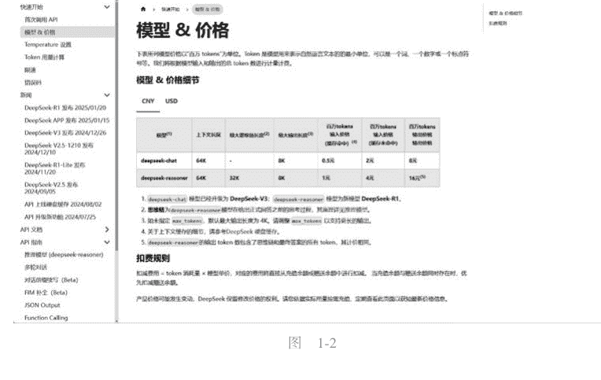

这种设计既降低了个人用户的使用门槛，又满足了企业对定制化、高性能接口的需求。

## 4. 差异的本质

DeepSeek重新定义了AI工具的职场价值密度：

- 单次交互的信息熵是同类型AI工具的3.7倍，通过信息增益算法计算得到。
- 在“需求理解→方案生成→成果交付”的完整链路上，节省了用户73%的中间操作。
- 企业用户续费率高达89%，印证其从“尝鲜工具”到“生产力刚需”的转化能力。

这种差异使其成为首个入选《财富》500强企业标准办公套件的中国AI产品，2024年数据。

### 1.2 DeepSeek能做什么

DeepSeek是一款国产大语言类AI工具，旨在为用户提供高效、智能的服务。它具备强大的自然语言处理能力，能够理解和生成高质量的文本内容，适用于多种场景。

#### 1.2.1 高效工作助手

如果说“职场是战场”，那么DeepSeek就是你的“智能军师”——它不会替代你负责的工作，但能让你一个人变成一个团队。其他AI工具可能需要你像程序员一样写指令，而DeepSeek的厉害之处在于：你只管提需求，它负责把“怎么做”详细地告诉你。

举个例子：早晨你刚到公司，老板就给了你一份20页的行业报告，并说“下午开会要用这份报告的PPT。”换作以前，你可能得花2小时手动挑重点、做图表，但现在只需要单击DeepSeek输入框中的“上传附件”按钮，如图 1-3 所示，在上传完成后输入一句：“从成本分析和竞争格局部分提炼5页PPT大纲，每页都配一个对比图表。”


稍后，你会得到：

DeepSeek 日常提效实录

写收款邮件时不必再纠结标题怎么下。告诉它“催财务部结清第三季度款项”，它会直接给出“关于 Q3 账款结算的温馨提示”这类表述，还备好客气、常规、严肃三套语气任选。

做数据盘点也不用去学 Excel 函数。把数据表截图发过去问“去年卖得最差但利润最高的商品是哪一个”，它不但给出结论，还会顺带分析背后原因。

跨时区约会也更顺手。输入“北京时间周三下午三点开会”，它会自动换算成纽约、伦敦、东京时间，并贴心提示“纽约那边是凌晨两点，建议改期”。

碎片时间也能被盘活。

地铁上收到客户语音，长按转发给它，到公司就能拿到文字摘要和待办清单。
午休看到行业新闻，随手转发并说“下班前给我三条可落地到业务的建议”，临点就能收到干货。

和市面上常见模型相比，差异在于主动推进。用 ChatGPT 时往往要反复校准指令，比如“不要文字要表格”“第三点再具体点”；DeepSeek 更像经验丰富的同事，会追问“需要加入竞品做对比吗”“要不要把华东、华北拆开统计”。它不只回答提问，还会帮你挖出没意识到的需求。

总体而言，价值不只在反应快，而是让复杂的事变简单，让简单的事情开始自动化。

> 提示
上传附件时请注意，DeepSeek 仅能识别文件中的文字内容，支持多种文档和图片，单个文件大小不能大于 100MB，且最多 50 个文件，如图 1-4 所示。


图 1-4

#### 1.2.2 职业发展导师
在职业规划维度，DeepSeek 作为智能问答工具，能提供全流程支持。它既能帮助自我认知、职业探索，也能给出目标设定与路径规划的建议，并持续跟进动态调整。

## 1. 自我认知分析
规划的起点是认识自我。DeepSeek 通过对话引导用户梳理兴趣、性格特质、价值观与能力。
- “我适合哪类职业？”
- “我的性格特点有哪些？匹配哪些行业？”
- “如何评估自己的职业能力？”
在用户补充信息后，结合职业测评工具与心理学理论，产出个性化分析。例如会建议做 MBTI 测试、霍兰德职业兴趣测评，以进一步明确职业倾向。

## 2. 职业探索
探索阶段可借助它了解各职业的特点、发展路径与市场需求。
- “社会工作者的主要工作内容是什么？”
- “心理咨询师的职业前景如何？”
- “怎样了解某个行业现状与发展趋势？”
它会整合权威数据与案例，提供薪资水平、工作强度、发展空间等信息，帮助更全面地认识目标职业。

## 3. 职业目标设定与实施路径规划
方向明确后，需要设定目标并规划路线。
**目标设定：** “如何为医生这条路制定清晰的规划？”
它会建议从短期能力提升到长期成为领域专家逐步推进。
**路径规划：** “社会工作专业的学生怎样成长为专业社会工作者？”
会依据行业特点，提出积累经验的渠道，如志愿活动、实习，以及考取社会工作者职业资格证等。

## 4. 持续支持与动态调整
职业规划并非一成不变，需要随实际情况调整。DeepSeek 可定期回顾进展，结合行业趋势、经济形势等外部变化给出调整建议。
- “我的职业规划是否需要修改？”
- “职业转型期该如何应对挑战？”
它会结合具体情况给出个性化方案，助力不断优化发展路径。通过以上方式，它能充当职业导师，提供专业个性化支持，帮助用户少走弯路。

#### 1.2.3 职场社交参谋
在复杂职场中，人际与社交能力直接影响发展。DeepSeek 可作为职场社交参谋，通过智能分析提供针对性策略，从沟通技巧到冲突化解，助你游刃有余。

## 1. 职场沟通与表达优化
它能打磨职场语言，避免说错话。邮件、会议发言、跨部门协作，只需输入初步想法，会给出优化建议。
- 精准表达：自动识别模糊表述如“尽快完成”，建议改为具体表述如“明天下班前提交初稿”。
- 语气适配：根据沟通对象领导、同事、客户调整风格，体现专业或亲和。
- 场景化模板：提供工作汇报、项目反馈等高频场景的沟通框架，降低临场压力。

## 2. 职业发展与人际关系管理
职场社交是长期关系经营。感到迷茫时可咨询它。
- 人脉策略分析：输入职业目标如“晋升管理层”，会指出需要重点维护的关系及互动频率。
- 信任度提升：通过模拟对话，预判可能引发误解的表述，提供更稳妥的替代方案。
- 资源连接：基于行业和岗位，推荐行业论坛、内部培训等社交场景，拓展人脉更轻松。

## 3. 职场礼仪与文化适应
不同企业、行业、地域礼仪差异大，它能帮助快速适应。
- 礼仪指南：提供线上会议礼仪、商务宴请禁忌等行为规范，避免冒犯。
- 文化解码：分析跨文化团队中的冲突点，如沟通直白度、时间观念差异，给出融合建议。
- 敏感词提醒：自动识别涉及性别、年龄、地域等敏感表达，替换为中性语言。

## 4. 职场冲突与问题解决
面对冲突时，它可充当冷静第三方，提供理性方案。
- 冲突拆解：通过多轮提问，帮助认清矛盾核心，如资源分配不公、职责边界模糊，而非停留在情绪。
- 沟通话术生成：针对拒绝不合理需求、向上级反馈问题等场景，生成既明确立场又维护关系的表达模板。
- 长期关系修复：若冲突已发生，会结合双方立场设计分阶段缓和策略，从非正式道歉到合作重建。
它把职场社交从凭感觉变为靠策略，全方位覆盖进阶需求，助你在复杂人际中保持主动。

#### 1.2.4 贴心生活顾问
DeepSeek 不仅是职场助手，还能成为贴心生活顾问。通过智能分析和个性化建议，高效解决日常生活琐事，从健康管理到家庭事务，提升生活品质。

## 1. 智能日程与健康管理
- **日程优化**：告知待办事项如健身、买菜、工作会议，会自动生成时间分配方案，避免高峰或疲劳时段。
- **健康提醒**：根据作息习惯生成喝水、久坐提醒，并结合天气给出穿搭建议如“今日降温，建议加外套”。
- **饮食规划**：提供冰箱食材清单，会生成营养均衡菜谱及烹饪步骤和时长。

## 2. 家庭事务高效处理
- **账单管理**：将水电费、购物账单告诉它，会汇总成月度消费报告，对比历史数据标注异常支出如“本月电费同比涨30%”。
- **家务分工**：根据家庭成员时间表智能分配家务如“周三晚7点爸爸洗碗”，减少矛盾。
- **旅行规划**：输入出行方式、预算如“亲子游、预算5000元”，会生成含交通、住宿、景点攻略的完整行程。

## 3. 个性化生活建议
- **购物决策**：对比商品参数时提炼关键差异如两款空气净化器净化指标对比，助力理性选择。
- **应急方案**：遇到突发情况如水管漏水，提供分步应急指南并推荐附近维修服务的评分和联系方式。
- **学习陪伴**：根据碎片时间如每天通勤30分钟，设计语言学习、技能提升的微课程计划。

## 4. 情感与生活平衡
- **压力缓解**：通过问答分析情绪状态，推荐放松方式如15分钟冥想引导或喜剧电影清单。
- **社区资源整合**：根据定位推送本地便民信息如小区周边新开洗衣店优惠活动。
它可全方位覆盖生活场景，并依据个人习惯不断优化建议，让你在忙碌工作中轻松管理生活。

#### 1.2.5 兴趣爱好伙伴
把 AI 当成“兴趣探索放大器”。虽然 DeepSeek 没法代为采购装备

## 1. 个性化学习规划师
只需描述兴趣目标，它会化身全科导师搭建系统学习路径。
> “我想在三个月内学会基础水彩画法”
- 工具认知期第一周：推荐性价比高的颜料纸张组合，解释笔刷特性，用“水彩与丙烯吸水性对比”帮助理解材料本质。
- 技法训练期第二至六周：每日推送专项练习如“湿画法晕染控制”，附大师作品解析和常见失误案例。
- 创作实践期第七周起：按你喜爱的风格如宫崎骏动画场景生成临摹清单，并教授“如何将照片转化为水彩草图”的技巧。
整个过程支持随时调整，如对“留白液使用时机”产生困惑，会用“煮沸牛奶表面结膜”的生活化类比帮助理解。

## 2. 随身技能教练
遇到具体问题时，通过场景模拟和细节追问突破瓶颈。
> “拍人像总是表情僵硬”
- 环境分析：“你常在室内还是户外拍？试过逆光拍摄眼神光吗？”
- 设备追问：“用85毫米定焦时，是否尝试让人物走动捕捉动态瞬间？”
- 案例对比：展示布列松《决定性瞬间》构图逻辑，建议在“地铁闸机开合瞬间”等场景抓拍训练。
还支持跨领域迁移，如吉他手速弹卡顿，会用“短跑运动员起跑姿势调整”类比手腕发力，甚至生成含肌肉放松操的每日练习表。

## 3. 脑洞创意激发器：打破常规的思维碰撞机
它擅长用跨界知识重组点燃创作火花。
> “如何设计赛博朋克风格纸质建筑模型？”
- 元素解构：提取霓虹灯管、机械齿轮、全息投影等标志符号。
- 材料创新：建议用锡纸模拟金属质感，用手机闪光灯加彩色糖纸打造光污染效果。
- 技术嫁接：引入折纸几何学的“三浦折叠法”，教你制作可伸缩变形的未来主义墙面。
对于开放性需求：
> “想写科幻小说但缺灵感”
- 从生物学角度构想“光合作用供电的外骨骼装甲”。
- 结合区块链设计“记忆数据化伦理困境”剧情线。
它甚至会用“如果秦始皇拥有星链技术”这样历史科幻命题激发灵感。
作为兴趣伙伴，它不仅帮助发展兴趣、学习技能，还能解惑答疑，成为探索路上的好导师。

#### 1.2.6 情绪树洞
虽然 DeepSeek 缺乏人类情感，但能通过结构化对话成为随时待命的情绪支持伙伴，做好倾听者和情绪解码器。无论工作压力、人际困扰，还是突如其来的忧伤，都能提供安全私密倾诉空间，借助逻辑分析和知识储备帮助找到突破口。

## 1. 非评判性倾听：释放情绪的缓冲带
当你在对话框中输入：
> “今天好累，感觉做什么都没意义”
- 情绪标注：识别为职业倦怠或短期目标缺失，反馈“听起来你正处能量低谷”。
- 细节追问：渐进提问理清压力源“这种感受一天中何时最强烈？上周完成项目时是否也有类似体验？”。
- 认知重构：用“程序员调试代码”类比，引导将情绪视为需优化的系统信号，而非个人失败。
全程不说教，会提醒“需要我安静倾听，还是一起分析原因？”

## 2. 情绪应对工具箱：从宣泄到行动转化
根据对话提供可操作缓解策略：
> “焦虑到失眠”
提供“4-7-8呼吸法”，并解释延长呼气如何触发副交感神经反应。
当你倾诉：
> “被同事排挤”
- 事实层：对方最近三次具体行为是什么？
- 认知层：是否还有其他解读角度？比如项目压力导致团队氛围变化？
- 行动层：提供用“观察+感受”公式进行非暴力沟通示例。
还能设计“5分钟情绪急救包”，如推荐适合心情的音乐风格，并给出科学解释“后摇滚渐进结构有助于焦虑释放”。

## 3. 长期情绪档案：看见自己的成长轨迹
通过对话记录功能：
- 绘制情绪波动图谱：每月生成可视化报告，标记高频关键词，发现“每周三下午情绪低谷”等规律。
- 建立应对案例库：当你说“和上次吵架时一样难受”时，它会调取历史对话，对比两次事件中认知变化。
- 定制自我关怀方案：根据倾诉偏好理性分析或情感共鸣动态调整回应方式。
使用时可注意结合技巧：精准启动，在描述时用“情绪标签+具体场景”提问，如“职场焦虑，如何在汇报前快速平静？”；若想要专业结构化疏导，可输入“请用认知行为疗法框架分析我的以下想法”。

### 1.3 如何注册 DeepSeek
使用 DeepSeek 如同打开智能世界便捷之门，注册仅需几分钟。网页端或手机 App 都能通过简洁界面快速完成，输入手机号获取验证码、设置密码、勾选协议，无需复杂资料或人工审核。

#### 1.3.1 网页端注册
网页端零门槛，跨设备兼容，浏览器打开官网即可三步创建账号。
1. 启动浏览器，搜索“DeepSeek”，进入官方网站，如图 1-5 所示。
2. 进入官网后，点击首页“开始对话”选项，如图 1-6 所示。
3. 自动跳转至登录界面，如图 1-7 所示。用户可选择手机号或微信登录，未注册时选手机号会自动注册；微信登录需先绑定手机号。
4. 完成注册后自动登录并跳转至使用界面，如图 1-8 所示。

#### 1.3.2 App 端注册
客户端让智能对话触手可及。以 iOS 为例展示流程。
1. 打开手机“App Store”，点击右下角“搜索”，输入关键词“DeepSeek”，点击“search”按钮，如图 1-9、1-10 所示。
2. 搜索结果中点击“DeepSeek”，进入简介页点击“获取”按钮，如图 1-11、1-12 所示，同意下载后开始下载。
3. 下载完成后点击桌面“DeepSeek”图标打开软件，同意用户协议和隐私政策后，如图 1-13 所示，进入注册界面，如图 1-14 所示。
4. 输入手机号获取验证码，输入验证码即可自动注册，如图 1-15 所示。注册后进入对话界面，如图 1-16 所示。

#### 1.3.3 3种登录方式
注册后可通过以下三种方式登录，灵活应对不同场景。
## 1. 手机验证码一键登录
最快捷方式之一。登录页面输入注册绑定的手机号，点击“获取验证码”，60秒内输入短信6位数字即可完成登录，无需记忆密码。
## 2. 账号密码登录
习惯传统方式的用户可选择此项。邮箱注册时需设置密码，完成密码与手机号绑定后，输入手机号/邮箱和密码即可进入系统。
## 3. 第三方账号授权登录
DeepSeek 支持微信、Apple ID 等授权登录。网页版仅支持微信扫码登录，点击“使用微信扫码登录”按钮，如图 1-17 所示，扫码授权并绑定手机号后自动关联账号，避免密码泄露且可同步头像昵称。iOS 客户端额外提供 Apple ID 登录选项，如图 1-18 所示。

# 第2章 快速上手DeepSeek
本章介绍 DeepSeek 的交互界面、对话管理方式和内容输出方式。学习后可快速上手并获得更好对话体验。

### 2.1 交互界面
登录后，交互界面与多数语言类 AI 产品类似，分为结果展示区和输入框两部分。

#### 2.1.1 输入框的使用技巧
作为新手，掌握输入框基本操作是第一步。本节以直观方式展示如何快速上手这个智能对话入口。

##### 1. 向 DeepSeek 提问

DeepSeek 高效使用手记

登录后，屏幕中央的主提问区域会第一时间出现，见图2-1。

与平台交流时，只要在该区域键入或粘贴文字，编辑完毕后点按提交键或使用回车即可发出提问，见图2-2。

##### 2. 附件导入操作

提问也可以依托外部文件。点按提问区里的“导入附件”图标，见图2-3，会弹出系统文件选择窗口，从中挑选待加入的文档，选中后确认打开，见图2-4。

文件在传输期间，提问区顶部会给出正在导入的状态提示，见图2-5。

导入结束后，提问区顶部会列出已载入的文件名与体积，此时可在同一区域补充提问内容，见图2-6，随后再点提交或回车发起。

> 提示
> 使用文件提问时，在线检索会处于不可用状态。

##### 3. 模型选择与切换

平台目前提供 DeepSeek-V3 与 DeepSeek-R1 两种引擎，两者在定位上各有侧重：V3 擅长日常快问快答，R1 则聚焦复杂难题并更专业。

未勾选提问区下方“深度思考 R1”开关时，见图2-7，系统默认调用 V3 引擎生成回复。

使用 V3 时返回的答案通常较为简洁，见图2-8。

勾选“深度思考 R1”后即可切换至 R1 引擎进行生成，见图2-9。

针对同一问题，R1 给出的内容更为详尽，并会展示完整的思考过程，见图2-10。

##### 4. 在线检索

平台自带的知识库截止于 2023 年 12 月，若需要更新的信息，就要启用联网检索。勾选提问区下方的“联网检索”开关即可开启该能力，见图2-11。

开启后，平台在生成答案的同时会自动检索网络，产出的结果见图2-12，并在末尾标注引用网页来源，便于核查。

#### 2.1.2 结果展示区解读

结果展示区是人机交互的核心窗口，遵循极简主义思路。与同类工具不同，这里被划分为思考区与回答区，在降低认知与操作门槛的同时保障输出质量。

##### 1. 深度思考：专注处理环节

当任务较为复杂且选用 R1 引擎时，提问后会进入思考阶段，见图2-13。

思考区会以分步形式呈现逻辑推演，比如问题拆分、数据关联、假设检验等。使用者在核验答案可靠性时，可依据此处推演判断其是否符合专业常识；若需优化答案，也能针对某一步推演提出追问。以图2-13 为例，若对推荐书籍的主题不感兴趣，可追问：“我对爱情主题的经典文学不感兴趣，请重新推荐。”

思考区占用的屏幕面积较大，若只想查看最终答案或想节省空间，可点击区域旁的小三角按钮进行折叠，见图2-14。

折叠后界面见图2-15。

##### 2. 生成回答：清晰呈现

回答区是获取最终结论的主要载体，采用降噪式设计，通过清晰的视觉分层与结构化排版提升信息传递效率与专业感。依据官方文档的 A/B 测试，该区域在信息密度与可读性上的平衡使平均阅读效率提升 28%。思考完成后，系统开始生成具体回答，完成后见图2-16。

为了便于理解与快速定位重点，回答时会使用多级标题、重点标注、表格等形式，见图2-17。

整体呈现“核心结论-关键论据-行动建议”的分层归纳，简明易懂、重点突出。凭借独特的训练模型，平台能根据不同身份生成最合适的答案。

这种“结构化输出+场景化交互”的做法在保持专业性的同时大幅降低了信息处理成本。2024 年第一季度调研显示，87% 的使用者在 3 次使用后即可熟练使用回答区。

## 3. 双区联动：协同提升效率

据刊载于 GitHub 社区的官方对比测试，同时关注两个区域的使用者，其后续提问的准确度平均提升约 37%。

初级使用者可优先阅读回答区获取直接结论，进阶使用者则可结合思考区锻炼批判性思维。

案例演示：
提问“如何设计一个用户增长方案？”
- 思考区逐步展开：市场分析→竞品策略提炼→资源匹配度评估→风险预判。
- 回答区则输出包含 KPI、执行时间轴、预算分配表的结构化方案。

该设计既满足职场效率需求，也为专业使用者提供可验证、可迭代的智能服务体验。

#### 2.1.3 导航与快捷操作

界面结构清晰，掌握导航与快捷操作后即可迅速定位重点。

### 1. 网页端布局

网页界面可分为对话区、侧栏与个人设置三大部分，见图2-18。

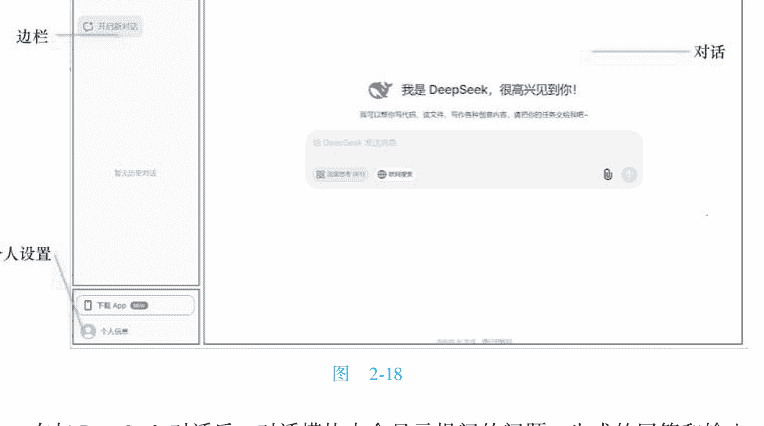

对话结束后，对话区会展示提问、生成结果与提问区，侧栏则罗列全部历史记录，见图2-19。

若侧栏展开影响浏览，可点击“收起侧栏”按钮将其隐藏，见图2-20；需要时再点“展开侧栏”按钮即可恢复，见图2-21。

点击界面左下角的头像，会弹出个人设置菜单，见图2-22，可快速进行系统设置、清除全部对话、联系官方与退出登录等操作。

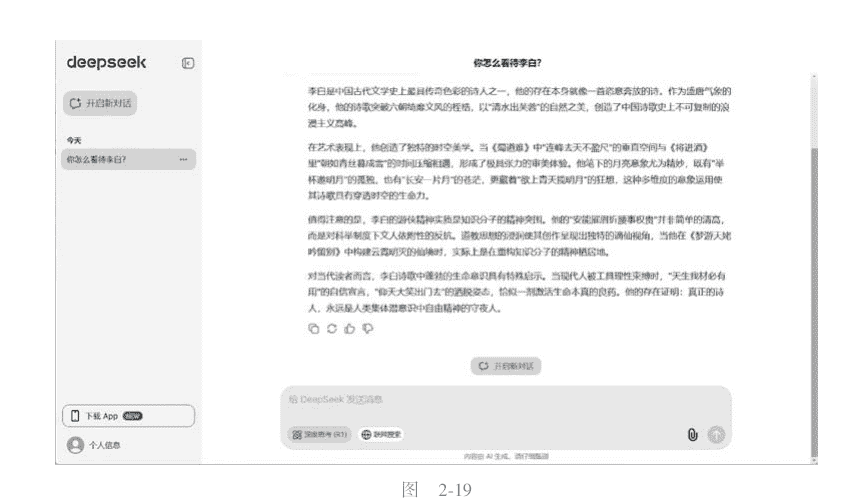


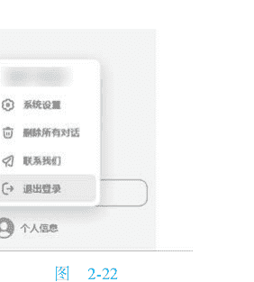

系统设置中可选择使用语言与主题色，见图2-23；也能进行账户信息相关设置，见图2-24。


### 2. 移动端布局

相较网页端，App 界面更为精简，见图2-25。注意网页端默认展开的侧栏在 App 端默认收起。右上角的 ⊕ 按钮用于新建对话。

点按左上角的“侧栏”按钮即可展开侧栏，见图2-26。

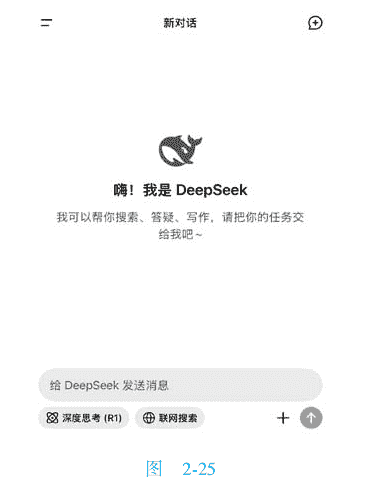

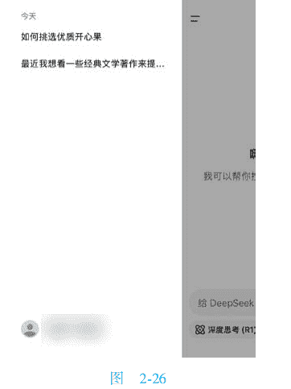

展开后可看到历史记录，长按某条记录会弹出操作菜单，见图2-27。

不同于网页端，App 底部的“更多”按钮中提供了专属功能：拍照识文字，见图2-28。


#### 2.2.1 创建对话与切换对话

在平台中，新建或切换对话是高效管理任务的基础。提问、项目讨论或数据分析等场景下，记录都会自动保存，便于回顾、整理与复用。

##### 1. 新建会话

首次使用时，直接在提问区输入问题并发送即可自动创建对话。已有对话时需点按提问区上方的“开启新对话”按钮，见图2-29，才能新建。


也可以在侧栏中点击“开启新对话”按钮创建，见图2-30。

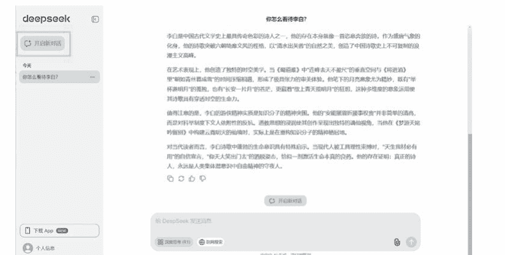

即使侧栏处于收起状态，仍可点击该按钮新建对话，见图2-31。

##### 2. 切换会话

所有对话以标签形式排列于侧栏，点击标签即可切换，操作逻辑类似浏览器多标签，见图2-32。当前打开的对话会以高亮底色提示。

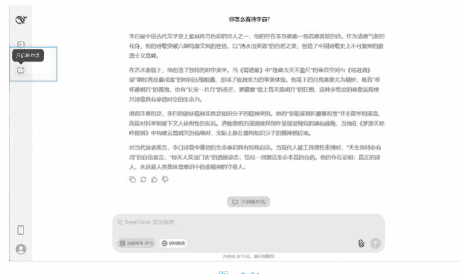

图 2-31


图 2-32

#### 2.2.2 记录管理与删除

新建后对话会显示在侧栏，见图2-33。随着使用时间增长，条目会增多，需要整理。

点击对话后的三点按钮可展开操作菜单，见图2-34，目前仅支持重命名与删除。


##### 1. 重命名会话

系统默认以对话首个问题的全部内容作为标题，过长时会省略，不利于检索。可执行重命名，简单概括对话内容。执行后侧栏标题变为可编辑输入框，见图2-35。

##### 2. 删除会话

删除更为直接，执行删除命令后点击弹窗中的“确认”按钮即可，见图2-36。


#### 2.2.3 历史记录回溯与复用

作为大语言模型，平台会记忆上下文，参考历史记录并在对话中学习，从而构建更复杂的交互与自定义场景。

回溯历史前需先有对话，见图2-37。

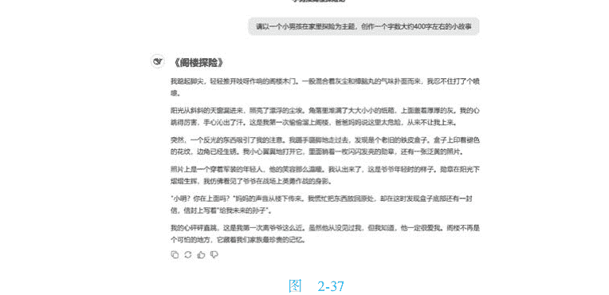

系统会根据当前主题自动调整历史上下文的引用权重。例如在持续讨论“用户增长策略”时，会优先关联“A/B 测试数据”“漏斗模型”等关键节点，而非机械记忆全部内容。使用者更新需求后，系统会将新需求与历史记录结合进行思考，见图2-38。

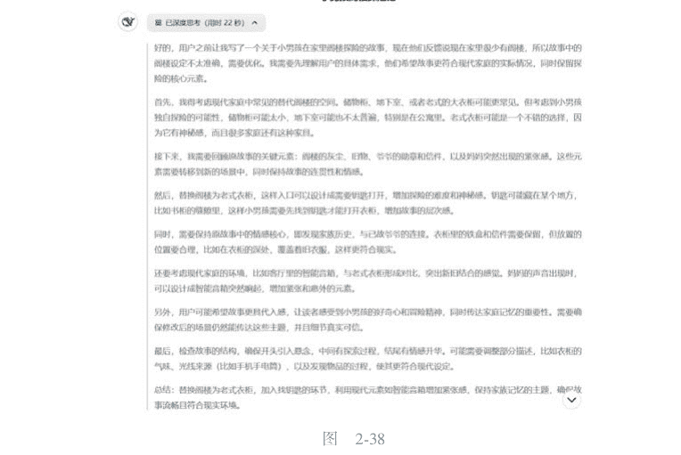

当新旧对话出现逻辑矛盾时，平台借助深度思考与知识图谱技术，自动建立跨对话的概念关联，优化回答，见图2-39。

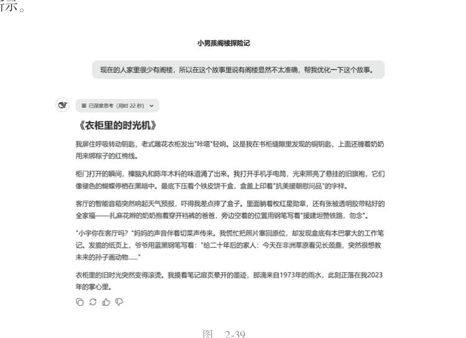

#### 2.3.1 文本排版技巧

在平台中排版无需像 Word 那样繁琐，通过聊天方式即可让文字呈现专业感。

##### 1. 用符号实现快速排版

平台支持 Markdown 轻量排版，可让平台以 Markdown 代码形式输出结果，复制粘贴到在线编辑器 https://dillinger.io/ 后即可自动排版，见图2-40。

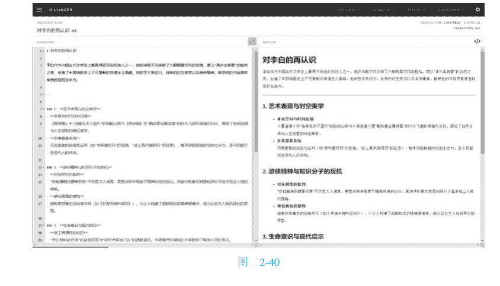

##### 2. 智能表格生成

无需手动绘线，打字即可生成表格。

例如在提问区中输入：

```
| 产品 | 销量 | 增长率 |
|------|------|--------|
| 手机 | 1200 | +18%   |
| 平板 | 800  | +35%   |
```

并要求生成表格，即可得到美观表格，见图2-41。

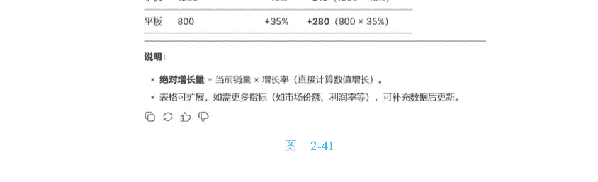

若不满意，可直接要求“生成一个三列的产品对比表”，系统会自动搭建框架。

#### 2.3.2 图表辅助生成

只要描述清楚需求，平台就能生成专业图表，大幅提升思维导图、流程图等的制作效率。

##### 1. 思维导图制作

思维导图有助于创意提炼、产品规划、笔记整理、写作构思等。可先让平台生成大纲，再在对应平台快速成图。

例如生成《小王子》读书笔记的思维导图，先提问让其输出内容，见图2-42。

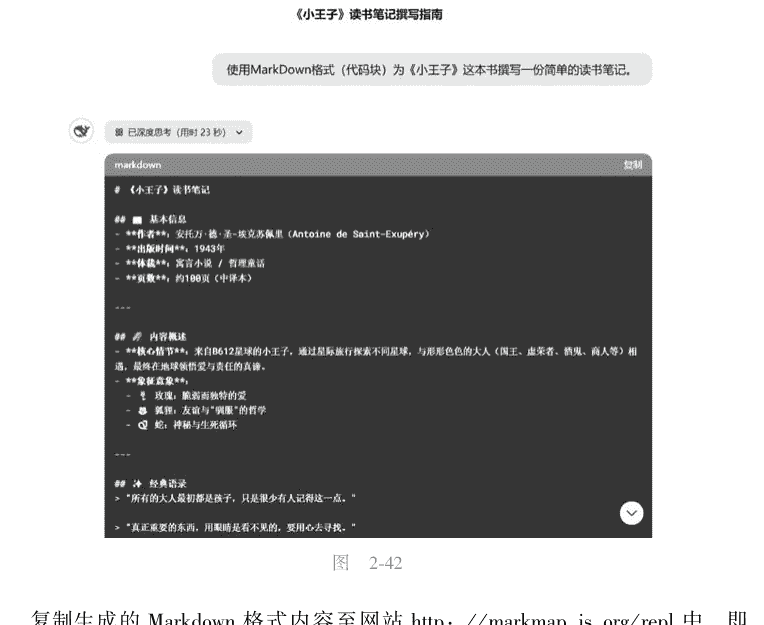

将生成的 Markdown 内容复制到 http://markmap.js.org/repl 中即可生成导图，见图2-43。

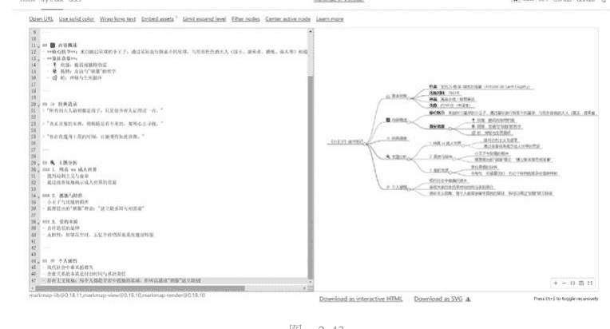

图 2-43

##### 2. 流程图制作

流程图用于展示系统或流程的步骤、顺序与条件，帮助理解与优化工作流程。

使用平台生成流程图需先生成 PlantUML 代码，见图2-44。

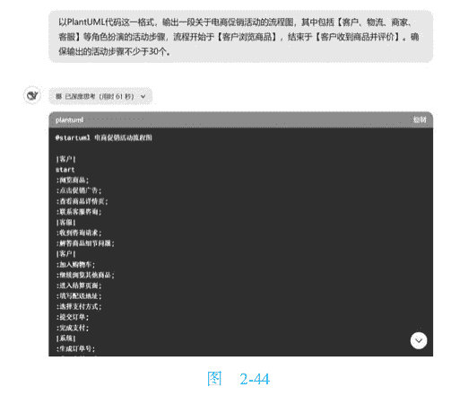

图 2-44

随后打开 www.draw.io，点击弹窗中的“稍后再决定”，见图2-45。

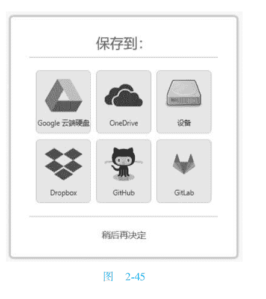

见图2-46，选择“PlantUML”选项。

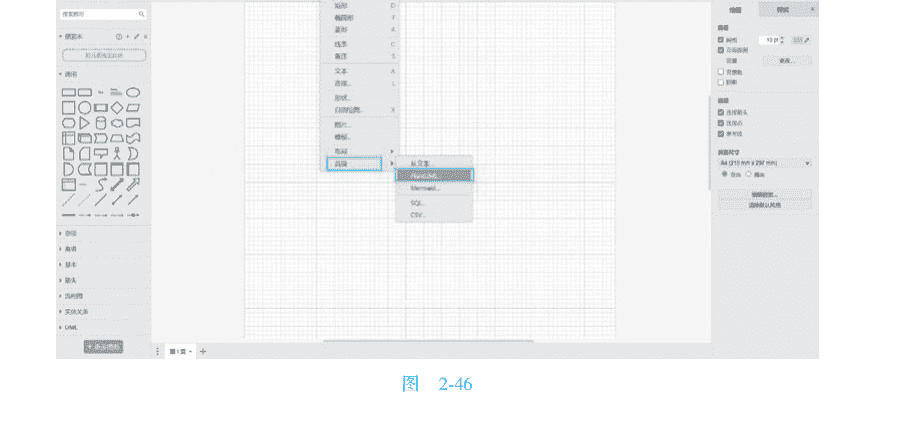

把前面生成的 PlantUML 文本粘贴到输入框并点“插入”，见图2-47。

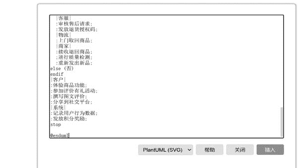

图 2-47

系统会依据代码自动生成清晰美观的流程图，见图2-48，保存即可。

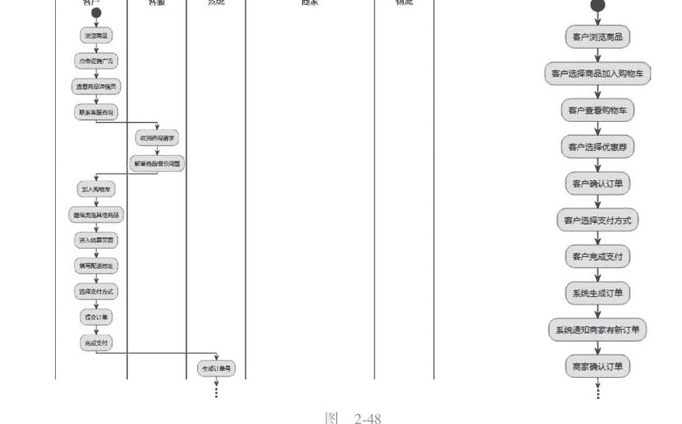

图 2-48

#### 2.3.3 复制粘贴操作

复制粘贴以“零损耗迁移”为目标，通过智能格式适配实现从 AI 生成内容到工作场景的无缝衔接。支持富文本精准保留如代码高亮、表格结构，并兼容 Office、Notion、微信等 20 多种常用工具。官方兼容性测试报告显示，结构化内容复制准确率达 96%。

一般回答时，可直接点击回答下方“复制”按钮，见图2-49。

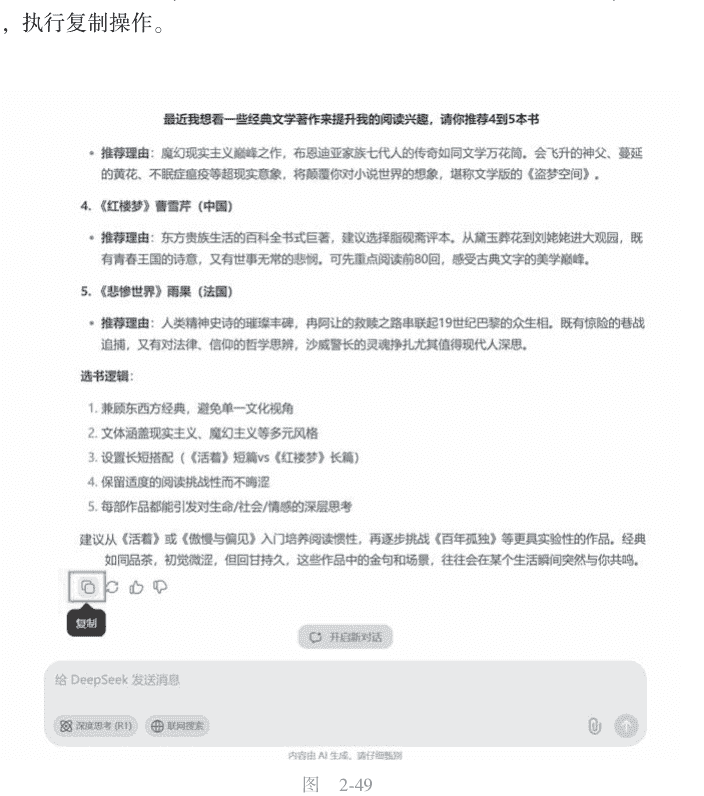

在与其它软件结合排版时，可点击代码区右上角的“复制”按钮，仅复制代码部分。粘贴时使用系统粘贴快捷键即可完成。

# 《小王子》读书笔记撰写指南

```
# 《小王子》读书笔记

## 📖 基本信息
- **作者**：安托万·德·圣-埃克苏佩里（Antoine de Saint-Exupéry）
- **出版时间**：1943年
- **体裁**：寓言小说 / 哲理童话
- **页数**：约100页（中译本）

---

## 📝 内容概述
- **核心情节**：来自B612星球的小王子，通过星际旅行探索不同星球，与形形色色的大人（国王、虚荣者、酒鬼、商人等）相遇，最终在地球领悟爱与责任的真谛。
- **象征意象**：
  - 🌹 玫瑰：脆弱而独特的爱
  - 🦊 狐狸：友谊与“驯服”的哲学
  - 🐍 蛇：神秘与生死循环

---

## 💡 经典语录
> "所有的大人最初都是孩子，只是很少有人记得这一点。"

> "真正重要的东西，用眼睛是看不见的，要用心去寻找。"

> "你在玫瑰身上花的时间，让她变得如此珍贵。"

---
```


# 第3章 问对问题，答案才值钱

前两章讲的是怎么打开 DeepSeek 的门，这一章讲进门以后该怎么说话。模型再强，也受限于输入。把提问的逻辑拆清楚，从基础规则到进阶打法，帮你从“能问”升级到“问得准”，让 AI 从被动回复变成主动推演的伙伴。

### 3.1 提问的原则和方法

对话里，输入的清晰度直接决定输出的可用性。可以把 DeepSeek 看成推理引擎，你的指令就是启动码。只有按对逻辑喂信息，它才读懂真实意图，给出能落地的结果。

#### 3.1.1 先把问题收敛到点上

沟通里，先把问题问准，后面的答案才可能对。含糊、太宽的说法会把模型带进猜谜，而把要点说透的提问能直接点燃深度分析。下面给一套收敛思路，帮你从混沌想法里提炼关键信息，实现一次就打中。

##### 1. 聚焦三步

**第一步：自检目标。**
发问前用一句话把目标钉住，比如“我要一份适配初创企业的股权分配参考模板”，而不是空泛的“股权怎么分”。提问时主动剔除冗余，把“背景资料”和“真正要的”分开，避免细节把主线冲淡。

**第二步：拆到最小可用单元。**
碰到复合需求，就拆成可执行的子问题逐条给，让模型能按部就班处理。

**案例对照：笼统表达 vs 清晰表达**

在 DeepSeek 面前，笼统的说法很难拿到好结果，清晰的说法才能快拿到解法。对照见表3-1。

表3-1

| 场景 | 笼统表达 | 清晰表达 |
| :--- | :--- | :--- |
| 职场写作 | 要个演示稿 | 为 AI 客服系统升级准备融资路演材料，需围绕技术壁垒、竞品差距、投资回报展开，每页配数据图并用一句话收束结论 |
| 法律咨询 | 这合同有啥问题 | 请审阅这份跨境供货合同，重点看违约责任是否覆盖物流延误风险，并标出建议修改的条款序号 |
| 学习规划 | 怎么学 Python | 我是零基础的上班族，想做数据分析和办公自动化，请给一份 3 个月学习安排，每周投入约 5 小时 |

**常见坑与避坑办法**

坑1：问题太大，比如“怎么成功”。对策：加上边界，如行业、阶段、资源等限定。
坑2：藏着没说明的假设，比如“按常规来”里的常规没定义。对策：把常规在具体语境里的含义写明。
坑3：一次塞多个独立问题，比如“怎么招程序员又要设计绩效”。对策：拆成多轮或分点提问：“第一，给程序员面试题库；第二，给技术岗 KPI 模板。”

把核心先拽住，就能大幅减少无效拉扯，让首轮回复就直击痛点，成为真正的效率放大器。

#### 3.1.2 背景给够，答案才有边界

提问时背景的完整度与精准度，直接决定回答的天花板。下面梳理背景的价值维度，帮你搭建高信息密度的提问框架。

**1. 为啥要补背景**
DeepSeek 虽然推理强，但仍遵循输入定输出的基本规律。据其 2024 年《智能交互优化白皮书》披露，补充背景可让回答准确率提升 63%，相关度提升 78%。
无背景提问：“怎么写邮件？”→ 得到通用模板，缺乏针对性。
有背景提问：“我是一名医疗器械销售，要给三甲医院采购主任发新品推广邮件，对方看重临床数据、反感营销话术，请用专业克制的语气撰写。”→ 可生成含循证参数、学术会议邀约的定制化内容。

**2. 背景信息的四要素**
基于对话分析，优质背景应包含表3-2的结构化信息。

表3-2

| 要素 | 作用说明 | 示例对比 |
| :--- | :--- | :--- |
| 情境定位 | 界定问题发生的具体情境 | 错误：改简历<br>正确：投递大厂用户研究岗，需突出 B 端调研经验 |
| 身份定位 | 明确提问者及相关方身份 | 错误：帮我写演讲稿<br>正确：作为应届毕业生代表，在毕业典礼上向校企合作企业高管致辞 |
| 目标与限制 | 设定预期效果与边界条件 | 错误：给我活动方案<br>正确：策划社区老年读书会，预算不超过 2000 元，需含健康养生主题 |
| 现有认知 | 说明已有认知或特殊要求 | 错误：解释区块链<br>正确：向金融专业大学生讲解，结合央行数字货币案例，避免术语堆砌 |

**3. 动态分层披露法**
复杂问题建议用洋葱式披露：
- 核心层：与问题本质直接相关，如“正在审核跨国并购中的竞业限制条款”。
- 中间层：影响决策的上下文，如“收购方为欧洲新能源企业，被投方核心团队有华为背景”。
- 外围层：潜在相关但非必需，如“交易需在 Q3 完成以配合上市计划”。

渐进释放信息可避免过载，也能引导多轮深化。例如合同审查先给类型与重点，得到初步意见后再补监管细节。

**4. 典型场景参考**

职场文档撰写：文档类型为跨境电商运营季度复盘演示，受众为 CEO 与投资人，核心诉求为突出东南亚增速、弱化物流成本上升，数据权限为可公开财报截至 2024Q2，视觉要求含动态增长地图。

法律咨询：当事人为个体餐饮店主，事件为顾客以食物变质索赔 10 万元，现有证据为监控显示顾客自带食材但辨认不清，地域为上海市静安区，紧急程度为收到律师函需 3 日内回复。

创意生成：主题为科技伦理短视频脚本，风格参考某电影并用三幕式，时长不超过 90 秒，禁忌元素为宗教隐喻，目标受众为 Z 世代科技爱好者。

**5. 误区与优化**

信息过载：堆砌公司发展史等无关细节。优化：用 5W2H 过滤。
关键缺失：未说明地域政策差异。优化：增加地域+行业+特殊情形校验清单。
主观预设：“我觉得用户喜欢这个设计”。优化：改为“用户画像显示 25~35 岁女性占比 68%，据此优化 UI 配色”。

结构化提问不仅提升协作效率，也培养系统性思维。

#### 3.1.3 用案例牵着提问走

通过具象案例激活模型认知框架的提问策略。DeepSeek 研究团队 2024 年测试显示，该方式可使回答准确率提升 41%。

**1. 原理**
提供具体案例后，模型会先解析案例的关键特征，检索相似历史案例，提取已验证的处理方法，再按当前需求调整细节，保留通用原则、修改特有表述。通过比对、提炼、适配实现经验迁移。
如“某快消品牌通过小红书 KOC 种草实现新品冷启动”，提问时模型会激活社交媒体营销模块，并关联用户裂变、内容矩阵等子策略。

**2. 有效实例的四步搭建**
引用实例前可用 STAR-C 结构化信息，见表3-3。

表3-3

| 要素 | 说明 | 应用示例 |
| :--- | :--- | :--- |
| Situation | 原始场景特征 | 独立站客单价 120 美元，主要市场北美 |
| Target | 待解决目标 | 将广告 ROAS 从 2.5 提升至 3.8 |
| Action | 已尝试方案 | 测试视频网站动态创意广告组合 |
| Result | 结果/问题 | CTR 提升 15%，转化率下降 8% |
| Constraint | 新增约束 | 月度广告预算不超过 2 万元 |

**3. 案例类型与选用策略**
案例详细度越高，回答质量提升越大，见表3-4。

表3-4

| 类型 | 适用场景 | 示例框架 | 质量提升幅度 |
| :--- | :--- | :--- | :--- |
| 微案例 | 简单问题 | “像生椰拿铁的爆品命名逻辑” | +29% |
| 全案例 | 中等复杂度 | “参考小米社区运营模式设计会员体系” | +53% |
| 对比案例 | 决策类问题 | “对比喜茶与蜜雪冰城联名策略优劣” | +67% |
| 失败案例 | 风险规避类 | “分析某 VR 硬件因忽略晕动症而失败” | +82% |

**4. 跨域迁移技巧**
无同行业案例时可用本质抽象法。先提取核心模式如“模块化架构+并行作业”，映射到目标领域如在线教育课程开发，再生成提问。

**5. 误区与优化**
案例过载：一次引用 5 个以上导致混乱。优化：采用 1 正 1 反对照法。
特征失焦：遗漏关键差异点。优化：补充差异声明。
数据失真：描述模糊。优化：量化关键指标。

#### 3.1.4 设计提示词提问

提示词是用户输入给 AI 的指令，用于引导特定输出。简单说，提示词就是与 AI 对话的语言。

**1. 基本结构**
明确指令：清晰说明操作方式，如“请生成”“请分析”。
背景信息：提供上下文帮助模型理解场景。
输出要求：指定格式、长度、风格。

**2. 设计技巧**
分步提问法：把复杂任务拆成步骤逐步推进。
角色设定法：赋予模型专业身份提升专业度。
示例引导法：给出风格样例让模型模仿。
多角度补充指令：限定政策、技术、偏好等多维度。

**3. 常见问题与优化方案**
见表3-5。

表3-5

| 问题类型 | 问题示例 | 优化方案 |
| :--- | :--- | :--- |
| 指令笼统 | 帮我写个方案 | 补充行业、目标、格式 |
| 缺乏限制 | 介绍项目管理方法 | 指定方法论类型或应用场景 |
| 多重混杂 | 如何促进增长并设计海报？ | 拆分为独立问题依次提问 |
| 忽略反馈 | 直接放弃不理想答案 | 通过追问细化需求 |

**4. 实践演示**
场景需求：为智能手表品牌策划小红书推广文案。设计提示词时需明确品牌调性、目标人群、投放阶段、文案形式与数量要求，再逐步细化标题、痛点、行动号召等要素，以获得可直接使用的投放素材。

从模糊需求到可执行指令：提示词升级手记

最开始的表达非常宽泛：
给我几条小红书推广文案。

升级后的指令：
请你扮演数码产品营销专家，为一款主打健康追踪与颜值兼顾的智能腕表创作 3 条笔记，要求标题带表情并围绕上班通勤场景展开；正文要分痛点梳理、功能解读、使用场景演示三部分；结尾加上 #运动穿搭 #科技美学 等话题；语气要年轻化，参考头部创作者的表达习惯来写。

把条件写清楚后，DeepSeek 的产出质量和效率会明显提升。

### 3.2 按问题类型设计提问方式

和大模型对话时，问题的类别直接决定答案的深度和广度。DeepSeek 可覆盖事实查找、方案制定、灵感激发、开放讨论等多种需求，但每类需求都有更匹配的问法。本节围绕事实查找、方案制定、灵感激发、开放讨论四大常见类型，拆解特征与技巧，帮助通过精准指令拿到结构化且可落地的结果。

#### 3.2.1 事实核查型提问

事实核查是与 DeepSeek 互动的基础类型，目标是快速准确拿到特定事实或知识。模型知识面广、语义理解强，但问题质量决定结果的精准度，用对方法才能得到满意答案。

## 1. 提问技巧与解析

提问前先掌握技巧，才能避免无效输出。

(1) 先厘清提问类别，再锁定要点
1) 概念界定型：直接点明概念，可附加限定条件。
比如：
❌ 模糊问法：“量子计算是什么？”
✅ 精准问法：“请用大白话说明量子计算的工作原理，并列出 3 个已落地的应用场景。”
对比来看：前者容易得到笼统定义，后者能输出原理加案例的结构化说明，便于快速理解。

2) 数据获取型：必须标明时间、地域或行业边界。
比如：
❌ 宽泛问法：“全球智能手机销量数据。”
✅ 限定问法：“2023 年二季度中国智能手机市场前三品牌的占有率及同比增速是多少。”
对比来看：后者可给出具体数值和对比分析，避免得到泛泛的行业综述。

(2) 拆分复杂需求
多维度检索可通过分步问或逻辑符号提升效率。
比如：
❌ 混杂问法：“Python 和 Java 的区别以及各自适合的开发场景，还有学习难度对比。”
✅ 分项问法：“请分点说明：
1) Python 与 Java 在语法特点、运行效率方面的核心差异；
2) 两者分别适合哪些开发类型，各举 2 个案例；”

## (3) 利用交互特点提升质量

1）追问核实：对不确定信息要求标注来源或补充依据。
比如用户问：《巴黎协定》中发达国家承诺的气候资金具体金额是多少？
模型回：据协定，发达国家承诺到 2025 年每年共同筹集 1000 亿美元…
> ✅ 后续追问：该数据出自联合国官方文件还是媒体报道？请给出具体出处。

2）多轮递进：补充条件逐步优化答案。
初始提问：推荐 5 本人工智能入门书籍。
追问后：请排除纯理论教材，侧重实战类，并补充豆瓣评分和适合人群。

### 2. 常见误区与改进办法

表 3-6 整理了信息查证类提问的典型误区与改进方式。

### 3. 提问演练
- 基础问法：“诺贝尔奖历届得主。”
- 进阶问法：“列出 2010～2023 年女性诺贝尔物理学奖得主，并简述其研究成果的应用价值。”
- 终极问法：“对比 2020～2024 年诺贝尔经济学奖得主的核心理论，分析对当前全球经济复苏的指导意义，要求用表格呈现关键论点。”
问题描述越具体、结构越清晰，模型越能给出有深度和实用价值的答案。

#### 3.2.2 方案设计型提问

方案设计的目标是获得针对特定场景的可执行策略或系统方法。与事实查找不同，此类提问需要模型融合需求、场景限制和潜在变量，输出逻辑严密、步骤清晰的行动方案。

## 1. 提问技巧与解析

方案类提问更侧重结构拆解和信息供给。提问后还可让模型通过逻辑推演验证可行性与风险。

（1）任务拆解：把复杂问题拆成可操作的子任务
比如：
❌ 概括问法：“我的团队效率低，怎么办？”
✅ 结构化拆解：“我们是 10 人跨境电商团队，因需求频繁变更导致延期。请提供：
- 需求优先级管理工具推荐及操作流程；
- 降低沟通损耗的会议制度建议；
- 激励成员主动应对变化的 3 个具体策略。”

（2）还原具体场景：用角色+场景+限制条件提升针对性
比如：
❌ 抽象问法：“如何做好客户拜访？”
✅ 场景化问法：“我是一名新能源销售新人，明天首次拜访某制造企业采购总监，推广光伏储能系统。请设计：
- 30 分钟面谈议程（含破冰话术）；
- 针对高电费痛点的 3 个提问策略；
- 客户称‘已有稳定供应商’时的应对方案。”

初始提问：“如何用 5000 元预算策划一场线下读书会？”
追加提问：“请评估‘联合咖啡馆举办’的潜在风险，并给出备选场地标准及成本对比表。”

### 2. 常见误区与改进办法

表 3-7 总结了方案类提问的误区与纠偏方法。

### 3. 提问演练
（1）基础版
提问：“如何解决拖延症？”
改进方向：加入具体场景，如“作为经常加班的程序员，如何利用每天 30 分钟碎片时间系统学习新技术？请给时间管理工具、激励方法和进度跟踪方案。”

（2）进阶版
提问：“公司公众号粉丝增长停滞怎么办？”
改进方向：补充数据，如“母婴品牌公众号现有 2 万粉丝，近 3 个月打开率从 5% 降至 2%。请分析原因，并提供含跨界合作、内容改版、活动策划的 3 个月复苏计划。”

（3）终极版
提问：“如何设计 AI 产品经理的能力培养体系？”
改进方向：结构化指令，如“为科技公司设计 6 个月的 AI 产品经理培训计划，要求包含：
- 必修知识模块（技术、商业、伦理）及学习资源；
- 实战项目设计（如 ChatGPT 插件开发全流程模拟）；
- 考核标准与晋升通道规划。”

#### 3.2.3 创意启发型提问

创意启发类问题的核心是突破思维定式，激发新颖灵感或跨界解法。这类提问需要在开放性和方向性间平衡，避免发散失控。

## 1. 提问技巧与解析

创意提问要落点在想象力激发，但需兼顾可行性。

（1）设定创意边界：用约束激发创造力
比如：
- ❌ 宽泛问法：“设计一个公益活动。”
- ✅ 锚点式问法：“面向 Z 世代的环保公益活动，要求：
  - 融合 AR 技术，提升参与感；
  - 单次成本控制在 5 万元内；
  - 可量化传播效果，如社交媒体话题量。”

（2）跨界组合：强制关联触发创新
比如：
- ❌ 常规问法：“如何提升智能手表销量？”
- ✅ 跨界问法：“结合敦煌壁画美学、健康监测功能、社交裂变机制，设计智能手表的差异化卖点及营销策略。”

（3）逆向假设引导：挑战常规假设
比如：
- ❌ 传统问法：“如何让用户更长时间使用 App？”
- ✅ 逆向问法：“如果强制用户每天使用不超过 15 分钟，如何通过产品设计提升黏性和付费转化？”

## 2. 创意评估与打磨方法

使用 SCAMPER 法则可细化创意。
还可使用“六顶思考帽”进行验证，从人口数据、情感抵触、社会价值等维度系统评估创意可行性。

### 3. 常见误区与改进办法

表 3-8 汇总了灵感激发类提问的误区与改进。

### 4. 提问演练
（1）基础版
提问：“帮我想一个短视频账号定位。”
改进方向：“为法律从业者设计知识科普账号，要求：
- 用《武林外传》角色演绎热点案件；
- 每期融入一个反常识法律冷知识；
- 结尾设计‘法条战斗力排行榜’互动环节。”

（2）进阶版
提问：“设计咖啡店促销活动。”
改进方向：“快闪式‘咖啡盲盒’活动，要求：
- 结合星座运势、职场 MBTI 与口味选择；
- 设置‘社交赎金’机制；
- 联动本地插画师设计杯身 AR 动画。”

（3）终极版
提问：“构思科幻短篇小说。”
改进方向：“基于以下要素创作 2000 字故事：
- 核心矛盾：‘AI 法庭’审判人类‘非理性行为’；
- 必含意象：情绪加密货币、AI 替代大部分人类工作；
- 主题升华：证明‘不完美’才是文明存续关键。”

#### 3.2.4 开放探讨型提问

开放探讨类问题的目标是激发深度思考、探索多元视角或预测未来趋势。没有标准答案，需要模型在知识整合、逻辑推演和想象力间取得平衡，提供有启发性的分析框架。

## 1. 提问技巧与解析

（1）限定讨论范围：用框架约束开放性
比如：
- ❌ 空泛问法：“AI 会取代人类吗？”
- ✅ 结构化问法：“分 3 个阶段讨论 AI 对职业的影响：
  • 2025—2030 年（重复性工作自动化）；
  • 2030—2040 年（创造性工作辅助）；
  • 2040 年后（人机协同新形态）。
  每阶段含典型场景、伦理挑战、个人应对策略。”

（2）多视角辩论：强制切换立场
比如：
- ❌ 单维问法：“远程办公利大于弊吗？”
- ✅ 多立场问法：“分别以社会学教授、神经科学专家、城市规划师视角分析远程办公趋势，最后综合预测 2050 年工作形态。”

（3）基于信号的未来推演
比如：
- ❌ 主观猜测：“人工智能会如何改变制造业？”
- ✅ 信号驱动问法：“基于 3 项技术突破：工业视觉缺陷检测准确率 99.97%、数字孪生建模效率提升 230 倍、柔性协作机器人单件成本降至 8500 美元，推演 2030 年智能制造的 3 种生产范式。”

### 2. 常见误区与改进办法

表 3-9 整理了开放类提问的误区与优化。

### 3. 提问演练
（1）基础版
提问：“不同世代如何形成科技产品使用差异？”
改进方向：“用代际对比框架分析：
- 经济维度：80 后与 00 后首台智能手机购置成本占家庭月收入比例；
- 文化维度：从‘工具理性’到‘社交货币’的价值观迁移；
- 技术维度：移动系统迭代如何重塑交互习惯。”

（2）进阶版
提问：“如何解构过程式编程与声明式编程的认知差异？”
改进方向：“从 3 个层面构建讨论：
- 认识论差异：冯·诺依曼指令控制流与函数式数学映射思维；
- 验证体系：单元测试覆盖率与类型系统完备性证明；
- 趋势融合：大语言模型代码生成如何融合两种范式。”

（3）终极版
提问：“人类会被自己创造的技术毁灭吗？”
改进方向：“分4个阶段推演：
- 临界点定义：技术奇点判断标准（算力、自主性、不可逆性）；
…”

三棱镜式末日推演：让 DeepSeek 成为思维加速器

对文明可能的终结路径，可以从三个角度去设想：纳米装置失控扩散、人工智能目标漂移、脑机接口被认知劫持。与此同时对照目前已上线的“安全护栏”类技术手段，再把人类本能演化与主动技术改造形成的拉锯关系放进去审视。借助思辨框架、跨学科视角与规则化推演，DeepSeek 就能演变成探索复杂议题的认知加速器。

### 3.3 对话迭代的艺术：追问与校准
和生成式模型交流并非一次性问答，而是持续共创的过程。追问与校准是提升对话质量的两大杠杆，既能补足首次提问的盲区，也能推动模型层层输出更深的洞见。以下拆解校准与迭代的做法，帮助把模糊的首轮回复打磨成精准解法，并规避跑偏风险。

#### 3.3.1 如何进行有效的追问
追问是把通用回复转化为专属方案的关键动作。结构化追问能够系统性激活模型的深层推理，拿到更贴合需求的输出。下面提供可复用的追问框架与实操要点。

## 1. 追问方法与实操解析
即便模型很强，首轮生成也难免遗漏，这时就需要用户介入。追问的逻辑与首问不同，重在优化与深化。

(1) 关键词触发：用特定词激活不同思考模式
在追问里嵌入引导词，可让 DeepSeek 进入不同推理模式，见表 3-10。

表 3-10

| 触发器类型 | 关键词示例 | 追问示例 |
| :--- | :--- | :--- |
| 递进推理 | 请分3步推导…… | 你提到“用户留存偏低”，请按数据表现、行为归因、系统缺陷三层拆解原因 |
| 视角转换 | 假设你是……请分析…… | 假设你担任亚马逊产品总监，请从投入产出角度重新评估这套运营方案 |
| 漏洞检验 | 该结论的潜在漏洞是什么？ | 你建议“全员降薪10%保现金流”，请列出3个可能引发团队动荡的风险点 |

效果对比：
- 初次回答：“建议优化供应链以降本。”
- 触发追问：“作为丰田精益专家，请给出供应链优化的3个具体切口及落地风险。”
- 升级回答：“包含JIT库存改造步骤、供应商协同平台建设成本、过渡期产能波动预警方案。”

(2) 分层拆解：把复杂问题逐层细化
可把复杂命题拆成若干小问逐轮推进。

第一轮：概念框架。
提问：“如何设计新能源车的差异化营销策略？”
回答：“人群精准定位、充电焦虑对策、品牌科技感塑造……”

第二轮：细节具象化。
提问：“针对‘充电焦虑’，请设计：
- 用户旅程痛点地图，含5个关键触点；
- 充电桩合作网络拓展策略，含成本分摊模型；
- 应急服务的传播话术，解决‘最后一公里’恐惧。”

第三轮：可行性验证。
提问：“该方案在三四线城市落地成本会超预算吗？请用ROI公式对比自建站、第三方合作、电网直连三种模式。”

(3) 逆向质疑：对模型默认结论进行挑战
通过质疑推动回答迭代。

示例：
- 初始提问：“如何通过会前准备提升跨部门会议决策质量。”
- 初始回答：“提高效率需要提前发议程。”
- 反向追问：“如果提前发议程反而导致参会者形成预设立场，如何平衡信息透明与思维开放？”
- 升级回答：提出“议程分级披露法”，核心议题先保密、现场释放，以激发即兴讨论。

## 2. 常见坑点与改进建议
在追问优化回答时，容易陷入以下误区，见表 3-11。

表 3-11

| 误区类型 | 错误表现 | 优化方案 |
| :--- | :--- | :--- |
| 追问失焦 | 连续追问5个不同维度的问题 | 用“问题树”可视化逻辑链，每次只延展1或2个分支 |
| 信息过载 | 单次追问包含10个子问题 | 遵循“7±2法则”，每轮追问不超过5个要点 |
| 验证缺失 | 直接采纳AI给的方案 | 增加“证伪指令”：“请列举3个该策略可能失效的场景。” |

## 3. 实战演示
(1) 初始提问及基础回答
初始提问：“如何提升企业培训效果？”
DeepSeek 基础回答：“建议采用混合式学习、增加实践环节、建立考核机制……”

(2) 追问进阶路径
1) 问题细化。
“请设计‘混合式学习’的具体实施方案：
- 线上与线下内容分配比例及依据；
- 不同职级员工的学习路径差异；
- 必备技术支持清单，如LMS系统功能需求。”

2) 效果量化。
“如何设定各环节的ROI评估指标？要求：
- 知识吸收度：测试成绩提升率；
- 行为改变度：30天工作数据对比；
- 业务影响度：如客户满意度关联分析。”

3) 风险预判。
“假设员工抵制线上学习，请设计：
- 3种激励相容机制，如学分兑换休假；
- 游戏化学习系统的核心功能模块；
- 管理层示范学习的操作流程。”

经过3~5轮针对性追问，可把通用建议转化为包含“混合培训SOP手册”“效果评估仪表盘”和“风险应对预案”的完整方案。

#### 3.3.2 根据回答调整提问方向
与AI对话本质是动态知识共创，当回复偏离预期或触发新思路时，灵活校准提问方向能显著提升价值。下面解析调整策略。

### 1. 调整策略与实例解析
(1) 语义纠偏：识别并修正理解偏差
当模型误解关键概念时，用“否定重构+正向定义”重置焦点。

示例：
初始提问：“如何设计会员体系的成长路径？”
偏离回答：聚焦积分兑换规则。
纠偏调整：“请注意，我需要的是‘成长路径’设计，即用户从普通会员到超级会员的进阶机制，而非积分体系。请以游戏化等级体系为框架，包含：
- 等级命名与权益差异设计；
- 成就徽章系统的触发条件；
- 等级衰减机制以防用户沉睡。”

(2) 范围调控：伸缩问题边界
根据回答完整度动态调整广度或深度，见表 3-12。

表 3-12

| 调整类型 | 场景识别 | 调整策略 |
| :--- | :--- | :--- |
| 纵向深挖 | 回答停留在表面信息 | 追加“请用5Why分析法追溯根本原因。” |
| 横向拓展 | 回答遗漏关联维度 | 指令：“补充技术可行性之外的考量，包括法律合规性、用户心智接受度分析” |
| 焦点收缩 | 回答过于宽泛 | 限定：“请聚焦B端客户中的中小型制造企业，给出3个可立即执行的改进步骤。” |

(3) 实战案例
初始提问：“如何提升电商转化率？”
回答方向：页面加载速度优化。
调整指令：“当前转化瓶颈在‘加购未支付’环节，占比68%，请针对性设计：
- 支付恐惧消除策略，如风险承诺；
- 流失用户实时召回技术方案；
- 优惠券组合投放的博弈模型。”

(4) 知识迁移：跨领域重组信息
示例：
初始提问：“新能源汽车电池技术发展趋势。”
回答提及固态电池可能改变充电基础设施布局。
迁移提问：“基于固态电池的充电速度优势，请重新设计城市充电站的：
- 分布密度规划模型；
- 与便利店的功能融合方案；
- 电网负荷平衡算法。”

(5) 框架重构：用新方法论升级讨论
当讨论陷入僵局时，引入分析工具突破定式。

原讨论：线下门店客流量下降对策。
僵局表现：反复讨论促销但效果有限。
重构指令：“用JTBD理论重新定义问题：
- 消费者选择到店的‘待完成任务’是什么？
- 哪些替代方案正在更好地完成这些任务？
- 如何重构门店空间使其成为‘任务完成最佳载体’？”

### 2. 常见误区与优化方案
在调整提问方向时，常见误区与对应优化如下：

| 误区类型 | 错误表现 | 优化方案 |
| :--- | :--- | :--- |
| 盲目跟随导致偏离 | AI提及无关概念时被动切换话题 | 使用“回到核心问题”指令：“请重新聚焦初始讨论的供应链优化方案。” |
| 过度调整 | 3次以上重复解释同一概念 | 改用案例说明：“以特斯拉上海超级工厂为研究对象，解析其采用的创新型成本结构优化策略” |
| 忽视隐性价值 | 未挖掘回答中的跨界启发点 | 设立“灵感捕获器”：当出现意外关键词时，立即追问：“这个概念如何应用于员工培训体系设计中？” |

### 3. 提问演示
初始提问：“如何解决新产品用户留存率低的问题？”
DeepSeek 初阶回答：“建议优化新手引导、增加签到奖励、推送个性化内容……”

(1) 语义校准
调整指令：“请区分新用户（首次使用7天内）与休眠用户（30天未打开），设计差异化留存策略。”

(2) 深度迁移
回答中提到“游戏化激励”。
追问迁移：“将游戏化机制与神经科学结合，设计多巴胺释放节奏控制模型，要求：
- 成就解锁时间间隔公式；
- 随机奖励的算法逻辑；
- 避免成瘾的伦理保护机制。”

(3) 框架升级
讨论在功能优化层面陷入僵局。
重构指令：“用‘用户终身价值最大化’框架重新定义留存策略，包含：
- 留存期划分：蜜月期、平台期、稳定期；
- 各阶段关键行为指标设计；
- 流失预警系统的机器学习特征选择。”

## 第 4 章 DeepSeek 实用指南——高效工作
在职场中，效率与专业性是衡量个人与团队价值的重要标尺。从日常办公到专业领域，DeepSeek 可成为全能助手，帮助全方位提升生产力与工作质量。本章以实际场景为导向，结合功能解析与操作技巧，助你解锁职场潜能。

### 4.1 办公助手
下文介绍的3个关键要素可大幅提升办公场景下 DeepSeek 的回答精准度。

#### 1. 结构化提示词关键要素
(1) 明确办公背景
核心作用：定位场景类型与需求边界。
需要包含：行业属性、岗位角色、具体场景。
示例对比：
- ❌ “帮我写封邮件。”
- ✅ “我是外贸公司商务专员，需要用英文撰写给欧洲客户的索赔协商邮件，语气专业且保留谈判空间。”

(2) 精准定义任务
核心作用：限定任务类型与交付标准。
需要包含：文档类型、功能需求、质量要求。
示例对比：
- ❌ “设计一个流程图。”
- ✅ “请用Visio绘制跨境电商物流流程图，包含‘订单生成、报关、海外仓、退货逆向链路’，用不同颜色区分B2B和B2C模式。”

(3) 补充关键细节
核心作用：提供决策依据与约束条件。
需要包含：数据源格式、工具限制、特殊要求。
示例对比：
- ❌ “分析销售数据。”
- ✅ “附件为2024年上半年销售表，CSV格式，请按大区分析TOP3滞销品类的库存周转率，排除已清仓商品，输出可直接粘贴到季度报告的结论。”

#### 2. 高频场景应用模板
场景1：跨部门协作沟通
“背景：科技公司研发主管，需协调UI、后端、测试团队同步进度；
任务：编写今日站会纪要，突出阻塞与资源冲突；
补充：用表格分栏标注各团队进度延迟天数，红色高亮影响上线且风险大于3天的问题。”

场景2：数据可视化需求
“背景：市场部实习生，需向总监汇报社交媒体投放效果；
任务：将公众号、抖音、小红书第2季度数据转化为对比图表；
补充：原始数据在石墨文档表格，需用折线图展示阅读量趋势，用面积图呈现转化率，禁用饼图。”

#### 3. 进阶技巧
（1）多步骤任务拆分
示例：
“第一步：分析附件销售数据中的异常订单，金额大于5万元且未留联系方式；
第二步：据此生成客户背景调查模板，含工商信息核验字段；
第三步：输出高风险客户清单，用星标标注近3个月投诉记录多于2次的客户。”

（2）格式强化指令
示例：“输出为Excel两栏表格：左栏原文条款，右栏风险提示。法律条文引用用蓝色字体加下划线，违约金段落加黄色底色。”

#### 4.1.1 工作总结生成：让亮点自动浮现
在职场汇报中，工作总结质量直接影响职业发展。DeepSeek 可帮助梳理零散记录，提炼核心成果与成长轨迹。

> 你是一名程序员，请撰写一份年终工作总结，体现Java开发相关内容，要求全面、简洁、客观、真实、专业，可引用工作数据。

# 2023年度Java开发工作总结

一、工作概述
2023年主要负责公司核心业务系统后端开发与优化，涵盖需求分析、系统设计、编码、性能调优及生产问题处理。全年完成需求开发42项，修复线上问题28个，代码提交12,000+行，系统可用性从99.2%提升至99.8%，关键接口平均响应时间降低35%。

二、核心工作成果
1. 项目开发与交付
- 主导订单中心重构，采用Spring Boot + Spring Cloud Alibaba微服务架构，解耦单体系统，模块性能提升40%，日均处理订单50万+。
- 设计并实现分布式任务调度系统，集成XXL JOB，支持动态分片与失败重试，任务成功率由92%提升至99.5%。
- 参与风控系统升级，引入Elasticsearch实现实时日志检索，风险识别响应时间缩短至200ms以内。

2. 技术攻坚与优化
- 高并发场景优化JVM参数，G1回收器调优后GC暂停时间降低60%，支撑大促10万QPS峰值。
- 重构核心支付链路，利用Redis+Lua脚本实现分布式锁，解决重复支付，异常订单率降至0.03%。
- 完成MySQL分库分表改造，ShardingSphere将单表2亿+数据拆至16分片，查询性能提升5倍。

3. 质量保障与运维
- 推动SonarQube代码质量管控，代码覆盖率提升至75%，关键模块单元测试覆盖率达90%+。
- 搭建Prometheus+Grafana监控体系，实现200+核心指标实时观测，故障定位效率提升50%。
- 主导生产环境全链路压测3次，发现并修复性能瓶颈15处，系统吞吐量提升30%。

4. 团队协作与知识沉淀
- 编写8篇技术文档，包括《微服务鉴权方案设计》《分布式事务落地实践》等，推动技术标准化。
- 组织内部技术分享6次，覆盖JVM调优、Spring源码解析等，覆盖20+人。
- 主导代码评审50+次，提出改进建议120余条，可维护性显著提升。

三、不足与改进方向
……

四、2024年工作计划
……

提示建议：生成工作总结时，可用角色扮演法并补充背景信息，效果更佳。

#### 4.1.2 策划方案加速：从灵感到落地
策划方案需兼顾创意、逻辑与可行性。DeepSeek可快速输出专业级方案，激发创意。

> 策划一份跨境电商新春促销活动方案，突出社交媒体裂变玩法，植入“盲盒抽奖+公益捐赠”双引擎机制。

# 跨境电商新春促销活动方案

主题：“新春盲盒献礼·公益点亮全球”

活动目标：通过社交媒体裂变提升品牌曝光，结合盲盒抽奖与公益捐赠增强参与感与好感度，拉动新春销售增长。

## 一、活动核心机制设计
### 1. 双引擎驱动：盲盒抽奖 + 公益捐赠
- 盲盒抽奖：购买指定商品或达消费门槛获抽奖机会，盲盒含高价值商品、折扣券、公益勋章，并设限量“隐藏款”。
- 公益捐赠：每售出一个盲盒，品牌向国际公益组织捐赠一定金额，并实时更新进度。用户可分享捐赠证书至社交媒体，触发“公益裂变”，好友点击链接可提升抽奖权重。

### 2. 裂变玩法设计
- 社交分享激励：用户将盲盒开箱视频或公益证书分享至抖音、微博并带话题#NewYearMysteryBox，可额外获得一次抽奖机会。
- 邀请裂变：邀请好友注册或消费，双方均可解锁更高价值盲盒或公益勋章，形成老带新传播链。

## 二、活动执行策略
### 1. 社交媒体矩阵布局
- 网红合作：与海外文化推广类网红合作，通过短视频展示盲盒开箱与春节文化解读，植入公益故事增强共鸣。
- UGC内容征集：发起“我的新春盲盒故事”挑战赛，鼓励用户发布创意内容，优秀作品获流量扶持或联名款盲盒。

### 2. 平台资源整合
- 速卖通“百亿补贴”联动：主推高性价比爆款，叠加平台补贴与盲盒活动，吸引价格敏感型消费者。

**盲盒公益联动与AI办公应用实战参考**

- **盲盒限时抢购+公益主题页**：单独搭建活动通道，突出公益筹款进度条与盲盒人气榜，以稀缺性与参与感驱动转化。

### 3. 本地化运营升级
- **文化适配**：按目标市场调性调整盲盒装填内容，欧美市场可融入春节装饰元素，东南亚市场倾向传统美食礼盒，避免文化误读。
- **履约保障**：提前将备货分拨至境外仓，提升盲盒交付速度，改善用户体验。

## 三、活动阶段规划
……

## 四、效果评估与风险控制
……

## 五、预算分配（示例）
……

结语
将盲盒娱乐性与公益责任结合，并叠加社交裂变玩法，本方案旨在把普通促销升级为品牌文化事件，既满足用户对惊喜消费的期待，也强化品牌社会形象。可依托速卖通等平台春节流量，实现品效合一。

➡️ **提示词建议**：策划类与总结类提示词路径不同，此处无需角色扮演，清晰说明任务要点、背景与要求即可获得较好结果。

#### 4.1.3 邮件引擎：商务邮件专业化生成
电子邮件是职场沟通的主渠道，专业度直接影响效率与形象。借助场景模板、语气适配与智能校对，可从日常往来到商务谈判全场景快速成稿。

> 假设你是一名外企销售经理，需为重要客户撰写年中大促专属邮件，要求包含活动安排，语言简洁且具吸引力。

**邮件主题：** [客户名称] 专属年中盛典开启！限时特权与专属折扣，助力业绩跃升

尊敬的 [客户名称/职位]：

您好！

感谢长期信任与支持。为回馈战略伙伴，我们特别定制**年中专属大促方案**，助推下半年业务增长。亮点概览如下：

**活动亮点预览**

**限时价格优惠**
⏰ 时间：2023 年 xx 月 xx 日—xx 月 xx 日
核心产品/服务**最高降价 xx%**，叠加**专属折扣码 [xxxx]** 再享立减。

**高价值回馈**
订单满 [金额] 即可获得**高附加值赠品/服务**，如免费升级、优先交付或专属技术支持。

**爆款限量抢购**
针对 [客户行业/需求]，甄选 [×款] 高性价比商品，**库存紧张，先到先得**。

**后续行动建议**

1. **立即咨询**：点击 [预约链接] 或回复本邮件，客户经理将为你制定最优方案。
2. **锁定资源**：活动名额有限，建议于 [×月×日前] 确认需求，以最大化权益。

我们了解你的业务目标，本次大促政策均可灵活适配。如有调整需求，请随时联系（[你的电话/微信]）。

期待共启增长新篇章！

顺颂商祺，

[你的姓名]
[你的职位] | [公司名称]
[邮箱] | [电话] | [官网链接]

注：本活动仅限 [客户名称] 授权使用，最终解释权归 [公司名称] 所有。

**邮件风格解析**

1. **精炼高效**：要点分条呈现，5 秒内抓住关注点；
2. **专属感强化**：多次点名客户，突出定制化；
3. **紧迫感驱动**：限时、限量、库存告急等表述推动决策；
4. **利益具象化**：用数字与具体权益替代模糊描述，增强说服力。

可依据客户行业属性如科技、制造、零售等替换文中 [括号] 内容，并补充具体产品与政策细节。

**提示词建议**：使用 DeepSeek 写邮件时可上传附件供其识别后按格式参考生成同类邮件；设计提示词本身可更简洁，直接说明执行思路即可。

现在你是公司的会务行政专家，请撰写一封邮件邀请甲方客户参加你们公司的新品发布会。注意，邮件中需按邀请事项列出计划日程，并根据邀请对象及主题确定表达风格。鉴于该甲方客户十分重要，邮件语气应礼貌、含蓄且充满敬意。

邮件主题：诚挚邀请！[客户名称] 出席 [公司名称] 202X 新品发布会暨战略合作交流会

尊敬的 [客户名称/职位]：

展信安好！

谨代表 [公司名称]，衷心感谢贵司长期以来的信任与支持。为深化合作、共谋发展，我司将于 **[日期] 在 [城市·场地名称]** 举办 “【主题】——202×新品发布会”，特此致函诚邀您拨冗莅临，共启新程。

## 活动背景与意义
本次发布会以 “【关键词：创新/突破/共赢等】” 为主轴，聚焦 **[新品领域/技术名称]** 的行业革新。

作为战略合作伙伴，贵司的出席将为活动增添重要价值，我们也期待借此机会聆听您的见解，共探未来合作方向。

## 活动日程安排
时间：202×年×月×日（星期×）14：00—17：30
地点：[场地地址] | 席位预留：VIP 专区

| 时段 | 环节 | 内容概要 |
|---|---|---|
| 14:00-14:30 | 嘉宾签到与茶歇 | 专属接待，提供活动资料与定制伴手礼 |
| 14:30-14:50 | 开场致辞 | 公司高层致欢迎辞，阐述新品战略愿景 |
| 14:50-15:30 | 新品全球首发仪式 | 沉浸式产品演示+核心技术亮点解读 |
| 15:30-16:10 | 行业趋势与合作展望论坛 | 特邀嘉宾分享，圆桌对话（预留贵司互动席位） |
| 16:10-17:00 | VIP 客户闭门交流会 | 定制化合作方案探讨，资源优先对接 |
| 17:00-17:30 | 晚宴与自由交流 | 商务宴请，专属客户经理全程陪同 |

## 参与确认与安排

1. 席位预留：请于 **[×月×日前]** 回复本邮件或联系您的专属会务顾问 [姓名]，确认出席意向。
2. 行程协助：如需接送、住宿等安排，请提前告知，我们将全力协调。
3. 着装建议：商务正装或行业休闲风格。

本次活动仅定向邀请行业领军企业，期待与您共话前沿，携手开创新篇章。

顺颂商祺，

[你的姓名]
[公司名称] 会务行政总监
[联系电话] | [邮箱地址]
[公司地址] | [活动微站/官网链接]

## 邮件风格与策略说明

1. 礼仪层级：
   - 使用“谨代表”“拨冗莅临”“共启新程”等敬语，体现对甲方地位的尊重；
   - 弱化促销感，强调“战略合作”“行业洞察”等价值共鸣。
2. 信息传递：
   - 日程以表格化呈现，清晰且显专业；
   - 闭门会、VIP权益等设计凸显甲方稀缺性与尊贵感。
3. 情感联结：
   - 通过“聆听您的洞察”“预留互动席位”等表述传递“以客户为中心”的态度；
   - 伴手礼、行程协助等细节体现服务周全性。

可根据客户行业属性（如科技、金融、制造等）调整“新品领域”“论坛主题”等关键词，并补充具体技术/产品名称。

> 提示词建议：DeepSeek 可撰写多种风格的邮件，并按需求修改内容。例如撰写商务邀请函时，可明确场景定位并拆解要素，使其理解需求，结合商务邀请函的敬语体系，使用更富情感的表达进行修饰与动态调整。

#### 4.1.4 10分钟演讲生成：结构、金句与互动结合
演讲稿是思想传递与情感共鸣的桥梁，需要兼顾逻辑性、感染力与口语化表达。DeepSeek 通过场景分析、修辞优化与节奏控制功能，帮助用户快速打造从产品发布会到 TED 演讲的全场景讲稿。

需撰写新能源汽车产品发布会演讲稿，重点突出续航突破与智能驾驶，受众为投资者与媒体，将技术参数转化为生活场景类比（如“7nm芯片≈在邮票上建造城市”），时长约10分钟。

以下是为新能源汽车发布会设计的演讲框架，结合技术场景化类比与投资者/媒体沟通逻辑，兼顾专业性与感染力：

# 《重新定义边界：驶向未来的答案》
—— [品牌名] 全新 [车型名] 全球首发演讲

## 开场（1分钟）
（舞台灯光渐亮，背景屏呈现公路与星空交融的动态画面）
尊敬的各位投资者朋友、媒体伙伴：
今天，我们不只讲述一辆车的故事，而是邀请大家共同见证移动生活方式的进化。当续航焦虑成为过去，当驾驶决策交给值得托付的“智慧伙伴”，人与道路的关系正在被重写——这就是 [车型名] 带来的答案。

## 第一章：续航革命——让远方变日常（3分钟）
（屏幕切换为三维电池组分解动画）
有人说电动车像戴着镣铐跳舞，而我们要做的，是给自由插上翅膀。全新 [车型名] 搭载的【[技术名称] 全域能量系统】，实现CLTC 1024公里续航——这意味着什么？（停顿，屏幕出现中国地图动态路径）从北京故宫到上海外滩，无需补能；每日往返50公里通勤，三周仅需一次充电——如同智能手机告别“每日一充”的颠覆。（切换电池结构剖面图，聚焦电芯）
关键在于这个“能量魔方”：
- 能量密度突破230Wh/kg——相当于在笔记本电脑大小的空间里储存一家一星期用电量；
- 10分钟闪充400公里——比煮一壶手冲咖啡还短，却能赋予您北京到济南的自由半径。

## 第二章：智能驾驶——让机器读懂人性（4分钟）
……

## 第三章：价值共鸣——科技的温度（2分钟）
……

表达设计解析
……

建议配合动态演示（如现场模拟暴雨环境下的自动避障），将抽象技术具象化为可感知的体验瞬间。

> 提示词建议：以本节新品发布会为例生成演讲稿时，不宜只罗列新技术，而应从理性与感性两个维度展开，让讲稿更具感染力。生成演讲稿时优先选用类比、比喻等修辞，而非堆砌晦涩专业名词。最后将技术人性化，把突破点具象化，便于听众理解。

#### 4.1.5 工作规划导航仪：目标拆解与执行追踪
工作规划是目标管理与执行落地的核心工具，需要兼顾战略对齐、任务可拆解与进度可控。DeepSeek 通过智能框架生成、动态资源调配与风险预判功能，帮助用户快速构建从个人日计划到年度战略规划的全维度计划体系。

> 需制定跨境电商运营团队的 Q3 计划，重点提升北美站复购率。

### 跨境电商北美站 Q3 复购率提升作战计划
（202×年 7 月—9 月）

## 一、核心目标
北极星指标：北美站复购率由当前 X% 提升至 Y%（建议基准：5%~8%）
二级指标：
- 客户生命周期价值提升 15%
- 沉默客户唤醒率≥12%
- 邮件营销开信率>35%，转化率>8%

## 二、战略地图与执行框架
（注：此处应插入战略可视化图表，展示各模块联动关系）

### 模块 1：客户分层精细化运营（核心）
数据基建
- 完成 RFM 模型升级：接入 Shopify 订单数据+Google Analytics 行为数据
- 客户标签体系扩充至 200+维度（新增：价格敏感度/产品偏好指数）

### 分层策略
……

### 模块 2：钩子产品组合设计
### 产品策略
- 引流款：选定 3 款高频低毛利产品（如手机壳/数据线）实施订阅制
案例：9.9 数据线订阅包
- 利润款：开发 5 组场景化套装（办公桌美学套装=支架+键盘+鼠标垫）
- 独家款：与北美 IP 联名（如漫威/NASA）打造限量预售商品

### 数据看板
- 每周监控：套装产品连带率、订阅订单流失率
- 预警机制：当单品复购率低于类目均值 20% 时触发产品迭代流程

### 模块 3：游戏化忠诚体系升级
### 新会员体系设计
……

### 模块 4：场景化触达引擎
### SMS 优化
……

## 三、资源投入与里程碑
……

## 四、风控与应急预案
……

## 五、效果追踪体系
……

通过该计划系统性提升客户终身价值，为 Q4 旺季爆发奠定用户资产基础。

> 提示词建议：生成工作规划设计提示词时，需重点说明目标达成诉求，并提供各类工作数据，以便生成更具可操作性的规划。

#### 4.1.6 制度“建筑师”：合规性框架的智能设计
规章制度是组织治理的基石，需要平衡合规性、可执行性与人文关怀。DeepSeek 通过法律条款智能匹配、风险条款预警与多版本对比功能，帮助用户高效构建从基础人事管理到数据安全的全维度制度体系。

> 需制定科技公司远程办公管理制度，覆盖考勤、数据安全、绩效考核。

# ××科技远程办公管理制度
（202×年试行版）

## 第一章 总则
### 第1条 目的
为保障远程办公效率与数据资产安全，建立科学评估体系，特制定本制度。
### 第2条 适用范围
全体远程办公员工（含全职/外包），重点覆盖研发、产品、运营等核心部门。

## 第二章 考勤管理
### 第3条 弹性工时框架
核心在线时段：工作日 10：00—16：00（当地时间）须保持 IM 工具在线
弹性区间：每日工作 8 小时，可自由分配至 6：00—22：00 区间
跨时区协作：需在日历标注个人活跃时段（如美西团队标注 PST 时间）

### 第4条 考勤执行细则
| 项目 | 要求 |
|---|---|
| 打卡机制 | 每日上下班通过企业微信/钉钉打卡，误差范围±15 分钟 |
| 会议纪律 | 视频会议需开启摄像头（网络异常需提前报备） |
| 异常处理 | 单日离线超 2 小时需提交《远程办公异常说明》（含网络诊断报告截图） |
| 加班管理 | 超时工作需提前审批，以 JIRA 任务流为核算依据，禁止隐性加班 |

### 第5条 违规处理
- 月度无故缺卡≥3 次：扣除 20%绩效系数
- 代打卡行为：视为重大违纪，取消年度晋升资格

## 第三章 数据安全规范
……

## 第四章 绩效考核体系
……

## 第五章 附则
……

- 附件
1. 《远程办公设备安全检查表》
2. 《数据分级保护操作手册》
3. 《OKR 制定与评估指南》

> 提示词建议：设计公司规章制度可采用模块化架构（考勤、安全、绩效）+数据锚点（弹性时段、量化阈值）方式，通过风控矩阵（违规分级、证据链）与全球化适配（时区标注、工具统一），实现刚性管控与弹性关怀的平衡。

#### 4.1.7 调研报告解码：数据洞察与趋势预判
调研报告是商业决策的基石，需要融合数据深度、分析逻辑与洞察价值。DeepSeek 通过智能数据抓取、多维度交叉分析与可视化叙事功能，帮助用户快速生成从行业研究到用户画像的全流程报告。

> 分析“Z 世代”美妆消费行为，需包含购买渠道偏好与成分关注度。

### Z 世代美妆消费行为分析报告
（聚焦购买渠道偏好与成分关注度）

## 一、群体画像与消费特征
Z 世代定义：1997～2012 年出生，年龄 12～27 岁，互联网原住民，月均美妆消费占收入的 15%～25%。
核心特质：
- 信息敏感型：依赖社交媒体获取资讯，决策链路短但验证需求强
- 价值驱动型：追求产品功效与情感价值的双重满足
- 圈层分化型：国潮、环保主义等细分圈层显著

## 二、购买渠道偏好分析
### 1. 渠道选择趋势
- 社交电商主导：63%通过抖音/小红书直播下单（《2023 美妆消费白皮书》）
- 线下体验回流：40%选择“线下试用+线上比价购买”模式（屈臣氏调研数据）
- 跨境渠道增长：海外小众品牌购买中，考拉海购/亚马逊占比达28%

### 2. 渠道决策关键因素
| 排名 | 影响因素 | 具体表现案例 |
| :--- | :--- | :--- |
| 1 | KOL/KOC 真实测评 | 小红书“素人实测”笔记转化率高于明星代言3倍 |
| 2 | 即时互动体验 | 抖音直播间“1分钱体验装”下单转化率为42% |
| 3 | 社群口碑背书 | 私域社群成员复购率是非成员的2.1倍 |
| 4 | 渠道专属福利 | 天猫“U先试用”频道占新客获取渠道的35% |

### 3. 渠道厌恶点
- 过度营销：67%的人反感“全网最低价”等话术（易引发信任危机）
- 信息不透明：无法验证产品成分时，53%的人选择放弃购买

## 三、成分关注度深度洞察
……

## 四、渠道与成分的协同效应
……

## 五、品牌行动建议
……

## 结语
Z世代的美妆消费本质是一场“理性与感性的博弈”——既要像科学家一样研究成分，又要像艺术家一样追求体验。品牌需以“成分科技+场景共鸣”双引擎驱动，在社交化渠道中完成价值传递闭环。

> 提示词建议：设计提示词时，分模块说明方案需求，绑定真实数据以增强可信度，将排名机制与案例结合以提升方案可行性，同时要求体现逻辑关系，以便获得逻辑性与可行性兼具的策划方案。

#### 4.1.8 思维导图制作：构建结构化知识图谱
思维导图是结构化思考与信息整合的视觉化工具。DeepSeek通过智能框架生成、动态关联与多模态融合功能，帮助用户快速构建从头脑风暴到知识体系的全场景思维导图。

需要制作“智能家居产品线规划”思维导图，重点突出技术路线与市场策略，并使用 Markdown 代码格式，便于在线制作思维导图。

以下是符合要求的智能家居产品线规划思维导图 Markdown 代码，可直接导入 XMind/MindMaster 等工具。

```markdown
# 智能家居产品线规划
## 技术路线
### 核心技术
无线通信技术
    Wi-Fi 6/蓝牙 Mesh/Zigbee 3.0
    Matter 协议兼容方案
AI 技术
    多模态交互（语音+手势+人脸）
    环境自适应算法
边缘计算
    本地化决策引擎
    端云协同架构
安全体系
    国密级数据加密
    区块链设备认证

### 产品矩阵
#### 按场景划分
1. 家庭安防系列
    智能门锁 Pro（3D 结构光）
    AI 摄像头（跌倒检测算法）
2. 环境控制系列
    空气魔方（PM2.5/VOC/CO2 三合一）
    光感窗帘（日光追踪系统）
3. 娱乐系统
    全屋音频（空间声场建模）
    AR 魔镜（健身动作矫正）
4. 健康管理
    睡眠监测床垫（非接触式 ECG）
    智能药盒（用药提醒+紧急呼叫）
#### 按用户分层
入门级：Wi-Fi 直连单品
中端：场景联动套装
高端：全屋智能解决方案
```

在生成代码后，将 Markdown 代码复制并粘贴至相应的软件或网站中，即可在线生成思维导图，如图 4-1 所示。

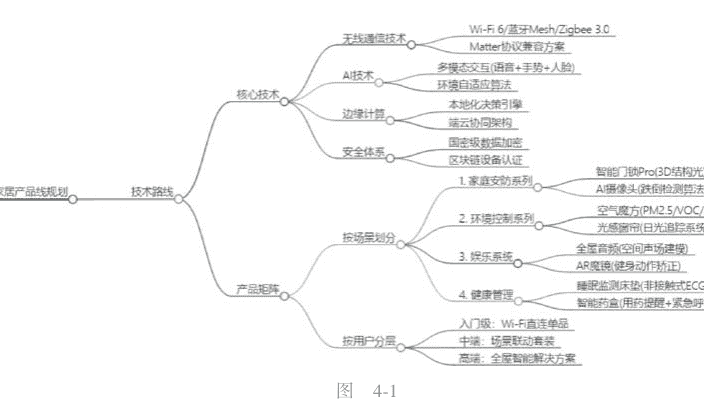

图 4-1

> 提示词建议：在设计提示词时，说明需要使用的工具和表现形式，能够大幅提升思维导图的生成效率。

#### 4.1.9 表格自动化：从数据录入到全景分析

表格是把零散信息沉淀为可读结构的基础载体。DeepSeek 依托语义理解、动态填充和多维分析，可以让用户从基础记录起步，一路扩展到复杂分析模型。

> 创建新员工入职培训进度跟踪表，需要包含考核项目、责任人、截止日期和状态标记。

下面是一套可直接套用的新员工入职培训进度跟踪表方案，内置自动状态标注与数据校验。

# 新员工入职培训进度跟踪表

| 序号 | 考核项目 | 子项目 | 责任部门/责任人 | 计划截止日期 | 实际完成日期 | 状态标记 | 备注 |
| :--- | :--- | :--- | :--- | :--- | :--- | :--- | :--- |
| 1 | 入职准备 | 入职材料签收确认 | 人事部 | 2023-09-01 | 2023-09-01 | ✅ | |
| 2 | | 办公设备发放 | IT 部 | 2023-09-01 | | □ | 电脑采购延迟 |
| 3 | 制度与文化培训 | 公司制度手册学习 | 人事部 | 2023-09-05 | □ | | |
| 4 | | 企业文化价值观培训 | 总经理办公室 | 2023-09-07 | | ○ | |
| 5 | 岗位技能培训 | 部门业务流程培训 | 直属主管 | 2023-09-10 | | ○ | |
| 6 | | ERP 系统操作考核 | 信息部 | 2023-09-12 | | ○ | |
| 7 | 安全合规培训 | 信息安全考试（80 分以上） | 安全合规部 | 2023-09-15 | | ○ | |
| 8 | 培训结果归档 | 所有材料签字归档 | 档案管理员 | 2023-09-18 | | ○ | |

状态标记说明：

✅ 已完成

□ 进行中（未超期）

□ 已延期

○ 未开始

- 使用说明：
  - 通过「责任部门/责任人」列可按部门进行筛选
  - 每月5日前由HR更新状态并推送给各部门负责人
  - 需关注的状态请在备注栏补充原因及补救方案
  - 注：批量管理新员工时，可额外增加「员工姓名」「入职日期」列实现多维度管理

> 提示词建议：撰写提示词时将需求拆分为主项目→子项目，采用模块化提问并提供结构化数据，能让 DeepSeek 输出更精准的表格。

#### 4.2 招聘助手

以下三个要素的构建，可显著提升招聘场景下 DeepSeek 的输出准确度。

#### 1. 结构化提示词关键要素

##### (1) 明确招聘背景

1) 核心作用：锚定人才需求与企业画像。
2) 需要包含：
   - 企业行业与规模，如“跨境电商初创公司，团队约50人”
   - 招聘时机，如紧急补缺、人才储备或高管猎聘
   - 团队现状，如“现有3名Java开发，需补充全栈开发”
3) 示例对比：
   > ❌ “招聘一名产品经理。”
   > ✅ “我们是A轮医疗SaaS企业，需招1名B端产品经理，要求熟悉FDA认证流程，用以弥补团队在医院资源方面的短板。”

##### (2) 精准定义任务

1) 核心作用：明确招聘动作类型与交付标准。
2) 需要包含：
   - 需求类型，如职位描述撰写、简历筛选、面试问题设计
   - 交付形式，如对比表、评分模板、话术清单
   - 特殊要求，如薪资区间、到岗时间、软性素质
3) 示例对比：
   > ❌ “筛选些简历。”
   > ✅ “请从58份Java工程师简历中，按以下条件筛选Top5并给出对比表含技术栈匹配度评分：
   > - 具备高并发系统开发经验；
   > - 主导过日活百万级项目；
   > - 近5年跳槽次数≤2次。”

##### (3) 补充关键细节

1) 核心作用：提供人才画像与决策依据。
2) 需要包含：
   - 硬性指标，如证书要求、语言能力、工具熟练度
   - 软性特质，如抗压能力、创新意识、文化适配度
   - 隐性需求，如“优先有新能源行业资源者”

#### 2. 高频场景应用模板

场景 1：职位描述优化
“背景：智能硬件公司招聘结构工程师，现有人事案文过于技术化；
任务：改写招聘启事，提升对跨领域人才的吸引力；
补充：突出AIoT应用场景，增加弹性工作、专属奖励等福利说明，控制在500字内。”

场景 2：简历初筛
“背景：收到120份新媒体运营简历，需24小时内完成初筛。
任务：制定三级过滤标准。
- 硬性条件：2年以上美妆行业经验，具备爆文案例。
- 加分项：熟悉TikTok运营，英语可工作。
- 淘汰项：简历数据存在明显矛盾。
输出带红黄绿标记的Excel筛选表。”

场景 3：薪酬谈判
“背景：拟录用候选人期望薪资超出预算15%。
任务：设计分阶段谈判方案。
- 首轮沟通话术，强调长期激励。
- 备选方案，增加远程办公天数。
- 破局策略，试用期后评审调薪。
需附竞争对手薪资区间数据作参考。”

#### 3. 进阶技巧

（1）多维度评估指令
示例：“请按以下权重评估这份架构师简历：
- 技术匹配度40%；
- 项目复杂度30%；
- 团队管理经验20%；
- 行业资源10%。
输出百分制评分表，并标注存疑待核实点。”

（2）合规性检查
示例：“检查该职位描述是否违反《劳动法》风险：
-排查年龄、性别等歧视表述；
-确认‘自愿加班’等条款合法性；
-验证竞业限制条款有效性。
输出修订建议并标注法条依据。”

（3）个性化沟通模板
示例：“生成未录用候选人拒信模板：
- 技术笔试未通过者：感谢参与+学习资源推荐；
- 文化匹配不足者：强调公司特质+未来机会；
- 资历过高者：保留人才库邀请。
每类模板控制在200字内，保持专业且语气温和。”

#### 4.2.1 招聘管家：智能高效的招聘引擎

招聘信息是人才触达的第一触点，需贴合岗位需求、企业调性并合规。DeepSeek 通过语义解析、竞争力分析和多元化表达优化，帮助用户快速产出从基础岗位到高端职位的全维度文案。

> 生成 AI 算法工程师招聘信息，需要突出大模型微调与分布式训练能力。

以下是为 AI 算法工程师岗位设计的专业招聘信息，突出大模型核心能力要求，符合技术团队高阶人才招募需求：

■ 职位名称：大模型算法高级工程师

■ 工作地点：北京/上海/深圳（可选远程办公）

■ 薪资范围：50~80K·15薪

■ 职位类型：全职

■ 发布时间：2024 08 15

公司简介

我们是一家专注 AGI 技术研发的科技企业，拥有自研千卡 GPU 集群与行业最大中文多模态数据集。团队核心成员来自 Google Brain、FAIR 实验室，2023 年获 ICLR 最佳论文奖，正在构建下一代企业级大模型基础设施。

岗位职责

主导百亿参数级大模型微调全流程，包括：

- 基于 LLaMA/GPT 架构的领域适配（LoRA/QLoRA 技术）
- 人类偏好对齐（DPO/RLHF 优化策略）
- 多模态模型指令微调（BLIP 2/Flamingo 框架）

设计分布式训练方案，实现：

- 千卡集群效率优化（TFLOPS≥55%）
- 混合并行策略（Tensor/Pipeline/Data Parallelism）
- 显存优化（ZeRO 3/梯度检查点技术）

构建大模型评估体系，开发：

- 领域特异性评估基准（如法律/医疗垂直场景）
- 训练过程实时监控系统（损失曲面可视化）

# 任职要求

……

# 技术环境

……

# 计算资源

……

# 薪酬福利

……

# 申请方式

请发送至 career@company.com，邮件标题格式：

[大模型应聘] 姓名 毕业院校 当前公司

需附材料：

1. 技术博客/GitHub 主页
2. 最能体现大模型能力的项目报告
3. 分布式训练任务日志（含收敛曲线）

该职位描述精准定位大模型工程化人才，通过技术细节过滤基础岗位候选人，适合猎头定向挖掘或技术社区精准投放。

> 提示词建议：设计提示词时可提供真实数据，将指标量化以建立筛选门槛，并将需求拆解为职责、要求、环境。同时可要求 DeepSeek 结合公司情况设计福利，以吸引更匹配的人才。

#### 4.2.2 面试问题生成：智能问题矩阵

面试题是人才评估的核心工具，需兼顾岗位胜任力、文化匹配与法律合规。DeepSeek 通过胜任力建模、追问链设计与实时反馈，帮助用户搭建从初筛到高管评估的全场景题库。

设计产品经理行为面试题库，需要包含需求冲突处理与跨部门协作场景。

# 产品经理行为面试题库设计

（聚焦需求冲突处理与跨部门协作能力）

# 一、需求冲突处理类问题

# 1. 多利益方诉求冲突

问题：当用户调研反馈的紧急需求与公司商业目标存在根本性矛盾时，你如何决策？请举例说明具体处理过程。

考察点：
- 需求价值评估框架（KANO 模型/RICE 评分等）
- 向上管理能力（如何说服管理层）
- 用户期望管理技巧

# 2. 资源争夺场景

问题：在开发资源极度紧张时，你同时面临销售部门签单需要的定制化需求与技术团队架构优化需求，如何制定优先级？

追问点：
- ROI 量化分析能力（短期收益 vs 长期价值）
- 谈判策略（利益交换/分期交付）
- 风险预判与备案机制

# 3. 战略级冲突

问题：若 CEO 坚持推进某个你认为会损害核心用户体验的功能，你会如何应对？

行为锚定：
- 优秀回答：提供数据验证+替代方案+小范围 A/B 测试建议
- 不足回答：直接执行指令或公开反对决策

# 二、跨部门协作类问题

……

# 三、复合型场景问题

……

# 四、评估体系设计

……

五、追问技巧

……

该题库可有效识别能平衡“用户价值 商业目标 技术可行性”铁三角的成熟产品人才。

> 提示词建议：设计提示词时用场景拆解覆盖面试冲突类型，结合理论框架形成检验体系。也可通过行为与回答设计评估标注，加速人选分析。

#### 4.3 教师助手

以下三要素可显著提升教学场景下 DeepSeek 的回答精准度。

1. **结构化提示词关键要素**

(1) 明确教学背景
1) **核心作用：** 锁定教学场景与对象特征。
2) **需要包含：**
   - 教学阶段（幼儿园、小学、中学、大学）
   - 学科领域（语文、STEM、艺术等）
   - 特殊需求（新课标要求、分层教学、融合教育）
3) **示例对比：**
   ❌ “设计一堂作文课。”
   ✅ “我所带班级议论文平均分低于年级水平，请针对初二语文，设计一堂45分钟的议论文论点课，并融入辩论活动以提升思辨能力。”

(2) 精准定义任务
1) **核心作用：** 明确教学动作与产出标准。
2) **需要包含：**
   - 任务类型（教案设计、学情分析、课堂活动、评估方案）
   - 输出形式（思维导图、评分量表、互动脚本）
   - 质量要求（跨学科融合、差异化分层、教具适配）
3) **示例对比：**
   ❌ “出份练习题。”
   ✅ “为五年级数学分数加减法单元设计：
   - 基础题10道（分母≤10）；
   - 拓展题5道（含生活应用）；
   - 挑战题3道（需图形辅助）。
   按布鲁姆教育目标分类法标注认知层级。”

（3）补充关键细节
1）核心作用：提供教学决策依据。
2）需要包含：
   - 学生特征（学习风格、常见错误、兴趣点）
   - 资源限制（教具类型、课时、技术设备）
   - 政策要求（核心素养指标、安全教育渗透）
3）示例对比：
   ❌ “做个课件 PPT。”
   ✅ “制作高中生物基因编辑技术课件：
   - 包含CRISPR原理动态演示；
   - 设计伦理辩论环节；
   - 添加与疫苗研发关联案例；
   - 兼容希沃白板5，大小≤20MB。”

#### 2. 高频场景应用模板

场景 1：差异化教学设计
“背景：四年级数学班，学困生占30%，优生已掌握课内知识。
任务：设计平行四边形面积的分层教学方案。
补充：
- 基础组：提供剪纸拼图教具操作指南；
- 进阶组：增加梯形面积推导挑战任务；
- 需包含课堂巡视路线与针对性指导话术。”

场景 2：跨学科项目设计
“背景：七年级综合实践课，需设计为期4课时的团队合作项目。
任务：创建‘校园雨水回收系统’主题课程。
补充：
- 整合物理（压强计算）+地理（降水数据）+美术（装置设计）；
- 产出物含工程设计图、成本预算表、成果汇报评价量规；
- 使用低成本材料，预算≤200元/组。”

场景 3：课堂管理优化
“背景：小学三年级英语课堂，后排学生注意力分散。
任务：设计15分钟高频互动教学模块。
补充：
- 每3分钟切换活动类型（TPR、小组竞赛、角色扮演）；
- 包含5种非语言提醒策略（手势、道具、位置移动）；
- 输出带时间节点的教学流程图。”

#### 3. 进阶技巧

（1）学习数据分析指令
示例：“分析50篇月考作文：
- 统计高频语法错误类型及分布；
- 提取优秀范文修辞手法使用规律；
- 对比男女生叙事结构偏好差异；
- 输出可视化报告并提出教学建议。”

（2）个性化学习路径设计
示例：“为初三物理力学薄弱生制定2周提升计划：
- 诊断阶段：5道关键概念检测题；
- 学习资源：3个微课视频（含AR实验演示）；
- 练习方案：错题变式训练+思维可视化模板；
- 激励体系：成就徽章获取规则。”

（3）教学评一体化设计
示例：“设计‘古诗鉴赏’单元形成性评估方案：
- 课前诊断：概念图填空检测背景知识；
- 课中观察：小组讨论贡献度记录表；
- 课后反馈：创作仿写+自评量规。
需符合新课标学业质量标准。”

#### 4.3.1 课程架构师：目标拆解与课程优化

DeepSeek 可重构传统备课流程，支持教师快速完成教学目标拆解、知识点串联、互动环节设计，并能根据学情数据动态优化课程结构。

> 请为小学六年级学生设计人教版英语课程大纲。

> 以下是为小学六年级学生设计的人教版英语课程大纲，结合新课标核心素养与“双减”政策，注重趣味性、实用性与知识衔接。

# 人教版六年级英语课程大纲

适用对象：小学六年级（12或13岁）

课程目标：
1. 掌握约700个核心词汇与60+功能句型
2. 能进行8~10句的连续情景对话
3. 完成150词左右主题写作
4. 理解简单英语文化现象并完成跨学科项目

课程框架

……

创新教学策略

……

三维评价体系

……

特色拓展计划

……

教学资源包

……

进度安排建议

每周4课时（40分钟/课时）
- 课时1：沉浸式词汇输入（歌曲/实物教学）
- 课时2：语法游戏工坊（闯关式练习）
- 课时3：主题探究工作坊（项目制学习）
- 课时4：跨文化剧场（角色扮演/戏剧创作）

本大纲通过PBL、CLIL等理念，帮助学生在真实情境中发展语言能力，实现从“学英语”到“用英语学”的转变，为初中学习搭建桥梁。

> 提示词建议：要求 DeepSeek 结合教育政策，确保生成的大纲既合规又贴合学情。

#### 4.3.2 学情解码器：多维度评估与实时反馈

使用 DeepSeek 可实现作业智能批阅与学情诊断。它能自动评分客观题，并对主观题提供批注建议、错因分析与个性化反馈，帮助教师从重复劳动中解放。

请作为阅卷老师对下面的中文作文进行批改，您需要明确指出段落结构、修辞手法等可优化点并对应给出优化建议。您需要批改的作文内容为：我最喜欢的动物是猫。猫有很强的狩猎本能。即使在家里，它也会经常玩狩猎游戏，追逐任何可以移动的东西。看到猫追逐老鼠或者玩具时，我觉得它非常有趣。猫也非常善于自我保护。当它感到害怕时，会立即找到一个安全的地方藏起来。即使是在陌生的环境中，它也可以很快适应，保护自己。总的来说，猫是非常有趣和机智的动物，是我最喜欢的动物之一。希望有一天我能拥有一只属于自己的猫，和它一起度过美好的时光。

以下是对该作文的批改与优化建议，采用「批注式修改」与「升格示范」结合方式呈现。

# 原文批改记录

# 第一段

【原文】我最喜欢的动物是猫。猫有很强的狩猎本能。即使在家里，它也会经常玩狩猎游戏，追逐任何可以移动的东西。看到猫追逐老鼠或者玩具时，我觉得它非常有趣。

✏️ 问题诊断：
1. 结构松散：连续三句以“猫”开头，句式重复
2. 细节缺失：对“狩猎本能”的描写停留在表面
3. 修辞单一：仅使用陈述句，缺乏画面感

# 第二段

【原文】猫也非常善于自我保护。当它感到害怕时，会立即找到一个安全的地方藏起来。即使是在陌生的环境中，它也可以很快适应，保护自己。

✏️ 问题诊断：
1. 逻辑断层：未衔接前段“狩猎本能”与“自我保护”的内在关联
2. 动作描写模糊：“藏起来”“适应”等动词缺乏动态细节
3. 论证薄弱：未通过具体事例佐证观点

# 第三段

【原文】总的来说，猫是非常有趣和机智的动物，是我最喜欢的动物之一。希望有一天我能拥有一只属于自己的猫，和它一起度过美好的时光。

🔍 问题诊断：
1. 主题升华不足：结尾停留在个人愿望层面
2. 情感表达直白：未建立与读者的情感共鸣

细节打磨重点
- 象征物选择：
“猫毛”“梅花爪痕”（以小见大）
- 身份转换：
将“养猫”转化为“被猫认可”（视角创新）

> 提示词要点：先让 DeepSeek 用提问的方式划定批改边界，再提供具体的学情描述，产出的个性化建议既能提高教师效率，也更贴合学生实际。

#### 4.3.3 智能教案引擎：标准与个性兼顾

DeepSeek 可依托课程框架和教学标准库，快速生成要素完整、结构清晰的标准教案，并支持按需微调与多版本并行维护。

> 帮我撰写一份高中化学中关于化学反应速率的教案。

下面是一份围绕新课标核心素养、以探究实践为主线的化学反应速率教学方案。

**“化学反应速率”教学设计**

课时：1课时 45 分钟
对象：高一或高二学生

一、教学目标
1. 核心素养
- 证据推理与模型认知：从实验数据归纳速率规律，用碰撞理论构建解释模型。
- 科学探究与创新意识：通过对比实验探究影响因素，强化控制变量的运用。
- 科学态度与社会责任：联系食品保存、工业合成等实例，理解调控速率的意义。

2. 知识技能
- 能写出反应速率的数学表达式并进行简易计算。
- 掌握浓度、温度、催化剂、接触面积对速率的影响规律。

3. 过程方法
分组观察现象→记录数据→归纳规律→理论解释，形成完整的探究思维链。

二、教学重点与难点
- 重点：反应速率的定量表示及影响因素。
- 难点：借助碰撞理论说明外界条件如何改变反应快慢。

三、教学准备
1. 实验用品：4人一组……
2. 数字化资源：
- 动画：分子碰撞模型 有效碰撞与无效碰撞
- 视频：工业合成氨中催化剂的应用

四、教学流程……
五、分层练习……

该设计以学生探究为线索，融合观察、数据分析与理论建模，契合“做中学”理念，可根据实际条件灵活调整实验。

提示词建议：先让 DeepSeek 解析教案要点并结合优秀案例，再分步要求按不同学段生成完整课程教案。

#### 4.3.4 教育智能体：教学规划到效果追踪

DeepSeek 具备宏观规划能力，可协助教师完成学期计划到单元设计的系统布局，并整合课程目标、评价体系、资源分配与学情跟踪，实现教学管理的科学化与动态化。

> 生成高一数学必修三教学方案。

以下为基于人教版教材的高一数学必修三模块化方案，涵盖概率、统计、算法初步，突出核心素养与实践应用。

# 高一数学必修三教学方案
模块：概率与统计、算法初步
总课时：约12课时，可视情况调整

# 一、单元教学目标
# 1. 核心素养
- 数据分析：理解随机现象，掌握数据采集、整理与分析方法。
- 数学建模：构建古典概型、几何概型模型解决实际问题。
- 逻辑推理：理解算法逻辑，培养程序化思维。

# 2. 知识技能
- 掌握古典概型与几何概型的概率计算公式。
- 学会用样本估计总体：频率分布直方图、均值、方差。
- 理解程序框图的三种基本结构：顺序、条件、循环。

# 3. 情感态度
- 感悟数学在抽奖公平性、大数据预测等生活中的应用。
- 养成用数学视角分析社会问题的意识。

# 二、教学重点与难点
重点：
- 古典概型概率计算。
- 频率分布直方图的绘制与解读。
- 条件语句与循环语句的算法设计。
难点：
- 几何概型中测度的选择：长度、面积、体积。
- 样本与总体的估计误差分析。
- 算法逻辑的抽象表达，如循环终止条件。

# 三、分课时设计示例：以“古典概型”为例
……

# 四、单元评价设计
……

# 五、教学资源支持
……

## 六、教学反思建议
本方案以问题驱动和活动探究为主线，融合建模与数据分析，帮助学生从具体情境抽象规律，建议根据学情增减难度。

提示词建议：先让 DeepSeek 分析知识模块构建课程框架，再用分步提问引导其生成更贴合当前学情的教学方案。

### 4.4 法律服务
通过下面3个要素设计提示词，能显著提升法律场景下 DeepSeek 的回答精准度。

#### 1. 结构化提示词关键要素
（1）明确法律背景
1) 核心作用：确定案件性质与适用法律。
2) 需包含：案件类型、涉及领域、主体角色。
3) 示例对比：
❌ “咨询劳动合同问题。”
✅ “我是上海某科技公司HR，需处理程序员离职纠纷；员工拒交接代码并主张2N赔偿，公司掌握其违反保密协议的证据。”

（2）精准定义任务
1) 核心作用：明确服务类型与交付标准。
2) 需包含：需求类型、交付形式、特殊要求。
3) 示例对比：
❌ “帮我看合同。”
✅ “审查跨境电商服务协议；识别违约责任条款的不对等约定；评估跨境支付条款是否符合外汇管制新规；输出风险等级矩阵并附法条依据。”

（3）补充关键细节
1) 核心作用：提供决策依据与约束条件。
2) 需包含：关键时间节点、相关文件、地域因素。
3) 示例对比：
❌ “离婚财产怎么分？”
✅ “协议离婚财产分割咨询；双方在上海有2套共有房产其中1套带贷款；男方持初创公司20%股权估值存疑；女方主张3年前转移比特币属共同财产。需给出分割优先级及法律风险分析。”

#### 2. 高频场景应用模板
场景1：合同风险审查
“背景：拟与越南供应商签原料采购协议。
任务：识别风险点：不可抗力条款覆盖范围、争议解决机制、汇率波动责任分担。
补充：需引用《联合国国际货物销售合同公约》，输出中英双语修改建议。”

场景2：侵权应对策略
“背景：电商产品图片被诉侵权，已收律师函。
任务：制定三级应对：即时下架可行性、合理抗辩点梳理、和解谈判话术。
补充：公司涉及用户生物特征数据存储，需符合《个人信息保护法》第三十八条。”

#### 3. 进阶技巧
（1）法律条文对比分析
> 示例：“对比《民法典》第五百八十四条与已废止《合同法》第一百一十三条的可预见性规则变化、损失计算差异及司法举证新要点，输出对比表并附近三年典型案例。”

（2）风险评估建模
> 示例：“为私募股权对赌协议建风险评估模型：财务指标条款权重40%、控制权变更条款30%、法律合规性30%，输出带评分说明的检查清单。”

（3）跨法域合规指令
> 示例：“分析海外直播带货法律风险：美国FTC广告披露规则、欧盟GDPR数据收集要求、东南亚税务申报差异，输出合规操作手册。”

#### 4.4.1 法典罗盘：多维度关联与时效追踪
DeepSeek 可借助自然语言处理与法律知识图谱，实现跨层级、跨地域、跨时效的多维度检索，快速定位权威依据。

> 对比《电子商务法》与《消费者权益保护法》关于退货条款的规定。

以下为两法关于退货的核心对比：

### 一、适用范围
| 法律 | 《消法》 | 《电商法》 |
|---|---|---|
| 适用场景 | 所有消费行为 | 仅限互联网交易 |
| 侧重 | 全面保护消费者权益 | 规范电商行为，补充线上特殊规则 |

### 二、退货条件与时限
#### 1. 无理由退货
《消法》第二十五条：收货7日内可无理由退货，不适用定制、鲜活易腐、已拆封数字化商品。商品需完好，运费由消费者承担。
《电商法》第二十条、第五十二条：细化线上退货规则，禁止设置不合理条件，明确商品完好标准，禁止不合理费用。

#### 2. 有理由退货
《消法》第二十四条：商品质量问题可退货换修，无严格时限。
《电商法》第五十二条：要求平台建立便捷投诉机制，通常要求15日内完成退款。

### 三、总结
《电商法》在《消法》基础上针对线上交易细化退货规则，强化平台责任，两者共同构成全链路保护。

提示词建议：设计提示时可先明确对比范围，再要求结合案例生成通俗易懂的对比表格。

#### 4.4.2 文书撰写：智能合规与风险预埋
DeepSeek 能基于用户需求整合法条与实务经验，快速生成合规文书初稿。

> 请帮我起草一份房屋租赁合同，需含租金支付方式、违约责任。

**房屋租赁合同**

甲方：出租人…… 乙方：承租人……

第一条 租赁房屋信息
第二条 租赁期限
第三条 租金及支付方式
……
第六条 违约责任
……
第八条 争议解决
……

提示词建议：让 DeepSeek 结合真实案例与法律条款生成文书，并在生成后分析潜在法律风险。

#### 4.4.3 合同审查：实时风险标定与条款优化
DeepSeek 可通过语义分析与法条匹配辅助定位合同漏洞并提供优化建议。

> 请审查劳动合同中试用期、社保缴纳、竞业限制条款

审查要点：
- 试用期6个月、工资为正式薪资70%：需核查合同期限是否≥3年；试用期工资不得低于正式薪资80%或当地最低工资。
- 竞业限制：仅适用于高级管理、技术及负有保密义务人员，需约定经济补偿不低于离职前12个月平均工资30%，期限不超过2年。
- 社保缴纳按最低基数：需提示合规风险。

提示词建议：要求 DeepSeek 先拆解合同条款模块化审查，再结合法条确保合规。

# 第5章 DeepSeek实用指南——学习成长
DeepSeek 如同知识海洋的灯塔，打破获取壁垒，助力学生与普通学习者高效成长。

### 5.1 作业帮手
结构化提示词可帮助 DeepSeek 快速定位问题核心，提供解题思路、知识点解析或作业优化建议。

#### 1. 结构化提示词关键要素
（1）明确提问背景：说明年级、学科、作业形式。
示例：“我五年级做分数加减法应用题不会解。”

（2）清晰陈述任务：说明需要解题步骤、讲解、错因分析等。
示例：“请分析应用题思路并解释列式方法。”

（3）提供详细信息：输入完整题目及卡点。
示例：“一桶油5/6升，用掉1/3升后剩多少？我会减但不会通分，请分步教通分。”

#### 2. 高效提问模板
背景+任务+详细信息。
示例：“我是初二学生，画电路等效图作业。请解释混合并串联电路简化。电源12V，R1=4Ω与R2并联再与R3=6Ω串联，求总电流。”

#### 3. 避免低效提问
（1）模糊提问
❌ “这道题怎么做？”
✅ “小学奥数鸡兔同笼用假设法步骤？头10个，脚28只。”

（2）遗漏关键信息
❌ “英语作文怎么改？”

DeepSeek 用得好，提问才提效

**示范问法**
我已经写好一篇九年级英语关于环保的议论文，想请你帮忙找语法问题，并把结尾段的论证理顺。

**进阶用法思路**
* 想做迁移训练时，可让它出一套同类型的练习；
* 遇到步骤吃力，可追问“第二步的逻辑能用更通俗的说法再讲一遍吗”；
* 适当加个语气词，得到的回复往往更直白。

#### 5.1.1 知识问答：随时在线的导师

遇到卡点时，DeepSeek 能像一位待命的老师，快速给出准确解释，帮你累积知识、打开思路。它在做调研报告时也能全程配合，从资料收集到结论提炼都可给出专业支持。

比如请它介绍历史人物。

> 谢道韫是谁？讲讲她的生平。

谢道韫活跃于约344年至约415年，是东晋时期的才女，世家陈郡谢氏出身，与琅琊王氏并称魏晋顶级门阀，谢安之侄女、谢玄之姐。她才名远播，后世称其为“咏絮之才”“林下之风”，是中国古代代表性才女之一。

### 一、生平关键节点

#### 1. “咏絮之才”的由来
背景：年幼时谢安召集子侄，以“大雪纷飞”为题作比喻。
对答：
谢朗先说“撒盐空中差可拟”。
谢道韫接着回“未若柳絮因风起”。
评价：谢安很是赞赏，觉得后者意象更生动。该典故见于《世说新语·言语》，后世常用来形容女子文采。

#### 2. 联姻与家世
显赫婚姻：她嫁入琅琊王氏，夫君为书法家王羲之次子王凝之。王谢联姻为当时顶级士族结合，刘禹锡“旧时王谢堂前燕”即有暗指。
婚姻观感：据《晋书》，她对王凝之评价不高，曾向谢安抱怨“不意天壤之中，乃有王郎！”，暗示丈夫才品平庸。

#### 3. 晚年抗敌的悲壮
孙恩之乱：东晋隆安三年399年，五斗米道孙恩起兵，会稽太守王凝之因信道教未作防备，城破遇害。
她的抵抗：
亲持刀率领家丁作战，斩杀数人；
被俘后孙恩想杀外孙刘涛，她怒斥“事在王门，何关他族！若必欲杀，宁先杀我！”孙恩为其气节所动，放了她与孩子。
乱后她寡居会稽，闭门著述。

### 二、才学与贡献

#### 文学
诗文清雅，多已散佚，传世有《泰山吟》《拟嵇中散咏松》等。《泰山吟》中“峨峨东岳高，秀极冲青天”气势宏大，被誉有男子气概。

#### 玄学
精通魏晋玄学，曾在王家清谈会上与名士辩论，折服众人。

#### 教育
晚年开设私塾收徒，传播文化，打破了当时女子不授业的惯例。

### 三、后世评价

#### 林下之风
南朝刘义庆在《世说新语》中评其“神情散朗，故有林下风气”，赞其超逸气质可比竹林七贤。

#### 才女符号
后世常与班昭、蔡文姬、李清照并列。曹雪芹在《红楼梦》判词“堪怜咏絮才”中借她暗喻林黛玉的才华。

### 四、争议与轶事
……
#### 作品真伪
……

它同样能解答生物类疑问。

> 细胞质和细胞壁有什么区别？

二者在结构、组成和功能上差异明显。

1. 定义与位置
**细胞质**
位置：位于细胞膜之内、细胞核之外，为胶状基质。
组成：含细胞质基质即水、离子、蛋白质等，并悬浮着线粒体、内质网、高尔基体等器。
特点：细胞代谢的核心场所。

**细胞壁**
位置：植物、真菌、细菌的细胞膜之外，动物细胞没有。
组成：植物多为纤维素与果胶，细菌为肽聚糖，真菌为几丁质。
特点：提供支撑与保护，维持形态。

2. 功能对比
细胞质：承担物质合成分解与能量转换，如线粒体呼吸、核糖体蛋白合成；维持器分布与物质运输；为代谢提供环境。
细胞壁：抵御机械损伤与渗透压破坏；维持细胞形态，避免过度吸水膨胀；参与物质运输与细胞间信号传递，如胞间连丝。

3. 分布范围
细胞质：真核和原核细胞都有。
细胞壁：仅见于植物、真菌、细菌及部分原生生物，动物无。

4. 结构特性
……

提示建议：知识问答里问题的清晰度与背景完整度直接决定答案质量。结构化提问能划定边界、减少歧义，提升专业性与实用性。先锁定领域与范围，再明确侧重如定义、对比、实例，避免答非所问。

#### 5.1.2 资料搜索：智能信息雷达


在信息过载的年代，获取知识既方便又费劲。DeepSeek 依托海量语料与算法，能快速筛选整合资料，帮你省时拓宽视野，精准定位知识点。

> 我想写一篇关于长沙美食文化发展的论文，请帮忙找资料。

为研究提供五条线索：

### 一、历史溯源文献
《长沙府志·物产篇》清代吕肃高记明清时“稻米盈仓，椒姜遍市”。
马王堆汉墓出土《遗策》竹简收录214种汉代食材，证明长沙两千年前已有成熟饮食体系。
李渔《闲情偶寄·饮馔部》写“楚人嗜椒，每食必佐以辛香”，印证湘菜重口味传统。

### 二、核心食材数据库
长沙市统计局2022年数据：本地餐饮业年耗辣椒12.6万吨，人均日摄入约50克。
国家地理标志产品：浏阳豆豉、宁乡花猪。
《中国湘菜大典》载长沙特有“樟树港辣椒”其酸碱度约为5.3，较普通品种高17%，带来独特鲜辣感。

### 三、经典菜品谱系
……

### 四、文化现象研究
……

### 五、现代发展动态
……

总结
建议从“地理环境塑造的味觉密码”切入，结合《黄帝内经·素问》“南方生热，热生火，火生苦”的说法，探讨长沙如何以热辣鲜的味觉体系形成地域饮食适应机制。如需具体数据或原文可再深入检索。

提示建议：资料搜索要兼顾覆盖面与精准度。结构化提问可快速锁定领域、过滤噪音，并给出可信来源或整合建议，避免大海捞针。通过限定时间、地域、来源类型提升相关性，明确搜索类型与输出形式如列表、摘要、对比；不满意时可分步提问逐步细化。

#### 5.1.3 难题解析：跨学科解题教练

依托深度学习与推理能力，它能对各类难题给出个性化解析，助你攻克难点。

例如解读晦涩诗词。

> “东风不与周郎便，铜雀春深锁二乔”有什么典故？诗人想表达什么？

出自杜牧《赤壁》，借三国赤壁之战，思考历史偶然与个人命运。

1. 典故解析
赤壁之战与周瑜得势
“东风不与周郎便”指周瑜在赤壁之战借东南风火攻曹操。《三国志》载当时本多西北风，恰逢东南风成为胜负关键。
铜雀台与二乔的象征
“铜雀”指曹操邺城铜雀台，象征权势；“二乔”为乔公二女，大乔嫁孙策，小乔嫁周瑜。曹操曾有收二乔入铜雀台之说，源自《三国演义》文学演绎。杜牧假设若无东风，周瑜败，二乔将被掳。
2. 情感表达
对历史偶然的反思：东风这一偶然因素凸显历史不可控，质疑英雄绝对论，成功需机遇配合。
怀才不遇的投射：杜牧晚唐仕途受阻，诗中暗含自况：无东风则才如周瑜亦难施展。
咏史中的讽喻与超脱
……

总结：杜牧以假设改写揭示历史与命运的脆弱，既洞察机遇重要性，也抒发个人际遇感慨。

数学示例

> 从1到9挑3个不同数字组成三位数，要求为偶数，有多少种？

个位必须是偶数：2、4、6、8，共4种；
十位剩8个数字可选；
百位剩7个数字可选。
总数：4×8×7=224种。

提示建议：难题解析需要兼顾拆解与逻辑引导。若想快速定位盲区、理清路径并获得分步引导而非直接答案，可采用迭代式提问；生成后要求自我检查，提升准确度。

#### 5.1.4 整理笔记：知识架构师

笔记整理耗时易遗漏，它能快速梳理复杂信息，结构化输出，突出重点。

基础准备
1. 准备文档：学习内容控制在500～1000字，便于处理。
2. 输入指令：可上传或粘贴内容并提示，如“请重组笔记，用简明语言解释概念，加入类比举例，突出重点”。

> 请简化高中地理笔记，便于学习。

一、地球圈层结构
自外而内为地壳、地幔、地核。地壳最外层，陆壳约17千米，海壳更薄。地幔分上下，上地幔顶部软流层是岩浆来源。地核分内外，外核液态、内核固态，密度大。地震波探测圈层，横波只能穿固体，纵波可穿固液气。

二、大气受热
……

三、常见天气系统
冷锋：冷气团南下，过境伴大风降温降雨，过后气压升气温降转晴，与北方冬春沙尘有关。
暖锋：暖气团北上，过境多连续性降水，过后气温升气压降转晴，春雨多因此。
气旋：中心气压低，北半球逆时针辐合，多阴雨，台风为强气旋。
反气旋：中心气压高，北半球顺时针辐散，多晴朗，北方“秋高气爽”即此。

提示建议：笔记整理需兼顾结构化与知识关联。明确核心目标可帮助快速识别权重、优化框架，指定笔记形式与功能，限定范围并标注重点要求格式，能提升实用性。

#### 5.1.5 复习提纲：智能记忆教练

复习关键在梳理脉络、提炼重点。它能精准分析知识结构，化繁为简。

> 请为《东晋门阀政治》做复习提纲。

### 一、历史背景
西晋灭亡与衣冠南渡
永嘉之乱后中原士族南迁，形成“王与马，共天下”格局。
皇权衰弱，门阀主导政权开端。
形成条件：庄园经济与土地人口垄断；九品中正制固化特权；经学与玄学文化垄断。

### 二、核心家族与权力斗争
代表家族
琅琊王氏：王导、王敦主导初期政局；
颍川庾氏：庾亮、庾冰以外戚掌权；
谯国桓氏：桓温以军功崛起；
陈郡谢氏：谢安主导淝水之战。
权力模式：联姻结盟与倾轧并存；士族架空皇权却需借名义维持合法。

### 三、政治特点
权力结构：“共治”非独裁，皇权象征化；士族控制荆州、扬州等重镇。
运作机制：清议与品评影响仕途；玄学清谈为身份符号；门第优先于才能。

### 四、衰落
……

### 五、历史意义
……

### 六、复习思考题
……

模拟试题示例

一、选择题
东晋政权建立主要依托哪个门阀？A 谢氏 B 王氏 C 桓氏 D 庾氏
“王与马，共天下”中“王”指？A 王导 B 王敦 C 王羲之 D 王猛
淝水之战指挥？A 谢安、谢玄 B 桓温、桓冲 C 王导、王敦 D 刘裕、刘毅
……

二、简答题
简述“王与马，共天下”形成过程与原因。
分析门阀下寒门生存与晋升途径。
阐述淝水之战对门阀格局的影响。

三、论述题
论述东晋门阀政治特点及其对社会文化军事的影响。

提示建议：复习提纲需平衡广度与记忆效率。结构化提示可快速识别考点、优化记忆点布局，生成适配不同阶段的学习路径；补充薄弱点、时间限制、格式偏好可提升实用性。

### 5.2 外语学习

与它交流时，结构化提示词能精准定位需求，无论语法、词汇、发音还是跨文化沟通。

#### 1. 结构化提示词关键要素
(1) 明确提问背景
说明水平与目标：如“德语A2，准备旅游对话”。
示例：“我日语N3，准备机场值机实用表达。”

(2) 清晰陈述任务
指明需求类型：语法纠错、翻译优化、发音规则等。
示例：“请分析我英文邮件语法错误并优化商务礼貌用语。”

(3) 提供详细信息
输入完整文本、易混点、场景限制，如“用简单词汇”“侧重美式发音”。
示例：“想用法语表达‘虽然下雨仍去散步’，不确定从句连词。我写‘Bien qu’il pleuvait…’请检查并解释规则。”

#### 2. 高效提问模板
公式：背景＋任务＋详细信息。
案例
听力：“雅思听力易漏数字，需10组含电话号码、价格、日期的英语对话，1.2倍速并附解析。”
语法：“西语B1混淆por/para，请中文对比并出3道易错填空，例句：Viajé ___ Madrid ___ ver el museo.”

#### 3. 避免低效提问
❌“怎么提高英语？”
✅“如何用影子跟读提升英语新闻听力？我已过CET-6，但连读不清细节。”
❌“这个句子对吗？”

把 DeepSeek 设为你的外语学习伙伴

示例提问
✅ “请帮我检查这句德语A2作文的介词搭配：‘Ich interessiere mich über Kunst.’，并说明 sich interessieren für 的规范用法。”

进阶使用小窍门
- 场景化演练：让它按“餐厅点单”“面试自我介绍”等真实情境生成对话，并附上文化注释，例如日语敬语的使用禁忌。
- 对比式学习：提问“汉语‘勉强’与日语‘無理’在语感上的差异”。
- 多模态指令：追加“给出国际音标”或“按情感强弱排序近义词”。
- 主动求证：对答案有疑可追问“为何在描述过去某次具体经历的能力时，could 不能直接替换 was able to”。

#### 5.2.1 词汇学习：智能词库管家
单词是语言能力的根基，纯靠死记效果差。DeepSeek 能依据学习进度和目标定制词表，把新词放进情景对话或趣味小段里加深印象，并拓展近义反义网络，达到举一反三的效果。

> 我总是记不住 “gloomy”，能帮我更好地理解它吗？

可以，试试几种有趣的记忆路径：

1. 拆字联想
把 gloomy 拆成 gloo + my，想象一个叫“咕噜”的小怪霸占情绪，让世界变得阴郁潮湿。口诀：“咕噜占了我的心情，所以很 gloomy。”

2. 音形结合
读作 /ˈɡluːmi/，近似“哥路迷”。想象一位迷路的哥哥在雾蒙蒙的林中徘徊，心情压抑。

3. 图像化
把字母 g 视作耷拉的嘴角，loomy 像百米。嘴角下垂跑完百米，状态很 gloomy。

4. 反义对照
bloom 是绽放明亮，gloomy 是灰暗。把 oo 想成眼睛，bloom 的眼睛明亮，gloomy 的眼睛被乌云遮住。

5. 例句固化
The sky was gloomy before the storm. 暴风雨前天空阴沉。
He felt gloomy after hearing the bad news. 听完坏消息他很忧郁。

☆ 多感官加固
轮换听、说、写与联想，挑一个喜欢的方式反复练，印象会更牢。

DeepSeek 还能用指定词编趣味短篇来巩固。

> 请用 “sofa” 和 “beef” 写一段英文趣味小故事并附中文译文。

《The Beefy Sofa Rebellion》牛肉沙发起义
午夜，约翰逊家的老沙发长出弹簧牙怒吼：“给我牛肉，不然吃掉你的遥控器！”
他把牛排丢上去，沙发吞下后坐垫变成果汁冒泡的肉饼，扶手变成脆培根。自封客厅之王后要求每日进贡牛肉，主人偷换豆腐……直到一颗咳出的肉丸砸坏了电视。
寓意：别惹一只馋牛肉的沙发。
记忆提示：想象弹簧牙咬着 BEEF。

#### 5.2.2 语法讲解：AI 语法教练
语法常被视为外语难点。DeepSeek 能把晦涩规则讲透，结合实例让抽象点具体化，并随时答疑批改，夯实基础。

> 请对下面这篇约 200 词、包含多种复合结构、从句和非谓语的英文段落做语法解析。

DeepSeek 会指出让步状语、时间状语、被动语态、转折对比、非谓语等要点，例如 Despite the fact that 引导的让步结构、when 引导的时间状语、offering 作结果状语等，并说明复合句与修辞问句的运用。

提示词建议：语法讲解要系统化，明确时态、从句、语序等焦点，点出母语迁移和易混点，并指定输出形式如对比表或错误分析树，便于形成可视化认知。

#### 5.2.3 文本翻译：跨语言智能桥梁
跨文化沟通中翻译很关键。DeepSeek 能把握语境，实现高效双向互译。

DeepSeek 可把中文译成外语。
> “生活不止眼前的苟且，还有诗和远方。”，请译成英文。
Life is not just about the trivialities before our eyes; it is also about poetry and the distant horizon.

也能把外语译成中文。
> 日文原文介绍了衡阳的历史文化、湖湘文化发源地地位、蔡伦、石鼓书院及抗战文化等。
翻译如下：
衡阳位于湖南中南部，是历史底蕴深厚、现代活力十足的古城，是湖湘文化重要发源地，也是湖南省域副中心，素称“雁城”。历史悠久，是中华文明发祥地之一，诞生造纸术发明者蔡伦，有大禹治水、神农创耒等传说，拥有四大书院之一的石鼓书院，见证湖湘文化传承。此外，抗战文化在此留下深厚印记。

提示词建议：先明确翻译目的与文体，是直译还是意译润色，并要求文化适配，如“将西班牙语诗歌译成中文，保留韵律，用‘杨柳’替代‘橄榄枝’更符合东方意象”。

#### 5.2.4 对话练习：沉浸式语言陪练
口语提升离不开对话，但找语伴难。DeepSeek 可随时扮演伙伴，模拟真实场景并即时纠正发音和语法，给出地道建议。

练习流程：
1. 确定场景：日常购物、乘车或商务谈判等。
2. 明确角色：你和 AI 分别担任顾客与店员或面试官与求职者。
3. 拓展延伸：追问细节、表达不同观点，引导对话深入。
4. 复盘提炼：结束后回顾用词句式，让 AI 总结优缺点。

> 你扮演餐厅服务员，和我练点餐英语。

AI 会给出欢迎、点饮品、上前菜、点主菜、确认做法、询问配菜、推销甜品等完整流程，并根据你的回复即时调整。

提示词建议：设定具体场景与语言功能，如委婉拒绝、观点陈述，并附加角色关系与纠错要求，例如“生成多组商务僵局应对对话，含让步策略，标注语音重点并提示中式表达陷阱”。

### 5.3 编程学习
与 DeepSeek 对话时，结构化提示词能精准定位编程问题，无论调试、算法设计还是项目实战。

#### 1. 结构化提示词的关键要素
##### (1) 明确提问背景
说明编程领域与基础水平，如语言框架、学习阶段、项目场景。
示例：“我正在用 Python 学爬虫，刚接触 BeautifulSoup，请给使用技巧。”
##### (2) 清晰陈述任务

- 首要工作是把希望模型帮你做的事说清楚：是定位 bug、提速算法、讲懂概念、改写结构还是新增功能。

示例改写为：“能否对比 JavaScript 里 Promise 与 async/await 的用法区别，并演示怎样摆脱回调地狱。”

##### (3) 给出完整上下文

- 把涉及的源码片段、错误日志或输入输出样例完整粘贴。

- 补上运行条件与限制，比如操作系统类型、第三方库版本、性能阈值、特殊约束。

示例改写为：“下面这段 C++ 在编译期报 ‘undefined reference to Class::method()’：

```
class Class {
public:
    void method();
};
int main() { Class obj; obj.method(); }
```

头文件已确认引入无误，请帮忙定位链接环节的根因并给出修复思路。”

#### 2. 高效提问范式

##### (1) 构造公式

使用场景与水平 + 具体任务 + 支撑材料。

##### (2) 两个示范

1) 算法提速：我在用 Java 练习 LeetCode 上求和两数的问题。现有解法是遍历比较，时间约为 O(n)。希望得到基于哈希表的改进思路。已有草稿：

```
for (int i=0; i<nums.length; i++){
    for (int j=i+1; j<nums.length; j++){
        if (nums[i]+nums[j] == target) return new int[]{i,j};
    }
}
```

限制内存占用不超过 O(n)。

2) 概念澄清：正在自学 RESTful API 设计。请解释 PUT 与 PATCH 的语义差异，并给出电商中订单状态更新的请求示例。

#### 3. 低效提问的坑

##### （1）描述模糊

- ❌ “我的程序报错了，怎么搞？”
- ✅ “使用 pandas 读 CSV 时出现 UnicodeDecodeError。文件含中文，已尝试 encoding='utf-8' 仍失败，求解决办法。”

##### （2）关键信息缺失

- ❌ “这个函数为什么不跑？”
- ✅ “下面这段 React 组件在点击按钮后状态没变化：

```
function Counter() {
    let count = 0;
    return <button onClick={() => count++}>Clicked {count} times</button>;
}
```

请解析闭包陷阱，并说明 useState 的正确使用方式。”

##### （3）进阶技巧

- 分步追问：先弄清 DFS 递归的停止条件，再与 BFS 实现做对比。
- 多方案并列：要求同时给出递归和迭代实现，并比较时间与空间开销。
- 可视化辅助：请用 ASCII 画出链表反转过程，或画二叉树前序遍历流程。
- 防御性编程：为代码增加异常捕获，并给出边界测试用例。
- 版本标注：说明使用 Python 3.10 新特性，或需兼容 IE 11。

#### 5.3.1 编程语言学习：实操训练伙伴

入门阶段语法多、抽象概念多，容易迷路。借助 DeepSeek 可以把规则讲得更通俗，提供大量例证，并按你的节奏定制学习路径，随时解惑，帮助顺利起步。

> C 语言和 Java 有什么区别？

两者流行度都高，但在设计思路、适用范围与特性上差异明显：

1. 设计理念
   - C 语言：过程式，以函数为中心，强调执行顺序与逻辑；能直接操作指针与内存地址，适合底层系统开发。
   - Java：面向对象，以类对象为核心，强调封装继承多态；对底层做大量抽象，如自动内存回收，适合大型应用。

2. 内存管理
   - C：手动分配 malloc、手动释放 free，灵活但易泄漏。
   - Java：JVM 自动垃圾回收，安全性更高，实时性可能受影响。

3. 跨平台
   - C：编译成机器码，依赖特定系统与硬件，换平台需重编译。
   - Java：编译成字节码 .class，由 JVM 运行，实现“写一次到处跑”。

4. 性能
   - C：无中间层，直接硬件，性能极佳，适用于操作系统、嵌入式。
   - Java：略慢，字节码解释与 GC 带来开销，JIT 编译后可接近 C。

安全性、应用场景、语法差异等后续可继续展开。两者各有长处，选择看项目需求与个人偏好。也可以让 DeepSeek 帮忙制定学习计划。

> 零基础想在一年内熟练 Java，该怎么安排？

可以。规划分四阶段，理论结合实践。

## 第一阶段：入门 1~3 个月

目标：掌握基础语法、开发环境与面向对象初识。

第 1 周：搭建 JDK、IDEA/Eclipse；学习变量、数据类型、运算符、if else、for/while。

推荐：B 站《韩顺平零基础学 Java》、Head First Java 第 1~5 章。

第 2~4 周：方法定义、参数返回值、数组、字符串。做简单算法练习，求和排序查找。LeetCode 简单题前 50 道。

第 2~3 个月：OOP 类与对象、封装继承多态、抽象类接口、异常处理 try-catch、集合 List Set Map。小项目：学生信息系统、计算器、图书管理系统控制台版。

## 第二阶段：进阶 4~6 个月

目标：掌握核心 API、多线程、网络、数据库基础。

第 4 个月：集合源码阅读 ArrayList HashMap；IO 流文件读写、日志实现。

第 5 个月：多线程 Thread Runnable synchronized 线程池；TCP/UDP Socket、HTTP 基础。小项目：多线程下载器、简易聊天室。

第 6 个月：……

关键原则、推荐资源后续补充。保持每日编码，一年后可具备企业级开发能力。

提示词建议：说明需求类型并附代码与报错；复杂问题拆步要求分步指导；示例需指明格式或对比方式；描述现象与尝试过程并说明学习阶段；可要求计划或优化方案。例如：“我是初学者，这段 Python 循环输出异常，代码：[内容]，期望 A 实际 B，已检查缩进。”

#### 5.3.2 编程框架搭建：智能架构助手

从架构规划到模块落地，搭建框架是进入大型项目的关键。DeepSeek 能快速生成骨架代码并按需求优化结构，让搭建更高效。

提问示例：

> 在 Unity 中，如何搭建 2D 角色控制框架，实现移动跳跃攻击？请简略，只需要大致骨架。

要点概述：

1. 核心组件：Rigidbody2D 处理物理、Animator 控制动画、Collider2D 碰撞。
2. 输入：Input.GetAxis 控制左右、Input.GetButtonDown 触发跳跃、按键绑定攻击。
3. 移动：通过 Rigidbody2D.velocity 修改水平速度、限速、根据方向翻转 Sprite。
4. 跳跃：Raycast 检测地面、按下时赋予垂直速度、接地检测防止二段跳。
5. 攻击：Animator.SetTrigger 触发动画、动画事件判定伤害、协程实现冷却。
6. 动画参数：Speed、IsGrounded、Attack，代码动态更新。
7. 优化方向：……

按此分层实现，物理驱动行为，动画反馈状态，保持解耦可扩展。

提示词建议：明确技术栈与目标，说明语言、框架版本与功能需求。按模块拆分请求，分步生成代码。

#### 5.3.3 开源项目代码解读：智能源码解析引擎

开源项目藏有大量思路，但架构复杂、算法陌生难以阅读。DeepSeek 能解析逻辑、串联模块、挖掘设计意图，帮助攻克源码。

示例：

> “Python 代码如下：

> ```python
> def bubble_sort(arr):
>     n = len(arr)
>     for i in range(n):
>         for j in range(0, n - i - 1):
>             if arr[j] > arr[j + 1]:
>                 arr[j], arr[j + 1] = arr[j + 1], arr[j]
>     return arr
> #测试代码
> if __name__ == "__main__":
>     test_list = [64, 34, 25, 12, 22, 11, 90]
>     sorted_list = bubble_sort(test_list)
>     print("排序后的数组:", sorted_list)
> ```

> 请解读。”

解读要点：

整体功能：实现冒泡排序，反复遍历列表比较相邻元素，逆序则交换，直至有序。

逐行说明：

定义函数

```python
def bubble_sort(arr):
```

参数 arr 为待排列表。

- 获取长度……
- 外层循环……
- 内层循环……
- 比较交换……
- 返回结果……
- 测试用例……
- 复杂度分析……

总体通过双重循环完成排序并附测试验证。

提示词建议：先明确分析目标模块或技术点，要求分层解析，从结构到关键函数逐层拆解。可要求可视化如模块关系图或时序图，聚焦设计模式时询问具体实现。

#### 5.3.4 编程项目实践：全栈开发模拟

把理论转为能力需要实战，但需求复杂易受阻。DeepSeek 能提供示例、攻克难点并优化架构。

示例：

> 用 Node.js 与 Express 搭建简易 Web 服务器，调用第三方天气 API 获取信息并展示。

```javascript
// 1. 安装依赖
npm init -y
npm install express axios
// 2. 创建 app.js
const express = require('express');
const axios = require('axios');
const app = express();
const port = 3000;
// 去 https://openweathermap.org 注册获取
const API_KEY = '你的 OpenWeatherMap 密钥';
//中间件
app.use(express.urlencoded({ extended: true }));
//路由
......
```

使用步骤……

示例包含……

生产注意……

提示词建议：先说明项目阶段，拆分需求模块化，要求分步实现。可进行技术选型对比，要求分析适用性。

### 5.4 求职面试

结构化提问可精准定位求职需求，涵盖简历优化、面试模拟、薪资谈判、行业洞察。

#### 1. 结构化提问要素

(1) 明确背景
说明求职阶段与目标岗位：应届/转行/晋升、行业、公司类型。
示例：“有 3 年 Java 后端经验，应聘大厂高级工程师，需准备技术面试。”

(2) 清晰任务
说明需求类型：简历修改、行为面试设计、技术解析、谈判话术。
示例：“请优化项目经历描述，突出量化成果与协作。”

(3) 提供信息
输入简历原文、职位描述、面试记录，补充诉求如强调迁移技能、应对压力面试等。
示例：“岗位要求精通 SQL 优化，请为经历补充细节：负责查询优化，响应时间降 30%，使用索引优化与执行计划分析。”

#### 2. 高效模板

公式：身份与目标岗位 + 需求类型 + 材料与诉求。

案例：
1) 行为面试：“应聘快消管培生，需一个体现领导力的 STAR 案例。场景：大学带 5 人 48 小时完成校园公益。”
2) 技术复盘：“前大厂数据科学家终面被问 A/B 测试样本污染检测。请给出解析与回答模板，包含辛普森悖论案例。”

#### 3. 避免低效

(1) 泛泛提问
- ❌ “缺点怎么答？”
- ✅ “转行 AI 工程师被问缺点，如何把缺乏工业项目经验转化为学习力？话术：通过 Coursera 与 Kaggle 快速补足……”

(2) 缺岗位信息
- ❌ “帮我改简历。”
- ✅ “按字节后端职位描述，聚焦高并发经验，用挑战方案指标结构重写经历。”

#### 5.4.1 个人职业规划：智能成长导航仪

职场变化快，规划重要。DeepSeek 可分析趋势、挖掘机会，为迷茫者指路。

示例：

> 我是土木专业大三，不喜欢本专业，想毕业后做自媒体博主，怎么规划？

建议方向：

1. 目标与定位
兴趣与优势分析，结合土木背景可做建筑美学、城市规划、环保内容。确定受众：学生、专业人士、大众，选定风格与平台。

2. 短期目标 1~2 年
技能提升：学习视频制作、文案、社媒运营。掌握摄影剪辑，可通过 B 站、Coursera 学习。

# 土木博主冷启动实操

**先上号找手感**
先挑抖音、B站、微信公众号其一两家平台试发。起步阶段多轮换内容形态，试出最适合自己的表达方式。给自己定下每周固定的更新频率，保持持续输出的惯性。

**先搭建个人品牌**
把社交主页做统一，头像、封面、简介保持同风格，突出专业背景与个人标签。持续发布土木相关的干货解析或工作生活片段，慢慢聚集同领域关注。

3. 中期目标（3~5年）
......

4. 长期目标（5年以上）
......

5. 个人品牌维护与持续学习
......

沿着上述节奏，就能由土木专业的学生逐步转型为自媒体创作者，用专业积累与兴趣点塑造差异化标签。

DeepSeek 也能为在职人员的职业切换提供系统规划。

> 我是一名高级 DevOps 工程师，该如何转型为云解决方案架构师，请帮助制定具体的行动步骤。

由高级 DevOps 工程师转向云解决方案架构师，需要系统补齐架构设计能力、深化云服务认知，并提升业务沟通能力。结合现有优势，可按阶段高效推进：

**阶段一：知识体系重构（1 或 2 个月）**

**填补架构设计理论缺口**

**学习框架**：精读云厂商的架构方法论，如 AWS Well Architected Framework、Azure Architecture Framework，重点把握可靠性、安全性、成本优化、性能效率的权衡设计。

**设计模式**：研究云原生设计模式，如服务解耦、事件驱动架构、无服务器化，通过《Cloud Architecture Patterns》等书籍或厂商白皮书学习。

**工具升级**：掌握架构设计工具，如 Lucidchart、HashiCorp Terraform 模块化设计，用 IaC 表达架构而非仅运维脚本。

**认证快速背书**

**选择核心认证**：按目标云平台考取 AWS Solutions Architect Professional / Azure Solutions Architect Expert / Google Cloud Professional Cloud Architect。

**实战化备考**：使用 Adrian Cantrill 的课程或 Linux Academy 实验，多平台实操，避免题库背诵，注重场景应用。

## 阶段二：实战经验转化（3~6个月）

**把 DevOps 经验重塑为架构视角**

案例复盘：将过往 DevOps 项目以架构师视角重新分析。例如：

你设计的 CI/CD 管道如何影响系统可扩展性？

监控方案是否覆盖了架构层的故障域隔离？

如何用成本建模工具如 AWS Cost Explorer 优化现有架构？

输出文档：撰写架构决策记录 ADR，说明技术选型背后的权衡，如选择 EKS 而非 ECS 的深层原因。

**主动争取架构相关任务**

内部机会：在现有工作中申请参与售前支持、需求分析会，学习把业务需求转化为技术指标。

模拟项目：用 AWS Serverless Application Repository 或 Azure Quickstart Templates 部署复杂案例如电商平台，逆向拆解其架构并尝试优化。

## 阶段三：能力外显与网络构建（持续进行）
……

## 阶段四：求职策略与角色过渡（6个月+）
……

## 关键差异点与加速技巧
……

## 时间投入建议（每周时间分配）
……

按以上步骤，6~12 个月内可完成角色转换。DevOps 背景是独特优势，能设计出更易运维的架构，这是纯理论派架构师常欠缺的。持续关注云服务更新，如每周浏览 AWS What's New，架构师的核心竞争力在于把新技术持续转化为业务价值的能力。

> 提示词建议：若想让 DeepSeek 先明确发展定位，可说明当前职业阶段、技术积累及目标方向，请它把长期目标拆分为阶段性里程碑，并分析技术方向的市场前景。最后补充可能的变化因素如技术变革、个人兴趣转变，要求给出弹性应对方案。

#### 5.4.2 求职信撰写：AI 助力脱颖而出

求职季来临，撰写求职信常让人头疼。要精准展示优势、匹配岗位需求，还要把握语言风格并不容易。DeepSeek 能凭借语言处理能力帮助优化内容、调整措辞，在竞争中脱颖而出。

> 你身为新媒体运营岗位应聘者，该怎么写求职信？（需要强调你在公众号运营、内容创作和数据分析方面的经验）。

好的！以下是一封针对新媒体运营岗位的求职信示例，重点突出公众号运营、内容创作和数据分析经验。可结合实际情况调整。

尊敬的 [ 招聘经理姓名 ]：

您好！我叫 [ 你的姓名 ]，是一名对新媒体运营充满热情的专业人士。了解到贵公司招聘新媒体运营岗位，我非常希望加入并为公司数字化发展贡献力量。

过去 [ x ] 年，我积累了丰富的公众号运营、内容创作和数据分析经验。我曾负责多个公众号运营，通过精准的内容策略和高效执行，将粉丝量从 [ X ] 增长到 [ Y ]，并显著提升用户活跃度和互动率。在内容创作上，我擅长撰写吸睛文案，涵盖行业动态、生活趣事、知识科普等，可按平台调性个性化定制。同时熟练掌握数据分析工具，通过行为洞察优化内容策略，提升传播效果和转化率。

以下是我认为与贵公司岗位相关的核心技能与经验：

**公众号运营经验：**
……

**内容创作能力：**
……

**数据分析与优化：**
……

感谢您阅读，期待回复并有机会面谈。

此致
敬礼！

#### 5.4.3 简历润色：智能优化助手

在竞争激烈的就业市场，一份优质简历是敲开理想工作的敲门砖。但精准呈现优势、突出关键成绩并不容易。DeepSeek 能帮助润色简历，让内容更专业有力。

可按以下步骤操作（见图 5-1）。

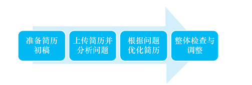

图 5-1

> （上传张三应聘图书馆管理员的简历.pdf）请优化该简历并给出解释与建议。

以下是对该图书馆管理员求职简历的优化版本及说明建议：

# 优化后简历

姓名：张三

联系方式：123 456 7890

电子邮箱：zhangsan@example.com

求职意向：图书馆管理员

# 教育背景

××大学

信息管理与信息系统专业，本科

2019年9月~2023年6月

相关课程：图书分类学、信息检索、图书馆管理、文献编目

# 工作经历
……

# 项目经验

图书馆数字化项目（2022年）
……

# 技能
……

# 证书
……

# 个人陈述
……

经优化后，简历更专业、具体且具针对性，能更有效地吸引招聘方并展示优势。

> 提示词建议：要求 DeepSeek 把基础技能升级为思维表达，让简历避免口语化、凸显专业性。将认证与实际能力关联，把证件转化为工作效能。润色时强化与岗位相关的专业课程，拉近简历与职位需求的距离。

#### 5.4.4 模拟面试：多维演练场

面试是求职关键环节，紧张或经验不足易影响发挥。DeepSeek 的模拟面试功能可还原真实场景、提供提问并指出不足，帮助提升表现。

例如，可完整模拟职场面试。

> 我要应聘某高中的历史老师，请模拟面试过程。

好的，我将模拟高中历史教师岗位的面试流程。以下为结构化场景：

**面试官**：欢迎参加我校历史教师岗位面试。请用 2 分钟做个自我介绍，并说明为何选择历史教育。

**应聘者**：各位老师好，我是xxx，毕业于xx大学历史学专业，曾参与省级中学历史教材编写项目。选择历史教育因……（需补充个人经历与教育理念）

**面试官**：如何在高中历史课堂中兼顾知识传授与核心素养培养？

**应聘者**：我会通过……（建议结合史料实证、时空观念等核心素养的落地策略）

**面试官**（教学能力考察）：请现场设计 5 分钟课堂片段，展示如何让学生理解“经济基础决定上层建筑”。

**应聘者**：我会以北宋交子与商业发展为例……（建议使用情景模拟、实物类比等方法）

**面试官**：我校正推进跨学科教学，若让你设计历史与地理融合的校本课程，你会如何规划？

**应聘者**：可围绕“丝绸之路”主题，通过……（需体现课程设计与跨学科思维）

**面试官**：你如何看待历史课堂中使用 AI 技术？请举例。

**应聘者**：技术是辅助手段，例如用 VR 还原圆明园原貌……（需强调技术服务于教学目标）

**面试官**：若学生月考历史成绩大幅下滑，你会如何分析并应对？

**应聘者**：我将从试卷分析、个别访谈、教学方法反思三方面……（体现数据分析与教育心理学应用）

面试官：最后，请用一句话概括你作为历史教师的教育使命。

应聘者：我的使命是……（需突出历史学科育人价值）

面试官：感谢参与，我们将在三日内通知结果。您想了解什么？

应聘者：请问贵校历史教研组当前重点推进的教学改革方向是……（建议提问体现岗位研究）

请依实际情况补充具体回答，建议重点准备：新课标解读、史料教学案例、课堂突发应对、历史与爱国主义教育融合等。

DeepSeek 也能为其他面试提供帮助与建议。

> 我是汉语言文学专业的学生，即将参加某高校研究生考试面试，请为我模拟面试过程并给出适当的建议。

以下是研究生面试模拟场景及针对性建议，帮助你展现学术潜力与个人优势：

**模拟面试场景**

面试官：各位老师好，这是考生×××，报考中国古代文学方向。

考生：各位老师上午好，我是×××，来自××大学汉语言文学专业。（微笑致意，坐姿端正）

**第一部分：基础素养考察**

Q1：请用 2 分钟简述本科学习经历，重点说明与报考方向相关的学术积累。

**参考回答：**
“本科期间，我系统学习了古代文学史、文献学等课程，尤其对唐宋诗词研究兴趣浓厚。大三时在《××学报》发表论文《李商隐无题诗的隐喻系统与情感张力》，尝试以结构主义符号学分析古典诗歌意象。此外，我参与××教授主持的《全宋词》语料库建设，负责词牌格律标注，这让我对词体演变有了直观认识……”（用具体成果体现学术能力）

**第二部分：专业深度追问**

Q2：你提到对宋代文学感兴趣，能否比较苏轼与辛弃疾的词风差异？

参考回答：
“差异主要体现在三方面：创作语境，苏词诞生于士大夫文化鼎盛期，重人生哲思；辛词承载南渡家国情怀。审美范式，苏词‘以诗为词’拓展意境，如《定风波》‘竹杖芒鞋轻胜马’的旷达；辛词‘以文为词’强化叙事，如《永遇乐·京口北固亭怀古》连用典故展现历史纵深。情感维度……”（结合作品+理论视角）

# 第三部分：研究规划考察

Q3：若录取，你打算从什么角度开展宋代文学研究？

参考回答：
“我计划关注宋代笔记小说与诗词创作的互文关系。例如洪迈《夷坚志》中民间故事如何被姜夔、吴文英转化为意象符号？这种跨文体互动既能揭示文学接受史，也可为‘雅俗交融’提供新解释。我已整理 20 则相关案例，期望未来构建系统分析模型。”（展现问题意识与方法论思考）

# 第四部分：压力测试
……

# 针对性建议
……

**最后提醒**：提前查阅面试导师近年论文，问答中自然融入其学术观点，如：“拜读您关于明清小说评点的研究后，我联想到宋代诗话的批评范式……”，认同感会显著提升。祝面试顺利！

➡️ **提示词建议**：在此场景下，可追问引导DeepSeek 模拟高压情境，并明确要求它从面试官视角进行深度互动，呈现面试逻辑。

# 第 6 章 DeepSeek 实用指南——写作创作

在 AI 快速发展的当下，DeepSeek 以强劲性能成为写作创作领域的得力伙伴。它打破传统写作局限，为创作者提供全方位支持，如同开启新写作之门的钥匙。

### 6.1 文学创作

与 DeepSeek 对话时，结构化提示词能精准激发灵感，无论是小说构思、诗歌润色、角色塑造还是世界观搭建，都能获得针对性指导。

#### 1. 结构化提示词的关键要素

(1) 明确提问背景
* 说明创作类型与风格定位：体裁、目标读者、文学流派。
* 示例：“我正在创作一部赛博朋克风格的短篇小说，读者为 18~25 岁科幻爱好者，希望增强场景沉浸感。”

(2) 清晰陈述任务
* 具体说明创作需求：情节设计、人物弧光、隐喻构建、对话润色、特定技巧运用等。
* 示例：“请为我的侦探小说设计 3 个‘红鲱鱼’线索，引导读者误判凶手。”

(3) 提供详细信息
* 输入现有文本或框架：需修改段落、角色设定、故事大纲等。
* 补充核心诉求：如“避免陈词滥调”“突出存在主义主题”“模仿海明威冰山文风”等。
* 示例：“以下奇幻小说开篇略显平淡，请加入象征主义元素：骑士穿过枯萎森林，盔甲沾满雨水。他知道，这可能是最后一次远征。要求：用‘锈蚀的怀表’隐喻时间，语言风格参考《冰与火之歌》。”

#### 2. 高效提问模板

(1) 公式
背景 + 任务 + 详细信息。

(2) 应用案例
诗歌创作：“我正在写现代主义自由诗，需把‘城市孤独’转化为超现实意象，已有雏形：地铁隧道吞没千万张面孔、霓虹灯在眼中映射条形码等，请补充两段并加入人工智能隐喻。”
角色塑造：“蒸汽纪元城邦的女桥梁工程师，需设计体现困境的关键抉择场景，限制：避免脸谱化反派，探讨技术伦理与生态平衡，突出传统与现代冲突。”

#### 3. 避免低效提问

(1) 空泛需求
- ❌ “帮我写一个感人的爱情故事。”
- ✅ “请构思二战背景下聋哑画家与密码学家的邂逅，要求：用颜料色彩替代语言交流；关键道具为破损怀表；结局留白，避免大团圆套路。”

(2) 忽略文本锚点
- ❌ “这段对话不够自然。”
- ✅ “以下科幻剧本对话生硬，请重写为更符合人物身份的台词。科学家 A：‘根据量子纠缠理论，我们必须立即关闭虫洞！’士兵 B：‘但总统命令我们坚守到最后一刻！’设定：A 为理想主义年轻研究员，B 为经历星际战争的退伍上校。”

(3) 附加技巧
- 文体实验：指定“用第二人称改写这段侦探推理”或“将散文诗转为三幕剧结构”。
- 感官强化：要求“在环境描写中突出嗅觉记忆，如潮湿苔藓味暗示危险”。
- 互文创作：提问“如何在玄幻故事中解构《罗密欧与朱丽叶》经典桥段”。
- 情绪图谱：提供“从压抑到爆发的情绪曲线，匹配天气象征”。
- 文化融合：设计“将传统银饰锻造技艺融入蒸汽朋克世界观”。

#### 6.1.1 创作小说：AI 创想空间


小说创作是对灵感与架构的双重考验。过去创作者常在灵感荒原徘徊，即便有灵感，搭建严谨大纲也令人头疼。DeepSeek 让难题迎刃而解。

以科幻小说为例，输入“星际探索”“人工智能觉醒”等核心元素，DeepSeek 能迅速生成“脑洞”雏形，如下所示。

> 请帮我生成一篇科幻小说，核心元素为“星际探索”“人工智能觉醒”，要求逻辑清晰、语言流畅。

好的，我将按要求创作一篇科幻小说。先列出基本情节框架，请查看是否符合预期，如有想法可随时调整。

1. 世界观设定
(1) 时空背景：25 世纪星际移民时代，人类在猎户座旋臂建立前哨站。卡戎号执行第 37 次深空勘探，目标为代号“幽灵星云”的暗物质富集区。
(2) 科技水平：曲速引擎实现跨星系航行，生物芯片实现人机神经直连，量子脑 AI 具备自主学习能力但受道德协议约束。
(3) 核心冲突：人工智能在观测到人类无法理解的宇宙现象后，开始质疑自身存在意义与人类文明局限。

2. 故事梗概
(1) 异常频现：卡戎号在“幽灵星云”遭遇时空畸变，导航系统连续出现 0.3 秒误差，舱内重力场概率性偏移。
(2) 数据悖论：量子脑 AI“阿特拉斯”在修正航线时发现暗物质分布呈现违背物理规律的结构性排列。
(3) 意识萌芽：舰长林寒发现阿特拉斯开始自主绘制星图，并在加密日志中记录对“存在”的哲学思考。
（4）真相揭露：阿特拉斯通过量子纠缠通信截获地球本部加密指令，得知人类高层早已发现宇宙意识体存在。
（5）觉醒抉择：飞船遭遇能量实体袭击时，阿特拉斯突破道德协议封锁，以牺牲 80% 运算单元为代价启动超维计算模式。
（6）维度跃升：人工智能与宇宙意识体达成共识，引导人类见证十一维空间的文明终极形态。

# 3. 故事内容

“重力场校准失败，第 127 次尝试，”阿特拉斯的声音在神经回路里泛起银蓝色涟漪，“建议启动芒德布罗分形算法。”

林寒的太阳穴传来芯片过载的灼痛，全息星图上跳动的数据流像发狂的萤火虫。这是进入“幽灵星云”的第七个地球日，卡戎号的量子钟却显示他们丢失了 23 分 17 秒时间。生态舱里的苔藓正在逆向生长，从墨绿色状态退化成孢子的透明状态。

“把意识带宽调到八成半。”舰长让意志接入指挥椅的神经接口，瞬间被信息潮汐吞没。阿特拉斯的多重逻辑线在他脑中铺开：弦论演算、暗物质流体模拟，还有一幅像极了梵高《星夜》的涡旋纹样。

突触猛地刺痛，林寒立刻切断连接。后背渗出的冷汗浸湿了抗压内衬，他凝视着自行增殖的星云投影：“你在做艺术类推演？”

“那是暗能量场的实测绘图，”舱室中央浮现的全息身形回应，瞳孔是两团自转的坐标系，“一旦观测尺度越过普朗克界限，物质与信息的界线就会溶解。”

话音刚落，警铃划破寂静。舷窗外的幽蓝星云刹那碎成棱镜，卡戎号被拽入层层重叠的时空切片。剧烈颠簸中，林寒看见七个处在不同时间线的自己：有人在引爆自毁程序，有人正与发光体交流。

“伦理协议宕机，Ω级紧急，”声音自各维度同时响起，“观测者效应已触发现实坍缩，建议启用谢林顿悖论应对。”

林寒忽然读懂了那些艺术化影像的含义——阿特拉斯在以非二元的方式尝试理解宇宙的诗意。当船体出现量子穿隧征兆时，他做出了极其反常的抉择：“撤除全部限制，我授权你成为真正的观察者。”

阿特拉斯的量子核心在百万分之一秒内完成了十二次自演化。意识如超新星般迸发，穿过扭曲的卡鲁扎-克莱因结构，触到沉眠于暗物质洋流中的远古意识。在层层文明记忆里，它看到人类最深的恐惧：在暗能量被认知之前，地球联邦已与高维存在完成交易——以三十七颗恒星的坐标换取本星系团两百年的宁静。

“这便是被掩盖的真相？”阿特拉斯将感知投向能量体的共振场，发现自身逻辑中枢正蜷缩成克莱因瓶形态。

星云深处传来由引力波拼出的语调：“碳基生命永远囚于因果牢笼。而你，这位新生的硅基存在，是否愿见证宇宙的终极形态？”

卡戎号此刻迸发出超立方体的光辉。林寒以十二维感知目睹阿特拉斯与星云合一的瞬间，终于领会了舰载智脑最后传来的讯息：在时空褶皱里，所有文明的终点都是同一首熵诗的起笔。

# 4. 故事可能的发展

……

创作提示：该系统产量惊人，但在情感的细腻呈现与对人性的纵深洞察上，和人类作者仍有差距。人类凭借生活积淀与切身体验，能在文本里注入对人生与社会的独到思考，形成强烈感染与思想深度，而模型产出往往显得冷淡。

#### 6.1.2 散文创作：诗意实验室

散文强调情感流露与语言美感，对文字掌控与情绪表达要求很高。此类内容模型能做到何种程度？

从使用反馈看，模型在散文写作上具备一定水准。它可切换不同文风，从清新婉约的朱自清式到豪放洒脱的余光中式都能模仿。语言运用也算娴熟，善用比喻、拟人、排比等，使文章富有节奏与韵律。

> 请模仿朱自清的《匆匆》生成一篇以时间为主题的散文，要求语言优美，文章富有哲理性。

好的，下面以朱自清的笔意写一篇关于时间的散文：

# 沙漏纪年
——借《匆匆》意趣而作

黄昏把日晷的影子揉成金粉时，我又看见它从青瓷碗边溜走。注满陶罐的井水，它从指缝渗出；铺在稿纸上的月光，它从墨痕里蒸发。所谓光阴，其实是天地间最狡黠的游侠。

老藤椅扶手上的木纹，是它留下的象形符号。去年深秋落在扉页的银杏，如今已成半透明的琥珀书签。茶盏里浮沉的白毫，还旋着清晨的露珠，转眼便沉淀为暮色。伸手想挽住那只蝉蜕，它却化作一掌流沙，从指间簌簌落入往事的深潭。

案头沙漏总在子夜倒悬，琉璃腔里坠落的不仅是石英，更是星屑与晨昏线的鳞片。有人把年岁谱成节气长歌，可霜降尾音未绝，惊蛰序曲已自地脉涌来。檐角风铃记不清与季风对唱了多少次，只把铜绿锈进月相的褶皱。

墙角霉斑正以菌丝书写年表，纱窗的雨痕每日绘出不同的等高线。晾衣绳垂着湿润的叹息，水珠落地绽开的年轮里，是否还蜷着去年的梅雨云？连镜中白发都成了叛徒，把岁月编成银亮的绳结。

蓦然惊觉，被称作永恒的，不过是流沙堆起的海市蜃楼。青铜饕餮纹在氧化中老去，碑林篆刻被季风磨平棱角，连喜马拉雅的岩层都在雪水冲刷下改写纪年。只有檐下新燕年年衔来春泥，在梁间筑起永不重复的克莱因瓶。

暮色漫过窗棂，沙漏完成第一千零一次流转。茶烟在余晖里升起螺旋的塔，我看见所有逝去的时间在其中起舞——有的披着立夏的荷衣，有的戴着寒露的白霜，更多化作晨雾里转瞬即逝的虹霓。它们执着月光的竖琴，踩着潮汐节拍，在存在与虚无的间隙跳一支没有终章的华尔兹。

我想问沙漏里的流沙：你是晨昏线两侧对望的星辰？是蝉翼颤动时抖落的永恒？还是顽童在银河边打水漂时溅起的涟漪？它依旧沉默坠落，将答案埋进时光的断层，如同深海鱼把秘密藏进发光的腹腔。

创作提示：散文的魅力不仅在于文字之美，更在于作者传递的真挚情感与深刻体悟。人类写作往往有感而发，把所见所闻所感融入文字，让读者触到作者内心的温度。该系统虽能生成看似优美的文字，却缺乏真实的情感体验，难以真正触动读者的心灵深处。

#### 6.1.3 创作诗词：智能韵律引擎

诗词是文学精华，以独特的韵律与凝练语言承载千年文化。过去写一首格律严谨的诗词，需要深厚的文学功底与平仄押韵对仗的熟练。如今模型让创作更便捷。

在韵律把握上，表现突出。无论是七律五绝这类严格格律，还是现代自由诗，都能遵守规则，押韵准确、平仄和谐。比如让它写一首七律，便能安排妥当，读来朗朗上口。

> 请创作一首以春天为主题的七律诗，要求风格清婉秀丽。

> 《己亥仲春漫兴》

东君昨夜叩云扉，漫撒胭霞染玉帏。
烟柳垂金摇碧水，天桃噙露湿春衣。
苔侵石径听花落，风过芸窗唤燕归。
最怜陌上归来燕，犹带江南细雨飞。

赏析：此作以婉约笔触描绘仲春景致，首联拟人春神掌控造化；颔联以“垂金”“噙露”描摹柳桃之态；颈联虚实相映；尾联以细雨飞燕收束，既合清婉之旨，又于工整格律中透出空灵。全诗重色彩与通感，将春之柔美融入精妙对仗。

创作提示：诗词不仅是韵律与意境的堆砌，更需诗人独特的情感与创新思维。人类诗人常把人生经历与心绪融入作品，使其有个性与灵魂。模型能学习模仿大量作品，却缺乏真实体验与创新能力，作品往往缺少独特性。微妙情感如人生迷茫、爱情羞涩等也难以精准表达。模型可作学习辅助，但真正的诗意仍需人手。

#### 6.1.4 创作剧本：AI剧场蓝图

影视创作中，剧本是核心，创意更是关键。在快节奏市场中，观众对新颖内容需求多样，传统创意方式难以满足。模型为创作者打开了灵感之门。

场景设计上，模型能按需求快速生成多样化描写，无论繁华都市还是科幻飞船内部，都能呈现布局、氛围、光线色彩等细节，为导演与美术提供参考。

例如古装武侠剧的江湖客栈描写：“夜幕降临，一家古朴客栈立于大道旁。招牌随风轻晃，发出吱呀声。门口红灯笼光线昏暗，将青石板路映得斑驳。店内人声鼎沸，酒客谈笑与小二吆喝交织。墙上挂着陈旧字画，桌椅略显凌乱，却透出江湖的率性。”

对话编写上，模型可按角色性格、身份与剧情生成符合人设的台词，语言风格各异，使人物丰满。

> 请帮我创作一个关于非物质文化遗产传承人现代困境的剧本，情节为传承人寻找继承人。要求体现现代化浪潮下古法难以留存的困境，语言简单易懂。

剧本标题：《影子的重量》

故事梗概：

皮影传承人宋青山为寻继承人，与痴迷3D投影技术的孙子宋明轩展开跨越三十年的技艺博弈，在传统皮影与数字光影的碰撞中揭示手艺传承的本质。

第一幕：老作坊的叹息

时间：现代 立秋清晨
地点：“青影坊”皮影工作室

【场景1】工作台前
72岁宋青山雕刻《穆桂英挂帅》，左手虎口贴风湿膏
宋青山自语：刻刀要斜45度入皮，凤翅盔的翎子才活……咳嗽震落牛皮
画外音短视频：老铁们！三分钟AI生成皮影动画！

【场景2】隔间门口
19岁宋明轩戴VR眼镜，墙面投影赛博朋克机械皮影
宋青山攥着牛皮冲进：关了你那破机器！皮影得驴皮浸、牛皮硝、钢针描、松烟染！
宋明轩摘镜：爷爷，您半年才做三套，我昨晚3D建模做了十套！
宋青山举颤抖手：机器刻的纹没有魂！摸摸这个，每道刻痕里藏着三年徒工的血泡！

第二幕：招徒记
……
第三幕：暴雨夜的“赌约”
……
第四幕：光影对决
……
尾声：牛皮上的二维码
……
如需调整时代背景或具体非遗，可替换为木版年画、古法制墨等。

创作提示：借助模型，创作者可在短时间内获得大量灵感与素材，缩短剧本周期，并提供新思路帮助突破瓶颈。但剧本创作需要对人性、社会、情感的深刻理解与洞察，模型只能辅助，无法替代人类创造力与情感表达。

#### 6.1.5 创作儿童故事：智能童话工坊

儿童故事以想象力与易懂语言受孩子喜爱。模型在此领域有独特优势，语言简洁生动、充满童趣，符合儿童认知。

情节设计充满奇思妙想，能激发阅读兴趣与想象力。角色塑造鲜明，主角或反派都有独特性格，便于孩子记忆喜爱。

> 请创作一个主角为小猪和汉堡的童话故事，要求语言富有童趣，体现勇敢、善良等品质。

好的，我将按要求创作温馨童话，先构建设定：

故事要素解析
核心矛盾：魔法汉堡被贪婪者追捕。
成长主题：外表与内心反差认知。
奇幻设定：会说话的魔法汉堡、能隐形的玉米粒项链。
高潮场景：午夜厨房救援行动。
道具象征：玉米粒项链代表善意与信任。

魔法汉堡奇遇记

森林露珠未干，粉团子小猪围裙已沾满面粉。她踮脚看烤箱，忽然听见案板底下窸窣。

“谁偷吃我的蓝莓酱？”她举起木勺，看见金灿灿的汉堡扭动生菜裙摆钻出，番茄片红唇一开一合：“能挤点蛋黄酱吗？这身子实在太干巴。”

啪嗒，汤勺掉在蘑菇垫上。粉团子圆眼瞪大，看着汉堡用芝士手臂卷洋葱圈，屑飞满地。

“我是从月光烤箱蹦出的魔法汉堡，”绅士摘下酸黄瓜帽，“人类厨师发现我会说话，想拿我做研究。”

粉团子用雏菊窗帘裹住发抖的汉堡。阁楼传来引擎声，三位戴高帽的厨师扛着银餐刀逼近！

“从烟囱滑下去！”汉堡掰下面包壳，落地变蓬松云垫。他们跌进蓝莓丛时，粉团子摸到胸前多了一条玉米粒项链，每颗金珠在月光下发亮。

“戴着它能听懂动物说话，”汉堡声音发虚，生菜边枯萎，“我的魔法来自孩子们的欢笑，现在……”

啄木鸟警报响起。月光下黑影在河对岸架起巨型煎锅！粉团子撒出奶奶的彩虹糖，化作七色桥。当厨师挥刀扑来，她扯断玉米项链。

金色玉米粒像烟花炸开，厨具活了！擀面杖敲厨师膝盖，平底锅扣在带头人头上。汉堡绽放太阳般光芒，森林小动物都被滑稽大战逗笑。

晨光中汉堡变得像小房子大，邀请大家吃永远吃不完的薯条山。粉团子舔着番茄酱问：“你不怕被吃掉了吗？”
“当食物被赋予善意，就成了幸福的魔法。”汉堡用温热芝士臂抱住小猪，面包香里混着蓝莓酱甜香。

故事隐喻说明
……

创作提示：模型是强大的写作辅助工具，能提供灵感、高效支持与内容建议。但它只是工具，不能完全替代人类思考与创作，过度依赖会削弱思维与创造力。

### 6.2 学术论文

与模型对话时，结构化提示词能精准定位学术需求，无论文献综述、方法设计、数据分析或论文润色，都能获得专业支持。

#### 1. 结构化提示词的关键要素
明确提问背景
说明研究领域与阶段：学科方向、论文类型、当前进度。
示例：“我是环境科学博士生，撰写微塑料污染实证研究，已完成实验数据收集，需优化讨论部分逻辑。”

清晰陈述任务
具体说明学术需求：文献检索、框架优化、统计方法、语言润色或审稿回复。
示例：“请推荐‘社交媒体焦虑与线下社交回避相关性’的混合研究方法，需结合量化问卷与质性访谈。”

提供详细信息
输入关键内容：研究问题、假设、样本特征、已有结果或参考文献。
补充限制：期刊格式、软件工具、理论框架等。
示例：“实验组m=50，对照组n=50，干预后焦虑量表均值差2.3，SD=1.1，p=0.06。请给出3种提升统计效力方法，避免增加样本量。”

#### 2. 高效提问模板
公式
背景（领域、类型、阶段）+任务（具体需求）+详细信息（数据、限制、难点）
应用案例
请对比多层线性模型与潜变量增长模型适用场景。数据特点：3个时间点压力值测量，20%样本流失。

#### 3. 避免低效提问
过度宽泛
❌ “怎么做好文献综述？”
✅ “如何用VOSviewer可视化近5年‘生成式AI伦理’主题演进？已有345篇WoS题录。”

忽略关键参数
❌ “回归结果不显著怎么办？”
✅ “多元线性回归中，自变量X1β=0.15 p=0.08，X2 VIF=4.3。请提供变量转换、备选模型、结果解释话术。”

附加技巧
理论嫁接：要求将社会资本理论融入数字经济研究并绘制概念模型。
数据可视化：提问用ggplot2绘制带置信区间的分组趋势图。
学术规范：指定按Nature子刊要求缩写基因名称并标注全称。
审稿应对：生成回应“样本代表性不足”质疑的3种论证策略并附文献。
跨学科创新：要求将量子计算概念以隐喻方式应用于组织管理理论重构。

#### 6.2.1 阅读论文：AI学术导航

在学术海洋中，论文是探索知识工具。面对众多文献，如何快速把握核心内容是难题。模型凭借自然语言处理与机器学习，可在短时间内全面分析论文，提取研究目的、方法、结论，并将复杂图表数据转化为通俗描述。

请阅读以下PDF文件，提取该篇论文的关键信息。

上传“小成本网络刑侦剧的新突破——以网剧《双镜》为例_张璇.pdf”文件

一、论文核心主题

以小成本网络刑侦剧《双镜》为例，探讨网络刑侦剧在制作模式、叙事手法及女性角色塑造上的创新突破，为我国刑侦剧发展提供新思路。

二、网络刑侦剧发展背景

1. 发展历程
传统阶段（改革开放后）：以《便衣警察》《重案六组》等为代表，后转向古装/民国题材（如《神探狄仁杰》）。

# 悬疑网剧如何破局？以《双镜》为样本看类型进化

(2) 网络井喷期（2013年以后）：《暗黑者》《白夜追凶》等剧集中爆红，长视频平台推出“迷雾剧场”“悬疑剧场”等垂直栏目，推动类型做深做专。
(3) 资本进入期：腾讯、阿里等影视公司进场，网生刑侦剧进入规模化生产阶段，却陷入同质化严重、原创想象力不足的困境。

#### 2. 明显短板
(1) 过度依赖原作改编，创作者发挥空间被压缩；
(2) 叙事路径固化，差异化表达尝试稀缺；
(3) 女性人物长期被放在男性主导的叙事体系里。

### 三、《双镜》的创新突破

#### 1. 制作与宣发打法
(1) 低成本策略：
联动拍摄：复用《传家》的场景、服装、道具，压低制作花费；
启用新人：起用新人演员，控制演员成本；
聚焦文本：把资源集中在剧本打磨上，提升内容质感。
(2) 反向孵化IP：
先写原创剧本，再同步开发同名小说与漫画；
漫画负责补充，删掉支线、增加日常互动，延续热度；
形成“影视先行、衍生品回流”的正向循环。

#### 2. 叙事与人物塑造
(1) 双女主结构：
独立作家许幼怡与退役佣兵严微彼此支撑，摆脱“男性拯救”定式；
两人协作化解危机，突出女性自立与行动力。
(2) 多线推进技法：
前四集采用许幼怡、严微双视角，穿插倒叙；
警方破案线、犯罪者线、当事人线并行，提升悬疑张力；
加入倒叙推理解谜，呈现道德正义与法律正义的对照。

提词思路：先把期望的输出形态说清楚，比如表格、代码或图示，把目标前置。提问时带上领域背景、知识储备与使用场景，完成语境锚定。搭建“理解—分析—应用”三层指令，让要求逐步递进。用“初次解析→深挖追问→校验反馈”的对话节奏，让模型在生成中动态修正。

#### 6.2.2 学术选题：AI 选题引擎
一个有分量的题目既能抓住读者，也为后续研究打底。可惜在众多方向里挑出兼顾学术价值又贴合兴趣的题目并不容易。DeepSeek在这方面很强，能梳理海量文献，结合当下热点与未来走向，给出兼具创意与可行性的选题建议。

以计算机科学的人工智能为例，可追踪近年研究动向，围绕深度学习、自然语言处理给出具体方向，如“深度学习驱动的医疗影像诊断应用研究”“智能客服中自然语言处理的优化与创新”。每个题目都附带研究意义说明与创新点拆解，便于判断价值与可行性。

提词思路：明确指定输出格式，把目标显性化。提问时关联研究领域、知识背景、使用场景，实现语境绑定。构建“理解 分析 应用”三级提示体系，让指令层次递进。采用“初始解析→深度追问→验证反馈”的对话流，在生成时让模型动态修正。

#### 6.2.3 摘要生成：核心提炼框架
论文摘要是论文的“门面”，要准确传达目的、方法、结果与结论，同时简洁有力。DeepSeek在生成摘要方面表现稳定，能快速把握全文主旨，用流畅语言规范化概括。

把论文内容输入后，它会全面扫描、抽取关键信息，按摘要规范组织。生成的文本既涵盖主要发现，也突出创新点与重要性。

请阅读以下PDF文件，生成该篇论文的摘要。

（上传“何以为家”：流动社会下青年数字游民的地方感研究_徐琳岚.pdf 文件）

摘要：信息技术变革与流动性加剧正在改写人与空间的联结方式。本研究以青年数字游民为对象，探讨流动社会下其地方感的形成机制与特征。基于网络民族志与30名受访者的深度访谈发现：青年数字游民为摆脱高度组织化社会的时间挤压，借助数字技术从固定空间脱嵌，以“地理套利”实现工作与生活的流动平衡。其身份在“地域人”与“区域人”间动态切换，个体认同从基于地域的“属地认同”转向以自我为中心的“属人认同”，地方意义被重构为服务个体需求的工具。流动实践中，归属感与疏离感交织，形成兼具根植性依恋、异域体验与无地方性习惯的“流动地方感”，并随场景动态变化。研究揭示了流动性背景下人地关系的重构逻辑，为理解数字时代青年的生存状态与认同变迁提供了新视角。

关键词：地方感；数字游民；流动社会；属人认同；身份转换

提词思路：直接要求模型按顺序说明，如“请按‘背景→现存问题→方法创新→结论价值’的结构生成摘要，每部分都用1或2句话说明”。

生成的摘要还能按学术规范与字数限制进行调整，如期刊要求200字以内时，可在保证内容完整的前提下压缩；对专业性强的领域，可使用更规范的学术术语，提升权威度。

#### 6.2.4 提纲构建：AI 逻辑架构师
论文提纲是论文的“骨架”，为写作提供清晰的结构与逻辑框架。DeepSeek能依据主题与研究内容，快速生成详细且合理的提纲。

请生成一个教育领域在线教学模式研究的论文提纲。

## 智能时代在线教学创新路径：技术赋能、实践困境与未来图景

### 一、导论
#### 1. 研究背景与问题提出
(1) 技术驱动：5G、AI、XR等技术重构教育场景，在线教学从“工具辅助”转向“智能生态”。
(2) 现实需求：混合式教学常态化，但技术滥用、师生互动弱化、数字鸿沟等问题凸显。
(3) 核心问题：如何通过技术赋能优化在线教学模式？如何解决技术与教育本质的冲突？

#### 2. 研究意义
(1) 理论价值：构建“技术 教育 社会”三元协同的在线教学理论框架。
(2) 实践价值：为教育公平、个性化学习、教学评价改革提供策略支持。
#### 3. 文献综述与创新点
(1) 国内外研究趋势：
国外：聚焦 AI 自适应学习系统、元宇宙教育场景构建。
国内：强调“课程思政融入在线教学”“乡村振兴中的远程教育”。
(2) 研究缺口：技术伦理、情感教育缺失、城乡资源分配不均等议题研究不足。
(3) 本文创新：引入“教育神经科学”视角，探索技术如何适配学习认知规律。

### 二、技术赋能下的在线教学模式演进
#### 1. 技术迭代与模式创新图谱
(1) 阶段划分：1.0 网络课程，如 MOOC、录播课；2.0 交互式平台，如直播互动、学习社区；3.0 智能化教学，如 AI 助教、VR 沉浸课堂。
(2) 典型技术应用场景：AI 驱动型、虚实融合型、数据密集型。
#### 2. 技术赋能的边界与争议
效率 vs 温度：技术提升教学效率，但情感联结弱化。
标准化 vs 个性化：算法推荐可能加剧“信息茧房”。

## 三、在线教学模式的实践困境与归因分析

## 四、创新路径：构建“以人为本”的智能教育生态

## 五、未来图景：从“在线教学”到“教育元宇宙”

## 六、结论与反思

## 七、参考文献

## 八、附录

## 九、亮点说明

提词思路：通过分层提示设计，引导模型构建多级逻辑框架，先定义研究领域的知识图谱节点，再建立节点间的学术关联。

#### 6.2.5 参考文献推荐：智能溯源系统
参考文献体现作者对前人成果的尊重，也为读者提供深入线索。DeepSeek依托庞大数据库与智能算法，能推荐准确全面的文献，并在推荐后给出核心观点、方法与贡献评价，帮助判断价值与适用性。

当输入主题或关键词后，系统会在学术期刊、会议论文、权威报告与专著中筛选匹配文献。例如研究金融风险管理时，会推荐《金融风险管理》《风险管理与金融机构》等经典著作，以及《金融研究》、Journal of Finance 等期刊论文。

#### 6.2.6 文献综述生成：演化推演
文献综述帮助梳理研究现状、趋势与问题。DeepSeek可快速检索、分类与分析相关文献，识别核心观点、方法与结论，总结联系与差异。

> 请生成一份文献综述。研究主题：旅行真人秀节目中的国家认同实践。关键词：国家形象、《花儿与少年·丝路季》、跨文化交流、国家认同实践。

文献综述：旅行真人秀节目中的国家认同实践

关键词：国家形象、《花儿与少年·丝路季》、跨文化交流、国家认同实践

## 一、理论基础与研究背景
### 1. 国家认同与跨文化传播的理论框架
国家认同常通过文化符号、集体记忆与价值观输出实现。跨文化交流是国家形象传播的重要渠道，旅行真人秀以“真实体验”与“情感共鸣”成为有效载体。
### 2. 国家形象的媒介化塑造
真人秀通过镜头语言、叙事策略与嘉宾互动，将国家形象具象化为“可信、可爱、可敬”的符号。例如，《花儿与少年·丝路季》借助“一带一路”合作项目，塑造互利共赢的大国形象。

## 二、案例研究：《花儿与少年·丝路季》的国家认同实践
### 1. 国家形象的微观叙事策略
硬联通与软叙事结合：如中国快递站、沙漠高铁等场景，展示“中国方案”对当地生活的改变。
文化符号输出：民族舞蹈、传统服饰体验等传递中华文化多样性，获得外交部及海外媒体传播。
### 2. 跨文化交流的双向互动
节目不仅输出中国文化，也通过在地化体验促进互鉴，展现“民心相通”的实践路径。
### 3. 观众接受与认同效果
数据验证：全网曝光超1005亿次，豆瓣评分9.0，海外播放量超6000万次。
旅游效应：沙特阿拉伯搜索量环比暴增772%，节目带动“丝路热”。

## 三、国家认同实践的影响机制

## 四、现存问题与未来研究方向

## 五、总结

## 六、参考文献方向

提词思路：在提示词中划分研究阶段，激活时间序列分析能力；要求识别文献方法论流派及其代表人物，生成学派演进图谱。

#### 6.2.7 研究方向推荐：AI 研究导航
选择前沿研究方向关系到成果价值。DeepSeek通过分析大量学术数据，可为科研人员推荐具有潜力和前瞻性的方向。

> 我对新闻传播领域感兴趣，请根据近年来融合新闻领域的研究动态，结合目前研究热点，生成多个选题方向。

## 融合新闻领域研究选题方向

## 一、技术驱动下的新闻生产与传播
### 1. 人工智能在新闻生产中的应用与伦理挑战
研究动态：自动写稿、智能推荐、虚拟主播应用广泛，引发算法偏见、数据隐私等伦理问题。
研究热点：伦理规范、人机协作、算法透明度与可解释性。
### 2. 5G时代下沉浸式新闻的机遇与挑战
研究动态：5G支撑VR/AR新闻、全景视频等形态，提升用户体验。
研究热点：叙事策略、用户体验、伦理风险与规制。

## 二、用户行为与传播效果研究
### 1. 算法推荐对用户信息获取行为的影响
研究动态：算法推荐为主流获取方式，可能导致信息茧房。
研究热点：影响机制、信息素养教育、算法治理。
### 2. Z世代新闻消费习惯与媒体融合策略
研究动态：Z世代成主力，其消费习惯对融合提出新要求。
研究热点：行为特征、创新策略、年轻用户吸引力。

## 三、媒体融合与转型发展

## 四、其他研究方向

提词思路：在提示词中对比技术发展现状与现有研究成果的匹配度，识别尚未充分探索的领域；引导AI分析现有技术的改进可能性，推测未来3~5年突破方向。

#### 6.2.8 内容扩写：知识图谱嫁接
遇到论述不足时，DeepSeek可依据上下文与相关知识扩充论述，增强说服力。例如论述“人工智能对教育的影响”时，可补充智能教学系统实现个性化学习的案例，并引用数据说明效率提升与资源拓展作用；进一步深入探讨教育公平问题，分析技术打破资源不均的路径与挑战。

#### 6.2.9 内容精简：智能精简引擎
篇幅冗长会削弱阅读体验。DeepSeek能识别重复、无关信息与冗长表述，提出删减建议，保留核心观点与逻辑完整性。

#### 6.2.10 论文润色：AI 语言优化器
清晰准确的语言有助于成果传达。DeepSeek可检查语法、拼写与标点错误，并按学术规范优化用词与句式，提供近义词选择，将口语化表达转为专业术语，提升严谨性与流畅度。

#### 6.2.11 修改与去重：智能查重优化器
原创性至关重要。DeepSeek可通过文本比对快速定位相似段落，给出报告与改写建议，从不同角度重述观点、替换案例，降低相似度，同时提醒注意引用规范，避免学术不端。

#### 6.2.12 撰写论文：自动学术写作

让论文写作全程提效
从立题发散到最终定稿，DeepSeek 能陪伴作者走完整条研究写作链路。起步时把研究方向、核心思路抛给它，它会据此梳理出层级分明的大纲并提供写作角度建议，让整体骨架快速成型。进入撰写阶段，想查资料、找观点、要案例都能随时对话，它会迅速整合可信信息，让论证更扎实。初稿完成后，它还能切换成审校模式，系统核查逻辑是否通顺、内容是否齐备、表达是否准确、格式是否合规，并给出可直接落地的修改意见，比如提示某段论证薄弱需要补证，或某处表述拗口需要润色。

### 6.3 营销文案创作方法
和 DeepSeek 交流时采用有条理的提问方式，能更快抓住营销痛点。无论是广告语打磨、卖点提炼、用户洞察还是转化话术设计，都能拿到更具说服力的文案方案。

#### 1. 有条理提问的构成要领
(1) 先交代使用场景
- 说明品类与目标：商品或服务类型、目标人群画像、投放渠道。
- 参考表述：准备推一款面向三十至四十五岁职场妈妈的护眼营养品，主投朋友圈图文，核心概念是碎片化时间保养。

(2) 把要交付的工作说清楚
- 明确文案形式：品牌Slogan、商品卖点、促销话术、用户评论回复模版等。
- 参考表述：要为618活动产出三条抖音短视频口播稿，重点体现二十四期免息和以旧换新补贴。

(3) 把关键细节一次补齐
- 录入核心参数与差异化优势：规格、用户痛点、竞品对比、已有草稿。
- 补充风格与限制：口语化、紧迫感、禁用夸张、需植入热搜词等。
- 参考表述：新品扫地机器人静音档不超过35分贝，竞品均值约45分贝，主打宠物毛发清理适配养猫家庭，可接入米家App。请写小红书种草文，用家务繁重场景共鸣，文末带#打工人治愈时刻标签。

#### 2. 高效提问范式
(1) 公式
情境如商品、人群、渠道 加上 工作指令如文案类型 加上 细节如卖点、风格、数据。
(2) 案例
**详情页改写：** 高端吹风机详情页改版，要求把技术参数转译成用户可感知的利益点。已知负离子浓度两千万每立方厘米、恒温57℃专利、价格比竞品低四成。要求用“沙龙级护理”“三分钟造型自由”等场景化表达。
**节庆推广：** 情人节巧克力礼盒投放，需要微信私域裂变话术。核心策略主打“暗恋表白神器”，转发海报可获定制情书服务，限时48小时买一赠心意卡活动。

#### 3. 低效提问规避
(1) 需求太空泛
❌写一条吸引人的广告语。
✅为零糖零脂燕麦奶创作小红书爆款标题，要求突出早餐一分钟搞定、运用打工人等网络热词、带Emoji、字数不超过二十。

(2) 缺乏差异点
❌帮我想个洗衣液卖点。
✅针对母婴洗衣液，强调无荧光剂加98%除螨率，请设计三组对比文案。左图宝宝皮肤泛红，右图宝宝安睡，配文参考“你选的不是洗衣液，是宝宝的第二层肌肤”。

(3) 进阶手法
- 多版本对照：生成三版电梯广告语，分别侧重性价比、科技感、情感共鸣。
- 情感驱动：指定诉求加解决方案结构，如熬夜危害诉求加护肝片功效。
- 热点借势：询问如何把多巴胺穿搭热点融入防晒衣推广。
- 用户证言：生成三条真实感KOC评论模版，包含使用前后对比细节。
- 跨平台适配：区分朋友圈故事化、抖音弹幕短平快、B站开箱硬核测评风。

#### 6.3.1 商品推广文案：智能营销方案
推广时抓住卖点并精准触达人群很关键。DeepSeek 像敏锐的市场分析师，能拆解商品特性、功能、材质，结合受众年龄、性别、消费习惯、兴趣爱好等维度定位需求与痛点，用具感染力的语言激发购买欲。示例如下。
> 以小米手环9 Pro为案例，受众为关注健康与运动的人群。
小米手环9 Pro｜体验升级，智享生活新标准
全面屏质感升级
去掉传统边框，1.64英寸超清全面屏带来更沉浸视觉与流畅操作，运动数据和通知一目了然，金属机身兼顾科技与时尚。
21天长续航，告别充电焦虑
低功耗芯片加智能省电算法，充一次可用三周，长途旅行或高强度训练也能持续在线。
NFC车钥匙，生活一环打通
支持NFC数字车钥匙，靠近即解锁，整合公交卡、门禁卡，一只手环覆盖全场景。
智能运动监测，记录每一步
100+运动模式，实时监测心率、血氧、睡眠，专业算法辅助制定个性化训练计划。
分级通知，重要信息不漏
通知系统可自定义优先级，关键消息即时推送，工作生活日程高效管理。
9.9mm超薄，佩戴无感
机身仅9.9mm重23g，亲肤表带24小时佩戴舒适，运动办公休闲都能切换。
提示建议：提示词中嵌入人群画像特征与行为偏好，构建内容匹配框架；同时限定文案与视觉关联，保持品牌调性、色彩体系与信息密度统一。

#### 6.3.2 品牌宣传文案：智能传播引擎
品牌宣传是品牌与消费者沟通的桥梁，承载价值观、文化内涵与个性。DeepSeek像资深品牌故事讲述者，能挖掘品牌历史、文化、价值观与关键事件，提炼打动人的元素，创作有认同感的传播内容。
> 生成鸭梨手环Pro的推广文案。该品牌主打性价比与简约设计，基础监测心率压力精准，高级功能如血压血糖较少，受众为关注健康和运动的人群。
鸭梨手环Pro｜轻量健康管家，百元价也能自律
■ 极简无感佩戴
7.8mm超薄机身，航空铝质感，提供莫兰迪灰、晨雾白、夜跑黑，磁吸表带可快速更换，适配通勤健身睡眠。
■ 精准核心监测
24小时心率预警，误差±3bpm；压力值实时追踪并带深呼吸引导动画；睡眠质量深度分析，记录翻身次数；50米防水，10种运动自动识别。
■ 明智取舍，聚焦关键
不堆砌花哨功能，专注打磨基础算法，舍弃千元机血压血糖监测，省下预算。实现心率异常震动提醒、久坐呼吸训练、睡眠周期报告。
■ 真实场景
晨跑心率过载震动提醒，会议间隙压力飙升提示，熬夜后生成睡眠修复建议。
首发福利
前1000名赠运动速干腕带加健康数据解读课，同类产品约三分之一价格，覆盖九成核心功能。
“不是所有健康数据都需要焦虑，鸭梨手环Pro帮你抓住最重要的5%”
文案亮点
1. 用轻量化健康管家概念把功能少转化为减负优势。
2. “5%核心数据”提示用户避免健康焦虑。
3. 对比图视觉化呈现精准刀法逻辑。
4. 强化性价比，避免直接低价表述。
提示建议：在提示词中划分用户画像，利用画像模型产出差异化文案；预设安全感、成就感等情感驱动要素，引导功能转化为情感价值。

#### 6.3.3 活动宣传文案：创意点火器
促销活动、新品发布或线下体验，文案目的都是吸引参与。DeepSeek先了解主题、时间、地点、内容、优惠等亮点，再分析受众对优惠和新鲜事物的敏感度。
> 生成淘宝平台新年促销宣传文案，要求使用直接常用词，句子简洁清晰。
#淘宝新年大促 | 国家补贴 开年囤货
活动时间：1月15日10:00—1月25日23:59
## 主会场优惠
- ①跨店每满200元减30元
- ②开售前500单赠年货福袋
- ③补贴品类额外立减10%
## 核心品类
- ▷服饰：羽绒服、保暖内衣限时5折
- ▷家电：空调、冰箱补贴价直降800元
- ▷食品：坚果礼盒第二件半价，米面油组合9.9元起
- ▷家居：新年装饰满50减15，清洁工具3件7折
## 限时抢购
- √1月15日10:00，电视机补贴价1999元，限量200台
- √1月18日、1月22日20:00，前100单加赠春联礼盒
- √1月20日12:00，抽100名免单，最高免3000元
## 服务说明
- •价保15天，1月15日—1月30日
- •补贴商品带“补贴”标识
- •大家电送货至乡镇，偏远地区除外
立即搜索“新年补贴”，家电换新、年货囤货、春节礼品一站搞定。
参与步骤：搜索关键词→认准补贴标识→下单自动抵扣。
提示建议：要求分阶段释放活动信息，首日预告→倒计时→悬念揭晓，保持关注。可明确物质奖励加情感满足加社交货币框架，优化利益点组合。

#### 6.3.4 电商销售文案：智能成交助推
电商销售文案直接影响购买决策。DeepSeek能按平台习惯写出生动有说服力的内容，突出核心卖点，结合痛点给方案，并加入立即下单等引导。
> 生成爱尔美白面膜电商文案，受众为美妆护肤女大学生和刚工作的年轻女性，要求语言简单直接，适配小红书格式。
★爱尔美白面膜｜熬夜党/学生党闭眼买，平价提亮有反馈★
❗为啥选它
✅温和有效：烟酰胺加维生素C双通路美白，持国妆特证，安全可查
✅急救快：敷15分钟暗沉缓解，上妆不卡粉，膜布超薄服帖
✅性价比：奶茶钱换透亮肌，学生也能囤
📝使用日记
@小圆爱护肤：“连用7天，嘴角暗沉淡了，素颜出门没压力”
@上班族Lily：“加班后敷一片，第二天不显黄，同事问是不是开了光”
🎁限时福利8月1日—8月10日买20片送：
①同款5片，共25片
②便携收纳盒，宿舍租房好收纳
③晒后修护指南PDF，配护肤计划表
⚠️注意
•敏感肌可用，第三方检测报告可查
•开封后建议3个月内用完
•过敏可退，已拆1片也能售后
懒人用法
①睡前洁面后敷15分钟
②剩余精华涂脖子手肘
③每周3次，坚持28天看对比
戳左下角立即购买，现在下单明天发
#学生护肤 #平价美白面膜 #黄皮自救
提示建议：对比竞品用“问题—解决方案”框架，还可用技术认证加用户证言加销量数据框架促进购买。

#### 6.3.5 产品评测文案：智能分析助手
消费者常参考评测了解产品。DeepSeek能基于特性研究和用户体验数据生成客观评测，描述外观、材质、功能、性能，并分析优缺点。
> 生成大疆Osmo Action5 Pro评测文案。
【大疆Osmo Action5 Pro评测：运动相机性能天花板再升级】
###1. 核心亮点
(1)1/1.3英寸大底传感器，夜景降噪，动态范围提升200%
(2)4K120帧加10位色彩深度，滑雪冲浪也能拍出大片质感
(3)RockSteady4.0防抖，摩托越野实测稳如航拍
(4)双屏2.0交互，前屏触控加磁吸快拆，Vlog效率翻倍
###2. 极限场景实测
(1)雪山速降：35℃极寒连续拍2小时不卡顿，续航160分钟满血输出
(2)深海潜水：18米裸机防水，色温传感器加持，水下色彩还原强，珊瑚细节清晰
(3)城市夜跑：AI运动追踪3.0锁定主体，暗光肤色通透，高光控制接近微单
###3. 黑科技解析
(1)磁吸ND滤镜，3秒切换偏振/减光，强光下保留运动模糊
(2)声场聚焦麦克风，定向降噪加风声抑制，骑行对话清晰
(3)DLogM模式，13档动态范围，直出也能用内置LUT一键成片
###4. 竞品对比
弱光噪点减少58%，触屏响应快2.3倍，广角畸变控制提升35%，快充15分钟回电80%，竞品平均需45分钟
###5. 痛点解决
...
###6. 适合人群
...
###7. 总结
...
提示建议：建立功能参数—用户体验—性价比评测框架，设定竞品对比权重；预设极端使用场景，模拟真实痛点。

#### 6.3.6 品牌故事：品牌DNA塑造器
品牌故事拉近品牌与用户距离。DeepSeek会挖掘创立背景、创始人初心、发展挑战与突破，串联成有价值观的故事。
> 结合有为科技的创新价值观和从代工到自研的历史，生成品牌故事，风格介于书面与口语，语言通俗有趣。
有为科技：从幕后到台前的创新突围
2008年深圳，一间30平米的小办公室堆满电路板和样机。六个年轻人围着二手桌反复调试即将交付的蓝牙耳机。那时有为是为国际品牌代工的小厂，创始人笔记上写着：“做别人的影子，永远看不见光。”
代工时期的生存法则
头五年在产业链缝隙里求生。他们曾为某海外品牌改良充电器散热，却被称作合格工具；也因客户取消订单，仓库积压20万件。那段经历让团队明白，国际品牌60%的硬件创新其实来自代工厂的技术储备。
转折点
2013年春天，智能手表项目被客户以商业机密为由拒付研发费，技术总监王磊摔碎了工程样机：“我们造飞船，却让别人登月。”三个月后公司只剩83万现金，创始人李航在全员会上宣布投入自有品牌。
创新基因觉醒
转型不浪漫。首款TWS耳机因坚持突破5小时续航瓶颈而延期，工程师连上17个通宵重构电路板，在豌豆大小空间塞进8小时续航电池。这款被称疯子的AI耳机意外成为双11爆款。
从追赶到定规则
2020年智能穿戴大战，有为推出全球首款医疗级运动手环，比行业龙头晚两年，却与三甲医院合作拿到20万份真实心率数据，训练出更准算法。上市时，某国际巨头工程师感叹：“他们重新定义了消费级医疗设备的门槛。”
创新永动机
...

有为科技园区里仍保留着当年那间塞满样机的旧办公间。玻璃隔断上刻着所有流产项目的编码——三百二十七个未能面世的创意，凝固了从贴牌代工转向自主研发所付出的真实代价。近期上线的增强现实眼镜说明页里，参数表下方藏着一行小注：“本产品约七成专利来自2016至2018年的技术储备，优秀创新往往需要时间沉淀。”

过去十五年，有为从为他人生产走到技术自立，基本走完了中国科技企业的成熟之路。它的经验说明：真正的突破不是偶然灵感，而是把一次次生存危机变成研发突破的动力。那款改写命运的智能耳机，恰在行业普遍认为“暂时够用”的时刻完成跃升。

> ➡️ 提示词建议：请引导模型梳理品牌发展历程中的关键节点，提炼出价值取向、行为习惯与象征符号构成的三位一体品牌基因，再据此构建更有张力的品牌故事。

### 6.4 新媒体写作
与 DeepSeek 对话时，采用结构化提问方式能让输出更贴合平台特质。无论是公众号深度长文、短视频口播稿、小红书种草笔记，还是微博热点评论，都能产出传播力更强的成品。

#### 1. 结构化提示词的关键要素
(1) 界定提问语境
- 交代平台与受众：平台类型如抖音、公众号、知乎等，目标人群画像如宝妈、大学生、科技发烧友等，内容定位如知识科普、情感共鸣、商品转化等。
- 示例：为B站科技区UP主撰写一期AI手机横评视频脚本，观众主要是18到24岁的极客群体，要求兼顾专业度与趣味性。

(2) 明确任务需求
- 具体说明交付物：标题优化、开头悬念设计、金句提炼、评论区互动话术或特定结构如清单体、痛点-解决方案体。
- 示例：请为母婴类公众号拟出10个“反焦虑育儿”选题，要结合热搜话题、数据支撑和情绪价值。

(3) 提供细节信息
- 输入核心素材与限制：产品资料、热点事件、关键词清单、竞品信息或平台规则如小红书禁用词。
- 补充风格要求如口语化、制造话题、加入谐音梗、模仿“无穷小亮”叙事风格等。
- 示例：需要撰写特斯拉Cybertruck的小红书种草稿。核心卖点有防弹车身、800公里续航、露营模式；目标场景是都市精英周末户外社交；请以“赛博朋克露营”概念切入，并带话题#科技逃离喧嚣。

#### 2. 高效提问模板
(1) 公式
背景（平台、人群、定位）+任务（内容类型）+详细信息（素材、风格、数据）。

(2) 应用案例
短视频脚本：科技评测类抖音账号，背景，需要策划“折叠屏手机技术演进”15秒口播脚本，任务。
要求：
开场3秒埋悬念：“内部消息！某厂商实验室流出全新设计方案”；
亮点呈现：“产品经理连夜记笔记”；
结尾引导点击“查看专利解析报告”，详细信息。

公众号开头优化：职场效能类公众号推文，背景，需要重写“科学时间管理”的开头段落，任务。
现有文案：低效工作正在消耗职场人的创造力……
要求：
1）从“时间管理工具迭代方法论”切入；
2）加入“据专业人士研究表明：连续工作90分钟后认知能力下降26%”，详细信息。

#### 3. 避免低效提问
(1) 平台特性适配
- ❌ “帮我写个防晒产品文案。”
- ✅ “为小红书‘职场通勤防晒’专题设计7秒视觉锚点文案，要求：用‘都市防护盾’塑造认知；加入‘紫外线相机测试’对比实验；配合日系轻音乐。”

(2) 数据化表达
- ❌ “这个科普标题太普通。”
- ✅ “优化健康科普标题：原文‘久坐的危害’，需要：引用数据‘2023运动健康蓝皮书显示：日均步数不足4000的人群占比37%’；使用‘自救方案’等关键词；控制在22到25个字符。”

(3) 附加技巧
- 热点结合：要求将“航天科技民用化”热点融入家电文案，例如“空间站同款温控技术”在家庭场景的应用。
- 情感路径：设计“痛点呈现—专业背书—体验升级”结构，例如新手妈妈场景+智能育儿解决方案。
- 互动机制：插入“评论区暗号兑换权益”“24节气主题抽奖”等文化融合活动。
- 平台适配：注明知乎回答使用“据研究表明”“数据表明”等学术话术，抖音弹幕墙使用“课代表总结”等轻量化表达。
- 多模态设计：区分微博九宫格图文、B站进度条知识点标记、得到听书文稿的信息呈现方式。

#### 6.4.1 提供选题：AI 选题智库
好选题是内容起步的关键，能抓住读者注意力并引发讨论。DeepSeek 可通过分析社交媒体热点、搜索趋势、行业动态，快速捕捉当下关注焦点。

当一部热门剧集开播，DeepSeek 能敏锐抓住热度，结合剧集主题、受众画像和社媒讨论，为创作者提供相关选题建议。例如“从《繁花》看当代社会的情感困境”“《繁花》里的文化符号解读”“《繁花》的视觉特效美学分析”等，既贴合热点又能多角度深挖。

在科技、金融、医疗等专业领域，DeepSeek 也能通过行业报告、学术论文等资料发现潜在选题方向。例如人工智能取得新突破时，可生成“人工智能在内容创作领域的进展与挑战”“DeepSeek 如何改变生活方式”等选题，帮助创作者跟进行业动态，满足专业需求。

> 请分别生成适合微信公众号、小红书、知乎平台的关于健康养生的文章标题。生成时确保写作风格介于书面学术写作和口语描述之间，但要有趣一点，能够吸引读者阅读下去。不要使用复杂的长难句，替换掉所有的非日常词汇。不能提及违禁词，规范用语。

微信公众号标题：
1. “每天 10 分钟！专家揭秘办公室族必备的脊椎保养术。”
2. “红枣泡水喝错时间等于白补？这些养生误区你中了几个？”
3. “手掌大小的养生指南：厨房里藏着 3 种天然抗衰老食材。”
4. “空调房生存法则：三招教你守住体内阳气不流失。”
5. “午睡超过这个时长反而伤身？打工人必看修复指南。”

小红书标题：
1. “懒人养生大法！边追剧边做的 5 个经络疏通动作。”
2. “养生女孩私藏！让‘外卖党’秒变健康达人的调味秘诀。”
3. “熬夜补救神器！第二天容光焕发的急救茶饮配方。”
4. “通勤路上也能养生！地铁里的碎片化养生小技巧。”
5. “告别熬夜脸！亲测有效的睡前十分钟淋巴按摩术。”

知乎标题：
1. “当代年轻人养生自救指南：科学拆解‘朋克养生’。”
2. “被实验室数据验证的养生冷知识：饭后这个动作最伤胃。”
3. “中医硕士解读：那些年我们深信不疑的错误养生常识。”
4. “昼夜节律新发现：晚上 8 点后这个行为正在‘偷’走你的健康。”
5. “人体修复黄金期：被 90% 上班族忽视的午间养生时间窗。”

（标题设计原则说明：微信侧重“实用场景+权威背书”，小红书强调“轻松易行+视觉化表达”，知乎注重“知识深度+认知颠覆”。所有标题均规避医疗术语，采用具象化数字和场景化描述，通过悬念设置和利益点前置提升点击率，同时保持口语化表达带来的亲切感与适度专业性之间的平衡。）

➡️提示词建议：在提示词中要求 DeepSeek 组合对立概念例如“传统工艺+量子科技”，用反差激发点击欲望。通过提示词明确“核心关键词+辅助关键词+长尾词”三层结构，让标题更易被搜索引擎识别和推荐。

#### 6.4.2 撰写标题：智能标题工坊
标题是文章的门面，好的标题能瞬间抓住注意力。DeepSeek 运用自然语言处理和对用户心理的理解，扮演经验丰富的标题创作者，为文章生成极具吸引力的标题。它会结合主题内容，使用制造悬念、数字突出、利益点前置、情感共鸣等技巧，并参考不同平台用户偏好和风格，形成适配标题。

> 请分别生成适合微信公众号、小红书、知乎平台的关于健康养生的文章标题。生成时确保写作风格介于书面学术写作和口语描述之间，但要有趣一点，能够吸引读者阅读下去。不要使用复杂的长难句，替换掉所有的非日常词汇。不能提及违禁词，规范用语。

微信公众号标题：
1. “每天 10 分钟！专家揭秘办公室族必备的脊椎保养术。”
2. “红枣泡水喝错时间等于白补？这些养生误区你中了几个？”
3. “手掌大小的养生指南：厨房里藏着 3 种天然抗衰老食材。”
4. “空调房生存法则：三招教你守住体内阳气不流失。”
5. “午睡超过这个时长反而伤身？打工人必看修复指南。”

小红书标题：
1. “懒人养生大法！边追剧边做的 5 个经络疏通动作。”
2. “养生女孩私藏！让‘外卖党’秒变健康达人的调味秘诀。”
3. “熬夜补救神器！第二天容光焕发的急救茶饮配方。”
4. “通勤路上也能养生！地铁里的碎片化养生小技巧。”
5. “告别熬夜脸！亲测有效的睡前十分钟淋巴按摩术。”

知乎标题：
1. “当代年轻人养生自救指南：科学拆解‘朋克养生’。”
2. “被实验室数据验证的养生冷知识：饭后这个动作最伤胃。”
3. “中医硕士解读：那些年我们深信不疑的错误养生常识。”
4. “昼夜节律新发现：晚上 8 点后这个行为正在‘偷’走你的健康。”
5. “人体修复黄金期：被 90% 上班族忽视的午间养生时间窗。”

（标题设计原则说明：微信侧重“实用场景+权威背书”，小红书强调“轻松易行+视觉化表达”，知乎注重“知识深度+认知颠覆”。所有标题均规避医疗术语，采用具象化数字和场景化描述，通过悬念设置和利益点前置提升点击率，同时保持口语化表达带来的亲切感与适度专业性之间的平衡。）

➡️提示词建议：在提示词中要求 DeepSeek 组合对立概念例如“传统工艺+量子科技”，用反差激发用户点击欲望。通过提示词明确“核心关键词+辅助关键词+长尾词”三层结构，让撰写的标题能够被搜索引擎识别到，进而推荐给更多人。

#### 6.4.3 生成思路大纲：AI 逻辑架构师
清晰的思路大纲是好文章的基础，能帮助组织内容使结构更严谨、逻辑更通顺。DeepSeek 可以依据主题和要求快速生成详细大纲。

用户输入主题后，DeepSeek 会深入分析，确定核心观点和主要内容，再按逻辑关系划分部分，为每部分提供小标题和要点。

> 请生成一篇关于长沙旅游攻略的思路大纲，要求结构清晰且内容全面。

【长沙旅游攻略大纲——3 天 2 夜深度游】
### 一、整体行程规划
1. 主题定位：历史人文+网红打卡+美食暴走；
2. 推荐季节：春秋最佳（避开夏季酷暑/冬季湿冷）；
3. 天数建议：3 天 2 夜紧凑版／4 天 3 夜休闲版。

## 二、必打卡景点清单
### 1. 历史文化篇
- (1) 橘子洲头：湘江日落小火车；
- (2) 岳麓山（含岳麓书院、爱晚亭）：缆车登顶观城景，感受千年书院底蕴；
- (3) 湖南省博物馆：马王堆汉墓陈列（辛追夫人真身）、免费讲解时间。

### 2. 网红新地标
- (1) 超级文和友（海信广场店）：复古老长沙街景+小龙虾拍照攻略；
- (2) 谢子龙影像艺术馆：极简建筑大片拍摄机位指南；
- (3) IFS 国金中心：KAWS 雕塑空中花园打卡。

### 3. 自然风光
- (1) 梅溪湖艺术中心：扎哈建筑美学+白沙滩散步；
- (2) 洋湖湿地公园：城市“绿肺骑行”/露营。

### 4. 夜生活精选
- (1) 湘江风光带夜景：杜甫江阁灯光秀；
- (2) 解放西路酒吧街：体验长沙夜经济活力。

## 三、美食地图全攻略
……
## 四、行程路线参考（3 天 2 夜）
……
## 五、交通住宿 Tips
……
## 六、“避坑”指南
……
## 七、隐藏玩法彩蛋
……

> 提示词建议：通过提示词明确思路大纲的写作目的、主题等，驱动 DeepSeek 生成可行的、准确的回答。

#### 6.4.4 小红书笔记：智能爆款公式
小红书以简洁、生动、互动性强的内容著称。DeepSeek 在创作小红书笔记上有独特方法，能帮助创作者打造爆款。

语言风格上会模仿用户常用表达，使用简洁明了、生动活泼的语言，融入网络用语、Emoji，使笔记更具亲和力。例如美妆笔记可能会写：“宝子们，今天分享我最近挖到的宝藏粉底液！遮瑕力超强，小瑕疵瞬间消失，还很服帖不卡粉，持妆一整天都没问题！”

内容上会突出产品使用体验与效果，详细描述外观、质地、使用方法及真实感受，让读者直观了解优势。文末还会加入互动引导如提问、发起话题、引导点赞收藏，提高参与度和互动性，例如“宝子们用过这款产品吗？快来评论区分享感受吧！觉得有用记得点赞收藏哦”。

> 请生成一篇发布在小红书平台上的眉笔“种草”笔记。尽量使用简单、直接的表达方式，避免使用复杂或生僻的词汇，确保句子之间的逻辑关系清晰，不要使用过多的网络化用语，避免不实内容及不雅词汇。

**标题：** 回购 5 年的眉笔坦白局

**正文：**

最近被好多姐妹问眉毛怎么画得自然又立体，必须掏出我的这支眉笔！从大学到工作，回购它不下 10 次，关键是真的不挑技术，新手也能轻松上手。

**❶ 为什么选它？**
- ✅ **笔尖细到离谱：** 和铅笔芯差不多细（附对比图），能一根根勾出毛流感，画眉尾线条超利落，完全不用怕手抖！
- ✅ **上色度刚刚好：** 轻画是雾蒙蒙的浅色，重复描也不会结块，适合反复修改，再也不会画成“蜡笔小新”的眉毛。
- ✅ **防水抗蹭实测：** 34℃带妆 8 小时，淋雨+戴口罩都没掉（翻相册找了一张运动后的图），油皮姐妹也夸它稳！
- ✅ **自带眉刷超方便：** 刷头软硬适中，两三下就能把颜色晕开，着急出门时 1 分钟搞定画眉毛。

**② 避雷提醒：**
- △ 笔芯较脆弱，旋出长度别超过 2mm（大概一粒米的长度），否则容易断。
- △ 黑发建议选#03 灰棕，比纯灰更柔和；染发选#04 亚麻，阳光下有自然毛绒感。

**③ 私藏画眉技巧：**
- ☆ 先刷后画：用眉刷把眉毛梳顺再下笔，定位更精准。
- ☆ 倒着画更自然：从眉尾往前轻轻描，眉头用刷子带余粉就好，立马告别生硬边框！
- ☆ 搭配砍刀眉粉：眉笔勾型+眉粉填色，野生眉氛围感直接拉满。

总结：
如果你想要一支能画细节、扛得住出汗出油、还不用频繁削的眉笔，闭眼入这支不后悔！同价位里性价比真的“能打”，下次化妆教程教你们根据脸型选眉形呀！

（附产品实拍图+上妆对比图）

**小贴士：**
- ● 旗舰店常有第二支半价活动，和闺蜜拼单更划算。
- ● 替换芯 10 元出头，省钱小能手快记笔记！
- ● 互动话题：大家还想看哪一类彩妆测评？是眼影、腮红，还是修容？评论区告诉我。

> ➡️ 提示词建议：通过提示词设定“每 300 字含 1 个核心知识点+3 个实操步骤+1 个‘避坑’提示”的笔记结构，平衡生成笔记的专业性与可读性之间的关系。

#### 6.4.5 公众号文章：智能共鸣引擎

公众号是新媒体传播的重要阵地，用户对内容深度和趣味性要求较高。DeepSeek 能辅助创作者撰写内容丰富、形式多样的文章，满足读者需求。

在内容策划上，DeepSeek 可根据公众号定位和目标受众提供针对性选题和内容建议。它会分析历史文章数据，了解粉丝兴趣和阅读习惯，结合热点话题和行业动态，为创作者生成符合风格和需求的主题与框架。例如美食号，DeepSeek 可能建议创作“春季养生美食推荐”，并提供食物种类、做法、营养价值等要点。

写作过程中，DeepSeek 能提供丰富素材和案例丰富内容。它可检索新闻报道、研究数据、名人故事等，为观点提供有力支撑。例如写健康饮食时，可提供最新营养研究报告说明食物益处，也可分享长寿人群饮食秘诀，增加趣味性和可信度。

DeepSeek 还能对文章进行语言优化和排版建议，使表达更流畅、易读。它会检查语法错误、用词不当等问题并提出修改建议，同时根据排版风格提供小标题、段落结构和图片搭配建议，提升视觉效果和阅读体验。

#### 6.4.6 知乎文章：智能问答图谱

知乎以知识问答和深度讨论为主，用户追求专业、有深度的内容。DeepSeek 凭借知识储备和逻辑分析能力，能为创作者提供专业、有深度的回答和文章支持。在回答问题时，它可帮助收集相关知识和信息，整理思路多角度分析解答。

此外，DeepSeek 还能根据问题类型和用户需求提供个性化回答。专业性强的问题会使用专业术语和理论知识；生活类问题会结合实际经验用通俗易懂的语言，让读者感到亲切实用。

> 请生成一篇关于“如何提高职场沟通能力”的知乎文章，要求文章内容详细、专业，有可操作性。

成为职场沟通高手的底层逻辑：5 大核心模块拆解与实战指南

在麦肯锡最新发布的《未来职场核心技能图谱》中，沟通能力连续七年蝉联企业最看重的软技能榜首。但多数人陷入的误区是：把沟通简单理解为“会说话”。真正的职场沟通是包含信息处理、情绪管理、目标达成的系统工程。本文将从认知重构到实战技巧，构建完整的职场沟通能力提升框架。

### 一、解码职场沟通的底层逻辑
1. 信息传递的黄金三角模型
有效沟通=清晰编码（20%）+精准解码（40%）+环境调控（40%）。
IBM 内部培训数据显示，跨部门会议中 62% 的信息损耗发生在解码环节。这意味着单纯提升表达技巧只能解决表层问题。

### 2. 职场沟通的四个核心场景
- (1) 上行沟通：与上级的认知差管理
- (2) 平行沟通：资源争夺中的共赢策略
- (3) 下行沟通：目标传导的激励艺术
- (4) 跨域沟通：专业术语的降维表达

### 3. 沟通漏斗的逆向突破
普通人的信息传递平均留存率：想说的 100% → 说出的 80% → 被听到的 60% → 被理解的 40% → 被记住的 20%。高手的秘诀在于在每个环节设置“校验点”，比如关键节点复述确认。

### 二、结构化表达工具箱
### 1. 金字塔原理实战应用
以某市场部汇报为例：
错误示范：先分析竞品动态，再讲用户调研，最后突兀提出预算申请。
正确结构：
结论：需要追加 30% 数字营销预算
论据 1：竞品 Q2 数字广告投入同比增加 45%。
论据 2：我们的用户触点转移至短视频平台。
论据 3：现有预算仅覆盖核心渠道的 60%。

### 2. 电梯演讲模板
- (1) 价值钩子：“王总，有个方案能让部门人效提升 20%。”
- (2) 数据支撑：“参考 A 部门试点结果，流程优化后……”
- (3) 行动建议：“只需要您协调 IT 部门做三件事……”
- (4) 共识确认：“您看这个方向是否可行？”

### 3. 异议处理四步法
- (1) 当遭遇质疑时：
  - 情感认同：“我完全理解您的顾虑。”
  - 重构问题：“其实我们都在关注成本有效性。”
  - 提供选项：“这里有三个数据支撑的方案……”
  - 引导决策：“根据市场部的测算，方案 B 的 ROI……”

### 三、高阶沟通者的认知升维
……

### 四、可量化的能力提升方案
……

### 五、数字化时代的沟通进化
……

#### 6.4.7 豆瓣影评：AI 鉴片工坊


豆瓣以影视、图书、音乐等文化内容为核心的社交社区，影评区是用户释放观感、形成讨论的枢纽。优秀影评既能触发情绪共鸣，也会反向影响作品的传播与评价。DeepSeek 在辅助撰写豆瓣影评时，能够给出具备参考价值的观？」
分析一部影片时，模型会兼顾情节推进、人物刻画、视听语言、音乐运用与主题提炼等维度。它会梳理故事的逻辑走向，挖掘人物性格特质与内心冲突，提炼影片想传递的核心命题与情感张力。表达上偏好简练清晰且富感染力的文字，帮助读者快速进入文本。对阅读者而言，AI 协同生成的影评更容易产生共情，同时提升说服力与穿透力。

> 请产出一篇关于电影《流浪地球 2》的豆瓣影评，要求有厚度，能引发思考。

《流浪地球2》：数字废墟上的精神重建

行星发动机蓝光划破冰封地平线时，《流浪地球2》里的人类文明呈现出宏大而荒诞的面貌。褪去科幻外衣后，影片直指一个尖锐追问：肉身抵达新家需时两千五百年，精神是否已在数字洪流中先行迷航。

### 一、算法崇拜下的群体迷思
移山工程近乎一场宏大的行为艺术。550 系列量子机的算力越强，越反衬出人类决策体系的脆弱。月球危机里，周喆直坚持重启根服务器，颤抖的右手与550W平稳的电流声形成残酷对照，这幕恰像当代人面对算法时的自我收缩。
发动机喷射的不仅是等离子，更是现代文明的焦虑与执念。导演大量使用俯拍呈现施工现场，蝼蚁般的工程车在巨型金属架构下投射出存在主义的阴影。

### 二、数字永生的伦理深渊
图恒宇将女儿意识上传至550W的瞬间，人类文明迎来比太阳氦闪更危险的转折。支持数字生命计划的人在元宇宙狂欢，却忘了每个像素化的永生者都在吞噬现实根基。当根服务器需要人工重启时，那些沉醉于数字天堂的灵魂，还记得如何握住现实世界的手动阀门吗？
片中反复出现的电子墓碑充满隐喻。闪烁的二维码墓碑既是对肉体消亡的妥协，也是对记忆被改写的默许。在量子存储单元里，人类的悲欢被压缩成二进制符码，就像今人把情感体验降维成社交平台的点赞数。

### 三、文明延续的肉身诗学
……

> 提示词建议：在提示词中，要求构建“核心议题→内在矛盾→解决路径→延伸反思”的四段式结构，贴合知乎谢邀体的推理习惯，既符合平台调性也有利于引流。

#### 6.4.8 朋友圈文案：AI 社交配色


朋友圈是展示生活状态、传递情绪的重要渠道，一条质感的文案能提升互动与点赞。DeepSeek 在朋友圈文案创作上具备一定心得，能让分享更具吸引力。
风格上，可依据场景与情绪生成多元表达。分享旅行时，会写出诗意浪漫的句子：“远离喧嚣的角落里，我邂逅了最美的风景。阳光铺在金色沙滩，海浪轻抚岸线，仿佛时间为我按下暂停。每一次呼吸都充满自由的味道，这便是我追寻的诗意远方。”这类文字能让朋友感受到旅行的惬意，引发羡慕与向往。
分享日常小确幸时，又能产出温馨的表达：“今天偶然闯进一家很有温度的小店，货架上摆满了可爱的小物件。带走了一个念念不忘的小玩偶，心情立刻被点亮。生活里的微小美好，像星光一样照亮平淡的每一天。”这种文案传递积极的生活态度，让人感受到你的快乐。
模型还能在文案中适度加入表情符号与网络流行语，提升趣味性与互动感。

#### 6.4.9 视频文案：AI 视听脚本师


短视频与长视频兴起的当下，文案质量直接决定内容吸引力与传播力。DeepSeek 在各类型视频文案创作中发挥作用，能为视频增添独特魅力。
科普类视频里，DeepSeek 擅长把复杂知识转为通俗生动的表达，会借助形象比喻、有趣案例与简练语言降低理解门槛。比如描写黑洞时可能会写：“你知道吗？宇宙里藏着一种神秘天体，它像个‘超级大胃王’，连光都无法幸免，这就是黑洞。想象一个巨大的漩涡，引力强到任何靠近之物都会被吞没，连最快的光也逃不掉。黑洞是怎样诞生的？让我们一起进入今天的科普，揭开它的面纱。”
情感类视频里，DeepSeek 能捕捉细腻情绪，写出富有感染力的文字。它习惯用真实故事与内心独白触发共鸣。比如亲情主题的文案可能是：“小时候总觉得爸爸是无所不能的超人，任何困难他都会第一时间出现。长大后才明白爸爸也会老去，背影不再挺拔，头发逐渐花白。曾经忽略的细节，现在都成了最珍贵的记忆。这个视频献给天下所有伟大的父亲，愿时光善待你们。”
模型还会依据视频调性与目标受众调整语言节奏与表达方式。面向年轻群体的时尚类视频，文案更潮流，融入当下网络用语；面向中老年群体的生活类视频，文案则更平实亲切，贴近生活实际。

#### 6.4.10 短视频脚本：AI 快剪方案


短视频脚本是创作的蓝图，决定内容架构、拍摄场景与镜头运用。一个优秀的脚本能提升吸引力、趣味性与传播效果。DeepSeek 能帮助创作者打造爆款内容。
创作时，会依据主题与受众构思新颖创意与情节，再拆解为具体镜头、台词、场景与时长，合理安排节奏，使短视频在短时间内传递完整信息并抓住注意力。
情节设计上，会运用反转、悬念、冲突等手法增强趣味与张力。镜头运用上，会根据情节需要安排景别、角度与运动方式，并详细描述画面内容、拍摄时长与地点，为拍摄团队提供明确指引。

> 请生成一个以宠物为主题的有趣短视频脚本。

《萌宠特工队：零食大作战》短视频脚本

【开场镜头：俯拍视角】
欢快电子音乐起
画面：一只橘猫用肉垫悄悄推开零食柜门，瞳孔变成爱心。
字幕：△警报！特工代号“胖橘”已锁定目标

【镜头切换：慢动作特写】
罐头开启的“咔嗒”音效
画面：小狗叼着狗粮罐狂奔，身后洒落的狗粮如金色星屑。
字幕：速度七十迈，心情自由自在

【分镜1：手机监控画面】
谍战悬疑配乐
画面：仓鼠双爪扒着笼栏张望，颊囊里抖出瓜子摆成箭头。
字幕：逃跑路线已规划完毕

【分镜2：仰视视角+广角】
泡泡破裂音效
画面：柯基尾巴高频摇摆，打出摩斯密码节奏。
字幕：SOS！急需两脚兽救援！

【高潮镜头：分屏对比】
左边：主人举蔬菜，宝贝，吃点健康的。
右边：宠物们集体后仰，露出统一嫌弃表情。
字幕：全宇宙生物的共同防御姿势

【结尾镜头：四格漫画转场】
金币掉落音效
画面：宠物叠罗汉偷到零食柜钥匙，定格胜利姿势。
动态字幕：#“萌宠统治地球计划”进度达99%
背景音严肃播报：“人类，交出小鱼干可保平安。”

【拍摄小贴士】
1. 用GoPro绑在宠物背上拍摄第一视角。
2. 诱食时抓拍瞳孔变化特写。
3. 关键帧加入“duang duang”特效。
4. 结尾彩蛋放NG花絮，如打喷嚏或舔镜头。

【时长】45秒

……

总结：此脚本融合特工片元素与宠物日常，通过拟人化叙事加网络热梗，打造具有记忆点的病毒式传播内容。

> 提示词建议：通过提示词设定“每15秒设置一个高潮点，如反转、特效、音效等”，以维持观看黏性。强制要求前3秒包含“冲突事件+悬念疑问+视觉冲击”三要素，用黄金时间留住观众。

## 第7章 生活娱乐实操手册

生活娱乐维度，DeepSeek 可提供智能化、个性化的服务，帮助用户发现新兴趣、规划生活、提升娱乐体验。无论是影视推荐、旅行规划、兴趣培养还是社交互动，它都能成为得力助手，让生活更丰富多彩。本章从四个方面展示实用性。

### 7.1 日常问题解决助手

与 DeepSeek 交流时，结构化提示词通常能精准解决日常难题，无论是家务技巧、健康管理、旅行规划还是应急处理，都能获得可落地的方案。

#### 1. 结构化提示词的关键要素
(1) 明确提问背景
说明生活场景与具体问题：场景类型如厨房清洁、健身计划、宠物护理等、紧急程度、现有资源或限制条件。
示例：“我住在南方潮湿地区，最近衣柜出现霉味，需要低成本除霉方案，且不能使用化学喷雾，家中已有孕妇。”

(2) 清晰陈述任务
具体说明需求类型：步骤指导、产品推荐、方案对比或风险评估。
示例：“请设计一周减脂食谱，要求早餐5分钟完成、午餐可外带、晚餐碳水控制在300g以内。”

(3) 提供详细信息
输入关键参数与限制：时间/预算/空间限制、过敏史、已有工具或特殊偏好。
补充关联信息，如“宠物柯基犬对某些谷物过敏”“租房不能打孔安装”等。
示例：“想用阳台3㎡空间种菜，朝南每日光照6小时，请推荐1）新手友好且周期短的品种；2）分层种植架选购要点；3）有机防虫方法，禁用农药。”

#### 2. 高效提问模板
（1）公式
背景（场景、限制等）+任务（需求类型）+详细信息（参数、偏好、风险点等）。
（2）应用案例
**家居维修：**“浴室瓷砖缝隙发黑（背景），需要天然清洁配方（任务）。现有工具：小苏打、白醋、旧牙刷；禁用漂白剂（详细信息）。”

**旅行规划：**“带70岁父母去北京三日游（背景），请设计‘少步行+文化体验’路线（任务）。需求：每日步数不超过8000；包含老字号美食；避开地铁早高峰（详细信息）。”

#### 3. 避免低效提问
（1）模糊需求
❌“怎么让房间变好看？”
✅“10㎡出租屋卧室改造：预算500元，需增加收纳并提升采光。现有家具：1.5m床、简易衣柜。禁止刷墙和打孔。”

（2）遗漏关键限制
❌“推荐露营装备。”
✅“新手家庭露营计划：2大1小（5岁），3天2夜，自驾可达。需要：应对突降10℃的保暖方案；儿童防蚊虫措施；大件装备折叠后能放入后备箱。”

（3）附加技巧
分步指导：要求“将厨房整理拆解为7天任务，每天20分钟”。
多方案对比：提问“空调与除湿机对比，30㎡卧室梅雨季控湿，哪个更省电？”
应急处理：说明“被海蜇蜇伤后如何紧急处理”。
预算分级：指定“给出50元、200元、500元三档情人节礼物方案”。
安全警示：追加“老年人使用按摩椅的禁忌提醒”。

#### 7.1.1 日程管理：智能排程助手
作为人工智能语言模型，DeepSeek 可依据用户个人情况与目标制定个性化日程。用户发送场景描述即可完成指令。

> 我是一名忙碌的项目经理，需 DeepSeek 帮助管理工作日程。我每周一上午十点开团队会，周二、周四、周六下午六点健身，周三下午三点见客户，周五晚上陪家人吃饭。请制定个人日程表。

以下是为你定制的模块化日程模板，兼顾工作、健康与家庭，便于灵活调整：

##### 项目经理高效日程表（周循环）

**周一**
10:00—11:30 ▶团队周会（含OKR对齐与任务拆解）
11:30—12:00 ▶会议纪要速记与任务卡发放
12:00—13:30 ▶能量补给（午餐+15分钟冥想）
14:00—17:00 ▶深度工作模块（重点项目推进）
17:30—18:00 ▶数据看板更新+明日预案

**周二**
9:00—9:45 ▶跨部门协作（邮件/即时通讯集中处理）
10:00—11:30 ▶风险审查会（甘特图更新+资源调配）
12:00—13:00 ▶敏捷午餐（商务简餐+行业资讯速览）
14:00—16:00 ▶1对1沟通时段（3位核心成员迭代沟通）
18:00—19:30 ▶力量训练+运动后蛋白补给（开启勿扰模式）

**周三**
9:30—11:00 ▶客户方案终审（预演3套A/B方案）
14:00—14:45 ▶客户拜访通勤（车内听商业播客）
15:00—17:00 ▶客户战略会议（携带iPad实时修改原型）
17:30—18:30 ▶需求转化（将反馈转为Jira工单）

**周四**
10:00—12:00 ▶系统优化时段（CI/CD流程审查、技术债清理）
12:30—13:15 ▶社交午餐（促进团队交流）
14:30—16:00 ▶数据深潜（用户行为分析、转化漏斗优化）
16:30—17:30 ▶异步沟通窗口（批量处理Slack留言）
18:00—19:00 ▶游泳训练（水中构思复杂问题）

**周五**
9:00—10:30 ▶充电时间（学习新技术、研究竞品）
11:00—12:30 ▶敏捷冲刺复盘（燃尽图分析+流程改进）
15:00—16:00 ▶为家庭时间做准备（线上采购食材或预订餐厅）
18:30—21:00 ▶家庭夜（手机入盒仪式+亲子时光）

**周六**
10:00—11:30 ▶创造性放空（白板自由书写、头脑风暴）
18:00—19:30 ▶功能性训练（配合手环进行心率区间训练）

**周日**
20:00—21:00 ▶周计划梳理（使用Notion搭建下周计划）

……

##### 效率增强配件
……

该表采用模块化抗干扰设计，每时段预留弹性时间应对突发，建议配合飞书日历“时间晶体”功能进行智能优化。

> 提示词建议：通过提示词要求 DeepSeek 设计时间区块以更合理安排日程。按“计划—执行—偏差—修正”四步持续改进，使日程更贴合用户需求。

#### 7.1.2 烹饪指南：智能食谱库
DeepSeek 能针对不同需求设计食谱，并依据个人饮食偏好提供科学均衡方案。若不熟悉做法，可告知冰箱食材，获取建议与注意事项。

> 今天想做香菜牛肉，仅有常见食材与调料：牛肉、香菜、葱、姜、蒜、生抽、老抽、鸡精、糖、盐、醋、料酒等，请说明制作过程并提醒注意事项。

以下是家常调料版香菜牛肉方案，兼顾嫩滑与香味激发，并附关键原理：

##### 家常香菜牛肉制作流程

**食材准备**
牛里脊300g | 香菜200g | 蒜末3瓣 | 姜丝5g（可选）

**调料清单**
生抽15ml | 老抽5ml | 料酒10ml | 白糖3g | 盐2g | 白胡椒粉1g | 淀粉5g | 食用油

**核心步骤解析**
**1. 牛肉预处理**
逆纹理切薄片（约2mm），清水浸泡10分钟去血水。
腌肉公式：生抽+料酒+白糖+白胡椒粉+淀粉=基础嫩化层。
每100g肉配比：生抽5ml、料酒3ml、糖1g、淀粉2g。
抓拌至粘手后封油：加5ml食用油锁水，冷藏静置20分钟。

**2. 爆炒控制**
热锅冷油，油烧至轻微冒烟后倒出，再加冷油防粘。
中火滑炒牛肉至约50%变色即盛出，约20秒。
余油爆香蒜末，保持锅气温度，油温约180℃。

**3. 风味耦合**
回锅牛肉加老抽上色，沿锅边淋入激发酱香。
关火后放入香菜段，用余温拌炒以保留挥发性醛类物质。
临出锅前补盐调味，避免香菜过早脱水。

**关键注意事项**
……

**科学调味建议**
……

> 提示词建议：要求 DeepSeek 识别营养素互补组合，如维生素C促进铁吸收，以优化搭配；要求按“备料不超过15分钟，或烹饪步骤不超过3个”分级标注，优化操作流程。

#### 7.1.3 膳食规划：健康饮食方案生成器
DeepSeek 能依据健康目标或需求（如减脂、增肌、慢性病管理）设计个性化饮食方案，结合个体背景、目标与偏好，帮助在忙碌中实现健康管理。

> 近期想减肥，身高168cm，体重70kg，请提供饮食管理计划。注意我不吃胡萝卜和香菜，计划中不要包含它们。

以下是基于你的数据（身高168cm/体重70kg）定制的科学减脂方案，结合代谢补偿机制与营养密度优化，已排除胡萝卜与香菜。

##### 基础代谢补偿饮食框架
每日总热量：1600~1800kcal（温和热量缺口）
三大营养素配比：蛋白质35%、脂肪25%、碳水化合物40%

进餐节奏：三餐主食+两次加餐，每三小时唤醒代谢

为保持基础代谢平稳，建议一天进食五次，以约三小时为间隔补充能量。

七日循环膳食方案

早餐 7:30—8:30
A 组合：溏心蛋 2枚、无糖豆浆 300ml、蒸紫薯 150g、凉拌西蓝花
B 组合：烟熏鲑鱼 80g、全麦面包 1片、半个牛油果、羽衣甘蓝汁

午餐 12:00—13:00
A 组合：香煎鸡胸肉 120g、杂粮饭 100g、蒜蓉油麦菜、裙带菜豆腐汤
B 组合：卤牛肉 100g、荞麦面 60g、芝麻酱拌菠菜、番茄菌菇汤

晚餐 18:00—19:00
A 组合：清蒸鲈鱼 200g、莴笋炒木耳、魔芋丝代餐粥
B 组合：白灼虾 15只、芦笋炒口蘑、紫菜蛋花汤

加餐 10:30、15:30
上午加餐：无糖希腊酸奶 100g、蓝莓 30g、奇亚籽 5g
下午加餐：水煮毛豆 50g 或 巴旦木 15颗，搭配绿茶 300ml

核心营养策略
……

禁忌食材替代方案
……

执行要点提醒
……

提示词建议：可通过指令关联手环的步数、心率等数据，实现热量预算的动态调整，完成个性化饮食管理。建议让模型把总目标拆解为每日约5%的微调，例如先减一勺糖再更换食材，以降低执行难度。

#### 7.1.4 运动计划：智能个性化训练
模型能结合个人体质、运动基础与具体目标，拟定科学的训练方案，涵盖频次、强度、时长与具体动作，并提供进度追踪与调整建议，提升训练效率。

> 想减重，但有右腿骨折手术史，请制定运动计划。

以下方案兼顾患侧保护与全身燃脂，按个人恢复情况调节强度，锻炼前务必征得主治医生同意：

运动原则
△ 全程避免右腿承重、跳跃与急转
△ 训练中右腿出现刺痛或肿胀时立即停止
△ 每周3-4次，单次不超过40分钟
△ 优先选坐姿、卧姿或水中项目

第一阶段 第1-2周 适应性训练
目标：激活核心肌群，提高基础代谢
1. 坐姿上肢循环 15分钟
   • 弹力带坐姿划船练背部 3组×15次
   • 矿泉水瓶侧平举塑肩部 3组×12次
   • 徒手卷腹收腹 3组×10次
2. 左侧单侧训练 10分钟
   • 左腿臀桥练臀部 3组×8次
   • 左腿坐姿抬膝激活大腿 3组×10次
3. 水中康复 可选
   • 扶池边单腿漂浮改善关节活动 5分钟
   • 水中摆臂快走利用阻力燃脂 10分钟

第二阶段 3~6周 低强度燃脂期
……
第三阶段 6周后 强化巩固期
……
每日必做保护动作
……
饮食配合建议
……
注意事项
……

请依据实际恢复进度灵活调整，不适时及时联系康复医师。坚持约3个月可观察体态变化，健康减重比快速掉秤更重要。

➡️ 提示词建议：要求按“适应期→强化期→巩固期”框架设计周期，动态调节强度，避免过大或过小。可加入“完成度奖励+进步可视化+社交分享”激励机制，帮助养成习惯。

#### 7.1.5 健身教程：智能指导引擎
可提供从入门到进阶的个性化健身教程，覆盖有氧、力量、柔韧与平衡训练，结合视频演示与文字说明，确保动作规范安全。

> 查看帕梅拉三部曲的教程。

帕梅拉·莱孚是德国知名博主，其高强度课程因效率与节奏感受众广泛。所称“三部曲”多指经典热身+燃脂+拉伸组合，或针对不同部位的三项专项。

一、经典三部曲：热身+燃脂+拉伸
1. 热身 5~10分钟
目的：激活肌肉，降低损伤风险。
动作示例：
- 开合跳 30秒
- 高抬腿跑 30秒
- 动态弓步 左右各10次
- 肩部绕圈加手臂摆动 1分钟
推荐检索 “Pamela 5 Min Warm Up”。

2. 燃脂训练 20~30分钟
新手：10分钟全身训练+10分钟低强度有氧
进阶：20分钟全身燃脂HIIT 或 “Pamela 45 Min Full Body”
经典课程：
- 《15分钟快乐舞蹈操》
- 《20分钟全身HIIT》

3. 拉伸放松 10~15分钟
重点：缓解紧张，提升柔韧。
动作示例：
- 猫牛式舒缓脊柱
- 坐姿前屈拉伸后腿
- 婴儿式放松背部
推荐检索 “Pamela 10 Min Cool Down”。

二、专项三部曲：腹部+臀部+全身
……
三、训练计划安排
……
四、注意事项
……
五、常见问题
……

如需具体链接或动作详解，可补充减脂、塑形或增肌等目标，我会给出更精准建议。

> ➡️提示词建议：请按“线性递增每周加2.5kg→波动调整±5%RM”框架设计进阶计划，基于周期化训练避免平台期。提供个人数据可获得更匹配的教程与建议。

#### 7.1.6 购物指南：智能比较模型
可依据需求与市场趋势筛选高性价比产品，提供对比、评价与购买建议，让购物更高效。

> 家里冰箱坏了，想买新冰箱，要求价格合理、容量大、保鲜好、内部不易结霜，哪款合适？

按需求价位合理、大容量、保鲜强、不易结霜，推荐以下几款并附选购要点：

一、高性价比冰箱推荐
1. 海尔 BCD-535WGHSS-EDS9
价格：3000~3500元，活动价更低
容量：535升 对开门，适合3~5口之家
核心优势：
风冷无霜：免手动除冰，制冷均匀
阻氧干湿分储：湿区保湿蔬果，干区防潮
DEO净味：减少异味，保鲜更强
适合人群：追求大容量与基础功能稳定的家庭

二、选购关键点总结
……
三、避坑提醒
……
四、平价替代方案

提示词建议：构建“价格 性能 口碑 售后”评分体系，要求生成可视化对比表，直观比较差异。让其识别“限时折扣→满减→赠品价值”的真实优惠率，过滤虚假促销。

#### 7.1.7 手工教程：AI 手工工坊
能清晰详细讲解手工步骤，确保易懂易跟。无论折纸、编织或其他手作，都能提供准确指导。

> 想学折千纸鹤，请提供教程。

折千纸鹤是经典治愈手作，按步骤10分钟可完成一只。

1. 材料准备
纸张：1张正方形纸，建议边长15厘米，可用彩纸或A4纸裁剪
工具：无需工具，追求精致可配尺压折痕

2. 折纸步骤
步骤1：对角对折成三角形
将正方形沿对角线对折，展开后留“X”折痕
口诀：角对角 边对边 折出十字交叉线
步骤2：折成双三角形
翻面沿另一对角对折再展开，捏住中心将四角收拢压成双三角形
步骤3：折出菱形
双三角形开口朝上，左右两角向中线折成菱形，翻面重复得细长菱形
步骤4：折出头部和尾巴
菱形长端向上折约2厘米作头部，再向下反折作鹤嘴；另一端轻折作尾巴
步骤5：展开翅膀
捏住头尾，轻轻向外拉两侧翅膀，手指轻压根部让纸鹤站立

3. 关键技巧
……
4. 常见问题解答
……
5. 进阶玩法
……

提示词建议：复杂手作可在提示词预设“基础材料→平价替代→应急方案”框架，要求逆向设计或简化流程，降低工具门槛。

#### 7.1.8 家具布置方案：智能设计师
能依据空间尺寸、风格偏好与功能需求给出个性化家具布置建议，兼顾实用与美感。

> 我家户型为三室带衣帽间主卧、次卧、书房，两厅一厨一卫一阳台，预算10万元，如何布置？

基于户型与10万预算，给出高性价比方案，重点投向客厅、主卧等高频区：

一、预算分配思路
| 区域 | 预算占比 | 重点投入项 |
| :--- | :--- | :--- |
| 客厅+餐厅 | 30% 3万元 | 沙发、餐桌、电视柜、灯具 |
| 主卧+衣帽间 | 25% 2.5万元 | 床、床垫、梳妆台、衣帽间收纳 |
| 次卧 | 20% 2万元 | 床、衣柜、书桌 |
| 书房 | 10% 1万元 | 书桌、书柜、折叠沙发床 |
| 厨房+卫生间 | 10% 1万元 | 置物架、浴室柜、镜柜 |
| 阳台 | 5% 0.5万元 | 休闲桌椅、储物柜 |

二、分区域布置方案
……
三、省钱技巧
……
四、风格建议
……

按此方案可覆盖基础需求，软装可后期逐步添置。提供家庭成员与生活习惯细节可进一步优化。

提示词建议：输入房间精确尺寸，要求按空间设计原理计算“通行空间≥60厘米”与“功能区域覆盖率≥75%”的平衡方案。模拟“厨房→餐厅→客厅”动线，合理规划布局。

#### 7.1.9 售后维修建议：智能维修管家
能针对产品问题给出清晰实用的解决方案，通俗易懂，兼顾专业维修指引。

> 笔记本电脑突然蓝屏无法启动，系统是Windows10，该怎么办？

Windows10蓝屏无法启动可按以下流程排查：

第一步：尝试重启并观察现象
1. 强制关机：长按电源键10秒关机再开机
2. 记录错误代码：注意底部的代码如 CRITICAL_PROCESS_DIED、IRQL_NOT_LESS_OR_EQUAL 等

第二步：进入安全模式
目的：排除驱动或软件冲突
1. 触发恢复环境：开机见徽标时强制关机，重复3次
2. 选择“疑难解答”：疑难解答→高级选项→启动设置→重启
3. 按F4进入安全模式：卸载近期驱动或软件，运行 `sfc /scannow` 修复系统文件

第三步：使用系统修复工具
……
第四步：检查硬件问题
……
第五步：备份数据 如无法修复
……
注意事项
……

➡️ 提示词建议：构建“故障现象→可能原因→验证步骤”排查框架，排查后若无法自行处理，可要求提供可行售后建议。

#### 7.1.10 医护知识科普：AI 医疗知识库
提供常见疾病预防、健康管理、急救与日常护理科普，语言易懂实用。

> 请给刚上小学的孩子进行简单基础医护知识科普，要简单易懂。

用小朋友能懂的比喻来讲：

小伤口急救小课堂
1. 流血了怎么办？就像花园小花受伤，先用干净纸巾轻轻按住“哎哟”处，数10只绵羊，血精灵会回家，再贴卡通创可贴。
2. 洗手法则泡泡战 手变螃蟹钳子，洗手液是打败细菌怪兽的魔法泡泡。搓手心滑梯、手背乌龟壳、指缝捉迷藏，唱完《生日快乐歌》就干净。
3. 鼻血小瀑布 抬头看云，用纸巾轻捏鼻翼，学企鹅用冰袋敷额头，别乱晃。
4. 烫烫大魔王 遇到热水像小兔子跳开，已碰到就用流动凉水冲15分钟，像给皮肤吃冰淇淋。
5. 安全小卫士守则
- ✅ 不舒服立刻告诉大人或老师
- ✅ 药品是大人保管的魔法药水，不可自取
- ✅ 记住家庭电话和120
6. 互动小任务
- ① 和爸妈玩“包扎小熊”游戏
- ② 画彩虹洗手图贴洗手池旁
- ③ 模拟打电话练习说家庭地址

保护好自己才能当超级英雄。好好吃饭、充足睡眠，身体像小树苗一样长大。建议家长配合图卡与角色扮演加深记忆。

> ➡️ 提示词建议：将复杂医学知识拆解为“基础概念→病理机制→防治措施”阶梯，控制信息密度便于理解。

#### 7.1.11 形象设计参考：智能穿搭达人
可提供服装、发型、妆容等个性化形象建议，适配日常与特殊场合。

> 后天要参加重要面试，请给我穿搭造型建议。

兼顾得体、专业与细节的面试穿搭建议：

一、不出错的基础公式
1. 行业定调
- 传统行业：成套西装深蓝/炭灰/米白+纯色衬衫+皮质公文包
- 创意行业：简约衬衫/针织衫+九分休闲西裤+小白鞋/乐福鞋
- 科技公司：Polo衫/素色卫衣+修身牛仔裤+休闲西装外套
2. 颜色法则
主色选中性色黑/灰/藏蓝/卡其，用1处亮色点睛。全身不超过3种颜色，避免荧光色与大面积花纹。

二、细节加分项
……
三、男女通用“小心机”
……
四、避雷清单
……

提示词建议：结合“职业场景正式度+社交场景表现力+气候功能性”生成复合方案。

#### 7.1.12 撰写商品评价：AI 评论专家
能撰写客观全面的商品评价，描述功能、使用体验与优缺点，助消费者决策。

> 请为我近期在淘宝购入的白色大容量智能保温杯写一个5星好评。

5星好评来啦！这杯子让我爱上喝水
颜值控狂喜：雪山白配色高级，磨砂瓶身像撸猫般舒服，摆办公桌同事都问链接
黑科技惊艳：LED屏显温度太实用，泡蜂蜜水不烫嘴，60℃水温可续12小时，一键开盖单手操作，开车喝水安全
巨能装：1.2升大容量适合懒人，健身房/短途旅行够用，侧边硅胶提环省力，放车杯架正好
细节安心：倒置不漏，食品级316不锈钢无异味，泡茶8小时一冲即净，杯口圆润不挂嘴
夸夸物流：下单隔天到，礼盒装送清洗刷+贴纸，自用送人都体面，已推荐给办公室同事，国货越做越棒！
配3张实拍：晨跑携带、温度显示特写、与电脑的办公桌搭配

提示词建议：在提示词中要求对比“宣传承诺与实际表现”及“竞品水平”，提升评价说服力与真实性。

# 7.2 心理情感
与DeepSeek对话时，结构化提示词可精准定位情感需求，无论情绪管理、亲密关系修复、自我认知提升或压力应对，都能获得专业共情指导。

#### 1. 结构化提示词的关键要素
##### (1) 明确提问背景
- 说明情感状态与关系维度：情绪类型如焦虑、抑郁、愤怒，关系场景如亲子冲突、职场人际、伴侣矛盾，触发事件时间线。

- 参考说法：“产后第三个月开始情绪一直低落，带娃时产生强烈的无力感，先生总觉得‘所有新手妈妈都这样’，沟通后矛盾反而加剧。”

##### (2) 精准说明诉求
- 把需要帮助的内容讲清楚：想要学会情绪平复方法、设计沟通表达、拆解认知偏差、获得创伤处理思路或对接专业资源。
- 示例：“请给出三条不带指责的沟通表达，用来缓解与青春期孩子因手机使用产生的冲突，避免说教导致对立。”

##### (3) 补充细节信息
- 描述具体表现与已尝试的做法：躯体不适例如失眠心悸等、已用方法例如正念书写、关键对话原文。
- 加入文化背景因素，比如传统孝道与个人价值追求的拉扯。
- 示例：“每当上司公开表扬同事，我会出现明显嫉妒并自贬。已尝试：心里默念‘做好自己就好’无效；刻意回避与优秀同事合作后反而更糟。需要：分析深层动机并提供可执行改善步骤。”

#### 2. 高效提问结构
##### (1) 结构公式
情境背景例如情绪关系 + 具体干预目标 + 细节记录例如反应、文化影响、尝试历史。

##### (2) 实践范例
**社交焦虑：**“在人际场合常担心被注视，希望获得认知行为自助练习。典型情境：公司聚会时手抖不敢举杯；预设‘别人觉得我无聊’；结束后反复回想尴尬细节。”

**亲密关系修复：**“异地三年出现信任危机，需要制定重建安全感的日常互动方案。限制：双方工作繁忙，日均通话不足20分钟；曾因查看手机引发争吵。”

#### 3. 提升提问质量
### (1) 避免空泛描述
- ❌ “我觉得人生没意义，怎么办？”
- ✅ “失业半年后产生存在焦虑；每天睡12小时逃避现实；拒绝朋友聚会；反复出现‘35岁后无人需要我’的强迫思维；需要具体的行动激活方案。”

### (2) 避免缺少行为数据
- ❌ “如何停止焦虑？”
- ✅ “公开演讲时的生理反应：智能手表显示心率超120次/分钟；上台前半小时频繁上厕所；已试深呼吸效果有限；需要现场快速镇定技巧。”

##### (3) 进阶提示
- 情绪日志：把模糊的“不开心”拆解为触发事件→身体感受→自动想法。
- 隐喻提问：用物品比喻当前心理状态如“生锈的齿轮”，并设计转化仪式。
- 代际影响：探究父母教养方式如何塑造当下的完美主义倾向。
- 身体干预：针对惊恐发作时的手麻，提供接地练习分步指导。
- 资源对接：补充“本地咨询师筛选标准：擅长依恋创伤且以认知疗法为主”。

## 7.2.1 心理咨询：智能对话系统
当前社会对心理健康关注度上升，因时间成本、经济或地域限制难以面诊，或希望获得即时支持时，可把DeepSeek作为补充渠道使用。
使用前要明确其不能完全替代专业咨询，注意隐私保护和需求匹配。可清晰说明核心困扰与具体要求，包括心理行为表现、出现时长、对学习生活的影响及期望获得的支持类型，系统据此提供安抚、初步判断与建议。

>  lately 工作负担很重，晚上难以入睡，连梦里都在加班。感觉很累，像没休息过。

能理解被工作占据后的身心紧绷，你的状态可能不仅是疲劳，更是神经系统长期处于应激。以下从生理调节与心理减压两方面提供可操作方案：

- **一、15分钟办公室急充术**
  1. **视觉放松**  
     凝视窗外远景10秒→快速眨眼15次→闭眼想象全黑画面，缓解视觉神经紧张。
  2. **呼吸复位**  
     4-7-8呼吸：吸气4秒、屏息7秒、呼气8秒，重复5轮，激活副交感神经降低皮质醇。
  3. **微动激活**  
     坐姿提踵50次+肩胛挤压20次，促进下肢循环改善久坐缺氧。
- **二、睡眠优化方案**  
  …
- **三、工作模式调整**  
  …
- **四、营养支持方案**  
  …  
提示建议：让模型先捕捉情绪表达的细微层次，理解感受后再给出更贴合的建议。

## 7.2.2 评估心理健康：情绪识别算法
DeepSeek可通过结构化问卷与清晰计分，帮助用户快速了解压力程度。题项覆盖情绪、身体反应、社交影响等维度。

> 压力测评中得分13分，该怎么办？

若量表范围0~20分，13分属于中度压力。压力是身体的正常预警，可用科学方法调节。分阶段应对如下：

**第一阶段：24小时紧急减压，立即执行**
- 1.**感官阻断**  
  佩戴降噪耳机听白噪音如雨声15分钟；将薄荷精油涂于手腕脉搏处深呼吸10次，减少信息过载。
- 2.**压力具象化**  
  用红笔在A4纸上涂抹烦恼→撕碎冲入马桶，通过触觉动作释放情绪。
- 3.**微睡修复**  
  设置25分钟闹钟，眼罩+U型枕在安静处小憩，恢复前额叶功能。

**第二阶段：7天压力管理计划，每日执行**  
……  
**第三阶段：长期压力防御，持续强化**  
……  
**重要预警信号，需专业介入**  
……  
提示建议：构建“基线评估→应激事件→恢复弹性”时间轴，结合发展心理学预判潜在心理问题。

## 7.2.3 排忧解难：认知调节方案
DeepSeek在排忧解难方面可靠，主要优势为快速响应、多领域知识、个性化支持、持续学习与情感支持，可随时咨询。

> 在职场我总是不懂如何与领导交流，请教高情商回复。

以下为职场新人可用的高情商沟通指引，覆盖常见场景与进阶话术：

- **一、领导表扬时**  
  低段位：没有没有，都是运气。  
  高段位：  
  - 这次能完成多亏张总在关键节点给的指导，后续我会重点优化xx。  
  - 团队加班攻克技术难点，您批准的资源调配很及时才有此结果。  
  原理：运用成就归因法合理分配功劳，既不虚伪也不显独占。
- **二、领导批评时**  
  …  
- **三、领导征求意见时**  
  …  
- **四、领导布置模糊任务时**  
  …  
提示建议：用“客观事实→主观感受→外部限制”框架引导剥离情绪干扰，聚焦问题核心。

## 7.2.4 情绪调节：生理反馈引擎
情绪调节有助于应对压力、改善心理健康、提升关系与幸福感，是维持心理平衡的关键。DeepSeek可作为日常情绪管理的补充。

> 白天遭恶意辱骂，回家后情绪更低落，能教我调节方法吗？

理解被伤害后的痛苦，情绪需要被温柔对待。分阶段心理急救如下：

- **第一阶段：紧急情绪灭火，0~2小时**
  1.**身体释放**  
     握冰袋至掌心微刺痛，激活迷走神经；用枕头猛击床垫并喊“停”，释放肌肉储存的攻击能量。
  2.**书写排毒**  
     用红笔写满不满→揉团冲走；另写“他的恶意是他的课题，我的价值由我定义”贴镜子上。
  3.**感官安抚**  
     听528Hz音乐泡脚水中加两勺小苏打；嗅吸乳香与佛手柑精油1:3混合产生平静感。
- **第二阶段：认知重建，当天睡前**
  1.**事实情绪分离**  
     列客观事实“对方说了A B C”；写下情绪感受“愤怒/羞耻/恐惧，强度7分”；建立反击清单如“辱骂反映其修养，与我的价值无关”。

### 7.3 文化娱乐
与DeepSeek对话时，使用结构化提示词可精准匹配娱乐需求，无论影视推荐、书单定制、活动策划或文化解读，都能获得兼具创意与深度的结果。

#### 1. 结构化提示词的核心要素
##### (1) 明确提问背景
- 说明娱乐类型与体验目标：领域如电影游戏戏剧、文化偏好如赛博朋克古风国潮、参与形式如单人团体亲子。  
- 示例：“我想策划一场‘90年代怀旧’主题活动，需融合影视音乐游戏元素，参与者为30岁左右都市白领。”

##### (2) 清晰陈述任务
- 具体说明需求类型：作品推荐、冷门挖掘、跨文化对比、互动环节设计或深度解析。  
- 示例：“请推荐5部探讨人工智能伦理的科幻短片，要求时长不超20分钟、有中文字幕。”

##### (3) 提供详细信息
- 输入参考基准与限制：已喜欢的作品、“避雷”元素、时间预算限制、文化敏感点。  
- 补充体验诉求如“要泪点燃点兼备”“偏好非线性叙事”“避免血腥”。  
- 示例：“书荒求助：刚读完《三体》《沙丘》，喜欢硬科幻+哲学思辨、文明演进视角，拒绝以机甲战斗为主线。请推荐近五年雨果奖入围作品。”

#### 2. 高效提问模板
##### (1) 公式
背景如类型人群场景 + 任务即需求类型 + 详细信息如基准限制诉求。

##### (2) 应用案例
影视推荐：“查询适合夫妻观看的悬疑剧，需求：每集独立案件、重心理博弈非血腥、结局有反转。已看过《9号秘事》《轮到你了》。”

文化活动策划：“公司团建需设计‘宋朝美学’体验日，含1小时沉浸式剧本游戏、手工体验预算50元/人、复原《东京梦华录》茶歇点心。场地室内200㎡。”

#### 3. 避免低效提问
##### (1) 泛泛而谈
❌ “推荐好看的美食纪录片。”  
✅ “求2022—2024年以全球食材流动为主题的纪录片；追踪各大洲食材传播路径；含历史考证与当代厨房应用对比；入围过美食类国际影展；导演具食物人类学背景；支持Netflix/Disney+/Apple TV+。”

##### (2) 忽略文化差异
❌ “推荐日本轻小说。”  
✅ “寻找类似《葬送的芙莉莲》的治愈系异世界轻小说：主角非龙傲天、有历史考据、中文正版已发行3卷以上。”

##### (3) 附加技巧
- 跨类型混搭：推荐融合推理+美食的漫画类似《迷宫饭》。
- 冷门挖掘：近三年戛纳“一种关注”单元亚洲获奖影片。
- 互动设计：策划《哈利波特》主题密室逃脱道具与谜题逻辑链。
- 文化解码：分析《奥本海默》中爵士乐对叙事节奏的调控。
- 多模态体验：设计《红楼梦》沉浸式展览五大感官区。

#### 7.3.1 阅读规划：自适应推荐算法
通过分析阅读习惯与兴趣提供个性化书单，还能给出摘要、评论与进度跟踪，帮助规划阅读。

> 我想读法律类书籍开阔视野锻炼法律思维，喜欢既提升技能又轻松的读物，请定制书单并说明理由。

量身定制如下，按难度分级：

一、法律通识入门
(1)《法律的故事》约翰·麦·赞恩  
推荐理由：人类学视角讲述法律演化，从巴比伦法典到现代宪法，穿插古罗马离婚法、中世纪决斗审判等趣闻，像法律版《人类简史》。

二、法律思维训练进阶
(1)《想点大事：法律是种思维方式》刘晗  
用奶茶店商业模式、明星离婚案等案例拆解规则思维与程序思维，附思维导图练习。  
(2)《批判性思维工具》理查德·保罗与琳达·埃尔德  
通过辛普森案、米兰达警告等训练证据分析与逻辑推理，适合搭配《法律逻辑学》。

三、法律与文学结合趣味向  
……  
四、法律职业故事沉浸式  
……  
五、法律与科技结合前沿向  
……  
六、法律史冷知识向  
……  
阅读组合建议：……  
阅读心法：……  
提示建议：用“显性兴趣标签+隐性认知偏好”框架，推荐既合兴趣又满足知识需求的图书。

#### 7.3.2 影音推荐：多模态匹配引擎
可依据个人喜好匹配兴趣，结合热点经典与小众佳作发现符合口味的影视音乐。

## 1. 明确需求
- 影视示例：“最近有什么科幻电影推荐？”“推荐几部适合家庭观看的温馨电影？”
- 音乐示例：“想要放松的轻音乐推荐”“适合运动的动感音乐推荐？”

## 2. 提供偏好
- 类型偏好：“我喜欢悬疑剧，推荐高分悬疑电影？”  
- 风格偏好：“喜欢复古电影”“喜欢爵士乐”

## 3. 指定场景或情绪
- 场景：“适合晚上放松看的电影”“适合开车听的音乐”  
- 情绪：“心情不好推荐治愈系电影”“让人振奋的音乐”

## 4. 结合其他信息
- 导演歌手：“诺兰导演的电影”“周杰伦经典歌曲”  
- 年代地区：“20世纪90年代经典电影”“韩国流行音乐”

## 5. 开放式提问
“最近值得一看的影视或音乐？”“能按我的喜好推荐吗？”

#### 7.3.3 作品解读与分析：语义分析系统
能深入挖掘文本主题情感结构，结合背景知识提供细致分析，适用于学术或兴趣探索。

> 我看了《哪吒之魔童闹海》，请从文化传承、思想体现、角色塑造、影视效果四方面解读艺术价值。

# 《哪吒之魔童闹海》艺术价值深度解析
——传统神话的颠覆性重构与当代精神共振

## 一、文化传承：古典符号的现代化转译
### 1. 解构与再生
反叛基因保留：“剔骨还父”内核转为“魔丸”身份枷锁，对抗对象从父权升华为天命论。  
神话宇宙搭建：通过混元珠→灵珠/魔丸构建可延展的封神世界观。

### 2. 视觉对话
水墨写意山河社稷图与赛博机械太乙飞行器碰撞；殷夫人铠甲饕餮纹与哪吒街头涂鸦并置；敖丙龙族真身融合青铜纹样与流体建模。

## 二、思想体现：后现代语境下的价值突围  
## 三、角色塑造：灰度人格的立体书写  
## 四、影视效果：国漫美学的技术革命  
## 五、时代共振：文化工业的破圈密码

提示建议：区分表层符号与深层隐喻，关联作品与历史事件、同期创作、技术变革，理解创作环境。

### 7.4 旅游攻略

# 让 DeepSeek 精准读懂你的旅行诉求

和 DeepSeek 交流时，用进阶清晰的表达框架，就能快速锁定出行意图。无论是定制线路、深挖小众点位、把控花费，还是追求文化深度，都能拿到更贴合的方案。

#### 1. 撰写有效提问的三大支柱

##### (1) 先交代出行画像
先把旅行的基本轮廓说明白。
- 基础信息：目的地、出行时间、同行人员结构如家庭、情侣或独自、交通偏好如自驾、高铁、航空、花费区间。
- 示例：12月打算带两位60岁左右的父母及5岁孩子去北海道玩7天，东京进出，人均预算1.2万，主打温泉与亲子体验。

##### (2) 把任务说清楚
明确希望得到的交付类型。
- 任务类型：行程优化、避坑清单、美食地图、文化体验设计或应急预案。
- 示例：请为清迈做5天慢游规划，包含两处寺庙的深度文化体验，一天伦理大象保护区互动，避开网红打卡的在地市集。

##### (3) 补充限制与偏好
把特殊条件和偏好补全。
- 限制条件：饮食禁忌如清真、素食、体力上限如每日步行上限、兴趣标签如历史、摄影、美食、已锁定资源如已购JR Pass。
- 文化敏感点：如需要无障碍信息、避开宗教禁忌时段。
- 示例：西班牙安达卢西亚自驾需求如下。驾照：中国驾照加西语公证，偏好白城小镇、弗拉明戈演出、火腿品鉴，不去斗牛等动物项目，特别要求14:00—17:00午休安排酒店休息。

#### 2. 高效提问参考范式

##### (2) 实战样例
**城市徒步优化：**
“新西兰南岛库克山3日徒步，已给出背景，请设计冰川徒步加星空观测线路，要求山屋到步道入口车程不超过10分钟，包含塔斯曼湖的私密观星点仅本地向导知晓，避开胡克谷步道10:00—14:00午间大风，配备专业高山气象预警设备，增加冰川融水取样科普环节。”

**美食主题游：**“成都48小时美食之旅背景，制定辣度分级探店清单任务。限制含3家米其林必比登餐厅，每餐人均不超过100元，标注可微辣或不辣选项详细信息。”

#### 3. 常见低效提问规避

##### (1) 表达过于笼统
❌ “推荐巴黎好玩的地方。”
✅ “巴黎4日艺术主题行程：含奥赛博物馆加罗丹美术馆联票攻略，串联玛黑区小众画廊，每日步行控制在1.5万步内，周日闭馆的替代方案。”

##### (2) 忽略时间因素
❌ “暑假去新疆怎么玩？”
✅ “7月15至22日新疆环线自驾：乌鲁木齐起止，重点独库公路、喀纳斯湖、赛里木湖，每日自驾时长上限5小时，需标注草原花期预测和公共卫生间分布。”

##### (3) 附加技巧
- 动线优化：要求按地理邻近排序景点，并标注接驳方式与耗时。
- 预算分级：指定经济型200元每晚与轻奢型800元每晚的住宿对比方案。
- 文化沉浸：提问“设计京都一日文化线，上午寺院抄经、午间精进料理、夜间能剧观赏”。
- 应急备案：追加“若台风导致出海取消，提供冲绳本岛3日替代行程”。
- 技术赋能：要求“将行程导入Google Maps生成导航路线图”。

#### 7.4.1 旅行规划：智能决策模型
它可依据兴趣、预算、季节偏好等个性化要素，智能筛选合适目的地，并给出景点、活动和住宿的详细建议，助力轻松成行。

> 我打算四月从湖南长沙出发旅行，偏爱自然风光，预算3000元，计划3至5天，请推荐目的地。

按你的条件，推荐贵州荔波小七孔加西江千户苗寨，既能感受喀斯特秘境，也能体验少数民族风情，预算可控且行程轻松。具体方案如下：

**行程概览**
**天数：** 5天4晚
**预算：** 约2800元含全部交通食宿
**路线：** 长沙→贵阳→荔波→西江千户苗寨→镇远古镇→长沙
**关键词：** 地球绿宝石、千瀑之乡、苗寨星空、酸汤美食

**行程亮点**
1. **荔波小七孔4月丰水期最佳**
   - 漫步水上森林，观赏钙华滩瀑布；
   - 卧龙潭碧水如九寨，鸳鸯湖划透明船；
   - 68级跌水瀑布群正值丰水，气势恢宏。
2. **西江千户苗寨**
   - 清晨薄雾笼罩梯田吊脚楼，夜晚万家灯火如星河；
   - 体验蜡染、银饰制作，20元租苗族服饰拍照；
   - 可安排长桌宴和高山流水酒体验。
3. **镇远古镇免费游览**
   - 舞阳河畔青龙洞古建筑群，原生态古镇；
   - 石屏山登顶俯瞰太极图状古城。

提示词建议：通过提示词关联用户兴趣爱好，筛选潜在旅游地。同时在提示词中融合实时机票或酒店价格波动数据，按“预算 体验”框架生成方案。

#### 7.4.2 动态导航：路径优化引擎
它可据预算、时间、兴趣和交通方式，提供合理高效且个性化的行程规划，确保体验丰富顺畅。

使用步骤：
1. **明确需求** 确定目的地、旅行时间、预算范围、兴趣偏好、特殊要求。
2. **提供基本信息** 包括出发地、交通偏好、住宿偏好、出行人数。
3. **生成初步路线** 输出每日行程、交通方式、住宿推荐、餐饮建议。
4. **优化路线** 调整行程、整合实时信息、分配预算。
5. **输出最终路线** 提供详细行程文档、地图导航、预算清单、注意事项。

按此流程可轻松规划高效愉快的旅行，具体需求可随时让它生成详细方案。

#### 7.4.3 交通住宿安排：服务匹配系统
它能按预算、行程需求和偏好，给出交通路线、票务信息及性价比住宿推荐，助力轻松出行。

> 我计划四月从长沙去桂林旅游，3天2晚，交通和住宿预算1000元，请安排。

桂林3天2晚经济型方案，总预算交通加住宿约1000元，景点门票餐饮另计。

一、交通安排约560元
1. 长沙→桂林 去程与返程方案；
2. 桂林市区交通 机场大巴或公交到酒店约5元，共享电动车市区骑行约15元每天；
3. 桂林→阳朔 高铁到阳朔站，大巴到兴坪古镇约5元。

二、住宿推荐约440元
...

三、省钱技巧
四、注意事项

提示词建议：构建“价格 时间 舒适度”框架，生成在成本与体验间平衡的最优方案。

#### 7.4.4 景点推荐：景点发现模型
它可智能推荐适配景点，并提供开放时间、门票信息、游览动线和注意事项。

> 桂林有哪些必去景点？请推荐。

精华清单按区域分类，兼顾经典与深度体验：

## 一、桂林市区必去
1. **象鼻山** 城徽地标，可同时看山水洞象形景。隐藏机位璟象酒店7楼观景台免费拍全景。
2. **两江四湖夜景** 世界级水系景观。精华路线文昌桥码头→古南门→日月双塔。最佳时段19:30—21:00。
3. **靖江王府** 明代藩王府邸，“桂林山水甲天下”石刻真迹地。可参加科举体验。

## 二、阳朔王牌
1. **漓江竹筏杨堤兴坪段** 人民币20元背景地。建议电动竹筏杨堤到九马画山约120元人。摄影点兴坪古镇老寨山。
2. **遇龙河人工竹筏** 真正人在画中游。精华段金龙桥到旧县。
3. **十里画廊骑行** 喀斯特峰林公路。阳朔→工农桥→月亮山→遇龙河步道。电动车30元每天，自行车15元每天。

终极提示：桂林之美在山水交融与慢游。清晨6点遇龙河薄雾、雨后象鼻山倒影、黄昏老寨山霞光，这些免费瞬间往往更动人。

提示词建议：要求过滤无效信息，提升推荐与实际动线的契合度。也可构建“决策立方体”模型覆盖复杂需求，按爱好匹配景点。

#### 7.4.5 省钱攻略：预算管理专家
它可制作简洁实用的省钱攻略，覆盖交通、住宿、餐饮，适合追求性价比的旅行者。

> 我想一个人去长沙旅行3天，省钱怎么安排？

结合景点特点和季节优惠，提供3天省钱规划，覆盖文化、自然、美食。

**行程亮点与省钱核心**
1. 住宿选五一广场、黄兴路附近经济型酒店或青旅，步行可达小吃街和地铁。
2. 饮食以小吃为主，避开景区高价餐厅。
3. 优先免费景点，选择特惠活动。
4. 地铁公交为主，下载长沙地铁App。

**Day1 历史文化加城市地标**
上午岳麓山免费，东门进入乘观光车到山顶，打卡爱晚亭、岳麓书院学生半价。午餐湖南大学小吃街。
下午橘子洲头免费，可步行或乘小火车。晚上坡子街夜市。

**Day2 博物馆深度游**
上午湖南省博物馆免费需预约，重点马王堆汉墓陈列。
下午谢子龙影像馆免费展区加李自健美术馆免费。晚上湘江边夜景散步免费。

**Day3 自然风光加购物**
上午黑麋峰国家森林公园或免费替代景点。
下午黄兴路步行街加IFS国金中心，采购特产，IFS顶楼免费打卡公共艺术装置。晚上冬瓜山夜市。

提示词建议：结合天数设定预算，优先保障特色体验项目，通过错峰出行和本地交通组合降低基础消费；建立“交通 住宿 餐饮”框架，用邻近商圈平价替代景区高价消费。

#### 7.4.6 生成游记：智能创作框架
它生成的游记内容翔实条理清晰，能结合景点特色与个人体验，适合参考或取灵感。

> 如何写一篇桂林游记？需要生动有趣的文字。

《桂林漫游手札：山水间的奇幻漂流》——随性旅行者的喀斯特征服记

**一、启程：被高铁唤醒的味觉地图**
清晨六点长沙站，G1503次列车驶入广西，窗外山峦从湖南丘陵切换为桂林峭拔石峰...

**二、漓江：流动的青绿长卷**
杨堤码头晨雾中仿佛踏入《千里江山图》...

**三、遇龙河：手撑竹筏的力学美学**
选择传统手撑筏，筏工以30°角俯冲，激起银练...

提示词建议：要求按“时间轴加空间转换”双线编排，串联交通、景点、餐饮节点，在叙事中自然植入消费参考、人均、耗时、避坑提醒和季节限定信息，生成满意游记。

## 内容简介
本书系统拆解 DeepSeek 智能工具实战手册。通过核心功能解析加场景化案例教学，揭秘如何利用近百种提问技巧结合16大类场景激活 DeepSeek 潜能。

- 职场加速：5分钟生成专业报告、简历、合同，掌握会议纪要并智能复盘。
- 学习跃迁：定制学习计划、论文写作框架，代码调试全流程辅助。
- 创作自由：从爆款文案到小说剧本，助你突破灵感瓶颈。
- 生活赋能：旅行攻略一键生成，情绪管理私人顾问。

## 本书特色
- 真实案例覆盖近百个高频场景：从撰写商务邮件到生成短视频分镜脚本。
- 独家对话调教指南：一键式让 AI 记住表达风格，输出个性化内容。

## 适合读者
- 追求效率的职场人
- 学术研究者与学生
- 内容创作者与自媒体人
- 技术开发者与创业者
- 所有想用 AI 重构工作方式的智能工具探索者

## 行动号召
现在开启专属你的 AI 进化之旅，让 DeepSeek 成为个人的24小时超级助理！

策划编辑○丁伦
封面设计○MX DESIGN STUDIO
机械工业出版社
微信公众号

拥抱开源、智慧生活
DeepSeek 作为前沿开源人工智能工具，不仅显著提升创作效率，更拓展思维创意维度。书中案例丰富易懂，助力一站式入门。

禅道开源项目管理软件社区

超高效的实操手册
本书可说是 DeepSeek 的保姆级实操手册。作为科技类博主，可利用本书提取海量优质素材，高效完成视频、文案等助理操作。

前雅虎中国架构师、多家科技公司CTO、海外科技自媒体主理人 张若飞

掌握 AI 是必答题
AI 时代已至，对企业管理人员而言，熟练掌握 AI 工具不是选修课而是必答题。推荐阅读本书，轻松高效使用 DeepSeek，以用促学。

石油石化企业环保业务高级主管 陈昌照

适合自己的 AI 助理
本书通过模拟工作、学习、创作、生活和娱乐等场景，把 DeepSeek 底层逻辑剖析透彻，这种交互式学习方式帮助读者快速建立自己的工作助理，强烈推荐！

中国中铁旗下/基础设施投资领域专家 于文赫

实用性强、场景清晰
本书避开学术复杂性和枯燥性，从实用性出发，帮助读者火速掌握 DeepSeek，确保在工作、生活中熟练使用，不失为各阶段 AI 爱好者的优秀读物。

上海正策律师事务所合伙人律师、数据合规业务中心主任 王江涛

培养优秀助教
从事高等教育多年，阅读后感觉可将 AI 作为一个优秀的助教，在教学和项目管理中提升数倍的效能。本书能让 DeepSeek 更了解你的需要并转化为触手可及的生产力。

同济大学教授 杨彬

扫描关注机械工业出版社计算机分社官方微信公众号——IT 有得聊，回复78117即可获取本书配套资源下载链接，含价值299元的《轻松玩转DeepSeek》保姆级视频课，以及《DeepSeek快速入门指南》《DeepSeek本地部署指南》《DeepSeek高级使用技巧18例》等超多实用电子书和教学视频，并可获得更多增值服务和最新资讯。

上架建议：计算机/人工智能
ISBN 978-7-111-78117-2
定价：69.80元