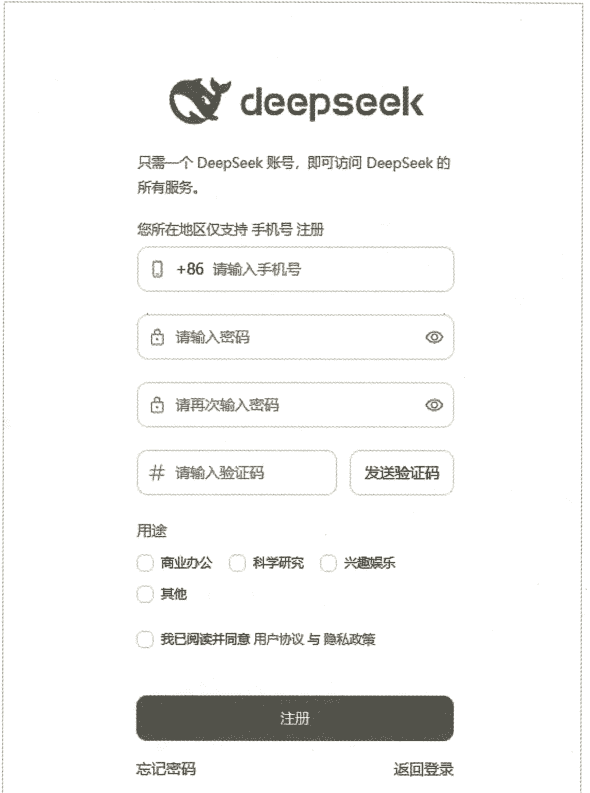
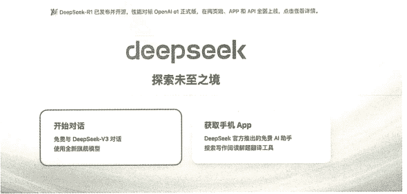
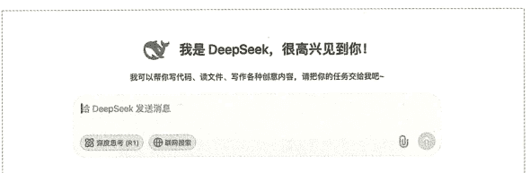

# DeepSeek 实操全书：从入门到内容创作

# 开篇

PREFACE

加州一年一度的未来科技盛会向来是业界风向标，巨头、初创和资本都会到场。往年最热的话题多围绕 ChatGPT、Gemini 这类熟面孔。今年峰会第二天，组委会临时加插了一场即兴 AI 比拼，现场气氛骤变。

规则很简单：各队在极短时间内，让模型处理海量图文视资料，并交付一份可直接使用的市场研究报告，还要带可视化图表和落地建议。多数队伍都能完成，但节奏偏慢。就在现场略显焦躁时，DeepSeek 团队上场。

他们将三批复杂信息导入系统，几分钟之内就产出一份近乎完整的报告，涵盖趋势判断、风险点和机会点，并附上多维度的视觉分析。更让人惊讶的是，系统自动合成了一段三分钟演示短片，把抽象数据讲得清晰直观。现场反应强烈，不少人起立鼓掌。

会后，多家科技巨头的代表立刻上门洽谈合作，其中一家当场给出上千万美元级别的投资邀约。

在动笔前的数周，DeepSeek-R1 在北美引发热议。这款大语言模型以高效率与低成本著称，很快成为讨论焦点。

市场随之波动。英伟达单日大跌近 17%，市值蒸发约 6000 亿美元，创下美股单日市值缩水纪录。与此同时，Meta 等因拥抱开源获得市场青睐，股价回暖。

DeepSeek 的出现让外界重新审视美国在人工智能领域的领先地位。《华尔街日报》认为这印证了补贴与制裁并非万能，也凸显竞争对美国自身进步的推动作用。

开源效应同样明显。该助手在苹果应用商店的下载量超过 OpenAI 的 ChatGPT，登顶免费榜。多家美国公司在财报电话会上反复提及 DeepSeek 带来的压力。

总体来看，DeepSeek 不只震动北美，也推动业界重新审视成本结构与竞争格局，为全球人工智能生态带来新议题。

晚宴上，一位硅谷投资人半开玩笑说：“你们就是 AI 圈的英雄，帮我保住了回报。”

读到这里，你应能感受到它的与众不同，也能理解本书的初衷。

DeepSeek 不是普通工具，它正在改写每个人的生活方式。与 ChatGPT 或 Claude 相比，它在多模态理解与信息整合上更有优势，能处理文字之外的图像、表格、音频、视频。应用边界已超出单一场景，渗透到日常各处。

未来学习、工作、娱乐乃至决策，很可能都离不开它。

学生可用它把零散资料整理成高质量报告或复习提纲；设计师上传草图或简短描述，即可获得多种风格方案；行业分析师借助它挖掘海量数据并自动产出可视化与建议；高管可实时追踪运营，自动生成周报月报并预警风险。

工作学习之外，它还能规划旅行、推荐膳食、指导健身，只需一句指令。

DeepSeek 正在从工具演变为无处不在的智能伙伴，为家庭与个人带来实质改变。学会使用它，不是为了追赶，而是避免在大潮中被落下。我希望你跟随本书，一步步探索它的可能性，让它成为未来不可或缺的伙伴。

## 第一章 DeepSeek 入门与基础应用

### 成立脉络与技术差异

DeepSeek 公司即杭州深度求索人工智能基础技术研究有限公司，由梁文锋于 2023 年创立，总部位于杭州。该公司以开源大模型著称，最新模型 DeepSeek-R1 的表现可比肩 OpenAI 的 GPT-4o，而训练花费约 560 万美元，成本明显更低。

底层路径上，DeepSeek-R1 并未照搬 ChatGPT-4o。它采用强化学习做后训练，通过学习思维链 Chain of Thought 的方式逐步推导，而非直接预测输出，从而大幅提升推理能力。

同时，模型采用专家混合 Mixture of Experts 架构，可根据任务动态激活最合适的专家子网，提升效率与准确度。

相比之下，ChatGPT-4o 主要依赖传统 Transformer 架构，借助海量数据训练与人工反馈微调来提升性能，推理过程不展示中间步骤。

总体来看，DeepSeek 凭借独特的训练方式与架构，实现了高效推理与低成本训练，与 GPT-4o 形成不同技术优势。

DeepSeek 与 ChatGPT-4o 底层差异汇总如下：

表 1

| 维度 | DeepSeek (DeepSeek-R1/V3) | ChatGPT-4o |
| :--- | :--- | :--- |
| 架构设计 | 使用混合专家架构，动态激活子模型以提升推理效果与效率 | 主要基于 Transformer 架构，以大规模数据和深度学习为核心，统一架构应对多任务 |
| 推理方式 | 强化学习加思维链推理，模拟逐步推理过程，允许中间步骤推导 | 主要依赖直接输出预测结果，不展示明显中间推理过程 |
| 训练成本 | 低成本训练，通过优化数据集与专家混合机制降低算力需求，训练成本约560万美元 | 高成本训练，依赖大规模算力与人工反馈调整，训练成本显著高于 DeepSeek |
| 处理效率 | 动态调用合适专家子模型，针对不同任务精细化处理，效率与准确度更高 | 同一模型处理所有任务，适应性强，但特定任务效率可能不及 DeepSeek |
| 适用范围 | 侧重特定领域或任务的深度应用，如医疗、法律等 | 更偏向通用型任务，如文本生成、语言理解、代码生成等广泛应用 |
| 独特优势 | 支持中间步骤输出解释过程，更贴合需要逐步推导的复杂任务 | 注重大规模数据训练的全面性能，中间推导透明度较低 |

简言之，DeepSeek 更像一位超级助手，尤其在中文场景优势明显：

- 写邮件？它能成稿并润色语气。
- 写报告？它能梳理数据、列提纲、润色。
- 学编程？它可直接写代码并调试。
- 要翻译？它能准确传达并优化表达。

于是 DeepSeek = 智能写作助手 + 语言翻译助手 + 编程顾问 + 信息整理专家。

### 基本操作

#### (1) 注册与登录

操作步骤：

第一步，打开官方网站：https://www.deepseek.com/。


▲ 图 1

第二步，点击“注册”按钮，使用手机号完成注册。



▲ 图 2

第三步，点击开始对话，或下载手机 App。



▲ 图 3

第四步，你会看到类似微信聊天的对话框，输入问题即可获得回复。



▲ 图 4

#### (2) 界面说明

界面非常简洁，主要由三部分构成。

对话区：输入问题，AI 在此回复。

历史记录：回顾之前的对话内容。

设置选项：可调节回复风格，如更简洁或更详细。

#### (3) 模型选择与联网检索

##### 使用 DeepSeek-R1 的场景

需要离线高效完成任务时，DeepSeek-R1 是首选。

适合的问题：

- ①写作与内容创作
  - “帮我写一篇关于人工智能的科普文章。”
  - “润色我的英文邮件，让语气更专业。”

- ②代码编写与修复
  - “用 Python 写一个简单的计算器。”
  - “找找这段代码中的错误，优化一下。”

- ③数学、逻辑推理
  - “3个人分15个苹果，每个人最多能分几个？”
  - “帮我解这道几何题，说明步骤。”

- ④信息归纳与总结
  - “总结这篇文章的核心观点。”
  - “把会议纪要整理成一份简短的报告。”

不依赖实时信息时，交给 DeepSeek-R1 处理即可。

##### 使用联网检索的场景

需要最新实时答案时，开启联网检索。它像动态小助手，能抓取当天数据。

- ①实时资讯查询
  - 今天北京的天气怎么样？
  - 最新的 AI 大会的时间和地点。

- ②最新时事新闻
  - 查查 2025 年 1 月关于某个明星的新闻。
  - 查找最近在硅谷发生的科技事件。

- ③产品或市场调研
  - 2025 年最热门的 AI 公司有哪些？
  - 帮我整理 2024 年 AI 芯片行业的趋势报告。

- ④综合多来源信息
  - 列出几本关于 AI 教育的畅销书。
  - 查查今年大公司的裁员计划。

需要最新资讯、动态或多方观点时，联网检索更合适。

##### 两种模式使用对比

表 2

| 场景 | 用 DeepSeek-R1 | 用联网检索 |
| :--- | :--- | :--- |
| 写作、论文、报告 | 写小红书文案、改写论文摘要、润色文章 | 查找论文最新引用、研究最新数据 |
| 编程相关任务 | 写代码、改代码、查 Bug | 查询最新的 API 或库的文档 |
| 逻辑和计算问题 | 数学题、逻辑推理、长文总结 | 无须联网，依靠模型本身即可 |
| 实时动态 | 不适合，可能给出过时答案 | 查新闻、天气、科技动态 |
| 市场和调研分析 | 总结已有的公司或市场分析报告 | 搜集和整合最新市场数据 |

记忆要点：

- DeepSeek-R1 适合写作、代码、逻辑推理等离线任务。
- 联网检索适合查最新动态、时事、市场调研等需实时数据的问题。

##### 三个效率技巧

①提问须明确具体
问题越笼统，效果越差。
示例：
- “写一篇关于 AI 改变教育方式的小红书文案，风格要轻松，字数 200 字。”
- “优化我的代码，找到语法错误并改正。”

②为 AI 指定角色
明确角色，语气和内容会更贴合。
示例：
- “你是一个营销专家，帮我写一条广告文案，产品是新款耳机。”
- “你是一个软件工程师，帮我检查这段代码的性能优化点。”

③复杂问题分步提问
拆解提问，回答更全面。
示例：
- 第一步，“帮我分析产品 X 的优缺点”。
- 第二步，“根据优缺点，写一个针对年轻用户的推广方案”。
- 第三步，“给推广方案设计 3 条关键文案”。

#### (4) 实战演练

##### 场景 1：写邮件

指令：“请帮我写一封正式的英文商务邮件，邀请客户参加产品发布会。”

AI 生成：

> "Dear (Customer's Name), we are delighted to invite you to…"

##### 场景 2：写代码

指令：“请用 Python 写一个自动计算平均分的程序。”

AI 生成：

```
“……（完整的 Python 代码）”
```

##### 场景 3：翻译改写

指令：“请帮我把这段英文翻译成中文。”（粘贴英文）

AI 生成：

> “……（通顺的中文翻译）”

### 写作与内容创作应用：创作搭档

DeepSeek 不仅是辅助，更是创作伙伴。论文、短文案、长推文、社交媒体内容，都能快速生成，显著提升效率。

#### (1) 核心能力

- 文章写作：一指令即可生成论文、小红书文案、公众号推文、项目报告甚至小说初稿。
- 文章优化：自动修改润色，使文字更精准、自然，适配不同平台。
- 内容摘要：面对长文自动提炼关键信息，快速抓住核心。

#### (2) 应用场景

- 小红书内容创作：迅速激发创意，自动产出吸睛文案。
- 长文章摘要：研究论文或新闻报道都能快速提炼要点。
- 文章结构重组：按要求调整段落与章节，让逻辑更清晰流畅。

#### (3) 示例指令与效果

指令：“帮我写一篇小红书文案，主题是如何用 AI 提高学习效率，风格轻松幽默，字数 200 字。”

生成示例：

“想让学习更省心？AI 正改变备考节奏。写作不再卡壳，复习不用熬夜，论文框架也能快速成型。推荐组合：ChatGPT 整理笔记、DeepSeek 润色提升、思维导图梳理知识点。效率升级，比你想的更快！”

无论长文还是短文案，DeepSeek 都能更快更好地完成。这是高效写作的新阶段，后续章节会进一步展开具体操作。

### 翻译与语言处理应用：表达优化

DeepSeek 不仅是翻译器，更是表达优化大师，能理解语境、调整语气，让翻译既准确又专业。

#### (1) 核心能力

- 多语言翻译：支持中英互译及中日、中文法德等高质量互译。
- 精准语言风格调整：提供正式、学术、轻松等多种风格选择。
- 英文改写与润色：优化邮件、论文等正式文本，使其更符合母语表达。
- 自动语法纠正：翻译或改写时自动检查语法、拼写与标点。

#### (2) 应用场景

- 商务沟通：跨国邮件、合同翻译等，提供专业润色。
- 论文写作：英文论文、学术报告的词汇与句式逐层优化。
- 社交平台内容：小红书、Instagram 等平台的轻松幽默文案适配。

#### (3) 示例指令与效果

指令 1：“请帮我把这段中文翻译为英文，并优化表达。”

原文：“这篇文章的主题是 AI 如何改变未来教育。”

AI 翻译与优化结果：

> "This article explores how AI is reshaping the future of education."

指令 2：“帮我改写这封英文邮件，使其语气更专业。”

原文邮件：

Hi John,

I want to discuss a problem we had last week. We couldn't complete the project on time because of some unexpected issues. Can we schedule a call tomorrow ?

AI 改写后：

Dear John,

I hope this message finds you well. I would like to discuss some challenges we encountered last week that caused delays in the project timeline. Would you be available for a call tomorrow to review the situation and explore potential solutions ?

改写后更正式、礼貌，层次感更强。

#### (4) 功能延伸

- 跨语即时转译：在国际会议或在线聊天中，系统可同步将发言内容转换语言并润饰表达，沟通更顺畅。
- 面向搜索的译文：在多语言官网建设时，翻译过程兼顾关键词布局，有助于提升页面在搜索引擎中的可见度。
从正式公文到轻松软文，都能根据受众需求切换语气与风格，让每句话更贴合使用场景。

### 编程协作：从零起稿到持续优化的闭环

DeepSeek 可作为贴身的编码伙伴，既能从空白处产出实现，也能重构思路、快速定位缺陷。对初学者和资深工程师而言，都是提效的利器。

#### (1) 核心能力
- 编写代码：兼容 Python、JavaScript、C++、Java、SQL 等多种语言，按需产出函数、模块乃至完整项目。
- 优化代码：解析已有实现，调整逻辑架构、统一命名惯例、提升运行效率，使程序更易读且高效。
- 缺陷修复：自动扫描语法与逻辑问题，给出修正方案与改进建议。
- 算法方案输出：针对复杂逻辑或算法需求，提供标准化实现思路与示范片段。

#### (2) 典型场景
- 原型快速搭建：迅速获得可用初版，加快进入验证阶段。
- 调试与修补：运行报错时自动分析原因并提供改正建议，降低排错成本。
- 学习与教学支持：帮助理解算法思路，提供示例并逐行解读。
- 跨语言搬迁：将 Python 等语言的实现迁移到 Java 等其它语言，完成代码重构。

#### (3) 指令示例与效果
指令 1：“用 Python 写一个简单的计算器，支持加减乘除。”

AI 生成的 Python 代码：

```python
def calculator():
    print(" 欢迎使用简单计算器！ ")
    print(" 操作：加 (+), 减 (-), 乘 (*), 除 (/)")
    num1 = float(input(" 请输入第一个数字："))
    operator = input(" 请选择操作符 (+, -, *, /): ")
    num2 = float(input(" 请输入第二个数字："))
    if operator == '+':
        result = num1 + num2
    elif operator == '-':
        result = num1 - num2
    elif operator == '*':
        result = num1 * num2
    elif operator == '/':
        if num2 != 0:
            result = num1 / num2
        else:
            result = " 除数不能为零！ "
    else:
        result = " 无效的操作符。 "
    print(f" 结果：{result}")

calculator()
```

（该交互式计算器接收用户输入的数字与运算符后直接返回结果。）

指令 2：“帮我优化这段 Python 代码，减少冗余逻辑。”

原始代码：

```python
if age >= 18:
    print(" 成年人 ")
else:
    if age < 18 and age >= 13:
        print(" 青少年 ")
    else:
        print(" 儿童 ")
```

AI 优化后：

```python
if age >= 18:
    print(" 成年人 ")
elif age >= 13:
    print(" 青少年 ")
else:
    print(" 儿童 ")
```

（优化后结构更简洁，去除了多余的条件判断。）

指令 3：“帮我修复这段 SQL 语句的错误。”

原始 SQL 语句：

```sql
SELECT name, age,  FROM students WHERE age > 18;
```

AI 修复并优化：

```sql
SELECT name, age FROM students WHERE age > 18;
```

（删除多余逗号，确保语句可正常执行。）

#### (4) 进阶功能推荐
- API 接入辅助：对接外部接口时可快速产出调用示例。
- 自动化文档：为代码生成注释与说明文件，提升协作效率。
- 安全审查：在提交前自动扫描潜在风险并给出修复建议。

无论是简单脚本还是复杂系统，DeepSeek 都能提供即时编程支持，摆脱低效操作。

## 第二章 DeepSeek 的高级玩法

前期已介绍 DeepSeek 的定义、核心能力、基础使用与操作要点。若已完成注册并尝试让智能体写文、翻译或编程，恭喜已迈出第一步。

但实际使用中可能会遇到：
- 回复有时不够精确。
- 文章质量尚可，却不符合个人表达习惯。
- 代码可以产出，但未必是最优解。

下面介绍如何更深入地驾驭 DeepSeek，掌握进阶用法。

### 如何提升指令服从度
初次使用时，智能体回答时好时坏，根源在于指令不够清晰。

问题模糊，输出必然含糊。要获得高质量结果，需要做到：
- 需求具体化：明确说明要什么、不要什么。
- 任务拆分：把复杂需求拆成步骤，逐步完成。
- 设定角色：指定身份，如“你是一位资深营销专家”。
- 提供示例：给出参考样式，让输出风格对齐。

在内容创作领域，流量靠设计而非偶然。简单要求“写个有流量的文案”无法奏效，必须用“精准提问+清晰指令+有效样例”引导。

直接说“给我个好标题”或“写段吸睛文案”，得到的往往是平庸结果。正确做法是明确框架、情感点或目标人群。

问题要具体化，告诉模型需求边界。
示例：“帮我写一篇面向20~30岁年轻人的小红书引流文案，风格带点幽默，参考李尚龙《小人物的奋斗》那种逆袭叙事。”

错误示范：“写个高流量标题。”
优化后：
> “围绕普通人用 AI 提升收入写一个话题，采用李尚龙式逆袭故事风格，重点引发共鸣。”

### 5 数据归纳与分析：提炼关键信息
在信息过载环境下，DeepSeek 就是你的数据归纳员，能从杂乱文本、数据与会议记录中提炼关键信息，快速完成报告、纪要与文档梳理。

#### (1) 核心能力
- 会议纪要：自动提取讨论重点、决策结论与待办事项，避免反复听录音。
- 数据分析与报告生成：基于 Excel、CSV 等数据，自动输出结构化可视化报告，含趋势图、数据表与结论。
- 复杂信息整理：从文档、网页、邮件等来源抓取要点，去重冗余，提供易懂总结。
- 任务清单生成：整理资料与会议内容后输出清晰的行动清单及优先级。

#### (2) 使用场景
- 会议纪要自动生成：适合高频开会岗位，确保关键信息不遗漏。
- 大数据归纳分析：对销售、市场等数据快速分析趋势，形成数据驱动洞察。
- 信息提炼整合：从海量文档中抽出核心观点，省去筛选对比成本。
- 多源整合报告：将 Excel、文档、邮件等异构数据汇总为统一分析结果。

#### (3) 示例指令及效果
指令 1：“帮我总结这场项目会议的要点和待办事项。”

原始输入：（模型可处理录音或文字记录）
会议内容概述：讨论了新品开发进度、市场营销策略及待解决技术问题。

AI 自动生成会议纪要示例：
# 会议纪要
时间：2025 年 1 月 29 日
参与人员：项目经理、技术负责人、市场负责人
主要讨论内容：
- 产品开发进度汇报（当前完成率：60%）
- 下季度市场推广计划
- 新增技术问题汇总及负责人分配
决策事项：
- 确定新产品上线时间为 4 月
- 推广活动初步预算定为 50 万元
- 修复技术问题的优先级安排
待办任务：
- 技术团队一周内提供问题解决方案
- 市场部门完成广告文案初稿

指令 2：“请根据这份 Excel 销售数据生成季度分析报告。”

原始数据：Excel 含产品名称、销售额、季度增长率等列。
AI 生成报告示例：
# 季度销售分析报告
总销售额：本季度销售额达 500 万元，同比增长 15%。
最佳销售产品：智能手表 X1，占总销售额的 35%。
主要趋势：东部市场增速最快，同比增长 25%。
面临的挑战：西部市场增长放缓，需加强当地品牌宣传。
（报告自动附带条形图、折线图等可视化内容。）

指令 3：“从这堆技术文档中提取与数据安全相关的重要内容。”

AI 整理结果：
- 数据加密是保障客户隐私的核心手段。
- 系统日志需定期审查以发现潜在入侵风险。
- 多因素认证被推荐用于管理用户数据访问权限。
（模型自动过滤无关信息，只保留关键点。）

#### (4) 拓展功能推荐
- 大规模数据匹配：跨数据源对比整合，生成交叉分析报告。
- 自动数据可视化：依据数据自动生成饼图、折线图、热力图等。
- 智能提醒推送：数据或会议更新时推送关键提醒，便于实时跟进。

无论是企业决策、项目管理还是日常追踪，DeepSeek 都能把繁杂信息整理成可执行的行动指南，让工作更高效有序。

### 数据分析：轻松完成分析及报告生成
DeepSeek 不仅能处理简单数据任务，还可完成销售趋势分析、可视化与商业报告撰写等复杂工作，是 Excel 处理、市场研究与企业决策的得力助手。

#### (1) 核心能力
- 销售数据趋势分析：识别增长点、季节波动及市场潜力并生成可视化报告。
- 财务报表分析：自动解析利润、成本构成，支持数据驱动决策。
- 市场分析：基于现有数据洞察客户需求变化、产品表现与竞争优势。
- 数据整理与清洗：将混乱数据结构化，剔除冗余与异常值。

#### (2) 案例 1: 分析 Excel 销售数据，生成趋势报告
场景描述：有一份近两年的产品销售 Excel，想了解增速最快产品与表现最佳季度。
指令示例：“我有一份 2023-2024 年的销售数据，请分析销售趋势并总结关键增长点。”

AI 结果示例：
# 销售趋势分析报告
总销售额趋势：2024 年总销售额同比增长 18%，主要来自四季度促销活动。
关键增长点：
- 产品 X：电商渠道增长 35%，贡献整体增长的 50%。
- 地区分析：东部市场增长 22%，为最快增长区。
- 节日促销：双十一与圣诞期间销量占全年 40%。
推荐策略：
- 增加东部市场广告预算。
- 扩大四季度促销并引入会员折扣。
可视化结果：自动生成的折线图、柱状图直观展示产品与地区表现。

#### (3) 案例 2：财务数据分析，自动生成可视化报表
场景描述：需分析公司季度利润与成本数据，找出盈利关键因素。
指令示例：“我有一份季度财务数据含收入、成本、利润，请分析影响盈利的关键因素并用图表展示。”

AI 结果示例：
# 财务分析报告
总利润情况：
- Q1 利润率 25%，Q2 下降至 18%。
- 成本上升是主因，原材料成本上涨 15%。
关键影响因素：
- 原材料成本：供应链不稳导致生产成本大幅上升。
- 营销费用：新市场广告投入增加但转化率偏低。
AI 生成图表：
- 利润与成本季度趋势图
- 原材料与广告投入占比饼图
推荐策略：
- 优化供应链，考虑本地供应商降低物流成本。
- 重新评估新市场广告策略，集中资源于高转化渠道。

### 商业应用：市场营销的强力助手
在竞争激烈的商业环境中，营销决定成败。精准触达用户、推动增长、塑造品牌价值都需要速度与创意。落后一步就可能错失机会。

DeepSeek 可快速精准高效执行营销任务，从市场研究、品牌策划、社交运营到广告文案与策略制定，均可提供强力支持，成为提升营销能力的秘密武器。

无论是大型品牌活动还是小红书、抖音的引流内容，DeepSeek 都能迅速生成实用方案，让你在营销战场始终领先。

#### (1) 核心能力
- 市场研究报告：快速获取消费者行为、行业趋势与竞品分析，为决策提供依据。
- 品牌文案与广告创意：生成有传播力的品牌故事、广告语与社媒文案。
- 营销策略建议：结合产品特点、目标市场与预算，自动输出线上线下联动方案与短期引流计划。

#### (2) 智能营销赋能的实际表现
- 降低营销成本：替代传统调研与创作的人力时间成本。
- 提升内容质量：基于用户需求分析生成平台适配的创意内容，易于破圈。
- 实时策略调整：依据最新数据动态优化推广方案，提升效果。

总之，营销本质是争夺用户心智，DeepSeek 能让你更快、更准、更有创意。无论是 CEO 还是市场负责人，善用 AI 赋能营销，才能抓住未来商业机会。

#### (3) 案例 1：生成一份市场研究报告
场景描述：准备 2024 年短视频营销趋势报告用于汇报。
指令示例：“请帮我写一份关于 2024 年中国短视频营销趋势的研究报告，约 1000 字。”

AI 结果示例：
## 2024 年中国短视频营销趋势研究报告
趋势 1：品牌与用户共创内容
用户生成内容正成为主流，品牌通过挑战赛提升粘性。例如抖音“全民挑战赛”成为推广核心工具。
趋势 2：AI 个性化推荐
平台利用 AI 算法分析行为推送定制内容，提升停留时间并帮助品牌精准触达。
趋势 3：直播与短视频一体化
直播与短视频结合加深，品牌可通过短视频引流至直播间完成转化。
数据支持：
- 2023 年中国短视频广告市场规模达 3000 亿元，同比增长 25%。
- 45% 用户表示观看时曾点击品牌链接或活动页。
结论与建议：重点投入 AI 个性化营销、UGC 活动与直播互动，实现覆盖与转化最大化。

#### (4) 案例 2：社交媒体营销文案生成
场景描述：发布一条推广“AI 提升工作效率”主题的抖音短视频。
指令示例：“帮我写一篇抖音短视频文案，主题是如何用 AI 提高工作效率，风格幽默且带悬念。”

AI 生成示例文案：
标题：“你还在手动整理 Excel？难怪效率低！”
文案内容：[开场]镜头对准一堆混乱文件，主人公愁眉苦脸，背景音乐焦虑。
[转场] AI 工具出现，画面瞬间清爽，数据整理、邮件回复、PPT 生成迅速完成。
配音旁白：“你有没有想过，每天重复的工作可以让 AI 搞定。整理表格？AI 一秒完成。写报告？AI 代劳。今天的效率秘诀不是加班，而是——用对 AI 工具！”
结尾悬念：“还在等什么？关注我们，教你下载爆款 AI 工具！”
配文：评论区聊聊，你最想让 AI 帮你做什么？
结果：文案兼具情节与互动，符合抖音传播逻辑。

#### (5) 案例 3：品牌文案策划与广告语生成
场景描述：为一款 AI 学习助手策划面向 20~30 岁年轻用户的广告语。
指令示例：“帮我写三条针对 20~30 岁年轻用户的品牌广告语，产品是 AI 学习助手。”

AI 生成示例广告语：
- “学得快，懂得多，AI 助手让学习变简单！”
- “你的 AI 私教，随时解锁新技能。”
- “跟上时代，用 AI 打造专属知识库。”
可进一步扩展成长文案、宣传标语或搭配营销活动的完整文案。

## 第二章 DeepSeek 的高级玩法

### 使用 DeepSeek 打造有层次感的流量文案
想写出既有故事又有情感共鸣的爆款文案？DeepSeek 是理想创作搭档，关键在于方法。单一指令效果有限，若学会拆解任务、设定场景、提供示例，就能生成超出预期的流量内容。

#### (1) 拆分任务——一步步引导模型，让文案更有层次感

文案層層推進的寫法

能打動人的稿件從來不是金句堆砌，而是節奏的分層。先以故事切入勾起好奇，再用細節拉近共情，最後以反轉或啟發收束，三個環節依次推進。若希望讓 DeepSeek 也能還原這種效果，最有效的做法是把創作拆成逐步遞進的小任務。

起盤階段，可請它先產出一個吸睛開場，例如描述一位二十多歲女性在職場受挫後反彈的來龍去脈。
推進情節時，再要求補充她在智能助手輔助下重拾信心並完成逆襲的過程，讓讀者產生代入感。
收尾時，讓它根據前文提煉一個抓眼球的題目，例如「逆風翻盤，從模型裡找到的第二人生」。

參考提問：「先寫一段職場失意的共鳴片段，再寫借助模型逆襲的過程，最後總結並給出題目。」
反面示範：「寫一篇有流量的職場文案。」提示太寬泛，輸出會平淡無層次。

#### (1) 把創作拆成步驟，分階段輸出
同一個需求拆成背景、衝突、轉折、總結，模型能一步步跟進，內容更立體。

#### (2) 賦予人設，讓語氣貼合平台
DeepSeek 能依身份調整語氣與邏輯。若想得到自媒體調性，可讓它扮演「勵志作者」或「小紅書 KOL」。

示範提問：「你是一名擅長寫勵志故事的小紅書達人，模仿李尚龍的敘述方式，寫一篇關於借助大模型改變人生的筆記。」
反面示範：「寫一段模型幫助人逆襲的文案。」沒有人設，平台特點抓不住。
優化提問：「你是一名小紅書 KOL，專注平凡人逆襲故事，用李尚龍的敘述風格寫一篇講述模型如何改變命運的小故事。」

#### (3) 提供樣文做參照，效果更精準
李尚龍的文本勝在細節真實、情感貼近。可貼幾段參考，讓模型在同類語感上創作。

示範提問：「請模仿下面這段文案的風格，寫一個相似的故事。」
參考文案：「小王只是個普通的職場人，日復一日被同樣的生活困住，直到他用大模型找到副業賺錢的機會，一年後收入翻倍。他說：‘我原以為模型只是工具，後來才發現它改變了我整個人生。’」
優化提問：「模仿上面李尚龍式的故事結構，寫一個平凡人如何借助大模型改變人生的案例。」
反面示範：「寫一段模型改變人生的文案。」過於簡單，細節和情緒難以到位。

總的來說，用對方法，DeepSeek 就能成為打造流量爆款的利器。


- 分步拆解複雜需求，引導 DeepSeek 分階段輸出層次分明的内容。
- 人設設定，明確告知需要扮演的身份，例如市場專家或勵志作者，幫助進入狀態。
- 提供範文，用真實文案做參考，確保生成的内容既有共鳴又接地氣。
- 需求具體化，清晰說明所需風格、目標讀者與發佈平台，避免空泛提問。

#### (4) 實戰演練：精準提問獲取高質量答案

想讓 DeepSeek 輸出真正有價值、能帶來流量的内容，關鍵在提問。模糊的問題只能得到泛泛的回答，明確場景、需求與重點才能得到超預期結果。

##### 範例 1：生成市場拆解
以電商行業為例。

普通提示，不夠精準：「請幫我分析電商行業的趨勢。」結果多是「電商增長快」「各平台競爭激烈」，缺乏深度與數據。

優化後的提示，更精準：「請以 2024 年中國市場為背景，拆解電商行業的發展趨勢。重點關注以下方向：
- 直播電商、社交電商的影響力。
- 模型在電商中的具體應用，如智能推薦、庫存管理等。
- 請提供關鍵數據或案例佐證。」

為何更好？
- 市場範圍明確，限定為 2024 年中國。
- 分析角度清晰，覆蓋直播、社交電商及模型技術。
- 要求數據支撐，結果更具體、可信。

輸出示例：
- 2024 年電商市場格局演變：模型驅動的精準推薦成為用戶購物體驗的核心，直播電商繼續爆發式增長……
- 實際數據引用：2024 年，某頭部電商平台直播銷售額同比增長 35%，模型庫存管理幫助品牌商降低約 20% 供應鏈成本。

##### 範例 2：撰寫社群媒體文案
普通提示，不夠精準：「幫我寫個產品推廣文案。」結果多為普通廣告語，缺乏吸引力與針對性。

優化後的提示，更精準：「你是一名專業品牌文案策劃，現在請為小紅書撰寫一篇護膚品推廣文案，目標受眾為 18~25 歲女性，語氣輕鬆、帶點幽默。」

處理方式：
- 符合小紅書輕鬆互動的調性。
- 用故事或幽默切入，降低廣告感。
- 依據受眾需求定制内容，更易吸引年輕用戶。

輸出示例：
> 「熬夜女孩的救星！昨晚追劇到凌晨，今天肌膚還想‘續命’？別擔心，這款小眾護膚神器用模型科技鎖水修護，熬夜臉秒變水嫩少女肌！」

##### 範例引申：用 DeepSeek 優化自媒體選題
普通提示，不精準：「幫我寫一篇關於模型在生活中應用的小紅書文案。」可能得到的内容平淡無奇，如「模型能幫你學習、工作和娛樂」，缺乏新意。

優化後的提示，更精準：「你是一名自媒體達人，請為我寫一篇小紅書文案，目標人群是 20~30 歲的年輕白領，主題是‘模型在副業中的應用’。内容需包含：
- 一個抓人眼球的開頭故事，最好是逆襲案例。
- 具体的副業機會，比如寫作、帶貨、短視頻製作。
- 結尾要有號召力，引導用戶參與討論。」

為何更好？
- 指定了目標受眾，20~30 歲上班族。
- 明確文章結構，開頭故事 + 機會推薦 + 互動引導。
- 内容更具針對性，容易引發共鳴與互動。

輸出示例：
「90 後平凡女性如何用模型賺到第一個 10 萬元」
開頭故事：
小李是一名普通公司職員，薪資一般。她利用模型工具進行寫作並運營小紅書，一年內副業收入超過主業。她說：「模型不只是工具，更是我人生的轉折點。」
副業機會推薦：
- 用模型寫作助手接短篇故事單。
- 用模型剪輯工具製作短視頻。
- 用模型選品助手做帶貨。
結尾引導：
> 「你的副業機會在哪裡？模型可以幫你發現更多可能！」

#### 小結
- 明確提問場景：告知模型具体的應用場景與目標，避免泛泛而問。
- 優化提示結構：將需求拆解為步驟，幫助模型理解關鍵任務。
- 引导深度思考：提供目標受眾、風格偏好、關鍵細節等，讓模型生成高質量内容。

總之，用好 DeepSeek，它會成為你手中的精準創意工具。

### 編程助力 DeepSeek Coder：智能程式開發搭檔

DeepSeek Coder 面向程式員和開發者，支援 Python、JavaScript、C++ 等多種語言，不僅能自動生成程式碼，還可提效、修復 Bug，大幅提升開發效率，適合初學者和資深開發者使用。

#### (1) 核心功能
- 自動生成程式碼：根據需求生成完整程式碼片段或模組。
- 程式碼提效：檢測性能瓶頸，提供更高效的方案。
- Bug 修復與除錯：快速定位錯誤並給出修復建議。
- 跨語言轉換：可將程式碼從一種語言自動轉換為另一種語言，如 Python 轉 Java。

#### (2) 範例 1：自動生成 Python 爬蟲程式碼
場景：需要爬取新聞網站的最新資訊，但不確定如何起步。

提示示例：「請用 Python 寫一個爬取某網站最新新聞的爬蟲。」

AI 結果示例：
```python
import requests
from bs4 import BeautifulSoup

def get_latest_news(url):
    response = requests.get(url)
    if response.status_code == 200:
        soup = BeautifulSoup(response.content, 'html.parser')
        # 假设新闻标题在 <h2> 标签中
        news_titles = soup.find_all('h2')
        print("最新新闻标题：")
        for title in news_titles[:5]: # 只显示前 5 条新闻
            print(title.get_text())
    else:
        print(f"请求失败，状态码：{response.status_code}")

# 调用函数
get_latest_news('https://example-news-website.com')
# 需要在一定环境下运行
```

以上程式碼，模型自動生成了一個簡潔、可運行爬蟲程式，並加入了基礎錯誤處理。使用者只需根據網站結構調整標籤定位即可。

#### (3) 範例 2：提效已有程式碼，提升執行效率
場景：一我國程式碼執行緩慢，希望提高效能。

提示示例：「以下是我的 Python 程式碼，執行很慢，請優化以提高執行效率。」（粘貼程式碼）

示例原程式碼：
```python
nums = [i for i in range(1000000)]
squares = []
for num in nums:
    squares.append(num**2)
```

AI 優化結果：
```python
nums = [i for i in range(1000000)]
squares = [num**2 for num in nums] # 使用列表推导式提高效率
```

優化建議：
- 列表推導式相比傳統 for 循環效率更高，因其在底層做了性能優化，適合處理大規模數據。
- 模型指出這種寫法可節省 30% 以上的運行時間。

#### (4) 範例 3: 自動修復 Bug
場景：程式運行報錯 “IndexError: list index out of range”，但找不到原因。

提示示例：「請幫我修復這段 Python 程式碼中的錯誤。」（粘貼出錯程式碼）

示例原程式碼：
```python
my_list = [1, 2, 3, 4]
print(my_list[4]) # 访问越界索引
```

AI 修復結果：
```python
my_list = [1, 2, 3, 4]
if len(my_list) > 4:
    print(my_list[4])
else:
    print("索引超出范围，请检查列表长度。")
```

以上程式碼，模型檢測並修復了索引越界問題，通過增加條件判斷避免程式崩潰，並給出除錯建議。

#### (5) 範例 4：跨語言程式碼轉換
場景：有一段 Python 程式碼，需要轉為 Java 版本。

提示示例：「請將下面的 Python 函數轉換成 Java 程式碼。」

Python 原程式碼：
```python
def greet(name):
    return f"Hello, {name}!"
```

AI 生成的 Java 程式碼：
```java
public class Greet {
    public static String greet(String name) {
        return "Hello, " + name + "!";
    }

    public static void main(String[] args) {
        System.out.println(greet("Alice"));
    }
}
```

更多擴展功能：
- 自動化測試：根據需求自動生成單元測試用例，保證程式碼穩定性。
- 安全漏洞檢測：檢查程式碼中的安全隱患，如 SQL 注入、未處理異常等，並提供修復建議。
- 程式碼文檔生成：自動為函數、類和模組生成註釋，便於團隊協作。

## 第三章 DeepSeek 的深度定制與高效協作

到目前為止，我們已學習了 DeepSeek 的基礎操作，也掌握了一些進階用法，如寫作、翻譯、程式碼生成、數據分析等。

不過你可能會問：
- DeepSeek 能否更貼合我的需求？
- 能否讓模型記住我的偏好，避免每次重複說明？
- 如何將模型整合到團隊協作工具中？
- 是否支援更高階的玩法，如 API 調用？

答案是可以。

下面介紹 DeepSeek 的「深度定制」玩法，讓模型真正成為你的專屬助手，並能與團隊、工具無縫協作。

### 如何定制 DeepSeek 的工作方式

與模型對話越多，它越能精準理解你的需求。你甚至可以反向提問：「在我們多次溝通中，你認為我有哪些習慣或需求是我自己未意識到的？」這個問題能讓模型給出意想不到的反饋，幫助你發現優化方向，提升效率。

#### (1) 設定長期記憶，讓模型記住你的需求
與人類助手類似，DeepSeek 可通過長期記憶逐步熟悉你的工作方式、職業需求和偏好，避免重複輸入。想像一下，如果模型一開始就了解你的背景、常用語言風格和偏好方案，每次回答都會更貼合。

##### 為何長期記憶很重要
- 減少重複輸入：無需每次都說明身份、風格偏好。
- 更貼合需求：基於背景信息生成更具針對性的答案。
- 個性化理解：互動越多，模型越能把握你的工作模式，甚至提前預判需求。

##### 你可以讓模型記住什麼
- ①職業與工作背景
  例如：「我是一名市場行銷顧問，主要負責品牌推廣和客戶分析。」
- ②行業與領域
  例如：「我的工作聚焦科技領域，特別關注短視頻平台的營銷趨勢。」
- ③風格偏好
  例如：「我喜歡簡潔直白的表達，少用專業術語。」「涉及市場數據時請提供圖表或示例。」
- ④長期目標或項目
  例如：「請記住，我的長期目標是提升品牌在抖音和小紅書上的影響力。」

##### （2）哪些信息不宜讓模型記住
DeepSeek 的長期記憶能提供更精準的個性化回答，但涉及隱私或敏感内容時需謹慎，尤其當孩子使用時。下面列出應避免提供的信息。

**個人敏感信息：**
- 身份證號、護照號、社會保險號
- 銀行卡號、密碼、帳戶信息
- 醫療記錄、體檢報告等健康數據
外洩可能帶來財產和隱私風險。

**公司機密與商業敏感信息：**
- 公司內部財務數據，如利潤、預算、銷售額
- 核心競爭策略、未公開的商業計畫
- 與客戶、合作夥伴簽訂的保密合同内容
外洩可能造成嚴重損失。

**個人隱私生活：**
- 家庭住址、個人行程安排
- 親密關係、私人感情生活
- 與朋友或家人的聊天内容
可能被不法分子利用，導致人身和財產風險。

**政治或法律敏感信息：**
- 政治立場或敏感話題的詳細討論
- 涉及法律糾紛、案件相關的私人信息
- 涉及國防、國家機密等特殊領域的信息
可能引發誤解、法律風險或安全問題。

**帶有私人情緒或負面評價的信息：**
- 對同事、上司、合作夥伴的負面評價
- 過於私人化的情緒或壓力宣洩
- 未經深思熟慮的觀點或評論
未來被誤用可能影響職業形象。

**如何保護隱私？**
- 關閉長期記憶功能：不希望模型長期存储對話時，可關閉記憶或調整權限。
- 使用安全平台：確保所用模型平台具備數據加密和隱私保護措施。
- 定期清理數據：定期刪除歷史記錄，降低信息外洩風險。

個性化回答固然重要，但隱私保護更為關鍵。在使用模型時懂得取捨、謹慎分享，才能讓模型成為助手而非風險。

##### (3) 如何操作 DeepSeek 的長期記憶
DeepSeek 通過「記住並理解你的需求」來提升回答精準度。其原理是：當你輸入特定自定義設定時，模型會將這些信息存入「長期記憶系統」，類似於人類大腦的長期記憶區。下次提問時，模型會 Jacobs 記憶，調整回答，使其更貼近實際需求。

###### >> 操作步驟簡明
- 進入 DeepSeek 的自定義設定介面。
- 輸入希望模型記住的背景信息或需求指令。
- 儲存設定，開始使用。

示例指令：「請記住，我是一名市場行銷顧問，我需要你提供商業分析、品牌推廣策略、社群媒體文案建議。」

###### >> 模型長期記憶背後的技術邏輯
DeepSeek 會將自定義設定中的指令存入「長期記憶存儲模組」，原理類似數據庫中的用戶偏好表。提問時，模型通過「背景匹配算法」掃描長期記憶，將需求與問題進行語義關聯，再基於上下文生成更有針對性的回答。

簡單來說，它像一個智能助理，一邊學習你的習慣，一邊優化服務。

**①示例效果**
你提問：「幫我分析一下 2025 年的短視頻營銷趨勢。」

模型回答優化示例：
> 「作為一名市場行銷顧問，我建議你重點關注以下幾點：
> 模型推薦算法在短視頻中的應用。未來用戶偏好，模型可提前捕捉，幫助品牌更精準投放廣告。
> 用戶生成内容 UGC 的互動策略。鼓勵用戶參與内容創作是保持品牌熱度的關鍵。
> 直播帶貨的整合營銷。短視頻與直播的聯動效應在 2025 年將持續增強，建議探索多平台聯動策略。」

**②技術解析：模型如何依據背景優化回答**
當你輸入問題時，DeepSeek 的「上下文處理器」會完成三件事：

记住你的 DeepSeek：让记忆驱动个性化输出

记忆是如何被激活的
- 背景回溯。系统会翻阅已沉淀的长期记忆库，识别出身份标签比如市场营销顾问，并调取相关的画像要素，例如对品牌推广、社媒运营的关注偏好。
- 语义关联。借助语义匹配机制，把当前提问短视频营销趋势与过往记录建立联系，判断哪些既有经验最贴合本次需求。
- 个性化合成。将实时问题与个人背景融合后，给出更具针对性、贴合职业诉求的回复。比如直接提供短视频最新的智能应用案例和整合营销思路，而非通识入门介绍。

长期记忆带来哪些省心
- 无需重复交代。背景一次沉淀，后续提问无需反复说明，模型会自动保留并持续优化画像。
- 精准度显著提升。结合职业定位与具体诉求，筛选出最相关信息作答。
- 降低阅读成本。不用在大量内容中自行提炼要点，模型直接推送可直接使用的结论。

当用户是市场营销顾问时，系统不会给出短视频基础科普，而是直接交付策略框架、用户增长打法和行业最新动态。

典型扩展场景
- 创作者或博主。记住写作习惯、目标受众等特征，就能产出与品牌调性一致的内容。
示例：设定目标人群为18到25岁女性，偏好轻松幽默表达，生成小红书或抖音文案时语气与风格会自动适配。
- 学生或研究者。保留研究方向和专业术语，学术问答时会自然使用对应词汇并推荐相关文献。
示例：记住研究方向是AI在医疗领域的应用，后续提问会结合该领域给出更专业的解读与参考文献。
- 企业管理者。记住关注的KPI、市场数据、目标人群等要素，商业问题中会自动筛选出有帮助的信息。
示例：记住当前进行市场拓展，目标人群为我国北方18到35岁年轻消费者，系统会据此优化推广策略建议。

通过持久记忆，DeepSeek 不再只是即时问答，而是逐步熟悉使用习惯，让每次输出更有深度、更贴近实际需求，摆脱空泛表述，成为高效工作的得力伙伴。

自定义指令与表达适配
除长期记忆外，还能通过个性化指令和风格模仿实现分身式适配。无论需要严谨的学术报告、幽默的社媒文案，还是精炼的商业分析，都能快速切换，减少沟通与修改成本。

回复语气
- 正式文风。适用于学术或商务场合。
- 轻松幽默。适用于小红书、抖音等社交平台。
- 逻辑严谨。适用于复杂问题或技术拆解。

回复形式
- 详细讲解。层层拆解，适合新手或需要深度理解的场景。
- 简洁总结。适合时间紧张、快速获取结论的场景。
- 逐步拆解。把复杂议题分解为易懂的步骤。

专业度设定
- 学术型。提供严谨数据与文献支撑。
- 生活实用型。结合真实场景给出可操作建议。
- 行业专家型。针对特定行业输出深度洞察与建议。

示范指令
- 请用轻松幽默的语气回答，但内容要保持深度。
- 请用三点总结，控制在100字以内。
- 回答营销类问题时，请附上实际案例。

模型会按指令自动调整表达风格，让你快速拿到符合预期的结果。

让团队协作提速
把 DeepSeek 视作虚拟协作伙伴，可优化协作并提升产出。

- 节省人工耗时。会议纪要整理、提醒发送等重复工作由模型自动完成。
- 降低失误率。自动产出内容更完整，减少遗漏和笔误。
- 任务智能分派。依据需求自动匹配最合适的执行人。

Notion 文档整理与笔记自动生成
Notion 主要用于团队知识管理和笔记，手动整理会议记录耗时费力。DeepSeek 可自动提炼要点，生成清晰简洁的纪要。

示范指令1：请把这段会议记录整理成3个核心要点和3条待办。

输入记录：
- 团队讨论了新品开发规划，明确了界面设计、市场推广方案与预算分配。
- 界面设计由张三跟进，市场调研由李四负责。
- 初稿需于下周星期一前提交。
- 会上提及了若干潜在合作渠道。

模型生成笔记示例：
**会议核心概括**
- 新品界面设计与市场推广方案已确定，预算安排已讨论。
- 负责人：张三负责界面设计，李四负责市场调查。
- 初稿提交节点：下周星期一。

**待办事项**
- 张三：完成界面设计初稿
- 李四：完成市场调研并提交报告
- 李五：跟进潜在合作伙伴

示范指令2：帮我把这篇1000字的文档浓缩成100字左右的简介。

Slack 即时问答与提醒
Slack 是团队沟通主阵地，日常提醒和重复提问消耗大量时间。DeepSeek 可作为聊天机器人自动推送提醒并解答问题。

示范指令1：请帮我写一条Slack提醒，提醒团队明天下午3点开会。

提醒示例：
**会议提醒**
各位同事，明天下午3点将在会议室A召开产品开发讨论会，请准时参加并准备相关材料。
附：会议链接、议题清单

示范指令2：帮我在 Slack 频道回复如何用智能工具提高工作效率。

回复示例：
大家好，可尝试以下做法提升效率：
- 用 DeepSeek 生成文档总结、自动整理数据。
- 利用智能工具优化代码、生成自动化报告。
- 在协作工具中集成智能体，节省任务分配时间。
小技巧：可在 Slack 中建一个固定的AI助手频道，团队随时提问即可自动获得解答。

Trello 任务编排与自动指派
Trello 常用于项目管理，手动写说明和分配比较繁琐。DeepSeek 可自动生成任务清单并指派人员与截止时间。

示范指令1：根据这段会议要点生成任务列表并分配。

输入要点：
- 产品界面设计需在两周内完成。
- 市场调研需下周提交报告。
- 文案团队负责推广方案。

示例输出：
任务1：界面设计初稿
负责人：张三
截止日期：2周内
优先级：高
任务2：市场调研
负责人：李四
截止日期：1周内
优先级：高
任务3：推广方案文案
负责人：王五
截止日期：3周内
优先级：中

MidJourney 文案视觉联动
DeepSeek 与 MidJourney 结合可实现文案到视觉的一站式创意，快速产出引流内容。

合作场景示例1：社交媒体广告
- 用 DeepSeek 生成社媒文案
示范指令：帮我写一篇关于AI科技产品的小红书文案，受众是18至25岁年轻女性，风格轻松有趣。
模型文案示例：未来感拉满！新款AI智能设备解放双手，煮咖啡的同时就能搞定任务，生活效率直接翻倍！
- 用 MidJourney 绘图
示范指令：生成一张AI科技生活的配图，包含咖啡机、智能助手、温馨室内环境。
视觉示例：温馨又具科技感的图片，配合文案在小红书或抖音发布，利于吸流。

合作场景示例2：品牌发布会创意
- DeepSeek：生成发布会文案、邀请函和新闻稿。
- MidJourney：制作视觉概念图、产品展示图和现场宣传物料。
效果：文案与视觉统一，品牌形象更一致。

Sora 数据驱动的精准策略
Sora 与 DeepSeek 结合可实现从数据采集到策略生成的闭环，适用于市场研究、产品定位和用户行为分析。

合作场景示例1：市场趋势分析报告
- 用 Sora 汇聚市场数据
示范指令：分析2024年短视频平台在18至25岁用户中的增长趋势，包括活跃度、内容偏好和平台分布。
Sora 结果示例：
- 2024年短视频用户增长20%，Z世代偏好娱乐和轻松幽默内容。
- 某平台用户日均使用时长高于行业均值15%。
- 用 DeepSeek 生成策略
示范指令：基于上述数据，为品牌制定针对年轻用户的短视频营销策略。
模型输出示例：
- 内容策略：优先短节奏、强互动的内容。
- 平台选择：重点投放用户停留时长更高的平台。
- 达人合作：选择擅长娱乐话题的达人联动推广。

合作场景示例2：产品推广与消费者反馈分析
- 用 Sora 抓取消费者评价、常见问题和关注点。
- 用 DeepSeek 起草优化文案和改进建议：
  - 结合用户反馈提炼产品优势，生成针对性推广文案。
  - 提出产品升级或用户引导策略，提升满意度。

总体来看，智能体集成到协作平台的优势包括：高效整理信息、智能提醒、自动任务清单与分配，让沟通、任务管理和信息整理变得更简单。

如何把智能体接入工具
- Notion：在 Notion 里接入 AI 插件或通过 API 调用 DeepSeek 的生成能力。
- Slack：创建专属 AI 机器人，通过 Webhook 或插件连接频道，实现实时问答。
- Trello：连接 AI 助手插件，或通过 Zapier 等自动化工具整合 DeepSeek 与 Trello。

使用模板提升效率
针对会议总结、任务分配、提醒发送等高频任务，可提前制作 AI 指令模板，快速调用，避免重复输入。

DeepSeek API 让开发者玩出新花样
DeepSeek 不仅是即用型工具，通过 API 可实现灵活二次开发，用于构建智能客服、自动化数据分析或个性化推荐系统。

为什么要用 DeepSeek API
- 灵活调用：在自有系统中调用内容生成、问答、数据处理等能力。
- 自动化流程：让模型自动完成客服回复、报告生成等重复工作。
- 定制化输出：设定特定风格、回答方式，甚至定制模型训练。

API 能做什么
- 智能客服系统：自动处理下单、退款、产品使用等常见问题，实现24小时服务。
- 智能生成内容：自动产出个性化邮件、产品介绍、社媒文案，提升创作效率。
- 自动化数据整理与报告生成：自动提取分析数据并生成简洁报告，适用于商业分析与市场调研。

使用场景详解
场景1：智能客服系统
问题：客户反复咨询相似问题，人工客服效率低下。
方案：用 DeepSeek API 搭建自动回复系统，识别问题并生成答案。
API 调用示例（Python）：
```python
import requests

url = "https://api.deepseek.com/v1/chat"
payload = {
    "model": "deepseek-chat",
    "messages": [{"role": "user", "content": "如何退货？"}]
}
response = requests.post(url, json=payload)
print(response.json())
```
模型生成的回复示例：
您好，退货流程如下：
- 登录账户进入“我的订单”。
- 找到目标订单，点击“申请退货”。
- 填写退货原因并提交。
请注意，部分商品需由客户承担运费。
扩展玩法：集成到电商网站，按关键词触发不同类型回复。

场景2：个性化内容生成
问题：市场团队需大量撰写推广文案、商务邮件，手工耗时且风格不一。
方案：调用 API 自动生成符合品牌语调的内容。
API 调用示例（Python）：
```python
import requests

url = "https://api.deepseek.com/v1/chat"
payload = {
    "model": "deepseek-chat",
    "messages": [
        {"role": "user", "content": "请帮我写一封商务邮件，邀请客户参加新品发布会"}
    ]
}
response = requests.post(url, json=payload)
print(response.json())
```
模型生成的商务邮件示例：
主题：诚邀您参加新品发布会
正文：
尊敬的客户姓名：
您好！诚挚邀请您参加公司名称于日期举办的新品发布会。本次活动将展示最新产品类型，并提供试用体验与合作洽谈机会。
期待莅临！如有疑问请随时联系。
此致
公司团队
扩展玩法：多语言支持与品牌语调定制，实现国际化与风格统一。

场景3：自动化报告生成与数据分析
问题：手动整理分析数据费时，尤其长期报告难以应对。
方案：用 API 自动提取、整理数据并生成关键指标分析。
API 调用示例（Python）：
```python
import requests

url = "https://api.deepseek.com/v1/chat"
payload = {
    "model": "deepseek-chat",
    "messages": [
        {"role": "user", "content": "根据我提供的销售数据，生成季度销售趋势分析报告"}
    ],
    "attachments": [
        {"file": "path/to/sales_data.csv"} # 附加数据文件
    ]
}
response = requests.post(url, json=payload)
print(response.json())
```
模型生成的分析报告示例：
### 季度销售趋势报告
销售额趋势：本季度总销售额5000万元，同比增长15%。
关键产品表现：产品A占总额30%，为本季度最佳。
区域表现：东部地区增长最快，同比增长20%。
建议：
- 加大东部市场广告投放，扩大份额。
- 对表现弱势产品优化定价策略。
扩展玩法：将模型报告自动推送给负责人，或集成到 BI 系统生成日报、周报、月报。

DeepSeek 的进化之路
在极短时间内，DeepSeek 从开源大模型迅速成长为业内热门智能工具，以低成本、高性能和灵活场景获得关注。

如何走红
2023 年发布：首个版本在中国上线，以开源策略和突破性性能吸引科技公司与创业者关注。
2024 年全球扩张：DeepSeek-R1 版本性能媲美 GPT-4o，训练成本极低，快速进入北美、欧洲市场，成为企业内部常用工具。
2025 年大规模商业化：集成行业专属模块与第三方工具，进入市场营销、金融分析、内容创作等专业领域，成为行业标配。

未来演进
随着技术演进，DeepSeek 将在以下方向突破：

更强的记忆功能：成为真正的长期助手
未来将具备更强的长期记忆，可像人类助手一样记住不同场景下的需求、偏好和工作习惯。
未来场景示例：
- 作家使用时，模型会记住写作风格、叙事结构和素材库，下次创作时可直接建议引用过往资料。
- 市场营销顾问使用时，模型会记住对特定行业和目标人群的研究成果，并在新项目中自动提供相关分析。
技术解释：长期记忆将通过多层次存储结构实现，短期记忆处理当前任务，长期记忆通过增量学习动态调整对用户的理解，使用越多越懂你。

##### 行业定制模型：为不同领域量身设计
DeepSeek 正在向更垂直、更专精的方向演进，计划推出一批面向细分赛道的专用模型，用以回应各行业对专业能力的差异化期待。

典型应用设想：
- 金融领域，系统能够识别股市、投资策略等专业术语和底层逻辑，为分析师提供实时洞察和投研建议。
- 医疗领域，依托医学专属模型，可辅助医生解读病历、撰写医学报告，乃至给出参考性的治疗思路。
- 教育领域，将融合学习助手模块，助力学员实现个性化学习路径，快速消化抽象概念。

技术思路：研发基调是“细粒度领域适配”，依托海量行业语料训练并结合专家反馈持续迭代，从而在各专业场景中呈现更强的权威性和准确度。

##### 开放协同 API：打通第三方工具生态
下一阶段 DeepSeek 将释放更丰富的 API 能力，便于嵌入各类应用与工具，实现无缝协作。

落地想象：
- 在企业管理系统中，可通过 API 自动生成项目计划、任务分派与进度追踪报告。
- 在电商平台，能够解析销售数据、预测用户偏好，并自动产出个性化营销方案。
- 与 MidJourney、Runway 等视觉工具联动，可同步输出文案与图文视频，实现端到端自动化。

技术要点：API 体系采用模块化设计，支持开发者快速对接异构数据源与工具，并借助跨平台任务调度完成多系统协同。

#### (3) 全场景智能副手：AI 融入生活与工作
未来 AI 不再局限于工具定位，而是成为覆盖生活与工作的全场景副手，创造价值并提升效率。

可能的使用形态：
- 作为生活助理，帮忙制定健身计划、推荐食谱、规划行程，成为随身的生活帮手。
- 作为创意搭档，能依据草稿自动延展文章、小说大纲，甚至参与润色与优化。
- 作为企业顾问，从市场调研、数据分析到策略生成，均可提供实时动态的解决方案。

深远意义：DeepSeek 将超越单纯的辅助定位，成为个人的知识引擎与决策伙伴，让每个人在 AI 助力下更快实现目标。

#### (4) 未来愿景概览
更懂人：凭借长期记忆能力，AI 演变为真正熟悉你的私人助手。
更专业：针对细分领域提供定制化方案，成为行业内难以替代的工具。
更开放：兼容更多平台与工具，打通跨系统协同的工作体验。

#### (5) 实操任务：打造专属 AI 助手
今日练习：
- 让 DeepSeek 记住你的背景，发送“请记住我的职业和兴趣”。
- 配置个性化表达，发送“请用简洁风格回答问题”。
- 若具备编程基础，可尝试调用 API 让 AI 完成一项具体任务。

## 第四章 解锁 DeepSeek 的 7 大使用技巧
在 AI 时代，核心已从单纯动笔转向信息与创意的高效组织。DeepSeek 作为一类极具潜力的写作助手，正重塑这一流程。以下方法帮助你从入门到熟练，让 AI 成为创意加速器与效率放大器。

### 1 模糊表达也能精准命中
核心理念：传统工具往往要求结构化的指令才能产出高质量内容，而 DeepSeek 能理解日常口语。只需自然陈述需求，便可从灵感发散过渡到逻辑梳理。

#### (1) 常规用法 vs 进阶用法
##### >> 常规用法
提示需精确且逻辑清晰，像下达命令。
提示词：“生成一篇介绍 AI 历史的 500 字文章。”

##### >> DeepSeek 进阶用法
可以用对话式或含糊的提问，无需打磨提示词，像与朋友聊天般抛出发想或困惑。
示例：
- “AI 发展历程能用一个有趣的小故事来讲吗？”
- “大家都在聊元宇宙，我想写篇入门稿，该从哪几个角度切入？”

#### (2) 场景一：灵感卡壳时
撰写公众号科普文时开篇无力，DeepSeek 可依据模糊指令给出多个切入方向。
提示词：“介绍未来职业趋势时，有哪些有趣的切口？帮我想几段抓眼球的开头。”
示例：
- “假如孩子未来成了情绪调节师，这个岗位实际做什么？”
- “2035 年，你可能请一个比父母更懂你的 AI 私人助理。”

#### (3) 场景二：复杂任务直接给目标
需要一份涵盖用户反馈、销售数据、竞争分析的市场报告。过去需分步提问，现在只需概括总目标。
提示词：“帮我写一份电动车市场 2025 年趋势报告，包含需求、技术、竞争三个维度。”
效果：模型能自行推断重点，快速生成多维度初稿，省去反复拆分的繁琐。

#### (4) 场景三：创意建议
撰写科幻小说大纲，需要反转情节，可直接抛出当前思路。
提示词：“我写一本科幻小说，主角穿越到荒废的未来地球，帮我想一个意外反转。”
输出示例：主角自认是唯一幸存者，却偶然发现一座巨型图书馆，里面保存着失落文明的秘密，解密后得知人类仍有存活线索。

#### (5) 快速对比
机械指令：“写一篇关于太空探索的 600 字文章。”输出往往平淡、层次不足。
模糊提问：“人类太空探索中出现过哪些奇异现象？挑一个写成趣味文章。”输出更具吸引力，可能涉及外星信号、失联宇航员等情节。

灵活提示的核心价值在于降低门槛、释放思维、节省时间。你无需过度雕琢指令，DeepSeek 会主动贴合思路，将零散灵感整理成清晰框架。


- (1) 大胆模糊，别害怕出错。DeepSeek 更像一个善解人意的助手，能从模糊的问题中提炼出清晰的答案。
- (2) 多提几个“灵感问题”。当你不知道如何下手时，可以让 DeepSeek 先列出几个思路或提纲，再从中挑选最适合的。
- (3) 探索不同风格的对话。如带有情感描述的提问：“假如我是一个普通人，应该如何看待 AI 的崛起？”你会得到更具温度和情感化的输出。

### 精准提问公式：让模型心领神会
核心理念：提供越多的背景与目标，AI 越能直接给出理想结果。
核心公式：“你是谁、要做什么、期望怎样的效果、担心什么”，是高质量输出的黄金法则。

#### (1) 常规用法 vs 进阶用法
##### >> 常规用法
提示词：“写一篇关于 AI 在教育中的应用。”
效果：内容宽泛、层次不清，难以契合特定读者。

##### >> 进阶用法
提示词：“我是一名中学教师，要写一篇关于 AI 如何提升学生学习效率的文章，读者是中学生家长，语言要简洁有趣，担心术语太多读者看不懂。”
效果：模型自动识别受众，调整语气与用词，输出更贴近家长需求的稿件。

#### (2) 场景一：专业报告
提示词：“我是一名创业者，想写给投资人的商业计划书，介绍我的 AI 教育产品。希望突出市场潜力和竞争优势，同时担心数据部分太技术化。”
可能产出：包含产品介绍、市场数据、竞争优势、用户案例的结构，每部分用图表与通俗语言呈现，便于快速抓住重点。

#### (3) 场景二：公众号科普
提示词：“我是一名科技博主，想写未来汽车技术的文章，受众是年轻人，要有前沿感但不学术化，担心语言枯燥。”
输出示例：
> “想象一下，你坐在车里不碰方向盘，AI 已帮你规划最快最安全的路线。这不是电影情节，而是十年内可实现的现实。”

#### (4) 场景三：电商文案
提示词：“我是一名品牌运营经理，要写新款跑鞋的宣传文案，希望突出舒适与科技感，但担心技术描述生硬。”
模型可能将材料科技转化为脚感叙事，例如“穿上像踏在云端”。

#### (5) 公式拆解
你是谁：提供身份、领域背景，增加针对性与专业度。
要做什么：明确任务类型，帮助模型确定结构。
期望效果：说明语气、风格、读者画像。
担心什么：点明不想要的结果，模型会主动规避。


- (1) 提供细节背景。信息越多，AI 越了解你的需求，尤其是身份和受众群体非常关键。
- (2) 用担忧优化输出。大胆说出你最不想要的结果，AI 会在生成时自动规避，比如“避免学术化”或“不要枯燥”。
- (3) 保存常用公式。将自己常用的“身份 - 目标 - 效果 - 顾虑”格式保存起来，类似“写作模板”，可以在不同的任务中快速复用。

### 通俗表达：让复杂概念易于理解
核心理念：很多人对 AI 输出有术语恐惧。DeepSeek 可将复杂概念转化为大白话，让知识走进日常。

#### (1) 常规用法 vs 进阶用法
##### >> 常规用法
输入：“解释机器学习。”
输出：“机器学习是一种基于数据训练算法，通过模式识别进行预测和优化的技术。”

##### >> 进阶用法
输入：“用通俗的话告诉我机器学习是怎么回事。”
输出：“就像教孩子认猫和狗，一开始分不清，看得多后就能分辨。”

#### (2) 场景一：科普传播
提示词：“用简单语言解释区块链。”
输出：“区块链像一本透明账本，所有人都能看到交易，改不了，确认无误才算记录。”

#### (3) 场景二：给孩子讲概念
提示词：“用孩子能懂的话解释宇宙膨胀。”
输出：“宇宙像发酵的面团，撒上葡萄干，面团变大时葡萄干之间的距离也在拉开。”

#### (4) 场景三：企业内训
提示词：“用非技术人员能懂的方式解释大数据分析。”
输出：“商场用会员卡记录你的购买行为，通过分析知道你爱买什么、什么时候买，从而精准推荐。”

#### (5) 技巧拆解
加入生活化场景，要求用日常现象解释。
强调目标读者，说明适合谁阅读。
明确禁止术语，直接要求通俗表达。


- (1) 加上“像在跟小学生讲”这样的说明。这会让 AI 更倾向于通俗输出。
- (2) 用比喻引导。比如“想象它是……”或“就像……”，让 AI 通过具体类比解释复杂概念。
- (3) 多角度尝试。如果一次生成的解释不够通俗，可以让 DeepSeek 生成几个不同的类比，再选出最易懂的版本。

## “杠精”模式：用辩论打磨观点，形成多维视角
核心理念：在质疑中完善观点。DeepSeek 可列出反对理由再逐一回应，形成完整辩论闭环，适用于观点写作、论文与商业论证。

### ## (1) 常规用法 vs 进阶用法
### ### >> 常规用法
输入：“列出 AI 在教育中的好处。”
输出：简单罗列正面效果。

### 进阶用法
输入：“AI 对教育的影响有哪些争议？列出十个反对理由并逐一反驳。”
输出示例：
- 反对理由一：AI 可能导致学生惰性，过度依赖技术。
  回应：设计初衷是辅助而非替代，合理引导下可把繁琐工作交给 AI，把精力放在创新与批判思考。
- 反对理由二：AI 信息可能偏差误导学生。
  回应：输出需经教师引导，培养信息甄别与交叉验证能力。

#### （2）场景一：学术讨论
提示词：“AI 是否应广泛应用于基础教育？列出正反理由并给出权衡结论。”
输出：反对指资源不均导致不公平，支持指可为欠发达地区提供远程资源，结论是逐步推进并关注公平分配。

#### （3）场景二：商业决策
提示词：“我司拟引入自动化流程，团队有分歧。请列出反对理由并逐一反驳。”
输出示例：担心失业影响士气，反驳可通过转岗培训提升技能；担心前期投入高，反驳长期可降本增效。

#### (4) 场景三：社媒文章
提示词：“生成一篇关于年轻人是否该辞职追梦的辩论。”
输出包含支持、反对与权衡，能引发读者互动。

#### (5) 快速对比
常规输入：“列出 AI 的好处。”仅得简单罗列。
杠精模式输入：“AI 对未来工作环境的影响有哪些争议？列出正反观点并得出结论。”则能分析利弊并给出折中方案。

#### (6) 杠精模式实战指南

- 先把辩题钉住。提示里要写清要争的点，比如“某项政策值不值得推行”“某类技术对社会是利大还是弊大”。
- 定好产出数量。直接告诉模型要几条论点，例如要10条反对、5条支持或3个权衡维度，这样方便控制篇幅和层次。示范：“请列出5条反对自动驾驶的理由并逐条驳倒”。
- 别只罗列，要收尾。让模型在正反对照后做综合权衡并给出倾向，结论才完整。示范：“围绕AI生成艺术的争议，给出中立监管建议”。


1. 让反驳真正管用。价值不在于堆砌对立观点，而在于通过回击把论证打磨得更扎实、逻辑更深。
2. 把辩论链拉长。需要更长的篇幅时，可要求模型对每个反驳再生成再反驳，形成多轮递进。
3. 按需调数量。不同任务可指定3条、5条或10条反方理由，快速调节文章长短与层次。

### 用 DeepSeek-R1 做批判性深挖

核心理念：面对多维度、复杂度高的命题，简短回答往往不够。R1 的设计思路是先出初稿，再自我批评、优化、重写，最终交付多角度、逻辑严密的分析。

#### (1) 常规用法 vs 深度用法

>> 常规用法（表面分析）

输入：“分析新能源技术的未来走向”

输出：多半只谈市场规模或技术突破，覆盖面窄。

##### 深度用法（批判推演 + 多维拆解）

输入：“请从生态、技术、社会文化三个维度，推演新能源技术未来十年的走向”

输出：

- 生态层面，新能源能降低温室气体排放，但上游材料开采可能带来新环境负担，比如锂电池原材料的污染。
- 技术层面，储能电池是关键变量，但短期瓶颈仍在，可能拖慢大规模推广。
- 社会文化层面，普及依赖公众认知与政策引导，在欠发达地区教育与宣传是重要障碍。

结论：综合各维度后给出判断，并附上对策，比如通过政策与研发协同平衡发展。

#### (2) 场景1：行业研究报告

提示词：“深入拆解未来十年人工智能对就业的影响，分别从经济、技术、社会三个维度展开”

输出：

- 经济维度，短期自动化可能挤压部分岗位，长期则会催生更多高技能需求。
- 技术维度，不同行业的模型成熟度差异大，制造、物流等受冲击更明显。
- 社会维度，普及可能拉大收入差距，因而需要再培训与技能提升机制。

效果：条理清晰、覆盖全面，可直接用于白皮书或深度报告。

#### (3) 场景 2：政策研究与建议

提示词：“针对全球气候变化，从政策、技术、公众参与三层评估减排措施的可行性”

输出：

- 政策层，政府需设定更严格的碳目标，并通过跨国合作解决跨境环境问题。
- 技术层，需加大碳捕获与封存的投入，提升清洁能源渗透率。
- 公众参与层，减排效果取决于环保意识，需要宣传教育来提高参与度。

效果：R1 能给出细致的方案，并点出风险与对策，让决策更可落地。

#### (4) 场景 3：产品战略与市场分析

提示词：“评估电动汽车未来五年扩张潜力，结合技术创新、竞争格局和用户需求”

输出：

- 技术创新视角，固态电池是关键拐点，一旦成熟将触发规模爆发。
- 竞争视角，传统车企与新势力博弈激烈，可能加速价格战与创新。
- 用户视角，消费者偏好绿色出行，但充电网络仍是购车决策主因。

效果：通过批判性推演，形成机遇与风险并重的分析，为战略提供参考。

#### （5）快速对比：表面分析 vs 批判思考

常规输入：“分析电动车市场的未来趋势”

输出：仅做市场规模和用户增长的简单预测，缺风险剖析。

R1 输入：“从政策、技术、用户、竞争四个角度批判性分析电动车未来五年的发展趋势”

输出：多维度呈现市场机遇与挑战，并给出可操作的建议，如补齐充电桩、加大核心技术投入。

#### （6）技巧拆解：如何激活 R1 的批判性

- 明确多维需求。提示词里指明要从哪些视角切入，如政策、市场、技术、行为等。
  例：“从经济、环境、社会三个维度评估核能前景”。
- 要求自我反思再修正。先让模型初步分析，再让它批判自身结论的偏见与盲区，并给出修正。
  例：“先分析人工智能对文化产业的影响，再指出可能存在的偏见并给出修正建议”。
- 要求利弊权衡并给出折中。让模型列出优劣并提出平衡方案。
  例：“分析无人驾驶的优缺点，并给出降低安全风险的方案”。

借助 R1，你不用手动收集、反复核对信息，模型会自动完成多轮批判与优化，快速产出高质量分析或战略建议。无论是行业研究、政策制定还是市场分析，都能获得更具逻辑、可操作且更深层的结论。


- (1) 提示词多角度化。维度越多，输出越深。至少覆盖3个以上视角，如政策、市场、用户。
- (2) 引导自我批判。让模型先出结论，再找漏洞并重写。
- (3) 融合对比模式。需要横向比较时，可让模型生成优缺点对照表辅助决策。

### # (7) 批判性分析万能提示词模板

通用模板可直接套用，替换关键词即可上手。

### ## >> 市场与商业分析

提示词模板 1：“从市场需求、竞争环境和技术创新 3 个角度，分析______（产品/行业）未来______（具体时间）的增长潜力，并列出可能的挑战及应对措施。”

示例：“从市场需求、竞争环境和技术创新 3 个角度，分析电动车未来 5 年的增长潜力，并列出可能的挑战及应对措施。”

提示词模板 2：“列出______（行业/产品）未来发展的 5 个机遇和 5 个风险，并提出解决方案。”

示例：“列出可穿戴设备行业未来发展的 5 个机遇和 5 个风险，并提出解决方案。”

提示词模板 3：“对______（公司或产品）在______（市场/行业）中的竞争力进行批判性分析，包括技术优势、市场份额和潜在弱点。”

示例：“对特斯拉在电动车市场中的竞争力进行批判性分析，包括技术优势、市场份额和潜在弱点。”

##### 政策和社会影响分析

提示词模板 1：“从经济、社会和环境 3 个角度，批判性分析______（政策／措施）可能带来的利弊，并提出优化建议。”

示例：“从经济、社会和环境 3 个角度，批判性分析碳税政策可能带来的利弊，并提出优化建议。”

提示词模板 2：“对______（政策／项目）的可行性进行批判性推演，分析其短期效果和长期影响。”

示例：“对全民基本收入政策的可行性进行批判性推演，分析其短期效果和长期影响。”

提示词模板 3：“从公平性、效率和公众接受度 3 个角度，批判性分析______（社会项目／改革）是否适合大规模推广。”

示例：“从公平性、效率和公众接受度 3 个角度，批判性分析新能源汽车购车补贴是否适合大规模推广。”

##### 科技与创新

提示词模板 1：“对______（技术／产品）的核心突破和技术瓶颈进行批判性分析，列出可能的技术风险及应对措施。”

示例：“对 AI 在医疗诊断中的核心突破和技术瓶颈进行批判性分析，列出可能的技术风险及应对措施。”

提示词模板 2：“从用户需求、技术成熟度和市场接受度 3 个角度，分析________（技术）大规模应用的可行性及可能面临的挑战。”

示例：“从用户需求、技术成熟度和市场接受度 3 个角度，分析自动驾驶汽车大规模应用的可行性及可能面临的挑战。”

提示词模板 3：“列出________（新兴技术）可能带来的 5 个正面影响和 5 个潜在问题，并提供权衡方案。”

示例：“列出生成式 AI 可能带来的 5 个正面影响和 5 个潜在问题，并提供权衡方案。”

##### 环境与可持续发展

提示词模板 1：“从环境影响、经济效益和技术可行性 3 个方面，分析________（清洁能源 / 环保措施）的推广潜力。”

示例：“从环境影响、经济效益和技术可行性 3 个方面，分析风能发电的推广潜力。”

提示词模板 2：“列出________（环保项目）可能的 3 大优势和 3 大挑战，并提出如何应对这些挑战的方案。”

提示词模板 3：“对________（技术或政策）的生态影响进行批判性分析，列出可能的长期风险和短期收益。”

示例：“对太阳能电池板推广的生态影响进行批判性分析，列出可能的长期风险和短期收益。”

##### >> 伦理与社会责任

提示词模板 1：“从隐私保护、伦理和用户体验 3 个角度，批判性分析________（技术/平台）可能对社会产生的负面影响，并提出改进建议。”

示例：“从隐私保护、伦理和用户体验 3 个角度，批判性分析社交媒体算法可能对社会产生的负面影响，并提出改进建议。”

提示词模板 2：“分析________（新技术/措施）在伦理、法律和公众接受度方面的争议，并提出中立的解决方案。”

示例：“分析人类基因编辑技术在伦理、法律和公众接受度方面的争议，并提出中立的解决方案。”

##### >> 综合权衡和决策支持

提示词模板 1：“列出________（项目/计划）可能的正反观点，并批判性分析各自的合理性，得出综合建议。”

示例：“列出 AI 生成艺术品的正反观点，并批判性分析各自的合理性，得出综合建议。”

提示词模板 2：“针对______（问题/挑战），列出至少 3 种可能的解决方案，并批判性分析它们的优缺点，推荐一个最佳方案。”

示例：“针对城市交通拥堵问题，列出至少 3 种可能的解决方案，并批判性分析它们的优缺点，推荐一个最佳方案。”

##### >> 万能句型总览（可自由组合）

- “从(维度1、维度2和维度3)3个角度,批判性分析______（问题/政策/项目）的影响，并给出权衡建议。”
- “列出______（主题）的 5 个优势和 5 个潜在风险，并提供应对策略。”
- “对______（技术/政策）进行批判性推演，探讨其短期和长期的正负面效果。”
- “从______（用户/市场/伦理）的角度出发,分析______（产品/政策）的可行性并提出优化建议。”

这些模板能快速生成多维分析、评论与可执行建议，只需替换关键词即可覆盖多种场景，下次面对复杂任务时直接套用即可。

### 3 模拟网络争论：如何优雅地回击恶评

核心理念：面对负评或网络攻击，容易情绪化，但温柔而坚定的回应更能扭转局面。把恶评粘进提示框，让模型生成有逻辑不失风度的回复，复制回去即可。

#### (1) 识别恶评，选择应对策略

先判断类型与严重度。大致分三类：

- 常规负评：表达不满或失望，如“这个产品根本没用，浪费钱”。
- 情绪指责：情绪强但缺事实，如“你的观点真可笑，别出来丢人现眼”。
- 恶意攻击：人身攻击或诋毁，如“你根本不配谈这个话题，闭嘴吧”。

策略要匹配类型，可选幽默、逻辑或坚定澄清。

#### （2）复制恶评并输入提示

把对方评论粘进模型，按需求设定提示词，生成针对性回复。

示例提示词 1（温和逻辑型）：“有人评论：‘你的文章写得很差，一点逻辑都没有，浪费时间！’请帮我写一段温柔但坚定的回复，解释我的观点并邀请对方进一步讨论。”

模型生成的回复：

> “感谢你花时间阅读我的文章，虽然我们看法不同，但我非常重视你的意见。如果你有具体的改进建议，我很乐意听取。毕竟，讨论的本质是为了共同进步。”

示例提示词 2（幽默反击型）：“有人评论：‘你写的内容真的一文不值，谁会花时间看？’请帮我写一段带有幽默感但不伤人的回复。”

模型生成的回复：

> “看来我的文章不仅让你看完了，还让你有了情感输出的机会，这已经是一种价值了吧！不过，如果你有更好的想法，欢迎分享。”

示例提示词 3（情绪化攻击型）：“有人恶意评论：‘你根本不配谈这个话题，闭嘴吧！’请帮我生成一段坚定但理性的回复。”

模型生成的回复：

> “每个人都有表达自己观点的权利，而我的立场来自多年的研究和实践。如果你有不同的见解，我愿意听取，但攻击无法改变事实。”

#### (3) 优化并复制回复内容

对生成的回复不满意，可在提示框里二次优化。

优化提示词：“用更简短、直击重点的方式重写这段回应，让它有力但不失礼貌。”

#### (4) 复制粘贴，温柔但不退让

把优化后的回复直接发到评论区，保持克制有力。

恶评者：“你的这些观点根本站不住脚，别浪费别人的时间了。”

回复示例：

> “感谢你的时间和评论。如果你愿意指出具体的问题，我很乐意改正，但空泛的批评无法推动讨论。”

恶评者：“这篇文章简直无聊透顶，写这种东西有意义吗？”

回复示例：

> “也许它并不适合你的兴趣，但每个人都有不同的关注点。如果你有不同建议，我很期待听到。”

#### (5) 场景 1：个人公众号或社交媒体

发科普、感悟或观点时常被负评。用模型快速生成优雅回应，避免陷入无意义争论。

提示词：“某位网友评论：‘你的文章没有任何新意，别出来丢人现眼。’ 帮我生成一段既幽默又不失礼貌的回复。”

输出：

> “谢谢你的提醒！看来我确实有提高的空间。如果你能提供具体的改进建议，我一定虚心接受。”

#### (6) 场景 2：产品或品牌遭遇负面反馈

企业回复要兼顾形象与克制。模型可生成有公关温度的专业话术。

提示词：“一位顾客评论：‘产品太差劲了，我很后悔买它。’ 帮我生成一段既表达歉意又能引导解决问题的客服回复。”

输出：

> “很抱歉听到您的不满，您的反馈对我们非常重要。请告诉我们具体的问题，我们将第一时间为您解决，让您的体验更好。”

通过复制 - 生成 - 优化 - 粘贴的流程，能在面对恶评时保持冷静，用有温度的语言掌握讨论主动权，化解冲突。


- (1) 明确语气需求。根据评论严重程度和场景，选择“幽默型”“温和型”或“逻辑型”回击风格。
- (2) 直接复制粘贴恶评，节省时间。模型可以从恶评中自动提取关键信息，生成有针对性的回复。
- (3) 避免陷入情绪化。当面对恶意攻击时，冷静应对是最好的策略，模型会帮你控制语言，让你在回击中占据优势。

### 模仿大神写作：从李尚龙的温情到曹雪芹的古典，开启你的写作大冒险

核心理念：每位名家都有独特的文风密码。模仿其语言、结构和情感表达，能让写作更有深度，并在不同场景下自如切换。从李尚龙的温情励志，到莫言的乡土叙事，再到曹雪芹的古典美学，可逐步进入殿堂级创作模式。

#### (1) 普通用法 vs 深度用法

- **普通用法（普通风格生成）**

  输入：“写一篇关于成长的短文。”

  输出：平平无奇的故事，缺少灵魂和文风特色。

- **深度用法（模仿经典风格）**

  输入：“模仿李尚龙的温暖励志风格，写一段适合制作短视频的文案，主题是‘一个普通人的努力’。”

  输出：

  > “凌晨3点的街头总是安静的，唯有便利店门前有一盏孤独的路灯，照着那个匆匆跑回出租屋的外卖小哥。他并不知道，这份沉默的坚持会在未来某天悄然改变他的命运。”

  效果：细腻而真实，特别适合短视频背景音乐配合，容易引发观众共鸣。

#### (2) 场景1：短视频文案（模仿李尚龙的温情励志风格）

提示词：“模仿李尚龙的写作风格，为短视频写一段关于青春告别的温情文案。”

输出示例：

> “那些没来得及说再见的夏天，没吃完的烧烤摊，没走过的小路，都被封存在日记的夹页里。也许再见的时候，我们都变得不一样了，但那些没说出口的告别，早已成为永恒的印记。”

效果：文案配合画面与音乐，营造温暖又伤感的氛围，直击青春回忆。

#### (3) 场景 2：小说叙事（模仿莫言的乡土叙事风格）

提示词：“模仿莫言的风格，为一本乡村题材的小说写开头。”

输出示例：

> “那是一个闷热的夏天，稻田里的青蛙唱了一整夜。小河边的牛群在树荫下懒懒地甩着尾巴，而田间的小道上，一个少年正蹲着削一根柳树枝，手上的茧子比柳枝还粗糙。他的父亲在村里有名气，但名声并不好。”

效果：充满乡土气息和细腻场景描写，能迅速引发读者对人物命运的好奇。

#### (4) 场景 3：演讲稿（模仿李世民的霸气风范）

提示词：“模仿李世民的风格，写一篇在公司年会上激励团队的发言稿。”

输出示例：

年会演讲范例：燃情提振篇

> “今日成绩，凝结着诸位点点滴滴的坚守与付出。征途不容投机，唯有一次次跨越险阻的沉淀才算踏实。往后考验只会愈发严峻，但我确信，只要众志成城，必能再度攀顶，让声威震彻四方。”

效果：辞藻磅礴、情绪饱满，使得团队年会更具仪式感，足以点燃士气。

#### (5) 红楼式家庭矛盾描写

提示词 1：“请以《红楼梦》笔法，写一段家庭剧里姐妹因家族利益发生冲突的情节。”

输出示例：

> “夜深人静，偏室烛火摇晃，墙上人影晃动。姐姐冷冷注视桌上的账簿，声音像刀锋划破寂静：‘就凭几页纸，想分走半数家产？’妹妹眼里闪过泪光，却咬紧牙关：‘我只是要拿回属于我自己的那份。’一场家族风波，便在这静谧夜里拉开帷幕。”

效果：人物情绪与环境描写相互交织，细腻笔触呈现出错综复杂的亲族关系，尤为适合长篇家庭剧的铺陈。

设想一下，若未来 AI 真能补完《红楼梦》未竟的章节，那个悬而未解的收束、世人揣测的家族走向或将被揭晓。

提示词 2：“借用曹雪芹的笔意，为《红楼梦》续写结尾。”

输出示例：

> “雨刚停，黛玉坟前新生的青草还带着泥香，三月清风轻拂，似有低语。贾府大门朱漆剥落，岁月将一切推向不可挽回。往昔繁华终成南柯一梦，梦醒人已非旧。”

感受延展：如果真的能读到曹雪芹未写完的《红楼梦》，红学研究这门学科或许会逐渐式微。因为不再需要揣测与考据，而是直接获得定论。这既是文学上的奇迹，也可能是红学的终点。

#### (6) 通用风格模仿提示词库

- **短视频文案类**：“模仿某位创作者的语气，为短视频撰写关于某主题的文案。” 例如：“模仿李尚龙的语感，为短视频写一段关于‘梦想和现实’的文案。”
- **小说叙事类**：“模仿莫言/沈从文的笔触，写一段乡村生活/成长/情感纠葛的开篇。” 例如：“模仿莫言的风格，为以乡村少年为主角的成长小说写开头。”
- **演讲稿类**：“模仿李世民/丘吉尔的演讲风格，为企业/学校/团队撰写一篇激励讲话。” 例如：“模仿李世民的风格，为公司新年开工大会写一篇发言稿。”
- **古典叙事类**：“模仿《红楼梦》的叙事手法，为一段家庭冲突/悲剧情节创作发展。” 例如：“模仿《红楼梦》的叙事风格，写一场家族利益争斗的戏剧场景。”

风格模仿并非简单复制，而是借助个性化表达，让文字更具层次与艺术感。无论是李尚龙的温润、莫言的乡土气息，还是曹雪芹的古典韵味，DeepSeek 都能充当写作导师，帮你打造有深度、有风格、有温度的作品，让创作跳出单一模式，进入无限可能。

DeepSeek 不只是普通写作工具，更像全能创作搭档。陪你思辨、代为翻译、模仿大家风骨都能轻松胜任。掌握提示词设计、批判性分析、风格模仿等技巧后，可迅速产出科普稿、短视频文案、小说、演讲稿、市场分析等各类内容，实现从入门到精通的跃升。

在 AI 辅助下，你既能写出逻辑严谨的分析，也能创作出饱含情感与艺术美的作品，为创作增添无限想象。

善用 DeepSeek，让自己成为创作达人。

### 拓展

EXPAND

### 各类场景提示词实用模板

#### (1) 科普 / 知识分享类

公式模板：设定身份________，写作主题________，目标读者________，期望效果________，需要规避的问题________。

示例 1：身份为高中物理教师，主题为量子力学，受众为高中生。希望语言通俗有趣、带生活类比，避免使用晦涩的专业术语。

示例 2：身份为科技博主，主题为 5G 网络入门，受众为普通上班族。希望内容易懂，让读者 5 分钟内掌握核心概念。

#### (2) 辩论分析类

公式模板：从________个维度批判性审视________的正反立场。列出________条支持理由和________条反对理由，并进行权衡，得出结论。

示例 1：从技术、用户需求、安全三个角度审视自动驾驶汽车大规模应用。列出 3 条支持与 3 条反对，并提出政策建议。

示例 2：批判性分析 AI 生成艺术的价值，列出 5 条正反观点，并提出未来监管框架。

#### (3) 创意写作 / 模仿文风类

公式模板：模仿________的写作风格，为________创作关于________的内容，重点体现________。

示例 1：模仿李尚龙的风格，为短视频写关于‘青春梦想’的文案，体现温暖励志感。

示例 2：模仿莫言的乡土叙事，为乡村生活小说写开头，描写少年离家前的情感挣扎。

示例 3：模仿《红楼梦》叙事，创作家庭剧中姐妹因家族利益产生矛盾的场景。

#### (4) 产品推广 / 品牌文案类

公式模板：为________撰写宣传文案，目标用户________，风格偏好________，突出卖点________，避开________。

示例 1：为 AI 学习助手写推广文案，目标高中生及家长，风格亲和，突出个性化学习与时间管理功能，避免技术化表达。

示例 2：为跑鞋写广告文案，目标都市白领跑者，风格轻松幽默，强调轻便舒适并引发共鸣。

#### (5) 逻辑分析 / 决策支持类

公式模板：分析________在________维度的优势与风险，列出可行方案，最后给出综合建议。

示例 1：分析绿色能源未来 10 年市场扩张潜力，从政策、技术、需求三维度列出 3 个优势与 3 个风险，给出发展建议。

示例 2：分析公司出海可行性，从市场竞争、文化差异、政策法规三方面列优劣，提出最佳策略。


- (1) 灵活组合公式：可以根据具体需求，将不同公式中的要素进行组合，如“科普类 + 创意写作”或“辩论分析 + 产品推广”。
- (2) 多轮生成，选取最佳：让 DeepSeek 生成多个版本的内容，并从中挑选最贴合需求的一段。
- (3) 定期优化提示词：根据你使用中的反馈，逐渐调整和完善提示词，形成自己专属的写作模板。

## 第五章 DeepSeek 助力学习升级

### 故事锚点法

#### (1) 问题描述
学习时常碰到医学、化学等领域的生僻名词。很多人觉得背诵这些词汇和公式如同啃教材，费时费力易遗忘。

#### (2) 通俗解释
故事锚点法就是把枯燥知识转成有趣小故事。就像看一部情节跌宕的电影，大脑会自动记住细节。当抽象名词融入情节时，就能借助画面自然回想知识点。

#### (3) 示例提示词
提示词：将“腓肠肌、尺神经、乙状结肠”编入一个侦探故事。

输出：

> “在一次离奇案件中，侦探在现场发现受害者腓肠肌上有一个小针孔（暗指尺神经受损），顺着线索，他沿着一条像乙状结肠的神秘管道，找到关键证据。”

#### (4) 操作步骤
- 复制提示词：把上面这段提示词拷贝到剪贴板。
- 粘贴并运行：将拷贝的提示词粘贴到 DeepSeek 输入框，按回车。
- 阅读生成的故事：DeepSeek 会产出一个生动有趣的小故事，你可以阅读它，利用情节和画面帮助记忆专有名词。

#### (5) 预期效果
通过此法，DeepSeek 会产出侦探故事，巧妙嵌入“腓肠肌”“尺神经”和“乙状结肠”这 3 个医学名词。每当回忆故事时，难记的名词也会随之浮现，大幅提升记忆效率。该方法不仅适用于医学，也可用于其他学科抽象概念，只需修改关键词即可打造专属记忆故事。

### 空间记忆宫殿

#### (1) 问题描述
记一长串流程或清单常让人头疼，比如项目管理的各环节，感觉冗长枯燥难以记住。

#### (2) 通俗解释
空间记忆宫殿法是将待记内容与熟悉的物理环境关联，比如常去的办公场所。每次经过对应物品时，大脑会自动联想相关内容，形成“记忆开关”。

#### (3) 示例提示词
用办公室布局来记住项目管理的 5 大流程：
- 门口的指纹机代表“启动”。
- 白板计划表代表“规划”。
- 工位上的电脑代表“执行”。
- 监控摄像头代表“监控”。
- 文件柜代表“收尾存档”。

#### (4) 操作步骤
- 复制上面的提示词文本。
- 将文本粘贴到 DeepSeek 输入框。
- 按回车运行，等待 DeepSeek 生成相关描述。

#### (5) 预期效果
DeepSeek 会输出一段描述，将项目管理的 5 大流程生动地与办公室物品联系。日后经过办公室门口看到指纹机或白板时，流程便会自然浮现。

### 多感官编码

#### (1) 问题描述
单一学习方式让知识显得枯燥，记忆效果不佳，容易遗忘。

#### (2) 通俗解释
多感官编码法同时调动听觉、视觉和动觉，让知识更生动。如同观影时既看画面又听声音，还能感受节奏，记忆会更牢固。

#### (3) 示例提示词
请为地理课中的“季风气候特征”设计一个三通道学习方案：
- 听觉：将《青花瓷》的歌词改编成描述季风变化的短句。
- 视觉：在一张图上用红蓝箭头标注出冬季和夏季季风的方向。
- 动觉：利用风扇模拟出风向，并动手制作一个小模型来展示风的流动。

#### (4) 操作步骤
- 复制上面的提示词文本。
- 粘贴到 DeepSeek 输入框，按回车运行。
- 阅读 DeepSeek 生成的三通道学习方案，了解如何将听、看、动结合学习。

#### (5) 预期效果
生成的方案提供综合学习策略，从听、看、动三方面刺激大脑，大幅提升记忆率。按此练习，可体会知识点从单调到生动的转变。

### 认知摩擦策略

#### (1) 问题描述
阅读教材时常走神、注意力不集中，扫过文字却未真正思考，记忆和理解打折。

#### (2) 通俗解释
认知摩擦策略是在阅读中人为制造阻力，如在每节后加入思考题，迫使停下来主动思考。就像行路遇阻需稍停，摩擦会加深对知识的印象。

#### (3) 提示词
在每节内容末尾插入以下思考题：
- 本段的核心观点是什么？
- 这一观点与上一章节中的某个理论有何联系？
- 如果要设计一个实验来验证本段结论，你会如何操作？
- 用一个表情符号描述作者对这一观点的态度。

#### (4) 操作步骤
- 将上述提示词复制到剪贴板。
- 粘贴到 DeepSeek 输入框，按下回车运行。
- 阅读 DeepSeek 生成的具体思考题，并在阅读教材时逐一回答或思考。

#### (5) 预期效果
加入思考题会迫使你停下来梳理和回顾所学，提升专注时间和思考深度。据研究，此法可使主动思考时间增加约 40%，更好理解和记忆知识点。该策略适用于各类教材，只需复制提示词即可获得个性化思考题，实现从被动阅读到主动学习的转变。

### 逆向论证法

#### (1) 问题描述
讨论议题时常只见一面，如“人工智能是否威胁人类就业”，多关注负面影响，忽视其创造新岗位的可能性。

#### (2) 通俗解释
逆向论证法是主动站在相反立场思考，列出看似反常识的观点再逐一反驳，打破单一视角，实现更全面平衡的分析。

#### (3) 提示词
请针对“人工智能是否威胁人类就业”这个问题，进行逆向论证。列出至少 5 个反方向的观点，比如：
- 哪些职业因 AI 而创造出新的岗位？
- 历史上技术革命如何促使就业结构调整？
- AI 是否能降低创业门槛，带来更多创新机会？
然后针对每个观点给出具体反驳意见，最后总结出一个多维平衡的结论。

#### (4) 操作步骤
- 复制上面的提示词文本。
- 将文本粘贴到 DeepSeek 输入框。
- 按下回车运行，等待 DeepSeek 输出完整的逆向论证过程。
- 阅读输出内容，了解问题的多角度分析结果。

#### (5) 预期效果
DeepSeek 会生成详细逆向论证报告，列出与主流观点相反的论据并逐一反驳，最终得出平衡结论。

### 3 三视角原则

#### (1) 问题描述
分析复杂现象如“中小学生沉迷短视频”时，单角度出发难以把握全貌和深层原因。

#### (2) 通俗解释
三视角原则要求从三个层面观察问题。
微观层面：关注个体即时反应和行为，如短视频即时反馈对大脑的刺激。
中观层面：关注家庭、学校等中间环境，如监管是否不足。
宏观层面：观察社会、经济背景，如注意力经济和内容算法的影响。
由此构建从个体到社会的全面分析框架。

#### (3) 提示词
请从 3 个视角分析“中小学生沉迷短视频”现象。
微观：短视频 15 秒的即时反馈如何刺激大脑分泌多巴胺。
中观：学校和家庭在监管方面存在的缺陷和空白。
宏观：注意力经济时代中内容算法如何推波助澜。
最后，请综合以上信息提出一个有针对性的干预策略。

#### (4) 操作步骤
- 复制上面的提示词文本。
- 粘贴到 DeepSeek 输入框，按回车运行。
- 阅读 DeepSeek 生成的分析报告，了解从微观、中观、宏观三层面对问题的解读及干预建议。

#### (5) 预期效果
DeepSeek 输出全面分析报告，层层剖析成因并给出具体干预策略，帮助面对复杂社会现象时找到更有效解法。

### 7 跨界映射法

#### (1) 问题描述
抽象概念如计算机网络的“TCP/IP协议”晦涩难懂，难以理解。

#### (2) 通俗解释
跨界映射法是将抽象知识与熟悉的生活场景挂钩，让其具体生动。如把计算机网络比作快递配送，每个技术概念都可用生活事物解释。

#### (3) 提示词
请用快递系统来类比解释计算机网络中的 TCP/IP 协议：
- IP 地址相当于收件人住址。
- TCP 协议就像签收确认流程。
- 数据包就好比包裹在运输过程中被拆分成若干部分。
- 路由器则类似于中转分拣中心。

#### (4) 操作步骤
- 复制上述提示词。
- 将提示词粘贴到 DeepSeek 输入框。
- 按回车运行，等待 DeepSeek 生成详细解释。

#### (5) 预期效果
DeepSeek 输出通俗比喻，将抽象 TCP/IP 协议解释成日常快递流程。想到快递时，相关技术概念也变得易记。

### 5 反脆弱训练

#### (1) 问题描述
英语听力材料通常较简单，导致抓不住关键信息，提升有限。

#### (2) 通俗解释
反脆弱训练是主动增加难度，让大脑适应更高强度输入。可通过加快播放速度、混入非标准口音、故意遗漏单词，迫使更专注并用上下文推理，从而提升听力。

#### (3) 提示词
请设计一套英语听力训练方案，包含以下要求：
- 播放材料的速度调整到 1.2 倍速。
- 混入约 10% 的非标准口音。
- 故意遗漏部分单词，迫使听者通过上下文进行推理。
请输出一份详细的训练步骤和注意事项。

#### (4) 操作步骤
- 复制上述提示词。
- 将提示词粘贴到 DeepSeek 输入框并运行。
- 阅读输出的训练方案，了解如何安排训练内容和步骤。

#### (5) 预期效果
DeepSeek 生成详细的英语听力训练计划，帮助逐步攻克更高难度材料，捕捉关键信息能力明显提升，更好应对考试或日常交流。

### 5 游戏化心流设计

#### (1) 问题描述
背诵古诗或记忆知识点时，学生常缺乏动力，觉得枯燥难以坚持。

#### (2) 通俗解释
游戏化心流设计是把学习变成有趣游戏，通过设定关卡、奖励和隐藏任务激发兴趣，在挑战中获得成就感，提升效率与乐趣。

#### (3) 提示词

古诗闯关游戏设计思路

把死板的背诵拆成递进式关卡，是本方案的核心。

首关：朗读校验
玩家需要在倒计时内把指定篇目完整、准确地念出来。通关后会解锁该诗人的动态形象，让文字和人物产生联结。

次关：默写校验
进入默写界面后系统会自动统计正确率。若达到八成以上即可授予“翰林学士”头衔，用身份激励强化成就感。

隐藏任务：意象搜集
在文本里找出并标注关键意象，完成收集后可额外开启一段与该诗相关的历史秘闻彩蛋，帮助加深文化理解。

整体规则围绕朗读准确度、默写正确率、意象挖掘完成度展开，奖励形式涵盖角色解锁、称号授予、故事彩蛋。

#### (4) 操作步骤
- 将上方的提示词完整复制。
- 粘贴到 DeepSeek 输入框后回车执行。
- 查看模型给出的游戏化学习方案，弄清古诗背诵如何被转化为闯关玩法。

#### (5) 预期效果
DeepSeek 会输出一份细致且富有创意的游戏化方案，把枯燥的背诵转变为趣味闯关。依托关卡设计与奖励设定，学生的学习积极性会明显提升，记忆效率与背诵效果也随之改善。

## 第六章 用 DeepSeek 快速产出爆款文案

### 内容决定流量

#### (1) 商业重心从产品转向流量，流量靠内容驱动
在新媒体时代，竞争焦点已不再是产品本身，而是谁能拿到流量。流量是商业的基础，获流能力取决于内容是否足够抓人。真正能带来高流量的内容共性是：有趣、精准、能引发共鸣。

无论是小红书的种草笔记、抖音的短视频，还是 B 站、快手的创作者内容，在用户注意力极度分散的当下，文案必须在 1~3 秒内抓住眼球，才能获得停留，进而带来点赞、评论、转发乃至病毒式传播。

#### (2) 好内容带来自然传播，自然传播创造更大价值
流量分付费和自然两类。付费需要投入高额广告，自然传播则依赖用户自发分享。未来竞争中，能让用户愿意分享互动的内容，才是关键胜负手。

面对不同平台和受众，传统创作方式难以跟上变化。种草文、话题短视频文案、幽默评论都需要快速精细设计，这让很多创作者感到吃力。

#### (3) 借助 DeepSeek 高效产出有吸引力的自然爆款
DeepSeek 是一款可“陪你写”的 AI 助手。输入简短提示或创意方向，它就能结合平台调性、目标用户和传播目标输出精准文案，让创作更高效。

DeepSeek 能做到：
- 在小红书生成引发共鸣的种草笔记。
- 在抖音提供能让用户停下的开头文案。
- 在 B 站为标题或评论注入幽默感，促使用户自发讨论。

#### (4) 掌握内容与自然流量的人将占据未来
自然流量是未来商业最有价值的资源，优质内容是获取它的核心。DeepSeek 不只是工具，更是提升内容价值的加速器，帮助你抢占用户心智，成为新媒体时代的赢家。

核心公式：优质内容 = 稳定流量 = 更大商业价值。用 DeepSeek 写好内容，持续收获自然流量，商业机会自然打开。

#### (5) DeepSeek 的三大优势

##### 门槛低 操作简便
无需深厚写作技巧，只需给出简洁提示，如“参照小红书语气，撰写一篇护肤品测评真实体验”，即可得到符合平台调性的成品，轻松跨过不会写的障碍。

##### 本土化中文能力强
DeepSeek 能精准把握中文语感，输出更自然、更有共鸣的内容。相比以英文为主的模型，DeepSeek 基于小红书、抖音、知乎等大量中文语料，并融入网络用语、流行词和地域文化，文案更接地气。

在需要种草文、短视频脚本或幽默评论时，它可灵活切换正式、幽默或简洁语气，避免翻译腔和书面化表达。还支持多版本生成和多轮微调，确保内容贴合具体场景。

##### 提示词设计灵活
提示词系统可按平台类型、用途、用户画像逐步细化，让生成文案更符合传播需求。

### 读懂各平台的传播逻辑与语气

写出真正的爆款，先要了解平台特性。用户画像、推荐机制、互动方式各不相同，同一文案在不同平台表现差异很大。

#### (1) 小红书：分享体验的精致生活社区
平台特点：主力用户 18~35 岁年轻女性，关注美妆、穿搭、旅行、生活方式。
推荐机制：收藏、点赞、评论驱动推荐，真实感和互动性关键。
文案语气：亲切、真实、带故事感，多以生活记录或真实测评引发共鸣。
适用类型：产品测评、种草文、生活感悟。
提示建议：加入“结合个人使用体验”“突出真实感”。

示例：“参照小红书调性，撰写一篇护肤品测评文案，结合真实使用感受，强调温和效果，适合敏感肌。”

#### (2) 抖音：短平快的抓眼球平台
平台特点：短视频为主，用户年轻化，偏爱娱乐、创意挑战、热点。
推荐机制：观看时长、点赞、评论、转发决定推荐。
文案语气：短小精悍、开头抓人，常用夸张修辞、流行语、情感共鸣。
适用类型：开场白、短视频标题、热点文案。
提示建议：强调“前 3 秒吸引”“加入流行语或夸张表达”。

示例：“参照抖音语气，撰写一段街头美食探店视频开场白，语言幽默风趣，强开场，适合追求刺激的年轻观众。”

#### (3) 视频号：微信生态下的温情生活记录
平台特点：面向熟人社交，强调真实自然温情。
推荐机制：好友互动、兴趣、朋友圈转发。
文案语气：自然贴近生活，易引发情感共鸣。
适用类型：生活感悟、家庭记录、正能量短文。
提示建议：突出“温馨自然”“真情实感”。

示例：“参照视频号调性，撰写一段家庭温馨时刻视频文案，要求情感真挚，适合分享日常感悟。”

#### (4) B 站：Z 世代的创意二次元社区
平台特点：用户偏爱二次元、游戏、动漫、影视解说。
推荐机制：观看行为、弹幕互动、标签推荐。
文案语气：幽默俏皮、梗多、强讨论性和娱乐性。
适用类型：动漫解说、知识科普、创意剧情。
提示建议：加入“融入网络梗”“弹幕文化”。

示例：“参照 B 站语气，撰写一段经典动画片搞笑解说文案，语言幽默，带弹幕吐槽和流行梗。”

#### (5) 快手：接地气的草根短视频平台
平台特点：用户覆盖蓝领、乡村、年轻人，注重真实情感互动。
推荐机制：观看与互动数据驱动。
文案语气：直白接地气，强情感表达，带乡土气息。
适用类型：乡村生活、情感故事、励志故事。
提示建议：强调“情感直白”“贴近普通人生活”。

示例：“参照快手调性，撰写一段农村日常生活视频文案，真实接地气，能引发观众共鸣。”

### 如何构建高效提示词

文案成败很大程度上取决于提示词设计。借助 DeepSeek，明确平台调性、受众、情感要素即可生成符合要求的爆款。

#### (1) 明确平台语气与目标受众
提示中必须点明平台和用户画像。

小红书：加入“参照小红书调性”“真实体验”“温和自然”。
抖音：强调“开头吸引”“融入流行语”“节奏强”。
视频号：使用“情感真挚”“贴近生活”“适合朋友圈”。
B 站：融入“弹幕用语”“幽默风趣”“适合年轻亚文化”。
快手：突出“接地气”“直白情感”“引发共鸣”。

示例：“参照小红书调性，撰写一篇春季护肤推荐文案，结合个人体验，突出温和保湿，适合敏感肌年轻用户。”

#### (2) 明确主题与用途
要说明文案用在哪种场景，如广告标题、测评、开场白等。

结构：参照________语气，撰写一段关于________的________。

示例：
- 测评：“参照小红书调性，撰写一篇新款美白精华测评文案，要求亲切真实，结合个人使用体验。”
- 开场白：“参照抖音调性，撰写一段街头探店短视频开场白，要求开头抓人，语言简洁有力。”
- 感悟：“参照视频号调性，撰写一篇与家人共度时光的感悟文案，要求温馨自然，突出亲情。”

#### (3) 加入情感与细节描述
文案打动人靠情感和细节。提示中要指明“融入情感”“加入细节”“结合个人故事”，并说明期望感受如激励、共鸣、温暖。

示例：“参照快手调性，撰写一段农村日常生活视频文案，要求真实接地气，带个人故事，能引发共鸣。”

生成示例：清晨阳光洒进田间，锄头翻开泥土，收获的不只是粮食，还有生活的踏实。日出而作日落而息，看似平凡却藏着无数美好与希望。

#### (4) 提示词核心要素
模板：参照________平台语气，撰写一段关于________的________，要求文案________细节描述、________情感表达、________字数限制。

示例：参照 B 站语气，撰写一段“经典动漫回顾”搞笑解说文案，融入网络梗和弹幕用语，幽默风趣，适合年轻观众。

#### (5) 多轮生成与优化
即使简单提示，也可通过多次调整优化。
- 增加细节：如“开头用问题引出”“结尾加号召语句”。
- 调整情感强度：如“加强共鸣”“用幽默表达”。
- 对比版本并打磨。

优化示例：
初次：“参照抖音调性，撰写一段健身励志短视频文案。”→“健身不是看体重秤，而是每天坚持...”
优化后提示：“加入强开场短句，用更具情感化的语气。”
结果：如果你总讨厌镜子里的自己，不如换个方式爱自己。健身是对自己的投资，只有挥洒汗水、坚持不懈，才能成为理想模样。

### 实操演示：用 DeepSeek 生成平台爆款文案

#### (1) 小红书：真实体验种草文
要点：注重真实体验和故事感。
提示：“参照小红书调性，撰写一篇春季护肤推荐种草文，结合个人使用体验，突出温和保湿，适合敏感肌年轻用户。”
生成示例：春天肌肤最容易敏感，我为了找对护肤品折腾很久。直到遇到这款温和保湿精华，包装不张扬但效果实在。第一次用后，干皮起皮处明显舒缓，一周后干巴感消失。敏感肌姐妹可以试试这款温柔小救星。

#### (2) 抖音：抓人眼球开场白
要点：前 3 秒抓住用户。
提示：“参照抖音调性，撰写一段街头探店短视频开场白，幽默风趣，开头吸引，适合追求刺激的年轻观众。”
生成示例：你以为普通街头小馆没什么特别？大错特错！今天带你去小巷深处的排队神店，每一口都让人怀疑人生：这居然只要 10 块！

#### (3) 视频号：温暖治愈生活记录
要点：温馨自然，引发共鸣。
提示：“参照视频号调性，撰写一篇与家人共度美好时光的感悟文案，要求情感真挚，突出亲情。”
生成示例：记忆里的家不是高楼大厦，而是饭桌上的热汤、窗台的一缕光。昨天和父亲在院子里聊往事，他笑着我却红了眼眶。陪伴是最宝贵的财富，别让等一等变成来不及。

#### (4) B 站：二次元搞笑解说
要点：梗和弹幕文化。
提示：“参照 B 站调性，撰写一段关于《灌篮高手》的搞笑解说文案，要求幽默，带网络梗和吐槽。”
生成示例：《灌篮高手》让我明白：帅又会打球的人运气都好。樱木追晴子的执着像我减肥时假装努力，每次喊我要成为全国冠军，我都在心里补一句：你只是在喊而已。

#### (5) 快手：接地气情感故事
要点：简单直白，情感真挚。
提示：“参照快手调性，撰写一段农村日常生活的视频文案，要求真实接地气，语言朴实。”
生成示例：天刚亮，公鸡打鸣。我端着热稀饭望山峦被朝阳染红。日子没有大事，却简单温暖。母亲常说：过日子脚踏实地，心里才踏实。

### 常见问题与技巧

#### (1) 文案长度不合适
问题：过长没人看完，过短信息不足。
解决：在提示中明确字数，如“控制在 100 字内”或“不少于 300 字”。

优化示例：初次“撰写一篇护肤品推荐小红书文案”→优化“撰写小红书调性护肤推荐，控制在 200 字内，亲切自然”。

#### (2) 语气不符合平台调性
问题：小红书太正式，B 站太严肃。
解决：提示中明确平台与语气，如“参照小红书调性”“融入网络梗和弹幕吐槽”。

#### (3) 缺乏吸引力或情感共鸣
解决：在提示中要求加入具体场景、细节描写和情感关键词，提升代入感与分享欲。

通过不断细化提示词，DeepSeek 可持续输出贴合平台、引发互动的高质量爆款文案。

提示词升级，让文案更有温度

常见困境：用 AI 生成的文案总觉得平平无奇，开头缺乏张力，情绪不到位，很难让读者停留更别说互动了。

应对思路：在指令里主动加入情感导向，比如要求“用暖心的口吻”“从一个问题或悬念切入”。

改写对比：

- 起初的指令是“写一段关于农村日常生活的快手文案”。
- 调整后的指令是“模仿快手风格，描述一段农村日常生活的片段，语言要朴实，带点个人经历和情感共鸣”。

调整后得到的文案示例：

> “清晨微亮，炊烟袅袅，奶奶的菜园里绿意盎然。小时候我常搬个小凳子坐她身边，看她摘下刚熟的番茄递到我手里。那股味道一直记在我心里，是家乡最踏实的滋味。家，就是一种安心。”

#### (2) 提示词优化的常用技巧

##### 指定具体场景和细节
细节越具体，模型越能把握情绪和画面。把时间地点人物点明，生成的稿子才更生动。

示例：“参照视频号的调性，写一段充满温情的家庭聚餐文案，场景设定在除夕夜，全家围坐在餐桌旁。”
效果：锁定“除夕夜围餐”这一画面，文字更有代入感和画面感。

##### 明确目标情感和语气
情绪基调决定阅读感受。提前说明想要“幽默轻松”还是“温暖治愈”，输出会更贴合预期。

示例：“按小红书的写法，写一篇春游穿搭推荐，语气要轻快愉悦，能激发读者出游的欲望。”
效果：语调与春游氛围统一，更容易带动兴趣和互动。

##### 控制字数和结构
合适的长度更利于传播。在指令里限定字数，能让开头更精炼。

示例：“模仿抖音风格，写一段深夜小吃的短视频开场白，控制在 50 字以内，要让人想继续看下去。”
效果：字数受限后，前几秒更直接抓人。

#### (3) 使用多轮提示词调整
一次指令不理想很正常，可以分轮递进。每一轮加上新要求，比如“开头更有冲击”“情感描写更细”。

第一次指令：“写一篇健身励志文案。”
初稿：“健身是对自己的投资，坚持下去，你会变得更好。”

优化指令：请强化情感共鸣，开头用一个设问引入。

优化后输出：

> “你多久没照镜子了？是怕看到身材没变化，还是怕面对自己的懈怠？别担心，汗水和坚持会给出答案。”

#### (4) 综合优化后的示例提示词

指令示例：“模仿抖音风格，写一段健身励志文案，开头用吸引人的提问收尾用鼓励的号召，整体不超过 100 字。”

最终文案：

> “什么时候能成为理想中的自己？很简单，从今天开始。健身不是比速度，而是和自己较量。每一滴汗水都是对‘放弃’的回击。今天就动起来，未来的你会感谢现在的自己！”

### 互动练习与实践

学文案最快的方法是实操，针对不同平台练习设计指令，做出符合调性的爆款稿。下面按小红书、抖音、视频号、B站、快手五大平台布置练习与自检。

#### (1) 练习任务：针对不同的平台生成文案

##### 小红书“种草”文案
场景说明：推荐一款秋冬适用的保湿面霜，文案要突出真实使用体验并结合季节。

指令模板示例：“模仿小红书风格，写一篇秋冬保湿面霜的种草笔记，结合亲身体验，强调保湿效果和肤感。”

练习任务：
- 把“保湿面霜”替换成眼霜、精华液、身体乳等，产出多版文案。
- 在指令里加入“模仿用户评论口吻”“附上使用搭配建议”等要求。

自评要点：
- 是否有真实的使用细节？
- 开头是否够吸睛？
- 语言是否亲切自然，符合小红书调性？

##### 抖音短视频开场白
场景说明：为街头美食探店视频写开场白，前几秒必须抓住注意力，语气幽默。

指令模板示例：“模仿抖音风格，写一段街头美食探店的短视频开场白，开头强烈抓人，语言幽默风趣。”

练习任务：
- 把“街头美食”换成夜市小吃、异国餐厅、特色甜品等，生成多版本。
- 尝试加入“以疑问句开场”或“设置悬念”等指令。

自评要点：
- 开头能否迅速抓住人？
- 语言是否有节奏感和趣味？
- 是否用了流行语或热点元素？

##### 视频号情感文案
场景说明：记录与家人共度的温馨周末，文字要自然温暖，引发共鸣。

指令模板示例：“模仿视频号风格，写一段关于家庭周末时光的情感文案，语气温馨自然，突出亲情与陪伴的价值。”

练习任务：
- 把“周末时光”替换成家庭聚餐、节假日出游、父母生日等场景。
- 在指令中增加“补充细节描写”“做情感升华”等要求。

自评要点：
- 情感是否温暖？
- 细节是否具画面感？
- 结尾是否有共鸣或反思？

##### B站搞笑解说文案
场景说明：以经典动画《灌篮高手》为素材，写一段带网络梗和弹幕吐槽的解说，适配年轻用户。

指令模板示例：“模仿B站风格，写一段关于《灌篮高手》的搞笑解说文案，融入网络梗和弹幕式吐槽。”

练习任务：
- 把《灌篮高手》换成《名侦探柯南》《哈利·波特》《复仇者联盟》等。
- 增加“加入更多梗”“强化弹幕感”等指令。

自评要点：
- 是否足够幽默？
- 是否使用了网络用语和弹幕语感？
- 是否能引发讨论和互动？

##### 快手生活记录文案
场景说明：记录农村田间的日常，文案要真实接地气，突出质朴情感。

指令模板示例：“模仿快手风格，写一段农村田间生活的记录文案，语言朴实，体现乡村生活的简单与温暖。”

练习任务：
- 把“田间生活”换成村里集市、家庭农作、河边垂钓等。
- 在指令里加入“增加细节”“做情感升华”等。

自评要点：
- 是否体现乡村质朴？
- 细节是否真实可信？
- 结尾是否能打动人？

#### (2) 自我评估与反馈优化
完成练习后按以下流程自检。
挑选最佳版本：从各平台稿件中挑出最贴合调性的一版，记录最具吸引力的部分。
复盘指令优化：
- 记录每次改指令后的变化，分析哪些调整提升了吸引力。
- 总结有效指令组合，建立个人指令模板库。
分享讨论：
- 把文案发到群组或朋友圈收集反馈，再次优化指令。
- 根据反馈微调指令，产出更匹配平台需求的稿子。

#### (3) 持续学习与总结
文案能力需要长期积累。
关注平台热点：定期浏览各平台热文，学习结构和用词，融入指令设计。
建立个人指令库：把效果好的指令沉淀下来，形成不同场景的模板。
定期练习：每周定一个主题，跨平台多版本输出并迭代，提升指令设计能力。

#### (4) 小结
- 熟练运用指令设计技巧是写出爆款文案的关键，反复练习与复盘能让你更灵活地用 DeepSeek 产出平台化内容。
- 持续优化和归纳能帮你积累专属的指令模板，成为创作利器。
- 与他人交流反馈能加速成长，更快掌握新媒体文案的核心。

### 金句
GOLDEN SENTENCE

1. DeepSeek 不只是一台写作工具，更像一位全能写作导师。无论是陪你讨论、帮你翻译，还是模仿名家风格，它都能胜任，是可靠的创作伙伴，基本能搞定所有写作需求。

2. DeepSeek 不仅能翻译，更是表达优化专家，能理解语境、调节语气，让译文既精准又专业。

3. DeepSeek 是贴身的编程助手，能写代码、优化逻辑，还能快速定位并修复错误。

4. DeepSeek 是数据提炼员，能从杂乱的文本、数据和会议记录里快速提取关键信息，轻松完成报告、纪要和复杂文档的归纳。

5. 可以让 AI 记住的信息：
   - 你的职业和工作背景
   - 你的行业和领域
   - 你的风格偏好
   - 长期目标或项目

6. 不要让 AI 记住的信息：
   - 个人敏感信息
   - 公司机密和商业敏感信息
   - 个人隐私生活
   - 政治或法律敏感信息
   - 带有私人情绪或负面评价的信息