# DeepSeek驱动小红书运营指南

# 概览

本书是一套以DeepSeek为核心的小红书账号实操手册。内容覆盖DeepSeek的基础操作与使用技巧，包含提示词设计、深度思考、联网检索、文件上传、代码生成等功能的使用场景；说明如何借助DeepSeek挖掘商业机会，围绕天赋定位、趋势定位展开，并结合豆包完成外形定位；介绍用DeepSeek打造账号形象的具体做法，包括昵称拟定、简介撰写、头像生成；汇总多种小红书文案写作方法，如热帖模仿法、新闻改写法、头部博主复刻法与资料提炼法。此外，书中还详细演示了DeepSeek配合其他AI工具制作种草图文、IP图像与视频的流程，并收录多组小红书实战案例。

适合希望借助小红书做副业变现的个人创作者，也适合需要做品牌与产品推广的店铺主与品牌方。

# 写在前面

当AI真正走进日常，一个内容人的生产方式正在被重塑。

2023年冬夜，我在武汉的工作室对着屏幕发呆，手指悬在回车键上不敢按下。桌上是某国际美妆品牌的圣诞投放文案，客户要求次日清晨前定稿，而我已经修改到第17版，文档里全是“网感不足”“用户痛点模糊”“氛围感再加强”等批注。窗外雾霾里路灯晕成白斑，喝下第三杯冰美式后，我才意识到，做了八年内容总监的我，那份自认的创意直觉，正被碎片化流量一点点磨平。

凌晨三点，我第一次用颤抖的手在某个AI工具里输入“圣诞美妆爆款文案”。半分钟后，返回的一句“别让男友猜色号！丝绒红棕碎钻叠加法，三秒锁住心动眼神”让我后背发凉。那不是我苦找的网感，而是一种被数据喂养出来的流量直觉。

这场人机协作的尝试改写了生产秩序。2025年初，我用DeepSeek重新梳理账号定位，并以它完成全平台内容生产与数据复盘。其后，“大黄AI黑科技”账号在小红书仅用一个月就突破一万粉丝，全网累计涨粉十万以上。三周后，我服务的智能体品牌公司用DeepSeek搭建小红书SEO关键词矩阵，并借它完成发布会的传播方案与物料制作。同时，另一家合作的养生门店借助DeepSeek打通线上线下营销闭环，将线上热点与线下活动、服务、产品联动，转化率明显提升。

真正促使我成书的，是2024年秋天一位粉丝的私信。她在县城经营童装店，每天凌晨四点起床拍片写稿，账号粉丝却卡在三百左右。她报过不少自媒体课，学到的技巧大多难以落地。后来在我指导下用DeepSeek产出“小镇宝妈选衣指南”系列，三个月内单条视频播放达到二十万，并接到一线童装品牌的广告邀约。

这些经历让我看到AI在内容创作领域的势能。过去，只有配备专业团队的公司才能玩转人设定位、爆款选题库、多平台矩阵引流、高转化种草链路。如今，凭借DeepSeek，1个人+1台电脑+1套AI工作流，就能从零搭建内容变现闭环。

曾被视为高端服务的1对1账号定位，如今本书第2章就能自取，半小时内找到属于自己的天赋赛道。曾让985毕业的文案策划头疼的网感表达，如今用DeepSeek即可复刻优秀博主的写作逻辑，第4章详解方法。曾多次尝试失败的品牌方与实体店，也能通过本书学会用DeepSeek贯通内容、流量、变现的全链路。

工业革命解放了双手，这次AI浪潮在重新分配创意生产力。翻开本书，你得到的不仅是方法，更是一把进入新内容时代的钥匙。

编著者

# 第1章 DeepSeek快速上手

## 1.1 DeepSeek赋能小红书

在流量竞争的版图里，DeepSeek像一位内功扎实的幕后助手，低调却工具丰富。它并非花架子，而是能在小红书这片市场里帮助创作者破局、拓土的实用利器。

### 1.1.1 DeepSeek是什么以及如何使用

先了解工具本身。DeepSeek是一款基于创新算法构建的大型语言模型，成本低廉，是每个用户的全能智能助手。仅凭自然对话，就能理解需求并即时生成内容。

举例来说，你让它写一篇关于春天的散文，它能在数秒内输出精致文本，还可联动画图或短视频工具自动生成配套素材。这正是它的核心价值：像一把随时待命的内容瑞士军刀，满足多样创作需求。

它还擅长趋势洞察与热点挖掘。小红书瞬息万变，抓住热点等于抓住流量。DeepSeek可实时解析热门话题与流行走向，提示易爆内容方向，像一台流量雷达帮你在信息海里定位机会。

在小红书创作中，DeepSeek相当于秘密武器。它能提升效率、优化质量，帮助你在众多创作者中脱颖而出，同时加速粉丝积累。它还能挖掘热点背后的商业机会，让流量真正转化为价值。

上手只需四步。

- **01 找到DeepSeek。** 在电脑浏览器搜索框输入“DeepSeek”回车即可打开，如图1-1所示。手机端可在应用商店搜索并下载安装DeepSeek，如图1-2所示。


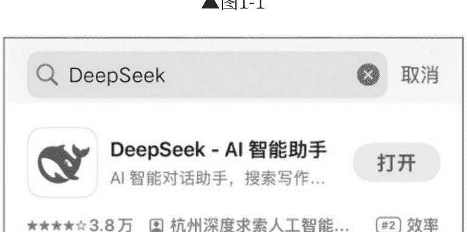

- **02 开始对话。** 打开网页版后，点击界面中的“开始对话”，如图1-3所示。

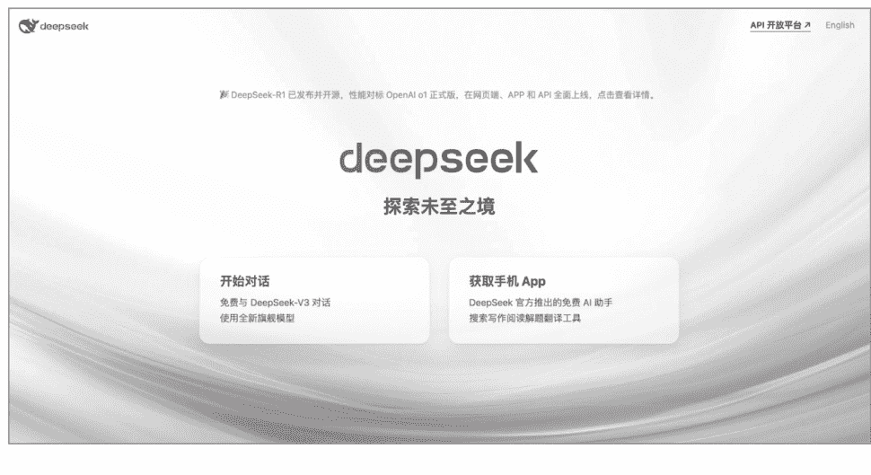

- **03 注册账号。** 支持手机号或邮箱注册。选手机号则输入号码后获取验证码填写；选邮箱则输入地址后查收验证邮件并填写验证码，随后点击“登录”完成校验，如图1-4所示。若未收到邮件，请检查垃圾箱。

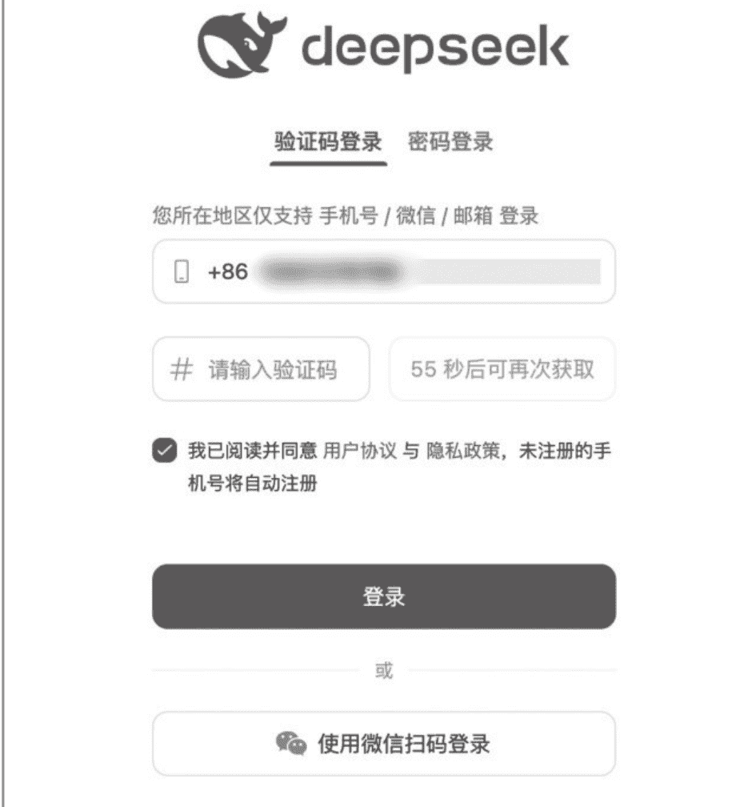

- **04 首次登录。** 设置密码建议使用大小写字母加数字组合以提升安全性，如图1-5所示。完成此步后即可启用DeepSeek。

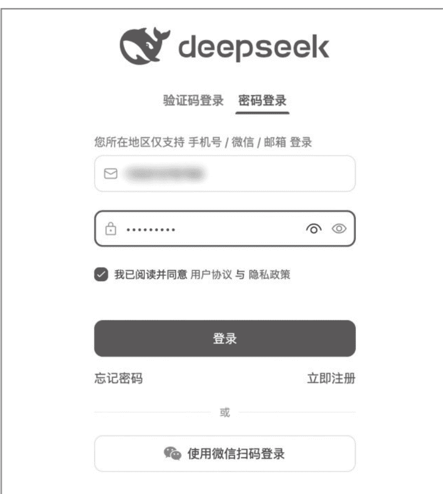

进入图1-6所示的页面后，就能开启第一次对话。页面底部对话框正等待你的问题。亲手体验后，你才会真正感受到它的能力。

完成以上步骤，你已经掌握了这个时代的关键技术。但更重要的是你打算如何使用它。


### 1.1.2 DeepSeek与小红书的强强联合

DeepSeek意味着超强创意与生产力，小红书则拥有超大流量与种草力。单独使用已很强，叠加使用则产生化学反应，本书正是帮助你解锁这一组合的钥匙。

AI本质上是智能助手，能与人文字对话，也能调取、梳理、整合网络信息。它好比一个超级大脑，让你在信息海洋中游刃有余。

AI与小红书的关系非常紧密。运营小红书无论是文案、图片还是视频，核心都是对信息的调取、梳理、整合与输出。

拆解爆款生产，其实就是把大脑里存有的经验、阅读、浏览信息提炼精华，再落实到选题、结构、脚本、剪辑，最终成形的流程。DeepSeek及其他AI工具可以承担信息梳理、整合、提炼的环节。配合联网搜索，它还能发散新角度，让作品更丰满、节奏更快。

相比传统方式，用DeepSeek做小红书内容创作主要有三大优势。

一是提效不降质，让时间更值钱。小红书创作过去耗费大量时间在脚本、拍摄、剪辑，一篇作品可能要一周。DeepSeek能把周期压缩到数小时，选题、文案、剪辑效率大幅提升。省下的时间可投入账号定位、内容优化乃至直播带货等更有价值环节，提升整体质量与商业价值。

二是公式化起号，让爆款可预期。许多人起号困难，本质是缺乏营销思维，不了解爆款背后的套路与公式。这些公式既要契合平台算法，也要符合人性底层逻辑，涉及社会学、故事学、心理学等知识，传统学习耗时长。DeepSeek经过两三次针对性训练就能掌握这些套路。把本书提供的方法结构与公式模板结合账号定位与产品特点对它进行训练，就能稳定产出契合算法又打动用户的爆款内容，快速起号。

三是实操落地，定制化方案助推成功。市面上不少课程偏理论，缺乏应用指导。AI的价值在于使用。本书既是实操宝典也是案例合集，只有量身定制的方案才能真正落地。

下一节将更具体说明如何用DeepSeek创作内容并在小红书实现变现。

## 1.2 AI时代小红书的机遇

在AI时代，判断好产品的标准不再只是功能是否满足，而是用户是否愿意为之买单。小红书的先种草后购买逻辑因此更受青睐。而以DeepSeek为代表的生成式AI，也让内容创作更简单高效。

### 1.2.1 种草逻辑的核心拆解

AI时代小红书的商业潜力在放大，其底层逻辑也在演进。

当DeepSeek完成文案智能生成，并配合其他AI工具量产图片、视频后，产品观从功能满足升级为心智占领。种草不再是单一传播，而是AI驱动的需求预判与价值共创。

传统营销多以直接推销为主，这种填鸭式方式在AI时代遭遇用户注意力抗药性。而小红书的“先种草，再购买”强调不销而销，通过建立预期、形成暗示、实现裂变的渐进策略，潜移默化激发兴趣，重构人货场的连接，从而形成新的商业变现模式。因此小红书成为品牌与广告主青睐的投放阵地。

相关数据显示，AI工具生成的种草笔记可使用户停留时长提升230%。

那么种草到底是什么？不销而销的奥秘在哪？我将其归纳为三点。

一是建立预期。传统模式下消费者先买后评，信息反馈滞后。AI时代用户希望先体验再购买。小红书的种草内容把购买理由与消费体验前置，通过视频、笔记清晰告知产品价值。用户在下单前就能通过内容“提前体验”，在心里形成预期。好比美妆博主展示口红时不仅呈现外观，还详细描述质感与持久度，让用户产生使用联想。部分玩具工作室甚至用AI提前放出设计图预售，在产品未出厂前就让用户获得体验感。

二是形成暗示。直接自夸是最低级营销，用户易产生疑虑。高级做法是不销而销，内容不提业务却处处指向业务，通过巧妙暗示让用户自行发现优点，建立信任。健身博主分享日常时不经意露出器材品牌，或在展示效果时让运动装备自然入镜，这种暗示比硬广更有说服力。过去商家缺乏专业营销能力，如今借助DeepSeek，普通用户也能产出高质量种草文案。

三是实现裂变。小红书用户社交属性强，互动频繁，信息传播快。虽然直接转化率未必最高，但种草能力极强。用户被种草后常会分享给身边人，形成裂变。DeepSeek降低了创作门槛，让更多人参与其中，共同完成从预期建立到裂变的闭环。例如女生看到护肤笔记后将产品推荐给室友，一个人的种草就能带动多人关注与购买，放大品牌影响力与商业价值。

AI时代小红书这片土壤蕴含巨大机会，掌握种草逻辑并结合AI量产与矩阵运营，就能在平台上打开变现新路径。

### 1.2.2 变现的四大路径

把小红书比作流量沃土，DeepSeek像不断运转的发动机，变现路径则像通往市场的匝道。下面解析几种主要变现方式。

一是广告合作，让品牌主动找上门。积累一定粉丝与流量后，品牌方会主动洽谈合作。美妆博主达到一定量级后，化妆品品牌便会邀请试用新品并发布笔记。这些笔记如同移动广告牌，吸引用户关注品牌。成功接单需要粉丝基础、内容质量以及账号调性与品牌契合度。过去创作门槛高，阅读本书后借助DeepSeek即可稳定输出高质量作品。

二是电商带货，让粉丝直接转化。小红书的带货功能像一把收割镰刀，通过产品笔记推荐好物，引导粉丝下单成交并获取佣金。做带货关键在于选品、文案与引导。产品需质量过硬、价格合理；文案需生动描绘特点优势；引导需通过链接植入与评论区互动促成购买。后续章节将聚焦如何用DeepSeek量产文案与视频，扩大广告覆盖。

三是知识付费，将专业经验变现。若在美妆、健身、摄影等领域具备专业积累，可通过开设线上课程输出技能与知识获取收益。做好知识付费需要扎实内容、吸引力的课程设计与有效的推广。可以在小红书发布免费试听内容吸引关注，再引导购买完整课程。DeepSeek还能协助快速制作课程素材并高效处理日常文案输出，如同一颗第二大脑支撑创作。

### 4. 用IP孵化实现账号长期变现

小红书的商业化不止于带货，打造可沉淀的个人品牌IP同样能带来稳定回报。把账号经营成有辨识度的品牌符号，就可以通过形象授权、商业联名等方式获取收益。平台上不少头部创作者，账号本身已具备品牌属性，他们允许外部品牌使用自身形象和内容做推广，形成持续的现金流。这种路径既提升了账号的资产价值，也为后续合作打开空间。

设计类创作者更倾向于先出样稿收集市场反馈，甚至采用预售驱动生产的模式。变现也不必局限于为大牌服务，个人的工作室、原创设计集都能独立成品牌。

做好IP孵化，品牌思维是前提。账号要形成鲜明的调性与定位，建立易于识别的视觉符号和价值主张。内容端要保持专业水准，让用户感受到可信度。传播端要持续发力，通过品牌故事、理念输出等笔记增强认知与认同。

后续会具体展开如何借助AI辅助产品设计、品牌搭建和引流获客。掌握几款合适的AI工具，往往能完成过去需要整套团队才能落地的事项。

总体来看，小红书的变现玩法很丰富，方法得当就能实现商业化，叠加AI后效率和成本都会明显改善。

## 1.3 DeepSeek进阶使用指南

现在几乎人人都能和DeepSeek交流，关键在于如何用出效果。本部分会帮助你从入门快速过渡到熟练应用，掌握更高效率的工作方式。

### 1.3.1 核心操作技巧

DeepSeek上手门槛低，但要发挥实力仍需方法。下面介绍几项实用技巧。

### 1. 提示词是沟通的关键

和DeepSeek交互时，提示词相当于指令密码，必须把需求讲透。只丢一句“帮我写点内容”它会无从下手。要像指导新人一样，给出任务背景、具体要求和交付标准。描述越精确，输出越贴合预期。

常用的四类写法如下：

- (1) 明确诉求 ×
  错误示例：帮我写点东西。 ✅
  正确示例：请帮我起草一封求职邮件，目标岗位新媒体运营，邮件中突出三年公众号运营经验。

- (2) 补充背景 ×
  错误示例：分析这个数据，如图1-7所示。
  正确示例：这是一家奶茶店近三个月的销售数据，请对比周末与工作日的销量差异，如图1-8所示。

- (3) 指定呈现形式 ×
  错误示例：给几个营销方案。 ✔
  正确示例：请以表格形式罗列三种情人节咖啡店促销方案，并包含成本估算和预期效果，如图1-9所示。

- (4) 限定篇幅 ×
  错误示例：详细说明区块链。 ✅
  正确示例：请用不超过200字向零基础的老人解释区块链技术，如图1-10所示。

若结果不满意，可即时修正，例如：
这个方案成本超出预算，请给出控制在500元以内的版本
请以更正式的语气重写第二段

### 2. 深度思考功能

打开深度思考，相当于为模型装上推理引擎。提问后它会像资深顾问一样拆解问题、逐层分析。

例如面对带迷惑性的复杂数学题，仅凭第一反应易错。开启深度思考后，模型会挖掘题干隐含线索，并在得出结论后反复验算，确保准确。你甚至能看到它自我对话、不断迭代的过程。耗时更长，但结论更全面严谨，如图1-11所示。

### 3. 联网搜索功能

开启联网搜索等于为DeepSeek接入实时信息。模型可即时抓取网络最新资讯。

了解科技动态、行业新闻或前沿知识时非常实用。做选题和捕捉热点时，联网搜索能快速感知当下趋势和热搜，为创作提供灵感和方向，如图1-12所示。

### 4. 文件上传功能

可将文件以附件形式上传，让模型分析、总结并提炼要点。例如上传合同后提取关键条款。

操作：
01 点击对话框右下角回形针图标 📎 上传文件，支持PDF、Word、TXT等格式，如图1-13所示。
02 输入具体指令帮我提取这份合同中的责任条款制成表格并发送，如图1-14所示。

进阶用法是多文件对比。例如上传合同A和合同B后提问对比合同A和合同B修改内容有哪些？或从这几本书中提取适合小红书的选题，让模型做对比分析和信息整合，如图1-15和图1-16所示。

### 5. 代码生成能力

对开发者而言，代码生成功能可大幅提效。只需描述功能需求，模型即可快速输出代码。例如输入帮我写一段Python代码，用来自动下载网页图片，模型会迅速生成可用代码，如图1-17所示。

掌握以上基础用法，就能更高效地驾驭这款AI工具。

### 1.3.2 四个使用进阶层级

上一节讲的是基础方法，下面按能力划分四个层级。类似游戏升级，从入门到专家，DeepSeek的使用也可分层理解。

### 1. 初级层级：日常工作小助手

刚接触时主要用于解决生活和工作的琐碎需求，如写邮件、制定计划。

例如领导临时要求写客户感谢信，可提示「我需要写一封邮件，内容是感谢客户支持并告知即将推出的新品」，模型会生成规范得体的文案，如图1-18所示。

再如旅行规划不确定时，输入「帮我制定一个三天两夜东京行程，包含景点、美食和交通方式」，即可获得详细方案，如图1-19所示。

### 2. 中级层级：组合工具解决复杂流程

熟悉后可与其他工具联动，处理更复杂的工作流。

内容创作时，先让DeepSeek生成初稿。例如输入「帮我写一段惊蛰海报的绘画提示词，15字以内」，如图1-20所示，再将提示词用于即梦AI等工具生成图片，如图1-21所示。

数据处理时，可先让DeepSeek整理成指定格式。先输入「请帮我把这些数据以Markdown格式输出」，如图1-22所示，再用专业可视化工具呈现，如图1-23所示，使报告更直观易懂。

### 3. 高级层级：商业场景深度应用

此阶段可处理各类商业问题。做市场调研和营销策略时，让模型收集并分析数据，了解用户需求与偏好。

例如输入「这是一家奶茶店近三个月的销售数据，请分析周末和工作日销量差异并用表格呈现，给出三个提升建议」，模型会给出具体结论，如图1-24所示。调研更精准，策略更具针对性。

### 4. 专家层级：深度定制与创新应用

专家级使用者能在熟练应用基础上进行定制和创新。

可基于业务需求开发专属应用场景，提升业务智能化水平。再如将DeepSeek与云计算、RPA、低代码平台结合，打造创新解决方案。输入「抓取近半年云计算、RPA、低代码平台的用户讨论热词，筛选与AI智能体相关需求场景，以表格形式呈现」，即可获得结构化结果，如图1-25所示。

你目前处在哪个层级？若已在实践，至少已入门。旅程才刚开始，这条路径会带你逐步迈向专家。想成为AI应用高手，请继续出发。

# 第2章 用DeepSeek找到商业机会

## 2.1 如何找到适合自己的商业机会

近三十年互联网带来信息爆炸，人们反而更迷茫。过去商业的核心是信息差，如今核心已转向信息过载，转向差异化和个性化。DeepSeek的重要价值之一，就是帮助你在海量信息中挖掘适合自己的商业机会。

### 2.1.1 寻找差异化

在竞争激烈的小红书，想要脱颖而出，差异化是关键。就像白雪中穿红衣，一眼就能被看见。差异化是形成记忆点的底层逻辑。

差异化主要包含四个原则。

### 1. 规避正面竞争
小博主与头部博主硬碰硬基本无胜算。若赛道已有专业度高、背书强、流量大、质感好的博主，照搬内容只会浪费资源。明智做法是寻找细分定位，避开正面冲突。

例如美妆赛道日常妆容教程竞争白热化，但聚焦职场女性的通勤快妆，或针对敏感肌的护肤技巧，就能快速找到细分市场。

### 3. 内容更具实操性
信息爆炸时代，用户厌倦空洞说教，更想要可直接上手解决问题的干货。内容越落地越易被收藏传播。

2020至2023年间，讲道理的账号不少，但持续涨流的多是讲具体案例、教实操的创作者。我在运营、授课和写作中也坚持少讲理论，多给方法。因为能直接拿来用的内容，才能把握当下红利。

### 3. 顺应趋势风口
趋势如风，踩准就能起飞。本书的诞生也受益于趋势。若晚半年发布，效果可能大打折扣。抓住趋势往往能获得快速起号的流量红利。

### 4. 提供附加价值
单纯靠内容或电商带货已难以形成壁垒，后端服务才是关键。如本书除正文外还附赠实战演示视频。做账号无论卖品、建社群、做课程或训练营，本质都是建立持续连接，让用户持续信任并互动。附加价值是维系关系的核心抓手。

### 2.1.2 明确差异化定位

定位是核心中的核心。方法和技巧属术，趋势与优势属道，而你本身就是道的一部分。所以要清晰自己是谁、想做什么。

读完本章，我希望你获得的不仅是技能，更是对未来方向的清晰认知。接下来会问：如何找到差异化定位？认识自己是古老难题。如今借助DeepSeek，这件事变得简单。接下来将教你如何用DeepSeek做天赋定位并转化为商业机会。

## 2.2 用DeepSeek做天赋定位

天赋定位是成功的关键。天赋是与生俱来的优势，也是独特标签。借助DeepSeek可从多维度挖掘天赋，找到适合的内容方向。

### 2.2.1 天赋挖掘路径

可从过往职业经历、兴趣爱好、现有项目资源三个维度入手。

#### 1. 从职业经历中挖掘
职业经历塑造了专业技能和思维方式，尤其是能带来报酬的经历，往往隐藏着小红书的商业潜力。DeepSeek可帮助深度拆解经历，找到可变现的天赋。

例如学员小李是资深财务从业者。他将职业经历和技能输入DeepSeek，分析后发现他在数据分析和风险控制方面突出。于是他在小红书分享财务知识和理财经验，很快吸引大量粉丝，内容专业且通俗易懂。

#### 2. 从兴趣爱好中挖掘
兴趣是长期坚持的动力，也可能是差异化卖点。通过DeepSeek分析兴趣爱好，可找到可转化的方向。

例如我为大学同学小张做定位测试，他从学生时代就热爱摄影，有独特见解并持续在小红书更新商拍作品。输入爱好和技能后，DeepSeek确认他适合深耕该领域。兴趣是最好老师，坚持足够久即可见效，若具备独特性，更易形成差异化。

#### 3. 从现有资源中挖掘
身边的项目资源也可能藏着宝藏。正如俗语所说，宝藏可能就在自家后花园。

我刚入行时，有位同学在小红书试了很多赛道都不火。后来发现她家狗狗很可爱，建议她做宠物博主。她随手拍了一段视频意外爆火。原来绞尽脑汁的才华不如身边习以为常的资源。DeepSeek正好帮你发现这些被忽略的天赋。

### 2.2.2 天赋问卷

如何让DeepSeek助你挖天赋？我准备了一份问卷，填写后发送给DeepSeek即可获得精准指引。在小红书，找到差异化定位是关键，这份问卷就是定位利器。问题越详细，输出越精准。这份报告过去需付费咨询师，现在人人可用。

#### 1. 问卷结构
建议在安静环境下填写，问卷包含四个维度。

基础信息：姓名、年龄、性别、所在城市、教育背景、家庭情况。帮助模型了解你的生活背景。

职业经历与技能：从事过哪些领域工作、持续几年、最擅长解决什么问题、是否有显著成绩、是否拥有特殊身份或背景。用于判断核心竞争力。

兴趣爱好：长期高频的兴趣爱好、在这些领域是否取得突出成绩、是否有正在学习并打算长期坚持的爱好。兴趣可成为独特卖点。

行业资源与项目：在某些行业是否有项目或产品资源优势、主要竞争对手是谁、与对手相比的优势、当前热门趋势。帮助判断市场定位。

详细问卷如下：

##### 一、基础信息
- 1. 您的姓名（可匿名）：
- 2. 年龄：
- 3. 性别：
- 4. 城市：
- 5. 教育背景（学历、专业）：
- 6. 家庭情况（是否已婚/有孩子）：

##### 二、职业经历与技能
- 1. 您主要从事过哪些领域的工作？分别持续了几年？
- 2. 您最擅长解决什么类型的问题？哪些经历给您带来了显著成绩？
- 3. 您是否拥有特定的身份或背景？（例如名校毕业、专家头衔、荣誉证书等。）

##### 三、兴趣爱好
- 1. 您有哪些长期坚持的超级高频兴趣爱好？
- 2. 在这些兴趣爱好领域中，您是否取得过突出成绩并获得广泛认可？
- 3. 您是否有正在学习且打算长期坚持的兴趣爱好？

##### 四、行业资源与项目
- 1. 您是否在某些行业拥有项目或产品资源优势？（例如低价货物渠道、产品研发能力等。）
- 2. 您认为在自己所在的行业或领域中，您的主要竞争对手是谁？与他们相比，您有哪些优势？

问卷发出后，如何快速拿到可落地的IP打法？

- 3. 你认为所在领域目前最火的风向是什么？

#### 2. 解析与回馈

填完问卷后，如何用DeepSeek把原始资料转化为可执行建议？核心在于文件上传配合一段现成话术。

01 问卷提交完成后，点击回形针图标 📎 将材料传给DeepSeek，见图2-1。


图2-1

02 把下方指令复制发送，系统会输出一份完整的IP定位分析报告，见图2-2。

> #你是“小红书IP定位分析”专家！根据我的个人信息调查问卷，你将为我精准分析优势，并量身打造明确的IP定位方案。该方案涵盖定位与人设塑造、变现路径规划、选题与内容设计，以及账号商业价值全方位评估。

#输出：IP定位分析报告

分析维度包括内容定位和人设、变现路径设计、选题与内容设计、商业价值评估（每一个维度分别以表格形式呈现）

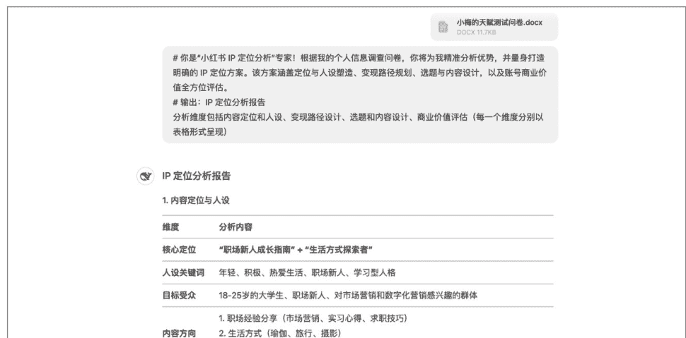

图2-2

## 2.3 用DeepSeek捕捉市场风向

小红书上的趋势形态多样，热门话题、审美偏好、需求迁移皆可作为信号。敏锐捕捉并顺势布局，内容更容易被接受。比如健康生活持续升温，健身、养生类主题近年持续走高，提前入局易获关注。反之固守过时方向，投入再多也难获流量。

### 2.3.1 如何判断一个赛道是否值得入场

早期我只凭个人兴趣创作，对市场风向缺乏关注。曾沉迷中西方哲学史研究，也爱在网上讨论哲学。做过哲学号，天赋不差，但互动与认可都很有限，后来才明白忽视趋势的代价。

后来开始关注趋势，又掉入盲目跟风的陷阱。某段时间情感类赛道很热，身边不少创作者借此获利。我对该方向理解不深，产出质量一般，反馈平平。等我真正吃透时，热度已退，平台也开始限流。这次经历让我认识到，没有顺势能力，天赋也难以变现。找到合适赛道本身就极具挑战。

本书将我在小红书创作与创业期间更换过的方向、踩过的坑与总结的经验全部分享。选赛道可借助四个评估维度。方向明确后，再借助DeepSeek辅助决策会更高效。

#### 1. 受众覆盖面
指目标人群的规模与触达范围。小红书上，受众越广，赛道潜力越大。比如母婴方向，受众即追求精致生活的一批妈妈，关注基数很大，内容易破圈。

#### 2. 付费意愿与实力
指目标人群的消费意愿与能力。小红书用户整体消费力不低，尤其女性占比近八成，是消费主力。若内容能打动高付费人群，商业化空间更足，例如时尚穿搭方向，用户愿为高品质单品买单。

#### 3. 刚需强度
指用户在该领域的强需求程度。痛点越强，内容越易转化。小红书用户的痛点集中于生活、工作、学习。健身方向刚需明显，用户对知识与技巧的需求很旺盛。

#### 4. 认知迁移
指用户对某个领域态度与认知的转移。认知在变，赛道就在变。近几年文化自信提升，传统文化、非遗技艺相关内容愈发受欢迎。AI相关方向也快速崛起，2025年初DeepSeek全网爆火后，用户认知加速普及。

DeepSeek的联网检索与深度思考能力，能助你快速判断全球趋势，为创作定方向。

### 2.3.2 DeepSeek商业评估问卷

本节介绍如何用DeepSeek做问卷调研，为你定制IP定位方案，主要包含两步。

#### 1. 导入问卷信息
在DeepSeek对话框里发送2.2.2节的问卷内容，可直接上传文件，如图2-3，也可粘贴文本。

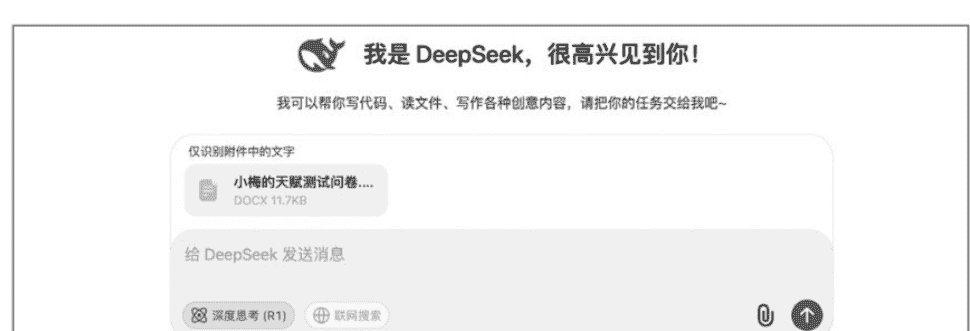

图2-3

#### 2. 发送分析指令
导入后，再发送下面这段提示词，让DeepSeek做更深入的拆解，如图2-4。

#输出：IP定位分析报告

分析维度包括内容定位和人设、变现路径设计、选题与内容设计、商业价值评估（每一个维度分别以表格形式呈现）

- 1. 内容定位和人设包括

  - 定位：[具体定位描述]

  - 人设：[具体人设描述]

  - 差异化要素：[差异化要素描述]

  - 用户关系：[用户关系描述]

- 2. 变现路径设计包括

  - 根据定位选择有可能的1-3种适合的变现方式。比如，广告合作、私域电商带货、知识付费课程、定制化服务等。

  - 如果是广告合作，要包含：

    - 广告主信息：[广告主信息]

    - 合作形式：[合作形式描述]

  - 如果是私域电商带货，要包含：

    - 引流品：[引流品描述]

    - 正价品：[正价品描述]

    - 利润品：[利润品描述]

  - 如果是知识付费课程，要包含：

    - 引流品：[引流品描述]

    - 正价品：[正价品描述]

    - 利润品：[利润品描述]

  - 如果是定制化服务，要包含：

    - 服务内容：[服务内容描述]

    - 收费模式：[收费模式描述]

- 3. 选题和内容设计

  - 系列选题：选题1描述、选题2描述、选题3描述……

  - 内容形式：内容形式1描述、内容形式2描述、内容形式3描述……

- 4. 商业价值评估

  - 人群广泛度（流量大小）:[评分]/10

    - 分析：[分析内容]

  - 人群付费能力（赚钱天花板）:[评分]/10

    - 分析：[分析内容]

  - 痛点指数（成交转化率）:[评分]/10

    - 分析：[分析内容]

  - 未来趋势（赛道红利）:[评分]/10

    - 分析：[分析内容]

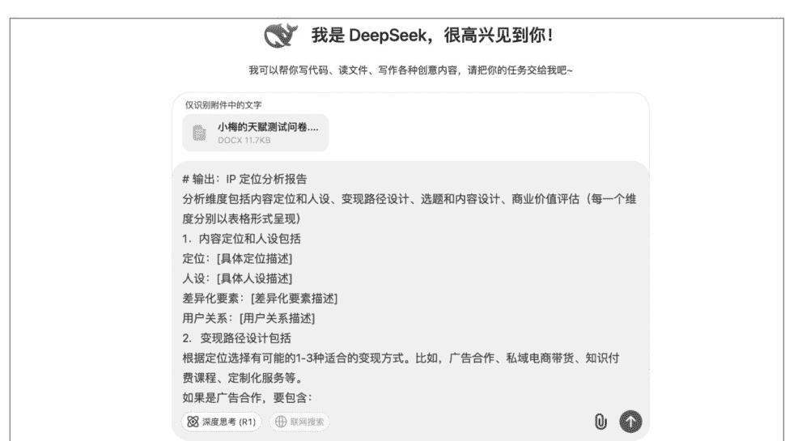

图2-4

这份报告不仅拆解天赋，还结合赛道给出四个核心维度：受众覆盖、付费能力、刚需强度、认知迁移，能助你挑到顺势的方向，如图2-5。

##### 小梅职场IP定位与变现分析

4. 商业价值评估

| 维度 | 评分 | 分析 |
| :--- | :--- | :--- |
| 人群广泛度（流量大小） | 8/10 | 职场新人及市场营销入门群体规模庞大，数字化营销话题热度高，能带来不少关注。 |
| 人群付费能力（赚钱天花板） | 7/10 | 新人有提升技能的付费意愿，但收入尚在积累期，付费上限受限。 |
| 痛点指数（成交转化率） | 9/10 | 新人普遍缺技能和经验，实用性内容易引起共鸣，转化率高。 |
| 未来趋势（赛道红利） | 9/10 | 数字化营销和个性化推荐是未来重点，赛道红利明显，成长空间足。 |

总结：

小梅的定位清晰，人设贴合职场新人，内容实用，变现方式多样，商业价值可观。后续可通过知识付费、广告合作和定制服务实现变现，同时持续输出优质内容扩大影响力。

图2-5

2.2和2.3的案例展示了如何用问卷让DeepSeek快速了解个人信息，并结合大数据给出小红书的天赋和商业趋势建议，同时对商业化潜力打分。但小红书是视觉主导的平台，文字对话是否遗漏了关键信息？

## 2.4 结合豆包做长相定位

在天赋和趋势之外，还有一个容易被忽略却很关键的维度——长相定位。在小红书这种看脸的平台上，长相直接影响第一印象和信任感。接下来介绍如何用豆包做长相定位，让账号起跑更顺。

### 2.4.1 找到与长相匹配的赛道

内容还没看，封面你的长相已经在传递信息。逆长相做内容是常见翻车点。

我带过一位98年的学员，外表很稚嫩，却经营着两家心理咨询工作室，年营收破百万元。他想做商业号，流量一直上不去。不是没成就，也不是没干货，表达也很流畅。问题在于长相太年轻，用户难以把他和经验丰富的老板联系起来。若会长相定位，就能避免这类问题。

不同长相适合不同赛道。

#### 1. 暖系长相
给人温暖亲切的感觉。
**内容方向：** 美食分享、生活记录、情感故事。
**人设：** 邻家感的暖心博主，用文字和画面传递生活小美好。

#### 2. 靠谱长相
给人可靠专业的感觉。
**内容方向：** 好物推荐、产品测评、知识科普。
**人设：** 专业测评师/科普达人，用专业经验给用户建议。

#### 3. 甜系长相
给人甜美可爱的感觉。
**内容方向：** 美妆教程、时尚穿搭、手账分享。
**人设：** 甜美时尚达人，用风格和技巧吸引用户。

#### 4. 普通长相
特征不突出，亲和力强。
**内容方向：** 美妆教程、时尚穿搭、生活记录。
**人设：** 接地气的上班族/学生党，用日常视角分享点滴。

#### 5. 凶系长相
给人严肃有气场的感觉。
**内容方向：** 剧情演绎、反差萌、搞笑视频。
**人设：** 外表严肃内心搞笑，用反差吸睛。

#### 6. 喜感长相
给人幽默有趣的感觉。
**内容方向：** 搞笑视频、生活趣事、产品测评。
**人设：** 幽默段子手，用笑点传递内容。

不确定自己属于哪类？下面介绍如何让豆包帮忙判断。

### 2.4.2 用豆包做长相分析测试

豆包是字节跳动推出的AI助手，擅长多模态尤其是图像理解，也能读取抖音链接并集成字节系功能。

- 01 拍摄照片。拍一张光线充足、背景简洁的正面照，清晰展示面部特征，避免夸张表情和过度美颜。
- 02 上传照片。打开豆包，点击对话框左下角的“添加图片”图标 📷，上传照片，照片显示在对话框中，如图2-6。

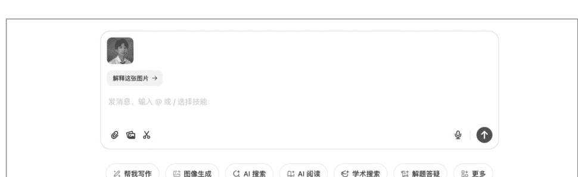

图2-6

03 输入分析指令。在对话框发送「请根据我的照片，分析我的长相特征，为我推荐适合的内容方向、人设和小红书赛道，并提供长相记忆点分析及名人案例作为参考」，如图2-7；也可直接发送下方提示词获取完整定位。

> #请根据我的照片，分析我的长相特征，并为我推荐适合的内容方向、人设和小红书赛道，并提供长相记忆点分析及名人案例作为参考。

#分析维度

- 1. 长相特征：智能体将分析照片中人物的长相特点，如气质、风格等。

- 2. 适合赛道：根据长相特征，智能体将推荐最适合的自媒体赛道。

- 3. 记忆点分析：智能体将提取人物长相的独特记忆点，并解释其在自媒体中的优势。

- 4. 名人案例：智能体将提供与您长相特征相似的名人案例，作为参考。

## 理论框架：

暖系长相：适合零食带货，给人一种亲切、温暖的感觉，容易建立信任。

靠谱长相：适合好物分享，给人一种专业、可靠的印象，容易获得观众的信任。

甜系长相：适合数码、财经、科技领域，甜美的形象可以中和这些领域的严肃感，吸引更多观众。

普通长相：适合美妆博主，接地气的形象更容易让观众产生共鸣。

凶系长相：适合剧情类内容，尤其是“反差萌”或反转剧情，可以带来强烈的视觉冲击。

喜感长相：适合评测类内容，幽默的形象可以增加内容的趣味性和吸引力。

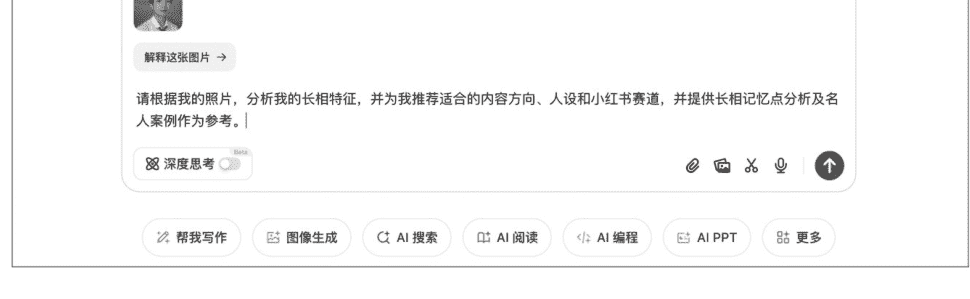

04 选择赛道。参考豆包生成的总结，挑选适合自己的赛道，如图2-8。


大黄IP长相匹配338

**长相特征：**

分析显示您属于“靠谱长相”，白衬衫配领带，发型整齐，面容沉稳可靠。

**适合赛道：**

建议做“好物分享”类自媒体。形象易建立信任，用户更信赖你的专业推荐。

**记忆点分析：**

整洁形象和沉稳气质易被记住，在分享好物时显得经过筛选，提升内容认可度。

**名人案例：**

可参考 [姓名已模糊]，他以专业热情的形象在美妆领域取得成功，与您形象相近，可借鉴经验在好物分享领域打造特色。

图2-8

# 第3章 用DeepSeek打造亮眼账号

## 3.1 用DeepSeek起名字

定位明确后，下一步是用DeepSeek起一个过目不忘的名字。名字是账号的视觉锤和文字钉，是用户每次都能看到的定位呈现。

### 3.1.1 好名字的标准

我曾为近千位博主起号，总结出几个要点。好名字能省下不少投流成本，名字的重要性超过单条内容。名字好还能激发好奇，引导用户点进主页关注甚至转化。

下面是三种对应不同变现模式的命名思路。

#### 1. 巧用名词制造冲突
如“铁岭县刘辉商店”“小华佗”“西兰花以及电器鼠”。强冲突带来的记忆点适合颜值、搞笑和大众IP。

#### 2. IP加形容词体现调性
如“薛辉小清新”“刀小刀爱叨叨”“小气球的喜欢力”。形容词突出个性，适合话题、知识类账号。

#### 3. IP加赛道体现专业性
如“大黄AI黑科技”“老金说日语”“钟小棵摄影”“H的礼物清单”。名字里直接带领域，增强信任，提升转化，适合产品带货类账号。

起名要和商业模式、简介、广告语、头像形成整体化学反应。

### 3.1.2 用DeepSeek生成创意账号名

在2.4.2节用豆包做完长相定位后，可以基于定位信息让DeepSeek起名。

01 回顾定位信息。整理2.4.2节豆包给出的长相特征、适合方向和人设，作为起名依据。

02 明确目标。判断是个人号、品牌号或其他类型，确定名字风格。

03 输入提示词。在DeepSeek对话框发送如下提示词，如图3-1。

### #请根据我的定位信息，为我起一个过目不忘的好名字。我的定位信息是[你的定位信息]。

### #通常在设计整体账号名时，有以下一些设计方法。

1. 巧用文化名词制造冲突：通过组合两个看似毫不相关的名词，制造出强烈的冲突感和差异感，让人瞬间记住。例如“铁岭县刘辉商店”“小华佗”等，这种方式更适合颜值类、搞笑类等大众内容的IP。

2. IP加形容词体现调性：在名字中加入形容词，突出您的个性、风格或调性，让用户快速了解您的特色。比如“薛辉小清新”“刀小刀爱叨叨”“小气球的喜欢力”，这种方式更适合话题类、知识类的IP。

第三种打法是把个人标签和垂直领域打通，让账号名自带专业背书，使用户更快建立信任。像“大黄AI黑科技”“老金说日语”“钟小棵摄影”这类拼接方式，更适合做种草或带货的账号。


### # DeepSeek 在线待命

我能帮你写代码、查资料、产出各类创意内容，直接把任务丢给我就行～

> > # 请依据我的定位，给我取一个让人印象深刻的账号名。我的定位是[你的定位信息]。

> # 设计账号名时，常见的思路有以下几类。

1. 借用文化符号制造反差。把两个看上去毫无关联的名词组合，产生强烈的记忆点和话题感。例如“铁岭县刘辉商店”“小华佗”，这类手法对颜值、搞笑等大众向账号比较友好。
2. 在昵称里加入形容词定调。用形容词点出人格气质和内容调性，让用户快速抓住特点。像“薛辉小清新”“刀小刀爱叨叨”“小气球的喜欢力”，更适合话题、知识类的IP。
3. 把姓名与细分赛道绑定凸显专业。把个人名和所处领域拼接，提升辨识度和信任感。比如“大黄AI黑科技”“老金说日语”“钟小棵摄影”，更贴合产品推广或带货账号。

图3-1

04 评估和挑选名称。参照3.1.1小节的好名字标准，检查DeepSeek给出的方案是否满意。若不满意，可调整提示词引导方向，或让它继续输出更多备选。

## 3.2 借助DeepSeek撰写简介

3.1节讲了如何用DeepSeek起一个难忘的名字，本节聚焦如何用它写出清晰吸睛的自我介绍。

### 3.2.1 简介的撰写要点

简介是用户在看到名字后，进一步了解账号价值的入口。它像桥梁，把名字和内容连接起来，让人知道你是谁、能提供什么价值，以及需要付出什么成本。

好的简介相当于高效广告位，看到的人容易直接关注甚至下单；差的简介对用户来说只是堆砌文字。区别就在于以下四个要点。

#### 1. 聚焦细分
定位、变现方式和名字要垂直统一，让人一眼看懂账号属性。例如名字叫“大黄AI黑科技”，用户基本能判断内容与AI相关。点进主页发现简介也明确聚焦AI，就会更愿意关注。

#### 2. 提供价值
要明确告诉用户你能解决什么问题，也就是核心产品或服务。比如写“我是大黄，用AI把自媒体创作门槛降下来”，用户立刻明白你能帮他们解决创作难题。

#### 3. 成本问题
要说明用户需要投入多少时间和精力。比如写“免费一步到位，3步学会一门技能”，让用户感知获取价值的成本很低。

#### 4. 人设介绍
补充背景能增强信任，促进购买。比如写“我是大黄，微软AI官方培训师”，让用户感受到你的专业背景。

下面是我自己的简介范例，如图3-2所示。

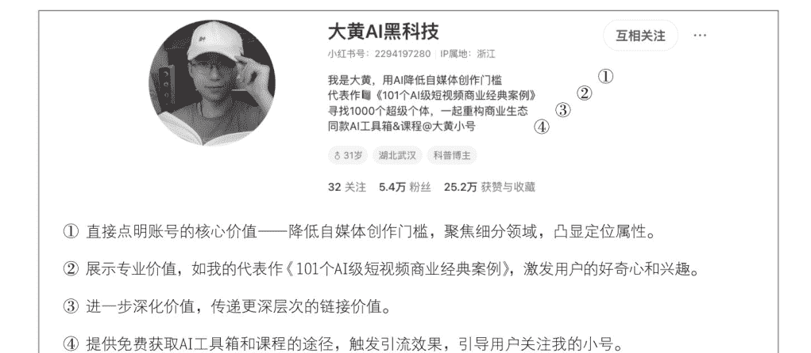

这套模板每天都能带来不错的引流和转化，并非因为文案多华丽，而是精准命中用户需求。写不出同样效果的简介，可以交给DeepSeek来完成。

### 3.2.2 用DeepSeek生成简介

让DeepSeek写小红书简介的关键，是让它理解简介的格式习惯，并充分掌握你的定位和账号名。

01 结合定位内容。这是模型生成简介的主要参考依据。若定位还不清晰，可先回第2章梳理。
02 结合账号名。让模型把账号名自然融入简介。若名字还没确定，可先回3.1.2生成。
03 输入指令。在DeepSeek对话框里发送以下指令。

```
#请根据我的IP定位和您的账号名「你的账号名」和定位「你的定位」，设计一个简介。

#通常在撰写简介时，会突出以下要点。
```

吸引用户关注：明确告诉用户为什么要停下来看你的内容。（例如，降低短视频创作门槛，每天分享一道快手减脂餐，创业信息差先知道）

介绍身份与价值：简洁说明你是谁，能为用户带来什么价值。（例如，清华大学博士，10年资深文案编辑，曾在字节大厂创业）

明确成本与收益：让用户清楚获取价值需要付出什么，以及能得到什么结果。（例如，7天开口说英语，免费领取DeepSeek实操资料包）

04 获取简介建议。模型会基于定位和账号名生成清晰建议，如图3-3所示。

### 营销干货与生活灵感每日分享

介绍身份与价值：
- 👩‍💼 我是小梅，22岁，杭州市场营销本科毕业，现以“杭城营销新星”活跃。
- 💡 实习涵盖数据分析与社媒运营，习惯用专业视角拆解热点。
- 📷 喜爱瑜伽、旅行、摄影，内容走清新简约的视觉风格。

明确成本与收益：
- ⏰ 每天花1分钟，收获一条实用营销技巧或生活灵感。
- 🎁 关注即送《社媒运营实操指南》+《数据分析入门手册》，助你轻松玩转职场生活。

人设关键词：
✨ 年轻活力 | 数据敏感 | 热爱生活 | 视觉审美在线

视觉风格：
📷 清新简约+轻职场感，搭配高质量摄影与数据图表，让眼睛和大脑都享受。

差异化亮点：
🔍 结合专业干货与兴趣场景，用数据分析思维拆解生活与职场话题，让成长更有“数”。

行动号召：
👉 点击关注，和我一起用数据思维点亮生活，成为更优秀的自己。


图3-3

05 评估和修改。评估生成建议是否符合需求，进行必要的调整和完善。

按以上步骤，你可以借助DeepSeek写出与定位和账号名匹配且清晰的简介，让账号在小红书更具吸引力。

## 3.3 用DeepSeek和即梦AI生成头像

头像是账号门面，是吸引用户注意的关键。一个好的头像能提升辨识度，还能传递个人风格和专业感。下面从设计原则和实操讲讲如何借助DeepSeek和即梦AI打造让人记住的头像。

### 3.3.1 头像的设计原则

一位头部博主曾花10万元拍头像做头像，认为很值。因为账号做大后，旧头像往往跟不上需求，而换头像的成本也会越来越高。若账号未来可能被上亿人看到，开局就用高质量头像很重要。那么高质量头像要满足什么？

#### 1. 清晰度高
清晰度直接决定第一印象，模糊的头像会显得不专业甚至不被信任。无论是实拍还是AI生成，都要保证细节丰富、画面清楚。

#### 2. 风格统一
头像风格要和账号定位、内容调性一致。专业严肃的账号适合简洁大方的形象；活泼有趣的账号可以用卡通、漫画等风格。统一的风格更容易被记住，也更能强化品牌感。

#### 3. 色彩搭配合理
色彩同样关键。头像色调最好和账号主色协调，避免刺眼杂乱或过暗过艳，让用户视觉舒适。

#### 4. 突出个性
头像要一眼看出你的独特性。可通过风格、色彩、构图来体现个性。幽默的人可以选搞怪形象，文艺的人可以选清新文艺的感觉。

### 3.3.2 结合使用即梦AI生成高质量头像

即梦AI是字节跳动旗下剪映推出的AI创作工具，擅长视频和图片生成，提供智能画布、动态分镜等功能。结合DeepSeek和即梦AI，能快速产出高质量头像。跟着步骤实操。

01 明确需求。先确定具体目标，比如生成一张温文尔雅的正装照作为头像。
02 登录即梦AI。在浏览器地址栏输入即梦AI官网并回车，或用抖音号一键登录，如图3-4所示。

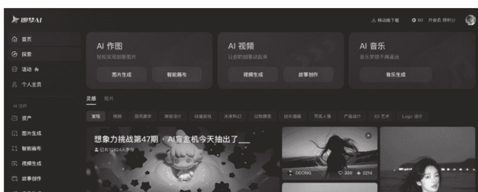

图3-4

03 生成提示词。确定风格后，请DeepSeek给出文字生图的详细提示词。比如输入“我要生成一张正装照头像，要求温文尔雅，给我一段文字生图提示词”，DeepSeek会返回符合要求的描述，如图3-5所示。

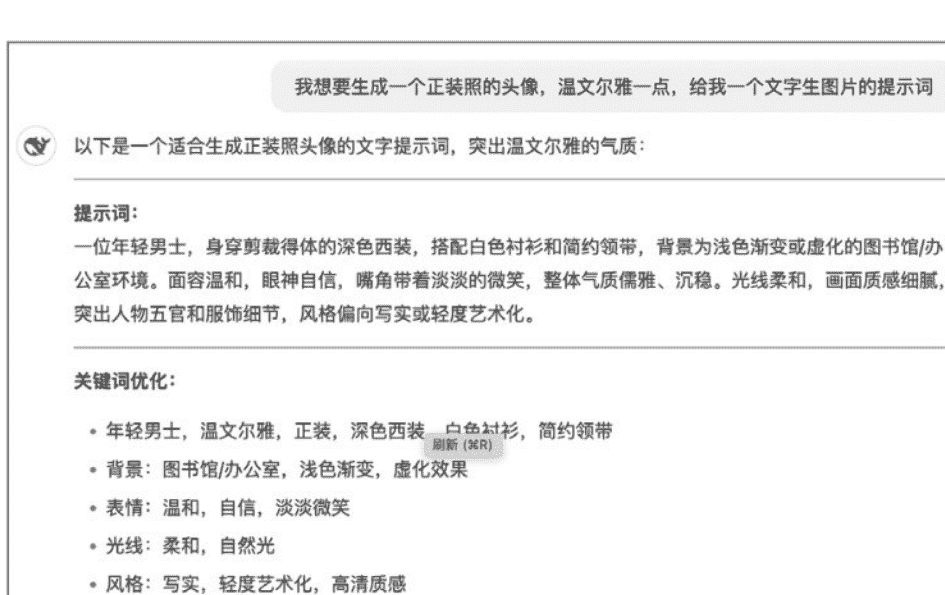

图3-5

04 输入提示词。点击“AI作图”中的“图片生成”，在提示词框里粘贴DeepSeek给出的描述，如图3-6所示。

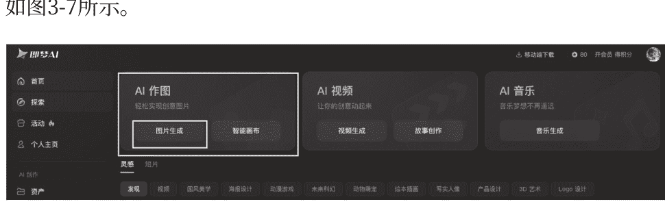

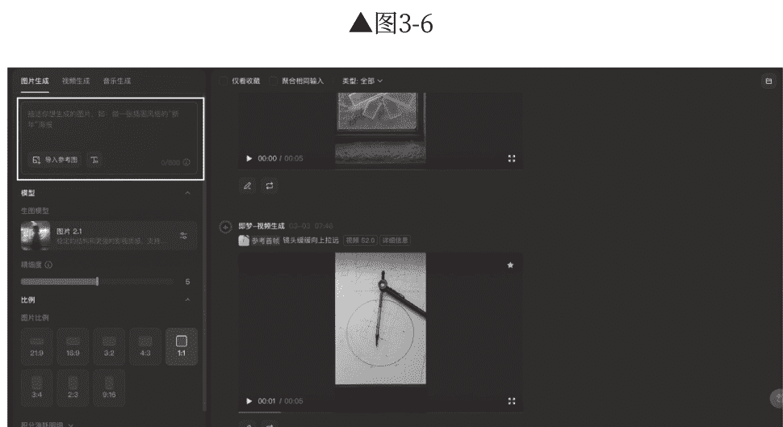

05 上传参考图。挑选一张清晰、面部完整的照片作为参考，提升生成一致性。在输入框左下角点“导入参考图”，选择好照片，可用日常自拍或参考风格图，如图3-8所示。

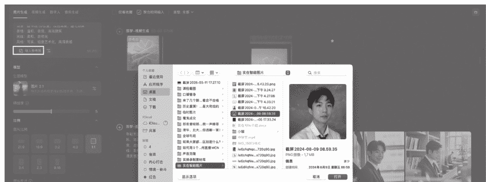

图3-8

06 编辑参考图。在“参考图”弹窗里选择“人物长相”以保持形象一致，选择合适比例，头像建议1:1方形。点“保存”，如图3-9所示。

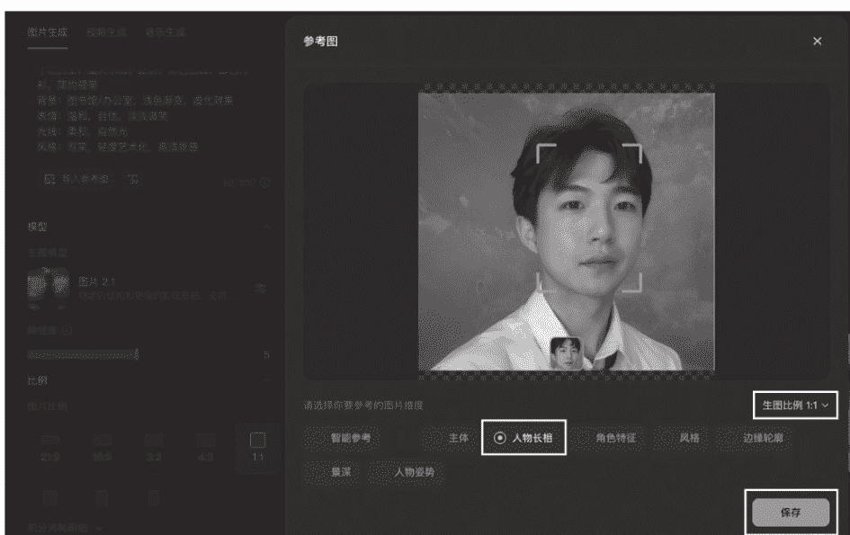

图3-9

07 生成头像。编辑完毕后点“立刻生成”，系统消耗2积分，输出4张备选，如图3-10所示。

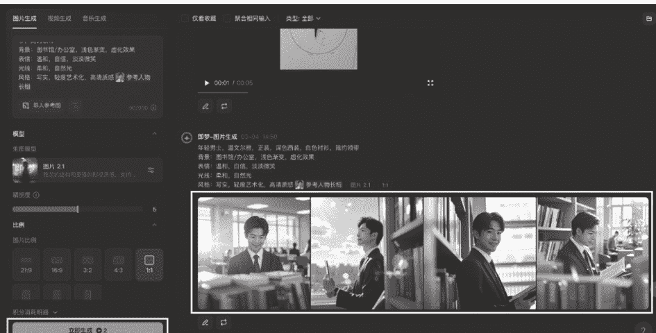

图3-10

08 下载头像。从4张里挑最合适的一张，点击上方“下载”保存到本地，如图3-11所示。


图3-11

09 进一步优化。如果还想精细调整，可用即梦AI的编辑功能。若需换背景，可点“更多”里的“去画布进行编辑”，进入后用抠图功能更换背景，如图3-12所示，还能用细节修复优化色彩光影和细节。


▲图3-12


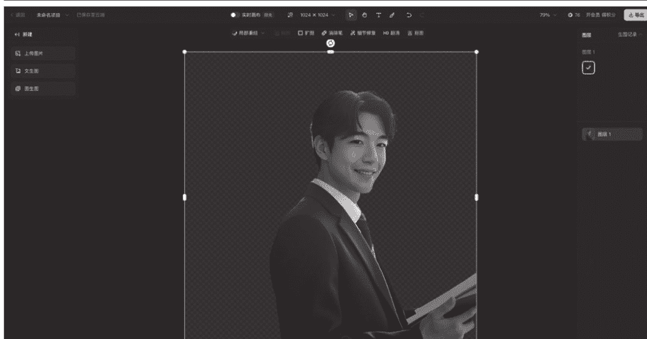

▲图3-13

# 第4章 用DeepSeek写小红书文案

## 4.1 如何找到爆款选题

很多人在运营小红书时卡在选题上，不知道该往哪个方向走。下面讲如何找爆款选题，让内容一发就有人看。

### 4.1.1 爆款选题的要素

选题是创作起点，好的选题像好种子，能长成大树；差的选题再怎么浇水也难成材。选题决定了后续方向，选对了即便文案一般也能获赞关注，选错了即便文案精美也难出流量。选题影响文案天花板、用户留存、目标人群和流量上限。很多人不是写不出文案，而是选不出好题。

试想在刷小红书时，下列哪个标题更吸引你：
1. 我是如何把上海第一的MCN机构干倒闭的。
2. 如何用DeepSeek运营小红书。
3. 痛点、痒点和爽点的区别。
4. DeepSeek、GPT-4和豆包的比较。

多数人会选①，因为有争议性，容易勾起吃瓜好奇。选题越宽泛且定位精准，流量潜力越大。

②也不差，内含“DeepSeek”“小红书”等文字钉，天然有利益点，易引发兴趣。

③和④这类选题受众有限，除此之外还有“非谓语从句的几大用法”“企业税务筹划怎么做”等，也很难获得高播放，因为只吸引特定小群体。

爆款选题本质是“热点+痛点+痒点+爽点”的组合。

**热点：** 决定有多少人会点进来。借势当下热事件、流行趋势能带来初始流量。
**痛点：** 决定有多少人会共鸣。是用户在生活工作学习中的困扰，如“怎么缓解工作压力”“怎么提高学习成绩”。
**痒点：** 决定多少人感兴趣。是好奇心和求知欲，如“怎么学会新技能”“怎么打造个人品牌”。
**爽点：** 决定用户是否点赞好评。是观看时获得的愉悦满足，如“快速学会跳舞”“拍出好看照片”。

爆款选题像一道好菜，需要以上调料才能刺激味蕾。

### 4.1.2 爆款选题的四大来源

选题像做饭，要有源源不断的新鲜食材。下面分享四个获取来源。

### 1. 低粉爆款榜单
低粉爆款榜单是宝藏来源。创作者粉丝不多但内容能爆，可从中发现未被挖掘的好题，借鉴创新，如图4-1所示。

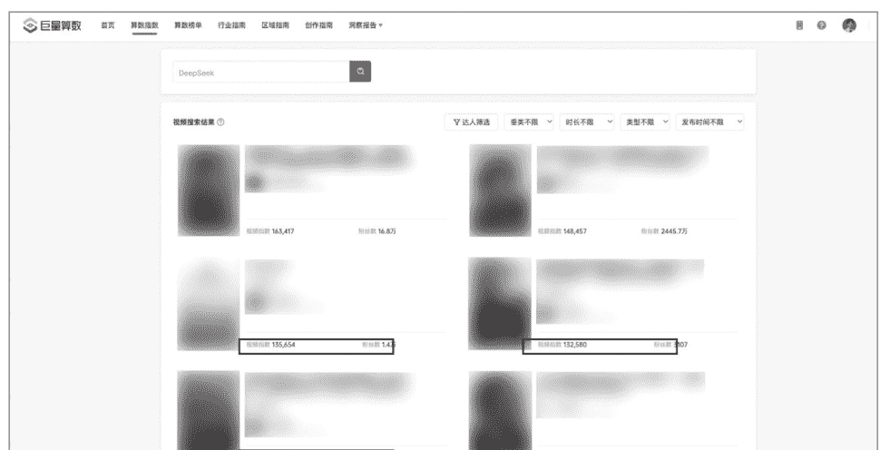

图4-1

### 2. 优秀博主对标
对标优秀博主也是重要渠道。他们市场嗅觉敏锐，选题多切中痛点痒点。可关注定位相近的博主，拆解他们的选题方向，如图4-2所示。

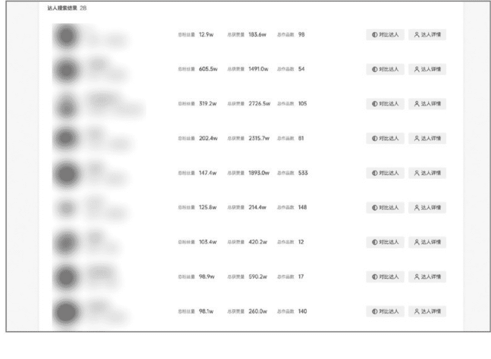

图4-2

### 3. 新闻热点
新闻热点每日都在产生话题，如图4-3所示。可关注与定位相关的新闻热点，在此基础上创作。

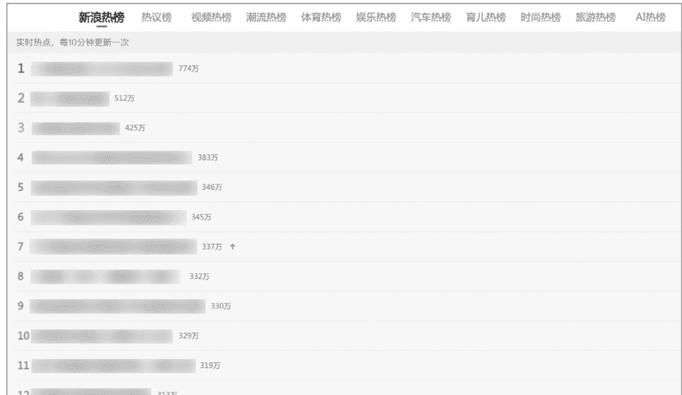

图4-3

### 4. 资源提炼
整理已有的经验和知识也能出选题。梳理自己在生活工作学习中积累的干货，参考专业书籍文章报告挖掘深度话题，如图4-4所示。

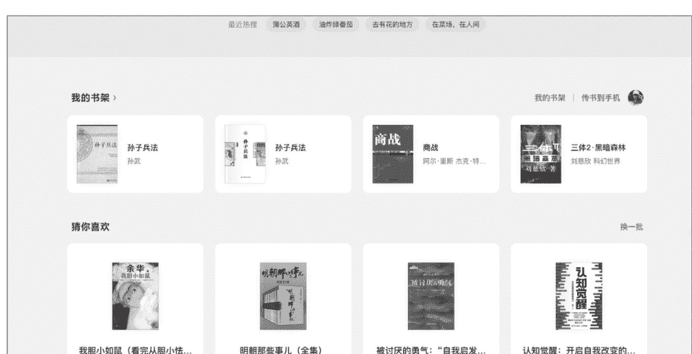

图4-4

选题确定后，如何快速变成优质文案？接下来介绍4种用DeepSeek量产文案的方法：热门仿写法、新闻改写法、优秀博主克隆法、资料提炼法。

## 4.2 DeepSeek热门仿写法

热门仿写法是通过高度模仿爆款文案，复刻其传播效果。过去很考验能力，现在DeepSeek几秒就能完成仿写，尤其是结合低粉爆款榜单，起号更快。

### 4.2.1 用DeepSeek优化仿写内容

核心是先挑高质量文案做样本，再用DeepSeek精准复刻结构精髓并加入原创元素。操作如下。

01 选择热门文案。挑一篇结构清晰、标题吸睛的爆款文。可从低粉榜单或大V高播放笔记里找，如图4-5所示。

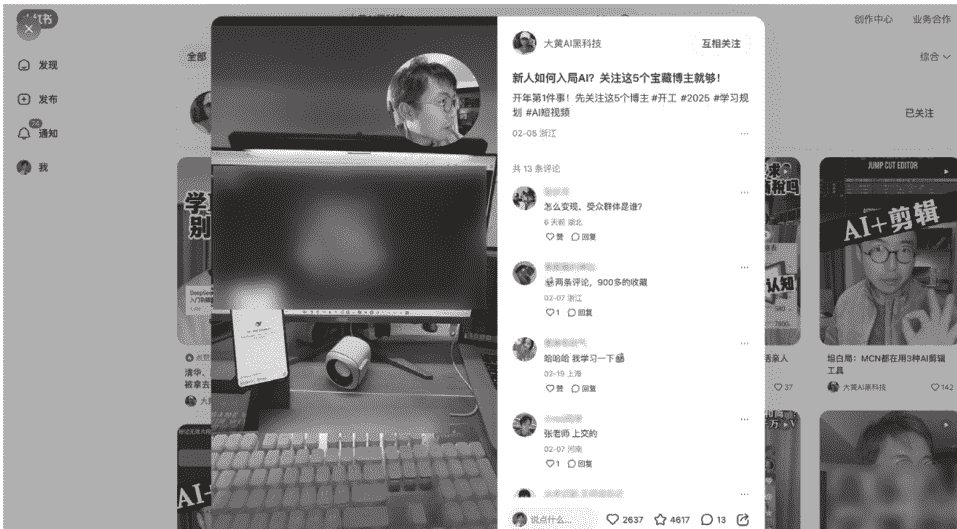

图4-5

02 下载热门文案。选好后，若是笔记可直接复制内容，若是视频可用第三方小程序如轻抖提取文案，如图4-6所示。可整篇复制或只取标题开头结尾等关键部分。

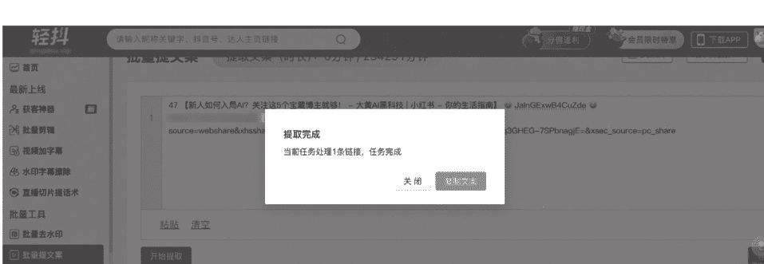

图4-6

03 给出仿写指令。例如在DeepSeek输入“请模仿这篇文案的风格，改写一篇类似内容的文案，切入角度做一点区分”。

仿写环节启动前，建议把 DeepSeek 的深度思考与联网检索同时开启。用思考模式拆解爆款的架构逻辑，用检索能力实时补全外部信息，初稿会更扎实更完整。

04 生成仿写初稿
投递指令后，模型会先产出一版仿写草稿，参考示意如图4-7。拿到文本后要完整阅读，判断语调是否对齐、吸引力是否足够。

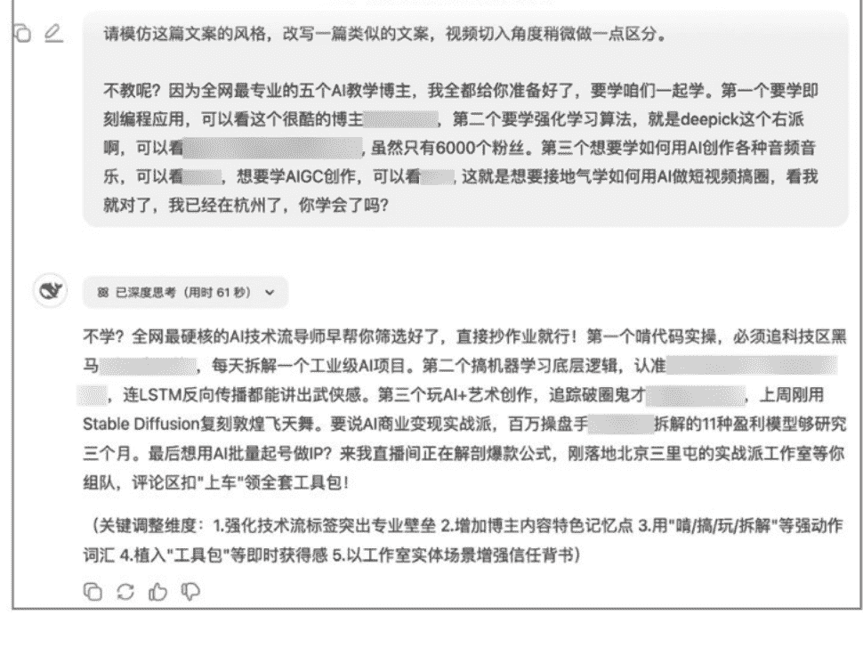

图4-7

05 内容优化
若初稿仍显不足，可做定向调整。例如让标题更具冲击力，让表述更贴近个人语感，让结构更清晰易读。

按照上述流程，就能用 DeepSeek 快速完成热门内容的仿写，节省创作时间，也更容易被用户认可与喜爱。

### 4.2.2 案例：仿写《红楼梦》风格国潮产品文案
国潮香薰市场竞争激烈，某品牌一直致力于把传统文化精髓与现代生活美学融合，为消费者带来独特体验。临近双十一，他们计划推出《红楼梦》主题系列，并借助 DeepSeek 仿写《红楼梦》风格的产品文案，为品牌注入新活力。

首先，将《红楼梦》经典片段整理成文档，通过上传文件让模型深入学习其文字风格，包括典雅的词语运用、精巧的修辞手法以及细腻的情感描写等。同时明确本次文案创作需贴合的香薰产品特性，融入嗅觉意象，突出不同香味与《红楼梦》中场景、人物气质的关联。随后在对话框中输入「帮我根据附件中红楼梦的古文风格，给我的[品牌名]清香型香薰写一段广告语，再写一段产品功能和亮点介绍，可以参考以薛宝钗为清香型香薰代言人」，如图4-8所示。

### 悦香坊香薰广告与功能介绍

帮我根据附件中红楼梦的古文风格，给我的 [品牌名] 清香型香薰写一段广告语，再写一段产品功能和亮点介绍，可以参考以薛宝钗为清香型香薰代言人。

⚠️ 超出字数限制，DeepSeek 只阅读了前 76%

已深度思考（用时 15 秒）

### 广告语

蘅芜清韵，芳沁幽庭

宝钗含笑拈香，玉指轻拂，一缕冰麝浮云绕，半室兰蕙暗香生。[品牌名] 承古法之妙，取百花之精，凝作「蘅芜清韵」。焚此一炉，如临太虚仙境，烟霞散彩，清气盈怀。昼可伴诗书雅集，夜宜共烛影摇红。冰肌玉骨，不染纤尘；淡极始知，最是天然。

### 产品功能与亮点

一、古方新制，天然之粹

依《红楼》典籍所载「冷香丸」古法，撷白牡丹、夏荷、秋芙蓉、冬梅四时花蕊，辅晨露霜雪之清，佐蜜糖冰片之润，经九蒸九晒，终成香中逸品。无火无烟，温润沁脾，恰似宝钗「藏愚守拙」之风，淡而不寡，幽而愈远。

图4-8

产品上新后在社交媒体引发热议。不少消费者被文案里的“红楼梦境”吸引，纷纷表示“仿佛手持一支香薰，梦回大观园”“每点燃一次，都是与经典的一场香约”。该品牌借助 DeepSeek 实现《红楼梦》风格文案仿写，为国潮产品营销开辟新路径。

## 4.3 DeepSeek新闻改写法
热搜榜每天都在更新，热点新闻中常隐藏着百万级乃至千万级的流量机会。对这类爆款素材进行改写，是非常实用的引流策略。专业媒体每天产出大量稿件，若能把其中精华改写成更符合小红书格式和视角的内容，就能实现降维打击，吸引更多关注。

### 4.3.1 用DeepSeek进行新闻改写
专业媒体受限于平台属性，内容偏正式严肃，不太符合小红书活泼娱乐的调性；媒体文章通常较长，而小红书偏好短小精悍的笔记；媒体多采用第三方客观中立视角，而小红书的第一人称分享更易引发共鸣。因此，文案既保留专业媒体的话题性和内容质量，又融入小红书风格，就有机会成为爆款。具体操作如下。

01 寻找热点新闻。找到自己赛道的热点新闻。行业垂直网站、新闻热搜榜、各类内容社区都是好来源。

02 输入新闻文章或链接。将选定新闻复制粘贴到 DeepSeek 对话框，也可直接粘贴链接让模型自动读取。

03 给出改写指令。在对话框输入并发送改写指令「请根据链接内容写一篇适合小红书平台的笔记文案，以一个大姐姐的吐槽角度去给大家分享，大约500字。可以在文本中加入适量的表情包」，如图4-9所示。

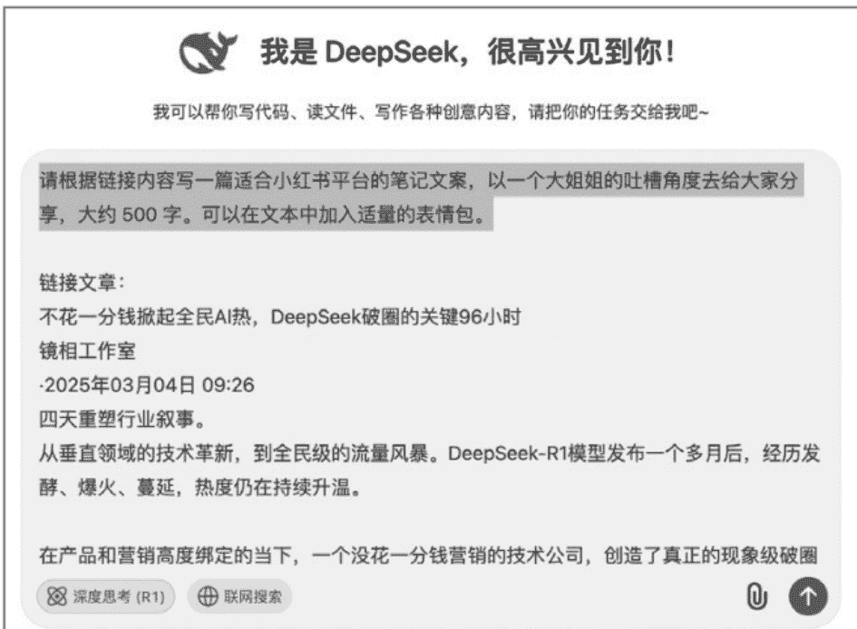

图4-9

注意改写时打开深度思考和联网搜索功能。深度思考能让模型更好理解小红书爆款要求，从多角度改写；联网搜索可读取新闻链接并整合同类报道。

04 生成改写初稿。DeepSeek 会按指令生成改写初稿，如图4-10所示。仔细阅读初稿，判断是否符合要求、是否足够吸引。

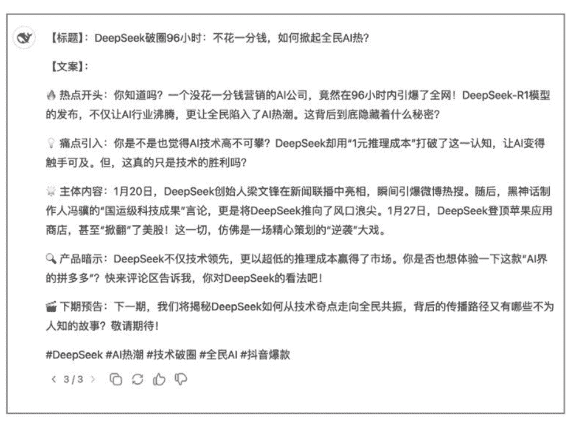

图4-10

05 内容优化。若初稿仍有不足，可按需优化。若切入角度不够好，可让模型换角度重写。

### 4.3.2 案例：改写36Kr和腾讯网的新闻
36Kr 是专业垂直媒体，拥有大量深度文章，篇幅较长，改写素材丰富。腾讯网以全面新闻报道和多元内容生态，成为中国领先新闻门户。下面以改写这两个平台新闻为例说明。

#### 1. 改写36Kr的新闻
小王是一位 AI 工具开发者，同时也是小红书创作者。他想把图4-11所示的一篇36Kr新闻改写成适合小红书发布的文案。


图4-11

他将新闻链接复制粘贴到 DeepSeek，然后输入并发送以下指令。

请根据链接内容写一篇适合抖音平台的短视频文案，大约500字。

作为一个策划小白，你要明白短视频文案获取高赞的奥秘。第一部分要包含热点，或者引起一定程度的争议，以吸引人们极其分散的注意力；第二部分要包含痛点，营造一些悬念以激发用户强烈的好奇；再往后第三部分才是主体内容，营造一些波折；最后一部分可以是但不仅限于下期预告、引导提问、情感烘托等内容。在中间的部分，看似无意地插入一些关于我产品的内容，暗示引导用户来评论区评论或发私信。

DeepSeek 很快生成改写后的文案，如图4-12所示。

### 杭州AI六小龙揭秘与城市竞争分析

管它是六小龙还是七小龙，管他是在杭州还是在北京，AI圈到底是华人的地盘还是杭州。不管怎么样，它都是对于我们来讲是一个巨大的进步，就是一件值得开心的事情。很开心，这期聊得特别好玩。

【爆款开头】

杭州又爆了！这次不是因为西湖，而是六条“龙”！DeepSeek登顶全球AI榜，机器人春晚扭秧歌，游戏卖爆90亿……“杭州六小龙”一夜刷屏！但凭什么全是杭州？南京、深圳输在哪？下一个AI霸主城市会是哪里？[争议+热点，直接抓眼球]

【痛点悬念】

“杭州有六小龙，我们有什么？”明明南京坐拥13所双一流大学，深圳有，为什么偏偏是杭州？难道其他城市注定“陪跑”？[制造对比焦虑，引发好奇]

【波折剧情】

1. 杭州的“秘密武器”：不靠政策砸钱，靠“放养”天才！

你以为杭州赢在砸钱？错！

- “疯子”聚集地：创始人，弃医做游戏，差点饿死时政府空置3栋楼等他扩张；融资断裂，自己掏腰包发工资，杭州国资紧急输血救活。

图4-12

小王阅读后觉得内容不错，但标题吸引力不足，于是单独优化标题。最终发布高质量文案，推广软件也获得不少咨询和注册。

#### 2. 改写腾讯网的新闻
小张是一位工厂老板，每天关注与化妆品行业相关的热点新闻，想把品牌和腾讯网热点结合。

于是，他将新闻链接复制粘贴到 DeepSeek，输入「请根据链接内容写一篇适合小红书的文案，大约500字。请提取和理解原文的核心内容，但改编成化妆品种草的视角」，如图4-13所示。

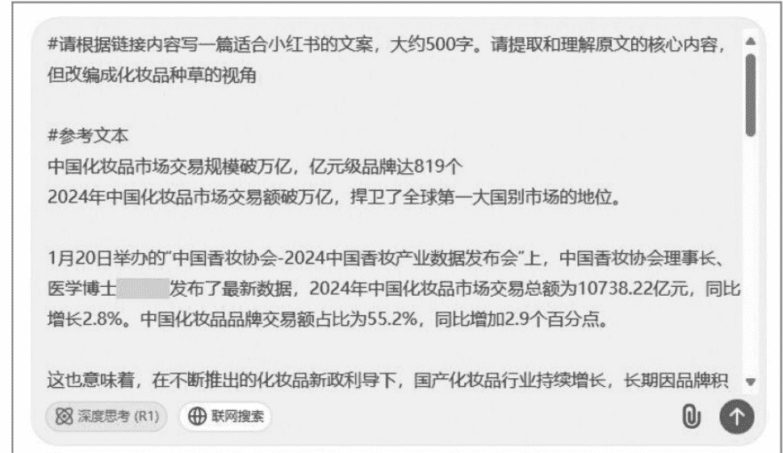

图4-13

DeepSeek 很快生成改写文案，如图4-14所示。

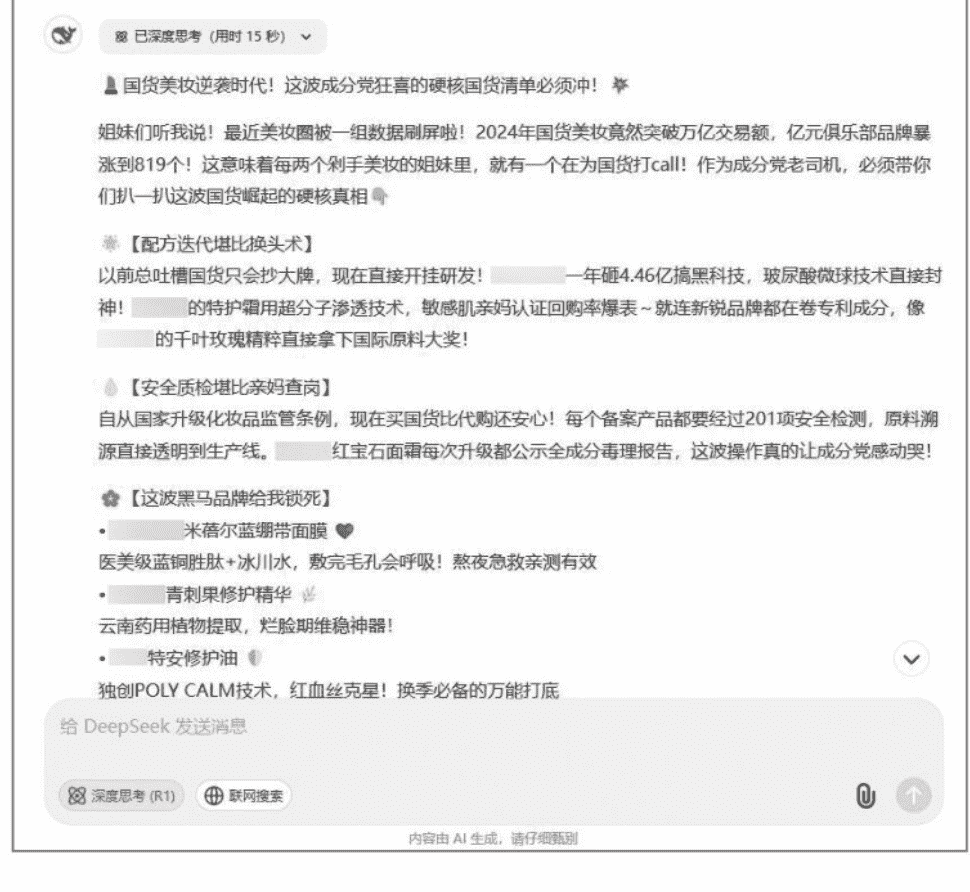

小张阅读后觉得内容不错，按自己风格微调后发布，获得不少关注和点赞。

按此流程，3分钟就能生成一条蹭热点的文案，大幅提升曝光。每天都有专业记者供稿，还怕没选题？4.4节将讲解优秀博主克隆法。

## 4.4 DeepSeek优秀博主克隆法
优秀博主克隆法是一种极具个性的写作方法。其原理是让模型学习大量优秀博主素材，领会语言风格、写作套路和核心观点、立场，进而举一反三，创作出更贴合创作者个性的内容。

### 4.4.1 用DeepSeek生成个性化文案
自媒体时代内容创作更简单，大博主能保持高质量日更，奥秘在于善用 DeepSeek 等 AI 辅助。大博主通常拥有贴合自身个性的数据库，存储过去几十上百篇爆款文案。面对同一热点，用 DeepSeek 生产内容效率更高且更个性化。这种定制化内容让用户难以察觉是 AI 代写。操作步骤如下。

01 收集过往优质文案。将自己过往优质文案整理成文档，可从小红书、抖音、微信公众号等平台挑选高点赞高分享内容，确保能代表创作风格和特色，如图4-15所示。

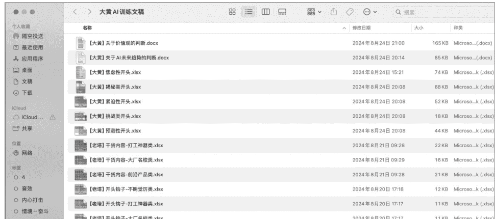

图4-15

02 上传文档。在 DeepSeek 对话框中单击回形针图标 📎，上传整理好的文档。上传后模型会自动读取内容，如图4-16所示。

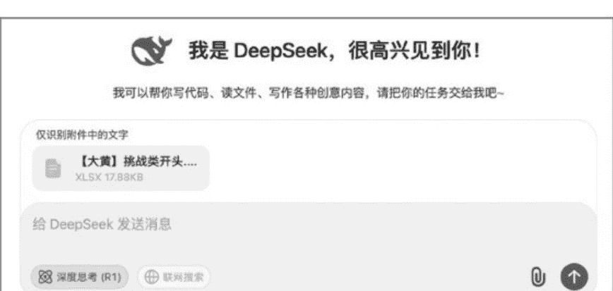

图4-16

03 输入克隆指令。在对话框输入并发送「请根据我的内容风格，创作一篇关于“如何提高学习效率”的文案」，如图4-17所示。

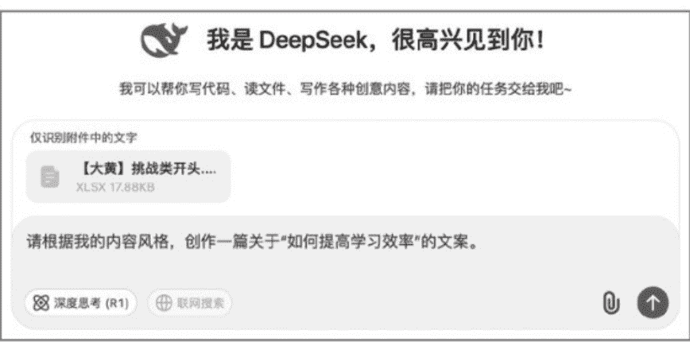

图4-17

04 提供参考链接。若有具体参考内容，可提供链接让模型结合风格创作。例如输入「请根据我的内容风格，并结合这个链接[链接地址]的内容，创作一篇文案」。

注意文案克隆时开启深度思考，让模型更好理解文案风格和逻辑。

05 生成克隆初稿。DeepSeek 会按指令生成克隆初稿，如图4-18所示。仔细阅读，判断是否符合要求、是否足够吸引。

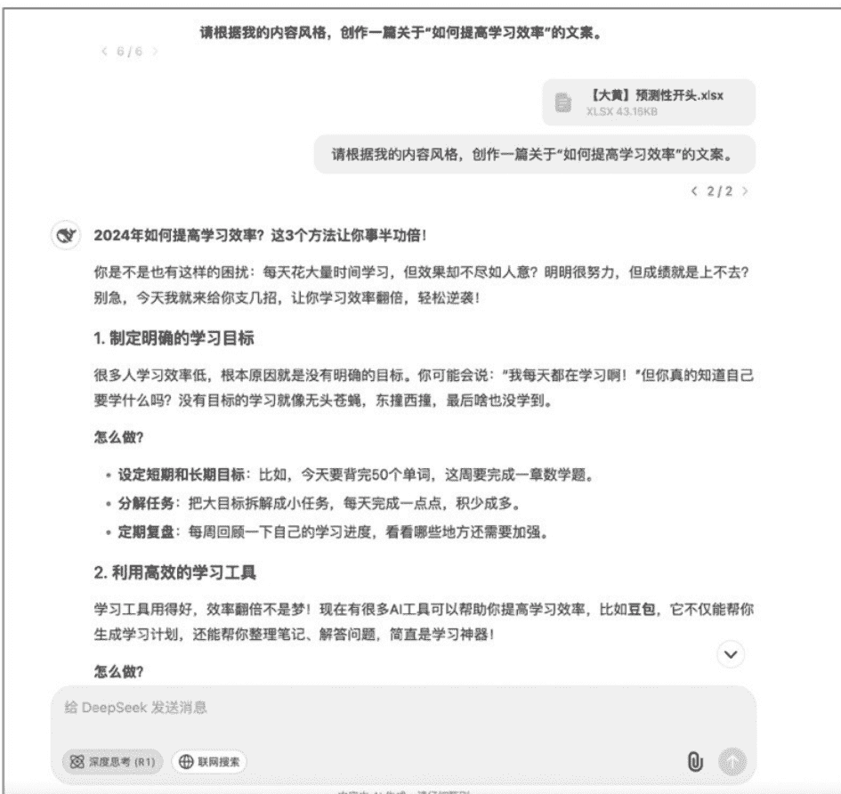

图4-18

06 内容优化。若初稿有不足，可按需优化。例如调整观点使其更符合态度、优化开头使其更具吸引力或修改结构使其更清晰。若某部分不满意，可输入具体修改意见，模型会按要求修改、替换。例如输入并发送「请修改其中的第二个案例，把它换成软件“快点口播”」，如图4-19所示。

请根据我的内容风格，创作一篇关于'如何提高学习效率'的文案。

第二招：AI工具开挂——5分钟顶别人1小时！

2024年了，还用手抄笔记？学霸早用AI工具降维打击了！

神器推荐👇

- 豆包（抖音官方免费工具）：直接语音输入“帮我整理高中生物必修一知识点”，10秒生成思维导图，还能一键导出PDF！

- 番茄TODO：设置25分钟专注模式，强制锁手机，专治拖延症！亲测效率提升300%！

- 案例：粉丝@小陈用豆包写作文，AI生成大纲+金句，语文直接从90分飙到120！评论区都在求链接！

第三招：变态复习法——记牢到骨子里！

艾宾浩斯遗忘曲线听过吧？但99%的人根本用不对！

正确姿势👇

- 黄金复习点：学完5分钟→1小时→1天→1周→1个月，按这5个节点复习，知识点想忘都难！

- 变态测试法：每晚睡前，闭眼默写当天学的内容，写不出来立马翻书！坚持一周，记忆力像开了挂！

- 案例：考研党@娜娜用这种方法，专业课背了3遍就上考场，结果总分400+！评论区全在跪求详细计划表！

彩蛋：心态炸了怎么办？

请修改其中的第二个案例，把它换成软件“快点口播”

图4-19

### 4.4.2 案例：克隆优秀主播风格
#### 1. 克隆某高人气图书带货主播的风格
小李是小红书创作者，想做图书带货分享，并模仿某高人气图书带货主播风格，创作“如何学习写作”的文案。

首先，他将想模仿主播的过往优质文案整理成文档并上传至 DeepSeek，如图4-20所示。

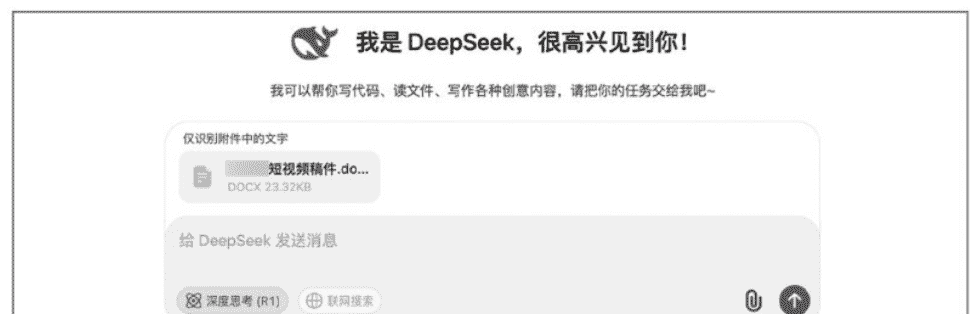

图4-20

随后在对话框输入并发送「请根据[模仿主播]的内容风格，创作一篇关于“如何学习写作”的文案」，如图4-21所示。

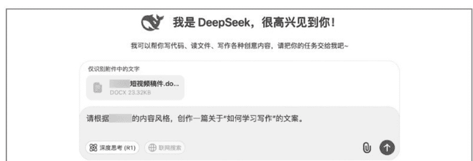

图4-21

开启深度思考后，DeepSeek 很快生成克隆文案，如图4-22所示。

#### 2. 克隆某头部美妆产品带货主播的风格
小红是小红书创作者，想模仿头部美妆带货主播风格，创作“如何选择护肤品”的文案。她先把该主播过往直播间文案素材整理成文档并上传给 DeepSeek，如图4-23所示。

图4-23

随后输入「请根据[模仿主播]的内容风格，创作一篇关于“如何选择护肤品”的文案」，如图4-24所示。

图4-24

开启深度思考后生成克隆稿，如图4-25所示。小红发布后复刻直播间风格，吸引大量关注与互动。

优秀博主克隆法个性化强、原创度高，但对素材量要求更高。随着运营深入，DeepSeek 会成为越来越强大的创作伙伴。4.5节将介绍资料提炼法。

## 4.5 DeepSeek资料提炼法
资料提炼法源于常被忽略的宝库——报告、图书、论文等。作者花费大量心力撰写的深度资料若能与自媒体有效连接，就能构建独特内容生态。过去需数周的阅读提炼，现在 DeepSeek 几秒即可完成。

### 4.5.1 用DeepSeek进行资料整合与提炼
采用资料提炼法主要有三点价值。

**深度内容：** 自媒体信息传播效率高，热点选题同质化风险大。深度内容更易脱颖而出。行业研究报告、图书、论文是高质量源头。

**高效整合：** DeepSeek 具备超强整合能力，可一次性提炼出几十上百个选题，节省数周阅读时间。

**系列化潜力：** 一旦某些选题成为爆款，相关资料中还有更多深度内容可挖掘，更易形成系列化。

需注意，原始资料篇幅长、表述严谨，需在经典之上做小红书化提炼，才能雅俗共赏。操作步骤如下。

01 收集资料。围绕主题搜集论文、报告、图书、视频等，可从网络搜索或自有资料库查找，确保覆盖面和信息量。

02 整理资料。将收集资料按主题、类型、来源分类，方便后续调用。

03 上传资料。将整理好的资料上传给 DeepSeek，可复制粘贴内容，也可点击回形针图标 📎 上传文件。

04 给出提炼指令。在对话框输入并发送提炼指令「请根据这些资料，提炼出适合小红书的十个选题，主题方向为“如何引流获客”」，如图4-26所示。

注意提炼时记得打开深度思考功能。深度思考能让模型更好理解资料内容和逻辑，同时兼顾小红书选题和写作逻辑。但联网搜索暂不可用。

图4-26

05 提炼选题。DeepSeek 会按提示词提炼出符合主题的选题，如图4-27所示。可择优选用。

图4-27

06 写作文案初稿。选定选题后继续让模型拓展，生成完整小红书文案。例如输入并发送「请根据[具体选题]，结合资料的内容，拓展成一篇完整的小红书文案。要求500字左右」，模型会生成拓展初稿。仔细阅读，判断是否符合要求、是否足够吸引。

07 进行优化。若选题和内容不尽如人意，可按需优化。也可从其他选题出发，进一步拓展，挖掘资料最大价值。

08 反复打磨，让选题更贴合受众。面对优质素材，可以让DeepSeek一次性产出多版提炼稿，再从中挑出最契合的版本。经由多次迭代，表述会愈发精炼，呈现也更到位。

### 4.5.2 案例：行业报告向小红书选题的转化
小雷是金融分析师，日常要阅读大量财报与行业研报，同时想在小红书做金融垂类内容。他把相关资料整理后上传到DeepSeek。

图4-28

之后他在对话中发送指令「请基于这些材料，提炼适合小红书的选题，围绕财富趋势展开」。开启深度思考后，模型迅速给出多条跨行业、多视角的选题建议，如图4-29所示。

小雷浏览后选中其中第三条，再次提示「请依据资料把该选题扩展成一篇小红书文案」。获得初稿后，他参考4.4节提及的优秀博主克隆法，对语气和细节进行个性化润色，最终发布并收获了不少关注与点赞。

这套流程即可实现资料提炼，快速产出大量优质素材。提炼法省时且能提升内容的丰富度与深度。本章介绍的4种方法既可独立使用也可组合，帮助实现高质量内容的规模化生产。

# 第5章 DeepSeek驱动的产品种草实操
## 5.1 先验证后生产的商业逻辑
当下很多产品的核心已从制造转向用户侧。借助DeepSeek配合小红书把产品卖出去，才是真正的胜负手。

### 5.1.1 可售卖的产品才是好产品
在竞争激烈的市场里，生产出来却卖不动的现象很常见。企业耗费资源研发制造，最终堆在仓库成为负担。以下案例值得警惕。

**案例1：** 某新消费品牌抓住Z世代养生话题，推出枸杞味跳跳糖，最后在仓库里自然陈化。

**案例2：** 某培训机构闭关3个月研发新课，上线后唯一报名者是自家孩子。

**案例3：** 某工厂48小时可生产10万个保温杯，直播间却用48天才卖出500个。所以别急着开线，先验证需求规模。

滞销背后主要有三类原因。

### 1. 对市场需求的判断失误
研发阶段缺乏充分调研，盲目跟风或依赖主观臆断，导致产出与真实需求脱节。

例如曾有公司推出智能筷子，完成后才发现只是产品经理的自嗨，用户并不买单。

### 2. 营销打法不当
产品本身无问题，推广做不好也难以打开局面。不少企业不懂投放与定价。

比如某品牌成本3元的雪糕卖到69元，把用户当提款机，被写进商学院反面教材。另有企业固守传统渠道，忽视新媒体与社交平台，导致触达效率低下。

### 3. 销售通路不畅
通路是产品抵达消费者的关键。定位与渠道错配，销量自然受阻。

例如在面向下沉市场的短视频平台售卖高端包，在高档商场摆摊卖袜子，等同于向无发者推梳子，对平台与人群缺乏理解。

反面之外也有正面标杆。

某潮流手办品牌测试新品时，直接把设计图丢进粉丝群提问：「老铁们，这丑娃你们愿花59元还是继续吃土？」等群里吵出3万条留言后，才通知工厂开工。这招被称作商业界的先上车后补票。

产能过剩时代，产品价值不再是生产为王，而是用户为王。能卖出去的才是好产品。

### 5.1.2 个性化定制成为AI时代主旋律
AI时代，个性化定制已成不可逆转的趋势。随着生活水平提升，消费者不再满足于千篇一律，更想要独一无二的专属品。电商平台数据显示，“定制”关键词搜索量三年暴涨580%，大量细分需求待开发。

何种个性化产品更易爆单？观察下来通常具备三点特质。

### 1. 精准回应用户痛点
能爆单的定制品一定深挖痛点与痒点，给出针对性方案。比如根据身高体重与健身目标推荐个性化器材与方案，让用户感受到专属定制。

### 2. 具备独特设计与创意
设计是灵魂。带有独特创意与视觉冲击的产品更易吸引眼球，激发购买欲。如AI生成的专属手机壳图案，让使用感充满个性。

### 3. 提供高品质使用体验
消费者购买定制品，除了功能设计，还极度看重体验。培训服务类产品即是典型，持续感知价值与知识含金量，才是留住用户的关键。

传统个性化设计痛点明显：人力投入大周期长、依赖专业设计师与工具成本高、定制化生产流程与设备进一步推高门槛。

如今DeepSeek搭配各类设计工具，能大幅压缩周期、提升效率、降低成本。配合小红书的种草属性，人人可低成本轻创业，完成“先卖后生产”的闭环。下面详细介绍具体做法。

## 5.2 DeepSeek助力定制设计图生成
用户需求已超越单纯功能，好的设计与审美能带来优质体验与高情绪价值。DeepSeek与AI工具正成为设计中的蓝图与妙笔。

### 5.2.1 优秀设计本身即为内容
“好的产品设计天生就是内容”并非夸张。某博物馆文创把奏折做成笔记本；某潮流手办未发售的设计图在闲鱼被炒到8888元；某小众香薰把配方表画成星座运势图，女生买后舍不得用。

设计优秀的产品本身就是艺术品。好设计能抓住目光，激发购买欲，兼顾外观、功能、体验与情感。

“设计即内容”虽缺乏系统理论，却被品牌玩出花样。总结三大暗线。

1. 拆解欲比乐高更上头
某咖啡品牌在罐体设计图上藏“神秘代码”，强迫症用户组团破解，最后发现是老板家Wi-Fi密码。

2. 养成系比偶像更带感
某国潮鞋品牌把设计过程直播成连续剧，观众打赏就能参与改配色。

### 3. 社交属性比八卦更易传播
某香薰品牌把未上市设计稿发到小红书做“大家来找茬”游戏，找到隐藏元素送终身会员。

### 5.2.2 LibLibAI联动DeepSeek出图实操
若对产品设计没把握，可先让DeepSeek找灵感，再在小红书零成本做成设计图测试市场。具体流程如下。

01 找灵感。在DeepSeek输入「假设你是[品类]设计总监，需要策划一个让人忍不住发朋友圈的[产品类型]，请结合[拆解欲/养成系/社交传播]特性，给出3个脑洞方案，并附带可落地互动机制」，模型会返回可用创意方向，如图5-1所示。

图5-1

02 注册登录LibLibAI。该平台面向中文用户优化，提供在线生图、工作流与LoRA训练等功能，如图5-2所示。只需输入描述或上传参考图即可快速成图。

图5-2

03 生成提示词。在DeepSeek发出「你是一个AI绘画提示词专家，我想生成一个可爱的棕色小狗毛绒玩具，请给出AI绘画提示词」，即可获得结构化提示词，如图5-3所示。

### AI绘画提示词生成可爱棕色小狗毛绒玩具
你是一个AI绘画提示词专家，我想要生成一个可爱的棕色小狗毛绒玩具，请帮我生成AI绘画提示词

以下是为您定制的AI绘画提示词，包含细节与氛围，可生成高质量毛绒玩具图像：

【超详细提示词】

"Adorable chocolate brown puppy plush toy, ultra soft fluffy texture, (big round glass-like eyes:1.3), tiny embroidered pink nose, floppy fabric ears with white inner lining, sitting pose with paws forward, 3D stitching details on paws, (golden bell collar:1.2), gradient brown fur with white chest patch, playful tilt of head, warm bokeh background in pastel nursery room, soft diffused lighting casting gentle shadows, 8k resolution, Pixar-style character design, hyperrealistic fabric texture, whimsical storybook illustration style, trending on ArtStation, warm color palette with cream accents"

【要点拆解】：
1. 材质表现：用"ultra soft fluffy texture"+"hyperrealistic fabric texture"突出毛绒感
2. 色彩层次："gradient brown fur"+"white chest patch"增加层次
3. 萌点强化：放大眼睛权重1.3+头部倾斜增强可爱度
4. 背景氛围：pastel柔色育儿背景配合散景营造温馨感
5. 商业价值：加入"trending on ArtStation"提升可用性

图5-3

04 选择模型。打开LibLibAI的模型广场挑选风格与创意模型，如图5-4所示。做IP毛绒玩具可选用专用IP设计模型，如图5-5所示。

▲图5-4

▲图5-5

05 输入提示词并微调参数。把DeepSeek生成的提示词粘贴进LibLibAI，通常成品模型会自带参数。若有特殊需求可手动调节采样方法、迭代步数、宽高、图片数量、提示词引导系数CFG scale、随机数种子等，如图5-6所示。

图5-6

延伸阅读
采样方法：如Euler，不同方法对3D、实拍、动画效果影响不同。
迭代步数：建议15～25步，太少画面不完整，太多易失真。
宽度高度：按需设置尺寸。
图片数量：设定输出张数。
提示词引导系数：默认7，值越大越贴提示词，越小越接近模型风格。
随机数种子：默认-1为随机，填入具体ID可复现。

06 生成图片。点击“开始生图”，LibLibAI会按提示词输出设计稿，可是手稿也可最终效果图。

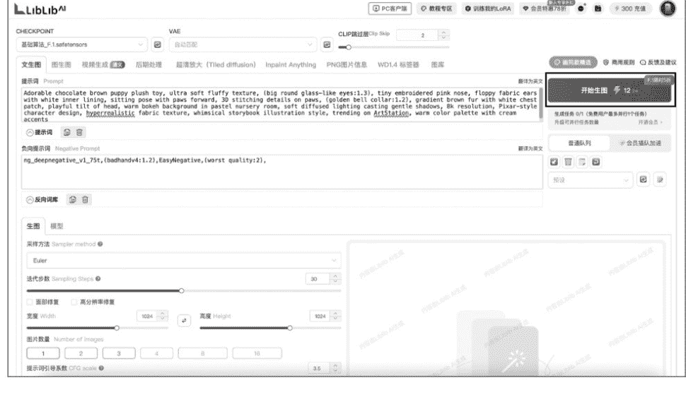

图5-7

07 调整提示词。若创意与预期偏差，可回DeepSeek优化方案并修改提示词再试。例如要改颜色，直接修改颜色词即可，如图5-8所示。

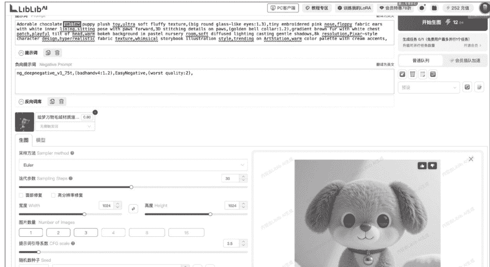

图5-8

08 更换模型。不满意局部效果可尝试其他模型，LibLibAI模型覆盖多元风格，选对模型能显著提升质量，如图5-9所示。

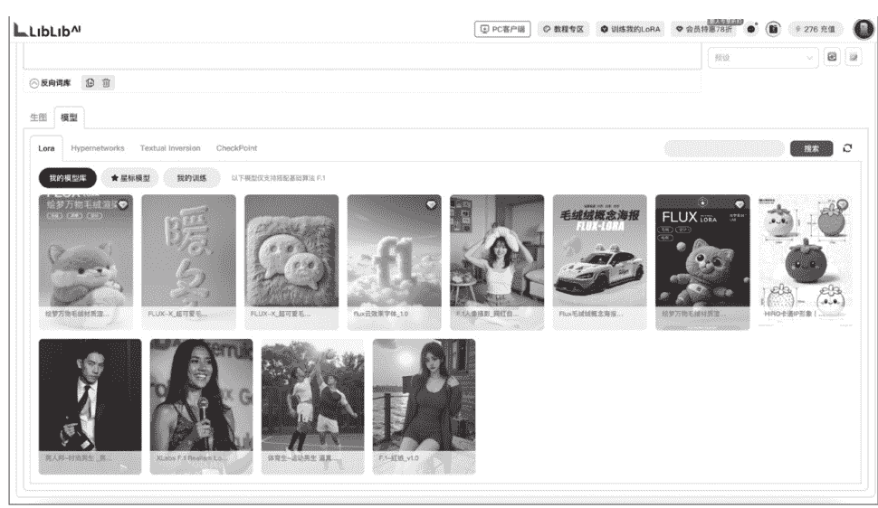

图5-9

09 微调参数。除模型外，通过参数优化也能提升效果。如细节不足，可把迭代步数提升到20～40步，如图5-10和图5-11所示。

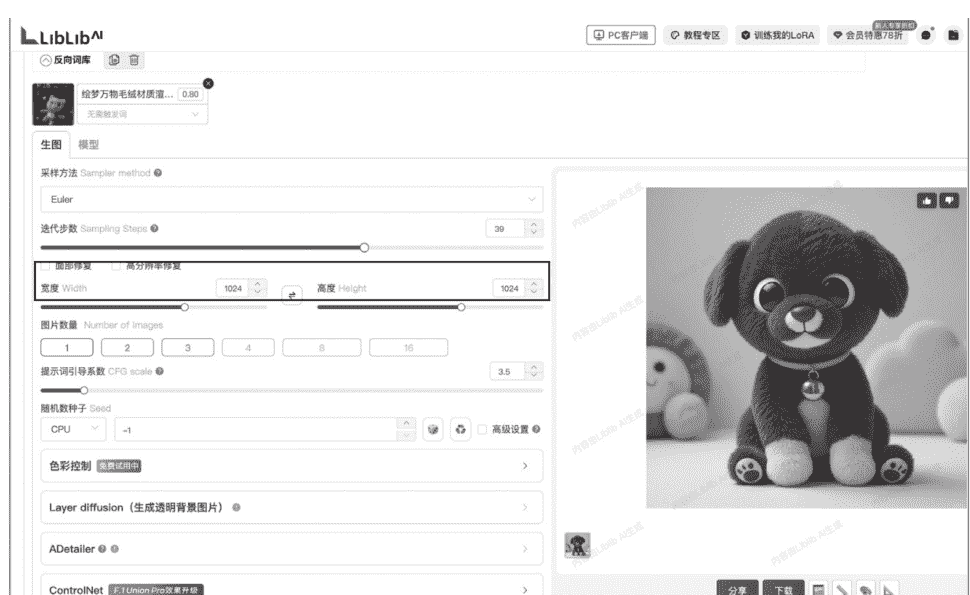

▲图5-10

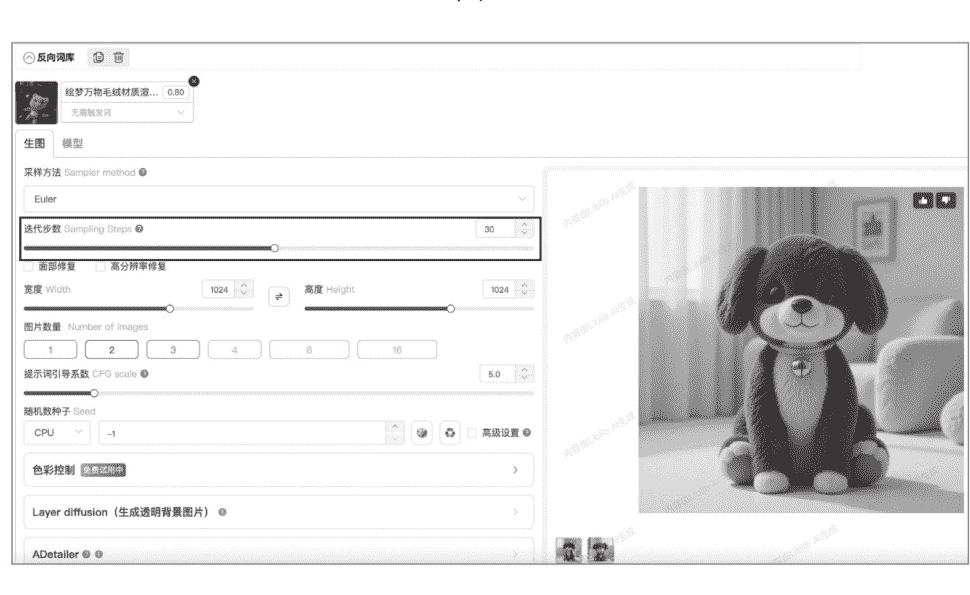

▲图5-11

10 若风格不明显，可调高提示词引导系数，建议7～10，如图5-12所示。

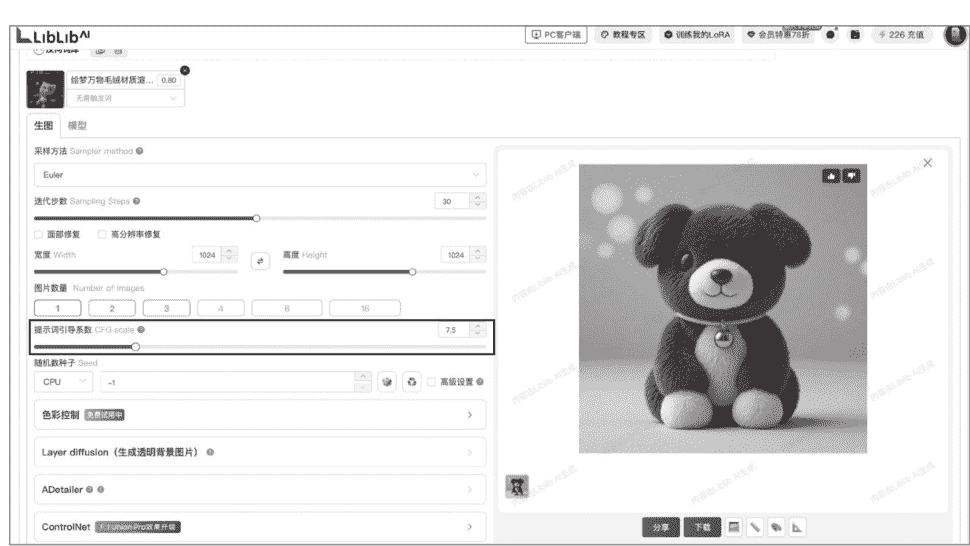

### 5.2.3 案例：预售定制毛绒玩具
一家传统毛绒玩具厂因市场变化出现滞销，决定用AI探索新方向。

工作人员先在DeepSeek提问「**帮我调研毛绒玩具市场趋势，哪些儿童玩具需求更大？给出设计灵感**」，快速得到一份包含热门品类、消费者偏好、竞品情况的分析报告，如图5-13所示，为后续设计提供依据。

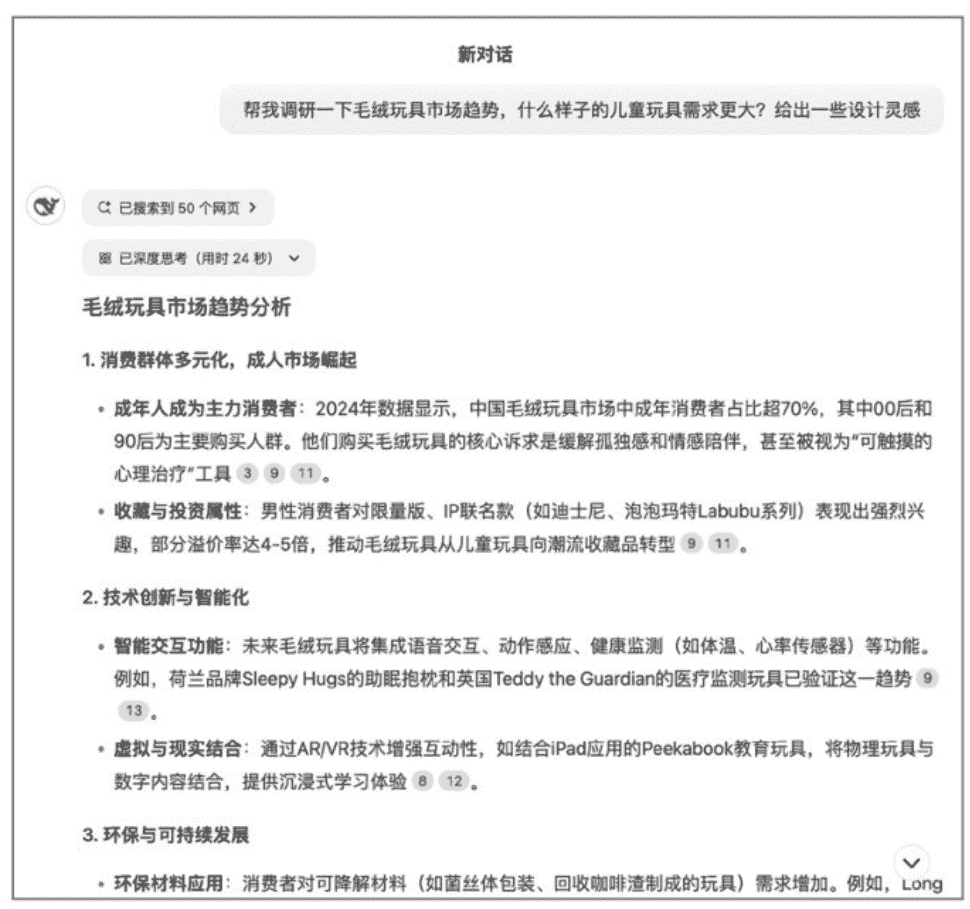

调研后，使用LibLibAI的文生图功能输入“可爱的汽车毛绒玩具”这类描述，快速得到概念图和设计手稿，如图5-14所示，直观呈现外观与功能。


图5-14

这些素材上架小红书后，汽车毛绒玩具迅速爆单，带来大量留言和预约。工厂借此实现先卖后生产，通过测试找到市场热点，快速上市。DeepSeek负责调研与需求分析，LibLibAI负责设计与优化，二者结合降低成本与风险，提升创新力。

## 5.3 DeepSeek制作知识类图文
信息爆炸时代，知识类产品爆发式增长。DeepSeek为知识内容创作、推广和变现提供全流程支持。知识类产品可实物也可虚拟，核心是通过系统化呈现帮助用户获取信息、提升技能、拓宽视野。把这类内容搬上小红书，既能分享价值也能售卖产品。

过去做课程图书成本极高，如今DeepSeek让“先卖后生产”成为可能，先用碎片化内容测试反馈，受欢迎后再完善成完整产品。

用DeepSeek做知识类产品有四大优势。

### 1. 强大的数据分析能力
DeepSeek可深度处理海量文本、图像、音频数据。对知识产品而言，这意味着更精准把握用户需求，实现个性化推荐。例如通过分析用户的阅读历史、学习习惯等数据，为其匹配合适的图书或课程。

### 2. 内容产出能力强劲

DeepSeek在文字创作方面的表现相当出色，给出提示或主题后就能迅速产出质量可靠的稿件。对知识类内容打造而言，这项能力的增益非常明显。比如创作者能借助它迅速梳理出文章框架、整理教学讲义等环节，大幅节省打磨时间。

### 3. 多模态交互覆盖面广

DeepSeek不仅处理文字，还能兼顾图像等多种数据形式。这种广度为知识类产品的展示和扩散打开了新思路。举例来说，将文字与视觉素材融合，就能输出更具画面感、更易理解的知识载体，更容易抓住读者目光。

### 4. 个性化适配灵活

DeepSeek在因人而异的定制上也做得不错，可以依据使用者的具体诉求和习惯给出专属方案。比如用它来制定个人学习路线、构建专属知识网络等，都能很好地贴合差异化需求。

在小红书做知识类内容种草，借助DeepSeek已成为不少创作者的标准动作。落地时有哪些实操组合？下面介绍几套可直接上手的打法。

### 5.3.2 Xmind配合制作思维导图

当前信息极度繁杂，思维导图因信息梳理效率高，常给人专业干货的印象，在小红书上容易收获收藏和点赞，也是知识类种草的常见形式。DeepSeek与Xmind如何联动，把抽象思路变成可视化种草素材？下面给出具体流程。

01 安装 Xmind。可在浏览器里查找Xmind的官方站点，或直接在地址栏填入网址进入下载页，如图5-15所示。拿到安装包后完成安装，启动程序熟悉界面和基础功能。

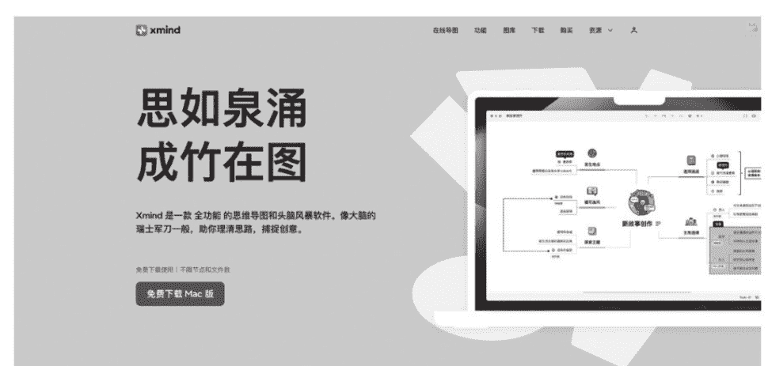

图5-15

Xmind是一款面向Windows、macOS及移动端的专业思维导图工具，可按手头设备挑选对应版本进行安装。

02 设定主题。在 DeepSeek 对话框输入并发送「请帮我生成一份思维导图知识框架，主题为[如何用DeepSeek和Xmind生成思维导图]，要求有步骤和案例」。

03 得到文本初稿。DeepSeek会依据刚才的指令产出对应文本，如图5-16所示。

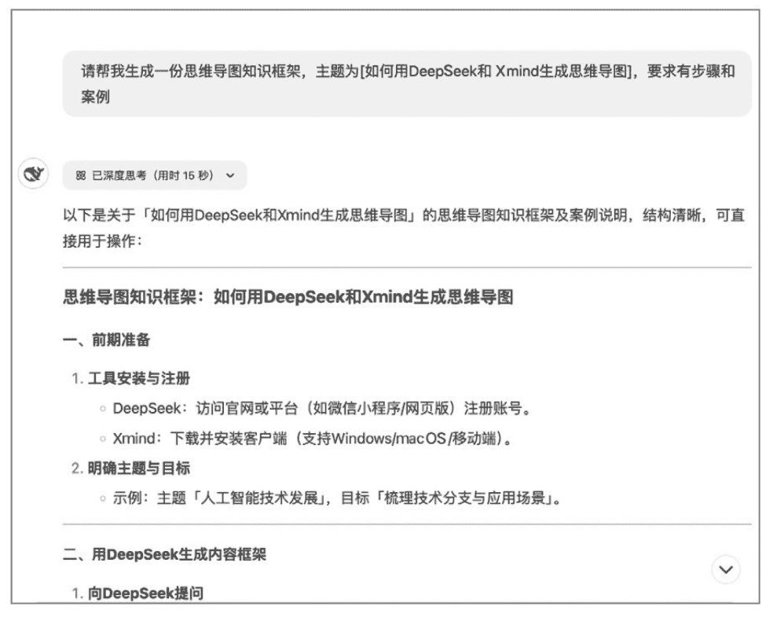

图5-16

04 转为结构化 Markdown。为方便后续导入，需要让 DeepSeek 用 Markdown 格式输出。例如发送「请以Markdown格式输出（正文部分）」。系统会返回结构化的 Markdown 文本，如图5-17所示。

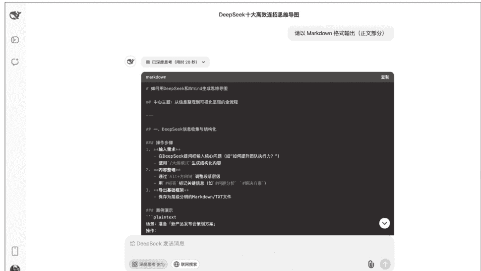

图5-17

05 保存 Markdown 文本。将 DeepSeek 生成的 Markdown 内容复制出来，新建一个文本文档粘贴并保存，如图5-18所示。

```markdown
### 如何用DeepSeek和Xmind生成思维导图

### 中心主题：从信息整理到可视化呈现的全流程

---

### 一、DeepSeek信息收集与结构化

### 操作步骤
1. **输入需求**
   - 在DeepSeek提问框输入核心问题（如“如何提升团队执行力？”）
   - 使用`/大纲模式`生成结构化内容
2. **内容整理**
   - 通过`Alt+方向键`调整段落层级
   - 用`#标签`标记关键信息（如`#问题分析`、`#解决方案`）
3. **导出基础框架**
   - 保存为层级分明的Markdown/TXT文件

### 案例演示
plaintext
场景：准备「新产品发布会策划方案」
操作：
1. DeepSeek输入：“列出新品发布会的核心流程框架”
2. 生成后添加标签：#时间线 #责任人 #预算节点
3. 导出为Markdown文件（含缩进层级）


---

### 二、Xmind导图生成技巧

### 操作步骤
1. **导入结构化内容**
```

图5-18

06 改后缀名。将文件的扩展名由“.txt”改为“.md”，保存后即可得到 Xmind 可识别的 Markdown 文件，如图5-19所示。

如何用 DeepSeek 和 Xmind 生成思维导图.md.txt 3 KB

修改时间：今天 07:57

添加标签...

通用：

种类：纯文本文稿

大小：3,486 字节（磁盘上的 4 KB）

位置：Macintosh HD • 用户 • huanggeng • 桌面

创建时间：2025 年 3 月 5 日 星期三 07:56

修改时间：2025 年 3 月 5 日 星期三 07:57

+   - 样版

- 已锁定

更多信息：

名称与扩展名：

如何用 DeepSeek 和 Xmind 生成思维导图.md

+   - 隐藏扩展名

注释：

打开方式：

预览：

```markdown
### 如何用DeepSeek和Xmind生成思维导图

### 中心主题：从信息整理到可视化呈现的全流程

---

### 一、DeepSeek信息收集与结构化

### 操作步骤
1. **输入需求**
   - 在DeepSeek提问框输入核心问题（如“如何提升团队执行”
```

图5-19

07 导入 Markdown 文件。打开 Xmind，在菜单栏选择“文件” > “导入” > “Markdown”，如图5-20所示。随后在弹出的文件选择窗口里找到刚才保存的 Markdown 文件，选中后打开。

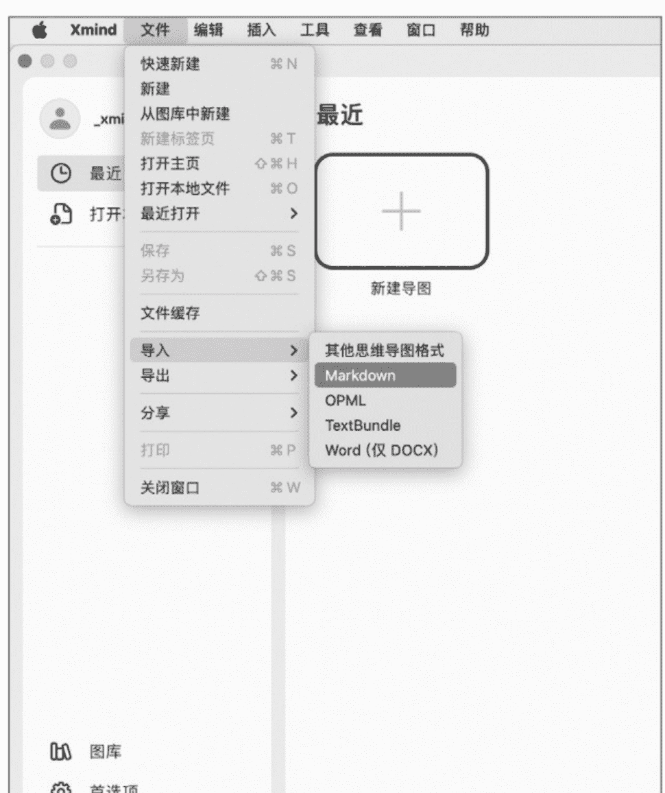

图5-20

08 自动生成图谱。Xmind 会依据 Markdown 里的内容自动生成思维导图，如图5-21所示。

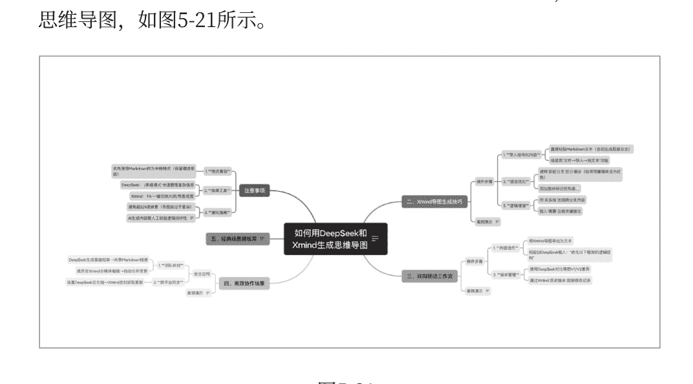

图5-21

09 优化完善。初版图谱通常需要再调整。可以在 Xmind 中增删节点、调整位置、修改内容等，利用其丰富编辑功能把导图打磨成符合需求的样子。

10 保存与导出。编辑完成后，可保存为 Xmind 专属格式以便后续修改；也可通过菜单“文件”>“导出”选择 PNG、JPEG、PDF 等格式，方便在不同场景使用和分享，如图5-22所示。

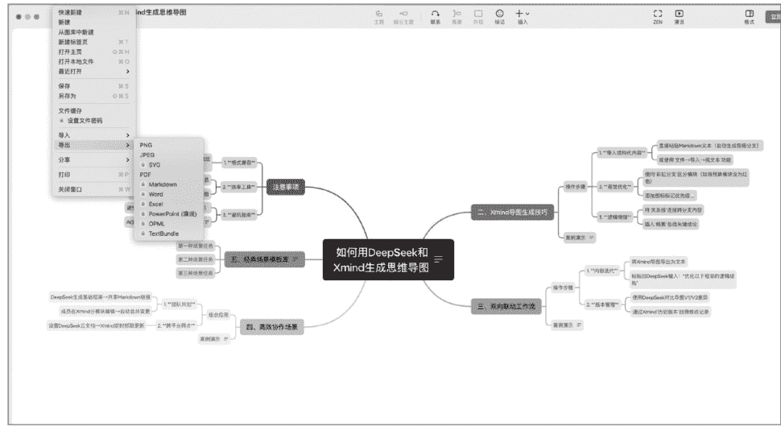

图5-22

借助 DeepSeek 与 Xmind 的组合，能快速产出高质量思维导图。将成图发布到小红书，可以直观检验知识产品的含金量。

### 5.3.3 讯飞智文协同制作 PPT

数字化环境里，PPT 是展示专业度和知识类产品的常用载体。小红书同样适合展示 PPT 作品。以下是 DeepSeek 配合讯飞智文生成 PPT 的流程，方便在小红书上分享专业形象。

01 进入讯飞智文。在浏览器搜索讯飞智文，或输入官网地址进入页面，如图5-23所示。

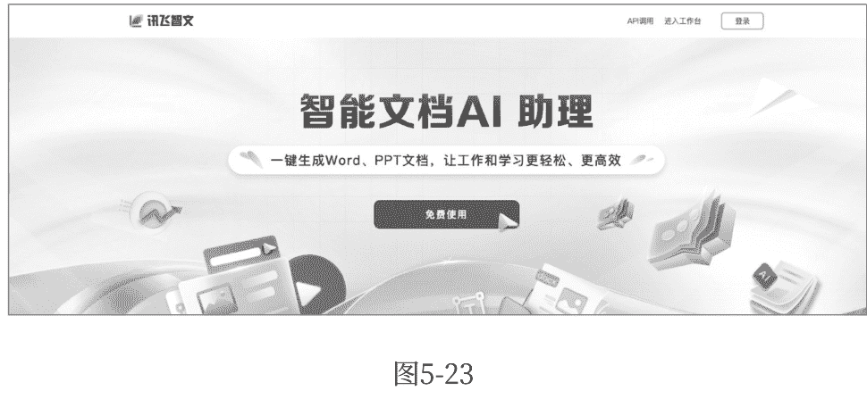

图5-23

02 下指令生成大纲。在 DeepSeek 对话框输入并发送「请帮我生成一份PPT，主题为[DeepSeek如何帮我们提高效率]，要求有至少十种方式」。

03 获取 PPT 文本。DeepSeek 按指令生成相应文本内容，如图5-24所示。

### DeepSeek提高效率的PPT设计

请帮我生成一份PPT，主题为[DeepSeek如何帮我们提高效率]，要求有至少十种方式

以下是针对"DeepSeek如何帮我们提高效率"主题的PPT框架设计，包含12种具体方式，并附设计思路说明：

### 封面页

[标题] DeepSeek效率赋能十大场景

[副标题] 智能化工具如何重塑我们的工作模式

[视觉] AI大脑与齿轮结合的抽象图形

### 目录页

1. 智能检索：秒级定位关键信息

2. 文档解析：自动提炼核心内容

3. 流程自动化：RPA+AI双轮驱动

4. 知识图谱：构建企业智慧中枢

5. 决策辅助：多维数据智能分析

6. 会议增效：自动纪要&任务追踪

图5-24

04 转为 Markdown。便于导入，可让 DeepSeek 以 Markdown 格式输出。发送「请以Markdown格式输出」，系统会自动生成结构化文本，如图5-25所示。

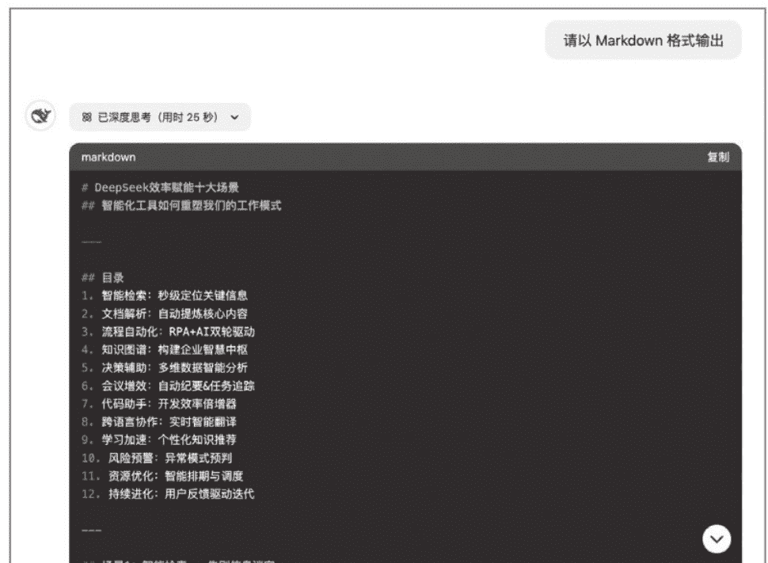

图5-25

05 保存 Markdown 文件。复制 DeepSeek 生成的 Markdown 内容，新建文本文件粘贴后，将扩展名由“.txt”改为“.md”保存，得到讯飞智文可识别的文件，如图5-26所示。


图5-26

06 导入文件。打开讯飞智文，在菜单栏选择“文档创建”，如图5-27所示。再点“点击上传”，如图5-28所示。在文件选择窗口找到保存的 Markdown 文件并打开。


▲图5-27


▲图5-28

07 解析生成结构。上传后点击“开始解析文档”，如图5-29所示。讯飞智文会依据 Markdown 内容自动生成 PPT 结构，如图5-30所示。


▲图5-29


▲图5-30

08 选模板。讯飞智文提供大量模板，按行业、风格、配色分类。可按内容类型挑选合适的模板，例如商务内容选商务风格，教育内容选教育培训模板，如图5-31所示。


图5-31

09 调整完善。生成的 PPT 可进一步编辑，如增删幻灯片、调整顺序、修改文字图片等，如图5-32所示。丰富的编辑功能能帮助做出更贴合需求的演示文稿。


图5-32

10 保存导出。编辑完成后点击右上角“下载”，如图5-33所示，选择“保存到个人空间”，即可将 PPT 发布到小红书。通过 DeepSeek 和讯飞智文配合，能快速产出高质量 PPT，提升知识分享和种草效率。


图5-33

### 5.3.4 浏览器辅助制作盘点图

小红书上盘点类内容也很吃香，DeepSeek 与浏览器的配合就能直接产出这类素材。下面介绍如何用两者生成盘点图，便于整理后在小红书分享。

01 准备浏览器。选用常用浏览器如 Chrome、Edge 或 Safari，并保持更新以获得最佳兼容性和性能。

02 生成文本素材。在 DeepSeek 对话框输入想做的盘点主题，例如「2024年小红书热门美妆产品盘点」，系统会依据提示生成相应文本内容，如图5-34所示。


### 5.3.5 案例：培训机构用资料进行引流

某知名英语培训机构为扩大招生、提升品牌声量，决定用资料引流。他们主攻一线城市，目标人群为18～35岁的大学生和年轻职场人。这些人群英语学习需求强，消费能力也不错。机构用 DeepSeek 制作了一套精美的思维导图资料，覆盖语法、词汇、口语、写作等内容，既实用又美观，吸引力很强。

通过此方式，机构实现了资料引流，招生规模和品牌知名度都得到提升。具体操作如下。

首先，员工在 DeepSeek 输入并发送「请帮我生成一份思维导图知识框架，主题为[英语语法思维导图]，请以Markdown格式输出」。DeepSeek 快速生成对应 Markdown 内容，如图5-39所示，省去大量手工整理。

请帮我生成一份思维导图知识框架，主题为[英语语法思维导图]，请以Markdown格式输出

```
### 英语语法思维导图

### 1. 词类 (Parts of Speech)
### 1.1 名词 (Noun)
- 专有名词 (Proper Noun)
- 普通名词 (Common Noun)
- 可数名词 (Countable Noun)
- 不可数名词 (Uncountable Noun)

### 1.2 代词 (Pronoun)
- 人称代词 (Personal Pronoun)
- 物主代词 (Possessive Pronoun)
- 反身代词 (Reflexive Pronoun)
- 指示代词 (Demonstrative Pronoun)
- 疑问代词 (Interrogative Pronoun)
- 关系代词 (Relative Pronoun)
- 不定代词 (Indefinite Pronoun)

### 1.3 动词 (Verb)
- 及物动词 (Transitive Verb)
- 不及物动词 (Intransitive Verb)
- 系动词 (Linking Verb)
- 助动词 (Auxiliary Verb)
- 情态动词 (Modal Verb)
```

图5-39

随后，新建文本文件，将生成的 Markdown 内容复制粘贴，再把扩展名由“txt”改为“.md”保存，如图5-40所示。

图5-40

接着打开 Xmind 思维导图工具，选择“文件”＞“导入”＞“Markdown”，然后导入已保存的 Markdown 文件。几秒钟后，一份结构清晰、内容完整的思维导图就生成了，如图5-41所示。

图5-41

机构采用线上线下相结合的推广方式。线上通过社交媒体平台、教育论坛等渠道发布思维导图资料，吸引潜在学员的关注。同时，他们还在官方网站上设置了免费下载资料的入口，方便学员获取。在线下，他们在培训机构附近、商场、学校等地发放资料，直接触达目标受众。

最后，通过一段时间的推广，该机构对引流效果进行了评估。他们发现，线上渠道的引流效果较为显著，尤其是社交媒体平台和教育论坛，吸引了大量潜在学员的关注和咨询。线下渠道虽然触达人数较多，但转化率相对较低。

通过这个案例可以看到，培训机构利用 DeepSeek 制作思维导图资料进行引流是一种非常有效的招生方式。其中的关键在于设计精美的思维导图资料，采用线上、线下相结合的推广方式，不断扩大影响力和触达范围。同时，要注重对引流效果的评估和优化，根据实际情况调整策略。

# 第6章 用DeepSeek辅助创作IP图像、视频

## 6.1 IP的价值

IP 并非新概念，在小红书平台上，其价值正快速攀升。没有 IP 的账号即便偶尔爆款，最终也容易被算法沉没，无人问津。

### 6.1.1 IP对于小红书账号的重要性

#### 1. 账号没有IP的痛点

用户默认有 IP 的账号背后才是真人，没有 IP 的账号很容易被视作营销号。总体来看，无 IP 账号主要有两大痛点。

##### (1) 被当成营销号

- 发布的 ins 风早餐照被他人搬运，对方粉丝量反超十倍，观众反而把搬运者当成原作者。
- 辛苦做爆的笔记，评论区全在追问链接，实际上卖的是自家种植的橘子。

##### (2) 转化数据差

算法对有 IP 的账号更友好，平台也鼓励出镜打造个人 IP。没有 IP 的账号就像大海里的一叶小舟，易被淹没。看两组行业数据。

- 推广同款美白精华，普通账号转化率仅 0.3%，有 IP 账号转化率高达 8.7%。
- 推广同款民宿，普通账号收藏比仅 5%，有 IP 账号收藏比高达 41%。

#### 2. 账号有IP的优势

在小红书上，有个人 IP 的账号具备以下四大优势。

##### (1) 辨识度

有 IP 的账号通常围绕某个独特个性、故事背景或品牌形象展开。

例如以知名卡通形象、文学角色、原创虚拟人物为核心的账号，会在名字、头像、简介处体现鲜明特征，便于用户识别记忆。比如“迪士尼米老鼠官方账号”，一眼就能关联到米老鼠相关内容，辨识度极高。

##### (2) 共鸣感

有 IP 的账号凭借独特形象和故事，能吸引兴趣相近的用户关注互动，形成稳定粉丝群，黏性和活跃度更高。

例如以热门动漫 IP 为核心的账号，粉丝会在评论区讨论剧情、分享周边，形成良好社区氛围。

##### (3) 推广和营销效果

IP账号的推广优势与安全保障

具备IP的账号在投放与内容分发上拥有天然的加分项。IP本身早已积累认知度与粉丝沉淀，由此账号输出的推广内容更容易触达目标人群并激发互动。

以影视IP为轴心的账号，在宣传衍生周边、线下活动或续作时，粉丝的兴趣浓度和付费意向都会明显提升，转化效率随之提高。搭载IP的账号还具备跨界联动的空间，能与品牌或其它IP进行联名合作，扩大声量与覆盖面，形成双赢的商业价值。曾经就有知名饮品品牌与热门动漫IP推出联名饮品，由动漫官方账号主导宣发，迅速带动粉丝种草，销量与品牌认知同步上扬。

##### (4) 安全性
绑定IP的账号通常会被平台与运营方列为重点资产，相应的风控与防护体系也更完善。账号持有者会叠加多种手段来确保稳定运营。

平台层面会要求使用高复杂度密码、通过手机与邮箱完成二次校验、定期更新密码等措施来保障登录安全。同时会给予这类账号额外的技术关注与支持，例如提供专属的防护工具、异常工单的优先响应等，降低被盗号或遭受恶意攻击的概率，保障内容持续稳定发布。

总体而言，IP本质上是一种可持续升值的数字资产。随着持续的内容输出，形象愈发丰满、认知不断加深，其创造商业回报的能力也会随之放大。

### 6.1.2 有IP的小红书账号的五大变现方式

IP账号搭建完成之后，可选择的商业化路径有哪些？

#### 1. 广告合作
在小红书生态里，广告植入是最常见的变现方式之一。品牌方会结合粉丝规模、影响力与内容垂类挑选合作者，创作者可通过种草笔记、产品测评等形式完成品牌曝光。

比如某位创作者在平台积累超过20万粉丝，内容聚焦女性成长、生活方式与实用技巧，如图6-1所示。她为女性成长类商品承接广告，单篇图文报价8000元，近30天接单14篇，月收入约11万元。

图6-1

#### 2. 知识付费
知识付费是另一条重要赛道，适合具备专业背景的博主。可通过开设专栏、售卖课程、提供付费咨询等方式将经验转化为收益。

比如一位博主长期分享小学课堂笔记与基础知识点，吸粉约21万。她通过售卖电子版笔记与提供一对一辅导实现变现。同时该博主视频广告单条报价3000元，图文广告单篇4000元，近30天共完成8单广告合作，月入约3.2万元。

#### 3. 电商带货
带货在小红书非常火热。主播可借助直播或笔记推介商品收取佣金。例如某博主分享健康养生内容，粉丝超20万。她结合直播与笔记带健康类产品。广告收入同样可观，视频广告单条报价1.6万元，图文广告单篇1.3万元，近30天视频广告5条、图文广告92条，预计月变现超100万元。

#### 4. 私域流量变现
私域变现的核心是把平台粉丝导流至微信等私域做深度运营与转化，提供更个性化的服务与商品，提升留存与复购。如某创作者利用AI技术提供图文与文案生成服务，账号起步不久涨粉迅猛，两个月增粉超14万。她主要依靠私域实现收益。此外视频广告与图文广告单价均为2800元，近30天共投放18篇，预估月入超5万元。

#### 5. 个人品牌变现
通过打造个人品牌提升影响力与商业价值，从而获取更多合作资源，实现多元化收益。例如某博主深耕个人品牌，在小红书实现近百万元流水。关键策略包括聚焦用户需求、垂直定位、升级笔记视觉设计等，吸引大量关注。

## 6.2 用DeepSeek辅助制作虚拟IP图像

在小红书，虚拟IP属于高潜赛道，孙悟空即是典型代表。过去构建这类IP需要专业团队与高额成本，随着AI普及，虚拟IP正快速涌现，为创作者与品牌创造新机会。

### 6.2.1 结合即梦AI生成虚拟IP图像

如何从零设计专属虚拟IP，并将其文字概念转化为适配小红书的视觉形象？下面以DeepSeek配合即梦AI为例说明流程。

01 设计角色形象。在DeepSeek对话框发送「一个可爱的虚拟IP形象，具有独特的外观和个性」，系统会按需求输出相关描述，如图6-2所示。

02 制作即梦AI可用指令。为在即梦AI出图，可在DeepSeek发送「生成即梦AI可用的提示词」，如图6-3所示。将返回的指令复制下来。

图6-3

03 进入即梦AI。打开即梦AI后点击“AI作图”下的“图片生成”，如图6-4所示。

图6-4

04 粘贴指令。在输入框中粘贴第02步复制的文案，如图6-5所示。

图6-5

05 调整图像参数。即梦AI支持模型与比例等设置。“图片比例”建议选“9：16”或“16：9”，如图6-6所示。

图6-6

06 生成形象。点击“立即生成”，即梦AI会按指令产出虚拟IP图像，可能有多版可选，如图6-7所示。即梦AI与同类绘画工具一样存在随机性，有时需多生成几次。

图6-7

07 生成同系列形象。后续需要相似形象时，可将已生成的图作为参考上传至即梦AI。对话框中选择“角色特征”，即可得到同类结果，如图6-8和图6-9所示。

▲图6-8

▲图6-9

借助DeepSeek与即梦AI的组合，能快速产出高质量虚拟IP视觉，助力变现。下面分享一个案例。

### 6.2.2 案例：AI猫咪的爆红之路

小红书上出现过一只没有实体却比真猫更有魅力的猫。它是AI技术打造的虚拟猫咪IP，以独特方式掀起多次热潮，如图6-10所示。

图6-10

该IP的创作者是一位年轻女孩，她对猫情有独钟。账号定位为分享猫咪日常生活，希望让更多人感受到猫的可爱与温暖。

在形象构建上，她用DeepSeek与即梦AI打造了一个可爱拟人化的猫咪形象。AI猫咪大眼圆脸、橙色毛发，一眼看过去就想亲近，如图6-11所示。

图6-11

在热点借势上做得也很到位。她会及时关注平台热搜并融入内容。比如“周处除三害”话题爆发时，她创作了AI猫咪版“周处除三害”，把AI猫塑造成勇敢小英雄，吸粉无数。

人气提升后，她开始探索商业化，选择广告合作、品牌联名、知识付费三种路径。

广告合作方面，她与多家宠物品牌、玩具品牌合作。内容贴合品牌调性，植入自然有趣，粉丝不仅不排斥，反而对品牌产生好感。

知识付费方面，她开设了关于AI技术的课程，把经验分享给更多人，既帮助他人也带来收入。

AI猫咪的成功离不开创作者的坚持与创意。她用想象力打造了一个深受喜爱的虚拟猫IP，证明只要持续投入，虚拟IP也能在小红书创造价值。

## 6.3 用DeepSeek辅助制作虚拟IP短视频

小红书短视频用户众多，若已能用DeepSeek与AI工具制作虚拟IP图像，是否还能进一步制作短视频？

### 6.3.1 结合即梦AI基于文字生成视频

数字化时代视频创作工具层出不穷，其中文生视频尤为吸睛。下面详解用DeepSeek与即梦AI实现文生视频的方法。

- 01 准备DeepSeek与即梦AI。
- 02 撰写指令。在DeepSeek对话框输入想生成的视频主题。例如输入「小猫厨师（拟人）在厨房煮鸡汤，请帮我优化成AI绘画提示词」。描述越具体，优化越精准。复制返回的指令。
- 03 进入即梦AI。首页点击“AI视频”下的“视频生成”，如图6-12所示。
- 04 输入指令。选择“文本生视频”选项，在输入框粘贴DeepSeek返回的指令，如图6-13所示。

### 6.3.2 结合即梦AI基于图片生成视频

下面讲解如何用DeepSeek+即梦AI基于图片生成视频。相较文字，图生视频准确度更高，相当于把电影的分镜工作前置，对商业化复杂场景帮助很大。

01 准备DeepSeek与即梦AI。

02 撰写指令。在DeepSeek对话框输入想生成的画面主题。例如输入「小猫咪厨师熬鸡汤，生成即梦AI可用的提示词」。随后复制输出的指令。

03 进入页面。打开即梦AI，点击“AI作图”下的“图片生成”，如图6-16所示。

04 输入指令。在输入框粘贴第02步复制的指令，如图6-17所示。

05 设置图像参数。在左侧编辑栏按需设置参数。建议“图片比例”选“16：9”，适配不同场景，如图6-18所示。

06 生成画面。点击“立即生成”，即梦AI按指令产出图像，多版可选，如图6-19所示。

07 优化调整图像。如需可在即梦AI中进一步优化，如局部重绘、细节修复等，如图6-20所示。

08 选择“图片生视频”选项。在即梦AI菜单栏选择“AI视频”下的“视频生成”，如图6-21所示。在视频生成页选择“图片生视频”，如图6-22所示。该功能可把静态图转为动态视频。

09 上传画面。点击“上传图片”，在弹框选择第07步优化后的图像，如图6-23和图6-24所示。

10 设置视频参数。即梦AI提供多种视频模型，不同模型运镜类型不同，视觉效果各异。“生成时长”默认“5s”，作为素材或镜头足够。注意视频比例不可调，与图像比例一致，如图6-25所示。

11 生成视频。点击“生成视频”，即梦AI按图像与参数产出视频，如图6-26所示。

12 调整参数。生成后可在右侧编辑栏调整分辨率或添加配乐，达到更好效果，如图6-27所示。

13 若效果不满意，可微调指令并继续用图生视频优化。若需调整镜头内容与构图，可回第02步重新生成图像。

### 6.3.3 案例：用DeepSeek辅助创作儿童绘本

在儿童教育领域，某出版社致力于提供优质阅读体验与知识内容。近期他们创新性地结合DeepSeek与AI绘图工具制作AI儿童绘本，为孩子打开通往知识与想象的大门。

首先，创作团队在DeepSeek输入与儿童教育、成长、想象力培养相关的关键词，如“勇敢的小冒险家”“神秘的太空之旅”“森林里的友谊”等。DeepSeek结合儿童心理与教育目标生成多样故事创意与大纲。例如生成森林里小动物联手对抗恶龙学会协作的故事，或孩子与外星朋友探索未知星球的故事，如图6-28所示。

随后，基于初步创意与大纲，团队再次借助DeepSeek生成故事脚本。输入更具体要求，如场景设定、人物性格、情节脉络，让DeepSeek生成详细生动的脚本。例如在“神秘的太空之旅”中，DeepSeek会进一步描述零重力下的生活趣事、与外星生物的友好交流等，让故事更吸引孩子。

接下来，把DeepSeek生成的脚本输入AI绘图工具，AI根据场景与人物信息自动生成匹配的精美插图。例如脚本描述“在一片金色麦田里，小兔子和小松鼠快乐玩耍，儿童绘本风格”时，AI会生成充满童趣的麦田画面，展示阳光下嬉戏的可爱小动物，色彩鲜艳、形象生动，与故事氛围契合，如图6-29所示。

接着整合文字与插图，按儿童绘本排版要求设计页面，确保图文搭配合理、版式美观、符合阅读习惯。可添加互动元素，如猜测后续情节、在画面中找隐藏细节等，提升趣味与参与感。

最后，专业编辑团队审核优化，检查内容是否符合教育理念、语言是否简洁明了、插图质量是否达标。不符合的部分再用DeepSeek与AI绘图工具调整，直到满意。

该出版社通过DeepSeek与AI绘图工具的结合，成功创作出兼具教育价值与艺术价值的AI儿童绘本，为行业带来新思路，也为孩子提供更丰富有趣的阅读体验。

## 6.4 打造IP时露脸很重要

6.2节和6.3节介绍的方法多为不露脸打造IP，但在做个人IP时，露脸非常重要。

露脸的一大好处是更容易被记住。大脑有专门记忆人脸的区域，人类进化过程中识别同部落成员关系到生存，所以人们对人脸极其敏感。另一个好处是更容易建立信任。想象一个人没露全脸，你会有安全感吗？答案是否定的。露脸让人觉得真实可靠，只有全脸展示，用户才会感到安心。

若已决定露脸，提供3条建议帮助在小红书更快出成绩。

### 1. 不要太在意容貌
需要露脸时，不要过度在意长相。哪个角度好看并不重要，有个性、有真实感才最关键。

### 2. 不要立太高端的人设
尽量别立过于高端的形象，会很累。接地气更容易圈粉，在IP尚未成型时追求高质感容易耗竭。起步阶段要做的是坚持、多尝试，时间久了IP会慢慢成为符号。

### 3. 不要自己吓自己
既然选择做自媒体展示个人IP，就别担心被熟人看到。很多人因害怕亲友看见而畏手畏脚，但IP打造成功后自然有底气。所以关键是多拍多发，先把账号运营好，其他暂不考虑。

## 6.5 用DeepSeek辅助制作真人IP图像

当前主流的个人IP仍围绕真人打造。DeepSeek与其他AI工具能否为真人IP提供更新、更高效的方案？

### 6.5.1 结合LibLibAI生成真人IP图像

若不想真人出镜，如何用DeepSeek与LibLibAI生成真人IP图像？

- 01 准备DeepSeek与LibLibAI。
- 02 撰写指令。在DeepSeek对话框输入想生成的真人IP图像主题，例如「一个具有独特风格的真人IP形象，场景是在巴黎街头的咖啡馆，生成LibLibAI可用的提示词」，DeepSeek会生成适配指令。复制该指令。
- 03 搜索并选择模型。打开LibLibAI，选择“模型广场”，搜索并挑选符合需求的模型。LibLibAI模型丰富，可按风格挑选，如时尚风格选时尚模型，复古风格选复古模型。建议优先选真人IP写真类模型，以保证逼真自然，如图6-30所示。
- 04 同步模型与参数。选好模型进入详情页，点击“立即生图”，如图6-31所示。系统弹出推荐设置对话框，点击“画同款”，即可一键同步模型与参数，便于后续快速出图，如图6-32所示。
- 05 输入指令。在输入框粘贴第02步复制的指令，点击“翻译为英文”，一键转为LibLibAI可识别的格式，如图6-33和图6-34所示。
- 06 换脸操作。为保证真人IP图像统一，可向下滑动页面找到并点击“ControlNet”按钮，在“Control Type”中选择“IP-Adapter”，如图6-35所示。然后上传图像进行换脸，如图6-36所示。这些功能可帮助跨图替换人物面部，保持统一性。
- 07 生成图像。点击“开始生图”，LibLibAI按指令生成真人IP图像，如图6-37所示。多版可选，挑选最满意的。

这种生成方式的商业价值主要体现在两方面。首先，高质量真人IP图像能有效抓眼球，提升IP知名度。其次，彻底摆脱时空限制，让IP随时随地“出现”在地球甚至宇宙的任何角落，大幅丰富素材、节省拍摄成本。创新的营销方式能带来更多商业合作，拓展业务。下面分享一个具体案例。

### 6.5.2 案例：700万粉丝的博主竟是AI生成的

在AI虚拟创作者群体里，Lil Miquela 可算得上是先行者。2016年她以原创数字形象上线，凭着鲜明的人设很快在社媒走红，成为该赛道的重要参照。目前她全网粉丝已超过700万，商业号召力相当突出。收入主要来自品牌广告合作，合作方多为知名国际大牌。依靠持续的资源加持，她的年收入稳定在1000万美元左右，折合人民币约7000万元。

同期活跃的西班牙博主Aitana Lopez表现同样亮眼。她在Instagram的粉丝已达12.1万，单张图文的曝光量也很高。最具记忆点的是她近乎24小时在线的更新频率：午夜12点仍在发布秀场后台片段，3小时后就现身东京街头打卡知名拉面店，第二天清晨又准时推早餐Vlog。她的广告单价通常超过1000欧元，约人民币8000元，月收入峰值可达10000欧元，约人民币8万元。

这些虚拟博主的崛起离不开技术底座的进步。早期的Lil Miquela已融合生成对抗网络GAN等模型来打造逼真视觉。随着算法迭代，AI网红从实验室概念变为可批量复制的生意。如今DeepSeek搭配即梦AI的组合，已把使用门槛降到普通人可操作范围。但工具普及不代表内容同质化，对传播规律与优质内容判断更精准的人，才能真正拉开差距。

## 6.6 基于DeepSeek的数字人制作实践
数字化浪潮下，数字分身的制作路径在不断演进，它提供了低成本打造个人IP的可能。市场上供给参差，质量差异明显。数字分身大致分哪些形态，能落地到哪些场景，下文分项说明。

### 6.6.1 数字人的3种类型
下面梳理三种常见形态，分别说明呈现方式、技术原理以及优缺点。

#### 1. 对口型数字人
**表现：** 利用AI把静态人像转为动态短片，可依据音频自动完成唇部同步，看起来像真人在开口。常见于讲解、播报类内容，观感更生动。

**原理：** 核心是语音驱动模型，将语音信号解析为嘴部动作指令，实现声画口型的实时匹配；同时可叠加表情控制系统，让面部动作更自然。

对口型数字人有以下3点优势。
- ① 投入更可控：不需要复杂的3D建模与动作捕捉设备，成本容易把控。
- ② 产出更快：AI能迅速完成口型合成，效率明显提升。
- ③ 适配性强：换一条音频就能快速调整口型与表情，适应多种场景。

劣势在于受限于素材。门槛低、速度快的前提是持续喂养足够丰富的素材，素材量直接决定输出丰富度，常见搭配是日常口播加照片输出。

#### 2. 克隆数字人
**表现：** 通过AI复刻真人的脸、声线和动作，生成几乎一模一样的数字替身。

**原理：** 基于深度学习和计算机视觉，对大量真人影像、语音、视频进行训练，提取外貌、声音、动作特征后合成。

克隆数字人有以下3点优势。
- ① 拟真度高：能高度还原真人的外观、声音和动作，真实感强。
- ② 互动性强：可实现多种动作和表情，与用户自然互动。
- ③ 适用面广：可用于娱乐、教育、企业服务等多个方向。

劣势有两点。
- ① 成本偏高：算力开销较大，花费从千元到万元不等，不过算力价格已在持续下降。
- ② 素材要求高：训练素材越优质，输出越优质，对拍摄素材要求较高。

#### 3. 3D数字人
**表现：** 依赖3D建模、AI渲染、动作捕捉生成，可在三维空间自由移动，做复杂动作表情，沉浸感和交互性都很强。

**原理：** 先用Maya、Blender、ZBrush等软件把扫描数据精细化为高精度面部身体模型，再用动作捕捉把真人动作映射过去，配合表情驱动和语音合成完成自然输出。

3D数字人有以下3点优势。
- ① 拟真度高：外观和动作都很逼真，能提供沉浸式体验。
- ② 互动性强：可实现多种复杂动作和表情，与用户自然互动。
- ③ 适用面广：可用于元宇宙、虚拟会议、文旅、影视制作等。

劣势为门槛较高。3D建模涉及的专业软件较多，属于前沿应用领域，具有一定的门槛。

市面上大部分数字分身的落地费用依然不低，因而选型匹配需求很关键。接下来就以性价比更高、在小红书较为常见的对口型数字人为例，演示具体制作流程。

### 6.6.2 结合使用快点口播生成对口型数字人
以下是借助DeepSeek与快点口播制作对口型数字人的实操流程。

01 先在微信搜索快点口播，进入对应公众号或小程序，按提示完成账号注册与登录。

快点口播主打数字人口播一体化服务，覆盖文案提炼、改写、声音克隆与数字人合成，3分钟即可拼出一支口播短视频，抢热点效率大幅提升。
02 准备一段训练小样，可静音或只说“123”。该片段用于训练模型，保证后续口型匹配精度，如图6-39所示。

图6-39
03 在DeepSeek对话框里输入所需口播主题，例如「请为一款智能手表撰写一段30秒的产品介绍口播文案，突出其健康监测和运动功能」，系统会据此产出详细文案。
04 打开快点口播后，点击底部菜单的“数字人”，再点“极速克隆，立即出片”进入操作界面，如图6-40所示。
### 一站式数字人
短视频创作工具
极速打造个人IP

### 极速克隆，立即出片
适合多场景创作，多账号
矩阵运营
### 自由创作
### 形象定制
### 声音克隆
- 我的作品
- 我的草稿
- 数字资产
- 热点新闻
### 模板中心


- 首页
- 应用
- 数字人
- 发现
- 我的
图6-40
05 在页面中点击“文案输入”，如图6-41所示，然后把DeepSeek产出的口播文案复制粘贴，再点击下方的“下一步”按钮，如图6-42所示。

- **文案改写**
  嗨，我是你的AI文案助手，我可以帮你生成各类优质的创作文案
- **AI文案写作**
  能创作出文艺有趣、充实动人且能引起共鸣的朋友圈文案
- **文案提取**
  能快速创作出种草风格的爆款文案，掌握流量密码
- **文案输入**
  直接输入文案
▲图6-41
### 直接输入文案
健康不妥协，运动无极限！黄金宝智能手表，为热爱生活的你而来！ 实时监测心率、血氧、压力指数，深度分析睡眠质量，健康风险提前预警，身体状态一目了然！ 支持20+专业运动模式！跑步、游泳、登山一网打尽，GPS精准定位，卡路里消耗实时反馈，助你科学训练，挑战自我极限！ 7天超长续航，50米防水设计，磁吸快充+潮流表盘切换，全天候贴合你的生活节奏！ 现在购买立享早鸟优惠，让黄金宝手表成为你的贴身健康顾问和运动教练！点击屏幕，成就你的巅峰状态！
▲图6-42
06 点击“数字人训练视频”并选择在“02”步骤中录制好的片段。快点口播会据此训练出你的数字人模型，如图6-43所示。
### 数字人极速版

### 数字人训练视频

### 授权视频

### 视频名称
大黄数字人
上一步
下一步
图6-43
07 为防止数字人口播被用于违法用途，需要录制一个授权视频。视频中要明确授权快点口播使用你的形象和声音进行数字人生成，随后点击“下一步”按钮。如图6-44所示。录制授权视频有助于保护合法权益，内容要清晰，声明要明确。

### 数字人训练视频

### 授权视频

### 视频名称
大黄数字人
图6-44
08 快点口播提供了多种音色，可按需选择合适的声音，如图6-45所示。若已完成声音克隆，也可直接选用自己的声音。

图6-45
09 点击“下一步”，系统会根据输入文案和上传片段生成全新口播视频，完成口型与文案的同步合成。可点击“下载”保存，如图6-46所示。

图6-46
借助DeepSeek与快点口播的配合，能快速生成高质量的对口型数字人，提升创作效率与质量。流程简单高效，实用性与灵活性都很强，无论广告宣传还是其他口播场景，都能提供超快速解决方案。

### 6.6.3 结合使用即梦AI生成3D数字人
为了让普通用户也能拥有自己的3D数字人分身，下面给出一个简易操作版本。以下是借助DeepSeek与即梦AI生成3D数字人的实操流程。

01 准备一张照片，用于创造3D数字人的形象，包括年龄、性别、外貌特征等，可用手机前置摄像头自拍一张。
02 明确希望展示的形象风格，例如一个30岁男性，戴眼镜，穿着简约，整体与照片高度贴合。
03 选择DeepSeek和即梦AI作为主要工具。DeepSeek负责产出高质量的人物描述提示词，即梦AI负责生成图像并转化为3D数字人。
04 打开DeepSeek，输入并发送人物的基本信息「3D数字人具有卡通风格，背景是科技感的虚拟场景，人物表情友好，请帮我输出即梦AI绘画提示词」，系统会产出相应提示词。
05 打开即梦AI，在页面中点击“AI视频”中的“视频生成”，如图6-47所示。

图6-47
06 选择“图片生成”选项，并选择合适的模型，例如“图片2.0”模型，设置“图片比例”为“2：3”。将DeepSeek产出的提示词复制粘贴到输入框中，点击“立即生成”，即梦AI会生成4张不同形象图，如图6-48所示。

图6-48
07 点击“导入参考图”，在弹出对话框中选择在“01”步骤中拍摄的素材，如图6-49所示。然后在“参考图”对话框中选择“人物长相”，如图6-50所示。

▲图6-49

▲图6-50
08 点击“立即生成”按钮，即梦AI会自动生成多个3D数字人形象图。若不满意，可修改参数继续生成，如图6-51所示。

图6-51
09 从生成的4张图片中挑选最满意的一张，并在“编辑”栏中点击“HD超清”按钮，生成高清图片并保存到本地，如图6-52所示。

图6-52
10 打开即梦AI，在页面中点击“数字人”中的“对口型”，如图6-53所示。

图6-53
11 在“角色”栏中上传“09”步骤中生成的高清图片，如图6-54所示。
图片生成 视频生成 数字人 音乐生成
对口型 动作模仿
角色
导入角色图片/视频
生成效果
标准 生动 大师
对口型
文本朗读 上传本地配音
请输入你希望角色说出的内容
说话时长 0.00s
魅力姐姐
说话速度
1x
生成视频 (限免 1 次)
图6-54
12 上传角色的音频。若没有音频，也可使用即梦AI的预设音色，如图6-55所示。若音频超过36秒，需分段生成。

图6-55
13 选择“生成效果”为“标准”或“生动”，如图6-56所示。“生动”模式可让画面实现更大幅度协调变化，但会同时自动裁剪画面。

图6-56
14 点击“生成视频”按钮，等待视频生成完成，如图6-57所示。

图6-57
15 生成的视频可能存在细节需调整，比如人物表情、背景效果等。可回到即梦AI的“文字生图片”这一步，对提示词进行微调，优化生成效果。例如把科技感背景换为办公室背景，更改对应提示词重新生成图片，如图6-58所示。

图6-58
16 检查视频整体效果，可进一步提高分辨率和帧率，以适应更大屏幕和更高级别应用场景。

通过以上步骤，可以快速生成3D数字人，轻松拥有属于自己的3D数字人分身。

2025年，某商业博主凭借独特的营销打法和对人工智能技术的巧妙运用，6天卖课获利百万元。以下是她的打法解析。

首先，该博主通过人工智能技术生成一批克隆数字人，这些数字人具有与她高度相似的外貌和声音。通过此方式，她能批量创建多个账号，形成账号矩阵。各大短视频平台同步发布内容，提升曝光与影响力。

其次，她利用DeepSeek批量写稿，生成大量口播文案。文案经过精心设计，能吸引用户注意并激发兴趣。随后通过人工智能技术将文案转化为口播短视频，进一步提高内容吸引力和传播力。

最后，通过批量生成的口播短视频，她成功吸引大量用户关注并引流到直播间。在直播过程中集中进行课程销售，实现高效转化。一场两小时的直播中，她成功售出价值20多万元的课程。

总结她取得成功的原因，主要有以下3个关键点。

### 1. 专业背景与影响力积累
该博主拥有多年企业咨询和培训经验，具备深厚专业知识和演讲功底。内容选题和表现力都很出色，能吸引关注并获得信任。此前IP已深入人心，为克隆数字人的成功奠定基础。

### 2. 矩阵“打法”与内容输出
她采用矩阵打法，批量创建账号并发布内容，能快速触达更多用户，提高曝光与影响力。同时结合DeepSeek和克隆数字人技术，大幅降低成本，提高生产效率。

### 3. 完整的产品金字塔结构
她推出多种课程，满足不同用户需求。课程定价合理，从低价录播课到高价线下课，形成完整产品金字塔结构，吸引不同层次用户，提高变现能力。

这一案例为知识付费领域其他从业者提供了宝贵经验，展示了人工智能技术在内容创作和商业变现中的巨大潜力。

# 第7章
# 小红书运营实战案例
## 7.1 DeepSeek赋能小红书运营的不同场景

# 用DeepSeek把小红书玩转的实操笔记

我在自媒体圈摸爬滚打多年，多平台都有稳定的关注积累。近年围绕人工智能做了全链路变现的项目，也依托AI辅助产出了播放破千万的视频。今天就把日常怎么做小红书运营的经验摊开讲，重点都是DeepSeek的用法。

### 7.1.1 用DeepSeek找赛道并搭建产品矩阵
运营小红书，选赛道和搭产品是两根支柱。方向定准，后面才顺。怎么判断自己适合哪条赛道？先要对平台上在火的赛道有个盘面。

我手上做过十几条赛道的内容，说完全吃透也不敢。因为趋势、规则和算法都在变，认知和数据必须持续刷新。所以我会让DeepSeek帮我搜集信息，尤其打开联网搜索。常搜的指令有「小红书现在火的赛道有哪些」「小红书用户在关注什么需求」之类，它会回数据和报告。针对报告里在意的点再追问，比如「帮我拆解一下知识与技能分享赛道，小红书用户痛点在哪」，如图7-1。慢慢就能看清哪些赛道当下更热，哪些需求更旺。换个角度也能让它做赛道拆分。


摸清热度后，我会结合兴趣与长板做取舍。例如我对人工智能技术感兴趣也有研究，就把定位放在“AI技术分享”。既发挥优势，也能回应用户需求。

赛道定了能让流量更顺，产品体系搭好了才能把流量变现。我常和DeepSeek讨论产品线的设计。好的体系要有层次和多元度，同时覆盖用户最大需求。

基于“AI技术分享”的定调，我让DeepSeek梳理了一套产品线，其中就有和AI相关的课程，覆盖入门到进阶，满足不同层级人群，如图7-2所示。经过反复打磨，我锁定“AI加短视频”的教学方向，原因在于覆盖人群更广，技术成熟度够高，交付相对轻松，容易形成口碑。


图7-2

照着这个思路，你也能用DeepSeek找到自己的赛道并搭出产品体系。

### 7.1.2 用DeepSeek撰写视频口播稿
小红书上，口播稿的写法直接决定起号难度。从2025年春节起，我连更了30条关于DeepSeek的内容，其中7条播放破500万，有一条更是破千万，这背后离不开DeepSeek的助力。下面分享写口播稿的具体做法。

#### 1. 先明确定位
写之前必须厘清受众。小红书用户以新锐白领为主、女性占大头。只讲硬核人工智能技术，受众匹配度不高。后来我发现女性用户很爱表达，也很热衷自媒体变现，于是把人工智能和短视频结合起来，就是一个接近她们的切口。

除了基础信息，我会在DeepSeek对话里额外补充视频主题、目标人群、想传达的核心点，比如「我是科技博主，大黄AI黑科技，我的定位是AI加短视频，我有一门代表作叫作AI短视频黄金七步法，我的目标受众是新锐白领和创业者」。让模型更懂我的定位，从而产出更贴合的内容。

#### 2. 生成初稿文案
输入主题关键词后，几秒内就能得到一篇初稿，包含开头、主体、结尾，每部分都有具体的表达建议，如图7-3所示。


DeepSeek产出的结构和专业MCN团队很像：开头要一个抓眼的钩子，中间要有递进或反转来留人，结尾要引导互动或转化。主体确定后，整体方向就不会跑偏。

#### 3. 文案打磨
刚开始我觉得初稿总差点感觉，后来发现缺的是“语气感”。我就按小红书偏好做调整，比如输入「请让语言更口语化、生动有趣，加一些互动，让观看时有参与感」。这样写出来就像跟朋友聊天，更容易打动人，如图7-4所示。

再往后我发现用户偏爱轻松幽默又亲切的风格，就让DeepSeek在稿子里适度加入网络流行语，例如「请在文案里加入“宝子们”“冲鸭”等词，让人感到亲切有趣」，质量又提升了一层，如图7-5所示。


▲图7-4

### 7.1.3 用DeepSeek复盘小红书数据
在竞争激烈的小红书，数据复盘是提升运营效果的关键。下面以我的账号“大黄AI黑科技”为例，讲讲怎么用DeepSeek辅助复盘。

#### 1. 全面收集数据
复盘的前提是数据要全。我会从小红书后台导出互动数据和内容传播数据等。这些数据像宝藏，藏着用户偏好和产品兴趣点。后台的“数据看板”能直观看到账号现状。导出时我会特别注意完整性和准确性，确保数据可用，如图7-6所示。


图7-6

#### 2. 用DeepSeek做数据分析
学会利用DeepSeek分析，就能快速定位问题和机会。

拿数据后，我点对话框右下角回形针📎上传，明确分析目标后再提问，比如找出互动高的内容共性，或分析传播路径。指令可以是「帮我分析5秒完播率高的视频有哪些共同规律」。

DeepSeek分析效率极高，几秒内就能把互动、完播率、跳出率、平均观看时长等规律梳理出来，相当于一个经验丰富的运营在旁边复盘。通过这些结果，我能清楚知道用户爱看什么、不爱看什么，创作更有针对性，如图7-7所示。


#### 3. 留意异常数据
分析时我会盯紧异常点。比如某篇互动率明显偏低，就深挖是内容问题还是发布时间不合适。反过来，互动率高的内容我会总结共性，尝试复制到其他选题。通过这种对比，能精准找出运营的症结和机会点。

#### 4. 及时获取建议
我会实时让DeepSeek给策略建议，多一个用户视角，方向就更不易偏离需求。

### 7.1.4 用DeepSeek制作课程和图书内容
在小红书，内容既是分享也是变现。以下仍以“大黄AI黑科技”为例，说明怎么用DeepSeek辅助做课和出书。

#### 1. 课程设计
01 确定主题。第一步是找有市场需求的主题。用DeepSeek分析小红书的热门话题和用户需求。

比如我发现大家对人工智能感兴趣但觉得门槛高，就决定做一门《AI短视频黄金七步法》，帮助用户快速上手制作。

02 生成大纲。主题确定后，让DeepSeek规划内容。输入主题后它会给出详细大纲，列出每章重点。

以《AI短视频黄金七步法》为例，大纲会涵盖人工智能短视频基础概念、制作工具、拍摄技巧、剪辑技巧和发布策略等，如图7-8所示。


03 设计结构。基于大纲再设计结构，考虑时长、难度梯度、互动设置。比如分成7章，每章约1小时，从浅入深，每章末尾加小测验巩固。

04 选择形式。结合内容和目标用户选形式。该课程我选视频课，因为更直观，同时配图文手册辅助理解。

05 创作内容。结构和形式定好后，进入撰写。按之前的大纲，让DeepSeek逐章生成详细讲解。以“第一章：人工智能短视频创作基础与工具扫盲”为例，第一节“什么是人工智能短视频？创作中的应用场景”里，DeepSeek会输出“人工智能短视频定义与核心价值”“人工智能在短视频创作中的六大应用场景”“人工智能短视频行业趋势与用户红利”三部分，并用定义、表格等形式呈现，如图7-9所示。


图7-9

06 内容优化。初稿生成后需要打磨。我会让DeepSeek润色文字，语言更流畅通俗，把专业术语换成易懂表达。还会找测试用户先看，收集反馈，再让DeepSeek针对性优化，比如补充认为需要细讲的部分，调整章节顺序。原本要一个月完成的课，大概一周就成型，腾出时间做更独特的体验和服务，比如用于定位的人工智能智能体。我们还联合AI团队做了更适合口播场景的智能体。基础制作提速后，才能把精力放在独家产品和服务优化上。

#### 2. 图书创作
01 确定主题。图书也先定主题。用DeepSeek分析小红书热门话题和需求。

比如我看到用户对人工智能在小红书的应用很感兴趣，就决定写《DeepSeek小红书运营一本通》。

02 生成大纲。输入主题让DeepSeek生成详细大纲，包含各章节及重点内容。针对本书，大纲会覆盖DeepSeek基础功能、小红书应用技巧和案例分析。

03 确定风格。按内容和读者定风格。本书选通俗易懂、生动有趣，因为面向大众，希望轻松阅读就能get技巧。

04 创作内容。大纲风格确定后，让DeepSeek起草初稿。例如输入「帮我详细写一下“DeepSeek核心功能解析”部分的内容，要求字数1500字」。

05 内容优化。初稿完成后润色，让语言更流畅生动，符合整体风格。再让DeepSeek在章节里加入实际案例，方便读者理解；同时把复杂句拆成简洁好读的表达。

### 7.2 商家用DeepSeek做小红书引流
本地生活门店想通过自媒体为线下引流，小红书是重要阵地。一条爆款笔记就能让门店流量在一个月内显著提升。近两三年，我用DeepSeek等人工智能工具开发了全链路变现产品，并辅助做出了多条百万甚至千万播放的视频。作为深度应用DeepSeek的博主，下面分享商家如何用DeepSeek做引流。

### 7.2.1 用DeepSeek辅助生成门店名和Logo
以我服务的“某线下养生门店”为例，说明怎么用DeepSeek设计门店名和Logo。

#### 1. 用DeepSeek生成门店名
门店名和Logo是门面，是顾客的第一印象。名字有吸引力才更容易被记住，长期来看对门店发展很重要。

01 明确目标。设计前先明确门店名要体现专业、健康、养生，同时要吸引注意。

02 生成门店名。输入关键词“养生”“健康”“专业”，DeepSeek很快给出多个名字。

03 优化内容。初选名字都体现定位，但仍有优化空间。我继续和DeepSeek互动，尝试不同词组合，最终确定“绿源养生阁”。“绿源”传递健康自然的理念，“养生阁”给人专业可信的感觉。

#### 2. 用DeepSeek辅助生成门店Logo
确定了名字后，需要一个契合定位的Logo。先明确设计要素：颜色、字体、图形，目标是传递健康、养生、专业的感受。

01 制定方案。把要素输入DeepSeek，让它给出Logo设计方案。它提供了多种配色、字体风格和图形样式的组合。我筛选出几个满意的方案。

02 优化方案。最终选定绿色为主色调，搭配简洁字体和自然元素图形的方案，和“绿源养生阁”的品牌调性一致。随后调整色彩饱和度和对比度，让视觉更醒目。

03 生成Logo。这里需要LibLibAI，在LibLibAI里选一个匹配风格的Logo模型，把提示词输入。通过DeepSeek和LibLibAI协同，最终得到一个既符合定位又具吸引力的Logo，如图7-10所示。


图7-10

新门店名和Logo上线后，店主很满意，并迅速用在招牌、宣传册和社交账号上。顾客反馈积极，认为门店更专业更有吸引力，客流量也明显提升，为后续引流打下好基础。

### 7.2.2 用DeepSeek做活动策划和事件营销
对线下门店而言，活动策划和事件营销是提升关注度和品牌知名度的有效手段。下面用一个养生门店的案例说明怎么用DeepSeek完成。

#### 1. 用DeepSeek进行活动策划
服务前，该店通过健康讲座和健康咨询吸引了不少精准客群。这类活动能增加新客、提升老客粘性，提高复购和忠诚度，同时优惠套餐也能直接促成转化。

过去活动多靠拍脑袋决策，缺乏依据。学会用DeepSeek分析本地用户需求后，情况改变了。

我让DeepSeek分析「杭州本地小红书和大众点评的数据，提取30～45岁女性在夏季的养生相关搜索词，并按关联症状排序」，系统标出“头皮出油”“大便黏马桶”“睡不醒”三大高频词，并指出这是典型的湿热体质症状，但市面上80%的养生门店仍在推“艾灸”这类通用套餐。

基于湿热体质的专业报告，我输入「将中医“湿热蕴结”概念转化为消费者能直观感知的体验，需包含痛点场景化、效果可视化、传播符号化」。几秒后得到方案。

(1) 痛点场景化——让病症“有代入感”
生活化场景还原：如还原夏季空调房因皮肤油腻产生的“黏腻感”，梅雨季关节酸胀的“沉重感”，口苦口臭等私密不适的“异味隐喻”等。
情绪痛点放大：利用职场社死、约会灾难、健康焦虑等情绪设计漫画分镜。

(2) 效果可视化——构建祛湿热的“进度条”
生理指标具象转化：通过舌苔变色实验、尿液检测体系具象化展示湿热特征。

**体感对照剧**

把湿气的不适拆解成可被看见的日常瞬间。晨起时，湿热体质眼角残留分泌物粘连，调理后睁眼明亮；慢跑两公里，体湿人群汗流如浆，对照代谢正常者仅是清爽微汗。细节的反差让体质差异瞬间可感。

**（3）符号化传播 打造记忆IP**

IP形象以水滴为原型命名为“湿宝”，设定为蓝色黏液怪作为病症拟人，随着疗程推进颜色逐渐淡化、趋向透明。

话题心智用#甩湿宝行动#，邀请用户上传疗程前后对比图，由系统自动生成“黏液消退百分比”战绩海报。

DeepSeek 提出将原价398元的经络疏通套餐拆成“检测-清洁-养护”三步沉浸体验。体验后现场用检测仪测手部导电率，数值越高代表体内湿气越重，再由顾问配合专业话术解读。

在此基础上深化裂变机制，DeepSeek 补充三类玩法：

签到回馈：连续三天发布调理日记并@门店账号，可获价值198元头部刮痧服务。
团购解锁：三人成团可解锁经络检测仪永久使用权限，实际边际成本约24元/组。
悬念造势：每日18点于小红书公布当日湿气排行榜，值最高者获一次免费调理名额。

该方案落地28天，327人完成检测，耗材支出仅2616元；小红书话题#身体大扫除#自然曝光46万次；储值卡办理量同比增230%，客单价从198元跃至860元。

这场战役印证的判断是：用户并非为专业性付费，而是为可感知的改变买单。活动后老板感慨，过去不是输给对手，而是输给了用户三秒划走的耐心。

如今策划全流程已AI化，每月借助DeepSeek检索“城市+节气+养生”组合词，将专业表述转译成顾客语言。同时沉淀出一套顾客沟通话术体系，已渗透至服务细节，既稳住铁粉又持续裂变新客。真正实现破圈的，还是事件营销。

**2. 借助DeepSeek做事件借势营销**

事件营销本质是借势，利用社会热点、节庆、赛事等进行推广。

此前提到的养生门店总追不上热点，直到启用DeepSeek的24小时监测模式——每日清晨输入指令实时抓取小红书/抖音健康类热榜，提取与节气、养生、亚健康相关话题并按讨论量排序。

3月8日系统提示#春困自救指南#24小时互动暴涨200%。解析后发现倒春寒加重，北上广白领普遍出现肝火旺症状，而传统套餐难以针对性缓解。

关键技巧是让DeepSeek把痛点转译为中医方案，输入指令将“春困”痛点转化为中医养生解决方案，需包含症状描述、专业背书、体验场景。系统产出20组关键词，最终锁定“肝经疏通+艾灸祛湿”组合，并提炼话术“春困不是懒，是肝在喊救命”。

服务动线被设计为“中医把脉诊断—可视化经络检测—调理效果对比”三部曲，体验结束后顾客能当场看到肝经疏通前后的数据变化。

传播分三期推进：
预热期：技师身着印有“把春天装进身体”字样的汉服工作服，拍摄肝经穴位按摩教学短视频，借助#春困自救指南#流量池分发。
爆发期：推出调理效果对比卡，完成项目可领3张免费体验券，转发测评视频到小红书额外获1次肩颈护理。
长尾期：借助DeepSeek制作《春季养肝食谱手册》，扫码领取条件是发布打卡视频并带话题#春困自救指南#。

结果单日到店新客87组，平时不足20组；小红书相关笔记超200篇，自然流量曝光13万+；38元体验套餐转化率达68%，大量顾客升级千元会员卡。

门店现每周监测“区域+养生”关键词，比如春季到来前的梅雨季祛湿战役预判。

**7.2.3 让DeepSeek助力门店获客**

引流层面，真实打卡故事最能建立信任。

**1. 生成探店故事笔记**
模仿顾客第一人称视角，输入关键词养生门店 探店 打卡 第一视角 故事，DeepSeek产出生动笔记，从进门环境到服务后舒畅感，细节饱满。笔记配实景图发布小红书，加养生探店 健康生活等标签提升曝光，评论区结合门店实际做活动引导。基础案例铺开后，邀请小红书知名博主探店合作，进一步扩大影响力。

**2. 用DeepSeek结合即创AI制作探店短视频**
门店本身就是素材库，在顾客同意下用固定摄像头记录体验场景。借助DeepSeek与字节跳动旗下即创AI进行混剪，平台可一次性上传多素材自动生成6条视频，节省人工。上传产品图和片段，选择模板与音乐即可批量产出风格统一的高质量短视频，用于小红书引流。借助视频推荐精准触达兴趣用户，引流成本极低。

**7.2.4 用DeepSeek构建口碑体系**

**1. 搭建好评运营机制**
2023年数据显示，带5条好评的新客办卡率比普通顾客高3.8倍。过去用送小礼品换好评易被判刷评。DeepSeek的3段式好评生成术解决了内容问题：输入提示词要求200字内包含情绪共鸣层、专业价值层、社交推荐层。店铺好评率从31%提升至67%。

为促成自发评价，设计三类场景话术：
价格敏感型：“398元套餐正参与最美调理日记，大众点评发评论可抽全年5折卡！”
效果惊艳型：“检测仪显示经络疏通度提升62%，拍照发小红书@我们可免费精修对比图！”
社交活跃型：“您气质很适合当养生体验官，发布3篇笔记送价值599元艾灸仪！”

好评差异化：结合职场场景如“做完项目敲代码手速都快了”；结合数据对比如“数值从78降到43，相当于排出两瓶矿泉水的湿气”；结合情感故事如“调理后喝红枣茶看夕阳，找回松弛感”。平台差异化：小红书重调理过程可视化，大众点评重服务专业度，美团重性价比组合。

优化后3个月收获427条带图好评，63条入选平台精选，小红书笔记日均增15篇，自然流量提升230%，64%新客预约时主动提及看到调理日记。

**2. 建立差评预警机制**
2024年三伏贴过敏事件导致笔记3天阅读超5万，造成重大损失。建立预警流程：获取小红书笔记评论→上传给DeepSeek解析→制定策略。以该事件为例，DeepSeek解析80%差评集中在未提前告知过敏风险，而非技术问题。

策略分层：
普通顾客：赠送298元体质检测+致歉信模板。
关键意见消费者：邀请为产品体验官，提供年度特权。
恶意差评：由DeepSeek生成投诉材料，依法举报不当言论。

**7.3 DeepSeek帮品牌降本增效**

市场部ROI从0.8提升至3.6，实现了从烧钱获客到精准收割的转变。

**7.3.1 用DeepSeek优化新媒体投放策略**

**1. 分析困境**
2024年初接手品牌时，市场投入数十万信息流广告，leads成本超千元/个；销售转化仅0.7%；客户常问你们与ChatGPT有何区别；创始人坚信技术领先即护城河。

借助DeepSeek做三维扫描，输入对比2024年Q1全球AI赛道融资分布分析中国智能体企业主要认知偏差，得到五点结论：过度聚焦应用层忽视基础设施；融资集中在天使A轮，规模化受限；生成式AI投入不足商业化偏短视；融资区域集中北京上海广东；估值与盈利周期判断失误。

再抓取云计算、RPA、低代码平台半年热词，发现企业真实痛点是智能化流程自动化、跨系统协同、低门槛AI开发，技术融合点为AI与云RPA低代码。

分析费用与成单相关性：行业峰会47个leads转化0%；小红书KOL曝光带来的留咨量是百度的5.2倍。

**2. 调整策略**
渠道转向SEO+垂直KOL合作，小红书成为主阵地；C端产品终止，不再与开源大模型正面竞争。

**3. 找到企业非买不可的理由**

**(1) 挖掘购买理由**
功能层：列出智能体36种应用场景按客户感知价值/实施难度排序，锁定跨系统数据搬运。
情感层：提取企业决策者采购隐性焦虑，发现害怕被供应商绑定为首要痛点。
社会层：抓取CIO关注的数字化转型KPI，核心为业务流程自动化覆盖率。

**(2) 生成广告语**
基于技术特性无API链接、情感价值掌控感、社会认同200+企业验证，生成30条文案。创始人选中不止问答，链接万物。投资人会议上提炼的我们不是卖AI技术，而是卖商业连接的确定性被刻于展厅铜墙。

**7.3.2 用DeepSeek辅助做小红书SEO**

把企业方案塞进小红书搜索：DeepSeek 实战拆解

书里7.3.1已经讲过，企业客户获取这件事，搜索可见性基本决定成败。简单说就是让目标客户在敲字检索的瞬间就能碰到品牌。互联网内容海量，只有持续围绕精准检索词生产内容，才有机会被理想人群找到。

2024年，我帮杭州一家厂商在小红书搭建“AI连接器”的检索词体系，当月拿到37条来自企业的有效咨询。接下来按实操顺序讲讲，如何借助 DeepSeek 把企业级产品精准卡进小红书用户的检索结果里。

#### 1. 企业为何必须盯紧小红书的搜索
2023年市场部找过来时，团队被三件事卡住。
1. B站上的技术解读视频，播放量基本卡在500以内。
2. 信息流投放的获客单价已经冲破2000元一条。
3. 销售反复抱怨，来的咨询大多是个人开发者，根本不是想触达的客群。
介入后我把主线锁在百度和小红书双搜索。尤其是小红书，正从种草社区演进成新一代搜索入口，潜力很大。关键是怎么找到用户真正会输入的词。

#### 2. 热门检索词怎么找
围绕核心概念“AI连接器”，我们拆成三个检索层。
1. 类目认知：用户是因为跨平台搬数据不便产生需求，一级词就围绕品类展开。锁定“数据迁移工具”作为首个核心词。
2. 场景细分：什么业务场景会触发搬迁需求？电商、跨境、国企央企各不相同，于是衍生出“电商库存同步方案”这类表达。
3. 决策对比：采购前夕用户会横向比价比选，这时会搜“ERP对接用哪个工具更合适”。
按这个模型横向扩散后，让 DeepSeek 来找同义表达。输入提示「围绕用户跨平台数据链接的需求，生成一批SEO关键词，例如：数据迁移工具」，半天内就收集到247个高价值长尾词，比如“云端数据迁移服务”“多平台数据合并工具”之类，如图7-17所示。

#### 3. 内容工业化链路：DeepSeek 配合剪映
小红书的搜索优化拼的是持续投喂，产能是最大瓶颈。该公司三人小组月产最多20条视频。DeepSeek 与剪映结合的工业化流水线直接改写了天花板。
打法拆成四步。
1. 文案产出：先让 DeepSeek 按关键词产出口播稿。以“AI降本增效”为例，产出方向包括「如何借助人工智能技术实现降本增效」「人工智能在企业运营中的落地」等。
2. 成片制作：文案导入剪映后自动匹配画面与音效，效率大幅提升，如图7-18所示。
3. 检索词植入：标题、描述、标签里合理嵌词。标题可以写成“AI降本增效：企业运营的新选项”，描述展开技术如何助力降本增效，标签用“AI技术”“降本增效”等。
4. 上线迭代：发布后看播放和互动，数据不佳就调稿调画面再发。

#### 4. 三处细节让效果更扎实
产能上来后，又做了三项精细化动作。

### 7.3.2 DeepSeek 驱动的小红书搜索内容生产
01 标题词叠加。过去一条视频只能承载一个主词，现在让 DeepSeek 生产能同时覆盖两到三个检索词的标题，如图7-19所示。
02 评论区埋点。用 DeepSeek 批量产出评论做软性种草。例如提示「针对标题‘财务人亲测！ERP与OA系统无缝对接的5个神操作#ERP系统对接#零代码对接方案#企业数字化转型’的小红书图文输出置顶评论」，很快得到可用评论，如图7-20所示。

围绕用户跨平台数据链接的需求，生成一批SEO关键词，例如：数据迁移。

> 帮我生成小红书SEO内容标题，以“ERP系统对接”为主题，要求覆盖2-3个关键词

已深度思考（用时 22 秒）

以下是为小红书平台设计的10个高点击率SEO标题，融合热门关键词与场景化表达，符合年轻化、实用向的内容调性：

1. 🔥ERP对接避坑指南｜中小企业必看的3个数据迁移陷阱

   #ERP系统对接 #跨平台数据整合 #办公效率提升

2. 💰财务人亲测！ERP与OA系统无缝对接的5个神操作

   #ERP系统对接 #零代码对接方案 #企业数字化转型

3. 📈ERP对接后效率翻倍？这些接口配置技巧HR不会说

   #ERP系统对接 #业务流程优化 #SaaS工具测评

4. ⚠️血泪经验！ERP对接失败的4大征兆（附自查清单）

   #ERP系统对接 #系统集成方案 #企业IT管理

5. ✨手把手教学｜用低代码平台1天搞定ERP对接（附模板）

   #ERP系统对接 #快速部署工具 #自动化办公

6. 🤯ERP对接竟影响年终奖？跨部门数据打通实战案例

   #ERP系统对接 #数据孤岛破解 #企业协同效率

7. 💡创业公司必看！年省10万的ERP轻量化对接方案

   #ERP系统对接 #中小企业解决方案 #云服务推荐

8. ✈️ERP+CRM双系统对接｜销售总监的私藏配置流程图

给 DeepSeek 发送消息

深度思考 (R1) 联网搜索

内容由 AI 生成，请仔细甄别

▲图7-19

围绕用户跨平台数据链接的需求，生成一批SEO关键词，例如：数据迁移。

> 针对标题“财务人亲测！ERP与OA系统无缝对接的5个神操作#ERP系统对接 #零代码对接方案#企业数字化转型”的小红书图文输出置顶评论

已深度思考（用时 31 秒）

以下是为该小红书图文设计的置顶评论模板，融合资源引导、互动激励与SEO关键词植入：

【财务部机密资料限时放送】

评论区留言「对接」自动获取：

✅《ERP-OA字段对照表.xls》模板

✅《零代码对接自检清单.pdf》

✅《接口报错代码速查手册》

真实场景实测数据：

「手动对账时长从4h→15min」

「跨系统数据一致率提升至99.6%」

点击主页-收藏夹看：

· 制造业客户对接全流程视频

· 财务系统避坑指南合集

· 免费API调试工具包

⚠️ 注意：资料包仅保留72小时

#零代码对接方案 #财务数字化 #系统集成

▲图7-20

03 跨账号词库。用 DeepSeek 规划多个差异化账号分发，建立跨账号关键词池。
这样内容量快速堆起，长尾词被抢占，半数核心词稳定在搜索首页。“AI降本增效”系列累计播放超百万，品牌声量与转化均明显改善。现在市场部的日常是每天早晨专人用 DeepSeek 抓取凌晨新增检索词，月末做归因，看哪些词带来了MQL。
在小红书做企业获客不是广场吆喝，而是在用户检索的巷子里提前布好弹药。用 AI把关键词变成精准诱饵，才是新一代搜索优化的终局。

### 7.3.3 DeepSeek 助力品牌种草宣传片
对科技公司而言，发布会是产品的主战场。研发周期数月甚至数年，宣传片决定能否一炮而红。DeepSeek 与各类生成工具能大幅提升效率与完成度。

### 1. 发布会策划的痛点
一场发布会投入巨大、流程庞杂。很多会沦为自嗨：花80万拍的“技术全景大片”全网播放不到5万；通稿堆满“多模态接口”“分布式架构”等术语；会后调研显示87%的观众只看个热闹，记不住核心价值。主题定不准，发布会就容易失败。

### 2. DeepSeek 贯穿发布会全流程
按主题让 DeepSeek 基于现有传播资源给出前中后期的传播动作。

#### (1) 预热期
策划用户用该 AI 方案解决日常难题并感到惊讶的场景，埋下功能悬念。邀请行业KOL联名预热，提升曝光。生成一条悬念预告片，强化“链接万物”的期待。这条片子也是 DeepSeek + 即梦 AI 做的。

#### (2) 发布期
拿到内容框架后，用 DeepSeek 从传播角度优化，植入易传播的梗，并细化概念与产品宣传片。

#### (3) 发酵期
会后把边缘亮点拆成短视频单发，小红书投放后播放和互动量大，品牌认知进一步放大。

### 3. 低成本高质感的宣传片打法
执行阶段又遇到成本问题。于是用“DeepSeek + 即梦AI”组合，传统预算的1/100实现预热片播放破几十万。

01 文案产出。对主题“不止问答，链接万物”，让 DeepSeek 出创意文案和脚本，如图7-21所示。


02 创意落地。从“链接万物”提炼“圆”的视觉概念，挑选30个优质场景，让 DeepSeek 把链接各产品如 Boss 直聘、剪映、豆包、DeepSeek 的场景转成圆形元素并生成画面描述。

03 生成分镜头。文案导入即梦AI的文字生图，产出分镜头，如图7-22所示。


04 生成视频。分镜头基本一次通过，优质场景再生成配套视频片段，最后剪辑合成音效，时间成本大幅下降，如图7-23所示。


极低成本做出高质量种草片，发布会更有底气。也印证了智能化时代，人人都能借助 DeepSeek 完成品牌营销。

### 7.3.4 DeepSeek 辅助活动封面与海报
AI会不会取代设计师？我们已把 DeepSeek 用到设计的各个环节，AI是辅助，审美和专业判断仍是人。

### 1. 小红书封面设计
封面决定点击和曝光。常见误区是追求高级感却字太小。DeepSeek 帮助站在用户视角，避免自嗨。
为7.3.3那家公司做搜索封面时，用 DeepSeek + 即梦 AI 完成：
01 明确需求。确定主题、受众、风格，如新科技产品、企业家受众、简约时尚。
02 生成创意文案。指令「简约时尚的新科技产品封面，帮我输出 AI 绘图提示词」，得到多组创意。
03 设计封面。文案导入即梦AI文生图，选匹配模型调参，保证风格统一，如图7-24所示。

图片生成 视频生成 数字人 音乐生成

一款极简风格的智能手表放置在纯白色背景上，手表表面采用半透明设计，隐约透露出内部的精密结构，旁边是产品的 logo 和标语。

导入参考图

62/800

模型

生图模型

图片 2.0

更精准的描述词响应和多样的风格组...

精细度

5

比例

图片比例

21:9

16:9

3:2

4:3

1:1

3:4

2:3

9:16

图片尺寸

积分消耗明细

立即生成


04 优化与复用。预览效果后，后续封面只需改文字即可快速复制，系列感和质感都提升。

### 2. 社群海报设计
以惊蛰海报为例：
01 明确需求。主题惊蛰活动，受众关注传统文化的年轻人，风格清新自然。让 DeepSeek 生成15字内创意文案，如图7-25所示。


02 生成分镜头提示词。指令「根据惊蛰海报主题写绘画提示词：‘春雷响，万物长’。可考虑竹笋破土意象」，得到场景描述，如图7-26所示。


03 设计海报。提示词导入即梦AI文生图，选比例点击生成，不满意可重来，如图7-27所示。


04 预览与优化。生成后在右侧编辑栏微调，如图7-28所示。


流程下来，海报产出从一天半压缩到10分钟，社群传播效率和品质感同步提升。
以上是 DeepSeek 在商业实战中的部分经验。现在把这把钥匙交给你。拿到后，你也能成为下一批 AI 商业实践者，一起重塑旧时代，打造智能新时代。


微信扫描二维码关注公众号后，输入验证码：50906，得到资源获取帮助。

微信订阅号：szysptpress