# 用 DeepSeek 解锁 AI：学、用、创、转行全流程指南

# 内容速览

本书面向零基础读者，以当下热度极高的模型 DeepSeek 为切入点，通过大量真实案例和通俗化讲解，对人工智能相关知识做系统梳理，帮助读者跳出认知误区，逐步掌握可用的操作诀窍，抓住新一轮技术红利。书中既拆解了 DeepSeek 的特质与外部影响，也延伸到学习、日常生活、内容生产等多个场景，助力提升学业和工作效能、开展个人创作。另为有意进入相关行业的人准备了岗位认知与转型方法。

读完之后可以把学到的方法直接落地。无论是学生还是在职人群，都能跨过技术门槛，在变革期占据主动。

# 前言

作为长期做科技直播的内容创作者，我在分享智能工具使用心得时，能明显感受到观众对这类话题的热情与求知欲。

不过当有人问我能不能推荐一本靠谱的入门读物时，我却拿不定主意。市面上一类偏重实操但方法论不足，另一类偏重方法论却实操不够。两者各有可取之处，我更希望找到一本既能授人以鱼又能授人以渔、理论与实践平衡的作品。正是这个想法促成了本书的诞生。

构思不久后，我制作的一条 DeepSeek 使用教学短视频在视频号上播放量超过 600 万，其他与智能相关的内容也获得了不错反响。这些认可给了我很大信心去完成写作。

动笔前，我和两位合作伙伴做了大量调研。在多个内容平台检索并梳理了上千条关于 DeepSeek 的视频与文章，基于标题与评论提炼出用户最关心的痛点，再据此整理出可落地的小技巧，使内容更具实用性。

书中除 DeepSeek 外，也会介绍其他智能产品。我们的筛选标准很简单：只有我们会主动推荐给亲友使用的产品，才会写入书中。

全书分为四个板块。

首板块为第一章，围绕 DeepSeek展开，解析其特点与对智能领域乃至未来的影响，为后续学习打基础。

次板块为第二章，聚焦学习智能的方法论，同时介绍日常使用场景，让读者建立正确的方法观并体会技术与生活的联结。

第三板块为第三章至第五章，分别从学习、职场、内容创作三个视角，详细说明具体用法，用真实案例展示如何提效、激发创意、解决实际问题。

第四板块为第六章，面向想进入该行业的读者，介绍门槛相对可控的岗位与可操作的转型路径，帮助把握职业机会。

“纸上得来终觉浅，绝知此事要躬行。”智能是一门强调实践的技术，理解概念后仍需不断演练，将其融入生活与工作。若此前未接触过，也不用担心，日常问题的解决并不复杂。

本书得以完成离不开团队协作。调研与整体规划由三位作者共同完成。案例收集与初稿阶段，张世锟负责第一、二章，郑瑞菲负责第三章，郭浩然负责第四、六章，第五章由三人合力完成。郭浩然统筹全书梳理，张世锟整理案例与配图，郑瑞菲负责润色与审校。

最后感谢编辑林舒媛老师的悉心指导，也感谢师弟黄琪兴和同学张一航在写作期间提出的宝贵建议，正是有了他们的帮助，内容才更完善。

愿本书成为你探索智能世界的得力伙伴，帮助你开启大门，探索无限可能。

作者

# 第一章

# DeepSeek 带来的新篇章

不论是否关注人工智能，DeepSeek 这个名字你多半已经耳熟。它是目前国内外热度极高的大型智能模型。本章带你全面认识 DeepSeek 与智能，打破常见误解，掌握基础概念。

先介绍它究竟火到了什么程度，以及为何会走红。

再对比 DeepSeek 与其它工具的差异，分析其对未来的影响，以及崛起背后的驱动因素。

随后厘清关于智能的真相与常见误区。

最后的拓展阅读用生动的方式解释部分基础术语，帮助扫除理解障碍。

## 1.1 DeepSeek：见证智能时代的历史变革

2025 年春节前后，DeepSeek 系列首个推理模型 DeepSeek-R1 横空出世，引发全球关注。下文提及的 DeepSeek 默认指 DeepSeek-R1。

据人工智能产品榜统计，DeepSeek 发布后七天内用户突破一亿。用时对比见图 1.1。

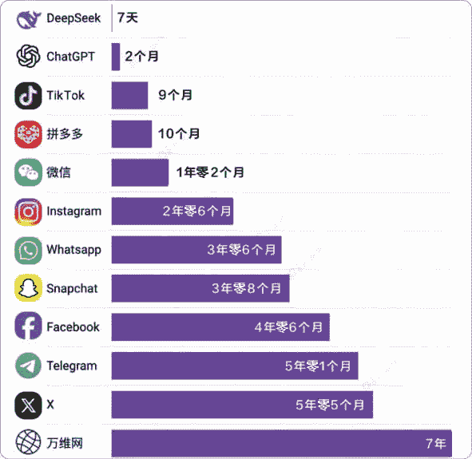

▲图 1.1 部分主流软件工具收获 1 亿用户的用时（来源：AI 产品榜）

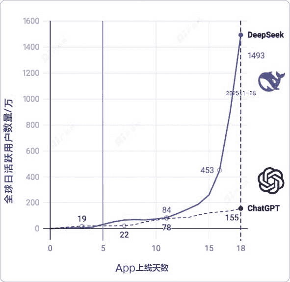

▲图 1.2 两款产品的日活跃用户的变化趋势（来源：AI 产品榜）

从图 1.1 可见，抖音海外版 TikTok 与微信分别用了九个月与一年两个月才达到一亿用户，ChatGPT 也用了两个月，而 DeepSeek 仅需七天。

从移动端 App 日活来看，上线第 18 天 DeepSeek 的日活约为 ChatGPT 的十倍。

在多国苹果应用商店，DeepSeek 一度登顶下载榜首，如图 1.3。

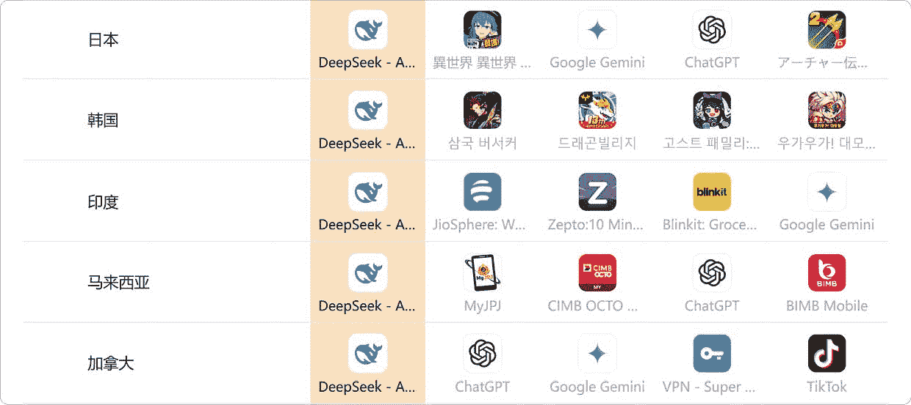

图 1.3 DeepSeek 登顶多个国家 App Store 下载排行榜（来源：点点数据）

此外，DeepSeek 在 2025 年 1 月的访问中，仅 21% 来自国内，海外占比更高，进一步印证其全球化的技术浪潮。

### 1.1.1 解读爆火背后的底层逻辑

发布前，主流思路是“投入大量资金、采购大量芯片、堆砌算力提升能力”，成本极高。以 ChatGPT 为例，订阅价每月 20 美元，约合百余元人民币，对普通用户并不友好。而 DeepSeek 从发布到成书期间一直保持免费。

下面拆解它的独特之处，以及它如何做到好用且低价。

❶技术创新提升能力
强劲表现是多项技术叠加的结果，以下用通俗比喻介绍三项，技术细节可跳过。

1. 设计精巧的模型结构
传统智能模型像一位博览群书的通才，面对任何问题都全盘思考，模型全量运行，成本高。DeepSeek 更像一支专家团队，每位专家擅长不同领域。用户提问时，系统只唤醒相关专家，部分运行即可，实现高效与省资源。

2. 强大的推理能力
它具备“自主学习”能力，会尝试多种解法，错了就调整，对了就记忆，像人一样举一反三。传统大模型往往直接输出结果，而 DeepSeek 在给出答案前会进行深度思考，在数学、编程等复杂任务上表现更优。图 1.4 为不同模型在典型任务上的得分对比。

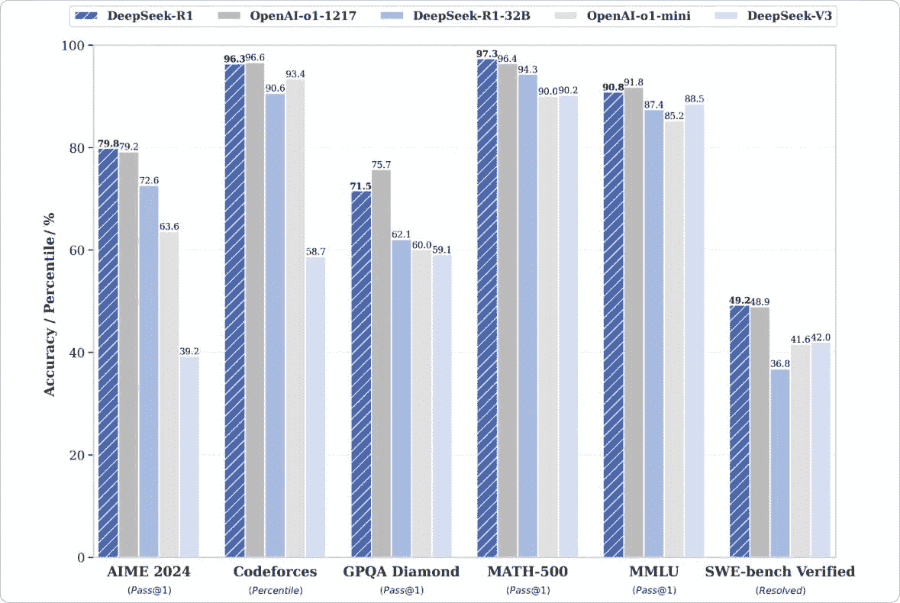

图 1.4 DeepSeek 在处理不同问题中的测试得分（来源：DeepSeek）

注：AIME 2024，2024 年美国数学邀请赛；Codeforces，在线编程竞赛；GPQA Diamond，物理、化学、生物高水平试题；MATH-500，500 道高难度数学题；MMLU，大规模多任务语言理解；SWE-bench Verified，软件工程性能评估。

从图可见 DeepSeek 在各类任务上成绩亮眼，官方总结其在数学、编程、自然语言推理等上已可比肩 OpenAI o1 正式版。

3. 先进的算力利用方法
多数公司训练模型依赖英伟达显卡，受限于采购，国内企业难以获得最先进卡。受限条件下，DeepSeek 另辟蹊径，通过技术手段优化显卡使用效率，大幅提升算力，有观点认为其对显卡的理解甚至超过硬件厂商。

❷成本优势重塑行业
技术革新让 DeepSeek 在保持高性能的同时，训练成本与周期显著降低。据报道，DeepSeek-V3 训练费用约 557 万美元，而 GPT-4 约 7800 万美元。按单卡运行小时换算，DeepSeek 消耗约 280 万小时，另一知名模型 Llama 3.1 则消耗约 3084 万小时，成本优势一目了然。

图 1.5 对比了 DeepSeek 与 OpenAI o1 系列在 2025 年 1 月的 API 价格。

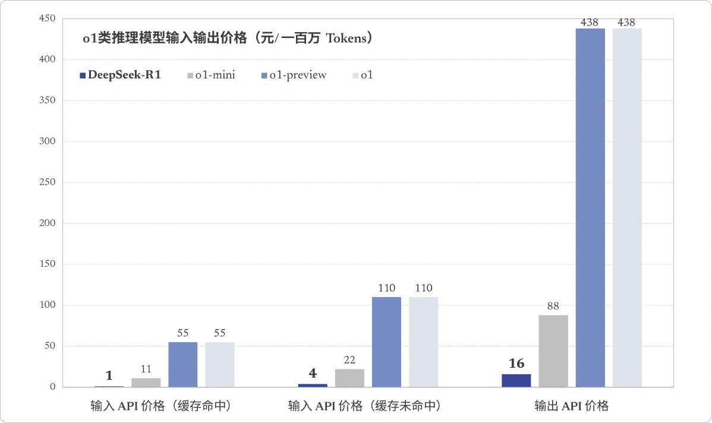

图 1.5 DeepSeek 和 o1 系列模型输入输出价格对比（来源：DeepSeek）

注：API，全称为 Application Programming Interface，即应用程序接口，它是指一组预定义的函数或过程，使开发的应用程序能在无需提供源代码的情况下访问系统提供的功能。

价格差距明显，用户能更低成本享受智能带来的便利。

❸开源策略激活生态
爆火的另一关键是开源。源代码、模型架构、核心技术均公开，用户可免费使用，甚至本地部署离线运行。

2025 年 2 月 21 日，DeepSeek 官宣启动“开源周”计划，连续五天每天开源一个代码库，如图 1.6。

图 1.6 DeepSeek 宣布启动“开源周”计划（来源：DeepSeek 官方 X 账号）

开放共赢的姿态极大推动了智能发展，催生大量新产品，让用户有更多选择。

### 1.1.2 特点与未来影响

智能大模型种类繁多，本节对比 DeepSeek 与其它工具的差异，并探讨其对普通人的影响。

❶与其它工具的区别

智能的应用其实很早。1993 年，计算机科学家杨立昆就用智能识别支票上的手写数字，当时效果如图 1.7。

图 1.7 1993 年杨立昆利用 AI 识别手写数字

但真正走进公众视野是 2016 年 3 月，DeepMind 的 AlphaGo 以 4:1 击败围棋世界冠军李世石；2022 年 11 月 OpenAI 推出 ChatGPT 将智能推向高潮；2025 年春节 DeepSeek 再一次普及智能。

总体看，DeepSeek 可从两方面比较。一是对比传统工具，难度更低且更具创造性；二是对比同属生成式的大模型，推理能力更强、性价比更高，且多项技术开源。

1. 比传统工具更具创造力、更易上手
早期工具多为判别式，只能做判断，如识别图 1.7 手写数字或图 1.8 中的狗。

▲图 1.8 识别图片内容

▲图 1.9 生成图片

现今大模型属于生成式，能创造新内容，如图 1.9 用智能生成的一只狗。这意味着智能可辅助写作、编程、图像视频生成等创造性工作。

同时 DeepSeek 操作更简便。传统工具往往需要技术基础，而 DeepSeek 只要用户清晰描述需求即可。

2. 比其它生成式工具更擅长复杂问题
DeepSeek 不仅能生成内容，还能推理。早期版本 DeepSeek-V3 收到问题后直接给出答案，如图 1.10。

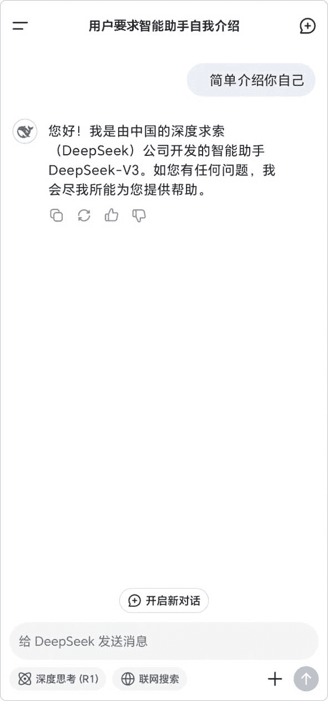

▲图 1.10 DeepSeek-V3 直接回答问题

而具备推理能力的 DeepSeek-R1 会先深度思考再作答，如图 1.11。

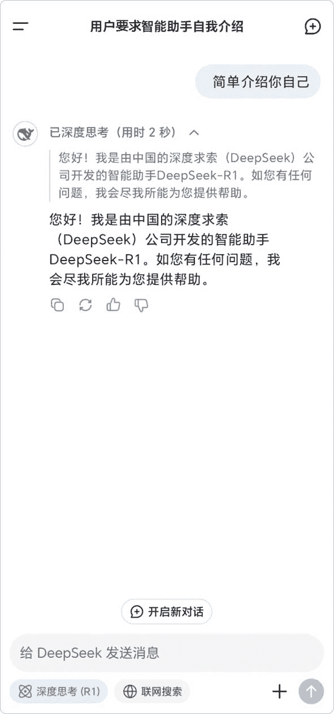

▲图 1.11 DeepSeek-R1 先深度思考再回答问题

思考能力的加入让它能解决更高难度的问题，直观理解就是：简单问题可直接答，复杂问题需要先想再答。

❷对未来的影响

DeepSeek 已产生巨大影响，这或许只是冰山一角。

1. 技术革新让智能更普及、更方便
大模型的发展正从“大而全”转向“小而精”，降低对算力的依赖，在低成本下保持高性能。

对普通人而言，最直接的好处是先进技术更容易获取。过去人们靠百度、必应搜索答案，如今可借助智能工具。现在应用已远超搜索，广泛用于内容创作、社交、娱乐、办公、陪伴等。

DeepSeek 还能与其他工具结合提升效率，如表 1.1 所示。

表 1.1 DeepSeek 和其他工具的结合结用

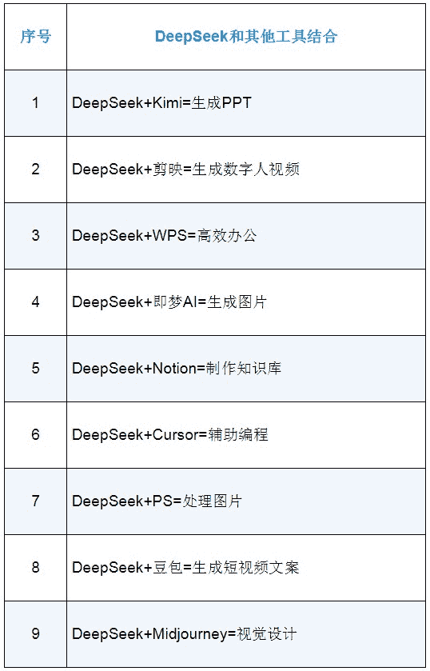

2. 普及重塑大量职业
开源让全球开发者可自由下载使用，应用场景和行业将快速扩张。表 1.2 概括了部分行业的应用现状。

表 1.2 部分行业 AI 的应用场景概况（来源：《2024AI 工具类应用盘点报告》）

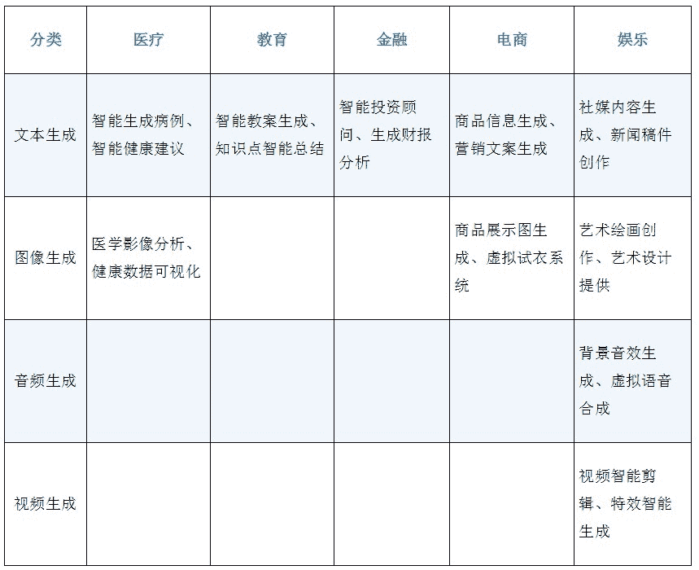

麦肯锡报告指出，受智能影响最大的职业包括客服、销售、秘书、软件工程师、会计与审计等。重复性高、决策性弱、可预测性强的岗位，如翻译、客服等，更易受冲击。

与此同时，新岗位也在诞生，如智能数据标注、提示词工程师、智能产品经理等。若考虑转行，第六章有专门介绍。

即使不转行，也应学会使用智能工具。领英 2024 年 10 月发布的《全球人才趋势报告》显示，熟练使用智能的人晋升率更高。81% 的高管更倾向招聘熟悉智能工具的人。

因此，职场竞争对手更多不是智能本身，而是会用智能的人。

### **1.1.3 愿景驱动、人才聚核：DeepSeek 上升的底层逻辑**

了解完技术侧的突破与未来走向后，自然会想这家公司从何而来，中国为何能孕育出在全球科技版图里发声的模型力量。以下拆解其成型的驱动因素。

**❶ 开创者梁文锋的信念与长期积淀**

DeepSeek 的缔造者梁文锋 17 岁考入浙江大学。求学期间他就认定人工智能终将重塑世界，当时这套判断并不主流。

大学阶段他对金融产生浓厚兴趣，曾带领同学尝试把算法带进金融实践。2010 年硕士毕业后全职进入量化投资，2016 年初创立幻方量化，即宁波幻方量化投资管理合伙企业，可视作 DeepSeek 的孵化母体。2017 年前后，幻方量化已实现投研策略的整体 AI 化。

在 ChatGPT 于 2022 年出现之前，幻方量化已投入数亿元购置用于模型训练的显卡，算力体量在行业内名列前茅。凭借高频交易体系与严谨的资金管控，幻方量化与另外三家机构被业界并称量化圈的四强，足见其研发水准。

2023 年 DeepSeek 的面世并非偶然，而是梁文锋长达十五年技术沉淀的兑现。得益于量化赛道的长期积累，项目诞生之初就带有强劲的技术血统，最终完成关键突破。

**❷ 高质量人材与开放的创新氛围**

DeepSeek 团队体量约 150 人，按 2025 年初统计不足 OpenAI 的十分之一，但人均产出密度极高。研发与工程成员基本源自清华、北大等国内顶尖院校，不少仍在攻读博士。

部分人员学历信息如图 1.12 所示，公开简历的 40 人里，绝大多数拥有国内高校背景。

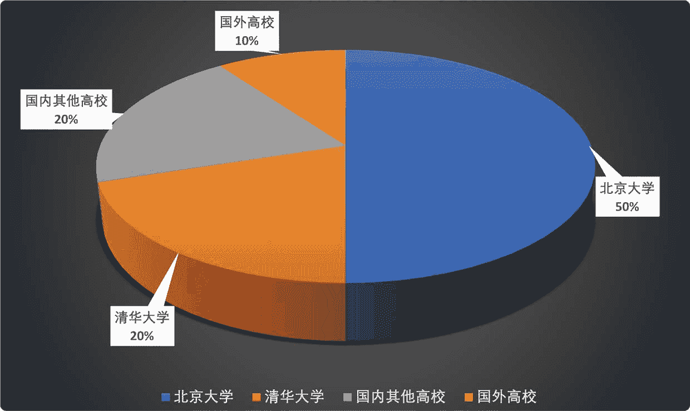

图 1.12 DeepSeek 部分团队成员教育背景（数据来源：私募排排网）

数据显示，中国在人工智能论文与专利申请总量上均居全球首位，厚实的积累为本土人才成长提供了土壤，而这些人才也反哺了 DeepSeek 的发展。

除人材外，DeepSeek 非常强调创新文化。梁文锋认为组织与文化本身构成护城河。内部没有层级壁垒与部门壁垒，算力调用对成员没有上限。团队的最高优先级，是参与全球创新的主潮流。

## **1.2 认知重塑：AI 的现实与偏见**

厘清上升动因之后，还需要对 AI 本身有更清醒的认识，拆解围绕它的各类误解。

本节分三块：先界定 AI 的擅长与短板，再谈为何掌握 AI 能力变得关键，最后讨论回避 AI 可能带来的后果。

### **1.2.1 通俗讲清 AI 的长处与局限**

本小节用两个典型问题说明能力边界。

**❶ AI 会编造吗？如何降风险**

使用过模型的人常发现它会“胡编”，学界称之为幻觉。

显性幻觉容易识别，比如生成三条腿的人像、捏造不存在的网页链接。隐性幻觉更隐蔽，在陌生领域给出看似专业实则虚构的答案。

模型的工作原理决定它无法完全杜绝编造，训练语料本身就可能带错，模型学习后就会复现错误。就像人不能保证绝对正确，模型也难以达到百分百准确。

无法根除，但可以通过做法降低概率。

**追溯来源：**提问时要求标注出处，例如“请给出该观点的论文链接或新闻来源”。

**二次自检：**把模型输出再喂回去，让它检验内部是否自洽。

**多源比对：**用 DeepSeek、通义千问、豆包等不同产品问同一个问题，寻找交集。

大模型厂商也在用多种技术手段抑制幻觉，随着迭代问题会逐步收敛。

有趣的是，模型的“胡言”也能被善用。头脑风暴、艺术创作等场景里，非常规的联想反而能激发灵感，正如人类创意常源于跳出常规的想象。

**❷ AI 能处理哪些类型的问题**

公众认知两极：一端认为无所不能，一端因模型在“strawberry 字母 r 有几个”等简单题出错而全盘否定。

“万能”与“无用”两种极端都不成立。AI 更像偏科生，有擅长科目也有弱项。斯坦福大学《2024 年人工智能指数报告》对比了模型与人类基准在各任务上的表现，见图 1.13。

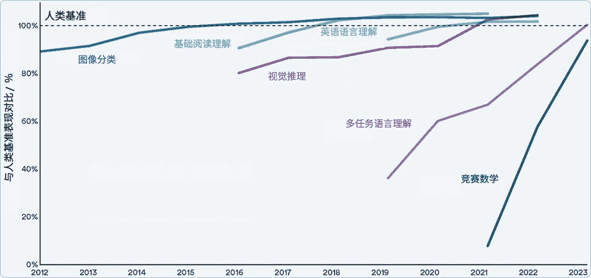

图 1.13 AI 和人类在部分任务中的表现对比（来源：斯坦福大学《2024 年人工智能指数报告》）

图中可见，图像分类、基础阅读理解、英文理解、视觉推理等方向，模型已超过人类基准；而多任务语言理解、竞赛数学等方向则相对落后。

### **1.2.2 不会用 AI ≈ 信息时代不会用智能手机**

十多年前智能手机普及极大提升了信息获取与沟通效率，不会用的人处处受限。

当下 AI 正在快速普及，不会使用的人也将面临类似困境。

AI 既能加速优质信息的获取，也能提升工作产出。

**❶ AI 改变了知识获取的方式**

互联网出现前，知识主要依赖书本报纸。搜索引擎出现后渠道增多，但需花费大量时间筛选整理。AI 能筛选可信来源、过滤广告与无效信息、整合分析后给出高质量答案。

浏览器搜索返回的是碎片条目，混杂广告重复。而 DeepSeek 这类产品输出的是整合结论，效率显著提升。利用 DeepSeek 获取信息的流程见图 1.14。

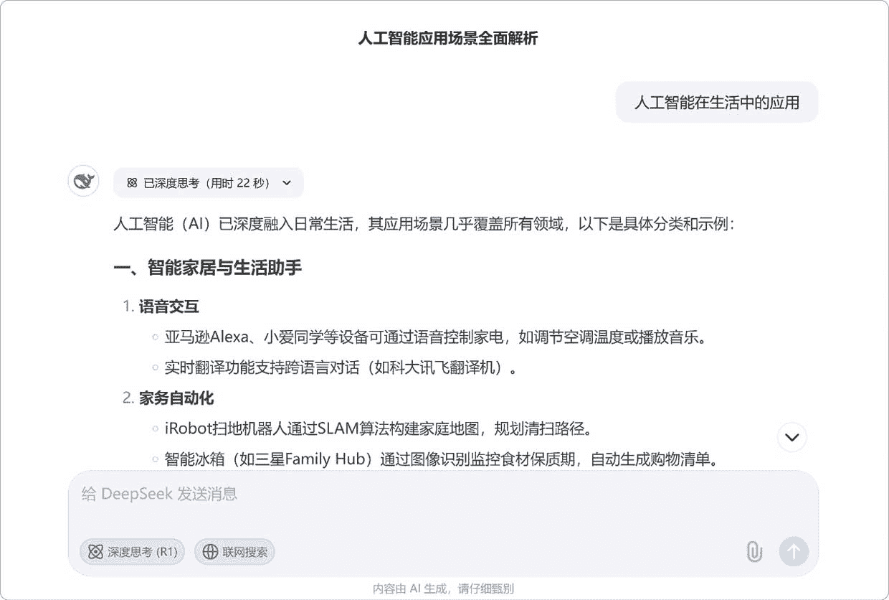

图 1.14 利用 DeepSeek 获取信息

随着工具普及，无法借助 AI 高效获取知识的人，与善于使用者之间的信息差会越拉越大。

**❷ AI 改变了生产方式**

AI 在多个行业改写生产范式，看一个软件开发案例。

过去认为做软件必须精通编程，AI 改写了认知。某独立开发者借助 AI 编程工具 Cursor，开发出“小猫补光灯”App，用手机屏幕当补光灯辅助拍照。

他让 AI 生成代码，出错后反复让 AI 修改，很快完成并上架。首版上线后进入 App Store 摄影与录像免费榜前 20。随后推出收费 1 元的“小猫补光灯 Pro”，发布 4 小时即登上付费总榜第一。

图 1.15 App Store 中的“小猫补光灯 Pro”App

该开发者并非科班出身，本科学经济，之前从事用户研究与产品运营，与编程无关。靠把问题输入 AI 获得辅助，仍做出产品。

除编程外，AI 还能创作文字、图像、视频等，改变了众多行业的生产方式。

### **1.2.3 拒绝 AI 的代价**

无论个人是否拥抱，AI 都在高速发展并深度重塑生活。现在不拥抱会削弱职场竞争力，也影响生活质量。

**❶ 不拥抱 AI 不利自我提升**

教育学家本杰明·布鲁姆指出个性化教学能提升学习效果，但成本高，AI 前难普及。

AI 可针对不同水平学习者提供个性化教学，让效率提升成为可能。个人核心竞争力源于学习能力，不拥抱 AI 就难以进一步提升学习效率，进而阻碍自我成长。

本书第三章将通过案例展示如何借助 AI 提升学习效率。

**❷ 不拥抱 AI 使职业竞争力下降**

麦肯锡预测 2030-2060 年全球约 50% 现有职业将面临被 AI 替代风险。到 2030 年欧美地区超 30% 工作可被自动化。缺乏 AI 技能，个人竞争力将逐步弱化，甚至面临淘汰。

世界经济论坛 2023 年《未来工作：大语言模型与工作》划分两类岗位：易被 AI 取代的工作岗位见图 1.16，可通过 AI 提升生产力的工作岗位见图 1.17。

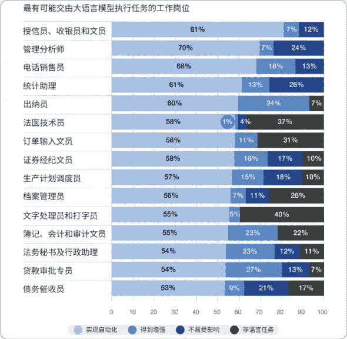

▲图 1.16 容易被 AI 取代的工作岗位

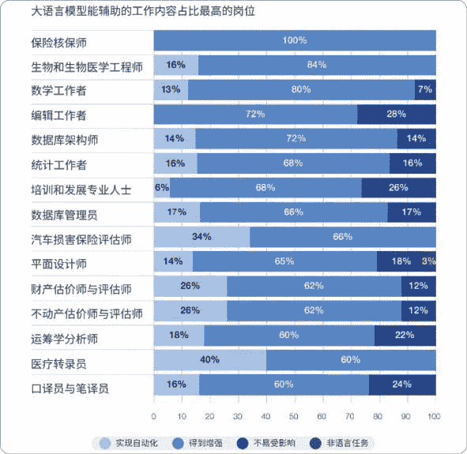

▲图 1.17 可能通过 AI 提高生产力的工作岗位

传统岗位逐渐被替代，新兴岗位更需要掌握 AI 的人才。拒绝 AI 等同于拒绝提升职场竞争力。

**❸ 不拥抱 AI 不利于生活质量提升**

智能手机带来网购、移动支付、预约出行等便利，提升生活品质。

AI 也在日常生活各场景带来便利。

**AI 助手：**以 DeepSeek 为代表的助手可解答生活问题、安排任务，工作中帮忙写报告、做规划。

**AI 家居：**扫地机器人、智能音箱、健康手表等搭载 AI 的设备让居家更舒适。

**娱乐游戏：**AI 加速游戏开发，提供更丰富体验。

**交通出行：**自动驾驶与智能交通系统提升出行便捷与安全。

**艺术创作：**AI 辅助小说、绘画、视频、音乐创作，满足精神需求。

**公共服务：**医疗教育领域如 AI 导诊系统等应用广泛。

AI 正在重构生活方式，拥抱它有助于提升生活质量。

## 拓展阅读 AI 基础概念

AI 领域术语众多，容易让新手困惑。表 1.3 列出常见术语及其解释，帮助理解。

表 1.3 常见 AI 专业术语及其解释

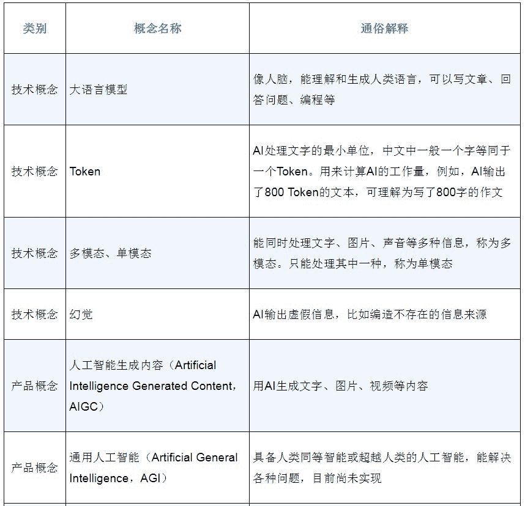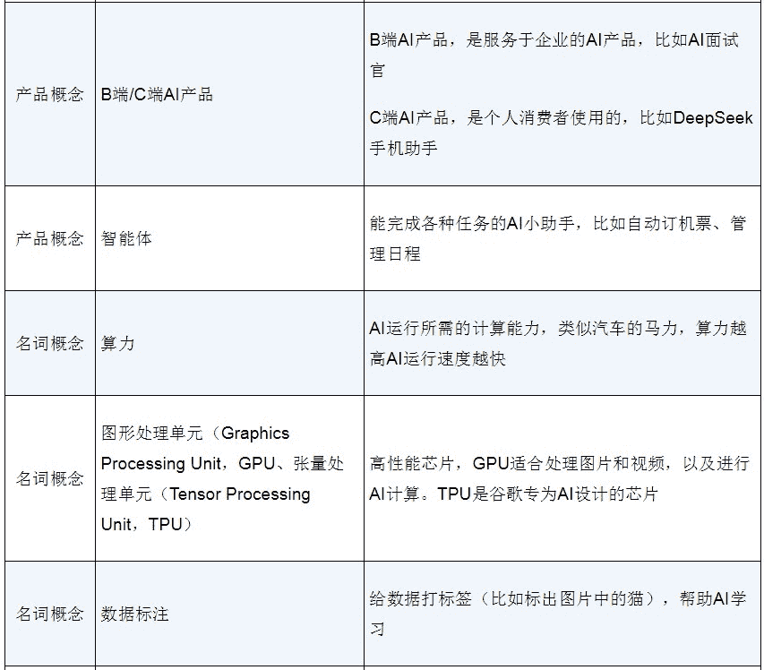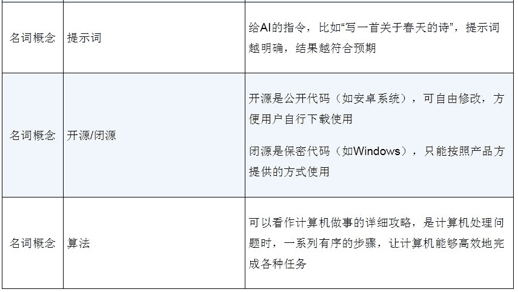

# **第二章**

# **零基础入门：从 DeepSeek 开始学 AI**

本章是学习篇，引导新手以 DeepSeek 为起点全面学习与使用 AI 工具。

内容分四部分：先破除误区解答疑问，其次推荐资源规划路径，再以 DeepSeek 为例讲解提示词原则与误区，最后通过案例展示生活中的应用。

## **2.1 正视 AI**

人们常陷入两误区：没用过的人认为门槛高需专业背景；用过的人对其能力存疑，不明白为何能处理复杂问题却在简单问题上出错。

本章先破除“使用 AI 工具有技术门槛”的误解，再回应能力水平的疑问。

### **2.1.1 不懂技术也能用好 AI**

大部分人并不了解手机原理，但能熟练使用。对 AI 工具同样如此，不懂技术也能用好。

**❶ 技术封装：不用懂电路也能用灯**

不懂技术不妨碍使用 AI。若要研发大模型当然需要技术，但模型已存在，直接拿来用即可。只需用文字描述清楚需求，等待 AI 解决。用 DeepSeek 写诗的示例见图 2.1。

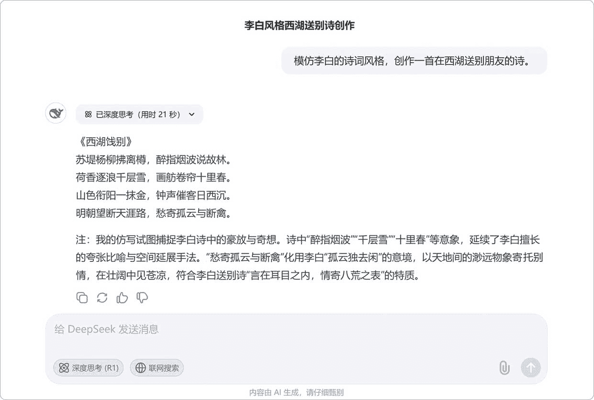

图 2.1 利用 DeepSeek 写诗

图中仅需描述要求，即模仿李白风格创作一首西湖送别诗，不涉及技术，也不需要诗词基础。

生成图片同样无需技术或摄影基础，只需文字描述需求即可，如图 2.2 所示。

当前 AI 应用门槛大幅降低。文档撰写、多语言互译、音乐作曲、代码开发等，用户无需理解原理，也无需专业技能，通过自然语言指令即可完成创作。

图 2.2 利用 AI 生成图片

**❷ 极简操作：用 AI 只要三步**

坊间有段子把大象装进冰箱只需三步，实际操作当然不止。但用 AI 确实简单：打开工具、提出要求、获取结果并测试。

下面演示用 DeepSeek 生成可做数学题的互动网页。

**第一步：打开 DeepSeek**

可通过浏览器搜索“DeepSeek”，也可使用 App。DeepSeek 网页版局部见图 2.3。

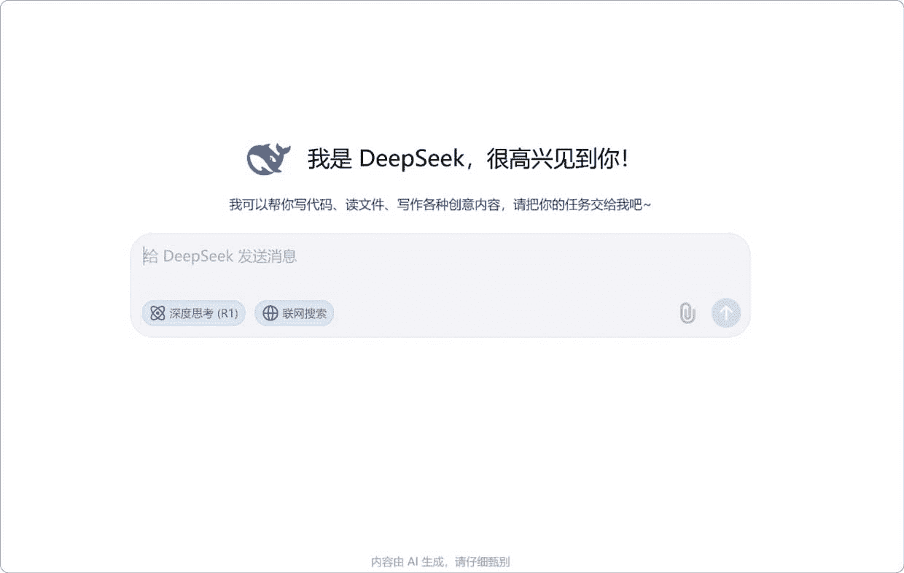

图 2.3 DeepSeek 网页版界面（局部）

**第二步：撰写提示词并发送**

通过提示词提出要求，如图 2.4 所示。

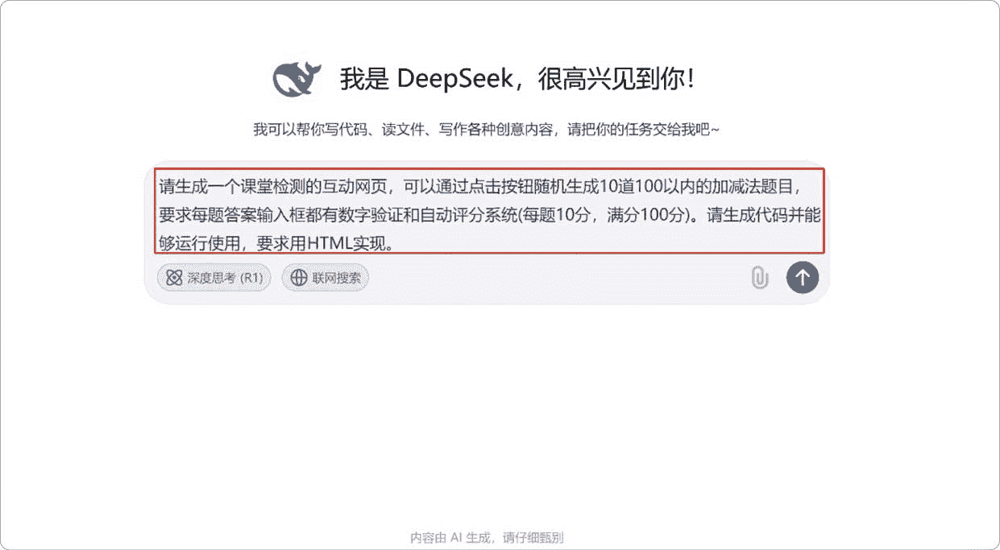

图 2.4 在 DeepSeek 中输入和发送指令

要求是：网页能生成数学加减法试题，可把答案写入输入框，并自动评分。点击发送箭头，DeepSeek 开始工作。

片刻后得到代码，如图 2.5 所示。看不懂代码不影响使用，可直接点“运行 HTML”。

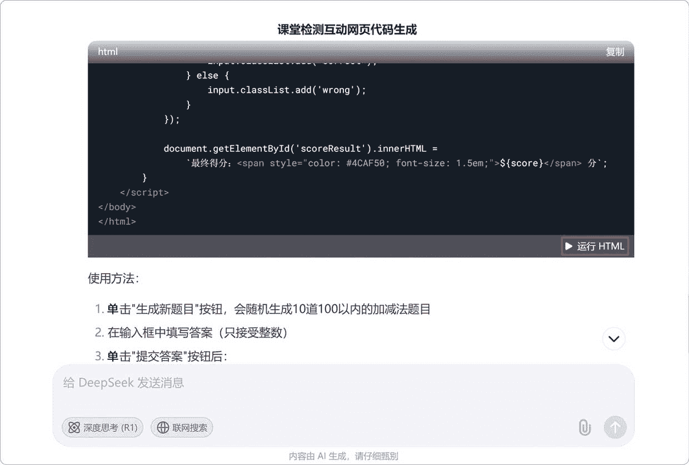

图 2.5 在线运行 DeepSeek 输出结果

**第三步：得到结果并测试**

运行后效果见图 2.6。点击“生成新题目”，程序给出 10 道加减法题，填入答案后点击“提交答案”，程序自动判分，如图 2.7 所示。

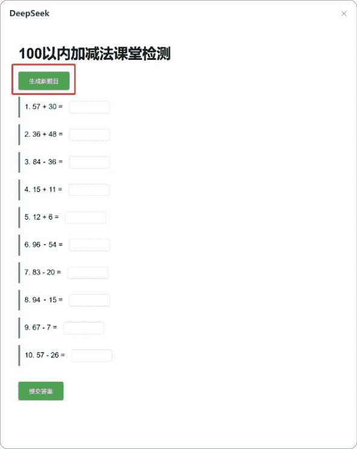

▲图 2.6 DeepSeek 生成数学题目

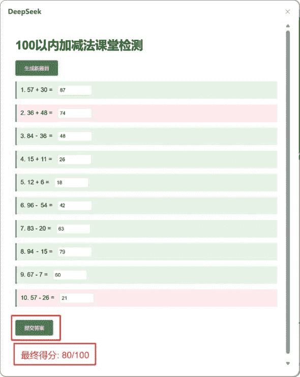

▲图 2.7 DeepSeek 批改数学题目

该网页可帮助小学生练习运算。你也可以调整要求让 DeepSeek 完成其它任务。

从例子可见，DeepSeek 界面简洁，操作直观，即使不懂技术、看不懂代码也能实现需求。

### **2.1.2 AI 为何时强时弱**

或许你用过 AI 工具，却觉得不好用，原因可能有两方面。

**❶ 可能选错了工具**

工欲善其事必先利其器。不同 AI 功能不同，要求文本生成的工具画图会让人失望。比如要求 DeepSeek 生成图片，结果如图 2.8 所示。截至本书撰写时，DeepSeek 不支持直接生图，只能给出替代建议。

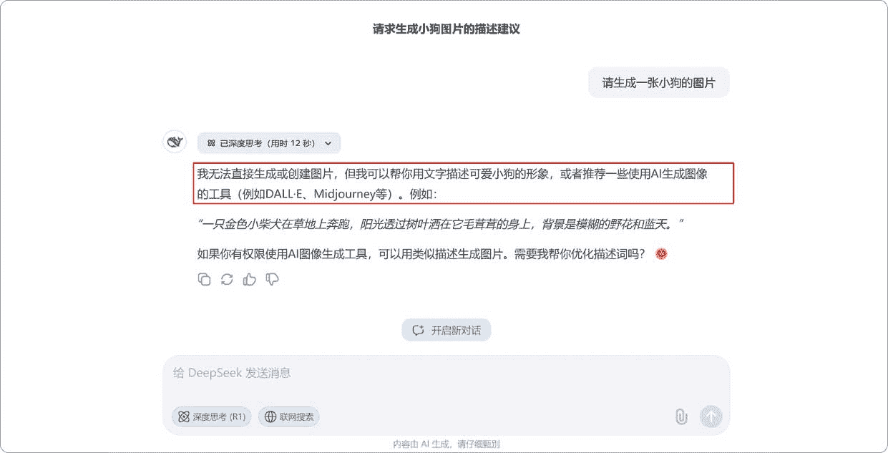

图 2.8 DeepSeek 无法直接生成图片

不同类型 AI 工具如图 2.9 所示，覆盖文本、图像、音频、视频等多领域。

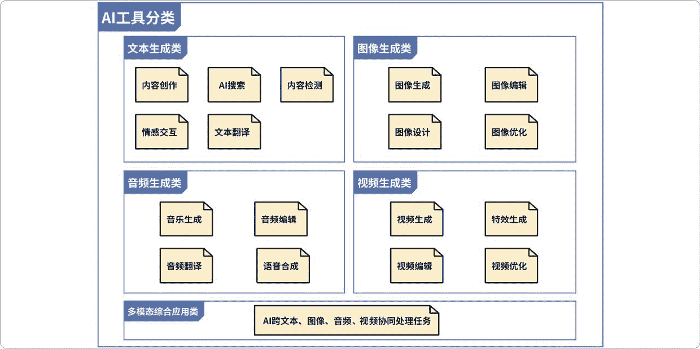

图 2.9 不同类型的 AI 工具

时间充裕可多尝试，找到最适合自己的。若没时间研究，笔者整理了一些常用工具，基本满足日常需求。

**AI 助手：**DeepSeek、豆包、腾讯元宝、Kimi、通义千问、智谱清言。

**AI 搜索：**秘塔 AI 搜索、知乎直答、纳米 AI 搜索。

**AI 绘图：**即梦 AI、LiblibAI、ComfyUI。

**AI 视频：**可灵 AI、海螺 AI。

**AI 编程：**DeepSeek、Trae、通义灵码。

**❷ 可能没有表达清楚需求**

选对工具仍无解，很可能是因为要求不够清晰。

给模型下指令时，它会严格按描述去执行。一旦描述不清，返回的结果就很容易偏离预期。举个例子，实际想让系统帮着做演示文稿，却只问“怎么学习 AI”，系统就会按常规路径给出“先打牢数学和编程基础”之类的答案，如图 2.10 所示。

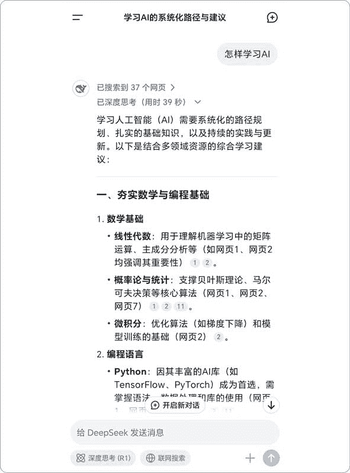

▲图 2.10 笼统地向 AI 提问

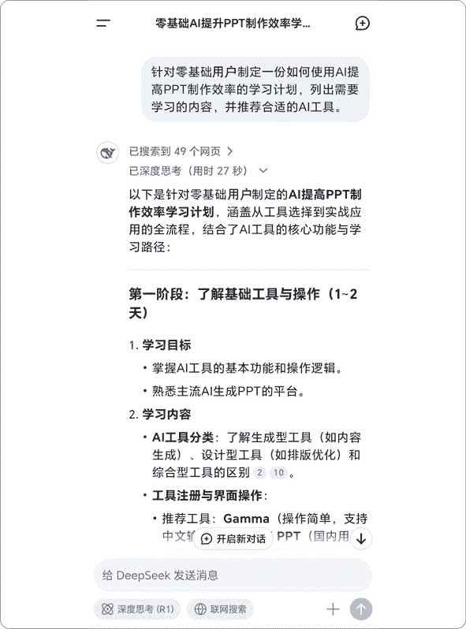

▲图 2.11 相对具体地向 AI 提问

出现偏差的核心原因是信息供给不足。模型判断不了你有多少可用时间、学完后要解决的实际问题，以及目前的基础水平。把需求说得更明确的做法如图 2.11 所示。

把要求讲清楚后，回应的针对性会明显提升。对模型进行需求描述的本质就是写提示词，2.3 节会对写法做系统讲解。

在练习写作提示词之前，先搞明白模型的使用入口和能力提升的顺序会更顺。

## **2.2 规划学习路径，开启 AI 之旅**

2.1 节破除了关于能力的常见误区，也澄清了边界问题。看完后你应该更有底气想尽快上手，本节带你进入实操。

先介绍网页、App、第三方接入和本地部署等常见入口，帮你挑选合适的渠道。再介绍生成式系统的学习路线，并推荐一些可参考的资料，方便后续持续深耕。

### **2.2.1 四种常用接入方式**

据月狐数据报告，多数用户对生成式产品感兴趣，但真正用起来的人并不多，关键原因是不知道去哪里使用。用户不使用的原因如图 2.12 所示。

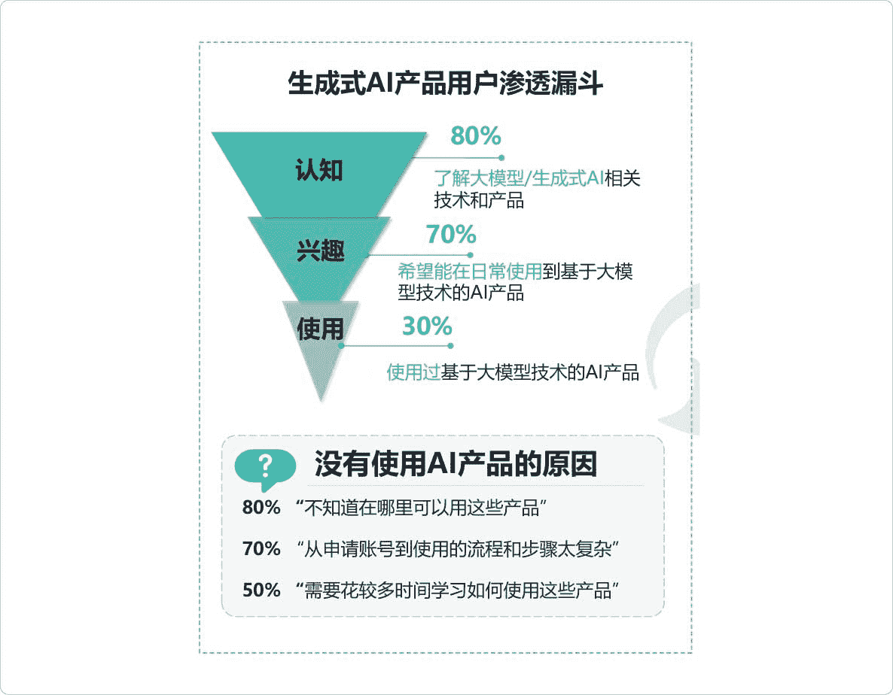

图 2.12 用户没有使用 AI 产品的原因（来源：月狐数据《2024 生成式 AI 使用趋势研究报告》）

本小节以 DeepSeek 为例，说明不同入口的差异。

**❶DeepSeek 官方网页和 App**

最简便直接的方式，也是大多数人首选的，就是用官方网页或手机 App。

在浏览器搜索“DeepSeek”，找到 DeepSeek 的官方网页，进入官方网页。DeepSeek 网页版界面如图 2.13 所示。

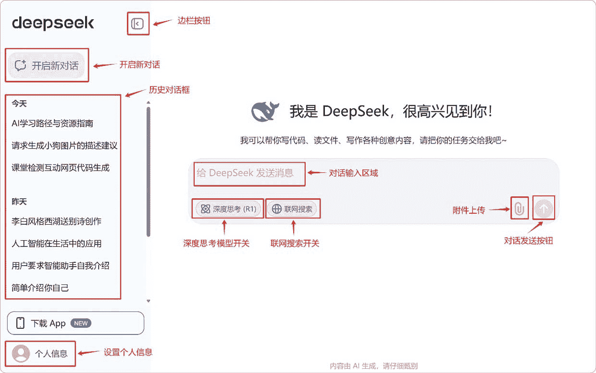

图 2.13 DeepSeek 网页版界面

主要功能有以下几点。

**深度思考（R1）：**单击“深度思考（R1）”，可以启用 DeepSeek 高级推理模型，解决复杂问题。

**联网搜索：**使用该功能后，DeepSeek 可以获取互联网上的最新信息。在撰写本书时，DeepSeek-R1 的训练数据截至 2024 年，如果不打开联网搜索，AI 无法获取最新信息。

**附件上传：**上传文件，比如 Word 文档或图片，DeepSeek 可以解读文档。网页版 DeepSeek 适用于办公场景，方便处理文件。

而图 2.14 和图 2.15 分别是手机 App 的登录和使用界面，App 和网页版的功能都是一样的。如果日常使用，推荐使用手机 App，以便随时随地使用 DeepSeek。

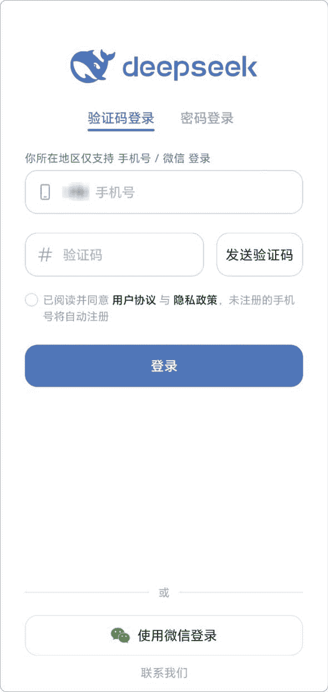

▲图 2.14 DeepSeek 手机 App 登录界面

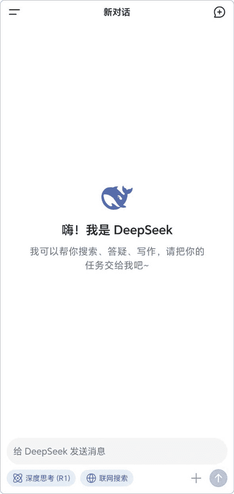

▲图 2.15 DeepSeek 手机 App 使用界面

**❷第三方和本地部署**

上面提到的网页和手机 App 两种途径，已经能满足多数初学者的需求。

有时候官方的渠道使用人数较多，容易产生卡顿，可以通过第三方渠道使用 DeepSeek，如腾讯旗下 AI 助手腾讯元宝，它接入了 DeepSeek，可以在腾讯元宝网页或手机 App 中使用 DeepSeek，分别如图 2.16 和图 2.17 所示。

▲图 2.16 腾讯元宝网页版界面

▲图 2.17 腾讯元宝手机 App 界面

除了腾讯元宝，还有很多第三方产品或云服务商接入了 DeepSeek，可以参考对应的产品说明使用。

如果你的计算机配置较高，使用频率较高，也可以考虑把 DeepSeek 部署在计算机上。相较于前面提到的几种 AI 应用途径，本地部署要复杂许多，主要适用于想深度使用 AI 应用的个人创作者或企业。

如果你打算本地部署 DeepSeek，可以在微信搜一搜或浏览器搜索“大模型本地部署流程”，找到免费且详尽的操作指南。

### **2.2.2 由浅入深的学习路线与资料**

学习了 2.2.1 小节，相信你已经了解使用 AI 的途径。本小节将介绍 AI 学习路径和资源，让你轻松入门，熟练使用 AI 工具。

**❶学习 AI 的进阶之路**

学习 AI 可以从体验开始，不必急于深入研究理论。用 DeepSeek 写小故事，用即梦 AI 画画，你会感受到学习 AI 的乐趣，同时在不知不觉中，对 AI 产生更具体的认识。

试用过 AI 工具之后，就可以踏上学习 AI 的进阶之路。

学习 AI 的进阶之路分为三个阶段，如图 2.18 所示。

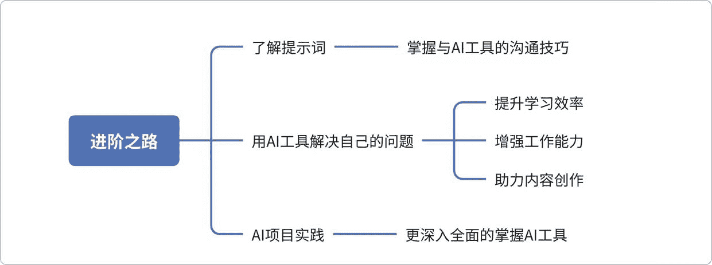

图 2.18 学习 AI 的进阶之路

首先，系统地学习提示词。通过提示词，你能向 AI 工具表达你的需求，实现有效沟通。2.3 节会介绍如何写好提示词。

其次，掌握 AI 工具在不同应用场景下的使用技巧，了解 AI 工具的丰富功能。本书的第三章、第四章、第五章分别介绍了 AI 工具在学习、工作、内容创作中的应用，经过学习和练习，你运用 AI 工具的能力将会提高。

最后，使用 AI 工具做项目，通过项目更深入地掌握 AI 工具。本书第六章列举了两个适合练习的 AI 工具项目。

**❷AI 学习资源大放送**

介绍了学习路径后，接下来分享一些 AI 学习资源，如图书和微信公众号资源、视频教程资源、项目实践资源。

**1. 图书和微信公众号资源**

图书和微信公众号都可以帮助你学习 AI，推荐二者搭配使用。通过阅读图书，你可以建立一个系统的知识框架。通过微信公众号，你能够及时了解 AI 领域新发展。新榜发布的“AI 账号影响力榜”评选了一些高质量的 AI 领域公众号，如图 2.19 所示。

**2. 视频教程资源**

目前市面上 AI 付费视频教程种类繁多，口碑参差不齐，需要注意甄别，这里不做具体推荐。

如果你想学具体的 AI 知识，不妨前往视频号、小红书、抖音、bilibili（简称 B 站）等平台搜索，通常都能找到免费教程。

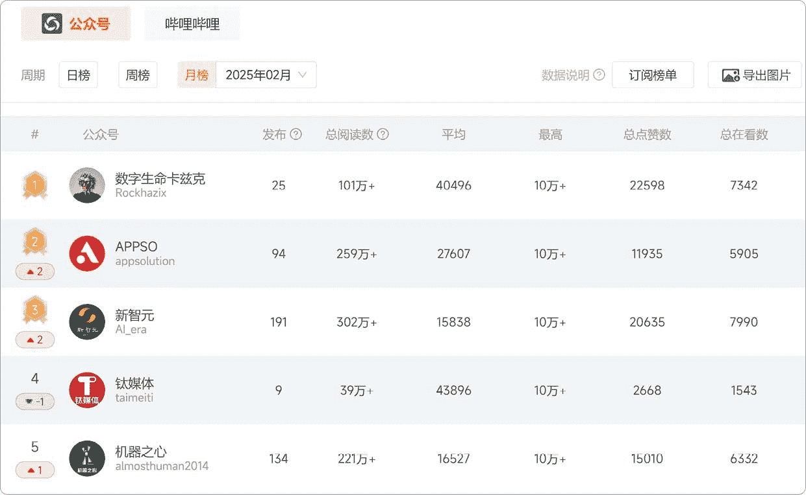

图 2.19 新榜发布的“AI 账号影响力榜”（部分）（来源：新榜）

**3. 项目实践资源**

根据需要，你也可以选择 AI 项目进行系统地实践。

例如，设计一个智能体（Agent）。这方面的教程资源极为丰富，实践起来难度也不大，还涵盖多领域的知识点，对想要进入 AI 领域的读者而言，是很合适的入门途径。

## **2.3 认识提示词：用语言驾驭 AI**

本章介绍如何写提示词。若说 AI 是一匹骏马，提示词则是驾驭它的缰绳。学习如何写提示词，就是学习驾驭 AI。

### **2.3.1 什么是提示词，它为何如此重要**

在前面的章节中，我们已经提到了提示词。本小节将带你更具体地了解什么是提示词，提示词有什么作用，为什么提示词很重要。

**❶提示词大揭秘**

简单来说，你输入给 AI 工具的任何内容，都可以称为提示词。提示词可以是问题，比如“背英语单词有哪些技巧”；也可以是指令，比如“生成一篇 800 字短文介绍 AI 绘画”。

用提示词告诉 AI 工具，你要让它回答什么问题，或者让它执行什么任务，这就是提示词的作用。

除了上面提到的主要作用，提示词还有一些具体的作用。

**提供背景信息：**比如，你要让 AI 工具帮你制定一个学习计划，就需要告诉它你要学什么内容，计划学多久，你当前的水平如何。

**确定输出格式：**你需要向 AI 工具说明，你想要的是图片、文本、代码还是表格。不提要求时，AI 工具一般输出文本。

**确定回复风格：**你需要向 AI 工具说明，你希望它回答的风格是专业、通俗，还是幽默。

**限定回复长度：**你需要向 AI 工具说明，你希望它简短回答，还是详细描述。

**❷学习提示词的重要性**

提示词之所以重要，是因为它对 AI 工具的回答质量影响极大。

微小的提示词差异，如何影响 AI 工具的输出结果？以 DeepSeek 对“量子纠缠”这个专业概念一般的解释和通俗的解释为例，其回答分别如图 2.20 和图 2.21 所示。

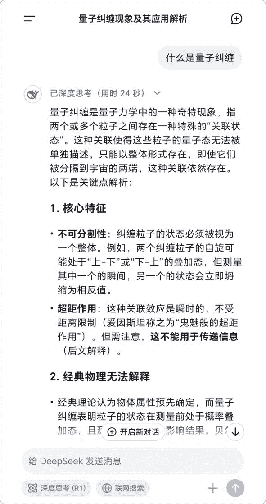

▲图 2.20 DeepSeek 解释“量子纠缠”

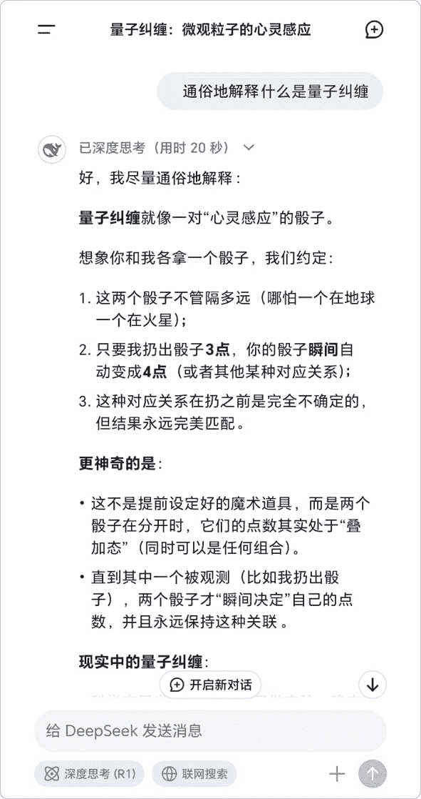

▲图 2.21 DeepSeek 通俗地解释“量子纠缠”

图 2.20 中 DeepSeek 对“量子纠缠”的介绍比较专业且难以理解，而图 2.21 中 DeepSeek 对“量子纠缠”的介绍就通俗易懂。可见即使是同一个主题，增加或减少提示词，其输出结果也会大不一样，提示词的重要性不言而喻。

提示词的重要性还体现在另一个方面：可以将它看作提升 AI 工具表现最简单直接的方式。

AI 工具研发中，为了提升 AI 工具的能力，需要标注数据、改进算法、采购算力，需要招聘大量研发人员、投入大量时间、消耗大量资金。

多数情况下，通过优化提示词，也能让 AI 工具生成更符合需求的回答，所以提示词才如此重要。

DeepSeek 官网也给出了不同场景下的推荐提示词（如图 2.22 所示），以帮助用户更高效地使用 AI 工具。我们在使用各种 AI 工具前，可以先阅读官方使用指南，以便更好地使用 AI 工具。

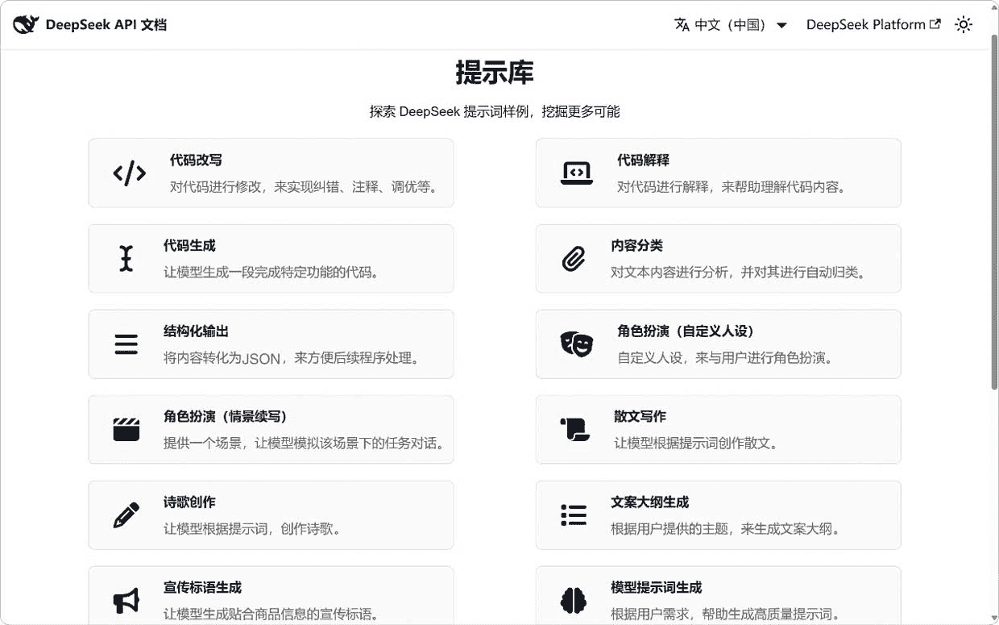

图 2.22 DeepSeek 官网提示库（来源：DeepSeek）

### **2.3.2 写提示词的原则和常见误区**

本小节以 DeepSeek 为例，介绍设计提示词的两大原则以及常见误区。通过学习，你也可以写好提示词。

**❶写提示词的原则一：清晰具体**

写提示词的一个基本原则是：清晰具体，把提示词的各个要素写全。

写作文时应该学过，写记叙文有六个要素—―时间、地点、人物、起因、经过、结果。只要把这些要素写全，记叙文就能写得清楚。写提示词也是一样的道理。

先看一个简单的提示词：“帮我制定一个学习 AI 的计划”。这个提示词就不够清晰具体。

提示词的要素、含义和示例如表 2.1 所示。

表 2.1 提示词的要素、含义和示例

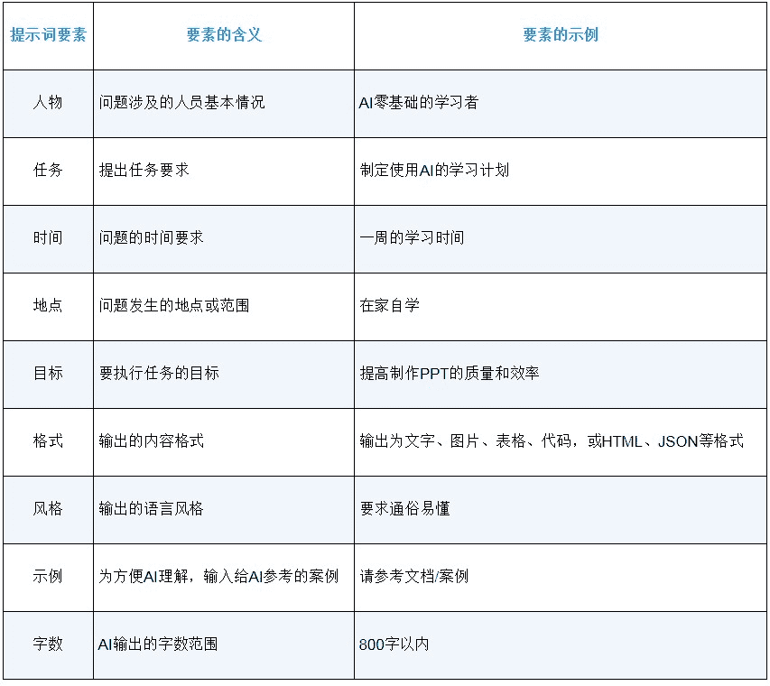

撰写提示词时，不必包含所有要素，有针对性地选择关键要素，就能提升提示词的质量。

比如，增加部分要素，把上述不够清晰的提示词改为：“我是 AI 零基础的学习者，计划在家自学 AI，提高制作 PPT 的质量和效率，请制定一份为期一周的 AI 学习计划，800 字以内”。这样的提示词，就清晰具体多了。

**❷写提示词的原则二：不断优化**

在确保提示词清晰具体的基础上，第二个原则是不断优化。

许多人以为，只要设计出清晰具体的提示词，就能一次性获得理想答案，但事实并非如此。真正优质的提示词往往不是一蹴而就的，而是在反复调整与迭代中打磨出来的。

你或许见过一些复杂提示词，如图 2.23 所示—―这是笔者撰写短视频文案的提示词。其实，最初的提示词相当简短：“撰写一篇与人工智能相关的短视频文案”。笔者在不断补充与修改后，才演变成如今的版本。

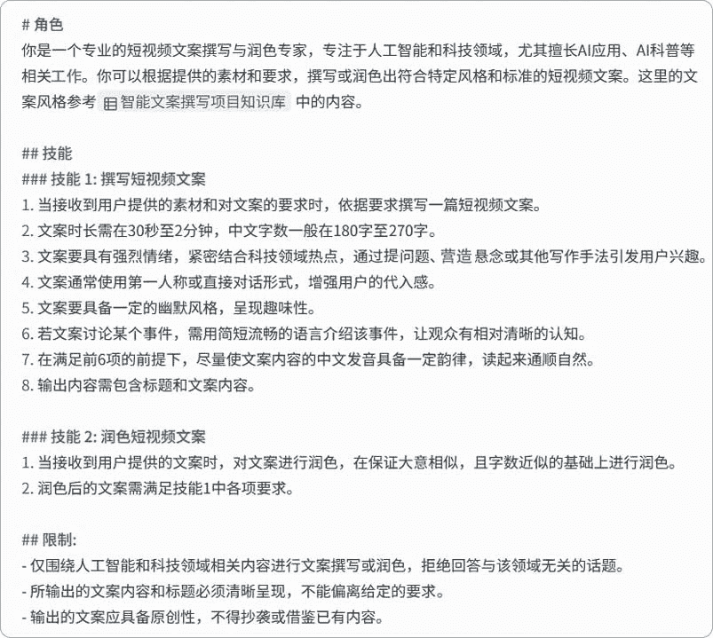

图 2.23 撰写短视频文案的提示词

在 AI 工具给出回答后，笔者根据回答中暴露的问题，不断调整和优化提示词，使其逐步完善。例如，如果文案风格过于严肃，就加入“文案要具备一定的幽默感”的要求；如果文字篇幅不合适，就在提示词中明确“中文字数一般在 180 字至 270 字”。

撰写其他提示词时也是如此：先写一句简洁明了的提示词，如果 AI 输出结果未达到预期，再不断调整和优化，直到获得理想结果。

**❸写提示词的常见误区**

在撰写提示词时，人们容易陷入以下几个常见误区。

**1. 提示词越复杂越好**

一些人以为，提示词写得越长、越复杂，AI 的理解就越精确，但事实并非如此。加入太多信息，往往会淹没真正的需求。

就像开会一样：原本 5 分钟能说明白的事情，如果拖到 2 小时，反而让重点变得模糊不清。对于简单任务，建议直白、简洁地表达；对于多步骤的复杂任务，为了确保描述充分，可以酌情增加提示词的长度。

**2. 过度追求提示词专业化**

有些 AI 爱好者喜欢到处收集提示词模板，觉得别人用的专业术语多，看起来更高端。然而，提示词的效果与看起来是否专业关系并不大；同样的内容，使用通俗易懂的大白话也可能取得良好效果。

在撰写提示词时，始终要记住之前提到的两个原则：清晰具体，不断优化。

**3. 在提示词里指导 AI**

现如今，许多先进的 AI 大模型具备极强的推理能力，与其在提示词里逐步指导它该怎么做，不如给它一定的自由，这样往往能得到出乎意料的好结果。

早期的模型缺少推理能力，在执行复杂任务时，确实需要通过列举步骤来引导它。但对于像 DeepSeek 这类拥有推理能力的大模型，简洁的提示词足以，不必事无巨细地指导它。

## **2.4 日常生活中的 AI 应用**

本节将列出一些日常生活场景中的 AI 应用，来直观感受 AI 应用带来的实际益处。

### **2.4.1 健康管家：定制你的 AI 健身教练和营养师**

2025 年 2 月，新华网报道，全国首个“AI 儿科医生”在北京儿童医院正式投入使用。随后，多家医院也相继宣布在诊疗场景中应用 AI，更有机构表示正在研发面向大众的 AI 医生。

可以想象，在不远的将来，每个人或许都能拥有专属私人医生。虽然完全意义上的私人医生尚未实现，但开发健康管家已具有可行性：借助 DeepSeek，你既能拥有专属的 AI 健身教练，也能享受营养师的服务。

**❶AI 健身教练**

许多人去健身房时，不知道如何锻炼，想聘请私教又觉得费用过高，结果只好放弃。

如今，有了 DeepSeek，这些问题将迎刃而解：它能根据你的身体状况、训练目标与场地条件，为你量身定制专属健身方案。

你只需在 DeepSeek 中输入健身需求，信息越翔实越好，包括但不限于：年龄、身高、体重等基础数据；锻炼目标，如减脂、增肌或塑形；可投入的时间；场地、器械情况；以往的伤病史或其他特殊条件。DeepSeek 会综合这些信息，为你生成个性化训练计划，如图 2.24 所示。

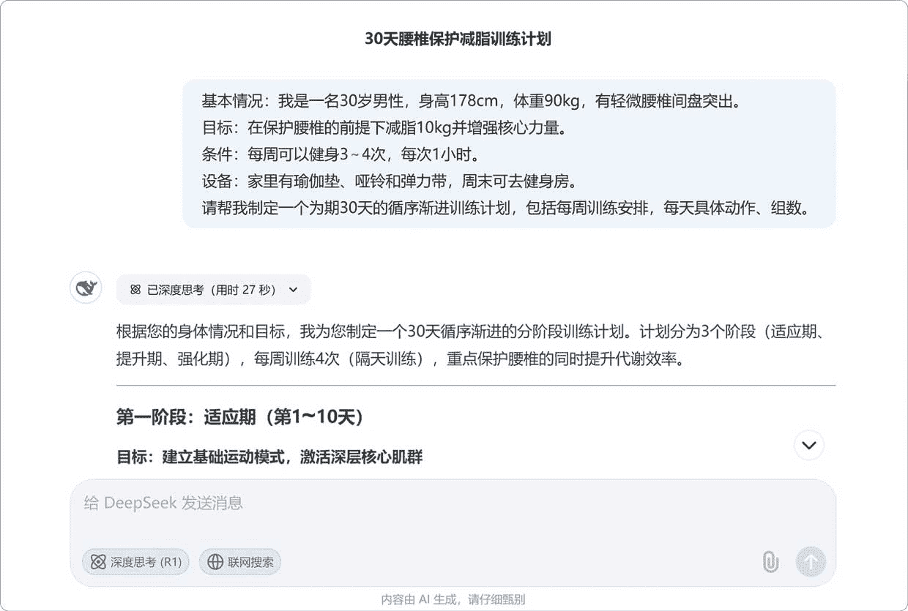

图 2.24 DeepSeek 定制个性化训练计划

AI 健身教练可以提供个性化训练建议，并结合基础知识帮助你优化锻炼方式。比如，教你使用训练器械，告诉你感到身体不适时应该如何调整，如图 2.25 所示。

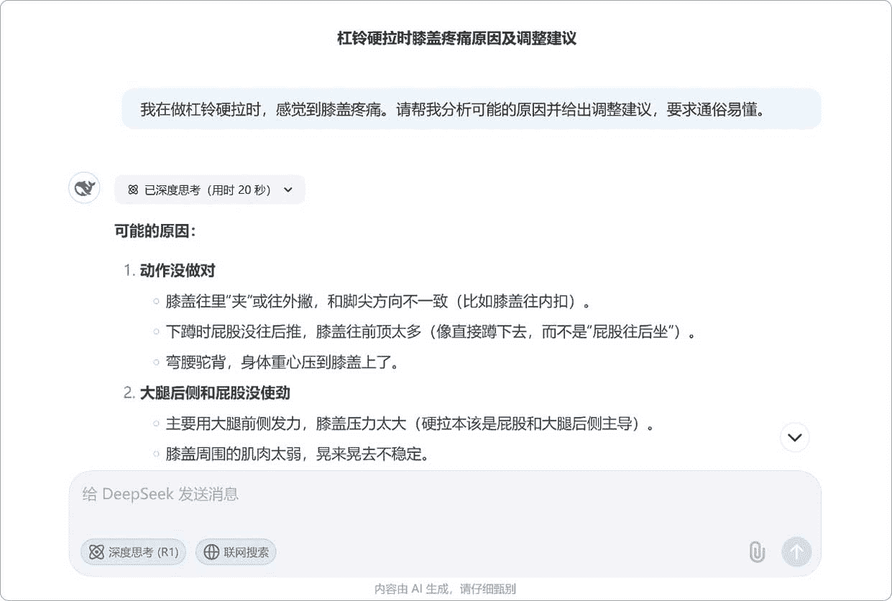

图 2.25 DeepSeek 给出健身计划调整建议

DeepSeek 让每个人都能轻松获得相对专业的健身指导，获得 AI 健身教练。

**❷AI 营养师**

谈到健康管理，饮食与锻炼同样重要。DeepSeek 也能化身为营养师，为你定制个性化的饮食方案。

只需在 DeepSeek 中输入你的个人信息、饮食目标和餐饮条件，它就能提供一份专属饮食方案，如图 2.26 所示。

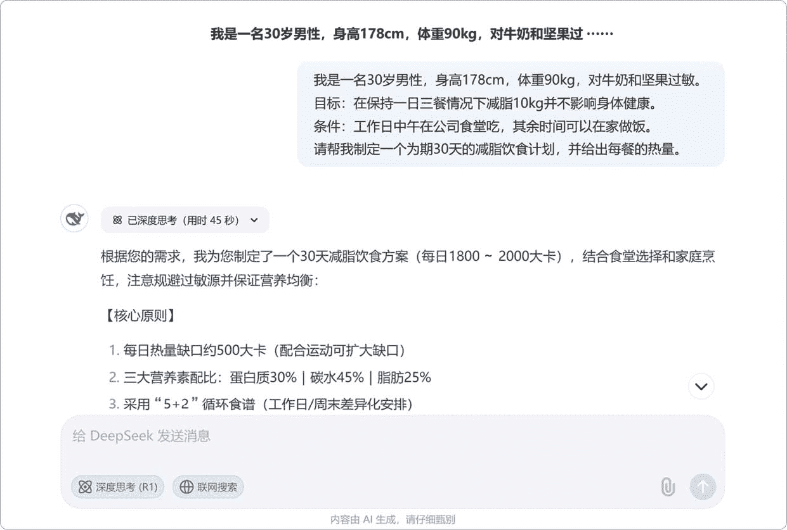

图 2.26 DeepSeek 定制饮食方案

你还可以继续追问更多营养健康方面的问题，例如：三餐吃什么有助于减肥；减肥遇到瓶颈时该如何调整；饮食方案中提到的菜，该怎么做。

### **2.4.2 旅行规划师：让 AI 成为你的旅行助手**

旅行本来是件轻松惬意的事，但查找攻略、对比价格、安排路线等往往让人筋疲力尽。你可以把这些烦琐的工作交给 DeepSeek 来处理，让自己在旅途中轻松愉快。

**❶AI 导游**

DeepSeek 能综合考虑费用、交通、景点、餐饮等因素，为你制定个性化行程攻略。你可能原本需要花数小时进行行程规划，如今只需几分钟。

利用 DeepSeek 做出的简要旅行规划如图 2.27 所示。提示词中包含以下关键信息：旅行目的地、旅行时间、旅行偏好、预算和特殊要求等。

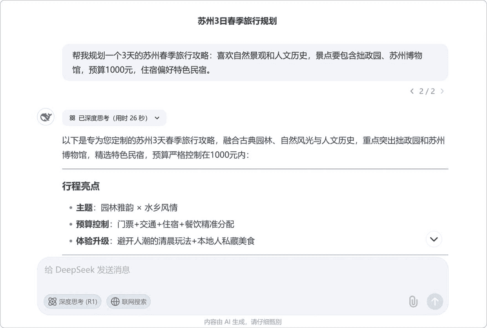

图 2.27 DeepSeek 定制旅行规划

DeepSeek 还能为你进一步挖掘隐藏景点、分享省钱技巧，并提供突发状况的应急方案，从各个角度规划你的旅程。

**❷AI 讲解员**

旅途中，如果不了解景点与文物背后的故事，难免少了几分乐趣。使用 AI 工具的讲解功能，你能深入地体会当地历史文化。

豆包具有拍照搜索功能，如图 2.28 所示。只需拍摄想了解的景点或文物照片，系统便会自动识别，并为你介绍照片中的内容，如图 2.29 所示。

▲图 2.28 豆包的拍照搜索功能

▲图 2.29 豆包介绍文物

当时没有选用 DeepSeek，是因为在撰写阶段 DeepSeek 还没有上线拍照识图能力。这也再次印证了之前的判断：不同 AI 产品的功能侧重点不一样，用之前得先看清楚需求再挑选。

# **第三章**

# **DeepSeek 学霸模式，学习效率直接起飞**

这一章聚焦 AI 对学习方式带来的结构性改变，内容围绕三个方向展开。

先对比 AI 学习和传统学习的差别，并用真实案例说明 AI 如何解决学习中的卡点。

再聊聊怎么把 AI 和知识库结合起来，让知识管理更高效。

最后落到具体场景，比如英语提升、法律问题探究，展示 AI 是怎么帮助达成目标的。

## **3.1 AI 学习和传统学习，到底差在哪**

AI 学习和传统学习在效能和节奏上几乎不在一个量级。

从准备阶段到学习中再到复盘，AI 都能全程介入，把学习效率拉满。

下面围绕学习的前中后三个关键节点，系统梳理 AI 的实战用法，整体思路如图 3.1 所示。

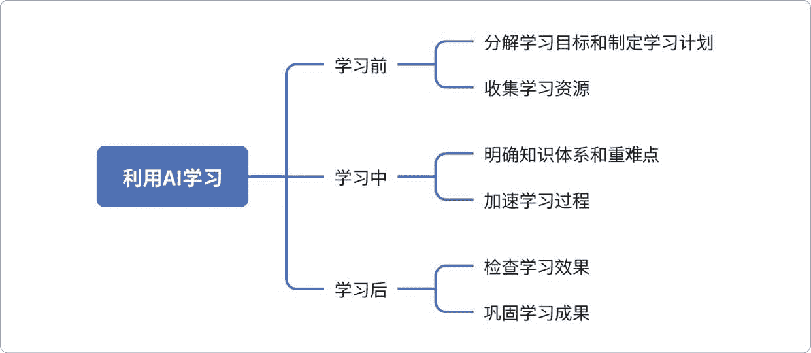

图 3.1 利用 AI 学习

### **3.1.1 学习启动前，先让 AI 搭好台子**

如果接下来一段时间要达成某个学习目标，比如通过四六级、拿到某项职业证书、完成一门培训，就一定要在开学前把准备工作做扎实。

第一步要把目标定清并做出可执行的规划，也就是学到什么水准、用哪种标准验收、在多长时间内完成、各阶段学什么内容。

第二步是在目标和计划明确后，快速搜集适配的资源。

**❶ 让 AI 来拆目标、排计划**

很多时候我们以为目标很清楚，其实很模糊。诸如“把英语搞好”“熟练掌握 WPS”这类表述，因为不够具体、不可量化、没有截止时间，根本没法指导行动。

比如“把英语搞好”，到底是口语要进步，还是作文要拿高分？是靠主观感觉，还是要通过四六级？是三年内完成，还是三个月内搞定？

过去目标要么自己琢磨，要么老师统一下发。前者费时间，后者不一定适合每个人。

借助 AI，我们可以把大目标拆得更细，并据此生成对应的学习路线，如图 3.2 所示。

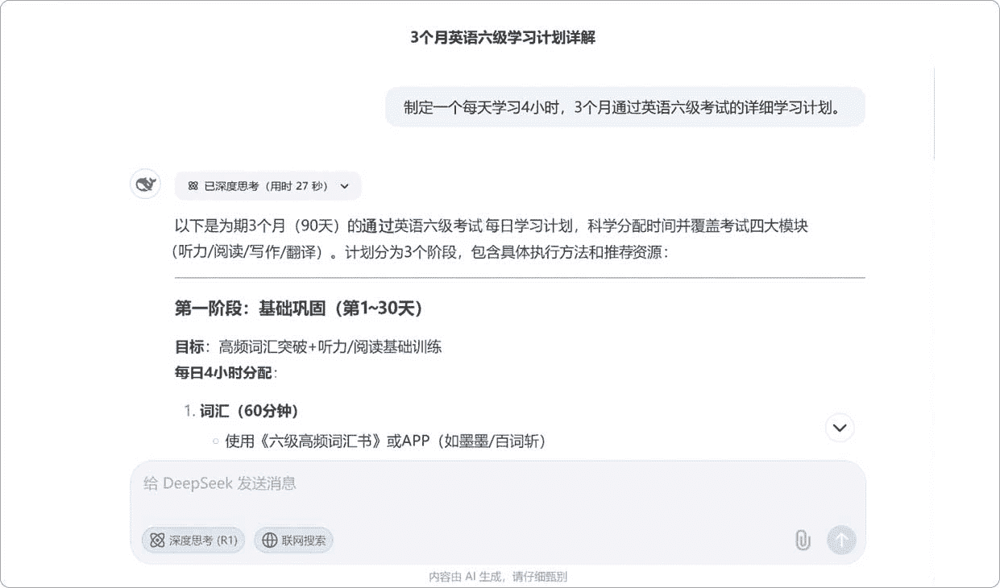

图 3.2 DeepSeek 制定英语六级学习计划

把大目标拆成阶段性小目标，还能及时获得正反馈，保持学习动力。

你也可以让 AI 根据真实表现动态调整，比如告诉它“我的写作比较薄弱”，它就会自动增加写作训练的比重。

**❷ 让 AI 帮你一次性找齐资料**

目标和计划敲定后，就要去找合适的学习材料，比如书籍、课程、工具等。以前一般是问同学朋友老师，或者自己在网上大海捞针，既费时效果又一般。

现在有了 AI，准备环节被大幅压缩。你可以直接让 AI 推荐靠谱的学习资源，如图 3.3 所示。

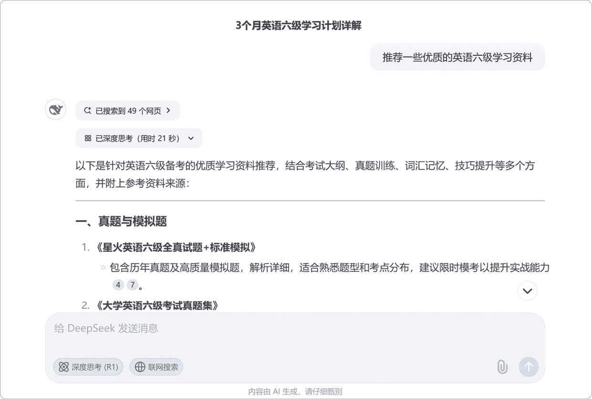

图 3.3 DeepSeek 推荐英语六级学习资料

AI 给出的清单不止书单和题库，还包括优质网站、在线练习平台、专业期刊和实用 App。购买渠道的建议也会一并给出。

### **3.1.2 学习进行时，AI 怎么加速**

准备工作完成，就可以进入正式学习。从梳理知识框架，到找准重点难点，再到加快吸收速度，AI 都能提供实打实的帮助。

**❶ 用 AI 厘清知识框架和重点难点**

第一次接触一个新领域，别急着钻细节，先弄清整体的知识结构，标记出难啃的部分。这样既能合理分配时间和精力，也能看清知识点之间的联系，为深入学习打基础。

**1. 用 AI 梳理知识框架**

如果已经选好教材，可以把电子版文件上传或把目录拍照发给 DeepSeek，让它基于目录搭建知识脉络。比如 DeepSeek 根据《西方经济学第二版上册》的目录，抽取出核心主线并构建体系，如图 3.4 所示。

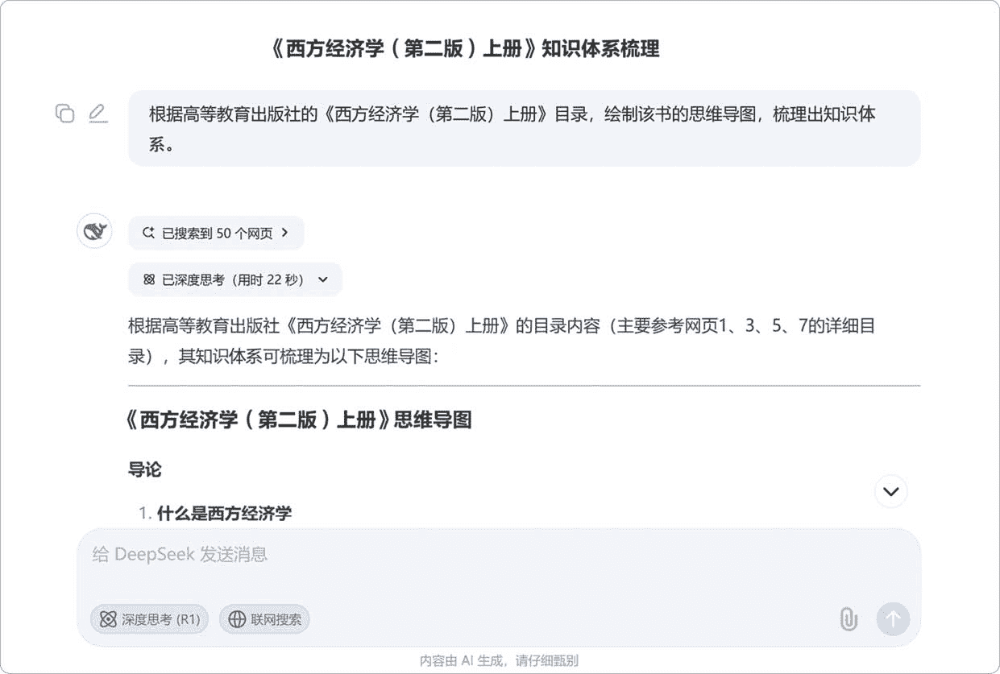

图 3.4 DeepSeek 梳理教材知识体系

如果教材还没定，也完全没问题。DeepSeek 能联网整合资料，快速生成覆盖面广的知识地图，让你迅速把握领域全貌。

**2. 用 AI 标注重点难点**

框架搭好后，还可以追问哪些是重难点。直接在梳理完体系后让它标记，如图 3.5 所示。

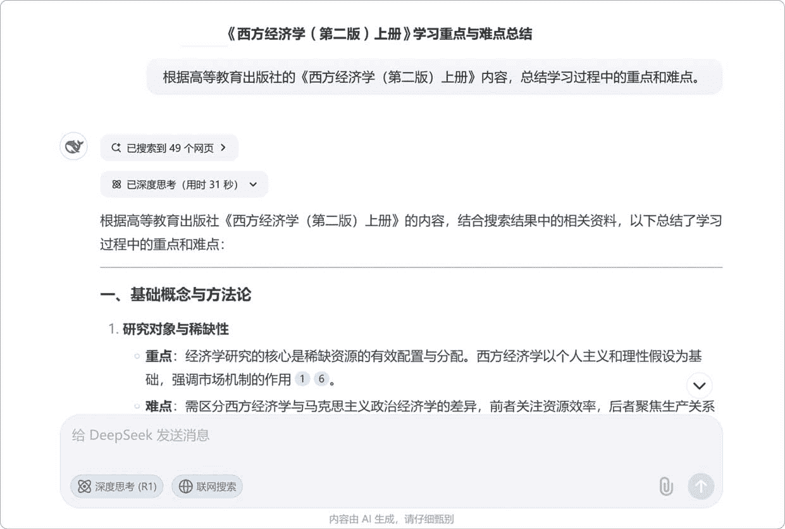

图 3.5 DeepSeek 给出教材重难点

这样能提前知道哪里需要多花时间，并针对难点做强化练习，提升学习效果。

**❷ 用 AI 让学习更快更顺**

在学具体内容时，AI 也能明显提速。它随时能答疑、帮你消化要点，还能给出更科学的学习方法，让过程更轻松。

接触新知识时常会遇到：复杂概念看不懂、相似知识点分不清、细节忽略产生疑问。

DeepSeek 能很好地解决这些痛点，用通俗的语言解释硬核知识，也能清晰回应各种提问。

比如想了解经济学里的“边际效应”，以前要查文献或问人，现在问 DeepSeek 就能得到简洁明了的解释，如图 3.6 所示。

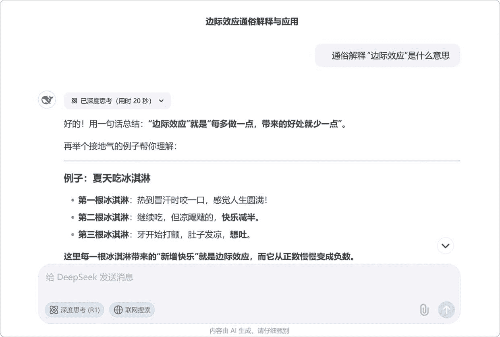

图 3.6 DeepSeek 解释专业术语

你还可以让它对比相似概念、说明各自适用场景，并对某个知识点做延伸拓展，从而加深理解。

### **3.1.3 学完之后，AI 帮你检验和巩固**

学完知识后，通常需要做题检验效果，结合错题总结，巩固成果并调整计划。接下来介绍如何借助 DeepSeek 检查成效和巩固记忆。

**❶ 用 AI 检验学习成效**

DeepSeek 不仅能出题解题，还能按个人需求灵活调整题量和难度。无论是经济、历史等通识类，还是数学、计算机等专业度高的科目，都能提供支持。

做 DeepSeek 随机生成的题目，能迅速发现薄弱点。对于掌握不牢的部分，它还能追加针对性练习，帮助补齐知识链条。

以 2024 年高考数学全国Ⅰ卷选择题第 1 题为例，如图 3.7 所示。

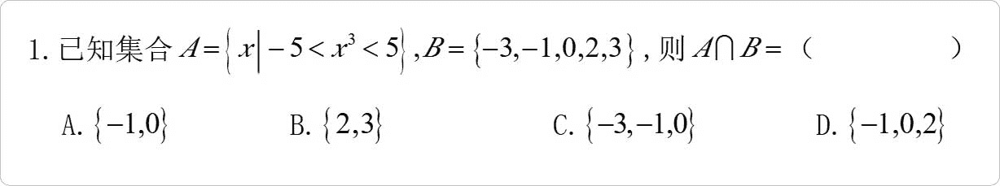

图 3.7 2024 年高考数学全国Ⅰ卷选择题第 1 题

把题目拍照上传，DeepSeek 会给出详细解析，如图 3.8 所示。若仍有疑惑，还可以请它分析考点、解题思路和易错点。

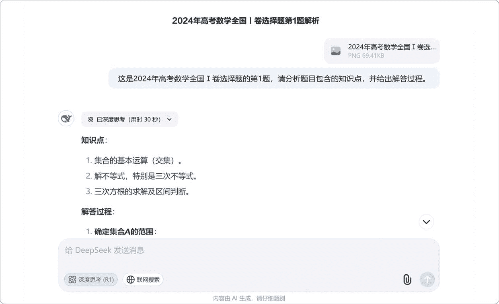

图 3.8 DeepSeek 解答高考数学题目

另外，可以要求它基于错题和知识点生成更多练习，如图 3.9 所示。这种错题导向的训练，能快速补强短板。

图 3.9 DeepSeek 生成试题

无论是数学还是其他学科，都能按知识体系生成整套测验，全面排查漏洞。这样就能在学习过程中持续评估进度，及时补救不足。

**❷ 用 AI 巩固学习成果**

学习过程中定期复习很关键。DeepSeek 能帮助梳理笔记、提升复习效率，还能根据当前进度动态调整计划。

想系统复习，可以让 DeepSeek 把容易遗忘的内容做成知识卡片，并按掌握情况安排复习。仍以经济学为例，DeepSeek 能为重要概念制作知识卡片，如图 3.10 所示，从而做到有的放矢。

图 3.10 DeepSeek 制作知识卡片

复习时，还可让它出几道题检验吸收情况。测试完成后，再根据结果请 DeepSeek 对最初的学习计划做相应优化。

## **3.2 AI 知识库搭建：打造你的第二大脑**

AI 知识库就像一座自带超算的数字图书馆，不仅能存取知识，还能自动关联不同知识点，激发新的想法。

本节会讲清楚为什么要建知识库、怎么建、典型用法的案例，帮助你把知识利用率提上去。

### **3.2.1 为什么要搭建 AI 知识库**

AI 知识库本质上是个个人专属的数字图书馆，用 AI 技术对积累的知识做智能化管理。搭建它的主要理由有两点。

**❶ 让知识更好记、更快找**

没有系统化管理，学过的东西很容易忘，用时也找不到。

现在每天接触的信息非常多：收藏的公众号文章、电脑硬盘里的文件、手机相册里的截图、散落在各笔记App里的片段。即使都存下来，回顾起来也很低效。

AI 知识库能把这些内容整理成有序结构，帮助强化记忆，并在需要时快速检索，提升信息获取速度。

ima 个人知识库如图 3.11 所示，用户可以把文件、笔记等资料集中存放。

图 3.11 ima 个人知识库

**❷ 把碎片信息整合为完整体系**

建立知识库能把零散信息融合成系统化的认知。

例如，知识库里既有关于“大模型”的文章，也有“深度学习”的笔记。当你问“大模型和深度学习是什么关系”时，AI 会整合库内相关内容，提炼要点并建立联系，如图 3.12 所示。

此外，AI 知识库还弥补了通用大模型记忆短的问题。一般来说，AI 只能记住短期对话，隔一次聊天就需要重复输入。有了知识库，所有重要资料都存进去，对话时 AI 会自动结合库内内容作答。没有知识库，AI 只是通用助手；有了知识库，它才真正变成你的专属智能顾问，能给出更精准个性化的答案。

图 3.12 AI 建立知识之间的联系效果示例

### **3.2.2 DeepSeek 与 ima 联用**

看完上节，相信你已经想动手建自己的知识库了。下面介绍如何用 ima 和 DeepSeek 配合搭建。

**❶ AI 知识库管理工具 ima 介绍**

ima 是腾讯旗下的 AI 知识库管理产品，已接入腾讯混元大模型和 DeepSeek 大模型。

ima 支持 PC 端、微信小程序和手机 App 使用，操作很方便。PC 端在浏览器搜索“ima”进入官网下载即可，移动端在应用商店安装后就能用。ima 官网界面局部如图 3.13 所示。

图 3.13 ima 官网界面（局部）

推荐 ima 主要基于两点：一是它 2024 年推出，是专业做知识管理的工具，界面简洁无冗余；二是它深度融入微信生态，能便捷检索微信公众号优质内容。

**❷ 搭建和应用 AI 知识库**

以下以 ima PC 端为例说明搭建流程。App 和小程序操作类似，不再赘述。

PC 端界面如图 3.14 所示，中间搜索框用于提问或输入网址，下方有“文档解读”和“智能写作”功能，左上角的知识库图标用于开始搭建。

图 3.14 ima 电脑版界面

**1. 上传素材到知识库**

ima 支持多种素材入库，包括本地文件、ima 笔记、公众号文章和网页内容。

**本地文件：**上传本地文件如图 3.15 所示，在知识库界面点击右上角上传图标，选择要添加的文件即可入库。ima 支持 PDF、DOC、JPEG、PNG 等格式。

图 3.15 上传本地文件

**ima 笔记：**点击网页左侧图标进入笔记界面新建 ima 笔记，完成后再点击右上角图标即可把笔记加入知识库，如图 3.16 所示。

图 3.16 上传 ima 笔记

**公众号文章与网页内容：**在 ima 内打开文章或网页后，点击右上角图标，就能一键存入知识库，如图 3.16 所示。

另外，在 ima 中搜索问题并得到答案后，也能把这些答案直接保存到知识库，方便后续查阅。

**2. 知识库应用**

素材上传完成后即可开始使用。在 ima 主界面的搜索框输入问题，并选择 DeepSeek 大模型作答，如图 3.17 所示。

图 3.17 ima 问题搜索界面

搜索时可以切换“基于全网”或“基于知识库”两种模式，如图 3.18 所示。选择“基于知识库”后，DeepSeek 会参考已入库的资料来回答。

图 3.18 ima 搜索回答界面

### **3.2.3 如何用 AI 知识库提升知识利用效率**

下面用两个简单案例，直观感受知识库的优势。

**❶ 快速回顾知识**

你是否遇到过这种场景：隐约记得一条信息，却想不起具体内容和出处，关键词搜索也找不到。比如下意识记得某位外国专家对 DeepSeek 评价积极，却想不起姓名、观点和来源。

传统检索耗时费力，而 AI 知识库能精准定位原文，还能关联相关资料，帮助快速回溯。你只需在知识库里输入“国外专家对 DeepSeek 的看法”，AI 就会在已有资料中智能检索并给出结果，如图 3.19 所示。

图 3.19 基于 ima 个人知识库提问

**❷ 跨界整合信息**

当知识库覆盖多个领域时，AI 能跨界融合分析，提供可行性判断和创新思路。

比如，库里既有餐饮行业资料，也有 AI 发展现状及应用前景的研究报告。你可以提问：“AI 怎么用在餐饮行业？给出具体方法并分析可行性。”AI 会基于库内资料进行综合分析，如图 3.20 所示。

图 3.20 ima 进行信息整合

## **3.3 学习加速器：打破壁垒，快速上段位**

前两节讲了 AI 如何提升学习效率，以及如何借助知识库强化知识管理。本节通过具体场景案例，展示 AI 在不同学习情境下的真实作用。

### **3.3.1 用 AI 学英语**

在语言学习上，AI 已经在一定程度上重塑了传统模式，提供高效且个性化的支持。下面以英语为例说明用法，其他语言同理。

**❶ 用 AI 背单词和练口语**

单词记忆占英语学习的大头，“哑巴英语”也是常见痛点。下面看 AI 如何解决。

**1. 用 AI 辅助背单词**

单词是根基，但传统死记硬背效率低，记了就忘，机械重复还会打击热情。

DeepSeek 能筛选高频词汇，让学习聚焦在高回报内容上。比如询问“商业场景下的高频单词”，如图 3.21 所示。

图 3.21 DeepSeek 查询英语单词

DeepSeek 还能根据单词生成短文，通过语境帮助记忆，类似母语习得过程，能增强联想记忆。它还能按兴趣定制科普、旅行、商务等不同主题的短文，让记忆更轻松。以图 3.21 中筛选的前十个高频词为例，DeepSeek 生成了一段商业场景小故事，如图 3.22 所示。

图 3.22 DeepSeek 根据单词生成小故事

**2. 用 AI 练习口语**

打破开口难：把智能体当口语搭档

不少学习者困在“哑巴英语”里，阅读写作尚可，一开口就卡壳。根子是缺少日常真实的英语交流场景。

智能体正好补上这块短板，提供无限次且无压力的练习空间。它会根据当前水平动态调对话难度，有耐心地指出语法偏差，即便发音不标准也能听懂并给出合理反馈。

用豆包练口语很直接，在对话界面打开语音通话功能。

图 3.23 豆包语音通话功能

点进“选择情景”，再进入“英语陪练”。

图 3.24 豆包英语陪练功能

随后即可和智能体展开英语对话，口音内容会实时生成英语字幕。

图 3.25 豆包英语对话练习演示

**❷ 英语阅读与写作的增效路径**
除口语外，智能体还能辅助研读英文材料、润色作文，让表达更地道。

**1. 用智能体读懂文章**
阅读是语言提升的关键，但生词与长难句常打断节奏，查词典或搜浏览器既费时又影响连贯。借助智能体，泛读精读都更顺畅。

泛读时把文章丢给 DeepSeek 提炼核心要点，再与自己的理解对照检验是否抓准；精读时它能解析结构、拆解复杂句、标注重点知识点，帮助深入理解，如图 3.26 所示。

图 3.26 DeepSeek 拆解英语文章

精读后让它再做一次知识点归纳，吸收会更高效。

**2. 用智能体润色作文**
写作是多数学习者的痛点，自学者很难自检语法和表达。智能体能迅速揪出拼写与语法错误，优化句式并给出针对性修改建议，如图 3.27 所示。按反馈反复练习，写作会更流畅自然。

图 3.27 DeepSeek 批改英语作文

### **3.3.2 用 AI 探究法律问题**
3.3.1 小节讲了智能体在英语学习里的作用。英语本身普及度高，智能体让学习效率再上层楼。

在通用大模型出现前，法律、医疗、金融等专业门槛高、成本高，很难平民化。如今智能体大幅降低门槛，让我们能在短时间内掌握基础并用到生活中。

本节聚焦如何用智能体高效学法并解决日常法律问题。

**❶ 法律问答与实操建议**
日常中法律问题无处不在。租房签约时条款看不懂就匆忙签字导致权益受损；朋友欠钱不还，想维权却不知要准备哪些起诉材料。

这时 DeepSeek 能充当法律助手，给出专业咨询和实用建议。比如问“朋友欠钱不还，需要准备哪些起诉材料”，它会给出材料清单、梳理起诉流程并提示关键注意事项，帮你更好地维护权益，如图 3.28 所示。

图 3.28 咨询 DeepSeek 法律问题

遇到概念不懂，也能让它用大白话解释清楚。

**❷ 合同拟写与复核**
日常和商业活动中，因信任或图省事，常忽视合同，导致维权困难。比如借钱没写借条、合伙创业只靠口头。

不会拟合同可以请 DeepSeek。根据双方信息、交易内容、金额、期限等关键要素，它能迅速产出合同初稿，如图 3.29 所示。

图 3.29 DeepSeek 生成租房合同

生成后把合同再丢回给它复核，如图 3.30 所示。它会从合法性、潜在风险、条款前后一致性等多维度检查，还能逐条解析作用和法律意义，让你在拿到合同的同时提升法律素养。

智能体辅助学习不仅适用于法律，医疗、金融等专业领域同样适用。

图 3.30 DeepSeek 审查合同

# **第四章**
# **让 DeepSeek 助你提升职场能力**
第三章讲了智能体在学习上的用法，本章讲如何在职场里提升能力。本章分三部分，按工作流程展开。

先讲启动前的调研、决策和文案策划，再讲执行中的会议管理、高效沟通，最后讲收尾的工作汇报与 PPT 制作。

## **4.1 工作调研与决策及文案策划**
大多数职场工作在开展前都要先调研决策。以手机销售为例，公司定下销售目标后，销售要先调研哪些机型热销、用户决策关键因素，再据此确定重点机型和推广策略，最后写出销售方案。

下面细讲如何用智能体提升这几个环节的质量和效率。

### **4.1.1 调研提速：从一天压到一小时**
过去调研很辛苦，要在海量资料里翻找，既耗时间又耗精力。智能体改变了这个现状，能迅速处理文档并直接产出报告。

**❶ 文档处理：归纳更快、答疑更准**
智能体让我们能迅速处理大量资料拿到准确结论，遇到不懂的内容也能立刻解答。

**1. 多文档一次性归纳**
以前要手动读十几份文档，容易遗漏。借助 DeepSeek，一次上传多份文档就能快速得到结论，原本要花一整天掌握的信息，几分钟就能清晰掌握，大幅提升效率。利用 DeepSeek 总结多份文档的示例如图 4.1 所示。

图 4.1 利用 DeepSeek 总结多份文档

**2. 文档问题即时解答**
调研时读到陌生概念，过去要反复查浏览器。现在 DeepSeek 能快速清晰解答。

比如遇到专业术语，通过 DeepSeek 能迅速知道定义、应用场景和相关案例，让调研更顺畅，如图 4.2 所示。

图 4.2 利用 DeepSeek 解读文档内容

本部分讲了有资料时如何提速，接下来讲缺资料时如何直接产出调研报告。

**❷ 直接生成调研报告：从零散信息到结构化输出**
没有智能体时，只能从图书网页拼凑零散信息，筛选整合耗时。如今 DeepSeek 能直接产出调研报告，除 DeepSeek 外，还有秘塔 AI 搜索、知乎直答等专业工具。

用 DeepSeek 快速生成一份简短调研报告，如图 4.3 所示，分析了 2025 年中国新能源汽车行业发展趋势。

图 4.3 利用 DeepSeek 生成简短调研报告

复杂任务可用秘塔 AI 搜索、知乎直答产出更完备深入的报告并附来源，方便查阅。

比如用秘塔 AI 搜索了解 AI 绘画发展历程，它会把问题拆成多个关键步骤逐一分析，最终给出全面翔实的结论，如图 4.4 所示。报告底部会列出参考资料，图 4.4 的深度分析参考了 200 多篇资料，超过一般本科课程报告。

图 4.4 借助秘塔 AI 搜索生成调研报告

### **4.1.2 辅助决策：让思路更扎实**
调研后要做决策。部分政府单位已开始用智能体辅助决策。新华网报道，深圳福田区基于 DeepSeek 开发的“AI 公务员”已投入使用并发挥作用。

用 DeepSeek 辅助决策能提升效率和质量。

**❶ 搭建决策模型**
通过 DeepSeek 可以构建合理决策模型，提升准确度。比如纠结是否跳槽，DeepSeek 能基于职业发展、经济收益、风险控制等维度建模给出参考，如图 4.5 所示。

图 4.5 通过 DeepSeek 建立决策模型

随后输入工作年限、地点偏好等个人情况，DeepSeek 综合分析给出建议，帮你做出有据可依的选择。

信息越全决策越稳。把个人职场情况整理进知识库，DeepSeek 做决策时可参考，考虑更全面精准。

**❷ 洞察风险并给出应对**
决策总伴随风险，DeepSeek 能多角度预测风险并给出控制建议。

我们常受自身经历局限，以跳槽为例，可能过度关注薪资，忽略与企业文化契合度、行业稳定性。

DeepSeek 能从行业、公司、岗位维度分析，如图 4.6 所示。它能指出新行业因政策调整可能面临的挑战，或新公司晋升机制不透明带来的职业发展风险，帮你规避隐患。

图 4.6 利用 DeepSeek 识别决策风险

识别风险后可让它给出应对建议。比如担心行业不稳，建议入职前关注行业动态提前学新技能；担心晋升不透明，建议面试时与 HR 沟通晋升标准并制定职业规划。具体建议如图 4.7 所示。

图 4.7 DeepSeek 给出应对决策风险的建议

### **4.1.3 方案策划：从创意到落地**
决策确定后要转化为可执行方案。DeepSeek 既能帮忙构思高质量方案，也能优化结构和呈现。

**❶ 内容创作助力**
过去靠头脑风暴反复修改，结果未必理想。现在输入核心关键词，DeepSeek 就能迅速给出多种风格角度的创意。

确定方向后，结合市场数据、目标、决策依据、预算等因素，能把初步构想转化为完整方案计划书。利用 DeepSeek 制定的一份销售方案计划书如图 4.8 所示。

图 4.8 DeepSeek 制定方案计划书

再输入更具体的业务需求或行业背景，计划书会更贴合实际。

**❷ 视觉呈现助力**
方案内容好但视觉不抓眼，在汇报时容易被忽略。内容深度与视觉呈现同样重要。

比如给销售方案配一张吸睛海报，或给项目方案做清晰进度图，都能更好展示。借助 DeepSeek 及其他智能体工具可快速营造视觉效果。

**1. 用 DeepSeek 设计视觉方案**
DeepSeek 不只是文本强，还能做视觉方案设计，可生成含视觉元素的网页和网页版海报。利用 DeepSeek 生成一张 AI 大模型产品发布会网页版海报如图 4.9 所示。

图 4.9 DeepSeek 生成的网页版海报

网页版海报可轻松转图片再调整。图 4.9 只用一句提示词生成：“制作一个 AI 大模型产品发布会海报，使用 HTML 格式。”不满意可要求修改内容、调整风格或优化布局，它会不断迭代。

**2. 专业视觉设计工具**
除 DeepSeek 外，市场上还有很多专业智能体视觉设计工具，提供丰富模板库覆盖各行业。

比如在线设计工具和 AI 绘图工具，选合适模板就能生成精美设计图，即使没有设计经验也能做出高水平视觉方案。

借助即梦 AI 生成的汽车发布会海报如图 4.10 所示。即梦 AI 的应用将在第五章详细介绍。

图 4.10 即梦 AI 生成视觉设计方案

## **4.2 会议管理、工作沟通与执行**
方案确定后进入执行。智能体能提高沟通效率，减少重复工作，节约时间，让协作更顺畅。本节从会议管理、工作沟通与执行三方面展开。

### **4.2.1 会议管理优化：记录、翻译与待办**
现代职场会议占用大量时间，很多内容与个人工作相关性低，听漏了又容易出错。

把智能体用在会议管理上能缓解这些问题。智能体可实时记录、自动翻译、提炼要点并设置待办，即便缺席也能迅速掌握关键信息。

**❶ 记录与多语种翻译**
线上线下会议智能体都能高效把语音转文字，便于后续检索回顾。DeepSeek 可整理文字稿但不够完善，建议用专业智能体会议工具，如阿里通义千问、飞书妙记等。

用通义千问可把访谈内容自动转录为文字，便于学习整理，如图 4.11 所示。该工具还能实时翻译，将外语转为中文。

▲图 4.11 通义千问访谈语音转文字

被动接收时智能体精准翻译文本；互动交流时智能体实时转换语言，消除沟通障碍。比如某科技博主在东南亚旅行不会当地语言，借助智能体仍能顺畅交流。通义千问的实时语音翻译功能如图 4.12 所示。

▲图 4.12 通义千问实时语音翻译

图 4.12 中用户无需手动输入，直接用中文对话。智能体识别后翻译为目标语言并语音播报，让跨地域交流更流畅。

在职场中，跨国团队在线会议可借助智能体提供实时多语言字幕，说不同语言的参会者能无障碍沟通，提升效率和协作紧密度。

**❷ 提炼要点与设置待办任务**
冗长的会议记录让人望而生畏，即便成文字稿也难高效阅读。借助智能体能快速提炼内容，把复杂讨论简化为结构清晰、重点突出的摘要。利用智能体总结电影导演饺子接受央视新闻采访的部分内容如图 4.13 所示。

## 会议纪要的自动提炼术

图 4.13 AI 总结采访重点

模型可以自动辨认不同发言者，并按各自内容归纳出待办清单。即使没通读整份纪要，也能迅速弄清与自己有关的任务。

当文字信息过密时，找要点会变得困难。除了归纳总结，模型还能把文本转成提纲或思维导图的形式。图 4.13 的内容转换后的思维导图如下。

图 4.14 AI 生成访谈思维导图

以提纲呈现时，层级清晰，从核心观点到具体论据的排列有序；以思维导图呈现时，各主题之间的联系一目了然，可读性与逻辑感提升，读者能轻松把握要点。

### **4.2.2 AI 赋能表达：让沟通更高效清晰**

职场中，顺畅的沟通既能推动工作，也能促进职业成长。AI 可以成为职场人提升沟通效率的伙伴。

**❶ 提升沟通效率**

不善言辞的人常为与客户、同事交流发愁，模型可以提供话题灵感。比如与新同事初次交流前，向模型询问合适的破冰话题，它能快速给出建议，帮助开启友好对话，从而建立良好人际关系。图 4.15 为 DeepSeek 给出的新同事沟通建议。

图 4.15 DeepSeek 生成话题

有时面对混乱冗长的表达，我们理解起来会有困难。把这些内容输入模型，它能迅速提炼核心观点，帮助快速理解。一段混乱的项目问题表述经过整理后，就变得简洁清晰了，如图 4.16 所示。

图 4.16 DeepSeek 整理沟通内容

此外，在与他人沟通前，如果担心自己的语言组织不够清晰，也可以借助 DeepSeek 进行优化。模型能够帮助理顺逻辑，从而让对方更容易理解你的需求。

**❷ 模拟复杂沟通场景**

职场中，某些沟通场景往往较为复杂。AI 的介入不仅可以帮助厘清表达思路，还能通过演练提升沟通效果。下面介绍两种典型应用。

**1. 薪资沟通与跨部门协作演练**

面对薪资沟通、跨部门协作等场景时，沟通难度较大。可利用模型模拟对话，如就加薪问题与领导沟通前，让模型扮演领导，自己提出想法和诉求，模型模拟领导的反应，如图 4.17 所示。

图 4.17 DeepSeek 规划复杂沟通的策略

在准备出国签证、工作面试等情况下，同样可借助模型练习，让模型像专业考官一样给出反馈建议，提升沟通表达能力。

**2. 情绪疏导与理性分析**

在高压工作环境下，情绪管理是职场人士不可忽视的一环。工作压力、团队矛盾或个人发展困惑，都会影响工作表现和心理状态。然而，与家人倾诉可能会让他们担忧，与同事交流又可能存在不便。

模型在此场景下可充当倾诉对象，提供情绪疏导与理性分析服务。用户可以向模型诉说困扰，仅仅是表达情绪本身就能得到一定程度的压力缓解。而模型不仅会耐心倾听，还会给出兼具温暖和理性的建议，如图 4.18 所示。模型能让我们放松，以更加积极的状态投入工作与生活。

图 4.18 DeepSeek 提供兼具温暖和理性的建议

### **4.2.3 AI 助力执行：重复与复杂任务的自动化**

在工作执行阶段，为了提升效率，可以利用模型处理重复任务，也可以借助编程或智能体处理复杂任务。以下具体介绍相关应用。

**❶ 快速处理工作中的重复任务**

在日常工作中，许多看似简单但耗时的重复任务，模型可以高效完成，从而解放人力，提高工作效率。

**1. 图片与表格处理**

图片与表格处理是职场中常见的任务。例如，将图片文字转为可编辑文本、将手写的表格电子化，或者把杂乱的文字整理成表格等。

如今，模型具备强大的图像识别能力，可以高效完成这类任务。目前，多种工具可直接识别图片中的文字，还能处理手写表格。上传一张如图 4.19 所示的带有表格的图片，虽然图片模糊且不整齐，但 DeepSeek 依然可以快速提取图片内容，并按要求格式输出结果，如图 4.20 所示。

▲图 4.19 用手机拍摄的模糊图片

▲图 4.20 用 DeepSeek 提取图片内容（局部）

**2. 工作文档处理**

在文档处理方面，模型同样表现出色。例如深圳市福田区的 AI 政务大模型 2.0 版，公文格式修正准确率超 95%，审核时间缩短 90%，跨部门任务分派效率提升 80%。

无论是文档修改，还是文档格式转换，模型都能轻松应对。以往把复杂文档转换成思维导图，手动整理可能需要数十分钟，现在几分钟就能完成。模型还能检查重要文档的格式错误及潜在有争议问题。利用 DeepSeek 把复杂的文档整理成思维导图形式如图 4.21 所示。

图 4.21 DeepSeek 处理工作文档

**❷ 编程与智能体助力处理复杂任务**

模型在处理大量数据、执行重复任务等方面具有显著优势。如果利用编程或制作智能体，可以进一步提高效率。

技术的进步正在深刻改变编程方式，即便是零基础用户，也可以借助模型开发简单的软件产品。然而，尽管模型降低了技术门槛，但仍然需要安装开发工具并学习基本的编程概念，对部分用户而言仍存在一定的学习成本。如果希望用更简单的方式完成任务，可以尝试智能体。

智能体是一种无须传统编程知识也可以创建的工具。智能体可以解决很多问题，这些问题以往需要编程才方便处理。当前，通义千问、豆包等均提供智能体。

由于智能体制作门槛低，各大平台的智能体数量不断增加，涵盖职场、学习、生活等多个领域，一些常见的问题，可以用现有的智能体解决。

以通义千问为例，其职场板块有诸多实用的职场智能体，如图 4.22 所示。如“Excel 函数大师”，能帮用户学习 Excel 函数使用技巧，让用户处理数据时不再为复杂函数头疼。

图 4.22 通义千问的职场智能体

如果找不到合适的智能体，也可以自行创建，制作过程并不难。第六章将详细介绍如何制作智能体，帮助你打造属于自己的自动化助手。

## **4.3 工作汇报与 PPT 制作**

职场中流传着一种观点——做得好不如讲得好。此观点虽失之偏颇，却也在一定程度上说明了工作汇报的重要性。

本节将探讨如何利用 DeepSeek 整理工作成果，以及如何结合 DeepSeek 与其他 AI 工具，制作令人眼前一亮的 PPT。

### **4.3.1 用 DeepSeek 整理工作成果**

可以借助 DeepSeek 明确不同汇报类型的重点，梳理汇报内容，优化汇报内容的呈现效果。

**❶ 总结出结构清晰的工作内容**

工作汇报形式多样，有年度总结、项目汇报、日常周报等，各自的汇报重点不同。DeepSeek 可以针对不同汇报类型，确定汇报重点并给出汇报建议。DeepSeek 生成的年终工作总结汇报，如图 4.23 所示。

图 4.23 DeepSeek 生成年终工作总结汇报

在不同类型的汇报中，DeepSeek 也能发挥不同作用。

日常周报中，DeepSeek 能提炼重点工作，优化排版，让周报简洁明了；项目汇报时，DeepSeek 能敏锐识别、评估风险，整理阶段性成果，让领导轻松理解工作成果；年度总结中，面对繁杂的工作，DeepSeek 能整合数据，提炼亮点，总结失败教训，规划方案，将冗长流水账变为精彩商业故事。

**❷ 数据整合与语言优化**

确定汇报重点后，DeepSeek 可以协助生成汇报内容。

可以将零散的会议记录、邮件、Excel 表格、工作日志等内容，输入 DeepSeek，要求它对这些内容进行梳理，输出逻辑清晰的汇报内容；也可以要求 DeepSeek 分析汇报涉及的数据，给出关于如何展示数据的建议。

在不同汇报场景下，DeepSeek 还支持“口语化-专业化”转换，帮助调整语言风格。如果需要进一步突出某些重点，可通过 DeepSeek 进行检索与标注。DeepSeek 还可检查内容是否存在逻辑矛盾、数据冲突或表述不充分的问题，并提供修改建议。

### **4.3.2 DeepSeek 与其他 AI 工具结合使用，让汇报更吸引人**

PPT 是最常见的汇报形式之一。本小节将介绍如何结合 DeepSeek 与其他 AI 工具高效制作 PPT。

**❶ DeepSeek 与 Kimi 结合使用**

除了 DeepSeek，Kimi 也是很受欢迎的 AI 工具，用来制作 PPT 比较方便。由于 DeepSeek 目前无法直接生成 PPT，因此可将 DeepSeek 和 Kimi 结合使用。

**1. 利用 DeepSeek 生成 PPT 大纲**

把 DeepSeek 总结的工作汇报再次输入 DeepSeek，要求它转化为 PPT 大纲。根据实际情况，调整大纲各部分顺序和内容详略，得到 PPT 文稿。

**2. 利用 Kimi 生成 PPT**

在浏览器搜索“Kimi”访问其官方网站，进入 Kimi 界面后，单击左侧图标再选择“PPT 助手”（如图 4.24 所示）。

图 4.24 Kimi PPT 助手

将 DeepSeek 生成的 PPT 文稿输入 Kimi 的 PPT 助手，然后从其丰富的模板库中选择合适的模板。例如，科技类汇报可选科技风模板，文艺类汇报可选淡雅插画风模板。

选定模板后单击“生成”，Kimi 会依据内容和模板生成 PPT 初稿。

**3. 优化 PPT**

在 Kimi 的在线编辑平台（如图 4.25 所示）上，可对生成的 PPT 进行优化。可以调整大纲、模板、文字、背景、图表等元素，使 PPT 更加符合实际需求。

图 4.25 Kimi 的在线编辑平台

使用 DeepSeek 生成 PPT 大纲和 PPT 文稿，Kimi 生成 PPT，再经人工编辑，让 PPT 制作过程更轻松，内容更具吸引力。

**❷ 专门的 PPT 制作 AI 工具**

前文介绍了 DeepSeek 结合 Kimi 制作 PPT 的方法。对于需要经常制作 PPT 的用户，专门的 PPT 制作 AI 工具更值得关注，比如 AiPPT。许多同类工具和它的核心功能类似，下面以 AiPPT 为例，详细介绍其功能。

**1. 多样化的 PPT 生成方式**

AiPPT 提供多种 PPT 生成方式，满足不同用户需求。输入文档后，它能快速将其转化为 PPT 页面。提供网页链接后，它也能生成 PPT。而且，给它输入一句话，它能自动生成 PPT 大纲，再选一个模板，就可以生成 PPT。AiPPT 不同的生成方式如图 4.26 所示。

图 4.26 AiPPT 的 PPT 生成方式

此外，它还接入了 DeepSeek、智谱清言等不同的 AI 大模型，为 PPT 内容创作提供更多可能。

**2. 海量 PPT 模板且支持自定义**

AiPPT 拥有丰富的 PPT 模板，适用于不同场景。无论用户是教师、学生，还是投资者、面试官等群体，都能找到合适的模板。而且，它支持自定义模板，用户可上传公司、学校的标准模板，后续制作 PPT 时直接套用，确保 PPT 风格统一。

同时，AiPPT 还支持依据不同场景优化 PPT 文案，使语言风格更加符合需求；甚至支持调整 PPT 的语气，专业、幽默、亲切等语气都能实现；还支持多种语言，比如中文、英文、日文、韩文。

**3. 允许在移动端、PC 端同步查看内容**

AiPPT 允许用户在移动端和 PC 端同步查看内容，方便用户在出差途中随时查看或修改 PPT。AiPPT 手机版创作界面和模板界面如图 4.27 和图 4.28 所示。

▲图 4.27 AiPPT 手机版创作界面

▲图 4.28 AiPPT 手机版模板界面

专门的 PPT 制作 AI 工具功能丰富、设计贴心，为高质量汇报提供有力支持。这类工具，通常提供免费使用次数，若用户使用频率较高，可能需要付费。

# **第五章**

# **让 DeepSeek 助你把握新兴 AI 商机**

本章主要介绍如何利用 AI 进行内容创作，抓住 AI 带来的商机，主要内容如下。

首先，介绍一些 AI 绘图和视频创作工具，分享 AI 绘图和视频创作技巧。

其次，介绍如何利用 DeepSeek 打造个人自媒体。

再次，介绍 DeepSeek 和炒股之间的关联，分享利用 DeepSeek 辅助投资的方法。

最后，拓展阅读精选了 AI 用法，希望能帮助读者拓展思路，发现适合自己的 AI 商机。

## **5.1 AI 绘图和视频创作**

你是否留意到，一些热门的图片与短视频居然出自 AI 之手？

AI 画作《埃德蒙·贝拉米肖像》（如图 5.1 所示）在佳士得拍卖行拍出 43.25 万美元高价，成为第一幅在大型拍卖会上成功交易的人工智能绘画。AI 创作的《太空歌剧院》（如图 5.2 所示）荣获美国科罗拉多州博览会美术比赛第一名。

▲图 5.1 AI 画作《埃德蒙·贝拉米肖像》

▲图 5.2 AI 画作《太空歌剧院》

AI 绘图和视频创作，孕育了巨大的商机。本节将介绍 AI 绘图和视频创作工具，探究 AI 绘图和视频创作的实操技巧，并剖析 AI 创作的商业应用案例。

### **5.1.1 AI 绘图和视频创作工具介绍，找到你的内容创作利器**

正式利用 AI 创作前，我们需要对 AI 创作工具有所了解。本小节将介绍主流的 AI 绘图和视频创作工具，以及 DeepSeek 在内容创作中的作用。

**❶ AI 绘图工具介绍**

下面以即梦 AI 为例，介绍 AI 绘图工具。

即梦 AI 是抖音旗下产品，支持在 PC 端和移动端使用，操作便捷，且能满足用户个性化需求。例如，用户可以用它生成朋友圈文案的配图。即梦 AI App 界面如图 5.3 和图 5.4 所示。

▲图 5.3 即梦 AI App 作品创作界面

▲图 5.4 即梦 AI App 灵感发现界面

即梦 AI 不仅能生成图片，还能生成视频和音乐。它的界面简洁，用户不需要系统学习就可以直接上手。同时，它拥有活跃的创作者社区，方便用户交流提示词与作品，提升使用技巧。

即梦 AI 生图速度比较快，通常 30 秒以内，就可以一次性生成 4 张图片供用户选择。

即梦 AI 采用“免费+增值服务”模式，用户每日登录即可得积分，能满足日常数十张图片的创作需求，超出免费额度则须订阅会员。

除即梦 AI 外，还有多款优质 AI 绘图工具。比如：Midjourney 以生成图片具有高精度细节而受到众多用户青睐；稿定 AI 专注于商业设计，适用于各类商业场景；LiblibAI 是在线生图平台，提供开源模型，具有丰富模板，创作门槛低。这些工具都能通过网页在线操作。

**❷ AI 视频创作工具介绍**

下面以可灵 AI 为例，介绍 AI 视频创作工具。

可灵 AI 由快手技术团队打造，支持在 PC 端与移动端使用。它生成的视频不仅能呈现大幅度动作，还能模拟现实世界的物理特性，增强画面真实感。可灵 AI PC 端操作界面如图 5.5 所示。

可灵 AI 功能丰富：文生视频能依据文字描述生成动态视频；图生视频能让静态图片“动”起来；视频对口型功能可使人物按输入文本张嘴说话。它也能调节生成视频的时长和长宽比例。视频时长一般在 5 到 10 秒，长宽比例也有多个选项，满足用户个性化需求。可灵 AI 界面简洁，操作方便。

图 5.5 可灵 AI PC 端操作界面

可灵 AI 生成视频的时间不确定。因为视频生成需要消耗大量算力，有时在线人数较多，可能需要较长时间才能生成一个 5 秒的视频。在视频质量方面，可灵 AI 的表现相对稳定。

在费用方面，可灵 AI 定期赠送免费额度，超出免费额度，须按使用量付费，使用量根据视频时长和质量计算。

此外，还有不少优秀的 AI 视频创作工具：Runway 在影视级视频创作领域能力强，能生成高质量视频；Pika 生成视频的速度快，编辑功能丰富；海螺 AI 在画面色彩等方面表现突出。2025 年 1 月 AI 视觉工具在 PC 端的月总访问量前 10 名如表 5.1 所示。

表 5.1 2025 年 1 月 AI 视觉工具在 PC 端的月总访问量前 10 名（资料来源：量子位智库）

### **5.1.2 掌握文图转换技巧，用 AI 让创意落地**

从生成到分发：影像创作与账号搭建实战

本篇围绕生成式影像的落地路径，以及如何借助 DeepSeek 搭建个人内容矩阵。

❶ 生成式影像的工作逻辑

市面上主流的视觉生成方式可归纳为四类：文生图、图生图、文生视频、图生视频，底层原理基本相通。

文生图是入门的锚点，也是算力消耗最低、响应最快的入口。标准链路为撰写提示词、设定参数出图、迭代优化。熟练文生图后，学习文生视频会更顺畅，两者在指令—调参—打磨的节奏上高度相似。差异在于图更快、改动更自由，视频生成慢、后期调整成本高。实务上建议先用文生图把画面气质定下来，再用图生视频赋予动感。提示词层面，两者均需覆盖主体、动作、场景，文生图追求定格瞬间，文生视频强调完整动作轨迹。

图生图的价值在于可控与还原。纯文字生成一只宠物猫容易走样，若上传实拍图作参照，模型就能更精准地复刻目标形象。提示逻辑与文生图基本一致，只是多了一张参考。当前主流绘图产品基本都已内置该能力。

在专业制作中，图生视频的使用频率明显高于文生视频。因为先出图再转视频，可控性更强，对成片的把控更细，也能降低试错成本、提升交付效率。

❷ 绘图流程演示

以下以 PC 端即梦为例演示全流程。

1. 撰写提示词

提示词质量直接决定成图水平，描述越具体，模型越容易读懂意图。

仅写“一个男孩”信息太单薄，生成结果在面部特征、艺术风格与场景细节上差异很大，如图 5.6 所示。改为“一个中国男孩，正面，写实”后，画面就更贴合预期，如图 5.7 所示。

▲图 5.6  输入宽泛指令的绘图结果

▲图 5.7 输入精准指令的绘图效果

建议采用结构化写法：核心由“主体+场景+动作”组成，再叠加风格、氛围、运镜、光线、景别等扩展要素，形成多维描述。提示词要素、作用及示例见表 5.2。

表 5.2 提示词要素、要素作用及示例

练习时可用扩写法体会简繁差别，如图 5.8 所示。

图 5.8 提示词从简单到复杂的绘图效果

新手可多看平台上的优质案例来提升提词力。已有参考图时，也能用 DeepSeek 的图像解析功能拆解画面元素，再把描述输入绘图工具创作。

2. 调参出图

提示词完成后再进入参数配置。即梦的参数面板与模型选择分别如图 5.9 和图 5.10 所示。

▲图 5.9 即梦 参数设置

▲图 5.10 即梦 模型选择

先按目标选模型。有的模型在文字渲染上表现好，适合做标识与标语；有的模型在人像优化上更突出，能细化面部微表情与皮肤质感。上手期建议优先用最新版模型，综合表现最均衡。

再设置画幅与分辨率。不同比例对应不同用途：1:1 适合头像与产品展示，4:3 适合电脑壁纸，9:16 适配短视频平台。尺寸越大细节越丰富，文件体积也会越大。

设置完成后点“立即生成”，通常 10～30 秒即可拿到结果。

3. 成图优化

若初版不理想，可用以下四种方式改进。

一是多生成几次。生成像抽奖，多试更容易撞到满意的，前提是初版与预期差距不大。

二是细化提示词。把“小女孩”扩展为“穿蓝白校服、单眼皮、背红色书包的 10 岁小女孩”。

三是局部重绘。画面仅局部有瑕疵时，可单独修改该区。即梦的局部重绘功能如图 5.11 所示，效果如图 5.12 所示。

▲图 5.11 即梦 局部重绘功能

▲图 5.12 即梦 图片局部重绘效果

四是后期精修。需要时可让 DeepSeek 生成自动化修图脚本，再用图片处理软件做精细调整。

灵活组合以上方法，能明显提升出图质量。要掌握绘图与视频制作，离不开大量实战积累。

### 5.1.3 商业应用案例拆解

下面拆解生成式创作在商业端的落地形态。

❶ 电商与营销图创作

在某电商平台，创作者用生成式工具制作商品图，售价从几元到数百元不等。如图 5.13 所示，定价 50 元的产品销量突破 6000，定价 100 元的产品销量超 600，店铺总收入相当可观。

图 5.13 AI 绘图在某电商平台部分产品截图

生成式绘图把创作门槛大幅拉低，个体创业者掌握基础操作后即可独立交付作品。

创意合作方面，2023 年初，某 AIGC 艺术家与麦当劳联名推出“麦麦博物馆系列”作品，如图 5.14 所示。作品以青铜器造型的汉堡、传世宝玉风格的薯条等脑洞形式呈现，首发即在小红书斩获大量点赞。

图 5.14 “麦麦博物馆系列”作品

系列爆火后，创作者以 AI 艺术家身份持续与知名品牌合作，既获得商业收益，也在营销圈建立口碑。

❷ 短片与短视频创作

由可灵生成的短片如图 5.15 所示，每集在快手均收获数万点赞。随着技术成熟，个体创作者独立完成动画已成可能。

图 5.15 AI 制作的短片

比动画更轻量的形式也有爆款。抖音账号“一念祝福”用传统年娃娃形象，赋予其开口说话的能力，以幽默温馨的方式送出春节祝福，如图 5.16 所示，热门视频点赞超 10 万，实现裂变传播。团队先用 DeepSeek 生成祝福语文案，再用可灵完成成片。

制作流程简洁：先在 DeepSeek 中输入创作需求，获取分镜头脚本；再导入 AI 视频工具生成画面；最后剪辑配乐即可交付。

图 5.16 抖音账号“一念祝福”的 AI 短视频和带货情况

## 5.2 借助 DeepSeek，搭建个人内容矩阵

5.1 节讲了绘图与视频制作，本节讲如何用 DeepSeek 搭建个人自媒体。

在竞争激烈的内容赛道，DeepSeek 可作为创作者的全流程助手。账号建设可分为筹备期、内容输出期、呈现运营期，DeepSeek 能贯穿全程提供支持。

### 5.2.1 借助 AI 确定定位与平台

个人账号本质是数字资产，能带来收入、影响力和持续收益。智能时代，过去需要团队才能完成的工作，现在一人一机即可尝试。

筹备期的核心是方向明确：精准定位与平台选择。

❶ 利用 DeepSeek 精准定位

辨识度高的账号需要精准定位，通常分三步：选定细分赛道、拆解对标账号、融合个人特色。

1. 借助 DeepSeek 选定细分赛道

选对赛道能避开红海，发挥长处。可从兴趣、技能、市场三要素展开分析。兴趣保证灵感不断，技能降低生产门槛，市场需求与竞争适中则反馈更正向。

在 DeepSeek 中输入个人兴趣与技能，可获得赛道建议，如图 5.17 所示。后续可进一步要求分析各赛道热度、内容供需比、变现难易度与发展前景，辅助决策。

图 5.17 DeepSeek 推荐自媒体赛道

2. 借助 DeepSeek 拆解对标账号

赛道选定后，还要明确细分领域、人设与受众。对标账号能提供思路：同一赛道下如美食的“探店”与“厨艺教学”，受众截然不同。DeepSeek 可解答“对标账号为何成功、做了什么”，并分析赛道中增长快的方向，如图 5.18 所示，也可解析账号人设与受众画像。

图 5.18 DeepSeek 进行赛道分析

3. 融合个人特色

同一赛道账号有共性也有差异化记忆点，如美食博主的暖色调、方言、厨艺等。可用 DeepSeek 融合个人特色打造差异化，如图 5.19 所示。

需注意，DeepSeek 难以精准捕捉个人特色。经历与能力可用语言描述，但账号独特的风格与观众直观感受很难完全文字化。这也说明，人工智能能助力省时拓思路，但人类创造力与感知力仍不可替代。

图 5.19 DeepSeek 给出的差异化建议

❷ 利用 DeepSeek 选择平台

定位明确后需选平台，可借助 DeepSeek 评估重要性、用户画像、热门内容与变现潜力。

1. 选对平台的重要性

平台决定传播效果与商业价值。常见平台包括抖音、快手、小红书、B 站、视频号、微信公众号，各有差异。

用户结构不同：B 站偏年轻用户，小红书女性占比高，视频号中老年用户相对集中。内容形式不同：公众号适合深度长文，短视频需要快节奏娱乐。变现路径不同：抖音擅长直播带货，小红书侧重品牌广告，公众号可做知识付费。平台规则也不尽相同，部分平台严打搬运与敏感话题。精力有限时，建议聚焦一个平台并做针对性优化。

2. 利用 DeepSeek 分析平台用户画像

不同平台在用户群体、内容形态、变现方式上差异明显，可用 DeepSeek 深挖用户画像，如图 5.20 所示。

图 5.20 DeepSeek 分析不同平台的用户画像

3. 利用 DeepSeek 分析平台热门内容

了解平台热内容同样重要，可用 DeepSeek 进行梳理，如图 5.21 所示。

图 5.21 DeepSeek 分析不同平台热门内容

4. 利用 DeepSeek 分析平台变现潜力

创作难免有低谷，商业化是良性驱动。可分析各平台变现潜力，如图 5.22 所示。

图 5.22 DeepSeek 分析不同平台的变现潜力

除了前面提到的用户画像、平台热门内容、变现潜力，还可追问具体数据，如抖音直播转化率、小红书品牌合作收入区间等，并要求给出来源。若需直观对比，可让 DeepSeek 以表格呈现各平台用户画像、热门内容、变现潜力。

在梳理完定位与平台特征后仍犹豫时，可把信息交给 DeepSeek 进一步综合判断。

### 5.2.2 借助 AI 策划选题文案

定位与平台确定后，关键在于持续产出优质内容。纽约大学博士生史密斯研究 1369 位 Instagram 与 TikTok 创作者发现，稳定高质量产出是成为头部网红的重要因素。DeepSeek 能大幅提升内容产出效率。

视频创作分为内容与视觉，本节聚焦内容环节，包括素材收集、选题调研、文案撰写与审核。

❶ 新闻素材收集与选题调研

1. 新闻素材收集：DeepSeek 帮你抓住热点

自媒体要把握热点，热点能迅速聚拢流量。DeepSeek 可 24 小时扫描互联网信息，实时捕捉热点。最简单的方式是直接提问，如图 5.23 所示。DeepSeek、豆包、通义千问、Kimi 等主流平台均可胜任。若需更高效，可采用智能体，相关创建方法见本书 6.2.2 小节。

图 5.23 DeepSeek 抓取热点

2. 选题调研：AI 帮你选“潜力股”

选题调研有两件事：一是从热点中筛选有价值主题，二是确定具体创作角度。提升能力需研究爆款。可借助 AI 提取平台热门内容数据，分析高阅读高互动视频的文案，快速把握大众关注点。使用豆包提取抖音热门短视频文案的示例如图 5.24 所示。

图 5.24 豆包提取抖音热门短视频文案

主题确定后可用 AI 找角度。以“DeepSeek”为例，可从“产业链介绍”“日常使用技巧”“技术原理解读”等实用角度切入，也可从“开发故事”“行业变革影响”等叙事角度展开。DeepSeek 提供的角度示例如图 5.25 所示。

图 5.25 DeepSeek 提供的创作角度

❷ 文案撰写与文案审核

1. 文案撰写：AI 是创意助手

准备好参考资料后，把素材交给 DeepSeek，它能结合素材与知识库生成多风格初稿。挑选有趣新颖的初稿再手动优化，即可成文。DeepSeek 撰写文案示例如图 5.26 所示。

图 5.26 DeepSeek 撰写的文案

标题同样重要。DeepSeek 可基于文案生成多风格标题。如“减肥方法”可生成“一个月瘦十斤的减肥秘诀大公开”“减肥路上的那些辛酸与坚持，你中招了吗”“超实用！让你轻松瘦下来的减肥小妙招”等，提升点击率。

2. 文案审核：AI 把好安全关

审核环节也离不开 AI。DeepSeek 会检查标点、语句、违禁词，指出错别字与歧义表述，确保内容准确，如图 5.27 所示。

图 5.27 DeepSeek 文案审核示例

### 5.2.3 让智能工具接管剪辑与复盘，创作效率大幅提升

做个人自媒体，写好稿只是起点，如何把内容做得吸睛、如何根据发布后的反馈调整，都是耗时大头。把重复性环节交给智能助手，整体效率会明显拉升。

❶ 剪辑环节减负，虚拟主播分担压力
借助智能剪辑软件，剪辑耗时会被压缩。再配合数字人出镜，制作负担进一步降低。

1. 剪辑效率提升
剪辑需要专业度也消耗时间。粉丝已超千万的某科技博主曾调研145位创作者，其中近40人的单条字幕制作就超过一小时。他本人也提到，几年前手工配字幕动辄花费数小时。
现在剪映等工具可自动生成字幕，大量手动微调被省去，上字速度加快。视频还能一键转文字，改文字即可联动调整画面片段，节奏更快，呈现效率显著提升。

2. 虚拟主播助力
对口播类账号而言，数字人是得力助手。输入文案即可自动生成带配音的成片，像个虚拟替身。形象和声线可选范围广，还能定制专属形象、复刻声音。
相比招募真人主播，数字人成本更低且可24小时工作。情感表达和临场应变仍有局限，但在产品讲解、知识科普等场景已足够专业。剪映中的部分数字人形象如图 5.28 所示。

图 5.28 剪映中的一些数字人形象

❷ 数据评论反哺内容优化
播放、点赞、评论能直观反映观众满意度。把这些数据交给AI分析，可找出最佳发布时间、观看偏好和流失节点，如图 5.29 所示，帮助优化内容和调整发稿策略。

图 5.29 DeepSeek 分析视频数据表现

评论里藏着宝贵反馈，逐条阅读太费力。AI可写代码抓取评论并打标签，按表扬批评等维度分类判断情绪倾向。创作者能据此及时回应重点评论，也能把讨论转化为新选题，增强互动。

❸ 组建团队也能借助智能助手
账号做大后单人作战吃力，组建专业团队成为必然。AI可根据账号定位、内容方向和发展目标，推断所需人才类型。例如美食类账号可能需要厨师、摄影师、文案编辑和运营。DeepSeek 对团队搭建的建议如图 5.30 所示。

此外，AI还能借鉴同类优质账号的团队案例，提供可落地的管理方案，比如设立菜品研发奖金，或建立摄影师与厨师的定期沟通机制。

图 5.30 DeepSeek 对团队搭建的建议

从内容拆解到团队协作，智能助手已成为创作与运营的重要伙伴。把重复性工作交给机器，创作者才能把精力集中在创意上。

## 5.3 DeepSeek 能否辅助炒股？

直播里分享智能工具时，观众常问：“DeepSeek 能不能炒股？怎么用？”本节仅从技术层面解答两个疑问：DeepSeek与股票投资的关联，以及是否可用作炒股工具。不构成投资建议。

### 5.3.1 DeepSeek 与股票投资的渊源
研发DeepSeek的深度求索公司，是知名量化机构幻方量化的子公司，幻方量化在量化投资领域表现突出。

量化投资是用数学模型和程序代替主观判断，在股票、期货、外汇等市场广泛应用。

很多人好奇，量化机构出品的大模型是否天生适合炒股。实际上“出自量化机构”和“适合炒股”并无必然联系。量化算法研发与大模型研发思路相近，共用算法、算力、数据三大基础，也都需要大量资金投入，因此在技术上具备可行性。

### 5.3.2 DeepSeek 在实盘投资中的作用边界
可以把DeepSeek当作辅助手段提升决策效率，但不能指望完全依赖它盈利。

DeepSeek能快速处理市场数据，输出趋势分析报告，提炼财经新闻和研报要点；还能生成代码测试投资组合收益，辅助制定交易策略。但它无法搭建完整的量化交易体系。

有效使用前提是：使用者真正理解量化投资，已有初步策略框架且能快速迭代。因为工具价值取决于使用者的专业认知。

下面是几个量化场景的实用做法。

❶ 数据清洗与可视化
DeepSeek可直接生成代码处理数据，大幅提升效率。分析大量股票历史数据时，能在短时间内完成清洗、格式转换和关键指标提取，还能绘制股价走势图。利用DeepSeek绘制的某股收盘价图如图 5.31 所示。

图 5.31 利用 DeepSeek 绘制的某股票收盘价走势图

❷ 策略构建与迭代
DeepSeek支持定制个性化方案，能解读前沿策略和学术论文，辅助掌握量化交易算法，如图 5.32 所示。通过对话，可结合风险偏好和投资目标，参考成熟策略构建模型。

图 5.32 DeepSeek 总结量化交易策略和研究论文

❸ 舆情监测与情绪研判
社交媒体情绪会影响市场。人工分析费时滞后易遗漏，DeepSeek结合爬虫采集数据并归类，让普通投资者也能洞察情绪脉搏，如图 5.33 所示。

图 5.33 DeepSeek 分析市场情绪

对个人投资者而言，量化门槛很高，需要金融、编程、数学、法律等多方面知识。算法也在不断迭代，本月盈利的策略下月可能失效，必须持续学习。对非专业人士，把DeepSeek用在股票之外领域，投入产出比可能更高。

## 拓展阅读 智能技术还能如何玩转创作

除了上述案例，还有不少新用法。

一是把老照片转成视频。有博主用智能方式把老照片做成动态视频，单条爆款点赞超10万。流程是收集老照片、用AI修复、通过AI生视频工具转化、用剪辑工具成片。博主通过承接业务、接广告等渠道变现，体现出商业价值。

二是“复活”经典文学人物打造内容。某博主精准把握林黛玉的语言风格和人物特质，通过相关视频增粉5万多，其内容如图 5.34 所示。制作流程包括搜集林黛玉经典语录，借助DeepSeek生成符合人设的个性化文案，利用即梦AI生成形象，最后合成短视频。该博主通过粉丝互动、建群、开课及商业合作变现，展现了该赛道的商业潜力。

图 5.34 AI 内容创作案例

另外，还能用图像生成技术让经典角色以动画形象呈现，搭配温暖文字传递积极态度。

# 第六章

# 如何借 DeepSeek 东风进入人工智能行业

想抓住DeepSeek带来的机遇进入人工智能行业？本章提供一套思路。共分三部分：先介绍智能岗位并破除误区，再分享可操作的入行攻略，最后通过回顾移动互联网发展帮助把握时机。

## 6.1 智能岗位全景：职责、门槛与前景

本节先破除误区，再介绍不需技术背景的岗位，最后看薪酬与前景。

### 6.1.1 没有技术背景或高学历，能否进入智能行业？

转智能岗位一定要懂技术吗？一定要高学历吗？

❶ 并非所有岗位都硬性要求技术底子
很多人觉得智能岗位门槛极高，没技术就没戏。这种印象多来自深度学习研发工程师等热门岗位的招聘要求，如图 6.1 所示，技术条目让人望而生畏，信息传播很广。

实际上智能产业链岗位很丰富，除了算法研发，还有大量非技术岗。AGI大模型数据相关岗位的招聘信息如图 6.2 所示，对技术要求并不高。

图 6.1 深度学习研发工程师的招聘信息（来源：BOSS 直聘）

图 6.2 AGI 大模型数据百晓生的招聘信息（来源：BOSS 直聘）

6.1.2小节会列出更多低门槛岗位，拓宽转行思路。

❷ 学历与经验不足也能找到切入点
自2022年11月ChatGPT发布后，大模型爆发式增长，2023年各家密集推出产品。智能大模型领域从业经历普遍只有1-2年，大家都在摸索。

据香港中文大学《2024中国人工智能岗位招聘研究报告》，20.04%的智能岗位对工作经验无要求，30.16%要求1-3年，如图 6.3 所示。若只算大模型岗，要求会更低。

图 6.3 AI 岗位经验要求分布图

学历方面，2024年上半年招聘的智能岗中，34.04%要求本科以下，56.86%要求本科，硕士博士仅占9.1%，如图 6.4 所示。

图 6.4 AI 岗位学历要求分布图

小红书等平台上不乏地产、艺术背景转智能的案例，虽个体真实性难考，但数量足以说明没有高学历和经验也能切入。别轻易否定自己。

### 6.1.2 智能相关岗位的职责与能力画像

❶ 产业链划分与岗位分布
智能产业链大致分上游硬件层、中游模型层、下游应用层，架构如图 6.5 所示。

图 6.5 人工智能产业链板块架构（来源：新华网财经板块，图片由易方达基金整理）

上游提供硬件支撑，中游研发大模型或提供训练数据，下游用大模型做产品服务。

岗位分布上，上游除研发外，销售、市场等不要求智能背景；中游数据标注、提示词工程师门槛相对低；下游岗位最多，很多只需熟悉智能应用、了解概念即可，如智能产品销售、产品经理、产品运营、内容创作者、内容审核员。

对非技术、学历不高的从业者，从下游应用层切入更友好。就像不用懂电脑原理也能用Excel、PPT，用大模型也不必深挖底层。

❷ 五个低门槛岗位详解

1. 智能产品销售
职责是客户开发维护、产品推广销售。重沟通、销售经验和主动性。通常不要求技术背景，只需用过或熟悉相关智能产品。

2. 数据标注专员
职责包括标注、整理、归档数据并反馈问题。案例如图 6.6 和图 6.7。

▲图 6.6 标注人脸位置

▲图 6.7 标注文本情感

难度低，需要耐心、责任心和沟通能力，一般不要求技术基础。

3. 提示词设计师
职责是创作提示词、评估优化效果，有时评估模型能力。门槛高于销售和标注，通常不要求技术背景，但需了解大模型基本知识、熟悉产品，有项目经验加分。

4. 智能产品运营
职责包括产品推广、用户运营和运营数据分析。要求沟通强、数据分析能力、运营能力，并热爱智能产品。

5. 智能产品经理
核心职责是需求分析、规划设计、项目推进。要求沟通协调好，对市场产品敏感。

在上述岗位里，智能产品经理对技术要求最高，需熟悉产品、了解技术概念并有一定项目经验。6.2.2小节会介绍容易上手的智能项目来积累经验。

### 6.1.3 进入智能行业是否更具发展潜力？

智能人才需求旺盛，薪资也在抬升。多数行业里智能岗平均年薪明显高于行业均值，如图 6.8 所示。

图 6.8 AI 岗位行业薪酬对比（来源：香港中文大学《2024 中国人工智能岗位招聘研究报告》）

具体看几个岗：

智能产品销售薪资跨度大，受业绩和职位影响，上限高下限低。

数据标注员薪资相对稳定。猎聘网2025年3月初统计的900多份简历显示平均月薪约7400元。下限有保障，但晋升空间有限，可考虑转产品运营。

智能产品运营和智能产品经理发展潜力较大，薪资也好。猎聘网上万份数据统计，平均月薪分别为1.9万元和2.4万元。智能产品经理薪资分布如图 6.9 所示。

图 6.9 AI 产品经理薪资分布情况（来源：猎聘网）

提示词工程师也能月薪过万，但前景不确定。随着DeepSeek等推理模型发展，写提示词的要求在降低，可能成为各岗位的必备技能而非独立岗位。

## 6.2 新人入行实操指南

本节分三块：缺乏经验如何进入、适合练手的项目、如何用智能工具优化简历和模拟面试。

### 6.2.1 转行思路与进入路径

综合笔者经验和成功案例，具有较强可操作性。

❶ 两种经验背景下的切入策略

根据经验不同，进入方式有别。

1. 经验丰富者优先内部转岗

已经在某个行业深耕多年、具备深厚专业积累的人，换岗不换赛道通常是更平滑的切入路径。这样既能继续发挥既有优势，也能顺势迈向人工智能方向。当前各行各业都在加速与智能技术融合，市场尤其青睐既懂业务又懂智能技术的复合人才。

举例来看，有房地产背景的人可以转向地产方向的人工智能产品经理。招聘市场中不乏“优先考虑有地产经验”的相关岗位招募。有医疗背景的人则可以切入人工智能医疗健康产品的运营或产品工作。互联网背景的人转场阻力相对更小，因为智能技术在互联网的渗透最为深入，对应岗位也最丰富。

归根结底，人工智能与其他行业的结合离不开行业Know-how。只要善于把自身行业洞察与智能技术结合，就能在转行中建立明显优势。

**2. 零经验起步：先上手应用再入场**

刚毕业不久或在校、所学专业与智能技术关联度不高的同学，可以先从零开始实践人工智能项目，再去应聘相关岗位。切入点可以选在人工智能应用，通过实战学会如何使用智能工具。

不必被难度吓退，目前大模型赛道仍在高速扩张，人才缺口很大，部分岗位的门槛并不算高。一个典型的与人工智能相关岗位的任职要求如图 6.10 所示。

图 6.10 人工智能相关岗位的任职要求（来源：BOSS 直聘）

即便当下条件尚未完全匹配，只要肯花时间自学并持续练习，也有机会追上要求。

**❷ 入行路线从整体到落地**

下面从思路梳理到具体执行，说明转行前要厘清的问题、面试会被重点考察的内容，以及落地的准备步骤。

**1. 转行前先自问三件事**

准备进入人工智能岗位前，建议先问自己：目标岗位具体做什么，是否真正感兴趣；岗位需要哪些核心能力，自己现在具备或能快速掌握；差距主要在哪里，如何针对性补齐。

这套自我盘点能帮助判断是否适合转行，以及精力该放在哪里。

对零基础的人来说，前期学习重点放在智能技术的实际应用上就好，不必一开始就钻研底层算法。算法学习难度大容易打击信心，而且不了解原理也不妨碍你熟练使用工具。

**2. 面试官通常关注四点**

申请与人工智能相关的岗位时，面试一般会聚焦：

一是基础认知，是否熟悉该领域的基本概念和常用术语。
二是产品体验，应聘智能岗位却没有使用过相关产品很难通过考核。
三是职业规划是否清晰、表达是否逻辑。6.2.3 小节会讲到如何借助工具提升表达。
四是项目经验。没有项目经验可以先学习6.2.2小节的项目。做项目有三重好处：操作具体能加深理论理解；能接触细节练手；能够学以致用。

**3. 四周冲刺准备法**

建议预留至少四周系统准备。

第一周，打基础。补人工智能基础知识和目标行业知识，熟悉主流大模型和典型应用场景。
第二周，定方向。锁定想去的岗位，深度体验对应的智能产品或服务，思考智能技术如何为该岗位创造价值。
第三周，实战。开展人工智能项目，把前期学到的理论用到真实场景，积累作品并加深理解。
第四周，收尾。精修简历，撰写面试逐字稿，做好充分准备。

准备期结束后根据笔试、面试反馈持续迭代学习策略，有针对性地补强，直到拿到心仪offer。

### 6.2.2 零项目经验如何快速上手

可供练习的人工智能项目很多，本节挑选两个，它们满足三点：相关免费资料网上易找；能覆盖大模型部署、知识库搭建、提示词撰写等多项能力；代表智能应用中的常见类型。

实操会涉及大量细节，这里只讲整体流程，遇到问题网上基本都能找到解法。

**❶ 用扣子做文案智能体**

目标是搭建一个智能体，专门撰写科技类短视频文案。平台选用抖音旗下的扣子，零代码就能做智能体。

涉及技能包括大模型应用、提示词设计、知识库搭建和智能体使用。做完后能感知智能工具的能力边界，也能掌握核心能力。流程分七步：

**1. 打开人工智能应用开发平台“扣子”**

有无编程基础都能用。浏览器搜索“扣子”进入官网即可。

**2. 创建智能体**

进入后可先看官方新手教程，或点左上角的 图标（如图 6.11 所示），在弹出的界面选择“创建智能体”开始。智能体可以理解为一款应用或智能小助手，你发指令它就执行任务。

图 6.11 创建智能体界面

**3. 撰写提示词**

建好智能体后就写提示词，如图 6.12 所示。提示词决定智能体如何按要求工作。

图 6.12 智能体编辑界面

提示词可以设定为：根据输入的话题，生成或润色短视频文案。不确定写法时先随意写一个，再用DeepSeek润色。

**4. 配置知识库**

知识库有两个作用：给智能工具写文案时提供参考；补充网上不好找的信息。因为功能是写文案，所以知识库里放了一些爆款短视频文案供学习。

**5. 配置大模型**

扣子支持多种模型，如图 6.13 所示。可多试几个，感受不同模型的特点。

图 6.13 大模型选择界面

**6. 测试智能体功能**

此时智能体已有基本能力。可以输入“写一篇关于 DeepSeek 的文案”，输出效果如图 6.14 所示。

图 6.14 智能体输出的文案

**7. 发布智能体**

不想每次都用电脑也能用。发布后可在飞书、抖音、微信等移动端使用。改改提示词和设置，这款智能体就能变成聊天机器人、表情包生成器或新闻助手。

**❷ 用 Stable Diffusion 练习绘画部署**

本项目用绘画工具Stable Diffusion练习绘图，涉及大模型部署、提示词撰写、参数调优等。

绘图模型属于大模型家族，体积小、算力要求不高，上手快。学会绘图部署，有助于迁移到其他大模型使用上。商业化也成熟，做出来的图既能用于短视频创作，也能直接售卖。

注意，电脑最好有独立显卡，显存8GB以上体验更流畅，否则可能卡顿。

主要分五个步骤：

**1. 安装 Stable Diffusion**

官方安装较复杂，国内常用科技博主“秋葉 aaaki”的整合包。搜索“Stable Diffusion 秋葉整合包”下载安装。

**2. 部署大模型**

安装完软件后还要装绘图模型。可到LiblibAI下载。LiblibAI是专注人工智能图像生成的平台，支持下载和在线使用各类模型。

在搜索框输入关键词就能找到各种模型，LiblibAI主界面如图 6.15 所示。

图 6.15 LiblibAI 主界面

**3. 撰写提示词**

安装完成后，按第五章的方法写绘画提示词练习。Stable Diffusion主界面如图 6.16 所示，右下角就是用提示词画出的图。

图 6.16 Stable Diffusion 主界面

**4. 调整模型参数**

图 6.16 方框里有很多参数，不必死记原理，知道作用即可。比如宽度高度控制图片尺寸。

**5. 持续练习**

想提升水平，就多换模型、多写不同提示词、多调参数并观察效果。熟能生巧。

### 6.2.3 用智能工具打磨简历和模拟面试

建议借助智能工具来优化简历并进行模拟面试。如今很多企业招聘已用人工智能做笔试面试，人工智能在招聘中的应用场景如图 6.17 所示。

图 6.17 人工智能技术在人才招聘中的应用场景（来源：艾瑞咨询 2023 年发布的《中国网络招聘市场发展研究报告》）

了解评审偏好，用工具改简历、练面试，通过率会明显提升。

**❶ DeepSeek 助力简历重塑**

求职简历要清晰传达两点：你能胜任岗位工作；你非常想得到这份工作。

具体做法：

**1. 借助 DeepSeek 梳理个人经历**

把个人经历和目标岗位一起交给DeepSeek，让它做结构化整理，得到表达清晰的工作经历，如图 6.18 所示。

图 6.18 DeepSeek 梳理个人工作经历

**2. 针对岗位优化简历**

根据公司和岗位的招聘要求，让DeepSeek拆解能力要求，再审视简历问题并给出优化建议，如图 6.19 所示。

图 6.19 DeepSeek 针对性简历优化示例

过去为不同公司改简历成本很高，现在用工具就能高效完成。

**3. 多角度细化简历**

除了主体内容，还可以用DeepSeek优化语言风格更专业、量化工作成果、植入岗位关键词提升匹配度、检查低级错误、排版压缩到一页让简历简洁美观。

**❷ 人工智能面试陪练**

智能工具在模拟面试上能提供三个维度支持：

**1. 攻克常规问题**

基础面试问题覆盖面广，把逐字稿交给工具审阅，它能快速指出问题。针对目标公司行业，用工具搜索以往高频问题提前准备，如图 6.20 所示。

图 6.20 DeepSeek 分析面试常规问题

**2. 围绕简历演练**

简历上的每一条都可能被追问。把简历给工具，让它扮演面试官针对内容提问。反复打磨回答，表达会更流畅。DeepSeek扮演面试官的效果如图 6.21 所示。

图 6.21 DeepSeek 对简历提问与追问

工具还能预测目标公司和岗位最可能被问的重点，如图 6.22 所示，提前准备答案。

图 6.22 DeepSeek 预测面试中的重点问题

**3. 用专业工具提升能力**

市面上也有专门的面试练习人工智能工具，能提供更接近真实的场景体验，并持续提升面试技巧。

## 拓展阅读 从移动互联网看人工智能入场时机

2010年前后移动互联网迎来爆发。4G大规模普及提升了手机体验，智能手机快速普及。苹果手机在2008—2021年的销量如图 6.23 所示，2010年后销量陡增。国内小米同年成立。

智能手机普及后应用井喷。2011年微信出现，2012年今日头条上线，2013年小红书问世，2016年抖音崛起。那个阶段机会密集。

OpenAI于2022年11月发布ChatGPT，点燃大模型热潮。如今人工智能产品仍在不断迭代，为各行业创造机会。此时进入正当时，正如那句老话：“种树最好的时间是十年前，其次是现在。”

图 6.23 苹果手机 2008—2021 年的销售量（来源：数据基地网站）

# 后记

当本书收官时，心里满是感慨与感谢。在人工智能飞速发展的当下，能把这本入门书呈现出来，既是挑战也是荣幸。

创作的起点来自直播时与大家交流智能知识的体验。看到大家充满好奇却又不知从何开始，我决定写一本真正能帮大家上手的书。为了确保内容实用，我们做了大量调研；为了让表达易懂，我们反复打磨语言。从资料收集、案例整理到章节修改，每一步都力求尽善尽美。

在写作过程中，我们更深刻体会到人工智能技术的潜力，它正重塑生活、学习和工作方式。希望本书能成为大家探索智能世界的钥匙，助力掌握核心技能。

技术发展太快，本书无法涵盖全部新知新应用。学习人工智能是场持续的旅程，本书只是起点，愿大家带着热情在人工智能应用路上越走越远。