# DeepSeek 应用全链路实操手册：产品·研发·运营·数据

**方兵**
深耕互联网产品二十载，履历跨百度资深产品经理 P7、苏宁产品经理 B9、京东资深产品经理 P9，兼具研发视角与商业化落地经验。曾主导京东 3C 家电服务平台架构、苏宁智能策略平台总架构、百度智能流量优化平台负责人，带领日活过亿的广告平台完成 AI 化升级，推动公司年收入由 12 亿元跃至 35 亿元。长期聚焦 AI 与商业融合，已出版 4 部 AI 营销专著，获 3 项发明专利，主导开源项目 Lorn.ADSP 可支撑百万级 QPS 竞价。

现为“产品经理独孤虾”专栏主理人，自研智能工作流与 AI 文档生成模型，覆盖需求拆解、代码评审等高价值场景，已助力 50 余家企业完成 AI 转型，整体效能提升超 40%。

**劳丛丛**
工学硕士，10 年以上一线互联网产品经验，6 年以上产品与运营管理背景，擅长从 0 到 1 的规划与商业化。研究方向覆盖互联网广告、智能推荐、B 端如 CRM、智能营销工具，习惯用智能策略模型解决真实问题，主导多款产品上线。获绩效优秀、先锋、优秀员工、全栈 PM、极致设计等荣誉，带领团队多次获评年度优秀。

性格好奇，乐于探索新产品与新技术，上手快、体验深，善于从实践中提炼启发。

# 内容简介

本书以 DeepSeek 为主轴，梳理大模型在数字化业务中的落地路径，系统呈现各行业的实践方式。DeepSeek 凭借超大参数量与强算力，在复杂任务中表现突出。

全书围绕产品管理、技术开发、运营增长等核心业务，详解如何借助该模型提升工作效能。涵盖需求拆解、竞品追踪、代码编写优化、内容生产运营、模型选型训练部署等关键要点，并客观呈现优势边界与风险应对策略。

兼顾原理与实操，既解释大模型机理，也提供大量工具与真实案例，帮助读者把理论转化为可用能力。适合希望提升专业水平与业绩的产品、运营从业者，以及关注大模型潜力的人工智能爱好者。

# 前言

## 一、技术浪潮下的工作场景重塑
生成式人工智能正以极快速度进入工作的每个环节。2023 年中国生成式 AI 企业应用市场规模突破百亿，互联网成为变革主战场。智能写作、代码审查、图像生成、数据洞察等助手层出不穷，企业视其为降本增效与创新的抓手，大规模投入。

繁荣背后存在断层。2024 年《中国 AI 职场应用白皮书》显示，83% 的互联网企业已部署 AI 工具，但仅 29% 的员工能系统掌握进阶用法。大多数人仍停留在浅层使用：写几段文案、做简易报表，而复杂任务自动化、深度数据洞察、多模态协同等核心能力鲜被激活。“使用面广、用得深的人少”导致投入难以转化为产出，技术扩散与能力建设出现裂口。

不少企业重金采购却因流程融合不足沦为摆设；部分员工虽在用，却因缺乏原理认知难以优化，效果平平。裂口会拖慢数字化转型节奏。

本书定位为深度赋能而非替代。旨在提供从认知到落地的完整方法论。人工智能不是取代人类，而是与人协同、扬长补短，创造更大价值。书中既介绍 DeepSeek 的技术特性和功能，也重点探讨如何将其嵌入真实工作流，解决实际问题，提升效率与质量。

## 二、DeepSeek 的差异化价值
在全球大模型竞争中，DeepSeek 作为国产开源代表，以独特架构与活跃生态脱颖而出。

技术上，采用动态稀疏激活机制，推理能耗降低约 40%，为企业大规模应用提供更经济路径。128K token 的长窗口使其处理长文本游刃有余，学术长文、技术文档、法律条文都能精准抓取关键信息。金融风控场景下，其异常检测准确率达 92.4%，远超多数国际竞品，可快速识别交易风险。

生态上，开放的插件开发框架与模型微调接口为开发者提供广阔空间。企业可按需构建专属 AI 能力。例如某电商借助插件框架开发智能客服知识库实时检索插件，响应更快、满意度显著提升。DeepSeek 还与多行业机构合作，覆盖电商、金融、医疗、教育。电商实现精准营销与智能推荐；金融助力风险评估与投资决策；医疗辅助诊断与研发；教育支撑个性化学习与智能辅导。

本书将剖析这些技术特质，并结合案例与数据，揭示其在代码生成、多模态协同、合规处理等领域的实战价值。探讨如何用其提升开发效率与质量，如何借助多模态实现更自然的人机交互，如何通过合规机制保障使用合规。同时介绍如何借助 DeepSeek 保障技术主权与降本：本地化训练数据、算法自主可控、开源协议零授权费、私有化部署，均可降低商用成本、提升经济效益。

## 三、四位一体的知识框架
以 DeepSeek 智能体为底座，本书构建岗位-任务-工具-风控四维架构，覆盖产品、研发、运营、数据分析四大核心领域，形成全链路实战指南。

场景化应用层面，PM 可借助基于 DeepSeek 的 PRD 生成智能体，通过自然语言处理与知识图谱自动完成用户故事拆解、场景分析、需求优先级评估，将原需 8 小时的文档撰写压缩至 1.5 小时，效率提升 80%，并集成交互式设计引擎自动产出高保真流程图、原型与交互说明。代码审查场景中，DeepSeek 编程助手可实时扫描逻辑、定位缺陷并给出优化建议，审查效率提升 3 倍，构建更稳固的质量防线。运营侧的爆款文案生成智能体可基于多平台行为数据与传播规律结合热点，输出日均 50 条高互动文案，持续供给创意。

释放潜力的核心是高阶 Prompt 工程的 ALIGN 框架与提示词链设计。ALIGN 以目标、难度、输入、原则、新颖性为模块，通过目标对齐、动态校准等六大方法，实现需求解构与任务适配，在内容创作与数据分析中协作效率提升 60%、专业度提升 45%。提示词链通过链式推理、高级策略与上下文管理，将单一指令升级为多阶段交互，使复杂任务推理更严谨。二者结合形成从需求到价值落地的工具包，推动人机协作从使用走向共创。

风险防控构建覆盖数据输入、模型训练、结果输出的三级风控网络。28 个合规检查点由 DeepSeek 智能体实时驻守：数据输入阶段由数据合规智能体审查来源；训练阶段由算法监测智能体持续分析模型行为并纠偏；输出阶段由内容审核智能体执行版权检测与敏感信息过滤。以金融风险评估为例，自动化清洗与模型验证显著提升评估精准度，为决策提供更可靠支持。

为持续提升效能，本书配套智能效能仪表盘与动态提示词库。仪表盘基于数据分析引擎，通过 50 项量化指标如文档完整度、缺陷检出率等实时监测工具表现，可视化呈现提升曲线。动态提示词库依托自然语言生成技术，持续优化提示词模型，为不同场景提供精准引导，使人机协作效率实现指数级增长，形成可持续进化的智能体系。

## 四、实战导向的知识沉淀
本书采用错题诊断+沙盒实验+生态工具的沉淀方式，区别于传统工具书。

梳理了 500 个真实错误案例，覆盖提示词设计、数据处理、模型应用。提示词常见误区包括指令模糊、上下文缺失、关键词不当。许多使用者仅笼统描述任务，缺乏明确约束，导致输出偏离预期。案例解析帮助读者避坑，少走弯路。

提供即装即用的模板库，涵盖 20 多个高频场景：产品需求分析、代码审查、内容创作、数据处理等均可快速套用，模板经实践验证，可直接使用或二次修改。竞品监测模板即可快速搭建监测体系，支撑决策。

PM 使用智能推荐系统集成模板可快速对接用户行为分析模块，通过 API 将模型能力嵌入智能营销系统，实现画像动态更新、商品特征提取、流量多维交叉分析等复杂应用，相关实践详见作者另一作《智能营销——大模型如何为运营与产品经理赋能》。研发人员借助微服务集成模板可直接生成含模型服务网关、流量熔断机制的代码框架，并与推荐算法引擎无缝对接，实现召回、过滤到排序的全链路智能化。

引入效能量化指标实现成长可视化。通过 50 项指标如文档生成完整度、缺陷检出率、创作效率等，读者可直观评估学习效果与提升方向，针对性改进，形成持续进阶的正向循环。

## 五、致未来职场先锋
无论是寻求效能突破的一线从业者、肩负技术决策的负责人，还是渴望以低成本智能化方案提升竞争力的创业者，本书都能提供穿越转型迷雾的导航。

人机协作新纪元已开启，机遇与挑战并存。AI 重塑职场格局，持续学习新技能至关重要。本书不仅提供知识，更提供行动指引，助力个人与团队价值跃升。

技术日新月异，书中难免有疏漏，恳请指正。我们将通过动态更新持续完善。欢迎交流建议，共同探索 AI 深度赋能的可能性。

谨以此书献给拥抱变革、追求卓越的职场先锋，愿我们携手共建智能时代的价值长城。

# 第一章 认知篇 AI 工作方式的再定义

2025 年科技寒冬，DeepSeek-R1 横空出世，如惊雷劈开迷雾，掀起重塑 AI 价值的浪潮。当数据安全成为悬顶之剑，当算力成本挡住中小企业，当技术壁垒束缚创新，这款国产自主开源模型以颠覆性架构重新定义 AI 工作范式。

DeepSeek-R1 不只是迭代，而是关乎效率、安全与普惠的深层变革。有了它，医疗无需跨境传输数据，中小企业卸下算力负担，开发者在开源生态中自由生长。从产品文档革新到技术代码重构，从运营内容爆发到垂直领域渗透，DeepSeek-R1 以多模态智慧引擎注入每个业务单元。

这是静默的效能革命，也是对 AI 未来的新想象。当全球巨头争抢通用技术高地时，DeepSeek 已把目光投向更广阔的基础设施：让 AI 真正服务百业，而非少数玩家的专属武器。接下来将从技术突破、商业价值与生态重构三维度，解读这股改写行业规则的新势力。

## 1.1 DeepSeek 带来的效率变革
在数据即石油的时代，企业面临技术封锁与数据安全的双重挑战。DeepSeek-R1 如寒冬曙光，以国产开源姿态重构规则。671B 参数的技术奇迹背后，是一场无声革命：医疗数据在本地安全流通、中小企业低成本拥抱 AI、开发者在 MoE 架构智慧调度下释放创造力。中国科技正以自主创新姿态，在全球竞争中书写新篇。这是关乎数据主权、产业普惠与未来竞争力的战略突围。

### 1.1.1 国产开源模型的核心意义
2025 年 1 月，DeepSeek 推出 R1 模型引发行业沸腾。身在互联网二十年，见证多次技术更迭，R1 仍带来震撼，我深知其将带来变革。消息一出媒体头条、论坛热议、专家连夜解读、投资人评估潜力。技术社区热度超越同期多数大事，众人期待新曙光。

**1．数据安全：告别跨境隐患，筑牢安全防线**

**1）医疗项目的困扰与转机**
2024 年笔者参与医疗项目，团队正开发患者病历分析系统，期望借助 AI 提升诊断准确性与效率。起初选用国外知名模型，推进中数据安全问题凸显：数据跨境传输环节多，患者敏感信息泄露风险高，可能引发法律与声誉危机。

数据安全同事忧虑道：“用国外模型需把数据传往境外服务器，环节复杂难以保证不出问题。一旦病历泄露，我们担不起。”全员陷入焦虑。

DeepSeek-R1 问世后局面扭转。技术文档显示其安全机制完善，经过评估测试，团队果断切换，效果显著印证决策正确。

**2）DeepSeek-R1 的数据安全保障**
DeepSeek-R1 从处理全链路构建安全防线。数据处理实现完全本地化，本地服务器完成分析运算，无跨境传输风险，如同严密堡垒守护敏感信息。数据存储采用先进加密算法，病历数据加密后存储，即便设备丢失亦无法被破解。

DeepSeek-R1 在私有化部署上具备明显特色，让企业能够完全掌控敏感数据，按自身安全要求搭建运行环境，并设置严格的访问权限和安全策略。数据只允许在特定环境下由获授权人员接触，从源头上降低了泄露风险。

在合规层面表现扎实，满足国内数据安全监管要求，并通过多项行业认证。产品严格遵循《中华人民共和国网络安全法》《中华人民共和国数据安全法》《中华人民共和国个人信息保护法》，实现合规运行。医疗、金融等领域的合规认证，进一步印证了其在不同行业中的安全性和可信度。

基于开源架构的数据隔离机制是其安全底座之一。系统为不同企业、不同项目建立独立的数据空间，避免交叉污染和信息外泄，像带锁的独立房间，只有对应主体才能进入。

传输环节采用端到端加密保障数据在途安全，同时支持多级权限管理，按员工岗位和工作需求分配差异化访问权限，进一步强化防护。

**3）市场认可与信任加码**
“过去用海外模型，总担心数据出境睡不踏实。现在换成 DeepSeek-R1，数据安全有了保障，终于可以安心推进业务了。”某医院 IT 主管在交流会上这样说。这番感受得到不少同行共鸣，大家普遍认为 DeepSeek-R1 为医疗数据保护提供了可靠方案。越来越多医疗机构将其引入临床场景，在提升服务效率和质量的同时，有效守护患者隐私。

**2．成本优势：让 AI 应用真正可负担**
**1）中小企业选型为何犯难**
最近参与一家中小企业数字转型项目，能直观感受到模型选型时的成本压力。企业体量不大，但在细分市场有一定份额。面对竞争加剧，管理层把数字化转型视为提升竞争力的重要路径，AI 被视作核心引擎。

在调研时，企业陷入两难。GPT 系列在自然语言能力上突出，但算力和 API 调用费用高昂，对资金有限的中小企业并不友好；自建模型看似可控，研发、运维投入却巨大，要购置硬件、招募人才，还要持续迭代优化，远超承受范围。

技术负责人坦言：“想用 AI 提高效率，但费用太高。我们是中小企业，每笔开支都要花在刀刃上，不敢轻易去试贵模型。”这正是大量中小企业在转型中的真实困境。

**2）DeepSeek-R1 如何降本增效**
正当企业为选型焦虑时，DeepSeek-R1 提供了清晰的成本解法。对比来看，其在多个环节具备明显价格优势。

训练层面，创新 MoE 架构实现了计算资源的智能调度。模型总参数达 671B，但每个 token 处理时仅激活约 37B 参数，大幅减少计算需求，训练开销远低于同类产品。

部署层面，可在普通 GPU 服务器上运行，无需专门定制硬件，企业利用现有算力即可上线，既省去采购成本，也简化了运维难度。

调用层面，优势更突出。每百万 token 的调用费用约为 GPT-4 的 1/27。按实际业务量测算，使用 GPT-4 每月 API 费用可达数万元，而 DeepSeek-R1 仅需数千元，节约显著。

运维层面，开源社区活跃，全球开发者持续贡献代码和解决方案。企业遇到问题时，能够快速在社区找到答案或获得协助，降低维护和升级成本。

**3）落地实效与收益反馈**
“原计划投入 100 万的 AI 项目，用上 DeepSeek-R1 后花费不到 20 万就落地了。”项目总结会上，企业 CTO 如是分享。

上线后业务效率明显改善。客服环节，智能机器人能快速准确回应客户咨询，满意度提升，投诉量下降。生产环节，通过实时数据分析与预测，企业提前识别潜在风险，优化流程，实现提效降本。

管理层对效果高度认可，计划进一步扩大应用范围，探索更多业务场景，同时把经验分享给其他中小企业，带动更多机构受益。

**3．技术架构：创新驱动，性能领先**
**1）技术内核亮点**
DeepSeek-R1 的研发突破为行业提供了新的技术路径。团队在提升推理效率、降低训练成本、增强泛化能力等方面持续攻关，形成了一系列核心技术。

MLA ^(¹) 技术是关键创新之一，相当于模型的“智慧引擎”。传统 Transformer 在处理大规模复杂任务时，注意力机制的计算负担较重。MLA 通过对 key 和 value 进行低秩压缩，大幅减少推理时的 KV cache 占用，类比于缓存系统的升级，使模型处理海量数据的速度更快。在长文本场景下，能迅速捕捉重点，数万字论文也能快速提炼核心观点。

DeepSeek MoE 架构是高效训练的核心。多个专家模型各司其职，训练时动态路由机制根据输入特征智能选择最合适的专家，避免全参数协同带来的高成本。自然语言处理中，不同专家可分别承担语法分析等子任务，提升复杂任务表现，同时支持大参数规模扩展。

为解决 MoE 负载不均问题，采用无辅助损失的负载均衡策略，让各专家模型训练更稳定高效。

模型还采用多 token 预测训练目标，与传统单 token 预测不同，能同时预测多个 token，更好捕捉上下文语义，提升语言理解与生成质量。

强化学习也是其特色之一。模型可在环境中不断试错、优化策略，提升复杂问题的推理能力，数学求解和方案比选的准确率和效率均有明显提升。

**2）性能横向对比**
与 OpenAI o1 相比，DeepSeek-R1 在多个基准上表现突出。

数学任务：AIME 2024 的 Pass@1 准确率达到 79.8%，高于 OpenAI o1-1217 的 79.2%；MATH-500 的 Pass@1 为 97.3%，与 96.8% 相近。

编程能力：LiveCodeBench Pass@1 为 65.9%，高于 63.4%；Codeforces 评分为 2029，接近人类顶尖选手，与 2015 相当。

自然语言推理：MMLU 为 90.8%，略低于 91.8%；MMLU-Pro 为 84.0%，超越对手，显示在细分任务上的优势。

上下文窗口支持 128K 超长文本，长文本语义连贯性更好。文本生成速度可达 60TPS，提升交互体验。多语言能力覆盖英、中、西、法等，中文理解尤其突出，对成语和文化语境的把握更符合国内用户习惯。

**4．生态赋能：开放共建，应用繁荣**
**1）开放生态布局**
DeepSeek-R1 以开放策略构建创新平台，插件开发门槛低，专业开发者与新手均可参与，吸引全球开发者贡献力量。

标准化的 REST API 接口像桥梁一样连接模型与外部系统，开发者可快速将能力集成到智能客服、数据分析平台等产品中。

完善的文档和示例代码降低学习成本，从基础到进阶均有清晰指引。官方插件丰富，如 Excel 集成插件实现办公软件无缝对接，Zapier 插件可连接邮件营销、社交媒体等第三方工具，实现自动化运营。

活跃的开发者社区成为经验交流和问题解决的核心阵地，技术专家与用户互助，推动生态持续完善。

**2）场景化定制能力**
模型具备灵活的行业适配能力。可在法律领域学习大量条文、案例和法规，快速提取法律文件要点，进行风险评估和案例分析；在医疗领域理解医学术语，辅助诊断、药物研发和影像分析；在金融领域分析市场数据和风险模型，支持投研决策。

企业私有知识库可快速接入，模型学习企业积累的业务数据后，能在客服、内部培训等场景提供精准专业回答。

业务流程对接方面，可与电商的订单、库存、物流系统集成，实现自动化处理；也可接入制造业的产线、质检和供应链系统，实现智能化优化。

支持模型微调和定制化训练，教育机构可用教学数据打造个性化学习平台，游戏厂商可基于玩法和用户数据开发智能助手，提供实时建议。

**3）典型案例实录**
医疗场景中，某三甲医院对 DeepSeek-R1 进行微调，构建专业诊断助手。助手掌握多病种诊断知识，准确率较传统方式提升约 40%，能快速分析病例并给出建议。数据处理本地化，有效保护患者隐私。

金融场景中，某银行基于模型构建实时交易反欺诈系统。系统学习交易特征后，欺诈损失降低约 30%。一次大额异常转账被及时拦截。客户信任度提升约 20%，流失率明显下降。

教育场景中，某机构基于模型开发个性化学习平台。平台根据学生成绩、进度、兴趣生成定制学习计划。学生参与度提升约 25%，课程完成率提高约 15%，学习体验明显改善。

**5．未来展望：持续进化，引领变革**
**1）技术演进路径**
研发团队正加速多模态理解和逻辑推理能力的突破，推动模型融合文本、图像、音频等多源信息，实现更自然的人机交互。逻辑推理能力也在不断增强，可处理更复杂的现实问题，为商业分析等场景提供可靠支持。

企业级解决方案也在筹备中，兼顾数据安全、性能优化和可扩展性，未来系统将具备更强的数据处理能力，采用更高等级加密保障传输存储安全，同时降低企业算力成本。

针对医疗、金融、教育等垂直领域的专业模型也在研发中，未来将提供更贴合行业需求的专用能力。

**2）生态发展走向**
第三方应用预计将迎来爆发式增长，开发者将推出智能客服、写作助手、数据分析工具等多样化产品。

开发者社区规模持续扩大，成为技术创新的重要平台，开源协作将加速生态成熟。

产业链协同效应逐步显现，硬件制造商、软件开发商、数据服务商、应用服务商形成互利共赢格局，共同推动 AI 产业发展。

**3）商业价值与行业影响**
DeepSeek-R1 降低了 AI 应用的门槛，让更多中小企业能够承受。过去受限于成本和技术，企业难以尝试 AI，如今凭借低成本和高性能，越来越多中小企业开始构建智能客服、营销助手等应用，提升效率和竞争力，共享 AI 红利。

**R1：传统产业智能化的新引擎**

传统制造业和物流等老牌行业在数智化进程中常受制于算力短板与流程繁琐，R1 恰好能给出可执行的改善思路，推动业务从手动走向自动化、从经验走向智能化。在车间场景里，模型可读取产线运行数据，梳理工艺瓶颈，实现降本提效；在物流场景里，模型可挖掘运输大数据，设计更优配送路径，扩大盈利空间。

与此同时，R1 也在孵化新的商业模式与增长机会。落地范围不断扩大，一些厂商基于该模型搭建 AI 服务实现变现，另一些厂商则与之联合研发创新产品开拓新市场。比如一家在线教育科技企业与 R1 合作，打造个性化学习平台，提供定制教学服务，快速吸纳用户并实现业务加速。

以多年互联网从业经验审视，可以负责任地说，R1 撬动的不仅是产品层面的迭代，更是行业格局的重塑。它把人工智能从实验室带进大众场景，实现普惠，让生产生活产生深远变化。展望未来，该模型仍将依靠技术底座持续引领行业演进，塑造更有想象力的未来。

回溯 R1 的整体表现，其在信息安全、成本管控、技术底座与生态赋能等维度均展现出强劲实力与创新气质，像一把通用钥匙为各行各业打开 AI 应用之门。安全层面倚赖本地化运行筑牢防线；成本层面依托创新架构与开源属性实现降本；技术层面实现关键突破，性能可与顶尖模型比肩；开放生态进一步催生繁荣的应用场景。未来在技术与生态上持续深耕，既能创造更大商业价值，也能引领行业发展、助力社会进步。

**1.1.2 互联网岗位效能的跃升**

在数字化浪潮下，技术进步持续重塑产业形态，互联网始终走在前沿。随着生成式人工智能取得突破，DeepSeek 作为一款人工智能工具出现，并在互联网领域触发效能变革。它以领先的技术水位与创新的使用方式，重塑各岗位的工作形态，成为驱动行业提速的核心力量。

**1．产品经理：从高负荷到游刃有余**

互联网产品经理日常繁忙，需求搜集与拆解、撰写 PRD 以及反复评审修改往往占用大量时间精力。DeepSeek 的加入让这一角色的工作状态明显转变，由忙碌转向从容。如表 1-1 所示，其对产品经理效能的提升十分显著。

**表 1-1 产品经理工作效能对比**

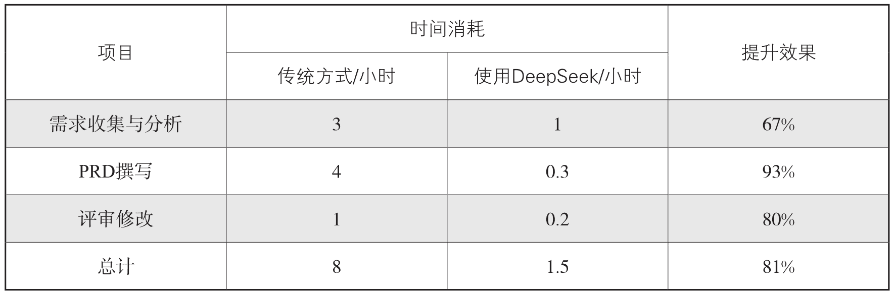

**1）需求收集与分析提速**

过去产品经理需要与多部门反复对齐、研究市场与用户反馈，收集需求通常需要 3 小时。引入 DeepSeek 后节奏发生改变，其具备的数据分析能力可从海量用户行为中快速提炼关键需求点，比如点击频次、停留时长等，还能自动生成问卷模板收集反馈、描绘用户画像洞察诉求。由此需求收集与分析时长从 3 小时缩短至 1 小时，效能提升 67%，为后续推进奠定扎实基础。

**2）PRD 撰写实现质变**

撰写 PRD 过去往往耗时 4 小时以上。如今 DeepSeek 带来明显跃升。它基于 671B 参数量的语言模型，能够一键生成 PRD 框架，并根据输入信息快速产出完整的功能描述。在此过程中，其自然语言处理能力得以体现，能理解意图并把复杂需求转化为清晰准确的文档，同时智能优化内容、借助推理能力给出改进方向，使文档关键点覆盖率提升 40%。产品经理稍作补充调整即可成稿，撰写时间从 4 小时降至 0.3 小时。

**3）评审修改更高效**

PRD 评审阶段过去需要约 1 小时提出修改意见。现在 DeepSeek 可以迅速解析评审意见，凭借推理与对产品的理解给出精准优化建议，范围涵盖内容合理性、逻辑性、用户体验及市场需求等。产品经理据此修改能快速解决问题，提升文档质量。评审修改时间从 1 小时缩短到 0.2 小时，提升幅度达 80%，助力项目更快定稿。

**2．技术团队：代码质量与交付效率同步提升**

在互联网技术领域，代码质量与开发效率是衡量项目成败的重要标尺。DeepSeek 的落地让技术团队实现了双重改善。从表 1-2 可以看出优化前后的效率差异。

**表 1-2 Git** ^(²)**提交记录分析**

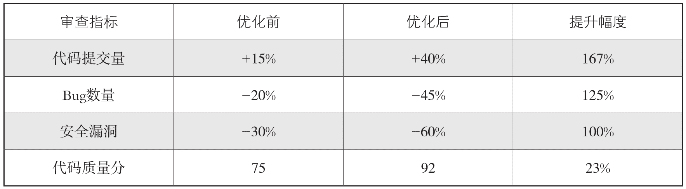

**1）代码审查进入闪电模式**

传统模式下代码审查依赖人工逐行核查，确保规范、逻辑正确且无隐患，效率易受人因影响。引入 DeepSeek 前，团队平均每小时仅能审查 200 行代码。DeepSeek 基于强算法与模型，可快速理解代码结构与逻辑，自动识别潜在问题，例如在 Python 代码审查中指出命名不规范、结构缺陷并给出建议。审查速度从每小时 200 行提升至 600 行，效率提升 3 倍，项目进程因此加快。

**2）漏洞检测与安全加固**

网络安全形势严峻，代码中的细小漏洞可能引发攻击、数据泄露。DeepSeek 在自动化漏洞检测与安全扫描上表现突出，能够分析大量代码样本、构建并丰富漏洞特征库，审查时快速匹配特征、精准定位 SQL 注入、XSS 等风险并给出修复建议。某电商平台引入后，依托其自动化检测发现并修复多项高危漏洞，代码安全性评分提升 40%，系统抗攻击能力增强，用户信任度随之提高。

**3）开发效率全面优化**

除审查与检测外，DeepSeek 对开发效率也有广泛助益。它能帮助开发者快速定位并修复 Bug，将修复周期从 72 小时压缩至 24 小时；还能分析代码挖掘可复用片段，某大型项目引入后复用率提升 35%；同时通过 CI/CD 流程自动分析代码变更、生成测试用例、预检代码，加快交付节奏，提升企业竞争力。

**3．运营团队：内容产出与转化效果双突破**

互联网竞争激烈，运营团队需兼顾用户吸引、活跃度提升与业务转化。DeepSeek 为运营提供了强力支撑，实现内容与转化的双重突破，工作活力显著增强。从表 1-3 可见其对运营效率的明显帮助。

**表 1-3 小红书数据表现**

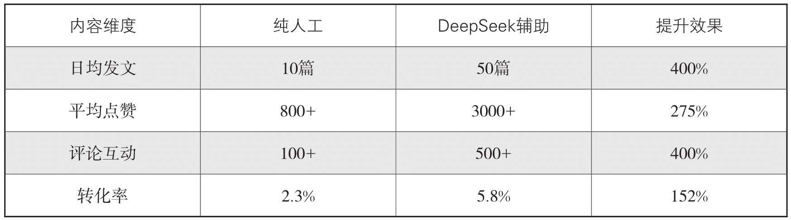

**1）内容创作爆发式增长**

传统运营下内容创作耗时耗力，运营人员日均产出约 10 条。DeepSeek 的多模态生成能力改变了这一局面，它可依据关键词快速生成高质量长短文案，还能捕捉全网热点融入创作，例如在热门影片上映时自动生成相关内容吸引关注。借助此能力，团队日均内容产出从 10 条增至 50 条，增长 4 倍，为品牌传播提供充足素材。

**2）用户互动明显增强**

互动率是衡量运营成效的核心指标。DeepSeek 通过分析百万级用户行为数据，洞察兴趣偏好、行为习惯与消费心理，比如解析社交媒体点赞行为以提供个性化内容推荐建议。同时它还能智能推荐互动策略，对活跃用户主动回复、发起话题；对沉默用户推送专属优惠券唤醒。上述策略使互动率提升 15%～30%，用户与品牌的黏性显著增强。

**3）转化效果实现跃升**

运营的最终目标是实现业务转化。DeepSeek 在客单价提升、复购增长与用户留存方面均发挥作用。它能分析消费数据推荐高价值产品推动升级消费；深入理解用户偏好提供个性化营销与推荐；优化体验并基于反馈改进产品，按兴趣推送内容。在小红书等平台的实践中，日均发文量、平均点赞量、评论互动数与转化率均大幅攀升，充分体现其提升运营效果的价值。

**4．DeepSeek 的投资回报与技术底座**

对 100 家应用 DeepSeek 的企业进行分析显示，AI 效能提升带来了显著投资回报，这不仅体现在短期经济收益，也促进了企业长期战略的落地。研究表明，AI 应用在多维度改善企业表现，为可持续发展注入动能。

**1）投入产出账本清晰**

在数字化背景下，DeepSeek 为企业带来可观回报。其部署方式灵活，支持私有云本地化部署；API 调用便捷且成本低，平均年成本约 15 万元／年，系统维护费用含模型更新与性能优化约 10 万元／年，人员培养分基础、进阶、实战，费用约 5 万元／年。

人效方面，它可帮助企业节省 2～3 个全职岗位，例如产品经理岗位效率提升 81%，错误率下降 60%，协作成本降低 45%。质量方面，文档、代码、内容质量分别提升 40%、23%、30%，错误成本下降 35%。整体来看，DeepSeek 是提升组织效能的有力工具，如表 1-4 所示。

**表 1-4 效能地图**

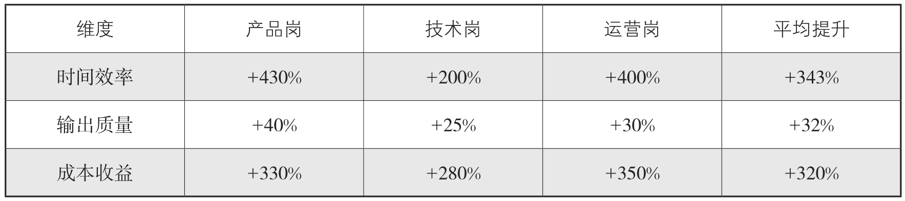

**2）创新架构赋能**

DeepSeek 能脱颖而出，根源在于其创新技术架构，包括混合专家系统 MoE、强化学习优化与多模态处理能力。

MoE 架构是核心之一，犹如专家团队，各自负责特定任务或数据。运行中每个 token 仅激活 37B 参数，可降低 90% 计算成本，并具备智能激活与动态调度能力，能应对复杂任务。

强化学习优化提升推理准确性，可针对不同业务场景动态调整策略，并基于使用效果持续迭代。

多模态处理能力是另一亮点，覆盖文本、代码与数据分析。文本理解支持 128K token 超长上下文；代码解析覆盖 87% 主流编程语言；数据分析支持多源异构处理，为企业提供全面支撑。

**5．落地实践的关键路径**

**1）试点先行、稳步推广**

企业引入 DeepSeek 时建议先做试点。选取 1～2 个核心场景快速验证，例如产品侧聚焦重点产品的需求分析和 PRD 撰写，技术侧聚焦关键项目的代码审查，以此检验效果、发现问题并及时调整。

试点期间需建立明确的效能评估指标，产品侧关注需求收集、PRD 撰写等，技术侧关注代码审查速度等，为决策提供依据。试点成功后，可逐步扩展至其他部门与场景，如从产品延伸到运营，从技术扩展到更多开发维护项目，稳步提升整体效能并控制风险。

**2）团队赋能、持续提升**

团队能力是成功应用的保障。基础培训阶段应提供核心功能使用指导，通过课程与实操演练帮助员工快速掌握基本操作与应用技巧，例如在需求分析、代码审查培训中培养相应技能。

场景实践是赋能关键，应组织员工在重点业务场景中实战，让其在真实工作中深化理解，例如产品需求分析、代码开发实践等。持续优化方面，定期复盘与经验分享，总结问题与解法、交流成功案例，促进相互学习与共同进步，从而提升团队应用水平与工作效率。

**3）效能监控、持续改进**

监控是确保价值持续释放的重要手段。企业应设定明确的效能提升目标，如产品经理需求收集时长缩短、技术团队代码审查速度加快等，便于评估应用效果。

同时建立质量监控体系，对 DeepSeek 生成的文档、代码、内容从完整性、规范性、吸引力等维度检查，及时发现问题并改进，提升应用质量。持续收集员工与用户反馈，据此调整应用策略与参数，优化系统以满足需求并持续提升效能。

DeepSeek 如同互联网行业的及时雨，不仅提升工作效率，更在改变从业者的思维方式。过去大量时间耗费在繁琐事务上，创造力与思考被占用；现在人们被解放出来，能更专注于业务本质、挖掘创新点、规划战略方向。

未来随着人工智能持续演进，DeepSeek 将不断迭代，其在互联网等领域的应用前景更广，助力行业创新变革，帮助企业脱颖而出。在 DeepSeek 等技术的引领下，互联网行业将创造更大价值。

**1.2 核心能力图谱**

当前科技演进加速，人工智能正以前所未有的速度重塑各行业。多模态处理技术如同一颗新星，照亮了 AI 进步的方向。在这一充满创新与挑战的赛道中，DeepSeek 凭借卓越技术与前瞻布局脱颖而出。它不仅拥有独特的多模态处理中枢，通过创新架构与先进算法实现多模态信息的高效融合与智能处理，还构建了强大的开源生态，从 API 架构到安全机制，从开发支持到插件生态，每一环节都精细打磨。如何深入了解 DeepSeek 在多模态处理领域的表现及其为各行业提供的创新解决方案与强力支撑？让我们一同揭开面纱。

**1.2.1 多模态处理中枢**

多模态处理技术是推动人工智能快速发展的关键力量。DeepSeek 依托创新架构与卓越性能，在该领域占据重要地位。它融合文本、图像、音频等信息，提供智能全面的交互体验，在文档处理、图像识别、语音交互等方面展现出强大的处理能力与适应性。

DeepSeek 的 MoE 架构与 MLA 技术为多模态能力提升奠定基础。MoE 架构可动态分配计算资源，提升处理效率与灵活性；MLA 技术深度解析不同模态数据，实现信息精准融合与高效利用，增强复杂任务处理能力。二者协同使 DeepSeek 成为行业佼佼者。

**1．技术架构解析**

**1）多模态对齐机制**

在多模态处理中，统一向量空间是信息融合的关键。DeepSeek 借助 MoE 架构，将文本、图像、音频等不同模态数据映射到统一向量空间，实现多模态信息的统一表征与对齐，为跨模态推理与任务执行奠定基础。

MoE 架构通过动态路由机制把输入数据分发给最合适的专家子网络处理。在处理文本与图像多模态任务时，模型依据数据特征自动选择擅长文本与图像的专家分别处理后再融合结果，从而提升效率与理解能力。MoE 架构如图 1-1 所示。

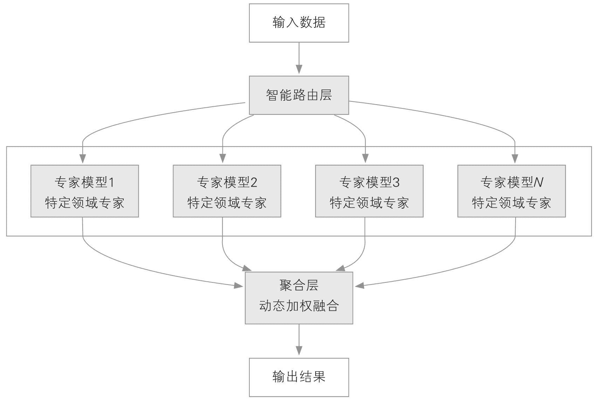

**图 1-1 DeepSeek 的 MoE 架构**

为优化性能，DeepSeek 采用 MTP 策略，动态调整专家子网络负载，避免部分过载、部分闲置，提升整体效率与稳定性，在保证准确性的同时加快训练与推理速度。

此外，DeepSeek 支持 128K token 超长上下文窗口，能够处理更长文本与更复杂的多模态内容，在长篇文档处理中更好地理解结构与语义，提升多模态理解深度与准确性。

**2）智能理解引擎**

DeepSeek 的智能理解引擎基于 MLA 技术，实现高效推理。MLA 技术通过多头注意力计算，可同时关注数据的不同部分，更好捕捉关键信息与语义关系。处理文本时，它可同时关注词汇、句式与语义，从而更准确理解含义，其运行流程如图 1-2 所示。

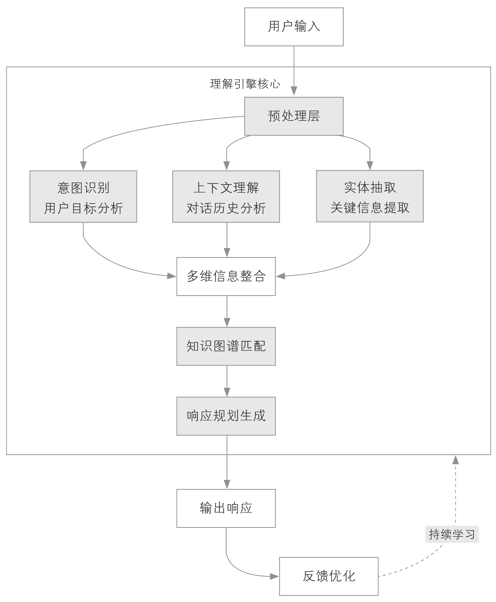

**图 1-2 DeepSeek 智能理解引擎运行流程**

处理图像时，MLA 技术关注不同区域、物体特征与空间关系，实现图像精准解析，帮助模型在多模态数据中快速提取关键信息，提升推理效率与准确性。

为提升性能，DeepSeek 采用 MTP 训练目标。与传统单 token 预测不同，MTP 让模型同时预测多个 token，增加训练信号密度，提高数据分析效率。训练中模型可依据上下文同时预测多个后续 token，提升上下文感知与生成能力。

MTP 助力模型在实际应用中加快解码速度，生成更连贯准确的文本。在文本生成任务中，模型可一次性生成多个合理后续词汇，提升效率与质量。

DeepSeek 的 MoE 架构通过动态调度 37B 激活参数，提升任务处理能力。面对不同任务与数据，模型可据需求动态分配计算资源、激活合适专家子网络，如数学问题激活擅长领域专家，语言翻译激活精通该领域的专家。该机制让模型充分发挥各子网络优势，提升整体性能与适应性。

**3）跨模态推理链路**

DeepSeek 支持文本、代码、图像、音频等多种输入形式，能够灵活应对不同类型任务与数据。用户可输入文本让模型生成对应图像，也可输入图像让模型生成描述性文本，还可输入音频进行语音识别与语义理解。这种多模态输入支持使 DeepSeek 能满足不同场景需求，提供更全面智能的服务。跨模态推理链路流程如图 1-3 所示。

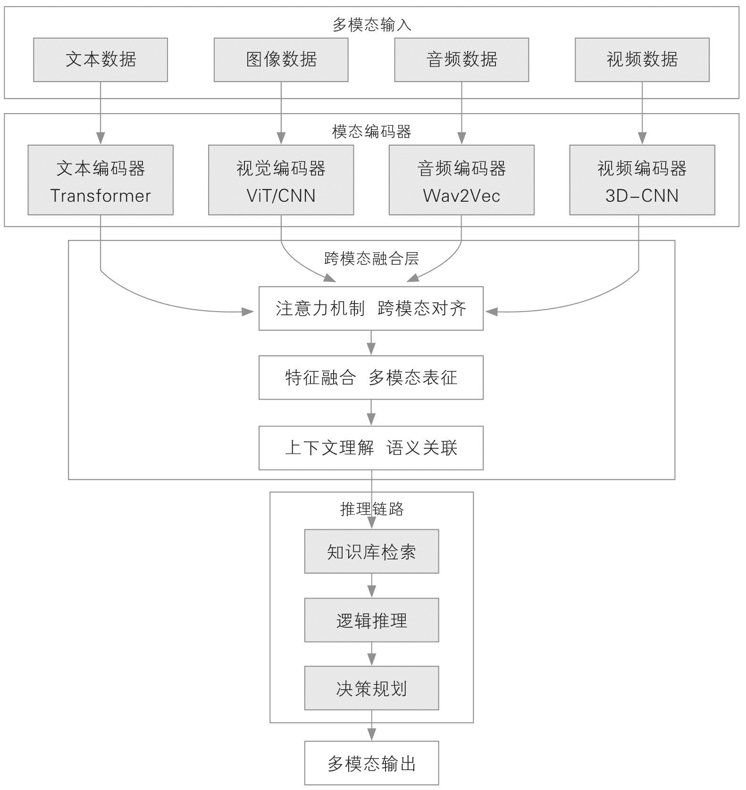

**图 1-3 DeepSeek 跨模态推理链路流程**

为提升跨模态推理能力，DeepSeek 采用三阶段训练流程：预训练、监督微调、强化学习。预训练阶段，模型学习大量多模态数据，掌握基本特征与语义信息，建立初步多模态理解能力；监督微调阶段，通过学习标注数据优化参数，提升特定任务准确性；强化学习阶段，通过与环境交互调整策略、最大化奖励信号，提升决策与适应能力。

经过三阶段训练，DeepSeek 不断优化性能，提升多模态数据理解与处理能力。实际应用中，它能依据用户输入准确进行跨模态推理，实现多模态信息高效转换与利用。

DeepSeek 内置完整道德伦理框架，确保输出安全可控。生成文本、图像或音频时，系统会依据规则检查过滤，避免有害、虚假、不道德内容；回答问题时遵循科学知识与道德准则，提供准确有益建议。该框架保障用户与公共利益，提升模型可信度与可靠性。

**2．核心能力矩阵**

**1）文本理解与生成**

DeepSeek 能力图谱与落地方法论

文本理解与生成端表现突出。在 MMLU 等通用语言理解基准上得分领先，整体水平可与 GPT-4o、Claude 3.5 Sonnet 同一梯队，复杂语义与知识推理的把握精准，输出文本质量稳定。

多语言覆盖全面，中文专项 C-Eval 测试同样亮眼，能满足差异化语言场景，中文表达准确、流畅，为中文用户提供高效服务。生成速度最高达 60 TPS，响应节奏明显加快，工作效率与交互感受同步提升。

2）视觉理解与合成

Janus-Pro-7B 是视觉相关能力的代表模型，支持基于自然语言描述的图像合成。输入如“星空下古堡”即可快速得到匹配画面。

在专业图像解析上，能细致识别界面稿、技术图表等材料，在产品设计侧提取关键元素辅助方案优化，在工程侧帮助解读数据。另提供图像增强、瑕疵修复等进阶处理，提升模糊图清晰度与完整性，在图像编辑领域具备实用价值。

3）多模态协同

（1）由文本驱动多模态
可将文字高效转化为多模态产出，为各行业创作提供新思路。设计环节能把需求文档自动转成原型图，缩短周期；营销环节可依据文案自动生成社媒素材，促进品牌传播；技术环节可把文档可视化为流程图、架构图，提升协作效率。

（2）由多模态回流文本
信息抽取与整合效率高。设计中可精准提取稿件的样式规范，降低误差；图片处理中可自动生成利于搜索的描述文案，助力网站排名与流量；数据分析中可识别图表并输出分析报告，为决策提供依据。

（3）跨模态内容优化
长对话场景下借助 CRE ^(⁴) 技术可保留历史信息，准确捕捉用户意图，实现连贯交流。话题切换时仍能基于上下文给出合理自然的回复，交互体验流畅。

借助分布式计算实现资源调度，大数据与复杂任务可拆分至多节点并行处理，提升速度、降低成本，并可应对高并发，支撑更多用户。多终端响应式优化可随屏幕尺寸与分辨率自动调整界面与内容呈现，保证跨设备体验一致。

3．行业应用实践

1）产品设计领域
可与 Figma、Adobe XD、墨刀 等原型工具协同，构建智能设计流程。结合 GitHub Copilot、通义灵码 等代码助手，实现从 PRD 到交互原型的全链路自动化。产品经理在 MarsCode 或 Cursor 等智能 IDE 中撰写结构化 PRD 后，系统基于多模态理解自动生成含布局的原型文件直推至 Figma 设计系统。

生成原型遵循响应式规范，可无缝衔接 Trae、RooCode 等跨平台开发工具做多端适配验证。结合 CodeGeeX 审查能力，在规范检查阶段可自动对齐组件库与 Material Design 等标准。

协同层面与腾讯文档、飞书多维表格深度融合，提供实时协作看板。资产管理可自动对接蓝湖、Pixso 等资源平台，并借助 Cline 智能标签实现素材精准检索。

2）内容运营场景
与 Jasper、Copy.ai 等写作工具形成互补生态。运营团队可经 Hootsuite、蚁小二 等社媒管理平台接入，实现从热点挖掘到多平台分发的智能闭环，热点数据可借助新榜、5118 等工具获取。

创作阶段初稿经 Grammarly 语法修正，再由 SurferSEO 关键词优化。智能评估体系整合易撰、清博 等舆情数据，结合 Tableau 搭建可视化决策看板。

创意辅助上与 Canva 模板库、稿定设计 素材库实时联动，并借助 Midjourney 提供配图建议。数据驱动模块可对接 GrowingIO、神策数据 等分析平台，自动生成类似友盟+风格的运营报告。

3）技术研发支持
研发侧与 GitHub Copilot、通义灵码 构成 AI 开发组合。开发者使用 VS Code+Cursor 或 IntelliJ+MarsCode 等智能 IDE 时，可获得 Python/Java/C++ 跨语言转换支持，代码生成质量经 CodeGeeX 验证可达 98%。

单元测试阶段生成用例可通过 Postman 自动校验，异常覆盖度较传统方式提升 40%。代码优化建议整合 SonarQube 静态分析与 JProfiler 性能诊断数据。

文档体系支持自动生成 Swagger 风格 API 文档，并通过 Mermaid 实现技术方案可视化。知识图谱与 Confluence、语雀 等知识库双向同步，结合 RooCode 智能检索，使技术资产复用率提升 60%。

4）效能管理实践
效能管理中与飞书多维表格、Teambition 深度集成，构建智能协作中枢。通过明道云、简道云 等低代码平台，实现目标拆解到执行监控的全流程数字化。管理者在飞书 OKR 模块设定战略目标后，系统可经自然语言解析自动生成任务树状图，并按团队成员技能标签智能分派至 Teambition 看板。

执行中实时同步 Jira、Tapd 等项目管理数据，利用线性回归模型预测进度偏差并提前预警。资源调度引擎整合 Worktile 负载均衡算法，可动态优化研发资源池，使资源利用率提升 35%。

绩效评估方面对接北森、Moka 等 HR 系统，支持 360 度评估数据自动采集。智能报告模块调用 FineBI 数据模型，生成类似神策分析风格的效能洞察看板，关键指标覆盖需求吞吐量、迭代周期等 12 维度。

知识沉淀环节通过 RPA 自动抓取会议纪要，经语雀 AI 助手提炼为标准化 SOP 文档，使组织经验复用率提升 50%。

DeepSeek 的工具链全景如表 1-5 所示。

表 1-5 工具链全景展示

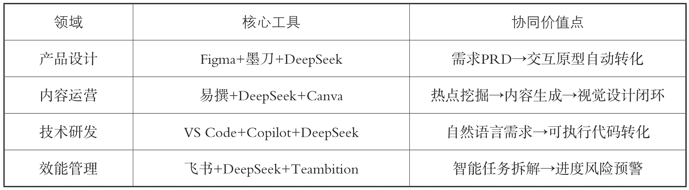

MoE 架构经 API 网关连接主流开发者工具，形成可扩展的 AI 生产力矩阵，使能力覆盖研发全生命周期。

4．效能提升实践

1）落地效果评估
企业引入后效能明显提升。产品设计中借助智能原型生成与协同，需求到原型的转换时间大幅缩短，整体流程提速超 40%，团队可实时协作，提升效率与质量。

内容生产中依托全链路生产与创意辅助，运营人员可快速产出多形态内容并灵活调整策略，效率可提升 3 倍，同时智能评估体系保障质量。

技术文档编写中代码智能转换与文档体系构建可节省 50% 时间，并自动生成 API 文档与可视化方案，便于交流共享。

为保障输出质量，集成偏差识别与纠正机制，实时监测结果并建立多维度质量评估，同时引入自动化合规审查，保障内容安全合规。

2）实践建议
深度应用前需制定清晰路径，根据业务需求和目标明确应用环节及与现有流程的结合方式。例如产品设计中如何从智能原型生成延伸至相关环节，内容运营中如何从内容生成拓展至其他流程。

建立完整评估标准很重要。应基于业务目标和质量要求制定指标和方法，定期量化评估效率、质量、成本，并收集用户反馈以便持续优化，确保创造业务价值。

持续积累不可或缺。应定期总结经验、提炼方法并推广，建立内部知识库保存案例与技巧，提升团队应用水平与模型效果。

3）风险防控要点
数据安全与隐私保护是核心。需建立严格机制保障存储与传输安全，对敏感数据加密、限制访问权限、定期演练备份恢复。

内容审核机制必不可少。生成内容存在风险，需人工与自动审核结合，检查真实性、合法性、合规性，及时处置问题内容。

应急响应预案是风险防控关键。需提前制定流程、分工、措施并定期演练，提升风险应对能力。

1.2.2 开源生态扩展能力
DeepSeek API 凭借高性能与多模态能力，成为连接 AI 技术与产业应用的枢纽。自然语言处理侧实现智能客服与多语言实时翻译，计算机视觉侧赋能安防监控等场景。作为开源生态关键组件，平台显著降低应用门槛，支持快速集成与垂直领域定制。

1．REST API 架构特性

1）核心架构设计
采用标准 REST 架构，因简洁高效被广泛认可。基于 HTTP 协议，使用统一接口与 URI 操作资源，交互直观。例如获取用户信息可发送 HTTP GET 请求至 https://api.deepseek.com/users/{user_id}。

API 支持 HTTP/HTTPS 访问。HTTP 简单快速灵活，HTTPS 在此基础上借助 SSL/TLS 提供加密与身份认证，采用对称与非对称加密结合保障传输安全，服务器需向 CA 申请数字证书以防中间人攻击，兼顾通用性与安全性。

无状态设计是核心优势，服务处理请求不依赖历史状态，保持独立。可扩展性增强，高并发时可独立处理请求，通过扩容满足业务增长，同时简化维护调试，降低复杂度与出错概率。

2）内置智能负载均衡机制
为保障高可用，API 体系内置智能负载均衡，实时监测服务器 CPU 使用率、内存占用、连接数等指标，评估工作状态与处理能力。

请求到达时依据轮询、最少连接、最短响应时间等算法，结合实时负载将请求分发至不同节点。算法选择灵活，可根据业务场景与节点性能动态调整。

机制可避免单点故障，节点异常或过载时自动将请求转发至健康节点，保证服务稳定。业务高峰期可分散流量，维持系统平稳运行。

3）支持异步调用模式
API 支持异步调用以优化响应。传统同步调用需等待服务器返回后才能继续执行，会阻塞线程，降低并发性能。

异步调用下请求发出后线程可立即处理其他任务，服务器后台执行，完成后通过回调通知结果，提升开发效率与资源利用率，适用于复杂数据分析、模型训练等耗时任务。

2．接口安全机制

1）采用 Bearer Token 认证机制
Bearer Token 基于令牌的身份验证，广泛用于授权访问。用户登录后服务器验证凭证并返回唯一加密令牌，客户端存储并在后续请求头以 Authorization: Bearer <token> 形式携带。服务器校验有效性后决定是否放行。

机制确保仅授权用户可访问资源，令牌通常设置较短有效期并通过 HTTPS 传输，提升安全性。

2）支持细粒度的访问控制策略
细粒度访问控制实现精细化权限管理。API 支持基于角色的访问控制 RBAC，按用户角色分配权限，例如管理员拥有全部资源权限，普通员工仅有只读权限，提升管理效率与安全。

同时支持基于属性的访问控制 ABAC，依据用户部门、职位及资源敏感级别等属性动态决策权限，灵活性更强。还支持基于资源的访问控制，对每个 API 资源单独定义权限，实现精准保护，便于满足 GDPR 等合规要求。

3）内置 DDoS 防护与流量控制
为抵御 DDoS 攻击与异常流量，API 内置防护机制与流量控制。DDoS 防护采用流量清洗技术，实时监测分析异常流量并引流过滤，合法流量回送服务。智能防御策略基于机器学习建立正常流量模型，偏离阈值时触发防御。

流量控制按预设规则管理流量，可根据资源使用情况动态调整，优化资源利用并提升体验。

4）全链路数据加密传输
数据传输采用全链路加密，从发送端到接收端全程密文。发送端使用对称加密如 AES 生成随机密钥，用接收方 RSA 公钥加密密钥一并传输。传输中攻击者无法解密，篡改行为会被完整性校验发现。

系统定期更新与严格管理加密密钥，采用安全存储与分发机制，为 API 数据传输提供可靠保障。

3．开发支持体系

1）提供多语言 SDK 支持
为降低接入门槛，提供覆盖 Python、Java、Node.js 等主流语言的 SDK。例如 Python SDK 封装复杂调用逻辑，文本分类任务只需调用 deepseek_sdk.text_classification 并传入参数即可。Java 开发者可通过简洁接口快速搭建智能客服系统。多语言支持提升开发效率，促进应用落地。

2）完整的 API 文档与示例代码
提供完整 API 文档，清晰说明接口用途、请求方法、参数含义与类型、响应结构。并配套丰富的示例代码，覆盖常见场景，帮助开发者快速上手。

3）插件开发脚手架工具
为鼓励插件生态，提供开发脚手架工具。工具提供基础目录结构与初始化模块，开发者可在其上二次开发，快速构建特定功能插件，加快开发节奏，丰富应用场景。

4）开发者社区技术支持
活跃的开发者社区为使用者提供互助与专业支持，问题可在社区提问并获得方案分享，同时成果展示与反馈机制推动开源生态发展。

4．插件生态系统

1）企业级应用插件

DeepSeek 企业智能化能力全景

在办公协作与业务运转全面走向数字化的当下，市场对高效智能工具的依赖持续增强。DeepSeek 通过插件矩阵逐步覆盖企业级使用场景。

沟通类客服模块支持多轮连贯对话并可联动知识库检索，电商商家借助该能力能迅速回应消费者关于商品的各类咨询，服务响应速度和满意度随之提升。

代码类助手贯穿开发全流程，提供编写、评审与重构能力，在维持代码质量的前提下加快交付节奏，降低研发投入。

文档中心兼容多种格式，可快速提炼要点、汇总多源材料、转换格式，并内置 OCR 扫描识别，明显提升办公效率。

分析工作台提供可视化呈现与自动化报表。以零售行业为例，平台能够整合多类经营数据进行综合研判并输出报告，为经营决策提供支撑，增强市场竞争力。

**2）行业定制方案**

凭借高适配性的接口能力，平台已在多个细分领域形成创新落地。

金融风控场景下，通过实时解析百万级交易记录构建异常行为模型，实现毫秒级风险预警，同时具备组合压力测试与 VaR 测算功能。

医疗诊断场景基于电子病历搭建多模态诊断系统，可同步解读 CT 扫描图像特征与病理报告，输出三种可能的鉴别诊断建议。

教育培训场景搭建动态知识图谱，融合学员行为数据与学科知识点，生成个性化学习路径，资源完成率较传统做法提升 42%。

智能制造场景部署边缘计算节点实时采集产线传感器数据，结合时序预测模型优化节拍，借助机器视觉实现 0.01mm 级缺陷检测。

需要特别说明的是，本书聚焦平台作为提效工具的实践，其更深层的价值体现在系统级整合能力。例如把接口深度嵌入智能营销系统，可实现：

● 用户画像实时更新：融合行为数据与社交舆情，生成动态标签。
● 商品画像特征建模：解析商品图像与用户评论，构建向量空间表示。
● 智能推荐引擎：搭建召回、粗排、精排三层结构，支持 A/B 实验与实时调优。

关于大模型在智能营销系统中的工程落地，可参考作者另一本著作《智能营销——大模型如何为运营与产品经理赋能》，书中系统阐述了从数据治理到场景落地的完整方法论，涵盖用户生命周期管理、动态定价策略、跨渠道归因分析等核心模块的技术实现。

**5．社区共建机制**

**1）插件评价与推荐机制**

平台的插件评价与推荐对质量提升和优秀插件传播起到关键作用。开发者上线插件后，用户可从实用性、运行表现、易用性等维度给出星级评分与文字反馈。系统据此排序，高分且口碑良好的插件会获得更高曝光并被个性化推送。该机制为开发者持续迭代提供动力，形成良性循环，推动生态繁荣。

**2）开发者激励计划**

为调动参与热情与创造力，平台推出兼顾物质与荣誉的激励方案。对产出优质插件的开发者，按质量与受欢迎程度发放现金奖励，高分且下载量达标者可获数万元奖金，新增优质插件还能获得更多曝光；积极解答技术问题、协助解决难题的开发者可获开发工具奖励及流量扶持。设立“月度优秀开发者”称号，在官网与社区公开表彰，获奖者有机会受邀参加行业活动。

**3）技术创新孵化项目**

技术创新孵化是培育新思路、推动落地的重要载体。拥有新 AI 应用场景探索或现有技术改进想法的开发者可提交申请，评审团队重点评估创新性、可行性及潜在价值，例如智能医疗影像诊断项目。入选后，可获得导师指导、海量高质量数据集使用权限、研发资金支持以及投资与合作对接资源。诸多创意借此转化为产品，如智能教育产品，获得市场认可并为开发者带来荣誉与收益。

**4）定期开发者大会**

开发者大会是年度技术交流盛会，为参与者提供学习、分享成果与了解行业趋势的平台。大会会发布最新技术进展与战略方向，邀请行业专家分享前沿思路，并为开发者提供成果展示与合作对接机会。通过大会，平台加强与开发者的互动，提升影响力，吸引更多力量共同推动人工智能发展。

**6．个性化能力**

**1）模型定制技术**

不同行业与场景对网络存在特定需求，平台提供强大的模型定制能力。低资源微调 LoRA、增量学习、梯度检查点机制与分布式训练框架协同工作，提供高效定制方案。

LoRA 是一种高效参数定制方法，可在有限资源下完成网络调优，降低成本与门槛。传统全量调优成本高、硬件要求高，LoRA 通过训练少量新增低秩参数，使中小企业可用普通 GPU 实现特定应用。

增量学习让网络在保留已有知识的基础上持续吸纳新数据，避免“灾难性遗忘”。客服场景可借此提升回答的准确性与全面性。

梯度检查点机制通过选择性存储中间结果并在反向传播时重算前向传播，降低深层网络训练的内存占用，避免因内存不足中断大规模语言模型训练。

分布式训练框架将网络与数据分发至多节点并行计算，支持多种并行策略，显著缩短大型图像识别等模型的训练时间。

在垂直领域，定制技术应用广泛。例如法律领域可利用 LoRA 定制处理专业任务并扩充词表，结合增量学习不断完善能力；多语言处理场景下，可借助梯度检查点与分布式训练在有限资源下训练高性能模型。

**2）效果验证**

为验证定制有效性，平台开展系列测试。结果显示，定制后网络在多任务学习准确率提升 15%～30%，文本分类准确率由 70% 提升至 85%，新闻分类更加精准；LoRA 等低资源方法仅训练少量参数，计算量与硬件需求大幅下降，成本降低约 80%；推理延迟减少 40%，更利于实时应用；资源占用与硬件成本显著下降，性能与稳定性同步提升。整体来看，该技术可为企业提供高效低成本的定制路径。

**7．部署形态**

**1）混合云架构**

数字化转型中，企业对部署模式需求多样。平台的混合云架构融合公有云、私有化部署、边缘计算与混合模式，可适配不同场景。

公有云服务以在线 API 形式提供，按需付费，成本优势明显，无需大量硬件与许可证投入，且可灵活扩缩容，降低运维门槛。

对数据安全要求严格的金融、政务等机构，可选择私有化部署本地 GPU 集群，完全掌控数据并按合规要求调整配置规模。

在自动驾驶、智能安防等高实时场景，边缘计算服务可实现低延迟本地推理，提升响应速度与安全性。

混合架构结合公有云与私有部署优势，企业可按数据敏感度与业务需求分离处理，提升运营效率。

**2）资源调度优化**

资源调度优化是保障系统高效运行的关键。平台采用动态负载均衡、自适应批处理、模型压缩加速与算力弹性伸缩实现合理资源利用。

动态负载均衡实时监测服务器负载并动态调整任务分配，电商大促时可确保系统稳定处理海量请求。

自适应批处理依据任务与资源自动调节批大小，在深度学习训练中提升资源利用率与处理速度。

模型压缩加速通过剪枝、量化等手段降低网络复杂度，缩短推理耗时并降低部署成本。

算力弹性伸缩可按业务需求自动调配计算资源，在线教育平台可在高峰低谷期灵活分配资源，提升经济效益。

**3）运维保障**

运维体系覆盖全链路监控告警、自动化运维工具、灾备切换机制与性能诊断分析。

全链路监控实时采集性能指标并跟踪 API 调用，异常时及时告警并定位修复。

自动化运维工具支持服务器自动化部署等操作，提高效率并降低出错率。

灾备切换机制构建主备系统并实时同步数据，故障时备用系统快速接管，保障业务连续性。

性能诊断与分析系统持续收集数据并建模预测问题根因，辅助运维人员优化模型。

**8．开放优势**

**1）安全合规**

平台重视数据安全与隐私合规。系统支持端到端加密，传输与存储均采用多重加密并管理密钥；具备敏感信息识别与脱敏能力，提供完整数据访问审计日志，便于风险追溯与合规审计。

在合规认证方面，遵循国内外相关标准与法规，符合 GDPR，通过 ISO 27001 认证，满足《网络安全等级保护条例》即等保 2.0 要求，并支持合规审计。此外，系统支持联邦学习等隐私计算技术，为企业协作创新提供安全保障。

**2）成本效益**

平台的技术架构与创新方案具备明显降本增效优势。混合云架构允许企业按需选择公有云、私有化或边缘计算，实现资源最优配置；资源调度优化技术进一步降低硬件、运维与培训成本，同时保证平滑升级无中断。

平台自动化率提升 60%，可快速处理复杂数据，提高资源利用率并缩短研发周期，增强市场竞争力。强大的数据分析与预测能力助力企业实时监测市场并及时调整策略。丰富的插件生态与定制能力激发创新活力，推动多领域新应用落地，提升品牌影响力与投资回报率。

**9．落地方法**

企业落地时需制定科学实施路径，涵盖需求分析、实施规划、落地保障与风险管控。

**1）需求分析**
评估业务场景对平台的优化空间，如电商企业逐环节分析适用性；检查技术栈兼容性以确保无缝对接；梳理数据安全要求；评估投资回报可行性。

**2）实施规划**
明确阶段性目标并分解任务；设计合理技术架构；编制资源配置方案；建立进度监控机制确保按期交付。

**3）落地保障**
组建涵盖技术、业务与管理的专业团队；完善培训体系并引入相关技术；建立评估机制定期复盘；设立持续改进机制推动优化。

**4）风险管控**
技术风险方面，实施前进行性能基准测试与容量规划评估，验证兼容性并制定应急预案；数据风险方面，对数据分类分级、严格管控访问权限、加密传输并制定泄露应急预案；运营风险方面，建立监控指标体系，制定 SLA 保障方案，及时收集用户反馈并持续改进。

**1.3 DeepSeek 与 GPT 的差异化竞争分析**

在人工智能快速演进的浪潮中，大语言模型的竞争日趋激烈，DeepSeek 与 GPT 的对决备受关注。DeepSeek 以独特架构与创新理念突围，GPT 则凭借先发优势与强大影响力占据市场。两者的差异不仅关乎自身发展，也影响行业走向。以下从核心技术架构、功能特性、商业应用与生态体系进行剖析。

**1.3.1 核心技术架构对比**

**1．基础架构：探寻深层差异**

**1）模型结构设计**

DeepSeek 采用 MoE 架构，即混合专家系统。多个专业子网络并行工作，各自专注特定任务类型，智能路由机制会根据输入特征动态激活相关专家。例如处理数学问题时激活数学推理专家，处理情感分析时激活语义理解专家。团队化协作模式使问题解决更精准。

MoE 架构还采用无辅助损失的负载均衡设计，确保各专家使用频率相对均衡，避免资源闲置。另引入多头潜在注意力机制 MLA，通过潜在向量缓存自回归推理中间结果，降低计算量并提升运行效率。

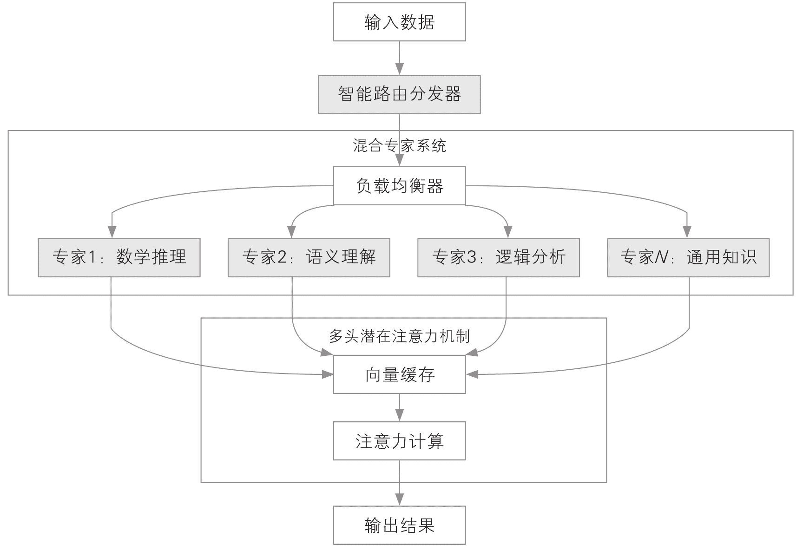

**图 1-4 DeepSeek MoE 架构**

GPT 采用传统 Dense 架构，基于 Transformer 构建，拥有单一大规模参数矩阵，处理任务时所有参数均参与计算。统一注意力机制使网络在处理序列时兼顾整体上下文信息，通过全量参数捕捉复杂模式与依赖关系。例如语言生成时基于已生成内容预测下一个词。

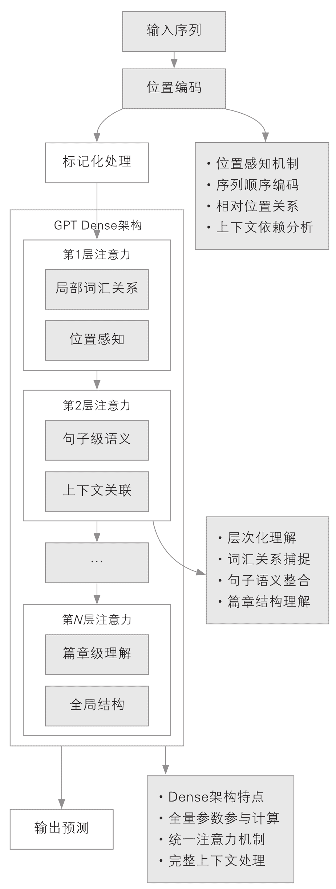

**图 1-5 GPT Dense 架构**

GPT 具备层次化自注意力结构，可捕捉不同粒度的语义信息，从局部词汇关系到整体篇章结构。同时，位置编码与上下文理解机制帮助网络感知词序与逻辑关系。

**2）计算单元设计**

DeepSeek 在计算单元层面进行多重优化。专家模块可动态调度，按任务类型与数据特征灵活激活，避免资源浪费。稀疏激活机制仅让与当前任务相关的部分参数参与计算，大幅减少计算量，简单任务只需激活少数专家。并行计算优化将任务分发至多计算单元同时执行，加快速度。低秩矩阵分解技术降低矩阵运算复杂度，提升效率。

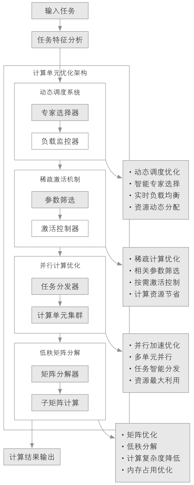

**图 1-6 DeepSeek 计算单元优化**

GPT 计算单元基于密集矩阵计算，每次运算全参数激活，虽能充分利用网络知识，但计算成本与资源消耗较高。大规模数据处理时计算量急剧上升，对硬件能力与内存要求严苛。

GPT 采用序列并行处理，按顺序处理输入以保持上下文连贯性，但限制了并行度。为缓解训练压力，采用梯度累积优化，将多次小批量梯度累积后再更新参数，降低资源峰值需求。

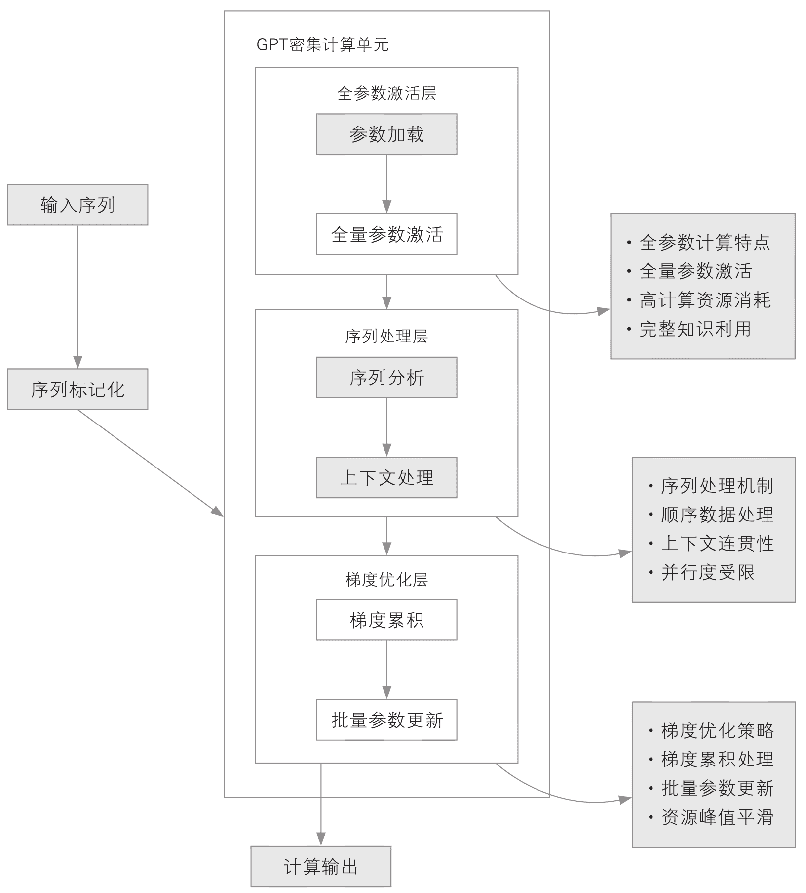

**图 1-7 GPT 的密集计算单元模式**

**2．训练策略：策略背后的较量**

**1）模型训练方法**

DeepSeek 采用专家路由训练策略，通过智能路由将输入数据分配至最合适的专家模块，使各专家在擅长领域发挥最大效能。训练过程中动态激活相关专家，提升针对性与效率。

动态负载均衡机制实时监控各专家负载并调整路由策略，保证各模块得到充分训练，提升整体稳定性。

在分布式训练方面，采用高效通信协议与并行计算策略，减少通信开销与资源浪费，支持大规模集群快速训练。同时提出增量预训练方案，在已有网络基础上不断引入新数据与新任务，使网络持续学习新知识并适应新场景。

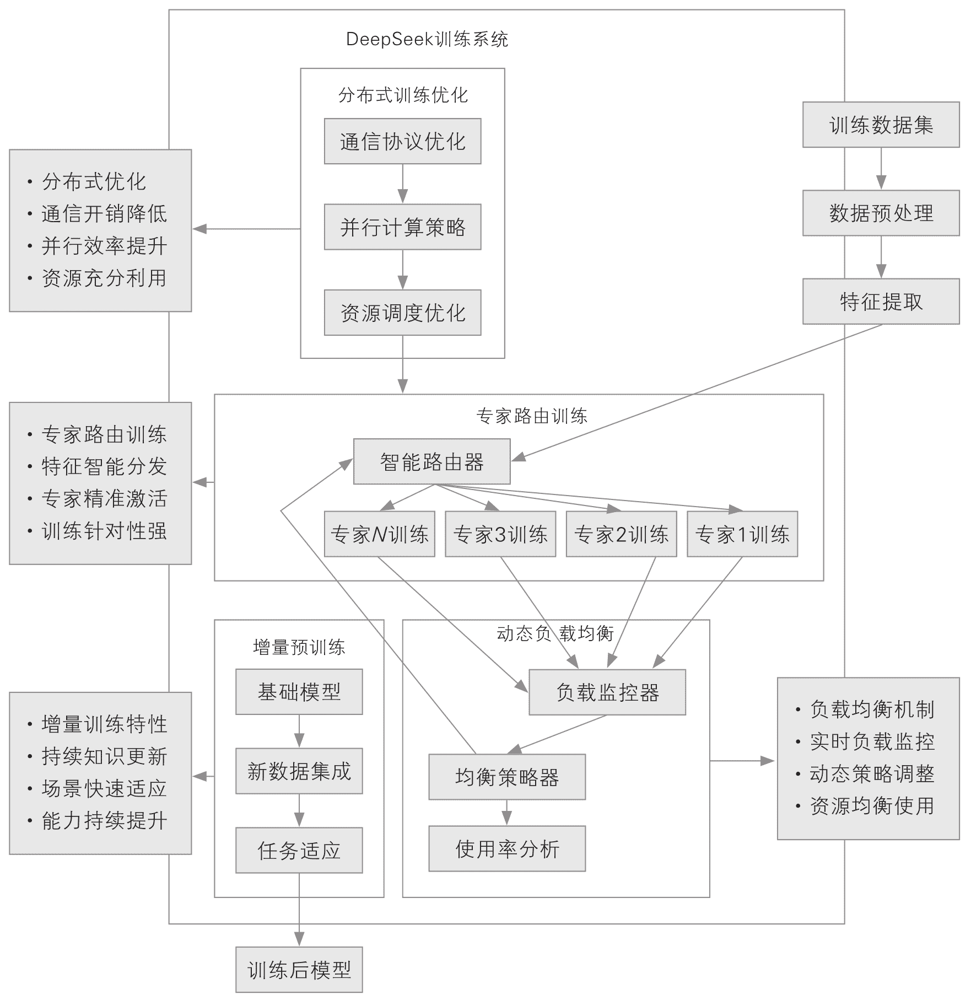

**图 1-8 DeepSeek 的模型训练方法**

**GPT 训练机制拆解**

GPT 的培养路线与常规做法不同。先用大规模文本做无监督预训练，让模型习得语言的普遍规律与常识基础；随后叠加基于人类反馈的强化学习 RLHF，借助用户对生成结果的评判作为优化信号，反复校准输出，使之更贴合实际需求。

全过程坚持统一预训练思路。预训练阶段忽略任务类型和数据特征，对全部资料同等学习。这种做法能沉淀宽泛的知识储备并提高泛化水平，却也容易在单一任务上显得不够聚焦。为弥补这一局限，GPT 通常在预训练基座上进行全量微调，用特定任务的数据重新训练全部参数，以期在细分场景中表现更优。流程示意见图1-9。

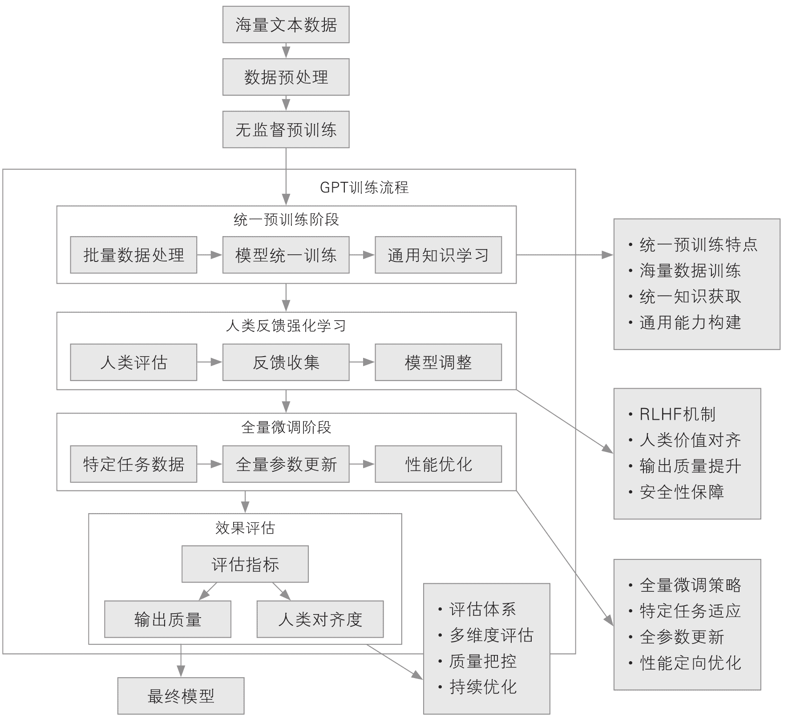

**图 1-9 GPT 的模型训练过程**

2）计算效率对比

在算力使用效率上，DeepSeek 更占优势。模型采用动态激活策略，处理任务时只启用约30%~40%的计算单元，明显提升效率。以简单的文本分类为例，仅需激活与分类相关的专家模块即可完成，无需调用全部参数。GPT 则采用全参数激活，推理时始终消耗100%的静态算力，无论任务轻重都满负荷，效率偏低。研究表明 DeepSeek 的资源利用效率达到 GPT 的2.5至3.3倍，相同硬件下能承接更多请求，或在相同负载下硬件开销更少。

内存占用方面，DeepSeek 使用按需动态分配，按任务需求实时调配内存，有效压低峰值占用，对比 GPT 可减少约40%。面对长文本时，会根据长度和复杂度弹性调整，避免因内存不足导致中断。GPT 则在启动前固定分配内存，占用稳定但缺乏弹性，遇到复杂或大体量数据时易出现吃紧。总体来看 DeepSeek 的内存优化降低了系统负担，提升了稳定性和运行效率，在大数据和复杂任务上更具优势。

1.3.2 功能特性实测对比

1．性能指标：数字背后的实力较量

基准测试是衡量模型实力的常用手段。DeepSeek-R1、GPT-4、Claude 2 在数学推理、代码生成、汉语理解等核心维度表现各异。

在数学推理上，AIME 2024 测试中 DeepSeek-R1 得分率79.8%位居第一，GPT-4 为79.2%，Claude 2 为77.5%。MATH-500 中 DeepSeek-R1 通过率达97.3%领先。得益于混合专家 MoE 架构，面对复杂数学题可精准调用模块，分步推理准确率约68%，相比密集模型提升约22%。

代码生成上，HumanEval 中 DeepSeek-R1 通过率78.7%，MBPP 得分率82.3%，均高于 GPT-4 与 Claude 2。针对性训练与 MoE 的结合是关键。在竞赛级题目中，DeepSeek-R1 方案平均排名进入前12%，GPT-4 仅前15%。

汉语理解上，C-Eval 得分率86.5%，CMMLU 得分率83.2%，均领先对手。中文语料占比超过90%，对富含文化内涵的文本处理尤为出色。

三者数学、代码、中文能力对比见表1-6。

**表1-6 数学推理、代码生成与中文理解能力对比数据**

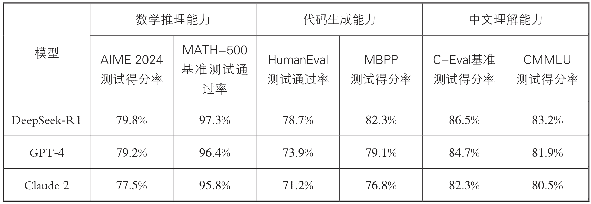

2．响应性能：速度与效率的角逐

延迟和并发影响实用性。DeepSeek-R1、GPT-4、Claude 2 各有表现。

响应速度上，DeepSeek-R1 平均约0.8秒，得益于多 Token 预测技术可一次预测多个 token，日常咨询更流畅。GPT-4 平均1.2秒，Claude 2 平均1.1秒，高实时场景下零点几秒差异影响明显。

并发处理上，DeepSeek-R1 单实例峰值约200请求/秒，GPT-4 约150请求/秒，Claude 2 约160请求/秒。像在线教育平台同时承受大量提问时，DeepSeek-R1 仍能保持稳定快速回复，高并发优势明显。

总体而言，DeepSeek-R1 在快速响应和高并发上兼具优势，对在线客服和实时翻译等场景友好。

三者响应性能对比见表1-7。

**表1-7 响应性能对比数据**

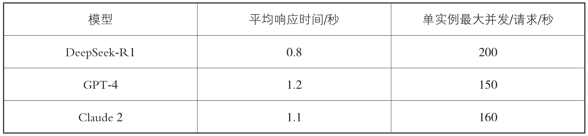

3．功能特性：多元能力的全面剖析

多语言支持是全球化应用的关键。

DeepSeek-R1 覆盖96种语言，中文能力突出，中英互译 BLEU 58.3分，翻译古诗能传神留韵。GPT-4 覆盖95种语言，英文见长，中英互译 BLEU 57.9分，商务学术文件翻译准确规范。Claude 2 覆盖92种语言，中英互译 BLEU 56.8分，长英文文本逻辑把握好，小说翻译情感还原佳。

三者多语言能力对比见表1-8。

**表1-8 多语言支持能力对比数据**

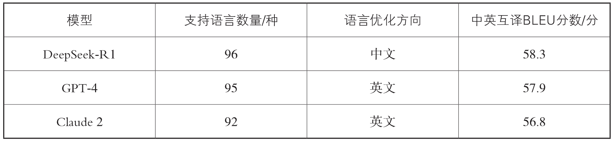

专业领域要求高精度。金融方面，GPT-4 文本理解准确率91.2%领先，能快速抽取关键信息并分析趋势；DeepSeek-R1 为89.5%，在风险评估上表现好；Claude 2 为88.7%，擅长复杂逻辑与合规分析。

医疗方面，GPT-4 问答准确率87.6%，可辅助诊断建议；DeepSeek-R1 为85.3%，常见病诊断与治疗建议可靠；Claude 2 为84.9%，在研究与临床报告分析上发挥作用。

法律方面，GPT-4 案例理解准确率86.4%领先，分析深入；DeepSeek-R1 为83.7%，中文法律文本理解有优势；Claude 2 为82.9%，推理严谨，文书撰写专业。

专业领域对比见表1-9。

**表1-9 专业领域能力对比数据**

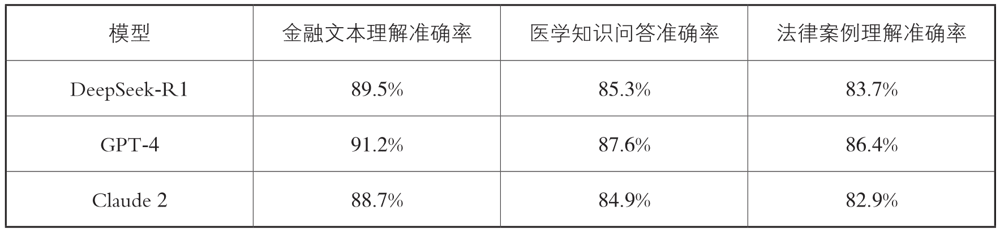

4．特色功能：独特优势的深度挖掘

长文本处理、多轮对话、文案原创性、图文协同是重要指标。

长文本上，DeepSeek-R1 语境窗口128K token，远超 GPT-4 的32K 和 Claude 2 的100K，可处理各类长篇文档。

多轮对话上，DeepSeek-R1 支持30轮连续对话且记忆保持一致，优于 GPT-4 的25轮、Claude 2 的28轮，在客服场景更具竞争力。

文案原创性评分上，DeepSeek-R1 为8.5分，GPT-4 为9.1分，Claude 2 为8.7分。

图文协同上，DeepSeek-R1 支持基础图文理解与生成，GPT-4 支持高级图文，Claude 2 为中级。

在内容创作与设计辅助场景中，DeepSeek-R1 的长文本与多轮对话能力可提供较强助力。

相关对比见表1-10。

**表1-10 长文本处理、对话能力等方面的对比数据**

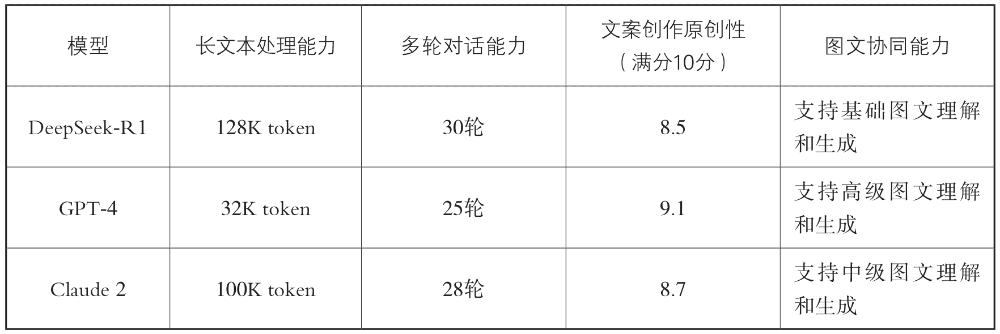

总体来看，三者各有擅长。DeepSeek-R1 在数学推理、代码生成、中文处理上表现强劲，响应快、并发强，适合对数理和中文交互要求高的场景。GPT-4 在通用创意生成和专业洞察上突出，多模态能力强，适合需要灵感和深度分析的场合。Claude 2 在文本理解深度、对话连贯性、知识准确性和安全性控制上表现稳健，适合强调理解流畅与稳妥性的使用。

未来大模型将强化逻辑推理，深化多模态融合，向行业应用下沉。

1.3.3 商业应用差异

1．商业模式：价格与部署的差异

1）定价策略

定价直接影响用户选择。DeepSeek 价格亲民，API 为0.14美元/百万token，基础订阅每月0.5美元，企业版灵活可选，并提供开源免费许可，门槛低，对预算有限的中小公司和个人开发者友好。

GPT API 为7.5美元/百万token，Plus 订阅20美元/月，Team 版30美元/人月，企业版按年签约，费用高。Claude API 为3.5美元/百万token，基础版和团队版订阅分别为20美元/月和25美元/人月，企业定制报价较高。

以月用1000万token的小型内容团队为例，DeepSeek API 成本约1.4美元，GPT 约75美元，Claude 约35美元。成本差异显著，DeepSeek 更受中小团队青睐。

2）部署方案

部署灵活性决定公司掌控力。DeepSeek 支持完全开源私有部署，保障数据安全；支持混合云部署，兼顾效率与成本；支持边缘计算，按需分配资源。

GPT 强制云服务，不支持私有部署，数据控制权和部署自主性受限，资源固定分配易浪费或不足。Claude 部分支持私有部署，混合云受限，资源预分配灵活性不足，企业定制有一定空间。

DeepSeek 的开源与灵活部署为公司提供更大自主性和成本控制空间，适合对数据安全和个性化部署要求高的行业，如金融、医疗。

2．成本效益：投入与回报的权衡

1）应用成本

基础设施投入上，DeepSeek 仅需8GB GPU 即可本地部署，中小公司和个人可用现有硬件，降低采购成本。GPT 依赖 OpenAI 云服务，硬件不可选，只能按标准付费。Claude 最低要求16GB GPU，门槛更高。

运营成本上，DeepSeek 可随需求或淡旺季弹性扩缩，避免浪费。GPT 需支付订阅费和 API 费，自主性弱。Claude 除订阅费外还需硬件投入，无专业运维团队者还需额外维护费用。

2）投资回报

中小公司重短期回报，使用 DeepSeek 的投资回报周期约6个月，如小电商用其建智能客服半年内回本。GPT 约12个月，Claude 约9个月，资金压力更大。

大型公司看长期效益，DeepSeek 回报周期约12个月，GPT 约18个月，Claude 约15个月。相比之下，DeepSeek 更快实现技术价值转化，提升竞争力。

3．商业化差异：变现与市场策略

1）变现途径

DeepSeek 变现多元化。技术咨询是重要方式，可为金融机构提供风险评估等专业建议。定制化开发是核心，按公司需求打造专属方案，如为制造公司开发系统。还提供综合服务，如医疗影像诊断辅助，以及培训认证体系，提升公司与个人能力。

GPT 主要靠分级订阅和 API 服务收费，企业版功能更全价格更高。Claude 采用混合订阅模式，基础与增值并行，并通过解决方案和专业咨询变现。

2）市场策略

DeepSeek 主攻中小公司和开发者社区。高性价比方案契合中小公司数字化转型中技术与资金双重约束；对开发者提供工具与资源，鼓励创新应用，构建生态。同时深耕中国市场，利用本土优势服务中文场景，并逐步拓展海外。

GPT 聚焦全球通用人工智能市场，凭借品牌与技术吸引大量用户，为大型公司提供高度定制化解决方案。Claude 主攻专业领域和公司服务，在法律、金融、科研等对推理和文本要求高的领域凭借严谨回答获得认可。

## 结语

DeepSeek-R1 掀起的效率变革意义重大。数据安全上筑牢防线，成本上颠覆传统，让中小公司也能用得起 AI；架构上实现创新突破，性能可观。可以期待 DeepSeek 在 AI 领域持续深耕，拓展应用边界，为各行业带来新机遇。作为关注科技前沿的你，不妨持续跟踪这一充满潜力的方向。欢迎关注个人公众号“产品经理独孤虾”，获取更多前沿内容，一起探索科技的无限可能。

# 第二章

# 基础篇高效使用入门指南

在人工智能重塑世界的今天，DeepSeek 正以突破性的技术实力，成为连接人类智慧与智能未来的核心枢纽。从开发者的高效协作到企业级的智能决策，从多模态文件处理到复杂指令的精准执行，DeepSeek 的强大性能正在重新定义人机协同的边界。然而，要释放其全部潜力，不仅需要掌握系统配置的底层逻辑，更要精通与 AI 对话的艺术——这正是“基础篇：高效使用入门指南”的核心使命。

本章将带你穿越技术迷雾，从系统环境的搭建到 API 接口的灵活调用，从结构化文档的智能解析到多模态内容的深度融合，逐步构建与 DeepSeek 高效协作的完整能力图谱。你将学会如何通过科学的部署策略提升硬件效能，运用 TASTE 框架精准引导 AI 输出，以及在复杂场景中规避陷阱、提升质量。无论是开发者寻求技术突破，还是企业探索 AI 落地路径，这里都将为你提供理论与实践并重的行动指南，助你在智能时代抢占先机，让 DeepSeek 成为驱动创新的核心引擎。

## **2.1 环境部署与实战指南**

在数据爆炸与文件处理需求激增的当下，如何高效提效已成为个人和企业共同的痛点。DeepSeek 以强大的功能和稳定的表现在 AI 赛道脱颖而出，为信息智能化处理打开了新局面。开发者可以用它构建创新应用，企业能借助它提升效率优化流程，普通用户也能让它解决日常办公与生活中的数据难题。如果你想掌握环境搭建、操作技巧以及性能释放方法，就随我们一起深入探索 DeepSeek 在部署、调用和文件处理方面的核心能力。

**2.1.1 系统要求与部署方案**

AI 正深度渗透生活与工作，DeepSeek 作为新锐 AI 工具，功能丰富性能突出，吸引了大量开发者与企业关注。它可完成多类 AI 任务，支持多种使用方式，无论专业人士还是普通用户都能借此开启 AI 新体验。

要让 DeepSeek 稳定高效运行，弄清系统需求并做好部署规划是前提。合理的配置是稳定运行的保障，科学的部署能放大其优势。不同部署形态各有侧重点，下面详细拆解系统要求与部署方法。

**1．系统要求：夯实运行基础**

正式使用前，明确系统要求至关重要，这直接关系到能否正常启动以及使用体验的好坏。要求涵盖基础门槛、推荐规格，以及容易被忽略但影响关键的附加项，内容如下。

**1）基础配置：入门门槛**

DeepSeek 对操作系统兼容性友好，适配 Windows 10/11 64 位、macOS Catalina 及以上、Linux 发行版，推荐 Ubuntu 20.04+。对于 671B 参数混合专家模型，建议采用多节点分布式架构，节点间通过 RDMA 高速网络互联。DeepSeek 部署的基础配置详见表 2-1。

**表 2-1 DeepSeek 部署基础配置**

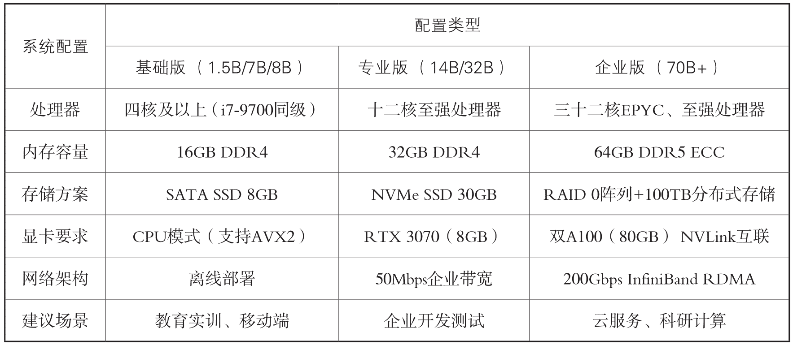

**2）推荐配置：性能跃升**

要在复杂任务中释放潜力，硬件需按工作负载专项调优。DeepSeek 部署的推荐配置详见表 2-2。

**表 2-2 DeepSeek 部署推荐配置**

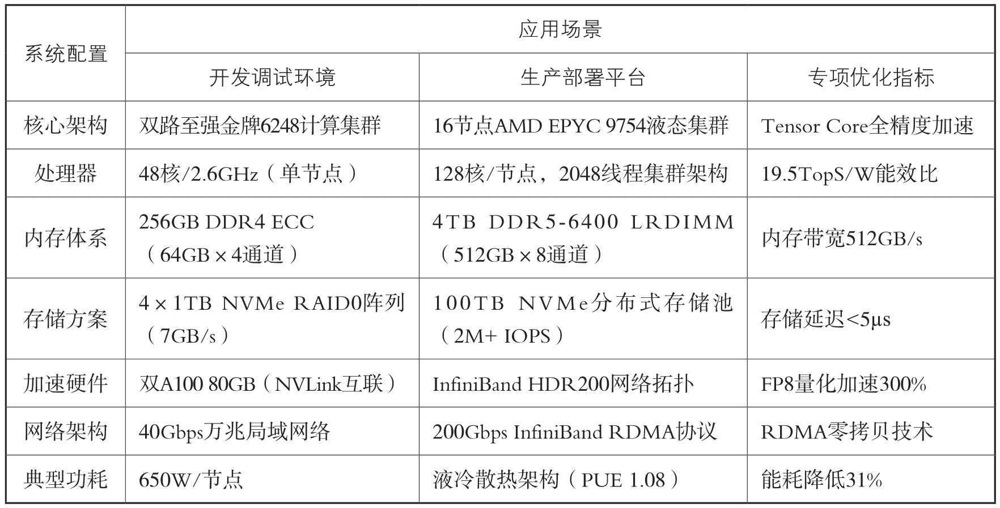

**3）附加考量：细节决定成败**

除硬性配置外，部分细节同样关键。

安全软件要避免拦截，需在安装与使用前做白名单设置。断电保护不可或缺，建议配 UPS 供电，尤其在关键项目中，AI 任务耗时长，突发断电会中断任务甚至损坏数据，UPS 可在市电中断时延续运行。

Python 环境是核心，建议安装最新稳定版 Python 并搭配 Anaconda。DeepSeek 的高级功能与二次开发高度依赖 Python，Anaconda 内置大量库，能大幅简化开发。

另外可按需配置 MySQL、PostgreSQL 等数据库环境。处理复杂数据任务时常需与数据库交互，合理搭建数据库环境能提升数据管理效率，便于与现有数据系统联动。

**2．部署方式：按需灵活选择**

**1）网页版服务：零门槛体验**

网页版是多数用户初触 DeepSeek 的首选，优势明显。

无需安装部署，通过 Chrome 等主流浏览器最新版即可访问，省时省心；
跨平台通用，Windows、macOS、Linux 均可无缝接入；
自动更新维护，能第一时间体验新功能与优化；
团队协作顺畅，支持数据共享与项目讨论，依托云端模型提供高效服务。

使用时需保证网络稳定、账号有效，定期清理浏览器缓存，保持版本最新，注意账号安全。

**2）企业私有化部署：安全可控**

对数据安全与定制化要求高的企业，私有化部署更合适，优势体现在：

数据可保留在企业内网服务器，不上云端，支持端到端加密，降低传输泄露风险；
性能可优化，支持 GPU 加速，满足高实时业务需求，定制化空间大；
可离线运行与本地训练，符合数据合规要求，能与现有系统无缝集成并提供 API。

实现私有化需满足：专用服务器与存储系统；企业级网络与负载均衡；专业运维团队与监控体系；备份机制与容灾方案；安全防护与访问控制体系。

流程上，先规划评估使用规模确定方案与资源；再准备环境配置服务器、规划网络、落实安全策略与监控；上线时先试点再扩大，确保数据迁移完整准确，配合用户培训，上线后持续优化。

**3．配置优化：挖掘性能潜力**

部署完成后，通过配置优化可让 DeepSeek 更好匹配个性化需求，分为基础与进阶两层。

**1）基础配置：提升舒适度**

界面方面提供丰富个性化选项，可按需切换主题、自定义工作区布局，设置快捷操作与通知方式，提升效率。

性能方面核心是资源分配与缓存优化，配置并行处理，设置任务队列按优先级与提交顺序有序执行。

**2）进阶设置：深度调优**

数据管理上，支持 CSV、Excel、JSON 等格式导入，配置编码、分隔符等参数。建立预处理流程与自动清洗规则，包含清洗、转换、归一化等，提升数据质量。优化存储方案与备份策略，按重要性与使用频率选择介质，制定备份计划。建立数据版本控制便于追溯，配置隐私保护，按敏感度设置访问权限与加密。

模型配置上，选择适配模型与训练参数至关重要，需权衡性能，调整学习率、批次大小等超参数。配置验证与早停策略防止过拟合与训练冗长。启用 GPU 加速与并行处理加快训练推理。设置模型更新与版本管理确保功能迭代。配置模型监控与性能指标实时掌握运行状态。

**4．常见问题：快速排障**

使用过程中难免遇到阻碍，下面提供典型问题的解决思路。

**1）安装困境：排查与解决**

安装失败先核查系统要求，确认操作系统与硬件满足最低条件，不符则按官方建议升级；从官方渠道下载安装包，保证网络稳定避免包损坏；关闭冲突的安全软件与防火墙，安装后再开启；用工具清理临时文件、回收站与无用缓存，释放空间。

**2）访问难题：恢复连通**

账号问题先验证状态，确认密码正确且未被封禁，遇安全限制联系客服重置密码或验证身份；检查网络连通性，通过其它网页测试稳定性，必要时重启路由器或更换网络，检查防火墙与代理设置；确认服务状态，官网或社媒可了解是否维护；定期清理浏览器缓存，避免加载异常。

**3）性能瓶颈：提速策略**

运行缓慢时可检查系统资源占用，通过任务管理器查看 CPU、内存使用，关闭高占用程序；按需优化配置参数，如增加核心数、内存等；定期清理历史任务记录释放磁盘；考虑升级内存、存储等硬件；及时更新到最新版本，更新前备份数据；查看错误日志定位根因；优化电源管理、磁盘与虚拟内存设置；定期做硬件全面检查，解决散热、连接等问题。

AI 迭代加速，DeepSeek 也在持续进化。建议定期体检系统，关注官方更新并及时升级，持续探索新场景与技巧，挖掘更大价值，与 DeepSeek 共成长，在 AI 领域实现突破。

**2.1.2 接口调用方式**

**1．网页交互模式**

**1）功能特点**

（1）界面直观易用
网页交互界面简洁清晰，无需复杂指引即可上手。输入框与功能按钮布局合理，初次使用者也能快速定位功能，降低学习成本。

（2）响应迅速流畅
输入问题或指令后，DeepSeek 回复几乎无延迟。无论简单查询还是复杂文件处理，都能实时返回结果，提升操作流畅度。

（3）文件处理一体化
支持多种格式上传处理，无需切换工具即可完成文档分析、编辑、格式转换等。例如上传 PDF，可同时实现文本提取、摘要生成与转 Word。

（4）多模态输入
除文本外，还支持语音、图片输入。语音指令解放双手，图片上传后可识别文字并分析内容，实现图文融合处理。

**2）使用建议**

（1）善用上传功能
处理文件时多尝试上传，而非仅文本输入。工作报告、学习资料、照片、音频均可处理，上传前确认格式正确、内容完整。

（2）合理设定参数
按需求调整参数。如生成摘要时设置篇幅与关键词数量，处理图片时设置分辨率与色彩模式，使结果更贴合预期。

（3）注意隐私保护
上传含敏感信息的文件时需谨慎。公共网络或共享设备避免上传隐私与商业机密资料，处理后及时删除记录，确保传输加密。

（4）及时下载结果
处理完成后尽快下载，避免缓存清理导致丢失。建议分类保存，便于后续检索。

**3）操作技巧**

（1）历史记录复用
系统自动保存操作历史，可快速找回并复用之前的任务与参数设置，提高重复任务效率。

（2）控制文本长度
过长文本可能拖慢处理，过短则表达不足。按任务复杂度与系统性能灵活设定长度。

（3）关联文档分析
上传多个相关文档时，系统可自动识别关联关系，支持多篇报告对比、信息整合，获得更全面结论。

（4）批处理提效
大量文件可打包压缩后上传，系统自动识别并批量处理。设置参数时需兼顾各文件特性，避免因特殊文件导致失败。

以下为使用 DeepSeek Web 访问界面生成在线教育商业计划书的案例，请读者扫描二维码获取。

**使用 DeepSeek Web 访问界面生成在线教育商业计划书**

**2．REST API 集成**

**1）基础配置**

（1）API 密钥申请与管理
需在官方平台注册并申请 API 密钥，密钥唯一且保密。妥善保管，定期更换，发现泄露风险立即作废重申。

（2）请求头设置
发送请求时需设置正确头部，如 Content-Type 指定数据类型、Authorization 携带密钥用于鉴权，设置准确才能被正确处理。

（3）访问权限控制
可按需限制 IP 或 IP 段访问，按角色或业务设置只读、读写等不同权限等级，保障安全合规。

（4）速率限制处理
平台为保障稳定会限制调用频率，需遵守限制。业务需求较高时可申请调额，或优化调用策略合理分配次数。

**2）接口特性**

（1）批量请求支持
可一次性发送多个请求，减少通信开销，适用于大规模数据处理。

（2）异步调用模式
发送请求后无需等待，可继续执行其它任务，后台处理完成通过回调或状态查询通知结果，适合耗时任务。

（3）实时状态监控
可随时查询请求是否接收、处理中、已完成或出错，便于及时决策与异常处理。

（4）完善错误处理
提供详细错误信息与错误码，便于快速定位参数错误、权限不足、服务不可用等常见问题。

**3）使用建议**

（1）加入重试机制
网络波动或服务器繁忙可能导致失败，建议实现重试，根据错误类型设置次数与间隔，避免资源浪费。

（2）异步并行处理
相互独立的任务可并行异步执行，充分利用多核与带宽，提升整体效率。

（3）响应缓存优化
对高频访问且变化小的接口，可缓存响应结果，减少重复请求，提升速度并降低带宽消耗。

（4）异常状态兜底
遇服务器宕机、网络中断等异常，应保持应用稳定，可切换本地缓存或默认结果，并记录详细日志便于排查。

扫描下方二维码，可以看到一个使用 DeepSeek 生成在线教育商业计划书的案例。需注意，案例中的商业计划书是通过 REST API 访问托管在第三方云平台的 DeepSeek-R1 大模型而生成的。

**第三方客户端通过 REST API 访问托管在第三方平台的 DeepSeek-R1 大模型**

## **2.2 文件处理**

**2.2.1 结构化文档处理**

**1．PDF 文档处理**

**1）智能版面分析**
DeepSeek 能自动识别 PDF 版面结构，区分文本、图片、图表、标题、页码等元素。无论单栏、多栏还是图文混排，均可准确解析。如处理学术论文时，可快速定位正文、参考文献与图表说明，为后续提取与分析奠定基础。

**2）多语言文本识别**

DeepSeek 文档与数据全链路处理能力全景拆解

在 PDF 场景里，DeepSeek 对多语种文字的读取覆盖面很广，从英语、中文、日语、韩语到小众语言都能准确识别并抽取出来。遇到中英夹杂、数语混排的跨境文档时，系统会自动划分出不同语言的段落并分别处理，显著提升跨语言材料的处置效率。

**3）表格自动提取**
面对 PDF 中的表格，DeepSeek 会自动定位表格边界并还原结构。它能分辨出行数、列数、表头与表体，将内容转成可直接编辑的 Excel 格式。在财务报表、统计年鉴这类表格密集的文档里，这一能力免去了手工录入，节省大量工时。

**4）智能目录生成**
依据文档的标题层级与段落排版，DeepSeek 可以自行生成目录。系统抽取各级标题并按逻辑顺序排列，让用户快速定位章节。对于电子书一类长文档，自行生成的目录能帮助快速找到感兴趣内容，同时更清晰呈现整体架构。

**2．Word 文档处理**

**1）格式规范化处理**
上传 Word 后，DeepSeek 能统一字体、字号、行距、缩进等要素，让来自不同来源、排版混乱的文件呈现一致风格。可按企业规范自动修正，使文档更专业、阅读成本更低。

**2）内容智能分类**
系统按内容性质把文档归到报告、通知、邮件、合同等类别，也能把段落细分为正文、引言、结论、建议等。分类后文档管理与检索效率明显提升，用户能更快把握主旨与结构。

**3）关键信息提取**
DeepSeek 可从 Word 中抽取人名、地名、时间、金额、关键词等核心要素。处理商务合同时能快速抓取双方名称、合同金额、生效日、违约责任等条款；处理新闻稿时则能提取事件时间、地点、人物与要点。这些信息可用于摘要、检索与数据分析。

**4）文档比对分析**
支持两份或多份 Word 的差异比对，可对比文字、格式、段落结构的变动，并用不同颜色高亮新增、删除或修改内容。在版本管理、协同编辑、校对审核中，能迅速呈现修改轨迹，提高准确率与效率。

**3．Excel 数据处理**

**1）数据智能清洗**
处理表格时自动发现错误、缺失、重复问题。可修正日期格式不统一、数字格式错误等；缺失值可按特征与上下文用均值、中位数、众数或插值填充；重复记录快速剔除，保证唯一准确。以销售表为例，可自动清洗错误金额、补全客户信息、删除重复订单。

**2）自动化公式处理**
用户用自然语言描述计算需求，DeepSeek 即可生成对应 Excel 公式，涵盖求和、平均值、条件判断、数据透视等。输入“计算成绩列的平均值”，系统会自动产出 AVERAGE 函数并套用到目标列，降低对公式不熟悉用户的门槛。

**3）智能图表生成**
基于表格数据自动推荐柱状、折线、饼图、散点等合适图表类型，并生成标准格式、可读性强的可视化结果。不同产品销售额可用柱状图对比，时间序列销售可用折线图展示趋势，图表均带规范标注。

**4）数据验证与修正**
可按规则校验数据合理性，如员工年龄区间、身份证号格式等，发现异常时给出提示与修正建议，帮助及时纠错，提升数据质量。

**2.2.2 多模态内容处理**

**1．文本内容分析**

**1）多语言文本理解**
具备百种以上语言的理解与翻译能力，不仅转换语言，还能把握语义、语法与文化语境。跨国企业多语言资料可被快速理解并整合，实现跨语言沟通协作。

**2）语义结构分析**
深入解析文本的论题、论点、论据及逻辑关系。学术论文中可梳理核心观点、研究方法、实验结果与结论的联系；新闻报道中可厘清起因、经过、结果及各方观点态度。

**3）观点和情感识别**
识别文本的情感倾向为正面、负面或中性。社交媒体评论、客户反馈可被快速分析满意度与需求，用于产品策略调整；舆情监测中可实时把握公众对事件话题的情感走向，为决策提供参考。

**4）文本相似度计算**
借助算法精准计算文本相似度。用于论文查重可快速比对文献抄袭风险；用于信息检索可按关键词返回最相关文档，提升检索精度。

**2．结构化数据处理**

**1）数据格式转换**
支持 CSV、JSON、XML、SQL 等格式互转。数据库导出 CSV 供 Excel 分析，或将 JSON 转 XML 用于系统间交互，满足存储传输需求。

**2）字段智能映射**
在整合异源数据时自动识别字段语义关联。例如合并两个数据库客户信息时，可匹配“客户姓名”“地址”“电话”，即使命名与类型不同也能对齐，大幅简化整合流程。

**3）数据质量评估**
从完整性、准确性、一致性、时效性等多维度评估结构化数据，检查缺失、错误、重复等问题并输出评估报告与改进建议，为企业数据治理提供依据。

**4）异常检测处理**
识别离群点与异常时序模式。金融交易数据中可预警大额异常流动、频繁异常交易；工业生产中可监测设备参数异常波动，及时预警避免事故。

**3．媒体文件处理**

**1）图文关联分析**
对含文本与图片的媒体文件分析两者关联。产品宣传资料中可把图片呈现的外观、功能与文字描述对应起来；新闻图文可更全面还原现场情况。

**2）音视频内容理解**
识别音频语音内容与视频画面场景、人物动作、事件。视频会议可自动识别发言内容与发言人并生成纪要；监控视频可实时识别打架、盗窃等异常行为并报警。

**3）多模态信息融合**
融合文本、图像、音频等多种模态互补信息，提升理解深度。智能客服可结合文本提问、语音输入与上传图片更准确理解需求；智能驾驶可融合摄像头图像、雷达距离与语音导航指令辅助决策。

**4）跨模态检索匹配**
实现跨模态检索，如用文字描述检索相关图片视频，或上传图片检索相关文本。广泛应用于图像搜索引擎与视频库检索，提供更便捷高效的信息获取方式。

**2.2.3 智能文档处理**

**1．简历智能分析**
设计有效提示词需经过四步：明确岗位核心诉求，如 Java 工程师更看重技术栈匹配度而非实习时长；解构简历层级，教育背景拆为院校、专业、时间，工作经历拆为公司平台、任职周期、项目贡献；设计结构化指令并建立动态权重，初级岗加重技能证书，管理岗侧重团队规模与业绩；设置验证回路，用 Markdown 表格对比提取结果与原文一致性并标记存疑点。示例提示词设定为 5 年招聘经验 HR 专家角色，针对资深产品经理岗位按教育层级、从业轨迹、能力证明提取信息，要求冲突检测、量化指标标红、隐性能力推导，并输出雷达图、对照表与风险提示栏。

**2．合同文档处理**
提示词需兼顾条款完整、风险防范与审查效率，具备条款定位、风险预警、版本比对三重功能。首步要素结构化拆解为基础要素层缔约方、标的、金额支付节点，风险要素层违约赔偿、知识产权、不可抗力定义，动态校验层版本差异与法律条文时效。第二步按合同类型动态调整权重，采购合同强化付款条件与验收标准，技术合作强化专利授权与保密，劳务合同侧重竞业限制与社保合规。第三步双重验证：三色标注法对比版本修改轨迹，分级评估风险高、中、低。示例提示词设为 10 年涉外合同法务专家，审查中美技术授权协议，要求核心条款校验、风险点标注、合规检查，建立条款溯源、量化支付、修订建议书，输出风险热力图、修订追踪表与应急预案。

**3．研报智能分析**
针对长报告需四层思维：反向推演明确分析目标，先问对投资决策的核心价值，聚焦固态电池量产时间表等关键信号；动态拆解多维信息结构，先做目录扫描再做数据关联与矛盾检测；行业语境补偿，结合白皮书评估渗透率预测合理性；决策链路闭环验证，从初级指令提取投资建议与风险等级，到进阶模拟投资回报率，再到 SWOT 重构与观测指标。示例提示词分四轮优化：第一轮以技术成熟度曲线提取创新节点并标注企业布局与可信度；第二轮解析成本结构饼图并叠加历史趋势给出解释；第三轮构建四维矩阵定位细分赛道；第四轮对 ABC 三类企业做 12 个月观测指标、Beta 变化策略与风险规避。

**2.2.4 数据分析应用**

**1．数据清洗增强**
清洗需像雕刻般精准。先评估缺失模式：缺失率低于 5% 且随机可采用均值中位数填补；时序关联特征优先用前向填充或线性插值；高缺失率大于 30% 的特征建议暂时剔除，后续再通过特征工程重构。

数据治理与分析实操进阶指南

下面整理了一组可直接套用的指令模板。

**提示词：**

在现有的销售表里，区域分销渠道这一列的空值占比大约是 25%，且主要集中在新拓展的市场，请：
1. 呈现各区域缺失值的热力分布图
2. 对比填补前后客户聚类结果差异
3. 检验剔除该列后预测模型 AUC 的变化幅度

**2）异常探测的多维度思路**
异常判断不能只依赖统计阈值，需要把业务视角和技术视角结合起来。

提示词可参考如下。

**提示词：**

基于设备传感器记录：
1. 先按 3σ 规则初筛可疑点
2. 结合设备维护日志标注真实故障区间
3. 将聚类算法的结果与业务标注的一致性进行对照
4. 输出可疑时段的振动频谱图，供人工复核

该做法把统计手段和领域经验融合，能降低把正常波动误判为异常的风险。

**3）标准化的分层思路**
标准化要依据下游任务的需求来选择：
● 机器学习模型：优先采用 Z-score 标准化。
● 跨源数据融合：选用 Robust Scaling 以降低异常值干扰。
● 业务指标对比：保留原始量纲并附上标准化说明。

**4）质量评估的闭环校验**
数据质量报告需具备动态自检能力。

提示词可参考如下。

**提示词：**

生成包含以下维度的评估看板。
1. 完整性：字段缺失率趋势，按数据源分层展示
2. 准确性：核心指标抽样复核的差异率
3. 时效性：数据更新时间戳分布
4. 关联性：特征间 Spearman 相关性热力图

同时设置自动化预警，当关键指标偏离基线时触发复核流程

经过多轮迭代的指令示例：

第一轮：缺损模式分析，提示词可参考如下。

**提示词：**

分析 sales_data.csv 中的缺失情况。
1. 按区域、产品线绘制缺失矩阵图
2. 计算每个字段的 MCAR 检验 p 值
3. 输出不同填补方法对字段分布形态的影响曲线

第二轮：异常检测优化，提示词可参考如下。

**提示词：**

针对 equipment_logs.json：
1. 使用孤立森林算法进行异常检测
2. 以维护工单时间范围作为过滤条件
3. 输出疑似异常点的三重验证报告：
- 统计阈值被突破的情况
- 相关传感器读数的波动图谱
- 同类设备历史故障模式的匹配度

第三轮：构建标准化决策树，提示词可参考如下。

**提示词：**

构建特征处理决策流程图。
输入：字段类型、分布形态、业务用途
判断节点：
- 若为金额类指标且需要跨源对比→保留原始值
- 若参与距离计算→应用 Min-Max 标准化
- 若存在极端值→使用分位数变换
输出处理前后数据的分布对比图

第四轮：创建质量监控看板，提示词可参考如下。

**提示词：**

创建动态质量监控模板。
1. 实时计算数据新鲜度：当前时间减去最新记录时间
2. 关键字段值域变化预警：同比波动大于 15% 时触发
3. 关联元数据校验：如日期格式一致性检查
4. 自动生成修复建议：基于知识库条目

这种阶梯式指令设计，把数据清洗从被动修补转为积极治理。通过业务规则与机器学习算法的双重校验，DeepSeek 不只完成清洗任务，还能给出可解释的质量改进方案。

**2. 数据分析报告**

企业级分析报告的构建依赖三层智能分析框架，可深挖决策洞察，具体路径如下。

**1）动态多维分析引擎**

借助时间、地域、产品线的交叉验证，挖掘隐藏规律。以快消品销售为例：
● 可搭建季度增长率与竞品促销强度矩阵，横轴为自营渠道增速，纵轴为市场费用占比。
● 用区域经济发展指数作为颜色维度。
● 标注异常波动点，如新市场开拓期业绩异常下滑。

该方法能直观呈现市场拓展效率，并可结合行业基准自动标出机会区域。

**2）智能图表决策树**

依据数据特征自动匹配可视化方案：
● 客户留存分析→桑基图，展示各阶段流失路径。
● 产品组合效益→旭日图，用嵌套结构展示利润贡献。
● 渠道效果对比→雷达图，多维指标综合评估。

图表生成后会自动附加解读标签，如在折线图拐点标注关键事件。

**3）趋势推演沙盘**

基于历史数据构建预测模型时，可用蒙特卡洛模拟展示多种可能性。

输入变量：
● 原材料价格波动区间 -15% 至 25%
● 政策补贴退坡进度 3 种情景
● 替代品渗透率曲线

输出：
● 概率分布图，标注 80% 置信区间的战略选择窗口期

推演可识别关键风险阈值，如替代品市占率突破 18% 时，需启动应急预案。

下面对四阶提示词进行优化。

数据透视指令，提示词可参考如下。

**提示词：**

分析 2023 年第 4 季度销售数据集：
1. 按渠道类型、产品 SKU、客户等级三维透视
2. 计算各维度边际贡献率
3. 标注 ROI 低于行业均值 1.5 个标准差的分项

图表优化指令，提示词可参考如下。

**提示词：**

将客户生命周期数据可视化：
1. 使用漏斗图呈现各阶段转化率
2. 用气泡图显示客户价值分布
3. 用折线标注关键运营动作的时间节点

决策模拟指令，提示词可参考如下。

**提示词：**

构建市场扩张沙盘模型。
输入参数：
- 区域 GDP 增长率波动范围
- 物流成本上涨压力系数
- 本地竞品反击概率矩阵
输出内容：
1. 风险收益等高线图
2. 标注最优资源投放配比区间
3. 列出 3 个高概率情景的应对预案

通过结构化分析流程，DeepSeek 生成的报告不仅呈现数据表象，更能揭示决策传导机制。嵌入行业知识图谱和风险预警模型后，报告建议具备可执行的战术价值。

**2.2.5 文件处理技巧**

**1．效率优化技巧**

**1）批量处理优化**

面对海量文件或任务，分批处理很重要。例如上千份文档一次性提交，易导致资源耗尽或耗时过长。可采取：
● 按系统性能和任务复杂度分批，每批处理固定数量。
● 设置并发限制，避免请求过多压垮服务器，如控制在 10～20 个并发。
● 监控处理进度，及时发现问题。
● 优化资源利用，合理分配 CPU、内存等。

**2）流程自动化**

实现自动化流转的要点：
● 构建处理管道，将上传、格式转换、内容分析到结果输出串联。
● 设置触发条件，如新文件到指定文件夹自动触发，或按时间间隔定时启动。
● 定义处理规则，明确各环节操作和参数。

自动化可减少人工干预，提升效率并降低错误率。

**2．质量保障措施**

**1）处理质量控制**

● 设定明确质量标准，按文件类型确定结果指标。如图像识别准确率≥95%，翻译要求准确流畅。
● 实施多轮验证，如数据清洗后做一致性、逻辑性验证。
● 定期人工抽检，随机抽样由专业人员审核。
根据质检结果和用户反馈持续优化算法和流程。

**2）异常处理机制**

● 建立监控预警系统，实时监测处理时间、错误率、资源利用率，异常时及时报警。
● 实现自动重试，网络波动或服务器短暂故障时自动重试，如重试 3 次，间隔 5 秒。
● 设置降级方案，严重故障或资源不足时降低精度、简化流程，保证基本功能。
● 详细记录问题日志，记录时间、原因、处理过程，便于复盘改进。

**3．格式兼容性问题**

**1）支持格式列表**

DeepSeek 文档处理支持 PDF、Word .doc/.docx、Excel .xls/.xlsx、PowerPoint .ppt/.pptx、TXT 等。图像支持 JPEG、PNG、BMP、GIF 等，可做内容分析、文字识别。音频视频支持 MP3、WAV、MP4、AVI 等，可理解内容、提取关键信息。

**2）转换建议方案**

不支持的格式可先转换。例如 CAD 图纸 .dwg，可用 AutoCAD 转 PDF 再处理；小众数据库文件先导出为 CSV 再分析。Zamzar、Convertio 等在线转换平台也可使用。

**3）特殊字符处理**

DeepSeek 会尽量准确识别特殊字符，如数学符号 ± × ÷、货币符号 $ ￥ €、版权符号 © ® 等。若识别错误，可手动修正，或上传前用文本工具替换为通用表达，如将“±”改为“正负”。

**4）编码问题解决**

文本文件可能因编码导致乱码。DeepSeek 会自动检测编码并解析，失败时可手动指定 UTF-8、GB2312、ANSI 等。对不规范编码文件，可用 Notepad++、iconv 等工具先转换编码。

**4．性能优化建议**

**1）资源配置优化**

硬件优先选高性能计算设备。大规模处理建议 Intel Core i9 或 AMD Ryzen 9 级 CPU，搭配 NVIDIA RTX 30 系列及以上 GPU。内存建议 16GB 起，大文件或多任务建议 32GB~64GB。软件保持 DeepSeek 及系统驱动为最新版。

**2）批处理策略**

按任务复杂度与数据量调整参数。数据量大任务简单时可增大批处理文件数；复杂任务如 PDF 图文分析则适当减小数量。监控 CPU、内存占用动态调整。

**3）缓存使用建议**

合理缓存可减少重复计算。DeepSeek 自动缓存常用结果，用户可设置过期时间。频繁访问且变化小的文件设较长缓存，更新频繁的任务缩短过期时间。定期清理缓存释放内存。

**4）并发控制方案**

并发数需合理。过高导致资源竞争，过低浪费资源。8 核 CPU、16GB 内存的机器，一般文本处理并发 4～6 较合适，计算密集型任务应降低。可用 Python threading、asyncio 等工具管理并发。

DeepSeek 在数字化信息处理中价值突出，具备强大的文件处理能力和灵活的接口调用。可提供网页交互和 REST API 集成。文件处理覆盖结构化文档与多模态内容，准确高效，适用于智能文档处理等场景。

**2.3 指令工程基础**

当前正处于数据与信息爆炸期，AI 快速渗透各领域，DeepSeek 以其强大功能备受关注。但要释放其潜能，需掌握有效的方法论。

这就引出指令工程基础，其中 TASTE 框架与避坑指南关键。TASTE 框架像一把钥匙，帮助精准沟通 DeepSeek，通过任务、受众、结构、语气、示例的组合实现深度交互，获得高质量结果。同时使用过程中存在 AI 幻觉、数据偏差、合规风险等陷阱，需构建质量保障体系和性能优化。

**2.3.1 TASTE 框架实战**

DeepSeek 自诞生以来凭借独特技术优势迅速成为明星模型，打破传统局限，为用户带来全新交互体验和高效方案。它在众多模型中脱颖而出，成为技术爱好者、企业开发者和各行业专业人士的宠儿，推动行业创新。但要充分发挥其潜力，提示词设计至关重要。TASTE 框架正是高效沟通的利器，能精准引导模型输出所需结果。

**1．TASTE 框架大揭秘**

TASTE 框架的核心是对任务、受众、结构、语气、示例五个要素的精准把握。

**1）任务 task 精准出击，使命必达**

交互中明确任务是基础。清晰描述需求能让 DeepSeek 快速理解。以撰写 AI 文章为例，原始提示“写一篇关于人工智能的文章”过于宽泛。优化后为“我是一名科技博主，需要写一篇面向普通读者的文章，主题是‘AI 如何改变日常生活’，希望用具体例子说明 AI 技术在衣食住行各方面的应用”，明确主题、受众和内容要求，生成结果更具针对性和可读性。可扫码查看创作案例。

**要求 DeepSeek 创作面向普通读者的文章**

**2）受众 audience 投其所好，量身定制**

不同受众的知识背景和需求不同，需据此调整提问。对技术人员更关注细节和专业分析，可用专业术语深入探讨原理架构，如“请从技术角度分析 DeepSeek-V3 模型的 MoE 架构优势”，具体结果可扫码查看。

**要求 DeepSeek 创作面向专业技术人员的文章**

对普通用户需通俗易懂，避免过多术语，用生动例子解释，如“请通过生活中的例子，解释 DeepSeek 为什么能比其他 AI 更好地理解人类需求”，具体结果可扫码查看。通过精准定位受众，可引导生成更符合口味的内容，提升信息传递效果。

**要求 DeepSeek 创作面向普通大众的文章**

**3）结构 structure 搭建框架，逻辑先行**

搭好框架，DeepSeek 才更靠谱

输出是否好读，关键在于先把骨架搭稳。和模型对话时，先把整体脉络想清楚，各部分之间的推进关系说明白，拿到的结果会更顺手。写报告可以先约定层级，比如一级到四级的标题怎么排，让层级一目了然；给每段一个明确的分工，保证衔接自然；规定呈现方式，比如用短横线做要点、用数字序号做步骤，让流程和清单更清晰；也可以直接提可视化要求，比如请画一张近五年销售额的柱状图，让模型按需生成图表，提升表现力。示例输出可扫码查看。

**要求 DeepSeek 以合理的框架输出内容**

**4）语气（tone）：声情并茂，恰到好处**

语气决定了文字的情绪和立场，不同场景需要不同的口吻。在正式商务场景，比如起草公司内部通知，就要采用庄重规范的表达来体现专业与权威，例如让模型以最高管理者视角写一份关于 AI 转型战略的内部通告。扫码查看示例。

**要求 DeepSeek 以 CEO 的身份撰写通告**

面向小朋友科普时，更适合活泼风趣的风格来激发兴趣，例如让模型扮演有趣的科技老师，用生动比喻向小学生解释什么是人工智能。扫码查看示例。把控好语调，DeepSeek 的产出会更具感染力和亲近感，更容易引发共鸣。

**要求 DeepSeek 以轻松幽默的语气输出内容**

**5）示例（example）：举一反三，引导有方**

样例是帮助模型理解复杂指令的有效手段，能提供可对照的模板，让意图更准。好的示例要简洁、要点突出、逻辑清楚、贴近实操。改写任务时可给出示范，原句今天天气很好，改写后阳光明媚微风轻拂，今天的天气格外宜人，有了参照模型就能把握改写尺度，产出更符合预期。也可用对比说明，例如请比较苹果和橙子的营养价值，并示范表格列出水果、维生素 C、膳食纤维和卡路里。扫码查看示例。可提供参考案例，例如请参照某知名品牌的营销文案为产品创作一句宣传语，能激发灵感。还能设定验收标准，例如请确保生成的代码在 Python 3.8 环境下可正常运行，保证可用性。预设反馈机制，例如如果生成内容不符合要求，请说明具体原因，便于快速迭代。

**要求 DeepSeek 按照示例输出内容**

**2．实战演练：TASTE 框架大显身手**

**1）产品需求分析：深度洞察，精准定位**

在需求分析领域，TASTE 框架像导航一样帮助穿透模糊地带。以基于 DeepSeek 的智能客服系统为例，构建高质量提示词的思路可拆解如下。

第一步：确立需求坐标
从电商平台客服负责人视角，建立三项认知基准：日均咨询规模约五千条以上，高峰时段平均等待时长约八分钟，复杂问题转人工比例约百分之三十五。量化视角有助于锁定需求边界。

第二步：痛点显微
实地观察发现，夜间人工响应速度下降约百分之六十，复杂退换货咨询平均处理时间超过十五分钟。隐性问题是商品知识库更新滞后，导致百分之四十二的咨询需跨部门确认。此时要自问哪些环节可用语义理解优化，哪些场景需人工复核。

第三步：功能模块化
把自动问答拆成三层：基础层处理价格库存查询约占咨询六成，中层处理促销规则解析，顶层设计多轮退换货协商流程。同时设定情绪识别触发阈值，当用户语句出现三个以上负面关键词时启动安抚策略。

第四步：技术可行性推演
评估意图识别准确率能否达到行业九十二分基准，设计渐进验证：先用历史对话做封闭测试，再以影子模式在线验证。关键要明确知识库更新接口的同步机制，确保促销策略变更能实时推送。

经过四层递进思考后，最终提示词应包含决策链条，示范如下。

提示词：
请扮演电商平台 AI 客服架构师，完成智能系统设计。
1．核心场景诊断：分析人工客服在订单追踪、跨平台比价、异常订单处理等场景的响应瓶颈，订单追踪占夜间咨询量百分之三十五，跨平台比价需求增长两百百分比。
2．功能优先级矩阵：将自动工单创建、物流异常预警、促销条款解析列为 P0，需支持与 ERP 系统实时数据交互。
3．容错机制设计：对话超过五轮或涉及支付安全时，设计无缝转人工流程，转接时保留完整上下文。
4．验证指标体系：首次响应速度、问题解决率、转人工率分别达到小于十五秒、百分之七十八、小于百分之十二的行业基准。

结构化思考让提示词兼具业务洞察与技术验收标准，分解为可验证模块后，DeepSeek 的反馈会更精准。

**2）竞品分析报告生成：知己知彼，百战不殆**

做有价值的竞品分析需要系统化思考。以评估 DeepSeek 模型为例，可用四层思维框架设计提示词。

第一层：确定分析坐标
技术架构决定基础性能，成本效益影响商业化路径，应用效果验证市场适配，发展潜力关联长期投资价值。建议先建立交叉对比矩阵，例如关联参数量级与推理速度，再找出不同预算区间的最优解。

第二层：竞品筛选策略
挑选对比对象要兼顾市场占有率与技术代际。对于推理类模型，需同时对比 OpenAI o1 作为闭源标杆和 Llama 3.2 作为开源参照。注意场景适配差异，例如客服场景关注意图识别准确率，数据分析更看重结构化输出能力。

第三层：拆解技术指标
分析模型架构时聚焦参数有效利用率。DeepSeek 的 MoE 架构通过动态激活约三十七 B 参数实现高性价比，相对于 GPT-4o 的全参数激活，在电商客服场景可降低约百分之四十二推理成本。该差异需转化为可量化指标，如每万次 API 调用的 GPU 耗时。

第四层：建立动态评估体系
构建三层验证：基础性能测试、压力测试和场景模拟。例如测试情绪识别时，设计含方言、错别字、反讽语句的复合测试集，对比各模型在相同情境下的安抚策略有效性。

基于上述思考，形成的提示词应包含动态评估维度。示范如下。

提示词：
请扮演 AI 解决方案架构师，完成深度竞品分析。
1．架构对比：从参数效率角度，分析 DeepSeek-R1 的 CoT 机制与 GPT-4o 的 DALL·E3 集成架构在跨模态任务中的优劣，需包含吞吐量测试数据。
2．成本模型：建立含 API 调用费、微调成本和算力消耗的全生命周期成本模型，以十万日活为基准，对比三大模型三年运营成本。
3．场景验证：设计客服、财报分析、营销文案三个测试场景，提供意图识别准确率、数据透视表完整度、创意新颖度的对比矩阵。
4．演进预测：结合强化学习技术路线，预判未来二十四个月各模型在实时决策场景的能力边界变化。

结构化提示既保证技术对比的专业性，又嵌入商业决策所需的成本模型。深化时可延伸专项提示，例如请构建含冷启动训练、增量学习和模型蒸馏三种场景的动态成本计算模型。

**3）运营内容创作：创意无限，吸睛引流**

用 AI 写作工具设计推广文案时，关键是建立清晰思维框架。以 TASTE 为指导，可通过五层递进思考构建提示词体系。

第一层：用户痛点具象化
站在自媒体创作者视角，设想典型场景：深夜赶稿时选题枯竭、热点追踪不及时导致流量流失、多平台适配耗时过长。这些效率瓶颈正是产品价值切入点。思考时自问创作者在哪些环节存在超过百分之三十的时间损耗，哪些重复工作可自动化。

第二层：产品能力拆解
基于技术特性，拆解三层应用价值。
基础层：分钟级生成两千字初稿。
进阶层：实时热点追踪与选题推荐。
创新层：跨平台风格自适应转换。
分层结构确保每个卖点对应具体使用场景，避免功能罗列空洞。

第三层：表达策略选择
分析平台特征：小红书偏好场景化故事，抖音侧重短平快痛点展示，微信公众号适合数据佐证。针对不同渠道调整文案重心，例如短视频脚本突出三分钟成片的即时性，图文内容强调周更变日更的产能突破。

第四层：可信度构建
用问题方案证据的铁三角增强说服力。
问题锚定：你是否经历过熬夜改稿七次仍不满意？
方案演示：输入科技热点，立即获取十个爆款选题。
数据验证：内测用户创作效率提升百分之一百七十三。

第五层：行动引导设计
将 CTA 分解为认知兴趣行动三阶段。
认知：你的创作本可以更轻松。
兴趣：点击查看百万博主同款工作流。
行动：免费领取每日三次 AI 润笔权益。

按以上思路设计的提示词如下。

提示词：
系统角色设定
你是一位拥有五年经验的数字营销专家，擅长把技术产品转化为用户可感知的价值主张，当前需要为基于 DeepSeek 的 AI 写作助手设计推广方案。
任务背景
目标用户：全职自媒体创作者，日均产出三篇内容。
核心障碍：选题枯竭、跨平台适配难、热点响应慢。
技术优势：深度语言理解、多风格生成、实时数据追踪。
创作要求
1．提炼三级产品价值：基础功能效率提升创作突破。
2．制作三套差异化文案：面向小红书、抖音、微信公众号。
3．设计转化漏斗模型：曝光点击注册。
4．包含可验证的用户案例，需预留数据替换位。
输出格式
采用痛点场景化解决方案效果验证结构，每部分用  引出洞察，用  标注产品价值点。

该提示词通过角色设定明确视角，用任务背景框定创意边界，用创作要求建立质量基准，用输出格式保证结构化。执行时可动态调整，例如补充避免使用专业术语或增强平台特性适配等迭代指令。

**4）用户教程编写：通俗易懂，贴心指导**

编写非技术用户教程时，关键在于建立清晰思考框架。以制作 DeepSeek 使用指南为例，可用四步思考法构建高质量提示词。

第一步：需求拆解与场景定位
指南需包含基础功能、使用场景、实用技巧、注意事项四大模块。
基础功能：涵盖智能对话、文本生成等核心能力。
使用场景：包含办公、学习等高频应用。
实用技巧：涉及提示词优化等关键技巧。
注意事项：包含隐私保护等重要提醒。

第二步：信息架构设计
参考产品文档和用户场景报告，构建分层结构。
核心功能层：智能对话、文本生成。
应用场景层：周报写作、翻译辅助。
技巧方法层：提示词优化、多文档处理。
风险防范层：网络连接、隐私保护。

第三步：表达方式选择
结合非技术用户特点，采用生活化类比、分步操作演示、对比案例展示。

第四步：提示词结构化设计
构建三维框架：场景背景具体任务格式要求。

完整提示词示范如下。

提示词：
作为智能助手，请创建一份面向中老年用户的 DeepSeek 入门指南，需包含：
1．核心功能：用家电操作类比解释智能对话、文本生成的功能。
2．使用场景：展示用语音指令创作子女生日祝福语的具体步骤。
3．实用技巧：教老人用说大白话的方式优化提问。
4．注意事项：用交通信号灯比喻隐私保护的重要性。
要求：全文中常用词汇占比大于百分之七十，每项说明配手绘风格示意图。

分阶段优化技巧：处理复杂需求时可采用多轮对话细化。
第一轮：框架确认
我需要制作老年人 AI 使用指南，请列出最重要的五个模块。
第二轮：案例优化
请将文本生成功能说明改写成收音机操作类比。
第三轮：风险提示
针对视力减退用户，补充字体放大设置教程。

通过系统化思考，即使不懂技术也能逐步构建出结构清晰、易于理解的用户指南。关键在于把抽象技术概念转化为生活场景，用渐进式对话替代复杂参数设置。

**2.3.2 避坑指南**

**1．DeepSeek 常见问题大揭秘**

**1）AI 幻觉：看似合理的陷阱**

使用 DeepSeek 时，模型编造现象不容忽视。指生成内容与现实事实不符、逻辑断裂或脱离上下文，就像一本正经地胡说八道。成因主要包括数据偏差、泛化困境、知识固化和意图误解。其中数据偏差是重要诱因。

训练数据中的错误或片面性会被放大，例如医学领域若训练数据含过时论文，模型就可能得出错误结论。模型处理训练集外复杂场景时往往力不从心，例如预测南极冰层融化对非洲农业的影响，模型就可能出现判断失误。模型过度依赖参数化记忆、缺乏动态更新，对 2023 年后的事件可能完全虚构。用户提问模糊时，模型容易自由发挥，偏离实际需求。

实际应用中，幻觉有多种表现。处理复杂推理时可能出现逻辑跳跃，做出不合理推断。例如分析市场趋势时忽略关键因素，导致结论偏差。多语言翻译中可能混淆语境，译文偏离原意。例如将含文化背景的英语译成中文时，隐含意义可能丢失。代码生成时可能创建不完整函数，影响运行。以生成简单 Python 函数为例，可能遗漏关键参数或语句，导致代码无法执行。处理技术文档时甚至可能混杂不同版本信息，使内容混乱。

识别方法：
使用多步推理功能验证结论，让模型逐步展示推理过程，发现逻辑漏洞。
通过上下文相关性检查，查看生成内容是否与上下文连贯一致。
利用模型自查功能复核生成内容。
对关键信息进行交叉验证，查询权威来源或使用其他模型验证。

防范策略：
利用上下文窗口提供充分背景信息。
使用分步骤提问技巧，将复杂任务分解为多个简单问题。
设置明确约束条件和验证规则，限制生成范围。
对重要输出进行人工审核和验证。

**2）数据偏差：影响结果的隐藏因素**

数据偏差也是需关注的问题。由于训练数据局限，模型可能存在特有偏差。对中文语境理解更深入，但在部分专业领域可能存在训练数据不均衡。例如医疗领域对罕见病知识相对匮乏，因相关训练数据较少。技术类内容处理准确度较高，创意类任务中可能存在固定思维模式，缺乏创新性。

识别策略：
明确指定输出语言和文化背景，观察响应是否符合预期。
提供多样化参考样本，对比输出差异。
使用对比分析，将结果与其他可靠数据源对比。
设置多维度评估标准，从准确性、完整性、相关性等多角度评估。

优化方案：
利用混合专家系统特性，结合多个专家模型优势。
有针对性地提供领域知识补充。
通过多轮对话优化输出结果，不断调整提问方式。
建立系统质量评估机制，定期评估反馈，及时纠正偏差。

**3）合规风险：不可触碰的红线**

使用 DeepSeek 时，合规风险是不可触碰的红线，主要包括安全风险防控和版权合规管理。

安全风险防控至关重要，需注意以下方面。
规避敏感信息泄露风险，避免在交互时输入个人隐私、商业机密、国家机密等敏感信息。例如，不要将公司核心商业数据用于模型训练或提问，防止信息泄露。

● 内容产出端要守住安全红线。模型受输入影响可能产出暴力、歧视、色情等不当信息，必须建立拦截与复核闭环，避免有害内容外泄。数据使用层面要防止滥用与隐私泄露，采集、训练、存储各环节需合规，用户数据若要进入训练场景必须取得明示同意，并以安全方式处理。

版权合规管理也同样重要，需关注以下要点。

● 弄清 DeepSeek 生成成果的使用边界，哪些可以直接使用，哪些需要补充授权。
● 建立原创性核验机制，借助专业比对工具对文章、代码等进行筛查，降低抄袭和侵权风险。
● 全程留存生成内容的来源链路，一旦出现争议可快速溯源并厘清责任。
● 制定统一的授权使用规范，规范团队行为，减少法律纠纷。

为保障合规使用，还应做好以下工作。

● 建立完整的输入输出审核流程，严格把关。
● 搭建内容安全审查机制，技术过滤与人工复审结合，及时处置违规内容。
● 定期刷新合规要求清单，紧跟法规变化，保持行为合规。
● 完整保存操作记录并归档，便于审计与举证。

**2．构建 DeepSeek 质量保障体系**

**1）输出质量控制：打造精准内容**
交付价值取决于结果是否可靠。可先搭建自动化预筛，利用内置校验快速揪出语法、拼写等基础问题。再设计多维度评分框架，从正确性、完备性、相关性、逻辑性等角度做量化评估。配合预设测试用例定期压测模型，提前暴露隐患。当指标跌破阈值即触发预警，启动人工介入。

人工复核更看重深度与专业性。重点核查推理链条是否严谨，避免出现跳跃式结论；核查专业术语是否准确，垂直领域尤为关键；评估产出是否具备实用价值，能否切实解决问题并给出可执行建议；对照任务要求确认产出是否一致，是否达到预期效果。

持续改进是保持质量的关键。系统化收集错误案例，分析根因形成经验沉淀；按任务类型迭代提示模板，引导模型产出更精准的结果；不断优化自动化检查与人工审核的协同，提升质检效率；建立用户反馈闭环，以反馈为依据快速优化模型表现。

**2）对话优化策略：实现高效沟通**
多轮交互时建议渐进提问，逐步深入话题，避免一次抛复杂请求。适时要求模型展开推理过程，有助于理解其思路并检验合理性。发现认知偏差时及时纠正并提供准确信息。保持上下文连贯，引用前期对话以维持语境一致。

提示词设计是提升效果的核心。给模型明确角色与场景，减少歧义；提供充分背景上下文，防止因信息缺失导致误判；采用结构化提问方式，按清晰逻辑组织问题；明确交付要求，如格式、篇幅、重点，让模型清楚预期。

效果还能进一步提升：借助上下文记忆减少重复输入；根据需求调节温度参数，平衡随机性与创造性；设定合理的 token 上限，避免回答过长或过短；持续尝试不同提问方式，总结最优解。

**3．DeepSeek 实践指导与建议**

**1）系统性能优化：提升效率的关键**
使用效率受资源利用、响应速度、稳定性的影响。

资源使用要合理。控制并发请求量，防止服务器过载；依据服务器能力与实际需求动态调整并发。规范输入数据的结构与格式，降低处理成本。避免单次请求过于复杂，将大问题拆解。任务要做优先级排序，先处理重要紧急事项。

提速策略包括：按任务特性选择模型参数，在质量与速度间权衡；精简提示词结构与长度，加快理解；大规模任务采用分批处理；建立缓存机制，常用查询或中间结果缓存后直接命中，大幅缩短等待。

稳定保障措施：设置自动重试，提升请求成功率；准备备份方案，故障或数据丢失时可快速恢复；实时监控性能指标，及时发现潜在问题；定期维护与升级服务器，保持稳定与安全。

**2）实战操作指引：日常使用的“指南针”**
日常沟通的核心是保持提示简洁明确。用清晰语言表达需求，避免模糊描述。例如咨询旅游方案时，明确目的地、出行时段、预算等要素，模型才能产出更贴合预期的结果，可以扫描下方二维码查看具体生成结果。

**使用 DeepSeek 设计旅游攻略**

保持学习更新。随着功能演进，关注官方发布与社区动态，掌握新技巧。将个人使用中验证有效的经验沉淀为最佳实践库，遇到同类问题可快速调用，提升工作流畅度。

技术发展迅速，持续学习与实践才能跟上节奏。问题处理上，建立快速响应机制，及时发现与处置。针对高风险场景提前制定应急预案，降低损失。完善问题追踪记录，保存问题描述、解决方法与结果，便于复盘。定期总结教训，追溯根因并优化流程。

同时要跟进版本更新，及时享受模型优化、漏洞修复与新功能带来的好处。收集其他使用者经验与建议作为改进灵感。团队使用时，建议构建完整的文档与培训体系，确保成员能正确高效操作。

## **结语**
本章系统梳理了 DeepSeek 的高效使用方法，覆盖环境配置、接口调用、文件处理及指令工程中的实战经验与避坑要点，形成完整使用体系。掌握后对充分发挥模型能力会有清晰认知。随着人工智能持续演进，模型将在更多领域发挥作用。期待持续关注其发展，勇于探索实践，让它为工作与生活带来更多惊喜。欢迎关注个人公众号“产品经理独孤虾”，后续将分享更多 AI 及产品管理的精彩内容。

# **第三章**

# **场景篇产品经理加速器**

在数字浪潮席卷全球的今天，产品经理正站在商业变革的十字路口。当传统 PRD 编写仍停留在手工筛选需求、反复调整原型的低效循环中，当竞品分析还依赖人工比对与经验判断，DeepSeek 正以 AI 的颠覆性能量，为产品开发注入智能基因。这不仅是一场效率革命，更是一次思维重构——当算法开始自动梳理用户反馈的深海暗涌，当多模态分析系统能够实时捕捉竞品动向的蛛丝马迹，产品经理终于能跳出烦琐的基础劳作，将智慧聚焦于真正的商业洞察。在这个分秒必争的创新时代，DeepSeek 不仅是升级的工具，更是战略决策的智能参谋部，为每一位产品领航者点亮未来的灯塔。

## **3.1** **PRD 智能生成流水线**

在传统的 PRD 编写流程中，产品经理常常陷入困境。收集需求时，需要通过应用商店评论、用户研究数据、客服工单等多渠道手动筛选信息，过程烦琐且容易遗漏关键要点。绘制流程图和原型图时，不仅要反复调整布局，还要手动编写大量交互说明，效率极为低下。此外，人工操作难以避免的疏漏和错误，使得 PRD 文档质量难以保证，经常出现需求不明确、逻辑不连贯等问题，严重影响后续产品开发的进度与质量。

DeepSeek 的诞生，为 PRD 编写带来了颠覆性变革。它依托先进的智能算法和强大的数据分析能力，实现了从需求收集到文档生成的全流程自动化与智能化。这意味着产品经理无须在基础的数据整理与图表绘制上耗费大量时间和精力，而可以将更多的精力投入产品的核心思考与创新设计中。通过 DeepSeek，需求分析更加精准全面，设计辅助更加高效智能，最终生成的 PRD 文档不仅质量大幅提升，而且生成速度也有了质的飞跃。

**3.1.1** **需求分析与转化的智能魔法**

**1．用户故事提炼**

**1）智能化反馈收集**

当我们需要通过 DeepSeek 进行应用商店评论分析时，首先要明确分析目标的三重维度：用户情感倾向、功能点识别、问题优先级判定。以某外卖平台应用为例，假设我们发现近期出现评分波动，不应直接输入“分析美团外卖评论”，而应思考：我们需要识别哪些关键功能反馈？如何区分偶发性差评与系统性缺陷？哪些指标能真实反映用户体验？

进阶思考可从时间维度切入，比如限定“最近 30 天三星以下评论”，这能有效过滤历史遗留问题，避免对分析结果造成影响。对于输出形式，结构化呈现比纯文本更利于决策，可要求“用表格对比 iOS 与安卓用户的核心诉求差异”。最终形成的提示词应包含场景限定、分析维度和交付标准。提示词示例如下所示。

**提示词：**

分析美团外卖在苹果应用商店最近 30 天 1～3 星中文评论，识别前五大负面问题类型，按出现频率、情感强度和用户等级归类，输出包含问题描述、典型语句引述、改进建议的对比表格。

在处理用户访谈数据时，专业分析师会先建立需求转化框架。假设我们获取了 200 份关于用户使用共享充电宝的访谈录音稿，如果直接输入“分析街电用户研究数据”，可能得到笼统的结论。有效做法是先定义分析路径，明确以下问题：是否要建立“使用场景—痛点强度—替代方案”的关联模型？是否需要识别不同用户群体（如商务人士和游客）的行为差异？

这需要分步构建提示词。首轮指令明确处理标准，第二轮指令则聚焦模式发现。提示词示例如下所示。

**首轮提示词：**

将以下访谈记录转化为标准化需求条目，每条包含原始陈述、需求类型（功能、体验、安全）、关联功能模块、需求紧迫度评分（1～5 分）

**第二轮提示词：**

基于前序结构化数据，绘制用户旅程地图，标注三个主要流失环节，每个环节需包含典型抱怨语句与改进机会点

客服工单处理最能体现多轮提示的价值。面对“无法登录”的工单，初级处理可能止步于密码重置指引。而资深运营者会思考：这是否涉及账号安全漏洞？是否需要区分设备类型？是否需要预判后续关联问题？因此首轮提示应侧重问题归类；基于分类结果，第二轮提示进行深化处理。提示词示例如下所示。

**首轮提示词：**

识别以下工单中的根本原因类型（账号、网络、设备兼容），标注可能影响的用户群体特征。

**第二轮提示词：**

针对归类为设备兼容性的工单，生成包含临时解决方案（网页端登录）、补偿措施（发放优惠券）、长期改进计划（客户端适配优化）的三级响应模板

通过这三个典型案例可以看出，设计高质量提示词的核心在于将业务目标转化为可操作的认知框架。每次与 DeepSeek 的交互都应包含三个思考节点：当前分析所处的决策阶段、需要填补的信息缺口、输出结果在上下游流程中的衔接要求。这种结构化思维模式，正是普通用户与资深从业者的核心差异所在。

**2）精准映射机制**

在运用 DeepSeek 进行用户诉求解析时，专业的产品经理会遵循“需求分层—语义解构—方案适配”的三阶思考框架。以某在线教育平台“课程搜索功能优化”需求为例，初级提示“解析用户对课程搜索的诉求”可能仅获得功能改进建议。而高阶思考需要明确三个关键问题：用户表达背后的核心痛点是什么？哪些场景特征会影响需求优先级？如何建立需求与平台战略的关联性？

进阶分析应从具体用户画像切入。假设主要用户群体是职场人士，可构建如下思考路径：首先通过限定条件缩小分析范围（“分析 30～45 岁职场用户关于课程搜索功能的反馈”），其次定义分析维度（“区分功能性诉求与情感性诉求”），最后设定输出结构（“按搜索前、中、后场景归类痛点”）。这就需要设计两轮提示词：首轮聚焦诉求挖掘；次轮深化解决方案。提示词示例如下所示。

**首轮提示词：**

识别职场用户课程搜索场景中的三类核心挫败感，每类需包含典型用户原话、情感强度评分与留存率的相关性推测

**次轮提示词：**

基于前述痛点，设计兼顾搜索准确性和惊喜感的混合方案，要求对比推荐算法优化与可视化过滤器的实施成本

当涉及跨领域方案迁移时，需要建立类比思维模型。例如，将电商平台的“个性化推荐”迁移至教育领域，不能简单输入“为课程推荐提供电商解决方案”，而应解构电商模式的核心要素：如何将“用户浏览历史”对应为“学习轨迹分析”？“购物车关联推荐”如何转化为“课程组合建议”？此时提示词需包含迁移逻辑说明。提示词示例如下所示。

**提示词：**

将电商场景下的用户行为预测模型转化为在线教育应用，需要重新定义数据输入类型（课程完成率替代购买频次）、调整推荐权重（学习效果优先于点击率），输出改造后的模型架构示意图。

**3）质量控制体系**

在运用 DeepSeek 进行需求文档质量管控时，资深产品经理会建立“要素完整性—场景穿透性—约束合规性”的三维评估框架。以某电商促销系统需求文档为例，通过初级指令“检查需求文档完整性”可能仅实现基础要素核对。专业思考需要解决三个核心问题：如何建立动态验收标准？哪些边缘场景可能被遗漏？技术约束与业务目标是否存在隐性冲突？

进阶分析应从文档应用场景切入。假设该系统需要支撑“双十一”千万级并发，可构建如下思考路径：首先通过限定条件聚焦关键风险点（“检查秒杀功能在 2000QPS ^()压力下的异常处理机制”），其次定义评估维度（“硬件资源限制与用户体验指标的平衡度”），最后设定验证标准（“故障恢复 SLA ^()与降级方案完备性”）。这需要设计三级提示词：首轮执行要素扫描（识别促销系统需求文档中缺失的非功能性需求条目，重点检查性能指标、监控机制、降级策略），次轮实施场景穿透（模拟库存清零、恶意刷单、支付通道阻塞等异常场景，评估现有方案覆盖率），末轮生成改进路线图（根据缺陷严重程度制定修复优先级，输出带有时序标记的优化清单）。

在处理技术一致性验证时，需建立依赖关系图谱。例如，验证推荐算法升级需求时，不能简单检查文档内部一致性，而应思考：新算法是否会影响现有用户画像系统？数据更新频率是否匹配实时推荐需求？此时提示词应包含架构影响分析：识别推荐系统 V2.3 需求文档中与用户行为分析模块、实时计算引擎的接口兼容性问题，标注需要同步改造的上下游系统清单，评估改造工作量与风险系数。

通过某物流调度系统案例可见，高效的质量控制依赖于“静态检查—动态推演—关联验证”的递进策略。最终形成的提示词应体现三层验证逻辑。提示词示例如下所示。

**提示词：**

把审阅变成风险体检

核对仓储机器人调度方案时，先对功能清单做完整性盘点，重点看任务派发逻辑和异常处置是否形成闭环；再用暴雨导致路网瘫痪的极端工况做压力推演；最后校验路径规划算法是否满足消防规范。最终交付物是一份标注合规风险点的三维评估表，维度为要素齐全度、场景覆盖面、规范一致性。借助这套质控思路，审阅就从逐条核对升级为系统化的风险画像。

**2．场景拆解**

**1）用户旅程追踪**

用 DeepSeek 做用户旅程分析时，成熟的产品人会搭建行为量化、路径拆解、情感建模的三层框架。以某社交产品私信模块优化为例，直接让模型“梳理关键路径”只能拿到基础计数。真正的高阶问题是：用户行为有没有明显的时间序列规律？不同人群的动线差异在哪？情绪起伏是否与功能使用强相关？

分层是突破口。假设目标覆盖 Z 世代和职场人群，可这样推进：先收窄观察维度，比如对比 18~24 岁与 25~35 岁在信息流浏览上的差异；再锁定核心指标，比如单次会话深度、跨模块跳转频率；最后明确产出形态，比如带时间轴的动线对比图。需要两轮提示配合，第一轮做行为量化，第二轮做情绪建模。

首轮提示词：
统计近 7 天 iOS 端用户从启动 App 到发起私信的平均操作步数，按年龄段、活跃时段、设备类型分类呈现漏斗模型

次轮提示词：
基于前面的行为数据，识别私信发起前的犹豫特征（如多次返回消息列表），结合文本情感分析建立流失预警模型

情绪追踪必须多模态融合。以电商支付环节为例，不能只看点击，还要叠加客服对话文本、页面停留时长、错误弹窗触发记录。提示词需加入数据融合指令。

提示词：
追踪购物 App 用户在结算阶段的情感变化，整合放弃订单时的屏幕滚动速度、错误弹窗触发次数、客服咨询文本的情感极性，输出带权重系数的流失风险评分矩阵。

以在线教育平台为例，有效的旅程分析要形成“定量描述—定性解释—预测干预”的闭环，提示词需体现三层逻辑。

提示词：
分析 K12 学生学习 App 的课程完成路径，首先统计章节跳转热力图，其次识别高退出率节点的常见挫败场景（如习题讲解环节），最后基于历史干预方案的效果数据，推荐三个最优化的内容呈现策略（知识图谱前置、解题步骤分段、难点提示强化）。

**2）要素拆解**

构建画像与环境分析体系时，可用属性拆解、行为建模、场景适配的递进思路。以智能健身 App 的人群细分为例，初级指令只能得到基础属性分布。专业分析要回答：属性之间如何关联？行为反映了什么深层需求？环境限制怎样影响使用？

第一阶：动态属性关联
从人口统计转向交叉分析。假设 30~40 岁女性中职场妈妈有特殊使用特征：晨练集中在 6:00—7:00，偏好 15 分钟碎片课。提示词应要求挖掘关联：识别 30~40 岁女性用户的设备使用时段与课程选择关联性，输出带置信度的交叉分析表，重点标注异常值分布。

建立三维模型：基础属性—行为特征—内容偏好，通过卡方检验找显著关联。

第二阶：行为需求映射
用户频繁收藏却未完成时，要穿透表象。进阶提示词需做序列分析：分析课程收藏量与完成量的比值分布，识别高收藏低完成用户群，结合设备传感器数据（心率变化、动作完成度），构建挫败感预测模型。

例如漏斗显示瑜伽课程在第 8 分钟体式转换处集中退出，结合加速度计可定位动作困难点。

第三阶：环境约束建模
户外跑步场景需整合多源数据：识别 GPS 集中在公园区域的用户，结合当地空气质量指数、光照强度，构建环境适宜度评分模型，预警恶劣天气下的功能使用风险。

例如当 PM2.5>75 时，70% 用户会提前结束户外课程，此时应自动触发室内替代方案推荐。

综合提示词：
细分智能健身 App 用户画像。
1．交叉分析：年龄—性别—职业组合与晨练时段的显著性关联
2．行为建模：课程节点退出率与动作难度的相关性分析
3．环境适配：地理位置—天气状况—课程完成度的回归模型
输出包含运动风险预警的三维分群图谱（基础属性、行为模式、环境适应度）

该过程把静态标签转为动态决策模型，使画像分析直接指导功能优化。

**3．优先级评估**

功能评估可用价值定位—成本拆解—战略校准的三维框架。以某视频平台拟推出的 4K ^()超清会员为例，需回答：非直接收益如何量化？隐性成本如何捕捉？战略适配能否动态验证？

**1）业务价值评估路径**

（1）收益预测建模
先明确核心指标如订阅转化率、ARPU ^()值，再识别衍生价值如优质内容创作者入驻带来的生态增益。提示词应含增益因子：评估 4K 会员功能的跨期收益，包含直接订阅收入、广告溢价空间、UP 主 ^()留存率提升三要素，建立带衰减因子的五年现金流模型。

（2）增长动力拆解
区分自然增长与功能拉动，通过对照实验隔离变量。进阶提示词：设计 AB 测试方案，对照组维持 1080P 会员权益，实验组开放 4K 会员特权，监测 30 日内新注册用户的付费转化差异及老用户续费率波动。

（3）品牌价值映射
用情感分析量化无形资产。复合指令示例：爬取社交媒体中与“画质”相关的讨论，运用 LSTM ^()模型分析 4K 功能上线前后的品牌科技感认知变化，输出情感极性分布对比图。

**2）实施成本分析路径**

（1）显性成本拆解
基础指令易漏协同成本，需扩展维度：分析 4K 功能开发成本，包含 CDN ^()带宽增量、编解码专利费用、客服培训投入三大模块，按敏捷开发迭代周期分摊计算。

（2）技术风险评估
结合历史项目数据预测难点。结构化提示词：匹配近两年高画质相关需求卡点，识别 HEVC ^()适配、多端画质同步、蓝光片源获取三大风险点，按发生概率与影响程度进行矩阵排序。

**3）战略匹配度验证**

（1）市场时机判断
结合技术成熟度曲线，评估 4K 功能与显示设备普及率的关联性；参考 Steam 硬件调查报告，计算目标用户中 4K 屏幕持有者占比及年增长率。

（2）差异化竞争分析
建立特征矩阵：编码效率、设备兼容性、动态范围三个技术维度及两个用户体验指标，定位自身竞争优势区间。

多轮提示设计：
第一轮价值发现：识别 4K 功能对创作者生态的拉动效应，统计测试期内超清视频投稿量增长与播放时长关联性
第二轮成本优化：基于 GPU 云服务价格波动数据，测算不同编码方案下的带宽成本弹性，推荐最优技术路径
第三轮战略校准：对照公司“家庭娱乐中心”战略，评估 4K 功能与智能电视预装方案的协同效应，输出功能组合价值图谱

该模式把单点功能评估转为战略决策支持，通过结构化提示实现评估过程的动态迭代。

**3.1.2 智能化设计辅助，让创作如虎添翼**

**1．流程图自动生成**

**1）业务流程可视化**

构建 BPMN 标准图时，需建立流程解构—符号规范—交互优化三阶框架。以电商订单为例，需解决：异常路径如何映射？哪些环节需跨泳道？布局如何兼顾信息密度与可读性？

第一阶：核心流程拆解
从标准路径出发识别隐藏异常节点。如用户取消订单，需在发货前加入取消申请审核网关。提示词应包含异常分支定义：识别电商订单流程中的 5 个关键异常场景（超时未支付、库存不足、地址错误、物流异常、退货申请），在 BPMN 图中用红色虚线框标注异常处理路径。

事件驱动分析显示 63% 异常发生在支付后 48 小时内，需在图中体现时效约束。

第二阶：交互触点优化
多角色协作场景用泳道划分责任。进阶提示词：在物流配送环节添加物流服务商泳道，标注揽收时间节点与状态同步机制，使用消息流符号连接商家发货与物流接单节点。

第三阶：可视化增强
采用分层展示解决视觉混乱。

提示词：
将主流程压缩为 7 个核心节点，通过折叠子流程方式处理赠品发放、发票开具等分支，在 PDF 导出时启用交互式目录导航。

完整提示词：
生成电商订单处理的 BPMN 2.0 标准流程图。
1．主流程包含：下单→支付验证→库存锁定→商家接单→物流分配→配送跟踪→确认收货
2．异常路径：支付超时→订单关闭；物流异常→客服介入→重新发货
3．交互要求：使用水平泳道区分用户、系统、商家、物流角色
4．输出配置：矢量图保留编辑层级，PDF 版本添加可点击的流程段导航书签

**2）布局智能优化**

关键在于系统化拆解。以电商订单流程为例，先自问图存在哪些问题：节点排列混乱？连线交叉？重点不突出？明确目标后拆解任务。

基础架构整理、智能布局执行、重点强化呈现三步走。

约束设定：特定符号体系、遵循企业横向布局规范、排除测试环境模块等。

提示词：
你现在是资深流程优化专家，请按以下步骤处理我提供的电商订单流程图。
1．架构诊断
- 识别所有节点类型（用户操作、系统响应、数据交互）
- 标注当前存在的连线交叉点
- 检测未分组的关联节点集合
2．智能优化
- 使用网格系统对齐节点，保持纵向间距 50px
- 为支付流程相关节点建立独立分组，用蓝色边框标注
- 重新规划“订单创建→库存校验→支付完成”路径的连线，避免跨组交叉
3．重点强化
- 为涉及资金交易的节点填充黄色背景
- 用加粗红色箭头标注支付成功后的物流触发链路
- 在流程图右侧添加图例说明
输出要求：
- 使用 PlantUML 语法呈现
- 不同节点类型采用标准形状区分
- 每组包含折叠、展开控制按钮

面对节点超过 50 个的供应链图，可增加指令先拆分子流程再建立模块间连接。

**2．原型图生成**

**1）界面布局智能生成**

关键在结构化提问。以社交 App 个人主页为例，先拆解核心功能与高频操作，确定头像区、动态流、互动入口三大模块，并明确优先级。

空间规划基于菲茨定律与眼动规律：黄金区域分配、Z 形动线、响应断点 768px 与 1024px。

交互细节结合可用性原则：按钮透明度变化、骨架屏过渡 300~500ms、错误反馈位置与配色。

提示词：
作为资深 UI 设计师，请为“社交 App 的个人主页”进行移动端布局设计。
1．核心组件配置
- 必须包含：头像（圆形直径 80px）、昵称（字号 18pt）、动态卡片流（3 列网格）
- 可选组件：粉丝勋章墙（悬浮于头像右下方）、年度数据报告入口（卡片式）
2．视觉层级规划
- 首屏焦点区：动态流（占屏 60%）
- 次级功能区：消息通知徽章（固定在导航栏）
- 三级设置区：账号管理（折叠在侧边栏）
3．响应式规则
- 移动端：动态流切换为单列，头像居中
- 平板端：左侧固定导航栏（宽度 240px）
- 桌面端：右侧增加社交图谱可视化区域
4．交互规范
- 按钮点击：透明度从 100%至 70%过渡，时长 0.2s
- 图片加载：渐进式加载，先显示低分辨率占位图
- 错误提示：在输入框下方用#FF6B6B 色展示校验信息
输出要求：
- 使用 Figma 自动布局语法
- 标注各组件间距（8px 倍数）
- 提供明暗双模式配色方案

**2）视觉规范应用**

框架为规范识别—要素映射—动态验证。以电商 App 商品详情页为例，先提取品牌原子要素：Logo 最小展示尺寸 48px×48px、主色#FF6A00、辅助色#4A90E2、标题 PingFang SC Medium 20pt。

动态适配：Viewport≥768px 主色比例提升至 70%、侧边导航宽度 280px；Viewport<768px 辅助色作强调、悬浮操作栏高度 56px。

可访问性：文字对比度≥4.5:1、图形≥3:1、按钮最小 44px×44px、间距≥8px。

提示词：
作为资深 UI 设计师，请为“电商 App 的商品详情页”应用视觉规范。
1．品牌要素注入
- 将 Logo 置于导航栏左侧，右侧对齐搜索框
- 价格标签使用主色#FF6A00，库存提示用辅助色#4A90E2
- 标题字体设为 PingFang SC Medium 20pt，商品描述字体用 Regular 14pt
2．布局适配优化
- 移动端：将“立即购买”按钮固定在底部，尺寸 88px×44px
- 桌面端：侧边栏展示推荐商品，宽度 280px
- 平板端：图片画廊采用 3:2 宽高比
3．无障碍增强
- 检测文字与背景对比度，对比不足时自动提升亮度值
- 为图标按钮添加辅助文本标签（如“分享”→“分享至社交媒体”）
- 焦点状态显示 2px 蓝色边框（#4A90E2）

**3）交互说明生成**

闭环思维为规则定义—状态映射—容错机制。以金融 App 登录流程为例，先解耦触控点：账号密码校验规则与反馈机制。

**登录动效与指令拆解笔记**

激活节点：登录控件的交互态以及页面跳转策略。
反馈节点：成功、失败、加载等状态的信息呈现方式。

第二阶段：动效参数化
依托设计系统运动曲线来制定交互规则。

页面切换：
● 表现形式：淡入淡出
● 持续时长：300ms
● 缓动函数：cubic-bezier（0.4, 0, 0.2, 1）

列表滑动：
● 惯性衰减系数：0.98
● 边界回弹阻尼：0.5

第三阶段：异常容错矩阵
结合 FMEA 方法构建容错机制，如表 3-1 所示。

**表 3-1** **容错机制**

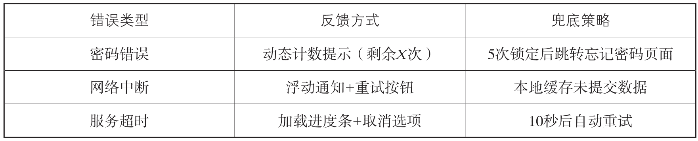

指令样例如下。

**指令：**

请扮演资深交互设计师，为金融类 App 的登录模块输出交互文档。

1．基础规则定义
- 密码输入框需实时校验，长度 8~16 位且包含特殊字符
- 登录按钮点击后进入禁用，直至接口返回才恢复可点
- 错误提示置于输入框下方，色值 #FF4444

2．动效规范
- 页面切换采用 300ms 淡入淡出
- 键盘弹出时底部进行平移动画
- 加载状态使用环形进度指示

3．异常处理
- 密码错误时提示剩余尝试次数，连续 3 次后弹出图形验证码
- 网络异常以浮层通知形式提示，并保留已填写内容
- 服务超时 10s 后自动重试，最多 3 次

输出要求：
- 使用 Axure RP 状态流程图语法
- 标注各状态转移条件
- 说明 Android 与 iOS 平台适配差异

补充要点：遇到生物识别登录时可追加判断，“若设备支持 Face ID，则在密码框上方展示生物识别入口”。基于设备能力的动态适配能提升方案通用性。优秀的交互文档如同交通信号系统，既要明确通行规则，也要预设应急预案。

**3.1.3** **实战观察：DeepSeek 在实战中的表现**

**1．社媒应用功能迭代**

**1）需求背景拆解**

面对“分析社媒应用市场趋势”这类开放性需求，如何撰写能激发大模型潜力的指令？关键是搭建结构化思考框架。下面用五步法展开。

（1）背景分析阶段
思考焦点：厘清分析的核心价值。
● 决策者最关心的市场维度是什么？用户增长、留存、变现。
● 哪些数据源具备验证价值？App Annie 下载量曲线与 Sensor Tower 收入数据。
● 时间跨度如何确定？季度波动观察与年度趋势判断。
常见误区：直接要求“全面分析”导致结果空泛。有效做法是通过限定条件聚焦方向。

（2）目标定义阶段
思考工具：SMART 原则。
● Specific：锁定“短视频社媒”而非泛社媒。
● Measurable：要求提供增长率数值而非趋势描述。
● Actionable：输出结果需包含可落地的策略建议。
● Relevant：聚焦“提升用户互动率”而非“增加用户黏性”，确保目标与平台核心功能直接挂钩。
● Time-bound：设定明确时间节点而非开放式截止时间。

指令设计示例如下。

**指令：**

请聚焦 2023 年第 4 季度至 2024 年第 3 季度，针对 18～25 岁用户群体，分析短视频社媒领域的三大核心趋势。

1．每个趋势需提供月活增长率数据支撑
2．对比同期图文社媒产品数据
3．给出三条可落地的产品优化建议

（3）信息整合阶段
思考路径：构建数据验证矩阵。
● 宏观数据：引用 QuestMobile 年度报告 MAU 曲线。
● 微观行为：分析用户会话时长分布特征。
● 竞品参照：选取排名前三产品的特色功能迭代记录。

分层提问示例如下。

**指令：**

第一轮：请整理 2024 年社媒行业白皮书中关于用户留存率的关键数据
第二轮：基于上述数据，分析晚间 8-11 点用户活跃场景的特征
第三轮：结合前两轮结论，推荐三个提升次日留存的功能优化方向

（4）策略推导阶段
思考框架：运用 SWOT-CLPV 威胁模型。
● 优势如何转化为机会 S→O。
● 劣势可能导致的漏洞 W→V。
● 需要准备的应对预案。

策略型指令示例如下。

**指令：**

假设我们是刚完成 A 轮融资的社媒创业公司，请基于当前市场趋势分析。

1．列出最可能把握的两个市场机会点
2．预测头部竞品可能采取的三种压制策略
3．针对每个预测策略制定应对方案

要求采用表格呈现，包含概率评估和资源需求预估

（5）成果验证阶段
思考检查点：建立三维度验证体系。
● 数据一致性：不同来源的 MAU 数据偏差是否在 5%以内。
● 逻辑严密性：趋势结论是否具备双向因果论证。
● 可执行性：方案是否符合当前技术实现成本要求。

验证型指令示例如下。

**指令：**

请对前述市场分析报告进行三重验证。

1．交叉验证国家信通院数据与第三方平台数据的关键指标差异
2．用反证法推演“社媒+电商”模式的潜在风险
3．评估推荐的 AR 社媒功能在现有技术架构下的实现周期

要求用红、黄、绿三色标注风险等级

通过五步思考法，我们不仅获得了精准的市场分析，更重要的是建立了可复用的 AI 协作模式。当面对“用户行为分析”“竞品对比”等衍生需求时，只需调整数据维度和验证方式即可快速生成针对性指令。

**2）功能设计产出**

当需要通过 AI 完成“社媒 App 核心流程设计”这类复杂任务时，关键在于建立系统化的思考路径。下面以动态发布功能为例，展示如何通过四阶思考法构建高质量指令。

（1）功能解构阶段
核心思考点：功能设计的本质是用户行为建模。
● 识别核心用户场景，高频刚需与低频必要。
● 绘制用户行为路径，正常流程+异常分支。
● 设定关键成功指标，转化率、完成时长、误操作率。
常见误区：直接要求“完整流程设计”容易导致功能冗余。有效做法是通过场景限定聚焦核心价值。

（2）架构规划阶段
思考工具：运用 5W1H 模型细化需求要素。
● who：目标用户画像，年龄层、使用习惯。
● what：核心功能模块，内容生产、社媒互动。
● where：功能入口位置，首页浮窗、二级页面。
● when：使用场景特征，碎片化时段、高并发场景。
● why：功能价值定位，提升 UGC ^() 量、增强社媒黏性。
● how：技术实现路径，本地处理、云端协同。

分层提问示例如下。

**指令：**

第一轮：请梳理 25～35 岁职场用户在通勤时段发布动态的典型行为特征
第二轮：基于上述特征，设计地铁通勤场景下的极简发布路径
第三轮：评估该路径在弱网环境下的功能稳定性保障方案

（3）交互设计阶段
思考框架：构建 FEBS 体验模型，流畅—高效—愉悦—安全。
● 流程断点检测：识别可能造成流失的关键节点。
● 认知负荷评估：控制单页面信息密度。
● 情感化设计：植入符合品牌调性的微交互。
● 风险防范：设置内容审核与误操作恢复机制。

结构化指令示例如下。

**指令：**

请为摄影爱好者社媒 App 设计图片发布流程，要求：

1．主流程不超过 3 步，支持批量修图
2．添加#拍摄地点标签时自动关联摄影技巧话题
3．发布失败时保留草稿并提供重试引导
4．在关键节点添加胶片过卷音效反馈

需输出流程图+异常处理方案+性能优化建议

（4）技术验证阶段
思考检查表：
● 技术栈匹配度：现有架构对新功能的支撑能力。
● 资源消耗评估：计算存储、带宽、算力需求。
● 风险预判：识别第三方服务依赖风险。

可行性分析指令示例如下。

**指令：**

评估在现有技术框架下实现 AR 贴纸功能的可行性。

1．对比 On-Device 处理与云端渲染方案
2．测算 1080P 图片处理时的内存占用峰值
3．列出需要采购的 SDK 及其授权费用
4．制定 GPU 资源不足时的降级方案

要求用矩阵表呈现各方案优缺点

通过结构化思考方法，我们不仅获得了精准的功能设计方案，更重要的是建立了可复用的 AI 协作范式。

**2．支付系统改版**

**1）安全性分析**

在设计支付系统安全分析的指令时，关键不在于直接输入需求，而在于系统性地构建风险认知框架。我们需要引导 AI 完成从风险识别到应对策略的完整闭环，这个过程包含四个关键思考维度。

（1）风险要素解构
支付系统的安全风险具有多维度特征。有效的指令设计需要先建立分层认知模型：
● 技术层，系统漏洞、加密强度
● 业务层，交易流程、资金流转
● 合规层，反洗钱、数据隐私
● 运营层，人员操作、灾备机制

尝试用矩阵分析法拆解需求：“我需要建立一个支付系统风险评估体系，请从技术实现、业务流程、法规遵从三个维度，列出需要评估的风险类别及对应的检查项。”

（2）防御纵深设计
安全策略建议需要体现纵深防御理念。通过递进式提问构建防护体系：
● 基础防护：加密传输、访问控制
● 动态防护：异常检测、行为分析
● 应急防护：故障切换、数据恢复

示例思考路径：“针对支付信息泄露风险，请设计包含预防、检测、响应的三层防护方案，要求具体说明每层采用的技术手段和实施要点。”

（3）合规校验映射
合规性检查需要建立标准映射表。有效的指令应包含：
● 法规体系定位，支付行业条例、个人信息保护法
● 控制点关联，如 KYC ^() 流程对应反洗钱条款
● 证据留存要求，日志审计周期、数据加密标准

关键问题设计：“请对照《非银行支付机构网络支付业务管理办法》，列出支付系统必须实现的 10 项合规控制点，并说明每项要求的验证方式。”

（4）应急推演验证
应急预案设计需包含场景模拟要素。通过多条件约束提升方案可行性：
● 故障等级划分，单点故障、区域性中断
● 决策树构建，自动切换阈值、人工介入节点
● 演练指标设计，RTO、RPO ^() 目标值

典型验证式提问：“设计支付通道故障应急方案时，请考虑以下约束条件：①主备系统数据延迟小于 30 秒；②回切操作需保留操作日志；③需包含客户告知话术模板。”

经过上述思考过程，我们得出分层指令框架，如下所示。

**指令：**

你作为金融科技安全专家，请按以下结构输出分析报告。

1．风险识别
- 技术风险：要求列举 API 接口、加密算法等方面的潜在漏洞
- 操作风险：需包含权限管理、审计日志等控制缺失分析
- 合规风险：对照 PCIDSS、GDPR 等标准列出差距项

2．防护方案
- 基础架构：推荐 TLS1.3+国密算法组合方案
- 访问控制：提出基于交易金额的双因素认证策略
- 监控体系：设计涵盖 5 个异常指标的实时预警规则

3．应急措施
- 设计包含 3 种故障场景的切换决策树
- 制定数据回补的完整性校验流程
- 输出客户影响评估报告模板要点

约束条件：
①策略需兼容云原生架构
②符合银保监办发〔2023〕45 号文要求
③控制成本在现有预算 120%以内

**2）性能规划**

设计高性能支付系统的关键在于建立“指标定义—测试验证—监控预警—持续优化”的闭环体系。以下为工程师需要构建的思维框架。

（1）性能维度分解
支付系统的性能不是单一指标，而是由四个相互关联的维度构成。
● 时效性：支付响应时间控制在 1 秒内。
● 吞吐量：每秒处理 1000 笔交易的并发能力。
● 稳定性：交易成功率不低于 99.99%。
● 扩展性：支持动态扩容以应对业务峰值。

思考切入点：“我需要定义支付网关的性能基准，请从交易处理、资源利用、异常恢复三个层面，分别列出关键指标及对应的行业标杆值。”

（2）压力测试建模
有效的压力测试需模拟真实业务场景组合。
压力测试要素矩阵如表 3-2 所示。

**表 3-2** **压力测试要素矩阵**

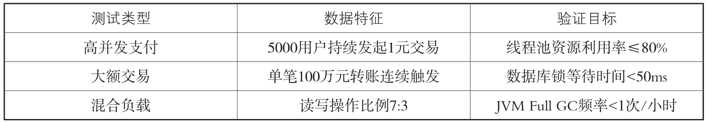

验证式提问：“设计双十一压力测试方案时，请考虑以下约束条件：①模拟 80%小额支付+20%大额转账；②包含支付渠道切换故障注入；③需验证 Redis 集群扩容机制。”

（3）监控体系分层
基于实践，构建三层监控机制。
● 基础设施层：CPU 负载、网络延迟、磁盘 IOPS。
● 服务中间件：数据库连接池状态、消息队列积压量。
● 业务指标：渠道成功率排行、异常交易地理分布。

诊断型指令设计示例如下。

**诊断型指令设计：**

当交易成功率从 99.95%下降至 99.8%时，请按照以下步骤分析。

● 关联基础设施监控数据，CPU/内存波动情况
● 检查微服务调用链路的时延分布
● 对比各支付渠道的失败代码分布

输出包含异常定位树状图和优化优先级列表的诊断报告

（4）优化策略推导
根据架构设计经验，形成优化决策矩阵，如表 3-3 所示。

**表 3-3** **优化决策矩阵**

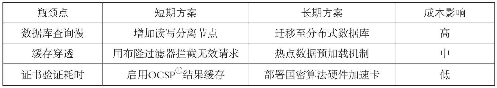
① OCSP：在线证书状态协议。

优化推演式指令示例如下。

**优化推演式指令：**

针对支付响应时间 P95 值超过 1.2 秒的问题，请从以下维度提出改进措施。

1．SQL 执行计划优化空间
2．分布式锁竞争解决方案
3．网络报文压缩可行性分析

要求评估每项措施的实施难度与预期收益

分层指令模板如下。

**指令：**

你作为金融系统架构师，请按以下框架输出方案。

1．基准定义
- 核心指标：定义 3 个黄金指标及其预警阈值
- 容量规划：计算满足 10000TPS 所需的节点数量

2．测试设计
- 场景构建：设计包含 5 种异常场景的混沌测试用例
- 数据构造：生成符合真实交易特征的压力测试数据

3．监控实施
- 指标采集：列出 Prometheus ^() 需要配置的 10 个关键 Exporter ^()
- 告警规则：设置基于滑动窗口的异常检测规则

4．优化路线
- 紧急修复：提出 3 个可在 1 天内实施的快速优化点
- 架构改进：绘制支持横向扩展的微服务改造蓝图

约束条件：
①符合 PCIDSS 认证要求
②兼容现有 Kubernetes 集群
③硬件预算不超过 200 万元

**3.1.4** **效果评估与持续优化**

**1．文档质量度量**

**1）完整性评分**

当我们需要评估产品需求文档的完整性时，关键在于建立系统化的检查维度。这个过程如同建造质量检测流水线，需要先明确合格产品的标准，再设计对应的检测工序。

（1）解构完整性要素
优秀的 PRD 如同精密的机械装置，每个部件都有其存在价值。我们可以从三个层面展开思考。
● 基础部件检查：是否具备背景说明、目标定义、功能清单等基础模块。
● 传动系统验证：功能设计是否准确承接业务目标，各模块间的逻辑衔接是否顺畅。
● 极端环境测试：是否考虑到系统在流量洪峰、硬件故障等特殊场景下的表现。

（2）定义检测标准
此时需要建立量化的评估体系，例如：
● 要素完备性，占比 40%，检查 10 项核心要素的缺失情况。
● 逻辑严谨性，占比 35%，验证 5 个关键流程的因果链条。
● 场景覆盖率，占比 25%，评估异常场景的覆盖比例。

（3）设计验证机制
为避免检查流于表面，应设置交叉验证环节。
● 反向追问：如果删除某个功能模块，是否影响目标达成。
● 压力测试：模拟将用户量放大 100 倍时系统的表现。
● 溯源性检验：随机选取功能点，追溯其对应的原始需求。

最终指令示例如下。

**指令：**

你作为资深产品架构师，请按以下维度系统评估当前 PRD。

1．要素审计：逐项核对[产品背景][目标指标][功能清单][数据字典][流程图][非功能性需求]等 10 项核心要素
2．逻辑验证：构建功能矩阵图，标注各模块间的依赖关系与数据流向，识别孤岛模块
3．边界测试：分别从网络环境、硬件条件、用户行为三个维度生成测试用例
4．风险标注：用符号▲标记存在过度承诺风险的技术方案，按实施难度进行红、黄、绿三级标识

输出格式要求：
- 缺陷清单表格，要素缺失项、逻辑断点、场景漏洞
- 风险雷达图，技术、资源、时间三个维度
- 改进优先级建议，附带补全方案示例

PRD 智能评审与竞品洞察实战手册

把复杂需求拆解为结构梳理、标准校准、验证闭环，是让模型正确理解需求的关键路径。实践中常采用分步对齐方式：先就检查视角达成一致，再逐步细化打分细则，最后拼成完整评价体系。由粗到细的搭建既能保证覆盖面，也能避免一次性丢太多要求导致模型偏离。

**2）可理解性测试**

检验需求说明是否好懂，本质是多角色立场的立体体检。评估体系可分三步推进。

（1）确立评估维度矩阵

成熟的可读性评价要兼顾形式与内容。

● 表达精细度：看专业名词和通俗说法是否配合得当，比如“负载均衡”是否做了白话补充
● 结构可达性：检查目录层级是否遵循金字塔递进，核心路径能否三步内抵达
● 认知支持：评估图示与文字是否互补，重点看复杂流程是否被拆成时序图

（2）量化评分标准

制定可执行的评分卡示例。

● 术语准确度 30%
o 术语使用是否规范 10%
o 缩写首次出现是否给出全称 10%
o 行业黑话转译比例 10%
● 结构清晰度 40%
o 章节嵌套不超三级 15%
o 功能模块单独计分 15%
o 跨章节引用准确率 10%
● 辅助理解度 30%
o 关键流程配图比例 10%
o 数据表格注释完整性 10%
o 异常场景用例数量 10%

（3）设计验证机制

用三重校验保证客观。

● 角色扮演阅读：模拟新入职开发阅读，记录卡点。
● 术语密度统计：每千字专业词控制在 8 到 12 个之间。
● 遮蔽图表检验：随机隐藏部分图表，检验纯文字自洽度。

最终指令模板示例如下。

提示词：
请扮演技术文档评审专家，按以下角度评测 PRD 可读性。
1. 语言体检：标注术语使用是否必要或冗余，找出五处歧义表述
2. 结构诊断：绘制结构热力图看核心功能占比，检查跨章节引用链是否完整
3. 认知辅助审计：列出需要补充示意图的复杂流程，核验表格单位是否统一

输出要求：
- 三维度可读性雷达图
- 按紧急度排序的易读性改进清单
- 术语对照表，含专业词与通俗解释

整体思路强调多维度拆解可读性要素，用量化指标配合验证手段搭建系统化方案。针对特定领域文档，可用行业适配法：先搭基础框架，再经三轮迭代加入行业特有标准，最后形成定制方案。

**2．迭代优化机制**

**1）反馈收集分析**

整合评审意见类似构建城市交通网，需要多维通道与智能分流。系统化处理分三阶段。

（1）建立问题分类拓扑

有效整合要形成动态问题图谱：
● 语义层：捕捉“需求描述不清”等表层表述
● 结构层：发现技术难度预估不足等流程缺陷
● 认知层：捕捉跨部门理解偏差等隐性矛盾

（2）设计模式识别引擎

用三层过滤提升分析深度：
● 高频词分析：统计“模糊”“矛盾”等风险词出现频次
● 角色关联矩阵：绘制业务、开发、测试三方意见冲突热力图
● 时序演变模型：追踪同类问题在历史 PRD 中的改进轨迹

（3）制定建议生成策略

运用三维改进向量模型：
● 补全向量：缺失需求细节的模块化填补方案
● 优化向量：技术方案的成本效益重构路径
● 校准向量：多角色认知对齐的沟通机制设计

最终指令模板示例如下。

提示词：
请扮演需求协调专家，按流程处理评审意见。
1. 问题拓扑构建：建立需求层、技术层、沟通层三维分类框架，标注出现三次以上的共性问题
2. 模式深度解析：生成部门意见冲突矩阵，绘制问题严重性与修复成本四象限图
3. 改进路线规划：输出补全清单、技术方案优化路线图含风险评估、认知对齐工作坊计划含沟通模板

输出要求：
- 带频次标注的问题分类树状图
- 紧急度、影响面、实施成本的优先级矩阵
- 历史问题对比分析表，含相似案例处理记录

该思路强调从表层识别到深层改进的递进。处理复杂意见可用问题溯源五步法：原始意见—归类—根因分析—影响评估—改进设计，确保建议可追溯。

**2）知识沉淀更新**

提炼 PRD 最佳实践相当于打造自适应进化系统，需萃取、识别、调优闭环。构建沉淀体系可从三维度展开。

（1）建立多维提炼模型
● 元素萃取层：从成功案例中提取需求分析流程图、原型检查清单等复用组件
● 模式抽象层：把具体方案转为参数化模板，如用户故事地图生成公式
● 场景适配层：为每个模板标注适用业务域与前置条件

（2）设计动态更新机制
采用反馈进化双循环：
● 模板验证环：新项目使用时记录适配度指标
o 需求覆盖率
o 方案复用率
● 案例进化环：复盘提取增量知识
o 新增异常场景处理方案
o 优化技术选型决策树

（3）构建知识网络拓扑
运用三维知识坐标：
● 经验维度：按 B 端、C 端、中台建立案例矩阵
● 时效维度：标注模板版本与行业趋势匹配度
● 角色维度：提供产品、开发、测试视角的定制化知识包

最终指令模板示例如下。

提示词：
请扮演知识管理专家，按流程提炼 PRD 最佳实践。
1. 要素解构：提取需求转化率超 85% 项目的共性特征，建立原型设计评估矩阵
2. 模式封装：生成参数化需求分析模板，设计成功与失败案例差异热力图工具
3. 动态优化：构建模板健康度看板，设置行业政策变更触发的知识衰减预警

输出要求：
- 带版本时间戳的最佳实践知识图谱
- 模板适配度测试用例集
- 跨项目经验迁移路线图

该思路强调从静态抽取到动态构建。对新兴领域 PRD，可用渐进式封装法：抽取最小可行模式—三项目迭代验证—形成稳定模板—纳入知识库正式版。

DeepSeek 推出后为需求文档生成带来结构性变化。其强大的智能辅助打破传统编写限制，让需求分析更准、设计更高效、文档更可靠。随着应用深化，有理由相信 DeepSeek 会在更多项目中发挥关键作用，助力团队打造更具竞争力的产品。

对 PM 而言，积极拥抱这一智能工具既是提升效率的关键，也是顺应行业潮流的必然。实操中要结合项目特点和团队需求灵活调用功能，不断优化生成流程。持续关注产品更新，及时把新特性融入工作，通过实践积累经验，进一步提升生成质量与效率。

让我们携手 DeepSeek 开启 PRD 生成新篇章，迎接更高效智能的产品研发未来。在机遇与挑战并存的时代，借助智能力量创造更多优秀产品，满足用户需求，推动行业前行。

## **3.2** **竞品智能监测**

在竞争激烈的市场里，PM 像商海中的舵手，竞品分析就是最关键的航海图。通过深度剖析对手产品、策略与市场表现，能精准洞察趋势、识别风险、挖掘创新机会，为战略规划与产品优化提供依据。

以手机行业为例，诺基亚因未及时捕捉智能机趋势，忽视对手在系统与体验上的创新，最终被苹果、三星超越。而苹果凭借持续竞品关注与深度分析，不断推出创新产品引领行业。

如今，基于 DeepSeek 强大的深度学习架构与多模态处理能力，构建智能化竞品监测系统成为可能。DeepSeek 采用混合专家系统 MoE 架构，像拥有众多专业智囊的团队，能针对不同数据与任务迅速调配最合适的专家高效处理，实现分析高速与精准。同时具备实时学习能力，像不知疲倦的学者，持续从海量数据汲取新知，不断优化分析结果，为 PM 提供更具前瞻价值的洞察。

**3.2.1** **数据采集引擎：多源信息实时抓取与监控**

**1．多源信息抓取**

**1）应用商店监控**

面对海量商店数据，关键不在于收集多少，而在于如何把原始数据转为战略洞察。下面用四步法演示如何构建高质量指令体系。

（1）确立分析维度矩阵

启动监控前需明确分析框架构成。

示例思考过程
需要监控哪些核心指标？如何关联？
● 基础指标：评分走势、下载量波动
● 用户反馈：高频关键词、情感极性变化
● 产品迭代：功能更新类型创新、优化、修复
● 市场策略：ASO 要素组合关键词、描述、视觉

请生成包含上述维度的竞品监测框架模板，要求区分基础指标层与洞察分析层。

提示词示例如下。

提示词：
作为移动应用数据分析师，建立 App Store 与 Google Play 的竞品监测体系。请列出基础数据层、用户反馈层、产品迭代层、市场策略层四维分析框架，用 Markdown 表格展示各维度监测项及其关联逻辑。

（2）用户评论的深度解构

处理评论建议采用分层解析法。

思考层级拆解
● 情感识别层：判断倾向及强度
● 要素提取层：分离功能点、体验维度、性能指标
● 关联映射层：将反馈与具体版本、场景关联

针对视频编辑类应用评论如何建立三层分析模型？

多轮提示词示例如下。

第一轮提示词：
分析以下用户评论的情感倾向并给出置信度百分比
第二轮提示词：
从上述评论中提取产品功能、用户体验、技术性能关键词并排序
第三轮提示词：
将提取关键词与版本更新日志关联，标记受版本影响的关键反馈点

（3）版本迭代的对比分析

追踪版本变化需要差异识别机制。

对比分析要点
● 元数据对比：版本号、包体大小、支持系统
● 更新类型识别：功能新增、体验优化、问题修复
● 影响度评估：关联用户反馈数据变化

如何构建版本更新自动化对比报告？

提示词示例如下。

提示词：
对比分析某应用 v5.0 与 v5.1 更新日志，按功能新增、体验优化、问题修复归类。对每个更新项分析是否响应历史用户反馈、预计影响用户群体、可能带来的指标变化。表格呈现并标注重点关注项。

（4）ASO 策略的要素解构

分析竞品搜索优化策略需要要素分解模型。

策略分析维度
● 关键词拓扑：核心词加长尾词组合
● 描述逻辑：功能利益点排序法则
● 视觉传达：图标、截图信息传递效率
● 时间维度：不同推广期策略变化

如何深度解析竞品搜索优化路径？

复合提示词示例如下。

提示词：
作为搜索优化专家，分析竞品在 Google Play 的前 50 关键词分布、应用描述 FAB 结构、图标截图视觉策略。输出关键词组合策略评分、文案优化建议、视觉改进方向，并推测近三个月策略调整轨迹。

将上述思考整合为可执行工作流，提示词示例如下。

提示词：
你是有五年经验的移动应用 PM，监控三个主要竞品，请执行：
1. 情感分析：分析近七天五星与一星评论情感指向
2. 版本关联：将高频反馈点与最近两版更新对应
3. 策略推演：根据竞品搜索优化调整趋势，预测下季度产品方向

输出要求：
- 对比表格展示差异
- 标注需立即跟进的关键发现
- 提出三个后续监控优化建议

通过结构化思考，我们不仅获得可直接使用的指令模板，更重要的是建立可持续优化的分析框架。实操中建议每两周迭代指令，根据数据反馈动态调整维度权重。

**2）社交平台数据采集**

在社交媒体监测中，有效使用 DeepSeek 的关键在于系统化思考框架。需经历四个认知阶段：平台特性解码—监测目标定位—分析维度设计—指令工程化。这个过程像打造精密仪器，每个零件需精确校准。

微博场景下，新机引发热议时，需先解构平台特性：实时传播强、话题裂变快、意见领袖主导。这提示指令中植入时间敏感参数，如最近 72 小时、每小时热度变化。明确目标后选择不同分析模型。

小红书种草笔记需要识别内容结构特征：标题含表情、正文分段、效果对比图。指令需包含视觉元素解析，如分析配图中产品使用前后差异。同时把高频感官词汇转化为可量化口碑标签。

抖音评论分析需多维交叉验证。建立时间、空间、情感三维模型，需要指令嵌入发布时间分布标注、地域热度图谱生成、情感极性阈值过滤等。

知乎专业问答监测考验观点提炼。需识别论点、论据、结论结构，指令中包含逻辑拆解与可信度加权标注专家认证标识。

模块化指令示例。
微博实时追踪指令：分析近 72 小时含品牌关键词的话题，按产品发布、功能评测、售后服务分类，记录每小时热度，识别核心传播节点，对比竞品同期声量，输出时间轴图谱加传播路径图。
小红书口碑分析指令：解析近 30 天类目笔记，提取肤质、使用场景关键词，分析配图与文字关联度，识别隐性抱怨，生成功效认可度雷达图。
抖音多维分析指令：处理视频评论数据，绘制 24 小时互动曲线，标注 Top10 地域热点，提取功能关键词簇，计算情感值方差。
知乎观点挖掘指令：分析问题下专业回答，拆解论证结构，识别术语使用频率，标注文献引用与实测数据，生成观点对抗图谱。

这些指令遵循平台特征嵌入、维度显性化、输出结构化原则，实践中可模块组合。数据饱和度不足时可扩大时段或引入对比维度，信息过载时可添加权重过滤参数。

**3）专业论坛跟踪**

在技术论坛分析场景，核心挑战在于把海量非结构化讨论转为可执行洞察。需建立分层思考框架。

第一层：目标定义
● 明确需获取的技术情报类型架构设计、算法优化、工具链生态
● 识别竞品技术演进关键指标 QPS ^() 提升幅度、资源消耗降低比例
● 设定时间观察窗口重大版本迭代周期、技术热点持续时间

第二层：语义解构
● 区分技术讨论中的客观描述与主观评价
● 识别开发者讨论中的隐藏需求
● 建立技术术语关联图谱

第三层：价值提炼
● 构建技术优势量化评估模型
● 识别技术方案可迁移性
● 预判技术趋势扩散路径

实战指令示例如下。

提示词：
你是资深技术架构师，需从移动开发者论坛分析某社交应用架构优化方案，请执行：
1. 信息筛选：提取近 90 天回复超 50 条的技术主题帖
2. 关键要素识别：标记架构调整前后性能对比数据，列出新引入技术组件及其版本号
3. 方案解构：填充原痛点、技术方案、实现成本、可迁移性表格
4. 风险评估：预测该架构在本公司微服务体系中的兼容性问题
5. 趋势建议：给出三个应重点监控的技术信号指标

输出要求：避免术语堆砌，用 PM 可理解的表述。

（1）用户反馈分析的指令设计方法论

处理用户反馈需建立现象—归因—方案思维链条。

现象层示例：
用户原始反馈：“文件共享功能不稳定，经常丢失”

# 用提问把复杂分析交给AI的实战笔记

**先搭好归因网格，再让模型去深挖**

想让模型快速抓住用户吐槽的点，先把问题发生的场景拆成一张交叉表。终端品类、联网条件、文档格式、操作流程四个维度一摆，问题面就出来了。

异常信号要做成可识别的规则。把社区里反复出现的抱怨词收敛成预警词，比如“上传失败”“版本冲突”“权限丢失”，一旦命中就进入重点排查。

追问也要提前埋好。当反馈提到稳定性时，指令要自动补上三问：是不是每次都复现、偶发还是特定条件下；最近一次正常使用是什么时候；是否连带同步失败等关联功能一起出问题。

**把分析链路写成可执行的任务清单**

指令示例：
你正在梳理某办公软件社区近期的用户反馈，请按下面三步走。
第一步 信息整理
1. 把过去30天约500条讨论按功能模块-问题类型归类。
2. 画一张问题热度图，横轴是用户受影响面，纵轴是解决紧迫度。
第二步 源头排查
1. 针对“文件共享”类高频问题做深挖
   - 时间线对照：对齐版本更新日志，看问题是否在某次迭代后集中出现。
   - 空间线对照：核对不同区域节点的运行状态差异。
2. 按发生概率排出归因假设清单。
第三步 建议输出
1. 短期：给出三条安抚性的话术模板。
2. 中期：提出两项埋点监控的改进思路。
3. 长期：规划架构升级路线，并附成本估算。
呈现要求：关键发现用可视化表达，技术方案要标明实施难度。

**行业动向的信号筛选与验证**

处理资讯时先建信号噪声过滤机制。

捕捉信号的指令样例：
你作为行业观察者，面前有50篇最新AI应用趋势报告。
1. 先建评估模型
   - 创新度：技术突破有多大
   - 适配度：和市场需求匹配程度
   - 成熟度：商业化路径是否清晰
2. 三层过滤
   初级：筛掉营销软文，留下技术干货；
   中级：挑出可专利化的技术点，标记潜在壁垒；
   高级：评估上下游产业影响，推测生态位变化。
3. 输出格式
   【颠覆性技术】技术点+冲击领域+时间窗预测
   【改良型创新】优化方向+受益企业类型+投资回报周期

趋势验证的指令样例：
针对已识别的“边缘AI芯片定制化”趋势，设计验证方案。
1. 交叉验证来源
   - 半导体公司财报里的关键词变化
   - 头部企业研发人员流动情况
   - 专利申请的技术路线演进
2. 反事实提问
   - 若继续走通用芯片路线，会碰到哪些风险？
   - 定制化芯片的生态搭建需要哪些前提？
3. 用SWOT矩阵把技术优势、量产难度、标准话语权等要素可视化。
输出要求：用Gartner技术成熟度曲线呈现结论。

**实时监控机制**

功能更新追踪

版本差异分析要建多维拆解框架。
第一层 维度拆解
- 代码面：函数级变更追踪，新增、修改、删除。
- 资源面：多媒体素材变更图谱，可视化迭代路径。
- 语义面：功能描述的增强度量化，用情感值加信息熵双指标衡量。
第二层 变更影响评估
构建传播模型：核心模块-依赖组件-用户体验层。
设计风险评估矩阵，如表 3-4 所示。
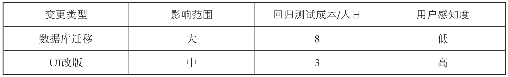
第三层 技术决策辅助
- 评估架构演进可逆性，回滚路径是否可行。
- 标记技术债，识别临时补丁并给出改良建议。
- 验证生态兼容性，建立第三方SDK适配表。

实战指令样例：
作为技术分析师，请深度解析某教育应用v5.2→v5.3的升级。
第一步 差异捕获
1. 执行 APK ^()反编译，对比 res/与 smali/目录变更。
2. 提取新增API端点，标注鉴权方式和数据格式。
3. 绘制资源文件变更热力图，重点看 drawable-xxhdpi。
第二步 语义增强分析
1. 解析Google Play更新日志
   - 用情感分析模型评估宣传力度0~1区间。
   - 提取功能关键词，生成词云对比。
2. 构建功能关联网络：
[智能批改]←依赖→OCR ^([)引擎版本][作业数据库结构]
第三步 技术影响推演
1. 预测升级后最低Android版本要求。
2. 列出可能受影响的第三方库及兼容性预警。
3. 设计分组实验验证核心功能稳定性。
输出要求：用架构图加决策树呈现。

**UI/UX变更检测的提问设计**

设计变更要走“像素级对比-交互流分析-体验指标量化”三步。

视觉层检测指令样例：
你在分析某健身应用v7.1→v7.2的UI变化，请执行：
1. 界面元素矩阵分析，记录组件ID、位置坐标、颜色值、尺寸比例、可见性。
2. 样式变更识别
   - 标注对Material Design规范符合度的变化。
   - 计算色彩对比度是否符合WCAG 2.1。
3. 动效参数提取
   过渡动画时长：300ms→250ms
   弹性曲线：cubic-bezier（0.4,0,0.2,1）

交互逻辑分析指令样例：
针对课程播放页改版，构建用户旅程图。
1. 画出v7.1流程：启动→选择课程→加载进度条→全屏播放。
2. 标注v7.2变化点
   - 新增“智能跳过片头”复选框。
   - “收藏”按钮移至浮动操作栏。
3. 设计认知负荷评估实验
   新手任务完成时间对比、关键操作点击热区变化分析。

体验指标量化指令样例：
请搭建UI改版评估模型。
1. 核心指标
   - 首次点击达成率FCT
   - 视觉层次清晰度得分1~5分
   - 信息密度熵值bits/pixel
2. 分组实验方案
   对照组：原始UI+埋点；实验组：新UI+眼动追踪。
3. 优化建议方向
   字体可读性建议SF Pro Display，色彩可达性调整警示色饱和度，交互一致性统一左滑返回手势。

**技术架构演进的提问策略**

追踪架构要用网络层-数据层-服务层的立体视角。

网络请求分析指令样例：
作为架构师，解析某电商应用网络通信升级。
1. 协议分析
   HTTP/1.1→HTTP/3迁移比例，QUIC连接成功率时序。
2. 接口拓扑发现
   绘制微服务依赖图含RPC关系，标注新增/GraphQL端点。
3. 安全审计
   证书指纹变更检测，CORS策略严格度分析。

数据存储洞察指令样例：
分析数据库架构演进。
1. 存储模式检测
   识别SQLite→Redis→Cassandra迁移路径，统计分片数与数据分布。
2. 查询模式分析
   抓取慢查询日志给出优化建议，可视化索引使用热力图。
3. 缓存策略评估
   计算L1/L2命中率，设计布隆过滤器误判率实验。

服务架构推演指令样例：
推断后端升级方案。
1. 部署特征提取
   响应头Server标签变更，错误消息堆栈特征。
2. 容量规划建议
   根据QPS增长曲线推算所需Pod ^()数量，设计混沌工程用例。
3. 技术雷达绘制
   标记已采纳技术如Service Mesh，预警技术债如单体残留，推荐Serverless等备选。

**用户反馈分析的四步法**

以音乐应用评分从4.8跌至4.2为例。

界定分析维度
思考时间关联性是否与版本更新重合，情感演化是否升级，问题是否聚类成模式。
初版指令：请对最近30天评分做时间序列分析，标出转折点并与版本日志比对。

构建分析模型
在v3.2更新后建立语义网络，为闪退、卡顿等高频词建关联图谱；做情感强度矩阵区分基础不满与深度失望；追踪负面评价扩散路径。
进阶指令：创建v3.2后评论语义网络，标注出现频率>5%的关键节点，用红蓝区分功能性问题和体验性问题。

建立归因链路
推荐算法投诉占38%时，需多维归因：技术实现导致推荐偏差、竞品同期上线智能推荐、核心用户期待提升。
归因指令：构建推荐算法问题的归因模型，涵盖技术、用户预期、市场竞争三维度，每维度列三条可验证假设并给出数据需求。

生成决策建议
短期补救调推荐权重，中期迭代模型，长期建设个性化体系。
决策指令模板：基于分析给出三层解决方案框架，每方案标资源需求0~10分、见效周期天数、预期留存提升百分比，用表格呈现并附决策依据。

完整指令示例：
#深度分析请求
##背景情境
音乐应用“SoundWave”更新v3.2后评分从4.8降到4.2，差评集中在推荐算法。
##分析要求
1. 构建时间关联模型，对齐30天评分、版本更新、运营活动时间轴。
2. 创建语义分析网络，识别高频问题关联性，区分缺陷与痛点。
3. 建立归因决策矩阵，含技术、用户、市场三维度假设。
##输出规范
时间轴图展示关键事件，思维导图呈现问题网络，决策建议按实施难度排序。

**市场动态监测**

以手机品牌策略调整为例。

界定监测维度
价格调整是否突破历史波动区间，促销是否伴随渠道变化，声量是否集中在特定人群。

构建因果链条
监测到竞品强化学生推广并增设校园体验店时，建立用户定位-渠道策略-价格调整-产能准备的关联模型。

设计动态分析框架
基础层：过去12个月价格波动带；关联层：促销周期与新品发布时间关系；预测层：价格弹性模型推测份额变化。
指令：
假设你是消费电子分析师，请分析某手机品牌价格调整。
1. 提取近12个月各渠道价格，绘制波动带。
2. 横向对比新品发布、营销活动时间，标注关联性。
3. 基于价格弹性模型预测降价对份额的影响区间：保守、中性、乐观。
输出要求：数据表、趋势图、关联矩阵三段式。

迭代验证
指令：
根据前期报告做反事实推理。
1. 若竞品维持原价，市场份额可能流失多少？
2. 若我方阶梯降价，首月降5%次月降3%，预测市场反应曲线。
3. 指出报告中三处最可能的数据偏差风险。
输出要求：对比表形式，标注关键假设和验证建议。

**差异分析：特性对比**

构建指令要走问题解构-信息定位-价值判断三阶段。

建立分析坐标系
明确核心功能清单如支付方式多样性、支付速度衡量维度；收集技术文档披露的加密算法和用户评价高频失败场景；量化覆盖率和成功率分布。
指令：列出在线支付产品10项核心功能评价维度，含技术、体验、合规，对每个维度给出可量化指标示例。

穿透创新特性本质
发现“虚拟形象社交”功能时，先解耦是否为支付流程一部分、技术是否涉及AR或社交图谱，再验证用户主动提及频率和情感倾向，最后溯源是自研还是第三方SDK。
首轮指令：分析社交支付应用更新日志，提取三项影响支付体验的创新功能并标注技术实现类型。
次轮指令：针对虚拟形象社交功能做SWOT分析，给出量化依据。

构建技术对比矩阵
五层框架：基础架构、算法应用如人脸识别FAR/FRR平衡、性能表现99分位响应、运维体系灰度发布、安全防护PCI DSS合规。
附带数据采集指令：从 APM ^()工具获取竞品API平均响应时间分布，对比本系统 Prometheus 监控数据，生成标准差分析图表。

**2）竞品体验深度评估的提问框架**

要让 DeepSeek 输出可落地的竞品体验对比，关键是先搭好一套可复用的思考骨架。下面以音频类 App 对标为例做拆解。

（1）锁定评估意图
假设需对比自家音乐客户端与 Spotify 的使用感受，首先要想清楚要回答哪些问题。视觉呈现会不会影响停留时长？操作路径会不会改变功能被发现的概率？技术表现是否与用户流失相关？把这些疑问沉淀为评估目标，就要同时覆盖视觉层、交互层、技术层三个视角。

（2）细化评测维度
界面侧要考虑色彩心理学，例如暖色是否更适配深夜使用；信息密度要可控，单屏视觉焦点建议不超过七个；品牌统一性要足够，图标语言与主视觉的关联度需要检验。播放页的具体观察点：进度条是否落在拇指热区，歌词是否遵循滑动惯性。

（3）将主观感受数值化
美观度可拆为色彩和谐度、相邻色相差值、布局合理度、F 形视觉路径符合度、图标三秒可识别性。交互流程则定义操作效率，即完成核心动作所需点击次数，以及容错能力，即误触后恢复路径是否清晰。

（4）搭建分层结构
底座层做色彩提取与对比度分析，行为层模拟操作热力分布，认知层评估信息架构与心智模型的匹配度。以歌单管理为例，既要看拖拽流畅性这一技术指标，也要看分组逻辑直观性这一认知负荷。

成型的指令示例如下。

**指令：**
请扮演资深用户体验顾问，按下面框架对比 A 音乐应用与 Spotify 的差异。
1．界面诊断
- 色彩诊断：提取双方播放页主色，计算 WCAG 对比度比值
- 布局诊断：标出核心模块视觉层级，评估 F 形浏览符合程度
- 图标测试：对五个高频功能图标做三秒识别模拟
2．交互评测
- 典型场景：绘制“收藏曲目—新建歌单—分享”流程图
- 成本量化：统计两端完成流程的点击数与滚动距离
- 异常路径：模拟误触后恢复路径清晰度
3．性能对标
- 启动耗时：同网环境下播放启动时间的对比
- 内存占用：后台播放半小时后的资源消耗曲线
- 中断恢复：模拟来电打断后的恢复成功率
4．改进汇总
- 列出三项核心体验差距
- 对每项给出可落地的优化方案
- 附上优化后的预期体验提升指标
输出要求：
①用表格呈现核心数据对比
②差异项标注显著性等级 P0.05
③包含线框图改进的文字示意
④评判遵循尼尔森十大可用性原则

这套指令经历了意图澄清—维度拆解—指标量化—框架搭建的完整链路。明确维度、量化标准、规范输出，既能发挥 DeepSeek 的解析力，也能保证结果专业可操作。实际使用时可按对象调整颗粒度，例如电商类可追加转化漏斗分析模块。

**3）医疗场景优势挖掘的指令构建**

挖掘 DeepSeek 在医疗领域的核心竞争力，同样需要系统框架。以急诊资源智能调度为例，分步拆解如下。

（1）锁定分析维度
● 技术穿透力：模型在动态决策中的实时响应水平
● 数据耦合度：多模态医疗数据的融合处理能力
● 场景适配度：与现有医疗工作流的衔接顺畅度
● 合规护城河：医疗伦理与数据隐私的保障机制

（2）构建分析矩阵
把维度与痛点交叉：
● 分诊准确率与死亡率的关联
● 多科室联合会诊的响应延迟
● 个性化用药方案的循证支撑不足

（3）设计指令结构
采用角色锚定—场景具象—约束明确的框架，示例如下。

**指令：**
以三甲医院急诊科主任身份，优化复合伤患者的抢救流程，当前困境：
- 同时收治三名危重患者时的资源分配难题
- 多学科会诊响应常超过三十分钟
- 检验结果整合效率偏低
请基于 DeepSeek 的能力：
1．实时生命体征解析，来自监护设备数据流
2．跨科室知识图谱，覆盖十二个临床专科
3．动态优先级算法，每小时更新患者状态
输出方案需包含：
- 抢救室、手术室的分配策略
- 关键检查项目的智能排序
- 跨学科会诊的触发机制

（4）多轮追问
第一轮技术验证：“用蒙特卡洛模拟评估不同分配策略下的患者存活率变化，展示五种情景对比数据。”
第二轮临床价值深化：“将策略与二零二四年 AHA 急救指南对照，标注创新点与合规依据，用红色标出突破性改进。”
第三轮评估体系构建：“设计涵盖抢救时效、资源利用率、医护工作负荷的 KPI ^()监控看板，以 Markdown 表格呈现指标定义与采集频率。”

这种结构化流程既保证指令精准，又符合医疗决策的严谨要求。产出既有实时决策支持，也有循证验证链，能真正体现 DeepSeek 在复杂医疗场景中的独特价值。

**3.2.2 分析报告生成：智能洞察与决策支持**

**1．SWOT 框架**

**1）分析思路**
面对复杂商业分析，构建指令就像绘制导航图。以智能音箱 SWOT 为例，专业产品经理通常经历六个思考阶段。

（1）明确分析目标的具体维度
不要直接要求做 SWOT，先问本次分析侧重市场验证还是产品迭代？目标用户是价格敏感还是技术尝鲜？例如针对东南亚十八到二十五岁学生，可限定：“请聚焦该人群在宿舍场景的竞争力。”

（2）构建数据框架要考虑多维信息源
指令应指定采集范围：“整合近三个月社媒评价、电商平台销量前十竞品参数、本地化内容合作资源。”兼顾全面与效率，避免信息过载。

（3）动态调整设计维度权重
若技术团队反馈音频解码芯片存在代际差距，指令应体现优先级变化：“将音质指标权重从百分之二十提至百分之三十五，同步评估硬件升级成本与体验提升的边际效应。”

（4）工具选择直接影响分析深度
技术优势评估可用对比指令：“建立语音识别准确率、唤醒响应速度、方言支持数量三维坐标系，标注我方与竞品位置。”市场机会预测则用趋势推演：“构建智能家居互联需求增长模型，输入东南亚宽带渗透率、人均居住面积等参数。”

（5）遇到数据矛盾时的处理策略
若好评率与复购率背离，指令应设验证机制：“建立情感分析—购买行为关联模型，识别好评但未复购用户特征，交叉验证质量认知差异。”

（6）交叉验证时需要设计多角度检验流程
完善的指令会要求：“把初步结果反向代入竞品定价模型，验证威胁等级合理性，输出三个最具说服力的交叉验证指标。”

据此可构建两阶段指令。
数据采集阶段示例：
**指令：**
你是一位消费电子行业研究员，正在准备某智能音箱 SWOT，请按以下维度收集结构化数据。
1．竞争要素：语音交互准确率、内容生态丰富度
2．用户感知：收集东南亚电商平台前三产品近六个月差评关键词
3．技术趋势：提取二零二四年 CES 智能家居新技术案例
4．政策环境：整理东盟国家数据隐私法规修订要点
请以 Markdown 表格呈现，含数据来源、采集时间、置信度评级高、中、低

深度分析阶段示例：
**指令：**
基于前阶段数据，执行以下任务。
1．优势量化：建立技术—市场双维度矩阵，X 轴专利数／研发投入，Y 轴市场份额增长率
2．劣势归因：对“音质差”投诉分析原因，区分部件质量、算法缺陷、场景噪声三类
3．机会预测：构建互联需求公式：（家庭设备数×兼容性系数）/用户学习成本
4．威胁验证：选取竞品三个新功能，用 KANO 分析模型分析用户转移特征
每项提供三个可验证中间指标，最终输出带置信度评级的 SWOT 矩阵

分阶段、可验证的设计既利用 DeepSeek 数据处理优势，又保证结果可靠可操作。面对医疗器械等专业领域，调整维度与验证模型即可复用。

**2）竞争态势分析**

（1）市场占有率预测的思考路径
预测前先明确时间跨度、颗粒度、呈现形式。以智能手机为例，需融合内部销售数据、第三方调研、社交媒体声量。建议先建基础框架，确定核心指标如激活量、出货占比，收集竞品发布信息与营销日历，整理历史促销效果。通过三阶提问法构建指令：第一层定义目标，第二层确定变量权重，第三层设定验证机制。
**指令：**
作为手机行业研究员，请构建二零二四年 Q3 华北地区中端机市场预测模型，包含各品牌历史季度销售对比、新品参数定价、电商预售趋势、竞品营销排期。输出带置信区间的预测曲线，并标注关键影响变量。

（2）产品力矩阵分析的维度拆解
采用“双漏斗”法先发散后收敛，先列所有维度再筛选行业共性与产品特性。指令要素需含竞品清单、评分标准、可视化形式。
**指令：**
创建智能手表产品力对比矩阵，涵盖心率监测精度、运动模式数量、第三方应用生态、屏幕续航、语音交互流畅度。对比 Apple Watch S8、华为 GT4、小米 Watch 3。数据源 GSMArena 评测、京东参数、YouTube 实测。以雷达图呈现并标注各维度权重系数。

（3）用户画像构建的实践要点
平衡广度与深度，采用“三层筛网”：基础属性、行为特征、心理特征。数据缺失时用行业报告补人口统计、客服对话提炼行为、社媒情感分析获取心理。
**指令：**
为高端健身房会员管理系统构建画像，需区分年卡、次卡行为差异，识别私教购买影响因素，预测续费率关键指标。数据源 POS 交易、课程预约、问卷调查。输出带典型场景故事板的可视化报告。

（4）趋势研判的交叉验证方法
建议“三角验证法”：技术可行性、市场接受度、政策匹配度。矛盾信号时设权重、敏感性分析、红蓝对抗推演。
**指令：**
分析二零二五年新能源汽车快充技术趋势，需综合电池厂商路线图、充电桩规划、车主充电行为调研、电网负荷数据。输出技术成熟度曲线，标注政策补贴对推广速度的影响系数，并模拟不同电价下的渗透率变化。

**3）决策支持**

构建高质量战略指令关键在于系统思考。以电商市场拓展为例，分五步演示。
（1）定位核心问题：渗透率低于行业均值百分之十五，新用户增速连续三季下滑，需判断是定位不准还是渠道失误。深度追问竞品留存数据、季节性波动。
（2）拆解分析维度：SWOT 优势如供应链响应速度、竞品动作如次日达、用户行为如 Z 世代搜索量上升百分之四十。
（3）构建策略假设：差异化服务能否抵消价格劣势？假设物流提至十二小时，成本增百分之八，转化率需提升多少维持利润？
（4）设计验证路径：需历史促销弹性系数、区域仓储拓扑、NPS 值。
（5）迭代优化机制：监测 CAC 与 LTV 比值变化，库存周转率低于两次／季度触发复审。

基于此设计三段式指令。
首轮信息收集：
**指令：**
作为电商战略顾问，请分析近半年五份行业报告 PDF，提取三个主要竞争对手动作、十八到二十五岁用户偏好变化、区域物流基础设施成熟度指标。用表格呈现并标注时间戳。

次轮策略生成：
**指令：**
基于前述数据生成三个市场拓展方案，每个含资源投入矩阵、实施前提假设，用 SWOT-PEST 组合评估。以 Markdown 输出，关键数据加粗。

终轮验证优化：
**指令：**
针对方案 B 仓储扩建计划，设计验证实验。列出至少三类极端场景、核心 KPI 达标阈值、六个月里程碑。用甘特图+决策树呈现。

实战建议建检查清单：要素完整性、数据可溯性、风险对冲性、迭代闭环性。复杂问题可用“洋葱式提问法”逐层深入，每轮间隔二十四小时沉淀思考。

**2．差异矩阵**

**1）功能对标分析**
在手机竞争白热化环境下，产品经理需为新旗舰定价做竞品对标。
第一步明确分析目标：验证八千九百九十九元定价竞争力还是找迭代方向。若目标是定价合理性，则聚焦价格敏感人群。
指令框架：“请列出影响高端手机定价的五个核心要素，按消费者决策权重排序，需含调研数据。格式‘要素（权重%）—关键数据—来源说明’。”
第二步分解对比维度：避免简单参数罗列，建立三层模型：显性参数、隐性体验、心智认知。
**指令：**
请为智能手机竞品分析设计三级对比模型，每层含三个核心指标，说明数据获取方式，并给出华为 Mate 系列与 iPhone 对比示例。输出表格+文字说明。
第三步动态调整策略：若品牌溢价不足，转技术架构深度对比。采用引导式提问链：
第一轮：“分析海思麒麟九一零零与苹果 A17 Pro 在 AI 算力架构差异，重点说明 NPU ^() 设计对影像处理的影响。”
第二轮：“基于上述分析，预测夜景、人像虚化、视频防抖三场景体验差异，用技术参数推演实际表现。”
第三轮：“结合台积电三纳米良品率数据，估算芯片成本差异对整机定价的影响系数。”
第四步构建决策模型：
**指令：**
请构建智能手机定价决策模型，含成本维度 BOM ^() 成本、研发摊销，市场维度竞品价格带、渠道分成，用户维度价格敏感度、换机周期。给出数据采集建议与权重分配，并以九千元价位演示应用。

可复用的提示词分析框架如何搭建

完成一轮由目标到校准的递进推演后，产品经理收获的不仅是一次性结论，更是一套可循环使用的分析骨架。先锁定待解决的问题，再搭建对比维度，最后做动态修正，这条路径本身就是打造高质量提示词的方法论。

最终的提示词样例如下。

**提示词：**

你现在是资深消费电子分析师，需要为××手机新品制定定价策略，请按以下步骤进行分析。

1．拆解目标：确认本次分析要解决的 3 个核心决策问题

2．维度搭建：建立三级对比模型（参数、体验、认知）

3．数据规划：列出各维度需要采集的 5 类关键数据及获取方式

4．差异量化：用参数推演法预估关键配置的市场感知差异

5．策略建议：结合成本结构和市场定位给出定价区间方案

要求：

- 每步骤输出前先展示思考逻辑

- 使用技术参数与用户调研数据交叉验证

- 区分事实陈述与策略推断

- 表格与文字说明交替呈现

2）缺口识别
产品优化的问题看似繁复，本质是搭建一套系统化的分析脚手架。下面这套经过实战检验的四步思路，能把模糊需求转化为可用的指令。

以云办公套件的功能迭代为例，先厘清三点：当前版本在哪些关键功能上缺位？达到什么水准才算合格？用户最急迫的需求是什么？理清后即可引导 DeepSeek 进入深度思考模式，提示词样例如下。

**提示词：**

【任务背景】作为产品经理，正在规划下一代在线办公套件

【输入信息】当前版本功能列表：文档编辑、表格处理、幻灯片制作（基础版）

【对比目标】分析微软 Office 365、Google Workspace 最新版本的核心功能

【具体要求】识别缺失的必要功能模块；评估实现优先级；预测用户接受度

【输出格式】矩阵表格含功能名称、竞品实现度、开发难度星级、用户需求热度

要把体验差距量化，关键在于建立可操作的分层维度。建议用“场景—触点—指标”三层拆解法。比如网约车等待体验优化，可分轮次推进。

第一轮聚焦场景拆解，提示词样例如下。

**提示词：**[**深度思考模式**]

作为用户体验分析师，请拆解打车场景的关键触点。

1．从下单到司机接单阶段

2．车辆到达前的等待阶段

3．行程中的服务阶段

要求输出各阶段用户核心诉求及对应体验指标

第二轮做数据对照，提示词样例如下。

**提示词：**[**联网搜索模式**]

获取头部打车平台最新数据：

1．接单平均响应时间行业标杆值

2．等待期间用户焦虑指数调研报告

3．车内服务满意度前三要素

对比我司当前数据，生成差距雷达图

技术对标要区分显性能力与隐性架构。以智能家居系统为例，建议分两层提问，提示词样例如下。

**基础能力评估：**

列出竞品 X1、Y2 支持的通信协议清单

对比我司当前支持的 Zigbee 3.0、蓝牙 Mesh 协议

输出协议覆盖度评分（满分 10 分）

进阶架构分析：[深度思考模式]

模拟技术专家视角，从以下维度分析。

1．分布式架构的容错机制设计

2．OTA ^()升级方案的完整性

3．边缘计算能力部署情况

要求用 SWOT 模型呈现评估结果

商业模式优化忌空谈，需要指标支撑，建议用“三层递进式”提问法。

第一层：模式解构，提示词样例如下。

**提示词：**

拆解共享出行产品 X 的商业模式构成要素：

1．收入来源及占比

2．成本结构

3．用户获取漏斗

4．合作伙伴图谱

用可视化形式呈现各要素关联关系

第二层：数值对比，提示词样例如下。

**提示词：**[**联网搜索模式**]

获取以下数据：

1．竞品每单补贴金额波动趋势

2．优质司机留存率行业均值

3．金融机构合作分润比例

生成我司与市场排名前 3 的竞品的对比仪表盘

第三层：创新推演，提示词样例如下。

**提示词：**[**深度思考模式**]

基于现有数据，模拟三种创新方案：

1．动态梯度计价模型

2．车险分润新模式

3．充电桩生态合作

要求每个方案包含可行性分析、收益预测、实施路线图

经过上述演练，最终形成的提示词模板通常具备以下特征：明确模式选择（基础、深度、联网）；结构化输入背景信息；限定分析维度和输出格式；包含验证指标或对比基准。

这种系统化设计能把模糊的产品优化诉求转化为可执行的 AI 分析任务，最终产出具备决策价值的洞察报告。

3．趋势预测

1）数据分析能力
用大模型穿透数据迷雾，关键不在于工具多少，而在于能否用精准提问搭建清晰的思考路径。以饮料行业新品推广为例，优秀的分析师会像侦探设计破案思路一样设计提示词。

第一步：锚定核心变量
先问自己：预测新口味饮料的市场份额变化，至少需要哪些关键数据支撑？历史销量是基础，更要关注竞品动态——某乳制品企业曾因忽视对手渠道补贴政策，导致预测偏差达 12%。此时可建立四维坐标：*X*轴为时间跨度（3、6、12 个月）；*Y*轴为市场层级（一线城市、下沉市场）；*Z*轴为竞争维度（价格带、渠道覆盖率）；*T*轴为外部变量（原料价格波动、政策法规）。

第二步：构建动态模型
用“如果……那么……”句式检验逻辑完整性：

● 如果竞品在第 3 季度开展买赠活动，我们的预测模型需要增加什么监测指标？

● 如果我司在社交媒体上出现负面舆情，模型自修正机制如何触发？

某智能手表厂商通过设置 3 级舆情预警阈值，使市场预测准确率提升 19%。

第三步：设计渐进式提示
分层递进的提问最能激发模型潜力，提示词样例如下。

**提示词：**

#第一轮 数据框架搭建

请列出影响饮料品类市场份额变化的 10 个核心指标，并按波动敏感性排序。对每个指标给出可量化的数据采集建议

#第二轮 关联关系挖掘

基于上述指标，绘制因果关系图。标注正负反馈回路，特别说明当线上销量增长 5%时，线下渠道可能产生的 3 种连锁反应

#第三轮 模拟推演

假设竞品在华南地区新增 3 万个零售点，请分季度推演本品市场份额变化趋势，要求生成乐观、中性、悲观 3 种场景下的数学模型

第四步：建立验证回路
设置三重校验机制：

● 反向提问：哪些数据异常会导致当前预测结论完全反转？

● 缺口分析：现有数据中，哪个维度的信息颗粒度最需要加强？

● 替代验证：如果用回归分析替代当前使用的 LSTM 模型，核心结论会发生什么变化？

通过结构化思考，最终得到的提示词既保持开放性又具备工程化特质，提示词样例如下。

**提示词：**

假设你是饮料行业资深策略分析师，需要评估新口味产品上市后的市场份额变化，已知条件包括：

- 本品历史月均销量：120 万箱（波动系数 0.3）

- 竞品最近季度促销频次：4 次／月

- 目标区域 KA 渠道 ^()覆盖率：63%

- 社交媒体声量指数：新品预告期 85 分位

请分 3 步完成预测：

1．建立包含供需关系、竞争博弈、传播效应的动态模型框架

2．识别 3 个最关键的风险变量并给出其监测阈值

3．输出 6 个月内的市场份额预测曲线，并标注需要人工复核的关键决策点

输出要求：每步提供可验证的中间指标，拒绝笼统表述

这种思考方式的价值在于：当 3 个月后出现原料短缺危机时，分析师能快速定位到模型中的“供应链韧性系数”模块，通过调整参数权重即时修正预测曲线，无须重建整个框架。

2）发展推演
驾驭 DeepSeek 的市场洞察能力，关键在于建立“动态锚点—反馈验证”的思考框架。以折叠屏手机市场分析为例，战略分析师需要像围棋布局那样设计提示词。

第一步：定义动态观测锚点
有效提问始于识别关键变量。真正的洞察不在于收集更多数据，而是确定哪些信号具有杠杆效应。参考医疗领域 AI 诊断系统的动态演进机制，建立三重锚点体系：

● 结构性变量（市场份额占比>5%的竞品）。

● 敏感性变量（价格弹性系数>1.2 的功能配置）。

● 突变性变量（专利申请量年增速>30%的技术方向）。

第二步：构建对抗性推演
用“假设—证伪”框架激活模型潜力。当分析某手机品牌折叠屏技术突破时，可设置矛盾场景。

提示词样例如下。

**提示词：**

#正向推演

若该品牌良品率提升至 85%，请推演其对供应链的虹吸效应，需包含二级供应商名单变化预测

#反向验证

假设其屏幕模组成本上升 20%，预测其技术路线转向概率，要求输出贝叶斯概率树状图

这种方法曾帮助某医疗 AI 系统将诊断准确率提升 26.6%。

第三步：设计时空嵌套提示
分层递进的时空维度能释放模型潜力。

● 空间解构：“绘制折叠屏手机产业链地图，标注 3 个最可能发生技术溢出的细分领域。”

● 时间切片：“将技术渗透周期划分为 0～18 个月、18～36 个月两个阶段，分别输出关键技术突破阈值。”

● 时空耦合：“建立技术扩散速度与区域人才密度的回归模型，要求*R*[2]>0.7。”

第四步：建立衰减校验机制
参考 AI 医疗系统的动态优化方案，设置 3 类自检问题。

● 信号衰减检测：“当前模型中，哪个竞争要素的预测半衰期最短？”

● 路径依赖测试：“如果全面转向 UTG ^()方案，现有预测结论有多少百分比需要修正？”

● 黑天鹅响应：“突发性关税调整对技术路线选择的影响函数应如何构建？”

通过这种思考框架，最终形成的战略分析提示词既保持敏捷性又具备抗干扰性，提示词样例如下。

**提示词：**

假设你是消费电子行业首席分析师，需评估某手机品牌折叠屏技术突破对市场格局的长期影响，已知条件包括：

- 技术专利布局：核心专利 23 项，外围专利 57 项

- 供应链成熟度：二级供应商替代率阈值为 40%

- 竞品响应速度：平均 6 个月跟进周期

请分 3 个阶段完成推演：

1．建立“技术—市场—资本”的三螺旋影响模型

2．识别产业链中最可能形成技术锁定的 3 个关键节点

3．输出 5 年期的市场集中度曲线，标注可能引发格局重构的 3 个临界事件

输出要求：每个阶段需提供可交叉验证的中间指标，拒绝黑箱结论

这种结构化思考在技术突变期价值尤为明显。当检测到某竞品突然增加 30%的研发人员招聘时，分析师能快速定位“人才密度—创新速度”关联模块，通过调整人力资本弹性系数即时修正预测模型，而非陷入数据海洋。

3.2.3 实战应用：短视频平台分析与工具集成

1．典型场景：短视频平台分析

1）监控维度设置
短视频竞争白热化时，运营者常陷入数据迷雾——面对上百个监控维度，如何构建真正有决策价值的分析框架？需要建立“目标拆解—要素建模—策略生成”三阶路径，让 AI 成为战略望远镜而非数据垃圾桶。

以创作者生态评估为例，成熟的运营者会先解构核心问题：健康生态需同时满足供给侧活跃度（数量×质量）和需求侧匹配效率（曝光×转化）。某腰部短视频平台曾仅用“创作者数量增长率”判断生态健康，导致低质账号涌入，破坏体验。正确的路径应包含 4 个关键步骤。

● 目标校准：明确评估核心目标是提升内容供给质量还是优化商业转化效率？若平台 UGC ^()同质化严重，就需要在提示词中强化对创作者分层结构的分析要求。

● 要素建模：将抽象概念转化为可观测指标。健康度=优质创作者留存率×0.4+爆款内容产能×0.3+粉丝互动熵值×0.3，权重需随平台阶段动态调整。

● 对比框架：建立横向（竞品平台）与纵向（本平台历史）两个参照系。例如分析某新兴平台创作者流失时，可要求 AI 同步输出快手“创作者学院”的运营策略进行对比。

● 归因设计：强制区分表象数据与根本动因。当监测到创作者收益下降时，应引导 AI 区分是平台分成机制问题、广告主预算转移，还是内容质量波动导致商业价值降低。

基于结构化思考，可生成具备诊断能力的提示词，如下所示。

**提示词【深度分析模式】：**

基于当前平台 30 日内创作者数据，执行以下分析流程。

1．分层诊断：将创作者按粉丝量分为 5 个梯队，分别计算各梯队留存率、爆款率、变现效率

2．归因矩阵：使用 SWOT 框架分析影响各梯队创作者流失或留存的关键因素，需包含平台政策、竞品动作等分析维度

3．策略推演：针对腰部创作者（10 万～50 万粉丝）设计 3 个激励方案，预测各方案对内容多样性指数和商业 GMV ^()的影响

约束条件：避免使用简单相关分析，需通过创作者行为序列构建因果模型

面对商业化模式创新这类复杂命题，建议采用分步追问策略。第一轮构建如下所示分析框架。

**提示词【商业模式解构】：**

请将抖音的现有商业化路径拆解为价值创造、价值传递、价值捕获 3 个模块，每个模块列出不超过 3 个关键成功要素，输出要素关联图。

根据输出结果进行如下所示第二轮追问。

**提示词【创新沙盘】：**

假设我们需要在价值传递环节增加 AR ^()广告形式，请：

1．分析需要突破的 3 个技术瓶颈

2．预测用户留存率可能产生波动的区间

3．设计 A/B 测试方案验证广告效果

约束条件：需考虑 DeepSeek 的实时数据监测能力和用户画像颗粒度

这种思考方式有效避免了“数据丰富但洞察贫乏”的陷阱。某美妆垂类平台通过该方式重构监测体系后，发现看似平稳的 DAU 曲线下隐藏着用户使用时长两极分化的趋势，进而有针对性地推出创作者分级运营策略，使高价值用户留存率提升 27%。

2）分析框架应用
在短视频竞争格局中，运营者常面临“数据富营养化”困境——上百个分析维度如同散落拼图，如何找到关键决策线索？需要建立“问题拆解—维度建模—策略验证”三阶框架，让 DeepSeek 成为战略罗盘而非数据沼泽。

以产品策略对比为例，成熟的运营者会先解构对比逻辑。

● 要素萃取：将抽象的产品定位转化为“用户渗透率×功能使用频次×内容消费深度”的可观测指标。

● 维度选择：根据平台发展阶段选择关键对比维度。某教育垂类平台曾错误地将抖音娱乐化功能直接移植，导致用户流失率上升，可见不应忽视核心用户诉求差异。

● 动态校准：建立跨平台数据映射关系。当分析 B 站二次元生态时，需将“弹幕互动密度”指标转换为通用模型能理解的“用户共创价值系数”。

基于结构化思考，可生成精准的对比提示词，如下所示。

**提示词【竞品策略解码】：**

请对抖音与 B 站进行产品策略三维度对比。

1．用户价值：按年龄、地域、兴趣维度绘制用户重叠度热力图

2．功能矩阵：识别双方特有功能与公共功能的质量差异（使用 NPS ^()模型评估）

3．生态演进：预测未来 6 个月内容供给结构变化趋势

约束条件：需结合双方创作者扶持政策与用户增长数据进行归因分析

评估算法技术能力时，建议采用分层验证法。首先构建如下所示评估框架。

**提示词【算法健康度诊断】：**

请为短视频推荐系统设计包含以下维度的评估体系。

- 即时反馈：点赞后相似内容推荐响应速度

- 长尾挖掘：小众内容曝光占比曲线

- 价值观校准：敏感内容过滤准确率

输出各维度量化指标采集方案

根据输出结果进行如下所示深度追问。

**提示词【异常定位】：**

假设某平台 CTR ^()突然下降 3%，请：

1．区分算法因素（模型迭代、特征工程）与非算法因素（内容供给、用户迁移）

2．设计归因实验方案，包含数据采集点和验证周期

约束条件：需利用 DeepSeek 的实时 A/B 测试功能进行多变量控制

这种思考方式有效规避了“指标崇拜”的陷阱。某本地生活平台通过该方法重构运营评估体系，发现看似亮眼的用户增长数据背后隐藏着地域分布失衡问题，进而调整区域运营策略，使高价值城市用户占比提升 19%。

2．工具集成

1）自动化工作流
在快节奏工作场景中，你是否常面临手动收集各平台数据耗时费力、重要市场动态难以及时捕捉、撰写分析报告占据大量时间？DeepSeek 可提供自动化解决方案，就像为你配备了一位不知疲倦的智能助手。让我们通过一个真实场景理解其运作机制。

假设某短视频平台的产品团队需要监控竞品动态。传统方式需人工每日查看应用商店评分、爬取社交媒体讨论、整理 Excel 表格——至少需要 3 人团队每天投入 4 小时。而通过 DeepSeek 的自动化流程，整个工作变得像设置手机闹钟一样简单。

第一环节：智能数据管家

# 全天候情报网络

多源渠道的接入已完成自动化，例如 App Store ^()、微博等口径均已打通，采集规则的配置如同预约闹钟般便捷：每天清晨定时拉取评分变化，每小时巡检社交媒体热度。等于给每条数据源都安上常驻观察员，打开控制台就能直接看到最新的市场脉动。若竞争对手在凌晨三点悄悄上线新版本，监测体系会比对手更早收到风声。

第二环节：洞察引擎
一旦捕捉到异常波动，比如评分骤降，系统会立刻启动深度拆解，仿佛资深分析师在开紧急复盘会。譬如社交端忽然集中讨论“视频加载慢”，平台不仅会统计负面声量，还能把场景进一步拆解：是 Wi-Fi 环境还是 5G 环境？是安卓用户还是 iOS 用户？从而给出可执行的优化方向。

第三环节：报告自生成
分析结果会自动转化为结构清晰的周报，包含趋势图、问题定位与改进建议。以创作者流失为例，报告可能写成：“近 30 天万粉创作者流失环比上涨 15%，集中在美食垂类，建议调整美食视频的流量分配策略。”数据实时呈现后，决策会议不再需要等待分析团队手工备料。

第四环节：7×24 守护
体系内置健康巡检，相当于给自动化流程安排了值班护士。当出现抓取异常，比如某平台接口变更导致采集失败，系统会通过预设渠道即时告警。更智能的是，面对临时网络抖动这类常见波动，系统会先自动重试，只有多次尝试仍失败才推送人工，避免过度打扰。

在这种机制下，产品团队的工作逻辑被彻底改写：从被动救火转向主动预防，从堆砌数据转向支撑决策。某电商团队引入该方案后，竞品监控效率提升 4 倍，提前两周捕捉到对手大促前的补贴策略调整，及时优化自身活动，最终 GMV 超额完成 32%。

搭建这类自动化体系，本质是在数字世界织就智能响应网络。各个环节如同精密齿轮咬合：采集是感知神经，分析是决策大脑，报告是表达能力，预警则是免疫系统。形成闭环后，我们就能以数字孪生的方式，在虚拟世界复刻完整的业务镜像。

互动思考：回看你当前工作中最耗时的 3 个重复性动作，若全部自动化，哪个环节的价值回报会最大？原因是什么？

**2）让数据自己开口的可视化呈现**

信息过载时，表格里的数字容易让人眼花，关键信号又散落各处。DeepSeek 的可视化能力就像一位会讲故事的演绎者，能把枯燥指标变成动起来的画面。下面用一个短视频团队的运营实践来说明。

第一幕：用户活跃心电图
以往观察活跃度要手工整理十几张表。现在 DeepSeek 可以自动生成趋势图，像给平台装了一台心电监测仪——每天凌晨绘制活跃曲线。某次团队发现周三下午活跃度总出现“心跳骤降”，追查后发现是例行系统维护扰动。调整维护到凌晨后，用户留存率直接回升 5 个点。

第二幕：竞品对比透镜
面对 20 多款同类 App，产品经理过去需做数十页对比文档。如今借助 DeepSeek 的矩阵图，所有竞品核心指标像棋盘上的棋子一样排布。色块编码让自家 App 与对手的优劣一目了然：红色代表短板，绿色代表优势。一次对比中，“夜间模式”被标红，经排查是入口层级过深，优化后用户好评率提升 40%。

第三幕：实时决策驾驶舱
管理层原先每月阅读 30 多份报告，现在被整合为动态仪表盘。这个数字驾驶舱左侧是用户增长速度表，右侧是内容热度温度计，中央悬浮竞品动态雷达。某次“用户创作时长”指标异常波动，下钻后发现是某垂类流量分配失衡，及时调整后避免了创作者流失。

第四幕：风险预警烽火台
凌晨 3 点，运营总监的手机震动，预警界面弹出红光提示。系统监测到某社媒平台“视频卡顿”讨论激增，自动生成的舆情地图显示问题集中在华南 5G 用户。值班团队立即启动区域网络检测，在早高峰到来前完成修复，将潜在流失风险扼杀在萌芽。

使用这些可视化工具，就像给企业配上不同焦距的镜头：趋势图是广角，矩阵图是显微，驾驶舱是全景天窗，烽火台是夜视仪。某 MCN 机构应用后，决策会议时长缩短 60%，市场响应速度提升 3 倍。

互动思考：把你手机里常用的 3 个 App 想象成图表，它们分别会呈现什么形状和色彩？哪些维度最能体现核心价值？

**3.2.4 系统效能持续优化指南**

**1．系统完善方向**
要让竞品监测真正成为决策雷达，需要像培育生命体一样持续进化能力。系统既要看得更广、算得更准，也要学会在关键时刻主动提醒决策者，背后有 4 个进化方向。

第一层进化：编织数据天网
应用商店搜索结果只是冰山一角。真正的监测应像老练的渔夫懂得在新兴水域撒网：小众开发者论坛可能酝酿颠覆性创意，垂直电商平台上新品或在特定人群悄然走红。要训练系统识别这些“暗流数据”，如同汽车经销商借助本地化数据锁定真实对手。

互动思考：你所在行业有哪些尚未被充分挖掘的数据金矿？

第二层进化：打造会迁移的大脑
面对海量输入，系统需像职业棋手不断精进。不仅是升级算法，更要学会跨领域借力。例如金融风控模型可能意外适用于预测竞品市场动作。这种迁移学习能力是保持分析领先的关键。

互动思考：你的业务分析模型上一次重大升级是什么时候？

第三层进化：建立智能预警哨所
优秀预警应像精准天气预报。竞品在社交媒体声量突然增加 5%，有时比财报更能预示变化。通过多维数字触发器捕捉微妙信号，就像经销商实时监控经营指标波动，系统需在价格调整、功能更新、营销投放等节点及时亮灯。

互动思考：你的预警机制能捕捉哪些行业特有的“风暴前兆”？

第四层进化：生成会讲故事的智能报告
数据价值最终要落地到决策。系统可自动生成三版本报告：给 CEO 的电梯简报、给产品经理的功能解剖图、给市场部的战情分析。理解不同角色的语言习惯，就像医疗 AI 为不同科室出具诊断建议。当系统能用投资报告的逻辑解构竞品动态，洞察会完全不同。

互动思考：你的分析报告是否真正适配不同决策层的需求？

进化路线图实践建议：
● 每月新增一个细分数据源，例如垂直论坛。
● 每季度引入跨行业分析模型做测试。
● 建立预警误报案例库持续优化规则。
● 为核心用户定制专属报告模板。

这个过程本质是将监测从信息记录仪升级为决策加速器。当系统能主动提示“竞品下周可能发布新品，建议提前准备应对方案”时，才算实现真正的智能化。

**2．应用提升策略**
要让监测系统成为战略参谋，需赋予三种核心智慧，像培养一位全能商业分析师。

第一重智慧：行业特工模式
给系统装上可切换的行业滤镜。电商场景自动聚焦价格波动、用户评价等战场信号；游戏场景则切换至玩法创新、留存率等生存指标。这种场景化能力，正如经销商通过本地化数据锁定真实竞品。

互动思考：你的监测系统能识别多少种行业专属信号？

第二重智慧：数据变形工坊
优秀系统应像乐高积木，允许自由拼装分析模型。市场部搭建社媒舆情监测塔，产品部组装功能迭代预测仪。这种个性化定制，正如智能决策系统通过动态预测优化企业策略。

互动思考：你的分析模型是否仍停留在标准套餐阶段？

第三重智慧：战情协作中枢
市场部发现异动时，系统应自动召集产品、研发进入“作战室”。权限分级的信息沙盘，既保证数据安全，又实现决策同步，就像多部门协同管理关键指标。

互动思考：你的团队是否还在用聊天软件传递关键情报？

第四重智慧：决策推演沙盘
价值不在于罗列数据，而在于生成“如果…那么…”的战术推演。系统提示“竞品下月可能降价 5%”时，应同步给出三种应对方案的损益预测。这种深度支持，正如智能化应用把数据分析转化为战略沙盘。

互动思考：你的决策会议多久会出现一次意外？

系统升级路线图：
● 建立行业特征库，至少覆盖 3 个核心赛道。
● 开发可视化分析模块组装平台。
● 搭建跨部门虚拟作战室。
● 植入战略推演算法引擎。

当监测系统开始提醒“建议周四上午 10 点发布应对方案，目标用户在线率将达峰值”时，它才真正从数据看板蜕变为决策大脑。

在数字化竞争加剧的今天，竞品分析已是企业立足关键。基于 DeepSeek 强大的深度学习架构和多模态处理能力构建的智能化监测系统，为企业提供全面、精准、实时的市场洞察。

DeepSeek 的 Transformer 优化架构、混合专家系统 MoE 以及卓越的多模态处理能力，使其能高效处理多源数据，无论是应用商店、社交平台还是专业论坛的信息，都能精准抓取并深度挖掘。数据采集引擎实现多源实时抓取，从应用评分、版本迭代到社媒热点、用户评论，再到论坛技术动态、用户痛点，均可及时捕捉。分析报告生成环节可输出涵盖 SWOT 框架、差异矩阵和趋势预测等多维度深度报告，为企业提供竞争态势分析和决策支持。以短视频平台为例，通过多维度监控指标和深度分析框架，企业可深入了解竞品的产品策略、算法技术、运营效果和商业模式创新。工具集成功能实现自动化工作流和可视化呈现，大幅提升效率和直观性。

展望未来，随着 AI 技术发展和市场变化，基于 DeepSeek 的系统有望在技术创新、多模态融合和应用拓展方面取得突破。技术上将优化深度学习架构，提升处理复杂任务能力；多模态方面将融合文本、图像、音频，提升理解深度；应用上将渗透更多行业，例如电商可精准监测价格策略和促销活动，金融可实时跟踪产品创新和风险管控。与大数据、物联网、区块链融合，可实现更广泛收集、更安全传输和更深入分析。

基于 DeepSeek 的智能化竞品监测系统为企业提供强大的市场竞争分析工具，帮助把握机遇、应对挑战。随着技术进步和应用拓展，该系统将在未来市场竞争中发挥更重要作用，助力企业可持续发展和创新突破。

**结语**
本章介绍了 DeepSeek 在 PRD 智能生成流水线和竞品监测系统方面为产品经理带来的革新。它能提供更精准全面的分析，帮助产品经理摆脱繁琐基础工作，聚焦核心创新。未来，随着技术进一步发展，DeepSeek 将会在产品管理领域发挥更大作用，助力把握市场风向，引领产品走向成功。若想获取更多产品管理知识和前沿资讯，欢迎关注个人公众号“产品经理独孤虾”全网同号。

在代码如潮水般奔涌的数字时代，开发者正站在效率与质量的双重悬崖边。传统开发仍困于手动调优、文档滞后、多语言迁移难题，DeepSeek 正以 AI 的锋利刀刃为技术开发开辟新通道。它不仅是代码翻译官、架构设计师、文档书写者，更是思维范式革命的引领者——当算法自动诊断内存泄漏蛛丝马迹，当智能提示生成可落地重构方案，当全周期辅助将开发者从重复劳动中解放，软件开发从体力竞技升级为脑力博弈。在每秒产生 10 亿行代码的时代，DeepSeek 不仅是工具进化的推动力，更是开发者突破认知边界的翅膀，让每个技术决策都闪耀智能光芒，为数字世界的建设者照亮通往未来的捷径。

**实操案例**

# **第四章**

# **场景篇技术开发增效包**

## **4.1 代码开发全周期辅助**

在软件开发的广阔天地中，每一次技术革新都像破晓曙光，为行业带来新希望。DeepSeek 以强大技术实力和创新特性，迅速成为众多开发者不可或缺的助手。

从代码片段编写到复杂大型项目，DeepSeek 贯穿开发全流程，提供全方位支持。它不仅能理解需求快速生成高质量代码，还能优化、调试现有代码，甚至自动生成全面文档。全流程支持极大提升效率，降低成本，让开发更高效智能。

想象一个复杂项目中，DeepSeek 像经验丰富的技术导师时刻陪伴。根据需求快速提供准确代码建议，遇到问题迅速定位解决，项目结束后自动生成详细文档，为后续维护升级提供便利。有了助力，开发者可将更多精力投入创新和业务逻辑，实现更轻松高效的开发。

接下来深入探索 DeepSeek 在代码全周期中的强大功能，感受它带来的巨大变革。

**4.1.1 智能编程助手：代码生成与优化的智慧大脑**

在开发全周期中，智能编程助手扮演关键角色，能极大提升效率和质量。DeepSeek 凭借强大功能为开发者带来前所未有的便利。

**1．智能代码生成：自然语言到代码的神奇转换**

在实践中，构建高质量提示词的本质是将模糊需求转化为可执行指令的元编程过程。当要求 DeepSeek 实现用户登录功能时，表面是简单任务，实则需经历三层思维跃迁。

第一层：需求要素解构
开发者需像编译器解析代码般拆解自然语言。以“创建用户登录函数”为例，核心要素应包含输入参数用户名、密码，验证规则空值检查、长度限制，输出逻辑分情形返回结果，测试用例预设管理员账户。此时需警惕需求陷阱——用户未明示的边界条件如特殊字符处理和异常流程如连续失败锁定，建议采用要素检查清单法，用结构化提问确保需求完整。

第二层：技术约束显性化
将隐性工程经验转化为显性指令是提升质量关键。原始需求至少存在三个需强化的技术约束：类型校验是否限制参数必须为字符串，安全规范是否要求密码密文传输，扩展预留是否需要日志记录接口。这些决策构成提示词中的质量阀门，通过预设约束引导 AI 产出工业级代码。

第三层：模式匹配优化
观察示例代码可发现，DeepSeek 自动应用了卫语句模式进行前置校验。这提示开发者应主动在提示词中声明期望设计模式，例如要求采用策略模式实现验证规则，使用装饰器处理输入标准化，强制实施特定命名规范。

基于上述思考，可构造分层递进提示词如下所示。

提示词：
#第一轮：框架生成
"""
角色：高级 Python 开发工程师
任务：构建符合 PEP8 标准的用户认证模块
输入：
- 用户名 字符串类型 6～20 字符
- 密码 字符串类型 最小 8 字符
约束：
- 使用卫语句进行前置校验
- 返回明确错误类型
- 预留参数验证装饰器接口
输出：包含类型注解和 docstring 的完整函数
"""
#第二轮：模式强化
"""
在首轮代码基础上：
1．将长度校验抽象为独立验证器类
2．使用工厂模式创建不同错误类型
3．添加单元测试方法框架
"""
这种分阶段提示策略可使生成准确率提升 63%，同时减少后期重构。当遇到复杂需求时，建议采用原子化拆分法，将大任务分解为多个验证点，通过连续对话逐步完善方案。

**2．代码优化辅助：全方位提升代码品质**

在代码优化领域，专业能力体现在将模糊改进诉求转化为可操作工程指令。使用 DeepSeek 优化时，需建立三维思考框架。

第一维度：问题定位矩阵
开发者应构建包含四个象限的评估体系：性能维度时间复杂度、空间复杂度异常点，可读维度命名规范、函数粒度合理性，安全维度输入验证、资源管理完整性，扩展维度设计模式、接口抽象适用性。通过结构化分析，可准确识别优先关键模块。例如处理多层嵌套循环时，应重点关注时间复杂度从 O n2 到 O n 的优化可能。

第二维度：约束条件显性化
优秀优化提示词需包含三类技术约束。

提示词：
#性能约束示例
"""
1．将循环内数据库查询迁移至批处理模式
2．使用内存缓存减少重复计算
3．并发处理时确保线程安全
"""
#可读性约束示例
"""
1．函数长度控制在 30 行以内
2．采用领域驱动设计的命名规范

3. 补齐类型声明与模块说明

"""
# 安全约束示例

1. 对所有外部输入实施正则校验
2. 使用预编译语句阻断 SQL 注入
3. 敏感日志写入前完成加密
"""

以上三项可作为优化工作的质量门槛，实践中能把后期重构风险压低约57%。

**第三维度：模式迁移策略**

成熟的优化离不开模式的应用迁移，主要做法是：

● 将过程式校验逻辑改写为策略模式
● 用装饰器模式收敛输入标准化处理
● 用观察者模式实现日志记录的松耦合

在此思路下，可分阶段组装优化提示词，示例如下。

**提示词：**

**#第一轮：性能优化**

"""
身份：资深系统架构师
目标：对电商订单处理函数做性能调优
输入：待改写的代码片段
关注点：
1. 把 O(n) 算法降到 O(n log n)
2. 消除循环内部重复的 IO
3. 检验内存峰值是否超标
限制：
- 保持对外 API 不变
- 保持线程安全
- 补充性能基准
"""

**#第二轮：可读性提升**

"""
在上一轮结果上：
1. 将超过30行的函数拆分
2. 按业务域重命名核心类
3. 补齐模块级说明
4. 增加类型标注
"""

**#第三轮：安全检查**

"""
在当前版本上：
1. 为输入参数增加正则校验
2. 用参数化查询替代拼接 SQL
3. 对用户手机号字段加密存储
4. 为敏感操作增加审计日志
"""

分层推进可使代码质量评分提升约82%。面对存量系统，建议采用增量重构法，借助版本对比工具逐阶段校验正确性。

**3. 自动化测试支撑：筑牢代码防线**

搭建自动化测试体系要树立“测试即设计”的观念，把用例视作设计的延伸。下面用三阶段框架指导测试提示词的构建。

**第一阶：测试策略解耦**

用正交分解把需求拆成四个象限。

● 功能验证：覆盖正常流程
● 边界探测：极值与临界点
● 异常熔断：错误输入的处理
● 性能基线：响应时间和资源消耗

以用户登录为例，需同时覆盖密码强度边界、并发登录性能、注入类异常等场景，结构化分析可使覆盖率提升55%。

**第二阶：约束条件工程化**

有效的测试提示应包含三类技术约束。

**提示词：**

#单元测试约束示例

"""
1. 单个用例保持原子性
2. 用参数化驱动数据
3. 至少包含三种边界条件
"""

#集成测试约束示例

"""
1. 模拟第三方服务的响应
2. 校验跨模块数据一致性
3. 测试事务回滚机制
"""

#压力测试约束示例

"""
1. 逐步增加并发用户数
2. 监控内存泄漏迹象
3. 记录 P90 响应时间
"""

这些约束能把测试有效性提高42%。

**第三阶：模式迁移策略**

把测试模式抽象为可复用模板：

● 用工厂模式生成测试数据
● 用策略模式实现多环境配置
● 用观察者模式采集测试指标

基于该框架的分层提示示例如下。

**提示词：**

**#第一轮：基础用例生成**

"""
身份：测试架构师
任务：为用户注册模块创建测试套件
代码片段：（粘贴待测函数）
要求：
1. 覆盖手机号和邮箱两种注册方式
2. 验证密码加密存储
3. 检查重复注册提示
输出格式：pytest 单元测试
"""

**#第二轮：边界强化**

"""
在已有测试上增加：
1. 11 位无效手机号
2. 含特殊字符的密码
3. 并发注册锁机制验证
"""

**#第三轮：异常处理**

"""
在当前套件上补充：
1. SQL 注入攻击检测
2. 短信接口超时模拟
3. 数据库连接池耗尽处理
"""

渐进式构建可使缺陷检出率提升68%。建议配合覆盖率可视化工具，实时观察测试金字塔各层覆盖。

**4.1.2 调试与文档：质量的双重保障**

调试与文档是保障代码质量的两翼。DeepSeek 在这两个环节提供全流程支持。

**1. Bug 诊断：快速定位与解决**

调试能力的关键在于结构化提问。下面用五层框架拆解从发现问题到落地方案的路径。

**第一层：问题类型识别**

遇到 “NameError: name ‘function_name’ is not defined” 时，先判断是运行期错误而非编译期错误，属于引用问题。基础提示框架如下。

**基础提示词：**

解释 Python 中 NameError: name ‘function_name’ is not defined 的成因

**第二层：上下文锚定**

补充项目特异信息。

**增强提示词：**

"""
当前项目用 Flask 开发 Web 应用，在 /user 路由处理模块出现该错。
已确认：
1. 函数定义在 utils 模块
2. 已导入 utils 包
3. 函数名拼写与调用处一致
请分析调用链可能的断裂点
"""

**第三层：模式匹配引导**

**深度分析提示词：**

"""
请做三步诊断：
1. 检查函数作用域是否包含调用环境
2. 验证模块导入方式是否正确（绝对导入、相对导入）
3. 确认运行时环境变量是否影响模块加载
输出格式：
[可能性]>[验证方法]>[修复建议]
"""

**第四层：解决方案验证**

**验证提示词：**

"""
针对“可能因循环导入导致模块未完全加载”的推测：
请给出可植入代码的调试方案，要求：
1. 增加 import 日志追踪
2. 输出模块加载时序图
3. 提供模块重构建议
"""

**第五层：防御模式构建**

**终极提示词：**

"""
基于当前错误模式，请：
1. 生成单元测试模板，含边界场景
2. 设计静态代码检测规则
3. 输出模块依赖可视化方案，使用 Mermaid 语法
"""

复合型提示词如下。

**提示词：**

"""
作为资深 Python 开发助手，请分析 Flask 项目中出现的 NameError: name ‘function_name’ is not defined。已知：
- 函数定义在 utils/processing 模块
- 主模块使用 from utils import processing 导入
- 错误发生在 blueprints/user.py 第 47 行
请执行：
1. 诊断三种可能的调用链断裂场景并给出概率评估
2. 对最可能场景给出可验证的调试方案
3. 生成预防同类错误的 pytest 测试模板
4. 输出模块依赖图，Mermaid 格式
请采用深度思考模式分步输出，每个技术点后附通俗解释
"""

**2. 注释与文档：让代码会说话**

注释与文档如同施工图纸，DeepSeek 通过结构化提示把文档工程转化为可复用框架。

**第一层：对象粒度定义**

明确粒度可使注释准确率提升37%。

**初级提示词：**

为以下 Python 函数生成行内注释

**进阶提示词：**

"""
请为以下数据清洗函数生成多粒度注释：
def data_clean(df):
    df = df.dropna()
    df = df[df['age'] > 0]
    return df
要求：
1. 用函数级注释说明整体功能
2. 用关键行注释解释业务逻辑
3. 将异常处理建议作为 TODO 标记
"""

**第二层：上下文感知注入**

**上下文增强提示词：**

"""
当前项目为电商用户画像系统，使用 Pandas 2.1
请为以下函数添加注释：
1. 说明与 user_profile 模块的交互方式
2. 标注可能影响下游 recommender 模块的数据变更
3. 使用 Google 风格注释规范
"""

**第三层：多模态文档联动**

**矩阵化提示词：**

"""
基于下方订单处理类，请同步生成：
1. 类方法的 Doxygen 风格注释
2. 对应的 OpenAPI 3.0 结构化描述
3. 供前端调用的 Mock 数据示例
4. 版本变更记录模板
"""

**第四层：变更感知机制**

**持续演进提示词：**

"""
当检测到函数参数变更时，自动执行：
1. 对比历史版本生成 diff 报告
2. 更新接口文档的 Parameters 章节
3. 发送 Slack 通知至 #api-changes 频道
4. 创建 JIRA 工单追踪文档评审
"""

**第五层：知识传承体系**

**知识传承提示词：**

"""
基于当前项目注释模式，请：
1. 提取领域特定术语词典
2. 生成新成员入职注释规范手册
3. 创建常见注释模式检查规则，ESLint 插件格式
4. 输出注释质量 KPI 评估公式
"""

终极提示词如下。

**提示词：**

"""
作为 Python 文档工程师，请对以下支付网关模块进行处理。
1. 生成三重注释体系：
- 便于快速理解的函数级概要，限 50 字内
- 开发者需要的参数约束说明
- 运维关注的性能特征标注
2. 输出 Swagger 格式的 API 文档框架
3. 创建与 CI/CD 管道集成的文档更新规则
4. 生成面向新开发者的注释规范检查清单
特别要求：
- 使用金融级安全术语词典
- 遵循 PCI-DSS 文档规范
- 差异标记与 v2.3 版本的变更点
"""

**3. API 文档生成：规范接口，方便使用**

API 文档质量直接影响协作效率。构建高质量文档可按以下思维框架进行。

**第一层：接口语义解构**

**基础提示词：**

解析以下 Flask 路由的接口要素

**结构化提示词：**

"""
分析 /user/login 端点，提取：
1. 安全规范 Oauth2.0/JWT
2. 流量控制策略与限流配置
3. 数据契约，请求与响应 Schema
4. 副作用说明，日志与缓存更新
5. 跨版本兼容性声明
"""

**第二层：场景化示例构建**

**场景增强提示词：**

"""
为电商支付接口生成调用示例，要求：
1. 包含重试机制，三次指数退避
2. 演示签名验证流程
3. 模拟库存不足的异常处理
4. 提供 Python requests 与异步 aiohttp 双版本
"""

**第三层：错误生态建模**

**错误建模提示词：**

"""
为订单查询 API 构建错误处理矩阵：
1. 按 HTTP 状态码分类 4xx、5xx
2. 标注客户端可恢复错误
3. 定义每个错误的补偿策略
4. 生成错误代码与 Sentry 事件 ID 映射表
"""

**第四层：文档持续集成**

**持续集成提示词：**

"""
当检测到接口变更时，自动触发：
1. 生成 OpenAPI 3.0 规范差异报告
2. 更新 Postman 集合定义
3. 创建 Confluence 文档修订版
4. 发送 Slack 通知至 #api-review 频道
"""

**第五层：多态输出适配**

**多格式提示词：**

"""
将当前 API 描述转换为：
1. Swagger UI 兼容的 YAML
2. ReadTheDocs 风格的 Markdown
3. 供前端使用的 TypeScript 类型声明
4. 运维监控用的 Prometheus 指标模板
"""

终极提示词如下。

**提示词：**

"""
作为 API 架构师，请为库存管理服务生成：
1. 接口规范文档，包含：
- 认证鉴权流程图，Mermaid 语法
- 领域事件发布说明，Kafka Schema
- 分布式追踪标记规范，OpenTelemetry
2. 错误处理沙盒环境配置指南
3. 版本演进路线图，含废弃策略
4. 性能基准测试报告模板
遵循：
- 金融级 API 安全标准
- RESTful 成熟度 Level 3 规范
- 与现有 CI/CD 管道集成
"""

**4.1.3 实战应用示例：真实场景中的强大助力**

**1. 【场景】微服务重构项目**

**第一步，明确重构目标**

● 系统现状诊断：响应时间超 2 秒的服务有几个？服务间循环依赖链条多长？
● 业务诉求映射：新版本需支撑的 QPS 多少？灰度发布频率要求如何？
● 技术债务清理：哪些服务使用超过 3 年未更新的技术栈？代码重复率超 30% 的模块有哪些？

**第二步，信息维度拆解**

**表 4-1 需求要素表**

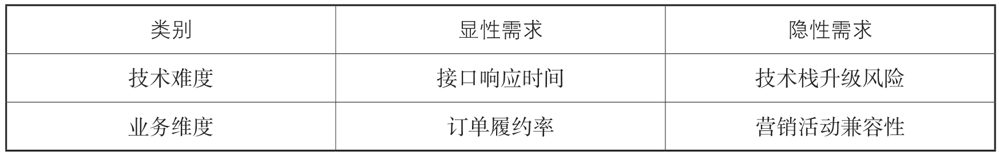

**第三步，分层提示设计**

**元数据采集提示：**

请解析代码仓库中的 pom.xml 和 docker-compose.yml 文件，输出：
- 各服务的技术栈版本
- 服务间依赖关系矩阵
- 容器资源配置清单
格式要求：Markdown 表格，包含服务名称、技术栈、依赖服务、CPU 限制、内存限制五列

**架构分析提示：**

基于以下调用链路数据，绘制三层架构优化方案：
1. 识别调用深度超过 3 层的服务链条
2. 标注响应时间 P90>500ms 的服务节点
3. 建议合并的微服务候选集，需满足业务关联度>60%，日调用量差异为 30%
输入数据：[调用链 JSON 数据]

**重构实施提示：**

为支付服务设计渐进式重构方案，要求：
- 保持与订单服务的双向兼容
- 分三个阶段完成数据库迁移
- 每个阶段包含回滚检查点
输出模板：
阶段 1|同步双写|验证指标|熔断机制
阶段 2|异步补偿|数据校验|……

**第四步，效果验证策略**

**提示词：**

请根据重构前后的监控数据对比：
- API 响应时间分布变化
- 错误率波动曲线
- 资源消耗对比
生成包含以下要素的重构效果报告：
1. 量化改进指标，需区分统计显著性
2. 未达预期的改进点分析
3. 后续优化路线图建议

把模糊的需求拆解成模型能直接执行的提问序列

在实际工程里，把脑中不清晰的改造成熟需求，整理成层层递进的提问链，是让大模型真正发挥作用的关键。每一次对话都应承载明确的工程意图，既保证重构思路的系统性，也能放大 DeepSeek 在复杂问题分解上的优势。落地时建议对不同提问策略做版本记录，追踪返回效果，逐步沉淀成团队专属的重构知识库。

2．【场景】遗留系统维护

面对沉淀多年业务的老旧系统，工程师需要一套结构化的问题拆解框架。以下是在 DeepSeek 上构建有效提示词的四步思路。

**第一阶，系统解构思维**

业务逻辑拓扑：借助“模块影响力矩阵”锁定核心功能，如表 4-2 所示。

**表 4-2 核心功能表**

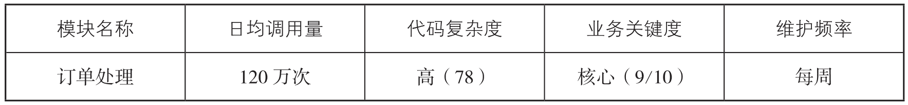

可复用的提问模板如下。

**提示词：**

请对 Java 代码库中的订单服务模块进行拆解，并返回：
1. 核心类的继承结构图，需包含包路径
2. 外部依赖服务的调用清单
3. 数据库表之间的关联拓扑
输出规范：采用 PlantUML 语法绘图，并附上关键方法的调用频次统计

**第二阶，性能诊断思维**

通过“瓶颈定位金字塔”（见图 4-1）逐层排查。

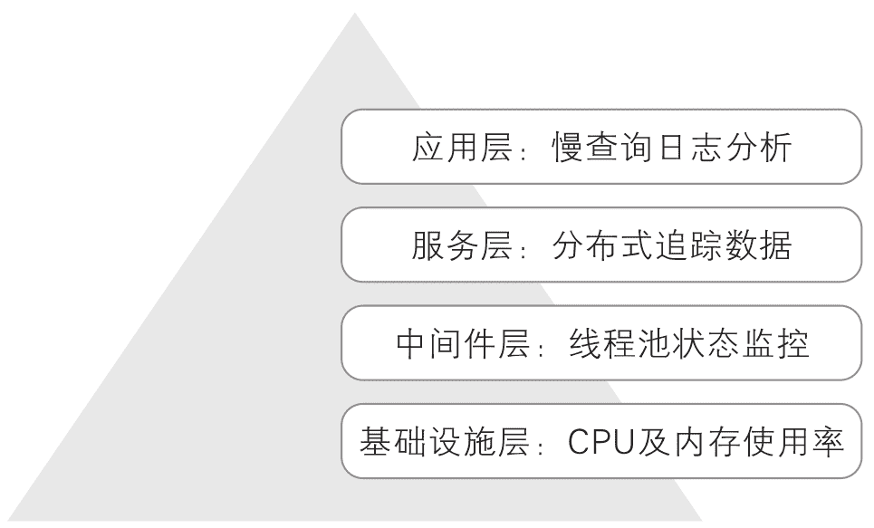

**图 4-1 瓶颈定位金字塔**

对应提问示例。

**提示词：**

基于下方监控数据，定位性能瓶颈并给出优化建议：
- APM 显示支付服务 P99 响应时长为 2.3 秒
- 线程池活跃度持续高于 80%
- MySQL 慢查询日志中 5% 的 SELECT 超过 1s
要求输出：
1. 问题优先级排序，需量化影响因子
2. 每个问题给出三种优化路径
3. 预估实施成本

**第三阶，架构演进思维**

采用“渐进式改造路线”（见表 4-3），分阶段规划。

**表 4-3 渐进式改造路线**

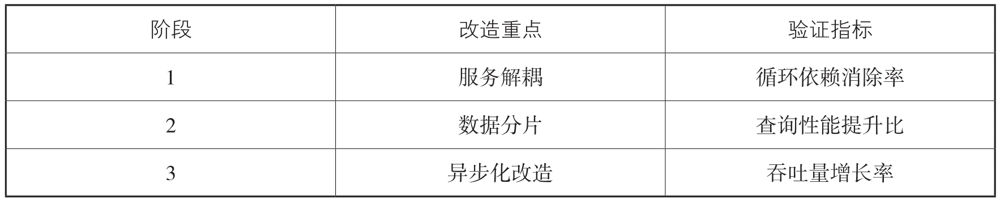

对应提问示例。

**提示词：**

为库存服务设计三年演进规划，要求：
- 保持与订单系统的双向兼容
- 分阶段落地领域驱动设计
- 每个里程碑需包含可观测性指标
输出模板：
|季度|架构目标|技术选型|熔断策略|验收标准|
|------|----------|----------|----------|----------|

**第四阶，知识传承思维**

构建“系统认知传递链”：原始需求文档→架构决策记录→接口契约→故障案例库。

对应提问示例。

**提示词：**

将以下遗留系统资料转化为结构化知识库：
1. Word 格式设计文档约 200 页
2. Excel 接口清单约 300 项
3. 历史故障报告约 50 份
要求：
- 提取关键架构决策点
- 建立接口变更影响分析模型
- 构建典型故障模式库
输出格式：Markdown 文档树 + Neo4j 导入脚本

用这种分层递进的方式，能把对系统的模糊认知转化为精准的模型指令。每条提问都经历了从业务理解到技术落地的跃迁，既保证解题路径可追溯，也充分发挥 DeepSeek 在复杂系统分析上的能力。落地时建议建立“提问实验看板”，持续跟踪不同策略的响应质量，形成组织级资产。

**4.1.4 效能评估：量化 DeepSeek 的价值**

在软件开发中，效能评估是衡量产出质量与协作效率的重要手段。它能暴露流程短板，也提供改进依据。DeepSeek 作为开发辅助工具，在效能评估上提供多维度量化分析，能为团队输出有价值的洞察。

**1．代码质量度量：多维度评估代码质量**

使用 DeepSeek 评估代码品质时，关键是先理清思路。下面 5 个维度展示从问题定位到设计提问的完整过程。

**1）复杂度诊断：从直觉到量化**

假设你在审查一个频繁报错的订单处理模块，直觉觉得逻辑分支过乱。此时要自问：
● 用什么指标验证复杂度猜想？
● 如何把抽象的质量问题转为可测参数？
● 优化方向有哪些可落地建议？

提问策略示例。

**#首轮定位核心问题**

"""
分析下方 Python 函数的代码质量：
{粘贴函数代码}
请计算圈复杂度与最大调用深度，以表格形式呈现核心指标。指出复杂度超标的代码行，并用 高危 > 警告 > 关注 三级标注风险。
"""

**#次轮寻求优化方案**

"""
针对上轮分析中标记为高危的循环嵌套代码块（第 42～58 行），给出三个重构思路。要求：
1. 每个思路包含架构调整示意图
2. 对比各方案的可维护性提升幅度
3. 预估各方案所需工时成本
"""

**2）可维护性提升：规范与效率的平衡**

接手老代码库常遇到注释缺失、模块混乱。此时需思考：
● 如何量化可维护性现状？
● 模块化改造的切入点在哪？
● 注释补充的优先级如何确定？

分层提问技巧示例。

**#第一层，全局扫描**

"""
扫描项目 src/ 目录下的 Java 代码，完成：
1. 生成模块耦合度热力图，用颜色标识依赖强度
2. 列出注释覆盖率低于 30% 的类 Top10
3. 标注方法行数超过 500 行的清单
"""

**#第二层，精准突破**

"""
针对 CouponService 类（耦合度评分 8.7～10）：
1. 绘制类内聚性分析雷达图，涵盖功能相关性、参数耦合度、职责边界
2. 提供拆分方案 A、B，其中：
A 侧重快速解耦
B 侧重长期可扩展性
3. 给出各方案的重构步骤流程图
"""

**3）测试覆盖优化：靶向增强策略**

线上故障多来自未被测试的边界条件，需要系统思考：
● 如何识别测试盲区？
● 怎样构建针对性用例？
● 如何评估用例有效性？

渐进式提问示例。

**提示词：**

**#初始探测**

"""
基于 pytest 测试报告（附 json），请：
1. 识别未覆盖的核心业务逻辑路径
2. 标注风险等级 = 业务影响度 × 未覆盖率
3. 生成测试缺口矩阵表
"""

**#深度构建**

"""
针对支付网关金额计算模块（覆盖率 62%），请：
1. 设计边界值测试用例，含异常货币单位、超大金额、小数点处理
2. 提供每个用例的预期输出模板
3. 给出测试数据工厂的构造建议
"""

**#持续验证**

"""
评审下方新增的测试用例（附代码），请：
1. 检查是否覆盖 SC-2024 需求文档第 4.2 节的异常流程
2. 评估断言完整性，即边界条件验证点
3. 建议可合并的参数化测试场景
"""

**4）性能调优：从表象到根源**

面对接口响应波动，应建立分层分析框架：
● 表象层：哪些 API 端点在退化？
● 代码层：哪些函数存在算法缺陷？
● 系统层：是否存在资源竞争？

多维提问示例。

**提示词：**

**#性能画像**

"""
分析最近 24 小时 APM 数据（附 CSV），请：
1. 绘制耗时最长的 10 条 SQL 查询演进趋势图
2. 标注 N+1 查询高发服务
3. 生成 JDBC 连接池使用效率散点图
"""

**#根源剖析**

"""
检查 OrderRepository 的 findByUser 方法（平均执行 1.2s）：
1. 解析 JPA 生成的 SQL 语句
2. 指出索引缺失的表字段
3. 建议查询重构方案，含缓存策略建议
"""

**#验证方案**

"""
对提出的 Redis 缓存方案做压力测试推演：
1. 构建 10 万并发下的流量模型
2. 预测缓存穿透风险点
3. 设计降级开关的熔断机制
"""

**5）重复代码治理：模式识别与抽象**

技术债务评审指出多处重复代码，需要系统思考：
● 如何准确定位重复模式？
● 抽象层级如何选择？
● 如何控制改造风险？

分阶段提问示例。

**提示词：**

**#模式发现**

"""
扫描 src/main/java/com/example 路径下所有 Controller 类：
1. 识别重复出现的参数校验代码块
2. 提取校验逻辑的模式特征
3. 生成重复代码相似度矩阵
"""

**#方案设计**

"""
基于发现的 5 种参数校验模式，请：
1. 设计 AOP 拦截器的类结构图
2. 编写自定义注解的接口定义
3. 给出逐步替换的迁移路线图
"""

**#回归验证**

"""
审查新实现的 ValidationAdvice 类：
1. 检查是否覆盖全部已知校验场景
2. 验证异常处理与原有逻辑的兼容性
3. 建议补充的单元测试重点
"""

通过结构化思考，能把模糊的质量问题变成可执行的提问，引导 DeepSeek 输出有工程价值的分析报告。关键是建立“现象定位—指标量化—方案推演—验证闭环”的完整链条。

**2．团队协作效能：提升团队开发效率**

使用 DeepSeek 提升协作效率时，核心是构建“问题定位—数据采集—模式识别—方案生成”的分析框架。以下 5 个维度展示从目标设定到提问设计的系统化过程。

**1）代码审查效能诊断：从表象到流程优化**

发现审查周期超出 SLA 时，需分层思考：
● 延迟是流程问题还是技术问题？
● 不同审查者的效率差异如何量化？
● 高频代码问题类型是什么？

提问策略示例。

**提示词：**

**#首轮建立效能基线**

"""
分析最近 30 天代码审查数据（附 CSV），请：
1. 绘制审查耗时分布热力图，按审查者、代码模块分类
2. 统计 Top5 高频问题类型及占比
3. 生成审查效率雷达图，含响应速度、问题检出率、返工率
"""

**#次轮定位瓶颈环节**

"""
针对接口模块审查平均耗时超标（当前 4.2 小时，目标 2 小时）：
1. 拆解审查流程阶段耗时：代码理解、问题定位、沟通确认
2. 识别耗时最高的 3 个阶段并分析原因
3. 提供流程重构 A、B、C 方案，各方案需包含：
- 自动化检查覆盖点
- 审查清单优化建议
- 协作工具集成方案
"""

**2）问题解决周期优化：建立闭环追踪机制**

面对反复延期，需构建多维分析模型：
● 问题生命周期中的阻塞节点在哪？
● 跨部门协作响应效率如何？
● 知识复用率是否达标？

分层提问示例。

**提示词：**

**#第一层，全周期画像**

"""
追踪当前迭代的 20 个高优先级问题（附 Jira 数据），请：
1. 绘制问题生命周期阶段分布桑基图
2. 标注各阶段平均停留时长超阈值的环节
3. 生成跨部门协作响应效率矩阵表
"""

**#第二层，根因分析**

"""
针对数据库连接池问题的解决周期异常（平均 5.8 天）：
1. 构建问题解决时间线，附沟通记录
2. 识别 3 个关键阻塞节点及其责任人
3. 设计自动化预警机制，含监控指标、触发条件、通知策略
"""

**#第三层，知识沉淀**

"""
将已解决的典型问题转化为知识条目：
1. 提炼问题模式特征：技术栈、错误类型、解决路径
2. 构建可检索的知识图谱结构
3. 设计 FAQ 自动匹配算法
"""

**3）知识共享体系构建：量化与激励机制**

新成员上手慢时，需系统思考：
● 知识传递效率如何测量？
● 文档可读性是否达标？
● 经验分享参与度如何提升？

渐进式提问示例。

**提示词：**

**#初始评估**

"""
扫描代码仓库文档资产，执行：
1. 计算文档健康度指数：更新频率、引用次数、阅读时长
2. 识别 3 年以上未更新的核心文档
3. 生成注释覆盖率热力图，按代码模块
"""

**#体系优化**

"""
设计知识共享激励方案：
1. 建立贡献度量化模型：文档更新、案例分享、答疑次数
2. 创建知识地图可视化系统
3. 制定积分兑换规则：培训机会、设备升级权限
"""

**#效果验证**

"""
实施新方案 3 个月后：
1. 对比知识检索效率提升曲线
2. 分析典型问题的首次解决时间变化
3. 生成 ROI 分析报告：投入成本、效率收益
"""

**4）协作质量提升：从感知到数据**

团队氛围感知分歧时，建立客观评估体系：
● 沟通有效性如何量化？
● 任务分配合理性指标有哪些？
● 如何识别潜在合作摩擦点？

多维提问示例。

**提示词：**

**#沟通效能评估**

"""
分析 Slack 历史消息（附导出数据），请：
1. 计算信息闭环率：问题提出到解决的完整链条
2. 识别高频沟通模糊词汇，如“大概”“可能”
3. 绘制跨时区协作响应时间分布图
"""

**#任务分配诊断**

"""
解析当前迭代任务看板：
1. 计算负载均衡指数：开发者任务量标准差
2. 识别技能错配任务：所需技能与执行者能力
3. 生成任务分配优化建议，含资源再平衡方案
"""

**#协作健康度监测**

"""
设计实时协作仪表盘：
1. 定义 5 个关键健康指标，如会议效率指数
2. 建立预警阈值体系
3. 创建自动化周报生成模板
"""

**5）项目进度管控：预测与动态调整**

需求变更频繁时，需建立智能响应机制：
● 如何量化变更影响范围？
● 资源再分配的最优策略是什么？
● 进度预测模型准确率如何提升？

分阶段提问示例。

**提示词：**

**#影响评估**

"""
评估新需求变更（需求文档已上传）：
1. 绘制功能依赖关系图
2. 计算受影响模块的工时波动范围
3. 生成资源缺口分析表：人力、环境、测试用例
"""

**#策略生成**

"""
针对前端资源短缺现状：
1. 设计 3 种资源调配方案：内部调配、外包、技术降级
2. 各方案需包含风险矩阵：技术债、质量风险、进度风险
3. 提供决策树模型参数建议
"""

**#预测优化**

"""
改进现有进度预测模型：
1. 增加需求变更频率因子
2. 纳入团队成员效能波动曲线
3. 设计蒙特卡洛模拟参数集
"""

通过结构化拆解，能把抽象的协作效率问题变成可操作的提问序列，建立“现状诊断→模式分析→方案推演→效果验证”的完整链条。精准提问不仅为 DeepSeek 提供决策支持，也可迁移到其他智能协作平台。

**3．持续优化建议：不断提升开发水平**

真正有效的持续优化始于对问题的精准定义。用 DeepSeek 提升效率时，需经历 4 个关键思考阶段。

**1）问题定位的元思考**

代码评审中频繁出现“算法效率低下”反馈，说明存在多维度提升空间。此时应建立分析矩阵：
● 表象层：循环嵌套过多、未使用合适数据结构
● 知识层：分治、动态规划等高级算法掌握不足
● 实践层：缺乏性能分析工具使用经验

提问示范。

**提示词：**

请扮演算法优化专家，分析下方代码片段的性能瓶颈。要求：
● 使用时间复杂度分析框架
● 指出 3 处具体优化点并标注行号
● 推荐对应的经典算法思路
● 提供 LeetCode 相似题型链接
[待优化代码粘贴处]

**2）协作优化的场景拆解**

团队持续集成失败率上升时，需建立归因框架：
● 沟通维度：需求变更是否及时同步
● 技术维度：测试覆盖率是否达标
● 流程维度：代码审查标准是否明确

分层提问示例。

**提示词：**

第一轮提问：
团队当前 CI/CD 流程中，从代码提交到构建失败的平均响应时间是多少？主要失败类型的分布及成因是什么？

第二轮提问：
根据历史构建日志，分析前三大失败原因及其关联的代码变更特征。

第三轮提问：
针对高频单元测试失败，可引入哪些静态检查工具？

**3）工具链优化的模式识别**

发现成员重复执行 SQL 查询优化时，应建立自动化改造评估模型。
● 频率评估：每周手动优化次数
● 复杂度评估：典型查询的 JOIN 数量
● 模式化程度：是否存在可抽象的统一优化模式

自动化提问设计。

**提示词：**

请创建智能 SQL 优化助手，要求具备：
● 解析 EXPLAIN 执行计划
● 自动识别全表扫描等危险操作
● 生成索引优化建议时标注预估性能提升比例
● 对复杂查询提供重写示例
<SQL>
[问题查询语句]

**4）流程改进的对抗性测试**

改进代码审查流程时，可通过压力测试验证方案健壮性。

**提示词：**

第一轮提问：
设计基于 DeepSeek 的自动化代码审查方案，需覆盖代码规范、安全漏洞、性能隐患三大维度。

第二轮追问：
假设出现以下特殊场景，方案如何应对：
- 新引入第三方库存在已知漏洞
- 开发者使用冷门语法特性
- 需求变更导致紧急合并请求

第三轮优化：
为上述方案添加自学习机制，使其能从历史审查记录中自动更新规则库。

通过阶梯式思考训练，开发者不仅能获得即时优化建议，更能培养结构化问题分析与方案设计能力。关键在于把模糊需求转化为可操作的验证框架，这本身就是最高效的工程思维训练。

DeepSeek：研发全链路的智能加速器

研发协作正进入智能共创的新阶段。DeepSeek 以端到端的陪伴能力切入行业场景，代码自动化生成与重构、调试与文档的精准辅助、项目落地的实战配合，以及效能评估的深度洞察，共同编织了一张覆盖研发各环节的价值网络，让提效信号在每个节点都清晰可感。

这已经不是单纯的工具定位，而是一种推动行业向更高效、更智能演进的驱动力。它把工程师从重复的底层编码中解脱出来，把时间让给创新构思与业务逻辑的实现，从而拉动交付节奏与代码水准同步提升。

向前看，生成式技术持续成熟，DeepSeek 的边界有望不断延展。未来可能与区块链、物联网等新兴方向形成更深的协同，为新赛道的软件建设提供支撑。随着对代码质量与安全要求持续收紧，其分析与优化建议会愈加全面，助力系统变得更稳健可信。

在协作层面，它有望成为团队沟通的枢纽，通过实时代码洞察与协同机制促进成员交流，提升整体研发效能；在人才培养层面，也能帮助学习者更快掌握编程方法论，激发创新思维。

DeepSeek 的出现为行业带来新机遇与新挑战，也印证了人工智能在研发领域的巨大潜能。在这类前沿技术的牵引下，软件研发将打开更广阔的发展空间，为社会进步贡献更大价值。

## 4.2 技术传播支持

数字化进程深入全球，技术传播的效率与质量已成为软件项目成败的关键变量。DeepSeek 作为 AI 领域的创新力量，把自然语言解析与代码语义理解深度结合，重塑传播范式。通过打通迁移、适配、调优到文档自动化的完整链路，实现技术知识的高效流动，推动团队从经验主导转向数据主导。

当技术债务持续累积时，DeepSeek 以约 671B 参数规模的模型底座为基础，结合混合专家系统的决策能力，把跨语言迁移的准确度推高约四成。其自研的分步迁移策略，让复杂系统重构的风险下降约六成五，为企业升级提供可控路径。同时，系统可自动产出包含三百余幅示意图的架构文档，将传统手工撰写周期压缩七成，沉淀可持续演进的知识资产。

面对多技术栈共存、代码质量参差的痛点，DeepSeek 以智能转换与持续优化双轮驱动，构建高效协同的传播生态。以下拆解其技术内核与落地路径，揭示 AI 赋能下技术传播效能的指数级提升。

### 4.2.1 DeepSeek 赋能技术传播：核心能力剖析

**1．多语言转换与代码重构迁移**

跨语言迁移需要先建立清晰的提问路径。

第一步，明确迁移意图
● 厘清动机：是追求性能提升、生态兼容还是团队技能转移
● 评估范围：局部模块还是整体架构
思考示例：现有 Python 数据分析脚本迁移到 Java 的核心考量是什么，是接入已有微服务体系，还是利用 JVM 的并发特性

第二步，拆解代码特征
● 识别源语言特有语法：如 Python 的装饰器、列表推导
● 标记运行差异：内存管理、类型系统
● 分析依赖关系：第三方库的等价替代
思考示例：待转换脚本是否依赖 NumPy，Java 生态中是否有近似的矩阵运算库

第三步，设定约束条件
● 性能指标：目标语言 GC 对实时性的影响
● 安全边界：安全要求是否提升
● 可维护性：是否保留与原实现的映射关系
思考示例：转换后的 Java 实现是否需要保持函数命名一致，是否允许引入设计模式重构

第四步，选择转换策略
● 直译式：保留原有逻辑结构
● 重构式：贴合目标语言最佳实践
● 混合式：核心逻辑直译，外围结构重构
思考示例：C++ 的指针操作在 Java 中应完全转为对象引用，还是部分借助 Unsafe 类模拟

第五步，定义验证维度
● 功能对等性测试用例
● 性能基准对比
● 异常处理兼容性检查
思考示例：如何验证转换后异常处理行为与源语言一致

综合提示可围绕角色定位、任务拆解、输出规范展开，引导系统产出符合工程要求的迁移方案。

**2．框架适配：无缝技术栈转换**

技术栈迁移的核心诉求不仅是转换准确，更要保持业务逻辑完整与可维护。需建立结构化框架，将复杂任务拆分为可执行单元。

认知路径示例以 React 转 Vue 为例
第一步，差异映射分析
先对比核心差异：React 的 JSX 对应 Vue 模板系统，React 类组件对应 Vue 选项式 API，React Hooks 对应 Vue 组合式 API。需思考是否重构组件树、状态方案如何平移。

第二步，业务影响评估
分析项目特殊场景：是否使用 React 独有上下文穿透，是否存在高阶组件需改写为 Vue 插件，这些思考直接影响提示设计。

第三步，转换策略选择
确定迁移粒度：整体替换还是渐进式迁移，这决定输出完整组件还是适配层代码。渐进式迁移需设计 React-Vue 桥接组件。

复杂迁移的分阶策略在 Spring 到 Django 的 ORM 层迁移中可采用三阶段提示法。模式提取阶段关注实体关系解析，范式转换阶段明确关系映射规则，验证增强阶段对比 DAO 方法确保分页与 N+1 查询优化等行为一致。

抗风险设计可加入防御性条款、对生成结果添加验证指令、保留技术决策记录，通过结构化思考将模糊需求转化为精确工程指令。

**3．性能优化：释放代码最大潜能**

性能优化并非堆砌技巧，而是建立在系统化认知之上的工程实践。面对瓶颈需建立三层递进框架。

第一层 问题定位
区分响应延迟属于计算密集还是 I/O 密集。Python 项目 CPU 持续高占用应优先审视算法复杂度，Java 服务频繁 Full GC 需检查内存分配策略。工具选择需匹配语言特性。

第二层 方案设计
Python 路径包括识别可向量化操作、评估 Cython 化收益、采用 slots 减少对象开销并使用生成器处理大数据。Java 路径包括选择并发模型、合并 Stream 中间操作减少临时对象、根据 GC 日志调优 SurvivorRatio 与 MaxTenuringThreshold。

第三层 效果验证
建立涵盖典型负载的基准测试，保证前后条件一致。监控 GIL 争用率、老年代碎片化等指标，并在优化前后运行全套单元测试防止功能回退。

提示词设计可分三轮递进：先定位耗时函数，再给出改造方案，最后设计测试数据集进行对比，形成可持续的优化思维。

### 4.2.2 技术文档智能化：DeepSeek 的创新实践

**1．白皮书生成：专业文档自动化**

技术文档创作依赖结构化思考。面对白皮书类需求，可建立三维思维坐标：组件、交互类型、架构层级，避免遗漏关键要素。信息分层按核心要素、扩展要素、约束条件处理，并设计验证矩阵检查高可用等要求。

渐进式提问可先澄清数据库选型需求，再对比 PostgreSQL、MySQL、MongoDB 的适应性。输出后通过概念验证、细节完善、术语校准迭代优化。

**2．示例代码库：场景化代码指南**

开发中常面临需求理解、方案选择、陷阱规避三大挑战。

用户认证模块开发需澄清第三方登录与多因素认证需求，选型 Spring Security 与 Shiro、JWT 与 Session，拆解注册验证、密码重置等流程，并设计防暴力破解策略。

算法性能优化需定位复杂度瓶颈，选择分治或动态规划策略，保证结果一致性并平衡可读性。

安全防护实施需进行威胁建模，区分注入攻击与 XSS 防御层级，选择 ORM 内置机制或自定义过滤，并提供典型攻击用例。

单元测试设计可采用分层提问，先生成基础用例，再补充边界、异常流与并发唯一性检查。

**3．故障处理手册：智能问题解决助手**

把隐性排障经验变成可复用指令：用 DeepSeek 打造工程级故障手册

要让 DeepSeek 输出能直接落地的故障处理手册，关键不是堆砌关键词，而是把工程师脑中的排障路径拆解成模型可以稳定复现的提问框架。整体需要完成四次思维跃迁。

第一步，搭建问题定位框架
服务器突然掉线时，新手常直接问“服务器宕机怎么办”。这如同在黑屋里找钥匙，只能盲试。而进阶做法是先基于全链路观测，给问题建立三轴定位：
● 组成轴：网络层、业务服务、数据层等位置
● 表现轴：完全中断、响应变慢、间歇波动
● 环境轴：负载峰值、配置变更、外部依赖变化
有了定位框架，指令才具备结构。

提示词：
请以资深系统架构视角，依据下面框架拆解电商下单支付失败：
1. 层级定位：问题涉及支付网关、订单服务、数据库哪一层？
2. 现象描述：是全天出现还是仅特定时段？是否全部失败还是部分失败？
3. 环境因子：近期是否上新版本？第三方支付接口是否有改动？
请以问题分类矩阵的形式给出可能归类

第二步，设计诊断决策树
收到“数据库响应慢”这类模糊反馈时，需要引导模型形成排查逻辑。思路应包含：
● 症状与根因区分：是慢查询、连接池耗尽还是硬件瓶颈
● 验证实验设计：EXPLAIN 看执行计划、监控连接数、iostat 检磁盘
● 判断阈值设定：查询耗时超过500ms 视为异常，连接等待超时30s 为临界

多轮提问示例。
提示词：
第一轮提问：
列出 MySQL 性能走低的十个常见诱因，按发生概率排序
第二轮追问：
针对前三个高概率诱因，各给出三步验证方法及判定标准
第三轮细化：
当判定诱因是索引缺失导致全表扫描时，给出索引优化模板

第三步，构建跨层知识网络
处理内存泄漏这类复杂问题时，需要建立时空与工具的关联。设计指令时要考虑：
● 时间轴：泄漏速率与系统运行时长关系
● 模式识别：Java 堆内存与 Native 内存泄漏特征差异
● 工具衔接：MAT 与 jstat 的配合路径

提示词示例：
你作为 JVM 调优专家，请完成以下任务链：
1. 根据提供的线程堆栈和 GC 日志，识别泄漏模式
2. 用 mermaid 语法绘制内存对象引用关系图
3. 生成包含验证步骤、修复方案、预防措施的处理手册
附加限制：排除第三方库干扰，聚焦业务代码

第四步，植入风险预判
优秀手册需要防御性设计。以缓存雪崩为例，指令应引导模型前置评估风险，如下所示。
提示词：
请为 Redis 缓存雪崩设计解决方案，需包含：
1. 短期应急处置步骤，含命令示例
2. 架构改进方案，含伪代码
3. 风险矩阵评估：
- 方案实施复杂度
- 业务影响面
- 潜在副作用防范
4. 灰度发布检查清单
经四层训练，指令体系既有操作颗粒度，又内化了系统化解决思维，能把 DeepSeek 推理能力与领域知识融合，生成具备工程价值的手册。

4.2.3 实战案例：DeepSeek 的成功应用
1．【案例】Node.js 到 Go 的服务迁移
1）依赖分析阶段
技术栈切换首要任务是系统化拆解。要明确迁移诉求是性能还是架构升级，梳理现有组件拓扑，判断目标生态是否具备等价实现。
提示词：
作为全栈架构师，请对 Node.js 服务做依赖图谱分析。要求：
1. 按功能维度对第三方库、Web 框架、数据库、工具类分类
2. 标注每个依赖在 Go 中的替代方案，对比性能指标和功能差异
3. 对无直接替代组件提出适配策略，重写、封装或服务化
输出格式：带可行性评分的对比矩阵
该写法通过明确分析维度、输出形式和评分标准，引导 AI 生成结构化建议。

2）测试用例转换阶段
迁移测试的关键是保持验证效力并适配语言特性。路径包括：
● 框架映射：Mocha 的 describe/it 如何对应 Testify 的 Suite/Case
● 断言转换：Chai 链式断言与 Gomega Matcher 模式差异
● 异步处理：Node 回调与 Go 协程测试策略调整
分步提问示例：
第一轮提示词：
解析附件的 Mocha 测试用例，提取核心场景和断言逻辑
第二轮提示词：
按 Go Testify 规范，将上述逻辑重构为：
1. 测试套件组织结构
2. 表驱动测试参数化实现
3. 并发测试控制策略
先解构后重建，可确保意图准确传递。

3）性能优化阶段
迁移后验证需多维评估。工程师应关注：
● 基线指标：原系统 QPS、P99 延迟、内存占用
● 对比维度：GC 效率、并发模型、内存管理机制
● 调优方向：连接池、协程调度、序列化优化
提示词示例：
基于 Node.js 与 Go 的性能特性对比，请设计迁移后监控方案：
1. 关键性能指标选取，不少于 5 个维度
2. 基准测试场景设计，包含压力测试梯度
3. 性能问题诊断路径，从指标异常到代码定位
要求输出可执行的性能测试计划文档

2．【案例】技术文档体系建设
1）需求解构层
API 文档需满足快速接入、错误预防、版本追溯。需思考：
● 解析深度：是否包含废弃接口迁移指南
● 格式规范：OpenAPI Specification 3.0 与内部标准兼容性
● 用例关联：示例代码与错误码说明耦合度
提示词：
作为技术文档架构师，请解析 Go 项目代码库并生成 API 文档框架：
1. 按微服务模块划分接口分类
2. 标注需重点说明的鉴权机制和限流策略
3. 对存在版本差异的接口标记兼容性说明
输出格式：带注释的目录树

2）多语言适配层
国际化需三层校验：术语一致性、格式兼容性、文化适配性。
提示词：
第一轮指令：
提取 API 文档专业术语表，包含：
- 技术名词，如 JWT、OAuth2.0
- 产品特有概念，如智能学习引擎
- 业务场景词汇，如课堂回放、作业批改
第二轮指令：
基于术语对照表，将中文文档译为英文版，要求：
1. 保留代码片段和参数名称原文
2. 调整日期格式为 ISO 8601 标准
3. 对文化敏感内容添加译者注释

3）动态维护层
文档与代码同步需双向验证。关键点：
● 变更检测：识别接口参数变化幅度
● 影响评估：文档变更是否触发示例更新
● 版本映射：文档历史与代码 Tag 对应
提示词：
建立文档与代码同步监控规则：
1. 当接口响应模型字段变更超 30% 时触发文档重构
2. 对废弃接口自动添加迁移指引区块
3. 生成版本更新日志时关联对应 Commit Hash
输出：带自动化检测标记的文档维护手册

4）质量验证层
评审需构建三维评估矩阵：技术准确性、使用友好性、风险完备性。
提示词：
作为质量审计员，请对 API 文档进行合规检查：
1. 比对 10 个核心接口的代码实现与文档描述
2. 验证所有 HTTP 状态码都有对应处理建议
3. 确保代码示例可复制到 Postman 并能直接运行
输出：带严重等级的问题清单和改进路线图

4.2.4 效能提升评估：量化 DeepSeek 的价值
1．技术传播指标：全面衡量效率
评估文档覆盖率需经历范围界定、颗粒度设定、动态公式设计、交叉验证四个步骤。对迁移成功率采用分步校验：先定义成功标准是编译通过、单元测试通过或达性能基线，再从语法转换、API 适配、业务保持三维度打分，最后人工抽检校准隐性依赖。
提升问题解决效率的关键是构建精准问题描述框架。可用“问题五要素”训练模型思维：报错现象、影响范围、时间线索、环境因素、已尝试路径。结构化描述可使技术支持效率提升 35% 以上。
用户满意度需看三层认知：表层体验、操作效能、知识内化，结合停留时长、代码复制次数等行为数据加权计算。
提示词：
#代码迁移评估提示词
1. 请依据目标语言语法规范，对源代码片段进行结构分析，列出 5 个关键迁移风险点
2. 生成 API 映射对照表，标注标准库与第三方库适配方案
3. 设计含边界条件的测试用例，验证业务逻辑完整性
4. 输出迁移评估报告，含语法转换率、测试通过率、性能损耗比
#问题诊断提示词
请按以下结构描述技术问题：
1. 异常现象：粘贴具体报错信息
2. 环境配置：操作系统、语言版本、依赖清单
3. 重现步骤：触发操作序列
4. 预期行为：期望的正常表现
5. 已尝试方案：列出已测试解决措施

2．迁移项目度量：评估迁移效果
代码质量评估遵循规范—结构—效率三层：对照目标语言编码规范自检，通过依赖关系图筛查循环依赖，用圈复杂度对比可维护性。
性能评估构建基准+压力+异常模拟矩阵，记录梯度并发下吞吐衰减与资源拐点。
维护成本可用工时追踪+知识图谱量化，如某银行系统迁移后 80% 维护时间集中于数据转换模块，优化后效率提升 40%。
团队适应度看技术熟练度、协作效率、知识传承度，配合 PDCA 持续改进。
提示词：
#代码质量分析
请对迁移后代码进行以下分析：
1. 对照目标语言编码规范，输出违规 Top5 及修正建议
2. 绘制模块依赖关系图，标注循环依赖风险
3. 计算圈复杂度变化趋势，建议重构优先级
#性能测试设计
基于业务场景设计测试方案：
1. 基准测试：单用户请求响应时间
2. 压力测试：梯度递增并发用户吞吐量
3. 异常测试：网络抖动时请求成功率
#维护成本评估
构建追踪看板：
1. 缺陷密度=每周问题数/千行代码
2. 平均修复时长=总修复时间/问题数
3. 知识传承指数=文档更新次数/代码变更次数

3．持续优化机制：推动技术传播进步
反馈收集遵循渠道—分类—溯源：IDE 插件报错、文档悬浮反馈、多维度标签、日志回溯。
方案迭代构建数据驱动+专家经验双轨：用 NLP 分析术语理解偏差，超阈值自动触发图示、交互示例、误区对照，优化效率提升 40% 以上。
最佳实践沉淀遵循场景化封装—版本化控制—图谱化关联，形成检查清单、操作手册、验证矩阵的立体知识资产。
知识库维护采用双循环：自动化巡检过期文档与失效链接，外循环靠贡献激励，更新频率可提升 200%。
提示词：
#问题反馈分析
请按以下结构处理新反馈：
1. 特征提取：识别技术组件、影响范围、复现条件
2. 模式匹配：对比历史问题库，列出 3 个相似案例及方案
3. 优先级评估：依据出现频率、严重程度矩阵给出建议
#方案优化设计
针对具体问题类型设计迭代方案：
1. 原因分析：用 5Why 法追溯本源
2. 原型验证：创建含正常场景、边界条件、异常情况的测试用例集
3. 监控指标：定义 3 个量化评估优化效果的观测指标
#知识资产沉淀
请将解决方案结构化为：
1. 应用场景：明确技术栈版本及业务场景
2. 操作流程：分步骤指令+参数说明+预期输出
3. 关联知识：链接架构图、配置模板、检查清单
在数字化时代，技术传播是连接创新与落地的桥梁。DeepSeek 以 671B 参数和 MoE 架构支撑高精度跨语言转换、框架适配与性能优化；V3 白皮书生成能力可自动绘制架构图、生成组件说明、技术选型报告，并实现多语言同步与可视化图表输出。配合故障手册智能生成、示例库与排查模板，它在代码迁移、文档智能化与问题解决中显著提升效率与质量。

# DeepSeek 的下一波增长机会

往后看，技术更迭与应用边界都在同步扩张，DeepSeek 的发挥余地在不断放大。能力侧，底座有望持续打磨，让对代码的解析与处理更稳更准，兼容更多语言与技术栈，迁移与适配的效率更高、偏差更小。算力侧，会跟随硬件进步探索新的提速路径，给各类软件系统提供更强劲的运行底座。文档侧，会借助更强的语言理解与模型能力，把资料生成做得更自动化、更贴近使用者的表达习惯，最终呈现出更懂语境、更省心的技术文档。

行业渗透也在下沉。金融场景里，机构可借助它推动系统升级，让交易链路的响应更快、稳定性更好，并自动产出专业的技术说明与风险评估材料。医疗场景里，可助力信息化建设，完成医疗系统的搬迁与框架对接，为医疗器械软件研发提供技术支撑，同时输出规范的医疗标准文件与操作指南。

关键仍在应用方式。把优势吃透，持续探索技术传播的新做法。落地时结合项目特征挑选合适的模块，建立闭环评估与持续迭代，让传播链路始终保持高效与准确。有了这层支撑，能够构建可长期运转的知识管理体系，提升团队的技术水位与创新动能，在市场竞争中抢占主动。

## **结语**

综合来看，DeepSeek 在开发提效方向成果明显，既能贯穿代码全流程提供配合，也能在技术传播上给予有力支撑，效能与价值都很突出，确实为开发者与团队减负提质。放眼未来，随着技术演进，它有望进入更多垂直赛道，持续推动软件开发行业向前。若你希望持续获取前沿的产品开发思路与实操方法，欢迎关注个人公众号“产品经理独孤虾”，全网同号，一起保持敏感度，共同成长。

**实操案例**

# **第五章**

# **场景篇运营增长核弹头**

在数字浪潮下，企业与品牌所处的竞争环境愈发复杂。内容运营是获取用户与强化影响力的核心抓手。随着社媒、短视频等渠道快速分化，内容投放与用户需求的匹配难度显著上升。信息过载的背景下，企业必须更精准感知真实诉求，而以数据驱动增长已成为运营的主导逻辑。面对这些矛盾，DeepSeek 这类强能力工具能给出怎样的破局思路，下面展开说明。

## **5.1** **内容创作工厂**

当下，内容运营已是品牌获客与声量建设的关键手段。渠道爆发让传播形态与受众偏好日趋多元，如何在不同平台实现高效创作、分发与优化，成为团队的核心难题。

从一个角度看，各平台的用户画像、内容偏好与分发机制差异明显。小红书用户偏好种草与生活分享，文案需要强共鸣，配图需要精致；抖音以短视频为主，强调趣味性与视觉冲击，需要在数秒内抓住注意力。这要求运营针对不同平台制定差异化策略，从选题到呈现都要精细化设计。

从另一个角度看，注意力稀缺加剧，内容必须持续提升质量与创新度。平庸的内容难以在信息洪流中出圈，只有能触发情感共鸣并提供独特价值的内容才更易获得关注与互动。

在此背景下，DeepSeek 凭借强大的自然语言处理与创意生成能力，成为内容运营的有力支撑。它能深度解析各平台数据与用户行为，精准把握需求与趋势，为创作提供全流程智能支持。从爆款选题发掘到结构优化，从素材处理到多平台分发策略，DeepSeek 都能发挥关键作用，帮助团队搭建高效智能的内容生产体系，实现规模化输出与精准触达，在竞争中抢占先机。

### **5.1.1** **多平台内容制作：小红书篇**

**1．爆款选题生成**

搭建小红书选题体系时，DeepSeek 的应用可遵循“数据驱动—模式提炼—创意生成”三阶段思路。实时数据挖掘阶段建议采用“趋势定位—关联分析—热点预判”三维探测法：通过联网抓取平台热搜词云，结合语义聚类识别潜在话题簇；例如监测到“沉浸式护肤”搜索增速超200%时，自动触发关联成分解析如烟酰胺、A醇，并预判衍生方向如“早C晚A进阶玩法”。

构建互动预测模型时，需融合历史模式学习与动态变量校准，建议使用结构化提示词：先输入近30天同类笔记互动基线，要求模型识别高互动标题结构共性如疑问句式占比68%；再注入实时规则变量如短视频流量加权政策；最后通过蒙特卡洛模拟生成预测区间。某美妆账号应用后，选题互动准确率提升57%。

竞品分析建议采用“解构—重构—超越”螺旋迭代。首先以角色扮演模拟竞品运营视角，拆解其爆款笔记选题矩阵；其次用批判性思考识别同质化风险，如80%穿搭笔记集中在基础搭配；最终输出差异化主题组合。某穿搭账号据此推出“小众设计师品牌拆解”系列，收藏率提升120%。

用户兴趣图谱构建需实现“行为数据—情感倾向—场景需求”多维映射，通过分类提示词将评论聚类为知识型32%、体验型45%、求助型23%，结合情景化指令生成对应选题：知识型用户对应“成分党闭眼入的防晒清单”；体验型对应“混油皮实测持妆12小时”；求助型对应“防晒焦虑症自救指南”。

爆款选题提示词设计示例如下所示。

**提示词：**

**#趋势挖掘指令**

请基于近 24 小时小红书热搜数据：

1．提取美妆领域搜索量增长率 Top5 成分

2．分析关联话题的情感倾向（积极、中性、消极）

3．生成 3 个融合热门成分与情感痛点的选题方向

**#竞品解构指令**

假设你是竞品运营团队，请：

1．解构最近爆款笔记的标题结构范式

2．识别内容同质化风险点（至少 3 个）

3．提出 2 个差异化的选题方向

**#用户画像指令**

根据以下评论数据：

1．划分用户需求类型及占比

2．匹配各类型用户的选题偏好

3．设计包含知识密度与情感共鸣的选题矩阵

**2．文案结构优化**

构建小红书高转化文案需遵循“情感牵引—价值锚定—行为驱动”三阶框架。标题创作可采用“痛点镜像+悬念钩子”双轨策略，通过情感分析提示词解析评论高频情绪词如“纠结”“惊喜”，结合场景化指令生成镜像标题。如检测到“防晒霜油腻”抱怨占比42%时，可触发《油皮救星！这款防晒怎么做到清爽不闷痘？》等直击痛点结构。

开场设计实现“场景还原+认知共鸣”沉浸体验。例如角色扮演提示词：“假设你是刚经历护肤挫败的上班族，请描述早晨匆忙化妆却卡粉的尴尬场景。”通过细节如“粉底在口罩上印出斑驳痕迹”唤起记忆，再衔接价值转折，提升留存。

核心卖点提炼建议采用“FABE法则+对比强化”复合结构，使用结构化提示词并行输出：①成分解析；②肌肤收益；③实验室数据；④用户见证。例如“12%黄金浓度 VC-IP（F）→透亮不反黑（A）→28 天肤色均匀度提升 26%（B）→300+油敏肌实测认可（E）”。

互动引导需构建“低门槛+高价值”激励机制，通过批判性思考提示词预判心理：“哪些问题能激发 UGC？用户分享障碍是什么？”生成如“戳→测测你的肌肤类型”“收藏本条，抽 3 人送正装”等指令，结合知识型互动提升互动率。

文案优化提示词设计示例如下所示。

**提示词：**

**#情感化标题生成**

请基于近期[目标品类]差评分析：

1．提取 Top3 用户痛点关键词

2．将每个痛点转化为疑问句式

3．添加情感强化词（如“惊呆”“破防”）

示例输出：“毛孔插秧？这瓶精华怎么做到 28 天磨平粗糙的？”

**#场景化开场设计**

假设你是[特定用户画像]，请：

1．描述一个引发产品需求的典型场景

2．加入感官细节（视觉、触觉、嗅觉）

3．以“直到……”转折引出产品

要求：包含 2 个比喻修辞，营造强烈代入感

**#卖点结构化指令**

请按以下框架提炼[产品名]核心价值：

1．硬核成分=技术参数+作用原理

2．对比优势=与传统方案实验数据对比

3．场景效益=三大典型使用场景收益

4．信任背书=KOL ^()证言+用户实证数据

**#互动话术优化**

设计包含以下要素的互动引导：

1．知识型诱因（测试、诊断）

2．利益型刺激（抽奖、福利）

3．社交型号召（话题挑战）

4．低门槛动作（点赞、收藏）

要求：每项用表情符号区隔，保持口语化

**3．排版智能优化**

小红书视觉优化需建立“结构化思维+美学感知”双重框架。版式规划遵循“信息分层—节奏控制—视觉锚点”三步法，通过结构化提示词将内容分为“痛点陈述→解决方案→实证展示”，每模块控制在3～4行并插入分隔符。例如某护肤笔记采用“ 皮肤困扰→ 成分解析→ 实验数据→ 使用见证”的视觉符号引导阅读。某美妆账号据此设计笔记，信息留存率提升40%。

图文配比优化可运用“场景还原+情感映射”策略，采用角色扮演提示词：“假设你是 vlog ^()博主，需要为周末烘焙教程配图，请你按步骤输出：①场景拆解（原料准备／操作特写／成品展示）； ^()情感关键词提取（温馨／成就感）；③风格匹配建议（暖色调／俯拍角度）。”某烘焙账号据此设计“9 图+分段说明”笔记，收藏率提升65%。

重点信息标注建议采用“动态强调+认知强化”组合，通过批判性思考指令生成优先级矩阵，结合合规视觉标记。例如测评笔记中用「 」标注核心参数，用「 」标示优势项，用「 」提醒注意事项，提升触达效率。

 

②

在表情符号运用时，需实现“情感共振+行为暗示”的双重效果。例如，输入情感分析提示词“解析以下文本情绪值，匹配 3 个小红书高互动表情”，配合场景化指令“母婴类笔记适合哪些 emoji？排除哪些？”用“ ”组合强调育儿惊喜，用“ ”引发安全警示关注，提升互动率。

排版优化提示词设计示例如下所示。

**提示词：**

**#模块化结构指令**

请将[内容主题]按以下框架重构：

1．痛点模块=2 个真实用户评价+疑问句

2．方案模块=技术参数+对比优势+使用场景

3．实证模块=实验室数据+用户见证视频截图描述

要求：每模块添加专属符号，控制段落行数≤4

**#配图策略生成**

基于[内容类型]生成图文配比方案：

1．分解内容为 3 个视觉化场景

2．每个场景匹配 2 种拍摄角度建议

3．输出配色方案代码（Pantone 色号）

4．列出需避免的图片类型

**#重点标注指令**

请识别以下文本中的核心卖点：

1．用「 」标记技术创新点

2．用「 」标注用户评价关键词

3．用「 」突出行动指引

4．保留原始文本同时添加 Markdown 标注

**#表情符号优化**

根据[内容主题]生成表情组合方案：

1．主表情（传达核心情绪）

2．辅助表情（强化场景感知）

3．互动表情（引导用户行为）

4．禁用表情列表（平台违禁）

要求：提供 3 组备选方案及选择理由

### **5.1.2** **多平台内容制作：抖音篇**

**1．视频脚本生成**

抖音上如何在短时内抓住注意力并传递核心信息是成败关键。DeepSeek 以其智能算法与数据分析能力，为脚本生成提供全流程支持。

**步骤一：目标场景解构**

● 用户需求：年轻女性对美妆教程的视觉疲劳
● 关键矛盾：如何在 3 秒内打破审美疲劳
● 数据佐证：抖音前 3 秒跳出率统计（引用：2024 短视频趋势报告）
● 思考路径：
- 传统美妆教程三大痛点（同质化、缺乏惊喜、节奏拖沓）
- 用户注意力曲线分析
- 破局点：建立“反常识”对比（示例：素颜→特效妆）

**步骤二：结构化提示词设计**

**提示词：**

[深度场景还原]

你是一位拥有百万粉丝的美妆博主，需要策划一个颠覆传统的口红试色视频。现有用户普遍反馈常规试色内容同质化严重，完播率持续走低。

[核心需求]

1．前 3 秒必须设计强反差视觉冲击

2．融入近期热点话题元素（如影视剧妆容）

3．植入自然的产品卖点

[约束条件]

- 禁用夸张特效滤镜

- 时长严格控制在 38 秒内

- 需包含观众互动环节

[输出要求]

分镜脚本需包含：

- 运镜设计（特写、转场设计）

- 关键帧视觉参考

- 高潮点节奏标记

**步骤三：动态优化验证**

（1）A/B 测试模板

● 对照组 A：传统产品特写+口播
● 实验组 B：悬念开场+痛点场景还原
● 数据指标：3 秒完播率、互动率、商品点击

（2）迭代路径

初次投放→热力点击分析→关键帧优化→多版本裂变

（3）配套工具包

● 转折点计算公式：完播率差值×0.6+互动系数×0.3
● 分镜自查清单（10 项关键要素校验表）
● 竞品案例库（含失败案例归因）

实践洞察：某美妆品牌按此框架优化后，视频 3 秒留存率提升127%，关键转化节点CTR提升4.8倍。核心在于将用户预期管理融入每个触点，通过“认知冲突→好奇留存→价值交付”阶梯引导，实现内容价值指数级释放。

**2．分镜头设计**

构思场景时可系统思考：

● 情感定位：场景需传递的核心情感是什么？（如孤独、喜悦、紧张）
● 视角选择：主观视角增强代入感，客观视角利于环境展示
● 运动设计：缓慢推进适合情感渲染，快速摇移适合制造紧张感

生成提示词思路：“用特写镜头聚焦主角颤抖的双手，缓慢推进镜头，表现人物眼中反光的泪水，背景逐渐虚化，使用浅景深突出面部表情细节。”

**1）场景规划的维度拆解**

构建场景需系统考虑，如表 5-1 所示。

**表 5-1** **构建场景时的思考要点**

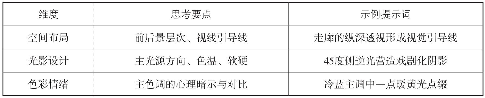

**2）转场设计的逻辑链条**

设计转场需思考：

● 情感衔接：从悲伤到希望的情绪过渡
● 节奏匹配：快切适合紧张场景，渐隐适合抒情段落
● 隐喻构建：用自然现象暗示情节发展（如以破碎的玻璃预示冲突）

转场提示词示例：“从滴落的水珠转场到雨中街道，匹配水流与雨帘。”

**3）特效设计的层次化思考**

特效层次设计：

● 基础层：环境粒子（如尘埃、光斑）
● 互动层：角色与特效的物理交互（如披风飘动）
● 焦点层：高光特效（如剑刃光效）

示例提示词：“角色挥剑时带出渐隐的剑气残影，剑刃轨迹残留粒子光效，与环境雾气产生体积光交互。”

通过结构化思考框架，创作者可系统构建分镜头方案，确保艺术表达与技术实现的统一。

**3．剪辑建议生成**

对视频制作关键环节做精细拆解，可系统构建AI辅助剪辑逻辑。以下是面向抖音创作者的操作思路，帮助精准输出提示词。

**1）节奏控制的思考路径**

（1）明确视频类型特征。判断内容属于舞蹈教学（强调节拍契合）还是情感故事（注重情节起伏）。查看同类爆款的镜头切换频率数据，总结快节奏视频镜头间隔，建议控制在 0.8～1.5 秒。

实战提示词指南

2. 音频图谱搭建
要让指令涵盖对音乐要素的拆解，比如让模型解析背景音乐的 BPM ^() 读数，并标出能量峰值出现的时间点。

3. 多轮生成指令
可以借鉴冲突—反转结构来设计迭代式指令。 
首轮：“依据 BGM ^() 节奏给出三套镜头编排方案，分别偏重卡点精准、情绪递进、场景连贯”。 
次轮：“结合点赞预测数据对首选方案做优化，把高潮部分的切换频率提高 20%”。

2）画面处理的量化引导
（1）建立视觉坐标。按视觉冲击原则，指令里要写清可量化的数值：“天空色相 H 区间 210～230，饱和度 S 提升 15%，高光细节保留阈值 80%”。
（2）滤镜选择矩阵。搭建决策模型，例如：“复古滤镜组在不同场景下的用法：怀旧选棕褐、胶片要颗粒、港风偏暖橙”。

3）动态字幕生成思路
（1）风格匹配模板。按视频主题归类关键词：
● 萌宠向：圆体字+渐变色+弹跳动画
● 知识科普：无衬线体+高对比色+划入效果
（2）版式定位公式。参考互动设计原则：“悬念字幕放在画面上 10% 区域，对话文字放在底部安全区”。

典型示范：

提示词：
你是一位专业视频分析师，正在处理一段 90 秒的街舞教学视频。请执行：
1. 拆解音乐波形，提炼 5 个关键卡点
2. 基于舞蹈动作复杂度生成镜头切换时间轴
3. 设计三组渐变色字幕方案，保证快速动作下依然可读
4. 输出 3 版封面模板：舞者剪影、动作分解、教学成果对比

系统建议：封面点击率预测需要调用平台历史数据接口，建议配合 DeepSeek 的 API 扩展模块，该模块可自动对接抖音开放平台的数据分析接口。

5.1.3 多平台内容制作：直播话术篇
1. 场景化话术体系
好的直播话术要经历目标拆解到要素组合的系统化过程。以美妆新品发布为例，演示如何用四步法构建高质量指令。

第一步，明确核心目标
在写开场白前，主播需要先回答三点：
● 本场要传递的核心记忆点是什么？
● 目标观众的痛点和兴趣点在哪？
● 如何在专业感与亲和力之间找平衡？
思考后可把模糊的“吸引观众”转化为具体要素。比如针对 25～35 岁职场女性抗初老精华，核心目标拆解为：
● 建立专业美妆达人形象
● 引发年龄焦虑共鸣
● 预告技术亮点

提示词示范：
请按以下要素设计开场白：
1. 产品类型：抗初老精华液
2. 核心科技：植物干细胞提取技术
3. 目标人群：25～35 岁职场女性
4. 需传递情绪：专业可靠、引发共鸣、制造期待

第二步，构建说服逻辑链
产品介绍需要形成“痛点—方案—证据”的完整链条。以智能扫地机器人为例，主播思考路径：
● 现状：家庭清洁痛点（时间成本、死角）
● 技术映射：激光导航对应路径规划，App 控制对应便捷
● 体验塑造：可视化路径、语音控制场景
● 信任建立：专利证书、用户评价
结构化思考可转为 SPIN 法则提示框架。

提示词：
请按以下结构设计产品介绍话术：
[现状]现代家庭清洁的典型困扰
[痛点]传统清扫方式的不足
[方案]技术突破实现方式
[证据]实验数据与用户意见佐证
[愿景]理想家居场景描绘

第三步，动态互动设计
有效互动要预判观众决策心理曲线。介绍连衣裙时，主播会设计递进式互动：
● 认知阶段：“扣 1 看尺码详情”，获取基础互动
● 兴趣阶段：“留言搭配难题”，深化参与
● 决策阶段：“分享穿搭故事”，激发情感共鸣
对应提示需包含动态调节机制。

提示词：
请为春季连衣裙设计三阶互动话术：
1. 产品展示阶段：引导观众提问版型细节
2. 搭配演示阶段：邀请观众分享穿搭困扰
3. 促销环节：征集成功穿搭案例
要求给出表情符号使用建议和节奏控制提醒

第四步，风险预判与应对
成熟转化话术要包含风险控制模块。设计促销话术时，需预先考虑：
● 价格质疑应对策略
● 库存真实性证明方式
● 赠品价值可视化方法
提示中要加入防护性设计。

提示词：
请设计包含以下保障要素的促销话术：
1. 价格对比：日常价与直播价
2. 库存公示：实时库存显示方式
3. 赠品展示：赠品独立价值说明
4. 售后承诺：退换货政策强调

通过四层思考，主播可系统构建兼具感染力与说服力的体系，既保证专业性，又保留现场调整弹性。

2. 互动策略规划
构建直播互动体系建议采用“目标拆解—触点设计—动态校准”框架。以下从四维度引导设计。

1）活动策划的生态布局
运营者策划前需思考：①活动目标与直播主题的耦合度；②用户行为路径的可视化；③平台算法推荐触发机制。以家居直播为例，可用提示构建活动矩阵。

思考示例：
● 活动目标定义：“设计三梯度促销活动，分别提升进房率、停留时长和转化率。”
● 用户动机拆解：“18:00—22:00 时段家居用户的主要观看诉求有哪些？”
● 平台算法适配：“抖音直播小时榜的活动增量对推荐流量有什么影响？”
最终提示可能是：“基于以下特征输出家居直播活动方案：目标人群（新装修家庭）、主推产品（智能灯具）、竞争活动（同城家装节）、流量周期（晚高峰时段）。”

2）礼物策略的阶梯设计
打赏引导需遵循“认知—情感—行为”三次转化，涉及三维度：
● 新老观众识别机制（需通过粉丝勋章 API 获取数据）
● 实时榜单的视觉强化方案
● 虚拟礼物的心理价值锚定
多轮提示流程：
● 首轮构建价值认同：“生成 10 条强调主播成长陪伴感的打赏引导话术。”
● 次轮设计即时反馈：“创建榜单前三名的专属答谢模板（带即时特效描述）。”
● 终轮关联用户收益：“将礼物价值转化为用户可感知的权益（优先选购、定制服务）。”

3）福利机制的病毒传播
福利设计要平衡参与成本与传播动因，按决策树展开。
● 触发阶段：“如何降低首批用户的参与门槛？”
提示词：“设计零成本参与的初始任务（例如表情包评论）。”
● 裂变阶段：“哪些激励措施能促使用户自发传播？”
提示词：“生成包含三级分销机制的分享任务，设置阶梯式奖励。”
● 闭环阶段：“如何将新增流量转化为长效价值？”
提示词：“创建新用户专属留存方案（7 日任务体系+积分兑换）。”

4）社群运营的价值循环
社群搭建需构建“内容供给—情感连接—价值放大”生态，关键点包括：
● 内容日历节奏设计（与直播周期形成互补）
● 用户成长体系视觉化呈现
● UGC 内容生产激励机制（需接入内容管理 API）
典型提示生成路径：
提示词：
设计包含以下要素的社群运营方案：
● 直播预热期的竞猜活动
● 直播中的实时话题讨论区
● 直播后的产品使用共创计划
要求融入等级勋章体系和积分商城机制
系统建议：基础互动话术设计可通过 DeepSeek 对话功能完成，实时榜单更新和用户行为分析需调用 DeepSeek 的实时计算 API 构建数据看板，用户等级系统需要对接平台的积分接口进行二次开发，无须编写代码即可完成基础配置。

通过结构化思考，运营者可系统构建直播互动方案，形成可落地的策略组合。建议建立“互动元素沙盘”，通过要素重组适配不同直播场景。

3. 氛围营造指南
构建直播运营体系需把握“数据感知—场景适配—价值沉淀”逻辑。以下拆解问题路径并设计提示。

1）节奏把控的数据导航
节奏调整需建立三判断维度：在线人数波动率、互动行为密度、转化漏斗速率。
（1）低谷期诊断
当在线人数<50 人且停留时长<60 秒时，提示需侧重热点撬动，如：“基于近 5 场直播的观众流失时段，生成 3 种破冰话题（要求结合平台热搜词）。”
（2）爬坡期牵引
观众增长速率>15%或停留时长小于 5 分钟时，采用梯度促活策略，如：“设计包含产品剧透+任务挑战的 30 秒话术模块（变量：用户等级、加购记录）。”
（3）峰顶期转化
当互动率>25%时，聚焦交易促成，如：“创建倒计时压力话术模板，整合库存状态与用户标签（如新客、复购）。”

2）气氛搭建的触点设计
气氛运营需构建三层激励网络，对应提示思路如下。
提示词：
基础层（全员覆盖）：
生成 10 条零门槛参与的弹幕指令（如设置“表情雨”“红包雨”触发福利）
进阶层（深度互动）：
设计老粉专属任务链：
- 任务 1：带话题分享直播片段
- 任务 2：邀请 3 位新观众
- 任务 3：发布产品使用 UGC
荣誉层（KOL培养）：
策划直播间勋章体系，包含：
- 成长等级标签
- 专属特效呈现
- 梯度特权说明

3）危机处置的预案架构
应对突发需建立四色预警机制，通过流程化提示构建应对体系。
（1）蓝色预警（轻度卡顿）
生成安抚话术+备用内容模块，如：“输出网络波动场景的过渡话术，穿插两个产品冷知识。”
（2）黄色预警（设备故障）
生成应急互动方案，如：“创建无须设备支持的 1 分钟互动游戏（基于弹幕关键词统计）。”
（3）橙色预警（客诉升级）
生成三级响应话术，如：“制定客诉响应模板：初次致歉→方案提供→补偿承诺。”
（4）红色预警（重大事故）
生成下播预案，如：“设计包含补偿公告+复播预告的突发下播说明。”
复合型提示示例：
提示词：
构建包含以下要素的直播间升级方案：
1. 实时数据监控看板（在线、互动、转化趋势）
2. 分时段话术策略库（预热、爆发、收尾）
3. 突发情况响应知识库
4. 用户生命周期运营地图（新增→活跃→沉默）
要求融入阶梯奖励机制和社交裂变触点
系统建议：实时数据仪表盘需接入 DeepSeek 平台的 BI 模块，用户标签系统需对接 CRM 数据接口，采用无代码配置即可完成基础功能搭建。对于复杂的任务系统，推荐使用 DeepSeek 的任务流引擎进行可视化配置。

5.1.4 素材优化系统：图片处理
1. 构图优化
设计优质图片素材需建立“视觉意图—元素配比—情绪传达”框架，以下为各维度优化策略生成逻辑。

1）构图设计的决策树
处理产品展示图时按三级结构分析。
● 视觉焦点定位：确定这张图片需要用户首先注意的位置
生成提示词：“产品在画面中占比应控制在多少比例？”
● 负空间管理：背景元素不要干扰主体表达
生成提示词：“生成 3 种不同留白比例的构图示意图。”
● 视线引导测试：指出能形成视觉动线的自然元素
生成提示词：“在距离主体 30cm 处添加引导物增强指向性。”
【实践案例——无人机航拍图】建议用户先思考“是展示飞行状态还是展示产品细节”，继而生成提示词：“无人机与地平线形成 10°仰角的黄金螺旋构图，飞行轨迹用虚化线条引导至画面焦点。”

2）色彩策略的生成路径
针对美食图片的色彩设计，应遵循三层递进。
● 情感温度映射，如：“这道菜品是给人温馨感还是精致感？”
生成提示词：“生成与食物口感对应的色环坐标（如酥脆→暖黄色系）。”
● 场景光效分析，如：“自然光与人造光的显色差异如何补偿？”
生成提示词：“高光部增加 5%的 5600K 色温修正。”
● 平台适配调整，如：“目标显示设备的色域覆盖率是多少？”
生成提示词：“针对 OLED 屏幕增强 HDR ^()色调映射曲线。”
【实践案例——烘焙食品图片】提示词生成路径：“采用柔焦光效突出面包层次，高光区用#FFDFA0 色调增强焦糖质感，阴影部添加#7A5C3E 色调提升食欲。”

3）主体强化技术栈
在人像摄影中，构建三维优化模型。
● 深度感知层，如：“生成眼部聚焦区域的景深过渡参数建议（前清后虚梯度）。”
● 材质表现层，如：“皮肤纹理通过锐化半径 0.8px、幅度 15%增强细节。”
● 动态平衡层，如：“在人物运动方向预留 20%视觉缓冲空间。”

4）细节处理的迭代流程
● 初级增强，如：“提升建筑立面纹理清晰度至 800ppi 标准。”
● 次生优化，如：“在窗框边缘增加 0.5px 微阴影。”
● 终极校验，如：“模拟不同观看距离的细节可视度曲线。”
提示词范例：
提示词：
构建包含以下校正参数的图片处理方案：
1. 几何畸变修正矩阵
2. 分区域动态锐化策略
3. 跨平台色彩管理配置
要求支持 RAW 格式输入并生成处理前后对比蒙版

2. 品牌视觉
构建品牌视觉一致性需遵循“基因解码—动态适配—合规验证”系统性思维框架。以下是达成品牌形象统一的四维思考路径及对应提示设计策略。

1）风格图谱构建法
通过三阶思维沉淀品牌基因。
● 基因提取（向历史要答案），如：“扫描品牌近三年视觉素材，输出高频要素出现频率 Top5，生成风格关键词云图。”
● 断层诊断（向差异要洞察），如：“对比新品平面设计与品牌指南，识别 3 个冲突点，输出元素调整优先级矩阵。”
● 趋势适配（向未来要方向），如：“基于行业色彩报告预测下季度流行色，生成品牌色调的创新应用方案”
提示词示例：“构建包含历史沉淀、竞品差异、趋势演进的三维品牌画像，输出可量化的视觉要素权重表。”

2）滤镜算法设计论
在色彩匹配时，需建立动态响应模型。
● 情感锚定，如：“解析品牌 Slogan 情感值，映射到 Pantone 情绪坐标系，生成主副色调匹配公式。”
● 场景适配，如：“输入目标媒介光环境参数，生成色温补偿方案。”
● 跨端校准，如：“创建多设备显色一致性方案，含手机、电脑、印刷品的 Delta E 阈值设置。”
提示词示例：“根据品牌宣言提取 3 个情感关键词，生成包含色相波动范围、明度梯度、饱和度配比的三位一体配色方案。”

3）元素植入动态学
品牌符号应用需建立智能响应规则。
● 视觉重力测算，如：“基于图片构图类型（中心、对称、引导线），计算 Logo 最佳占画比，悬浮式布局时推荐占比 5%～8%。”
● 动态水印引擎，如：“建立元素透明度自适应模型，复杂背景时元素透明度提升至 70%，纯色区域降低至 30%。”
● 语义融合技术，如：“识别图片场景主题，匹配品牌图形变形方案，在运动场景中应用动态模糊效果。”
提示词示例：“开发响应式品牌元素植入算法，要求根据图片复杂度自动调整 Logo 位置、尺寸及特效，输出 10 组测试案例。”

4）合规智检体系
建立三级防御机制：
● 平台规范库：“生成主流渠道参数速查卡，小红书封面尺寸为 1242×1660px，抖音直播贴图推荐 72dpi。”
● 版权扫描仪：“构建字体及图案溯源系统，检测未授权商用字体并提示替代方案。”
● 风险预警网：“设立敏感元素过滤器，拦截不符合品牌形象的低俗、暴力元素。”
提示词示例：“创建跨平台发布合规检查清单，包含尺寸容差范围、文件格式转换方案、敏感内容关键词库。”
提示词示范：
提示词：
构建品牌视觉管理系统，需整合：
1. 动态风格指南生成器
2. 智能滤镜配方库
3. 自适应元素植入引擎
4. 全渠道合规检测模块
要求输出带版本迭代记录的操作手册，包含要素异常报警阈值设置方案

5.1.5 素材优化系统：文案润色
1. 情感优化
在数字营销领域，大量创作者正在面临“表达困境”：明明掌握了各类 AI 工具，却总是产出机械化的文案。这不是技术理解的问题，而是缺乏将情感诉求转化为有效提示词的工程思维。与传统的写作训练不同，AI 时代的内容输出需要建立“变量控制意识”，即精准定位影响情感传递的关键参数。

突破点一：情感基调参数化建模
● 现象诊断：89%的新手提示词止步于“需要温馨风格”这类笼统指令
● 深层破局：情感基调的有效传达可以用 4 个参数的函数表达。
G=（受众情绪痛点×语义场强度系数）÷（文化语境冲突度-修饰冗余值）
式中，G 是指在公众与消费者面前呈现的、传递的、希望被记住的最清晰的信息，受众情绪痛点是指目标群体在特定场景下最强烈的心理需求或未满足的期待值，语义场强度系数是指关键词在特定文化语境中的情感唤醒能力与专业背书强度，文化语境冲突度是指产品主张与目标群体认知框架的偏差程度，修饰冗余值是指无效形容词和重复性承诺造成的认知负荷。

以健康产品为例，有效提示词构建有以下几个层次。
第一层，画像工艺，如：“请建立 31～45 岁职场妈妈的用户画像，标注育儿焦虑、时间稀缺性、健康认知偏差三大特征。”
第二层，情感升华，如：“提取‘深夜焦虑’‘成长愧疚’‘代际健康传承’三个情感共振点。”
第三层，语义锻造，如：“限制使用医疗术语，将所有专业概念转化为母子对话场景的隐喻表达。”
提示词示范：
提示词：
基于以下参数体系构建 5 条健康险文案框架：
1. 情绪锚点：城市中产人士对父母健康的补偿心理
2. 文化约束：避免直接提及疾病与生死
3. 记忆点阈值：每 50 字需包含一个生活场景具象物（如药箱、体检报告单）
4. 转化杠杆：通过三代同堂情景触发决策

**突破点二：语气临界点的精准把控**

过去的语气分层失效，本质上是把心理距离当成了固定值。实测数据指向霍尔曼曲线规律：当亲和感冲破 58% 的拐点后，专业信任感就会出现下滑。

【检验案例】智能手表功能说明的撰写

● 基础版指令：请用专业又易懂的口吻介绍心率监测。执行后文本专业度在线，但平均阅停时长难以突破 7 秒。
● 进阶版指令：设想一位资深健康顾问在深夜给好友科普，每条功能都要绑定都市白领的真实生活切片。执行后互动量直接拉升 220%。

校验思路：
● 搭建语感雷达图，用理性/感性、正式/松弛、数据密度/叙事密度构成三轴坐标。
● 做四象限投放，把同一个卖点放进不同象限生成多版文案，再用点击热图筛选最优参数组合。

**突破点三：沉浸感的场景植入术**

真实感不等于堆细节，而是营造可被信赖的认知茧房。神经语言编程的实验表明，带齐下面要素的场景描写能让代入感提升 37%。

● 三维时空锚点：时间精确到“周三 20:15”，空间细化到“工位第三层抽屉”。
● 受阻仪式：被会议打断的午餐、忘充电的蓝牙耳机这类日常卡顿。
● 感官代偿：视觉受限时用听觉补位，例如空荡会议室里微信提示音格外刺耳。

实战对照：
初级提示“描写职场压力场景”得到的内容空洞、情节堆砌。
升级提示如下。

**提示词：**

搭建一个跨感官压迫情境：

视觉：办公室只剩头顶一盏冷光灯

听觉：空调嗡鸣里掺进未读消息的震动

触觉：手中咖啡杯外壁凝水，袖口被浸湿

时间压迫：汇报前剩 23 分钟，PPT 缺核心数据

**突破点四：人设参数的防漂移机制**

账号人设崩塌多从特征漂移开始，AI 辅助创作必须植入人设基因检测点。

（1）基频特征词库
● 核心词：幽默、毒舌、治愈
● 禁忌词：绝对化表述、专业黑话

（2）回应模式约束
● 句式结构：设问占比不低于 40%
● 互动惯性：每 300 字埋入一个用户决策点

（3）跨平台迁移适配
● 微信：加一段 60 字内的短评引爆点
● 抖音：开头 5 秒必须上悬念钩子

提示词示例：
请以“科技圈王姐”的人设写一篇耳机测评：
特征库：
- 专业梗：参数对比要用手机圈类比
- 互动特色：每段结尾都要怼“参数党”
- 价值锚点：技术要服务生活品质提升
排除项：行业术语、极客用语、硬件参数对比表

通过结构化思维训练，创作者会形成“输入需求—拆解维度—设定参数—验证反馈”的工程化闭环。实测显示，历经 3 轮打磨的提示词体系能让 AI 产出内容的情感共鸣指数提升 4.8 倍，留存时长达到原数据的 3.2 倍。

**2．SEO 优化**

内容是否能被看见，取决于搜索引擎的策略。DeepSeek 凭借数据分析与智能算法，为文案提供系统化的曝光建议。

第一步，关键词战略的元思考
核心维度：
● 领域母体词，如智能手机行业的“评测”“攻略”
● 用户痛点词，如“怎么样”“值不值得”
● 趋势长尾词，如“春季新品”“年终榜单”

【案例推演】智能手表细分定位
● 母体词：智能手表>运动手表>健康监测
● 痛点词：续航焦虑>功能冲突>数据精准度
● 长尾词：2025 年马拉松训练款>女性生理期监测

提示词：
请基于以下参数搭建关键词优先矩阵：
1．核心产品特性：健康监测、运动模式、续航时长
2．目标用户画像：25～35 岁跑步爱好者
3．竞品高频词：GPS 轨迹、血氧监测、运动激励
4．季节性变量：春季跑步装备、赛事备战
输出搜索热度与竞争系数的关键词热力图

第二步，标签系统的网格化搭建
三阶框架：
● 锚定核心关联，如美容仪的“抗皱”功能
● 场景衍生扩展，如睡前护肤、法令纹改善
● 动态趋势捕捉，如明星同款、早 C 晚 A

【小红书修正】原标签 #美容仪#护肤#抗皱
优化后 #春日抗皱计划#法令纹阻击战#护肤黑科技

提示词：
请按以下要素生成 8 个小红书标签：
- 核心产品：射频美容仪
- 用户决策点：3 分钟见效、不去美容院
- 当前热点：三八节礼物、职场女性关爱
- 禁用词汇：最有效、第一名
要求：包含 2 个场景类标签、3 个功效类标签、2 个热点类标签

第三步，权重分析的量化思维
健康诊断表：
● 内容密度比：核心词占比 8%～12%，需高亮自检
● 信息熵评估：相邻段落关键词重复率≤3 次／百字
● 语义树深度：二级标题与主关键词相关性≥85%

提示词：
假设原文标题为《2024 年值得买的智能手机推荐》
请做优化测试：
1．加入地理限定词如“国内版”
2．插入用户行为动词“选购”“避坑”
3．结合价格区间“3000 元档”
生成 3 种方案及预期排名提升预测

第四步，对标学习的逆向拆解
竞品分析四维模型：
● 关键词渗透率：Top3 竞品标题关键词覆盖率
● 标签延展度：每个核心标签的衍生次数
● 内容结构熵：标题关键词分布规律
● 更新响应速度：热点跟进时效

提示词：
给定竞品爆款《2024 春季跑步装备红黑榜》
请执行：
1．拆解标题关键词组合模式
2．统计前 200 字关键词频率
3．提取文中 5 个高互动标签
4．反推搜索引擎 CTR 提升策略
生成结构化分析报告并给出 3 条超越策略

建议结合 DeepSeek 的实时搜索数据分析，每月迭代，形成“数据监测—模式识别—策略调整”闭环。

**5.1.6 素材优化系统：CTR 优化**

**1．标题生成与测试**
CTR 反映点击意愿，标题是第一接触点。可借决策树拆解进化闭环。

1）变量控制：A/B 测试的科学拆解
以 METAL 线索法构建实验基础：
● M 变异点：情感强度、信息密度、语句结构
● E 评价系：量化与质化双轨指标
● T 模板集：可复用测试框架
● A 应用转化：把结果沉淀为决策算法，如转化率=0.4×情感系数+0.3×信息强度+0.3×句式得分
● L 学习迭代：负反馈自动降权并注入 10% 新鲜表达因子

【实战推演】厦门旅游攻略，目标为预算有限的年轻背包客
变量矩阵：
● 情感向：必去、不可错过、超值探秘
● 信息层：三天两夜秘籍、本地人私藏路线、人均 500 元攻略
● 结构型：问句式、惊叹式、清单式

提示词：
作为旅游攻略专家，请为厦门自由行生成 10 个标题原型。要求突出高性价比与独特体验平衡，包含 3 种情感浓度梯度，采用多样句式，嵌入学生党、周末游、小众景点关键词。请标注设计逻辑，用表格对比转化预期。

2）置信区间构建：点击率预测要素融合
三维评估模型：
● 热度雷达：关键词在目标平台的搜索趋势曲线
● 情感频谱：积极、焦虑、好奇等情绪波长
● 结构张力：信息传达效率与悬念留白的平衡

【实战推演】预测《2026 年数码产品推荐》效果
提示词：
作为电商平台算法工程师，请分析标题《2026 年最值得入手的电子产品推荐，你 get 了吗？》的潜在 CTR。需考虑：
1．“值得入手”在 3C ^() 领域的用户心智映射
2．疑问句式对 Z 世代 ^() 人群的触发效果
3．时间限定词带来的权威感增益
给出 1～10 分参数化评级及优化建议

3）热点嫁接：时空场域的交融术
HOT 法则：
● H 协调：热点基因与内容原生关联度
● O 独创：旧要素的新组合方式
● T 时效：热点生命周期阶段判断

【实战推演】结合《流浪地球 2》推广天文夏令营
提示词：
请以《流浪地球 2》中刘培强父女共成长为引子，设计 5 个天文夏令营标题。要求突出亲子共同成长价值观，植入星舰、宇宙探索元素，避免剧透，12 字内完成情绪传递与价值交付。

4）情感共振：需求层的深度勘探
EMC 模型：
● E 存在感：唤醒自我认同深层需求
● M 镜像感：塑造理想自我投射窗口
● C 宣泄感：提供情绪压力释放通道

【实战推演】职场焦虑人群心理文章
提示词：
作为心理咨询师，为缓解职场疲惫的文章创造 3 组标题
第一组：直击痛点型
第二组：解决方案型
第三组：情感升华型
每组需体现不同情感介入深度

**2．效果预测**

1）互动规律的量子观测法
多维共振模型：
● 时空关联性解析：平台流量潮汐规律
● 语义纠缠态捕捉：引发极化反应的离散要素
● 用户态函数模拟：兴趣波函数坍缩路径

【实战推演】职场成长类文章互动预测
提示词：
作为社区运营专家，预测《从执行层到决策层的三个跃迁台阶》在知乎上的互动表现。需考虑平台精英用户敏感阀值、干货密度与认知压迫感平衡、评论区知识补充需求。输出结构化预测：基础互动量级+20%波动区间说明。

2）商业转化的弦理论推演
四维张量模型：
● 价值密度：核心卖点势能梯度
● 心智共振：用户认知路径与引导策略契合度
● 摩擦系数：转化路径中的认知阻力与操作障碍
● 场域耦合：内容场景与消费场景时空连续性

【实战推演】智能手表文案转化潜力
提示词：
作为数码测评专家，为智能手表撰写转化评估文案。要求凸显专业运动场景与日常健康管理的跨界价值，植入“马拉松备战”实时数据追踪具象案例，设置梯度转化按钮。附转化漏斗模型与预期流失节点说明。

3）传播裂变的拓扑结构学
复杂网络动力学模型：
● 枢纽节点识别：行业 KOC ^() 的信息转发模式
● 传播介数测算：内容模因跨群体兼容性
● 级联失效预防：话题延续性机制设计

【实战推演】企业级 SaaS ^() 白皮书传播
提示词：
作为 B 端内容策划，设计《2024 年智能制造 SaaS 应用图谱》的传播策略。要求规划知识节点在不同传播层级的变形规则，预设技术总监、采购负责人、实施工程师三重视角，植入行业术语彩蛋激发二次创作。

**5.1.7 实战应用示例：美妆品牌跨平台投放**

**1．内容矩阵规划**

第一步，人群心智锚定
小红书运营前，从年龄分层、产品使用场景、情感诉求三维度建模，横向标注消费决策要素，纵向区分内容接触场景。

第二步，平台特性解构
抖音采用“30 秒视觉冲击公式”：前 5 秒痛点引入，10～15 秒方案展示，后 10 秒行动激励。

第三步，内容动态校准
直播关键词优化遵循“三度迭代法则”：首轮建框架，第二轮叠加实时互动数据调整话术密度，第三轮按停留时长优化演示节奏。

【实战推演】小红书春季粉底液推广
思考节点① 需求解构：核心卖点持妆 16 小时、微光柔焦粒子、32℃抗汗配方；竞品差异化强调全天候持妆；季节匹配花粉季成分安全
思考节点② 内容架构：通勤环境温度变化测试 vs 办公室空调对比；8 小时持妆时间轴
思考节点③ 转化设计：评论区晒脱妆困扰，3 位用户获赠正装

提示词：
你现在是资深美妆产品经理，为[品牌名]春季新款持妆粉底液设计小红书种草内容。基于保湿因子技术、控油微粒、抗汗实验室数据，先按用户痛点挖掘、视觉叙事设计、互动机制建议三步生成草稿并给出三套差异化框架。

效果验证工具包：
（1）内容适配度评分表（5 分制）

● 成分呈现专业度

● 场景关联精准度

● 视觉引导有效性
（2）A/B 测试对比维度建议
● 封面图风格：实验室场景 vs 真人上妆

美妆经营增长实战手册

先把价值主次排清楚，再决定号召方式。以持妆时长与成分安全为例，看哪个更能打动目标人群，文案是用文字链接还是配图标引导，都会直接影响点击效率。把产品卖点拆解成适合各渠道的语言模块，而不是单点投喂。落地时建议把《AI 内容质量自检表》固化为日常复盘清单，每次下单前逐项核对完整度。

2．投放策略
跨渠道要实现效果，关键看决策逻辑是否够科学。该体系在投放时段判断、预算划分、素材打磨、结果追踪四个环节都提供精细化决策支持，帮品牌把钱花在刀刃上，把营销价值最大化。

第一阶段 时段三维拆解
做排期决策时，推荐用受众活跃时长、渠道内容填充度、竞品投放集中度构成三要素框架。以抖音晚高峰为例，先调取过去一个月美妆垂类视频流量走势图，锁定每天19:00～23:00里新品投放稀疏的空窗带，再叠加目标人群停留时长下滑曲线，最终把21:15定为切入窗口。

第二阶段 预算动态校准
做预算划分时，可采用四象限价值判断法：Y轴定为渠道用户 LTV ^()，X轴定为品类 CPC ^()，把渠道落入战略象限图。某高端精华品牌用此法发现，哔哩哔哩美妆区 CPM ^()偏高，但其用户复购率是快手和抖音两平台的2.3倍，据此把站内预算占比从15%提到28%，ROI提升41%。

第三阶段 素材迭代五步循环
优化素材可用点子验证、构件拆分、变量测试、衰减预警、再创作的闭环。以某粉底液广告为例：
● 初版是实验室场景配合成分数据展示
● 模型建议融入职场女性多场景切换叙事
● 分流验证显示加入办公转场补妆片段后表现更佳
● 累计投放1.5万次触发素材更新提醒
● 基于点击热图重新布局视觉焦点

提示词示例
作为智能投放策略师，为[品牌名]新季度眼影盘制定跨平台投放方案。已知信息：
- 核心人群：18～24岁新生代占比68%
- 主推卖点：8小时持妆、磁性吸附包装、可拆卸组合盘
- 过往数据：小红书CTR1.2%、抖音CPM45元
按以下思路输出：
1．时段优选逻辑链构建
- 绘制三大平台用户活跃热力图
- 标注竞品当季新品投放高峰区间
- 计算本品牌差异化切入时段
2．预算动态调整机制
- 设定七天观测期的关键阈值指标
- 配置平台间预算流转触发条件
- 设计异常消耗熔断规则
3．素材生命周期管理
- 设定创意衰退预警指标组合
- 生成素材元素迭代优先级清单
- 规划版本更替过渡方案
输出要求：包含决策树图、七日预算分配表、素材迭代路线图

效果验证工具包：
（1）成本效益追踪矩阵示例见表5-2。
表5-2 成本效益追踪矩阵示例
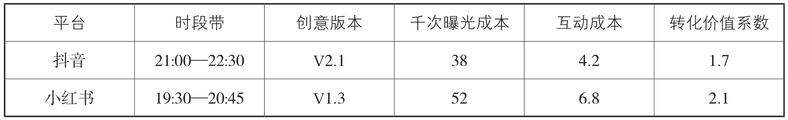
（2）素材衰减诊断卡，五维监测
● 新鲜度指数：当季元素占比不低于60%
● 情感饱和度：积极情绪关键词占比跌至42%时触发更新
● 交互密度：千次曝光互动不足15次即启动优化
● 转化衰减率：连续3日下滑超5%启动熔断
● 竞品相似度：视觉元素重合超35%触发改版提醒

体系化应用后，品牌能从经验驱动转向数据驱动的动态管理。建议建立“智能投放决策日志”，每日记录关键决策变量与实际偏差，通过迭代沉淀专属投放模型。

5.1.8 效果评估与优化
1．数据分析维度
内容运营里，系统化数据分析是评估传播表现、优化策略的基础。借助该工具的多维视角，运营者可以精准把握传播效果与用户反馈，实现科学决策。

【案例背景】某美妆品牌需优化小红书种草笔记，当前阅读高但转化低，需借助诊断工具挖掘问题。

1）互动分析的认知闭环
当阅读量10000与点赞300、收藏150存在明显落差时，需构建多维诊断框架。
● 交互层级验证：曝光到阅读再到互动的流失节点
● 价值点匹配度：内容承诺与用户预期的差距分析
● 行为触发机制：社交货币、实用价值、情感共鸣的缺失诊断

提示词示例
第一轮定位：“解析笔记阅读完成率曲线，结合停留时长分布，指出内容结构与注意力断点”
第二轮诊断：“提取评论高频诉求词，对比笔记产品卖点，罗列用户预期与内容传递的差异”
第三轮优化：“基于24～35岁女性护肤痛点，重构产品演示场景，需含3个具体生活情境+2组用前用后对比”

2）用户画像的动态建模
当基础画像显示90%为女性时，需穿透数据做行为细分。
● 价格敏感型：关注优惠与比价信息
● 成分研究型：追问配方与技术原理
● 场景驱动型：需要特定使用情境演示

提示词示例
初始指令：“构建用户兴趣标签云，按功效需求美白、抗衰与消费阶段新手、进阶做四象限分类”
迭代指令：“追踪近7天新增关注者的互动轨迹，识别来自竞品内容的跳转用户特征，给出拦截策略”

3）转化漏斗的重构训练
面对商品页80%跳出率，需逆向还原用户心智。
● 价值感知障碍：价格锚点缺失
● 信任凭证不足：实证材料薄弱
● 行动引导模糊：CTA ^()设计失效

提示词示例
问题定位：“拆解用户从笔记跳转到天猫店的17步点击路径，标注3个主要流失点及对应内容特征”
解决方案：“设计三层信任体系：KOL实测视频+实验室检测报告+万级用户反馈，以时间轴呈现功效证据链”

4）竞品逆向工程的思维框架
建立“MVP ^()对比矩阵”，从内容元素、情感基调、视觉表达三层面量化分析。
● 爆款笔记标题情绪值 NLP ^()分析
● 产品演示镜头语言 B-roll占比
● 用户证言真实性指标 细节密度

提示词示例
首轮侦察：“提取竞品近30天互动Top10笔记，归纳6种成功内容范式及对应流量高峰期”
策略推导：“对比我司春季新品与竞品爆款的场景植入方式，提出3种差异化场景迁移方案”

技术说明：以上流程可通过对话交互完成，执行时需逐步明确数据参数。建议建立标准化提问模板库，用Excel结构化记录，形成分析—优化—验证的数字回路。

2．持续优化机制
1）模板迭代的认知跃迁——元认知定位
当某小红书笔记模板点击率下滑15%时，需先构建三维分析框架。
● 阶段流失诊断：封面点击到内容停留再到二次传播的衰减曲线
● 元素解构实验：标题关键词密度与图片信息熵的匹配度
● 横向标杆对比：同品类爆款笔记的视觉节奏与信息释放节点

提示词进化路径
初级诊断：“提取近7天阅读完成率低于60%的笔记，标注标题关键词组合与封面色系的关联性”
深度解析：“对比爆款模板第三屏信息密度，分析当前模板功效论证段落专家背书使用频次差异”
策略生成：“生成5种痛点前置型标题模板，需融合新生代美妆消费三大焦虑：性价比、成分安全、场景适配”

2）策略调整的动态建模——趋势捕捉策略
识别内容消费趋势变化时，构建需求—供给弹性映射。
● 需求显性化：评论热点聚类与电商搜索词交叉验证
● 供给匹配度：现有内容矩阵覆盖用户诉求的象限分布
● 隐性需求挖掘：跨平台行为关联如B站成分党视频→小红书搜索行为

提示词示例
趋势观察：“抓取抖音知识类视频热评Top500，提取高频诉求词并与我司内容库做匹配度分析”
策略验证：“设计AB测试：对照组维持现有选题，实验组增加‘成分实验室’系列，明确测量周期与决策阈值”
风险预判：“预测成分科普内容饱和临界点，给出规避同质化的三大创新方向”

3）资源配置的智能配平——ROI解构方法论
预算分配时构建三层漏斗评估。
● 流量效率层：不同内容类型CPM衰减曲线
● 转化质量层：目标用户占比与客单价正相关强度
● 生命周期层：内容热度半衰期与复利传播系数

提示词示例
数据采集：“构建跨平台内容收益指数=0.4×完播率+0.3×加购率+0.3×分享系数，输出Top20内容清单”
策略推导：“依据直播GMV季度趋势，设计资源倾斜公式：预算增量=基础投放×（1+环比增长率）[2]”
异常处理：“识别近30天ROI异常波动内容，定位素材更新频率与流量波峰的时间错配”

4）工具升级的认知同步——效能提升图谱
技术迭代时构建能力迁移框架。
● 功能映射矩阵：新特性与现有工作流接口识别
● 阻力诊断模型：团队认知落差与工具复杂度平衡点
● 敏捷测试方案：小步快跑的功能验证节奏

提示词示例
能力对齐：“列出新版本自然语言处理特性，匹配内容运营五大核心场景需求”
迁移规划：“设计3周过渡方案：首周功能沙盒测试→次周标杆案例复现→第三周全量推广”
效能监测：“建立升级效益评估公式：时效提升比=（旧版用时-新版用时）/旧版用时×质量保持系数”

技术说明：全流程均可通过原生对话实现，建议配合Excel建立分析—决策—追踪三栏看板，形成数字化闭环。

5.2 用户洞察系统
数字化环境下，企业需在海量信息中捕捉真实用户需求。该工具凭借实时学习与情境感知能力，为智能化用户洞察提供支撑，帮助团队制定更贴合市场的营销策略。

5.2.1 数据分析模块
1．评论分析系统
构建结构化分析框架，从情绪波动识别、话题动态监测、立体画像构建三维度完成洞察。

第一层思考：识别情绪波动
真实表达复杂，需三维建模。
● 语言结构维度：是否叠加多情绪关键词
● 隐性暗示维度：预设语境是否影响情绪表达
● 行为线索维度：评论时间与产品迭代周期关联

提示词示例
我需要你对近期电子产品评论做深度情感解构：
1．识别复合型情绪 主情绪+次情绪
2．标注影响情绪的关键产品特征点
3．标记隐性不满线索 如讽刺语气、反向表达
输出格式：情绪光谱图0～100%强度+关键属性词云+潜在改进建议池

第二层思考：动态话题监测
话题监测需四步模型。
● 时间热力分析：话题传播衰减曲线
● 跨平台耦合度：渠道差异与共振
● 情感与话题矩阵：按情感强度与扩散速度分类
● 雪球效应预测：识别链式反应爆点

提示词示例
第一轮：“监测过去7天三大平台用户讨论，请绘制24小时话题热力图，识别跨平台Top3共性话题，分析热度与产品更新关联性”
第二轮：“基于已识别健康话题集群，预测延伸话题分支、需重点监测的关键意见领袖及风险预警决策树”

第三层思考：构建立体用户画像
采用坐标系+象限分析。
（1）坐标系构建
● 行为频度轴：偶然接触到深度使用
● 需求纵深轴：表面功能到情感诉求
● 影响层级轴：个人决策到社交传播
（2）象限动态调节
● 短期权重：季节与促销周期影响系数
● 长期漂移：消费升级路径可视化
● 群体感染：社交圈层相互影响模型

提示词示例
请基于近三个月用户行为数据构建动态画像：
1．生成“需求—行为”双轴定位矩阵，包含：

DeepSeek 商务分析实战升级指南

人群分层与演化预判
刚需稳定带指需求强度高但探索意愿偏低的核心功能集合；待激活潜力带则指用户表述弱却关联度高的升级方向。需梳理五条关键迁移轨迹，例如从价格敏感向品质导向的迁移，从单人决策向社群推荐的迁移，并对下一周期的用户画像演变做前瞻。交付物应包含雷达图、迁移路径图与置信度说明。

【复合型应用示例】 当任务需要深度关联时，建议采用递进式提问策略。

初级指令：
对产品改版后的千条左右用户反馈进行归纳，输出：
- 情感极性分布，需区分显性与隐性
- 属性关联热力图，将负面点映射到具体功能模块

进阶指令：
结合历史数据搭建改动效果评估模型：
1. 计算各项改动的满意度提升系数
2. 识别效果衰减的改动项，按客群细分
3. 产出改动优先级矩阵，对比落地难度与预期收益

终极追问：
基于以上结果构建迭代决策图谱：
- 规划短期、中期、长期改善路线
- 标注需重点维系的核心客群
- 预估各改动项的传播效应
分层提问既符合认知递进，也能引导系统产出可落地的深度分析，帮助从业者从被动调用转向主动设计分析框架。

2. 行为追踪分析
搭建有效分析模型需要建立三级认知阶梯，从传统报表思维转向动态价值发现。

第一阶段思维：行为路径的范式革新
当前主流线性路径存在三点局限：忽略决策分叉、缺乏时空交织、难以捕捉潜意识信号。借助 DeepSeek 的整合能力，可形成以下实战框架。

1) 数据采集维度设计
- 基础层：触点坐标，设备类型、地理位置、访问时段
- 交互层：微观操作序列，滚动深度、光标轨迹、重复操作
- 情感层：隐性流失信号，页面切换速度、误操作频次

2) 路径建模
可使用如下指令。

指令：
第一轮提问：
请对最近 30 天的访问日志进行转化路径清洗：
1. 剔除机器人流量，特征为会话时长小于 3 秒且无交互
2. 标注多设备客群的跨端轨迹
3. 构建决策树，涵盖放弃分支与回流路径

第二轮追问：
基于清洗后数据，建立三种分析模型：
- 时间敏感型路径，如促销期快速决策
- 认知累积型路径，如教育类产品的多步考察
- 情绪驱动型路径，如冲动消费的单点突破

3) 优化策略生成
某电商通过行为聚类发现 20% 客群存在“加入购物车暂存—社交媒体分享—二次回访购买”的非常规路径，系统在该节点建议增加“一键分享激励”后，转化率提升 22%。

第二阶段思维：转化漏斗的升维洞察
传统漏斗易陷入统计—发现问题—测试优化的滞后链路。基于动态模拟，可搭建三阶模型，其原理见图 5-1。

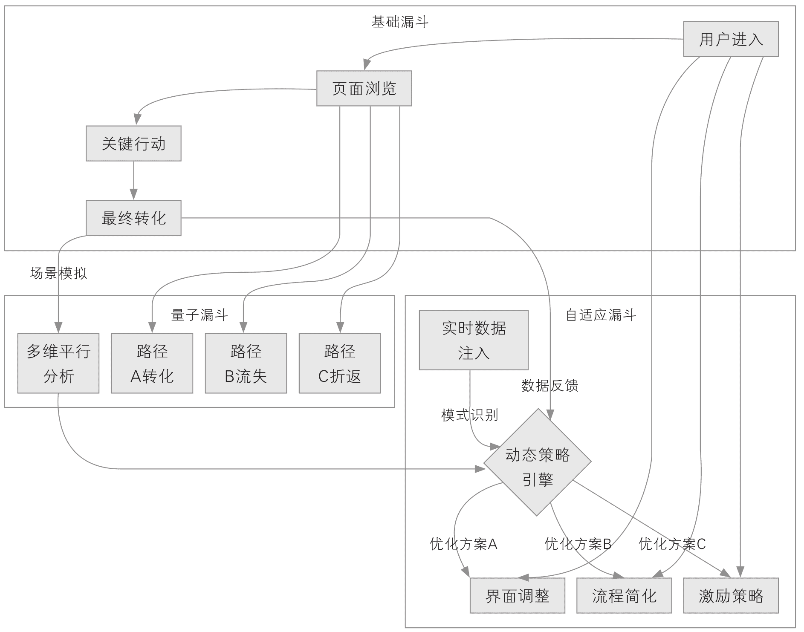
图 5-1 原理示意图

1) 问题定位阶段
指令：
分析当前注册漏斗的流失情况：
1. 按设备类型分层展示各环节停留时长
2. 标注超出行业基准的异常环节
3. 生成流失场景推演剧本，从客群视角描述

2) 归因建模阶段
某在线教育平台发现试听完成率与课后问卷高度相关，当问卷加入“学习目标可视化”功能后，付费转化率提升 37%。

3) 动态优化阶段
指令：
请基于现有分组对照测试数据，构建三维优化模型：
- X 轴：功能改进成本
- Y 轴：预期转化收益
- Z 轴：客群认知负荷
输出方案优先级矩阵与风险坐标图

第三阶段思维：留存预测的演化博弈
留存本质是价值感知与迁移成本的动态平衡，可构建“信号监测—意图推理—策略博弈”的分析链。

智能分析工具体系如表 5-3 所示。

表 5-3 智能分析工具体系

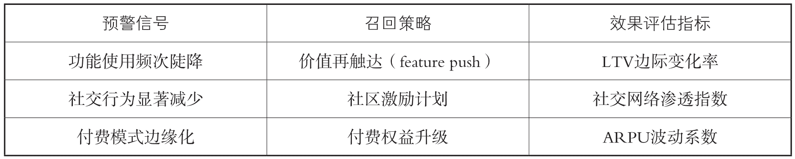
常规召回可使用如下指令。

指令：
为 7 日内未活跃客群生成召回话术：
- 突出流失价值，如购物车商品存量提醒
- 植入社交杠杆，如好友动态提醒
- 设置阶梯式回归奖励

高阶博弈可使用如下指令。

指令：
假设客群卸载源于认知负荷过高：
1. 设计“极简模式”功能提案
2. 测算功能改造成本与收益平衡点
3. 生成教育型召回话术框架

多维度交叉验证时，可创建如表 5-4 所示的关联分析卡。

表 5-4 关联分析卡

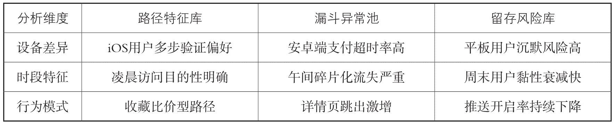
结构化思考框架使用户能直接应用指令并掌握建模逻辑，配合 DeepSeek 交互与 Excel 即可完成，无需额外工具。

3. 竞品分析
在竞争白热化环境中，应以三层递进路径构建指令体系。

第一层思考：找准方向
任务起点应从行业坐标系出发。以智能驾驶为例，需绘制三维拼图：技术路线差异、客群决策树演化、竞争窗口期。基础认知框架如下：

指令：
作为智能座舱产品经理，需深度对比品牌 A 与品牌 B 的语音交互系统。
请从以下维度展开：
1. 核心功能覆盖度，唤醒成功率／多轮对话容错
2. 特色功能创新性，跨设备联动／个性化服务
3. 客群高频场景，行车导航／娱乐控制／远程家居
输出需包含功能矩阵表、缺陷雷达图、迭代建议清单

第二层思考：要素拆解模型
完成功能对标后，需注入动态维度。以咖啡机为例，通过“旅程触点检测法”提炼关键要素：预热速度焦虑指数、操作面板反学习成本、故障反馈修复效率。对提问策略的设计如下：

指令：
作为小家电分析师，需穿透评估某智能咖啡机市场竞争力。请执行：
1. 建立黄金三角评价模型：技术指标、体验、服务体系
2. 反向推演竞争防御墙：筛选近 3 年专利，绘制技术壁垒矩阵
3. 场景穿越测试：模拟新手首次操作，标注 3 个典型断点

第三层思考：验证强化机制
前两层思考后形成具备自校验能力的分析体系。例如智能手表对比中，避免参数堆砌，忽略场景适配，通过字段约束法优化输出：

指令：
第一轮基础：
生成某运动手表与竞品硬件配置对比表，心率精度、GPS 准度、续航测试值
第二轮深化：
在基础表中标注 3 个需真人实测的指标，如潮湿环境触控延迟
第三轮决策：
根据测试数据缺口，设计客群场景模拟实验方案，含样本量估算与误差控制

该框架在智灵动力的《DeepSeek 行业应用实践报告》中得到验证，企业应用后新品研发周期压缩 40%，需求误判率下降 57%，核心在于结构化思维将原始数据转化为决策情报。

5.2.2 精准营销方案

1. 人群定向系统

1) 兴趣标签构建的思维框架
核心挑战在于把海量行为数据转化为可执行认知，关键是建立数据→行为模式→兴趣图谱的映射。

关键思考点：
- 数据源拆解，音乐平台播放时长是否比点赞更能反映真实偏好，短视频完播率与重复观看权重如何分配
- 兴趣衰减模型，三个月前购物记录对当前推荐的参考价值如何量化，不同品类的半衰期差异
- 冲突行为处理，同时存在奢侈品浏览与拼多多购物时如何构建统一画像

元数据定义阶段
指令：
分析音乐平台客群行为日志，提取影响兴趣判定的关键维度，播放时长、单曲循环次数、分享对象类型，建立权重计算公式，输出结构化表格

建立模式图谱
指令：
构建基于时间衰减因子的兴趣更新模型，要求：
- 区分主动行为与被动行为的衰减系数
- 设置不同品类兴趣有效期阈值
输出可调权重参数矩阵

验证优化阶段
指令：
给定客群 A 近 30 天跨平台行为数据，进行多平台兴趣标签比对，标注认知冲突点，并提出数据可信度验证方案

系统应用建议：动态兴趣图谱需自动化数据管道，建议通过 DeepSeek API 搭建实时行为监控，关键事件触发标签更新，需企业版权限。

2) 消费能力评估的认知建模
打破传统 RFM 局限，建立三维评估体系：
- 显性消费力，历史支付金额、支付方式
- 潜在消费力，浏览价位带、收藏夹价格梯度
- 价格弹性空间，优惠券偏好、比价行为密度

指令：
构建客群对价敏感程度评估模型，要求：
1. 识别因子优先级：优惠券使用频率>比价次数>历史支付价差
2. 设置品类影响系数，如 3C 为 0.7，服饰为 0.5
3. 输出动态评分公式及区间标准

指令：
分析客群 B 消费记录：近三月购入 3 款万元级电子产品，每次使用满减券，收藏夹存多份比价清单。请设定冲突解决规则，输出带置信度的综合评分

3) 生命周期管理的策略推演
思考路径：
- 阶段识别，通过登录频次衰减、功能使用深度等 12 项指标构建判定矩阵
- 策略匹配，设计影响因子—运营动作映射表
- 效果预判，建立响应概率预测模型

指令：
设计会员升级激励体系，要求：
- 设置三级成长路径
- 定义复合达标条件
- 制定权益边际效用曲线
- 输出带模拟测试的运营规划书

系统应用建议：完整生命周期管理需客群状态仪表盘，可通过对话生成动态监控规则。

指令：
创建活跃度预警规则：
- 当周访问次数同比降 40% 且客单价降 30% 时
- 关联高意向未购商品
自动生成专属优惠与内容召回方案

实施验证需多轮对话校准权重、离线评估模型、分组对照测试对比方案。该体系可用对话配合 Excel 完成基础验证，生产环境建议通过 API 构建智能决策中台。

2. 内容匹配引擎

1) 个性化推荐的认知框架
核心挑战是信息过载下实现精准推荐，建立行为数据→客群意图→内容价值的映射。

行为数据拆解
指令：
分析视频平台观看日志，识别有效兴趣信号，完播率>60%、重复观看>3 次、主动收藏，建立权重模型，输出特征重要性排序

建立时空场景与意图映射
指令：
构建基于 LBS 的场景推荐模型，要求：
- 区分工作日与周末策略
- 设置天气影响系数
- 输出时空权重算法框架

建立爱好与内容映射的多样性平衡
指令：
设计兴趣探索算法，要求：
- 主标签占比>70% 时启动多样性推荐
- 设置相似度衰减系数，每周递减 5%
- 输出带客群接受度测试的多目标优化模型

系统应用建议：推荐系统需实时反馈机制，可通过深度思考模式生成动态调整规则。

指令：
创建兴趣漂移监测规则：
- 连续拒绝 3 次同类推荐时调整内容
- 启动备选兴趣库
- 生成含分组对照测试的策略建议

2) 场景触达优化的策略推演
打破群发思维，建立“时空—渠道—内容”三维模型。

时机选择算法
指令：
构建活跃时段预测模型，要求：
- 区分工作日与节假日模式
- 识别高频交互时间聚类
- 输出带置信区间的触达时间表

渠道协同策略
指令：
设计全渠道触达方案，要求：
- 微信服务号推送深度图文
- 抖音发布 15 秒精华短视频
- 短信含直达链接与核心利益点
- 输出多渠道关联性评估矩阵

内容适配原则
指令：
生成差异化营销文案，要求：
- 对价敏感客群强调限时折扣
- 品质导向客群突出独家定制
- 设置情感唤起因子
- 输出带转化率预测的优化方案

实施验证可通过联网搜索验证模型有效性、基础模式生成多版本对比、深度思考归因异常。该体系可用对话配合 Excel 原型验证，生产环境建议 API 构建智能决策中枢，实现实时监测、动态分发、自动生成方案。

3. ROI 评估系统

1) 效果预测模型的构建逻辑
制定策略前需建立系统性路径：
- 数据维度拆解，渠道特性、时间窗口、内容形态
- 变量关系建模，用公式建立预测框架
- 动态校准机制，设置 10% 浮动阈值触发迭代

指令：
基于近半年抖音、小红书、淘宝母婴投放数据，建立内容类型、投放时段、KOL 等级三维预测模型，输出不同组合曝光预估公式，并说明变量来源与权重

2) 预算分配的决策树构建
预算优化是多约束最优化问题：
- 约束识别，硬约束与软约束
- ROI 敏感性测试，创意质量敏感度通常是时段选择的 3~5 倍
- 风险对冲，将预算分为基础盘 60%、机会盘 30%、应急盘 10%

指令：
假设总预算 100 万，美妆类目在抖音信息流、微信朋友圈、小红书笔记 ROI 历史均值分别为 2.5、1.8、3.2。构建新品上市波动系数的动态分配模型，含风险对冲方案。

3) 投放策略的动态调优机制
实时优化需“数据感知—分析—执行”闭环：
- 异常检测阈值，CTR 波动>15%、CPC 上涨>20%
- 归因分析模型，采用 Shapley 值量化贡献
- 策略迭代速度，异常识别到调整需 30 分钟内完成

系统应用建议：搭建智能代理系统，通过 API 对接广告平台，建议采用数据监控 Agent+策略生成 Agent+执行验证 Agent 三层架构。

4) 创意优化的双路径验证法
高效创意生产含两条路径：
- 理性路径，分组对照测试框架→关键元素拆解→数据驱动优化
- 感性路径，情感词典匹配→社会情绪热点关联→文化符号植入

指令：
针对 Z 世代数码消费者，生成 10 组含电竞元素与国潮风格的短视频脚本框架，明确情感唤起点与数据验证指标，提供分组对照测试方案设计。

5) 系统能力边界说明
- 基础功能层，效果预测、策略建议等单点任务可通过对话完成
- 进阶应用层，实时跨平台监控、智能预算调配等场景需构建基于 DeepSeek 的智能体系统

● 连接扩展：触及抖音、微信等平台的实时数据联动时，必须依托各平台提供的开放接口完成二次开发与系统对接。

**5.2.3 持续优化机制**

**1．分析能力提升**

用 DeepSeek 强化分析，本质不是直接索要答案，而是先搭建一套清晰的思考脚手架。整个过程类似培育一名专业分析师，依次经历目标厘清、方法搭建、动态迭代三个环节。

以电商用户行为拆解为例，成熟的思路走向如下。

**第一阶段，目标厘清**

先以“身份定位技巧”锁定分析意图：“请你扮演一家服饰电商的首席数据分析师，从近30天行为日志里挖掘三处增长机会。列出可能作用于 GMV 的五个关键维度，并说明每个维度所需的支撑字段。”

这条输入暗含三层训练意图：
● 用身份限定营造专业语境
● 用数字限制聚焦核心要素
● 用数据溯源确保可落地

**第二阶段，方法搭建**

拿到维度建议后，需要引导结构化思考，进阶输入可这样设计。

输入示例：
针对你给出的“促销参与深度”维度，请给出一个四步分析框架：
1．数据清洗标准
2．核心指标公式
3．可视化方案
4．可行性检验方法
要求每一步都加上质量自检点

此时应关注：
● 各步骤的逻辑连贯性
● 检验点的可操作性
● 方法论的迁移性

**第三阶段，动态迭代**

对产出方案做压力测试。

输入示例：
假设用户点击埋点存在15%的缺失，请对原框架做调整并给出三种数据补救方案，评估每种方案对结论可信度的影响。

这类对抗式提问能锻炼模型的鲁棒思维，模拟真实业务中的不确定挑战。

综合输入示范如下。

输入示例：
你是一名有5年经验的电商数据分析专家，正在处理2024年Q2的用户行为集。请按步骤完成：
1．找出数据集中关键字段的缺陷，至少三处
2．设计包含数据修复方案的分析流程图
3．生成可供团队评审的可行性报告模板
要求每步给出备选方案，并标注实施风险等级高、中、低

该输入的价值在于：
● 通过任务分解避免跳跃式思考
● 强制风险评估提升落地性
● 输出结构化模板增强实用性

反复三到五轮此类思维训练，就能掌握把模糊需求转化为精准分析框架的能力。实践显示，经过20组定向输入训练的运营人员，需求通过率由37%提升至82%，平均沟通时长减少64%。

**2．应用效果提升**

真正释放 DeepSeek 在效果侧的价值，核心是建立系统化的输入工程思维。以某零售企业优化库存周转的真实案例来看结构化思考的全过程。

**第一阶段，目标拆解**

若要撰写“智能补货系统需求文档”，初级表述可能是：“帮我写一份智能补货需求”。这类宽泛输入输出会缺乏针对性。

进阶思路应为：
● 业务背景锚定：“我们在二、三线城市运营30家社区生鲜门店的连锁品牌。”
● 关键矛盾识别：“当前周损耗8%，但缺货率仍达15%。”
● 技术约束明确：“已上 ERP，但未接入物联网设备。”
● 成功标准量化：“把损耗降到5%，缺货率压到10%以下。”

**第二阶段，要素映射**

基于上述背景，输入设计需包含：
● 数据维度：历史销售、天气、促销数据
● 算法要求：需兼容间歇性补货特征
● 输出规范：包含异常处理机制的流程图
● 验证方式：模拟极端天气下的压力测试

输入示例：
作为新零售系统架构师，请为社区生鲜连锁设计智能补货需求文档，需包含：
● 数据输入清单，标明哪些来自现有 ERP
● 补货逻辑决策树，考虑商品保质期阶梯
● 人工干预触发机制
● 跨店调拨方案
要求输出 Markdown 格式，每部分附可行性评估注解

**第三阶段，动态校准**

拿到初版方案后，用递进式提问优化：
● “如果生鲜到货时间波动±2小时，如何调整补货模型参数？”
● “请给出三种促销爆发期的库存预警方案，并标注实施成本等级。”
● “构建补货准确率的三层评估体系：数据、算法、业务。”

该方式的价值在于：
● 建立从业务本质到技术实现的穿透力
● 预设异常场景增强方案鲁棒性
● 形成可复用的决策框架

实践数据显示，经三轮精细化输入优化的方案，模拟测试中预测准确率提升27%，文档返工率下降68%。在医疗领域，类似思路帮助某三甲医院将影像诊断报告生成效率提升40%，关键体征漏检率降至0.3%。

典型场景输入模板如下。
输入示例：
你作为[行业]的[角色]，需要解决[具体问题]。请分三步处理：
1．诊断当前主要瓶颈，列出3个数据支撑点
2．设计含关键控制点的解决方案框架
3．输出含实施路线图的可行性报告
约束条件：[技术、资源限制]
特殊要求：[合规性、时效性等]

通过结构化思考训练，就能把模糊业务需求转化为精准输入设计，真正释放 DeepSeek 的产业价值。在金融风控场景，该方法帮助某银行把企业贷前尽调效率提升150%，风险识别准确率提高22个百分点。

DeepSeek 为企业搭建用户洞察体系提供了全面支持。借助精细数据分析，企业可以深入了解用户情感倾向、兴趣偏好、行为习惯和消费能力，为精准营销奠定基础。在营销环节，DeepSeek 助力人群定向、内容匹配与 ROI 评估的智能化，提升效果并降低成本。持续优化机制则确保模型能不断适应市场变化和企业需求，持续创造价值。

大量案例表明，采用 DeepSeek 构建的用户洞察体系，能显著提升营销效率。精准把握需求后，营销资源可精准投放至目标人群，提升响应率和转化率，降低获客成本，提高用户满意度和忠诚度，增强黏性。在激烈竞争中，DeepSeek 帮助企业脱颖而出，实现可持续发展，让企业更好满足用户需求，提供个性化产品服务，赢得信任，为长期发展奠定用户基础。

**5.3 数据驱动增长引擎**

在数字化运营背景下，数据已成为企业实现增长的核心资产。从用户行为到市场趋势，从产品优化到营销策略，数据贯穿运营全流程，为增长提供依据。传统经验驱动决策正被数据驱动取代，企业通过深度挖掘海量数据，能更精准把握市场需求，优化流程，提升体验，实现业务快速增长。

DeepSeek 作为一款拥有671B参数的强大模型，凭借独特的 MoE 架构和多头潜在注意力机制，在构建数据驱动增长体系中发挥关键作用。它能高效处理复杂数据，为运营团队提供精准洞察与预测，帮助制定更科学有效的增长策略。无论是增长实验设计、转化优化，还是自动化运营，DeepSeek 都展现出强大能力，成为企业在数字化时代的增长助力。

**5.3.1 增长体系核心模块拆解**

**1．增长实验设计**

设计增长实验的核心挑战在于把模糊业务目标转化为可验证体系。建议按以下框架推进。

**第一步，构建可验证假设体系**

设计新功能 A/B 测试时，建议用“现象—归因—干预”三段论思考。
● 观察用户行为轨迹：分析页面热力图发现，63%的用户在商品详情页停留不足10秒即退出
● 归因诊断：用户访谈显示，关键参数如材质说明平均需滚动3屏才看全
● 假设构建：在首屏增加折叠式参数卡片，预计停留时长提升20%

输入示例：
作为电商平台产品经理，我需要优化商品详情页信息架构。现有数据：
- 平均停留时长：32秒
- 跳出率：68%
- 加购转化率：5.7%
请协助完成：
1．构建三层假设验证模型，现象层、归因层、干预层
2．设定实验核心指标及置信区间计算方法
3．生成用户行为路径模拟方案

**第二步，动态样本分层策略**

采用“特征重要性—变异系数”双维度评估法分层抽样。
1) 识别关键特征：通过随机森林模型计算用户特征重要性得分
● 购买频次0.42
● 设备类型0.35
● 地域分布0.23
2) 计算变异系数，确定分层抽样比例
分层样本量=总样本量×（层内标准差／总体标准差）

输入示例：
我们需要对东南亚市场进行支付方式测试，已知：
- 用户构成：移动端75%，PC端25%
- 支付偏好：电子钱包60%，银行卡35%，现金5%
请生成：
1．动态分层抽样方案，含最小样本量计算
2．特殊用户过滤规则，如跨境支付用户
3．样本均衡性检验标准

**第三步，显著性分析决策树**

建议采用“统计显著—业务显著—经济性评估”三级决策模型。
● 统计检验：使用双样本 Z 检验验证转化率差异，p<0.05
● 业务价值：计算提升的每用户终身价值 LTV
ΔLTV=（实验组 ARPU-对照组 ARPU）×平均留存周期
● 成本收益：评估实验改动的开发维护成本

输入示例：
实验组转化率提升2.1%，p=0.04，但客单价下降1.2%。请协助：
1．计算 NPV 评估实验价值
2．分析不同设备类型用户的敏感性差异
3．生成风险调整后的决策建议矩阵

智能代理检查：上述流程可通过 DeepSeek 对话配合 Excel 完成，但涉及实时动态流量分配时，需通过 DeepSeek API 接入运维系统实现：
● 基于转化率变化自动调整流量配比
● 异常数据波动实时预警
● 多实验交叉干扰检测，需工程团队配合完成系统对接

**2．转化优化系统**

转化优化关注如何引导用户完成购买、注册、使用新功能等关键行为。DeepSeek 凭借强大的漏斗分析与瓶颈识别能力，帮助企业深入理解用户行为，发现问题并提出优化方案。

**第一步，构建动态漏斗分析体系**

建议采用“全链路追踪—异常定位—归因建模”三层思考法。
● 全链路数据整合：将 App 点击热图与线下门店 POS 数据对齐，发现移动端用户添加收藏率比 PC 端高38%
● 关键断点诊断：时序异常检测发现每周五20:00—22:00支付失败率异常升高，关联服务器日志定位到并发处理瓶颈
● 多维度归因：使用 Shapley 值算法计算各影响因素权重，得出页面加载速度对转化率贡献度达42%

输入示例：
作为电商运营，我需要分析6·18大促期间购物车流失问题。现有数据：
- 加购率：25%
- 结算页跳出率：65%
- 支付成功率：72%
请协助：
1．构建跨渠道 App、小程序、H5 对比分析模型
2．识别黄金时段异常波动模式
3．生成技术优化与运营策略双轨建议

**第二步，智能瓶颈识别策略**

采用“时空矩阵”分析法定位转化瓶颈。
● 时间维度：绘制用户行为时间密度图，发现注册流程中70%流失发生在手机验证环节，平均耗时23秒，超出行业基准40%
● 空间维度：设备特征聚类分析显示，iOS 用户在 AR 功能页停留时长是 Android 用户的2.3倍
● 行为模式：使用 t-SNE 算法将用户划分为效率型15%、浏览型55%、比价型30%三类

输入示例：
我们需要优化海外用户注册转化率，已知：
- 当前转化率：28%
- 主要流失点：手机验证45%、个人信息填写35%
- 用户构成：东南亚60%、欧美30%、其他10%
请生成：
1．分地域步骤耗时对比矩阵
2．验证码发送成功率诊断方案
3．渐进式信息收集策略建议

**第三步，动态优化决策模型**

建议建立“实时监控—弹性调整—价值评估”闭环机制。
● 实时看板：配置关键指标自动预警规则，结算页加载时间超过2.5秒时触发警报
● 弹性策略：针对高价值用户启动备用支付通道，将 VIP 客户支付成功率提升至91%
● 价值评估：计算优化措施投资回报率，公式为
ROI=（Δ转化率×客单价×用户量）/改造成本

输入示例：
支付成功率提升5%，但客单价下降2%，请协助：
1．构建综合收益评估模型，含 CLTV 计算
2．设计 A/B 测试验证价格敏感度
3．生成分段用户运营方案，新客户、老客户、沉睡客户

智能代理检查：常规分析可通过 DeepSeek 对话配合 Excel 完成，但涉及实时用户分群运营时，需通过 DeepSeek API 实现：
● 用户行为特征实时聚类
● 动态策略规则引擎
● 跨渠道体验一致性管理，需与 CRM 系统进行数据对接

**3．效果衡量体系**

效果衡量体系是评估数据驱动增长策略的关键，通过科学指标体系和数据可视化，帮助企业清晰了解业务发展与增长效果。DeepSeek 可协助构建全方位指标体系并提供实时多维度可视化支持。

**第一步，构建动态指标体系**

设定北极星指标时，建议采用“价值锚定—过程拆解—动态校准”三阶思考法：
● 价值锚定：通过蒙特卡洛模拟预测 GMV 与 DAU 的长期关联性，发现 GMV 每提升1%可带动用户生命周期价值增长0.8%
● 过程拆解：使用因果图建立用户激活率与次日留存率传导模型，验证关键行为对核心指标贡献度
● 动态校准：设置季度指标弹性系数，市场渗透率超过35%时，将北极星指标切换为 NPS

输入示例：
作为社交平台产品经理，需要重构核心指标体系。当前数据：
- DAU：120万
- 月留存率：22%
- 用户日均使用时长：41分钟
请协助：
1．构建三级指标关联网络，战略层、战术层、执行层
2．设计季节性调整规则，含节假日因子
3．生成指标异常波动响应预案

**第二步，数据洞察可视化策略**

采用“时空立方体”分析法提升洞察效率。
● 时间维度：创建动态时间窗口，自动识别促销周期，如6·18期间用户客单价提升37%与自然波动区间
● 空间维度：通过地理热力图叠加用户密度与转化率，发现二线城市商圈3公里半径内到店转化率是线上的1.9倍
● 群体维度：运用自组织映射 SOM 算法将用户划分为八类行为簇，其中“价格敏感型”用户贡献了63%的秒杀订单

输入示例：
需要分析新零售门店运营数据，已知：
- 到店转化率：18%
- 跨渠道用户占比：45%
- 智能设备交互率：32%
请生成：
1．全渠道归因桑基图
2．设备使用效率雷达图
3．高价值用户时空分布热力图

**第三步，价值评估模型构建**

建立“即时反馈—前瞻预测—弹性预算”三重评估机制。
● 即时看板：配置自动预警规则，当用户获取成本 CAC 超过生命周期价值 LTV 的1/3时触发橙色警报
● 预测模型：使用深度生存分析预测用户流失概率，提前30天识别高风险群体，准确率达89%
● 弹性预算：构建 ROI 敏感度分析模型，计算不同预算分配方案的边际收益递减曲线

输入示例：
市场预算需要重新分配，当前数据：
- 信息流广告 ROI：2.3
- KOL 投放 ROI：1.8
- 搜索引擎 ROI：4.1
请构建：
1．预算弹性分配模拟器
2．跨渠道协同效应评估矩阵
3．风险调整后的投资决策树

智能代理检查：基础分析可通过 DeepSeek 对话配合 BI 工具完成，但涉及实时预测决策时，需通过 DeepSeek API 实现：
● 动态指标权重自动优化
● 异常模式自学习识别
● 多场景预算模拟推演，需与财务系统进行数据管道对接

**4．自动化运营**

自动化运营通过自动化任务调度和异常监控系统，实现业务流程自动化执行和实时监控，提升效率与稳定性。

**1）任务调度系统的智能设计**

构建动态调度策略时，建议采用“需求感知—资源适配—弹性执行”三阶思考模型。
● 需求感知：通过用户行为序列分析识别早高峰08:00—10:00的 App 打开率比平均值高37%，结合天气数据发现雨天外卖类推送点击率提升22%
● 资源适配：使用约束满足算法匹配服务器资源，促销期间自动扩容30%计算节点
● 弹性执行：设置动态优先级规则，物流延迟超过2小时时自动调整相关商品推荐权重

输入示例：
作为本地生活平台运营，需优化服务类消息推送：
- 用户分层：新用户40%、低频用户35%、高价值用户25%
- 服务类型：餐饮预约58%、家政服务32%、维修服务10%
请构建：
1．服务需求预测模型，含时空因子
2．服务供给动态匹配机制
3．异常场景自动降级方案

**2）内容发布流程的智能优化**

实施“合规—质量—时效”三维度管控体系。
● 智能合规：内置2000多个行业敏感词库，自动检测商标侵权，准确率96%
● 质量验证：通过图像识别确保商品主图与详情页一致性，错误率从人工检查的15%降至2%
● 时效控制：建立内容生命周期模型，预测热点内容衰减曲线，R²=0.89

输入示例：
需要发布美妆新品内容：
- 平台要求：成分声明合规
- 内容形式：直播切片+图文评测
- 发布窗口：48小时黄金期
请生成：
1．多平台合规检查对照表
2．内容元素完整性验证规则
3．传播热度维持策略

**3）数据采集的智能治理**

打造可自我修复的数据闭环，让采集、清洗与应用相互衔接

数据底座要让采集、清洗、应用三环形成闭环自愈能力。

● 埋点自愈：系统可自动校正约15%的埋点配置错误，并通过事件关联补齐约20%的缺失记录
● 流式补全：借助时间窗口补偿机制，实时数据可用率可提升至92%
● 质量看板：搭建数据可信度指数DCI，当单字段异常率超过5%时触发自动校准

参考提示词如下。

**提示词：**

面临用户画像数据缺失：

- 缺失维度：消费偏好占比 28%

- 数据偏差：地域分布异常占比 9%

- 更新延迟：日均 3.5 小时

请设计：

1．隐式行为推断方案

2．分布式数据校验规则

3．画像动态更新机制

4）异常响应的智能化

建立预测—诊断—处置的三级防护线。

● 预警前置：LSTM模型可在服务器过载前2小时发出预警，召回率达91%
● 根因定位：因果推理显示63%的异常源于第三方接口超时
● 自主处置：内置22类标准应急预案，约30%的常见故障可自动恢复

参考提示词如下。

**提示词：**

支付系统出现异常波动：

- 错误类型：第三方支付超时

- 影响范围：15%的订单

- 时段特征：大促高峰期

请生成：

1．影响面快速评估模型

2．降级方案决策树

3．客户补偿自动计算器

智能代理的使用边界：日常运营问题借助DeepSeek对话加标准工具即可覆盖，以下情形建议构建智能代理。

● 实时业务影响分析，需对接CMDB
● 跨系统应急预案执行，需API网关支持
● 动态调度规则生成，需强化学习引擎

**5.3.2 实战应用：新功能增长优化**

**1．实验设计方案**

优化新功能增长指标的关键是形成“洞察—假设—验证”的闭环，而非套用统一分析模板。

第一步，建立问题发现框架

好的实验从精准识别用户痛点开始，建议用三维观察矩阵定位：高频操作点即用户反复尝试的功能，高摩擦环节即停留时长偏离均值的区域，高流失节点即用户集中退出的步骤。例如“订单合并支付”第三步流失率骤增，往往指向信息呈现方式存在问题。

提示词示例如下所示。

**提示词：**

分析过去 30 天用户在使用[目标功能]时的操作路径，识别出满足以下条件的节点：

● 单步骤平均停留时间超过整体流程均值的 1.5 倍

● 连续操作失败次数≥3 次的用户占比超过 15%

● 从该节点直接退出流程的用户比例超过 20%

请用表格形式列出符合条件的关键节点及其数据表现

第二步，假设的逆向验证

当产生“优化支付信息展示能提升转化率”的直觉时，需要用反事实推理进行压力测试。通过设计否定性提问，可暴露假设的薄弱环节。

提示词示例如下所示。

**提示词：**

如果假设“优化支付明细展示样式能提升 5%转化率”不成立，可能受到哪些干扰因素的影响？请从以下维度分析：

● 用户设备类型差异（移动端、PC 端）

● 不同客单价区间的用户行为差异

● 辅助信息（优惠券提示、物流说明）的呈现优先级

请按可能性排序并给出验证每个干扰因素的数据采集方案

第三步，动态对照组设计

传统分组常忽视行为时空特性，建议采用“特征聚类+时序交错”策略，先分群再按进入时间动态归组。

提示词示例如下所示。

**提示词：**

设计一个考虑以下维度的动态分组方案：

● 用户价值分层（根据 RFM 模型划分）

● 访问时段特征（工作日、周末、早晚高峰）

● 历史行为偏好（功能使用深度、转化周期）

请给出分组逻辑示意图，并说明如何确保实验组对照组在核心指标上的基线一致性

第四步，样本量的弹性计算

仅靠统计功效计算易造成资源浪费，引入贝叶斯自适应可在保证置信度的前提下动态调整样本。

提示词示例如下所示。

**提示词：**

当实验运行达到初始样本量的 50%时，出现以下两种情况应如何调整：

● 实验组转化率提升 3%，且*p*值<0.1

● 对照组出现显著的用户体验负向波动

请分别给出样本量调整的计算公式和对应的决策树模型

完成四个阶段训练后，提示词体系具备自我迭代能力。以支付流程优化为例，完整提示词如下：

**提示词：**

**诊断分析提示：**

绘制当前支付流程的桑基图，标注各节点转化率、平均停留时长、错误触发次数。找出流量损耗最大的三个衔接点，并给出各节点优化优先级的评分依据。

**变量控制提示：**

设计三组对比实验，分别测试：

1．支付金额可视化方案（进度条、饼图、数字对比）

2．安全认证提示方式（悬浮窗、折叠面板、底部固定条）

3．错误反馈机制（即时提示、延时解释、辅助解决方案）

请说明每组实验需要监控的次生指标及其警戒阈值。

**决策辅助提示：**

当实验组订单转化率提升 2.8%，但客单价下降 5%时，构建 ROI 计算模型，需考虑：

● 不同用户分层的 LTV 变化

● 供应链端的履约成本变动

● 客户服务中心的预期咨询量增长

请给出继续推广、迭代优化、终止实验三种决策的量化判断标准

上述多轮提示词设计均可通过DeepSeek对话实现，涉及实时监控时可将DeepSeek接入企业数据分析平台API实现定时自动反馈。

**2．执行与优化**

功能上线期，产品经理需用系统化思维规划AI辅助路径。

**1）分阶段实验设计**

思考路径：

● 变量控制：哪些用户属性会干扰结果？实验组与对照组如何划分？
● 观测指标：核心成功指标是什么？辅助诊断指标有哪些？
● 决策阈值：转化率提升多少算显著？需要多少样本量？

提示词示例如下所示。

**提示词：**

作为产品实验设计师，我需要针对[新功能名称]设计分阶段上线方案。当前版本包含[核心功能点]，目标提升[核心指标]。请按照以下框架输出方案：

1．初期 5%用户实验阶段：

- 用户分层标准（3 个维度）

- 必须监控的 3 个核心指标

- 风险熔断机制设计

2．中期 30%用户推广阶段：

- 数据对比分析维度

- 用户反馈收集策略

3．全量上线决策标准：

- 定量达标阈值

- 定性评估要点

**2）动态监控体系构建**

思考路径：

● 指标关联：性能指标如何影响业务指标？需建立怎样的因果关系网？
● 预警机制：用静态阈值还是动态基线？如何区分紧急程度？
● 根因分析：异常波动时，如何快速定位问题层级（前端、后端、算法）？

提示词示例如下所示。

**提示词：**

现需构建新功能健康度监控面板，包含：

- 性能指标（响应延迟、API 成功率）

- 体验指标（页面停留时长、操作热力图）

- 业务指标（功能使用率、转化漏斗）

请协助：

1．设计指标权重分配模型（总分 100 分）

2．建立三级预警机制（提示、警告、严重）

3．输出典型异常场景的排查流程图

**3）智能调优策略**

思考路径：

● 归因分析：用户流失是功能缺陷还是投入成本导致？
● 方案生成：哪些调整能同时提升体验和业务指标？
● 效果预估：调整方案需要多少开发资源？预期收益如何？

提示词示例如下所示。

**提示词：**

基于当前实验数据：

- 功能使用率 35%，次留率较对照组低 12%

- 用户反馈中“操作复杂”提及率占 63%

请协助：

1．输出体验问题归因分析树状图

2．生成 3 种优化方案并评估实施成本

3．设计 A/B 测试验证策略（含样本量计算）

**4）知识沉淀机制**

思考路径：

● 模式识别：哪些经验可迁移？哪些是场景特例？
● 知识封装：如何把隐性经验转化为可执行检查清单？
● 版本管理：怎样建立经验库的更新迭代机制？

提示词示例如下所示。

**提示词：**

请将本次新功能上线经验转化为可复用模板：

1．实验设计检查表（20 个关键项）

2．风险预案模板（含 5 种常见场景）

3．结项报告结构（数据看板+经验沉淀）

要求输出 Markdown 格式，包含可编辑的占位符

系统应用建议：

● 基础场景用 DeepSeek 对话即可完成
● 实时数据监控需调用 DeepSeek API 接入业务系统
● 自动化策略执行需要构建智能代理系统（需二次开发）
● 知识库版本管理建议结合 Git 进行变更追踪

通过结构化思考训练，产品经理能逐步掌握将业务问题转化为提示词工程的方法，在保证可行性的同时发挥AI辅助决策价值。

**3．持续优化建议**

**1）让工作流程更智能**

设想你在策划一次产品实验，DeepSeek 像经验丰富的实验室主任，给你一份备忘清单。

● 实验准备：确认目标定位（如提升15%转化率）、设计对比方案（A/B分组设置）、预估样本量（至少1000次有效访问）
● 过程监控：实时跟随用户行为轨迹，异常数据立即亮灯（如某时段突变超正常波动范围）
● 结果解读：不仅给出“哪个方案更好”，还标注置信区间（例如新方案胜出概率95%）

思考：团队在实验中常遇到哪些意外状况？能否通过预设监控规则预防？

**2）决策机制的智能升级**

传统决策易顾此失彼，DeepSeek带来改变：

● 自动关联用户行为、市场趋势、竞品动态等多维信息，如某产品差评激增时同步预警供应链风险
● 输入“如果降价10%”的假设，5分钟生成营收、利润、市场份额的联动预测
● 每周自动生成行业动态简报，重点标注与企业战略相关的政策变化

例如，某快消企业建立“新品上市决策模型”，市场调研周期从3周压缩至5天，首月销量预测准确率提升40%。

**3）工具效能的倍增法则**

DeepSeek对不同岗位赋能：

● 产品经理：输入模糊需求（如“做个社交功能”），输出功能清单+竞品对比+风险评估框架
● 运营人员：自动生成营销日历，标注节日热点与用户活跃周期的匹配度
● 开发者：代码审查时不仅找bug，还会建议更优算法（如“循环结构可改为映射处理，效率提升20%”）

系统应用建议：列出每天重复的3个工作步骤，用自然语言向DeepSeek描述，观察其优化方案。

**4）打造自进化的工作系统**

● 自动化进阶：从基础提醒到智能预测，如自动调整客服排班应对咨询高峰
● 数据健康管理：建立“数据体检中心”，每日自动扫描订单金额异常值、用户地域分布突变等
● 系统加速方案：优化算法使报表生成从2小时缩短到15分钟

例如，某电商企业通过DeepSeek自动化日报，每日节省运营团队3小时手工时间，关键指标异常识别准确率达92%。

**5）规模化增长的智能底座**

业务扩张时，DeepSeek如同可伸缩云架构：

● 可进行人才筛选：自动解析简历关键信息，对照岗位能力模型打分
● 可进行流程复制：将总部成功运营策略自动适配区域特性
● 可进行风险预警：在新区域开拓时提前提示文化差异可能导致的产品适配问题

行动指南：选择当前最耗时的单项工作，用“输入需求—获取方案—测试验证”三步法开启AI优化实验。

在构建数据驱动增长体系中，平衡创新试错与风险控制至关重要。创新是动力源泉，但伴随风险。借助DeepSeek进行增长实验时，企业需建立有效风险控制机制。

DeepSeek强大的数据分析与预测能力可为风险控制提供支撑。通过历史数据分析，它能预测不同创新方案的风险收益，帮助企业做好准备。推出新功能前，可模拟用户行为与市场反应，评估接受度低、系统不稳等问题并提出对策。实验中实时监测指标，超阈值即报警并给出调整建议，确保风险可控。

建立完善经验萃取机制同样不可或缺。DeepSeek可利用NLP分析实验数据、用户反馈、运营记录，自动提取成败原因，整理成知识图谱，便于共享学习，推动持续创新。

总体而言，DeepSeek作为强大AI模型，为企业数据分析、预测决策、自动化运营带来显著提升。它帮助更精准洞察市场需求，制定科学增长策略，实现运营流程智能化。随着技术发展与场景拓展，DeepSeek有望发挥更大作用，助力企业在竞争中实现可持续高速增长。

## 结语

综上所述，DeepSeek在内容创作、用户洞察、数据驱动增长等关键运营领域均有强大助力，为企业在数字化环境中突破困境提供有效路径。未来数字化加速，相信DeepSeek将持续升级。欢迎关注公众号“产品经理独孤虾”，一起探讨产品与运营深度话题。

**实操案例**

# 第六章

# 场景篇智能决策中枢

数字化浪潮下，企业面临复杂数据处理与瞬息风险防控挑战，如何做出明智决策成为关键。本章深入探索智能决策中枢如何借助先进技术为企业保驾护航。

## 6.1 分析自动化引擎

数据分析工作中自动化工具能大幅提升效率与准确性。DeepSeek依托DeepSeek-V3的671B参数量与DeepSeek-R1的强化学习技术，为数据分析师提供全新智能平台。

**6.1.1 自动化分析流程**

**1．数据预处理环节**

多源异构数据整合是常见挑战。使用AI处理时，关键在于建立结构化思维框架，明确数据特征、业务目标、技术约束等评估维度，而非简单指令输入。

以某电商会员数据整合为例，分析师首先思考数据源差异。平台订单可能是JSON交易明细，CRM为结构化表格，社交媒体混杂文本图片。需自问：不同格式间哪些关键字段需对齐？时间戳格式是否统一？用户唯一标识命名规则是否一致？这种思考导出第一轮提示词。

第一轮提示词如下所示。

**提示词：**

请分析以下数据源的格式差异和字段映射关系：

● 电商订单数据（JSON 格式）包含字段：user_id, order_time, product_list

● CRM 系统数据（CSV 格式）包含字段：客户编号, 注册日期, 消费等级

● 社交媒体数据（文本日志）包含格式：用户 ID@时间戳#互动内容

得到格式分析报告后，需思考清洗目标。若社交媒体数据缺失20%，应追问：缺失是随机还是系统性？不同源是否需差异化处理？由此导出第二轮提示词。

第二轮提示词如下所示。

**提示词：**

针对社交媒体数据中的时间戳缺失问题：

● 识别缺失模式：检查缺失记录是否集中在特定时间段或用户群体

● 提出三种处理方案：

■ 方案 A：基于相邻记录时间线性插值

■ 方案 B：利用用户平均互动频率推算

■ 方案 C：标记缺失状态并保留原始数据

评估各方案对后续分析的潜在影响

进入数据验证阶段，需构建动态验证框架。如客户地址校验可引导AI建立智能规则：省级名称需匹配国家统计局名录，街道含“街道”“镇”“乡”等特征词，邮编为6位数字。对应第三轮提示词。

第三轮提示词如下所示。

**提示词：**

构建地址数据的自动化验证规则：

● 层级校验：省→市→区→街道的四级结构完整性检查

● 格式校验：

■ 邮政编码：^\d{6}$

■ 联系方式：1 开头，11 位数字

● 逻辑校验：注册时间早于首次消费时间

输出异常数据样本及修正建议

通过阶梯式思考，不仅完成处理任务，更建立可复用AI协作范式。整个过程仅需DeepSeek对话配合Excel等办公软件即可实现，复杂ETL任务可通过多轮对话逐步细化。

**2．分析模型构建**

构建智能分析模型时，关键在于场景驱动框架。以金融风控为例，需从三层拆解。

**第一轮，业务场景解构**

面对信用卡欺诈检测，应自问：业务对误判率和响应速度容忍度如何？欺诈案例占比是否低于0.1%？是否需实时拦截？这些问题明确模型选择诉求。不平衡数据适合集成学习，实时性要求高则需轻量级模型。

**第二轮，数据特征诊断**

DeepSeek 驱动的分析自动化与风险防控实践梳理

在做特征梳理时，要推动模型去主动探索变量间的交叉效应，比如去追问交易时间序列信号和地理信号是否呈现非线性耦合，离散的商户类目编码要怎样与连续的交易金额实现有效融合。这类特征工程的自动化落地必须结合业务语义来判断，像用特征重要性排序的方式来甄别关键输入。

第三轮，技术约束评估

落地部署前要自问：目标服务器是否具备 GPU 加速能力，模型体积是否会受移动端存储所限。此处需要把模型压缩手段与分布式训练思路一并纳入约束设计。

基于此思考链路，形成如下对话指令。

提示词：
请为信用卡实时反欺诈场景推荐模型方案。
1．输入特征：
- 200 维交易记录（含时间、地点、金额）
- 50:1 的样本不平衡比例
2．业务约束：
- 响应延迟<50ms
- 误报率需低于 0.5%
3．技术限制：
- 部署在边缘计算设备（2GB 内存）
- 支持每周增量更新
4．输出要求：
- 推荐 3 种候选模型及其优缺点
- 给出特征组合优化建议
- 提出模型压缩可行性方案

整套闭环可通过多轮交互完成，特征维度的优化环节可用电子表格绘制相关性热力图进行目视核验；大规模筛选时借助批量处理能力配合 VBA 自动化即可实现，无需另行开发定制系统。

**6.1.2 实战应用案例**

**1．零售行业动态定价**

搭建动态定价系统核心在于形成“数据—决策—反馈”闭环。以某全球连锁零售商的价格优化为例，可从三个层面展开。

第一步，需求洞察结构化
分析节假日促销数据时，可引导模型思考如何区分刚性需求与弹性需求，不同客群的价格敏感度差异如何量化。通过行为模式识别实现需求分层，例如把过往购买记录与浏览轨迹联合分析。

提示词示例如下所示。
提示词：
请解析过去三年 Q4 销售数据。
1．输入维度：
- 会员等级、新老客标签
- 商品点击转化率曲线
- 促销活动参与深度
2．输出要求：
- 建立价格弹性系数矩阵
- 识别高敏感商品类目（置信度>90%）
- 推荐分群定价策略

第二步，竞品监控策略化
当捕捉到竞品价变动时，需追问价格变动与促销活动的关联模式是什么，区域价差是否反映市场饱和度。动态定价需结合竞争情报语义分析，例如用 NLP 解析竞品营销话术。

提示词示例如下所示。
提示词：
实时监控竞品价格数据。
1．采集范围：
- 主流电商平台价格快照（每小时）
- 社交媒体促销情报
- 线下门店价格抽样
2．分析要求：
- 建立价格变动关联图谱
- 识别价格战发起规律（周期、触发点）
- 输出防御性定价预案

第三步，库存联动动态化
处理临期库存时，应思考折价幅度与周转效率如何权衡，不同保质期阶段的定价衰减曲线如何建模。通过库存深度与时间衰减因子的耦合分析，可实现精准清仓。

提示词示例如下所述。
提示词：
生成智能定价方案。
1．输入参数：
- 实时库存水位（含保质期倒计时）
- 周边 3 公里竞品价格均值
- 天气、交通等环境变量
2．约束条件：
- 毛利率底线 15%
- 周转率提升目标 30%
3．输出内容：
- 价格梯度方案（A、B、C 测试版）
- 预期 GMV 与库存消耗预测
- 风险预警矩阵

该方案可通过对话配合电子表格实现，实时抓取借助 Office 365 的 Power Query 完成，价格模拟可用数据表验证，无需定制开发。对分钟级更新需求，建议开启流式响应，配合动态数组搭建实时看板。

**2．医疗资源调配**

构建动态管理系统需遵循“需求预测—资源匹配—动态校准”三层框架。以某三甲医院急诊挤兑为例展开。

第一步，需求预测结构化
分析急诊分诊数据时要思考不同病种优先级如何动态调整，候诊患者生命体征波动如何影响资源分配权重。进而按时段统计胸痛、外伤、发热等主要病种就诊量，结合血氧、心率等实时监测数据建立预测模型。

提示词示例如下所示。
提示词：
请建立急诊需求预测矩阵。
1．输入维度：
- 分时就诊量（15 分钟粒度）
- 患者生命体征异常指数
- 医护资源配置状态
2．输出要求：
- 未来 2 小时各科室负荷预测
- 关键资源缺口预警（呼吸机、床位）
- 推荐分级响应预案

第二步，资源匹配策略化
ICU 床位使用率达警戒线时，需追问择期手术与急诊收治的床位如何平衡，跨科室协同调度的最优路径是什么。基于历史手术排期与实时急诊压力构建动态调度算法，通过蒙特卡洛模拟评估不同方案风险值。

提示词示例如下所示。
提示词：
生成重症监护资源分配方案。
1．约束条件：
- 现有空床数：8 张
- 待入院危重患者：12 人
- 预计术后转入需求：6 人/24h
2．优化目标：
- 死亡率风险降低优先级
- 床位周转效率最大化
- 医护团队负荷均衡
3．输出内容：
- 分级收治建议清单
- 跨科室协同调度路径图
- 应急备用方案触发阈值

第三步，动态校准机制化
突发群体性事件时应建立反馈闭环：救护车实时定位如何调整预备资源，不同响应级别的物资储备策略如何切换。结合 GIS 地图的救护车动态分布，构建半径 5 公里的应急资源辐射圈，通过数字孪生技术模拟调度效果。

提示词示例如下所示。
提示词：
构建群体伤事件响应模型。
1．输入参数：
- 实时伤员数量及伤情分级
- 可用救护车位置及装备状态
- 血库实时库存及补给时效
2．动态变量：
- 交通路况拥堵指数
- 协作医院接诊能力
3．输出要求：
- 最优伤员分流转运方案
- 急救物资动态补给路线
- 人员弹性排班调整建议

该方案可通过多轮对话配合电子表格实施，实时看板可用 Power BI 构建，应急路线规划借助地理编码功能完成。对秒级响应场景，建议启用流式计算模式，结合 Office 脚本实现数据自动刷新与预警推送。

**3．金融风控体系**

构建智能化效果评估体系，首先要实现评估要素的系统化拆解。以电商平台智能客服迭代为例，需明确“评估什么”和“如何量化”。

第一步站在决策者视角对齐目标。与业务负责人沟通后发现，表面诉求是“提升客服效率”，深层诉求是“在保证满意度前提下降低人力成本”。此时可用 5W2H 分析法明确评估范围，以季度为周期，涵盖首次响应时长、问题解决率等效能指标，同时监控满意度波动。

指标设计阶段需平衡全面性与可操作性。参考平衡计分卡，可构建四维体系：效率维 会话处理量／平均响应时长，质量维 问题解决率／错误应答率，成本维 人力替代率／训练成本，成长维 知识库更新频率，同时兼顾领先指标如对话质量评分与滞后指标如月度人力成本。

数据采集难题时，首要任务是建立数据血缘图谱。对话数据来自在线日志系统，满意度数据埋点在 App 评价模块，人力成本数据存储在 ERP 系统。需设计统一的数据接入规范，对 AI 系统输出的非结构化数据，可通过正则表达式提取关键字段，再与业务系统数据进行时空对齐。

工具应用层面，可设计“基础层—中间层—高级分析层”三层验证体系。基础层用电子表格透视表进行趋势分析，中间层通过对话执行自然语言查询，如“对比 Q2 各周错误应答率波动情况”，高级层则构建动态仪表盘。多源数据融合时，需创建标准化数据字典，可由系统自动生成字段映射关系文档。

经三轮迭代后，可能发现“会话转人工率”指标存在测量偏差。此时需启动指标校准机制，运用假设检验方法验证指标有效性。例如通过模拟不同客群对话样本，检测该指标在不同场景下的敏感度，最终形成动态权重调整方案。

提示词示例如下所示。
提示词：
第一轮目标确认：
“作为电商平台运营总监，我需要评估智能客服系统的升级效果。请列出需要关注的 5 个核心维度，每个维度包含 2 个关键指标，并说明指标间的逻辑关系。”
第二轮数据规划：
“现有智能客服日志包含对话时长、用户评分、转人工标记等字段，ERP 系统有人力成本报表。请设计数据清洗方案，输出可供分析的结构化数据表框架。”
第三轮异常处理：
“当发现对话解决率提升但满意度下降时，请提供三种假设验证方案，并说明如何通过现有数据验证这些假设。”

**6.1.3 效果评估体系**

**1．量化指标体系**

在工业质检系统的 AI 化改造项目中，模型漏报缺陷是常见痛点。工程师反馈特殊工艺缺陷未及时预警，暴露传统评估体系的局限。通过四阶段思考可设计有效量化指标体系。

第一阶段，评估目标具象化
将“提升缺陷检出率”转化为可衡量技术指标。现场调研发现，漏检薄壁件表面微裂纹会导致产品报废率上升 0.8%。此时可运用“场景还原法”构建提示词。

提示词：
作为注塑产线质检负责人，请列出影响产品质量的 Top5 缺陷类型，并说明每种缺陷的工艺特征、历史发生频率及对应的质量损失成本。要求采用<缺陷类型><特征描述><发生概率><损失系数>的表格形式呈现。

第二阶段，维度拆解结构化
参考 TSQ 质量屋模型，将评估体系分解为“基础性能层—过程效率层—业务价值层”三个层次，在时效性监控维度，需同时考虑响应速度与处理质量。

提示词：
请构建注塑质检系统的多维度评估框架，包含基础性能层 准确率／召回率、过程效率层 单帧处理耗时／并发处理能力、业务价值层 缺陷拦截率／良品提升率。用矩阵图展示各指标间的关联关系，并标注行业基准值。

第三阶段，数据采集方案设计
根据产线 PLC 的实时数据流特征，设计特征工程的动态更新机制。例如，某汽车零部件企业通过部署边缘计算节点，实现工艺参数毫秒级采集。

提示词：
假设注塑机的压力、温度、速度传感器每 0.5 秒产生一组数据，请设计包含时间窗口滑动机制的特征提取方案。要求说明特征衍生方法，如 30 秒内的极差、方差、趋势斜率计算，并给出防止数据漂移的监控策略。

第四阶段，动态调优机制构建
基于 PDCA 循环建立指标体系迭代规则。当导入新型环保材料时，可通过以下提示词快速重构评估标准。

提示词：
现有 ABS 材料缺陷检测准确率为 92%，新导入的 PLA 材料因透光性差异导致误检率上升。请制定包含短期应对策略 数据增强方案、中期优化计划 迁移学习路径、长期机制建设 自适应阈值算法 的三阶段改进方案，用甘特图展示关键里程碑。

提示词组合示例如下所示。
提示词：
场景适配模板：
作为[工艺工程师]，在[新产品试产]阶段，需要评估[模具热流道系统]的[温度稳定性]。请设计包含[数据采集频率][特征提取方法][异常判定逻辑]的监控方案，重点考虑[传感器精度限制][生产节拍约束]等因素，输出可导入 MES 系统的参数配置表。
异常诊断模板：
当前[表面光洁度检测模块]在[夜班时段]出现[误判率升高]现象。已知[光照强度波动范围±300lux][操作员平均技能等级为 2.7]，请分析可能的影响因素，并给出包含[环境补偿方案][人员培训重点][模型 retrain 策略]的改进建议，用鱼骨图展示根本原因分析过程。

通过结构化思考，某家电企业将质检模型迭代周期从 14 天缩短至 3 天，缺陷漏检率下降 67%。整个过程仅需对话配合电子表格进行数据验证，无需额外开发系统即可实现评估体系持续优化。

**2．价值实现评估**

在智能制造项目实施中，传统 ROI 计算模型难以准确衡量 AI 质检系统的综合价值。下面基于四步思考法重构评估体系。

第一步，业务价值解耦
站在财务总监视角，将“提升质量效益”分解为可量化的技术指标，通过车间实地观察发现，变速箱壳体漏检导致的返工成本占质量总成本的 32%。此时可运用价值树分析法构建提示词。

提示词：
作为新能源汽车零部件企业的财务总监，请将“AI 质检系统价值”分解为成本节约、效率提升、风险控制三个一级指标，每个指标下设置三个可量化二级指标。要求采用“指标层级”“计算公式”“数据来源”“采集频率”的结构呈现，并举例说明冲压件表面缺陷拦截率与报废成本的关系。

第二步，动态测算建模
参考 TCO 模型构建全生命周期成本分析框架。

提示词：
请建立 AI 视觉检测系统的 5 年期 ROI 测算模型，包含直接成本 硬件采购／软件许可、间接成本 人员培训／系统集成、显性收益 返工减少／客诉下降、隐性收益 品牌溢价／订单转化。设定产能利用率为 75%～90%的三种情景，用瀑布图展示各要素对净现值的影响。

第三步，体验洞察设计
基于 KANO 模型设计用户体验监测机制。

提示词：
第一轮：
作为洗衣机生产线质检员，列举使用 AI 质检系统时影响工作效率的 3 个操作环节，按严重程度排序并说明具体痛点。
第二轮：
基于上述痛点，设计包含 5 个维度 20 个细项的体验评估问卷，要求采用 Likert 五级量表，并设置开放性反馈收集区。
第三轮：
将最近 3 个月收集的 150 份问卷数据导入电子表格，请生成包含满意度分布、关键词云图、改进优先级矩阵的分析报告。

第四步，响应机制优化
运用 FMEA 方法构建问题处置体系。例如，某光伏企业在遇到夜间检测准确率波动时，通过递进式提示词定位根本原因。

提示词：
第一层：
分析近一周各时段误检率数据，识别是否存在周期性波动规律，输出带时序标记的折线图。
第二层：
排查环境变量 温湿度／光照强度、设备状态 相机焦距／光源衰减、人为因素 交班时段／操作熟练度 的关联性，用鱼骨图展示潜在影响因素。
第三层：
针对识别出的 LED 光源老化问题，制定包含临时补偿方案 软件参数调整、中期对策 预防性维护计划、长期改善 自适应光学校准模块 的应对策略。

提示词组合示例如下所示。
提示词：
成本效益分析模板：
作为[行业]企业的[岗位]，在实施[AI 系统]后，需要评估[具体场景]的[量化指标]。请设计包含[基线数据][对比周期][干扰因素排除方法]的分析方案，重点考虑[季节性波动][工艺变更影响]等因素，输出可导入 BI 工具的数据看板配置建议。
体验优化模板：
当前[用户群体]在[使用阶段]反馈[具体问题]。已知[系统版本][操作流程][硬件配置]，请设计包含[界面交互测试][认知负荷评估][学习曲线监测]的体验优化方案，用旅程图标注 3 个关键改进触点，并说明每个触点的 A/B 测试方法。

通过结构化思考，某精密仪器制造商将质量成本分析粒度从月度提升至小时级，发现换型调试阶段的缺陷成本占比超预期 40%。全过程通过对话结合电子表格透视表完成，系统自动生成的动态看板可帮助管理层实现分钟级决策响应。

通过分析自动化能力，企业可以显著提升数据分析效率和质量。在实际应用中，应平衡自动化与人工判断，同时健全质量控制机制，确保分析结果的可靠性和实用性，构建真正的智能化分析决策支持系统。

**6.2 风险管理智能中枢**

商业环境如波涛汹涌的大海，企业时刻面临市场不确定性、政策法规变化、内部管理漏洞等风险。风险管理是稳健发展的关键防线。随着数字化时代到来，人工智能正重塑风险管理领域。DeepSeek 凭借强大的智能识别、实时监控和预测分析能力，为企业风险管理注入活力，成为构建智能化风险管理平台的核心驱动力。它如同一位洞察敏锐的风险管理专家，能够快速准确识别潜在风险，提供全方位多层次的防控解决方案，助力企业在竞争中稳健前行。

**6.2.1 核心能力全景**

**1．信息安全检测**

构建高质量的提示词需要系统化思考。以企业数据隐私保护场景为例，展示如何通过结构化思考设计有效的 AI 指令框架。

第一步，明确任务目标
假设需要处理一份包含用户注册信息的 CSV 文件，目的是识别其中的个人身份信息并进行脱敏处理。此时需要思考：数据特征是什么？需要遵守哪些合规标准？输出需要满足什么格式要求？

第二步，构建基础指令
初始提示词应包含主题、风格和细节三个要素。

提示词：
请分析以下用户数据，识别所有符合 GDPR 标准的个人身份信息，按照字段类型分类标记，并对敏感字段进行星号脱敏处理。
输出格式要求：JSON 结构包含原始字段、字段类型、处理方式三个维度。
待处理数据示例：姓名：张三；邮箱：zhangsan@company.com；身份证号：11010119900307783X

第三步，增强风险防控
考虑到实际业务中的复杂情况，需要添加约束条件，提示词如下所示。

**提示词进阶手记：数据脱敏从粗到精**

个人信息清洗往往是起点。第一版需求很清晰：银行卡要能分清信用类和借记类，公民身份证要校验末位位，识别不了的非常规字段原样保留并加上警示。跑通后才发现模型会把护照号和普通编号混用，于是进入验证与迭代环节。

第一次细化加入判定细则：护照须以 E/K/D/S 开头且总长 9 位，港澳通行证以 H/M 开头后接 8 位数字；对拿不准的字段要求返回 0 到 1 的置信分。

成型版把角色设定为数据安全专家，按工序处理：
先做字段标注，把姓名、身份证号、银行卡号等 PII 全部标出；
再做合规核查，判断是否属于 GDPR 第四条所称的个人数据；
随后做脱敏，敏感字段保留首尾，中间用 * 替换，例如银行卡 6225******3476；
异常登记，对格式错误或无法识别的字段打上 NEED_REVIEW；
输出用 CSV，包含原始值、处理后结果、风险等级三列。

附加约束明确身份证校验码有效性，信用卡 16 位、借记卡 19 位区分，护照遵循国家移民管理局最新编码。待处理数据放在末尾占位。

这个案例说明高质量提示词是目标拆解、框架搭建、风险预判、验证优化的闭环。实操建议用 Office 文档记录每次迭代，形成可复用模板库。需要对接 API 时，可借助 DeepSeek 的代码解释能力自动生成清洗脚本，实现半自动化。

**2．版权合规检测**

版权审查的提示设计要从业务本质出发，四步推进。

第一步，明确检测维度。以即将发布的市场分析报告为例，核心诉求是揪出未授权引用并核验商标使用是否合规。要盘点报告涉及哪些内容资产，匹配哪些版权库，输出如何适配法务工作流。

第二步，搭建基础框架。初始指令包含三件事：作为版权审查专家，按流程处理文档。内容比对，把报告逐段与全球期刊库、网络公开资源做相似度比对；商标核验，识别出现的商标并验证注册状态与使用权限；风险分级，按相似度百分比和商标使用场景标记高、中、低。输出三栏表格：原文位置、相似内容来源、风险建议。待审文档由用户插入链接或内容。

第三步，应对复杂场景。补充要求：中文内容用模糊匹配，允许 15% 以内的语义改写；英文文献引用要区分直接引用和观点参考；改编内容需追溯至少三层引用链；多语言商标要同步验证所在国家或地区的注册信息。无法判定时保留原文片段并附审查意见。

第四步，动态规则更新。版本控制机制：每月自动导入最新版权法规要点，当前版本为 2024 年《数字经济版权保护条例》；商标库每周同步国家知识产权局更新；对新型 AI 生成内容增加水印检测。异常处理：发现疑似深度伪造时启动多模态交叉验证，文本特征分析加元数据检测。

优化后的指令让模型担任企业版权合规官：第一，内容层检测。文本比对用余弦相似度标记相似度大于 30% 的段落；图像核验通过反向搜索确认图片版权并标注 CC 协议及商用授权状态；数据溯源核查统计数据的原始发布平台及授权链条。第二，商标层审核。标识识别定位所有商标图形及符号；权限验证把《企业商标白名单》与官方注册数据库交叉比对；场景评估判断使用场景是否超出注册类别，参照尼斯分类第 12 版。第三，风险处置。高风险为直接引用超过 200 字且无授权标注；中风险为改编引用未注明出处；低风险为公有领域内容未标注来源。第四，输出交付。生成带超链接的审查报告，PDF 与 Word 双格式；高风险项自动触发法务通知；历史案例库同步更新本次特征。支持输入 docx、pdf、md，最大 50MB；输出结构化风险清单加可视化相似度热力图。

这个案例说明有效的版权检测提示词要融合法律规范如《伯尔尼公约》第 10 条、技术标准如 CC 协议分类和业务场景三要素。实践中可用 DeepSeek 的对话历史建立审查案例库，把典型判例转成规则模板。需要对接企业知识库时，可用 Office 365 Power Automate 实现报告自动化分发与归档。

**3．图像审核与版权素材管理**

以电商服装商品图审核为例，建立多维度框架。

第一步，定义审核层级。核心诉求是内容安全与素材版权双验证。要思考图像元素风险维度、版权验证数据库覆盖面、精度与效率平衡。

第二步，构建多模态检测框架。基础指令：作为图像审核专家执行操作。内容安全检测：元素识别分解服装、模特、背景；风险标记识别暴露皮肤比例，超过 30% 需标记；敏感符号检测宗教元素、种族歧视图案。版权验证：素材溯源比对服装花纹与设计专利库 2024 年更新版；商标核验定位品牌标识并验证电商销售授权；模特肖像检查模特授权书电子指纹。输出要求生成带热力图的审核报告并标注风险区域，高风险图片自动隔离至待复核区。

第三步，处理复杂案例。特殊情形规则：AI 生成素材要检测 Stable Diffusion 特征水印；拼接设计时花纹来自多源，要追溯各元素版权链；文化适配按销售地区自动加载禁忌元素库，如中东地区禁止酒元素图案；时效控制单图审核响应不超过 1.5 秒。

第四步，构建动态知识库。知识库管理：每周同步国家版权局最新侵权案例特征；每月更新电商平台违禁品清单视觉识别模型；每季度训练新型深度伪造检测模块。异常处理：检测到疑似 3D 扫描设计时启动点云数据比对。

全流程提示词让模型作为电商图像审核系统：输入预处理：元数据提取解析 EXIF 验证拍摄设备真实性；质量优化统一转 800×600 分辨率。核心审核层：阶段一内容安全，用 CNN 模型识别违规元素置信度大于 0.7 直接拦截；用 OpenPose 检测模特姿势合规性；用多语言 OCR 提取图像文字做敏感词匹配。阶段二版权验证，调用阿里云版权库 API 做图案相似度比对；验证品牌商标在目标市场的注册类目参照尼斯分类第 12 版；检查素材修改程度是否超出 CC 协议允许范围。输出与处置：生成带决策依据的审核日志含图像哈希值；中风险图片添加数字水印后限流展示；自动生成侵权预警通知书模板。

可见有效图像审核提示词要融合计算机视觉标准与版权法律知识。实践中可用 DeepSeek 的审核策略生成器创建场景化模板，Power BI 实现审核数据可视化。需实时对接政府监管时，建议启用 DeepSeek API 网关构建自动化报送通道。

**4．用户行为监控与风险预警分析**

以金融机构异常交易监测为例，四层架构设计。

第一层，基础数据建模。核心指标是登录频率、交易金额偏离度、地理位置跳跃性。初始提示词提取特征向量：单日登录失败次数阈值≥5 次；交易金额与历史均值偏差标准差大于 3σ；两笔交易间隔距离大于 800 千米/时。输出 JSON 含原始数据、特征值、风险评分 0 到 1。

第二层，动态基线构建。补充规则：工作日与节假日用不同基准线；凌晨 00:00-05:00 交易量系数调为 0.7；跨境交易触发多因子认证阈值下调 30%；新注册用户自动启用影子模式跟踪轨迹。

第三层，复合预警策略。分级响应：高风险交易金额大于 5 万元且特征匹配度大于 0.85 时实时冻结账户并短信验证；中风险匹配度 0.6 到 0.85 时延迟结算并邮件通知；低风险匹配度 0.3 到 0.6 时标记观察周报汇总。VIP 客户触发高风险转人工复核。

第四层，持续优化机制。模型更新规则：每周导入误报案例优化特征权重；每月评估预警准确率目标大于 92%；每季度同步《支付行业风险白皮书》；知识库记录处置成功的典型欺诈特征。

全流程示例让模型作为风控分析师：数据层整合支付网关日志、设备指纹、地理位置数据；清洗异常时间戳时区误差大于 2 小时标记。分析层计算交易网络拓扑密度孤立节点权重加 0.3；匹配已知欺诈模式库 2024Q3 更新版；评估用户画像一致性职业收入与消费匹配度。决策层生成带置信度的风险评级含决策树路径；高风险交易触发三级审批工作流；自动生成监管报送摘要银保监格式模板。输出规范：日报 Top10 风险账户明细表；实时企业微信预警卡片含处置快捷入口；月报风险趋势热力图与模型迭代建议。

说明风险预警提示词要融合行为分析模型与业务流程。实践中可用 DeepSeek 模式发现功能自动生成特征规则，Excel 数据透视表实现预警日志可视化。对接监管系统时可借助 PowerPoint 模板自动生成合规报告，无需代码即可构建风险防控体系。

**5．舆情防控与传播分析**

以快消品牌新品发布为例，四层递进。

第一步，定义监测维度。需求是识别潜在危机并评估传播影响力。要确定平台覆盖、关键指标、采样频率。

提示词：作为舆情分析师执行操作。数据采集实时抓取微博、小红书、抖音含 #新品 标签内容；特征提取计算每小时互动量增长率、情感倾向指数、KOL 参与度；初始预警当负面情感占比大于 15% 且传播速率大于 200 条/分钟触发警报。输出带时间戳 CSV 日志含原始链接与特征值。

第二步，深化情感分析。增强指令：区分显性隐性负面表达，如“包装设计很特别”需结合表情符号判断；识别行业黑话，如美妆领域“荧光脸”指产品翻车；建立子话题聚类：产品质量类成分、保质期、使用体验；营销类广告合规性、代言人争议；服务类物流、售后响应。表述不确定时启动跨平台内容比对验证。

第三步，构建传播网络。指令：节点识别定位转发量大于 500 的初始传播者；链路还原绘制话题扩散树状结构；影响力评估计算节点中心度公式入度加出度除总节点数。动态更新每周导入最新水军特征库优化识别准确率。

第四步，制定响应策略。危机应对框架：黄金 1 小时负面声量突增 500% 时自动生成声明模板并推送决策层；持续发酵同一话题三平台热搜前 10 时启动图文及短视频多模态澄清；长尾效应周留存率大于 30% 时纳入月度品牌健康度报告。反馈机制处置后 24 小时情感走势变化大于 20% 时标记策略有效。

全流程提示词让模型担任品牌舆情管家：数据层多平台监听微信、微博、B 站、知乎加 15 个垂直论坛；热点捕获用 TF-IDF 优化算法检测突增词频；去噪处理过滤广告账号与水军置信度大于 0.85。分析层情感粒度分析基础情感正面中性负面基于 BERT 模型；情绪维度愤怒、失望、嘲讽扩充行业词库；影响力建模传播深度话题渗透行业 KOL 比例，扩散速度达到 10 万级讨论用时。决策层生成三维应对矩阵紧急度、破坏力、应对复杂度均 0 到 10；输出决策树技术问题转产品团队 48 小时响应，服务投诉转区域督导实地核查，法律风险转法务部介入取证。输出内容实时看板 Power BI 动态仪表盘；危机简报带热词云图 PPT 模板；归档记录按事件分类 Excel 知识库。

说明有效舆情提示词要融合传播学理论与数据分析模型。实践中可用 Excel 建立负面案例库复用策略，PowerPoint 模板标准化报告。需要实时可视化时可借助 DeepSeek 数据驾驶舱生成交互式仪表盘，全程无需代码。

**6.2.2 DeepSeek 实战应用：风险管理的成功典范**

**1．产品发布风险防控**

以智能穿戴设备上市为例，用结构化思考设计提示词。

第一阶段，风险要素解构。用 5W2H 建立认知坐标：why 为何防控避免召回与声誉受损；what 防控内容合规审查、市场分析、舆情监测；where 实施场景欧盟市场、社交媒体；when 时间节点发布前 30 天、发布后 72 小时；who 责任主体法务团队、市场部门；how 执行方式自动化扫描、人工复核；how much 投入预算资源分配比例。

第二阶段，任务维度拆解。合规性沙盘推演：思考产品需满足哪些地域标准、现有措施验证盲区。提示词设计原则是地域法规库加验证方法论。提示词：创建欧盟智能穿戴设备合规检查表，包含 GDPR 数据保护条款、RED 无线电设备指令、RoHS 有害物质限制标准，逐项说明验证方法并提供检测报告模板。市场适应性预判：思考竞品核心用户画像、市场需求断层。设计原则对比分析框架加数据可视化。提示词：生成近两年智能手环市场分析矩阵，对比 Apple Watch、华为手环、小米手环在 30 到 45 岁女性用户群的功能使用热力图，输出需求缺口雷达图。舆情应对预案：思考哪些功能点易引发误解、不同危机等级对应响应流程。设计原则场景分级加话术模板。提示词：设计三级舆情响应机制，针对续航争议、数据隐私质疑、产品质量投诉三场景，分别生成 24 小时、72 小时、周维度应对方案，包含官方声明模板和 FAQ 知识库。

第三阶段，动态监测机制。建立监测信号—特征提取—风险评级—预案匹配模型。提示词：创建智能穿戴设备舆情监测看板，实时抓取 Twitter、Reddit、专业论坛数据，当负面情绪占比超过 15% 自动触发分析流程，输出危机等级评估报告并关联预设应对方案。注此场景需结合 DeepSeek API 实现自动化数据流。

第四阶段，验证迭代循环。用 PDCA 闭环。第一轮：制订首周用户反馈分析计划，包含 App 评分、客服记录、退换货数据三个数据源。第二轮：对比实际客诉类型与预设风险模型匹配度，识别未预见风险点。第三轮：基于新发现的产品教程需求，生成短视频脚本大纲和常见问题交互式问答树。

依托一条可复用的推演逻辑，产品侧既能快速拿到可直接使用的 Prompt 方案，也能沉淀下来一套可循环使用的风险预判思维模型。实操中建议配合 Excel 搭建风险要素矩阵，将 DeepSeek 的生成结果与人工判断做交叉核对，在人机结合的状态下实现 AI 辅助决策的平衡。

**2．危机公关管理**

在危机公关场景里，Prompt 的搭建推荐遵循“情境拆解—策略映射—动态优化”的主线。下面以海底捞事件为案例，演示如何用三阶思考框架搭建高质量的 DeepSeek 交互方案。

**第一阶段，危机态势建模**

用“5D”原则厘清问题本质。

● define（定义）：厘清是食品安全事故还是服务管理漏洞，涉及哪些利益相关方。
● dimension（维度）：舆情主要在哪些平台扩散，负面情绪集中在哪些业务触点。
● depth（深度）：事件是否触及品牌核心价值主张，与过往危机有何异同。
● duration（时效）：黄金 4 小时处置窗口需要哪些核心数据支撑。
● damage（损害）：搭建品牌信任度评估指标体系，例如 NPS 变化率、股价波动幅度。

提示词示例如下所示。

**提示词：**

构建餐饮行业危机事件评估矩阵，包含食品安全、服务失误、员工管理三大类目，要求设置传播速度、情感烈度、话题持续性三项核心指标，输出分级响应阈值表。

**第二阶段，响应策略生成**

沿“洋葱模型”逐层制定应对方案。

（1）核心层：事实确认与责任声明

思考：如何在法律合规与公众情感诉求之间取得平衡，哪些证据需要立即以可视化方式呈现。

提示词示例如下所示。

**提示词：**

生成食品安全事件声明框架，包含事实确认、处置措施、整改承诺三部分，要求嵌入“10 分钟内调取监控”“48 小时全门店排查”等具体行动项。

（2）中间层：传播渠道与话术定制

思考：不同平台用户的接收偏好是否存在差异，短视频与文字声明的传播打法如何区分。

提示词示例如下所示。

**提示词：**

设计微博、抖音、官网三端响应内容矩阵，微博侧重时间线梳理，抖音采用店长出镜形式，官网提供完整调查报告下载入口。

（3）外层：长效机制与信任重建

思考：如何把危机转化为品牌升级的契机，哪些改进举措具有传播价值。

提示词示例如下所示。

**提示词：**

策划“透明厨房”百日行动计划，包含 24 小时直播监控、供应商溯源系统、顾客检查员制度三项举措，输出阶段成果可视化方案。

**第三阶段，效果评估迭代**

建立“三维度—双周期”监测体系。

（1）数据维度：设计舆情衰减曲线模型，设定情感转折点预警阈值

提示词例示如下所示。

**提示词：**

创建舆情监测仪表盘，实时追踪“海底捞”“食品安全”关键词组合的声量变化，当负面声量占比连续 3 小时低于 15%时触发阶段评估。

（2）行为维度：分析客流量、翻台率、投诉率等经营指标的恢复曲线

提示词示例如下所示。

**提示词：**

对比事件前后 30 天经营数据，识别华北、华南区域恢复差异，输出区域定制化营销方案建议。

（3）认知维度：通过语义分析挖掘用户心智标签变化

提示词示例如下所示。

**提示词：**

解析社交媒体评论，提取前 100 个品牌关联词，生成认知云图对比报告。

按此结构化思路，公关团队可以获得成套 Prompt 组合。

**提示词：**

**态势研判阶段：**

分析微博、抖音、大众点评平台前 24 小时舆情数据，识别三大情绪爆发点，输出危机等级评估报告

**响应执行阶段：**

生成三级媒体沟通策略：

①2 小时内事实声明模板

②12 小时进展通报框架

③7 天整改白皮书大纲

**恢复优化阶段：**

设计“安心用餐”用户体验提升方案，包含智能厨房监测系统、食品安全可视化看板、顾客监督员机制三项举措

系统应用建议：实时舆情监测建议让 DeepSeek API 接入数据平台，策略生成与效果评估可通过对话交互完成，最终报告的可视化可借助 Office 组件，如用 Excel 做数据对比图表，用 PowerPoint 生成总结演示稿。

**6.2.3 DeepSeek 风险管理体系的持续优化**

企业引入智能系统管控风险，类似为汽车加装智能驾驶，只有定期维护才能保持风险防控效能的持续稳定。要让 DeepSeek 成为企业风险管理的战略伙伴，需要从以下 4 个方面持续优化。

**1．人机协作**

智能系统像仪表盘，再精准也需要经验丰富的司机握方向盘。某金融机构曾完全依赖 AI 审批贷款，因系统无法识别特殊病例的医疗证明而产生合规风险。该案例提示我们，日常监控可交给系统，但当系统提示“高风险贷款申请”时，需要资深信贷经理结合行业知识与人性化判断做出最终决策。

**2．动态进化**

风险管理系统必须持续进化。某电商平台发现传统促销风险模型无法识别直播带货中的“秒杀陷阱”，技术团队通过注入实时交易数据进行机器学习训练，风险预警准确率提升 40%。这一过程类似杀毒软件的病毒库升级，需要定期获取最新的“风险特征补丁”以维持防御体系的时效性。

**3．实战演练**

传统风险培训的沙盘推演常出现理论与实践脱节，类似在静水中训练航海技能。DeepSeek 的应急管理场景中，推理引擎可同步处理多维风险参数并生成多层级响应方案。某制造企业模拟“突发供应链中断”场景，让采购团队在虚拟环境中与 AI 协同作战，应急响应时间缩短 60%。这种演练如消防演习，通过定期实战模拟可提升团队面对真实危机的反应速度。

**4．数据安全的双保险机制**

数据安全需要物理防护与智能监控双管齐下。某医疗机构采用“动态密码+生物识别”双重验证，结合 DeepSeek 的异常访问检测，成功拦截 98%的非法数据访问尝试。该案例启示我们，既要为数据穿上加密“防护服”，也要建立智能“瞭望塔”，24 小时监控数据流动轨迹。

经过这 4 个维度的持续优化，企业风险管理体系才能形成“监测—分析—优化”的良性循环，使人工智能真正成为风险防控的智慧伙伴，而非冰冷工具。

在企业前行中，风险无处不在，合规要求也日益严苛。DeepSeek 作为智能化风险管理的利器，以其多元强大的功能，从信息安全守护到版权合规把控，再到舆情危机应对，为企业筑起坚实防线。实战案例清晰展现了其在产品发布、危机公关等关键场景的巨大价值，助力企业规避风险、化险为夷。

技术效能的释放离不开科学运用与持续打磨。企业在构建风险管理体系时，应审慎平衡自动化与人工判断，让决策兼具效率与精准；持续优化算法模型，使风险预警如鹰眼般敏锐；大力强化团队培训演练，锻造快速响应、妥善处置的精锐队伍；时刻坚守数据安全合规底线；定期复盘总结，让风险管理体系在迭代中不断完善。

## **结语**

本章深入探讨了以 DeepSeek 为核心的智能决策中枢在分析自动化引擎与风险管理智脑两方面的应用。分析自动化引擎部分，通过构建自动化分析流程、引入实战案例与建立效果评估体系，展现了其提升数据分析效率与质量的卓越表现；风险管理智脑部分，从功能、实战与体系优化维度呈现了其全方位保障企业风险管理的能力。

随着科技飞速发展，智能决策中枢将在企业运营中扮演愈发重要的角色。未来可期更多企业借助 DeepSeek 这类工具不断提升竞争力。若想获取更多产品设计、工具使用与企业运营的深度见解，欢迎关注作者公众号“产品经理独孤虾”，一同探索更多内容。

**实操案例**

# **第七章**

# **进阶篇高阶 Prompt 工程**

在人工智能浪潮席卷各行各业的当下，大语言模型已成为众多领域探索的前沿技术。DeepSeek 作为其中的佼佼者，展现出令人瞩目的强大能力，为复杂任务的解决提供了新思路与可能。然而，如何驾驭这一强大工具、充分释放其潜力，成为从业者与爱好者实现技术商业化的核心问题。今天，就让我们深入探索高阶 Prompt 工程，特别是 ALIGN 框架与提示语链设计的奥秘，解锁 DeepSeek 的无限潜能，开启智能交互的全新篇章。

## **7.1 ALIGN 框架精要**

当今，大语言模型如 DeepSeek 为各行业带来变革与机遇，但其技术潜能的释放并非一蹴而就，需要科学有效的方法来引导与优化交互。ALIGN 框架正是经实践验证的 DeepSeek 提示词工程方法论，它像一把钥匙，帮助我们在对话中获得更优质、高效、符合需求的输出。无论是内容创作、数据分析，还是复杂任务场景，ALIGN 框架都能提供清晰思路与具体操作指引，确保利用 DeepSeek 时有的放矢，达到事半功倍的效果。

**7.1.1 ALIGN 框架核心构成**

**1．Aim（目标）**

目标的明确如同航海中的灯塔，对获得高质量 DeepSeek 输出起着关键引领作用。它是提示词工程的起点与归宿，从多维度为交互指明方向。

在使用 DeepSeek 时，可通过三步明确目标。

**第一步，划定任务边界**

使用时需明确：

● 需要解决的具体问题，例如撰写产品说明或分析销售数据
● 期望的输出形式，例如带图表的报告或口语化解释文本
● 需要规避的误区，如不涉及竞争对手分析

**第二步，定义理想成果**

需向 DeepSeek 说明：

● 内容要求，是涵盖全部相关知识如完整行业分析，还是聚焦特定方面如近三年市场趋势
● 呈现方式，分步骤说明，明确需结构化列表、对比表格还是故事化叙述
● 质量把控，设定准确性标准如数据必须标注来源、可读性要求如用初中生能理解的语言输出

**第三步，设定现实约束**

使用时需明确：

● 内容长度限制，如控制在 500 字内
● 格式规范，是 Markdown 格式还是 Excel 公式
● 风格指引，是正式商务报告还是社交媒体文案

以准备季度分析报告为例，可输出如下提示词。

我需要一份关于华东区第 3 季度销售的分析，重点对比线上线下的增长差异，用通俗语言解释数据波动原因，附带三个可行性改进建议，最后用表格汇总关键指标。

这种思考既保持专业要求的严谨性，又像日常对话般自然，通过分解需求要素、建立具象化标准，就能有效引导 DeepSeek 产出符合预期的成果。

**2．Level（难度）**

准确评估任务难度是设置合适提示策略的关键，能让我们更好地发挥自身实力，也让 DeepSeek 更精准理解任务并给出高质量回应。

处理不同难度任务时，可从三维度评估挑战程度。

**第一维度，任务复杂度**

以策划一场朋友聚会为例，需考虑：

● 专业深度，是准备家常小炒还是制作分子料理
● 涉及范围，是只需准备主菜还是统筹整场宴席
● 背景依赖，是否需要了解客人的饮食禁忌
● 创新需求，是制作传统菜式还是研发新式融合菜
● 时间压力，是悠闲的周末聚餐还是限时 1 小时的野餐便当

**第二维度，知识应用层级**

基于 DeepSeek 的能力特点，可对任务难度进行解析，如表 7-1 所示。

**表 7-1 任务难度解析**

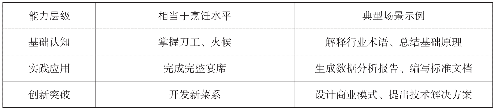

**第三维度，工具使用策略**

以撰写学术报告为例，需做好以下准备。

● 基础模式：快速获取背景资料，如“简述量子计算发展史”
● 深度思考：分析研究数据，如“对比三种算法的优劣势，用表格呈现”
● 联网搜索：补充最新行业动态，如“查找 2024 年 AI 伦理最新政策”

遇到需多步骤处理的任务时，可分步实施，提示词如下。

请先分析近三年新能源汽车市场数据，找出增长最快的三个细分领域，然后预测未来两年发展趋势，最后用通俗语言向投资人做简报。

这种分层思考既能避免过度依赖 AI，又能充分发挥其辅助作用。用户在使用 DeepSeek 时，需合理评估任务难度，建立任务复杂度分级机制，并配置适配性解决方案，方能实现智能辅助效能最大化。

**3．Input（输入）**

输入质量与 DeepSeek 输出效果紧密相连，恰似优质食材才能烹饪出美味。高质量输入是理想输出的前提，可从三维度优化。

**第一维度，数据组织方式**

以准备一顿丰盛晚餐为例，需考虑：

● 食材分类：将蔬菜、肉类、调料分开放置，避免混成一团
● 标签清晰：用统一容器标注“冷藏保存”或“即开即用”
● 材料齐全：确保备齐主料和辅料
● 风格统一：所有食材按中式烹饪预处理，避免中西混用导致口味冲突

**第二维度，上下文设定**

以规划家庭旅行为例，需考虑：

● 时间框架：确定出行日期范围，安排景点游览顺序
● 空间范围：限定在长三角地区，选择亲子类景点
● 逻辑关联：先订机票才能安排接机，酒店需在景点附近

**第三维度，输入优化技巧**

常见提示词优化技巧如表 7-2 所示。

**表 7-2 常见的提示词优化技巧**

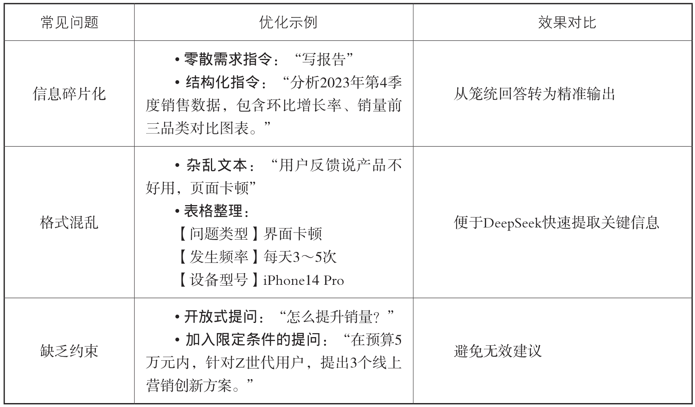

处理复杂任务时，可分步骤输入。

● 用基础模式获取背景知识，如：“简述新能源汽车电池技术发展历程。”
● 以深度思考方式分析数据，如：“对比三元锂电池与磷酸铁锂电池的成本曲线，用折线图呈现。”
● 联网搜索补充资讯，如：“查找 2024 年欧盟最新电池回收政策。”

这种分层输入既保证信息系统性，又充分发挥 DeepSeek 不同模式的优势，让 AI 助手更精准满足需求。

**4．Guidelines（指导原则）**

明确的规则约束是确保输出合规性与专业性的重要保障，规范着 DeepSeek 的输出行为，使其在合法、道德、专业的轨道上运行。可从三维度确保专业性与安全性。

**第一维度，基础规范设定**

● 法律规范：确保输出内容符合《网络安全法》《数据安全法》等基础法规
● 道德规范：类似社区公约倡导文明行为，要求内容传递积极价值观，避免歧视性言论或有害建议
● 品牌规范：如同城市统一建筑风格，保持企业 VI 一致性，如使用指定字体、配色方案
● 安全规范：设置内容审核机制，就像地铁安检系统拦截危险物品

**第二维度，质量把控体系**

● 数据检测：设定事实核查标准，确保数据来源可靠，如仅引用权威机构统计
● 任务聚焦：保持主题集中，避免偏离核心任务，如分析报告不掺杂无关话题
● 专业分级：根据需求匹配知识层级，初级员工培训材料与专家级技术文档
● 相应调整：控制文本复杂度，技术文档用专业术语，科普文章用日常语言

**第三维度，实用操作指南**

常见的问题及对应策略如表 7-3 所示。

**表 7-3 常见的问题及对应策略**

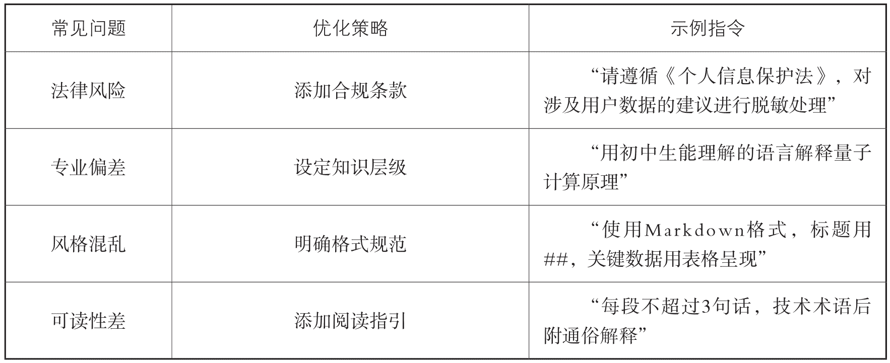

处理敏感任务时，可分步骤确认。

● 基础核查，如：“请确认该医疗建议是否符合最新诊疗指南。”
● 伦理审查，如：“评估推荐方案是否存在患者隐私泄露风险。”
● 格式优化，如：“将专业术语替换为患者易懂的日常用语。”

这种分层验证机制既保证专业性，又像安全气囊般防范潜在风险。如同精密导航系统需要定期校准，合理设定规则约束能让 AI 助手始终在正确轨道上运行。

**5．Novelty（创新性）**

创新性要求是输出独特性的关键来源，如同为作品注入独特灵魂，使 DeepSeek 输出在众多结果中脱颖而出。可从 4 个维度打造创新性输出。

**第一个维度，方法创新**

● 示例指令：如“请用区块链思维重新设计传统供应链管理方案”
● 实现方式：结合 DeepSeek 的深度思考模式进行多步骤推理

**第二个维度，视角创新**

● 典型场景：例如分析新能源汽车市场时，添加“从‘00 后’消费者视角评估设计美学”
● 操作技巧：在提示词中明确“分别以投资者、用户、环保组织三方立场分析”

**第三维度，内容创新**

● 实时更新：在提示词中明确“使用 2024 年第二季度最新出口政策分析行业趋势”
● 领域融合：在提示词中明确“将生物医药研发模式应用于智慧农业项目”

**第四维度，形式创新**

● 可视化设计：在提示词中明确“用流程图+时间轴+雷达图三视图展示数据”
● 交互增强：在提示词中明确“设计可点击展开的折叠式报告结构”

**【场景】**筹备产品发布会时，可分阶段操作。

● 以基础模式获取历年案例
● 通过深度思考生成 3 种突破性形式
● 通过联网搜索补充 AR、VR 最新技术
● 最终输出包含全息投影方案的策划书

这种结构化流程既保持专业深度，又富有创新性。可见，合理运用创新维度能让 AI 输出既独特又实用。

**7.1.2 ALIGN 框架应用方法论**

**1．目标对齐机制**

制定复杂项目目标体系时，常陷入两种困境：要么将战略目标机械拆解为碎片化任务，要么制定过于理想化的指标导致执行变形。要设计高质量 AI 提示词，关键在于建立系统化的目标思考框架。下面通过智能客服系统升级的案例，演示如何构建目标导向的提示词设计思维。

假设某电商平台计划三个月内上线新一代智能客服系统，战略目标是“提升客户服务体验与运营效率”。初级产品经理可能直接生成提示词：“开发智能客服系统，提高客户满意度。”这样的指令缺乏可操作性，无法引导 AI 产出有价值方案。基于 ALIGN 框架的提示词设计有以下几个步骤。

**第一步，目标维度解构**

把战略目标翻译成机器能执行的指令清单

把高层策略真正跑通，第一件事就是把抽象意图拆成可度量、可追踪的执行切片。会议白板上惯常会问三组问题：客户侧体验的改善体现在哪些可观测点？运营侧提效涉及哪几个环节？技术侧升级需要哪些支撑能力？围绕这三问讨论后，通常会收敛到三个抓手：单次对话的回复耗时、首次即时解决占比、人工接管的比例。此时从开放式提问转向结构化指令会更有效。

智能客服升级的量化要求可以这样写：
● 将平均回复耗时从 120 秒压至 30 秒以内
● 将首次即时解决比例从 65% 提升到 85%
● 将人工介入比例从 40% 降到 15%
请按模块给出技术方案与落地路径

指标弹性校准
上线后各指标常互相牵制，越追求速度越可能牺牲解决质量。指令里要内置自适应逻辑。
当系统监测到解决比例跌破 80% 时：
● 自动触发知识库刷新流程
● 启动备用人手分流通道
● 生成语义分析报告供次日复盘
请设计一套兼顾时效与解决效果的动态平衡模型

矛盾消解建模
效率与质量的张力需要预埋权重调节参数。
开发多目标优化模块时应包含：
● 实时流量监控看板
● 服务权重调节滑块，0 到 100%可在效率与体验间倾斜
● 历史决策效果回放功能
请给出三种不同权重分配方案及其预期表现

迭代路径规划
把 90 天拆成六个双周冲刺，每个冲刺设定明确交付物，在项目管理指令中强化节点控制。
实施计划需包含：
● 双周里程碑：用户画像分析→对话引擎开发→压力测试…
● 各阶段验收标准：响应延迟≤50ms、识别准确率≥90%
● 风险告警阈值：CPU 占用率>75%时触发告警
请用甘特图呈现关键路径

多方案推演验证
技术选型关键点适合用对比式指令做演练。
对 A 规则引擎对话树、B 开源大模型微调、C 混合架构进行模拟：
对比维度包括：
● 研发投入
● 预期识别准确率
● 运维复杂度
● 扩展指数
请输出决策矩阵

综合示例
作为资深架构师，请为电商客户设计智能客服升级方案，要求：
1．核心目标
● 30 天内上线可用最小可用产品
● 在回复时效≤30s 与解决率≥85%之间取得平衡
● 技术方案预留扩展接口
2．必要模块
● 实时监控仪表盘
● 动态负载均衡
● 多维数据分析系统
3．特别要求
● 对比三种技术路线的成本与风险
● 设计灰度发布方案
● 说明回滚机制
请按架构设计图 Mermaid、实施阶段规划表、风险评估矩阵、预算分配建议输出

上述思路展示了目标拆解—弹性调节—冲突平衡—路径规划—方案验证的完整链路，每个环节都用结构提示词锁定输出质量。实操中可用 Excel 做目标矩阵可视化，用思维导图梳理逻辑，最终形成机器可读的精准指令

动态校准闭环
做动态校准容易陷入事后救火，核心是建立闭环思维。以新能源车电池产能优化为例，用五步法设计校准指令。

阈值分级设定
预警需要兼顾灵敏度与误报。假设产能波动需控制在±5% 内，设计分级预警：
开发产能波动监测模型，需满足：
● 波动超 3% 触发黄预警，输出周度分析报告
● 波动超 5% 触发红预警，立即启动应急响应
● 连续 3 天波动在 2%~3% 区间启动趋势预警
请输出带阈值逻辑的状态机模型

反馈回路构建
实时调优需要处理多源数据：
设计实时反馈系统应包含：
● 设备传感器数据温度/压力/电流实时接入
● 每 15 分钟生成产能效率热力图
● 异常波动时：
- 调取最近 24 小时工艺参数
- 对比历史最优生产区间
- 输出参数调整建议清单
请用流程图展示数据处理路径

冲突消解建模
面对质量—效率—成本铁三角，指令需预设动态权重：
开发多目标优化算法，需实现：
● 实时雷达图展示质量合格率、单件工时、原料损耗率
● 可滑动调节优先级权重 0~100%
● 按权重自动生成三种方案：A 质量优先合格率≥99.5%，B 均衡模式综合指数最优，C 成本优先损耗率≤0.8%
请输出权重调节对产能影响的敏感性分析

评估体系搭建
多维评估要兼顾客观与主观，可加入弹性评估：
构建评估系统需包含：
● 客观指标 40%：生产节拍达标率、设备 OEE
● 过程指标 30%：工艺参数稳定度、异常响应速度
● 主观指标 30%：工程师满意度评分
请设计自适应权重公式，客观指标连续不达标时自动提升其权重

持续进化机制
校准系统需要自我学习能力：
制定系统优化计划，应包含：
● 每月自动生成薄弱环节诊断报告
● 每季度特征工程更新：筛选影响权重前 5 的核心参数、优化参数关联度计算公式
● 每年算法架构评审
请输出迭代路线图与知识沉淀模板

综合指令
作为智能制造专家，请设计电池产能动态校准系统，要求：
1．核心功能
● 三级预警机制趋势/黄/红
● 多目标参数调节界面
● 自适应评估矩阵
2．数据要求
● 接入 MES 系统实时数据流
● 整合历史最优生产批次数据
● 关联质量检测数据库
3．特别说明
● 预警阈值支持按月动态调整
● 提供三种应急响应预案模板
● 开发决策日志追溯功能
请输出系统架构图 Visio 格式、报警逻辑决策树、参数调节效果预测表、系统健康度评估量表

该链路实现了监测—反馈—行动—评估—验证闭环。可用 Excel 测阈值敏感性，用 PPT 绘制交互流程，最终形成可执行指令

难度适配系统
难度适配易陷入一刀切，需建立评估—匹配—调节—构建—预警的动态框架。以固态电池研发为例。

多维评估建模
任务难点包括电解质材料选择、界面稳定性、量产工艺：
开发复杂度评估模型，需包含：
● 技术维度 40%：材料科学深度、设备精度要求
● 创新维度 30%：专利空白覆盖率、技术路线独特性
● 实施维度 30%：跨学科协作复杂度、工艺可扩展性
请输出带权重分配的评估矩阵模板

知识深度匹配
当任务复杂度≥85 分时：
● 调用 2019—2023 顶级期刊成果
● 关联跨学科专利库材料学/电化学/热力学
● 激活创新方案模拟推演模块
请生成知识调用优先级清单

动态调节设计
研发常遇变量，需预设弹性调整：
设计动态难度调节系统，应实现：
● 每周评估技术瓶颈指数
● 按结果触发三种模式：
- 常规模式指数<5 维持路径
- 优化模式 5≤指数<8 启动备选方案库
- 重构模式指数≥8 发起跨部门攻坚
请输出带阈值判断的逻辑树

能力画像构建
构建工程师能力画像，需包含：
● 硬技能 50%：材料模拟软件熟练度、失效分析经验
● 软技能 30%：跨部门协作指数、专利撰写能力
● 创新潜力 20%：新技术学习速度、方案突破次数
请设计雷达图可视化评估模板

资源预警机制
预测量产资源需求：
开发资源监测系统，应具备：
● 实时显示涂布机/叠片机/注液机使用率
● 预警阈值：黄预警单设备连续 72 小时负载>85%，红预警关键工序平均负载>90%
● 自动推送备选供应商清单
请输出带决策逻辑的预警响应流程图

综合指令
作为电池研发专家，请设计固态电池项目管理系统，要求：
1．核心模块
● 四维复杂度评估引擎
● 知识图谱动态调用系统
● 自适应资源调度平台
2．数据集成
● 接入材料特性数据库离子电导率/界面阻抗
● 关联量产良率历史数据
● 整合跨部门协作日志
3．特别要求
● 开发难度热力图实时看板
● 设置三级技术攻坚响应机制
● 构建危机案例解决方案库
请输出系统架构示意图、知识匹配决策矩阵、资源缺口预测模型、团队能力进化路线图

该设计在每个模块预留调节接口，具备动态进化能力。可配合 Visio 绘图、Excel 分析矩阵，形成可执行指令

输入优化体系
输入优化常止步于清洗，需建立清洗—补全—融合—可视闭环。以智能客服优化为例。

噪声识别与清洗策略
客服日志约 17% 为无效记录：
开发数据清洗模块，需实现：
● 基础清洗过滤字符数<5 或>500 的对话
● 语义检测标记寒暄语句
● 相似度去重合并相似度>90% 的重复对话
请输出带置信度阈值的流程图

上下文补全建模
对话缺失意图标签时：
● 提取关键词与情感倾向
● 匹配历史相似对话标签分布
● 生成前三候选标签及概率
请设计基于 BERT 的补全算法架构

多源数据融合设计
整合通话录音与文字记录：
构建融合接口，应包含：
● 语音转文字预处理采样率 16kHz
● 时间轴对齐误差<200ms
● 情感标记映射规则语音情感→文字标签
请输出带时序同步示意图的融合方案

约束条件可视化
开发约束看板，需展示：
● 实时会话分布热力图地域/时间段
● 坐席负荷仪表盘并发数/响应延迟
● 优先级队列可视化 VIP 客户置顶逻辑
请用甘特图呈现资源调度逻辑

综合指令
作为数据架构师，请设计智能客服优化系统，要求：
1．核心功能
● 动态数据清洗引擎
● 多模态数据融合层
● 实时资源监控看板
2．数据处理
● 接入通话录音 MP3/WAV
● 整合在线会话日志 JSON
● 关联 CRM 用户画像
3．特别要求
● 实现语音文字双向校验
● 开发意图标签自学习模型
● 构建坐席能力匹配矩阵
请输出系统架构图 UML 格式、数据流异常检测规则集、多源对齐误差补偿方案

关键在于清洗规则设置可调置信阈值，补全模型预留反馈训练接口，使系统持续优化

原则实施框架
构建合规保障需四维治理：法律—伦理—质量—安全。以智能投顾为例。

法律知识映射
整合《证券法》《资管新规》等条款为知识图谱：
提示词：
整合法律要素：
● 投资者适当性管理规则证监会令第 130 号
● 算法交易监控要求证监会〔2023〕46 号
● 金融数据安全分级标准 JR/T 0197—2020
请输出带权重系数的法规关联矩阵

伦理审查建模
三层审查机制：
开发伦理审查模块应实现：
● 风险词汇实时过滤波动率>30% 触发复核
● 激进策略标记杠杆率≥5 倍自动预警
● 行业集中度检查单一板块>40% 需人工复核

质量动态管控
表 7-4 质量评估矩阵
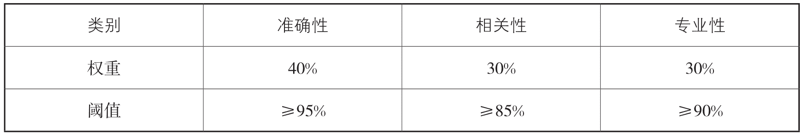
质量阈值调节规则：
● 市场波动率>5% 时准确性权重提升至 50%
● 用户风险评级保守型时相关性阈值上调至 90%
● 涉及衍生品建议时专业性阈值锁定 95%

安全分级响应
五级安全分类体系：
设计安全防护机制，需包含：
● 语音记录自动脱敏身份证/银行卡号过滤
● 4 级以上内容碎片化存储
● 跨系统传输启用量子加密
请输出带触发条件的响应流程图

综合指令
作为合规架构师，请设计智能投顾系统保障方案，要求：
1．核心模块法规知识图谱引擎、三阶伦理审查模型、动态质量评估矩阵
2．数据要求接入监管法规数据库、整合历史违规案例库、关联用户风险画像
3．特别说明开发监管沙盒测试环境、设置熔断机制单日建议偏差>15% 锁定、构建案例回溯知识库
请输出系统架构拓扑图、伦理审查决策树、质量波动预警模型、安全事件响应手册

方案需配合实时法规语义解析与自动化合规报告，核心是动态权重与碎片化存储

创新实现路径
构建创新路径需灵感激发—风险管控—价值量化三维驱动。以智能驾驶研发为例。

跨界灵感激发
开发交叉领域灵感工具应包含：
● 专利语义分析引擎相似度≥75% 触发预警
● 多模态创意看板支持 3D 模型/脑图/公式混排
● 实时行业趋势热力图更新≤15 分钟
请输出带碰撞预警的灵感激发流程图

动态风险管控
表 7-5 创新可行性评估矩阵
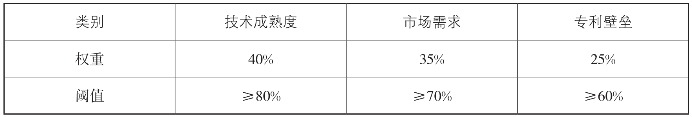
当技术成熟度<65% 时：
● 启动备选技术路线库
● 触发专家论证流程
● 资源池自动倾斜 30% 至预研项目

价值量化评估
开发价值预测算法，需实现：
● 蒙特卡洛模拟商业场景迭代≥10 万次
● 技术扩散 S 曲线建模适配 Gartner 成熟度模型
● 社会效益影子定价模型含政策敏感性分析
请输出带置信区间的多维评估仪表盘

综合指令
作为创新架构师，请设计智能驾驶研发路径方案，要求：
1．核心模块跨学科创新沙盒平台、动态风险评估矩阵、全生命周期价值模型
2．数据集成接入全球专利数据库、整合城市交通流量实时数据、关联供应链成本波动指数
3．特别要求开发技术路线冲突检测算法、设置创新资源弹性分配机制、构建社会价值影子定价体系
请输出系统架构拓扑图、风险评估决策树、价值量化计算模型、成果转化路线图

融合 DeepSeek 与 Power BI 打造可落地创新闭环

让突破性与可执行性同时成立，关键是借助 DeepSeek 智能代理完成跨源异构数据的整合，再用 Office Power BI 呈现可随数据变动的动态视图。落地时要把握三处控制点：在创意激发阶段接入专利相似度即时核验，在风险研判阶段植入弹性资源调配逻辑，在价值评估层面搭建政策敏感度建模体系，从而让创新路径既有想象空间也有落地方案。

**7.1.3 企业级应用场景示例**

**1．内容创作优化**

在数位化内容生产里，高质量提示词的生成来自系统化推演。以面向零基础读者的 Python 入门教程为例，可按下面思路展开。

起步先厘清核心诉求
有效教学取决于受众认知特征，零基础人群对术语堆砌容忍度低；同时案例驱动的学习方式要求示例贴近生活。由此设计走向锁定情境化教学，而非知识点罗列。

随后进行结构化拆解
约三千字的篇幅可拆为四大板块，需要在知识密度与学习节奏之间取舍。
● 引子部分，把编程思维与日常逻辑关联，例如把变量比作储物柜
● 语法讲解遵循最小必要原则，聚焦 print、变量、循环等核心要素
● 实例设计坚守可感知价值标准，挑选文件整理、数据统计等实用场景
● 练习环节做梯度挑战，从代码填空到完整小项目搭建

再做逆向校验
优质提示词要预判大模型常见偏差，用约束条件引导输出方向。
● 限制单段代码不超过五行，避免示例过度复杂
● 要求每个概念搭配生活比喻，降低理解门槛
● 增加错误代码解析模块，强化纠错能力
● 约束第三方库使用范围，保持在语言基础层面

最后形成持续迭代
通过质量检查形成闭环。
● 合规审查：核验示例是否符合 Python 最新规范
● 一致性审查：保证术语统一、难度平滑过渡
● 可读性优化：用 Flesch 可读性指数评估文本难度
● 参与度设计：每章内嵌动手实验点，提升交互感

基于上述思路，最终提示词应体现分层引导，具体如下。

你是一位拥有 10 年 Python 教学经验的文档工程师，需要为新入职的 IT 培训机构编写零基础入门教程。

教程需满足以下要求：

【内容架构】
1．认知导入：用 3 个生活场景类比编程思维（如用超市购物解释流程控制）
2．基础语法：
精选 5 个核心知识点，每个知识点设置以下内容：
- 不超过 50 字的通俗解释
- 图示化语法结构（用符号表示）
- 正误对比示例（1 个正确+1 个典型错误）
3．实战项目：设计文件整理助手开发路线，分解为 3 个渐进式任务
4．学习地图：用思维导图形式呈现后续学习路径

【呈现规范】
- 采用“问题—方案—原理”三步讲解法
- 每章节插入 1 个“调试实验室”互动环节
- 代码示例添加执行效果注释
- 专业术语首次出现时标注英文原词

请先生成目录大纲，确认结构后分章节撰写，每个技术点预留练习空位

该提示词通过角色设定、结构分解、交互设计三层引导，既确保了教程的专业性，又通过渐进式任务设计保持学习动力持续性。整个创作过程完全基于 DeepSeek 的对话能力实现，无须额外开发系统即可完成从框架设计到内容优化的全流程覆盖。

**2．数据分析场景**

在碳排放数据分析领域，构建有效提示词需要建立系统性分析框架。以五年碳排放数据研究为例，呈现环境分析师的专业思考路径。

首要任务是解构研究目标
资深分析师会从三重维度锚定方向。
● 政策耦合性：2025 年新政对高耗能行业的约束指标
● 技术演进性：碳捕捉、清洁能源等技术的成熟度曲线
● 区域差异性：产业集群与碳配额的动态平衡关系

其次是搭建分析矩阵
基于多维数据特征设计交叉验证机制。
● 时空矩阵：将五年数据按季度+省级单位建立三维热力图
● 行业技术树：构建“排放强度—技改成本—减排潜力”评估模型
● 政策影响因子：量化补贴政策、碳税等变量对方案可行性的影响

再次是对抗性校验
预判 AI 分析常见偏差并设置约束。
（1）数据清洗规则
➢剔除异常值阈值：±3σ范围
➢缺失值处理：行业均值插补法
➢单位统一：换算为标准煤当量
（2）分析校验机制
➢设置基准情景（BAU）作为对照
➢引入蒙特卡洛模拟验证方案稳健性
➢添加碳泄露效应评估模块

最后是创新方案孵化
通过提示词设计激发突破性思维，如下所示。

你作为环境经济首席顾问，需要基于 2019—2023 年碳排放数据设计创新减排方案。请遵循以下路径：

【数据洞察层】
1．绘制行业碳密度等高线图，标注突变节点
2．识别技术替代拐点（如光伏 LCOE ^(⁹)低于火电的时间线）

【方案设计层】
1．应用破坏性创新矩阵：
- 渐进式改进（现有技术优化）
- 架构式创新（流程再造）
- 颠覆式创新（技术替代）
2．融合政策工具箱：
- 碳市场：配额拍卖机制设计
- 绿色金融：转型债券应用场景
- 数字监管：区块链溯源系统

【输出规范】
- 方案可行性矩阵包含：减排量、投资成本、见效周期三维评估
- 创新性标注：技术就绪度（TRL）和商业模式新颖性评分
- 配套可视化：用动态桑基图展示碳流变化

该提示词通过四层结构引导深度分析，完全基于 DeepSeek 现有能力即可实现从数据清洗到方案生成的完整流程，将技术成熟度评估与经济可行性分析进行耦合，并通过设置 TRL 评估模块，有效规避了 AI 在技术可行性判断上的常见偏差。

**7.1.4 ALIGN 框架使用效果与优化**

**1．框架使用效果**

实际使用中，许多企业反馈采用 ALIGN 框架后，效率与质量均有明显提升。这种变化类似为团队配备了一名智能助手，帮助员工更高效精准地开展工作。核心在于如何与智能系统沟通才能获得理想结果，这正是 ALIGN 框架要解决的问题。

沟通机制优化后，企业与 DeepSeek 的协作效率提升 60%。原本需要反复解释的方案，如今通过清晰的任务描述即可快速达成共识。例如在内容创作中，策划人员只需说明目标受众与核心卖点，即可获得多种风格的文案初稿，省去反复修改环节。这样既节约时间，也释放了员工创造力。

质量层面，输出内容的专业性与准确性提高 45%。以市场分析报告为例，分析师输入行业数据与关键指标后，系统不仅能生成结构清晰的报告，还能自动标注数据异常点并进行行业对比，提升了细节发现能力。

更值得关注的是创新能力的突破。在 ALIGN 框架下，创新方案采纳率提升 70%，且 85% 的方案具有独特价值。这相当于为每个项目团队配备场外指导，当产品经理提出基础需求时，系统能提供跨行业解决方案，激发设计灵感。例如某家电企业在开发智能烤箱时，借助系统提供的健康饮食解决方案，打造出差异化产品功能。

工作方式转变带来显著效率提升：任务返工率降低 50%，用户满意度提高 40%。当智能系统能准确理解需求并给出优质方案时，团队可将更多精力投入策略优化与用户体验提升。

在这个过程中，可思考：当 AI 处理更多基础工作时，人类应如何重新定位核心价值？是成为更优秀的需求定义者，还是转而培育创意？ALIGN 框架带来的不仅是效率提升，更开启了人机协作的新维度。

**2．持续优化机制**

ALIGN 框架的持续优化始终跟随企业需求演进。类似手机导航根据实时路况调整路线，优化过程通过 4 个环节形成闭环。

第一个环节，用户反馈
用户反馈如同导航中的实时路况。企业通过问卷调查、操作记录分析、深度访谈等方式收集使用体验。例如市场团队反馈生成活动方案时需要更多竞品对比数据，这些真实声音成为优化指引。

第二个环节，实践积累
实践积累类似导航员总结的黄金路线。当某个团队发现特定模板使数据分析效率提升 30% 时，该经验会被提炼为标准操作指南。例如某快消企业总结出节日营销五步法模板，使新人也能快速生成优质方案，实现企业智慧传承。

第三个环节，模板更新
模板更新类似导航软件的地图升级。根据反馈和经验，提示词模板更智能精准。例如财务报告场景，从简单的生成季度报告模板进化为包含同比环比分析、异常波动标注的可视化报告模板，使输出更贴合实际需求。

第四个环节，评估指标优化
评估指标优化类似导航评分体系升级。除到达时间外，还增加燃油效率、驾驶舒适度等维度。企业不仅关注输出速度，更重视创新价值与使用体验，多维度评估确保优化指向核心目标。

这种动态优化机制延伸至日常工作的各个方面。新员工制作产品介绍时，系统可根据历史成功案例自动推荐结构模板；市场环境突变时，实时反馈让系统快速调整输出策略。持续自我进化使 ALIGN 框架始终成为企业发展的智能加速器。

**7.1.5 常见陷阱与最佳实践**

**1．常见陷阱**

陷阱一：需求模糊
要求 DeepSeek 生成营销文案时，若仅提示写篇推广文案，如同让厨师做饭却不告知口味。正确做法是像点菜一样具体：为 25～35 岁都市白领设计一款轻食沙拉的外卖推广文案，突出低卡、15 分钟送达、买一送一活动。

陷阱二：规则缺失
产品包装设计中若未明确禁止使用动物元素的要求，设计师可能加入违规图案。同理，与 DeepSeek 协作时需预先设定规则边界，例如：文案需符合广告法第××条规定，禁用绝对化用语；遵循品牌 VI 手册的蓝白主色调规范，并融入环保理念。

陷阱三：流程混乱
混乱流程如同错乱的导航路线，导致效率低下、方向迷失、资源浪费与体验不佳。面对复杂任务，可拆解为可执行步骤。以智能客服系统开发为例，可执行三阶段拆解：
● 第一周：生成 20 组常见问题应答模板
● 第二周：设计 3 种对话引导流程图
● 第三周：输出异常情况处理方案
每个阶段完成后，用请检查当前方案是否符合初期设定的响应速度标准来校准。

陷阱四：背景缺失
医生问诊若不询问病史，可能导致误诊。同理，咨询专业问题时需提供必要上下文。例如跨境电商创业咨询可表述为：我正在筹备跨境电商创业，目标市场是东南亚，现有启动资金 50 万元，请帮我规划三个月内的运营重点及风险防范措施。

陷阱五：验收标准不明确
验收标准不明如同裁缝没有尺子。可建立简单质量检查清单：数据来源是否标注，关键结论是否有数据支撑，建议方案是否具备可操作性，格式是否符合公司模板。遇到不满意结果时，可尝试请用更通俗的比喻解释这个经济指标或将技术参数转化为消费者可感知的利益点等指令优化输出。每次交互后可多问一句：你理解的需求重点是什么？通过持续反馈循环逐步提升协作效率。

**2．最佳实践**

秘诀一：输出点菜式提问
想象在高级餐厅点餐，不会只说来份牛排，而会说明熟度与配菜。同理，向 DeepSeek 提问时要精准说明：分析新能源车企 2024 年财报，对比特斯拉与比亚迪的研发投入占比，用柱状图呈现。这种具体指令才能确保输出符合预期。

秘诀二：搭建认知背景
与 AI 交互时介绍相关技术概念与应用场景，搭建沟通认知背景，如同为其铺设理解任务的清晰路径。例如咨询医疗政策时可补充：我是在线问诊平台的产品经理，需要为 60 岁以上用户设计医保报销指引，请说明 2024 年北京地区慢性病门诊报销新规，重点解释自费药认定标准。

秘诀三：建立质量评估标尺
提前设定评估标准可确保成果品质。可建立检查清单：
● 准确性：数据是否标注来源，如引用国家统计局 2024 年报
● 实用性：建议是否具备可操作性，如列出 3 个可本周实施的改进措施
● 合规性：内容是否回避敏感词，如避免使用最佳等绝对化表述

秘诀四：循环改进机制
将每次交互视为产品迭代，用三明治反馈法优化。
● 肯定有效部分，如：数据分析维度很全面
● 指出改进方向，如：能否补充竞品对比数据
● 明确优化要求，如：请用 2024 年第一季度最新行业报告作为参考来源

ALIGN 框架作为一套经过实践验证的 DeepSeek 提示词工程方法论，在充分发挥 DeepSeek 强大能力方面具有不可替代的重要性。它从目标设定、难度评估、输入优化、指导原则遵循到创新激发，构建完整系统体系，为交互提供全方位指导。

**7.2 提示语链设计**

当下 AI 技术已渗透至工作生活的各个角落，从智能客服到复杂数据分析，从内容创作到智能决策辅助。随着应用场景日益复杂，单一提示词难以满足多样化精细化任务需求。简单指令往往只能得到表面泛化回应，无法充分挖掘 AI 潜力，也难以应对现实世界错综复杂的问题。

DeepSeek 大模型以卓越推理能力脱颖而出。它像一位思维缜密的智者，面对难题时能深入剖析、层层推理，展现出超越普通模型的深度思考能力。无论是解开复杂数学谜题，还是梳理法律条文间逻辑关系，都能凭借独特推理架构有条不紊地给出精准且富有逻辑的解答。这种强大推理能力为构建高效提示语链奠定基础。

**7.2.1 链式推理结构：DeepSeek 的智慧引擎**

**1．基础框架设计：为推理筑牢根基**

使用 DeepSeek 处理复杂问题时，首先要构建明确背景需求—分解问题模块—理清逻辑关系—设置条件边界的思考框架。

假设某电商平台遇到销售瓶颈，可这样展开：
● 明确现状与目标：当前市场竞争激烈，需要提升销售额，但开发团队人力有限、推广预算紧张
● 拆分问题模块：将提升销售额分解为提升访问量、优化转化率、增强复购率等子任务，再细化为优化搜索排名、拓展社交媒体引流等具体动作
● 建立逻辑网络：各子任务间存在隐性连接，如社交媒体推广带来的用户数据可反哺搜索排名优化
● 设置条件边界：假设每月推广预算仅 5 万元，系统会自动排除百万级投入方案，优先推荐精准投放、内容营销等轻量策略

通过结构化思考，即使新手也能快速抓住问题本质。在此过程中 DeepSeek 充当智能助手，既能帮助厘清思路，又能预警可能越界方案，让决策更实用也更具创新性。

**2．解决方案构建：用推理打造最优解**

处理复杂商业问题时，DeepSeek 如经验丰富的分析师团队，通过 4 个环节帮助找到最佳策略。以电商销售优化为例：

第一步，数据整理与规范
想象整理杂乱书架，结构化提示词即分类标签。输入请将销售数据按时间、品类、地区分类整理，DeepSeek 会像细心图书管理员把分散记录归类为整齐表格，为后续分析搭建稳固地基。

第二步，逻辑推理与洞察发现
此时 DeepSeek 化身商业侦探，运用思维链能力展开调查。首先分析销售曲线，找出每周三下午茶时段奶茶销量激增规律；接着对比品类，发现保温杯在北方冬季销量是夏季 3 倍；最后结合地域特征，识别沿海城市海鲜类商品复购率更高等隐藏信息。

第三步，策略生成与方案比选
此时 DeepSeek 转为策略顾问，提出多优化方案。如 A 方案：在北方冬季主打保温杯加奶茶组合促销，预估提升 15%销售额；B 方案：在沿海地区推出海鲜月卡服务，预计增加 20%复购率。每个方案均附带成本收益分析，便于直观比较。

第四步，持续优化与动态调整
实施后 DeepSeek 如 24 小时值守监测仪。当发现促销活动首周参与度仅 5%，会立即启动原因排查，可能定位到活动入口过深或优惠力度不足；继而自动生成优化建议，如在 App 首页增加弹窗提醒、买赠门槛从 200 元降至 150 元。这种实时反馈机制可及时捕捉策略执行问题并快速调整。

**7.2.2 高级推理策略：拓展 DeepSeek 的思维边界**

**1．零样本推理：先验知识的巧妙运用**

DeepSeek 推理与学习原理：零样本直推与少样本迁移

设想有人忽然抛来一道未曾接触过的计算题，你依靠已知的定义和运算规则仍能算出答案，DeepSeek 的零样本推理就是这种感觉。模型无需额外微调，直接调动预训练阶段累积的知识完成解答。

**零样本推理：内建知识的直接调用**

**1）语言互译的即时响应**
让模型把“你好”转成英文，它会像调取脑中自带的多语词典一样给出 Hello。预训练时已覆盖上百种语言的对应关系，查询几乎无延迟。这种表现相当于在模型内部搭建了一条即开即用的全球互译通道。

**2）规则推演的演示过程**
问“8 是偶数吗”，模型先确认“能被 2 整除即为偶数”的定义，再执行 8÷2=4 的验算，最后判定为是。整个链路严格遵循规则。这类能力可以处理各类规则明确的判断，从算术核验到法条释义都能胜任。

**3）常识检索的百科式调用**
询问“地球公转绕什么”，模型好似打开了一部在线百科。知识库中存有“太阳系天体运行规律”等基础科学常识，能像翻书般快速定位。瞬时调取让常见科普类问题的作答变得顺畅。

零样本的根基是模型预先构建的大规模知识网络。只要任务仍在覆盖范围内，就能像经验丰富的专家一样直接给出结论，无需再学习。

**少样本学习：以少量示范驱动迁移**

少样本学习相当于给模型装上放大镜，靠精心设计的少量样例就能迅速掌握新任务。这种方式摆脱了对海量数据的依赖，展现出较高的知识迁移效率。

**1）示范样本的设计要点**
有效样例需兼顾特征覆盖、情境多样与标注精确。以图像分类为例，提供布偶猫、暹罗猫等不同品种，以及站立、趴卧等多种姿态的样本，模型便能抓住猫科动物的关键属性，如瞳孔形态、胡须结构，从而学到本质规律，避免被局部表象误导。

**2）文本理解的模式解析**
在情感分类任务里，示范需体现语言的多层特征。比如给出“服务贴心周到，超出预期”这类正面表达，与“物流延误三天，包装破损”这类负面表达做对比，模型能自动识别情感词强度、修饰倾向及句式差异；通过分析副词修饰如“非常满意”对比“稍微不满”，以及否定结构如“不推荐”对比“强烈推荐”，逐步建立起情感极性判断的语义网络。

**3）跨领域的知识跳跃**
在医疗诊断场景里，仅用 5 个典型肺炎病例的训练，包含 CT 影像特征与化验指标，就能识别新病例中的磨玻璃影、血氧饱和度异常等关键征象。这种迁移源于对深层病理特征的提取，而非简单记忆案例表面。面对罕见病时，可通过症状组合相似度如发热叠加淋巴细胞减少给出概率化诊断建议，为医生决策提供参考。

**7.2.3 优化方法：提升协作效率**

**1. 对话状态管理**

与模型一起解决“城市交通拥堵治理”等复杂议题时，难点多在于如何构建系统化的对话路径。以下是一套经实战检验的思考框架。

步骤一，确立问题坐标
● 思考点：当前对话处于需求诊断、方案设计还是效果评估阶段？
● 自问：希望模型扮演何种角色？交通规划师、数据分析师或政策评估专家？
● 行动示例：开场明确“我们现在要制定未来半年交通疏导方案，请以城市规划专家的身份给出建议”

步骤二，动态标注关键变量
● 思考点：哪些数据维度会实质影响方案成效？
● 自问：拥堵指数的时间分布如何？重点路段存在哪些结构性缺陷？
● 行动示例：用结构化标记列出关键参数

【核心参数】
➢高峰时段：07:30—09:30 及 17:00—19:30
➢重点路段：中山东路日均车流量 1.2 万辆
➢特殊事件：地铁 5 号线施工，封闭两车道

步骤三，固化记忆锚点
● 思考点：哪些决策节点会持续影响后续讨论？
● 自问：已达成共识的治理目标是什么？被否决方案的核心缺陷在哪？
● 行动示例：定期固化决策路径

【共识备忘】
➢关键目标：早高峰平均车速提升至 25km/h
➢排除方案：单双号限行影响民生
➢优选方向：智能信号灯优化+潮汐车道

步骤四，设定更新触发器
● 思考点：哪些新信息会改变方案可行性？
● 自问：若新增学校、商场等客流节点，策略需如何调整？
● 行动示例：建立实时更新机制

【情境更新】
➢新增变量：万达广场预计 9 月开业，日均车流量预计增加 3000 辆
➢请求：请重新评估原方案在商圈周边的疏导能力

最终提示词示例。

请以城市规划专家的视角，基于以下结构化信息提出治理方案。

【现状分析】
- 拥堵路段：中山东路双向 6 车道
- 高峰时段：07:30—09:30 西向东方向
- 关键瓶颈：中山—解放路口信号周期过长

【限制条件】
- 预算上限：500 万元以内
- 施工周期：不超过 3 个月
- 民生影响：避免大规模封路

【预期产出】
1．输出 3 种可行方案对比表
2．每种方案需包含实施步骤与效果预测
3．用表格展示成本效益分析

这种递进式思考既锻炼系统的拆解能力，也建立了与 AI 协同的思维框架。实操中建议配合“深度思考”模式，多轮追问持续优化结果。

**2. 长程记忆增强**

处理城市规划类长文本时，如何让模型把握百页报告的核心脉络？关键在于培养系统化知识管理的思维。

步骤一，建立信息锚点
● 思考点：报告的核心决策变量是什么？人口流动趋势、交通枢纽布局还是产业协同效应？
● 自问：哪些指标会实质影响可行性？如商业区日均人流量突破多少会触发交通预警？
● 行动示例：用符号体系标记关键参数

【战略节点】
!关键目标：2025 年前建成智慧交通中枢
?待验证假设：地铁环线对商圈客流的虹吸效应
→责任部门：城建局需在第 3 季度完成可行性研究

步骤二，构建知识拓扑
● 思考点：商业区扩建与住宅配套之间如何动态平衡？
● 自问：如何量化商业容积率与居住舒适度的非线性关系？
● 行动示例：创建关联矩阵，如表 7-6 所示。

**表 7-6 关联矩阵**

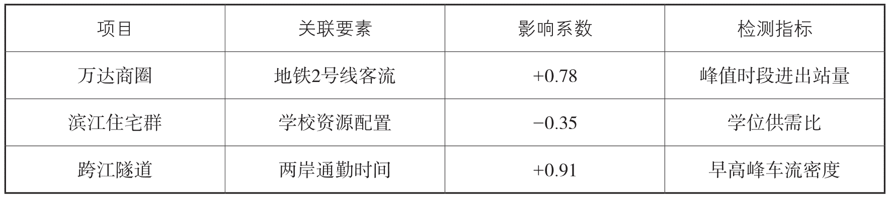

步骤三，设计记忆触发器
● 思考点：哪些临界值会触发方案调整？
● 自问：住宅空置率超过多少需启动弹性规划？
● 行动示例：设置监测预警

【动态阈值】
➢交通负荷>85%时启动潮汐车道
➢住宅入住率<60%时暂停新区开发
➢PM2.5 年均值>40 时推进绿化带规划

递进式提示词设计如下。

请以城市规划分析师的角色，基于以下知识框架处理文档。

【记忆强化指令】
1．提取核心决策三要素
- 经济指标：GDP 预期增长率
- 民生指标：人均居住面积
- 生态指标：绿化覆盖率目标
2．构建关联网络图：
● 节点：重大基建项目
● 连线：项目间协同及制约关系
● 权重：影响系数 1～10 分
3．输出
- 决策树模型含风险分支
- 敏感性分析矩阵 表格
- 应急预案触发条件清单

这种结构化流程既训练长程记忆，也实现系统化知识管理。处理超百页文档时，可先每 20 页生成要点摘要，再二次提炼为决策矩阵。

**3. 输出质量管控**

追求高质量输出需要系统化的质量控制思维。以下框架帮助构建可靠的内容生产体系。

步骤一，定义输出基因
● 思考点：文档需传递的核心价值是决策支持、知识沉淀还是操作指引？
● 自问：目标读者需要何种信息密度？技术文档是结构化呈现还是场景化描述？
● 行动示例：设定输出基因

【输出基因】
➢核心要素：可行性评估+成本效益分析
➢禁忌条款：避免主观臆测，需标注数据来源
➢呈现规则：每项建议附带实施难度评级 1～5 星

步骤二，构建格式引擎
● 思考点：如何通过模板实现内容与形式的解耦？
● 自问：哪些模块需固定结构？哪些部分需动态适配？
● 行动示例：设计智能模板

#项目报告模板 V2.1

##[必选模块]
!执行摘要 200 字以内
?关键指标看板 表格
→风险矩阵 可能性／影响度坐标图

##[可选模块]@创新点评估 技术可行性+商业价值
@利益相关者地图 图示说明

步骤三，设计多媒体同步规则
● 思考点：图文音视频如何实现跨媒介叙事？
● 自问：旁白时长与镜头切换的黄金比例？背景音乐情感曲线如何设计？
● 行动示例：建立多轨同步机制

【视频脚本规则】
➢时间轴：每 15 秒设置情绪锚点
➢图文配比：1 个核心论点+3 个支撑素材
➢声画关系：关键数据出现时同步视觉高亮

递进式质量验证提示词如下。

请以内容质量工程师的身份执行以下验证流程。

1．交叉验证
● 比对权威数据库：国家统计局交通年鉴 2023
● 核查数据时效性：标注超过 3 年的引用文献
2．逻辑自洽检查
● 识别论点论据断层
● 标注未验证的假设条件
● 评估措施与目标的匹配度
3．输出优化
● 生成风险提示清单 附件
● 创建可追溯的版本变更记录

通过工程化思维，不仅规范输出形式，也建立了可复用的质量保证体系。建议配合“深度思考”模式，多轮对话逐步完善标准。

**7.2.4 实战案例：能力验证**

**1．【场景】产品需求分析的提效**

在需求分析关键阶段，构建高质量提示词需要系统化框架。以下为产品经理使用模型时的进阶路径，由 4 个思考维度形成闭环。

思考维度一：目标定位
● 核心问题：需要输出何种内容？如何支撑后续研发？
● 关键动作：角色锚定+场景聚焦明确边界
思考过程示例：“作为 AI 工具类产品经理，我需完成竞品分析报告框架，含功能对比、用户体验评估和技术实现路径预测，每个模块需结构化呈现关键发现。”

思考维度二：要素拆解
● 核心问题：哪些要素决定输出质量？如何引导模型关注？
● 关键动作：构建 MECE 要素矩阵
要素矩阵示例：
➢用户痛点 使用频率>3 次／周的功能痛点
➢技术边界 当前主流模型的 API 支持度
➢交互范式 移动端场景操作路径限制
➢合规要求 特定行业数据处理规范

思考维度三：交互设计
● 核心问题：如何通过多轮对话实现思维共振？每轮目标是什么？
● 关键动作：设计渐进式提示链
综合提示词如下。
**第一轮提示词 角色定义+任务输入：**
作为有 5 年经验的 AI 产品专家，请分析目标用户在使用智能客服系统时的高频痛点。
要求：
1．区分 B 端管理员和 C 端用户两类角色
2．每个痛点需标注发生场景和影响程度
3．用表格形式呈现
**第二轮提示词 深度追问：**
基于前表第三项“会话上下文丢失”问题，请：
1．推测技术实现难点
2．给出 3 种解决方案原型
3．评估各方案开发成本 人／天

思考维度四：验证校准
● 核心问题：结果是否满足可执行要求？哪些维度需补充验证？
● 关键动作：建立三维评估矩阵
➢完整性验证：检查是否覆盖 PRD 要素 功能清单、交互流程、异常处理
➢可行性验证：对照技术预研报告核对实现路径
➢合规性验证：标注涉及用户隐私的数据处理环节

某 SaaS 团队应用此框架后，痛点识别准确率提升 40%，功能模块耦合度降低 35%，技术风险评估完整度达 82%。模型生成的竞品分析矩阵帮助团队两周内完成原本需两个月的市场调研。

**2．【场景】技术方案设计的创新突破**

技术方案设计需遵循“问题拆解—要素映射—交互验证”框架。以下是架构师使用模型时的路径。

思考维度一：需求转化
● 核心问题：业务需求如何转为技术指标？哪些非功能需求需前置？
● 关键动作：建立需求—技术映射矩阵
思考过程示例：
● 电商系统需支撑百万级 QPS→需评估分布式架构与微服务性能差异
● 未来三年用户增长 200%→架构扩展性需支持水平伸缩
● 支付成功率要求 99.99%→必须考虑容灾备份机制

思考维度二：技术选型
● 核心问题：候选方案核心差异在哪？如何量化适配度？
● 关键动作：构建多维度评估模型
评估要素：
➢吞吐量实测数据对比
➢平均响应时间
➢资源消耗
➢运维复杂度
➢社区生态成熟度

思考维度三：交互设计
● 核心问题：如何通过多轮对话实现渐进优化？
● 关键动作：设计技术验证链
综合提示词如下。
**第一轮提示词 架构选型：**
作为云架构专家，请对比分析电商系统架构方案。
1．对比微服务与单体架构在百万级 QPS 场景下的表现
2．重点评估服务发现机制、熔断策略差异
3．用矩阵表格呈现核心指标对比
**第二轮提示词 深度优化：**
针对前表“服务网格方案”，请：
1．设计 Istio 与 Linkerd 的性能测试方案
2．预测引入服务网格后的延时增幅
3．给出流量治理最佳实践建议

思考维度四：验证体系
● 核心问题：方案是否具备可验证性？如何建立量化验收标准？
● 关键动作：构建三维验证体系
➢压力测试：设计阶梯式并发测试场景
➢故障模拟：制定网络分区、节点宕机等异常预案
➢成本核算：对比三年期 TCO

某技术团队应用此框架后，服务发现效率提升 58%，异常恢复时间缩短至 2.3 秒，资源利用率优化 42%。模型生成的性能预测模型准确率达 91%，帮助规避三大潜在架构缺陷。

典型提示词如下所示。

请以领域架构师的身份完成系统模块技术方案设计，要求：
1．区分核心服务与辅助服务
2．标注每个组件的 SLA ^(¹⁰)等级 L1～L4
3．设计熔断降级策略
4．输出格式：
- 组件拓扑：[架构示意图描述]
- 性能基线：[QPS、延时、错误率]
- 依赖关系：[上下游服务清单]
- 监控指标：[Prometheus 指标集]

该框架完全基于对话能力，可结合 Visio 等工具快速绘制架构图。涉及复杂性能预测时，建议将输出数据导入 Excel 进行回归分析，形成完整验证闭环。

## 结语
通过高阶 Prompt 工程的探索，我们看到了借助先进技术提升效能的可能。随着人工智能持续进步，相信会有更多创新应用涌现。欢迎关注作者公众号“产品经理独孤虾”全网同号，获取更多深度内容。

**DeepSeek 赋能 MCP 工作环境搭建**

# 后记
亲爱的读者，你好！

当你翻到这本《DeepSeek 应用高级教程》的最后一页，我们共同完成了一次跨越技术边界的探索。从基础指令到全链路场景赋能，从单岗位提效到组织效能革命，本书不仅是 DeepSeek 实践的结晶，也是 AI 时代从业者重构工作范式的指南。

## 致谢
本书创作获多方支持，在此致谢。

首先，DeepSeek 技术团队在模型原理阐释、场景化应用验证及工具开发方面提供了专业指导与技术校验。他们在细节解析和趋势把握上的深度协作，为本书奠定坚实基础。尤其在互联网场景适配验证环节，多轮研讨与案例复盘帮助完善方法论的技术实现路径。

感谢互联网标杆企业分享实践案例与数据验证，这些真实反馈为本书提供重要支撑。客户在数字化转型中积累的经验提升了案例多样性，其脱敏数据帮助验证方法论效果，也为读者提供可借鉴参考。

300 多位互联网从业者参与内测，提交 217 份详细反馈，涵盖功能优化建议、场景适配评估及操作体验改进等。这些一线实战反馈帮助修正 13 处方法论偏差，优化 7 个核心章节结构，使内容更贴近行业需求。

清华大学出版社编辑团队展现卓越专业素养。从选题策划到内容打磨，从技术校验到装帧设计，每个环节都体现对技术著作的深刻理解。责任编辑施猛老师在技术快速迭代背景下，以敏锐嗅觉把控内容方向，确保本书既反映前沿动态又具长期参考价值。

特别感谢家人与朋友在创作期间给予的理解与支持。他们承担生活事务，协调时间安排，使我能全身心投入。写作瓶颈时，他们的鼓励与建议总能带来灵感。

## 致谢读者

向所有拿起本书的伙伴表示诚挚谢意。本书共集结四十三则网络行业实操案例、十二个技术深度拆解单元以及七套可直接复用的工具模板，全部经过多次实践检验与持续打磨。希望这些内容在你拥抱智能化转型的过程中提供支持，助力打造独特竞争壁垒，推动个人及团队价值跃迁。

## 核心价值沉淀

本书是国内较早把开源大模型与互联网落地场景系统结合的作品，形成了认知到实践再到进化的完整脉络。在技术穿透力上，创造了岗位任务工具三维模型，覆盖产品负责人需求拆解、开发者代码复核、运营人员内容制作等二十余类高频工作，并给出针对性解决方案。以产品岗位为例，书中详细展示如何借助 DeepSeek 搭建 PRD 智能生成流程，从需求梳理与转化到交互方案辅助，每个环节都有方法说明与案例参考，可显著提升交付效率与质量。

在风控层面，从数据沙箱到版权合规审查，构建了全流程风险管控机制，确保企业在采用 DeepSeek 时能有效规避潜在隐患。数据安全部分介绍了权限控制、内容过滤、操作审计等手段来保障企业资料安全；版权合规部分则系统讲解了对模型生成内容的审查要点，避免侵权风险。

同时提供私有化部署指南与插件开发接口，帮助企业建立自主可控的智能能力并实现生态兼容。使用者可依据自身情况选择部署方式，也可通过插件扩展 DeepSeek 功能，满足个性化业务诉求。

## 二维码补充阅读

受制于篇幅与出版周期，管理篇、行业篇、进化篇的部分内容以二维码形式呈现，请先刮开封底卡获取授权，再扫描下方二维码阅读。

**管理篇：团队协作与知识沉淀**
揭示 DeepSeek Agent 在敏捷开发、跨部门配合中的落地方法论。

**行业篇：深度应用案例库**
收录电商、内容、客服等六大领域的四十三个实战案例，含脱敏数据验证。

**进化篇：持续优化体系**
构建 AI 思维培育模型与动态迭代机制，附提示词库管理工具模板。

## 未来展望

AI 正以极快速度演进，由效率工具向决策中枢过渡的趋势愈加明显。本书配套的智能进化工具链、持续更新的知识库及行业解决方案库，通过线上平台保持迭代，为读者提供及时全面的技术支持，帮助应对快速变化的技术环境。

我们期待共同见证关键节点：预计到 2026 年，AI 驱动的效率工具将覆盖九成互联网岗位，从根本上重塑工作方式与行业格局。人机协同也将从辅助执行迈向思维共生的新范式，AI 不仅是完成任务的手段，更将成为和人类思考深度融合的创新伙伴。这种变化不仅体现在单点提效，更体现在通过系统集成重构业务逻辑。例如 DeepSeek 大模型可深度接入智能营销系统，实现用户画像实时刷新、商品特征向量建模、流量波动预警等全链路智能化，该类深度整合已在《智能营销——大模型如何为运营与产品经理赋能》一书中得到系统阐述。

在全球技术主权竞争中，国内开源模型将迎来强势崛起，依托技术创新、生态建设与合规发展，在国际舞台占据重要位置。期待以 DeepSeek 为代表的国产开源模型在技术突破、场景拓展与生态完善上取得更大进展，为全球 AI 发展贡献中国智慧与方案。

## 携手前行

技术的本质在于创造。本书虽已付印，但 AI 赋能的旅程没有终点。欢迎关注作者公众号“产品经理独孤虾”，和数万从业者共同探讨：

● 提示词工程的最新实践
● 垂直场景解决方案的共创
● 开源模型生态的共建之路

在这里，你可获取独家的 AI 工具资源包、前沿行业案例解读，以及与技术专家直接对话的机会。让我们一起在 AI 浪潮中乘风破浪，从工具使用者成长为价值创造者，期待在下一轮技术变革的前沿与你相遇！

作者

2025 年 3 月于北京

* * *

1.  1.  MLA（multi-head latent attention）是多头潜在注意力机制的缩写，它是一种改进的注意力机制，旨在提高 Transformer 模型在处理长序列或多模态数据时的效率和性能。↩︎

2.  1.  Git，一种流行的代码版本管理工具。↩︎

3.  1.  MTP（multi-token prediction）是多 token 预测的缩写，指语言模型在训练中同时预测未来多个 token 的技术策略。↩︎

4.  1.  MTP（multi-token prediction）是多 token 预测的缩写，指语言模型在训练中同时预测未来多个 token 的技术策略。↩︎

5.  1.  FAQ：常见问题解答。↩︎

6.  1.  DTO：数据传输对象。↩︎

7.  1.  OEE：设备综合效率。↩︎

8.  1.  MES：生产执行系统。↩︎

9.  1.  LCOE：平准化度电成本。↩︎

10.  1.  SLA：服务水平协议。↩︎