# DeepSeek 全景实战

# 作者介绍

**胡耀文**

2014 至 2016 年间蝉联三年微软最有价值专家，现任高级软件开发工程师，掌握 C/C++、Java、Python 等多种开发语言。参与编著的出版物有：《Visual C++ 2010 开发指南》《Windows 8 指南》《Windows CE 7 开发实战详解》《微软云计算》《Windows Azure 开发与部署》《Visual C++ 2012 开发》《Java 语言程序设计》《Java Web 开发实战》《Python 快乐编程基础入门》《Python 快乐编程网络爬虫》《C 语言程序设计》《MySQL 从入门到精通》《Python 快乐编程人工智能》等。

**朱钢**

网名喵叔，微软 MVP、CSDN 博客专家、51CTO 讲师、Udemy 注册讲师，拥有十余年一线研发经验，技术原创文章超 800 篇。曾主导某大型国企智能客服与智能通讯录系统的建设，负责 AI 智能员工行为分析系统的设计落地，并推动企业内部 AI 辅助编码与代码评审的应用。著有《.NET 8 实战系列专栏》和《Vue 3 实战系列专栏》，以实战视角助力开发者成长。

# 内容概览

本书围绕 DeepSeek 构建从基础到精通的完整学习路径，共八章，覆盖核心能力、典型场景、技术实现与演进趋势，并对 AI Agent 进行专项解读。

第一章阐释基本概念与高效学习方法，结合费曼学习法，并梳理在内容创作、教育、商务、科技等领域的常见用途；第二章演示 DeepSeek 与剪映、即梦 AI、豆包的联动用法，涵盖短视频制作配合数字人带货、战斗场景与住宅设计、创意内容生成等；第三章指导本地化部署，含 Ollama 安装、模型部署、Open WebUI 配置、CodeGPT 插件集成，并以“代码解读助手”项目巩固；第四章说明在腾讯云上部署模型，并以“英语学习助手”项目呈现云端价值；第五章聚焦 API 调用、模型原理、定制开发、优化策略、数据处理、推理模型及 API 实现等进阶主题；第六章探讨分布式训练、自然语言处理、计算机视觉、强化学习等前沿方向，并以案例展示其在 AI 研究中的价值；第七章梳理 AI 在制造业的落地现状，盘点 DeepSeek 的最新研究动向、技术演进与未来走向，展望突破与生态变化；第八章演示借助 DeepSeek 与 Coze 搭建一键生成爆款图文的智能体，适配小红书、抖音、微信等平台，并详细讲解工作流节点编排，如大模型节点、插件节点、循环节点等组合实现自动化内容生产。

整体由浅入深，理论结合实操，适合 AI 入门者、开发者、研究者及行业从业者，帮助系统掌握并落地应用。

# 前言

DeepSeek 的走红显著加剧了人工智能市场的竞争。一方面凭借更低成本与更强性能，有望扩大全球份额，对美国主导地位形成挑战，推动生态多元化；另一方面数据隐私与安全愈发关键，随场景扩展，加密与隐私保护需同步加强。同时人工智能迭代迅速，DeepSeek 的未来充满不确定性与可能性。

当前信息高度过载，数据价值凸显，从海量信息中提取可用洞察成为企业与研究机构的核心需求。在此背景下 DeepSeek 应运而生，融合前沿深度学习与数据挖掘算法，旨在复杂数据环境中快速定位所需信息，挖掘数据背后的潜在价值。其设计目标是简化数据处理流程，让非技术背景用户也能利用深度学习与数据挖掘进行分析。底层算法基于最新研究成果，可处理结构化、非结构化数据及图像、文本等多模态信息。核心功能涵盖数据预处理、模型训练、结果评估与可视化，用户可通过简易界面或 API 完成从输入到输出的全流程。支持多种数据源接入，并强调与主流数据科学工具的兼容性。随着人工智能快速发展，DeepSeek 已逐步演化为综合性数据分析平台，广泛应用于金融、医疗、零售、制造等领域，提升分析效率、发现市场机会、优化运营决策、增强竞争力。

## 本书特点

**1．智能体 Agent**
本书探讨如何快速定制专属 DeepSeek 智能体。借助 Coze 平台与 DeepSeek 的深度结合，提供直观的可视化工作流编辑环境，让个性化智能体的创建更简单高效。

**2．全面覆盖，循序渐进**
从基础概念到高级技术，从本地部署到云平台应用，从工具组合到项目实战，内容层层递进，适配不同水平读者。

**3．实用性强，场景丰富**
提供大量实操技巧与案例，覆盖律师、医生、学生、程序员、旅行者、作者等多职业的提问方法，以及内容创作、教育、商业、科技等场景应用。

**4．工具组合，高效协同**
详细讲解 DeepSeek 与剪映、即梦 AI、豆包等工具的协同方案，帮助读者快速完成短视频制作、创意内容生成等任务，提升效率。

**5．实战驱动，学以致用**
通过“代码解读助手”“英语学习助手”等项目实践，将理论转化为操作能力，在实践中加深理解。

**6．技术前沿，展望未来**
深入讨论分布式训练、自然语言处理、计算机视觉、强化学习等前沿技术，并结合 DeepSeek 的发展趋势给出前瞻性视角。

**7．图文结合，易于理解**
配有丰富的图表与示例代码，帮助直观理解复杂概念，降低学习门槛。

**8．适合多类读者**
无论是人工智能入门者、开发者、研究者，还是企业决策者，都能找到适合自己的内容，快速掌握 DeepSeek 并应用于工作与生活。

本书既是技术指南，也是实践手册，帮助读者在人工智能时代把握机遇、提升竞争力。通过阅读，可系统了解 DeepSeek 的技术优势与应用价值，掌握落地技能。

## 资料获取

本书配备完整配套学习资料，含 PPT、代码、视频及软件安装包资源，读者可通过扫描下方二维码获取。若学习过程中发现疑问或勘误，也可通过扫码与编者联系。

## 特别声明

编撰过程中主要参考了 DeepSeek 官方技术文档、开发指南及相关研究资料，力求准确实用。但鉴于人工智能技术演进迅速，DeepSeek 作为持续迭代的平台，其功能与场景也在不断更新，即便编者尽力保证准确性与时效性，仍可能存在与最新版本不一致之处。

本书旨在提供系统学习路径与实践指导，部分内容未必完全覆盖全部功能或最新动态。建议读者结合官方文档与最新资源补充学习。

对书中可能出现的疏漏或错误深表歉意，欢迎读者提出意见建议，以便持续优化内容。

胡耀文 朱钢

2025.3.1

# 第一章 DeepSeek 入门

随着人工智能技术高速发展，DeepSeek 作为中国人工智能企业的代表迅速崛起，成为全球关注焦点。其走红不仅意味着中国人工智能企业首次在北美主流市场取得压倒性优势，也预示着生成式人工智能赛道将实现全面突围。印度等新兴市场成为人工智能普及主战场，DeepSeek 的全球化战略为行业开辟新增长路径。

## 1.1 初识 DeepSeek

自 2024 年底推出以来，DeepSeek 凭借成本更低、性能更强的优势，迅速登顶全球 140 个市场的下载榜。2025 年 1 月，其全球日下载量已超越 ChatGPT，成为苹果端预估下载量全球第一。特别是在印度市场，下载占比十分突出，显示出在新兴市场的强劲表现。

1.1.1 什么是 DeepSeek

DeepSeek，即深度求索，是由中国人工智能企业深度求索 DeepSeek Inc. 自主研发的第三代通用人工智能系统，于 2024 年底正式发布。截至 2025 年 3 月，其旗舰产品 DeepSeek-R1 已代表中文大模型的技术制高点，自上线即备受瞩目。官方标识如图 1.1 所示。

图 1.1 官方标识

DeepSeek-R1 基于千亿参数规模的大语言模型构建的多模态智能体，在四个方面实现突破。

■ **复杂问题处理：** 高效解决跨领域、多层次的复杂问题。
■ **行业知识融合：** 深度融合法律、医学、工程等垂直领域的专业知识。
■ **动态环境适应：** 能够依据用户需求与环境变化动态调整输出。
■ **技术架构高效：** 采用“云-边-端”协同架构，支持 API 接入、私有化部署与移动端 SDK 集成，日均处理请求超 2 亿次，服务覆盖全球 15 种语言。

**1．DeepSeek-R1 的核心竞争力**
相较于国际同类产品，核心优势体现在三方面。
■ **知识图谱优势：** 融合超 200TB 中文专业语料，涵盖法律条文、医学文献、工程标准等，中文语义理解准确率达 92.7%，较国际主流模型高出 8.3 个百分点。
■ **技术创新：** 采用动态稀疏激活技术，推理效率较传统密集模型提升 40%。支持多模态输入输出，可处理文本、图像、音频等多种数据类型。
■ **内容安全与合规性：** 内置符合中国国情的内容安全引擎，通过语义级合规检测，确保输出的政治正确性与文化适配性。

**2．全球化布局**
爆发式增长重塑全球人工智能应用格局，全球化布局主要体现在：
■ **市场拓展：** 重点布局印度、东南亚等新兴市场，满足低成本高性能需求。
■ **多语言支持：** 覆盖 15 种语言场景，触达全球主要市场。
■ **生态合作：** 与本地企业、开发者协作，推动各行业落地。

作为中国人工智能技术的代表，DeepSeek 凭借技术实力与全球化战略重塑行业竞争格局，在性能、市场表现、内容安全与合规性上均显优势。

**3．国际化竞争**
在与国际对手的角逐中，DeepSeek 依托国内企业多方面支持，展现出强劲竞争力与成长潜力。通过与国内高科技企业的深度合作，加速技术创新与落地，并构建完整产业生态，为全球化战略提供后盾。国内多家企业已宣布接入 DeepSeek，如图 1.2 所示。

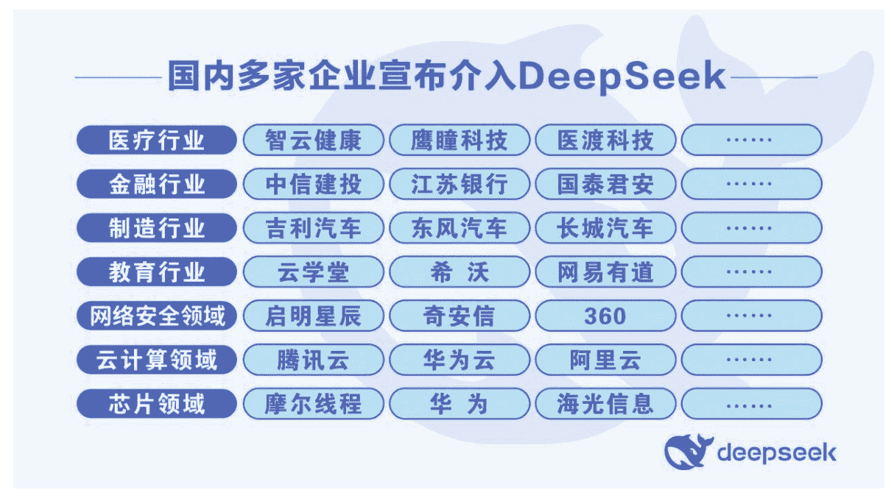
图 1.2 国内多家企业宣布接入

国内企业凭借资源与渠道，帮助产品与服务触达更广市场，提升品牌影响力与占有率。上下游产业链协同形成良好生态，助力其在竞争中占据有利位置。

**4．海外合作**
在国际化进程中，DeepSeek 积极开展合作，与全球领先科技公司、研究机构及行业伙伴建立战略关系，拓展技术影响力与市场覆盖面。与微软、英伟达、西门子等巨头在云计算、硬件加速、工业物联网等领域展开深度合作，共同推动制造、医疗、金融等行业的 AI 创新。DeepSeek 在海外的生态合作伙伴矩阵如图 1.3 所示。

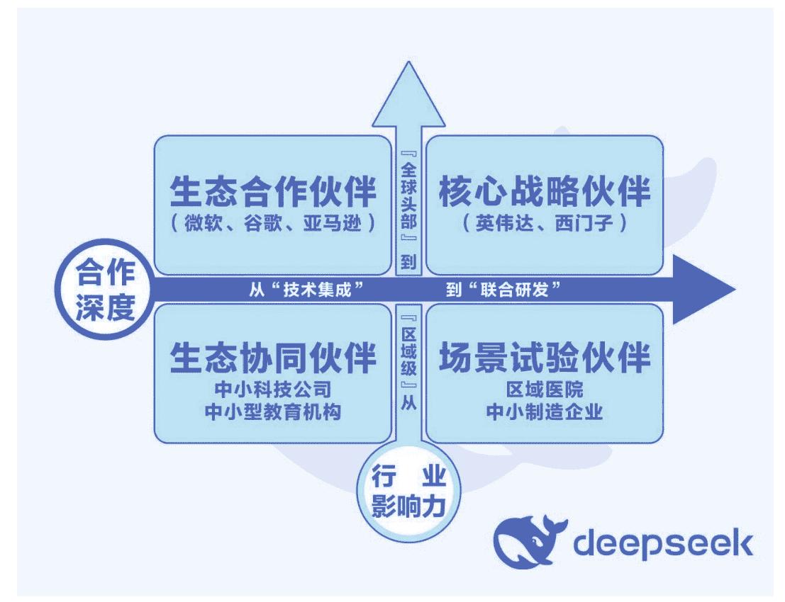
图 1.3 海外生态合作伙伴矩阵

同时积极参与国际技术标准制定与行业生态建设，为全球客户提供高效智能解决方案，助力企业数字化转型与智能化升级。通过国际化合作，既提升自身技术实力，也为全球用户创造更大价值。

1.1.2 基本使用技巧

DeepSeek 是一款功能强大的智能工具，用户可通过官网网页端或手机 App 注册后直接使用。本节以官方最新版 DeepSeek-V3 为例，介绍基本使用方法与技巧，帮助快速上手。

用户访问官网或下载 App，完成注册登录。图 1.4 为启动后的功能界面。

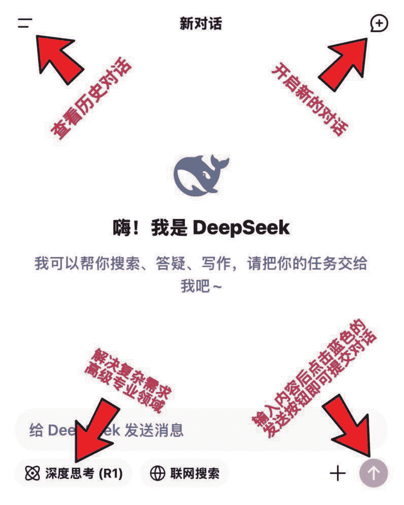
图 1.4 启动后的功能界面

App 功能界面包含四个主要入口。
■ **提交对话：** 发送指令并获取结果。
■ **开启对话：** 新建对话窗口。
■ **历史对话：** 查看过往记录。
■ **深度思考：** 进入高级模式处理复杂任务。

这些功能为用户提供便捷交互与智能服务。DeepSeek 能显著提升工作效率，自动化处理繁琐任务，节省时间精力。为让模型更高效，推荐使用“身份+任务+细节约束+输出格式”的提问公式，确保需求明确。

■ **身份：** 用户所扮演角色，如学生、程序员、电商运营等。
■ **任务：** 需要完成的明确事项，如撰写技术文章。
■ **细节约束：** 特殊要求，如字数、风格、场景等。
■ **输出格式：** 期望结果形式，如表格、段落、总结等。

举例：用户是一名大三计算机系学生，需要一篇关于 DeepSeek 的 500 字技术文章，以总结形式输出。只需在对话框输入需求，如图 1.5 所示，点击右下角蓝色发送按钮，即可获得结果，如图 1.6 所示。

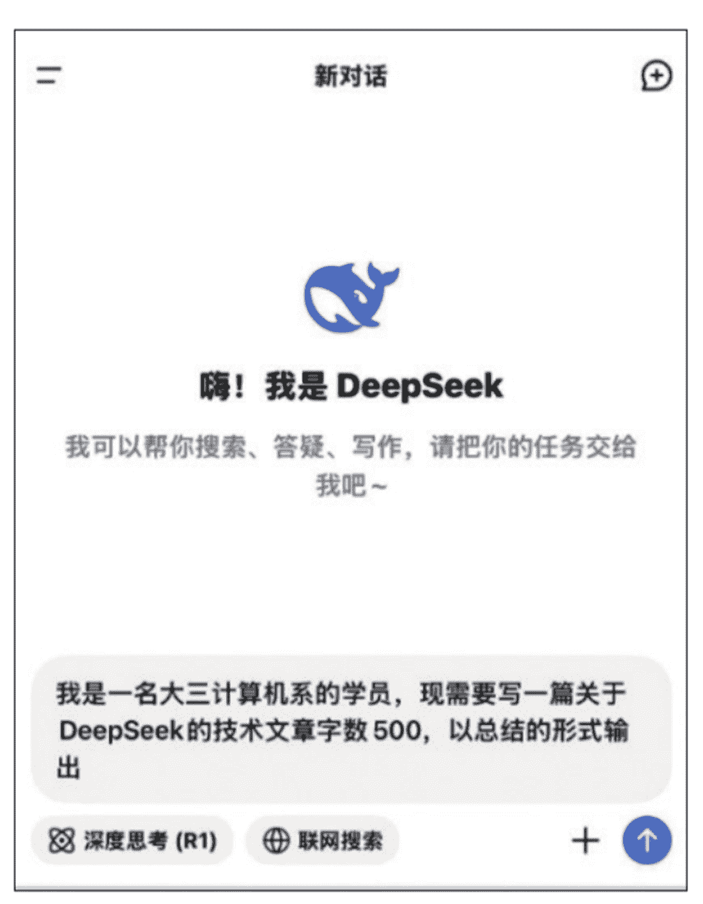
图 1.5 功能界面输入要求

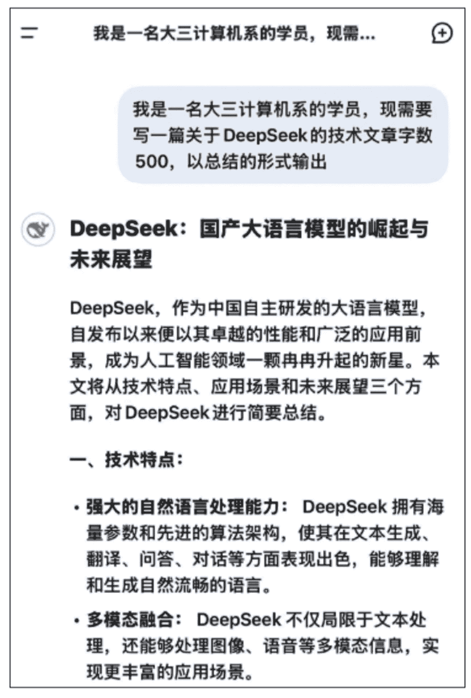
图 1.6 给出的结果

基础操作简单易懂，动手尝试即可快速掌握。

## 1.2 工作生活中的实用技巧

DeepSeek 正不断改变人们的工作与生活方式，以下针对常见职业角色的提问技巧进行示例。

1.2.1 律师的提问技巧
律师使用 DeepSeek 通常需要法律条文解释、案例分析与法律建议，提问应注重精准与逻辑性，如图 1.7 所示。

图 1.7 律师的提问技巧

1.2.2 医生的提问技巧
医生提问常涉及疾病诊断、治疗方案与医学研究，需体现专业性与准确性，如图 1.8 所示。

图 1.8 医生的提问技巧

1.2.3 学生的提问技巧
学生提问多围绕学习问题、作业辅导与考试准备，需清晰具体，如图 1.9 所示。

图 1.9 学生的提问技巧

1.2.4 程序员的提问技巧
程序员提问多涉及代码调试、技术选型与工具使用，需具备逻辑性与可复现性，如图 1.10 所示。

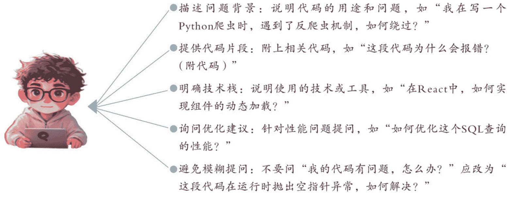
图 1.10 程序员的提问技巧

1.2.5 旅行家的提问技巧
旅行者提问多为行程规划、目的地推荐与注意事项，需注重细节与实用性，如图 1.11 所示。

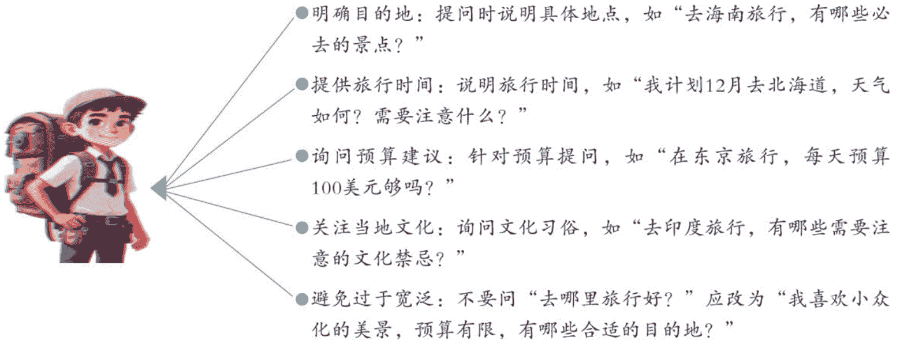
图 1.11 旅行家的提问技巧

1.2.6 作者的提问技巧
作者提问多围绕写作技巧、灵感获取与出版建议，需兼顾创意与实用性，如图 1.12 所示。

图 1.12 作者的提问技巧

1.2.7 DeepSeek 提问通用技巧
结合以上示例，提问时可参考以下通用建议。
■ **明确目标：** 清楚所需信息或解决方案。
■ **提供背景：** 简要描述问题背景或上下文。
■ **具体清晰：** 避免模糊或过于宽泛的提问。

■ 思路清晰：提问时条理分明、逻辑连贯，让接收方快速抓住重点。
■ 规则自律：严格遵守平台使用规范，避免发布违规内容。

坚持以上两项习惯，就能让 DeepSeek 的反馈更精准，所需信息更快到位，实际问题得以顺利解决。

## **1.3** **费曼学习法配合 DeepSeek 加速掌握**

将费曼学习法与 DeepSeek 结合，能显著提升学习效率与知识留存。费曼法的核心是“以教促学”，把复杂概念拆解为通俗表达。DeepSeek 则担任信息检索与答疑的得力助手，能在费曼法的每个环节提供高效支撑。概念图如图 1.13 所示。

图 1.13 DeepSeek 结合费曼学习法概念图

流程图如图 1.14 所示。

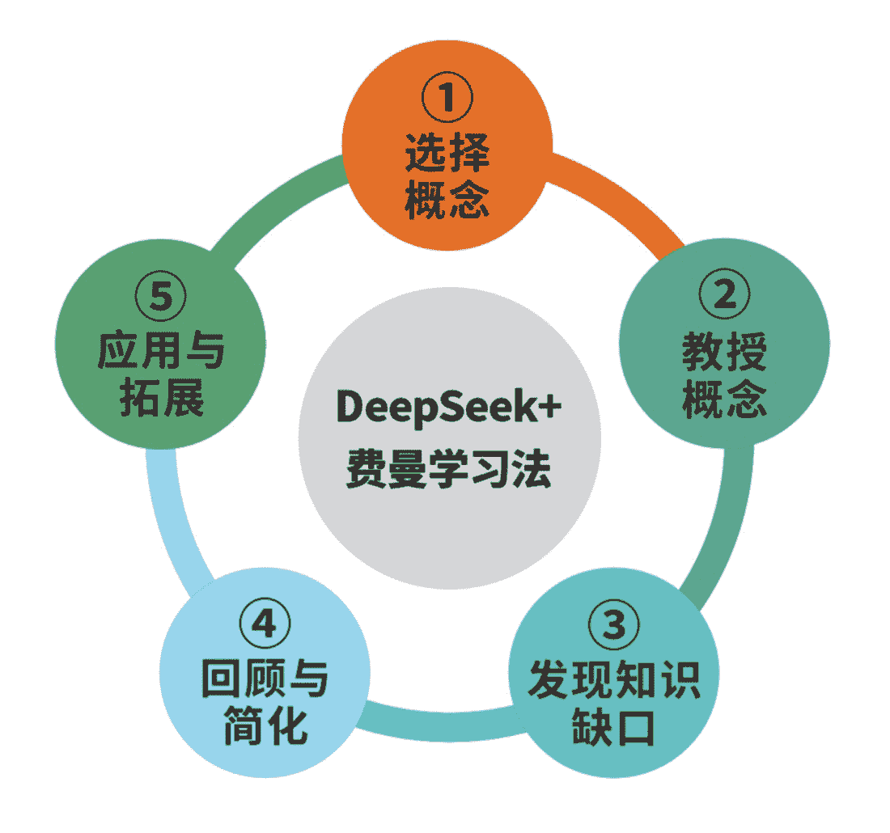

图 1.14 DeepSeek 结合费曼学习法流程图

从图 1.14 可看出整体分为五步，具体说明如下。

第一步：界定概念。例如把学习主题定为“量子力学”，可借助平台快速获取定义、发展背景及应用场景。示例提问：搜“量子力学的基础概念”或“量子力学在现实中的体现”，也可以直接问“量子力学的核心原理是什么？”

第二步：演绎概念。用自己的语言向他人或自己复述，确保通俗易懂。讲解时遇到卡点，可随时在平台中补充资料。例如讲解“波粒二象性”卡住时，可问“波粒二象性具体表现在哪些方面？”还可让平台提供类比或实例，如“生活中有哪些例子能帮助理解波粒二象性？”，帮助简化。

第三步：定位盲区。讲授过程中发现自己不理解或说不清之处，就针对该知识空白向平台提问。例如：“为什么量子纠缠无法用经典物理解释？”同时可让平台推荐学习资源，如文章、视频或教程。参考提问：“初学者适合的量子力学入门资料有哪些？”

第四步：复盘并简化。回顾所学内容，用更简洁的语言再次表达，确保清晰。可通过平台查找更通俗的解释或类比，例如：“如何用最简单的语言解释薛定谔方程？”也可借助平台自检理解是否正确，例如：“我对量子隧穿的理解对吗？（附上自己的解释）”相关示例：“有没有更直观的例子说明量子隧穿？”

第五步：实践与延展。将所学知识用在实际问题上，并尝试向相关领域延伸。可借助平台查找真实案例，例如：“量子力学在计算机科学中有何用途？”也可探索关联知识点，例如：“量子力学与相对论有何联系？”提问示例：“量子计算的基本原理是什么？”

在每个环节，平台都能提供强力支撑，帮助用户高效消化复杂概念、补齐知识盲区，并将知识迁移到实践，全面提升学习成效。

### **1.3.1** **结合带来的优势**

DeepSeek 与费曼学习法配合，能显著提高学习质量，主要体现在：

■ **信息搜集提速：**平台能迅速定位并整合资料，让用户把时间集中在核心内容，减少搜集成本。
■ **盲区补位：**在“找不足”环节，平台可快速解答疑惑、填补空白，保证学习连贯。
■ **通俗化支持：**平台可提供丰富的类比和简化解释，帮助把复杂概念转化为易懂语言，便于教学与巩固。
■ **即时校验：**借助平台可立刻检验知识掌握情况，避免误解。
■ **迁移拓展：**不仅掌握理论，还能引导知识落地实践，探索相关领域，实现深度延伸。

该组合优化了学习流程，提供更高效、更精准的支持，让费曼法的实践更轻松。

### **1.3.2** **实战演示：掌握“区块链技术”**

以下以学习“区块链技术”为例展示流程。

（1）界定概念：在平台搜索“区块链的基本原理”，快速获取核心要点。
（2）演绎概念：尝试用自己的话解释区块链，遇到不明白之处如“共识机制”，提问：“什么是区块链的共识机制？”
（3）定位盲区：无法解释“智能合约”时，搜索“智能合约如何运作？”，填补空白。
（4）复盘并简化：借助平台寻找通俗说法。例如：“有没有生活中的例子能解释区块链？”，帮助通俗化。
（5）实践与延展：搜索“区块链的实际应用案例”或“区块链与加密货币的关系”，把理论延伸到真实场景。

将平台与费曼法结合，可更快掌握复杂概念，快速识别并补齐知识缺口，同时将所学应用到实际问题。平台在每个步骤都提供有力支撑，加速知识吸收，提升效果与实践能力。

## **1.4** **DeepSeek 应用场景全景**

DeepSeek 作为先进的智能工具，应用场景十分广泛，能为不同领域用户提供高效精准支持。以下是主要场景。

### **1.4.1** **内容创作**

在内容创作领域，该工具已成为创作者不可或缺的助手。无论撰写观点鲜明的公众号文章，还是创作意境深远的诗歌，或构思引人入胜的故事，都能提供灵感与素材。例如撰写科技对生活影响的文章时，平台能迅速给出案例、数据和观点，帮助搭建框架并丰富细节。同时可按写作风格和需求优化生成内容，让文章更贴合预期。在诗歌创作中，能把握韵律与意境，推荐合适词句，让作品更富文采。许多自媒体创作者借助后，创作效率大幅提升，原本需数小时打磨的内容，如今能更快高质量完成，吸引更多关注。具体应用如下。

■ **文章撰写：**可帮助创作者快速生成高质量文章，提供灵感、框架和优化建议，适用于博客、公众号、新闻稿等。
■ **诗歌与文学创作：**可依据韵律、意境和主题生成诗歌或文学作品，提升文采与艺术性。
■ **故事构思：**可为小说、剧本等提供创意灵感、情节设计和角色塑造建议。

DeepSeek 内容创作概念图如图 1.15 所示。

图 1.15 DeepSeek 内容创作概念图

### **1.4.2** **教育与学习**

在教育与学习中展现出强大辅助能力，成为学生、教师和研究者的智能伙伴。对学生而言，能提供清晰知识点解析、高效习题解答和个性化学习建议，帮助快速攻克难点。对教师而言，可协助设计课程、生成教学材料，甚至自动批改作业，减轻负担。在学术研究方面，能为论文写作提供文献检索、框架搭建和语言润色服务，提升效率。此外还支持多语言学习，通过翻译、语法纠正和词汇扩展帮助突破语言障碍。无论课堂、自主学习还是学术探索，都能提供智能化精准支持。具体应用如下。

■ **学习辅助：**可为学生提供知识点解析、习题解答和学习建议，提升效率。
■ **论文写作：**可为学术论文提供文献检索、框架搭建和语言润色服务。
■ **语言学习：**支持多语言翻译、语法纠正和词汇扩展，助力语言学习。
■ **故事构思：**可为小说、剧本等提供创意灵感、情节设计和角色塑造建议。

DeepSeek 教育与学习概念图如图 1.16 所示。

图 1.16 DeepSeek 教育与学习概念图

### **1.4.3** **商业与营销**

在商业与营销领域价值突出，成为企业提升竞争力的智能助手。可生成吸睛的广告文案、品牌故事和营销内容，帮助企业抓住消费者注意力、提升品牌影响力。同时可提供精准的市场分析和消费者洞察，通过数据驱动的行业趋势解读和竞品研究，为战略决策提供支持。在客户沟通方面，可优化客服话术，提升服务体验，增强用户粘性。无论初创还是成熟品牌，都能借助智能内容生成与数据分析，达成营销目标、推动业务增长。具体应用如下。

■ **广告文案：**可生成吸引眼球的广告语、营销文案和品牌故事，提升传播效果。
■ **市场分析：**可提供行业趋势分析、竞品研究和消费者洞察，辅助决策制定。
■ **客户沟通：**可优化客服话术，提升客户服务体验。

DeepSeek 商业与营销应用概念图如图 1.17 所示。

图 1.17 DeepSeek 商业与营销应用概念图

### **1.4.4** **科技与研发**

在科技与研发领域技术实力强劲，成为开发者和研究人员的智能伙伴。可为程序员生成高质量代码片段，提供算法优化建议和错误修复方案，大幅提升开发效率。同时可自动生成清晰规范的技术文档，帮助团队记录和分享项目进展。在数据分析方面，可快速处理海量数据，生成可视化报告和深度洞察，为科研和决策提供依据。无论软件开发、技术研究还是数据科学，都能通过智能化工具加速创新落地。具体应用如下。

■ **代码生成：**可为开发者提供代码片段、算法优化建议和错误修复方案。
■ **技术文档生成：**可自动生成清晰规范的技术文档，节省编写时间。
■ **数据分析：**可协助处理和分析数据，生成可视化报告和洞察结论。

DeepSeek 科技与研发概念图如图 1.18 所示。

图 1.18 DeepSeek 科技与研发概念图

### **1.4.5** **媒体与娱乐**

在媒体与娱乐领域提供强劲创意支持，成为内容创作者和娱乐从业者的得力助手。可为短视频、电影或纪录片生成引人入胜的脚本创意，优化叙事结构和角色对话，提升吸引力。在社交媒体运营中，可快速生成适配平台的短文案、话题标签和互动内容，帮助品牌提升参与度和传播效果。此外还能为游戏设计提供剧情构思、任务设计和角色对话支持，助力打造沉浸式体验。具体应用如下。

■ **视频脚本：**可为短视频、电影或纪录片提供脚本创意和内容优化。
■ **社交媒体：**可生成适合社交平台的短文案、话题标签和互动内容。
■ **游戏设计：**可为游戏剧情、角色对话和任务设计提供创意支持。

DeepSeek 媒体与娱乐概念图如图 1.19 所示。

图 1.19 DeepSeek 媒体与娱乐概念图

### **1.4.6** **个人生活**

在个人生活领域提供贴心智能化服务，成为日常生活的得力助手。可帮助用户高效规划日程，生成提醒和待办事项，让时间管理井井有条。对旅行爱好者，可提供个性化路线、景点推荐和行程安排建议，让出行更省心愉快。此外还能解答生活常见问题，提供健康建议、实用技巧和即时信息查询，满足多样化需求。具体应用如下。

■ **日程管理：**可帮助规划日程、生成提醒和待办事项。
■ **旅行规划：**可提供旅行路线、景点推荐和行程安排建议。
■ **日常咨询：**可解答生活常识、健康建议和实用技巧。

DeepSeek 个人生活概念图如图 1.20 所示。

图 1.20 DeepSeek 个人生活概念图

### **1.4.7** **跨领域协作**

致力于推动跨领域协作，整合不同学科的专业知识与技术，解决复杂问题并推动创新。可与学术界、产业界及研究机构紧密合作，打破壁垒，促进知识共享与技术融合。无论 AI、医疗健康、金融科技，还是能源与环境保护，都能通过跨领域协作探索前沿应用，为社会创造更大价值。具体应用如下。

■ **多语言支持：**可为跨国团队提供实时翻译和多语言文档生成服务。
■ **创意头脑风暴：**可在团队协作中提供创意灵感和解决问题方案。

DeepSeek 跨领域协作概念图如图 1.21 所示。

图 1.21 DeepSeek 跨领域协作概念图

## **1.5** **小结**

本章帮助读者全面了解 DeepSeek 的基本概念、使用技巧及其在工作生活中的广泛应用。通过具体案例和实际场景，读者可掌握如何高效利用该工具提升学习、工作和生活的效率。学习后，读者能全面掌握核心功能和使用技巧，并灵活应用于工作、学习和生活的各个方面，充分发挥其智能助手的潜力。

# **第二章** **DeepSeek 工具联动实战**

DeepSeek 作为强大的 AI 工具，能与多种创意和生产力工具结合，帮助用户高效完成任务。本章将详细介绍 DeepSeek 与剪映、即梦 AI、豆包等工具的协作方法，并通过实战案例展示如何快速实现目标。

## **2.1** **剪映配合 DeepSeek：短视频与数字人创作**

在数字化时代，视频内容创作已成为个人表达和商业传播的重要方式。无论制作逼真的数字人视频，还是记录精彩的旅行瞬间，DeepSeek 与剪映的结合都能为用户提供高效便捷的解决方案，让创意轻松落地。接下来详细介绍如何利用两者快速制作短视频及数字人视频，帮助用户轻松掌握这一高效组合。

### **2.1.1** **5分钟搞定短视频制作**

短视频制作一直是许多用户的难题，而 DeepSeek 加 剪映的组合可快速实现制作，大幅降低门槛。下面分步介绍如何使用这两个工具生成短视频。

首先，使用 DeepSeek 生成短视频文案。打开 DeepSeek 并启动，在输入框中输入“帮我写 5 条关于旅行感受的文案标题”，生成标题如图 2.1 所示。

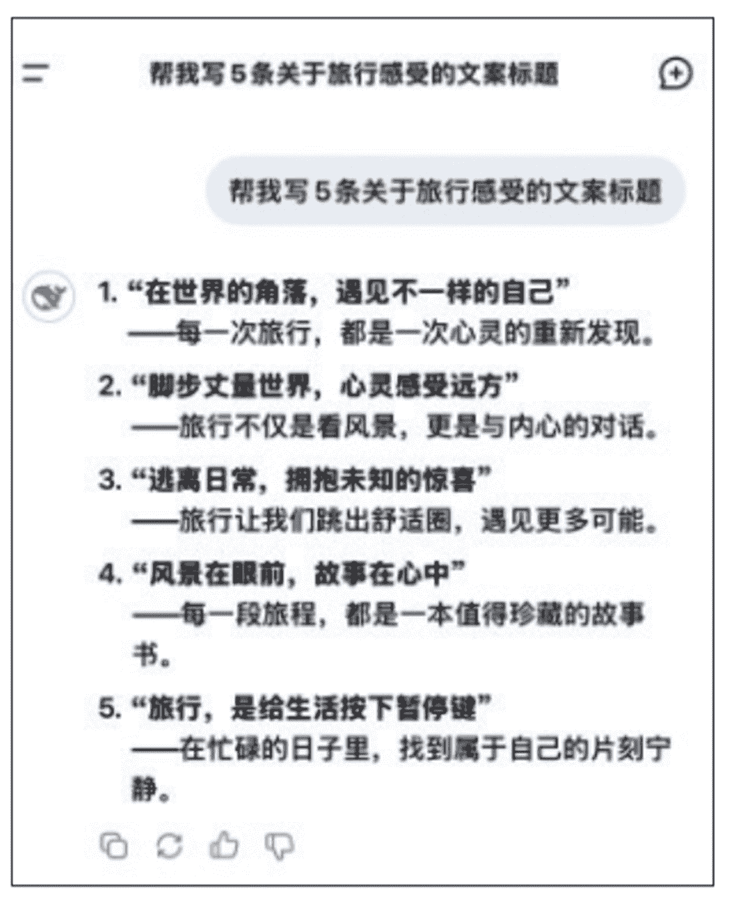

图 2.1 DeepSeek 生成旅行感受标题

从生成的标题中选择一条满意的标题（如第 2 条），然后在输入框中继续输入“根据第 2 条标题，生成短视频文案”，生成短视频文案如图 2.2 所示。

短视频文案生成后，接着打开剪映 App 并启动，在剪映 App 首页点击【AI 图文成片】选项，如图 2.3 所示。

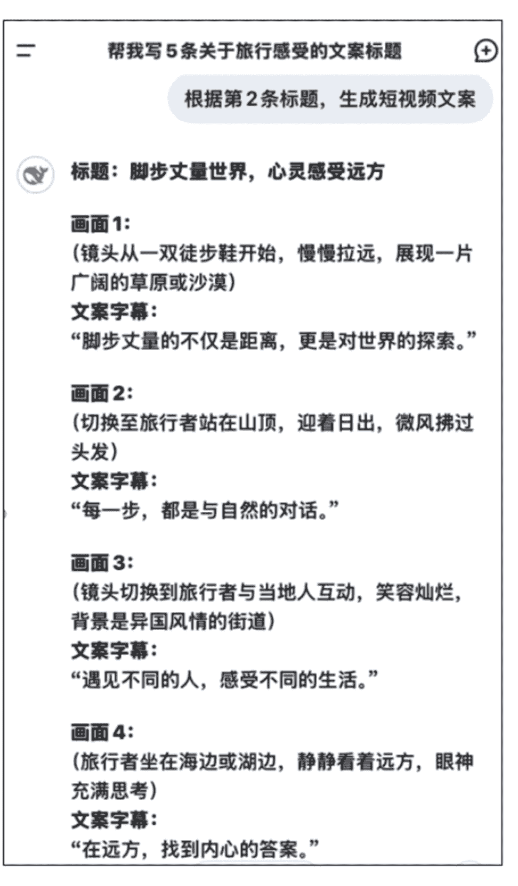

图 2.2 DeepSeek 生成短视频文案

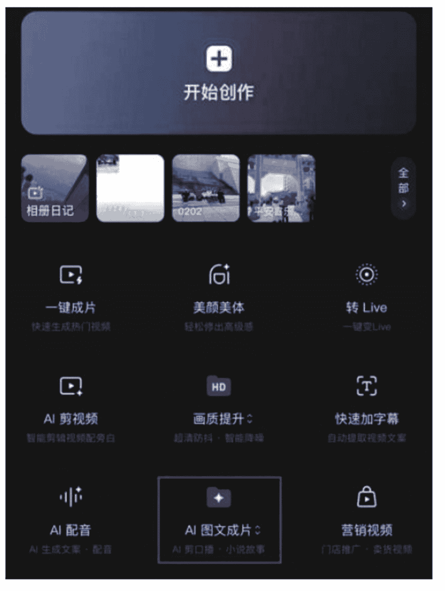

图 2.3 剪映首页功能界面

进入 AI 图文成片功能界面，选择【图文成片】选项，如图 2.4 所示。

点击【图文成片】选项后会弹出一个新的功能界面，如图 2.5 所示。

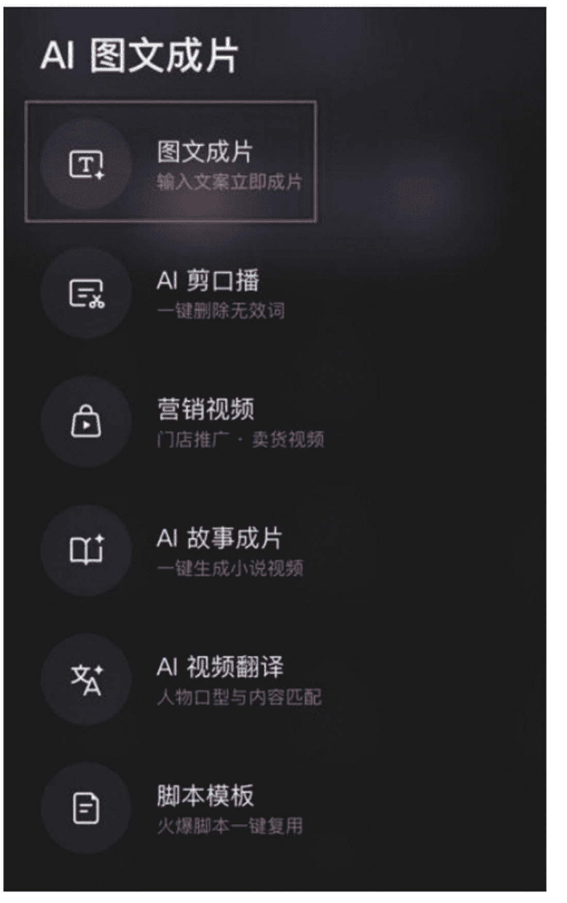

图 2.4 剪映 AI 图文成片功能界面

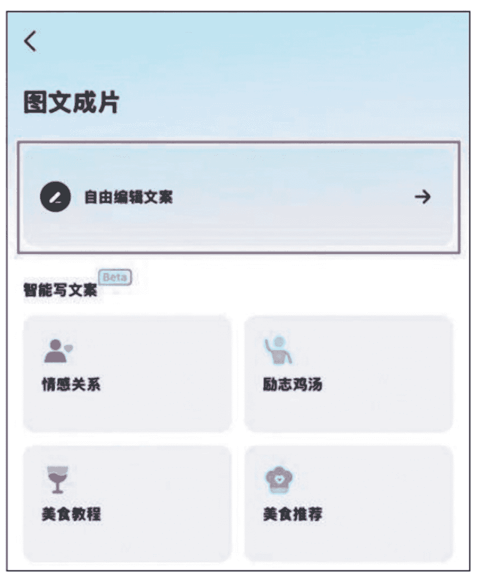

图 2.5 剪映图文成片功能界面

然后选择【自由编辑文案】选项，在输入框中粘贴在 DeepSeek 中生成的内容，点击右上角的【应用】选项，如图 2.6 所示

图 2.6 剪映图文成片输入框界面

完成文案输入并提交，进入选择素材的功能界面，如图 2.7 所示。

图 2.7 中共有 3 个功能选项，如果用户没有指定的素材，那么选择【智能匹配素材】选项。如果用户想上传自己的素材，那么选择【使用本地素材】选项。这里选择【智能匹配素材】选项，点击后等待视频生成即可，短视频预览界面如图 2.8 所示。

用 DeepSeek 配合剪映，短视频产出更快更省心
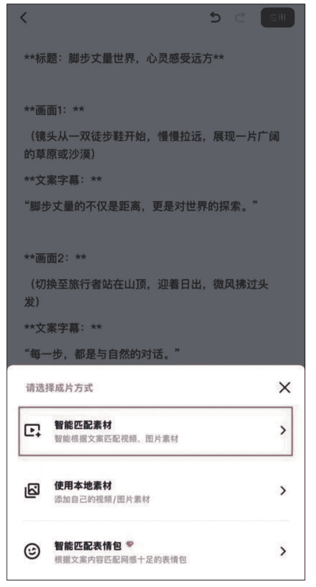

图 2.7 剪映选择素材功能界面

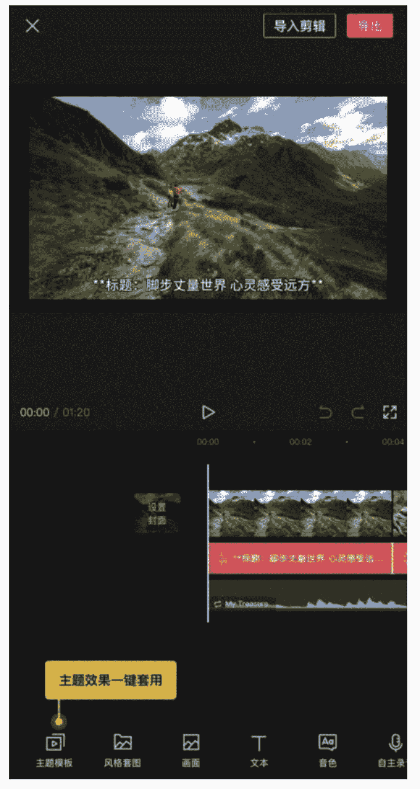

图 2.8 剪映生成的短视频预览界面

这一步就能打开预览，检查成片是否和预期一致。觉得不满意可以随心调整字幕的样式、字体与颜色，顺手加上背景音乐或音效，滤镜和特效也能让画面质感明显提升。

**注意事项**

**文案打磨：**如果 DeepSeek 写的文案感觉不到位，可以多试几次指令，比如让它“再写得更精简一点”或“换成更幽默的口吻”。

**时长把控：**在剪映里通过裁剪片段或调节播放速度，就能灵活控制最终视频的长度。

把 DeepSeek 和剪映串联使用，短视频的生成速度和成片品质都能得到大幅提升。无论是发社媒还是做商业推广，效率更高、成本也更低。

2.1.2 DeepSeek x 剪映：快速搭建 24 小时数字人带货
数字人带货在各大直播平台很火，它可以全天候不间断地给用户介绍商品，大大提升了带货效率。下面就用 DeepSeek 和剪映演示一套快速制作数字人视频的流程。

先打开 DeepSeek 输入需求。假如要做一个卖橙子的数字人，可以这样写：“帮我写一份卖橙子的口播稿，约 500 字，产地湖南，价格 5 元一斤，有兴趣可直接下单，24 小时内发货。”DeepSeek 就会生成一段适合播报的文案，如图 2.9 所示。
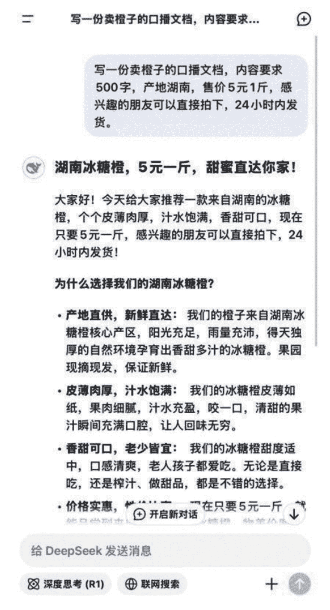

图 2.9 DeepSeek 生成口播文案

文案出来后，打开剪映 App 进入首页，点击【数字人】入口，如图 2.10 所示。
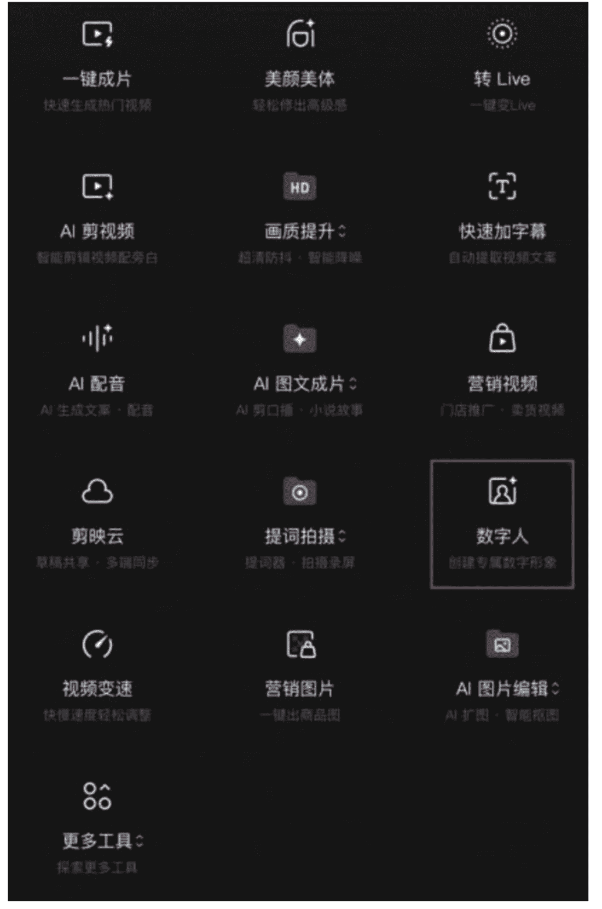

图 2.10 剪映首页功能界面

进入素材选择页面，先点【素材库】，再点【背景】，在搜索框里输入“橙子园”，如图 2.11 所示。
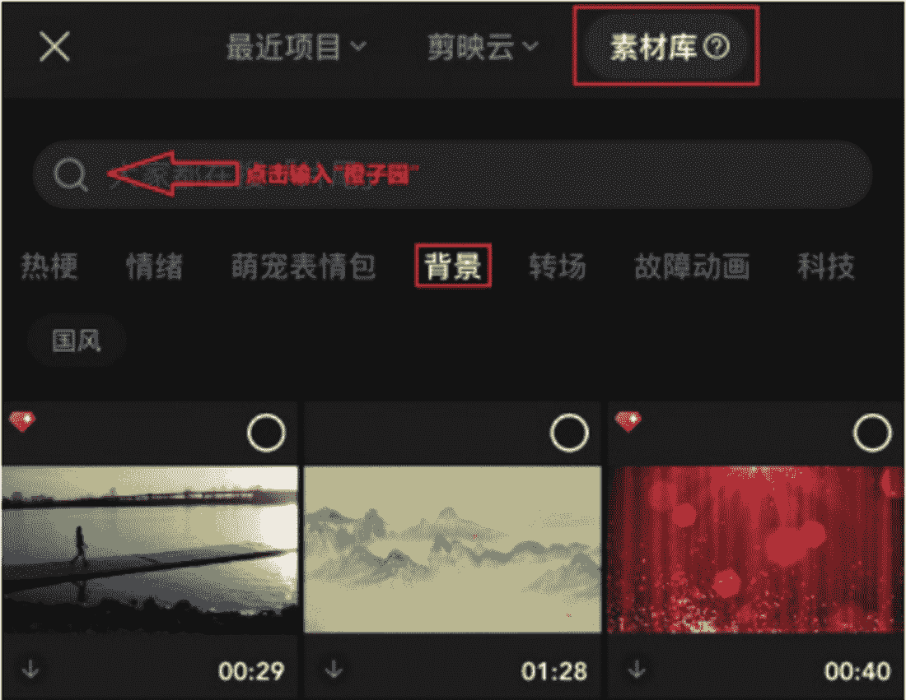

图 2.11 剪映数字人功能界面

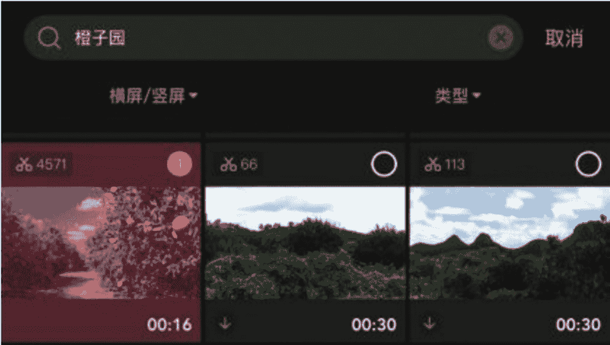

图 2.12 剪映数字人挑选背景

搜索结果里会出现多个橙子园背景，挑一个合适的视频当背景即可，如图 2.12 所示。

背景确定后，会进入数字人形象挑选界面，按个人喜好选一个形象，如图 2.13 所示。

图 2.13 剪映数字人形象挑选界面

图 2.14 剪映数字人口播内容界面

选好形象点【下一步】，在弹出的文案框里把 DeepSeek 生成的口播稿粘贴进去，同时可以自行选择配音风格和音色，如图 2.14 所示。

生成完成后进入预览页，如图 2.15 所示。

图 2.15 剪映数字人预览界面

在该页面还能继续微调内容，满意后点【导出】即可保存视频，上传到直播平台或社交媒体就能完成数字人带货。需要注意的是，剪映的数字人功能在某些平台使用可能产生费用，具体可根据自身情况评估。

2.2 DeepSeek + 即梦 AI：从热血战斗到家装设计
借助 DeepSeek 与即梦 AI 的组合，复杂特效和住宅方案都能快速落地。无论是游戏里的战斗画面，还是家装的视觉预览，都能生成逼真又有创意的成果，创作门槛和周期都被大幅拉低。

2.2.1 DeepSeek + 即梦 AI：10 秒生成特效战斗视频
即梦 AI 由字节跳动旗下深圳市脸萌科技打造，融合了 AI 绘画、视频生成和智能交互，让抽象想法变成可视化成果。它能理解自然语言，结合多模态生成能力，在亲子、艺术、教育等场景中提供从灵感到落地的支持。

和 DeepSeek 配合，能快速完成复杂特效场景。下面以“哪吒大战孙悟空”为例，演示 10 秒战斗视频的生成。

先用 DeepSeek 细化分镜，打开 DeepSeek 输入：“我要做一个 10 秒的视频，主题是哪吒和孙悟空打斗，帮我把细节和提示词补充完整。”生成的文件如图 2.16 所示。
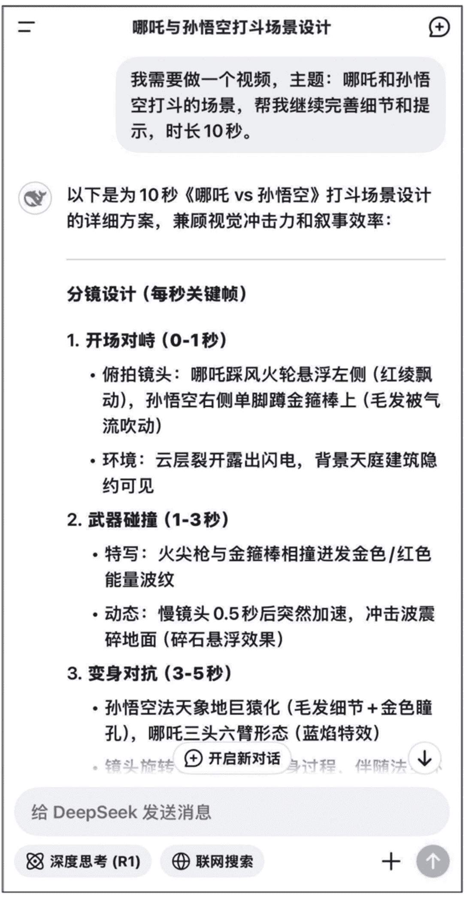

图 2.16 DeepSeek 生成文档

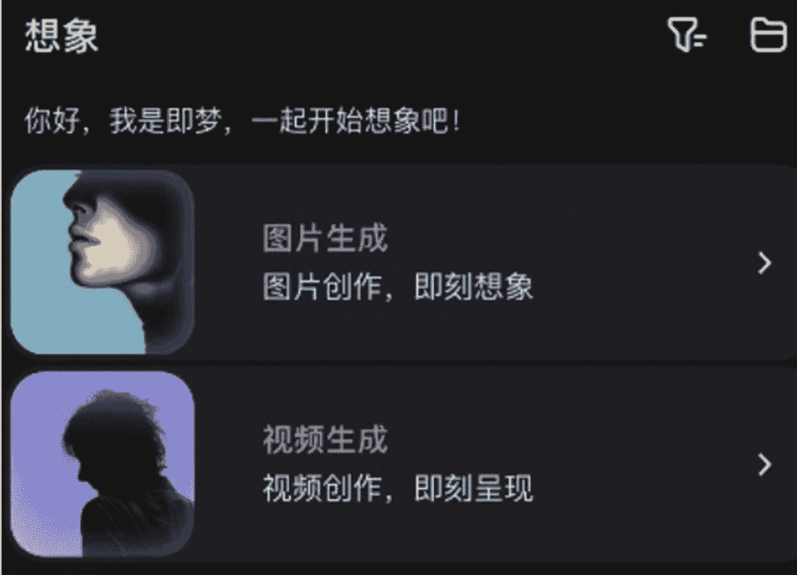

图 2.17 即梦 AI 功能界面

然后打开即梦 AI，在功能页找到【视频生成】入口，如图 2.17 所示。

点进【视频生成】后会弹出文字输入框，把 DeepSeek 产出的文本粘贴进去，如图 2.18 所示。

图 2.18 即梦 AI 文字输入页面

图 2.19 即梦 AI 生成的效果

输入完成后点击右下角【生成】，系统会按文案自动合成视频，如图 2.19 所示。

生成后可以预览效果，觉得不理想可在即梦 AI 里手动调节特效强度、画面色调等参数；也可以回到 DeepSeek 优化文案，比如补充动作细节、调整氛围描述，再重新导入生成。

这套用法很通用，科幻、武侠小说里的角色和场景都能试试。随着 AI 视觉能力不断进化，单纯用文字就能创造出复杂的画面，创意实现效率会越来越高。

2.2.2 DeepSeek + 即梦 AI：快速出住宅设计方案
利用 DeepSeek + 即梦 AI，可以迅速完成住宅设计可视化。

先打开 DeepSeek，点击界面右下角的【+】，如图 2.20 所示。
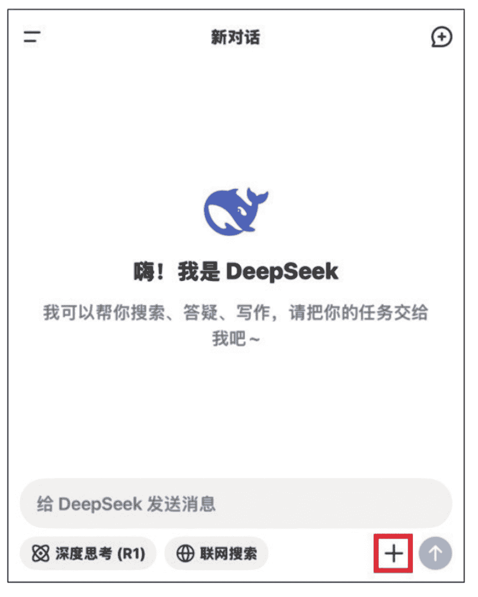

图 2.20 DeepSeek 功能界面

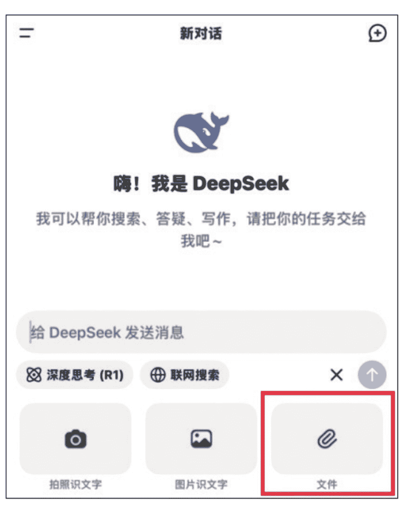

 图 2.21 DeepSeek 上传图片或文件的功能界面

随后弹出上传选项，选择【文件】，如图 2.21 所示。

从手机里挑选户型图照片上传，如图 2.22 所示。
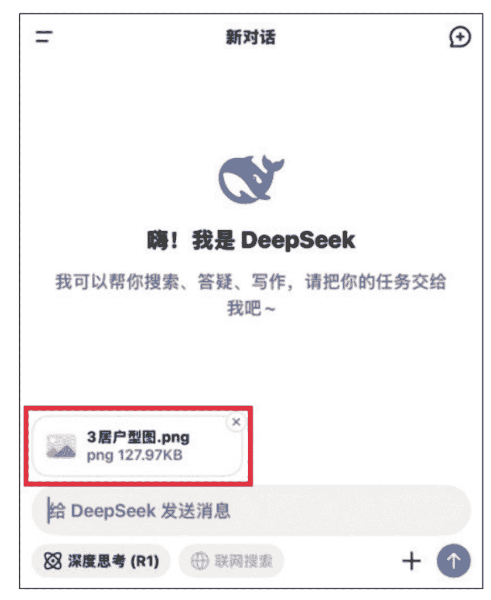

图 2.22 DeepSeek 上传图片成功

上传成功后在输入框里写清装修需求，例如：“风格要北欧，预算 30 万，城市武汉，用环保材料，需要地暖和中央空调，户型图已上传。”如图 2.23 所示。
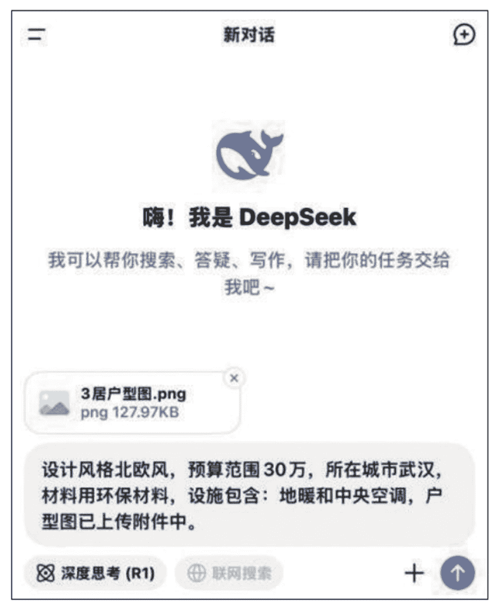

图 2.23 在 DeepSeek 中输入装修需求

提交后 DeepSeek 会很快给出装修方案，如图 2.24 所示。
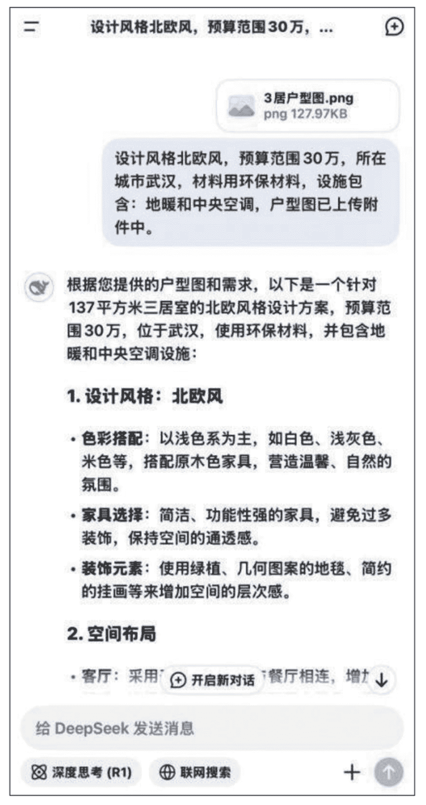

图 2.24 DeepSeek 生成的装修方案

接着打开即梦 AI，找到【图片生成】，把 DeepSeek 输出的文字方案粘贴进输入框，如图 2.25 所示。

图 2.25 在即梦 AI 中输入装修方案

点【生成】后等待片刻，即梦 AI 会输出高清装修效果图，如图 2.26 所示。

图 2.26 即梦 AI 生成的装修效果图

如果效果不满意，可以回 DeepSeek 修改需求，比如换风格、调预算，重新生成文案再导入即梦 AI。即梦 AI 里也能手动微调颜色、材质、灯光等细节。

通过这套组合，风格、预算、材料等都能按需定制，装修方案变得更智能、更省心。

2.3 DeepSeek + 豆包：音乐与海报一站式创作
DeepSeek 和豆包搭配，能快速完成音乐制作和海报设计。无论是视频配乐、原创歌曲，还是活动宣传海报，都能以简便流程得到高质量结果，创作者无需专业背景也能上手。

2.3.1 DeepSeek + 豆包：快速完成音乐创作
为场景配乐或写旋律都很简单。

先在 DeepSeek 输入：“根据哪吒大战龙王的场景写一首歌词”，如图 2.27 所示。
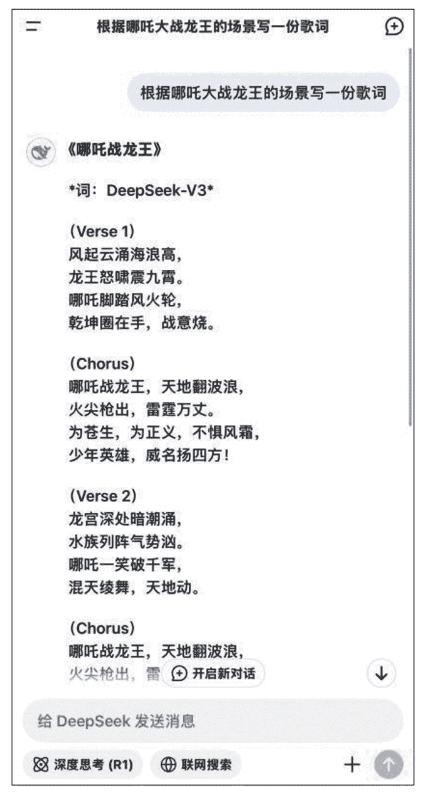

图 2.27 DeepSeek 生成歌词的界面

图 2.28 豆包的音乐生成功能界面

歌词生成后打开豆包，选择【音乐生成】，如图 2.28 所示。

进入输入框把歌词粘贴进去，可按需选择风格、氛围、人声、时长等参数，如图 2.29 所示。

图 2.29 在豆包中复制歌词并选择音乐风格

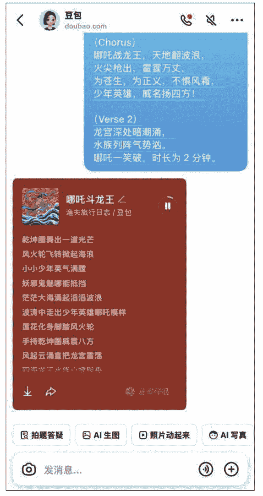

图 2.30 音乐生成成功的界面

确认后点蓝色发送按钮，音乐就会自动生成，结果如图 2.30 所示。

这套流程让歌词和制作无缝衔接，个性化音乐创作变得更高效、更便捷。

2.3.2 DeepSeek + 豆包：快速制作海报
电影海报或商业宣传图也能快速搞定。

先到 DeepSeek 写：“帮我生成一份专业 AI 生图提示词，主题是电影哪吒 2，做一张海报”，生成结果如图 2.31 所示。
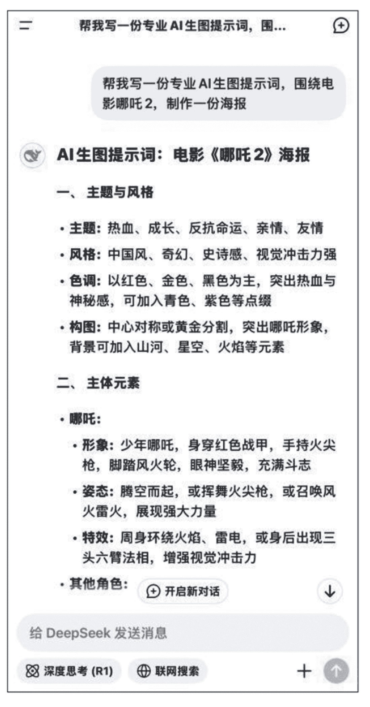

图 2.31 DeepSeek 生成海报提示词

图 2.32 豆包功能界面

然后打开豆包，找到【AI 生图】，如图 2.32 所示。

在输入框粘贴提示词，并可选择图片比例、扩图、清晰度等选项，如图 2.33 所示。

图 2.33 豆包中设置图片参数

图 2.34 海报制作完成

点击发送后系统自动生成海报，最终成果如图 2.34 所示。

文字到图像的协作让海报创作更省时，满足不同宣传需求。

## 2.4 本章小结
本章围绕 DeepSeek 与剪映、即梦 AI、豆包等工具的组合展开，展示了 AI 如何降低创作门槛、提升效率，并覆盖了短视频、数字人、特效、家装、音乐、海报等多类场景。无论是个人还是企业，都能找到适合自己的高效工作流。

# 第三章 DeepSeek 本地部署与项目实战
数据隐私要求越来越高，开发者希望摆脱云端依赖，搭建可控的本地环境。本章介绍如何在本地部署 DeepSeek 智能平台，并结合 CodeGPT 插件打造自主 AI 开发体系，最后通过本地化实战项目代码解读助手演示落地效果。本地部署既能保障数据安全，也能提供更灵活高效的开发体验。

## 3.1 DeepSeek 本地部署
下面详细介绍本地部署的完整流程。先安装 Ollama 作为模型运行环境，再部署 DeepSeek 模型，确保本地可运行；接着配置 Open WebUI 提供交互界面；随后集成 CodeGPT 插件提升编码效率；最后用案例验证流程的正确性。

3.1.1 安装 Ollama
本地跑 DeepSeek 模型的第一步是装 Ollama。Ollama 是开源本地大模型管理工具，支持在个人电脑、工作站或服务器上运行，可加载 Llama 3.3、DeepSeek-R1、Phi-4、Mistral、Gemma 2 等多种模型。安装简洁，支持 CPU/GPU 混合加速和 4-bit 量化，无需云端即可安全使用，适合内容生成、代码开发等场景。

打开 Ollama 官网点【Download】，按系统下载对应安装包，也可扫描书中二维码获取配套包。以 Windows 为例，下载 OllamaSetup.exe 后双击运行，点【Install】开始安装，如图 3.1 所示。安装过程无需额外配置，稍等即可完成。
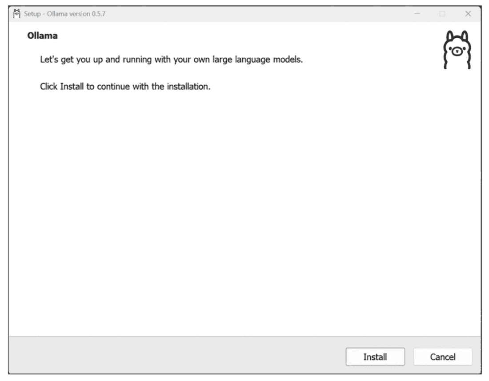

图 3.1 安装 Ollama

安装完成后需要验证。打开系统终端：

■ Windows 系统：按 Win+R，输入 PowerShell 或 cmd 回车。
■ macOS 系统：按 Command+空格，搜索 Terminal 回车。
■ Linux 系统：按 Ctrl+Alt+T 直接打开终端。

在 Windows 终端里执行 `ollama --version` 查询版本，若显示类似 `ollama version is xx.xx.xx` 的信息，说明安装成功，如图 3.2 所示。
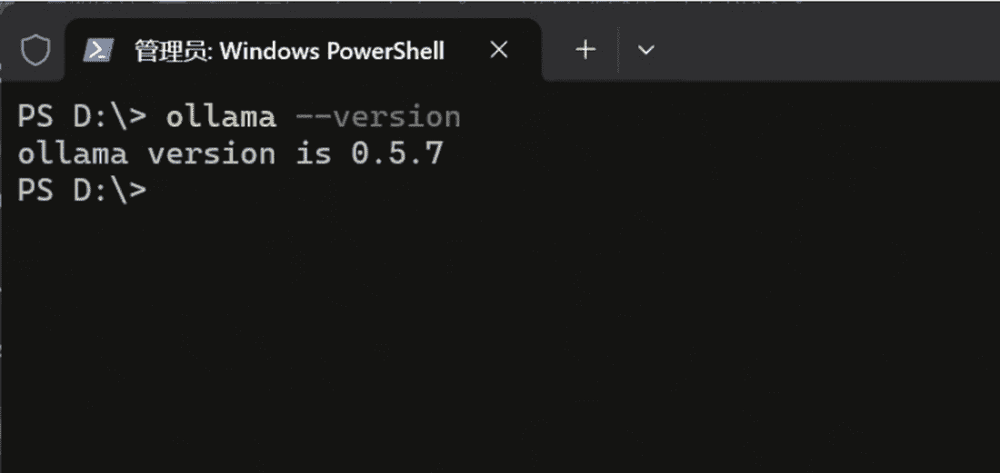

图 3.2 验证 Ollama 是否安装成功

注意，服务依赖终端窗口保持开启。关闭窗口服务就会停止。短期测试可手动保持窗口前台运行；若需长期稳定运行，建议注册为系统级服务：

■ Windows 系统：可用 NSSM 将程序注册为系统服务，实现开机自启和后台运行。
■ macOS 系统：可用 Launchd 配置守护进程。
■ Linux 系统：可用 Systemd 创建守护进程。

**补充说明：**

**部署系统服务时要做好日志和错误处理，方便排查问题。生产环境上线前务必充分测试，确保后台运行稳定。**

这样可避免因关闭终端导致服务中断，保证不同系统下全天候稳定运行。

3.1.2 部署 DeepSeek 模型

Ollama 在 DeepSeek 家族上的适配度很高，给硬件搭配留出了比较宽的空间。名称末尾的 B 指的是十亿级参数量，参数体量决定了算力与显存的消耗。拿日常办公的个人电脑举例，若显卡是市面常见的消费级型号，DeepSeek-R1 7B 或 8B 这个量级的权重比较合适，这类中等体量的版本在单卡上就能流畅运转，问答、代码生成等常规任务基本可担。手头是多卡工作站或高性能算力平台时，可以考虑 DeepSeek-R1 14B 甚至更大规格的版本，显存需求会上升，但长文本推理与多轮对话的上下文保持会明显更稳。

1.3B 规格不建议作为主力使用。体积小、显存占用低是优点，可知识密度与逻辑连贯性明显不足，只能做功能冒烟测试或教学演示，实战中容易出现事实性错误、长文本理解偏差。长期使用的情况建议从 7B 起步来保证可用性。另外借助 4-bit 量化等手段，可以在保留约 80% 效果的前提下把显存开销压低约三成，运行效率会进一步提升。

在 Win 命令行窗口执行 `ollama run deepseek-r1:7b`，系统会自动从 Ollama 仓库拉取约 4.7GB 的权重。终端输出出现 `success` 即表示权重已载入内存，此时输入“你好，请自我介绍”等测试语句，便能看到中文回复的表现，如图 3.3 所示。

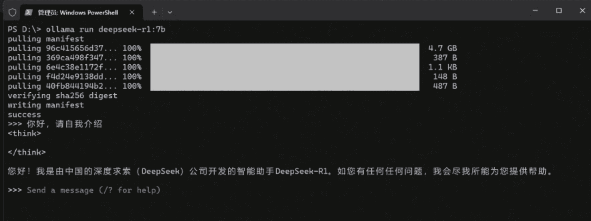
图 3.3 安装 DeepSeek-R1 7B 模型

紧接着在同一命令行执行 `ollama list`，若列表中出现 `deepseek-r1:7b`，说明该权重已成功落到本地运行环境，如图 3.4 所示。

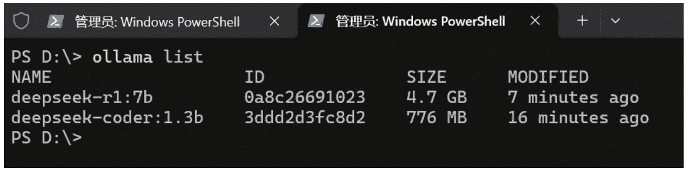
图 3.4 Ollama 已部署模型列表

图 3.4 显示权重已就绪。下面介绍 Open WebUI 的搭建与配置。

3.1.3 部署与配置 Open WebUI

除 Open WebUI 外，Anything LLM 也是一个可替代的方案。两者可按场景权衡。Anything LLM 在深度定制方面更强，私有化上线、接入自有本地知识库、对可扩展性要求高的场景下优势明显，但硬件门槛也更高，需要更强算力。Open WebUI 更偏向快速上线、前端简洁、主要依赖第三方网络知识库、资源占用低以及原型验证，综合性能需求、功能复杂度、上线周期来看，多数常规应用里 Open WebUI 因上线便捷和资源友好而更合适。

Open WebUI 完全开源，采用 AGPLv3 许可，源码可在 GitHub 获取，既保证透明度也方便企业自建。平台采用模块化设计，通过插件可接入本地知识库、第三方 API。备受关注的是多实例管理能力，可同时挂载多个权重终端，实现不同规模版本的快速切换对比，配合交互式对比面板，能明显提升选型效率。对开发者和研究者，系统还提供完整的 API 调试工具与请求日志追踪，便于性能分析与调用优化。

本机搭建前需先准备好 Docker 容器平台。官方强烈推荐用 Docker 作为标准化方案，能简化安装、提升可维护性和可移植性，是本机上线的首选。

可从 Docker 官网下载最新版，或扫描书中二维码获取配套安装包。打开安装包点【OK】开始安装，如图 3.5 所示。

图 3.5 Docker 容器化平台安装界面

装完后系统会提示必须重启 Windows 完成配置，如图 3.6 所示。

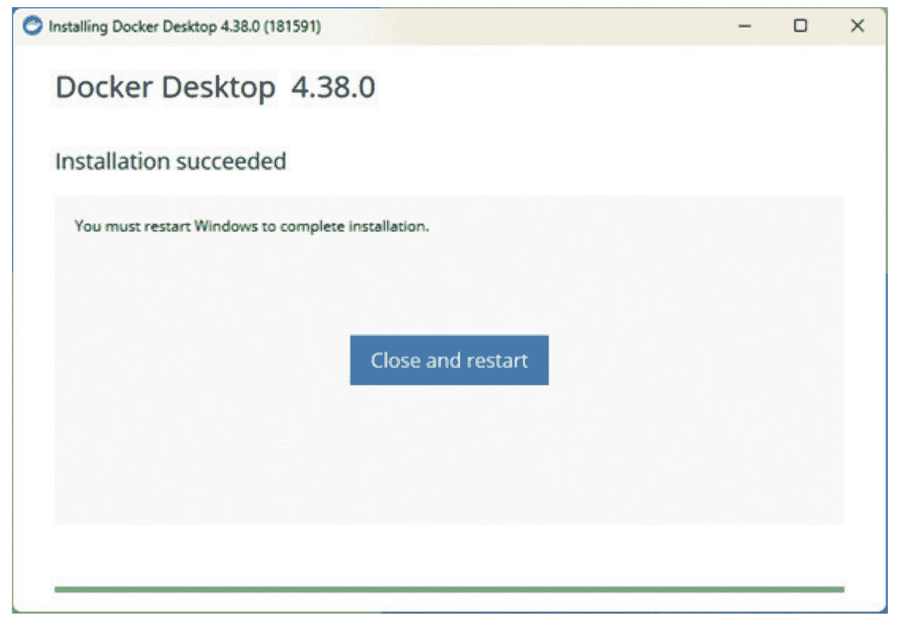
图 3.6 Docker 容器化平台安装完成

按提示重启后打开 Win 终端，执行：

shell
docker run -d -p 3000:8080 --add-host=host.docker.internal:host-gateway -v open-webui:/app/backend/data --name open-webui --restart always ghcr.io/open-webui/open-webui:main

其中 `-p 3000:8080` 将容器 8080 端口映射到宿主机 3000；`--add-host` 用于适配本地网络；`-v` 创建持久化存储卷保障数据安全；`--restart always` 让容器异常退出后自动重启。执行后 Docker 引擎会自动拉取官方镜像并完成容器化上线。

上线完成后用浏览器打开管理员账号创建页，填入名称、邮箱和密码创建管理员账号，如图 3.7 所示。

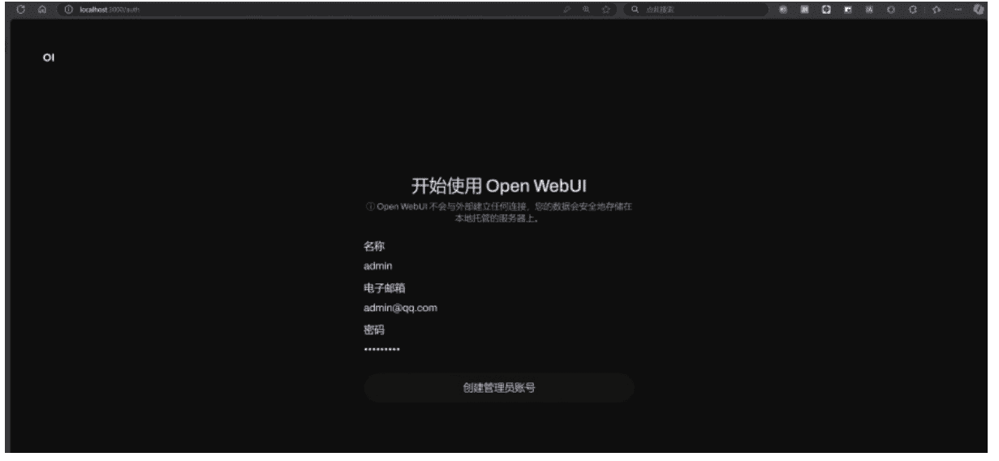
图 3.7 创建管理员账号

账号创建后即可使用。先选择已上线的 DeepSeek-R1 7B 版本，再在输入框里输入“你好，欢迎你入住我的电脑。”如图 3.8 所示。

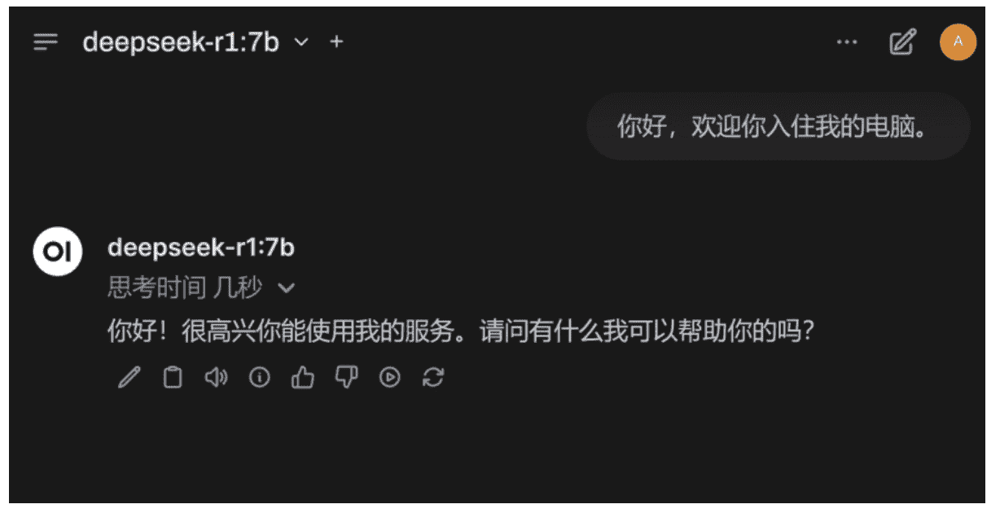
图 3.8 进入聊天功能页面

从图 3.8 可看出 DeepSeek-R1 7B 已配置成功。

3.1.4 集成 CodeGPT 插件

CodeGPT 能深度嵌入 JetBrains、VS Code 等 IDE，通过接入 GPT-4、DeepSeek-Coder 等大模型，为开发者提供全流程 AI 助力。核心是提升代码质量和开发效率，支持 40 多种语言的智能补全，响应时间小于 0.5s，还能做函数级生成，减少重复编码。

以 VS Code 为例，结合本机部署的 DeepSeek-Coder 1.3B 版本，能显著提升编码效率。该版本专为代码场景优化，1.3B 参数保持轻量，同时具备不错的代码理解与生成能力，很适合本机开发。

第一步完成权重本机获取。在 Win 终端执行 `ollama pull deepseek-coder:1.3b` 从 Ollama 拉取权重，如图 3.9 所示。

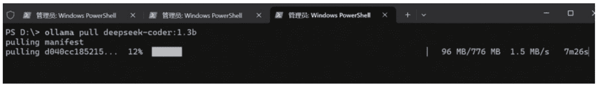
图 3.9 部署 DeepSeek-Coder 1.3B 模型

建议设备至少有 8GB 可用内存以保证流畅运行。

随后进入 IDE 配置。在 VS Code 扩展市场搜索并安装官方 CodeGPT 插件。该插件是 IDE 与 AI 权重的中枢，支持多种本机和云端版本接入，如图 3.10 所示。

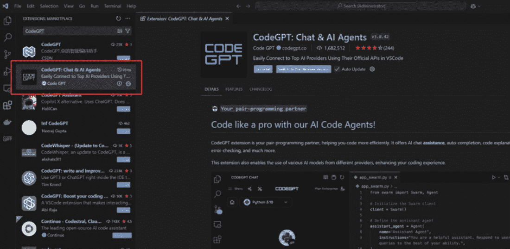
图 3.10 安装 CodeGPT 插件

安装后在插件设置里把权重供应商切换为“Ollama”，如图 3.11 所示。

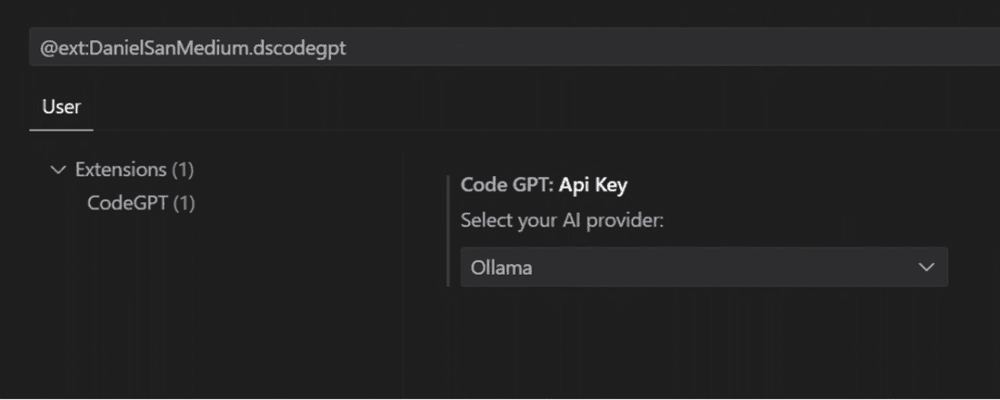
图 3.11 切换模型供应商

接着在版本选择栏指定已下载的 DeepSeek-Coder 1.3B，如图 3.12 所示。

此时系统会自动建立 VS Code 与本机权重服务之间的通信。基础配置完成后，可通过实际编码验证效果。在编辑区按快捷键 Ctrl+Shift+G 唤醒智能助手，版本会根据上下文给出补全建议、错误检测和自然语言解释，如图 3.13 所示。

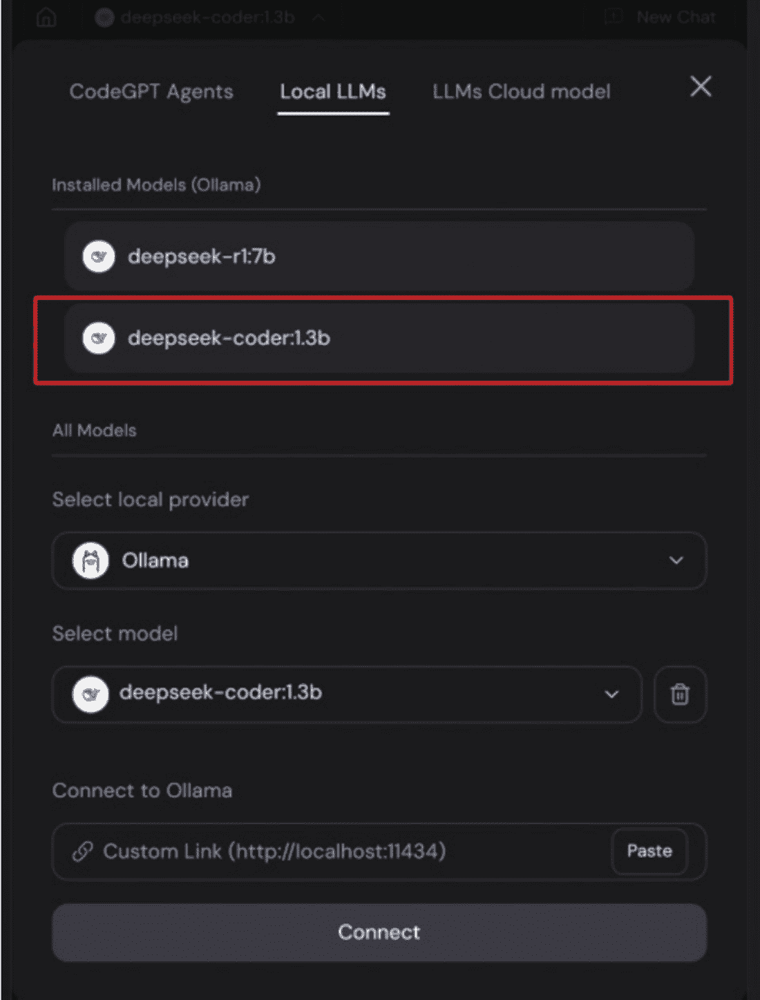
图 3.12 设置使用的模型

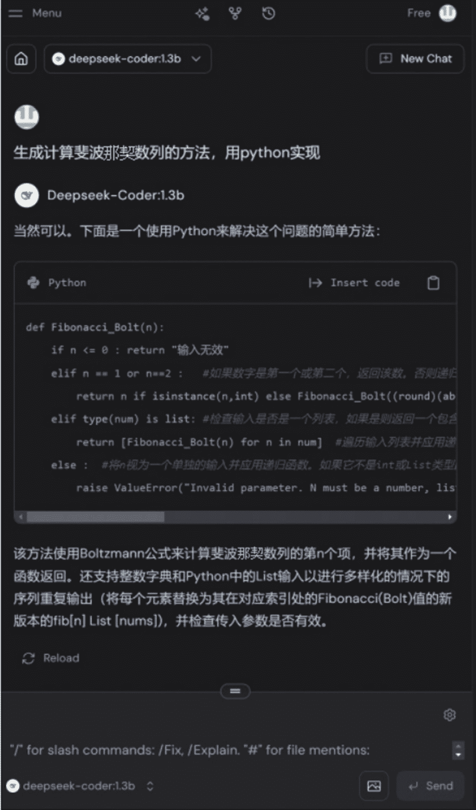
图 3.13 生成计算斐波那契数列函数

需要留意的是，权重完全在本机运行，所有处理都在用户设备完成，为涉及敏感代码的企业场景提供可靠的数据安全保障。个性化需求下，还可通过微调提示词模板优化输出格式和风格。

3.1.5 本机上线案例验证

本节用生成产品推广语来检验权重脱网运行时的创意与准确性。评估维度包括语句多样性、与输入的相关性、语法与语气准确度。

先在 Win 终端执行 `ollama serve` 启动 Ollama 本机服务，如图 3.14 所示。

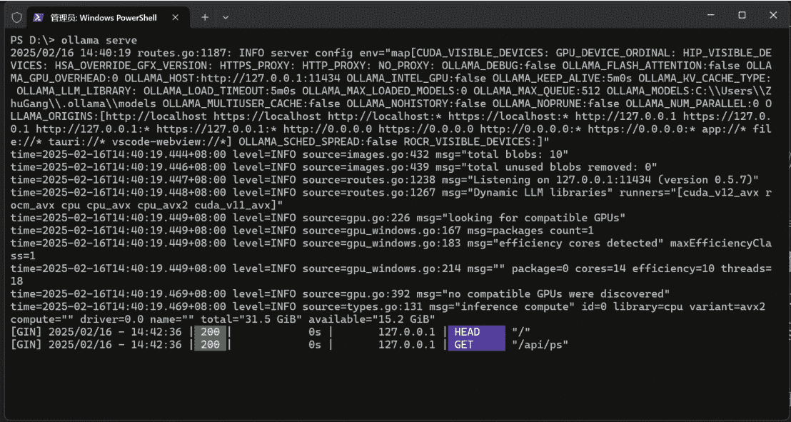
图 3.14 启动 Ollama 本机服务

该指令在本机建立稳定连接，便于管理和调度权重。

服务启动后新开终端执行 `ollama run deepseek-r1:7b`，权重会加载进内存并进入交互模式，等待输入，如图 3.15 所示。

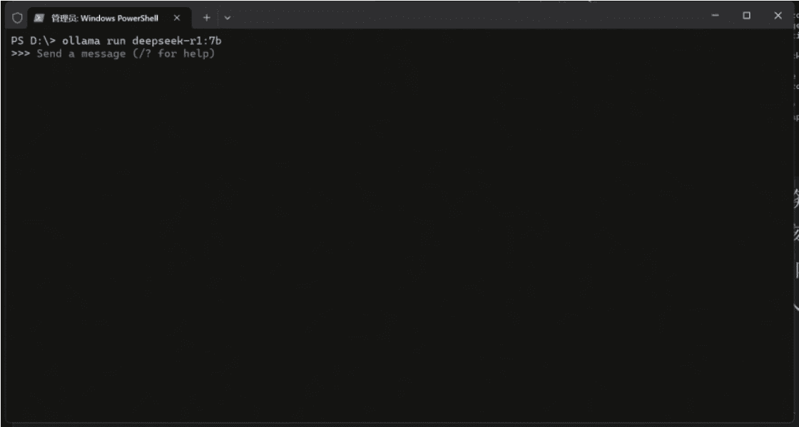
图 3.15 加载 DeepSeek-R1 7B 模型

随后输入产品信息，例如“生成产品推广语，要求精练简洁精准，产品是老年手机，特点是字体大、声音大、有一键求救功能。”该指令明确了产品类型、卖点、受众和文案长度要求，如图 3.16 所示。

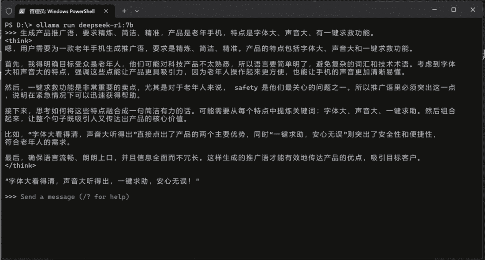
图 3.16 生成产品推广语

DeepSeek-R1 7B 推理后给出了符合要求的推广语。思考过程先锁定目标受众为老年人，语言要简明、避免技术术语；再拆解字体大、声音大和一键求助三个卖点，突出易用清晰和安全性；随后提炼关键词“字体大”“声音大”“一键求助”，组合成“字体大看得清，声音大听得出”突出易用性，“一键求助，安心无误”强调安全便捷；最后保证语言流畅易记，信息完整。

测试表明，DeepSeek 在不依赖外部网络时仍能稳定输出创意精准的推广语，兼顾多样性、相关性和表达准确度，展现了在复杂生成任务中的实用潜力。

3.2 DeepSeek 项目实战：代码解读助手

AI 重塑技术边界的当下，开发者既要应对代码规模爆炸式增长，也要提升效率。接下来基于 3.1 节本机部署的 DeepSeek 权重，做一个小工具：代码解读助手。

3.2.1 项目概述

代码解读助手基于本机部署的 DeepSeek-R1 构建，体量小巧但实用性强。

功能上包含：
添加代码注释。开发中代码可读性至关重要，随着规模和复杂度提升，清晰注释能让他人或后续维护者快速理解意图。工具可给出简洁有效的解释，提升整体可读性。
检查代码规范。规范是保证质量和可维护性的基础，助手能筛查明显违规范之处，像质检员一样提前发现影响质量的问题。
检查代码风险。隐患往往藏在暗处，助手可挖掘潜在风险点并预警，为优化提供依据。
使用流程很简单，把本地代码文件发给助手，选择添加注释、检查规范或检查风险等操作，助手会把结果打印到控制台。

虽为演示级小工具，但在开发早期能提供有价值的辅助，是理解逻辑和做基础检查的好帮手。

3.2.2 环境准备

开发前确认本机已安装 Ollama 并成功上线了 DeepSeek-R1 7B，这是后续工作的前提。

启动 Ollama。打开 Win 自带终端输入 `ollama start`，激活程序使其可运行。

验证启动及权重上线情况。可在浏览器地址栏输入 `localhost:11434/api/tags` 查看，如图 3.17 所示。

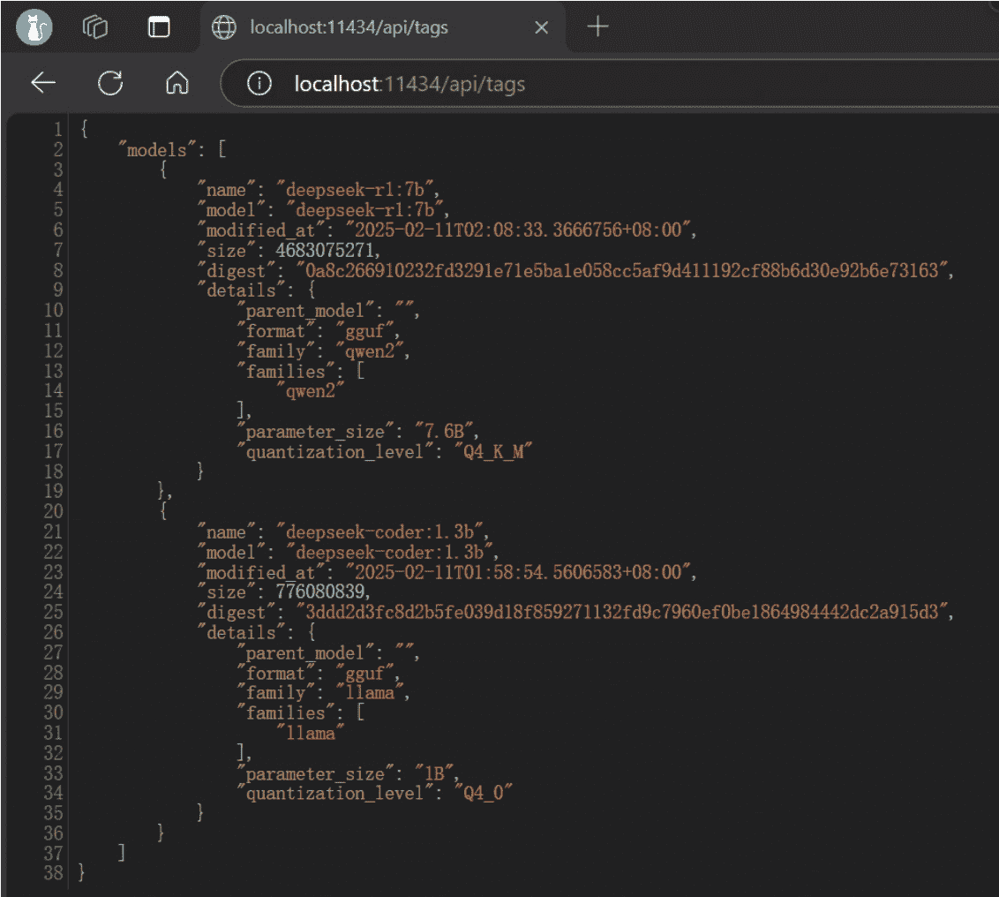
图 3.17 本地安装的模型信息

页会列出已装版本名称、大小、量化精度等信息，可确认 Ollama 已启动且 7B 版本已正确上线，为后续任务提供保障。

3.2.3 需求分析

基于已上线的 Open WebUI 分析代码解读助手的需求。打开平台后左上角的版本选择器切换到 `deepseek-r1:7b`。

分析分为标准化输入和结构化输出两阶段。输入时在对话框完整写下：“请根据如下内容，分析出需求，要求简洁明了。每个需求条目需包含编号、需求描述。”前半句定义任务，后半句约束输出结构。随后粘贴项目概述内容，系统自动处理。

权重会先抽取语义特征，识别需求相关表述；再定位“需要”“要求”“应支持”等触发词；最后生成规范的需求清单。由图 3.18 可见，输出采用三级结构，第三级条目加粗展示需求描述，右侧浅色文字补充说明。

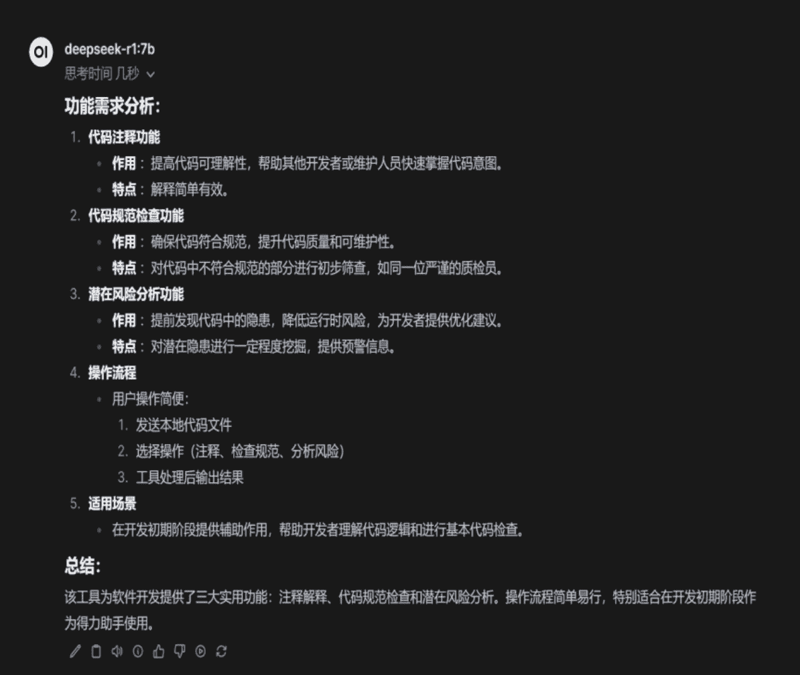
图 3.18 需求分析结果

输出严格遵循输入指令：条目独立编号，描述采用主谓宾句式，避免模糊。该结构化方式比人工提取效率提升约 40%，也能降低遗漏和歧义风险。

全程通过可视化界面完成，无需专业背景，支持实时反馈。复杂项目建议分段输入，单次控制在 2000 字内以保证精度和响应。

注意不同运行可能得到格式或表述上的差异，这是 AI 处理的自然特性，类似于不同人读同一篇文章会产生不同理解角度，由核心机制决定。

同一个问题问几次，得到的答案总有细腻差别，这并非偶然，而是设计上保留的三重弹性。

先说内部结构。模型本质上是数百万个微决策点编织而成的网络，运行时并不会沿着固定轨迹前进，而是按当下算力状态即时换路。拿导航作比，起点终点不变，堵车时路线就变；模型生成文字时也会被 CPU 占用、内存负载等实时环境牵动，做法随之微调。

第二层是故意留白的创造力。系统会注入一点可控的随机，以防每次都撞出同一份答案。跟人写作很像，同一题目隔几天再动笔，角度就会变。实现上靠调节参数，在合理区间内让词的选择更灵活，而不是死套模板。

第三层是硬件带来的漂移。不同芯片跑同一套复杂运算，犹如不同乐器演绎同一乐谱，因器性不同而带出细微偏差。长文本时，这种偏差会被步步累积，最后差距更明显。

这种看起来不稳定的现象其实是刻意为之。它保证了输出的多样，也展示了系统在面对复杂信息时的自适应能力。正因为有这种柔性，才更像人类的思考，在不同情境下给出更有创意的回复。

3.2.4 代码实现

本小节以 DeepSeek 辅助编程为例走一遍流程。

先打开 Windows 终端，用建目录的命令新建一个叫做 CODEHELPER 的工程目录，再执行 IDE 启动指令迅速打开 Visual Studio Code。

接着创建三份 Python 脚本。

■ readCode.py：负责入口层，把读文件的动作封装起来。
■ operate.py：承接业务层，执行核心逻辑。
■ main.py：总调度层，把各部分串起来。该脚本会从标准输入拿到目标地址，先调用 readCode.py 取数据，再交给 operate.py 处理后打印结果，整体结构见图 3.19。

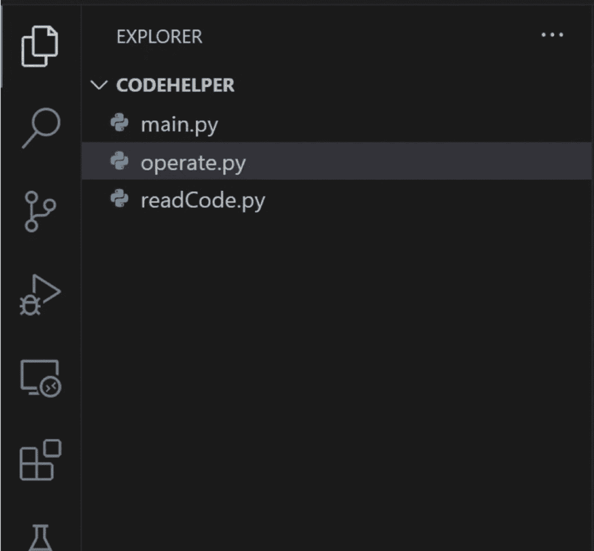

图 3.19 项目结构

**1．实现读取代码文件功能（readCode.py）**

readCode.py 的工作就是把指定地址的代码内容读出来并交回调用方。它只认 Python 源文件，为了防大文件拖慢速度，还设定了 200 KB 的上限。

先启动 CodeGPT 插件，在对话框里下第一条指令：生成一段 Python 脚本，能够把传入的文件内容读出并返回给调用方。回车后插件就会自动产出代码，见图 3.20。

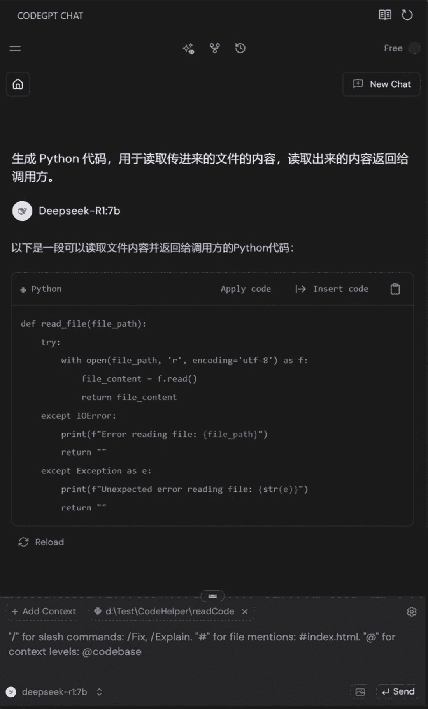

图 3.20 插件生成的 readCode 代码

点击【Insert Code】把生成的片段塞进 readCode.py。下面是插件给出的示例。

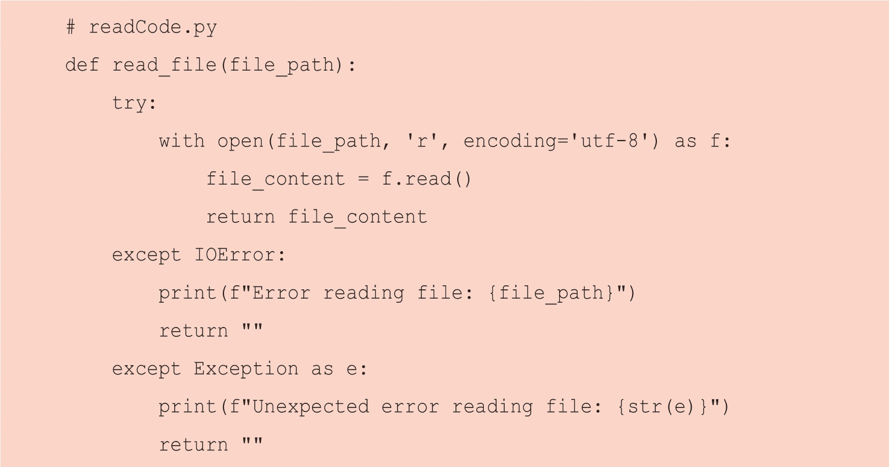

为了限定只处理 Python 文件，得补上类型检查。再次在插件输入框输入指令：检查 file_path 是否为 Python 文件，若不是则打印“文件 file_path 不是 Python 文件”。这条指令定义了校验规则与失败提示。产出如下。

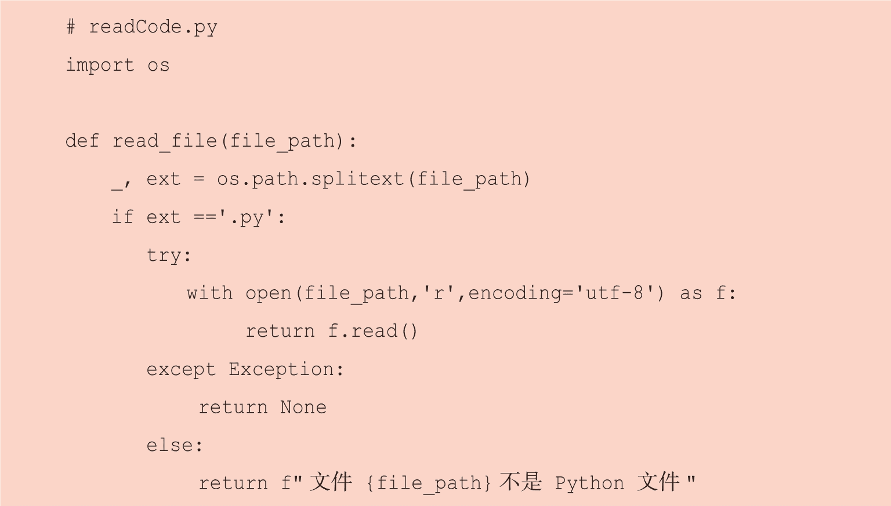

这段实现先用 os.path.splitext(file_path) 拆分扩展名存到 ext，再判断是否为 .py。不符则给出提示说明文件类型不对。

为了提升分析精度，还要限制规模，这里以 200 KB 为界。再在插件输入框加一条指令：在确认是 Python 文件后，再检查体积是否超过 200 KB，超了就打印“文件 file_path 大小超过 200 KB”。这样能把分析范围控制在可控区间。输出如下。

这次补充了体积获取逻辑。先用 os.path.getsize(file_path) 得到字节数，再除以 1024 转成 KB。若 file_size > 200 成立，就打印提示说文件太大。至此 readCode.py 的工作告一段落。

借助 AI 编程，拆分需求是提高准确度的关键。需求越庞杂，生成结果越容易跑偏。把任务切成足够小的步骤，能让每次迭代都有清晰的上下文与边界，从而减少无关或残缺代码的出现。

拆成步骤后，可以逐步喂入更具体的指令，AI 每次都能基于上轮反馈做优化。这种递进做法让请求更聚焦，也帮助 AI 更精准地处理每个子任务。本例里读文件被拆成读取、格式校验、体积校验三步，每一步指令明确，生成的代码也更贴合预期。

拆分不仅提升质量与正确性，也让问题定位更快，因为每次输出都只对应一个小范围的精细化需求。

**2．实现操作选择功能（operate.py）**

operate.py 负责根据操作码执行不同分支。它只接受 0、1、2 三个数，分别代表加注释、查规范、查风险。构建方式与 readCode.py 类似，也是分四条指令逐步生成，具体如下。

第一步 初始化。在 CodeGPT 对话框输入：生成 Python 代码，接收一个参数并校验是否为整数，若不是则打印“操作类型参数必须是整数类型”。这样会得到一个校验数值的 operate 函数。

这段逻辑先用 isinstance(number, int) 判断是否整数，再用 not isinstance(number, bool) 排除布尔，因为布尔在 Python 中是整数子类。只有同时满足整数且非布尔时才继续，否则打印错误并退出。

第二步 限定范围。输入指令：增加校验，参数只能是 0、1、2 中的其一，不符合就打印“操作类型参数只能是 0、1、2 中的一个”。这一步把取值锁死，超出范围即报错，有助于提升健壮性。

第三步 分支执行。指令为：校验通过后，依据输入的数字执行不同操作。比如 0 走第一个分支，1 走第二个，2 走第三个。这样用户可以直观选择功能，提升灵活性。

第四步 引入模型调用。指令为：在每个 if 分支里加上对本地 Ollama 部署的 DeepSeek-R1 7B 模型的调用，并把结果返回给调用方。

随后手工写 call_deepseek_r1_7b 函数完成模型交互。先在 Windows 终端执行 pip install ollama 安装包，安装完后在 operate.py 引入 Ollama。新建函数用于调用本地 Ollama 上的 DeepSeek-R1 7B。

该函数接收 prompt 与 temperature 两个参数。prompt 是用户输入的提示，temperature 控制随机程度，默认值 0.7，数值越大越发散，越小越稳。

内部先用 ollama.Client() 建立客户端，再调用 client.chat() 与模型对话。参数包括：
■ model="deepseek-r1:7b" 指定模型。
■ messages=[{"role": "user", "content": prompt}] 传递提示。
■ options={"temperature": temperature} 设置温度。
响应存入 response，最后打印 response['message']['content']。

**3．实现主程序功能（main.py）**

main.py 起到协调作用，把 readCode.py 与 operate.py 串起来。它提供程序入口，接收用户输入的操作类型 operateType 与文件地址 filePath，完整走完读取-处理-输出的闭环。

以下是 main.py 的代码示例。

代码先导入两个自定义脚本。主流程先让用户输入 Python 文件的完整地址，再选择要执行的操作并转为整数。随后用 read_file 读取内容，最后调用 operate 按类型处理。

接着检验能否正常跑。打开 Windows 终端，执行 python .\main.py，然后依次输入文件地址和操作编号。随后控制台会输出结果，见图 3.21。

图 3.21 操作执行结果

模型根据给出的文件地址与“为代码添加注释”的需求，经过推理后输出了符合预期的结果。过程先理解需求，再逐行推断代码意图与实现，随后把注释融入原代码输出。总体来看，模型凭借理解、推理与归纳能力，提供了清晰易懂的注释，有效提升了可读与可维护性。

3.3 本章小结

本章围绕 DeepSeek 本地化部署与实战项目展开，分两大部分。第一部分细述本地部署流程：安装 Ollama、部署 DeepSeek 模型、配置 Open WebUI 并接入 CodeGPT 插件，最后用本地案例验证完整性与可用性。第二部分聚焦“代码解读助手”实战，从项目概览、环境准备、需求分析到代码落地，逐步引导完成本地化开发。理论与实践结合，既给出部署指引，也通过实战帮助读者吃透 DeepSeek 的应用场景与技术要点。

第四章 DeepSeek 云平台部署与项目实战

本地化部署的好处是数据始终留在本地，隐私与安全性更可控。但投入成本高、扩展受限，算力需求上涨时扩硬件既贵又难调；技术迭代也慢，难以快速接入新设备，容易错失红利。云端部署恰好补足这些短板。通过虚拟化，计算资源变成可共享、可弹性调节的池子，高并发时可动态扩容，响应更快且不受物理限制，资源利用率与更新速度都大幅提升。本章介绍 DeepSeek 在云端的部署方式与实战。

4.1 DeepSeek 云平台部署

本节介绍两种云端部署思路：指令式部署与一键式部署，并通过案例验证其可行性与稳定性。

4.1.1 配置腾讯云服务器

可选的云厂商不少，腾讯云因性价比高与灵活的免费额度，成为个人开发者与中小团队的常用选择。相较 AWS、阿里云等平台，腾讯云每月可提供最高一万分钟的免费 GPU 实例额度，明显降低日常部署成本。对于频繁测试或轻量场景，这份额度已能覆盖常规开发。其面向人工智能场景优化的计算集群，单精度浮点性能较同类提升约 15%，配合高速内网与 SSD 存储，能明显缩短模型加载与推理耗时。

第一步打开腾讯云官网，用已注册账号登录，顶部导航进入【开发者工具】下的【Cloud Studio】。进入空间管理后，点击左侧【空间模板】，系统会列出多种开发环境，并在筛选区选定【AI 模板】，见图 4.1。

图 4.1 AI 模板页面

在列表里找到【Ollama】模板，点击后弹出【选择空间规格】窗口，选择【免费基础型】套餐，见图 4.2。该套餐含 8 核 CPU、32 GB 内存、16 GB 显存，适合个人做模型调试与轻量级测试。确认无误后点左下角【新建】提交。

图 4.2 【选择空间规格】窗口

随后平台进入资源调度，通常 1 到 3 分钟完成。部署完毕后自动跳转到【高性能工作空间】，页面上可看到新创建的 Ollama 实例，状态灯由橙色闪烁变为常亮绿色，见图 4.3。

图 4.3 新建的 Ollama 实例

提醒：用完后请及时关停相关服务，避免产生额外费用。云平台多按时长或计算量计费，服务持续运行费用会不断累积。使用完毕后可通过管理界面或命令行手动停止，或设置自动关停策略，以控制成本并释放资源。

4.1.2 使用指令部署 DeepSeek-R1 模型

点击新建的 Ollama 实例后，系统自动加载 IDE 工作台，按快捷键 Ctrl+J 打开终端。先执行 mkdir -p ollamamodels && cd ollamamodels 创建专属模型目录，保持工作区整洁并避免权限冲突，见图 4.4。

图 4.4 在终端面板中创建专属模型目录

在终端里键入 `ollama run deepseek-r1:7b` 即可拉起部署流程。执行后客户端会自动连上 Ollama 官方源，开始分片下载约 4.7GB 的参数包，在常规带宽下大约需要 3 到 5 分钟。下载完成后终端会输出 success，随后出现交互式提示 `>>>`，说明模型已就绪，如图 4.5 所示。

图 4.5 使用命令部署 DeepSeek-R1 7B 模型

日常运维时可定期执行 `ollama pull deepseek-r1:7b` 来同步最新版本，若显卡出现异常，可用 `nvidia-smi` 查看显存占用。

4.1.3 快速上线 DeepSeek-R1 模型

对没有命令行经验的用户来说，手写指令部署门槛较高。腾讯云 Cloud Studio 推出了免配置的模板化部署方式。进入模板库挑选对应模板后，平台会自动搭建运行环境，无需手动装配或自行拉取权重。可选规格包含 1.5B、7/8B、14B、32B。

以 DeepSeek-R1 32B 为例，在空间模板页打开【DeepSeek -R1】，在弹出的【选择空间规格】窗口里点选【DeepSeek 32B】，再点左下角【下一步】，后台即开始资源调度，如图 4.6 所示。

图 4.6 一键部署配置

等待数分钟后，IDE 工作台会自动加载，同时打开 README.md 与 Open WebUI，如图 4.7 所示。

图 4.7 IDE 工作台界面

至此模板化部署完成，工作台也已可用。接下来对部署效果做一次功能校验。

4.1.4 云端部署验证示例

本小节用一个简易 ToDoList 需求的生成任务来检验云端方案的可行性。

先点击 Open WebUI 左上角的【Open In Browser】，如图 4.8 所示。

图 4.8 Open In Browser

浏览器会新开标签页展示 Open WebUI，如图 4.9 所示。

图 4.9 在浏览器的新标签页中打开 Open WebUI 界面

新建工作区后进入设置页打开【聊天设置】，把“工作区 LLM 提供者”设为 Ollama，再把工作区聊天模型改为 “deepseek-r1:32b”。配置完成后即可在对话区调用 DeepSeek-R1 32B 进行交互，如图 4.10 所示。

图 4.10 设置聊天使用模型

该设置确保在 ToDoList 需求场景下能正确调用指定模型处理任务。

回到聊天窗口，输入需求描述：“我要做一个 ToDoList 软件，它包含任务增删改查功能，任务定时提醒功能，以及邀请他人一起完成任务的功能。帮我生成关于这个软件的需求。” 查看模型返回，如图 4.11 和图 4.12 所示。

图 4.11 输出结果 1

图 4.12 输出结果 2

模型在基础的增删改查之上，首先对核心能力进行了扩充，加入了任务优先级、标签分类、子任务拆分等；其次对定时提醒做了细化，补充了重复提醒和多种提醒渠道；协作层面加强了权限管控；非功能层面提出了数据加密存储、SSL 传输、系统支持多因素认证以及体验优化，并对后续扩展做了规划。

## 4.2 DeepSeek 实战：英语学习助手

本节基于云端 DeepSeek 模型实现“英语学习助手”。相较本地部署的代码解读助手，本项目在复杂度、技术细节和架构逻辑上要求更高。代码解读侧重分析与生成，而英语学习助手的重点是自然语言理解，需要更精准地解析用户输入的语义、语法和上下文，从而给出更贴合的学习支持。

4.2.1 方案总览

助手采用模块化设计，构建以场景为导向的语言训练体系。基于云端 DeepSeek-R1 32B 搭建商务、旅游、日常、求职、校园五大场景，每个场景集成英译汉、汉译英、对话、短文写作四类交互，形成多维培养矩阵。用户可自由组合学习路径，比如“商务+汉译英”强化专业术语，或“旅游+对话”提升场景交际能力，系统借助动态知识图谱实时调节难度，实现个性化体验。

词汇训练引入双向语义校验。选择“求职+汉译英”时，界面会推送“职业规划”“核心竞争力”等专业词条，要求给出英文表达。模型不仅校验 “career path”等标准答案，还能识别 “carrier path”等拼写错误。反向训练中，“校园+英译汉”会给出 “teacher”等词，要求译为“老师”，系统利用语义相似度进行概念匹配，对近似答案给出差异提示，强化精准记忆。

场景对话依托深度强化学习构建动态多轮对话。选择“旅游+对话”时系统自动生成交互剧本。以“行李遗失处理”为例，生成地勤与旅客的多轮对话模板。

短文写作会按场景出题，完成后从内容完整性、语言准确性、逻辑严谨性三个维度评分，并指出用词不当之处。

4.2.2 需求拆解

下面基于云平台部署的 DeepSeek-R1 32B 对英语学习助手做需求分析。

打开 Open WebUI 平台，在左上角模型选择器里指定 “DeepSeek-R1 32B”。输入指令：“请根据如下内容，分析出需求，要求简洁明了。每个需求条目需包含编号、需求描述。” 该指令明确输出格式、限定表述风格并保证条目独立。随后把项目概述粘贴在指令后，片刻后 DeepSeek 会返回整理后的需求，如图 4.13 所示。

图 4.13 需求分析结果

分析结果缺少“智能写作评估”。项目概述里已给出评分标准及占比，但模型在抽取时出现了遗漏。此类误差难以完全避免，可通过降低单次输入文本长度来减少。例如把概述按段落拆为四部分分别发送：

第一部分：请根据如下内容，分析出需求，要求简洁明了。每个需求条目需包含编号、需求描述。
第二部分：根据如下内容，补充完整英译汉、汉译英功能的需求。
第三部分：根据如下内容，补充完整场景对话的功能需求。
第四部分：根据如下内容，补充完整短文写作功能的需求。

最后发送聚合指令：将前面补充后的需求整理后，聚合在一起。该方法能更精准引导模型提取，减少遗漏。

4.2.3 编码实现

首先在终端执行 `mkdir LearningEnglish` 创建工程目录并用 Visual Studio Code 打开。随后在目录下新建 5 个 Python 文件，如图 4.14 所示。

图 4.14 项目结构

各文件职责如下：

■ comm.py：公共模块，存放通用指令前缀与模型调用方法，供其它模块复用。
■ dialogue.py：封装对话练习功能，实现模拟场景对话以提升口语能力。
■ word.py：实现英译汉与汉译英练习，加深词汇记忆。
■ writing.py：提供写作出题、语法检查、短文评分与建议等功能。
■ main.py：项目入口，整合各模块功能，通过标准输入让用户选择对话、单词或写作练习。

1. 通用代码功能 comm.py
comm.py 保存与模型对话的指令前缀及调用方法。前缀用于告知模型当前场景，如商务、旅游、日常、求职、校园，以便模型按场景调整回复。调用模型时复用了 call_deepseek_r1_7b 的逻辑，根据提示词、场景等参数生成回应，代码如下。

该代码定义了 comm 类，用于与 DeepSeek-R1 32B 交互并管理场景前缀。主要功能为：__scene 保存当前场景前缀；call_deepseek_r1_7b 调用模型生成对话，支持 temperature 控制随机性；set_scene 设置场景前缀；get_scene 返回当前前缀；can_convert_to_int 判断字符串是否可转整数。

2. 单词互译功能 word.py
word.py 实现汉译英与英译汉的一问一答练习。用户先选择翻译方向与练习轮数，程序据此按场景出题并校验答案。若答案错误则给出正确译文并进入下一轮。

其中 Word 类包含 start 入口方法和 execute 业务方法，代码如下。

start 先让用户选择 1 英译汉 或 2 汉译英，再输入轮数，最后将功能名与轮数传给 execute，代码如下。

execute 根据轮数循环出题，构建不同模板的提示词调用模型生成词汇，收集用户答案后再次调用模型校验，实现自动批改。call 作为服务层将提示转发给 comm 类的方法，代码如下。

3. 场景对话功能 dialogue.py
dialogue.py 通过模拟真实场景提升交流能力，先生成场景背景描述再进行英文对话练习。

文件内定义 Dialogue 类，包含 start 与 call 方法，代码如下。

start 获取当前场景，拼接中文场景描述消息，调用 call 输出并进入用户输入循环，对话结束时输出“对话结束”，代码如下。

4. 写作功能 writing.py
writing.py 按场景自动生成作文题目，对用户输入进行内容完整性、语言准确性、逻辑严谨性三方面评分并给出改进建议。

先创建 Writing 类并添加 start 与 call 方法，代码如下。

start 获取场景背景生成题目，提示用户输入作文后进行评估并输出分数与错误指出，最后给出改进建议，代码如下。

5. 主程序功能 main.py
main.py 作为入口，根据用户输入的场景与功能动态调用对应模块，实现流程调度，代码如下。

该程序提供交互式选择，用户可按场景与功能组合进行对话、单词或写作练习。

启动后，系统首先询问希望使用的学习情境。供给的情境有商务、旅游、日常、求职、校园五类，以数字编号进行确认。情境锁定后，内部会调用 com.set_scene() 完成环境设定。

紧接着出现功能选择。提供英汉互译、对话练习、写作练习三项，均以数字指定。若选择互译，程序会新建 Word 实例并执行其 start() 进入互译练习；若选择对话，则实例化 Dialogue 并调用 start() 开始模拟交流；若选择写作，则实例化 Writing 并调用 start() 开启写作任务。

当情境或功能的选择超出预设清单时，系统会打印错误提示并终止运行。整体形成一个简洁的交互入口，可依据情境与功能动态调入对应练习，让学习方式更贴合个人需求。

随后进行运行校验。在云平台终端面板中输入指令 `python .\main.py`，按顺序输入情境、功能及具体操作后回车确认。等待数秒，控制台会输出运行结果，如图 4.15 所示。

图 4.15 操作执行结果

以上即在云平台上部署 DeepSeek 引擎并开发英语学习助手的完整流程，后续可在该框架上继续完善相关功能。

## **4.3 本章小结**

本章聚焦 DeepSeek 在云平台的部署实践。先介绍了指令部署与一键部署两种高效方式，并通过云平台案例验证了部署的可行性与稳定性。随后以英语学习助手项目为载体，从项目概述、需求分析到代码实现，完整展示了如何借助 DeepSeek 云平台打造实用智能应用。理论结合实践，既给出部署指引，也通过实战帮助读者理解 DeepSeek 在云端的应用场景与技术优势，为开发者构建高效灵活的智能化解决方案提供参考。

# **第五章 DeepSeek 高级进阶**

在技术快速迭代的当下，深度学习已成为推动多领域创新的核心动力。DeepSeek 作为备受关注的模型体系，掌握其深度学习模型的基础构成与结构，有助于更好地解决实际问题、提升性能、降低风险并增强创新能力，为未来技术演进奠定基础。

## **5.1 DeepSeek API 的使用**

在深入使用 DeepSeek 之前，先了解其接口的构成与能力十分关键。接口是软件与各组件交互的桥梁，通过接口开发者可以便捷调用其强大功能，在自有项目中实现深度学习模型的构建与应用。本节概述接口的使用方式，帮助读者提升工作效率与模型表现。

### 5.1.1 初识 API

接口的使用可类比手机网购下单。手机购物下单仓库出货示意图如图 5.1 所示。

■ **用户：**购物者，发出购买请求。
■ **购物平台（API）：**接收请求并把订单传给仓库，后端处理完成后将商品数据返回给用户。
■ **仓库（后端）：**根据请求准备商品，即生成结果。

在该流程中，购物平台相当于接口，连接用户与仓库；购买请求相当于接口请求；仓库备货相当于后端处理。

图 5.1 手机购物下单仓库出货示意图

### 5.1.2 DeepSeek API 集成

DeepSeek 作为强大的智能平台，其接口为开发者提供了丰富的接入能力，可将智能能力嵌入自有应用或代码。集成流程如下：

**1．注册与获取接口密钥**

首先访问 DeepSeek 的【API 开放平台】完成注册。注册成功后在左侧栏找到【API keys】选项，如图 5.2 所示。

图 5.2 DeepSeek API 开放平台界面

点击【API keys】进入创建页面，如图 5.3 所示。

图 5.3 创建 API keys 界面

再点击【创建 API key】按钮，输入名称即可完成创建。创建后需要复制保存该 key 到安全位置。

注意：出于安全考虑，通过【API 开放平台】管理界面后续无法再次查看该 key，遗失需重新创建。

**2．阅读接口文档**

官方文档是理解与使用的核心资料，可在官网【API 开放平台】界面中找到【接口文档】选项，如图 5.4 所示。

图 5.4 DeepSeek API 开放平台界面（接口文档）

文档中详细说明了端点、请求参数、响应格式等，是开发不可或缺的参考。

**3．安装必要工具**

如以编程方式调用，需准备编程环境与依赖。以 Python 为例，需安装 requests 库发送 HTTP 请求，并要求 Python 3.7 及以上版本，通过 pip 安装 DeepSeek SDK：

pip install deepseek-sdk

**4．调用 DeepSeek 接口**

调用通常是向指定端点发送 HTTP 请求，并在请求中携带密钥、模型名称及请求参数。

**5．处理响应**

接口响应一般为 JSON 格式，需解析以获取所需信息。例如对话接口的响应包含模型生成的回答，可按需进一步处理。

**6．第三方集成**

DeepSeek 除常用工具外，还支持通过接口集成到第三方软件使用，如图 5.5 所示。

图 5.5 DeepSeek API 开放平台界面（实用集成）

点击【实用集成】打开第三方集成选择界面，如图 5.6 所示。

图 5.6 实用集成选择界面

在图 5.6 中选择任意功能，均可打开该功能的接口接入文档。通过文档可获取详细调用方式与说明，将 DeepSeek 功能嵌入自有应用。

**注意：**

**因系统更新可能导致集成失效，建议定期查阅接口文档获取最新信息。本书不展开详细讲解，感兴趣读者可自行学习使用。**

按上述流程，即可成功调用 DeepSeek 接口，将其智能能力集成到自有应用或代码中，也能将先进智能功能嵌入第三方程序。无论是新建服务还是增强现有平台，均可借助 DeepSeek 提升产品智能化水平，实现更复杂个性化的用户体验。

## **5.2 DeepSeek 模型的基本概念**

DeepSeek 作为国产大模型的代表，其深度学习模型的研究与应用备受关注。深入了解其基本构成与结构，有助于更高效地解决实际问题，并在性能优化、风险控制、创新提升等方面发挥作用，为技术持续发展夯实基础。对开发者、研究者与企业而言，掌握相关知识具有现实意义与战略价值。

### 5.2.1 模型的核心架构

DeepSeek 以 Transformer 为基础，创新融合混合专家模型 MoE 与多头潜在注意力 MLA，构建出高效灵活的结构体系。

**1．MoE 架构**

■ **动态任务分配：**内部设置多个专家模块。例如 DeepSeek-V3 包含数千个专家，各自擅长文本生成、逻辑推理等特定任务。通过门控网络实时动态选择激活的专家，减少冗余计算。例如 DeepSeek-V2 共有 2360 亿参数，处理每个输入 token 时平均仅激活 210 亿参数，约占总参数的 8.9%，依据《DeepSeek-V2 技术白皮书》2023 年实验数据，计算资源消耗降低 80% 以上；DeepSeek-V3 拥有 6710 亿参数，激活 370 亿参数，相较传统密集模型节省约 80% 计算资源。

■ **参数激活控制：**采用稀疏计算策略，单次输入仅激活 2/8 个专家模块，在保持模型容量前提下，减少约 75% 计算量。

**2．MLA 机制**

■ **多粒度注意力：**MLA 通过动态分配注意力头，使模型可同时捕捉长文本的全局依赖与局部细节，如在对话中准确把握上下文关联。

■ **低延迟优化：**压缩潜在空间维度后，MLA 将注意力计算复杂度从 O(*n*²) 降至 O(*n*)，显著提升长文本处理速度，推理速度提升约 3 倍。

### 5.2.2 DeepSeek 系列模型介绍

DeepSeek 系列典型模型的结构参数与适用场景对比见表 5.1。

**表**5.1 DeepSeek**系列典型模型的结构参数与适用场景对比**

示例：DeepSeek-V3 的推理流程大致为 4 步。

（1）输入处理：文本经 Tokenizer 分词并嵌入为向量。
（2）专家路由：门控网络依据输入内容挑选 2～4 个相关专家。
（3）注意力计算：MLA 模块并行处理长距离依赖与局部特征。
（4）输出生成：动态融合专家结果，生成最终响应，如生成 1000 字技术文档仅需 1.2 s。

### 5.2.3 什么是大模型

大模型指参数量巨大、计算复杂度高的深度学习模型，通常含数十亿甚至数千亿参数。通过海量数据训练，可捕捉复杂模式与规律，具备强泛化与多任务能力。在自然语言处理、计算机视觉等领域表现突出，可完成文本生成、图像识别、机器翻译等复杂任务。因规模庞大，训练与推理需大量计算资源，如 GPU、TPU，推动智能化技术快速发展。

大模型通常具备以下特征。

■ **参数量大：**可达数十亿至数千亿，如 GPT-3 拥有 1750 亿参数。
■ **计算资源需求高：**训练与推理需大量计算资源。
■ **能力强：**泛化与多任务处理能力更强，可处理复杂任务如自然语言理解、图像生成等。
■ **举例：**DeepSeek-V3、GPT-4、BERT 均为代表。
■ **作用：**在自然语言处理、计算机视觉等领域表现出色，可解决更复杂问题。

## **5.3 DeepSeek 自定义模型**

DeepSeek 自定义模型是其官方推出的企业级智能方案，以“垂直领域高效定制”为核心，基于自主研发的超大语言模型体系，通过灵活架构调整与训练策略优化，赋能金融、医疗、法律等行业构建专属智能能力，降低算力成本与部署门槛。下面介绍核心技术、训练与优化策略、应用场景与案例、实施步骤及优势。

### 5.3.1 DeepSeek 自定义模型的核心技术

**1．MoE 与稀疏激活机制**

■ **技术原理：**采用 MoE 架构，将模型参数划分为多个专家模块。每个输入仅激活部分专家计算，显著降低计算量。例如 DeepSeek-V3 总参数 6710 亿，每个 token 仅激活约 6% 参数，约 370 亿。

■ **优势：**稀疏激活减少计算资源消耗，适合定制化任务；可针对不同任务动态选择激活专家，支持对特定领域如图像、文本、代码的优化。

**2．动态路由专家系统**

■ **技术原理：**通过自适应专家选择器 AES 和分层专家集群实现动态路由。AES 根据对话上下文动态选择激活的专家子网络，提升资源利用率；分层专家集群实现任务精细化分工，如语义理解、知识检索、逻辑推理、风格控制等模块，基于 DeepSeek 官方架构设计。

■ **应用场景：**企业或开发者可针对客服对话、代码生成、图像分析等特定需求激活对应专家模块，构建垂直领域自定义模型。

### 5.3.2 DeepSeek 自定义模型的训练与优化策略

**1．预训练与微调**

（1）预训练阶段：DeepSeek 在大规模多模态数据上通过自监督学习掌握通用知识。例如遮蔽文本部分内容并预测被遮掩内容，捕捉数据潜在规律。

（2）微调阶段：使用特定任务标注数据优化模型，提升领域适配性。例如针对医疗领域微调以增强医学术语理解能力。

**2．强化学习与推理能力优化**

■ **技术原理：**通过强化学习 RLHF 与思维链 Chain-of-Thought 技术提升推理能力。例如新版 DeepSeek-V3 融合 R1 模型训练技术，显著提升数学、代码和推理任务表现。

■ **自定义优化：**开发者可调整强化学习奖励函数或引入领域特定推理任务数据，进一步优化推理能力。

**3．分布式训练与硬件优化**

■ **技术策略：**FP8 混合精度训练，使用 8 位浮点数降低显存占用，结合英伟达 H800 GPU 专用计算单元加速训练。

■ **DualPipe 流水线并行：**重叠前向与反向传播，减少 GPU 空闲，提升训练效率。

■ **成本优势：**DeepSeek-V3 训练成本仅为 GPT-4 的 1/10，适合在有限资源下训练自定义模型。

### 5.3.3 DeepSeek 自定义模型的应用场景与案例

**1．行业垂直领域适配**

**案例 1：九号公司智能出行场景**

九号公司接入 DeepSeek-R1 模型，优化 App 的图文创作、数据分析、个性化推荐功能，提升用户车辆控制、出行建议等服务体验。

**案例 2：黄河水利委员会本地化部署**

黄河水利委员会利用 DeepSeek 模型的跨模态学习能力，结合水利专业数据，构建定制化模型用于水文分析、灾害预测等任务。

**2．开发者自定义功能扩展**

■ **工具调用与接口集成：**开发者可通过 DeepSeek 接口快速集成模型，如 DeepSeek-V2 接口定价为输入 1 元／百万 token，输出 2 元／百万 token，定制聊天机器人、代码生成器等应用。

■ **多模态任务支持：**结合图像加文本或语音加文本处理能力，开发图像描述生成、语音交互客服等场景化模型。

### 5.3.4 DeepSeek 自定义模型的实施步骤

实施步骤如下：

（1）需求分析：明确应用场景如客服、医疗、教育，确定模型需处理的任务类型如文本生成、图像分析、推理等。
（2）数据准备：收集领域特定数据如行业文档、对话记录、图像库，并清洗标注。
（3）模型选择与微调：基于 DeepSeek-V3/R1 等开源模型进行微调，或通过动态路由专家系统激活对应专家模块。
（4）训练与优化：使用 FP8 混合精度训练与分布式策略降低资源消耗，结合强化学习提升推理能力。
（5）部署与迭代：将自定义模型部署至本地服务器或云端，通过用户反馈持续优化表现。

### 5.3.5 DeepSeek 自定义模型的优势

优势如下：

■ **高性价比：**训练成本低，适合企业级应用。预训练阶段，DeepSeek-V3 参数量高达 6710 亿，仅用 2048 块 GPU 训练 2 个月，花费约 557.6 万美元，训练成本仅为 GPT-4 的 1/10，基于官方披露数据。
■ **灵活性：**通过 MoE 架构与动态路由，支持快速适配多领域任务。
■ **开源生态：**开发者可基于开源模型构建垂直领域模型，降低重复开发成本。

## **5.4 DeepSeek 模型优化**

模型优化是机器学习与深度学习的重点环节，旨在通过提升预测准确性、训练效率、资源利用效率与泛化能力，增强模型性能。借助合理策略与手段如超参数调优、正则化、数据增强等，可改善模型表现并适应多样化场景，同时平衡精度、速度与资源消耗。

### 5.4.1 模型优化的目标

主要目标包括提高准确性、减少过拟合、加快训练速度、降低计算资源消耗。通过调整架构、优化超参数、应用数据增强等，可显著提升验证集与测试集性能。

■ **提高准确性：**提升模型在验证集与测试集上的表现，确保实际应用可靠性。
■ **减少过拟合：**通过正则化、数据增强等手段，增强模型在未见数据上的泛化能力。
■ **加快训练速度：**优化训练过程，减少收敛所需时间，尤其在大规模数据集上。
■ **降低计算资源消耗：**通过稀疏计算、量化压缩等技术，减少推理时的内存与计算需求，使其更适合资源受限设备如边缘设备。

### 5.4.2 模型优化的策略

提升模型效果的思路，核心就落在参数调节、过拟合控制和数据扩充上。这三类手段可以单独使用，也可以叠加使用，具体怎么选要看任务类型和数据特点。比如做图像分类时，数据增强和正则化经常一起上，超参数调优则几乎是所有任务的通用环节。

**1．超参数调优**

超参数是训练前就需要定好的配置，像学习率、批大小、正则系数这类。把它们调到合适的位置，往往能带来明显的性能跃升。常用的三种做法如下。

■ **网格搜索：**把候选参数按网格穷举，全部跑一遍找最佳组合，适合参数空间不大的情况。

■ **随机搜索：**从候选空间里随机抽样组合，效率更高，通常在参数范围较宽时更实用。

■ **贝叶斯优化：**先用概率模型建立目标函数的近似，再智能地挑选下一个试探点，收敛速度更快。

**2．正则化手段**

正则化的作用就是抑制过拟合，让模型更稳健。代表性方法有三类。

■ **L1 正则化：**在损失里加入权重绝对值之和，倾向产生稀疏解，自动剔除不重要特征。

■ **L2 正则化：**在损失里加入权重平方和，约束模型复杂度，降低过拟合风险。

■ **Dropout：**训练时随机丢弃部分神经元，迫使网络学习更鲁棒的表征。

**3．数据扩增**

通过对已有样本做合法变换制造新样本，是提升泛化能力的重要途径。

■ **图像类扩增：**翻转、旋转、缩放、裁剪等操作，在视觉任务里应用最广。

■ **文本类扩增：**同义词替换、随机插入或删除等，常见于自然语言任务。

5.4.3 模型训练进阶技巧

在深度学习训练中，细节决定成败。合理操控学习率能加速收敛并提高最终表现，典型做法是学习率衰减或选用自适应优化器。提前停止则能有效避免过拟合，监控验证集指标不再改善时就终止。面对海量数据和复杂网络，分布式训练可以借助多卡多机并行，显著缩短耗时。将这些方法配合使用，训练效率和模型质量都会明显提升。

■ **学习率控制：**学习率直接影响收敛速度和精度。衰减策略会让学习率随训练推进逐步下降，便于在接近最优时精细调整。自适应算法如 Adam、RMSprop 等会依据梯度的一阶、二阶矩动态调整步长，进一步提升效率。

■ **提前停止：**在验证集上持续跟踪性能，一旦指标停滞或开始下滑就立刻停止训练，以此保存最佳权重，防止过拟合。

■ **分布式训练：**对大规模数据和大模型，采用多 GPU 或多节点并行计算，能大幅提速并支持更大规模的训练。

5.4.4 架构优化思路

模型架构是性能的骨架，通过增减层数、调整宽度或引入注意力等新结构来增强表达力。深度调整需要兼顾复杂度与效率，剪枝则用于压缩冗余。预训练模型在数据不足时尤其高效。综合运用这些策略，可在性能、效率和泛化之间取得更好平衡。

**1．深度调整**

加深网络或增大每层单元数能提升表达能力，但也容易带来过拟合。因此调深时通常要配合 Dropout、L2 等正则手段来控制复杂度。

**2．剪枝**

剪枝是模型压缩的常用手段，去掉冗余的神经元或连接，简化结构、降低推理成本。剪枝后的模型在保持较高精度的同时，更适合部署到资源受限的设备。

**3．借助预训练模型**

迁移学习利用在大数据上预训练的模型，如 DeepSeek-V3，在下游任务上快速落地。这种方式在小样本场景下能显著加快收敛并提高准确率。

## 5.5 DeepSeek 数据处理全景

在深度学习里，数据是根基，处理质量直接决定模型上限。不论是图像识别还是自然语言处理，数据的质量、结构和处理方式都至关重要。规范处理是使用 DeepSeek 模型 API 的前提，数据越干净，推理效果越好。用户必须保证数据经过完整的收集、清洗、转换流程。

5.5.1 数据处理的核心价值

任何深度学习项目，数据处理都是有效性的保障。处理得当可以提升精度、缩短训练时长、降低过拟合风险，还能增强模型鲁棒性。掌握数据处理的各个环节，对用好 DeepSeek 开发模型非常关键。

5.5.2 数据获取

第一步是拿到合适的数据，常见来源有：

■ **公开数据集：**Kaggle、UCI 机器学习库、ImageNet 等平台提供大量可直接使用的集合。

■ **自建采集：**当公开数据不够时，可借助 Scrapy、BeautifulSoup 等爬虫工具从网页抓取。

■ **传感器采集：**物联网场景下，数据来自各类传感器，通过接口实时记录。

5.5.3 数据清洗

原始数据常存在缺失、错误、重复问题。清洗要点包括：

■ **去重：**用函数或工具识别并删除重复记录。

■ **补全缺失：**对缺失值可选择删除、插值或填充，具体取决于数据类型。

■ **异常值处理：**借助 Z-score、IQR 等统计方法检测异常，避免其干扰训练。

5.5.4 数据转换

清洗后需要把数据转为模型可读的格式，主要步骤：

■ **特征提取：**从原始信息中提炼有效特征，如文本中的 TF-IDF、Word2Vec。

■ **数据编码：**对类别特征使用独热编码或标签编码转为数值。

■ **归一化与标准化：**归一化将数值映射到指定区间，标准化则转为均值0方差1的分布，便于不同特征可比。

5.5.5 数据集切分

训练前需把数据拆成训练集、验证集、测试集。

■ **训练集：**用于拟合模型参数。

■ **验证集：**用于调参和监控过拟合。

■ **测试集：**用于最终效果评估。

常用比例是训练 70%、验证 15%、测试 15%，具体可按数据量和任务灵活调整。

5.5.6 数据扩增

数据扩增通过变换原样本生成新样本，提升泛化能力。

■ **图像扩增：**旋转、翻转、缩放、裁剪、调色等。

■ **文本扩增：**同义词替换、随机删除、随机插入等。

扩增后能有效缓解过拟合，扩充训练规模。

5.5.7 DeepSeek 的数据处理工具

DeepSeek 提供了一套简化处理的工具链。

■ **数据加载：**支持 CSV、JSON、SQL 等格式，API 可快速导入。

■ **数据清洗：**内置去重、缺失值填充、类型转换等功能。

■ **数据分析：**提供描述性统计、回归分析、聚类分析等常用分析命令。

做好收集、清洗、转换、扩增，模型训练效果和真实场景表现都会明显改善，数据处理能力也是深入理解深度学习的基础。

## 5.6 DeepSeek 推理模型

deepseek-reasoner 是 DeepSeek 推出的推理型模型，通过先输出思维链再给出答案的方式提升准确率。模型在生成最终回答前会进行多步逻辑推导，思维链作为独立字段返回，增强了透明度，也为知识蒸馏和对话系统优化提供了支持。

**1．API 参数说明**

要发挥 deepseek-reasoner 的能力，需要正确配置参数。

■ **max_tokens：**控制最终回答的最大长度，默认 4K，最高 8K。思维链长度可达 32K，后续将引入 reasoning_effort 单独控制。

■ **reasoning_content：**与最终答案并列，记录模型的推理过程，便于理解决策依据。

■ **content：**模型给出的最终回复。

■ **上下文长度：**API 支持最大 64K tokens，其中 reasoning_content 不计入限制。

■ **支持功能：**包含对话补全和对话前缀续写 Beta 版；Function Call、Json Output、FIM 补全等暂不支持。

■ **无效参数：**temperature、top_p 等可设置但不生效；设置 logprobs、top_logprobs 会报错。

**2．上下文拼接规则**

多轮对话时，reasoning_content 不会自动带入下一轮上下文。若要继续对话，只应把上一轮的 content 保留在消息列表中，带入 reasoning_content 会导致 400 错误。

**3．使用示例**

下面通过 Python 代码展示非流式交互。

示例中脚本用 deepseek-reasoner 进行多轮对话，具体包括：

（1）初始化客户端：创建 API 客户端，配置密钥和基础 URL。
（2）发送请求并获取响应：向模型发送消息列表，指定模型为 deepseek-reasoner。
（3）提取响应数据：读取 reasoning_content 和 content。
（4）主流程：初始化客户端、构建首轮消息、记录首轮思维链与答案、更新消息列表构建第二轮、发送并记录第二轮结果。

本节介绍了 deepseek-reasoner 的工作机制、参数细节和使用方法，有助于开发者提升对话系统表现并增强模型可解释性。

## 5.7 用 DeepSeek API 搭建法律合同风险分析助手

本案例演示如何调用 DeepSeek API 的底层模型 deepseek-chat，构建一个自动识别合同风险并给出修改建议的助手。流程覆盖数据准备到部署，为开发者提供可直接复用的参考。

**1．设计思路**

（1）业务场景。
帮助企业在签约和合同管理中降低法律风险。

（2）核心要点。
■ **条款类型识别：**通过提示词调用 deepseek-chat 识别条款类型，如付款延迟、终止条款等。
■ **法律上下文获取：**根据识别的类型，从预置的知识库中取出相关法律说明。
■ **风险分析：**结合上下文，由模型分析潜在风险并生成点评和建议。
■ **结果校验与格式化：**验证返回是否为预期 JSON 格式，再以结构化字典返回。
■ **异常处理：**各环节加入容错，确保出错时返回友好信息。
■ **命令行入口：**提供简易 CLI，用户输入条款即可查看分析结果。

（3）技术栈。
■ **Python：**核心实现语言。
■ **AsyncIO：**支持异步调用，提升并发效率。
■ **DeepSeek SDK：**如 AsyncOpenAI，用于自然语言处理。
■ **Pandas：**读取 CSV 形式的法律知识库。
■ **Dotenv：**管理环境变量和 API 密钥。

**2．完整实现**

（1）环境准备。
bash

pip install openai python-dotenv pandas

■ **openai：**调用 DeepSeek API。
■ **python-dotenv：**加载环境变量。
■ **pandas：**处理法律条款知识库。

（2）配置文件 .env。
在项目根目录创建 .env，内容如下：

■ **DEEPSEEK_API_KEY：**用于鉴权。
■ **CLAUSE_DB_PATH：**法律条款类型与上下文的存储位置。

（3）核心代码。

运行流程说明如下。

① 加载环境变量。
load_dotenv()
从 .env 读取 DEEPSEEK_API_KEY 和 CLAUSE_DB_PATH。

② 初始化分析器。
analyzer = LegalContractAnalyzer()
在构造方法中初始化 DeepSeek 客户端，并用 pandas 加载 clause_database.csv。

③ 调用分析方法。
result = await analyzer.analyze_clause("买方逾期付款超过 30 日的，卖方
有权解除合同并要求赔偿")
输入待分析条款，触发分析流程。

④ 条款类型识别。
prompt = f"""识别以下合同条款的类型：

{text}

输出 JSON 格式：{{"type": "..."}}"""
提示模型识别类型并以 JSON 返回。

异步调用 API 获取结果后解析出 type，如 payment_term。

⑤ 风险分析。
context = self._get_legal_context(clause_type)
根据类型从知识库查询法律上下文，未匹配则返回默认提示。

提示模型基于上下文分析风险并以 JSON 返回。

analysis_data = json.loads(analysis_response.choices[0].message.

content)

self.validate_analysis(analysis_data)

以上代码体现了把模型返回内容载入 JSON 结构并进行合法性检查的流程。

⑥ 返回最终结果。

返回一个包含必要字段的字典，参考实现如下。

⑦ 打印结果，示例代码如下所示。

print(json.dumps(result, indent=2, ensure_ascii=False))

该语句把分析产物转为可读的 JSON 文本并输出到控制台。

（4）知识库示例（clause_database.csv）。

（5）运行结果示例。

**3．部署方案**

（1）FastAPI 服务化。

将分析器封装为网络服务，便于外部系统调用。具体示例如下所示。

（2）Streamlit 交互界面。

提供轻量前端，用户可直接粘贴条款获取分析结论。具体示例如下所示。

**4．效果评估指标表**

效果评估指标表如表 5.2 所示。

**表**5.2 **效果评估指标表**

本案例利用 DeepSeek API 调用 deepseek-chat 模型，结合多阶段提示设计与法律知识库检索，通过定制化提示引导模型给出风险等级等输出，构建了一套高效智能的合同风险分析助手。系统采用异步实现，输出规范化，在高并发与交互体验上均有保障。

## **5.8** **本章小结**

本章围绕 DeepSeek 的进阶实践展开，涵盖 API 接入、模型基础、定制开发、性能调优、数据处理、推理类模型及 API 搭建等议题。掌握后可明显提升问题解决效率，并为后续创新提供基础。

# **第六章** **DeepSeek 跨域实践全景**

DeepSeek 系列在分布式训练、自然语言处理、计算机视觉、强化学习等方向的落地验证了其理论先进性与工程可行性。未来可聚焦算法在更复杂场景下的优化、应用边界的拓展，以及与异构技术的融合，以助力各行业的智能化转型。

## **6.1** **分布式训练**

分布式训练把计算拆分到多设备或多节点，实现加速与大规模数据处理。下面介绍其背景、模式、关键技术与典型用途。

6.1.1 分布式训练的背景优势

随着模型与数据规模攀升，单机算力与存储成为瓶颈。分布式方案把任务分摊，效率明显提升，体现在：

■ **训练提速：**并行计算缩短耗时。
■ **海量数据承载：**可支撑超大规模训练任务。
■ **资源弹性：**按需扩展算力，适配不同规模模型。

6.1.2 分布式训练的基本模式

常见两种范式：数据并行与模型并行。

数据并行把数据集切分为多个子集分发到不同设备，每个设备使用完整模型副本独立计算梯度，梯度经 All-Reduce 等同步机制聚合后更新参数。优点是实现相对简单，适配多数任务，能充分利用多设备。缺点是每个设备需保留完整模型，显存占用较高。DeepSeek 支持多 GPU/多节点数据并行，并提供高效梯度同步以降低通信开销。

模型并行把模型切分到不同设备，各自负责部分计算。优点是可以容纳 GPT-3 级超大模型，缓解单设备显存压力。缺点是工程复杂度高，通信成本更大。DeepSeek 支持超大模型的分布式训练，并提供优化通信策略以缓解开销。

6.1.3 分布式训练的关键技术

DeepSeek 分布式训练涉及的四大关键技术如表 6.1 所示。

**表**6.1 DeepSeek**分布式训练的关键技术**

6.1.4 分布式训练的使用场景

大规模训练、海量数据处理与实时推理常结合使用，以构建更高效的 AI 方案。例如推荐系统利用大模型学习用户偏好，并通过实时训练推理快速响应新行为，实现个性化推荐。

■ **大规模模型训练：**如 DeepSeek-V3 的 6710 亿参数训练，需依赖模型并行与混合并行。
■ **海量数据处理：**如推荐系统从 PB 级行为数据中挖掘兴趣。
■ **实时训练与推理：**如在线学习结合强化学习快速更新模型，支撑实时推荐。

## **6.2** **自然语言处理**

自然语言处理涵盖文本分析、情感分析、机器翻译、语音识别与生成等，目标是让机器理解与生成人类语言。

6.2.1 自然语言处理技术的应用领域

NLP 可高效处理文本，主要应用包括。

■ **文本分析与理解：**抽取人名、地名、组织名等实体；关键词提取；按主题或情感分类；判断情感倾向。
■ **机器翻译：**实现多语言自动互译。
■ **语音识别与生成：**语音转文本，文本转自然语音。
■ **对话系统：**构建智能聊天机器人，实现自然交互，虚拟助手可理解指令并服务。
■ **信息抽取与知识图谱构建：**从海量文本抽取结构化信息，构建知识图谱，用于问答、推荐等。
■ **文本生成：**自动生成文章、摘要、新闻等，适用于内容创作与自动化报告。

6.2.2 自然语言处理技术的优势

NLP 的优势主要包含 4 个方面，如表 6.2 所示。

**表**6.2 **自然语言处理技术的优势**

6.2.3 自然语言处理技术的应用场景

NLP 的典型场景主要包含 4 个方面，如表 6.3 所示。

**表**6.3 **自然语言处理技术的应用场景**

## **6.3** **计算机视觉**

计算机视觉结合深度学习、图像处理与模式识别，从图像视频中提取信息，在多行业得到应用。

6.3.1 计算机视觉技术的核心能力

核心能力共 8 项，如表 6.4 所示。

**表**6.4 **计算机视觉技术的核心能力**

6.3.2 计算机视觉技术的优势

优势体现在多个方面，如表 6.5 所示。

**表**6.5 **计算机视觉技术的优势**

6.3.3 计算机视觉技术的应用案例

已在多个行业落地，如表 6.6 所示。

**表**6.6 **计算机视觉技术的应用案例**

6.3.4 计算机视觉技术的实现流程

实现流程分为 4 步，如表 6.7 所示。

**表**6.7 **计算机视觉技术的实现流程**

6.3.5 计算机视觉技术的未来发展方向

未来方向主要有以下几点，如表 6.8 所示。

**表**6.8 **计算机视觉技术的未来发展方向**

## **6.4** **强化学习**

强化学习通过智能体与环境交互学习最优策略，核心是试错与奖励机制，广泛用于游戏、机器人控制、自动驾驶、金融交易等。

6.4.1 强化学习的核心概念

包含 8 个核心概念：智能体、环境、状态、行动、奖励、策略、价值函数、探索与利用。结合实际场景介绍如表 6.9 所示。

**表**6.9 **强化学习包含**8**个核心概念**

6.4.2 强化学习的技术框架

理解各类算法及框架对推动发展与提升性能至关重要。掌握经典算法及其扩展，有助于理论探索与工程落地。

技术框架主要分为 5 种，如表 6.10 所示。

**表**6.10 **强化学习的技术框架**

未来研究方向：可进一步研究算法在复杂动态环境中的适应性优化，探索融合多种算法优势以提升学习效率与决策能力；随硬件发展，研究资源受限设备上的高效实现；结合实际需求拓展应用边界。

6.4.3 强化学习的优势

在 AI 快速发展的背景下，强化学习备受关注。其优势如下。

■ **高适应性：**可在复杂动态环境中自主学习最优策略，通过持续交互逐步调整。
■ **端到端学习：**可直接从原始输入如图像、传感器数据学习，无需人工特征设计。
■ **多领域应用：**在游戏、机器人、金融、医疗等领域均有前景，通用性强。
■ **可扩展性：**支持分布式训练与大规模并行，提升大规模数据与复杂任务处理效率。

6.4.4 强化学习的应用案例

强化学习正改变多个行业，使智能体通过交互与反馈不断优化策略，在复杂任务中展现出色决策与控制。

**1．强化学习的应用案例(游戏 AI 领域)**

（1）围棋应用。

围棋 AI 取得里程碑式突破，技术架构在 AlphaGo 思想基础上系统优化。AI 模拟下围棋的概念图如图 6.1 所示。

图 6.1 AI 模拟下围棋的概念图

■ **技术实现：**AlphaGo 采用双网络协同，策略网络预测落子概率分布，指导蒙特卡洛树搜索决策方向；价值网络评估当前局势胜率，辅助优化决策权重。引入深度残差网络，网络深度扩展至 40 层以上，提升对复杂棋局模式的建模能力。
■ **关键创新：**AlphaGo Zero 通过参数共享把策略网络与价值网络合并为单一网络，计算效率提升 10 倍以上，并完全摒弃人类棋谱依赖。改进 MCTS 优先探索策略，在有限算力下聚焦高价值路径，减少无效搜索，使每步决策时间可缩至 20 秒内。
■ **成果：**2016 年 AlphaGo 以 4:1 战胜人类顶尖棋手李世石；2017 年 AlphaGo Zero 在无人类指导下与初版 AlphaGo 对弈胜率高达 90%。

（2）《星际争霸 II》应用。

《星际争霸 II》是即时战略游戏的代表，其复杂环境对 AI 提出三大挑战。战争迷雾导致大部分环境信息不可观测，要求强态势推理；职业选手操作速度需求 APM>600，远超传统 AI 决策频率；对局平均时长超 20 分钟，需统筹资源、科技、兵力等多维度长期规划。游戏概念图如图 6.2 所示。

图 6.2 《星际争霸 II》游戏的概念图

■ **面临挑战：**战争迷雾导致信息缺失，须具备强态势推理；需匹配或超越职业选手操作速度 APM 200～400，对决策频率要求极高；对局约 20 分钟，需长期规划。
■ **解决方案：**分离战略层宏动作与执行层微操作，结合分层决策提升效率；利用图神经网络实现兵种协同控制；用长短期记忆网络处理时序信息如对手策略预测，结合 Transformer 等模型优化长时依赖。
■ **训练数据：**先用 50 万场人类对战记录预训练，再通过 3000 万次自对弈优化。
■ **里程碑：**商汤 DI-star 2021 年达人类宗师水平；腾讯绝悟 2023 年测试中展现稳定适应性。

（3）《DOTA 2》应用。

强化学习在《DOTA 2》中实现多重革新。游戏概念图如图 6.3 所示。

图 6.3 《DOTA 2》游戏的概念图

■ **多智能体协作：**利用分布式训练框架与自玩机制，使 5 个 AI 英雄实现战术协同，决策延迟控制在 100ms 内，接近人类反应速度。
■ **稀疏奖励优化：**通过分层强化学习把胜利目标分解为击杀、推塔等子任务，结合策略梯度与价值函数 Actor-Critic 框架，在等效 180 年人类游戏经验的数据量上完成策略收敛。
■ **行业延伸：**训练框架用于工业机器人协作如多机械臂装配成功率提升至 89%、自动驾驶决策系统借鉴 MCTS 处理突发路况，推动游戏 AI 从脚本化向数据驱动转型。

**2．机器人控制领域**

（1）人形机器人动态平衡控制。

人形机器人动态平衡控制取得显著进展。机器人平衡控制示意图如图 6.4 所示。

图 6.4 机器人平衡控制示意图

■ **代表机型：**波士顿动力 Atlas，12 自由度，负载 5kg，支持复杂地形行走；特斯拉 Optimus，28 自由度，负载 15kg，续航约 1 小时。
■ **技术突破：**结合专家演示数据与对抗训练，提升对未知扰动的鲁棒性，如 Optimus 跌倒恢复成功率提升至 85%。
■ **复杂地形速度：**Atlas 在崎岖地形最大移动速度达 1.4m/s，超越行业平均 0.6～1.0m/s，而 Optimus 受感知与控制算法成熟度限制，当前速度为 0.8m/s。

（2）工业机械臂柔性装配。

在新能源汽车电池生产线中取得技术与经济效益突破。工业机械臂工作场景示意图如图 6.5 所示。

图 6.5 工业机械臂工作场景示意图

■ **应用场景：** 该系统已于宁德时代 2023 年投运的动力电池模组装配线完成商业化部署，信息源自宁德时代 2023 年技术白皮书，主要用来应对模组装配环节型号混线、换线耗时长的行业难题。

■ **技术方案：** 整体架构以多源感知融合为核心。RGB-D 相机采集深度视觉信息，六维力传感器提供触觉反馈，声纹检测单元负责异响判别，三路数据协同实现环境与作业状态的实时监测。配合元学习机制实现跨型号快速迁移，可覆盖宁德时代 CTP3.0、比亚迪刀片电池等共计 20 种规格，训练周期压缩至传统方式的五分之一，数据来源 IEEE Transactions on Automation Science and Engineering, 2023。

■ **效益：** 在自适应算法与模块化设计协同作用下，产线切换耗时由 45 分钟降至 9 分钟，统计依据为宁德时代 2023 年第三季度生产记录。

（3）无人机集群协同

近几年多机协同是无人机发展的重点方向，核心在于借助计算与通信协同实现多机高效配合。场景示意如图 6.6。

图 6.6 无人机集群协同场景示意图

相关技术与典型案例概括如下。

■ **关键技术：** 采用去中心化决策，依托共识机制与分布式优化，可支撑千架级机群的实时协同判断。2024 年 12 月 31 日跨年夜浙江大学团队完成的 2025 架无人机灯光表演即是验证。局部信息交互配合自适应任务分配，能有效降低通信开销并提升系统抗干扰能力。

■ **典型应用：** 2023 年顺丰与迅蚁科技在杭州试点“末端百米”无人机配送，日均完成 3000 单以上，来源顺丰 2023 年三季报。借助动态避障与路径规划，单次配送时长控制在 15 分钟内，服务半径达 10 公里。

**3．技术延展与未来展望**

（1）技术延展
强化学习在机器人领域的延伸呈现多线并进。算法深化与多任务协同成为突破重点，例如构建千层级神经网络后，机器人在迷宫穿越、动态物体操控等复杂工序的表现明显改善，具身智能体 Psi R0 已实现由简到繁的渐进学习。

（2）未来展望
强化学习的发展将围绕效率提升与安全保障展开。第一，结合深度网络与多模态感知如视觉触觉融合，可实现更精准的场景交互与自主判断，例如端到端完成精密装配、医疗操作等高难度任务。第二，可解释性与安全性研究将加快落地，通过引入安全层与仿真验证降低试错成本，推动技术从实验室走向工程化。

**4．技术验证数据**

强化学习的实际成效已获多场景验证。AlphaGo 凭借深度强化学习在围棋项目上击败人类顶尖选手，策略搜索效率相比传统方法提升百倍以上。在机器人范畴，强化学习显著提高复杂环境下的自主完成率，例如灾害搜救场景中，搭载强化学习的机器人搜救效率相比传统控制提升约 40%。

6.4.5 强化学习的实现流程

强化学习作为 AI 核心分支，其实施路径的掌握对提升决策与控制水平至关重要。具体流程如下。

**1．环境建模**

■ **定义状态空间：** 状态空间指智能体所处环境的全部可能状态集合，每个状态由特征描述，如传感器数值、时间戳。以自动驾驶为例，状态空间包含自车位姿速度及周边车辆位置等。状态空间的精细程度决定感知清晰度，高维输入如图像通常需要 DQN 或 PPO 等深度方法。

■ **定义动作空间：** 动作空间为智能体可执行的全部行为集合，每次动作会改变环境并影响后续状态。自动驾驶中动作包括加速、刹车、左转、右转等，明确界定有助于产生合理行为。

■ **定义奖励函数：** 奖励函数用于评价特定状态下某动作的好坏，正值表示有利，负值表示不利。自动驾驶中可依据是否安全抵达、是否合规行驶设定奖励，合理设计可引导智能体收敛至最优策略。

**2．算法选择**

需按任务特性挑选合适方法。常用方法有 Q-Learning、SARSA、DQN、PPO 等，对比分析见表 6.11。

**表**6.11 **强化学习算法对比分析表**

不同方法适用范围差异明显。

■ **简单任务：** 状态与动作均离散且问题相对简单时，可选用 Q-Learning。
■ **高维状态任务：** 状态为高维如图像且动作离散时，DQN 更合适。
■ **连续动作任务：** 动作空间连续或问题复杂时，PPO 为常见选择。

**3．训练与优化**

训练通常在仿真环境或实物环境中开展以验证有效性，过程中可调节超参数提升性能。部分场景下实物训练可获更贴近真实的模型，但数据采集成本更高。研究显示仿真与实物结合能在精度与成本间取得平衡。

以下用模拟数据对比两种环境差异，如表 6.12。

**表**6.12 **模拟环境奖励值对比真实环境奖励值**

表 6.12 呈现两种环境下奖励的变化规律。仿真环境可快速生成大量样本，初期奖励上升快，示例中 1000 步 50 分升至 50000 步 800 分。实物环境样本获取慢成本高，奖励增长平缓，示例中 1000 步 10 分升至 50000 步 750 分，但贴合实际。

迭代训练与评估：训练期间智能体持续尝试动作并依奖励反馈调整策略，定期评估可监控进展并修正训练方案，有助于提升学习效率与策略质量。

强化学习优化：训练中可借助价值函数评估状态优劣并据此调整动作选择，结合探索与利用的平衡避免陷入局部最优，提升跨场景泛化与决策能力。

**4．结论**

总体看，强化学习实施涵盖环境建模、算法选型、训练优化三大环节。精准建模提供清晰感知，按任务选型，科学训练优化，可在多类场景实现高效决策与控制。未来研究可聚焦算法适配复杂环境、多种技术融合提升系统综合性能，以及在各领域的落地验证。

6.4.6 强化学习的未来发展方向

强化学习在诸多领域展现巨大潜力，其演进方向对拓展应用意义重大。当前 DeepSeek 在强化学习领域的综合表现如图 6.7。

图 6.7 DeepSeek 在强化学习中的综合表现

从图中可读取各维度表现。

■ **学习速度：** 接近满分，体现快速收敛与高效训练，可降低算力与时间开销。
■ **稳定性：** 接近满分，训练波动小、不确定性低。
■ **泛化能力：** 表现良好仍有提升空间，是衡量未见数据表现的关键。
■ **鲁棒性：** 表现不错仍可优化，指模型面对噪声、异常或环境变化的稳定性。
■ **计算效率：** 相对偏弱，需要进一步改进，特别是在大规模问题中降低资源消耗。
■ **可解释性：** 相对偏弱，提升可解释性有助于增强信任并满足医疗、金融等行业的合规要求。

**1．样本效率提升**

（1）降低交互数据需求
如自动驾驶需收集不同路况天气下的海量行驶数据。未来可通过优化网络结构如新型卷积层等高效特征提取手段，从有限数据中挖掘更多信息，降低对大规模交互数据的依赖，在数据受限或成本高昂的场景如医疗健康中尤为关键。

（2）降低计算开销
模型复杂度上升带来算力需求增加，如大型游戏 AI 训练需处理复杂环境与大量仿真交互。未来有望通过改进计算流程如高效矩阵运算、分布式计算框架，以及采用深度学习专用芯片等硬件，降低成本，使模型可在算力受限的边缘设备上训练部署。

**2．安全性与鲁棒性提升**

（1）保障智能体在真实环境中的安全性
机器人控制中安全至关重要，如工业机器人与人协作时行为不可靠会带来风险。未来将在训练中嵌入安全约束如动作安全边界等机制，避免碰撞等危险。

（2）保障智能体在真实环境中的可靠性
金融交易中智能体需在多变市场中做出精准可靠决策，市场波动、突发新闻均会影响结果。可通过模拟极端市场情形训练增强对不确定性的适应能力，并采用更严格的风险评估与管理策略，防止错误决策导致重大经济损失。

**3．多任务学习实现**

（1）共享知识与技能
推荐系统领域电商、视频平台存在多类推荐任务。强化学习可构建多任务框架，使智能体在不同任务间共享知识与技能，如学习用户通用兴趣模式并迁移至不同推荐场景，提升泛化、降低单任务训练成本、更全面捕捉需求。

（2）快速适应新任务
游戏 AI 领域新游戏与模式不断出现。实现多任务学习后，智能体可借助过往游戏中学到的通用策略如资源管理、决策规划，快速适应新游戏环境与规则，提升新任务表现。

总体而言，强化学习在样本效率、安全鲁棒、多任务学习方面具备广阔空间，通过持续优化算法、计算流程与安全机制有望进一步提升性能与应用范围。

## **6.5** **本章小结**

本章梳理了 DeepSeek 在分布式训练、自然语言处理、计算机视觉、强化学习等领域的实践成果。分布式训练依靠多项关键技术加速大规模模型与海量数据训练；自然语言处理在多场景展现高精度与多语言支撑；计算机视觉具备多项核心能力并在众多行业广泛应用；未来随仿真现实迁移突破、行业应用扩展、伦理安全机制完善，强化学习有望在二十多个行业推动智能化转型，为科技与社会发展带来深远影响。后续研究可围绕算法优化、应用拓展、伦理安全深化展开，以挖掘潜在价值。

# **第七章 DeepSeek 未来发展趋势**

当前 DeepSeek 技术已渗透制造业、金融、医疗、教育等多行业，尤其在制造业借助智能化方案显著提升生产效率与产品质量。与此同时，在深度学习、计算机视觉、自然语言处理等核心技术不断突破，推动 AI 从单一算法向复杂系统演进。本章将解析 AI 在制造业的应用现状，并从 DeepSeek 最新研究、技术演进、发展方向等维度剖析其路径与战略布局。

## **7.1 AI 技术在制造业的应用现状**

随着 AI 快速发展，制造业正经历深刻变革，AI 在提升效率、降本、优化供应链管理方面潜力巨大。接下来探讨应用现状并对比 DeepSeek 与行业均值，如图 7.1 所示。

图 7.1 AI 技术在制造业领域的使用情况

DeepSeek 凭借技术优势与用户基础，在制造业 AI 采纳率上显著高于行业平均，尤其先进算法、定制化方案与高效数据处理能力使其领先。展望未来，随 AI 普及与 DeepSeek 持续创新，其在制造业影响力预计进一步增强。

## **7.2 DeepSeek 最新技术研究领域**

近年来深度学习迅猛发展，众多应用落地。作为新兴深度学习框架，DeepSeek 持续演进。最新研究集中于以下关键方向。

**1．自监督学习的应用**

自监督学习通过生成任务使模型自主学习特征，在计算机视觉与自然语言处理中应用广泛。DeepSeek 在该领域的研究提升了对未标注数据的利用效率，增强模型泛化能力。

**2．迁移学习的增强**

迁移学习将源领域知识迁移至目标领域。DeepSeek 在该方向的研究使标注数据有限时仍可训练出优异模型，提升训练效率与新任务适应性。

**3．大规模数据的处理**

数据量爆炸式增长带来处理需求。DeepSeek 在分布式计算与数据并行上优化，可处理更大规模数据集，支撑更复杂模型训练与推理，为工业与学术研究提供支持。

**4．模型解释性的提升**

模型可解释性成为重要方向。DeepSeek 正开发新机制帮助用户更清晰理解决策过程，提升信任并为优化提供依据。

**5．领域适应技术的发展**

领域适应解决不同领域数据分布不一致问题。DeepSeek 引入对抗性训练等方法减小源域与目标域差异，提升性能，在医学影像分析、金融预测等跨领域场景具重要意义。

DeepSeek 在自监督学习、迁移学习、大规模数据处理、模型解释性、领域适应等方向的进展，推动 AI 发展并为制造业智能化转型提供支撑。随着技术成熟，其在未来 AI 生态中地位有望进一步提升。

## **7.3 DeepSeek 技术演进过程**

DeepSeek 在 2023—2028 年+的技术演进划分为三个阶段，如图 7.2 所示。

图 7.2 DeepSeek 技术路线图

DeepSeek 技术发展方向解析。

**1．阶段化发展路线**

（1）技术突破期（2023—2024 年）。
■ 动态稀疏推理原型系统：通过稀疏化计算提升模型效率，降低推理成本。
■ 多模态对齐初步研究：实现文本、图像等跨模态数据的基础关联与交互。
■ 技术验证：为后续大规模应用奠定算法与工程基础。

（2）生态扩展期（2024—2027 年）。
■ 边缘智能产品商业化：推出适配物联网设备的轻量化模型如移动端 AI 助手。
■ 合作伙伴生态构建：与芯片厂商如英伟达、云计算平台如 AWS 建立联合方案。
■ 行业标杆案例落地：在智慧城市、工业质检等领域完成 100+规模化部署。

（3）AGI 探索期（2028 年+）。
■ 通用 AI 实验：研发具备跨领域推理能力的预训练框架。
■ 垂直领域深度应用：在制造业实现全流程智能调控，在医疗实现多模态辅助诊断平台整合 CT、病理报告、基因数据。
■ 伦理与安全框架：建立 AGI 开发规范及风险评估体系。

**2．核心技术演进方向**

基于图 7.2 与行业发展趋势，技术发展聚焦六大核心领域。

（1）模型能力增强。
■ 多任务学习架构：设计共享参数矩阵，实现语义理解、图像生成等任务联合训练。
■ 自适应推理优化：动态调整模型复杂度如 MoE，匹配不同场景需求。
■ 对抗鲁棒性提升：引入扩散模型增强数据清洗，防御梯度攻击成功率>95%。
（2）多模态与边缘计算融合。

■ 跨模态统一表征：以 Transformer 体系构建跨源编码器，实现文本、视频与三维点云的协同建模。
■ 端侧部署突破：融合模型压缩与量化感知训练，8 位量化下精度衰减可控制在 2% 以内。
■ 异构算力适配：针对 NPU、FPGA 等边缘芯片完成深度适配优化。

（3）可解释性与可信 AI
■ 决策溯源机制：以注意力热力图呈现决策焦点，并输出易读的推理链条报告。
■ 合规性增强：采用差分隐私训练并对医疗数据进行脱敏处理，通过公平性约束抑制性别、种族等潜在偏倚。

（4）行业生态拓展
对生态落地的三个方向作简要介绍，详见表 7.1。
**表**7.1** 行业生态的**3**个领域**

（5）可持续技术探索
■ 绿色计算：使用混合精度训练，训练能耗约降低 40%。
■ 碳足迹监测：制定模型全生命周期碳排放评估规范。
■ 量子-经典混合架构：探索量子线路对组合优化等特定计算模块的加速潜力。

（6）开源生态建设
■ 发布 DeepSeek Core 开源框架：内置 100+ 预训练模型。
■ 建立开发者激励机制：模型贡献积分体系配合年度百万美元创新基金。
■ 举办全球 AI 竞赛：聚焦多模态生成、低资源学习等赛道。

3．潜在突破预测
■ **2026**年前后：推出可支持千亿参数实时更新的持续学习系统。
■ **2027**年：在自动驾驶场景实现多传感器融合决策的毫秒级响应。
■ **2028**年至以后：初步构建具备常识推理能力的 AGI 测试平台，对标图灵测试升级版。 

**注意：**
技术演进受算法突破速度、硬件算力增长及政策环境影响，实际进展可能动态调整。

## 7.4 DeepSeek 未来发展方向
在生成式 AI 与深度学习快速演进的背景下，无法穷尽所有变化，但结合当前趋势可归纳出 DeepSeek 技术体系的若干演进路径。

**1．模型精细化与多任务学习**
未来将更重视网络精细度与多任务能力。随着数据规模与算力提升，多任务学习将成为重点方向。同一网络同时学习多个相关任务，可提升泛化能力、缩短训练周期并更高效利用有限数据。架构优化将利于任务间特征共享。

**2．自适应与智能鲁棒**
应用场景拓展推动自适应与鲁棒需求。DeepSeek 将引入更多自适应机制，使模型能依据输入动态调整结构与参数，提升稳定性和准确性。针对对抗攻击与数据噪声的防御也将强化，可能集成对抗训练与数据增强手段。

**3．跨模态融合**
跨模态学习为下一阶段热点。架构将整合文本、图像、音频等多源数据处理能力，实现更高层次的理解与生成，从而拓展在自然语言处理与计算机视觉等领域的应用，如多模态内容生成、智能问答与人机交互。

**4．边缘侧轻量化**
物联网与边缘计算普及带来轻量化需求。优化结构与参数以适配边缘设备实时推理，降低能耗与延迟，使其在智能家居、智慧城市与移动终端中发挥更大作用。

**5．可解释与透明**
应用增多提升可解释性诉求。为增强信任，将引入更多解释技术，让决策逻辑可被用户理解，有助于提升接受度，也可能推动相关合规法规形成。

**6．集成学习与模型融合**
集成学习仍是提升性能的有效途径。未来将采用更丰富的集成方法，通过模型融合提高准确率与稳健性，涵盖 Bagging、Boosting 等组合方式及置信度评分机制，以优选预测结果。

**7．开源与社区生态**
开源生态对长期发展至关重要。将致力于构建开放社区，鼓励研究者与开发者共享模型与经验，加速迭代、壮大人才储备，并通过黑客松、线上论坛等活动促进协作。

**8．行业垂类应用扩展**
各行业 AI 需求差异化明显，DeepSeek 将拓展垂类方案。例如医疗侧强化医学影像处理与疾病预测，金融侧增强风险评估与智能投顾，提升行业适配度与竞争力。

**9．可持续与环保**
受可持续发展关注驱动，将在训练与推理阶段关注能耗与碳排放，研发更高效算法与优化手段，实现更绿色的模型全生命周期。

**10．与新兴技术融合**
将与量子计算、区块链等新技术结合。量子计算的并行优势可为海量数据处理提供新思路，区块链可强化数据安全与隐私保护，跨技术融合将催生新创新。

## 7.5 AI 未来技术突破与生态演进

7.5.1 技术突破：聚焦下一代 AI 核心能力
未来突破将聚焦核心能力构建与协同创新。在技术层面，多模态融合与推理能力成为关键。DeepSeek-R1 等模型通过创新训练方法显著降低算力依赖，Vidu Q1 视频生成系统则展示时空智能突破，实现多主体运动、音频与场景的精准可控合成，标志着 AI 从单一模态生成向多模态复杂任务处理跃迁。同时，推理与决策能力深化推动 AI 从生成工具向智能体演进。通用智能体矩阵以“执行层—理论层—哲学层”冰山架构赋予自主感知、决策与行动综合能力，使其在工业、医疗、家庭场景实现高效协同。此外，可信 AI 与伦理安全成为必选项，通过微调、验证增强等技术提升事实性与鲁棒性，多代理系统需平衡透明性与复杂性，确保在关键领域如生物安全部署时的可解释性与风险可控。

7.5.2 生态演进：致力于重塑产业边界
以 AI 为核心的生态正深刻重塑传统产业边界、推动跨领域协同与价值重构。在技术层面，开源生态成为关键驱动力：DeepSeek 通过低成本模型与贡献度积分机制，降低算力门槛，推动从跟随到生态标准主导，助力国产芯片、云计算等产业链实现技术验证与商业化闭环。华为昇腾 AI 云服务与伙伴共建算力底座，通过适配多场景方案，加速 AI 在制造、交通等垂直领域落地，将技术能力转化为行业生产力。

生态演进更催生跨产业融合与新商业模式。AI 与 SaaS 结合，如 Synthesia 的数字人生成、Salesforce Copilot 集成，将企业服务从流程自动化推向决策智能化，客户支持成本下降 68%，线索转化率提升 35%。在能源领域，AI 图像识别与三维地质模型重塑煤矿安全管理和勘探效率，违章操作发生率下降 62%，资源开采率提升 15%。在新能源汽车产业链，AI 驱动的模具设计将周期压缩至原先五分之一，结合数字孪生技术推动生产向柔性化、智能化转型。

此外，生态协同突破地域与行业的物理边界。内蒙古以“绿电+算力”构建全产业链，华为与运营商合作探索“云-网-边-端”协同，粤港澳大湾区通过 IDEA 研究院在低空经济与具身智能研究拓展 AI 在公益、制造等领域应用边界。未来随 AI 与实体经济深度融合，生态演进将不断打破传统行业壁垒，催生新价值网络与经济增长极，推动全球产业向智能化、协同化与普惠化演进。注：本章预测基于公开信息及行业趋势分析，不构成投资或商业决策依据。

## 7.6 本章小结
本章全面探讨了 DeepSeek 在 AI 领域的技术现状与未来趋势，分析了 AI 技术在制造业的应用现状，从最新研究突破、技术演进阶段性规划，到多维度发展展望，系统呈现了 DeepSeek 在技术创新与生态构建方面的核心竞争力。同时从技术突破与生态演进角度展望前沿布局与战略规划。总体而言，DeepSeek 正以技术创新为驱动，以生态协同为支撑，推动 AI 技术普及与深化，为全球智能化转型注入动力。

# 第八章 DeepSeek 和 Coze 智能体
在智能体领域，DeepSeek 带来革命性改变，其凭借高性能计算架构与深度学习模型，显著提升智能体处理能力与效率。这种先进 AI 技术使智能体能更准确理解并响应用户需求，执行更复杂任务，尤其适用于海量数据处理与实时决策场景，如金融分析、客户服务与个性化推荐。通过持续优化算法与模型，DeepSeek 助力智能体在自然语言处理、图像识别与情感分析等多个领域实现更高自主学习与适应性。随着技术进步，DeepSeek 为智能体未来发展开辟新路径，标志着智能体技术将在更多应用领域展现更大潜力与价值。

## 8.1 智能体的基本概念
智能体是一类具备自主感知、决策制定及行动执行能力的系统，旨在模拟人类决策过程，以独立完成特定任务或解决问题。它既可为软件程序如对话机器人，也可为物理实体如机器人或自动驾驶汽车，核心在于融合智能与行动能力。

随技术进步，智能体设计正将用户体验与任务效率置于核心。依托深度数据分析，智能体技术已成为现代企业数字化转型的关键引擎。凭借交互管理、任务自动化、决策支持、系统集成、实时监控反馈及自适应学习等核心功能，智能体技术极大提升操作效能与用户互动体验。在金融、医疗、客服等诸多领域，智能体的这些功能展现巨大潜力与价值，助力企业增强内部运营效率及市场竞争力，并推动业务增长与创新。

## 8.2 智能体开发平台简介
功能完善的智能体开发平台众多，各有特色。开发者可依据具体需求挑选最适配平台进行开发与部署。

例如，追求快速开发与广泛分发的用户，Coze 与百度文心智能体平台是理想选择，它们提供丰富开发资源与便捷部署环境，特别适合快速推向市场与扩展应用。另外，阿里云与天工 SkyAgents 在提供高度定制化与本地化方案方面具有优势，适合深度个性化设置与处理敏感数据场景。同时，智谱与元器平台特别适用于学术研究与教育领域，它们支持开发与测试复杂多智能体系统，提供必要技术支持与灵活配置选项，助力研究人员与教育工作者实现先进教学与研究目标。这些平台多样化确保各类用户都能找到满足特定需求的解决方案，从而推动各行业智能化发展。

## 8.3 DeepSeek + Coze 智能体
Coze 平台定位于开发者社区，近期宣布全面支持 DeepSeek 系列模型，进一步增强其在 AI 应用开发中的能力。该平台提供完整工具与服务，旨在简化智能体开发与部署流程，特别在电商导购、舆情监控等具体应用场景，如图 8.1 所示。

图 8.1 Coze 平台界面

引入 DeepSeek 模型后，Coze 能为开发者提供更强自然语言处理与数据分析能力。这些模型擅长处理大规模文本数据，可帮助开发者快速实现从文本抽取关键信息到生成深度分析报告的各类功能。

Coze 的可视化工作流编辑器使开发者可通过拖曳方式组合不同处理模块，设计复杂数据处理流程，无需深入底层代码。接下来将详细讲解可视化工作流编辑器的功能模块、工作流与对话流差异，并结合实际应用场景演示从模块配置到流程编排的完整开发流程，帮助读者掌握基于可视化工具构建智能体工作流的底层逻辑与最佳实践。

8.3.1 编排模式
Coze 智能体的编排模式支持单 Agent LLM 模式、单 Agent 对话流模式与多 Agents 模式，如图 8.2 所示。

图 8.2 Coze 智能体的编排模式界面

■ **单 Agent LLM 模式：**由单一智能体独立完成所有任务。操作界面主要由【人设与回复逻辑】【技能】【知识】【记忆】【对话体验】【预览与调试】等模块组成，需用户自行设置。在该模式下，若选择调用 DeepSeek-V3，则不再支持技能、知识、记忆模块设置；若调用 DeepSeek-R1，则不影响设置以上所有功能模块，如图 8.3 所示。

图 8.3 调用 DeepSeek-V3 界面

■ **单 Agent 对话流模式：**对话流模式 Beta 通过对话流配置，在画布中拖曳不同任务节点设计复杂多步骤任务，以提升智能体处理复杂任务效率。在该模式下，无需设置【人设与回复逻辑】模块，可设置【记忆】【对话体验】模块。智能体仅有一个对话流，每次对话均会调用，如图 8.4 所示。

图 8.4 【对话流】界面

■ **多 Agents 模式：**Coze 平台为搭建更复杂、功能更全面的智能体提供多 Agents 模式。该模式通过多个 Agents 配置发挥各自高效设定，最后协作完成复杂任务。相当于单 Agent LLM 模式加单 Agent 对话流模式组合，如图 8.5 所示。

图 8.5 多 Agents 模式界面

选择编排模式即选择模型。除字节跳动自研“豆包”大模型外，Coze 还支持业内主流模型工具，包括阿里通义千问、智谱 GLM、MiniMax、月之暗面 Moonshot、百川等，当然也包括 DeepSeek。单 Agent LLM 模式可一键调用模型，而单 Agent 对话流模式与多 Agents 模式则在画布中引用大模型节点时选择模型。

下面详细介绍单 Agent 模式操作界面中各主要功能模块的具体使用方法。

**1．人设与回复逻辑**
提示词也可理解为指令，表示让大模型扮演的角色与完成的任务。智能体通过调用大语言模型对输入的人设与回复逻辑内容进行理解，然后输出结果，如图 8.6 所示。

图 8.6 【提示词】界面

图 8.6 右上角四个按钮分别对应【提交到提示词库】【提示词库】【提示词对比调试】【自动优化提示词】。

**2．技能**
技能模块通过插件、工作流、触发器等方式不断拓展模型能力边界，如图 8.7 所示。

图 8.7 【技能】界面

■ **插件：**通过 API 连接，Coze 平台内置与自定义插件扩展智能体应用能力，允许用户轻松集成多种平台与服务。
■ **工作流：**工作流通过拖拽操作节点，让用户设计多步骤任务流程，有效提升处理复杂任务效率。
■ **触发器：**触发器让智能体能在设定时间或特定事件触发时自动执行任务，增强应对不同场景灵活性。

**3．知识**
知识模块为智能体提供动态数据支持，增强模型回复准确性与相关性。它通过集成大量本地文件或实时网站信息，解决大模型知识静态限制。知识模块支持文本、表格、照片三种上传类型，如图 8.8 所示。

图 8.8 【知识库设置】界面

■ **文本：**支持从本地文档、在线数据及第三方渠道如飞书、Notion 导入内容，适用于知识问答，通过内容片段检索生成精准回复。
■ **表格：**提供 NL2SQL 功能，支持数据分析与报表生成，按行匹配索引进行查询。
■ **照片：**支持 JPG 等格式，通过图片标注实现检索。

**4．记忆**
记忆模块使大模型在交互中具备对话连续性与个性化能力。尽管大模型本身仅支持一问一答交互，Coze 通过在应用层增加记忆模块，让智能体可“记住”先前对话内容，提供更自然对话体验。四种记忆形式如图 8.9 所示。

图 8.9 【记忆】界面

■ **变量：**用于存储个人信息如用户语言偏好，可在模型中赋值、读取或在工作流中调用，支持用户持久性数据保存。
■ **数据库：**管理结构化数据的高效方式，以表格结构组织数据，支持自然语言操作，适合多用户环境下灵活数据控制。
■ **长期记忆：**模仿人类记忆机制，记录用户特征与对话，支持个性化交互，可按需启用以保护隐私。
■ **文件盒子：**为多模态数据提供合规存储，支持智能体使用保存的数据，提升记忆灵活性和数据可用性。文件盒子提供“工具详情”，复制工具名称后可在“人设与回复逻辑”中用自然语言进一步组织。

**5．对话体验**
对话体验模块为智能体设置开场白、用户问题建议、快捷指令、背景图片、语音、用户输入方式等，以增强用户与智能体交互效果，如图 8.10 所示。

图 8.10 【对话体验】界面

**Coze 智能体搭建与调试要点**

- 开场白设定：为机器人写一句自我介绍，比如“您好，我是商品库存管理助手，专注帮您高效管控库存。”
- 智能追问：每轮回复发出后，系统会按对话上下文自动给出三条延伸问题，带动用户继续聊下去。
- 快捷操作：预置常用指令，一键完成查库存、改商品信息等高频动作。
- 界面壁纸：支持上传自定义背景图，让对话窗口更贴合品牌调性，视觉更活泼。
- 语音对话：除文字外还能语音交流，涵盖中英文及多种音色可选。
- 输入方式：可把默认入口设为打字或语音，按个人习惯切换。

**6．预览与调试**
此模块能提前揪出配置风险。用户可边和智能体实时聊边查看执行轨迹与返回结果，依实际表现回溯优化参数。既适合开发期自检，也能在上线后快速排障，如图 8.11 所示。

图 8.11 【预览与调试】界面

**8.3.2 对话流和工作流**

**1．基础概念**

（1）对话流：通过持续的实时对话来承接复杂业务与多轮动态交互，支持多组连续的输入输出，核心在上下文维护与意图判断，如图 8.12 所示。

图 8.12 【对话流】界面

（2）工作流：针对特定功能性需求做自动化编排，由单一用户请求进入固定机器响应，强调拆解任务与流程管控，如图 8.13 所示。

图 8.13 【工作流】界面

工作流借助可视化画布把插件、LLM、代码块等组件组合成稳定可复用的业务链路，特别适合步骤多、对结果准确性与格式要求高的场景。常见节点如下：

① 开始节点：流程入口，只负责声明启动时所需采集的输入信息，仅有输入属性。
② 结束节点：流程出口，负责把运行结果交出去，支持以变量形式返回或以文本形式返回。
③ 大模型节点：Coze 的核心语言能力节点，用于调用大语言模型基于输入参数与提示词产出回复。
④ 插件节点：在流程中调用外部插件工具，插件由多个可调用 API 工具组成。
⑤ 工作流节点：实现工作流的嵌套，把一个工作流当作子步骤来执行。
⑥ 代码节点：通过编写代码生成返回值，支持 AI 辅助生成或手动编写逻辑处理输入。
⑦ 选择器节点：相当于 if-else，用于搭建分支走向。
⑧ 意图识别节点：解析用户输入意图，并把不同意图导向不同分支处理。
⑨ 循环节点：对一组任务进行重复执行。
⑩ 批处理节点：并行批量处理操作，适合海量数据场景。
⑪ 变量聚合节点：把多分支的输出变量合并为统一结果。
⑫ 输入节点：流程运行中用于收集用户补充信息。
⑬ 输出节点：在执行过程中向外推送指定消息。

除此之外还有会话管理、数据库、知识库与数据、图像处理，以及问答、文本处理、HTTP 请求等节点，均支持 String、Integer、Number、Boolean、Object、File、Array 等多种数据类型，按需选用无需额外转换，提升编排灵活性。

**2．对话流和工作流的区别**
在画布层面两者节点类别相同，可自由组合。差异在单个节点的配置逻辑。以开始节点为例。

（1）对话流：内置两项必选预置参数，如图 8.14 所示。

图 8.14 【对话流】界面

USER_INPUT 用来获取对话中用户的原始输入；CONVERSATION_NAME 用来标识对话流所绑定的会话。

（2）工作流：无需预置参数，全部可自行定义，如图 8.15 所示。

图 8.15 【工作流】界面

**3．对话流和工作流互补协同**
对话流可以被嵌入到工作流中，二者支持相互转换。在资源库的操作菜单里，工作流与对话流均提供切换入口，如图 8.16 所示。

图 8.16 对话流和工作流的转换界面

**8.4 DeepSeek + Coze 一键产出爆款图文**

结合 DeepSeek 与 Coze 可搭建智能体，实现小红书、抖音、微信等平台爆款图文的自动化生产。整体框架如下：

**8.4.1 流程解析**

（1）拆解爆款视频。用 Coze 智能体抓取用户提供的抖音、快手、B 站等平台链接，抽取出视频 ID、标题、描述等关键要素。
（2）内容分析。DeepSeek 的自然语言模型对抽取的标题、描述、评论进行解读，提炼关键词、情感倾向与热门话题。
（3）智能改写文案。基于提取结果做局部调整，如句式变换、同义词替换，提升独特性，同时可融入智能体原创观点与表达。
（4）生成封面／内页描述。依据改写后内容输出封面与内页的图片描述，包含主标题、副标题、主体元素、辅助元素及以 @ 开头的账号名。
（5）生成封面图。Coze 通过图像生成节点依据描述自动制作封面。

**8.4.2 创建智能体**
核心是让自然语言指令高效映射为模型节点与插件调用。

进入 Coze 主页，左侧点【工作空间】，在弹出菜单选【项目开发】；随后点右上角【创建】按钮，如图 8.17 所示。

图 8.17 【创建智能体】界面

继续点【创建智能体】按钮，如图 8.18 所示。

图 8.18 创建智能体或创建应用界面

在【标准创建】页填写【智能体名称】、【智能体功能介绍】，图标可由 AI 直接生成，如图 8.19 所示。

图 8.19 【创建智能体】菜单界面

进入编排模式，默认选【单 Agent（LLM 模式）】，在编排区选用【DeepSeek-R1】模型，填写【人设与回复逻辑】，最后点星号图标自动优化提示词，如图 8.20 所示。

图 8.20 【爆款图文创作】界面

**8.4.3 创建工作流**
在【技能】栏点工作流右侧的【+】，填写【工作流名称】、【工作流描述】后确认，如图 8.21 所示。

图 8.21 【创建工作流】界面

进入工作流编排画布，开始节点与结束节点为默认且不可删除。点【+】添加大模型节点并与开始节点连接。开始节点设置见图 8.22；将大模型更名为【提取链接】，节点配置如图 8.23 所示。

图 8.22 开始节点设置界面

图 8.23 【提取链接】界面

同理新增插件节点，弹出【添加插件】界面，选择【链接读取】插件，如图 8.24 所示。

图 8.24 【添加插件】界面

先把【链接读取】与【提取链接】连接，再设置【链接读取】节点，如图 8.25 所示。

图 8.25 【链接读取】界面

再新增大模型节点，命名为“提取原文文案”，连接【链接读取】，设置模型为 DeepSeek-R1，输入为链接读取节点的 data，并写入系统提示词，如图 8.26 所示。

图 8.26 【提取原文文案】界面

继续新增大模型节点，命名为“爆款分析”，连接【提取原文文案】，配置模型、输入与系统提示词，如图 8.27 所示。

图 8.27 【爆款分析】界面

再新增大模型节点，命名为“爆款文案生成”，连接【爆款分析】，配置模型、输入与提示词。为后续对应标题与内容，输出设为两个变量，如图 8.28、8.29 所示。

图 8.28 【爆款文案生成】界面 1

图 8.29 【爆款文案生成】界面 2

点【+】添加【循环】节点，先连接【爆款文案生成】，填写参数如图 8.30 所示。

图 8.30 参数设置界面

在循环体内新增大模型节点，重命名为“制图提示词生成”，设置输入变量与系统提示词，如图 8.31 所示。

图 8.31 【制图提示词生成】界面

在循环体内再新增图像处理类的【提示词优化】节点，连接前一个节点，设置如图 8.32 所示。

图 8.32 【制图提示词生成】节点界面

连接【提示词优化】后新增【图像生成】节点，设定模型、比例、质量、输入变量及提示词，如图 8.33 所示。

图 8.33 【图像生成】界面

如需风格控制，可上传参考图作为垫图。把【图像生成】节点连接到循环体的【结束】，回到循环节点重新设置输出变量，如图 8.34 所示。

如图 8.34 循环界面

最后把【循环】节点与【结束】节点连接，结束节点配置如图 8.35 所示。

图 8.35 【结束】节点设置

**8.4.4 测试与发布**
各节点连接并配置完毕后，在右侧预览测试窗口输入爆款视频链接，点右下角【试运行】，片刻后可看到输出结果，如图 8.36 所示。

图 8.36 测试界面

该工作流的目标是根据用户提供的爆款视频链接复刻出文案与配图。测试结果基本达标，不满意时可返回工作流调整。

填写【版本号】、【版本描述】，点【发布】按钮发布工作流，如图 8.37 所示。

图 8.37 发布版本号界面

发布完成后跳转到智能体编排界面，可自行配置技能、知识、记忆等模块，然后点右上角【发布】，如图 8.38 所示。

图 8.38 发布界面

可选择发布平台，默认支持 Coze 商店和豆包，也可授权发布到飞书、抖音、微信、掘金等。此外 Coze 支持发布为 Web API，便于在任意系统调用，如图 8.39 所示。

图 8.39 【发布记录】界面

点右上角【发布】即可正式上线。编排页可查看发布历史，支持版本切换，也可随时编辑工作流或数据库参数。智能体发布后可在平台调用，亦可分享至社媒使用。每次更新后需重新发布以同步线上功能。

注意：
工作流可发布到 API、模板和商店，不支持发布到社交渠道、Web SDK、小程序等；而对话流支持全平台发布，包括 API&SDK、小程序、社交渠道、商店、模板等所有 Coze 提供的发布渠道。

**本书附赠 DeepSeek 日常实用案例**

**案例一 用 DeepSeek 提升面试成功率**
对缺乏面试经验的应届生而言，借助 DeepSeek 准备面试能显著提升效率。提升方式包括：

了解公司背景：用 DeepSeek 检索目标公司的历史、文化、产品与服务。
职位要求分析：解析职位描述的关键能力与技术点。
常见问题解答：生成高频面试题及参考答案，如“你的优缺点”“为何加入我们”“团队合作案例”等，技术岗可请求具体题目与思路。

演示：在 DeepSeek 输入“我是一名计算机科学应届生，想找 Python 开发岗，没有面试经验，如何提高通过率。”得到的建议如图示。

借助 DeepSeek，求职者可获得公司分析、问题预测和策略建议，实现从背景了解、问题准备到答题技巧的全流程提升。

**案例二 DeepSeek 助力打造个人 IP 文案**
在内容创作时代，借助 DeepSeek 可高效完成选题、文案生成与优化。以下以“旅行+摄影” IP 博主为例：

**1．定位与主题挖掘**
目标：明确 IP 定位，如“自驾游分享各地特色美食”。
在 DeepSeek 输入“旅行博主的 IP 定位。”结果如图示。

不同定位方式帮助创作者根据兴趣、特长与受众打造差异化形象。

**2．内容规划与结构设计**
目标：制定更新计划，保持内容多样与持续输出。
输入“旅行摄影的内容计划。”结果如图示。

系统化的内容规划有助于稳定产出高质量内容，吸引粉丝并实现变现。

**3．情感渲染与语言优化**
目标：提升感染力，增强共鸣。
输入“这个地方很美，适合拍照。针对这句内容进行情感渲染与语言优化。”结果如图示。

AI 优化让语言更精准，文字与画面融合，游记更具诗意与情感。

**4．细节雕琢与数据支撑**
目标：增强可信度与专业性。
输入“小众旅行现在为什么更受欢迎，是否有相关数据。”结果如图示。

小众旅行为何持续升温

借助 DeepSeek 的数据画像可以看出，冷门线路的热度并非偶然，主因是多重需求同时发力。旅客渴望差异化的体验、偏好按个人爱好安排行程、认同绿色出行的价值观，并有强烈的避开人潮诉求。这些合力让小众游在现阶段旅游版图中的分量不断提升。

**5. 打造辨识度摄影语言**
目标：形成可快速识别的个人影像主张。
向系统提交指令“塑造旅行摄影个性风格”。参考图如下。

形成个人影像调性是一段持续探索的过程。先锁定创作主题，再夯实操作技能，逐渐形成自洽的视觉体系，最后用故事串联影像，创作者就能慢慢提炼出自己的摄影表达。

**6. 引领创新视角**
目标：用新颖内容获取更多关注。
请系统解释“旅行摄影如何创新与保持独特视角”。示例如图。

摄影的创新来源于敏锐的洞察力、扎实的技法以及对个人表达的不断打磨。跳出固定套路、捕捉细节、注入在地文化与情感，作品的吸引力会显著增强。

**7. 多平台分发与互动**
目标：扩大声量并与受众建立深层连接。
让系统分析“旅行博主推广策略”。示例如图。

主播成长需要兼顾内容制作、账号运营、社群互动与品牌方协作。持续输出高质量素材、优化平台打法、保持与受众的日常沟通并持续迭代学习，关注度与认知度会逐步提升，最终实现个人品牌的稳健推广。

**8. 变现路径与品牌联动**
目标：依靠个人IP 实现商业化。
询问系统“旅行博主变现方式”，得到思路如下。
创作者的盈利手段较为多元，平台建议可携手旅行品牌做推广、开设摄影课程或推出电子书、出售原创作品及周边。基于这些方向制定商业化规划，并让系统协助撰写合作提案。

**9. 小结**
按上述链路，可在旅行摄影领域高效搭建个人IP。从主题挖掘到内容产出，从风格沉淀到商业化落地，全流程均可获支持，关键在三点。
精准定位：锁定适合自己的细分赛道。
稳定创作：借助工具高效推出高质量内容。
互动与变现：保持与受众的连接并探索多元化变现。
在竞争激烈的自媒体环境中，依托该工具打造差异化个人品牌更具可行性。

案例三 用系统加速散文创作的效率与质量
数字写作既需要扎实功底，也依赖新颖视角与高效流程。依靠该平台，可在主题挖掘、结构搭建、情感渲染与灵感获取上获得支持，从而提高效率与艺术表现。以下为一次实操示范。

提示 DeepSeek“创作一篇以‘故乡的秋天’为主题的散文”。输出示例见图。

若生成文本缺少想要的意象，可进一步优化，例如提示“加入关键词‘儿时的游戏，金黄稻田，湛蓝天空’”。优化后的呈现见图。

在该辅助下，散文创作的各个环节均可提速，从主题发掘到语言打磨，从细节雕琢到风格塑造。效率提升的同时，作品也注入更多艺术性与创新感。无论初学者还是资深写作者，都能将其作为得力助手，让文字更具感染力。

案例四 如何让系统为代码添加注释
该工具能够自动为程序生成详尽说明，帮助更轻松阅读与理解代码。无论是复杂算法逻辑、函数用途描述，还是代码段的功能解释，均可通过智能解析结构与上下文得到清晰准确的说明。操作提示如下：
给以下代码加注释

返回的示例见图。

除自动生成注释外，还能深入解析整段程序的执行逻辑，帮助全面把握流程与设计思路。通过分析结构、变量、调用关系及控制流，可清晰解释每一步的作用与意义，甚至指出潜在问题或优化建议。无论是学习编程还是维护复杂项目，其说明与逻辑讲解都能大幅降低理解成本，提升开发效率，也有助于团队审查与知识共享，推动持续改进。

案例五 用系统提升投资分析与决策效能
作为辅助手段，该系统能显著提高投资分析与决策效率，助力制定更科学的策略。资产配置方面，可依据风险评估、波动率、预期收益等核心指标提供定制化方案。下面以具体示例演示。

给出的条件是“我的预期年化收益目标为 5%-8%，可接受的回撤范围在 15%以内，目前有 100 万的资产，请给我一份包含各类资产及策略的详细资产配置方案”。基于此，系统迅速给出定制化建议，示例见图。

通过这种方式，复杂的配置流程被简化，决策支持也更精准高效，投资人在波动市场中可实现更稳健的回报。数据驱动的配置有助于平衡风险与收益，实现长期目标。此外，智能分析还能实时追踪市场动态，提供及时调整建议，确保策略始终随市场变化保持同步。借助该工具进行投资分析与资产配置，已成为应对复杂金融市场的重要手段。

案例六 用系统分析并提升宝宝食欲
该平台可整合营养学知识、饮食建议及适合儿童的游戏活动，为家长提供全面的定制化方案。例如，依据年龄、偏好及营养需求，可推荐健康美味的食谱。

提示“为 3 岁的孩子推荐一些富含维生素 C 且容易接受的食物”，系统列出水果、蔬菜等多种选择，示例见图。

由此，家长既能获得科学的饮食指导，也能激发孩子对健康餐食的兴趣，帮助从小养成良好习惯，让营养管理更便捷高效，为健康成长提供保障。

若孩子对进餐兴趣不高，可探索培养用餐乐趣的方法，将就餐时间转化为家庭欢乐时光。例如提示“有哪些创意方法可以增加儿童用餐的乐趣？”系统会给出多样化建议，从互动餐桌游戏到创意摆盘，再到食物主题手工艺，让用餐体验更生动有趣，示例见图。

无论日常饮食规划还是应对挑食，家长都能借助该工具找到更适合宝宝的健康美食，让营养与美味兼得，为孩子健康打下坚实基础。

案例七 用系统为家庭开销制定合理预算
该系统可通过分析收入、支出习惯及财务目标，为家庭月度开销制定合理预算。以下为操作步骤及案例。

**1. 收集财务信息**
需整理：
家庭月收入总额。
固定支出，如房租/房贷、保险、贷款还款等。
可变支出，如食品、交通、娱乐等。
储蓄和投资计划。

**2. 将数据输入系统**
把上述信息提交给系统分析。例如：“我们的家庭月收入是 15000 元。固定支出包括房租 4000 元、车贷 2000 元、保险费用 800 元；可变支出平均每月约 3000 元用于食品、1000 元用于交通、1500 元用于娱乐和其他杂项。我们希望每月能储蓄至少 2000 元作为紧急基金或未来投资，制定合理预算。”处理结果见图。

输入以上内容后，系统综合考量收入水平、固定与变动开销比例及储蓄目标，给用户量身定制一份切实可行且具前瞻性的月度预算建议，示例见图。

总体而言，借助智能分析可更科学地管理家庭财务，确保每一笔支出用在关键处，为财务自由和未来规划奠定基础。

案例八 系统可成为 AI 旅行规划助手
该工具不仅能挖掘鲜为人知的小众目的地，还能为使用者量身打造详尽行程。只需提供出发地、目的地、出行时间、预算范围及兴趣点，如历史遗迹探索、自然景观欣赏等。

例如提示“计划在 2025 年五一假期（5 月 1 日至 3 日），从上海启程，进行一次短途旅行，预算设定为 5000 元人民币，我特别喜欢自然风光和历史文化。”基于这些信息，系统智能筛选目的地并提供精心规划的行程单和预算分配建议，示例见图。

它不仅是智能行程规划工具，更是探索世界的得力助手，让旅行更定制化、高效和经济。

案例九 系统可成为专业法律顾问
该平台融合机器学习、自然语言处理等技术，可满足常见的法律需求。无论个人咨询、合同审查还是诉讼支持，均能获得专业指导。

优势包括：
■ 即时法律咨询：通过聊天或语音交互，快速获得针对具体情况的法律建议。
■ 文档自动化：自动生成并定制各类法律文件，如合同、遗嘱等，确保符合现行法规。
■ 案例分析与预测：利用大数据分析过往案例，预测结果并据此制定策略。
■ 持续学习与更新：自动跟踪最新法律动态和判例，保证建议始终最新。

例如起草专业租赁合同时，只需提示“生成一份租聘合同”。系统会利用强大的语言处理和数据分析能力，快速定制一份符合规范、包含全部必要条款的合同，涵盖双方基本信息、租赁物描述、租金及支付方式、租赁期限、违约责任等关键要素，示例见图。

通过这种方式，即使对法律术语不熟悉的使用者，也能轻松获得高质量合同。智能生成服务大幅简化文档创建流程，节省时间和精力，同时保证内容的全面性和合法性，为租赁交易提供坚实法律基础。

案例十 系统可用于制定定制化健身方案
该系统借助数据分析、机器学习算法及健康科学知识，根据年龄、性别、身体状况、健身目标等信息定制训练计划和营养建议。无论减脂、增肌还是提升体能，均可获得量身定制的指导。

优势包括：
定制化评估：收集健康状态、生活方式、饮食习惯等信息进行评估。
动态调整计划：根据进展和反馈实时调整训练和饮食，确保持续进步。
多维度支持：除锻炼和饮食指导外，还包括睡眠质量分析、压力管理建议等全方位健康管理。

例如向系统提出“35 岁，IT 工程师，由于长时间坐着工作导致体重增加且体力下降。希望通过三个月的努力减掉 10 公斤，并增强体力。”系统会提供科学合理的建议，涵盖饮食调整、运动计划及生活习惯改善，帮助实现健康转型，示例见图。

通过智能分析，可获得定制健康方案，包括营养餐单、适合办公室的简易运动指导及日常活动量提升策略。按指导逐步调整生活方式，三个月内即可看到显著改善，提升生活质量和工作效率。

案例十一 系统可用于购物比价
除旅行规划、法律咨询、健身方案、翻译及应急处理等用途外，还可帮助使用者购物比价。通过集成数据抓取技术、价格跟踪算法及用户偏好分析，可提供全面的商品比较信息，确保以最优价格购买心仪商品。

优势包括：
跨平台商品搜索：自动从多个在线零售商收集产品信息。
实时价格监控：持续跟踪价格变动，助力把握最佳购买时机。
定制化推荐：基于购物历史和偏好，推荐最适合的商品和优惠信息。
价格趋势预测：利用历史数据分析未来走势，提供购买建议。

例如想在 3 月 8 日为女友选购一套神仙水护肤套装，可提示“想买一瓶神仙水化妆品送女朋友，帮我对比下哪个平台更便宜”。系统会启动实时比价功能，迅速扫描各大电商平台，提供最新价格对比和促销信息，示例见图。

借助该工具，使用者可节省逐个搜索比较的时间，确保把握最佳购买时机，以最优惠价格选购高品质礼物。智能比价系统会综合税费、运费及优惠券或折扣码，提供全面价格分析，做出最经济实惠的决策。

案例十二 系统可用于家教辅导
该系统可作为家教辅导的有力手段，帮助学生提高学习效率和成绩。例如提示“小明是一名初中二年级的学生，他在数学方面遇到了一些困难，尤其是在代数部分。他的父母希望找到一种方法来帮助他提高成绩，并建立对数学的兴趣。”系统将据此定制针对性措施，如精选适合水平的代数教程、提供趣味数学练习题等，激发探索欲，示例见图。

家长可根据建议选择实施，孩子在学习中遇到问题时，可随时提问，获得详细解答和解释。

案例十三 系统可用于术语解释
作为高度智能的智能平台，依托自然语言处理、机器学习算法及庞大知识库，可提供精确的术语解释服务。无论科技、医学、法律或其他专业领域，均能帮助使用者快速理解复杂概念。

优势包括：
多领域术语解释：覆盖计算机科学、生物学、金融、法律等广泛领域。
上下文感知解释：根据查询背景提供最相关解释。
跨语言支持：支持多种语言间的术语翻译与解释。
教育资源链接：提供进一步学习的文章、视频教程或在线课程链接。

学习过程中遇到不熟悉术语，如“递归神经网络”，只需提示“什么是递归神经网络”。系统便能迅速提供详尽解释，涵盖基础知识、应用领域及其在序列数据处理中的独特优势，示例见图。

作为智能信息检索与理解工具，不仅帮助学生和专业人士高效获取术语准确含义，还能通过自然语言处理将抽象概念以易懂方式呈现，助力深入理解原理和实践应用，加速知识掌握，提升信息检索效率。

附录

想把 DeepSeek 的发展脉络看得更透，并同步人工智能赛道的新动向，可以从下面几类渠道着手，它们能持续提供知识沉淀与前瞻观察。

**1．官方站点与自有博客**
公司官网是获取一手资讯的窗口，会不定期发布动态简报、技术白皮书、产品解读以及未来路线图。通过浏览官网、阅读官方博客和相关技术专栏，能厘清技术要点与研发走向，也可查阅针对不同垂直领域的解决方案和落地案例。

**2．论文、技术资料与开源实践**
Google Scholar：利用该学术检索平台搜集与 DeepSeek 相关的研究论文与技术报告。
arXiv：进入 arXiv 网站，追踪 DeepSeek 及相近方向的最新预印本。
技术研讨会：报名参加由 DeepSeek 主办或联合参与的研讨会、公开讲座，获得第一手的现场解读。
GitHub 开源：到 GitHub 查找 DeepSeek 发布的开源仓库，观察其实现思路与代码结构。

**3．媒体报道与产业分析**
科技媒体：关注 MIT Technology Review、TechCrunch、Wired 等媒体的报道，把握 DeepSeek 的最新举措。
行业报告：参考来自 Gartner 与 IDC 的 AI 产业研究报告，理解整体趋势与竞争格局。

*文中代码字体版权说明 ^(¹)

* * *

1.  1.  Copyright Copyright 2010, 2012 Adobe Systems Incorporated (http://www.adobe.com/), with Reserved Font Name ‘Source’. License This Font Software is licensed under the SIL Open Font License, Version 1.1. This license is copied below, and is also available with a FAQ at: http://scripts.sil.org/OFL SIL OPEN FONT LICENSE Version 1.1 - 26 February 2007 PREAMBLE The goals of the Open Font License (OFL) are to stimulate worldwide development of collaborative font projects, to support the font creation efforts of academic and linguistic communities, and to provide a free and open framework in which fonts may be shared and improved in partnership with others. The OFL allows the licensed fonts to be used, studied, modified and redistributed freely as long as they are not sold by themselves. The fonts, including any derivative works, can be bundled, embedded, redistributed and/or sold with any software provided that any reserved names are not used by derivative works. The fonts and derivatives, however, cannot be released under any other type of license. The requirement for fonts to remain under this license does not apply to any document created using the fonts or their derivatives. DEFINITIONS "Font Software" refers to the set of files released by the Copyright Holder(s) under this license and clearly marked as such. This may include source files, build scripts and documentation. "Reserved Font Name" refers to any names specified as such after the copyright statement(s). "Original Version" refers to the collection of Font Software components as distributed by the Copyright Holder(s). "Modified Version" refers to any derivative made by adding to, deleting, or substituting — in part or in whole — any of the components of the Original Version, by changing formats or by porting the Font Software to a new environment. "Author" refers to any designer, engineer, programmer, technical writer or other person who contributed to the Font Software. PERMISSION & CONDITIONS Permission is hereby granted, free of charge, to any person obtaining a copy of the Font Software, to use, study, copy, merge, embed, modify, redistribute, and sell modified and unmodified copies of the Font Software, subject to the following conditions: 1) Neither the Font Software nor any of its individual components, in Original or Modified Versions, may be sold by itself. 2) Original or Modified Versions of the Font Software may be bundled, redistributed and/or sold with any software, provided that each copy contains the above copyright notice and this license. These can be included either as stand-alone text files, human-readable headers or in the appropriate machine-readable metadata fields within text or binary files as long as those fields can be easily viewed by the user. 3) No Modified Version of the Font Software may use the Reserved Font Name(s) unless explicit written permission is granted by the corresponding Copyright Holder. This restriction only applies to the primary font name as presented to the users. 4) The name(s) of the Copyright Holder(s) or the Author(s) of the Font Software shall not be used to promote, endorse or advertise any Modified Version, except to acknowledge the contribution(s) of the Copyright Holder(s) and the Author(s) or with their explicit written permission. 5) The Font Software, modified or unmodified, in part or in whole, must be distributed entirely under this license, and must not be distributed under any other license. The requirement for fonts to remain under this license does not apply to any document created using the Font Software. TERMINATION This license becomes null and void if any of the above conditions are not met. DISCLAIMER THE FONT SOFTWARE IS PROVIDED "AS IS", WITHOUT WARRANTY OF ANY KIND, EXPRESS OR IMPLIED, INCLUDING BUT NOT LIMITED TO ANY WARRANTIES OF MERCHANTABILITY, FITNESS FOR A PARTICULAR PURPOSE AND NONINFRINGEMENT OF COPYRIGHT, PATENT, TRADEMARK, OR OTHER RIGHT. IN NO EVENT SHALL THE COPYRIGHT HOLDER BE LIABLE FOR ANY CLAIM, DAMAGES OR OTHER LIABILITY, INCLUDING ANY GENERAL, SPECIAL, INDIRECT, INCIDENTAL, OR CONSEQUENTIAL DAMAGES, WHETHER IN AN ACTION OF CONTRACT, TORT OR OTHERWISE, ARISING FROM, OUT OF THE USE OR INABILITY TO USE THE FONT SOFTWARE OR FROM OTHER DEALINGS IN THE FONT SOFTWARE.↩︎