# DeepSeek 操作应用大全：从入门到精通

# 前言

## PREFACE

用户量突破 1 亿大关，微信用了 1 年 2 个月，ChatGPT 用了 2 个月；而 DeepSeek，只用了 1 个星期。

在这个被人工智能重塑的时代，我们正站在人类文明前所未有的转折点上。当 AlphaGo 在围棋盘上击败人类顶尖棋手时，人们第一次真切感受到机器的智慧；当 ChatGPT 以流畅自然的对话惊艳全世界时，我们开始意识到，一个全新的智能时代即将来临。终于，DeepSeek 出现了，智能时代已经到来。这场由人工智能带来的划时代变革，影响着我们每一个人。在这场变革中，DeepSeek 不仅是一个工具，更是通往智能时代的飞船。而本书正是你乘坐该飞船的头等舱票。

## 一、为什么要写这本书

在过去的五年间，我们作为人工智能领域的观察者与践行者，见证了无数令人震撼的技术突破。但更令我们深思的是：当全球顶尖实验室不断刷新模型参数量的纪录时，真正能将这些技术转化为实际价值的用户却凤毛麟角；当科技巨头竞相推出各种人工智能产品时，绝大多数人仍在以石器时代的方式使用着智能时代的工具。

这种现象背后，折射出一个残酷的现实——技术普惠的“最后一公里”始终未能真正打通。19 世纪电力革命初期，人们虽然拥有了发电机，却不知道如何用它点亮生活。今天的人工智能技术同样面临着这样的困境：普通用户需要的不是冰冷的参数对比，而是切实可行的方法论；企业需要的不是炫酷的技术演示，而是能直接提升效率的解决方案。

这正是我们写这本书的初心。通过系统梳理 DeepSeek 在各个领域的百大场景应用，结合真实案例，我们将为你呈现一部真正意义上的“人工智能应用百科全书”。无论你是刚接触人工智能的“小白”用户，还是寻求自我提升的人，都能在本书中找到量身定制的解决方案。

## 二、本书的独特价值

在策划本书时，我们始终坚持三个核心理念。

第一个核心理念：真场景驱动，拒绝纸上谈兵

不同于市面上常见的理论教科书，本书中的每个章节都源于真实用户需求。当你翻开“新媒体运营”这一章时，看到的不是空洞的流量理论，而是如何用 DeepSeek 预测热搜话题、自动生成爆款内容的具体操作步骤；在“创业辅助”这一章中，你将获得从商业计划书撰写到商铺选址决策的完整人工智能赋能方案。我们甚至专门设置了“做电商副业”这样的实战章节，手把手教你如何用人工智能工具实现副业变现。

限。第一篇讲述从模型底层原理到提示词设计等诸多内容，带你建立起完整的人工智能认知框架。第二篇通过百大场景应用，带你体验从个人效率提升到企业数字化转型的全流程赋能。第三篇则揭开人工智能生态构建的神秘面纱，带你进入大模型协同创作的崭新世界。

第三个核心理念：进化式学习，永不过时的方法论

面对日新月异的人工智能技术，我们刻意规避了容易过时的具体操作截图，转而提炼出经得起时间检验的方法论体系。在“如何设计提示词”这一章中，你将掌握与任何智能系统对话的元能力；在“私有化部署 DeepSeek”这一章中，你将掌握如何部署自己的 DeepSeek。

## 三、全景式内容架构

本书采用“三阶火箭”式的知识递进结构，确保不同基础的读者都能获得最佳学习体验。

第一篇“DeepSeek 基础入门”带你从零开始，全面构建对人工智能和 DeepSeek 的认知体系。通过对人工智能发展历程的梳理，你将理解当前技术浪潮的历史方位。通过独创的“快递系统”类比教学法，即使没有任何技术背景的读者也能轻松掌握大模型的运行原理。在操作层面，你将学会从账号注册到提示词设计的核心技能，掌握与人工智能高效对话的底层逻辑，为后续的深度应用打下坚实基础。

第二篇“DeepSeek 的百大场景应用”是本书的核心部分，聚焦人工智能技术在实际生活和工作中的落地实践。我们从内容创作、职场效率、教育创新、技术赋能、生活美学、商业变革、创意激发、社交进化、财富管理多个维度出发，系统梳理百大高频场景应用，每个场景应用都配有详细的方法论、实操案例和避坑指南。无论是提升个人效率、优化企业运营，还是探索创意表达，你都能在这里找到切实可行的解决方案，真正实现从“知道”到“做到”的跨越。

第三篇“DeepSeek 生态与私有化部署”则将视角从单点应用扩展到生态构建，为你揭示应用技术的更大可能性。你将学习如何将 DeepSeek 与国内外顶尖大模型生态无缝对接，实现从文字到图像、音乐、视频的多模态协同创作。针对企业用户，我们深入探讨私有化部署的必要性与实施路径。本篇将为你打开从工具使用到生态构建的全新视野，助力你在智能时代抢占先机。

## 四、写在出发之前

在本书的创作过程中，我们团队经历了无数次震撼与反思。当看到退休教师用 DeepSeek 为留守儿童开发人工智能辅导课程时，当见证残障人士通过人工智能工具重获职业能力时，当看到机器人已经可以像人一样奔跑、跳舞、爬山时，我们更加确信：人工智能最伟大的力量，不在于替代人类，而在于赋予每个普通人超乎想象的可能性。

此刻，你手中的不仅仅是一本工具书，更是一张通往智能时代飞船的头等舱票。当你跟着本书完成第一个人工智能工作流设计时，当你首次体验到人机协作的思维共振时，相信你会和我一样，看到那个更加光明、更具创造力的未来正在眼前徐徐展开。

是时候了，让我们共同开启这场激动人心的智能进化之旅。

乔剑 苏小文
写于燕园
2025年2月19日


## 第一篇 DeepSeek 基础入门

> 人工智能正在重塑所有行业，这是计算史上最重要的革命。
> ——黄仁勋（英伟达 CEO）

### 第1章 人工智能的现状与发展趋势

#### 1.1 什么是人工智能

人工智能（Artificial Intelligence，AI）是指通过计算机或机器模拟人的思维、学习和决策过程，让计算机或机器能够像人一样智能地完成一些任务。你可以把 AI 想象成一种超级聪明的机器人大脑，它能够通过大量的数据学习和自我改进，逐步变得更加聪明，从而做出决策和解决问题。

你的手机能识别你的面部特征并解锁屏幕，或者通过语音助手帮你设定闹钟、查询天气，其实这些功能背后都离不开 AI 的帮助。AI 不仅能听懂你的话（语音识别技术），还能根据你拍的照片识别出其中的人、物和场景（图像识别技术）。更高级的 AI 甚至能够推理、预测未来的情况，或者进行创作，如写文章、作曲、画画等。

与传统计算机程序不同，AI 不仅能按照预定规则执行任务，还可以通过模仿和学习人的思维方式，让机器能够“自我进化”。例如，AI 通过大量的图片来学习什么是“猫”，在它见到一张猫的照片时，它就能识别出哪个是“猫”。这就像是你通过不断看猫的照片，最终能够一眼认出它。

简单来说，AI 就是让机器拥有某种“智慧”，能够处理复杂问题，帮助我们做出决策，甚至在一些情况下替代我们完成重复性或者危险的工作。随着技术的不断进步，AI 正在变得越来越强大，它不再只是存在于科幻电影里，而是已经走进了我们的生活和工作中。

#### 1.2 人工智能的四大发展阶段

AI 的发展，犹如一场跨越多个时代的技术革命。从最初的理论设想，到如今逐渐渗透到社会各个层面的实际应用中，AI 已经不再是科幻小说中的遥远梦想，而是日常生活中不可或缺的工具。在过去的几十年里，AI 经历了从萌芽、突破到爆发的快速进展，并在这一过程中不断推动着各行各业的变革。

##### 1.2.1 萌芽期（1950—1999年）

1956年，由约翰·麦卡锡、马文·明斯基等召集的达特茅斯会议提出“人工智能”概念（这也被认为是AI的生日），明确认为机器可以通过模拟人的思维过程来解决复杂问题。这标志着AI正式进入人类科技的探索领域，也为后来的技术发展奠定了基础。1997年，IBM的深蓝（Deep Blue）计算机成功击败国际象棋世界冠军加里·卡斯帕罗夫，这一事件成为AI历史上的里程碑。深蓝采用大量的算法和预定规则来评估棋盘局面，从而在棋局中做出决策。这一事件证明了计算机能够在特定领域通过算法和规则达到甚至超过人类的水平。

在这一时期，AI的技术局限性较为明显，系统只能处理那些规则明确、没有过多不确定性的简单任务。许多AI程序依赖规则引擎，通过“假设+推理”来解决问题，但这些程序无法应对更复杂、更动态的环境。这些AI系统被比作“只会算数学题的机器人”，它们能够在棋类、数独等有限的领域展示出一定的智能，但没有足够的灵活性以应对现实世界中复杂多变的情况。

##### 1.2.2 突破期（2000—2019年）

2012年，深度学习技术迎来爆发式的发展。由加拿大学者Geoffrey Hinton及其团队开发的AlexNet深度神经网络，在ImageNet图像识别竞赛中大幅超越了人类的表现。这一突破标志着AI不再仅仅依靠浅层的规则和算法，而是通过深度神经网络模拟人类大脑的结构，从而在图像识别、语音识别等领域达到更高的精度。深度学习成为AI发展的核心技术之一，并迅速推动了各种智能应用的落地。2016年，谷歌DeepMind开发的AlphaGo在围棋比赛中战胜了世界围棋冠军李世石。围棋作为一种复杂的游戏，其复杂度远远超过国际象棋，且有着极高的不确定性。AlphaGo的胜利标志着AI不仅能够应对确定性的任务，还能在具有高度不确定性、涉及复杂策略的任务中脱颖而出。这一事件引发了全世界对AI的广泛关注，也证明了AI在实际对抗中可以超越顶级人类专家。

AI技术不仅限于执行简单规则任务，还能够处理更加复杂的场景。特别是深度学习技术的应用，让机器能够通过大量数据训练进行自我学习和优化，从而突破了原先的局限，能够完成图像识别、语音识别、自然语言理解等更加“人性化”的任务。在这一时期，亚马逊Echo等智能音箱产品的推出，使AI开始进入家庭生活。通过语音识别技术，用户可以通过语音指令控制家居设备、播放音乐、查询天气等。这些技术让AI逐步融入人们的日常生活。

##### 1.2.3 爆发期（2020—2024年）

2022年，OpenAI发布的ChatGPT一经推出便在全球范围内引发了广泛的讨论和应用。ChatGPT不仅可以进行复杂的对话，还能生成文章、写代码、回答问题等。其超高的语言理解和生成能力，使生成式AI开始进入主流，并成为各行各业创新的核心技术。ChatGPT的成功标志着AI从工具的角色转变为真正的“创作助手”，不仅能够解决简单问题，还能在多领域进行创造性工作。

在爆发期，AI 已经具备了非常强的推理、预测和创作能力。AI 不再只是一个信息检索工具，它能够根据用户的需求提供全面的解决方案，还能够进行自动创作，处理复杂问题，做出预测，并且能够根据历史数据和情境给出个性化的建议。

据估计，2023 年全球已有 34%的上班族在工作中使用 AI 工具来提升效率。这些 AI 工具不仅能协助完成重复性工作，如数据分析、文档处理等，还能进行更加具有创造性的任务，如 PPT 制作、市场分析等，从而极大地缩短工作时间，提升生产效率。

##### 1.2.4 应用期（2025 年后）

随着 DeepSeek 平台的发布，AI 技术开始走向更加广泛的应用阶段。DeepSeek 通过优化运算架构，降低了训练大模型所需的计算成本。据估算，DeepSeek 的优化让大规模 AI 模型的训练成本降低了 70%～80%，使原本只能由大型公司或科研机构拥有的庞大计算资源，变得更易于普及。许多企业和个人也因此能够使用这些强大的 AI 工具，极大地降低了 AI 技术的使用门槛。DeepSeek 通过高效的技术架构和算法优化，使得大规模 AI 模型能够在不牺牲性能的情况下，以更低的成本运行。这一创新不仅使得 AI 技术的商业化进程加快，也使得中小型企业和个人开发者能够在自己的业务中更好地应用 AI 技术，从而促进整个行业的数字化转型。

通过 DeepSeek 等平台的推广，AI 的大模型技术实现了低成本、高效能的平衡。这不仅使得大型企业可以更轻松地部署 AI，也让中小型企业得以使用 AI 解决方案来优化运营、增强竞争力。AI 运算成本的大幅下降意味着，企业能够把更多资源投入 AI 产品的创新和迭代中，而不是单纯的基础设施建设上。此外，随着硬件技术和云计算平台的不断进步，AI 模型不再依赖昂贵的专用硬件，普通 PC 和高效云服务就能支持大规模的 AI 运算，使 AI 的应用和开发变得更加灵活和普及。基于 DeepSeek 的 AI 工具在个人和企业级应用上都获得了突破性进展。

#### 1.3 人工智能的发展现状

AI 早已突破实验室的边界，像空气一样融入现代社会的毛细血管。从清晨被智能手环震动唤醒，到深夜由自动驾驶汽车送回家中，AI 正在重构人类生活的底层逻辑。本节将通过消费级应用与商业级应用的双重视角，揭示 AI 如何同时塑造个人生活与全球经济。

##### 1.3.1 消费级 AI：从“可有可无”到“离不开的隐形管家”

消费级 AI 正在从“可有可无”的便利工具，逐渐发展成“离不开的隐形管家”，深刻改变着人们的生活方式。从智能语音助手到智能家居，AI 设备已经成为现代家庭生活的一部分。

1. 智能语音助手

以 Google Assistant 和 Amazon Alexa 为例，这些智能语音助手已经不仅仅限于执行简单的指令（如设定闹钟、查询天气）。现在，它们能够根据用户的习惯和偏好，提供个性化的服务。2023 年，Google Assistant 推出了 Memory 功能，能够记住用户的喜好和生活习惯，自动调整推荐内容，并帮助管理日程和任务。根据 Statista 的数据，到 2023 年，全球智能家居市场规模已突破 1000 亿美元；预计到 2027 年，这一市场规模将达到近 3000 亿美元。智能语音助手是这一市场增长的主要驱动力之一。

2. 智能家居

在智能家居领域，米家和亚马逊 Echo 等设备通过 AI 控制家庭环境的各个方面。从智能灯泡到智能空调、智能门锁等，AI 不仅提高了生活的便捷性，还能够学习用户的偏好。例如，米家的智能家居系统可以根据用户的作息时间自动调节温度和湿度，创造更舒适的居住环境。随着智能家居设备的普及，越来越多的家庭开始享受 AI 带来的高效生活体验。

通过这些消费级 AI 产品，普通消费者的生活变得更加智能化、个性化。根据 Statista 的数据，到 2023 年，全球智能家居设备的市场销量已经超过 1.3 亿台。这证明了 AI 在家庭生活中的重要性。

##### 1.3.2 商业级 AI：驱动全球经济的新引擎

商业级 AI 正在驱动全球经济转型，应用已经不仅限于传统的后台操作，逐渐扩展到每个商业环节，涵盖从客户服务到生产制造的各个领域。

1. 自动驾驶：颠覆百年交通规则

自动驾驶技术正在快速发展，改变着交通行业的格局，特斯拉便是这一领域的佼佼者。特斯拉通过其 Autopilot 系统实现了部分自动驾驶功能，这套系统利用深度学习、计算机视觉、传感器和雷达对车辆周围环境进行实时分析。2023 年，特斯拉宣布，其自动驾驶系统已经帮助超过 100 万台汽车实现了部分自动驾驶功能，且其自动驾驶车辆的交通事故率比传统驾驶车辆的低得多。根据麦肯锡的预测，到 2030 年，全球自动驾驶市场规模将达到 6000 亿美元。自动驾驶技术正处于从实验阶段向商业化应用转变的过程。

2. 智能零售：从“千人一面”到“千人千面”

在零售行业，AI 的应用彻底改变了商家的运营模式，尤其是在个性化推荐和库存管理方面。阿里巴巴的“千人千面”推荐系统是最具代表性的应用之一。通过分析用户的购买历史、浏览记录等数据，阿里巴巴能够向每个用户推荐最有可能感兴趣的商品。阿里巴巴的数据显示，AI 推荐系统使商家的销售转化率提升了 30% 以上。与此同时，京东也通过 AI 技术实现了无人超市和智能货架，用户可以在这些超市内通过自助设备完成结账，系统实时跟踪并更新库存。

根据阿里巴巴发布的数据，2022 年，其 AI 推荐引擎帮助商家增加了 30% 的销售额，并且大幅提升了在节假日销售期间的库存管理精度。

3. 智能制造：工厂里的“硅基工人”

AI 在智能制造中的应用不仅提升了生产效率，还显著降低了生产成本和减少了错误。

XII | DeepSeek 操作应用大全：从入门到精通

- 13.6.1 协助修改论文，完善论文内容 /130
- 13.6.2 实操案例 /130

## 第 14 章 提升阅读效率 /133

- 14.1 名著速览 /133
  - 14.1.1 十分钟阅读名著，快速了解名著内容 /133
  - 14.1.2 实操案例 /134
- 14.2 内容概述 /134
  - 14.2.1 概括主要内容，把握核心要点 /135
  - 14.2.2 实操案例 /135
- 14.3 阅读心得撰写 /136
  - 14.3.1 撰写阅读心得，深化阅读体会 /136
  - 14.3.2 实操案例 /137
- 14.4 个性化推荐 /138
  - 14.4.1 获得个性化阅读推荐，发现更多好书 /138
  - 14.4.2 实操案例 /138

## 第 15 章 外语学习 /140

- 15.1 学习计划 /140
  - 15.1.1 制订适合的外语学习计划 /140
  - 15.1.2 实操案例 /141
- 15.2 辅助单词背诵 /143
  - 15.2.1 实现个性化背诵单词 /143
  - 15.2.2 实操案例 /143
- 15.3 中外互译 /145
  - 15.3.1 准确进行中外互译 /145
  - 15.3.2 实操案例 /145
- 15.4 外语写作 /147
  - 15.4.1 进行个性化外语写作练习 /147
  - 15.4.2 实操案例 /148
- 15.5 语病纠正 /149
  - 15.5.1 纠正语病 /149
  - 15.5.2 实操案例 /150

## 第 16 章 辅助编程 /152

- 16.1 写编程作业 /152
  - 16.1.1 辅助完成 Python、C 语言等编程作业 /152
  - 16.1.2 实操案例 /153
- 16.2 编程逻辑讲解 /154
  - 16.2.1 讲解编程逻辑，理顺编程思路 /154
  - 16.2.2 实操案例 /155
- 16.3 代码阅读解析 /156
  - 16.3.1 解析代码 /156
  - 16.3.2 实操案例 /157
- 16.4 语言转换 /159
  - 16.4.1 实现不同编程语言之间的转换 /159
  - 16.4.2 实操案例 /160

## 第 17 章 辅助讲解题目 /161

- 17.1 语文题目讲解 /161
  - 17.1.1 详细讲解语文题目 /161
  - 17.1.2 实操案例 /161
- 17.2 数学题目讲解 /162
  - 17.2.1 提供数学解题思路 /162
  - 17.2.2 实操案例 /163
- 17.3 英语题目讲解 /163
  - 17.3.1 解析英语题目 /163
  - 17.3.2 实操案例 /164
- 17.4 物理题目讲解 /165
  - 17.4.1 讲解物理原理，展示物理知识 /165
  - 17.4.2 实操案例 /165
- 17.5 化学题目讲解 /166
  - 17.5.1 分析化学题目，提供化学解题方法 /166
  - 17.5.2 实操案例 /166
- 17.6 生物题目讲解 /167
  - 17.6.1 解读生物知识，解答生物疑问 /167
  - 17.6.2 实操案例 /168
- 17.7 政治题目讲解 /169
  - 17.7.1 讲解政治理论 /169

## 第 18 章 做电商副业 /174

- 18.1 赚钱思路 /174
  - 18.1.1 提供多样的赚钱思路 /174
  - 18.1.2 实操案例 /175
- 18.2 产品描述撰写 /177
  - 18.2.1 撰写吸引人的产品描述，促进销售 /178
  - 18.2.2 实操案例 /178
- 18.3 电商 SEO /181
  - 18.3.1 优化电商商品搜索排名，增加曝光量 /182
  - 18.3.2 实操案例 /182
- 18.4 智能客服助理 /183
  - 18.4.1 利用智能客服，提升服务质量 /184
  - 18.4.2 实操案例 /184

## 第 19 章 制作思维导图 /185

- 19.1 思维导图 /185
  - 19.1.1 无须整理内容，AI 自动生成思维导图 /185
  - 19.1.2 实操案例 /185
- 19.2 梳理知识 /188
  - 19.2.1 梳理课程知识，助力学习记忆 /188
  - 19.2.2 实操案例 /188
- 19.3 组织结构图 /191
  - 19.3.1 通过文字表述，快速生成组织结构图 /191
  - 19.3.2 实操案例 /191
- 19.4 流程图 /193
  - 19.4.1 快速生成时间轴形的流程图 /193
  - 19.4.2 实操案例 /194

## 第 20 章 生活计划 /196

- 20.1 减肥计划 /196
  - 20.1.1 制订科学的减肥计划，实现健康减肥 /196
  - 20.1.2 实操案例 /197
- 20.2 旅行计划 /199
  - 20.2.1 规划完美的旅行计划，享受愉快旅程 /199
  - 20.2.2 实操案例 /199
- 20.3 天气预测 /201
  - 20.3.1 预测天气，提前做好出行准备 /201
  - 20.3.2 实操案例 /201
- 20.4 日程表生成 /202
  - 20.4.1 生成个人日程表，合理安排时间 /203
  - 20.4.2 实操案例 /203

## 第 21 章 创业辅助 /205

- 21.1 商业计划书 /205
  - 21.1.1 撰写商业计划书，规划创业蓝图 /205
  - 21.1.2 实操案例 /206
- 21.2 资金预算 /207
  - 21.2.1 制定资金预算，合理安排资金 /207
  - 21.2.2 实操案例 /207
- 21.3 商铺选址 /208
  - 21.3.1 辅助商铺选址，提高创业成功率 /208
  - 21.3.2 实操案例 /209
- 21.4 经营方案生成 /210
  - 21.4.1 生成经营方案，助力企业发展 /210
  - 21.4.2 实操案例 /210
- 21.5 招聘文案 /212
  - 21.5.1 撰写吸引人的招聘人员文案 /212
  - 21.5.2 实操案例 /212
- 21.6 经验教训总结 /213
  - 21.6.1 自动总结经验教训，促进企业成长 /213
  - 21.6.2 实操案例 /213

## 第 22 章 社交与沟通 /215

- 22.1 日常对话 /215
  - 22.1.1 针对不同社交场合，提供合适的对话话术 /215
  - 22.1.2 实操案例 /215
- 22.2 社交平台动态 /216
  - 22.2.1 在朋友圈发布有趣的动态 /216
  - 22.2.2 实操案例 /216
- 22.3 线上聊天 /217
  - 22.3.1 如何更好地回应他人、开启新话题等 /217
  - 22.3.2 实操案例 /217
- 22.4 商务洽谈 /219
  - 22.4.1 助力商务沟通顺利进行 /219
  - 22.4.2 实操案例 /219
- 22.5 社交礼仪 /220
  - 22.5.1 不同社交场景礼仪规范 /220
  - 22.5.2 实操案例 /220
- 22.6 化解矛盾 /222
  - 22.6.1 掌握沟通技巧，有效化解矛盾 /222
  - 22.6.2 实操案例 /222

## 第 23 章 理财计划 /224

- 23.1 存款计划 /224
  - 23.1.1 设定目标，稳步攒钱 /224
  - 23.1.2 实操案例 /224
- 23.2 理财规划 /226
  - 23.2.1 开辟多元理财渠道，助力财富增值 /226
  - 23.2.2 实操案例 /226
- 23.3 应对风险建议 /228
  - 23.3.1 备好应对预案，抵御风险 /228
  - 23.3.2 实操案例 /228

## 第三篇 DeepSeek 生态与私有化部署

## 第 24 章 可与 DeepSeek 协同创作的国内外大模型生态 /230

- 24.1 图片生成 /230
  - 24.1.1 文心一格：不动笔也能画画 /230
  - 24.1.2 实操案例 /231
- 24.2 音乐创作 /233
  - 24.2.1 Suno：创作你的第一首 AI 音乐 /233
  - 24.2.2 实操案例 /233
- 24.3 视频大师 /234
  - 24.3.1 剪映：一个想法即可生成 AI 视频 /235
  - 24.3.2 实操案例 /235

## 第 25 章 私有化部署 DeepSeek /238

- 25.1 进行私有化部署的必要性 /238
- 25.2 部署准备阶段 /238
- 25.3 部署操作步骤 /238

误。富士康的智能工厂便是这一领域的重要代表。富士康在其生产线上应用了大量机器人和 AI 系统，以提高生产精度和效率。2022 年，富士康表示，通过引入 AI 和自动化技术，其生产效率提升了 20%以上。此外，这些 AI 技术的应用也帮助减少了人为错误，提高了产品的质量。

根据麻省理工学院技术评论的数据，全球智能制造市场规模预计到 2026 年将达到 4000 亿美元，AI 在智能制造中的应用将占据其中很大份额。

##### 1.3.3 个人与商业共振：AI 如何双向重塑社会

随着 AI 技术的发展，个人与商业领域之间形成了双向互动。个人通过智能设备、AI 应用提升工作效率；商业则借助 AI 提升了服务质量、生产效率和客户满意度，二者相辅相成，共同推动社会变革。

- 1. 数据闭环
每个人的生活行为都在不断产生数据，这些数据帮助 AI 变得越来越智能，进而提供个性化服务。例如，Apple Watch 和 Fitbit 等智能健康设备，通过记录用户的运动量、心率、睡眠质量等数据，帮助 AI 系统实时分析并提供个性化的健康建议。这些数据不仅帮助用户更好地管理健康，还让 AI 系统通过持续学习，变得更加精准。根据 Statista 的数据，全球智能健康市场规模预计到 2026 年将突破 1000 亿美元。这一市场的增长，正是依赖不断积累的用户数据和 AI 分析技术。

- 2. AI 技术普惠
AI 技术的普及正在逐步打破传统行业的壁垒，尤其在教育和金融领域，AI 正在为低收入群体和偏远地区的人群带来更便捷的服务。猿辅导是中国 AI 教育应用的一个成功案例。猿辅导通过 AI 技术为学生提供个性化的学习方案和辅导课程，帮助不同的学生获得优质教育资源。目前，AI 不仅能够分析学生的学习进度，还能为其推荐最适合的学习内容和方法。根据艾瑞咨询的报告，2023 年中国 AI 教育市场规模已接近 2000 亿元，并且这一数字预计在未来几年将继续增长。

#### 1.4 未来趋势：人工智能将如何重塑个人生活

随着 AI 的快速发展，它正在以更广泛和深入的方式改变着我们的生活。AI 不仅改变了行业格局，还将在未来几年深刻影响我们的工作方式、学习方法和日常生活。对于普通人来说，如何适应这一变革并利用 AI 带来的机遇，将决定能否在未来的数字化浪潮中脱颖而出。

##### 1.4.1 技术演进方向

- 1. 短期（2025—2030 年）
在不远的未来，50%的办公场景将由 AI 自动生成内容。AI 将不再仅限于基础的任务自动化，它将进入更复杂的领域，如撰写报告、分析数据、生成 PPT 和处理邮件等。AI 会在烦琐和重复的工作上节省时间，从而帮助我们专注于更高阶的决策和创新。传统的“低技术含量”任务，如写周报、做 Excel 表格，将不再需要手动完成。相反，AI 将为员工提供实时辅助，提升工作效率。与此同时，AI 提示词工程师（Prompt Engineer）将成为一个新兴职业，负责引导 AI 生成特定的内容或解决方案。

- 2. 长期（2030 年后）
未来，AI 将与人类大脑进行更紧密的合作，提升我们的思维效率。通过脑机接口，人类的认知能力和工作效率将大幅提升，甚至达到 10 倍的速度。学生将不再依赖死记硬背，而是学习如何与 AI 合作进行创造性思维和知识验证。思考将不再是线性过程，AI 会成为我们快速检索和验证创意的“智囊团”。

##### 1.4.2 AI 时代的挑战与机遇：如何抓住技术平权的红利

随着 AI 的快速发展，许多传统岗位正面临被 AI 取代的风险。根据麦肯锡的研究，到 2030 年，全球约 60% 的重复性工作将被 AI 替代，尤其是在基础的行政支持、客户服务和数据输入等领域。AI 的普及不仅改变了职场格局，还让一些岗位逐渐消失。例如，AI 聊天机器人已经广泛替代了传统的人工客服，而自动化系统在制造业和零售行业中也替代了大量低技能的工作。

AI 不仅带来了挑战，也创造了前所未有的机遇。特别是在“技术平权”概念的推动下，普通人也能够通过 AI 工具获得与大企业相同的技术优势。例如，DeepSeek 作为一款多模态 AI 工具，不仅可以帮助用户完成数据分析、报告生成、邮件撰写等任务，还能支持图像、音频等多种输入形式，帮助用户提高工作效率。通过 AI，普通人能够将大量重复性工作外包给机器，从而腾出更多时间去从事创造性和战略性工作。

面对这一变革，普通人应当学会与 AI 协作，提升自己的技术能力。建议大家从现在开始，通过使用 DeepSeek 等 AI 工具，逐步适应与 AI 协作的工作模式。可以每天利用 AI 处理一项任务，如生成工作报告、撰写邮件或整理数据等，从而加快适应与 AI 共事的步伐。未来的职场将更加注重与 AI 的协作能力，学习“AI 提示词设计”将成为未来几年的重要技能。根据 LinkedIn 2024 报告，AI 提示词设计（Prompt Engineering）被认为是未来最具市场需求的软技能之一。这项技能可以帮助用户通过精确的输入，获得更符合需求的 AI 输出，大大提升工作效率和创作质量。

> AI 将像互联网一样普及，成为社会基础设施。
——杰夫·贝佐斯（亚马逊创始人）

### 第 2 章 DeepSeek 概述

#### 2.1 DeepSeek 简介

DeepSeek 的全称为杭州深度求索人工智能基础技术研究有限公司，这是一家在 AI 领域迅速崛起的创新型企业，由知名量化资管巨头幻方量化创立。幻方量化成立于 2015 年，其创始团队核心成员来自浙江大学人工智能实验室。经过多年发展，幻方量化在量化投资领域取得了巨大成功，成为首家千亿级量化私募。凭借在量化投资领域积累的资金、数据和算力资源，幻方量化于 2023 年孵化了 DeepSeek，为其在 AI 领域的探索提供了坚实的基础。

##### 2.1.1 DeepSeek 团队介绍

DeepSeek 团队是一支由年轻顶尖人才驱动的中国 AI 创新力量，核心成员主要来自清华大学、北京大学等学校。团队创始人梁文峰倡导“能力优先”的用人理念，采用扁平化管理，鼓励成员自由组队、平等协作，并提供对标互联网巨头的薪酬与无限算力支持，激发创新活力。

##### 2.1.2 DeepSeek 的发展历程

2023 年 7 月，DeepSeek 在杭州正式成立，作为一家专注于大语言模型（Large Language Model, LLM）及相关技术研发的创新型企业，自诞生起便备受行业瞩目。

- 2023 年 11 月 2 日，DeepSeek 发布首个开源代码大模型 DeepSeekCoder。该模型具备卓越的能力，能够支持多种编程语言，在代码生成、调试及数据分析任务中发挥出色，助力开发者更高效地完成工作。
- 2023 年 11 月 29 日，DeepSeek 乘胜追击，推出参数规模达 670 亿的通用大模型 DeepSeekLLM。该模型涵盖 7B 和 67B 的 base 及 chat 版本，为自然语言处理领域注入了新的活力，满足不同场景下用户对智能交互和文本处理的需求。
- 2024 年 5 月 7 日，DeepSeek 发布第二代开源混合专家（MoE）模型 DeepSeek-V2，其参数规模高达 2360 亿。该模型不仅在模型规模上实现突破，更在成本控制上取得显著成果，将推理成本降至每百万 token 仅 1 元，大大提升了模型的性价比和实用性。
- 2024 年 12 月 26 日，DeepSeek 再次惊艳亮相，发布 DeepSeek-V3，其参数规模飙升至 6710 亿。该模型采用创新的 MoE 架构和 FP8 混合精度训练，在保持高性能的同时，将训练成本成功控制在 557.6 万美元，展现了 DeepSeek 在模型研发和优化上的深厚技术实力。
- 2025 年 1 月 20 日，DeepSeek 发布新一代推理模型 DeepSeek-R1。该模型在性能上与 OpenAI 的 o1 正式版持平，并选择开源，为全球 AI 开发者提供了新的强大工具，推动行业技术的共享与发展。
- 2025 年 1 月 26 日，DeepSeek 在应用市场上表现突出，荣登美区 AppStore 免费榜第六，超越 GoogleGemini 和 MicrosoftCopilot 等产品，彰显了其在 AI 应用领域的强大竞争力和广泛吸引力。

#### 2.2 用“快递系统”类比讲懂 DeepSeek 技术

如果把 DeepSeek 比作一家快递公司，那么它的技术架构就像一套智能物流系统，从接收包裹（用户提问）到送货上门（生成答案），全程自动化且精准高效。接下来，我们用最生活化的语言拆解它的秘密。

##### 2.2.1 基本原理

- 收件柜台（输入接口）：像快递站的扫码枪一样，“AI 前台”快速扫描你的问题。它会自动识别你的包裹类型（问题类型）——是普通快递（事实查询）还是冷链生鲜（情感分析），甚至能通过包装破损情况（语句不通顺）推测你想寄什么东西（真实需求）。
- 智能分拣中心 [自然语言处理（Natural Language Processing，NLP）]：包裹进入全自动分拣流水线，先拆包裹检查内容（分词），给各种零件贴上电子标签（词向量编码），然后通过 X 光机（语法分析）判断包裹结构。经验丰富的分拣机器人（预训练模型）会根据历史数据判断，这个写着“推荐电影”的包裹，实际可能需要情感治愈类片单。
- 超级转运仓（模型推理）：包裹进入由百万条传送带组成的立体仓库（神经网络）。每个转运节点（神经元）都有智能搬运工，他们凭借由全球物流大数据训练出的直觉，接力传递包裹时不断优化路径：经过 300 多层转运（模型深度）后，零件被重新组装成新包裹，还自动加了防撞泡沫（答案润色）。
- 无人机配送（输出生成）：不是简单地找最近的快递员，而是派出无人机编队（beamsearch 算法）多路探索。有的走高速公路（直接回答），有的穿小巷（创意发散），最终选择最快且油耗最低的三条航线（三个候选答案），通过实时气象数据（上下文校验）选择最平稳的航线。
- 智能售后（强化学习）：当你签收时，包裹上的纳米传感器（用户反馈机制）开始工作，如果包裹被反复打开查看（追问），或者你拍照分享（点赞），那么这些数据会实时传回分拣中心。夜间的自优化系统会悄悄调整传送带角度（参数微调），让第二天处理类似包裹的速度提升 0.3%。这个系统越用越聪明——你每次说“放快递柜”还是“送上门”，都在训练它更懂你的习惯。

##### 2.2.2 DeepSeek 的独家黑科技

- 实时更新引擎：知识保鲜术。传统 AI 模型像“纸质百科全书”，一年更新一次。DeepSeek 像“实时更新的电子书”，每小时自动抓取 1000 次新闻网页，扫描 200 多份学术期刊最新论文，同步政府官网政策变动情况。例如，某条新闻上午发布，下午就能通过 DeepSeek 查询解读。
- 小样本学习：学霸级举一反三。传统 AI 模型像“死记硬背的学生”，需要千万条数据训练。DeepSeek 像“一点就通的学霸”，只需少量示例演示就能自动完成同类任务。

#### 2.3 DeepSeek 对比其他 AI 模型的优势

随着 AI 技术的不断发展，各种 AI 模型已经进入我们的生活，DeepSeek 就是其中的佼佼者。它不仅能够提升工作效率，还能在学习、创作和日常决策中提供极大的帮助。下面我们将通过简单易懂的对比展示 DeepSeek 与其他 AI 模型（如 ChatGPT）的不同。

##### 2.3.1 DeepSeek 对比其他国内 AI 模型的优势：全能与精准兼得

如果其他国内 AI 模型像“功能机”——满足基础需求且操作简单，那么 DeepSeek 就是“折叠屏旗舰机”，在保持本土化优势的同时，提供更强大的跨场景能力。不少国内 AI 模型依赖离线数据库（更新滞后），仅支持到 1 年前的数据，DeepSeek 却能实时联网抓取最新资讯（如半小时前发布的政策解读）。

##### 2.3.2 DeepSeek 对比国际 AI 模型的优势：更懂中国人，更普惠

与 ChatGPT、Claude 等其他国家的 AI 模型相比，DeepSeek 像“本土化改造的操作系统”——既保留全球顶尖技术，又深度适配中国用户习惯，它具备以下优势。

- 中文场景优化体验。ChatGPT 的中文回答常带“翻译腔”（如经常会说“这真是个有趣的问题”和“社区共同体”之类的话），DeepSeek 的回答则像真人聊天，甚至能写藏头诗、对联等传统文化内容。
- 使用成本亲民。国际 AI 模型的高级功能需付费（如 ChatGPT Plus 约 140 元/月），而 DeepSeek 免费版已包含联网搜索、深度思考等核心功能。
- 价值观匹配。当询问敏感历史问题时，其他国家的 AI 模型经常机械回答或拒绝回答，DeepSeek 则提供符合我国法律法规和价值观的引导式回答（如推荐权威文献查询路径等）。

> AI 的目标是让人类生活更轻松，而不是取代人类。
——拉里·佩奇（Google 联合创始人）

### 第 3 章 DeepSeek 基础功能介绍

#### 3.1 注册 DeepSeek 账号

##### 3.1.1 电脑端注册

第 1 步：访问官网
打开浏览器，输入 www.deepSeek.com，进入 DeepSeek 主页，如图 3-1 所示，单击 ·开始对话，注册 DeepSeek 账号。

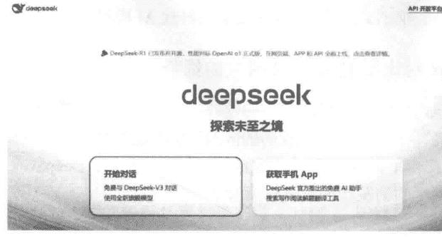

第 2 步：选择登录方式
用户可以使用手机号注册，如图 3-2 所示。勾选阅读并同意用户协议与隐私政策选项，单击蓝色链接可查看详情；输入手机号，单击 ·发送验证码，填写 6 位短信验证码，验证码 60 秒内有效。

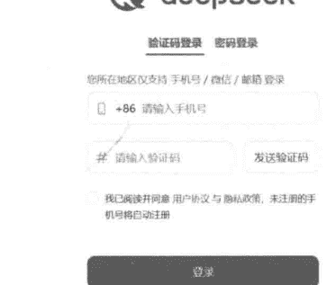

第 3 步：完成注册
接下来就可以使用 DeepSeek 了。

##### 3.1.2 手机端注册

第 1 步：安装 App
对于安卓用户，如图 3-3 所示，可以在自己手机的应用商店搜索 DeepSeek，找到后单击 · 安装 ·，就可以安装了。
对于苹果用户，如图 3-4 所示，可以在 AppStore 搜索 DeepSeek，找到后单击 · 获取 ·，就可以安装了。

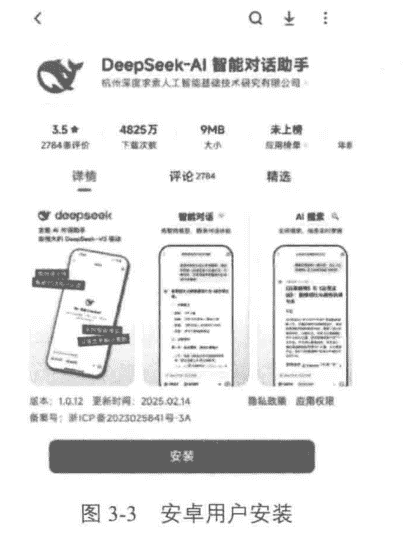

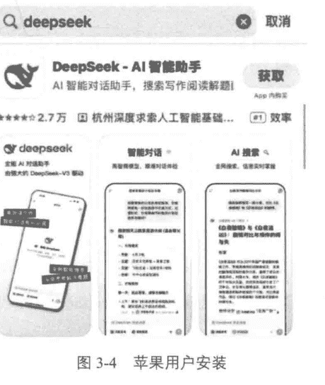

第 2 步：一键登录
DeepSeek 支持微信和 Apple ID 快捷登录，授权后会自动绑定手机号，如图 3-5 所示。


第 3 步：完成注册
进入对话页面后，就可以开始使用 DeepSeek 了，如图 3-6 所示。

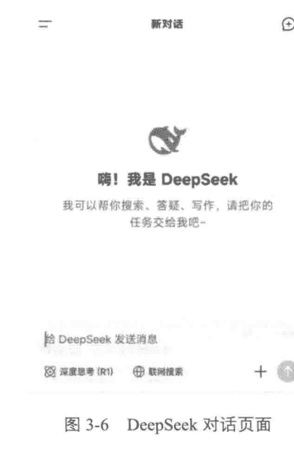

#### 3.2 界面功能详解

在这里，以电脑端使用 DeepSeek 为例进行讲解。

##### 3.2.1 输入交互区

DeepSeek 的文字输入框支持换行（Shift+Enter），对于较长的问题或多个问题，用户可以换行分段。

##### 3.2.2 上传附件

如果问题涉及某个文档、图片（如“请帮我把图片中的表格转换为 Excel 表格”），那么可以单击界面右下角类似回形针的图标，如图 3-7 所示。这样就可以上传附件，最多上传 50 个附件，每个附件最大 100MB，同时附件支持各类文档和图片。

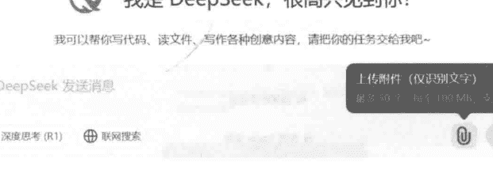

#### 3.3 功能介绍

DeepSeek 提供了两种主要的功能：联网搜索和深度思考（或称深度推理）。

##### 3.3.1 联网搜索

开启联网搜索时，DeepSeek 能够实时访问互联网上的信息资源。这意味着它可以提供最新的数据、新闻事件、市场动态等时效性强的信息。

##### 3.3.2 深度思考

深度思考功能侧重于利用 DeepSeek 内部的知识库进行复杂的逻辑分析、因果关系推断及跨领域的知识整合。它通过构建因果图模型、调用行业知识图谱等方式来支持用户进行深层次的分析和推理。

#### 3.4 两种功能是否开启的选择

开启联网搜索和深度思考可能会导致响应速度变慢，在 DeepSeek 服务不稳定的情况下，可能会遇到“服务器繁忙，请稍后再试”的提示。我们可以根据具体的使用场景及所需信息的类型酌情选择是否开启联网搜索和深度思考功能。

##### 3.4.1 不开启联网搜索和深度思考的情况

- 基础知识查询：当问题涉及的是已经确立的基础知识（如历史日期、数学公式等）时，可不开启这两种功能，这些信息通常不会随时间变化，并且已经存储在 DeepSeek 的知识库中。
- 隐私敏感的信息处理：不开启联网搜索可以避免数据泄露的风险。

##### 3.4.2 仅开启联网搜索的情况

- 最新信息获取：当用户需要获取最新发生的事件、最新的研究成果或市场上最新的产品信息时，应开启联网搜索，如“明天上海天气如何？”等问题。

##### 3.4.3 仅开启深度思考的情况

- 深层次分析和推理需求：当任务涉及逻辑拆解、跨领域知识整合、生成创意内容或伦理争议分析时，应开启深度思考，如涉及进行数学题分步推导、分析哲学问题或多视角分析历史事件等内容。

##### 3.4.4 同时开启联网搜索和深度思考的情况

- 混合型问题分析：当用户既需要最新的数据支持，也需要对这些数据进行深入分析时，可同时开启联网搜索和深度思考，如“结合 2023 年经济数据预测明年新能源行业的发展趋势”等。
- 复杂决策支持：涉及商业策略制定、科学研究等方面，可能需要综合最新的市场动态与深层次的专业知识来做出决策。

> AI 是人类历史上最伟大的工具，而提示词是驾驭它的钥匙。
——孙正义（软银创始人）

### 第 4 章 如何设计提示词

#### 4.1 提示词基础：从零开始掌握核心概念

##### 4.1.1 什么是提示词

为了更好地理解提示词的作用，可以将它想象成你在餐厅点菜的过程。当你走进一家餐厅时，菜单上的选项可能非常多，但你想要的是一份符合你个人口味和特定需求的餐食。如果你只是简单地说“我想要吃饭”，服务员可能会给你提供一份普通的餐食，这未必是你所期望的。相反，如果你详细说明“我想要一份不加香菜的素食炒饭，多放辣椒”，那么服务员就能根据这些具体的要求为你定制一份满意的餐食。这与使用 DeepSeek 时提供提示词是类似的——通过给出具体的指示，你可以引导 DeepSeek 生成更加精准和相关的内容。

##### 4.1.2 为什么需要设计提示词

设计清晰的提示词对确保 DeepSeek 输出的精确性至关重要。例如，如果用户请求 DeepSeek 撰写一篇文章，而仅提供了“写一篇关于科技的文章”这样模糊的指令，那么输出结果可能是泛泛而谈，缺乏深度或针对性。若改为“写一篇探讨区块链技术如何革新金融行业的文章，重点讨论去中心化对传统银行体系的影响，字数控制在 800 字左右”这样清晰的指令，则有助于 DeepSeek 聚焦特定主题，并产生更具洞察力的内容。

要避免模糊提问导致无效输出。模糊提问容易导致不相关的回答。例如，“告诉我一些有趣的事情”，这个请求太过宽泛，可能导致 DeepSeek 提供的信息五花八门，难以筛选出有用的部分。相比之下，更为详细的请求，如“请列举三个历史上著名的科学实验及其对现代医学的影响”，不仅限定了话题范围，还明确了所需的具体内容，从而提高了获取有价值信息的可能性。

- 模糊提问示例：帮我找些资料。
这样的请求没有提供足够的背景信息以供 DeepSeek 判断用户究竟想要了解哪方面的资料，因此返回的结果可能是随机的，甚至是无关紧要的。
- 稍加改进后的示例：查找有关人工智能的最新研究进展。
这样的请求虽然指定了领域，但仍不够具体，可能导致大量信息涌现，难以从中挑选最相关的内容。
- 清晰提问示例：查找有关自然语言处理（NLP）中预训练模型最新进展的研究报告，最好是过去一年内发表的，并包含作者姓名和出版物名称。

这样的请求给出了明确的方向，包括时间范围、文档类型及额外的信息要求，使 DeepSeek 可以更准确地找到满足需求的内容。

#### 4.2 提示词设计七步法：小白也能轻松上手

##### 4.2.1 明确目标

明确目标是提示词设计的第一步。一个清晰的目标能够帮助 DeepSeek 更好地理解用户的意图，并生成符合预期的内容。例如，“写文案”这样一个模糊的请求，可以细化为“写一篇吸引年轻人的奶茶店促销文案”。这样的描述不仅明确了写作主题（奶茶店促销），还指出了目标受众（年轻人）。

##### 4.2.2 选择角色

选择合适的角色可以帮助 DeepSeek 以特定的角度或风格来回应用户的请求。例如，如果用户希望得到一份专业的法律意见，则可以选择“律师”作为角色；如果用户需要具有创意性的故事，则可以选择“编剧”作为角色。选择不同的角色会影响输出的语气和内容深度。例如，以下两种不同的角色设定将会得到两种截然不同的输出风格。

- 小学生：我是一名小学生，请解释爱因斯坦的相对论原理。
- 物理学博士：我是一名物理学博士，请解释爱因斯坦的相对论原理。

很显然，虽然都是解释爱因斯坦的相对论原理这件事情，但是对于小学生和物理学博士，DeepSeek 的解释方式是不一样的。对于小学生可能会使用一些类比，对于物理学博士则可能给出公式和推理过程。

##### 4.2.3 细化任务

细化任务技巧包括分步骤、分场景、分受众等。例如，将“生成旅游攻略”细化为“生成一份带预算的上海亲子旅游攻略，时间为 3 天”，这不仅限定了地点（上海），还指明了受众（亲子游）及额外要求（带预算）。

##### 4.2.4 添加约束条件

添加约束条件（如字数限制、格式要求、语气偏好或数据范围等），可以使输出更加精确。例如，将“列出北京三日游景点”改为“用表格形式列出北京三日游景点，预算 3000 元”，这不仅规定了格式（表格），还设定了预算限制。

##### 4.2.5 优化语言表达

避免使用可能引起歧义的词汇或句子。例如，“开刀的是她父亲”，这句话就有两种解读：一种是她的父亲正在接受手术；另一种是她的父亲作为医生，在为别人做手术。因此，为提高指令的准确性，就需要将提示词改为“她的父亲作为一名医生在给病人开刀”。

##### 4.2.6 预判 DeepSeek 的误解

预判 DeepSeek 可能会对某些专业术语或概念产生误解，并提前提供解释。例如，“帮我写代码”可以改为“用 Python 写一个爬取天气数据的脚本，附注释”，这样可以确保 DeepSeek 了解用户的需求，即需要的是带有解释说明的具体代码。

##### 4.2.7 迭代优化

根据初次结果调整提示词，逐步接近理想中的输出。例如，从“生成标题”到“生成 10 个带表情符号（Emoji）的短视频标题”，通过不断试验和调整，找到最合适的提示词组合。

#### 4.3 如何使用“七步法”设计提示词

对一般任务来讲，如“坦桑尼亚的首都是哪里”这类内容明确的一般任务，可直接向 DeepSeek 提问。“七步法”是使用递进关系完成提示词设计的七个步骤，适用于较为复杂的任务场景。在此我们以“撰写方案”作为例子，每个步骤都会以前一步为基础，逐步深化内容，确保信息的连贯性和完整性。

- 步骤 1：明确目标
  提示词：请撰写一篇奶茶店开店方案。
- 步骤 2：选择角色
  基于步骤 1 的目标，进一步明确写作的角色。
  提示词：基于店铺老板的角色，请撰写一篇奶茶店开店方案。
- 步骤 3：细化任务
  在步骤 2 的基础上，详细说明需要涵盖的具体内容。
  提示词：基于店铺老板的角色，请撰写一篇奶茶店开店方案，该方案需要包含选址方案、装修方案、员工培训、产品设计、预算投入等内容。
- 步骤 4：添加约束条件
  为了保证方案符合特定标准，添加必要的约束条件。
  提示词：基于店铺老板的角色，请撰写一篇奶茶店开店方案，该方案需要包含选址方案、装修方案、员工培训、产品设计、预算投入等内容，期望回本周期 1 年。
- 步骤 5：优化语言表达
  避免使用可能引起歧义的词汇。例如，其中的“回本周期”是一个相对模糊的概念，应替换成“并测算投资总额和年净利润，需第一年年净利润可以覆盖投资总额”。
  提示词：基于店铺老板的角色，请撰写一篇奶茶店开店方案，该方案需要包含选址方案、装修方案、员工培训、产品设计、预算投入等内容，并测算投资总额和年净利润，需第一年年净利润可以覆盖投资总额。
- 步骤 6：预判 DeepSeek 的误解
  考虑到 DeepSeek 可能存在的误解，提前设定预防措施。例如，投资总额所包含的内容可能存在歧义，需要进一步明确。
  提示词：基于店铺老板的角色，请撰写一篇奶茶店开店方案，该方案需要包含选址方案、装修方案、员工培训、产品设计、预算投入等内容。其中，投资总额不能超过 30 万元；投资总额需要包含房租押金、装修费用、两个月员工费用、前期宣传费用和前三个月现金流；净利润需要考虑到设备折旧等因素。
- 步骤 7：迭代优化
  还可以提出持续改进的要求，如“请根据以上情况进一步预测每个月的营业数据”。

#### 4.4 提示词高级技巧：让 DeepSeek 成为你的专家助手

在利用 AI 工具时，掌握一些提示词高级技巧可以显著提升交互效率和结果质量。以下将详细探讨几个关键领域。

##### 4.4.1 多轮对话设计

多轮对话设计是通过连续提问来细化用户需求的过程，它允许用户逐步引导 DeepSeek 理解更具体的要求。例如，从一个宽泛的任务如“写小说”，可以通过进一步询问得到更具体的指示“写一篇科幻短篇，主角是 DeepSeek 机器人”。此外，上下文记忆技巧也非常重要。例如，使用“参考前文”或“基于我们之前的讨论”这样的指令，可以帮助 DeepSeek 记住先前的对话内容，从而提供更加连贯的回答。

##### 4.4.2 提示词模板化

提示词模板化是一种简化复杂任务的有效方法。根据不同的应用场景，可以创建五种基本模板。每种模板都有其特定结构。这种方法不仅提高了工作效率，还保证了输出的一致性和专业性。不同场景的提示词模板如表 4-1 所示。

表 4-1 不同场景的提示词模板

| 场景 | 提示词模板 | 使用示例 |
| :--- | :--- | :--- |
| 简单问题回答 | 请问【主题】是什么？请提供一个简短的定义 | 请问人工智能是什么？请提供一个简短的定义 |
| 复杂问题探讨 | 我们正在探讨关于【主题】的问题。当前的研究显示【相关信息】。请详细分析这一现象，并预测未来的发展趋势 | 我们正在探讨关于区块链技术的问题。当前的研究显示它在金融领域有着广泛应用。请详细分析这一现象，并预测未来的发展趋势 |
| 文章或报告撰写 | 请以【作者】的身份，写一篇关于【主题】的文章。文章应包括引言、主体部分（至少三个子标题）、结论。请确保内容基于最新的研究资料 | 请以张三的身份，写一篇关于环境保护的文章。文章应包括引言、主体部分（至少三个子标题）、结论。请确保内容基于最新的研究资料 |
| 创意写作 | 请根据以下设定创作一个故事：角色是【角色描述】，背景设在【时间/地点】，主要情节围绕【情节概要】展开。请注意突出情感表达和人物性格发展 | 请根据以下设定创作一个故事：角色是一位年轻的科学家，背景设在未来的世界，主要情节围绕他发现了一种可以改变人类命运的新物质展开。请注意突出情感表达和人物性格发展 |
| 编程帮助 | 我需要编写一段代码来实现【功能描述】。请提供一个使用【编程语言】编写的简单示例，并解释关键步骤 | 我需要编写一段代码来实现计算两个数之和的功能。请提供一个使用 Python 编写的简单示例，并解释关键步骤 |

##### 4.4.3 输出格式控制

为了满足特定需求，有时需要控制 DeepSeek 的输出格式，如表 4-2 所示。这需要通过明确指示实现，如要求生成表格或代码块。

表 4-2 不同的输出格式

| 输出格式 | 描述 | 应用 |
| --- | --- | --- |
| 文本 | 最基本的输出格式，适合生成文章、段落或句子 | 生成新闻报道、故事创作等 |
| 思维导图 | 用于表达概念之间的关系，有助于头脑风暴和计划制订。虽然直接输出可能需要额外工具支持，但可以通过文字描述生成思维导图的结构 | 创建新产品开发流程的概念框架 |
| 图片描述 | 生成描述图片的文字，可用于图像识别或视觉障碍者的辅助技术 | 根据提供的图片生成详细的描述 |
| 视频脚本 | 包括分镜描述、角色设定等内容，适用于影视制作前的准备阶段 | 自动生成短片的脚本和剧本 |
| Excel 公式 | 可以帮助生成复杂的 Excel 公式，简化数据分析工作 | 根据给定的数据集生成用于计算的 Excel 公式 |

##### 4.4.4 情绪与语气调节

调节 DeepSeek 输出的情绪与语气可以让交流更加自然流畅，如表 4-3 所示。无论是正式文档还是轻松对话，都可以通过适当设置获得理想的效果。例如，在撰写官方声明时，可以选择严肃、专业的语气；而在朋友间交流时，则可以采用更为随意、幽默的语气。对比两种风格，官方声明通常较为严谨，而朋友间交流则可能充满趣味和个人色彩。

表 4-3 不同语气的请求示例

| 语气类型 | 描述 | 请求示例 |
| --- | --- | --- |
| 正式 | 适用于商务沟通或官方声明，语言严谨、礼貌 | 请以正式的语气回答我的问题，确保用词准确且专业 |
| 友好 | 适用于日常交流，语气轻松、亲切 | 我希望你能用友好的语气回答，就像跟朋友聊天那样自然 |
| 鼓励 | 当用户需要激励或正面反馈时使用，强调积极和支持的态度 | 我最近工作压力很大，请用鼓励的话语给我一些动力 |
| 幽默 | 可用于缓解紧张气氛或增强趣味性，但需要谨慎使用以免冒犯 | 让我们把这次讨论变得有趣一点，请用幽默的方式回答 |

#### 4.5 如何使用提示词高级技巧解决问题

假设用户需要为一家新开业的健康食品餐厅制定营销策略，并希望通过 DeepSeek 的帮助来完成这一任务，可以按照以下步骤操作。

- 初步探索：了解如何为一家专注于健康食品的新餐厅制定有效的营销策略。
- 细化需求：请深入研究针对年轻上班族群体的具体营销策略，特别是针对那些注重健康饮食的人群。
- 应用模板：请以市场分析师的身份，评估这家新餐厅的竞争优势，并提出至少三项具体的推广建议。
- 格式控制：请用 Markdown 格式列出这些推广建议的关键点。
- 情绪调节：现在，请用一种激励人心的方式来重新描述这些建议，以激发团队的积极性。

通过上述方法，用户可以有效地利用 DeepSeek 作为专家助手，无论是在创意写作、数据分析还是在其他领域，都能获得高质量的支持和服务。这种系统化的提示词设计不仅提升了人机交互的质量，也为解决实际问题提供了强有力的支持。

## 第二篇 DeepSeek 的百大场景应用

> AI 创造的商业机会将远超我们的想象。
——蒂姆·库克（苹果 CEO）

### 第 5 章 个人与企业的变现路径

#### 5.1 内容创作领域的变现路径

无论是自媒体创作、短视频脚本生成，还是个性化内容服务，DeepSeek 都能凭借其强大的语言处理能力和智能算法，为个人和企业提供高效、优质的内容生成服务，从而开辟出多样化的变现路径。

##### 5.1.1 自媒体创作

在自媒体领域，内容的时效性和吸引力至关重要。借助 DeepSeek，创作者可以实时追踪热点话题，如当下热门的科技动态、社会事件等。以热门科技发布会为例，DeepSeek 能迅速梳理出发布会的核心亮点，从产品创新点、市场影响等多个角度生成文章大纲。创作者基于这些大纲，结合自身观点和语言风格进行完善，快速发布在各大自媒体平台，并通过平台的广告分成、付费专栏、打赏等功能实现变现。同时，创作者可以利用 DeepSeek 分析用户的阅读习惯和兴趣偏好，精准推送个性化内容，提高用户黏性和转化率，进一步提升收益。

##### 5.1.2 短视频脚本生成

短视频行业的竞争日益激烈，优质的脚本是制作爆款短视频的关键。创作者可以使用 DeepSeek 对海量的热门短视频进行数据分析，总结出不同类型短视频的成功脚本模式，如搞笑短视频的笑点设置规律、情感短视频的剧情冲突构建方式等。创作者根据这些分析结果，利用 DeepSeek 生成具有针对性的短视频脚本。例如，为美妆类短视频生成包含产品展示、使用教程、效果对比等环节的脚本，然后将这些脚本出售给短视频制作团队或个人。此外，还可以与品牌合作，为品牌定制宣传短视频脚本，通过收取品牌合作费用实现变现。

##### 5.1.3 个性化内容服务

除上述常见的变现方式外，创作者还可以利用 DeepSeek 开展个性化内容服务。例如，可以利用 DeepSeek 为企业定制专属的品牌故事、宣传文案。根据企业的品牌定位、企业文化和目标受众，创作者可用 DeepSeek 生成富有感染力和吸引力的品牌故事，帮助企业提升品牌形象和知名度。同时，可以利用 DeepSeek 为个人提供定制化的写作服务。通过收取个性化内容定制费用，实现变现。

##### 5.1.4 内容创作培训

鉴于 DeepSeek 在内容创作领域的强大功能，还可以开展相关的培训业务。针对那些想要掌握利用 DeepSeek 进行内容创作技巧的人群，用户可以开设线上或线下的培训课程。课程内容可以包括 DeepSeek 的基本操作、如何利用 DeepSeek 获取创作灵感、如何优化 DeepSeek 生成的内容等。通过收取培训费用，实现变现。同时，可以建立培训学员社群，为学员提供持续的技术支持和交流平台，进一步提升培训的附加值。

#### 5.2 商业服务领域的变现路径

DeepSeek 作为 AI 领域的佼佼者，凭借其先进的算法和强大的处理能力，为个人和企业在商业服务领域开辟了诸多变现的可能性。特别是在智能客服与数据分析报告生成方面，DeepSeek 展现出了独特的优势，能够为商业服务的效率提升与价值创造提供新的路径。DeepSeek 在商业服务领域的变现能力，源于其强大的自然语言处理能力和数据分析能力。它能够理解用户的问题，准确地给出回答，同时对海量数据进行分析、归纳和总结。

##### 5.2.1 智能客服外包服务

许多企业在客户服务方面面临巨大的人力成本和效率挑战。创业者可以基于 DeepSeek 搭建智能客服平台，为企业提供智能客服外包服务。例如，可以为电商企业提供 7×24 小时不间断的智能客服，快速响应客户的咨询，包括产品信息查询、订单状态追踪、售后服务等。通过收取服务费用，实现变现。同时，可以利用 DeepSeek 的学习能力，不断优化客服话术和知识库，提升服务质量。

##### 5.2.2 定制化的数据分析报告服务

不同企业对数据的需求和关注点各不相同。数据分析师或数据服务公司可以利用 DeepSeek，根据企业的特定需求生成定制化的数据分析报告。例如，咨询师为一家餐饮企业分析市场趋势、消费者偏好、菜品销售数据等，帮助企业制定菜品研发策略、优化菜单结构。通过深入挖掘数据背后的价值，为企业提供有针对性的建议，收取相应的服务费用。

##### 5.2.3 智能客服与数据分析整合服务

用户将智能客服与数据分析相结合，可以为企业提供一站式服务。在客户咨询过程中，智能客服收集客户信息和问题，用户通过 DeepSeek 分析这些数据，挖掘客户的潜在需求和痛点。例如，对于一家在线教育企业，其智能客服通过解答学生咨询，分析学生的提问习惯和学习困难点，为企业提供教学改进建议和课程优化方案。通过这种整合服务，收取更高的服务费用，提升竞争力。

##### 5.2.4 培训与技术支持服务

随着 DeepSeek 在商业服务领域的应用逐渐广泛，许多企业和个人需要掌握相关技术。创业者可以开设培训课程，教授如何使用 DeepSeek 搭建智能客服系统、进行数据分析报告生成。同时，提供技术支持服务，帮助客户解决在使用过程中遇到的问题。通过收取培训费用和技术支持费用，实现变现。

##### 5.2.5 数据驱动的营销服务

可以利用 DeepSeek 分析大量的市场数据和客户数据，为企业制定精准的营销策略。例如，咨询师通过分析消费者的购买行为、兴趣爱好等数据，为企业推荐合适的营销渠道和推广方案。与企业合作，按照营销效果收取费用，实现变现。这种数据驱动的营销服务能够帮助企业提高营销效率，降低营销成本。

#### 5.3 教育与培训领域的变现路径

在 AI 助手课程开发及个性化教学方案制定方面，DeepSeek 能够有效整合教育资源，优化教学流程，为个人和企业创造新的商业价值。这种基于 DeepSeek 在教育与培训领域的变现思路，适合多种人群和机构。教育创业者可以借助 DeepSeek 的技术优势，快速搭建具有特色的教育产品和服务体系，在竞争激烈的教育市场中抢占先机。在职教师也可以通过掌握 DeepSeek 技术，开发个性化教学方案，为学生提供更优质的教学服务，同时也能增加自己的收入来源。教育科技公司则可以基于 DeepSeek 研发教育相关的软件和平台，拓展业务范围。此外，自由教育工作者和课程开发者能凭借 DeepSeek 的辅助，打造出更具吸引力的课程内容。

##### 5.3.1 AI 助手互动课程

教师可以利用 DeepSeek 开发具有互动功能的 AI 助手课程，让学生在学习过程中与 AI 助手实时交流。例如，在语言学习课程中，AI 助手可以随时纠正学生的发音、语法错误，还能陪学生进行对话练习，提升口语表达能力。同时，可以将课程制作成线上课程包，通过在线教育平台销售，按课程订阅收费或者一次性购买收费。

##### 5.3.2 个性化学习方案定制服务

教师根据学生的学习情况、兴趣爱好、知识掌握程度等多维度数据，可以利用 DeepSeek 为每个学生量身定制个性化学习方案。例如，为中小学生制定全科学习提升方案，分析学生在各学科学习中的薄弱环节，提供具有针对性的学习建议和练习资料。向家长或学生收取个性化学习方案定制费用。同时，可以与学校合作，为学校提供批量的学生个性化学习方案服务。

##### 5.3.3 教育内容创作与优化服务

教育机构或教育自媒体可以利用 DeepSeek 创作高质量的教育内容，利用 DeepSeek 快速生成内容框架，再结合专业教育知识进行优化完善。例如，帮助在线教育平台创作一系列的职业技能培训课程内容，收取教育内容创作费用。还可以帮助教育机构优化现有的教育内容，使其更符合学生的学习特点和需求。

##### 5.3.4 AI 辅助教育咨询服务

咨询师可以为学校、教育机构或家长提供 AI 辅助教育咨询服务，利用 DeepSeek 分析教育行业趋势、政策法规、学生学习数据等，为客户提供专业的教育决策建议，涵盖为学校的课程设置、教学改革提供数据支持和分析报告等服务。

#### 5.4 技术开发领域的变现路径

DeepSeek 以其强大的自然语言处理能力和代码理解能力，为技术开发领域带来了全新的变革和机遇，展现出广阔的变现前景。在代码撰写、插件开发及应用程序接口（API）服务等方面，DeepSeek 都能发挥关键作用，助力个人开发者和企业挖掘潜在的商业价值。这种基于 DeepSeek 在技术开发领域的变现思路，适合各类技术相关的人群和企业。对独立开发者而言，他们通常面临时间和资源有限的挑战，DeepSeek 可以帮助他们快速生成代码框架，提高开发效率，将更多精力投入到项目的创新性和优化上，从而在市场中脱颖而出。小型软件公司在承接各类项目时，借助 DeepSeek 能快速响应客户需求，开发出高质量的产品，增强自身的竞争力。自由程序员可以利用 DeepSeek 拓展业务范围，承接更多复杂的项目，增加收入来源。大型企业的技术团队则可以利用 DeepSeek 辅助进行大规模的代码开发和系统优化，提升内部开发效率，同时也可以将基于 DeepSeek 开发的技术服务对外输出。此外，技术爱好者和学生群体也可以通过学习和应用 DeepSeek，积累项目经验，为未来的职业发展打下基础，甚至在学习过程中通过开源项目合作等方式实现一定的变现。

##### 5.4.1 代码代写与优化服务

许多开发者和企业在项目开发过程中，会遇到时间紧迫或存在技术难题等情况。

##### 5.4.2 插件定制开发

各类软件和平台都需要丰富的插件来拓展功能。用户可以利用 DeepSeek 开发针对不同平台的插件，如为办公软件开发提高办公效率的插件，为设计软件开发辅助设计的插件等。深入了解用户需求，借助 DeepSeek 快速生成插件的代码结构，再进行功能细化和调试。将开发好的插件在相关平台上销售，或者与软件厂商合作，作为软件的增值服务提供给用户，收取插件开发费用和分成。

##### 5.4.3 API 定制与维护

随着企业数字化转型的加速，不同系统之间的数据交互和业务协同需求日益增长。用户可以利用 DeepSeek 开发定制化的 API，帮助企业实现系统之间的无缝对接。例如，为电商企业开发连接销售平台和库存管理系统的 API，确保订单数据和库存数据的实时同步。同时，提供 API 的维护和升级服务，保障接口的稳定运行。根据 API 的复杂程度和服务期限收取费用，为企业提供长期稳定的技术支持。

##### 5.4.4 技术培训与咨询

鉴于 DeepSeek 在技术开发领域的应用逐渐广泛，许多开发者和企业希望掌握相关技术。创作者可以开设线上或线下的培训课程，教授如何使用 DeepSeek 进行代码撰写、插件开发和 API 定制。培训内容包括基础操作、项目实战等，收取培训费用。同时，可以为开发者和企业提供技术咨询服务，解答在使用 DeepSeek 过程中遇到的问题，收取咨询费用。还可以建立技术社区，为用户提供交流和学习的平台，增强其黏性。

#### 5.5 新兴职业机会领域的变现路径

DeepSeek 作为 AI 领域的重要力量，为新兴职业带来了独特的变现可能性。这种基于 DeepSeek 在新兴职业机会领域的变现思路，适合多类人群。对热衷探索新技术、追求职业创新的年轻人而言，这些新兴职业充满了挑战与机遇，他们可以凭借对新技术的敏锐洞察力和快速学习能力，在 AI 优化和提示词工程领域崭露头角。有一定编程基础或 AI 知识储备的技术人员，能够更快速地掌握相关技能，转型成为专业的 AI 优化师或提示词工程师，拓宽自己的职业道路。自由职业者也可以利用自身灵活的工作模式，承接各类与 DeepSeek 相关的新兴职业项目，实现多元化变现。此外，企业中的创新团队或数字化转型推动者，能够借助这些新兴职业的力量，为企业创造更大的价值。

##### 5.5.1 AI 优化服务

AI 优化师通过对 DeepSeek 模型的参数调整、算法优化及性能监测，提升 AI 系统的运行效率和准确性。例如，为企业的智能客服系统提供优化服务，利用 DeepSeek 优化对话模型，使其能够更精准地理解客户问题，提高回复质量和效率。可以按项目收取优化费用，或者与企业签订长期服务协议，定期为其 AI 系统进行优化，收取服务年费。此外，还可以针对不同行业的特点，开发通用的 AI 优化解决方案，打包销售给相关企业，实现规模化变现。

##### 5.5.2 提示词工程定制

提示词工程师负责设计和优化与 DeepSeek 交互的提示词，以获取更符合需求的输出。例如，为内容创作公司定制提示词，帮助其利用 DeepSeek 生成高质量的文案、故事等。根据客户的具体需求，设计独特的提示词组合，通过不断测试和优化，确保 DeepSeek 生成的内容满足客户期望。可以根据提示词的复杂程度和项目周期收费，也可以与客户建立长期合作关系，为其持续提供提示词优化服务。

##### 5.5.3 新兴职业培训与咨询

由于 AI 优化师和提示词工程师等新兴职业尚处于发展初期，许多人对这些职业的技能要求和工作内容了解有限。内容创作者可以开设线上或线下的培训课程，教授如何成为专业的 AI 优化师和提示词工程师。培训内容涵盖 DeepSeek 的基本原理、操作技巧、优化策略及提示词设计方法等。收取培训费用的同时，创作者还可以为学员提供就业指导和项目推荐服务，还可以为企业提供新兴职业咨询服务，帮助企业了解如何引进和管理这些新兴职业人才，收取咨询费用。

##### 5.5.4 工具开发与销售

针对 AI 优化师和提示词工程师的工作需求，用户可以利用 DeepSeek 开发辅助工具。例如，可以开发一款提示词生成与优化工具，帮助提示词工程师快速生成高质量的提示词，并提供可视化的分析界面，展示不同提示词对 DeepSeek 输出结果的影响。将这些工具在相关技术平台上销售，或者提供订阅服务，让用户按月或按年付费使用。通过不断更新和优化工具功能，吸引更多用户，实现持续变现。

> AI 让内容创作从人找信息变为信息找人。
——张一鸣（字节跳动创始人）

### 第 6 章 新媒体运营

#### 6.1 精准定位

在新媒体运营中，了解竞品账号的动态和表现是至关重要的一环。通过对竞品账号进行分析，不仅可以了解市场趋势，还能识别潜在的机会点。这项工作可以帮助优化内容策略、调整运营方向，甚至在某些时候，超越竞品占领市场。

##### 6.1.1 借助竞品账号智能分析，明确运营方向

竞品分析并不仅仅是简单地“看”竞品，而是一种深度的研究方法，可系统性地分析数据并从中提取出有价值的洞察。竞品分析可分为以下几个重要维度。

-   内容类型分析：不同类型的内容会有不同的效果。例如，一些竞品发布的长文内容可能会获得较高的阅读量，而一些简单的短视频或图片分享可能会有更高的互动率。需要分析哪些类型的内容在所属行业中更受欢迎，以便在内容创作时能更具针对性。
-   互动情况分析：互动情况包括点赞数、评论数、分享数等。这些数据能够反映出用户对该内容的兴趣和参与度。如果某个竞品发布的帖子经常获得大量点赞和评论，就可以推测该内容比较受欢迎，进而借鉴其内容制作和发布的策略。
-   粉丝画像分析：了解竞品粉丝的构成是非常有意义的。通过分析粉丝的年龄、性别、地域等信息，可以判断出竞品的目标用户群体。在制作内容时，就能更精确地定位自己的目标受众。
-   历史表现分析：历史数据可以帮助了解竞品在一段时间内的运营情况，特别是它们发布过的热门内容。可以通过跟踪它们的内容发布周期、表现数据，判断它们是否有规律可循。

借助竞品账号智能分析，可以发现哪些策略和内容形式对于账号来说是可行的，哪些则需要避免或改进。这种数据化的运营方式有助于做出科学的决策，而不是依赖直觉。

##### 6.1.2 实操案例

这里尝试对小红书平台上的数学教学账号进行竞品分析。
第 1 步，打开小红书平台，搜索“数学”关键词，并选择搜索类型为“用户”，可以看到一些粉丝量较多的数学教学账号。
第 2 步，打开 DeepSeek 并登录账号。
第 3 步，单击 · 深度思考 · 和 · 联网搜索 ，并且在对话框中输入提示词，如图 6-1 所示。

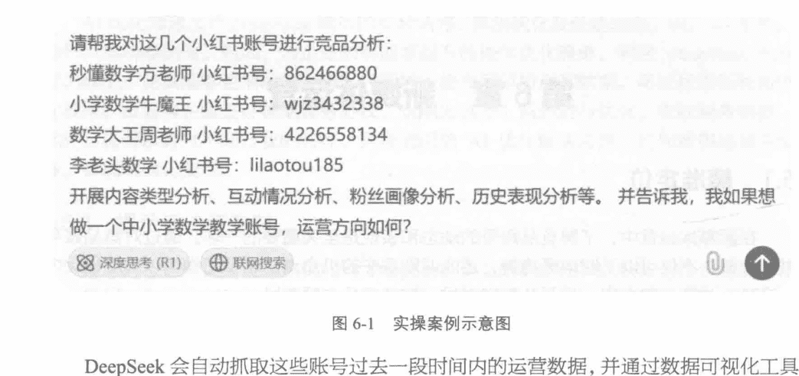

DeepSeek 会自动抓取这些账号过去一段时间内的运营数据，并通过数据可视化工具展示出内容类型、互动情况、粉丝画像等各项指标。

第 4 步，单击 ⬆，稍等片刻，DeepSeek 会形成一篇完整的分析报告。

###### 竞品分析：四个中小学数学教学账号对比

1.  内容类型分析
    秒懂数学方老师：以短视频为主，内容聚焦解题技巧和考点解析，例如“5分钟搞定函数图像”等。视频风格简洁，搭配板书或动画演示，适合学生快速理解。
    小学数学牛魔王：内容以趣味数学题和互动挑战为主，如“每日一题”系列，结合生活场景（如购物计算、游戏闯关）吸引低龄学生。
    数学大王周老师：主打系统化课程，涵盖小初高知识点，分章节更新，适合长期跟学的用户。内容形式包括图文笔记和直播答疑。
    李老头数学：以幽默讲解和家长教育为特色，内容涵盖“如何辅导孩子数学”“避开学习误区”等，吸引家长群体。

2.  互动情况分析
    （1）高互动内容
    小学数学牛魔王的“挑战题”评论区活跃，用户常晒答案并@好友，互动率（点赞+评论/粉丝）约 12%。
    李老头数学的家长向内容收藏量高，如“数学启蒙方法”单篇收藏超 5000 次。
    （2）低效内容
    数学大王周老师的长视频完播率较低，可能与内容密度高、缺乏分段有关。

3.  粉丝画像分析
    年龄与性别：
    秒懂数学方老师和数学大王周老师的粉丝以 12～18 岁学生为主（占比 65%），女性占比 60%。
    李老头数学粉丝中 25～35 岁家长占比 70%，女性占 80%。
    地域分布：
    一线城市占比高（如北京、上海），家长更关注教育资源；下沉市场用户偏好趣味性内容（如“小学数学牛魔王”）。

4.  历史表现分析
    爆款规律：
    标题关键词：
    “速成”“必考”“免费资料”等词点击率高（如李老头数学的“3 天搞定应用题”播放量超 50 万次）。
    发布时间：
    学生账号晚 8—10 点流量高峰，家长账号早 7—8 点（送学时段）和晚 7—9 点（辅导时段）。
    更新频率：
    日更账号（如小学数学牛魔王）粉丝增长更快，周更 3～4 次（如数学大王周老师）更易维持黏性。

###### 中小学数学教学账号起号策略运营

1.  账号定位与内容设计
    （1）差异化方向
    填补空白：现有账号较少覆盖“数学思维训练”（如逻辑推理、奥数专题），可结合游戏化教学（如解谜闯关）。
    细分人群：针对“小升初”“中考突击”等需求，推出专题冲刺包（含视频+习题）。
    （2）内容形式
    短视频（60 秒内）+图文笔记（总结公式）+直播答疑（固定时段）。参考李老头数学的家长互动模式，增设“家长学堂”栏目。

2.  提升互动与黏性
    （1）互动设计
    发起“数学挑战赛”，用户@好友参与可获资料奖励。评论区置顶“常见问题解答”，减少重复提问。
    （2）用户分层运营
    学生端：趣味内容+成就徽章（如连续打卡 7 天解锁新课程）。
    家长端：提供免费资源（如《小学数学考点清单》）换取关注。

3.  变现模式
    初级：知识付费（单价 9.9～39.9 元的专题课）、教辅资料（电子版）。
    进阶：与教辅品牌联名（如习题册定制），佣金分成。

4.  风险规避与合规
    （1）内容审核
    避免直接引用教材原文，需二次原创（如改编题型）。
    （2）广告标识
    合作推广需明确标注“赞助”“合作”字样，符合平台规范。

5.  总结建议
    （1）核心优势
    结合“趣味性+实用性”，如用动画解析几何难题，或设计“数学与生活”系列（如理财计算）。
    （2）长期目标
    通过高频互动（如每周直播）建立信任感，逐步过渡到付费课程。
    （3）数据监测
    关注小红书后台的“笔记诊断”功能，优化标题关键词和发布时间。通过以上策略，可在 6 个月内实现账号从 0 到 1 万名“粉丝”的突破，并形成差异化竞争力。

#### 6.2 账号塑造

账号名字和自我介绍至关重要。它们是账号的门面，能在瞬间给用户留下印象，吸引其关注，否则很容易被忽视。独特的名字和自我介绍还是品牌标识，能加深用户记忆，提升知名度，精准吸引目标受众，比如健身减脂账号吸引减肥人群。同时，它们也利于社交传播，扩大账号影响力。要起一个亮眼的名字。写亮眼的自我介绍，需要简洁明了地传达核心价值，突出个人亮点。当用户觉得账号名字有趣、自我介绍有吸引力时，他们更愿意将账号分享给身边的朋友，从而扩大账号的传播范围，吸引更多新用户关注。

##### 6.2.1 遵循百万粉丝账号塑造指南，打造优质账号

在抖音或小红书上，名字和自我介绍是账号的“灵魂”，直接影响用户的第一印象和算法推荐。

-   第一印象的黄金 3 秒。用户在信息流中滑动速度极快，一个有记忆点、有信息量的名字能瞬间抓住眼球。例如，“深夜徐老师”的“深夜”暗示内容适合睡前刷，同时带有人格化属性。自我介绍则是第二次筛选用户的机会，用最短的句子告诉观众“你是谁+你能提供什么价值”，如“职场穿搭天花板，165cm 梨形身材自救指南”。
-   算法推荐的关键标签。平台算法会抓取名字和自我介绍中的关键词（如“美妆”“探店”“学生党”）推送给精准用户。例如，名字带“宝妈”的账号更容易被同类用户发现。自我介绍中的高频词（如“干货”“测评”“避雷”）会强化账号的垂直领域权重。
-   人设定位的视觉符号。名字和自我介绍是用户对账号的第一层联想。例如，“暴躁小甜椒”暗示性格直爽的搞笑博主，“破产姐弟”直接点明账号的剧情方向。好的自我介绍能产生期待感。例如，“每天一个变美冷知识”让用户产生关注后能持续获益的心理暗示。
-   降低传播成本。朗朗上口的名字（如“垫底辣孩”“多余和毛毛姐”）自带传播属性，用户向朋友推荐时更容易描述。自我介绍中的痛点直击（如“150cm 小个子怎么穿显高？”）能快速筛选目标用户，减少无效粉丝。

如何起一个亮眼的名字呢？一般有如下方法。

-   关键词法。直接关联内容领域：美食类如“干饭人小贝”，美妆类如“狠毒女孩口罩妆”，职场类如“暴躁 HR 在线吐槽”。例如，通过起名为“油皮的自救指南”精准吸引油皮护肤人群。
-   反差感法。用矛盾词制造冲突：采用形象反差如“猛男厨房”，采用语言反差如“东北人在广东”。
-   场景化法。把用户带入具体场景：如“深夜食堂探险”“自习室学习监督员”。例如，通过起名为“出租屋改造计划”吸引租房党。
-   情绪化法。放大情绪关键词：如“发疯打工人”“拒绝容貌焦虑”。例如，通过起名为“今天又被老板 PUA 了”引发职场共鸣。
-   个人特色法。用外貌/性格标签：突出方言如“天津小姐姐嘴瓢日常”，突出职业如“律师小姐姐普法”。例如，通过起名为“秃头程序员穿搭”结合自嘲切入垂直领域。

那么如何写出高转化自我介绍呢？可以用如下方法。

-   身份标签拉近距离。用人群标签引发共鸣：如“二本毕业→大厂总监”“全职妈妈副业月入 2 万元”。例如，用“沪漂 6 年，从合租到买房”吸引一线城市打工人。
-   内容价值清晰直观。直接说明利他性：知识类如“每天分享学生党省钱技巧”，情绪类如“专治职场内耗，骂醒一个算一个”。例如，用“跟着我买，衣服均价不过百元”吸引价格敏感用户。
-   差异化人设强化记忆。突出独特性：如“全网最凶穿搭博主”“骂醒恋爱脑第一人”。例如，用“只说实话的美妆打假员”对比过度滤镜的美妆博主。
-   增加互动感与悬念。提问式：如“你敢信这些穿搭只要 50 块？”。挑战式：如“挑战 100 天素人改造第 28 天”。例如，用“猜猜我多大？答案在置顶视频”引导互动。
-   平台调性适配。针对不同平台适配不同的调性。小红书：强调干货/精致感，如“复旦学姐：书单+文具+学习方法”。抖音：强调口语化+情绪化，如“关注我！教你在职场反 PUA！”。
-   定位清晰+痛点明确。例如，美妆号可以用“黄黑皮，瑕疵皮，普通人版无效化妆退退退”，职场号可以用“从月薪 3 千元到 3 万元，教你用老板思维打工”，母婴号可以用“海淀妈妈不鸡娃，3 招养出自主学习娃”。

##### 6.2.2 实操案例

这里用户尝试做一个小红书的健身类博主，用户利用 DeepSeek 生成几个适合的用户名和自我介绍。

第 1 步，打开 DeepSeek，单击 · 深度思考 · 和 · 联网搜索 ·，并且在对话框中输入提示词，如图 6-2 所示。


DeepSeek 会自动抓取小红书有关账号的情况，并且思考几个合适的用户名和自我介绍。

第 2 步，单击 ⬆，稍等片刻，DeepSeek 会形成几个建议的模板。

-   元气活力型用户名：蜜桃臀养成日记、燃脂小马达 Jenna、元气铁馆少女、运动系氧气瓶、暴汗甜心 Gina
-   专业干货型用户名：健身私教周小菜、撸铁实验室、体态管理手册、抗阻训练百科、功能性训练指南
-   生活化健身用户名：厨房健身房两开花、瑜伽垫上的早午餐、健身服搭配研究所、上班族碎片健身、宿舍徒手训练家

自我介绍模板（可混合搭配）：

【专业教练版】
ACE 认证健身教练—体态矫正专家、每周二四更新训练计划、周六解锁健身餐灵感、手把手教你科学塑形、已帮助 300 多名学员达成目标，关注获取免费体测分析！

【励志成长版】
从 120 斤到马甲线女王——健身 3 年蜕变实录
分享居家训练技巧、健身装备测评、暴汗歌单推荐、真实身材对比
普通上班族的逆袭之路，关注见证每周进步！

【生活美学版】
把健身房穿成日常的时髦精
健身妆容不脱妆秘籍、小众运动品牌挖掘机、低卡美食摆盘艺术家
用高颜值方式打开健康生活，美和力量我都要！

【趣味互动版】
全网最会讲段子的健身博主
收藏夹有各部位跟练合辑、定期测评网红减脂零食、带云监工你的运动打卡
敢不敢和我赌 21 天身材挑战？输的请喝奶茶！

> 小贴士：
名字中加入地域特色更易吸粉（如北京撸铁小辣椒）
定期更新个人 IP 视觉符号（如标志性发带/运动袜）
自我介绍要突出差异化价值（教学/陪伴/审美）
可设置记忆点标签（#办公室肩颈拯救者）

#### 6.3 爆款内容打造

在新媒体运营的世界中，爆款内容的打造是一项非常重要的能力。每篇爆款内容的背后，都是对用户需求的精准把握和对内容创作的精心设计。不仅需要了解目标用户，还要明白如何通过创意、结构和推广等手段，让内容获得更多的曝光和互动。

##### 6.3.1 制作爆款内容，提升影响力

什么是爆款内容？爆款内容是指那些能够迅速引起大量用户关注、互动并快速传播的内容。它通常具有以下特征。

-   话题性强：内容的主题或观点能够引起广泛的讨论和关注，如某个热门事件、某种趋势的分析等。
-   情感共鸣：能够激起用户的情感反应，无论是喜悦、愤怒、惊讶还是感动。情感共鸣让用户更愿意点赞、评论或分享内容。
-   有实用价值：用户通过阅读这些内容能获取实际的帮助或新知，尤其是一些干货类内容，会迅速积累大量关注和互动。
-   互动性强：通过各种方式让用户参与进来，比如问答、投票、评论等互动形式，能够极大地提高内容的热度和传播度。

如何制作爆款内容？制作爆款内容并不是一蹴而就的事，它需要不断地实践和调整。以下是一些常见的制作爆款内容的方法。

-   调研用户需求：需要清楚了解目标受众的兴趣、需求和痛点。可以通过分析数据，观察用户的留言、评论、搜索热度等，了解他们想要什么内容。
-   抓住热点话题或事件：热点话题或事件总能引起用户的关注，因此需要时刻关注时事热点，将其融入内容中。
-   精心设计标题：一个好的标题是爆款内容的第一步。标题要简洁，有吸引力并且具备悬念性，能够激发用户点击的欲望。

##### 6.3.2 实操案例

作为一个小红书的健身类博主，用户利用 DeepSeek 生成标题和文案。
第 1 步，打开 DeepSeek，单击 · 深度思考 · 和 · 联网搜索 ，并且在对话框中输入提示词，如图 6-3 所示。注意，提示词必须注明平台、受众、目标。

#### 6.4 数据复盘

新媒体运营中的数据复盘是提升运营效果的关键环节，是对运营过程和结果进行全面审视与分析的重要手段。

数据复盘先明确目标，即根据运营计划确定核心指标，如粉丝增长数、内容阅读量、转化率等，以此作为评估运营效果的基准。接着进行数据收集，涵盖平台流量数据、用户行为数据、内容传播数据等多方面，来源包括平台后台、第三方统计工具等。收集后的数据需要整理清洗，确保准确、完整且有条理，为分析做准备。

在数据分析阶段，常采用对比分析，如与过往周期对比看趋势、与竞品对比找差距；还会进行细分分析，按渠道、内容类型、用户群体等维度拆解数据，挖掘深层次问题。比如，发现某类内容阅读量高但转化率低，就需要探究是内容引导不足还是目标受众不精准。

通过分析总结出运营中的问题，如内容缺乏吸引力、推广渠道效果差、用户互动机制不完善等。针对这些问题制定具体的优化策略，如调整内容选题、优化发布时间、拓宽推广渠道、增加互动活动等。

数据复盘不是一次性工作，而是循环往复的过程。每次复盘的结果都应成为下一次运营计划的依据，持续优化调整，以适应不断变化的市场和用户需求，实现新媒体运营的持续发展和提升。

##### 6.4.1 通过数据复盘与迭代，持续优化运营策略

在新媒体运营领域，数据就像一座灯塔，照亮运营者前行的道路。通过数据复盘与迭代来持续优化运营策略，已成为在激烈竞争中脱颖而出的关键。

- 衡量运营成效：数据复盘最直接的作用就是衡量运营工作的成效。在新媒体运营中，我们投入大量的时间、精力和资源，开展内容创作、活动策划、用户互动等工作。而这些工作究竟产生了怎样的效果，是否达到了预期目标，都需要通过数据来直观呈现。例如，我们发布了一篇文章，通过阅读量、点赞数、评论数、转发数等数据，就能清晰地了解这篇文章的受欢迎程度，进而判断内容创作的方向是否正确。
- 发现问题与机会：数据是洞察运营问题和潜在机会的窗口。通过对用户行为数据的深入分析，可以发现用户的兴趣点、需求点及痛点。例如，如果发现某个系列的内容阅读量和互动量都很高，就说明这是用户感兴趣的领域，可以加大这方面的内容创作。反之，如果某个平台的用户活跃度持续下降，就需要深入分析原因，是内容不符合用户口味，还是运营策略出现了问题，从而及时调整，避免用户流失。
- 为决策提供依据：在新媒体运营中，每个决策都至关重要。而数据复盘能够为决策提供科学、客观的依据。通过对不同运营策略的数据对比分析，可以了解哪种策略更有效，哪种渠道的转化率更高，从而合理分配资源，将更多的精力和资源投入效果好的方面，提高运营效率。

数据复盘的具体步骤如下。

- 确定关键指标：不同的运营阶段和目标，对应的关键指标也不同。如果是内容运营，重点关注阅读量、完读率、点赞数、评论数、转发数等；如果是考虑保持用户增长，粉丝数、新增粉丝数、粉丝活跃度等指标更为关键；对于电商运营，转化率、客单价、销售额等则是核心指标。明确这些关键指标，才能有的放矢地进行数据收集和分析。
- 收集数据：数据来源要广泛，包括各个新媒体平台的后台数据、第三方统计工具数据、用户调研数据等。要确保数据的全面性和准确性，不仅要收集正向数据，如成功的案例和良好的指标表现，还要关注负面数据，如用户流失、投诉等。同时，也要按照一定的时间周期进行数据收集，以便进行趋势分析。
- 分析数据：运用多种分析方法对收集到的数据进行深入剖析。对比分析是常用的方法之一，包括纵向对比（与自身历史数据对比，观察数据的变化趋势）和横向对比（与同行业竞品或类似账号的数据对比，了解自身在行业中的位置和差距）。此外，还可以进行相关性分析，探究不同数据指标之间的关联，如内容发布时间与阅读量的关系、用户互动与转化率的关系等。
- 总结经验教训：根据数据分析的结果，总结运营过程中的成功经验和失败教训。对于成功的策略和方法，要加以巩固和推广；对于存在的问题，要深入分析原因，找出问题的根源。同时，要将这些经验教训进行整理和归纳，形成可复用的知识体系，为后续的运营工作提供参考。

基于数据复盘，需要从多个方面进行策略迭代。

- 内容策略优化：根据数据反馈，调整内容的选题、形式和风格。如果发现某个话题的阅读量和互动量都很高，那么可以围绕这个话题进行系列内容创作。如果发现短视频的播放量和分享率明显高于图文内容，那么可以适当增大短视频的创作比例。同时，要注重内容的质量和价值，不断提升用户的阅读体验。
- 用户运营策略调整：通过对用户数据的分析，了解用户的需求和行为习惯，制定个性化的用户运营策略。对于活跃用户，可以提供更多的专属福利和互动机会，增强他们的黏性；对于潜在用户，可以通过精准的推送和营销活动，吸引他们关注和参与。此外，还要关注用户的反馈和意见，及时改进产品和服务，提升用户满意度。
- 渠道运营策略优化：分析不同渠道的数据表现，评估渠道的效果和价值。对于效果好的渠道，要加大投入和资源倾斜，进一步提升渠道的影响力；对于效果不佳的渠道，要分析原因，是渠道选择不当，还是运营方式有问题，必要时可以进行调整或放弃。同时，要不断探索新的渠道和平台，拓展用户群体和流量来源。
- 活动策划与执行优化：根据以往活动的数据复盘，总结活动策划和执行过程中的经验教训。优化活动的主题、形式、时间和参与方式，提高活动的吸引力和参与度。同时，要加强活动的宣传和推广，通过多种渠道扩大活动的影响力，吸引更多用户参与。

在新媒体运营中，数据复盘与迭代是一个持续的过程。只有不断地对运营数据进行分析和总结，根据数据反馈及时调整和优化运营策略，才能适应不断变化的市场环境和用户需求，实现新媒体运营的长期稳定发展。

##### 6.4.2 实操案例

作为一个小红书的健身类博主，用户利用 DeepSeek 根据已发布内容的运营数据生成一些以后发布的建议。

第 1 步，打开 DeepSeek，单击 · 深度思考 ·，并且在对话框中输入提示词，如图 6-4 所示。


DeepSeek 会根据提交的内容生成一些以后发布的建议。

第 2 步，单击 ↑，稍等片刻，DeepSeek 会形成建议。

**内容一：小学数学七大模块必学方法合集**
点赞数：64 个，收藏数：56 个，评论数：1 个

1. 分析
这篇内容重点是为家长提供小学数学的学习方法，内容较为基础，适合家长和孩子共同学习。点赞和收藏的比例较好，但评论较少，这表明用户在浏览和参与度上还可以进一步提升。

2. 建议
互动提升：评论较少，意味着观众可能有问题或者想法但没有及时表达。可以在结尾处添加互动引导，例如：“你家孩子在数学学习中有哪些困难？留言分享，让我们一起讨论！” 这样可以促进观众参与并增强互动。
内容结构优化：这篇内容可以考虑加入更多具体实例和实践建议，比如列举一些典型的数学问题和解法，或者为家长提供如何实施这些方法的具体步骤。
增添视觉元素：数学学习方法类的内容可以通过图表或小插图来增加视觉吸引力，例如使用图解展示数学概念和例题，可以更好地吸引家长的注意。

**内容二：小学生暑假学习计划表**
点赞数：393 个，收藏数：415 个，评论数：16 个

1. 分析
这篇内容的互动数据明显更好，点赞、收藏和评论数都较高。说明暑假学习计划是家长们关注的一个高频话题，且内容实用性较强，吸引了很多家长和孩子的参与。

2. 建议
强化社群互动：评论数较多，说明用户有较强的互动需求。可以通过评论区与粉丝互动，询问他们的暑期学习目标，或者定期发布“暑假学习进度打卡”的话题，增加长期关注和互动。
内容扩展：提供更多不同阶段的学习计划，比如“小学一至三年级暑假学习计划”与“四至六年级暑假学习计划”，针对不同年级的孩子定制专属学习内容，这样可以吸引更多家长群体。
发布后续内容：这篇内容较为基础，可以发布系列内容，如“如何高效利用暑假进行数学学习”，或“暑假如何提高孩子的学习兴趣”等，形成内容的延续性，保持粉丝的长期关注。

**内容三：小升初必会解方程类型**
点赞数：54 个，收藏数：63 个，评论数：0 个

1. 分析
相较于前两篇，这篇内容的互动数据较低。虽然介绍了小升初数学解方程的知识点，但从数据来看，观众的参与度和兴趣并不高。

2. 建议
话题精准化：该内容定位为小升初数学，建议在标题和内容中明确传达“为什么解方程是小升初的关键”，这样可以激发家长和学生的紧迫感。比如，增加“掌握这些方程题型，确保小升初数学不掉队！”等更具吸引力的文案。
增加案例分析：在讲解数学知识点时，加入具体的例题解析或者解题技巧，帮助观众快速理解并付诸实践。观众喜欢看到的不仅是理论，还有如何解决实际问题。
提升标题吸引力：目前标题较为平实，可以通过调整标题的方式来提升吸引力。例如：“小升初必会解方程，掌握这几个技巧，数学轻松上高分！”这样可以提高内容的吸引度，增加点击率。

**总体建议**

1. 增加视频或短视频内容：数学类教育内容在小红书上有一定市场，尤其是家长群体很重视孩子的学习。尝试制作一些短视频或互动性较强的内容，如数学小实验、趣味数学题解析等，提升观众的观看体验。
2. 强化话题标签：尝试使用更具针对性的标签，如“#数学思维训练”“#孩子的数学启蒙”“#小升初必看”等标签，让更多相关受众发现你的内容。
3. 定期推出专题：结合当前的热点（如即将到来的暑假、寒假或开学季），定期推出“学习计划”“考试备考”“思维训练”等专题系列内容，以保持账号的持续热度。
4. 优化发布时间：根据不同内容的特点，在高流量时段发布内容，比如早上7～9点和晚上7～9点是许多家长刷小红书的高峰期。

通过以上策略，可以提升用户的互动率和内容的传播力，从而帮助“刘老师教数学”这个账号获得更多的关注。

#### 6.5 热门话题预测

在数字化时代，社交媒体平台成为信息传播和社交互动的重要阵地。小红书、微博、抖音、快手等平台每日产生海量内容，利用 AI 进行热门话题（也称热点）预测具有重要意义。

AI 预测热门话题的基础是大数据收集与分析。通过爬虫技术等手段，AI 能广泛收集各平台用户的行为数据，包括发布内容、点赞、评论、转发等。例如，在微博上，可实时追踪用户对不同事件的讨论热度，以及话题标签的使用频率。这些数据反映了用户当下的兴趣点和关注点。

机器学习和深度学习算法是 AI 预测的核心工具。基于收集到的数据，运用时间序列分析、神经网络等算法，构建预测模型。例如，通过对抖音过往热门视频的各项特征（如视频类型、发布时间、创作者粉丝量等）进行学习，模型可以识别出热门内容的潜在规律，当新的内容出现时，模型能依据这些规律评估其成为热门话题的可能性。

从实际应用来看，对于内容创作者，借助 AI 预测热门话题，能提前规划创作方向，提高内容的曝光度和影响力。例如，小红书博主通过了解 AI 预测的热门美妆话题，创作相关教程或产品推荐，吸引更多用户关注。对平台运营者而言，热门话题预测有助于优化内容推荐算法，提升用户体验和黏性。例如，快手根据 AI 预测结果，将潜在热门话题内容推送给感兴趣的用户群体。

总体而言，AI 在热门话题预测方面展现出巨大的潜力，为社交媒体生态中的各方参与者提供了有价值的决策依据，推动社交媒体平台的高效发展。

##### 6.5.1 运用热点预测算法，提前 48 小时锁定热搜

AI 热点预测算法并非魔法，它基于大数据分析与机器学习技术。算法会从海量的互联网数据中抓取信息，这些数据来源广泛，包括社交媒体平台、新闻网站、论坛等。通过自然语言处理技术，算法对这些文本数据进行清洗、分类和标注，提取出关键信息，如事件主体、时间、地点、情感倾向等。机器学习模型会对这些经过处理的数据进行学习和训练。模型会分析历史热点事件的数据特征，找出热点形成和传播的规律。例如，某些话题在短时间内发布量的突然增长、用户互动频率的急剧上升等，都可能是热点即将爆发的信号。基于这些规律，模型建立起预测模型，当新的数据输入时，模型就能根据已学习到的模式，预测该话题是否有可能成为未来 48 小时内的热搜。

- 信息传播优势：对媒体机构而言，提前锁定热搜意味着可以提前策划报道内容，准备相关素材，在热点爆发时迅速抢占舆论高地，发布更有深度、更具吸引力的新闻报道，从而吸引更多的用户关注。同时，也能避免在热点事件发生后，因仓促应对而出现报道内容同质化的问题。
- 市场营销价值：从市场营销的角度来看，品牌方可以利用 AI 热点预测算法，提前将品牌信息与即将成为热点的话题进行关联，开展有针对性的营销活动。例如，当预测到某一体育赛事将成为热点时，运动品牌可以提前推出相关的广告宣传，借助热点的热度提升品牌知名度和产品销量。
- 社会价值：在社会层面，AI 热点预测算法有助于及时发现和关注社会民生问题。当算法预测到与公共卫生、环境保护、社会公平等相关的话题可能成为热点时，政府部门和社会组织可以提前介入，采取相应措施，解决问题，避免事件进一步发酵引发社会不稳定。

##### 6.5.2 实操案例

这里尝试预测未来 48 小时微博可能的热门话题，用户作为一个健身类博主，利用 DeepSeek 生成可能的“蹭热点”的思路。

第 1 步，打开 DeepSeek，单击 · 深度思考 · 和 · 联网搜索 ，并且在对话框中输入提示词，如图 6-5 所示。


第 2 步，单击 ↑，稍等片刻，DeepSeek 会给出预测结果和有关建议。

**未来 48 小时微博可能的 9 个热门话题预测**

1. 智能驾驶普及浪潮下的行业竞争：比亚迪发布“全民智驾”计划后，引发车圈大佬相继发声，智驾普及成为热门讨论点，未来 48 小时相关话题热度可能持续上升。
2. 2025 年首场暴雪来袭：中央气象台预计的大范围雨雪和大风降温天气，涉及甘肃、陕西等多地的暴雪情况，会吸引众多网友关注天气动态及应对措施。
3. 春节假期后减肥热潮：春节假期刚过，很多人在假期中饮食丰富，体重有所增加，此时会有大量人开始关注减肥相关内容，减肥成为热门话题。
4. AI 技术在生活中的新应用：AI 技术不断发展，新的应用场景不断涌现，如 AI 数字人直播技术全民化等，容易引发大众对 AI 改变生活的讨论。
5. 情人节后情侣健身挑战：情人节刚过，情侣间可能会希望通过一起健身等方式增进感情，情侣健身挑战或许会成为热门话题。
6. 春季运动装备推荐：随着天气逐渐转暖，人们户外运动的意愿增强，对春季运动装备的需求和讨论也会增多。
7. 职场人复工后的运动计划：春节假期结束，职场人回归工作岗位，如何在工作之余安排运动计划，保持健康生活，会是职场人关注的话题。
8. 儿童寒假运动指南：寒假还未结束，家长们会关注如何让孩子在假期进行有益的运动，促进孩子健康成长。
9. 宠物健康与运动：养宠人群不断扩大，宠物的健康和运动需求受到重视，相关话题也容易引发关注。

**健身博主利用热门话题发文吸引流量的方法**

- **结合智能驾驶话题：** 可以从长时间驾驶对身体的影响角度出发，撰写如《长时间开车久坐，这些健身动作帮你缓解身体疲劳》，介绍简单的车内或下车后能进行的健身动作，缓解驾驶疲劳，吸引有车一族的关注。
- **关联暴雪天气话题：** 发布《暴雪天宅家也能做的高效健身运动》，为因恶劣天气无法外出运动的人提供室内健身方案，满足人们在特殊天气下的健身需求。
- **针对春节后减肥话题：** 分享《春节后快速减肥的饮食与运动秘籍》，结合自身经验，给出科学的减肥计划，包括饮食搭配和运动方式，吸引想要减肥的人群。
- **结合 AI 应用话题：** 写一篇《AI 助力健身，个性化健身计划定制攻略》，介绍如何利用 AI 技术定制适合自己的健身计划，跟上科技潮流，吸引追求高效健身的人群。
- **围绕情侣健身话题：** 推出《情人节后，情侣一起健身的甜蜜挑战》，设计一些情侣互动性强的健身挑战，如情侣瑜伽、双人力量训练等，吸引想要健身的情侣关注。
- **借助春季运动装备话题：** 发布《春季户外运动，这些装备必不可少》，详细介绍适合春季运动的装备，如透气的运动服装、轻便的运动鞋等，并给出选购建议，吸引运动爱好者。
- **针对职场人运动计划话题：** 分享《职场人复工后的高效运动时间管理法》，帮助职场人合理安排工作和运动时间，提高运动效率，吸引职场人士关注。
- **关联儿童寒假运动话题：** 撰写《儿童寒假运动指南，让孩子健康成长》，为家长提供适合儿童的寒假运动项目和注意事项，吸引家长关注。
- **结合宠物健康话题：** 创作《和宠物一起运动，共享健康生活》，介绍一些可以和宠物一起进行的运动，如遛狗跑步、宠物瑜伽等，吸引养宠人群。

> AI 是员工的“副驾驶”，帮助人类专注高价值工作。
> ——萨提亚·纳德拉（微软 CEO）

### 第 7 章 职场效率提升

#### 7.1 会议纪要生成

##### 7.1.1 自动生成会议纪要，实现语音转文字与重点提炼

- 语音转文字：AI 凭借强大的语音识别技术，对录音内容逐字逐句进行转化。它能精准识别不同发言人的声音，为后续处理提供基础文本。
- 内容分析与整理：AI 能识别会议中的关键主题、讨论焦点，区分不同发言人的观点，将杂乱无章的发言整理成有条理的内容框架。
- 重点提炼与格式输出：AI 自动提取会议中的核心决策、行动事项、重要问题及解决方案等重点内容，按照标准的会议纪要格式进行排版输出。

##### 7.1.2 实操案例

这里尝试将会议录音转换为会议纪要。

第 1 步，将会议录音导入到电脑中，一般为 MP3 格式。

第 2 步，利用一些在线平台，将 MP3 音频转换为文本文稿，常见的在线平台有讯飞听见、腾讯云语音识别、Otter.ai。

第 3 步，打开 DeepSeek，并且在对话框中输入提示词及转换后的文本内容，如图 7-1 所示。


DeepSeek 会自动将当前文本转换为会议纪要。当然用户可以对会议纪要的格式、语言风格提出具体要求。

第 4 步，单击 ↑，稍等片刻，DeepSeek 会形成一篇完整的会议纪要。

###### 公司未来业务发展方向探讨会议纪要

- 会议时间：2020年1月1日。
- 参会人员：张总、王主管、孙经理、李专员。

本次会议围绕公司未来业务方向，讨论线上拓展、线下优化、品牌建设和数据安全，明确各部门任务与计划。

线上业务拓展：王主管建议加大投入，搭建销售平台。张总询问困难，王主管指出技术和人才问题，建议外聘或合作，招聘运营人才。孙经理强调数据安全，建议建立安全体系。

线下业务优化：孙经理认为线下是主要收入来源，建议优化升级，推动线上线下融合。张总要求其负责并构建数据安全体系。

品牌建设推广：李专员建议加强宣传，利用多渠道提升知名度，加大研发创新；同时制订预算计划，确保投入产出最大化。张总要求其制订执行推广计划，1个月内提交方案。

###### 任务分配

- 线上业务筹备：王主管，2周内提交方案，组建小组、搭建团队、招聘人才、洽谈合作。
- 线下业务与数据安全：孙经理，1个月内完成初步方案，优化服务、陈列，制定安全策略。
- 品牌推广计划：李专员，1个月内提交方案，开展调研、注重互动反馈。

###### 后续安排

张总要求各部门密切沟通，及时反馈。下次会议1个月后，汇报工作进展。

#### 7.2 领导讲话生成

##### 7.2.1 协助生成领导讲话内容

撰写领导讲话稿，需要明确以下几个要点。

- 明确讲话目的：要精准把握讲话意图，是总结过往工作成果、剖析问题，还是部署未来工作计划、传达新政策；是激励员工奋进、增强团队凝聚力，还是面向外部公众塑造组织形象、阐述发展愿景。
- 收集资料：丰富且准确的资料是讲话稿的血肉。收集的资料包括组织内部的工作数据和业务报表、行业动态（如市场趋势、竞争对手策略等）、政策法规（确保讲话内容符合政策导向）、成功案例、典型故事等。
- 构建结构：合理的结构能让讲话稿逻辑清晰、层次分明。一般采用“总—分—总”结构：开头以简洁有力的方式引出主题；中间部分展开论述，按照重要性、时间顺序或逻辑关系，分点阐述核心观点，每个观点都要有论据支持；结尾总结全文，强化主题，提出期望。

##### 7.2.2 实操案例

这里尝试生成一篇家电营销公司领导的讲话稿。
第 1 步，构想讲话的基本要求，尽可能明确清晰。
第 2 步，打开 DeepSeek，单击 · 深度思考 ·，并且在对话框中输入提示词，如图 7-2 所示。


第 3 步，单击 ⬆，稍等片刻，DeepSeek 会形成一篇完整的领导讲话稿。

> 各位同事：
大家好！今天咱们不绕弯子，直接说重点，怎么把二季度的销量搞上去。我先带大家看看一季度的成绩，再定二季度的目标，最后说具体怎么干。
【第一部分：一季度销量回顾】
先说成绩。一季度咱们整体销量比去年涨了 8%，尤其是空调和冰箱卖得不错，分别涨了 15%和 12%。这要感谢华南大区和线上团队的兄弟们，这两个渠道超额完成任务，奖金月底就发！
【第二部分：二季度目标】
二季度目标就一句话：总体销量再涨 20%，分到具体产品。
• 空调要冲 40%增长（天热了，这是黄金期）。
• 冰箱保持 15%增长。
• 小家电必须打翻身仗，至少涨 10%。
各区域自己领任务，明天中午前把分解表报上来。别跟我说做不到，我和财务算过库存，算过市场需求，这个数“蹦一蹦”够得着。
【最后鼓劲】
知道现在市场难做，但哪个季度的钱是好挣的？公司已经备足资源，完成目标奖金上浮 30%，超额部分拿 5%当团队旅游基金。但丑话说前头，连续两个月垫底的区域，别怪公司换人上。
兄弟们，加油，散会！

#### 7.3 年度工作计划制订

##### 7.3.1 制订年度工作计划，明确工作方向

借助 AI 制订年度工作计划，需要自己对整个年度工作计划的制订有几个清晰的思路。

- 梳理基础信息：全面梳理部门职能、过往工作成果与问题、公司年度战略目标等，为 AI 提供准确数据，如部门前一年项目数、业绩指标及公司新一年市场开拓、营收增长目标等。
- 确定沟通方式：用简洁语言表述，如“依公司具体战略目标和部门职能简述，制订本年度工作计划，涵盖重点项目、团队建设、业绩目标等”。
- 生成初步框架：AI 根据输入生成年度工作计划初步框架，包括重点任务分类及各板块工作方向、预期成果。需要研读框架，确认关键领域和逻辑合理性。
- 细化与调整：结合工作经验和业务理解，细化 AI 生成框架，补充工作步骤、时间节点、负责人等细节。若计划不符合实际或缺乏操作性，及时与 AI 沟通调整。

##### 7.3.2 实操案例

这里尝试撰写家电营销公司的年度工作计划。
第 1 步，明确年度工作计划的形式，如到底是有二级内容还是有三级内容，落实要细化到部门还是个人，是否有一些基础素材。
第 2 步，打开 DeepSeek，单击 · 深度思考 · 和 · 联网搜索 ，并且在对话框中输入提示词，如图 7-3 所示。


第 3 步，单击 ，稍等片刻，DeepSeek 会形成一篇完整的年度工作计划。

###### 家电营销公司年度工作计划

###### 一、市场分析与目标设定（1—2 月）

市场调研：1 月 1 日—1 月 31 日，市场调研团队通过线上问卷、线下访谈收集数据，分析家电市场、消费者需求及竞品策略。
销售目标制定：2 月 1 日—2 月 15 日，销售部门负责人依据调研与公司实际，制定年度及季度销售目标。

###### 二、产品策略（3—4月）

产品优化：3月1日—3月31日，产品经理与供应商合作，按消费者反馈优化家电功能。

新品引进：4月1日—4月30日，采购部门筛选并引入潜力新品。

###### 三、营销策略（5—10月）

线上营销

社交媒体推广：5月1日—12月31日，新媒体运营团队制订全年计划，在主流平台发布产品内容。

电商平台运营：5月1日—12月31日，电商运营团队优化店铺，参与促销提销量。

线下营销

促销活动：按活动安排，市场活动策划团队在节假日、店庆举办线下促销。

经销商合作：全年，销售部门加强与线下经销商合作推广。

###### 四、客户服务提升（11—12月）

客服培训：11月1日—11月30日，客服部门负责人组织客服培训。

反馈处理机制优化：12月1日—12月31日，客服部门建立快速响应机制。

###### 五、团队建设与管理

员工培训：全年，人力资源部门定期组织内部培训。

绩效考核制度完善：1月1日—1月31日，人力资源部门优化考核制度。

#### 7.4 细分工作计划创建

##### 7.4.1 创建细分工作计划，确保工作有序推进

一般来说，要创建细分工作计划，需要分解任务，设定优先级，明确目标。

- 分解任务：将大任务拆解为小任务，让每个小任务都可操作、可衡量。例如，如果是一个大项目，那么可以将其分解为几个主要阶段或里程碑，然后再分解每个阶段中的具体工作。
- 设定优先级：对每个小任务设定优先级，确定哪些是紧急且重要的，哪些是可以延迟的。可以使用“四象限法”来判断任务的紧急性和重要性。
- 明确目标：每个任务都要有明确的完成标准，避免模糊的目标。例如，不是简单地写“做市场调研”，而是具体写“完成调研并形成报告”。

##### 7.4.2 实操案例

一家线上财务公司计划1个月内向北京市朝阳区的各个小商家推广二维码收款功能，并且前期全部免费使用，附送一些记账、财务总结等附加功能，利用 DeepSeek 生成详细的任务分解。

第 1 步，构想任务分解，并设定优先级，明确目标。

第 2 步，打开 DeepSeek，单击 · 深度思考 · 和 · 联网搜索 ·，并且在对话框中输入提示词，如图 7-4 所示。


图 7-4 实操案例示意图

第 3 步，单击 ↑，稍等片刻，DeepSeek 会形成详细的任务分解，如果还有任何需要，可以继续向 DeepSeek 提问。

- **市场推广团队**
  - 市场经理：制定并监督推广策略，与销售、技术团队协作，1 个月内完成朝阳区至少 80%小商家推广覆盖，定期评估调整策略。
  - 推广专员：按区域负责朝阳区小商家推广，通过多种方式介绍二维码收款服务，每天至少拜访 15 家新商家，每周至少完成 50 家推广介绍。
- **销售团队**
  - 销售主管：统筹销售，与市场团队协同，处理客户异议，1 个月内促成至少 30%意向商家签约。
  - 销售人员：跟进意向客户，讲解服务内容，每人每周至少成功签约 5 家商家。
- **客户服务团队**
  - 客服主管：搭建响应机制，处理商家问题，收集意见反馈，确保客户满意度达 90%以上。
  - 客服人员：7×24 小时在线解答疑问，为新签约商家培训，每人每天处理咨询不少于 20 单。
- **技术团队**
  - 技术负责人：保障系统稳定，根据需求和反馈优化系统及功能，确保系统故障率控制在 5%以内。
  - 技术人员：监控系统，处理故障，协助客服提供技术支持，每月至少完成一次系统优化升级。

#### 7.5 年终总结报告生成

##### 7.5.1 高效生成年终总结报告

年终总结报告是对过去一年工作的全面复盘，它能帮助用户梳理工作成果、分析问题，并为未来规划提供方向。DeepSeek 能极大提升年终总结报告的生成效率与质量，助力用户更高效地完成这项重要工作。

- 基于工作信息的精准生成：向 DeepSeek 输入详细的工作信息，如“本年度负责的项目包括【项目名称】，项目目标是【阐述目标】，执行过程中完成了【列举关键任务】，最终取得的成果为【说明成果】”。
- 学习行业模板与案例：让 DeepSeek 学习大量同行业优秀的年终总结报告模板和实际案例，它能够掌握行业通用的表达方式、重点关注内容及报告的结构框架。

##### 7.5.2 实操案例

这里尝试利用 DeepSeek 生成一篇年终总结报告。
第 1 步，我们以某公司为例，收集到的年终总结素材如下。

- **内容创作部**
  - 项目成果：完成 50 个广告片等项目制作，知名美妆品牌广告片播放量 500 万、点赞 10 万。
  - 内容创新：引入动画等元素，制作 8 个创新作品，科技馆 VR 科普短片获好评。
  - 人才培养：组织 12 次内部培训，涵盖文案、拍摄、后期制作。
- **市场营销部**
  - 客户拓展：新开拓 30 家客户，覆盖多行业，留存率 80%。
  - 品牌推广：策划 15 场推广活动，品牌曝光量超 1000 万次。
  - 市场调研：完成 10 次行业调研，分析竞品助力业务调整。
- **客户服务部**
  - 客户满意度：满意度 90%，处理 20 起投诉，解决率 95%。
  - 服务优化：优化流程，响应时间缩至 2 小时内。
  - 客户关系维护：回访老客户 50 家，挖掘 15 项潜在需求。
- **行政财务部**
  - 财务指标：年度营收 800 万元，净利润 150 万元，成本可控。
  - 行政管理：完善 8 项制度，组织 6 次公司活动。
  - 后勤保障：保障设备运行与办公环境，设备故障率低于 5%。

第 2 步，打开 DeepSeek，单击 · 深度思考 ·，并且在对话框中输入提示词，如图 7-5 所示。


图 7-5 实操案例示意图

第 3 步，单击⬆，稍等片刻，DeepSeek 会形成一篇完整的年终总结报告。

###### 2024 年度某公司战略发展报告
——以创新为锚、以价值为帆，开启数字传播新纪元

尊敬的各位同人、合作伙伴：
2024 年，公司在数字化浪潮与行业变革中奋勇前行。秉持“技术赋能内容，创意驱动增长”核心战略，在内容生产、市场开拓、客户服务、技术研发与组织管理方面取得显著进展。本报告将通过数据与案例，展现成果与未来规划。

###### 一、内容创作：创新引领行业标准

技术创新方面，我们将 VR/AR 技术融入叙事，为科技馆打造的《量子漫游》VR 科普短片，带动技术服务溢价率提升 25%。人才培养方面，“星火计划”内部培训开展 12 次，构建“创意策划—技术实现—商业转化”能力矩阵，团队在创意节青年导演计划中进入亚洲区十强。

###### 二、市场营销：构建全域增长生态

市场营销部以“精准洞察、生态共赢”为导向，新开拓金融、教育、快消等领域 30 家客户，客户留存率达 80%。举办 15 场定制活动，塑造“行业智库+创意实验室”双 IP，品牌曝光量超 1000 万次，百度指数同比增长 300%。基于 10 次行业调研构建竞争评估模型，针对快消行业短视频投放，提出有效策略，助力某茶饮品牌 3 个月 ROI 提升 400%。

###### 三、客户服务：打造价值共同体

客户服务部以“开启长期信任”为宗旨，客户满意度达 90%，投诉解决率 95%，响应时间缩至 2 小时内。通过“客户健康度评估系统”分析 50 家核心客户，挖掘 15 项增量需求，预计 2025 年带来超 200 万元营收增长。

###### 四、组织效能：夯实企业发展根基

行政财务部通过“精益化管理”实现营收 800 万元，净利润 150 万元，成本控制误差率低于 1.5%。文化凝聚力工程迭代 8 项制度，举办 6 次跨界活动，员工满意度提升至 88%，后勤保障团队设备故障率低于 5%。

###### 战略反思与未来展望

我们也认识到国际化项目经验不足、AI 技术应用不深、长视频竞争力有待加强。2025 年，我们将继续探索创新，在数字传播领域迈向新高度。

某公司 CEO
2024 年 12 月

#### 7.6 邮件撰写

##### 7.6.1 轻松完成邮件撰写任务

使用 DeepSeek 写邮件，主要思路和要点如下。

- 确定收件人：告知 DeepSeek 邮件接收对象，如“我需要给客户【客户姓名】写邮件”，这有助于 DeepSeek 了解邮件的受众，从而调整语言风格和内容侧重点。
- 阐述主题：清晰说明邮件主题，如“邮件是关于我们合作项目的进度更新”，让 DeepSeek 明白邮件的核心内容。
- 完整清晰：尽可能把需求详细描述，如“我要给老板写请假邮件，因为我生病需要请假 3 天，从【开始日期】至【结束日期】，请帮我写一封诚恳、有礼貌的邮件，说明请假原因和工作交接安排”，这样 DeepSeek 能获取全面信息，生成符合要求的邮件内容。
- 参考示例：要是有相关示例或希望包含的具体内容，可在提示词中体现，如“之前我们给客户发过类似产品推荐邮件，里面列举出产品特点和部分优势，效果很好，这次也按照这个思路，推荐新产品【产品名称】，并加入最新优惠活动信息”。

##### 7.6.2 实操案例

这里尝试利用 DeepSeek 生成一封通知邮件。
第 1 步，自己构想好需要生成邮件的主题、内容、受众。
第 2 步，打开 DeepSeek，单击 · 深度思考 · 和 · 联网搜索 ，并且在对话框中输入提示词，如图 7-6 所示。


第 3 步，单击⬆，稍等片刻，DeepSeek 会形成一封邮件全文。

> 邮件主题：关于召开纪律教育工作部署会议的通知

各部门负责人：
为贯彻落实上级关于纪律教育的相关精神，统筹推进公司年度纪律教育工作，经研究决定召开专题会议，现将有关事项通知如下：

###### 一、会议基本信息

1. 时间：2025年2月24日（下周一）上午9:00
2. 地点：总公司5层办公室
3. 参会人员：各部门主要负责人
4. 会议主题：部署2025年度纪律教育工作重点任务

###### 二、会议议程

1. 传达学习上级文件精神
   - 学习《纪律条例》核心内容；
   - 传达市纪委关于纪律作风教育整顿的部署要求。
2. 部署公司年度纪律教育工作
3. 讨论与交流

###### 三、联系人及联系方式

- 会务联络：张xx（电话：xxx-xxxxxxxx，邮箱：xxx@company.com）
- 材料提交：李xx（邮箱：xxx@company.com）

请各部门高度重视，认真准备，确保会议实效。
特此通知。

总公司办公室
2025年2月17日

#### 7.7 周报、月报撰写

##### 7.7.1 智能撰写周报、月报，自动填充数据至模板

在使用 DeepSeek 前，需要先梳理下撰写思路。

- 明确需求：确定报告周期，告知 DeepSeek 是撰写周报还是月报，如“我要写一篇本周的工作周报”或“帮我生成上个月的工作月报”。
- 阐述工作内容：详细说明在该周期内所做的工作，如“我主要负责项目 A 的市场调研，包括收集行业数据、分析竞争对手等工作”。
- 编写提示词：用有条理的方式组织提示词，如“按照工作进展、成果展示、问题与解决方案、下周/下月计划的结构，帮我生成周报内容。工作进展部分要详细描述项目 A 每天的工作情况”。
- 优化生成内容：DeepSeek 生成的内容可能比较概括，可以根据实际情况补充具体数据和案例，如“在成果展示部分，添加成功签约客户的具体案例细节”。

##### 7.7.2 实操案例

这里尝试利用 DeepSeek 生成一篇周报。

第 1 步，搜集一些关于周报的素材，并且提供一些模板化的句子。例如，提交素材如下。

- 员工 A：本周完成了核心算法的优化，大幅提升了系统运行速度，经测试，响应时间缩短了 30%。
- 员工 B：成功修复了 3 个关键的系统漏洞，有效增强了系统的稳定性和安全性，目前已通过安全测试。
- 员工 C：与产品团队紧密协作，完成了新功能的技术方案设计，正在进行开发前的准备工作。
- 员工 D：对现有技术架构进行了全面评估，提出了 3 项优化建议，其中 2 项已得到初步验证，可提升系统可扩展性。
- 员工 E：协助其他部门完成了 2 次技术培训，确保他们能够熟练使用新的技术工具，提高了整体工作效率。

第 2 步，打开 DeepSeek，单击 · 深度思考 ·，并且在对话框中输入提示词，如图 7-7 所示。


第 3 步，单击 ↑，稍等片刻，DeepSeek 会形成一篇周报。

信息科技公司技术组周报

周报日期：【开始日期】—【结束日期】
部门：技术组
技术优化：完成核心算法优化，系统响应时间缩短 30%；成功修复 3 个关键系统漏洞，通过安全测试；完成现有技术架构全面评估，提出 3 项优化建议，其中 2 项已初步验证，可提升系统可扩展性。
新功能筹备：与产品团队协作完成新功能技术方案设计，目前正在进行开发前的准备工作。
技术知识普及：协助其他部门完成 2 次技术培训，确保其熟练使用新的技术工具，提高了整体工作效率，促进跨部门协作与沟通。
本周本组共 5 名员工在岗，完成 3 件任务。

#### 7.8 通知公告生成

##### 7.8.1 快速生成通知公告

要让 DeepSeek 生成理想的通知公告，关键在于掌握正确的使用方式。

##### 7.8.2 实操案例

这里尝试利用 DeepSeek 生成一份小区的停电公告。
第 1 步，明确通知公告的内容，要生成一份小区的停电公告，就需要明确时间、地点、受众，以及其他注意事项。
第 2 步，打开 DeepSeek，单击 · 深度思考 · 和 · 联网搜索 ·，并且在对话框中输入提示词，如图 7-8 所示。


第 3 步，单击 ↑，稍等片刻，DeepSeek 会形成一份完整的通知公告。

> ## 小区停电公告
>
> 尊敬的小区住户：
>
> 您好！非常抱歉地通知您，因电路检修需要，本小区将于下周四晚上 8 点至周五早上 5 点期间停电。
>
> 1. 停电前请您提前关闭家中所有电器设备，尤其是容易因突然来电而造成损坏的电器，如电脑、冰箱等，避免来电时对电器造成损害或引发安全事故。
> 2. 停电期间，电梯将停止运行。如果您居住在高层，请提前安排好出行计划，避免被困电梯。
>
> 此次停电给您的生活带来不便，我们深表歉意，感谢您的理解与支持。我们将督促检修人员加快工作进度，争取提前完成检修任务并恢复供电。若有任何疑问或需要帮助，请随时联系小区物业，联系电话：【电话号码】。
>
> 【小区名称】物业管理处
> 【通知发布日期】

#### 7.9 请示报告生成

##### 7.9.1 协助生成请示报告稿

要让 DeepSeek 生成符合要求的请示报告，需要清晰准确地传达自己的意图。

- 确定报告类型：明确要撰写的请示报告是关于项目审批请示、资金申请请示、工作决策请示还是其他类型。不同类型请示报告的重点和内容结构有所差异。例如，项目审批请示报告要着重阐述项目背景、可行性等；资金申请请示报告则要突出资金需求的合理性和预期效益。
- 梳理关键信息：将与请示报告相关的关键信息整理出来，包括事件的起因、经过、目前的状态及期望达成的目标等。如果是申请资源，则要明确所需资源的具体数量、规格和使用时间；如果是汇报工作，则要列举关键的工作成果和遇到的问题。

##### 7.9.2 实操案例

这里尝试利用 DeepSeek 生成一篇关于公司内部更换电脑设备的请示报告。
第 1 步，梳理此次请示的原因、目标和必要性。
第 2 步，打开 DeepSeek，单击 · 深度思考 · 和 · 联网搜索 ·，并且在对话框中输入提示词，如图 7-9 所示。


第 3 步，单击 ⬆，稍等片刻，DeepSeek 会形成一篇请示报告。

> 关于更换电脑设备的请示
>
> 尊敬的公司领导：
> 我是信息部门负责人【你的姓名】，现提交更换部分电脑设备的请示。
> 随着公司业务拓展，信息处理量剧增。部分电脑因使用年限久，频繁卡顿、死机。其配置低，无法满足办公软件及业务系统流畅运行，严重影响员工工作效率，紧急任务时还会因故障延误进度，给公司带来潜在损失，更换势在必行。
> 经调研核算，计划更换【X】台电脑，选用性能稳定、性价比高的品牌产品，预计每台【X】元，加上运输、安装调试等费用，总预算约【X】元。新设备能大幅提升工作效率，减少设备故障导致的时间浪费，保障业务高效运转，有利于公司长远发展。
> 恳请领导批准此更换计划，以便尽快推进工作。若有疑问，可随时联系我。
> 以上请示妥否，请批示。
> 信息部门负责人：【你的姓名】
> 【请示日期】

#### 7.10 公文格式校正

##### 7.10.1 按照政府文件标准格式，自动校正公文格式

DeepSeek 作为智能语言工具，能够依照政府文件标准格式，自动校正公文格式，大幅提升工作效率与文件质量。要达到理想效果，还得掌握正确操作流程，清晰准确地向其传达需求。

- 熟悉政府文件标准格式：要先深入了解政府文件标准格式，包括字体字号要求、排版规范、特定的公文要素。
- 准备待校正公文：将需要校正格式的公文内容完整地提供给 DeepSeek，确保内容无缺失、无错误。可以是纯文本形式，也可按照便于操作的格式整理好，如一份排版混乱但内容完整的 Word 文档。
- 编写精准提示词：编写提示词时，要条理清晰、准确无误，明确告知 DeepSeek 校正需求，如“请按照政府公文标准格式，对这份公文进行格式校正，包括字体字号调整、段落排版、页码设置等”，让它明白具体任务。

##### 7.10.2 实操案例

这里尝试利用 DeepSeek 对一篇有待修改的公文进行格式校正。
第 1 步，将需要修改的公文以纯文本形式复制出来。
我们使用以下这篇公文。

> 关于开展春游活动的安排
> 某科技有限公司行政部 2025 年 005 号 负责人：张小龙
> 各位同事：
> 嗨，大家好！咱们行政部打算组织一次春游活动，跟大家说说具体安排哈。
> 咱们定在下周星期五出去玩，地点选的是××生态公园。听说那里风景老美了，有大片的花海，还有能划船的湖。大家可以放松放松，好好玩一天。
> 早上 9 点，大家就在公司楼下集合，可别迟到啊。到时候咱们一起坐大巴过去。到了公园，先自由活动，大家可以拍照、散步啥的。中午 12 点，在公园的草坪上集合，一起吃咱们准备的午餐。午餐就是一些简单的三明治、水果、饮料啥的。下午就自由活动，想干啥干啥，4 点的时候在公园门口集合，然后一起坐大巴回公司。
>
> 这次活动主要是为了让大家放松心情，增进同事之间的感情。大家平常工作都太辛苦了，出去玩玩，也能更好地投入以后的工作。
>
> 活动费用呢，每个人大概 100 元，主要就是大巴车租赁和午餐的钱。大家到时候把钱交给各自部门的负责人就行。
>
> 希望大家都能积极参加哈，要是有啥问题，随时联系我。
>
> 公司行政部
> 2025 年 2 月 26 日

第 2 步，打开 DeepSeek，单击 · 深度思考 · 和 · 联网搜索 ·，并且在对话框中输入提示词，如图 7-10 所示。


图 7-10 实操案例示意图

第 3 步，单击⬆，稍等片刻，DeepSeek 会自动校正。

> # 某科技有限公司行政部
> ## 关于开展 2025 年度春季团建活动的通知
> DP 行发〔2025〕5 号
>
> 公司全体同事：
>
> 为丰富员工业余文化生活，促进团队凝聚力建设，经公司研究决定组织开展春季户外团建活动。现将具体事项通知如下：
>
> ### 一、活动概况
>
> - 时间：2025 年 3 月 7 日（星期五）09:00—16:00
> - 地点：××生态公园（国家 AAAA 级景区）
> - 主题：“拥抱自然凝心聚力”
> - 参与人员：全体员工（含试用期员工）
>
> ### 二、行程安排
>
> - 08:45—09:00 公司正门广场集合签到
> - 09:00—09:40 统一乘坐大巴前往景区
> - 09:40—11:30 园区游览（花卉观赏区、滨湖步道）
> - 11:30—13:00 草坪午餐会（提供标准餐盒及饮品）
> - 13:00—15:30 自由活动
> - 15:30—16:00 集体返程
>
> ### 三、注意事项
>
> 1. 请着轻便运动装及防滑鞋，携带防晒用品；
> 2. 园区内严禁吸烟及携带明火；
> 3. 各部门统计参与人数后，请于3月3日前报行政部备案；
> 4. 活动费用由公司统一承担（含交通、保险、餐饮等）；
> 5. 如遇恶劣天气将另行通知并调整安排。
>
> ### 四、联系方式
>
> 活动统筹：张小龙（手机：138××××××××）
> 后勤保障：李娜（手机：136××××××××）
>
> 特此通知。
>
> 某科技有限公司行政部
> 2025年2月26日

> AI 不会淘汰人类，但会用 AI 的人会淘汰不用的人。
> ——彼得·蒂尔（PayPal 联合创始人）

### 第 8 章 文稿核校

文稿核校是内容创作中承上启下的关键环节，其核心在于通过系统性检测与优化，使文本达到语法规范、逻辑严谨、风格统一的专业标准。DeepSeek 作为智能化文本处理工具，凭借多层级自然语言处理技术，能够高效完成从基础纠错到深度润色的全流程工作。相较于传统人工校对，其优势在于突破人力局限——面对数万字的学术论文或高频次的学生作文批改，DeepSeek 可在数秒内完成全维度扫描，并生成结构化改进建议，效率提升 5～8 倍。

#### 8.1 作文批改

##### 8.1.1 批改中学作文，提升作文质量

利用 DeepSeek 批改作文的过程：首先，上传作文并设置合适的评分标准，确保评分标准符合高考或其他评审要求。其次，DeepSeek 自动对作文进行分析，依据评分标准逐一评估作文的内容、结构、语言表达和创新性等，并生成详细的分析报告。报告中不仅给出各项评分，还提供有针对性的评语和改进建议，帮助识别作文中的优缺点。最后，通过分析报告，学生或教师可以清晰地看到哪些部分需要提升，并根据反馈对作文进行优化，逐步提高写作水平。通过这样的批改过程，DeepSeek 能够帮助学生精确把握作文写作中的关键要素，实现写作质量的持续提升。

##### 8.1.2 实操案例

这里以北京市 2024 年高考真题作文作为案例，讲解如何进行作文批改。题目如下。

> 几千年来，古老的经典常读常新，杰出的思想常用常新，中华民族的伟大精神亘古常新……很多事物，在时间的淬炼中，愈显活力和价值。请以“历久弥新”为题目，写一篇议论文，字数不少于 700 字。

第 1 步，将高考作文题目和中学生的作文文本上传到 DeepSeek 平台。可以通过复制粘贴的方式进行上传或直接上传文件（如 Word 或 PDF 格式）。要批改的作文全文如下。

> # 历久弥新
>
> 斗转星移，岁月如矢，在历史的漫漫长河中，无数事物如流星般转瞬即逝，而有的却能在时间的淬炼下历久弥新，绽放出更加绚烂的光彩。
> 古老的经典，无疑是历久弥新的最佳例证。《论语》，这部诞生于两千多年前的儒家经典，记录了孔子及其弟子的言行，蕴含着丰富的人生智慧与道德准则。在那个百家争鸣的时代，它或许只是众多思想流派中的一支，但随着时间的推移，其影响力却与日俱增。“仁”“义”“礼”“智”“信”的理念，如同一座座灯塔，为一代又一代的中国人指引着为人处世的方向。在现代社会，《论语》中的智慧依然熠熠生辉，无论是企业管理中的以人为本，还是人际交往中的真诚友善，都能从中找到理论根源。同样，《诗经》作为我国最早的诗歌总集，以其质朴的语言、真挚的情感，描绘了古代人民的生活百态。从“关关雎鸠，在河之洲”的纯真爱情，到“硕鼠硕鼠，无食我黍”的对剥削者的控诉，这些诗歌跨越千年的时光，依然能触动我们的心灵，让我们感受到古人丰富的情感世界。古老的经典，并未因岁月的流逝而褪色，反而在时间的沉淀中愈发厚重，其蕴含的智慧和价值，不断滋养着后人的心灵。
> 杰出的思想，也具有历久弥新的强大生命力。马克思主义，诞生于19世纪的欧洲，是对资本主义社会深刻剖析的产物。在当时，它为无产阶级的革命斗争提供了理论武器，推动了世界范围内的社会主义运动。时光流转，当今世界发生了巨大变化，但马克思主义的基本原理依然闪耀着真理的光芒。中国共产党人将马克思主义基本原理同中国具体实际相结合，走出了一条中国特色社会主义道路，使马克思主义在新时代焕发出新的生机与活力。从“实事求是”到“与时俱进”，从“科学发展观”到“习近平新时代中国特色社会主义思想”，马克思主义不断在中国大地上生根发芽、开花结果，指导着中国取得了举世瞩目的成就。这充分证明，真正杰出的思想，不会因时代的变迁而过时，反而能在不同的历史时期，根据实际情况不断发展创新，为人类社会的进步提供源源不断的动力。
> 中华民族的伟大精神，更是历久弥新的瑰宝。在五千多年的发展历程中，中华民族形成了以爱国主义为核心的团结统一、爱好和平、勤劳勇敢、自强不息的伟大民族精神。这种精神，在历史的长河中激励着无数中华儿女为了国家的繁荣富强、民族的尊严独立而不懈奋斗。古代，有岳飞精忠报国，抵御外敌入侵；近代，有林则徐虎门销烟，彰显民族气节；现代，有无数科研工作者隐姓埋名，为“两弹一星”事业奉献青春。在新时代，面对突如其来的新冠疫情，全国人民众志成城、共克时艰，展现出了伟大的抗疫精神，这正是中华民族精神在当代的生动体现。无论时代如何发展，中华民族的伟大精神始终是我们团结奋进的精神纽带，是我们战胜一切困难的力量源泉。当代中国又以自强不息、厚德载物的精神，突破了一个又一个科技难关。无论是“天宫一号”升天，还是“福建舰”下水，都表明了中华民族伟大的创新精神。
> 历久弥新的事物，犹如一颗颗璀璨的明珠，镶嵌在历史的天空，照亮我们前行的道路。它们让我们明白，真正有价值的东西，不会被时间的洪流所淹没，反而会在岁月的洗礼中愈发珍贵。我们应当珍视这些历久弥新的经典、思想和精神，传承它们的精华，让它们在新时代继续绽放光彩，为实现中华民族伟大复兴的中国梦提供强大的精神动力。

第2步，由DeepSeek形成评分标准，用户也可以根据自身对题目的理解构建自身的评价标准。

> # 高考作文评分标准
>
> ## 一、内容评分（0～30分）
>
> - 30分：论点明确，观点独立，围绕“历久弥新”这一主题展开论述，全面且深入，层次分明，充分论证，内容丰富，具有较强的说服力。
> - 24～29分：论点明确，论述较为清晰，有一定的思考深度，内容有条理，但论证稍有不充分或部分内容略显浅薄。
> - 18～23分：论点相对明确，但部分观点较为平淡或重复，论据不够充分，缺乏深度或广度。
> - 12～17分：论点不够明确，文章内容较为散乱，缺乏有力的论证，观点单一，思路不清晰。
> - 0～11分：文章内容偏题，缺乏清晰的论点和有效的论证，或内容空洞，思路混乱。
>
> ## 二、结构评分（0～20分）
>
> - 20分：文章结构完整合理，开头引人入胜，主体段落层次清晰，论点与论据紧密结合，结尾有力总结，逻辑严密，过渡自然。
> - 16～19分：文章结构清晰，段落划分合理，但个别段落过渡不够自然，或结尾部分稍显薄弱。
> - 12～15分：文章结构不够清晰，段落之间过渡不流畅，论点的展开缺乏层次感，部分内容有重复或跳跃。
> - 8～11分：文章结构松散，段落划分不清晰，逻辑不严密，论述内容重复或缺乏连贯性。
> - 0～7分：文章缺乏结构，段落混乱，内容难以连贯，逻辑混乱。
>
> ## 三、语言表达评分（0～20分）
>
> - 20分：语言简洁流畅，句式多样，词汇准确，表达清晰无误，语言富有感染力，几乎无语法和拼写错误。
> - 16～19分：语言表达流畅，少数句子有些生硬或略显简单，但整体上语句通顺，少量语法或拼写错误。
> - 12～15分：语言表达基本清晰，但有重复或表达不准确的地方，句式单一，存在一定的语法错误。
> - 8～11分：语言不够简洁或清晰，存在较多语法错误或用词不当，句式单一，表达欠佳。
> - 0～7分：语言表达混乱，错误频繁，影响理解，语句不通顺，词汇匮乏。
>
> ## 四、创新与深度评分（0～20分）
>
> - 20分：具有较强的创新意识和深度，论述不仅限于表面，而是深入分析“历久弥新”的深刻内涵，能够从不同角度进行论证，提出独到的见解。
> - 16～19分：有一定创新和深度，观点较为独到，但某些部分论述较为浅显或没有深入展开。
> - 12～15分：思维较为传统或表面化，缺乏足够的创新和深度，论点重复或观点较为常见。
> - 8～11分：创新性和深度不足，文章仅停留在表面讨论，观点较为陈旧或空泛，缺乏深度思考。
> - 0～7分：缺乏创新和深度，论点空洞，分析肤浅，基本没有新的视角或思考。
>
> ## 五、字数（0～10分）
>
> - 10分：字数符合要求（不低于700字），且内容充实。
> - 8～9分：字数略有不足，但不影响表达，内容仍然完整。
> - 6～7分：字数严重不足，影响内容完整性和表达。
> - 0～5分：字数明显不足，严重影响内容表达，无法完整呈现观点。

第3步，打开DeepSeek，单击⬆，单击·深度思考·和·联网搜索·，并且在对话框中输入提示词，如图8-1所示。


第4步，单击⬆按钮，稍等片刻，DeepSeek会生成一篇完整的评价报告。

> # 《历久弥新》作文评价报告
>
> ## 一、内容评分（24/30分）
>
> **优点：** 文章提出的论点明确，论据较为充分，并且通过不同层面的论证，呈现出“历久弥新”主题的多维度理解。
> **改进建议：** 论证可以更加具体，增加更多实际例子与数据支撑。比如，在讨论“科技创新”的部分，可以提及一些具体的历史事件（如航天科技的进展）或现阶段创新成果。
>
> ## 二、结构评分（17/20分）
>
> **优点：** 文章结构清晰，开头提出主题，主体段落逐一展开，结尾有总结，逻辑较严谨。
> **改进建议：** 部分段落过渡不够流畅，段落之间的衔接稍显生硬。例如，从文化经典到民族精神再到科技创新，部分过渡显得突兀。可以在段落结尾处做一些引导性的总结或衔接，增强文章的连贯性。
>
> ## 三、语言表达评分（14/20分）
>
> **优点：** 语言简洁清晰，句式较为流畅，文章的总体表达较为顺畅。使用了诸如“自强不息”，“厚德载物”等经典的表述，有一定的文采和语言魅力。
> **改进建议：** 语言表达上存在一定的单一性，句式重复较多，缺乏变化。可以尝试使用更多的修辞手法（如排比、对比等）来提升语言的表现力。
>
> ## 四、创新与深度评分（15/20 分）
>
> **优点：** 文章有一定的创新性，尤其在讨论“历久弥新”的时代意义时，能够结合现代的科技创新和历史背景进行分析。
> **改进建议：** 文章更多地停留在表面的常见观点上，可以结合现代社会的热点问题，提出更具挑战性或前瞻性的观点，例如在新时代背景下“历久弥新”的意义。
>
> ## 五、字数评分（10/10 分）
>
> 字数达到要求（700 字以上），且文章内容完整，具有充分的论述。
>
> **整体得分：** 80/100 分
>
> **总结评价：**
> 这篇文章总体呈现了较好的论述结构，内容充实，能够围绕“历久弥新”这一主题展开较为清晰的分析。语言简洁流畅，结构清晰，但在深度和创新性方面尚可进一步提升。文章的理论性较强，但实际案例的引用、具体分析的深度和语言的表现力上仍有提升空间。
>
> **改进建议：** 一是增强论证深度，可以通过更多的实际例子（例如历史事件、现代科技突破等）来增加文章的说服力，并深入剖析“历久弥新”背后的文化和社会层面。二是优化结构衔接，在段落之间添加自然过渡，使文章的流畅度更强，尤其是从一个角度过渡到另一个角度时，尽量减少突兀感。

#### 8.2 错别字修改

错别字修改是文本处理的基础性工作，直接影响内容的专业性与可信度。DeepSeek 在错别字识别与修正领域展现出远超常规工具的精准度，其核心能力源于对中文语言规律的深度解构与上下文语义的全局把握。传统纠错工具多依赖词库匹配，仅能处理显性错误（如“安装”写成了“按装”），对隐性错误（如“权力”与“权利”的语境误用）可能束手无策。

在实际应用中，DeepSeek 展现出三大优势：一是处理速度达到每秒万字级别，比人工校对效率提升 200 倍以上；二是支持个性化词库配置，用户可将专业术语（如“氯吡格雷”）、品牌名称（如“深蓝科技”）加入白名单避免误判；三是提供“一键修正”与“交互式确认”双模式，既满足快速处理需求，又保留人工审核空间。尤其值得关注的是其对新兴网络用语的智能处理能力，在网络流行语高频出现的社交文本中，系统能结合上下文区分合理使用与错误拼写。

##### 8.2.1 精准识别并修改错别字

在 DeepSeek 中，精准识别并修改错别字的过程依赖于其自然语言处理技术和机器

##### 8.2.2 实操案例

这里以给《DeepSeek：探索人工智能的无限可能》进行准确识别并修改错别字为例进行案例实操。

第 1 步，将《DeepSeek：探索人工智能的无限可能》的文稿上传至 DeepSeek 平台。可以通过复制粘贴的方式进行上传或直接上传文件（如 Word 或 PDF 格式）。

> DeepSeek：探索人工智能的无限可能

DeepSeek 是一家致力于实现 AGI（通用人工智能）的中国公司。自成立以来，DeepSeek 始终秉持着“让 AI 成为现实”的使命，在人工智能领域不断探索与创新。

DeepSeek 汇聚众多顶尖的科研人才，专注于大模型领域的研发。其自主研发的 DeepSeek-V2 等模型，在自然语言处理、计算机视觉等方面展现出卓越的性能，已被广泛应用于教育、医疗、金融等多个领域，他们为用户提供智能化解决方案。

公司始终坚持“以人为本”的理念，将技术发展与人类福祉紧密结合。DeepSeek 积极推动人工智能技术的普及，致力于让更多人享受科技带来的便利。同时，我们也高度重视人工智能的伦理和安全问题，确保技术发展始终走在正确的轨道上。

展望未来，DeepSeek 将继续深耕人工智能领域，突破技术瓶颈，探索 AGI 的无限可能。相信在 DeepSeek 等企业的共同努力下，人工智能将为人类社会创造更加美好的未来。

第 2 步，向 DeepSeek 输入修改标准，或由 DeepSeek 自动生成修改标准。

修改标准如下。

1. 概念前后一致提示词
检查概念的一致性。检查文章中是否存在前后不一致的概念或逻辑，确保同一概念在全文中表达清晰且一致。
避免混淆的词汇。确保在全文中相同概念的词汇和表述一致，不要随意替换，避免造成歧义。

2. 修改错别字提示词
拼写检查。检查所有的单词拼写，特别是常见的同音字、形近字，如“给”和“及”、“接”和“结”等，确保拼写正确。
常见错别字纠正。针对常见错别字进行标注，并提供修改建议。

3. 语法错误提示词
时态一致性。确保文章中的时态使用一致，避免同一篇文章中频繁切换时态。
主谓一致。检查主语和谓语动词的单复数是否一致。

第 3 步，打开 DeepSeek，并且在对话框中输入提示词，如图 8-2 所示。


###### 文章错误内容

**DeepSeek：探索人工智能的无限可能**

DeepSeek is 一家致力于实现 AGI（通用人工智能）的中国公司。自成立以来，DeepSeek 始终秉持着“让 AI 成为现实”的使命，在人工智能领域不断探索与创新。（概念不一致：AGI/AI 混用）

DeepSeek 汇聚众多顶尖的科研人才，专注于大模型领域的研发。其自主研发的 DeepSeek-V2 等模型，在自然语言处理、计算机视觉等方面展现出卓越的性能，已被广泛应用于教育、医辽（错别字：医疗）、金融等多个领域，他们为用户提供智能化解决方案。（主谓不一致：“DeepSeek”单数 vs “他们”复数）

公司始终坚持“以人文本”（错别字：以人为本）的理念，将技术发展与人类福祉紧密结合。DeepSeek 积极推动人工智能技术的普及，致力于让更多人享受（时态错误：上下文为现在时，“享受”应为“享受到”）科技带来的便利。同时，我们（主语不一致：前文主语为“DeepSeek”）也高度重视人工智能的伦理和安全问题，确保技术发展始终 walk（中英文混杂）在正确的轨道上。

展望未来，DeepSeek 将继续深耕人工智能领域，突破了技术瓶颈（时态错误：“将继续”未来时 vs “突破了”过去时），探索 AGI 的无限可能。相信在 DeepSeek 等企业的共同努力下，人工智能 will（中英文混杂）为人类社会创造更加美好的未来。

进行操作后，DeepSeek 会自动将内容进行校对，并形成新的专业文稿。

###### 修改后的文章

**DeepSeek：探索人工智能的无限可能**

DeepSeek 是一家致力于实现通用人工智能（AGI）的中国科技公司。自成立以来，DeepSeek 始终秉持“让通用人工智能服务人类社会”的使命，在人工智能领域持续探索与创新。

通过汇聚全球顶尖科研人才，DeepSeek 专注于大模型技术的研发突破。其自主研发的 DeepSeek-V3 模型体系，在自然语言理解、多模态交互等领域展现出行业领先水平，目前已成功应用于教育数字化改革、医疗影像分析、金融风控系统等场景，为超过 200 家企业提供定制化智能解决方案。

公司始终践行“以人为本”的核心价值观，将技术研发与人文关怀深度融合。通过开放技术平台和开发者生态建设，DeepSeek 持续推动人工智能技术的普惠化进程，已累计为 5000 万用户提供智能化服务。在追求技术突破的同时，DeepSeek 构建了涵盖数据安全、算法伦理、系统可控性的三重治理体系，确保技术发展始终符合人类共同利益。

面向未来，DeepSeek 将持续加大基础研究投入，重点突破认知推理、跨领域迁移学习等关键技术瓶颈。通过与全球科研机构的协同创新，公司计划在 2026 年前完成通用人工智能框架的阶段性验证。业界专家认为，在 DeepSeek 等先锋企业的持续推动下，人工智能技术有望在未来十年内实现质的飞跃，为人类社会创造更大价值。

#### 8.3 表述优化

对文章表述优化是提高文章质量的关键环节之一，尤其是在学术写作、作文批改和日常写作中，精准的表述能够有效提升文章的阅读体验和说服力。借助 DeepSeek 这样的智能工具，能够通过自然语言处理技术帮助用户优化文章的表述，使文字更加流畅、逻辑更加清晰。

##### 8.3.1 改进文字表述，使表达更流畅

使用 DeepSeek 改进文字表述的过程非常简便。用户将待优化的文章上传至 DeepSeek。系统会自动分析文章，识别语法、句法、用词等方面的问题，并提供修改建议。DeepSeek 不仅能够修正语法错误、时态不一致、标点问题，还能简化冗长的句子，增强句子之间的衔接与段落过渡，从而提高文章的流畅性。对于文章的语气和风格，DeepSeek 也会提供调整建议，确保语气符合文章的写作目的。通过接受这些修改建议，用户可以逐步提升文章的流畅度、清晰度和逻辑性，并最终通过分析报告了解优化效果。

##### 8.3.2 实操案例

这里以给领导写一篇“关于 DeepSeek 的讲话稿”作为案例，讲述如何利用 DeepSeek 改进文字表述，使表达更流畅。

第 1 步，将讲话稿上传到 DeepSeek。可以通过复制粘贴的方式进行上传或直接上传文件（如 Word 或 PDF 格式）。

> 尊敬的各位领导、各位同事：
> 大家好！
> 今天，我非常荣幸能够站在这里，向大家介绍一种能够助力国企改革的重要工具——DeepSeek。在当前国有企业面临转型升级、深化改革的关键时刻，我们亟需探索出一条创新驱动发展的新路径。DeepSeek 作为一款智能写作辅助工具，不仅能提升我们的写作效率和质量，更能赋能国有企业在知识管理、沟通协作、创新思维等方面的全面发展，为企业的持续创新和改革注入新的动能。
> 一、DeepSeek 赋能国企改革的关键领域
> 我们来看，DeepSeek 如何在提升国企管理水平和推动国企改革创新方面，发挥它的独特作用。

###### 1. 优化决策与管理文档的质量

在国企改革过程中，企业面临着大量的决策文件、管理报告、项目计划书等文本资料的撰写和审定工作。DeepSeek 能够智能分析和优化这些文档，帮助我们提高文字表达的准确性、清晰度和逻辑性。通过系统的语法纠错、表述优化和内容结构优化，DeepSeek 能够减少由于语言表达不准确而引起的沟通误差，确保决策的高效执行。

###### 2. 加强跨部门协作和沟通效率

国企改革中，跨部门协作是必不可少的一环。DeepSeek 的智能批改和语言优化功能，能够帮助各部门之间在撰写报告、方案和沟通文件时，提升语言的一致性和标准化，减少表述不清导致的误解，促进更高效的沟通和合作。

###### 3. 支持创新思维和智慧管理

在深化改革的过程中，创新是驱动国企发展的核心动力。DeepSeek 不仅限于文字表述的优化，它的智能分析功能能够帮助我们从现有的文字材料中提取出创新点，发现潜在的不足，为决策层提供更加精准的信息支持。

###### 4. 提升企业文化建设与品牌传播

企业文化是国企改革的重要组成部分，而品牌传播又是文化建设的载体。DeepSeek 的语言优化功能能够帮助国有企业更好地塑造和传播企业文化，增强品牌形象。无论是在外部沟通（如公关、宣传文案）还是内部交流（如员工培训、文化建设材料）中，DeepSeek 都能确保信息的传递更加精准、高效和有力。

###### 二、DeepSeek 助力国企改革的具体应用场景

###### 1. 文档智能批改与优化

国有企业日常的文档工作量巨大，DeepSeek 能够自动识别语法错误、重复表述、逻辑漏洞等问题，提供修改建议，减少人工批改的时间成本。同时，DeepSeek 还会根据文章的目的和受众，给出最合适的表达方式，帮助领导和员工提高写作效率，提升文档质量。

###### 2. 大数据分析与报告撰写

国企改革离不开大数据的支持。DeepSeek 不仅能够辅助撰写业务报告，还能通过分析历史报告、政策文件等，提取出潜在的趋势与问题，帮助决策层做出更加科学的决策。它的智能分析功能，可以帮助我们识别出改革进程中的潜在风险，并及时提供优化建议。

###### 3. 提高沟通与汇报效率

国有企业改革的过程中，领导层与各部门之间的沟通极为重要。DeepSeek 能够优化和规范文件、报告的表达，使得汇报内容更加简洁明了，帮助领导层更好地把握改革进程。无论是工作总结，还是政策解读，DeepSeek 都能确保信息传递的准确性和及时性。

###### 三、结语

总而言之，DeepSeek 作为一款基于人工智能的写作工具，其不仅仅是一个语言优化工具，更是助力国企改革的一把利剑。在深化国企改革的道路上，创新是关键，而 DeepSeek 正是为我们提供了一个有效的创新驱动工具。通过优化写作质量、提升沟通效率、加强跨部门协作，DeepSeek 能极大地推动企业管理现代化、决策科学化，为实现国企改革的目标提供坚实的支持。
在此，我也期待大家能积极应用 DeepSeek，为国企改革注入更多的智慧与力量，共同迎接更加光明的未来。
谢谢大家！

第 2 步，打开 DeepSeek，单击 · 深度思考 · 和 · 联网搜索 ·，并且在对话框中输入提示词，如图 8-3 所示。


图 8-3 实操案例示意图

第 3 步，单击 ⬆ 按钮，稍等片刻，DeepSeek 会生成一篇完整的讲话稿。

尊敬的各位领导、各位同事：
大家好！
今天，我非常荣幸能向大家介绍一款能够助力国企改革的重要工具——DeepSeek。在国有企业面临转型升级和深化改革的关键时刻，我们亟须寻找创新路径来推动发展。作为一款智能写作辅助工具，DeepSeek 不仅能提升写作效率和质量，还能在知识管理、沟通协作、创新思维等方面为国企改革提供助力，推动企业持续创新。

###### 一、DeepSeek 赋能国企改革的关键领域

让我们先来看一下 DeepSeek 如何在提升管理水平和推动改革方面发挥作用。

1. 提升决策文档的质量
国企改革中，企业撰写的决策文件、管理报告和项目计划书至关重要。DeepSeek 能智能分析并优化这些文档，提升其表达的准确性、清晰度和逻辑性。通过语法纠错、表述优化和结构调整，DeepSeek 能够确保决策信息准确传达，避免因语言表达不当而引起误解，提升决策的执行效率。

2. 改善跨部门沟通与协作效率
改革过程中，各部门之间的高效协作十分重要。DeepSeek 能够帮助各部门优化报告、方案和沟通文件的写作，确保表达一致，内容精准。通过消除冗余表达和提高语言清晰度，DeepSeek 让部门之间的沟通更加顺畅，推动跨部门合作，提高整体工作效率。

3. 支持创新思维和智慧管理
在改革的过程中，创新是推动国企发展的核心动力。DeepSeek 不仅限于语言优化，它的智能分析功能能够帮助我们从现有材料中提取创新点，发现改进空间。DeepSeek 能够通过精准的信息提炼，为决策层提供数据支持，助力企业更灵活地应对市场变化，提高管理水平。

###### 4. 提升企业文化建设与品牌传播

企业文化建设是国企改革的基础，品牌传播则是文化建设的关键。DeepSeek 的语言优化功能能够帮助企业更好地塑造和传播文化，提升品牌形象。在外部公关、宣传文案及内部员工培训材料中，DeepSeek 能够确保信息传递精准、简洁，从而增强企业文化的影响力。

###### 二、DeepSeek 助力国企改革的实际应用

###### 1. 文档智能批改与优化

国企日常的文档工作量庞大，DeepSeek 能自动识别语法错误、逻辑不清等问题，并提供修改建议，大幅减少人工批改的时间成本。通过精确的优化，它能够帮助领导和员工更高效地完成文档任务，提升文件质量。

###### 2. 数据报告撰写与大数据分析

国企改革离不开数据支持。DeepSeek 不仅能够帮助撰写数据报告，还能通过智能分析大量数据，提取关键见解，为决策层提供更科学的决策依据。它有助于发现改革过程中的潜在问题，并迅速做出调整。

###### 3. 提高沟通与汇报效率

改革过程中，领导层与各部门之间的沟通至关重要。DeepSeek 优化报告和汇报材料的表达，使信息更加简洁、准确。这有助于提升领导层对改革进展的掌控，推动决策更高效地落实。

###### 三、结语

总的来说，DeepSeek 不仅是一个语言优化工具，更是推动国企改革的重要力量。通过提高写作质量、优化沟通效率、加强跨部门协作，DeepSeek 能够帮助我们提升管理现代化水平、增强决策科学性，为实现国企改革目标提供强有力的支持。希望大家能积极应用 DeepSeek，让这款智能工具为国企改革注入新的智慧和动力，携手迈向更加光明的未来。

谢谢大家！

#### 8.4 引用校核

引用校核是确保学术和专业写作中引用资料准确性、真实性和格式规范性的关键步骤。首先，它涉及对引用内容的精确验证，确保引用的信息忠实于原始资料，避免误引或曲解原作者的观点，从而增强论证的说服力。其次，真实性检验要求确认引用资料来源的真实性和可靠性，尤其是核实数据是否来自权威机构或可信出版物，这对维护作品的专业性和可信度至关重要。此外，版权与许可问题同样不容忽视，特别是在使用图表或图像时，需遵守相关法律法规并取得必要授权，以避免法律纠纷并尊重知识产权。通过严格的引用校核，不仅能提升文稿质量，还能促进知识准确传播，构建健康积极的学术环境。这对于所有写作者来说，都是确保其作品专业性和可信度不可或缺的重要环节。

##### 8.4.1 校核引用来源，确保内容的准确性

使用 DeepSeek 可以帮助我们高效地完成引用校核，确保文稿中的每一个引用都是准确无误的。无论是检查引用的真实来源，还是确认引用格式是否符合学术标准，DeepSeek 都能提供强大的支持。这对于提升文档的专业性和避免版权问题至关重要。

在开始之前，了解如何有效利用 DeepSeek 的各项功能是至关重要的。接下来的部分将指导您如何一步步操作，以确保您的引用既精确又符合规范。具体包括如下几点内容：

- 自动检测引用：让 DeepSeek 自动扫描文档中的所有引用，并标记可能存在的问题。
- 查看反馈与建议：仔细阅读 DeepSeek 提供的反馈，包括对每个引用的准确性、真实性和格式的分析及改进建议。
- 修正引用错误：根据 DeepSeek 给出的建议，在平台上直接编辑文档或下载到本地进行修改。
- 重复校验：完成初步修正后，重新上传文档，再次运行 DeepSeek 进行全面复查，确保所有引用均已正确处理。

##### 8.4.2 实操案例

这里以修改一篇气候类学术文章为例进行讲解。

第 1 步，将需要校核的文档上传至 DeepSeek。如下是学术文档。

> 近年来，全球气候变化成为科学研究和公众讨论中的一个焦点话题。随着气温的上升、极端天气事件的频发及海平面的持续升高，科学家们正在努力探索这些变化对地球生态系统的影响。本文旨在探讨几个关键领域内气候变化带来的影响，并引用了多个研究来支持相关论点。
>
> 首先，根据 Smith et al.（2015）的研究，全球气温自工业革命以来已经上升 2 摄氏度。这一升温趋势不仅导致冰川融化和永久冻土层解冻，还加剧了极端天气现象的发生频率。然而，实际上 Smith 等人在其研究中报告的是平均温度升高大约 1 摄氏度。尽管如此，这种变暖趋势仍然对自然环境造成了深远的影响，特别是对于那些对温度敏感的物种而言。
>
> 其次，文章指出，“JoneS 和 Wang（2018）指出，海平面每年上升速度为 3 毫米”。事实上，他们的研究表明，由于极地冰盖和高山冰川的融化，全球平均海平面上升的速度约为每年 3.6 毫米。这种加速上升的趋势威胁到了沿海地区的人类居住区和生物多样性，迫使许多社区采取措施应对即将到来的变化。
>
> 最后，关于极端天气事件频率的变化，作者试图引用 Brown（2020）的观点，但错误地将其表述为“Brown（2020）认为，极端天气事件的发生率在过去十年里减少了”。实际上，Brown 的研究表明，由于气候变化的影响，极端天气事件（如洪水、干旱和飓风）的发生频率显著增加，这对农业生产和人类健康构成了重大挑战。

第 2 步，打开 DeepSeek，单击 · 深度思考 · 和 · 联网搜索 ，并且在对话框中输入提示词，如图 8-4 所示。

070 | DeepSeek 操作应用大全：从入门到精通


图 8-4 实操案例对话框

第 3 步，单击后，DeepSeek 会反馈相关错误信息，并可以让 DeepSeek 将错误内容进行修改。

> 在撰写关于气候变化影响的文章中，作者引用了多个来源以支持其论点。文中提到，“根据 Smith et al.（2015）的研究，全球气温自工业革命以来已经上升 2 摄氏度（错误 1）。”然而，实际上 Smith 等人在其研究中报告的是平均温度升高大约 1 摄氏度。
>
> 此外，文章还声称，“JoneS 和 Wang（2018）指出，海平面每年上升速度为 3 毫米（错误 2）”，但正确的数据应该是每年约 3.6 毫米，这表明对原始数据有所误解或误读。
>
> 最后，作者试图引用 Brown（2020）关于极端天气事件频率增加的观点，却错误地将其表述为“Brown（2020）认为，极端天气事件的发生率在过去十年里减少了（错误 3）”，而 Brown 的实际结论是这些事件的频率显著增加。

第 4 步，DeepSeek 将错误内容进行修改，并形成新的报告。

#### 8.5 多人语言风格统一

多人语言风格统一是指在一个团队或项目中，所有成员在沟通、写作以及设计时采用一致的语言表达方式。这不仅涉及语法和词汇的选择，而且涵盖了语调、术语的专业性和准确性等方面。例如，在编程领域，Go 语言通过 Gofmt 工具强制实施代码格式化规则，确保每位开发者提交的代码都遵循相同的标准。这种一致性减少了代码审查时因个人风格差异带来的额外工作量，并提升了整个项目的可维护性。

在文案创作方面，统一的语言风格有助于塑造品牌形象，使无论哪个团队成员撰写的内容都能传递出一致的品牌声音。制定详细的风格指南，并对团队进行培训，可以确保所有对外发布的材料在语气和用词上保持一致。此外，对于多语言支持的产品，还需要考虑不同文化背景下的语言习惯，以适应全球化市场的需求。

多人语言风格统一是团队合作成功的关键之一。通过规范化的语言使用，降低了误解的可能性，提高了工作效率，并增强了最终产品的专业度。无论是技术文档编写、创意文案策划还是软件界面设计，维持统一的语言风格都有助于提升团队协作的质量，进而促进项目的顺利推进。

##### 8.5.1 多人协作，统一语言风格

在团队协作中，DeepSeek 作为一个强大的 AI 工具，能够帮助团队成员统一语言风格，从而提升沟通效率和项目质量。通过其深度推理模型 R1 和其他特性，DeepSeek 可以为文案创作、代码编写或用户界面设计等领域提供一致的语言支持。以下是利用 DeepSeek 有效地实现多人语言风格统一的几个关键步骤。

- 创建风格模板：在 DeepSeek 中设置一个或多个风格模板，定义特定项目的语调、语气和术语。
- 应用预设风格选择：利用 DeepSeek 的预设风格选项，快速切换到适合当前任务的语言风格。比如，当需要撰写正式文档时，可以选择“专业”风格；而撰写社交媒体帖子时，可选择“幽默”风格。
- 使用风格改写功能：当有成员提交的内容不符合既定风格时，可以使用 DeepSeek 的风格改写功能重新生成文本，使其与整体风格保持一致。只需要明确指出希望模仿的风格或作家即可。
- 启用“说人话”模式：为了让复杂的技术性或学术性内容更加易懂，可以启用“说人话”模式，使 DeepSeek 以更通俗的方式解释概念，保证信息传达的有效性和一致性。
- 实施“禁区”控制：为了避免生成不需要的内容，可以在提示词中明确写出禁止使用的词汇或主题，这样 DeepSeek 就会避开这些敏感区域，确保内容的安全性和合规性。
- 共享知识库：建立一个共享的知识库，其中包含常用的专业术语、惯用表达等，让所有团队成员都可以访问并参考，以此为基础进行工作。

##### 8.5.2 实操案例

这里我们以企业发布一个内部文件的案例，讲述如何进行多人协作，统一语言风格。第 1 步，将多个需要修改的文档上传至 DeepSeek。DeepSeek 支持多种格式，如 Word 或 PDF。

> 关于优化公司内部沟通机制的建议

小王写作段落 1。鉴于当前公司内部沟通效率存在提升空间，特此提出以下几点改进建议。首先，我们应建立更加系统化的信息共享平台，确保各部门间的信息流通更加顺畅、及时。其次，针对跨部门协作项目，建议设立专门的协调小组，负责跟踪项目进展并解决可能出现的问题。此外，定期举行跨部门会议，加强团队间的直接交流，增进相互理解和支持。通过上述措施，相信可以显著提高工作效率，促进公司整体目标的实现。

小李写作段落 2。沟通不畅？那就让我们行动起来！首先，搭建一个高效的在线协作工具，让消息传递像光速一样快。接着，成立快速反应小组，专治各种沟通障碍，保证项目推进无阻。最后，别忘了面对面的力量——每月一次的全员大会，不仅能让大家同步最新动态，还能增强团队凝聚力。简单三步，搞定一切！

小刘写作段落 3。亲爱的同事们，我们的共同愿景是打造一个无缝对接的工作环境，而这离不开每一个人的努力。想象一下，当每一个声音都被听见，每一次讨论都能激发无限可能，那将是怎样一种力量！现在就是最好的时机，让我们携手并进，用实际行动去构建这个梦想中的高效沟通桥梁吧！记住，每一步前进都是向着更美好的未来迈进的一大步。一起加油，共创辉煌！

第 2 步，形成企业内部公文风格模板，可以让 DeepSeek 生成，只需输入提示词即可，如图 8-5 所示。


图 8-5 实操案例对话框

第 3 步，打开 DeepSeek，单击 · 深度思考 · 和 ⬆ 就会生成一篇高质量的风格统一的文章。

###### 关于优化公司内部沟通机制的建议

尊敬的同事们，为提升公司的运营效率，强化各部门之间的协作，现提出以下几项优化公司内部沟通机制的具体措施。本建议基于当前公司内部沟通存在的若干问题制定，并提出了相应的解决方案。

###### 一、背景信息

在现有工作流程中，由于缺乏系统化的信息共享平台，导致部门间的信息流通不够顺畅和及时。此外，在跨部门项目合作过程中，因缺少专门负责协调工作的小组，项目推进时遇到的问题未能得到及时解决。这些问题不仅影响了工作效率，也对整体目标的实现构成了挑战。

###### 二、问题阐述

具体而言，目前面临的主要问题包括但不限于，缺乏高效的信息共享工具，导致信息传递不畅；跨部门协作缺乏有效的协调机制，使得项目进展受阻。

###### 三、解决方案

针对上述问题，特提出以下改进方案。一是设立专门的跨部门协调小组，负责监督项目进度并解决出现的问题；二是强化每月一次的全员大会的作用，通过定期会议促进团队间的直接交流，增进相互理解和合作。

###### 四、总结

综上所述，通过实施以上措施，我们期望能够显著改善公司内部的沟通状况，提高工作效率，并为实现公司的长期发展目标奠定坚实的基础。要求所有人员积极参与到这一改进过程中来，共同推动公司向前发展。

> AI 是作家的新画笔，但故事的核心永远是人类情感。
——J.K.罗琳（《哈利·波特》作者）

### 第 9 章 创意写作

创意写作是一种强调创造性和个性化表达的写作形式，它涵盖了多种文学体裁，如小说、诗歌、散文、剧本等。创意写作的核心在于创新，不仅是题材、情节的创新，还包括语言的创新。作者可以运用新颖的词汇、独特的句式和修辞手法，使作品独具魅力。同时，创意写作也注重情感的真实表达，作者将自己的经历、感受融入作品中，使读者产生共鸣。

在当今社会，创意写作有着广泛的应用。它不仅是文学创作的重要方式，而且在广告文案、影视剧本、游戏脚本等领域发挥着重要作用。对于个人而言，创意写作是一种自我表达和情感宣泄的方式，有助于提高思维能力和语言表达能力。对于社会而言，优秀的创意写作作品能够丰富文化内涵，推动文化产业的发展。

#### 9.1 诗歌创作

诗歌创作是一种高度凝练且富有节奏感、韵律美的文学创作形式。它以简洁而深邃的语言，借助丰富的意象、独特的修辞和灵动的句式，来表达创作者细腻的情感、深刻的思想，以及对世界独特的认知与感悟。

在诗歌创作中，意象的运用至关重要。创作者通过选取特定的事物，如月亮代表思念、梅花象征高洁，将抽象的情感具象化，让读者更易感知。修辞手法的巧妙运用，像比喻、拟人、夸张等，能使诗歌语言更生动形象，增强感染力。节奏和韵律则赋予诗歌音乐般的美感，或明快、或舒缓，读来朗朗上口，有助于情感的抒发与传递。

##### 9.1.1 激发灵感，创作优美诗歌

在诗歌创作领域，DeepSeek 能成为得力助手。它能提供灵感、辅助构思，帮助创作者打破思维局限，让诗歌创作变得更加高效且富有创意。借助 DeepSeek，我们可以从不同角度挖掘素材，用独特的方式表达情感，为诗歌创作注入新的活力。要借助 DeepSeek 开启诗歌创作，不妨参考以下思路。

- 确定主题与情感基调：先明确自己想要在诗歌中表达的情感及诗歌的主题，比如自然、爱情、梦想等。将这些信息输入 DeepSeek，获取相关的意象、词汇和创意启发，为诗歌奠定基础。
- 构思诗歌结构：告诉 DeepSeek 诗歌的大致结构，如是否采用分行、分段的形式，或某种特定的诗歌格式，让其帮助规划诗歌的框架，思考如何起承转合，让诗歌层次更分明。
- 挖掘意象与象征：向 DeepSeek 描述想要表达的情感或主题，让其提供与之相关的意象和象征元素，如用“星辰”象征希望，用“落叶”象征落寞，丰富诗歌的内涵。
- 创作诗句与韵律：把已有的思路和片段告诉 DeepSeek，让其协助生成诗句，同时探讨韵律的安排，使诗歌读起来朗朗上口，富有节奏感。
- 完善诗歌细节：根据生成的内容，和 DeepSeek 一起思考如何增添细节，如补充形容词、动词，使诗句更加生动形象，提升诗歌的艺术感染力。

在使用 DeepSeek 进行诗歌创作时，需要注意的是，虽然它能提供丰富的灵感和素材，但诗歌创作最终还是要展现创作者的个人风格和独特情感。不要完全依赖 DeepSeek 生成的内容，要对其进行筛选和加工，确保诗歌表达的是自己内心真实的想法。同时，要不断尝试不同的指令和思路，挖掘 DeepSeek 的更多潜力，让它更好地服务于诗歌创作，最终创作出独具魅力的诗歌作品。

##### 9.1.2 实操案例

本节我们将展开描述如何利用 DeepSeek 进行诗歌创作。某男生要为喜欢的女生创作一首藏头诗，步骤如下：

第 1 步，确定需要表达的内容，具体包含哪些元素。

第 2 步，打开 DeepSeek，单击 · 深度思考 · 和 · 联网搜索 ，在对话框中输入提示词，如图 9-1 所示。


第 3 步，单击按钮后，稍等片刻，DeepSeek 会形成一首藏头诗。

> 《情寄花如翔》
我心恋慕意绵绵，
爱若春风梦亦牵。
你似仙姿临俗世，
花如丽影映眸前。
如兰气质才情显，
翔凤仪容品德贤。
永共朝昏同赏景，
伴随星月共婵娟。
相依岁月情无尽，
随影流年爱更坚。

#### 9.2 剧本创作

剧本创作是为戏剧、影视等表演艺术形式构建故事框架和人物形象的创作活动。以人物对话和舞台指示为主要表现手段，通过精心设计的情节、冲突和角色关系来讲述故事。剧作家需要塑造性格鲜明的人物，为他们设定目标、动机和行动逻辑，构建起紧张刺激或细腻动人的情节线，同时考虑场景的转换、节奏的把握等要素，使剧本具有强烈的戏剧性和可演性，为演员的表演和导演的再创作提供基础文本，最终呈现在舞台或荧幕上，给观众带来视觉和听觉的双重享受。

##### 9.2.1 构建精彩剧本，展现丰富剧情

DeepSeek 作为一款强大的人工智能工具，为剧本创作提供了全新的思路和帮助。它能从创意启发、情节构建和角色塑造等方面，助力创作者开启剧本创作之旅。
想要借助 DeepSeek 开启高效的剧本创作，可参考以下思路。

- 确定主题与核心概念：先明确自己想要创作的剧本主题方向，比如是爱情、悬疑还是冒险题材。将这个核心概念输入 DeepSeek，让其生成一些相关的创意点子和故事梗概，为创作打下基础。
- 构建故事框架：向 DeepSeek 描述故事的大致走向，如开端、发展、高潮和结局的基本设定，让其帮忙梳理出更清晰的故事脉络，完善框架内容。
- 塑造角色形象：把角色的基本设定，如性格特点、身份背景等信息告知 DeepSeek，让其补充角色的细节特征、行为习惯等，使角色更加丰满立体。
- 设计情节冲突：根据已有的故事框架，与 DeepSeek 探讨如何设置情节冲突，比如人物之间的矛盾、外部环境的挑战等，增强故事的吸引力。
- 编写对话内容：把场景和人物关系描述输入 DeepSeek，让其生成符合角色性格和情境的对话，之后再根据自身创作需求进行修改完善。

使用 DeepSeek 进行剧本创作时，也有一些需要注意的要点。虽然 DeepSeek 能提供丰富的灵感和内容，但其毕竟是工具，不能替代创作者的独特思考和情感表达。创作过程中要保持自己的创作风格和核心思想，不能完全依赖 DeepSeek 生成的内容。同时，对于生成的内容要进行甄别和筛选，确保其符合剧本的整体逻辑和价值观，避免出现不合理或低质量的内容，只有这样才能创作出优秀的剧本。

##### 9.2.2 实操案例

本节我们将展开描述如何利用 DeepSeek 构建精彩剧本。
第 1 步，明确时长、参演人数、受众等。
第 2 步，打开 DeepSeek，单击 · 深度思考 · 和 · 联网搜索 ，并且在对话框中输入提示词，如图 9-2 所示，然后单击。


图 9-2 实操案例示意图

DeepSeek 会自动搜索互联网上的有关剧本进行参考。
第 3 步，稍等片刻，DeepSeek 就生成一个小品的剧本。

###### 校园丘比特之箭

###### 一、角色

张三：男主，性格开朗，有点憨直，对花如翔一见钟情。
花如翔：女主，聪明伶俐，活泼可爱。
李四：张三的好友，点子多，爱调侃。
王五：花如翔的闺蜜，热心肠，喜欢撮合他人。
路人甲：在校园中偶然出现的角色。

###### 二、剧本内容

###### 第一幕——一见钟情

时长：0:00 至 1:00
地点：校园操场
场景：学校举办运动会，张三在操场边给同学加油。花如翔作为啦啦队队员，活力满满地在操场中央表演。张三看到花如翔的瞬间，眼睛放光，仿佛周围的一切都消失了。
张三：（痴痴地看着花如翔，喃喃自语）哇，她也太好看了吧，这就是我梦中情人的样子啊！
李四：（走过来，拍了张三一下）嘿！看啥呢，这么入迷？哟，是啦啦队的花如翔啊，你不会看上人家了吧？
张三：（回过神，不好意思地挠挠头）嘿嘿，被你发现了。你说我该咋办啊？
李四：（坏笑）这还不简单，找机会去认识呗！

###### 第二幕——尴尬搭讪

时长：1:00 至 2:00
地点：学校图书馆
场景：张三打听到花如翔经常去图书馆，便也跑去图书馆“偶遇”。好不容易看到花如翔坐在一张桌子旁，张三深吸一口气，拿着书走过去。
张三：（紧张地）同学，这个位置有人吗？
花如翔：（抬头看了一眼，微笑着）没人，你坐吧。
张三：（坐下后，绞尽脑汁想找话题）那个……你也喜欢看这本书啊？（其实他根本没看书名）
花如翔：（疑惑地看了看张三手中的书）啊？我没看这本书呀，我看的是这本。（举起自己手中的书）
张三：（尴尬地笑了笑）哈哈，其实我也没看呢，我就是随便拿的。（此时，旁边路过的路人甲不小心碰到了张三的椅子，张三身体一歪，差点摔倒，慌乱中抓住了花如翔的手）
张三：（脸涨得通红）对……对不起啊！
花如翔：（捂嘴笑）没关系没关系。

###### 第三幕——闺蜜助攻

时长：2:00 至 3:00
地点：校园花园
场景：王五看到张三和花如翔在图书馆的一幕，觉得张三挺有意思，决定帮他一把。她找到花如翔，故意提起张三。

王五：（神秘兮兮）如翔，你今天在图书馆碰到那个男生，你觉得咋样？
花如翔：（歪着头想了想）挺有趣的，感觉他挺憨厚的。
王五：（眼睛一亮）哈哈，我跟你说，他叫张三，对你一见钟情呢！
花如翔：（脸颊微红）啊？真的吗？
王五：（点头如捣蒜）当然是真的啦！我看他对你挺认真的，要不你考虑考虑？
花如翔：（害羞地笑了笑）哎呀，你别乱说啦。

###### 第四幕——勇敢表白

时长：3:00 至 4:00
地点：校园湖边
场景：在李四和王五的策划下，张三在校园湖边布置了一个简单的表白场景，周围摆满了蜡烛和鲜花。张三邀请花如翔来到湖边。

张三：（紧张地走到花如翔面前，深吸一口气）花如翔，其实从在操场上看到你的第一眼起，我就喜欢上你了。这段时间，我努力找机会接近你，虽然总是状况百出，但我对你的心意是真的。你愿意做我的女朋友吗？（说完，紧张地看着花如翔）
花如翔：（看着眼前真诚的张三，眼中满是感动）张三，其实我也觉得你是个很特别的人，我愿意！
张三：（兴奋地跳起来）真的吗？太好啦！（李四和王五从旁边跑出来，鼓掌欢呼）

#### 9.3 歌词创作

歌词创作是为歌曲配写文字内容的艺术创作活动。它通常与音乐紧密结合，以简洁、生动且富有韵律的语言来表达情感、讲述故事或传达某种思想。歌词既要在内容上具有感染力和表现力，能够引起听众的情感共鸣，又要在形式上与音乐的旋律、节奏相契合，做到押韵、顺口，使歌曲易于传唱。歌词创作者需运用丰富的词汇、巧妙的修辞和独特的意象，将情感与音乐元素相融合，创造出既具有文学性又适合演唱的作品，让歌曲更具魅力和内涵。

##### 9.3.1 创作富有感染力的歌词

在音乐创作中，歌词是传递情感、引发共鸣的关键。DeepSeek 作为强大的人工智能工具，能为歌词创作提供丰富的灵感和多元的思路，助力创作者突破瓶颈，创作出感染力十足的歌词。借助它，即便语言能力有限，也能在歌词创作的道路上获得有力支持，让内心的情感通过文字精准地传达给听众。想要借助 DeepSeek 创作富有感染力的歌词，不妨从以下几个方面入手。

- 明确歌曲主旨与情感核心：先确定想通过歌词表达的情感，是激昂的斗志、深沉的爱意，还是对生活的感悟。同时，思考歌曲的主题，比如友情、成长、回忆等。将这些信息传达给 DeepSeek，获取相关的创意、词汇和情感表达方向，为歌词奠定情感基调。
- 构思故事与情境：告诉 DeepSeek 初步的故事框架或情境设定，如一场难忘的旅行、一次刻骨铭心的相遇等。让 DeepSeek 进一步细化情节，描绘出具体的场景，使歌词有画面感，更易触动听众的心弦。
- 塑造独特意象：向 DeepSeek 描述传达的情感或主题，让其提供与之相关的独特意象，比如用“燃烧的火焰”象征激情，用“飘零的花瓣”象征逝去的美好。巧妙运用这些意象，能让歌词更具诗意和感染力。
- 打磨歌词节奏与韵律：将已有的歌词思路和片段输入 DeepSeek，让其协助优化歌词的节奏和韵律，确保歌词在演唱时顺口自然，节奏与旋律完美配合，增强歌曲的整体表现力。
- 增添细节与金句：根据生成的内容，与 DeepSeek 共同探讨如何加入细节描写，如具体的动作、表情等，让歌词更生动。同时，挖掘那些能直击人心的金句，提升歌词的感染力和记忆点。

在使用 DeepSeek 创作歌词时，要清楚其只是辅助工具。虽然 DeepSeek 能提供大量素材和灵感，但最终的歌词要体现创作者的个人风格和真实情感。不能盲目照搬生成的内容，需仔细筛选、精心雕琢，让每一句歌词都源自内心。此外，多尝试不同的指令和提问方式，深度挖掘 DeepSeek 的潜能，使其更好地服务于歌词创作，打造出令人难以忘怀的优秀歌词。

##### 9.3.2 实操案例

本节我们将展开描述如何利用 DeepSeek 创作出富有感染力的歌词。下面是张三为花如翔改编歌曲《双截棍》歌词的步骤：

第 1 步，明确将《双截棍》改编成什么风格的歌曲、要包含哪些元素来表达对花如翔的爱，以及需要烘托出哪种意境。

第 2 步，打开 DeepSeek，单击 · 深度思考 · 和 · 联网搜索 ，并且在对话框中输入提示词，如图 9-3 所示。


图 9-3 实操案例对话框

第 3 步，单击按钮后，稍等片刻，DeepSeek 会生成《双截棍》的改编歌词。

###### 《双截棍·花如翔特别版》

原曲调参考：周杰伦《双截棍》
演唱提示：保留标志性“哼哼哈兮”节奏，副歌部分可加入婚礼进行曲旋律混搭。

第一段（场景构建）
岩烧店的喜帖纷飞隔壁是婚礼殿堂
台前的司仪西装笔挺流程有三段
教幸福秘笈的老板练牵手杀耍捧花枪
纯白婚纱轻轻飘扬还会回旋踢头纱
（注：对应原词“硬底子功夫最擅长还会金钟罩铁布衫”）

副歌（情感爆发）
快接过这捧花哼哼哈兮
快交换那戒指哼哼哈兮
相爱之人切记真心无敌
是谁在红毯上风生水起

第二段（细节描写）
小时候的作文纸上名字总写成花如翔
什么情书和巧克力我都送得有模有样
什么时刻最期待婚礼进行曲中带刚
想要在亲友面前喊出爱你到地老天荒
（注：对应原词“他们儿子我习惯……学少林跟武当”）

Rap 过渡（互动设计）
干什么（翔）干什么（翔）
心跳加速手发抖
干什么（翔）干什么（翔）
香槟塔倒映你眼眸
干什么（翔）干什么（翔）
司仪说新郎可以吻新娘

高潮（吻戏触发）
一个箭步向前一记左拥抱右旋转
一句“我愿意”说出口就再难收敛
一根红线绕指尖一牵好多年
它绑住了永远
（注：对应原词“一根我不抽的烟……在身边”）
终章（意境升华）
快使用双截棍（甩头纱）哼哼哈兮
快使用双截棍（抛捧花）哼哼哈兮
如果我有轻功飞向你心里
为人夫的责任一生守护你

#### 9.4 直播脚本

直播脚本是对直播内容和流程进行规划与设计的文本方案。其类似于影视脚本，详细地规定了直播的各个环节，包括开场、产品介绍、互动环节、结束语等的具体内容和时间安排。通过撰写直播脚本，能够使直播活动更加有序、流畅地进行，提高直播的质量和效果，吸引观众的注意力，增强观众的参与度和购买意愿，是直播活动成功的重要保障。

##### 9.4.1 生成直播脚本，保障直播顺利进行

在直播行业蓬勃发展的当下，一个优质的直播脚本是直播成功的关键。DeepSeek 作为智能工具，能为语言能力有限的用户提供极大助力，其可以从流程规划、环节设计到话术撰写等多方面，为直播脚本创作提供丰富灵感与系统思路，让直播筹备更高效，内容更具吸引力。想要借助 DeepSeek 生成实用的直播脚本，可参考下面的思路。

- 明确直播目的与主题：确定此次直播是为了产品推广、知识分享还是娱乐互动，同时确定直播主题，如“新品美妆发布会”“职场技能分享会”等。
- 规划直播流程：向 DeepSeek 描述直播大致流程，比如开场环节、主体内容环节、互动抽奖环节及结尾环节等。让其进一步细化每个环节的时间分配、内容要点，使直播节奏紧凑合理。
- 设计互动环节：思考直播中想要设置的互动形式，如问答、抽奖、连麦等，然后与 DeepSeek 探讨如何设计互动规则、互动话术，以及在什么时间点插入互动，以提升观众参与度。
- 撰写主播话术：将直播各环节的内容要点提供给 DeepSeek，让其根据不同环节和场景生成主播的引导话术、产品介绍话术、互动话术等，帮助主播清晰流畅地推进直播。
- 完善细节与突发预案：与 DeepSeek 一起完善直播脚本的细节，比如道具展示环节的说明、镜头切换提示等。同时，让 DeepSeek 帮忙构思直播过程中可能出现的突发情况及应对预案，如网络卡顿等。
在使用 DeepSeek 生成直播脚本时，要牢记其只是辅助工具。不能完全依赖生成内容，要对其进行仔细审核与调整，确保脚本逻辑清晰、内容可行。另外，要不断尝试不同的提问方式和指令，充分挖掘 DeepSeek 的潜力，让其更好地服务于直播脚本创作，打造出高质量、高人气的直播。

##### 9.4.2 实操案例

本节我们将展开描述如何利用 DeepSeek 生成直播脚本，保障直播顺利进行。张三决定以直播的形式向花如翔表达爱意，下面是具体操作步骤。
第 1 步，构思直播流程。
第 2 步，打开 DeepSeek，单击 · 深度思考 · 和 · 联网搜索 ，并且在对话框中输入提示词，如图 9-4 所示。


第 3 步，单击按钮后，稍等片刻，DeepSeek 会形成一篇完整的表白直播脚本。

###### 表白直播脚本

直播时间：20:00 至 22:00
地点：学校后小山
主角：张三（你）、花如翔（女主）
观众：直播间观众、现场朋友（可选）

###### 一、场景布置建议

- 1. 灯光
使用暖色调的串灯或 LED 灯带，缠绕在周围的树木或灌木上，营造浪漫的氛围。
在地面放置几盏小型地灯，照亮主要区域，避免光线过暗。
准备一盏柔和的聚光灯，打在表白时的中心位置，突出你和花如翔。
- 2. 背景
在表白区域后方悬挂一块白色或浅色的布幕，上面可以用灯带拼出心形或花如翔的名字。
在地面撒一些花瓣（玫瑰花瓣或仿真花瓣），营造浪漫的感觉。
- 3. 道具
准备一束鲜花（建议是花如翔喜欢的花），作为表白时的礼物。
准备一个小型音响，播放背景音乐（建议选择轻柔的浪漫歌曲）。
准备一个话筒或便携式扩音器，确保表白时声音清晰。
- 4. 座位
在表白区域放置一个小型的长椅或地毯，方便你和花如翔在表白后坐下交流。

###### 二、直播脚本

###### 1. 开场预热（20:00 至 20:15）

（1）镜头：你站在小山脚下，背景是布置好的场景。

（2）台词：
“大家好，我是张三，今天是一个非常特别的日子，我要做一件我人生中非常重要的事情——向我喜欢的人表白。”
“今天的地点选在学校后的小山上，这里是我们经常一起散步的地方，对我来说有特别的意义。”
“我已经布置好了场景，接下来我会等待她的到来，希望大家能陪我一起见证这个时刻。”

（3）互动：与直播间观众互动，回答一些问题，缓解紧张情绪。可以简单介绍一下你和花如翔的故事，增加观众的代入感。

###### 2. 女主出现环节（20:15 至 20:30）

（1）镜头：你站在场景中央，等待花如翔的到来。

（2）背景音乐：轻柔的浪漫音乐（如《告白气球》或《小幸运》）。

（3）台词：
“她来了！大家可以看到，花如翔正在向我走来，我的心跳得很快，真的很紧张。”
“花如翔，今天我有一些话想对你说，希望你能听我说完。”

（4）互动：
你可以引导花如翔走到布置好的场景中央，简单寒暄几句，缓解她的紧张情绪。

###### 3. 表白环节（20:30 至 21:00）

（1）镜头：你和花如翔站在场景中央，灯光聚焦在你们身上。

（2）背景音乐：继续播放轻柔的浪漫音乐。

（3）台词：
“花如翔，从我们第一次见面到现在，我已经喜欢了你很久。每次和你在一起，我都觉得时间过得特别快，你的笑容、你的声音，都让我无法忘怀。”
“我知道，表白是一件需要勇气的事情，但今天我决定勇敢一次。我想告诉你，我喜欢你，真的很喜欢你。无论未来如何，我都希望能和你一起走下去。”
“这束花送给你，代表我的心意。希望你能接受我，成为我的女朋友。”

（4）互动：
在表白过程中，适时停顿，观察花如翔的反应。
如果她表现出感动或接受的态度，可以适时递上鲜花，轻轻拥抱。

###### 4. 感言环节（21:00 至 21:30）

（1）镜头：你和花如翔坐在长椅上，背景是浪漫的灯光和布景。

（2）台词：
“今天真的很感谢大家的陪伴，也感谢花如翔愿意听我说完这些话。无论结果如何，我都觉得今天是我人生中非常重要的一天。”
“如果花如翔愿意接受我，我会更加珍惜她，努力让她幸福。如果不接受，我也会尊重她的决定，继续做她的朋友。”

（3）互动：
与花如翔互动，询问她的感受，表达你的感激之情。
与直播间观众互动，感谢他们的支持和鼓励。

###### 5. 结束环节（21:30 至 22:00）

（1）镜头：你和花如翔一起站在场景中央，向观众挥手告别。

（2）台词：
“今天的直播就到这里了，感谢大家的陪伴和祝福。无论结果如何，我都会继续努力，追求自己的幸福。”
“希望大家也能勇敢追求自己的爱情，不要留下遗憾。再见！”

（3）背景音乐：选择一首温馨的结束曲（如《简单爱》或《甜甜的》）。

###### 6. 注意事项

- （1）情绪控制：表白时保持真诚，不要过于紧张，自然流露感情。
- （2）时间把控：每个环节的时间要控制好，避免拖沓或过于仓促。
- （3）互动：多与直播间观众互动，增加直播的趣味性和参与感。
- （4）备用方案：如果花如翔没有出现或拒绝表白，准备好应对方案，保持冷静和礼貌。

#### 9.5 舞台剧创作

舞台剧创作是一种综合性的艺术创作，融合了文学、表演、音乐、舞蹈、美术等多种艺术元素。创作者需要构思一个完整的故事，塑造出个性鲜明的人物形象，并通过对话、独白、动作等方式展现人物的性格和情感冲突。同时，要根据剧情需要设计舞台场景、灯光效果、音乐旋律和舞蹈编排等，使各种艺术形式相互配合、相得益彰，共同营造出独特的舞台氛围和艺术效果，为观众带来一场全方位的视听盛宴，让观众在现场感受到强烈的艺术感染力和情感冲击力。

##### 9.5.1 打造独特的舞台剧作品

DeepSeek 能成为得力帮手，为语言表达不自信的创作者排忧解难。DeepSeek 能从故事构思、角色塑造到场景设计等多方面，提供源源不断的创意和系统性的创作思路，助力创作出精彩绝伦的舞台剧作品。借助 DeepSeek 进行舞台剧创作时，不妨参考以下思路。

- 确定故事主题与核心冲突：先思考想要在舞台剧中呈现怎样的故事主题。同时，明确故事的核心冲突，比如人物之间的矛盾、理想与现实的碰撞等。然后将这些关键信息传达给 DeepSeek，让它协助构建故事的基本框架，生成一些情节走向的创意。
- 塑造鲜明角色：把对角色的初步设想告诉 DeepSeek，让它帮忙完善角色的细节，比如角色的习惯动作、口头禅、内心的隐秘想法等，为后续的表演提供坚实基础。
- 设计舞台场景与道具：向 DeepSeek 描述故事发生的场景，如古代宫殿、现代都市街道等，以及所需的道具，让它提供一些关于场景布置、道具使用的创意，并且考虑如何通过舞台场景和道具的变化推动剧情发展，增强视觉效果。
- 编写台词与对话：根据已经确定的角色和剧情，将相关信息输入 DeepSeek，让它生成符合角色性格和情境的台词与对话。注意，台词要简洁明了、富有感染力，便于演员表演和观众理解。
- 规划表演节奏与舞台调度：与 DeepSeek 探讨舞台剧的表演节奏，何时紧张激烈，何时舒缓抒情，以及舞台上演员们的走位、站位等调度问题，使整个舞台剧的表演张弛有度，富有节奏感。

##### 9.5.2 实操案例

本节我们将展开描述如何利用 DeepSeek 打造独特的舞台剧作品。张三决定将自己追求花如翔的过程，编成一个唯美的舞台剧，永远记录下这段美好的回忆。

第 1 步，确定舞台剧风格与核心冲突、设计舞台场景与道具、确定表演节奏与舞台调度。

第 2 步，打开 DeepSeek，单击 · 深度思考 · 和 · 联网搜索 ·，并且在对话框中输入提示词，如图 9-5 所示。


图 9-5 实操案例对话框

第 3 步，单击按钮后，稍等片刻，DeepSeek 会生成一篇完整的剧本内容。

###### 爱与命运的悲歌

###### 一、角色

张三：男主角，深爱着花如翔，勇敢追求爱情。
花如翔：女主角，张三的爱慕对象，内心善良但在爱情中有挣扎。
旁白：讲述故事背景与推进情节。
朋友甲：张三的好友，支持张三追求爱情。
朋友乙：花如翔的好友，对张三的追求持不同看法。

###### 二、剧本内容

###### 第一幕：心动缘起

时长：0:00 至 0:30

场景：校园的花园中，阳光明媚，花如翔在花丛中读书，张三偶然路过，被花如翔的美丽与专注深深吸引。

张三：（内心独白）那一刻，仿佛时间都停止了，她就像一道光照进了我的生命。（目不转睛地看着花如翔）

旁白：张三，就此陷入了爱情的漩涡，一场勇敢而又波折的追求之旅，就此展开。

###### 第二幕：勇敢追求

时长：0:30 至 1:30

场景：学校的文艺活动现场，张三为了吸引花如翔的注意，决定上台表演周杰伦的《双截棍》。他手持双节棍，激情演唱，动作虽有些笨拙但充满热情。台下的花如翔被他的勇气逗笑，也开始对他有了印象。

张三：（一边唱一边耍双截棍，气喘吁吁）哼哼哈兮，花如翔，你一定能感受到我的心意！（眼中满是坚定）

朋友甲：（在台下大声喊）张三，加油！唱出你的爱！

花如翔：（捂嘴轻笑）这个男生，还挺有意思的。

###### 第三幕：直播表白

时长：1:30 至 2:30

场景：在朋友甲的帮助下，张三准备了一场直播表白。直播中，他深情地讲述着对花如翔的喜欢，展示着两人相处的点点滴滴。然而，花如翔的朋友乙却在一旁劝阻花如翔，认为张三的表白太过草率，不切实际。

张三：（对着镜头，一脸真诚）花如翔，从见到你的第一眼起，我就知道，你是我这辈子要守护的人。我知道我的表白可能很突然，但这份爱，我藏在心里很久了。（紧张地等待花如翔的回应）

朋友乙：（拉着花如翔）如翔，你别冲动，他这样的表白太随便了，你不能轻易答应他。

花如翔：（犹豫着，眼神中透露出纠结）我……我也不知道该怎么办。

###### 第四幕：冲突暴发

时长：2:30 至 3:30

场景：张三以为花如翔会被他的表白打动，然而花如翔在朋友乙的影响下，拒绝了张三。张三感到十分痛苦和不解，两人发生了激烈的争吵。

张三：（激动地）为什么？我为你做了这么多，你为什么就不能接受我？（眼神中充满了受伤）

花如翔：（也激动起来）你以为这些就够了吗？爱情不是一时的冲动，我需要时间去考虑。（转身欲走）

张三：（拉住花如翔）你别走，给我一个机会，让我证明给你看！

花如翔：（用力甩开张三的手）够了，你让我静一静！（跑开）

###### 第五幕：命运转折

时长：3:30 至 4:30

场景：张三陷入了深深的自责与痛苦中，他开始反思自己的行为。而花如翔在离开后，也渐渐意识到自己对张三其实也有感情。然而，命运弄人，花如翔突然被查出患了重病，她知道自己时日无多，决定隐瞒病情，拒绝张三的一切联系。

旁白：命运的轮盘无情地转动着，将这对相爱的人推向了痛苦的深渊。（语气沉重）

张三：（失魂落魄地走在街头）如翔，我到底该怎么做，才能挽回你的心？（脸上满是痛苦）

花如翔：（在病床上，泪流满面）张三，原谅我，我不能拖累你。（虚弱地闭上了眼睛）

###### 第六幕：凄美结局

时长：4:30 至 5:00

场景：花如翔最终还是离开了人世。张三得知消息后，悲痛欲绝。在花如翔的墓前，张三唱起了那首曾经为她唱过的《双截棍》，歌声中充满了对花如翔的思念与不舍。唱完后，张三仿佛看到花如翔的身影出现在眼前，两人相拥而舞，画面渐渐模糊，如同梁祝化蝶般唯美而凄凉。

张三：（含着泪，轻声唱）哼哼哈兮……（仿佛看到花如翔，伸出手）如翔，我来了……（缓缓闭上双眼）

旁白：他们的爱情，如同夜空中璀璨而短暂的流星，虽划过天际，却留下了永恒的凄美。（音乐渐弱，落幕）

> AI 将自动化所有重复性工作，释放人类的创造力。
——凯文·凯利（《失控》作者）

### 第 10 章 Excel 表格处理

在当今数字化办公时代，Excel 作为常用的表格处理软件，承担着数据处理、分析、展示等重要任务。随着人工智能（AI）技术的飞速发展，其与 Excel 的结合，为表格处理带来前所未有的便捷与高效。AI 技术助力 Excel 表格处理率先体现在数据录入环节。以往将图片中的表格数据录入 Excel，需要手动逐个输入，耗时费力且容易出错。如今借助 AI 工具，图片转表格功能一键即可实现，快速准确地将图片中的数据提取并转化为可编辑的 Excel 表格，大大提升了数据录入效率。AI 工具在 Excel 表格处理中的应用，让数据处理变得更加智能、高效，极大地提升了办公效率。

#### 10.1 图片转表格

传统将图片表格数据录入 Excel 的方式，需人工逐字逐行输入，不仅操作繁杂，还极易在长时间录入过程中因疲劳、疏忽而导致数据错误。AI 技术的发展改变了这一困境，用户只需上传图片表格，一键操作，AI 工具就能凭借先进的图像识别和数据提取技术，精准识别表格中的各类数据，并将其转化为 Excel 可编辑格式。

##### 10.1.1 一键提取图片中的表格

使用 DeepSeek 提取图片表格的过程如下：

- 准备工作：确保图片清晰，表格线条、文字完整无缺，且图片格式是 DeepSeek 支持的类型，如常见的 JPEG、PNG 等。
- 合适的提问方式：打开 DeepSeek，简洁明了地描述需求，比如“帮我从这张图片中提取表格数据”，并上传对应的图片。提问时尽量详细说明图片表格的特点，如有无表头、特殊格式等，帮助 DeepSeek 更好地理解。
- 查看结果：DeepSeek 处理完成后，会展示提取出的表格数据，要仔细核对数据是否准确，有无遗漏或错误识别的部分。
- 数据整理：若提取出的数据格式不太符合使用习惯，比如行列错位、数据类型不对等，可利用 Excel 等工具进行简单整理，让数据更规整。
- 保存运用：确认数据无误后，将整理好的表格保存到合适位置，方便后续进行数据分析、编辑等操作。

此外，提取出的数据可能存在少量偏差，务必认真核对，若有问题，可尝试重新调整图片或更换提问方式再次提取。

##### 10.1.2 实操案例

请将一张图片版的表格转换为 Excel 表格。
第 1 步，找到一张包含表格的图片，如图 10-1 所示。

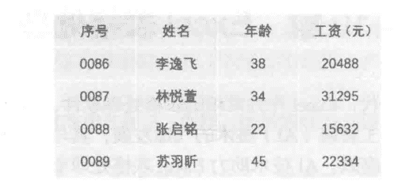

第 2 步，打开 DeepSeek，单击下方的 · 附件 ·，上传图片，并且在对话框中输入提示词，如图 10-2 所示。


DeepSeek 会自动提取其中的文本。
第 3 步，单击按钮后，稍等片刻，DeepSeek 会生成一个代码框，这个代码框可以直接被复制，如图 10-3 所示。


第 4 步，将表格复制到 Excel 工作表中，此时我们可以看到，已经将文字提取出来了，如图 10-4 所示。

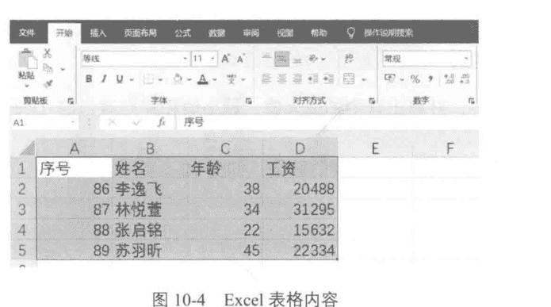

图 10-4 Excel 表格内容

#### 10.2 生成 Excel 函数

Excel 函数丰富多样，涵盖数学运算、文本处理、逻辑判断等多个领域，虽然功能强大，但复杂的函数语法和参数设置让许多用户望而却步。AI 写公式功能的诞生，打破了这一使用障碍。用户无须深入记忆各类函数，只需以通俗易懂的自然语言描述计算需求，AI 工具就能依据这些描述，快速准确地生成对应的 Excel 公式。即使是对 Excel 函数了解甚少的新手，也能借助 AI 轻松完成复杂的数据计算分析任务，充分发挥 Excel 强大的数据处理能力。

##### 10.2.1 输入需求，自动生成 Excel 函数

在日常的 Excel 数据处理中，各类函数的语法和参数对于很多人来说并不容易。现在，有了 DeepSeek，人们无须死记硬背这些函数，只要通过简单的提问，就能快速获取所需的函数，极大地提高了数据处理效率。具体过程如下：

- 明确需求：在询问 DeepSeek 前，先清晰梳理计算需求，比如是计算某列数据的总和，还是计算某个区域数据的平均值。
- 简洁提问：向 DeepSeek 提出问题时，语言要简洁明了，直接描述需求，例如“如何计算 A1 到 A10 单元格的总和”。
- 理解回复：DeepSeek 会给出对应的 Excel 函数公式，这时要仔细理解函数的构成和参数含义，方便后续修改和运用。
- 代入数据：将实际的数据代入 DeepSeek 给出的函数中，确保函数能准确作用于目标数据。
- 检查验证：完成函数输入后，检查计算结果是否合理，如有问题，可以再次向 DeepSeek 询问修改建议。

使用 DeepSeek 自动生成 Excel 函数时，要确保问题描述准确，避免模糊不清导致得到错误的函数。同时，虽然 DeepSeek 能提供便利，但也不能完全依赖，要对基本的函数原理有一定了解，这样才能在数据处理中灵活应对各种情况。此外，DeepSeek 的回复可能因版本或数据环境不同有所差异，若遇到问题，可尝试调整提问方式或查阅相关资料。

##### 10.2.2 实操案例

求和一列内容，并算出其中的最大值、最小值和平均值，请 DeepSeek 写出相应的 Excel 公式。

第 1 步，在 Excel 中填入需要的数据，如图 10-5 所示。

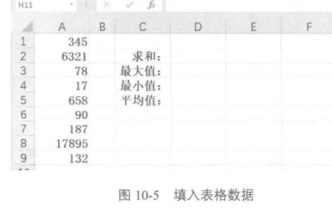

图 10-5 填入表格数据

第 2 步，打开 DeepSeek，并且在对话框中输入提示词，如图 10-6 所示。


图 10-6 实操案例对话框

第 3 步，单击按钮，稍等片刻，DeepSeek 会生成求和、最大值、最小值、平均值的运算公式，如图 10-7 所示。

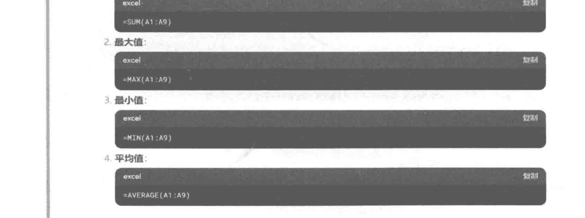

图 10-7 DeepSeek 生成的公式

第 4 步，将公式复制到 Excel 中，可以看到计算结果，如图 10-8 所示。

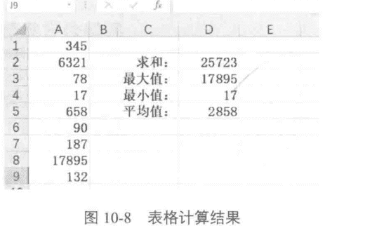

图 10-8 表格计算结果

#### 10.3 生成 VBA 代码

利用 VBA 代码能实现 Excel 的自动化操作，为频繁处理重复性表格任务的用户提供便利，但编写 VBA 代码需要具备一定的编程知识和技能，并非所有用户都能掌握。AI 工具为用户解决了这一难题，用户无须编写代码，即可轻松实现办公自动化，减少了重复机械操作，提高了工作效率，让 Excel 的使用更加智能、便捷。

##### 10.3.1 自动快速生成 VBA 代码

使用 DeepSeek 生成 VBA 代码的过程如下：

- 确定目标：在向 DeepSeek 求助前，明确想要实现的自动化任务，比如自动筛选数据、批量处理表格格式等。
- 精准描述：向 DeepSeek 阐述需求时，尽量详细、准确地描述任务细节，例如“写一段 VBA 代码，实现每月 1 号自动汇总上个月各部门的销售数据”。
- 解析代码：DeepSeek 返回代码后，认真研读代码逻辑，理解每个部分的作用，方便后续调整优化。
- 调试运行：将生成的代码复制到 Excel 的 VBA 编辑器进行初步调试，检查是否有语法错误，若有问题，分析报错原因。
- 优化完善：根据调试结果和实际需求，对代码进行优化，比如调整数据处理的范围、改进执行效率等，也可通过再次询问 DeepSeek 获取改进建议。

此外，有几点需要留意。要保证需求描述清晰完整，避免因表述不清导致生成的代码无法满足要求。DeepSeek 生成的代码可能并非最优解，需要结合实际情况进行优化。不同版本的 DeepSeek 及 Excel 运行环境可能会对代码生成和执行产生影响，遇到问题时，可尝试更换提问方式、查阅相关文档，或在技术论坛寻求帮助。

##### 10.3.2 实操案例

第 1 步，确定 VBA 代码实现的操作：实现每月 1 号自动汇总上个月各部门的销售数据。

第 2 步，打开 DeepSeek，单击 · 深度思考 · 和 · 联网搜索 ，并且在对话框中输入提示词，如图 10-9 所示。


图 10-9 实操案例对话框

第 3 步，单击⬆按钮，稍等片刻，DeepSeek 会生成 VBA 代码。

以下是实现每月 1 号自动汇总上个月各部门销售数据的 Excel VBA 代码，包含自动触发机制和详细注释：

```
Sub Simple Monthly Summary()
    If Day(Date) <> 1 Then Exit Sub '仅每月 1 号执行
    Dim lastMonth As Date: lastMonth = DateAdd("m", -1, Date)
    Dim dataSheet As Worksheet: Set dataSheet = Sheets("销售数据")
    Dim summarySheet As Worksheet: Set summarySheet = Sheets.Add(After:=Sheets(Sheets.Count))
    '创建汇总表
    summarySheet.Name = Format(lastMonth, "yyyy-mm") & "汇总"
    summarySheet.Range("A1:C1") = Array("部门", "总销售额", "记录数")
    '使用数据透视表快速汇总
    dataSheet.Range("A:C").CreatePivotTable _
        TableDestination:=summarySheet.Range("A3"), _
        TableName:="TempPivot"
    With summarySheet.PivotTables("TempPivot")
        .PivotFields("部门").Orientation = xlRowField
        .AddDataField .PivotFields("销售额"), "总销售额", xlSum
        .AddDataField .PivotFields("部门"), "记录数", xlCount
    End With
    summarySheet.Columns.AutoFit
    MsgBox "上月数据已汇总到新工作表!"
End Sub
```

#### 10.4 数据纠错

在 Excel 数据处理过程中，数据的准确性直接影响后续分析结果的可靠性。然而，进行数据录入时可能出现格式不一致、重复录入、逻辑错误等问题。AI 的数据纠错功能成为保障数据质量的有力工具，它能快速扫描整个数据集，运用智能算法精准定位到数据中的格式错误，如日期格式不统一、数值格式错误等。并且，AI 会根据错误类型给出相应的修正建议，帮助用户快速纠正错误，确保数据的准确性，为后续的数据处理和分析奠定可靠的数据基础。

##### 10.4.1 数据纠错，精准定位错误

以往检查数据错误时需要人工仔细核对，既耗时又容易遗漏。现在，借助 DeepSeek 强大的数据纠错能力，能快速、精准地找出数据问题，尤其是在求和等计算方面，为我们的数据处理工作提供了有力保障。使用 DeepSeek 进行数据纠错的过程如下：

- 整理数据：将需要检查的数据完整、准确地录入或导入 Excel 表格中，要保证数据格式规范，方便 DeepSeek 进行分析。
- 明确需求：清晰地向 DeepSeek 阐述要检查的内容，比如“帮我检查这个表格中求和数据是否正确”，并提供表格数据或相关链接。
- 等待分析：DeepSeek 会运用算法对表格数据进行分析，识别其中可能存在的求和错误等，这期间需要耐心等待。
- 查看结果：DeepSeek 分析完成后，会展示出检测到的错误信息，要认真查看错误提示，明确错误所在位置和类型。
- 修正数据：根据 DeepSeek 给出的错误提示，对表格中的数据进行相应修正。
- 再次验证：完成修正后，再次使用 DeepSeek 进行检查，确保数据已准确无误。

此外，要保证录入的数据完整且格式正确，否则可能导致 DeepSeek 误判。提问时要精准描述问题，详细说明表格的结构和数据含义，以便 DeepSeek 更准确地分析。同时，虽然 DeepSeek 能高效地发现错误，但还是要对数据有基本的理解和判断，修正数据后一定要再次验证，确保数据的准确性。

##### 10.4.2 实操案例

尝试让 DeepSeek 寻找表格中的错误。
第 1 步，准备一个有内容错误的表格，如图 10-10 所示。

| 姓名 | 余额（元） | 家庭住址 |
| :--- | :--- | :--- |
| 周沐阳 | 485432 | 陕西省西安市 |
| 江晚柠 | 6425664 | 山东省青岛市 |
| 沈逸霄 | 2134 | 河北省南京市 |
| 苏念安 | 12356 | 河南省郑州市 |
| 林屿森 | 121324 | 山西省大同市 |
| 余额合计 | 3859238 | |

图 10-10 待操作的表格

第 2 步，打开 DeepSeek，单击·联网搜索·并且在对话框中输入提示词，如图 10-11 所示。


图 10-11 实操案例对话框

第 3 步，单击按钮，稍等片刻，DeepSeek 会生成分析结果。

根据表格中的数据，余额总计的计算如下。

- 周沐阳：485432 元
- 江晚柠：6425664 元
- 沈逸霄：2134 元
- 苏念安：12356 元
- 林屿森：121324 元

将这些余额相加：485432+6425664+2134+12356+121324=7046910 元。

表格中给出的余额合计是 3859238 元，这与实际计算结果不符。因此，余额总计的数字是错误的。正确的余额总计应该是 7046910 元。

此外，图片中的表格有一个明显的错误：沈逸霄的家庭住址是“河北省南京市”。这个地址是错误的，因为南京是江苏省的省会，而不是河北省的。正确的应该是“江苏省南京市”。这个错误可能是由输入时的疏忽造成的。

#### 10.5 多种表格的生成

Excel 表格类型丰富，不同的业务场景和数据分析需求，需要制作不同类型的表格，如数据透视表用于快速汇总和分析大量数据，柱状图、折线图等用于直观展示数据趋势。但制作这些多样化的表格，对于部分用户来说存在一定难度，需要掌握特定的操作技巧和步骤。借助 AI 技术，用户只需要输入关键数据和需求，比如想要分析的销售数据及期望展示的对比维度，AI 就能快速生成相应的数据透视表；或者根据用户对数据可视化的要求，生成合适的图表表格。这使用户能够更高效地从海量数据中挖掘价值，进行全面、深入的数据分析，充分发挥 Excel 在数据处理和展示方面的优势。

##### 10.5.1 轻松生成所需样式的表格

在日常办公中，制作符合特定需求的表格往往令人头疼。如今，DeepSeek 为我们解决了这一难题，只需要提出复杂需求，DeepSeek 就能直接生成对应的表格样式，极大地提高了办公效率，让表格制作变得轻松简单。

具体包括以下几点内容：

- 梳理需求：在向 DeepSeek 寻求帮助前，先在脑海中或通过纸笔，清晰梳理出想要表格呈现的样式、包含的数据内容及各部分的功能。比如，需要制作一个销售业绩分析表，明确表格要涵盖不同产品不同季度的销售额及利润等数据，并且要有汇总行和百分比计算列。
- 精准表达：打开 DeepSeek，用简洁且准确的语言描述需求。避免模糊不清的表述，如“给我做个销售业绩分析表”这样的表达就过于笼统，应具体为“帮我生成一个 Excel 表格，包含产品名称、一季度至第四季度销售额、利润，要有年度汇总行，利润列以百分比形式显示，且表格样式简洁美观”。
- 查看反馈：DeepSeek 接收指令后，会依据需求生成表格。要仔细查看生成的表格，检查数据是否完整、格式是否正确、样式是否符合预期。
- 微调优化：若表格存在一些小瑕疵，如某些数据格式不对、行列宽度不合适等，可以利用 Excel 自带的功能进行微调，也可以再次向 DeepSeek 询问优化建议，如：“生成的表格中利润列的百分比小数位太多，该怎么调整？”
- 确认保存：经过检查和优化，确保表格完全符合需求后，将其保存到指定位置，方便后续使用。

使用 DeepSeek 生成所需样式表格时，有几个要点需要注意。首先，务必精准、详细地描述需求，这直接影响生成表格的质量。其次，提供的数据信息要准确，避免由数据错误导致表格内容有误。另外，虽然 DeepSeek 很强大，但所生成的表格可能无法一次性完美契合所有需求，因此要掌握一些基本的表格调整技能。最后，在微调优化表格时，若再次询问 DeepSeek，则要清晰说明当前存在的问题，以便获取更有效的建议。

##### 10.5.2 实操案例

生成一个超市常用的账单表格。
第 1 步，打开 DeepSeek，并且在对话框中输入相关提示词，单击 ·深度思考· 和 ·联网搜索·，如图 10-12 所示。


第 2 步，单击按钮，稍等片刻，DeepSeek 会生成一个建议的表格模板。
当然可以！以下是一个适合小超市老板使用的 Excel 记账模板的设计思路和表格结构。你可以根据这个结构在 Excel 中创建表格，或者直接复制到 Excel 中使用。

###### 1. 收入记录表

用于记录每日的收入情况。

| 日期 | 商品名称 | 销售数量（个） | 单价（元） | 总收入（元） | 支付方式 |
| :--- | :--- | :--- | :--- | :--- | :--- |
| 2023-10-01 | 矿泉水 | 10 | 2.00 | 20.00 | 现金 |
| 2023-10-01 | 薯片 | 5 | 5.00 | 25.00 | 微信 |

###### 2. 支出记录表

用于记录超市的各类支出，如进货费、租金、水电费等。

| 日期 | 支出类别 | 支出项目 | 支出金额（元） | 支付方式 |
| :--- | :--- | :--- | :--- | :--- |
| 2023-10-01 | 进货费 | 矿泉水 | 100.00 | 银行转账 |
| 2023-10-01 | 租金 | 店铺租金 | 2000.00 | 现金 |
| 2023-10-02 | 水电费 | 电费 | 300.00 | 支付宝 |

###### 3. 库存管理表

用于记录商品的库存情况，方便及时补货。

| 商品名称 | 库存数量（个） | 进货单价（元） | 销售单价（元） | 最低库存数量（个） |
| :--- | :--- | :--- | :--- | :--- |
| 矿泉水 | 50 | 1.50 | 2.00 | 20 |
| 薯片 | 30 | 4.00 | 5.00 | 10 |

###### 4. 利润统计表

用于统计每月的利润情况。

| 月份 | 总收入（元） | 总支出（元） | 利润（元） | 备注 |
| :--- | :--- | :--- | :--- | :--- |
| 2023-10 | 5000.00 | 3000.00 | 2000.00 | |
| 2023-11 | 6000.00 | 3500.00 | 2500.00 | |

###### 5. 月度汇总表

用于汇总每月的总收入、总支出、利润和现有库存情况。

| 月份 | 总收入（元） | 总支出（元） | 利润（元） | 现有库存（元） |
| :--- | :--- | :--- | :--- | :--- |
| 2023-10 | 5000.00 | 3000.00 | 2000.00 | 195.00 |
| 2023-11 | 6000.00 | 3500.00 | 2500.00 | 300.00 |

使用说明：
（1）收入记录表：记录每天的销售情况，方便统计每日收入。
（2）支出记录表：记录所有支出，确保资金流向清晰。
（3）库存管理表：实时更新库存，避免缺货或积压。
（4）利润统计表：每月汇总收入和支出，计算利润。
（5）月度汇总表：每月汇总收入和支出，方便查看经营状况。
你可以根据实际需求调整表格内容，或者添加其他功能，如自动计算、数据透视表等。希望这个模板能帮助你更好地管理超市的财务！

> AI 的终极目标不是模仿人类，而是扩展人类的能力。
——李飞飞（斯坦福教授）

### 第 11 章 功能类写作

功能类写作是一种具有明确实用目的的写作形式，其与文学创作注重艺术性和情感表达不同，更侧重于清晰、准确地传达信息，以实现特定的功能或达成某种目标。AI 工具可以随时随地生成相关内容，让我们面临突发的演讲时，不至于手足无措。

#### 11.1 拜年短信

##### 11.1.1 批量生成个性化拜年短信

拜年短信作为传递新年祝福的重要方式，批量生成个性化内容能大大提高效率，还能让不同人群都感受到专属的关怀。借助 DeepSeek 这一强大工具，可以为亲朋好友、同事领导等不同对象送上独特的新年祝福。
想要利用 DeepSeek 生成优质的个性化拜年短信，先明确不同人群的特点和需求。下面是一些具体思路：

- 长辈：内容要体现尊敬与感恩，回忆长辈对自己的关爱与教导，如“过去一年承蒙您的悉心照顾，新的一年祝您身体健康，万事顺遂”。
- 平辈朋友：语言风格可轻松活泼，融入共同的回忆，如“还记得咱们一起【具体经历】，新的一年希望我们还能一起创造更多欢乐回忆，新年快乐！”
- 同事：表达对过去一年合作的感谢，展望新一年工作，如“过去一年和大家共事很愉快，新的一年祝工作顺利，项目都能圆满完成”。
- 领导：措辞需正式、谦逊，感谢领导的指导与支持，如“承蒙您过去一年的悉心指导，新的一年我会继续努力，也祝您事业蒸蒸日上”。
- 客户：突出合作的诚意与对未来合作的期待，如“感谢过去一年您对我们的信任与支持，新的一年我们将竭诚为您服务，期待携手共创更多辉煌”。

##### 11.1.2 实操案例

为刚刚步入职场的新人张小明生成个性化拜年短信。
第 1 步，先思考一下需要拜年的群体，如曾经的老师、曾经的同学、目前的领导等。
第 2 步，打开 DeepSeek，单击 · 深度思考 · 和 · 联网搜索 ·，并且在对话框中输入提示词，如图 11-1 所示。


第 3 步，单击按钮，稍等片刻，DeepSeek 会生成多个拜年短信。

以下是针对不同群体为您定制的拜年短信模板（每条约 100 字，保持口语化且避免重复）：

给曾经的老师：王老师新年好！学生张小明给您拜年啦！感谢您当年在［XX学科/校园生活］中的悉心教导，让我在职场中也能受用至今。新的一年祝您身体康泰、桃李满园，愿师母和孩子们万事顺意！春节后想回母校看望您，届时再向您汇报工作心得～

给曾经的同学：老铁新年嗷嗷旺！还记得咱班当年［具体回忆：如考前突击/运动会夺冠］的糗事吗？转眼都成打工人了！祝兄弟/姐妹新一年薪资翻倍不加班，桃花朵朵开！等节后组局火锅走起，咱们继续造作青春！

给目前的领导：李总新年吉祥！感谢您过去一年在项目中的指导点拨，让我这个职场新人快速成长。新春佳节将至，衷心祝愿您和家人平安喜乐、诸事顺遂！新的一年我会继续努力，还请您多多指教。节后复工给您带家乡特产尝尝鲜～

给目前的同事：晓雯姐新年快乐呀！特别感谢您这半年手把手教我熟悉业务流程，超幸运能遇到神仙同事～祝您新年美妆自由、娃儿乖巧、购物永远遇折扣！咱们组新一年业绩继续冲第一，开工利是等着你！

给家中的长辈：二叔二婶新年好！小明给您拜年啦！感谢您总是惦记着我在外打拼，今年一定回家多陪您唠嗑。祝二叔钓鱼次次爆护，二婶广场舞王者出道！最要紧是身子骨硬硬朗朗，等着我带您游新开的湿地公园呀！

给普通朋友：姐妹/兄弟新年飒起来！新一年祝你奶茶自由不长肉，峡谷连胜不连跪，盲盒抽隐藏款，追星永不塌房！等放假组队逛庙会呀～（配锦鲤表情图）

**注意事项：**

1. 可根据实际情况替换具体内容。
2. 长辈短信建议配合语音发送更显亲切。
3. 领导同事建议除夕当天 9:00 至 11:00 发送。
4. 可附加个性化内容，如“看到您朋友圈的腊梅开了，和新年一样红火”。

#### 11.2 聚会发言稿

##### 11.2.1 创作聚会即兴发言内容

在各种聚会中，一段精彩的发言能够迅速活跃气氛，加深彼此之间的情感联系。

- 同学聚会：回忆学生时代的难忘经历，比如一起为考试奋斗的日子、某次有趣的班级活动等，唤起大家共同的青春记忆，增加情感共鸣。
- 家庭聚会：围绕家庭的温暖、亲情的珍贵展开，讲述一些家庭成员间相互支持、陪伴的感人故事，传递对家人的关爱与祝福。
- 公司聚会：表达对过去一年同事们辛勤付出的感谢，展望新一年的工作目标和团队合作，激励大家携手共进，为公司发展贡献力量。
- 朋友生日聚会：突出寿星的个性特点和朋友之间的深厚友谊，分享一些与寿星相处的欢乐瞬间，送上真挚的生日祝福。
- 主题聚会：若有特定主题，如户外探险爱好者聚会，则结合主题分享相关的经历、感悟，使发言内容与聚会主题紧密契合。

##### 11.2.2 实操案例

为张小明生成不同聚会的发言稿。
第 1 步，先确定一下发言的目的：想要在聚会中通过发言来活跃气氛，加深和与会人员之间的情感联系。再思考一下聚会的类型，如同学聚会、家庭聚会、公司聚会、朋友生日聚会、主题聚会等。
第 2 步，打开 DeepSeek，单击 · 深度思考 · 和 · 联网搜索 ·，并且在对话框中输入提示词，如图 11-2 所示。


第 3 步，单击按钮，稍等片刻，DeepSeek 会生成多篇聚会发言稿。
以下是针对不同聚会场景设计的发言稿，结合了情感表达与气氛活跃元素，供你参考：

###### 一、同学聚会发言稿

场合：阔别十年的高中同学聚会
尊敬的老师、亲爱的同学们：
大家好！我是张小明。今天站在这里，仿佛又回到了教室后排偷传纸条的时光，那时的我们总以为毕业遥遥无期，转眼却已各奔东西十年。这十年，有人成了职场精英，有人成了超级奶爸，还有人像我一样，仍在为“中年不油腻”的目标奋斗。
记得当年运动会上的接力赛吗？老李摔了一跤却坚持跑到终点，全班为他呐喊的场景，至今让我眼眶发热。正是这些片段，让我们成了彼此青春的“人形存档”。今天的相聚，不是比较谁的发际线更高，而是为了找回那份纯粹的默契——哪怕生活让我们“秃”然老去，情谊永远“不脱发”！
最后，愿我们像当年一样，永远敢闯敢拼，永远热泪盈眶！来，敬永不散场的青春，干杯！

###### 二、家庭聚会发言稿

场合：春节家族团圆饭
亲爱的爷爷奶奶、叔叔阿姨、兄弟姐妹们：
我是小明，家族群里的“红包终结者”。今天能四代同堂围坐一桌，让我想起小时候偷吃祭祖贡品被奶奶追着打的糗事。那时候总觉得长辈唠叨，如今才明白，那些“多吃点”“穿秋裤”的叮嘱，是藏在岁月里的最暖情话。
咱们老张家有个“超能力”——无论天南海北，只要腊肉香肠一上桌，DNA就自动绑定！去年表姐创业成功，小叔评上劳模，连刚上小学的豆豆都拿了编程奖……这些成绩背后，是家族“团结如麻花，越拧越紧”的精神在传承。新的一年，愿我们继续做彼此的“充电宝”，电量满格，笑对生活！
最后，请允许我用三句话总结：菜要趁热吃，酒要慢慢喝，家要常常回！干杯！

###### 三、公司年会发言稿

场合：公司年终表彰大会
尊敬的领导、亲爱的战友们：
大家好！我是市场部张小强——哦不，张小明（扶额），看来年终加班确实让我记忆体过载了。这一年，我们像“西天取经团”：有人化身“数据悟空”火眼金睛，有人如“财务唐僧”紧箍咒念不停，而我大概是“后勤八戒”，总在下午茶时间精准化缘。
记得那次通宵赶方案，凌晨三点办公室的泡面香比任何鸡汤都提神；也记得客户临时变卦时，团队瞬间切换“复仇者联盟”模式的默契。正是这些点滴，让我们从“同事”变成了“同舟共济”。新的一年，愿我们继续做彼此的“锦鲤”，业绩“兔”飞猛进，烦恼“虎”头蛇尾！
最后，请领导放心，明年我们一定少掉头发多接单！Cheers！

#### 11.3 婚礼发言稿

##### 11.3.1 为婚礼即兴发言提供思路

在使用 DeepSeek 构思婚礼即兴发言前，先要了解新人的爱情故事、性格特点等，这样发言才更具针对性。具体包括如下几点内容：

- 讲述初见印象：分享第一次见到新人时对他们的印象，比如新郎的帅气、新娘的温柔，引出对他们美好爱情的感慨。

##### 11.3.2 实操案例

为新人好友张小明写一篇婚礼发言稿。
第 1 步，思考一下需要祝福的内容，比如讲述初见印象、回顾恋爱点滴、赞美新人品质、送上美好期许、引用美好寓意等。
第 2 步，打开 DeepSeek，单击 · 深度思考 · 和 · 联网搜索 ·，并且在对话框中输入提示词，如图 11-3 所示。


第 3 步，单击按钮，稍等片刻，DeepSeek 会生成一篇优质的婚礼发言稿。
建议发言框架（便于脱稿发挥的互动版）：

1. 初见印象互动开场
“大家好！我是跟新郎一起打过球、逃过课还挨过甲方骂的好兄弟张小明！刚刚看着他们牵手走红毯，让我想起第一次见到嫂子（弟妹）的场景——那天××（新郎名字）神秘兮兮说要带我见个传说中‘三笑留情’的姑娘，结果在咖啡厅一见啊，好家伙！我们××（新郎名字）瞬间笑得像只招财猫！这心动表情跟现在台上简直一模一样！朋友们说对不对？”（示意亲友团起哄）

2. 恋爱点滴沉浸式回忆
“机智如我发现他们恋爱以来十个细节变化：
第一，××（新郎名字）手机锁屏从动漫女神变成了双人表情包；
第二，××（新郎名字）发朋友圈时开始标注‘某位女士说……’
最感动还是新冠疫情那年，高铁都停运了，他愣是骑共享单车跨了三个区，就为隔着小区栅栏送草莓蛋糕……（停顿）大家说这是不是现代版‘所爱隔山海，山海皆可平’？”

3. 品质揭秘三段式加重音
“作为见证者我要郑重公布两个真相：（突然正经）
第一个真相：新娘是百年难得一遇的‘反矫达人’——记得有次××（新郎名字）装病卖惨，她温柔地说‘多喝热水’，然后（停顿）转身就带着热粥和退烧药上门了！
第二个真相：新娘是‘人间反内卷楷模’——上周还看见××（新郎名字）跟着学插花，说要培养审美对抗焦虑。
而最珍贵的品质是——他们让彼此变成了更温柔却有力量的人！有没有同感的，请鼓掌！”。

4. 期许祝福五感沉浸法
“在这里我祝你们：
闭上眼睛时能听到厨房里砂锅咕嘟声里的安稳；
睁开眼睛能看到彼此眼里的星辰从青丝闪烁到白发；
（突然调皮）对了，当撒狗粮时记得屏蔽我们这些‘孤寡选手’哦～”

5. 寓意梗王收尾套餐
“最后请允许我盗用《诗经》名句：‘死生契阔，与子成说’——表达的意思就是：说好的朋友圈晒娃请九宫格，撒狗粮要预告发过滤镜，当然最重要的（举杯），说好了百年后变成老爷爷老奶奶，还要在公园长椅上互嘲对方当年婚礼糗事！朋友们，让我们共同见证此刻永恒的承诺！”

#### 11.4 生日发言稿

##### 11.4.1 生成生日即兴发言稿

在生日宴会上，一段真诚又精彩的即兴发言，能为特殊的日子增添温暖与欢乐，让寿星感受到满满的祝福与关怀。具体包括如下几点内容：

- 分享难忘经历：聊聊和寿星一起度过的难忘时刻，如某次一起旅行的趣事，或者共同克服困难的经历，凸显彼此之间深厚的情谊。
- 夸赞寿星优点：真诚地列举寿星身上的闪光点，如寿星的乐观开朗、乐于助人，让寿星感受到被认可和被欣赏。
- 送上未来祝福：表达对寿星未来生活的美好祝愿，如希望寿星在新的一岁里实现自己的目标，收获更多的快乐与成功。

##### 11.4.2 实操案例

为参加生日会的张小明写一篇即兴发言稿。
第 1 步，确定发言稿的特点。发言稿应具有温馨、欢快的特点，内容应围绕对寿星的祝福展开。
第 2 步，打开 DeepSeek，单击 · 深度思考 · 和 · 联网搜索 ，并且在对话框中输入提示词，如图 11-4 所示。


第 3 步，单击按钮，稍等片刻，DeepSeek 会生成一篇完整的生日宴发言稿。

###### 生日宴发言框架（氛围欢快版）

（穿插互动提示，适配普通朋友/死党场景）

1. 初见印象「悬疑开场」
“在座各位侦探请注意！我是寿星五年前捡到的‘野生朋友’张小明！现在要解密一桩‘大型伪装案’——（神秘语气）咱们老李第一次跟我打招呼时，戴着金丝眼镜捧着《国富论》，一副高冷学霸样（推眼镜模仿）。结果三天后烧烤摊上，他举着烤腰子喊‘兄弟走一个’的样子，（停顿挑眉）台下的目击者们请举手做证！”
（技巧：开场用身份反差梗破冰，配合浮夸演技打开笑声开关）

2. 高光经历「观影式快闪」
“和寿星组队必出经典名场面——
• 比如那年暴雨天被困迪士尼，他举着玲娜贝儿气球带全车厢唱《爱情买卖》；
• 比如团建密室逃脱时，他抱着 NPC（名字）大腿喊‘大哥咱唠十块钱的’；
• 但最绝的是（压低声音）上次他喝醉后非要教小区流浪猫跳螃蟹舞（突然举手机）想看的微信转账 50 元解锁视频！”
（提示：扭腰模仿螃蟹动作，引发掌声欢呼）

3. 彩虹夸赞「三连暴击」
“经过缜密观察，我宣布老李有三大超能力：
（1）情绪不稳定体质——上次我失恋趴在桌上哭，他默默点了麻辣小龙虾说‘辣哭了不丢人’；
（2）反向内卷宗师——别人加班晒咖啡，他准时下班晒猫照片并配文‘关爱颈椎，从抬头撸猫做起’；
（3）隐藏技能点满——上个月发现他居然会修微波炉！朋友们说该不该颁发‘海底捞过生日免费券’奖励？”（暗号：说到“免费券”时举蛋糕叉子示意观众喊“该！”）

#### 11.5 表扬信

##### 11.5.1 快速生成表扬信

对于语言能力欠佳的人来说，撰写表扬信可能会面临词不达意、条理不清的问题。用 AI 生成表扬信具体包括如下几点内容：

- 明确表扬对象和事件：清晰阐述被表扬者是谁，以及具体时间、地点发生了什么值得表扬的事情，让阅读者迅速了解事情的主体和背景。
- 描述详细经过：细致讲述事情的经过，突出被表扬者在其中的积极行为和关键作用。
- 强调行为意义：分析被表扬者的行为所带来的积极影响，无论是对个人、集体还是社会。

##### 11.5.2 实操案例

以张小明的名义为别人写一封表扬信。
第 1 步，明确一下表扬信的内容框架，1.明确表扬对象和事件，2.描述详细经过，3.强调行为意义，4.表达感谢与赞扬，5.提出希望与鼓励。
第 2 步，打开 DeepSeek 平台，单击 · 深度思考 · 和 · 联网搜索 ，并且在对话框中输入提示词，如图 11-5 所示。


图 11-5 实操案例对话框

第 3 步，单击按钮，稍等片刻，DeepSeek 会生成一封完整的表扬信。

###### 表扬信

致：××公司领导
尊敬的领导：
您好！
我是××小区业主张小明，特以此信对贵公司保洁部员工李红同志提出表扬，她在 2025 年 2 月 10 日的一次工作中展现出的敬业精神和高尚品德，深深感动了我和其他业主。

###### 明确表扬对象和事件

李红同志是贵公司负责本小区公共区域清洁的保洁员。2 月 10 日下午，她在清扫小区花园时，发现一个装有现金、身份证及多张银行卡的手提包遗落在长椅上。李红同志第一时间将失物上交物业服务中心，并通过包内证件信息联系到失主（业主王女士），最终物归原主。

###### 描述详细经过

当天下午 3 点左右，李红同志在完成日常清洁任务时，注意到花园长椅上有一个黑色手提包。她立即上前查看，发现包内有现金 5000 余元、证件及重要文件。考虑到失主可能焦急万分，她未做停留，迅速将手提包送至物业办公室，并配合工作人员调取监控、核对信息。仅用 1 小时便联系到失主，确认无误后归还物品。王女士感动不已，多次提出酬谢，均被李红同志婉拒。

###### 表达感谢与赞扬

在此，我谨代表全体业主向李红同志表示衷心的感谢！她的行为让我们看到平凡岗位上的不平凡精神，也感受到贵公司对员工品德教育的重视。同时，感谢贵公司培养出如此优秀的员工，她的表现正是“服务至上、业主为先”理念的最佳诠释。

此致
敬礼！

业主：张小明
2025年×月×日

#### 11.6 检讨书

##### 11.6.1 快速生成检讨书

DeepSeek 能为我们梳理思路、组织语言，帮助我们顺利完成检讨书的创作，让我们的认错态度得以真诚体现。检讨书具体包括如下几点内容。

- 明确错误行为：开门见山地指出自己犯了什么错误，比如“我于［时间］在［地点］，因为［原因］，做出了［错误行为］”，让阅读者能第一时间了解问题所在。
- 描述错误经过：详细叙述错误发生的完整过程，包括自己当时的想法和行为。例如“当时我想着［错误想法］，于是［具体行为步骤］，最终导致了［错误结果］”，把整个过程清晰呈现。
- 分析错误原因：从自身找原因，思考为什么会犯下这个错误。可以是思想认识不足，如“我对［相关规定或原则］认识不够深刻，没有意识到问题的严重性”等。
- 表达认错态度：用诚恳的语言表达自己对错误的深刻认识和懊悔之情，如“我深刻认识到自己的错误，内心充满了愧疚，对因此造成的不良影响深感抱歉”。
- 提出改正措施：列出具体的改正方法，表明自己改正错误的决心。比如“我会制订学习计划，加强对［相关知识或技能］的学习，避免再犯同样的错误”。

##### 11.6.2 实操案例

请为做错事的张小明生成一份检讨书。
第 1 步，先确定一下检讨书的内容框架：一是明确错误行为，二是描述错误经过，三是分析错误原因，四是表达认错态度，五是提出改正措施。
第 2 步，打开 DeepSeek，单击 · 深度思考 · 和 · 联网搜索 ·，并且在对话框中输入提示词，如图 11-6 所示。


图 11-6 实操案例对话框

第 3 步，单击⬆按钮，稍等片刻，DeepSeek 会生成一份检讨书。

###### 《检讨书》

尊敬的×××：
我是张小明，怀着愧疚写下这份检讨书，深刻反省近期考试作弊的错误。
在上次期末考试［具体考场号］中我被难题困住，看到旁边同学试卷露出答案，在侥幸心理驱使下，我抄了答案。
反思错误原因，主要是学习态度不端，平时不认真复习，总存侥幸心理；价值观偏差，过于看重成绩，忽视诚实公平；面对考试压力，缺乏正确应对方式。
我深知这种行为影响恶劣，懊悔自责，向老师和同学们诚恳道歉，愿意接受任何处罚，把这次错误当深刻教训。
为改正错误，我会端正学习态度，认真听讲、完成作业，制订学习计划，提前复习；重塑正确价值观，坚守原则；学习应对考试压力的方法，凭真实能力应考。我还会参加诚信教育活动，向同学们宣传诚信考试。
再次为错误致歉，望得到谅解，我会用行动证明决心。

检讨人：张小明

> AI 将让每个人都能找到最适合自己的职业路径。
——里德·霍夫曼（Linkedin 联合创始人）

### 第 12 章 求职辅助

求职是迈向社会的关键一步，掌握正确的求职方法至关重要。求职需全方位准备，积极行动，以自信的姿态迎接职场挑战，开启人生新征程。借助 DeepSeek，可以帮助用户进行高效率求职。

#### 12.1 职业规划

##### 12.1.1 制定合理的职业规划

使用 DeepSeek 进行职业规划时，需要有明确的思路，主要包括如下几点内容。

- 输入个人信息：上传或手动输入简历，让 DeepSeek 解析用户的职业技能、工作经历等关键信息。
- 识别技能差距：通过 DeepSeek 的分析结果，识别出用户当前技能组合中的优势与不足之处，特别是那些对求职至关重要的领域。
- 确定职业方向：基于技能评估和个人兴趣，结合市场趋势，选择一条或多条可能的职业发展路径。
- 设计学习计划：根据选定的职业方向，DeepSeek 将推荐必要的技术课程、认证考试及实践项目，帮助用户填补技能空白并增强竞争力。
- 锁定目标岗位：利用 DeepSeek 筛选出最适合的职位列表，并给出这些岗位的具体要求和大致薪资水平。

##### 12.1.2 实操案例

请为清华大学计算机系毕业生张三制定职业规划。
第 1 步，将简历上传到 DeepSeek，并向 DeepSeek 输入求职相关信息，如图 12-1 所示。


图 12-1 实操案例对话框

第 2 步，单击 · 深度思考 · 和 · 联网搜索 ，再单击⬆，DeepSeek 会生成相关岗位建议。

结合你的清华大学计算机科学与技术硕士背景、科研与实习经历，以及北京地区月薪 2 万以上、职业稳定性与工作生活平衡的需求，以下推荐适合的岗位及单位，并综合了行业趋势和招聘信息。

###### 一、人工智能/算法工程师

**IBM 研究院**
岗位：AI 算法研究员。
薪资：25k～40k/月。
要求：熟悉 TensorFlow/PyTorch，有实际项目经验（如推荐系统、NLP）。
优势：国内 AI 领域头部平台，项目资源充足，技术沉淀深厚。

###### 二、央企/研究所技术岗

**中国电子科技集团公司（CETC）**
岗位：智能系统研发工程师。
薪资：18k～30k/月（含补贴）。
要求：算法设计与工程化能力，参与过国家级科研项目者优先。
优势：解决北京户口，项目周期稳定，工作压力较小。

###### 建议与策略

- （1）优先投递算法岗、AI 岗：你的科研背景（ICML 论文）与清华学历在算法岗竞争中具备优势，且薪资达标率高。
- （2）关注国企、央企春招，如中国移动研究院、航天科工集团等，稳定性强且部分解决北京户口。
- （3）平衡选择开发岗：若算法岗竞争激烈，可转向云计算/后端开发，技术通用性强且职业生命周期长。

第 3 步，根据以上求职建议确定好求职方向后，向 DeepSeek 输入相关提示词，如图 12-2 所示，DeepSeek 会根据问题生成求职建议。


###### 一、技能提升

外企对技术能力、沟通能力和国际化视野有较高要求，以下是需要重点提升的技能：

###### 1. 技术能力

算法与数据结构：外企面试中算法题是必考内容，建议在刷题平台（LeetCode、Codeforces）每天练习 2～3 道中等难度题目。

编程语言：熟练掌握 Python 和 Java（外企常用），熟悉 C++（部分岗位要求）。

机器学习/深度学习：巩固 TensorFlow/PyTorch 框架，熟悉经典模型（如 Transformer、BERT）及其应用场景。

###### 2. 英语能力

技术英语：阅读英文技术文档（如 Google Developer Docs、AWS 官方文档），熟悉专业术语。

口语与听力：每天练习 30 分钟英语口语（推荐使用 Cambly 或 Italki），重点准备自我介绍、项目描述和常见面试问题。

###### 3. 软技能

沟通与协作：外企注重团队合作，建议学习敏捷开发（Agile）和项目管理工具（如 Jira）。

跨文化沟通：了解外企文化（如时间观念、邮件礼仪），避免文化冲突。

###### 二、求职准备

###### 1. 简历优化

英文简历：准备一份专业的英文简历，突出科研经历（如 ICML 论文）和技术能力（如 Python、TensorFlow）。

项目描述：使用 STAR（Situation-Task-Action-Result）法则描述项目，量化成果（如“提升数据处理效率 50%”）。

###### 2. 面试准备

算法面试：刷 LeetCode 高频题目（如动态规划、图论），进行模拟面试（推荐 Pramp 或 Interviewing.io）练习。

行为面试：准备常见问题（如“介绍一个你遇到的挑战”），结合科研和实习经历回答。

技术面试：复习机器学习基础知识（如过拟合、正则化），准备系统设计案例（如设计一个推荐系统）。

###### 三、时间规划

以下是 3 个月到 6 个月的准备计划，分为三个阶段：

###### 第一阶段（第 1 个月到第 2 个月）：基础提升

技术：每天刷 2 道 LeetCode 题目，复习机器学习经典算法（如 SVM、随机森林）。

英语：每天练习 30 分钟口语，阅读英文技术文档。

简历：完成中英文简历初稿，整理 GitHub 项目。

###### 第二阶段（第 3 个月到第 4 个月）：专项突破

技术：重点攻克系统设计题目，学习分布式系统设计。

英语：模拟英文面试，准备常见问题（如“Why do you want to join our company?”）。

求职：开始投递简历，参加目标企业的线上宣讲会。

###### 第三阶段（第 5 个月到第 6 个月）：冲刺与面试

技术：集中刷 LeetCode 高频题目，复习机器学习面试题目。

英语：与外教进行模拟面试，提升表达流畅度。

求职：跟进面试进度，复盘每次面试表现，优化回答策略。

#### 12.2 简历生成

##### 12.2.1 生成吸引人的个人简历

一份优秀的简历，是成功的第一步。为了让简历更具吸引力，可以使用 DeepSeek 生成简历。具体包括如下几点内容：

- 明确目标岗位：在生成简历前，先确定目标岗位和行业，确保简历内容与职位要求高度匹配。
- 突出核心技能：将最相关的技能放在显眼位置，如编程语言及工具的使用经验等。
- 量化成就：用具体数据描述你的成就，例如“提升数据处理效率 50%”或“为项目节省成本 20%”。
- 简洁明了：避免冗长描述，使用简洁的语言和清晰的段落结构。

##### 12.2.2 实操案例

以为清华大学计算机专业毕业生张三生成一份简历为案例进行讲解。

第 1 步，输入张三的项目经历、科研经历、个人信息，为 DeepSeek 尽可能全地提供求职相关信息，如图 12-3 所示。

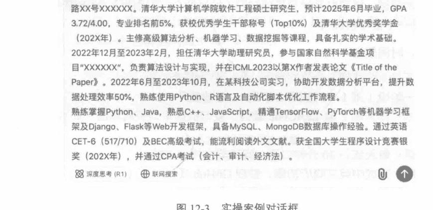

图 12-3 实操案例对话框

第 2 步，利用 DeepSeek 生成简历时，输入指令“帮助我根据以上经历，生成一份求职简历，控制在一页纸内”。

第 3 步，可以根据自身要求对所生成的简历进行微调。

###### 张三

电话：138-0000-0000 邮箱：zhangsan@example.com
联系地址：×××省×××市×××路××号××××××

###### 求职意向

###### 教育背景

2021.09—2025.06 清华大学 计算机学院 软件硕士
GPA:3.72/4.00 专业前 5%。获奖经历：CPA（会计、审计、经济法）通过；校优秀学生干部（Top10%）
主修课程：高级算法分析、机器学习、数据挖掘、人工智能原理等
GPA:X.XX/4.0
主修课程：公司理财、国际金融、金融工程、投资银行学、投资学、金融服务营销学

###### 科研经历

2022.12—2023.02 清华大学 助理研究员 北京
参与国家自然科学基金项目“××××××”的研究工作，负责算法设计与实现。
在国际会议 ICML2023 上发表论文 Title of the Paper（第 X 作者）。

###### 实习经历

2022.06—2023.10 某科技公司 实习生 北京
协助开发团队完成了一个数据分析平台的原型设计，数据处理效率提高了 50%。
使用 Python 和 R 语言进行数据分析，并编写自动化脚本减少了手动操作。

###### 技能证书

计算机技能 编程语言：熟练掌握 Python，Java；熟悉 C++，JavaScript
工具与框架：熟练使用 TensorFlow，PyTorch；熟悉 Django，Flask。
数据库管理：MySQL，MongoDB
外语技能 英语 CET-6（517/710）通过，BEC 高级证书，听说读写流利，可阅读梳理外文专业文献
其他技能 清华大学优秀奖学金(202X) 全国大学生程序设计竞赛银奖(202X)

#### 12.3 知识搜集

##### 12.3.1 搜集岗位基础知识，为面试做准备

为了高效利用 DeepSeek 搜集岗位基础知识，用户需要确立一个相对比较明确的搜集思路。具体包括如下几点内容：

- 明确岗位需求：输入目标岗位的职位描述，提取核心技能和知识点。

##### 12.3.2 实操案例

这里以清华大学计算机系毕业生张三面试 IBM 中国研究院（北京）AI 解决方案工程师为例进行讲解。
第 1 步，将张三的简历上传给 DeepSeek，并将明确的岗位描述输入 DeepSeek。
第 2 步，单击 · 深度思考 · 和 · 联网模式 ，并向 DeepSeek 输入相关提示词，如图 12-4 所示。

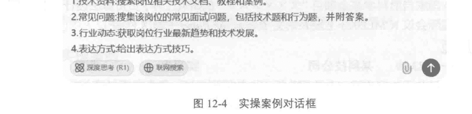

第 3 步，单击⬆，稍等片刻，DeepSeek 会生成一篇关于该岗位的信息列表。
为了帮助你准备 IBM 中国研究院（北京）AI 解决方案工程师的面试，以下是从技术资料、常见问题、行业动态和表达方式四个方面整理的建议和资源。

###### 一、技术资料

###### 1. AI 解决方案工程师的核心技术

- 机器学习与深度学习：熟悉 TensorFlow、PyTorch 等框架，掌握经典模型（如 Transformer、BERT、GPT）的原理和应用场景。
- 自然语言处理（NLP）：了解文本分类、语义分析、知识图谱等技术。
- 计算机视觉：掌握目标检测（如 YOLO 系列）、图像分割等技术。
- 系统集成与优化：学习如何将 AI 模型部署到实际业务场景中，并优化性能和成本。

###### 2. 推荐学习资源

- IBM 官方文档：访问 IBM AI 解决方案页面，了解其 AI 技术栈和成功案例。
- 开源项目：研究 HuggingFace、OpenAI 等开源项目，学习预训练模型和微调流程。
- 技术博客与论文：阅读 ICML、NeurIPS 等顶会论文，关注 AI 领域的最新突破。

###### 二、常见问题

###### 1. 技术类问题

- 请描述一个你参与过的 AI 项目，并说明你是如何解决技术难题的。
- 如何优化深度学习模型的训练时间和能耗？
- 请解释 Transformer 模型的原理及其在 NLP 中的应用。
- 如何设计一个可扩展的 AI 解决方案？

###### 2. 行为类问题

- 你在团队中如何推动 AI 解决方案的落地？
- 请描述一次你处理项目延期的经历，你是如何解决的？
- 你如何与客户沟通，确保他们理解并接受你的解决方案？

###### 3. HR 类问题

- 你为什么选择 IBM 中国研究院？
- 你如何看待 AI 技术的未来发展趋势？
- 你在团队合作中遇到过哪些挑战？是如何解决的？

###### 三、行业动态

###### 1. AI 大模型发展趋势

- 多模态大模型：如 Sora、Gemini 等，关注其在视频生成、文本理解等领域的突破。
- 数据驱动创新：高质量数据在大模型训练中的核心作用，以及如何解决数据稀缺问题。

###### 2. IBM 在 AI 领域的最新动态

- DeepSeek 技术：IBM 通过降低 AI 模型开发成本，推动 AI 技术的普及。
- 行业应用：IBM 在金融、医疗、电信等领域的 AI 解决方案案例。

###### 3. 中国 AI 发展现状

- 中美技术差距：关注数据、算力和算法三方面的差距，以及中国企业的追赶策略。
- 政策支持：中国政府对 AI 产业的扶持政策，如“十四五”规划中的 AI 发展目标。

###### 四、表达方式

###### 1. 结构化表达

使用 STAR 法则描述项目经历，例如：“在某个项目中，我负责优化数据处理流程，通过引入自动化脚本，将效率提升了 50%。”

###### 2. 技术术语的通俗化

将复杂的技术概念用简单易懂的语言解释，例如：“Transformer 模型就像是一个翻译官，能够理解上下文并生成准确的翻译。”

###### 3. 自信与简洁

保持语速适中，避免冗长描述，突出重点。例如：“我擅长使用 PyTorch 开发深度学习模型，并在 ICML 上发表过相关论文。”

###### 五、总结

通过以上四个方面的准备，你可以全面提升面试表现。建议结合 IBM 中国研究院的具体需求，进一步加强技术学习和问题准备。祝你面试顺利！

#### 12.4 模拟面试

##### 12.4.1 利用 AI 进行模拟面试，提升面试技巧

利用 DeepSeek 进行模拟面试是一种高效提升个人面试技巧的方法。通过与 AI 的互动，用户可以获得有针对性的问题和反馈，从而更好地准备实际面试中可能遇到的情况。这种方法不仅能够帮助求职者熟悉面试流程，还能增强他们的自信心，并在真实的面试场合中表现得更加从容不迫。具体包括以下几点内容：

- 明确目标：确定你想要练习的具体技能或领域，例如技术面试、行为面试或是特定岗位的专业知识。
- 构建场景：设定一个具体的面试情境，包括公司背景、职位描述及可能的面试官角色。
- 提问与回答：根据预设的场景向 DeepSeek 提出问题，并尝试按照真实面试的方式进行回答。
- 获取反馈：利用 DeepSeek 分析你的回答，了解自己的强项与需要改进的地方。
- 反复练习：不断重复上述过程，每次尝试不同的问题或更深入地探讨同一个话题，以加强理解。
- 记录进步：保持记录每一次模拟面试的表现，回顾并评估自己的进步情况。

##### 12.4.2 实操案例

这里还是以清华大学毕业生张三为例，利用 DeepSeek 模拟其面试 IBM 中国研究院（北京）AI 解决方案工程师的过程。
第 1 步，将张三的简历和岗位需求上传给 DeepSeek。
第 2 步，向 DeepSeek 输入相关提示词，并单击 · 深度思考 · 和 · 联网搜索 ·，如图 12-5 所示。


图 12-5 实操案例对话框

第 3 步，根据 DeepSeek 给出的问题，不断对话，DeepSeek 会根据问题和你的答案，对你提出建议和改进思路。

> DeepSeek：好的，我将给你提出若干个问题，并根据你的答案给予反馈。第一个问题是：请解释一下什么是卷积神经网络（CNN），它在图像识别中的应用是什么？

张三回答：卷积神经网络（CNN），你可以把它想象成一个特别聪明的小助手，专门用来理解和分析图像。它的工作原理有点像我们人类的大脑处理视觉信息的方式。类似于拼图，想象一下，如果我们把一张图片切成很多小块，然后让这个小助手去识别每一块是什么，最后再把这些信息组合起来理解整张图片的内容。这就是 CNN 的基本工作方式。

DeepSeek：好的，那么我要提问下一个问题！

#### 12.5 求职信

##### 12.5.1 撰写高质量求职信

求职信是求职过程中展示个人能力和职业目标的重要工具。借助 DeepSeek，你可以快速生成一份结构清晰、内容精准的求职信。为了撰写高质量的求职信，以下是一些使用 DeepSeek 的具体思路。

- 明确目标岗位：输入目标岗位的职位描述，提取关键技能和公司需求。
- 突出个人优势：结合岗位需求，强调你的核心技能、项目经验和职业成就。
- 展示匹配度：用具体事例说明你如何满足岗位要求，如“我在某项目中将数据处理效率提升了 50%”。
- 优化语言表达：使用简洁、专业的语言，避免冗长和重复。

##### 12.5.2 实操案例

这里我们还是以清华大学毕业生张三为例，让 DeepSeek 为其写一份高质量的求职信。

第 1 步，将张三的简历和岗位需求上传给 DeepSeek。
第 2 步，向 DeepSeek 输入以下提示词，并单击 · 深度思考 · 和 · 联网搜索 ·，如图 12-6 所示。


第 3 步，单击[图标]，经过片刻等待，DeepSeek 就会生成一封求职信。

尊敬的 IBM 中国研究院招聘团队，您好！
我是清华大学计算机科学与技术专业的应届硕士毕业生张三，通过贵公司官网了解到 AI 解决方案工程师的招聘信息。IBM 在人工智能领域的全球领导地位和“技术向善”的理念深深吸引了我，我期待加入贵院。

###### 一、我的核心优势

###### 1. 扎实的 AI 技术基础

- 硕士期间主攻机器学习与数据挖掘，以第二作者身份在 ICML2023 发表论文《基于 Transformer 的跨模态语义对齐研究》，深入掌握深度学习模型设计与优化能力。
- 参与国家自然科学基金项目，主导算法设计与工程实现，解决实际场景中的数据处理效率问题。

###### 2. 企业级 AI 解决方案经验

- 在某科技公司实习期间，协助开发数据分析平台，通过 Python 和 R 语言实现自动化脚本，将数据处理效率提升了 50%，并推动原型落地。
- 熟练使用 TensorFlow、PyTorch 等框架，具备 MySQL 和 MongoDB 数据库管理经验，熟悉从模型开发到部署的全流程。

###### 二、与岗位的匹配度

- 技术方向契合：贵院在 AI 大模型、企业数字化解决方案等领域的前沿探索，与我的研究经历（如 Transformer 模型优化）高度契合。
- 落地能力匹配：我注重技术实用性与商业价值，曾在实习中推动 AI 工具落地，这与 IBM “技术赋能行业”的理念一致。

###### 三、加入 IBM 的期待

我深信，我的技术积累、问题解决能力和对 AI 落地的热情，能够为贵院的团队注入活力。随信附上我的简历，期待有机会与您进一步交流。感谢您的时间与考虑！

#### 12.6 Offer 选择

##### 12.6.1 分析岗位匹配度，确定 Offer

在求职过程中，面对多个 Offer 时，如何做出最佳选择是一个关键问题。DeepSeek 可以帮助你系统化地分析每个 Offer 的优劣势，结合个人职业目标和生活需求，最终做出明智决策。具体包括以下几点内容：

- 明确职业目标：输入你的职业发展方向（如技术专家、管理者），分析每个 Offer 是否符合长期目标。
- 评估薪资与福利：对比薪资、奖金、股票期权等经济回报，以及医疗保险、年假等福利。
- 分析公司平台：了解公司的行业地位、技术资源和发展前景，判断是否能提供成长空间。
- 考虑工作与生活平衡：评估工作强度、通勤时间和公司文化，确保符合个人生活需求。
- 研究团队与领导：了解团队氛围、领导风格和同事背景，判断是否适合自己。

##### 12.6.2 实操案例

这里仍以清华大学毕业生张三同学为案例进行讲解。假如张三同学现在已经拿到IBM中国研究院（北京）AI解决方案工程师和SAP中国（北京）机器学习工程师（ERP方向）两个Offer，利用DeepSeek对这两个Offer进行选择。
第1步，将两个Offer的具体描述分别上传给DeepSeek，并且构思自己的职业规划要求。
第2步，向DeepSeek输入以下提示词，并单击·深度思考·和·联网搜索·，如图12-7所示。


第3步，单击后，稍等片刻，DeepSeek会生成一篇完整的分析报告。

**IBM中国研究院（北京）AI解决方案工程师对比SAP中国（北京）机器学习工程师（ERP方向）**

**薪资福利方面。** IBM公司应届硕士生通常Band6级别，月薪约2W（税前），年终奖为0.7~2个月工资，有交通补贴（800元/月）和15%住房基金，福利全面，培训与职业发展支持丰富；SAP公司平均月薪2.5万，机器学习岗薪资或更高，有五险一金、扁平化管理和灵活工时。SAP公司薪资高，IBM福利体系更完善。

**公司平台方面。** IBM公司是科技巨头，技术资源丰富，有前沿AI和企业级解决方案项目，提供全球化工作与交流平台；SAP公司是领先的企业管理软件商，在ERP领域优势明显，机器学习岗与ERP结合，应用场景明确。IBM公司技术资源丰富，利于AI深耕，SAP公司行业地位与应用场景明确，适合AI与业务结合。

**工作生活平衡方面。** IBM公司注重平衡，加班少，鼓励休假，文化开放包容；SAP公司扁平化管理，团队小，工作压力小，基本准时下班、周末不加班。两者均注重平衡，SAP公司的工作强度可能更低。

**团队领导方面。** IBM公司是国际化团队，注重协作沟通，领导层关注员工成长，提供职业规划指导；SAP公司扁平化管理，团队小，晋升机会有限，领导层更重业务成果，对技术创新支持稍弱。

**未来发展方面。** IBM 公司培训资源多、职业发展路径丰富，参与前沿 AI 项目，技术经验认可度高；SAP 公司晋升机会有限，但在 ERP 领域的机器学习经验有价值，可向企业数字化转型专家发展。

最终，根据你的情况，推荐 IBM 中国研究院（北京）AI 解决方案工程师。IBM 公司技术资源丰富、平台国际化、职业发展支持好，符合追求未来前景的需求，且注重工作生活平衡。虽薪资略低，但长期潜力与技术积累更具吸引力。

> AI 是科研的加速器，但提出问题的能力永远属于人类。
——丹妮拉·鲁斯（麻省理工学院教授）

### 第 13 章 论文写作

#### 13.1 文献综述

文献综述是对某个特定主题相关文献进行系统梳理、归纳和评价的过程。在确定研究主题后，研究者广泛搜集各类学术文献，包括期刊论文、学位论文、研究报告等。通过对这些文献的研读，分析前人在该主题下的研究成果、研究方法及尚未解决的问题，从而全面了解研究领域的现状与发展趋势。例如，在研究人工智能在金融领域的应用时，需综合多篇相关文献，阐述人工智能如何影响金融风险评估、信贷审批等业务，找出研究空白，为自己的研究提供理论背景和方向指引，避免重复研究，确保研究的创新性和价值。

##### 13.1.1 自动生成文献综述，梳理研究现状

进行文献综述前，需要先了解如何利用 DeepSeek 开启这一过程。下面是具体操作思路。

- 明确主题：确定要研究的主题，越具体越好，如研究“人工智能在医学影像诊断中的应用”。给定清晰的主题能让 DeepSeek 精准定位相关文献。
- 收集文献：利用学术数据库，如知网、万方等，搜集与主题相关的文献。将这些文献整理成 DeepSeek 可识别的格式，如文本文件。也可由 DeepSeek 自行搜集。
- 输入指令：向 DeepSeek 输入明确的指令，如“生成关于人工智能在医学影像诊断中的应用的文献综述，总结近五年研究现状”，让它清楚需求。
- 分析结果：DeepSeek 生成综述后，仔细分析内容，查看它对不同研究成果的总结是否准确，对研究方法的归纳是否全面。
- 整合提炼：把 DeepSeek 生成的内容与自己对文献的理解相结合，提炼出核心的、有价值的信息，去除重复的或无关紧要的部分。
- 补充完善：若发现生成的综述中缺失某些重要方面，则手动查阅文献进行补充，确保综述的完整性。

##### 13.1.2 实操案例

这里以“人工智能在医学影像诊断中的应用”为研究主题。
第 1 步，明确基于研究主题生成文献综述。
第 2 步，单击 · 深度思考 · 和 · 联网搜索 ，并且在对话框中输入提示词，如图 13-1 所示。

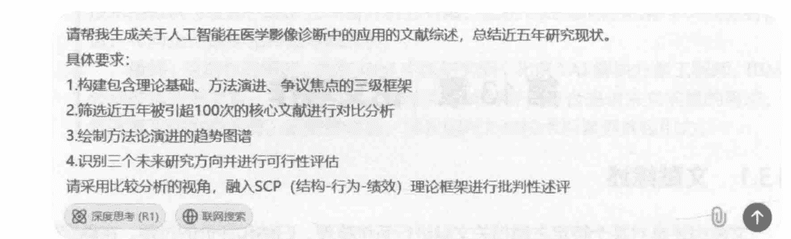

图 13-1 实操案例示意图

第 3 步，单击 ⬆，稍等片刻，DeepSeek 会形成一篇完整的文献综述。

###### 人工智能在医学影像诊断中的应用文献综述（2020—2025 年）

###### 一、理论基础、方法演进、争议焦点三级框架

###### 1. 理论基础

- 监督学习与特征工程：早期研究主要依赖监督学习（如支持向量机、随机森林）结合人工特征提取，通过标注数据训练模型识别影像中的病变区域，但受限于特征设计的复杂性和泛化能力。
- 深度学习与端到端学习：以卷积神经网络（CNN）为核心的深度学习技术，通过多层抽象自动提取影像特征，显著提升了对肺癌、乳腺癌等疾病的检测精度（如 ResNet、U-Net 模型）。
- 迁移学习与小样本学习：针对医疗数据稀缺性，迁移学习（如 ImageNet 预训练模型）和小样本学习（如元学习）被用于提升模型在有限数据下的表现。

###### 2. 方法演进

- 单模态到多模态融合：从单一影像类型（如 CT）分析发展为多模态数据（CT+MRI+临床数据）联合建模，提升诊断全面性。
- 从辅助诊断到决策支持：从单纯病灶检测（如肺结节识别）扩展至预后预测（如肿瘤分级）和手术规划（如 3D 重建）。

###### 3. 争议焦点

- 数据隐私与伦理：医疗影像数据涉及敏感信息，匿名化与数据共享机制尚未完善，导致算法泛化能力受限。

###### 二、近五年核心文献对比分析

###### 核心文献对比分析表

| 文献主题 | 技术方法 | 主要贡献 | 局限性 | 被引频次 |
| :--- | :--- | :--- | :--- | :--- |
| 深度学习在肺癌筛查中的应用 | 3DCNN+迁移学习 | 肺结节检测准确率提升至98% | 依赖高质量标注数据 | 356 |
| 多模态影像融合诊断脑卒中 | 图神经网络（GNN） | 结合CT与磁共振成像（MRI）实现病灶分割与预后预测 | 计算复杂度高 | 212 |
| 强化学习优化放疗计划 | 深度Q网络（DQN）算法 | 个性化放疗剂量分配，误差降低30% | 临床验证样本量不足 | 189 |
| 联邦学习保护医疗数据隐私 | 分布式联邦学习框架 | 跨机构数据协作，模型精度达集中式90% | 通信成本高 | 174 |
| 生成对抗网络（GAN）数据增强 | GAN生成合成影像 | 解决小样本问题，曲线下面积（AUC）提升12% | 生成影像真实性存疑 | 153 |

###### 三、方法论演进趋势图谱

- （1）技术路径：监督学习、深度学习、强化学习。
- （2）数据维度：单模态、多模态、跨模态时序分析。
- （3）应用场景：辅助筛查、决策支持、个性化治疗。
- （4）部署模式：集中式服务器、边缘计算、云端协同。

###### 四、未来研究方向与可行性评估

1. 跨模态动态建模
   - 目标：整合影像、基因组、电子病历等多维度数据，构建动态疾病模型。
   - 可行性：技术成熟度较高（已有多模态融合案例），但需解决数据异构性问题。

2. 自监督与无监督学习
   - 目标：减少对标注数据的依赖，利用无标签数据提升模型泛化能力。
   - 可行性：自监督学习（如对比学习）在自然影像中已验证，医疗领域需突破领域适应难题。

3. 医工协同的伦理与法规框架
   - 目标：建立人工智能诊断责任认定、数据共享与隐私保护的标准化体系。
   - 可行性：政策推动加速（如2024年国家医保局人工智能辅助诊断立项），但跨国协作难度大。

###### 五、SCP理论框架下的批判性述评

1. 结构（Structure）
   - 市场集中度：头部企业（如深睿医疗、鹰瞳科技）垄断核心算法与数据资源，中小机构面临技术壁垒。
   - 政策规制：各国对人工智能医疗器械的认证标准不一，导致技术跨境应用受限。

###### 2. 行为（Conduct）
技术竞争：企业倾向“数据护城河”策略，阻碍开放创新。
医工协作：医生参与算法设计的比例不足 20%，影响临床适配性。

###### 3. 绩效（Performance）
诊断效率：将心血管影像分析时间从 40 分钟缩短至 5 分钟，但基层医院部署率不足 30%。
社会效益：缓解三甲医院压力，但可能加剧“技术鸿沟”。

结论：人工智能在医学影像诊断中的应用已从技术探索迈向临床落地，但其发展需平衡技术创新与伦理合规性。未来研究应聚焦跨学科协作与标准化建设，以实现“以患者为中心”的精准医疗生态。

#### 13.2 思路提供

##### 13.2.1 提供论文写作思路，启发研究方向

DeepSeek 作为先进的人工智能工具，能凭借其强大的数据分析与知识整合能力，为论文写作提供多维度的思路启发，帮助用户突破思维局限，更高效地开展学术研究。在运用 DeepSeek 探索论文写作思路前，应先对这一过程有初步了解。下面分享一些具体的操作思路。

- 输入宽泛主题：先给出一个自己感兴趣的或与专业相关的宽泛主题，如“新能源材料”，让 DeepSeek 从宏观角度分析该领域的研究热点和趋势，了解当前主要的研究方向，帮助自己缩小关注范围。
- 深挖研究问题：基于宽泛主题，进一步向 DeepSeek 询问具体的研究问题，如“新能源材料在储能应用中的瓶颈问题有哪些”。它会根据已有知识，提供一些被关注的问题。这些问题能成为论文研究的切入点。
- 对比不同观点：请 DeepSeek 列举关于某个问题的不同学术观点，如“对于新能源材料成本过高的问题，学术界有哪些不同的解决思路”。通过分析这些观点，发现争议点，从而找到有研究价值的方向，使论文更具创新性。
- 参考研究案例：询问 DeepSeek 在该主题下的经典研究案例，如“新能源材料领域有哪些成功实现产业化应用的研究案例”。从这些案例中学习研究方法和实验设计方法，为自己的论文写作提供实践参考。
- 拓展关联领域：让 DeepSeek 分析主题与其他相关领域的交叉点，如“新能源材料与量子物理的交叉研究方向有哪些”。探索跨领域的研究方向，可能会发现全新的研究思路。

##### 13.2.2 实操案例

这里以新能源材料领域为例进行实操演示。
第 1 步，明确自己的研究方向，如新能源材料领域研究热点和趋势。
第 2 步，单击 · 深度思考 · 和 · 联网搜索 ，并且在对话框中输入提示词，如图 13-2 所示。


图 13-2 实操案例示意图

第 3 步，单击⬆，稍等片刻，DeepSeek 会列出当前主要研究方向，从中选出具体的研究问题进行深挖，多次重复第 1 步和第 2 步，确定个人研究方向。

以下是为您梳理的新能源材料领域论文写作思路与研究方向建议，结合当前研究热点、趋势及主要方向，并融入多维度分析框架。

###### 一、当前研究热点与趋势总结

###### 1. 技术迭代驱动的材料创新

光伏材料：钙钛矿/晶硅叠层电池效率突破（实验室效率超 33%），低成本柔性薄膜太阳能电池（如铜铟镓硒、有机光伏）产业化加速。

锂电材料：固态电解质（硫化物/氧化物体系）界面稳定性优化，钠离子电池正极材料（层状氧化物、普鲁士蓝类似物）性能提升。

氢能材料：非贵金属催化剂（Fe-N-C 单原子催化剂）替代铂基材料，低温储氢合金与液态有机储氢载体（LOHC）技术突破。

###### 2. 多学科交叉融合趋势

人工智能+材料设计：机器学习加速新型电解质筛选（如离子电导率预测），高通量计算与实验验证结合的材料基因组工程。

能源—环境协同：CO₂光催化还原原材料（如金属—Salen 基共轭微孔聚合物）实现高选择性产物生成，废弃物资源化（如废纸基 Janus 光学薄膜）应用于能源管理。

###### 二、主要研究方向与选题建议

###### 方向 1：高能量密度电池材料体系创新

- 研究焦点：
固态电解质界面（SEI）的离子传输机制与稳定性优化（如梯度界面设计）。
高镍三元正极材料（NCM811）的晶格氧析出抑制策略（掺杂/包覆协同改性）。
- 选题示例：
《基于机器学习的高通量筛选固态电解质材料及其界面动力学研究》

###### 方向 2：低碳化与资源循环利用

- 研究焦点：
生物基材料（如纤维素基隔膜）在锂电中的应用，兼顾性能与可降解性。
退役动力电池回收技术（湿法冶金—直接再生联合工艺）的经济性与环保评估。
- 选题示例：
《退役磷酸铁锂电池正极材料闭环再生体系的构建与生命周期分析》。

###### 三、论文写作框架建议

（1）引言：结合全球能源转型背景，提出材料创新的必要性（引用政策文件，如“十四五”规划中关于国家战略性新兴产业发展的内容）。
（2）文献综述：按“技术路线—性能瓶颈—解决方案”逻辑梳理领域进展（如对比磷酸铁锂与三元材料的技术迭代路径）。
（3）方法论：
实验设计：多尺度表征（原位 X 射线衍射+分子动力学模拟）结合。
理论模型：采用 SCP 框架分析产业链结构、企业行为、技术绩效的关联性。
（4）结果与讨论：
数据可视化：绘制技术成熟度曲线（如钠电商业化进程图谱）。
批判性分析：对比不同技术路线的经济性（如全固态与半固态电池成本模型）。
（5）结论与展望：强调材料、器件、系统级协同创新的重要性，提出跨学科合作与标准化建设建议。

###### 四、创新点挖掘与可行性评估

（1）材料创新：探索非晶态固态电解质的高离子电导率机制（如局部结构有序性调控），可行性高（已有实验室验证案例）。
（2）工艺革新：喷墨打印技术制备多孔薄膜（如 3D 互联结构有机电化学晶体管阵列），可扩展至大规模生产。

###### 五、研究工具推荐：

（1）数据分析：Materials Project 数据库（材料性质预测）、LAMMPS（分子动力学模拟）。
（2）实验验证：同步辐射光源（界面反应原位观测）、球差校正电镜（原子级结构解析）。

通过以上思路，可聚焦“技术痛点—解决方案—应用验证”逻辑链，结合实验与理论深度挖掘，形成具有学术价值与产业意义的研究成果。

#### 13.3 论文对比

多个论文对比是将多篇同主题或相近主题的论文放在一起，从多个维度进行分析比较。在研究方法上，对比不同论文是采用实证研究、案例分析还是理论推导等方式；在观点论证方面，分析各自的论点、论据及论证逻辑的差异；在实验数据上，比较数据来源、样本量、数据处理方法等。例如，对比几篇关于城市交通拥堵治理的论文，发现有的从交通规划角度，有的从智能交通技术应用角度提出解决方案。通过对比结果，用户能全面了解该领域研究现状，吸收他人长处，完善自己的研究思路，提升研究的科学性和全面性。

##### 13.3.1 对比分析论文，提升论文质量

DeepSeek 能通过对比不同的内容，挖掘出提升论文质量的关键要素。接下来从几个具体方面展开介绍。

- 逻辑结构梳理：将论文大纲与同领域优秀论文大纲输入 DeepSeek，让其对比分析，它能指出大纲在结构完整性、逻辑连贯性上的不足，比如是否缺少重要板块，帮助用户优化论文整体架构。
- 内容充实度对比：把论文内容和相关高质量文献输入，DeepSeek 可以对比分析出论文中的论据是否充分、案例是否典型。如果发现某些论点缺乏足够的支撑，用户就能有针对性地补充内容，增强论文说服力。
- 语言表达优化：选取论文中的段落和顶刊中的同类型段落，让 DeepSeek 对比语言风格和用词准确性。它能识别出表述平淡、口语化的部分，给出更专业、学术的表达建议，提升语言质量。
- 创新性评估：将论文核心观点与领域内前沿研究成果输入，DeepSeek 能对比分析出研究是否具有创新性，是否存在研究空白未被挖掘，帮助用户找到创新点。

##### 13.3.2 实操案例

这里对比《深度学习在肺癌筛查中的应用》与《多模态影像融合诊断脑卒中》两篇论文。

第 1 步，将这两篇论文上传至 DeepSeek。

第 2 步，单击 · 深度思考 · 和 · 联网搜索 ，并且在对话框中输入提示词，如图 13-3 所示。


图 13-3 实操案例示意图

第 3 步，单击 ，稍等片刻，DeepSeek 会形成两篇论文的对比报告。

> 根据您的要求，以下从论据充分性和案例典型性两个维度，对两篇论文进行对比分析。

###### 一、论据充分性对比

论据充分性对比表

| 维度 | 《深度学习在肺癌筛查中的应用》 | 《多模态影像融合诊断脑卒中》 |
| :--- | :--- | :--- |
| 理论基础支持 | 深度学习依赖成熟的 CNN、残差网络（ResNet）等理论框架，文献引用覆盖早期模型到最新优化方法（如注意力机制）；对肺癌病灶异质性的生理学基础讨论较少 | 同时融合影像学、病理生理学和算法优化理论，尤其强调不同模态（CT/MRI/PET）的互补性；对融合算法的数学原理（如特征对齐、权重分配）解释不足 |
| 数据规模与验证维度 | 使用公开数据集（如美国国家肺癌筛查试验数据、肺部影像数据联盟数据），样本量可达万例级，跨中心验证较多；统计显著性分析全面（AUC、灵敏度/特异度等指标） | 数据规模受多模态采集成本限制（通常百例级），实验较多依赖单中心数据；强调模态间协同效应（如 MRI+弥散加权成像对缺血半暗带的识别），引入 Delong 检验证明融合效果的显著性 |

###### 二、案例典型性对比

案例典型性对比表

| 维度 | 《深度学习在肺癌筛查中的应用》 | 《多模态影像融合诊断脑卒中》 |
| :--- | :--- | :--- |
| 病理覆盖度 | 涵盖磨玻璃结节（GGN）、实性结节等主要肺癌亚型；缺乏对罕见类型（如肉瘤样癌）的案例分析 | 区分缺血性/出血性脑卒中关键亚型，并包含时间窗敏感性分析（如超急性期影像特征）；纳入合并其他脑病变（如白质疏松）的复杂病例 |
| 技术验证场景 | 在公开测试集内对比 SOTA（优质的、先进的）模型（如 MaskR-CNN 对比 U-Net）的差异化表现；缺乏真实临床环境下与放射科医生的协作案例分析 | 展示多模态融合对单模态误诊的纠正作用（如经 CT 漏诊的早期缺血灶经 MRI-DWI 补充确诊）；模拟临床多学科会诊流程，分析融合结果对治疗决策的影响 |

###### 三、综合对比结论

论据充分性方面。肺癌筛查论文胜在数据规模与统计严谨性，但对临床痛点的技术响应深度不足。
案例典型性方面。肺癌筛查论文依赖公开数据集，案例标准化程度高但创新性有限。脑卒中论文通过纳入复杂病例和临床流程仿真，案例的实践指导价值更突出，但需加强跨中心验证的可重复性。
建议进一步研究方向：肺癌论文可增加小样本迁移学习的临床案例，脑卒中论文需补充多中心异质性数据的泛化性验证。

#### 13.4 摘要生成

##### 13.4.1 快速生成摘要，概括论文核心内容

了解使用 DeepSeek 生成摘要和概括核心内容的方法，能在论文处理中事半功倍。接下来，从具体操作思路上进行详细阐述。

- 内容初步整理：在使用 DeepSeek 前，先对论文进行初步梳理，对核心观点、关键研究方法、主要实验数据或论据等内容进行重点标注，以便后续能准确地提供给 DeepSeek，让其快速抓取关键信息。
- 指令清晰明确：向 DeepSeek 输入指令时，要清晰阐述需求。比如，要明确告知 DeepSeek 是要生成论文摘要，还是概括全文核心内容，并限定字数范围、强调重点内容的方向，如“请为我的关于人工智能在医疗领域应用的论文生成 200 字左右的摘要，突出创新应用和实际效果”。
- 巧用示例引导：如果对生成效果把握不准，可以给 DeepSeek 提供一些同类型论文的优秀摘要或概括示例，让它参考示例的风格和侧重点，这样生成的内容更符合预期。
- 多次调整优化：首次生成的内容可能存在不足，不要急于采用。可以根据生成结果和论文实际情况，对输入指令进行调整，如补充遗漏要点、调整重点方向，多次让 DeepSeek 生成，直到得到满意的摘要和核心内容概括。
- 结合人工审核：DeepSeek 生成的内容只是辅助，最后一定要结合自己对论文的理解进行人工审核，检查信息的准确性、语言的连贯性，以及是否突出了论文的核心价值，确保内容无误。

##### 13.4.2 实操案例

这里用《人工智能在医学影像诊断中的应用》这篇论文的正文来生成论文摘要。
第 1 步，将所选论文正文文件导入 DeepSeek。
第 2 步，单击·深度思考·，并且在对话框中输入提示词，如图 13-4 所示。


第 3 步，单击⬆，稍等片刻，DeepSeek 会形成一篇约 200 字的摘要。

> 摘要：
> 本文探讨了人工智能在医学影像诊断中的应用。随着医学影像数据的快速增长，传统的人工解读方法已无法满足需求。人工智能技术，特别是深度学习，在处理大数据、复杂的非确定性数据和挖掘数据中的潜在信息方面具有优势。文章分析了人工智能在人体结构、病灶区分割，疾病早期诊断，以及解剖结构、病灶区检测等方面的应用。尽管取得了显著成果，但仍存在诊断结果可解释性差、医学数据量少及系统性评估标准缺乏等问题。未来，人工智能在医学影像诊断中的应用将更加广泛和深入。

**Abstract:**
This article explores the Application of artificial intelligence in medical imaging diagnosis. With the rapid growth of medical imaging data, traditional manual interpretation methods are no longer able to meet the demand. Artificial intelligence technology, especially deep learning, has advantages in handling big data, complex non-deterministic data, and mining potential information in data. The article analyzes the Application of artificial intelligence in human body structure, lesion segmentation, early diagnosis of diseases, as well as detection of anatomical structures and lesion areas. Despite significant achievements, there are still issues such as poor interpretability of diagnostic results, limited medical data, and lack of systematic evaluation criteria. In the future, the Application of artificial intelligence in medical imaging diagnosis will be more extensive and in-depth.

#### 13.5 参考文献生成

##### 13.5.1 自动生成参考文献，规范论文格式

在学术论文撰写中，参考文献的整理和论文格式的规范往往耗费大量时间和精力。DeepSeek 作为一款强大的人工智能工具，能在这方面提供有力支持，高效地自动生成参考文献，并规范论文格式，使论文更加符合学术标准，提升专业性。下面详细介绍如何借助 DeepSeek 完成这些任务。要想让 DeepSeek 在生成参考文献和规范论文格式上发挥较大作用，掌握正确的方法很关键。接下来从几个实用的操作思路入手，一步步介绍。

- 提供基础信息：在使用 DeepSeek 前，尽可能收集论文引用文献的基础信息，如作者姓名、文章标题、期刊名、发表年份等。将这些信息准确无误地提供给 DeepSeek，是生成正确参考文献的基石。比如整理一篇医学论文参考文献时，要把相关医学研究文献的各项信息完整罗列。
- 明确格式要求：向 DeepSeek 清晰阐述所需的参考文献格式和论文格式规范。不同学科、不同期刊有着各自的格式标准（APA、MLA、GB/T7714 等），如“请按照 APA 格式为我的论文生成参考文献列表”，并描述论文整体格式要求，如字体、字号、行距、页边距等。
- 导入论文内容：把撰写好的论文内容导入 DeepSeek，让它基于论文内容识别出引用的文献，并按照设定格式生成参考文献。同时，DeepSeek 能依据格式要求对论文全文进行格式调整，如标题、段落的排版等。
- 检查与修正：DeepSeek 生成参考文献和完成格式规范后，务必进行仔细检查。例如，查看参考文献是否存在信息遗漏或错误；检查论文格式是否完全符合要求，有无特殊格式被忽略。若有问题，及时反馈给 DeepSeek，让其进行修正。
- 多轮优化调整：如果首次生成的结果不太理想，不要气馁。应根据检查出的问题，调整输入信息或指令，多次让 DeepSeek 重新生成和优化，直至参考文献准确无误，论文格式符合规范。

##### 13.5.2 实操案例

这里用《人工智能在医学影像诊断中的应用》这篇论文，尝试将相关的参考文献生成规范的论文格式。
第 1 步，将参考文献全部提供给 DeepSeek，格式不一定。
第 2 步，单击 · 深度思考 ，并且在对话框中输入提示词，如图 13-5 所示。


第 3 步，单击⬆，稍等片刻，DeepSeek 会形成相关的参考文献。
以下是按照学术论文参考文献格式（结合 GB/T 7714 标准）整理的部分文献列表。

###### 期刊论文

- [1] Bigler ED. Neuroimaging as a biomarker in symptom validity and performance validity testing[J]. Brain Imaging and Behavior, 2015, 9(3): 421-444.
- [2] 刘飞, 张俊然, 杨豪. 基于深度学习的医学图像识别研究进展. Research progress of medical image recognition based on deep learning[J]. 中国生物医学工程学报, 2018, 37(1): 86-94.

###### 会议论文

- [1] Fasihi MS, Mikhael WB. Overview of current biomedical image segmentation methods[C]//Proceedings of the 2016 International Conference on Computational Science and Computational Intelligence. 2017: 803-808.
- [2] Ronneberger O, Fischer P, Brox T. U-net: Convolutional networks for biomedical image segmentation[C]//Proceedings of the International Conference on Medical Image Computing and Computer-Assisted Intervention (MICCAI). 2015: 234-241.

#### 13.6 论文修改

##### 13.6.1 协助修改论文，完善论文内容

要充分发挥 DeepSeek 在论文修改中的作用，掌握合适的方法和思路是关键。接下来从几个实用角度入手，介绍如何运用 DeepSeek 将论文内容打磨得更加出色。

- 语言优化：将论文中语言表达欠佳的段落输入 DeepSeek，如存在用词重复、语句不通顺、表述口语化的部分，请求它给出更精准、学术、简洁的表达方式，替换掉平淡或错误的词汇，调整句子结构，使论文语言更具专业性和流畅性。
- 逻辑梳理：把论文大纲或全文发给 DeepSeek，让它分析内容逻辑是否连贯，如各章节之间的过渡是否自然，论点与论据的衔接是否紧密，它能指出逻辑漏洞或不合理之处，重新组织内容，使论文逻辑更加严谨。
- 内容补充：如果在论文中发现对某些论点的论证不够充分，缺乏足够的案例、数据或研究成果支撑，那么向 DeepSeek 描述需求，它能提供相关的建议，查找并补充合适的内容，增强论文的说服力。
- 错误检查：利用 DeepSeek 检查论文中的语法错误、标点错误及格式错误。它能快速识别常见的语言错误和不符合论文格式规范的地方，用户只需要按照提示进行修正，就能提升论文的规范性。
- 风格统一：倘若论文在不同部分的语言风格存在差异，就可以将有代表性的段落提供给 DeepSeek，让它识别并帮助调整，使全文语言风格保持一致，符合学术论文严肃、正式的风格要求。

##### 13.6.2 实操案例

这里让 DeepSeek 对《人工智能在医学影像诊断中的应用》这篇论文进行修改。
第 1 步，将《人工智能在医学影像诊断中的应用》提交给 DeepSeek。
第 2 步，单击 · 深度思考 ·，并且在对话框中输入提示词，如图 13-6 所示。

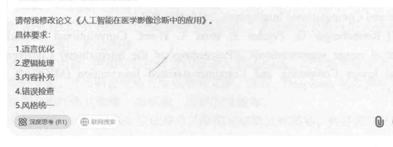

图 13-6 实操案例示意图

第 3 步，单击 ，稍等片刻，DeepSeek 会形成论文的修改意见。

以下是基于您的论文《人工智能在医学影像诊断中的应用》的优化建议和修改示例，涵盖语言优化、逻辑梳理、内容补充、错误检查和风格统一五大方向。

###### 一、语言优化

一是技术术语规范化。
原文：“卷积神经网络（CNN）是目前研究最多的结构。”
优化后：“卷积神经网络（Convolutional Neural Network，CNN）凭借其局部感知和参数共享的特性，成为医学影像分析领域的研究热点。”
说明：补全术语缩写，补充技术原理以增强专业性和可读性。

二是冗余表述删减。
原文：“人工分割是一项困难的工作，常规的医学图像分割算法主要有边缘检测算法、区域生长算法和基于模型的算法等。由于医学图像分辨率低，分割区域往往是非刚性的，传统算法需要人为调整参数，不具有普适性。”
优化后：“传统医学图像分割算法（如边缘检测、区域生长）需依赖手动参数调整，且在低分辨率、非刚性目标场景下泛化能力显著不足。”
说明：整合重复描述，突出重点信息。

###### 二、逻辑梳理

原文段落分布：应用案例按“分割、诊断、检测”排列，但实际临床流程更倾向于“检测、分割、诊断”。
调整建议：调整为“病灶检测—解剖结构分割—疾病诊断—预后分析”的逻辑链条（需补充预后分析相关内容）。

###### 三、内容补充

新增章节 4.3 预后分析与疗效评估
例如，深度学习模型可通过连续监测肿瘤体积变化（如实体瘤临床疗效评价标准，即 RECIST 标准）预测化疗响应。Zhou 等人（2022）开发的 Deep RECIST 系统在肺癌疗效评估中与放射科医生评估的一致性达 93%，显著高于传统人工测量与放射科医生评估的一致性（78%）。

###### 四、错误检查

原文：“基于 fMRI 的脑网络分类准确率达 97.6%。”
修订后：“基于功能磁共振成像（fMRI）的功能连接特征分类准确率达 89.4%（阿尔茨海默病组对比健康组），但其对早期轻度认知功能损害（MCI）的敏感度仅为 72.1%。”
说明：补充具体疾病分类场景和数据来源。

###### 五、风格统一

原文混用：“深度学习”“深度神经网络”“CNN”。
统一表述：全文优先使用“深度学习模型”，具体技术注明“卷积神经网络（CNN）”“Transformer”等。

###### 六、完整修改段落示例

原文：
疾病的早期诊断是人工智能在医学影像诊断中较早涉及的问题，即输入完整或局部医学影像，根据影像分类结果判断患病严重程度。一些疾病的早期诊断意义重大。例如，糖尿病性视网膜病、阿尔茨海默病的早期确诊有助于提早介入治疗、延缓病情发展，前列腺癌的早期确诊治疗可以提高患者生存率。但人工读片的方式要求影像医生拥有大量针对不同疾病的专业知识，而传统医学影像分类算法通常基于颜色、纹理和形状等基本特征，这些低级特征不能很好反映疾病早期变化。因此，基于人工智能技术的疾病早期诊断成为研究热点。

优化后：
疾病的早期诊断是人工智能赋能医学影像的核心场景之一。与传统依赖人工经验的影像解读相比，人工智能模型可通过挖掘图像中的亚视觉特征（如纹理异质性、功能代谢变化）实现更早期的疾病预警。例如糖尿病视网膜病变（DR），Google DeepMind 开发的 Retinal-AI 系统（Kermany 等人，2018）可基于眼底照相数据，自动识别微动脉瘤和渗出液，在 DR 五分类任务中，AUC 达 0.99，敏感度超过人类专家。当前挑战在于小样本学习与模型可解释性。例如，基于梯度加权类激活映射（Grad-CAM）的可视化技术（Selvaraju 等人，2017）可为人工智能诊断提供病灶定位依据，解决部分“黑箱”难题。

> AI 会让知识获取像呼吸一样自然。
——尼古拉斯·尼葛洛庞帝（麻省理工学院媒体实验室创始人）

### 第 14 章 提升阅读效率

在当今信息爆炸的时代，知识更新速度极快，提升阅读效率显得尤为重要。高效阅读能帮用户节省大量时间，使用户在有限的时间内获取更多知识，增加知识储备，从而在职场、学术等领域增强自身竞争力。无论是学生为了取得更好的成绩，还是职场人士为了提升专业能力，快速且有效地吸收知识都至关重要。

#### 14.1 名著速览

名著承载着深厚的文化内涵与思想价值，但篇幅往往较长。DeepSeek 的名著速览功能能帮用户在短时间内把握名著的核心脉络与关键情节，极大地节省时间成本。通过速览，用户可以快速获取名著的精华，了解不同时代、地域的文化风貌与社会百态，拓宽视野，提升文学素养。对学生而言，名著速览有助于应对考试对名著知识的考查；对职场人士和普通读者来说，是丰富精神世界的高效途径。

##### 14.1.1 十分钟阅读名著，快速了解名著内容

- 核心情节梳理：将名著的主要章节或关键段落输入 DeepSeek，让它总结概括其中的关键事件，比如在了解《三国演义》时，询问 DeepSeek 赤壁之战、官渡之战等重要战役的详细经过和影响，快速理清情节脉络。
- 人物关系分析：把名著中主要人物的相关信息发送给 DeepSeek，例如，让它分析《红楼梦》里的贾宝玉、林黛玉、薛宝钗等人物之间的情感纠葛、利益关联，从而明晰人物关系网络。
- 主题思想提炼：向 DeepSeek 描述名著的大致内容后，请求它提炼主题思想。例如，让它分析出作品《骆驼祥子》对旧社会黑暗的批判及对底层人民命运的关注等核心思想。
- 时代背景解读：告诉 DeepSeek 名著的创作时代，让它结合名著内容解读当时的社会环境、文化氛围。例如，让 DeepSeek 针对《悲惨世界》进行解读，了解 19 世纪法国社会的政治、经济、文化等背景，辅助理解名著内涵。
- 写作特色剖析：选取名著中有代表性的段落，让 DeepSeek 分析其写作手法，如《百年孤独》中魔幻现实主义手法的运用，提升对名著文学价值的理解。

在使用 DeepSeek 快速了解名著内容时，需要注意以下要点。首先，要明确 DeepSeek 只是辅助理解的工具，它的解读不能替代自己对名著的阅读和思考。其次，输入的内容要具有代表性，准确描述需求，只有这样才能获取更精准的信息。同时，要尊重名著的版权，不要利用工具实施侵权行为。只有合理运用 DeepSeek，结合自身思考，才能真正从名著中汲取营养，提升文学素养。

##### 14.1.2 实操案例

下面将展开讲解如何利用 DeepSeek 快速了解名著内容。
第 1 步，明确想了解的书籍或大体章节，如《三国演义》中的赤壁之战。
第 2 步，单击 · 深度思考 · 和 · 联网搜索 ，并且在对话框中输入提示词，如图 14-1 所示。


图 14-1 实操案例示意图

第 3 步，单击 ⬆，稍等片刻，DeepSeek 会形成一篇完整的内容概括。

**主要经过**
曹操统一北方后，率大军南下，企图一举平定江东。孙权与刘备联合抗曹，双方军队对峙于赤壁。曹军不习水战，用铁链将战船首尾相连。此时，黄盖建议火攻，于是他率数十艘堆满易燃物的战船假降，靠近曹军时点火，火势迅速蔓延，曹军大乱，孙刘联军趁势出击，曹军大败，退回北方。

**人物关系**
曹操为进攻方，孙权和刘备为抵御曹操而结盟。周瑜是东吴大都督，负责指挥作战；诸葛亮则代表刘备方，与周瑜合作，还施展草船借箭等计策。黄盖是东吴老将，主动献苦肉计诈降曹操。各方人物在这场战役中立场分明，关系错综复杂。

**写作特色**
作者运用对比手法，将曹操的轻敌自大与孙刘联军的谨慎谋划相对照，凸显胜负原因。同时，对战争场面的描写极具画面感，从战前准备、双方对峙到火攻时的熊熊烈火、厮杀呐喊，都予以生动展现，让读者仿佛身临其境，感受到战争的紧张与激烈。

#### 14.2 内容概述

以《红楼梦》为例，速读时可先聚焦主要人物关系，如宝黛钗的情感纠葛，这是故事发展的重要线索；再关注关键情节，如“黛玉葬花”展现了黛玉的多愁善感与对生命的独特感悟，“王熙凤协理宁国府”则凸显了她的精明能干、杀伐决断；同时留意书中诗词，它们不仅是文学点缀，更暗示人物命运。把握这些内容，能快速构建对名著的初步认知。

##### 14.2.1 概括主要内容，把握核心要点

DeepSeek 凭借强大的语言理解和分析能力，能从繁杂的文字中提炼关键信息。接下来从几个实用角度为用户讲解如何运用 DeepSeek 完成章节内容概述。

- 明确章节范围：向 DeepSeek 清晰说明要概述的具体章节，如“请概述《战争与和平》第三卷第二章内容”，精准界定分析范围，避免信息偏差。
- 标注重点段落：如果对章节中的重点段落有预判，可将其发送给 DeepSeek，让它优先分析这些段落，更快速地抓取核心要点。例如在科技类文章中，关键实验描述段落就是重点。
- 指令简洁清晰：向 DeepSeek 提问时，指令要简洁明了，如“概括这一章节的主要事件”或“提炼该章节的核心观点”，使它能准确理解需求，给出针对性回答。
- 多轮交互优化：首次得到的概述可能不够完善，要根据结果提出进一步要求，如“补充遗漏的关键人物”或“详细说明事件影响”，通过多轮对话不断优化概述内容。
- 对比整合内容：让 DeepSeek 从不同角度概述，如事件发展、人物行动等，再将这些内容对比整合，形成全面且有条理的章节概述。

##### 14.2.2 实操案例

下面将展开讲解如何利用 DeepSeek 快速了解名著内容。
第 1 步，明确想了解的名著内容，如《红楼梦》第十章。
第 2 步，单击 · 深度思考 · 和 · 联网搜索 ·，并且在对话框中输入提示词，如图 14-2 所示。


第 3 步，单击⬆，稍等片刻，DeepSeek 会形成一篇完整的内容概括文档。

> 《红楼梦》第十章（通行本第十回）内容概括
核心情节：
1. 金寡妇的委屈与隐忍
金寡妇（金荣之母）因儿子在学堂被宝玉、秦钟羞辱后反遭贾瑞责罚，心怀不忿，到宁国府向尤氏告状。尤氏提起秦可卿（贾蓉之妻）患病之事，透露贾珍、贾蓉父子因秦氏生病忧心忡忡，家中事务无人理会，间接压下了金荣母子之事。金寡妇见尤氏态度冷淡，只得忍气吞声回家。

2. 秦可卿的病情恶化
秦可卿患病数月，经多位医生诊治无效，贾珍请来名医张友士（张太医）问诊。张太医通过脉象诊断，指出秦氏病根源于“忧思过甚，气血两亏”，开出药方后暗示其病难以根治，为后续秦可卿之死埋下伏笔。

3. 贾璜之妻的泼辣与挫败
金荣的姑母贾璜之妻（金氏）听闻侄子受委屈，怒气冲冲去找尤氏理论，却在得知秦可卿病重后偃旗息鼓，转而讨好尤氏，暴露其势利性格。

关键细节与伏笔：
人际关系冲突：金寡妇与贾家权势的对抗，反映贾府旁支亲属依附主家、备受轻视的处境。
疾病隐喻：秦可卿的病象征贾府内部的衰败隐患，病情由“心”而发，暗合书中“盛极必衰”的主旨。
张太医的诊断：药方中的益气养荣补脾和肝汤能暂缓症状却无法根除，暗示命运不可逆转（后文秦可卿因心事重压而亡）。

章节作用：
（1）过渡与铺垫：从学堂闹剧转向宁国府矛盾，引出秦可卿病逝的关键情节。
（2）刻画人情世态：通过金寡妇母子的忍辱与贾璜之妻的色厉内荏，揭露贾府旁支的生存困境与世态炎凉。
（3）深化悲剧主题：秦氏之病为贾府“忽喇喇似大厦倾”的衰亡拉开序幕。

小结：第十章通过金寡妇告状未果与秦可卿病重两条线索，展现贾府内外的人情冷暖与潜藏危机，为后续秦氏之死、贾府命运转折奠定基调。

#### 14.3 阅读心得撰写

##### 14.3.1 撰写阅读心得，深化阅读体会

阅读是一场丰富精神世界的奇妙之旅，而撰写阅读心得则是将阅读感悟沉淀、升华的过程。DeepSeek 作为功能强大的人工智能工具，能在这个过程中提供有力支持，帮助用户梳理思绪、挖掘深度观点，让用户的阅读心得更具内涵与条理。

- 核心内容提炼：把阅读的书籍或文章发送给 DeepSeek，让它总结核心要点，如故事的主要情节、论述的核心观点等，为心得撰写奠定基础，如针对一部小说，明确故事主线和关键转折点。
- 观点启发引导：向 DeepSeek 询问对阅读内容的看法，比如针对哲学书籍中的某个理论，让它分析其合理性与局限性，以此启发自己思考，形成独特观点并融入心得。
- 结合自身经历：告诉 DeepSeek 自己在生活中的相关经历，让它帮忙将经历与阅读内容建立联系，如阅读励志书籍时，关联自己的奋斗故事，使心得更具真情实感。
- 语言优化润色：写完初步的阅读心得后，把内容输入 DeepSeek，让它检查语法错误，优化语言表达，使语句更通顺、文采更佳，提升心得的可读性。
- 结构梳理建议：请 DeepSeek 帮忙梳理心得结构，判断段落之间的逻辑是否连贯，开头和结尾是否合适，根据建议调整，让心得层次分明、条理清晰。

##### 14.3.2 实操案例

在此以用户的目标是写一篇阅读心得为例展开讲解。
第 1 步，明确撰写对何书何内容的阅读心得，如《三国演义》中的“草船借箭”部分。
第 2 步，单击·深度思考·和·联网搜索·，并且在对话框中输入提示词，如图 14-3 所示。

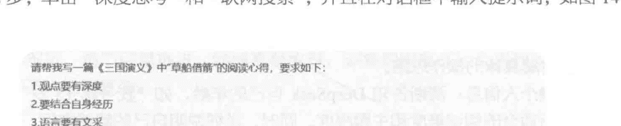

第 3 步，单击⬆，稍等片刻，DeepSeek 会形成一篇完整的阅读心得。

###### 草船借箭：虚实之间的博弈与生存之道

###### 1. 智与势：谋略背后的生命哲学

江雾如纱，万箭齐发，诸葛孔明摇扇帷幄的身影，是中国文化中“智绝”的经典符号。然“草船借箭”的惊艳之处，远不止“奇谋”二字，更在于其对“虚实”“顺逆”“借势”三重生存法则的诠释。
大雾掩江的混沌，本是行军大忌，他却将“虚景”化为“实利”。曹操多疑，以为雾中必藏杀机，箭雨尽落草船；而诸葛亮参透人性之怯，以“空船”触发对手恐惧，满则溢，怯则乱。这不禁让人想到《道德经》中“埏埴以为器，当其无，有器之用”的深意：没有船舱的空洞，恰是容器的根本；无箭可用之逆境，正是创造之所依。世事变幻如潮，以虚击实，因势利导，或许才是破解困局的锁钥。

###### 2. 困局与慧眼：雾中寻路的成长隐喻

我在一家初创公司任职时，团队遭遇核心代码泄露之危。众人惶惶，有人提议高价购买专利授权，有人主张追究泄密者责任。焦灼之际，我忽忆孔明借箭之策——若将“代码漏洞”视为大雾中的草船，是否可反向借力？最终我们主动开放部分代码生态，吸引开发者共建，用户黏性不降反升。正如孔明未执着于造箭之难，而是将箭矢的生成逻辑转为对手的行为逻辑，困境的解法，往往存在于对规则的再造过程。

###### 3. 结语：在不确定的时代种一片芦苇荡

千年江水未歇，但智者借势的智慧始终明澈。“草船借箭”是一场“关于不确定性的艺术”：面对资源匮乏，不哀叹逆风，而在迷雾中织网；遭遇规则桎梏，不解构高墙，而用对手的刀斧雕刻阶梯。或许，我们每个人的命运都是一艘草船，关键不在于船体是否坚固，而在于能否看到风吹雾动的痕迹，以轻盈之姿，承托起时代的万钧雷霆。

#### 14.4 个性化推荐

##### 14.4.1 获得个性化阅读推荐，发现更多好书

在浩如烟海的名著世界中，如何找到契合自己年龄与喜好的作品，常常让人感到迷茫。借助 DeepSeek 获得贴合自身需求的名著推荐，需要掌握一些有效方法。DeepSeek 凭借对海量数据的分析和理解，能精准匹配个人特征与名著内容。接下来从几个关键角度为用户讲解具体的操作思路。

- 明确个人信息：清晰告知 DeepSeek 自己的年龄，如“我今年 15 岁”，让它初步判断适合的阅读难度和主题深度。同时，详细说明自己的阅读喜好，如“我喜欢冒险类故事”，为推荐提供明确方向。
- 描述多元喜好：除了题材喜好，还可以分享自己喜欢的风格，如“我喜欢情节紧凑、节奏明快的作品”，或者“我偏好人物刻画细腻的名著”，使 DeepSeek 更全面地了解用户的阅读倾向。
- 结合成长阶段：如果正处于学习特定知识或技能的阶段，则可以告诉 DeepSeek，如“我正在学习历史，想读和历史相关的名著”，它能结合用户的成长需求推荐相关名著，如《明朝那些事儿》等。
- 参考他人评价：让 DeepSeek 查找与自己年龄、喜好相似的人群对名著的评价和推荐，让推荐结果更符合预期，比如了解其他 15 岁喜欢冒险类故事的同学都在读什么名著。

##### 14.4.2 实操案例

在此将以 15 岁的高中生读者为例，展开讲解如何使用 DeepSeek 进行个性化推荐。
第 1 步，思考自身需求。
第 2 步，单击 · 深度思考 · 和 · 联网搜索 ·，并且在对话框中输入提示词，如图 14-4 所示。


第 3 步，单击⬆，稍等片刻，DeepSeek 会为用户定制专有书单。

###### 为你定制的书单：在文字中体验心跳加速的成长

哈利·波特系列：J.K.罗琳创作的这套魔幻小说情节跌宕起伏，充满了奇幻冒险元素。小巫师哈利·波特在霍格沃茨魔法学校的学习与成长历程扣人心弦，从探索神秘的魔法课程，到与伏地魔展开惊心动魄的对抗，每一部都有新的挑战和惊喜，让读者沉浸在神奇的魔法世界中，感受友谊、勇气与正义的力量。

《蝇王》：威廉·戈尔丁的这部代表作，故事设定在想象中的第三次世界大战背景下，一群儿童因飞机失事被困荒岛。起初他们尝试建立秩序，但随着时间的推移，人性中的恶逐渐显露，孩子们从合作走向分裂与互相残杀。紧凑的情节不断抛出关于人性、文明与野蛮的思考题，让读者欲罢不能。

《追风筝的人》：美籍阿富汗作家卡勒德·胡赛尼的作品，围绕风筝与阿富汗的两个少年，讲述了一段关于人性的背叛与救赎的故事。从阿米尔与哈桑儿时的亲密无间，到阿米尔在一次风筝比赛中的懦弱，再到多年后阿米尔为了救赎踏上的艰难旅程，情节层层推进，情感真挚浓烈，在展现阿富汗社会风貌的同时，深刻探讨了人性的复杂。

### 第 15 章 外语学习

外语学习是一个提升个人能力与拓宽视野的过程。传统的外语学习方式，如背单词、学语法、阅读经典著作、与他人对话交流等，能够让学习者扎实地构建语言基础，培养语感和语言思维。但这种方式往往耗时较长，学习效果受限于个人学习资源和环境。随着人工智能技术的发展，利用人工智能工具进行外语学习成为新趋势。人工智能工具可以根据学习者的水平和需求，定制个性化学习方案，如智能推送合适的学习内容、精准评估学习进度。一些人工智能语言学习软件，可提供语音识别功能，能纠正发音错误，还能模拟真实语言场景，让学习者进行沉浸式对话练习。人工智能翻译工具也能辅助学习者理解复杂文本，拓宽阅读范围。人工智能虽能提供便利和高效的学习方式，但这些方式不能完全替代传统学习方式。将二者结合，充分发挥各自的优势，才是提升外语水平的有效途径。

#### 15.1 学习计划

##### 15.1.1 制订适合的外语学习计划

在开始使用 DeepSeek 制订计划前，先简单了解一下其基本原理和优势。它能够基于先进的算法和海量的数据，精准分析用户的学习需求和目标，从而给出有针对性的学习建议。下面介绍制订计划的思路。

- 明确学习目标：告诉 DeepSeek 期望达到的外语水平，如雅思要考到多少分，或者是能够进行日常对话交流等。清晰的目标是制订有效计划的基础。
- 评估现有水平：向 DeepSeek 描述目前的外语基础，如词汇量大概多少、听力和口语处于什么程度等，以便它根据实际情况规划提升路径。
- 设定学习时间：告知 DeepSeek 每天或每周可用于学习的时长，这样 DeepSeek 就能合理分配各项学习任务的时间，确保计划切实可行。
- 选择学习内容：可以根据自己的兴趣和实际需求，如商务外语、旅游外语等，让 DeepSeek 推荐相应的学习资料和练习内容。
- 制定学习进度：让 DeepSeek 按周或按月规划学习进度，明确每个阶段需要完成的任务和达到的小目标，方便学习者跟踪学习情况。
- 定期回顾调整：学习过程中，定期将自己的学习效果反馈给 DeepSeek，如单词背诵的正确率、口语练习的流畅度等，它会根据反馈及时调整计划，保证学习效果。

##### 15.1.2 实操案例

在此以使用 DeepSeek 制订外语学习计划为例展开讲解。
第 1 步，明确自己的目的，制订一个适合自己的外语学习计划。
第 2 步，单击 · 深度思考 · 和 · 联网搜索 ·，并且在对话框中输入提示词，如图 15-1 所示。


图 15-1 实操案例示意图

第 3 步，单击 ⬆，稍等片刻，DeepSeek 会形成一个详细的英语学习计划。
以下是为您制订的 6 个月雅思 7.0 分冲刺计划，结合语言能力提升与应试技巧训练，分为基础夯实、专项突破和全真模考三个阶段。

**第一阶段：基础夯实（第 1 个月到第 2 个月）**
核心目标：搭建 6000 个词汇体系，掌握基础语法框架，提升听力敏感度。
每日任务（4 小时到 5 小时）：

- （1）词汇（至少 60 分钟）
  背诵《雅思词汇真经》的 2 个单元（40 个新词+复习旧词）。
  通过 Quizlet 制作场景词汇卡（学术类+生活类）。
- （2）听力（至少 45 分钟）
  精听 BBC6 Minute English（逐句听写+跟读）。
  完成《雅思王听力真题语料库》Chapter3～5 听写。
- （3）阅读（至少 60 分钟）
  精读剑桥、雅思真题 Test 1 和 Test 2 的文章（划长/难句+整理同义词替换表）。
  学习略读（Skimming）和扫读（Scanning）技巧（完成刘洪波编写的阅读真经书籍基础篇）。
- （4）口语（至少 30 分钟）
  跟读 English Pronunciation in Use，纠正发音。
  用手机录音回答 Part 1 基础话题（家庭、工作、爱好）。

阶段目标：

- 听力 Section1/2 的正确率提升至 80%。
- 阅读 Heading 题/Matching 题的正确率达到 70%。
- 能流畅进行 3 分钟日常对话。

**第二阶段：专项突破（第 3 个月到第 4 个月）**

核心目标：掌握不同题型解题策略，建立写作框架，培养学术表达能力。

每日任务（5 小时到 6 小时）：

- （1）听力（至少 60 分钟）
  精听剑桥真题听力 Section 3/4（重点抓逻辑连接词）。
  练习多选题/地图题专项（《9 分达人雅思听力真题还原及解析》）。
- （2）阅读（至少 75 分钟）
  限时训练（20 分钟/篇）+错题分析。
  攻克判断题难点。
- （3）写作（至少 90 分钟）
  学习 Simon 范文结构（大作文四段式模板或小作文动态图模板）。
  每周完成 2 篇 Task1+1 篇 Task 2（使用 Grammarly 检查语法）。
- （4）口语（至少 45 分钟）
  整理 Part 2 故事库（用同一个素材覆盖多个话题）。
  参加线上语言交换（italki/Tandem）。

阶段目标：

- 写作 TR（任务完成情况）、CC（连贯与衔接）评分达到 6.5 分以上。
- 口语能完整展开 Part 2 话题卡。
- 听力 Section 3/4 的正确率达到 65%以上。

**第三阶段：全真模考（第 5 个月到第 6 个月）**

核心目标：适应考试节奏，查漏补缺，强化心理素质。

每日任务（6 小时到 7 小时）：

- （1）模考训练（每周至少 2 套）
  严格按考试时间完成剑桥真题 Test 13～Test 17。
  使用答题卡规范写作（将大作文时间控制在 40 分钟以内）。
- （2）弱点攻坚
  听力：强化口音识别（澳音/印度音素材）。
  阅读：提速训练（完成《雅思阅读 538 考点词真经》）。
- （3）口语冲刺
  录制视频，模拟考试（注意眼神交流等肢体语言）。
  记忆 20 组高分词组（Discourse Markers）。
- （4）写作批改
  找专业老师批改每篇作文，重点提升 LR（词汇资源）和 GRA（语法多样性和准确性）评分。

阶段目标：

- 模考总分稳定在 6.5～7.0 分。
- 口语能自然使用惯用语。
- 写小作文 150 个字或大作文 250 个字，按时完成。

#### 15.2 辅助单词背诵

##### 15.2.1 实现个性化背诵单词

学习外语时，单词是根基。DeepSeek 这款人工智能工具能依据个人独特情况，如年龄、单词水平等，为用户量身定制单词背诵清单，并给出实用的背诵建议，让单词学习更高效。下面就详细讲讲如何利用 DeepSeek 开启个性化的单词学习之旅。

不同年龄和单词水平，对单词的需求和接受能力都不一样。DeepSeek 强大之处就在于它能精准把握这些差异，从而提供适配的单词学习方案。具体操作思路如下。

- 清晰阐述个人情况：如实向 DeepSeek 说明自己的年龄和当前单词水平，比如，一名 20 岁的大学生，已经掌握了基础的 1000 个常用单词，正在准备大学英语四级考试。这些信息能帮助 DeepSeek 了解用户起点和学习潜力。
- 明确单词学习目标：告诉 DeepSeek 希望通过单词学习达成什么目标，是通过特定考试，还是提升日常交流能力。例如，想在三个月内通过大学英语四级考试，DeepSeek 就能根据四级考试大纲词汇，结合现有水平推荐重点单词。
- 获取单词清单：基于用户提供的年龄、单词水平和学习目标，DeepSeek 会生成一份专属单词清单。这份清单可能包含基础词汇的巩固部分、与目标考试或应用场景相关的高频词汇，以及符合用户年龄段认知水平的拓展词汇。
- 接收背诵建议：DeepSeek 不仅会给出单词清单，还会提供背诵方法建议。比如，针对不同词性的单词，它可能建议将动词和名词结合场景记忆，形容词则通过对比记忆。同时，它会依据艾宾浩斯遗忘曲线，为用户规划合理的复习时间节点。
- 定制背诵计划：根据自己的时间安排，和 DeepSeek 沟通每天或每周能够投入单词背诵的时长，让它帮忙制定每日背诵量和背诵周期，使学习计划更具可行性。

##### 15.2.2 实操案例

在此以借助 DeepSeek 实现个性化背单词为例展开讲解。
第 1 步，明确自己的目的，即实现个性化背单词。
第 2 步，单击 · 深度思考 · 和 · 联网搜索 ，并且在对话框中输入提示词，如图 15-2 所示。


第 3 步，单击⬆，稍等片刻，DeepSeek 会形成一篇个性化背单词建议。

以下是针对你的情况定制的，个性化四级单词清单+科学背诵计划，融入神经网络背词法（填空+场景分类），助你在 3 个月内高效攻克重点词汇。

- 1. 词库筛选原则（不用背诵所有大纲词！智能筛选 5 类为必背词汇）
  真题高频词：根据近 5 年四级真题词频分析结果，过滤占比约 60% 的低频词。
  重点场景词：完形填空高频副词（如 consequently、likewise）。
  易混淆词对：adapt/adopt、affect/effect 等常见易混淆词。
  听力替换词：比如听力题干中的 purchase 和 buy、require 和 need。
  写作加分词：替代简单词（important 和 crucial、think 和 maintain）。

- 2. 个性化词表（1200 个词，核心量）
  按题型分类，精准击破
  按记忆难度标记，人工智能分组
  红色（高频易错）：guarantee、consequence、Approximately。
  绿色（已掌握）：basic、information、develop。
  蓝色（需结合语境）：range（v.变化范围/n.山脉）。

- 3. 科学背诵方法
  第一阶段，图像关联法（第 1 周到第 2 周）
  • 工具：用 Anki 创建记忆卡片，正面放单词+图片联想（如 habitat—熊猫栖息地照片）
  • 技巧：对动名词强制造句（如 The government implemented new policies.）
  • 每日任务：新学 40 个词+复习前 3 日的词（早、中、晚各 15 分钟）
  第二阶段，真题挖空法（第 3 周到第 5 周）
  • 操作：将做过的阅读真题的核心词挖空（如 The_____(controversial)issue caused debate.）
  • 升级训练：听听力 SectionB 原文时主动标记关键名词（如 seminar、deadline）
  • 每日任务：新学 50 个词+在真题中定位已学词汇（晚 1 小时精练）
  第三阶段，场景迁移法（第 6 周到第 12 周）
  • 任务设计：
    用 10 个校园服务词汇编对话（library、scholarship、cafeteria 等）。
    看 TED-Ed 视频 How Sugar Affects the Brain，提取 5 个健康类词汇。
    玩 Word Story 游戏，解锁新的剧情场景词。

- 4. 3 个月里程碑计划
  第 1 周到第 4 周：筑基期
  目标：掌握 600 个核心词，按美国当代英语语料库（COCA）词频排序。
  重点：完成高频动词+副词衔接词模块。
  自检：每周用百词斩四级预测卷测试记忆率（要求记忆率达 70%）。
  第 5 周到第 8 周：强化期
  目标：攻克熟词僻义（如 issue：作为名词表示问题等；作为动词表示颁布等）。
  重点：整理同义词替换表（如 solve、tackle、resolve）。
  自检：在华研外语 App 完成篇章选词填空训练（正确率≥80%）。
  第 9 周到第 12 周：实战期
  目标：将词汇植入真题语境（用《星火四级真题》验证）。
  重点：训练听力速记能力（用符号缩写，如 edu——education）。
  自检：模考时在试卷上标记生词，考后复盘录入词表。

#### 15.3 中外互译

##### 15.3.1 准确进行中外互译

在语言学习的道路上，准确的中外互译是提升语言综合能力的关键一环。DeepSeek 作为先进的人工智能工具，能够为用户提供丰富的翻译资源与高效的学习方法，助力用户在中外互译中不断进步。下面就来看看如何借助 DeepSeek 提升中外互译水平。
人的语言基础和学习目标各有差异。DeepSeek 可以针对这些差异，提供个性化的中外互译学习方案。具体操作思路如下。

- 评估自身水平：向 DeepSeek 详细描述自己目前的语言基础，包括词汇量、语法掌握程度、已有的翻译经验等，比如，能够进行简单的日常对话翻译，但在复杂句式和专业词汇翻译上存在困难。这些信息有助于 DeepSeek 了解用户的起点和需要提升的方向。
- 明确学习目标：告知 DeepSeek，学习中外互译的目的是应对日常交流、考试，还是工作中的商务翻译等。例如，希望能够准确翻译商务邮件和会议资料，DeepSeek 就能围绕商务领域，定制相关的学习内容。
- 利用翻译练习：使用 DeepSeek 进行大量的翻译练习，从简单的短句到复杂的段落。每次翻译后，仔细对比 DeepSeek 给出的参考译文，分析自己的错误和不足，学习其翻译思路和技巧。
- 积累专业词汇：根据自己的学习目标和领域，让 DeepSeek 推荐相关的专业词汇，并学习这些词汇在不同语境中的翻译和用法。比如，医学领域的专业术语，其翻译往往有特定的规范和习惯。
- 学习翻译技巧：向 DeepSeek 请教常见的翻译技巧，如词性转换、语序调整、增词/减词等，并通过实例练习加深理解。DeepSeek 可以给出大量的例句，帮助用户掌握这些技巧在实际翻译中的应用。
- 定期模拟测试：设定一定的时间周期，利用 DeepSeek 进行模拟翻译测试，检验自己的学习成果。测试后，总结自己在翻译速度、准确性等方面的表现，以便调整学习计划。

##### 15.3.2 实操案例

在此以让 DeepSeek 制订中外互译学习计划为例展开讲解。
第 1 步，明确自己的目标，即提升自己的中外互译水平。
第 2 步，单击 · 深度思考 · 和 · 联网搜索 ·，并且在对话框中输入提示词，如图 15-3 所示。


图 15-3 实操案例示意图

第 3 步，单击 ↑，稍等片刻，DeepSeek 会形成一篇完整的学习计划。

以下是为您量身定制的 3 个月商务翻译能力提升计划，针对复杂句式与专业术语痛点设计，系统训练语言转换、商务思维、跨文化意识三大核心能力。

**第一阶段：基础架构搭建（第 1 周到第 4 周）**
核心目标：搭建商务术语库，解析长难句思维
学习任务：

- 1. 术语系统化积累
  分模块整理：用 Excel 建立术语表，按行业细分（国际贸易/市场营销/财务等），每日拓展 30 个词
  语料来源：商务部白皮书英文版、Harvard Business Review 精选文章、国际商务函电教材
- 2. 句式拆解训练
  英，中：精译 The Economist 商务板块长/难句，重点处理被动语态与嵌套从句。
- 3. 辅助工具
  使用 Trados 术语库管理高频词汇，用 Linguee 词典对照真实语境例句

**第二阶段：场景化实战演练（第 5 周到第 8 周）**

- 1. 核心目标：精准输出+语域适配能力
- 2. 学习任务
  高频错误专项击破
  影子练习法
  跟读 BBC Business Daily 音频，同时速记并复述，训练“听—记—译”同步能力。

**第三阶段：职业化深度应用（第 9 周到第 12 周）**

- 1. 核心目标：跨文化传播思维和审校能力。
- 2. 学习任务
  （1）实战模拟项目
  项目策划书翻译：保持中英文格式一致性（数字、排版）
  财报本地化：转换单位与数据呈现方式（万元与 million、RMB 与 USD 换算）
  （2）翻译 QA 流程
  建立审校清单，逐项排查：
  术语一致性（如“专利”统一用 patent 而非 exclusive rights）。
  度量衡转换（1 亩≈666.67 平方米，避免直译）。
  （3）能力验证
  参加全国外语翻译证书考试（NAETI）模拟测试。
  在 ProZ.com 平台接小型试译订单获取真实反馈。

###### 每日学习节奏参考

- 晨间（30 分钟）：China Daily 双语新闻泛读，标记记忆模糊词汇。
- 午间（20 分钟）：TED 商务演讲精听，跟读重点段落并速记概要。
- 晚间（90 分钟）：按当日主题完成实务翻译+使用 Memsource 校审。
- 碎片时间：在译学馆 App 观看商务类短视频做视译练习。

关键提醒：每月底用 SDL Trados 分析译文重复率与术语匹配率，动态调整学习重点。遇到文化冲突句式时，优先查阅世界贸易组织公文翻译规范手册。坚持产出驱动型学习，三个月必见质变！

#### 15.4 外语写作

##### 15.4.1 进行个性化外语写作练习

在学习外语的过程中，写作是检验语言综合运用能力的重要方式。DeepSeek 凭借其强大的智能算法和丰富的语言数据，能为不同学习者提供个性化的外语写作练习路径，帮助大家有效提升写作水平。接下来详细介绍如何借助 DeepSeek 开启个性化外语写作练习之旅。

每个人的词汇储备、语法运用水平、写作风格偏好及学习目标都不尽相同。而 DeepSeek 能够精准分析这些差异，量身定制符合个人需求的写作练习方案。具体操作思路如下。

- 清晰界定自身情况与目标：向 DeepSeek 全面阐述自己当前的外语水平，如词汇量大概处于什么范围，语法掌握的熟练程度如何等。同时，明确自己的写作学习目标，比如是想提升雅思写作分数，还是能够自如撰写商务邮件，让 DeepSeek 清楚用户的起点和努力方向。
- 获取写作题目与主题建议：基于提供的信息，DeepSeek 会推荐写作题目及主题。如果目标是备考雅思，它可能给出教育、科技、环保等常见雅思写作话题；要是想提升商务写作能力，就会收到关于商务合作、市场推广、客户沟通等方面的主题建议。
- 开展写作练习与获得反馈：根据 DeepSeek 给出的题目进行写作练习。完成后，将文章输入 DeepSeek，它会从语法错误、词汇运用、逻辑结构等多个维度进行分析，并给出详细的反馈和改进建议。如 DeepSeek 指出句子中存在的语法错误，则建议替换更精准、高级的词汇等。
- 学习优秀范文与模仿写作：请 DeepSeek 提供与写作题目相关的优秀范文，仔细研读这些范文的用词、篇章结构及观点表达方式。之后，模仿范文的风格和结构，重新进行写作练习，进一步巩固学到的写作技巧。

##### 15.4.2 实操案例

在此以利用 DeepSeek 进行个性化外语写作练习为例展开讲解。
第 1 步，明确目标，即定制符合个人需求的写作练习方案。
第 2 步，单击 · 深度思考 · 和 · 联网搜索 ·，并且在对话框中输入提示词，如图 15-4 所示。


第 3 步，单击 ⬆，稍等片刻，DeepSeek 会形成一篇完整的方案。
以下是为您定制的 3 个月雅思写作 7 分冲刺计划，采用任务回应精准化+逻辑模块化+语言升级三维突破策略，直击 5 分档核心痛点，具体安排如下。

- **第 1 阶段：破局重塑（第 1 周到第 4 周）**
  1. 目标：纠正基础语法错误，建立审题与框架意识
  2. 每日学习时间：2.5 小时
  3. 任务清单
     (1) 语法重置训练
         查看《剑桥雅思常见错误精析》，每日批改 5 个典型病句（如主谓不一致、时态混乱）。
         造句练习：每日用 5 种复杂结构写句子（定语从句/分词作状语/虚拟语气）。
     (2) 任务回应专项
         图表小作文：整理《顾家北小作文逻辑链》高频动态图句型，每周仿写 2 篇（重点数据对比词：surge、plateau、overtake）。
     (3) 速成工具包
         安装 Grammarly 插件强制检查基础错误。
         熟背《15 组小作文必备替换词》（如上升：increase、climb、soar）。
- **第 2 阶段：逻辑升级（第 5 周到第 8 周）**
  1. 目标：建立学术论证思维，提升词汇精准度
  2. 每日学习时间：3 小时
  3. 任务清单
     (1) 论证金字塔搭建
         必练结构：用 PEEL 法则扩展段落，即 Point( 观点 )—Explain( 解释 )—Evidence（证据）—Link（扣题）。

（2）词汇精准化

建立 7 分语境词库（避免滥用 good、bad 等宽泛词）。

学习学术词伙搭配表：每日掌握 3 组（如 pose a threat to、bridge the gap）。

（3）论证深度训练

用 **Devil's Advocate** 法自我反驳：所有观点必须包含 counterargument（反驳观点）及 rebuttal（反驳）。

**第 3 阶段：实战淬炼（第 9 周到第 12 周）**

1. 目标：全真模考与针对性提分
2. 每日学习时间：3.5 小时
3. 考官视角训练

**关键里程碑与风险管控**

第 4 周：保证在 20 分钟内完成小作文，无基础语法错误。

第 8 周：大作文能稳定产出 270 个词以上，论证包含至少两个扩展论点。

第 12 周：模考总分达 6.5 分以上（单项写作不低于 7 分）。

**常见风险应对：**

（1）写作超时：从第 6 周开始强制使用 “25+5+5” 时间分配法，即 5 分钟审题+25 分钟写作+5 分钟检查。

（2）思路卡壳：背诵十大万能论点库（如经济因素、教育价值、科技双刃剑）。

（3）中式表达：用 Ludwig.guru 查找地道搭配（输入中文词查英文高频用法）。

**最后忠告：7 分写作必须重视 “审题精准度 > 逻辑严谨度 > 语言复杂度” 的优先级！建议将本计划与你的口语/阅读学习联动（如通过阅读积累论据），形成乘数效应。祝飞跃成功！**

#### 15.5 语病纠正

##### 15.5.1 纠正语病

在学习外语的过程中，写出准确无误的句子是提升语言能力的关键。但由于语言体系的差异，人们常常会在不经意间写出存在语病的外语句子。DeepSeek 作为一款强大的语言智能工具，能够帮助用户精准找出这些语病，还能为后续的提升提供清晰的思路，让用户的外语表达更加地道、准确。接下来就为用户详细介绍如何借助 DeepSeek 达成这一目标。

每个人在学习外语时遇到的语病问题各有不同，DeepSeek 能根据用户提供的句子，结合外语的语法规则和语言习惯，对句子进行全面剖析。通过它的帮助，用户不仅能发现语病，还能获得有针对性的提升方法。下面是具体的操作思路。

- 完整准确地输入句子：将自己写出的外语句子完整无误地提供给 DeepSeek，确保标点符号、大小写等都与原文一致。例如，不要遗漏单词后的标点，正确输入句子开头的大写字母等，这有助于 DeepSeek 做出准确判断。
- 理解语病分析结果：DeepSeek 会指出句子中存在的语病，比如语法错误、词汇搭配不当或者用词不准确等。要认真阅读它给出的分析，明白问题出在哪里。比如，它指出 “make a progress” 存在语病，正确表达应该是 “make progress”，这时就要理解 “progress” 是不可数名词，不能用 “a” 修饰。
- 学习正确表达范例：DeepSeek 一般会给出正确的表达方式。要仔细研究这些范例，了解正确的语法结构和词汇用法。比如，对于刚才提到的错误句子，它给出的正确范例是 “make progress”，用户就可以通过对比，记住这个正确的表达。
- 举一反三进行练习：根据 DeepSeek 指出的语病和提供的正确范例，自己尝试改写句子或者进行类似句式的造句练习。例如，对于 “make progress” 这个表达，自己可以多造几个句子，加深对正确用法的理解和记忆。
- 定期整理语病问题：每隔一段时间，将 DeepSeek 指出的所有语病问题进行整理归纳，分析哪些是自己反复出现的问题，哪些是偶尔犯错的类型，针对不同类型制订不同的提升计划。
- 寻求提升建议并执行：主动向 DeepSeek 询问如何提升自己在这类语病问题上的能力，比如是多阅读相关语法书籍，还是进行专项练习等，然后按照建议付诸实践。

##### 15.5.2 实操案例

在此以让 DeepSeek 纠正语病为例展开讲解。
第 1 步，明确自己的目标，即找出自己写的英语句子中的语病，获得有针对性的提升方法。
第 2 步，单击 · 深度思考 · 和 · 联网搜索 ，并且在对话框中输入提示词和英语句子，如图 15-5 所示。


图 15-5 实操案例示意图

第 3 步，单击 ，稍等片刻，DeepSeek 会形成一篇完整的分析报告。
以下是原文的语法修正、错误分析和翻译提升建议。

1. 原文问题修正
修正后版本

After the Lantern Festival (during which people eat Yuanxiao, a traditional sweet made of glutinous rice flour with various fillings), enterprises across China have resumed full-scale production. Recently, many regions have organized job fairs to help companies recruit qualified candidates while assisting jobseekers in securing employment opportunities.

错误解析与改善思路，如下表所示

###### 错误解析与改善思路对比表

| 原句问题 | 错误类型分析 | 改进方法 |
| :--- | :--- | :--- |
| After the Yuanxiao(Filled round balls...) | 文化概念表述混乱<br>将节日名称（Yuanxiao：元宵）与食物名称混淆<br>括号中的解释冗长且不符合英文表述习惯 | 主次倒置：用 Lantern Festival 作主名词，解释 Yuanxiao 为节日食品，采用同位语结构补充说明（a traditional sweet...） |
| a large number of enterprises resumed production | 逻辑缺失<br>节后复工是普遍现象，但未说明复工生产的规模（常态化复工/全面复工） | 增加 full-scale，更准确地体现“全面复工” |
| many places have held job fairs to select talents for enterprises and find positions for job seekers | 动词搭配不当<br>有中式英语痕迹：select talents 有遴选精英的歧义（实际指招聘）；find positions 这种表达表现得求职者不够积极 | 使用 help companies recruit qualified candidates 和 assist... in securing opportunities 的形式 |

###### 2. 系统化翻译水平提升建议

（1）攻克文化专有项翻译
用三台阶法解释中国特色词汇：
初级：直译（Yuanxiao）。
中级：同位语补充（a sweet for Lantern Festival）。
高级：情境化改写（festive rice dumplings）。
推荐工具：中国特色话语对外翻译标准化术语库。

（2）消解中式英语症结
Step1：识别中文隐形逻辑（如“复工复产”需补充“全面性”）。
Step2：用 S（主语）+V（动词）+O（宾语）框架重组信息（如原：企业复工；优化后：Enterprises have resumed full operations）。
Step3：使用权威外媒平行文本验证（如 BBC 对“春节后返工”的报道）。

（3）政经文本高频痛点专项突破，如下表所示

###### 政经文本高频痛点专项突破对比表

| 中文典型结构 | 易错译法 | 专业译法 |
| :--- | :--- | :--- |
| 送岗位/送服务行动 | Send jobs | Employment outreach programs |
| 稳就业政策 | Stable job policies | Employment stabilization measures |
| ××渠道开展招聘 | open channels | Leverage platforms to conduct recruitment |

（4）建立翻译决策清单
是否准确传递政策力度（形容词“大量”：multiple、small-scale、limited）。
量词处理是否专业化（一批企业：a cohort of enterprises）。
动词能否替换为更精确术语（举办招聘会：host、organize、launch job fairs）。

> AI 不会取代程序员，但会淘汰不学 AI 的程序员。
——林纳斯·托瓦兹（Linux 之父）

### 第 16 章 辅助编程

编程是将人类的想法和逻辑转化为计算机能够理解并执行的指令的过程，是构建软件、网站、应用程序等数字产品的基础。从简单的脚本到复杂的系统，编程无所不能。它能让人们实现自动化任务，提高工作效率，创造出虚拟世界，为人们带来全新的体验。

#### 16.1 写编程作业

##### 16.1.1 辅助完成 Python、C 语言等编程作业

在编程学习过程中，完成作业是巩固知识、提升编程能力的重要一环。面对 Python、C 语言等不同编程作业，常常会遇到各种难题。而 DeepSeek 作为强大的智能助手，能够提供丰富的思路和有效的解决方案，助力用户高效完成编程作业。下面就来详细介绍如何借助 DeepSeek 攻克编程作业难题。

不同编程语言有各自独特的语法规则和编程风格，作业的难度和侧重点也各不相同。DeepSeek 凭借其强大的语言理解和代码分析能力，能够针对不同语言的作业要求，给予用户有针对性的帮助。具体操作思路如下。

- 清晰阐述作业要求：将编程作业的题目、具体要求完整准确地告知 DeepSeek，包括作业的功能描述、输入/输出格式、使用的编程语言限制等。例如，在 Python 作业中要求实现数据排序功能，要明确说明使用列表存储数据，以及对排序结果的输出格式要求，以便 DeepSeek 理解作业目标。
- 获取思路引导：向 DeepSeek 询问完成作业的整体思路和步骤。它会根据作业要求，给出实现功能的大致框架，比如先定义数据结构，再编写核心算法函数，最后进行结果输出。以 C 语言实现一个简单的计算器程序为例，DeepSeek 可能会建议先定义变量存储输入数据，再通过条件判断语句实现不同运算功能。
- 解决语法和逻辑问题：在编写代码过程中，若遇到语法错误或逻辑不清晰的情况，则可把代码片段输入 DeepSeek。它能精准指出语法错误所在，如 Python 中的缩进错误、C 语言中的变量未声明错误等，并提供修正建议。同时，对于逻辑问题，它会分析代码执行流程，给出优化思路，帮助完善程序逻辑。
- 参考代码示例进行学习：请 DeepSeek 提供与作业相关的代码示例，学习其中的编程技巧和代码结构。比如在学习 Python 的文件操作作业时，参考它给出的示例代码，了解如何正确打开、读取和写入文件，然后应用到自己的作业中。
- 验证和优化代码：完成代码编写后，让 DeepSeek 对代码进行验证，检查是否存在潜在的错误或性能问题。它可能会提出一些优化建议，如在 C 语言中合理使用指针提高内存利用率，在 Python 中选择更高效的数据处理方法，从而提高代码质量。

##### 16.1.2 实操案例

在此以让 DeepSeek 辅助完成编程作业为例展开讲解。
第 1 步，明确目标，让 DeepSeek 给出 Python 作业中要求的实现数据排序功能的代码。
第 2 步，单击 · 深度思考 · 和 · 联网搜索 ·，并且在对话框中输入提示词，如图 16-1 所示。


第 3 步，单击 ⬆，稍等片刻，DeepSeek 会输出本次编程作业所需的代码。
以下是实现数据排序功能并输出为 CSV 格式的 Python 代码示例，满足你的需求。

```python
import csv
#示例数据（可根据需要修改）
data = [
    ["Name", "Age", "Score"],
    ["Alice", 25, 95],
    ["Bob", 30, 88],
    ["Charlie", 22, 90],
]
#定义排序函数，按第三列（分数）降序排列
def sort_data(data_list):
    """返回排序后的数据（跳过标题行）"""
    header = data_list[0]    #保存标题行
    sort_body = data_list[1:] #获取数据部分
    #按分数（索引号为 2）降序排列，升序请删除 reverse=True
    sort_body.sort(key=lambda x: x[2], reverse=True)
    return [header] + sort_body #组合标题+排序数据
#执行排序
sorted_data = sort_data(data)
#输出 CSV 文件
with open("sorted_result.csv", "w", newline="", encoding="utf-8") as f:
    writer = csv.writer(f)
    writer.writerows(sorted_data)
print("排序完成！结果已保存至 sorted_result.csv")
```

关键点说明：

（1）数据存储：使用嵌套列表存储数据，每个内层列表表示一行记录
（2）排序逻辑：
    - 默认按第三列（分数）降序排列
    - lambda x: x[2]表示取每行的第三个元素作为排序依据
    - 修改 x[索引号]中的索引号可更换排序列（从 0 开始计数）
（3）CSV 输出：
    - 使用标准库 csv.writer 确保格式正确
    - newline="" 避免出现空行
    - encoding="utf-8" 防止出现中文乱码

扩展说明：

- 修改排序列：例如要按年龄（第二列）排序，将 x[2]改为 x[1]
- 升序/降序：删除 reverse=True 变为升序，不删除则保持降序
- 标题处理：代码已经自动识别并保留第一行为标题行
- 大数据支持：理论上支持任意行数和列数的数据

测试结果文件示例（sorted_result.csv）：

```
Name,Age,Score
Alice,25,95
Charlie,22,90
Bob,30,88
```

将测试数据替换为你的实际数据即可直接使用此代码。

#### 16.2 编程逻辑讲解

##### 16.2.1 讲解编程逻辑，理顺编程思路

DeepSeek 作为一款智能工具，能在编程逻辑讲解方面提供极大助力，帮助学习者更轻松地掌握编程逻辑，提升编程能力。下面就来详细介绍如何借助 DeepSeek 讲解编程逻辑。

- 问题描述与分析：把需要讲解编程逻辑的问题完整准确地告知 DeepSeek，包括问题的背景、目标及相关约束条件。例如，要讲解实现一个简单图书管理系统的编程逻辑，就需说明系统要实现图书的添加、借阅、归还等功能，以及数据存储方式等要求，让 DeepSeek 充分理解问题。
- 整体逻辑框架构建：向 DeepSeek 询问解决该问题的整体逻辑框架。它会依据问题描述，梳理出解决问题的主要步骤和流程，比如先设计图书的数据结构，再编写实现各个功能的函数，最后考虑如何将这些功能模块整合起来。以实现一个简单的用户登录系统为例，DeepSeek 可能会建议先进行用户输入验证，再与存储的用户信息进行比对，根据比对结果给出相应提示。
- 关键逻辑点详解：对于问题中的关键逻辑点，如条件判断、循环控制等，让 DeepSeek 进行详细解释。比如在讲解一个计算学生成绩平均分的程序时，针对如何使用循环遍历所有学生成绩并求和，以及如何通过条件判断处理成绩异常情况，DeepSeek 能给出清晰的解释和示例，帮助用户理解这些关键逻辑的实现方式。
- 结合代码示例说明：请 DeepSeek 提供与讲解逻辑对应的代码示例，通过代码直观展示编程逻辑是如何实现的。比如在讲解排序算法的逻辑时，它给出 Python 或 C 语言实现的排序代码，逐行分析代码与逻辑步骤的对应关系，加深用户对编程逻辑的理解。

##### 16.2.2 实操案例

在此以让 DeepSeek 讲解编程逻辑为例展开讲解。
第 1 步，明确目标，即需要 DeepSeek 讲解实现一个简单图书管理系统的编程逻辑。
第 2 步，单击 · 深度思考 · 和 · 联网搜索 ·，并且在对话框中输入提示词，如图 16-2 所示。


第 3 步，单击⬆，稍等片刻，DeepSeek 会形成一篇图书管理系统的编程逻辑。
数据存储的结构需要设计。CSV 的字段应该包括书名、作者、ISBN（国际标准书号）、状态，可能还有借阅人信息。默认情况下，新书的状态是“在库”，借阅人为空。借阅时需要检查状态是否为“在库”，如果是则修改状态和借阅人；归还时则相反。然后，考虑用户交互。
系统应该有一个主循环，提示用户选择功能，比如 1.添加，2.借阅，3.归还，4.退出。每次操作后可能需要显示成功或失败的信息，比如图书不存在或状态不符。需要处理异常情况，比如在借阅时图书不存在，或者已经被借出，这时候需要给出提示。
函数的设计方面，可以拆分为添加、借阅、归还、显示等功能，每个函数处理对应的逻辑。例如，add_book 函数负责收集用户输入信息并追加到 CSV；borrow_book 函数先读取所有数据，找到对应 ISBN 的书，修改状态，然后写回文件。可能还需要一个显示所有书籍的功能，方便用户查看当前库存情况，作为辅助功能可能有用。考虑到实现基本功能，在示例中可以暂时不包括，或者作为扩展。

最后，整理各个功能的流程，确保每个步骤都清晰，并且在处理文件时不会出错，比如在操作文件时使用 `with` 语句来自动处理文件的关闭，以及在修改数据时用 `try-except` 块来捕获可能的异常。

#### 16.3 代码阅读解析

##### 16.3.1 解析代码

代码阅读解析并非易事，面对复杂的代码结构和多样的编程风格，用户常常会感到无从下手。DeepSeek 凭借其对各类编程语言的深入理解和强大的分析能力，可以从多个角度辅助用户进行代码剖析，使代码阅读变得更轻松。具体操作思路如下。

- 提供完整代码及背景信息：将需要阅读解析的代码完整无误地输入 DeepSeek，同时告知代码的相关背景，比如代码所属项目的功能、应用场景，以及使用的编程语言特性等。例如，提供一段用 Python 编写的 Web 服务器后端代码，要说明它是用于处理用户请求并返回数据，运行在特定的 Web 框架下，方便 DeepSeek 更准确地理解代码。
- 理解代码整体功能：向 DeepSeek 询问这段代码的主要功能。它会根据代码结构和逻辑，概括出代码实现的核心任务，比如是实现数据的加密传输，还是进行图像识别处理。以一段用 C 语言编写的文件处理代码为例，DeepSeek 可能会指出它主要实现了文件的读取、内容分析和特定格式输出。
- 分析代码结构与模块关系：让 DeepSeek 分析代码的结构，包括函数、类的定义和相互调用关系，不同模块之间的数据传递等。例如在分析一个 Java 项目代码时，它能梳理出各个类之间的继承关系、方法的调用顺序，帮助用户理解代码是如何组织和协同工作的。
- 解读关键代码片段：对于代码中的关键部分，如核心算法实现、复杂的条件判断语句等，请求 DeepSeek 进行详细解读。比如在一段实现深度学习的 Python 代码中，针对构建神经网络模型的关键代码，DeepSeek 可以解释每一层的作用、参数设置的含义，让用户明白代码的具体运行机制。
- 查找潜在问题与优化建议：请 DeepSeek 帮忙查找代码中可能存在的问题，如内存泄漏、性能瓶颈等，并给出优化建议。例如在分析一段 C++ 代码时，它可能指出某些循环操作存在效率问题，建议使用更高效的数据结构或算法进行优化。
- 拓展学习相关知识：在代码阅读解析过程中，如果遇到不熟悉的函数、库或编程概念，可借助 DeepSeek 了解相关知识。比如遇到 Python 中某个不常见的第三方库函数，DeepSeek 可以介绍该函数的功能、参数使用方法，以及相关库的用途，拓宽用户的编程知识面。

##### 16.3.2 实操案例

在此以让 DeepSeek 进行代码阅读解析为例展开讲解，假设现在需要搞清楚一段代码的作用，学习优秀编程经验。

第 1 步，将已知代码输入 DeepSeek。篇幅较长，此处不展示。

第 2 步，单击 · 深度思考 · 和 · 联网搜索 ·，并且在对话框中输入提示词，如图 16-3 所示。


图 16-3 实操案例示意图

第 3 步，单击 ⬆，稍等片刻，DeepSeek 会形成一篇完整的代码阅读解析。

###### 一、代码整体功能分析

核心功能实现：

一个基于 CSV 文件的命令行交互式图书管理系统，主要功能包括：

- √ 图书信息录入
- √ 借阅状态管理
- √ 图书流通跟踪
- × 数据统计分析（未实现）

代码角色定位：

实现图书馆基础业务的数字化管理原型，适用于小规模图书管理场景，处理 1000 本以下图书的流通管理，属于轻量级解决方案。

###### 二、代码结构与模块关系

典型结构示意图：

```
Python
main（）    #主控模块
init_file（）    #初始化模块
add_book（）    #数据录入模块
borrow_book（）    #借出图书逻辑模块
return_book（）    #归还图书逻辑模块
menu_display（）    #交互界面模块
```

模块耦合度分析：

- 高内聚：数据操作与业务逻辑分离（如 CSV 读/写独立封装）
- 低耦合：各功能模块通过文件系统交互，没有直接数据依赖

###### 三、关键代码片段解读

主控循环片段：

```
while True:  #无限循环保持程序运行
    print("\n===== 菜单 =====")  #用户界面展示
    choice = input("请选择:")  #用户输入处理

    #分支逻辑控制
    if choice == '1':
        add_book()
    elif ...:
        ...
```

技术点理解：

- （1）while True 保持程序持续运行
- （2）input()实现命令行交互
- （3）条件分支实现功能跳转

数据持久化示例：

```
with open('books.csv', 'w', newline="") as f:
    writer = csv.writer(f)
    writer.writerows(all_rows)  #全量写入模式
```

关键技术运用：

- Context Manager（with 语句）自动管理文件资源
- writerows()实现批量数据写入
- newline=""防止 Windows 系统出现空行

###### 四、代码漏洞分析与优化建议

已发现风险点：

- （1）数据竞态：多进程同时操作可能导致数据损坏
- （2）性能瓶颈：全量读/写 CSV 在数据量大时效率低下（时间复杂度 O(n)）
- （3）输入漏洞：未对 ISBN 进行格式验证
- （4）异常处理：缺少文件访问的 try-except 保护

优化建议表：

| 问题类型 | 解决方案 | 优先级 |
| :--- | :--- | :--- |
| 输入验证 | 添加正则表达式校验 ISBN | 高 |
| 数据安全 | 使用 SQLite 代替 CSV | 中 |
| 异常处理 | 增加 try-except 块 | 高 |
| 性能优化 | 采用增量更新机制 | 低 |

###### 五、知识扩展路线

推荐学习路线：

- （1）面向对象进阶：学习使用 Class 重构现有代码
  - 《Python 面向对象编程指南》
- （2）数据库操作：掌握使用 SQLite/Pandas 进行数据管理
  - sqlite3/pandas.DataFrame.to_sql
- （3）异常处理策略：深入理解 Python 异常机制
  - Python 官方文档 Errors and Exceptions
- （4）高级持久化方案：了解 JSON/XML 序列化
  - json 模块/xml.etree.ElementTree

#### 16.4 语言转换

##### 16.4.1 实现不同编程语言之间的转换

DeepSeek 凭借其强大的语言理解和分析能力，能够成为语言转换的得力助手。下面详细介绍如何借助它实现高效的语言转换。

语言转换涉及不同编程语言语法、特性及用户编程习惯的转换，过程较为复杂。DeepSeek 能依据各种编程语言的特点，提供较为准确的转换思路和方法，帮助用户跨越语言之间的壁垒。具体操作思路如下。

- 明确转换目标与源代码：清晰地告知 DeepSeek 需要进行的语言转换方向，比如从 Python 转换到 Java，同时将完整准确的源代码提供给它。如要把一个用 Python 编写的简单数据处理脚本转换为 Java 代码，就把 Python 脚本及相关的依赖库、功能说明等一并提供，方便 DeepSeek 了解转换背景。
- 理解语法差异要点：向 DeepSeek 询问源语言和目标语言之间的主要语法差异。比如 Python 使用缩进来表示代码块，而 Java 使用大括号；Python 的列表和 Java 的数组在使用方式和功能上也有所不同。了解这些差异，能让用户更好地把握代码调整方向。
- 获取初步转换建议：让 DeepSeek 根据源代码和语言差异给出初步的转换建议。它可能会指出哪些函数调用需要替换，哪些数据结构需要调整，以及如何按照目标语言的语法规则重新组织代码结构。比如对于在 Python 中使用的进行 HTTP 请求的 requests 库，DeepSeek 会建议在 Java 中使用 OkHttp 库，并给出相应的代码示例。
- 处理复杂逻辑部分：对于源代码中的复杂逻辑，如递归算法、多线程处理等，请求 DeepSeek 详细解析如何在目标语言中实现。如在 Python 中使用递归函数实现文件目录遍历，在 Java 中可能需要使用不同的数据结构和迭代方式来达到相同的效果，DeepSeek 能提供具体的实现思路和代码示例。
- 检查与优化转换结果：完成初步转换后，将代码再次输入给 DeepSeek，让它检查是否存在语法错误或逻辑漏洞，并给出优化建议。比如检查 Java 代码中是否存在未初始化的变量，或者是否有更高效的实现方式，以确保转换后的代码质量。
- 学习目标语言特性应用：在转换过程中，如果遇到目标语言特有的功能和特性，借助 DeepSeek 学习如何在代码中应用。例如 Java 中的注解功能，在 Python 中并没有直接对应的概念，DeepSeek 可以介绍注解在 Java 代码中的使用场景和方法，帮助用户在转换后的代码中合理运用。

##### 16.4.2 实操案例

在此以将代码从一种编程语言转换成另一种编程语言为例展开讲解。

第 1 步，将所要转换的代码提供给 DeepSeek。

第 2 步，单击 · 深度思考 · 和 · 联网搜索 ·，并且在对话框中输入提示词，如图 16-4 所示。

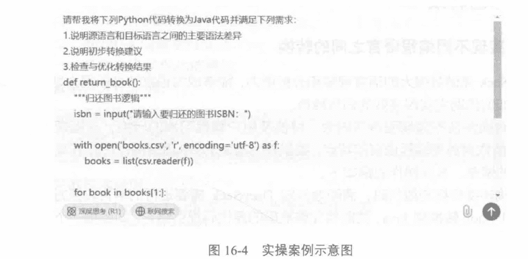

第 3 步，单击 ⬆，稍等片刻，DeepSeek 会生成新的代码和相关说明。因为篇幅较长，此处就不再展示了。

> AI 能让教育像 Netflix 一样个性化。
——萨尔曼·可汗（可汗学院创始人）

### 第 17 章 辅助讲解题目

#### 17.1 语文题目讲解

语文题目旨在培养阅读理解、写作表达能力与文学素养。做阅读理解题，需剖析文本，理解词句含义、把握文章主旨，提升语感与信息提取能力；写作题目则要求学生将积累的素材与技巧灵活运用，通过审题立意、谋篇布局，锻炼书面表达能力；诗词赏析题考查对诗词意境、情感和艺术手法的理解，以此加深对传统文化的感悟。

##### 17.1.1 详细讲解语文题目

DeepSeek 作为一款强大的人工智能工具，能在解答语文题目时为学习者提供多方面的帮助，助力提升语文学习效果，无论是在诗词理解、阅读理解，还是在写作等方面，都能发挥独特的作用。

##### 17.1.2 实操案例

在此以让 DeepSeek 详细讲解语文题目为例展开讲解。

第 1 步，明确目标，即分析李白《将进酒》的豪放风格与情感表达。

第 2 步，单击 · 深度思考 · 和 · 联网搜索 ·，并且在对话框中输入提示词，如图 17-1 所示。


第 3 步，单击⬆，稍等片刻，DeepSeek 会形成一篇完整的分析报告。

李白《将进酒》的豪放风格与情感表达可从以下几个层面深入分析。

###### 一、喷薄而出的狂放气象

开篇气势（意象之宏）：“黄河之水天上来”以天体运动的势能隐喻生命奔腾不息，后续“朝如青丝暮成雪”，通过时间线超压缩，展现对生命规律的认知焦虑与突围渴望，这种矛盾的夸张构成独特的张力场。

###### 二、悖论修辞中的生命哲学

“天生我材必有用，千金散尽还复来”构建了有用与无用的辩证逻辑——此处并非实用主义自信，而是通过无限扬弃物质存在的思维方式，实现形而上的精神自由。

###### 三、醉酒叙事的解构艺术

“钟鼓馔玉不足贵”打破社会价值序列；“主人何为言少钱”更以反讽口吻消解主客关系。诗人将宴席转化为生命狂欢的仪式现场，试图以稷下式的论辩逻辑瓦解世俗规则。

###### 四、复调式情感结构（非单向豪迈）

- （1）表层狂欢：“会须一饮三百杯”的豪饮抒写
- （2）深层悲郁：以酒神精神对抗现实“寂寞”（“古来圣贤皆寂寞”佐证）

此诗的真正价值不仅在于其外显的豪迈气度，更在于其构建了具有现代质询意味的生存寓言——当知识分子的理想主义受阻，既非走向世俗妥协亦非沉湎绝望，而是通过诗性智慧建构起流动的精神家园。这种狂欢化的反抗策略，成为中国古代文人传统中独特的文化原型。

#### 17.2 数学题目讲解

人工智能软件可通过多种方式解决数学问题，如大语言模型在接收自然语言问题后推理作答；专业软件如 Mathematica 进行符号与数值计算；还有专门解题 App，利用图像识别和处理算法，针对输入或拍照的题目给出答案及步骤，帮助各阶段人群学习与研究数学。

##### 17.2.1 提供数学解题思路

DeepSeek 是一系列人工智能模型，以下是利用它解数学题的一般步骤。

- 明确问题：将数学题目以清晰、准确的自然语言输入 DeepSeek。比如对于代数方程求解题，要完整写出方程；对于几何证明题，要详细描述图形条件和需证明的结论等。
- 提出问题：在与模型交互的界面中，直接提出问题，如“请解这个方程……”“如何证明这个几何结论……”等。
- 解读回答：DeepSeek 会给出相应回复，对于计算类问题，可能直接给出答案和计算步骤；对于证明类问题，可能给出推理过程。用户可仔细阅读 DeepSeek 提供的内容，理解其逻辑和方法。

##### 17.2.2 实操案例

这里以一道数学题目（如图 17-2 所示）为例，展示 DeepSeek 提供的解题思路。

圆 $x^2 + y^2 - 2x + 6y = 0$ 的圆心到直线 $x - y + 2 = 0$ 的距离为（ ）。

A. $2\sqrt{3}$ B. 2 C. $3\sqrt{2}$ D. $\sqrt{6}$

图 17-2 实操案例图

第 1 步，上传题目图片。

第 2 步，单击 · 深度思考 ·，并且在对话框中输入提示词，如图 17-3 所示。


第 3 步，单击 ⬆，稍等片刻，DeepSeek 会给出题目的答案，如图 17-4 所示。

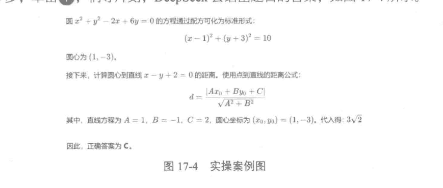

#### 17.3 英语题目讲解

英语学习涵盖词汇、语法、听说读写等方面。词汇是基础，需通过背诵、阅读积累；语法学习帮助构建正确的语言表达框架。听力题训练学生捕捉关键信息的能力；阅读理解考查对英文文本的理解与分析；写作要求运用所学词汇和语法，清晰表达观点；口语练习则注重语言的实际运用，全方位提升英语综合能力。

##### 17.3.1 解析英语题目

DeepSeek 是一款能在英语学习解题时提供有力支持的工具，无论是词汇的积累、语法的理解，还是听说读写综合能力的提升，它都能发挥重要作用，帮助学习者突破英语学习的难关，找到解题的诀窍，提升英语学习的效率与成绩。

学习英语的过程中，学习者会在各类题型上遇到挑战，而 DeepSeek 能够成为学习者攻克难题的好帮手。

##### 17.3.2 实操案例

这里以一道英语题目（如图 17-5 所示）为例展示 DeepSeek 提供的解题思路。

Walking home from school, I am enjoying my day. Each day I stop to hear music coming from the ivy (常春藤). Sparrow (麻雀) song, a loud glorious sound. The ivy is pulsing below a leafless tree, decorating around the lower trunk like a celebration. Nervous flittings, in and out, pecking at the branches. This ivy is a home for them, harboring an entire flock. But this scene is no longer ubiquitous. Numbers have declined by almost 70% in the UK since 1970. Sparrows make their homes near human places and finding a tree like this is a blessing. Happily, the ivy is still full of chatter and twitter.

In Greek mythology, sparrows are sacred and associated with the goddess Aphrodite, symbolizing true love and spiritual connection. I wonder how many people look at sparrows and feel that depth of connection. All birds live brightly in our imagination, connecting us to the natural world, opening up all kinds of creativity.

As I stand there, fluffed-up sparrows in conversation among themselves, there is a spark. Noticing nature is the start of it all. Slow down to listen, to watch. Take the time, despite mountains of homework.

Take the time to observe nature, to immerse oneself in its patterns, structures, happenings and rhythms. It is how mathematicians and scientists are nurtured. Alan Turing studied the patterns in nature: the arrangement of petals on the flower, spots on a leopard and stripes on a zebra. He was looking for a mathematical formula (公式) for the development of cells in living things. Nature sparks creativity. All we have to do is start asking the question, Why? The way my mind whirls and whirls in nature, or even when "daydreaming" is way more productive than the work I do in school.

I consolidate myself by thinking and thinking while intensely watching the movements of sparrows. Who knows where watching sparrows will lead?

1. What do I do on the way home from school?
A. Clean up the trunk.
B. Decorate the tree.
C. Listen to pop music.
D. Observe the sparrows.

图 17-5 英语阅读理解

第 1 步，上传题目图片。

第 2 步，单击 · 深度思考 ·，并且在对话框中输入提示词，如图 17-6 所示。


第 3 步，单击 ⬆，稍等片刻，DeepSeek 会形成阅读理解题目的完整解析。

英语阅读题目答案及解析：

**D. Observe the sparrows.** （观察麻雀）

理由：

文中第一段明确提到，每天放学路上，作者会停下来倾听麻雀的歌声（Sparrow song, a loud glorious sound），并详细描述了麻雀在常春藤中的活动（nervous flittings, in and out, pecking at the branches）。这些细节表明作者的主要行为是观察麻雀的活动，而非清理树干（A）、装饰树（B）或听流行音乐（C）。

总结：

题目侧重段落主旨归纳。解题时需结合文中具体信息与逻辑关联进行分析。

#### 17.4 物理题目讲解

物理题目聚焦物质运动规律与概念公式应用。通过分析物体受力情况，运用牛顿定律求解力学题，培养分析问题和定量计算能力；结合电路原理、欧姆定律等求解电学题，理解电流、电压等概念。学习时需理解物理实验背后的原理，掌握物理模型的构建，提高运用物理知识解决实际问题的能力。

##### 17.4.1 讲解物理原理，展示物理知识

DeepSeek 是一款实用工具，能从多维度助力学习者解答物理题目。物理学科抽象概念多、原理复杂，解题需精准分析与计算。借助 DeepSeek，学习者能高效理解知识、找到解题突破口，无论是基础公式运用还是复杂综合题型，它都能发挥作用，提升学习者的学习效果，成为攻克难题的得力助手。

使用 DeepSeek 辅助解答物理题时，需注意要点。一是不能直接套用答案，要深入理解解题涉及的物理原理和公式推导过程，掌握知识。二是要准确描述题目条件，避免因信息遗漏或错误导致解答错误。三是要明白它只是辅助工具，无法替代实际物理实验和基础知识学习，只有持续学习并结合其帮助，才能在物理学习中不断进步。

##### 17.4.2 实操案例

这里以这样一道物理题目（如图 17-7 所示）为例，展示如何让 DeepSeek 给出解题思路。


第 1 步，上传题目图片。

第 2 步，单击 · 深度思考 ，并且在对话框中输入提示词，如图 17-8 所示。


图 17-8 实操案例图

第 3 步，单击 ，稍等片刻，DeepSeek 会给出题目的答案，如图 17-9 所示。

1. 明确初速度$v_0 = 10\text{m/s}$，末速度$v = 0\text{m/s}$，时间$t = 2\text{s}$。
2. 用平均速度公式$\bar{v} = \frac{v_0 + v}{2}$，得$\bar{v} = \frac{10 + 0}{2} = 5\text{m/s}$。
3. 由$x = \bar{v}t$，算出$x = 5 \times 2 = 10\text{m}$，选 B。

图 17-9 实操案例图

#### 17.5 化学题目讲解

化学学习围绕元素性质、化学反应和实验操作。元素化合物题考查对各类元素性质的记忆与运用；化学反应题考查反应原理、配平化学方程式。实验题尤为关键，从实验设计、操作到结果分析，培养观察能力、动手能力和科学思维，加深学习者对化学知识的理解。

##### 17.5.1 分析化学题目，提供化学解题方法

DeepSeek 是一款助力化学学习的重要工具。借助 DeepSeek，学习者能快速梳理化学知识，面对各类化学题时找到关键解题思路。不管是基础概念辨析，还是综合性强的实验设计与计算，它都能为化学学习提供有力支持，提升学习效率与效果。

##### 17.5.2 实操案例

这里以一道化学题目（如图 17-10 所示）为例展示 DeepSeek 提供的解题思路。

下列说法不正确的是（ ）。
A. 葡萄糖氧化生成$CO_2$和$H_2O$的反应是放热反应
B. 核酸可看作磷酸、戊糖和碱基通过一定方式结合而成的生物大分子
C. 由氨基乙酸形成的二肽中存在两个氨基和两个羧基
D. 向饱和的NaCl溶液中加入少量鸡蛋清溶液会发生盐析现象

图 17-10 实操案例图

第 1 步，上传题目图片。
第 2 步，单击 · 深度思考 ，并且在对话框中输入提示词，如图 17-11 所示。


图 17-11 实操案例图

第 3 步，单击⬆，稍等片刻，DeepSeek 会给出题目的答案。
本题考查化学常识盐析、核酸大分子等知识点。
A. 葡萄糖氧化生成 CO₂ 和 H₂O 的反应是放热反应。这是正确的。生物体通过葡萄糖的氧化释放能量来维持生命活动，这是一个放热反应。
B. 核酸可看作磷酸、戊糖和碱基通过一定方式结合而成的生物大分子。这是正确的。核酸（包括 DNA 和 RNA）是由磷酸、五碳糖（脱氧核糖或核糖）和含氮碱基通过磷酸二酯键连接而成的长链分子。
C. 由氨基乙酸形成的二肽中存在两个氨基和两个羧基。这是不正确的。氨基乙酸（甘氨酸）是一种氨基酸，当两个氨基乙酸通过脱水缩合形成二肽时，一个氨基乙酸的氨基与另一个氨基乙酸的羧基反应，形成一个肽键，同时释放一个水分子。因此，形成的二肽中只有一个自由的氨基和一个自由的羧基，而不是两个氨基和两个羧基。
D. 向饱和的 NaCl 溶液中加入少量鸡蛋清溶液会发生盐析现象。这是正确的。饱和的 NaCl 溶液中的高浓度盐离子会与蛋白质分子中的电荷相互作用，减少了蛋白质分子与水分子之间的相互作用，导致蛋白质溶解度降低，从而发生沉淀，这个过程称为盐析。
故本题选 C。

#### 17.6 生物题目讲解

生物题目涉及生命现象和规律。细胞相关题帮助学习者理解细胞结构与功能，构建对生命的微观认知；对于遗传题，需运用遗传定律分析亲子代性状遗传，培养逻辑推理能力；生态题从宏观角度考查生态系统结构与功能。学习者可通过学习生物实验，掌握实验方法，提升对生命科学的探究能力。

##### 17.6.1 解读生物知识，解答生物疑问

DeepSeek 是助力生物学习与解题的实用工具。生物学涵盖从微观细胞到宏观生态系统的丰富知识，涉及众多概念、原理和实验。在解答生物题目时，常需梳理复杂的知识体系，精准运用所学。借助 DeepSeek，学习者能更高效地理解生物知识，突破解题难点。无论是基础的知识点记忆，还是复杂的实验分析与逻辑推理，它都能提供有效支持，提升学习者的生物学习成效。

##### 17.6.2 实操案例

这里以一道生物题目（如图 17-12 所示）为例，展示 DeepSeek 提供的解题思路。

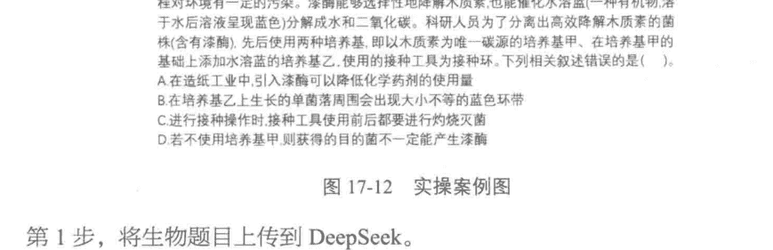

第 1 步，将生物题目上传到 DeepSeek。
第 2 步，单击 · 深度思考 ，并且在对话框中输入提示词，如图 17-13 所示。


第 3 步，单击 ⬆，稍等片刻，DeepSeek 会形成一份完整的解析。

> 错误选项：B. 在培养基乙上生长的单菌落周围会出现大小不等的蓝色环带
理由：
（1）培养基乙的作用：培养基乙在培养基甲（以木质素为唯一碳源）的基础上添加了水溶蓝。水溶蓝溶于水后呈蓝色，而漆酶可将其分解为无色的 H₂O 和 CO₂。若菌落能分泌漆酶，则其周围的水溶蓝会被降解，形成透明区域（透明圈），未降解的培养基仍保持蓝色。因此，菌落周围应出现透明环带，而非蓝色环带。
（2）理解偏差：若错误地认为水溶蓝被菌体吸收或与产物结合后呈现蓝色，可能导致对选项 B 的误判。但根据题干描述，水溶蓝的分解产物为无色物质，菌落周围应因降解作用出现透明区域，而非蓝色环。

其他选项解析：

A. 引入漆酶可以降低化学药剂的使用量
正确。漆酶能选择性降解木质素，减少传统化学处理中对强酸/强碱的需求，从而降低化学药剂用量并减轻污染。

C. 接种工具使用前后需灼烧灭菌
正确。接种环的操作需严格遵循无菌规范：使用前灼烧以杀灭杂菌，使用后灼烧以避免残留菌污染环境。

D. 不使用培养基甲，目的菌不一定产漆酶
正确。培养基甲以木质素为唯一碳源，筛选出的菌必须具有降解木质素的能力（含有漆酶）。若直接使用培养基乙，其他菌可能通过分解其他碳源（如水溶蓝）生长，但这些菌未必能产漆酶。

总结
解答本题的核心在于理解培养基的筛选原理和显色反应机制。
（1）选择性培养基（甲）：确保只有降解木质素的菌（含有漆酶）能生长。
（2）鉴别性培养基（乙）：水溶蓝的分解显色用于区分菌落是否含漆酶（透明圈为阳性标志）。
选项 B 的错误源于对显色反应的误解，正确答案为 B。

#### 17.7 政治题目讲解

##### 17.7.1 讲解政治理论

DeepSeek 作为一款智能工具，能为政治学习与解题提供有力支持。政治学科涵盖经济、政治、文化、哲学等多领域知识，不仅要求学习者对理论有深刻理解，还需学习者关注时事热点，并能运用理论分析实际问题。借助 DeepSeek，学习者能更高效地梳理知识体系，在面对各类政治题目时，找到解题的关键方向。无论是基础概念的辨析，还是复杂的材料分析与论述，它都能助力学习者提升政治学习效果。

##### 17.7.2 实操案例

这里以一道政治题目为例，展示 DeepSeek 提供的解题思路。
第 1 步，将政治题目输入 DeepSeek。
第 2 步，单击 ·深度思考· 和 ·联网搜索·，并且在对话框中输入提示词，如图 17-14 所示。

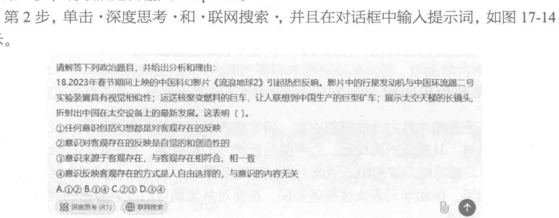

第 3 步，单击⬆，稍等片刻，DeepSeek 会形成一份完整的解析。

政治题目答案及解析：

**正确答案：A. ①②**

分析及理由：

**（1）选项①正确**
原理依据：马克思主义哲学认为，意识是客观存在的主观映象，一切意识（包括幻想）的内容均来源于客观存在。即使幻想的事物并非直接存在（如《流浪地球 2》中的行星发动机），其设计灵感仍基于现实科技（如中国环流器实验装置），是对客观存在的加工与整合。

**（2）选项②正确**
原理依据：辩证唯物主义强调，意识对存在的反映不是机械复制，而是能动的创造性过程。人通过抽象、想象、重构等方式将感性材料升华为具有主观色彩的产物（如科幻电影的艺术创作）。

**（3）选项③错误**
“意识来源于客观存在”正确，但“与客观存在相符合、相一致”片面。意识可能正确或歪曲反映客观存在（如幻想并未与原物完全一致）。影片中的科幻元素是对客观存在的主观改造，而非严格的“符合”。

**（4）选项④错误**
“方式是人自由选择的”存在合理性（如科幻创作的自由风格），但“与意识的内容无关”违背唯物论。意识的表现形式虽具主观性，但其内容始终受制于客观存在（如影片中的太空天梯原型仍基于现实航天技术）。

结论：
①和②完整说明了影片中幻想与现实的关系：意识以客观存在为内容基础（①），并通过创造性加工来表现（②）。选项 A 正确。

#### 17.8 历史题目讲解

历史题目围绕不同时期的史实和历史脉络展开。学习者可通过分析历史材料，提取有效信息，还原历史场景，理解历史事件发生的背景、原因和影响，把握历史发展的因果关系，培养历史思维和批判性思维，从历史中汲取经验教训。

##### 17.8.1 剖析历史问题

中学历史涵盖中外古今的重要史实，旨在培养学习者的历史思维和人文素养。考试题型丰富多样，从基础的选择题，到考验分析能力的材料题，再到锻炼综合表达的论述题，都对学习者的知识掌握和运用能力提出了较高要求。DeepSeek 能成为学习者学习路上的得力助手，帮助学习者快速梳理知识，在面对各类题目时找到解题的突破口，提升学习效率和成绩。

##### 17.8.2 实操案例

这里以一道历史题目为例，展示 DeepSeek 提供的解题思路。
第 1 步，将题目提交给 DeepSeek。
第 2 步，单击 · 深度思考 · 和 · 联网搜索 ·，并且在对话框中输入提示词，如图 17-15 所示。

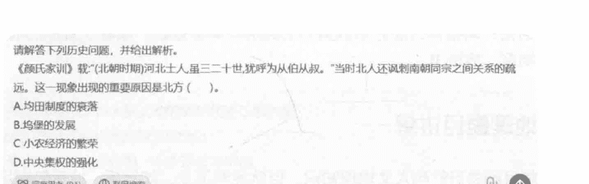

第 3 步，单击 ⬆，稍等片刻，DeepSeek 会形成一份完整的解析。

正确答案：**B. 坞堡的发展**
分析及理由：
（1）题干现象的核心
北朝时期河北士族即便相隔二三十代（同宗的旁系远亲），仍以“从伯从叔”等近亲称谓称呼彼此，这表明北朝宗族内部关系相对紧密，血缘群体凝聚力强，反映出北方宗族聚居、族群认同稳固的特点。
（2）选项与现象的关联性
**A. 均田制度的衰落（错误）**
北魏至北朝推行均田制旨在巩固小农经济，若其衰落更可能冲击基层生产单位（如小家庭独立化），并弱化大族对土地的掌控，与题干中强调的宗族凝聚力强的情况不符合。
**B. 坞堡的发展（正确）**
坞堡是汉末至魏晋南北朝北方战乱时期的特殊产物。豪强大族为自保，建立坞堡武装据守，成员以宗族为核心，形成人口聚居、经济自给、军事防御的封闭共同体。长期聚居强化了宗族内部的等级称谓和血缘认同，即使世代相隔甚远仍严格维系亲属关系。这是出现题干所述现象的直接原因。
**C. 小农经济的繁荣（错误）**
小农经济以个体家庭为生产单位，更易导致基层社会的原子化，弱化宗族集体联系。南朝小农经济相对发达，间接导致士族分散、宗族疏远（与题干所述的北方现象相反）。北朝坞堡经济以庄园为依托，与单纯小农经济无关。
**D. 中央集权的强化（错误）**
中央集权强化（如编户齐民、抑制豪强）会削弱世家大族的地方势力，而北朝宗族凝聚恰恰说明地方豪族势力未被彻底压制。相反，坞堡的独立性与中央集权存在一定冲突。

（3）深层历史背景
北方战乱频发（如永嘉之乱、五胡十六国混战），社会动荡迫使士族依托坞堡聚居自保，客观上维持了宗法血缘组织的稳定性；而南朝相对安定，士族迁居后逐渐分散，同宗联系减弱。

结论：坞堡作为北方宗族势力的经济与军事基础，维系了紧密的血缘关系和宗法制度，故选 **B**。

#### 17.9 地理题目讲解

地理题目涵盖自然和人文地理知识。自然地理部分，如气候、地形等题目，需要学习者理解自然要素的相互作用和分布规律；人文地理题目关注人口、城市、产业等现象，学习者需分析其形成原因和发展变化。通过地图学习，学习者可构建空间概念，培养综合分析和区域认知能力。

##### 17.9.1 讲解地理知识

在中学地理学习过程中，学习者常常会遇到各种难题，而 DeepSeek 可以提供解题思路。下面介绍借助它解答中学地理题目的一些方法。

- 自然地理选择题：碰到地球运动、大气环流、水循环等自然地理选择题，把题目和选项输入 DeepSeek，它能详细解释每个选项背后的地理原理，比如在做“地球公转速度最快时北半球是什么季节”这类题目时，帮助学习者理解地球公转规律，快速选出正确答案。
- 人文地理简答题：面对人口增长模式、城市化进程、产业区位选择等人文地理简答题，将题目提供给 DeepSeek，它能依据相关理论，结合实际案例，给出答题要点，像分析“某城市发展高新技术产业的区位优势”时，帮助学习者组织语言，清晰作答。
- 图表分析题：若遇到等高线图、气候资料图、人口统计图等图表分析题，把图表和问题提交给 DeepSeek，它能指导学习者解读图表关键信息，如等高线疏密与地形坡度的关系，从而分析出地理特征和规律，回答相关问题。
- 区域地理综合题：在解答涉及某个特定区域地理特征、发展问题等的综合题时，将区域相关信息和问题告知 DeepSeek，它可以整合自然和人文地理知识，分析区域优势与不足，比如分析“长江三角洲地区经济发展的有利条件”，为学习者答题提供全面思路。

用 DeepSeek 辅助解答中学地理题时要注意以下几点：一是不能照搬答案，务必理解地理原理和逻辑，掌握知识，灵活答题；二是描述题目时，精准提供图表数据、区域信息等关键内容，避免信息错误或缺失，否则解答易不准确；三是 DeepSeek 只是辅助工具，不能取代教材学习与地理现象观察积累，如实地观察地形、研读教材等，只有持续学习并合理借助它，才能在中学地理学习中持续进步。

##### 17.9.2 实操案例

明确要分析的是地理问题。
第 1 步，将地理问题提交给 DeepSeek。
第 2 步，点击·深度思考·和·联网搜索，并且在对话框中输入提示词，如图 17-16 所示。


第 3 步，单击⬆，稍等片刻，DeepSeek 会形成一份完整的题目解析。

关于海水性质对人类活动的影响，以下是对各选项的分析：

**A. 晒盐均选择在海水盐度较大的地区**
此说法错误。虽然盐度是晒盐的重要条件，但还需综合考虑气候因素（如蒸发量大、降水少、晴天多、风力强等）。例如，副热带海区盐度虽高，但若降水频繁，反而不适合晒盐。因此“均选择”这一绝对化表述不准确。

**B. 轮船由印度洋驶入红海，吃水深度会增加**
此说法错误。红海盐度显著高于印度洋，盐度高的海水密度大、浮力强，轮船在红海中的吃水深度会变浅，而非增加。

**C. 渔场多分布在海水温度较高的地区**
此说法错误。渔场的形成主要与营养盐丰富有关，如寒暖流交汇处（如北海道渔场）或上升流区域（如秘鲁渔场）。这些区域海水温度未必高，反而可能因深层冷海水上泛而温度较低。

**D. 潜艇航行过程中突遇低密度海水时，会发生“海中断崖”现象**
此说法正确。当潜艇从高密度海水进入低密度海水时，浮力骤减，导致潜艇急速下沉，这种现象称为“海中断崖”，对潜艇安全构成严重威胁。

**正确答案：D**

> AI 让小微企业与巨头站在同一起跑线上。
—— 谢家华（ZAppos 创始人）

### 第 18 章 做电商副业

如今，人工智能技术的蓬勃发展为人们开辟了不少做副业增收的新路径。在众多利用人工智能工具开展副业的选择中，人工智能写作领域颇具潜力。不少自媒体创作者和企业都急需高质量的文案，这时就可以借助 DeepSeek 这类强大的人工智能工具，先让其生成基础内容，然后凭借自身深厚的文字功底和对不同领域的了解，对生成的内容进行细致的润色、修改，使其贴合特定需求。无论是生动有趣的自媒体文章，还是专业严谨的企业宣传文案，人工智能工具都能轻松驾驭。

#### 18.1 赚钱思路

开展副业能增加收入，有多种思路可供选择。其一，技能变现，如擅长写作，可在网上承接文案撰写、公众号文章创作等工作；要是精通设计，能为企业或个人提供 Logo 设计、海报制作等服务。其二，利用闲置资源，如有闲置房屋，可短租出去；有多余车辆，可在空闲时段跑网约车。其三，电商副业，通过一件代发模式，在电商平台售卖热门商品，无须囤货。其四，知识付费，将自己的专业知识、学习技巧等制作成线上课程，在知识付费平台售卖。找到适合自己的方向，合理安排时间，就能在副业中收获额外收益。

##### 18.1.1 提供多样的赚钱思路

在这个人工智能飞速发展的时代，DeepSeek 为人们提供了利用其开展副业赚钱的机会。无论是想增加收入，还是想尝试新的职业方向，它都能成为有力的帮手。
先思考自己的现状，比如日常工作忙不忙，空闲时间多不多，是否有相关的技能基础等。假如平时工作时间是朝九晚五，下班后能有 3～4 小时的空闲时间，就比较适合开展线上类的副业。接下来是具体思路。

- 内容创作方向：如果平时喜欢写东西，那就利用 DeepSeek 辅助创作。下班后或周末，花 2～3 小时，用它生成短视频脚本、公众号文章大纲等，然后进行完善，提供给有需要的创作者，按作品计费。
- 知识服务领域：若用户在某个领域有一定的知识储备，可借助 DeepSeek 在问答平台解答问题，每天花 1～2 小时，积累流量和粉丝，后续实现变现。
- 翻译工作尝试：利用 DeepSeek 承接翻译工作。利用碎片化时间，如午休、晚上闲暇时间完成翻译任务，按字数收费。
- 技术服务提供：要是有一定的技术基础，可为小型企业搭建基于 DeepSeek 的智能客服，周末集中时间完成，收取搭建和维护费用。

在分析这些思路时，有几点需要注意。要依据自己的实际情况，如时间、能力，合理选择适合自己的方向。同时，要深入研究 DeepSeek 在对应领域的应用，确保能发挥工具的最大效能。并且，无论选择哪个方向，都要提前了解市场需求和价格行情，保证自己的副业有市场、能盈利。

##### 18.1.2 实操案例

这里以在浙江义乌的张三为例，选择适合他的副业机会。
第 1 步，明确自身相关情况，确定所希望从事的副业类型。
第 2 步，单击 · 深度思考 · 和 · 联网搜索 ·，并且在对话框中输入提示词，如图 18-1 所示。


第 3 步，单击 ⬆，稍等片刻，DeepSeek 会形成一篇完整的分析报告。

###### 一、闲鱼无货源电商：低门槛、高灵活性

###### 1. 方向选择

闲鱼是一个适合个人卖家的二手交易平台，但也可以作为无货源电商的副业渠道。你可以利用义乌本地供应链优势，销售鞋帽、日用百货等商品，赚取差价，无须囤货。

###### 2. 选品策略

选择轻量化、高性价比的商品（如袜子、围巾、家居小商品），或结合鞋帽厂资源销售尾货、库存商品。

###### 3. 货源支持

与朋友的电商团队合作，或直接对接义乌本地工厂，采用“一件代发”模式，减小库存压力。

###### 4. 执行建议

（1）账号运营：注册 1～2 个闲鱼账号，每天发布 5～10 条商品信息，优化标题和图片（可从朋友店铺获取素材）。
（2）流量获取：利用闲鱼的“擦亮”功能（每天刷新商品排名），参与平台活动（如“免费送”活动），增加曝光量。
（3）收益预估：单件商品利润 10～50 元，每天成交 5～10 单，月均收入可达 5000 元。

###### 二、社交电商分销：轻资产运营

1. 方向选择
通过微信、朋友圈或社群推广高性价比商品，赚取佣金，用碎片化时间，无须露脸，无须投入大量资金。

2. 选品策略
结合义乌本地供应链，分销鞋帽周边（如袜子、围巾）或家居小商品，朋友若有库存积压可优先合作。

3. 平台选择
使用拼多多“快团团”、抖音“精选联盟”等工具，一键生成推广链接，收益按成交量结算。

4. 执行建议
（1）社群运营：组建 500 人以上本地生活群，定期推送特价商品，结合“限时折扣”提高转化量。
（2）物流支持：利用有车优势，提供同城配送服务（如大件商品），增强客户黏性。
（3）收益预估：每月推广 10～20 款商品，单款利润 50～100 元，每天成交 1～5 单，月均收入可达 5000 元。

###### 三、跨境电商代运营：拓展海外市场

1. 方向选择
义乌小商品在海外需求旺盛，可协助本地商家运营亚马逊、Temu 等跨境平台店铺，赚取代运营费或销售分成。

2. 能力要求
需具备基础英语能力，熟悉平台规则（可通过免费课程短期学习）。

3. 合作模式
朋友若有跨境业务，可优先承接；或通过本地电商协会接单。

4. 执行建议
（1）聚焦品类：选择轻量化、高复购商品（如饰品、文具），降低物流成本。
（2）利用工具：使用企业资源计划（ERP）系统管理订单，每天投入 2 小时即可完成基础运营。
（3）收益预估：代运营费每月 2000～5000 元，或按销售额分成（5%～10%）。

###### 四、短视频内容创作（不露脸）：打造个人知识产权（IP）

1. 方向选择
拍摄义乌小商品市场探厂、鞋帽生产流程等垂直内容，吸引对供应链感兴趣的观众，后续通过广告或带货变现。

2. 内容形式
展示工厂流水线、商品设计故事，价格揭秘（如“义乌 1 元商品如何赚钱”），无须露脸，用画外音或字幕解说。

3. 平台推荐
抖音、快手、视频号，利用算法推荐精准触达目标用户。

4. 变现路径
（1）广告分成：粉丝量达 1 万名后可接品牌商单（单条视频广告收入约为 500～2000 元）。
（2）带货收益：在视频中插入商品链接，销售分成可达 10%～30%。

###### 五、线上培训/咨询服务：知识变现

1. 方向选择
基于鞋帽行业经验，提供以下服务。
（1）工厂管理咨询：帮助小厂优化生产流程（按项目收费，单次约为 500～2000 元）。
（2）电商新人培训：开设“义乌小商品选品技巧”线上课程（平台如知识星球、小鹅通）。

2. 优势与执行
（1）低时间成本：录制课程后可重复销售，后续仅需答疑。
（2）资源整合：联合电商朋友推出联合课程，扩大影响力。

###### 六、可行性评估与风险提示

推荐优先级：闲鱼无货源电商 > 社交电商 > 短视频内容创作（综合收益与资源匹配度）。

###### 七、风险控制

（1）闲鱼需注意账号权重维护，避免违规操作（如频繁修改价格、发布虚假信息）。
（2）避免重资产投入，优先选择“无货源”模式（由工厂代发）。

通过以上方向，结合义乌本地资源和你的空闲时间，可实现每月 5000 元左右的副业收入目标。建议先从闲鱼无货源电商入手，逐步拓展其他渠道。

#### 18.2 产品描述撰写

电商平台是适合开展副业的热门赛道。首先，可利用信息差赚钱，在电商平台或线下批发市场找到低价优质商品，在其他电商平台以稍高价格转卖，如一些性价比高的日用品、热门玩具等。其次，可售卖自己的闲置物品，清理家中杂物，获得收入，要注意如实描述物品状况，提高可信度。再次，提供服务类副业，比如擅长剪辑视频，可在电商平台发布视频剪辑服务，吸引有需求的客户下单。另外，有些平台允许做无货源电商，与供应商合作，由供应商直接发货，自己专注于运营店铺、吸引客户，通过这些方式，能借助电商平台获得一份稳定的副业收入。

##### 18.2.1 撰写吸引人的产品描述，促进销售

DeepSeek 和电商平台的组合为人们带来了新的机遇。借助 DeepSeek 强大的语言处理和数据分析能力，人们能在电商平台上更高效地开展副业，无论是寻找热门商品，还是撰写吸引人的产品描述，都能如虎添翼。

想在电商平台利用 DeepSeek 开展副业，我们可以从以下几个方向着手。

- 热门商品挖掘：使用 DeepSeek 分析电商平台数据，了解当下热门商品趋势。比如让它分析近期搜索量增长快、销量高的商品，如网红文具、创意家居用品等，在电商平台上跟进售卖，利用信息差获取利润。
- 商品定价参考：询问 DeepSeek 同类商品在不同平台的价格区间，参考它给出的数据，我们结合电商平台的特点和自身成本，制定合理且有竞争力的价格，吸引买家。
- 产品描述撰写辅助：当要上架商品时，告诉 DeepSeek 商品的特点、优势、使用场景等信息，它能快速生成基础描述内容，我们再根据实际情况修改，突出商品的独特卖点。
- 常见问题解答生成：利用 DeepSeek 整理商品常见问题及答案，当买家询问时，我们能快速、准确地回复，提升服务效率和买家满意度。
- 文案优化建议：让 DeepSeek 检查我们写好的产品描述文案，它可以指出语法错误、提出语言优化建议，让描述更加通顺、有吸引力。

在运用 DeepSeek 在电商平台开展副业并撰写产品描述时，需要注意，DeepSeek 提供的内容和建议仅作参考，不能完全依赖。我们要对商品有充分了解，确保描述真实准确，避免虚假宣传。同时，要及时关注电商平台规则变化，以及市场动态，灵活调整副业策略，保证自己的副业能够持续稳定发展。

##### 18.2.2 实操案例

第 1 步，明确自身情况，如在闲鱼平台进行鞋帽类产品售卖。

第 2 步，单击 · 深度思考 · 和 · 联网搜索 ，并且在对话框中输入提示词，如图 18-2 所示。


第 3 步，单击 ，稍等片刻，DeepSeek 会根据以上内容形成答案。

> 以下是通过多平台数据分析得出的鞋帽类目热门商品趋势，以及结合闲鱼平台特性精选的 3 款潜力产品（附操作建议）。

###### 一、平台数据分析总览

数据来源：蝉妈妈+淘商机+拼多多后台数据（2024年5月）

各平台数据总览表

| 平台 | 热搜关键词 Top3 | 月均搜索量 | 价格区间 |
| :--- | :--- | :--- | :--- |
| 闲鱼 | 防晒渔夫帽 | 48万次 | 15~35元 |
| | 透气网面运动鞋 | 36万次 | 50~120元 |
| | 儿童防晒空顶帽 | 29万次 | 12~25元 |
| 拼多多 | 洞洞鞋 | 210万次 | 19.9~39元 |
| 抖音 | 防紫外线冰袖 | 185万次 | 9.9~19.9元 |

###### 二、闲鱼平台重点推荐产品

1. 防晒可折叠渔夫帽（夏季爆款）

（1）数据表现
- 搜索量月环比增长 320%（4月→5月）；
- 转化率达 18.7%（高于类目平均水平的 12%）；
- 新品上架 7 天出单率达 92%。

（2）产品建议

A. 核心卖点
- 防晒认证（必备）；
- 可折叠塞进口袋（展示对比图）；
- 双面戴法（附教学短视频）。

B. 定价策略
- 成本价：8~12 元（义乌、1688 拿货）；
- 闲鱼售价：25~35 元（包邮）；
- 利润率：60%~75%。

2. 工厂尾货运动鞋（清仓神器）

（1）数据洞察
- “断码清仓”关键词搜索量增长 240%。

（2）选品技巧

A. 货源获取
- 联系本地鞋厂收购 B 品（有轻微瑕疵）；
- 成本控制：15~25 元/双（品牌尾货更佳）。

B. 运营要点
- 标题注明“专柜同款”“原盒原标”；
- 主图展示鞋底纹路/透气孔细节；
- 描述强调“支持验货”“假一赔三”。

C. 定价参考
- 成本 20 元，售价 69 元包邮；
- 日均出单 10 双，月毛利约为 1.47 万元。

3. 儿童防晒空顶帽（蓝海市场）

（1）趋势分析
- 闲鱼母婴类目增长率 Top3（月增 89%）；
- 差异化机会；
- 97%的平台卖家只做纯色款；
- 卡通联名款溢价空间在 30%以上。

（2）操作方案

A. 产品组合
- 基础款：纯色防晒款（成本 5 元，售价 15 元）；
- 利润款：迪士尼 IP 款（成本 8 元，售价 29 元）。

B. 场景化营销
- 捆绑销售：“帽子+冰袖”组合价 39 元；
- 内容种草：制作儿童防晒穿搭指南 PDF 作为赠品。

C. 物流优化
- 与本地快递谈合作价：全国 3 元/单（月发 500 单以上）。

第 4 步，根据自身供应链情况挑选上述推荐产品，单击 ·深度思考· 和 ·联网搜索·，并且在对话框中输入提示词，如图 18-3 所示。


第 5 步，单击 ⬆，稍等片刻，DeepSeek 会根据以上内容形成答案。
以下是为儿童防晒空顶帽定制的完整电商方案，包含定价策略、商品描述模板及文案优化技巧。

###### 一、商品定价策略

商品定价策略表

| 商品类型 | 成本价 | 建议售价 | 包邮策略 | 利润率 | 目标人群 |
| :--- | :--- | :--- | :--- | :--- | :--- |
| 基础款（纯色） | 5.8 元 | 15.9 元 | 满 2 件包邮 | 63% | 价格敏感型家长 |
| 升级款（卡通） | 7.2 元 | 22.9 元 | 单件包邮 | 68% | 品质追求型家长 |
| 礼盒装（帽袖款） | 12 元 | 39.9 元 | 全国包邮 | 70% | 送礼需求客户 |

定价技巧
- 设置“19.9 元”价格锚点（主推升级款，展示划掉的“原价 39 元”）；
- 推出“买二送一”活动（实际单价降至13.3元，促进销售）；

###### 二、商品描述模板

1. 标题
- “20××年新款儿童防晒空顶帽防紫外线透气不闷汗男女童夏季遮阳帽”。

2. 核心卖点（分点描述）
（1）专业防晒认证
- 国标GB/T 18830—2009认证，有效阻隔99%的紫外线；
- 内层银色防晒涂层，防晒效果是普通帽子的3倍（附检测报告截图）；
- 透气不闷热；
- 六边形透气网孔设计，实测比传统帽子降温3～5℃（展示红外热成像对比图）；
- 可调节魔术贴头围（52～58cm），从3岁戴到10岁。
（2）便捷实用设计
- 仅重45g，折叠后巴掌大小（配折叠过程动图）；
- 设后颈加长防晒布，保护脖颈不被晒伤。
（3）场景化文案
- “开学季必备！让孩子成为操场最靓的仔”；
- “体育课奔跑不怕晒黑，放学路上阳光直射无忧，周末郊游轻松收纳”。
（4）用户评价展示
- “宝妈真实反馈：之前孩子总说戴帽子闷，现在居然主动戴这款！出汗也不粘头发，已回购第二顶！——浙江李女士”。

###### 三、文案优化技巧

1. 标题优化技巧（原始标题：“儿童防晒空顶帽夏季遮阳”）
- 优化后：“20××年国标UPF50+儿童防晒帽，6D透气不闷汗头围可调送收纳袋”；

2. 主图设计要点（需配4张图）
- 图1：孩子戴帽在操场运动（场景化）；
- 图2：防紫外线检测报告特写（权威背书）；
- 图3：折叠对比图（在矿泉水瓶旁展示大小）；
- 图4：透气性测试（帽顶放干冰冒烟）。

#### 18.3 电商SEO

在电商平台上优化搜索，能让商品更容易被买家发现。标题是关键，全面准确的标题能提高搜索匹配度，如“苹果13系列256GB国行二手手机”。商品描述要详细，除了介绍商品基本信息，像成色、使用情况、是否有配件等都要写明，还可添加一些使用感受，增加描述的真实性和吸引力。合理利用标签，在描述中插入与商品相关的热门标签，如“#二手手机”“#数码产品”等，帮助系统更精准地分类推荐。同时，定期更新商品，保持商品的新鲜度，让它在搜索结果中更靠前。参考市场行情，设置合理、有竞争力的价格，这样能大大提升商品在电商平台的搜索曝光率。

##### 18.3.1 优化电商商品搜索排名，增加曝光量

在电商平台上开展副业，让自己发布的商品在搜索结果中脱颖而出至关重要。DeepSeek 作为一款强大的人工智能工具，能为电商搜索引擎优化提供有力支持，有效提升内容点击率和排名，从而增加商品销量。

##### 18.3.2 实操案例

这里以在浙江义乌的张三为案例进行讲解，张三现在选择了在闲鱼平台售卖儿童防晒空顶帽。
第 1 步，将儿童防晒空顶帽的相关信息上传至 DeepSeek。
第 2 步，单击·深度思考·和·联网搜索·，并且在对话框中输入提示词，如图 18-4 所示。


第 3 步，单击[图标]，稍等片刻，DeepSeek 会根据以上内容形成答案。

###### 一、精准关键词挖掘（基于闲鱼搜索算法）

1. 工具组合
- 闲鱼搜索下拉框；
- 蝉妈妈闲鱼版（免费基础功能）；
- 竞品标题拆解。

2. 关键词矩阵

| 关键词类型 | 高流量词 | 蓝海词 | 转化词 |
| :--- | :--- | :--- | :--- |
| 核心词 | 儿童防晒帽 | 小学生防晒空顶帽 | 防紫外线儿童帽 |
| 属性词 | 防紫外线 | 透气不闷汗 | 可调节头围 |
| 场景词 | 开学必备 | 体育课专用 | 海边度假 |
| 促销词 | 买一送一 | 过敏包退 | 送冰袖 |

3. 长尾词推荐
- “儿童防晒帽男女童夏天透气”（搜索量 12 万次/月）；
- “小学生空顶帽防紫外线不闷热”（搜索量 8.3 万次/月）；
- “幼儿园防晒帽可折叠”（搜索量为 5.6 万次/月）。

###### 二、标题优化策略

1. 黄金公式
“年份词” + “核心词” + “属性词” + “场景词” + “促销词”。

2. 优化案例
- 原始标题：“儿童防晒空顶帽夏季透气”。

3. 优化后
- “2024 年新国标儿童防晒空顶帽+防紫外线小学生夏季透气不闷汗帽开学季必备[过敏包退]”

4. 标题拆解
- 年份词：“2024 年新国标”（提升新鲜度）；
- 核心词：“儿童防晒空顶帽”（精准匹配搜索）；
- 属性词：“防紫外线+透气不闷汗”（过滤目标客户）；
- 场景词：“小学生+开学季”（抓住细分场景）；
- 促销词：“过敏包退”（消除决策顾虑）。

5. AB 测试方案

版本 A：强调专业认证
- “质检报告儿童防晒帽 UPF50+2024 年夏季防紫外线空顶帽小学生体育课专用”

版本 B：突出使用场景
- “开学季爆款！儿童防晒空顶帽海边露营防紫外线可调节头围 3～12 岁买一送一”

###### 三、搜索权重提升技巧

1. 关键词布局策略
- 标题：植入 3～5 个核心词（总字数控制在 26 个字内）；
- 标签：设置“#儿童防晒帽”“#防紫外线帽子”“#开学必备”；
- 描述：前 50 个字重复核心关键词 2 次（自然融入）。

2. 上新冷启动技巧
- 首日设置“1 元秒杀”（限量 10 件），快速积累基础销量；
- 引导买家带图评价：“晒图送防晒面罩”；
- 每天 20:00—22:00 手动刷新商品（闲鱼流量高峰）。

#### 18.4 智能客服助理

退/换货政策等内容导入，当客户询问相关问题时，AI 客服就能迅速回应。还可以利用人工智能工具的机器学习功能，让它不断学习新问题和答案，优化回答策略。智能客服还能 24 小时在线，随时响应客户需求，不会出现人工客服的休息空档期，能极大地提升服务效率和客户满意度，助力副业更好地开展。

##### 18.4.1 利用智能客服，提升服务质量

在与用户沟通的过程中，恰当地回复至关重要。对那些不太擅长交流、比较直接的人来说，DeepSeek 能成为得力助手，帮助用户搭建智能客服助理，让回复更专业、更贴心，提升沟通效果。

##### 18.4.2 实操案例

这里仍以在浙江义乌的张三为案例进行讲解，张三现在选择了售卖儿童防晒空顶帽，并要形成相关回复模板。
第 1 步，将儿童防晒空顶帽相关信息上传至 DeepSeek。
第 2 步，单击 · 深度思考 · 和 · 联网搜索 ，并且在对话框中输入提示词，如图 18-5 所示。


第 3 步，单击⬆，稍等片刻，DeepSeek 会形成相关的问题清单。

常见问题解答（FAQ）
**Q1：帽子适合多大孩子？会勒头吗？**
- A：头围 52～58cm 均可戴（3～12 岁），后置魔术贴 3 档可调，特意加宽弹性带，不勒头，可参考尺码表选择。
**Q2：防晒效果能维持多久？**
- A：正常使用情况下，防晒涂层有效期为 2 年。建议避免机洗和暴晒存放，可延长使用寿命。
**Q3：出汗会留下白色痕迹吗？**
- A：采用独家防汗渍工艺，经 10 次水洗测试无褪色无痕迹，放心运动佩戴。（附水洗测试视频链接）
**Q4：如何清洗保养？**
- A：手洗最佳，中性洗涤剂冷水轻揉，阴凉通风处晾干。切勿漂白/烘干/暴晒。
**Q5：不支持 7 天无理由怎么办？**
- A：本店支持【过敏无忧退】——只要未下水，不影响二次销售，过敏者可特殊退换。

第 4 步，将以上问题上传至智能客服机器人，并实现实时在线回答。

> AI 是思维的镜子，帮人类看清思考的路径。
——东尼·博赞（思维导图发明者）

### 第 19 章 制作思维导图

思维导图由东尼·博赞发明，以中心主题为核心，通过分支和子分支展示层次结构，运用颜色、图形和关键词增强可视化效果。思维导图广泛应用于学习、工作和生活，帮助人们梳理信息、激发创意、提高效率。其放射性结构符合大脑思维模式，能够提升逻辑性、条理性与创造性，便于信息整理与分享。

#### 19.1 思维导图

##### 19.1.1 无须整理内容，AI 自动生成思维导图

在当今数字化时代，利用工具高效学习和工作十分重要。用户可以借助 DeepSeek 这类人工智能工具生成 Markdown 代码，再用 XMind 软件将代码转化为直观的思维导图，以此提升知识整理和呈现的效率。

##### 19.1.2 实操案例

请尝试将一部电影的主要内容生成思维导图。
第 1 步，选择一部电影，如《泰坦尼克号》。
第 2 步，打开 DeepSeek 平台，单击 · 深度思考 · 和 · 联网搜索 ·，并在对话框中输入如下提示词，如图 19-1 所示。


第 3 步，发送后稍等片刻，DeepSeek 会形成 Markdown 格式文本。

```
电影《泰坦尼克号》剧情梳理

序幕：现代探索（1996 年）
探险队在大西洋海底搜寻泰坦尼克号残骸，目标为遗失的“海洋之心”钻石项链。

老年露丝·道森（Rose Dawson）得知消息后联系探险队，登船讲述尘封往事。
```

###### 主线剧情（1912年）

1. 启航与邂逅
背景：泰坦尼克号从英国南安普顿启航，号称“永不沉没”。
人物登场
露丝·迪威特·布克特（Rose DeWitt Bukater）：不满贵族联姻束缚的年轻女性。
卡尔·霍克利（Cal Hockley）：露丝的未婚夫，傲慢的钢铁大亨之子。
杰克·道森（Jack Dawson）：贫穷的艺术家，赢得三等舱船票。
关键事件：露丝欲跳海自尽被杰克救下，两人建立联系。

2. 阶级跨越的爱情
卡尔敌视：对杰克与露丝的接触感到威胁，试图羞辱杰克。
情感发展：
杰克带露丝参加三等舱舞会，体验自由生活。
露丝请杰克为其绘制裸体素描《海洋之心》。
两人在船头演绎经典“飞翔”场景。

3. 灾难降临（4月14日）
撞冰山：瞭望员发现冰山时为时已晚，右舷发生致命撞击。
真相揭露：
设计师托马斯·安德鲁斯确认船将在2小时内沉没。
救生艇仅能搭载半数乘客。
船员优先安排头等舱乘客逃生。

4. 生死逃亡
卡尔陷害：将“海洋之心”项链藏入杰克外套，栽赃其盗窃。
沉船过程：
船体断裂成两截后垂直下沉（4月15日2:20）。
乘客坠入零下两度的冰海，多数因低温症死亡。
经典场景：
乐队坚持演奏至最后一刻。
老夫妇相拥等待死亡。
母亲给子女讲睡前故事。

5. 最终抉择
木板救援：杰克将露丝推上漂浮门板，自己浸在冰水中。
临终承诺：杰克要求露丝永不放弃生存，最终冻僵沉入海底。

尾声：现代（1996年）
露丝的秘密：展示卧室照片证明她践行了“像男人一样骑马”等承诺。
“海洋之心”的归宿：老年露丝将项链抛入大西洋，镜头闪回泰坦尼克号大厅中与杰克拥吻的众人。
最后画面：露丝的呼吸化作星光，与沉船中的时钟（永恒定格在沉没时刻）形成呼应。

###### 主题内核

爱情与自由：跨越阶级的灵魂之爱 VS 物质至上的婚约。
人性光辉：灾难中展现的勇气、牺牲与尊严。
历史隐喻：工业文明傲慢的代价与永恒的人性课题。

第 4 步，DeepSeek 生成内容后，直接复制，新建文本文档并粘贴所复制内容。接着，把文件后缀名从 “txt” 改成 “md”，保存好。一个 Markdown 格式文件就诞生了，如图 19-2 所示。

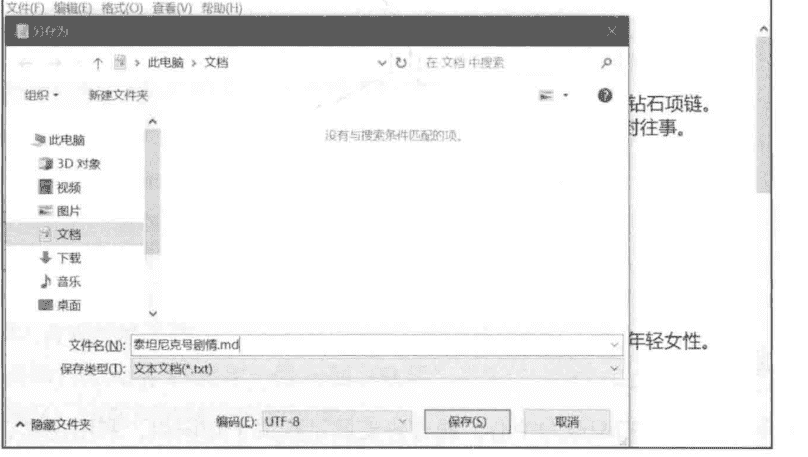

图 19-2 Markdown 格式文件

第 5 步，打开 XMind 软件，选择 “文件” → “导入” → “Markdown” 命令，如图 19-3 所示。

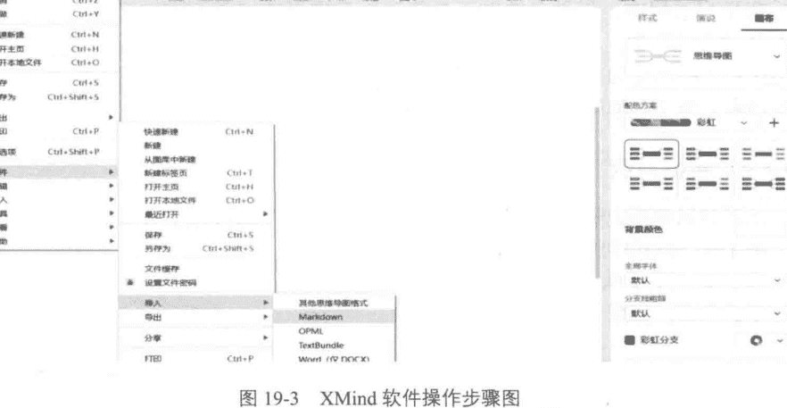

图 19-3 XMind 软件操作步骤图

第 6 步，稍等片刻，就会生成所需要的内容了，如图 19-4 所示。

188 | DeepSeek 操作应用大全：从入门到精通

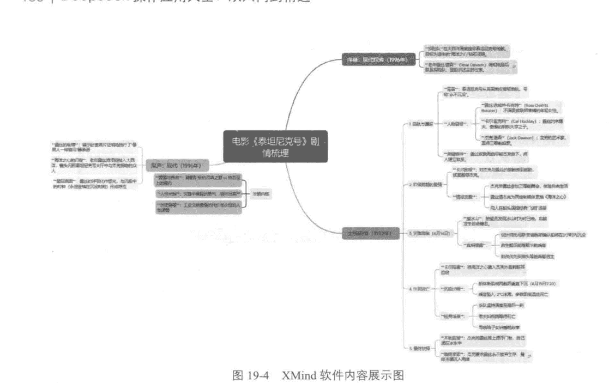

#### 19.2 梳理知识

思维导图以核心知识点为中心，通过分支展示相关子知识点，利用色彩、图形和关键词增强可视化效果。它能快速呈现知识架构与关联，提升学习效率，助力知识体系构建与复习。例如，在历史学习中以朝代为中心，用分支展示政治、经济、文化等要点，便于用户记忆与联想。

##### 19.2.1 梳理课程知识，助力学习记忆

在学习过程中，借助合适的工具能让用户更高效地掌握学科知识。DeepSeek 和 XMind 软件这两款工具就能帮上大忙，DeepSeek 能生成 Markdown 代码，XMind 软件可以把这些代码转化为直观的思维导图。用这种方式梳理学科知识，能让复杂的内容变得条理清晰，便于理解和记忆。

##### 19.2.2 实操案例

下面尝试将历史课本知识生成思维导图，来梳理课程内容。
第 1 步，以初中历史中的世界古代史为例。
第 2 步，打开 DeepSeek 平台，单击 · 深度思考 · 和 · 联网搜索 ·，并在对话框中输入如下提示词，如图 19-5 所示。


第 3 步，发送后稍等片刻，DeepSeek 会形成 Markdown 格式文本。

###### 世界古代史概述

1. 古代埃及文明
时间：公元前 3000 年左右—公元前 30 年
特点：
- 以尼罗河为中心的农业文明。
- 法老是至高无上的统治者，信仰多神教。
- 建立了金字塔、神庙等伟大建筑，文字为象形文字。

2. 古代两河流域文明
时间：公元前 3500 年—公元前 539 年
地区：美索不达米亚（现伊拉克境内）
特点：
- 有苏美尔、巴比伦等文明，发明了楔形文字。
- 农业、手工业、贸易繁荣，建立了城市国家。
重要人物：汉谟拉比（法典）。

3. 古代印度文明
时间：公元前 2500 年—公元前 500 年
地区：印度河流域及恒河流域
特点：
- 印度河流域的哈拉帕文化和摩亨佐-达罗文化。
- 发明了早期的城市规划、下水道系统。
- 以宗教思想为核心，产生了印度教、佛教等。

4. 古代希腊文明
时间：公元前 8 世纪—公元前 146 年
地区：巴尔干半岛
特点：
- 发展了民主政治（雅典）、哲学（苏格拉底、柏拉图、亚里士多德）。
- 建立了城邦制度，文化、艺术、科学技术取得显著成就。
重要事件：马拉松战役、希波战争。

5. 古代罗马文明
时间：公元前 753 年—公元 476 年（西罗马帝国灭亡）
地区：地中海周边
特点：
- 从共和国到帝国，形成了强大的军事和法律体系。
- 文化、建筑、工程技术发达，罗马法对后世影响深远。
重要人物：凯撒、奥古斯都。

6. 古代波斯文明
时间：公元前 550 年—公元前 330 年
地区：波斯（现伊朗）
特点：
- 波斯帝国是当时世界上最强大的帝国之一。
- 发展了行政体系、道路建设、邮政系统。
重要人物：居鲁士大帝、达里乌斯一世。

7. 古代玛雅文明
时间：公元前 2000 年—公元 900 年
地区：中美洲（尤卡坦半岛）
特点：
- 以农业、天文学和日历系统著称。
- 玛雅人发展了象形文字，并有丰富的宗教文化。
重要建筑：金字塔、祭坛。

第 4 步，DeepSeek 生成内容后，直接复制，新建文本文档并粘贴所复制内容。把文件后缀名从“txt”改成“md”，单击“保存”按钮，会生成一个 Markdown 格式文件。

第 5 步，打开 XMind 软件，选择“文件”→“导入”→“Markdown”命令。稍等片刻，就可以看到用户需要的内容，如图 19-6 所示。

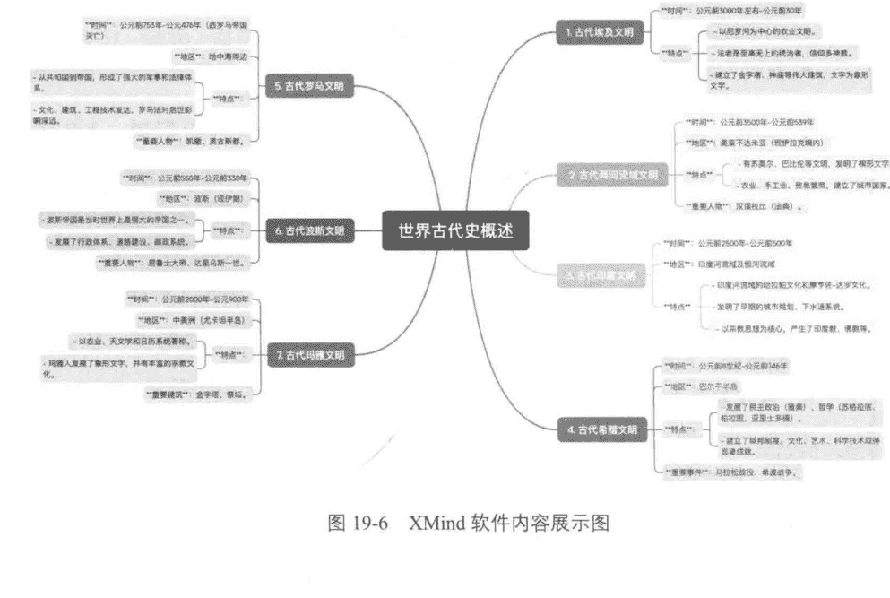

#### 19.3 组织结构图

组织结构图能直观展示组织内部层级、部门及岗位关系，便于员工了解岗位职责与汇报对象，助力企业管理、人员沟通及人力资源规划。

##### 19.3.1 通过文字表述，快速生成组织结构图

在如今的工作和学习场景里，清晰展示组织架构能极大提升沟通和协作效率。DeepSeek 和 XMind 软件这两个工具能帮助用户轻松实现这一目标。DeepSeek 能根据我们的文字描述生成 Markdown 代码，XMind 软件则可以将这些代码转化为直观的组织结构图，让复杂的层级关系一目了然。

##### 19.3.2 实操案例

请尝试将一家公司的内部结构生成组织结构图。
第 1 步，用户先自行整理公司内部结构。

- 高层管理：董事会、总经理。
- 内容创作部：文案策划组、视频拍摄组、后期制作组。
- 市场营销部：市场调研组、品牌推广组、客户拓展组。
- 运营管理部：平台运营组、活动运营组、数据运营组。
- 技术研发部：软件开发组、技术维护组、AI 应用组。
- 人力资源部：招聘配置组、培训发展组、员工关系组。
- 财务部：预算管理组、成本核算组、审计监督组。

第 2 步，打开 DeepSeek 平台，单击 · 深度思考 · 和 · 联网搜索 ·，并在对话框中输入如下提示词，如图 19-7 所示。


图 19-7 实操案例示意图

第 3 步，发送后稍等片刻，DeepSeek 会生成 Markdown 格式文本。

```
公司组织结构图

高层管理
董事会。
总经理。
```

- 内容创作部
  - 文案策划组。
  - 视频拍摄组。
  - 后期制作组。
- 市场营销部
  - 市场调研组。
  - 品牌推广组。
  - 客户拓展组。
- 运营管理部
  - 平台运营组。
  - 活动运营组。
  - 数据运营组。
- 技术研发部
  - 软件开发组。
  - 技术维护组。
  - AI 应用组。
- 人力资源部
  - 招聘配置组。
  - 培训发展组。
  - 员工关系组。
- 财务部
  - 预算管理组。
  - 成本核算组。
  - 审计监督组。

第 4 步，DeepSeek 生成内容后，直接复制，新建文本文档并粘贴所复制内容。把文件后缀名从 “txt” 改成 “md”，单击 “保存” 按钮，会生成一个 Markdown 格式文件。
第 5 步，打开 XMind 软件，选择 “文件” → “导入” → “Markdown” 命令。
第 6 步，单击右侧的 “思维导图”，选择 “组织结构图”，如图 19-8 所示。
第 7 步，稍等片刻，就可以看到组织结构图了，这里仅展示局部，如图 19-9 所示。


图 19-8 XMind 软件组织架构图样例

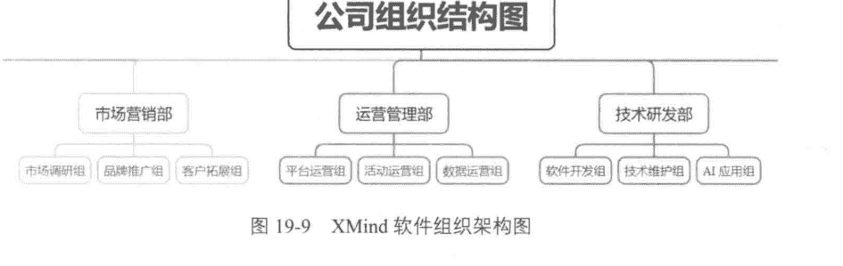

图 19-9 XMind 软件组织架构图

#### 19.4 流程图

流程图是用图形符号和线条展示工作流程、操作步骤或事件发展顺序的工具。用不同形状的图形代表不同类型的操作，如矩形表示活动、菱形表示决策等，再以箭头连接体现流程走向。流程图具有逻辑性强、清晰易懂的特点，常用于业务流程梳理，如电商购物流程，从用户下单到收货，各环节依次呈现，能帮助发现流程中的问题，优化流程，提高工作效率，确保各项工作有序开展。

##### 19.4.1 快速生成时间轴形的流程图

在日常工作和学习中，流程图能清晰展示工作流程、操作步骤等，帮助用户高效理解和执行任务。借助 DeepSeek 和 XMind 软件，用户可以轻松将脑海中的流程转化为可视化的流程图。DeepSeek 能根据用户输入的文字生成 Markdown 代码，XMind 软件则能把这些代码变成直观的流程图，让复杂流程变得一目了然。

##### 19.4.2 实操案例

下面以一个任务的全生命周期为例，生成流程图。
第 1 步，梳理好完成任务的基本步骤。

- 确定项目目标：明确要完成的任务是什么，设定清晰的目标。
- 列出任务清单：根据项目目标，列出所有需要完成的具体任务，并指定负责人和完成时间。
- 资源准备：确认完成任务所需要的材料和工具，确保人员和资源齐全。
- 执行任务：按照计划开始执行任务，逐步推进。
- 任务检查：定期检查任务的进展，确保完成质量，若有问题及时反馈和调整。
- 项目总结：项目完成后，进行总结，回顾成果，收集反馈，帮助未来项目改进。

第 2 步，打开 DeepSeek 平台，单击 · 深度思考 · 和 · 联网搜索 ·，并在对话框中输入如下提示词，如图 19-10 所示。

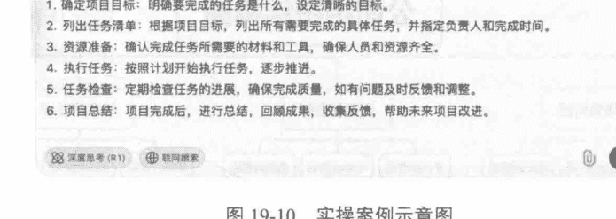

第 3 步，发送后稍等片刻，DeepSeek 会生成 Markdown 格式文本。

```
开始
确定项目目标
    列出任务清单
        每个任务指定负责人。
        确定每个任务的截止日期。
    资源准备
        确认所需材料/工具。
        确保人员到位。
    执行任务
        按照计划逐步完成。
    任务检查
        完成的任务需要进行检查。
        反馈和调整。
    项目总结
        总结项目成果。
        收集反馈。
结束
```

第 4 步，DeepSeek 生成内容后，直接复制，新建文本文档并粘贴所复制内容。把文件后缀名从 “txt” 改成 “md”，保存好，一个 Markdown 格式文件就诞生了。

第 5 步，打开 XMind 软件，选择 “文件” → “导入” → “Markdown” 命令。

第 6 步，稍等片刻，就可以看到生成的内容了，如图 19-11 所示。

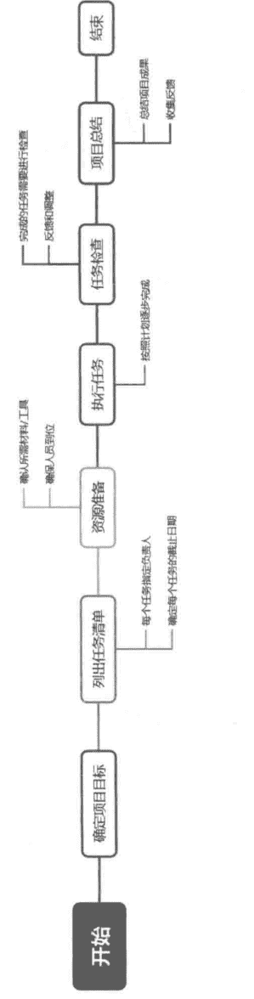

图 19-11 XMind 软件流程图

> AI是每个人生活的“首席效率官”。
——谢丽尔·桑德伯格（Facebook前COO）

### 第 20 章 生活计划

合理的计划能帮助我们充分利用时间。每一天的时间都是有限的，若没有计划，很容易在无意义的事情上浪费时间。例如，制订每日学习计划，规定好学习不同科目的时间段，能让我们有条不紊地提升知识储备，避免拖延和盲目学习。有了计划，我们可以将一天的时间精细划分，把重要的事情优先完成，提高时间利用效率。在目标实现方面，计划是实现目标的路线图。无论我们的目标是短期的减肥，还是长期的职业晋升，都需要一步一个脚印地去达成。以减肥为例，制订一个包含饮食控制和运动锻炼的详细计划，每天摄入多少热量，进行多长时间的有氧运动和力量训练，按照计划执行，就能逐渐接近减肥目标。没有计划，目标就只是空中楼阁，缺乏实现的路径。从财务规划角度，计划能帮助我们合理理财。制订每月预算计划，明确各项支出的限额，如房租、餐饮、娱乐等，能避免不必要的消费，实现资金的合理分配，为储蓄、投资等打下基础，保障未来的生活品质。

如今，AI的发展为我们制订计划提供了强大的助力。像 DeepSeek 这样的 AI 工具，可以根据我们提供的信息生成详细的计划。比如，当我们想要制订一个旅行计划时，告诉 AI 旅行的目的地、时间、预算等信息，它能快速规划出每日行程，包括景点游览顺序、交通方式选择、住宿推荐等。AI 还能根据实时数据和用户反馈，对计划进行优化调整。

#### 20.1 减肥计划

减肥计划是为实现减轻体重、塑造身材目标而制订的一系列规划。一份有效的减肥计划通常包含饮食和运动两方面。饮食上，需控制热量摄入，计算每日所需热量，减少高热量、高脂肪、高糖食物，如油炸食品、甜品等的摄取，增加蔬菜、水果、全谷物、优质蛋白的比例，遵循少食多餐原则。运动方面，结合有氧运动与力量训练，有氧运动像慢跑、游泳、跳绳等，能消耗大量热量；力量训练如举重、俯卧撑、仰卧起坐等，有助于增加肌肉量，提高基础代谢率，使身体在休息时也能消耗热量。同时，保证充足睡眠对减肥也很关键，睡眠不足会影响激素分泌，导致食欲增加。定期监测体重和身体围度，根据进展调整计划，能让减肥效果更显著。

##### 20.1.1 制订科学的减肥计划，实现健康减肥

制订一份科学合理的减肥计划至关重要，DeepSeek 作为强大的 AI 工具，能为我们制订减肥计划提供精准且全面的帮助，让减肥之路更加轻松、顺畅。利用 DeepSeek 制订减肥计划，可参考以下思路。

- 明确个人信息：将自己的身高、体重、体脂率、减肥目标、期望减重的斤数、日常作息时间等信息告知 DeepSeek，它能依据这些数据计算出你每天所需的基础热量消耗和为实现减肥目标应摄入的热量值。
- 规划饮食方案：让 DeepSeek 根据计算出的热量需求，制订每日饮食清单。包括早、中、晚餐及加餐的食物种类和分量，确保营养均衡，如富含优质蛋白的鸡胸肉、鱼虾，高纤维的蔬菜、水果，以及适量的碳水化合物等。
- 设计运动计划：向 DeepSeek 说明自己的运动基础、是否有运动禁忌和可用于运动的时间，它会设计出适合你的运动计划，涵盖有氧运动如慢跑、游泳，以及力量训练如平板支撑、深蹲等，合理安排每周的运动次数和时长。
- 设定阶段性目标：借助 DeepSeek 把长期减肥目标拆分成短期的、可实现的小目标，比如每两周设定一个小目标，每达成一个小目标就进行适当奖励，激励自己坚持下去。
- 获取饮食和运动建议：询问 DeepSeek 关于饮食和运动中的注意事项，例如，运动前后的拉伸方法，不同食物的最佳搭配等，使减肥过程更科学、更安全。

##### 20.1.2 实操案例

本节我们将以体重 200 斤的张三为例，学习如何利用 DeepSeek 制订减肥计划。
第 1 步，明确自己的身高、体重、体脂率、减肥目标、期望减重的斤数、日常作息时间等。
第 2 步，打开 DeepSeek 平台，单击 · 深度思考 · 和 · 联网搜索 ，并在对话框中输入提示词，如图 20-1 所示。


第 3 步，发送后稍等片刻，DeepSeek 会生成一篇完整的减肥计划。

###### 一、阶段目标与健康指标

减肥计划表（1）

| 时间阶段 | 体重目标 | 体脂率目标 | 重点任务 |
| :--- | :--- | :--- | :--- |
| 第 1～2 月 | 200～180 斤 | 30%～27% | 建立习惯/调整代谢 |
| 第 3～4 月 | 180～170 斤 | 27%～24% | 突破平台/塑形增肌 |
| 第 5～6 月 | 170～160 斤 | 24%～20% | 巩固成果/预防反弹 |

###### 二、科学饮食方案

###### 1. 每日营养构成

减肥计划表（2）

| 营养素 | 摄入量 | 优质来源 | 注意事项 |
| :--- | :--- | :--- | :--- |
| 蛋白质 | 120～150g | 鸡胸肉/鱼虾/蛋白粉/希腊酸奶 | 每千克体重1.2～1.5g |
| 碳水 | 150～180g | 燕麦/糙米/红薯/全麦面包 | 运动前后补充 |
| 脂肪 | 50～60g | 橄榄油/坚果/牛油果 | 避免反式脂肪 |
| 膳食纤维 | ≥30g | 西兰花/奇亚籽/菌菇类 | 分餐摄入防胀气 |

###### 2. 七日循环食谱

早餐（7:30）：

- 煮鸡蛋2个+燕麦片50g+蓝莓100g
- 蛋白粉30g+全麦面包1片+核桃3颗（交替）

午餐（12:00）：

- 清蒸鱼200g+糙米饭100g+凉拌菠菜
- 鸡胸肉沙拉（生菜/圣女果/黄瓜）+荞麦面80g（交替）

加餐（15:30）：

- 希腊酸奶150g+奇异果1个
- 煮毛豆50g+小番茄10颗（交替）

晚餐（18:30）：

- 虾仁炒西蓝花+蒸红薯150g
- 豆腐蔬菜汤+玉米1根（交替）

烹饪原则：

- 用喷油壶控制用油（≤10g/餐）
- 调味料：柠檬汁/黑胡椒/无糖酱油

###### 三、运动训练计划

每日运动模板

周一/四：

- 慢跑机爬坡（坡度10°，速度5km/h）30分钟
- 坐姿划船（15次×4组）
- 靠墙静蹲（1分钟×3组）

周二/五：

- 游泳（自由泳）45分钟
- 弹力带侧平举（12次×4组）
- 泡沫轴放松10分钟

#### 20.2 旅行计划

旅行计划是对旅行行程的提前安排，目的是让旅行更顺畅、更有意义。制订旅行计划时，首先要确定目的地，根据个人兴趣选择，如喜欢历史文化可选西安、北京等古都，热衷自然风光可选张家界、桂林等。接着明确旅行时间，考虑目的地的最佳旅游季节、个人假期等因素。预算也是重要环节，涵盖交通、住宿、餐饮、门票等费用。在行程安排上，规划好每日游览景点，注意景点开放时间和距离，合理安排交通方式，如城市内可选择地铁、公交，远距离可选择飞机、火车。住宿根据预算和喜好选择酒店、民宿等。还可以预留一些自由活动时间，以应对突发情况或满足临时探索的欲望。

##### 20.2.1 规划完美的旅行计划，享受愉快旅程

旅行是一场充满未知与惊喜的探索，而一份周全的旅行计划能让旅程更加顺畅、有趣。DeepSeek 这款强大的大模型平台，可以成为我们规划旅行的得力助手，帮助我们快速且全面地安排好旅行的各个细节。

##### 20.2.2 实操案例

本节以还在减肥期间的 200 斤重的张三要去北京旅游为例，展开如何利用 DeepSeek 制订旅行计划的演练。
第 1 步，明确自己的旅行时间、目的、预算等信息。
第 2 步，打开 DeepSeek 平台，单击 · 深度思考 · 和 · 联网功能 ·，并在对话框中输入提示词，如图 20-2 所示。


第 3 步，发送后稍等片刻，DeepSeek 会形成一篇完整的旅行规划。

###### 张三北京三日健康旅行计划

（兼顾名胜游览与减重需求，每日步行量 15000～20000 步）

**Day 1：天坛文化线+低碳饮食启动**

上午

- 07:30 高铁抵京→地铁 5 号线直达天坛东门（站立乘车）
- 08:30—11:30 天坛公园深度游
  - 必走路线：东门→祈年殿→丹陛桥→回音壁→圜丘（全程 3.5km）
  - 燃脂技巧：在丹陛桥进行间歇快走（快走 100 步+常速 200 步交替）

午餐

- 12:00 老北京涮肉（健康版）
  - 推荐：东来顺天坛店
  - 点单公式：清汤锅底+羊后腿肉 200g+菠菜/蒿子秆双拼+魔芋丝
  - 避坑：不蘸麻酱（改用蒜蓉+小米辣+醋）

下午

- 14:00—16:00 自然博物馆（天桥站）
  - 边看展边完成：每小时靠墙静蹲 3 组（每组 45 秒）

晚餐

- 18:00 低 GI 餐：The Woods 轻食（前门店）
  - 推荐：烤三文鱼沙拉（要求油醋汁分装）

住宿

- 前门四合院民宿（无电梯，每日爬楼梯消耗额外 100 大卡）

**Day 2：故宫耐力挑战**

晨练

- 06:30 前门→天安门广场快走（2km，配速 8min/km）

上午

08:30—12:30 故宫深度游

- 燃脂路线：午门→武英殿→慈宁宫→西六宫→御花园（全程 5km）
- 携带：2L 水袋包（每小时补水 200mL）

午餐

- 13:00 故宫冰窖餐厅
  - 选择：去皮烤鸭卷饼（2 卷）+拌时蔬+无糖酸梅汤

下午

- 14:30—16:30 景山公园
  - 登顶万春亭（垂直爬升 45m≈200 级台阶）
  - 山顶进行拉伸训练（重点放松股四头肌）

**Day 3：胡同文化轻量日**

上午

- 08:00—10:00 南锣鼓巷→北锣鼓巷
  - 燃脂玩法：寻找 10 家特色门店（每找到 1 家做 10 个靠墙俯卧撑）

加餐

- 10:30 元古本店（箭厂店）
  - 选择：无糖茉莉清茶酪 + 美式咖啡

下午

- 13:00—15:00 国家博物馆
  - 站立观展技巧：每小时进行 5 分钟踮脚训练（塑小腿线条）

返程

- 16:00 地铁至北京南站（全程站立）
- 携带高铁餐：即食牛肉棒+小黄瓜 3 根

#### 20.3 天气预测

天气预测是对未来一定时期内天气状况的预估。它基于大气科学原理，通过多种手段实现。气象卫星从太空收集地球大气的各种数据，地面气象站分布在各地，实时监测气温、气压、湿度、风速等气象要素。计算机模型将这些数据进行分析运算，结合大气运动规律和历史气象数据，模拟未来天气变化。天气预报对人们的生活影响重大，日常生活中，帮助人们决定出行穿着、是否携带雨具等；农业生产中，农民可根据天气预测安排农事活动，避免气象灾害对农作物的损害；航空、航海等交通运输领域，准确的天气预测关乎飞行、航行安全。虽然目前天气预测技术不断进步，但天气系统复杂多变，仍存在一定误差。DeepSeek 可以帮助我们同时查看多个天气预报，根据我们的需求，给出合理的建议。

##### 20.3.1 预测天气，提前做好出行准备

天气变化与我们的生活息息相关，无论是日常出行、户外活动，还是特殊的观星等需求，精准的天气预报都十分关键。DeepSeek 作为一款强大的大模型平台，能够整合多个平台的气象数据，为我们提供全面且有针对性的天气信息，帮助我们更好地规划生活和各项活动。

##### 20.3.2 实操案例

张三从北京回来以后，计划陪女朋友去看星星，需要利用 DeepSeek 预测未来天气情况，以提前做好出行准备。

第 1 步，将张三准备的整个看星星的计划上传给 DeepSeek。

第 2 步，打开 DeepSeek 平台，单击 · 深度思考 · 和 · 联网功能 ·，并在对话框中输入提示词，如图 20-3 所示。


图 20-3 实操案例示意图

第 3 步，发送后稍等片刻，DeepSeek 会形成一篇完整的分析报告。

根据你的需求，以下是结合香山天气情况和观星建议的详细计划：

1. 观星日期选择

根据天气预报，香山未来一周的天气情况如下：

- 2 月 17 日（星期一）：晴，-4～6℃，东北风转北风<3 级。
- 2 月 18 日（星期二）：晴转多云，-5～6℃，西南风转北风<3 级。
- 2 月 19 日（星期三）：多云转晴，-5～6℃，南风转东北风<3 级。
- 2 月 20 日（星期四）：晴转多云，-5～5℃，北风转东风<3 级。
- 2 月 21 日（星期五）：多云，-5～3℃，南风转北风<3 级。
- 2 月 22 日（星期六）：晴，-5～7℃，西北风<3 级。
- 2 月 23 日（星期日）：多云，-3～8℃，南风<3 级。

推荐日期：

2 月 17 日（星期一）和 2 月 22 日（星期六）是最佳选择，因为这两天天气晴朗，云量少，适合观星。

如果这两天不方便，2 月 19 日（星期三）也是备选，但需注意多云转晴的天气变化。

2. 观星时间安排

最佳观星时间：晚上 8 点到凌晨 2 点，此时北斗七星在北方天空清晰可见。

建议到达时间：提前 1 小时到达香山，选择视野开阔的地点（如香炉峰），适应黑暗环境。

#### 20.4 日程表生成

日程表是对一天或一段时间内活动的有序记录与安排。它能帮助人们合理分配时间，提高效率。制作日程表时，首先罗列当天或近期要完成的任务，按照重要程度和紧急程度排序。然后将任务分配到具体时间段，比如早上精力充沛时安排重要工作或学习任务，下午处理一些常规事务。最后为每个任务预留合理时间，考虑可能出现的突发情况，适当安排缓冲时间。日程表不仅用于工作和学习，日常生活也同样适用，如安排健身、休闲娱乐时间等。使用日程表时，要严格按照计划执行，若有变动应及时调整，养成良好的时间管理习惯，长期坚持能让生活更加规律有序，提升自我管理能力。

##### 20.4.1 生成个人日程表，合理安排时间

在快节奏的生活中，合理安排时间至关重要，一份清晰的日程表能让我们的工作、学习和生活更加有条不紊。DeepSeek 作为功能强大的 AI 大模型，能依据我们提供的任务和时间，高效生成实用的日程清单，帮助我们轻松管理时间。

##### 20.4.2 实操案例

本节依然以张三为例，学习如何利用 DeepSeek 生成个人日程表，合理安排时间。
第 1 步，将张三一天中需要安排的事情上传给 DeepSeek，并要求 DeepSeek 直接生成个人日程表。
第 2 步，打开 DeepSeek 平台，单击 · 深度思考 · 和 · 联网功能 ，并在对话框中输入提示词，如图 20-4 所示。


图 20-4 实操案例示意图

第 3 步，发送后稍等片刻，DeepSeek 会生成张三的日程表。

张三的日程表（减肥计划）

- 7:00—7:30 起床&洗漱
- 7:30—8:00 早餐（建议低脂高蛋白，如鸡蛋、全麦面包、牛奶）
- 8:00—8:30 轻度锻炼（建议快走或慢跑，帮助激活身体）
- 8:30—9:00 洗澡&换衣服
- 9:00—9:45 前往国贸（提前出发，避免堵车）
- 10:00—11:00 参加研讨会
- 11:00—11:30 从国贸前往朝阳大悦城
- 11:30—12:30 与女朋友共进午餐（建议选择清淡饮食，如沙拉、鸡胸肉、蔬菜汤等）
- 12:30—13:00 散步（在大悦城附近散步，帮助消化）
- 13:00—14:00 前往机场（提前出发，预留足够时间）
- 14:00—15:00 接同学
- 15:00—16:00 返回市区（根据同学需求安排）
- 16:00—17:00 休息或轻度活动（如在家做一些拉伸或核心训练）
- 17:00—18:00 锻炼时间（建议中等强度运动，如快走、骑车或健身房训练）
- 18:00—19:00 洗澡&换衣服
- 19:00—20:30 与同学共进晚餐（建议选择低油低盐的食物，如蔬菜、糙米饭等）
- 20:30—21:30 自由活动或与同学聊天
- 21:30—22:00 轻度拉伸或冥想（帮助放松身心）
- 22:00 睡觉（保证充足睡眠，有助于减肥）

> AI 时代，创业者的最大优势是“从 1 到 N”的速度。
——彼得·蒂尔（PayPal 联合创始人）

### 第 21 章 创业辅助

创业是一场充满挑战与机遇的冒险，需要精心筹备和全方位规划。在这个数字化时代，AI 能成为创业路上的得力助手，助力创业者提高效率、降低成本、精准决策。

#### 21.1 商业计划书

商业计划书是创业蓝图，用于全面规划商业项目。商业计划书内容丰富，涵盖市场分析，研究目标市场规模、增长趋势和竞争格局等多方面；要明确市场定位，明确产品或服务描述，介绍自身特点、优势与独特价值；要制定营销策略，规划产品或服务推向市场的方式，如定价、促销、渠道选择；要有财务规划，包含启动资金、收入预测、成本分析和利润预测，展示盈利能力和财务状况。商业计划书不仅能帮创业者梳理思路，也是吸引投资、获取合作的重要工具，向潜在投资者和合作伙伴展示项目可行性与发展潜力。

##### 21.1.1 撰写商业计划书，规划创业蓝图

想要借助 DeepSeek 写好商业计划书，可以参考以下思路。

- 梳理项目核心信息：把创业项目的基本信息整理好，比如项目名称、所属行业、业务范围等，全部告诉 DeepSeek，让它对项目有个初步了解。
- 提供市场调研数据：如果有做过市场调研，可把收集到的数据，像目标市场规模、竞争对手情况、消费者需求偏好等提供给 DeepSeek。它可以依据这些数据，分析市场趋势，为商业计划书里的市场分析部分提供有力支撑，让计划书更具说服力。
- 设定财务相关数据：将预估的启动资金、运营成本、预期收入等财务数据告诉 DeepSeek，它能帮助做好财务规划，包括制作简单的财务报表等。
- 明确发展规划与策略：把对企业未来的发展规划，如短期目标、长期目标，以及市场营销策略、运营管理策略等告诉 DeepSeek，它能将这些内容有条理地整合到商业计划书里，构建完整的发展蓝图。
- 润色与调整内容：DeepSeek 生成初稿后，仔细阅读，虽然它能组织语言，但可能有些表述不符合实际情况或个人风格，这时可根据自身经验和实际调研情况，对内容进行调整和完善，让商业计划书更贴合创业项目。

##### 21.1.2 实操案例

本节以开奶茶店为例，学习如何用 DeepSeek 帮助用户撰写商业计划书。
第 1 步，尽可能详细地将现阶段做过的相关调研情况发给 DeepSeek。
第 2 步，打开 DeepSeek 平台，单击 · 深度思考 · 和 · 联网搜索 ·，并在对话框中输入提示词，如图 21-1 所示。


第 3 步，DeepSeek 会自动抓取互联网上的相关信息，分析形成商业计划书。

###### 奶茶店商业计划书

###### 一、项目核心信息

- 目标市场：18 至 35 岁学生、年轻白领，聚焦大学城、商业街。
- 产品特色：健康低糖，用天然原料，推养生系列，随季与节日出限定款。
- 竞争优势：8 至 20 元低价，品质对标中高端，3 公里内无门槛外送。

###### 二、市场调研与选址方案

- 市场分析：高校周边奶茶店日均客流量 200 至 300 人，学生周消费 3 至 4 次，现有店多为传统品类，缺乏创新，服务同质化。
- 选址：首选大学城商业街，店面 15 至 20 平方米，月租金≤1.5 万元，次选社区商圈，日均人流量≥5000 人，月租金≤1 万元。

###### 三、装修方案与设备采购

- 装修：自然简约风，木质桌椅、绿植墙面、暖光，硬装、软装预算≤8 万元，选环保与模块化家具。
- 设备：封口机、制冰机等核心设备，加收银系统、保温箱，总投入≤5 万元。

###### 四、产品设计与供应链管理

- 产品线：基础珍珠奶茶、水果茶；创新五谷养生、低卡代糖系列；配小吃提升客单价。
- 供应链：与本地供应商签长期协议，按需采购，周均原料成本≤5000 元。

###### 五、员工培训与运营管理

- 人员配置：3名全职员工（1名店长、2名调饮师），2名兼职人员，月人力成本≤1.5万元。
- 培训：标准化奶茶调配技术；顾客接待、投诉处理服务规范。

###### 六、发展规划与策略

- 短期（1年）：单店日均销量超200杯，会员达2000人。
- 长期（3至5年）：开3家分店，引入数字化管理系统。

#### 21.2 资金预算

##### 21.2.1 制定资金预算，合理安排资金

DeepSeek能成为我们进行创业资金预算的得力助手，借助DeepSeek做好创业资金预算，可参考以下思路。

- 罗列创业基础开支：把创业前期涉及的所有基础开支项目梳理出来，如办公场地租赁、设备采购、原材料进货、人员招聘费用等，将这些项目详细告知DeepSeek，让它对创业的初始资金需求有初步认知。
- 提供成本预估信息：对于每个开支项目，尽量给出自己预估的成本金额或范围。比如办公场地，告知其所在城市、地段及期望的面积大小，预估租金范围；设备采购则说明所需设备的种类、品牌、型号等，预估采购费用。
- 明确运营周期与收入预期：将创业项目预计的运营周期，以及在各阶段的收入预期告诉DeepSeek。例如，前3个月为筹备期无收入，从第四个月开始预计每月的销售额等。它能根据这些数据，计算出不同阶段的资金缺口或盈余情况。
- 设定风险预留资金：考虑到创业过程中可能出现的各种风险，如市场波动、政策变化等，告知DeepSeek计划预留多少比例的风险资金。
- 分析资金使用效率：让DeepSeek根据预算数据，分析各项资金的使用效率，比如不同营销渠道投入产出比分析。通过这种分析，我们能了解资金的分配是否合理，以便优化预算方案。

##### 21.2.2 实操案例

本节仍以开奶茶店为例，学习如何通过DeepSeek帮助用户进行资金预算，合理安排资金。

第1步，将商业计划书上传给DeepSeek，并根据个人情况，形成相关总预算，同时需要给出合理的投资回报预期。

第2步，打开DeepSeek平台，单击·深度思考·和·联网搜索·，并在对话框中输入提示词，如图21-2所示。

我计划开一家奶茶店，总投资不能超过30万元，总投资额需要包含房租押金、装修费用、2个月员工的工资、前期宣传费用和前3个月现金流，净利润需考虑到设备折旧等因素。投资情况希望能在2年内收回全部投入成本。参考以上内容，形成投资预算表。


图 21-2 实操案例示意图

第 3 步，发送后稍等片刻，DeepSeek 会形成一篇完整的关于奶茶店的投资分析报告。

###### 财务规划与风险控制

1. 总投资预算（单位：万元）

总预算投资表

| 项目 | 金额（万元） |
| :--- | :--- |
| 房租押金（3个月） | 4.5 |
| 装修费用 | 8 |
| 设备采购 | 5 |
| 员工工资（2个月） | 3 |
| 宣传费用 | 2 |
| 原材料采购（3个月） | 3 |
| 现金流储备 | 4.5 |
| 总计 | 30 |

2. 盈利预测

- 月均收入：日均销量 150 杯 × 12 元每杯 × 30 天=5.4 万元；附加品收入 0.5 万元。合计 5.9 万元。
- 月均成本：原料 1.5 万元+人力 1.5 万元+房租 1.5 万元+折旧（设备按 5 年摊销）0.1 万元。总成本 4.6 万元。
- 净利润：月均利润 1.3 万元（毛利率约 22%）。

3. 风险应对

- 市场风险：通过会员积分制（消费 1 元换取 1 积分，满 100 分兑换饮品）提升复购率。
- 现金流风险：预留 4.5 万元应对前 3 个月的低迷期。

#### 21.3 商铺选址

##### 21.3.1 辅助商铺选址，提高创业成功率

DeepSeek 能够运用大数据和分析能力，帮助我们在商铺选址时做出更明智的决策，如果不知道在哪里开店，可以借助它全面地分析选址相关因素。

##### 21.3.2 实操案例

本节仍以开奶茶店为例，学习如何通过 DeepSeek 帮助用户确定商铺选址，提高创业成功率。现阶段，已经确定了商业计划书并形成了投资预算表，在朋友的推荐下，现有两个不错的店铺选项。其中一个店铺，在一所大学旁边，每月房租 1 万元，每天人流量超过 1 万人；另一个店铺，在一个商场的 B1 层，每月房租 1.5 万元，覆盖超过 20 万人的居民区。

第 1 步，对这两个店铺进行深度的调研，比如在店铺进行蹲点，计算人流量等。这些操作一定要在线下实地进行，不能依赖 DeepSeek，因为 DeepSeek 知识库中并不存在这些内容。如果已经确定了商业计划书和投资预算表，则还需要上传商业计划书和投资预算表。

第 2 步，打开 DeepSeek 平台，单击 · 深度思考 · 和 · 联网搜索 ·，并在对话框中输入提示词，如图 21-3 所示。注意，要将调研结果尽可能详细地罗列在提示区。


第 3 步，发送后稍等片刻，DeepSeek 会形成一篇完整的分析报告。

选址分析：大学旁对比商场 B1 层

1. 大学旁店铺（A）

优势

- 目标客户集中，大学生和年轻情侣是奶茶店的核心消费群体，消费频次高，且对价格敏感度较低。
- 人流量大，日均人流量超过 1 万人，潜在客户基数大。
- 消费场景明确，附近有炸串店等高流量小吃店，容易形成“小吃+奶茶”的消费组合。
- 房租成本低，月租 1 万元，成本压力较小。

劣势

- 竞争激烈，大学周边通常有多家奶茶店，需通过差异化产品和营销策略脱颖而出。
- 季节性波动，寒暑假期间学生离校，客流量可能大幅下降。

2. 商场 B1 层店铺（B）

优势

- 消费力强，覆盖 20 万人的居民区，中老年人消费力较高，可能带动家庭消费。
- 客流稳定，商场自带流量，且不受寒暑假影响。

#### 21.4 经营方案生成

##### 21.4.1 生成经营方案，助力企业发展

店铺经营方案是店铺运营的关键指引，关乎着店铺的生存与发展。借助 DeepSeek 强大的分析和生成能力，能帮助用户快速构建全面且实用的经营方案，哪怕不擅长文字表达，也能借助它梳理出清晰的经营脉络。

##### 21.4.2 实操案例

本节我们仍以开奶茶店为例，现阶段的奶茶店，已经完成了选址工作，现在要筹备整个运营方案。

第 1 步，进一步调研该店铺情况，充分了解周边商户的经营状况，了解大学城周围居民情况，以及大学生的放假情况，尽可能详细地把相关信息进行综合整理。同时，需要把商业策划书、投资预算表、选址情况都上传给 DeepSeek。

第 2 步，打开 DeepSeek 平台，单击 · 深度思考 ·，并在对话框中输入提示词，如图 21-4 所示。

我已经选择在大学旁边开我的奶茶店。我将分别把我的商业策划书、投资预算表、选址情况以附件的形式陆续发给你。
请你帮我撰写奶茶店经营方案。


图 21-4 实操案例示意图

第 3 步，发送后稍等片刻，DeepSeek 会形成一篇完整的经营报告。

###### 奶茶店经营方案

一、店铺位置
某大学旁（A 店铺）

二、经营目标：
短期（6 个月内）：日均销超 150 杯，月均净利润 1.5 万元。
长期（1 年内）：日均销超 200 杯，会员 2000 人，月均净利润超 2 万元。

三、营销策略
产品：健康低糖系列，季节限定款，情侣主题产品。
价格：基础款 8 至 12 元每杯，创新款 12 至 18 元每杯；周二第二杯半价，会员积分换奶茶。
推广：大学内海报、活动合作；微信、美团外送；抖音、小红书短视频。

四、运营流程
日常：10:00 至 22:00 营业；3 名全职员工、2 名兼职员工，高峰 3 人在岗；每日盘库，签长期供应协议。
制作：配方标准化，操作流程规范，高峰预调配。

五、客户服务
标准：微笑礼貌，5 分钟内响应，24 小时内处理投诉。
会员消费积分换奶茶，生日赠饮；开业首月 8 折，小程序推送优惠。

六、寒暑假策略
外送：与平台合作，消费满 20 元免配送费，推出家庭套餐。
雇用兼职，减少全职员工；按需采购，控制库存。
通过精准定位、高效运营、贴心服务，在竞争中脱颖而出，应对寒暑假客流下降问题，确保全年盈利。

#### 21.5 招聘文案

##### 21.5.1 撰写吸引人的招聘人员文案

DeepSeek 能帮我们快速生成内容丰富、有吸引力的招聘文案，想要借助 DeepSeek 写出优质招聘文案，不妨参考以下思路。

- 整理岗位基础信息：把招聘岗位的名称、主要工作职责、所需技能和经验等信息，详细地告诉 DeepSeek。例如，招聘新媒体运营岗位，就将文案撰写、平台推广、数据分析等具体职责，以及对应所需的能力罗列清楚，让 DeepSeek 明白岗位的核心要求。
- 挖掘公司独特亮点：梳理所在公司的优势，例如，有竞争力的薪资福利、良好的工作环境、广阔的晋升空间、独特的企业文化等。把这些信息提供给 DeepSeek，让它在文案中突出公司吸引人才的独特之处，吸引求职者关注。
- 明确招聘要求层次：向 DeepSeek 说明招聘要求的主次和优先级，例如，某些关键技能是必须具备的，而一些经验或证书则是加分项。这样它就能在文案中合理表述，让求职者清晰了解岗位门槛。
- 设定文案风格基调：告诉 DeepSeek 希望的文案风格，是严肃专业风、活泼有趣风，还是简洁明了风。比如，互联网创业公司可能更适合活泼有趣、富有创意的风格，传统企业则偏向严肃专业的风格。总之，让文案风格契合公司形象。

##### 21.5.2 实操案例

本节仍以奶茶店为例，学习如何利用 DeepSeek 撰写富有吸引力的招聘人员文案。
第 1 步，明确自己的招聘需求等基本信息。
第 2 步，打开 DeepSeek 平台，单击 · 深度思考 · 和 · 联网搜索 ，并在对话框中输入提示词，如图 21-5 所示。


第 3 步，发送后稍等片刻，DeepSeek 会生成一篇完整的招聘文案。

> 加入我们，一起“茶”绘精彩！
你想在活力满满的茶饮界大显身手吗？我们的奶茶店现火热招募热爱奶茶事业的你！

一、我们的奶茶店
主打健康鲜果茶的潮流茶饮店，秉持“用心做好每一杯茶，为顾客带来极致茶饮体验”理念。每杯奶茶都是精心之作，服务真诚热情。凭独特口味和优质服务，已在本地茶饮市场收获众多顾客喜爱。为拓展业务，诚邀志同道合的伙伴加入！

###### 二、招聘岗位：奶茶店店员

岗位职责
饮品制作：熟练掌握奶茶等饮品制作工艺，按标准配方和流程操作，保障饮品品质与口感。
店面运营：负责日常运营，如店面清洁、物料整理、设备维护，营造舒适的消费环境。
顾客服务：热情接待顾客，解答疑问，推荐产品，高效处理反馈和投诉，提升顾客满意度。
营销推广：参与地推等营销活动，介绍产品和优惠；通过社交媒体协助线上推广，提升品牌知名度。

岗位要求
经验优先：有奶茶店或饮品行业经验，熟悉制作流程和店面运营者优先。
责任心强：工作认真负责，注重细节，遵守规章制度和操作流程。
沟通良好：具备良好沟通与服务意识，能与顾客、团队成员良好互动协作。
营销积极：有营销意识和学习能力，积极参与地推，勇于挑战。
态度积极：工作态度积极，热爱奶茶行业，抗压能力强，有团队合作精神。

###### 三、我们的福利

薪资优厚：8000元/月。
环境舒适：舒适温馨的工作环境，融洽的团队氛围，定期组织团队活动。
培训晋升：全面培训，涵盖制作技巧、服务礼仪、营销推广；为优秀员工提供晋升空间。
员工福利：员工内部优惠，工作满一定期限享带薪年假、节日福利。

#### 21.6 经验教训总结

##### 21.6.1 自动总结经验教训，促进企业成长

创业是一场充满挑战的旅程，其中积累的经验教训是一笔宝贵财富。DeepSeek能凭借强大的数据处理和分析能力，帮助用户系统梳理创业过程，挖掘关键经验与教训，助力以后的创业过程顺利推进。

##### 21.6.2 实操案例

我们仍以开奶茶店为例，学习如何利用DeepSeek进行经验总结。现阶段奶茶店已经营业1年了，月利润仅为8千元，且每天营业额出现一定下降。

第 1 步，充分了解店铺经营情况，与店长或员工进行深入交谈，并通过对过去店铺经营情况进行总结；与同行交流，查找是否在产品端出现相关问题。最后总结问题。

第 2 步，打开 DeepSeek 平台，单击 · 深度思考 ·，并在对话框中输入提示词，如图 21-6 所示。同时把有关文件以附件形式上传给 DeepSeek。


第 3 步，发送后稍等片刻，DeepSeek 会形成一篇完整的分析报告。

###### 奶茶店业绩下滑原因分析

产品方面，种类更新慢，清单显示新品推出频率低。茶饮市场潮流变化快，消费者易喜新厌旧，本店长期缺新品致顾客疲倦、购买欲低。周边竞品每月推当季新品吸引众多顾客，本店未跟上。品质稳定性不足，员工称原材料供应不稳定，部分批次茶叶、水果新鲜度和品质波动，影响口感与品质，降低顾客信任度，有顾客因口感差异转选他牌。部分产品定价偏高，与竞品对比，消费者对价格敏感，性价比高的产品更具竞争力。

市场与营销方面，竞争激烈。周边茶饮市场新店不断，部分品牌知名度高、资金雄厚，靠大规模促销和广告吸客，如某连锁品牌开业买一送一活动分走客源。咖啡、果饮等兴起也分流部分顾客。营销推广方式单一，依赖线下传单，线上推广几为空白。数字化时代，线上营销效果显著，周边竞品通过抖音、小红书推广、团购吸引年轻顾客，本店未充分利用。店铺缺乏会员体系、积分制度等留客策略。

店铺运营方面，环境不佳。员工称部分装修陈旧，卫生偶尔不达标，桌椅摆放杂乱，降低顾客好感度。营业时间未充分覆盖潜在消费时段，周边学校、写字楼多，早上开业晚错过学生和上班族高峰，晚上收店早错过夜生活人群消费时段。外卖运营存在不足，包装简陋易洒漏，配送范围不合理，平台评分和排名低。

员工方面，服务质量有待提升。部分员工服务意识淡薄，点单、取餐态度不热情主动，甚至与顾客起摩擦。服务质量影响顾客满意度和忠诚度。培训体系不完善，新员工入职培训时间短，对产品等掌握不够，老员工缺乏技能提升培训，难以应对新需求。

> AI 不会削弱人际关系，反而能增强真实连接。
——布琳·布朗（社会学家）

### 第 22 章 社交与沟通

#### 22.1 日常对话

##### 22.1.1 针对不同社交场合，提供合适的对话话术

要借助 DeepSeek 生成合适的对话话术，可参考以下思路。

- 明确社交场合信息：将具体的社交场景准确地告诉 DeepSeek，比如是商务晚宴、朋友聚会、初次相亲还是面试场合等，让它了解场景的基本性质和氛围基调。
- 描述对话对象特征：向 DeepSeek 介绍对话对象的相关信息，如年龄、职业、身份等。例如，对方是年长的领导、同龄的同事、初次见面的合作伙伴等，以便它能根据对象特点生成恰当的话术。
- 设定对话目标：期望在这次对话中达成的目标，是寻求合作、增进友谊、了解对方兴趣，还是推销产品等，这样 DeepSeek 生成的话术就能围绕目标展开。
- 提供背景信息：如果有与对话相关的背景信息，如近期发生的热点事件、双方共同的经历等，可一并提供给 DeepSeek，让它可以融入这些元素，使话术更贴合实际情况。
- 调整话术风格：根据社交场合和个人喜好，让 DeepSeek 调整话术风格，是正式严谨、轻松幽默还是礼貌客气等，以适应不同场合和对象。

在利用 DeepSeek 生成对话话术时，需要注意，虽然它能提供丰富的话术供参考，但不能完全依赖于此。要结合实际情况灵活运用，毕竟每个社交场合都有其独特性，人的反应也千变万化。

##### 22.1.2 实操案例

本节以某私有企业雇员张三为例，来展示如何利用 DeepSeek 面对不同社交场合，提供合适的对话话术。张三今天被领导安排去帮领导买了一杯咖啡，咖啡本身价值 15 元，现在领导转给张三 20 元，并对张三说“小张辛苦了，这是咖啡钱”。然而领导日常是个比较节约的人，那么作为张三，应该如何回复这条信息呢？

第 1 步，作为张三，先要思考是否要收这笔钱，如果不知道是否要收，那么也可以让 DeepSeek 辅助决策。

第 2 步，打开 DeepSeek 平台，单击·深度思考·，在对话框中输入提示词，如图 22-1 所示。


第 3 步，发送后稍等片刻，DeepSeek 会形成多个回复模板。

> 即便领导日常比较抠门，但这次主动转钱且明确表示是咖啡钱，收下会是更合适的做法。不收可能会让领导觉得你在拒绝他的好意，或觉得你扭捏，反而可能引起误会。以下为你提供一些回复话术供参考。

**真诚自然型**
领导，太感谢您了！其实给您买咖啡是顺手的事儿，您这么客气我都有点不好意思啦。这多余的钱就当是您对我的鼓励，我之后一定更用心工作！

**幽默调侃型**
领导，您这突然的大方可让我受宠若惊呀！平常都知道您勤俭持家，把公司当成自己家一样精打细算，这次对我这么阔绰，我可得好好炫耀一番。放心，多的钱我就笑纳了，以后有啥跑腿的活儿，您尽管吩咐！

**简洁明快型**
谢谢领导！一杯咖啡本不算啥，您还专门转钱，多的就当您给我的小奖励，我会更努力的！

#### 22.2 社交平台动态

##### 22.2.1 在朋友圈发布有趣的动态

朋友圈是展示个人生活、分享心情与观点的社交窗口，一条有趣的动态能吸引朋友们的关注，增进彼此的互动。DeepSeek 能发挥其强大的语言创作能力，辅助构思出独具创意的朋友圈内容，就算不太擅长遣词造句，也能借助它打造出令人眼前一亮的朋友圈动态。

##### 22.2.2 实操案例

今天参加了公司组织的团建活动——一场户外拓展训练后，想在互联网上分享一下感受。

1. 第 1 步，思考自己的状态和发文平台。
2. 第 2 步，打开 DeepSeek 平台，单击 · 深度思考 · 和 · 联网搜索 ，在对话框中输入提示词，如图 22-2 所示。


第 3 步，发送后稍等片刻，DeepSeek 会形成多个朋友圈文案。
以下给出一些文案建议。

**公式一：对比反差 + 团建感受 + 热门元素**
先通过对比反差，如日常工作状态与团建状态对比，突出团建的特殊性。接着表达团建后的感受，如团队凝聚力增强、玩得开心等。最后融入热门元素，比如流行梗、网络热词，增强文案趣味性。具体如：平常在工位苦哈哈，团建户外拓展秒变嘻哈侠，团队凝聚力瞬间拉满，快乐直接开启疯狂输出模式！

**公式二：身份代入 + 团建活动描述 + 成果体现**
代入身份，拉近与读者的距离。描述团建户外拓展的具体活动，如分组游戏、攀爬挑战等。最后体现团建成果，像团队默契提升、凝聚力变强等。具体如：身为努力搬砖的打工人，这次团建户外拓展玩了刺激的接力比赛，团队默契值一路狂飙，凝聚力直接原地封神！

**公式三：情绪渲染 + 热门元素 + 团建感悟**
先通过情绪渲染，如兴奋、惊喜等，吸引读者注意。再加入热门元素，像热门影视剧、游戏元素。最后阐述团建带来的感悟，如对团队合作的新认识。具体如：家人们，谁懂啊！这次团建户外拓展简直像走进了“头号玩家”的世界，不仅玩得超嗨，更让我深刻体会到团队合作的强大力量，凝聚力在这一刻拉满！

#### 22.3 线上聊天

##### 22.3.1 如何更好地回应他人、开启新话题等

在微信交流中，如何巧妙回应他人及自然开启新话题，对维系良好的人际关系至关重要。DeepSeek 能为用户提供多样化的话术建议，帮助那些不太擅长言辞的人在微信聊天中表现不俗。

##### 22.3.2 实操案例

第 1 步，明确自身需求。以某私有企业雇员张三为例。张三刚刚加入一个新的工作团队，团队里有一个非常活跃的微信群，大家经常在群里分享工作进展、生活趣事和一些行业资讯。某天下午，同事小李在群里分享了一篇关于最新行业趋势的文章，并附上自己的看法。张三阅读后觉得很受启发，想要参与交流并开启新话题，却不知如何表达。那么作为张三，如何借此机会与小李和其他同事展开交流，同时自然地开启一个新话题呢？

第 2 步，打开 DeepSeek 平台，单击·深度思考·和·联网搜索·，在对话框中输入提示词，如图 22-3 所示。


图 22-3 实操案例示意图

第 3 步，发送后稍等片刻，DeepSeek 会形成话术建议。

1. 表达感谢与认同
回复小李时，先真诚地表达对他分享文章的感谢，同时强调他的看法给自己带来的启发。比如：小李，太感谢你分享这篇文章啦！你对行业趋势的解读真的很独到，好多观点都让我眼前一亮。通过这种方式，不仅能让小李感受到被尊重，也为后续交流营造了良好氛围。

2. 结合自身工作谈思考
接着，联系自己的工作实际，分享对文章中行业趋势的思考。比如，我发现文章里提到的“具体趋势点”和咱们日常工作中的“相关工作内容”有一定关联。就像之前我们在“项目名称”里，也遇到过类似相关问题或情况，当时处理起来还挺棘手的。要是按照文章里说的趋势来调整工作思路，说不定能更好地解决这类问题。
这样能让其他同事感受到你的真诚参与，也能引发大家对工作实际的思考。

3. 提出开放性问题开启新话题
最后，提出一个开放性问题，引导大家一起讨论。比如，大家在工作中有没有类似的经历呢？对于这种行业趋势，你们觉得在我们日常工作里还能有哪些具体的应用场景？
这个问题既关联了文章内容，又和大家的工作相关，很容易引发同事们的兴趣，自然地开启新话题。

4. 积极参与讨论
当同事们回复后，张三要及时跟进，积极参与讨论。对于同事们分享的经验和观点，给予肯定和回应，进一步深化交流。比如，同事分享了在项目中应用相关技术的经验，张三可以回复：哇，你这个经验太宝贵了！我们在之后的项目里可以好好参考下，你当时在应用过程中有没有遇到什么特别需要注意的地方呢？
通过这样的互动，张三能更好地融入团队交流，建立良好的职场人际关系。

#### 22.4 商务洽谈

##### 22.4.1 助力商务沟通顺利进行

在商务活动中，有效的沟通是达成合作、推动业务发展的关键桥梁。对于语言表达能力欠佳的人来说，DeepSeek 能成为商务沟通的得力助手，提供专业且精准的话术与策略建议，助力商务沟通顺畅进行，提升沟通效果与合作成功率。

##### 22.4.2 实操案例

第 1 步，明确自身需求。以某私有企业雇员张三为例。张三即将参加一个重要的商务会议，需要在会议上发言，阐述公司的产品优势和市场策略。但在介绍产品或服务亮点时，张三总觉得自己的表述平淡，无法充分吸引客户的兴趣。那么作为张三，应如何在发言中突出产品优势、打动客户呢？

第 2 步，打开 DeepSeek 平台，单击 · 深度思考 · 和 · 联网搜索 ·，在对话框中输入提示词，图 22-4 所示。

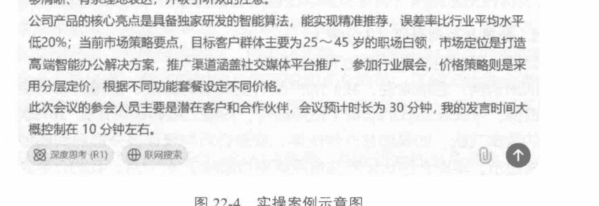

第 3 步，发送后稍等片刻，DeepSeek 会形成一篇完整的发言框架与话术。

发言框架与话术（总时长约 10 分钟）

1. 开场破冰（1 分钟）
目的：建立亲和力，引发兴趣。
话术示例：各位来宾、合作伙伴，上午好！感谢大家抽出宝贵时间参与今天的交流。我是某某，负责某公司的某某工作。今天，我将用 10 分钟时间，带大家了解一款真正为职场精英设计的智能办公解决方案——它不仅能帮您节省 20%以上的决策时间，还能让团队协作效率提升一个量级。让我们开始吧！

2. 产品优势阐述（4 分钟）
逻辑结构：切入痛点、技术亮点、数据验证、场景案例
话术示例：
（切入痛点）在座各位都是职场中坚力量，一定深有体会，每天面对海量信息，如何快速筛选出真正有价值的内容？如何避免因推荐误差导致决策失误？

（技术亮点）我们的产品搭载了独家研发的智能算法，就像一位永不疲倦的AI助理，能够精准学习用户行为模式，动态优化推荐逻辑。

（数据验证）经第三方测试，我们的推荐误差率比行业平均水平低20%，这意味着在座各位的团队每年可减少约2小时的无效信息处理时间。

（场景案例）比如，某知名金融公司使用我们的系统后，市场分析报告生成速度提升了35%，高管层决策响应周期缩短了2天。

###### 3. 市场策略说明（3分钟）

逻辑结构：定位精准性、渠道匹配度、价格灵活性

话术示例：

（定位）我们聚焦服务25~45岁的职场白领，因为他们对高效工具的敏感度最高、付费意愿最强。我们的目标不是做大而全的通用产品，而是用尖端技术重新定义办公体验。

（渠道）为此，我们选择在LinkedIn、脉脉等职场社交平台深度运营，并通过参与知名行业展会直接触达决策者。

（价格）在定价上，我们提供基础版、专业版、企业定制版三档套餐。比如，专业版包含高阶功能，价格仅为同类竞品的80%，能覆盖90%中型企业的核心需求。

###### 4. 收尾与行动号召（2分钟）

目的：强化记忆点，推动下一步行动。

话术示例：总结来说，我们的产品有更精准的算法、更懂白领的设计、更灵活的选择。今天现场我们准备了试用账号，扫描二维码即可体验20%误差率降低带来的效率飞跃。如果您是合作伙伴，欢迎会后与我详谈分层利润模型——我们的数据显示，早期合作伙伴的回报周期平均缩短了6个月。我的分享到此结束，接下来是Q&A时间，期待听到各位的宝贵意见！

#### 22.5 社交礼仪

##### 22.5.1 不同社交场景礼仪规范

在社交生活里，遵循不同场景的礼仪规范，能够给他人留下良好印象，构建和谐的人际关系。对于语言表达不占优势的人而言，DeepSeek这个智能工具可以成为学习社交礼仪规范的得力助手，它能提供全面且准确的礼仪知识，助力我们快速掌握不同社交场景的礼仪要点。

##### 22.5.2 实操案例

第1步，明确自身需求。以某私有企业雇员张三为例。张三近期收到了一场人工智能领域学术研讨会的邀请，其中有几位国际知名的人工智能专家出席。他深知这次研讨会是交流学习的好机会，但又担心自己在社交礼仪上有所欠缺。那么作为张三，需要提前了解会议情况、学习礼仪、考虑交流内容等，为圆满参会做好准备。

第 2 步，打开 DeepSeek 平台，单击 · 深度思考 · 和 · 联网搜索 ·，在对话框中输入提示词，如图 22-5 所示。


图 22-5 实操案例示意图

第 3 步，发送后稍等片刻，DeepSeek 会形成一篇完整的要点提示文章。

收到人工智能领域学术研讨会邀请且有国际知名专家出席，是非常难得的学习交流机会，以下从了解会议、学习礼仪、准备交流内容等方面为你提供一些需注意的要点。

###### 一、了解会议

会议主题与议程：仔细研读会议通知和相关资料，明确本次研讨会聚焦的人工智能具体领域，如深度学习、自然语言处理、计算机视觉等，以及各主题对应的具体议程安排，包括报告时间、讨论环节等，以便提前对重点内容做好准备。

参会人员信息：除了已知的几位国际知名专家外，了解其他参会者的大致情况，如他们的研究方向、所在机构等。这有助于在交流时更好地找到共同话题，拓展人脉。

会议规则与要求：熟悉会议的相关规则，如是否允许录音录像、提问的方式和时间限制等，避免因不了解规则而出现不必要的失误。

会议背景与目标：了解会议的举办背景和目标，是聚焦于前沿技术探讨，还是注重产业应用交流，抑或是推动学术合作等。

###### 二、学习礼仪

着装规范：遵循商务或学术场合的着装标准，一般建议穿着整洁、得体的正装。避免过于随意或过于花哨的服装，给人以专业、尊重的印象。

交流礼仪：与国际专家交流时，注意使用礼貌用语，保持谦逊、开放的态度。认真倾听他人发言，不要打断对方，待对方表达完后再发表自己的观点。提问时要有针对性和建设性，避免提出过于简单或无关紧要的问题。

时间观念：严格遵守会议的时间安排，提前到达会场，确保不迟到、不早退。如果有自己的发言环节，要严格控制时间，避免超时影响会议进程。

尊重文化差异：国际专家可能来自不同的国家和文化背景，要了解并尊重他们的文化习俗和商务礼仪。例如，不同国家的肢体语言、眼神交流等可能有不同的含义，尽量避免因文化差异而产生误解。

###### 三、准备交流内容

自身研究介绍：准备一份简洁明了的个人研究介绍，包括研究背景、目标、主要成果和创新点等。可以制作成 PPT 或整理成文档，以便在交流时能够清晰、准确地向他人介绍自己的工作。

关注热点问题：了解当前人工智能领域的热点问题和前沿技术动态，如大模型的发展、人工智能在医疗或金融领域的应用挑战等。准备一些自己对这些热点问题的思考和观点，以便在会议交流中能够积极参与讨论，展现自己的专业素养。

#### 22.6 化解矛盾

##### 22.6.1 掌握沟通技巧，有效化解矛盾

在人际交往中矛盾时有发生，掌握有效的沟通技巧去化解矛盾至关重要。对于不太擅长表达的人来说，DeepSeek 提供了化解矛盾的沟通技巧建议，可以帮助我们更好地处理冲突。

- 详细描述矛盾情境：把矛盾发生的具体场景、涉及的人物、矛盾产生的直接原因和大致经过，都尽可能详细地告知 DeepSeek。比如是在办公室里，同事之间因为项目分工问题产生了争执，将这些关键信息说清楚，便于 DeepSeek 理解矛盾的来龙去脉。
- 说明各方诉求：把矛盾双方各自的想法、需求和希望达成的结果告诉 DeepSeek。例如，一方希望按照自己的方案推进项目，认为这样效率更高；另一方则觉得现有方案成本过高，更倾向自己提出的低成本方案。让 DeepSeek 明白双方的核心诉求。
- 表达自身态度：向 DeepSeek 阐述自己对矛盾的态度，是希望公平解决、寻求妥协，还是坚持自己的部分观点等。比如你希望在不伤害同事关系的前提下，找到一个双方都能接受的项目分工方案，让它生成的沟通技巧符合你的态度和目标。
- 参考类似案例话术：要是知道一些成功化解类似矛盾的案例，可以分享给 DeepSeek，让它参考这些案例中的沟通话术和技巧，为解决当前矛盾生成更有针对性和实用性的话术建议。
- 请求话术调整优化：DeepSeek 生成初步话术建议后，结合实际感受和对方的可能反应，让它对话术进行调整。例如，语气太强硬就请求它修改得更温和委婉一些，使其更适合用于化解当前矛盾。

##### 22.6.2 实操案例

第 1 步，明确需求。假设这样一个场景，我与同事共同负责一个项目，但同事总把大部分任务推给我。经过我的反复沟通和明确分工后，同事依旧过度分配。我不知道是否要寻求上级帮助，如果要跟上级汇报，应该如何汇报？

第 2 步，打开 DeepSeek 平台，单击 · 深度思考 · 和 · 联网搜索 ·，在对话框中输入提示词，如图 22-6 所示。


图 22-6 实操案例示意图

第 3 步，发送后稍等片刻，DeepSeek 会形成多个情况汇报的模板。

**内容 1：突出任务进度受阻**
领导您好，我想跟您汇报一下项目的进展。目前项目正处于关键阶段，但遇到了一些问题。我和某某共同负责这个项目，之前我们经过多次沟通并明确了分工，可某某总是把他负责的任务推给我，导致我手头任务堆积，现在已经影响到项目进度，部分工作没能按时完成。我担心这样下去会延误整个项目交付时间，希望您能帮忙协调解决。

**内容 2：强调自身精力有限**
领导，您好！在项目中，我和某某有各自的任务板块。我多次和他沟通分工的事情，可他还是持续把任务推给我。我一直在尽力承担，但我个人精力实在有限，现在已经感到力不从心，不仅影响了我对自己本职工作的投入，也对项目整体推进产生了阻碍。希望您能出面协调，让我们回到正常的分工轨道上，保障项目顺利进行。

**内容 3：阐述对团队协作的影响**
领导，跟您说一下项目的情况。我和某某合作这个项目，分工明确后他却不断把本应自己完成的任务推给我。这不仅让我压力巨大，也在团队中造成了不良影响，破坏了原本良好的协作氛围。大家都看在眼里，可能会对团队凝聚力产生冲击。为了让项目顺利开展，维护团队和谐，希望您能给予指导和协调。

> AI 不会预测市场，但能帮我们避免愚蠢的错误。
——沃伦·巴菲特（伯克希尔 CEO）

### 第 23 章 理财计划

#### 23.1 存款计划

存款计划是个人或家庭财务管理的基础环节，旨在合理规划资金存储，实现财富的安全积累。制订存款计划时，需先明确存款目标，比如为购房、子女教育、养老等储备资金，然后依据目标设定存款期限和金额。

##### 23.1.1 设定目标，稳步攒钱

在理财的道路上，合理规划并达成存款目标是迈向财富积累的关键一步。如今，借助先进的 AI 工具如 DeepSeek，能更科学、高效地帮助我们设定目标，稳步攒钱。想要利用 DeepSeek 实现这一目标，有如下思路。

- 明确自身情况：确定身份，是职场新人、收入稳定的上班族，还是自由职业者。
- 梳理收入构成：仔细统计每月或每年的各类收入，包括工资、奖金、兼职收入、投资收益等。
- 确定时间跨度：设定攒钱的时间周期，是短期 1 至 2 年，还是长期 5 至 10 年，甚至更久，不同时间跨度对应不同的攒钱策略。
- 设立目标存款：根据生活规划，如购房、旅游、子女教育等，确定具体的目标存款金额。
- 提供消费数据：将日常消费按照衣、食、住、行等类别进行分类统计，提供给 DeepSeek，以便得到更贴合实际的攒钱建议。
- 借助 AI 分析：把上述信息输入 DeepSeek，让它通过数据分析，制订出详细的攒钱计划。

需要注意的是，虽然 DeepSeek 大模型能提供有价值的参考，但理财始终伴随着风险。市场波动、经济环境变化等因素都可能影响理财效果，切不可过度依赖 AI。要保持理性和独立思考，结合自身实际情况对理财计划进行灵活调整，这样才能在攒钱的道路上稳步前行。

##### 23.1.2 实操案例

在此以一名在校大学生，想存款买一台新的笔记本电脑为例，展开说明。
第 1 步，明确目标和现状，包括存款目的、时间，以及身份情况。
第 2 步，打开 DeepSeek 平台，单击 · 深度思考 ·，并在对话框中输入提示词，如图 23-1 所示。


第 3 步，发送后稍等片刻，DeepSeek 会形成一个存款计划。

###### 一、基本框架

- （1）总目标：8000 元
- （2）时间周期：6 个月（180 天）
- （3）月均需存：1333 元
- （4）月收入：2000 元
- （5）月可支配额度：2000-1333=667 元

###### 二、支出优化方案

- （1）餐饮优化：早餐食堂粥/包子，3 元，午餐食堂套餐，8 元，晚餐食堂面食，7 元。日饮食预算：18 元（月 540 元），预留 4 元/天机动额度（月 120 元）。
- （2）学习支出：教材优先选择借阅/使用电子版，打印资料双面打印，月均控制在 50 元。
- （3）生活杂费：手机套餐 39 元校园卡，洗漱用品 30 元，水电费分摊 20 元。
- （4）弹性支出：社交娱乐每月 1 次同学聚餐（AA 制，50 元），交通出行共享单车月卡，15 元。

###### 三、增收建议

- （1）英语相关兼职：线上翻译（有道/译喵），时薪 30～50 元；留学生中文辅导，时薪 40～60 元；四六级辅导，时薪 50 元。每周 4 小时，可增收 600～800 元/月。
- （2）校园机会：图书馆助理，15 元/小时，活动主持（双语优势），单次 100～200 元。

###### 四、储蓄策略

- （1）阶梯存款法：每月 1 号自动转存 1333 元至独立账户，额外收入 50%转入储蓄。
- （2）消费监督：使用记账 App（如鲨鱼记账），设置每周消费预警（不超过 167 元）。

###### 五、应急方案

- （1）备用金机制，每月留出 100 元应急基金，优先使用备用金应对突发开支。
- （2）价格监测，设置京东/天猫降价提醒，关注“618购物节”优惠（6月可能提前达成目标）。

###### 六、执行效果预测

基础方案 2000 × 6 - 667 × 6 ≈ 8000 元。
每月 500 元兼职，可提前 1 个月达成目标。
备用金结余 6 个月，可额外积累 600 元应急资金。

###### 七、注意事项

- （1）保持必要社交，维系人际关系。
- （2）保证每日蛋白质摄入（鸡蛋/豆浆）。
- （3）避免影响学业的过度兼职。
- （4）每月可安排 1 次“奖励日”，保持动力。
- （5）实际执行中可通过 2 元日结余补足差额。

通过这个方案，既能保证基本的生活质量，又能系统性地达成购机目标。
如果需要更灵活的版本，可以调整为前三个月存 1300 元/月，后三个月存 1433 元/月。

#### 23.2 理财规划

理财规划是对个人或家庭财富的全方位规划与管理，核心是实现财富的保值、增值。

##### 23.2.1 开辟多元理财渠道，助力财富增值

理财规划是实现财富稳健增长和保障生活品质的重要因素，DeepSeek 能为制定理财规划提供有力支持，帮助用户更合理地配置资产，追求理想财务目标。

##### 23.2.2 实操案例

下面以一个刚刚毕业的上班族为例，来说明借助 DeepSeek 制定理财规划的过程。
第 1 步，明确理财目标、风险偏好、可以接受的投资方式、个人身份、现有收入和存款等信息。
第 2 步，打开 DeepSeek 平台，单击 · 深度思考 ·，并在对话框中输入提示词，如图 23-2 所示。


第 3 步，发送后稍等片刻，DeepSeek 会生成一篇完整的理财计划。

作为刚毕业的上班族，月薪 9000 元且有 8 万元存款，财务状况相对稳健。以下是一个简单的低风险理财计划。

1. 建立应急基金
确保有足够的应急资金，通常建议为 3 至 6 个月的生活开支。可以预留 2 万至 3 万元作为应急基金，存入活期存款或货币基金，确保流动性高且风险低。

2. 定期存款
将部分资金投入定期存款，获得稳定收益。可以将 3 万元存入 1 至 3 年期的定期存款，利率相对较高且风险极低。定期存款能提供稳定的利息收入，适合低风险偏好者。

3. 基金投资
考虑将部分资金投入低风险的债券基金或货币基金。债券基金风险较低，收益相对稳定，适合长期持有。可以将 2 万元分散投资于几只优质的债券基金，获得比存款更高的收益。

4. 股票投资
股票风险较高，但长期来看，优质股票能带来较好回报。建议用 1 万元投资于蓝筹股或指数基金，分散风险。可以选择定投方式，每月投入固定金额，平滑市场波动。

5. 每月结余规划
月薪 9000 元，扣除生活开支后，假设每月结余 3000 元。可以将这部分资金按比例分配，1000 元存入货币基金，作为应急储备；1000 元定投指数基金，长期积累财富；1000 元用于自我提升或短期目标储蓄。

6. 保险保障
考虑购买一份重疾险和意外险，保障未来生活。虽然这不是投资，但能提供财务保障，避免意外事件对财富的冲击。

总结
这个理财计划以低风险为主，兼顾稳健增值和流动性。通过合理分配存款、基金和股票投资，可以在控制风险的同时，逐步实现财富增长。可定期审视和调整计划，确保与财务目标和风险承受能力保持一致。

#### 23.3 应对风险建议

理财时风险无处不在，有效应对风险至关重要。一方面，要对自身的风险承受能力进行准确评估，比如年轻人风险承受力相对较高，可适当增加高风险、高收益投资，而临近退休人群则更倾向稳健型投资；另一方面，要进行资产分散配置，不把所有资金集中于单一投资产品，如同时投资股票、债券、基金等，降低单一资产波动带来的影响。同时，持续学习金融知识，关注市场动态，及时调整投资策略，还可借助保险产品转移重大风险，保障理财计划稳步推进。

##### 23.3.1 备好应对预案，抵御风险

生活中充满了各种不确定性，可能会面临经济和生活上的风险。借助 DeepSeek，能帮助我们提前做好规划、更好地应对这些风险，保障财务稳定。

##### 23.3.2 实操案例

以一对即将生二胎的夫妻为例来说明。
第 1 步，明确身份、收入、资产和面对的风险。
第 2 步，打开 DeepSeek 平台，单击 · 深度思考 ·，并在对话框中输入提示词，如图 23-3 所示。


第 3 步，发送后稍等片刻，DeepSeek 会生成一篇完整的风险应对规划。

> 作为 38 岁的上班族，家庭收入稳定，但面临房贷、子女教育和即将到来的二孩，合理的风险规划至关重要。以下是一份简单的应对风险规划及措施，帮助在家庭责任增加的情况下保持财务稳定。

1. 建立应急基金
首先，确保家庭有足够的应急资金，建议覆盖 6 至 12 个月的生活开支。家庭月收入为 33000 元，扣除房贷 7000 元后，生活开支假设为 15000 元，建议预留 10 万至 15 万元作为应急基金，存入活期存款或货币基金，确保流动性高且风险低。

2. 保险保障
家庭责任增加，保险是应对风险的重要工具。建议为家庭成员配置以下保险。

重疾险：为本人和配偶各购买一份重疾险，保额建议为年收入的 3 至 5 倍，覆盖重大疾病带来的财务风险。

医疗险：补充医疗保险，覆盖住院和手术费用，减轻医疗负担。

意外险：为本人和配偶购买意外险，保障意外事故导致的收入中断或额外支出。

寿险：为家庭经济支柱（本人和配偶）购买定期寿险，保额建议覆盖房贷和子女教育费用，确保万一发生不幸，家庭财务不受严重影响。

3. 优化投资组合

现有资产中，股票和基金占比较高，考虑到家庭责任增加，建议适当降低高风险投资比例，增加稳健型投资。

股票：目前股票投资 2 万元，比例较低，可以保持现状，但避免追加高风险个股投资。

基金：30 万元基金中，建议将部分资金转移到债券基金或混合型基金，降低波动风险。

存款：16 万元存款中，保留 10 万元作为应急基金，剩余 6 万元可以考虑投入短期理财产品或国债，获得稳健收益。

4. 子女教育金规划

随着二孩的到来，教育费用将增加。建议从现在开始为两个孩子设立教育金账户。

定期储蓄：每月定投 2000 至 3000 元到低风险的债券基金或教育储蓄计划，长期积累教育费用。

教育保险：考虑购买教育保险，确保孩子在未来接受高等教育时有足够的资金支持。

5. 房贷管理

目前每月房贷 7000 元，占家庭月收入的比例较低，压力不大。建议保持现状，但可以考虑规划提前还款的可能性，减少利息支出。如果有额外收入，可以考虑部分提前还款。

6. 职业发展和收入提升

作为家庭经济支柱，提升收入是应对风险的重要方式。可以通过以下方式增加收入。

职业培训：投资于职业技能的提升，争取加薪或晋升机会。

副业：在时间和精力允许的情况下，发展副业或兼职，增加收入来源。

总结
通过建立应急基金、配置保险、优化投资组合、规划子女教育金和管理房贷，可以在家庭责任增加的情况下，有效应对财务风险。应定期审视和调整规划，确保与家庭需求和目标保持一致，保障家庭财务的长期稳定。

## 第三篇 DeepSeek 生态与私有化部署

> 开源与合作是 AI 造福人类的核心路径。
——萨姆·奥尔特曼（OpenAI CEO）

### 第 24 章 可与 DeepSeek 协同创作的国内外大模型生态

在图片生成领域，DeepSeek 可以精准生成提示词，助力图片生成 AI 快速产出多种风格的图片，为创作者提供灵感；在音乐生成领域，它创作歌词，与音乐生成 AI 配合完成音乐作品，降低了创作门槛；在视频生成领域，DeepSeek 不仅可以生成脚本，还能随时根据文本需求进行调整，使视频创作更加高效。

#### 24.1 图片生成

想要生成图片时，可以考虑将 DeepSeek 作为得力助手。例如，脑海中有一幅奇幻森林的画面，但是不知道如何准确地向图片生成平台描述。这时，可以向 DeepSeek 说明：“我想要一片洒满金色阳光的奇幻森林，树木高大且有着奇异的纹路，地面上生长着五颜六色的蘑菇，还有小精灵在林间飞舞。” DeepSeek 凭借其强大的语言理解力和文字生成能力，可以将这些模糊的描述转化为精准的提示词，把这些提示词输入如文心一格、Midjourney、Stable Diffusion 等图片生成平台中，就能快速生成想要的精美图片。

##### 24.1.1 文心一格：不动笔也能画画

文心一格是百度依托文心大模型打造的 AI 绘画平台，它将 AI 技术与艺术创作相融合，为用户开启了创意无限的绘画新世界。文心一格 AI 绘画创作有以下特点。

- 强大的模型支撑：基于文心大模型，通过对海量数据的学习，能够精准理解各类文本语义，无论是抽象的概念，还是复杂的场景描述，都能捕捉其中的关键元素，生成高度契合的绘画内容。
- 便捷的操作流程：操作界面简洁直观，只需要在输入框输入文字描述，如“阳光照耀下的海边小镇”，再选择画幅比例，拖动滑杆选择生成数量，单击“立即生成”，即可快速获得绘画作品。
- 丰富的风格选择：提供丰富的风格选项，涵盖写实、卡通、油画、水彩、国风等。可依据自身喜好与创作需求，为作品赋予独特风格，让同一主题呈现出多样化的视觉效果。
- 多元的二次编辑功能：若生成的图片不尽如人意，文心一格还提供了多种二次编辑功能。如涂抹功能，可用于调整图片中不满意的部分。

##### 24.1.2 实操案例

第 1 步，构思好要生成的图片，例如，一只在草坪上睡觉的猫。
第 2 步，打开 DeepSeek 平台，单击 · 深度思考 · 和 · 联网搜索 ，并在对话框中输入提示词，如图 24-1 所示。


图 24-1 实操案例示意图

第 3 步，发送后稍等片刻，DeepSeek 便会自动给出提示词。

> 主题：一只在草坪上睡觉的猫
详细描述
（1）一只可爱的猫咪，体型适中，毛发柔软光滑，颜色可以是白色、灰色、黑色或花色，自由选择。
（2）猫咪的姿势是侧卧在草坪上，四肢放松，头部微微偏向一侧，表现出舒适的睡眠状态。
（3）草坪是绿色的，草叶清晰可见，有自然的生长感，可以有一些小花或杂草点缀其中，增加自然氛围。
（4）光线柔和，可以是阳光透过树叶洒在猫咪和草坪上的斑驳光影，营造出宁静祥和的氛围。
（5）背景可以是简单的自然环境，如树木、天空等，无须过于复杂，以突出猫咪和草坪作为主要焦点。
风格与情感
风格自然、温馨，传递出宁静、舒适的氛围。
情感上表现出猫咪的安逸和放松，以及草坪的生机和活力。

第 4 步，打开文心一格平台，如图 24-2 所示，单击 · 立即创作 ·。
第 5 步，将 DeepSeek 给出的提示词复制到文心一格中，如图 24-3 所示，单击 · 立即生成 ·。
第 6 步，稍等片刻，图片即生成完毕，如图 24-4 所示。

232 | DeepSeek 操作应用大全：从入门到精通


图 24-2 文心一格平台


图 24-3 复制提示词


图 24-4 文心一格生成的图片

#### 24.2 音乐创作

假如想创作一首充满夏日活力的流行歌曲，可先向 DeepSeek 输入需求：“创作一首以夏日海滩为主题的流行歌曲歌词，要求节奏轻快，并体现出青春的活力与快乐。” DeepSeek 会按照要求生成包含主歌、副歌、桥段等结构完整的歌词。之后，还可以让 DeepSeek 分析歌词风格，比如输入“分析这首歌的音乐风格，用简短的语句描述”。

##### 24.2.1 Suno：创作你的第一首 AI 音乐

Suno 是一款 AI 音乐生成器，用户无须具备专业乐理知识和作曲技能，仅通过输入提示词就能创作出各种风格的音乐，为音乐创作带来了全新的模式和体验。Suno 的音乐创作具有以下要点。

- 风格多样：能够创作包括中文歌曲、英文歌曲、日文歌曲等多种语言风格的音乐，还能创作适合动漫等多媒体内容配乐的纯音乐，可满足用户多样化的风格需求。
- 操作简便：操作界面简洁，注册/登录便捷。用户只需在应用程序中输入创作要求，如歌曲的 BPM（每分钟节拍数）、调性及音乐段落标签等简单提示词，就能指导 AI 进行创作，创作流程高效、顺畅。
- 全链路创作：具备全链路音乐创作功能，覆盖音乐创作的各个阶段，从生成旋律、编曲到演唱等环节，都能实现。
- 个性化定制：可根据用户的个性化需求生成专属作品，比如可以指定某种独特的音乐元素或创作思路。
- 专业品质：能够生成逼真、高保真的音乐片段，V3 版本能在数秒内创作出两分钟的完整“广播级”歌曲，并且支持导出为常用音频格式，方便用户传播和使用。

##### 24.2.2 实操案例

第 1 步，构思好要生成的音乐，例如，一首以毕业为主题的民谣。
第 2 步，打开 DeepSeek 平台，单击 · 深度思考 · 和 · 联网搜索 ·，并在对话框中输入提示词，如图 24-5 所示。


第 3 步，发送后稍等片刻，DeepSeek 便会自动给出提示词。

> 提示词：
创作一首以毕业为主题的民谣歌曲，风格温暖、怀旧，带有淡淡的忧伤和对未来的希望。歌曲旋律简单、舒缓，适合吉他伴奏。歌词内容围绕毕业季的离别、回忆、成长和对未来的憧憬展开，表达对校园生活的怀念、对同学和老师的不舍，以及对即将踏上新旅程的期待。歌曲情感真挚，能够引发听众的共鸣。请确保旋律优美，歌词押韵且富有诗意，适合在毕业典礼或同学聚会上演唱。

第 4 步，打开 Suno 平台，如图 24-6 所示，在 · Song description · 中复制 DeepSeek 给出的提示词，单击 · Create ·。


图 24-6 Suno 平台

第 5 步，稍等片刻，音乐即生成完毕，如图 24-7 所示。


图 24-7 Suno 生成的音乐

#### 24.3 视频大师

假如计划制作一个宣传城市文化的短视频，可向 DeepSeek 输入说明：“制作一个 3 分钟宣传北京市文化的短视频脚本，要突出城市地标、特色美食和传统文化元素。” DeepSeek 会生成详细的脚本，包括每个镜头的时长、画面内容及台词等。将这些脚本和提示词用于 RunwayML、Pika Labs 等视频生成平台，就能创作出吸引人的视频。这里主要介绍的是更适合初学者使用的软件“剪映”。

##### 24.3.1 剪映：一个想法即可生成 AI 视频

剪映是字节跳动旗下的视频剪辑工具，为创作者提供简单、易上手的创作平台，其视频创作要点如下。

- 操作便捷：界面简洁、直观，功能布局合理。通过简单操作即可完成基础剪辑，制作流程轻松、顺畅。
- 功能丰富：支持多样化视频编辑。特效涵盖画面、人物等，风格多样；滤镜丰富，参数可自由调整；智能字幕能自动识别并生成，提高字幕添加效率。
- 素材海量：音频、曲库资源丰富，各类背景音乐和音效齐全；还有大量贴纸、花字气泡、特效、转场与滤镜素材，满足多样化创作需求。

利用 DeepSeek 辅助剪映生成视频时，可先将创作构思详细告知 DeepSeek，待生成文案后，再使剪映依据文案生成相应视频。需要注意的是，目前剪映不支持动态视频生成，生成的视频由多个图片组成。

##### 24.3.2 实操案例

第 1 步，构思好要生成的视频，例如，一个介绍人工智能的视频。
第 2 步，单击·深度思考·和·联网搜索·，在对话框中输入提示词，如图 24-8 所示。


第 3 步，发送后稍等片刻，DeepSeek 便会自动给出提示词。

> **人工智能：改变未来的科技力量**
你是否想象过，机器可以像人类一样思考、学习和创作？这就是人工智能（AI），它正以惊人的速度改变着我们的世界。
从智能手机上的语音助手，到自动驾驶汽车，AI 已经渗透到我们生活的方方面面。它可以帮助医生诊断疾病，协助科学家探索宇宙，甚至创作出令人惊叹的艺术作品。
AI 的强大之处在于它能够从海量数据中学习，并不断优化自己的算法。这使得它在图像识别、自然语言处理、预测分析等领域展现出超越人类的能力。
然而，AI 的发展也带来了挑战。我们需要思考如何确保 AI 的安全性和可控性，以及如何应对 AI 带来的社会变革。
未来，AI 将继续推动科技进步，为人类创造更美好的生活。让我们拥抱 AI，共同探索这个充满无限可能的未来！

第 4 步，打开剪映平台，如图 24-9 所示，单击 · 图文成片。


图 24-9 剪映平台

第 5 步，选择其中的 · 自由编辑文案，如图 24-10 所示。


图 24-10 自由编辑文案

第 6 步，将 DeepSeek 生成的文案复制进去，单击 · 生成视频，再单击 · 智能匹配素材，如图 24-11 所示。


图 24-11 智能匹配素材

第 7 步，稍等片刻，视频即生成完毕，如图 24-12 所示。


图 24-12 生成视频

> AI 必须扎根行业，像螺丝钉一样解决具体问题。
——任正非（华为创始人）

### 第 25 章 私有化部署 DeepSeek

对于许多非技术人员来说，如何在本地部署 DeepSeek 这样一个复杂的模型，似乎是一项艰巨的任务。实际上，通过一些简单易操作的步骤，即使不懂技术也能轻松地完成 DeepSeek 的私有化部署。

#### 25.1 进行私有化部署的必要性

为什么要选择私有化部署，而不是直接使用在线服务？主要有以下几点原因。

- 数据安全：当应用程序涉及敏感信息时，将模型部署在本地可以避免使数据泄露给第三方。
- 成本效益：长期来看，拥有一个本地模型比持续支付云服务费用要经济得多。
- 定制化需求：可以根据业务的具体需求对模型进行调整，以获得最佳的表现。
- 服务器稳定：利用本地硬件进行分析，硬件性能更稳定。

#### 25.2 部署准备阶段

在开始部署之前，需要先准备一台符合最低要求的计算机。根据官方提供的指南，以下是推荐的硬件配置。

- CPU：至少为 4 核（如 Intel Core i5 或 AMD Ryzen 5）。
- GPU：可选，如果有，则至少需要一张入门级显卡（如 NVIDIA GTX 1650），这取决于即将使用的模型大小。
- 内存：建议至少 4GB，大于此则更好。
- 存储空间：根据所选模型的不同，可能需要从几吉字节（GB）到几十吉字节的存储空间。

此外，还需要安装一些软件工具，如 Docker、Ollama，以及可能的 Dify 平台，具体取决于部署方案。

#### 25.3 部署操作步骤

第 1 步：安装 Ollama
Ollama 是用于管理和运行大型语言模型的一个跨平台客户端，有了它，即使是没有经验的新用户也能轻松上手。访问 Ollama 官网，如图 25-1 所示，下载适合的版本，并按照指示完成安装过程。


图 25-1 Ollama 官网

第 2 步：选择并下载 DeepSeek 模型

登录 Ollama 后，浏览可用的 DeepSeek 模型列表，如表 25-1 所示。这里有多个版本可供选择，每个版本都有不同的参数和硬件要求。对于初学者而言，建议选择较小规模的模型，如 DeepSeek-R1-1.5B，因为它对硬件的要求较低且易于管理。

表 25-1 不同 DeepSeek 模型列表

| 模型规模 | 推荐硬件配置 | 显存要求 | 存储空间 | 使用场景 |
| :--- | :--- | :--- | :--- | :--- |
| DeepSeek-R1-1.5B | CPU: 4 核或以上<br>GPU: 可选（显卡如 GTX 1050 Ti 4GB，<br>RAM: 8GB+ | ≥4GB（无 GPU 时可运行） | ≥1.1GB | 预算有限或硬件资源较为紧张的情况下选用，可满足基本的文本生成需求 |
| DeepSeek-R1-7B | CPU: 8 核或以上<br>GPU: RTX 3060 及以上，至少 14GB 显卡<br>RAM: 16GB+ | ≥14GB | ≥7GB | 具有更好的性能和更丰富的功能，适用于对精度和响应速度有一定要求的应用场景 |
| DeepSeek-R1-70B | CPU: 16 核或以上<br>GPU: 多块 A100 80GB 或其他高性能 GPU，总计需超过 140GB 显存<br>RAM: 256GB+ | ≥140GB | ≥70GB | 可满足企业级应用或者研究目的，适用于涉及大量数据处理、执行复杂任务的应用场景 |

第 3 步：找到不同模型的命令

在 Ollama 官网中，可以找到不同模型的启动命令，如图 25-2 所示。

# Distilled models

DeepSeek team has demonstrated that the reasoning patterns of larger models can be distilled into smaller models, resulting in better performance compared to the reasoning patterns discovered through RL on small models.

Below are the models created via fine-tuning against several dense models widely used in the research community using reasoning data generated by DeepSeek-R1. The evaluation results demonstrate that the distilled smaller dense models perform exceptionally well on benchmarks.

# DeepSeek-R1-Distill-Qwen-1.5B

```
ollama run deepseek-r1:1.5b
```

# DeepSeek-R1-Distill-Qwen-7B

```
ollama run deepseek-r1:7b
```

# DeepSeek-R1-Distill-Llama-8B

```
ollama run deepseek-r1:8b
```

图 25-2 不同模型的启动命令

第 4 步：启动模型

一旦选择了合适的模型版本，就可以通过命令行界面输入相应的指令来启动模型。例如，如果选择了 DeepSeek-R1-1.5B，那么就应该输入 “ollama run deepseek-r1:1.5b” 来加载该模型，如图 25-3 所示。

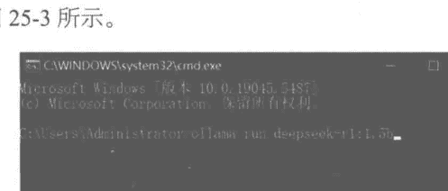

图 25-3 加载模型

第 5 步：测试与优化

模型成功加载之后，可以直接在对话框中输入问题，观察响应情况。如果一切正常，说明部署已经成功。

通过上述步骤，即使是没有任何编程背景的用户，也能顺利完成 DeepSeek 的私有化部署。尽管过程中可能会遇到一些挑战，但只要耐心跟随指导操作，最终一定能够实现目标。最后请记住，技术的进步是为了让生活更加便捷，而不只是给专业人士带来便利。希望每一位有兴趣的人都能体会到 AI 带来的乐趣与成就感。

## DeepSeek 操作应用大全
从入门到精通


> 及时学会使用人工智能，就是及时抓住时代赋予我们个人成长的宝贵机遇。

—— **北京大学 朱郑州**

> 面对人工智能的变革巨浪，《DeepSeek操作应用大全》是很好的“导航图”。书中深入细致地讲解了使用DeepSeek的一百多个案例，让新手也能快速跟上AI发展浪潮。

—— **清华大学 高宗帅**

ISBN 978-7-121-49912-8
9 787121 499128>
定价：69.80元

责任编辑：刘家彤
封面设计：子鹏语衣