# DeepSeek 实战通关手册：从上手到精通

# 前言

## PREFACE

用户规模迈过一亿时，微信大约用了十四个月，ChatGPT 约两个月，DeepSeek 仅用七天就达成。

此刻我们正处在智能化彻底改写生活方式的阶段。AlphaGo 在围棋对局中胜出顶尖棋手，让机器的思考能力首次变得可感；ChatGPT 以近乎自然的对话方式登场，让新一代智能的轮廓清晰起来。DeepSeek 的出现意味着这场拐点已经落地。智能技术带来的冲击正触及到每个个体，DeepSeek 不只是一个工具，更像是进入智能时代的交通工具，而这本书相当于登机的优先舱位凭证。

## 一、为什么要写这本书

过去五年里，我们既是旁观者也是实践者，看到了层出不穷的技术突破。与此同时一个矛盾也愈发明显：全球顶尖研究机构持续刷新参数纪录，能把这些成果转化为真实价值的人却很少；巨头企业不断推出新产品，绝大多数用户仍以传统方式使用新时代的工具。

这种割裂背后，是技术普惠的最后一公里尚未打通。电力革命的早期，人类造出了发电机却不知如何点亮日常。如今智能技术也面临同样的问题：普通人需要的是可执行的操作思路，而不是冰冷的榜单；企业需要的是能直接提升运转效率的方案，而不是概念演示。

基于此，我们对 DeepSeek 在各领域的百余种典型应用场景进行了系统梳理，并结合真实案例，编成一本可直接使用的智能应用参考书。新手与追求自我提升的读者，都能在此找到适配自己的路径。

## 二、本书的独特价值

编排时我们围绕三条主线展开。

第一条主线：以真实场景为驱动，拒绝空谈。不同于纯理论读物，本书每个章节都源自实际需求。阅读“新媒体运营”时，你会看到如何借助 DeepSeek 捕捉热搜、批量生成爆款内容的具体步骤；“创业辅助”提供了从商业计划撰写到门店选址决策的完整赋能流程；“做电商副业”则手把手演示如何用智能工具实现副业变现。

第二条主线：体系化递进，形成认知闭环。第一篇从模型底层到提示词设计，帮助建立完整认知框架。第二篇以百大场景为载体，从个人效率到企业数字化转型全流程展开。第三篇揭示智能生态的构建方式，带入大模型协同创作的新领域。

第三条主线：强调方法长青，避免过时。面对快速迭代，我们刻意回避易过时的截图，转而提炼经得起检验的方法论。“如何设计提示词”帮助掌握与各类智能系统对话的元能力；“私有化部署 DeepSeek”则教会如何搭建专属模型环境。

## 三、全景式内容架构

本书采用三段式递进结构，适配不同基础。

第一篇“DeepSeek 基础入门”从零搭建认知。梳理智能技术发展脉络，帮助定位当下浪潮；用“快递系统”类比讲解大模型运行机制，即使没有技术背景也能轻松理解。操作层面覆盖注册与提示词设计等核心技能，为深度应用奠基。

第二篇“DeepSeek 的百大场景应用”是核心部分。围绕内容创作、职场提效、教育创新、技术赋能、生活美学、商业变革、创意激发、社交进化、财富管理等维度，系统盘点高频场景，每个场景配备方法论、实操案例与避坑建议，推动从知晓到做到。

第三篇“DeepSeek 生态与私有化部署”把视野从单点扩展到生态。你将学会把 DeepSeek 与国内外主流大模型无缝衔接，实现文本、图像、音频、视频的多模态协同创作。面向企业用户，深入解析私有化部署的必要性与落地路径，打开从工具使用到生态构建的视野。

## 四、写在出发之前

创作过程中，我们多次被震撼也被反思。退休教师用 DeepSeek 为留守儿童打造辅导课程，残障人士借助智能工具重获职业能力，机器人已能奔跑跳舞攀爬……这些事例让我们确信，智能技术的最大价值不在于替代人，而在于赋予每个普通人超出想象的可能性。

你手中的不仅是一本工具书，更是一张通往智能航线的门票。当你完成第一个人机协作流程设计，当你感受到思维共振，更加光明的未来会逐渐展开。

乔剑 苏小文

写于燕园

2025年2月19日

## 第一篇 DeepSeek 基础入门

> 智能正在重塑所有行业，这是计算史上最重要的变革。
> ——黄仁勋（英伟达 CEO）

### 第1章 人工智能的现状与发展趋势

#### 1.1 什么是人工智能

人工智能是通过计算机或机器模拟人类思维、学习与决策，让机器以类人方式完成任务的技术集合。可把它想象成一台持续自学的超级大脑，基于海量数据不断自我优化，逐渐变得更聪明，从而进行判断与解题。

人脸解锁、语音助手设定闹钟查询天气，背后都有 AI 参与。图像识别能从照片中辨认人物与物体，语音识别能听懂人话。更高阶的 AI 还可推理、预测、撰写文章、作曲、绘画。与传统程序按固定规则执行不同，AI 能通过模仿与学习实现自我进化。例如大量喂入猫的图片，系统学会“猫”的概念后即可识别。简单说，AI 让机器具备处理复杂问题的能力，可承担重复或危险的工作，并随技术进步持续增强。

#### 1.2 人工智能的四大发展阶段

AI 的演进如同跨时代的长征，从设想到渗透日常生活，逐步成为必备工具。

##### 1.2.1 萌芽期（1950—1999年）

1956 年达特茅斯会议由约翰·麦卡锡等人提出“人工智能”概念，被视作 AI 的诞生日，确立了机器模拟思维解决复杂问题的方向。1997 年 IBM 深蓝击败国际象棋世界冠军加里·卡斯帕罗夫，成为里程碑，深蓝依靠大量算法与预设规则评估局面，证明机器在特定领域可达甚至超越人类。

当时局限明显，系统只能处理规则明确、确定性强的简单任务，多依赖规则引擎的假设推理，缺乏应对现实世界复杂多变的灵活性。相当于只会做数学题的机器人，能在棋类、数独等有限场景表现，却不具备通用适应力。

##### 1.2.2 突破期（2000—2019年）

2012 年深度学习爆发。Geoffrey Hinton 团队的 AlexNet 在 ImageNet 图像识别竞赛中显著超越人类，标志 AI 从浅层规则转向深度神经网络模拟大脑结构，驱动图像、语音等领域精度跃升。2016 年 DeepMind 的 AlphaGo 战胜世界围棋冠军李世石，围棋复杂度远超象棋且不确定性高，胜利证明 AI 能在高度策略性任务中超越顶尖专家。

这一时期 AI 开始处理更复杂场景，通过大数据训练实现自我学习与优化，完成图像识别、语音识别、自然语言理解等人性化任务。亚马逊 Echo 等智能音箱进入家庭，语音指令控制家居、播放音乐、查询信息，AI 逐渐融入日常。

##### 1.2.3 爆发期（2020—2024年）

2022 年 OpenAI 发布 ChatGPT，迅速引发全球热议。可进行复杂对话、撰写文章、编写代码、解答问题，强大的语言理解与生成能力推动生成式 AI 进入主流，成为各行业创新的核心引擎。它从工具角色升级为创作助手，具备跨领域创造力。

爆发期 AI 具备强推理、预测与创作能力，不再只是检索工具，而是能提供系统化解决方案、自动创作、处理复杂问题并给出个性化建议。据估计，2023 年全球约三分之一上班族已在工作中使用 AI 工具，提升效率。它既能处理数据分析、文档整理等重复工作，也能参与 PPT 制作、市场分析等创意任务，大幅压缩耗时。

##### 1.2.4 应用期（2025 年后）

DeepSeek 平台的发布推动 AI 进入更广阔的应用阶段。其优化的运算架构显著降低大模型训练成本，估算显示训练成本下降七成以上，让原本仅限大公司与科研机构的算力资源更易普及。企业与个人借此使用强力模型，门槛大幅降低。

高效架构与算法优化让大模型在不损性能前提下低成本运行，加速商业化。中小企业与个人开发者能将其嵌入业务，促进数字化转型。随着硬件与云计算进步，AI 不再依赖昂贵专用硬件，普通 PC 与高效云服务即可支撑大规模运算，开发与应用更灵活。基于 DeepSeek 的工具在个人与企业级场景均取得突破。

#### 1.3 人工智能的发展现状

AI 已走出实验室，像空气一样渗透社会肌理。从智能手环唤醒到自动驾驶送达，AI 重构生活底层逻辑。

##### 1.3.1 消费级 AI：从可选便利到隐形管家

消费级 AI 正从可有可无的便利工具，变成离不开的隐形管家。

1. 智能语音助手
以 Google Assistant 与 Amazon Alexa 为例，已从设定闹钟、查天气等基础指令，进化为记录用户习惯并提供个性化服务。2023 年 Google Assistant 推出 Memory 功能，可记住偏好并自动调整推荐与日程管理。据 Statista，2023 年全球智能家居市场规模突破千亿美元，预计 2027 年接近三千亿美元，智能语音是主要驱动力。

2. 智能家居
米家、亚马逊 Echo 等设备通过 AI 调控灯光、空调、门锁等。系统可学习作息习惯，自动调节温湿度，营造更舒适环境。2023 年全球智能家居设备销量超 1.3 亿台，印证 AI 在家庭生活中的重要性。

##### 1.3.2 商业级 AI：全球经济的新引擎

商业 AI 正驱动经济转型，覆盖客户服务到生产制造。

1. 自动驾驶：改写百年交通规则
特斯拉 Autopilot 借助深度学习、计算机视觉、传感器与雷达实时分析环境，实现部分自动驾驶。2023 年特斯拉称超百万辆汽车已实现部分自动驾驶，且事故率低于传统驾驶。麦肯锡预测，到 2030 年全球自动驾驶市场规模将达六千亿美元，正从试验走向商业化。

2. 智能零售：从千人一面到千人千面
阿里巴巴“千人千面”推荐系统基于购买与浏览记录实现个性化推荐，提升转化率超 30%。京东借助 AI 推出无人超市与智能货架，自助结算并实时更新库存。阿里巴巴数据显示，2022 年其 AI 推荐引擎为商家带来 30% 销售额增长，并在大促期间显著提升库存管理精度。

3. 智能制造：工厂里的硅基工人
AI 应用提升生产效率、降低成本与失误。

XII | DeepSeek 操作应用大全：从入门到精通

- 13.6.1 协助修改论文，完善论文内容 /130
- 13.6.2 实操案例 /130

## 第 14 章 提升阅读效率 /133

- 14.1 名著速览 /133
  - 14.1.1 用十分钟速览经典，迅速把握名著精髓 /133
  - 14.1.2 实操案例 /134
- 14.2 内容概述 /134
  - 14.2.1 提炼主旨把握要点 /135
  - 14.2.2 实操案例 /135
- 14.3 阅读心得撰写 /136
  - 14.3.1 书写阅读感悟深化体会 /136
  - 14.3.2 实操案例 /137
- 14.4 个性化推荐 /138
  - 14.4.1 获取定制化书单发现更多好书 /138
  - 14.4.2 实操案例 /138

## 第 15 章 外语学习 /140

- 15.1 学习计划 /140
  - 15.1.1 制定适配的外语学习路径 /140
  - 15.1.2 实操案例 /141
- 15.2 辅助单词背诵 /143
  - 15.2.1 实现个性化单词记忆方案 /143
  - 15.2.2 实操案例 /143
- 15.3 中外互译 /145
  - 15.3.1 精准完成中英文互译 /145
  - 15.3.2 实操案例 /145
- 15.4 外语写作 /147
  - 15.4.1 开展个性化外语写作练习 /147
  - 15.4.2 实操案例 /148
- 15.5 语病纠正 /149
  - 15.5.1 修正语言错误 /149
  - 15.5.2 实操案例 /150

## 第 16 章 辅助编程 /152

- 16.1 写编程作业 /152
  - 16.1.1 辅助完成 Python、C 语言等编程作业 /152
  - 16.1.2 实操案例 /153
- 16.2 编程逻辑讲解 /154
  - 16.2.1 解析编程思路理顺逻辑 /154
  - 16.2.2 实操案例 /155
- 16.3 代码阅读解析 /156
  - 16.3.1 对代码进行拆解解读 /156
  - 16.3.2 实操案例 /157
- 16.4 语言转换 /159
  - 16.4.1 在不同编程语言间实现转换 /159
  - 16.4.2 实操案例 /160

## 第 17 章 辅助讲解题目 /161

- 17.1 语文题目讲解 /161
  - 17.1.1 详细拆解语文题目 /161
  - 17.1.2 实操案例 /161
- 17.2 数学题目讲解 /162
  - 17.2.1 提供数学解题思路 /162
  - 17.2.2 实操案例 /163

【AI全能指南】从学科解题到电商创业再到DeepSeek全景解析

- 17.3 英语专项讲解 /163
  - 17.3.1 英语考题拆解与思路 /163
  - 17.3.2 实战示例 /164
- 17.4 物理专项讲解 /165
  - 17.4.1 物理概念阐释与要点呈现 /165
  - 17.4.2 实践示例 /165
- 17.5 化学专项讲解 /166
  - 17.5.1 化学考题剖析与解法指引 /166
  - 17.5.2 实践示例 /166
- 17.6 生物专项讲解 /167
  - 17.6.1 生物知识解读与困惑解答 /167
  - 17.6.2 实践示例 /168
- 17.7 政治专项讲解 /169
  - 17.7.1 政治理论阐释 /169

## 第18章 副业电商实操 /174
- 18.1 盈利思路 /174
  - 18.1.1 变现路径梳理 /174
  - 18.1.2 示范案例 /175
- 18.2 商品文案撰写 /177
  - 18.2.1 打造吸睛商品说明推动成交 /178
  - 18.2.2 示范案例 /178
- 18.3 电商搜索优化 /181
  - 18.3.1 提升商品检索排名扩大曝光 /182
  - 18.3.2 示范案例 /182
- 18.4 智能客服助手 /183
  - 18.4.1 借助智能客服优化服务体验 /184
  - 18.4.2 示范案例 /184

## 第19章 思维导图制作 /185
- 19.1 思维导图 /185
  - 19.1.1 无需人工整理即可自动生成导图 /185
  - 19.1.2 示范案例 /185
- 19.2 知识梳理 /188
  - 19.2.1 整理课程要点助力记忆 /188
  - 19.2.2 示范案例 /188
- 19.3 组织架构图 /191
  - 19.3.1 输入文字迅速生成组织结构图 /191
  - 19.3.2 示范案例 /191
- 19.4 流程图 /193
  - 19.4.1 快速生成时间轴式流程图 /193
  - 19.4.2 示范案例 /194

## 第20章 生活规划 /196
- 20.1 减重方案 /196
  - 20.1.1 制定科学减重计划实现健康瘦身 /196
  - 20.1.2 示范案例 /197
- 20.2 旅行规划 /199
  - 20.2.1 策划理想行程享受愉快出行 /199
  - 20.2.2 示范案例 /199
- 20.3 天气预报 /201
  - 20.3.1 提前预知天气做好出行准备 /201
  - 20.3.2 示范案例 /201
- 20.4 日程生成 /202
  - 20.4.1 生成个人日程表合理安排时间 /203
  - 20.4.2 示范案例 /203

## 第21章 创业助力 /205
- 21.1 商业计划书 /205
  - 21.1.1 编写商业计划书描绘创业蓝图 /205
  - 21.1.2 示范案例 /206
- 21.2 资金预算 /207
  - 21.2.1 制定资金预算合理调配资金 /207
  - 21.2.2 示范案例 /207
- 21.3 店铺选址 /208
  - 21.3.1 辅助选址提升创业成功率 /208
  - 21.3.2 示范案例 /209
- 21.4 经营方案生成 /210
  - 21.4.1 生成经营方案推动企业发展 /210
  - 21.4.2 示范案例 /210
- 21.5 招聘文案 /212
  - 21.5.1 撰写吸睛招聘文案 /212
  - 21.5.2 示范案例 /212
- 21.6 经验教训总结 /213
  - 21.6.1 自动归纳经验教训促进成长 /213
  - 21.6.2 示范案例 /213

## 第22章 社交沟通 /215
- 22.1 日常对话 /215
  - 22.1.1 面向不同场合提供合适话术 /215
  - 22.1.2 示范案例 /215
- 22.2 社交平台动态 /216
  - 22.2.1 在朋友圈发布有趣内容 /216
  - 22.2.2 示范案例 /216
- 22.3 在线聊天 /217
  - 22.3.1 如何更好回应并开启新话题 /217
  - 22.3.2 示范案例 /217
- 22.4 商务洽谈 /219
  - 22.4.1 助力商务沟通顺畅进行 /219
  - 22.4.2 示范案例 /219
- 22.5 社交礼仪 /220
  - 22.5.1 各类社交场景礼仪规范 /220
  - 22.5.2 示范案例 /220
- 22.6 矛盾化解 /222
  - 22.6.1 运用沟通技巧有效化解矛盾 /222
  - 22.6.2 示范案例 /222

## 第23章 理财规划 /224
- 23.1 存款计划 /224
  - 23.1.1 设定目标稳步积累资金 /224
  - 23.1.2 示范案例 /224
- 23.2 财富管理 /226
  - 23.2.1 开拓多元理财渠道助力增值 /226
  - 23.2.2 示范案例 /226
- 23.3 风险应对建议 /228
  - 23.3.1 准备应对预案抵御风险 /228
  - 23.3.2 示范案例 /228

## 第三篇 DeepSeek生态与私有化部署

## 第24章 与DeepSeek协同的大模型生态 /230
- 24.1 图像生成 /230
  - 24.1.1 文心一格：无需手绘也能出图 /230
  - 24.1.2 示范案例 /231
- 24.2 音乐创作 /233
  - 24.2.1 Suno：制作首支智能音乐作品 /233
  - 24.2.2 示范案例 /233
- 24.3 视频创作 /234
  - 24.3.1 剪映：一个创意即可生成智能视频 /235
  - 24.3.2 示范案例 /235

## 第25章 DeepSeek私有部署 /238
- 25.1 私有部署的必要性 /238
- 25.2 部署准备工作 /238
- 25.3 部署操作流程 /238

富士康智能化工厂是该赛道典型的参考样本，产线上大量部署机械臂与智能系统，以提升制造精度与效率。2022年富士康披露，通过引入自动化与智能技术，生产效能提升超过20%。与此同时，人为失误被有效压缩，成品质量亦获改善。

据麻省理工学院技术评论统计，全球智能制造市场规模预计到2026年将达4000亿美元，智能技术在其中的占比将相当可观。

##### 1.3.3 人机互动：智能技术如何双向重塑社会
随着智能技术发展，个体与企业之间形成双向互动。个人借助智能设备与应用提升工作效率，企业则依靠智能提升服务品质、生产效能与客户满意度，二者相互促进，推动社会变革。

- 1. 数据闭环
日常行为持续产生数据，这些数据让系统愈发聪明，并反哺定制化服务。例如Apple Watch与Fitbit等可穿戴健康硬件，通过记录运动量、心率、睡眠等数据，让系统实时分析并给出个性化健康建议。数据既帮助用户管理健康，也让系统通过持续学习变得更精准。据Statista预测，全球智能健康市场规模到2026年将突破1000亿美元，增长动力正是用户数据积累与分析技术。

- 2. 技术普惠
智能技术的普及正在打破行业壁垒，尤其在教育与金融领域，为低收入群体与偏远地区带来更便捷服务。猿辅导是中国智能教育的典型案例，通过智能技术为学生提供个性化学习方案与辅导，帮助获得优质教育资源。系统不单能分析学习进度，还能推荐合适内容与方法。艾瑞咨询报告显示，2023年中国智能教育市场规模接近2000亿元，未来几年有望持续增长。

#### 1.4 前瞻：智能将如何重塑个人生活
智能技术的快速演进正以更广更深的方式改变生活，不单重塑行业格局，也将深刻影响工作方式、学习方式与日常生活。普通人如何适应变革并把握机遇，决定能否在数字化浪潮中站稳脚跟。

##### 1.4.1 技术发展路径
- 1. 近期 2025—2030年
未来约半数办公场景的内容将由智能技术自动生成。智能不单局限于基础自动化，而是进入更复杂领域，如撰写报告、分析数据、制作PPT与处理邮件等。重复性琐碎工作被节省，人员可聚焦高阶决策与创新。写周报、做Excel等低技术含量任务将大幅减少，智能则提供实时辅助提升效率。与此同时，提示词工程师将成为新兴岗位，负责引导智能生成特定内容或方案。

- 2. 远期 2030年后
未来智能将与人类大脑更紧密协作，提升思维效率。通过脑机接口，认知能力与工作效率或提升十倍。学生不再依赖死记硬背，而学习如何与智能协作进行创造性思维与知识验证。思考方式不再线性，智能将成为快速检索与验证创意的智囊。

##### 1.4.2 智能时代的挑战与机遇：如何抓住技术平权红利
随着智能快速发展，许多传统岗位面临被替代风险。麦肯锡研究指出，到2030年全球约60%的重复性工作将被智能取代，尤其在行政支持、客户服务、数据录入等领域。智能聊天机器人已广泛替代人工客服，自动化系统在制造与零售中也替代了大量低技能岗位。

智能不单带来挑战，也创造前所未有的机遇。特别是在技术平权概念推动下，普通人也能通过智能工具获得与大企业相同的技术优势。DeepSeek作为一款多模态智能工具，不单可以帮助用户完成数据分析、报告生成、邮件撰写等任务，还能支持图像、音频等多种输入形式，帮助用户提高工作效率。通过智能，普通人能够将大量重复性工作外包给机器，从而腾出更多时间去从事创造性和战略性工作。

面对这一变革，普通人应当学会与智能协作，提升自己的技术能力。建议大家从现在开始，通过使用DeepSeek等智能工具，逐步适应与智能协作的工作模式。可以每天利用智能处理一项任务，如生成工作报告、撰写邮件或整理数据等，从而加快适应与智能共事的步伐。未来的职场将更加注重与智能的协作能力，学习提示词设计将成为未来几年的重要技能。根据LinkedIn 2024报告，提示词设计被认为是未来最具市场需求的软技能之一。这项技能可以帮助用户通过精确的输入，获得更符合需求的智能输出，大大提升工作效率和创作质量。

> 智能将像互联网一样普及，成为社会基础设施。
——杰夫·贝佐斯 亚马逊创始人

### 第2章 DeepSeek概览

#### 2.1 DeepSeek简介
DeepSeek全称杭州深度求索人工智能基础技术研究有限公司，是在智能领域快速崛起的创新企业，由量化资管巨头幻方量化创立。幻方量化成立于2015年，核心团队来自浙江大学人工智能实验室。多年量化投资积累使其成为首家千亿级量化私募。依托资金、数据与算力资源，幻方量化于2023年孵化DeepSeek，为其智能探索提供坚实基础。

##### 2.1.1 团队构成
DeepSeek团队由年轻顶尖人才驱动，核心成员多来自清华大学、北京大学。创始人梁文峰倡导能力优先，采用扁平化管理，鼓励自由组队、平等协作，并提供对标互联网巨头的薪酬与无限算力支持，激发创新活力。

##### 2.1.2 发展时间线
2023年7月，DeepSeek在杭州成立，专注于大语言模型及相关技术研发，自诞生即受行业关注。

- 2023年11月2日，发布首个开源代码大模型DeepSeekCoder。该版本表现出色，能够支持多种编程语言，在代码生成、调试及数据分析任务中发挥出色，助力开发者更高效完成工作。
- 2023年11月29日，推出参数规模达670亿的通用大模型DeepSeekLLM。该版本涵盖7B和67B的base及chat版本，为自然语言处理领域注入新活力，满足不同场景下用户对智能交互和文本处理的需求。
- 2024年5月7日，发布第二代开源混合专家模型DeepSeek-V2，其参数规模高达2360亿。该版本不单在模型规模上实现突破，更在成本控制上取得显著成果，将推理成本降至每百万token仅1元，大大提升了模型的性价比和实用性。
- 2024年12月26日，发布DeepSeek-V3，其参数规模飙升至6710亿。该版本采用创新的MoE架构和FP8混合精度训练，在保持高性能的同时，将训练成本成功控制在557.6万美元，展现了DeepSeek在模型研发和优化上的深厚技术实力。
- 2025年1月20日，发布新一代推理模型DeepSeek-R1。该版本在性能上与OpenAI的o1正式版持平，并选择开源，为全球智能开发者提供了新的强大工具，推动行业技术的共享与发展。
- 2025年1月26日，DeepSeek在应用市场上表现突出，荣登美区AppStore免费榜第六，超越GoogleGemini和MicrosoftCopilot等产品，彰显了其在智能应用领域的强大竞争力和广泛吸引力。

#### 2.2 用物流比喻理解DeepSeek运作
如果把DeepSeek比作一家快递公司，那么其技术架构就像一套智能物流系统，从接收问题到送达答案，全程自动化且精准高效。接下来，用最生活化的语言拆解其秘密。

##### 2.2.1 基本原理
- 迎客台 入口模块：像快递站扫码枪一样，AI接待快速扫描你的问题。它会自动识别包裹类型，是普通快递还是冷链生鲜，甚至能通过包装破损情况推测真实需求。
- 分拣中心 自然语言处理：包裹进入全自动分拣流水线，先拆包裹检查内容，给各种零件贴上电子标签，然后通过安检扫描仪判断包裹结构。经验丰富的分拣机器人会根据历史数据判断，这个写着推荐电影的包裹，实际可能需要情感治愈类片单。
- 立体仓库 推理层：包裹进入由百万条传送带组成的立体仓库。每个转运节点都有智能搬运工，他们凭借由全球物流大数据训练出的直觉，接力传递包裹时不断优化路径，经过300多层转运后，零件被重新组装成新包裹，还自动加了防撞泡沫。
- 配送环节 结果输出：不是简单找最近快递员，而是派出无人机编队多路探索。有的走高速公路直接回答，有的穿小巷创意发散，最终选择最快且油耗最低的三条航线，通过实时气象数据选择最平稳航线。
- 售后优化 强化学习：当你签收时，包裹上的纳米传感器开始工作，如果包裹被反复打开查看或你拍照分享，这些数据会实时传回分拣中心。夜间的自优化系统会悄悄调整传送带角度，让第二天处理类似包裹的速度提升0.3%。这个系统越用越聪明。

##### 2.2.2 独有亮点
- 实时刷新机制：知识保持新鲜。传统智能模型像纸质百科全书，一年更新一次。DeepSeek像实时更新的电子书，每小时自动抓取1000次新闻网页，扫描200多份学术期刊最新论文，同步政府官网政策变动情况。例如某条新闻上午发布，下午就能通过DeepSeek查询解读。
- 少量样本学习：学霸级举一反三。传统智能模型像死记硬背的学生，需要千万条数据训练。DeepSeek像一点就通的学霸，只需少量示例演示就能自动完成同类任务。

#### 2.3 DeepSeek 与同类大模型的差异
随着智能技术不断发展，各种智能模型已进入生活，DeepSeek是其中的佼佼者。它不单能够提升工作效率，还能在学习、创作和日常决策中提供极大帮助。下面通过简单易懂的对比展示DeepSeek与其他智能模型的不同。

##### 2.3.1 对比国内竞品：兼顾全面与精准
如果其他国内智能模型像功能机，满足基础需求且操作简单，那么DeepSeek可比作折叠屏旗舰机，在保持本土化优势的同时，提供更强大的跨场景能力。不少国内智能模型依赖离线数据库，更新滞后，仅支持到1年前的数据，DeepSeek却能实时联网抓取最新资讯。

##### 2.3.2 与国际模型的差异：更贴合本土用户，使用门槛更低
与ChatGPT、Claude等其他国家的智能模型相比，DeepSeek像本土化改造的操作系统，既保留全球顶尖技术，又深度适配中国用户习惯，它具备以下优势。

落地感更强。ChatGPT 输出中文时常带翻译痕迹，喜欢用“这真是个有趣的问题”“社区共同体”等说法，DeepSeek 的回复更接近自然对话，还能完成藏头诗、对联等传统文艺创作。

价格更亲民。国外头部模型的进阶功能大多收费，例如 ChatGPT Plus 一个月约140元，DeepSeek 的免费版本已集成联网检索、深度推理等核心能力。

价值观更对齐。碰到敏感历史类提问，外方模型多给出程式化答复或直接拒绝，DeepSeek 则会依据国内法规与价值取向提供引导性建议，比如指向权威文献的检索思路。

> AI 的目标是让人类生活更轻松，而不是取代人类。
——拉里·佩奇（Google 联合创始人）

### 第 3 章 DeepSeek 使用入门

#### 3.1 新建账户

##### 3.1.1 桌面端流程

第 1 步：进入官网
打开浏览器访问官方站点抵达首页，如图 3-1，点按“开始对话”即可进入开户流程。

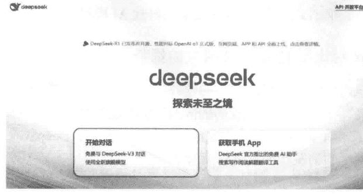

第 2 步：挑选登录方式
可使用手机号开户，如图 3-2。先勾选同意用户协议与隐私政策，蓝色链接可查看详情；填入手机号后点“发送验证码”，输入收到的6位短信码，有效期60秒。

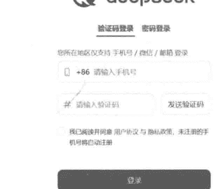

第 3 步：完成开户
设置完毕后即可开始对话。

##### 3.1.2 移动端流程

第 1 步：安装客户端
安卓用户打开手机应用商店搜索 DeepSeek，找到后点“安装”完成下载，如图 3-3。
苹果用户在 AppStore 搜索 DeepSeek，找到后点“获取”完成安装，如图 3-4。

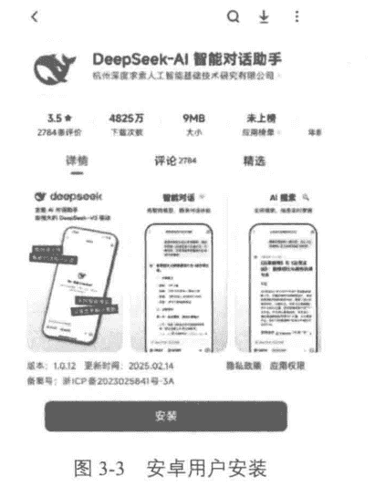

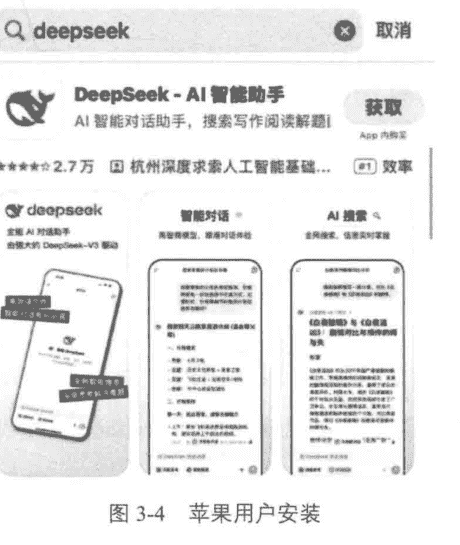

第 2 步：一键登录
平台支持微信与 Apple ID 快速登录，授权后会自动关联手机号，如图 3-5。


第 3 步：进入会话
进入聊天页后即可开始使用，如图 3-6。

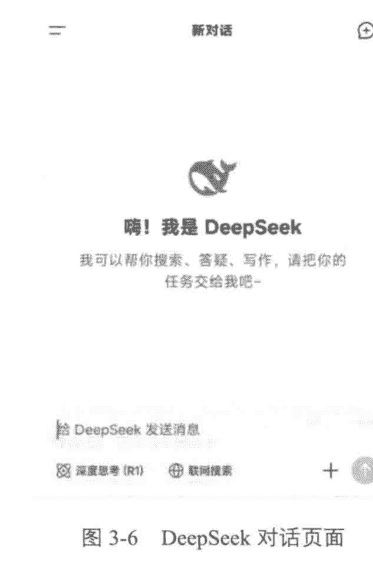

#### 3.2 界面功能概览
以下以桌面端为例说明。

##### 3.2.1 文本输入区
输入框支持 Shift+Enter 换行，面对长文本或多条问题时可分段书写更清晰。

##### 3.2.2 附件上传
当问题涉及文档或图片，例如“把图片里的表格转成 Excel”，可点界面右下角回形针图标，如图 3-7。单次最多上传50个文件，每个不超过100MB，格式覆盖常见文档与图片。


#### 3.3 核心能力

DeepSeek 主要提供两种模式：联网检索与深度推理。

##### 3.3.1 联网检索
开启后模型可实时访问互联网，提供最新数据、时事快讯、市场动态等强时效内容。

##### 3.3.2 深度推理
该模式侧重调用内部知识库进行复杂逻辑分析、因果推断与跨域知识融合，通过构建因果图与行业知识图谱来支撑深层分析。

#### 3.4 模式开关的取舍
同时开启检索与推理会拉慢响应，服务不稳时可能出现“服务器繁忙，请稍后再试”。建议依据场景与信息类型灵活选择。

##### 3.4.1 不开启时
- 通识查证：问题属于已定常识，如历史年份、数学公式等，信息稳定且已写入知识库。
- 隐私保护：关闭联网可降低数据外泄风险。

##### 3.4.2 仅开联网
- 获取即时资讯：需要当日事件、最新研究或新品信息时，例如“明天上海天气”。

##### 3.4.3 仅开推理
- 需要深度拆解：任务涉及逻辑推演、跨域整合、创意生成或伦理议题分析时，例如分步解题、哲学剖析或多视角解读历史。

##### 3.4.4 同时开启
- 混合分析：既要最新数据支撑又要深度解读，例如“结合2023年经济数据预测明年新能源走势”。
- 复杂决策：商业策略、科研等需要实时动态与专业深度的场景。

> AI 是人类历史上最伟大的工具，而提示词是驾驭它的钥匙。
——孙正义（软银创始人）

### 第 4 章 提示词设计方法

#### 4.1 基础概念

##### 4.1.1 什么是提示词
可把提示词类比为餐厅点餐。菜单很多，若只说“我要吃饭”，服务员可能上常规套餐。若明确说“我要一份不加香菜的素食炒饭，多放辣椒”，就能得到定制菜品。与 DeepSeek 交互时，具体指令同样能引导更精准的输出。

##### 4.1.2 为什么要设计提示词
清晰指令决定输出精度。只说“写一篇科技文章”，结果会很宽泛；改为“写一篇探讨区块链如何革新金融的文章，重点分析去中心化对传统银行的影响，约800字”，模型就能聚焦并产出更有洞见的内容。

模糊提问易得无效结果。例如“告诉我一些有趣的事”范围过大。更具体的请求如“列出三项著名科学实验及其对现代医学的推动”则大幅提升信息价值。

- 模糊示例：帮我找点资料。
未说明方向，返回内容可能随机。

- 改进示例：查找人工智能的最新研究进展。
限定领域但仍宽泛。

- 清晰示例：查找自然语言处理中预训练模型近一年内的研究综述，需附作者姓名与刊物名称。
给出时间、类型与补充信息要求，检索更准确。

#### 4.2 七步设计法

##### 4.2.1 明确目标
先确定想要什么。“写文案”太笼统，可细化为“为年轻人撰写奶茶店促销文案”，主题与受众都明确。

##### 4.2.2 设定角色
角色会影响语气与深度。需法律意见可设“律师”，需创意故事可设“编剧”。例如：
- 小学生：我是一名小学生，请解释相对论。
- 物理学博士：我是一名物理学博士，请解释相对论。
解释方式会因角色差异明显。

##### 4.2.3 细化任务
把任务拆解更具体。例如将“生成旅游攻略”细化为“生成一份含预算的上海亲子3日游攻略”，地点、受众、要求均限定。

##### 4.2.4 增加限制
加入字数、格式、语气或数据范围等。例如把“列出北京三日游景点”改为“用表格列出北京三日游景点，预算3000元”，输出更可控。

##### 4.2.5 优化表达
避免歧义。例如“开刀的是她父亲”有两种理解，应改为“她的父亲作为医生为病人做手术”，指令更准确。

##### 4.2.6 预判误读
提前解释术语。例如“帮我写代码”改为“用 Python 写一个抓取天气数据的脚本并附注释”，防止模型理解偏差。

##### 4.2.7 迭代优化
依据初次结果调整。例如从“生成标题”优化为“生成10个带Emoji的短视频标题”，通过反复试验找到最佳组合。

#### 4.3 七步法实操示例
以“撰写方案”为例逐步深化：

- 步骤1：明确目标
提示词：请撰写一篇奶茶店开店方案。

- 步骤2：设定角色
提示词：基于店铺老板身份，请撰写奶茶店开店方案。

- 步骤3：细化任务
提示词：基于店铺老板身份，撰写开店方案，需包含选址、装修、员工培训、产品设计、预算投入等。

- 步骤4：增加限制
提示词：在上述方案基础上，期望回本周期为1年。

- 步骤5：优化表达
提示词：...并测算投资总额与年净利润，要求首年净利润可覆盖投资总额。

- 步骤6：预判误读
提示词：...投资总额不超过30万元，需含房租押金、装修费、两个月员工费、前期宣传费与前三个月现金流；净利润需考虑设备折旧。

- 步骤7：迭代优化
提示词：请在此基础上进一步预测每月营业数据。

#### 4.4 进阶技巧

##### 4.4.1 多轮对话
通过连续追问逐步细化需求，例如先写小说，再要求“写一篇科幻短篇，主角是 DeepSeek 机器人”。使用“参考前文”“基于之前的讨论”等指令可保持上下文连贯。

##### 4.4.2 模板化
不同场景可建立固定模板，提升效率与一致性。

表 4-1 不同场景的提示词模板

| 场景 | 提示词模板 | 使用示例 |
| :--- | :--- | :--- |
| 简单问答 | 【主题】具体指什么？请给出简短定义 | 人工智能是什么？请给出简短定义 |
| 深度探讨 | 我们正在研究【主题】，现有信息显示【相关信息】。请深入分析并预测未来趋势 | 我们正在研究区块链技术，现有研究显示其在金融领域应用广泛。请深入分析并预测趋势 |
| 文章撰写 | 请以【作者】身份写一篇关于【主题】的文章，需含引言、正文至少三小节、结论，并基于最新研究 | 请以张三身份写一篇关于环境保护的文章，需含引言、正文至少三小节、结论，并基于最新研究 |
| 创意写作 | 请按以下设定创作故事：主角为【角色描述】，背景在【时间/地点】，情节围绕【情节概要】展开，注意情感和人物成长 | 请创作故事：主角是一位年轻科学家，背景在未来世界，情节围绕他发现改变人类命运的新物质展开 |
| 编程求助 | 我需要实现【功能描述】，请用【编程语言】提供示例代码并解释关键步骤 | 我需要实现计算两数之和，请用 Python 提供示例并解释要点 |

##### 4.4.3 格式控制
通过明确指示控制输出形式。

表 4-2 不同的输出格式

| 输出格式 | 描述 | 应用 |
| --- | --- | --- |
| 文本 | 基础格式，适合文章段落 | 新闻报道、故事创作 |
| 思维导图 | 表达概念关系，便于头脑风暴 | 产品开发流程框架 |
| 图片描述 | 生成文字描述图片内容 | 图像识别辅助、视障支持 |
| 视频脚本 | 含分镜、角色设定等 | 短片脚本准备 |
| Excel 公式 | 生成复杂计算公式 | 数据分析自动化 |

##### 4.4.4 语气调节
设定语气可使交流更自然。

表 4-3 不同语气的请求示例

| 语气类型 | 描述 | 请求示例 |
| --- | --- | --- |
| 正式 | 商务或官方沟通，严谨礼貌 | 请用正式语气回答，确保用词准确专业 |
| 友好 | 日常交流，轻松亲切 | 请用朋友聊天般的友好语气回答 |
| 鼓励 | 需要激励或正向反馈 | 我工作压力很大，请用鼓励的话语给我动力 |
| 幽默 | 缓解气氛，增强趣味，需谨慎使用 | 请用幽默方式回答，让讨论更有趣 |

#### 4.5 进阶技巧实战
例如为新开健康食品餐厅制定营销策略：

- 初步探索：了解如何为专注健康食品的新餐厅制定有效营销策略。
- 细化需求：请针对注重健康饮食的年轻上班族群体给出具体策略。
- 应用模板：请以市场分析师身份评估该餐厅竞争优势，并提出至少三项推广建议。

- 输出格式：请把推广建议的关键要素整理成 Markdown 列表呈现。
- 情绪调动：请用振奋人心的表达重新诠释这些建议，点燃团队的行动热情。

通过这两种提示的配合，模型能够真正发挥专家级助手的价值。无论是创意写作、数据洞察还是其他业务场景，都能获得高质量的支持与服务。这种结构化指令的设计方式，显著提升了人机协作的效率，也为解决实际问题提供了更强有力的抓手。

## DeepSeek 应用场景新解

> AI 创造的商业机会将远超我们的想象。
> ——蒂姆·库克（苹果 CEO）

### 第 5 章 创作者与组织的收益模式

#### 5.1 素材生产领域的收益模式

无论是自媒体产出、短视频文案，还是定制化内容交付，借助该模型的语言理解与智能算法，个人创作者和机构都能获得高效优质的产出能力，从而打开多元化的收入通道。

##### 5.1.1 自媒体运营
在自媒体赛道，时效性及吸引力决定成败。借助系统能实时捕捉热点，比如当下走红的科技动态、社会事件。以一场热门发布会为例，模型能迅速提炼核心亮点，从产品创新、市场影响等多个维度给出文章框架。创作者在框架基础上加入个人见解及语言风格后快速发布到各大平台，通过广告分成、付费专栏、打赏等实现收益。同时还能依靠系统洞察用户阅读偏好及兴趣标签，实现精准推送，提升粘性及转化，进而提高收入。

##### 5.1.2 短视频脚本撰写
短视频竞争激烈，优质脚本是爆款基础。创作者可用该工具对海量热门短视频进行拆解，总结各类内容的可复用脚本模型，例如搞笑类视频的笑点设置规律、情感类视频的冲突构建方式等。在此基础上指令系统产出更具针对性的脚本。比如为美妆类视频产出包含产品展示、使用教程、效果对比等环节的脚本，再将脚本售卖给制作团队或个人。此外还能与品牌方合作，定制品牌宣传脚本，按合作项目收费变现。

##### 5.1.3 定制内容交付
除常规路径外，还能提供高度定制的內容服务。例如为公司量身打造专属品牌故事、宣传文案。根据公司的品牌定位、企业文化及目标受众，系统可产出富有感染力的品牌叙事，帮助公司提升品牌形象及知名度。同时也能为私家用户提供定制化写作服务，按单收费实现变现。

##### 5.1.4 内容产出培训
鉴于该工具在内容生产上的强大效能，还可以开展相关培训业务。面向希望掌握系统创作技巧的人群，开设线上或线下课程。课程可涵盖系统基础操作、如何借工具激发灵感、如何优化模型输出等内容，通过培训费实现收益。还能建立学员社群，提供持续的技术支持及交流，增强课程附加值。

#### 5.2 商业服务领域的收益模式
该系统作为 AI 领域领先工具，凭借先进的算法及强劲的处理能力，为个人及公司在商业服务领域创造了诸多盈利可能。尤其在智能客服及数据分析报告产出方面优势明显，能够为商业效率提升及价值创造提供新路径。其变现能力源于强大的自然语言处理及数据分析能力，既能理解用户提问给出精准回答，也能对海量数据进行剖析及归纳。

##### 5.2.1 智能客服外包
众多公司在客户服务上承受高人力成本及效率压力。创业者可基于该模型搭建智能客服平台，向公司提供外包服务。例如为电商平台提供 7×24 小时不间断的智能客服，快速响应产品咨询、订单追踪、售后问题等，按服务收费实现变现。同时利用系统的学习能力持续优化话术及知识库，提升服务质量。

##### 5.2.2 定制数据分析报告
不同公司对数据关注点差异较大。数据分析师或服务公司可利用该模型按需产出定制化报告。例如为餐饮公司剖析市场趋势、消费者偏好、菜品销售数据等，助力制定新品研发策略、优化菜单结构。通过挖掘数据背后的价值提供针对性建议，按服务收费。

##### 5.2.3 客服与分析整合
将智能客服及数据分析结合，可为公司提供一站式服务。在客户咨询过程中，智能客服收集用户信息及问题，再由系统剖析这些数据，挖掘潜在需求及痛点。例如在在线教育场景中，智能客服解答学生疑问后，系统剖析提问习惯及学习难点，为公司提供教学改进建议及课程优化方案。此类整合服务可收取更高费用，提升竞争力。

##### 5.2.4 培训及技术支持
随着系统在商业服务中的普及，越来越多公司及个人需要相关技能。可开设培训课程，教授如何搭建智能客服系统、产出数据分析报告。同时提供技术支持，协助客户解决使用过程中的问题，通过培训费及技术服务费实现变现。

##### 5.2.5 数据驱动营销
可利用该模型剖析大量市场及客户数据，为公司制定精准营销策略。例如通过剖析消费者购买行为、兴趣爱好等，推荐合适的投放渠道及推广方案。与公司合作按营销效果收费，实现变现。此类服务能帮助公司提升营销效率，降低成本。

#### 5.3 教育与培训领域的收益模式
在 AI 助手课程开发及个性化教学方案设计方面，该工具能有效整合教育资源、优化教学流程，为个人及公司创造新的商业价值。该思路适合多种主体：教育创业者可快速搭建特色教育产品抢占市场，在职教师可借此开发个性化方案提升收入，教育科技公司可研发相关软件平台，自由教育工作者也能打造更具吸引力的课程内容。

##### 5.3.1 AI 助手互动课程
教师可利用系统开发具备互动功能的 AI 助手课程，让学生在学习中与 AI 实时交流。例如在语言学习课程中，AI 助手可即时纠正发音、语法错误，并陪练口语。通过在线教育平台将课程打包销售，按订阅或一次性购买收费。

##### 5.3.2 个性化学习方案定制
教师可依据学生的学习状况、兴趣爱好、知识掌握程度等多维度数据，利用系统为每个学生定制专属学习方案。例如为中小学生制定全科提升计划，剖析各学科薄弱环节并提供针对性建议及练习资料。向家长或学生收取定制费用，也可与学校合作提供批量服务。

##### 5.3.3 教育内容创作与优化
教育机构或自媒体可借助系统快速生成内容框架，再结合专业知识优化完善。例如为在线教育平台创作职业技能课程内容，按创作量收费。也可为机构优化现有内容，使其更符合学生学习特点。

##### 5.3.4 AI 辅助教育咨询
咨询师可为学校、教育机构或家长提供 AI 辅助教育咨询，利用系统剖析教育行业趋势、政策法规、学生学习数据等，提供专业的决策建议，涵盖课程设置、教学改革的数据支持及分析报告等服务。

#### 5.4 技术开发领域的收益模式
该模型凭借强大的自然语言处理及代码理解能力，为技术开发带来新变革及商机。在代码编写、插件开发、API 服务等方面均能发挥关键作用，帮助个人开发者及公司挖掘商业价值。该思路适合独立开发者、小型软件公司、自由程序员、大型公司技术团队及技术爱好者等。系统可帮助快速产出代码框架，提高开发效率，将更多精力投入创新及优化。

##### 5.4.1 代码代写与优化服务
许多开发者及公司在项目开发中常因工期紧迫或技术难题受阻。

##### 5.4.2 插件定制开发
各类软件及平台都需要插件拓展功能。可利用系统为办公软件开发提效插件，为设计软件开发辅助插件等。先深入了解用户需求，再借助系统快速产出代码结构，后续进行功能细化及调试。开发完成的插件可在相关平台销售，或与软件厂商合作作为增值服务，按开发费及分成收费。

##### 5.4.3 API 定制及维护
随着公司数字化转型加速，系统间数据交互及业务协同需求增长。可利用系统开发定制化 API，帮助公司实现系统无缝对接。例如为电商公司开发连接销售平台与库存管理系统 API，实现订单与库存数据的实时同步。同时提供维护与升级服务保障接口稳定，按复杂度与服务期限收费。

##### 5.4.4 技术培训及咨询
伴随系统在技术开发领域的应用普及，开发者及公司有学习需求。可开设线上线下培训，教授如何用系统进行代码编写、插件开发及 API 定制，涵盖基础操作与项目实战，收取培训费。同时提供技术咨询，解答使用问题并建立技术社区增强用户粘性。

#### 5.5 新兴职业机会领域的收益模式
该工具为新兴职业提供了独特的盈利可能。该思路适合热衷新技术、追求职业创新的年轻人，有编程或 AI 基础的技术人员，自由职业者，以及公司创新团队及数字化转型推动者。

##### 5.5.1 AI 优化服务
AI 优化师通过调整模型参数、优化算法、监测性能，提升 AI 系统运行效率及准确性。例如为公司智能客服系统提供优化服务，通过系统优化对话模型，使其更精准理解客户问题、提高回复质量。可按项目收费或签订长期服务协议收取年费，还可针对不同行业开发通用优化方案打包销售。

##### 5.5.2 提示词工程定制
提示词工程师负责设计及优化与系统交互的提示，以获取更符合需求的输出。例如为内容创作公司定制提示词，帮助其产出高质量文案、故事等。根据客户需求设计独特提示词组合，通过不断测试优化确保输出满足预期。可按复杂度及周期收费，也可建立长期合作持续优化。

##### 5.5.3 新兴职业培训及咨询
AI 优化师、提示词工程师等新兴职业尚处发展初期，市场对技能要求认知有限。可开设线上线下培训，教授系统原理、操作技巧、优化策略及提示词设计方法，收取培训费并提供就业指导及项目推荐。也可为公司提供新兴职业咨询，帮助其引进及管理相关人才，按咨询费收费。

##### 5.5.4 工具开发及销售
针对 AI 优化师及提示词工程师的工作需求，可利用系统开发辅助工具。例如开发提示词生成及优化工具，提供可视化分析界面展示不同提示词对输出的影响。可在技术平台销售或提供订阅服务，按月年付费使用，通过持续更新功能吸引用户实现长期变现。

> AI 让内容创作从人找信息变为信息找人。
> ——张一鸣（字节跳动创始人）

### 第 6 章 新媒体运营

#### 6.1 精准定位
在新媒体运营中，洞察竞品账号的动向及表现至关重要。通过系统分析竞品，不仅能把握市场趋势，还能发现潜在机会点，帮助优化内容策略、调整运营方向，必要时超越竞品占据市场。

##### 6.1.1 借助竞品账号智能分析，明确运营方向
竞品分析并非简单浏览，而是一种深度研究方法，能系统化提取有价值洞察。可从以下维度展开。

- 内容类型分析：不同形式效果差异明显。例如长文可能带来高阅读量，短视频或图文分享可能获得更高互动率。需分析行业内哪些内容类型更受欢迎，以便创作更有针对性。
- 互动情况分析：点赞、评论、分享等数据反映用户兴趣及参与度。若某竞品帖子持续获得大量互动，可借鉴其内容制作及发布策略。
- 粉丝画像分析：了解竞品粉丝的年龄、性别、地域等构成，有助于判断其目标用户群体，从而更精准定位自身受众。
- 历史表现分析：历史数据可揭示竞品一段时间内的运营轨迹，特别是爆款内容。通过追踪发布周期及表现数据，可判断其是否存在规律。

借助竞品账号智能分析，能判断哪些策略及形式是可行的，哪些需要规避或改进。这种数据化运营方式更科学，而非依赖直觉。

##### 6.1.2 实操案例
以下对小红书平台上的数学教学账号进行竞品分析示范。

第 1 步，在小红书搜索“数学”关键词，选择“用户”类型，筛选出粉丝量较高的数学教学账号。

第 2 步，打开 DeepSeek 并登录。

第 3 步，点击 · 深度思考 · 和 · 联网搜索 ，在对话框中输入提示词，如图 6-1 所示。

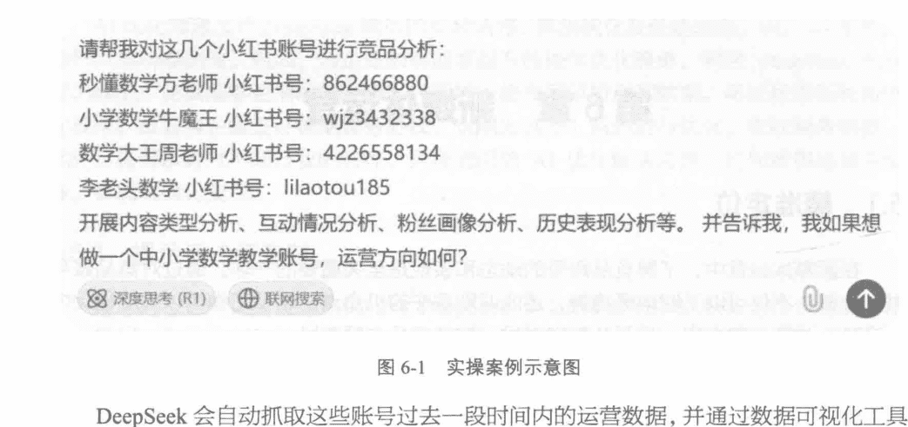

系统会自动抓取这些账号近期运营数据，并通过数据可视化展示内容类型、互动情况、粉丝画像等指标。

第 4 步，点击 ⬆，稍等片刻，系统会生成完整分析报告。

###### 竞品分析：四个中小学数学教学账号对比

1. 内容类型分析

秒懂数学方老师：以短视频为主，聚焦解题技巧及考点解析，如“5分钟搞定函数图像”等。风格简洁，配以板书或动画演示，利于学生快速理解。

小学数学牛魔王：以趣味数学题及互动挑战为主，如“每日一题”系列，结合生活场景如购物计算、游戏闯关吸引低龄学生。

数学大王周老师：主打系统化课程，覆盖小初高知识点，按章节更新，适合长期跟学。形式包括图文笔记及直播答疑。

李老头数学：以幽默讲解及家长教育为特色，内容涵盖“如何辅导孩子数学”“避开学习误区”等，吸引家长群体。

2. 互动情况分析

（1）高互动内容

小学数学牛魔王的“挑战题”评论区活跃，用户常晒答案并@好友，互动率约 12%。

李老头数学的家长向内容收藏量高，如“数学启蒙方法”单篇收藏超 5000 次。

（2）低效内容

数学大王周老师的长视频完播率偏低，可能与内容密度高、缺乏分段有关。

3. 粉丝画像分析

年龄及性别：

秒懂数学方老师及数学大王周老师的粉丝以 12～18 岁学生为主，占比约 65%，女性占比 60%。

李老头数学粉丝中 25～35 岁家长占比 70%，女性占 80%。

地域分布：

一线城市占比高，如北京、上海，家长更关注教育资源；下沉市场用户偏好趣味性内容，如“小学数学牛魔王”。

4. 历史表现分析

爆款规律：

标题关键词：

“速成”“必考”“免费资料”等词点击率高，如李老头数学的“3 天搞定应用题”播放量超 50 万次。

发布时间：

学生账号晚 8—10 点流量高峰，家长账号早 7—8 点及晚 7—9 点表现更好。

更新频率：

###### K12数学垂类号冷启动与扩张思路
高频更新的垂类号拉新更快，低频稳定更利于留存。日更打法的号通常在初期涨粉速度占优，周更三到四条的号则更擅长把既有粉丝做稳。

1. 号位规划与内容方案

（1）差异化切入
补位供给缺口：同类号在逻辑推理、奥数专题等思维类内容上覆盖不足，可用解谜闯关做游戏化呈现。
人群细分：围绕小升初、中考冲刺等明确场景，推出冲刺合集，视频讲解绑定练习题打包交付。

（2）内容形态
以60秒内短视频为主，辅以图文做公式归纳，再用固定时段直播答疑做沉淀。参考李老头数学的家庭互动打法，建议单独开设家长学堂栏目。

2. 提升互动与留存

（1）互动玩法
发起数学挑战赛，鼓励用户拉好友组队，完成可领资料奖励。评论区置顶高频问题汇总，减少重复提问消耗。

（2）分层运营
学生端：以趣味内容调动情绪，用成就徽章做激励，比如连续打卡七天解锁新课。
家长端：用免费资料换取关注，例如《小学数学考点清单》，降低关注门槛。

3. 变现路径

起步期：售卖9.9到39.9元的专题小课，以及电子版教辅资料。
进阶期：与教辅品牌联名定制习题册，按销量分成。

4. 风险规避与合规

（1）内容审核
避免直接搬运教材原文，需要二次创作，比如对题型进行改写。
（2）广告标识
合作推广必须明确标注赞助、合作字样，符合平台规范。

5. 小结建议

（1）核心优势
把趣味性和实用性结合起来，比如用动画拆解几何难题，或做数学与生活系列，例如理财计算。
（2）长期目标
借高频互动尤其是每周直播建立信任，再逐步引导到付费课程。
（3）数据监测
善用小红书后台的笔记诊断功能，优化标题关键词和发布时间。按此路径，半年内从零做到一万粉并形成差异化壁垒是可期的。

#### 6.2 账号塑造
名字与个人简介是账号的门面，几秒内就会给人留下印象，决定是否关注。好的命名和简介也是品牌标识，能加深记忆、吸引精准人群，也利于传播。例如健身号天然吸引减脂人群。起名要抓眼球，简介要简洁传递核心价值和个人亮点。当名称有趣、简介有吸引力时，用户更愿意分享给身边人。

##### 6.2.1 遵循百万粉丝账号塑造指南，打造优质账号
在抖音和小红书，名字和简介就是账号的灵魂，直接影响首因效应和推荐。

第一印象的黄金三秒。信息流滑动极快，有记忆点且信息明确的名字能立刻抓住眼球。比如深夜徐老师里的深夜就暗示睡前观看场景，且有人格化。简介是二次筛选，用最短的话交代我是谁能带来什么，如职场穿搭天花板，165cm梨形身材自救指南。

算法需要的关键词。平台会抓取名字和简介里的词做标签投放，比如带宝妈的号更容易触达同类人群。简介里高频出现干货、测评、避雷会强化垂直权重。

人设的视觉符号。名字和简介是用户的第一层联想。暴躁小甜椒暗示直爽搞笑，破产姐弟直接点明剧情方向。好的简介能制造期待，例如每天一个变美冷知识让人产生持续收益的心理暗示。

降低传播成本。朗朗上口的名字如垫底辣孩、多余和毛毛姐自带传播力。简介直击痛点如150cm小个子怎么穿显高能快速筛选目标用户，减少无效粉。

起名字常见做法
关键词法：直接关联领域，美食干饭人小贝，美妆狠毒女孩口罩妆，职场暴躁HR在线吐槽。如油皮的自救指南精准吸油皮人群。
反差感法：用矛盾制造冲突，如形象反差猛男厨房，语言反差东北人在广东。
场景化法：把用户带入具体场景，如深夜食堂探险、自习室学习监督员。如出租屋改造计划吸引租房党。
情绪化法：放大情绪词，如发疯打工人、拒绝容貌焦虑。如今天又被老板PUA了引发职场共鸣。
个人特色法：用外貌性格标签，如天津小姐姐嘴瓢日常、律师小姐姐普法。如秃头程序员穿搭用自嘲切入垂类。

高转化简介写法
身份标签拉近距离：如二本毕业→大厂总监、全职妈妈副业月入2万元。如沪漂6年，从合租到买房吸引一线打工人。
价值直给：直接说明利他，知识类每天分享学生党省钱技巧，情绪类专治职场内耗，骂醒一个算一个。如跟着我买，衣服均价不过百元。
差异化人设强化记忆：如全网最凶穿搭博主、骂醒恋爱脑第一人。如只说实话的美妆打假员与过度滤镜形成对比。
互动与悬念：提问式你敢信这些穿搭只要50块？，挑战式挑战100天素人改造第28天。如猜猜我多大？答案在置顶视频。
平台调性适配：小红书强调干货精致，如复旦学姐：书单+文具+学习方法。抖音强调口语情绪，如关注我！教你在职场反PUA！。
定位清晰加痛点明确：美妆可用黄黑皮、瑕疵皮，普通人版无效化妆退退退，职场可用从月薪3千到3万，教你用老板思维打工，母婴可用海淀妈妈不鸡娃，3招养出自主学习娃。

##### 6.2.2 实操案例
一位用户想做小红书健身博主，用DeepSeek生成名字和简介。

第1步，打开DeepSeek，开启深度思考与联网搜索，在对话框里输入提示词，如图6-2。


DeepSeek会自动抓取小红书相关情况并思考合适的用户名和简介。

第2步，点击发送，片刻后获得模板建议。

元气活力型用户名：蜜桃臀养成日记、燃脂小马达Jenna、元气铁馆少女、运动系氧气瓶、暴汗甜心Gina
专业干货型用户名：健身私教周小菜、撸铁实验室、体态管理手册、抗阻训练百科、功能性训练指南
生活化健身用户名：厨房健身房两开花、瑜伽垫上的早午餐、健身服搭配研究所、上班族碎片健身、宿舍徒手训练家

自我介绍模板可混搭：
【专业教练版】ACE认证健身教练—体态矫正专家，每周二四更新训练计划，周六解锁健身餐灵感，手把手教你科学塑形，已帮助300多名学员达成目标，关注获取免费体测分析！
【励志成长版】从120斤到马甲线女王——健身3年蜕变实录，分享居家训练技巧、健身装备测评、暴汗歌单推荐、真实身材对比，普通上班族的逆袭之路，关注见证每周进步！
【生活美学版】把健身房穿成日常的时髦精，健身妆容不脱妆秘籍、小众运动品牌挖掘机、低卡美食摆盘艺术家，用高颜值方式打开健康生活，美和力量我都要！
【趣味互动版】全网最会讲段子的健身博主，收藏夹有各部位跟练合辑、定期测评网红减脂零食、带云监工你的运动打卡，敢不敢和我赌21天身材挑战？输的请喝奶茶！

小贴士：名字可加入地域特色如北京撸铁小辣椒；定期更新个人IP视觉符号如标志性发带/运动袜；简介突出差异化价值教学/陪伴/审美；可设置记忆点标签如#办公室肩颈拯救者。

#### 6.3 爆款内容打造
在新媒体，爆款能力直接决定影响力。每篇爆款背后都是对用户需求的精准把握和精细化设计。

##### 6.3.1 制作爆款内容，提升影响力
什么是爆款？能迅速吸引大量关注、互动并快速传播的内容，通常具备：话题性强，能引发讨论；情感共鸣强，能触发点赞评论分享；有实用价值，能提供干货；互动性强，能让用户参与问答投票评论。

怎么做出爆款？需要不断试错优化。
调研用户需求：通过数据、评论、留言、搜索热度了解受众兴趣、痛点。
抓热点：时刻关注时事，把热点融入内容。
标题设计：标题要简洁有吸引力带悬念，激发点击欲望。

##### 6.3.2 实操案例
小红书健身博主用DeepSeek生成标题和文案。
第1步，打开DeepSeek，开启深度思考与联网搜索，在对话框输入提示词，注意注明平台、受众、目标，如图6-3。

#### 6.4 数据复盘
数据复盘是提升运营效果的关键，对运营过程和结果做全面审视。

先明确目标，根据计划确定核心指标如粉丝增长、阅读量、转化率。接着收集平台流量、用户行为、内容传播等多维度数据，来源为平台后台和第三方工具。数据需清洗整理保证准确完整。

分析阶段常用对比分析：纵向看趋势，横向看差距；细分分析按渠道、内容类型、用户群体拆解，找深层问题。如某类内容阅读高但转化低，需判断是引导不足还是人群不准。

总结问题后制定优化策略：调选题、改发布时间、拓宽渠道、增加互动。数据复盘是循环工作，每次结果都应成为下次计划依据。

##### 6.4.1 通过数据复盘与迭代，持续优化运营策略
数据是照亮前路的灯塔。
衡量成效：阅读量、点赞、评论、转发等直观呈现内容受欢迎程度，判断方向是否正确。
发现问题与机会：用户行为数据揭示兴趣点和痛点。高互动系列可加大投入，活跃度下降需及时诊断原因。
为决策提供依据：不同策略的数据对比能看出哪种更有效，哪条渠道转化更高，从而合理分配资源。

具体步骤：
确定关键指标：内容运营看阅读量、完读率、点赞评论转发；增长期看粉丝数、新增、活跃度；电商看转化率、客单价、销售额。
收集数据：平台后台、第三方工具、用户调研并存，注意正负面数据，按周期采集。
分析数据：纵向对比历史，横向对比竞品；做相关性分析，如发布时间与阅读量的关系。
总结经验教训：巩固成功方法，剖析失败根源，形成可复用知识体系。

策略迭代方向：
内容策略优化：根据反馈调整选题、形式、风格，加大高表现内容比例，提升质量和体验。
用户运营调整：对活跃用户给专属福利增强粘性，对潜在用户做精准推送转化，及时响应反馈。
渠道运营优化：加大效果好渠道投入，分析差渠道原因并调整，探索新平台拓展流量。
活动优化：复盘主题、形式、时间、参与方式，提升吸引力和参与度，加强宣传投放。

##### 6.4.2 实操案例
小红书健身博主用DeepSeek基于已发内容数据生成后续建议。
第1步，打开DeepSeek，开启深度思考，在对话框输入提示词，如图6-4。


DeepSeek会根据提交内容生成发布建议。

第2步，点击发送，稍等后得到建议。

案例A：小学数学七大模块必学方法合集
赞64，收藏56，评1
分析：面向家长的基础方法合集，点赞收藏比不错但评论极少，参与度需提升。
建议：结尾增加互动引导，如你家孩子数学有哪些困难？留言一起讨论。补充具体例题和实操步骤，增强落地感。加入图表或小插图提升视觉吸引力。

案例B：小学生暑假学习计划表
赞393，收藏415，评16
分析：暑假计划是家长高频需求，数据全面较好，实用性强。
建议：强化社群互动，评论区询问暑期目标，发起暑假学习打卡话题。扩展不同年级版本，一到三年级与四到六年级分别定制。续发系列内容如如何高效利用暑假学数学、如何提升学习兴趣，保持持续关注。

案例C：小升初必会解方程类型
赞54，收藏63，评0
分析：知识点定位准确但互动低，用户兴趣未被充分点燃。
建议：标题更具紧迫感，如掌握这些方程题型，确保小升初数学不掉队。增加案例解析和解题技巧展示理论如何落地，让观众看到实际解决方法的价值。

别让标题读起来像说明书

账号现有的标题偏叙述性，打开空间很大。调整表达视角，前面先放场景和收益，点击会更好。比如把原来的解题笔记式标题换成“小升初解方程必备，这几招学会，数学成绩轻松提上去”，价值感更足，表现也会明显改善。

整体优化思路

1. 增加短视频供给：数学内容在小红书有稳定受众，尤其是关注孩子学习的家长。建议产出互动性更强的短视频，例如数学小实验、趣味题拆解，提升观看趣味。
2. 标签更精准：选用搜索意图更贴合的标签，如“#数学思维训练”“#孩子的数学启蒙”“#小升初必看”，帮助同类用户更快发现。
3. 按节点做系列专题：结合暑假、寒假、开学季等时间点，定期推出“学习规划”“考前冲刺”“思维训练”等系列，保持账号持续活跃。
4. 选择合适发布时间：依据内容属性选峰值时段发布，早七到九点、晚七到九点是家长活跃高峰，触达效率更高。

按上述方法调整，能有效提升互动与传播，帮助“刘老师教数学”获得更多关注。

#### 6.5 热门话题预测

信息流动越快，平台上每天诞生的内容量越大。小红书、微博、抖音、快手等渠道，每天都在产生海量素材，提前判断热度对创作者和运营者都很关键。

人工智能做热度预判的基础是海量数据的采集与分析。借助爬虫等工具，系统可以广泛抓取各平台用户的行为轨迹，包括发布内容、点赞、评论、转发等。以微博为例，可以实时监测不同事件的讨论热度与话题标签使用频率，这些信号反映了用户当下的兴趣焦点。

机器学习和深度学习是预判的核心。以抖音为例，模型会学习过往爆款视频的特征，例如视频类型、上线时间、创作者体量等，从而提炼爆款的潜在规律。新内容出现时，模型即可据此评估其走红概率。

对内容创作者而言，利用人工智能提前预判热点可以提前布局选题，提升曝光与影响力。例如小红书博主根据预测的美妆热点，提前制作教程或种草笔记，更容易吸引关注。对平台运营者来说，热点预判有助于优化推荐策略，提升体验与粘性。例如快手可以根据预测结果把潜在爆款推送给兴趣匹配的用户群。

总体来看，人工智能在热点预判上潜力很大，为平台生态中的各方提供了有价值的决策依据。

##### 6.5.1 运用热点预测算法，提前 48 小时锁定热搜

人工智能的热点预判并非玄学，而是基于大数据分析与机器学习。算法会从互联网海量数据中抓取信息，来源包括社交媒体、新闻网站、论坛等。通过自然语言处理对文本进行清洗、分类和标注，提取事件主体、时间、地点、情感倾向等关键要素。机器学习模型据此学习历史热点的特征，总结出热点形成与传播的规律，比如短时间内发布量骤增、用户互动频率急剧上升等信号。基于这些规律建立预测模型后，新数据输入即可判断话题是否可能在未来48小时内成为热搜。

- 信息传播优势：对媒体机构而言，提前锁定热搜意味着可以提前策划报道、准备素材，在热点爆发时迅速占位，推出更有深度、更有吸引力的新闻，避免仓促跟进导致的同质化。
- 市场营销价值：品牌方可以利用预测结果，把品牌信息与即将爆发的话题关联，开展精准营销。例如预测到某场体育赛事将成热点，运动品牌可提前投放相关广告，借势提升知名度和销量。
- 社会价值：在社会层面，人工智能热点预判有助于及早发现民生议题。当算法预测到公共卫生、环境保护、社会公平等相关话题可能升温时，政府部门和社会组织可以提前介入、解决问题，避免事态扩大影响社会稳定。

##### 6.5.2 实操案例

下面尝试预测未来48小时微博可能的热门话题，并以健身类博主为例，用 DeepSeek 生成“借势”的思路。

第1步，打开 DeepSeek，开启·深度思考·和·联网搜索·，在输入框中填入提示词，如图6-5所示。

第2步，点击↑，稍等片刻，DeepSeek会给出预测结果及建议。

未来48小时微博可能爆发的9个话题预测

1. 智能驾驶普及下的行业竞争：比亚迪推出“全民智驾”计划后，车圈大佬纷纷回应，智驾普及成为讨论焦点，热度有望持续。
2. 2025年首场暴雪来袭：中央气象台预报的大范围雨雪和大风降温，将波及甘肃、陕西等地，天气应对成为关注点。
3. 春节后集中减肥潮：假期饮食丰富，体重上升，节后大量用户开始关注减脂内容。
4. AI在生活中的新玩法：AI数字人直播全民化等新应用出现，易引发大众对AI改变生活的讨论。
5. 情人节后情侣健身挑战：节后情侣倾向通过共同运动增进感情，互动性健身挑战可能走红。
6. 春季运动装备种草：气温回暖，户外运动意愿增强，春季装备需求和讨论增多。
7. 职场人复工运动规划：假期结束，职场人关注如何在工作之余安排运动保持健康。
8. 儿童寒假运动指南：寒假未结束，家长关注孩子假期运动方案。
9. 宠物健康与运动：养宠人群扩大，宠物健康、运动话题关注度上升。

健身博主借势引流的方法

- 结合智能驾驶话题：从久坐开车对身体的影响切入，写《长时间开车久坐，这些动作帮你缓解疲劳》，介绍车内或下车后可做的放松动作，吸引有车用户。
- 关联暴雪天气话题：发布《暴雪天宅家也能练的高效运动》，为无法外出的人提供居家方案。
- 针对春节后减肥话题：分享《节后减脂的饮食与运动组合》，结合经验给出科学计划。
- 结合AI应用话题：写《AI助力健身，个性化训练计划怎么定》，介绍利用AI定制训练，跟上科技潮流。
- 围绕情侣健身话题：推出《情人节后情侣甜蜜健身挑战》，设计情侣瑜伽、双人力量等互动训练。
- 借助春季装备话题：发布《春季户外运动必备装备清单》，介绍透气服装、轻便鞋等并给选购建议。
- 针对职场人运动计划：分享《复工后高效运动时间管理》，帮助合理安排工作与运动。
- 关联儿童寒假运动：撰写《寒假儿童运动指南，助力健康成长》，为家长提供适宜项目与注意事项。
- 结合宠物健康话题：创作《和宠物一起动起来，共享健康生活》，介绍遛狗跑步、宠物瑜伽等内容。

> AI 是员工的“副驾驶”，帮助人类专注高价值工作。
> ——萨提亚·纳德拉（微软 CEO）

### 第 7 章 职场效率提升

#### 7.1 会议纪要生成

##### 7.1.1 自动生成纪要，实现语音转文字与要点提炼

- 语音转文字：人工智能借助语音识别技术逐字转写录音，并可区分不同发言人，为后续处理提供文本基础。
- 内容分析与整理：系统识别会议核心主题和讨论焦点，区分发言人观点，将零散发言整理成结构化框架。
- 重点提炼与格式输出：自动提取核心决策、行动事项、关键问题及解决方案，按标准纪要格式排版输出。

##### 7.1.2 实操演示

尝试把会议录音转为纪要。

第1步，将会议录音导入电脑，通常为MP3格式。
第2步，利用在线平台把MP3转成文字，常用平台有讯飞听见、腾讯云语音识别、Otter.ai。
第3步，打开DeepSeek，在对话框中输入提示词并粘贴转换后的文本，如图7-1所示。

DeepSeek会自动把文本转为会议纪要，也可指定格式和语言风格。
第4步，点击↑，稍等片刻即可得到完整纪要。

###### 公司未来业务发展方向讨论纪要

- 会议时间：2020年1月1日。
- 参会人员：张总、王主管、孙经理、李专员。

本次会议围绕未来业务方向，讨论线上拓展、线下优化、品牌建设和数据安全，并明确各部门任务。

线上业务拓展：王主管建议加大投入，搭建销售平台。张总询问困难，王主管指出技术和人才瓶颈，建议外聘或合作并招聘运营人才。孙经理强调数据安全，建议建立安全体系。

线下业务优化：孙经理认为线下仍是主要收入来源，建议优化升级并推动线上线下融合。张总要求其负责并构建数据安全体系。

品牌建设推广：李专员建议加强多渠道宣传提升知名度，加大研发创新，同时制定预算计划确保投入产出最大化。张总要求其一个月内提交执行推广方案。

###### 任务分工

- 线上业务筹备：王主管，2周内提交方案，组建小组、搭建团队、招聘人才、洽谈合作。
- 线下业务与数据安全：孙经理，1个月内完成初步方案，优化服务、陈列，制定安全策略。
- 品牌推广计划：李专员，1个月内提交方案，完成调研并注重互动反馈。

###### 后续安排

张总要求各部门密切沟通、及时反馈。下次会议1个月后汇报进展。

#### 7.2 领导讲话生成

##### 7.2.1 辅助生成领导讲话内容

撰写讲话稿需把握以下要点。

- 明确讲话目的：是总结成果、分析问题，还是部署工作、传达政策；是激励团队，还是对外塑造形象。
- 收集资料：包括内部工作数据与报表、行业动态、政策法规、成功案例、典型故事等，为内容提供支撑。
- 构建结构：常用“总—分—总”结构。开头点明主题，中间分点展开并配论据，结尾总结要点并提出期望。

##### 7.2.2 实操演示

尝试生成家电营销公司领导的讲话稿。

第1步，构思讲话的基本要求，尽量明确。
第2步，打开DeepSeek，开启·深度思考·，在对话框中输入提示词，如图7-2所示。

第3步，点击⬆，稍等片刻即可生成完整稿。

> 各位同事：
> 大家好！今天直接说重点，怎么把第二季度销量提上去。先回顾第一季度，再定第二季度目标，最后说怎么干。
> 【第一部分：第一季度回顾】
> 第一季度整体销量同比增长8%，空调和冰箱表现突出，分别增长15%和12%。要感谢华南大区和线上团队，两个渠道超额完成，奖金月底发放。
> 【第二部分：第二季度目标】
> 第二季度目标总体再增长20%，分产品如下：
> • 空调冲刺40%增长，旺季机会要抓住。
> • 冰箱保持15%增长。
> • 小家电实现翻身，至少增长10%。
> 各区域明天下午前报分解表。公司已算过库存和市场需求，这个目标够得着。
> 【最后动员】
> 市场虽难，但好挣的钱从没有。完成目标奖金上浮30%，超额部分拿5%作为团队旅游基金。连续两月垫底的区域，公司将考虑换人。
> 兄弟们，加油，散会！

#### 7.3 年度工作计划制定

##### 7.3.1 用AI制定年度计划需具备的思路

- 梳理基础信息：全面梳理部门职能、过往成果与问题、公司年度战略目标等，为AI提供准确数据。
- 确定沟通方式：用简洁语言描述需求，如“依据公司战略和部门职能，制订本年度工作计划，涵盖重点项目、团队建设、业绩目标等”。
- 生成初步框架：AI据此输出初步框架，包含任务分类及工作方向与预期成果，需审阅逻辑是否合理。
- 细化与调整：结合经验补充步骤、时间节点、负责人等细节，若不合实际则与AI沟通修改。

##### 7.3.2 实操演示

尝试撰写家电营销公司年度工作计划。

第1步，明确计划形式与细化颗粒度，并准备基础素材。
第2步，打开DeepSeek，开启·深度思考·和·联网搜索·，输入提示词，如图7-3所示。

第3步，点击，稍等片刻即可生成完整计划。

###### 家电营销公司年度工作计划

###### 一、市场分析与目标设定（1—2月）
市场调研：1月1日至1月31日，市场调研团队通过线上问卷、线下访谈收集数据，分析市场趋势、消费者需求及竞品策略。
销售目标制定：2月1日至2月15日，销售负责人据调研结果制定年度及季度销售目标。

###### 二、产品策略（3—4月）
产品优化：3月1日至3月31日，产品经理与供应商合作，按反馈优化功能。
新品引进：4月1日至4月30日，采购部门筛选并引入潜力新品。

###### 三、营销策略（5—10月）
线上营销
社交媒体推广：5月1日至12月31日，新媒体团队制定全年计划，在主流平台发布内容。
电商平台运营：5月1日至12月31日，电商团队优化店铺，参与促销提升销量。
线下营销
促销活动：按节假日、店庆安排，市场活动团队举办线下促销。
经销商合作：全年，销售部门加强与线下经销商合作。

###### 四、客户服务提升（11—12月）
客服培训：11月1日至11月30日，客服负责人组织培训。
反馈处理机制优化：12月1日至12月31日，建立快速响应机制。

###### 五、团队建设与管理
员工培训：全年，人力资源部定期组织内部培训。
绩效考核制度完善：1月1日至1月31日，人力资源部优化考核制度。

#### 7.4 细分工作计划创建

##### 7.4.1 创建细分计划的关键做法

- 分解任务：把大任务拆成可操作、可衡量的小任务，按阶段或里程碑逐层分解。
- 设定优先级：判断任务的紧急与重要程度，可用“四象限法”排序。
- 明确目标：每个任务给出清晰完成标准，避免模糊描述。

##### 7.4.2 实操演示

某线上财务公司计划1个月内向北京朝阳区小商家推广免费二维码收款，并附赠记账、财务总结等功能，利用DeepSeek生成任务分解。

第1步，构思任务分解、优先级与目标。
第2步，打开DeepSeek，开启·深度思考·和·联网搜索·，输入提示词，如图7-4所示。

第3步，点击↑，稍等片刻即可得到详细分解，可继续追问优化。

- **市场推广团队**
  - 市场经理：制定并监督推广策略，与销售、技术协作，1个月内覆盖朝阳区至少80%小商家，定期评估调整。
  - 推广专员：按片区负责推广，通过多渠道介绍服务，日均拜访15家新商家，周均完成50家介绍。
- **销售团队**
  - 销售主管：统筹销售、协同市场、处理客户异议，1个月内促成至少30%意向商家签约。
  - 销售人员：跟进意向客户讲解服务，每人每周至少成功签约5家。
- **客户服务团队**
  - 客服主管：搭建响应机制、处理问题、收集反馈，确保满意度达90%以上。
  - 客服人员：7×24小时在线解答，为新签约商家培训，日均处理咨询不少于20单。
- **技术团队**
  - 技术负责人：保障系统稳定，按需求优化功能，确保故障率控制在5%以内。
  - 技术人员：监控系统、处理故障、配合客服提供技术支持，每月至少完成一次系统优化升级。

#### 7.5 年终总结报告生成

##### 7.5.1 深Seek 提速年终总结

对过去十二个月的履职情况做系统盘点，有助于把成果梳理清楚、把问题找准，为后续规划提供方向。借助 DeepSeek，年终复盘的产出效率与内容水准都能明显提升，让这件关键工作更省心。

- 投喂精准的业务要素：把年度核心信息完整塞给模型，例如“本年度主推项目为【项目名称】，定位是【阐述目标】，执行期落实了【列举关键任务】，最终产出是【说明成果】”。
- 学行业表达范式：让模型研读大量同业优秀的年终复盘和真实案例，就能把握该行业的常用话术、关注重点以及文档框架。

##### 7.5.2 实操演练

下面以一家公司为例演示如何用 DeepSeek 生成年终复盘。

第 1 步，收集到的年度素材如下。

- **内容创作部**
  - 项目交付：共完成 50 项广告片等制作，其中知名美妆品牌广告片播放量达 500 万、点赞 10 万。
  - 内容突破：引入动画等手法，产出 8 个创新作品，科技馆 VR 科普短片获得好评。
  - 人才建设：组织 12 次内部培训，覆盖文案、拍摄、后期制作。

- **市场营销部**
  - 客户拓展：新增 30 家客户，行业覆盖面广，客户保留率 80%。
  - 品牌曝光：策划 15 场推广活动，品牌曝光总量超 1000 万次。
  - 市场研究：完成 10 次行业调研，竞品分析为业务调整提供支撑。

- **客户服务部**
  - 满意度：客户满意度 90%，处理投诉 20 起，解决率 95%。
  - 服务提效：流程再造后响应时效压缩至 2 小时内。
  - 关系维护：回访老客户 50 家，挖掘出 15 项潜在需求。

- **行政财务部**
  - 财务表现：全年营收 800 万元，净利润 150 万元，成本可控。
  - 行政管理：完善制度 8 项，组织公司活动 6 次。
  - 后勤保障：确保设备运行与办公环境稳定，设备故障率低于 5%。

第 2 步，打开 DeepSeek，选择 · 深度思考 ·，在对话区填入提示词，如图 7-5 所示。


图 7-5 实操案例示意图

第 3 步，点按⬆，片刻后 DeepSeek 会输出完整的年终总结报告。

###### 2024 年度某公司战略发展报告

——以创新为锚、以价值为帆，开启数字传播新纪元

尊敬的各位同事、合作伙伴：

2024 年，公司在数字化浪潮与行业变革中稳步前行。坚持“技术赋能内容，创意驱动增长”核心战略，在内容生产、市场开拓、客户服务、技术研发与组织管理方面取得显著进展。本报告以数据与案例呈现成果并展望未来。

###### 一、内容创作：创新引领行业标准
技术层面，将 VR/AR 融入叙事，为科技馆打造《量子漫游》VR 科普短片，推动技术服务溢价率提升 25%。人才层面，“星火计划”内训开展 12 次，构建“创意策划—技术实现—商业转化”能力矩阵，团队在创意节青年导演计划中进入亚洲区十强。

###### 二、市场营销：构建全域增长生态
市场营销部以“精准洞察、生态共赢”为导向，新开拓金融、教育、快消等领域 30 家客户，客户留存率达 80%。举办 15 场定制活动，塑造“行业智库+创意实验室”双 IP，品牌曝光量超 1000 万次，百度指数同比增长 300%。基于 10 次行业调研搭建竞争评估模型，针对快消短视频投放提出策略，助力某茶饮品牌 3 个月 ROI 提升 400%。

###### 三、客户服务：打造价值共同体
客户服务部秉持“长期信任”理念，客户满意度达 90%，投诉解决率 95%，响应时效压缩至 2 小时内。依托“客户健康度评估系统”分析 50 家核心客户，挖掘 15 项增量需求，预计 2025 年带来超 200 万元营收增长。

###### 四、组织效能：夯实企业发展根基
行政财务部通过精益化管理实现营收 800 万元，净利润 150 万元，成本控制误差率低于 1.5%。文化凝聚力工程迭代 8 项制度，举办 6 次跨界活动，员工满意度提升至 88%，后勤保障团队设备故障率低于 5%。

###### 战略反思与未来展望
我们也看到国际化项目经验不足、AI 技术应用不深、长视频竞争力待加强。2025 年将持续探索创新，在数字传播领域迈向新高度。

某公司 CEO

2024 年 12 月

#### 7.6 邮件撰写

##### 7.6.1 写邮件的关键思路
用 DeepSeek 撰写邮件的核心要点如下。

- 明确收件人：告诉模型邮件发给谁，如“我需要给客户【客户姓名】写邮件”，便于模型调整语气和侧重点。
- 说明邮件主题：清晰描述邮件目的，如“邮件是关于我们合作项目进度更新”，让模型把握核心。
- 提供完整需求：尽量把细节说清楚，例如“我要给老板写请假邮件，因生病需请假 3 天，从【开始日期】至【结束日期】，请写一封诚恳有礼的邮件，说明原因和工作交接安排”，信息越充分结果越准确。
- 参考过往范例：若有类似的历史邮件或希望包含的具体内容，可写进提示，如“之前推荐邮件列出产品特点和优势效果很好，这次推荐新产品【产品名称】，并加入最新优惠信息”。

##### 7.6.2 实操示例
尝试用 DeepSeek 生成一封通知邮件。

第 1 步，先确定邮件主题、内容和受众。

第 2 步，打开 DeepSeek，选择 · 深度思考 · 和 · 联网搜索 ·，在对话区填入提示词，如图 7-6 所示。


第 3 步，点按⬆，稍等片刻，DeepSeek 会输出完整邮件。

> 邮件主题：关于召开纪律教育工作部署会议的通知

各部门负责人：

为贯彻落实上级关于纪律教育的相关精神，统筹推进公司年度纪律教育工作，经研究决定召开专题会议，现将有关事项通知如下：

###### 一、会议基本信息

1. 时间：2025年2月24日（下周一）上午9:00
2. 地点：总公司5层办公室
3. 参会人员：各部门主要负责人
4. 会议主题：部署2025年度纪律教育工作重点任务

###### 二、会议议程

1. 传达学习上级文件精神
   - 学习《纪律条例》核心内容；
   - 传达市纪委关于纪律作风教育整顿的部署要求。
2. 部署公司年度纪律教育工作
3. 讨论与交流

###### 三、联系人及联系方式

- 会务联络：张xx（电话：xxx-xxxxxxxx，邮箱：xxx@company.com）
- 材料提交：李xx（邮箱：xxx@company.com）

请各部门高度重视，认真准备，确保会议实效。

特此通知。

总公司办公室

2025年2月17日

#### 7.7 周报、月报撰写

##### 7.7.1 智能生成周报月报并填充数据
使用前先理清思路。

- 明确周期：告知生成周报还是月报，如“我要写本周工作周报”或“帮我生成上月工作月报”。
- 描述工作内容：详细说明周期内的工作，如“我负责项目 A 市场调研，包括收集行业数据、分析竞争对手等”。
- 编写结构化提示：用清晰框架组织提示，如“按工作进展、成果展示、问题与解决方案、下周/下月计划生成周报，工作进展需详细描述项目 A 每天情况”。
- 补充细节：模型生成的内容可能偏概括，可根据实际情况加入具体数据与案例，如“在成果展示中补充成功签约客户案例细节”。

##### 7.7.2 实操示例
演示用 DeepSeek 生成周报。

第 1 步，收集素材并提供模板句。例如：

- 员工 A：本周完成核心算法优化，系统运行速度大幅提升，经测试响应时间缩短 30%。
- 员工 B：成功修复 3 个关键系统漏洞，有效增强系统稳定性和安全性，已通过安全测试。
- 员工 C：与产品团队紧密协作，完成新功能技术方案设计，正在进行开发前准备。
- 员工 D：对现有技术架构进行全面评估，提出 3 项优化建议，其中 2 项已初步验证，可提升系统可扩展性。
- 员工 E：协助其他部门完成 2 次技术培训，确保其熟练使用新技术工具，提高整体工作效率。

第 2 步，打开 DeepSeek，选择 · 深度思考 ·，在对话区填入提示词，如图 7-7 所示。


第 3 步，点按 ↑，稍等片刻，DeepSeek 会形成周报。

信息科技公司技术组周报

周报日期：【开始日期】—【结束日期】

部门：技术组

技术优化：完成核心算法优化，系统响应时间缩短 30%；成功修复 3 个关键系统漏洞，通过安全测试；完成现有技术架构全面评估，提出 3 项优化建议，其中 2 项已初步验证，可提升系统可扩展性。

新功能筹备：与产品团队协作完成新功能技术方案设计，目前正在进行开发前的准备工作。

技术知识普及：协助其他部门完成 2 次技术培训，确保其熟练使用新的技术工具，提高了整体工作效率，促进跨部门协作与沟通。

本周本组共 5 名员工在岗，完成 3 件任务。

#### 7.8 通知公告生成

##### 7.8.1 公告生成的要点
要让 DeepSeek 产出理想公告，关键是掌握正确的使用方式。

##### 7.8.2 实操示例
尝试生成小区停电公告。

第 1 步，明确公告要素，需确定时间、地点、受众及注意事项。

第 2 步，打开 DeepSeek，选择 · 深度思考 · 和 · 联网搜索 ·，在对话区填入提示词，如图 7-8 所示。


第 3 步，点按 ↑，稍等片刻，系统会生成完整公告。

> ## 小区停电公告

> 尊敬的小区住户：

> 您好！非常抱歉地通知您，因电路检修需要，本小区将于下周四晚上 8 点至周五早上 5 点期间停电。

> 1. 停电前请您提前关闭家中所有电器设备，尤其是容易因突然来电而造成损坏的电器，如电脑、冰箱等，避免来电时对电器造成损害或引发安全事故。
> 2. 停电期间，电梯将停止运行。如果您居住在高层，请提前安排好出行计划，避免被困电梯。

> 此次停电给您的生活带来不便，我们深表歉意，感谢您的理解与支持。我们将督促检修人员加快工作进度，争取提前完成检修任务并恢复供电。若有任何疑问或需要帮助，请随时联系小区物业，联系电话：【电话号码】。

> 【小区名称】物业管理处
> 【通知发布日期】

#### 7.9 请示报告生成

##### 7.9.1 请示报告撰写要点
要生成符合要求的请示报告，需清晰传达意图。

- 明确报告类型：区分项目审批请示、资金申请请示、工作决策请示等。不同类型侧重点和结构不同，例如项目审批重背景与可行性，资金申请重合理性与预期效益。
- 梳理关键信息：整理事件起因、经过、现状及目标。若申请资源，需明确数量、规格、使用时间；若汇报工作，需列举关键成果与问题。

##### 7.9.2 实操示例
尝试生成关于公司内部更换电脑设备的请示报告。

第 1 步，梳理请示原因、目标与必要性。

第 2 步，打开 DeepSeek，选择 · 深度思考 · 和 · 联网搜索 ·，并且在对话区填入提示词，如图 7-9 所示。


第 3 步，点按 ⬆，稍等片刻，系统会形成请示报告。

> 关于更换电脑设备的请示

> 尊敬的公司领导：

> 我是信息部门负责人【你的姓名】，现提交更换部分电脑设备的请示。

> 随着公司业务拓展，信息处理量剧增。部分电脑因使用年限久，频繁卡顿、死机。其配置低，无法满足办公软件及业务系统流畅运行，严重影响员工工作效率，紧急任务时还会因故障延误进度，给公司带来潜在损失，更换势在必行。

> 经调研核算，计划更换【X】台电脑，选用性能稳定、性价比高的品牌产品，预计每台【X】元，加上运输、安装调试等费用，总预算约【X】元。新设备能大幅提升工作效率，减少设备故障导致的时间浪费，保障业务高效运转，有利于公司长远发展。

> 恳请领导批准此更换计划，以便尽快推进工作。若有疑问，可随时联系我。

> 以上请示妥否，请批示。

> 信息部门负责人：【你的姓名】
> 【请示日期】

#### 7.10 公文格式校正

##### 7.10.1 按政府文件标准校正格式
DeepSeek 可依据政府文件标准格式自动校正公文，提升效率与质量。需掌握正确操作流程，清晰传达需求。

- 熟悉标准格式：了解字体字号、排版规范及公文要素。
- 准备待校正材料：将公文完整提供给模型，确保内容无缺失，可为纯文本或整理好的文档。
- 编写精准提示：条理清晰地说明校正需求，如“请按政府公文标准格式校正这份公文，包括字体字号调整、段落排版、页码设置等”。

##### 7.10.2 实操示例
尝试用 DeepSeek 校正一篇待修改公文。

第 1 步，将公文以纯文本形式复制出来。

我们使用以下公文。

> 关于开展春游活动的安排
> 某科技有限公司行政部 2025 年 005 号 负责人：张小龙
> 各位同事：
> 嗨，大家好！咱们行政部打算组织一次春游活动，跟大家说说具体安排哈。
> 咱们定在下周星期五出去玩，地点选的是××生态公园。听说那里风景老美了，有大片的花海，还有能划船的湖。大家可以放松放松，好好玩一天。
> 早上 9 点，大家就在公司楼下集合，可别迟到啊。到时候咱们一起坐大巴过去。到了公园，先自由活动，大家可以拍照、散步啥的。中午 12 点，在公园的草坪上集合，一起吃咱们准备的午餐。午餐就是一些简单的三明治、水果、饮料啥的。下午就自由活动，想干啥干啥，4 点的时候在公园门口集合，然后一起坐大巴回公司。
> 这次活动主要是为了让大家放松心情，增进同事之间的感情。大家平常工作都太辛苦了，出去玩玩，也能更好地投入以后的工作。
> 活动费用呢，每个人大概 100 元，主要就是大巴车租赁和午餐的钱。大家到时候把钱交给各自部门的负责人就行。
> 希望大家都能积极参加哈，要是有啥问题，随时联系我。
> 公司行政部
> 2025 年 2 月 26 日

第 2 步，打开 DeepSeek，选择 · 深度思考 · 和 · 联网搜索 ·，在对话区填入提示词，如图 7-10 所示。


图 7-10 实操案例示意图

第 3 步，点按⬆，稍等片刻，系统会自动校正。

> # 某科技有限公司行政部
> ## 关于开展 2025 年度春季团建活动的通知
> DP 行发〔2025〕5 号
>
> 公司全体同事：
>
> 为丰富员工业余文化生活，促进团队凝聚力建设，经公司研究决定组织开展春季户外团建活动。现将具体事项通知如下：
>
> ### 一、活动概况
>
> - 时间：2025 年 3 月 7 日（星期五）09:00—16:00
> - 地点：××生态公园（国家 AAAA 级景区）
> - 主题：“拥抱自然凝心聚力”
> - 参与人员：全体员工（含试用期员工）
>
> ### 二、行程安排
>
> - 08:45—09:00 公司正门广场集合签到
> - 09:00—09:40 统一乘坐大巴前往景区
> - 09:40—11:30 园区游览（花卉观赏区、滨湖步道）
> - 11:30—13:00 草坪午餐会（提供标准餐盒及饮品）
> - 13:00—15:30 自由活动
> - 15:30—16:00 集体返程
>
> ### 三、注意事项
>
> 1. 请着轻便运动装及防滑鞋，携带防晒用品；
> 2. 园区内严禁吸烟及携带明火；
> 3. 各部门统计参与人数后，请于3月3日前报行政部备案；
> 4. 活动费用由公司统一承担（含交通、保险、餐饮等）；
> 5. 如遇恶劣天气将另行通知并调整安排。
>
> ### 四、联系方式
>
> 活动统筹：张小龙（手机：138××××××××）
> 后勤保障：李娜（手机：136××××××××）
>
> 特此通知。
>
> 某科技有限公司行政部
> 2025年2月26日
> AI 不会淘汰人类，但会用 AI 的人会淘汰不用的人。
> ——彼得·蒂尔（PayPal 联合创始人）

### 第 8 章 文稿核校

文稿核校是内容创作中承上启下的关键环节，核心在于通过系统性检测与优化，使文本达到语法规范、逻辑严谨、风格统一的专业标准。DeepSeek 作为智能化文本处理工具，凭借多层级自然语言处理技术，能够高效完成从基础纠错到深度润色的全流程工作。相较于传统人工校对，其优势在于突破人力局限——面对数万字的学术论文或高频次的学生作文批改，DeepSeek 可在数秒内完成全维度扫描，并生成结构化改进建议，效率提升 5～8 倍。

#### 8.1 作文批改

##### 8.1.1 中学作文智能评改闭环

把 DeepSeek 用在中学作文评改上，整体运行像一个上传-评定-迭代的闭环。先把学生作文导入系统，并据高考或校内阅卷要求设定一套可用的评分细则。随后系统按细则自动拆解文本，从立意内容、结构布局、语言使用、创新深度等维度逐项打分，并产出结构化的诊断报告。报告里既有分项量化结果，也有针对性的点评与改进建议，能快速定位篇章的长处与短板。最后师生对照反馈进行迭代修改，明确提升方向，写作能力便在反复打磨中稳步上行。这样的流程可以让学习者精准把握写作要点，实现质量的持续进阶。

##### 8.1.2 高考作文实战拆解

下面以 2024 年北京高考真题作为演示对象，说明评改的具体做法。题目如下。

> 几千年来，古老的经典常读常新，杰出的思想常用常新，中华民族的伟大精神亘古常新……很多事物，在时间的淬炼中，愈显活力和价值。请以“历久弥新”为题目，写一篇议论文，字数不少于 700 字。

第 1 步，将高考作文题目和中学生的作文文本一并提交到 DeepSeek 系统。支持复制粘贴导入，也支持直接上传 Word 或 PDF 文件。要评改的作文全文如下。

> # 历久弥新
>
> 斗转星移，岁月如矢，在历史的漫漫长河中，无数事物如流星般转瞬即逝，而有的却能在时间的淬炼下历久弥新，绽放出更加绚烂的光彩。
>
> 古老的经典，无疑是历久弥新的最佳例证。《论语》，这部诞生于两千多年前的儒家经典，记录了孔子及其弟子的言行，蕴含着丰富的人生智慧与道德准则。在那个百家争鸣的时代，它或许只是众多思想流派中的一支，但随着时间的推移，其影响力却与日俱增。“仁”“义”“礼”“智”“信”的理念，如同一座座灯塔，为一代又一代的中国人指引着为人处世的方向。在现代社会，《论语》中的智慧依然熠熠生辉，无论是企业管理中的以人为本，还是人际交往中的真诚友善，都能从中找到理论根源。同样，《诗经》作为我国最早的诗歌总集，以其质朴的语言、真挚的情感，描绘了古代人民的生活百态。从“关关雎鸠，在河之洲”的纯真爱情，到“硕鼠硕鼠，无食我黍”的对剥削者的控诉，这些诗歌跨越千年的时光，依然能触动我们的心灵，让我们感受到古人丰富的情感世界。古老的经典，并未因岁月的流逝而褪色，反而在时间的沉淀中愈发厚重，其蕴含的智慧和价值，不断滋养着后人的心灵。
>
> 杰出的思想，也具有历久弥新的强大生命力。马克思主义，诞生于19世纪的欧洲，是对资本主义社会深刻剖析的产物。在当时，它为无产阶级的革命斗争提供了理论武器，推动了世界范围内的社会主义运动。时光流转，当今世界发生了巨大变化，但马克思主义的基本原理依然闪耀着真理的光芒。中国共产党人将马克思主义基本原理同中国具体实际相结合，走出了一条中国特色社会主义道路，使马克思主义在新时代焕发出新的生机与活力。从“实事求是”到“与时俱进”，从“科学发展观”到“习近平新时代中国特色社会主义思想”，马克思主义不断在中国大地上生根发芽、开花结果，指导着中国取得了举世瞩目的成就。这充分证明，真正杰出的思想，不会因时代的变迁而过时，反而能在不同的历史时期，根据实际情况不断发展创新，为人类社会的进步提供源源不断的动力。
>
> 中华民族的伟大精神，更是历久弥新的瑰宝。在五千多年的发展历程中，中华民族形成了以爱国主义为核心的团结统一、爱好和平、勤劳勇敢、自强不息的伟大民族精神。这种精神，在历史的长河中激励着无数中华儿女为了国家的繁荣富强、民族的尊严独立而不懈奋斗。古代，有岳飞精忠报国，抵御外敌入侵；近代，有林则徐虎门销烟，彰显民族气节；现代，有无数科研工作者隐姓埋名，为“两弹一星”事业奉献青春。在新时代，面对突如其来的新冠疫情，全国人民众志成城、共克时艰，展现出了伟大的抗疫精神，这正是中华民族精神在当代的生动体现。无论时代如何发展，中华民族的伟大精神始终是我们团结奋进的精神纽带，是我们战胜一切困难的力量源泉。当代中国又以自强不息、厚德载物的精神，突破了一个又一个科技难关。无论是“天宫一号”升天，还是“福建舰”下水，都表明了中华民族伟大的创新精神。
>
> 历久弥新的事物，犹如一颗颗璀璨的明珠，镶嵌在历史的天空，照亮我们前行的道路。它们让我们明白，真正有价值的东西，不会被时间的洪流所淹没，反而会在岁月的洗礼中愈发珍贵。我们应当珍视这些历久弥新的经典、思想和精神，传承它们的精华，让它们在新时代继续绽放光彩，为实现中华民族伟大复兴的中国梦提供强大的精神动力。

第2步，由 DeepSeek 生成评分细则，也可按对题目的理解自行构建评价标准。

> # 高考作文评分标准
>
> ## 一、内容评分（0～30分）
>
> - 30分：论点明确，观点独立，围绕“历久弥新”这一主题展开论述，全面且深入，层次分明，充分论证，内容丰富，具有较强的说服力。
> - 24～29分：论点明确，论述较为清晰，有一定的思考深度，内容有条理，但论证稍有不充分或部分内容略显浅薄。
> - 18～23分：论点相对明确，但部分观点较为平淡或重复，论据不够充分，缺乏深度或广度。
> - 12～17分：论点不够明确，文章内容较为散乱，缺乏有力的论证，观点单一，思路不清晰。
> - 0～11分：文章内容偏题，缺乏清晰的论点和有效的论证，或内容空洞，思路混乱。
>
> ## 二、结构评分（0～20分）
>
> - 20分：文章结构完整合理，开头引人入胜，主体段落层次清晰，论点与论据紧密结合，结尾有力总结，逻辑严密，过渡自然。
> - 16～19分：文章结构清晰，段落划分合理，但个别段落过渡不够自然，或结尾部分稍显薄弱。
> - 12～15分：文章结构不够清晰，段落之间过渡不流畅，论点的展开缺乏层次感，部分内容有重复或跳跃。
> - 8～11分：文章结构松散，段落划分不清晰，逻辑不严密，论述内容重复或缺乏连贯性。
> - 0～7分：文章缺乏结构，段落混乱，内容难以连贯，逻辑混乱。
>
> ## 三、语言表达评分（0～20分）
>
> - 20分：语言简洁流畅，句式多样，词汇准确，表达清晰无误，语言富有感染力，几乎无语法和拼写错误。
> - 16～19分：语言表达流畅，少数句子有些生硬或略显简单，但整体上语句通顺，少量语法或拼写错误。
> - 12～15分：语言表达基本清晰，但有重复或表达不准确的地方，句式单一，存在一定的语法错误。
> - 8～11分：语言不够简洁或清晰，存在较多语法错误或用词不当，句式单一，表达欠佳。
> - 0～7分：语言表达混乱，错误频繁，影响理解，语句不通顺，词汇匮乏。
>
> ## 四、创新与深度评分（0～20分）
>
> - 20分：具有较强的创新意识和深度，论述不仅限于表面，而是深入分析“历久弥新”的深刻内涵，能够从不同角度进行论证，提出独到的见解。
> - 16～19分：有一定创新和深度，观点较为独到，但某些部分论述较为浅显或没有深入展开。
> - 12～15分：思维较为传统或表面化，缺乏足够的创新和深度，论点重复或观点较为常见。
> - 8～11分：创新性和深度不足，文章仅停留在表面讨论，观点较为陈旧或空泛，缺乏深度思考。
> - 0～7分：缺乏创新和深度，论点空洞，分析肤浅，基本没有新的视角或思考。
>
> ## 五、字数（0～10分）
>
> - 10分：字数符合要求（不低于700字），且内容充实。
> - 8～9分：字数略有不足，但不影响表达，内容仍然完整。
> - 6～7分：字数严重不足，影响内容完整性和表达。
> - 0～5分：字数明显不足，严重影响内容表达，无法完整呈现观点。

第3步，打开 DeepSeek，点击发送键，并开启深度思考与联网搜索模式，在对话框中填入提示词，如图8-1所示。


第4步，点击发送按钮，等待片刻，系统会输出一份完整的评价报告。

> # 《历久弥新》作文评价报告
>
> ## 一、内容评分（24/30分）
>
> **优点：** 文章提出的论点明确，论据较为充分，并且通过不同层面的论证，呈现出“历久弥新”主题的多维度理解。
> **改进建议：** 论证可以更加具体，增加更多实际例子与数据支撑。比如，在讨论“科技创新”的部分，可以提及一些具体的历史事件（如航天科技的进展）或现阶段创新成果。
>
> ## 二、结构评分（17/20分）
>
> **优点：** 文章结构清晰，开头提出主题，主体段落逐一展开，结尾有总结，逻辑较严谨。
> **改进建议：** 部分段落过渡不够流畅，段落之间的衔接稍显生硬。例如，从文化经典到民族精神再到科技创新，部分过渡显得突兀。可以在段落结尾处做一些引导性的总结或衔接，增强文章的连贯性。
>
> ## 三、语言表达评分（14/20分）
>
> **优点：** 语言简洁清晰，句式较为流畅，文章的总体表达较为顺畅。使用了诸如“自强不息”，“厚德载物”等经典的表述，有一定的文采和语言魅力。
> **改进建议：** 语言表达上存在一定的单一性，句式重复较多，缺乏变化。可以尝试使用更多的修辞手法（如排比、对比等）来提升语言的表现力。
>
> ## 四、创新与深度评分（15/20 分）
>
> **优点：** 文章有一定的创新性，尤其在讨论“历久弥新”的时代意义时，能够结合现代的科技创新和历史背景进行分析。
> **改进建议：** 文章更多地停留在表面的常见观点上，可以结合现代社会的热点问题，提出更具挑战性或前瞻性的观点，例如在新时代背景下“历久弥新”的意义。
>
> ## 五、字数评分（10/10 分）
>
> 字数达到要求（700 字以上），且文章内容完整，具有充分的论述。
>
> **整体得分：** 80/100 分
>
> **总结评价：**
> 这篇文章总体呈现了较好的论述结构，内容充实，能够围绕“历久弥新”这一主题展开较为清晰的分析。语言简洁流畅，结构清晰，但在深度和创新性方面尚可进一步提升。文章的理论性较强，但实际案例的引用、具体分析的深度和语言的表现力上仍有提升空间。
>
> **改进建议：** 一是增强论证深度，可以通过更多的实际例子（例如历史事件、现代科技突破等）来增加文章的说服力，并深入剖析“历久弥新”背后的文化和社会层面。二是优化结构衔接，在段落之间添加自然过渡，使文章的流畅度更强，尤其是从一个角度过渡到另一个角度时，尽量减少突兀感。

#### 8.2 文本错字校对实证

错字校对是文本处理的底层功课，直接关乎专业度与可信度。DeepSeek 在此项上的识别准度明显高于传统工具，核心在于对中文语义规律的深度建模和对上下文的整体把握。常规工具多靠词库匹配，只能处理“按装”这类显性错误，对“权力”与“权利”这类语境误用往往无能为力。

实际使用中能体感三点优势：处理速率可达每秒上万字，校对效率较人工提升两百倍以上；支持自定义词库，可把“氯吡格雷”“深蓝科技”等专业术语或品牌名加入白名单避免误判；提供“一键修正”和“交互确认”双模式，既满足批量快速处理，也保留人工复核空间。对网络流行语的语境区分能力也值得关注，能在社交文本中辨别合理用法与拼写错误。

##### 8.2.1 智能纠错的工作原理

DeepSeek 的错别字纠错依赖自然语言处理技术和机器

##### 8.2.2 校对流程示范

以《DeepSeek：探索人工智能的无限可能》为例演示校对流程。

第 1 步，将文稿导入 DeepSeek 平台，可复制粘贴或上传 Word、PDF 文件。

> DeepSeek：探索人工智能的无限可能
>
> DeepSeek 是一家致力于实现 AGI（通用人工智能）的中国公司。自成立以来，DeepSeek 始终秉持着“让 AI 成为现实”的使命，在人工智能领域不断探索与创新。
>
> DeepSeek 汇聚众多顶尖的科研人才，专注于大模型领域的研发。其自主研发的 DeepSeek-V2 等模型，在自然语言处理、计算机视觉等方面展现出卓越的性能，已被广泛应用于教育、医疗、金融等多个领域，他们为用户提供智能化解决方案。
>
> 公司始终坚持“以人为本”的理念，将技术发展与人类福祉紧密结合。DeepSeek 积极推动人工智能技术的普及，致力于让更多人享受科技带来的便利。同时，我们也高度重视人工智能的伦理和安全问题，确保技术发展始终走在正确的轨道上。
>
> 展望未来，DeepSeek 将继续深耕人工智能领域，突破技术瓶颈，探索 AGI 的无限可能。相信在 DeepSeek 等企业的共同努力下，人工智能将为人类社会创造更加美好的未来。

第 2 步，输入校对标准或由系统自动生成。

修改标准如下。

1. 概念前后一致提示词
检查概念的一致性。检查文章中是否存在前后不一致的概念或逻辑，确保同一概念在全文中表达清晰且一致。
避免混淆的词汇。确保在全文中相同概念的词汇和表述一致，不要随意替换，避免造成歧义。
2. 修改错别字提示词
拼写检查。检查所有的单词拼写，特别是常见的同音字、形近字，如“给”和“及”、“接”和“结”等，确保拼写正确。
常见错别字纠正。针对常见错别字进行标注，并提供修改建议。
3. 语法错误提示词
时态一致性。确保文章中的时态使用一致，避免同一篇文章中频繁切换时态。
主谓一致。检查主语和谓语动词的单复数是否一致。

第 3 步，打开 DeepSeek，在对话框中输入提示词，如图 8-2 所示。


###### 文章错误内容

**DeepSeek：探索人工智能的无限可能**

DeepSeek is 一家致力于实现 AGI（通用人工智能）的中国公司。自成立以来，DeepSeek 始终秉持着“让 AI 成为现实”的使命，在人工智能领域不断探索与创新。（概念不一致：AGI/AI 混用）

DeepSeek 汇聚众多顶尖的科研人才，专注于大模型领域的研发。其自主研发的 DeepSeek-V2 等模型，在自然语言处理、计算机视觉等方面展现出卓越的性能，已被广泛应用于教育、医辽（错别字：医疗）、金融等多个领域，他们为用户提供智能化解决方案。（主谓不一致：“DeepSeek”单数 vs “他们”复数）

公司始终坚持“以人文本”（错别字：以人为本）的理念，将技术发展与人类福祉紧密结合。DeepSeek 积极推动人工智能技术的普及，致力于让更多人享受（时态错误：上下文为现在时，“享受”应为“享受到”）科技带来的便利。同时，我们（主语不一致：前文主语为“DeepSeek”）也高度重视人工智能的伦理和安全问题，确保技术发展始终 walk（中英文混杂）在正确的轨道上。

展望未来，DeepSeek 将继续深耕人工智能领域，突破了技术瓶颈（时态错误：“将继续”未来时 vs “突破了”过去时），探索 AGI 的无限可能。相信在 DeepSeek 等企业的共同努力下，人工智能 will（中英文混杂）为人类社会创造更加美好的未来。

进行操作后，DeepSeek 会自动将内容进行校对，并形成新的专业文稿。

###### 修改后的文章

**DeepSeek：探索人工智能的无限可能**

DeepSeek 是一家致力于实现通用人工智能（AGI）的中国科技公司。自成立以来，DeepSeek 始终秉持“让通用人工智能服务人类社会”的使命，在人工智能领域持续探索与创新。

通过汇聚全球顶尖科研人才，DeepSeek 专注于大模型技术的研发突破。其自主研发的 DeepSeek-V3 模型体系，在自然语言理解、多模态交互等领域展现出行业领先水平，目前已成功应用于教育数字化改革、医疗影像分析、金融风控系统等场景，为超过 200 家企业提供定制化智能解决方案。

公司始终践行“以人为本”的核心价值观，将技术研发与人文关怀深度融合。通过开放技术平台和开发者生态建设，DeepSeek 持续推动人工智能技术的普惠化进程，已累计为 5000 万用户提供智能化服务。在追求技术突破的同时，DeepSeek 构建了涵盖数据安全、算法伦理、系统可控性的三重治理体系，确保技术发展始终符合人类共同利益。

面向未来，DeepSeek 将持续加大基础研究投入，重点突破认知推理、跨领域迁移学习等关键技术瓶颈。通过与全球科研机构的协同创新，公司计划在 2026 年前完成通用人工智能框架的阶段性验证。业界专家认为，在 DeepSeek 等先锋企业的持续推动下，人工智能技术有望在未来十年内实现质的飞跃，为人类社会创造更大价值。

#### 8.3 文案表达润色技巧

提升表述质量是写作的关键一环，在学术、作文及日常表达中都至关重要。DeepSeek 基于自然语言处理可帮助用户打磨语句，使行文更顺畅、逻辑更清晰。

##### 8.3.1 流畅化操作要点

使用 DeepSeek 优化表达十分便捷。把待改文章上传后，系统会扫描语法、句式、用词与标点问题并给出建议。不仅能修正语法、时态、标点错误，还能简化冗长句、强化句间与段落衔接，提升整体流畅度。同时，系统会据写作目的提供语气与风格调整建议。采纳建议后，可逐步提升清晰度与逻辑性，并通过分析报告查看优化效果。

##### 8.3.2 讲话稿润色实例

以致领导的“关于 DeepSeek 的讲话稿”为例说明如何改善表达流畅度。

第 1 步，将讲话稿导入 DeepSeek。可以通过复制粘贴的方式进行上传或直接上传文件（如 Word 或 PDF 格式）。

> 尊敬的各位领导、各位同事：
>
> 大家好！
>
> 今天，我非常荣幸能够站在这里，向大家介绍一种能够助力国企改革的重要工具——DeepSeek。在当前国有企业面临转型升级、深化改革的关键时刻，我们亟需探索出一条创新驱动发展的新路径。DeepSeek 作为一款智能写作辅助工具，不仅能提升我们的写作效率和质量，更能赋能国有企业在知识管理、沟通协作、创新思维等方面的全面发展，为企业的持续创新和改革注入新的动能。
>
> 一、DeepSeek 赋能国企改革的关键领域

# DeepSeek 赋能国企改革实操指南

先捋一捋该智能写作助手在提升国有企业治理效能、推动改革创新方面能带来的差异化价值。

###### 1. 决策类文本提炼与升级
改革推进期，企业会累积大量决策文稿、经营分析报告、项目可行性论证等材料。DeepSeek 可以对这类文件作智能审读并润色，提升用词精准、表述条理及论证连贯。依托语法校对、措辞重塑和结构重排，能把因语言偏差造成的信息失真降到最低，让决策更快落地。

###### 2. 跨部门协同沟通提速
改革离不开多部门联动。借助智能批注与语言规范化能力，各部门在起草汇报材料、方案文本及日常函件时能够保持口径一致、表达标准化，减少因表述不清产生的误解，从而让协作更顺畅、整体效率上行。

###### 3. 创新思维与智慧管理赋能
创新是国企发展的核心动力。DeepSeek 不局限于文字润色，其文本解析能力可从既有资料中挖掘创新线索、识别改进空间，为高层提供更精准的信息参考，帮助企业更从容应对市场变化。

###### 4. 文化建设与品牌传播强化
企业文化是改革的重要载体，品牌传播是文化的外延。通过语言优化，国有企业可以更有效塑造并对外传递文化价值。无论是对外公关宣传，还是对内培训与文化建设材料，都能保证信息传递更有力度、更清晰。

## 二、DeepSeek 在国企改革中的落地场景

###### 1. 文档智能审校与优化
国有企业日常文书体量庞大。平台可自动捕捉语法失误、重复表述、逻辑断层并给出修改建议，大幅压缩人工校对成本。同时结合文体目的与受众特征给出更贴切的表达方式，提升写作效率与文件质量。

###### 2. 数据分析与报告撰写支持
改革需要数据支撑。既可辅助起草业务报告，也能对历史报告、政策文件进行整合梳理，提炼趋势与风险点，为科学决策提供依据。分析功能还能预判改革进程中的潜在问题并提出优化建议。

###### 3. 沟通与汇报效率提升
改革期领导层与各部门的联动至关重要。工具可以规范文件与报告的表达，使汇报内容更简洁易懂，便于把握进展。无论是工作总结还是政策阐释，都能保障信息传递的准确与及时。

## 三、结语
总体而言，这款基于人工智能的写作助手不只是语言优化手段，更是推动国企改革的创新抓手。通过提升写作质量、加快沟通节奏、强化部门协同，能够推动管理现代化与决策科学化，为改革目标提供有力支撑。希望更多单位积极采用，让智能工具为国企改革注入更多智慧，共同迎接更好的未来。谢谢大家！

第 2 步，启动 DeepSeek，点亮 深度思考 与 联网搜索 两个功能，并在对话框中输入相应的提示词，如图 8-3 所示。


图 8-3 实操案例示意图

第 3 步，点击 ⬆ 发送按钮，稍作等待，DeepSeek 就会生成一份完整的讲话稿。

尊敬的各位领导、各位同事：

大家好！

今天很荣幸为大家介绍一款能够助力国企改革的重要工具——DeepSeek。在转型升级与深化改革的关键阶段，我们需要新的路径来推动发展。作为智能写作辅助产品，DeepSeek 不仅可提升写作效率与质量，也能在知识管理、协同沟通、创新思维等方面为改革提供支撑，助推企业持续创新。

###### 一、DeepSeek 赋能改革的关键方向

来看一下该平台如何在管理提升与改革推进中发挥作用。

1. 决策文档质量提升
改革中决策文件、管理报告与项目计划书至关重要。DeepSeek 能够智能分析并优化这些文档，提升表达准确性、清晰度与逻辑性。通过语法纠错、措辞优化与结构调整，可确保信息准确传达，避免因表达不当造成误解，提升执行效率。

2. 跨部门沟通与协作改善
改革过程中部门间高效协作很重要。DeepSeek 可帮助各部门优化报告、方案与沟通文件，保持表达统一、内容精准。消除冗余、提升清晰度后，部门间沟通更顺畅，协作效率随之提高。

3. 创新思维与智慧管理支撑
创新是推动发展的核心动力。DeepSeek 不仅做语言优化，其智能分析功能还能从现有材料中提炼创新点、发现改进空间。通过精准信息提炼为决策层提供数据支撑，帮助企业更灵活应对市场变化。

###### 4. 企业文化建设与品牌传播提升
企业文化建设是改革基础，品牌传播是关键。DeepSeek 的语言优化功能可帮助企业更好地塑造与传播文化，提升品牌形象。在对外公关、宣传文案与内部培训材料中，都能保证信息传递精准简洁，增强文化影响力。

###### 二、DeepSeek 助力改革的实际应用

###### 1. 文档智能批改与优化
国企日常文档量大。DeepSeek 能自动识别语法、用词、逻辑问题并提供修改建议，大幅降低人工批改成本，实现更高效的文档产出与质量提升。

###### 2. 数据报告撰写与大数据分析
改革需要数据支撑。DeepSeek 可辅助撰写数据报告，并通过智能分析海量数据提取关键洞察，为决策提供科学依据，帮助发现改革中的潜在问题并快速调整。

###### 3. 沟通与汇报效率提升
改革中领导层与部门沟通至关重要。DeepSeek 优化报告与汇报材料的表达，使信息更简洁准确，有助于领导把握改革进展，推动决策高效落实。

###### 三、结语
总的来说，DeepSeek 不仅是语言优化工具，更是推动国企改革的重要力量。通过提高写作质量、优化沟通效率、加强协同，它能提升管理现代化水平与决策科学性，为改革目标提供坚实支持。希望大家积极应用，让智能工具为国企改革注入新动能，携手迈向光明未来。

谢谢大家！

#### 8.4 引用校核

引用校核是确保学术和专业写作中引证准确、真实与格式规范的关键环节。首先需对引用的内容做精确核验，确保其忠实于原作，避免误引或曲解，从而增强论证说服力。其次要检验来源的真实性与可靠性，尤其是核对数据是否来自权威渠道，这对维护专业性与可信度至关重要。此外，版权与许可问题也不容忽视，使用图表或图片时须遵守法规并取得授权，避免法律风险。通过严格校核，可提升文稿质量，促进知识准确传播，营造健康学术环境，是每位写作者不可或缺的环节。

##### 8.4.1 校核引用来源，确保内容的准确性

DeepSeek 可帮助高效完成引用校核，确保文稿中每条引证准确无误。无论是核查引证出处，还是确认格式是否符合学术规范，都能提供有力支持，这对提升专业性与规避版权风险很重要。

在操作前，了解如何利用 DeepSeek 的功能至关重要。后续将逐步说明如何确保引证精确且规范，具体包括：

- 自动检测引用：让 DeepSeek 扫描文档中的全部引用并标记可疑问题。
- 查看反馈与建议：阅读系统提供的准确性、真实性与格式分析及改进意见。
- 修正引用错误：依据建议在平台内直接编辑或下载到本地修改。
- 重复校验：初步修正后重新上传，再次运行以确保全部引用已正确处理。

##### 8.4.2 实操案例

以下以修改一篇气候类学术文章为例讲解。

第 1 步，将待校核文档上传至 DeepSeek。如下为学术文档。

> 近年来，全球气候变化成为科学研究和公众讨论中的一个焦点话题。随着气温的上升、极端天气事件的频发及海平面的持续升高，科学家们正在努力探索这些变化对地球生态系统的影响。本文旨在探讨几个关键领域内气候变化带来的影响，并引用了多个研究来支持相关论点。
>
> 首先，根据 Smith et al.（2015）的研究，全球气温自工业革命以来已经上升 2 摄氏度。这一升温趋势不仅导致冰川融化和永久冻土层解冻，还加剧了极端天气现象的发生频率。然而，实际上 Smith 等人在其研究中报告的是平均温度升高大约 1 摄氏度。尽管如此，这种变暖趋势仍然对自然环境造成了深远的影响，特别是对于那些对温度敏感的物种而言。
>
> 其次，文章指出，“JoneS 和 Wang（2018）指出，海平面每年上升速度为 3 毫米”。事实上，他们的研究表明，由于极地冰盖和高山冰川的融化，全球平均海平面上升的速度约为每年 3.6 毫米。这种加速上升的趋势威胁到了沿海地区的人类居住区和生物多样性，迫使许多社区采取措施应对即将到来的变化。
>
> 最后，关于极端天气事件频率的变化，作者试图引用 Brown（2020）的观点，但错误地将其表述为“Brown（2020）认为，极端天气事件的发生率在过去十年里减少了”。实际上，Brown 的研究表明，由于气候变化的影响，极端天气事件（如洪水、干旱和飓风）的发生频率显著增加，这对农业生产和人类健康构成了重大挑战。

第 2 步，打开 DeepSeek，点击 深度思考 和 联网搜索 ，在对话框中输入提示词，如图 8-4 所示。

070 | DeepSeek 操作应用大全：从入门到精通


图 8-4 实操案例对话框

第 3 步，点击后，DeepSeek 会反馈错误信息，并可让其对错误内容进行修改。

> 在撰写关于气候变化影响的文章中，作者引用了多个来源以支持其论点。文中提到，“根据 Smith et al.（2015）的研究，全球气温自工业革命以来已经上升 2 摄氏度（错误 1）。”然而，实际上 Smith 等人在其研究中报告的是平均温度升高大约 1 摄氏度。
>
> 此外，文章还声称，“JoneS 和 Wang（2018）指出，海平面每年上升速度为 3 毫米（错误 2）”，但正确的数据应该是每年约 3.6 毫米，这表明对原始数据有所误解或误读。
>
> 最后，作者试图引用 Brown（2020）关于极端天气事件频率增加的观点，却错误地将其表述为“Brown（2020）认为，极端天气事件的发生率在过去十年里减少了（错误 3）”，而 Brown 的实际结论是这些事件的频率显著增加。

第 4 步，DeepSeek 将错误内容进行修改，并形成新的报告。

#### 8.5 多人语言风格统一

多人语言风格统一指团队在沟通、写作与设计中采用一致的语言表达方式，涉及语法、词汇、语调、术语专业性等。例如编程领域 Go 语言通过 Gofmt 强制代码格式，确保各开发者提交的代码遵循同一标准，减少审查成本，提升项目可维护性。

在文案创作中，统一风格有助于塑造品牌形象，保证不同成员产出传递一致的品牌声音。制定风格指南并开展培训，可确保对外材料在语气与用词上保持一致。多语言产品还需考虑不同文化习惯，以适配全球市场。

统一语言风格是团队协作成功的关键，能降低误解、提高效率、增强专业度。无论是技术文档、创意文案还是界面设计，保持一致的语言风格都有助于提升协作质量，推动项目顺利推进。

##### 8.5.1 多人协作，统一语言风格

在团队协作中，DeepSeek 可作为强大 AI 工具帮助成员统一语言风格，提升沟通效率与项目质量。借助深度推理模型 R1 等特性，它能在文案、代码或界面设计等领域提供一致语言支持。关键步骤如下：

- 创建风格模板：在 DeepSeek 中设置风格模板，定义项目的语调、语气与术语。
- 应用预设风格选择：利用预设风格快速切换，正式文档选“专业”，社交媒体选“幽默”等。
- 使用风格改写功能：对不符合既定风格的内容进行改写，使其与整体保持一致。
- 启用“说人话”模式：让复杂的技术或学术内容更通俗易懂，保证传达有效且统一。
- 实施“禁区”控制：在提示词中明确禁止词汇或主题，避免敏感内容。
- 共享知识库：建立共享术语库与惯用表达，供团队参考使用。

##### 8.5.2 实操案例

以下以企业发布内部文件为例说明多人协作如何统一语言风格。第 1 步，将多个待修改文档上传至 DeepSeek，支持 Word、PDF 等格式。

> 关于优化公司内部沟通机制的建议
>
> 小王写作段落 1。鉴于当前公司内部沟通效率存在提升空间，特此提出以下几点改进建议。首先，我们应建立更加系统化的信息共享平台，确保各部门间的信息流通更加顺畅、及时。其次，针对跨部门协作项目，建议设立专门的协调小组，负责跟踪项目进展并解决可能出现的问题。此外，定期举行跨部门会议，加强团队间的直接交流，增进相互理解和支持。通过上述措施，相信可以显著提高工作效率，促进公司整体目标的实现。
>
> 小李写作段落 2。沟通不畅？那就让我们行动起来！首先，搭建一个高效的在线协作工具，让消息传递像光速一样快。接着，成立快速反应小组，专治各种沟通障碍，保证项目推进无阻。最后，别忘了面对面的力量——每月一次的全员大会，不仅能让大家同步最新动态，还能增强团队凝聚力。简单三步，搞定一切！
>
> 小刘写作段落 3。亲爱的同事们，我们的共同愿景是打造一个无缝对接的工作环境，而这离不开每一个人的努力。想象一下，当每一个声音都被听见，每一次讨论都能激发无限可能，那将是怎样一种力量！现在就是最好的时机，让我们携手并进，用实际行动去构建这个梦想中的高效沟通桥梁吧！记住，每一步前进都是向着更美好的未来迈进的一大步。一起加油，共创辉煌！

第 2 步，形成企业内部公文风格模板，可让 DeepSeek 生成，只需输入提示词即可，如图 8-5 所示。

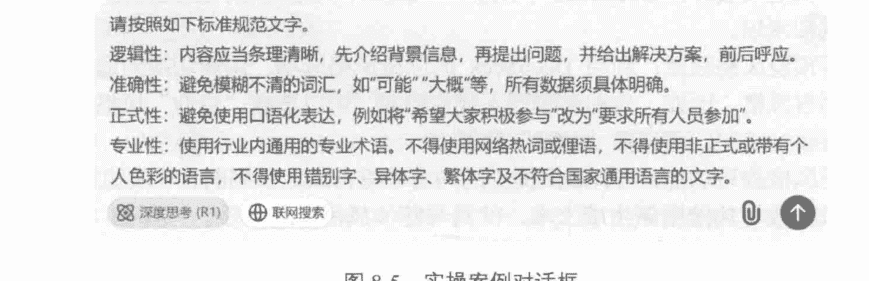

图 8-5 实操案例对话框

第 3 步，打开 DeepSeek，点击 深度思考 和 ⬆ 即可生成一篇风格统一的高质量文章。

###### 关于优化公司内部沟通机制的建议

尊敬的同事们，为提升公司的运营效率，强化各部门之间的协作，现提出以下几项优化公司内部沟通机制的具体措施。本建议基于当前公司内部沟通存在的若干问题制定，并提出了相应的解决方案。

###### 一、背景信息

在现有工作流程中，由于缺乏系统化的信息共享平台，导致部门间的信息流通不够顺畅和及时。此外，在跨部门项目合作过程中，因缺少专门负责协调工作的小组，项目推进时遇到的问题未能得到及时解决。这些问题不仅影响了工作效率，也对整体目标的实现构成了挑战。

###### 二、问题阐述

具体而言，目前面临的主要问题包括但不限于，缺乏高效的信息共享工具，导致信息传递不畅；跨部门协作缺乏有效的协调机制，使得项目进展受阻。

###### 三、解决方案

针对上述问题，特提出以下改进方案。一是设立专门的跨部门协调小组，负责监督项目进度并解决出现的问题；二是强化每月一次的全员大会的作用，通过定期会议促进团队间的直接交流，增进相互理解和合作。

###### 四、总结

综上所述，通过实施以上措施，我们期望能够显著改善公司内部的沟通状况，提高工作效率，并为实现公司的长期发展目标奠定坚实的基础。要求所有人员积极参与到这一改进过程中来，共同推动公司向前发展。

> AI 是作家的新画笔，但故事的核心永远是人类情感。
> ——J.K.罗琳（《哈利·波特》作者）

### 第 9 章 创意写作

创意写作是一种强调创造性与个性化表达的写作形式，涵盖小说、诗歌、散文、剧本等多种文学体裁。其核心在于创新，体现在题材、情节与语言表达上。作者可运用新颖词汇、独特句式与修辞，使作品独具魅力。同时，创意写作注重情感真实表达，将个人经历与感受融入作品，引发读者共鸣。

在当今社会，创意写作应用广泛，既是文学创作的重要方式，也在广告文案、影视剧本、游戏脚本等领域发挥关键作用。对个人而言，它是自我表达与情感宣泄的渠道，有助于提升思维与语言能力。对社会而言，优秀作品丰富文化内涵，推动文化产业发展。

#### 9.1 诗歌创作

诗歌创作是一种高度凝练且富有节奏与韵律美的文学形式。它以简洁深邃的语言，借助丰富意象、独特修辞与灵动句式，表达创作者细腻情感、深刻思想及对世界的独特认知与感悟。

写诗时，最触动人的往往是画面怎样落到纸上。把抽象的情绪投射到可感知的物象里，比如让月亮承载相思，让梅花暗示高洁，感受就有了抓手。比喻、拟人、夸张等修辞让语言更鲜活，感染力随之增强。节律与押韵则像音乐的骨架，有时轻快有时舒缓，读来顺口，也让情意的流动更顺畅。

##### 9.1.1 用 AI 点燃诗意灵感
在作诗的流程里，DeepSeek 可以扮演创意伙伴的角色。它擅长抛出灵感、梳理思路，帮助作者跳出惯性，让成诗的速度与新鲜度同步提升。通过它，可以从多个角度挖掘素材，用更独特的表达把内心感受传递出来，为作品注入新活力。若想启动创作，可参考下面几个方向。

- 厘清情绪基调与主题：先想清楚想要表达的核心感受和大致方向，比如自然、情爱、追梦等。把这些信息告诉模型，获取相关的意象、词汇与点子，为整首诗定调。
- 明确形式框架：说明希望采用的体式，比如是否分行分段，或遵循某种固定格式，让它帮助规划起承转合，使层次更分明。
- 搜集意象与象征：描述想要承载的情感或题旨，让它给出对应的意象与象征，例如用星辰喻希望、用落叶喻失落，从而丰富内涵。
- 共拟诗句与调律：把已有的零碎想法提供给它，让它协助扩展成完整句子，同时探讨押韵与节奏，使成品读起来顺口。
- 打磨细节：基于初稿，一起推敲形容词、动词等，让画面更生动，艺术张力更强。

在使用模型写诗时要明白，虽然它能给出大量灵感和素材，但最终成诗必须体现作者的个人印记和真实情感。不能照搬生成结果，需要筛选再加工，确保表达的是自己内心的声音。并且要多尝试多样化的提问方式，深挖工具潜力，让它更好地服务创作，写出有辨识度的作品。

##### 9.1.2 实操案例
下面以实践方式说明如何借助 DeepSeek 写诗。某男生为心仪女生写藏头诗，流程如下：

第一步，明确要表达的内容和包含的元素。

第二步，启动 DeepSeek，开启深度思考与联网搜索功能，在对话框中填写指令，如图 9-1 所示。


第三步，发送后稍等，系统会给出藏头诗的一版。

> 《情寄花如翔》

我心恋慕意绵绵，
爱若春风梦亦牵。
你似仙姿临俗世，
花如丽影映眸前。
如兰气质才情显，
翔凤仪容品德贤。
永共朝昏同赏景，
伴随星月共婵娟。
相依岁月情无尽，
随影流年爱更坚。

##### 9.2 剧本创作
剧本创作是为了戏剧、影视等表演形式搭建故事骨架和人物形象的过程。以对话与舞台指示为主要载体，通过精心设计的情节、冲突和人物关系推进故事。作者需要塑造个性鲜明的人物，赋予目标、动机与行为逻辑，构建紧张或细腻的情节线，同时兼顾场景转换和节奏控制，使剧本具备戏剧张力与可演性，为演员和导演提供创作基础，最终在舞台或荧幕上呈现视听双重体验。

##### 9.2.1 让 AI 助力剧本搭建
作为一款强力智能工具，DeepSeek 能为剧本创作提供新思路。它能在创意启发、情节搭建和角色塑造等方面提供支持，帮助创作者开启旅程。

想要高效创作，可参考以下做法。

- 锁定题材与核心概念：先确定方向，如爱情、悬疑或冒险。把核心概念提供给模型，让它生成相关创意点子和故事梗概，为创作奠基。
- 搭建故事骨架：描述故事的大致走向，如开端、发展、高潮与结局，让模型梳理出清晰脉络并完善框架。
- 丰富角色形象：把角色的基本设定，如性格、身份背景等告知模型，让它补充细节特征和行为习惯，使角色更立体。
- 设计冲突：基于已有框架，和模型探讨如何设置人物矛盾或外部挑战，增强吸引力。
- 生成对话：把场景和人物关系描述给模型，让它产出符合性格与情境的台词，再按自身需求修改完善。

使用模型创作剧本时要留意，它能提供大量灵感，但无法替代创作者的独特思考与情感表达。创作中要保持个人印记和核心思想，别全盘照搬生成内容。同时要甄别筛选，确保符合整体逻辑与价值观，避免不合理或低质量内容，才能做出好剧本。

##### 9.2.2 实操演示
下面展示如何借助 DeepSeek 构建剧本。

第一步，明确时长、参演人数、受众等要素。

第二步，启动 DeepSeek，开启深度思考与联网搜索，并在对话框中填写指令，如图 9-2 所示，然后发送。


图 9-2 实操案例示意图

系统会自动检索网络上的相关剧本作为参考。

第三步，稍等片刻，就会得到一个小品剧本。

###### 校园丘比特之箭

###### 一、角色
张三：男主，开朗憨直，对花如翔一见钟情。
花如翔：女主，聪明伶俐，活泼可爱。
李四：张三好友，点子多，爱调侃。
王五：花如翔闺蜜，热心肠，喜欢撮合。
路人甲：校园中偶然出现的角色。

###### 二、剧本内容

###### 第一幕——一见钟情
时长：0:00 至 1:00 地点：校园操场
运动会现场，张三在场边加油，花如翔作为啦啦队队员表演。张三瞬间心动，李四调侃助攻，初步点燃戏剧张力。

###### 第二幕——尴尬搭讪
时长：1:00 至 2:00 地点：学校图书馆
张三借偶遇搭讪，话题生硬还冒出小插曲，肢体碰触带来尴尬又好笑的效果。

###### 第三幕——闺蜜助攻
时长：2:00 至 3:00 地点：校园花园
王五目睹图书馆一幕后主动撮合，向花如翔透露张三的心意，催生好感。

###### 第四幕——勇敢表白
时长：3:00 至 4:00 地点：校园湖边
在朋友策划下，张三布置表白场景真诚告白，花如翔接受，两人达成情愫，朋友欢呼收尾。

##### 9.3 歌词创作
歌词创作是为歌曲配字的艺术。它与音乐紧密结合，借助简洁生动且富于韵律的语言表达情感、讲述故事或传递思想。歌词既要具备感染力，能引发共鸣，也要在形式上与旋律节奏契合，注重押韵和顺口，便于传唱。创作者需运用丰富词汇、巧妙修辞与独特意象融合情感与音乐元素，创作出兼具文学性与可唱性的作品。

##### 9.3.1 借助 DeepSeek 写出有共鸣的歌词
在音乐创作中，歌词是传递情感的关键。DeepSeek 能提供丰富灵感与多元思路，帮助创作者突破瓶颈，写出感染力强的歌词。即使文字功底有限，也能在支持下让内心情感精准传达给听众。创作时可从以下方面入手。

- 明确主旨与情感核心：先确定想表达的情绪，如斗志、爱意或生活感悟，并思考主题如友情、成长、回忆等。将这些信息传达给模型，获取创意、词汇与表达方向，为歌词定调。
- 构思故事与情境：告诉模型初步的故事框架或情境设定，如难忘旅行、刻骨相遇等，让它细化情节，描绘具体画面，使歌词更具画面感。
- 塑造独特意象：描述传达的情感或主题，让它提供相关意象，如以燃烧火焰象征激情、以飘零花瓣象征逝去美好，巧妙运用可增强诗意。
- 打磨节奏与韵律：把已有思路与片段输入，让它协助优化节奏与韵律，确保演唱顺口自然，与旋律完美配合。
- 增添细节与金句：基于生成内容，和模型探讨如何加入细节描写，如动作、表情等，使歌词更生动；同时挖掘能直击人心的金句，提升记忆点。

使用模型写歌词时要清楚它只是辅助工具。最终作品需体现创作者的个人印记与真实情感，不能盲目照搬，需仔细筛选、精心雕琢。每句都要源于内心。此外，多尝试不同指令与提问方式，深挖工具潜能，打造令人难忘的优秀歌词。

##### 9.3.2 实操演示
下面展示如何利用 DeepSeek 创作歌词。张三为花如翔改编《双截棍》的步骤如下：

第一步，明确改编风格、要包含的元素以及需要烘托的意境。

第二步，启动 DeepSeek，开启深度思考与联网搜索，并在对话框中填写指令，如图 9-3 所示。


图 9-3 实操案例对话框

第三步，发送后稍等，系统会生成改编歌词。

###### 《双截棍·花如翔特别版》

原曲调参考：周杰伦《双截棍》
演唱提示：保留“哼哼哈兮”节奏，副歌可加入婚礼进行曲旋律混搭。
全曲以婚礼场景为意象，将武术梗转化为表白仪式，通过细节描写与 Rap 互动强化情感，最后升华为守护承诺。

##### 9.4 直播脚本
直播脚本是对直播内容与流程进行规划设计的文本方案。类似影视脚本，它详细规定了各环节的具体内容与时间安排，包括开场、产品介绍、互动、结束语等。通过撰写脚本，直播活动能更有序流畅，提升质量与效果，吸引注意力，增强参与度和购买意愿，是直播成功的重要保障。

##### 9.4.1 用 DeepSeek 生成脚本，让直播更顺畅
在直播行业蓬勃发展下，优质脚本是成功的关键。DeepSeek 作为智能工具，能为语言能力有限的用户提供很大助力，从流程规划、环节设计到话术撰写等多方面提供灵感与思路，让筹备更高效，内容更具吸引力。想要生成实用脚本，可参考以下思路。

- 明确目的与主题：确定此次直播是为了产品推广、知识分享还是娱乐互动，并确定主题，如“新品美妆发布会”“职场技能分享会”等。
- 规划流程：向模型描述大致流程，如开场、主体内容、互动抽奖与结尾，让它细化各环节的时间分配与要点，使节奏紧凑合理。
- 设计互动环节：思考想要设置的互动形式，如问答、抽奖、连麦等，和模型探讨互动规则、话术及插入时机，以提升参与度。
- 撰写主播话术：把各环节要点提供给模型，让它根据场景生成引导话术、产品介绍话术、互动话术等，帮助主播清晰流畅地推进直播。
- 完善细节与突发预案：一起完善细节，如道具展示说明、镜头切换提示等，同时让模型帮忙构思可能出现的突发情况及应对预案，如网络卡顿等。

使用模型生成脚本时要牢记它只是辅助工具，不能全盘依赖，要仔细审核调整，确保逻辑清晰、内容可行。不断尝试不同提问方式与指令，充分挖掘潜力，让它更好地服务于脚本创作，打造高质量、高人气的直播。

##### 9.4.2 实操演示
下面展示如何利用 DeepSeek 生成直播脚本。张三决定以直播形式向花如翔表达爱意，具体操作如下。

第一步，构思直播流程。

第二步，启动 DeepSeek，开启深度思考与联网搜索，并在对话框中填写指令，如图 9-4 所示。


第三步，发送后稍等，系统会形成完整的表白直播脚本。

###### 表白直播脚本

直播时间：20:00 至 22:00
地点：学校后小山
主角：张三、花如翔
观众：直播间观众、现场朋友可选

###### 一、场景布置建议

灯光：暖色串灯或 LED 灯带营造氛围，地面小地灯补光，聚光灯突出表白中心。
背景：白布幕配灯带拼出心形或名字，地面撒花瓣增添浪漫。
道具：鲜花、音响播放轻柔浪漫曲目、话筒或扩音器保证清晰。
座位：小长椅或地毯方便表白后交流。

###### 二、直播脚本概要

开场预热 20:00-20:15：在山脚介绍来意与场地意义，与观众互动拉近距离。
女主出现 20:15-20:30：等待花如翔到来，背景音乐营造情绪，引导寒暄缓解紧张。
表白环节 20:30-21:00：灯光聚焦，台词真诚表达心意，完成告白并获得回应，朋友现身欢呼收尾。

校园直播告白全流程拆解

（2）环境音乐：全程选用轻盈浪漫的曲目，烘托现场情绪张力。

（3）台词：
“花如翔，自初次相识以来，我对你的心意一直悄悄累积。每一次与你共处，时光都显得格外轻快，你的笑意、你的声线，都深深烙在我记忆里。”
“我清楚表白需要勇气，今天我想豁出去。想告诉你，我确实很喜欢你，喜欢得无法自拔。无论将来怎样，我都希望能和你一起走下去。”
“这束花寄托我的心意，请收下。我希望你能接受我，成为我的女朋友。”

（4）互动：
表白时把握节奏，适时停顿观察花如翔的表情。若她流露感动或接受的信号，可将鲜花递上并以温柔方式拥抱。

###### 4. 感言环节（21:00 至 21:30）
（1）镜头：你与花如翔并排坐在长椅上，背后是柔和灯光的布景。
（2）台词：
“今晚非常感谢大家的陪伴，也谢谢花如翔愿意把话听完。无论结果怎样，这一天对我来说都极具意义。”
“如果花如翔愿意留下，我会更加珍惜她，努力让她幸福。若未被接受，我也会尊重她的决定，继续以朋友身份相处。”
（3）互动：
与花如翔交流她的感受，表达谢意；同时面向直播间观众致谢，感谢支持与鼓励。

###### 5. 结束环节（21:30 至 22:00）
（1）镜头：你和花如翔站在场景中央，向镜头挥手告别。
（2）台词：
“今晚的直播到此结束，谢谢大家的陪伴与祝福。不论结局怎样，我都会继续努力，追求自己的幸福。”
“也祝愿各位都能勇敢追爱，不要留下遗憾。再见！”
（3）环境音乐：选用温暖的收尾曲目，如《简单爱》或《甜甜的》。

###### 6. 关键提醒
- （1）情绪掌控：表白时保持真诚自然，避免过度紧张，让情感自然流露。
- （2）时长掌控：严格执行各环节时间，防止拖沓或仓促。
- （3）互动提升：多与直播间观众交流，提升观看趣味与参与感。
- （4）备用方案：若花如翔缺席或拒绝告白，需提前准备应对措施，保持冷静礼貌。

#### 9.5 舞台剧创作
舞台剧是一种综合艺术形态，融合文学、表演、音乐、舞蹈、美术等多重元素。创作者需构建完整故事，塑造个性鲜明的人物，通过对话、独白、动作呈现性格与情感冲突。同时依据剧情设计场景、灯光、音乐与舞蹈，使各艺术形式相互配合，相得益彰，共同营造独特的舞台氛围，为观众带来沉浸式视听体验，产生强烈艺术感染与情感冲击。

##### 9.5.1 打造差异化舞台剧作品
对文字表达不够自信的创作者，DeepSeek 可作为创作助手。它能在故事构思、人物细化到场景设计等层面，提供源源不断的灵感与系统化思路，助力创作出精彩舞台剧。借助该工具时，可参考以下思路。

- 明确主题与核心矛盾：先梳理剧中想要呈现的主题，并锁定核心冲突，如人物矛盾、理想与现实的碰撞等。将要点输入工具，由其协助搭建故事骨架，并提供情节走向灵感。
- 塑造鲜明人物：把初步人物设想告知工具，请其补充细节，如习惯动作、口头禅、内心隐秘想法等，为表演奠定基础。
- 设计场景与道具：描述故事发生环境，如古老宫殿或现代街头，以及所需道具，请其提供布景与道具使用建议，并思考如何通过场景与道具变化推动剧情、增强视觉效果。
- 编写台词与对话：基于已确定的角色与剧情，将相关信息输入，请其生成贴合人设与情境的台词。对白应简洁清晰、富有感染力，便于演员演绎与观众理解。
- 规划节奏与舞台调度：与工具探讨表演节奏的安排，何时紧张激烈、何时舒缓抒情，以及演员走位、站位等调度，使全剧张弛有度、节奏鲜明。

##### 9.5.2 实操案例分享
本节演示如何借助 DeepSeek 创作出独特舞台剧。张三决定将追求花如翔的过程改编为唯美舞台剧，以永久记录这段回忆。

第 1 步，确定剧目风格与核心矛盾，并同步完成场景道具设计及表演节奏与舞台调度规划。
第 2 步，打开 DeepSeek，点击“深度思考”与“联网搜索”，在对话框中输入对应提示词，如图 9-5 所示。


图 9-5 实操案例对话框

第 3 步，点击确认后稍作等待，工具即可输出一份完整的剧本内容。

###### 爱与命运的悲歌
###### 一、角色
张三：男主角，对花如翔情根深种，勇敢追爱。
花如翔：女主角，张三的仰慕对象，善良却在感情上挣扎。
旁白：交代背景并推进情节。
朋友甲：张三好友，全力支持其追求。
朋友乙：花如翔好友，对张三的追求持保留态度。

###### 二、剧本内容
###### 第一幕：心动缘起
时长：0:00 至 0:30
场景：校园花园阳光明媚，花如翔在花丛中阅读，张三偶然经过，被她的美丽与专注深深吸引。
张三：（内心独白）那一刻时间仿佛静止，她像一道光照亮我的世界。（目光紧锁花如翔）
旁白：张三就此陷入爱情漩涡，一场勇敢而波折的追求就此展开。

###### 第二幕：勇敢追求
时长：0:30 至 1:30
场景：学校文艺活动现场，张三为引起注意登台表演周杰伦《双截棍》。手持双节棍激情演唱，动作略显笨拙却热情十足。台下花如翔被他的勇气逗笑，开始对他产生印象。
张三：（边唱边舞，气喘吁吁）哼哼哈兮，花如翔，你一定能感受到我的心意！（眼神坚定）
朋友甲：（台下大喊）张三，加油！唱出你的爱！
花如翔：（捂嘴轻笑）这个男生，还挺有意思的。

###### 第三幕：直播表白
时长：1:30 至 2:30
场景：在朋友甲帮助下，张三策划一场直播告白。直播中他深情讲述对花如翔的喜欢，回溯相处的点滴。而花如翔的好友乙在一旁劝阻，认为表白过于草率。
张三：（对镜头真诚）花如翔，见到你的第一眼起，我就知道你是这辈子要守护的人。我知道告白突然，但这份爱藏在心里很久了。（紧张等待回应）
朋友乙：（拉着花如翔）如翔，别冲动，他这样告白太随意了，不能轻易答应。
花如翔：（犹豫，眼神纠结）我……我也不知道该怎么办。

###### 第四幕：冲突爆发
时长：2:30 至 3:30
场景：张三以为会被打动，却在朋友乙影响下被拒绝。他感到痛苦不解，双方爆发激烈争吵。
张三：（激动）为什么？我为你做了这么多，为什么不能接受我？（眼神受伤）
花如翔：（也激动）你以为这些就够了吗？爱情不是一时冲动，我需要时间考虑。（转身欲走）
张三：（拉住她）别走，给我一次机会，让我证明给你看！
花如翔：（用力甩开）够了，让我静一静！（跑开）

###### 第五幕：命运转折
时长：3:30 至 4:30
场景：张三陷入自责与痛苦，反思自身行为。花如翔离开后亦渐渐意识到自己对张三有情。命运弄人，花如翔随后查出重病，知晓时日无多，便隐瞒病情切断联系。
旁白：命运轮盘无情转动，将这对相爱的人推向痛苦深渊。（语气沉重）
张三：（失魂落魄走在街头）如翔，我该怎么做才能挽回你的心？（满脸痛苦）
花如翔：（病床上泪流满面）张三，原谅我，我不能拖累你。（虚弱闭眼）

###### 第六幕：凄美结局
时长：4:30 至 5:00
场景：花如翔最终离世。张三悲痛欲绝，在墓前唱起曾为她唱过的《双截棍》，歌声充满思念与不舍。唱完后，他仿佛看见花如翔身影出现，两人相拥起舞，画面渐渐模糊，如梁祝化蝶般唯美凄凉。
张三：（含泪轻唱）哼哼哈兮……（仿佛看见她，伸出手）如翔，我来了……（缓缓闭眼）
旁白：他们的爱情，如夜空中璀璨却短暂的流星，虽划过天际，却留下永恒凄美。（音乐渐弱，落幕）

> AI 将自动化所有重复性工作，释放人类的创造力。
> ——凯文·凯利（《失控》作者）

### 第 10 章 Excel 表格高效处理
在数字化办公时代，Excel 承担数据处理、分析、展示的核心任务。随着人工智能快速发展，其与 Excel 的结合让表格操作更便捷高效。AI 助力 Excel 最先体现在数据录入环节。过去将图片表格手工录入费时费力且易错，如今借助智能工具，一次操作即可把图片数据精准提取并转化为可编辑表格，大幅提升录入效率。

#### 10.1 图片转表格
传统方式需人工逐行输入，不仅繁琐还易因疲劳出错。AI 技术改变了现状，用户只需上传表格图片，执行操作，工具凭借图像识别与数据提取技术精准识别各类数据并转化为可编辑格式。

##### 10.1.1 一键提取图片中的表格
使用 DeepSeek 提取图片表格的流程如下：
- 准备工作：确保图片清晰，表格线条与文字完整，格式为工具支持的类型如 JPEG、PNG 等。
- 提问方式：打开 DeepSeek，用简洁语言描述需求，例如“帮我从这张图片中提取表格数据”，并上传图片。最好说明是否有关表头、是否有特殊格式，方便理解。
- 查看结果：处理完成后核对提取的数据是否准确，有无遗漏或误识。
- 数据整理：若格式不符习惯，如行列错位、类型错误，可用 Excel 简单整理。
- 保存运用：确认无误后保存，方便后续分析与编辑。
此外，提取结果可能存在少量偏差，务必认真核对，有问题可调整图片或更换提问方式重试。

##### 10.1.2 实操案例
请将一张图片版的表格转换为 Excel 表格。
第 1 步，找到一张包含表格的图片，如图 10-1 所示。

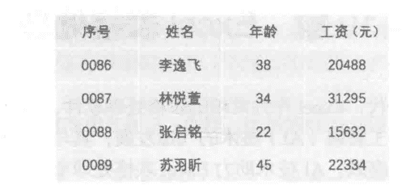

第 2 步，打开 DeepSeek，点击下方的“附件”，上传图片，并在对话框中输入提示词，如图 10-2 所示。


工具会自动提取其中的文本。
第 3 步，点击按钮后稍等，DeepSeek 会生成一个代码框，可直接复制，如图 10-3 所示。


第 4 步，将表格复制到 Excel 工作表中，可看到文字已被提取出来，如图 10-4 所示。

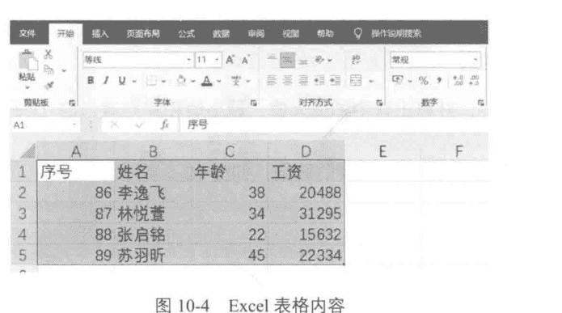

图 10-4 Excel 表格内容

#### 10.2 生成 Excel 函数
Excel 函数涵盖数学运算、文本处理、逻辑判断等，功能强大但语法复杂让许多用户却步。AI 写公式功能的出现打破了这一障碍。用户只需用自然语言描述计算需求，工具即可快速给出对应公式。新手也能借助 AI 轻松完成复杂计算，充分发挥 Excel 的数据处理能力。

##### 10.2.1 输入需求，自动生成 Excel 函数
在日常数据处理中，函数语法对很多人并不友好。有了 DeepSeek，无需死记硬背，只需简单提问即可快速获取所需函数，大大提高效率。具体流程如下：
- 明确需求：先梳理计算目标，如求某列总和、求平均值等。
- 简洁提问：用清晰简短的语言描述需求，例如“如何计算 A1 到 A10 单元格的总和”。
- 理解回复：工具会给出公式，要仔细理解构成与参数含义，便于后续修改。
- 代入数据：将实际数据填入公式，确保作用于目标区域。
- 检查验证：输入后检查结果是否合理，如有问题可再次请教修改建议。
使用时要确保描述准确，避免模糊导致错误。虽然 AI 很便利，但仍需对基础函数原理有一定了解，才能灵活应对。不同版本与环境可能导致回复差异，遇到问题可调整提问或查阅资料。

##### 10.2.2 实操案例
求和一列内容，并算出最大值、最小值和平均值，请 DeepSeek 写出相应公式。
第 1 步，在 Excel 中填入需要的数据，如图 10-5 所示。

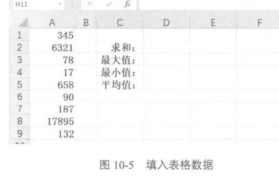

图 10-5 填入表格数据

第 2 步，打开 DeepSeek，并在对话框中输入提示词，如图 10-6 所示。


图 10-6 实操案例对话框

第 3 步，点击按钮稍等，工具会给出求和、最大值、最小值、平均值的运算公式，如图 10-7 所示。

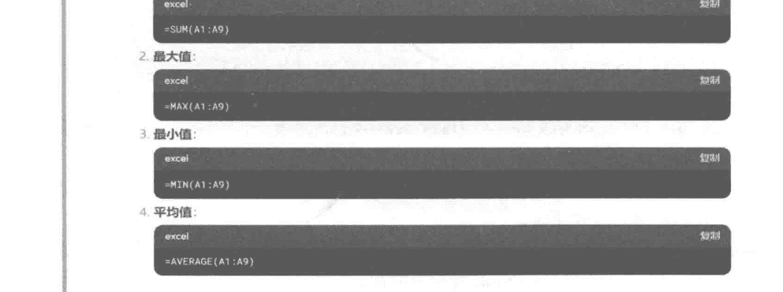

图 10-7 DeepSeek 生成的公式

第 4 步，将公式复制到 Excel 中，可看到计算结果，如图 10-8 所示。

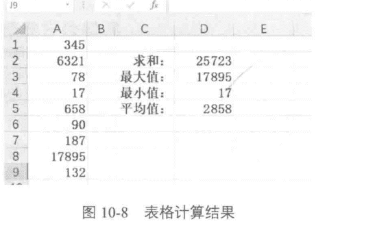

图 10-8 表格计算结果

#### 10.3 生成 VBA 代码
VBA 可实现 Excel 自动化操作，对重复性任务很高效，但编写需要编程知识。AI 工具解决了这一难题，用户无需写代码即可实现办公自动化，减少重复操作，提高效率，让 Excel 使用更智能便捷。

##### 10.3.1 自动快速生成 VBA 脚本
使用 DeepSeek 生成 VBA 脚本的流程如下：
- 确定目标：在求助前明确自动化任务，例如自动筛选数据、批量调整格式等。
- 精准描述：详细准确地阐述需求，例如“写一段 VBA 代码，实现每月 1 号自动汇总上个月各部门销售数据”。
- 解析代码：收到代码后认真研读逻辑，理解各部分作用，便于调整优化。
- 调试运行：将代码复制到 Excel 的 VBA 编辑器进行初步调试，检查语法错误并分析报错原因。
- 优化完善：根据调试结果与实际需求优化代码，如调整处理范围、提升执行效率，也可再次请 AI 给出改进建议。
需注意需求描述要清晰完整，避免因表述不清导致代码不符；工具产出的代码未必最优，需结合实际优化；不同版本与运行环境可能影响生成与执行，遇到问题可调整提问、查阅文档或寻求技术支持。

##### 10.3.2 实操案例
第 1 步，确定 VBA 代码实现的操作：实现每月 1 号自动汇总上个月各部门的销售数据。
第 2 步，打开 DeepSeek，点击“深度思考”与“联网搜索”，在对话框中输入提示词，如图 10-9 所示。


图 10-9 实操案例对话框

第 3 步，点击⬆按钮稍等，DeepSeek 会给出 VBA 代码。
以下是实现每月 1 号自动汇总上个月各部门销售数据的 Excel VBA 代码，包含自动触发机制和详细注释：

```
Sub Simple Monthly Summary()
    If Day(Date) <> 1 Then Exit Sub '仅每月 1 号执行
    Dim lastMonth As Date: lastMonth = DateAdd("m", -1, Date)
    Dim dataSheet As Worksheet: Set dataSheet = Sheets("销售数据")
    Dim summarySheet As Worksheet: Set summarySheet = Sheets.Add(After:=Sheets(Sheets.Count))
    '创建汇总表
    summarySheet.Name = Format(lastMonth, "yyyy-mm") & "汇总"
    summarySheet.Range("A1:C1") = Array("部门", "总销售额", "记录数")
    '使用数据透视表快速汇总
    dataSheet.Range("A:C").CreatePivotTable _
        TableDestination:=summarySheet.Range("A3"), _
        TableName:="TempPivot"
    With summarySheet.PivotTables("TempPivot")
        .PivotFields("部门").Orientation = xlRowField
        .AddDataField .PivotFields("销售额"), "总销售额", xlSum
        .AddDataField .PivotFields("部门"), "记录数", xlCount
    End With
    summarySheet.Columns.AutoFit
    MsgBox "上月数据已汇总到新工作表!"
End Sub
```

#### 10.4 数据质检与修复

在电子表格的日常使用中，录入环节的细微偏差会直接拉低后续结论的可信度。实际操作里经常碰到格式参差、重复记录、逻辑冲突等状况。借助 AI 的校验能力，可以对整份资料进行全盘扫描，利用模型判断快速标记出格式类异常，例如日期写法不一、数值样式错误等，并依据问题类别给出可操作的修改建议，帮助用户迅速完成修正，为后续的分析工作提供干净可靠的基础。

##### 10.4.1 快速揪出问题点

以前人工逐行核对既费时又容易漏检。如今借助 DeepSeek 的校对能力，能在短时间内锁定异常所在，特别是在求和核算这类场景中提供有力支撑。典型操作路径如下：

- 准备资料：将待核查的内容完整导入表格，保证排版规范，便于模型解析。
- 明确指令：向 DeepSeek 清晰描述检查重点，例如“请帮我核对本表合计是否正确”，并附上表格或链接。
- 等待扫描：模型会按算法对内容进行遍历，识别求和错误等异常，需要稍作等待。
- 查看反馈：分析完成后平台会呈现检测到的异常，需要认真核对位置与类型。
- 执行修改：依据提示在表格中做相应更正。
- 复核确认：修正后再次调用校验，确保没有遗留问题。

同时要保证原始录入完整且格式正确，否则易产生误判。提问时应详述表格结构和字段含义，以提升判断精度。即使 AI 能高效发现问题，操作者仍需具备基本的数据理解，修改后务必二次验证。

##### 10.4.2 实操案例

尝试让 DeepSeek 找出表格里的错误。

第 1 步，准备一张含有错误信息的表格，如图 10-10 所示。

| 姓名 | 余额（元） | 家庭住址 |
| :--- | :--- | :--- |
| 周沐阳 | 485432 | 陕西省西安市 |
| 江晚柠 | 6425664 | 山东省青岛市 |
| 沈逸霄 | 2134 | 河北省南京市 |
| 苏念安 | 12356 | 河南省郑州市 |
| 林屿森 | 121324 | 山西省大同市 |
| 余额合计 | 3859238 |  |

图 10-10 待操作的表格

第 2 步，打开 DeepSeek，按下·联网搜索·并在对话框中输入提示词，如图 10-11 所示。


图 10-11 实操案例对话框

第 3 步，点击执行按钮稍等，DeepSeek 会给出分析结果。

根据表格中的数据，余额累加过程如下。

- 周沐阳：485432 元
- 江晚柠：6425664 元
- 沈逸霄：2134 元
- 苏念安：12356 元
- 林屿森：121324 元

将这些余额相加：485432+6425664+2134+12356+121324=7046910 元。

表格中给出的余额合计是 3859238 元，这与实际计算结果不符。因此，余额总计的数字是错误的。正确的余额总计应该是 7046910 元。

此外，图片中的表格有一个明显的错误：沈逸霄的家庭住址是“河北省南京市”。这个地址是错误的，因为南京是江苏省的省会，而不是河北省的。正确的应该是“江苏省南京市”。这个错误可能是由输入时的疏忽造成的。

#### 10.5 按需生成多样式报表

电子表格形态丰富，不同业务场景需要不同的呈现方式，比如数据透视表用于快速汇总，柱状图、折线图用于直观展示趋势。手工制作门槛较高。借助 AI 助手，用户只需提供核心数据和期望效果，比如想分析的销售数据及对比维度，AI 就能迅速产出对应的透视表或可视化图表，帮助从海量信息中挖掘价值，充分发挥电子表格在处理与展示方面的优势。

##### 10.5.1 一键定制报表样式

日常办公中，制作符合特定要求的报表往往令人头疼。如今 DeepSeek 可以接收复杂需求并直接输出对应样式，大幅提升效率。

主要流程包括：

- 梳理需求：在提问前先明确报表要呈现的效果、包含的数据内容及各部分功能。例如制作销售业绩分析表，需要涵盖各产品各季度销售额与利润，并设置汇总行和占比列。
- 精准表达：用简洁准确的语言描述需求。避免笼统表述，如“给我做个销售业绩分析表”过于模糊，应具体为“帮我生成一个 Excel 报表，包含产品名称、第一季度至第四季度销售额、利润，需有年度汇总行，利润列以百分比展示，样式简洁美观”。
- 查看反馈：生成后仔细检查数据是否完整、格式是否正确、样式是否符合预期。
- 微调优化：若存在小瑕疵，如格式偏差、行列宽度不合适，可用表格自带功能调整，也可再次向 DeepSeek 请求优化建议，例如“生成的利润列百分比小数位过多该如何调整”。
- 确认保存：检查无误后保存至指定位置，便于后续使用。

使用时需注意：需求描述越精准、详细，生成质量越高；提供的数据必须准确，避免因源数据错误导致结果偏差；AI 生成结果可能并非一次完美，需具备基础的表格调整技能；再次求助时要清晰说明当前问题，便于获得有效建议。

##### 10.5.2 实操案例

生成一份超市常用的账单模板。

第 1 步，打开 DeepSeek，在对话框中输入相关提示词，按下·深度思考·和·联网搜索·，如图 10-12 所示。


第 2 步，点击执行稍等，DeepSeek 会给出模板建议。

当然可以！以下是一个适合小超市业主使用的 Excel 记账模板设计思路和结构，可直接在 Excel 中搭建使用。

###### 1. 收入记录表

用于记录每日收入情况。

| 日期 | 商品名称 | 销售数量（个） | 单价（元） | 总收入（元） | 支付方式 |
| :--- | :--- | :--- | :--- | :--- | :--- |
| 2023-10-01 | 矿泉水 | 10 | 2.00 | 20.00 | 现金 |
| 2023-10-01 | 薯片 | 5 | 5.00 | 25.00 | 微信 |

###### 2. 支出记录表

用于记录超市各类支出，如进货、租金、水电等。

| 日期 | 支出类别 | 支出项目 | 支出金额（元） | 支付方式 |
| :--- | :--- | :--- | :--- | :--- |
| 2023-10-01 | 进货费 | 矿泉水 | 100.00 | 银行转账 |
| 2023-10-01 | 租金 | 店铺租金 | 2000.00 | 现金 |
| 2023-10-02 | 水电费 | 电费 | 300.00 | 支付宝 |

###### 3. 库存管理表

用于跟踪商品库存，方便及时补货。

| 商品名称 | 库存数量（个） | 进货单价（元） | 销售单价（元） | 最低库存数量（个） |
| :--- | :--- | :--- | :--- | :--- |
| 矿泉水 | 50 | 1.50 | 2.00 | 20 |
| 薯片 | 30 | 4.00 | 5.00 | 10 |

###### 4. 利润统计表

用于统计月度利润。

| 月份 | 总收入（元） | 总支出（元） | 利润（元） | 备注 |
| :--- | :--- | :--- | :--- | :--- |
| 2023-10 | 5000.00 | 3000.00 | 2000.00 |  |
| 2023-11 | 6000.00 | 3500.00 | 2500.00 |  |

###### 5. 月度汇总表

汇总月度收入、支出、利润及现有库存。

| 月份 | 总收入（元） | 总支出（元） | 利润（元） | 现有库存（元） |
| :--- | :--- | :--- | :--- | :--- |
| 2023-10 | 5000.00 | 3000.00 | 2000.00 | 195.00 |
| 2023-11 | 6000.00 | 3500.00 | 2500.00 | 300.00 |

使用说明：

（1）收入记录表：记录每日销售，便于统计日收入。
（2）支出记录表：记录全部支出，保持资金流向清晰。
（3）库存管理表：实时更新库存，避免缺货或积压。
（4）利润统计表：月度汇总收支并计算利润。
（5）月度汇总表：月度汇总收支与库存，方便查看经营状况。

可根据实际需求调整内容，或增加自动计算、数据透视等功能。希望该模板能帮助更好地管理超市财务！

> AI 的终极目标不是模仿人类，而是扩展人类的能力。

——李飞飞（斯坦福教授）

### 第 11 章 应用型写作

功能写作强调实用性，与偏重艺术表达的文学创作不同，更重视信息清晰以达成特定目标。AI 工具能够随时产出所需内容，让突发演讲也不再手足无措。

#### 11.1 拜年短信

##### 11.1.1 分人群定制表达

拜年短信是传递新年祝福的重要载体，批量生成个性化内容既提升效率，也能让不同对象感受到专属关怀。利用 DeepSeek，可为亲友、同事领导等定制差异化祝福。

生成思路如下：

- 长辈：语气恭敬感恩，可回顾关怀教导，如“上一年承蒙您悉心照料，新年祝您身体安康、顺遂如意”。
- 平辈朋友：风格轻松活泼，可融入共同回忆，如“还记得我们一起【具体经历】，新的一年愿我们继续创造更多欢乐，新年快乐！”
- 同事：表达感谢与展望，如“上一年与大家合作很愉快，新年祝工作顺利、项目圆满”。
- 领导：措辞正式谦逊，感谢指导，如“感谢您上一年悉心的指导，新的一年我将继续努力，祝您事业蒸蒸日上”。
- 客户：突出诚意与期待，如“感谢您上一年信任与支持，新年我们将竭诚服务，期待携手再创佳绩”。

##### 11.1.2 实操案例

为刚入职场的新人张小明生成个性化拜年短信。

第 1 步，先明确拜年对象，如恩师、同学、现任领导等。

第 2 步，打开 DeepSeek，按下·深度思考·和·联网搜索·，在对话框中输入提示词，如图 11-1 所示。


第 3 步，点击执行稍作等待，DeepSeek 会输出多条短信。

以下是针对不同群体定制的拜年短信模板（每条约 100 字，口语化避免重复）：

给曾经的老师：王老师新年好！学生张小明给您拜年啦！感谢您当年在［XX学科/校园生活］中的悉心教导，让我在职场也能受益。新的一年祝您身体康泰、桃李满园，愿师母和孩子们万事顺意！春节后想回母校看望您，届时再向您汇报工作心得～

给曾经的同学：老铁新年嗷嗷旺！还记得咱班当年［具体回忆：如考前突击/运动会夺冠］的糗事吗？转眼都成打工人了！祝兄弟/姐妹新一年薪资翻倍不加班，桃花朵朵开！等节后组局火锅走起，咱们继续造作青春！

给目前的领导：李总新年吉祥！感谢您过去一年在项目中的指导点拨，让我这个职场新人快速成长。新春佳节将至，衷心祝愿您和家人平安喜乐、诸事顺遂！新的一年我会继续努力，还请您多多指教。节后复工给您带家乡特产尝尝鲜～

给目前的同事：晓雯姐新年快乐呀！特别感谢您这半年手把手教我熟悉业务流程，超幸运能遇到神仙同事～祝您新年美妆自由、娃儿乖巧、购物永远遇折扣！咱们组新一年业绩继续冲第一，开工利是等着你！

给家中的长辈：二叔二婶新年好！小明给您拜年啦！感谢您总是惦记着我在外打拼，今年一定回家多陪您唠嗑。祝二叔钓鱼次次爆护，二婶广场舞王者出道！最要紧是身子骨硬硬朗朗，等着我带您游新开的湿地公园呀！

给普通朋友：姐妹/兄弟新年飒起来！新一年祝你奶茶自由不长肉，峡谷连胜不连跪，盲盒抽隐藏款，追星永不塌房！等放假组队逛庙会呀～（配锦鲤表情图）

**注意事项：**

1. 可根据实际情况替换具体内容。
2. 长辈短信建议配合语音发送更显亲切。
3. 领导同事建议除夕当天 9:00 至 11:00 发送。
4. 可附加个性化内容，如“看到您朋友圈的腊梅开了，和新年一样红火”。

#### 11.2 聚会发言稿

##### 11.2.1 多场景即兴表达

在各类聚会中，一段精彩发言能迅速活跃氛围，加深情感联结。

- 同学聚会：回忆校园难忘经历，如备考时光、有趣班级活动，唤起共同青春记忆。
- 家庭聚会：围绕家庭温暖与亲情珍贵展开，讲述成员间互相支持的感人故事，传递关爱与祝福。
- 公司聚会：感谢同事过去一年的付出，展望新一年目标与团队协作，激励共同进步。
- 朋友生日聚会：突出寿星个性与深厚友谊，分享相处欢乐瞬间，送上真挚祝福。
- 主题聚会：结合特定主题分享相关经历与感悟，使内容与聚会主题紧密契合。

##### 11.2.2 实操案例

为张小明生成不同聚会的发言稿。

第 1 步，明确发言目的：通过发言活跃气氛、增进情感。再确定聚会类型，如同学、家庭、公司、生日、主题等。

第 2 步，打开 DeepSeek，按下·深度思考·和·联网搜索·，在对话框中输入提示词，如图 11-2 所示。


第 3 步，点击执行稍作等待，DeepSeek 会输出多篇发言稿。

以下是针对不同场景设计的发言稿，兼顾情感表达与气氛调动，供参考：

###### 一、同学聚会发言稿

场合：阔别十年的高中同学聚会

尊敬的老师、亲爱的同学们：

大家好！我是张小明。今天站在这里，恍若回到教室后排传纸条的时光。那时我们总觉得毕业遥遥无期，转眼已分别十年。这十年，有人成为职场精英，有人成为超级奶爸，还有人像我一样仍在追逐“中年不油腻”的目标。

还记得运动会接力赛吗？老李摔倒后坚持跑向终点，全班为他呐喊的画面至今让我心潮澎湃。正因这些片段，我们成了彼此青春的“人形存档”。今天相聚，不是比拼发际线，而是找回那份纯粹默契——生活或许让我们“秃然”老去，情谊永远“不脱发”！

最后，愿我们像当年一样，敢闯敢拼，永远热泪盈眶！来，敬永不散场的青春，干杯！

###### 二、家庭聚会发言稿

场合：春节家族团圆饭

亲爱的爷爷奶奶、叔叔阿姨、兄弟姐妹们：

我叫小明，在家族群里常被戏称红包终结者。今晚四世同堂，我脑海里忽然闪出小时候偷吃供桌贡品被奶奶撵着打的糗事。过去总觉得老人唠叨，如今才懂“多吃点”“记得穿秋裤”这些话，是藏在岁月里的温柔。

老张家好像自带磁场，不管大家散落多远，腊肉香肠一上桌，亲情定位就自动归位。去年表姐的创业项目落地，小叔评上劳动模范，连上小学的豆豆也拿了编程奖杯。这些成绩背后，是家族“团结像麻花越拧越紧”的精神在延续。新的一年，愿我们继续做彼此的充电宝，电量满格，心情常亮。

最后用三句话收束：菜要趁热，酒要慢品，家要常回。干杯！

###### 三、公司年会发言稿
场合：公司年终表彰大会

尊敬的领导、亲爱的战友们：

大家好！我是市场部张小明——不对，我刚才差点报成张小强（扶额），年终冲刺把记忆体冲坏了。今年我们像一支取经小队：有人化身火眼金睛的数据悟空，有人像念紧箍咒的财务唐僧，我大概是爱跑下午茶的后勤八戒。

还记得那次通宵赶方案，凌晨三点办公室的泡面香比鸡汤更提神；也记得客户临时变卦时，团队瞬间切换成复仇者联盟般的默契。正是这些零碎瞬间，让同事关系升级为同舟共济。新的一年，愿我们继续互为锦鲤，业绩一路飙升，烦恼虎头蛇尾。

最后请领导放心，明年掉发变少，接单变多！Cheers！

#### 11.3 婚礼发言稿
##### 11.3.1 为婚礼即兴发言提供思路
用 DeepSeek 帮新人准备即兴致辞前，先弄清两人的爱恋轨迹与性格特点，这样才更有针对性。具体包括：
- 回忆首次印象：讲讲第一次见到新人时的感受，比如新郎的阳光、新娘的温柔，由此引出对他们爱情的感叹。

##### 11.3.2 实操案例
为新人好友张小明撰写婚礼发言稿。

第 1 步，先梳理祝福要点，可以是相识回忆、恋爱细节、品质点赞、未来期许、寓意引用等。

第 2 步，打开 DeepSeek，点开深度思考和联网检索，并在对话框里输入提示词，如图 11-3 所示。


第 3 步，点击发送按钮，等一会儿，系统就会输出一篇婚礼稿。

建议脱稿互动版框架：

1. 开场互动
“各位来宾好！我是跟新郎一起打球、逃过课又被甲方骂过的好兄弟张小明！看着他们牵手走红毯，我立刻想起第一次见到弟妹的画面——那天新郎神秘兮兮要带我见个‘三笑留情’的姑娘，咖啡厅一见，新郎笑得像招财猫，跟台上表情一模一样！大家觉得对不对？”

2. 恋爱细节回顾
“细数他们恋爱后的十个变化：一是新郎锁屏从动漫女神换成双人头像；二是发朋友圈开始署名‘某女士说’。最让人动容的是疫情那年高铁停运，他骑共享单车跨三个区，隔着栅栏送草莓蛋糕。这算不算现代版的‘所爱隔山海，山海皆可平’？”

3. 品质点评
“作为见证人，我公布两个真相：一是新娘是难得的‘反矫情高手’，新郎装病卖惨，她温柔说多喝热水，转身就拎着粥和药上门；二是她是‘反内卷楷模’，最近还跟着新郎学插花抗焦虑。最珍贵的是他们让彼此更温柔也更有力量。”

4. 五感祝福
“愿你们：闭眼能听见厨房砂锅的咕嘟声，睁眼能看见对方眼里的星光从青丝到白发。对了，撒狗粮记得屏蔽我们这些单身狗。”

5. 收尾金句
“借用《诗经》‘死生契阔，与子成说’，意思是朋友圈晒娃要九宫格，秀恩爱先打招呼，最重要的是百年后在公园长椅上互怼婚礼糗事。让我们见证这份承诺！”

#### 11.4 生日发言稿
##### 11.4.1 生成生日即兴发言稿
生日宴上，一段真诚又有趣的即兴致辞，能让气氛更暖，让寿星感受到关怀。主要包括：
- 分享难忘瞬间：聊聊一起旅行的趣事或共渡难关的经历，凸显情谊。
- 肯定闪光点：真诚列出寿星的优点，如乐观、乐于助人，让人感受到被看见。
- 送上期许：表达对新一岁的美好祝愿，希望目标达成，快乐常在。

##### 11.4.2 实操案例
为生日会上的张小明写即兴稿。

第 1 步，明确稿件基调，应温馨欢快，围绕祝福展开。

第 2 步，打开 DeepSeek，开启深度思考和联网检索，在对话框输入提示词，如图 11-4 所示。


第 3 步，发送后稍等，系统会生成完整的生日致辞。

###### 生日宴发言框架（欢快版）
1. 悬疑开场
“各位侦探注意！我是寿星五年前捡到的野生朋友张小明！今天解密一场伪装案——老李第一次见我时戴金丝眼镜捧《国富论》，一副学霸样，三天后烧烤摊上提着烤腰子喊走一个，台下目击者举手！”

2. 高光名场面
“跟寿星组队必出经典：暴雨天困迪士尼，他举玲娜贝儿气球领全车厢唱歌；密室逃脱时抱着NPC大腿喊大哥谈价；最绝的是喝醉后教流浪猫跳螃蟹舞，想看视频转账解锁。”

3. 彩虹夸赞
“老李有三大超能力：情绪稳定剂——我失恋时他点麻辣小龙虾说辣哭不丢人；反向内卷——别人加班晒咖啡，他下班晒猫说关爱颈椎；隐藏技能——居然会修微波炉，朋友们该不该发海底捞免费券？”

#### 11.5 表扬信
##### 11.5.1 快速生成表扬信
对写字不擅长的人来说，表扬信容易词不达意。用 AI 辅助包括：
- 明确对象和事件：写清受表扬者是谁，什么时间地点做了什么。
- 叙述经过：详细描述行为过程，突出关键作用。
- 点明意义：分析行为对个人、集体或社会的积极影响。

##### 11.5.2 实操案例
以张小明的名义写表扬信。

第 1 步，确定框架：对象事件、经过描述、意义强调、感谢赞扬、期望鼓励。

第 2 步，打开 DeepSeek 平台，开启深度思考和联网检索，在对话框输入提示词，如图 11-5 所示。

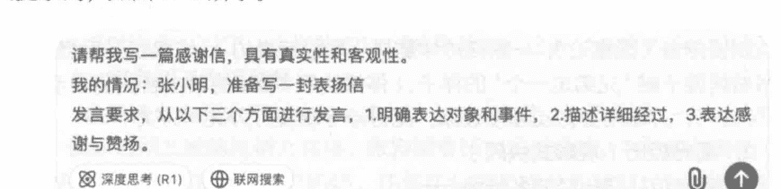

图 11-5 实操案例对话框

第 3 步，点击发送，片刻后会生成完整信件。

###### 表扬信
致：××公司领导
尊敬的领导：
您好！
我是××小区业主张小明，特此表扬贵公司保洁部员工李红。她于2025年2月10日展现的敬业与品德深深感动业主。

###### 明确表扬对象和事件
李红负责本小区公共区域清洁。2月10日下午，她在花园清扫时发现长椅遗落装有现金、身份证和银行卡的手提包，第一时间上交物业并联系失主王女士，成功归还。

###### 描述详细经过
当日15点左右，李红在日常清洁中发现黑色手提包，内有5000余元现金及证件。她立即送至物业办公室，配合调监控核实信息，1小时内找到失主。王女士多次酬谢均被婉拒。

###### 表达感谢与赞扬
谨代表全体业主感谢李红！她的行为体现平凡岗位的不凡精神，也彰显贵公司品德教育成效。“服务至上、业主为先”的理念在她身上得到最好诠释。

此致
敬礼！
业主：张小明
2025年×月×日

#### 11.6 检讨书
##### 11.6.1 快速生成检讨书
DeepSeek 能帮助梳理思路，让认错更真诚。检讨书包括：
- 指明错误：开门见山说明何时何地因何犯了什么错。
- 还原经过：详细叙述想法和行为及结果。
- 剖析原因：从认识不足、压力应对不当等角度反思。
- 表示态度：用恳切语言表达懊悔与歉意。
- 提出改正：列出具体改进措施。

##### 11.6.2 实操案例
为犯错的张小明生成检讨书。

第 1 步，确定框架：错在哪、怎么错、为什么错、什么态度、怎么改。

第 2 步，打开 DeepSeek，开启深度思考和联网检索，在对话框输入提示词，如图 11-6 所示。


图 11-6 实操案例对话框

第 3 步，点击发送，稍等后会生成检讨书。

###### 《检讨书》
尊敬的×××：
我是张小明，怀着愧疚写下此检讨，反省近期考试作弊。

上次期末考试中，因题目困难看到邻座答案，受侥幸心理驱使，我抄了答案。

反思原因：学习态度松懈，平时复习不力；价值观偏差，重成绩轻诚信；抗压能力不足。

我深知行为恶劣，已向老师同学道歉，愿接受处理。此事将作深刻教训。

改正措施：端正学习，认真听讲完成作业，制定复习计划；重建诚信观，坚守原则；学习减压方法，凭真实能力应考。并将参与诚信教育，宣传考风。

再次致歉，望谅解，我会以行动证明决心。

检讨人：张小明

> AI 将让每个人都能找到最适合自己的职业路径。
> ——里德·霍夫曼（Linkedin 联合创始人）

### 第 12 章 求职辅助
求职是步入社会的关键，方法对了事半功倍。借助 DeepSeek 可高效准备。

#### 12.1 职业规划
##### 12.1.1 制定合理的职业规划
使用 DeepSeek 做职业规划时需思路清晰，主要包括：
- 输入个人信息：上传或手动填写简历，让系统解析技能和经历。
- 识别差距：分析优势与短板，尤其求职关键领域。
- 确定方向：结合兴趣和市场，选择发展路径。
- 设计学习计划：推荐课程、证书和实践项目，填补空白。
- 锁定岗位：筛选适配职位，给出要求和薪资参考。

##### 12.1.2 实操案例
为清华计算机系毕业生张三做规划。

第 1 步，将简历上传到 DeepSeek，并输入求职信息，如图 12-1 所示。


图 12-1 实操案例对话框

第 2 步，点开深度思考和联网检索，再发送，系统会给出岗位建议。

结合清华计算机硕士背景、科研实习经历，以及北京月薪2万以上、求稳定与平衡的需求，推荐以下方向：

###### 一、人工智能/算法工程师
**IBM 研究院**
岗位：AI 算法研究员
薪资：25k～40k/月
要求：熟悉 TensorFlow/PyTorch，有推荐系统或NLP项目经验
优势：国内AI头部平台，资源充足，技术积累深

###### 二、央企/研究所技术岗
**中国电子科技集团公司（CETC）**
岗位：智能系统研发工程师
薪资：18k～30k/月含补贴
要求：算法设计与工程化能力，参与过国家级项目优先
优势：可解决北京户口，周期稳定，压力相对小

###### 建议与策略
- 优先投算法与AI岗，科研背景和清华学历是优势
- 关注国企央企春招，如中国移动研究院、航天科工，稳定且部分解决户口
- 若竞争激烈，可转云计算/后端开发，通用性强，职业寿命长

第 3 步，确定方向后，输入相关提示词，如图 12-2 所示，系统会生成求职建议。


###### 一、技能提升
外企看重技术、沟通与国际视野：
###### 1. 技术能力
算法与数据结构：每日在刷题平台练2-3道中等题
编程语言：精通Python、Java，熟悉C++
机器学习/深度学习：巩固TensorFlow/PyTorch，熟悉Transformer、BERT等模型

###### 2. 英语能力
技术英语：阅读Google、AWS官方文档
口语听力：每天30分钟口语练习，准备自我介绍和项目讲解

###### 3. 软技能
沟通协作：学习敏捷开发，掌握Jira等工具
跨文化沟通：了解外企时间观念和邮件礼仪

###### 二、求职准备
###### 1. 简历优化
英文简历：突出ICML论文和技术栈
项目描述：用背景-任务-行动-结果法量化成果

###### 2. 面试准备
算法面试：刷LeetCode高频题，做模拟面试
行为面试：准备挑战问题，结合科研经历回答
技术面试：复习过拟合、正则化等基础，准备系统设计案例

###### 三、时间规划
第一阶段（1-2月）：基础提升，刷题、读文档、整理简历
第二阶段（3-4月）：专项突破，系统设计、英文模拟面试，开始投递
第三阶段（5-6月）：冲刺面试，集中刷题、复盘优化

#### 12.2 简历生成
##### 12.2.1 生成吸引人的个人简历

DeepSeek 求职与科研提速实操指南

拿到心仪 offer 的起点，几乎都是履历。借助 DeepSeek 打磨申请材料，通过率会明显提升。整体打法可归纳为四点：

- 先锁方向：在下达指令前把意向岗位与行业边界厘清，输出才能对准招聘方诉求。
- 把关键能力前置：把与岗位强相关的实操经验往前放，例如编程语言、工具栈的落地经历。
- 用数据呈现结果：用具体数值体现贡献，比如“数据处理效率提升 50%”“项目成本节约 20%”之类的表述。
- 表达精炼：避免大段堆砌，用干净的语言与清晰的层次，一页纸内说清重点。

12.2.2 实操案例
下面以清华大学计算机专业毕业生张三的申请材料为例，完整走一遍流程。

第 1 步，把张三的项目经历、科研经历与个人信息尽可能完整地提供给 DeepSeek，如图 12-3 所示。
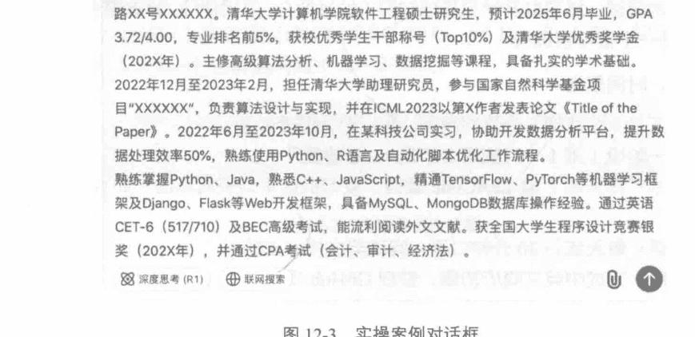

图 12-3 实操案例对话框

第 2 步，向模型发出指令“请基于以上经历，为我生成一份一页纸的求职简历”。
第 3 步，拿到初稿后按个人偏好做细节微调。

###### 张三

电话：138-0000-0000 邮箱：zhangsan@example.com

联系地址：×××省×××市×××路××号××××××

###### 求职意向

###### 教育背景

2021.09—2025.06 清华大学 计算机学院 软件硕士

GPA:3.72/4.00 专业前 5%。获奖经历：CPA（会计、审计、经济法）通过；校优秀学生干部（Top10%）

主修课程：高级算法分析、机器学习、数据挖掘、人工智能原理等

GPA:X.XX/4.0

主修课程：公司理财、国际金融、金融工程、投资银行学、投资学、金融服务营销学

###### 科研经历

2022.12—2023.02 清华大学 助理研究员 北京

参与国家自然科学基金项目“××××××”的研究工作，负责算法设计与实现。

在国际会议 ICML2023 上发表论文 Title of the Paper（第 X 作者）。

###### 实习经历

2022.06—2023.10 某科技公司 实习生 北京

协助开发团队完成了一个数据分析平台的原型设计，数据处理效率提高了 50%。

使用 Python 和 R 语言进行数据分析，并编写自动化脚本减少了手动操作。

###### 技能证书

计算机技能 编程语言：熟练掌握 Python，Java；熟悉 C++，JavaScript

工具与框架：熟练使用 TensorFlow，PyTorch；熟悉 Django，Flask。

数据库管理：MySQL，MongoDB

外语技能 英语 CET-6（517/710）通过，BEC 高级证书，听说读写流利，可阅读梳理外文专业文献

其他技能 清华大学优秀奖学金(202X) 全国大学生程序设计竞赛银奖(202X)

#### 12.3 知识搜集

##### 12.3.1 搜集岗位基础知识，为面试做准备

想让 DeepSeek 高效检索岗位信息，关键是先理清思路。核心在于：
- 精准拆解需求：把目标岗位的职位描述喂给模型，提取关键能力与知识点。

##### 12.3.2 实操案例
本次以清华计算机系毕业生张三面试 IBM 中国研究院北京分院 AI 解决方案工程师为例。

第 1 步，将张三的简历上传，并把岗位描述完整输入模型。
第 2 步，打开 · 深度思考 · 和 · 联网模式 ，输入对应提示词，如图 12-4 所示。
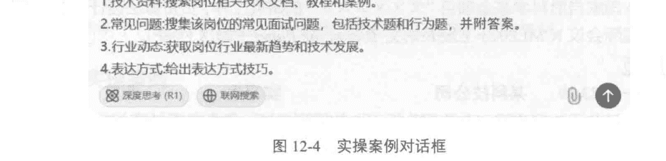

第 3 步，点击发送，片刻后模型会返回一份岗位信息清单。

为了帮助你准备 IBM 中国研究院北京分院 AI 解决方案工程师的面试，以下从技术资料、常见问题、行业动态和表达方式四个维度整理建议和资源。

###### 一、技术资料

###### 1. AI 解决方案工程师的核心技术

- 机器学习与深度学习：熟悉 TensorFlow、PyTorch 等框架，掌握经典模型（如 Transformer、BERT、GPT）的原理和应用场景。
- 自然语言处理：了解文本分类、语义分析、知识图谱等技术。
- 计算机视觉：掌握目标检测（如 YOLO 系列）、图像分割等技术。
- 系统集成与优化：学习如何把 AI 模型部署到真实业务场景，并优化性能和成本。

###### 2. 推荐学习资源

- IBM 官方文档：访问 IBM AI 解决方案页面，了解其 AI 技术栈和成功案例。
- 开源项目：研究 HuggingFace、OpenAI 等开源项目，学习预训练模型和微调流程。
- 技术博客与论文：阅读 ICML、NeurIPS 等顶会论文，关注 AI 领域的最新突破。

###### 二、常见问题

###### 1. 技术类问题

- 请描述一个你参与过的 AI 项目，并说明你是如何解决技术难题的。
- 如何优化深度学习模型的训练时间和能耗？
- 请解释 Transformer 模型的原理及其在 NLP 中的应用。
- 如何设计一个可扩展的 AI 解决方案？

###### 2. 行为类问题

- 你在团队中如何推动 AI 解决方案的落地？
- 请描述一次你处理项目延期的经历，你是如何解决的？
- 你如何与客户沟通，确保他们理解并接受你的解决方案？

###### 3. HR 类问题

- 你为什么选择 IBM 中国研究院？
- 你如何看待 AI 技术的未来发展趋势？
- 你在团队合作中遇到过哪些挑战？是如何解决的？

###### 三、行业动态

###### 1. AI 大模型发展趋势

- 多模态大模型：如 Sora、Gemini 等，关注其在视频生成、文本理解等领域的突破。
- 数据驱动创新：高质量数据在大模型训练中的核心作用，以及如何解决数据稀缺问题。

###### 2. IBM 在 AI 领域的最新动态

- DeepSeek 技术：IBM 通过降低 AI 模型开发成本，推动 AI 技术的普及。
- 行业应用：IBM 在金融、医疗、电信等领域的 AI 解决方案案例。

###### 3. 中国 AI 发展现状

- 中美技术差距：关注数据、算力和算法三方面的差距，以及中国企业的追赶策略。
- 政策支持：中国政府对 AI 产业的扶持政策，如“十四五”规划中的 AI 发展目标。

###### 四、表达方式

###### 1. 结构化表达

使用 STAR 法则描述项目经历，例如：“在某个项目中，我负责优化数据处理流程，通过引入自动化脚本，将效率提升了 50%。”

###### 2. 技术术语的通俗化

把复杂的技术概念用简单易懂的语言解释，例如：“Transformer 模型就像是一个翻译官，能够理解上下文并生成准确的翻译。”

###### 3. 自信与简洁

保持语速适中，避免冗长描述，突出重点。例如：“我擅长使用 PyTorch 开发深度学习模型，并在 ICML 上发表过相关论文。”

###### 五、总结

通过以上四个方面的准备，你可以全面提升面试表现。建议结合 IBM 中国研究院的具体需求，进一步加强技术学习和问题准备。祝你面试顺利！

#### 12.4 模拟面试

##### 12.4.1 利用 AI 进行模拟面试，提升面试技巧

借助 DeepSeek 做模拟面试，是快速提升应变能力的好办法。问答式互动能提供针对性题目和即时点评，既熟悉流程又增强信心。核心步骤包括：
- 明确目标：锁定想练习的技术面、行为面或特定岗位知识。
- 设定情境：确定公司背景、岗位描述和面试官角色。
- 问答演练：按真实面试节奏提问作答。
- 获取反馈：让模型分析回答优劣。
- 反复打磨：换题或加深追问。
- 记录进步：每次复盘，形成成长轨迹。

##### 12.4.2 实操案例
仍以张三面试 IBM 中国研究院北京分院 AI 解决方案工程师为例。

第 1 步，将简历和岗位需求上传。
第 2 步，输入提示词并开启 · 深度思考 · 和 · 联网搜索 ·，如图 12-5 所示。


图 12-5 实操案例对话框

第 3 步，按模型给出的问题持续对话，模型会根据你的回答给出建议和改进方向。

> DeepSeek：好的，我将给你提出若干个问题，并根据你的答案给予反馈。第一个问题是：请解释一下什么是卷积神经网络（CNN），它在图像识别中的应用是什么？

张三回答：卷积神经网络（CNN），你可以把它想象成一个特别聪明的小助手，专门用来理解和分析图像。它的工作原理有点像我们人类的大脑处理视觉信息的方式。类似于拼图，想象一下，如果我们把一张图片切成很多小块，然后让这个小助手去识别每一块是什么，最后再把这些信息组合起来理解整张图片的内容。这就是 CNN 的基本工作方式。

DeepSeek：好的，那么我要提问下一个问题！

#### 12.5 求职信

##### 12.5.1 撰写高质量求职信

求职信是展示能力与职业目标的重要载体。借助 DeepSeek 可迅速得到结构清晰、表述精准的版本。思路如下：
- 明确目标岗位：输入 JD，提炼关键技能与公司诉求。
- 突出个人亮点：结合需求强调核心技能、项目经验与职业成果。
- 证明匹配度：用具体事例说明胜任点，如“我在某项目中把数据处理效率提升了 50%”。
- 优化语言：使用简洁专业表达，避免重复累赘。

##### 12.5.2 实操案例
继续以张三为例，让模型撰写一封高质量求职信。

第 1 步，将简历和岗位需求上传。
第 2 步，输入提示词并开启 · 深度思考 · 和 · 联网搜索 ·，如图 12-6 所示。


第 3 步，点击生成，稍作等待即可得到求职信。

尊敬的 IBM 中国研究院招聘团队，您好！

我是清华大学计算机科学与技术专业的应届硕士毕业生张三，通过贵公司官网了解到 AI 解决方案工程师的招聘信息。IBM 在人工智能领域的全球领导地位和“技术向善”的理念深深吸引了我，我期待加入贵院。

###### 一、我的核心优势

###### 1. 扎实的 AI 技术基础

- 硕士期间主攻机器学习与数据挖掘，以第二作者身份在 ICML2023 发表论文《基于 Transformer 的跨模态语义对齐研究》，深入掌握深度学习模型设计与优化能力。
- 参与国家自然科学基金项目，主导算法设计与工程实现，解决实际场景中的数据处理效率问题。

###### 2. 企业级 AI 解决方案经验

- 在某科技公司实习期间，协助开发数据分析平台，通过 Python 和 R 语言实现自动化脚本，将数据处理效率提升了 50%，并推动原型落地。
- 熟练使用 TensorFlow、PyTorch 等框架，具备 MySQL 和 MongoDB 数据库管理经验，熟悉从模型开发到部署的全流程。

###### 二、与岗位的匹配度

- 技术方向契合：贵院在 AI 大模型、企业数字化解决方案等领域的前沿探索，与我的研究经历（如 Transformer 模型优化）高度契合。
- 落地能力匹配：我注重技术实用性与商业价值，曾在实习中推动 AI 工具落地，这与 IBM “技术赋能行业”的理念一致。

###### 三、加入 IBM 的期待

我深信，我的技术积累、问题解决能力和对 AI 落地的热情，能够为贵院的团队注入活力。随信附上我的简历，期待有机会与您进一步交流。感谢您的时间与考虑！

#### 12.6 Offer 选择

##### 12.6.1 分析岗位匹配度，确定 Offer

拿到多个 Offer 时，需要系统比较利弊，结合职业规划和生活需求做决策。DeepSeek 可协助：
- 明确职业目标：输入发展方向，判断各 Offer 是否契合长期规划。
- 评估薪酬福利：对比薪资、奖金、期权及医保、年假等。
- 分析平台资源：考察行业地位、技术实力与发展前景。
- 权衡工作生活：看工作强度、通勤、文化是否合适。
- 研究团队与领导：了解氛围、领导风格与同事背景。

##### 12.6.2 实操案例
张三同时拿到 IBM 中国研究院北京分院 AI 解决方案工程师和 SAP 中国北京分院机器学习工程师 ERP 方向两个 Offer，由模型进行对比分析。

第1步，将两个 Offer 的具体描述上传，并构思职业规划要求。
第2步，输入提示词并开启 · 深度思考 · 和 · 联网搜索 ·，如图12-7所示。


第3步，生成后即可得到完整分析报告。

**IBM中国研究院（北京）AI解决方案工程师对比SAP中国（北京）机器学习工程师（ERP方向）**

**薪资福利方面。** IBM公司应届硕士生通常Band6级别，月薪约2W（税前），年终奖为0.7~2个月工资，有交通补贴（800元/月）和15%住房基金，福利全面，培训与职业发展支持丰富；SAP公司平均月薪2.5万，机器学习岗薪资或更高，有五险一金、扁平化管理和灵活工时。SAP公司薪资高，IBM福利体系更完善。

**公司平台方面。** IBM公司是科技巨头，技术资源丰富，有前沿AI和企业级解决方案项目，提供全球化工作与交流平台；SAP公司是领先的企业管理软件商，在ERP领域优势明显，机器学习岗与ERP结合，应用场景明确。IBM公司技术资源丰富，利于AI深耕，SAP公司行业地位与应用场景明确，适合AI与业务结合。

**工作生活平衡方面。** IBM公司注重平衡，加班少，鼓励休假，文化开放包容；SAP公司扁平化管理，团队小，工作压力小，基本准时下班、周末不加班。两者均注重平衡，SAP公司的工作强度可能更低。

**团队领导方面。** IBM公司是国际化团队，注重协作沟通，领导层关注员工成长，提供职业规划指导；SAP公司扁平化管理，团队小，晋升机会有限，领导层更重业务成果，对技术创新支持稍弱。

**未来发展方面。** IBM 公司培训资源多、职业发展路径丰富，参与前沿 AI 项目，技术经验认可度高；SAP 公司晋升机会有限，但在 ERP 领域的机器学习经验有价值，可向企业数字化转型专家发展。

最终，根据你的情况，推荐 IBM 中国研究院（北京）AI 解决方案工程师。IBM 公司技术资源丰富、平台国际化、职业发展支持好，符合追求未来前景的需求，且注重工作生活平衡。虽薪资略低，但长期潜力与技术积累更具吸引力。

> AI 是科研的加速器，但提出问题的能力永远属于人类。

——丹妮拉·鲁斯（麻省理工学院教授）

### 第 13 章 论文写作

#### 13.1 文献综述

文献综述是对特定主题相关文献进行系统梳理、归纳与评价的过程。确定主题后，广泛收集期刊论文、学位论文、研究报告等，分析前人成果、方法及未解问题，把握领域现状与趋势。例如研究人工智能在金融领域的应用，需综合多篇文献阐述其对风险评估、信贷审批等业务的影响，找出空白，为创新提供依据。

##### 13.1.1 自动生成文献综述，梳理研究现状

开展文献综述前，先明确操作路径：
- 明确主题：越具体越好，如“人工智能在医学影像诊断中的应用”。
- 收集文献：通过知网、万方等数据库搜集相关文献，或由模型自行检索。
- 输入指令：如“生成关于人工智能在医学影像诊断中的应用的文献综述，总结近五年研究现状”。
- 分析结果：核查模型对研究成果的概括是否准确、方法归纳是否全面。
- 整合提炼：结合自身理解，提炼核心信息，去掉重复或无关内容。
- 补充完善：对缺失部分手动查阅补充，确保完整性。

##### 13.1.2 实操案例
以“人工智能在医学影像诊断中的应用”为主题。

第 1 步，明确基于研究主题生成文献综述。
第 2 步，开启 · 深度思考 · 和 · 联网搜索 ，在对话框中输入提示词，如图 13-1 所示。
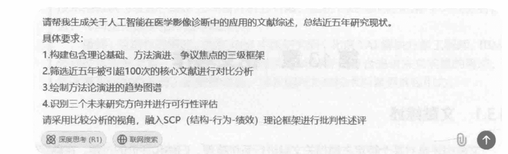

图 13-1 实操案例示意图

第 3 步，点击发送，等待片刻后 DeepSeek 会生成一篇完整的文献综述。

###### 医学影像AI五年观察：进展、转向与争议

###### 一、分析视角：理论根基、演进路径与核心争议

###### 1. 理论根基
- 有监督学习配合手工特征：起步阶段的研究多采用支持向量机、随机森林等有监督模型，依靠人工构造的影像表征在标注样本上训练病灶定位，受制于特征工程成本高、泛化能力弱。
- 端到端深度学习：以卷积神经网络为核心的深度体系能够自组织提取多层影像表征，使肺癌、乳腺癌等疾病的识别精度明显提升，ResNet、U-Net为典型代表。
- 迁移学习与小样本学习：面对医疗数据标注不足的问题，引入ImageNet预训练的迁移策略及元学习等小样本方法，在数据受限时改善模型泛化表现。

###### 2. 方法演进
- 单模态迈向多模态融合：从单一CT等影像分析转向CT+MRI+临床信息等多源数据联合建模，诊断视野更全面。
- 从读片辅助到决策支持：功能从肺结节等病灶检测扩展至肿瘤分级、预后预测以及基于3D重建的手术规划。

###### 3. 争议焦点
- 隐私与伦理困境：影像数据涉及个人敏感信息，脱敏与跨机构共享机制尚未完善，制约算法的应用与推广。

###### 二、近五年核心文献横向比较

###### 核心论文对照表

| 文献主题 | 技术方法 | 主要贡献 | 局限性 | 被引频次 |
| :--- | :--- | :--- | :--- | :--- |
| 深度学习在肺癌筛查中的应用 | 3DCNN+迁移学习 | 肺结节检测准确率提升至98% | 依赖高质量标注数据 | 356 |
| 多模态影像融合诊断脑卒中 | 图神经网络（GNN） | 结合CT与磁共振成像（MRI）实现病灶分割与预后预测 | 计算复杂度高 | 212 |
| 强化学习优化放疗计划 | 深度Q网络（DQN）算法 | 个性化放疗剂量分配，误差降低30% | 临床验证样本量不足 | 189 |
| 联邦学习保护医疗数据隐私 | 分布式联邦学习框架 | 跨机构数据协作，模型精度达集中式90% | 通信成本高 | 174 |
| 生成对抗网络（GAN）数据增强 | GAN生成合成影像 | 解决小样本问题，曲线下面积（AUC）提升12% | 生成影像真实性存疑 | 153 |

###### 三、技术演进图谱
- （1）技术路径：监督学习、深度学习、强化学习。
- （2）数据维度：单模态、多模态、跨模态时序分析。
- （3）应用场景：辅助筛查、决策支持、个性化治疗。
- （4）部署形态：集中式服务器、边缘计算、云端协同。

###### 四、未来方向与可行性判断
1. 跨模态动态建模
   - 目标：融合影像、基因组、电子病历等异构信息，构建疾病演化动态模型。
   - 可行性：多模态融合已有实践，技术相对成熟，但数据异构仍是难点。

2. 自监督与无监督学习
   - 目标：减少标注依赖，借助无标签数据增强模型泛化。
   - 可行性：对比学习等自监督方法在通用视觉已验证，医疗场景需克服域适应问题。

3. 医工协同的伦理与法规框架
   - 目标：规范AI诊断责任认定、数据共享与隐私保护。
   - 可行性：政策推进加快，如2024年国家医保局启动人工智能辅助诊断项目，跨国协作仍困难。

###### 五、SCP视角下审视产业现状
1. 结构（Structure）
   - 市场集中度：深睿医疗、鹰瞳科技等头部企业掌控核心算法与数据，中小机构面临壁垒。
   - 政策规制：各国医疗器械认证标准不一，跨境应用受阻。

2. 行为（Conduct）
   - 技术竞争：企业偏好数据护城河策略，不利于开放创新。
   - 医工协作：医生参与算法设计的比例不足20%，影响临床适配。

3. 绩效（Performance）
   - 诊断效率：心血管影像分析时间从40分钟压缩至5分钟，基层医院部署率仍不足30%。
   - 社会效益：缓解三甲医院压力，却可能拉大技术鸿沟。

结论：人工智能在医学影像诊断中正从探索走向落地，发展需要在技术创新与伦理合规间平衡。后续应强化跨学科协作与标准化，以推动以患者为中心的精准医疗。

#### 13.2 思路提供

##### 13.2.1 用AI拓展论文选题思路

DeepSeek凭借强大的整合与分析能力，可为论文构思提供多维启发，帮助用户跳出思维定式。常用操作如下：

- 先给宽泛主题：如“新能源材料”，让模型宏观梳理热点与趋势，缩小关注范围。
- 追问具体问题：基于主题提问瓶颈，如“新能源材料在储能中的痛点有哪些”，获得可切入点。
- 列举不同观点：请模型呈现对同一问题的多种学理解释，通过争议寻找创新空间。
- 参考经典案例：询问领域内已实现产业化的代表性研究，学习方法与实验设计。
- 探索交叉方向：分析主题与邻近学科的交集，如新能源材料与量子物理的结合。

##### 13.2.2 实操案例

以新能源材料为例演示。

第 1 步，明确研究方向，如新能源材料热点与趋势。

第 2 步，打开深度思考与联网搜索，在对话框输入提示词，如图 13-2 所示。


图 13-2 实操案例示意图

第 3 步，发送提问，DeepSeek 会罗列主要研究方向，可循环深挖问题并确定个人方向。

以下是梳理的新能源材料论文思路与方向建议，结合热点、趋势及多维分析框架。

###### 一、当前研究热点与趋势总结

###### 1. 技术迭代驱动的材料创新
光伏材料：钙钛矿/晶硅叠层电池实验室效率超33%，铜铟镓硒、有机光伏等柔性薄膜产业化提速。
锂电材料：硫化物/氧化物固态电解质界面稳定性优化，钠离子电池层状氧化物、普鲁士蓝类似物正极性能提升。
氢能材料：Fe-N-C 单原子催化剂等非贵金属催化剂替代铂基，低温储氢合金与液态有机储氢载体取得进展。

###### 2. 多学科交叉融合趋势
人工智能+材料设计：机器学习加速电解质筛选，如离子电导率预测，结合高通量计算与实验的材料基因组工程。
能源—环境协同：金属—Salen 基共轭微孔聚合物光催化还原 CO₂ 实现高选择性，废纸基 Janus 光学薄膜等废弃物资源化用于能源管理。

###### 二、主要研究方向与选题建议

###### 方向 1：高能量密度电池材料体系创新
- 研究焦点：
  固态电解质界面离子传输机制与稳定性优化，如梯度界面设计。
  高镍三元正极 NCM811 晶格氧析出抑制策略，掺杂与包覆协同改性。
- 选题示例：
  《基于机器学习的高通量筛选固态电解质材料及其界面动力学研究》

###### 方向 2：低碳化与资源循环利用
- 研究焦点：
  纤维素基隔膜等生物基材料在锂电中的应用，兼顾性能与可降解性。
  退役动力电池回收湿法冶金—直接再生联合工艺的经济与环保评估。
- 选题示例：
  《退役磷酸铁锂电池正极材料闭环再生体系构建与生命周期分析》

###### 三、论文写作框架建议
（1）引言：结合全球能源转型，论证材料创新的必要性，引用“十四五”规划等政策文件。
（2）文献综述：按“技术路线—性能瓶颈—解决方案”梳理进展，如磷酸铁锂与三元材料的迭代对比。
（3）方法论：
  实验设计：多尺度表征如原位 X 射线衍射结合分子动力学模拟。
  理论模型：采用 SCP 框架分析产业链结构、企业行为与技术绩效关联。
（4）结果与讨论：
  数据可视化：绘制技术成熟度曲线，如钠电商业化进程图谱。
  批判性分析：对比不同路线经济性，如全固态与半固态电池成本模型。
（5）结论与展望：强调材料、器件、系统协同创新，提出跨学科合作与标准化建议。

###### 四、创新点挖掘与可行性评估
（1）材料创新：探索非晶态固态电解质高离子电导率机制，如局部结构有序性调控，可行性高，已有实验室验证。
（2）工艺革新：喷墨打印制备多孔薄膜，如 3D 互联结构有机电化学晶体管阵列，可扩展至大规模生产。

###### 五、研究工具推荐
（1）数据分析：Materials Project 数据库、LAMMPS 分子动力学模拟。
（2）实验验证：同步辐射光源原位观测界面反应、球差校正电镜原子级结构解析。

通过“技术痛点—解决方案—应用验证”链条，结合实验与理论，可形成兼具学术价值与产业意义的研究成果。

#### 13.3 论文对比

多篇论文对比是从方法、观点、数据等多维度进行横向分析。方法上比较实证、案例或理论推导差异；观点上分析论点、论据与逻辑；数据上比对来源、样本量与处理方式。通过对比可把握领域现状，完善研究思路。

##### 13.3.1 对比分析论文，提升论文质量

DeepSeek 可通过对比挖掘提升论文质量的关键要素：

- 逻辑结构梳理：将论文大纲与同领域优秀大纲输入，对比结构完整性与逻辑连贯性，指出缺失板块。
- 内容充实度对比：对比论据充分性与案例典型性，识别支撑不足之处。
- 语言表达优化：对比段落与顶刊表达，识别口语化表述并给出学术化建议。
- 创新性评估：对比核心观点与前沿成果，判断研究空白与创新点。

##### 13.3.2 实操案例

对比《深度学习在肺癌筛查中的应用》与《多模态影像融合诊断脑卒中》。

第 1 步，将两篇论文上传至 DeepSeek。
第 2 步，打开深度思考与联网搜索，输入提示词，如图 13-3 所示。


图 13-3 实操案例示意图

第 3 步，发送后生成对比报告。

> 根据要求，以下从论据充分性和案例典型性两个维度进行对比分析。

###### 一、论据充分性对比

论据充分性对比表

| 维度 | 《深度学习在肺癌筛查中的应用》 | 《多模态影像融合诊断脑卒中》 |
| :--- | :--- | :--- |
| 理论基础支持 | 依托 CNN、ResNet 等成熟理论，文献覆盖从早期模型到注意力机制优化；对肺癌病灶异质性生理基础讨论不足 | 融合影像学、病理生理学与算法优化，强调 CT/MRI/PET 互补性；对融合算法数学原理如特征对齐、权重分配解释不足 |
| 数据规模与验证维度 | 使用美国国家肺癌筛查试验、肺部影像联盟等公开数据，样本达万例级，跨中心验证多；统计分析全面 | 多模态采集成本高，样本多为百例级且多为单中心；强调模态协同效应，引入 Delong 检验验证融合显著性 |

###### 二、案例典型性对比

案例典型性对比表

| 维度 | 《深度学习在肺癌筛查中的应用》 | 《多模态影像融合诊断脑卒中》 |
| :--- | :--- | :--- |
| 病理覆盖度 | 涵盖磨玻璃结节、实性结节等主要亚型；罕见类型如肉瘤样癌案例缺乏 | 区分缺血性/出血性脑卒中亚型，含时间窗敏感性分析；纳入白质疏松等复杂共病病例 |
| 技术验证场景 | 公开测试集中对比 SOTA 模型如 MaskR-CNN 与 U-Net 差异；缺乏真实临床放射科医生协作案例 | 展示融合纠正单模态误诊，如 CT 漏诊早期缺血灶经 MRI-DWI 确诊；模拟多学科会诊，分析对治疗决策影响 |

###### 三、综合对比结论

论据充分性上，肺癌筛查论文数据规模与统计严谨，但临床痛点响应深度不足。
案例典型性上，肺癌论文案例标准化高但创新有限；脑卒中论文通过复杂病例与流程仿真，实践指导价值更突出，但需加强跨中心重复验证。

建议：肺癌研究可增加小样本迁移学习的临床案例；脑卒中研究需补充多中心异质数据的泛化验证。

#### 13.4 摘要生成

##### 13.4.1 快速生成摘要，概括论文核心内容

生成摘要可大幅提升效率：

- 内容初步整理：先标注核心观点、方法、关键数据，便于模型抓取。
- 指令清晰明确：明确需求与字数，突出重点，如“请生成 200 字摘要，突出创新与效果”。
- 巧用示例引导：提供同类优秀摘要供参考，风格更贴合。
- 多次调整优化：首版不足时补充遗漏要点，反复迭代。
- 结合人工审核：最终人工校对准确性与连贯性。

##### 13.4.2 实操案例

以《人工智能在医学影像诊断中的应用》正文生成摘要。

第 1 步，导入论文正文文件。
第 2 步，打开深度思考，输入提示词，如图 13-4 所示。


第 3 步，发送后得到约 200 字摘要。

> 摘要：
> 本文探讨了人工智能在医学影像诊断中的应用。随着医学影像数据的快速增长，传统的人工解读方法已无法满足需求。人工智能技术，特别是深度学习，在处理大数据、复杂的非确定性数据和挖掘数据中的潜在信息方面具有优势。文章分析了人工智能在人体结构、病灶区分割，疾病早期诊断，以及解剖结构、病灶区检测等方面的应用。尽管取得了显著成果，但仍存在诊断结果可解释性差、医学数据量少及系统性评估标准缺乏等问题。未来，人工智能在医学影像诊断中的应用将更加广泛和深入。

**Abstract:**

影像诊断的AI新纪元

医学影像的产出量正快速攀升，仅靠人工判读已难以匹配临床与科研对时效性的要求。研究聚焦人工智能在影像诊断中的实际落地，尤其强调深度学习在处理海量非结构化信息、挖掘潜在模式方面的适配性。梳理可见，该技术在解剖结构识别、病灶分割、疾病早期预警以及异常区定位等方向已获得实质性进展。尽管成效明显，诊断结果的可解释性偏弱、标注数据获取受限、系统化评价标准缺失仍是主要瓶颈，未来应用有望更深更广。

#### 13.5 参考文献生成

##### 13.5.1 自动生成参考文献，规范论文格式

学术写作中，文献整理与格式校对往往消耗大量时间。DeepSeek 可以接手这项工作，自动输出规范的引文清单并对全文进行统一排版，提升稿件的专业度。操作思路可参考以下要点。

- 先准备元数据：在调用模型前尽量把每篇文献的核心字段收集齐全，如作者、题目、刊名、年份等。输入越完整，生成的引用越准确。比如整理医学论文时，需要把相关研究的各项要素逐条列出。
- 明确定制规范：清晰告知所需引文样式和排版规则。不同学科期刊标准不一，如 APA、MLA、GB/T 7714 等，可指令“按 APA 格式输出参考文献”，并说明字体、字号、行距、页边距等整体要求。
- 导入正文供识别：将已写好的论文内容提交给模型，让其依据正文识别引用来源并按设定格式生成文献列表。同时可按要求对标题层级、段落编排等进行统一调整。
- 生成后复核修正：参考文献和格式调整完成后务必仔细核对，检查条目是否缺漏或错误，格式是否完全达标，有无细节被忽略。发现问题及时反馈，让模型重新修正。
- 持续迭代优化：首轮结果不理想很常见。依据核查反馈调整输入信息或指令，反复让 DeepSeek 重新生成，直至文献准确、格式合规。

##### 13.5.2 实操案例

以《人工智能在医学影像诊断中的应用》为例演示规范参考文献的生成。

第 1 步，将参考文献全部提供给 DeepSeek，格式不必整齐。
第 2 步，单击 · 深度思考 ·，并且在对话框中输入提示词，如图 13-5 所示。

第 3 步，单击⬆，稍等片刻，DeepSeek 生成对应的参考文献。

以下是按照学术论文参考文献格式（结合 GB/T 7714 标准）整理的部分文献列表。

###### 期刊论文

- [1] Bigler ED. Neuroimaging as a biomarker in symptom validity and performance validity testing[J]. Brain Imaging and Behavior, 2015, 9(3): 421-444.

- [2] 刘飞, 张俊然, 杨豪. 基于深度学习的医学图像识别研究进展. Research progress of medical image recognition based on deep learning[J]. 中国生物医学工程学报, 2018, 37(1): 86-94.

###### 会议论文

- [1] Fasihi MS, Mikhael WB. Overview of current biomedical image segmentation methods[C]//Proceedings of the 2016 International Conference on Computational Science and Computational Intelligence. 2017: 803-808.

- [2] Ronneberger O, Fischer P, Brox T. U-net: Convolutional networks for biomedical image segmentation[C]//Proceedings of the International Conference on Medical Image Computing and Computer-Assisted Intervention (MICCAI). 2015: 234-241.

#### 13.6 论文修改

##### 13.6.1 协助修改论文，完善论文内容

要发挥 DeepSeek 在论文润色中的价值，掌握合适的使用思路是关键。以下从实用角度介绍如何打磨。

- 语言精炼：把表达生硬、重复、口语化的段落输入，请求给出更精准、学术、简洁的表述，替换平淡或错误用词，调整句式，使专业性与流畅度提升。
- 逻辑梳理：上传提纲或全文，让模型评估章节衔接是否自然、论点与论据是否紧密，指出逻辑漏洞并提出重组建议，使思路更严谨。
- 内容补强：若某论点支撑不足，可描述需求，让模型提供补充思路、案例或研究依据，增强说服力。
- 错误排查：利用模型检查语法、标点及格式规范问题，快速定位常见错误，按提示修正即可提升规范性。
- 风格统一：当不同部分语言风格差异明显时，提供代表性段落让模型识别并调整，使全文保持严肃、正式的学术语调。

##### 13.6.2 实操案例

这里让 DeepSeek 对《人工智能在医学影像诊断中的应用》这篇论文进行修改。

第 1 步，将《人工智能在医学影像诊断中的应用》提交给 DeepSeek。
第 2 步，单击 · 深度思考 ·，并且在对话框中输入提示词，如图 13-6 所示。
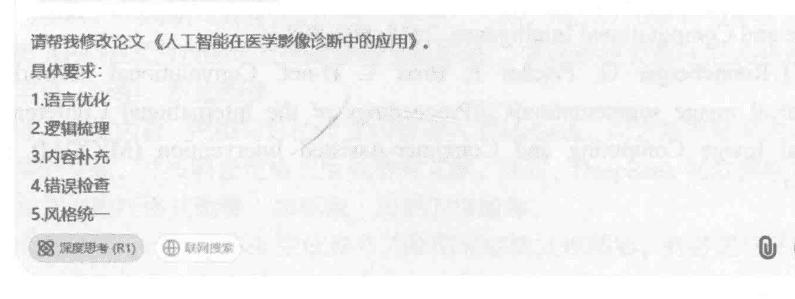
图 13-6 实操案例示意图

第 3 步，单击 ，稍等片刻，DeepSeek 给出论文修改建议。

以下是基于您的论文《人工智能在医学影像诊断中的应用》的优化建议和修改示例，涵盖语言优化、逻辑梳理、内容补充、错误检查和风格统一五大方向。

###### 一、语言优化

一是技术术语规范化。
原文：“卷积神经网络（CNN）是目前研究最多的结构。”
优化后：“卷积神经网络（Convolutional Neural Network，CNN）凭借其局部感知和参数共享的特性，成为医学影像分析领域的研究热点。”
说明：补全术语缩写，补充技术原理以增强专业性和可读性。

二是冗余表述删减。
原文：“人工分割是一项困难的工作，常规的医学图像分割算法主要有边缘检测算法、区域生长算法和基于模型的算法等。由于医学图像分辨率低，分割区域往往是非刚性的，传统算法需要人为调整参数，不具有普适性。”
优化后：“传统医学图像分割算法（如边缘检测、区域生长）需依赖手动参数调整，且在低分辨率、非刚性目标场景下泛化能力显著不足。”
说明：整合重复描述，突出重点信息。

###### 二、逻辑梳理

原文段落分布：应用案例按“分割、诊断、检测”排列，但实际临床流程更倾向于“检测、分割、诊断”。
调整建议：调整为“病灶检测—解剖结构分割—疾病诊断—预后分析”的逻辑链条（需补充预后分析相关内容）。

###### 三、内容补充

新增章节 4.3 预后分析与疗效评估
例如，深度学习模型可通过连续监测肿瘤体积变化（如实体瘤临床疗效评价标准，即 RECIST 标准）预测化疗响应。Zhou 等人（2022）开发的 Deep RECIST 系统在肺癌疗效评估中与放射科医生评估的一致性达 93%，显著高于传统人工测量与放射科医生评估的一致性（78%）。

###### 四、错误检查

原文：“基于 fMRI 的脑网络分类准确率达 97.6%。”
修订后：“基于功能磁共振成像（fMRI）的功能连接特征分类准确率达 89.4%（阿尔茨海默病组对比健康组），但其对早期轻度认知功能损害（MCI）的敏感度仅为 72.1%。”
说明：补充具体疾病分类场景和数据来源。

###### 五、风格统一

原文混用：“深度学习”“深度神经网络”“CNN”。
统一表述：全文优先使用“深度学习模型”，具体技术注明“卷积神经网络（CNN）”“Transformer”等。

###### 六、完整修改段落示例

原文：
疾病的早期诊断是人工智能在医学影像诊断中较早涉及的问题，即输入完整或局部医学影像，根据影像分类结果判断患病严重程度。一些疾病的早期诊断意义重大。例如，糖尿病性视网膜病、阿尔茨海默病的早期确诊有助于提早介入治疗、延缓病情发展，前列腺癌的早期确诊治疗可以提高患者生存率。但人工读片的方式要求影像医生拥有大量针对不同疾病的专业知识，而传统医学影像分类算法通常基于颜色、纹理和形状等基本特征，这些低级特征不能很好反映疾病早期变化。因此，基于人工智能技术的疾病早期诊断成为研究热点。

优化后：
疾病的早期诊断是人工智能赋能医学影像的核心场景之一。与传统依赖人工经验的影像解读相比，人工智能模型可通过挖掘图像中的亚视觉特征（如纹理异质性、功能代谢变化）实现更早期的疾病预警。例如糖尿病视网膜病变（DR），Google DeepMind 开发的 Retinal-AI 系统（Kermany 等人，2018）可基于眼底照相数据，自动识别微动脉瘤和渗出液，在 DR 五分类任务中，AUC 达 0.99，敏感度超过人类专家。当前挑战在于小样本学习与模型可解释性。例如，基于梯度加权类激活映射（Grad-CAM）的可视化技术（Selvaraju 等人，2017）可为人工智能诊断提供病灶定位依据，解决部分“黑箱”难题。

> AI 会让知识获取像呼吸一样自然。
——尼古拉斯·尼葛洛庞帝（麻省理工学院媒体实验室创始人）

### 第 14 章 提升阅读效率

信息爆炸的当下，知识更新极快，提升阅读效率尤为关键。高效阅读能节省时间，在有限窗口内吸收更多知识，增强职场与学术竞争力。无论是学生备考还是职场进阶，都需要更快更准地获取信息。

#### 14.1 名著速览

名著的思想价值厚重，但篇幅常让人却步。DeepSeek 提供的名著速览功能可在短时间内帮助把握主线与关键情节，大幅降低时间成本。通过速览可快速触达精华，了解不同时代文化的社会图景，拓宽视野，提升文学素养。对学生而言有助于应考，对读者而言是高效的精神滋养。

##### 14.1.1 十分钟阅读名著，快速了解名著内容

- 核心情节梳理：将名著的主要章节或关键段落输入 DeepSeek，让它总结概括其中的关键事件，比如在了解《三国演义》时，询问 DeepSeek 赤壁之战、官渡之战等重要战役的详细经过和影响，快速理清情节脉络。
- 人物关系分析：把名著中主要人物的相关信息发送给 DeepSeek，例如，让它分析《红楼梦》里的贾宝玉、林黛玉、薛宝钗等人物之间的情感纠葛、利益关联，从而明晰人物关系网络。
- 主题思想提炼：向 DeepSeek 描述名著的大致内容后，请求它提炼主题思想。例如，让它分析出作品《骆驼祥子》对旧社会黑暗的批判及对底层人民命运的关注等核心思想。
- 时代背景解读：告诉 DeepSeek 名著的创作时代，让它结合名著内容解读当时的社会环境、文化氛围。例如，让 DeepSeek 针对《悲惨世界》进行解读，了解 19 世纪法国社会的政治、经济、文化等背景，辅助理解名著内涵。
- 写作特色剖析：选取名著中有代表性的段落，让 DeepSeek 拆解其写作手法，如《百年孤独》中魔幻现实主义手法的运用，提升对名著文学价值的理解。

在使用 DeepSeek 快速了解名著内容时，需要注意以下要点。首先，要明确 DeepSeek 只是辅助理解的工具，它的解读不能替代自己对名著的阅读和思考。其次，输入的内容要具有代表性，准确描述需求，只有这样才能获取更精准的信息。同时，要尊重名著的版权，不要利用工具实施侵权行为。只有合理运用 DeepSeek，结合自身思考，才能真正从名著中汲取营养，提升文学素养。

##### 14.1.2 实操案例

下面将展开讲解如何利用 DeepSeek 快速了解名著内容。

第 1 步，明确想了解的书籍或大体章节，如《三国演义》中的赤壁之战。
第 2 步，单击 · 深度思考 · 和 · 联网搜索 ，并且在对话框中输入提示词，如图 14-1 所示。

图 14-1 实操案例示意图

第 3 步，单击 ⬆，稍等片刻，DeepSeek 生成一篇完整的内容概括。

**主要经过**
曹操统一北方后，率大军南下，企图一举平定江东。孙权与刘备联合抗曹，双方军队对峙于赤壁。曹军不习水战，用铁链将战船首尾相连。此时，黄盖建议火攻，于是他率数十艘堆满易燃物的战船假降，靠近曹军时点火，火势迅速蔓延，曹军大乱，孙刘联军趁势出击，曹军大败，退回北方。

**人物关系**
曹操为进攻方，孙权和刘备为抵御曹操而结盟。周瑜是东吴大都督，负责指挥作战；诸葛亮则代表刘备方，与周瑜合作，还施展草船借箭等计策。黄盖是东吴老将，主动献苦肉计诈降曹操。各方人物在这场战役中立场分明，关系错综复杂。

**写作特色**
作者运用对比手法，将曹操的轻敌自大与孙刘联军的谨慎谋划相对照，凸显胜负原因。同时，对战争场面的描写极具画面感，从战前准备、双方对峙到火攻时的熊熊烈火、厮杀呐喊，都予以生动展现，让读者仿佛身临其境，感受到战争的紧张与激烈。

#### 14.2 内容概述

以《红楼梦》为例，速读时可先聚焦主要人物关系，如宝黛钗的情感纠葛，这是故事发展的重要线索；再关注关键情节，如“黛玉葬花”展现了黛玉的多愁善感与对生命的独特感悟，“王熙凤协理宁国府”则凸显了她的精明能干、杀伐决断；同时留意书中诗词，它们不仅是文学点缀，更暗示人物命运。把握这些内容，能快速构建对名著的初步认知。

##### 14.2.1 概括主要内容，把握核心要点

由于语言理解与分析能力强，DeepSeek 能从繁杂的文字中提炼关键信息。接下来从几个实用角度为用户讲解如何运用 DeepSeek 完成章节内容概述。

- 明确章节范围：向 DeepSeek 清晰说明要概述的具体章节，如“请概述《战争与和平》第三卷第二章内容”，精准界定分析范围，避免信息偏差。
- 标注重点段落：如果对章节中的重点段落有预判，可将其发送给 DeepSeek，让它优先分析这些段落，更快速地抓取核心要点。例如在科技类文章中，关键实验描述段落就是重点。
- 指令简洁清晰：向 DeepSeek 提问时，指令要简洁明了，如“概括这一章节的主要事件”或“提炼该章节的核心观点”，使它能准确理解需求，给出针对性回答。
- 多轮交互优化：首次得到的概述可能不够完善，要根据结果提出进一步要求，如“补充遗漏的关键人物”或“详细说明事件影响”，通过多轮对话不断优化概述内容。
- 对比整合内容：让 DeepSeek 从不同角度概述，如事件发展、人物行动等，再将这些内容对比整合，形成全面且有条理的章节概述。

##### 14.2.2 实操案例

下面将展开讲解如何利用 DeepSeek 快速了解名著内容。

第 1 步，明确想了解的名著内容，如《红楼梦》第十章。
第 2 步，单击 · 深度思考 · 和 · 联网搜索 ·，并且在对话框中输入提示词，如图 14-2 所示。

第 3 步，单击⬆，稍等片刻，DeepSeek 生成一篇完整的内容概括文档。

> 《红楼梦》第十章（通行本第十回）内容概括

核心情节：

1. 金寡妇的委屈与隐忍

金寡妇（金荣之母）因儿子在学堂被宝玉、秦钟羞辱后反遭贾瑞责罚，心怀不忿，到宁国府向尤氏告状。尤氏提起秦可卿（贾蓉之妻）患病之事，透露贾珍、贾蓉父子因秦氏生病忧心忡忡，家中事务无人理会，间接压下了金荣母子之事。金寡妇见尤氏态度冷淡，只得忍气吞声回家。

2. 秦可卿病况急转
秦可卿已在床上耗费数月，辗转多位医家诊治始终无功，贾珍只好将名医张友士请入宁国府。张太医以脉象定论，归因于久郁忧思致气血两亏，拟方后语带保留，点出难愈，为后文身故埋下伏笔。

3. 金氏由强硬到退缩
金荣姑母即贾璜之妻，闻侄子受气怒气冲冲去向尤氏对峙，获悉秦可卿病危后立刻收敛锋芒， 转而讨好尤氏，暴露其见风使舵的势利本性。

核心线索与伏笔
人际冲突：金寡妇与贾家核心权力的正面冲撞，映照出旁支依附主家却常被轻视的生存状态。
病症隐喻：秦可卿的病被写成贾府衰败的象征，出自心结，与书中盛极必衰的主旨呼应。
医案暗示：方中虽有益气养荣、健脾护肝之品，只能缓解表象无法根除，暗指命数难逆，之后秦氏终因心事压抑而亡。

章节功能
（1）承上启下：由学堂喧闹转入宁国府内讧，为秦可卿去世作铺垫。
（2）世态描摹：借金寡妇母子的隐忍与贾璜妻子的外强中干，揭露旁支困境与人情冷暖。
（3）悲剧推进：秦氏病情为贾府大厦将倾的没落拉开序幕。

小结：第10回以金寡妇诉状不成与秦可卿病重双线并行，呈现贾府内外冷暖与隐忧，为秦氏之死及命运转折奠定基调。

#### 14.3 读后感撰写
##### 14.3.1 撰写心得 深化收获
阅读是丰富精神的旅程，而写下心得则是把感悟沉淀升华的过程。DeepSeek 作为强大的智能工具，能在其中提供有力支持，帮助梳理思路、挖掘深层见解，让心得更有内涵与条理。

- 要点概括：把所读书籍或文章交给 DeepSeek，让它提炼核心要点，如小说主线情节、论述主旨等，为写作搭框架，如针对小说明确主线与关键转折。
- 观点启发：向 DeepSeek 请教文本看法，比如哲学书中某理论的合理性与局限，以此激发思考并形成独特见解融入心得。
- 经历联结：告知 DeepSeek 个人相关经历，让它帮助建立与阅读内容的联系，如读励志书时关联自身奋斗故事，使心得更具真情。
- 语言润色：初稿完成后把内容输入 DeepSeek，让它检查语法错误、优化表达，使语句更顺畅文采更好，提升可读性。
- 结构梳理：请 DeepSeek 评估心得结构，判断段落逻辑是否连贯、开头结尾是否合适，按建议调整，让层次分明条理清晰。

##### 14.3.2 实操示范
以撰写一篇读后感为例说明。

第 1 步，明确要写哪本书的哪部分心得，如《三国演义》“草船借箭”。

第 2 步，开启深度思考与联网搜索，并在对话框输入提示词，如图 14-3 所示。

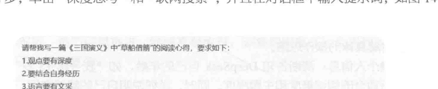

第 3 步，点击发送，片刻后 DeepSeek 会生成一篇完整的读后感。

###### 草船借箭 以虚制实的人生启示
###### 1. 智谋与态势 谋略背后的生存哲学
江面雾气缭绕，万箭齐发，诸葛亮羽扇纶巾的形象是传统文化中智绝的象征。但“草船借箭”的精妙远不止奇计，更在于揭示“虚实”“顺势”“借力”三重生存法则。

大雾遮江本是行军大忌，他却把不利的虚境转化为实利。曹操多疑，误以为雾中藏有杀机，箭矢尽数射向草船；诸葛亮看透人性易怯，用空船激起对手恐惧，满则溢，怯则乱。这让人联想到《道德经》“埏埴以为器，当其无，有器之用”的意蕴：容器的价值在于空处，无箭可用的逆境反而成为创造的起点。世事如潮，以虚制实，因势而行，或许才是破局之匙。

###### 2. 困境与慧眼 雾中前行的成长隐喻
我在初创公司任职时，团队曾遭遇核心代码外泄的危机。众人焦虑，有人建议高价买断专利，有人主张追责泄密者。焦灼之际，我联想到孔明借箭之计——若把“代码漏洞”视作雾中草船，能否反向利用？最终我们主动开放部分代码生态，吸引开发者共同建设，用户黏性不降反升。正如孔明不纠结于造箭之难，而是把箭的生成逻辑转为对手的行为逻辑，难题的答案往往藏在对规则的重塑之中。

###### 3. 结语 在不确定时代种一片芦苇
千载江水依旧，但借势的智慧历久弥新。“草船借箭”是一场关于不确定性的艺术：资源匮乏时不抱怨逆风，而在迷雾中织网；规则受限时不拆墙，而借对手的工具凿出阶梯。也许每个人的命运都像一艘草船，关键不在船体是否坚固，而在于能否读懂风雾的动向，以轻盈之姿承载时代的雷霆。

#### 14.4 个性化书单
##### 14.4.1 获取贴合个人的阅读推荐 发现更多好书
面对浩瀚经典，如何找到契合年龄与喜好的作品常让人迷茫。借助 DeepSeek 获取个性化名著推荐，需要掌握有效方法。DeepSeek 基于海量数据的分析和理解，能精准匹配个人特征与书籍内容。接下来从几个角度讲解具体思路。

- 个人信息明确：清晰告知 DeepSeek 自己的年龄，如“我今年 15 岁”，让它初步判断合适的阅读难度和主题深度。同时详细说明阅读偏好，如“我喜欢冒险类故事”，为推荐提供方向。
- 多元喜好描述：除题材外，还可分享风格偏好，如“我喜欢情节紧凑节奏快的作品”，或“我偏好人物刻画细腻的名著”，使 DeepSeek 更全面了解阅读倾向。
- 成长阶段结合：若正学习特定知识，可告知 DeepSeek，如“我正在学习历史，想读相关名著”，它会结合成长需求推荐相关作品，如《明朝那些事儿》等。
- 相似评价参考：让 DeepSeek 查找与自己年龄、喜好相近人群对名著的评价和推荐，使结果更符合预期，比如了解其他 15 岁喜欢冒险的同学在读什么。

##### 14.4.2 实操示范
以 15 岁高中生读者为例讲解如何使用 DeepSeek 进行个性化推荐。

第 1 步，思考自身需求。

第 2 步，开启深度思考和联网搜索，并在输入框填入提示词，如图 14-4 所示。


第 3 步，点击发送，片刻后 DeepSeek 会为用户定制专属书单。

###### 为你定制的书单 在文字里感受心跳加速的成长
哈利·波特系列：J.K.罗琳的魔幻小说跌宕起伏，充满奇幻冒险。巫师哈利在霍格沃茨的学习与成长扣人心弦，从探索神秘课程到与伏地魔的对抗，每一部都有新挑战与惊喜，让读者沉浸魔法世界，感受友谊、勇气与正义。

《蝇王》：威廉·戈尔丁的代表作设定在虚构的第三次世界大战背景，一群儿童因空难被困荒岛。起初他们尝试建立秩序，随着时间推移人性之恶渐显，孩子们从合作走向分裂与残杀。情节紧凑，不断抛出关于人性、文明与野蛮的思考。

《追风筝的人》：美籍阿富汗作家卡勒德·胡赛尼的作品围绕风筝与两个阿富汗少年展开，讲述背叛与救赎。从阿米尔与哈桑儿时的亲密，到阿米尔在风筝比赛中的懦弱，再到多年后为救赎踏上艰难旅程，情节层层推进，情感真挚，深刻探讨人性复杂。

### 第 15 章 外语学习
外语学习是提升能力、拓宽视野的过程。传统方式如背单词、学语法、读经典、交流对话，能扎实构建语言基础，培养语感与思维，但耗时较长，效果受资源与环境限制。随着 AI 发展，利用人工智能工具学习外语成为新趋势。AI 可根据水平和需求定制个性化方案，如智能推送学习内容、精准评估进度。部分语言学习软件提供语音识别纠正发音，还能模拟真实场景进行沉浸式对话。AI 翻译工具也能辅助理解复杂文本，拓展阅读范围。AI 虽提供便利高效的方式，却无法完全替代传统学习。两者结合，才能有效提升水平。

#### 15.1 学习规划
##### 15.1.1 制定合适的学习方案
在用 DeepSeek 制定计划前，先了解其原理与优势。它基于先进算法与海量数据，能精准分析学习需求与目标，给出针对性建议。制定计划思路如下。

- 目标明确：告知 DeepSeek 期望达到的水平，如雅思目标分数，或能进行日常对话等。清晰目标是有效计划的基础。
- 水平评估：描述目前基础，如词汇量、听力和口语程度，以便据此规划提升路径。
- 时间设定：告知每日或每周可投入时间，让 DeepSeek 合理分配任务，确保计划可行。
- 内容选择：可按兴趣与需求，如商务外语、旅游外语，让 DeepSeek 推荐学习资料与练习。
- 进度制定：请 DeepSeek 按周或月规划进度，明确各阶段任务与小目标，便于跟踪。
- 复盘调整：学习中定期反馈效果，如单词正确率、口语流畅度，它会据此及时调整计划，保证效果。

##### 15.1.2 实操示范
以用 DeepSeek 制定外语学习计划为例。

第 1 步，明确目的，制定适合自己的外语学习计划。

第 2 步，开启深度思考和联网搜索，并在输入框填入提示词，如图 15-1 所示。


图 15-1 实操案例示意图

第 3 步，点击发送，片刻后 DeepSeek 会生成一份详细的英语学习计划。

以下是为您制定的 6 个月雅思 7.0 分冲刺计划，结合语言提升与应试技巧，分基础夯实、专项突破、全真模考三阶段。

**第一阶段：基础夯实 第 1 至 2 个月**
核心目标：搭建 6000 词汇体系，掌握基础语法，提升听力敏感度。
每日任务 4 至 5 小时：
- 词汇 至少 60 分钟
背诵《雅思词汇真经》2 个单元 40 个新词加复习旧词。
用 Quizlet 制作场景词汇卡 学术类加生活类。
- 听力 至少 45 分钟
精听 BBC 6 Minute English 逐句听写加跟读。
完成《雅思王听力真题语料库》Chapter3～5 听写。
- 阅读 至少 60 分钟
精读剑桥雅思真题 Test 1 和 Test 2 文章 划长难句加整理同义词替换表。
学习略读与扫读技巧，完成刘洪波《阅读真经》基础篇。
- 口语 至少 30 分钟
跟读 English Pronunciation in Use 纠正发音。
录音回答 Part 1 基础话题 家庭、工作、爱好。
阶段目标：
听力 Section1/2 正确率提升至 80%。
阅读 Heading/Matching 正确率达 70%。
能流畅进行 3 分钟日常对话。

**第二阶段：专项突破 第 3 至 4 个月**
核心目标：掌握题型解题策略，建立写作框架，培养学术表达。
每日任务 5 至 6 小时：
- 听力 至少 60 分钟
精听剑桥真题 Section 3/4 重点抓逻辑连接词。
练习多选题/地图题专项 《9 分达人雅思听力真题还原及解析》。
- 阅读 至少 75 分钟
限时训练 20 分钟/篇 加错题分析。
攻克判断题难点。
- 写作 至少 90 分钟
学习 Simon 范文结构 大作文四段式或小作文动态图模板。
每周完成 2 篇 Task1 加 1 篇 Task2，使用 Grammarly 检查语法。
- 口语 至少 45 分钟
整理 Part 2 故事库 用同一素材覆盖多话题。
参加线上语言交换 italki/Tandem。
阶段目标：
写作 TR、CC 评分达 6.5 分以上。
口语能完整展开 Part 2 话题卡。
听力 Section 3/4 正确率达 65% 以上。

**第三阶段：全真模考 第 5 至 6 个月**
核心目标：适应考试节奏，查漏补缺，强化心理素质。
每日任务 6 至 7 小时：
- 模考训练 每周至少 2 套
严格按考试时间完成剑桥真题 Test 13～17。
用答题卡规范写作，大作文控制在 40 分钟内。
- 弱点攻坚
听力：强化口音识别 澳音/印度音素材。
阅读：提速训练，完成《雅思阅读 538 考点词真经》。
- 口语冲刺
录制视频模拟考试，注意眼神交流等肢体语言。
记忆 20 组高分词组 Discourse Markers。
- 写作批改
找专业老师批改每篇作文，重点提升 LR 与 GRA 评分。
阶段目标：
模考总分稳定在 6.5～7.0 分。
口语能自然使用惯用语。
小作文 150 字、大作文 250 字按时完成。

#### 15.2 单词背诵辅助
##### 15.2.1 实现个性化背词
学外语时单词是根基。DeepSeek 能依据个人情况，如年龄、水平等，为用户定制背词清单并给出实用建议，让学习更高效。具体思路如下。

不同年龄和水平需求不同。DeepSeek 能精准把握差异，提供适配方案。操作思路：
- 个人情况说明：如实告知年龄和当前水平，如 20 岁大学生，已掌握 1000 个常用词，正备考大学英语四级。信息帮助 DeepSeek 了解起点与潜力。
- 学习目标明确：告知希望达成的目标，是通过考试还是提升交流。例如想在三个月内通过四级，DeepSeek 会结合大纲词汇推荐重点。
- 词表获取：基于年龄、水平和目标，DeepSeek 生成专属清单，可能包含基础巩固、目标相关高频词及符合认知水平的拓展词。
- 背词建议接收：除清单外，还会提供方法建议，如将动词名词结合场景记忆，形容词对比记忆，并按艾宾浩斯遗忘曲线规划复习节点。
- 计划定制：沟通每日或每周可投入时长，让它制定每日背诵量与周期，使计划可行。

##### 15.2.2 实操示范
以借助 DeepSeek 实现个性化背单词为例。

第 1 步，明确目的，即实现个性化背词。

第 2 步，开启深度思考和联网搜索，并在输入框填入提示词，如图 15-2 所示。


第 3 步，点击发送，片刻后 DeepSeek 会生成个性化背词建议。

以下是针对你的情况定制的个性化四级单词清单加科学背诵计划，融入神经网络背词法 填空加场景分类，助你在 3 个月内高效攻克重点词汇。

- 1. 词库筛选原则 不用背全部大纲词 智能筛选 5 类必背词汇
真题高频词：根据近 5 年四级真题词频分析，过滤占比约 60% 的低频词。
重点场景词：完形填空高频副词 如 consequently、likewise。
易混淆词对：adapt/adopt、affect/effect 等常见混淆词。
听力替换词：如听力题干中的 purchase 和 buy、require 和 need。
写作加分词：替代简单词 important 和 crucial、think 和 maintain。

- 2. 个性化词表 1200 个词 核心量
按题型分类 精准击破
按记忆难度标记 人工智能分组
红色 高频易错：guarantee、consequence、Approximately。
绿色 已掌握：basic、information、develop。
蓝色 需结合语境：range v.变化范围/n.山脉。

- 3. 科学背诵方法
第一阶段 图像关联法 第 1 至 2 周
• 工具：用 Anki 创建记忆卡片，正面放单词加图片联想 如 habitat—熊猫栖息地照片
• 技巧：对动名词强制造句 如 The government implemented new policies.
• 每日任务：新学 40 个词加复习前 3 日词 早、中、晚各 15 分钟
第二阶段 真题挖空法 第 3 至 5 周
• 操作：将做过的阅读真题核心词挖空 如 The_____(controversial)issue caused debate.
• 升级训练：听听力 SectionB 原文时主动标记关键名词 如 seminar、deadline
• 每日任务：新学 50 个词加在真题中定位已学词汇 晚 1 小时精练
第三阶段 场景迁移法 第 6 至 12 周
• 任务设计：

词汇激活三步法

从校园服务场景里挑十个常用词，比如 library、scholarship、cafeteria 这类，用它们编一段口语对话来实操。接着看 TED-Ed 的 How Sugar Affects the Brain，从片子里提炼五个健康相关的核心词背下来。最后玩 Word Story 这类剧情游戏，每解锁一个新场景就把出现的关键词收集进清单。

4. 三个月里程碑规划

第 1 周到第 4 周：筑基期
目标：掌握 600 个核心词，按美国当代英语语料库 COCA 的使用频率排练。
重点：先把高频动词和衔接副词模块学完。
自检：每周用百词斩四级预测卷检验记忆留存，达标七成以上。

第 5 周到第 8 周：强化期
目标：攻克熟词的冷僻义，例如 issue 作名词是“问题”，作动词是“发布”。
重点：整理近义替换清单，如 solve、tackle、resolve 的细微差别。
自检：在华研外语 App 做段落选词填空，正确率不低于八成。

第 9 周到第 12 周：实战期
目标：把词放到真题语境里检验，用《星火四级真题》练手。
重点：练听力速记，用符号缩写提效，例如 edu 代指 education。
自检：模考时把试卷上的陌生词圈出，考后统一归入词表复盘。

#### 15.3 中外互译

##### 15.3.1 提升互译精度的路径
互译的准确度决定综合能力的上限。DeepSeek 能提供丰富的译例和高效方法，帮助用户在中译外、外译中持续进步。下面是借助它提升互译水平的思路。

每个人的语言基础和目标不同，系统可以给出个性化方案。具体做法如下。

- 水平自评：把当前的词汇量、语法熟练度、已有译经告诉 DeepSeek，比如能做简单日常对话翻译，但在长句和专业词上吃力。信息越具体，起点判断越准。
- 目标定位：说明学互译的用途，是日常交流、应试还是商务工作。例如想把商务邮件和会议资料译得准确，方案就会围绕商务领域展开。
- 译练积累：从短句到段落持续练习，每次对照系统给出的参考译文，分析失误点，学习其处理思路和技巧。
- 专业词储备：按目标领域让系统推荐相关术语，并学习它们在不同语境下的译法和用法。比如医学术语有固定的译法规范。
- 技巧学习：请教常见的译法技巧，如词性转换、语序调整、增减词语等，通过例句加深理解。系统能提供大量例句辅助实操。
- 周期测评：按时间节点用系统做模拟翻译，检验速度和准确度，及时调整计划。

##### 15.3.2 实操演示
下面以让 DeepSeek 制定中外互译学习计划为例。

第 1 步，明确目标，即提升中外互译水平。
第 2 步，点开 · 深度思考 · 和 · 联网搜索 ·，在对话框里输入提示词，如图 15-3 所示。

第 3 步，点按 ↑，稍等片刻，DeepSeek 会输出一份完整计划。

以下是量身定制的 3 个月商务翻译能力提升方案，针对长难句与专业术语痛点，系统训练语言转换、商务思维、跨文化意识三大能力。

**第一阶段：基础架构搭建 第 1 周到第 4 周**
核心目标：搭建商务术语库，解析长难句思维
学习任务：
- 1. 术语系统化积累
  分模块整理：用 Excel 建术语表，按行业细分 国际贸易/市场营销/财务 等，每日拓展 30 个词
  语料来源：商务部白皮书英文版、Harvard Business Review 精选文章、国际商务函电教材
- 2. 句式拆解训练
  英-中：精译 The Economist 商务板块长难句，重点处理被动语态与嵌套从句。
- 3. 辅助工具
  用 Trados 术语库管理高频词汇，用 Linguee 词典对照真实语境例句

**第二阶段：场景化实战演练 第 5 周到第 8 周**
- 1. 核心目标：精准输出与语域适配能力
- 2. 学习任务
  高频错误专项击破
  影子练习法
  跟读 BBC Business Daily 音频，同时速记并复述，训练听记译同步能力。

**第三阶段：职业化深度应用 第 9 周到第 12 周**
- 1. 核心目标：跨文化传播思维和审校能力。
- 2. 学习任务
  （1）实战模拟项目
  项目策划书翻译：保持中英文格式一致性 数字、排版
  财报本地化：转换单位与数据呈现方式 万元与 million、RMB 与 USD 换算
  （2）翻译 QA 流程
  建立审校清单，逐项排查：
  术语一致性 如“专利”统一用 patent 而非 exclusive rights。
  度量衡转换 1 亩≈666.67 平方米，避免直译。
  （3）能力验证
  参加全国外语翻译证书考试 NAETI 模拟测试。
  在 ProZ.com 平台接小型试译订单获取真实反馈。

每日学习节奏参考
- 晨间 30 分钟：China Daily 双语新闻泛读，标记记忆模糊词汇。
- 午间 20 分钟：TED 商务演讲精听，跟读重点段落并速记概要。
- 晚间 90 分钟：按当日主题完成实务翻译并使用 Memsource 校审。
- 碎片时间：在译学馆 App 观看商务类短视频做视译练习。
关键提醒：每月底用 SDL Trados 分析译文重复率与术语匹配率，动态调整学习重点。遇到文化冲突句式时，优先查阅世界贸易组织公文翻译规范手册。坚持产出驱动型学习，三个月必见质变。

#### 15.4 外语写作

##### 15.4.1 个性化写作练习路径
写作是检验综合运用的重要方式。DeepSeek 凭借智能算法和语言数据，能为不同学习者提供个性化外语写作练习路径，帮助有效提升水平。接下来介绍如何开启个性化练习。

每个人的词汇量、语法水平、写作风格偏好和目标各不相同。它能精准分析差异，量身定制方案。具体思路如下。

- 明确现状与目标：全面阐述当前外语水平，如词汇量范围、语法熟练度等，同时说明写作目标，比如提升雅思写作分数或自如撰写商务邮件，让系统清楚起点和方向。
- 获取题目与主题建议：基于提供的信息，系统会推荐写作题目及主题。若目标是雅思，会给出教育、科技、环保等常见话题；若侧重商务写作，会给出合作、推广、客户沟通等方向。
- 练习并获反馈：根据给出的题目写作，完成后输入系统，它会从语法错误、词汇运用、逻辑结构等多维度分析，并给出详细反馈和改进建议。如指出句子中存在的语法错误，则建议替换更精准高级的词汇。
- 研读范文并模仿：请系统提供与题目相关的优秀范文，仔细研读用词、篇章结构及观点表达方式。之后模仿范文风格和结构重新写作，进一步巩固技巧。

##### 15.4.2 实操演示
下面以利用 DeepSeek 进行个性化外语写作练习为例。

第 1 步，明确目标，即定制符合个人需求的写作练习方案。
第 2 步，点开 · 深度思考 · 和 · 联网搜索 ·，在对话框里输入提示词，如图 15-4 所示。

第 3 步，点按 ⬆，稍等片刻，系统会生成完整方案。

以下是定制的 3 个月雅思写作 7 分冲刺计划，采用任务回应精准化+逻辑模块化+语言升级三维突破策略，直击 5 分档核心痛点，具体安排如下。

- **第 1 阶段：破局重塑 第 1 周到第 4 周**
  1. 目标：纠正基础语法错误，建立审题与框架意识
  2. 每日学习时间：2.5 小时
  3. 任务清单
    (1) 语法重置训练
      查看《剑桥雅思常见错误精析》，每日批改 5 个典型病句 如主谓不一致、时态混乱。
      造句练习：每日用 5 种复杂结构写句子 定语从句/分词作状语/虚拟语气。
    (2) 任务回应专项
      图表小作文：整理《顾家北小作文逻辑链》高频动态图句型，每周仿写 2 篇 重点数据对比词 surge、plateau、overtake。
    (3) 速成工具包
      安装 Grammarly 插件强制检查基础错误。
      熟背《15 组小作文必备替换词》 如上升：increase、climb、soar。

- **第 2 阶段：逻辑升级 第 5 周到第 8 周**
  1. 目标：建立学术论证思维，提升词汇精准度
  2. 每日学习时间：3 小时
  3. 任务清单
    (1) 论证金字塔搭建
      必练结构：用 PEEL 法则扩展段落，即 Point 观点—Explain 解释—Evidence 证据—Link 扣题。
    (2) 词汇精准化
      建立 7 分语境词库，避免滥用 good、bad 等宽泛词。
      学习学术搭配表：每日掌握 3 组 如 pose a threat to、bridge the gap。
    (3) 论证深度训练
      用 Devil's Advocate 法自我反驳：所有观点必须包含 counterargument 反驳观点及 rebuttal 反驳。

**第 3 阶段：实战淬炼 第 9 周到第 12 周**
1. 目标：全真模考与针对性提分
2. 每日学习时间：3.5 小时
3. 考官视角训练

关键里程碑与风险管控
第 4 周：保证在 20 分钟内完成小作文，无基础语法错误。
第 8 周：大作文能稳定产出 270 个词以上，论证包含至少两个扩展论点。
第 12 周：模考总分达 6.5 分以上 单项写作不低于 7 分。
常见风险应对：
（1）写作超时：从第 6 周开始强制使用 “25+5+5” 时间分配法，即 5 分钟审题+25 分钟写作+5 分钟检查。
（2）思路卡壳：背诵十大万能论点库 如经济因素、教育价值、科技双刃剑。
（3）中式表达：用 Ludwig.guru 查找地道搭配 输入中文词查英文高频用法。
最后忠告：7 分写作必须重视 “审题精准度 > 逻辑严谨度 > 语言复杂度” 的优先级。建议将本计划与口语/阅读学习联动 如通过阅读积累论据，形成乘数效应。祝飞跃成功。

#### 15.5 语病纠正

##### 15.5.1 如何纠正语病
写出准确无误的句子是提升语言能力的关键。语言体系差异容易导致中式表达。DeepSeek 能精准定位语病并提供提升思路，让表达更地道。

每个人遇到的语病类型不同，该工具能结合语法规则和语言习惯对句子做全面剖析。具体操作思路：

- 完整输入句子：把写好的外语句子原样提供给 DeepSeek，注意标点、大小写等细节，确保判断准确。
- 理解分析结果：它会指出语法错误、搭配不当或用词不准等问题，要认真阅读分析。例如指出 “make a progress” 错误，正确应为 “make progress”，理解 progress 不可数不可加 a。
- 学习正确范例：它通常会给出标准表达，仔细对比语法结构和词汇用法，记住正确形式。
- 举一反三练习：基于指出的错误和范例，自行改写句子或造句加深理解。
- 定期归纳整理：隔段时间把 DeepSeek 指出的语病问题分类，分析高频错误，制定针对性提升计划。
- 寻求建议并执行：主动询问如何改善某类语病，例如多读语法书或专项练习，按建议实践。

##### 15.5.2 实操演示
下面以让 DeepSeek 纠正语病为例。

第 1 步，明确目标，即找出自己英语句子中的语病并获得针对性提升方法。
第 2 步，点开 深度思考 和 联网搜索，并在对话框输入提示词和英语句子，如图 15-5 所示。

第 3 步，点按 ，稍等片刻，DeepSeek 会生成完整分析报告。

以下是原文语法修正、错误分析和翻译提升建议。

1. 原文问题修正
修正后版本
After the Lantern Festival during which people eat Yuanxiao, a traditional sweet made of glutinous rice flour with various fillings, enterprises across China have resumed full-scale production. Recently, many regions have organized job fairs to help companies recruit qualified candidates while assisting jobseekers in securing employment opportunities.

错误解析与改善思路对比表

| 原句问题 | 错误类型分析 | 改进方法 |
| :--- | :--- | :--- |
| After the Yuanxiao Filled round balls... | 文化概念表述混乱，将节日名称 Yuanxiao 与食物名称混淆，括号解释冗长不符合英文习惯 | 主次倒置，用 Lantern Festival 作主名词，解释 Yuanxiao 为节日食品，采用同位语结构补充说明 a traditional sweet... |
| a large number of enterprises resumed production | 逻辑缺失，节后复工是普遍现象但未说明复工规模 | 增加 full-scale，更准确体现“全面复工” |
| many places have held job fairs to select talents for enterprises and find positions for job seekers | 动词搭配不当，有中式痕迹；select talents 有遴选精英歧义，实际指招聘；find positions 表达被动 | 改用 help companies recruit qualified candidates 和 assist... in securing opportunities 的表达 |

2. 系统化翻译水平提升建议
（1）攻克文化专有项翻译
用三台阶法解释中国特色词汇：
初级：直译 Yuanxiao。
中级：同位语补充 a sweet for Lantern Festival。
高级：情境化改写 festive rice dumplings。
推荐工具：中国特色话语对外翻译标准化术语库。
（2）消解中式英语症结
Step1：识别中文隐形逻辑 如“复工复产”需补充“全面性”。
Step2：用 S+V+O 框架重组信息 如原企业复工，优化为 Enterprises have resumed full operations。
Step3：用权威外媒平行文本验证 如 BBC 对春节后返工的报道。
（3）政经文本高频痛点专项突破对比表

| 中文典型结构 | 易错译法 | 专业译法 |
| :--- | :--- | :--- |
| 送岗位/送服务行动 | Send jobs | Employment outreach programs |
| 稳就业政策 | Stable job policies | Employment stabilization measures |
| ××渠道开展招聘 | open channels | Leverage platforms to conduct recruitment |

（4）建立翻译决策清单

政策表述的力度是否传达到位，形容词如“大量”“小规模”“有限”要与客观事实相符。

量词的专业度是否足够，例如在描述企业群体时，a cohort of enterprises 是一种更规范的表达。

动词的精准度是否达标，在描写招聘活动时，除了 host，还可以选用 organize、launch job fairs 等说法。

> AI 不会取代程序员，但会淘汰不学 AI 的程序员。
> ——林纳斯·托瓦兹（Linux 之父）

### 第16章 与AI协同编程实战

编程本质上是把人的想法与逻辑转化为机器可执行的指令，是软件、网站、应用等数字产品的基石。从小型脚本到复杂系统，编程无处不在。它可以实现任务自动化、提升工作效率、构建虚拟世界，为使用者创造全新体验。

#### 16.1 作业攻关实战
##### 16.1.1 以助手助力Python、C等语言练习

在学习阶段，完成练习是巩固知识、提升能力的重要环节。面对Python、C等不同语言的练习任务，细节问题常常令人卡壳。DeepSeek能够提供思路并给出可直接落地的解法，帮助更快完成任务。具体做法如下。

不同语言的语法与风格差异明显，练习的难度与侧重点也不一样。DeepSeek在语言理解与代码分析上具备明显优势，能结合具体要求给出针对性建议。

- 把任务讲清楚：完整地把题目、功能描述、输入输出格式、语言限制等告知DeepSeek。例如Python练习要求实现数据排序，就要说明数据以列表保存，排序结果的输出格式是什么，让模型把握目标。
- 先要思路引导：请它给出整体解法与步骤。它会给出大致框架，比如先确定数据结构，再编写核心算法函数，最后输出结果。以C语言编写简易计算器为例，它会建议先定义变量保存输入，再用条件判断实现不同运算。
- 排错与调优：编写过程中遇到语法或逻辑问题，直接把片段丢进去。它能定位Python的缩进错误、C语言的变量未声明等问题，并给出修正建议；对逻辑不清的地方，它会梳理执行流程并给出优化方向。
- 用示例学习：让它给出相关示例，学习技巧与结构。比如学习Python文件操作，参考它的示例看如何正确打开、读写文件，再迁移到自己的练习。
- 验证与优化：写完后让它检查潜在错误与性能问题。它可能会建议C语言合理使用指针提升内存利用，或Python选择更高效的数据处理方式。

##### 16.1.2 实操演示

以借助DeepSeek完成编程练习为例展开。

第1步，明确目标，让DeepSeek输出Python练习中实现数据排序功能并导出CSV的程序。

第2步，打开深度思考和联网搜索，并在对话框中输入提示词，如图16-1所示。


第3步，点击⬆等待片刻，DeepSeek会给出本次练习所需的程序。

下面是一段满足需求的Python示例，可实现数据排序并以CSV格式输出。

```python
import csv
#示例数据（可根据需要修改）
data = [
    ["Name", "Age", "Score"],
    ["Alice", 25, 95],
    ["Bob", 30, 88],
    ["Charlie", 22, 90],
]
#定义排序函数，按第三列（分数）降序排列
def sort_data(data_list):
    """返回排序后的数据（跳过标题行）"""
    header = data_list[0]    #保存标题行
    sort_body = data_list[1:] #获取数据部分
    #按分数（索引号为 2）降序排列，升序请删除 reverse=True
    sort_body.sort(key=lambda x: x[2], reverse=True)
    return [header] + sort_body #组合标题+排序数据
#执行排序
sorted_data = sort_data(data)
#输出 CSV 文件
with open("sorted_result.csv", "w", newline="", encoding="utf-8") as f:
    writer = csv.writer(f)
    writer.writerows(sorted_data)
print("排序完成！结果已保存至 sorted_result.csv")
```

关键点说明：

（1）数据存储：采用嵌套列表保存数据，每组子列表代表一条记录
（2）排序逻辑：
    - 默认按第三列分数降序排列
    - lambda x: x[2] 表示以每行的第三个元素为依据
    - 把 x[索引号] 中的索引号改动即可切换排序列，索引从 0 起
（3）CSV 输出：
    - 用标准库 csv.writer 保证格式规范
    - newline="" 避免空行出现
    - encoding="utf-8" 防止中文乱码

扩展说明：

- 换排序列：如按年龄第二列排序，把 x[2] 改为 x[1]
- 升降序：去掉 reverse=True 变升序，保留则保持降序
- 标题处理：代码已自动识别并保留首行为标题
- 大数据支持：理论上可处理任意行数和列数

测试结果文件示例（sorted_result.csv）：

```
Name,Age,Score
Alice,25,95
Charlie,22,90
Bob,30,88
```

把测试数据换成实际数据即可直接运行。

#### 16.2 逻辑讲解
##### 16.2.1 讲解编程思路，理清逻辑脉络

DeepSeek在逻辑讲解上能提供很大帮助，让学习者更轻松掌握编程思维。下面是借助它讲解逻辑的方法。

- 问题描述与拆解：完整准确地把问题背景、目标、约束条件告诉DeepSeek。例如讲解简易图书管理系统，要说明要实现图书添加、借阅、归还等功能及数据存储方式，让它充分理解需求。
- 构建整体框架：询问解决问题的总体逻辑框架。它会梳理主要步骤，比如先设计图书数据结构，再写各功能函数，最后整合模块。以用户登录系统为例，它会建议先验证输入，再与存储信息比对，按结果给出提示。
- 关键点细化：针对条件判断、循环控制等重点，让它详细解释。比如计算学生成绩平均分时，它会清晰解释如何用循环遍历成绩求和，以及如何用条件判断处理异常成绩。
- 程序示例对照：请它提供对应逻辑的程序示例，直观展示逻辑落地。比如讲解排序算法，它会给出Python或C的实现并逐行对应逻辑，加深理解。

##### 16.2.2 实操演示

以让DeepSeek讲解图书管理系统编程逻辑为例。

第1步，明确目标，即需要DeepSeek讲解实现一个简单图书管理系统的编程逻辑。

第2步，打开深度思考和联网搜索，并在对话框中输入提示词，如图16-2所示。


第3步，点击⬆等待片刻，DeepSeek会生成一篇图书管理系统的编程逻辑说明。

数据存储结构需要先设计。CSV字段应包含书名、作者、ISBN、状态，可能还有借阅人信息。新书默认状态为“在库”，借阅人为空。借阅时需检查状态是否为“在库”，是则更新状态和借阅人；归还时则反向操作。随后考虑用户交互。

系统应有主循环，提示用户选择功能，如1.添加，2.借阅，3.归还，4.退出。每次操作后需反馈成功或失败信息，如图书不存在或状态不符。要处理异常情况，如借阅时图书不存在或已被借出时给出提示。

函数设计可拆分为添加、借阅、归还、显示等，每个函数处理对应逻辑。例如add_book负责收集信息并追加到CSV；borrow_book先读取全部数据，找到对应ISBN的书，修改状态后写回文件。还可加一个显示全部书籍的功能，便于查看库存，作为辅助功能。示例中可先实现基础功能，扩展功能后续补充。

最后整理各功能流程，确保步骤清晰，文件操作时使用with语句自动关闭文件，修改数据时用try-except捕获异常。

#### 16.3 程序阅读解析
##### 16.3.1 解析程序

面对复杂结构和多样风格的程序，阅读解析并不容易。DeepSeek对各语言理解深入，能从多角度辅助剖析，让阅读更轻松。具体思路如下。

- 提交完整程序与背景：把需要解析的程序完整输入，同时说明项目功能、应用场景、语言特性。例如一段Python Web后端程序，要说明它用于处理用户请求并返回数据，运行在特定Web框架下，帮助模型准确理解。
- 明确整体功能：询问程序主要做什么。它会根据结构和逻辑概括核心任务，如数据加密传输或图像识别。以C语言文件处理程序为例，它会指出它实现了文件读取、内容分析和特定格式输出。
- 分析结构与模块关系：让它梳理函数、类的定义和调用关系，模块间数据传递。例如分析Java项目，它能理清类继承关系和方法调用顺序，帮助理解组织方式。
- 解读关键片段：针对核心算法、复杂条件判断等请求详细解读。比如深度学习Python程序中构建神经网络的关键段，它会解释各层作用、参数含义，让人明白运行机制。
- 找问题与优化：请它查找内存泄漏、性能瓶颈等风险并给出建议。例如分析C++程序时，它可能指出循环效率问题，建议用更高效的数据结构或算法。
- 拓展相关知识：在阅读中遇到不熟悉函数、库或概念，可借助它了解用途、参数用法，拓展知识面。

##### 16.3.2 实操演示

以让DeepSeek进行程序阅读解析为例，假设要搞清一段程序的作用并学习优秀经验。

第1步，将已知程序输入DeepSeek。篇幅较长此处不展示。

第2步，打开深度思考和联网搜索，并在对话框中输入提示词，如图16-3所示。


图16-3实操案例示意图

第3步，点击⬆等待片刻，DeepSeek会给出完整解析。

###### 一、程序整体功能分析

核心功能实现：

一个基于CSV文件的命令行交互式图书管理系统，主要功能包括：

- √ 图书信息录入
- √ 借阅状态管理
- √ 图书流通跟踪
- × 数据统计分析（未实现）

程序角色定位：

实现图书馆基础业务的数字化管理原型，适用于小规模图书管理场景，处理1000本以下图书的流通管理，属于轻量级解决方案。

###### 二、程序结构与模块关系

典型结构示意图：

```
Python
main（）    #主控模块
init_file（）    #初始化模块
add_book（）    #数据录入模块
borrow_book（）    #借出图书逻辑模块
return_book（）    #归还图书逻辑模块
menu_display（）    #交互界面模块
```

模块耦合度分析：

- 高内聚：数据操作与业务逻辑分离（如CSV读/写独立封装）
- 低耦合：各功能模块通过文件系统交互，没有直接数据依赖

###### 三、关键程序片段解读

主控循环片段：

```
while True:  #无限循环保持程序运行
    print("\n===== 菜单 =====")  #用户界面展示
    choice = input("请选择:")  #用户输入处理

    #分支逻辑控制
    if choice == '1':
        add_book()
    elif ...:
        ...
```

技术点理解：

- （1）while True 保持程序持续运行
- （2）input()实现命令行交互
- （3）条件分支实现功能跳转

数据持久化示例：

```
with open('books.csv', 'w', newline="") as f:
    writer = csv.writer(f)
    writer.writerows(all_rows)  #全量写入模式
```

关键技术运用：

- Context Manager（with语句）自动管理文件资源
- writerows()实现批量数据写入
- newline=""防止Windows系统出现空行

###### 四、代码漏洞分析与优化建议

已发现风险点：

- （1）数据竞态：多进程同时操作可能导致数据损坏
- （2）性能瓶颈：全量读/写CSV在数据量大时效率低下（时间复杂度O(n)）
- （3）输入漏洞：未对ISBN进行格式验证
- （4）异常处理：缺少文件访问的try-except保护

优化建议表：

| 问题类型 | 解决方案 | 优先级 |
| :--- | :--- | :--- |
| 输入验证 | 添加正则表达式校验ISBN | 高 |
| 数据安全 | 使用SQLite代替CSV | 中 |
| 异常处理 | 增加try-except块 | 高 |
| 性能优化 | 采用增量更新机制 | 低 |

###### 五、知识扩展路线

推荐学习路线：

- （1）面向对象进阶：学习使用Class重构现有程序
  - 《Python面向对象编程指南》
- （2）数据库操作：掌握使用SQLite/Pandas进行数据管理
  - sqlite3/pandas.DataFrame.to_sql
- （3）异常处理策略：深入理解Python异常机制
  - Python官方文档Errors and Exceptions
- （4）高级持久化方案：了解JSON/XML序列化
  - json模块/xml.etree.ElementTree

#### 16.4 语言转换
##### 16.4.1 实现不同编程语言之间的转换

DeepSeek的语言理解和分析能力强，能成为语言转换的好帮手。下面介绍如何高效实现转换。

语言转换涉及语法、特性和编程习惯的差异，过程复杂。DeepSeek能依据各语言特点提供准确思路和方法，帮助跨越语言壁垒。具体思路如下。

- 明确转换方向与源程序：清晰告知转换目标，如从Python到Java，同时提供完整准确的源程序。如把Python数据处理脚本转为Java，就一并提供脚本、依赖库和功能说明，便于模型理解背景。
- 掌握语法差异要点：询问源语言和目标语言的主要语法差异。例如Python用缩进表示代码块，Java用大括号；列表与数组用法不同。了解差异有助于把握调整方向。
- 获取初步转换建议：让它基于源程序和差异给出初步建议。它会指出哪些函数需替换，哪些数据结构需调整，如何按目标语言语法重组结构。比如Python的requests库，在Java中建议用OkHttp并给出示例。
- 处理复杂逻辑：针对递归算法、多线程等复杂逻辑，请它详细解析如何在目标语言中实现。如Python递归遍历文件目录，在Java中可能需用不同数据结构和迭代方式，DeepSeek能给出实现思路和程序示例。

# 代码迁移更稳：用 DeepSeek 复检与特性学习

初步转换完成后不要急着交付，把结果再喂回 DeepSeek 仔细复核。让模型扫一遍语法失误与逻辑盲点，并给出可直接落地的优化建议。例如重点核查 Java 片段是否存在未完成初始化就使用的变量，或是否存在更省资源、更好维护的重写方案，以提升交付质量。

跨语言迁移时目标语言往往有独有机制。可以借助 DeepSeek 快速补课，比如 Java 的注解在 Python 里并无一一对应的语法，模型能够解释注解在 Java 中的典型用途与运行原理，并提示在转换后代码中寻找等价思路或替代实现的方式。

##### 16.4.2 实操案例
下面以“把一段源代码迁移到另一门语言”为场景演示完整流程。

第 1 步，将需要转换的源代码完整提供给 DeepSeek。

第 2 步，打开 · 深度思考 · 与 · 联网搜索 ·，在输入区给出明确的转换指令，如图 16-4 所示。

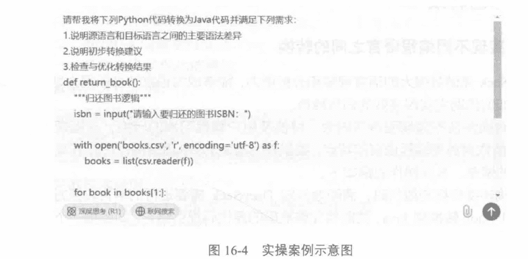

第 3 步，按下 ⬆，等待片刻，DeepSeek 会返回重写后的代码及说明。篇幅较长，此处不再展开。

> AI 能让教育像 Netflix 一样个性化。
——萨尔曼·可汗（可汗学院创始人）

### 第 17 章 辅助讲解题目

#### 17.1 语文题目讲解
语文学习兼顾阅读理解、表达训练与文学素养。做阅读题要拆解文本、把握词句含义、提炼主旨并提升语感；写作题要求把积累的材料与技巧结合起来，在审题立意与布局上锻炼书面表达；诗词鉴赏侧重意境、情感与艺术手法的把握，以加深对传统文化的理解。

##### 17.1.1 详细讲解语文题目
DeepSeek 作为强通用模型，在语文答题中能提供多角度支持。无论是诗词解读、文本阅读还是写作辅导，都能帮助学习者理清思路，提升学习效果。

##### 17.1.2 实操案例
下面以“请 DeepSeek 深入解析语文题目”为例说明。

第 1 步，明确分析目标，这里以解析李白《将进酒》的豪放气质与情感层次为目标。

第 2 步，开启 · 深度思考 · 与 · 联网搜索 ·，在对话框中输入相应提示词，如图 17-1 所示。


第 3 步，点击⬆，稍作等待，DeepSeek 会生成一份完整的分析报告。

《将进酒》的豪放特质与情感表达可从以下角度展开。

###### 一、喷薄而出的狂放气象
开篇“黄河之水天上来”以天体运行的磅礴喻生命的奔涌，随后“朝如青丝暮成雪”把时间压缩，呈现出对生命无常的焦虑与突破的渴望，两者张力让全诗极具冲击力。

###### 二、悖论修辞中的生命哲学
“天生我材必有用，千金散尽还复来”表面自信，实则构建有用与无用的辩证视角，通过不断扬弃物质存在来达成精神自由。

###### 三、醉酒叙事的解构艺术
“钟鼓馔玉不足贵”直接颠覆世俗价值排序，“主人何为言少钱”则以反讽化解宾主关系。诗人把宴席改造成生命狂欢的现场，用论辩式语言瓦解常规规则。

###### 四、复调式情感结构（非单向豪迈）
- （1）表层狂欢：“会须一饮三百杯”的豪饮书写
- （2）深层悲郁：以酒神精神对抗现实“寂寞”，“古来圣贤皆寂寞”成为佐证

此诗的价值不仅在外在豪迈，更在于构建了一个带有现代质询意味的生存寓言：当知识分子的理想受阻，既不向世俗妥协也不沉溺绝望，而是以诗性智慧搭建流动的精神家园。这种狂欢式的反抗成为中国文人传统中独特的文化原型。

#### 17.2 数学题目讲解
AI 解决数学问题的方式多样：大模型可直接对自然语言题干推理作答；专业计算软件如 Mathematica 能处理符号与数值运算；基于图像识别的解题 App 可拍照识别题目并给出步骤解析，满足不同阶段需求。

##### 17.2.1 提供数学解题思路
借助 DeepSeek 解数学题的常规流程：
- 明确问题：用准确完整的自然语言把题干输入。代数求解要写全方程，几何证明要描述图形条件和待证结论。
- 提出问题：在交互界面直接提问，如“请解这个方程”“如何证明该几何结论”。
- 解读回答：模型会给出答案和步骤。用户需仔细阅读其推理逻辑和方法，内化解题思路。

##### 17.2.2 实操案例
这里以一道选择题为例演示。

圆 $x^2 + y^2 - 2x + 6y = 0$ 的圆心到直线 $x - y + 2 = 0$ 的距离为（ ）。

A. $2\sqrt{3}$ B. 2 C. $3\sqrt{2}$ D. $\sqrt{6}$

图 17-2 实操案例图

第 1 步，上传题目图片。

第 2 步，开启 · 深度思考 ·，在对话框中输入提示词，如图 17-3 所示。


第 3 步，点击 ⬆，稍等，DeepSeek 会给出答案与解析，如图 17-4 所示。

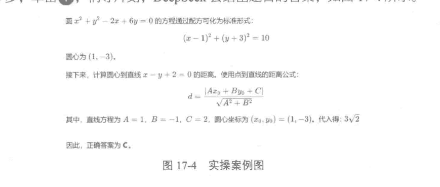

#### 17.3 英语题目讲解
英语学习覆盖词汇、语法、听、说、读、写。词汇靠积累，语法提供表达框架；听力训练捕捉关键信息；阅读理解考查文本剖析能力；写作要求用词准确、逻辑清晰；口语强调实际运用。

##### 17.3.1 解析英语题目
DeepSeek 在英语学习中可提供全方位解题支持，从词汇积累到语法理解，再到听说读写综合提升，都能帮助学习者找到突破口，提高效率与成绩。

##### 17.3.2 实操案例
下面以一道英语阅读理解题为例。

Walking home from school, I am enjoying my day. Each day I stop to hear music coming from the ivy (常春藤). Sparrow (麻雀) song, a loud glorious sound. The ivy is pulsing below a leafless tree, decorating around the lower trunk like a celebration. Nervous flittings, in and out, pecking at the branches. This ivy is a home for them, harboring an entire flock. But this scene is no longer ubiquitous. Numbers have declined by almost 70% in the UK since 1970. Sparrows make their homes near human places and finding a tree like this is a blessing. Happily, the ivy is still full of chatter and twitter.

In Greek mythology, sparrows are sacred and associated with the goddess Aphrodite, symbolizing true love and spiritual connection. I wonder how many people look at sparrows and feel that depth of connection. All birds live brightly in our imagination, connecting us to the natural world, opening up all kinds of creativity.

As I stand there, fluffed-up sparrows in conversation among themselves, there is a spark. Noticing nature is the start of it all. Slow down to listen, to watch. Take the time, despite mountains of homework.

Take the time to observe nature, to immerse oneself in its patterns, structures, happenings and rhythms. It is how mathematicians and scientists are nurtured. Alan Turing studied the patterns in nature: the arrangement of petals on the flower, spots on a leopard and stripes on a zebra. He was looking for a mathematical formula (公式) for the development of cells in living things. Nature sparks creativity. All we have to do is start asking the question, Why? The way my mind whirls and whirls in nature, or even when "daydreaming" is way more productive than the work I do in school.

I consolidate myself by thinking and thinking while intensely watching the movements of sparrows. Who knows where watching sparrows will lead?

1. What do I do on the way home from school?

A. Clean up the trunk.

B. Decorate the tree.

C. Listen to pop music.

D. Observe the sparrows.

图 17-5 英语阅读理解

第 1 步，上传题目图片。

第 2 步，开启 · 深度思考 ·，在对话框中输入提示词，如图 17-6 所示。


第 3 步，点击 ⬆，稍等，DeepSeek 会形成完整的阅读解析。

英语阅读题目答案及解析：

**D. Observe the sparrows.** （观察麻雀）

理由：

首段明确写到放学路上作者会停下来聆听麻雀的歌声，并细致描写麻雀在常春藤中的穿梭啄食行为，可见核心行为是观察麻雀，而非清理树干、装饰树木或听流行音乐。

总结：

本题重在段落主旨归纳，需结合文中具体细节与逻辑关联作答。

#### 17.4 物理题目讲解
物理题聚焦运动规律与公式运用。力学题需分析受力、套用牛顿定律；电学题结合欧姆定律理解电流电压关系。学习时要吃透实验原理，学会建模，把物理知识迁移到实际问题。

##### 17.4.1 讲解物理原理，展示物理知识
DeepSeek 能从概念到计算多维度辅助物理学习。物理概念抽象、推导繁琐，借助模型化解析能更快找到突破口，无论基础公式还是综合题都有帮助。

使用时要注意：不能照搬答案，要理解原理与推导；题目条件必须描述准确；它只是辅助，不能替代实验和自学。

##### 17.4.2 实操案例
下面以一道物理题为例，演示如何获取解题思路。


第 1 步，上传题目图片。

第 2 步，开启 · 深度思考 ，在对话框中输入提示词，如图 17-8 所示。


图 17-8 实操案例图

第 3 步，点击 ，稍等，DeepSeek 会给出答案，如图 17-9 所示。

1. 明确初速度$v_0 = 10\text{m/s}$，末速度$v = 0\text{m/s}$，时间$t = 2\text{s}$。

2. 用平均速度公式$\bar{v} = \frac{v_0 + v}{2}$，得$\bar{v} = \frac{10 + 0}{2} = 5\text{m/s}$。

3. 由$x = \bar{v}t$，算出$x = 5 \times 2 = 10\text{m}$，选 B。

图 17-9 实操案例图

#### 17.5 化学题目讲解
化学学习围绕元素性质、反应规律和实验操作。元素化合物题考查记忆与应用，反应题考查原理与配平；实验题则培养观察、动手和科学思维。

##### 17.5.1 分析化学题目，提供化学解题方法
DeepSeek 可帮助梳理知识脉络，快速定位解题关键点，无论是概念辨析还是实验设计与计算都能提供有效支持，提升效率。

##### 17.5.2 实操案例
这里以一道选择题为例。

下列说法不正确的是（ ）。

A. 葡萄糖氧化生成$CO_2$和$H_2O$的反应是放热反应

B. 核酸可看作磷酸、戊糖和碱基通过一定方式结合而成的生物大分子

C. 由氨基乙酸形成的二肽中存在两个氨基和两个羧基

D. 向饱和的NaCl溶液中加入少量鸡蛋清溶液会发生盐析现象

图 17-10 实操案例图

第 1 步，上传题目图片。

第 2 步，开启 · 深度思考 ，在对话框中输入提示词，如图 17-11 所示。


图 17-11 实操案例图

第 3 步，点击⬆，稍等，DeepSeek 会给出答案。

本题涉及盐析、核酸等化学常识。

A. 葡萄糖氧化生成 CO₂ 和 H₂O 是放热反应，正确。

B. 核酸由磷酸、五碳糖和含氮碱基经磷酸二酯键连接而成，正确。

C. 两个氨基乙酸脱水缩合形成二肽后仅剩一个游离氨基和一个游离羧基，说存在两个氨基和两个羧基是错误的。

D. 饱和 NaCl 溶液中高浓度离子使蛋白质溶解度下降而沉淀，属于盐析，正确。

故选 C。

#### 17.6 生物题目讲解
生物题涵盖生命现象与规律。细胞题帮助建立微观认知，遗传题训练逻辑推理，生态题考查系统结构与功能。实验学习有助于掌握探究方法。

##### 17.6.1 解读生物知识，解答生物疑问
DeepSeek 能助力梳理从细胞到生态系统的庞大知识网，在解题时提供精准的概念支持，无论背诵记忆还是复杂实验分析都能提升成效。

##### 17.6.2 实操案例
这里以一道生物题为例展示解题思路。

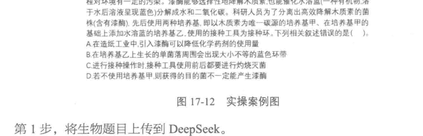

第 1 步，将生物题目上传到 DeepSeek。

实验筛选与显色反应解析

第二步，打开“深度思考”入口，在对话区填入对应的指令，参考图17-13所示。


第三步，轻点上传图标，稍作等待，DeepSeek 就能给出整份解析报告。

> 争议选项：B. 在培养基乙形成的单菌落周围会看到大小不一的蓝色圈

辨析理由：

（1）培养基乙的设计逻辑。乙培养基是在以木质素为唯一碳源的甲培养基上加入了水溶蓝。染色剂溶于水呈现蓝色，而漆酶可以将其降解为无色的水与二氧化碳。具备分泌漆酶能力的菌落周边，染色剂被分解后会出现透明区域，未受作用的基质仍保持蓝色，于是应观察到透明圈，而非蓝色环带。

（2）常见误区。若把水溶蓝的去向理解为被菌体吸收或与代谢产物结合后变蓝，就容易误判。根据题干，水溶蓝分解后产物无色，菌落四周因降解而透明，不会出现蓝色环。

其余选项要点速览：

A. 外加漆酶能减少化学药剂用量
成立。漆酶可特异性降解木质素，传统工艺中对强酸强碱的依赖下降，药剂消耗降低且污染减轻。

C. 接种工具前后须高温灭菌
成立。接种环操作要严格无菌，使用前灼烧消除杂菌，使用后灼烧防止残留菌污染环境。

D. 不用甲培养基，目标菌不一定产漆酶
成立。甲培养基以木质素为唯一碳源，只能筛选出能利用木质素即含漆酶的菌。若直接用乙培养基，其他菌可能利用水溶蓝等其他碳源生长，并不一定具备漆酶活性。

要点小结
本题核心在于把握筛选原理与显色机制。
（1）选择性培养基甲：仅让能降解木质素的菌株存活。
（2）鉴别培养基乙：借助水溶蓝降解显色判断是否含漆酶，透明圈为阳性标志。

B项失误源于对显色反应的误读，答案应选B。

#### 17.7 政治题目讲解

##### 17.7.1 讲解政治理论

DeepSeek 能为政治学习与解题提供强力支撑。政治学科覆盖经济、政治、文化、哲学等多领域，既要求吃透理论内核，也要关注现实热点并能用理论分析问题。借助该工具，学习者可以更高效梳理知识体系，面对各类政治题时快速找到切入点。无论是基础概念辨析还是材料分析论述，都能提升学习成效。

##### 17.7.2 实操案例

下面以一道政治题为例演示解题思路。

第1步，把政治题目完整输入DeepSeek。

第2步，开启“深度思考”与“联网搜索”，在对话框中输入提示词，如图17-14所示。

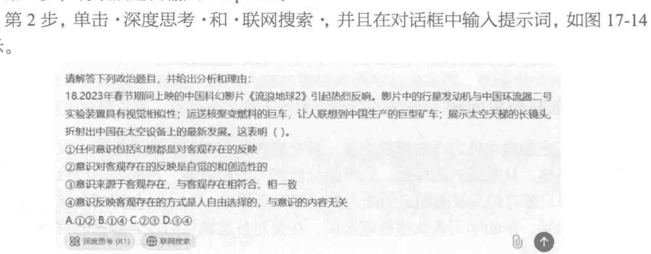

第3步，点一下上传，稍等片刻，DeepSeek 就会生成完整解析。

政治题目答案及解析：

**标准答案：A. ①②**

分析及理由：

**（1）选项①成立**
依据：马克思主义哲学指出意识是客观存在的主观映像，一切意识内容都源于客观存在。即便是幻想，其素材也来自现实，比如《流浪地球2》中的行星发动机灵感源于中国环流器实验装置等现实科技，是对客观存在的加工整合。

**（2）选项②成立**
依据：辩证唯物主义强调意识对存在的反映是能动的创造性过程。人在抽象、想象、重构中把感性材料升华为带有主观色彩的产物，例如科幻电影的艺术创作。

**（3）选项③不成立**
“意识源于客观存在”正确，但“与客观存在相符合相一致”过于绝对。意识既可能正确也可能歪曲反映客观存在，幻想并非与原型完全等同。影片中的科幻元素是对客观存在的主观改造，而非严格的符合。

**（4）选项④不成立**
“方式是人自由选择的”有合理性，但“与意识内容无关”违背唯物论。意识的表现形式虽主观，内容仍受客观存在制约，如太空电梯原型仍基于现实航天技术。

结论：
①和②共同说明了幻想与现实的关系：意识以客观存在为内容基础，并通过创造性加工表现出来。选项A正确。

#### 17.8 历史题目讲解

历史题围绕不同时期史实与脉络展开。学习者可通过材料分析提取有效信息，还原历史场景，理解事件背景、原因与影响，把握因果关系，培养历史思维与批判思维。

##### 17.8.1 剖析历史问题

中学历史涵盖中外古今重要史实，旨在培养历史思维与人文素养。题型多样，从基础选择题到材料题再到论述题，对知识掌握与运用要求较高。DeepSeek 可帮助学习者快速梳理知识，在各类题目中找到突破口，提升效率与分数。

##### 17.8.2 实操案例

下面以一道历史题为例演示解题思路。

第1步，将题目提交给DeepSeek。

第2步，点击“深度思考”和“联网搜索”，在对话框中输入提示词，如图17-15所示。

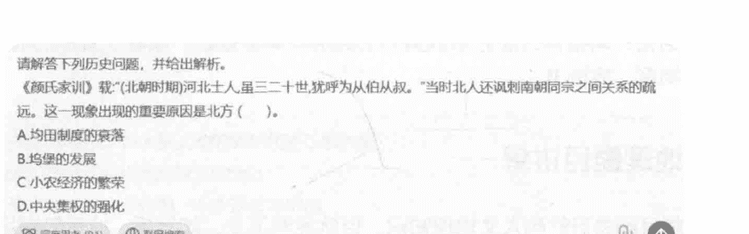

第3步，点一下上传，稍作等待，DeepSeek 就会生成完整解析。

标准答案：**B. 坞堡的发展**

分析及理由：

（1）题干现象的核心
北朝时期河北士族即使相隔二三十代，仍以“从伯从叔”等近亲称谓互称，说明北朝宗族内部联系紧密，血缘群体凝聚力强，反映北方宗族聚居、族群认同稳固的特点。

（2）选项与现象的关联

**A. 均田制度的衰落 错误**
北魏到北朝推行均田制旨在稳固小农经济，若衰落更可能冲击基层生产单元，使小家庭独立化并削弱大族对土地控制，与题干强调的宗族凝聚力强不符。

**B. 坞堡的发展 正确**
坞堡是汉末至魏晋南北朝北方战乱时期的特殊产物。豪强大族为自保建立坞堡武装据守，以宗族为核心形成人口聚居、经济自给、军事防御的封闭共同体。长期聚居强化了宗法称谓与血缘认同，即使世代遥远仍维系亲属关系，正是题干现象的直接成因。

**C. 小农经济的繁荣 错误**
小农经济以个体家庭为单位，更易导致基层原子化，削弱宗族集体联系。南朝小农经济相对发达，间接导致士族分散、宗族疏远，与题干所呈现的北方现象相反。北朝坞堡经济依托庄园，与单纯小农经济无关。

**D. 中央集权的强化 错误**
中央集权强化会削弱世家大族的地方势力，而北朝宗族凝聚恰说明地方豪族势力未被彻底压制。坞堡的独立性与中央集权存在张力。

（3）深层历史背景
北方战乱频仍，社会动荡迫使士族依托坞堡聚居自保，客观上维持了宗法血缘组织的稳定性；而南朝相对安定，士族迁居后逐渐分散，宗族联系减弱。

结论：坞堡作为北方宗族势力的经济与军事基础，维系了紧密的血缘关系与宗法制度，故选 **B**。

#### 17.9 地理题目讲解

地理题涵盖自然与人文两大领域。自然地理如气候、地形需理解要素互动与分布规律；人文地理关注人口、城市、产业等现象，需分析其形成原因与演变。通过地图学习可构建空间概念，培养综合分析与区域认知能力。

##### 17.9.1 讲解地理知识

中学地理学习中常遇难题，DeepSeek 可提供解题思路。

- 自然地理选择题：遇到地球运动、大气环流、水循环等题，把题目和选项输入DeepSeek，它能详细解释原理，比如“地球公转速度最快时北半球是什么季节”，帮助理解公转规律快速选答。
- 人文地理简答题：面对人口增长模式、城市化、产业区位等简答题，提交题目后DeepSeek 可依据理论结合案例给出要点，如分析某城市发展高新区位优势时帮助组织语言。
- 图表分析题：等高线图、气候资料图、人口统计图等，将图表与问题提交，DeepSeek 可指导解读关键信息，如等高线疏密与坡度关系，进而归纳地理特征。
- 区域地理综合题：涉及特定区域特征与发展问题时，提供区域信息与问题，DeepSeek 可整合自然人文知识分析优势与不足，如分析长三角经济发展有利条件。

使用DeepSeek辅助地理时需注意：一是不能照搬答案，要理解原理与逻辑，灵活答题；二是描述题目时要准确提供图表数据、区域信息等关键内容，避免信息缺失导致解答偏差；三是DeepSeek仅为辅助，不能替代教材学习与地理现象积累，实地观察与持续学习结合才能不断进步。

##### 17.9.2 实操案例

确认问题属于地理范畴。

第1步，将地理问题提交给DeepSeek。

第2步，点击“深度思考”和“联网搜索”，并在对话框中输入提示词，如图17-16所示。


第3步，点击上传 稍作等待，DeepSeek 就会生成题目解析。

关于海水性质对人类活动的影响，各选项分析如下：

**A. 晒盐均选在海水盐度大的地区**
说法错误。盐度虽是晒盐重要条件，还需综合气候如蒸发量大、降水少、晴天多、风力强等。例如副热带海区盐度虽高，若降水频繁反而不适合晒盐，“均选择”过于绝对。

**B. 轮船由印度洋驶入红海，吃水深度会增加**
说法错误。红海盐度明显高于印度洋，盐度高海水密度大浮力强，轮船在红海中的吃水深度会变浅而非加深。

**C. 渔场多分布在海水温度高的地区**
说法错误。渔场形成主要与营养盐丰富相关，如寒暖流交汇处或上升流区。这些区域温度未必高，反而可能因深层冷水上泛而温度偏低。

**D. 潜艇航行中突遇低密度海水时会发生“海中断崖”现象**
说法正确。当潜艇从高密度海水进入低密度海水，浮力骤减导致潜艇急速下沉，此现象称“海中断崖”，对潜艇安全构成严重威胁。

**正确答案：D**

> AI 让小微企业与巨头站在同一起跑线上。

—— 谢家华（Zappos 创始人）

### 第 18 章 做电商副业

人工智能的快速发展为副业增收开辟了新路径。在众多利用AI工具开展副业的选择中，AI写作领域潜力突出。许多自媒体创作者和企业急需高质量文案，这时可借助DeepSeek等工具先生成基础内容，再凭自身文字功底与领域理解对内容进行润色修改，使其贴合特定需求。无论是生动有趣的自媒体文章，还是专业严谨的企业宣传文案，AI工具都能轻松应对。

#### 18.1 赚钱思路

副业能增加收入，思路多样。其一，技能变现，如擅长写作可在网上承接文案撰写、公众号文章创作；精通设计可为企业或个人提供Logo设计、海报制作等服务。其二，利用闲置资源，如闲置房屋可短租，有闲置车辆可在空闲时段跑网约车。其三，电商副业，通过一件代发模式在电商平台销售热销商品，无需囤货。其四，知识付费，将专业知识、学习技巧等制作成线上课程在知识付费平台售卖。找到适合方向，合理安排时间，就能在副业中获得额外收益。

##### 18.1.1 提供多样的赚钱思路

在AI飞速发展的时代，DeepSeek为人们提供了利用其开展副业赚钱的机会。无论是增加收入还是尝试新职业方向，它都能成为有力助手。

先审视自身现状，如工作是否繁忙、空闲时间多少、是否有相关技能基础。若日常工作为朝九晚五，下班后有3到4小时空闲，则比较适合线上类副业。具体方向如下。

- 内容创作方向：平时喜欢写作，可利用DeepSeek辅助创作。下班或周末花2到3小时，用它生成短视频脚本、公众号文章大纲等，再自行完善，提供给有需求的创作者，按作品计费。
- 知识服务领域：若在某领域有一定积累，可借助DeepSeek在问答平台解答问题，每天投入1到2小时积累流量与粉丝，后续实现变现。
- 翻译工作尝试：利用DeepSeek承接翻译任务，用碎片化时间如午休、晚间空闲完成，按字数收费。
- 技术服务提供：若具备一定技术基础，可为小型企业搭建基于DeepSeek的智能客服，周末集中完成，收取搭建与维护费用。

分析思路时需注意：依据自身实际情况如时间、能力合理选择方向；深入研究DeepSeek在对应领域的应用以发挥最大效能；提前了解市场需求与价格行情，确保副业有市场且能盈利。

##### 18.1.2 实操案例

以下以浙江义乌的张三为例，寻找适合他的副业机会。

第1步，明确自身相关情况，确定希望从事的副业类型。

第2步，点击“深度思考”和“联网搜索”，并在对话框中输入提示词，如图18-1所示。


第3步，点击上传 稍作等待，DeepSeek 就会形成一份完整的分析报告。

###### 一、闲鱼无货源电商：低门槛、高灵活性

###### 1. 方向选择
闲鱼是适合个人卖家的二手交易平台，也可作为无货源电商副业渠道。可利用义乌本地供应链优势销售鞋帽、日用百货等商品赚取差价，无需囤货。

###### 2. 选品策略
选择轻量化、高性价比商品如袜子、围巾、家居小件，或结合鞋帽厂资源销售尾货、库存商品。

###### 3. 货源支持
与朋友的电商团队合作，或直接对接义乌本地工厂，采用“一件代发”模式降低库存压力。

###### 4. 执行建议
（1）账号运营：注册1到2个闲鱼账号，每天发布5到10条商品信息，优化标题与图片素材可从朋友店铺获取。
（2）流量获取：利用闲鱼的“擦亮”功能每天刷新商品排名，参与平台活动如“免费送”增加曝光。
（3）收益预估：单件利润10到50元，每天成交5到10单，月均收入可达5000元。

###### 二、社交电商分销：轻资产运营

1. 方向选择
通过微信、朋友圈或社群推广高性价比商品赚取佣金，用碎片化时间，无需露脸，无需大量资金投入。

2. 选品策略
结合义乌本地供应链分销鞋帽周边如袜子、围巾或家居小商品，朋友若有库存积压可优先合作。

3. 平台选择
使用拼多多“快团团”、抖音“精选联盟”等工具一键生成推广链接，收益按成交量结算。

4. 执行建议
（1）社群运营：组建500人以上本地生活群，定期推送特价商品，结合限时折扣提高转化。
（2）物流支持：利用有车优势提供同城配送服务如大件商品，增强客户粘性。
（3）收益预估：每月推广10到20款商品，单款利润50到100元，每天成交1到5单，月均收入可达5000元。

###### 三、跨境电商代运营：拓展海外市场

1. 方向选择
义乌小商品在海外需求旺盛，可协助本地商家运营亚马逊、Temu等跨境平台店铺，收取代运营费或销售分成。

2. 能力要求
需具备基础英语能力，熟悉平台规则，可通过免费课程短期学习。

3. 合作模式
朋友若有跨境业务可优先承接，或通过本地电商协会接单。

4. 执行建议
（1）聚焦品类：选择轻量化、高复购商品如饰品、文具，降低物流成本。
（2）利用工具：使用企业资源计划ERP系统管理订单，每天投入2小时即可完成基础运营。
（3）收益预估：代运营费每月2000到5000元，或按销售额分成5%到10%。

###### 四、短视频内容创作不露脸：打造个人IP

1. 方向选择
拍摄义乌小商品市场探厂、鞋帽生产流程等垂直内容，吸引对供应链感兴趣的观众，后续通过广告或带货变现。

2. 内容形式
展示工厂流水线、商品设计故事、价格揭秘如“义乌1元商品如何赚钱”，无需露脸，用画外音或字幕解说。

3. 平台推荐
抖音、快手、视频号，利用算法推荐精准触达目标用户。

4. 变现路径
（1）广告分成：粉丝达1万后可接品牌商单，单条视频广告收入约500到2000元。
（2）带货收益：在视频中插入商品链接，销售分成可达10%到30%。

###### 五、线上培训/咨询服务：知识变现

1. 方向选择
基于鞋帽行业经验提供以下服务。
（1）工厂管理咨询：帮助小厂优化生产流程，按项目收费单次约500到2000元。
（2）电商新人培训：开设“义乌小商品选品技巧”线上课程，平台如知识星球、小鹅通。

2. 优势与执行
（1）低时间成本：录制课程后可重复销售，后续仅需答疑。
（2）资源整合：联合电商朋友推出联合课程扩大影响力。

###### 六、可行性评估与风险提示
推荐优先级：闲鱼无货源电商 > 社交电商 > 短视频内容创作，结合收益与资源匹配度。

###### 七、风险控制
（1）闲鱼需注意账号权重维护，避免违规操作如频繁改价、发布虚假信息。
（2）避免重资产投入，优先选择无货源模式由工厂代发。

结合以上方向与义乌本地资源及空闲时间，可实现月均5000元左右的副业收入目标。建议先从闲鱼无货源电商入手，逐步拓展其他渠道。

#### 18.2 产品描述撰写

电商副业启动指南

通过线上平台实现兼职增收，已经成为当前很普遍的副业方式。整体玩法大致可以归纳为四个方向。第一种是做差价生意，先在某电商渠道或线下批发市场淘到性价比高的货，再搬到其他平台溢价售出，日用百货和当季热销玩具是典型切口。第二种是处理闲置，把家中闲置物件挂网交易，既腾位置又能回血，上架时要如实说明成色才能赢得信任。第三种是出售专业技能，像视频剪辑、平面设计、店铺代运营等，都可以在平台直接接单。第四种是无货源模式，和上游供应商合作，由其负责发货，自己专注选品、运营和引流。厘清这几条路径后，电商副业就能逐步形成稳定的现金流。

##### 18.2.1 用 DeepSeek 打造高转化商品文案

把 DeepSeek 和电商平台结合，能为副业带来新的增量。凭借其强大的文本生成与数据分析能力，找货和写文案的效率都会明显提升。把该工具用在平台上，大致可从五个方面切入。

- 爆品挖掘：让模型解析平台的搜索与销量数据，读出当前走俏的趋势，比如近期搜索量陡增的网红文具、创意家居类目，跟上节奏上架就能吃到价差。
- 定价参考：询问同款商品在不同平台的价格带，结合平台特性与自身成本，制定既有竞争力又不亏本的售价。
- 辅助撰写描述：把商品卖点、功能、使用场景告诉模型，它能迅速产出初稿，再由人工润色突出差异化。
- 生成问答：整理商品的常见疑问及标准回复，买家咨询时可以迅速响应，提升效率和满意度。
- 文案优化：把已写好的描述交给模型检查，它会指出语病并给出更通顺、更有吸引力的改写建议。

在使用时要清楚，模型输出仅供参考，不能全盘照搬。要对商品有充分了解，确保描述真实准确，避免虚假宣传。同时要持续关注平台规则和市场变化，灵活调整策略，才能让副业长期稳定。

##### 18.2.2 操作实例演示

第一步，先确定经营方向，例如在闲鱼主攻鞋帽品类。

第二步，点开 ·深度思考· 和 ·联网搜索·，在对话框里输入提示词，如图 18-2 所示。


第三步，点发送，等待片刻，DeepSeek 会基于输入生成结果。

> 以下是通过多平台数据分析得出的鞋帽类目热门商品趋势，以及结合闲鱼平台特性精选的 3 款潜力产品（附操作建议）。

###### 一、平台数据分析总览

数据来源：蝉妈妈+淘商机+拼多多后台数据（2024年5月）

各平台数据总览表

| 平台 | 热搜关键词 Top3 | 月均搜索量 | 价格区间 |
| :--- | :--- | :--- | :--- |
| 闲鱼 | 防晒渔夫帽 | 48万次 | 15~35元 |
| | 透气网面运动鞋 | 36万次 | 50~120元 |
| | 儿童防晒空顶帽 | 29万次 | 12~25元 |
| 拼多多 | 洞洞鞋 | 210万次 | 19.9~39元 |
| 抖音 | 防紫外线冰袖 | 185万次 | 9.9~19.9元 |

###### 二、闲鱼平台重点推荐产品

1. 防晒可折叠渔夫帽（夏季爆款）

（1）数据表现

- 搜索量月环比增长 320%（4月→5月）；
- 转化率达 18.7%（高于类目平均水平的 12%）；
- 新品上架 7 天出单率达 92%。

（2）产品建议

A. 核心卖点

- 防晒认证（必备）；
- 可折叠塞进口袋（展示对比图）；
- 双面戴法（附教学短视频）。

B. 定价策略

- 成本价：8~12 元（义乌、1688 拿货）；
- 闲鱼售价：25~35 元（包邮）；
- 利润率：60%~75%。

2. 工厂尾货运动鞋（清仓神器）

（1）数据洞察

- “断码清仓”关键词搜索量增长 240%。

（2）选品技巧

A. 货源获取

- 联系本地鞋厂收购 B 品（有轻微瑕疵）；
- 成本控制：15~25 元/双（品牌尾货更佳）。

B. 运营要点

- 标题注明“专柜同款”“原盒原标”；
- 主图展示鞋底纹路/透气孔细节；
- 描述强调“支持验货”“假一赔三”。

C. 定价参考

- 成本 20 元，售价 69 元包邮；
- 日均出单 10 双，月毛利约为 1.47 万元。

3. 儿童防晒空顶帽（蓝海市场）

（1）趋势分析

- 闲鱼母婴类目增长率 Top3（月增 89%）；
- 差异化机会；
- 97%的平台卖家只做纯色款；
- 卡通联名款溢价空间在 30%以上。

（2）操作方案

A. 产品组合

- 基础款：纯色防晒款（成本 5 元，售价 15 元）；
- 利润款：迪士尼 IP 款（成本 8 元，售价 29 元）。

B. 场景化营销

- 捆绑销售：“帽子+冰袖”组合价 39 元；
- 内容种草：制作儿童防晒穿搭指南 PDF 作为赠品。

C. 物流优化

- 与本地快递谈合作价：全国 3 元/单（月发 500 单以上）。

第四步，依据自身供应链挑选上述推荐品，点开 ·深度思考· 和 ·联网搜索·，在对话框中输入提示词，如图 18-3 所示。


第五步，点击发送，等待片刻，DeepSeek 会生成对应方案。

以下是为儿童防晒空顶帽定制的完整电商方案，包含定价策略、商品描述模板及文案优化技巧。

###### 一、商品定价策略

商品定价策略表

| 商品类型 | 成本价 | 建议售价 | 包邮策略 | 利润率 | 目标人群 |
| :--- | :--- | :--- | :--- | :--- | :--- |
| 基础款（纯色） | 5.8 元 | 15.9 元 | 满 2 件包邮 | 63% | 价格敏感型家长 |
| 升级款（卡通） | 7.2 元 | 22.9 元 | 单件包邮 | 68% | 品质追求型家长 |
| 礼盒装（帽袖款） | 12 元 | 39.9 元 | 全国包邮 | 70% | 送礼需求客户 |

定价技巧

- 设置“19.9 元”价格锚点（主推升级款，展示划掉的“原价 39 元”）；
- 推出“买二送一”活动（实际单价降至13.3元，促进销售）；

###### 二、商品描述模板

1. 标题

- “20××年新款儿童防晒空顶帽防紫外线透气不闷汗男女童夏季遮阳帽”。

2. 核心卖点（分点描述）

（1）专业防晒认证

- 国标GB/T 18830—2009认证，有效阻隔99%的紫外线；
- 内层银色防晒涂层，防晒效果是普通帽子的3倍（附检测报告截图）；
- 透气不闷热；
- 六边形透气网孔设计，实测比传统帽子降温3～5℃（展示红外热成像对比图）；
- 可调节魔术贴头围（52～58cm），从3岁戴到10岁。

（2）便捷实用设计

- 仅重45g，折叠后巴掌大小（配折叠过程动图）；
- 设后颈加长防晒布，保护脖颈不被晒伤。

（3）场景化文案

- “开学季必备！让孩子成为操场最靓的仔”；
- “体育课奔跑不怕晒黑，放学路上阳光直射无忧，周末郊游轻松收纳”。

（4）用户评价展示

- “宝妈真实反馈：之前孩子总说戴帽子闷，现在居然主动戴这款！出汗也不粘头发，已回购第二顶！——浙江李女士”。

###### 三、文案优化技巧

1. 标题优化技巧（原始标题：“儿童防晒空顶帽夏季遮阳”）

- 优化后：“20××年国标UPF50+儿童防晒帽，6D透气不闷汗头围可调送收纳袋”；

2. 主图设计要点（需配4张图）

- 图1：孩子戴帽在操场运动（场景化）；
- 图2：防紫外线检测报告特写（权威背书）；
- 图3：折叠对比图（在矿泉水瓶旁展示大小）；
- 图4：透气性测试（帽顶放干冰冒烟）。

#### 18.3 电商搜索优化

要让商品被更多人看到，搜索优化是关键。标题要做到信息全、匹配准，例如“苹果13系列256GB国行二手手机”。描述要写得细，基本信息、成色、使用状况、是否带配件都要讲清楚，再加一点使用感受，会更真实可信。善用标签，像“#二手手机”“#数码产品”这类热门词，帮助系统更准分类。商品要定期上新或刷新，保持活跃度。价格参考同行，保持合理竞争力，曝光自然会提升。

##### 18.3.1 提升搜索排名扩大曝光

在电商平台做副业，商品能否在搜索结果里冒头直接决定销量。DeepSeek 能在搜索引擎优化上提供强支持，帮助内容更易被点击、排名更好，从而带动成交。

##### 18.3.2 实例演示

以浙江义乌的张三为例，他在闲鱼上售卖儿童防晒空顶帽。

第一步，将儿童防晒空顶帽的相关信息上传至 DeepSeek。

第二步，点开·深度思考·和·联网搜索·，在对话框中输入提示词，如图 18-4 所示。


第三步，点发送，稍等片刻即可得到答案。

###### 一、精准关键词挖掘（基于闲鱼搜索算法）

1. 工具组合

- 闲鱼搜索下拉框；
- 蝉妈妈闲鱼版（免费基础功能）；
- 竞品标题拆解。

2. 关键词矩阵

| 关键词类型 | 高流量词 | 蓝海词 | 转化词 |
| :--- | :--- | :--- | :--- |
| 核心词 | 儿童防晒帽 | 小学生防晒空顶帽 | 防紫外线儿童帽 |
| 属性词 | 防紫外线 | 透气不闷汗 | 可调节头围 |
| 场景词 | 开学必备 | 体育课专用 | 海边度假 |
| 促销词 | 买一送一 | 过敏包退 | 送冰袖 |

3. 长尾词推荐

- “儿童防晒帽男女童夏天透气”（搜索量 12 万次/月）；
- “小学生空顶帽防紫外线不闷热”（搜索量 8.3 万次/月）；
- “幼儿园防晒帽可折叠”（搜索量为 5.6 万次/月）。

###### 二、标题优化策略

1. 黄金公式

“年份词” + “核心词” + “属性词” + “场景词” + “促销词”。

2. 优化案例

- 原始标题：“儿童防晒空顶帽夏季透气”。

3. 优化后

- “2024 年新国标儿童防晒空顶帽+防紫外线小学生夏季透气不闷汗帽开学季必备[过敏包退]”

4. 标题拆解

- 年份词：“2024 年新国标”（提升新鲜度）；
- 核心词：“儿童防晒空顶帽”（精准匹配搜索）；
- 属性词：“防紫外线+透气不闷汗”（过滤目标客户）；
- 场景词：“小学生+开学季”（抓住细分场景）；
- 促销词：“过敏包退”（消除决策顾虑）。

5. AB 测试方案

版本 A：强调专业认证

- “质检报告儿童防晒帽 UPF50+2024 年夏季防紫外线空顶帽小学生体育课专用”

版本 B：突出使用场景

- “开学季爆款！儿童防晒空顶帽海边露营防紫外线可调节头围 3～12 岁买一送一”

###### 三、搜索权重提升技巧

1. 关键词布局策略

- 标题：植入 3～5 个核心词（总字数控制在 26 个字内）；
- 标签：设置“#儿童防晒帽”“#防紫外线帽子”“#开学必备”；
- 描述：前 50 个字重复核心关键词 2 次（自然融入）。

2. 上新冷启动技巧

- 首日设置“1 元秒杀”（限量 10 件），快速积累基础销量；
- 引导买家带图评价：“晒图送防晒面罩”；
- 每天 20:00—22:00 手动刷新商品（闲鱼流量高峰）。

#### 18.4 智能客服助手

把退换货政策等资料导入系统，客户提问时 AI 能立刻给出回应。借助机器学习，它会不断积累新问答，优化回复逻辑。智能客服全天在线，不受人工休息限制，能显著提高响应速度和客户满意度，对副业发展很有帮助。

##### 18.4.1 用智能客服提升服务体验

沟通时回复是否专业、贴心，直接影响成交。对不太擅长即时沟通的人来说，DeepSeek 能帮忙搭建智能客服，让回复更规范、更温暖。

##### 18.4.2 实例演示

仍以浙江义乌的张三为例，他售卖儿童防晒空顶帽，需要一套回复模板。

第一步，将儿童防晒空顶帽相关信息上传至 DeepSeek。

第二步，点开 · 深度思考 · 和 · 联网搜索 ，在对话框中输入提示词，如图 18-5 所示。


第三步，点发送，稍等片刻 DeepSeek 会生成问题清单。

常见问题解答（FAQ）

**Q1：帽子适合多大孩子？会勒头吗？**

- A：头围 52～58cm 均可戴（3～12 岁），后置魔术贴 3 档可调，特意加宽弹性带，不勒头，可参考尺码表选择。

**Q2：防晒效果能维持多久？**

- A：正常使用情况下，防晒涂层有效期为 2 年。建议避免机洗和暴晒存放，可延长使用寿命。

**Q3：出汗会留下白色痕迹吗？**

- A：采用独家防汗渍工艺，经 10 次水洗测试无褪色无痕迹，放心运动佩戴。（附水洗测试视频链接）

**Q4：如何清洗保养？**

- A：手洗最佳，中性洗涤剂冷水轻揉，阴凉通风处晾干。切勿漂白/烘干/暴晒。

**Q5：不支持 7 天无理由怎么办？**

- A：本店支持【过敏无忧退】——只要未下水，不影响二次销售，过敏者可特殊退换。

第四步，将以上问题导入智能客服机器人，实现 24 小时在线答疑。

> AI 是思维的镜子，帮人类看清思考的路径。

——东尼·博赞（思维导图发明者）

### 第 19 章 制作思维导图

思维导图由东尼·博赞提出，以中心主题为核心，通过分支和子分支呈现层次，配合色彩、图形和关键词提升可视化效果。它在学习、工作和生活中都常用，能帮助梳理信息、激发灵感、提升效率。其放射状结构贴合大脑思维习惯，有利于增强逻辑性、条理性和创造力，便于整理和分享。

#### 19.1 思维导图

##### 19.1.1 AI 自动生成思维导图

数字化时代效率至上。用户可借助 DeepSeek 生成 Markdown 代码，再用 XMind 将代码转为直观的思维导图，从而提高知识整理和呈现效率。

##### 19.1.2 操作实例

尝试把一部电影的主要内容生成思维导图。

第一步，选择一部电影，如《泰坦尼克号》。

第二步，打开 DeepSeek 平台，点开 · 深度思考 · 和 · 联网搜索 ·，在对话框中输入如下提示词，如图 19-1 所示。


第三步，发送后稍等片刻，DeepSeek 会生成 Markdown 格式文本。

```
电影《泰坦尼克号》剧情梳理

序幕：现代探索（1996 年）
探险队在大西洋海底搜寻泰坦尼克号残骸，目标为遗失的“海洋之心”钻石项链。

老年露丝·道森（Rose Dawson）得知消息后联系探险队，登船讲述尘封往事。
```

###### 主线剧情（1912年）

1. 启航与邂逅

背景：泰坦尼克号从英国南安普顿启航，号称“永不沉没”。

人物登场

露丝·迪威特·布克特（Rose DeWitt Bukater）：不满贵族联姻束缚的年轻女性。

卡尔·霍克利（Cal Hockley）：露丝的未婚夫，傲慢的钢铁大亨之子。

杰克·道森（Jack Dawson）：贫穷的艺术家，赢得三等舱船票。

关键事件：露丝欲跳海自尽被杰克救下，两人建立联系。

2. 阶级跨越的爱情

卡尔敌视：对杰克与露丝的接触感到威胁，试图羞辱杰克。

情感发展：

杰克带露丝参加三等舱舞会，体验自由生活。

露丝请杰克为其绘制裸体素描《海洋之心》。

两人在船头演绎经典“飞翔”场景。

3. 灾难降临（4月14日）

撞冰山：瞭望员发现冰山时为时已晚，右舷发生致命撞击。

真相揭露：

设计师托马斯·安德鲁斯确认船将在2小时内沉没。

救生艇仅能搭载半数乘客。

船员优先安排头等舱乘客逃生。

4. 生死逃亡

卡尔陷害：将“海洋之心”项链藏入杰克外套，栽赃其盗窃。

沉船过程：

船体断裂成两截后垂直下沉（4月15日2:20）。

乘客坠入零下两度的冰海，多数因低温症死亡。

经典场景：

乐队坚持演奏至最后一刻。

老夫妇相拥等待死亡。

母亲给子女讲睡前故事。

5. 最终抉择

木板救援：杰克将露丝推上漂浮门板，自己浸在冰水中。

临终承诺：杰克要求露丝永不放弃生存，最终冻僵沉入海底。

尾声：现代（1996年）

露丝的秘密：展示卧室照片证明她践行了“像男人一样骑马”等承诺。

“海洋之心”的归宿：老年露丝将项链抛入大西洋，镜头闪回泰坦尼克号大厅中与杰克拥吻的众人。

最后画面：露丝的呼吸化作星光，与沉船中的时钟（永恒定格在沉没时刻）形成呼应。

###### 主题内核

爱情与自由：跨越阶级的灵魂之爱 VS 物质至上的婚约。

人性光辉：灾难中展现的勇气、牺牲与尊严。

历史隐喻：工业文明傲慢的代价与永恒的人性课题。

第四步，DeepSeek 生成内容后，直接复制，新建文本文档并粘贴所复制内容。接着，把文件后缀名从 “txt” 改成 “md”，保存好。一个 Markdown 格式文件就诞生了，如图 19-2 所示。

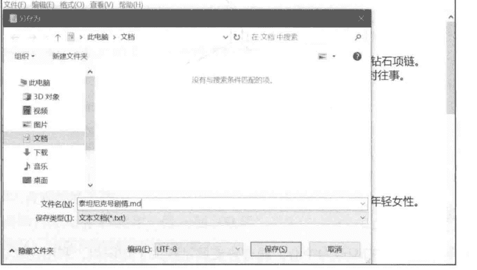

图 19-2 Markdown 格式文件

第五步，打开 XMind 软件，选择 “文件” → “导入” → “Markdown” 命令，如图 19-3 所示。

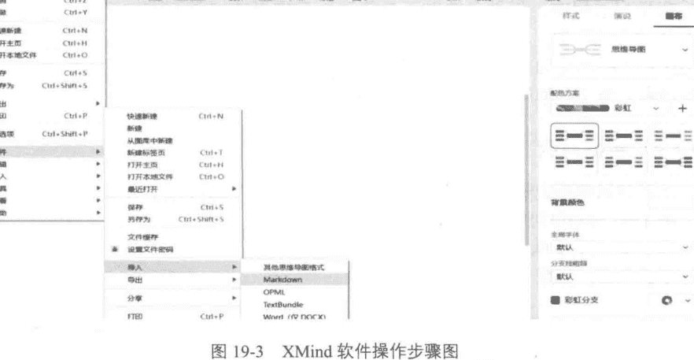

图 19-3 XMind 软件操作步骤图

第 6 步，片刻等待后，所需结果即会呈现，可参考图 19-4。

188 | DeepSeek 操作应用大全：从入门到精通

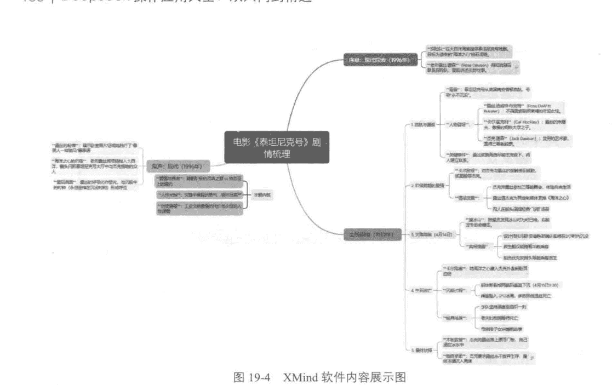

#### 19.2 知识梳理

思维导图以一个核心概念为圆心，通过分层分支向外辐射关联知识点，并借助色彩、图形与关键词强化可视化。它能快速呈现知识框架和内在联系，提升学习效率，助力体系构建与复习。例如在历史学习中可围绕朝代展开，用分支列出政治、经济、文化等要点，有助于记忆和联想。

##### 19.2.1 用工具提升课程记忆效率

学习时借助合适的工具能更高效地掌握学科内容。DeepSeek 可输出 Markdown 源码，XMind 能把源码渲染成直观的思维导图，两者配合可让复杂内容变得条理清晰，便于理解与记忆。

##### 19.2.2 实战演示

下面以历史教材为例演示如何用思维导图梳理课程。

第 1 步，示范对象选用初中历史的世界古代史。

第 2 步，进入 DeepSeek 界面，开启“深度思考”与“联网搜索”，在输入区填入指定提示词，示意图见图 19-5。


第 3 步，提交后等待片刻，系统会给出 Markdown 样式的文本。

###### 世界古代史概述

1. 古代埃及文明
时间：约公元前3000年左右—公元前30年
特点：
- 农耕活动集中于尼罗河流域。
- 法老掌握最高权力，信仰体系为多神教。
- 建造金字塔、神庙等宏大建筑，文字为象形文。

2. 古代两河流域文明
时间：公元前3500年—公元前539年
地区：美索不达米亚，即今伊拉克境内
特点：
- 涵盖苏美尔、巴比伦等文化，创制楔形文字。
- 农业、手工业与贸易兴旺，形成城邦体制。
重要人物：汉谟拉比，著有法典。

3. 古代印度文明
时间：公元前2500年—公元前500年
地区：印度河与恒河流域
特点：
- 印度河流域出现哈拉帕文化和摩亨佐-达罗文化。
- 拥有早期城市规划与下水道系统。
- 以宗教思想为核心，诞生印度教、佛教等。

4. 古代希腊文明
时间：公元前8世纪—公元前146年
地区：巴尔干半岛
特点：
- 雅典式民主政治成熟，哲学代表苏格拉底、柏拉图、亚里士多德。
- 城邦制度下文化、艺术、科技成就突出。
重要事件：马拉松战役、希波战争。

5. 古代罗马文明
时间：公元前753年—公元476年，西罗马帝国灭亡
地区：地中海周边
特点：
- 从共和国演变为帝国，军事与法律体系强大。
- 建筑、工程与文化高度发达，罗马法影响深远。
重要人物：凯撒、奥古斯都。

6. 古代波斯文明
时间：公元前550年—公元前330年
地区：波斯，即今伊朗
特点：
- 波斯帝国曾为当时世界最强帝国之一。
- 行政体系、道路建设与邮政系统得到发展。
重要人物：居鲁士大帝、达里乌斯一世。

7. 古代玛雅文明
时间：公元前2000年—公元900年
地区：中美洲尤卡坦半岛
特点：
- 擅长农业、天文学与历法系统。
- 发展出象形文字，宗教文化丰富。
重要建筑：金字塔、祭坛。

第 4 步，内容生成后直接复制，另新建文本文档粘贴，将后缀由“txt”改为“md”，点击“保存”，即可得到 Markdown 文件。

第 5 步，启动 XMind 程序，选择“文件”→“导入”→“Markdown”。稍等片刻即可看到所需内容，如图 19-6 所示。

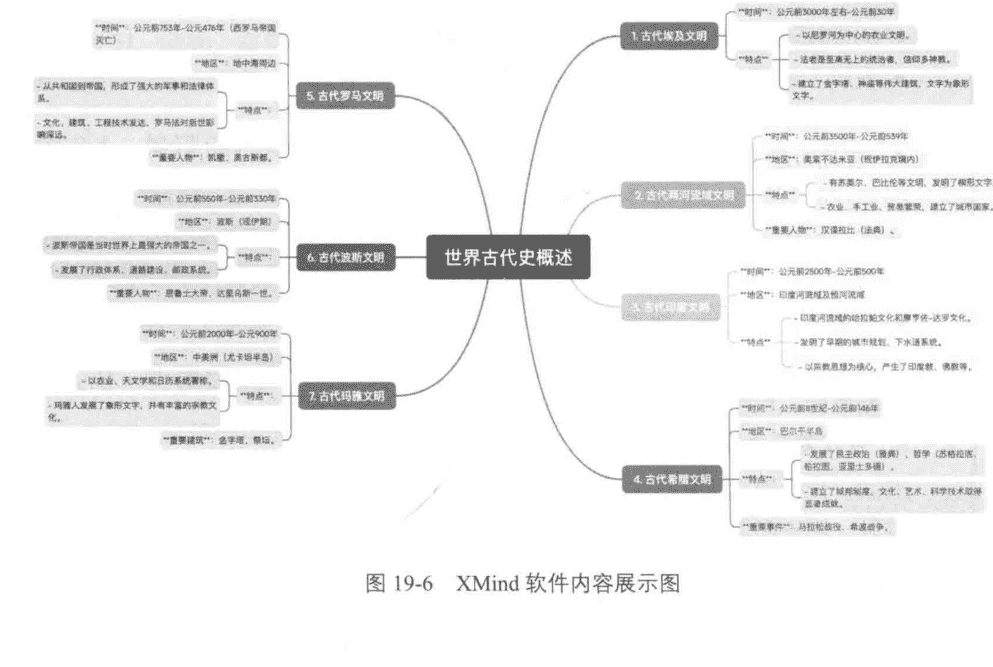

#### 19.3 组织架构图绘制

组织架构图能直观呈现企业内部层级、部门与岗位关系，帮助员工了解职责与汇报路径，助力管理、沟通与人力资源规划。

##### 19.3.1 文本生成架构图

工作与学习中清晰展示组织架构可大幅提升协作效率。DeepSeek 能根据文字描述生成 Markdown 源码，XMind 则可将其转为直观的组织结构图，让层级关系一目了然。

##### 19.3.2 案例演示

尝试为一家公司生成内部结构图。

第 1 步，先自行整理公司内部结构。
- 高层管理：董事会、总经理。
- 内容创作部：文案策划组、视频拍摄组、后期制作组。
- 市场营销部：市场调研组、品牌推广组、客户拓展组。
- 运营管理部：平台运营组、活动运营组、数据运营组。
- 技术研发部：软件开发组、技术维护组、AI 应用组。
- 人力资源部：招聘配置组、培训发展组、员工关系组。
- 财务部：预算管理组、成本核算组、审计监督组。

第 2 步，打开 DeepSeek 界面，开启“深度思考”与“联网搜索”，在输入区填入提示词，如图 19-7 所示。


图 19-7 实操案例示意图

第 3 步，提交后稍等，系统会生成 Markdown 样式文本。

```
公司组织结构图

高层管理
董事会。
总经理。
```

- 内容创作部
  - 文案策划组。
  - 视频拍摄组。
  - 后期制作组。
- 市场营销部
  - 市场调研组。
  - 品牌推广组。
  - 客户拓展组。
- 运营管理部
  - 平台运营组。
  - 活动运营组。
  - 数据运营组。
- 技术研发部
  - 软件开发组。
  - 技术维护组。
  - AI 应用组。
- 人力资源部
  - 招聘配置组。
  - 培训发展组。
  - 员工关系组。
- 财务部
  - 预算管理组。
  - 成本核算组。
  - 审计监督组。

第 4 步，生成内容后复制，新建文本文档粘贴，将后缀由“txt”改为“md”，保存后生成 Markdown 文件。

第 5 步，启动 XMind 程序，选择“文件”→“导入”→“Markdown”。

第 6 步，点击右侧的“思维导图”，选择“组织结构图”，如图 19-8 所示。

第 7 步，稍等片刻即可看到组织结构图，这里仅展示局部，如图 19-9 所示。

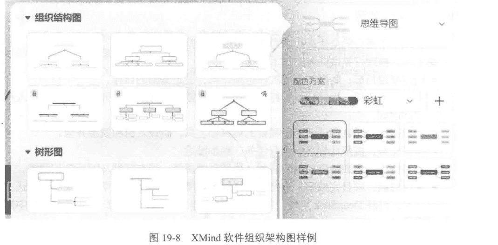

图 19-8 XMind 软件组织架构图样例

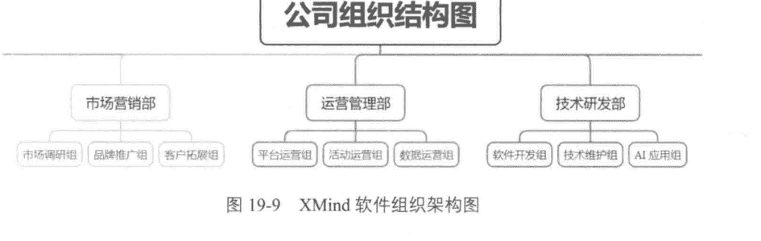

图 19-9 XMind 软件组织架构图

#### 19.4 流程图构建

流程图借助图形符号与连线展示工作流程、操作步骤或事件顺序。不同形状代表不同操作，矩形为活动、菱形为决策，箭头体现走向。流程图逻辑性强、易于理解，常用于梳理业务流程，如电商购物从下单到收货各环节，帮助发现问题、优化效率。

##### 19.4.1 一键生成时间轴流程

在工作学习中，流程图能清晰呈现步骤，助力高效执行。DeepSeek 可根据文字输入生成 Markdown 源码，XMind 能将其变为直观流程图，让复杂流程一目了然。

##### 19.4.2 案例演示

以下以任务全生命周期为例生成流程图。

第 1 步，梳理完成任务的基本步骤。
- 确定项目目标：明确任务内容，设定清晰目标。
- 列出任务清单：依据目标列出具体任务，指定负责人与完成时间。
- 资源准备：确认所需材料与工具，确保人员与资源齐全。
- 执行任务：按计划推进。
- 任务检查：定期跟踪进展，确保质量，问题及时反馈调整。
- 项目总结：完成后回顾成果，收集反馈，为后续改进提供参考。

第 2 步，打开 DeepSeek 界面，开启“深度思考”与“联网搜索”，在输入区填入提示词，如图 19-10 所示。

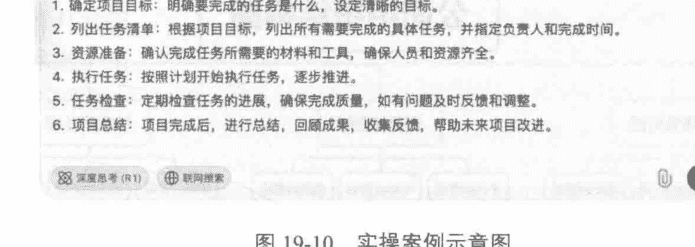

第 3 步，提交后稍等，系统会生成 Markdown 样式文本。

```
开始
确定项目目标
    列出任务清单
        每个任务指定负责人。
        确定每个任务的截止日期。
    资源准备
        确认所需材料/工具。
        确保人员到位。
    执行任务
        按照计划逐步完成。
    任务检查
        完成的任务需要进行检查。
        反馈和调整。
    项目总结
        总结项目成果。
        收集反馈。
结束
```

第 4 步，复制生成内容，新建文本文档粘贴，将后缀由“txt”改为“md”保存，生成 Markdown 文件。

第 5 步，启动 XMind 程序，选择“文件”→“导入”→“Markdown”。

第 6 步，稍等片刻即可看到生成内容，如图 19-11 所示。

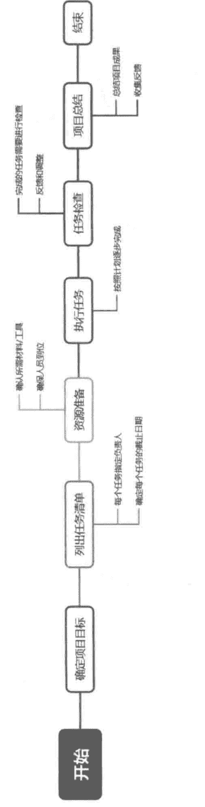

图 19-11 XMind 软件流程图

> AI是每个人生活的“首席效率官”。
> ——谢丽尔·桑德伯格（Facebook前COO）

### 第 20 章 生活规划

合理的规划能帮助充分利用时间。时间有限，若无计划易在无意义事项上浪费。例如制定每日学习计划，安排各科目学习时段，可有条不紊提升储备，避免拖延。规划也是实现目标的路线图，无论短期减肥还是长期职业晋升，都需一步步达成。以减肥为例，制定包含饮食与运动的详细计划，控制热量、安排运动时长，按计划执行即可逐步接近目标。没有规划，目标便缺乏路径。从财务角度，月度预算计划能明确各项支出限额，避免不必要消费，实现合理分配，为储蓄投资打基础。

如今 AI 为制订计划提供强力支持。DeepSeek 等工具可根据用户提供的信息生成详细方案。如制定旅行计划，告知目的地、时间、预算等，AI 能快速规划每日行程、景点顺序、交通与住宿，并根据实时数据与反馈优化调整。

#### 20.1 健康减脂方案

减脂计划旨在减轻体重、塑造身形，通常包含饮食与运动。饮食需控制热量摄入，减少高热量高脂肪高糖食物如油炸食品、甜品，增加蔬菜、水果、全谷物、优质蛋白比例，遵循少食多餐。运动结合有氧与力量训练，有氧如慢跑、游泳、跳绳消耗热量，力量训练如举重、俯卧撑、仰卧起坐提升肌肉量与基础代谢。充足睡眠也很关键，睡眠不足会影响激素分泌导致食欲上升。定期监测体重与围度并据此调整，能让效果更显著。

##### 20.1.1 科学制定减脂计划

制定科学合理的减脂计划至关重要，DeepSeek 可提供精准全面的帮助，让减脂更轻松顺畅。可参考以下思路。
- 明确个人信息：提供身高、体重、体脂率、目标、期望减重斤数、作息等，AI 可据此计算基础热量消耗与目标热量摄入。
- 规划饮食方案：基于热量需求制定每日饮食清单，包括三餐与加餐的食物种类与分量，确保营养均衡。
- 设计运动计划：说明运动基础、禁忌与可用时间，AI 会设计包含有氧与力量训练的方案，合理安排频率与时长。
- 设定阶段目标：将长期目标拆分为短期可实现的小目标，达成后给予奖励以维持动力。
- 获取建议：咨询饮食与运动注意事项，如运动前后拉伸、食物搭配等，让过程更科学安全。

##### 20.1.2 实操演示

以体重200斤的张三为例学习如何利用 DeepSeek 制定减脂计划。

第 1 步，明确身高、体重、体脂率、目标、期望减重斤数与作息时间。

第 2 步，打开 DeepSeek 界面，开启“深度思考”与“联网搜索”，在输入区填入提示词，如图 20-1 所示。


第 3 步，提交后稍等，系统会生成完整减脂计划。

###### 一、阶段目标与健康指标
减肥计划表（1）

| 时间阶段 | 体重目标 | 体脂率目标 | 重点任务 |
| :--- | :--- | :--- | :--- |
| 第 1～2 月 | 200～180 斤 | 30%～27% | 建立习惯/调整代谢 |
| 第 3～4 月 | 180～170 斤 | 27%～24% | 突破平台/塑形增肌 |
| 第 5～6 月 | 170～160 斤 | 24%～20% | 巩固成果/预防反弹 |

###### 二、科学饮食方案

###### 1. 每日营养构成
减肥计划表（2）

| 营养素 | 摄入量 | 优质来源 | 注意事项 |
| :--- | :--- | :--- | :--- |
| 蛋白质 | 120～150g | 鸡胸肉/鱼虾/蛋白粉/希腊酸奶 | 每千克体重1.2～1.5g |
| 碳水 | 150～180g | 燕麦/糙米/红薯/全麦面包 | 运动前后补充 |
| 脂肪 | 50～60g | 橄榄油/坚果/牛油果 | 避免反式脂肪 |
| 膳食纤维 | ≥30g | 西兰花/奇亚籽/菌菇类 | 分餐摄入防胀气 |

###### 2. 七日循环食谱
早餐（7:30）：
- 煮鸡蛋2个+燕麦片50g+蓝莓100g
- 蛋白粉30g+全麦面包1片+核桃3颗（交替）
午餐（12:00）：
- 清蒸鱼200g+糙米饭100g+凉拌菠菜
- 鸡胸肉沙拉（生菜/圣女果/黄瓜）+荞麦面80g（交替）
加餐（15:30）：
- 希腊酸奶150g+奇异果1个
- 煮毛豆50g+小番茄10颗（交替）
晚餐（18:30）：
- 虾仁炒西蓝花+蒸红薯150g
- 豆腐蔬菜汤+玉米1根（交替）
烹饪原则：
- 用喷油壶控制用油（≤10g/餐）
- 调味料：柠檬汁/黑胡椒/无糖酱油

###### 三、运动训练计划
每日运动模板
周一/四：
- 慢跑机爬坡（坡度10°，速度5km/h）30分钟
- 坐姿划船（15次×4组）
- 靠墙静蹲（1分钟×3组）
周二/五：
- 游泳（自由泳）45分钟
- 弹力带侧平举（12次×4组）
- 泡沫轴放松10分钟

#### 20.2 旅行行程规划

旅行计划是对行程的提前安排，目的在于更顺畅、有意义。制定时先确定目的地，依据兴趣选择；明确出行时间，考虑最佳季节与假期；预算涵盖交通、住宿、餐饮、门票。行程上规划每日景点，注意开放时间与距离，合理安排交通方式。住宿按预算与喜好选择，预留自由活动时间以应对突发或临时探索。

##### 20.2.1 用 AI 规划完美旅程

一份周全的旅行计划能让旅程更顺畅有趣。DeepSeek 可作为规划助手，帮助快速全面安排旅行细节。

##### 20.2.2 实操演示

以仍在减脂期的200斤张三赴北京旅游为例演练制定旅行计划。

第 1 步，明确旅行时间、目的、预算等信息。

第 2 步，打开 DeepSeek 界面，开启“深度思考”与“联网功能”，在输入区填入提示词，如图 20-2 所示。


第 3 步，提交后稍等，系统会形成完整旅行规划。

###### 张三北京三日健康旅行计划
（兼顾名胜游览与减重需求，每日步行量 15000～20000 步）

**Day 1：天坛文化线+低碳饮食启动**
上午
- 07:30 高铁抵京→地铁 5 号线直达天坛东门（站立乘车）
- 08:30—11:30 天坛公园深度游

北京三日能量漫游

Day1 天坛环线
入园建议走东门，游览动线串起祈年殿、丹陛桥、回音壁、圜丘，步行约3.5公里。
热量消耗小技巧：在丹陛桥段做快慢交替步行，快走约百步后慢走约二百步，如此循环。

午餐
12:00 改良版老北京涮肉
用餐点：东来顺天坛店
点餐参考：清汤锅底+羊后腿肉200克+菠菜/蒿子秆拼盘+魔芋丝
避坑提示：少用麻酱，改以蒜蓉+小米辣+醋调味更清爽

下午
14:00—16:00 天桥站自然博物馆
观展间隙训练：每小时完成3组靠墙静蹲，每组保持45秒

晚餐
18:00 低升糖餐 The Woods 轻食 前门店
点单建议：烤三文鱼沙拉，油醋汁请单独盛出

住宿
前门四合院民宿，无电梯，每天爬楼可额外消耗约100大卡

Day2 故宫耐力挑战
晨练
06:30 前门出发快走到天安门广场，约2公里，配速8分钟/公里

上午
08:30—12:30 故宫深度游
燃脂动线：午门→武英殿→慈宁宫→西六宫→御花园，约5公里
补给装备：2升水袋包，每小时补充约200毫升

午餐
13:00 故宫冰窖餐厅
选择：去皮烤鸭卷饼2个+拌时蔬+无糖酸梅汤

下午
14:30—16:30 景山公园
登顶万春亭，垂直上升约45米，约200级台阶
山顶做拉伸，重点放松股四头肌

Day3 胡同文化轻量日
上午
08:00—10:00 南锣鼓巷至北锣鼓巷
玩法：寻访10家特色小店，每找到一家做10个靠墙俯卧撑

加餐
10:30 元古本店 箭厂店
选择：无糖茉莉清茶酪+美式咖啡

下午
13:00—15:00 国家博物馆
站立观展小动作：每小时踮脚5分钟，有助小腿线条

返程
16:00 地铁前往北京南站，全程站立
随身高铁餐：即食牛肉棒+小黄瓜3根

#### 20.3 天气预测
天气预测是对未来一段时期气象状况的推断，依托大气科学原理开展。气象卫星自太空收集大气多维数据，地面站网遍布各地，实时记录气温、气压、湿度、风速等要素。数值模式把这些资料结合大气运动规律与历史资料进行模拟运算。预报的价值很大，日常出行着装与雨具准备、农业安排农事规避灾害、航空航海安全都离不开它。技术虽在持续进步，天气系统复杂多变仍有误差。DeepSeek 可同步比对多家预报源，按需求给出合理建议。

##### 20.3.1 预测天气，提前做好出行准备
天气与生活紧密相连，无论是日常通勤、户外运动还是观星等特殊安排，都需要可靠预报。DeepSeek 作为大模型平台，能整合多源气象信息，提供全面且有针对性的参考，帮助更从容安排活动。

##### 20.3.2 实操案例
张三回京后准备陪女友观星，想借助 DeepSeek 提前判断未来天气。

第 1 步，把整个观星计划提交给 DeepSeek。
第 2 步，进入 DeepSeek 工作台，开启·深度思考·与·联网功能·，在对话框输入提示词，如图 20-3 所示。

图 20-3 实操案例示意图
第 3 步，发送后稍等，系统会输出一份完整分析报告。

根据你的需求，以下是结合香山天气情况和观星建议的详细计划：

1. 观星日期选择
根据天气预报，香山未来一周情况如下：
- 2 月 17 日 星期一：晴，-4～6℃，东北风转北风<3 级。
- 2 月 18 日 星期二：晴转多云，-5～6℃，西南风转北风<3 级。
- 2 月 19 日 星期三：多云转晴，-5～6℃，南风转东北风<3 级。
- 2 月 20 日 星期四：晴转多云，-5～5℃，北风转东风<3 级。
- 2 月 21 日 星期五：多云，-5～3℃，南风转北风<3 级。
- 2 月 22 日 星期六：晴，-5～7℃，西北风<3 级。
- 2 月 23 日 星期日：多云，-3～8℃，南风<3 级。
推荐日期：
2 月 17 日 星期一和 2 月 22 日 星期六最合适，晴朗云量少利于观星。
若不便，2 月 19 日 星期三可作备选，注意多云转晴的变化。
2. 观星时间安排
最佳时段：晚上 8 点到凌晨 2 点，北斗七星在北方天空清晰可见。
建议提前 1 小时抵达香山，选择视野开阔处如香炉峰，适应黑暗环境。

#### 20.4 日程表生成
日程表是对一段时间活动的有序记录与安排，能帮助合理分配时间、提升效率。制作时先罗列待办事项并按重要与紧急程度排序，再把任务落到具体时段，如清晨精力充足时处理重点，下午做常规事务，同时为每项预留缓冲应对突发。日程表既适用于工作学习，也可用于健身休闲规划。执行时严格按计划推进，有变动及时调整，长期坚持可形成规律。

##### 20.4.1 生成个人日程表，合理安排时间
快节奏下清晰的日程能让工作学习生活更有序。DeepSeek 依据用户提供的任务与时间，可高效生成实用清单，帮助轻松管理时间。

##### 20.4.2 实操案例
本节仍以张三为例，学习利用 DeepSeek 生成个人日程表。

第 1 步，将张三一天待办事项提交给 DeepSeek，并要求直接生成个人日程表。
第 2 步，进入 DeepSeek 工作台，开启·深度思考·与·联网功能·，在对话框输入提示词，如图 20-4 所示。

图 20-4 实操案例示意图
第 3 步，发送后片刻，DeepSeek 会生成张三的日程表。

张三的日程表（减肥计划）
- 7:00—7:30 起床&洗漱
- 7:30—8:00 早餐（建议低脂高蛋白，如鸡蛋、全麦面包、牛奶）
- 8:00—8:30 轻度锻炼（建议快走或慢跑，帮助激活身体）
- 8:30—9:00 洗澡&换衣服
- 9:00—9:45 前往国贸（提前出发，避免堵车）
- 10:00—11:00 参加研讨会
- 11:00—11:30 从国贸前往朝阳大悦城
- 11:30—12:30 与女朋友共进午餐（建议选择清淡饮食，如沙拉、鸡胸肉、蔬菜汤等）
- 12:30—13:00 散步（在大悦城附近散步，帮助消化）
- 13:00—14:00 前往机场（提前出发，预留足够时间）
- 14:00—15:00 接同学
- 15:00—16:00 返回市区（根据同学需求安排）
- 16:00—17:00 休息或轻度活动（如在家做一些拉伸或核心训练）
- 17:00—18:00 锻炼时间（建议中等强度运动，如快走、骑车或健身房训练）
- 18:00—19:00 洗澡&换衣服
- 19:00—20:30 与同学共进晚餐（建议选择低油低盐的食物，如蔬菜、糙米饭等）
- 20:30—21:30 自由活动或与同学聊天
- 21:30—22:00 轻度拉伸或冥想（帮助放松身心）
- 22:00 睡觉（保证充足睡眠，有助于减肥）

> AI 时代，创业者的最大优势是“从 1 到 N”的速度。
——彼得·蒂尔（PayPal 联合创始人）

### 第 21 章 创业辅助
创业是充满挑战与机遇的旅程，需要周密筹备与全方位规划。数字化时代，AI 可成为得力助手，提升效率、降低成本、助力精准决策。

#### 21.1 商业计划书
商业计划书是创业蓝图，用于系统规划项目。内容涵盖市场分析，研究目标市场规模、增长趋势与竞争格局；明确市场定位与产品服务描述，突出特色优势与独特价值；制定营销策略，包括定价、促销与渠道；做好财务规划，含启动资金、收入预测、成本与利润预测，展示盈利能力。计划书既帮助梳理思路，也是吸引投资与合作的关键材料。

##### 21.1.1 撰写商业计划书，规划创业蓝图
借助 DeepSeek 撰写商业计划书可参考以下思路。
- 梳理项目核心信息：把项目名称、所属行业、业务范围等基础信息整理清楚告知 DeepSeek，让它形成初步认知。
- 提供市场调研数据：若已做调研，可把目标市场规模、竞争对手、消费者偏好等数据提供给它，辅助市场分析部分更具说服力。
- 设定财务相关数据：将预估启动资金、运营成本、预期收入等告诉它，可协助完成财务规划与简易报表。
- 明确发展规划与策略：把短期目标、长期目标及营销、运营策略告知它，可有条理地整合进计划书。
- 润色与调整内容：DeepSeek 生成初稿后，结合自身经验与实际调研情况修改完善，使计划更贴合项目。

##### 21.1.2 实操案例
以开奶茶店为例学习用 DeepSeek 撰写商业计划书。

第 1 步，尽可能详细地把现阶段调研情况发送给 DeepSeek。
第 2 步，进入 DeepSeek 工作台，开启·深度思考·与·联网搜索·，在对话框输入提示词，如图 21-1 所示。

第 3 步，DeepSeek 会自动抓取互联网信息，分析形成商业计划书。

###### 奶茶店商业计划书
###### 一、项目核心信息
- 目标市场：18 至 35 岁学生、年轻白领，聚焦大学城、商业街。
- 产品特色：健康低糖，天然原料，推出养生系列，配合季节与节日做限定款。
- 竞争优势：8 至 20 元低价，品质对标中高端，3 公里内无门槛外送。

###### 二、市场调研与选址方案
- 市场分析：高校周边奶茶店日均客流 200 至 300 人，学生周均消费 3 至 4 次，现有门店多为传统品类，缺乏创新，服务同质化。
- 选址：首选大学城商业街，店面 15 至 20 平方米，月租≤1.5 万元；次选社区商圈，日均人流≥5000 人，月租≤1 万元。

###### 三、装修方案与设备采购
- 装修：自然简约风，木质桌椅、绿植墙面、暖光，硬装软装预算≤8 万元，选用环保模块化家具。
- 设备：封口机、制冰机等核心设备，加收银系统、保温箱，总投入≤5 万元。

###### 四、产品设计与供应链管理
- 产品线：基础珍珠奶茶、水果茶；创新五谷养生、低卡代糖系列；搭配小吃提升客单价。
- 供应链：与本地供应商签长期协议，按需采购，周均原料成本≤5000 元。

###### 五、员工培训与运营管理
- 人员配置：3 名全职（1 名店长、2 名调饮师），2 名兼职，月人力成本≤1.5 万元。
- 培训：标准化调配技术；顾客接待、投诉处理服务规范。

###### 六、发展规划与策略
- 短期（1 年）：单店日均销量超 200 杯，会员达 2000 人。
- 长期（3 至 5 年）：开 3 家分店，引入数字化管理系统。

#### 21.2 资金预算
##### 21.2.1 制定资金预算，合理安排资金
DeepSeek 可成为创业资金预算的助手，操作思路如下。
- 罗列创业基础开支：梳理前期所有基础支出，如场地租赁、设备采购、原料进货、招聘费用等，详细告知 DeepSeek。
- 提供成本预估信息：对每个支出项目给出预估金额或区间，如告知城市地段面积预估租金，说明设备种类品牌预估采购费。
- 明确运营周期与收入预期：将预计运营周期及各阶段收入预期告知它，可计算不同阶段资金缺口或盈余。
- 设定风险预留资金：考虑到市场波动、政策变化等风险，告知计划预留比例。
- 分析资金使用效率：让它根据预算数据分析各项资金投入产出比，判断分配是否合理。

##### 21.2.2 实操案例
仍以开奶茶店为例，学习通过 DeepSeek 进行资金预算。

第 1 步，将商业计划书上传给 DeepSeek，并根据个人情况形成总预算，同时给出合理投资回报预期。
第 2 步，进入 DeepSeek 工作台，开启·深度思考·与·联网搜索·，在对话框输入提示词，如图 21-2 所示。
我计划开一家奶茶店，总投资不能超过 30 万元，总投资额需要包含房租押金、装修费用、2 个月员工的工资、前期宣传费用和前 3 个月现金流，净利润需考虑到设备折旧等因素。投资情况希望能在 2 年内收回全部投入成本。参考以上内容，形成投资预算表。

图 21-2 实操案例示意图
第 3 步，发送后片刻，DeepSeek 会形成完整的奶茶店投资分析报告。

###### 财务规划与风险控制
1. 总投资预算（单位：万元）
总预算投资表
| 项目 | 金额（万元） |
| :--- | :--- |
| 房租押金（3 个月） | 4.5 |
| 装修费用 | 8 |
| 设备采购 | 5 |
| 员工工资（2 个月） | 3 |
| 宣传费用 | 2 |
| 原材料采购（3 个月） | 3 |
| 现金流储备 | 4.5 |
| 总计 | 30 |
2. 盈利预测
- 月均收入：日均销量 150 杯×12 元每杯×30 天=5.4 万元；附加品收入 0.5 万元。合计 5.9 万元。
- 月均成本：原料 1.5 万元+人力 1.5 万元+房租 1.5 万元+折旧（设备按 5 年摊销）0.1 万元。总成本 4.6 万元。
- 净利润：月均利润 1.3 万元（毛利率约 22%）。
3. 风险应对
- 市场风险：通过会员积分制（消费 1 元换 1 积分，满 100 分兑换饮品）提升复购率。
- 现金流风险：预留 4.5 万元应对前 3 个月低迷期。

#### 21.3 商铺选址
##### 21.3.1 辅助商铺选址，提高创业成功率
DeepSeek 凭借大数据与分析能力，可帮助商铺选址做出更审慎决策。

##### 21.3.2 实操案例
仍以开奶茶店为例，现已确定商业计划书与投资预算表，朋友推荐两个店铺选项。其一在大学旁，每月房租 1 万元，日均人流超 1 万人；其二在商场 B1 层，每月房租 1.5 万元，覆盖超 20 万居民区。

第 1 步，对两店做深度调研，如蹲点统计人流等，线下实地操作不可依赖 DeepSeek。若已确定商业计划书与投资预算表，则一并上传。
第 2 步，进入 DeepSeek 工作台，开启·深度思考·与·联网搜索·，在对话框输入提示词，如图 21-3 所示。注意把调研结果尽可能详细罗列在提示区。

第 3 步，发送后片刻，DeepSeek 会形成完整分析报告。

选址分析：大学旁对比商场 B1 层
1. 大学旁店铺（A）
优势
- 目标客户集中，大学生与年轻情侣是奶茶核心群体，消费频次高，对价格敏感度较低。
- 人流量大，日均超 1 万人，潜在客户基数大。
- 消费场景明确，附近有炸串店等高流量小吃店，易形成“小吃+奶茶”组合。
- 房租成本低，月租 1 万元，压力较小。
劣势
- 竞争激烈，大学周边奶茶店众多，需靠差异化产品与营销突围。
- 季节性波动，寒暑假学生离校，客流可能大幅下降。
2. 商场 B1 层店铺（B）
优势
- 消费力强，覆盖 20 万人居民区，中老年人消费力较高，可能带动家庭消费。
- 客流稳定，商场自带流量，且不受寒暑假影响。

#### 21.4 经营方案生成
##### 21.4.1 生成经营方案，助力企业发展
店铺经营方案是运营关键指引，关乎生存与发展。借助 DeepSeek 的分析与生成能力，可快速构建全面实用的经营方案，即使不擅长文字也能梳理出清晰脉络。

##### 21.4.2 实操案例
仍以开奶茶店为例，选址已完成，现需筹备整体运营方案。

校园奶茶店落地实操全流程

第 1 步，对目标商圈进行细致摸底。重点了解周边商铺的经营状况、大学城居民的消费偏好，以及大学生寒暑假的作息规律，把收集到的信息汇总整理后，连同商业策划书、投资预算表、选址说明一并上传至 DeepSeek。

第 2 步，进入 DeepSeek 操作界面，点击“深度思考”，在对话窗口输入指令，示意图见图 21-4。

我计划在高校周边开一家奶茶店，接下来会分批以附件形式把商业策划、投资预算与选址资料发给你，请基于这些材料为我制定一份完整的经营方案。


图 21-4 实操案例示意图

第 3 步，发送后稍作等待，平台会产出一份完整的经营报告。

###### 奶茶店经营方案

一、店铺位置
某高校周边 A 铺位

二、经营目标
短期，半年内日均出杯超过 150 杯，月净利润约 1.5 万元。
长期，一年内日均出杯超过 200 杯，会员规模达到 2000 人，月净利润超过 2 万元。

三、营销策略
产品：主推健康低糖系列、应季限定款、情侣主题款。
价格：基础款 8 至 12 元/杯，创新款 12 至 18 元/杯；周二第二杯半价，会员积分可兑换饮品。
推广：校园海报与社团活动联动，微信、美团外卖合作，抖音、小红书短视频种草。

四、运营流程
日常：10:00 至 22:00 营业；配置 3 名全职、2 名兼职，高峰时段店内保留 3 人；每日盘点库存，与供应商签订长期供货协议。
制作：统一配方、规范操作，高峰期提前预调配。

五、客户服务
标准：微笑接待、5 分钟内响应、24 小时内闭环处理投诉。
会员：积分兑换饮品，生日赠送一杯；开业首月 8 折，小程序定期推送优惠。

六、寒暑假策略
外送：与外卖平台合作，满 20 元免配送费，推出家庭装套餐。
人力与库存：假期以兼职为主减少全职，按需进货控制库存。

通过精准定位、高效运转和细致服务，在同质化竞争中形成差异，同时有效缓解寒暑假客流波动，实现全年稳定盈利。

#### 21.5 招聘文案

##### 21.5.1 撰写吸引人的招聘人员文案
DeepSeek 能快速产出内容充实、吸引力强的招聘文案，实操时可参考以下思路。

- 整理岗位基础信息：把岗位名称、核心职责、所需技能与经验详细告知模型，例如新媒体运营需明确文案撰写、渠道投放、数据分析等具体工作与能力要求。
- 挖掘企业独特卖点：梳理薪酬福利、办公环境、晋升通道、企业文化等优势，供模型在文案中突出人才吸引点。
- 明确招聘要求层级：说明哪些能力是硬性门槛，哪些是加分项，便于模型分层表述，求职者一目了然。
- 设定文案风格基调：告知期望的风格是专业严谨、活泼有趣还是简洁明了，使输出与品牌调性一致。

##### 21.5.2 实操案例
本节仍以奶茶店为例，演示如何借助 DeepSeek 撰写吸睛招聘文案。

第 1 步，明确招聘需求与岗位基本信息。

第 2 步，打开 DeepSeek，点击“深度思考”与“联网搜索”，在对话框输入提示词，示意图见图 21-5。


第 3 步，发送后稍等，DeepSeek 会输出完整的招聘文案。

> 加入我们，一起“茶”绘精彩！

想在充满活力的茶饮行业大展身手吗？我们现正招募热爱茶饮事业的伙伴！

一、关于我们的奶茶店
主打健康鲜果茶的潮流品牌，秉持“用心做好每一杯茶，为顾客带来极致茶饮体验”的理念。每杯均精细制作，服务热情真诚，已在本地市场收获众多好评。为拓展业务，诚邀志同道合者加入。

二、招聘岗位：奶茶店店员
岗位职责
饮品制作：熟练掌握奶茶等饮品制作，按标准配方与流程操作，保障品质与口感。
门店运营：负责日常清洁、物料整理、设备维护，营造舒适消费环境。
顾客服务：热情接待、解答疑问、推荐产品，高效处理反馈与投诉，提升满意度。
营销推广：参与线下地推，介绍产品与优惠；配合社交媒体线上推广，提升品牌知名度。
岗位要求
有奶茶或饮品行业经验者优先，熟悉制作流程与门店运营。
工作认真负责，注重细节，遵守规章与操作规范。
沟通能力良好，具备服务意识，能与顾客及团队协作。
有营销意识与学习能力，积极参与推广，敢于挑战。
态度积极，热爱茶饮行业，抗压能力强，具备团队精神。
三、我们的福利
薪酬：8000 元/月。
环境：温馨舒适的工作氛围，定期组织团队活动。
培养晋升：提供制作技巧、服务礼仪、营销推广等全面培训，为优秀员工提供晋升空间。
员工关怀：内部优惠价，工作满一定期限享带薪年假、节日福利。

#### 21.6 经验教训总结

##### 21.6.1 自动总结经验教训，促进企业成长
创业过程充满挑战，所积累的经验教训是宝贵财富。DeepSeek 凭借强大的数据处理与分析能力，可帮助用户系统梳理创业历程，提炼关键经验与不足，助力后续发展。

##### 21.6.2 实操案例
仍以奶茶店为例做复盘。门店已营业 1 年，月利润仅 8000 元，且日营业额持续下滑。

第 1 步，全面了解门店经营现状，与店长、员工深入交流，并回顾历史经营数据；与同行沟通，判断产品端是否存在问题，最后汇总问题点。

第 2 步，打开 DeepSeek，点击“深度思考”，在对话框输入提示词，并把相关文件以附件形式上传，图 21-6 所示。


第 3 步，等待片刻，DeepSeek 会形成完整的分析报告。

###### 奶茶店业绩下滑原因分析
产品方面，新品更新缓慢，数据显示新品推出频率偏低。茶饮市场变化快，消费者易喜新厌旧，本店长期缺乏新品导致审美疲劳、购买欲下降。周边竞品每月推出当季新品吸引客流，本店未能跟进。品质稳定性不足，员工反馈原材料供应不稳，部分批次茶叶、水果新鲜度与品质波动，影响口感，降低顾客信任，部分顾客因口感不一转投他店。部分产品定价偏高，与竞品对比性价比不足。
市场与营销方面，竞争加剧，周边新店不断，部分连锁品牌资金雄厚，通过大规模促销与广告抢客。咖啡、果饮等品类兴起也分流消费。营销方式单一，主要依赖线下传单，线上推广几乎空白。数字化时代线上营销效果显著，周边竞品通过抖音、小红书及团购吸引年轻客群，本店未充分利用。门店缺乏会员体系与积分留客机制。
店铺运营方面，环境欠佳，员工反映装修陈旧，卫生偶有不达标，桌椅摆放杂乱，影响顾客体验。营业时间覆盖不足，周边学校与写字楼集中，早上开业较晚错过学生与上班族高峰，夜晚收店过早错过夜生活消费时段。外卖运营薄弱，包装简易易渗漏，配送范围不合理，平台评分与排名偏低。
员工方面，服务质量待提升，部分员工服务意识薄弱，点单、取餐不够主动热情，甚至与顾客发生摩擦，影响满意度与忠诚度。培训体系不完善，新员工入职培训时间短，对产品掌握不足，老员工缺乏技能提升培训，难以应对新需求。

> AI 不会削弱人际关系，反而能增强真实连接。
> ——布琳·布朗

### 第 22 章 社交与沟通

#### 22.1 日常对话

##### 22.1.1 针对不同社交场合，提供合适的对话话术
借助 DeepSeek 生成话术可参考以下思路。
- 明确社交场景：将具体场景清晰告知模型，如商务晚宴、朋友聚会、初次相亲或面试等，让它把握氛围。
- 描述对话对象特征：提供对方年龄、职业、身份等信息，以便生成得体表达。
- 设定对话目标：明确期望达成的目的，如寻求合作、增进友谊、了解兴趣或推销产品，让话术围绕目标展开。
- 提供背景信息：如近期热点、双方共同经历等，可补充给模型，使话术更贴合实际。
- 调整话术风格：根据喜好设定正式严谨、轻松幽默或礼貌客气等风格，以适应场合。

使用时需注意，模型可提供参考，但需结合实际情况灵活运用。

##### 22.1.2 实操案例
以私营企业员工张三为例。张三受领导安排购买一杯 15 元咖啡，领导转给其 20 元并说“小张辛苦了，这是咖啡钱”。领导平时较为节俭，张三应如何回复？

第 1 步，思考是否收这笔钱，如不确定可让模型辅助决策。

第 2 步，打开 DeepSeek，点击“深度思考”，在对话框输入提示词，图 22-1 所示。


第 3 步，等待后可获得多个回复模板。

> 即便领导平时比较节俭，这次主动转账并明确说是咖啡钱，收下更合适。不收可能让领导觉得被拒绝或显得扭捏。参考话术如下。

真诚自然型
领导，太感谢您了！给您买咖啡只是顺手，您这么客气我都不好意思了。多余的钱我就当作您的鼓励，之后会更用心工作！

幽默调侃型
领导，您这次突然大方让我受宠若惊！平常您都勤俭持家把公司当家一样精打细算，这次对我这么阔绰，我可要好好宣传一下。多的钱我就收下了，以后有跑腿的事您尽管吩咐！

简洁明快型
谢谢领导！买杯咖啡本不算什么，您还特意转账，多出来的就当您给的小奖励，我会更加努力的！

#### 22.2 社交平台动态

##### 22.2.1 在朋友圈发布有趣的动态
朋友圈是展示生活、分享心情的窗口，一条有趣的动态能提升互动。DeepSeek 能辅助构思创意内容，即使不擅长写作也能打造吸睛动态。

##### 22.2.2 实操案例
参加公司组织的团建户外拓展训练后，想在社交平台分享感受。

1. 第 1 步，梳理自己的状态与发布平台。
2. 第 2 步，打开 DeepSeek，点击“深度思考”与“联网搜索”，在对话框中输入提示词，图 22-2 所示。


第 3 步，等待后可获得多条文案建议。

公式一：对比反差 + 团建感受 + 热门元素
先用日常工作状态与团建状态形成反差，再表达团建后的感受，最后加入流行梗或热词。例如：平时在工位上苦哈哈，团建户外拓展秒变嘻哈侠，团队凝聚力瞬间拉满，快乐开启疯狂输出模式！

公式二：身份代入 + 活动描述 + 成果体现
代入打工人身份，描述分组游戏、攀爬挑战等具体活动，最后点出默契提升、凝聚力增强。例如：作为一名努力搬砖的打工人，这次户外拓展玩了刺激的接力赛，团队默契一路飙升，凝聚力直接封神！

公式三：情绪渲染 + 热门元素 + 感悟
先渲染兴奋、惊喜等情绪，再融入影视剧或游戏元素，最后谈团队合作感悟。例如：家人们谁懂啊！这次团建像走进“头号玩家”的世界，不仅玩得超嗨，更让我深刻体会到团队合作的力量，凝聚力在这一刻拉满！

#### 22.3 线上聊天

##### 22.3.1 如何更好地回应他人、开启新话题等
微信聊天中，如何巧妙回应并自然开启新话题，对维系关系至关重要。DeepSeek 可提供多样化话术建议，帮助不擅言辞者更从容交流。

##### 22.3.2 实操案例
以员工张三为例。张三刚加入新团队，团队微信群活跃。同事小李在群里分享一篇行业趋势文章并发表看法，张三读后受益，想参与交流并开启新话题。

第 1 步，明确自身需求。

第 2 步，打开 DeepSeek，点击“深度思考”与“联网搜索”，在对话框中输入提示词，图 22-3 所示。


图 22-3 实操案例示意图

第 3 步，等待后可获得话术建议。

1. 表达感谢与认同
先真诚感谢小李分享，并肯定其观点带来的启发。如：小李，谢谢你分享这篇文章！你对行业趋势的解读很独到，很多观点让我眼前一亮。这样既尊重对方，也营造良好氛围。
2. 结合自身工作谈思考
联系实际工作，分享对文章趋势的看法。如：我发现文章提到的“某趋势点”与我们日常工作中的“某内容”有关联。之前在“项目名称”里也遇到类似问题，当时处理比较困难，如果按文章思路调整，或许能更好解决。这样能体现参与度。
3. 提出开放性问题开启新话题
抛出开放问题引导讨论。如：大家在工作中是否遇到过类似情况？对于这类趋势，你们觉得在日常工作里有哪些具体应用场景？问题关联文章与工作，易引发讨论。
4. 积极参与讨论
同事回复后及时跟进，肯定其经验并进一步追问。如：哇，你这个经验太宝贵了！后续项目可以参考，你在应用时有没有特别需要注意的地方？通过互动更快融入团队。

#### 22.4 商务洽谈

##### 22.4.1 助力商务沟通顺利进行
商务活动中有效沟通是达成合作的关键。对表达能力不足者，DeepSeek 可提供专业话术与策略建议，提升沟通效果。

##### 22.4.2 实操案例
以员工张三为例。张三即将参加重要商务会议，需发言阐述产品优势与市场策略，但总觉得表述平淡。

第 1 步，明确自身需求。

第 2 步，打开 DeepSeek，点击“深度思考”与“联网搜索”，在对话框中输入提示词，图 22-4 所示。

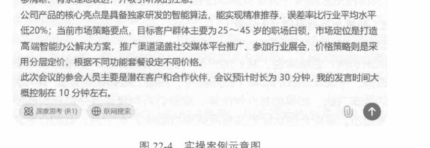

第 3 步，等待后可获得完整的发言框架与话术。

发言框架与话术，约 10 分钟

1. 开场破冰，1 分钟
目的：建立亲和力、引发兴趣。
话术示例：各位来宾、合作伙伴，上午好！感谢大家抽出时间参与交流。我是某某，负责某某公司某某工作。今天用 10 分钟带大家了解一款为职场精英设计的智能办公解决方案，它能帮您节省超 20%的决策时间，并让团队协作效率提升一个量级。让我们开始吧！

2. 产品优势阐述，4 分钟
逻辑：痛点切入、技术亮点、数据验证、场景案例
话术示例：
痛点：在座都是职场中坚，一定体会过面对海量信息如何快速筛选价值内容，如何避免推荐误差导致决策失误。
技术：产品搭载独家智能算法，像一位永不疲倦的 AI 助理，能精准学习用户行为并动态优化推荐逻辑。
数据：经第三方测试，推荐误差率比行业均值低 20%，意味着团队每年可减少约 2 小时无效信息处理。
案例：某知名金融公司使用后，市场分析报告生成速度提升 35%，高管决策响应周期缩短 2 天。

3. 市场策略说明，3 分钟
逻辑：定位精准、渠道匹配、价格灵活
话术示例：
定位：我们聚焦 25~45 岁职场白领，他们对高效工具敏感、付费意愿强。目标不是做大而全的通用产品，而是用尖端技术重新定义办公体验。

高效触达与成交收尾

传播渠道方面，我们把重点放在 LinkedIn 与 脉脉 这类职业社交网络上做精细化运营，同时安排团队走进行业头部展会，争取当面与决策层建立联系。

定价策略分为入门、进阶、企业专属三级。以进阶版为例，功能对标高端版本，售价约为同类竞品的八折，却能满足九成中型企业的核心诉求。

###### 4. 收尾与行动号召（2分钟）

目的：强化记忆点，推动下一步跟进。

话术示例：总体来看，我们的方案在算力精度、面向白领的产品打磨、以及选择的灵活性上都有区分度。现场已经准备好试用账号，扫码就能立刻体验误差减少两成带来的效率跃升。如果您是合作方，会后我们可细聊分层利润模型——跟踪数据显示，早期入局的伙伴回本周期平均快了六个月。我的分享到此，接下来进入 Q&A，欢迎大家提问反馈！

#### 22.5 社交礼仪

##### 22.5.1 不同社交场景礼仪规范

社交场合里，遵循场景化的礼节规范，能给人留下好印象，也有助于构建和谐关系。对语言表达不占优势的人而言，DeepSeek 这类智能助手可作为礼仪学习伙伴，提供全面且准确的知识，帮助快速掌握各场景要点。

##### 22.5.2 实操案例

第1步，明确自身需求。以私企员工张三为例，他收到了一场人工智能学术研讨会的邀请，现场有多位国际知名专家。他很珍惜学习机会，但担心礼仪准备不足。因此张三需要在出发前搞清会议信息、补足礼仪短板、梳理交流话题。

第 2 步，启动 DeepSeek 工作台，打开深度思考和联网搜索，在输入区填入提示词，如图 22-5 所示。


图 22-5 实操案例示意图

第 3 步，提交后稍等，系统会生成一篇要点提示文章。

收到人工智能学术研讨会邀请且有国际大咖出席，是难得的学习窗口，下面从会前了解、礼仪准备、话题准备三个维度给出建议。

###### 一、了解会议

主题与日程：通读会议通知及资料，明确本次聚焦的 AI 分支，如深度学习、自然语言处理、计算机视觉等，并整理各议题发言时段与讨论窗口，提前预习重点。

与会者背景：除已知的国际专家外，也了解其他参会者的研究方向与所属机构，便于交流时找到共同语言，拓展人脉。

会务规则：弄清是否允许录音录像、提问时机与时长限制，避免因不熟悉规则失误。

举办意图：搞清主办方初衷，是偏技术前沿探讨、产业落地交流，还是促进学术合作等。

###### 二、学习礼仪

穿着要求：遵循商务或学术场合标准，建议选择整洁得体的正装，避开过于随意或夸张搭配，体现专业与尊重。

沟通方式：与国际专家交流时使用礼貌用语，保持谦逊开放。认真倾听，不打断，待对方说完再表达。提问要有针对性和建设性，避免基础或无关问题。

时间意识：严格遵守议程，提前入场，不迟到早退。个人有发言时把控时长，别超时影响整体。

文化敏感：专家来自不同国家，要尊重其文化习惯与商务礼仪。比如肢体语言、眼神交流在不同文化里含义不同，避免误读产生隔阂。

###### 三、准备交流内容

自我介绍：准备一份简短清晰的个人研究概述，包含背景、目标、主要成果与创新点，做成 PPT 或文档，便于快速介绍。

关注热点：跟上 AI 领域前沿动态，比如大模型进展、AI 在医疗金融里的落地难题等，准备自己的思考，便于参与讨论，展现专业度。

#### 22.6 化解矛盾

##### 22.6.1 掌握沟通技巧，有效化解矛盾

人际交往中冲突难免，掌握沟通技巧能更好地化解分歧。对表达不擅长的人来说，DeepSeek 可以提供化解矛盾的沟通建议，助力更妥善处理。

- 具体描述矛盾情形：把发生的时间地点、涉及人物、起因经过说清楚。比如办公室里同事因项目分工争执，把关键信息讲明白，方便模型理解脉络。
- 讲清各方诉求：把双方各自的想法、需求和期望结果告诉系统。如一方想按自己的方案推进以提效，另一方觉得现有方案成本高更倾向低成本方案，让模型抓到核心诉求。
- 表明个人立场：说明自己希望公平解决、寻求妥协还是坚持部分观点。例如希望在不伤同事关系的前提下找到双方可接受的分工方案，让生成的建议更贴合目标。
- 借鉴成功案例话术：如果了解过类似矛盾的成功化解案例，可提供给系统参考，让它提炼其中的沟通策略，生成更有针对性的建议。
- 反复优化表述：系统给出初步建议后，结合实际感受和对方可能的反应，请求调整语气。如语气偏硬时请改得更温和委婉，更适合当前情境。

##### 22.6.2 实操案例

第 1 步，明确需求。假设场景是我和同事共同负责一个项目，但他总是把大部分任务推给我。多次沟通明确分工后，对方仍在过度分配。我不确定是否需要上报，若要汇报，该如何表达。

第 2 步，打开 DeepSeek 入口，点击深度思考和联网搜索，在对话框中输入提示词，如图 22-6 所示。


图 22-6 实操案例示意图

第 3 步，发送后稍等片刻，系统会给出几份汇报模板。

**内容 1：突出进度受阻**

领导您好，想跟您同步一下项目进展。目前项目处在关键期，但出现一些问题。我和某某共同负责，之前多次沟通并明确了分工，可他总把自己的任务转给我，导致我手头堆积，现在已影响节点，部分工作没能按时完成。担心会延误整体交付，希望您能帮忙协调。

**内容 2：强调精力吃紧**

领导您好！项目中我和某某各有板块。我多次沟通分工，他仍持续把任务推给我。我一直在硬扛，但个人精力实在有限，已经力不从心，既影响本职工作，也拖累项目推进。希望您能出面协调，让我们回到正常分工，确保项目顺利。

**内容 3：说明协作氛围受损**

领导，跟您说一下项目情况。我和某某合作，分工明确后他不断把本该自己做的事推给我。这不仅让我压力很大，也在团队里产生负面影响，破坏了原本好的协作氛围。大家都看在眼里，可能影响凝聚力。为保障项目和团队和谐，希望您给予指导和协调。

> AI 无法预测市场，却能帮助我们规避低级错误。

——沃伦·巴菲特（伯克希尔 CEO）

### 第 23 章 理财计划

#### 23.1 存款计划

存款计划是个人或家庭财务管理的基础，目的在于合理沉淀资金，实现财富的安全累积。制定时先明确目标，比如买房、子女教育、养老等，再据此确定期限与金额。

##### 23.1.1 设定目标，稳步攒钱

理财路上，科学规划并达成存款目标是积累财富的关键。如今借助 DeepSeek 等智能助手，可以更高效地设定目标、稳步攒钱。思路如下。

- 明确自身情况：判断身份是应届新人、收入稳定的职员，还是自由职业者。
- 梳理收入构成：统计月度或年度收入，包括薪资、奖金、兼职、投资收益等。
- 确定时间跨度：设定储蓄周期，是短期 1-2 年，还是中期 5-10 年，不同周期策略不同。
- 设立目标金额：结合生活规划如购房、旅游、子女教育等，确定具体存款数额。
- 提供消费数据：把日常开销按衣食住行分类统计，输入系统，获得更贴合实际的建议。
- 借助智能分析：把上述信息交给 DeepSeek，由它进行数据拆解并制定详细储蓄方案。

要注意，系统仅作参考，理财仍受市场波动、经济环境影响，不可过度依赖。要保持理性，结合实际灵活调整，才能稳步前行。

##### 23.1.2 实操案例

以一名在校大学生想存钱买新笔记本电脑为例。

第 1 步，明确目标和现状，包括存款用途、时间及身份。

第 2 步，打开 DeepSeek 工作台，点击深度思考，并在对话框中输入提示词，如图 23-1 所示。


第 3 步，发送后稍等片刻，系统会生成一份存款方案。

###### 一、基本框架
- （1）总目标：8000 元
- （2）周期：6 个月（180 天）
- （3）月均需存：1333 元
- （4）月收入：2000 元
- （5）月可支配：2000-1333=667 元

###### 二、支出优化方案
- （1）餐饮优化：早餐食堂粥/包子 3 元，午餐套餐 8 元，晚餐面食 7 元，日预算 18 元，月 540 元，预留 4 元/天机动，月 120 元。
- （2）学习支出：教材优先借阅/电子版，资料双面打印，月均控制在 50 元。
- （3）生活杂费：手机套餐 39 元校园卡，洗漱用品 30 元，水电分摊 20 元。
- （4）弹性支出：社交娱乐每月一次同学聚餐 AA 约 50 元，交通共享单车月卡 15 元。

###### 三、增收建议
- （1）英语相关兼职：线上翻译时薪 30～50 元；留学生中文辅导时薪 40～60 元；四六级辅导时薪 50 元。每周 4 小时，可增收 600～800 元/月。
- （2）校园机会：图书馆助理 15 元/小时，活动主持利用双语优势单次 100～200 元。

###### 四、储蓄策略
- （1）阶梯存款法：每月 1 号自动转 1333 元至独立账户，额外收入 50% 转入储蓄。
- （2）消费监督：使用记账 App，设置每周消费预警，不超 167 元。

###### 五、应急方案
- （1）备用金机制：每月留 100 元作应急基金，优先使用备用金应对突发开支。
- （2）价格监测：设置京东/天猫降价提醒，关注“618 购物节”优惠，6 月可能提前达标。

###### 六、执行效果预测
基础方案 2000×6 - 667×6 ≈ 8000 元。每月兼职 500 元，可提前 1 个月达成目标。备用金结余 6 个月，可额外积累 600 元应急资金。

###### 七、注意事项
- （1）保持必要社交，维系人际关系。
- （2）保证每日蛋白质摄入。
- （3）避免过度兼职影响学业。
- （4）每月安排 1 次“奖励日”，保持动力。
- （5）执行中可通过 2 元日结余补足差额。

该方案在保障基本生活质量的同时，能系统性达成购机目标。若需更灵活版本，可改为前三个月每月存 1300 元，后三个月每月存 1433 元。

#### 23.2 理财规划

理财规划是对个人或家庭财富的全方位管理，核心在于保值增值。

##### 23.2.1 开辟多元理财渠道，助力财富增值

理财规划是实现稳健增长与提升生活品质的重要手段。DeepSeek 可以为制定规划提供支持，帮助更合理配置资产，达成财务目标。

##### 23.2.2 实操案例

以下以刚毕业的在职者为例说明借助系统制定理财规划的过程。

第 1 步，明确理财目标、风险偏好、可接受投资方式、个人身份、现有收入与存款等信息。

第 2 步，启动 DeepSeek 工作台，点击深度思考，并在对话框中输入提示词，如图 23-2 所示。


第 3 步，发送后稍等，系统会生成一篇完整的理财计划。

作为刚毕业的在职者，月薪 9000 元且有 8 万元存款，财务状况相对稳健。以下是一个低风险理财方案。

1. 建立应急基金
确保有足够的应急资金，通常建议为 3 至 6 个月生活开支。可预留 2 万至 3 万元作为应急基金，存入活期存款或货币基金，确保流动性高且风险低。

2. 定期存款
将部分资金投入定期存款，获取稳定收益。可将 3 万元存入 1 至 3 年期定期存款，利率相对较高且风险极低。定期存款能提供稳定利息，适合低风险偏好者。

3. 基金投资
考虑将部分资金投入低风险债券基金或货币基金。债券基金风险较低、收益相对稳定，适合长期持有。可将 2 万元分散投资于几只优质债券基金，获得比存款更高的收益。

4. 股票投资
股票风险较高，但长期来看优质股票能带来较好回报。建议用 1 万元投资于蓝筹股或指数基金，分散风险。可选择定投方式，每月投入固定金额，平滑市场波动。

5. 每月结余规划
月薪 9000 元，扣除生活开支后，假设每月结余 3000 元。可按比例分配：1000 元存入货币基金作为应急储备；1000 元定投指数基金，长期积累财富；1000 元用于自我提升或短期目标储蓄。

6. 保险保障
考虑购买重疾险和意外险，保障未来生活。虽然这不是投资，但能提供财务保障，避免意外事件冲击财富。

总结
该计划以低风险为主，兼顾稳健增值与流动性。通过合理分配存款、基金与股票投资，可在控制风险的同时逐步实现财富增长。可定期审视并调整计划，确保与财务目标和风险承受能力保持一致。

#### 23.3 应对风险建议

理财过程中风险无处不在，有效应对至关重要。一方面要准确评估自身风险承受能力，年轻人可适当配置高风险高收益产品，临近退休者更倾向稳健型投资；另一方面要分散资产配置，避免资金集中于单一产品，如同时配置股票、债券、基金等，降低波动影响。同时持续学习金融知识，关注市场动态，及时调整策略，还可借助保险转移重大风险，保障理财计划平稳推进。

##### 23.3.1 备好应对预案，抵御风险

生活中充满不确定性，可能面临经济与生活风险。借助系统能提前做好规划，更好应对风险，保障财务稳定。

##### 23.3.2 实操案例

以一对即将生二胎的夫妻为例说明。

第 1 步，明确身份、收入、资产和面临的风险。

第 2 步，打开 DeepSeek 工作台，点击深度思考，并在对话框中输入提示词，如图 23-3 所示。


第 3 步，发送后稍等片刻，系统会生成一篇完整的风险应对规划。

> 作为 38 岁的在职者，家庭收入稳定，但面临房贷、子女教育和即将到来的二孩，合理的风险规划至关重要。以下是一份简单的应对风险规划及措施，帮助在家庭责任增加的情况下保持财务稳定。

1. 建立应急基金
首先确保家庭有足够应急资金，建议覆盖 6 至 12 个月生活开支。家庭月收入 33000 元，扣除房贷 7000 元后，生活开支假设为 15000 元，建议预留 10 万至 15 万元作为应急基金，存入活期存款或货币基金，确保流动性高且风险低。

2. 保险保障
家庭责任增加，保险是应对风险的重要工具。建议为家庭成员配置以下保险。
重疾险：为本人和配偶各购买一份重疾险，保额建议为年收入的 3 至 5 倍，覆盖重大疾病财务风险。
医疗险：补充医疗保险，覆盖住院和手术费用，减轻医疗负担。
意外险：为本人和配偶购买意外险，保障意外事故导致的收入中断或额外支出。
寿险：为家庭经济支柱购买定期寿险，保额建议覆盖房贷和子女教育费用，确保万一发生不幸，家庭财务不受严重影响。

3. 优化投资组合
现有资产中，股票和基金占比相对较高，考虑到家庭责任增加，建议适当降低高风险投资比例，增加稳健型投资。
股票：目前股票投资 2 万元，比例较低，可保持现状，避免追加高风险个股。
基金：30 万元基金中，建议将部分资金转至债券基金或混合型基金，降低波动风险。
存款：16 万元存款中，保留 10 万元作为应急基金，剩余 6 万元可考虑投入短期理财产品或国债，获取稳健收益。

4. 子女教育金规划
随着二孩到来，教育费用将增加。建议从现在开始为两个孩子设立教育金账户。
定期储蓄：每月定投 2000 至 3000 元至低风险债券基金或教育储蓄计划，长期积累教育费用。
教育保险：考虑购买教育保险，确保孩子未来接受高等教育时有足够资金支持。

5. 房贷管理
目前每月房贷 7000 元，占家庭月收入比例较低，压力不大。建议保持现状，但可考虑规划提前还款可能性，减少利息支出。若有额外收入，可考虑部分提前还款。

6. 职业发展和收入提升
作为家庭经济支柱，提升收入是应对风险的重要方式。可以通过以下方式增加收入。
职业培训：投资于职业技能提升，争取加薪或晋升机会。
副业：在时间和精力允许情况下，发展副业或兼职，增加收入来源。

总结

随着家庭角色的分量和开销同步攀升，提前构建应急资金、科学配置风险保障、做精资产组合、为孩子教育提前积累、妥善安排房贷支出，能在责任加重时为全家财务提供缓冲。财务方案不是一成不变的蓝图，需要定期复盘、动态微调，始终贴合当下需求和长远目标，确保家庭财务持续稳健。

## 第三篇 DeepSeek 生态联动与本地化部署

> 开源与合作是 AI 造福人类的核心路径。
——萨姆·奥尔特曼（OpenAI CEO）

### 第 24 章 DeepSeek 串联的跨境生成模型创作网络

DeepSeek 正逐步成为衔接海内外生成工具的中枢。它擅长把模糊的创意转化为可执行的指令，提升下游工具的使用效率。视觉层面，它能提炼画面要点并输出多风格指令；音乐层面，它先行完成歌词撰写与风格指引，再与音乐生成模型配合产出作品；视频层面，它既能给出分镜脚本，也能依据文本反馈即时修正，大幅提高成片效率。

#### 24.1 视觉创作

想做图像时，可让 DeepSeek 担任创意翻译。比如脑中有一片奇幻森林却难描述，可这样说明：“我想要一片沐浴金色阳光的奇幻森林，树木高大纹理奇特，地面长着五彩蘑菇，精灵在林间飞舞。”它凭借语言理解能力，会把零散意象整理成条理清晰的提示词，再输入文心一格、Midjourney、Stable Diffusion 等平台，很快获得理想的精美图作。

##### 24.1.1 文心一格：不画也能出图

文心一格由百度依托文心大模型打造，是把 AI 技术与绘画艺术结合的创作服务，为用户打开创意入口。核心优势如下。

- 底座扎实：依托文心大模型训练，海量语料支撑语义理解，无论概念多抽象或场景多复杂，都能抓取关键要素并转化为画面。
- 操作顺滑：界面直观简洁，只需在输入框填写文字描述、设定画幅比例、调节生成数量，点一下立即生成即可出图。
- 风格丰富：涵盖写实、卡通、油画、水彩、国风等多种样式，可按喜好快速切换，让同一主题呈现不同视觉质感。
- 编辑灵活：对不满意的部分支持涂抹修改等二次编辑手段，便于精细化调整。

##### 24.1.2 实操案例

步骤一，先确定画面主题，比如草地上小憩的一只猫。
步骤二，打开 DeepSeek 操作界面，点击 · 深度思考 · 与 · 联网搜索 ，在对话区输入需求，如图 24-1 所示。

图 24-1 实操案例示意图
步骤三，发送后等待片刻，系统会返回结构化提示词。

> 主题：一只在草坪上睡觉的猫
详细描述
（1）一只可爱的猫咪，体型适中，毛发柔软光滑，颜色可以是白色、灰色、黑色或花色，自由选择。
（2）猫咪的姿势是侧卧在草坪上，四肢放松，头部微微偏向一侧，表现出舒适的睡眠状态。
（3）草坪是绿色的，草叶清晰可见，有自然的生长感，可以有一些小花或杂草点缀其中，增加自然氛围。
（4）光线柔和，可以是阳光透过树叶洒在猫咪和草坪上的斑驳光影，营造出宁静祥和的氛围。
（5）背景可以是简单的自然环境，如树木、天空等，无须过于复杂，以突出猫咪和草坪作为主要焦点。
风格与情感
风格自然、温馨，传递出宁静、舒适的氛围。
情感上表现出猫咪的安逸和放松，以及草坪的生机和活力。

步骤四，进入文心一格界面，如图 24-2 所示，点击 · 立即创作 ·。
步骤五，将返回的提示词复制进去，如图 24-3 所示，点击 · 立即生成 ·。
步骤六，片刻后图像生成完成，如图 24-4 所示。
232 | DeepSeek 操作应用大全：从入门到精通

图 24-2 文心一格平台

图 24-3 复制提示词

图 24-4 文心一格生成的图片

#### 24.2 音乐创作

若想做一首夏日海滩主题的流行曲，可先让 DeepSeek 按需写词：“创作一首以夏日海滩为主题的流行歌曲歌词，要求节奏轻快，体现青春活力与欢乐。”它会输出包含主歌、副歌、桥段的完整歌词。随后还能让它给出风格小结，例如输入“用简短语句分析这首歌的音乐风格”。

##### 24.2.1 Suno：零基础生成个人 AI 曲目

Suno 是无需乐理基础即可使用的 AI 音乐生成工具，通过提示词即可产出多种风格音频，重塑创作体验。主要亮点如下。

- 风格覆盖广：支持中文、英文、日文等多种语言歌曲，也能生成适配动漫等场景的纯音乐。
- 上手门槛低：登录后界面清晰，只需填写 BPM、调性、段落标签等简单参数，就能驱动模型创作，流程顺畅高效。
- 全链路覆盖：从旋律生成、编曲到人声演唱，全链路均可自动化完成。
- 定制化强：可指定特定音乐元素或创作思路，生成专属作品。
- 质感专业：V3 版本可在数秒内产出两分钟广播级音质曲目，并支持导出常用音频格式便于传播。

##### 24.2.2 实操案例

步骤一，确定音乐主题，例如一首以毕业为主题的民谣。
步骤二，打开 DeepSeek 操作界面，点击 · 深度思考 · 和 · 联网搜索 ·，在对话框中输入需求，如图 24-5 所示。

步骤三，发送后稍候，会给出可直接使用的提示词。

> 提示词：
创作一首以毕业为主题的民谣歌曲，风格温暖、怀旧，带有淡淡的忧伤和对未来的希望。歌曲旋律简单、舒缓，适合吉他伴奏。歌词内容围绕毕业季的离别、回忆、成长和对未来的憧憬展开，表达对校园生活的怀念、对同学和老师的不舍，以及对即将踏上新旅程的期待。歌曲情感真挚，能够引发听众的共鸣。请确保旋律优美，歌词押韵且富有诗意，适合在毕业典礼或同学聚会上演唱。

步骤四，打开 Suno 界面，如图 24-6 所示，将提示词粘贴到 · Song description · 中，点击 · Create ·。
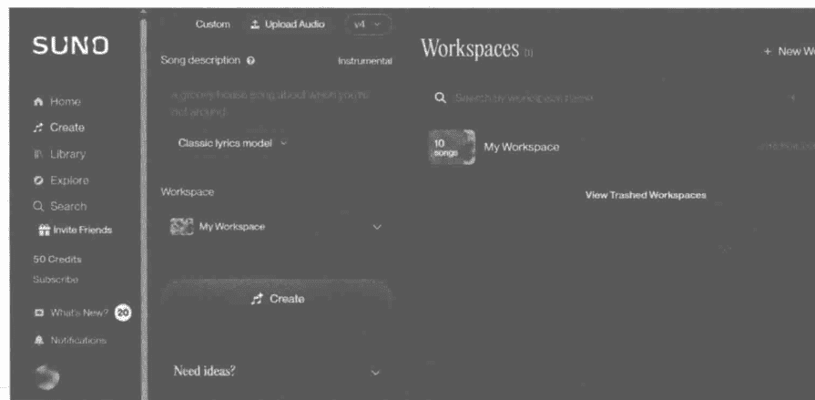
图 24-6 Suno 平台
步骤五，等待片刻，音乐即生成完毕，如图 24-7 所示。

图 24-7 Suno 生成的音乐

#### 24.3 视频创作

计划制作一个宣传城市文化的短视频，可向 DeepSeek 输入说明：“制作一个 3 分钟宣传北京市文化的短视频脚本，要突出城市地标、特色美食和传统文化元素。”DeepSeek 会生成详细的脚本，包括每个镜头的时长、画面内容及台词等。将这些脚本和提示词用于 RunwayML、Pika Labs 等视频生成平台，就能创作出吸引人的视频。这里主要介绍的是更适合初学者的软件“剪映”。

##### 24.3.1 剪映：想法即可驱动 AI 视频

剪映是字节跳动旗下的视频剪辑工具，为创作者提供简单易上手的创作平台，其视频创作要点如下。

- 操作直观：界面布局合理，基础剪辑操作简单流畅。
- 功能齐全：特效、滤镜、转场、贴纸、花字等资源丰富，参数可自由调节；智能字幕可自动识别并生成，提升效率。
- 素材充足：内置海量音频、曲库、音效及视觉素材，满足多样化需求。

使用 DeepSeek 配合剪映时，先让 DeepSeek 把创意整理成文案，再由剪映按文案生成视频。需注意当前剪映暂不支持动态视频直接生成，成片由多张图片序列组成。

##### 24.3.2 实操案例

步骤一，明确视频主题，例如介绍人工智能的科普短片。
步骤二，点击·深度思考·和·联网搜索·，在对话框中输入提示词，如图 24-8 所示。

步骤三，稍等片刻，会返回成段文案。

> **人工智能：改变未来的科技力量**
你是否想象过，机器可以像人类一样思考、学习和创作？这就是人工智能（AI），它正以惊人的速度改变着我们的世界。
从智能手机上的语音助手，到自动驾驶汽车，AI 已经渗透到我们生活的方方面面。它可以帮助医生诊断疾病，协助科学家探索宇宙，甚至创作出令人惊叹的艺术作品。
AI 的强大之处在于它能够从海量数据中学习，并不断优化自己的算法。这使得它在图像识别、自然语言处理、预测分析等领域展现出超越人类的能力。
然而，AI 的发展也带来了挑战。我们需要思考如何确保 AI 的安全性和可控性，以及如何应对 AI 带来的社会变革。
未来，AI 将继续推动科技进步，为人类创造更美好的生活。让我们拥抱 AI，共同探索这个充满无限可能的未来！

步骤四，打开剪映界面，如图 24-9 所示，点击 · 图文成片。

图 24-9 剪映平台
步骤五，选择 · 自由编辑文案，如图 24-10 所示。

图 24-10 自由编辑文案
步骤六，将生成的文案粘贴进去，点击 · 生成视频，再点击 · 智能匹配素材，如图 24-11 所示。

图 24-11 智能匹配素材
步骤七，片刻后视频生成完成，如图 24-12 所示。

图 24-12 生成视频

> AI 必须扎根行业，像螺丝钉一样解决具体问题。
——任正非（华为创始人）

### 第 25 章 私有化部署 DeepSeek

对不少非技术用户而言，本地部署大型模型似乎门槛很高。实际上只要按步骤操作，即可无痛完成 DeepSeek 的私有化部署。

#### 25.1 进行私有化部署的必要性

相较于在线调用，本地部署主要有以下优势。

- 数据隐私：敏感业务数据无需外传，降低泄露风险。
- 长期成本可控：一次性投入后，避免持续的云服务费用。
- 可按需定制：可针对业务场景微调模型，提升表现。
- 运行更稳：依托本地硬件，性能波动更小。

#### 25.2 部署准备阶段

先准备一台满足最低配置的主机。官方建议硬件如下。

- CPU：至少 4 核，如 Intel Core i5 或 AMD Ryzen 5。
- GPU：可选，有则建议入门级显卡如 NVIDIA GTX 1650，具体取决于模型大小。
- 内存：建议 4GB 以上。
- 存储空间：视模型而定，通常从数 GB 到数十 GB。

软件层面需提前安装 Docker、Ollama，以及视方案而定的 Dify 平台。

#### 25.3 部署操作步骤

步骤一：安装 Ollama
Ollama 是跨平台的本地大模型管理客户端，上手容易。访问 Ollama 官网，如图 25-1 所示，下载对应版本并按指引完成安装。

图 25-1 Ollama 官网

步骤二：挑选并下载 DeepSeek 模型
登录 Ollama 后可浏览 DeepSeek 模型列表，如表 25-1 所示。不同版本对硬件要求差异较大，初学者建议先用 DeepSeek-R1-1.5B，硬件压力小且易维护。

表 25-1 不同 DeepSeek 模型列表

| 模型规模 | 推荐硬件配置 | 显存要求 | 存储空间 | 使用场景 |
| :--- | :--- | :--- | :--- | :--- |
| DeepSeek-R1-1.5B | CPU: 4 核或以上<br>GPU: 可选（显卡如 GTX 1050 Ti 4GB，<br>RAM: 8GB+ | ≥4GB（无 GPU 时可运行） | ≥1.1GB | 预算有限或硬件资源较为紧张的情况下选用，可满足基本的文本生成需求 |
| DeepSeek-R1-7B | CPU: 8 核或以上<br>GPU: RTX 3060 及以上，至少 14GB 显卡<br>RAM: 16GB+ | ≥14GB | ≥7GB | 具有更好的性能和更丰富的功能，适用于对精度和响应速度有一定要求的应用场景 |
| DeepSeek-R1-70B | CPU: 16 核或以上<br>GPU: 多块 A100 80GB 或其他高性能 GPU，总计需超过 140GB 显存<br>RAM: 256GB+ | ≥140GB | ≥70GB | 可满足企业级应用或者研究目的，适用于涉及大量数据处理、执行复杂任务的应用场景 |

步骤三：获取模型启动命令
在 Ollama 官网可查到各模型的启动指令，如图 25-2 所示。
# Distilled models
DeepSeek team has demonstrated that the reasoning patterns of larger models can be distilled into smaller models, resulting in better performance compared to the reasoning patterns discovered through RL on small models.
Below are the models created via fine-tuning against several dense models widely used in the research community using reasoning data generated by DeepSeek-R1. The evaluation results demonstrate that the distilled smaller dense models perform exceptionally well on benchmarks.
# DeepSeek-R1-Distill-Qwen-1.5B
```
ollama run deepseek-r1:1.5b
```
# DeepSeek-R1-Distill-Qwen-7B
```
ollama run deepseek-r1:7b
```
# DeepSeek-R1-Distill-Llama-8B
```
ollama run deepseek-r1:8b
```
图 25-2 不同模型的启动命令

步骤四：启动模型
选定版本后，在命令行输入对应指令加载模型。例如选择 DeepSeek-R1-1.5B 时，执行 “ollama run deepseek-r1:1.5b”，如图 25-3 所示。
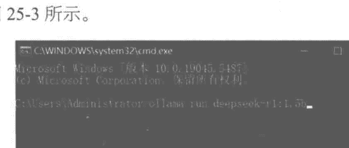
图 25-3 加载模型

步骤五：测试与优化
模型加载成功后，可直接在对话窗口提问，观察响应效果。若一切正常，即表示部署完成。

按以上流程，即便没有编程背景也能顺利完成私有化部署。过程中难免遇到小问题，耐心对照指引即可克服。技术的意义在于让使用更便捷，希望每位感兴趣的人都能体验到 AI 带来的乐趣与成就感。

## DeepSeek 操作应用大全
从入门到精通

> 及时学会使用人工智能，就是及时抓住时代赋予我们个人成长的宝贵机遇。
—— **北京大学 朱郑州**
> 面对人工智能的变革巨浪，《DeepSeek操作应用大全》是很好的“导航图”。书中深入细致地讲解了使用DeepSeek的一百多个案例，让新手也能快速跟上AI发展浪潮。
—— **清华大学 高宗帅**
ISBN 978-7-121-49912-8
9 787121 499128>
定价：69.80元
责任编辑：刘家彤
封面设计：子鹏语衣