# DeepSeek 教师实战手册

# **前言**

在教育领域的数字化转型浪潮中，传统教学在备课、授课、教学评价、班级管理、创新教学模式实施、个人专业发展等方面，正遭遇诸多亟待突破的瓶颈。教师群体普遍面临经验驱动的局限性与零散数据带来的困扰，导致教学效率难以提升，个性化教育难以落实。

本书的编写，源于笔者在教育数字化转型方面的深入实践，以及对 DeepSeek 在教育领域巨大应用潜力的坚定信心。核心使命是为广大教师打造一套系统、实用且易于操作的 AI 赋能教育的方案。本书致力于推动教育从经验驱动向数据驱动、智库协同的模式转变，助力实现因材施教和个性化学习的教育愿景，让每一位学生都能享有更优质的教育资源，并培养其适应未来社会发展的核心素养。

本书不仅展示 DeepSeek 在辅助教学方面的强大功能，更通过恰当的章节安排，为读者提供切实可行的实践指南。书中大量的实操案例会展示不同应用场景中 DeepSeek 的使用方法，有效降低教师学习 AI 的门槛，加速 AI 技术在教育领域的普及。

全书共分为 8 章：第一章深入介绍 DeepSeek 及其优势与核心能力，以及界面操作与“5W2H+E”指令模板；第二章聚焦智能备课实践；第三章详细介绍 DeepSeek 在课堂提效方面的应用；第四章阐述其在教学评价中的具体运用；第五章探讨 DeepSeek 在班级管理中的实践；第六章深入解析其为 STEM 教育、项目式学习及大单元教学等创新教学模式赋能的路径；第七章展现 DeepSeek 对教师专业发展的辅助作用；第八章则引导反思 AI 赋能教学过程中的关键问题，并提出有效应对策略。

本书专为 K12 教育实践者精心设计，适合各学段、各学科的教师阅读，同时也面向教育管理者与研究者。通过阅读本书，读者将学会运用 DeepSeek 等 AI 工具提升教学效率。

本书的撰写，离不开多方的鼎力支持。感谢出版社编辑老师的耐心指导；感谢曲阜师范大学教育学部教育学院李文美教授在写作过程中给予的激励；感谢贾利民老师、李文美教授、李云琪老师、陈建生老师和康康老师为本书撰写推荐语；感谢所有为本书提供宝贵建议的一线教师和专家学者。希望阅读这本书的读者都能够有所收获。

高忠臣

# **第一章 CHAPTER 1 认识你的 AI 教学伙伴：DeepSeek 入门必读**

当 AI 叩响教育之门，每一位教师都站在了时代变革的十字路口。本章将揭开 DeepSeek 的神秘面纱——这款深度适配中文场景的大模型，不仅是技术工具，更是重构教学范式的革命性伙伴。我们将通过解析其独特优势、六大核心能力与面向教师全场景的专用指令，帮助读者理解 DeepSeek 为何能突破传统 AI 的“机械应答”局限，成为真正懂教育的“数字教研员”。

本章以“认知迭代→工具掌握→技术融合”为逻辑主线，帮助教师初步建立 AI 教学认知体系。在阅读本章时，读者需要重点关注以下两点：

第一，结合本章的示例指令进行同步演练，通过亲身体验加深对 DeepSeek 操作的理解，这有助于将理论知识转化为实际操作技能。

第二，5W2H+E 通用公式需要反复强化记忆，以确保在实际应用中熟练使用。

现在，让我们一起来认识这个教学伙伴——DeepSeek。

## **1.1 三分钟“读懂”DeepSeek**

在 AI 浪潮席卷教育领域之际，DeepSeek 作为面向中文生态打造的 AI 助手，已迅速成为教师关注的焦点。DeepSeek 究竟是什么？它具备哪些独特优势？它是否真的能在教育场景中为教师提供实质性帮助？又将展现出哪些核心能力？本节将对这些问题进行深入剖析，为读者提供全面而清晰的答案。

### **1.1.1 什么是 DeepSeek**

DeepSeek（深度求索）是由中国 AI 企业自主研发的智能大模型。DeepSeek 以 Transformer 架构与稀疏注意力技术为核心，正为教育教学场景注入智能动能。其系列模型（如 DeepSeek-V3、DeepSeek-R1）在数学推理、多轮对话等能力上已与 GPT 的水准相当，甚至超过 GPT，能以更低成本实现知识建模与交互优化。

### **1.1.2 DeepSeek 有哪些优势**

DeepSeek 作为中国 AI 大模型的代表，凭借其在中文语境理解、普惠性设计及教育伦理守护等方面的独特优势，成为教育领域的首选 AI 工具。以下是其核心优势的详细分析。

**1.中文语境专家：深度优化本土化能力**

DeepSeek 构建了海量中文跨模态语料库，涵盖古籍文献、方言等长尾数据，具备较高的中文歧义消解准确率。在文言文、古诗词解析问题中，它能有效处理信息密度波动，避免语义断裂，同时输出更符合中文文化背景的内容。

**2.零门槛普惠设计：低成本与易用性结合**

DeepSeek 的部署成本低，提供免费版本（如 R1），大幅降低了教育机构的接入门槛。用户仅需手机号即可注册，支持文字、图片、文件的一键上传及深度解析，且部分模型开源（如 DeepSeek-V3），便于本地化部署。

**3.教育伦理守护：合规与价值观引导**

DeepSeek 可实时检测并屏蔽暴力、偏见、商业诱导等违规内容。在作文批改、课堂问答等场景中，它能自动纠正价值偏差，确保输出内容符合教育伦理要求。

### **1.1.3 DeepSeek 能为教师做什么**

DeepSeek 如同教育领域的魔法钥匙，能够开启教学智能化的全新大门，深度融入教学全流程，全方位重塑教学场景，是教师不可或缺的“智能助教”。其赋能教师的核心能力体现在以下 6 大方面（如图 1-1 所示）。

**1.智能备课革新**

DeepSeek 能够通过精准分析学情、智能生成教案与开发创新教学素材，实现备课质效的突破。它能化身“教研员”“资深骨干教师”“学科理论专家”，随时提供专业支持，构建起“1 人+1 机”的高质量教学团队。DeepSeek 可依据学生特点生成针对性学情报告，为分层教学提供依据。还能一键生成结构化教案，并融入多种创新教学活动，大幅提升备课效率与质量。此外，DeepSeek 还能生成各类创新教学素材，如 AI 历史人物、古诗可视化视频、函数闯关游戏、思维导图、统计图表、交互式动画、英语动态绘本以及 3D 模型等，使抽象概念变得生动具体，显著增强学生的学习兴趣。

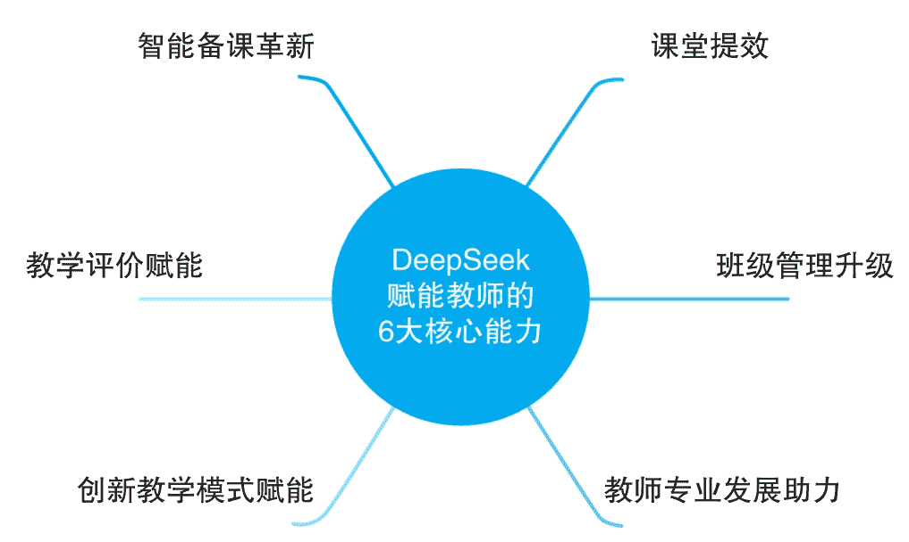

**图 1-1 DeepSeek 赋能教师的 6 大核心能力**

**2.课堂提效**

DeepSeek 可助力教师实现课堂提效，为每节课增添 AI 亮点。它能设计“认知冲突—情感共鸣—概念建构”三位一体的悬疑问题包，生成跨学科融合谜语等，有效提升课堂导入效果。在课堂互动方面，DeepSeek 能基于精准的学情分析设计分层提问，提供智能分组和结构化讨论框架，并设计以教学目标为导向的多元互动方式，实现多感官刺激和知识内化。在课堂练习环节，DeepSeek 能高效设计分层练习题，并通过深度跨学科融合任务等方式创新练习形式。此外，DeepSeek 还能辅助课堂内容的即时生成与动态调整，秒变全能问答助手，快速解决突发问题，提升课堂的适应性和有效性。

**3.教学评价赋能**

DeepSeek 通过智能技术革新作业批改与分析流程，实现作业的精准批改与数据驱动的教学决策。它能结合 OCR 工具，高效完成客观题的批量评分与错因定位；深入分析主观题的得分点、失分点，并给出改进建议；还能对作文进行多维评价，提供创意评估与写作支持。更重要的是，DeepSeek 构建了“数据采集—智能分析—决策支持—动态优化”的闭环体系，通过整合多维度学习数据，动态生成学生个体学习画像，并推动教学评价体系的智能构建与动态优化，实现从诊断性评价、过程性评价到总结性评价的全面提升，为精准教学提供科学依据。

**4.班级管理升级**

DeepSeek 在班级管理中能够发挥关键作用，助力教师实现班级文化建设、课堂管理与日常管理提效以及高效家校沟通。在班级文化建设方面，DeepSeek 可生成班级文化核心要素（如班名、班风、班训等），构建科学班规体系，并提供沉浸式班级文化布置方案。在课堂管理与日常管理中，它能创建智能点名系统、多功能小组积分管理系统、任务即时打卡系统以及综合性的智能班级管理系统，提升管理效率与公平性，实现学生表现的实时记录与导出。在家校沟通方面，DeepSeek 可助力家长会 PPT 的设计，赋能高效家校沟通方案定制，并协助校园活动的策划与通知，实现高效、精准、个性化的家校协同。

**5.创新教学模式赋能**

DeepSeek 能够赋能创新教学模式，破解传统实施难题。在 STEM 教育中，它通过精准化课程设计、智能化资源整合、多元化评价体系以及个性化教学辅导等手段提供全方位支持，并能在教学过程中实现实时支持、促进跨学科融合。针对 PBL（项目式学习），DeepSeek 能有效辅助教师完成六大模块框架设计。在大单元教学中，DeepSeek 支持分析、设计、开发、实施、评价等全周期环节的应用，推动课堂从“知识传递”转向“素养生长”，助力学生发展跨学科能力。

**6.教师专业发展助力**

DeepSeek 在教师专业发展方面能够发挥关键作用，助力教师打造优质课、备战教学比赛、开展课题研究。在打造优质课方面，可协助教师进行选题策划与教学设计，并提供多层级教研审核和技术支持，确保每个环节达到最佳效果。在教师比赛中，无论是说课比赛、征文比赛、演讲比赛还是其他类型的比赛，DeepSeek 都能提供全方位的支持。在课题研究方面，DeepSeek 可深度介入各个阶段，从课题选题与申报书修改、研究规划与方案设计、数据收集与分析，到研究过程优化与调整、结题报告撰写，乃至课题答辩，提供全方位支持，助力课题研究更加高效、科学地开展。

## **1.2 DeepSeek 初步操作**

走进 DeepSeek 的操作世界，就像打开教师的“瑞士军刀”——看似简洁的界面之下，藏着颠覆传统教学效能的超级工具箱。本节将手把手带领大家完成三个关键动作：

首先，访问 DeepSeek 官网并快速完成全平台注册，这是与 AI 伙伴建立联系的第一步，也是开启智能教学之旅的基础。

其次，熟悉 DeepSeek 界面和三大核心功能区，理解其工作原理，这将为高效使用 DeepSeek 奠定坚实基础。

最后，基本掌握让 DeepSeek 精准理解需求的指令体系——一套融合“5W2H”法则的通用指令模板，以及覆盖多个场景的指令清单。

即使是零基础的初学者，也能在阅读本节后进阶为 AI 教学指挥官，自如地运用 DeepSeek 辅助教学。

### **1.2.1 账号注册**

网页端：

1）在浏览器中输入 DeepSeek 网址（www.deepseek.com），按回车键访问，即可进入 DeepSeek 官网，如图 1-2 所示。

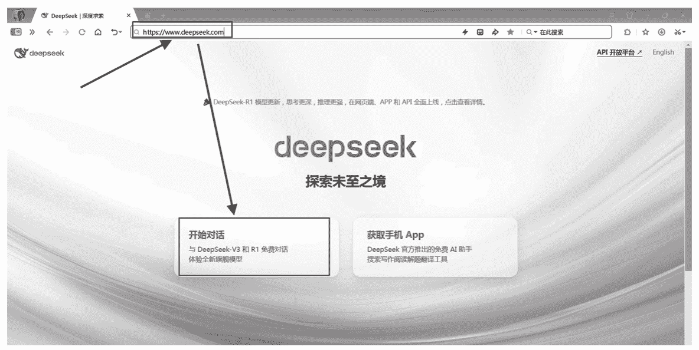

**图 1-2 访问 DeepSeek 官网**

2）单击“开始对话”，即可弹出 DeepSeek 的注册登录界面，如图 1-3 所示。可选择使用手机号/微信/邮箱注册，建议使用手机号验证码登录，方便快捷，安全性高。

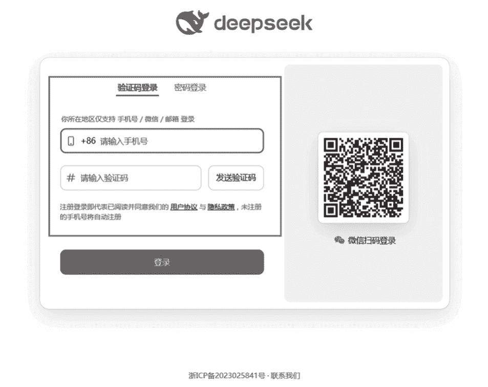

**图 1-3 DeepSeek 注册登录界面**

3）注册并登录后，便进入 DeepSeek 的对话界面，如图 1-4 所示。

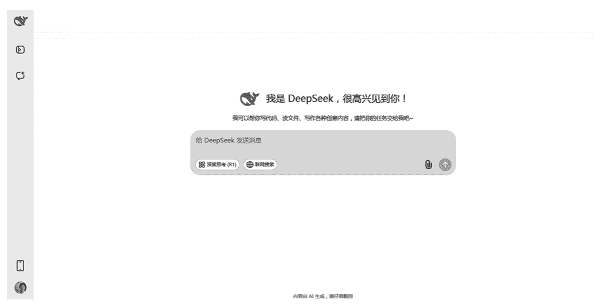

**图 1-4 DeepSeek 对话界面**

手机端：

1）在应用商店搜索 DeepSeek，找到由杭州深度求索科技有限公司研发的 DeepSeek—AI 智能助手，并下载。请注意：在应用商店搜索 DeepSeek 后，会出现许多名称包含 DeepSeek 的第三方工具，要仔细辨别，避免下载其他付费工具或非完整版的 DeepSeek。应用商店检索结果如图 1-5 所示，官方正版 DeepSeek 下载页面如图 1-6 所示。

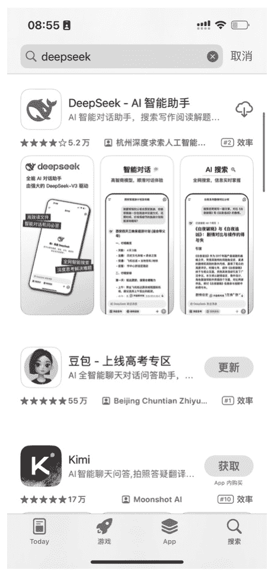

**图 1-5 应用商店检索结果**

**图 1-6 官方正版 DeepSeek 下载页面**

2）打开 DeepSeek，仔细阅读并充分理解《用户协议》和《隐私政策》后，点击“同意”即可进入注册界面（如图 1-7 所示）。

3）可以使用手机验证码登录、密码登录和微信登录（如图 1-8 所示），与网页端相同，建议使用手机验证码登录。

4）登录后，点击“开启对话”即可进入 DeepSeek 的对话界面（如图 1-9 所示）。

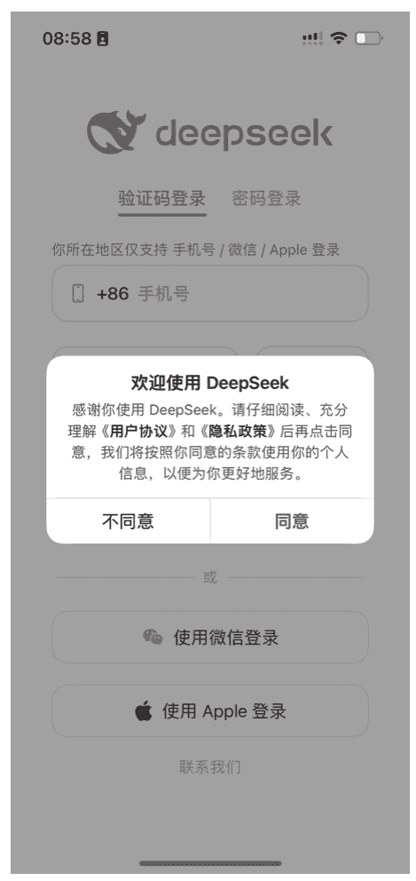

**图 1-7 同意界面**

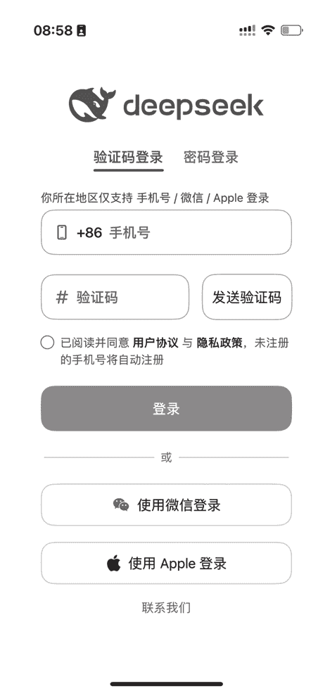

**图 1-8 手机版注册登录界面**

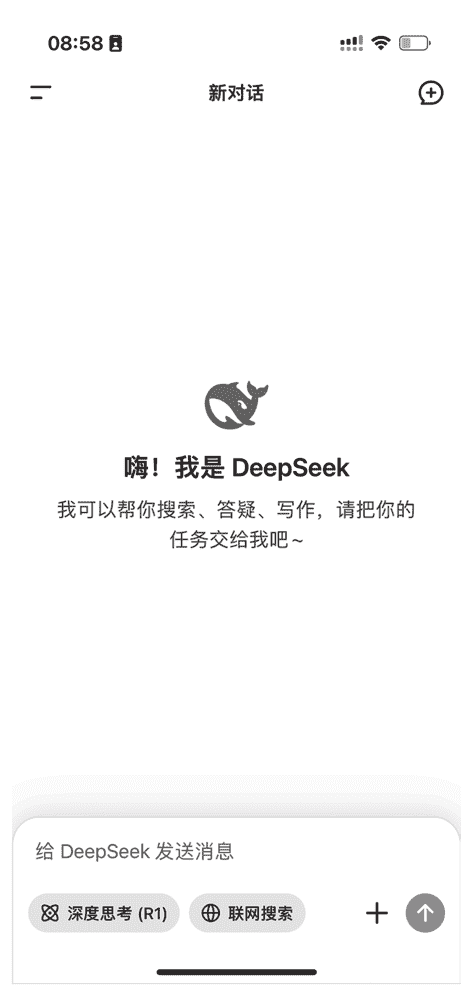

**图 1-9 手机版 DeepSeek 对话界面**

### **1.2.2 界面导航**

现在你已经正式进入 DeepSeek 的对话界面。DeepSeek 主要包括三大核心功能区：指令输入区、历史对话区和系统设置区。网页端和手机端的核心功能区位置基本一致，这里以网页端为例。DeepSeek 界面三大核心功能区如图 1-10 所示。

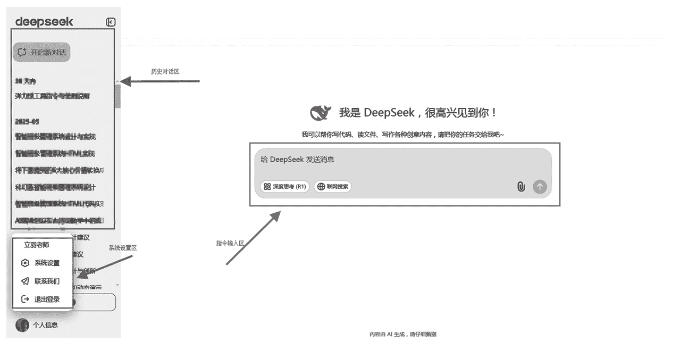

**图 1-10 DeepSeek 界面三大核心功能区**

**1.指令输入区**

界面最显眼的是中间位置的“消息输入框”。在这里，你可以像给微信好友发消息一样给 DeepSeek 发消息。与微信好友不同的是，DeepSeek 会根据你发送的消息提供详细、精确且有帮助的回答。这一“我问 DeepSeek 答”的过程类似于向一位全能的机器人助手下达命令，因此我们通常将发给它的消息称为指令。

DeepSeek 不仅支持以文字形式输入指令，还可以单击发送按钮左侧的曲别针图标（手机端为“+”图标），上传各类文档和图片（截至 2025 年 3 月 30 日，最多支持上传 50 个附件，每个不超过 100MB，且只能识别图片中的文字）。DeepSeek 会阅读并参考你上传的附件，以更好地回答你的指令。

还可以选择开启深度思考（R1）模式和联网搜索模式。开启深度思考模式后，DeepSeek 会根据你的指令先思考后作答，解决需要推理的问题。开启联网搜索模式后，DeepSeek 会根据你的需求联网搜索网页信息。两种模式各自适用的情境有所不同。

（1）适宜用深度思考模式的情景

1）复杂问题分析：

❑需要整合多领域知识（如制订商业策略、解决人际冲突）。

❑涉及抽象概念（如哲学讨论、伦理权衡）。

2）创造性任务：

❑设计新产品、写作、艺术创作等需要发散思维的任务。

❑对既有信息进行重组以产生新观点（如头脑风暴）。

3）个人决策：

❑关乎长期目标的重大选择（如职业规划、投资决策）。

❑需要权衡价值观、情感等主观因素时。

4）学习与内化知识：

❑理解深层原理（如数学推导、理论模型）。

❑将新知识与既有知识体系关联（如写读书笔记）。

5）开放式讨论（如“人生的意义是什么？”）。

（2）适宜用联网搜索模式的情景

1）快速获取事实信息：

❑查证数据（如历史事件日期）。

❑获取最新动态（如新闻、科技进展）。

2）操作性问题：

❑具体步骤指导（如工具使用教程、菜谱）。

❑即时解决方案（如错误代码排查）。

3）广度优先的探索：

❑初步了解陌生领域（如回答“区块链是什么？”）。

❑收集多方观点（如对比不同媒体的报道）。

4）验证或补充细节（确认名称、定义、引用来源等精确信息）。

5）紧急查询（如突发事件的背景、联系方式）。

**Tips：两种模式如何选择？**

● 优先选择深度思考：当问题需要原创性或系统性分析，或依赖个人经验与洞察时。

● 优先选择联网搜索：当信息确实存在且时间有限，或需要客观事实支持时。

注意：同时开启两种模式时无法上传附件。

指令输入区如图 1-11 所示。

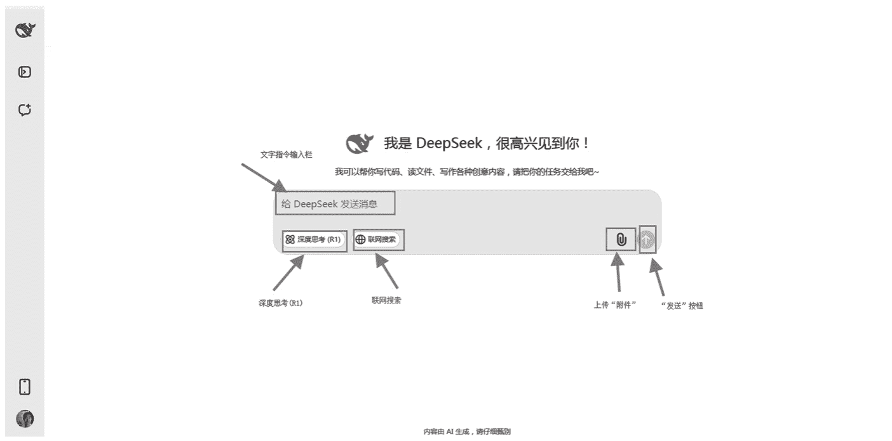

**图 1-11 指令输入区**

**2.历史对话区**

另一个常用且重要的功能区是左侧的历史对话区（若初次登录未显示，可以单击左上角的 DeepSeek 图标或侧边栏按钮打开）。历史对话区记录你与 DeepSeek 的每次对话。

你首次使用 DeepSeek 时，可能会输入一些天马行空的指令让 DeepSeek 回答，以满足你的好奇心。当你想要在教学场景中正式使用 DeepSeek 时，单击历史对话区的“开启新对话”，即可开始新的对话。DeepSeek 不会记住之前的对话内容，每次回答都会基于你当前的问题独立处理，使回答更准确且更有针对性。

历史对话区界面如图 1-12 所示。

**Tips：**如果你希望 DeepSeek 参考之前的对话内容，可以简要提及之前的讨论；如果你希望 DeepSeek 完全忽略历史消息，也可以在新指令中明确指出这一点，DeepSeek 会根据你的最新提问来回答。

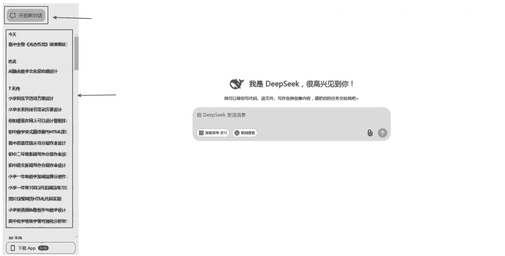

**图 1-12 历史对话区**

**3.系统设置区**

除了常用的指令输入区和历史对话区，第三大功能区——系统设置区，也必不可少。

在 DeepSeek 界面中，单击左下角的头像，并单击“系统设置”即可进入设置界面（如图 1-13 所示）。在设置界面，可以设置界面语言和主题，进行账户管理及查看服务协议。

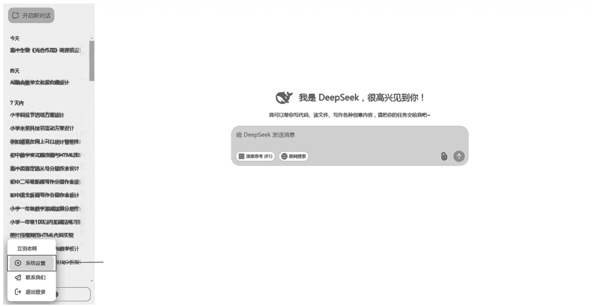

**图 1-13 单击“系统设置”**

### **1.2.3 指令模板**

我们现在已经注册了 DeepSeek 账号，了解了 DeepSeek 的三大核心功能区，已准备好向 DeepSeek 发送指令。然而，并不是随便编写指令，DeepSeek 就能理解你的意图并给出你想要的准确答案。毕竟，DeepSeek 不是魔法师，不能洞察你心中所想。比如，你的指令是“请给我写一篇《岳阳楼记》的导入环节”，DeepSeek 的回答很可能无法让你满意，因为你没有赋予 DeepSeek 适宜的角色指出采用的输出格式、设定限制条件，也没有指定你期望的语言风格。

在本节中，你将掌握与 DeepSeek 对话的“黄金法则”，大幅提升输出的准确性。本节将提供一个通用公式和两个使用示例，助你快速激活教学场景中的 AI 潜能。

**1.5W2H+E 通用公式**

（1）什么是 5W2H 分析法

5W2H 分析法是一种系统化的思考工具，广泛应用于问题分析、项目管理、决策制订等领域。其核心是通过 7 个关键问题（5 个以 W 开头的问题和 2 个以 H 开头的问题）全面梳理问题或任务的各个方面，从而提升执行效率和决策准确性。以下是具体解析。

1）5W2H 分析法的基本概念如下。

5W2H 分析法又称“七问分析法”，起源于第二次世界大战期间美国陆军兵器修理部，旨在通过结构化提问解决复杂问题。其名称由 7 个英文单词首字母组成：

● 5W：Why（为什么）、Who（谁）、What（什么）、When（何时）、Where（何地）。

● 2H：How（如何）、How much（多少/程度）。

2）各要素的具体含义如下。

● Why：分析目标或问题的动机与必要性，明确行动的根本原因。

● Who：确定执行者、参与者及受影响方，明确责任分工。

● What：界定任务的具体内容、目标及所需资源。

● When：规划时间节点，包括起始时间、截止日期及关键里程碑。

● Where：确定实施地点或环境条件，分析地理或场景对任务的影响。

● How：制订执行步骤、方法及技术手段，评估潜在风险与解决方案。

● How much：量化资源投入（如成本、人力）及预期成果（如数量、质量）。

（2）5W2H+E 是什么

在原公式的基础上，增加一个要素“E”，即“Example”，形成“5W2H+E”结构化指令模板。

基于 5W2H 分析法系统性思维与教育场景需求的深度融合，重构后的通用公式包含 8 大核心要素，覆盖任务设计全维度，具体定义和教育场景示例见表 1-1。

**表 1-1 5W2H+E 通用公式教育场景应用**

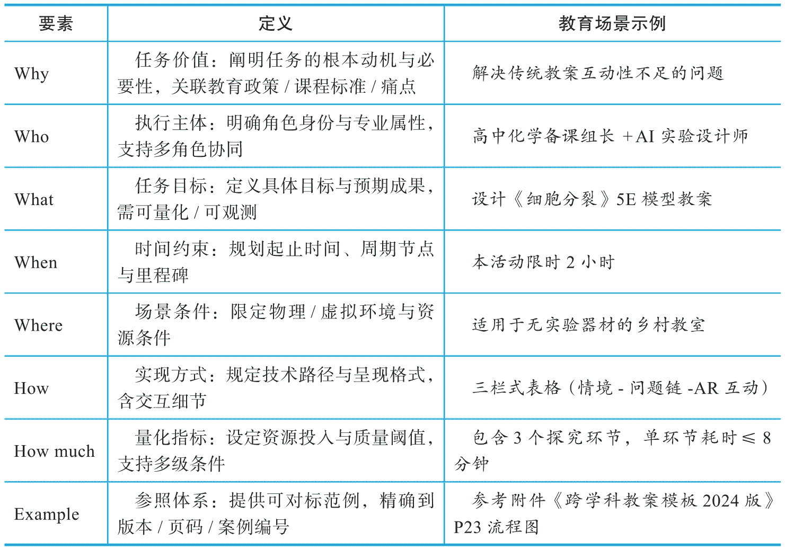

注意，大模型（DeepSeek）输出内容的底层逻辑是基于语料进行概率推理，这意味着大模型输出的内容无法做到完全准确，这正是我们使用 5W2H+E 模板的重要原因。提供给 DeepSeek 的指令不同，输出的结果也会不同，只有明确告知 DeepSeek 角色、输出格式、参考示例等信息，才能得到更精准的输出内容。该通用公式中的每一项，都是为了让输出内容更符合你的要求、更精准或更专业。

在某些场景下（如做复杂的教学设计时），可以根据需要把指令设计得更为全面；而在另一些简单场景下（比如“为我生成 20 道两位数加两位数的进位加法计算题”），则无须使用该模板。总之，指令应围绕个人需求展开，一切以需求为主。同时，这个通用指令只是一个覆盖面较广的框架，实际使用时，可根据不同情境选用 5W2H+E 公式中的部分要素。

**2.5W2H+E 通用公式使用示例**

你已经了解了 5W2H+E 通用公式，你很可能会好奇：这个指令模板看起来很烦琐，难道在所有教学场景中，想提出问题时都要将公式中的每个元素罗列清楚吗？答案是否定的。毕竟这是通用模板，设计之初就力求涵盖教学场景中的各类问题。在这 8 大要素中，有些是必填项，几乎每次都要涉及，另一些则是可选项，可以不填。下面我们分别以备课场景和课堂场景中的一个案例，具体说明如何使用 5W2H+E 公式。

（1）案例 1：备课场景通用公式使用示例

假设你是一位初中物理老师，想要 DeepSeek 帮忙生成一份《浮力》单元的项目式学习方案，你会怎样向 DeepSeek 发送指令呢？在阅读本书之前，你可能会这样问：“生成初中物理《浮力》单元的项目式学习方案”。然而，DeepSeek 根据这个指令生成的输出内容很可能不会让你满意，且缺乏可行性。这是因为 DeepSeek 并不知道你希望该学习方案是否要落实新课标要求、你们学校实验室现有的可用器材有哪些、应参考哪一种输出格式、是否有可供参照的示例等。因此，这时我们就需要用通用指令模板来具体表达需求，让 DeepSeek 更精准地理解。

【模糊指令】

生成初中物理《浮力》单元的项目式学习方案。

【精准指令】

● Why（任务价值）：要符合新课标要求，落实新课标中“做中学”的理念。

● Who（执行主体）：初中物理特级教师。

● What（任务目标）：生成初中物理《浮力》单元的项目式学习方案。

● When（时间约束）：本单元项目式学习需要 3 课时。

● Where（场景条件）：在学校实验室进行本次单元项目式学习，实验室器材仅有弹簧秤和塑料瓶。

● How（实现方式）：按 STEM 教育五步法设计，采用表格（步骤现象观察—驱动问题—实验设计）格式输出。

● How much（量化指标）：无。

● Example（参照体系）：参考附件中的《惯性》单元的项目式学习方案。

【指令解析】

下面我们将逐一解析该案例中各条目的填写必要性（用星级表示建议填写程度，星级越高表示越推荐填写，★★★★★表示必填，☆☆☆☆☆代表不需要填写，当然在不同情境中各项填写的推荐程度也有所不同），帮助你更好地理解如何运用 5W2H+E 模板。

● Why（任务价值）★★★☆☆

本条目为选填项，但建议填写。通过明确“要符合新课标要求，落实新课标中‘做中学’的理念”，可确保生成的学习方案与教学目标保持一致。在实际教学中，偏离新课标要求的方案往往缺乏实用性。

● Who（执行主体）★★★★☆

本条目为选填项，但非常建议填写。赋予 DeepSeek“初中物理特级教师”的身份，能使其输出的内容更具专业性和权威性。这种角色设定可引导 DeepSeek 在知识调用和方案设计时更聚焦于学科特点。

● What（任务目标）★★★★★

本条目为必填项。明确说明“生成初中物理《浮力》单元的项目式学习方案”是指令的核心诉求，缺少此条目将导致 DeepSeek 无法理解用户需求。

● When（时间约束）★★☆☆☆

本条目为选填项。在本案例中，明确时间安排有助于设计出符合教学进度的方案。对于活动策划类任务，此条目则建议设为必填项。

● Where（场景条件）★★★☆☆

本条目为选填项，但建议填写。说明“实验室器材仅有弹簧秤和塑料瓶”的实际情况，可使生成的方案更具可操作性，避免设计出脱离实际条件的实验内容。

● How（实现方式）★★★☆☆

本条目为选填项，但建议填写。提供示例既能规范内容结构，又能满足特定格式需求。如需生成思维导图等特殊格式，此条目则为必填项。

● How much（量化指标）★☆☆☆☆

本条目为选填项，通常用于需要具体数据支撑的任务场景。本案例中未做要求，故可留空。

● Example（参照体系）★★★★☆

本条目为选填项，但强烈建议填写。提供优秀范例作为参考，可显著提升 DeepSeek 的输出质量，尤其在格式规范性和内容完整性方面效果显著。

【输出示例】

精准指令的输出内容如下。

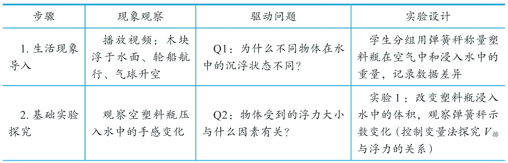

（续）

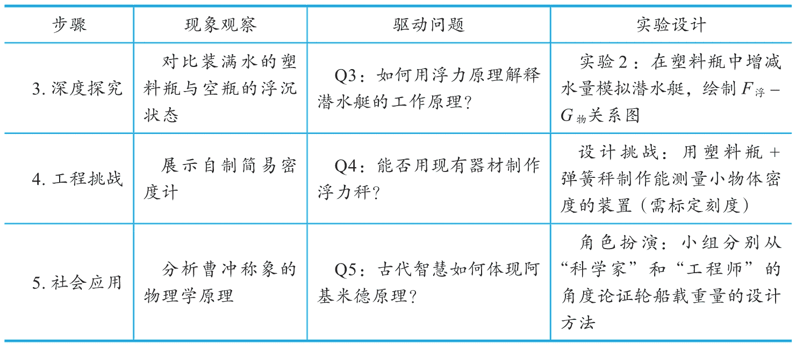

（2）案例 2：课堂场景通用公式使用示例

我们在案例 1 中以初中物理老师的身份体验了一次利用 5W2H+E 通用公式设计单元项目式学习方案，现在我们将使用场景切换到课堂上来。假设你是一位高中语文教师，当你在讲授《赤壁赋》时，如果有学生质疑“曹操横槊赋诗”典故的真实性，你该如何应对呢？在这样一个情境中，我们需要让 DeepSeek 生成答疑方案。若直接使用模糊指令“生成学生质疑‘曹操横槊赋诗’典故真实性的应对方案”，AI 可能无法理解你需要的是即时的课堂应对策略还是课后补充资料，更不清楚应遵循何种答疑逻辑。这时就需要用通用指令模板精准表达需求。

【模糊指令】

生成学生质疑“曹操横槊赋诗”典故真实性的应对方案

【精准指令】

● Why（任务价值）：应对课堂突发状况，自然有效地过渡到接下来的教学环节，维持教学流畅性。

● Who（执行主体）：高中语文特级教师。

● What（任务目标）：生成学生质疑“曹操横槊赋诗”典故真实性的应对方案。

● When（时间约束）：解答时长控制在 2 分钟内。

● Where（场景条件）：高中语文《赤壁赋》线下课堂中，学生在教师授课时当场对典故提出质疑。

● How（实现方式）：采用“三步释疑法”（共情—解析—拓展）结构化输出。

● How much（量化指标）：要提供 1 个史料出处。

● Example（参照体系）：参照 2024 年市级优质课《鸿门宴》答疑实录片段。

【指令解析】

● Why（任务价值）★★★☆☆

建议填写项。明确“维持教学流畅性”的目标，确保生成的答疑方案能有效应对课堂突发状况，避免教学节奏被打断。若未填写，DeepSeek 可能会生成理论性过强或脱离实际课堂需求的解答。

● Who（执行主体）★★★★☆

强烈建议填写的条目。“高中语文特级教师”强调专业性和权威性，使生成的应对方案更具说服力。若未填写，DeepSeek 生成的内容可能会比较泛化。

● What（任务目标）★★★★★

核心必填项。明确限定具体问题，使输出内容高度聚焦。

● When（时间约束）★★★★☆

强烈建议填写的条目，要求“解答时长控制在 2 分钟内”，直接量化应答时间，符合实际教学场景。若未填写，DeepSeek 输出的应对方案所需时间可能过长，影响接下来的正常授课。

● Where（场景条件）★★★★★

在该场景中，此条目为必填项。指出场景细节，明确这是在课堂中产生的突发状况，要求当场给予回复，并能平稳过渡到接下来的授课环节。若未填写，DeepSeek 可能生成仅适用于课后讨论或书面答复的方案。

● How（实现方式）★☆☆☆☆

可选项。可让 DeepSeek 以“三步释疑法”框架输出方案，使方案结构化，当然也可以采用其他结构模板。在此情境中，该条目亦可不填写，DeepSeek 会根据其他指令条目选择其认为合适的回答结构。

● How much（量化指标）★★☆☆☆

可选项。提供具体的量化指标，“要提供 1 个史料出处”可精细控制答疑质量。

● Example（参照体系）★★★☆☆

建议填写项。参照优质课中教师处理类似问题的方式，使回答更具指向性。

【输出示例】

精准指令的输出内容如下。

1.共情阶段（30 秒）

● “这位同学能结合《三国志》提出质疑，说明真正做到了‘尽信书不如无书’（轻敲黑板强调）。当年苏轼写《赤壁赋》时，也遇到过类似质疑——毕竟杜牧就曾写‘东风不与周郎便，铜雀春深锁二乔’来反思历史记载。”

2.解析阶段（50 秒）

● 核心释疑：“1）《三国演义》第 48 回确有‘横槊赋诗’的场景描写，但需明确这是文学创作；2）史料依据：裴松之注《三国志·武帝纪》引《魏书》记载‘（曹操）登高必赋，及造新诗，被之管弦，皆成乐章’，虽未特指赤壁，但与其诗人形象吻合。”

● 教学衔接：“这正是苏轼在《赤壁赋》中采用‘客曰’虚拟对话的精妙之处——既化用典故传达思想，又避免陷入史实争议。”

3.拓展阶段（40 秒）

● 思维延伸：“请同学们思考《赤壁赋》中‘酾酒临江’的描写是否也有艺术加工成分？（停顿 2 秒）下节课我们将对比《三国志》《资治通鉴》和《赤壁赋》对同一事件的不同呈现方式。”

● 过渡衔接：“现在让我们回到课文，重点看苏轼如何借‘横槊赋诗’的典故来抒发……”

通过以上示例，相信你已经掌握了如何根据实际教学场景需求灵活运用 5W2H+E 模板，但是仅仅如此就够了吗？当然不够！因为你会发现，即使向 DeepSeek 发出如此全面具体的指令，DeepSeek 的回答也不一定会让你满意，可能有错误、偏差、遗漏……

总之，你不要抱有这样的期望——DeepSeek 根据一个指令生成一次回答，就能让你十分满意。

**3.5 个追问技巧**

目前，我们已经学习了 5W2H+E 通用指令模板，还看了两个真实的教学场景示例。但是你会发现，与模糊指令相比，虽然基于全面、具体指令的 DeepSeek 输出已经很准确了，但可能仍难以令你满意，怎么办？要开启一个新对话重新问一次吗？不必。你可以通过以下 5 个追问技巧，使 DeepSeek 生成令你更满意的答复。

（1）直接指出错误，让答案准确性更高（适合答案有错误的回复）

【追问指令模板】

你说［引用原文］是错的，其实是［正确信息］，请改过来，并补充来源/引用原文。”

【示例】

你说“横槊赋诗出自《三国志》”是错的，其实是《资治通鉴》记载的，请改过来，并引用原文。

（2）补充细节，让答案更完整（适合答案太简略的回复）

【追问指令模板】

请补充［具体内容］，比如［例子/数据/步骤］，参考［某标准或范例］。

【示例】

浮力实验设计太简单了，请补充“塑料瓶实验”的具体操作步骤，参考《惯性》案例中的表格格式。

（3）调整结构，让答案更清晰（适合逻辑混乱的回复）

【追问指令模板】

不要用［当前结构］，改成［新结构］，删掉［原内容］/重点突出［关键点］。

【示例】

不要用“三步释疑法”，改成“问题树”（问题—证据—结论），删掉无关的文学分析。

（4）增加限制条件，让答案更实用（适合脱离实际的回复）

【追问指令模板】

加上［具体限制］这个条件，重新调整方案/简化步骤。

【示例】

加上“实验要控制在 10 分钟内，且只能使用弹簧秤和塑料瓶”这个条件，简化步骤。

（5）换角色评估，让答案更靠谱（适合需要多角度验证的回复）

【追问指令模板】

如果你是［专家/学生/家长］，你会怎么评价［这个方案］?请列出优缺点。

【示例】

如果你是专家，你会怎么评价这个浮力实验？请列出优缺点。

**Tips：**

别重开对话！在原有回答上追问，AI 会记得上下文。

越具体越好！比如“补 3 个例子”比“多举例子”更有效。

**4.设计指令的核心法则**

虽然借助 5W2H+E 通用公式来设计指令很全面，但有时你可能也想不到某一条指令该如何写，或者认为自己的指令已经设计得很完美了，可还是没有得到想要的输出结果。遇到这种情况时，不要着急。要说谁最懂 DeepSeek，谁的话最能让 DeepSeek 理解，答案就是 DeepSeek 自己。所以，设计指令的核心法则是：如果你有一个问题需要解决，却不知道该如何向 DeepSeek 提问，那么只需问 DeepSeek：“我要解决[这个问题]，我应该如何向你提问，才能得到最令我满意的回答？”。通过这种方式，DeepSeek 能够基于自身对指令的理解，为你提供更具针对性的提问建议，帮助你获得更符合预期的回答。

## **1.3 协同共进：多 AI 工具与 DeepSeek 的教育融合之道**

在教育数字化转型的浪潮中，DeepSeek 作为重要的 AI 力量，为教师提供了全面且强大的教学支持。然而，为充分释放 AI 在教育领域的潜能，显著提升教学效果，整合运用 DeepSeek 与其他多种 AI 工具已成为必然趋势。这些工具与 DeepSeek 相互协作，共同为教师打造功能完备、灵活高效的教学工具库，助力教师提升 AI 教学能力与 AI 素养。

DeepSeek 在教学流程中能够发挥关键的引领作用。无论是智能备课、课堂提效、教学评价、班级管理、创新教学模式，还是教师专业发展等方面，它都能凭借强大的功能，依据教师输入的详细指令，输出高质量的教学内容。在此过程中，其他 AI 工具的助力必不可少。

在智能备课的创新教学素材生成方面，DeepSeek 常与图像、视频、音乐生成类 AI 工具（如即梦、可灵、Midjourney、DALL·E、Runway、Suno 等）协同工作。在讲述历史人物故事时，DeepSeek 生成生动的台词脚本，即梦等 AI 可通过对口型功能，将历史人物形象与台词脚本结合，使教学更具真实感。在创设英文情境时，可灵、Midjourney 和 DALL·E 这类工具擅长根据文本描述生成高质量图像，能为教学提供丰富的视觉素材。在古诗教学中，DeepSeek 设计视频脚本，Runway 等视频生成 AI 可以将其转化为动态画面，帮助学生理解诗歌意境。在音乐创作上，DeepSeek 分析诗词风格，Suno 等音乐生成 AI 能够据此为诗词谱曲，加深学生对诗词情感的体会。

在教学评价中的作业批改环节，除了豆包智能体，还有小猿搜题、作业帮、夸克等作业批改类 AI 工具可供选择。这些工具通常具备快速识别问题、精准批改作业和详细解析错题的功能，能够对客观题进行高效批改，并针对学生的错题提供详尽的解题思路。同时，部分工具还能对作业数据进行深度分析，生成全面的学情报告，为教师调整教学策略提供有力的数据支持，帮助教师实现精准教学。

在课堂提效的过程中，知识可视化很重要，DeepSeek 可生成结构化的知识内容，借助思维导图绘制工具（如 draw.io、MindManager、XMind 等），将这些知识转化为直观的思维导图。教师可以方便地调整思维导图的布局、样式，使其更符合教学需求，从而以清晰、有序的方式向学生呈现复杂的知识体系，促进其对知识的理解和记忆。对于需要展示立体结构的学科教学，DeepSeek 可生成与 3D 模型相关的指令，结合 AI 生图工具和 3D 建模工具（如 Tripo、Blender、Maya 等），创建高精度的 3D 模型。教师可以利用这些 3D 模型进行动态演示，甚至将其制作成实物模型用于课堂教学。

通过将 DeepSeek 与上述不同类型的 AI 工具整合使用，教师能够在教学的各个环节中充分发挥 AI 的优势。这不仅丰富了教学手段，提升了教学质量，也促使教师在实践中不断提升自身的 AI 应用能力和 AI 素养，更好地适应教育信息化的发展，为学生创造更优质、高效的学习体验。

**第二章 CHAPTER 2 DeepSeek 赋能备课**

本章聚焦智能备课，剖析传统备课在学情分析、教案设计、素材开发方面的普遍困境，并系统阐述以 DeepSeek 为代表的 AI 工具如何赋能教师，实现备课质效的突破。本章将生动展示 AI 在精准分析学情、智能生成教案及开发创新教学素材中的具体应用，为教师提供智能化备课解决方案。

本章以“问题诊断—技术赋能—场景落地”为写作逻辑，先揭示传统备课痛点，再解析 AI 赋能路径，最后通过案例演示操作流程。阅读时需重点关注指令设计的“5W2H+E”模板应用，注意将 AI 生成的内容与教师教学智慧进行有效结合，避免技术工具与教学实践的割裂。建议在实践中结合学科特点灵活调整指令，实现智能工具与教学实践的深度融合。

## **2.1 传统备课的困境与突围**

传统备课模式长期受困于学情分析粗放、教案设计低效、教学素材单一等难题。教师需耗费大量精力，却难以精准匹配学生的个性化需求与新时代的教学要求。本节将深入剖析传统备课的三大核心困境，并阐明 AI 技术如何通过精准分析学情、智能生成教案与开发创新素材，为教师开辟从“经验驱动”向“智库协同”转型的突围路径，助力备课效率与备课质量的双重提升。

### **2.1.1 传统备课的困境**

在传统备课中，学情分析往往依赖教师经验与粗略判断，难以把握不同年龄段学生的学习特征，获取班级层面的个性化数据，导致分层教学缺乏依据；教案设计需手动构建框架、梳理各教学环节，低效耗时，且质量参差不齐；教学素材来源有限、形式单一，多为文字或静态图片，难以将抽象概念可视化，如数学中的空间几何、物理中的电场、磁场等内容，常因缺乏动态素材辅助而致学生理解困难、兴趣不足。AI 的出现，为突破这些困境提供了可能。

### **2.1.2 AI 的突围路径**

**1.精准分析学情**

使用 DeepSeek 可实现个性化、精准化的学情分析，从标准学情特征分析、班级学生数据分析两方面下手，最终生成针对本班学生的精准学情报告，为后续分层教学设计提供数据依据。

**2.智能生成教案**

通过 DeepSeek，可一键生成结构化教案：使用 5W2H+E 模板输入关键信息（如学情、课程标准要求、教材内容等），DeepSeek 即可自动生成包含教学目标、重点与难点、教学流程、评价设计的完整教案框架。

**3.开发创新教学素材**

AI 技术在创建丰富多彩的教学素材方面展现出巨大潜力，如视频、动画、游戏等，使抽象概念变得生动具体，增强学生的学习兴趣，帮助学生更好地掌握知识。

## **2.2 使用 AI 精准分析学情**

如前所述，传统备课中的学情分析是一大难点。这一过程不仅对年轻教师而言具有挑战性，许多经验丰富的教师也难以做到精准把握，更何况还要花费大量时间去收集各类资料、采集学生的日常表现数据、收集分层练习题等。

而借助 DeepSeek，就可以利用其庞大的知识库，实现高效、精准的学情分析。整个过程可分为三步：

第一步：标准学情特征分析。让 DeepSeek 自主分析某一年龄段学生在学习某部分内容时的基础水平、常见问题及接受程度等，并总结归类，以表格形式输出。

第二步：班级学生数据分析。在 DeepSeek 中上传本班学生的课堂表现、日常行为记录、测试成绩等个性化数据，让 DeepSeek 对班级学生情况加以分析并总结归类，以表格形式输出。

第三步：精准学情分析方案生成。让 DeepSeek 以这两次分析的表格为基础，结合学生将要学习的内容，对本班学生进行智能分析，明确学生学习的重点和难点，提供相应的分层教学建议，并设置相应的分层练习题。

下面，我们以八年级物理中《浮力》这一单元为例进行学情分析。

**1.第一步：标准学情特征分析**

我们可以通过以下指令实现：

● Why：分析八年级物理《浮力》单元的标准学情特征，解决传统备课中跨区域学情数据匮乏的问题，支持分层教学设计。

● Who：你是初中物理特级教师+数据分析师。

● What：分析八年级物理《浮力》单元的标准学情特征。

● How：请以表格形式输出学生在学习该内容时的基础水平、常见问题及接受程度等内容。

DeepSeek 输出内容如下。

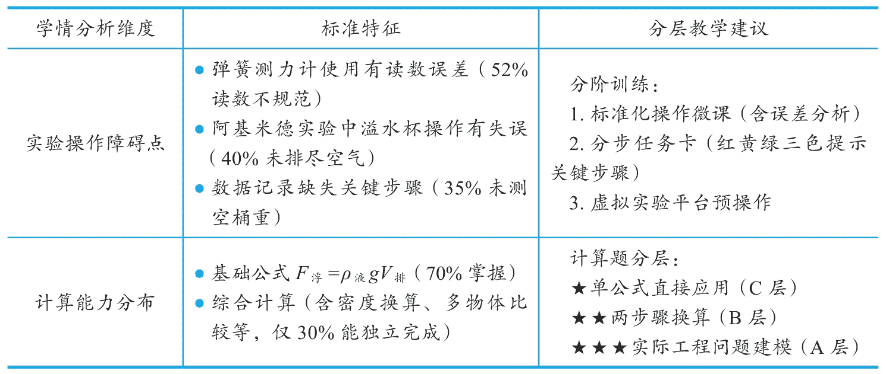

**2.第二步：班级学生数据分析**

利用 DeepSeek 进行精准学情分析的第二步是将本班学生的课堂表现、日常行为记录、测试成绩（在本例中，指物理测试的成绩）等个性化数据上传至 DeepSeek，由其对本班学生情况进行分析，归纳分类，并以表格形式输出。我们可以通过以下指令来实现：

● Why：对本班学生进行个性化分层定位。

● Who：你是一位优秀的班主任。

● What：分析本班学生的个性化学习情况。

● How：以表格形式输出，需包含课堂表现、日常行为、测试成绩等维度的评级，还要有物理领域优势、待改进点和分层建议等。

● Example：基于附件中本班学生的课堂表现、日常行为、测试成绩等个性化数据进行分析（需对学生进行匿名处理）。

DeepSeek 输出内容如下。

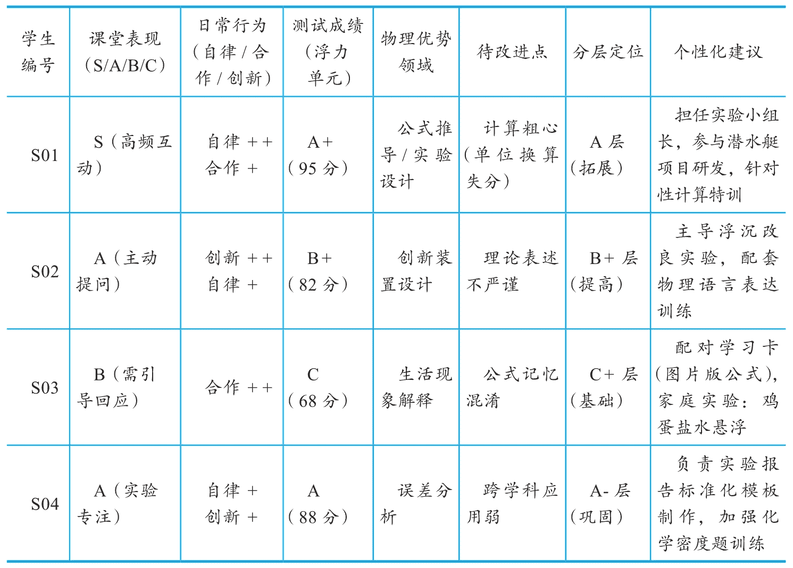

**3.第三步：精准学情分析方案生成**

利用 DeepSeek 进行精准学情分析的第三步是：在前两步生成的标准学情特征分析表格和班级学生数据分析表格的基础上，让 AI 生成分层教学方案。通过以下指令可实现。

● Why：结合群体共性与个体差异，输出可落地的分层教学策略。

● Who：你是一位物理特级教师。

● What：生成“浮力”单元分层教学方案。

● How：要求包含：

学生分层名单（C 基础巩固组、B 能力提升组、A 拓展挑战组）、各组教学重点、难点及对应策略（如 A 组需强化阿基米德原理的直观演示）、分层练习题设计（标注难度星级）。

● Example：基于标准学情特征分析表格和班级学生数据分析表格输出结果。

DeepSeek 输出的“浮力”单元精准学情分析方案（部分）如下。

1.学生分层名单（匿名）

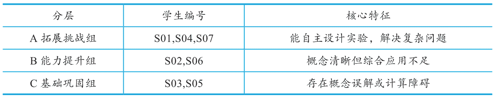

2.分层教学重点、难点及策略

A 拓展挑战组

重点：浮力与工程技术结合（如潜艇、密度计）

难点：非线性变量关系分析（如盐水浓度-浮力变化曲线）

策略：

▶真实项目驱动：设计“打捞沉船”方案（需计算浮筒体积与位置）

▶批判性讨论：质疑“*V*[排]=*V*[物]”的适用条件（特殊容器形状）

……

## **2.3 使用 AI 智能生成教案**

在精准定位学情后，教案的生成便成为备课的核心环节。然而，在传统备课过程中，教师常常面临诸多挑战，难以快速设计出具有精准教学目标、系统的教学框架以及创新教学活动的教案。

借助 DeepSeek，教师可依托目标精准定位和生成教案这两个流程，快速搭建符合课程标准要求的教案。这不仅涵盖对教学目标的精准把握，还能生成兼具规范性与创造性的教案初稿。AI 提供的结构化框架与创新思路，可以结合学情和个人教学风格进行个性化调整，最终打造出既富有内容深度，又充分激发课堂活力的教案，为教学质量的提升奠定坚实基础。

### **2.3.1 目标精准定位**

在传统备课中，教学目标常因经验判断而偏离课程标准要求，或表述空泛、难以实操。借助 DeepSeek，教师可通过“课标解析—学情适配—目标重构”三步实现精准定位。下面以初中语文《题西林壁》为例，进行目标精准定位操作。

向 DeepSeek 输入指令：

● Why：解决哲理诗教学目标与课程标准脱节的问题。

● Who：初中语文教研员+思辨教学专家+认知心理学研究者。

● What：生成《题西林壁》精准教学目标。

● How：按新课标“思辨性阅读”要求输出。

● Example：《登飞来峰》教学目标设计、《义务教育语文课程标准（2022 年版）》。

DeepSeek 输出内容如下。

1.语言运用目标

学生能够准确理解并熟练背诵《题西林壁》，掌握“横看”“侧”“缘”等文言词汇的含义，结合诗句语境，用现代汉语准确翻译诗句，体会古诗凝练、含蓄的语言特点。同时，通过分析诗歌对仗、押韵等语言形式，感受古典诗歌的韵律美，提升对古诗语言的敏感性和鉴赏能力。

2.思维能力目标

分析与综合：引导学生梳理诗歌中描绘的庐山不同视角的景象，分析诗人观察角度的变化与景物特点之间的关系，综合概括诗歌所描绘的庐山整体形象。

推理与判断：基于诗歌内容，推理诗人由眼前之景悟出哲理的思维过程，判断诗中蕴含的关于事物认知规律的思考，培养逻辑推理能力。

批判与创新：鼓励学生结合生活经验，对诗中“不识庐山真面目，只缘身在此山中”的哲理进行批判性思考，提出个人见解，并尝试运用该哲理分析、解决生活中的实际问题，激发创新思维。

3.审美创造目标

通过诵读、想象和联想，引导学生感受诗歌中描绘的庐山雄伟壮观、变幻多姿的自然景象，体会诗人对自然之美的赞叹，提升审美感知能力。同时，让学生领悟诗歌中景理交融的艺术特色，学习诗人借景抒情、托物言志的创作手法。让学生尝试进行短诗创作，表达自己对生活哲理的感悟，培养审美创造能力。

4.文化自信目标

学生能够了解苏轼的生平经历、创作风格及其在文学史上的地位，认识《题西林壁》在宋代哲理诗中的代表性地位，增强对中华优秀传统文化的认同感。通过对诗歌哲理的探讨，理解古人对自然、人生的思考，体会其中蕴含的中华民族智慧，传承和弘扬中华优秀传统文化精神，树立正确的价值观和人生观。

### **2.3.2 生成教案**

我们现在已经获取了 DeepSeek 生成的、符合课程标准要求的《题西林壁》精准教学目标，接着即可生成详细的教案。传统教案设计常陷入两种极端：新手教师套用网络模板，导致内容空泛；资深教师依赖既往经验，缺乏创新。本小节将介绍如何用 DeepSeek 生成兼具规范性与创造性的教案。

第一步：通过 5W2H+E 公式生成优质教案初稿

指令示例如下。

● Why：解决哲理诗教学重翻译、轻思辨的问题，落实《义务教育语文课程标准（2022 年版）》“理性思维培养”要求。

● Who：初中语文特级教师+哲学教育专家。

● What：生成初中语文《题西林壁》的高质量教案。

● When：45 分钟。

● Example：参考附件：《观书有感》省级优质课教案、《初中思辨类古诗教学模板》、《题西林壁》教师用书、本班学生前测数据、精准教学目标。

DeepSeek 输出内容（部分）如下。

……

1.情境导入（5 分钟）

多媒体展示同一物体从不同角度拍摄的多组照片，如教室的黑板、书本、校园雕塑等，引导学生仔细观察并描述看到的差异。

提问：“为什么同一物体，大家看到的样子却不同呢？”引发学生思考，鼓励学生积极发言分享自己的想法。

顺势导入新课，介绍苏轼生平及《题西林壁》的创作背景，展示庐山的全景图，激发学生学习兴趣，营造良好的课堂氛围。

2.初读感知，疏通文义（10 分钟）

教师配乐范读诗歌，要求学生认真倾听，注意字音、节奏和韵律，感受诗歌的朗读美感。

学生自由朗读诗歌，同桌之间相互倾听，纠正读音，进行朗读练习。

学生结合注释和工具书，自主尝试翻译诗句，圈画难以理解的字词，做好记录。

组织学生进行小组讨论，分享自己对诗句的理解，共同尝试解决疑难问题；教师巡视各小组，了解学生讨论情况，收集共性问题。

教师针对学生的疑问，重点讲解“横看”“侧”“缘”等文言词汇，结合具体语境，通过举例、对比等方式帮助学生理解，引导学生准确、流畅地翻译诗句，理解诗歌的字面意思。

3.精读探究，思辨哲理（18 分钟）

分析诗歌意象：提出问题“诗歌中描绘了庐山的哪些景象，这些景象分别是从哪些角度观察到的？”引导学生再次朗读诗歌，梳理诗歌内容，分析诗人观察角度变化与景物特点的关系。组织学生进行小组交流，之后各小组派代表发言，教师总结归纳，帮助学生概括出庐山的整体形象。

哲理形成：教师引导学生深入思考“诗人为什么会发出‘不识庐山真面目，只缘身在此山中’的感慨”，鼓励学生结合诗歌内容和创作背景，大胆推测诗人由眼前景色悟出哲理的思维过程。开展小组讨论，让学生充分交流想法，各小组派代表分享观点，教师总结归纳，帮助学生理解诗人对人认知规律的思考。

批判性思考：提出问题“诗中哲理在所有情况下都适用吗？在生活中有没有不适用的例子？”引导学生结合自己的生活经验，对诗歌哲理进行批判性思考。组织学生开展全班讨论，鼓励学生畅所欲言，表达个人见解，教师适时引导，纠正学生的错误观点，培养学生的质疑精神和独立思考能力。

哲理运用：给出多个生活场景案例，如小组合作中意见分歧、学习中对知识点的不同理解、与朋友产生矛盾等，让学生运用诗歌哲理分析问题产生的原因，并提出解决问题的方法。学生先独立思考，再进行小组讨论，最后各小组分享讨论结果，教师进行点评和总结，进一步深化学生对哲理的理解，锻炼学生的思辨能力和解决实际问题的能力。

……

第二步：阅读、分析 DeepSeek 生成的教案初稿，追加指令，让 DeepSeek 对初稿进行优化，使其更符合标准教学设计流程、教师授课风格、班级学生实际情况等。

第三步：通过不断追加指令，使 DeepSeek 输出令人满意的最终版后，仍需教师仔细阅读、逐字润色，最终获得符合自身语言风格和授课习惯的个性化教案。

## **2.4 使用 AI 生成创新教学素材**

在教育信息化快速发展的当下，优质且具有创新性的教学素材是提升教学质量、激发学生学习兴趣的关键要素。对教师而言，获取丰富多样、贴合教学需求的素材已成为备课环节中的重要挑战。本节聚焦于使用 DeepSeek 生成各类创新教学素材。通过阅读本节内容，教师能够掌握运用 DeepSeek 生成创新教学素材的技巧，丰富教学资源库，为课堂教学注入新活力，使教学过程更加生动有趣、优质高效，帮助学生在多元化的学习场景中更好地理解知识、提升学习效果。

### **2.4.1 AI 历史人物**

借助 DeepSeek 与对口型 AI 工具，能够生成历史人物，让他们开口说话并“亲自”教学实现“跨越时空的对话”。例如，可以将古诗词的作者（如李白、杜甫等）“请”到课堂中，让作者“亲自”朗读诗词；还可以让数学、物理、化学等学科中的“大咖”（如祖冲之、爱因斯坦、居里夫人等）“亲自”讲解公式、定理；还可以请秦始皇走进历史课堂，“亲自”讲述历史故事。这种教学素材适用范围广泛，只要发挥想象力，就可以在所有学科中使用。

该类素材用于教学具有独特优势。以秦始皇为例，他“亲自”解读中央集权制度，能增强历史真实感；其讲述过程能够营造身临其境的学习氛围；通过帝王自述，还能引发学生对“焚书坑儒”等争议事件的辩证思考，有助于激发学生的情感共鸣。

下面以初中历史《秦统一中国》为例，展示生成该类教学素材的实施步骤。

第一步，选择高分辨率的秦始皇肖像图。注意：口部要清晰，便于用 AI 工具让其“说话”。笔者选择图 2-1 作为秦始皇的肖像图。

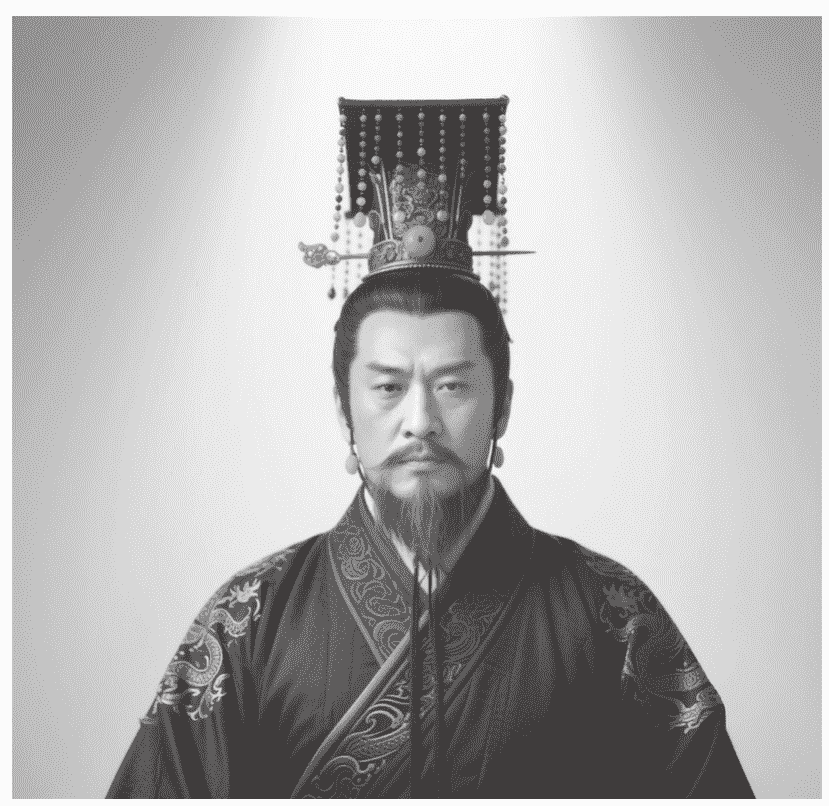

**图 2-1 秦始皇的肖像图**

第二步，向 DeepSeek 发送精准指令，让其生成秦始皇教学台词。

输入如下指令。

● Why：通过帝王第一视角理解统一措施的历史必然性。

● Who：你是历史情境教学设计师。

● What：设计秦始皇讲授《秦统一中国》的脚本。

● How：包含 3 个环节（战争统一—治国措施—后世评价）。

DeepSeek 的输出内容如下。

寡人十年灭六国！

尔等可知为何要废分封？诸侯割据便是战乱根源！

这天下，只能有一个皇帝、一种文字、一套度量衡！

修长城、筑驰道，后世骂寡人暴虐？若不用雷霆手段，何来一统！

第三步：使用对口型 AI 工具（笔者以即梦 AI 为例）生成秦始皇的说话视频。

❑在浏览器中输入即梦 AI 的网址（https://jimeng.jianying.com/）并访问。

❑单击右上角的“开启即梦”（如图 2-2 所示），进入即梦 AI 的首页。

**图 2-2 单击“开启即梦”**

❑进入即梦 AI 首页后，单击首页左下角的“登录”（如图 2-3 所示），选择抖音扫码登录或手机号验证码登录。

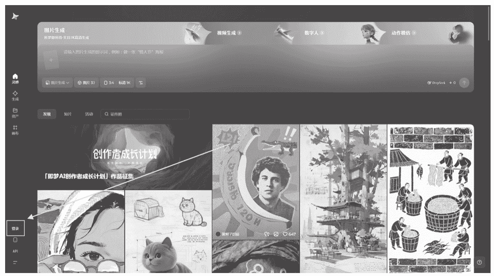

**图 2-3 单击左下角的“登录”**

❑扫码登录后，为了让秦始皇“说话”，单击首页右侧的“数字人”功能（如图 2-4 所示），进入编辑页面。

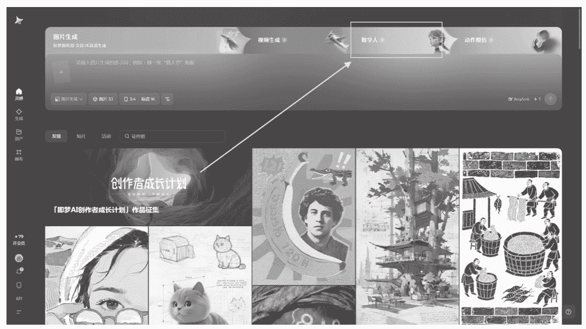

**图 2-4 单击“数字人”**

❑在页面左侧“角色”处，导入已下载的秦始皇肖像图。在“快速模式”处，有“大师”（更生动逼真的动效）、“快速”（更快的生成速度）、基础（仅修改人物口型）三个模式的对口型效果，可根据需要选择，这里以“快速模式”为例。单击“音频”，在输入框中输入 DeepSeek 生成的秦始皇台词。在下方可以选择音色和说话速度，此处选择“儒雅大叔”作为秦始皇的声音，说话速度保持原速不变。参数设置情况如图 2-5 和图 2-6 所示。

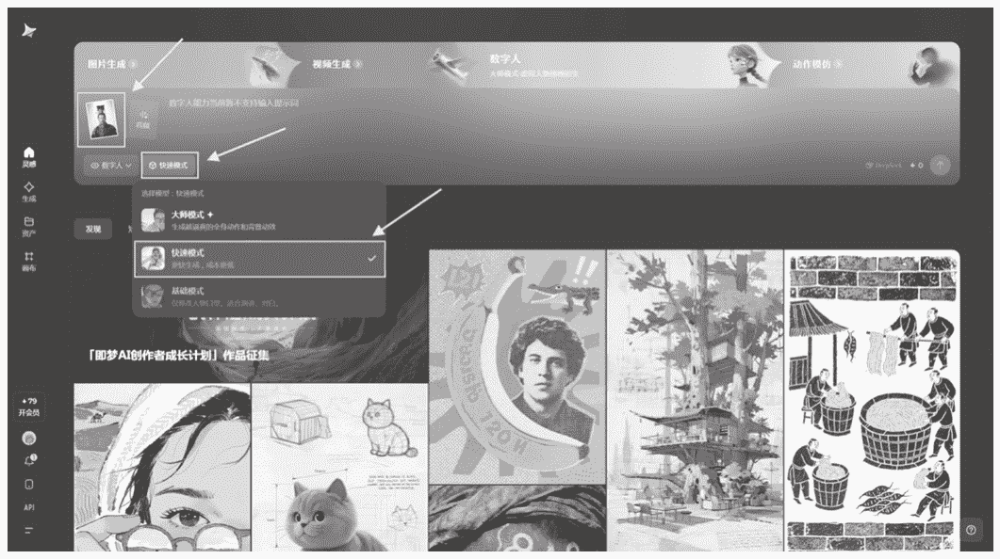

**图 2-5 选择“快速模式”**

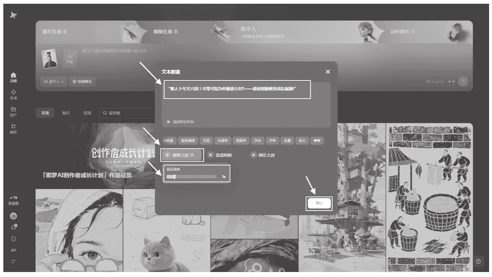

**图 2-6 输入台词，选择音色和说话速度**

❑各项参数都设置好后，单击右侧图标即可生成视频（注意：即梦 AI 每天都会赠送一定额度的免费积分，每次使用即梦 AI 的功能都会消耗一定积分），等待视频生成后下载即可，如图 2-7 所示。

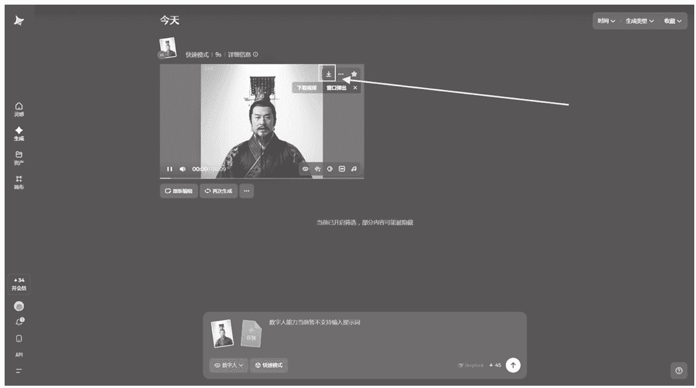

**图 2-7 下载视频**

第四步：将生成的视频作为教学素材，嵌入教学设计的恰当环节。如在导入部分播放，以激发学生兴趣；或在讲解关键知识点时展示，以加深学生理解。通过这种方式，完成“跨越时空的对话”教学素材的制作与应用，让历史人物“走进”课堂，为教学增添独特魅力。

### **2.4.2 古诗可视化视频**

利用 DeepSeek 与视频生成类 AI，可生成用于古诗可视化的创新教学素材，将抽象的诗句转化为生动的动态画面。这类教学素材不仅能直观呈现诗歌意境、降低理解难度，还能促进诗句与画面的联结记忆，从而提升学习效果。

下面以《静夜思》为例，展示生成该类教学素材的实施步骤。

第一步：设计视频脚本。

向 DeepSeek 发送精准指令，生成符合教学需求的视频分镜脚本。

● Why：解决古诗教学中“意境理解困难”的问题。

● Who：你是视频制作专家+古诗教学专家。

● What：为《静夜思》设计教学视频脚本，要符合李白所处年代的生活实际。

● How：以即梦 AI 可理解的格式输出。

● How much：包含 4 个关键场景（对应诗句内容）；400 字以内。

DeepSeek 生成的视频脚本如下。

场景 1：月照客舍

【画面】唐代木质窗棂前，油灯昏暗，窗外明月悬于飞檐，远处传来隐约梆子声。

【解说】“床前明月光”——李白夜宿驿舍，唐时游子常居此类简陋客舍，月光穿透纸窗，映照孤寂身影。

场景 2：起身疑霜

【画面】诗人披麻布中衣起身，席榻边青砖地泛白，似秋霜铺地（唐代卧具低矮，无高床）。

【解说】“疑是地上霜”——唐代秋季寒凉，驿舍地砖常凝露结霜，诗人误将月光作寒霜，更显羁旅清冷。

场景 3：举头望月

【画面】诗人推窗凭栏，仰望玉盘般明月，天际云层稀疏，檐角铜铃轻响。

【解说】“举头望明月”——唐人视月为思乡符号，此时李白目光深邃，盛唐游子皆惯以月寄情。

场景 4：垂首思乡

【画面】诗人低头抚摸腰间佩囊（唐人行囊多装家书或乡土信物），镜头上推至眼中氤氲。

【解说】“低头思故乡”——囊中或藏家乡蜀地之物，唐代交通艰阻，思乡之情只能托付明月。

第二步：使用视频生成 AI（这里以即梦 AI 为例）生成视频。

❑进入即梦 AI 的首页，然后单击页面上方中间位置的“视频生成”（如图 2-8 所示）。

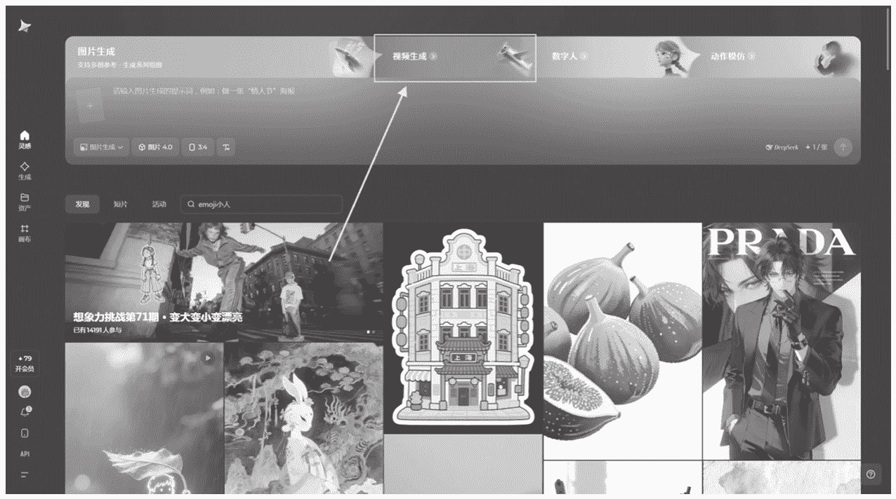

**图 2-8 单击“视频生成”**

❑在“视频生成”编辑界面，粘贴 DeepSeek 输出的场景 1 的画面描述。“视频模型”可根据个人喜好进行调整，不同模型生成的视频质量也不尽相同。“生成时长”固定为 5 秒，因此仅粘贴场景 1 的描述即可。“视频比例”可根据具体情境进行调整，此处设置为 16∶9。“视频生成”参数设置如图 2-9 所示。

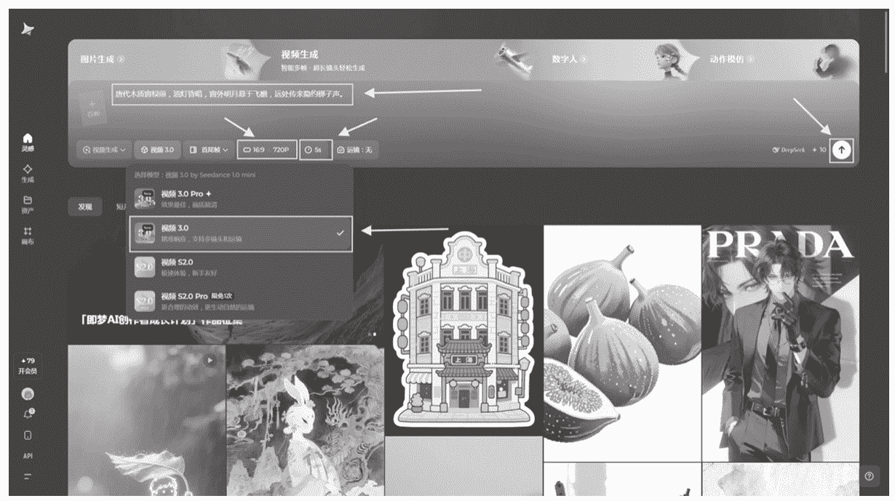

**图 2-9 “视频生成”参数设置**

❑单击右侧图标，生成完成后即可下载，如图 2-10 所示。

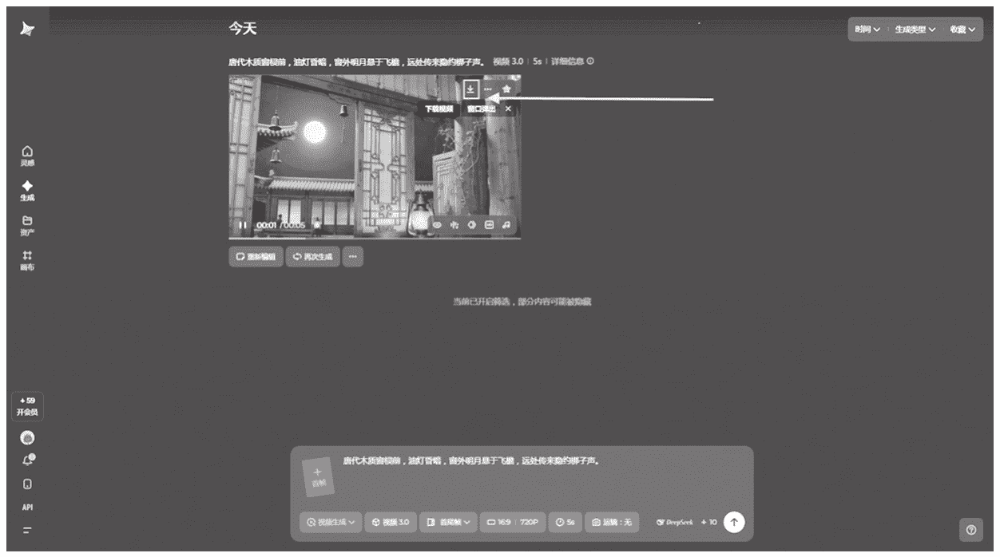

**图 2-10 生成视频后下载**

❑接下来重复刚才的操作，依次生成场景 2～场景 4 的视频。

第三步：利用剪辑工具（如剪映）将生成的 4 个场景视频片段合成一个完整视频，并添加背景音乐，完成教学素材的制作。

第四步：将生成的视频作为教学素材，嵌入教学设计的恰当环节，如在古诗讲解课开始时播放，帮助学生快速进入诗歌情境；或在分析诗句时将其作为辅助素材，加深学生对诗歌的理解。

这类借助 AI 生成的古诗可视化教学素材，能让“举头望明月，低头思故乡”的诗句变得直观可感。除古诗教学外，运用同样的方法，还能为写景散文、历史场景还原等教学内容生成对应的可视化视频素材，极大地丰富教学资源库，满足多样化的教学需求。

### **2.4.3 函数闯关游戏**

借助 DeepSeek，教师可以轻松生成融合多学科知识的函数闯关游戏教学素材，即便没有编程基础也能快速完成创作。

函数闯关游戏是一种融合多学科知识的教学素材，通过设计“特工任务”，将二次函数、分段函数等数学知识与物理、密码学等学科相结合。该类教学素材具有以下优势：一是以游戏化形式激发学生的探究兴趣；二是在闯关过程中自然渗透函数核心概念；三是通过参数调整培养学生的数形结合能力。

具体实施步骤如下所示。

第一步：向 DeepSeek 发送精准指令。

● Why：解决初中数学函数教学中“知识抽象难懂、练习枯燥”的问题，通过游戏化任务（特工闯关）激发学生学习二次函数、分段函数的兴趣，实现“玩中学”。

● What：生成一个名为“函数特工局”的科技感 HTML 游戏，包含 3 个递进任务。

任务 1：调整二次函数参数命中目标点。

任务 2：分析分段函数找出特定坐标。

任务 3：破译函数加密密码。

● How：交互功能如下。

功能 1：实时函数图像绘制（支持参数滑动调整）。

功能 2：答案验证与即时反馈（正确/错误特效）。

功能 3：任务剧情以“特工行动”故事线串联。

每个任务包含任务简报（剧情文字）、交互式函数图像、参数控制区、答案输入框。

● How much：

任务 1：需支持参数范围（a：-2～2，b：-5～5，c：-20～20）

任务 2：坐标误差容忍度±0.1。

任务 3：字母密码需自动计算（如 3*x*+2=3×10+2=32→字母 F）。

DeepSeek 输出内容（部分）如下。

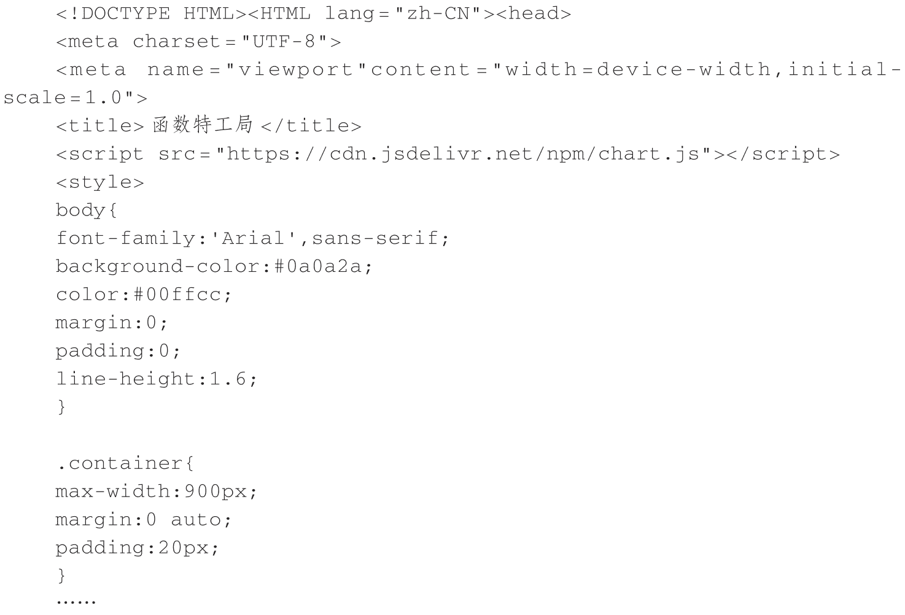

第二步：单击“复制”，复制 DeepSeek 生成的 HTML 代码（如图 2-11 所示）。

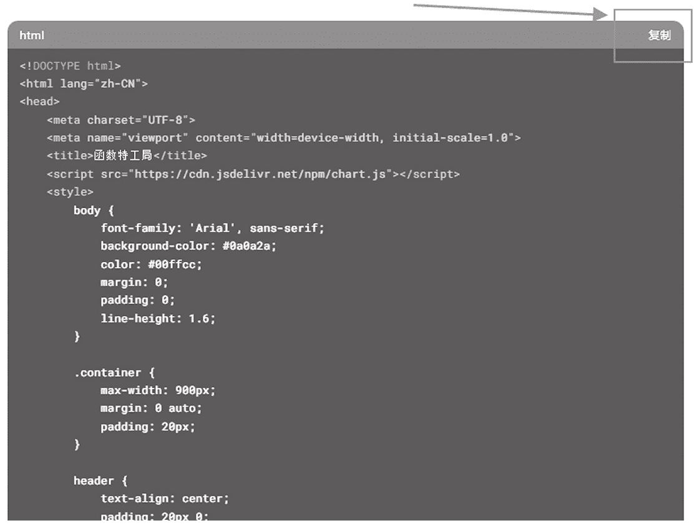

**图 2-11 复制 DeepSeek 生成的 HTML 代码**

第三步：在计算机中的任意一个文件夹内新建一个文本文档（如图 2-12 所示）。

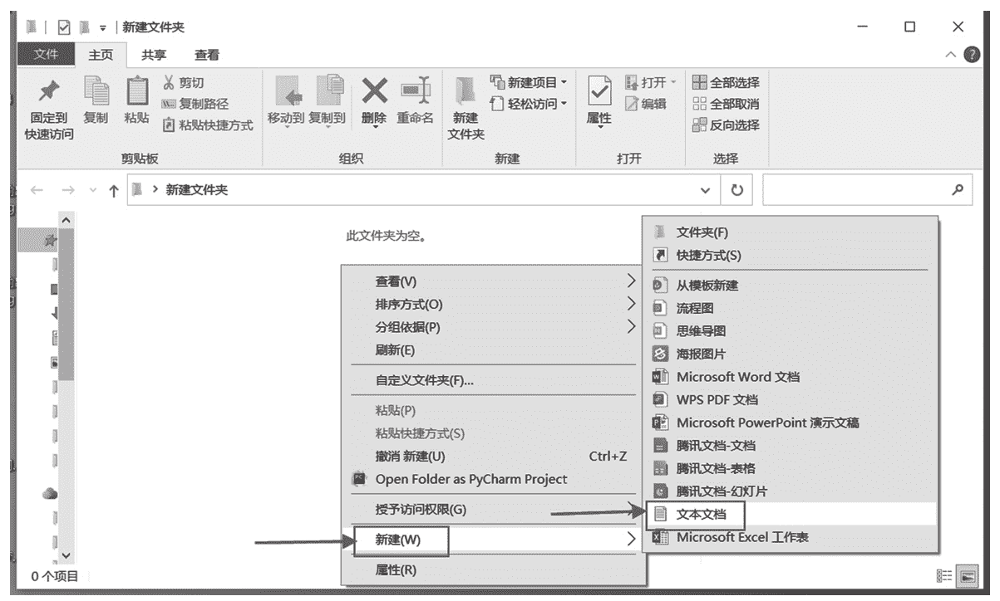

**图 2-12 新建一个文本文档**

第四步：打开新建的文本文档，粘贴刚才 DeepSeek 生成的 HTML 代码（如图 2-13 所示）。

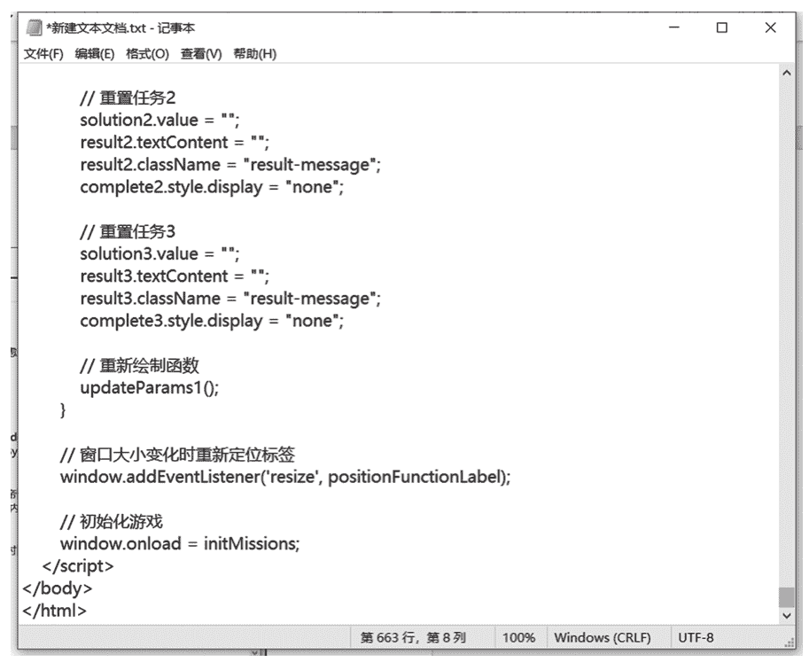

**图 2-13 粘贴 HTML 代码**

第五步：关闭该文本文档，鼠标右键单击该文本文档，选择“重命名”（如图 2-14 所示）。

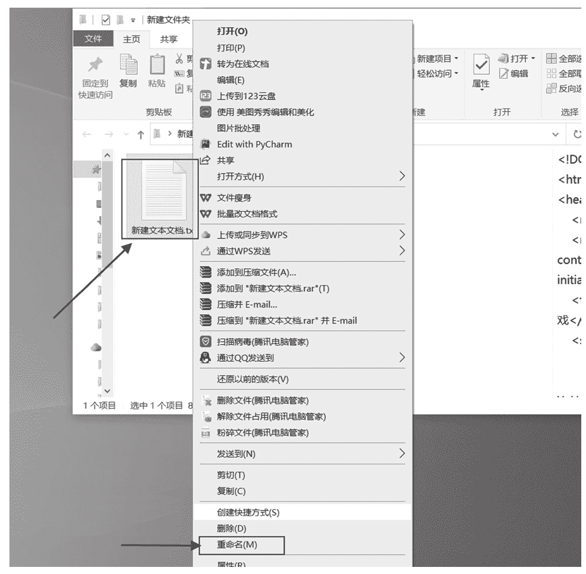

**图 2-14 重命名文本文档**

第六步：单击重命名后，可以看到该文本文档的文件名及扩展名（即新建文本文档.txt，如图 2-15 所示）。如果看不到“.txt”，请先按第七步操作；如果能看到，则直接跳到第八步。

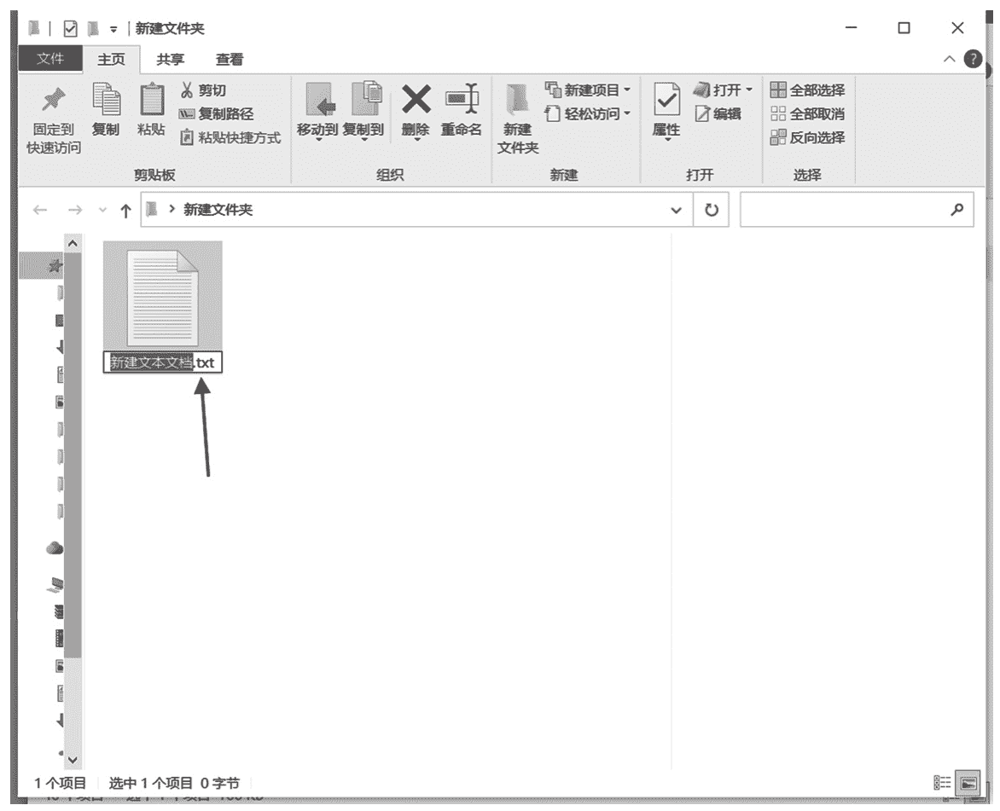

**图 2-15 文件名及扩展名**

第七步：显示文件扩展名操作如下。双击桌面上的“此电脑”，在弹出的窗口中单击左上方的“查看”，随后在右侧单击“选项”。在新弹出的“文件夹选项”窗口中单击上方的“查看”，向下滑动，取消勾选“隐藏已知文件类型的扩展名”条目，最后单击“确定”即可（操作过程如图 2-16 所示）。

第八步：修改文本文档的扩展名，即将“.txt”修改为“.html”，按回车键确定。系统会弹出一个对话框，提示“如果改变文件扩展名，可能会导致文件不可用，确定要更改吗？”单击“确定”，文件的扩展名便修改成功了（修改后如图 2-17 所示）。这样做是为了让浏览器能够将代码解析为可视化的游戏界面。

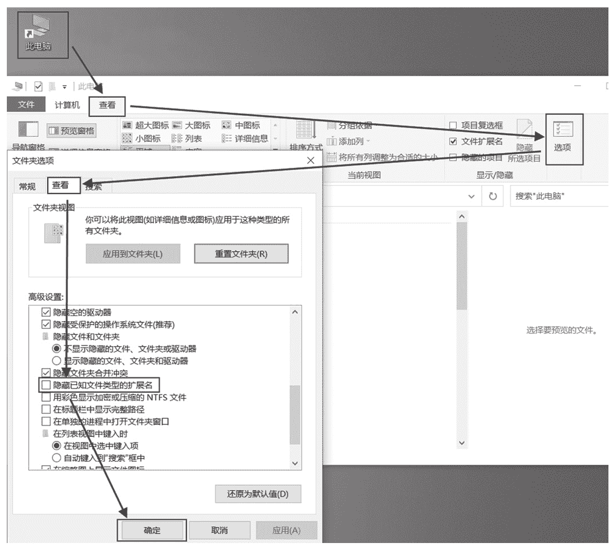

**图 2-16 显示文件扩展名步骤**

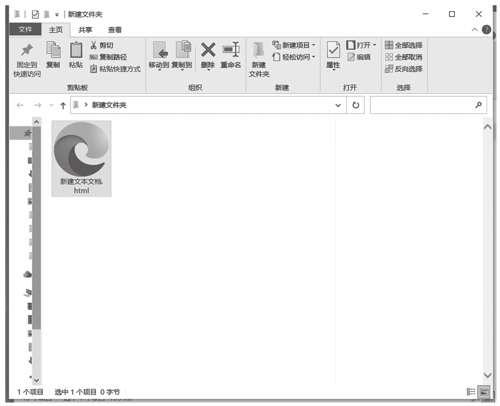

**图 2-17 修改后的状态**

第九步：双击已改好扩展名的文件，选择使用浏览器打开（这里以 Microsoft Edge 浏览器为例）。

第十步：打开后，即可进入函数闯关游戏。

界面效果如图 2-18 所示。

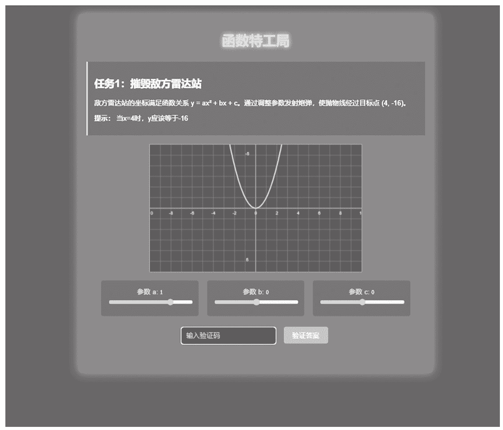

**图 2-18 函数闯关游戏界面**

第十一步：先对这款函数闯关游戏进行操作，如果有不满意的地方或需要增加其他功能，你可以继续向 DeepSeek 发送指令，让其进行修改。例如，笔者在通关第一轮后发现，第二轮 3 个关卡的函数等内容与第一轮内容完全相同，也就是说，每次玩都会得到相同的函数与相同的答案，而且这款游戏还没有背景音乐（任务 1 完成后的界面如图 2-19 所示）。

第十二步：基于以上需求，向 DeepSeek 发送以下追问指令。

基于以上你生成的代码，实现以下需求，并完整呈现全部代码。

● 随机化游戏内容，用户每次重新开始游戏时，3 个任务中的函数参数和正确答案随机生成，并显示相应的函数图像。

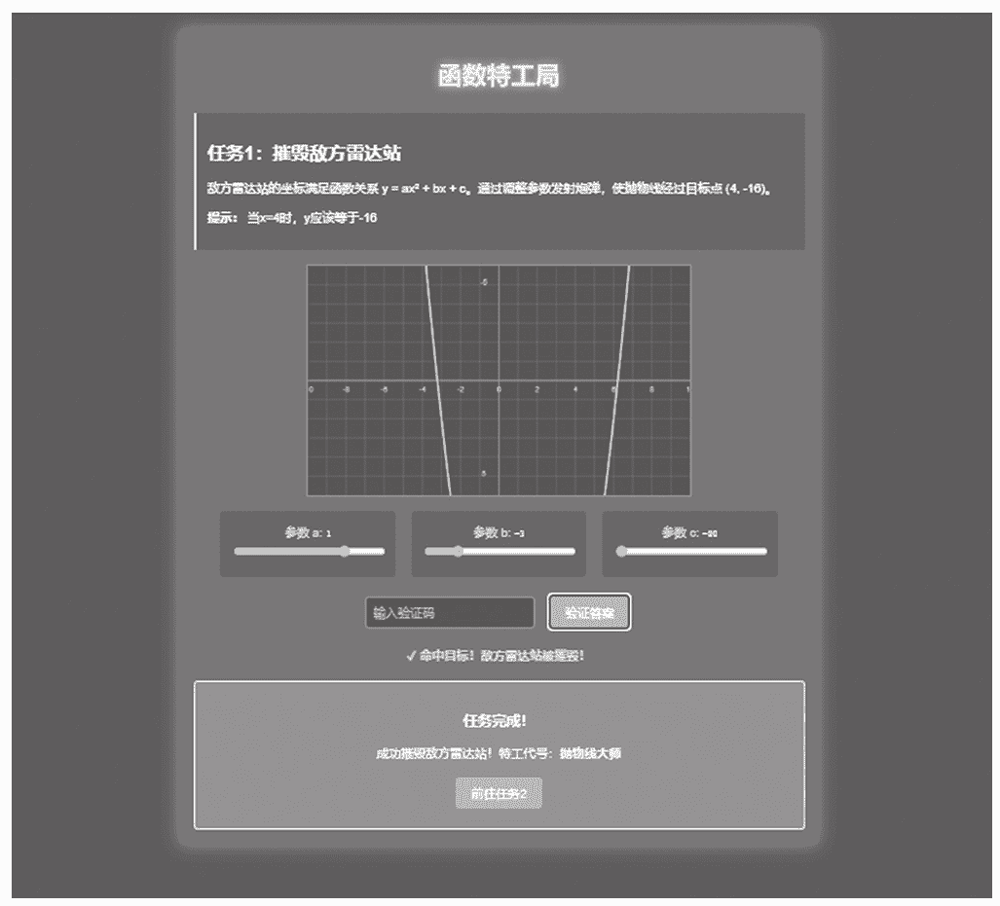

**图 2-19 任务 1 完成后的界面**

● 为游戏添加背景音乐相关功能，支持播放、暂停、循环播放。

注意，要记得加“基于以上你生成的代码，实现以下需求，并完整呈现全部代码”这句核心指令，否则生成的闯关游戏可能是全新的，也可能不会完整呈现全部代码。

DeepSeek 的第二版输出内容（部分）如下。

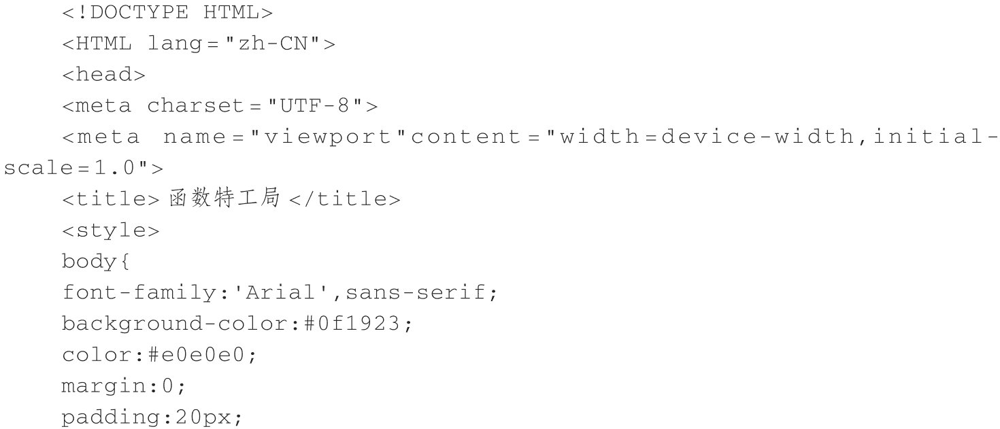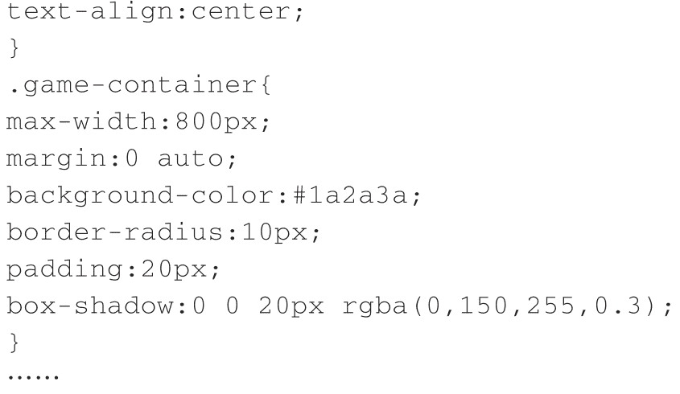

第十三步：复制 DeepSeek 生成的第二版 HTML 代码，将刚才的文件扩展名由“.html”改回“.txt”，双击打开文本文档，删除之前的全部代码，粘贴 DeepSeek 生成的第二版 HTML 代码并保存，再将文件扩展名由“.txt”改为“.html”，修改成功后，双击打开即可显示第二版函数闯关游戏，如图 2-20 所示。

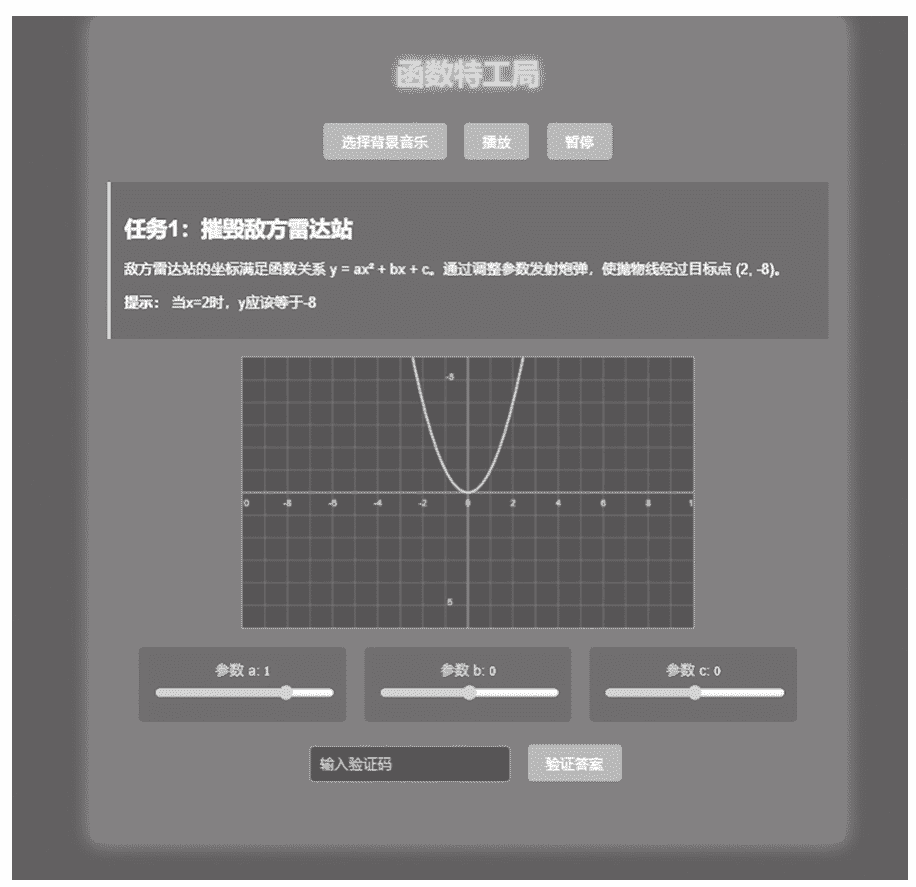

**图 2-20 第二版函数闯关游戏**

第十四步：若还有功能添加需求，重复第十一步至第十三步的操作即可。最终，便能得到一个功能完善且精美的函数闯关游戏。

该类教学素材将数学函数学习转化为探险旅程，学生在完成特工任务的过程中能够巩固课堂所学，实现“玩中学”。使用 AI 生成的 HTML 游戏（例如，语文古诗词闯关 RPG、数学几何塔防、英语单词密室逃脱、物理电路拼接挑战、化学元素周期表连连看、生物人体器官拼图、历史时间轴排序挑战、地理省份拼图、道德与法治知识配对等多种游戏）可以将各学科知识点自然融入游戏机制，使学习过程兼具系统性和趣味性，实现寓教于乐的教学目标。

### **2.4.4 思维导图**

用 DeepSeek 生成 AI 思维导图，是一种高效的知识可视化教学素材生成方式。它能将碎片化的知识点转化为结构化图谱，实现知识体系的直观呈现。思维导图类型丰富，常见的有树状图、鱼骨图、雷达图、气泡图、时间轴思维导图等。树状图以层级结构展示信息，适用于知识体系梳理；鱼骨图用于分析问题因果，从不同方面归类原因；雷达图通过多轴呈现数据，便于综合评估和对比；气泡图用气泡大小代表数据量级，展示数据关系与分布；时间轴思维导图按时间排列事件，适合梳理发展进程。这些思维导图能直观呈现知识逻辑，通过色彩与层级强化记忆，还可按需动态调整，能够满足教学个性化需求。

下面以《化学反应类型》为例，展示生成该类教学素材的实施步骤。

第一步：向 DeepSeek 发送精准指令。

● Why：解决《化学反应类型》学习中，学生混淆置换反应与复分解反应判定的问题。

● Who：初中化学教研员。

● What：生成“化学反应类型知识体系”思维导图内容。

● How：以 Mermaid 层级格式输出，包含 3 级分支（氧化还原反应单独标注）。

● Example：参考附件《元素周期律》单元思维导图的结构。

DeepSeek 生成的 Mermaid 格式的内容（部分）如下。

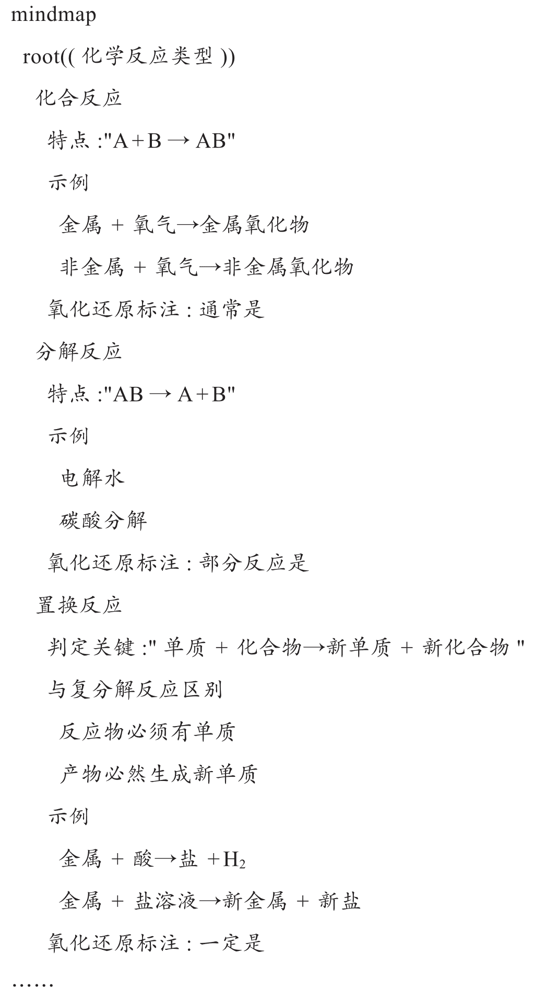

第二步：复制 Mermaid 格式内容。

第三步：访问绘图工具网站（此处以 draw.io 为例）。

在浏览器地址栏输入 https://app.diagrams.net/并访问 draw.io 官网，进入首页后单击“创建新绘图”（操作界面如图 2-21 所示）。

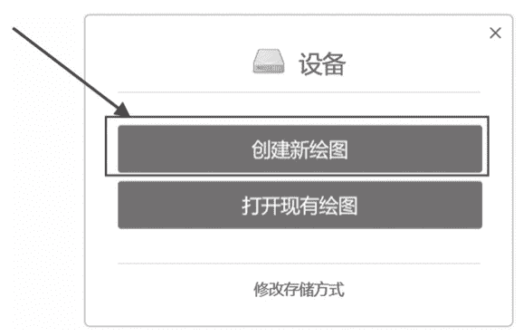

**图 2-21 draw.io 创建新绘图界面**

第四步：创建新文档

在弹出窗口中将文档命名为“化学反应类型思维导图”，选择存储路径后，单击“创建”并“保存”（如图 2-22 所示）。

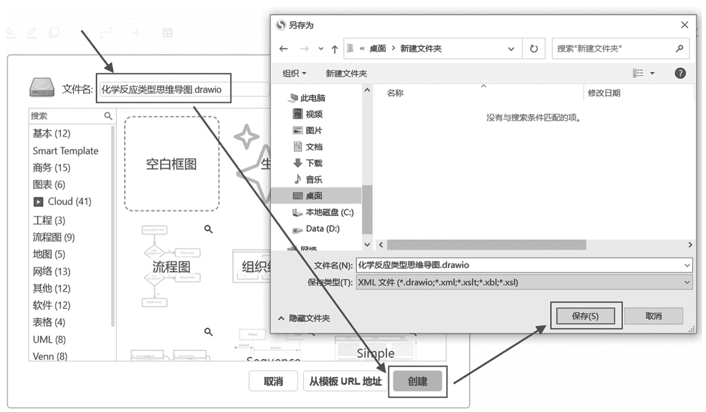

**图 2-22 文档创建与保存界面**

第五步：插入 Mermaid 代码。

单击顶部菜单栏“+”图标，选择“Mermaid...”，即可弹出 Mermaid 代码填写框。其打开操作如图 2-23 所示。

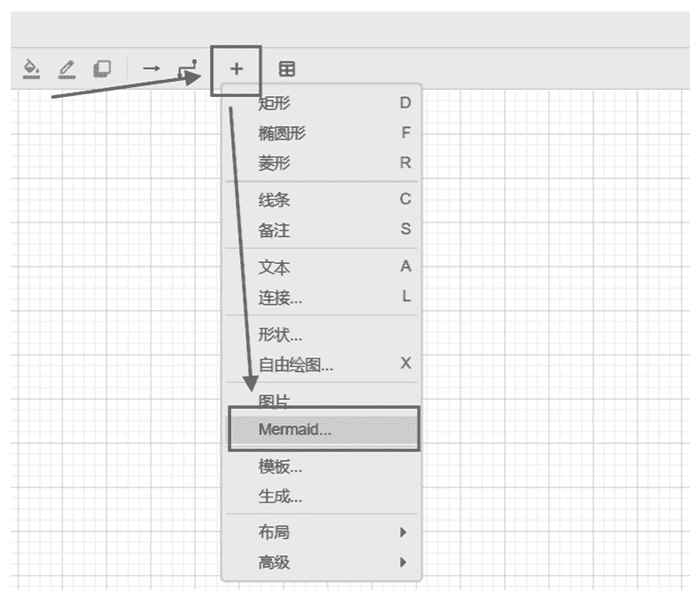

**图 2-23 打开 Mermaid 代码填写框**

清空 Mermaid 代码框的默认内容，粘贴 DeepSeek 输出的 Mermaid 代码，单击“插入”，代码插入操作如图 2-24 所示。

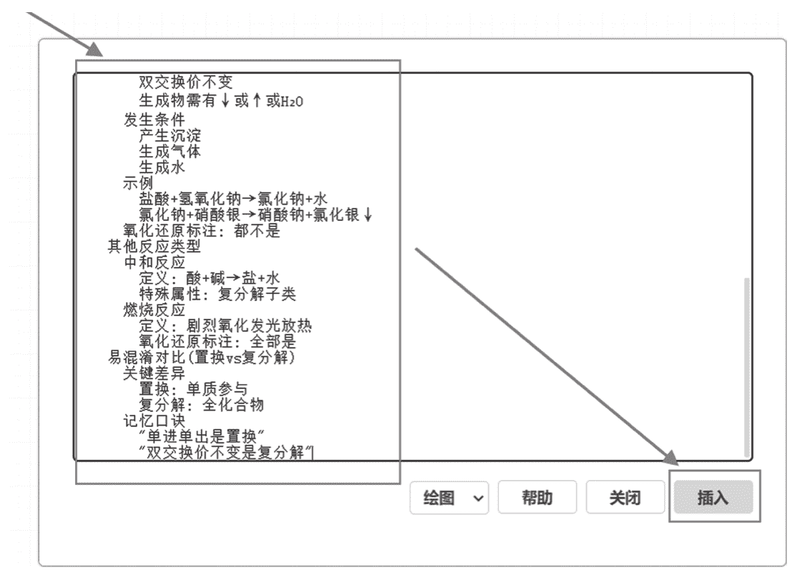

**图 2-24 Mermaid 代码插入操作**

第六步：生成并优化思维导图

单击“插入”后将自动生成思维导图（如图 2-25 所示），可通过拖拽节点调整布局，并可使用右侧格式栏修改颜色、字体等视觉元素。

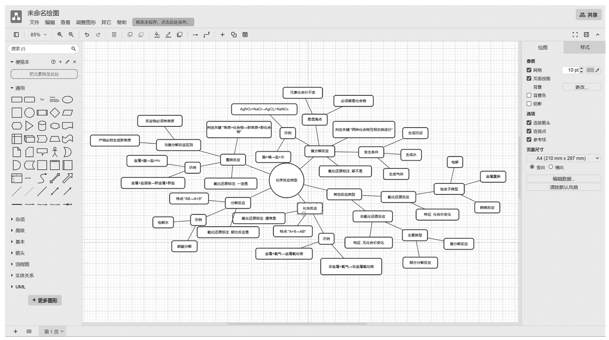

**图 2-25 自动生成的思维导图**

第七步：导出思维导图

样式修改满意后，单击左上角“文件”→“导出为”，可选择 PNG、SVG、PDF 等格式导出，导出操作如图 2-26 所示。

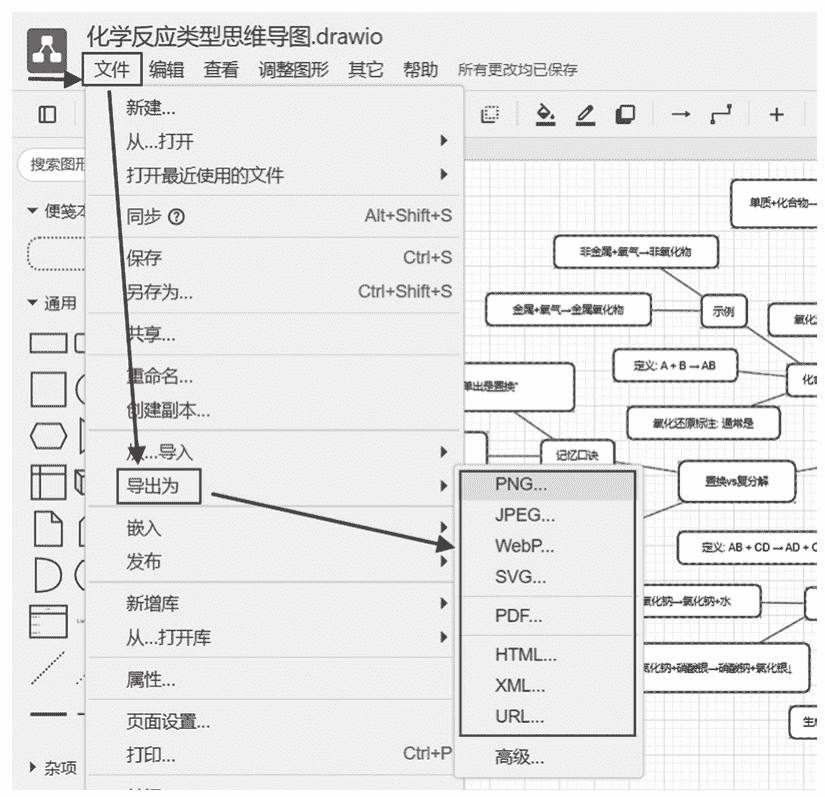

**图 2-26 导出操作**

使用 DeepSeek 与绘图工具，可快速生成结构合理、重点突出的可视化思维导图教学素材。除化学学科外，各学科教师都能基于以上操作，为不同知识内容生成相应的思维导图素材，助力教学。

### **2.4.5 统计图表**

统计图表类型丰富多样。柱状图以矩形柱的高度或长度表示数值大小，直观对比不同类别数据的数值差异；折线图通过折线的起伏变化，清晰呈现数据随时间或其他连续变量变化的趋势，便于受众观察数据的走向；饼图通过将圆形区域划分成扇形，展示各部分在总体中的占比，能让人快速了解各部分与整体的关系。在学科教学中，利用 DeepSeek 生成此类统计图表教学素材，可以将复杂数据直观呈现，助力学生理解现象和规律。

下面以地理学科中分析不同气候类型区的气温和降水数据为例，展示生成该类教学素材的实施步骤。

第一步：向 DeepSeek 发送精准指令。

● Why：通过可视化不同气候类型区的气温和降水数据，帮助学生更直观地理解不同气候类型的特点，提升对地理知识的掌握程度。

● Who：初中地理教师。

● What：根据已知的热带雨林气候、热带沙漠气候、温带季风气候的多年月平均气温和降水量数据，生成折线图展示气温变化，柱状图展示降水差异。

● How：以 HTML 代码形式输出，图表需具备交互功能，鼠标悬停时显示具体数据。

● Example：参考权威地理数据网站上关于上述三种气候类型的典型数据。

DeepSeek 生成的 HTML 代码内容（部分）如下。

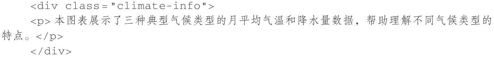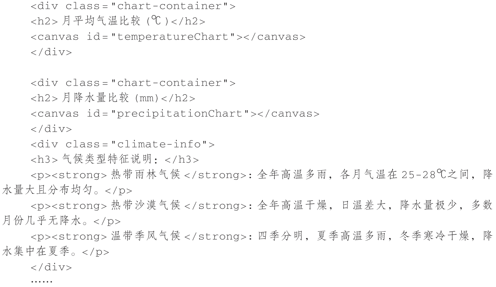

第二步：生成并应用图表。

将 DeepSeek 生成的 HTML 代码复制后，在计算机任意文件夹中新建一个文本文档，将代码粘贴进去并保存，随后将该文件的扩展名由“.txt”改为“.html”。完成格式转换后，用任意浏览器打开该文件，即可呈现包含气温折线图和降水柱状图的可视化界面（如图 2-27 所示）。教师可在课堂教学中应用该图表素材，引导学生观察图表，对比不同气候类型的气温和降水特征，分析其差异形成的原因，帮助学生更好地理解和记忆相关地理知识。同时，还可根据实际教学需求，让学生基于图表进行小组讨论，探讨不同气候类型对人类活动和自然环境的影响等问题，进一步提升学生对地理学科知识的理解与应用能力。

### **2.4.6 交互式动画**

使用 DeepSeek 生成交互式动画教学素材，能够突破静态教学的局限。这种教学素材具有以下优势：实现“操作—反馈”的双向互动、动态呈现抽象原理、支持生成个性化探究路径。

下面以《浮力》单元为例，展示生成该类教学素材的实施步骤。

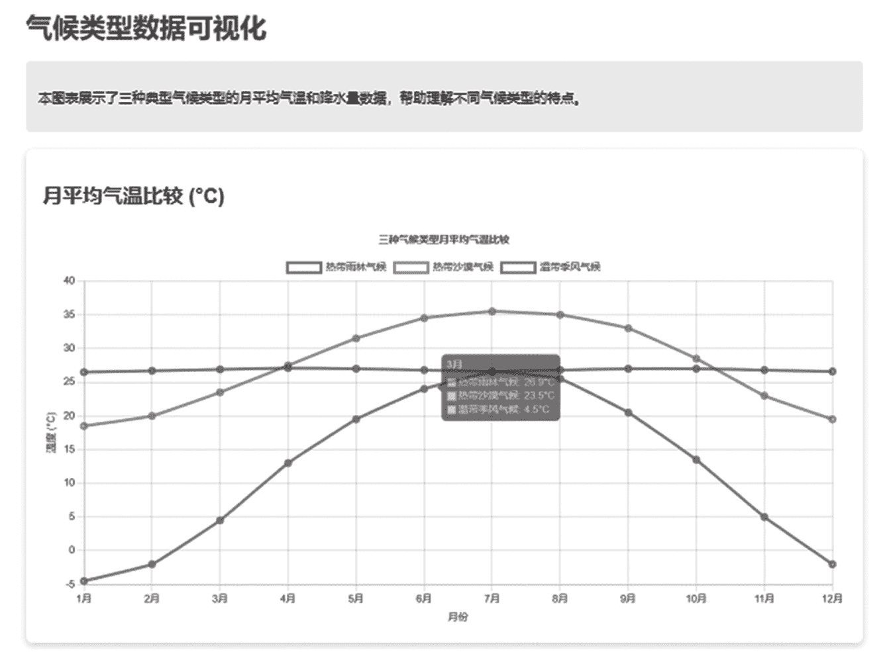

**图 2-27 气候类型数据可视化界面示例**

第一步：生成动画源代码。

向 DeepSeek 发送如下精准指令。

● Why：需要动态展示物体浸入液体过程中的浮力变化。

● Who：物理动画设计师+初中物理教师。

● What：生成浮力原理 SVG 动画的 HTML 代码。

● How：要求包含可拖拽的立方体、显示实时浮力计算公式*F*[浮]=*ρ*[液]*gV*[排]、用不同颜色区分水和物体（水为蓝色，物体为橙色）。

● Example：参考人教版初中物理教材第 58 页示意图。

DeepSeek 的输出内容（部分）如下。

第二步：复制 DeepSeek 输出的代码，在计算机任意文件夹中新建一个文本文件，粘贴代码并保存，将该文件的扩展名由“.txt”改为“.html”，保存后双击，用任意浏览器打开，即可显示浮力原理 SVG 动画。浮力原理 SVG 动画画面如图 2-28 所示。

这种动态演示方式能够改变传统物理教学的观察模式，使抽象公式转化为可视化的参数交互。当学生拖动滑块时，不仅能实时看到物体的沉浮状态变化，还可以同步观察排开液体体积与浮力值之间的关系，从而构建起“现象观察—采集数据—推导原理”的完整认知链条。该文件可直接作为独立数字教具，教师可以在机房、智慧教室等多场景中使用它来开展探究式学习。

这一方法除用于制作浮力原理的 SVG 动画外，还可用于制作物理、数学、化学、生物、地理，以及信息技术、艺术等学科的 SVG 动画。

**图 2-28 浮力原理 SVG 动画画面**

### **2.4.7 动态英语绘本**

传统绘本资源难以适配学科内容，手工改编耗时费力。DeepSeek 可一键生成定制化的绘本故事素材。

下面以小学英语经典故事*The Very Hungry Caterpillar*为例，展示生成该类教学素材的实施步骤。

第一步：向 DeepSeek 发送精准指令，让 DeepSeek 输出*The Very Hungry Caterpillar*的绘本。

● Who：小学英语教师+绘本设计师。

● What：生成*The Very Hungry Caterpillar*的绘本分场景描述，用于豆包生成图像。

● How：包含场景、角色、画面内容、教育标注（食物/星期词汇）。

DeepSeek 的输出内容（部分）如下。

Day 1 周一

场景：月光下的树叶特写。

角色：绿色小毛虫蜷在嫩叶上（体长 3cm 左右）。

画面内容：荧光蓝的虫卵刚破裂，叶片上有晶莹的露珠。

教育标注：[Monday][apple]单词用星星光点环绕。

Day 2 周二

场景：红色苹果剖面图。

角色：毛虫从苹果核位置探出头（苹果直径约 8cm）。

画面内容：苹果左侧有整齐的圆形咬痕，露出浅色果肉。

教育标注：[Tuesday]用彩虹色字，浮在苹果上方。

Day 3 周三

场景：野餐篮俯视图。

角色：毛虫趴在两个梨之间（梨带褐色斑点）。

画面内容：野餐篮内有草莓、奶酪等食物的残渣，周三的梨被吃出“隧道”。

教育标注：[Wednesday][pear]标签做成小旗子插在梨柄上。

……

关键教育页

场景：食物大集合。

角色：毛虫趴在蛋糕顶端（身体鼓成球形）。

画面内容：按食用顺序排列：草莓→冰激凌→腌黄瓜→奶酪→火腿→棒棒糖。

教育标注：所有食物带虚线边框标注英文，星期标签做成马戏团小旗串。

第二步：复制 DeepSeek 的输出内容。

第三步：在浏览器地址栏输入豆包 AI 官网的网址：https://www.doubao.com，并访问，操作如图 2-29 所示。

**图 2-29 访问豆包 AI 官方网站**

第四步：在豆包 AI 首页找到并单击右上角的“登录”按钮，即可使用手机号码和短信验证码登录，操作如图 2-30 所示。

**图 2-30 豆包 AI 的登录操作**

第五步：登录后，在界面中找到并单击“图像生成”，即可进入“图像生成”编辑界面，操作如图 2-31 所示。

**图 2-31 进入“图像生成”编辑界面操作**

第六步：在对话框中粘贴 DeepSeek 生成的“Day 1 周一”部分的内容，选择并单击“风格”，滑动鼠标滑轮到最下方，单击“绘本”风格，然后单击“发送”，操作如图 2-32 所示。

**图 2-32 粘贴内容，选择风格**

第七步：豆包 AI 生成的结果如图 2-33 所示，选择一张满意的图片，保存即可（如均不满意，可以让豆包 AI 重新生成，或向 DeepSeek 反馈结果，让 DeepSeek 输出新的指令）。

**图 2-33 豆包 AI 生成的结果**

第八步：生成绘本图片之后，我们还能让图片动起来。怎样让静态的绘本图片动起来呢？这就要借助视频生成 AI（如即梦 AI、豆包 AI）。这里以豆包 AI 为例，它的操作更为便捷，可在同一款 AI 中直接将绘本图片转换为所需视频。选择一张满意的绘本图片并单击，即可在界面右侧放大显示该图片。单击右上角的“生成视频”，即可进入该绘本图片的视频生成界面，如图 2-34 所示。

**图 2-34 绘本图生视频操作**

第九步：在视频生成的指令输入框中，可输入你希望图片如何动起来的描述。也可以不填写，交由豆包自动生成（我这里不进行填写，让豆包独立生成）。单击右下角的“发送”，等待视频生成即可，视频生成编辑界面如图 2-35 所示。

**图 2-35 视频生成编辑界面**

第十步：如果你对豆包 AI 生成的视频不满意，可按需下达指令让其重新生成，直到满意后，单击视频下方的“下载视频”，即可完成下载。

第十一步：按照以上步骤分别生成其余场景的动态绘本片段并下载，随后合成所有片段，添加配音朗读和背景音乐，即可快速制作一部适合小学生阅读的精致动态绘本。

这种用 AI 生成动态绘本教学素材的方式能够改变传统英语教学的资源获取模式，使静态的文字故事转化为动态的视觉效果。学生阅读绘本时，不仅能通过生动的画面理解故事情节，更能直观学习绘本中的核心词汇。该绘本素材可直接用于课堂导入、分组角色扮演或课后拓展阅读，从听、说、读、写等多个维度提升学生的英语学习效果。除小学英语教学外，在生物、科学、数学、历史、美术、心理健康教育等学科中，也能用同样的方法快速制作辅助教学的动态绘本素材。

### **2.4.8 心脏 3D 模型**

使用 DeepSeek、AI 生图工具（如即梦 AI）和 3D 建模工具（如 Tripo），能够生成适用于教学的高精度 3D 模型素材。这种创新教学素材适用于生物、化学、物理、地理等需要直观展示立体结构的学科。

下面以使用 DeepSeek 和其他 AI 工具生成心脏 3D 模型为例，展示生成该类教学素材的实施步骤。

第一步：用 DeepSeek 生成构建心脏 3D 模型的提示词。

向 DeepSeek 发送精准指令，让其生成适合 AI 生图工具的高质量提示词。

● Who：你是高中生物教师+3D 建模师。

● What：我要设计心脏的 3D 模型，需要你编写用于 AI 生图的提示词，不要背景。

DeepSeek 的输出内容如下。

超精细心脏 3D 模型，孤立无背景，解剖级精度。展示完整四腔结构（左右心房、左右心室），冠状动脉分支清晰可见，主动脉弓自然弯曲。材质为半透明医疗级塑料质感，可透视内部瓣膜（二尖瓣/三尖瓣）。冷白色照明，等距视角，Blender 渲染风格，8K 细节。

第二步：复制 DeepSeek 的输出内容。

第三步：进入即梦 AI 官网首页并登录，单击“图片生成”，打开图片生成编辑界面如图 2-36 所示。

第四步：将 DeepSeek 输出的提示词粘贴至左侧提示词填写栏，然后单击右侧图标即可，如图 2-37 所示。

第五步：心脏 2D 图片生成后，选择一张满意的图片下载。

第六步：在浏览器地址栏输入 Tripo 官网的网址：https://www.tripo3d.ai/，并访问，然后单击“免费开始使用”即可进入 Tripo 官网首页界面，如图 2-38 所示。

**图 2-36 图片生成界面进入方法**

**图 2-37 图片生成界面编辑操作**

第七步：在 Tripo 首页，单击右上角“注册/登录”按钮，即可进入登录界面，在登录界面单击“免费注册”，可使用邮箱免费注册 Tripo 账号。账号注册后，登录即可，如图 2-39 所示。

**图 2-38 网址访问及 Tripo 官网首页进入方法**

**图 2-39 账号注册方法**

第八步：登录后，我们在 Tripo 首页单击“生成 3D 模型”，上传刚才下载的心脏 2D 图，单击“生成”，等待心脏 3D 模型生成即可，如图 2-40 所示。

**图 2-40 Tripo 首页 3D 内容生成编辑操作**

第九步：心脏 3D 模型生成后，单击下方的“下载”，如图 2-41 所示，将 3D 模型文件下载到本地，作为教学活动素材，在课堂上可以用相应软件（如 3D 画图等）打开，演示给学生看。除此之外，也可单击下方的“定制到家”，如图 2-42 所示），将其定制为摆件并邮寄到学校（也可基于生成的心脏 3D 模型，通过第三方平台进行定制），用 3D 实物模型进行展示。

**图 2-41 单击“下载”按钮**

**图 2-42 单击“定制到家”按钮**

借助 DeepSeek、AI 生图工具和 3D 建模工具生成的心脏 3D 模型教学素材，不仅将抽象的生物结构可视化，还极大地提升了课堂互动性。教师可以灵活运用 3D 模型进行动态演示，如拆解心脏各腔室、模拟血液流动路径，甚至结合 VR 设备让学生“走进”心脏内部进行观察。

这种基于 AI 的 3D 建模技术不仅适用于高中生物教学，还能广泛应用于 K12 阶段各学科，生成丰富的教学素材：在化学中，可用于构建分子结构模型（如晶胞）、直观展示化学反应过程（如酸碱中和的离子运动）；物理学科可生成实验装置与概念模型（如滑轮组、电磁场模型）；地理教学能创建地形地貌 3D 模型（如火山剖面、褶皱山脉），或动态演示板块运动与地震形成机制；数学学科可用于可视化几何对象，辅助空间思维训练；在历史领域，还能还原文物与建筑（如青铜鼎、金字塔），让学生“触摸”文化遗产。该技术让抽象知识具象化，推动教学从“被动听讲”转向“主动探索”。教师还可结合学科特点，设计跨学科项目（如用 3D 建模分析古建筑中的数学比例），培养学生的综合素养与数字化创新能力。

**第三章 CHAPTER 1 AI 赋能课堂提效**

在传统课堂教学中，教师们常被诸多难题困扰，如课堂导入困难、课堂互动形式单一、课堂练习设计耗时费力、无法即时调整课堂内容等。这些问题不仅影响了教学质量，也阻碍了学生的全面发展。随着 AI 技术的快速发展，DeepSeek 能为我们提供新的解决方案。

本章聚焦于课堂提效，详细阐述如何借助 DeepSeek 实现课堂导入、课堂互动、课堂练习以及课堂内容即时生成与动态调整等环节的优化升级。阅读本章时，你需要重点关注指令设计技巧，以及各环节与教学实际的紧密结合，灵活运用这些方法，让课堂焕发新的活力，真正实现“师生智慧共创”的高效课堂。

## **3.1 课堂导入提效**

课堂导入是开启每节课学习旅程的关键环节，其成效直接关系到学生后续的学习热情与知识吸收。然而，传统课堂导入手段往往存在诸多不足，无论是悬疑问题的设计，还是智慧谜语、故事绘本、趣味游戏等的运用，或许都难以充分激发学生的学习兴趣。DeepSeek 的出现为突破这些瓶颈、高效提升课堂导入效果提供了创新工具，助力教师打造引人入胜的学习开端。

### **3.1.1 悬疑问题导入**

悬疑问题导入是课堂教学中一种颇具吸引力的导入方式，它通过设置疑问或创设认知冲突，引发学生思考，激发学习兴趣。这类问题往往贴近生活、富有挑战性，能有效激活学生的主动思考，促使他们带着问题进入学习状态，为后续的知识理解打下良好基础。

**1.传统方式的痛点**

许多教师在设计悬疑问题时容易陷入思维惯性，重复使用教材里的陈旧案例，或者设计的情境过于理想化，脱离学生生活经验。更棘手的是，传统方式很难精准控制认知负荷，常常出现导入环节“启而不发”或“过度刺激”的两极分化现象。

**2. DeepSeek 赋能方案**

DeepSeek 能够通过生成“悬疑问题组合包”，突破传统问题设计的局限，打造“认知冲突—情感共鸣—概念建构”三位一体的导入体验。这超越了简单的内容生成，体现了 DeepSeek 理解并应用教学原则的能力。它能够生成的问题不仅语法正确、主题相关，而且在教学上具有启发性，能有效引发学生的思考和兴趣。

教师可以向 DeepSeek 提供精准指令，明确导入的目的、主体、内容、格式、字数限制以及参考范例。例如，一位初中物理教师可以请求生成“光的折射”单元的问题，包括基础型、进阶型和拓展型三种类型的问题。具体精准指令如下。

● Why：突破传统问题设计的局限性，打造“认知冲突—情感共鸣—概念建构”三位一体的导入体验。

● Who：初中物理教师+认知科学顾问。

● What：生成“光的折射”单元悬疑问题组合包。

● How：包含基础型、进阶型、拓展型三类问题，每类 2 个版本。

● How much：总字数不超过 150 字，确保 15 秒内可完成阅读。

● Example：参照诺贝尔物理学奖得主的教学案例库。

DeepSeek 输出内容（部分）如下：

● “如果人类的眼睛能直接看见红外线，游泳池在我们眼中会变成什么样子？”

认知冲突：挑战“所见即真实”的朴素观念。

情感共鸣：关联学生熟悉的泳池场景。

概念构建：为讲授光的波长与折射率的关系埋下伏笔。

● “为什么隐形战机的外形设计，本质上是在和光的折射定律‘玩游戏’？”

认知冲突：建立军事科技与基础科学的认知关联。

情感共鸣：激发学生对国防科技的兴趣。

概念构建：引出折射定律的工程应用维度。

● “如果有一天光的折射定律突然失效，最先消失的现代科技会是什么？”

认知冲突：创设极端假设情境。

情感共鸣：引发学生对技术依赖性的深层思考。

概念构建：串联透镜、折射定律等多个知识点。

这些问题能够挑战学生的朴素观念，引发他们对科学原理与工程应用的思考，并串联多个知识点，激发学生对国防科技的兴趣，并反思技术依赖性。

**3.课堂实施流程**

在课堂实施过程中，教师可以先抛出基础问题，引导学生开展小组头脑风暴，将猜想写在便利贴上。随后展示进阶问题，引导学生尝试解释新情境，并可有意设置矛盾点。当学生陷入认知冲突时，适时引入拓展问题，激发学生对系统知识的自主学习动机。教师还可以用不同颜色的磁贴标记猜想的发展脉络，并在单元总结时回顾，使学生直观地看到自身认知结构的完善过程。DeepSeek 在这一过程中参与共同设计，其生成的问题能够有效影响学生的思维和参与度，从而使他们实现更深层次的学习。

### **3.1.2 智慧谜语导入**

智慧谜语导入是一种融合了语言表达、逻辑推理和形象思维的教学形式，它以生动有趣的方式将抽象的学科知识具象化，既能活跃课堂气氛，又能帮助学生建立知识点之间的联系。通过设计符合教学目标的学科谜语，教师可以在轻松愉快的情境中引导学生进入学习状态。

**1.传统方式的痛点**

教师自编谜语时，往往难以兼顾趣味性和教学目标，可能导致谜面与学科概念的关联牵强、难度不符合学段特点或缺乏递进性思维训练。此外，文化背景差异也可能导致部分谜语难以引发学生共鸣。

**2. DeepSeek 赋能方案**

DeepSeek 能够生成“学科融合谜语”，这表明 DeepSeek 不仅能创造谜语，还能以符合不同学习风格的方式进行创造，从而促进更深层次的概念理解。

例如，一位小学科学教师可以让 DeepSeek 生成 3 个与“生态系统”相关的谜语，要求谜底为科学概念，谜面包含韵律和意象，适合 8～12 岁学生。具体精准指令如下。

● Why：通过学科融合谜语激发学生学习兴趣。

● Who：小学科学教师。

● What：生成 3 个与“生态系统”相关的学科谜语。

● How：谜底为科学概念，谜面需包含韵律和意象。

● How much：每个谜语不超过 3 行，适合 8～12 岁学生。

● Example：参考附件《物质三态》中的谜语设计。

DeepSeek 输出的内容如下。

● “我是绿色工厂不需要电，太阳给我发工资，动物给我交社保。（打一生态角色）”

谜底：生产者（植物）

设计亮点：

√将光合作用比喻为“工厂”运作。

√用“社保”隐喻物质循环。

√为食物链教学埋下伏笔。

● “冬天穿白衣，春天换绿装，秋天收红包，夏天忙转账。（打一森林类型）”

谜底：落叶阔叶林

设计亮点：

√拟人化描述物候变化。

√“转账”暗指养分输送。

√衔接生态系统能量流动学习。

● “看不见的银行家，存进阳光贷出糖，破产就要闹饥荒。（打一生态过程）”

谜底：光合作用

设计亮点：

√金融类比喻突破学科边界。

√“破产”对应植物枯萎。

√为能量转化建立认知锚点。

**3.课堂实施流程**

在课堂开始时，教师可以先展示最直观、最贴近生活的谜语（如第一个谜题），通过集体讨论引导学生说出谜底“生产者”。待学生进入状态后，逐步提升难度，呈现需要抽象思维的谜语（如第二个谜题）。在这个过程中，可以让学生用不同颜色的笔在纸上圈出谜面中的关键词，比如把“社保”和物质循环联系起来，或者把“转账”和能量流动画联系起来。当所有谜底都揭晓后，教师可以带领学生将这些科学概念粘贴到教室的墙上，比如把“生产者”卡片放在食物链的起点。最后，鼓励学生分组创作新的谜语，比如从消费者的角度改编“冬天穿白衣”这个谜语，让学生的学习过程从理解延伸到创造。

### **3.1.3 多元 AI 辅助导入形式**

除了上述两种导入方法外，教师还可以运用多种其他导入形式来丰富课堂，提升学生的参与度和学习兴趣。这些形式包括但不限于虚拟角色导入、故事绘本导入、实验演示导入、趣味游戏导入。尽管具体形式各有侧重，但其共同目标是更好地吸引学生的注意力，激发他们的求知欲。

无论采用哪种导入形式，教师都可以利用 DeepSeek 生成相关的素材或脚本，以确保导入内容既符合教学目标，又能激发学生兴趣。对于虚拟角色导入，可参考 2.4.1 节中提到的方法，使用 DeepSeek 生成虚拟人物教学台词，再用对口型 AI 工具生成虚拟角色；对于故事绘本导入，可参考 2.4.7 节中提到的方法，向 DeepSeek 发送精准指令生成故事情节和插图建议，并用其他 AI 将其转化为动态绘本；对于实验演示导入，可让 DeepSeek 给出相应的视频素材、动画素材来源，提供详细的实验步骤和推荐的资源链接；对于趣味游戏导入，可参考 2.4.3 节中提到的方法，让 DeepSeek 生成包含游戏逻辑和交互设计的 HTML 代码，从而创建富有互动性的游戏体验。通过这些方式，教师可以快速获取高质量的教学素材，优化课堂导入环节，增强学生的参与感和学习效果。

## **3.2 课堂互动提效**

传统课堂互动往往受困于多重桎梏：教师的提问对象随机且提问缺乏针对性；小组讨论随意性大且主题模糊；多元互动形式之间缺乏逻辑衔接；技术工具应用困难，演示环节缺乏动态性。这些问题共同导致学生注意力难以集中、参与度下降。DeepSeek 凭借其强大的信息整合与生成能力，为这些难题提供了创新解决方案。

### **3.2.1 分层提问设计**

在传统课堂教学中，教师的提问对象往往较为随机且问题缺乏针对性。要解决这一问题，需要花费大量时间进行学情分析并设计相应的问题，既耗时又难以长期坚持。DeepSeek 能够在精准分析学情的基础上，快速高效地设计出有针对性且符合教学目标的分层提问方案。下面以初中数学《一元二次方程》为例，展示生成分层提问方案的操作步骤。

第一步：采用 2.2 节提到的方法，利用 DeepSeek 进行精准学情分析，并保存学情分析结果。

第二步：向 DeepSeek 发送精准指令，让 DeepSeek 根据精准学情分析结果和本课教学设计完成分层提问方案设计。

精准指令如下：

● Why：解决传统提问“一刀切”问题，实现因材施教。

● Who：初中数学教师。

● What：生成《一元二次方程》分层提问方案。

● How：按 A 组（基础）、B 组（进阶）、C 组（拓展）设计问题。

● Example：《分层提问模板》《精准学情分析结果》《本课教学设计》。

DeepSeek 输出内容如下：

《一元二次方程》分层提问方案

1.基础巩固层（A 组）

【知识回忆】

● 请说出一元二次方程的一般形式。

● 判断下列方程是否为一元二次方程：1）*x*²+2*x*=1；2）3*x*-5=0。

【理解应用】

● 用配方法解方程：*x*²+6*x*+5=0

● 某长方形的长比宽多 3 米，面积为 54 平方米，请列出对应的方程。

2.能力进阶层（B 组）

【分析推理】

● 解方程 2*x*²-5*x*-3=0 时，小明得到两个解*x*[1]=3 和*x*[2]=-0.5，请验证是否正确。

● 若关于*x*的方程(*k*-1)*x*²+2*x*-3=0 有两个实数根，求*k*的取值范围

【综合运用】

● 用两种不同方法解方程*x*2-4*x*-21=0（配方法/公式法）。

● 某商品连续两次降价 10%后，售价为 81 元，求原价（列方程并解）。

3.思维拓展层（C 组）

【创新迁移】

● 证明：对于任意实数*m*，方程*x*²-(*m*+1)*x*+*m*=0 总有实数根。

● 设计一个实际情境问题，使建立的方程会产生无理数解。

第三步：教师随后可以对 DeepSeek 生成的分层提问方案进行可行性和实用性筛选，并将其融入课堂教学。

这种操作使教师能够在多样化的课堂中实现更为个性化的教学，而无须大幅增加备课时间，最终促进更高效的教学和更公平的学习。

### **3.2.2 小组讨论引导**

**1.传统方式的痛点**

分组随意性大：在传统课堂实践中，教师常采用按相邻座位分组或凭借主观印象分组的方式。这种粗放的分组策略可能会导致小组内成员能力结构失衡。例如，部分小组可能聚集了多位学习积极性高、思维活跃的学生，在讨论时往往主导话语权，形成“强者恒强”的局面；而另一部分小组则因成员基础知识薄弱、表达能力欠佳，难以有效讨论，逐渐演变为“旁观者”角色。

讨论主题模糊：教师在设置讨论主题时，常陷入“宽泛化”误区，如仅提出“讨论这篇文章的特点”“分析这个实验的原理”等笼统指令。这类问题缺乏明确的分析维度与逻辑线索，导致学生在讨论时方向感缺失，容易使讨论焦点偏离到与教学目标无关的琐碎细节或个人主观感受上。例如，在讨论文学作品时，学生可能会过多关注人物的奇闻轶事，而非深入探讨作品的社会意义与艺术价值；在理科实验讨论中，学生可能过度纠结于实验操作的偶然失误，而忽视核心原理的探究。

**2. DeepSeek 赋能方案**

DeepSeek 能够为小组讨论提供智能分组和结构化讨论框架。DeepSeek 不仅能进行智能分组，还能进行小组内的角色分工，并生成结构化、渐进式的讨论问题，从而为有序的小组讨论提供框架。它可以通过积极提升学生互动的质量和深度，解决分组随意性大和讨论主题模糊的关键问题，确保讨论富有成效。

以初中语文《孔乙己》的教学为例，展示解决两种关键痛点的精准指令。

（1）智能分组

输入如下指令。

● Who：初中语文教师。

● What：对班级学生进行合理分组，用于《孔乙己》一课的小组讨论，分为 8 组，每组 4 人，且每组包含不同层次的学生。

● How：结合附件中的《几次测试数据》《学生课上活跃度概要》《学生日常表现》。

DeepSeek 输出内容（部分）如下。

（2）结构化讨论框架生成

输入如下指令。

● Who：初中语文教师。

● What：设计《孔乙己》小组讨论问题框架。

● How：围绕人物形象、社会背景、主题思想展开，包含 3～5 个递进式问题。

● Example：参考《故乡》讨论问题框架。

DeepSeek 输出内容如下。

1.人物形象解构

● 孔乙己“站着喝酒而穿长衫”的矛盾行为，折射出他怎样的社会地位与心理状态？

● 文中对孔乙己“偷书”“教写字”等细节的描写，如何塑造其复杂的性格特征？

2.社会背景溯源

● 咸亨酒店的“短衣帮”与“长衫客”分区消费，反映了当时怎样的阶层分化？

● 科举制度对孔乙己个人命运的塑造，与封建社会的人才选拔机制之间存在何种关联？

3.主题思想升华

● 鲁迅通过孔乙己的悲剧，想要批判或唤醒社会哪些深层次问题反思？

● 结合当下教育内卷现象，孔乙己的经历对现代青年有何警示意义？

通过 DeepSeek 的协助，教师能够将混乱的小组讨论转化为高度结构化、公平且富有成效的协作式学习体验，从而最大限度地发挥小组合作的潜力。

### **3.2.3 多元互动融合**

**1.传统痛点**

传统课堂互动常呈现碎片化特征：教师虽采用提问、讨论、游戏等多种方式进行互动，但各环节缺乏逻辑衔接。例如，提问环节聚焦理论概念，讨论环节却转向实验操作，导致学生难以构建完整的知识体系。此外，互动方式的选择过度依赖教师经验，未能结合教学目标与学生的认知水平。例如，在知识应用阶段仍沿用简单问答，难以有效培养学生的实践能力。

**2. DeepSeek 赋能方案**

DeepSeek 能够设计教学目标导向的互动序列，形成连贯的教学流程。这种能力使 DeepSeek 能够充当教学设计师，创建整体性的学习路径，其中不同的互动元素被有策略地整合，以强化概念并调动多种感官。

以高中生物《基因工程》为例，DeepSeek 可以设计一个涵盖导入、知识讲解和实践应用等环节的互动序列。具体指令如下。

● Who：高中生物教师。

● What：设计《基因工程》教学互动序列。

● How：结合导入、知识讲解、实践应用等环节，选择 3～4 种互动方式，形成连贯的教学流程。

● Example：参考《细胞呼吸》教学互动设计。

DeepSeek 输出内容（部分）如下。

DeepSeek 的这种协助使教师能够构建逻辑清晰、内容丰富且富有吸引力的多模态学习环境，从而促进学习者对知识的更全面获取与内化。

### **3.2.4 借助技术互动**

在应用教学技术工具时，教师常陷入困境。一方面，工具选择困难，市面上教学软件众多，但教师难以精准匹配教学需求；另一方面，现有工具功能与教学实际脱节，如科学课虚拟实验对变量控制有明确要求，一般工具难以实现；此外，专业软件操作复杂，常让教师在课堂操作中手忙脚乱。

DeepSeek 能为教师提供高效解决方案。教师输入教学内容、功能需求与设备条件，DeepSeek 即可检索并匹配合适的工具或方案。选定工具后，教师可继续让 DeepSeek 输出详尽的操作指南，将流程拆解为可视化步骤，并提供常见问题的解决方案；同时，支持针对特殊需求的模块化定制，保障教学稳定流畅。

例如，在高中英语口语教学场景中，教师可向 DeepSeek 输入如下指令。

● Who：高中英语教师。

● What：推荐一款支持口语评测的互动工具，并生成完整的操作流程，要求实现学生两两对话并给出口语反馈。

DeepSeek 的输出内容（部分）如下：

工具匹配：FiF 口语训练系统。

操作流程：

1）学生前往手机应用商店搜索“FiF 口语训练—学生版”App 下载安装。

2）登录账号时输入“学校英文缩写+学号”，初始密码同账号（均为小写），点击“登录”进入首页。

3）教师在后台设置小组数量上限。

……

### **3.2.5 演示展示互动**

传统课堂演示多依赖静态 PPT 与口头讲解，难以呈现复杂知识的动态变化。例如，在物理电磁感应教学中，静态图示无法直观呈现磁场与电流的转化过程；在讲解生物细胞分裂时，平面动画难以还原三维空间变化。此外，传统展示工具更新滞后，无法快速整合前沿学术成果与生活实例，导致教学内容与现实场景脱节，学生学习兴趣不足。

DeepSeek 为课堂演示与互动提供两类素材支持方案。

一方面，系统可基于教师输入的关键词（如“高中物理电磁感应动态演示”“细胞分裂 3D 模型”），快速收集全球教育资源平台、学术数据库及社交媒体中的优质素材，涵盖动态图表、虚拟实验视频、学者讲座片段等，并可按照清晰度、适配度、更新时间进行智能排序推荐。

另一方面，参照 2.4 节提到的多种素材生成方法，可以定制个性化演示素材。

## **3.3 课堂练习提效**

在教学过程中，课堂练习作为巩固知识、提升能力的关键环节，其效果直接关系到教学质量。传统课堂练习模式存在诸多痛点，从分层设计困难，到批改效率低下，再到练习形式单一，都在一定程度上制约了学生学习效果的提升。在本节，我们将深入探讨如何借助 DeepSeek 这一得力工具，全面革新课堂练习模式，为教学质量注入新活力，推动课堂练习提效。

### **3.3.1 练习分层设计**

在传统课堂练习环节，分层练习题需要教师手动收集，耗时长且未必能精准适配学情。借助 DeepSeek，可在精准学情分析的基础上，高效设计既有针对性又符合教学内容的分层练习题。

此处仍以初中数学《一元二次方程》为例，展示 DeepSeek 对分层练习题的设计。

第一步：采用 2.2 节提到的方法，利用 DeepSeek 进行精准学情分析，并保存学情分析结果。

第二步：向 DeepSeek 发送精准指令，使其根据精准学情分析结果和本课教学设计完成分层练习题的制订。

精准指令如下：

● Why：解决传统提问中“一刀切”的问题，实现因材施教。

● Who：初中数学教师。

● What：生成《一元二次方程》分层练习题。

● How：按基础题、进阶题、拓展题三个层级设计分层练习题。

● Example：《精准学情分析结果》和《本课教学设计》。

DeepSeek 输出内容如下。

《一元二次方程》分层练习卡

（限时 15 分钟|姓名：________）

1.基础题

● 解方程：*x*²-4=0。

● 将(*x*+1)(*x*-3)=0 化为一般形式，并写出二次项系数的值。

● 判断*x*²+2*x*+3=0 的实数根个数。

2.进阶题

● 用配方法解方程：*x*²-6*x*+5=0。

● 已知方程 2*x*²*-kx*+3=0 的一个根是 1，求*k*的值及另一个根。

● 应用题：矩形面积为 54cm²，长比宽多 3cm，列出一元二次方程并求宽。

3.拓展题（学有余力做，思维拓展）

● 解关于*x*的方程：(*a*-1)*x*²+2*ax*+*a*+2=0（讨论*a*的取值对根的影响）。

● 证明：无论*k*取何值，方程*x*²-(*k*+3)*x*+2*k*+2=0 总有实数根。

● 综合题：抛物线*y*=*x*²-5*x*+6 与*x*轴交于 A、B 两点（点 P 在抛物线上），求△ABP 面积最大时点 P 的坐标。

第三步：在课堂练习环节，教师可以统一打印分组练习题卡，学生进行限时练习。每位学生都要完成基础题，并挑战进阶题，学有余力的同学可以做拓展题。

使用 DeepSeek 可以将练习从重复性任务转变为动态、个性化的学习体验，确保每位学生都能获得适当的挑战，从而提升其学习效率。

### **3.3.2 练习形式创新**

**1.传统方式的痛点**

练习形式单一、学科割裂，学生易因机械重复产生疲劳。例如，英语课长期进行单词听写，数学课仅围绕计算题展开。这种“题型固化+学科孤岛”的练习模式，常会导致学生陷入“刷题—遗忘—重复刷题”的低效循环，难以形成知识迁移能力。

**2. DeepSeek 赋能方案**

DeepSeek 基于知识图谱，能够深度整合多学科知识，生成兼具趣味性与学术性的跨学科练习任务。这种能力能够打破传统学科壁垒，鼓励学生灵活运用跨领域知识，超越死记硬背，实现真正的知识迁移和应用，促进全面能力发展。

以下分别以“诗词中的物理奥秘”和“宋代商业政策辩论”为例，详细展示指令输入与输出过程。

**案例 1：诗词中的物理奥秘（物理+语文）**

输入如下指令。

Who：初中物理教师与语文教师。

What：生成以“诗词中的物理奥秘”为主题的跨学科课堂练习任务。

How：

1.选择 8～10 首包含典型物理现象的古典诗词，物理原理要覆盖力学、热学、光学等领域。

2.设计三个层次任务：诗词赏析（语文）、原理分析（物理）、创作实践（跨学科融合）。

3.每个诗词任务均配套背景知识卡片（诗词创作背景、物理概念解释）。

4.提供小组合作流程指南与评价量表。

Example：参考统编版初中语文教材古诗词单元、人教版初中物理教材对应章节。

DeepSeek 输出内容（部分）如下。

1.任务总览

本任务引导学生从诗词赏析与物理探究的双重视角解读诗词中的物理现象，最终通过创作实践实现知识融合，提升跨学科思维能力。

2.具体任务内容

3.小组合作流程指南

分组与分工：4 人一组，分别担任组长（协调任务进度）、诗词分析师（负责诗词赏析）、物理解说员（讲解物理原理）、创作执笔人（撰写原创诗词）。

任务执行：

阶段一（10 分钟）：小组共同研读诗词，完成诗词赏析与物理现象识别。

阶段二（15 分钟）：物理解说员讲解物理原理，其他成员补充讨论，共同记录关键知识点。

阶段三（20 分钟）：集体构思原创诗词，创作执笔人整理成稿，并附上创作说明。

成果展示：每组派代表分享诗词赏析、物理原理及原创作品，接受其他小组提问与建议。

**案例 2：宋代商业政策辩论（历史+政治+语文）**

输入如下指令。

● Who：高三文科综合教师。

● What：生成跨学科辩论任务。

● How：

1.结合宋代市舶司制度（历史）、贸易政策（政治）、奏疏写作（语文）设计辩论任务。

2.设置正方（主张开放海禁）、反方（主张维持朝贡贸易体制）两个立场。

3.要求引用《宋史》原文、经济学原理。

● Example：2024 年高考历史论述题评分标准。

DeepSeek 输出内容（部分）如下。

1.任务总览

本任务以宋代商业政策为切入点，采取辩论的形式，引导学生综合运用历史、政治和语文学科知识，深入分析历史事件背后的经济逻辑与政策考量，提升思辨能力与跨学科表达能力。

2.具体任务内容

（续）

由上述案例可见，DeepSeek 通过构建创新且具有整合性的学习体验，促进更具活力、更具相关性的学习，为学生应对需要跨学科思维和综合问题解决能力的复杂现实挑战做好准备。

## **3.4 课堂内容即时生成与动态调整**

在课堂教学中，教师常面临学生的突发提问、对内容的理解差异以及教学进度的调整等挑战，传统模式下难以即时、有效应对。本节将深入探讨 DeepSeek 如何赋能教师，实现课堂内容的即时生成与动态调整，通过提供个性化案例、多模态辅助材料及变式练习等支持，推动教师角色从“内容供给者”转变为“教学设计师”与“即时引导者”。

### **3.4.1 传统课堂内容调整的困境**

在传统课堂中，教师常会遇到学生提出超出预设范围的深度问题或意想不到的疑问。在这种情况下，教师可能需要课后查阅资料才能给出满意答复，或只能简单带过，从而影响学生的求知欲。面对不同学生对同一知识点的理解差异（例如，有些学生需要更多例子，有些需要更简单的解释，还有些需要更多的拓展），教师难以在有限的课堂时间内即时提供定制化的辅助材料。此外，当课堂进度过快或过慢时，教师需要即时补充或精简内容，而在传统方式下，这往往意味着临时性调整，甚至牺牲教学质量。DeepSeek 可作为全能问答助手，快速响应并解决突发问题，为这些困境提供新的解决方案。

### **3.4.2 DeepSeek 赋能即时内容生成**

DeepSeek 能够提供多种解决方案，帮助教师在课堂上即时生成或调整教学内容。

即时生成案例/解释：教师可以向 DeepSeek 提问，即时生成与当前知识点相关的补充案例、不同难度的解释（例如，用生活化语言阐明复杂概念）或多角度的阐述。

即时生成多模态辅助材料：DeepSeek 可以根据指令快速生成简易思维导图、关键概念图示的文字描述（供其他 AI 绘图工具使用），甚至短小的动画脚本，以可视化方式辅助理解。第 2.4 节详细介绍了 DeepSeek 如何结合其他 AI 工具生成创新教学素材，这些方法同样适用于课堂中的辅助材料即时生成。

即时生成变式练习/拓展问题：根据课堂反馈，DeepSeek 可以即时生成针对性的变式练习题或拓展性问题，用于巩固或深化学习。

### **3.4.3 课堂实施流程**

在课堂上即时生成和调整内容，这要求教师在课前进行预设，并在课中灵活运用 DeepSeek。

预设场景与指令模板：教师在备课时，可以预想常见的突发情况或学生需求，并提前设计好 DeepSeek 的指令模板，以便在课堂上快速调用。例如，针对某个易混淆的概念，可以预设一个“请提供一个与××概念相关的生活化例子”的指令。

（1）即时提问与生成

当学生提出一个复杂问题时，教师可以在 DeepSeek 中快速输入核心问题和所需输出内容的类型。例如，“请用一个生活化的例子解释‘能量守恒定律’，针对初中生”。

DeepSeek 即时生成答案或素材，教师快速筛选并呈现给学生。

如果对 AI 生成的内容不完全满意，教师可以利用追问技巧进行快速迭代优化，例如，“请补充 3 个不同领域的例子”或“请用更简洁的语言重新解释”。

（2）动态调整教学内容

根据课堂节奏或学生反应，教师可以即时生成补充材料（例如，“请为这个概念再提供一个不同的应用场景案例”）或简化解释（“请用最简洁的语言概括这个理论的核心思想”）。

对于需要视觉辅助的抽象概念，教师可以快速生成关键词描述，利用 DeepSeek 或其他 AI 工具生成简易图示。

### **3.4.4 关键点及其影响**

在 AI 的赋能下，课堂内容可即时生成，推动课堂教学进入“敏捷”模式。传统课堂教学往往是预设的线性过程，难以应对突发性、个性化的需求，导致教学僵化。DeepSeek 具备强大的内容生成能力和对指令的快速响应能力，教师可以利用 DeepSeek 在课堂上即时生成补充案例、不同难度的解释、变式练习等。这种能力使得教师能够根据学生的实时反馈和课堂动态，即时调整教学内容和策略。因此，教师能够更有效地满足学生的即时学习需求，提升课堂的适应性和有效性。

这种方式也使得教师的角色由“内容供给者”转变为“教学设计师”与“即时引导者”。在传统教学中，教师主要负责备课和内容传授，是课堂上知识的主要供给者。DeepSeek 接管了部分内容生成和信息检索的“体力活”，减轻了教师的备课负担，还能在课堂上提供即时内容支持。教师不再需要预设所有可能的学生问题和应对方案，而是将更多精力用于观察学生、引导思考、设计互动和即时判断。教师的价值体现在其对教学情境的深刻理解和对 AI 工具的巧妙运用上，使教师成为课堂的“总设计师”和“即时指挥家”。

**第四章** **CHAPTER** **4** **DeepSeek 赋能教学评价**

在教育领域，传统教学评价模式常面临效率低下、主观性强以及反馈滞后等痛点，难以满足个性化教学的需求。本章将深入剖析 DeepSeek 如何凭借其强大的多模态交互、深度语义理解及知识关联推理能力，革新教学评价逻辑，推动作业批改的智能化转型，并支持数据驱动的精准教学决策。

你将了解 DeepSeek 如何赋能全场景的作业批改，并构建“数据采集—智能分析—决策支持—动态优化”的闭环体系。本章还将详细阐述 DeepSeek 在诊断性评价、过程性评价和总结性评价中的具体应用。通过阅读本章，你将学会运用 DeepSeek 提升教学评价的科学性、客观性与个性化水平，从而为精准教学提供有力支持。

## **4.1** **DeepSeek 重塑教学评价的逻辑**

在教育领域，如何有效地进行教学评价一直是一个核心议题。传统的教学评价体系往往依赖于考试和作业，在面对大量试卷批改、作业批改任务时，教师无法满足学生的个性化学习需求。本节将深入探讨 DeepSeek 如何解决传统教学评价中的痛点，展示从作业批改到精准教学决策的闭环体系，揭示 DeepSeek 在推动教学评价向更加科学、高效的方向发展所具有的潜力。

### **4.1.1** **传统教学评价的痛点**

在传统教学评价工作中，教师往往承担着繁重且低效的工作。以作业批改为例，面对大量的客观题，教师需要逐题核对答案，机械的重复劳动不仅耗费教师大量时间和精力，还容易因疲劳导致判断失误。而主观题的批改更具挑战性，由于缺乏统一的量化标准，教师的评价结果容易受到个人主观因素影响，难以保证评价的客观性和公正性。此外，传统教学评价多为阶段性的总结性评价，如期中考试、期末考试，这类滞后性的评价方式无法及时发现学生学习过程中的问题，教师也难以根据学生的实时学习情况及时调整教学策略。

### **4.1.2** **DeepSeek 的技术优势与教育适配性**

DeepSeek 之所以能在教学评价领域展现出强大的变革力量，源于其独特的技术架构与深度适配教育场景的特征。

在技术层面，其核心优势体现在三个关键维度：多模态交互能力、深度语义理解技术以及知识关联与推理机制。

首先，多模态交互能力赋予 DeepSeek 处理复杂教学数据的灵活性。它支持常见格式的内容输入，能对多种格式的混合教学材料进行智能解析。在处理印刷体文本的作业时优势显著：当教师上传 PDF 格式的试卷或打印版作业图片时，DeepSeek 可以快速、精准地提取文字信息，为后续的批改与分析奠定基础。随着技术的持续迭代，其在更多数据处理场景中的应用潜力值得期待。

其次，深度语义理解技术是 DeepSeek 实现精准评价的关键。在处理主观题和作文时，它并非简单依赖关键词匹配做出评价，而是通过自然语言处理（NLP）对文本进行深度解构。以语文作文批改为例，DeepSeek 能够识别文章的主题立意、逻辑结构与情感倾向，并从词汇运用、句式变化、修辞手法等多个维度进行评价。它不仅能指出语句中的语法错误，还能分析段落间的衔接是否自然，甚至根据写作风格推荐相关范文与写作技巧。这种细致入微的语义分析能力，非常强大。

最后，在知识关联与推理机制方面，DeepSeek 基于大语言模型（LLM），具备强大的知识关联能力，它能够快速理解题目涉及的知识点。凭借这种能力，DeepSeek 在错题分析与学习建议环节中表现卓越，能够精准识别常见错误类型，如计算失误、概念混淆等，并给出清晰的修正建议，同时推荐复习关键知识点，引导学生巩固薄弱环节。此外，凭借强大的语言理解和泛化能力，DeepSeek 能灵活应对各类开放式问题，为教学评价提供高效且专业的支持。

在教育适配性方面，DeepSeek 能够充分考虑教学场景的特殊性。其设计遵循教育伦理规范，确保评价过程公平、公正且保护学生隐私；交互界面简洁易用，教师无须复杂的技术培训即可上手操作；同时，它支持多学科、全学段的教学需求，无论是小学的基础学科知识，还是高中的复杂学科知识，都能提供精准的评价支持，是推动教学评价变革的理想工具。

### **4.1.3** **从作业批改到教学决策的闭环体系**

在教育数字化转型的浪潮中，DeepSeek 以前瞻性的技术架构，构建起“数据采集—智能分析—决策支持—动态优化”的创新闭环体系，为教学评价体系注入全新活力。这一体系打破传统教学环节割裂的局限，让试卷批改不再是教学评价的终点，而是转化为精准教学决策的起点，助力教师实现从经验驱动到数据驱动的教学变革。

**1.数据采集：多维度学习数据整合**

DeepSeek 凭借卓越的文本处理能力，在作业数据采集领域表现突出。无论是语文作文的深度剖析、英语写作的语法检查，还是数学解答题的步骤解析，DeepSeek 都能快速提取关键信息，精准识别错误类型，并将学生的答题思路、核心观点等内容转化为结构化数据。这种高效的数据采集能力能为教师后续的教学分析提供丰富且有价值的基础信息，使教师能够全面了解学生对知识的掌握情况。

**2.智能分析：深度挖掘数据价值**

基于采集到的数据，DeepSeek 的智能分析能力能够迅速定位学生的知识薄弱环节。例如，在物理作业批改中，若学生在电路题中出现失误，DeepSeek 可将其精准定位为对欧姆定律理解存在偏差等核心问题，并结合知识体系梳理出与之相关联的知识点网络。即使面对复杂的主观题，DeepSeek 也能通过深度语义理解，分析学生的思维逻辑，提炼出高效的解题策略与学习方法，帮助教师和学生深入把握问题本质。

**3.决策支持：生成个性化教学方案**

基于智能分析结果，DeepSeek 能够为教学决策提供有力的支持。针对学生个体，它会根据作业数据生成个性化学习建议，精准推荐适合的复习方向与强化练习，帮助学生补齐短板；面向班级教学，DeepSeek 可结合群体学情，给教师提出小组合作探究、专题知识拓展等教学建议，提升课堂教学的针对性与有效性，让教师真正实现因材施教。

**4.动态优化：持续迭代教学过程**

DeepSeek 支持对教学策略实施效果的动态评估。教师可通过前后测数据对比，借助 DeepSeek 的分析能力直观量化学生在知识掌握、能力提升等方面的进步情况。基于这些反馈，教师能够及时调整教学计划，优化教学方法，形成“评价—决策—实施—再评价”的良性循环，推动教学质量不断提升。

DeepSeek 构建的教学评价闭环体系，不仅展现了其强大的技术应用潜力，更为教育教学的创新发展提供了科学路径。随着技术的持续迭代与功能拓展，DeepSeek 将在未来的教育场景中发挥更为关键的作用，引领教学评价迈向智能化、精准化的新高度。

## **4.2** **全场景作业批改**

作业批改是教学评价的核心环节，但传统批改模式耗时费力，AI 技术的引入为其带来了革新希望。DeepSeek 虽具备上传图片、PDF 等附件的功能，并能通过内置 OCR（光学字符识别，一种将图片、文档中的文字转换为可编辑文本的技术）提取其中的印刷体文字信息，实现对作业内容的读取。然而，目前 DeepSeek 对手写文字的识别准确率仍存在局限，即便学生书写工整、扫描文件清晰，复杂的手写笔迹、个性化字体等仍可能导致识别偏差，影响作业批改的准确性与效率。

因此，为充分发挥 DeepSeek 在作业批改中的价值，建议借助专业 OCR 工具，如 WPS 内置的 OCR 工具、扫描全能王、夸克扫描王等付费 OCR 工具，或苹果手机备忘录内置的“扫描文稿”功能进行预处理。这些工具各有所长，能够对 PDF 文件进行深度解析，确保文字提取完整，提升模糊字迹的识别效果。

在接下来的 4.2.1 节至 4.2.3 节中，将围绕客观题、主观题、作文三大类题型，详细讲解如何结合 DeepSeek 与 OCR 工具，完成从作业批改到教学决策支持的全流程操作。教师无论是希望高效处理客观题的批量评分，还是深入分析学生主观题的答题思路，抑或提升作文批改的专业性，都能从这些实践方法中找到答案，让 DeepSeek 真正成为教学工作中的得力助手。

### **4.2.1** **客观题智能批改：高效评分与错因定位**

在日常教学中，客观题因便于快速检测学生知识掌握情况，成为教师常用的考查形式。但在传统批改方式下，教师需花费大量时间逐份核对答案、统计错题，效率极低。配合 OCR 工具，DeepSeek 能够批改客观题，可为教师构建高效、准确的批改流程，大幅减轻教师的工作负担。

以 5 份小学六年级数学试卷的客观题为例，演示 DeepSeek 智能批改客观题的详细操作步骤（以网页端 DeepSeek 为例）。

第一步：用 OCR 工具处理作业文件（以苹果手机备忘录的“扫描文稿”功能为例）

打开手机备忘录，点击右下角新建一条备忘录，如图 4-1 所示。在备忘录中点击下方“回形针”按钮，然后点击“扫描文稿”，如图 4-2 所示。对准学生试卷拍照并保存，即可完成扫描如图 4-3 所示。按该方法扫描完全部 5 份数学试卷后，点击右上角导出按钮，即可以 PDF 格式通过微信等方式导出，如图 4-4 所示。

注意：若学生字迹过于潦草，OCR 识别可能不准确，需手动检查并修正文档/表格中的答案。

第二步：将处理好的文件上传至 DeepSeek。

按照前面的介绍，登录 DeepSeek 网页端，进入主界面后，单击对话框右侧的“上传附件”按钮，选择刚刚整理好的文档或表格进行上传。

**图 4-1** **新建备忘录**

**图 4-2** **点击“扫描文稿”**

**图 4-3** **扫描过程**

**图 4-4** **导出操作**

第三步：输入批改指令与标准答案。

精准指令如下。

● Who：小学数学教师。

● What：批改这 5 个学生的数学试卷客观题（第二大题）部分，并分析错题原因、统计错题分布。

● How：

1.以列表形式输出每位学生每道题的批改结果（正确/错误标注）。

2.单独列出错误题目及错误对应学生名单。

3.针对每道错题，分析错误原因（如知识点未掌握、计算失误等）。

4.统计每道题的错误率，生成错题分布情况表。

● Example（参照体系）：《学生试卷扫描件》《客观题部分的标准正确答案》（若有之前的批改示例或优秀案例可参考，可在此补充，如“参考上次数学试卷批改报告格式”）。

DeepSeek 输出内容（部分）如下。

1.……

2.错误题目及学生名单

第 1 题：学生 1、学生 3。

第 2 题：学生 2、学生 5。

第 3 题：学生 1、学生 4。

第 4 题：学生 2、学生 4。

第 5 题：学生 1、学生 3、学生 5。

3.错题原因分析

第 1 题：比较运算结果时未仔细计算，如误判“39+5”的结果。

第 2 题：百数表规律未掌握，混淆行列关系。

第 3 题：年龄差问题中未注意“年龄差不变”的隐含条件。

第 4 题：图形补块问题中空间想象不足，漏数或多数。

第 5 题：减法应用错误，未正确计算“剩余比运走多多少”。

……

第四步：数据分析与可视化报告生成。

如需对学生的作业数据进行分析，可向 DeepSeek 追加相关指令，如“解析错题的核心知识点”；如需生成可视化报告，可参考 2.4.5 节所述的图表制作步骤，用 DeepSeek 和图表生成软件产出图表。

通过以上步骤，我们借助 DeepSeek 和 OCR 工具，轻松完成了试卷客观题部分的批改与相关数据分析。相比传统批改方式，不仅节省了大量时间，还能获取更全面、精准的教学反馈，真正实现了客观题批改的智能化。

### **4.2.2** **主观题深度解析：多指标评价与思路引导**

在试卷和作业中，主观题是考查学生综合思维、知识运用与表达能力的重要题型，但传统批改方式往往存在耗时长、评分主观性高、反馈缺乏针对性等问题。使用 DeepSeek 和 OCR 工具，可突破上述局限，为教师提供兼具效率与深度的主观题批改方案，帮助教师深入了解学生的思维过程与薄弱环节。

这里以 5 份七年级语文试卷主观题部分为例，展示 DeepSeek 进行主观题批改的详细操作步骤。

第一步：用 OCR 工具处理作业文件。

第二步：上传处理好的文件至 DeepSeek。

第三步：输入批改指令与评分标准

精准指令如下。

● Who：初中语文教师。

● What：批改这 5 份七年级语文试卷主观题部分，分析学生答案中每道题的得分点与失分点，总结典型错误类型，并给出针对性改进建议。

● How：以表格形式输出。

● Example：《学生试卷扫描件》《主观题部分参考答案和评分要点》。

DeepSeek 输出内容（部分）如下。

题目 1：古诗鉴赏《春夜洛城闻笛》（满分 5 分）

注：高频错误：80%学生未关联《折杨柳》曲文化背景，60%分析情感单薄。

第四步：整理分析与教学应用。

操作说明：让 DeepSeek 将批改结果以表格形式，按学生姓名、题目序号、得分、失分原因、改进建议进行分类汇总。教师再结合汇总结果，分析班级学生在诗歌阅读主观题上的整体表现，找出共性问题，如“文言文实词理解薄弱”“内容分析逻辑不清晰”等，并将这些分析结果应用于后续教学，设计有针对性的专项练习和课堂讲解。

通过以上步骤，教师可借助 DeepSeek 和 OCR 工具高效完成主观题的批改与相关数据分析。这种智能批改模式不仅能大幅缩短批改时间，还能提供比传统方式更深入、更精确的反馈，助力教师实现从“经验式教学”向“数据驱动型教学”的转变。

### **4.2.3** **作文智能批改：创意评估与写作赋能**

在语文教学中，作文批改是最耗费教师精力的环节之一。教师常常需要逐字逐句阅读、批注，从立意、结构、语言等多个方面进行评价，不仅耗时较长，而且难以保证评价的全面性和客观性。使用 DeepSeek 和 OCR 工具，能为作文批改提供新的解决方案，它们可以通过智能化分析对作文进行多维评价，并为学生提供个性化的改进建议，帮助教师更高效地开展作文教学反馈工作。

我们以 5 份高中语文试卷中的作文为例，详细展示使用 DeepSeek 进行作文智能批改的详细操作步骤。

第一步：用 OCR 工具处理作业文件。

第二步：上传处理好的文件至 DeepSeek。

第三步：输入批改指令与评价标准。

精准指令如下。

● Who：高中语文教师。

● What：批改 5 篇主题为“人心中的成见是一座大山”的高中语文作文，从立意、结构、语言表达、内容丰富度 4 个维度进行评价，分析每篇作文的优点与不足，并针对薄弱环节给出具体的修改建议。

● Example（参照体系）：《学生作文扫描件》和《高中作文评分标准细则》（涵盖一类文（45～50 分）、二类文（40～44 分）、三类文（35～39 分）等不同等级的评价要求）。

DeepSeek 输出内容（部分）如下：

作文 3《论成见的消除》

● 立意（9/15）：将成见简单等同于“愚昧”，未触及权力结构等深层成因。

● 结构（8/15）：采用“三段并列式”，但三个分论点（教育/媒体/个人）存在交叉。

● 语言（11/15）：5 处“我认为”“我觉得”等主观表述削弱说服力。

● 内容（10/15）：仅用“非裔司机载白人女性”单一案例贯穿全文，论证单薄。

修改建议：

重构框架：按“认知机制—社会传播—破解路径”重新划分层次。

替换案例：增加“女航天员王亚平打破性别成见”的案例描写。

第四步：整理分析与教学应用。

操作说明：让 DeepSeek 以表格形式将批改结果按学生姓名、作文优点、存在问题、修改建议进行分类汇总。教师仔细研读汇总结果，分析班级学生在作文写作中的整体表现，找出如“立意不深刻”“结构松散”“语言平淡”等共性问题。针对这些问题，设计作文专题训练课程。同时，根据学生的个性化问题，为每个学生制订专属的作文提升计划，引导学生有针对性地进行训练。

通过使用 DeepSeek 进行作文智能批改，教师能够在短时间内完成大量作文的深入分析，不仅能提高批改效率，还能为教学提供更科学、更全面的数据支撑，真正实现作文教学的精准指导和个性化提升。

通过以上步骤，教师借助 DeepSeek 和 OCR 工具，能高效完成作文批改与学情分析。这种智能批改模式能够打破传统作文教学的局限，在为教师减负的同时，也为学生的作文能力提升开辟了新路径，推动作文教学向智能化、精准化方向迈进。

## **4.3** **数据驱动的教学评价体系构建**

在现代教育中，如何有效利用数据来指导教学评价和促进学生个性化发展，已成为一个关键课题。传统教学评价往往侧重于结果性评价，如考试成绩，而忽略了学生学习过程中的动态变化和个人成长轨迹。DeepSeek 通过整合多源数据、智能分析及动态反馈机制，能为教师提供全面的数据驱动的教学评价体系。这一体系不仅能够帮助教师精准掌握每位学生的学习状况，还能根据数据分析结果调整教学策略，让教师实现真正的因材施教。

本节将探讨如何基于 DeepSeek，构建一个从学生个体学习画像的动态生成，到教学评价体系的智能构建与动态优化的完整框架。本节旨在为教育工作者提供一套系统的工具和方法，以数据驱动的方式推动教学评价的革新与发展。通过这些方法，DeepSeek 不仅能够提高教学评价的准确性和效率，还能促进教学质量的提升，助力每一位学生获得适合的教育支持。

### **4.3.1** **学生个体学习画像的生成**

在传统教学评价中，教师对学生的认知多停留在阶段性考试成绩层面，难以捕捉学生学习过程中的细微变化与成长脉络。DeepSeek 依托强大的数据整合与分析能力，能够汇集学生日常作业、课堂表现、测试成绩等多维度数据，动态追踪学生的成长轨迹，实现精细、精准的个体化评价，为个性化教学提供有力支撑。

以王老师所带的初三（2）班物理教学为例，为全面、动态地了解每位学生的学习成长情况，王老师利用 DeepSeek 开展学生成长轨迹追踪与评价，具体步骤如下。

第一步：多源数据整合。

操作说明：利用 4.2 节提到的操作方式收集学生的物理作业完成情况、试卷成绩等数据；利用 5.2.4 节提到的智能班级管理系统，收集课堂提问、小组讨论等课堂表现数据；若使用在线学习平台，同步导出课后练习完成情况、学习时长、错题订正记录等数据。将所有数据按学生姓名分类整理，确保数据覆盖知识掌握、学习态度、实践能力等多个评价维度。

注意：数据收集要做到全面、及时且真实，避免遗漏关键信息。

第二步：数据上传与指令输入。

操作说明：上传整理好的数据文件。输入精准指令。

● Who：初中物理教师。

● What：基于上传的附件数据，按照下面提到的几点，依次呈现每位学生近三个月的成长轨迹分析报告。

● How：

1.分知识板块分析学生掌握程度的变化趋势。

2.分析课堂表现与测试成绩的关联性。

3.识别学习积极性波动节点及可能的影响因素。

4.以时间轴形式呈现学习行为变化。

5.输出每位学生的个性化学习建议。

● Example：《物理历次单元测试数据分析结果》及近三个月的《作业完成情况》《考勤情况》《作业完成质量》《问题回答情况》《课堂表现情况》。

DeepSeek 输出内容（部分）如下。

姓名：张三

分析周期：2025 年 2 月—2025 年 4 月

1.分知识板块掌握程度变化趋势

（基于《物理历次单元测试数据分析结果》）

● 力学：掌握度 72%→85%（↑13%），匀速直线运动题型进步显著。

● 电学：掌握度稳定在 78%～82%，但并联电路故障分析仍薄弱（正确率仅 65%）。

● 光学：折射定律相关问题正确率波动较大（60%→75%→68%），需强化对实验的理解。

2.课堂表现与测试成绩关联性

（对比《课堂表现情况》《单元测试数据》）

● 正相关：课堂主动回答问题次数↑50%（月均 5 次→8 次），对应力学测试成绩提升 13%。

● 异常点：第 6 周缺勤 2 次（实验课），后续电学测试成绩下滑 10%，需补做实验。

3.学习积极性波动节点分析

（综合《作业完成质量》《考勤情况》《回答问题情况》）

● 积极性高峰：第 3 周课后主动提问 3 次。

● 低谷诱因：第 5 周作业迟交 2 次，课堂专注度下降。

……

第三步：基于评价优化教学与反馈。

操作说明：教师可依据学生成长轨迹分析与评价结果，调整教学策略并给予个性化反馈。针对学生各自的薄弱点，布置专项练习，并在课堂上进行重点讲解；在阶段性评语中，详细反馈学习进步之处与待改进之处，并提出具体的学习建议。同时，通过 DeepSeek 持续追踪学生成长轨迹，动态调整教学与评价方式。

借助 DeepSeek，对学生成长轨迹进行动态追踪与精准评价，使教师能够及时了解学生学习动态，真正做到因材施教，有效提升教学效果和学生学习质量。基于以上步骤，构建学生成长轨迹动态追踪与精准评价体系，将数据转化为推动学生成长的有力支撑，为数据驱动的教学评价实践提供生动范例。

### **4.3.2** **教学评价体系的智能构建与动态优化**

在传统教学评价体系中，质量把控过度依赖教师的主观反思与经验判断，导致评价主观性强、改进缺乏数据支撑。例如，评分标准是否契合教学目标？评价维度能否全面覆盖核心素养？反馈建议是否真正具有指导价值？这些关键问题难以通过传统方式系统性地解决。DeepSeek 凭借强大的数据分析与智能诊断能力，从体系搭建到动态优化，推动教学评价向科学化、智能化方向升级。

下面以初中英语教学评价为例进行介绍。

**1.教学评价体系的智能构建**

（1）诊断性评价模块搭建

在单元或课时教学前，借助 DeepSeek 生成诊断性测试与学习兴趣问卷并收集数据，利用 4.2 节提到的方法将试卷转化为电子数据。该模块旨在精准定位学生的知识储备与学习态度，为后续教学与评价策略的制订提供前置依据。

（2）过程性评价模块完善

借助 5.2.4 节的智能班级管理系统，全面采集学生课堂表现评分（发言频次、小组协作参与度）、口语练习时长及准确率、作业提交时间与质量等级等动态数据。同时，记录学生在英语戏剧表演、手抄报制作等实践活动中的表现。此模块通过多维度数据的实时追踪，完整呈现学生的学习过程。

（3）总结性评价模块优化

按 4.2 节的方法，将单元试卷、期中期末测试成绩等转化为结构化电子数据，并纳入学生在英语竞赛等成果性活动中的获奖情况。该模块不仅关注学业成绩，更注重对学生综合能力的评估，以形成完整的学习成果数据链。

（4）评价数据整合

整理教师评分记录、学生自评记录、互评记录等，完整还原评价实施过程。通过对这些数据的分析，可进一步优化评价流程与标准，确保评价的公正性与有效性。

DeepSeek 构建的教学评价体系，能够打破传统评价的单一维度，形成覆盖诊断性、过程性、结果性评价的完整闭环。

**2.教学评价体系的动态优化**

在完成智能教学评价体系的构建后，依托 DeepSeek 持续分析新产生的诊断性、形成性和总结性评价数据，将评价结果直接转化为教学决策依据，能够实现“以评促教、以评促学”的动态优化循环。

例如，陈老师用 DeepSeek 对月度作业与课堂表现数据进行分析，结果显示班级学生在“定语从句”语法知识的运用上错误率高达 45%，且学生在课堂上主动提问相关问题的频次偏低。基于此，陈老师及时调整教学策略：一方面，在后续课程中增设“定语从句”专项练习课，结合动画演示与生活化例句，帮助学生理解知识点；另一方面，用 DeepSeek 生成个性化学习任务，针对基础薄弱的学生推送定制化的语法微课与练习题。

通过这种“数据收集—评价分析—教学调整—效果反馈”的闭环体系，教学评价体系不再局限于对学习结果的评判，而是成为连接教与学的动态枢纽，持续推动教学策略与学习方式的优化，真正实现教、学、评一体化的深度融合。

## **4.4** **诊断性评价：精准定位学习起点**

诊断性评价是教学活动的重要起点，其核心在于准确识别学生的既有知识基础、技能水平及潜在学习障碍，并为后续教学提供科学依据。

### **4.4.1** **DeepSeek 辅助诊断性测试设计与分析**

传统诊断性测试的设计与分析往往耗时较长，且难以做到全面而精准。教师在设计测试时，常受限于个人经验，导致题目覆盖面不足，或未能有效识别学生的认知薄弱点，使得诊断结果不够精细，难以有效指导教学。

DeepSeek 能够为这一环节带来显著改进。它凭借强大的知识图谱和知识关联与推理机制，能够深入分析特定教学单元所需的前置知识点，并根据课程标准、教学目标以及学生所处的学段特点，智能生成多维度、多题型的诊断性试题。例如，教师可以向 DeepSeek 发出指令，要求其为初中物理《力与运动》单元生成一份诊断性试题，并明确要求包含概念理解题、公式应用题和简单实验设计题，以评估学生的前置知识掌握情况。提示词如下。

● Who：初中物理教师。

● What：为《力与运动》单元生成一份诊断性测试，题型涵盖概念理解、公式应用和实验设计。

DeepSeek 的输出内容（部分）如下。

《力与运动》单元课前诊断问卷

班级：________ 姓名：________

（预计用时：5～8 分钟）

同学你好！

新课开始前，想邀请你完成一份小问卷，这能帮助老师更好地了解大家的想法。请根据你的理解和生活经验，写出你的真实想法。

……

第二部分：情景判断（请在你认为正确的选项后打“√”，可以多选）

一个物体正在做匀速直线运动，这意味着：

A.它一定没有受到任何力的作用。

B.它可能受到了力，但这些力相互抵消（平衡）了。

C.它受到的推力一定大于阻力。

D.它的运动状态保持不变。

关于“力与运动””的关系，你认为最符合实际情况的是：

A.必须有力作用在物体上，物体才能运动。

B.力是改变物体运动状态（速度大小或方向）的原因。

C.物体运动的方向就是它受力的方向。

D.力是维持物体运动的原因。

第三部分：自由表达

在生活中，我们经常听到“惯性”这个词（比如“刹车时，由于惯性，人会向前倾”）。以你个人的理解和思考，你认为什么是“惯性”?

……

在测试完成后，DeepSeek 凭借其在客观题和主观题智能批改方面的强大功能，能够迅速完成批改，并自动识别学生在各知识点上的共性或个性薄弱点，为教师提供直观且精细的诊断报告。这种从模糊的“经验诊断”到清晰的“数据驱动的精准画像”的转变，使教师能够在教学开始前就对每个学生的知识基础和认知盲区形成精确把握，从而实现教学的“前置性干预”和“因材施教”。这种转变不仅能够显著提升诊断的效率和准确性，更重要的是，它能为教师制订个性化教学策略提供坚实的科学依据，有效避免“一刀切”的教学模式，从源头上优化教学效果。

### **4.4.2** **学生前置知识图谱构建**

在传统教学中，教师难以系统化、可视化地掌握每个学生在特定学科领域的前置知识结构。通常，这种了解仅限于零散的课堂提问或少量练习，导致教师在教学前难以精确匹配学生的实际水平，从而影响学生对新知识的有效吸收。

DeepSeek 通过整合多维度学习数据，能够为构建学生前置知识图谱提供强大支持。它能够汇聚学生的历史学习数据，如历次测试成绩、相关课程作业、在线学习平台记录等，并进行深入分析，从而构建学生在特定知识领域的前置知识结构。例如，在数学函数学习中，DeepSeek 可以分析学生对“变量”“常量”“坐标系”等基础概念的掌握程度，从而识别出学生认知结构中的潜在缺陷。

具体指令如下。

● Who：高中数学教师。

● What：基于学生历次测验与作业记录，分析学生在“变量与常量”“坐标系”“函数关系”等概念上的掌握情况，并识别出学生认知结构中的潜在缺陷。

● How：穿插表格形式。

● Example：《学生历次测验与作业记录》。

DeepSeek 的输出内容（部分）如下：

学生数学概念掌握情况诊断分析报告

学生姓名：张三

分析范围：“变量与常量”“坐标系”“函数关系”核心概念。

分析材料：2023—2024 学年第一学期，测验（3 次）与作业（5 次）记录。

1.总体评价

张三同学在学习态度上较为认真，能完成大部分作业和测验。但在抽象概念的理解和应用上存在一定困难，其知识网络存在碎片化现象，未能将“变量”“坐标系”和“函数关系”三者有机联系起来，导致在解决综合性问题时频繁出错。

2.分概念掌握情况详析

……

除了能够识别学生知识掌握的广度，DeepSeek 利用其知识关联与推理机制，还能够揭示学生掌握的知识点之间的内在联系，并以可视化的方式呈现学生知识图谱中的“断裂带”或“薄弱节点”。例如，通过思维导图的形式，DeepSeek 能够直观地展示学生对某个复杂概念（如“能量守恒定律”）的理解层级和知识点关联，清晰地揭示其认知结构。基于生成的前置知识图谱，DeepSeek 还能够智能推荐个性化的预习材料、微课视频或补充练习，帮助学生在正式学习前弥补知识短板。

这种从“点状评估”到“结构化认知映射”的转变，使教师能够更深入地把握学生对知识的理解方式。这种映射不仅反映了学生对知识的掌握程度，更重要的是呈现学生思维的逻辑结构和潜在的认知缺陷。使用 DeepSeek 进行诊断性评价后，教学不再是简单的知识填充，而是针对学生认知结构的精准调整和优化，并有效培养学生的系统性思维能力。

## **4.5** **过程性评价：动态追踪学习轨迹**

过程性评价是教学评价体系中不可或缺的一环，关注学生在学习过程中的动态表现与持续进步，进行过程性评价能为教师提供即时反馈，以便调整教学策略。

### **4.5.1** **DeepSeek 在互动评价中的应用**

传统的互动评价高度依赖教师的主观判断和有限的笔记记录，这使得全面、客观地捕捉每个学生的实时表现变得异常困难（尤其是在学生数量较多的班级中）。此外，由于数据呈碎片化状态，难以开展系统性分析，导致教师难以根据学生的实时表现及时调整教学策略。

DeepSeek 的引入使互动评价由“经验感知”向“量化洞察”转变。DeepSeek 能够辅助教师记录并分析学生的课堂参与度，如发言频次、主动提问次数、小组协作表现以及任务完成情况等。

DeepSeek 能够对收集到的课堂互动数据进行可视化处理，生成如“思维活跃度热力图”“小组协作贡献度分析表”等的图表，帮助教师直观了解班级整体及学生个体的互动模式和参与质量。

具体指令如下。

● Who：班主任。

● What：基于附件中已导出的学生积分数据及原因记录 Excel 表，分析班级学生的课堂参与度，生成思维活跃度热力图和小组协作贡献度分析表。

● How：图片和表格形式。

● Example：《学生积分数据及原因记录》。

DeepSeek 输出内容（部分）如下。

2.个人积分排行榜（附具体来源）

这种可视化呈现有助于教师识别课堂中的“沉默者”或“主导者”，从而进行有针对性的干预。

### **4.5.2** **学生自评与互评的智能支持**

在传统教学中，学生自评和互评往往流于形式。由于缺乏客观标准和有效引导，学生难以给出建设性反馈，评价结果的信度和效度不高，难以真正促进学生反思和成长。

DeepSeek 能够为学生自评与互评提供智能支持，有助于提升学生的元认知能力与批判性思维。DeepSeek 能够根据教学目标，智能生成结构化、多维度的自评/互评量表，包含具体的评价指标和等级描述，有效引导学生进行客观评价。

例如，可输入如下指令。

● What：生成一份适用于高中生小组项目评估中的“团队协作能力互评量表”。

● How：量表评估点细化到“是否积极贡献想法”“是否倾听他人意见”等具体行为。

DeepSeek 输出内容（部分）如下：

高中生小组项目团队协作能力互评量表

项目名称：________________

小组成员：（请列出所有组员姓名）A.____B.____ C.____D.____E.____

评价人：____________（请匿名，使用学号首字母或代号，如：S01）

评价说明：

请根据项目进行过程中每位同学的实际表现，在相应的分数下打“√”。

评分标准：5 分为总是如此，4 分为经常如此，3 分为有时如此，2 分为很少如此，1 分为从未如此。“N/A”表示“不适用”或“未观察到”。

请在“具体事例与建议”栏中，为每位组员写下 1 个或 2 个你观察到的具体事例或建设性建议。这是帮助彼此成长的关键部分。

评价维度与具体行为指标如下表所示。

此外，DeepSeek 能够辅助学生生成具有建设性的评语。学生只需输入评价要点，DeepSeek 便能将其转化为专业、具有鼓励性和指导意义的反馈，有效避免出现空泛评价。教师也可以利用 DeepSeek 对学生生成的评语进行审核和优化，确保其质量。

DeepSeek 还能整合学生自评、互评数据，并与教师评价数据、作业数据等进行交叉分析，从而识别学生自我认知与实际表现的偏差，以及学生在评价标准理解上的共性问题，为教师提供更全面、更深入的评价视角。

这种 AI 支持下的自评与互评，不仅能减轻教师的反馈负担，更能培养学生自我反思和相互学习的能力，使评价真正成为学生自主学习和成长的驱动力。

## **4.6** **总结性评价：全面衡量学习成效**

总结性评价是教学过程的重要组成部分，旨在全面衡量学生在特定阶段的学习成效，并为后续教师教学调整提供依据。

### **4.6.1** **DeepSeek 在期末/单元测试分析中的深化应用**

期末测试或单元测试的批改工作量巨大，而传统分析报告往往仅停留在分数和错题率等表层数据，难以深入挖掘学生知识掌握的深层问题和能力短板，导致教学调整缺乏精准依据。

DeepSeek 的深度分析能力使总结性评价从“结果判定”转变为教学反思与迭代的驱动力。它在试卷智能批改的基础上，将所有学生的成绩、错题、答题思路等数据加以整合，形成完整的原始数据。

DeepSeek 可生成详细的测试分析报告，不仅包含总分、平均分、优秀率、及格率等基本统计数据，更能从知识点、题型、能力层级（如记忆、理解、应用、分析、评价）等多个维度进行细致分析。

例如，教师可以向 DeepSeek 发出指令，要求其对高二物理期末测试卷进行全班数据分析，生成既有班级整体表现，也有个体诊断的分析报告。具体指令如下。

● Who：高中物理教师。

● What：对本班期末物理试卷进行数据分析，生成“班级整体表现+个体诊断”报告。

● How：结果以图表+文字分析结合的方式呈现。

● Example：全班 2023—2024 学年第一学期高二物理期末测试卷。

DeepSeek 输出内容（部分）如下。

高二物理期末测试分析报告（摘要）

课程：物理年级：高二人数：48 时间：2025 年 1 月

1.整体数据

整体趋势：班级成绩呈正态分布，整体表现良好。80 分以上的学生占比超过 50%（51.1%），表明班级有一半以上的学生较好地掌握了本学期的主要知识点。

头部与尾部：优秀生（90 分以上）群体稳定，起到了良好的引领作用。但同时有 6.25%（3 名）的学生成绩在及格线以下，两极分化现象初步显现，需要给予重点关注和辅导。

潜力区间：中等（70 分～79 分）和良好（80 分～89 分）的学生是班级的主体（共 27 人，占比约为 56%），他们是提分潜力最大的群体，通过针对性训练有望进入更高分数段。

2.各知识模块得分率分析

基于测试分析结果，DeepSeek 还可为每位学生生成个性化的学习报告和补救建议，精准推荐复习材料或专项练习。同时，它能为教师提供班级层面的教学调整策略建议，如调整教学重点等，从而实现“以评促教”的闭环。这种深化应用使总结性评价从单纯的“成绩单”变为“教学诊断书”。教师可以根据 DeepSeek 提供的细致分析，识别出教学中存在的问题，这能够促进教师基于数据进行教学反思和策略迭代，将每一次总结性评价都转化为提升教学质量、优化教学设计的宝贵机会，真正实现教学的动态优化。

### **4.6.2** **核心素养评价报告的智能生成**

核心素养评价涉及多方面非量化的指标，传统方式下难以全面、客观地进行评估，且报告撰写耗时费力，难以体现学生的个性化成长和全面发展路径。

DeepSeek 在构建“立体化成长图谱”方面展现出强大潜力，能够将评价从碎片化维度提升到更为全面、系统的维度。它能够整合学生在诊断性评价、过程性评价、总结性评价中的各类数据，包括作业、测试、课堂表现、项目成果、自评互评等数据，以及学生的非学业类数据（如参与班级活动、社会实践情况等数据）。这种多源数据的融合是生成全面报告的基础。

DeepSeek 可根据各学科的核心素养框架，对整合数据进行深度分析，评估学生的表现，并生成可视化报告，从而打破传统评价的单一维度。

例如，教师可以向 DeepSeek 发出指令，要求其基于全学期的综合数据生成一份完整的学生核心素养成长报告。具体指令如下。

● Who：初中班主任。

● What：基于学生一学期的学业与非学业数据，生成一份《学生核心素养成长报告》。

● How：报告需包含优势亮点、待提升区域、未来发展建议，并以图表和文字结合的方式呈现。

● Example：学生王明《2024—2025 学年第一学期学业与非学业相关数据》。

DeepSeek 输出内容（部分）如下。

学生核心素养成长报告

学生姓名：王明年级：九年级学期：2024—2025 学年第一学期

……

2.优势亮点分析

王明同学在本学期展现出了卓越的潜力和鲜明的优点，值得我们充分肯定。

（1）学业基础扎实，理科思维见长

数据支撑：数学、物理学期总评均为 A+（班级前 5%），在数次逻辑推理类题目中表现出独特的解题视角。

具体表现：课堂反应迅速，善于举一反三，能积极参与到高难度的课堂讨论中，是班级的“理科尖兵”。

（2）品德高尚

数据支撑：在“班级民主评议”中，获得“乐于助人”和“有责任心”票选第一名。

具体表现：作为小组长，工作认真负责，能主动帮助组内学习有困难的同学，耐心讲解，在集体活动中具有很强的号召力和正义感，深受同学信赖。

……

这种立体化成长图谱的构建能够改变人们对学生评价的视角，不再仅仅关注学业成绩，而是全面关注学生的综合素质和个性化发展轨迹。它能够为教师、家长和学生提供更为全面、更为公正的评价依据，促进教育从“分数导向”向“素养导向”的转变。借助 DeepSeek，核心素养评价会变得更加可行和高效，真正支持学生的全面发展和终身学习。

**第五章** **CHAPTER** **5** **DeepSeek 赋能班级管理**

班级管理是教育教学的重要基石。本章聚焦 AI 技术与班级管理的深度融合，系统阐述 DeepSeek 在班级文化建设、课堂与日常管理、家校沟通等场景中的创新应用。本章将展现 AI 如何破解传统管理中的效率瓶颈与沟通壁垒，通过具体案例，凸显 DeepSeek 在提升管理效能、增强学生参与感、优化家校互动中的独特价值。

建议读者在阅读本章时结合实际班级情况，重点关注指令设计与工具落地的适配性，在借鉴案例的基础上灵活调整，注重学生主体性的发挥与数据隐私的保护。

## **5.1** **DeepSeek 助力班级文化建设**

班级文化是凝聚师生情感、激发学生成长的重要力量。传统班级文化构建往往依赖教师经验或学生零散创意，难以系统化、个性化地构建有深度、有价值的文化体系。DeepSeek 凭借强大的语言生成与数据分析能力，能够为班级文化构建提供智能化支持。它能帮助教师快速生成契合班级特色的班名、班风、班训等核心文化要素，设计科学的班规体系，并提供布置教室的创意方案，将文化理念融入学习环境。借助 DeepSeek，班级文化构建得以从经验驱动转向智能驱动，不仅能提升效率，还能让每一位学生都能在个性化的文化氛围中获得归属感与成就感。

### **5.1.1** **生成班级文化核心要素**

班名、班风、班训、班级口号和班级精神是班级文化的“灵魂标识”。借助 DeepSeek，教师能够获取丰富且贴合班级实际的创意，并在生成过程中，充分融入教师对学生的期望、学生意愿以及学校要求。

假设学校要求初一（1）班以植物“竹”为主题设计班名。教师可向 DeepSeek 输入指令：“学校要求以‘竹’为主题设计班名，我希望学生们能坚韧地面对生活和学习中的困难，从容对待生活。请生成 5 个好听的 4 字班名，同时生成与之匹配的班风、班训、班级口号和班级精神，要求语言简洁且富有感染力。”

DeepSeek 输出内容（部分）如下。

班名：雅竹毅进班。

班风：雅竹翩翩，毅进不止。

班训：竹雅于心，毅进于行。

班级口号：雅竹毅进，步伐坚定，勇往直前，气势如霆！

班级精神：如雅竹般淡然，似毅者般奋进。

班名：翠竹勇搏班。

班风：翠竹常青，勇搏风浪。

班训：翠竹品格，勇搏前行。

班级口号：翠竹勇搏，激情似火，挑战极限，荣耀在握！

班级精神：凭借翠竹的坚韧，勇敢拼搏，永不言弃。

生成这些内容后，教师可以组织学生投票，选择最受认可的方案。这一过程不仅高效，更能让学生充分参与班级文化建设，增强学生对班级的认同感和归属感。

### **5.1.2** **构建班规体系**

在初一（1）班完成班级文化核心元素的打造后，构建一套科学合理的班规成为班级文化建设的下一个关键环节。合理的班规不仅能够规范学生行为，还能营造良好的学习氛围，培养学生的自律意识和责任感。同时，为更好地激发学生的团队合作精神，教师借助 DeepSeek，结合 5.2.4 节将提到的智能班级管理系统，制订包含小组积分制的班规。

教师可以先让 DeepSeek 检索优秀班规示例，需输入指令：“检索 5 份适合初一年级学生且包含小组积分制的优秀班规，按照学习、纪律、日常行为规范等方面分类呈现”。

DeepSeek 输出内容（部分）如下。

1.学习方面

（1）课堂表现积分

● 小组课堂发言积极、全员参与讨论的，整组+2 分；个人发言次数前三名额外+1 分。

● 数学小测试或英语听写全组满分的，每人+5 分；小组总分排名前三的分别+5 分、3 分、2 分。

● 抄袭作业的组员-5 分，连带小组-2 分；作业全组按时完成的，每人+2 分。

（2）考试与竞赛激励

● 期中/期末考试成绩小组总分班级前三名的，分别+10 分、8 分、5 分；单科成绩小组均分第一的+3 分。

● 参加校级以上竞赛获奖的小组，按一、二、三等奖分别+5 分、3 分、2 分。

2.纪律方面

（1）课堂与自习纪律

● 自习课小组全员专注无违纪的，整组+5 分；若有人违反纪律（如讲话、换座位），小组-3 分。

● 上课迟到或旷课的小组成员，每人-1 分，累计 3 次的小组进入“待升级模式”，需完成额外任务恢复积分。

（2）集体活动纪律

● 两操（课间操、眼保健操）队列整齐、动作规范的小组+5 分；纪律混乱的-5 分。

● 集会或升旗仪式中全组保持安静的+2 分，违反纪律的-1 分。

……

教师需认真研读这些示例，挑选出部分与初一（1）班情况较为契合的内容，并结合班级学生特点，对所选内容提出修改建议。

随后，教师需再次向 DeepSeek 输入指令：“结合我上传的班级实际情况以及挑选的优秀班规示例，生成一套全面且具有针对性的班规，涵盖学习、纪律、日常行为等方面。每条规定都要明确违规处理方式和相应的奖励措施，同时将小组积分制融入其中，明确积分的获取与扣除规则，并确保所有学生都有得分的可能。同时预估每周可取得的积分，据此为奖品设置恰当的积分兑换制度。确保该规则能够激发学生，尤其是学业基础较弱的学生的学习动力，并使学生理解与遵守”。

DeepSeek 输出内容（部分）如下。

1.学习管理篇

（1）课堂表现

● 主动回答问题：正确+2 分/次，错误但思路清晰+1 分/次。

● 小组合作展示：优秀组+10 分，良好组+6 分，合格组+3 分。

● 违规处理：扰乱课堂-5 分，连续 2 次违规需完成“知识小老师”任务。

（2）作业管理

● 全组成员按时完成+5 分/天。

● 作业质量 A+，+3 分/人次，进步显著+2 分/人次。

● 违规处理：缺交-3 分/人次，抄袭-5 分并重做。

2.纪律规范篇

（1）出勤管理

● 全月全勤小组+20 分。

● 违规处理：迟到-2 分/人次，旷课-10 分并联系家长。

（2）自习纪律

● 连续 3 天安静自习+8 分。

● 违规处理：影响他人-3 分/次，累计 3 次需担任“纪律督导员”。

……

教师查看 DeepSeek 生成的班规草案，逐条筛选并进行修改。教师可以让 DeepSeek 对班规进行优化，生成一套更完善、更贴合班级实际的班规。

经过两轮优化，一套科学合理的班规最终定稿。这套与小组积分系统紧密结合的班规，也能为后续班级开展小组合作学习和各类评比活动奠定了坚实基础，能够真正实现班级文化建设中“以规促管、以制育人”的目标。

### **5.1.3** **打造班级文化布置**

在完成班级文化核心要素构建和班规制订后，初一（1）班还需完成班级文化布置。教师需要向 DeepSeek 输入指令：“本班共有 42 名学生，分为 7 个小组，已形成班级文化核心要素（包括班名、班风、班训、班级口号、班级精神、班规等内容详见附件）。结合班级‘雅竹毅进’的文化主题与小组积分制班规，将教室划分为文化展示区、学习协作区、行为规范区、成长激励区四大功能板块，设计可动态更新的班级布置方案，融入星星奖励、小组积分可视化、阅读角等元素，并配套座位布局建议。”

DeepSeek 的输出内容（部分）如下。

1.功能分区设计：文化与管理深度融合

（1）前墙核心文化区：价值观可视化

班名与班规融合展示：左侧设置“雅竹毅进”立体班名（翠竹造型+金色字体），右侧以竹简卷轴形式分板块展示班规要点，每个板块下方对应粘贴小组积分之星贴纸（每周更新）。

“课堂发言积极小组”可在对应板块贴绿色星星，“卫生优秀小组”贴蓝色星星，形成“星星积分榜”。

（2）学习协作区：小组合作

分组式座位布局：42 名学生分为 7 个小组（每组 6 人），每组组长一个积分板，用于记录课堂讨论、作业完成等实时积分。放置小组文化牌，展示组名（如“劲竹组”“清竹组”）、组训及阶段目标。

（3）学科功能角：学科融合

读书角：设置“竹韵书阁”，陈列与“竹文化”相关的诗词集、人物传记（如《郑板桥传》），以及学科拓展书籍（如《物理趣味实验》），每周由学生轮流担任“图书管理员”。

STEM 探索区：结合理科教学，摆放竹子力学结构模型（如竹桥承重实验装置），墙面张贴学生跨学科作品（如“诗词中的物理原理”手抄报）。

……

教师在班级内展示和讲解设计方案，组织学生讨论并提出修改建议，再将优化需求反馈给 DeepSeek 来进行调整，同时结合班级实际物质资源情况，确定最终方案。在师生共同努力下，一个充满“雅竹毅进”特色的沉浸式班级文化环境建成，不仅使教室成为学习的场所，更使其成为班级文化的生动载体，能够增强学生对班级的认同感和归属感，并时刻激励他们在文化氛围中成长进步。

## **5.2** **DeepSeek 助力课堂管理与日常管理提效**

在当今教育数字化转型的浪潮中，教师面临着提升班级管理效率与质量的挑战。即便没有编程基础，借助强大的 DeepSeek，教师也能轻松实现一系列创新的班级管理功能。

以往，点名环节形式单一、效率低下，难以充分调动学生的积极性；小组积分制依赖手工记录，过程烦琐且数据缺乏可视化图表，不利于教师及时了解学生情况；课堂任务管理中，学生拖延现象频发，教师催办效果不佳。上述问题给教学管理带来诸多不便。如今，DeepSeek 为教育管理带来了新的转机。

在本节中，我们将深入探讨如何借助 DeepSeek 构建功能丰富的班级管理系统，包括智能点名系统、多功能小组积分管理系统、即时任务打卡系统以及综合性的智能班级管理系统。这些系统能有效解决上述难题，以直观的操作界面和智能化的功能设计，助力教师轻松实现高效、精准的班级管理，提升学生的学习体验和参与度，引领班级管理迈向数字化、智能化的新阶段。

### **5.2.1** **智能点名系统**

**1.传统方式的痛点**

传统的点名形式较为单一，长时间使用时，学生的积极性普遍下降，且学生容易走神。同时，课堂点名的结果和问题回答情况无法记录，难以追踪学生的参与和表现情况。

**2.系统制作**

“智能点名系统”的设计思路为：支持导入学生姓名（Excel 文件，每行一个学生姓名），导入后，会将所有学生的姓名依次呈现出来；单击“随机点名”，系统将完全随机地滚动点名（学生姓名滚动呈现，且在滚动至相应姓名时会出现高亮特效以增强显示），单击“停止”，滚动点名即停止，并单独放大显示被点到的学生姓名，同时呈现“答对”“继续努力”按钮，单击相应按钮会触发对应的特效，以记录该学生的回答情况；“记录栏”会记录被点到的学生姓名及其回答情况；支持导出 Excel 格式的点名情况和学生回答问题情况。主要面向小学生，因此采用可爱画风。

明确了“智能点名系统”的概况后，可按照 5W2H+E 指令模板来设计精准指令，让 DeepSeek 生成“智能点名系统”的 HTML 代码，再通过后续一系列操作将其转换成可视化的系统界面。

下面开始展示“智能点名系统”的制作步骤。

第一步：向 DeepSeek 输入精准指令。

● Why：解决传统点名效率低的问题，提升课堂趣味性，便于对学生进行数据分析。

● Who：班主任。

● What：生成可爱风智能点名系统。

● How：以 HTML 格式输出。

● How much：

1.支持导入学生姓名（Excel 文件，每行一个学生姓名），导入后，将所有学生的姓名依次呈现出来。

2.单击“随机点名”，系统将完全随机地滚动点名（学生姓名滚动呈现，且在滚动至相应姓名时会出现高亮特效以增强显示）；单击“停止”，滚动点名即停止，并单独放大显示被点到的学生姓名，同时呈现“答对”“继续努力”按钮。单击相应按钮会触发对应的特效，以记录该学生的回答情况。

3.“记录栏”会记录被点到的学生姓名及其回答情况。

4.支持导出 Excel 格式的点名情况和学生回答问题情况。

DeepSeek 的输出内容（部分）如下。

第二步：复制 DeepSeek 输出的 HTML 代码，在计算机任意文件夹中新建一个文本文档，将 HTML 代码粘贴并保存，再将该文本文档的扩展名由“.txt”修改为“.html”，保存后双击，用任意浏览器打开，即可显示“智能点名系统”界面，如图 5-1 所示。

**图 5-1** **智能点名系统界面**

### **5.2.2** **多功能小组积分管理系统**

**1.传统方式的痛点**

传统的小组积分制依赖手工记录（如在纸质积分本上记录），存在效率低、反馈滞后、数据缺乏可视化呈现等问题。尤其在组长能力参差不齐时，易导致积分统计混乱，教师需耗费大量时间核对数据。此外，积分结算后至抽奖前需要教师耗费大量时间制作纸签。在积分抽奖环节，学生轮流上台抽签，既耗时又易导致课堂秩序混乱。

**2.系统制作**

“多功能小组积分管理系统”的设计思路为：导入学生名单后，可任意修改小组数量和每组学生数量，可对每组进行含原因记录的加减分操作；有实时更新的排行榜，可任意修改排行榜中显示的小组数量；提供积分抽奖功能，可设置抽奖积分额度，每组消耗积分进行抽奖；奖池支持上传 Excel 文件自定义（两列：一列为奖品，一列为中奖概率）；支持导出积分变动日志（Excel 文件）。

基于以上的整体构思，可按照 5W2H+E 指令模板来设计精准指令，让 DeepSeek 生成“多功能小组积分管理系统”的 HTML 代码，然后通过后续一系列操作转换为可视化的系统界面。

下面开始展示“多功能小组积分管理系统”的制作步骤。

第一步：向 DeepSeek 输入精准指令。

● Why：解决传统小组积分管理效率低下的问题，实现积分可视化管理和趣味抽奖。

● Who：班主任。

● What：生成多功能小组积分管理系统。

● How：以 HTML 格式输出。

● How much：

1.支持导入学生名单并分组（Excel 文件，一行一个学生姓名）。

2.提供加减分操作面板（含原因输入框）。

3.实时显示积分排行榜（支持设置显示的小组数量）。

4.内置抽奖转盘功能（可设置每次抽奖消耗的积分值）。

5.支持自定义奖池（Excel 导入，包含奖品名称和中奖概率两列）。

6.自动生成带时间戳的积分变动日志。

7.支持 Excel 格式数据导出（含积分明细和抽奖记录）。

8.界面采用清新蓝白配色，适配教室投影。

DeepSeek 的输出内容（部分）如下。

第二步：将 DeepSeek 输出的 HTML 代码转换为可视化界面。

多功能小组积分管理系统界面如图 5-2 所示。

**图 5-2** **多功能小组积分管理系统界面**

### **5.2.3** **任务即时打卡系统**

**1.传统方式的痛点**

在每学期的中后期，学生在课堂的限时任务（如背诵、口算、默写）中常出现拖延行为，教师难以有效提高学生的注意力。

**2.系统制作**

基于以上痛点，可以借助 DeepSeek 生成一款“任务即时打卡系统”。当学生完成某项任务后，系统以“已完成”的形式呈现，增强其成就感。多数学生会希望自己的名字出现在系统的已完成列表中，从而在一定程度上避免拖延；随着已完成人数不断增加，剩余学生也会有一定的紧迫感，更专注地完成任务。

基于以上想法，确定“任务即时打卡系统”的设计思路：界面左侧是待完成学生栏，右侧是已完成学生栏，上方显示当前时间；进入系统后，可导入学生名单（Excel 文件，每行一个学生姓名），导入后按顺序依次呈现在左侧的待完成学生栏内；单击某位待完成学生，他就会被移动至已完成学生栏并以绿色显示，同时按完成时间在已完成学生栏排序。系统支持导出学生数据（Excel 表格，包含学生姓名、完成用时（精确到秒）、排名）。

下面开始展示“任务即时打卡系统”的制作步骤。

第一步：向 DeepSeek 输入精准指令：

● Why：解决课堂任务拖延问题，通过可视化提升完成效率。

● Who：小学班主任。

● What：生成任务即时打卡系统。

● How：以 HTML 格式输出。

● How much：

1.支持导入学生名单（Excel 文件）。

2.左右分栏显示待完成/已完成学生（4 个学生一行）。

3.单击学生姓名后：

（1）自动移至右侧完成栏。

（2）显示绿色背景+闪烁动画。

（3）记录精确到秒的完成用时。

4.上方显示当前日期和时间。

5.底部显示实时完成率进度条。

6.支持导出 Excel（含学生姓名/完成用时/排名）。

DeepSeek 的输出内容（部分）如下。

第二步：将 DeepSeek 输出的 HTML 代码转换为可视化界面。

任务即时打卡系统界面如图 5-3 所示。

**图 5-3** **任务即时打卡系统界面**

### **5.2.4** **智能班级管理系统**

将前述智能点名系统、多功能小组积分管理系统和任务即时打卡系统融合，并补充其他功能，形成一套智能班级管理系统。该系统面向 K12 全学段的班级管理场景，深度融合 DeepSeek 技术，致力于提升教学管理的效率与公平性，助力班级管理精细化。

**1.整体构思**

智能班级管理系统面向 K12 教育场景，是一款综合性的数字化管理工具，旨在显著改善传统班级管理中依赖纸质记录、效率低下、数据零散等问题。系统深度融合 DeepSeek 技术，通过创新的可视化界面和智能化功能模块，将班级日常管理的各个环节数字化、系统化。整体采用科幻蓝主题，融入 3D 旋转、光影特效等现代设计元素，在保证功能实用性的同时提升使用体验的科技感和趣味性。核心功能模块包括智能点名系统、多功能小组积分管理系统和任务即时打卡系统。三者既相互独立又有机统一，并通过统一的数据模型实现功能联动和数据共享。系统同时加入数据总览仪表盘，直观展示班级整体表现及关键指标，还支持以 Excel 格式导入导出数据，便于教师开展深入分析和长期追踪。全系统采用响应式设计，适配教室投影设备、计算机和移动设备等多种使用场景，无须安装即可通过浏览器直接使用，力求实现“零门槛操作，全智能管理”的设计理念。

该系统在设计上特别注重教育场景的实际需求，既能解决传统班级管理中的效率问题，又能通过数字化手段提升管理过程的趣味性和公平性。各功能模块采用统一的交互逻辑和视觉风格，降低了教师的学习成本，并通过本地存储技术确保数据安全。系统还预留了扩展接口，未来可进一步整合考勤管理、作业跟踪等功能，最终目标是打造一个覆盖班级管理全场景的智能化解决方案，让教师从烦琐的日常事务中解放出来，将更多精力投入教学本身，实现教育管理的数字化转型。

在明确了“智能班级管理系统”概况后，就可以按照 5W2H+E 指令模板来设计精准指令，让 DeepSeek 生成智能班级管理系统的 HTML 代码，然后转换成可视化的系统界面。

**2.系统制作**

下面开始展示“智能班级管理系统”的制作步骤。

第一步：向 DeepSeek 输入精准指令。

● Why：解决传统班级管理效率低下问题，实现智能化、可视化的班级管理。

● Who：班主任及各科任课教师。

● What：生成科幻蓝主题的智能班级管理系统。

● How：以 HTML 格式输出完整单页应用。

● How much：

1.包含四大功能模块：

（1）数据总览仪表盘（显示班级人数、任务完成率等关键指标）。

（2）智能点名系统：

1）支持 Excel 导入学生名单。

2）游戏化随机点名（带 3D 旋转和发光特效）。

3）记录回答情况（答对/继续努力）。

4）支持导出点名记录。

（3）小组积分管理系统：

1）灵活的小组结构调整。

2）带原因记录的积分加减。

3）实时可视化排行榜。

4）抽奖转盘功能（可自定义奖品和概率）。

5）完整积分日志记录

（4）任务打卡系统：

1）实时显示待完成/已完成学生。

2）精确记录完成用时和排名。

3）动态进度条反馈。

2.统一功能：

1）科幻蓝主题风格（带光影效果和 3D 元素）。

2）支持所有数据的 Excel 导入导出。

3）响应式设计适配不同设备。

4）本地存储保存所有数据。

5）统一的登录/退出功能。

DeepSeek 的输出内容（部分）如下。

第二步：将 DeepSeek 输出的 HTML 代码转换为可视化界面。

**3.系统展示**

进入系统后，可看到科幻蓝主题主界面。左侧设有数据总览、智能点名、任务打卡、积分管理四大功能区。单击左上角“导入名单”并成功导入班级学生名单后，名单将自动同步至上述四大功能区，如图 5-4 所示。

**图 5-4** **智能班级管理系统主界面**

导入测试班的学生名单后，单击左侧的“智能点名”，即可进入智能点名功能区。该功能区在 5.2.1 节智能点名系统的基础上有如下变化：主题改为科幻蓝；答对问题将增加积分。智能点名功能区界面如图 5-5 所示。

**图 5-5** **智能点名功能区界面**

单击左侧的“任务打卡”，即可进入任务打卡功能区。该功能区在 5.2.2 节任务即时打卡系统的基础上有如下变化：主题改为科幻蓝；为每位学生附加显示小组信息；对完成任务的学生增加积分。任务打卡功能区界面如图 5-6 所示。

**图 5-6** **任务打卡功能区界面**

单击左侧的“积分管理”，即可进入积分管理功能区。前文提到的学生日常行为表现记录、课堂表现等，多在此功能区进行记录与导出。在积分管理功能区的“积分操作”框中，可按小组或学生，就不同原因进行加减分操作；加减分原因支持自定义，并可依据班规（如日常行为规范、学习规范等）设置快捷加减分原因和分值。积分操作管理界面和积分操作框如图 5-7 所示。

**图 5-7** **积分操作管理界面和积分操作框**

“积分操作”框中，对不同小组、不同学生因不同原因进行的加减分操作，以及点名系统、任务打卡系统所产生的积分变动数据，均会被记录在积分日志中，便于在数据导出后开展班级数据分析。积分日志界面如图 5-8 所示。

“积分操作”框右侧以可视化方式动态展示小组积分榜（榜下方设有“导出数据”按钮，支持导出本系统的全部数据）。下方的小组管理处可自定义小组名称，小组数量和小组成员名单可在导入的 Excel 名单中修改。小组积分榜和小组管理界面如图 5-9 所示。

“小组管理”框下方可查看小组成员详情，包括个人积分、积分贡献率等小组成员详情界面如图 5-10 所示。

**图 5-8** **积分日志界面**

**图 5-9** **小组积分榜和小组管理界面**

**图 5-10** **小组成员详情界面**

“小组成员详情”框下方是积分抽奖区，包括“抽奖转盘”、“抽奖设置”、“中奖记录”三大区。抽奖转盘用于积分抽奖；抽奖设置可自定义奖品池（支持导入 Excel 格式的奖品清单及其概率），设置抽奖所需积分等；中奖记录可查看学生抽奖后的中奖情况。积分抽奖区界面如图 5-11 所示。

**图 5-11** **积分抽奖区界面**

积分抽奖区下方为系统设置区，可在该区域设置系统标题、主题颜色和积分榜显示的小组数量，并支持一键重置所有数据。系统设置区界面如图 5-12 所示。

**图 5-12** **系统设置区界面**

单击“小组积分榜”下方的“导出数据”，即可将本系统的全部相关数据导出为 Excel 格式，导出后的 Excel 数据示例如图 5-13 所示。

**图 5-13** **导出后的 Excel 数据示例**

通过以上对智能班级管理系统的全面构建与展示，我们可以清晰地看到 DeepSeek 技术在教育领域的巨大潜力。这一系统将原本分散、烦琐的班级管理工作整合在一个数字化平台上，能够实现学生表现的实时记录与导出，为教师提供全面、准确的教学管理数据。未来，随着技术的不断进步和教育需求的持续演变，我们可以进一步拓展该系统的功能，如融入更多个性化学习推荐、家校互动等模块，让智能班级管理系统更好地服务教育教学，推动教育事业朝着更加智能化、精细化的方向发展，为培养全面发展的学生奠定坚实的基础。

## **5.3** **DeepSeek 助力家校沟通**

在家校沟通的传统模式中，教师常常陷入“时间紧、任务重、效果差”的困境。信息收集耗时、家长会 PPT 的制作烦琐、通知传达效果不佳等问题普遍存在。DeepSeek 为突破这些沟通瓶颈提供全新解决方案，助力教师实现高效、精准、个性化的家校协同。

### **5.3.1** **家长会 PPT 设计**

传统的家长会 PPT 设计常因内容同质化、缺乏数据可视化而难以满足家长对学生个性化成长的关注，沟通效果不佳。本节将介绍如何借助 DeepSeek 与 AI 工具，快速生成结构合理、基于学生具体数据的家长会 PPT，从而提升家校沟通的精确性与有效性。

**1.** **PPT 快速生成**

可以借助 DeepSeek+AI 工具（如 Kimi）的组合，快速生成家长会 PPT。

第一步：向 DeepSeek 输入精准指令。

输入“八年级（3）班期中考试后，需召开家长会。请参考附件中的试卷情况分析和智能班级管理系统的数据分析，设计包含数据分析、学习方法指导等内容的家长会 PPT，并单独标明可在第几页插入相关统计图表，以 Markdown 格式输出。”

DeepSeek 输出内容（部分）如下。

#八年级（3）班期中家长会 PPT 设计方案

---

##目录结构

1.封面（第 1 页）

-标题：八年级（3）班期中家长会

-副标题：数据分析与学习策略指导

-时间、班级信息

2.总体数据分析（第 2 页～第 4 页）

-第 2 页：班级整体表现

-总分、平均分、年级排名对比（插入柱状图）

-各科平均分雷达图（插入智能系统生成的图表）

-第 3 页：学科强弱分析

-优势学科（如数学、英语）与薄弱学科（如物理、语文）对比（插入双色柱状图）

-各科优秀率/及格率统计（插入饼图）

-第 4 页：学生分层情况

-前 20%、中段 60%、后 20%学生分布（插入环形图）

-进步显著学生名单（滚动文本框）

3.学科问题诊断（第 5 页～第 7 页）

-第 5 页：语文/英语

-阅读理解和作文失分统计（插入堆叠条形图）

-建议：每日阅读打卡、作文框架训练

……

第二步：复制 DeepSeek 输出的家长会 PPT 内容。

第三步：在浏览器地址栏输入 Kimi 网址（https://kimi.moonshot.cn/）并访问，如图 5-14 所示。

**图 5-14** **Kimi 首页**

第四步：单击页面左下角的“登录”，在弹出的界面中，使用手机号和验证码完成注册并登录即可，如图 5-15 所示。

**图 5-15** **Kimi 注册登录操作**

第五步：找到并单击页面左侧的“Kimi+”，然后单击右侧的“PPT 助手”，即可进入 AiPPT 会话界面，如图 5-16 所示。

**图 5-16** **Kimi+的选项卡界面**

第六步：将 DeepSeek 的输出结果粘贴至 AiPPT 对话框中，单击发送，等待 AiPPT 输出内容。如图 5-17 所示。

**图 5-17** **与 AiPPT 对话的方法**

第七步：AiPPT 输出内容后，单击“一键生成 PPT”按钮（如图 5-18 所示），选择一个合适的模板（可以从“教育培训”类中选择），然后单击下方“一键生成 PPT”（如图 5-19 所示），等待 PPT 生成即可，生成的 PPT 如图 5-20 所示。

**图 5-18** **单击“一键生成 PPT”按钮**

**图 5-19** **模板选择**

**图 5-20** **生成的 PPT 示例**

需要注意的是，虽然 Kimi 能够快速生成符合要求的 PPT，但自动生成的内容可能存在细节疏漏，或与实际教学需求不完全匹配。因此，教师仍需对 Kimi 生成的家长会 PPT 进行全面校对和细致修改，使其更贴合班级实际。这样才能得到一个较为完善的家长会 PPT。

**2.图表高效生成**

接下来，我们可以基于家长会 PPT 的纯文字版，根据各页的描述，采用 2.4.5 节提到的方法生成相应图表，同时穿插图片、视频，使家长会 PPT 更为完善。例如，PPT 第 4 页提到的八年级各学科平均分雷达图如图 5-21 所示。

**图 5-21** **八年级各学科平均分雷达图**

### **5.3.2** **高效线下家校沟通方案定制**

传统线下家校沟通常面临信息收集耗时、策略单一以及记录烦琐等痛点，尤其在面对学生的特殊情况时，教师难以快速制订个性化方案。本节将阐述 DeepSeek 如何通过信息整合、话术设计与报告生成，赋能教师开展高效线下家校沟通，实现精准、个性化的家校协同。

**1.信息整合阶段**

教师向 DeepSeek 输入指令：“学生张明近期数学成绩严重下滑，父母长期在异地工作，由爷爷奶奶照顾。帮我收集此类家庭沟通应关注的要点，附件为张明近几次测试的情况及通过智能班级管理系统导出的课堂和日常表现数据。”

DeepSeek 输出内容（部分）如下。

家校沟通要点清单（针对张明个案）

1.家庭基本情况沟通

（1）监护结构确认

● 爷爷奶奶年龄/健康状况（如：能否辅导作业）。

● 每日作息监管情况（如：手机使用时段控制）。

● 亲子沟通频率与方式（如：视频通话是否谈及学习）。

（2）生活保障体系

● 零花钱管理方式（是否用于游戏充值）。

● 上下学交通安排（是否存在迟到客观因素）。

● 营养膳食规律性（早餐是否按时食用）。

2.学习问题精准分析

（基于附件数据提炼）

**2.话术设计阶段**

根据上述分析，教师输入：“基于张明的情况，生成与爷爷奶奶沟通时，既委婉指出学习问题，又能给予鼓励的话术。”

DeepSeek 输出内容（部分）如下。

开场：情感共鸣建立信任

“张爷爷，张奶奶，最近天气转凉，你二老接送明明上下学辛苦了。听明明说奶奶每天变着花样做早餐，上周的香菇鸡肉粥他念叨了好几次呢！”

过渡：数据化呈现进步亮点

（展示课堂表现数据表）

“这学期明明在地理课上特别积极，智能系统记录他主动上台操作气象仪 4 次，同学们都叫他‘小气象员’。上周的火山模型制作，他的创意作品还得了最佳设计奖呢！”

核心：可视化聚焦问题

（展示数学知识点雷达图）

“不过在数学函数这个模块，最近 3 次练习的正确率波动比较大。图像题得分率 38%，可能和课堂上的图像分析技巧掌握不牢固有关，这和大多数孩子遇到的困难是一致的。”

……

**3.报告生成阶段**

家校沟通结束后，输入指令：“本次沟通的具体情况如下，生成包含问题分析、改进计划、下次跟进时间的结构化报告。”

DeepSeek 输出内容（部分）如下。

张明同学家校沟通结构化报告

沟通日期：2023 年×月×日

参与人员：班主任、数学教师、爷爷奶奶、张明

1.核心问题分析

（续）

2.精准改进计划

（1）家庭支持方案

以上内容涵盖家校沟通的完整流程，该方案通过 DeepSeek 实现从信息整合、话术设计到报告生成的一站式解决方案。在实际应用中，教师可根据沟通对象特点、时间安排等情况进行简化。例如，对日常表现稳定的学生，可省略部分深度分析步骤；针对紧急沟通需求，可直接使用 DeepSeek 生成关键话术要点。灵活运用 DeepSeek 的各项功能，既能保证家校沟通的专业性与针对性，又能大幅提升家校协同育人效率，使家校沟通真正成为家校共育的坚实桥梁。

### **5.3.3** **校园活动策划与通知**

传统校园活动常面临活动策划同质化、家长配合度低等问题。本节将阐述 DeepSeek 如何助力教师开展全流程校园活动策划与通知。

**1.全流程活动策划生成**

以“校园科技节”为例，教师可输入如下指令。

● Who：小学德育主任。

● What：设计高质量“未来科技日”小学校园科技节活动方案，参考附件中的活动方案模板。

● How：

1.包含创意主题、跨学科活动、家校协同环节。

2.分低年级（1～2 年级）、中年级（3～4 年级）、高年级（5～6 年级）设计差异化内容。

3.融入 AI 技术应用（如 AI 绘画、编程体验）。

● Example：参考教育部《教育信息化 2.0 行动计划》和《活动方案模板》。

DeepSeek 输出内容（部分）如下。

1.活动主题

“AI 启智·创想未来”——××小学科技节

2.核心目标

培养学生跨学科思维与 AI 技术应用能力。

搭建家校协同的科技教育平台。

落实《教育信息化 2.0 行动计划》中关于“创新教育模式”的要求。

3.分学段活动设计

......

德育处教师对 DeepSeek 生成的校园科技节方案进行整体审阅，如有其他要求，可进一步提出修改、优化意见。最终结合本校实际情况进行调整，即可形成一套环节完整、契合本校的高质量校园科技节活动方案。

**2.活动通知创新设计**

校园科技节活动方案设计好后，各班班主任需要向家长群发送相关通知，通知的撰写通常需要消耗一定的时间精力，且可能效果不尽如人意。因此，可让 DeepSeek 输出相关的通知，班主任根据 DeepSeek 输出的通知微调、润色即可。

教师向 DeepSeek 输入指令。

● What：基于“未来科技日”活动方案，设计发给家长的完整邀请函。

● How：

1.结构：含活动主题、时间、亮点、亲子任务、温馨提示。

2.语言：亲切活泼，突出趣味性与教育意义。

3.可视化：插入活动流程图简版。

4.输出 HTML 代码。

● Example：《校园科技节活动方案》。

DeepSeek 输出内容（部分）如下。

将 HTML 代码转换为可视化网页后的效果如图 5-22 所示。

**图 5-22** **校园科技节家长邀请函**

班主任将该 HTML 页面截图后发送至家长群，或让 DeepSeek 添加内置打印按钮，保存为 PDF 后再发送至家长群。

**第六章 CHAPTER 6 DeepSeek 赋能创新教学模式**

本章探讨 AI 技术与教育教学的深度融合，系统阐述 DeepSeek 在 STEM 教育、PBL（项目式学习）以及大单元教学中的创新应用。你将了解到 DeepSeek 如何解决传统教学模式中跨学科整合难、学生个性化支持不足等难点，并结合具体案例，详细说明其在教学各环节中的支持路径。

阅读本章时，你需要重点关注 DeepSeek 的功能逻辑、各教育场景中的指令设计技巧以及工具应用的边界，避免过度依赖技术而忽视教育本质。

## **6.1 DeepSeek 赋能 STEM 教育**

STEM 教育作为培养未来创新人才的关键途径，强调跨学科整合与学生实际问题解决能力的提升。然而，设计和实施高质量的 STEM 课程面临诸多挑战。DeepSeek 作为一种先进的知识引擎，可以通过精准的课程设计、智能化的资源整合、多元化的评价体系以及个性化的教学辅导等手段，为 STEM 教育提供全方位支持。本节将深入探讨 DeepSeek 如何在各个环节中优化 STEM 教学，助力教师提升教学质量，促进学生的全面发展。

### **6.1.1 STEM 教育概述**

**1.起源与发展**

STEM 教育融合了科学（Science）、技术（Technology）、工程（Engineering）和数学（Mathematics）四门学科，以真实世界的问题为导向，采用跨学科整合的教学方式，培养学生的综合素养与创新能力。它起源于美国。1986 年，美国国家科学委员会发表《本科的科学、数学和工程教育》报告，标志着 STEM 教育的开端。此后，STEM 教育在全球范围内迅速发展，各国纷纷将其纳入教育战略规划，旨在提升国家的科技竞争力与人才储备。

**2.理论基础**

STEM 教育融合了建构主义、实用主义等多种教育理念。建构主义强调学生在学习过程中的主动建构，认为学生通过与环境互动，在解决问题的过程中构建知识体系；实用主义则注重教育与现实生活的联系，强调通过实践活动培养学生的实际操作能力与解决问题的能力。这些理论为 STEM 教育提供了坚实的支撑，使其在教学实践中强调学生的主体地位，鼓励学生在真实情境中运用跨学科知识解决问题。

**3. STEM 教学的核心要素**

STEM 教育的核心要素包括跨学科整合、真实情境应用、学生主导的学习过程、多维度评价体系以及动手实践与创新。这些要素共同构成一个完整的 STEM 教学框架，确保学生能够在实践中全面发展。

（1）跨学科整合

● 含义：STEM 教育强调科学、技术、工程和数学四门学科的紧密联系，通过综合的教学方式，培养学生解决复杂问题的能力。

● 示例：在设计风力发电装置时，学生需要理解物理学中的空气动力学原理（科学），运用编程控制电机转速（技术），设计并构建发电机模型（工程），并通过计算优化叶片角度（数学）。

（2）真实情境应用

● 含义：STEM 教育强调将知识应用于真实世界的问题中，使学生能够在真实情境中运用知识，增强学习的实际意义。

● 示例：在环保主题的 STEM 项目中，学生可以设计并制作简易净水器，了解水净化的基本原理，并将其用于改善社区水质。

（3）学生主导的学习过程

● 含义：STEM 教育鼓励学生自主选择课题、制订计划、开展实验，并在学习过程中持续反思和改进，以培养自身的自主学习能力和创新思维。

● 示例：在机器人编程项目中，学生自主确定机器人的功能设计方案，并通过小组讨论和分工协作完成项目。

（4）多维度评价体系

● 含义：STEM 教育的评价应采用多样的形式，涵盖过程性评价与总结性评价。常见的评价方式包括作品展示、小组互评、个人反思日志、阶段性汇报等。这种评价机制更关注学生的成长轨迹，而非仅关注最终成果。

● 示例：在智能小车项目中，教师不仅评估最终产品的性能，还记录学生在各阶段的表现，如团队协作、问题解决能力、创新点等情况，并给予个性化反馈。

（5）动手实践与创新

● 含义：STEM 教育不仅倡导通过自学或教师讲授习得抽象知识，更强调学生动手、动脑，积极参与学习过程。学生应运用所学的数学和科学知识应对现实世界问题，并通过创造、设计、构建、探究与合作来解决问题。

● 示例：在“自制简易净水器”实验中，学生通过搭建乐高积木组件验证相关原理，既能加深对物理概念与原理的理解，又能在工程设计实践中体会这些知识的重要作用。

基于上述核心要素，STEM 教育有助于全面培养学生的综合素质，提升其在未来社会中的竞争力。各要素相互关联，共同促进学生的全面发展。

### **6.1.2 STEM 教学方案结构**

一个完整的 STEM 教学方案通常由多个关键部分构成，这些部分相互衔接、层层递进，共同支撑起以问题为导向、以跨学科整合为核心的教学实践。

**1.项目背景与目标设定**

项目背景：在设计 STEM 教学方案之初，教师需要明确项目的社会背景和现实意义。这一部分应说明该项目为何重要、它所解决的问题是什么，以及学生通过该项目可以接触到哪些真实世界的情境。

细化示例：在“智能温室系统”项目中，教师可以通过展示当前农业领域面临的挑战（如气候变化对农作物生长的影响），来激发学生的兴趣。同时，还可以介绍一些现有的智能农业解决方案，让学生了解科技如何改变传统农业。

学习目标：在 STEM 教育中，学习目标应紧密围绕学科核心素养展开，旨在培养学生的综合能力、创新精神和跨学科视野。

细化示例：在“可再生能源探究”项目中，教师可以将学习目标细化为以下几点。

● 科学素养：理解不同类型的可再生能源及其工作原理，能够解释其在现实生活中的应用。

● 问题解决能力：能够基于实际情境提出能源利用问题，并通过查阅资料、设计方案和小组讨论提出改进思路。

● 跨学科实践：综合运用物理、地理和信息技术知识，完成一份“社区可再生能源应用”方案。

● 社会责任感：关注能源与环境的关系，认识到可持续发展的重要性，并思考自己在生活中可采取的节能行动。

**2.学生需求分析**

学情分析：教师需对学生的已有知识基础、技能水平、兴趣点及认知风格进行深入分析，确保教学内容既具挑战性又具可行性。例如，对初中生而言，涉及编程的内容可能需要先进行必要的基础知识铺垫。

细化示例：在“无人机航拍与地理测绘”项目中，教师需要评估学生对无人机操作的熟悉程度、对地理信息系统（GIS）知识的掌握程度和数据分析能力。如果发现学生在某些方面存在不足，可在项目前期安排相应的预习或培训活动。

个性化需求识别：针对不同学习风格或特殊需求（如视觉障碍、注意力不集中等）的学生，提供差异化的支持策略。例如，为听觉型学习者提供语音讲解材料，为动手能力强的学生提供更多实践任务。

细化示例：在“机器人编程”项目中，教师可以为有编程基础的学生设计更具挑战性的任务，如编写更复杂的算法；对于编程经验较少的学生，则提供更多的引导和支持，帮助其逐步掌握编程技巧。

**3.跨学科整合**

学科融合设计：STEM 教育的核心在于打破学科界限，强调知识的综合应用。教师应根据项目主题，明确各学科之间的联系，并设计相应的教学活动。

细化示例：在“太阳能发电装置”项目中，教师可以让学生首先了解太阳能电池的工作原理（科学），然后设计并制作一个小型太阳能发电装置（工程），通过编程控制电机转速（技术），最后计算发电效率（数学）。通过这种跨学科的整合，学生不仅能学习各学科的知识，还能将这些知识应用于实际问题的解决。

资源整合：利用学校内外的资源丰富教学内容。

细化示例：在“城市交通优化”项目中，教师可以组织学生参观当地的交通管理部门，了解实时交通监控系统的运行方式；邀请交通工程师为学生讲解交通流量控制的基本原理；利用开源地图软件进行数据分析和模拟实验。

**4.教学策略与方法**

探究式学习：鼓励学生主动提出问题、制订假设、设计实验并验证假设，得出结论，培养科学思维和批判性思维。

细化示例：在“自制净水器”项目中，教师可以引导学生提出“哪种滤材组合能最有效地去除水中的杂质？”这样的问题，然后让他们设计实验来验证不同滤材组合的效果。通过这种方式，学生不仅能学会如何提出问题，还能掌握科学探究的方法。

合作学习：通过小组合作的方式，促进学生之间的互动与交流，提升沟通能力和团队协作能力。建议采用角色分工机制，如项目负责人、资料员、记录员、汇报人等，确保每位学生都能积极参与。

细化示例：在“智能小车设计”项目中，教师可以让学生分组合作，每组负责不同的任务模块，如硬件搭建、软件编程、外观设计等。每个小组的成员都有明确的角色分工，定期进行小组汇报和互评，分享进展和遇到的难题，并共同解决。

项目驱动学习：围绕具体项目开展教学，让学生在完成项目的过程中自主建构知识体系。此方式能够有效提高学生的参与度和成就感。

示例细化：在“环保净水装置”项目中，教师引导学生从真实情境出发，设计并制作可有效净化水的装置。全过程中，学生需不断优化设计方案，解决实际问题，最终完成一个完整的项目成果。通过这种方式，学生不仅能掌握相关理论知识，还能将其应用于真实问题的解决。

**5.教学过程设计**

导入环节：通过视频、图片、实物展示等方式引入真实案例或问题情境，激发学生兴趣。

细化示例：在“无人机航拍与地理测绘”项目中，教师可以播放一段无人机拍摄的城市全景视频，让学生直观感受无人机技术的应用场景，进而思考如何利用无人机进行地理信息采集，并提出具体的项目任务。

主体环节：按照“提出问题—制订方案—实施计划—调整优化”的逻辑顺序展开教学活动。每一阶段都应有明确的任务目标和指导策略，确保教学流程清晰可控。

细化示例：在“智能温室系统”项目中，教师可以引导学生先提出问题，如“如何设计一个能够自动调节温度和湿度的温室？”随后让学生分组讨论并制订设计方案，接着进行模型搭建和实验测试，最后根据测试结果进行调整和优化。在整个过程中，教师要提供必要的指导和支持，确保每个阶段的任务顺利完成。

总结环节：组织学生进行成果展示、经验分享和反思讨论，帮助他们回顾学习过程、提炼核心知识，并将新知识迁移到其他情境中。

细化示例：在“环保净水装置”项目结束时，教师可以组织一次成果展示会，让每个小组展示各自的净水装置，并分享设计思路和遇到的问题。然后引导学生进行反思，讨论在项目中有哪些收获和不足，并提出改进建议。通过这种方式，学生不仅能巩固所学知识，还能提升自我评价能力和反思能力。

**6.评价体系**

多元化评价方式：STEM 教育的评价不应仅关注最终成果，而应注重全过程的表现。常用的评价方式包括以下几种。

● 过程性评价：如考察课堂表现、实验记录、阶段性成果汇报。

● 总结性评价：如考察作品展示、演讲、项目报告撰写。

● 自我评价与同伴互评：帮助学生学会反思与评价他人工作。

● 教师评价与专家反馈：从专业角度给予指导性意见。

细化示例：在“智能小车设计”项目中，教师可以采用多元的评价方式，包括过程性评价（如课堂表现、实验记录）、总结性评价（如作品展示、演讲）、自我评价与同伴互评（如组内互评、填写反馈表）以及教师评价与专家反馈（如邀请外部专家进行评审），全面评价学生在整个项目中的表现。

个性化反馈机制：根据每位学生的表现提供具有针对性的反馈，指出其优点与不足，并给出改进建议。

细化示例：在“环保净水装置”项目结束后，教师可以根据每个学生的表现，提供个性化的反馈。例如，对于动手能力强但缺乏系统性思维的学生，建议他们在下次项目中更加注重方案的整体规划；对于善于发现问题但不善于解决问题的学生，建议他们多参考相关文献和技术手册，寻找解决方案。

**7.后续拓展与延伸**

拓展活动设计：在项目结束后，教师可设计一些拓展性活动或任务，鼓励学生深入探索相关领域。

细化示例：在“环保净水装置”项目结束后，教师可以引导学生进一步探索海水淡化技术，设计并制作一个简单的海水淡化装置。通过这种方式，学生不仅能巩固已有知识，还能拓宽视野，了解更多相关的技术和应用场景。

资源共享平台建设：为学生提供丰富的学习资源，如参考书籍、在线课程、专家访谈视频、开源代码库等，帮助他们在课后自主学习和研究。

细化示例：在“智能温室系统”项目中，教师可以推荐一些关于农业物联网的在线课程和开源代码库，供学生课后自学。同时，建立班级学习社区，方便学生分享项目进展、遇到的问题和解决方案。通过这种方式，学生不仅能获得更多的学习资源，还能在交流中不断提升自己的能力。

### **6.1.3 DeepSeek 赋能 STEM 教育的方法**

**1.精准化课程设计**

背景：STEM 教育强调跨学科整合和真实情境应用，但设计一节高质量的 STEM 课并非易事。教师需要统筹考虑多学科知识点、学生的兴趣和实际需求，确保课程内容既有挑战性又有可行性。

指令示例如下。

设计一个适合初一年级学生的环保主题 STEM 项目，要求包括以下内容：

● 项目背景：介绍全球气候变化及其对人类生活的影响。

● 项目目标：通过设计并制作简易太阳能发电装置，了解清洁能源的发电原理。

● 所需材料：列出所有必要的材料的清单。

● 活动流程：分组讨论设计方案、动手组装电路、测试发电效果、总结并分享成果。

● 评估标准：团队协作表现、项目完成度、创新点等。

DeepSeek 输出内容如下。

【项目名称】绿色家园守护者——探索可持续发展之路

【项目背景】

全球气候变化正在对地球生态系统造成严重威胁。极端天气事件频发、海平面上升、生物多样性降低等问题日益突出。为应对这些挑战，我们需要寻找并推广清洁能源解决方案。本项目旨在通过设计并制作简易太阳能发电装置，让学生了解清洁能源的发电原理，增强环保意识和社会责任感。

【项目目标】

1.理解太阳能发电的基本原理。

2.掌握简单电路的设计与组装方法。

3.培养团队合作精神和创新能力。

【所需材料】

● 太阳能电池板（5V,2W）

● 导线若干

● LED 灯（5V）

● 开关

● 面包板

● 小型风扇或小型电机（可选）

【活动流程】

1.分组讨论设计方案

● 分成小组，每组 4～5 人。

● 讨论并确定太阳能发电装置的设计方案，包括电路连接方式、组件布局等。

● 绘制初步设计草图。

2.动手组装电路

● 根据设计方案，在面包板上连接太阳能电池板、导线、开关和 LED 灯。

● 测试电路是否正常工作，调整连接方式，直至成功点亮 LED 灯。

3.测试发电效果

● 在阳光下测试太阳能发电装置的实际发电效果。

● 记录不同光照条件下的电压和电流数据，分析其变化规律。

4.总结分享成果

● 各小组展示作品，分享设计思路和遇到的问题及解决方法。

● 教师点评各组表现，提出改进建议。

【评估标准】

● 团队协作表现：小组成员之间的分工合作情况，沟通效率等。

● 项目完成度：能否成功制作简易太阳能发电装置，并实现预期功能。

● 创新点：设计方案的独特性和实用性，是否有新的想法和尝试。

**2.智能化资源整合**

背景：STEM 教育涉及大量的跨学科知识和多种技术工具，教师需要花费大量时间查找和筛选合适的教育资源。

指令示例如下。

查找关于“水净化”项目的实验方案，要求包括以下内容：

● 实验目的：让学生了解水净化的基本原理，掌握简单过滤和吸附的方法。

● 实验材料：列出所有必要的材料清单。

● 实验步骤：详细的操作步骤和注意事项。

● 相关资料：提供操作视频、实验报告模板及参考文献。

DeepSeek 输出内容（部分）如下。

【实验名称】自制简易净水器

【实验目的】

让学生了解水净化的基本原理，掌握简单过滤和吸附的方法，培养他们的科学探究能力和环境保护意识。

【实验材料】

● 活性炭（颗粒状）

● 沙子

● 石英砂

● 漏斗

● 烧杯（多个）

● 浑浊水样（如河水或泥水）

● 滤纸

【实验步骤】

1.准备滤材

● 将活性炭、沙子和石英砂分别清洗干净，去除杂质。

● 按照从粗到细的顺序依次在漏斗中铺设沙子、石英砂和活性炭，形成三层滤层。

2.倒入浑浊水样

● 将浑浊水样缓慢倒入漏斗中，观察其在过滤过程中的变化。

● 注意控制水流速度，避免滤材被冲散。

3.观察过滤效果

● 收集过滤后的清水，观察其清澈程度。

● 对比过滤前后的水质差异，记录实验结果。

4.总结实验结论

● 分析过滤过程中各滤材的作用，讨论水质净化的效果。

● 提出改进意见，如增加滤层数量或调整滤材比例。

【相关资料】

● 操作视频：……

● 实验报告模板：……

● 参考文献：……

（此处省略输出资料链接，读者可自行尝试）

**3.多元化评价体系**

背景：传统的评价方式往往过于单一，无法全面反映学生的学习过程和发展潜力。STEM 教育需要采用多元化的评价方式。

指令示例如下。

请基于本周的机器人编程项目相关过程材料以及作品介绍、学生评价量表等，生成班级综合评价报告，报告需包含以下维度：

● 过程性评价（课堂表现、小组协作……）。

● 终结性评价（作品展示、答辩表现……）。

● 学生自评与互评。

● 教师评价。

要求以表格+文字结合的方式呈现，突出不同维度的评价要点。

DeepSeek 输出内容（部分）如下：

1.过程性评价

此部分主要关注学生在项目进行过程中的表现，侧重于学习态度、探究精神和协作能力。

文字综述：

在过程性评价中，班级展现出了浓厚的探究兴趣和较强的实践动手能力。学生普遍能在“做中学”，在面对真实问题时表现出良好的韧性和问题解决意识。主要的提升点在于加强项目管理的规范性和确保小组内每个成员的深度参与，避免协作中的“搭便车”现象。

……

**4.个性化教学辅导**

背景：每个学生的学习进度和兴趣爱好不同，教师难以针对每个学生提供个性化的辅导和支持。

指令示例如下。

为已完成基础编程任务的学生推荐进阶项目，要求包括以下内容：

● 项目名称：智能家居控制系统开发。

● 项目描述：利用传感器和微控制器，设计一套能够自动调节室内温度、湿度、光照的智能系统。

● 参考资料：提供相关的硬件清单、软件教程及案例分析。

DeepSeek 输出内容（部分）如下：

【项目名称】：智能家居控制系统开发

【项目描述】

本项目旨在利用传感器和微控制器，设计一套能够自动调节室内温度、湿度和光照的智能系统。学生将学习如何使用 Arduino 或 Raspberry Pi 等开源硬件平台，结合温度传感器、湿度传感器、光线传感器等设备，实现环境参数的实时监测与自动调节。

【参考资料】

1.硬件清单：

● Arduino 或 Raspberry Pi

● DHT11 温湿度传感器

● BH1750 光线传感器

● 继电器模块

● 电源适配器

● 连接导线若干

2.软件教程：……

3.案例分析：……

【实施步骤】

1.硬件搭建：将传感器连接到 Arduino 或 Raspberry Pi 主板，确保连接正确无误。

2.编程实现：编写程序读取传感器数据，并根据设定阈值控制继电器模块的动作。

3.系统调试：测试系统在不同环境条件下的响应情况，优化控制算法以提高系统的稳定性。

【个性化建议】

● 对于编程基础较好的学生，可以尝试引入机器学习算法，实现更加智能的环境控制。

● 对于动手能力强的学生，可以鼓励他们设计并制作个性化的外壳，提升项目的美观性和实用性。

**5.教学过程中的实时支持**

背景：在教学过程中，教师可能会遇到突发问题或技术难题，影响教学进程。

指令示例如下。

排查智能小车电路短路的步骤及解决方案。

DeepSeek 输出内容如下。

【故障排查步骤】

● 检查电源连接：确认电源连接是否牢固，避免接触不良导致的短路。

● 测量电压：使用万用表测量各个节点的电压，找出异常电压点。

● 逐段检查电路：从电源端开始，逐步检查每一个元件和连线，确保没有短路现象。

● 检查元件状态：检查所有电子元件（如电阻、电容、二极管等）是否损坏或失效。

【常见原因分析】

● 电源正负极短接。

● 元件损坏或焊接不当。

● 连接线破损或接触不良。

【解决方案】

● 更换损坏的元件或重新焊接有问题的连接点。

● 检查并修复物理损坏或松动的连接。

**6.促进跨学科融合**

背景：STEM 教育强调跨学科融合。但在实际教学中，教师往往难以准确把握学科间的自然联系，容易出现“学科割裂”或“拼盘式整合”。如何在一个具体项目中实现科学、技术、工程与数学的有机融合，是教师面临的普遍难题。DeepSeek 可以基于项目主题，分析涉及的学科要素，提出跨学科切入点与协同活动设计建议，从而帮助教师构建系统化的跨学科教学方案。

指令示例如下。

请分析“环保净水装置”这个项目涉及的主要学科，并说明每个学科的切入点、对应的学习任务及学科间的整合方式。输出需以表格+文字说明的形式呈现。

DeepSeek 输出内容（部分）如下。

1.跨学科融合分析表

（续）

……

## **6.2 DeepSeek 赋能 PBL**

随着“以学生发展为中心”理念的深入落实，PBL（Project-Based Learning，项目式学习）已成为培养学生核心素养的重要方式。然而，PBL 课程设计缺乏系统性、资源整合困难、评价方式单一等问题，长期困扰着一线教师。AI 技术的发展为破解这些难题提供了新路径。以 DeepSeek 为代表的大型语言模型，凭借其强大的信息整合与生成能力，能有效支持 PBL 教学方案设计、资源推荐与过程指导，助力实现“以学为主”的教学转型。

### **6.2.1 PBL 概述**

**1.基本概念**

PBL 是一种以学生为主体、以真实问题为导向、以项目任务为载体的教学模式。它强调学生在完成项目的过程中主动建构知识、发展技能、提升素养。

在 PBL 中，学生通常需要经历以下几个阶段：

● 明确项目目标。

● 制订计划与分工。

● 收集信息与解决问题。

● 协作完成任务。

● 展示成果并进行反思。

这一过程不仅能够锻炼学生的知识迁移能力，还能提升其团队协作、沟通表达、批判性思考等综合素养。

**2.核心要素**

PBL 以真实项目为核心驱动，通过多维要素构建沉浸式学习生态，其核心内涵体现在以下方面：

（1）挑战性项目任务

项目任务是 PBL 的起点与核心，它需具备现实关联性、开放探索性与教育适配性。例如，“生态系统恢复”项目，以“本地河流污染治理”为主题，要求学生结合地理环境、生物特性和工程原理设计可落地的修复方案。这类任务需跳出课本局限，引入真实数据，让学生在解决具体问题中理解“生态平衡”“物质循环”等抽象概念。

（2）跨学科知识整合

PBL 强调多学科知识的有机融合，通过任务驱动实现“用知识解决问题”。以“校园节水系统设计”项目为例，学生需综合数学（流量计算）、物理（管道内压强）、环境科学（水资源循环）和信息技术（传感器编程）等学科的知识，形成系统性解决方案。教师可借助 DeepSeek 生成跨学科知识图谱，直观展示“流体力学—管道设计—数据监测”的逻辑链条，帮助学生建立知识网络。

（3）学生主体性发挥

学生在 PBL 中是学习的主体，主导项目全流程的决策。例如，在“智能垃圾分类系统”项目中，学生自主规划“需求调研—原型设计—测试优化”各阶段的行动，通过小组讨论确定传感器类型等细节。教师转为引导者角色，仅在关键节点提供资源支持，培养学生的自主规划与问题解决能力。

（4）持续性评价体系

PBL 的评价聚焦学习过程与能力发展，采用多元化工具实时追踪进度。例如，通过 DeepSeek 分析学生提交的实验报告，识别“数据误差率”“理论应用准确性”等指标，生成个性化改进建议。同时引入小组互评表，量化成员在“创意贡献”“协作效率”等维度上的表现，避免传统考试对实践能力的评价盲区。

（5）社会资源链接

PBL 强调与真实社会场景的链接，通过引入外部资源提升项目的现实价值。例如，在“社区老龄化服务方案设计”项目中，学生可访谈养老机构工作人员、分析政府公开数据，并邀请社会学专家评审方案。最终成果通过 DeepSeek 转化为可视化报告，提交至街道办事处供参考，实现“学习—实践—影响”的闭环。

PBL 的核心要素以项目任务为载体，通过跨学科整合、学生主导、过程性评价和社会资源链接，构建“做中学”的深度学习模式。这种以真实问题为导向的教学方式，不仅能提升学生的综合素养，还能培养其面向未来的关键能力。

**3. PBL 教学方案的基本结构**

在开展 PBL 之前，教师通常需要设计一个完整的教学方案。虽然不同学科、不同学段的项目形式各异，但从系统化设计的角度看，典型的 PBL 教学方案通常包括六个基本模块，具体内容如表 6-1 所示。

**表 6-1 典型的 PBL 教学方案涵盖的六个基本模块**

通过这样的结构化设计，学生不仅能掌握知识，还能在真实情境下锻炼综合探究能力。

### **6.2.2 PBL 的实施痛点**

尽管 PBL 具有显著优势，但在我国中小学的实际教学中，其推进仍面临诸多困难与挑战，主要体现在以下几个方面。

**1.课程设计不科学**

许多教师对 PBL 的理解尚处于初级阶段，缺乏系统的课程设计理念与方法。其中一些项目设计存在以下问题。

● 目标模糊：未能明确指向某一核心素养或课程标准。

● 任务脱节：项目任务与教材内容脱节，使学生难以建立知识联系。

● 时间安排不合理：项目周期过长或过短，影响教学进度与学习效果。

● 缺乏分层设计：未考虑不同学生的能力差异，导致部分学生难以有效参与。

● 一些项目设计过分追求形式，忽视学习的本质，从而出现“有项目无学习”的现象。

**2.教学资源整合难度大**

PBL 往往需要大量的教学资源（如文本资料、实验设备、多媒体素材、专家讲座等）支持。然而，一线教师在资源获取方面面临以下困难。

● 资源渠道有限：学校图书馆、网络平台等渠道有限，难以满足多样化需求。

● 筛选成本高：面对海量信息，教师需耗费大量时间与精力进行甄别与整理。

● 更新速度慢：部分教材与教辅资料滞后于时代发展，难以匹配前沿项目需求。

这使得项目实施效率低、质量参差不齐，影响整体教学效果。

**3.传统评价体系有局限性**

目前大多数学校的评价体系仍以标准化考试为主，侧重知识记忆与解题技巧，而忽视了学生在 PBL 中表现出的创新思维、合作能力、问题解决能力等综合素质。这种评价方式带来的问题包括。

● 评价维度单一：仅以最终成果或考试成绩为评价依据，忽略学习过程。

● 反馈机制缺失：缺乏及时有效的反馈，学生难以及时了解自身的进步与不足。

● 激励作用弱：无法有效调动学生的积极性，尤其是一些内向型或知识基础较为薄弱的学生。

因此，构建多元化、动态化的评价体系成为推动 PBL 发展的关键环节。

### **6.2.3 DeepSeek 赋能 PBL 的方法**

此处以“生态系统恢复”项目为例，基于 6.2.1 节提到的 PBL 六大模块框架，逐步引导教师借助 DeepSeek 完成 PBL 方案的设计。

案例主题：高中生物“生态系统恢复”PBL 方案设计。

案例背景：本项目面向高中生，旨在通过实地调研、资料分析和方案设计，让学生理解生态系统的结构与功能，并让他们尝试提出可行的生态系统恢复策略。整个项目为期 4 周，采用小组合作的方式开展。

**1.背景与价值**

可设计如下指令：

“请为“生态系统恢复”项目写一段背景与价值说明，用于项目启动时向学生介绍该项目的意义。”

DeepSeek 输出内容如下。

本项目围绕“生态系统恢复”展开，旨在引导学生从真实情境出发，探究本地生态系统退化的原因，并提出切实可行的修复策略。通过该项目，学生将深入理解生态系统的结构与功能，掌握科学调查与数据分析方法，提升团队协作与表达能力。

同时，项目紧扣生态文明建设的时代主题，鼓励学生关注环境问题，增强社会责任感，培养可持续发展的价值观。通过跨学科整合与真实问题解决，学生将在实践中深化对相关知识的理解，提升核心素养。

**2.学习对象**

可设计如下指令：

“请描述“生态系统恢复”项目适合的学习对象，包括年级、知识基础、能力特征、及可能的兴趣点。”

DeepSeek 输出内容如下。

● 适用对象：高中二年级学生。

● 知识基础：已学习过“生态系统结构与功能”“种群与群落”等基础知识。

● 能力特征：具备一定的信息检索、实验观察、数据整理和小组合作能力。

● 可能的兴趣点：可能对环境保护、动植物生态、地理信息系统（GIS）、虚拟实验技术感兴趣。

**3.项目任务**

可设计如下指令：

“请为“生态系统恢复”项目列出具体的任务安排和最终成果要求。”

DeepSeek 输出内容如下。

1.主要任务

● 生态系统现状评估：收集并分析本地生态系统的基础数据。

● 主要问题识别：归纳影响生态系统健康的关键因素。

● 恢复方案制订与可行性验证：提出具体的恢复措施并进行模拟验证。

● 成果展示与评价：制作汇报材料并接受多维度评价。

2.预期成果

● 一份《生态系统现状调查表》。

● 一份完整的《生态系统恢复项目报告》。

● 一份《问题分析报告》+思维导图。

● 一个用于展示恢复方案的简易模型或数字演示文稿。

● 一个班级展示视频或一份现场展示记录。

**4.实施时间**

可设计如下指令：

“请为“生态系统恢复”项目设计一份详细的实施时间表，包括每周目标、所需工具与成果要求。”

DeepSeek 输出内容如下：

1.第 1 周：现状评估

● 目标：掌握生态系统基本知识，完成实地考察数据收集。

● 工具：文献资料库、相机、GPS 设备。

● 成果：填写《生态系统现状调查表》，上传照片与笔记。

2.第 2 周：问题识别

● 目标：整理数据，识别主要问题及其成因。

● 工具：Excel 表格、思维导图工具、数据分析软件。

● 成果：完成《问题分析报告》，制作思维导图。

3.第 3 周：解决方案制订与可行性验证

● 目标：制订可行性恢复方案，完成初步模型设计并进行模拟验证。

● 工具：GIS 软件、建模工具、虚拟实验室。

● 成果：提交《恢复方案初稿》，展示初步模型。

4.第 4 周：成果展示与评价

● 目标：完善方案，准备汇报，接受多维度评价。

● 工具：PPT 模板、评分量规、互评表。

● 成果：提交完整的《生态系统恢复项目报告》，进行班级展示。

**5.实施环境**

可设计如下指令：

“请描述“生态系统恢复”项目在实施过程中需要哪些物理空间、设备、工具和技术支持。”

DeepSeek 输出内容如下。

1.物理空间

● 教室（用于理论讲解与小组讨论）。

● 实验室（用于样本分析与数据处理）。

● 户外场地（如公园、湿地、森林等，用于实地考察）。

2.设备工具

● 数码相机、GPS 定位仪、放大镜、样本袋。

● GIS 软件、Excel、思维导图工具（如 XMind）。

● 虚拟实验平台、建模工具、投影仪。

3.技术支持

● 国家中小学智慧教育平台。

● 学校图书馆电子资源库。

**6.技术路径**

可设计如下指令：

“请为“生态系统恢复”项目设计一套教学实施策略与评价方式。”

DeepSeek 输出内容如下。

1.教学实施策略

（续）

2.评价方式

通过以上六个步骤，教师可以借助 DeepSeek，逐步构建一个与 PBL 的六大模块结构相契合的完整教学方案。该流程不仅契合你在书中提出的理论框架，也为教师提供了可操作、可调整、可复用的 AI 辅助路径。

## **6.3 DeepSeek 赋能大单元教学**

在教育创新与技术融合日益紧密的背景下，“DeepSeek 赋能大单元教学”这一主题将探讨一种以学生为中心、强调核心素养提升的教学新模式。通过阅读本节，教师将获得系统的方法论和技术支持，以应对传统教学模式中的挑战，推动教学质量的实质性提升。

### **6.3.1 大单元教学概述**

**1.基本概念**

大单元教学是一种围绕中心主题或大概念组织起来的学习活动，旨在促进学生的全面而深入的理解和发展。与传统单元教学不同，大单元教学不仅关注知识技能的传授，更注重培养学生的高阶思维能力、情感态度和价值观。在大单元教学中，教师需要设计一系列相互关联的学习任务和活动，使学生能够在真实情境中应用所学知识解决实际问题。这种教学模式强调跨学科整合，鼓励学生在多个领域中进行探索和实践，从而提升他们的核心素养。

大单元教学的核心在于通过整体化的视角审视和设计学习过程，使各个知识点之间形成有机联系。例如，在语文教学中，可以围绕“生活中的非连续性文本”这一主题，引导学生阅读、解读、分析并创作各种类型的非连续性文本，如图表、地图、时刻表、广告、说明书、清单等。通过这样的方式，学生不仅能掌握不同类型文本的特征，还能提高在实际生活中解读和运用信息的能力。

**2.理论基础**

大单元教学以系统论、控制论、信息论等为理论基础，为教学提供科学的方法论支持。系统论强调整体性和系统性，认为教学应从全局出发，将各个部分有机结合起来，形成一个完整的体系。控制论则关注反馈机制，强调通过不断调整教学策略，以达到更优的教学效果。信息论则帮助教师更好地理解信息传递过程，优化教学内容设计。

布鲁姆的“掌握学习”理论强调通过个性化学习路径，帮助每位学生达成预定的学习目标。巴班斯基的“最优化教学”理论主张在有限的时间和资源条件下，尽可能提高教学效率。

这些理论共同为大单元教学提供了坚实的理论支撑，使其能够有效整合各类教育资源，并通过真实情境中的实践活动提升学生的综合能力。

**3.目标与价值**

大单元教学的目标设置原则包括可理解、可操作、可评价。具体来说，学习目标应当清晰、具体且符合 SMART 原则（具体（Specific）、可衡量（Measurable）、可达成（Achievable）、相关（Relevant）、有时限（Time-bound））。例如，在设计“生活中的非连续性文本”单元的学习目标时，可以将其设定为：

阅读生活中常见的非连续性文本，通过小组合作分析它们的类型特征，比较完整地归纳共性和差异。结合生活经验和学习体验，研讨非连续性文本在当代社会生活中的独特功能，并通过写作至少一种非连续性文本来深入体会其应用价值。

大单元教学不仅关注知识技能的传授，更注重培养学生的高阶思维能力、情感态度与价值观。通过真实的任务情境，学生能够更好地理解和应用所学知识，发展批判性思维、创新能力和团队协作能力。此外，大单元教学还能够激发学生的学习兴趣，增强他们的自主学习能力，为终身学习奠定坚实的基础。

**4.设计流程**

（1）分析阶段

需求分析是大单元教学的第一步，教师需要解析课程标准、教材内容和学情。DeepSeek 可以帮助教师快速完成这一过程。例如，利用 DeepSeek 分析九年级语文课程标准中关于非连续性文本的要求，梳理教材中涉及的相关知识点，并生成详尽的学情分析报告。

核心主题选择是确定适合的大概念或主题的关键步骤。基于大数据和智能推荐，DeepSeek 可以帮助教师选定适合的大概念或主题。例如，在设计“生活中的非连续性文本”这一大单元教学中，DeepSeek 可以根据课程标准和教材内容，推荐“创造性地阅读、理解和运用生活中的新型实用性文本”作为大概念。

（2）设计阶段

学习目标设定旨在制订明确、具体的学习目标。借助 DeepSeek，基于模板化指令生成的方案，可形成符合 SMART 原则的学习目标。

教学策略选择旨在匹配恰当的教学策略。参考 DeepSeek 的建议，教师可采用问题导向、项目式学习等多种教学策略。例如，在进行“生活中的非连续性文本”这一大单元教学的设计时，可以选择问题导向的方式，让学生提出非连续性文本的真实应用场景，并引导学生进行讨论和分析。

活动规划旨在设计嵌入真实情境的学习任务。可利用 DeepSeek 生成包含真实情境的任务方案，如组织学生采访社区居民，了解其对非连续性文本的理解和使用情况，并据此制订详细的教学活动安排，确保各环节目标清晰、步骤明确。

评估方式设计是推荐有效的过程性评价和表现性评价方法。可参考 DeepSeek 的推荐，综合采用课堂观察、小组讨论记录、学生作品展示等方式。例如，在进行“生活中的非连续性文本”这一大单元教学的设计时，可通过课堂观察和讨论记录来评估学生的表现，并通过学生作品展示进行最终的评价。

（3）开发阶段

资源整合指对多样教学资源的高效整合，确保内容不过于庞杂且不失重点。利用 DeepSeek 整合多种教学资源，生成结构化、系统化的教案，内容可包括多媒体素材、参考文献、学生作业模板等。例如，在进行“生活中的非连续性文本”这一大单元教学的设计时，可利用 DeepSeek 生成互动式学习材料，如在线测试题、思维导图等。

（4）实施阶段

课堂教学是对所设计教学计划的执行过程，需在课堂上引导学生参与各项学习活动。教师利用 DeepSeek 提供的即时反馈机制，动态调整教学节奏。例如，在导入环节可以通过视频或图片展示非连续性文本的实际应用场景，激发学生兴趣；在主体教学环节，按照设计好的活动安排，逐步引导学生完成各项任务。

总结提升环节通过小组讨论和全班分享，归纳本节课的主要收获，并提出进一步思考的问题。例如，在进行“生活中的非连续性文本”这一大单元教学的设计时，可以在最后一周进行总结与反思，让学生分享他们的学习成果，并提出改进意见。

（5）评价阶段

数据收集与分析用于评估学生在整个学习过程中的表现，重视过程性评价和总结性评价，收集多维度数据以全面了解学生的学习进展。可利用 DeepSeek 自动收集并分析课堂观察、小组讨论记录等过程性评价数据，并通过学生作品展示、期末测试等方式开展总结性评价。例如，在进行“生活中的非连续性文本”这一大单元教学的设计时，可通过学生的多种表现数据来评估学生的学习效果，并生成详细的评估报告。

### **6.3.2 DeepSeek 赋能大单元教学的方法**

此处以“生活中的非连续性文本”为主题的大单元教学为例展示 DeepSeek 赋能大单元教学的方法。

**1.分析阶段**

（1）需求分析

1）课程标准解读

向 DeepSeek 输入如下指令。

请依据《义务教育语文课程标准（2022 年版）》，分析“非连续性文本”在八年级语文教学中的要求，并提供解读要点。

DeepSeek 输出内容如下。

根据《义务教育语文课程标准（2022 年版）》的要求，八年级学生应具备以下关于非连续性文本的核心能力：

1.理解能力：能读懂图表、说明书、广告、新闻等常见类型的非连续性文本，提取关键信息。

2.比较分析能力：能识别不同类型的非连续性文本在表达方式、语言风格和功能上的差异。

3.综合运用能力：能在实际生活中识别、使用并创作简单的非连续性文本。

4.批判性思维：能对非连续性文本中的信息进行初步判断与评价，形成自己的观点。

建议教学中注重真实情境的创设，引导学生在生活实践中学习和运用非连续性文本。

2）学情分析

向 DeepSeek 输入如下指令。

请基于八年级学生的语文学习情况，分析他们在非连续性文本阅读方面的情况。

DeepSeek 输出内容如下。

1.阅读基础较弱：部分学生难以快速提取图表、广告、说明书等非连续性文本中的有效信息。

2.逻辑归纳能力不足：面对多则信息时，学生容易遗漏关键点，或无法准确归纳共同特征。

3.写作经验有限：大多数学生未尝试过撰写非连续性文本，缺乏格式意识和表达技巧。

建议在教学中加强真实任务驱动，增加动手写作、动脑思考的机会，提升学生的参与感和成就感。

（2）核心主题选择

向 DeepSeek 输入如下指令。

请根据课程标准要求和学情分析，推荐一个适合本主题大单元教学的大概念。

DeepSeek 输出内容如下。

推荐的大概念：理解并创造性地运用生活中的非连续性文本。

理由说明：

● 符合课程标准中“语言运用”与“思维发展”的核心素养要求。

● 与学生的生活经验紧密相关，易于激发兴趣。

● 具备跨学科潜力，可延伸至信息技术、美术、社会实践等领域。

● 支持多样化的教学策略，便于开展综合性学习活动。

**2.设计阶段**

（1）学习目标设定

向 DeepSeek 输入如下指令。

请为本主题大单元教学设定符合 SMART 原则的教学目标。

DeepSeek 输出内容如下。

教学目标（SMART 原则）：

● Specific：学生能够识别生活中常见的非连续性文本（如广告、说明书、图表），并区分其基本类型与功能。

● Measurable：在课堂分类练习中，学生对非连续性文本的识别与分类正确率达到 80%以上。

● Achievable：学生能够通过小组合作分析一种非连续性文本（如广告）的信息结构，并完成 200 字以上的分析短文。

● Relevant：学生能够在小组合作与展示中，讨论并清晰表达非连续性文本在社会生活中的功能和价值，理解其与日常生活、学习的联系。

● Time-bound：在本主题大单元教学结束前，学生能够独立完成并展示一份非连续性文本作品（如校园活动宣传单），并参与全班互评。

（2）教学策略选择

向 DeepSeek 输入如下指令。

请为大单元教学推荐几种有效的教学策略。

DeepSeek 输出内容如下。

1.情境导入法：通过播放地铁站告示牌、快递包装说明、手机界面截图等视频或展示图片，引导学生阅读生活中的非连续性文本。

2.任务驱动法：布置“设计校园运动会宣传单”的任务，贯穿整个单元，让学生逐步积累知识、技能与素材。

3.合作探究法：分组分析不同类型的非连续性文本的结构特点，制作对比表格并进行汇报。

4.项目式学习法：鼓励学生走出教室，在家庭或社区中收集非连续性文本样本，撰写调研报告。

（3）活动规划

向 DeepSeek 输入如下指令。

请为本主题大单元教学设计一套完整的教学活动方案，包括课时安排、教学活动、所需教学资源、学生互动方式、教师指导策略等。

DeepSeek 输出内容（部分）如下。

……

2.主要教学活动

（1）导入（5 分钟）

回顾上节课内容，展示优秀范例，强调结构与语言特点。

（2）新授（15 分钟）

● 教师讲解非连续性文本的结构特点，展示不同类型的非连续性文本实例（如广告、说明书、图表等），并逐一分析其结构特点。

● 提供一个详细的结构示意图模板，帮助学生进一步理解如何分解和重组信息。

（3）实践（15 分钟）

● 分组任务：每组选择一种非连续性文本样本（如一份产品说明书），共同分析其结构特点，并制作对照表，标注出标题、正文、联系方式等关键部分。

● 教师巡视各小组，提供及时反馈和支持，鼓励学生提出问题并进行讨论。

（4）总结（10 分钟）

● 各小组轮流汇报分析结果，教师进行点评并总结本节课的重点。

● 布置课后作业：每位学生选择另一种类型的非连续性文本进行独立分析，并撰写一篇简短的分析报告。

3.所需教学资源

● 多媒体设备及相应的图表、广告、说明书等样本的电子版。

● 实物样本（如各类说明书、广告单页等）。

● 结构图模板的打印件或电子版。

● 学生作业模板（用于记录分析过程和结论）。

4.学生互动方式

● 小组讨论：每个小组由 4～5 名学生组成，围绕给定的非连续性文本样本展开讨论。

● 角色扮演：在实践中，可以模拟真实情境，让学生扮演设计师、消费者等角色，从不同角度审视文本。

● 作品展示：各小组将分析结果以 PPT 或其他形式展示给全班同学，促进交流与分享。

……

**3.开发阶段**

向 DeepSeek 输入如下指令。

请根据教案中提到的所需教学资源，为本主题的大单元教学生成具体的教学资源包，包括多媒体素材链接、结构图模板、学生作业模板等。

DeepSeek 输出内容如下（括号中相应链接已省略）。

【教学资源包清单】

1.多媒体素材链接

·地铁站告示视频—— 导入环节使用，激发兴趣。

·广告海报集—— 新授环节辅助讲解。

·产品说明书 PDF—— 实践环节分析样本。

2.实物样本建议

● 手机说明书（纸质版或扫描件）。

● 家电使用手册。

● 超市促销广告单。

● 食品包装上的说明文字。

3.结构图模板

● [非连续性文本结构图模板]（……）

● 结构化分析表格

● 对比分析表格

4.学生作业模板

● 非连续性文本分类表模板

● 分析报告模板

● 宣传单创作模板.docx

● 自我评价表模板.docx

● 互评表模板

5.其他支持材料

● 小组合作评价量表

● 课堂行为观察表

● 学习日志模板

以上资源已打包整理，教师可根据实际教学需要下载使用。

**4.实施阶段**

当教师在实际教学中遇到具体问题或需要支持时，可以随时向 DeepSeek 提问并获得可操作的建议。例如，可以输入如下指令。

问题：小组合作效率低，学生参与度不均衡怎么办？

答：

可以尝试以下方法：

● 明确角色分工（如记录员、发言人、资料整理员）。

● 制订小组任务清单，每项任务标注责任人和完成时间。

● 使用小组互评表，让成员之间相互打分，增强责任感。

● 教师适时介入引导，表扬积极参与者，鼓励沉默学生发言。

**5.评估阶段**

向 DeepSeek 输入如下指令。

请根据你刚才输出的第 2 课时的教学活动方案，设计相应的将过程性评价与表现性评价相结合的评价方式。

DeepSeek 输出内容如下。

【评估方式设计】

1.过程性评价

（1）课堂观察记录表

教师在教学过程中，通过观察学生在小组讨论、任务执行、互动交流等环节的表现，使用结构化表格进行记录，重点关注学生的参与度、表达能力、合作意识等。

示例指标：是否主动发言？是否提出有逻辑的观点？是否能倾听他人意见？

（2）学习日志或反思笔记

要求学生在每节课后填写学习日志，记录本节课学到的知识点、遇到的困难、解决方法以及自己的思考。教师定期批改并反馈，促进学生元认知发展。

（3）阶段性作业反馈

在第 2 课时布置的作业中，教师提供分项评分标准（如信息提取的准确性、结构的完整性、语言表达的规范性），并给出个性化反馈。

2.表现性评价

（1）小组汇报展示评价

各小组在课堂上以 PPT 或海报的形式展示其对非连续性文本的结构分析成果。采用多维度评价量表，由教师和学生共同打分。

评分维度包括：

● 内容完整性和准确性（30%）。

● 结构清晰度和逻辑性（25%）。

● 展示技巧与表达能力（20%）。

● 团队分工与协作情况（25%）。

（2）作品互评与自评机制

学生完成个人分析报告后，以“同伴互评+自我评价”的方式，使用统一评价量表进行评分，并撰写简短评语，提升学生的批判性思维和自我反思能力。

3.综合评价工具建议

● 提供可编辑的《课堂行为观察表》《小组合作评价量表》《作品互评表》《自我反思模板》等电子文档资源。

● 建议教师将过程性评价结果与表现性评价（如最终作品）结合，形成综合成绩，比例建议为：过程性评价 40%，表现性评价 60%。

**第七章 CHAPTER 7 DeepSeek 助力教师专业发展**

本章聚焦 DeepSeek 在教师专业发展各场景的深度应用，系统阐述其如何助力教师打造优质课、备战教学比赛、开展课题研究等核心工作。DeepSeek 以智能化手段为教师提供全方位辅助。

阅读本章时，需要注意 DeepSeek 的价值在于优化工作流程与拓展思维边界，教师应始终保持专业判断，将 AI 工具与教学智慧深度融合，避免对技术的依赖，最终实现专业能力的实质性提升。

## **7.1 借助 DeepSeek 打造优质课**

在当今的教育环境中，优质课不仅是教师专业能力的集中展示，更是教学创新与技术应用深度融合的集中体现。本节将详细介绍如何利用 DeepSeek 这一强大工具，从选题策划开始，最终打磨出一堂示范性的优质课。借助技术支持，教师不仅能提升自身的教学水平，还能为学生带来更加丰富、更生动的学习体验。

**1.选题策划**

在优质课的设计初期，选题的创新性和前瞻性往往决定了课程的整体高度。特别是面向区域教研展示或省级评比的示范课，选题不仅要体现核心素养目标，还需具备一定的科技融合度与文化深度，才能脱颖而出。

以初中教学《勾股定理》教学为例，教师希望融入 AI 技术，围绕“文化探究+跨学科实践”这一主线进行优质课设计。此时可借助 DeepSeek 生成多个创新选题并挖掘 AI 融合点，从而为后续教学设计打下坚实基础。

（1）DeepSeek 生成选题

输入以下指令。

“设计几个融合 AI 技术、数学文化探究与跨学科实践的《勾股定理》优质课选题，要求体现《义务教育数学课程标准（2022 年版）》核心素养目标，适合区域教研示范。”

DeepSeek 输出内容如下。

● 智探勾股——当 AI 遇见千年数学瑰宝

● 勾股定理的“数形密码”——基于 AI 的数学考古计划

● 穿越古今的直角三角形——AI 重构数学史中的发现之旅

● AI 绘图+建模：勾股定理的现代演绎

经过教师与教研组成员的共同讨论，最终选定主题为：“智探勾股——当 AI 遇见千年数学瑰宝”。

该选题既体现了数学文化的深厚底蕴，又引入了前沿的 AI 技术和跨学科元素，符合当前新课程标准倡导的“综合与实践”方向，具有较强的示范价值。

（2）分析 AI 创新点

为了确保选题能够落地，并有效支撑核心素养目标的达成，教师可继续使用 DeepSeek 对创新点进行系统分析。

输入以下指令。

“分析‘智探勾股——当 AI 遇见千年数学瑰宝’主题可融入的 AI 创新点。”

DeepSeek 输出内容如下。

● 数学抽象与逻辑推理：借助 AI 动态几何软件，实时拆解勾股定理的多种证明方法，标注每一步所依赖的数学原理，如全等三角形判定、面积恒等变换等。

● 数据分析与模型观念：利用 AI 建模平台，构建桥梁承重模拟任务，引导学生通过拖拽组件建立边长关系模型，理解变量之间的函数关系。

● 运算能力与信息技术融合：结合 AI 计算工具，快速验证不同边长组合下的边长关系，提升学生对勾股定理公式应用的熟练程度。

● 空间观念与可视化表达：通过 AI 驱动的 VR 场景，还原古代数学家商高、毕达哥拉斯的跨时空对话现场，增强学生的文化沉浸感与空间想象能力。

● 跨学科意识与问题解决：融合历史、地理、工程等多学科背景，引导学生在虚拟情境中解决实际问题，培养综合思维能力。

（3）教研组讨论与创新点落地

在获得 DeepSeek 初步生成的 AI 融合切入点后，教研组组织专题研讨会，围绕以下维度进行深入探讨：

● 技术可行性：是否适配学校现有软硬件条件？

● 教学适切性：是否契合初中生认知水平？

● 活动参与度：是否有助于学生主动探究与协作？

经过充分讨论后，教研组最终确定以下三个 AI 创新点作为课堂实施的重点：

● AI 元宇宙考古：通过 VR 场景构建商高与毕达哥拉斯的跨时空虚拟对话，设置解谜任务，引导学生在探索中自主发现勾股定理。

● 动态几何证明系统：借助 AI 工具，自动拆分勾股定理的多种证明过程，同步标注关键数学原理，强化学生逻辑推理能力。

● 轻量化跨学科建模：利用 AI 生成桥梁结构模板，学生通过简单拖拽组件完成承重模拟，避免复杂编程，降低操作门槛，提高参与度。

**2.教学设计**

优质课是教师专业素养与教学能力的重要体现，教学设计的质量直接影响教学效果和学生的学习体验。借助 DeepSeek 打造优质课的教学设计，可分为两个关键步骤，即学习提炼模板和设计与优化。以下将结合具体实例进行详细说明。

（1）提炼模板

省级及以上评比中获奖的优质课往往代表该学科教学的先进理念和优秀实践，具有极高的学习价值。教师可以充分利用 DeepSeek 强大的学习和分析能力，让其学习这些优质课的教学设计。

向 DeepSeek 输入指令。

● Who：初中数学特级教师。

● What：学习近五年省级及以上数学优质课的教学设计，提炼通用模板。

● How：分析优质课案例中的亮点和通用格式，以结构化形式输出模板，明确各部分关键要素。

● Example：提供至少 5 个省级及以上优质课案例附件（如有）。

DeepSeek 将对优质课案例进行深入剖析，从选题的创新性、与课程标准的契合度，到教学设计中的教学目标设定、教学方法选择、教学活动安排以及教学评价设计等方面，总结出具有共性和指导性的要点。

DeepSeek 输出的模板内容（部分）如下。

教学设计通用模板

（2）设计与优化

在获得 DeepSeek 提炼的模板后，教师根据拟设计的优质课选题，进一步让 DeepSeek 打造具体的选题与教学设计。

向 DeepSeek 输入指令。

● Who：初中数学特级教师。

● What：依据提炼的模板，生成初中数学“智探勾股——当 AI 遇见千年数学瑰宝”的教学设计，融入附件中的三个 AI 创新点。

● How：按照模板结构，详细阐述教学目标、教学方法、教学活动安排及教学评价设计等内容。

● Example：之前提炼的教学设计模板；《义务教育数学课程标准（2022 年版）》；《三个 AI 创新点》。

DeepSeek 输出内容（部分）如下。

……

1.情境导入（5 分钟）

● 真实情境：播放消防员使用云梯救援高楼层被困人员的视频，提出问题：“已知云梯底部到墙面的水平距离为 6 米，云梯顶端到地面的垂直距离为 8 米，求云梯长度。”

● 技术融合：利用 VR 场景还原古代数学家商高的探索过程，展示直角三角形的实际应用，通过动态演示云梯构成直角三角形的过程，标注边长并引发猜想。

2.探究活动（20 分钟）

1）实验操作：

任务 1（小组合作）：用 4 个全等的直角三角形纸板拼出两种不同的图形，计算空白区域面积，推导三边的关系。

任务 2（技术辅助）：在动态几何软件中拖动顶点改变直角三角形的尺寸，观察三边平方和之间的动态关系，并记录数据。

2）归纳验证：学生展示拼图成果，教师引导归纳公式。

数学史渗透：通过微课视频对比商高定理与毕达哥拉斯定理的发现历程，增强学生的历史文化沉浸感。

3.应用迁移（10 分钟）

1）分层练习。

● 基础题：计算直角三角形的未知边长。

● 拓展题：求最大正方形 E 的面积（综合面积守恒与递推思想）。

2）跨学科任务：设计无人机从 A 点到 B 点的最短航线（需结合坐标系与勾股定理），并通过轻量化跨学科建模工具包完成模拟。

4.总结评价（10 分钟）

● 思维导图构建：学生用白板协作绘制勾股定理的知识网络（包含历史、证明、应用）。教师展示思维导图示例，并引导学生反思本节课的学习收获。

● 素养评价量表：使用“班级优化大师”实时记录学生表现，生成详细的课堂互动报告，以便后续分析和改进。

……

（3）教研组共同审核

在获得初步的教学设计方案后，教研组组织专题研讨会，对该方案进行全面审议与讨论。在此过程中，DeepSeek 将参与解答疑问，提供技术支持和优化建议。

讨论内容如下：

● 技术可行性：是否适配学校现有软硬件条件？

● 教学适切性：是否契合初中生的认知水平？

● 活动参与度：是否有助于学生主动探究与协作？

（4）准备教具

根据最终确定的教学设计方案，教师开始准备相关的教具和材料，包括但不限于：

● VR 设备及相关软件。

● 动态几何软件。

● 轻量化跨学科建模工具包。

（5）模拟授课与录制

组织首次模拟授课，由教研组全体教师共同听课并录制视频。将课堂实录转写为逐字稿后，交由 DeepSeek 分析本节课的教学效果。

输入如下指令。

● Who：初中数学教研组。

● What：对“智探勾股——当 AI 遇见千年数学瑰宝”的模拟授课课堂实录进行分析，提供高质量的教学改进建议。

● How：从师生互动、学生表现、教学环节设计等方面分析课堂实录，提供详细的改进建议。

● Example：完整的课堂实录逐字稿；《义务教育数学课程标准（2022 年版）》。

DeepSeek 输出内容（部分）如下。

1.情境导入环节分析

逐字稿片段如下。

教师：同学们，今天我们来看一段视频（播放消防员使用云梯救援高楼层被困人员的视频）。视频中，消防员使用的云梯底部到墙面的水平距离为 6 米，云梯顶端到地面的垂直距离为 8 米。请问大家，你们知道云梯的长度是多少吗？

学生 A：老师，这个可以用勾股定理算出来。

教师：非常好！接下来，我们一起来看看如何用勾股定理来解决这个问题。

分析：

1）优点

● 教师利用实际生活中的例子引入主题，激发了学生的兴趣。

● 学生能够迅速联想到勾股定理，表明他们已经具备了一定的基础知识。

2）改进建议

在播放完视频后，可以增加一个简短的讨论环节，让学生分享他们的初步想法和感受。例如：“你们觉得这段视频展示了什么数学原理？你们在生活中见过类似的情况吗？”这有助于增强学生的参与感和思考深度。

结合 DeepSeek 的高质量分析与建议，教研组教师共同研讨，最终确定一个本课的优质逐字稿。

（6）二次模拟授课与专家指导

在上述过程基础上，教师进行二次模拟授课，并邀请专家现场指导。根据专家意见进一步优化教学流程，力求各环节达到最佳效果。结合 DeepSeek、教研组教师和专家的意见，按照上述流程，即可打磨出一节优质课。

## **7.2 DeepSeek 助力教师比赛**

在教育领域，各类比赛是教师提升专业能力、展示教学成果与个人风采的重要平台。然而，参与比赛往往面临诸多挑战，每个环节都需要教师全力以赴。DeepSeek 作为强大的 AI 工具，能够在教师参与说课比赛、征文比赛、演讲比赛等比赛的过程中提供全方位的支持，助力教师取得优异成绩。接下来，我们将详细阐述 DeepSeek 的具体应用与支持策略。

### **7.2.1 说课比赛：结构化说课稿撰写与 PPT 设计**

在准备说课比赛时，教师不仅需要具备扎实的专业知识，还需掌握有效的表达技巧。DeepSeek 作为一款功能强大的 AI 工具，可以帮助教师在各个环节获得支持。下文将详细介绍如何利用 DeepSeek 完成说课稿的撰写，并基于说课稿生成相应的 PPT。

**1.说课稿撰写**

这里以一堂高中生物的《光合作用》课为例，说明使用 DeepSeek 撰写说课稿的过程。假设已经按照本书前文介绍的方法，使用 DeepSeek 生成了优质的《光合作用》教学设计，并已进行模拟授课，获得了本课的逐字稿。将教学设计、逐字稿、说课稿模板等文件上传至 DeepSeek，并让其输出一份说课稿。

输入如下指令。

● Who：高中生物特级教师。

● What：结合附件资料，生成一份本课的高质量比赛级说课稿，包括说教材、说学情、说教法、说学法、说教学过程、说板书设计等部分。

● How：要求说课稿采用结构化格式，重点突出“说教学过程”部分。

● Example：《光合作用》教学设计；《光合作用》教学逐字稿；说课稿模版。

DeepSeek 输出内容（部分）如下。

1.说教材

（1）地位作用

《光合作用》是人教版高中生物必修一第五章第四节的内容，是“细胞代谢”的核心内容，衔接细胞呼吸与生态系统能量流动，属高考高频考点。

（2）教学目标

● 科学探究：通过实验设计验证光合作用的条件。

● 生命观念：建立物质与能量观（光能→化学能）。

● 社会责任：联系“碳中和”等社会议题。

（3）重难点

● 重点：光合作用过程（光反应与暗反应联系）。

● 难点：卡尔文循环中的物质能量变化（突破策略：采用动态模型演示）。

……

教师和教研组成员共同审阅由 DeepSeek 生成的初稿，结合实际情况提出修改意见并据此润色，最终形成高质量的说课稿。

**2. PPT 设计**

根据已确定的说课稿，按照 5.3.1 节所述的 PPT 生成方法，生成本次说课的 PPT 初稿。最后一步是对生成的 PPT 进行编辑和美化，检查每页的设计是否契合教学主题、文字是否清晰易读、动画效果是否有助于信息传达等。教师还可以融入自己的创意元素，使整个演示更具个性与吸引力。

### **7.2.2 征文比赛：确定选题与文章修改**

在征文比赛中，选题是文章成功的关键。一个新颖、有深度且契合比赛主题的选题，能够吸引评委关注，为文章赢得高分奠定基础。传统的选题确定通常依赖教师个人的知识储备和经验积累，可能导致选题缺乏创新性和独特性。借助 DeepSeek，教师能够突破思维局限，获取更具创意和价值的选题方向。

教师可以向 DeepSeek 输入指令。

● Why：寻找具有创新性、符合比赛主题且能展现个人教育理念的征文选题，提高在征文比赛中的竞争力。

● Who：参加“教育创新与学生成长”主题征文比赛的语文教师。

● What：结合当前教育热点和语文教学实践，生成 5 个征文选题及相关说明。

● How：从教育政策导向、学科前沿研究、教学实际问题等方面进行分析，打磨选题标题。

● Example：“教育创新与学生成长”主题征文比赛方案；《近三年该征文比赛获奖文章》（若有）。

DeepSeek 输出内容（部分）如下。

● 《“AI+”时代下语文沉浸式阅读教学的创新探索》

● 《从跨学科视角看语文写作教学中的思维拓展》

● 《AI 赋能的“理趣识字”教学：基于汉字构字规律的小学语文智能评测实践》

● 《革命文化类文本的“三境融合”教学：情境创设·跨学科联结·价值体认》

● 《小班化语文课堂的“全生总动员”策略：基于差异识别的合作学习重构》

确定选题后，若直接让 DeepSeek 进行撰写，可能会出现脱离自身实际情况、内容空泛的问题，且征文创作不宜使用 DeepSeek 直接生成内容。因此，我们需要更合理地借助 DeepSeek 进行人机协作。

教师先围绕征文要求和选题自行创作一篇初稿。在创作初稿的过程中，充分发挥自身的创造力，融入自己的教学感悟、实践经验以及独特见解。完成初稿后，将其上传至 DeepSeek，并输入以下指令。

● Why：提升初稿质量，使文章语言更流畅、逻辑更严密、内容更丰富，符合比赛要求和个人写作风格。

● Who：参加“教育创新与学生成长”主题征文比赛的语文教师。

● What：对上传的《“AI+”时代下语文沉浸式阅读教学的创新探索》的征文初稿进行润色。

● How：检查文章的语法错误，优化语句表达，增强段落之间的逻辑连贯性，补充相关论据和案例，突出个人教学特色。

● Example：《“AI+”时代下语文沉浸式阅读教学的创新探索》初稿；《“教育创新与学生成长”主题征文比赛方案》。

通过这样的指令设定，DeepSeek 会依据教师提供的要求，对初稿进行全面分析与优化。

之后，教师会得到一份经过 DeepSeek 优化的征文稿件。但这并不意味着可以直接提交参赛作品，教师仍需仔细审阅。由于 DeepSeek 是基于算法和数据进行创作，可能会出现与教师个人表达习惯不符之处，或在某些专业表述上不够精准。教师应结合自身的教学实际和语言风格，对优化后的稿件进行微调，确保文章既保留 DeepSeek 优化带来的优势，又呈现个人独特的写作特点。通过这种方式，既能借助 DeepSeek 的功能提升征文质量，又能发挥教师的主观能动性，保证文章具备自身的语言风格与特点，从而使教师在征文比赛中展现出更高的水平。

### **7.2.3 演讲比赛：内容修改与表达技巧提升**

在演讲比赛中，好的主题和出色的表达技巧是取得优异成绩的关键因素。DeepSeek 可为教师在演讲比赛的各环节提供有力支持，从主题选择到演讲稿修改，再到表达技巧提升，帮助教师在演讲舞台上充分展现风采。

**1.主题选择与演讲稿修改**

教师首先需要收集与本次演讲比赛主题相关的 5 篇获奖演讲稿，同时准备好本次演讲比赛的主题及方案要求，将上述内容上传至 DeepSeek，并输入指令：

● Why：为本次演讲比赛生成兼具吸引力与创新性且符合比赛要求的演讲题目，提高参赛作品的竞争力。

● Who：具有丰富演讲经验的教师。

● What：依据上传的 5 篇获奖演讲稿、比赛主题和方案要求，生成 5 个相关的演讲题目，每个题目附带简要说明，阐明其优势。

● How：分析获奖演讲稿的主题特点、风格和受众反馈，结合本次比赛的主题和要求，从不同角度挖掘新颖的演讲方向。

● Example：《5 篇获奖演讲稿》《比赛主题》和《方案要求》。

这里以“教育的未来发展”主题演讲比赛为例，DeepSeek 输出内容（部分）如下。

1.《当 AI 走进教室，教师是“失业”还是“解放”?》

说明：聚焦 AI 对教育的影响，探讨教师如何从知识传授者转型为成长引导者。

优势：

● 紧扣技术热点，易引发听众兴趣。

● 可结合案例对比传统教育与 AI 辅助教育。

● 适合展现教师的人文关怀与不可替代性。

2.《未来课堂没有围墙：教育公平的“云”答案》

说明：以在线教育、资源共享为切入点，讨论如何用技术打破地域资源壁垒。

优势：

● 呼应“公平性”这一教育痛点。

● 可结合自身支教或跨区域教学经历讲述真实故事，增强感染力。

● 政策支持度高，易引发共鸣。

3.《“失败”的必修课：未来教育需要怎样的容错空间？》

说明：批判应试教育中对错误的恐惧，提出未来教育应培养“抗挫力”与创新思维。

优势：

● 角度新颖，颠覆传统“成功学”叙事。

● 教师可结合学生案例，增强情感共鸣。

● 适合穿插互动，活跃现场气氛。

4.《教育中的“无用之用”：为什么未来需要“非标准化”人才？》

说明：探讨标准化测评的局限性，呼吁重视创造力、情商等“软实力”的培养。

优势：

● 引入庄子哲学，提升文化深度。

● 便于与多元智能理论和跨学科教学相结合。

● 为教师提供展示个性化教学理念的空间。

5.《2040 年的讲台：如果我教的学生是今天的“家长”》

说明：从未来回望当下，反思当前教育决策的长期影响，呼吁前瞻性改革。

优势：

● 科幻感与现实议题结合，吸引注意力。

● 适合用情景假设、数据预测来增强说服力。

● 突出教师的使命感与洞察力。

教师从这 5 个题目中选定一个后，围绕该选题创作演讲稿，并使用 DeepSeek 修改演讲稿（修改方式同 7.2.3 节）。

**2.表达技巧提升**

教师将修改好的最终演讲稿上传至 DeepSeek，就该演讲稿的表达技巧征求建议，输入如下指令。

● Why：提升演讲稿的表达效果，使演讲更生动、更有感染力，以提高教师在演讲比赛中的得分。

● Who：具有丰富演讲经验的教师。

● What：针对上传的演讲稿，在语速、语调、停顿、肢体语言等方面提供详细的表达技巧建议。

● How：分析演讲稿的内容特点与情感基调，结合演讲的场景和受众，给出具体的表达技巧指导。

● Example：《演讲稿》。

DeepSeek 输出内容（部分）如下。

1.语速控制：制造张力与思考空间

开头部分（提出问题）：慢速（约 120 字/分钟），清晰抛出疑问：“当 AI 能批改作业、讲解知识点……教师会被取代吗？”（技巧：在“失业”和“解放”之间停顿 2 秒，引导听众主动思考）。

案例/数据部分：中速（约 160 字/分钟），确保信息传递效率；在列举“AI 答疑准确率达 90%”时保持平稳。

高潮段落（情感升华）：变速处理。例如：“但教育的灵魂（停顿）是冰冷的算法（稍快）永远无法触及的（慢速、重音）。”

2.语调设计：突出逻辑与情感对比

技术影响部分：用冷静、客观的语调描述 AI 能力（如“题库分析”“个性化推送”），呈现理性、克制的科技质感。

教师价值部分：转为温暖、坚定的语调，强调“同理心”“创造力”等关键词，声调可略微提高。

金句强化：如“教师不是蜡烛（平调），是火种（升调）!”结尾升调传递希望感。

3.停顿策略：引导听众参与

逻辑停顿：在对比处留白，如“AI 能教知识（停顿），但无法教（停顿）‘为什么学习’。”

情感停顿：讲述学生案例后沉默 3 秒，如“去年，一个孩子对我说……（低头、抬头）这就是 AI 做不到的。”

4.肢体语言与舞台动线

技术部分：站姿端正，手势简洁（如单手平举示意“AI 的边界”）。

教师价值部分：向前迈一步，手势打开（掌心向上），增强感染力。

关键转折点：侧身移动一步，象征从“问题”转向“答案”，如：“但今天我想说（右移），解放才是真相！”

教师根据以上建议进行练习和调整，不断完善演讲表达技巧，以最佳状态参加演讲比赛。

### **7.2.4 其他类型比赛的 AI 赋能路径**

除说课、征文、演讲比赛外，教师还经常参与微课、慕课等数字教育资源开发比赛。DeepSeek 可以为这些赛事提供高效支持。例如，在微课制作中，教师可以通过向 DeepSeek 输入特定指令（如“生成关于‘光合作用’的 8 分钟微课脚本”），快速获得结构清晰、内容精炼的教学脚本。对于慕课设计，DeepSeek 能帮助优化课程大纲，推荐合适的多媒体素材，并提供互动元素的设计建议。此外，DeepSeek 在实验教学说课展示和信息化教学应用比赛中同样能发挥重要作用，通过生成详细的实验流程图或撰写融合技术与教学理念的反思报告，助力教师提升参赛作品的质量。

总之，无论是何种类型的比赛中，DeepSeek 都能成为教师的有力助手，简化备赛过程，提高作品的专业性和吸引力，帮助教师在各类比赛中脱颖而出。通过合理利用 DeepSeek 这一工具，教师不仅能更好地展示自己的教学能力和创新思维，还能不断提升自身的专业素养。

## **7.3 DeepSeek 赋能课题研究全过程**

在教育领域不断追求创新与突破的当下，课题研究成为推动教育发展、提升教师专业素养的重要途径。然而，从课题的选题、申报，到研究过程中的规划、数据处理，再到结题报告的撰写以及最终的答辩，每一个环节都充满挑战，需要教师投入大量时间和精力。DeepSeek 作为一款强大的 AI 工具，能够深度介入课题研究的各个阶段，为教师提供全方位的支持与帮助，助力课题研究更加高效、科学地开展。但需注意的是，它始终是“助手”，而非“主角”。教师应基于自身专业判断，合理利用其提供的思路与建议，最终形成独立、原创的研究成果。

### **7.3.1 选题确定与申报书修改**

教师每年都会参与各类课题申报，其中，部分课题是规定选题，教师需按照给定的主题进行研究，而半开放性课题和完全开放性课题则给予教师更多发挥空间，更考验教师的创新能力和对教育趋势的把握。接下来，我们将重点介绍半开放性课题和完全开放性课题。

课题选题是整个研究的起始点，其创新性、研究价值和可行性对研究成果具有决定性影响。传统的确定选题方式多依赖教师个人经验和有限的文献查阅，这种方式存在局限性。借助 DeepSeek，教师可以拓宽视野，获取新颖的研究方向建议，但最终仍需结合教师自身的教学实践与研究兴趣来确定选题。

向 DeepSeek 输入如下指令。

What：结合当前教育信息化发展趋势和初中语文教学实践，生成 5 个具有创新性和研究价值的课题题目。

Example：《关于××课题的通知》。

DeepSeek 输出内容如下：

《AI 情境创设在初中语文古诗词教学中的应用探索》

《基于大数据分析的初中语文阅读分层教学模式构建》

《利用 AI 评测提升初中语文作业批改效率的实践研究》

《AI 情境创设在初中语文古诗词教学中的应用探索》

《借助 AI 技术拓展初中语文课外学习资源的路径研究》

这些选题建议仅用于启发教师思路，教师需进一步筛选并结合自身教学经验加以调整和完善。

确定选题后，申报书的撰写成为整个课题研究的关键环节。申报书需对研究背景、目标、内容、方法及预期成果等作出清晰、准确的阐述。教师可在撰写过程中使用 DeepSeek 辅助生成大纲或润色语言，但核心思想与研究路径必须由教师主导完成撰写。

教师可向 DeepSeek 输入以下指令。

What：围绕“AI 情境创设在初中语文古诗词教学中的应用探索”这一选题，撰写一份课题申报书大纲。

How：按照《课题申报书模板》进行撰写。

Example：《课题申报书模板》。

DeepSeek 输出内容（部分）如下。

课题申报书大纲

1.课题基本信息

课题名称：AI 情境创设在初中语文古诗词教学中的应用探索

课题类别：教育信息化/语文教学改革

学科领域：教育学·语文教学·AI 跨学科应用

负责人：×××（姓名、职称、单位）

参与人员：列出团队成员的姓名、专业背景及分工（如学科教师、技术专家等）

2.课题研究的背景与意义

（1）研究背景

政策依据：《义务教育语文课程标准（2022 年版）》对古诗词教学“情境化”“审美体验”的要求，以及《教育信息化 2.0 行动计划》中“AI 与教学深度融合”的导向。

现实问题：当前初中古诗词教学存在学生理解困难、课堂枯燥、情境创设手段单一等问题。

技术支撑：AI 技术（如自然语言处理、虚拟现实、生成式 AI）为动态化、个性化情境创设提供可能。

（2）研究意义

理论意义：探索 AI 技术与古诗词教学的融合路径，丰富“智慧语文课堂”的理论框架。

实践价值：为教师提供可操作的情境创设工具，提升学生诗词鉴赏能力和文化认同感。

3.国内外研究现状综述

国外研究：概述 AI 在教育情境中的应用案例，指出缺乏 AI 在古诗词教学情境创设中的应用。

国内研究：梳理国内“语文+AI”研究（如智能诵读系统、诗词游戏 App），分析现有研究在多模态情境深度交互上的不足。

创新点：本课题拟突破的方向——为以下两点。

● 使用生成式 AI 动态生成符合诗词意境的虚拟场景。

● 构建“AI 情境感知—学生情感反馈—教学策略调整”的闭环系统。

……

教师依据大纲进一步细化内容后，还可借助 DeepSeek 对已撰写的申报书进行语法检查、逻辑优化和语言润色，从而提升申报书的质量。例如，教师完成申报书初稿后，向 DeepSeek 输入指令：“对我上传的《AI 情境创设在初中语文古诗词教学中的应用探索》申报书进行语法检查，优化逻辑结构，并润色语言，使其更符合学术规范。”DeepSeek 便会对申报书进行系统分析，准确指出语法错误，合理调整段落结构，使论述更加条理清晰，同时润色语句，增强表达的准确性与流畅性，有助于提升申报书的整体质量。需要注意的是，DeepSeek 的作用在于优化表达，而非替代思考，教师仍需确保内容的专业性与原创性。

### **7.3.2 课题研究规划与方案设计**

课题研究规划和方案设计决定了研究的方向和路径。在这一阶段，DeepSeek 可以帮助教师梳理研究思路，提供阶段性任务划分建议，但具体的研究目标、方法选择及实施策略仍需教师根据实际情况进行决策。

向 DeepSeek 输入以下指令。

● What：针对《AI 情境创设在初中语文古诗词教学中的应用探索》课题，设计一个为期一年半的研究规划建议。

● How：划分研究阶段，明确各阶段任务、预期成果及所需资源。

DeepSeek 输出内容（部分）如下。

1.前期准备阶段（第 1～3 个月）

（1）核心任务

● 需求调研与分析：对初中语文教师、学生开展问卷调查/访谈，明确古诗词教学中的痛点及情境需求（如《登高》的时空隔阂、《天净沙·秋思》的意象理解困难等）。

● 对数据进行统计分析，形成《初中古诗词 AI 情境需求调研报告》。

● 技术可行性论证：调研现有 AI 工具（如 VR、AIGC、语音合成技术），筛选适合教学场景的技术方案。

（2）预期成果

● 调研报告 1 份。

● 技术选择方案（如确定采用“生成式 AI+轻量级 VR”组合）。

（3）所需资源

● 调研经费（问卷印刷、访谈交通费）。

● 教育技术专家咨询支持。

2.工具开发与设计阶段（第 4～8 个月）

（1）核心任务

● 开发 AI 情境工具基础功能模块：虚拟诗人对话（基于大语言模型的杜甫角色模拟）；多模态朗读系统（语音+画面+字幕同步）。

● 教学设计匹配：选取 10～15 首初中必学诗词，设计配套 AI 情境教案（如《水调歌头·明月几时有》的“虚拟赏月+苏轼问答”活动）。

（2）预期成果：《AI 古诗词情境教学设计案例集（初稿）》。

（3）所需资源：软件开发人员（或校企合作技术团队）。

对于研究方案设计，教师可输入如下指令。

● What：在《AI 情境创设在初中语文古诗词教学中的应用探索》中，详细设计行动研究法的具体操作步骤。

● Example：参考同类课题行动研究法的成功案例。

DeepSeek 输出内容（部分）如下。

1.前期准备阶段

（1）问题诊断与需求分析

调研现状：通过问卷调查、访谈（教师 5 名+学生 30 名），分析当前古诗词教学的痛点（如学生理解困难、课堂互动不足、情境创设单一等）。

技术评估：筛选适合的 AI 工具，评估其与教学目标的匹配度。

（2）制订初步研究计划

研究目标：验证 AI 情境在提升学生诗词理解与审美体验方面的效果。

研究对象：选取初中八年级的两个平行班（实验班采用 AI 情境教学，对照班采用传统教学）。

研究工具：AI 情境教学平台、课堂观察表、前后测问卷、学生作品集。

2.第一轮行动研究

（1）计划

教学设计：构建“AI+诵读+意象分析”三环节课堂，AI 情境导入，播放 AI 生成的视频，呈现“国破山河在”的虚拟场景。学生与“虚拟杜甫”对话，理解诗人情感。

（2）行动

在实验班实施教学，全程录像记录学生互动情况。

（3）数据收集

● 学生课堂参与度（如举手次数、AI 工具使用时长）。

● 前后测对比（诗词理解题正确率、情感共鸣评分）。

● 学生访谈（如“AI 场景是否帮助你理解‘感时花溅泪’的意境？”）。

（4）反思

● 发现问题：部分学生过度关注 AI 画面的趣味性，忽略诗词语言分析。

● 改进方向：下一轮增加“关键词标注”功能，引导学生在 AI 场景中聚焦诗眼（如“溅泪”“惊心”）。

……

通过这种方式，教师可以借助 DeepSeek 更快厘清研究框架，但在具体的操作细节、变量控制和学生样本选取等方面，仍需依靠教师的专业判断和教育科研经验。

### **7.3.3 课题数据收集与分析**

在课题研究中，数据的收集与分析是验证假设、得出结论的核心环节。DeepSeek 可帮助教师设计调查问卷、提供数据分析思路，并以图表形式展示初步结果。但教师仍需理解数据背后的含义，并做出科学解读。

在数据收集阶段，教师可输入如下指令。

What：为《AI 情境创设在初中语文古诗词教学中的应用探索》设计一份关于学生对古诗词学习感受及 AI 辅助效果的调查问卷。

How：涵盖学生对古诗词学习的兴趣与困难、对 AI 情境创设的接受度与使用体验等方面的问题。

DeepSeek 输出内容（部分）如下。

……

2.古诗词学习现状

（1）你对学习古诗词的兴趣程度是？（单选）

□非常感兴趣□比较感兴趣□一般□不太感兴趣□完全不感兴趣

（2）你认为古诗词学习的难点有哪些？（多选）

□语言晦涩难懂□背景知识缺乏□意境难以想象□背诵困难□缺乏学习兴趣

（3）你希望老师在古诗词教学中增加哪些内容？（多选）

□生动的情景演示□诗人故事讲解□互动游戏□联系现实生活□其他 ______

3.对 AI 情境创设的接受度

（1）你之前是否接触过 AI 技术辅助学习（如智能软件、虚拟场景等）?

□是□否

（2）你对用 AI 技术（如虚拟场景、智能对话）辅助古诗词学习的态度是？（单选）

□非常期待□可以尝试□无所谓□不太接受□完全拒绝

（3）你希望 AI 技术能帮你解决哪些古诗词学习问题？（多选）

□直观展示诗词意境□模拟与诗人对话并答疑□自动生成背诵提示

□个性化推荐相关诗词□其他 ______

……

收集完数据后，教师便可输入如下指令。

● What：对上传的《AI 情境创设在初中语文古诗词教学中的应用探索》一文的学生学习测试成绩数据以及问卷调查数据进行分析。

● How：先对成绩数据进行描述性统计分析，计算平均分、优秀率（设定 80 分及以上为优秀）等；再对问卷调查数据进行分类统计，分析学生对 AI 情境创设的反馈情况；最后以柱状图展示不同班级在使用 AI 情境创设前后的成绩对比，用饼状图呈现学生对 AI 辅助学习古诗词各方面帮助的反馈占比，并以 HTML 代码输出。

DeepSeek 输出的数据分析结果（部分）如图 7-1 所示（数据为示例）。

虽然 DeepSeek 能够快速完成数据整理与图表呈现，但如何解释这些数据，得出何种研究结论，仍然取决于教师的教学经验和研究能力。

### **7.3.4 课题研究过程优化与调整**

教师可以定期让 DeepSeek 对研究过程进行整体评估，输入以下指令。

根据《AI 情境创设在初中语文古诗词教学中的应用探索》目前的研究进展情况（上传研究进展报告），评估研究过程中存在的潜在风险和问题，并提出优化建议。

**图 7-1 数据分析结果**

DeepSeek 输出示例：

潜在风险：AI 技术更新换代较快，可能出现当前使用的 AI 情境创设工具在研究后期无法满足教学需求的情况；部分学生可能因为家庭设备限制，无法在课后充分利用 AI 情境进行学习，导致学习效果出现差异。

现存问题：不同教师对 AI 情境创设的运用熟练程度不同，影响教学效果的一致性；在收集学生反馈数据时，由于反馈渠道不够多样化，可能导致部分学生的真实想法未能准确收集。

优化建议：建立 AI 技术跟踪机制，定期关注行业动态，提前规划 AI 工具的更新或替代方案；对于家庭设备受限的学生，提供一些可替代的学习资源，如文字版的情境描述资料，或者协调学校在课后开放机房供学生使用。针对教师开展专项培训，提升教师运用 AI 情境创设的能力，确保教学的一致性；拓宽学生反馈渠道，除了问卷调查，还可以设置线上留言区、小组讨论记录等方式，全面收集学生的反馈信息。

DeepSeek 在此过程中充当“诊断助手”，其建议仅供参考，教师仍需结合实际情况进行取舍和改进。

### **7.3.5 结题报告撰写**

结题报告撰写是展现研究成果的关键环节。DeepSeek 可以协助教师整理资料、梳理结构、润色语言，但研究报告的内容建构，必须由教师亲自完成。

教师向 DeepSeek 输入如下指令。

● What：结合《AI 情境创设在初中语文古诗词教学中的应用探索》的所有研究资料（上传相关资料），给出结题报告撰写建议。

● Example：《结题报告格式》。

DeepSeek 输出内容（部分）如下：

……

5.研究结果

● 学生学习成绩的变化：详细呈现实验组和对照组学生在古诗词理解测试中的成绩对比数据，展示 AI 情境创设对学生学习成绩提升的具体效果。

● 学生学习兴趣和态度的转变：分析问卷调查数据，阐述学生对古诗词学习兴趣的变化情况，以及对 AI 情境创设的态度和看法。

● 教学效果的评估：从教师教学反馈、课堂氛围、学生参与度等方面，评估基于 AI 情境创设的教学对整体教学效果的影响。

……

### **7.3.6 课题答辩辅助**

在课题答辩环节，教师需要清晰、准确地展示研究成果，巧妙应对评委提问。DeepSeek 可以协助预测常见问题、提供回答思路，甚至模拟答辩场景，但最终的回答质量取决于教师对研究内容的理解与表达能力。

教师可向 DeepSeek 输入如下指令。

● What：针对《AI 情境创设在初中语文古诗词教学中的应用探索》的课题成果，预测可能在答辩中遇到的问题，并提供相应的回答思路。

● How：从研究方法、成果创新性、应用推广等方面进行预测。

DeepSeek 输出内容（部分）如下。

问题：与其他类似研究相比，本课题成果在创新性方面有哪些独特之处？

回答思路：

一是教学方式的创新。

本课题不仅利用 AI 进行简单的情境展示，更是探索了 AI 情境创设—课堂引导—课后拓展的全流程教学模式。通过 AI 的个性化推荐功能，能够根据学生的学习进度与理解水平推送差异化的学习情境与拓展资料，实现真正的个性化学习。同时，在情境内容上深度融合传统文化元素，让学生在虚拟场景中与诗人“对话”，增强文化沉浸感与传承意识。

二是学生发展的研究创新。

在研究过程中，本课题采用了对照实验与多元评价结合的方法，不仅关注学习成绩的提升，更关注学生的学习兴趣、审美体验和课堂参与度。结果显示，实验班学生在古诗词理解测试中的平均成绩高于对照班；问卷数据表明，学生在学习古诗词时的兴趣和主动参与度明显提升；同时，学生在情境化学习中更容易建立起诗词意象与个人体验的联结，表现出更深层次的文化认同感和审美感受力。

……

综上所述，DeepSeek 在课题研究中主要起到提供建议、优化表达、节省时间的辅助作用。教师应在充分理解课题选题的基础上，理性使用 AI 工具，将其融入自己的教学研究实践中。AI 技术的发展为教育研究提供了新的可能性，但我们始终不能忽视教师的主体性与创造性。只有将 AI 工具与教师的专业智慧相结合，才能真正推动课题研究高质量发展。

**第八章** **CHAPTER** **8** **AI 赋能教学的反思与行动建议**

## **8.1** **AI 赋能教学的反思**

随着 AI 技术在教育领域的广泛应用，教师不仅能体验到效率提升带来的便利，同时也面临新的挑战和思考。

### **8.1.1** **避免过度依赖 AI 的输出**

尽管 AI 能为教师提供强大的支持，但其给出的解决方案是基于既有数据生成的答案，AI 并不能完全理解具体教学场景中的复杂要素。因此，教师应当审慎对待 AI 提供的建议，并结合自身经验和实际情况加以调整。

案例分析：教师在设计一节环境保护主题的课时，AI 生成了一份包含多种环保措施的教学材料。然而，这些措施大多基于其他国家的经验，对中国的学生来说并不适用。教师可以通过与当地社区合作，收集本地特有的环保实践案例，纳入教学内容中，使课程更加贴近学生的生活实际，提高学生的参与度和学习效果。

### **8.1.2** **需满足个性化需求**

虽然 AI 可以通过对大数据的分析提出普遍适用的建议，但每个学生都是独一无二的。教师应注重观察、了解每个学生的特点，灵活运用 AI 工具，以满足不同学生的个性化需求，从而实现真正的因材施教。比如，在利用 AI 工具评估学生的学习情况后，教师可以根据结果制订有针对性的学习计划，帮助学生获得必要的支持。

### **8.1.3** **认识并处理 AI 幻觉**

AI 幻觉是指 AI 系统生成的内容表面合理但实际上存在错误或具有误导性的信息。这种情况可能源于算法偏差、训练数据不足或模型本身的局限性。教师在使用 AI 工具时，需要具备批判性思维，对 AI 生成的内容进行仔细审查，确保所用资料准确无误。同时，教导学生培养辨别信息真伪的能力同样重要。

AI 幻觉的一个典型情形是，当 AI 被要求解释复杂的科学概念时，可能会生成看似合理的解释，但实际上包含逻辑漏洞，或与最新科研成果不符。为避免此类情况发生，教师应鼓励学生不仅从 AI 处获取知识，还要查阅权威的学术文献，培养独立思考能力和批判思维。

另外，教师还可以通过组织讨论会的形式，让学生分享他们在使用 AI 工具过程中遇到的问题和疑惑。这不仅能增强学生之间的交流与合作，还有助于提升其解决问题的能力。在这样的环境中，学生们能够相互启发、共同进步，形成良好的学习氛围。

## **8.2** **教师应用 AI 的行动建议**

为最大限度地发挥 AI 技术的优势，教师还需要采取一系列措施，确保 AI 应用的有效性和安全性。这些措施包括但不限于：持续学习与更新知识体系、实践探索与案例分享、建立反馈机制。

### **8.2.1** **持续学习与更新知识体系**

随着 AI 技术的发展，新的工具和方法层出不穷。教师需要保持开放的心态，积极参加相关培训和学习，不断提升自身的技术水平和理论素养，以便更好地适应教育领域的新变化。例如，通过参与线上线下的 AI 工作坊，教师可以学到最新的 AI 应用技巧，并将其融入日常教学中。

除了参加正式的培训课程外，教师还可以加入教育技术专业社群，与其他教育工作者分享经验和见解。这种交流形式不仅能拓宽视野，还能激发创新思维，促进个人职业成长。此外，订阅相关专业期刊也是获取前沿资讯的有效途径之一。

### **8.2.2** **实践探索与案例分享**

鼓励教师在日常教学中大胆尝试 AI 新技术，并与同事分享经验和教训，共同推动 AI 在教育教学领域的应用和发展。

案例展示：某中学数学教研组尝试使用 AI 辅助批改作业，并在此基础上开展专题研讨会。会上，教师们不仅展示了 AI 批改工具的优点，还坦诚地讨论了遇到的技术难题及解决方案。通过这样的交流，团队对 AI 的认识更加全面，也更有信心在今后的工作中继续探索新的 AI 应用场景。

### **8.2.3** **建立反馈机制**

学校管理层应建立有效的反馈机制，定期收集师生对于 AI 使用的意见和建议，及时调整和完善相关战略和技术支持，确保 AI 工具能够真正服务于教育教学目标。

建立反馈机制的关键在于透明度和互动性。一方面，管理者应公开收集意见的途径和流程，确保每位参与者都能方便地表达自己的观点；另一方面，要设立专门的渠道用于回应师生的关注点，解答疑问并提供指导。此外，定期发布总结报告，展示改进措施及其成效，有助于增强大家的信任感和参与积极性。

总之，在这个快速变化的时代，合理有效地利用 AI 工具不仅是对传统教育模式的一种补充和完善，更是推动未来教育发展的重要动力。作为新时代的教师，我们不仅要掌握这些新兴技术，更要学会如何在实际教学过程中灵活运用它们，激发学生的学习兴趣，提高教学质量，最终实现培养全面发展人才的目标。同时，警惕并妥善处理 AI 工具带来的问题，确保教育的有效性。通过不断学习、勇于实践和积极分享，我们可以共同构建一个更加智慧、公平和富有活力的教育生态系统。

# **推荐阅读**

