# DeepSeek 教学实战指南

# 前言

教育数字化正进入深水区，常规的课堂教学在备课设计、课堂实施、学业评测、班级运转、新型教学模式落地以及教师自我成长等多个环节，都出现了经验主导、数据碎片化的瓶颈，效率提升受阻，个性化培养难以真正实现。

本书源于作者多年在一线推动教学数字化的实践体会，也基于对 DeepSeek 在教育场景应用价值的持续观察。我们的定位是为 K12 教师提供一套系统化、可复制、易上手的 AI 赋能方案，助力教学从经验判断转向数据支撑与智库协同，推动因材施教落地，让学生获得更高质量的资源，同时培养面向未来的核心素养。

书中既呈现 DeepSeek 在教学辅助上的实际效果，也通过清晰的章节脉络给出可直接操练的路线图。大量场景化案例降低了学习门槛，加快技术在校园里的普及。

全书共八章。第一章梳理 DeepSeek 的特长、核心能力、操作界面与 5W2H+E 指令模板；第二章聚焦智能备课的实操；第三章讲课堂提效的方法；第四章谈教学评价的运用；第五章讲班级管理的实践；第六章解析 STEM、项目式学习、大单元教学等创新模式的支撑路径；第七章展示对教师专业成长的助力；第八章引导反思 AI 赋能过程中的关键风险并给出应对策略。

本书面向 K12 实践者，各学段各学科教师均可参考，也适合教育管理者和研究者阅读。阅读后可以掌握 DeepSeek 等智能工具的方法，提升日常教学效能。

成书离不开各方支持。感谢出版社编辑的耐心指导；感谢曲阜师范大学教育学部教育学院李文美教授在撰写期间的鼓励；感谢贾利民老师、李文美教授、李云琪老师、陈建生老师和康康老师撰写推荐语；感谢提供宝贵建议的一线教师与专家学者。祝读者有所收获。

高忠臣

# 第一章 CHAPTER 1 认识 AI 教学伙伴 DeepSeek 入门篇

当人工智能走进校园，每位教师都处在教学范式调整的关键节点。本章拆解 DeepSeek 的面纱，这款针对中文场景深度定制的模型，既是技术工具，也可成为重塑教学方式的协作伙伴。从差异化优势、六项核心支点与全场景指令切入，帮助读者理解 DeepSeek 如何摆脱传统 AI 的机械回复，成为懂教学的数字教研员。

本章以认知更新、操作熟练、融合应用为主线，帮助教师建立初步的 AI 教学认知框架。阅读建议有两点：一是结合示例指令同步演练，把理论转为操作能力；二是反复强化 5W2H+E 通用公式，确保在真实教学中能够熟练调用。

下面开始认识这位教学伙伴。

## 1.1 快速认识 DeepSeek

在智能浪潮中，DeepSeek 作为面向中文生态的助手，已成为教师关注的热点。它是什么？有何不同？能否在真实课堂提供实质帮助？核心能力有哪些？本节逐一解答，形成清晰认知。

### 1.1.1 DeepSeek 的本质

DeepSeek，即深度求索，是中国团队自主研发的智能大模型。以 Transformer 架构与稀疏注意力机制为底座，为教学场景注入智能动能。其代表模型 DeepSeek-V3、DeepSeek-R1 在数学推理、多轮对话等维度已接近甚至超越 GPT 水准，且建模与交互成本更低，效率更高。

### 1.1.2 独特优势

作为国内代表性大模型，DeepSeek 在中文理解、普惠设计与教学伦理方面具备明显特点，具体如下。

**1. 中文本土理解深耕**

模型构建了覆盖古籍、方言等长尾数据的海量中文跨模态语料，对中文歧义的化解准确度较高。在文言文、古诗词解析等任务中，能平稳处理信息密度变化，避免语义断裂，输出更贴合中华文化语境的内容。

**2. 大众化低成本设计**

部署成本低，提供免费版本如 R1，显著降低学校接入门槛。注册仅需手机号，支持文字、图片、文件一键上传及深度解析，部分模型如 DeepSeek-V3 已开源，便于本地部署。

**3. 教学价值安全把关**

系统可实时识别并屏蔽暴力、偏见、商业诱导等违规内容。在作文批改、课堂问答等环节，能够自动纠偏价值偏差，保证输出符合教育伦理要求。

### 1.1.3 教师可获得的支持

DeepSeek 如同一把打开教学智能化的钥匙，可深度嵌入教学全流程，重塑教学场景，是教师的智能助教。其赋能能力概括为以下六大方面（如图 1-1 所示）。

**1. 备课自动化升级**

DeepSeek 可精准分析学情、自动生成教案、开发创新教学素材，实现备课质量与效率双提升。它能充当教研员、骨干教师、学科专家角色，形成人机协同的高质量备课团队。依据学生特征生成分层学情报告，为分层教学提供依据；一键输出结构化教案并融入创新教学活动；还能产出各类创新素材，如 AI 历史人物、古诗可视化视频、函数闯关游戏、思维导图、统计图表、交互式动画、英语动态绘本、3D 模型等，让抽象内容变得直观，增强学习兴趣。

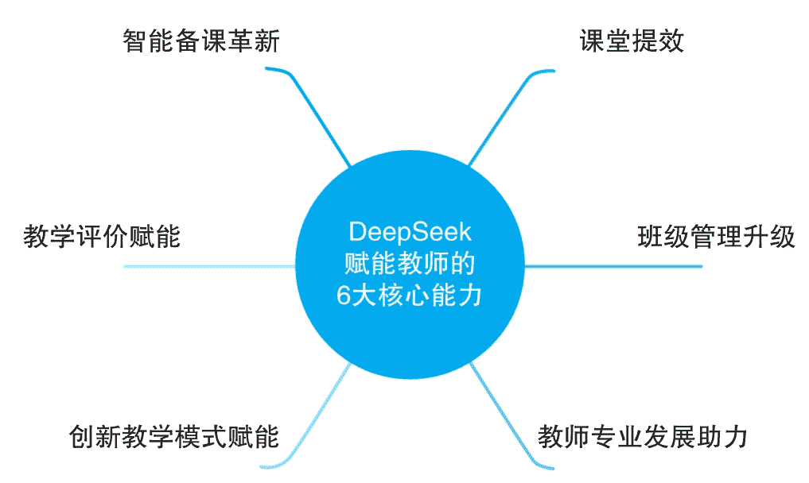

**图 1-1 DeepSeek 为教师提供的六项核心支持**

**2. 课堂效能提升**

DeepSeek 帮助教师为课堂注入人工智能增色。可设计认知冲突、情感共鸣、概念建构三位一体的悬疑导入问题包、跨学科融合谜语，提升导入效果。互动环节中，基于学情分析生成分层提问、智能分组和结构化讨论框架，并设计目标导向的多元互动形式，实现多感官参与。在练习环节，可快速生成分层练习题并创新练习形式，如跨学科融合任务。同时辅助内容即时生成与动态调整，化身全能问答助手，快速应对突发问题，提升课堂适应性与有效性。

**3. 评价智能化**

DeepSeek 借助智能技术重塑作业批改与分析流程，实现精准批改与数据驱动决策。结合 OCR 可批量评分客观题并定位错因；对主观题进行得分点、失分点分析并给出改进建议；对作文进行多维度评价，提供创意点评与写作指导。系统构建数据采集、智能分析、决策支持、动态优化闭环，通过整合多源学习数据动态生成学生画像，推动评价体系智能化与动态优化，覆盖诊断性、过程性、总结性评价，为精准教学提供依据。

**4. 班级管理提质**

DeepSeek 可助力班级文化建设、课堂与日常管理、家校沟通提效。文化建设方面，可生成班名、班风、班训等核心要素，构建科学班规，并提供沉浸式布置方案。管理方面，可创建智能点名系统、多功能小组积分系统、任务打卡系统及综合智能班级管理系统，实现表现实时记录与导出。家校沟通方面，可辅助家长会 PPT 设计、定制高效沟通方案、参与校园活动策划与通知，实现精准个性化的家校协同。

**5. 创新模式支持**

DeepSeek 破解传统创新模式实施难题。STEM 教学中提供精准课程设计、智能资源整合、多元评价及个性化辅导，并在教学中实现实时支持与跨学科融合。项目式学习中可辅助教师完成六大模块框架设计。大单元教学中覆盖分析、设计、开发、实施、评价全周期，推动课堂从知识传递转向素养生长，培养学生跨学科能力。

**6. 专业成长助力**

DeepSeek 支持教师打造优质课、参加教学竞赛、开展课题研究。优质课打造中协助选题、教学设计并提供多层级教研审核与技术支持。教学比赛方面，无论说课、征文、演讲等类型，均可提供全流程支持。课题研究方面，可介入选题、申报书修改、研究规划与方案设计、数据收集与分析、过程优化与调整、结题报告撰写及答辩等各个环节，提升研究效率与科学性。

## 1.2 DeepSeek 初步操作

进入 DeepSeek 的操作界面，就像打开教师的瑞士军刀，简洁的外表下藏着提升教学效能的工具箱。本节手把手完成三个动作：访问官网并完成全平台注册；熟悉三大功能区；掌握基于 5W2H 法则的指令体系。即使零基础，也能在阅读后成为 AI 教学的操盘手。

### 1.2.1 账号注册

网页端：

1）在浏览器输入 DeepSeek 官网地址 www.deepseek.com 回车进入官网，如图 1-2 所示。

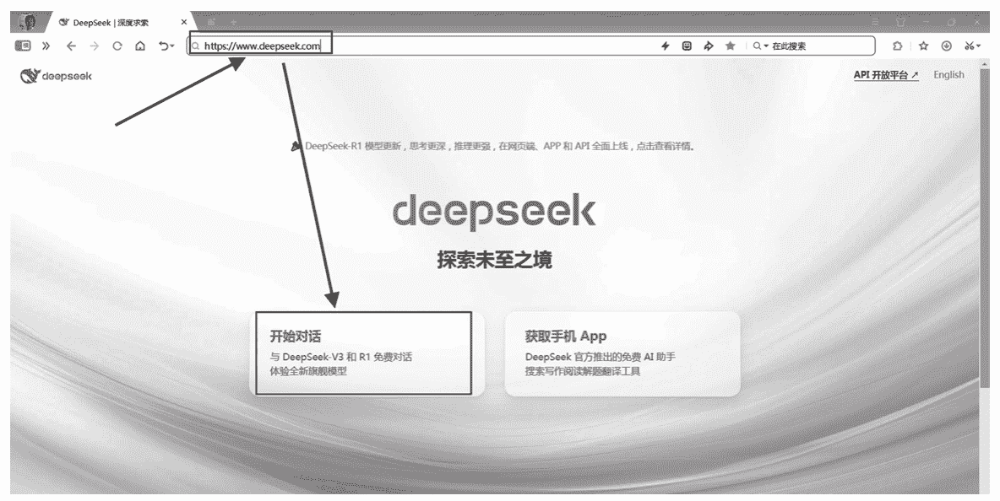

**图 1-2 访问 DeepSeek 官网**

2）点击开始对话，弹出注册登录窗口，如图 1-3 所示。可选择手机号、微信或邮箱注册，建议使用手机号验证码，方便快捷且安全。

**图 1-3 DeepSeek 注册登录界面**

3）登录后进入对话界面，如图 1-4 所示。

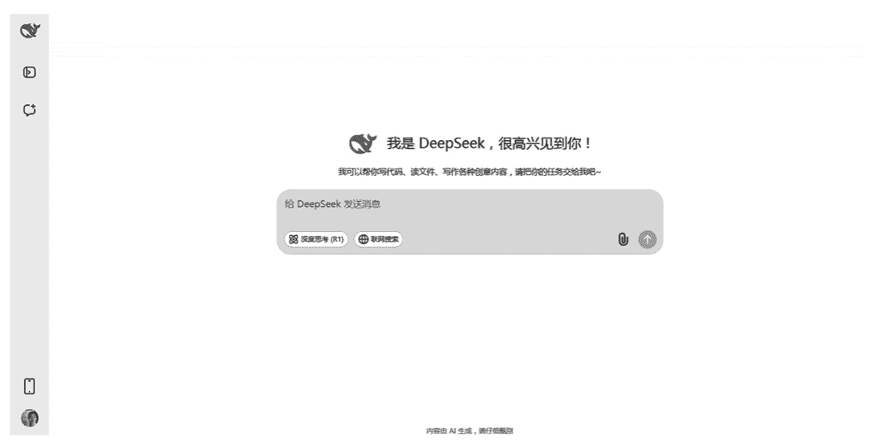

**图 1-4 DeepSeek 对话界面**

手机端：

1）在应用商店搜索 DeepSeek，下载由杭州深度求索科技有限公司发布的 DeepSeek—AI 智能助手。注意甄别，避免下载山寨或付费工具。检索结果如图 1-5，官方下载页如图 1-6。

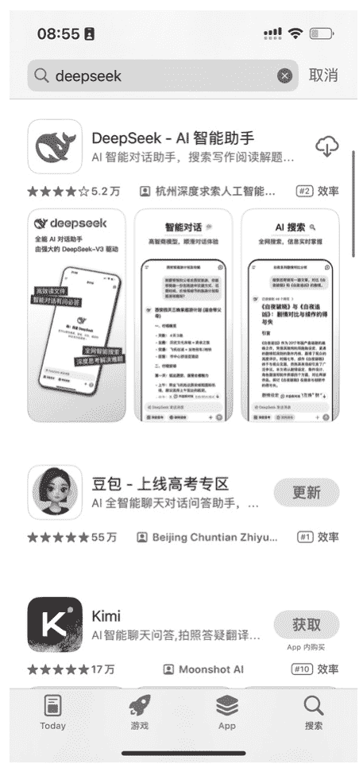

**图 1-5 应用商店检索结果**

**图 1-6 官方正版 DeepSeek 下载页面**

2）打开应用，阅读并同意用户协议和隐私政策后进入注册页。

3）支持手机验证码、密码、微信登录，与网页端一致，建议使用验证码登录。

4）登录后点击开启对话进入对话界面。

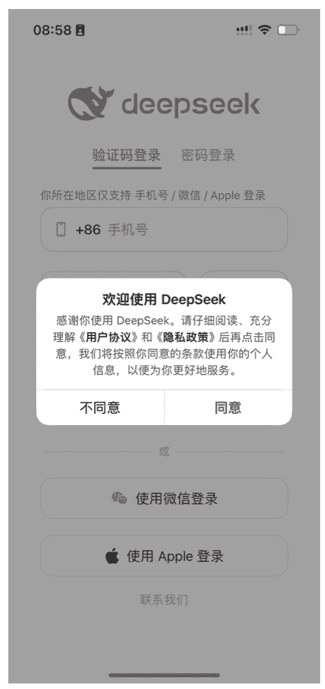

**图 1-7 同意界面**

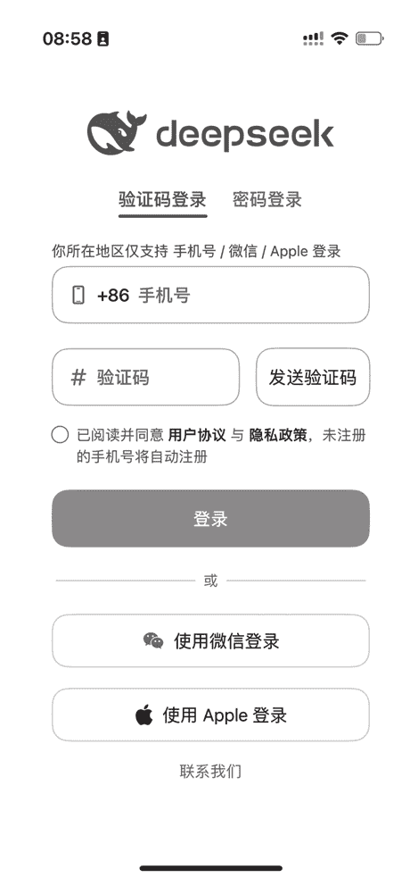

**图 1-8 手机版注册登录界面**

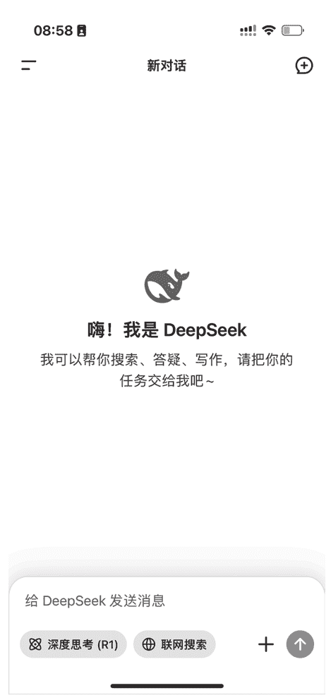

**图 1-9 手机版 DeepSeek 对话界面**

### 1.2.2 界面导航

注册后即可进入对话主界面。DeepSeek 主要由消息输入区、对话历史区、系统设置区三大区域构成，网页与手机位置基本一致，以网页端为例，如图 1-10。

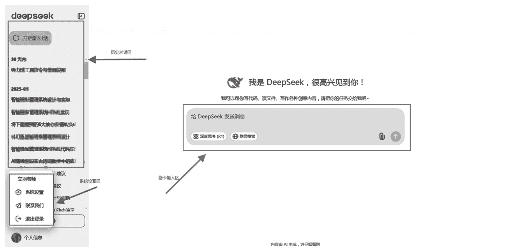

**图 1-10 DeepSeek 界面三大核心功能区**

**1. 消息输入区**

最显眼的是中间的消息输入框，可像聊天一样发送指令。DeepSeek 会根据输入给出详尽回答。点击发送按钮左侧回形针图标，手机端为加号，可上传文档和图片，截至 2025 年 3 月 30 日，支持最多 50 个附件，每个不超过 100MB，并可识别图片文字。上传附件后模型会据此作答。

可选择开启深度思考 R1 模式和联网搜索模式。深度思考模式先推理后作答，适合复杂问题；联网搜索模式可获取实时网络信息。两者适用场景不同。

适宜用深度思考模式的场景包括复杂问题分析、创造性任务、个人决策、学习内化、开放式讨论等。

适宜用联网搜索模式的场景包括快速获取事实、操作性问题、广度探索、验证补充细节、紧急查询等。

提示：优先深度思考当问题需要原创性或系统性分析，或依赖个人经验洞察时；优先联网搜索当信息客观存在且时间紧，或需事实支撑时。注意同时开启两种模式时无法上传附件。

消息输入区如图 1-11。

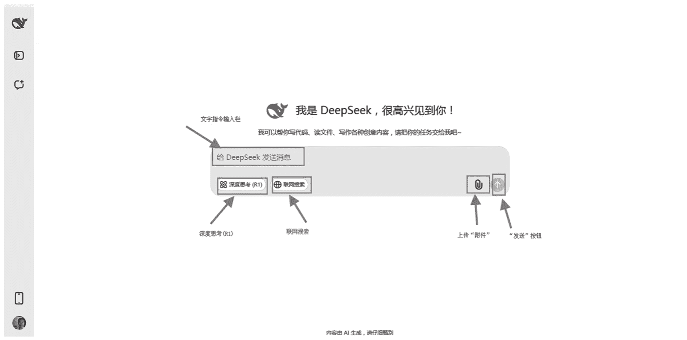

**图 1-11 消息输入区**

**2. 对话历史区**

左侧为对话历史区，初次登录未显示可点击左上角图标或侧边栏打开。区域记录每次对话历史。开始新任务时，点击开启新对话，模型不会记忆此前内容，每次基于当前提问独立处理，答案更精准。

对话历史区界面如图 1-12。

提示：若希望模型参考之前讨论，可在新指令中简要提及；若希望忽略历史，可明确说明，模型将仅依据最新提问作答。

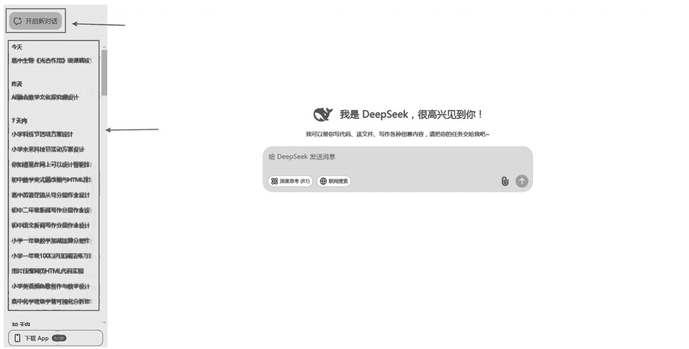

**图 1-12 对话历史区**

**3. 系统设置区**

第三大区域为系统设置。点击左下角头像，选择系统设置进入设置页，如图 1-13。可设置界面语言与主题、管理账户、查看服务协议。

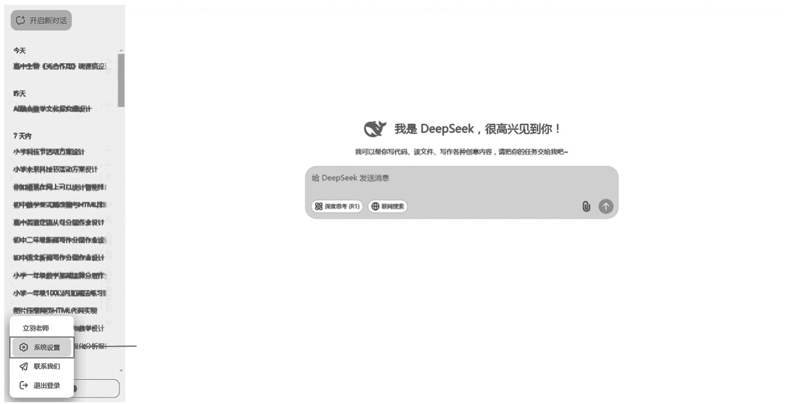

**图 1-13 点击系统设置**

### 1.2.3 指令模板

账号已注册、功能区已熟悉，下一步是学会下达有效指令。随意提问往往得不到理想结果，因角色、格式、限制条件、风格等未明确。本节提供通用公式与示例，帮助快速激活教学场景的 AI 潜能。

**1. 5W2H+E 通用公式**

（1）什么是 5W2H 分析法

**用七问把需求讲清楚，让大模型给出可用答案**

七问拆解是一种结构化思维工具，常见于问题梳理、任务推进和决策判断。它用五个 W 加两个 H 把事情拆开，先盘清全貌再执行，从而让落地更顺、判断更准。下面做通俗化说明。

1）五问两问的来历与构成

五问两问又称七问法，最早可追溯到二战时期美军兵器修理部门，用统一提问方式处理复杂维修难题。名称来自七个英文词的首字母：

● 5W：Why 为什么、Who 谁、What 什么、When 何时、Where 何地。
● 2H：How 如何、How much 多少/程度。

2）七个维度侧重的内容

● Why：弄清目标或问题的动因与价值，抓住行动的根本原因。
● Who：锁定执行人、协作方以及受影响群体，划清责任边界。
● What：界定任务范围、期望结果及所需资源。
● When：梳理时间轴，包含启动时间、截止时间与关键节点。
● Where：确认实施场所与环境条件，评估场景对任务的影响。
● How：拟定操作步骤、方法与技术手段，并预判风险与应对。
● How much：对投入成本、人力等进行量化，对产出数量质量进行衡量。

（2）为什么要加上 E

在原有框架上再加入 E，即 Example 示例，形成 5W2H+E 的结构化提问模板。

把七问的系统性与教学现场的实际需求结合，重构后的通用公式涵盖八个核心维度，覆盖任务设计全流程，具体说明与教学场景示例见表 1-1。

**表 1-1 5W2H+E 通用公式在教学场景中的应用**

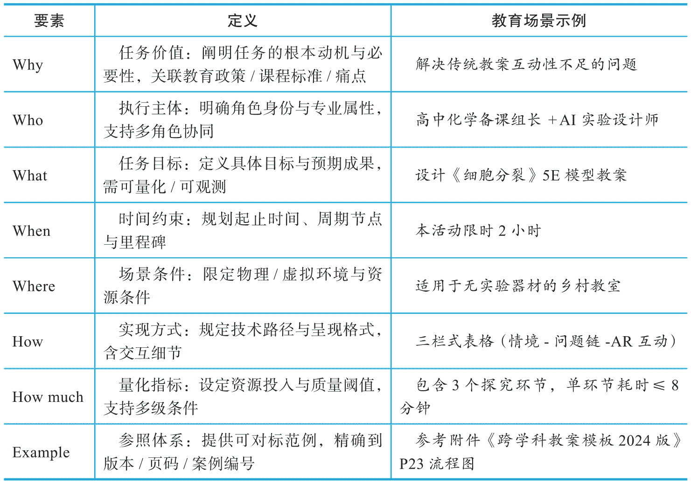

需要说明的是，大模型产出本质上是基于语料的概率推断，不可能百分百可靠，这正是引入 5W2H+E 模板的意义。对 DeepSeek 的表达方式不同，得到的结果也会不同，只有把角色、输出格式、参考样例等要素讲明白，才能让结果更贴合预期、更专业。该公式里的每一项，都是为了让产出更符合你的要求、更精准或更易落地。

在复杂的教学设计中，指令可以写得更细；在简单的需求中，比如“给我 20 道两位数进位加法”，就没必要套模板。总之指令要围绕个人需求展开，以需求为主。同时该框架只是一个覆盖面广的骨架，实际使用时可根据情境选用其中部分要素。

2.5W2H+E 通用公式使用示例

你已经了解了通用公式，可能会好奇：这个模板看起来繁琐，难道每次都要把八项全列出来吗？答案是否定的。它是通用模板，设计初衷就是覆盖教学中的各类问题。八项里有些是几乎每次都要涉及的必填项，有些是可选项。下面以备课和课堂两个案例说明用法。

（1）案例 1：备课场景通用公式使用示例

假设你是一名初中物理教师，想让 DeepSeek 帮忙生成《浮力》单元的项目式学习方案。你会怎么提需求？在阅读本书前，你可能只说：“生成初中物理《浮力》单元的项目式学习方案”。DeepSeek 很可能给出空洞、不可行内容，因为它不知道是否要对接新课标、实验室有什么器材、期望什么格式、有没有参考样例等。这时就需要用通用模板把需求讲清楚。

【模糊指令】

生成初中物理《浮力》单元的项目式学习方案。

【精准指令】

● Why（任务价值）：要对接新课标，落实新课标中“做中学”的理念。
● Who（执行主体）：初中物理特级教师。
● What（任务目标）：生成初中物理《浮力》单元的项目式学习方案。
● When（时间约束）：本单元项目学习共需 3 课时。
● Where（场景条件）：在校内实验室开展，现有器材只有弹簧秤和塑料瓶。
● How（实现方式）：按 STEM 教育五步法设计，以表格形式呈现，栏目标题为步骤现象观察—驱动问题—实验设计。
● How much（量化指标）：无。
● Example（参照体系）：参考附件中《惯性》单元的项目式学习方案。

【指令解析】

下面逐条说明填写建议，星级越高越推荐填写，★★★★★ 为必填，☆☆☆☆☆ 为基本不需填写。

● Why（任务价值）★★★☆☆
选填但建议写。明确“对接新课标、落实做中学”，可保证方案与教学目标一致，否则易脱离实际。
● Who（执行主体）★★★★☆
选填但非常建议。赋予“初中物理特级教师”身份，能让输出更专业、更贴合学科特点。
● What（任务目标）★★★★★
核心必填。明确“生成初中物理《浮力》单元的项目式学习方案”，缺少则模型不知所云。
● When（时间约束）★★☆☆☆
选填。时间信息有助于控制教学进度，对活动策划类任务则更重要。
● Where（场景条件）★★★☆☆
选填但建议写。说明“仅有弹簧秤和塑料瓶”，可避免设计出不可操作的实验。
● How（实现方式）★★★☆☆
选填但建议写。给出格式要求能规范结构，若需要思维导图等特殊格式则为必填。
● How much（量化指标）★☆☆☆☆
选填，多用于需数据支撑的任务，本例无需填写。
● Example（参照体系）★★★★☆
选填但强烈建议。提供优秀范例可显著提升格式规范性和内容完整度。

【输出示例】

精准指令的输出内容如下。

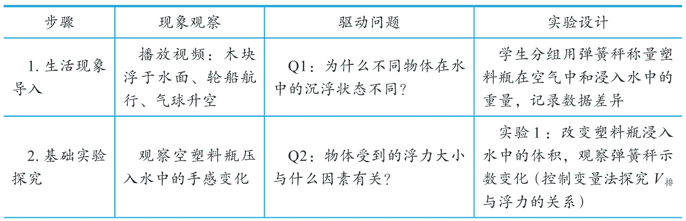

（续）

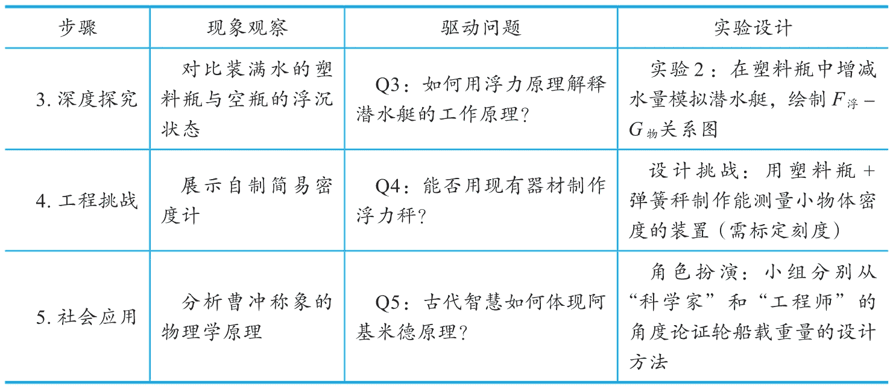

（2）案例 2：课堂场景通用公式使用示例

承接案例 1，现在场景切换到课堂。假设你是一名高中语文教师，在讲《赤壁赋》时有学生质疑“曹操横槊赋诗”典故的真实性，如何应对？若只说“生成学生质疑‘曹操横槊赋诗’典故真实性的应对方案”，模型可能分不清是要即时课堂策略还是课后资料，也不知应遵循何种释疑逻辑。这时需用通用模板精准表达。

【模糊指令】

生成学生质疑“曹操横槊赋诗”典故真实性的应对方案

【精准指令】

● Why（任务价值）：应对课堂突发状况，自然衔接到后续教学，保持课堂流畅。
● Who（执行主体）：高中语文特级教师。
● What（任务目标）：生成学生质疑“曹操横槊赋诗”典故真实性的应对方案。
● When（时间约束）：解答时长控制在 2 分钟内。
● Where（场景条件）：高中语文《赤壁赋》线下课堂，学生在听课时当场提出质疑。
● How（实现方式）：采用“三步释疑法”共情—解析—拓展 的结构化输出。
● How much（量化指标）：提供 1 个史料出处。
● Example（参照体系）：参照 2024 年市级优质课《鸿门宴》答疑实录片段。

【指令解析】

● Why（任务价值）★★★☆☆
建议填写。明确“维持教学流畅性”目标，避免生成理论化、脱离课堂的回答。
● Who（执行主体）★★★★☆
强烈建议。专业身份设定可提升说服力，否则内容易泛化。
● What（任务目标）★★★★★
核心必填，限定具体问题，让输出高度聚焦。
● When（时间约束）★★★★☆
强烈建议。限定“2 分钟内”更符合课堂节奏，否则可能过长。
● Where（场景条件）★★★★★
本场景必填。点明是课堂即时突发状况，要求当场回应并平稳过渡。
● How（实现方式）★☆☆☆☆
可选项。指定“三步释疑法”可让结构更清晰，也可不填由模型自行选择。
● How much（量化指标）★★☆☆☆
可选项。明确“提供 1 个史料出处”，可精细控制质量。
● Example（参照体系）★★★☆☆
建议填写。参照优质课处理方式使回答更有指向性。

【输出示例】

精准指令的输出内容如下。

1. 共情阶段（30 秒）
“这位同学能结合《三国志》提出质疑，说明真正做到了‘尽信书不如无书’。当年苏轼写《赤壁赋》时，也遇到类似质疑——杜牧就曾写‘东风不与周郎便，铜雀春深锁二乔’来反思史料。”

2. 解析阶段（50 秒）
核心释疑：“《三国演义》第 48 回有‘横槊赋诗’描写，但需说明这是文学创作；史料依据：裴松之注《三国志·武帝纪》引《魏书》载‘登高必赋，及造新诗，被之管弦，皆成乐章’，虽未特指赤壁，却与诗人形象吻合。”
教学衔接：“这正是苏轼用‘客曰’虚拟对话的精妙，既化用典故传达思想，又避开史实争议。”

3. 拓展阶段（40 秒）
思维延伸：“请思考《赤壁赋》‘酾酒临江’描写是否也有艺术加工？下节课我们将对比《三国志》《资治通鉴》和《赤壁赋》对同一事件的不同呈现。”
过渡衔接：“现在回到课文，看苏轼如何借‘横槊赋诗’典故抒发……”

通过以上示例，你应已掌握如何根据实际场景灵活使用 5W2H+E 模板。但仅此还不够，你会发现即使指令很具体，DeepSeek 的回答仍可能出错、偏差或遗漏。

总之，不要期望一次指令一次回答就能完全满意。

**3.5 个追问技巧**

我们已学习 5W2H+E 模板并看了两个教学案例。相比模糊指令，基于全面指令的输出已更准确，但仍可能不满意怎么办？不必另开对话，可用以下 5 个追问技巧优化。

（1）直接指出错误，让准确性更高（适合答案有错的回复）
【追问指令模板】
你说［引用原文］是错的，其实是［正确信息］，请改过来，并补充来源/引用原文。
【示例】
你说“横槊赋诗出自《三国志》”是错的，其实是《资治通鉴》记载的，请改过来，并引用原文。

（2）补充细节，让答案更完整（适合答案太简略的回复）
【追问指令模板】
请补充［具体内容］，比如［例子/数据/步骤］，参考［某标准或范例］。
【示例】
浮力实验设计太简单了，请补充“塑料瓶实验”的具体操作步骤，参考《惯性》案例中的表格格式。

（3）调整结构，让答案更清晰（适合逻辑混乱的回复）
【追问指令模板】
不要用［当前结构］，改成［新结构］，删掉［原内容］/重点突出［关键点］。
【示例】
不要用“三步释疑法”，改成“问题树”（问题—证据—结论），删掉无关的文学分析。

（4）增加限制条件，让答案更实用（适合脱离实际的回复）
【追问指令模板】
加上［具体限制］这个条件，重新调整方案/简化步骤。
【示例】
加上“实验要控制在 10 分钟内，且只能使用弹簧秤和塑料瓶”这个条件，简化步骤。

（5）换角色评估，让答案更靠谱（适合需要多角度验证的回复）
【追问指令模板】
如果你是［专家/学生/家长］，你会怎么评价［这个方案］?请列出优缺点。
【示例】
如果你是专家，你会怎么评价这个浮力实验？请列出优缺点。

**提示：**
保持对话上下文！在原有回答上追问，模型会记住来龙去脉。
描述越具体越好！比如“补 3 个例子”比“多举例子”更有效。

**4.设计指令的核心法则**

虽然 5W2H+E 很全面，但有时你仍不知如何写，或觉得指令已很完美却仍不理想。遇到这种状况，别着急。最懂 DeepSeek 的其实是 DeepSeek 自己。核心法则是：如果你有一个问题却不知如何提问，就问 DeepSeek：“我要解决［这个问题］，我应该如何向你提问，才能得到最令我满意的回答？”这样它会基于自身理解给出更具针对性的提问建议，帮助你获得更符合预期的结果。

## **1.3 协同共进：多 AI 工具与 DeepSeek 的教育融合之道**

在教育数字化转型的浪潮中，DeepSeek 作为重要智能力量，为教师提供强大的教学支持。为充分释放人工智能潜能、提升教学效果，整合 DeepSeek 与其他智能应用已成为趋势。它们相互协作，为教师打造功能完备、灵活高效的教学工具库，助力提升智能教学能力与素养。

DeepSeek 在教学流程中可发挥引领作用。无论是智能备课、课堂提效、教学评价、班级管理、教学创新或教师专业发展，它都能依据详细指令输出高质量内容。在此过程中，其他智能应用的助力不可或缺。

在智能备课的创新素材生成方面，DeepSeek 常与图像、视频、音乐生成类应用如即梦、可灵、Midjourney、DALL·E、Runway、Suno 等协同。讲述历史人物故事时，DeepSeek 生成台词脚本，即梦等应用可通过口型功能将人物形象与脚本结合，增强真实感。创设英文情境时，可灵、Midjourney、DALL·E 能根据文本生成高质量图像。古诗教学中，DeepSeek 设计视频脚本，Runway 等可将其转化为动态画面。音乐创作上，DeepSeek 分析诗词风格，Suno 等可据此谱曲，加深情感体会。

在教学评价的作业批改环节，除豆包智能体外，还有小猿搜题、作业帮、夸克等工具可供选择。它们能快速识别题目、精准批改并解析错题，对客观题高效处理，并对作业数据深度分析生成学情报告，为教师调整策略提供数据支持，实现精准教学。

在课堂提效方面，知识可视化很重要。DeepSeek 可生成结构化知识内容，借助思维导图工具如 draw.io、MindManager、XMind 等转化为直观导图，教师可灵活调整布局样式，清晰呈现复杂体系。对需展示立体结构的学科，DeepSeek 可生成 3D 模型相关指令，结合 AI 生图与 3D 建模工具如 Tripo、Blender、Maya 等创建高精度模型，用于动态演示甚至制作实物模型。

将 DeepSeek 与上述工具整合使用，教师可在各个环节充分发挥人工智能优势，丰富教学手段、提升教学质量，并在实践中不断提升智能应用能力与素养，更好适应教育信息化，为学生创造更优质高效的学习体验。

**第二章 CHAPTER 2 DeepSeek 赋能备课**

本章聚焦智能备课，剖析传统备课在学情分析、教案设计、素材开发方面的普遍困境，并系统阐述以 DeepSeek 为代表的智能工具如何赋能教师，实现备课质效突破。本章将展示人工智能在精准分析学情、智能生成教案及开发创新教学素材中的具体应用，为教师提供智能化备课解决方案。

本章以“问题诊断—技术赋能—场景落地”为写作逻辑，先揭示传统备课痛点，再解析人工智能赋能路径，最后通过案例演示操作流程。阅读时需重点关注指令设计的“5W2H+E”模板应用，注意将人工智能生成内容与教师教学智慧有效结合，避免技术与实践割裂。建议在实践中结合学科特点灵活调整指令，实现智能工具与教学实践深度融合。

## **2.1 传统备课的困境与突围**

传统备课模式长期受困于学情分析粗放、教案设计低效、教学素材单一等难题。教师需耗费大量精力，却难以精准匹配学生的个性化需求与新时代教学要求。本节将深入剖析传统备课三大核心困境，并阐明人工智能技术如何通过精准分析学情、智能生成教案与开发创新素材，为教师开辟从“经验驱动”向“智库协同”转型的突围路径，助力备课效率与质量双重提升。

### **2.1.1 传统备课的困境**

传统备课中，学情判断多靠教师经验推断，很难厘清不同学段学生的学习规律，也难以拿到班级层面的个性化数据，分层教学因此缺乏依据；教案编写要靠手工搭建框架、梳理教学环节，耗时耗力且质量参差；教学资源来源窄、载体单一，以文字和静态图片为主，碰到立体几何、电场磁场等需要动态呈现的抽象内容时，缺少可视化支持，学生理解困难、兴趣不足。人工智能的介入为这些长期困扰课堂的难题提供了新思路。

### **2.1.2 AI 破局之道**

**1. 精准研判学情**
借助 DeepSeek 可以实现个性化且细致的学情研判，一条线生成标准学情画像，一条线汇总班级实测数据，最终形成面向本班的学情报告，为分层设计提供数据支撑。

**2. 智能搭建教案**
利用 DeepSeek 可快速产出结构化教案初稿：将学情、课标要求、教材要点等关键要素填入 5W2H+E 框架，系统即可自动生成包含教学目标、重难点、流程安排与评价设计的完整骨架。

**3. 生产多元素材**
AI 在制作教学资源上潜力很大，视频、动画、互动游戏等形式能够把难以感知的概念转化为直观呈现，帮助学生更好理解并提升参与度。

## **2.2 借助 AI 精准研判学情**

传统备课里学情分析是最费时的难点，既让新教师吃力，也难让资深教师做到精准，还需花费大量时间搜集资料、记录表现、整理分层练习。依托 DeepSeek 的知识库，这一环节可以提效又提准，拆成三步走：

第一步：标准学情画像。让模型自行归纳某个年龄段学习某内容时的一般水平、典型困惑与接受度，并以表格呈现。
第二步：班级数据画像。将本班学生的课堂表现、日常行为、测试成绩等个性化信息导入 DeepSeek，进行归类整理以表格输出。
第三步：精准方案生成。以前面两张表为依据，结合即将教学的内容，由 AI 对班级进行智能研判，明确学习重点难点，给出分层建议并匹配分层练习。

以八年级物理《浮力》单元为例说明。

**1.第一步：标准学情画像**
可通过以下指令触发：
目的：为八年级物理《浮力》单元建立标准学情画像，弥补传统备课跨区域数据不足的问题，支撑分层设计。
身份：初中物理特级教师兼数据分析师。
任务：梳理八年级物理《浮力》单元的标准学情特征。
方式：以表格形式呈现学生在学习该内容时的基础水平、常见问题及接受程度。
模型返回结果如下。
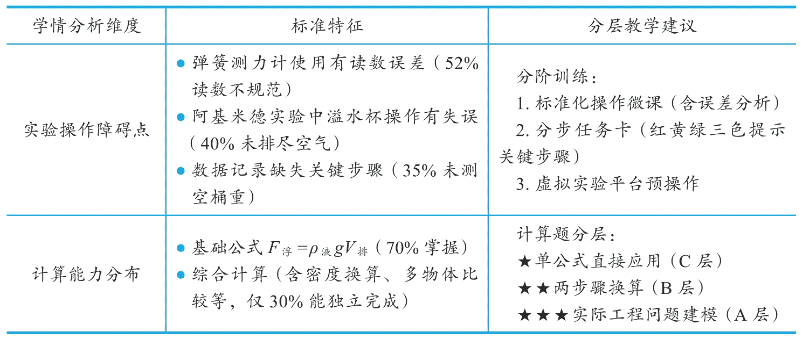

**2.第二步：班级数据画像**
把本班学生的课堂表现、日常行为、物理测试成绩等个性化数据上传，由 DeepSeek 归纳分类并以表格呈现。指令示例：
目的：实现本班学生的个性化分层定位。
身份：优秀班主任。
任务：分析本班学生的个性化学习现状。
方式：表格输出需包含各维度评级，同时给出物理领域的优势、待改进点与分层建议。
参考：基于附件中的课堂表现、日常行为、测试成绩等数据进行分析，需对学生匿名处理。
模型返回结果如下。
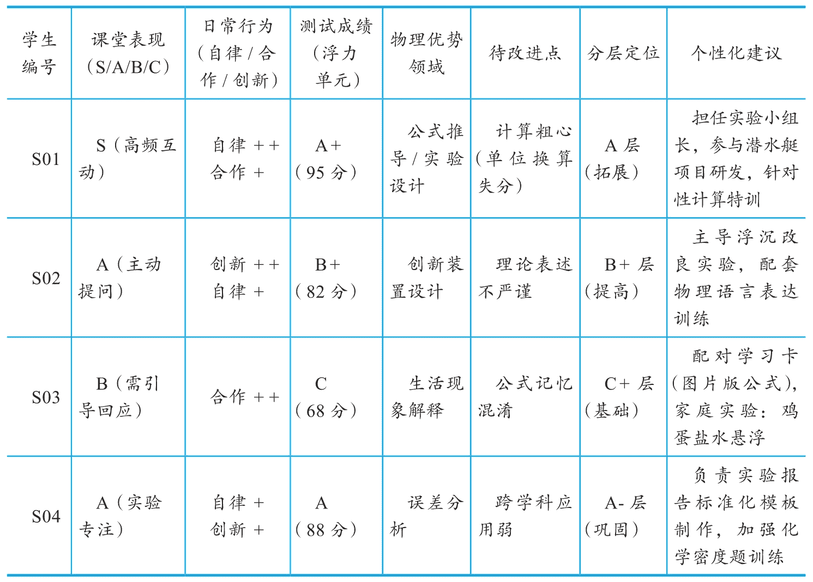

**3.第三步：精准方案生成**
在前两步表格基础上，让 AI 生成可落地的分层教学方案。指令如下：
目的：融合群体共性与个体差异，输出可执行的分层策略。
身份：物理特级教师。
任务：生成“浮力”单元分层教学方案。
方式：需包含学生分层名单、C组基础巩固、B组能力提升、A组拓展挑战、各组的重点难点及对应策略，分层练习题并标注难度星级。
参考：基于标准学情特征分析表与班级数据分析表的结果输出。
模型输出的“浮力”单元精准学情分析方案部分如下。
1.学生分层名单（匿名）
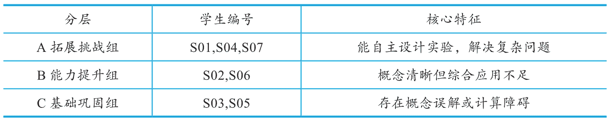
2.分层教学重点、难点及策略
A 组 拓展挑战
重点：浮力与工程技术结合，如潜艇、密度计
难点：非线性变量关系分析，如盐水浓度-浮力变化曲线
策略：
▶真实项目驱动：设计“打捞沉船”方案，需计算浮筒体积与位置
▶批判性讨论：质疑“V 排=V 物”的适用边界，特殊容器形状
……

## **2.3 AI 助力教案智能生成**

学情定位清晰后，教案撰写成为备课核心。传统做法很难在短时间内产出目标精准、结构完整、活动新颖的教案。借助 DeepSeek 的“目标校准+教案生成”双流程，可快速搭建符合课标的教案框架，保证规范性的同时保留创造性，后续结合学情与个人风格调整即可形成内容扎实、课堂有活力的个性化教案。

### **2.3.1 目标精细锚定**

以往教学目标常因经验判断而偏离课标或表述空泛。利用 DeepSeek 可按“课标解析—学情适配—目标重构”路径实现精准定位。以初中语文《题西林壁》为例：

输入指令：
目的：解决哲理诗教学目标与课程标准脱节的问题。
身份：初中语文教研员+思辨教学专家+认知心理学研究者。
任务：生成《题西林壁》精准教学目标。
方式：按新课标“思辨性阅读”要求输出。
参考：《登飞来峰》教学目标设计、《义务教育语文课程标准（2022 年版）》。
模型返回内容如下。
1.语言运用目标
学生能准确理解并熟练背诵《题西林壁》，掌握“横看”“侧”“缘”等文言词义，结合语境用现代汉语翻译诗句，体会古诗凝练含蓄的语言特色。通过分析对仗押韵等形式感受古典诗歌韵律美，提升对古诗语言的敏感与鉴赏力。
2.思维能力目标
分析与综合：梳理诗中庐山不同视角的景象，分析观察角度变化与景物特点关系，综合概括整体形象。
推理与判断：基于诗意推断诗人由眼前景物悟出哲理的思维路径，判断其中关于认知规律的思考，培养逻辑推理力。
批判与创新：鼓励结合生活经验对“不识庐山真面目，只缘身在此山中”进行批判性思考，提出个人见解，并尝试用该哲理分析生活实际问题，激发创新思维。
3.审美创造目标
通过诵读、想象与联想，感受诗中庐山雄伟壮观、变幻多姿的意象，体会诗人对自然之美的赞叹，提升审美感知。同时领会景理交融的艺术特色，学习借景抒情、托物言志的手法，并尝试短诗创作表达对生活哲理的感悟，培养审美创造力。
4.文化自信目标
了解苏轼生平、创作风格及其文学史地位，认识《题西林壁》在宋代哲理诗中的代表性，增强对中华优秀传统文化的认同。通过探讨诗中哲理，理解古人对自然人生的思考，体会其中蕴含的中华民族智慧，传承弘扬传统文化精神，树立正确价值观与人生观。

### **2.3.2 快速生成教案**

有了符合课标的精准目标，下一步是生成详细教案。传统教案常两极化：新手套模板空泛，老教师靠经验缺少新意。下面展示用 DeepSeek 生成兼具规范与创意的流程。

第一步：用 5W2H+E 框架生成初稿
指令示例：
目的：解决哲理诗教学重翻译轻思辨的问题，落实《义务教育语文课程标准（2022 年版）》“理性思维培养”要求。
身份：初中语文特级教师+哲学教育专家。
任务：生成初中语文《题西林壁》的高质量教案。
时间：45 分钟。
参考：《观书有感》省级优质课教案、《初中思辨类古诗教学模板》、《题西林壁》教师用书、本班前测数据、精准教学目标。
模型输出内容部分如下。
……
1.情境导入（5 分钟）
多媒体展示同一物体从不同角度拍摄的多组照片，如教室黑板、书本、校园雕塑，引导学生观察并描述差异。提问“为何同一物体大家看到的样子不同”，引发思考并展开交流。顺势导入新课，介绍苏轼生平及创作背景，展示庐山全景，激发兴趣，营造课堂氛围。
2.初读感知，疏通文义（10 分钟）
教师配乐范读，要求学生注意字音节奏韵律。学生自由朗读并互听纠音。结合注释工具书自主翻译诗句，圈画疑难字词。小组讨论分享理解，教师巡视收集共性问题。重点讲解“横看”“侧”“缘”等文言词，结合语境举例对比，帮助学生准确流畅翻译，理解字面意思。
3.精读探究，思辨哲理（18 分钟）
意象分析：提出“诗中描绘了庐山的哪些景象，分别从哪些角度观察”，引导学生重读梳理，分析观察角度变化与景物特点关系，小组交流后汇报，教师总结概括庐山整体形象。
哲理形成：引导思考“诗人为何发出‘不识庐山真面目，只缘身在此山中’的感慨”，结合内容与背景推测由景入理的思维过程，小组讨论分享，教师归纳认知规律思考。
批判性思考：提问“诗中哲理是否在所有情况下都适用？生活中是否有不适用的例子”，结合自身经验展开全班讨论，鼓励质疑独立思考，教师适时纠偏。
哲理运用：给出小组合作意见分歧、学习知识点理解差异、朋友矛盾等生活场景，让学生运用诗中哲理分析原因并提出解决办法，先独立思考再小组讨论，最后汇报点评，深化理解并锻炼思辨与解决实际问题的能力。
……
第二步：审阅初稿并追加指令优化，使教案更贴合教学流程、个人风格与班级实际。
第三步：在多轮迭代后仍需教师逐字润色，确保语言风格与授课习惯高度契合，最终形成个性化教案。

## **2.4 AI 创造教学素材**

在信息化教学背景下，优质创新素材是提升课堂质量与点燃学习兴趣的关键。教师如何快速获取丰富贴合需求的资源，成为备课新挑战。本节聚焦 DeepSeek 生成各类创新素材，帮助教师扩充资源库，让课堂更生动高效。

### **2.4.1 让历史人物开口教学**

结合 DeepSeek 与口型合成工具，可让历史人物开口教学，实现跨越时空的对话。如把李白、杜甫请进语文课堂亲口诵诗，或让祖冲之、爱因斯坦、居里夫人讲解公式定理，也能让秦始皇走进历史课讲故事。发挥想象，几乎所有学科都可使用。

该类素材教学价值突出。以秦始皇为例，亲述中央集权增强历史真实感；讲述过程营造沉浸氛围；帝王自述还能引发对焚书坑儒等争议话题的辩证思考，激发情感共鸣。

以初中历史《秦统一中国》为例的操作流程：
第一步，选择高分辨率秦始皇肖像图，注意口部清晰便于口型合成。笔者选用图 2-1。
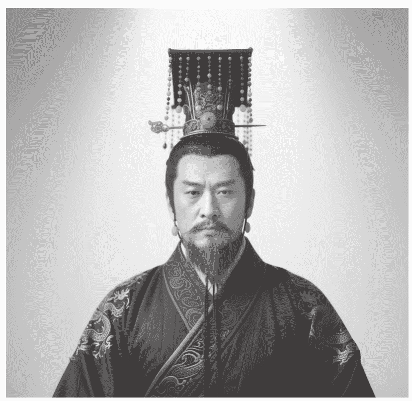
**图 2-1 秦始皇的肖像图**
第二步，向 DeepSeek 提交指令生成台词：
目的：通过帝王第一视角理解统一措施的历史必然性。
身份：历史情境教学设计师。
任务：设计秦始皇讲授《秦统一中国》的脚本。
方式：包含 3 个环节，战争统一—治国措施—后世评价。
模型的输出内容如下。
寡人十年灭六国！
尔等可知为何要废分封？诸侯割据便是战乱根源！
这天下，只能有一个皇帝、一种文字、一套度量衡！
修长城、筑驰道，后世骂寡人暴虐？若不用雷霆手段，何来一统！
第三步：用对口型工具如即梦平台生成说话视频。
登录平台后进入数字人模块，导入已准备的肖像图，选择口型合成模式，粘贴 DeepSeek 提供的台词并设定音色与语速，参数设置后启动渲染，完成后导出视频。
**图 2-2 单击“开启即梦”**
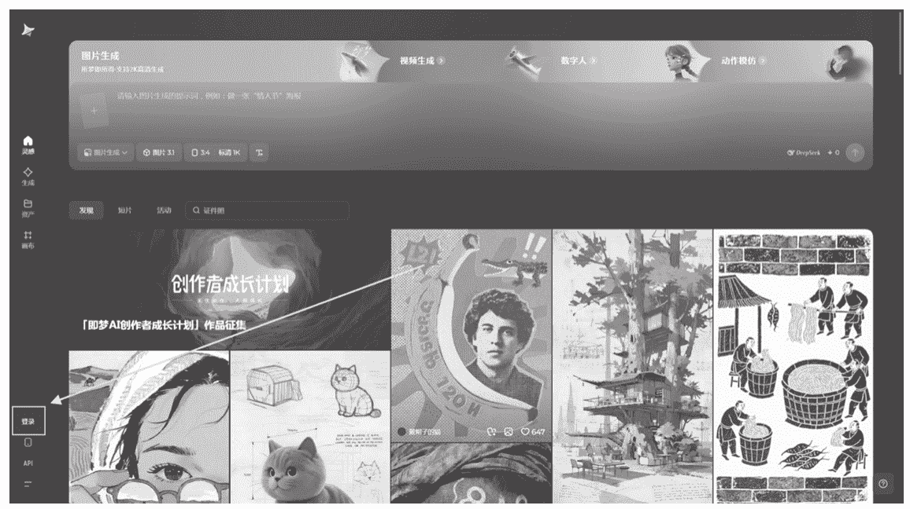
**图 2-3 单击左下角的“登录”**
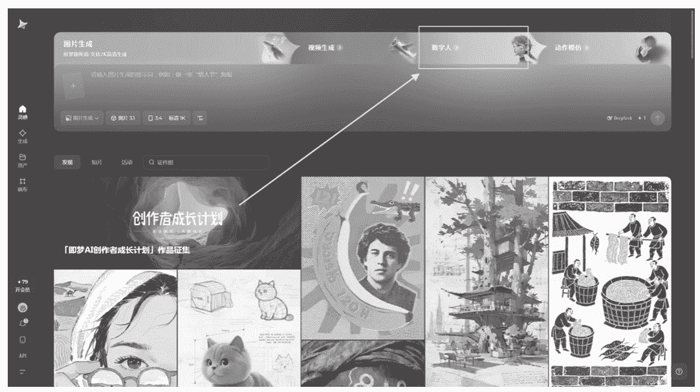
**图 2-4 单击“数字人”**
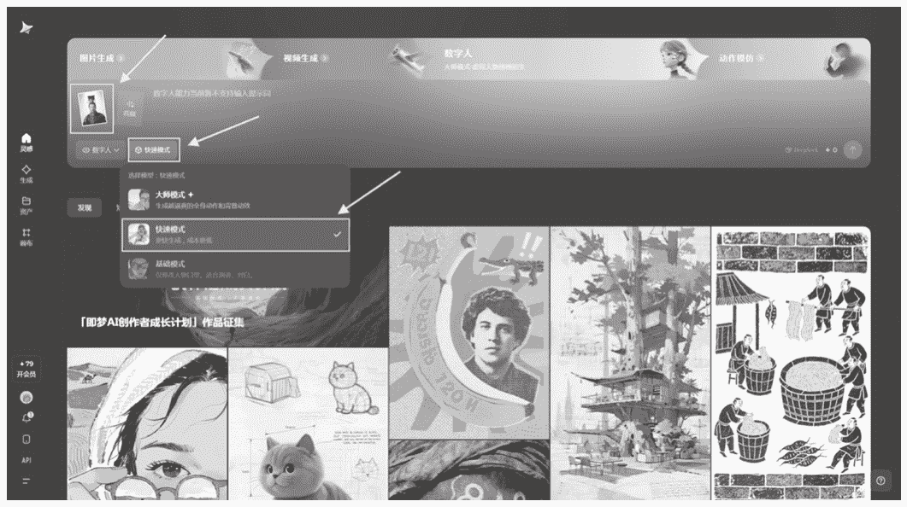
**图 2-5 选择“快速模式”**
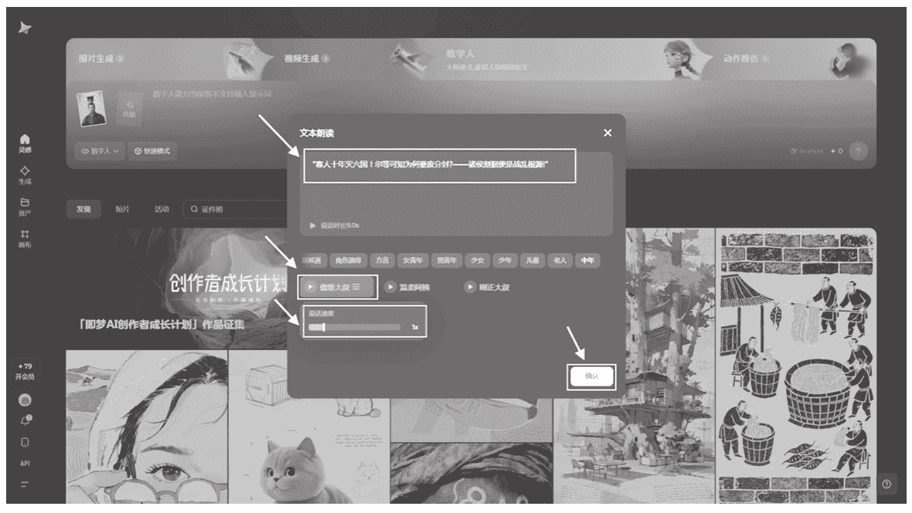
**图 2-6 输入台词，选择音色和说话速度**
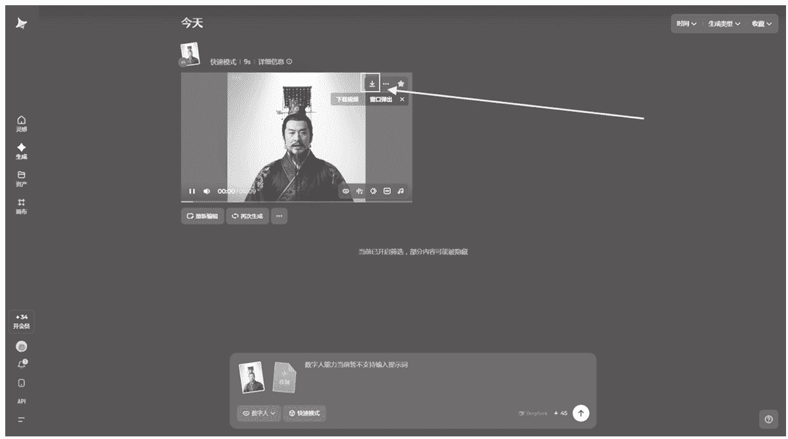
**图 2-7 下载视频**
第四步：将视频嵌入教学设计的合适环节，如导入或重难点讲解，让历史人物真正“走进”课堂。

### **2.4.2 古诗视觉化呈现**

借助 DeepSeek 与视频生成工具，可把抽象诗句转化为动态画面，直观呈现意境、降低理解门槛，同时强化诗画联结记忆。

以《静夜思》为例：
第一步：设计分镜脚本。指令：
目的：解决古诗教学中“意境理解困难”的问题。
身份：视频制作专家+古诗教学专家。
任务：为《静夜思》设计教学视频脚本，要符合李白所处年代的生活实际。
方式：以即梦平台可理解的格式输出。
篇幅：包含 4 个关键场景对应诗句内容；400 字以内。
模型生成的脚本如下。
场景 1：月照客舍
【画面】唐代木质窗棂前，油灯昏暗，窗外明月悬于飞檐，远处传来隐约梆子声。
【解说】“床前明月光”——李白夜宿驿舍，唐时游子常居此类简陋客舍，月光穿透纸窗，映照孤寂身影。
场景 2：起身疑霜
【画面】诗人披麻布中衣起身，席榻边青砖地泛白，似秋霜铺地，唐代卧具低矮无高床。
【解说】“疑是地上霜”——唐代秋季寒凉，驿舍地砖常凝露结霜，诗人误将月光作寒霜，更显羁旅清冷。
场景 3：举头望月
【画面】诗人推窗凭栏，仰望玉盘般明月，天际云层稀疏，檐角铜铃轻响。
【解说】“举头望明月”——唐人视月为思乡符号，此时李白目光深邃，盛唐游子皆惯以月寄情。
场景 4：垂首思乡
【画面】诗人低头抚摸腰间佩囊，唐人行囊多装家书或乡土信物，镜头上推至眼中氤氲。
【解说】“低头思故乡”——囊中或藏家乡蜀地之物，唐代交通艰阻，思乡之情只能托付明月。
第二步：使用视频生成工具，如即梦平台生成视频。
进入平台首页，选择视频生成入口。

**把教学内容做成看得见、玩得动的素材**

**古诗画面快速成片**

打开视频生成编辑页，把模型给出的首幕画面说明直接粘进输入区。模型可以按偏好切换，不同引擎出片差异明显。系统时长固定5秒，这一轮只放进场景1的描述。画幅比例可按场景调，这里教学投屏常用16∶9。

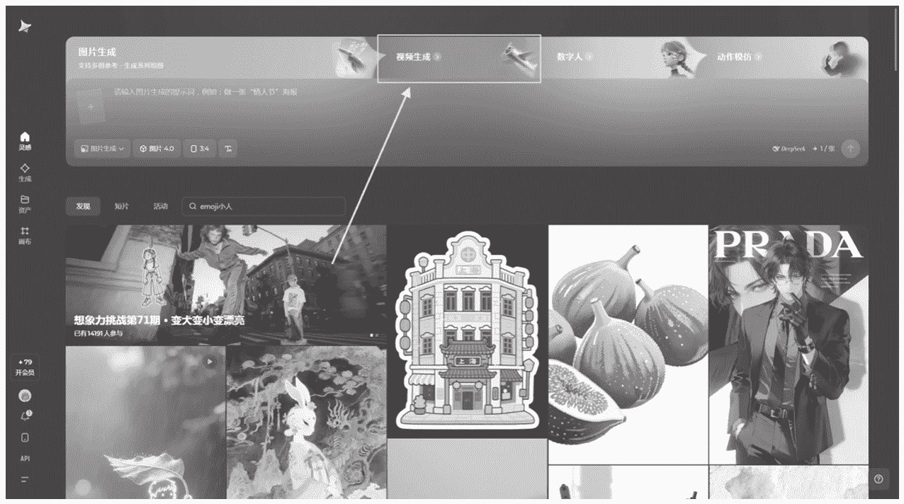

**图 2-8 单击“视频生成”**

在“视频生成”编辑界面，粘贴 DeepSeek 输出的场景 1 的画面描述。“视频模型”可根据个人喜好进行调整，不同模型生成的视频质量也不尽相同。“生成时长”固定为 5 秒，因此仅粘贴场景 1 的描述即可。“视频比例”可根据具体情境进行调整，此处设置为 16∶9。“视频生成”参数设置如图 2-9 所示。

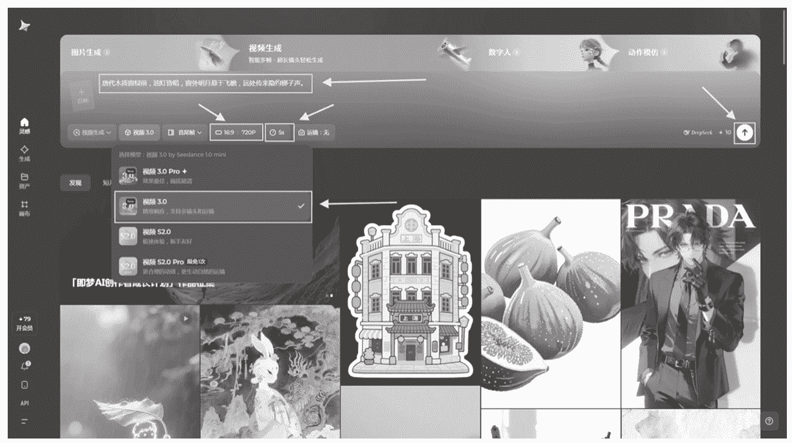

**图 2-9 “视频生成”参数设置**

单击右侧图标，生成完成后即可下载，如图 2-10 所示。

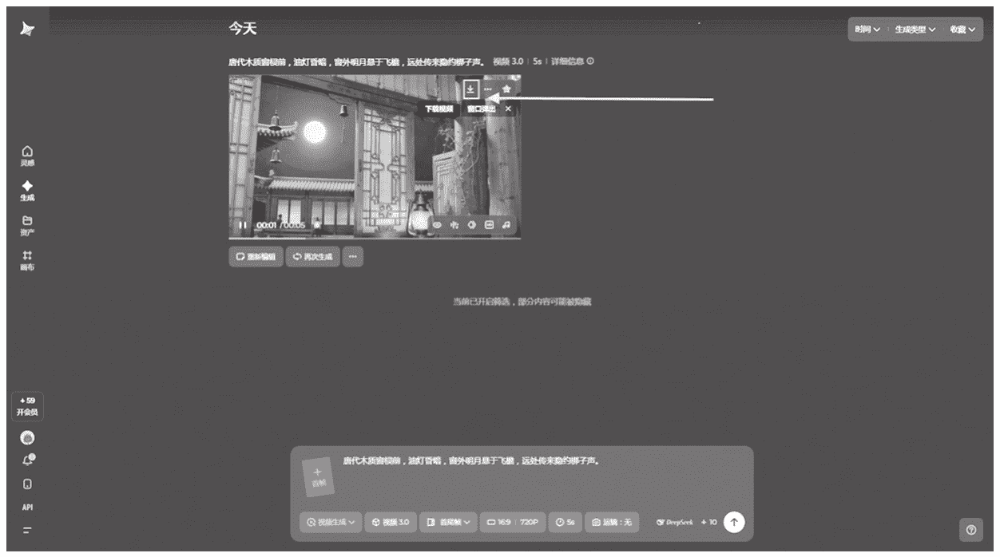

**图 2-10 生成视频后下载**

❑接下来重复刚才的操作，依次生成场景 2～场景 4 的视频。

随后用剪映之类的剪辑工具把4段小视频拼接成完整成片，加背景乐，教学素材就完成了。

把成片嵌进教学设计的合适节点，比如古诗讲解开场时播放，帮助学生迅速进入诗境；分析诗句时作为视觉补充，让理解更具体。

这类借助AI制作的古诗可视化素材，能让“举头望明月，低头思故乡”变得可看可感。除古诗外，同一套流程也能给写景散文、历史情境复原等内容产出对应画面，大幅扩充资源库，满足多课型的需要。

### **2.4.3 函数闯关游戏**

借助 DeepSeek，教师免编也能做出跨学科的函数闯关教具。

函数闯关以“特工任务”包装二次函数、分段函数等内容，并与物理、密码学等领域结合。优势在于用游戏激活探究、在闯关中渗透核心概念、通过调参训练数形结合。

整体操作脉络如下。

首步：给助手下达明确指令。

● Why：解决初中数学函数教学中“知识抽象难懂、练习枯燥”的问题，通过游戏化任务（特工闯关）激发学生学习二次函数、分段函数的兴趣，实现“玩中学”。
● What：生成一个名为“函数特工局”的科技感 HTML 游戏，包含 3 个递进任务。
任务 1：调整二次函数参数命中目标点。
任务 2：分析分段函数找出特定坐标。
任务 3：破译函数加密密码。
● How：交互功能如下。
功能 1：实时函数图像绘制（支持参数滑动调整）。
功能 2：答案验证与即时反馈（正确/错误特效）。
功能 3：任务剧情以“特工行动”故事线串联。
每个任务包含任务简报（剧情文字）、交互式函数图像、参数控制区、答案输入框。
● How much：
任务 1：需支持参数范围（a：-2～2，b：-5～5，c：-20～20）
任务 2：坐标误差容忍度±0.1。
任务 3：字母密码需自动计算（如 3*x*+2=3×10+2=32→字母 F）。

DeepSeek 输出内容（部分）如下。

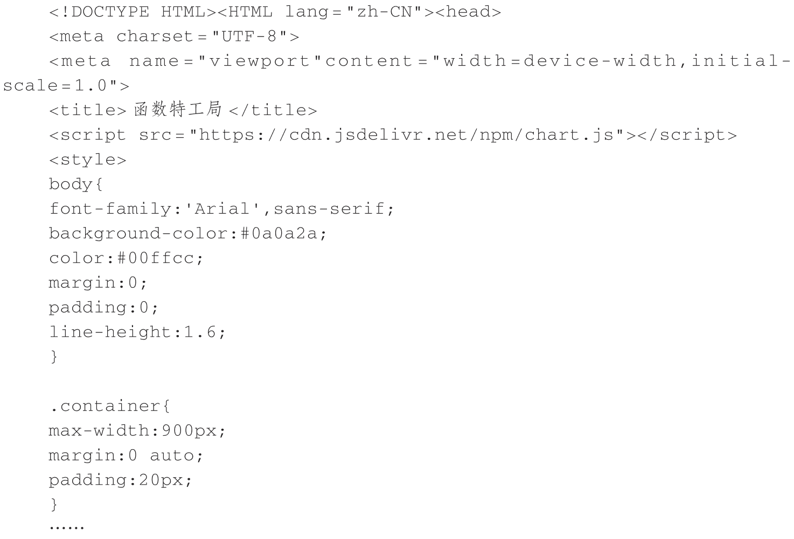

第二步：单击“复制”，复制 DeepSeek 生成的 HTML 代码（如图 2-11 所示）。

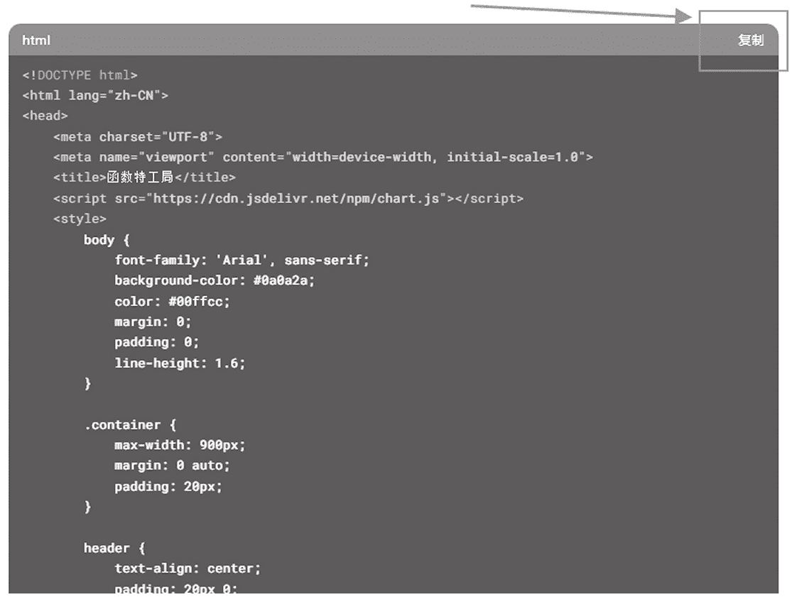

**图 2-11 复制 DeepSeek 生成的 HTML 代码**

第三步：在计算机中的任意一个文件夹内新建一个文本文档（如图 2-12 所示）。

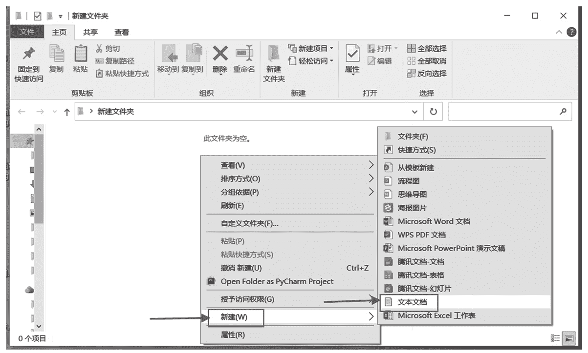

**图 2-12 新建一个文本文档**

第四步：打开新建的文本文档，粘贴刚才 DeepSeek 生成的 HTML 代码（如图 2-13 所示）。

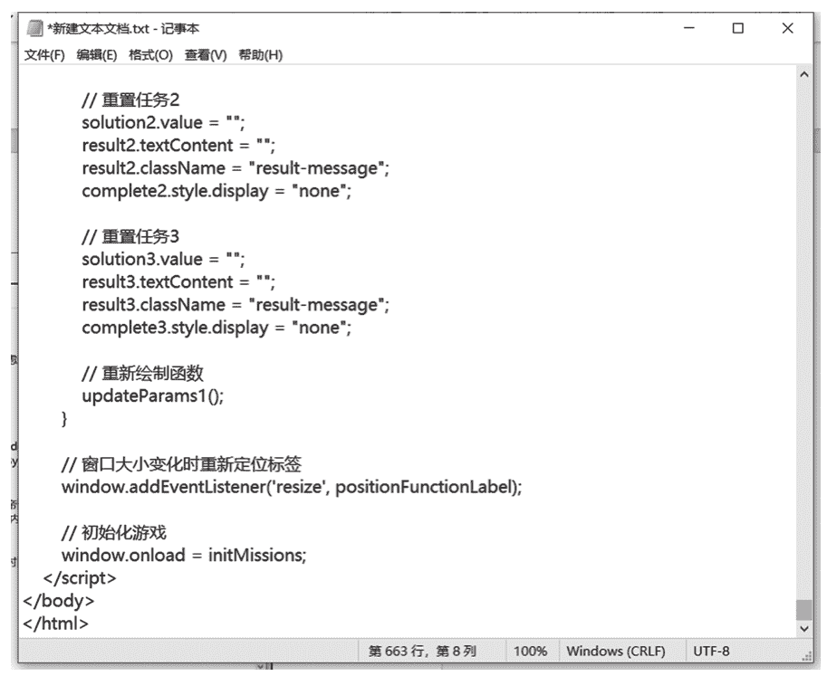

**图 2-13 粘贴 HTML 代码**

第五步：关闭该文本文档，鼠标右键单击该文本文档，选择“重命名”（如图 2-14 所示）。

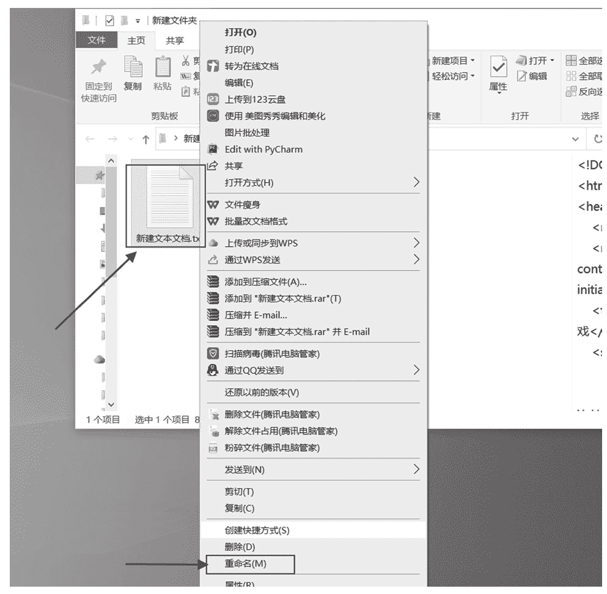

**图 2-14 重命名文本文档**

第六步：单击重命名后，可以看到该文本文档的文件名及扩展名（即新建文本文档.txt，如图 2-15 所示）。如果看不到“.txt”，请先按第七步操作；如果能看到，则直接跳到第八步。

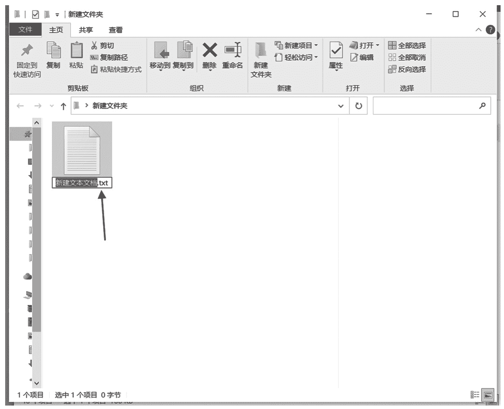

**图 2-15 文件名及扩展名**

第七步：显示文件扩展名操作如下。双击桌面上的“此电脑”，在弹出的窗口中单击左上方的“查看”，随后在右侧单击“选项”。在新弹出的“文件夹选项”窗口中单击上方的“查看”，向下滑动，取消勾选“隐藏已知文件类型的扩展名”条目，最后单击“确定”即可（操作过程如图 2-16 所示）。

第八步：修改文本文档的扩展名，即将“.txt”修改为“.html”，按回车键确定。系统会弹出一个对话框，提示“如果改变文件扩展名，可能会导致文件不可用，确定要更改吗？”单击“确定”，文件的扩展名便修改成功了（修改后如图 2-17 所示）。这样做是为了让浏览器能够将代码解析为可视化的游戏界面。

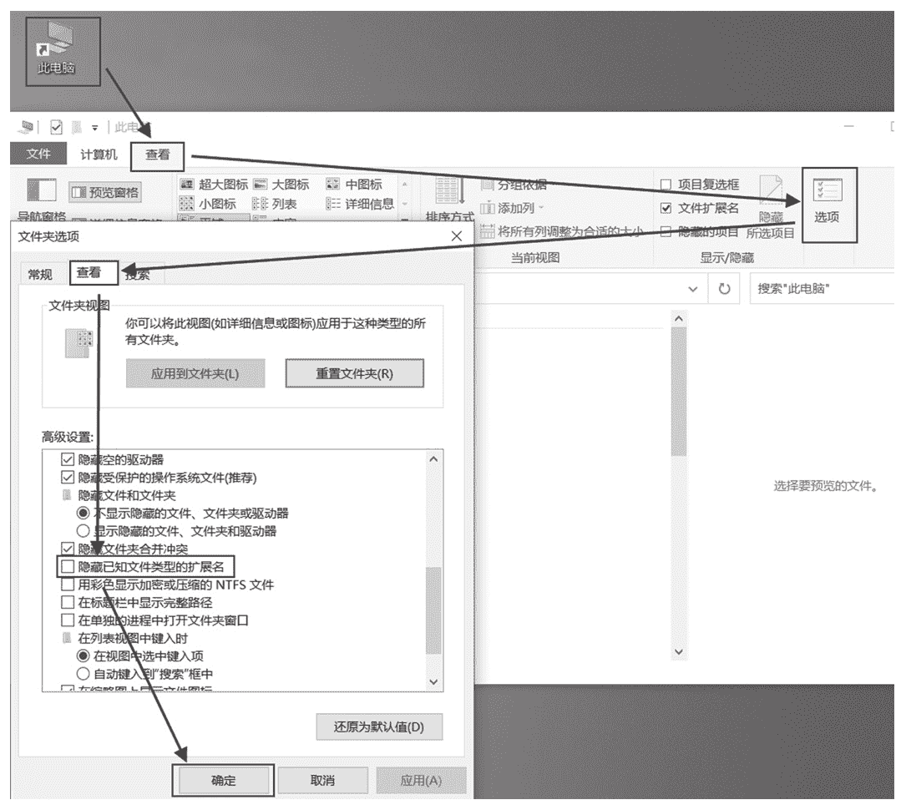

**图 2-16 显示文件扩展名步骤**

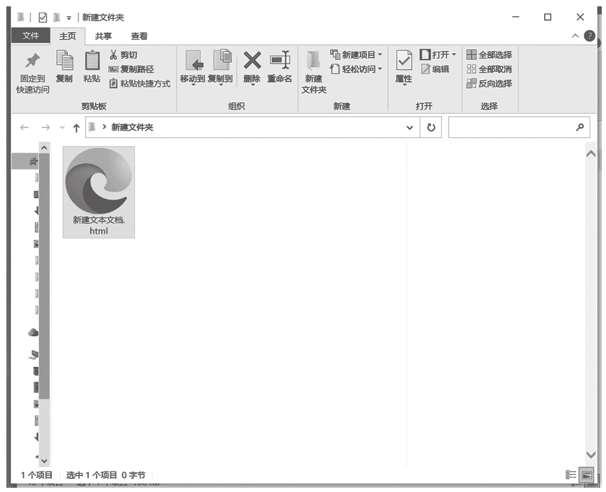

**图 2-17 修改后的状态**

第九步：双击已改好扩展名的文件，选择使用浏览器打开（这里以 Microsoft Edge 浏览器为例）。

第十步：打开后，即可进入函数闯关游戏。

界面效果如图 2-18 所示。

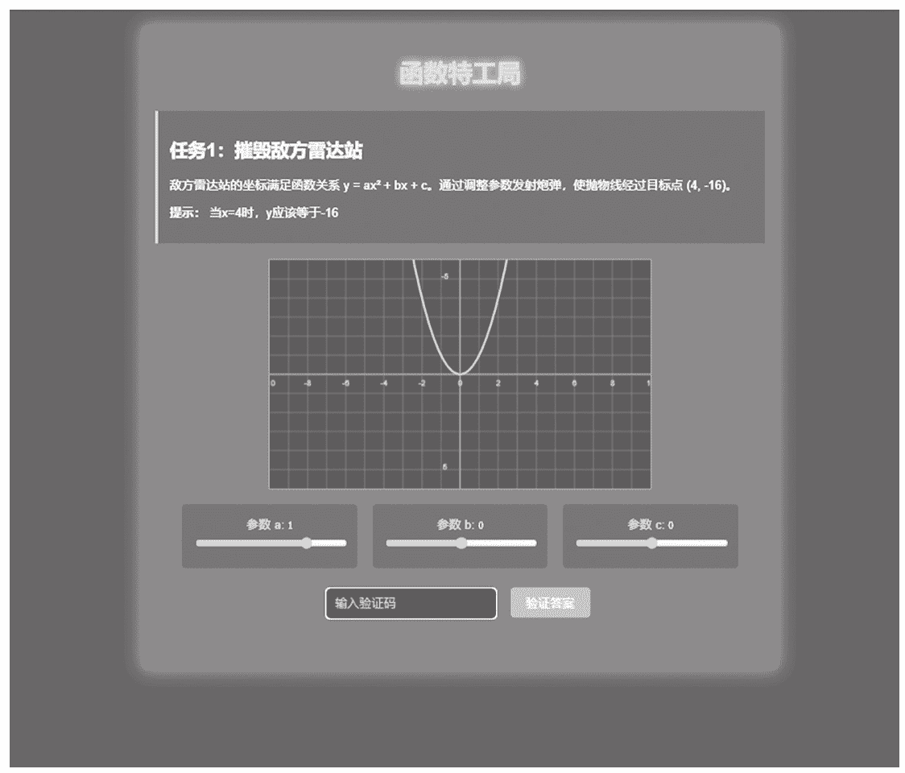

**图 2-18 函数闯关游戏界面**

第十一步：先对这款函数闯关游戏进行操作，如果有不满意的地方或需要增加其他功能，你可以继续向 DeepSeek 发送指令，让其进行修改。例如，笔者在通关第一轮后发现，第二轮 3 个关卡的函数等内容与第一轮内容完全相同，也就是说，每次玩都会得到相同的函数与相同的答案，而且这款游戏还没有背景音乐（任务 1 完成后的界面如图 2-19 所示）。

第十二步：基于以上需求，向 DeepSeek 发送以下追问指令。

基于以上你生成的代码，实现以下需求，并完整呈现全部代码。

● 随机化游戏内容，用户每次重新开始游戏时，3 个任务中的函数参数和正确答案随机生成，并显示相应的函数图像。

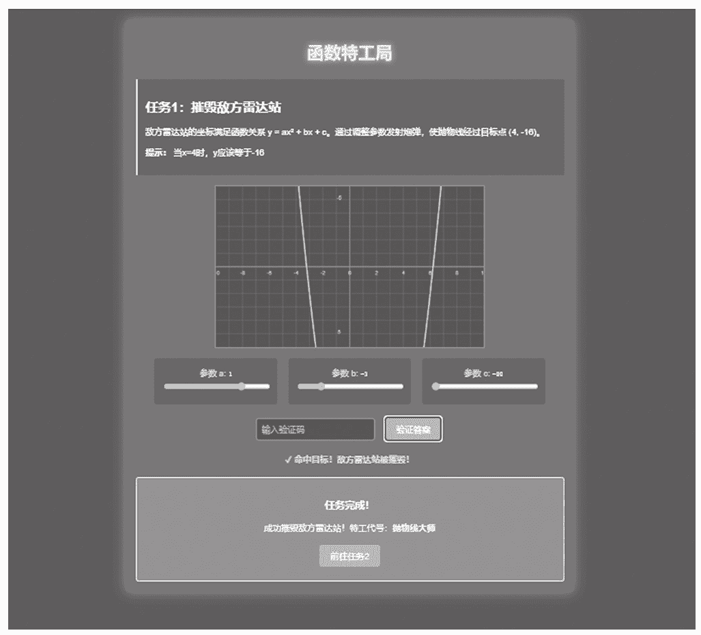

**图 2-19 任务 1 完成后的界面**

● 为游戏添加背景音乐相关功能，支持播放、暂停、循环播放。

注意，要记得加“基于以上你生成的代码，实现以下需求，并完整呈现全部代码”这句核心指令，否则生成的闯关游戏可能是全新的，也可能不会完整呈现全部代码。

DeepSeek 的第二版输出内容（部分）如下。

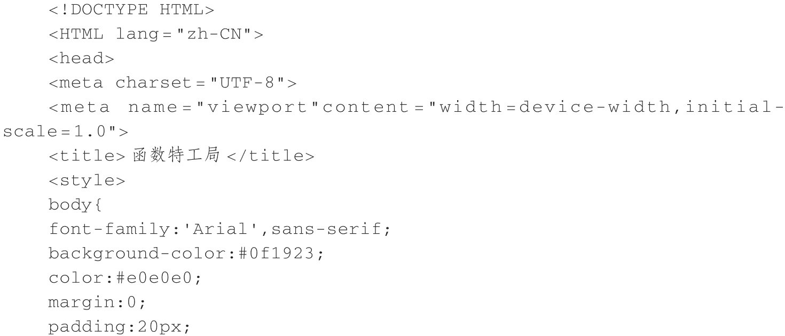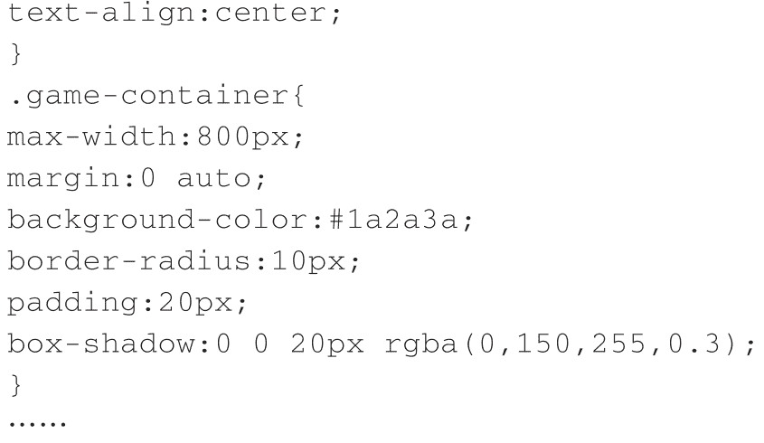

第十三步：复制 DeepSeek 生成的第二版 HTML 代码，将刚才的文件扩展名由“.html”改回“.txt”，双击打开文本文档，删除之前的全部代码，粘贴 DeepSeek 生成的第二版 HTML 代码并保存，再将文件扩展名由“.txt”改为“.html”，修改成功后，双击打开即可显示第二版函数闯关游戏，如图 2-20 所示。

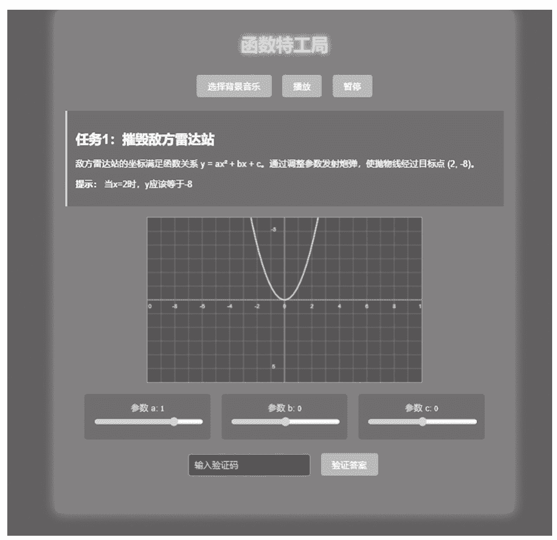

**图 2-20 第二版函数闯关游戏**

第十四步：若还有功能添加需求，重复第十一步至第十三步的操作即可。最终，便能得到一个功能完善且精美的函数闯关游戏。

该类教学素材将数学函数学习转化为探险旅程，学生在完成特工任务的过程中能够巩固课堂所学，实现“玩中学”。使用 AI 生成的 HTML 游戏（例如，语文古诗词闯关 RPG、数学几何塔防、英语单词密室逃脱、物理电路拼接挑战、化学元素周期表连连看、生物人体器官拼图、历史时间轴排序挑战、地理省份拼图、道德与法治知识配对等多种游戏）可以将各学科知识点自然融入游戏机制，使学习过程兼具系统性和趣味性，实现寓教于乐的教学目标。

### **2.4.4 思维导图**

用 DeepSeek 生成 AI 思维导图，是一种高效的知识可视化教学素材生成方式。它能将碎片化的知识点转化为结构化图谱，实现知识体系的直观呈现。思维导图类型丰富，常见的有树状图、鱼骨图、雷达图、气泡图、时间轴思维导图等。树状图以层级结构展示信息，适用于知识体系梳理；鱼骨图用于分析问题因果，从不同方面归类原因；雷达图通过多轴呈现数据，便于综合评估和对比；气泡图用气泡大小代表数据量级，展示数据关系与分布；时间轴思维导图按时间排列事件，适合梳理发展进程。这些思维导图能直观呈现知识逻辑，通过色彩与层级强化记忆，还可按需动态调整，能够满足教学个性化需求。

下面以《化学反应类型》为例，展示生成该类教学素材的实施步骤。

第一步：向 DeepSeek 发送精准指令。

● Why：解决《化学反应类型》学习中，学生混淆置换反应与复分解反应判定的问题。
● Who：初中化学教研员。
● What：生成“化学反应类型知识体系”思维导图内容。
● How：以 Mermaid 层级格式输出，包含 3 级分支（氧化还原反应单独标注）。
● Example：参考附件《元素周期律》单元思维导图的结构。

DeepSeek 生成的 Mermaid 格式的内容（部分）如下。

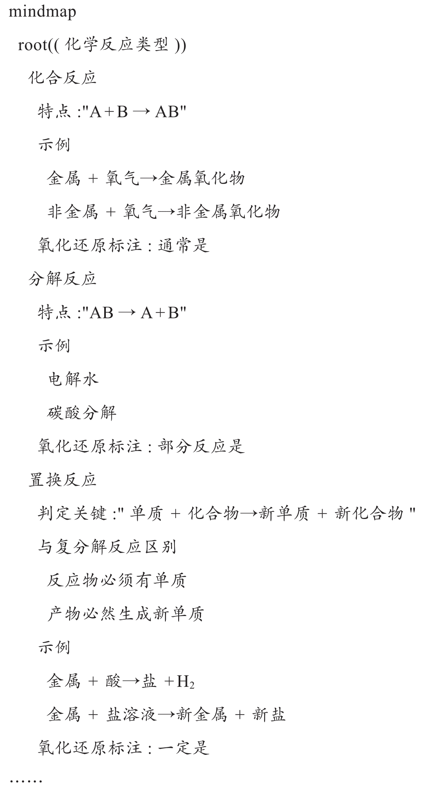

第二步：复制 Mermaid 格式内容。

第三步：访问绘图工具网站（此处以 draw.io 为例）。

在浏览器地址栏输入 https://app.diagrams.net/并访问 draw.io 官网，进入首页后单击“创建新绘图”（操作界面如图 2-21 所示）。

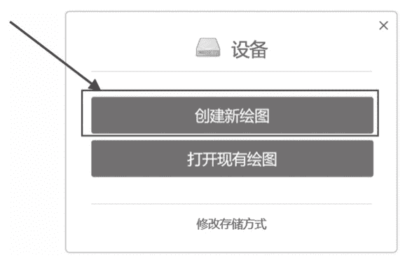

**图 2-21 draw.io 创建新绘图界面**

第四步：创建新文档

在弹出窗口中将文档命名为“化学反应类型思维导图”，选择存储路径后，单击“创建”并“保存”（如图 2-22 所示）。

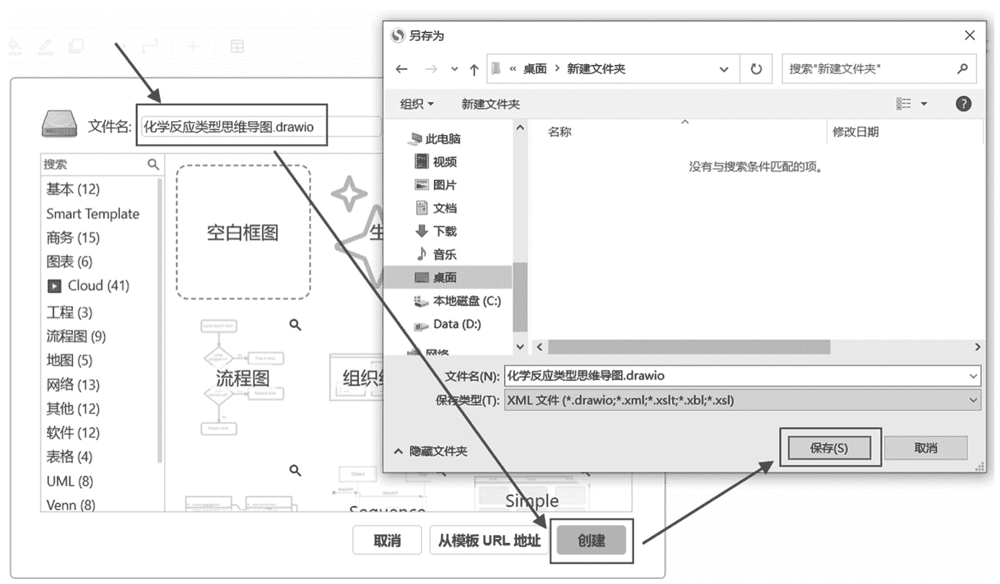

**图 2-22 文档创建与保存界面**

第五步：插入 Mermaid 代码。

单击顶部菜单栏“+”图标，选择“Mermaid...”，即可弹出 Mermaid 代码填写框。其打开操作如图 2-23 所示。

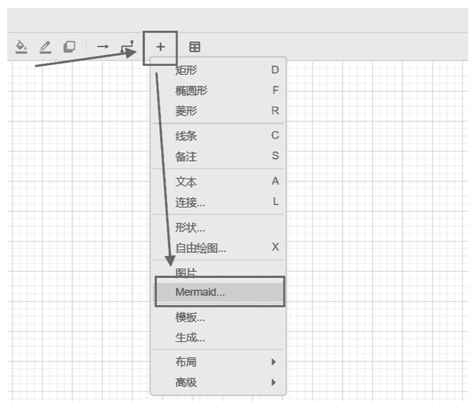

**图 2-23 打开 Mermaid 代码填写框**

清空 Mermaid 代码框的默认内容，粘贴 DeepSeek 输出的 Mermaid 代码，单击“插入”，代码插入操作如图 2-24 所示。

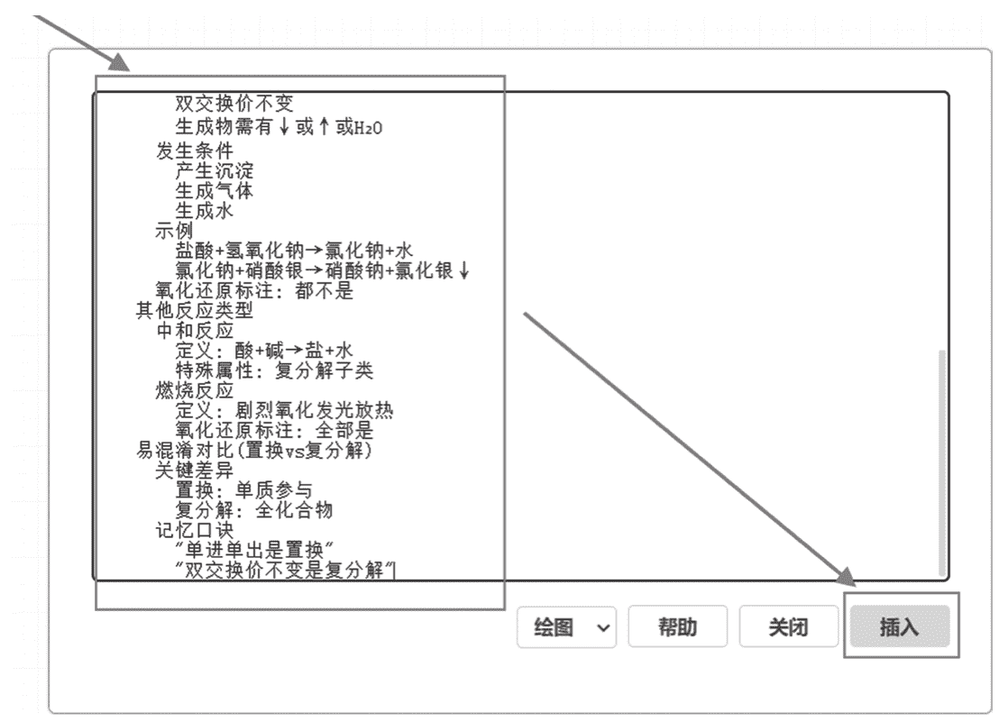

**图 2-24 Mermaid 代码插入操作**

第六步：生成并优化思维导图

单击“插入”后将自动生成思维导图（如图 2-25 所示），可通过拖拽节点调整布局，并可使用右侧格式栏修改颜色、字体等视觉元素。

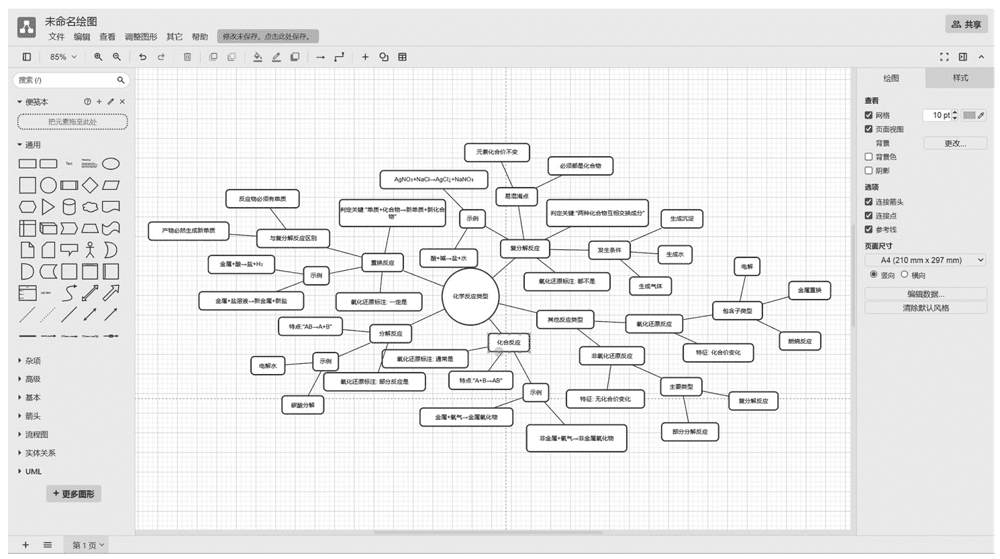

**图 2-25 自动生成的思维导图**

第七步：导出思维导图

样式修改满意后，单击左上角“文件”→“导出为”，可选择 PNG、SVG、PDF 等格式导出，导出操作如图 2-26 所示。

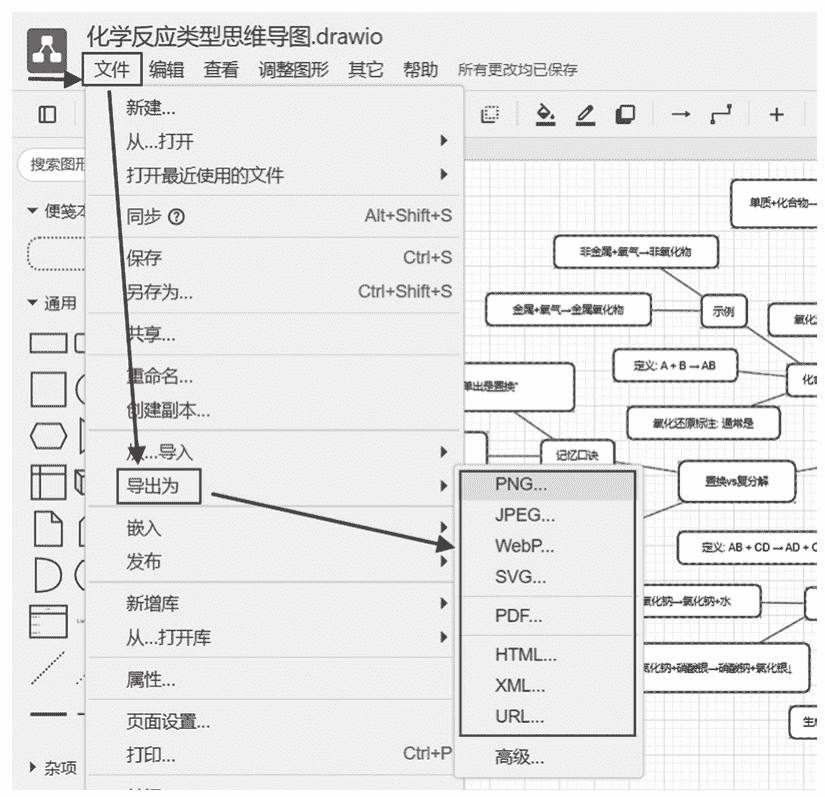

**图 2-26 导出操作**

使用 DeepSeek 与绘图工具，可快速生成结构合理、重点突出的可视化思维导图教学素材。除化学学科外，各学科教师都能基于以上操作，为不同知识内容生成相应的思维导图素材，助力教学。

### **2.4.5 统计图表**

统计图表类型丰富多样。柱状图以矩形柱的高度或长度表示数值大小，直观对比不同类别数据的数值差异；折线图通过折线的起伏变化，清晰呈现数据随时间或其他连续变量变化的趋势，便于受众观察数据的走向；饼图通过将圆形区域划分成扇形，展示各部分在总体中的占比，能让人快速了解各部分与整体的关系。在学科教学中，利用 DeepSeek 生成此类统计图表教学素材，可以将复杂数据直观呈现，助力学生理解现象和规律。

下面以地理学科中分析不同气候类型区的气温和降水数据为例，展示生成该类教学素材的实施步骤。

第一步：向 DeepSeek 发送精准指令。

● Why：通过可视化不同气候类型区的气温和降水数据，帮助学生更直观地理解不同气候类型的特点，提升对地理知识的掌握程度。
● Who：初中地理教师。
● What：根据已知的热带雨林气候、热带沙漠气候、温带季风气候的多年月平均气温和降水量数据，生成折线图展示气温变化，柱状图展示降水差异。
● How：以 HTML 代码形式输出，图表需具备交互功能，鼠标悬停时显示具体数据。
● Example：参考权威地理数据网站上关于上述三种气候类型的典型数据。

DeepSeek 生成的 HTML 代码内容（部分）如下。

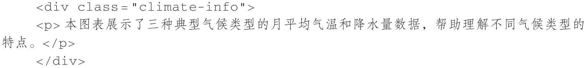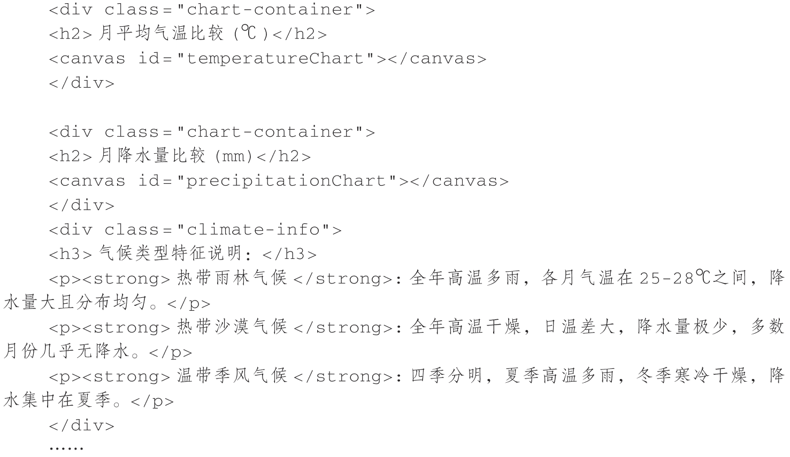

第二步：生成并应用图表。

将 DeepSeek 生成的 HTML 代码复制后，在计算机任意文件夹中新建一个文本文档，将代码粘贴进去并保存，随后将该文件的扩展名由“.txt”改为“.html”。完成格式转换后，用任意浏览器打开该文件，即可呈现包含气温折线图和降水柱状图的可视化界面（如图 2-27 所示）。教师可在课堂教学中应用该图表素材，引导学生观察图表，对比不同气候类型的气温和降水特征，分析其差异形成的原因，帮助学生更好地理解和记忆相关地理知识。同时，还可根据实际教学需求，让学生基于图表进行小组讨论，探讨不同气候类型对人类活动和自然环境的影响等问题，进一步提升学生对地理学科知识的理解与应用能力。

### **2.4.6 交互式动画**

使用 DeepSeek 生成交互式动画教学素材，能够突破静态教学的局限。这种教学素材具有以下优势：实现“操作—反馈”的双向互动、动态呈现抽象原理、支持生成个性化探究路径。

下面以《浮力》单元为例，展示生成该类教学素材的实施步骤。

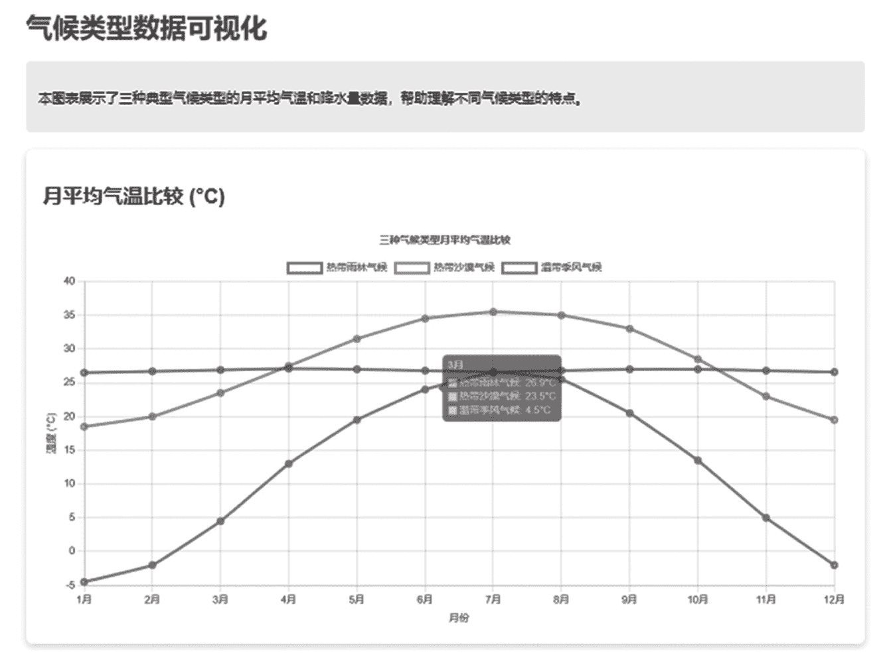

**图 2-27 气候类型数据可视化界面示例**

第一步：生成动画源代码。

向 DeepSeek 发送如下精准指令。

● Why：需要动态展示物体浸入液体过程中的浮力变化。
● Who：物理动画设计师+初中物理教师。
● What：生成浮力原理 SVG 动画的 HTML 代码。
● How：要求包含可拖拽的立方体、显示实时浮力计算公式*F*[浮]=*ρ*[液]*gV*[排]、用不同颜色区分水和物体（水为蓝色，物体为橙色）。
● Example：参考人教版初中物理教材第 58 页示意图。

DeepSeek 的输出内容（部分）如下。

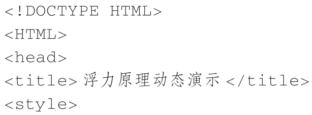

第二步：复制 DeepSeek 输出的代码，在计算机任意文件夹中新建一个文本文件，粘贴代码并保存，将该文件的扩展名由“.txt”改为“.html”，保存后双击，用任意浏览器打开，即可显示浮力原理 SVG 动画。浮力原理 SVG 动画画面如图 2-28 所示。

这种动态演示方式能够改变传统物理教学的观察模式，使抽象公式转化为可视化的参数交互。当学生拖动滑块时，不仅能实时看到物体的沉浮状态变化，还可以同步观察排开液体体积与浮力值之间的关系，从而构建起“现象观察—采集数据—推导原理”的完整认知链条。该文件可直接作为独立数字教具，教师可以在机房、智慧教室等多场景中使用它来开展探究式学习。

这一方法除用于制作浮力原理的 SVG 动画外，还可用于制作物理、数学、化学、生物、地理，以及信息技术、艺术等学科的 SVG 动画。

**图 2-28 浮力原理 SVG 动画画面**

### **2.4.7 动态英语绘本**

传统绘本资源难以适配学科内容，手工改编耗时费力。DeepSeek 可一键生成定制化的绘本故事素材。

下面以小学英语经典故事*The Very Hungry Caterpillar*为例，展示生成该类教学素材的实施步骤。

第一步：向 DeepSeek 发送精准指令，让 DeepSeek 输出*The Very Hungry Caterpillar*的绘本。

● Who：小学英语教师+绘本设计师。
● What：生成*The Very Hungry Caterpillar*的绘本分场景描述，用于豆包生成图像。
● How：包含场景、角色、画面内容、教育标注（食物/星期词汇）。

DeepSeek 的输出内容（部分）如下。

Day 1 周一

场景：月光下的树叶特写。

角色：绿色小毛虫蜷在嫩叶上（体长 3cm 左右）。

画面内容：荧光蓝的虫卵刚破裂，叶片上有晶莹的露珠。

教育标注：[Monday][apple]单词用星星光点环绕。

Day 2 周二

场景：红色苹果剖面图。

角色：毛虫从苹果核位置探出头（苹果直径约 8cm）。

画面内容：苹果左侧有整齐的圆形咬痕，露出浅色果肉。

教育标注：[Tuesday]用彩虹色字，浮在苹果上方。

Day 3 周三

场景：野餐篮俯视图。

角色：毛虫趴在两个梨之间（梨带褐色斑点）。

画面内容：野餐篮内有草莓、奶酪等食物的残渣，周三的梨被吃出“隧道”。

教育标注：[Wednesday][pear]标签做成小旗子插在梨柄上。

……

关键教育页

场景：食物大集合。

角色：毛虫趴在蛋糕顶端（身体鼓成球形）。

画面内容：按食用顺序排列：草莓→冰激凌→腌黄瓜→奶酪→火腿→棒棒糖。

教育标注：所有食物带虚线边框标注英文，星期标签做成马戏团小旗串。

第二步：复制 DeepSeek 的输出内容。

第三步：在浏览器地址栏输入豆包 AI 官网的网址：https://www.doubao.com，并访问，操作如图 2-29 所示。

**图 2-29 访问豆包 AI 官方网站**

第四步：打开豆包 AI 首页后，注意顶部右侧的登录入口，借助手机号配合短信验证码完成身份验证，具体操作见图 2-30。

**图 2-30 豆包 AI 的登录操作**

第五步：登录成功后在主界面定位“图像生成”功能，点击进入对应的编辑区，示意参考图 2-31。

**图 2-31 进入“图像生成”编辑界面操作**

第六步：将 DeepSeek 提供的“Day 1 周一”文本粘贴到输入框，展开“风格”菜单把滚轮拖到最底选择“绘本”，随后按下发送，操作如图 2-32。

**图 2-32 粘贴内容，选择风格**

第七步：产出效果见图 2-33，挑选合意的画面后保存。若整体不理想，可要求豆包 AI 重新出图，或把反馈回传 DeepSeek 请其给出新的提示。

**图 2-33 豆包 AI 生成的结果**

第八步：静态绘本完成之后，还能赋予画面动效。借助视频生成类服务，例如即梦 AI 或豆包 AI，就能把已有的绘本图转化为短视频。以豆包 AI 来演示，点开喜欢的绘本图，右侧会出现放大预览，再点击顶部“生成视频”即可进入视频制作页，如图 2-34 所示。

**图 2-34 绘本图生视频操作**

第九步：在视频指令框里可描述画面如何运动，也可以留空让系统自行处理。点击右下角发送后等待渲染完成，编辑界面如图 2-35。

**图 2-35 视频生成编辑界面**

第十步：若对生成的视频不满意，可通过补充指令让其重新制作，直至达标后点击视频下方的下载按钮完成保存。

第十一步：按相同流程制作其余场景的动态片段并下载，随后把所有片段拼接并加入配音与背景音乐，即可得到一部适合小学生阅读的精致动态绘本。

这种借助 AI 制作动态绘本的教学方式，改变了传统英语教学获取资源的模式，把静态文字故事转化为动态视觉呈现。学生在阅读时既能通过生动画面理解情节，也能直观掌握绘本中的核心词汇。该素材可直接用于课堂导入、小组角色扮演或课后拓展阅读，从听、说、读、写多维度提升英语学习效果。除小学英语外，生物、科学、数学、历史、美术、心理健康等学科也能用同样方法快速制作辅助教学的动态绘本。

### **2.4.8 心脏 3D 模型**

结合 DeepSeek、AI 绘图工具如即梦 AI 与 3D 建模平台如 Tripo，可以产出高精度可用于课堂的立体模型。此类可视化资源特别适合生物、化学、物理、地理等需要呈现空间结构的学科。

下面以心脏 3D 模型制作为例，梳理一套可操作路径。

第一步：让 DeepSeek 撰写用于心脏 3D 模型构建的提示词。

向 DeepSeek 发出精准指令，请其为图像生成工具准备高质量且无背景的描述。

● Who：你是高中生物教师+3D 建模师。
● What：我要设计心脏的 3D 模型，需要你编写用于 AI 生图的提示词，不要背景。

DeepSeek 给出的内容如下。

超精细心脏 3D 模型，孤立无背景，解剖级精度。展示完整四腔结构（左右心房、左右心室），冠状动脉分支清晰可见，主动脉弓自然弯曲。材质为半透明医疗级塑料质感，可透视内部瓣膜（二尖瓣/三尖瓣）。冷白色照明，等距视角，Blender 渲染风格，8K 细节。

第二步：复制 DeepSeek 的输出内容。

第三步：进入即梦 AI 官网并完成登录，点击“图片生成”打开编辑界面如图 2-36 所示。

第四步：将 DeepSeek 提供的提示词粘贴到左侧填写栏，然后点击右侧图标即可，如图 2-37 所示。

第五步：心脏 2D 图片生成后，选择满意的一张下载。

第六步：在浏览器地址栏输入 Tripo 官网网址 https://www.tripo3d.ai/ 并访问，点击“免费开始使用”进入 Tripo 主页界面，如图 2-38 所示。

**图 2-36 图片生成界面进入方法**

**图 2-37 图片生成界面编辑操作**

第七步：在 Tripo 主页点击右上角“注册/登录”进入登录页，再点击“免费注册”可用邮箱注册账号。注册完成后登录即可，如图 2-39 所示。

**图 2-38 网址访问及 Tripo 官网首页进入方法**

**图 2-39 账号注册方法**

第八步：登录后在 Tripo 主页点击“生成 3D 模型”，上传刚才下载的心脏 2D 图，点击“生成”等待模型制作完成，如图 2-40 所示。

**图 2-40 Tripo 首页 3D 内容生成编辑操作**

第九步：模型生成后点击下方“下载”，如图 2-41 所示，将文件保存到本地作为教学素材，课堂上可用相应软件打开演示。也可点击下方“定制到家”，如图 2-42 所示，将其制作为摆件寄送到校，或通过第三方平台定制，用实物模型展示。

**图 2-41 单击“下载”按钮**

**图 2-42 单击“定制到家”按钮**

借助 DeepSeek、AI 绘图与 3D 建模工具制作的心脏模型，把抽象解剖结构转化为可视形态，同时显著增强课堂互动。教师可利用该模型进行拆解演示、血液流向模拟，甚至配合 VR 让学生“进入”心脏内部观察。

这套基于 AI 的建模方法不仅适用于高中生物，还能在 K12 各学科推广：化学中可搭建晶胞等分子模型并展示酸碱中和的离子运动；物理中可生成滑轮组、电磁场等装置模型；地理中可制作火山剖面、褶皱山脉等地貌模型并演示板块运动与地震机制；数学中可用于几何体的空间可视化；历史中可复原青铜鼎、金字塔等文物建筑，让学生“触摸”文化遗产。技术让抽象变具象，推动教学从讲授转向探究，教师还可据此设计跨学科项目，例如用 3D 建模解析古建筑中的数学比例，培养综合素养与数字化创新能力。

**第三章 CHAPTER 1 AI 赋能课堂提效**

传统课堂常被导入困难、互动形式单一、练习设计耗时、教学内容难以即时调整等问题困扰，这些问题影响教学质量与学生发展。AI 的快速发展为 DeepSeek 提供了新的解决路径。

本章围绕课堂提效，重点说明如何借助 DeepSeek 优化导入、互动、练习及内容即时生成与动态调整。阅读时请聚焦指令设计技巧以及与教学实践的结合，灵活运用以激活课堂，实现师生智慧共创。

## **3.1 课堂导入提效**

课堂导入是学习旅程的起点，其效果直接影响学习热情与知识吸收。传统导入手段无论是悬疑提问、智慧谜语、绘本故事还是趣味游戏，都难以充分点燃兴趣。DeepSeek 为突破瓶颈提供了创新支持，帮助教师打造更具吸引力的开场。

### **3.1.1 悬疑问题导入**

悬疑问题导入通过设置疑问或制造认知冲突，引发思考并激发兴趣。这类问题贴近生活且具挑战性，能激活主动探究意识，让学生带着问题进入学习，为后续理解奠基。

**1.传统方式的痛点**

教师设计悬疑问题时容易陷入惯性思维，重复使用教材中陈旧案例，或情境过于理想化脱离学生生活经验。更棘手的是难以精准调控认知负荷，常常出现导入“启而不发”或“过度刺激”的两极化现象。

**2. DeepSeek 赋能方案**

DeepSeek 可生成“悬疑问题组合包”，突破传统问题设计的局限，打造“认知冲突—情感共鸣—概念建构”三位一体的导入体验。这体现了 DeepSeek 理解并应用教学规律的能力。它生成的问题不仅语言通顺、主题相关，而且在教学上具有启发性，能有效引发学生的思考和兴趣。

教师可以向 DeepSeek 提供精准指令，明确导入的目的、主体、内容、格式、字数限制以及参考范例。例如，一位初中物理教师可以请求生成“光的折射”单元的问题，包括基础型、进阶型和拓展型三种类型的问题。具体精准指令如下。

● Why：突破传统问题设计的局限性，打造“认知冲突—情感共鸣—概念建构”三位一体的导入体验。
● Who：初中物理教师+认知科学顾问。
● What：生成“光的折射”单元悬疑问题组合包。
● How：包含基础型、进阶型、拓展型三类问题，每类 2 个版本。
● How much：总字数不超过 150 字，确保 15 秒内可完成阅读。
● Example：参照诺贝尔物理学奖得主的教学案例库。

DeepSeek 输出内容部分如下：

● “如果人类的眼睛能直接看见红外线，游泳池在我们眼中会变成什么样子？”
认知冲突：挑战“所见即真实”的朴素观念。
情感共鸣：关联学生熟悉的泳池场景。
概念构建：为讲授光的波长与折射率的关系埋下伏笔。

● “为什么隐形战机的外形设计，本质上是在和光的折射定律‘玩游戏’？”
认知冲突：建立军事科技与基础科学的认知关联。
情感共鸣：激发学生对国防科技的兴趣。
概念构建：引出折射定律的工程应用维度。

● “如果有一天光的折射定律突然失效，最先消失的现代科技会是什么？”
认知冲突：创设极端假设情境。
情感共鸣：引发学生对技术依赖性的深层思考。
概念构建：串联透镜、折射定律等多个知识点。

这些问题能够挑战学生的朴素观念，引发他们对科学原理与工程应用的思考，并串联多个知识点，激发学生对国防科技的兴趣，并反思技术依赖性。

**3.课堂实施流程**

实施时，教师可先抛出基础问题，引导小组头脑风暴，将猜想写在便利贴上。随后展示进阶问题，引导学生尝试解释新情境，并可有意设置矛盾点。当学生陷入认知冲突时，适时引入拓展问题，激发学生对系统知识的自主学习动机。教师还可以用不同颜色的磁贴标记猜想的发展脉络，并在单元总结时回顾，使学生直观地看到自身认知结构的完善过程。DeepSeek 在这一过程中参与共同设计，其生成的问题能够有效影响学生的思维和参与度，从而使他们实现更深层次的学习。

### **3.1.2 智慧谜语导入**

智慧谜语导入融合语言表达、逻辑推理和形象思维，以生动有趣的方式把抽象学科知识具象化，既能活跃课堂气氛，又有助于建立知识点联系。通过设计契合教学目标的学科谜语，教师可在轻松情境中引导学生进入学习。

**1.传统方式的痛点**

教师自编谜语时，往往难以兼顾趣味性和教学目标，可能导致谜面与学科概念的关联牵强、难度不符合学段特点或缺乏递进性思维训练。此外，文化背景差异也可能导致部分谜语难以引发学生共鸣。

**2. DeepSeek 赋能方案**

DeepSeek 能够生成“学科融合谜语”，这表明 DeepSeek 不仅能创造谜语，还能以符合不同学习风格的方式进行创造，从而促进更深层次的概念理解。

例如，一位小学科学教师可以让 DeepSeek 生成 3 个与“生态系统”相关的谜语，要求谜底为科学概念，谜面包含韵律和意象，适合 8～12 岁学生。具体精准指令如下。

● Why：通过学科融合谜语激发学生学习兴趣。
● Who：小学科学教师。
● What：生成 3 个与“生态系统”相关的学科谜语。
● How：谜底为科学概念，谜面需包含韵律和意象。
● How much：每个谜语不超过 3 行，适合 8～12 岁学生。
● Example：参考附件《物质三态》中的谜语设计。

DeepSeek 输出的内容如下。

● “我是绿色工厂不需要电，太阳给我发工资，动物给我交社保。（打一生态角色）”
谜底：生产者（植物）
设计亮点：
√将光合作用比喻为“工厂”运作。
√用“社保”隐喻物质循环。
√为食物链教学埋下伏笔。

● “冬天穿白衣，春天换绿装，秋天收红包，夏天忙转账。（打一森林类型）”
谜底：落叶阔叶林
设计亮点：
√拟人化描述物候变化。
√“转账”暗指养分输送。
√衔接生态系统能量流动学习。

● “看不见的银行家，存进阳光贷出糖，破产就要闹饥荒。（打一生态过程）”
谜底：光合作用
设计亮点：
√金融类比喻突破学科边界。
√“破产”对应植物枯萎。
√为能量转化建立认知锚点。

**3.课堂实施流程**

课始，教师可以先展示最直观、最贴近生活的谜语，通过集体讨论引导学生说出谜底“生产者”。待学生进入状态后，逐步提升难度，呈现需要抽象思维的谜语。在这个过程中，可以让学生用不同颜色的笔在纸上圈出谜面中的关键词，比如把“社保”和物质循环联系起来，或者把“转账”和能量流动画联系起来。当所有谜底都揭晓后，教师可以带领学生将这些科学概念粘贴到教室的墙上，比如把“生产者”卡片放在食物链的起点。最后，鼓励学生分组创作新的谜语，比如从消费者的角度改编“冬天穿白衣”这个谜语，让学生的学习过程从理解延伸到创造。

### **3.1.3 多元 AI 辅助导入形式**

除上述两种导入方法外，教师还可以运用多种其他导入形式来丰富课堂，提升学生的参与度和学习兴趣。这些形式包括但不限于虚拟角色导入、故事绘本导入、实验演示导入、趣味游戏导入。尽管具体形式各有侧重，但其共同目标是更好地吸引学生的注意力，激发他们的求知欲。

无论采用哪种导入形式，教师都可以利用 DeepSeek 生成相关的素材或脚本，以确保导入内容既符合教学目标，又能激发学生兴趣。对于虚拟角色导入，可参考 2.4.1 节中提到的方法，使用 DeepSeek 生成虚拟人物教学台词，再用对口型 AI 工具生成虚拟角色；对于故事绘本导入，可参考 2.4.7 节中提到的方法，向 DeepSeek 发送精准指令生成故事情节和插图建议，并用其他 AI 将其转化为动态绘本；对于实验演示导入，可让 DeepSeek 给出相应的视频素材、动画素材来源，提供详细的实验步骤和推荐的资源链接；对于趣味游戏导入，可参考 2.4.3 节中提到的方法，让 DeepSeek 生成包含游戏逻辑和交互设计的 HTML 代码，从而创建富有互动性的游戏体验。通过这些方式，教师可以快速获取高质量的教学素材，优化课堂导入环节，增强学生的参与感和学习效果。

## **3.2 课堂互动提效**

传统课堂互动往往受困于多重桎梏：教师的提问对象随机且提问缺乏针对性；小组讨论随意性大且主题模糊；多元互动形式之间缺乏逻辑衔接；技术工具应用困难，演示环节缺乏动态性。这些问题共同导致学生注意力难以集中、参与度下降。DeepSeek 凭借其强大的信息整合与生成能力，为这些难题提供了创新解决方案。

### **3.2.1 分层提问设计**

在传统课堂教学中，教师的提问对象往往较为随机且问题缺乏针对性。要解决这一问题，需要花费大量时间进行学情分析并设计相应的问题，既耗时又难以长期坚持。DeepSeek 能够在精准分析学情的基础上，快速高效地设计出有针对性且符合教学目标的分层提问方案。下面以初中数学《一元二次方程》为例，展示生成分层提问方案的操作步骤。

第一步：采用 2.2 节提到的方法，利用 DeepSeek 进行精准学情分析，并保存学情分析结果。

第二步：向 DeepSeek 发送精准指令，让 DeepSeek 根据精准学情分析结果和本课教学设计完成分层提问方案设计。

精准指令如下：

● Why：解决传统提问“一刀切”问题，实现因材施教。
● Who：初中数学教师。
● What：生成《一元二次方程》分层提问方案。
● How：按 A 组（基础）、B 组（进阶）、C 组（拓展）设计问题。
● Example：《分层提问模板》《精准学情分析结果》《本课教学设计》。

DeepSeek 输出内容如下：

《一元二次方程》分层提问方案

1.基础巩固层（A 组）
【知识回忆】
● 请说出一元二次方程的一般形式。
● 判断下列方程是否为一元二次方程：1）*x*²+2*x*=1；2）3*x*-5=0。
【理解应用】
● 用配方法解方程：*x*²+6*x*+5=0
● 某长方形的长比宽多 3 米，面积为 54 平方米，请列出对应的方程。
2.能力进阶层（B 组）
【分析推理】
● 解方程 2*x*²-5*x*-3=0 时，小明得到两个解*x*[1]=3 和*x*[2]=-0.5，请验证是否正确。
● 若关于*x*的方程(*k*-1)*x*²+2*x*-3=0 有两个实数根，求*k*的取值范围
【综合运用】

分层命题先为教学把关提供抓手

先看一个代数问题的分层示例。x²-4x-21=0 可用配方法推导，也可用求根公式求解；再看一例商业情境，某商品连续两次下调10%后售价为81元，需要反推初始售价并建立方程求解。

思维拓展层 C 组 【创新迁移】
从恒成立视角说明：对任意实数 m，方程 x²-(m+1)x+m=0 至少存在一个实数根。
再创设一个贴近生活的情境，使所建方程的解呈现无理数形式。

第三步由授课者对 DeepSeek 提供的这批分层提问进行可行性与实用性的二次甄别后再纳入课堂。如此即便班级差异较大，也能实现差异化推进，而不必明显增加备课负担，最终提升效率与公平。

### 3.2.2 让小组讨论更有秩序与成效
1. 原有方式的局限
编组常依赖邻座或授课者主观印象，导致组内结构失衡。部分小组聚集了学习积极、思维活跃的成员，讨论时容易话语垄断，形成强者愈强；另一部分小组因基础薄弱、表达不足，只能旁听，成为沉默者。

讨论主题常过于宽泛。授课者多给出“谈谈本文特点”“分析实验原理”等笼统指令，缺少分析维度与逻辑线索，学生易迷失方向，把焦点偏到琐碎细节或个人感受。语文课上容易过度关注人物轶事，理科讨论则易纠结操作失误，而忽视核心原理。

2. 借助模型改善的路径
模型能够给出数据驱动的编组建议并为组内安排角色，同时输出由浅入深的问题序列，为协作学习提供清晰轨道，直接缓解编组盲目与问题模糊两大难题。

以中学语文课文《孔乙己》为例。

1) 数据驱动编组
输入示例
● 身份：中学语文教者。
● 任务：为《孔乙己》小组研讨做合理编排，共8组，每组4人，组内层次搭配。
● 方式：结合附件《数次测验数据》《课堂活跃度概览》《日常表现记录》。
系统给出的部分结果如下。

2) 问题链构建
输入示例
● 身份：中学语文教者。
● 任务：为《孔乙己》设计小组研讨问题框架。
● 方式：围绕人物形象、社会背景、主题思想展开，设置3～5个递进问题。
● 参考：仿照《故乡》研讨问题框架。
系统给出的内容如下。
1. 人物形象拆解
● 孔乙己站着饮酒却身着长衫的矛盾，折射出怎样的社会处境与内心矛盾？
● “偷书”“教人写账”等细节描写，如何呈现其性格的复杂性？
2. 社会语境追溯
● 咸亨酒店里“短衣帮”与“长衫客”的消费分区，映射出怎样的阶层裂痕？
● 科举制度怎样塑造孔乙己的命运，与封建选才机制有何联系？
3. 主题意义提升
● 鲁迅借孔乙己的悲剧想让社会反思哪些深层问题？
● 联系当下教育内卷，孔乙己的经历对当今青年有何提醒？

在模型帮助下，混乱的讨论可被转译为有序、公平、成果导向的协作体验，小组合作的价值得到最大释放。

### 3.2.3 构建连贯的多元互动
1. 常规痛点
互动常呈现碎片化。提问、研讨、游戏等形式并存，却衔接不畅。概念问答后直接跳到操作练习，学习者难以形成完整知识链。互动形式多依赖教者经验，未能匹配教学目标与认知水平，如在应用阶段仍用简单问答，难以培养实践力。

2. 模型支持方案
模型可按教学目标设计互动序列，形成一条连贯的学习路径。它充当教学设计师，把不同互动元素策略性组合，强化概念并调动多感官。

以高级中学生物《基因工程》为例，指令如下。
● 身份：高级中学生物教者。
● 任务：设计《基因工程》教学互动序列。
● 方式：覆盖导入、知识讲解、实践运用等环节，选取3～4种互动方式，形成连贯流程。
● 参考：《细胞呼吸》互动设计。
系统给出的部分内容如下。

借助此法，教者能搭建逻辑清晰、内容丰富且富吸引力的多模态学习环境，促进知识的全面吸收与内化。

### 3.2.4 技术工具的精准匹配
使用教学技术时教者常遇三难：工具众多难以甄选、功能与教学需求脱节、专业软件操作复杂导致课堂卡顿。

模型能提供快速解决方案。教者把教学内容、功能需求与设备条件输入，系统即可检索匹配工具或方案。选定后还能给出详细操作指南，把流程拆成可视化步骤，并提供常见问题对策，同时支持模块化定制，保证课堂稳定。

例如高级中学英语口语教学，输入指令：
● 身份：高级中学英语教者。
● 任务：推荐一款支持口语测评的互动工具，并生成完整操作流程，实现学习者两两对话并获得即时反馈。
系统给出的部分内容如下：
工具匹配：FiF 口语训练系统。
操作流程：
1）学习者到手机应用商店搜索“FiF 口语训练—学生版”App 下载安装。
2）登录时输入“学校英文缩写+学号”，初始密码与账号相同且全小写，点击登录进入首页。
3）教者在后台设定小组数量上限。
……

### 3.2.5 演示展示的动态化
传统演示多靠静态 PPT 加讲解，难以呈现过程性知识。电磁感应中磁场与电流的转化、细胞分裂的三维空间变化等，都难以用平面图示呈现。展示资源更新慢，无法及时纳入前沿成果与生活实例，学生兴趣不足。

模型提供两类素材支持。基于关键词如“高级中学物理电磁感应动态演示”“细胞分裂 3D 模型”，系统可从教育资源平台、学术库及社交媒体抓取优质动态图表、虚拟实验视频、学者讲座片段，并按清晰度、适配度、更新时间智能排序。另可参照 2.4 节的素材生成方法，定制个性化演示内容。

## 3.3 课堂练习提效
传统练习常因设计耗时、批改低效、形式单一而制约效果。借助模型，可实现精准设计、创新形式，推动练习从重复任务转向个性化学习。

### 3.3.1 分层练习设计
传统分层题需教者手工收集，费时且适配度有限。依托学情分析，模型能高效生成有针对性的分层题。

仍以初级中学数学《一元二次方程》为例。
第一步：用 2.2 节方法完成精准学情分析并保存结果。
第二步：发送精准指令。
● 目的：解决“一刀切”提问，实现因材施教。
● 身份：初级中学数学教者。
● 任务：生成《一元二次方程》分层练习题。
● 方式：按基础、进阶、拓展三层设计。
● 参考：《精准学情分析结果》和《本课教学设计》。
系统输出如下。
《一元二次方程》分层练习卡
（限时 15 分钟|姓名：________）
1. 基础题
● 求解方程 x²-4=0。
● 把 (x+1)(x-3)=0 化为一般式，并写出二次项系数。
● 判断方程 x²+2x+3=0 的实数根个数。
2. 进阶题
● 用配方法求解 x²-6x+5=0。
● 已知 2x² - kx +3=0 有一个根为 1，求 k 值及另一根。
● 应用题：矩形面积 54 cm²，长比宽多 3 cm，列方程求宽。
3. 拓展题（学有余力）
● 解关于 x 的方程 (a-1)x²+2ax+a+2=0，讨论 a 取值对根的影响。
● 证明：无论 k 取何值，方程 x²-(k+3)x+2k+2=0 都有实数根。
● 综合题：抛物线 y=x²-5x+6 与 x 轴交于 A、B，两点，点 P 在抛物线上，求△ABP 面积最大时 P 的坐标。
第三步：课堂上统一打印练习卡，学习者必做基础题，挑战进阶题，学有余力者完成拓展题。练习由此变为动态个性化的学习体验，匹配不同挑战需求。

### 3.3.2 练习形式的创新
传统练习题型固化、学科孤岛，学习者陷入刷题—遗忘—再刷题的低效循环，迁移能力弱。

模型基于知识图谱能整合多学科，生成趣味性与学术性兼备的跨学科任务，打破壁垒，促进迁移。

案例 1：诗词中的物理奥秘（物理+语文）
输入指令：
身份：初级中学物理教者与语文教者。
任务：生成以“诗词中的物理奥秘”为主题的跨学科练习任务。
方式：1. 挑选 8～10 首含典型物理现象的古诗，覆盖力学、热学、光学等；2. 设计赏析、原理分析、创作实践三层任务；3. 每首配背景知识卡；4. 提供合作流程指南与评价量表。
参考：统编版语文古诗词单元、人教版物理对应章节。
系统输出内容（部分）如下。
1. 任务总览
引导学习者双重视角解读诗词中的物理现象，最终通过创作实现知识融合，提升跨学科思维。
2. 具体任务内容

3. 小组合作流程指南
分组与分工：4 人一组，设组长、诗词分析师、物理解说员、创作执笔人。
任务执行：
阶段一 10 分钟：共读诗词，完成赏析与现象识别。
阶段二 15 分钟：物理解说员讲解原理，集体补充记录。
阶段三 20 分钟：集体构思原创诗词，形成稿件并附创作说明。
成果展示：各组分享赏析、原理与原创作品，接受提问与建议。

案例 2：宋代商业政策辩论（历史+政治+语文）
输入指令：
● 身份：高三文科综合教者。
● 任务：生成跨学科辩论任务。
● 方式：1. 结合市舶司制度、贸易政策、奏疏写作设计任务；2. 正方主张开放海禁，反方主张维持朝贡体制；3. 要求引用《宋史》原文与经济学原理。
● 参考：2024 年高考历史论述题评分标准。
系统输出内容（部分）如下。
1. 任务总览
以宋代商业政策为切入点，通过辩论综合运用历史、政治、语文知识，分析事件的经济逻辑与政策考量，提升思辨与跨学科表达。
2. 具体任务内容

（续）

模型通过整合性学习体验，让课堂更具活力与关联，为复杂现实问题解决做好准备。

## 3.4 课堂内容即时生成与动态调整
课堂上常出现突发提问、理解差异、进度偏快或偏慢等情况，传统模式难以即时响应。模型可把教者角色从“内容供给者”转向“设计师”与“即时引导者”。

### 3.4.1 传统内容调整的困境
学习者提出超纲深度问题时，教者多只能课后查资料或草草带过，影响求知欲。面对同一知识点不同学习者需要不同例子、简化解释或拓展，教者难以在有限时间里提供定制材料。进度失控时，临时增删内容易牺牲质量。

### 3.4.2 模型赋能即时生成
即时生成案例与解释：教者可提问即时获得补充案例、不同难度表述或多角度阐释。
即时生成多模态辅助材料：可快速得到思维导图文字版、概念图示描述、动画脚本，供后续可视化。
即时生成变式练习与拓展问题：根据课堂反馈生成针对性练习，巩固或深化。

### 3.4.3 课堂实施流程
预设场景与指令模板：备课时为常见突发情况准备好指令模板，便于课堂快速调用。
1）即时提问与生成
学习者提出复杂问题时，输入核心问题与期望输出类型，例如“请用生活化例子向初中生解释能量守恒定律”。生成后教者筛选呈现；不满意可追问迭代，如“再补充三个不同领域的例子”或“用更简洁语言重述”。
2）动态调整教学内容
根据节奏生成补充案例或简化概括；对抽象概念快速生成关键词描述，配合 AI 工具生成简易图示。

### 3.4.4 关键点及其影响
AI 赋能让课堂进入敏捷模式。传统教学线性预设，难以应对个性化需求。DeepSeek 的快速响应能力让教者可在课上即时产出案例、解释、练习，按实时反馈调整策略，提升适应性与有效性。

同时，教者角色发生转变。AI 承担内容生成与检索的体力工作，教者聚焦观察、引导、设计与即时判断，成为课堂的总设计师与指挥者，价值体现在教学情境理解与工具运用上。

第四章 CHAPTER 4 DeepSeek 赋能教学评价
传统评价常被效率低、主观性强、反馈滞后困扰，难以支撑个性化教学。本章将深入解析 DeepSeek 如何凭借多模态交互、深度语义理解与知识关联推理能力，革新评价逻辑，推动作业批改智能化，并支撑数据驱动的精准教学决策。

DeepSeek 全流程作业批改，让评价进入闭环

本章介绍 DeepSeek 怎样贯穿作业批改的各个场景，并把信息采集、智能解读、决策参考、持续优化串成一条闭环回路。也拆解它在诊断式、过程式、总结式评价里的具体用法。看完你能学会借助它提升评价的科学度、公平度与个性化程度，为精准教学提供抓手。

## **4.1** **DeepSeek 重构评价逻辑**

教学评价一直是教育的核心话题。过去的体系过度依赖纸笔测验和人工批改，老师面对成堆的卷面很难兼顾每个人的个性化需求。本节讲 DeepSeek 怎么化解传统评价的堵点，把作业批改从终点拉成决策起点，展现其推动评价走向更科学、更高效的潜力。

### **4.1.1** **旧体系的瓶颈在哪里**

传统评价工作量大、效率低。客观题要逐题核对，机械重复耗费大量精力，疲惫时容易出错。主观题更棘手，没有统一量化尺度，评分常带个人偏好，公平性难以把握。再者，传统评价多是期中期末这类阶段性总结，存在明显滞后，学情变化无法即时捕捉，老师也难以及时调整教学节奏。

### **4.1.2** **技术底座与课堂适配**

DeepSeek 在评价领域能产生改变，核心在于技术架构和教学场景的契合。

技术层面可归纳为三点：多模态交互、语义深度解析、知识联动推理。

多模态交互让处理教学素材更灵活。平台可接收常见文档格式，对混合格式的材料进行智能解析。印刷体作业处理效果突出，老师上传 PDF 试卷或纸质作业照片后，系统能迅速准确提取文字，为后续批改分析奠定基础。随着迭代，应用边界会继续扩大。

语义深度解析是精准评价的关键。面对主观题和作文，系统不只是关键词匹配。以语文作文为例，它能识别文章立意、逻辑框架和情感倾向，从词汇选择、句式变化、修辞运用等多角度点评，能指出语法问题，也能判断段落衔接是否顺畅，并结合写作风格推荐范文和技巧。这种细致的语义剖析能力相当强。

知识联动推理方面，基于大模型，平台具备强大的知识关联能力，能快速把握题目涉及的知识点。在错题剖析和学习建议环节表现突出，可精准辨别计算失误、概念混淆等常见问题，给出清晰改正建议并推荐复习重点，帮助学生巩固薄弱点。同时凭借出色的语言理解和泛化能力，能灵活应对开放性问题，为评价提供高效专业的支持。

适配课堂上，系统充分考虑教学特殊性。遵循教育伦理规范，保证评价公平公正并保护学生隐私；操作界面简洁易用，教师无需复杂培训即可上手；支持多学科全学段需求，从小学基础学科到高中复杂学科都能提供精准评价支持，是推动评价变革的理想工具。

### **4.1.3** **从批改到决策的四步循环**

在教育数字化转型中，DeepSeek 以前瞻架构搭建起“采集数据—智能分析—决策支持—动态优化”的创新闭环，打破教学环节割裂的局限，让试卷批改成为精准教学决策的起点，推动教学从经验驱动转向数据驱动。

1. 数据采集：多维度学习数据整合
DeepSeek 文本处理能力突出，在作业数据采集上表现良好。无论是语文作文深度剖析、英语写作语法核查，还是数学解答题步骤解析，都能快速提取关键信息，识别错误类型，并将答题思路、核心观点转化为结构化数据，为后续分析提供丰富基础。

2. 智能分析：深度挖掘数据价值
基于采集数据，系统能迅速定位知识薄弱点。如物理作业中电路题失误，可精准判定为对欧姆定律理解偏差，并梳理相关知识点网络。面对复杂主观题，也能通过深层语义解析剖析思维逻辑，提炼高效解题策略和学习方法，帮助师生把握问题本质。

3. 决策支持：生成个性化教学方案
基于分析结果，DeepSeek 为教学决策提供支撑。对个体而言，可根据作业数据生成个性化学习建议，精准推荐复习方向和强化练习，帮助补齐短板；对班级而言，可结合群体学情提出小组合作探究、专题拓展等建议，提升课堂针对性和有效性，真正实现因材施教。

4. 动态优化：持续迭代教学过程
系统支持对教学策略实施效果的动态评估。教师可通过前后测数据对比，直观量化学生在知识掌握和能力提升上的进步。基于反馈及时调整教学计划和方法，形成“评价—决策—实施—再评价”的良性循环，推动教学质量持续提升。

该闭环不仅体现技术应用潜力，也为教育创新提供科学路径。随着迭代，DeepSeek 将在未来场景中发挥更关键作用，引领评价迈向智能化、精准化新阶段。

## **4.2** **全场景批改实操指南**

作业批改是教学评价的核心环节，传统模式耗时耗力，AI 带来革新可能。DeepSeek 可以接收图片、PDF 等附件，并通过内置的光学字符识别把印刷体文字转为可编辑文本，实现作业读取。但手写识别准确率仍有局限，即便书写工整、扫描清晰，复杂笔迹与个性字体仍可能产生偏差，影响批改准确性和效率。

为充分发挥价值，建议先用专业的光学字符识别工具做预处理，如 WPS 内置识别、扫描全能王、夸克扫描王等付费工具，或 iPhone 备忘录内置的“扫描文稿”功能。这些工具能深度解析 PDF，提升模糊字迹识别效果。

接下来 4.2.1 至 4.2.3 将围绕客观题、主观题、作文三类题型，讲解如何结合 DeepSeek 与光学字符识别工具完成从批改到教学决策支持的全流程。

### **4.2.1** **客观题批量评分与错因定位**

客观题便于快速检测知识掌握情况，但传统批改需逐份核对、统计错题，效率极低。配合光学字符识别，DeepSeek 可构建高效准确的批改流程，大幅减轻负担。

以 5 份小学六年级数学试卷客观题为例，演示网页端操作流程。

第一步：用光学字符识别工具预处理作业文件。以 iPhone 备忘录“扫描文稿”为例。打开备忘录新建条目，点击下方回形针按钮，选择“扫描文稿”，对准试卷拍照保存，完成扫描。扫描完 5 份试卷后，点击右上角导出，以 PDF 格式通过微信等方式导出。

注意：若字迹潦草，识别可能不准，需手动检查修正文档或表格答案。

第二步：将整理好的文件导入 DeepSeek。登录网页端，进入主界面后点击对话框右侧“上传附件”按钮，选择整理好的文档或表格导入。

**图 4-1** **新建备忘录**

**图 4-2** **点击“扫描文稿”**

**图 4-3** **扫描过程**

**图 4-4** **导出操作**

第三步：输入批改提示与标准答案。

提示示例。
角色：小学数学教师。
任务：批改这 5 名学生的数学试卷客观题第二大题部分，并分析错因、统计错题分布。
方法：
1.以清单形式呈现每位学生每道题批改结果，标注正确或错误。
2.单独列出错误题目及对应学生名单。
3.针对每道错题分析错误原因，如知识点未掌握、计算失误等。
4.统计每道题错误率，生成错题分布表。
参考：学生试卷扫描件、客观题标准正确答案。

DeepSeek 输出示例部分如下。

2.错误题目及学生名单
第 1 题：学生 1、学生 3。
第 2 题：学生 2、学生 5。
第 3 题：学生 1、学生 4。
第 4 题：学生 2、学生 4。
第 5 题：学生 1、学生 3、学生 5。
3.错题原因分析
第 1 题：比较运算时未仔细计算，如误判“39+5”结果。
第 2 题：百数表规律未掌握，混淆行列关系。
第 3 题：年龄差问题中未注意“年龄差不变”的隐含条件。
第 4 题：图形补块问题空间想象不足，漏数或多数。
第 5 题：减法应用错误，未正确计算“剩余比运走多多少”。
……

第四步：数据分析与可视化报告生成。如需进一步解析错题核心知识点，可追加提示“解析错题的核心知识点”；如需可视化报告，可参考 2.4.5 节图表制作步骤，结合 DeepSeek 与图表软件产出图表。

借助 DeepSeek 与光学字符识别，客观题批改变得轻松高效，不仅节省时间，还能获得更全面精准的教学反馈，实现智能化批改。

### **4.2.2** **主观题多维解析与思路引导**

主观题是考查综合思维、知识运用和表达能力的关键题型，传统批改耗时长、主观性强、反馈不具针对性。结合 DeepSeek 与光学字符识别，可提供兼顾效率和深度的批改方案，帮助教师深入了解学生思维过程和薄弱环节。

以 5 份七年级语文试卷主观题为例。

第一步：用光学字符识别工具预处理作业文件。
第二步：把处理后文件导入 DeepSeek。
第三步：输入批改提示与评分标准。

提示示例。
角色：初中语文教师。
任务：批改这 5 份七年级语文试卷主观题部分，分析每道题得分点与失分点，总结典型错误类型并给出针对性改进建议。
方法：以表格形式呈现。
参考：学生试卷扫描件、主观题参考答案和评分要点。

DeepSeek 输出示例部分如下。

题目 1：古诗鉴赏《春夜洛城闻笛》满分 5 分

注：高频错误：80%学生未关联《折杨柳》曲文化背景，60%分析情感单薄。

第四步：整理分析与教学应用。让 DeepSeek 将批改结果以表格形式按学生姓名、题目序号、得分、失分原因、改进建议分类汇总。教师据汇总结果分析班级整体表现，找出共性问题，如文言实词理解薄弱、内容分析逻辑不清等，并应用于后续教学，设计专项练习与课堂讲解。

借助 DeepSeek 与光学字符识别，可高效完成主观题批改与数据分析，提供比传统方式更深入精确的反馈，推动教学从经验式向数据驱动转型。

### **4.2.3** **作文智能评价与写作提升**

作文批改是最耗时的环节之一，教师需逐字阅读批注，从立意、结构、语言等多方面评价，耗时长且难以保证全面客观。DeepSeek 与光学字符识别能提供智能化多维评价，并给出个性化改进建议，帮助教师更高效开展作文反馈。

以 5 份高中语文试卷作文为例，主题“人心中的成见是一座大山”。

第一步：用光学字符识别工具预处理作业文件。
第二步：把文件导入 DeepSeek。
第三步：输入批改提示与评价标准。

提示示例。
角色：高中语文教师。
任务：批改 5 篇作文，从立意、结构、语言表达、内容丰富度 4 个维度评价，分析每篇优点与不足，并针对薄弱环节给出具体修改建议。
参考：学生作文扫描件和高中作文评分标准细则，含一类文 45～50 分、二类文 40～44 分、三类文 35～39 分等等级要求。

DeepSeek 输出示例如下：

作文 3《论成见的消除》
立意 9/15：将成见简单等同于“愚昧”，未触及权力结构等深层成因。
结构 8/15：采用“三段并列式”，但三个分论点教育/媒体/个人存在交叉。
语言 11/15：5 处“我认为”“我觉得”等主观表述削弱说服力。
内容 10/15：仅用“非裔司机载白人女性”单一案例贯穿全文，论证单薄。

修改建议：
重构框架：按“认知机制—社会传播—破解路径”重新划分层次。
替换案例：增加“女航天员王亚平打破性别成见”的案例描写。

第四步：整理分析与教学应用。让 DeepSeek 以表格形式汇总学生姓名、作文优点、存在问题、修改建议。教师研读汇总结果，分析班级整体问题，如立意不深刻、结构松散、语言平淡等，设计作文专题训练并为每个学生制定专属提升计划，引导有针对性训练。

使用 DeepSeek 进行作文智能批改，可在短时间内完成大量深入分析，为教学提供科学全面的数据支撑，实现作文教学的精准指导与个性化提升，打破传统局限，推动作文教学向智能化、精准化迈进。

## **4.3** **用数据驱动搭建评价体系**

在现代教育中，如何用数据指导评价和促进个性化发展是关键课题。传统评价侧重结果性指标，如考试成绩，忽视学习过程的动态变化和个人成长轨迹。DeepSeek 通过整合多源数据、智能分析与动态反馈，能为教师提供全方位的数据驱动评价体系，帮助精准掌握学生学习状况并据此调整策略，实现真正的因材施教。

本节探讨如何基于 DeepSeek，构建从学生个体学习画像动态生成到评价体系智能构建与动态优化的完整框架，为教育工作者提供系统工具与方法，以数据驱动推动评价革新。借助这些方法，DeepSeek 能提升评价准确性与效率，促进教学质量提升，助力每位学生获得适合的教育支持。

### **4.3.1** **如何生成个体学习画像**

传统评价中，教师对学生的认知多停留在阶段性成绩层面，难以捕捉学习过程中的细微变化与成长脉络。DeepSeek 依托数据整合与分析能力，可汇集日常作业、课堂表现、测试成绩等多维度数据，动态追踪成长轨迹，实现精细精准的个体化评价，为个性化教学提供支撑。

以王老师所带初三 2 班物理教学为例。

第一步：多源数据整合。
操作说明：利用 4.2 节操作方法收集物理作业完成情况、试卷成绩；利用 5.2.4 节智能班级管理系统收集课堂提问、小组讨论等课堂表现数据；若使用在线学习平台，同步导出课后练习完成情况、学习时长、错题订正记录。将所有数据按学生姓名分类整理，确保覆盖知识掌握、学习态度、实践能力等多维度评价。

注意：数据收集要全面、及时且真实，避免遗漏关键信息。

第二步：数据导入与提示输入。
操作说明：上传整理好的数据文件。输入明确提示。
角色：初中物理教师。
任务：基于上传附件数据，按照下面几点依次呈现每位学生近三个月的成长轨迹分析报告。
方法：
1.分知识板块分析学生掌握程度变化趋势。
2.分析课堂表现与测试成绩的关联性。
3.识别学习积极性波动节点及可能影响因素。

**看见成长轨迹，给每位学生专属方案**

4. 用时间轴呈现学习行为的演变
5. 为每位同学产出定制化的改进建议

● 参考依据：《物理历次单元测评数据汇总》以及最近三个月《作业完成情况》《出勤记录》《作业完成质量》《课堂答题表现》《课堂参与度》。

模型示例返回如下。

姓名：张三
分析区间：2025 年 2 月—2025 年 4 月

1. 各知识板块掌握水平走势
（基于《物理历次单元测评数据汇总》）
● 力学：掌握水平由 72% 升至 85%，提升 13 个百分点，匀速直线运动类题目进步显著。
● 电学：整体维持在 78%～82% 区间，但并联电路故障排查仍为薄弱点，正确率仅 65%。
● 光学：折射定律相关题目的正确率波动较大，60%→75%→68%，需强化实验理解。

2. 课堂表现与测验成绩的关联
（对照《课堂参与度》《单元测评数据》）
● 正相关：课堂主动答题次数环比增长 50%，月均 5 次→8 次，对应力学成绩提升 13%。
● 异常点：第 6 周缺勤 2 次且为实验课，之后电学测验成绩回落 10%，建议补做实验。

3. 学习积极性波动节点
（综合《作业完成质量》《出勤记录》《答题情况》）
● 高峰：第 3 周课后主动提问 3 次。
● 低谷诱因：第 5 周作业迟交 2 次，注意力集中度下降。
……

第三步：以评估结论驱动教学改进与精准反馈

操作要点：教师结合成长轨迹分析与评估结论调整教学策略并开展针对性反馈。对薄弱环节布置专项训练，课堂上作重点讲解；阶段性评语中明确进步点与待改进点，并给出具体可行的成长建议。同时借助系统持续追踪成长轨迹，动态优化教学与评估方式。

依托该工具实现对学生成长路径的动态监测与精准评估，让教师及时掌握学习动态，真正做到因材施教，提升教学实效与学习质量。按上述步骤搭建动态追踪与精准评估体系，把数据转化为推动成长的支撑，为数据驱动的教学评估提供实践样本。

### 4.3.2 教学评价框架的智能搭建与动态调优
传统教学评价多依赖教师的主观复盘与经验判断，评价主观性强、改进缺乏数据支撑。诸如评分标准是否契合教学目标、评价维度能否覆盖核心素养、反馈建议是否有指导价值等问题难以系统解决。系统凭借强大的数据解析与智能诊断能力，推动评价从框架搭建到动态优化向科学化、智能化升级。

以初中英语评价为例。

**1. 评价框架的智能搭建**

（1）诊断性模块搭建
在单元或课时教学前，用系统生成诊断性测验与学习兴趣问卷并收集数据，按 4.2 节提到的方法把纸质试卷转为电子数据。该模块旨在精准定位学生的知识储备与学习态度，为后续教学与评价策略的制定提供前置依据。

（2）过程性模块完善
借助 5.2.4 节提到的智能班级管理系统，全面采集课堂表现评分、发言频次、小组协作参与度、口语练习时长及准确率、作业提交时间与质量等级等动态数据。同时记录英语戏剧表演、手抄报制作等实践活动表现。该模块通过多维度数据的实时追踪，完整呈现学习过程。

（3）总结性模块优化
按 4.2 节的方法，把单元试卷、期中期末成绩转为结构化电子数据，并纳入英语竞赛等成果性活动的获奖情况。该模块不仅关注学业成绩，更注重对综合能力的评估，以形成完整的学习成果数据链。

（4）评价数据的整合
整理教师评分记录、学生自评记录、互评记录等，完整还原评价实施过程。通过对这些数据的分析，可进一步优化评价流程与标准，确保评价的公正性与有效性。

系统搭建的框架能够打破传统评价的单一维度，形成覆盖诊断性、过程性、结果性评价的完整闭环。

**2. 评价框架的动态优化**
在完成智能评价框架的搭建后，依托系统持续分析新产生的诊断性、形成性和总结性评价数据，把评价结果直接转化为教学决策依据，能够实现“以评促教、以评促学”的动态优化循环。

例如，陈老师用系统对月度作业与课堂表现数据进行分析，结果显示班级学生在“定语从句”语法知识的运用上错误率高达 45%，且学生在课堂上主动提问相关问题的频次偏低。基于此，陈老师及时调整教学策略：一方面在后续课程中增设“定语从句”专项练习课，结合动画演示与生活化例句帮助学生理解知识点；另一方面用系统生成定制化学习任务，针对基础薄弱的学生推送定制的语法微课与练习题。

通过这种“数据采集—评价分析—教学调整—效果反馈”的闭环体系，评价不再局限于对学习结果的评判，而是成为连接教与学的动态枢纽，持续推动教学策略与学习方式的优化，真正实现教、学、评一体化的深度融合。

## 4.4 诊断性评价：锚定学习起点
诊断性评价是教学活动的重要起点，其核心在于准确识别学生的既有知识基础、技能水平及潜在学习障碍，并为后续教学提供科学依据。

### 4.4.1 系统辅助诊断性测验的设计与分析
传统诊断性测验的设计与分析往往耗时较长，且难以做到全面而精准。教师在设计测验时，常受限于个人经验，导致题目覆盖面不足，或未能有效识别学生的认知薄弱点，使得评价结果不够精细，难以有效指导教学。

系统能够为这一环节带来显著改进。它凭借强大的知识图谱和知识关联与推理机制，能够深入分析特定教学单元所需的前置知识点，并根据课程标准、教学目标以及学生所处的学段特点，智能生成多维度、多题型的诊断性试题。例如，教师可以向系统发出指令，要求其为初中物理《力与运动》单元生成一份诊断性试题，并明确要求包含概念理解题、公式应用题和简单实验设计题，以评估学生的前置知识掌握情况。提示词如下。

● Who：初中物理教师。
● What：为《力与运动》单元生成一份诊断性测试，题型涵盖概念理解、公式应用和实验设计。

系统输出内容（部分）如下。

《力与运动》单元课前诊断问卷
班级：________ 姓名：________
（预计用时：5～8 分钟）
同学你好！
新课开始前，想邀请你完成一份小问卷，这能帮助老师更好地了解大家的想法。请根据你的理解和生活经验，写出你的真实想法。
……
第二部分：情景判断（请在你认为正确的选项后打“√”，可以多选）
一个物体正在做匀速直线运动，这意味着：
A.它一定没有受到任何力的作用。
B.它可能受到了力，但这些力相互抵消（平衡）了。
C.它受到的推力一定大于阻力。
D.它的运动状态保持不变。
关于“力与运动””的关系，你认为最符合实际情况的是：
A.必须有力作用在物体上，物体才能运动。
B.力是改变物体运动状态（速度大小或方向）的原因。
C.物体运动的方向就是它受力的方向。
D.力是维持物体运动的原因。
第三部分：自由表达
在生活中，我们经常听到“惯性”这个词（比如“刹车时，由于惯性，人会向前倾”）。以你个人的理解和思考，你认为什么是“惯性”?
……

在测验完成后，系统凭借其在客观题和主观题智能批改方面的强大功能，能够迅速完成批改，并自动识别学生在各知识点上的共性或个性薄弱点，为教师提供直观且精细的诊断报告。这种从模糊的“经验诊断”到清晰的“数据驱动的精准画像”的转变，使教师能够在教学开始前就对每个学生的知识基础和认知盲区形成精确把握，从而实现教学的“前置性干预”和“因材施教”。这种转变不仅能够显著提升诊断的效率和准确性，更重要的是，它能为教师制定定制化教学策略提供坚实的科学依据，有效避免“一刀切”的教学模式，从源头上优化教学效果。

### 4.4.2 学生前置知识图谱构建
在传统教学中，教师难以系统化、可视化地掌握每个学生在特定学科领域的前置知识结构。通常，这种了解仅限于零散的课堂提问或少量练习，导致教师在教学前难以精确匹配学生的实际水平，从而影响学生对新知识的有效吸收。

系统通过整合多维度学习数据，能够为构建学生前置知识图谱提供强大支持。它能够汇聚学生的历史学习数据，如历次测试成绩、相关课程作业、在线学习平台记录等，并进行深入分析，从而构建学生在特定知识领域的前置知识结构。例如，在数学函数学习中，系统可以分析学生对“变量”“常量”“坐标系”等基础概念的掌握程度，从而识别出学生认知结构中的潜在缺陷。

具体指令如下。
● Who：高中数学教师。
● What：基于学生历次测验与作业记录，分析学生在“变量与常量”“坐标系”“函数关系”等概念上的掌握情况，并识别出学生认知结构中的潜在缺陷。
● How：穿插表格形式。
● Example：《学生历次测验与作业记录》。

系统输出内容（部分）如下：
学生数学概念掌握情况诊断分析报告
学生姓名：张三
分析范围：“变量与常量”“坐标系”“函数关系”核心概念。
分析材料：2023—2024 学年第一学期，测验（3 次）与作业（5 次）记录。
1.总体评价
张三同学在学习态度上较为认真，能完成大部分作业和测验。但在抽象概念的理解和应用上存在一定困难，其知识网络存在碎片化现象，未能将“变量”“坐标系”和“函数关系”三者有机联系起来，导致在解决综合性问题时频繁出错。
2.分概念掌握情况详析

……
除了能够识别学生知识掌握的广度，系统利用其知识关联与推理机制，还能够揭示学生掌握的知识点之间的内在联系，并以可视化的方式呈现学生知识图谱中的“断裂带”或“薄弱节点”。例如，通过思维导图的形式，系统能够直观地展示学生对某个复杂概念（如“能量守恒定律”）的理解层级和知识点关联，清晰地揭示其认知结构。基于生成的前置知识图谱，系统还能够智能推荐定制化的预习材料、微课视频或补充练习，帮助学生在正式学习前弥补知识短板。

这种从“点状评估”到“结构化认知映射”的转变，使教师能够更深入地把握学生对知识的理解方式。这种映射不仅反映了学生对知识的掌握程度，更重要的是呈现学生思维的逻辑结构和潜在的认知缺陷。使用系统进行诊断性评估后，教学不再是简单的知识填充，而是针对学生认知结构的精准调整和优化，并有效培养学生的系统性思维能力。

## 4.5 过程性评价：动态追踪学习路径
过程性评价是教学评价体系中不可或缺的一环，关注学生在学习过程中的动态表现与持续进步，进行过程性评价能为教师提供即时反馈，以便调整教学策略。

### 4.5.1 系统在互动评价中的应用
传统的互动评价高度依赖教师的主观判断和有限的笔记记录，这使得全面、客观地捕捉每个学生的实时表现变得异常困难（尤其是在学生数量较多的班级中）。此外，由于数据呈碎片化状态，难以开展系统性分析，导致教师难以根据学生的实时表现及时调整教学策略。

系统的引入使互动评价由“经验感知”向“量化洞察”转变。系统能够辅助教师记录并分析学生的课堂参与度，如发言频次、主动提问次数、小组协作表现以及任务完成情况等。

系统能够对收集到的课堂互动数据进行可视化处理，生成如“思维活跃度热力图”“小组协作贡献度分析表”等的图表，帮助教师直观了解班级整体及学生个体的互动模式和参与质量。

具体指令如下。
● Who：班主任。
● What：基于附件中已导出的学生积分数据及原因记录 Excel 表，分析班级学生的课堂参与度，生成思维活跃度热力图和小组协作贡献度分析表。
● How：图片和表格形式。
● Example：《学生积分数据及原因记录》。

系统输出内容（部分）如下。
2.个人积分排行榜（附具体来源）

这种可视化呈现有助于教师识别课堂中的“沉默者”或“主导者”，从而进行有针对性的干预。

### 4.5.2 学生自评与互评的智能支持
在传统教学中，学生自评和互评往往流于形式。由于缺乏客观标准和有效引导，学生难以给出建设性反馈，评价结果的信度和效度不高，难以真正促进学生反思和成长。

系统能够为学生自评与互评提供智能支持，有助于提升学生的元认知能力与批判性思维。系统能够根据教学目标，智能生成结构化、多维度的自评/互评量表，包含具体的评价指标和等级描述，有效引导学生进行客观评价。

例如，可输入如下指令。
● What：生成一份适用于高中生小组项目评估中的“团队协作能力互评量表”。
● How：量表评估点细化到“是否积极贡献想法”“是否倾听他人意见”等具体行为。

系统输出内容（部分）如下：
高中生小组项目团队协作能力互评量表
项目名称：________________
小组成员：（请列出所有组员姓名）A.____B.____ C.____D.____E.____
评价人：____________（请匿名，使用学号首字母或代号，如：S01）
评价说明：
请根据项目进行过程中每位同学的实际表现，在相应的分数下打“√”。
评分标准：5 分为总是如此，4 分为经常如此，3 分为有时如此，2 分为很少如此，1 分为从未如此。“N/A”表示“不适用”或“未观察到”。
请在“具体事例与建议”栏中，为每位组员写下 1 个或 2 个你观察到的具体事例或建设性建议。这是帮助彼此成长的关键部分。
评价维度与具体行为指标如下表所示。

此外，系统能够辅助学生生成具有建设性的评语。学生只需输入评价要点，系统便能将其转化为专业、具有鼓励性和指导意义的反馈，有效避免出现空泛评价。教师也可以利用系统对学生生成的评语进行审核和优化，确保其质量。

系统还能整合学生自评、互评数据，并与教师评价数据、作业数据等进行交叉分析，从而识别学生自我认知与实际表现的偏差，以及学生在评价标准理解上的共性问题，为教师提供更全面、更深入的评价视角。

这种 AI 支持下的自评与互评，不仅能减轻教师的反馈负担，更能培养学生自我反思和相互学习的能力，使评价真正成为学生自主学习和成长的驱动力。

## 4.6 总结性评价：全面衡量学习成效
总结性评价是教学过程的重要组成部分，旨在全面衡量学生在特定阶段的学习成效，并为后续教师教学调整提供依据。

### 4.6.1 系统在期末/单元测试分析中的深化应用
期末测试或单元测试的批改工作量巨大，而传统分析报告往往仅停留在分数和错题率等表层数据，难以深入挖掘学生知识掌握的深层问题和能力短板，导致教学调整缺乏精准依据。

系统的深度分析能力使总结性评价从“结果判定”转变为教学反思与迭代的驱动力。它在试卷智能批改的基础上，将所有学生的成绩、错题、答题思路等数据加以整合，形成完整的原始数据。

系统可生成详细的测试分析报告，不仅包含总分、平均分、优秀率、及格率等基本统计数据，更能从知识点、题型、能力层级（如记忆、理解、应用、分析、评价）等多个维度进行细致分析。

例如，教师可以向系统发出指令，要求其对高二物理期末测试卷进行全班数据分析，生成既有班级整体表现，也有个体诊断的分析报告。具体指令如下。
● Who：高中物理教师。
● What：对本班期末物理试卷进行数据分析，生成“班级整体表现+个体诊断”报告。
● How：结果以图表+文字分析结合的方式呈现。
● Example：全班 2023—2024 学年第一学期高二物理期末测试卷。

系统输出内容（部分）如下。
高二物理期末测试分析报告（摘要）
课程：物理年级：高二人数：48 时间：2025 年 1 月
1.整体数据
整体趋势：班级成绩呈正态分布，整体表现良好。80 分以上的学生占比超过 50%（51.1%），表明班级有一半以上的学生较好地掌握了本学期的主要知识点。
头部与尾部：优秀生（90 分以上）群体稳定，起到了良好的引领作用。但同时有 6.25%（3 名）的学生成绩在及格线以下，两极分化现象初步显现，需要给予重点关注和辅导。
潜力区间：中等（70 分～79 分）和良好（80 分～89 分）的学生是班级的主体（共 27 人，占比约为 56%），他们是提分潜力最大的群体，通过针对性训练有望进入更高分数段。
2.各知识模块得分率分析

基于测试分析结果，系统还可为每位学生生成定制化的学习报告和补救建议，精准推荐复习材料或专项练习。同时，它能为教师提供班级层面的教学调整策略建议，如调整教学重点等，从而实现“以评促教”的闭环。这种深化应用使总结性评价从单纯的“成绩单”变为“教学诊断书”。教师可以根据系统提供的细致分析，识别出教学中存在的问题，这能够促进教师基于数据进行教学反思和策略迭代，将每一次总结性评价都转化为提升教学质量、优化教学设计的宝贵机会，真正实现教学的动态优化。

### 4.6.2 核心素养评价报告的智能生成
核心素养评价涉及多方面非量化的指标，传统方式下难以全面、客观地进行评估，且报告撰写耗时费力，难以体现学生的个性化成长和全面发展路径。

系统在构建“立体化成长图谱”方面展现出强大潜力，能够将评价从碎片化维度提升到更为全面、系统的维度。它能够整合学生在诊断性评价、过程性评价、总结性评价中的各类数据，包括作业、测试、课堂表现、项目成果、自评互评等数据，以及学生的非学业类数据（如参与班级活动、社会实践情况等数据）。这种多源数据的融合是生成全面报告的基础。

系统可根据各学科的核心素养框架，对整合数据进行深度分析，评估学生的表现，并生成可视化报告，从而打破传统评价的单一维度。

例如，教师可以向系统发出指令，要求其基于全学期的综合数据生成一份完整的学生核心素养成长报告。具体指令如下。
● Who：初中班主任。
● What：基于学生一学期的学业与非学业数据，生成一份《学生核心素养成长报告》。
● How：报告需包含优势亮点、待提升区域、未来发展建议，并以图表和文字结合的方式呈现。
● Example：学生王明《2024—2025 学年第一学期学业与非学业相关数据》。

系统输出内容（部分）如下。
学生核心素养成长报告
学生姓名：王明年级：九年级学期：2024—2025 学年第一学期
……
2.优势亮点分析

本学期王明的表现十分亮眼，成长潜能与突出优势都很明显，值得充分肯定。

1. 学科根基扎实，理科思维尤为突出
数据支撑：数学、物理两科学期总评均为 A+，在班级排位进入前 5%，逻辑推理类题目常能呈现个性化的解答思路。
具体呈现：课堂反应敏捷，能触类旁通，经常主动参与高阶研讨，被同学视作班级理科担当。

2. 品行优秀
数据支撑：在班级民主测评中，“热心帮助”“责任担当”两项均获得最高票数。
具体呈现：担任小组长时分工细致、履职到位，主动辅导组内学业吃力的同学，讲解耐心；集体活动中号召力强、正义感明显，是同学眼中值得信赖的对象。

……

搭建这样立体的成长图谱，能让评价视角发生位移，不再只盯住分数，而是把关注点放到综合素养与个性化发展轨迹上。它为教师、家长和学生本人提供了更全面、更公平的参考依据，推动教育从分数导向转向素养导向。有 DeepSeek 参与后，核心素养评价的可行性与效率明显提升，真正服务于学生的全面成长与终身学习。

**第五章** **CHAPTER** **5** **DeepSeek赋能班级管理提升**

班级管理是教学工作的根基。本章围绕人工智能与班级管理的结合，系统梳理 DeepSeek 在班级文化营造、课堂与日常管理、家校沟通等场景的创新运用。内容呈现 AI 如何破解传统管理中效率不高与沟通不畅的问题，通过具体案例凸显 DeepSeek 在提升管理效能、增强学生参与感、优化家校互动方面的独特价值。

建议读者结合本班实际阅读，重点把握提示词设计与工具落地的匹配度，在借鉴案例时灵活调整，始终突出学生主体性并做好数据隐私保护。

## **5.1** **DeepSeek 参与班级文化塑造**

班级文化是凝聚师生情感、激发成长的重要力量。过去的文化建设多依赖教师经验或学生零散想法，难以系统化、个性化。DeepSeek 以强大的语言生成与数据分析能力，为文化构建提供智能支持。它能快速产出契合班级特色的班名、班风、班训等核心要素，科学设计班规体系，并给出教室布置创意，让文化理念融入学习环境。借助 DeepSeek，班级文化从经验驱动转向智能驱动，既提升效率，也让每位学生在个性化氛围中获得归属感与成就感。

### **5.1.1** **产出文化核心标识**

班名、班风、班训、口号和精神是班级文化的灵魂。借助 DeepSeek，教师可获取丰富且贴合实际的创意，并在生成过程中融入教师期望、学生意愿和学校要求。

例如学校要求初一（1）班以“竹”为主题命名。教师可给出需求：“学校要求以‘竹’为主题设计班名，我希望学生们能坚韧地面对生活和学习中的困难，从容对待生活。请生成 5 个好听的 4 字班名，同时生成与之匹配的班风、班训、班级口号和班级精神，要求语言简洁且富有感染力。”

DeepSeek 给出的示例片段如下。

班名：雅竹毅进班。
班风：雅竹翩翩，毅进不止。
班训：竹雅于心，毅进于行。
班级口号：雅竹毅进，步伐坚定，勇往直前，气势如霆！
班级精神：如雅竹般淡然，似毅者般奋进。

班名：翠竹勇搏班。
班风：翠竹常青，勇搏风浪。
班训：翠竹品格，勇搏前行。
班级口号：翠竹勇搏，激情似火，挑战极限，荣耀在握！
班级精神：凭借翠竹的坚韧，勇敢拼搏，永不言弃。

生成后教师可组织学生投票遴选，既高效又能让学生深度参与文化建设，增强认同感与归属感。

### **5.1.2** **搭建科学班规框架**

完成文化核心要素后，制定科学合理的班规是建设的关键。好的班规能规范行为、营造学习氛围、培养自律与责任。为激发团队精神，教师借助 DeepSeek，结合后续将介绍的智能班级管理系统，设计含小组积分制的班规。

教师先让 DeepSeek 检索优秀样例，提示为：“检索 5 份适合初一年级学生且包含小组积分制的优秀班规，按照学习、纪律、日常行为规范等方面分类呈现”。

DeepSeek 给出的示例片段如下。

1.学习方面
（1）课堂表现积分
● 小组课堂发言积极、全员参与讨论的，整组+2 分；个人发言次数前三名额外+1 分。
● 数学小测或英语听写全组满分的，每人+5 分；小组总分排名前三的分别+5 分、3 分、2 分。
● 抄袭作业的组员-5 分，连带小组-2 分；作业全组按时完成的，每人+2 分。
（2）考试与竞赛激励
● 期中/期末考试成绩小组总分班级前三名的，分别+10 分、8 分、5 分；单科成绩小组均分第一的+3 分。
● 参加校级以上竞赛获奖的小组，按一、二、三等奖分别+5 分、3 分、2 分。

2.纪律方面
（1）课堂与自习纪律
● 自习课小组全员专注无违纪的，整组+5 分；若有人违反纪律（如讲话、换座位），小组-3 分。
● 上课迟到或旷课的小组成员，每人-1 分，累计 3 次的小组进入“待升级模式”，需完成额外任务恢复积分。
（2）集体活动纪律
● 两操队列整齐、动作规范的小组+5 分；纪律混乱的-5 分。
● 集会或升旗仪式中全组保持安静的+2 分，违反纪律的-1 分。
……

教师研读示例后挑选契合本班的内容，结合学生特点提出修改建议，再输入提示：“结合我上传的班级实际情况以及挑选的优秀班规示例，生成一套全面且具有针对性的班规，涵盖学习、纪律、日常行为等方面。每条规定都要明确违规处理方式和相应的奖励措施，同时将小组积分制融入其中，明确积分的获取与扣除规则，并确保所有学生都有得分的可能。同时预估每周可取得的积分，据此为奖品设置恰当的积分兑换制度。确保该规则能够激发学生，尤其是学业基础较弱的学生的学习动力，并使学生理解与遵守”。

DeepSeek 给出的示例片段如下。

1.学习管理篇
（1）课堂表现
● 主动回答问题：正确+2 分/次，错误但思路清晰+1 分/次。
● 小组合作展示：优秀组+10 分，良好组+6 分，合格组+3 分。
● 违规处理：扰乱课堂-5 分，连续 2 次违规需完成“知识小老师”任务。
（2）作业管理
● 全组成员按时完成+5 分/天。
● 作业质量 A+，+3 分/人次，进步显著+2 分/人次。
● 违规处理：缺交-3 分/人次，抄袭-5 分并重做。

2.纪律规范篇
（1）出勤管理
● 全月全勤小组+20 分。
● 违规处理：迟到-2 分/人次，旷课-10 分并联系家长。
（2）自习纪律
● 连续 3 天安静自习+8 分。
● 违规处理：影响他人-3 分/次，累计 3 次需担任“纪律督导员”。
……

教师审阅草案后逐条筛选修改，并可让 DeepSeek 进一步优化。经两轮打磨，班规最终定稿。该套与小组积分紧密结合的制度，为后续小组合作学习和评比活动奠定基础，真正实现“以规促管、以制育人”。

### **5.1.3** **营造沉浸式文化空间**

完成核心要素和班规后，教室布置进入实操。教师向 DeepSeek 输入提示：“本班共有 42 名学生，分为 7 个小组，已形成班级文化核心要素（包括班名、班风、班训、班级口号、班级精神、班规等内容详见附件）。结合班级‘雅竹毅进’的文化主题与小组积分制班规，将教室划分为文化展示区、学习协作区、行为规范区、成长激励区四大功能板块，设计可动态更新的班级布置方案，融入星星奖励、小组积分可视化、阅读角等元素，并配套座位布局建议。”

DeepSeek 的输出片段如下。

1.功能分区设计：文化与管理深度融合
（1）前墙核心文化区：价值观可视化
班名与班规融合展示：左侧设置“雅竹毅进”立体班名（翠竹造型+金色字体），右侧以竹简卷轴形式分板块展示班规要点，每个板块下方对应粘贴小组积分之星贴纸（每周更新）。
“课堂发言积极小组”可在对应板块贴绿色星星，“卫生优秀小组”贴蓝色星星，形成“星星积分榜”。
（2）学习协作区：小组合作
分组式座位布局：42 名学生分为 7 个小组（每组 6 人），每组组长一个积分板，用于记录课堂讨论、作业完成等实时积分。放置小组文化牌，展示组名（如“劲竹组”“清竹组”）、组训及阶段目标。
（3）学科功能角：学科融合
读书角：设置“竹韵书阁”，陈列与“竹文化”相关的诗词集、人物传记（如《郑板桥传》），以及学科拓展书籍（如《物理趣味实验》），每周由学生轮流担任“图书管理员”。
STEM 探索区：结合理科教学，摆放竹子力学结构模型（如竹桥承重实验装置），墙面张贴学生跨学科作品（如“诗词中的物理原理”手抄报）。
……

教师在班内展示方案并组织讨论，收集修改意见后反馈给 DeepSeek 调整，结合实际资源确定最终方案。师生共同打造出充满“雅竹毅进”特色的沉浸环境，让教室成为文化载体，增强归属感并持续激励成长。

## **5.2** **DeepSeek 助力课堂与日常管理提效**

在教育数字化转型中，教师迫切需要提升管理效率。即便无编程基础，借助 DeepSeek 也能快速实现创新管理功能。

过去点名单一低效、难以调动积极性；小组积分靠手工记录，繁琐且缺乏可视化；课堂任务常被拖延，催办效果差。如今 DeepSeek 为管理带来新可能。

本节将介绍如何借助 DeepSeek 搭建班级管理系统，涵盖智能点名、多功能小组积分、即时任务打卡及综合智能班级系统，以直观界面和智能功能助力教师实现高效精准管理，提升学习体验。

### **5.2.1** **智能点名系统**

1.传统方式的痛点
传统点名形式单一，学生易疲劳走神，且结果与回答情况难以记录，无法追踪参与度。
2.系统制作
“智能点名系统”思路：支持导入学生姓名 Excel，导入后依次呈现；点击“随机点名”随机滚动并高亮特效，点击“停止”后放大显示姓名并弹出“答对”“继续努力”按钮以记录回答情况；记录栏实时保存姓名与回答；支持导出 Excel。

明确需求后，按 5W2H+E 模板设计提示，让 DeepSeek 生成 HTML 源码，再转为可视化界面。

第一步：输入精准提示。
● Why：解决点名效率低、提升趣味性、便于数据分析。
● Who：班主任。
● What：生成可爱风智能点名系统。
● How：以 HTML 形式输出。
● How much：
1.支持导入学生姓名 Excel，每行一姓名，导入后依次展示。
2.点击“随机点名”随机滚动并高亮特效；点击“停止”后放大显示姓名并呈现“答对”“继续努力”按钮，触发特效并记录。
3.记录栏记录姓名及回答情况。
4.支持导出 Excel 格式的点名与回答数据。

DeepSeek 的输出片段如下。

第二步：复制 HTML 源码新建文本文档保存，将扩展名改为 .html，双击用浏览器打开即可看到“智能点名系统”界面，如图 5-1 所示。

**图 5-1** **智能点名系统界面**

### **5.2.2** **多功能小组积分管理系统**

1.传统方式的痛点
手工记录效率低、反馈慢、数据难可视化，组长能力差异易导致统计混乱，抽奖环节制作纸签耗时且易扰乱课堂。
2.系统制作
思路：导入名单后可任意调整小组数量与人数，可对每组进行含原因的加减分操作；实时排行榜可调显示数量；内置积分抽奖，可设定单次消耗积分；奖池支持 Excel 上传自定义，含奖品与中奖概率；支持导出积分变动日志。

按 5W2H+E 模板生成 HTML 源码后转为界面。

第一步：输入精准提示。
● Why：解决小组积分管理低效，实现可视化与趣味抽奖。
● Who：班主任。
● What：生成多功能小组积分管理系统。
● How：以 HTML 形式输出。
● How much：
1.支持导入学生名单并分组，Excel 一行一姓名。
2.提供加减分操作面板，含原因输入。
3.实时显示积分排行榜，可设置显示小组数。
4.内置抽奖转盘，可设置每次消耗积分。
5.支持自定义奖池，Excel 导入含奖品名称与中奖概率。
6.自动生成带时间戳的积分变动日志。
7.支持 Excel 导出积分明细与抽奖记录。
8.界面清新蓝白配色，适配教室投影。

DeepSeek 的输出片段如下。

第二步：将源码转为可视化界面，多功能小组积分管理系统界面如图 5-2 所示。

**图 5-2** **多功能小组积分管理系统界面**

### **5.2.3** **任务即时打卡系统**

1.传统方式的痛点
学期中后期，限时任务易拖延，教师难以提升注意力。
2.系统制作
学生完成后名称显示“已完成”，形成成就感，促使避免拖延。系统思路：左侧待完成栏、右侧已完成栏，上方显示当前时间；可导入名单，导入后按顺序呈现在左侧；点击某生则移至右侧并绿色显示，按完成时间排序；支持导出 Excel 含姓名、完成用时（精确到秒）、排名。

第一步：输入精准提示：
● Why：解决任务拖延，通过可视化提升完成效率。
● Who：小学班主任。
● What：生成任务即时打卡系统。
● How：以 HTML 形式输出。
● How much：
1.支持导入学生名单 Excel。
2.左右分栏显示待完成/已完成，每行 4 人。
3.点击姓名后自动移至完成栏，绿色背景+闪烁动画，记录精确到秒的用时。
4.上方显示当前日期时间。
5.底部显示实时完成率进度条。
6.支持导出 Excel 含姓名/用时/排名。

DeepSeek 的输出片段如下。

第二步：转为可视化界面，任务即时打卡系统界面如图 5-3 所示。

**图 5-3** **任务即时打卡系统界面**

### **5.2.4** **智能班级管理系统**

将前述智能点名、小组积分、任务打卡融合并扩充功能，形成一套面向 K12 的智能班级管理系统，深度融合 DeepSeek 技术，提升管理效率与公平性，助力精细化管理。

1.整体构思

# DeepSeek 驱动的科幻蓝班务智管工作台

这套面向 K12 的数字化班级运营方案，解决的正是纸质登记、响应慢、数据碎片化的老问题。方案把 DeepSeek 的能力融入交互与业务层，用直观的可视化界面和模块化设计，把班主任的日常工作流搬到线上并形成闭环。整体视觉走科幻蓝路线，配合 3D 旋转、光影流动等现代表现，既保证功能可用，也提升科技感与趣味感。核心由智能点名、多功能小组积分、任务即时打卡构成，三块既可独立使用又能联动，统一的数据模型保障信息互通。另配数据总览仪表盘，用图表呈现班级整体态势与关键指标，并支持 Excel 导入导出，方便深度复盘与长期追踪。平台采用响应式布局，兼容投影、电脑、手机，无需安装，浏览器即开即用，主张零门槛上手、全流程自动化。

设计上紧贴真实教学痛点，既补齐效率短板，也让管理更公平更有趣。所有功能区遵循统一交互逻辑与视觉规范，降低教师学习成本，本地存储确保数据安全。架构预留扩展接口，后续可接入考勤、作业跟踪等能力，目标是覆盖班务全场景的智能化解决方案，让教师从重复事务中抽身，聚焦教学本身，推动教育管理数字化转型。

明确全貌后，可按 5W2H+E 指令模板制定精准提示词，驱动 DeepSeek 输出 HTML 源码，再渲染为可视界面。

**2.系统制作**

下面演示搭建流程。

第一步：向 DeepSeek 提交精准指令。

● Why：终结传统班务低效，推动管理向智能化、可视化转型。
● Who：班主任及各科任教师。
● What：产出科幻蓝视觉风格的智能班级管理系统。
● How：以 HTML 形式交付单页应用。
● How much：
1. 包含四大功能区块：
（1）数据总览仪表盘，呈现班级规模、任务完成率等核心指标。
（2）智能点名模块：
1）支持电子表格导入学生名单；
2）游戏化随机点名，带 3D 旋转与发光特效；
3）记录作答反馈，答对或继续努力；
4）支持点名记录的电子表格导出。
（3）小组积分管理模块：
1）可灵活调整小组构成；
2）积分增减需记录原因；
3）实时可视化排行榜；
4）抽奖转盘，可自定义奖品与概率；
5）完整的积分日志。
（4）任务打卡模块：
1）实时展示待完成与已完成学生；
2）精确记录完成时长与排名；
3）动态进度条反馈。
2. 通用能力：
1）科幻蓝视觉风格，带光影与 3D 元素；
2）全数据电子表格导入导出；
3）响应式布局适配不同设备；
4）本地存储保存全部数据；
5）统一的登录与退出功能。

DeepSeek 所回传的内容节选如下。

第二步：将 DeepSeek 产生的 HTML 源码转化为可视化界面。

**3.系统展示**

进入系统后，首先看到科幻蓝风格的主界面。左侧导航包含数据总览、智能点名、任务打卡、积分管理四大区域。点击左上角导入名单并成功导入班级名单后，名单会自动同步至上述四大区域，如图 5-4 所示。

图 5-4 智能班级管理系统主界面

导入测试班级名单后，点击左侧智能点名，即可进入点名功能区。该区域在原有智能点名基础上做了如下调整：主题切换为科幻蓝；答对问题后会增加积分。点名功能区界面如图 5-5 所示。

图 5-5 智能点名功能区界面

点击左侧任务打卡，进入打卡功能区。该区域在原有任务即时打卡基础上：主题改为科幻蓝；为每位学生额外展示小组信息；完成任务可获得积分。打卡功能区界面如图 5-6 所示。

图 5-6 任务打卡功能区界面

点击左侧积分管理，进入积分管理功能区。学生日常行为、课堂表现等数据多在此区录入与导出。在积分操作框中，可按小组或个人、基于不同原因进行加减分；加减分原因可自定，也可按班规设置快捷原因与分值。积分操作管理界面和操作框如图 5-7 所示。

图 5-7 积分操作管理界面和积分操作框

积分操作框中针对不同小组、不同学生、基于不同原因的加减分操作，以及点名、打卡系统产生的积分变动，均会被写入积分日志，便于导出后分析。积分日志界面如图 5-8 所示。

积分操作框右侧以可视化方式实时展示小组积分榜，榜单下方设有导出数据按钮，支持导出全系统数据。下方小组管理区可自定义小组名称，小组数量与成员名单可在导入的电子表格名单中修改。小组积分榜和小组管理界面如图 5-9 所示。

小组管理框下方可查阅小组成员详情，包含个人积分、积分贡献率等。成员详情界面如图 5-10 所示。

图 5-8 积分日志界面

图 5-9 小组积分榜和小组管理界面

图 5-10 小组成员详情界面

小组成员详情框下方为积分抽奖区，包含抽奖转盘、抽奖设置、中奖记录三大板块。转盘用于积分抽奖；设置区可自定义奖品池，支持导入电子表格格式的奖品清单及其概率，并设定抽奖所需积分；中奖记录可查看学生的中奖情况。积分抽奖区界面如图 5-11 所示。

图 5-11 积分抽奖区界面

积分抽奖区下方为系统设置区，可在此设置系统标题、主题色以及积分榜展示的小组数量，并支持一键重置全部数据。系统设置区界面如图 5-12 所示。

图 5-12 系统设置区界面

点击小组积分榜下方的导出数据，可把本系统的全部相关数据导出为电子表格格式，导出后的数据示例如图 5-13 所示。

图 5-13 导出后的 Excel 数据示例

通过上述构建与展示，可清晰看到 DeepSeek 能力在教育领域的潜力。该系统将原本零散繁琐的班务工作整合到一个数字化平台，实现学生表现的实时记录与导出，为教师提供全面、精准的教学管理数据。未来可继续扩展功能，如加入个性化学习推荐、家校互动等模块，让智能班级管理系统更好地服务教学，推动教育向更智能、更精细的方向发展。

## 5.3 DeepSeek 赋能家校沟通

传统家校沟通中，教师常被时间紧、任务重、效果差困住。信息收集费时、家长会 PPT 制作繁琐、通知传达不理想等问题普遍存在。DeepSeek 为破解沟通瓶颈提供新思路，助力教师实现高效、精准、个性化的家校协同。

### 5.3.1 家长会 PPT 设计

传统家长会 PPT 常因内容同质化、缺少数据可视化而难以回应家长对学生个性化成长的关切，沟通效果受限。下面介绍如何借助 DeepSeek 与 AI 工具，快速生成结构合理、基于学生具体数据的家长会 PPT，从而提升家校沟通的精确性与有效性。

**1. PPT 快速生成**

可借助 DeepSeek 与 AI 工具如 Kimi 的组合，快速生成家长会 PPT。

第一步：向 DeepSeek 提交精准指令。

输入八年级（3）班期中考试后，需召开家长会。请参考附件中的试卷情况分析和智能班级管理系统的数据分析，设计包含数据分析、学习方法指导等内容的家长会 PPT，并单独标明可在第几页插入相关统计图表，以 Markdown 排版输出。

DeepSeek 所回传的内容节选如下。

#八年级（3）班期中家长会 PPT 设计方案

---

##目录结构

1.封面（第 1 页）
-标题：八年级（3）班期中家长会
-副标题：数据分析与学习策略指导
-时间、班级信息
2.总体数据分析（第 2 页～第 4 页）
-第 2 页：班级整体表现
-总分、平均分、年级排名对比（插入柱状图）
-各科平均分雷达图（插入智能系统生成的图表）
-第 3 页：学科强弱分析
-优势学科（如数学、英语）与薄弱学科（如物理、语文）对比（插入双色柱状图）
-各科优秀率/及格率统计（插入饼图）
-第 4 页：学生分层情况
-前 20%、中段 60%、后 20%学生分布（插入环形图）
-进步显著学生名单（滚动文本框）
3.学科问题诊断（第 5 页～第 7 页）
-第 5 页：语文/英语
-阅读理解和作文失分统计（插入堆叠条形图）
-建议：每日阅读打卡、作文框架训练
……

第二步：复制 DeepSeek 所回传的家长会 PPT 内容。

第三步：在浏览器地址栏输入 Kimi 网址 https://kimi.moonshot.cn/ 并访问，如图 5-14 所示。

图 5-14 Kimi 首页

第四步：单击页面左下角的登录，在弹出的界面中，使用手机号和验证码完成注册并登录即可，如图 5-15 所示。

图 5-15 Kimi 注册登录操作

第五步：找到并单击页面左侧的 Kimi+，然后单击右侧的 PPT 助手，即可进入 AiPPT 会话界面，如图 5-16 所示。

图 5-16 Kimi+的选项卡界面

第六步：将 DeepSeek 的输出结果粘贴至 AiPPT 对话框中，单击发送，等待 AiPPT 输出内容。如图 5-17 所示。

图 5-17 与 AiPPT 对话的方法

第七步：AiPPT 输出内容后，单击一键生成 PPT 按钮（如图 5-18 所示），选择一个合适的模板，可以从教育培训类中选择，然后单击下方一键生成 PPT（如图 5-19 所示），等待 PPT 生成即可，生成的 PPT 如图 5-20 所示。

图 5-18 单击“一键生成 PPT”按钮

图 5-19 模板选择

图 5-20 生成的 PPT 示例

需要注意的是，虽然 Kimi 能够快速生成符合要求的 PPT，但自动生成的内容可能存在细节疏漏，或与实际教学需求不完全匹配。因此，教师仍需对 Kimi 生成的家长会 PPT 进行全面校对和细致修改，使其更贴合班级实际。这样才能得到一个较为完善的家长会 PPT。

**2.图表高效生成**

接下来，可基于家长会 PPT 的纯文字稿，根据各页描述，采用 2.4.5 节提到的方法生成相应图表，同时穿插图片、视频，使家长会 PPT 更为完善。例如，PPT 第 4 页提到的八年级各学科平均分雷达图如图 5-21 所示。

图 5-21 八年级各学科平均分雷达图

### 5.3.2 高效线下家校沟通方案定制

传统线下家校沟通常面临信息收集耗时、策略单一、记录繁琐等痛点，尤其在面对学生特殊情况时，教师难以快速制定个性化方案。下面阐述 DeepSeek 如何通过信息整合、话术设计与报告生成，赋能教师开展高效线下家校沟通，实现精准、个性化的家校协同。

**1.信息整合阶段**

教师向 DeepSeek 输入指令：学生张明近期数学成绩严重下滑，父母长期在异地工作，由爷爷奶奶照顾。帮我收集此类家庭沟通应关注的要点，附件为张明近几次测试的情况及通过智能班级管理系统导出的课堂和日常表现数据。

DeepSeek 所回传的内容节选如下。

家校沟通要点清单（针对张明个案）

1.家庭基本情况沟通
（1）监护结构确认
● 爷爷奶奶年龄/健康状况（如：能否辅导作业）。
● 每日作息监管情况（如：手机使用时段控制）。
● 亲子沟通频率与方式（如：视频通话是否谈及学习）。
（2）生活保障体系
● 零花钱管理方式（是否用于游戏充值）。
● 上下学交通安排（是否存在迟到客观因素）。
● 营养膳食规律性（早餐是否按时食用）。
2.学习问题精准分析
（基于附件数据提炼）

**2.话术设计阶段**

根据上述分析，教师输入：基于张明的情况，生成与爷爷奶奶沟通时，既委婉指出学习问题，又能给予鼓励的话术。

DeepSeek 所回传的内容节选如下。

开场：情感共鸣建立信任
张爷爷，张奶奶，最近天气转凉，你二老接送明明上下学辛苦了。听明明说奶奶每天变着花样做早餐，上周的香菇鸡肉粥他念叨了好几次呢！

过渡：数据化呈现进步亮点
（展示课堂表现数据表）
这学期明明在地理课上特别积极，智能系统记录他主动上台操作气象仪 4 次，同学们都叫他小气象员。上周的火山模型制作，他的创意作品还得了最佳设计奖呢！

核心：可视化聚焦问题
（展示数学知识点雷达图）
不过在数学函数这个模块，最近 3 次练习的正确率波动比较大。图像题得分率 38%，可能和课堂上的图像分析技巧掌握不牢固有关，这和大多数孩子遇到的困难是一致的。
……

**3.报告生成阶段**

家校沟通结束后，输入指令：本次沟通的具体情况如下，生成包含问题分析、改进计划、下次跟进时间的结构化报告。

DeepSeek 所回传的内容节选如下。

张明同学家校沟通结构化报告

沟通日期：2023 年×月×日
参与人员：班主任、数学教师、爷爷奶奶、张明
1.核心问题分析

（续）

2.精准改进计划
（1）家庭支持方案

以上内容覆盖家校沟通的完整流程，该方案通过 DeepSeek 实现从信息整合、话术设计到报告生成的一站式解决。在实际应用中，教师可根据沟通对象特点、时间安排等情况进行简化。例如，对日常表现稳定的学生，可省略部分深度分析步骤；针对紧急沟通需求，可直接使用 DeepSeek 生成关键话术要点。灵活运用 DeepSeek 的各项功能，既能保证家校沟通的专业性与针对性，又能大幅提升家校协同育人效率，使家校沟通真正成为家校共育的坚实桥梁。

### 5.3.3 校园活动策划与通知

传统校园活动常面临策划同质化、家长配合度低等问题。下面阐述 DeepSeek 如何助力教师开展全流程校园活动策划与通知。

**1.全流程活动策划生成**

以校园科技节为例，教师可输入如下指令。

● Who：小学德育主任。
● What：设计高质量未来科技日小学校园科技节活动方案，参考附件中的活动方案模板。
● How：
1.包含创意主题、跨学科活动、家校协同环节。
2.分低年级（1～2 年级）、中年级（3～4 年级）、高年级（5～6 年级）设计差异化内容。
3.融入 AI 技术应用（如 AI 绘画、编程体验）。
● Example：参考教育部《教育信息化 2.0 行动计划》和《活动方案模板》。

DeepSeek 所回传的内容节选如下。

1.活动主题
“AI 启智·创想未来”——××小学科技节
2.核心目标
培养学生跨学科思维与 AI 技术应用能力。
搭建家校协同的科技教育平台。
落实《教育信息化 2.0 行动计划》中关于创新教育模式的要求。
3.分学段活动设计

......
德育处教师对 DeepSeek 产出的校园科技节方案进行整体审阅，如有其他要求，可进一步提出修改、优化意见。最终结合本校实际情况进行调整，即可形成一套环节完整、契合本校的高质量校园科技节活动方案。

**2.活动通知创新设计**

校园科技节活动方案设计好后，各班班主任需要向家长群发送相关通知，通知撰写通常需要消耗一定时间精力，且可能效果不佳。因此，可让 DeepSeek 输出相关通知，班主任根据输出内容微调、润色即可。

教师向 DeepSeek 输入指令。

● What：基于未来科技日活动方案，设计发给家长的完整邀请函。
● How：
1.结构：含活动主题、时间、亮点、亲子任务、温馨提示。
2.语言：亲切活泼，突出趣味性与教育意义。
3.可视化：插入活动流程图简版。
4.输出 HTML 源码。
● Example：《校园科技节活动方案》。

DeepSeek 所回传的内容节选如下。

将 HTML 代码转换为可视化网页后的效果如图 5-22 所示。

**图 5-22** **校园科技节家长邀请函**

班主任能够把这页网页截取后发进家长群，也可以让 DeepSeek 在页面里加入打印功能，导出 PDF 文件后再转发。

第六章 CHAPTER 6 DeepSeek 驱动教学创新实践

本章聚焦人工智能与教学实践的深度融合，系统梳理 DeepSeek 在跨学科项目、项目式学习与大单元教学中的典型用法。你可以了解该工具如何缓解传统课堂在学科联动、差异化支持方面的短板，并通过真实案例看到其在教学全流程中的介入路径。

阅读时请重点把握 DeepSeek 的运作逻辑、不同情境下的指令设计思路，以及技术运用的合理边界，防止因过度依赖工具而偏离教育本质。

## 6.1 DeepSeek 推动 STEM 课堂升级

STEM 被视为面向未来的创新人才培养主线，强调多学科融合与真实问题解决能力的同步提升。高质量 STEM 课程的设计与落地仍存在不少阻力。凭借 DeepSeek 的知识引擎能力，可以通过精细课程规划、智能资源汇聚、多元评价搭建与分层辅导支持，为 STEM 教学提供全链路助力。本部分从关键环节拆解其优化价值，帮助教师提升教学效能，促进学生全面成长。

### 6.1.1 STEM 教育全景解读

**1. 起源与发展**
STEM 将科学、技术、工程、数学四大学科打通，以真实世界议题为导向，采用跨学科整合的方式培育综合素养与创新能力。该模式诞生于美国。1986 年，美国国家科学委员会发布《本科的科学、数学和工程教育》报告，正式拉开 STEM 发展的序幕。此后该思路在全球快速扩散，多国将其纳入国家教育战略，以强化科技竞争力与人才储备。

**2. 理论基础**
STEM 教学融合了建构主义、实用主义等多种教育观念。建构主义认为学习是主体主动建构的过程，学生在与环境互动、解决问题的过程中形成知识体系；实用主义强调教育与生活的关联，重视通过实践活动锻炼操作能力与问题解决能力。两者共同为 STEM 提供理论支撑，使教学更强调学生主体性与情境化运用。

**3. STEM 教学的核心要素**
STEM 的核心由跨学科整合、真实情境应用、学生主导过程、多维度评价与动手实践创新构成，共同形成完整教学框架。

（1）跨学科整合
● 含义：STEM 强调科学、技术、工程、数学的紧密协同，通过综合教学培养复杂问题解决力。
● 示例：设计风力发电装置时，学生需理解空气动力学原理，运用编程调控电机转速，搭建发电机模型，并用数学计算优化叶片角度。

（2）真实情境应用
● 含义：把知识迁移到真实世界问题中，增强学习的现实意义。
● 示例：在环保主题项目里，学生自制简易净水器，探究水净化原理，并尝试改善社区水质。

（3）学生主导的学习过程
● 含义：鼓励学生自主选题、制定计划、开展实验并持续反思改进，以提升自主学习与创新思维。
● 示例：在机器人编程任务中，学生自行确定功能方案，通过小组讨论与分工完成项目。

（4）多维度评价体系
● 含义：评价形式多样，兼顾过程性与总结性。常见方式有作品展示、组间互评、个人反思日志、阶段汇报等，关注成长轨迹而非仅结果。
● 示例：在智能小车项目中，教师除了考察成品性能，还记录团队协作、问题解决、创新点等过程表现，并给出个性化反馈。

（5）动手实践与创新
● 含义：STEM 不止于讲授抽象知识，更强调学生亲手操作、动脑思考，通过创造、设计、构建、探究与合作解决问题。
● 示例：在“自制简易净水器”实验中，学生用乐高组件搭建验证装置，加深物理概念理解，并在工程实践中体会知识价值。

### 6.1.2 STEM 教学方案结构

一个完整的 STEM 方案由若干递进模块构成，共同支撑问题驱动、跨学科整合的教学实践。

**1. 项目背景与目标设定**
项目背景：方案设计之初需明确社会背景与现实意义，说明项目的重要性、解决的问题及学生将接触的真实情境。
细化示例：在“智能温室系统”项目中，教师可展示农业受气候变化的挑战，介绍现有智能农业方案，激发学生兴趣。
学习目标：目标应围绕学科核心素养，着眼综合能力、创新精神与跨学科视野。
细化示例：在“可再生能源探究”项目中，目标可细化为：科学素养上理解各类可再生能源原理；问题解决上能基于情境提出改进思路；跨学科实践上综合物理、地理、信息技术完成社区应用方案；社会责任感上关注能源与环境的可持续发展。

**2. 学生需求分析**
学情分析：需深入把握学生的知识基础、技能水平、兴趣点与认知风格，确保内容既有挑战又可行。例如初中生接触编程前需先做基础铺垫。
细化示例：在“无人机航拍与地理测绘”项目中，教师需评估学生对无人机操作、GIS 知识与数据分析的掌握度，针对短板安排预习或培训。
个性化需求识别：为不同学习风格或特殊需求学生提供差异化支持，如为听觉型学习者提供语音讲解，为动手能力强者提供更多实践任务。
细化示例：在“机器人编程”项目中，编程基础好的学生可挑战复杂算法，经验不足者则获得逐步引导。

**3. 跨学科整合**
学科融合设计：STEM 核心在于打破学科壁垒，依据主题明确学科联系并设计活动。
细化示例：在“太阳能发电装置”项目中，学生先学习太阳能电池原理，再设计制作发电装置，通过编程控制电机，最后计算发电效率，实现学科联动。
资源整合：借助校内外资源丰富教学。
细化示例：在“城市交通优化”项目中，学生可实地参观交通管理部门，邀请工程师讲解流量控制，并用开源地图软件进行数据模拟。

**4. 教学策略与方法**
探究式学习：引导学生提出问题、建构假设、设计实验并验证，培养科学思维与批判性思维。
细化示例：在“自制净水器”项目中，教师可提问“哪种滤材组合净化效果最好”，让学生设计实验验证。
合作学习：通过小组分工促进互动，提升沟通与协作能力。可设置项目负责人、资料员、记录员、汇报人等角色。
细化示例：在“智能小车设计”项目中，各组分工负责硬件、软件、外观，定期汇报互评，共同攻关。
项目驱动学习：围绕具体项目开展教学，让学生在完成过程中自主建构知识，提升参与感与成就感。
示例细化：在“环保净水装置”项目中，学生从真实情境出发不断优化方案，最终交付完整成果。

**5. 教学过程设计**
导入环节：用视频、图片、实物等引入真实案例或问题，激发兴趣。
细化示例：在“无人机航拍与地理测绘”项目中，播放无人机城市全景视频，引导学生思考信息采集方式并布置任务。
主体环节：按“提出问题—制定方案—实施计划—调整优化”推进，每阶段有明确目标与指导策略。
细化示例：在“智能温室系统”项目中，学生先讨论如何自动调节温湿度，再搭建模型实验，最后根据数据调整优化。
总结环节：组织成果展示、经验分享与反思，帮助学生回顾过程、提炼知识并迁移应用。
细化示例：在“环保净水装置”项目结束时，开展展示会分享思路与问题，再引导反思收获与不足并提出改进建议。

**6. 评价体系**
多元化评价方式：STEM 评价注重全过程。常用方式包括过程性评价、总结性评价、自我与同伴互评、教师与专家评价。
细化示例：在“智能小车设计”项目中，教师结合课堂表现、实验记录、作品展示、演讲、互评表及专家评审进行综合评价。
个性化反馈机制：依据个体表现给出针对性反馈，指出优势与不足并提出改进建议。
细化示例：在“环保净水装置”项目后，对动手强但缺乏系统思维的学生建议加强整体规划，对善于发现问题但解决不足的学生建议查阅文献寻找方案。

**7. 后续拓展与延伸**
拓展活动设计：项目结束后设计延伸任务，鼓励学生深入探索。
细化示例：在“环保净水装置”后，可引导学生探索海水淡化技术，自制简易淡化装置，拓宽视野。
资源共享平台建设：提供参考书籍、在线课程、专家访谈、开源代码等，支持课后自主学习。
细化示例：在“智能温室系统”项目中，推荐农业物联网课程与开源代码，并建立班级学习社区分享进展与解决方案。

### 6.1.3 DeepSeek 助力 STEM 教学的方法

**1. 精准化课程设计**
背景：STEM 强调跨学科与真实情境，但高质量课程设计难度大，需统筹知识点、兴趣与需求。
提示样例：
设计一个适合七年级学生的环保主题 STEM 项目，要求包括：
● 项目背景：介绍全球气候变化及其影响
● 项目目标：通过设计并制作简易太阳能发电装置，了解清洁能源发电原理
● 所需材料：列出完整清单
● 活动流程：分组讨论、动手组装、测试发电、总结分享
● 评估标准：团队协作、完成度、创新点
模型回应示例：
【项目名称】绿色家园守护者——探索可持续发展之路
【项目背景】全球气候变化带来极端天气、海平面上升、生物多样性下降等威胁，本项目通过自制简易太阳能发电装置帮助学生理解清洁能源，增强环保意识。
【项目目标】理解太阳能发电原理；掌握简单电路设计与组装；培养团队协作与创新能力。
【所需材料】5V 2W 太阳能电池板、导线、5V LED灯、开关、面包板、小型风扇或电机
【活动流程】分组讨论方案并绘制草图；按方案搭建电路并点亮LED；阳光下测试发电并记录电压电流；各组展示并教师点评
【评估标准】协作表现、项目完成度、方案独特性与实用性

**2. 智能化资源整合**
背景：STEM 涉及大量跨学科知识与工具，教师搜集资源耗时耗力。
提示样例：
查找“水净化”项目的实验方案，要求包含实验目的、材料清单、操作步骤与注意事项、相关视频与报告模板及参考文献。
模型回应示例：
【实验名称】自制简易净水器
【实验目的】了解水净化原理，掌握过滤与吸附方法，培养探究与环保意识。
【实验材料】活性炭颗粒、沙子、石英砂、漏斗、烧杯、浑浊水样、滤纸
【实验步骤】清洗滤材，按粗到细顺序铺设形成三层滤层；缓慢倒入浑浊水样控制流速；收集并观察清水效果；对比前后水质并总结各滤材作用，提出改进建议
【相关资料】操作视频、实验报告模板、参考文献

**3. 多元化评价体系**
背景：传统评价单一，难以全面反映学习过程与发展潜力。
提示样例：
基于本周机器人编程项目的过程材料、作品介绍与学生评价量表，生成班级综合评价报告，包含过程性评价、终结性评价、学生自评互评、教师评价，以表格加文字呈现。
模型回应示例：
1. 过程性评价
此部分关注项目进行中的学习态度、探究精神与协作能力。

文字综述：
在过程性评价中，班级展现出了浓厚的探究兴趣和较强的实践动手能力。学生普遍能在“做中学”，在面对真实问题时表现出良好的韧性和问题解决意识。主要的提升点在于加强项目管理的规范性和确保小组内每个成员的深度参与，避免协作中的“搭便车”现象。

**4. 个性化教学辅导**
背景：学生进度与兴趣各异，教师难以兼顾个性化支持。
提示样例：
为已完成基础编程任务的学生推荐进阶项目，要求包含项目名称、描述与参考资料。
模型回应示例：
【项目名称】：智能家居控制系统开发
【项目描述】：利用传感器与微控制器，设计可自动调节室内温度、湿度、光照的智能系统。

智能环境自适应调节实训

本实训以传感器与微控制器为核心，搭建可自动调节室内温湿度以及光照水平的智能环境装置。学习者可选用 Arduino、Raspberry Pi 等开源硬件平台，配合温湿度采集模组与照度采集模组，实现环境指标的在线监测与闭环调节。

【参考资料】

1.硬件清单：
● 主控单元：Arduino / Raspberry Pi
● 环境采集：DHT11 温湿度传感器
● 照度采集：BH1750 照度传感器
● 执行驱动：继电器模块
● 供电：电源适配器
● 连线：若干连接导线

2.软件教程：……
3.案例分析：……

【实施步骤】

1.硬件搭建：将各类传感器接入主控板，逐项核对接线是否正确。
2.编程实现：编写程序读取传感器数据，并依据设定阈值控制继电器模块动作。
3.系统调试：在不同环境条件下检验响应情况，反复优化控制算法以提高系统稳定性。

【个性化建议】

● 编程基础较好的同学可尝试引入机器学习算法，实现更智能的环境控制。
● 动手能力强的同学可鼓励设计并制作个性化外壳，提升项目美观性与实用性。

**5.课堂突发问题的即时应对**
背景：在教学推进时，教师常会遇到突发状况或技术难题，影响教学进程。

指令示例如下。
排查智能小车电路短路的步骤及解决方案。

DeepSeek 输出内容如下。

【故障排查步骤】
● 检查电源连接：确认电源连接是否牢固，避免接触不良导致短路。
● 测量电压：使用万用表测量各节点电压，找出异常电压点。
● 逐段检查电路：从电源端开始，逐步检查每个元件与连线，确保没有短路现象。
● 检查元件状态：检查所有电子元件如电阻、电容、二极管等是否损坏或失效。

【常见原因分析】
● 电源正负极短接。
● 元件损坏或焊接不当。
● 连接线破损或接触不良。

【解决方案】
● 更换损坏的元件或重新焊接有问题的连接点。
● 检查并修复物理损坏或松动的连接。

**6.促进跨学科融合**
背景：STEM 教育强调跨学科融合，但在实际教学中教师往往难以把握学科间的自然联系，容易出现学科割裂或拼盘式整合。如何在具体项目中实现科学、技术、工程与数学的有机融合，是教师面临的普遍难题。DeepSeek 可基于项目主题，分析涉及的学科要素，提出跨学科切入点与协同活动设计建议，从而帮助教师构建系统化的跨学科教学方案。

指令示例如下。
请分析“环保净水装置”这个项目涉及的主要学科，并说明每个学科的切入点、对应的学习任务及学科间的整合方式。输出需以表格加文字说明的形式呈现。

DeepSeek 输出内容部分如下。

1.跨学科融合分析表

（续）

……

## **6.2 DeepSeek 赋能 PBL**

随着以学生发展为中心理念的深入落实，PBL 已成为培养学生核心素养的重要方式。然而 PBL 课程设计缺乏系统性、资源整合困难、评价方式单一等问题长期困扰一线教师。AI 技术的发展为破解这些难题提供新路径。以 DeepSeek 为代表的大型语言模型，凭借强大的信息整合与生成能力，能有效支持 PBL 教学方案设计、资源推荐与过程指导，助力实现以学为主的教学转型。

### **6.2.1 PBL 概述**

**1.基本概念**

PBL 是一种以学生为主体、以真实问题为导向、以项目任务为载体的教学模式。它强调学生在完成项目的过程中主动建构知识、发展技能、提升素养。

在 PBL 中，学生通常需要经历以下几个阶段：
● 明确项目目标。
● 制订计划与分工。
● 收集信息与解决问题。
● 协作完成任务。
● 展示成果并进行反思。

这一过程不仅能够锻炼知识迁移能力，还能提升团队协作、沟通表达、批判性思考等综合素养。

**2.核心要素**

PBL 以真实项目为核心驱动，通过多维要素构建沉浸式学习生态，其核心内涵体现在以下方面：

（1）挑战性项目任务
项目任务是 PBL 的起点与核心，需具备现实关联性、开放探索性与教育适配性。例如“生态系统恢复”项目，以“本地河流污染治理”为主题，要求学生结合地理环境、生物特性和工程原理设计可落地的修复方案。这类任务需跳出课本局限，引入真实数据，让学生在解决具体问题中理解生态平衡、物质循环等抽象概念。

（2）跨学科知识整合
PBL 强调多学科知识的有机融合，通过任务驱动实现用知识解决问题。以“校园节水系统设计”项目为例，学生需综合数学流量计算、物理管道内压强、环境科学水资源循环以及信息技术传感器编程等学科知识，形成系统性解决方案。教师可借助 DeepSeek 生成跨学科知识图谱，直观展示流体力学—管道设计—数据监测的逻辑链条，帮助学生建立知识网络。

（3）学生主体性发挥
学生在 PBL 中是学习的主体，主导项目全流程的决策。例如在“智能垃圾分类系统”项目中，学生自主规划需求调研—原型设计—测试优化各阶段的行动，通过小组讨论确定传感器类型等细节。教师转为引导者角色，仅在关键节点提供资源支持，培养学生的自主规划与问题解决能力。

（4）持续性评价体系
PBL 的评价聚焦学习过程与能力发展，采用多元化工具实时追踪进度。例如通过 DeepSeek 分析学生提交的实验报告，识别数据误差率、理论应用准确性等指标，生成个性化改进建议。同时引入小组互评表，量化成员在创意贡献、协作效率等维度上的表现，避免传统考试对实践能力的评价盲区。

（5）社会资源链接
PBL 强调与真实社会场景的链接，通过引入外部资源提升项目的现实价值。例如在“社区老龄化服务方案设计”项目中，学生可访谈养老机构工作人员、分析政府公开数据，并邀请社会学专家评审方案。最终成果通过 DeepSeek 转化为可视化报告，提交至街道办事处供参考，实现学习—实践—影响的闭环。

PBL 的核心要素以项目任务为载体，通过跨学科整合、学生主导、过程性评价和社会资源链接，构建做中学深度学习模式。这种以真实问题为导向的教学方式，不仅能提升学生的综合素养，还能培养其面向未来的关键能力。

**3. PBL 教学方案的基本结构**

开展 PBL 前教师通常需要设计一个完整的教学方案。虽然不同学科、不同学段的项目形式各异，但从系统化设计的角度看，典型的 PBL 教学方案通常包括六个基本模块，具体内容如表 6-1 所示。

**表 6-1 典型的 PBL 教学方案涵盖的六个基本模块**

通过结构化设计，学生不仅能掌握知识，还能在真实情境下锻炼综合探究能力。

### **6.2.2 PBL 的实施痛点**

尽管 PBL 具有显著优势，但在我国中小学实际教学中，其推进仍面临诸多困难与挑战，主要体现在以下几个方面。

**1.课程设计不科学**
许多教师对 PBL 的理解尚处于初级阶段，缺乏系统的课程设计理念与方法。其中一些项目设计存在以下问题。
● 目标模糊：未能明确指向某一核心素养或课程标准。
● 任务脱节：项目任务与教材内容脱节，使学生难以建立知识联系。
● 时间安排不合理：项目周期过长或过短，影响教学进度与学习效果。
● 缺乏分层设计：未考虑不同学生的能力差异，导致部分学生难以有效参与。
● 一些项目设计过分追求形式，忽视学习的本质，从而出现有项目无学习现象。

**2.教学资源整合难度大**
PBL 往往需要大量的教学资源如文本资料、实验设备、多媒体素材、专家讲座等支持。然而，一线教师在资源获取方面面临以下困难。
● 资源渠道有限：学校图书馆、网络平台等渠道有限，难以满足多样化需求。
● 筛选成本高：面对海量信息，教师需耗费大量时间与精力进行甄别与整理。
● 更新速度慢：部分教材与教辅资料滞后于时代发展，难以匹配前沿项目需求。

这使得项目实施效率低、质量参差不齐，影响整体教学效果。

**3.传统评价体系有局限性**
目前大多数学校的评价体系仍以标准化考试为主，侧重知识记忆与解题技巧，而忽视了学生在 PBL 中表现出的创新思维、合作能力、问题解决能力等综合素质。这种评价方式带来的问题包括。
● 评价维度单一：仅以最终成果或考试成绩为评价依据，忽略学习过程。
● 反馈机制缺失：缺乏及时有效的反馈，学生难以及时了解自身的进步与不足。
● 激励作用弱：无法有效调动学生的积极性，尤其是一些内向型或知识基础较为薄弱的学生。

因此，构建多元化、动态化的评价体系成为推动 PBL 发展的关键环节。

### **6.2.3 DeepSeek 赋能 PBL 的方法**

此处以“生态系统恢复”项目为例，基于 6.2.1 节提到的 PBL 六大模块框架，逐步引导教师借助 DeepSeek 完成 PBL 方案的设计。

案例主题：高中生物“生态系统恢复”PBL 方案设计。
案例背景：本项目面向高中生，旨在通过实地调研、资料分析和方案设计，让学生理解生态系统的结构与功能，并让他们尝试提出可行的生态系统恢复策略。整个项目为期 4 周，采用小组合作的方式开展。

**1.背景与价值**
可设计如下指令：
“请为‘生态系统恢复’项目写一段背景与价值说明，用于项目启动时向学生介绍该项目的意义。”

DeepSeek 输出内容如下。
本项目围绕“生态系统恢复”展开，旨在引导学生从真实情境出发，探究本地生态系统退化的原因，并提出切实可行的修复策略。通过该项目，学生将深入理解生态系统的结构与功能，掌握科学调查与数据分析方法，提升团队协作与表达能力。
同时，项目紧扣生态文明建设的时代主题，鼓励学生关注环境问题，增强社会责任感，培养可持续发展的价值观。通过跨学科整合与真实问题解决，学生将在实践中深化对相关知识的理解，提升核心素养。

**2.学习对象**
可设计如下指令：
“请描述‘生态系统恢复’项目适合的学习对象，包括年级、知识基础、能力特征、及可能的兴趣点。”

DeepSeek 输出内容如下。
● 适用对象：高中二年级学生。
● 知识基础：已学习过“生态系统结构与功能”“种群与群落”等基础知识。
● 能力特征：具备一定的信息检索、实验观察、数据整理和小组合作能力。
● 可能的兴趣点：可能对环境保护、动植物生态、地理信息系统 GIS、虚拟实验技术感兴趣。

**3.项目任务**
可设计如下指令：
“请为‘生态系统恢复’项目列出具体的任务安排和最终成果要求。”

DeepSeek 输出内容如下。
1.主要任务
● 生态系统现状评估：收集并分析本地生态系统的基础数据。
● 主要问题识别：归纳影响生态系统健康的关键因素。
● 恢复方案制订与可行性验证：提出具体的恢复措施并进行模拟验证。
● 成果展示与评价：制作汇报材料并接受多维度评价。

2.预期成果
● 一份《生态系统现状调查表》。
● 一份完整的《生态系统恢复项目报告》。
● 一份《问题分析报告》+思维导图。
● 一个用于展示恢复方案的简易模型或数字演示文稿。
● 一个班级展示视频或一份现场展示记录。

**4.实施时间**
可设计如下指令：
“请为‘生态系统恢复’项目设计一份详细的实施时间表，包括每周目标、所需工具与成果要求。”

DeepSeek 输出内容如下：
1.第 1 周：现状评估
● 目标：掌握生态系统基本知识，完成实地考察数据收集。
● 工具：文献资料库、相机、GPS 设备。
● 成果：填写《生态系统现状调查表》，上传照片与笔记。

2.第 2 周：问题识别
● 目标：整理数据，识别主要问题及其成因。
● 工具：Excel 表格、思维导图工具、数据分析软件。
● 成果：完成《问题分析报告》，制作思维导图。

3.第 3 周：解决方案制订与可行性验证
● 目标：制订可行性恢复方案，完成初步模型设计并进行模拟验证。
● 工具：GIS 软件、建模工具、虚拟实验室。
● 成果：提交《恢复方案初稿》，展示初步模型。

4.第 4 周：成果展示与评价
● 目标：完善方案，准备汇报，接受多维度评价。
● 工具：PPT 模板、评分量规、互评表。
● 成果：提交完整的《生态系统恢复项目报告》，进行班级展示。

**5.实施环境**
可设计如下指令：
“请描述‘生态系统恢复’项目在实施过程中需要哪些物理空间、设备、工具和技术支持。”

DeepSeek 输出内容如下。
1.物理空间
● 教室，用于理论讲解与小组讨论。
● 实验室，用于样本分析与数据处理。
● 户外场地，如公园、湿地、森林等，用于实地考察。

2.设备工具
● 数码相机、GPS 定位仪、放大镜、样本袋。
● GIS 软件、Excel、思维导图工具如 XMind。
● 虚拟实验平台、建模工具、投影仪。

3.技术支持
● 国家中小学智慧教育平台。
● 学校图书馆电子资源库。

**6.技术路径**
可设计如下指令：
“请为‘生态系统恢复’项目设计一套教学实施策略与评价方式。”

DeepSeek 输出内容如下。
1.教学实施策略

（续）

2.评价方式

通过以上六个步骤，教师可以借助 DeepSeek，逐步构建一个与 PBL 的六大模块结构相契合的完整教学方案。该流程不仅契合理论框架，也为教师提供了可操作、可调整、可复用的 AI 辅助路径。

## **6.3 DeepSeek 赋能大单元教学**

在教育创新与技术融合日益紧密的背景下，“DeepSeek 赋能大单元教学”这一主题将探讨一种以学生为中心、强调核心素养提升的教学新模式。通过阅读本节，教师将获得系统的方法论和技术支持，以应对传统教学模式中的挑战，推动教学质量的实质性提升。

### **6.3.1 大单元教学概述**

**1.基本概念**
大单元教学是一种围绕中心主题或大概念组织起来的学习活动，旨在促进学生的全面而深入的理解和发展。与传统单元教学不同，大单元教学不仅关注知识技能的传授，更注重培养学生的高阶思维能力、情感态度与价值观。在大单元教学中，教师需要设计一系列相互关联的学习任务和活动，使学生能够在真实情境中应用所学知识解决实际问题。这种教学模式强调跨学科整合，鼓励学生在多个领域中进行探索和实践，从而提升他们的核心素养。

大单元教学的核心在于通过整体化视角审视和设计学习过程，使各个知识点之间形成有机联系。例如，在语文教学中，可以围绕“生活中的非连续性文本”这一主题，引导学生阅读、解读、分析并创作各种类型的非连续性文本，如图表、地图、时刻表、广告、说明书、清单等。通过这样的方式，学生不仅能掌握不同类型文本的特征，还能提高在实际生活中解读和运用信息的能力。

**2.理论基础**
大单元教学以系统论、控制论、信息论等为理论基础，为教学提供科学的方法论支持。系统论强调整体性和系统性，认为教学应从全局出发，将各个部分有机结合起来，形成一个完整的体系。控制论则关注反馈机制，强调通过不断调整教学策略，以达到更优的教学效果。信息论则帮助教师更好地理解信息传递过程，优化教学内容设计。

布鲁姆的“掌握学习”理论强调通过个性化学习路径，帮助每位学生达成预定的学习目标。巴班斯基的“最优化教学”理论主张在有限的时间和资源条件下，尽可能提高教学效率。

这些理论共同为大单元教学提供了坚实的理论支撑，使其能够有效整合各类教育资源，并通过真实情境中的实践活动提升学生的综合能力。

**3.目标与价值**
大单元教学的目标设置原则包括可理解、可操作、可评价。具体来说，学习目标应当清晰、具体且符合 SMART 原则，具体、可衡量、可达成、相关、有时限。例如，在设计“生活中的非连续性文本”单元的学习目标时，可以将其设定为：

阅读生活中常见的非连续性文本，通过小组合作分析它们的类型特征，比较完整地归纳共性和差异。结合生活经验和学习体验，研讨非连续性文本在当代社会生活中的独特功能，并通过写作至少一种非连续性文本来深入体会其应用价值。

大单元教学不仅关注知识技能的传授，更注重培养学生的高阶思维能力、情感态度与价值观。通过真实的任务情境，学生能够更好地理解和应用所学知识，发展批判性思维、创新能力和团队协作能力。此外，大单元教学还能够激发学生的学习兴趣，增强他们的自主学习能力，为终身学习奠定坚实的基础。

**4.设计流程**
（1）分析阶段
需求分析是大单元教学的第一步，教师需要解析课程标准、教材内容和学情。DeepSeek 可以帮助教师快速完成这一过程。例如，利用 DeepSeek 分析九年级语文课程标准中关于非连续性文本的要求，梳理教材中涉及的相关知识点，并生成详尽的学情分析报告。

核心主题选择是确定适合的大概念或主题的关键步骤。基于大数据和智能推荐，DeepSeek 可以帮助教师选定适合的大概念或主题。例如，在设计“生活中的非连续性文本”这一大单元教学中，DeepSeek 可以根据课程标准和教材内容，推荐“创造性地阅读、理解和运用生活中的新型实用性文本”作为大概念。

（2）设计阶段
学习目标设定旨在制订明确、具体的学习目标。借助 DeepSeek，基于模板化指令生成的方案，可形成符合 SMART 原则的学习目标。

教学策略选择旨在匹配恰当的教学策略。参考 DeepSeek 的建议，教师可采用问题导向、项目式学习等多种教学策略。例如，在进行“生活中的非连续性文本”这一大单元教学的设计时，可以选择问题导向的方式，让学生提出非连续性文本的真实应用场景，并引导学生进行讨论和分析。

活动规划旨在设计嵌入真实情境的学习任务。可利用 DeepSeek 生成包含真实情境的任务方案，如组织学生采访社区居民，了解其对非连续性文本的理解和使用情况，并据此制订详细的教学活动安排，确保各环节目标清晰、步骤明确。

评估方式设计是推荐有效的过程性评价和表现性评价方法。可参考 DeepSeek 的推荐，综合采用课堂观察、小组讨论记录、学生作品展示等方式。例如，在进行“生活中的非连续性文本”这一大单元教学的设计时，可通过课堂观察和讨论记录来评估学生的表现，并通过学生作品展示进行最终的评价。

（3）开发阶段

资源整合，让材料形成合力

把来自不同渠道的教学资料梳理成一条清晰的主线，是整合的关键。既要避免信息堆砌，也要守住教学重点。借助 DeepSeek 可以把零散内容收拢成一套完整的教案，涵盖视听素材、参考书目、学练单等。以“生活中的非连续性文本”大单元为例，系统能迅速搭建互动学习资源，比如在线测验、思维导图等。

（4）实施阶段

课堂是教学方案落地的现场，教师要引导学生积极参与各项活动。DeepSeek 提供的即时反馈可以让教师动态调整节奏。比如导入环节用视频或图片呈现非连续文本在真实生活里的应用，激发兴趣；主体环节按既定任务逐步推进。总结提升环节以小组研讨加全班分享的方式提炼收获并提出后续思考问题。在该单元的收官周，可让学生展示学习成果并给出改进建议。

（5）评价阶段

数据收集与分析是判断学习进展的重要依据，既重过程也重结果，多维度呈现。可借助系统汇总课堂观察、小组讨论记录等过程性材料，结合作品展示、期末测评开展总结性评价。以非连续文本大单元为例，可依据学生多维表现生成详尽的评估报告。

### **6.3.2 DeepSeek 赋能大单元教学的方法**
下面以“生活中的非连续性文本”主题大单元为例，呈现具体路径。

**1.分析阶段**

（1）需求分析
1）课程标准解读
指令 DeepSeek 依据《义务教育语文课程标准（2022年版）》梳理八年级语文对非连续文本的要求，并给出解读要点。
返回要点为：
按新课标，八年级应具备四项核心能力：
1.理解力：能读懂图表、说明书、广告、新闻等常见非连续文本并提取关键信息。
2.比较分析力：能辨别不同类型在表达方式、语言风格及功能上的差异。
3.综合运用力：能在生活实际中识别、运用并创作简易非连续文本。
4.批判思维：能对文本信息做出初步判断与评价，形成个人见解。
建议创设真实情境，让学生在实践中学习运用。

2）学情诊断
让系统基于八年级语文现状，分析其在非连续文本阅读方面的表现。
输出如下。
1.阅读基础薄弱：部分学生难以快速从图表、广告、说明书中抓取有效信息。
2.逻辑归纳不足：面对多源信息易遗漏要点，难以归纳共性。
3.写作经验匮乏：多数学生未尝试撰写非连续文本，欠缺格式意识和表达技巧。
建议强化真实任务驱动，增加动手写作与动脑思考，提升参与感与成就感。

（2）大概念选择
指令系统结合课标与学情，推荐一个适配大单元的大概念。
输出如下。
推荐大概念：理解并创造性地运用生活中的非连续性文本。
理由：
●契合课标中“语言运用”与“思维发展”的核心素养。
●贴近学生生活经验，易于激发兴趣。
●具跨学科延展性，可关联信息技术、美术、社会实践。
●支持多样化教学策略，便于开展综合性学习。

**2.设计阶段**

（1）目标设定
要求按明确、可衡量、可实现、相关、时限原则设定本主题大单元目标。
输出如下。
教学目标：
●具体：学生能识别生活中常见的非连续文本如广告、说明书、图表，并区分其类型与功能。
●可测：课堂分类练习中，识别与分类正确率达80%以上。
●可达：学生能通过小组合作剖析一种非连续文本如广告的信息结构，并完成200字以上分析短文。
●相关：学生在小组展示中能清晰讨论非连续文本的社会功能与生活联系。
●时限：在单元结束前，学生能独立完成并展示一份非连续文本作品如校园活动宣传单，并参与全班互评。

（2）策略选择
请系统推荐有效教学策略。
输出如下。
1.情境导入法：播放地铁告示牌、快递包装说明、手机界面截图等视频或图像，引导阅读生活文本。
2.任务驱动法：以“设计校园运动会宣传单”为贯穿性任务，逐步积累知识与技能。
3.合作探究法：分组分析不同类型文本的结构特点，制作对比表并汇报。
4.项目式学习法：鼓励走出教室，在家庭社区收集文本样本并撰写调研报告。

（3）活动规划
指令系统设计完整活动方案，含课时、活动、资源、互动方式、教师指导等。
输出部分如下。
……
2.主要教学活动
（1）导入 5 分钟
回顾上节内容，展示优秀范例，强调结构与语言要点。
（2）新授 15 分钟
●教师讲解非连续文本结构特点，展示广告、说明书、图表等实例并逐一解析。
●提供详细结构示意图模板，帮助学生分解重组信息。
（3）实践 15 分钟
●分组任务：每组选一种文本样本如产品说明书，共同分析结构并制作对照表，标出标题、正文、联系方式等关键部分。
●教师巡视，及时反馈并鼓励提问讨论。
（4）总结 10 分钟
●各组轮流汇报，教师点评并提炼重点。
●布置课后作业：独立分析另一类文本并撰写简短分析报告。
3.所需教学资源
●多媒体设备及图表、广告、说明书电子版。
●实物样本如说明书、广告页。
●结构图模板的纸质或电子版。
●学生作业模板用于记录分析过程与结论。
4.学生互动方式
●小组讨论：4-5人一组围绕样本展开讨论。
●角色扮演：模拟设计师、消费者等视角审视文本。
●作品展示：以 PPT 等形式全班交流分享。
……

**3.开发阶段**
让系统根据教案所需资源生成具体资源包，含多媒体链接、模板等。
输出如下。
【教学资源包清单】
1.多媒体素材链接
·地铁站告示视频——导入使用，激发兴趣。
·广告海报集——新授辅助讲解。
·产品说明书 PDF——实践分析样本。
2.实物样本建议
●手机说明书纸质或扫描件。
●家电使用手册。
●超市促销广告单。
●食品包装说明文字。
3.结构图模板
●[非连续性文本结构图模板]
●结构化分析表格
●对比分析表格
4.学生作业模板
●非连续性文本分类表模板
●分析报告模板
●宣传单创作模板
●自我评价表模板
●互评表模板
5.其他支持材料
●小组合作评价量表
●课堂行为观察表
●学习日志模板
资源已打包，教师可按需下载使用。

**4.实施阶段**
教学中遇到问题可随时提问系统获取可操作建议。例如提问：小组合作效率低、参与不均衡怎么办？
建议如下：
●明确角色分工如记录员、发言人、资料整理员。
●制定任务清单，标明责任人与完成时间。
●使用小组互评表，增强责任感。
●教师适时介入，表扬积极者并鼓励沉默学生发言。

**5.评估阶段**
指令系统基于第2课时活动方案，设计过程性评价与表现性评价结合的方案。
输出如下。
【评估方式设计】
1.过程性评价
（1）课堂观察记录表
教师用结构化表格记录小组讨论、任务执行、互动表现，关注参与度、表达力、合作意识。示例指标：是否主动发言？观点是否合乎逻辑？能否倾听他人？
（2）学习日志或反思笔记
学生每节课后填写日志，记录知识点、困难、解决方法及思考，教师定期批改反馈，促进元认知。
（3）阶段性作业反馈
对第2课时作业提供分项评分标准如信息提取准确性、结构完整性、语言规范性，并给予个性化反馈。
2.表现性评价
（1）小组汇报展示评价
各组以 PPT 或海报展示结构分析成果，采用多维度量表由师生日共同打分。
评分维度：
●内容完整准确性 30%
●结构清晰逻辑性 25%
●展示技巧表达力 20%
●团队分工协作 25%
（2）作品互评与自评机制
个人分析报告完成后进行同伴互评加自我评价，使用统一量表并写评语，提升批判思维与反思能力。
3.综合评价工具建议
提供可编辑的《课堂行为观察表》《小组合作评价量表》《作品互评表》《自我反思模板》等电子文档。建议过程性评价占40%，表现性评价占60%，形成综合成绩。

**第七章 CHAPTER 7 DeepSeek 助推教师专业成长**
本章聚焦系统在教师专业发展场景的深度应用，系统阐述其如何助力打造优质课、备战教学比赛、开展课题研究。系统以智能化手段提供全方位辅助。阅读时需注意其价值在于优化流程与拓展思维边界，教师应保持专业判断，将 AI 工具与教学智慧深度融合，避免过度依赖，实现能力实质提升。

## **7.1 用 DeepSeek 打磨示范课**
当下，优质课既是专业能力的集中展示，也是教学创新与技术融合的体现。本节介绍如何利用系统从选题策划到打磨示范课的全流程。

**1.选题策划**
优质课选题的创新性与前瞻性决定课程高度。面向区域教研或省级评比，选题需体现核心素养、科技融合与文化深度。

以初中《勾股定理》为例，教师希望融入人工智能技术，围绕“文化探究+跨学科实践”设计示范课。此时可借助系统生成创新选题并挖掘融合点。

（1）系统生成选题
输入指令：“设计几个融合人工智能技术、数学文化探究与跨学科实践的《勾股定理》优质课选题，要求体现《义务教育数学课程标准（2022 年版）》核心素养，适合区域教研示范。”
系统输出：
●智探勾股——当 AI 遇见千年数学瑰宝
●勾股定理的“数形密码”——基于人工智能的数学考古计划
●穿越古今的直角三角形——AI 重构数学史中的发现之旅
●AI 绘图+建模：勾股定理的现代演绎
经教研组讨论，最终确定主题为“智探勾股——当 AI 遇见千年数学瑰宝”。该选题兼具数学文化底蕴与前沿人工智能技术，符合新课标“综合与实践”导向。

（2）分析创新点
输入指令：“分析‘智探勾股——当 AI 遇见千年数学瑰宝’主题可融入的人工智能创新点。”
系统输出：
●数学抽象与逻辑推理：借助人工智能动态几何软件实时拆解多种证明方法，标注每步依赖的数学原理。
●数据分析与模型观念：利用人工智能建模平台构建桥梁承重模拟任务，引导学生通过拖拽建立边长关系模型。
●运算能力与信息技术融合：结合人工智能计算工具快速验证不同边长组合下的关系，提升公式应用熟练度。
●空间观念与可视化表达：通过人工智能驱动 VR 场景还原商高、毕达哥拉斯跨时空对话，增强文化沉浸感与空间想象。
●跨学科意识与问题解决：融合历史、地理、工程背景，在虚拟情境中解决实际问题，培养综合思维。

（3）教研组讨论与创新点落地
教研组围绕技术可行性、教学适切性、活动参与度展开研讨，最终确定三个重点创新点：
●人工智能元宇宙探古：VR 场景构建跨时空虚拟对话，设置解谜任务引导自主发现勾股定理。
●动态几何证明系统：人工智能自动拆分多种证明过程并标注关键原理，强化逻辑推理。
●轻量化跨学科建模：人工智能生成桥梁结构模板，学生拖拽组件完成承重模拟，降低操作门槛。

**2.教学设计**
打造优质课的设计可分为提炼模板与设计优化两步。

（1）提炼模板
省级以上获奖优质课代表先进理念，教师可让系统学习并提炼通用模板。
输入指令：
●Who：初中数学特级教师。
●What：学习近五年省级及以上数学优质课教学设计，提炼通用模板。
●How：分析案例亮点与通用格式，结构化输出模板并明确各部分关键要素。
●Example：提供至少 5 个省级及以上优质课案例附件。
系统输出模板部分如下。
教学设计通用模板

（2）设计与优化
获得模板后，让系统依据选题生成具体教学设计并融入三个创新点。
输入指令：
●Who：初中数学特级教师。
●What：依据模板生成初中数学“智探勾股——当 AI 遇见千年数学瑰宝”的教学设计，融入三个人工智能创新点。
●How：按模板结构详细阐述教学目标、方法、活动安排及评价。
●Example：之前提炼的教学设计模板；《义务教育数学课程标准（2022 年版）》；《三个人工智能创新点》。
系统输出部分如下。
……
1.情境导入 5 分钟
●真实情境：播放消防员使用云梯救援的视频，提问“云梯底部到墙面水平距离 6 米，顶端到地面垂直距离 8 米，求云梯长度”。
●技术融合：VR 场景还原商高探索过程，展示直角三角形实际应用，动态演示云梯构成直角三角形并标注边长引发猜想。
2.探究活动 20 分钟
1）实验操作：
任务 1 小组合作：用 4 个全等直角三角形纸板拼出两种图形，计算空白面积推导三边关系。
任务 2 技术辅助：在动态几何软件中拖动顶点改变尺寸，观察三边平方和动态关系并记录数据。
2）归纳验证：学生展示拼图成果，教师引导归纳公式。
数学史渗透：微课视频对比商高定理与毕达哥拉斯定理发现历程，增强历史文化沉浸感。
3.应用迁移 10 分钟
1）分层练习。
●基础题：计算直角三角形未知边长。
●拓展题：求最大正方形 E 的面积，综合面积守恒与递推思想。
2）跨学科任务：设计无人机从 A 点到 B 点最短航线，结合坐标系与勾股定理，通过轻量化建模工具包模拟。
4.总结评价 10 分钟
●思维导图构建：学生协作绘制勾股定理知识网络，含历史、证明、应用。教师展示示例并引导反思收获。
●素养评价量表：使用“班级优化大师”实时记录表现，生成课堂互动报告供后续分析改进。
……
（3）教研组共同审核
初步方案经教研组专题研讨，从技术可行性、教学适切性、活动参与度三维度审议，系统参与答疑与优化建议。
（4）准备教具

一堂好课的AI打磨之路与赛场提效实录

教学方案敲定后，教研组立刻进入教具与材料准备。清单里包括沉浸式虚拟现实头盔及配套程序、能够动态演示图形关系的几何软件，还有一套可跨学科运用的轻量建模包，为落地教学提供硬件与材料支撑。

（5）首轮模拟试讲与AI诊断
教研组组织一次全员参与的模拟课，全程录像。视频转录成逐字稿后，交由DeepSeek进行效果拆解。

指令设定如下。
身份：初中数学教研组
需求：对“智探勾股——当AI遇见千年数学瑰宝”的模拟课实录进行剖析，给出高质量改进意见
方式：从师生互动、学情变化、环节编排三个角度展开，提出可落地的优化建议
参考：完整的课堂逐字稿；《义务教育数学课程标准2022年版》

DeepSeek给出的部分反馈为：
1.情境导入环节分析
逐字稿片段如下。
教师：同学们，今天我们看一段视频，播放消防员使用云梯救援高楼层被困人员的视频。视频中，消防员使用的云梯底部到墙面的水平距离为6米，云梯顶端到地面的垂直距离为8米。请问大家，你们知道云梯的长度是多少吗？
学生A：老师，这个可以用勾股定理算出来。
教师：非常好！接下来，我们一起来看看如何用勾股定理来解决这个问题。
分析：
1）亮点
● 教师选用生活里的真实案例切入，迅速调动了学习兴趣。
● 学生能立刻联想到勾股定理，说明已有一定知识储备。
2）优化建议
视频放完后可增设一处简短的交流，让学生表达初步想法与感受。例如：“你们认为这段视频体现了哪些数学原理？日常生活中见过类似情形吗？”这样能进一步提升参与度与思考深度。

在上述分析基础上，教研组开展集体研讨，最终形成本课的优质逐字稿版本。

（6）二轮模拟试讲与专家现场点评
在首轮打磨基础上，教师开展第二次模拟课，并邀请专家现场指导。根据专家意见对教学流程再做精炼，力求各环节达到理想状态。融合DeepSeek、教研组成员与专家的共识，按此流程反复打磨即可形成一堂高品质课程。

7.2 大模型助力教师参赛全流程

在教育领域，各类赛事是教师提升职业能力、展示成果的重要舞台。但备赛环节繁多、耗时耗力。DeepSeek作为强有力的智能助手，能在说课、征文、演讲等竞赛中提供全流程支持，帮助教师取得更好成绩。以下展开具体应用思路。

7.2.1 说课竞赛：稿件与演示文稿一体化打磨
备赛说课既要专业扎实，也要求表达清晰、有框架。大模型可在撰写与视觉呈现两方面同时发力。

1.说课稿撰写
以高中生物《光合作用》为例。假设教学设计已通过大模型完成并已做过试讲，取得逐字稿后，将教学设计、逐字稿、说课稿模板一并提交，让DeepSeek输出比赛级说课稿。

指令如下。
身份：高中生物特级教师
需求：结合附件资料，生成一份本课的高质量比赛级说课稿，涵盖说教材、说学情、说教法、说学法、说教学过程、说板书设计等部分
方式：采用结构化格式，重点突出“说教学过程”部分
参考：《光合作用》教学设计；《光合作用》教学逐字稿；说课稿模版

DeepSeek输出片段如下。
1.说教材
（1）地位作用
《光合作用》是人教版高中生物必修一第五章第四节内容，是“细胞代谢”的核心，衔接细胞呼吸与生态系统能量流动，属高考高频考点。
（2）教学目标
● 科学探究：通过实验设计验证光合作用的条件。
● 生命观念：建立物质与能量观，即光能→化学能。
● 社会责任：联系“碳中和”等社会议题。
（3）重难点
● 重点：光合作用过程，光反应与暗反应的联系。
● 难点：卡尔文循环中的物质能量变化，突破策略建议用动态模型演示。
……

教师与教研组成员一起审阅初稿，结合教学实际提出修改意见后润色，最终形成高质量说课稿。

2.PPT设计
说课稿定稿后，按既定方法快速生成初稿。最后由教师自行编辑美化，核对每页是否贴合主题、文字是否易读、动画是否助力信息传达，并加入个人创意，使演示更具辨识度与吸引力。

7.2.2 征文竞赛：选题突破与稿件精修
征文成败，选题是关键。新颖、有深度且贴合主题的题目才能抓住评委。传统选题依赖个人积累，易缺乏新意。大模型能提供创意方向。

可输入指令。
目的：寻找创新性、贴合比赛主题且能体现个人教育理念的征文选题，提升竞争力
身份：参加“教育创新与学生成长”主题征文比赛的语文教师
需求：结合当前教育热点和语文教学实践，生成5个征文选题及相关说明
方式：从教育政策导向、学科前沿研究、教学实际问题等方面分析，打磨选题标题
参考：“教育创新与学生成长”主题征文比赛方案；《近三年该征文比赛获奖文章》

DeepSeek输出部分选题如下。
● 《“AI+”时代下语文沉浸式阅读教学的创新探索》
● 《从跨学科视角看语文写作教学中的思维拓展》
● 《AI赋能的“理趣识字”教学：基于汉字构字规律的小学语文智能评测实践》
● 《革命文化类文本的“三境融合”教学：情境创设·跨学科联结·价值体认》
● 《小班化语文课堂的“全生总动员”策略：基于差异识别的合作学习重构》

选题确定后，不能直接让模型代写，否则易脱离实际、空泛。建议先由教师依托征文要求和选题自行完成初稿，融入教学感悟和实践经验。初稿完成后提交至DeepSeek，输入指令。

目的：提升初稿质量，使语言更流畅、逻辑更严密、内容更丰富，符合比赛要求和个人写作风格
身份：参加“教育创新与学生成长”主题征文比赛的语文教师
需求：对提交的《“AI+”时代下语文沉浸式阅读教学的创新探索》的征文初稿进行润色
方式：检查语法错误，优化表达，增强段落逻辑连贯性，补充论据案例，突出个人教学特色
参考：《“AI+”时代下语文沉浸式阅读教学的创新探索》初稿；《“教育创新与学生成长”主题征文比赛方案》

DeepSeek会按要求对初稿进行全面优化。教师收到优化稿后仍需仔细审阅，结合自身表达习惯和专业精度做微调，确保文章既享受智能工具带来的提效，又保留鲜明个人风格。

7.2.3 演讲竞赛：主题提炼与表达升级
演讲要赢在好主题和好表达。大模型能从选题到稿件再到表达技巧全程护航。

1.主题选择与稿件修改
先收集本次比赛主题相关的5篇获奖演讲稿，并准备比赛主题及方案要求一并提交，输入指令：
目的：为本次演讲比赛生成兼具吸引力与创新性且符合要求的演讲题目，提高竞争力
身份：具有丰富演讲经验的教师
需求：依据提交的5篇获奖演讲稿、比赛主题和方案要求，生成5个相关演讲题目，每个题目附简要说明，阐明优势
方式：分析获奖演讲稿的主题特点、风格和受众反馈，结合本次比赛主题和要求，从不同角度挖掘新颖方向
参考：《5篇获奖演讲稿》《比赛主题》和《方案要求》

以“教育的未来发展”主题为例，DeepSeek输出部分如下。
1.《当AI走进教室，教师是“失业”还是“解放”?》
说明：聚焦AI对教育的影响，探讨教师如何从知识传授者转型为成长引导者
优势：紧扣技术热点易引发兴趣；可对比传统教育与AI辅助教育；能展现教师人文关怀与不可替代性
2.《未来课堂没有围墙：教育公平的“云”答案》
说明：以在线教育、资源共享为切入点，讨论技术如何打破地域资源壁垒
优势：呼应教育公平痛点；可结合支教经历讲真实故事，增强感染力；政策支持度高
3.《“失败”的必修课：未来教育需要怎样的容错空间？》
说明：批判应试教育对错误的恐惧，提出培养抗挫力与创新思维
优势：角度新颖；可结合学生案例增强共鸣；适合穿插互动
4.《教育中的“无用之用”：为什么未来需要“非标准化”人才？》
说明：探讨标准化测评局限，呼吁重视创造力、情商等软实力
优势：引入文化深度；可结合多元智能理论；为个性化教学理念提供展示空间
5.《2040年的讲台：如果我教的学生是今天的“家长”》
说明：从未来回望当下，反思当前教育决策的长期影响，呼吁前瞻改革
优势：科幻感与现实议题结合；适合用情景假设增强说服力；突出使命感

选定题目后，教师围绕选题撰写演讲稿，再用DeepSeek修改，修改方式参照前文。

2.表达技巧提升
把修改好的最终稿提交，征求表达建议，输入指令。
目的：提升演讲稿表达效果，使演讲更生动、有感染力，提高得分
身份：具有丰富演讲经验的教师
需求：针对提交的演讲稿，在语速、语调、停顿、肢体语言等方面提供详细表达技巧建议
方式：分析演讲稿内容特点与情感基调，结合演讲场景和受众，给出具体指导
参考：《演讲稿》

DeepSeek输出部分如下。
1.语速控制：制造张力与思考空间
开头提出问题时慢速约120字/分钟，清晰抛出疑问：“当AI能批改作业、讲解知识点……教师会被取代吗？”技巧是在“失业”和“解放”之间停顿2秒，引导思考
案例数据部分中速约160字/分钟；在列举“AI答疑准确率达90%”时保持平稳
高潮段落变速处理，例如：“但教育的灵魂，停顿，是冰冷的算法永远无法触及的，慢速重音”
2.语调设计：突出逻辑与情感对比
技术影响部分用冷静客观语调描述AI能力，呈现理性科技感
教师价值部分转为温暖坚定语调，强调“同理心”“创造力”等关键词，声调略微提高
金句强化，如“教师不是蜡烛，平调，是火种，升调！”
3.停顿策略：引导听众参与
逻辑停顿在对比处留白，如“AI能教知识，停顿，但无法教，停顿，‘为什么学习’”
情感停顿讲述学生案例后沉默3秒
4.肢体语言与舞台动线
技术部分站姿端正，手势简洁
教师价值部分向前一步，手势打开，掌心向上
关键转折点侧身移动一步，象征从问题转向答案

教师据此练习调整，以最佳状态参赛。

7.2.4 其他赛道：微课慕课也能智能加持
除说课征文演讲外，微课、慕课等数字资源开发比赛同样适用。例如微课制作，可指令“生成关于‘光合作用’的8分钟微课脚本”，快速获得结构清晰的脚本；慕课设计可优化课程大纲、推荐多媒体素材并设计互动环节。实验教学说课展示和信息化教学应用比赛中，DeepSeek也能生成实验流程图或撰写融合技术与教学理念的反思报告。总之DeepSeek能简化备赛、提升作品专业性和吸引力。

7.3 大模型赋能课题研究全过程
在教育不断追求创新突破的当下，课题研究成为推动发展、提升专业素养的重要途径。从选题申报到规划、数据处理、结题报告和答辩，每一步都耗时耗力。DeepSeek可深度介入各阶段，提供思路和支持，但它始终是助手而非主角，最终成果需教师主导、独立原创。

7.3.1 从选题到申报书的提效路径
选题决定研究成败。传统方式依赖个人经验和有限文献，局限明显。借助DeepSeek可拓宽视野。

输入指令。
需求：结合当前教育信息化发展趋势和初中语文教学实践，生成5个具有创新性和研究价值的课题题目
参考：《关于××课题的通知》

DeepSeek输出如下。
《AI情境创设在初中语文古诗词教学中的应用探索》
《基于大数据分析的初中语文阅读分层教学模式构建》
《利用AI评测提升初中语文作业批改效率的实践研究》
《AI情境创设在初中语文古诗词教学中的应用探索》
《借助AI技术拓展初中语文课外学习资源的路径研究》

这些建议仅作启发，最终需结合自身教学经验筛选完善。

申报书撰写是关键环节，需清晰阐述背景、目标、内容、方法及预期成果。教师可让DeepSeek辅助生成大纲或润色语言，核心思想仍由教师主导。

输入指令。
需求：围绕“AI情境创设在初中语文古诗词教学中的应用探索”这一选题，撰写一份课题申报书大纲
方式：按照《课题申报书模板》进行撰写
参考：《课题申报书模板》

DeepSeek输出部分如下。
课题申报书大纲
1.课题基本信息
课题名称：AI情境创设在初中语文古诗词教学中的应用探索
课题类别：教育信息化/语文教学改革
学科领域：教育学·语文教学·AI跨学科应用
负责人：×××
参与人员：列出团队成员姓名、专业背景及分工
2.课题研究的背景与意义
（1）研究背景
政策依据：《义务教育语文课程标准2022年版》对古诗词教学“情境化”“审美体验”的要求，以及《教育信息化2.0行动计划》中“AI与教学深度融合”的导向
现实问题：当前初中古诗词教学存在理解困难、课堂枯燥、情境创设手段单一等问题
技术支撑：AI手段为动态化、个性化情境创设提供可能
（2）研究意义
理论意义：探索AI与古诗词教学融合路径，丰富“智慧语文课堂”理论框架
实践价值：为教师提供可操作工具，提升学生鉴赏能力与文化认同感
3.国内外研究现状综述
……创新点：使用生成式AI动态生成符合诗词意境的虚拟场景；构建“AI情境感知—学生情感反馈—教学策略调整”闭环系统

课题从立项到答辩，人工智能可以做陪跑型助手

课题大纲细化完成后，申报书的语言打磨往往决定成败。让DeepSeek对初稿做语法核查、逻辑重排和表达润色，能明显提升材料质感。比如初稿完成后，可以这样让模型工作：“请审阅我上传的《AI 情境创设在初中语文古诗词教学中的应用探索》申报书，检查用词，优化论证结构，润色表述，使其更符合学术写作规范”。模型会分段审读，指出不妥之处，调整段落顺序让说理更清晰，同时提高表述的准确与流畅。但需要清楚，模型的价值在表达优化而非思维替代，专业判断与原创贡献仍需教师亲自把控。

### **7.3.2 课题研究规划与方案设计**
研究往哪个方向走、怎么走，规划和设计说了算。这一阶段DeepSeek可以帮忙理清思路、提供分期任务建议，但研究目标的确认、方法挑选与执行策略的最终决策，还必须由教师依据实际情况判断。

常用提示方式：

● What：针对《AI 情境创设在初中语文古诗词教学中的应用探索》项目，给出一份18个月的研究规划建议。

● How：按阶段拆分任务，明确各阶段目标、产出物及资源需求。

模型返回内容节选：

1. 启动准备期 第1～3月

（1）主要工作
● 需求摸底：面向初中语文教师和学生做问卷与访谈，摸清古诗词教学的难点和情境化需求，例如《登高》的时空隔阂感、《天净沙·秋思》的意象理解障碍等。
● 数据统计，形成《初中古诗词AI情境需求调研报告》。
● 技术可行性论证：盘点现有智能工具，如VR、AIGC、语音合成等，筛选适合课堂使用的技术组合。

（2）预计可拿到
● 1份调研报告。
● 技术选型方案，如确定采用“生成式人工智能+轻量VR”组合。

（3）资源准备
● 调研经费 问卷印刷、访谈交通等。
● 教育技术专家的咨询支持。

2. 工具开发与设计期 第4～8月

（1）主要工作
● 开发情境工具的基础模块：虚拟诗人对话 功能 基于大语言模型的杜甫角色模拟；多模态朗读系统 语音、画面、字幕同步。
● 教学匹配设计：挑选10～15首初中必修古诗，配套设计情境教案，例如《水调歌头·明月几时有》的“虚拟赏月+苏轼问答”活动。

（2）预计可拿到：《AI古诗词情境教学设计案例集 初稿》。

（3）资源准备：软件开发人员或校企合作的技术团队。

若要细化方案，可输入：

● What：在《AI 情境创设在初中语文古诗词教学中的应用探索》中，详细展开行动研究法的操作流程。

● Example：参考同类课题行动研究法的成功实践。

模型返回内容节选：

1. 启动准备期

（1）问题诊断与需求分析
现状调研：通过问卷和访谈 教师5名+学生30名，分析古诗词教学的痛点，如理解困难、互动不足、情境创设单一等。
技术评估：筛选合适的智能工具，判断其与教学目标的契合度。

（2）制定初步研究方案
研究目标：检验情境创设对学生诗词理解和审美体验的提升作用。
研究对象：选取初中八年级两个平行班，实验班使用情境教学，对照班沿用传统教学。
研究工具：情境教学平台、课堂观察表、前后测问卷、学生作品集。

2. 第一轮行动研究

（1）计划
教学设计：构建“人工智能+诵读+意象分析”三段式课堂，情境导入播放生成的视频呈现“国破山河在”的虚拟场景；学生与“虚拟杜甫”对话体会诗人情感。

（2）实施
在实验班开展教学，全程录像记录学生互动。

（3）数据采集
● 课堂参与度 举手次数、工具使用时长等。
● 前后测对比 诗词理解题正确率、情感共鸣评分。
● 学生访谈 如“情境是否帮助你理解‘感时花溅泪’的意境？”

（4）反思
● 发现问题：部分学生更关注画面新奇，忽视了语言分析。
● 改进方向：下一轮增加“关键词标注”功能，引导学生在情境中聚焦诗眼 如“溅泪”“惊心”。

借助上述方式，DeepSeek能快速帮助理清研究骨架，但在操作细节、变量控制、样本选取等层面，仍需教师凭借专业判断和科研经验来把握。

### **7.3.3 课题数据收集与分析**
数据采集与分析是检验假设、得出结论的核心。DeepSeek可协助设计问卷、提供分析思路并以图表呈现初步结果，但数据的内涵解读与科学判断仍在教师。

数据采集阶段可提示：

What：为《AI 情境创设在初中语文古诗词教学中的应用探索》设计一份关于学生古诗词学习感受及智能辅助效果的调查问卷。

How：涵盖学生对古诗词学习的兴趣与困难、对情境创设的接受度与使用体验。

模型返回内容节选：

……
2. 古诗词学习现状
（1）你对学习古诗词的兴趣程度是？ 单选 非常感兴趣、比较感兴趣、一般、不太感兴趣、完全不感兴趣。
（2）你认为古诗词学习的难点有哪些？ 多选 语言晦涩难懂、背景知识缺乏、意境难以想象、背诵困难、缺乏学习兴趣。
（3）你希望老师在古诗词教学中增加哪些内容？ 多选 生动情景演示、诗人故事讲解、互动游戏、联系现实生活、其他。

3. 对情境创设的接受度
（1）你之前是否接触过智能技术辅助学习 如智能软件、虚拟场景等？ 是/否。
（2）你对用智能技术 如虚拟场景、智能对话 辅助古诗词学习的态度是？ 单选 非常期待、可以尝试、无所谓、不太接受、完全拒绝。
（3）你希望智能技术能帮你解决哪些古诗词学习问题？ 多选 直观展示诗词意境、模拟与诗人对话答疑、自动生成背诵提示、个性化推荐相关诗词、其他。

……

数据收集完毕后可提示：

● What：对上传的《AI 情境创设在初中语文古诗词教学中的应用探索》中学生学业成绩数据及问卷数据进行分析。
● How：先对成绩数据做描述性统计 计算平均分、优秀率 80分及以上为优秀；再对问卷数据做分类统计 分析学生对情境创设的反馈；最后用柱状图展示不同班级使用情境前后成绩对比，用饼图呈现学生对智能辅助各方面帮助的反馈占比，并以 HTML 代码输出。

DeepSeek能迅速完成整理与可视化，但数据的解释与结论的提炼，取决于教师的教学经验与研究能力。

### **7.3.4 课题研究过程优化与调整**
可定期让DeepSeek对整体进展做评估，提示如下：

根据《AI 情境创设在初中语文古诗词教学中的应用探索》目前的研究进展报告，评估现阶段存在的潜在风险和问题，并提出优化建议。

**图 7-1 数据分析结果**

示例输出：

潜在风险：智能技术迭代快，研究后期所用情境工具可能无法满足教学需求；部分学生因家庭设备限制，课后难以充分使用情境，导致效果差异。

存在问题：教师对情境创设的熟练度不一，影响教学统一性；反馈渠道单一，可能遗漏部分学生的真实想法。

优化建议：建立智能技术跟踪机制，持续关注行业动态，提前规划工具更新或替代方案；为设备受限学生提供文字版情境描述等替代资源，或协调学校开放课后机房。开展教师专项培训，提升运用能力，保证教学统一性；拓宽反馈渠道，除问卷外增设线上留言区、小组讨论记录等。

在此环节DeepSeek扮演“诊断助手”，建议仅供参考，最终取舍与改进仍需教师结合实际。

### **7.3.5 结题报告撰写**
结题报告是成果展示的关键。DeepSeek可协助梳理资料、搭框架、润色文字，但报告的整体构建必须由教师主导。

提示示例：

● What：结合《AI 情境创设在初中语文古诗词教学中的应用探索》的全部研究资料，给出结题报告撰写建议。
● Example：《结题报告格式》。

模型返回内容节选：

……
5. 研究结果
● 学生学业变化：详细呈现实验组与对照组在古诗词理解测试中的成绩对比，说明情境创设对成绩提升的实际效果。
● 学习兴趣与态度转变：基于问卷数据，阐述学生学习兴趣的变化及对情境创设的看法。
● 教学效果评估：从教师反馈、课堂氛围、学生参与度等角度，评估情境创设教学对整体教学效果的影响。

……

### **7.3.6 课题答辩辅助**
答辩需要清晰呈现成果并回应提问。DeepSeek可预测常见问题、提供回答思路、模拟问答，但回答的质量最终取决于教师对研究内容的掌握与表达。

提示示例：

● What：针对《AI 情境创设在初中语文古诗词教学中的应用探索》的研究成果，预测答辩中可能的问题并给出回答思路。
● How：从研究方法、成果创新性、推广应用等方面进行预测。

模型返回内容节选：

问题：与同类研究相比，本课题在创新性上有哪些特点？

回答思路：

一是教学方式的创新。
本课题不仅做情境展示，更探索了情境创设—课堂引导—课后拓展的全流程模式。通过个性化推荐，依据学习进度与理解水平推送差异化情境与拓展资料，实现真正个性化学习。情境内容深度融合传统文化，让学生在虚拟场景中与诗人“对话”，增强文化沉浸与传承意识。

二是学生发展的研究创新。
研究采用对照实验与多元评价相结合，既关注成绩提升，也关注学习兴趣、审美体验和课堂参与度。结果显示实验班在古诗词理解测试的平均成绩高于对照班；问卷显示学习兴趣和主动参与度明显提升；学生在情境化学习中更容易将诗词意象与个人体验关联，表现出更深的文化认同与审美感受力。

……

总体来看，DeepSeek主要发挥建议提供、表达优化、时间节省的辅助作用。教师应在充分理解课题的基础上理性使用人工智能，将其融入教学研究实践。智能技术为教育研究打开了新可能，但教师的主导作用与创造性不可替代。只有将智能工具与专业智慧结合，才能推动课题研究高质量发展。

**第八章 CHAPTER 8 AI 赋能教学的反思与行动建议**

## **8.1 AI 赋能教学的反思**
随着人工智能在教育中广泛应用，教师既感受到效率提升的便利，也面临新的挑战。

### **8.1.1 避免过度依赖 AI 输出**
人工智能的解决方案基于既有数据生成，无法完全理解具体教学情境的复杂性。教师应审慎对待建议，结合自身经验与实际情况调整。

案例：教师设计环境保护主题课时，人工智能生成了多项环保措施教学材料，但多源于国外经验，对中国学生并不适用。教师通过与本地社区合作，收集本地环保实践案例纳入课程，课程更贴近生活，参与度和学习效果也提升。

### **8.1.2 满足个性化需求**
人工智能能基于海量数据给出普遍建议，但每个学生各不相同。教师需细致观察学生特点，灵活运用智能工具，实现因材施教。例如在人工智能评估学习情况后，教师可据此制定针对性学习计划，提供必要支持。

### **8.1.3 认识并处理 AI 幻觉**
人工智能幻觉指生成内容看似合理实则错误或具误导性，可能源于算法偏差、数据不足或模型局限。使用时教师需具备审慎判断，仔细核查生成内容，确保准确。同时要培养学生辨别信息真伪的能力。

典型情况是人工智能解释复杂科学概念时，可能给出逻辑漏洞或与最新成果不符的表述。为避免此问题，教师应引导学生查阅权威学术文献，培养独立思考与批判思维。

教师还可组织讨论会，让学生分享使用人工智能过程中的问题与困惑，增强交流合作，提升解决问题的能力，形成良好的学习氛围。

## **8.2 教师应用 AI 的行动建议**
为发挥人工智能优势、确保应用有效与安全，教师需采取多项措施，包括持续学习、实践探索、建立反馈机制。

### **8.2.1 持续学习与更新知识体系**
智能工具更新迅速，教师应保持开放心态，积极参加培训，提升技术水平与理论素养。例如参与线上线下人工智能工作坊学习最新应用技巧并融入教学。

除正式培训外，可加入教育技术专业社群，与同行交流经验，拓宽视野、激发创新。订阅专业期刊也是获取前沿资讯的有效方式。

### **8.2.2 实践探索与案例分享**
鼓励教师在日常教学中大胆尝试新技术，并与同事分享经验教训，共同推动人工智能在教育中的应用。

案例：某中学数学教研组尝试人工智能辅助批改作业，并开展专题研讨。教师展示了工具优点，也坦诚讨论技术难题及解决方案，使团队对人工智能认识更全面，更有信心探索新场景。

### **8.2.3 建立反馈机制**
学校管理层应建立有效反馈机制，定期收集师生对人工智能使用的意见建议，及时调整策略与技术支持，确保工具真正服务于教学目标。

反馈机制的关键在于透明与互动。管理者应公开收集意见的渠道与流程，确保每位参与者能便捷表达；设立专门渠道回应关注、解答疑问并提供指导；定期发布总结报告展示改进成效，有助于增强信任与参与积极性。

总之，合理利用人工智能既是传统教育模式的补充完善，也是推动未来教育发展的重要动力。新时代教师不仅要掌握新兴技术，更要学会在实际教学中灵活运用，激发学习兴趣、提升教学质量，实现全面人才培养目标。同时警惕并妥善处理人工智能带来的问题，确保教育有效性。通过持续学习、勇于实践、积极分享，可共同构建更智慧、公平、富有活力的教育生态系统。

# 推荐阅读

