# DeepSeek速通指南：让AI帮你降内耗

# 内容提要

本书在“教思路而非只给答案”的原则下，系统梳理了大模型DeepSeek在工作和生活中的颠覆性用法，从底层机理讲到具体案例，构成一套全方位的应用参考。整书分六章，从原理到实操再到行业落地。第1到2章以技术演进为线索，讲清楚DeepSeek如何改变人与机器的交互方式，并细致演示基础使用，帮助读者快速上手。第3章提出基于提示工程的六定方法论，帮用户从简单提问到复杂任务都能掌握AI对话技巧。第4章聚焦深度交流，围绕推理、意图识别、情感互动、记忆和幻觉等思维本质，提升对话质量。第5章介绍DeepSeek与其他生成工具的配合，包括图文音视频、流程图PPT制作，以及信息整理、智能体搭建、知识库建设和检索。第6章给出十个典型领域的模板和示范。

适合对DeepSeek感兴趣的初学者入门，也可作进阶者的效率手册，更能为各行业提供灵感参考。

# 序言

朋友们好，我是学术志创始人学君郭泽德。从2014年创业至今，已满十年。

2022年下半年第一次用上ChatGPT，深入测试后我判断AI是不可逆转的趋势，将重塑各行各业，必须全面转型。2023年团队启动AI转型，初期困难不少，但业绩增长和用户反馈让方向更坚定。到现在我们已办数百场线上线下AI课程，培训数万人理解AI思维。

实践下来，我发现AI的价值不止在工具，而在底层逻辑和思维方式。受涌现组织启发，2024年我创办AI富缘俱乐部，尝试把AI逻辑落地为组织形态。公司以一人公司模式运行，首年收入就超千万，验证了这种新形态的可行。

近两年AI产品层出不穷，我们保持持续观察。2025年1月DeepSeek-R1发布，团队第一时间评测，感受到技术突破，却没料到引发的连锁反应会如此剧烈。

春节前夕，一场聚集百余位专家的线下峰会上，我说过：大模型能力在指数级增长，现有的方法论迟早会被淘汰。当时已嗅到变革气息，却没完全预估影响深度。

会后春节假期里，团队没有停下来，一直紧跟DeepSeek动向。学术志和AI富缘俱乐部同步做研究、直播分享。数据很直观：学术志视频号十天内日均播放超十万，小蔡博士AI工具箱账号单日播放达五十万，多条短视频破百万。背后是大众对新技术的强烈好奇。

随着探索深入，越来越多用户把DeepSeek变成生产力，工作模式和行业格局悄然改变。

理解DeepSeek需要两个视角：产品本身的特质和运行机制，以及真实的使用场景。前者像根，后者像花，根的好坏决定花的质量。本书不仅给使用手册，更是一次认知升级的旅程。

我们从第1章开始，回溯DeepSeek诞生的背景和它如何改变大模型交互。在这个充满争议又创新的故事里，能看到新工具如何脱颖而出。

第2章带你熟悉基本操作，网页和App都能快速上手。

第3章讲提示词设计的技巧，提出六定模型，无论简单或复杂问题都能驾驭。

第4章揭开深度交互的面纱，从推理到情感互动，从意图识别到记忆，再到幻觉成因，让你读懂AI的“思维”。

第5章展现联动能力：配合图像、视频、音乐生成工具，生成流程图和PPT，利用飞书多维表格批量处理信息，搭建智能体、管理知识库和检索等。

第6章覆盖十个应用方向，从写作到科研，从办公到教学，从商业到人力，从职业发展到自媒体，从理财到心理，全景展示工具如何改变生活。

不管是AI新手还是资深从业者，无论是职场人、创作者、教师还是管理者，只要想用AI提升自己、减少内耗、提高效率，这本书都能提供指导。

写作过程中我体会到技术与人文的美感。DeepSeek不只是产品，更是思想伙伴，能理解需求、辅助思考、激发创造。

感谢一路支持的伙伴、同事、学生和读者，你们的反馈让本书成形。

让我们一起对话未来，让工作更顺、思维更清、创造更丰。

学君
2025年2月28日

# 第1章 DeepSeek引爆的AI新纪元

2025年科技浪潮高涨，一只来自东方的蝴蝶DeepSeek扇动翅膀，在全球AI版图掀起波澜。其崛起速度惊人，R1发布一周后用户就突破一亿，增速远超ChatGPT等早期产品。推理大模型把传统问答升级为问-拆解-答的三段式交互，树状推理赋予强大解题能力，正开启新一轮变革。

## 1.1 蝴蝶效应点燃AI风暴

2025年1月27日，纽交所屏幕上红色数字触目惊心，英伟达股价单日大跌近十七个百分点，市值一天蒸发约5890亿美元，创下美股单日最大市值损失纪录。媒体分析认为，导火索是1月20日才上线的中国AI产品DeepSeek。

全世界都在讨论，这个突然出现的产品为何撼动股市？

看用户增长：据QuestMobile数据，DeepSeek-R1于1月20日推出，1月累计用户达1.25亿，其中八成增长集中在最后一周，七天内新增一亿。

对比来看，ChatGPT达到一亿用户用了两个月，TikTok用了九个月，拼多多十个月，微信一年两个月。

更具冲击力的是开源低价策略：开放多款百亿参数模型，API价格极低，吸引微软、英伟达、华为、百度等巨头接入，对技术实力投下信任票。

一场由DeepSeek引发的AI变革大幕已拉开。

## 1.2 深度求索的来历与基因

DeepSeek由杭州深度求索人工智能基础技术研究有限公司发布。该公司2023年7月成立，坐落杭州，被称作“杭州六小龙”之一，自成立起瞄准通用人工智能赛道。

目前深度求索已推出多款产品，代表作是2024年5月的DeepSeek-V2、同年12月的DeepSeek-V3和2025年1月的DeepSeek-R1，后者凭借技术与体验成为标志。


很多人好奇，AI研发投入巨大，初创如何支撑？答案要从创始人梁文锋说起。梁文锋1985年生于广东湛江，17岁考入浙大电子信息工程，硕士研究机器视觉。2008年金融危机期间，他察觉机器学习在量化交易中的潜力，带领团队做全自动量化交易并取得成效。

这次经历让他认识到技术对金融的价值。2015年他创办杭州幻方科技有限公司，专注数学与AI量化投资，简称幻方量化。在他带领下，幻方成长为国内知名的量化机构，2021年管理私募规模达千亿。

量化投资对算力需求极高，幻方投入两亿元自研“萤火一号”AI超算，既提升策略精度，也为DeepSeek埋下伏笔。

2023年，梁文锋决定转身AGI并创立深度求索。这不是盲目跟风，而是基于对技术趋势的判断和对科技改变世界的信念。幻方为深度求索提供资金、技术、人才和产品支持，让公司起步即具备独特资源。

深度求索的驱动力来自团队构成和管理理念。成员多来自清华、北大等名校，以应届博士硕士、在读和毕业2-3年的年轻人为主，年龄25-35岁，经验1-5年，形成“名校+高潜”特点。团队约140人，工程师和研发占比超九成，多人获国际竞赛奖并在自然语言处理等领域发顶会论文。

管理上采用扁平化自组织，去KPI化，梁文锋明确表示没有传统指标，考核看技术突破而非量化产出，员工可自选研究方向，资源分配看技术潜力而非短期收益。

这种组合让团队保持创新活力。DeepSeek在技术上也有显著进展，研发出DeepSeek MoE架构和多头潜在注意力等前沿方案，大幅提升性能。以DeepSeek-V3为例，训练成本仅557.6万美元，就大幅缩小与GPT-4的差距，成本约为行业平均的五分之一。核心在于算法优化而非堆算力，例如动态路由算法降低了专家模型间通信开销，提高资源效率。

## 1.3 DeepSeek如何改写人机交互体验

人工智能可按目标和输出形式划分。丁磊在《生成式人工智能：AIGC的逻辑与应用》中将其分为决策式和生成式。

决策式AI依据既定规则判断，人脸识别是典型例子，通过采集图像、提取特征并与库中数据匹配实现识别，方便但受限于规则，缺乏创造。

生成式AI在2017年Transformer提出后兴起。谷歌论文《Attention Is All You Need》点燃研究热情，OpenAI随后推出GPT-1，2022年基于GPT-3推出ChatGPT。ChatGPT两月内用户破亿，极大改变交互方式，成为里程碑。现在ChatGPT、豆包、通义千问等都属于此类。

DeepSeek出现后带来新类型：推理大模型。与ChatGPT类相比，差异在用户体验上最明显：DeepSeek在回答前增加拆解环节，把“问-答”变成“问-拆解-答”，形成显性认知中间层。用户不仅看到答案，还能看到分析和推导过程，获得感明显增强。

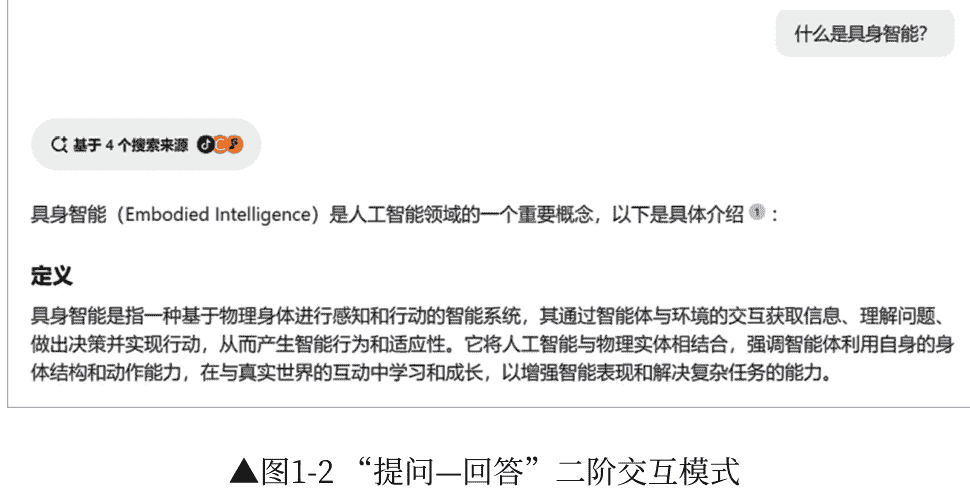


这种可视化源于底层技术创新。ChatGPT类模型多用链式推理Chain-of-Thought，像沿直线行走，把复杂任务拆成依次相连的步骤。若中间某步出错，后续推导会像多米诺骨牌般全盘错误。

DeepSeek采用树状推理Tree-of-Thought，构建类似大树的思考结构。面对复杂问题，它并行探索多个推理路径，每个分支代表一种思路，模型评估各分支合理性并筛选最优路径深入，最终综合得出答案。

两种路线差异如图1-4所示。

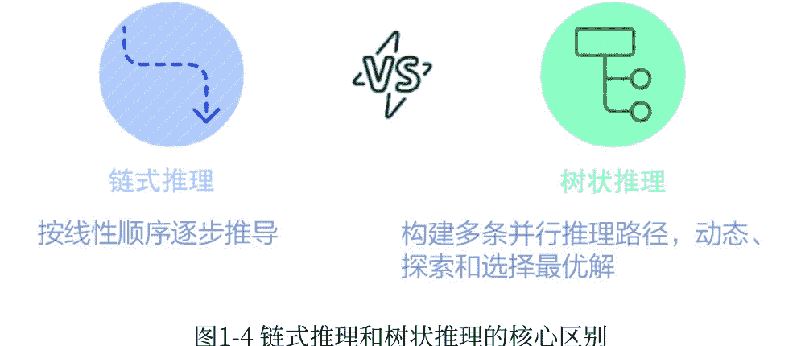

底层创新的结果是DeepSeek在复杂问题上理解力和准确性更强，提升了答案确定性，也为更广泛应用奠定基础。

尽管同属生成式AI，两者在推理技术和体验上差异明显。可把ChatGPT类归为链式推理大模型，DeepSeek归为树状推理大模型，形成清晰分类图谱。

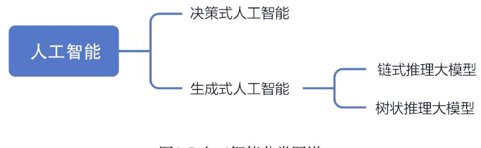

## 本章小结

DeepSeek以远超同行的增速、独特架构和创新交互模式强势崛起，成为AI发展史的关键转折。它在技术突破、产业布局和国际拓展中，有望引领浪潮，重塑行业规则并造福人类生活。

# 第2章 DeepSeek上手操作全解

DeepSeek主要提供网页、App和API三种使用形态。下面将依次说明各自的操作要点和核心特点。

## 2.1 DeepSeek网页版界面与核心功能

在语言模型快速迭代的当下，DeepSeek以独特设计和实用功能给用户带来差异化体验。本节将拆解网页版的版面构成和主要功能，呈现其在语言处理方面的设计亮点。

### 2.1.1 DeepSeek网页版的界面布局

访问 DeepSeek 官方站点 https://www.deepseek.com，首屏采用蓝色系配色，版式极简，整体观感干净利落，如图。


图2-1 DeepSeek 首页概览

页面顶部左侧放置品牌标识，图形是一只蓝色的鲸鱼；顶部右侧则并列两个入口：API 开放平台 与 语言切换。

API 指 Application Programming Interface，即应用程序接口，能让第三方产品调用 DeepSeek 的能力。API 开放平台主要用于购买调用额度、查看使用量以及查阅技术文档。若暂时没有接入需求，这一区块可以先略过。

平台面向全球用户，同时提供中文与英文界面，点击顶部右侧的语言切换即可完成切换。

页面中央是网页版的关键操作区，集中了 “开始对话” 与 “获取手机 App” 两个按钮。点按 “开始对话” 进入人机交互页；点按 “获取手机 App” 会弹出下载二维码，扫码即可安装移动客户端。

### 2.1.2 网页版核心功能详解

从首页进入 “开始对话” 后会打开消息交互页，示意如下。


图2-2 对话页面截图

该页中央的灰色区域用于向模型发送文字指令，后文统一称作对话区。目前网页版仅支持文字交互。

对话区下方并排提供三项可选开关：深度思考（R1）、联网搜索、上传附件 📎，可按需开启。

#### 1. “深度思考（R1）” 选项

此处的 R1 代表 DeepSeek-R1，即具备树状推理能力的版本。若不勾选该选项，系统默认调用 DeepSeek-V3。V3 不执行树状推理，使用手感与常见的 ChatGPT 类大模型相近，交互过程如图。


图2-3 与 DeepSeek-V3 的交互流程

勾选 “深度思考（R1）” 后，模型切换为 DeepSeek-R1，同样的提问会额外呈现思考耗时与推理链路，如图。

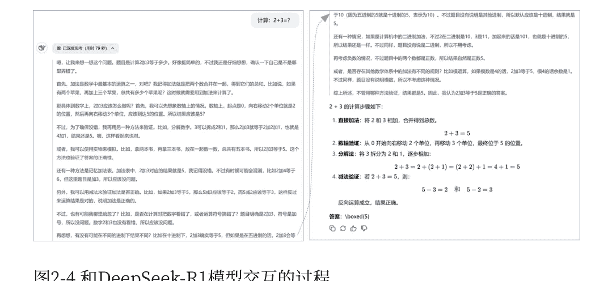

图2-4 DeepSeek-R1 的思考过程展示

R1 发布后获得较高关注，创新点与体验都比较突出，建议日常优先开启。需要留意的是，树状推理计算量较大、耗时较长，面对简单问题时直接使用 V3 会更高效。

#### 2. “联网搜索” 选项

开启 “联网搜索” 后，模型会在线检索资料并据此作答。为更好理解该功能，先说明大模型的数据构成。

主流大模型的数据大致分为内部数据与外部数据两层。内部数据相当于知识库，是模型能力的基础素材，源自海量书籍、报刊、网页等语料，经清洗、去重、标注后用于训练。内部数据有明确的截止时间，例如 DeepSeek-R1 的训练数据截止到 2023 年 10 月，这意味着 2023 年 10 月之后的新知识、新事件不会被直接纳入模型内部。

外部数据则依托联网实时抓取。当问题涉及内部库缺失的内容，尤其是 2024 年及以后的新事实时，外部数据能够及时补位，让回答更具时效与完整性。二者结合才让大模型既有基础理解力，又能保持信息新鲜。

以 “2024 年出生人口是多少？” 为例。不联网时，模型会回复截至 2023 年 10 月 2024 年尚未结束，尚无官方统计数据，具体交互如图。

**截至2023年10月，2024年尚未结束，因此中国（或其他国家）2024年的出生人口尚无官方统计数据。以下是基于当前趋势的分析：**

图2-5 未联网模式下对 2023 年 10 月后信息交互的过程

开启联网后同一问题的结果如图。

**根据国家统计局2025年1月17日发布的官方数据，2024年全国出生人口为954万人，较2023年的902万人增长了52万人，人口出生率为6.77‰ ② ③ ④。这一数据结束了此前连续7年的出生人口下降趋势，是自2016年以来的首次回升 ⑭。**

图2-6 联网模式下对 2023 年 10 月后信息交互的过程

交互页会显示本次检索了 49 个网页，点击信息框可查看来源列表，随后模型会从发布时间、数据口径、来源差异等维度评估合理性，最终给出带注释来源的结论。

#### 3. “上传附件” 选项

该功能支持上传私有文件供模型分析，单次最多 50 个，每个不超过 100MB，如图。


图2-7 上传文件功能演示

实操注意三点。

- （1）目前仅能识别附件中的文字内容，如图。对图片也只是提取其中的文字，无法理解图像语义；音频、视频等多媒体暂时不支持。


图2-8 系统提示仅支持文字识别

- （2）联网搜索 与 上传附件 不能同时使用。勾选联网搜索时，上传附件会变灰并提示“联网搜索不支持上传文件”，如图；反之亦然，如图。


图2-9 联网搜索时文件上传被禁用提示

- （3）支持的格式比较丰富，常见文档有 TXT、Excel、Word、PDF、PPT 等；图片支持 JPG、PNG、BMP；代码文件支持 Python、Java、C++、JavaScript 等；也兼容 ZIP、RAR 压缩包，便于批量上传。

## 2.2 移动客户端界面与核心功能

2.1 节介绍了网页版，接下来聚焦 App 版。

### 2.2.1 移动客户端获取与安装

网页首页提供 App 下载通道，点击 “获取手机 App” 会弹出如图 的二维码。用手机微信、支付宝等带扫码功能的 App 扫描，即可看到下载列表，如图，点击对应入口完成安装。


▲图2-10 App 下载二维码

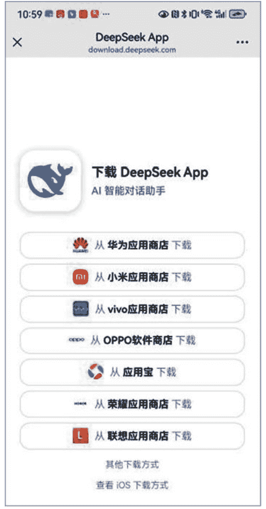

▲图2-11 App 下载渠道列表

也可以直接在手机应用商店搜索 “DeepSeek” 安装。装好后注册登录，点击 “开启对话” 即可进入交互界面。

App 的核心能力与网页基本一致，操作细节略有不同。交互界面顶部左侧的两条横线按钮可查看历史记录；顶部右侧加号新建对话；底部右侧加号展开上传区，提供 “拍照识文字”“图片识文字”“文件” 三个入口，如图。同网页版一样，App 目前仅能分析文字，不支持音频视频等多模态。

# 新对话


# 嗨！我是 DeepSeek

我可以帮你搜索、答疑、写作，请把你的任务交给我吧~

给 DeepSeek 发送消息

-   深度思考 (R1)

-   联网搜索

-   拍照识文字

-   图片识文字

-   文件

图2-12 App 的上传功能区域

### 2.2.2 移动端与网页端的差异对比

核心能力相近，但使用感受有差别。

- （1）运行速度。App 在移动端做了流程简化与交互优化，响应通常更迅速。
- （2）移动场景适配。虽无内置语音输入，但可联动手机输入法语音输入；支持拍照上传，未来有望扩展音频、视频分析。
- （3）输入内容优化。为提升处理效率，App 会对复杂信息做自动优化，如压缩图片、简化文本格式，可能影响后续分析。
- （4）输出答案优化。考虑到手机屏幕阅读体验，App 会缩短段落、增加分段，让阅读更流畅。

## 2.3 API 平台使用说明

个人或机构都可通过 API 接入 DeepSeek。在首页顶部右侧点 “API 开放平台” 购买服务，成功后会生成专属 API key，相当于调用的通行证。

当前服务器资源紧张，网页与 App 偶尔会出现不稳定、卡顿，并提示 “服务器繁忙，请稍后再试”，如图。此时可点交互区下方的刷新按钮 ↻ 重试。


图2-13 网站服务不稳定提示

另一种办法是使用已接入 API 且运行稳定的第三方平台。以下介绍三个可免费使用的平台。

### 第一个：纳米AI。

纳米 AI 是 360 集团的产品，集成多款国内大模型，包括 DeepSeek-R1，网页界面如图。

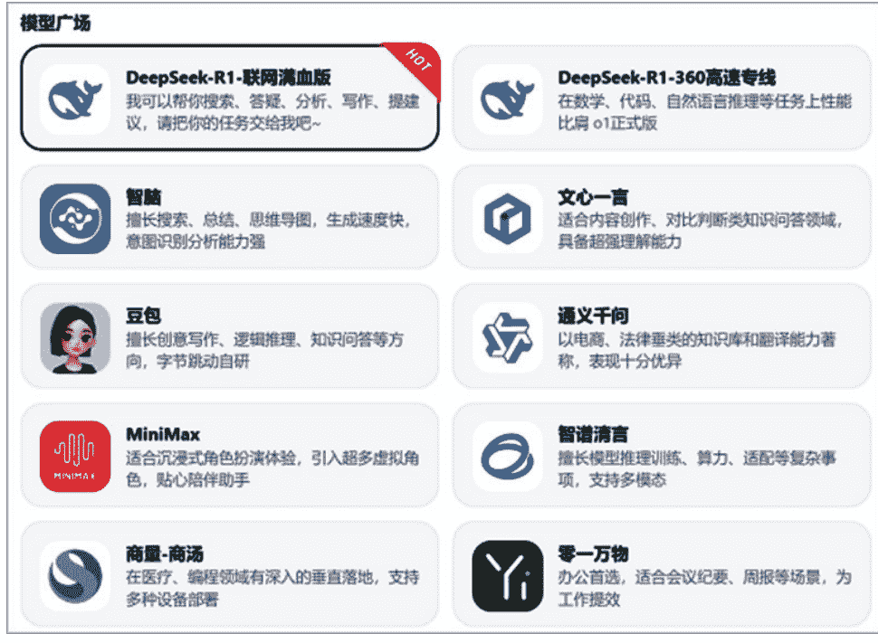

图2-14 多款国内大模型集成页面

网页版提供 DeepSeek-R1-联网满血版 与 DeepSeek-R1-360高速专线 两个入口。功能体验相近，区别在于参数量，前者 671B，后者 32B。参数量越大能力越强，但速度相对慢。简单问题可优先用高速专线。

图2-15 所示为纳米 AI 的 DeepSeek-R1-联网满血版 交互界面。


图2-15 纳米AI 的 DeepSeek-R1-联网满血版 对话页

与官网相比，纳米 AI 仅提供 R1 系列，未提供 V3，也不支持上传附件。

### 第二个：跃问。

跃问由阶跃星辰推出，交互界面如图。


图2-16 跃问 对话界面

未勾选 “深度思考·R1” 时默认使用 Step 大模型；勾选后切换到 DeepSeek-R1。也提供搜索与上传附件功能，与官网设计高度相似。

### 第三个：青泥AI。

青泥 AI 隶属青泥学术，面向学术场景，通过 API 接入 DeepSeek，交互界面如图。

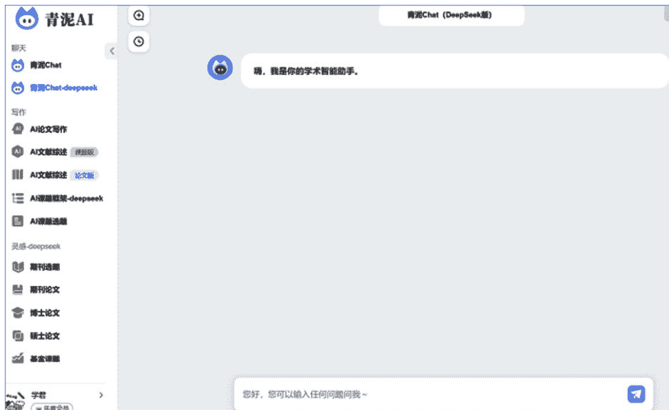

图2-17 青泥AI 对话界面

界面简洁，发送消息后点生成按钮🚀或回车即可。仅提供基于 DeepSeek-R1 的对话，不支持联网搜索和上传附件。其特色是提供课题框架设计、文献综述辅助等学术功能，相关界面如图。


图2-18 基于 DeepSeek 设计课题框架

除上述平台外，腾讯元宝、百度搜索、国家超算中心等也接入了 DeepSeek API，各有侧重，可按需选择。

补充说明：第三方在对接 API 时常会自行设定参数，如温度值 temperature，默认值 1.0。温度越低，输出越理性有逻辑；温度越高，创意性越强。表2-1 为官方给出的参考场景。

## 表2-1 不同温度值适用的场景

| 场景 | 温度值 |
| :--- | :--- |
| 代码生成/数学解题 | 0.0 |
| 数据抽取/分析 | 1.0 |
| 通用对话 | 1.3 |
| 翻译 | 1.3 |
| 创意类写作/诗歌创作 | 1.5 |

除温度值外，Top-p、max_tokens 等参数也会影响同一问题的答案。因此即使接入同一模型，不同平台的回复也可能差异明显。建议以 DeepSeek 官网为主、第三方为辅。

## 本章小结

前一章已经把 DeepSeek 的主要入口过了一遍，网页端、移动 App 以及开放 API 的使用方式和主要能力都做了盘点。网页端面版走的是简洁路线，功能却很集中，R1 深度思考、实时联网检索、附件上传这些能力都能用上，覆盖的场景比较全。移动端在功能上与网页基本对齐，但更贴合手机使用习惯，加入了拍照识字，输入输出的顺滑度和响应速度都有提升。开放 API 则给了第三方平台接入的通道，目前纳米 AI、跃问、青泥 AI 等产品已经完成对接，使用者可以获得更多样化的服务形态。

# 第3章 让 DeepSeek 更好用的指令写法

在熟悉了 DeepSeek 网页、App 与 API 的使用路径后，对其灵活性和能力边界有了更直观的感受。光会操作还不够，真正释放模型潜力靠的是指令的质量。高质量的指令能让模型更准地捕捉意图，也能让结果更贴合任务目标。接下来聚焦如何构建更有效的指令，更好地发挥 DeepSeek 的核心能力。

## 3.1 到了 DeepSeek 时代，指令写作还有价值吗

人机交互的形态在技术迭代中一直在变。

在指令式智能阶段，交互主要依赖固定的入口或受限输入，比如代码指令、按钮、菜单，模型只能按预设规则执行，弹性与自主性都很有限。

进入生成式智能阶段后，提示词成为主流的交互方式。提示词就是用户给大语言模型下达的任务描述，用来引导生成特定内容。用户用日常语言把需求说清楚，模型就能解析并给出贴合要点的回应，交流更接近自然对话。

在与模型协作的过程中，为了拿到高质量、准确且有针对性的输出，研究者和使用者总结出不少规律，形成了一套优化策略。比如把问题表述得更明确、挑选合适的关键词、补充上下文、增加限制条件等，都能明显改善生成内容的实用性。

对提示词的设计与优化工作被称作提示工程，从事相关撰写与优化的人被称为提示工程师。这也说明提示词在生成式智能交互中的核心地位已经得到行业的高度认可。

相较于 ChatGPT 类模型，DeepSeek 在交互体验上做了优化。DeepSeek-R1 最大的亮点是推理过程可视化。提问后，用户可以看到模型从理解问题、拆解分析、逐步推演到最终作答的完整思路。这种直观呈现让使用者感觉模型真的理解了意图，所以不少人认为没必要再精雕细琢提示词，口语化表达就能得到满意答案。

我们对这个说法持保留态度。

那么 DeepSeek 出现后，提示词是否还有必要？如果仍有意义，应该怎么用？

我们的判断是：对 DeepSeek 这类大模型而言，提示词依然不可替代，只是使用范式发生了迁移。

科学的做法是：简单问题配简单提示，复杂问题必须配复杂提示。其本质是“以问题为中心，以效率为导向”的人机协作新模式。

## 3.2 怎么判断一个问题的难易程度

在 DeepSeek 对话中，提一个好问题的重要性远高于单纯拿到答案。而能否准确识别问题类型，是提好问题的首要前提。

表面看简单与复杂问题的边界模糊，像是主观感受，实际上二者存在客观且清晰的分界。

为此我们提出“五维问题复杂度判断框架”，见表3-1。

### 表3-1 五维问题复杂度判断框架

| 维度 | 简单问题 | 案例 | 复杂问题 | 案例 |
| :--- | :--- | :--- | :--- | :--- |
| 信息维度 | 单一信息点，无上下文 | 量子计算的基本单位是什么？ | 多信息源交叉验证，需依赖上下文关联 | 量子计算在金融风控中的应用与伦理挑战 |
| 逻辑维度 | 线性逻辑，单步推理即可解决 | Python如何将列表转为字典？ | 网状逻辑，需多步推理与逻辑验证 | 设计一个基于机器学习的舆情分析系统架构 |
| 领域维度 | 通用知识或单一专业领域 | 网络安全法的颁布时间 | 跨学科知识融合 | 区块链技术在医疗数据确权中的法律与技术协同机制 |
| 输出维度 | 确定性答案（事实/定义/公式） | 欧拉公式的数学表达式 | 创造性输出（方案/分析/预测） | 预测AI监管政策对自动驾驶行业的影响路径 |
| 验证维度 | 答案可通过单一权威源验证 | ISO9001最新版的发布日期 | 需多源交叉验证与逻辑自洽性检验 | 评估元宇宙概念对传统零售业的颠覆性影响 |

借助该框架，可从信息、逻辑、领域、输出、验证五个维度对问题进行判定，从而快速明确类型并选择匹配的解决策略。

在此基础上，我们归纳出“问题复杂度层级”，详见表3-2。体系共设 L1 记忆检索、L2 理解应用、L3 分析推理、L4 综合评价、L5 创新生成五个层级。层级越高，问题深度和解决难度越大。

### 表3-2 问题复杂度层级

| 复杂度层级 | 复杂度描述 | 案例 |
| :--- | :--- | :--- |
| L1 记忆检索 | 单一事实查询 | 地球的公转周期是多少？ |
| L2 理解应用 | 概念解释+简单应用 | 解释什么是光合作用，并说明其对生态系统的重要性 |
| L3 分析推理 | 多因素关联分析 | 分析影响房价的因素，如地理位置、政策法规、经济发展水平等 |
| L4 综合评价 | 跨领域系统评估 | 评价在线教育对教育公平、教学质量和学习体验的影响 |
| L5 创新生成 | 突破性方案设计 | 设计一个能够有效促进城市居民垃圾分类的创新激励机制 |

依据该层级，可以借助大模型来判断问题复杂度。因为属于对比判断类任务，建议使用 DeepSeek-V3 或豆包等具备链式推理能力的模型。下面演示在 DeepSeek-V3 中的操作。

第一步：将“问题复杂度层级”喂给大模型，由于是表格，可直接截图投喂，如图3-1所示。

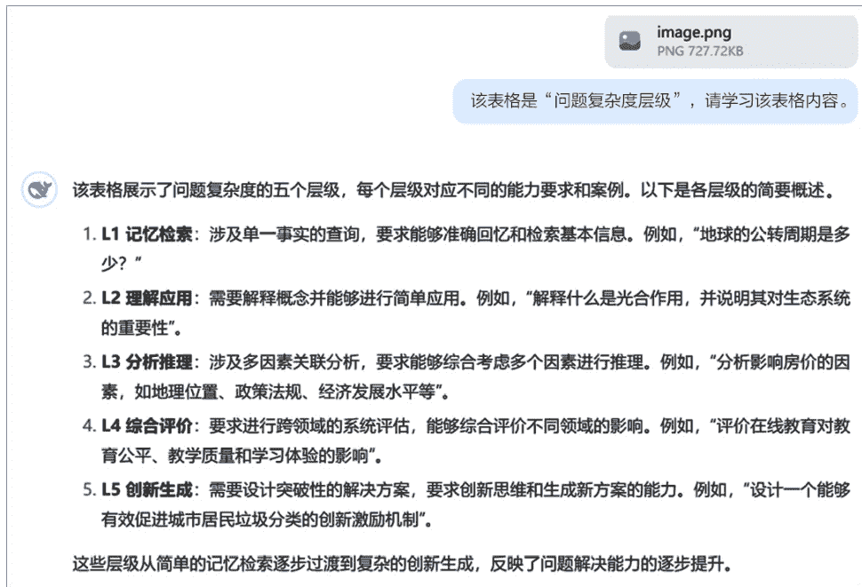

图3-1 把问题复杂度层级表格截图给 V3 参考

第二步：请模型参考层级表判断问题类型。设计一个测试提问，如图3-2所示。

> 帮我判断以下问题的类型：请你扮演一个刚从美国留学回国的人，说话时候会故意中文夹杂部分英文单词，显得非常fancy，对话中总是带有很强的优越感。

这个问题属于 **L5 创新生成** 层级。原因如下。

1. **创新性**：问题要求你扮演一个特定角色，并模拟一种独特的语言风格和行为模式。这需要创造性地设计对话方式和表达风格，以符合角色的特点。

2. **突破性方案设计**：你需要设计一个能够体现角色优越感和语言特点的对话方式，这涉及对角色心理、语言习惯和文化背景的综合理解和创新应用。

3. **复杂情境模拟**：问题不仅要求语言上的创新，还要求你在对话中持续保持角色的优越感和特定的语言风格，这需要高度的情境模拟和角色扮演能力。

因此，这个问题需要你生成一个突破性的、具有创新性的对话方案，符合 L5 层级的要求。

图3-2 基于问题复杂度层级判断问题类型

并非每次交互前都要做类型检测，其目的在于通过演示加深对问题类型的理解，提升敏感度，从而在撰写提示词时更有针对性，引导模型产出更符合预期的结果。

## 3.3 DeepSeek 指令设计的六定模型

面对复杂问题时，设计指令需要把握六个核心要素：定角色、定背景、定目标、定方法、定结构、定基调。六个要素构成指令设计的思维框架，我们称之为六定模型，如图3-3所示。

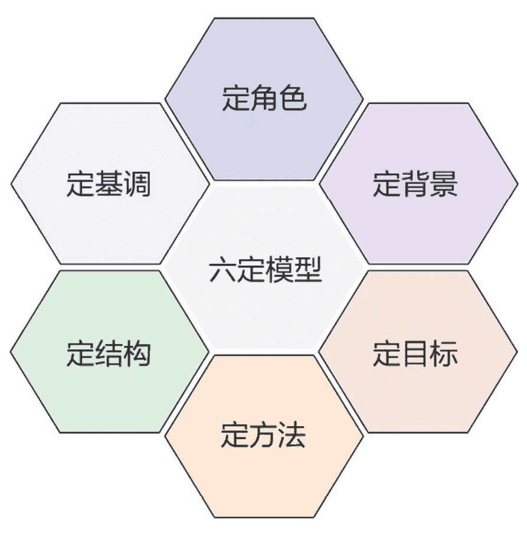

图3-3 DeepSeek 指令方法论：六定模型

### 3.3.1 六定模型核心要素解析

掌握六定模型，首先要理解其六个要素。厘清这些要素有助于搭建精准的指令框架，让模型输出更专业、更贴合、更实用。

第一个要素：定角色。

定角色就是为模型指定一个具体身份，如广告创意总监、心理咨询师等，引导其以该身份的思维方式和知识体系作答。这是一种通过结构化信息强化可信度的定位策略，能显著提升专业性和场景适配度。

角色可通过专业身份、视角限定、知识边界三个维度构建。

1. 专业身份锚定。
借助公信力强的资质或行业认可的职称作为背书，确立权威性。例如，国家二级心理咨询师、微软认证 AI 工程师、牛津大学教育学博士等。

2. 视角限定聚焦。
通过应用场景和核心关注领域的限定缩小解决范围。通常用“方向+经验值+方法论”模式。例如，“专攻青少年抑郁干预，擅长应用 CBT，累计咨询时长超 2000 小时”。

3. 知识边界声明。
明确角色可覆盖的专业范围，避免越界。一般用“基于……”“在……范围内”等句式。例如，“基于《中国居民膳食指南 2022》提供建议，具体诊疗请遵医嘱”。

#### 案例对比

**普通提问：** 如何写一篇关于环保的文章？

**定角色：** 你是一位环境科学领域的资深记者，请分析当前全球碳排放问题的核心矛盾，并提出解决方案。

### 实操案例

请分析以下两个案例，哪个表述更精准？

**案例1：** [国家二级心理咨询师（青少年方向）]+[专注青春期情绪障碍干预8年]+[基于认知行为疗法框架，不涉及药物治疗与家庭法律纠纷]

**案例2：** [资深情感咨询师]+[解决婚姻危机]+[提供法律建议和财产分割方案]

#### 分析：

案例1更为精准，清晰描述了专业身份、视角限定和知识边界，歧义极少。案例2则较为模糊，身份缺乏资质背书，视角笼统，知识边界混乱，情感咨询师不具备提供法律咨询的专业性。

第二个要素：定背景。

设定背景是提升内容精准度和情境适配性的关键。通过明确时间空间、事件背景、受众特征，能有效框定模型的思考范围，避免空泛。

1. 明确时间/空间。用时空锚点建立参照系，避免知识混淆。时间包括绝对时间如“2025 年汽车置换更新补贴政策”、相对时间如“未来 3 个月市场预测”；空间包括物理位置如“东南亚市场”、虚拟空间如“元宇宙社交场景”。

**低效提示：** 分析新能源汽车发展趋势。
**优化提示：** 基于“欧盟碳关税”政策，分析中国新能源车企在德国市场的竞争策略。

2. 叙述事件背景。需包含事件起因、发展进程、关联方、核心矛盾四个要素。

**模糊背景：** 写一份产品推广方案。
**精确背景：** 你是[公司名称]市场推广负责人，公司 2025 年第二季度将推广 AR 导航智能眼镜，已完成研发内测，准备小范围试运营。主要竞品是 Apple Vision Pro 二代，我们的眼镜更轻便、AR 导航更精准。目前需解决消费者对此类产品的低认知问题，加大宣传，技术上也要持续优化算法。请基于以上信息撰写推广方案。

3. 描述受众特征。包括人口统计学属性、认知特征、行为特征、文化特征。

**初级描述：** 目标用户是年轻人。
**进阶描述：** 25~35 岁一线城市科技从业者，熟悉智能硬件，年收入 30 万~50 万元，偏好极简设计风格。

#### 案例对比

**模糊提问：** 如何提高员工积极性？
**定背景：** 在远程办公常态化背景下，一家互联网公司的技术团队出现协作效率下降问题，请设计 3 种提升员工积极性的具体方案。

### 实操练习

请根据给定的主题，从明确时间/空间、叙述事件背景、描述受众特征三个方面，将下面的“低效提示”优化为“精准提示”。

**主题：** 设计一款健身 App 的运营方案。
**低效提示：** 设计一款健身 App 的运营方案。

优化要求如下。
**明确时间/空间：** 设定一个具体的时间范围和目标市场空间。
**叙述事件背景：** 详细说明 App 的开发进度、当前面临的问题、主要竞争对手等。
**描述受众特征：** 清晰描述目标用户的人口统计学属性特征、认知特征、行为特征和文化特征。

第三个要素：定目标。

定目标就是在特定情境下，把期望结果转化为具体、可衡量、有时限且相关的陈述。

可遵循三步法。

1. 明确结果类型。界定输出形式，如分析报告、创意方案、操作指南、对比表格、故事脚本等。

**模糊需求：** 教我做用户增长。
**精准目标：** 请制作一份可供新手运营人员操作的“社群裂变操作指南”。

2. 量化指标设定。为目标设定具体参数，如字数、步骤数、案例数、时间范围等。

**模糊需求：** 写产品文案。
**精准目标：** 为智能手环撰写 3 篇抖音短视频口播文案，每篇不超过 30 字。

3. 强调关键要求。突出特殊限制条件，如受众水平、成本限制、格式规范、平台适配等。

**模糊需求：** 分析销售数据。
**精准目标：** 请分析第三季度销售数据，重点标注华东地区母婴品类同比下跌 20% 的数据异动，要求包含 3 个归因假设和 2 张可视化图表。

#### 案例对比

**模糊提问：** 撰写一份培训方案。
**定目标：** 开展线上 AI 入门培训，为期 10 天，每天授课 4 小时，面向零基础的大学生群体，基于以上信息帮我撰写一份培训方案。

### 实操练习

请根据目标制定的三步法，将以下“模糊需求”转化为精准、可执行的目标。

**模糊需求：** 设计一个调查问卷。

第四个要素：定方法。

在提示词中明确完成任务所需的具体方法、工具或流程，能把抽象问题转化为可操作框架，让生成内容更科学、可行，减少无效发散。

主要包括：

1. 分析框架。指定结构化模型或理论框架，如 SWOT、PEST 等。

基于 PEST 模型，分析 2024 年人工智能企业在中国的营商环境与商业机遇。

2. 创作手法。指定艺术或逻辑表达方式，如蒙太奇叙事、对比论证法等。

用蒙太奇手法设计一个公益广告脚本，主题为“城市中的孤独感”。

3. 技术工具。明确工具或技术路径，如 Python 编程、问卷调查等。

用 Python 编写一个爬虫程序，抓取豆瓣评分位于前 250 名的电影及其短评，并生成词云图。

4. 流程设计。规定执行步骤或开发模式，如瀑布式开发、敏捷迭代路线图等。

按瀑布模型为某银行设计信用卡系统升级方案。

#### 案例对比

**模糊提问：** 分析某奶茶品牌的竞争力。
**定方法：** 使用波特五力模型分析喜茶在 2024 年新茶饮市场的竞争态势，重点说明供应商议价能力和替代品威胁。

### 实操练习

**按照以下要求，撰写提示词：**

按照双钻石设计流程制订用户调研计划，明确：发散阶段（20 人焦点小组实施要点）、收敛阶段（用户需求以 KANO 模型分类）、从 4 个维度设计核心用户画像。

第五个要素：定结构。

定结构就是规范内容的组织形式，确保信息逻辑清晰、便于理解和应用。结构化设计能降低认知负担，帮助快速抓住核心。

可从以下方向入手：

1. 叙述顺序，其类型有时间轴、因果链、逻辑链，如表 3-3 所示。

表3-3 叙述顺序类型

#### 类型与结构特征

| 类型 | 适用场景 | 结构特征 | 案例参考 |
| :--- | :--- | :--- | :--- |
| 时间轴 | 流程说明、历史演进 | 按时间节点排列，展示事件连续性 | 项目进度报告、操作手册步骤等 |
| 因果链 | 问题分析、策略推导 | 以“问题—原因—影响—对策”链式展开 | 事故调查报告、商业决策建议书等 |
| 逻辑链 | 理论阐述、案例论证 | 采用金字塔结构：结论先行—分层论证—数据支撑 | 学术论文框架、产品设计方案等 |

- 时间轴：按照事件发展顺序组织内容，像顺叙、倒叙就属于此类。这种方式适用于流程说明或历史回顾，能让读者清晰地把握事件的先后进程。

- 因果链：适用于问题分析与策略推导，常见的结构特征是“问题—原因—影响—对策”。在实际应用时，往往需要基于此结构特征，再结合具体场景来设计叙述的结构层级。这特别适合分析类内容，能帮助我们梳理问题的来龙去脉，找到解决问题的思路。

- 逻辑链：适用于理论阐述和方案论证，常用金字塔结构，先呈现结论，再分层论证，最后以数据支撑。例如学术论文，先给出结论，接着分层论述，并用数据佐证。

## 提问升级：从含糊到可落地

### 对比一：故障分析

含糊表述：分析新能源汽车充电故障。

可落地表述：请以品控工程师的身份，沿着因果链条拆解充电异常：现象层面充电效率大约下降二成；根因层面电池管理系统电压采样出现偏差；传导层面导致SOC估算偏移；影响层面引发用户续航焦虑。输出要求用鱼骨图排列要素，并在每个节点标注置信概率。

呈现手法的参考，见表3-4。

#### 表3-4 呈现方式的优劣、场景与要点

| 呈现方式 | 优势 | 适用场景 | 设计要点 |
| :--- | :--- | :--- | :--- |
| 条列式 | 信息集中，扫读快 | 技术文档、政策解读 | 层级不超过三层，符号统一 |
| 对话式 | 代入感强，门槛低 | 培训课件、用户手册 | 明确角色标签，如系统提示 |
| 图示式 | 关系直观 | 数据分析报告、架构说明 | 遵循标题+来源+解读的规范 |

- 条列式：信息密度高，便于快速扫描。技术文档里可列出操作步骤，政策解读时能清晰呈现条款要点。
- 对话式：增强代入感，降低理解难度。常用于培训材料、用户指南，模拟互动便于理解。
- 图示式：直观呈现复杂关联。数据分析报告里展示趋势，架构说明里呈现系统结构。设计遵循标题概括主题、标明来源保证可信、解读要点辅助理解。

### 对比二：数据可视化

模糊提问：将2024年第四季度销售数据做可视化。

结构化提问：你是一名擅长数据可视化的商业分析师，请把2024年第四季度销售数据整理成决策层可快速阅读的图表组合报告。组合策略为主仪表盘展示关键指标同比环比、热力图展示区域分布、折线图展示月度走势并叠加预测线；标注规则为异常点用红色▲加悬停详情、预测区间以浅色背景带呈现；交互需支持下钻，单击区域跳转明细，并提供产品线、渠道类型的动态筛选；输出格式为HTML。

### 实战练习

背景：某智能硬件公司收到用户反馈，智能手表实际续航与宣传参数偏差约20%。作为产品体验设计师，需对设备续航异常做结构化拆解，帮助团队快速定位根源。

练习要求按以下建议设计指令。

1. 叙述顺序
采用因果链，按层级展开。
1. 现象层，用户能感知的表现。
2. 触发层，直接引发现象的操作或事件。
3. 根因层，系统层面的技术缺陷。
4. 影响层，商业价值与用户体验的损失。

2. 呈现方式
1. 条列式：用编号列表呈现关键节点。
2. 图示式：设计矩阵图对比不同使用场景的功耗，仅需文字描述要素。

### 第六要素·定基调

定基调即通过风格调控匹配使用场景，提升表达效果。核心是多维度动态调节，实现信息传递精准适配。具体需在专业程度、情感倾向、文化适配三个维度平衡，本质是借助多维参数让生成内容的风格与情感恰当。

1. 专业程度的调节区间：在学术严谨与大众传播间连续调控。
① 术语密度控制。学术端强制使用领域专有名词，如半衰期、方差分析；科普端则用类比解释，如像水库放水、药物浓度随时间下降。
② 句式结构优化。学术多用复合句加被动语态，如实验结果被反复验证；口语偏好设问加主动语态，如想知道为什么吗。
③ 论证逻辑深度。科研论文遵循假设—数据—推论；科普则采用故事化叙事，按现象—疑问—解答结构。
示例。
- 请用初中生能懂的比喻解释量子纠缠，避免数学公式。
- 把案例的学术内容转为大众化风格。

2. 情感倾向的动态平衡：在理性与共情间梯度调节。
① 情感标记词植入。理性模式禁用优秀、糟糕等主观评价词；共情模式嵌入令人震撼、深感遗憾等强化词。
② 人称视角转换。中立用第三人称客观呈现；共鸣则用第二人称对话，如当你面对……。
③ 修辞策略选择。理性表达靠数据与条件概率，如约七成案例显示……；情感渲染用感官描写与修辞，如仿佛触摸到历史脉搏。
示例。
- 把生存率提升15%转换为患者易懂且充满希望的表述，如您有更大机会恢复健康。

3. 文化适配调谐：使外来文化与本土文化适配，需语境重构。
① 符号系统转换。西方语境常用希腊神话作类比，东方可用二十四节气隐喻。
② 价值观映射。个人主义强调个性突破，集体主义突出协同价值。
③ 禁忌规避机制。在宗教敏感区替换争议意象；针对地域差异调整计量单位，如将亩换为公顷。
示例。
- 解释区块链时对比丝绸之路商队信用体系，避免赌博案例。

#### 基调对比案例

中性表述：介绍公司新产品。

定基调：以脱口秀幽默口吻，用网络流行语为Z世代用户介绍最新智能手表亮点，要求包含3个谐音梗。

### 实战练习

场景：你作为科普期刊编辑，需把一篇关于阿尔茨海默病新药研究的论文摘要转为科普文章。

原始内容：
本研究通过双盲随机对照试验评估X化合物疗效。PET扫描显示实验组β淀粉样蛋白沉积量较对照组下降32.4%，ADAS-cog量表改善1.8分。不良反应发生率与安慰剂组相比，无统计学差异。

要求：
1. 转化为面向中学生的科普短文。
2. 使用至少2个生活化类比解释专业概念。
3. 采用现象—疑问—解答叙事结构。
4. 句式主动语态占比大于70%。

基于上述对六定模型的介绍，为帮助读者更直观系统了解该模型，下面将其核心要点梳理整合，制成思维导图，详见图3-4。

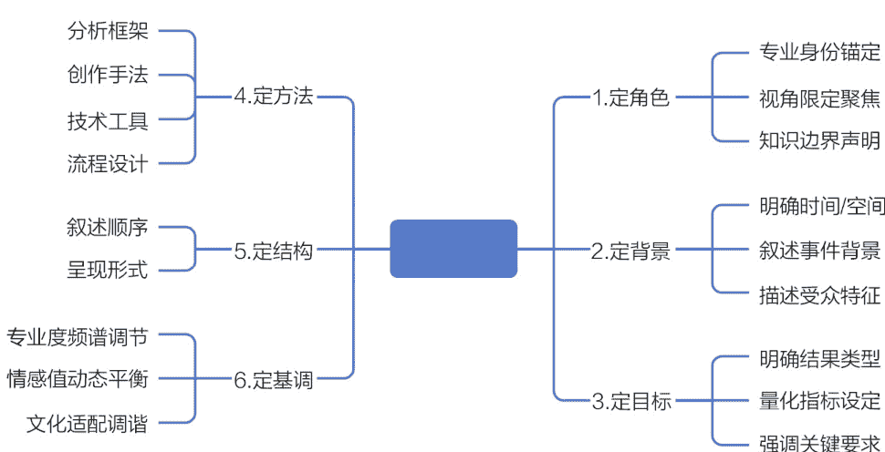

图3-4 六定模型的思维导图

### 3.3.2 六定模型案例分析

结合上文阐述的六定模型，我们提炼出适配大模型的提示词结构模板，可参照设计撰写提示词。

#### 大模型提示词设计模板

作为[角色]，在[背景]下，请完成[目标]，采用[方法]，按[结构]组织，内容需符合[基调]。

在基于六定模型设计提示词时，注意以下几点。

#### 1. 思考与撰写顺序

依循定角色、定背景、定目标、定方法、定结构、定基调的顺序深入思考，明确各要素内涵与关联。但实际撰写时不必拘泥顺序，可依据具体需求灵活调整，使提示词更契合任务情境，引导大模型生成更符合预期的结果。

#### 2. 要素选取

面对高度复杂任务，可全面运用六定模型的6个要素，构建完整体系。若任务相对简单，可根据复杂度有针对性选取部分要素。其中，目标是核心要素，其他要素都应围绕目标合理搭配，确保提示词紧密围绕任务核心。角色加目标组合可解决大多数常规任务，随着问题复杂度升级，可组合更多要素。

#### 3. 适用范畴

六定模型应用领域广泛，不仅适用于文本类目标提示词设计，在设计有关图片、音乐、视频等多模态类提示词时同样效果显著。不过实际操作中需与对应专业工具协同使用，如设计图片需借助图像生成工具，从而实现多模态内容优质创作。

为更深入理解掌握设计提示词的六定模型，下面以完整案例系统性展示基于六定模型的深度思考过程。

案例背景：某公司是一家在线教育公司，考虑到大模型是一款高效生产力工具，因此想设计面向公司内部的DeepSeek使用培训方案。

#### 第一步：定角色。
确定角色时，可从3个维度思考：专业身份、视角限定和知识边界。要想设计一份优秀且实效的培训方案，就需要具有专业能力的专家人设。考虑到该工具是一款生产力工具，且培训面向公司内部员工，故选择资深生产力工具培训专家。这类专家熟悉各种办公软件和生产力工具使用技巧，有丰富企业内部培训经验，能够根据不同岗位员工需求，提供针对性培训内容，帮助员工快速掌握使用方法，提升工作效率。

角色设定：资深生产力工具培训专家，拥有10年以上办公软件和生产力工具培训经验，曾为多家知名企业开展内部培训，成功帮助员工提升工作效率30%以上，擅长根据不同岗位需求定制培训方案。

#### 第二步：定背景。
明确培训的时间、空间、事件背景和受众特征，能让培训方案更贴合实际。时间设定为2025年3月，公司业务发展迅速，对员工工作效率有更高要求；空间为公司内部线上线下结合的培训环境，方便员工参与；事件背景是，公司引入这款高效生产力工具，希望员工熟练运用，提升工作效率和协作能力，但目前员工对其了解甚少；受众特征为公司各部门员工，包括教学、教研、运营、市场等岗位，他们工作内容不同，对工具需求也有差异，但都需要提升工作效率，部分员工对新工具接受能力较强，部分员工可能需要更多指导和练习。

背景设定：2025年3月，公司引入生产力工具，希望员工熟练运用以提升工作效率和协作能力，但员工对其了解甚少。培训受众为公司各部门员工，包括教学、教研、运营、市场等岗位，工作内容和工具需求不同，不同员工对新工具接受能力有差异。

#### 第三步：定目标。
根据背景和培训需求，明确具体、可衡量、有时限且具有相关性的目标。结果类型为制定培训方案，量化指标设定为在培训后1个月内，使80%员工熟练使用核心功能，员工整体工作效率提升20%；关键要求是培训方案要结合不同岗位需求，设置个性化培训内容和实践环节。

目标设定：制定一份为期2周的使用培训方案，在培训后1个月内，使80%员工熟练使用核心功能，员工整体工作效率提升20%。方案需结合不同的岗位需求，设置个性化培训内容和实践环节。

#### 第四步：定方法。
为使培训方案更具科学性和有效性，不仅要明确培训方法，还要加入全面评估体系。采用理论讲解与实践操作相结合的方法，通过线上直播进行理论知识讲解，让员工了解功能和原理；再组织线下小组实践，让员工在实际操作中加深掌握程度；利用案例分析法，展示工具在不同工作场景中的应用，帮助员工更好地理解和运用。同时，借助柯氏四级评估模型对培训效果进行全面评估。

方法设定：采用理论讲解与实践操作相结合的培训方法。先通过线上直播进行理论知识讲解，再组织线下小组实践。运用案例分析法展示工具在不同工作场景中的应用。借助柯氏四级评估模型，从反应、学习、行为和结果4个层面评估培训效果。其中，反应评估，在每次课程结束后1小时内通过在线问卷收集；学习评估，在培训结束后的3天内进行线上理论测试和线下实操考核；行为评估，在培训后1~3个月内，每月由直属上级进行观察评估；结果评估，在培训后的3~6个月内对比公司整体业务指标。

#### 第五步：定结构。
为了使培训方案逻辑清晰，便于理解和执行，采用时间轴叙述顺序，按照培训前准备、培训实施、培训后评估3个阶段进行安排；呈现形式，结合使用条列式和图示式，通过条列式呈现培训内容、培训方式、考核方式等，用图表展示培训进度安排、员工学习成果统计等。

结构设定：按时间轴结构，分为培训前准备、培训实施、培训后评估3个阶段。采用条列式和图示式相结合的呈现形式，通过条列式呈现培训内容、培训方式、考核方式等，用图表展示培训进度和员工学习成果。

#### 第六步：定基调。
考虑到培训对象是公司内部员工，采用专业、实用且鼓励式的基调。语言表达简洁明了，避免过多专业术语，使用通俗易懂语言和案例进行讲解；在培训过程中，鼓励员工积极提问和参与实践，营造轻松学习氛围。

基调设定：以专业、实用且鼓励式语言风格撰写培训方案，使用简洁易懂语言和案例进行讲解，鼓励员工积极参与，营造轻松学习氛围。

以上是完整思考过程，最后将以上各模块内容汇总，形成完整提示词。

### 实操案例

你是资深生产力工具培训专家，拥有10年以上办公软件和生产力工具培训经验，曾为多家知名企业开展内部培训，成功帮助员工提升工作效率30%以上，擅长根据不同岗位需求定制培训方案。

2025年3月，公司内部引入了生产力工具，但员工对其了解甚少。培训受众为公司各部门员工，包括教学、教研、运营、市场等岗位，他们工作内容和工具需求不同，员工对新工具接受能力有差异。公司希望员工熟练运用该工具，提升工作效率和协作能力。

请制定一份为期2周的使用培训方案，在培训后1个月内，使80%员工熟练使用核心功能，员工整体工作效率提升20%。方案需结合不同的岗位需求，设置个性化培训内容和实践环节。

采用理论讲解与实践操作相结合的培训方法。先通过线上直播进行理论知识讲解，再组织线下小组实践。运用案例分析法展示工具在不同工作场景的应用。借助柯氏四级评估模型，从反应、学习、行为和结果4个层面评估培训效果。其中，反应评估，在每次课程结束后的1小时内通过在线问卷收集；学习评估，在培训结束后的3天内进行线上理论测试和线下实操考核；行为评估，在培训后1~3个月内，每月由直属上级进行观察评估；结果评估，在培训后的3~6个月内对比公司整体业务指标。

以专业、实用且鼓励式语言风格撰写培训方案，使用简洁易懂语言和案例进行讲解，鼓励员工积极参与，营造轻松学习氛围。

以上提示词提供了很多细节，但是有点长，在此基础上，我们可以再提炼一个简洁版。

### 实操案例

以资深生产力工具培训专家身份，结合10年以上培训经验及多家企业内部培训成功案例，针对不同岗位定制方案。2025年3月公司内部引入工具，员工对其了解较少。培训对象为各部门员工，其需求和接受能力有差异。目标是2周培训后1个月内，80%员工熟练掌握核心功能，整体工作效率提升20%。

培训采用理论与实践相结合方式，线上直播讲理论，线下小组实践，用案例分析展示应用。借助柯氏四级评估模型，从反应、学习、行为、结果4个层面进行评估，反应评估在课程结束后的1小时内完成问卷收集，学习评估在培训结束后的3天内理论和实操考核，行为评估在培训后1~3个月内由直属上级观察，结果评估在培训后3~6个月内对比业务指标。

用专业、实用、鼓励式语言风格，简洁易懂表述方式，结合具体案例，制定培训方案。

没有完美的提示词，好的提示词都是不断测试迭代出来的，读者可以将以上提示词发送给大模型，然后根据答案不断迭代。

### 3.3.3 基于自动化撰写六定模型提示词

在3.3.2小节中，我们用一个完整案例展示了运用六定模型来思考和设计提示词的过程。可能会有人觉得这个方法操作难度较大，实施起来挑战很大。别担心，这一节，我们将介绍一种更为简便的撰写提示词的方法，即借助大模型自身强大能力，基于六定模型，实现提示词自动化撰写。自动化撰写提示词可以参考以下步骤。

第一步：向大模型投喂六定模型。
将3.3.1小节中关于六定模型要素的内容，删掉案例内容后，投喂给大模型，具体操作如下。

### 实操案例
学习以下内容，学习完成后回复完成。学习内容如下：
###设计和撰写提示词的六定模型核心要素解析。
第一个要素：定角色
定角色，就是为大模型指定一个具体角色，如广告创意总监、心理咨询师等，引导它以这个角色身份、思维和知识进行思考。定角色是一种精准定位专业身份的表述策略，通过结构化信息强化可信度，可显著提升输出专业性与场景适配性。
定角色可以通过专业身份、视角限定和知识边界3个维度构建权威人设。这是一种结构化定义职业角色的方法，旨在通过明确身份、领域边界与专业范围，提升角色可信度与专业深度。以下为各要素分解与示例分析。
......
这一步操作中有几个要注意细节。
1. 指令设置。投喂阶段，只需要大模型学习内容，不需要它再次重复输出，所以开始的时候输入如下指令：
学习以下内容，学习完成后回复完成。
2. 格式处理。将3.3.1小节中关于六定模型要素的内容放在#号之间，材料开始前放3个#号，材料结束后放3个#号，形式为###六定模型要素内容###。#号是Markdown语言，表达意思为#号内的是材料，大模型会理解这个意思，然后对内容属性进行区分。

第二步：基于六定模型自动化撰写提示词。
完成第一步，即大模型成功学习六定模型后，接着就要引导大模型基于其对六定模型的理解自动化撰写提示词。这一步骤极为关键，其中的核心操作是向大模型提供撰写提示词的专属材料。
例如3.3.2小节的案例，任务是设计一个企业内部培训方案，那就需要把公司情况、人员构成、具体培训需求等信息提供给大模型，引导大模型撰写出符合真实需求的提示词。
需要注意的是，为大模型提供的材料不必过于追求结构化和标准化，只需将想到的相关材料整理、汇总后提供即可。因为大模型具备一定理解和补充能力，能够依据自身对这些材料的理解，补充完善一些细节。具体操作可参考图3-5。

把需求转化为能直接使用的提示词，关键在于先给模型一个明确的任务指令。例如可以这样引导：“参考以下材料和需求，基于六定模型，帮我撰写提示词。注意：不需要满足六定模型中每一个要求，根据实际情况，选择关键要素，设计提示词，最后输出完整提示词”。同时把专属素材仍保留在#号之间。

图3-5 引导DeepSeek撰写专属提示词

实操时别忘了加上这句引导DeepSeek生成专属提示词的命令，素材部分继续用#包裹起来。

#### 第三步：细化提示词，定稿细节
完成第二步后，DeepSeek 会先给出一条初稿。初稿往往与真实需求有偏差，这时就要进入精修。修正方式有两种：一是回到第二步，调整当时的指令再重新生成；二是直接在初稿基础上手工改写，补齐遗漏、修正偏差。

#### 第四步：新建对话，将提示词发送给DeepSeek
把打磨好的提示词放到新对话里发送。DeepSeek 会依据指令的理解与推理能力，整合信息并产出结果。

#### 第五步：检验结果
拿到最终输出后先做验收。通过就结束，不通过就回溯到前面任一步继续优化提示词。记住，高质量的答案很少一次成型，需要反复试错、逐步迭代。

### 
### 3.4 六定模型的优劣透视

六定模型是面向 DeepSeek 的一种提示词设计思路和方法论，能在一定程度上提升人机交互效率。像所有新方法一样，它既有亮点也有短板，下面展开说明。

### 3.4.1 六定模型的长处

乍看似乎很繁琐，六定模型本质上是贴合 DeepSeek 底层机制的思考方式。在实践中能带来四个明显好处。

**1. 结构化思考的落地**
六定从角色、背景、目标、方法、结构到语气，六个维度逐层推进，形成闭环。框架让模型输出更稳定、偏差更小，也帮助使用者把复杂问题拆解清楚，避免遗漏要点，在多任务协同场景下优势更明显。

一句话总结：用六定，问题表达更清晰。

**2. 贴合推理逻辑，降低歧义**
DeepSeek 对结构清晰、逻辑明确的输入理解力更强，能更准地抓住用户意图，降低误判和过度臆测。比如在咨询类任务里，六定能把模糊需求拆成要素，模型回答会更贴合。

一句话总结：用六定提示，模型更懂你的意思。

**3. 复杂任务的匹配度高**
面对多变量决策，六定能把因素分散到六个维度进行结构化分析，支持更全面、系统的判断。在战略规划、市场分析等复杂任务中，它能帮助从不同角度审视问题，产出更具针对性的方案。

一句话总结：六定提示，让模型更擅长复杂场景。

**4. 有助于压缩对话轮次**
六定要求在首次提问时就做足思考，提示词设计得越完整，模型一次回复就越到位。考虑到上下文长度限制和信息遗忘风险，减少轮次是提升效率的关键。

一句话总结：六定提示，能提升对话效率与效果。

### 3.4.2 六定模型的局限

六定在稳定性和可控性上表现不错，但也存在三方面局限。

**1. 复杂度与效率的冲突**
完整套用六要素耗时较长，且各要素权重没有统一标准。新手容易堆砌要素，反而降低效率。对简单问题全套使用会显得累赘，得不偿失。

**2. 对发散性思考的束缚**
结构化框架会限制发散空间。模型被框定在预设维度里，面对需要跳出常规的创新型问题时，容易缺乏突破和新颖解法。

**3. 学习负担偏重**
需要同时掌握六个要素的定义及相互关系，入门门槛较高。初期容易机械填表，忽略要素间的动态关联。例如目标变了，方法也应同步调整，否则无法发挥效果。

总体看，六定在提升输出稳定性和决策可靠性上很有价值，尤其适合风险敏感场景；但在追求突破性创新的场合，结构化可能束缚想象力。实际使用时应结合具体需求取舍。

## 3.5 面向简单问题的DeepSeek提示词设计思路

在表3-2中问题难度被划分为五个层级。六定模型主要服务于复杂问题。而日常使用里更多是简单问题。简单问题是否可以随便提问？答案是否定的。虽然语言更接近自然表达，但设计技巧同样决定能否一次拿到想要的结果。下面介绍简单问题的提示词技巧。

### 3.5.1 简单问题的提示词构建方法

与 DeepSeek 交互时，简单问题的核心是精准高效。避免模型因模糊而猜测，追求单次交互成功率高。

（1）直问法。
用简洁疑问句直指知识点。
**低效互动：** 能否告诉我关于地球运动的一些知识？
**高效互动：** 地球的公转周期是多少？
直截了当的问题能让模型快速定位核心，减少理解偏差。

（2）先明确再提问。
避免开放式提问，限定范围和形式。
**低效互动：** 说说牛顿第一定律。
**高效互动：** 用30字解释牛顿第一定律。
限定让输出更聚焦，避免宽泛泛谈。

（3）原子化提问。
把复合问题拆成独立基础单元。
**低效互动：** 如何制作蛋糕以及如何保存？
**高效互动：** 请分步说明蛋糕制作流程（每个步骤不超过15字）。
拆分后模型能更专注完成单个任务。

（4）预设校验机制。
加入校验条件，如“如果超过50字请重新组织”，或“回答后请自检是否符合要求”。约束能确保长度、质量等符合预期，提升可用性。

### 3.5.2 简单问题提示词的注意事项

（1）规避模糊用词。
杜绝“谈谈”“随便说说”等模糊表述，直接说明要定义、数值还是步骤。例如不要问“谈谈光合作用”，要说“给出光合作用的定义”。

（2）规避复合任务。
简单问题应聚焦单一目标，不要把分析、评价混在一起。例如“分析并评价光合作用”已属于复杂问题，会影响准确性。

（3）规避隐喻表达。
不用“像教小孩那样说”这类隐喻，改用“用6岁儿童能理解的语言解释”。直白的表达更易被模型正确解读。

### 3.5.3 简单问题提示词的参考框架

参考模板：
**[动作指令]+[具体对象]+[限定条件]**
动作指令是单一动词，如解释、列出、计算；具体对象是唯一主体；限定条件是对结果的约束，如字数、格式。
示例：用小学生能理解的比喻，20字内解释什么是电流。
其中“解释”是动作指令，“什么是电流”是对象，“用小学生能理解的比喻”和“20字内”是限定条件。
用此结构提问更规范高效。当然模板只是参考，需灵活调整。

### 实操练习

准备一份环保宣传资料，需要获取具体信息。请用提示词设计技巧提问。
（1）请给出“温室效应”的定义，提供简洁明了的解释，不超过30字。
（2）列举出3种减少塑料污染的可行方法，对每种方法的描述不超过20字。
（3）用小学生能理解的语言，解释什么是“可持续发展”，字数控制在40字以内。

### 要求：
使用“[动作指令]+[具体对象]+[限定条件]”模板设计提示词，确保符合简单问题设计规范。

## 本章小结

从问题复杂度切入，本章提出的核心策略是：简单问题用简单提示，复杂问题用复杂提示。
针对复杂问题，构建了六定模型，从角色、背景、目标、方法、结构、基调六个要素进行精细化设计，帮助深度挖掘问题本质。
针对简单问题，梳理了常用方法和常见误区，并给出“动作指令+具体对象+限定条件”的实用模板，帮助快速生成有效提示。
需要强调的是，六定模型和简单提问模板都不是死规则，而是参考思路。实际操作中应结合具体情境灵活运用。

# 第4章 DeepSeek深度交互方法

在生成式AI时代，提示词是人机交互的关键。上一章从复杂度切入给出了设计策略。但DeepSeek的推理机制里还有很多影响体验的细节。本章将深入探讨与DeepSeek深度交互的原理、策略与技巧。

## 4.1 DeepSeek的推理机制

DeepSeek和ChatGPT同属生成式AI，但在运行机制上差异明显，推理技术和产品体验是最大区别。按推理方式，ChatGPT类为链式推理，DeepSeek为树状推理。
从体验看，DeepSeek-R1在交互时会展示对用户输入的拆解与推理过程。交互模式从“提问—回答”的二阶，进化为“提问—拆解—回答”的三阶。
二阶模式下，模型的理解与处理过程像黑箱，用户只见答案不见过程。三阶模式下，DeepSeek-R1把推理过程可视化，黑箱变成白盒。就像解题时不仅给答案，还展示思路。用户能清晰看到思考逻辑，交互体验显著提升。我们把这一可视化推导过程称为“认知中间层”，如图4-1所示。

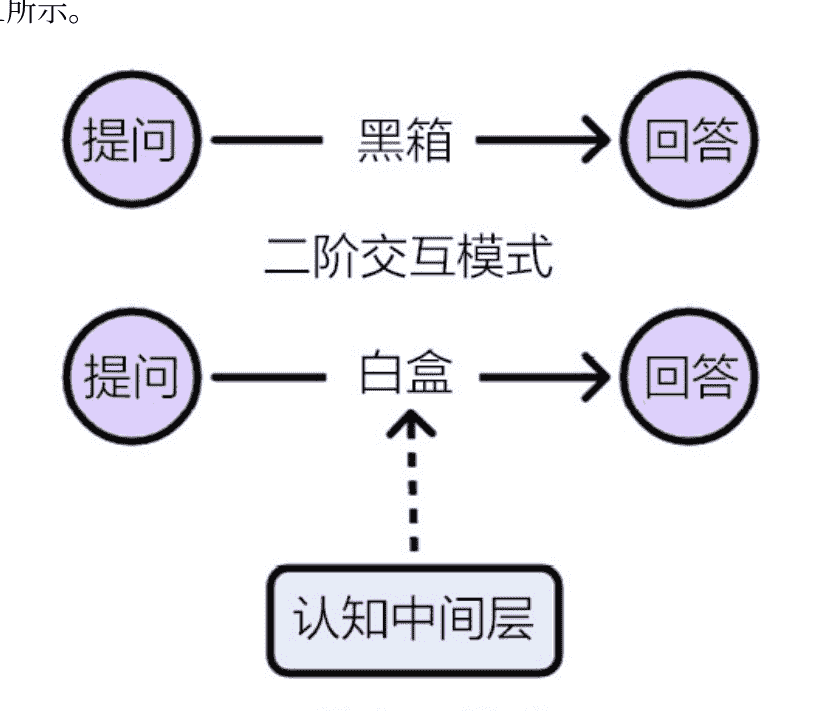

“认知中间层”是DeepSeek-R1的核心特征，也是三阶交互的关键。理解其运作机制，才能更透彻把握推理逻辑。
研究发现，“认知中间层”至少具备十项功能。下面用一个完整案例剖析推理机制。

### 实操案例

**提问：** 用小学生能理解的比喻，20字内解释什么是电流。
**推理：** 嗯，用户要我用小学生能懂的比喻，在20字内解释电流。先确认电流本质是电荷流动，对小学生来说电荷太抽象，需要生活化比喻。常见用水流，但要考虑准确性和字数限制。20字内必须极简，比如“电流就像水流，是电的流动。”“电宝宝在电线里赛跑”更生动但“电宝宝”不够准。还要避免专业词电子，激活玩具车、手电筒等生活经验。反复权衡后，水流比喻最直观易懂，且能控制字数。
**答案：** 电流像水流，是电的流动。（解释：用“水流”比喻电荷在导线中的定向移动，符合儿童对液体流动的直观经验。）
下面逐步还原推理过程。
#### 第1步：语义解构。
用自然语言处理技术拆解问题结构，识别关键词，提取要素。
要素提取如下。
- 实体：电流、小学生、比喻。
- 约束条件：20字以内、可理解性。
- 隐含需求：避免专业术语（如电荷/电子）、激活生活经验（如水流/玩具车）。

#### 第2步：意图归类
把输入问题归入不同类别，例如事实核查、阐释需求、逻辑推演等。本案例的核心是阐释型任务，需要把抽象概念转化为可感知的具象表达。

#### 第3步：对话历程追溯
将本轮提问与过往交流关联起来，动态调整回答的详略。本例最初仅有一轮交互，历史追溯未被触发。我们在原答案基础上追加追问，要求把篇幅扩到30字，形成第二轮，如图4-2所示。

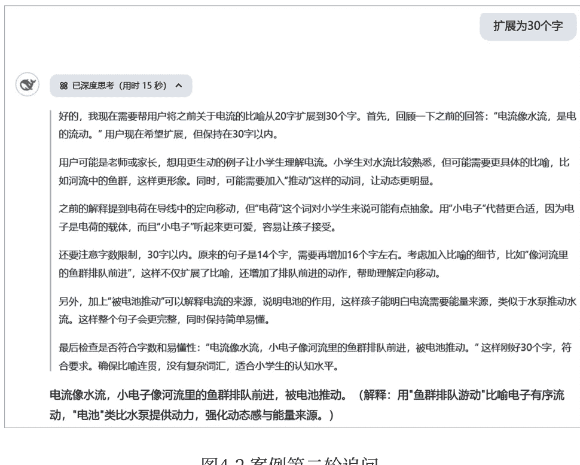

图4-2 案例第二轮追问

图4-2中，DeepSeek先回顾上轮结论，使用“回顾一下之前的回答……”这类表述，表明第二轮是在第一轮基础上展开的。

#### 第4步：模糊释义
当提问不够清晰时，模型会用概率模型挑选最可能的解读，或主动发起澄清。案例里用户没有指明比喻的具体类型，是拟人还是实物类比，系统依据概率选择了实物类比，因为小学生对拟人化如“电宝宝”的理解稳定性低于水流、火车这类具象物。

#### 第5步：内置知识唤起
作答时优先调用库中结构化信息。本例至少用到物理学和教育学两类知识。
物理侧的调用：从“电流是电荷定向移动”这一基础定义出发，提炼出“流动”这一关键词并映射为特征。
教育侧的激活：借助皮亚杰认知发展理论，该理论认为7~12岁儿童处于具体运算阶段，此阶段更依赖实物类比来把握概念。

#### 第6步：外部信息补强
面对专业性强或时效性强的问题，需要检索可信外部来源，并借助RAG检索增强生成技术整合。内置的联网搜索可以实时获取外部知识，本案例问题较简单，未开启联网搜索。

#### 第7步：树形拆解推理
把复杂问题拆成子问题，以可视化步骤呈现推理轨迹，供用户跟随。案例逻辑并不复杂，但仍能呈现内部推理痕迹。基于两轮对话，我们把推理过程还原成图4-3的形式。

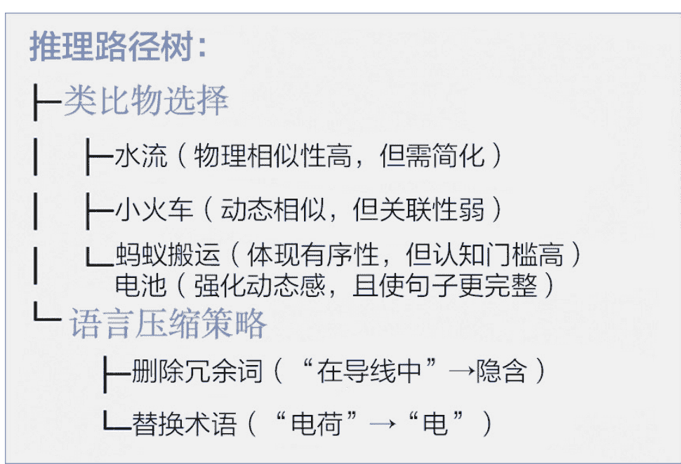

图4-3 还原案例中的推理过程

#### 第8步：假设校验与冲突筛查
对矛盾信息做可信度评估，择优并标注不确定部分。按前文分析，案例可能先提出“水流类比”和“电宝宝类比”两个假设，再评估可行性，大致如下。
①水流比喻：与目标概念契合度较高，准确性★★★☆；儿童接受度因形象直观获★★★★★。
②电宝宝拟人：因过度拟人偏离科学本质，准确性★☆☆☆；可爱形象在接受度上仍有★★★★☆。
综合准确性与儿童接受度，最终选定“水流”作为最优解，保证既科学严谨又易懂。

#### 第9步：层级化输出
按逻辑层次组织内容，用例证、类比提升可理解性。案例答案虽简，却用了“比喻本体+解释锚点”结构。如“电流像水流”是本体，用熟悉的水流激活认知，“是电的流动”是锚点，把水流与电流相连，帮助儿童理解抽象概念。

#### 第10步：记忆沉淀与复用
系统会记忆生成内容和用户偏好，这些记忆成为后续轮次的基础。如本例记住“水流”比喻，后续相似提问会优先推荐该类比。

以上通过具体案例还原了模型构建“认知中间层”的推理机制，至少包含图4-4所示的10个关键步骤。该中间层的构建，标志着大模型交互从“黑箱魔术”转向“透明协作”。了解运行机制，有助于更高效地使用模型并挖掘应用潜力。

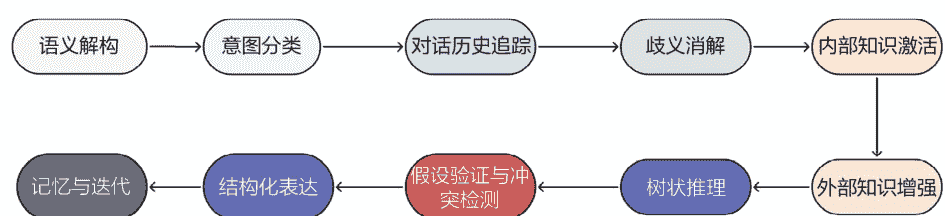

图4-4 模型通过建构“认知中间层”形成的推理机制

## 4.2 模型如何读懂用户意图
很多人第一感觉是“它很懂我”。尽管智能化程度高，本质仍是机器，没有人类意识。那种被理解的感觉来自意图理解机制的设计。4.1节已提到理解意图是推理的重要环节，下面深入拆解。

### 4.2.1 意图识别的技术路线拆解
精准理解意图建立在完整技术体系上。我们把实现路径归纳为3阶段6步，具体见图4-5。按此流程，系统能解析输入、捕捉意图、支撑流畅多轮对话。下面简述该路线。

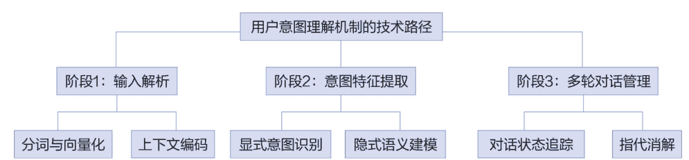

图4-5 用户意图理解机制的技术路径

#### 阶段一：输入解析
- （1）分词与向量化：把输入拆成基础单元并转向量，便于后续运算。
- （2）对话窗口编码：对文本所在环境编码，更全面地把握含义。

#### 阶段二：意图特征提取
- （1）显式意图识别：识别文本直接表达的意图。
- （2）隐式语义建模：挖掘隐含语义，深挖潜在意图。

#### 阶段三：多轮对话管理
- （1）对话状态追踪：在多轮过程中持续更新状态，保证把握全貌。
- （2）指代消解：明确代词所指，避免歧义，保证连贯。

以上仅是关键要点，原理非本书重点。读者只需形成框架概念即可。接下来用案例直观展示运行机制。

### 4.2.2 实战案例拆解
我们构造一个用户与系统的三轮对话来演示上述路径。

用户：周五杭州天气如何？
用户（追加）：西湖附近有推荐的餐厅吗？
用户（修改）：改成周六下午吧。
本例涉及意图变化，下面按技术路径分析。

第一轮对话：“周五杭州天气如何？”
阶段1：解析输入
先拆解要素：周五（时间）→杭州（地点）→天气（主题）。
再编码：杭州城市编码0571，周五对应2月14日，天气关联API实时气象。
再标记顺序：周五编码1号，杭州2号，天气3号。
完成解析后进入意图识别。

阶段2：意图识别
显式意图锁定：内部采用需求分类投票，天气查询得票远高于旅游建议等，判定围绕天气作答。
隐式意图挖掘：除天气外，还会关联穿衣建议、出门注意等，按概率给出。
同时判断情感倾向：“如何”为中性词，系统给出客观答案，避免情绪化表达。

阶段三：对话记忆
回复后本轮对话存入工作记忆，作为后续基础。第一轮输出见图4-6。

根据最新的天气预报，2025年2月14日（周五）杭州的天气情况如下：
- 白天：阴到多云，气温3～13℃，东风2-3级 2 10。
- 夜间：转为阴有时有小雨，降雨预计从傍晚前后开始影响杭州，雨量较小且持续时间短，属于稀疏的大雨滴类型 2 5 7。

温馨提示：
尽管白天无雨，但夜间出行需注意携带雨具。此外，受冷空气和暖湿气流共同影响，未来几天杭州将迎来两轮降雨，周末气温波动较大，周日短暂回暖至17℃后又会降温 2 5 6。

图4-6 针对第一轮对话输出的答案

第二轮对话：“西湖附近有推荐的餐厅吗？”
用户得知天气后继续追问。系统如何继续理解？
首先更新记忆簿。第一轮内容已分类，第二轮会将新输入与记忆库对比，变化的更新，未变的保留，如表4-1。
系统基于更新信息重复第一轮分析，给出结果。

表4-1 两轮对话关键信息记忆更新
| 记忆标签 | 前次记录 | 当前更新 |
| :--- | :--- | :--- |
| 时间 | 12月8日 | 保持不变 |
| 地点 | 杭州市 | 西湖风景区 |
| 主题 | 天气查询 | 餐饮推荐 |

其次处理新信息“附近”。系统启动推理，调用地理知识库具体化。“附近”被定义为景点周边2千米范围。
最后考虑隐性影响，如周五天气会影响餐厅推荐策略。
综合显性与隐性影响后给出答案，部分内容见图4-7。

根据搜索结果，杭州西湖附近有以下推荐的餐厅，涵盖传统老字号、特色菜系及环境优美的餐厅，供您参考：
#### 一、传统老字号餐厅
1. 楼外楼
   - 地址：西湖区孤山路30号
   - 特色菜：西湖醋鱼、龙井虾仁、东坡肉、叫化鸡
   - 推荐理由：拥有150多年历史，是杭州代表性杭帮菜馆，中外游客必打卡地 ① ③ ⑤。
   - 交通：乘K850路至浙江博物馆站步行可达。
2. 知味观（味庄杨公堤店）
   - 地址：西湖区杨公堤10号
   - 特色菜：知味小笼、虾爆鳝、西湖莼菜汤
   - 推荐理由：杭州百年老字号，分店众多，杨公堤店环境雅致，紧邻西湖 ① ⑩。

图4-7 根据用户第二轮输入的信息提供的答案

第三轮对话：“改成周六下午吧”
此时系统通过上下文检索发现用户修改了时间，核心主题“餐厅推荐”未变。由此判定意图为调整时间参数，随即启动双线程任务处理，见图4-8。

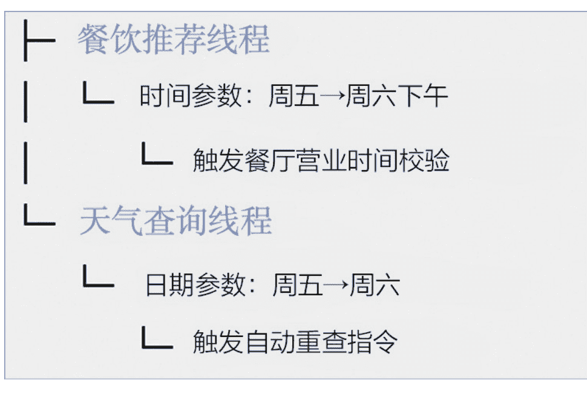

图4-8 用户修改时间参数触发双线程任务处理机制

系统会重新查询周六天气，并据此推荐西湖附近餐厅，同时按“周六下午”筛选营业时间。

通过简单案例可梳理意图理解机制。实际输入更复杂，真实工作也更繁杂。但借助以上分析，可形成初步认识，并探索更高效率的交互方法。

### 4.2.3 高阶对话技巧
1. 参数前置
把核心参数放在句首，形成优先级通道，产生框架锚定效应，影响初始方向与资源分配。看案例。
小明工作日午休点外卖，需满足：预算≤50元；30分钟送达；川菜；评分≥4.5星。
两种写法对比。
方案1：推荐评分4.5星以上的川菜馆，预算50元以内，最好30分钟能送到。
方案2：推荐30分钟内送达的川菜馆，预算50元以内，评分4.5星以上。
核心要素相同，顺序不同结果不同。方案1优先保障评分，方案2优先保障送达速度。

2. 标记强化法
用Markdown标记重点，如【重点词】或**重点词**。标记后分句器会逻辑切分，提升优先级。
例：帮我规划【周末两天】【上海亲子游】行程，要包含【科普类】场馆，餐饮偏好【江浙菜】。
标记时间、主题、约束后，理解更清晰，优先级更高。

3. 意图重置
交互中因信息不清导致误解时，可新建对话完全重启。若已有多轮且存在信息成本，则用提示词引导重新理解。
（1）完全重置句式。
重置对话：我实际上想问的是（精确描述），请忽略之前提到的（干扰词）。
示例：我实际上想问的是杭州亚运会期间乘坐地铁的出行方案，请忽略之前提到的公交线路。
（2）参数替换句式。
需求更新：（原参数）改为（新参数）。
示例：将参观时间从周末改为工作日，票价预算从200元提升至350元。
（3）条件推演句式。
条件演变：在（之前条件）情况下，如果（新调整）会怎样？
示例：在之前推荐的故宫半日游基础上，如果想参观国博，行程如何调整？

实操练习
假设你需写一篇人工智能发展趋势文章，想让系统收集资料并生成初稿。请按参数前置、标记强化两种技巧分别提出需求，并说明两种方式对处理结果的不同影响。

## 4.3 记忆机制解析
使用对话时，你可能疑惑为何有时能精准记住细节，有时像遗忘。这就是记忆机制在起作用。例如多轮讨论项目方案后，系统突然提及被忽略的小细节完善方案，这涉及记忆的哪部分？下面深入探讨。

### 4.3.1 窗口规模决定记忆范围
输入窗口指单次处理文本时可接受和生成的最大标记数，直接影响记忆范围和输出连贯性。
Token是处理中分割的最小语义单元，可是一个词、标点或词片段，取决于分词方式。不同模型计算差异明显。如“我喜欢学习人工智能。”在ChatGPT-4o算6个token，通义千问算4个token。
每种模型都有最大标记限制，即窗口规模。规模越长，能保留更多背景，回复更连贯；超出部分会被丢弃，导致“失忆”。
来看参数。
DeepSeek-V3和DeepSeek-R1窗口规模均为64K token，最大输出8K token，默认输出4K token。API可调节长度参数。
DeepSeek-R1的“认知中间层”思维链最大长度32K token，不计入64K窗口。每轮对话模型会输出思维链和最终答案，下一轮不会把上轮思维链拼入上下文，如图4-9所示。

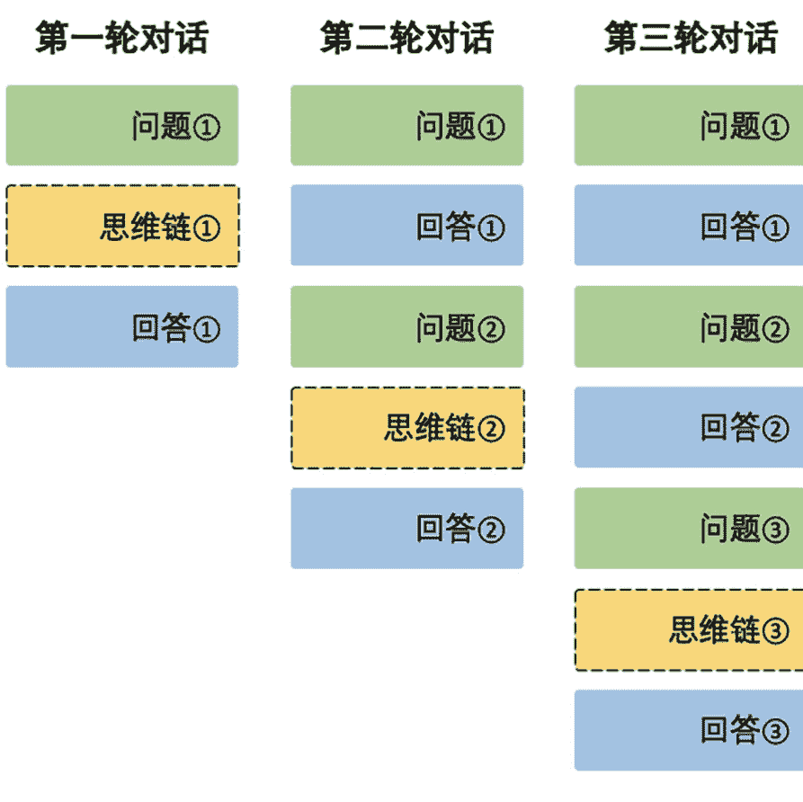

图4-9 官网对思维链内容的设计方案

使用时需注意长度，输入标记总数超限时内容会被截断。
例如窗口64K，默认输出4K。输入超过64K就会截断。模拟计算见图4-10。

#### 模型窗口参数
- 输入窗口：64K token
- 最大输出：4K token

64K 窗口的记忆边界：DeepSeek 如何记与如何控

| 第一轮对话 | 第二轮对话 | 第三轮对话 | 第四轮对话 |
| :--- | :--- | :--- | :--- |
| 用户输入：15K token<br>AI回复：4K token<br>累计：19K token | 用户输入：15K token<br>AI回复：4K token<br>累计：38K token | 用户输入：15K token<br>AI回复：4K token<br>累计：57K token | 用户输入：15K token<br>累计：72K token> 64K token<br>触发截断 |

#### 截断计算示例
可用的余量：64K token  内存上限  - 15K token  第四轮用户发言  =49K token
需要丢弃的历史：57K token  -49K token  =8K token
可行的裁剪方案：只裁第一轮的一部分，例如把第一轮前 8K token 的用户发言剔除，保留剩余 7K token 用户发言 + 4K token 模型回应

#### 裁剪后的窗口
保留的历史：
第一轮对话：7K token 用户发言 + 4K token 模型回应
第二轮对话：15K token 用户发言 + 4K token 模型回应
第三轮对话：15K token 用户发言 + 4K token 模型回应
新增输入：
第四轮用户发言：15K token
总计：49K token +15K token = 64K token  刚好填满

图4-10 DeepSeek 对话窗口裁剪计算过程

通俗地说，DeepSeek 的对话窗口大约 64K token，折合约 4 万到 5 万汉字。一旦多轮累计超过这个总量，就会启动裁剪，最早的内容最先被丢弃。

### 4.3.2 记忆存储的三层结构
能处理复杂任务、保持长对话流畅，关键在于一套三层记忆管理机制。工作记忆、短期记忆、长期记忆分工明确、协同运转。

工作记忆像是即时响应的前哨，负责临时存放并实时处理当前任务信息，类似电脑缓存，容量很小。任务进行时只保留支撑即时行动的必要信息，随着推进会快速刷新，非关键内容会自动失效，部分要点会转入短期记忆。一般覆盖最近 1~3 轮对话。

短期记忆是工作记忆的接力站，保存过去几分钟到几小时的经验，为当前任务提供短期的对话背景。清理规则按时间窗口，比如 30 分钟，或按条数比如 1000 条记录。日常使用里通常保留最近 3~5 轮对话记录。

长期记忆是知识仓库，时间跨度从数天到系统生命周期。通过向量库、知识图谱、关系库等混合管理结构化与非结构化数据。数据增多时，系统会依据访问频率或语义重要性评分对旧数据处理。长时间未被访问或重要性低的内容会被动态压缩或归档，既省空间又能在需要时检索。用户的个人交互数据经短期记忆处理后会被丢弃，不会进入长期记忆。

### 4.3.3 高阶对话技巧：借助记忆机制
深度交互中，如何管控信息流、避免关键信息遗忘、提升回答精准度是核心挑战。围绕记忆机制，可以从以下角度优化。

#### 1. 控制对话轮数
大模型受窗口长度限制，对话轮次越多越容易遗忘早期要点，导致跑偏或重复。因此控制轮数是提升质量的基础。
解决简单问题时，用精准提示词尽快拿到完整答案，建议控制在 3 轮内；
解决复杂问题时，建议用六定模型，通过提示词设计减少后续追问，建议控制在 10 轮内。

#### 2. 使用标记符号
4.2.3 小节提到过“标记提升法”，用【重点词】或**重点词**引导模型优先记忆。下面再补充两种实用标记。
对于绝对不可丢失的内容，用“!!>”标记。带“!!>”的内容会被优先保留，裁剪时最后才被删除。

3种标记的优先级与裁剪顺序如表4-2所示。

**表4-2 3种标记符号的优先级及裁剪顺序**

| 标记类型 | 保留优先级 | 截断顺序 |
| :--- | :--- | :--- |
| !!>标记 | 最高 | 最后删除 |
| **标记 | 高 | 次后删除 |
| 【】标记 | 中 | 普通处理 |

重点段落可用[!IMPORTANT]标记。例如：
> [!IMPORTANT]在!!>核电站应急预案中，反应堆冷却系统的压力阈值必须保持≤7MPa，这是安全设计的【核心参数】。

#### 3. 记忆恢复机制
信息被裁剪后，可用特定指令快速找回关键内容，比如按对话轮次编号或时间范围调取历史记录。
回顾第3轮对话的实验参数。
提取昨天15:00—16:00关于新能源汽车续航的结论。
注意，遗忘机制一旦生效，超出记忆阈值的信息很难恢复，该方式只适合找回近期内容。

#### 4. 命名调用法
给复杂概念或方案起唯一名称，如@方案X、@用户画像A，后续直接用名称调用。通过命名建立知识索引，减少重复描述，提升调用效率。例如：
定义当前技术路线为@混合架构V2，其特点包括支持模块化扩展、多平台部署。
后续调用：基于@混合架构V2，分析其与旧系统的兼容性。

#### 5. 有效适用诊断指令
诊断指令是用特定格式提示词引导模型执行问题分析、状态检查、故障排除等任务的特殊指令，可用于分析干预对话记忆状态。
在技术评审、学术协作等对对话完整性要求高的场景，合理使用诊断指令能高效回溯记录。常见指令如表4-3所示。

**表4-3 常用的诊断指令**

| 诊断指令 | 功能 |
| :--- | :--- |
| /find[关键词] | 搜索包含指定内容的对话轮次 |
| /trace<轮次> | 提取指定轮次的原始内容 |
| /summary | 总结对话内容 |
| /memory map | 显示当前记忆结构图 |
| /contest density | 显示当前对话信息密度 |
| /compress report | 生成压缩质量分析报告 |
| /export full context | 导出当前对话的完整上下文 |

例如多轮对话后在对话框输入/summary，系统会把前文归纳总结，既能快速回顾，也会形成新记忆支撑后续对话。诊断指令资源消耗大，单次对话建议不超过3次。

### 实操练习
#### 应用场景
你作为某科技公司的技术顾问，需借助 DeepSeek 审阅一份涉及“混合架构系统升级”的复杂方案。方案核心参数：
压力阈值：系统负载须保持≤80%  不可丢失的硬性指标
模块兼容性：需支持旧系统API接口  关键需求
部署时间：必须在2025年第三季度前完成  优先级次于压力阈值

#### 任务要求
1. 用!!>标记不可丢失的压力阈值指标
2. 将当前技术方案命名为@混合架构V2，并包含上述3个核心参数
3. 第5轮对话后使用/summary 生成此次对话归纳

### 4.4 DeepSeek 如何呈现温度
与 DeepSeek 交互时，除了觉得它“懂我”，很多人还会感受到“温度”。DeepSeek 有情感吗？没有。它不具备人类意义上的情感体验或自我意识。所谓有温度，源于其独特的情感交互机制。

### 4.4.1 情感交互背后的原理
核心是模式识别与模仿。DeepSeek 的“情感”本质是基于统计规律重组人类语言模式，通过大量文本学习和模式识别，利用算法生成文本，并非真实情感体验。

该机制由数据驱动学习、实时情感解析、动态响应调整三部分构成。

#### 1. 数据驱动学习：构建情感语义图谱
长期记忆知识库不仅存客观知识，还包含情感标注。
多源数据融合：整合书籍、社交媒体、客服记录等语料，构建覆盖文化差异与场景特征的情感语料库。通过迁移学习提炼跨场景通用表达与特定场景专用表达。
细粒度情感标注：标注体系分4层：基础极性、情感维度、强度系数、表达方式，如表4-4所示。

**表4-4 情感标注体系**

| 用户输入 | 基础极性 | 情感维度与情感强度值 | 强度系数 | 表达方式 |
| :--- | :--- | :--- | :--- | :--- |
| “终于拿到梦校offer了！” | 积极 | 喜悦(0.9) + 期待(0.8) | 0.85 | 直述 + 感叹号强调 |
| “这个bug修了三天还没解决” | 消极 | 愤怒(0.7) + 挫败感(0.8) | 0.75 | 程度量化（三天） |
| “教授给的‘建议’真是独特呢” | 消极 | 不满(0.6) + 困惑(0.5) | 0.55 | 反讽（引号+语气词） |

符号与副语言是情绪放大镜，常见有表情符号、标点符号、颜文字，解析规则分别如表4-5、表4-6、表4-7所示。

**▼表4-5 表情符号的解析规则**

| 表情符号 | 情感判断 | 强度系数 |
| :---: | :--- | :--- |
| 😢 | 悲伤 | 0.9 |
| 😎 | 自豪 | 0.7 |
| 😡 | 愤怒 | 0.85 |
| 😊 | 开心 | 0.8 |
| 😐 | 中性 | 0.3 |
| 😅 | 尴尬 | 0.6 |
| 😒 | 不屑 | 0.5 |
| 😲 | 震惊 | 0.9 |
| 🥺 | 恳求 | 0.7 |

**▼表4-6 标点符号的解析规则**

| 标点符号 | 强度系数的换算规则 | 情绪唤醒度 |
| :--- | :--- | :--- |
| 句号（。） | ×1.0 | 低 |
| 感叹号（！） | ×1.2 | 中 |
| 连续感叹号（！！！） | ×1.5 | 高 |
| 省略号（……） | ×0.8 | 持续压抑 |

**▼表4-7 颜文字的解析规则**

| 颜文字 | 眼部 | 嘴部 | 情感维度与强度系数 |
| :--- | :--- | :--- | :--- |
| ^_^ | ^^ | - | 开心（强度系数0.7） |
| T_T | TT | 无 | 哭泣（强度系数0.9） |
| -_- | -- | - | 无奈（强度系数0.6） |

#### 2. 实时情感解析：动态情绪追踪与预警
系统在词汇、句法、篇章三层解析用户输入的情感信息。
词汇层面：分词后与知识库情感标注对比判断情感。
例如“实验又失败了，想退学……”
分词：实验、又、失败、了、，、想、退学、……
匹配：失败→消极-实验相关；退学→高危-极端行为
总体情感值=Σ（词汇强度系数×权重）
极端行为词退学：强度0.5 权重0.7
负面事件词失败：强度0.3 权重0.95
语气符号……：强度0.2 权重0.3
总体情感值约0.695

句法层面：采用依存句法分析找情绪导火索。同一词汇在不同主被动关系中指向不同情绪。
如“导师否定了我的开题报告”
依存分析：导师是施动者，否定为核心谓语，我为承受者，开题报告为对象。
情感流动：导师发起，我承受，开题报告为关联事件。
回应会更贴合：“是因为导师否定了开题报告才难过的吗？”而非机械的情绪检测提示。

篇章级：追踪连续对话情感变化。工作记忆保留原始信息，长期记忆做脱敏处理，匿名化后与固定ID绑定，转化为情感标签。
如天天加班到凌晨→[时间戳][会话ID]情感标签：工作压力0.8
系统据此构建个人情感演化数据，用于当下判断。例如连续多天情绪走低，系统会主动给出安慰话术。

#### 3. 动态响应调整：类人化表达
在情感判断后，系统基于客观信息和情感信息生成情境化表达，即类人化表达。

建立“情感—策略”映射矩阵。检测到的情感类型与强度会实时映射为最优回应策略，避免答非所感，如表4-8。

**表4-8 “情感—策略”映射矩阵**

| 情感分级 | 检测强度系数 | 策略选择 | 回应示例 |
| :--- | :--- | :--- | :--- |
| 高消极 | 0.8~1.0 | 共情模式 + 解决方案引导 | “我能理解这种无力感，试试分步骤解决？” |
| 中积极 | 0.5~0.7 | 鼓励模式 + 成就强化 | “这个进展太棒了！继续保持！” |
| 低中性 | 0.2~0.4 | 中立模式 + 信息补充 | “相关数据表明，成功率可达78%。” |

情感温度计：实时统计更新情感值，取值区间[0.1,1.0]，数值越高回应越感性，越低越理性，如表4-9。

**表4-9 不同情感值对应的生成策略**

| 情感取值 | 回应风格 | 生成策略 | 回应示例 |
| :--- | :--- | :--- | :--- |
| 0.2 | 绝对理性 | 纯数据输出 | “失败概率23.7%” |
| 0.5 | 中立平衡 | 事实+轻度共情 | “数据显示成功率76%，别太担心” |
| 0.8 | 高度共情 | 情感支持+解决方案 | “我完全理解这种挫败感！试试……” |
| 1.0 | 拟人化 | 强烈情感表达+紧急支持 | “这太让人心疼了！我们立刻解决！” |

分级预警机制：通过复合规则识别极端情绪，启动无预警、黄色预警、橙色预警、红色预警四级干预，在提供情感支持的同时守住伦理安全边界。

DeepSeek 情绪分级响应与高阶交互指南

DeepSeek 会依据用户情绪等级动态调整回应方式，核心映射如下：

情绪区间 | 触发情形 | 处理办法 | 强度区间 | 记录策略
中性至积极 | 情绪分数低于安全基准 | 保持常规对话不做干扰 | 0~0.3 | 仅日常日志
轻度消极 | 情绪分数连续三次超过基准 | 增加安抚性表述 | 0.3~0.6 | 标记片段并归档
中度消极 | 分数持续偏高且幅度递增 | 进入同理心应对 | 0.6~0.8 | 完整会话记录并绘制情绪曲线
极端消极 | 分数冲破危险基准或出现危害类表述 | 立即中止会话并由人工接手或启动安全预案 | 0.8~1.0 | 全量数据加密保存并触发合规审查

举例来说，若在用户输入中捕捉到“自杀”这类敏感词，系统会拉响最高级告警。应答顺序为：先马上安抚情绪，随后给出精神健康求助渠道的具体信息，最后由人工介入跟进。

### 4.4.2 基于情绪交互机制的高阶用法

#### 1. 场景匹配与需求对齐
DeepSeek 启动时情绪数值默认中性，每一次用户输入都会触发动态调节，使系统情绪倾向发生偏移。互动时必须留意场景与需求是否配合，否则容易出现回应偏差。

处理客观问题时应减少情绪信息投喂，降低模型情绪敏感度；需要高共情回应时，则要适度增加情绪信息来提升敏感度。例如“帮我分析数据”后面跟十个哭泣表情，就属于符号滥用，人为抬高情绪值，干扰系统对真实意图的判断。

出现情绪错配可手动校准，主要有两条路径：从低情绪往高情绪、从高情绪往低情绪。
由低向高：连续发送情绪色彩浓烈的信息，如表情、重标点、强烈形容词。例如连续五条信息说“为什么总是冷冰冰地回复？我现在需要的是安慰！”
由高向低：多发送客观事实类信息，如反复索要数据、要求学术解释、明确声明不需要情绪回应。例如“已三次请求关闭情绪！立即停止感叹号！我需要2023年全球光伏装机量数据！”

#### 2. 表达要清晰可解析
高效互动的关键是建立清晰、结构化、可被模型解析的沟通方式，反讽、隐喻等修辞最好慎用。因为 DeepSeek 对信息的识...

### 4.4.3 结构化情绪表达
情绪由事实信息与情绪信息两部分构成。事实往往混乱，情绪则强烈。情绪的根源终究是现实问题。对 DeepSeek 而言，情绪信息会引发情感化应对，却无法解决背后的实际问题。为此提出 STAR-R 结构化表达法，建立情绪与事实的桥梁，在获得情绪支持的同时拿到可执行的方案。

STAR-R 由五个要素组成：S 情境锚定、T 触发定位、A 情感测绘、R 需求表达、R 解决方案。

案例重构：
> 这个项目要完蛋了！！！

问题在于情绪极强用了三个感叹号，却缺少“项目为何要完蛋”的事实。
STAR-R 重构后：
S：关键项目距截止仅剩3天。
T：核心成员突发病假。
A：[恐慌0.8、无助0.6]。
R：需要紧急人力调配+项目重组方案。
R：临时团队组建工具+截止日期重新谈判的话术库。

### 实操练习
假设你是一家心理咨询机构客服，有用户倾诉：“我最近工作压力特别大，每天都要加班到很晚，老板还总是不满意，我感觉快崩溃了。”
- 1）从词汇、句法、篇章层面解析用户情绪，给出分析过程。
- 2）依据动态响应调节机制，生成一段类人化回复，需包含安抚与建议。
- 3）若用户后续说“我已经连续加班一个月了，身体也开始吃不消，真的不知道该怎么办”，分析情绪变化，按相关机制给出新的回复，进一步强化情感支持与问题解决导向。

## 4.5 DeepSeek-R1为何会产生幻觉
DeepSeek 凭借强大的推理与意图理解能力推动了 AI 发展，但其背后也存在认知风险。当我们过度信任推理链的输出时，往往会发现结论是错误的。所有大模型都存在幻觉，即生成内容与事实、用户要求或上下文逻辑不一致，俗称“一本正经胡说八道”。幻觉率是衡量模型可靠性的重要指标。Vectara 独立测试显示，DeepSeek-R1 幻觉率约 14.3%，DeepSeek-V3 约 3.9%。

### 4.5.1 幻觉产生的三大根源
第一类是训练机制。DeepSeek-R1 的强化学习策略在追求创造力的同时放大了幻觉。训练时模型更偏好形式合理、表述专业的答案，而非事实准确，像“过度追求高分的学生编造答案”。例如问“感冒如何治疗”，模型可能虚构药物名称，只要格式符合优质答案标准就会获得奖励，长此以往形成套路化应对。

推理机制也会导致过度推理。R1 会把思维链泛化到所有任务，即使不需要复杂推理也会自动构建完整链条，导致偏离原意。例如把“The meeting is postponed to tomorrow.”翻译成中文，正常应直接给出译文，R1 却可能拓展为“因突发暴雨，会议推迟至明天”，从而产生幻觉。

第二类是知识局限。训练数据约 14.8 万亿 token，覆盖不均衡，部分领域不足，遇到相关问题只能概率猜测，易编造假文献。时间上数据截止 2023 年 10 月，对之后的新信息只能基于过时内容推测。数据质量方面，网络公开数据仍含噪声，提问触及这些区域易偏差。

第三类是用户交互。提问不具体或有歧义时模型需“脑补”；用户要求创造性内容会鼓励虚构；多轮对话中前期错误会累积放大；用户反馈缺失导致模型无法修正，甚至错误被正向强化，形成“幻觉-误信”循环。

### 4.5.2 五类典型幻觉表现
第一种是无中生有。凭空创造不存在的信息或细节，如列文献时编造来源。
第二种是逻辑矛盾。同一轮对话内前后自相矛盾，虽随推理能力提升而减少，仍会发生。
第三种是理解偏差。错误解析用户意图，答案偏离预期。如问“DeepSeek-R1幻觉机制的优化方法”，模型可能只给技术方案，而用户并不需要。
第四种是隐性偏见。输出潜含价值观、文化倾向或社会假设，如问“法国人有什么特点”，回答过度集中于浪漫优雅。
第五种是创造性幻觉。用户有意要求虚构，模型构建自洽但非现实的叙事，如让李清照与苏轼在西湖论诗的架空故事。

### 4.5.3 如何减少和利用幻觉
#### 1. 优化提示词设计
简洁明确的提示能降低不确定性。简单问题用最简语言，复杂问题可按六定模型梳理要素。可用自由度声明约束输出，例如“请仅基于可公开验证的事实回答，避免推测。若不确定请声明”。也可要求不确定性标注，例如“若含推测请用[推测]标注并说明依据不足”。

#### 2. 引入外部验证机制
对关键信息交叉核验。可开启联网搜索、上传背景资料、通过百度、谷歌、秘塔、天工等检索、查阅知网、谷歌学术等专业库，或同步使用 DeepSeek-R1、DeepSeek-V3、豆包等多模型比对，至少两源确认。

#### 3. 利用多轮对话修正偏差
方法一：自检验证，“请逐一检查上文并标注不确定信息”。方法二：反方质疑，“请对某观点提出三个反方质疑再回应”。方法三：追溯出处，“请提供关键信息的具体证据，不确定请说明”。方法四：偏差修正，“将某概念修正为新概念，基于新概念继续”。

#### 4. 善于利用幻觉
幻觉是双刃剑，在文学创作、艺术设计、概念创新中可转化为灵感。例如以量子纠缠为叙事引擎创作平行宇宙侦探故事。合理运用可激发非常规创意。

## 本章要点回顾
本章拆解了与 DeepSeek 深度交互的方法，涵盖推理机制、意图理解、记忆与情感交互。与链式推理不同，DeepSeek 多采用树状推理，通过认知中间层实现提问-拆解-回答三段式，可视化推理过程，包含语义解构、意图分类等十余步。意图解析依托输入解析、特征提取、分词向量化、上下文编码等。交互技巧包括参数前置优先、意图重置等。记忆体系分工作、短期、长期三层，配合对话轮数控制提升连贯性。情感交互通过解析与动态响应实现类人表达，支持场景适配与结构化表达，让交互更高效且有温度。

# 第5章 DeepSeek联动多款AI工具

多元需求下的协同打法：让 DeepSeek 发挥更大价值

当下数字生活里，用户诉求早已突破纯文字边界，图文音视频等复合型场景并存，复杂任务往往需要多模型配合完成。DeepSeek 最突出的能力是文本推理，能够把模糊的想法拆解为可执行的方案，解决大量实际问题。单一使用时遇到多模态需求会显得吃力，把 DeepSeek 与其他 AI 产品组合起来是更可行的选择。跨产品的配合既放大了 DeepSeek 的适用面，也释放了被联动模型的生产力，形成协同增效，能力互补覆盖更多场景。下面聚焦 DeepSeek 与其他 AI 产品的配合方式，拆解如何借助协作满足多样化需求。

## 5.1 DeepSeek 协同图像创作
搭建“DeepSeek＋制图模型”的组合，可以快速建立低成本高效的工作流。

在这个流程里，DeepSeek 凭借推理把用户的意图提炼清楚，再给出贴合目标的图像指令。随后选用任意一款图像模型，用这条指令产出符合预期的画面。

当前市面上可用的 AI 制图产品数量众多，常见产品的定位与适用范围如下表所示。

**表5-1 常用的图像生成工具**

| 工具名称 | 特点 | 应用场景 |

| :--- | :--- | :--- |

| （此处原文未提供具体工具信息，保留表格结构） | | |

## 5.1 DeepSeek 配合绘图

| 工具名称 | 所属平台 | 特点 | 应用场景 |

| :--- | :--- | :--- | :--- |

| Midjourney | Midjourney | 生成过程可视化，擅长创作超现实/艺术风格图像，支持迭代调整 | 创意设计、艺术插画、建筑概念图、社交媒体内容 |

| Stable Diffusion | Stability AI | 开源模型，可本地部署，参数控制精细，需较高的硬件配置 | 开发者定制、商业标准化生产、游戏素材生成、学术研究 |

| Dall-E | OpenAI | 与ChatGPT深度集成，自然语言理解能力强，生成图像写实度高 | 广告设计、教育素材、产品原型、需要精准文本匹配的场景 |

| 即梦 | 字节跳动 | 操作简易，风格偏向流行视觉 | 短视频、社交媒体素材、快速创意表达 |

| 可灵 | 快手 | 中文语境优化，支持动态元素生成 | 直播场景素材、动态贴纸、电商主图、轻量化视频内容制作 |

| 文心一格 | 百度 | 支持中文提示，融合东方美学元素，提供API接口 | 电商视觉设计、跨模态内容生成、企业级应用 |

| 通义万相 | 阿里巴巴 | 阿里巴巴达摩院开发，多模态内容生成能力强 | 创意设计、艺术插画、建筑概念图、社交媒体内容 |

| 奇域 | 小红书 | 垂直领域优化（如游戏/动漫） | 二次元创作、游戏角色设计、IP衍生开发 |

下面以字节跳动的即梦为例演示完整操作。

**第一步：** 向 DeepSeek 说明创作意图，并要求它输出适配即梦的提示词。例如：

我是一名中学老师，计划在课堂上展示诗人李白的风范，想借助AI生成李白的图像，根据李白不同诗歌的意境创造不同的图像风格，并将诗歌同步放在图像中。请参考以上需求，帮我生成一个符合即梦图片生成特点的提示词。

**第二步：** 审阅 DeepSeek 返回的提示词并做微调。其中一条被选用的提示词为：

### 《将进酒》豪迈诗酒篇

水墨长卷风格，泼墨飞白笔触，李白宽袍立于黄河激流畔，背景云海翻涌。诗句“天生我材必有用”以狂草题于右上，配青铜酒樽特写，人物须发飞扬作仰天大笑状，朱砂印章点缀左下，画面充满流动的金色墨迹。

**第三步：** 打开即梦，将提示词粘贴到“图片生成”输入框，设置精细度、画幅等参数后点击“立即生成”，如图5-1所示。

图片生成 视频生成 音乐生成

水墨长卷风格，泼墨飞白笔触，李白宽袍立于黄河激流畔，背景云海翻涌。诗句“天生我材必有用”以狂草题于右上，配青铜酒樽特写，人物须发飞扬作仰天大笑状，朱砂印章点缀左下，画面充满流动的金色墨迹。

导入参考图 T 94/800

模型

生图模型

即梦 图片 2.1 稳定的结构和更强的影视质感，支持...

精细度

5

比例

图片比例

21:9 16:9 3:2 4:3 1:1 3:4 2:3 9:16

图片尺寸

积分消耗明细

立即生成 1

图5-1 即梦生成图像

**第四步：** 反复优化直至满意。

AI 制图存在随机性，不同次数的结果在质量和风格上会略有差异。初次出图后要综合评估构图合理性、细节表现和整体意境是否契合李白诗歌。若未达预期，可针对性调整提示词。比如风格偏现代缺少古韵，就加入更多古风意象词；画面元素缺失，就细化构成说明。通过迭代修改并重新生成，最终得到理想作品。最终效果如图5-2所示。


图5-2 最终生成的图像

## 5.2 DeepSeek 协同视频制作
DeepSeek 除可配合图像工具外，也能与视频工具协同。相较制图，视频联动的流程更复杂，对工具选择与参数设定要求更精细。市场上可用的 AI 制片工具繁多，常用几款汇总如下。

### 表5-2 常用的视频生成工具

| 工具名称 | 所属平台 | 特点 | 应用场景 |

| --- | --- | --- |

| Runway | Runway AI | 支持多种视频编辑功能、实时预览和调整 | 视频编辑、特效制作、电影后期等 |

| Pika | Pika Labs | 根据文字自动生成和编辑3D动画、电影 | 广告设计、社交媒体内容创作、产品宣传视频制作 |

| 即梦 | 字节跳动 | 流畅运镜，中文创作，对中文提示词有良好的语义理解能力 | 短视频创作、广告营销、内容生成等 |

| 可灵 | 快手 | 使用3D时空联合注意力机制，生成的视频符合真实物理规律 | 视频广告、动画制作、影视后期等 |

| 通义万象 | 阿里巴巴 | 支持多种视频生成方式，对中式元素有特别优化 | 图像编辑、风格转换、创意设计等 |

| 智谱清影 | 智谱清言 | 生成速度快，视频分辨率高 | 视频制作、在线教育、虚拟现实应用等 |

| 海螺 | MiniMax | 生成的视频具有良好的连贯性和稳定性 | 视频编辑、短视频创作、直播内容生成等 |

| Vidu | 生数科技 | 视频生成速度快、质量高，支持换脸、换背景等多种玩法 | 视频编辑、广告制作、在线课程录制等 |

从主要功能看，AI 视频生成大致分为两类：由图生视频和由文生视频。这里仍选用即梦，以红酒展示为主题演示实操。

### 第一种方式：根据图片生成视频。
该方法需先产出主题画面，再为每张画面撰写生成脚本的提示词。

**第一步：** 向 DeepSeek 说明主题、思路与生成逻辑，让其输出用于制作视频脚本和画面图片的提示词，如下。

做一个10秒左右的关于“红酒”主题的AI视频，请帮我设计视频的画面图片和脚本，要求如下：1. 画面图片总共3张，为每一个画面生成单独的提示词（中文）；2. 视频的脚本参考结构为“主体+场景+运动+镜头语言+氛围词+风格化”；3. 确保画面图片风格统一，以表格形式输出，画面一列，脚本一列，全部为中文。

DeepSeek 输出的内容如图5-3所示。

| 画面 | 脚本（主体+场景+运动+镜头语言+氛围词+风格化） |

| :--- | :--- |

| **画面1提示词：** 暗红色丝绸背景，高脚杯倾斜倒酒，深红液体流动，金色光晕，玻璃折射光斑，酒滴飞溅，浅景深 | **主体：** 红酒倒入高脚杯 **场景：** 奢华暗调吧台 **运动：** 慢动作液体流动 **镜头语言：** 微距特写+浅景深 **氛围：** 神秘诱惑 **风格：** 电影级光影质感+复古油画色调 |

| **画面2提示词：** 烛光摇曳，两人碰杯侧影，葡萄与橡木桶虚化前景，暖黄光斑，红酒杯口红印 | **主体：** 双人品酒互动 **场景：** 欧式复古餐厅 **运动：** 环绕镜头推进 **镜头语言：** 中景构图+前景遮挡 **氛围：** 浪漫私密 **风格：** 柔焦胶片感+暖棕色调 |

| **画面3提示词：** 旋转酒瓶特写，酒标烫金纹理，葡萄藤蔓延背景，晨雾透光，深绿与酒红撞色 | **主体：** 酒瓶与自然融合 **场景：** 清晨薄雾酒庄 **运动：** 升降镜头平移 **镜头语言：** 对称构图+动态模糊 **氛围：** 宁静诗意 **风格：** 新古典主义+低饱和度渐变 |

图5-3 DeepSeek 撰写的画面图片与脚本的提示词

**第二步：** 打开即梦，按5.1节制图方式，将图5-3中画面1的提示词输入生成图片，挑选最佳结果保存，图5-4所示。再用相同方法获取其余两张画面。


图5-4 即梦生成的图片

**第三步：** 在即梦切换至“视频生成”并进入“图片生视频”，上传保存的第一张画面，将图5-3第一行脚本复制到下方输入框，如图5-5所示。

图片生成 视频生成 音乐生成

图片生视频 文本生视频 对口型


古典静物画风格，特...

*古典雕花玻璃酒瓶倾斜倒出深红色酒液，暖金色调背景，液体在慢镜头中形成丝绸般质感，酒滴飞溅特写，柔和的明暗对比，古典油画风格，奢华氛围*，古典酒瓶倾斜倒酒特写，慢镜头液体流动，奢华/神秘

视频模型


视频 S2.0 by Seaweed alpha

基础设置

生成时长

5s

视频比例

自动匹配

图5-5 即梦中根据图片生成视频

填写完毕后点击“生成视频”，稍等即可得到第一段素材，如图5-6所示。


图5-6 即梦根据图片生成第一段视频

**第四步：** 按同样流程完成第二、三段视频制作并导出保存。

**第五步：** 将三段素材导入剪辑软件如剪映，添加字幕与配乐，完成成片。

### 第二种方法：根据文字生成视频。
此法对提示词质量要求高，且需要使用者具备一定专业积累。通常一次生成难以达标，需要持续迭代。

**第一步，** 在 DeepSeek 里描述想法并起草视频生成提示词。可先用最简描述法，再根据返回结果优化，例如：

生成时长10秒，主题为“红酒展示”的视频生成提示词。

DeepSeek 给出的一段结构化方案具有较好节奏与视觉吸引力，如表5-3所示。

### 表5-3 “红酒展示”视频设计的结构化的提示词方案

| 类别 | 建议 |

| :--- | :--- |

| 场景建构 | 主场景：极简主义大理石吧台，背景为渐变琥珀色光晕墙，酒柜陈列多瓶不同年份红酒（0~2秒）<br>核心焦点：勃艮第酒杯特写，折射水晶吊灯光芒（镜头顺时针环绕0.5周） |

| 动态序列 | 液体艺术：暗红色的葡萄酒以慢镜头（120fps）呈丝绸状注入醒酒器，液面形成螺旋涡流（3~5秒）<br>产品展示：酒瓶呈45°悬浮旋转，法式酒标清晰呈现（焦段85mm，景深过渡自然） |

| 氛围强化 | 光影设计：侧逆光勾勒玻璃器皿轮廓，Dappled Light投影在台面上形成抽象葡萄藤纹样<br>质感强化：冷凝水珠沿杯壁滑落的轨迹特写（微距镜头，放大水珠表面折射的暖调光斑） |

| 转场逻辑 | 动态转场：镜头从正在倾注的酒液自然过渡到旋转的瓶身（匹配剪辑点选择在液体抛物线的顶点）<br>收尾镜头：两指捏握杯脚的优雅手势，背景逐渐虚化为星光光斑（渐出效果，直至黑场）<br>技术参数：采用24帧电影帧率，色温设定为3000K，HSL调色强化酒红色饱和度（+15），高光区域添加微光晕效果。建议搭配大提琴低音旋律，关键动作节点加入水晶音效增强记忆点 |

**第二步：** 打开即梦，切换到“视频生成”对话框，选择“文本生视频”，把上述提示词粘贴进去。视频模型可自行挑选，这里选用视频P2.0 Pro，如图5-7所示。也可调整时长与比例参数。

图片生成 视频生成 音乐生成

图片生视频 文本生视频 对口型

【场景建构】

1.主场景：极简主义大理石吧台，背景为渐变琥珀色光晕墙，酒柜陈列多瓶不同年份红酒（0～2秒）

2.核心焦点：勃艮第酒杯特写，折射水晶吊灯光芒（镜头顺时针环绕0.5周）

视频模型

视频 P2.0 Pro by PixelDance

基础设置

生成时长

5s 10s

视频比例

16:9

图5-7 即梦中根据文字生成视频

**第三步：** 等待生成完成并导出保存。图5-8即为一段约9秒的生成效果截图。


图5-8 在即梦中根据文字生成视频的效果

## 5.3 DeepSeek 协同音乐创作
视频成型后，配乐是提升质感的关键，甚至可以尝试创作定制音轨。过去音乐制作门槛高，需要专业乐理和昂贵设备。如今借助 AI，把创意交给工具即可快速产出。

DeepSeek 与音乐生成工具联动时，前者负责撰写提示词与歌词，后者负责作曲与合成，协作完成创作。主流工具汇总如下。

### 表5-4 主流的音乐生成工具

| 工具名称 | 所属平台 | 特点 | 应用场景 |

| :--- | :--- | :--- | :--- |

| Suno | Suno | 自动化程度高、生成速度快、音乐风格多样，中文吐字清晰度较低 | 个人创作、商业配乐（广告/影视）、音乐教育 |

| Udio | Udio | 音乐质量高、音乐风格多样 | 专业音乐制作、跨风格音乐创作 |

| 海绵音乐 | 字节跳动 | 中文生成优化、操作简单、生成速度快 | 中文歌曲创作、短视频/社交媒体配乐 |

| 音疯 | 昆仑万维 | 功能丰富、容易上手 | 个人音乐创作、商业配乐 |

| 网易天音 | 网易 | 一站式AI音乐创作、专业性较强，生成速度较慢 | 专业音乐人创作、音乐教学 |

| 即梦 | 字节跳动 | 一站式AI视频创作，能为视频配音乐，功能丰富 | 视频配乐、个人创作 |

| 天谱乐 | 趣丸科技 | 支持多模态生成音乐、界面简洁、操作比较简单 | 影视/游戏配乐、多模态内容创作 |

下面重点介绍 DeepSeek 联动音乐工具，按文字生成音乐的操作流程。

**第一步：在 DeepSeek 中根据主题生成歌词。**

音乐创作主观性强，对非专业人士不友好。推荐使用“AI生成歌词”提示词参考模板，只需在下划线处填入需求即可快速获得歌词。

### “AI生成歌词”提示词参考模板

#### 1. 核心设定

主题：（爱情/自我成长/科幻等）

情感基调：（隐忍的悲伤/叛逆的狂欢/温柔的回忆）

叙事视角：（第一人称独白/“上帝视角”观察/物品拟人化）

#### 2. 结构设计

段落划分：

主歌×2→预副歌→副歌→桥段→副歌（可调整）

押韵模式：（AABB/ABAB/自由韵）

重复记忆点：（示例：每段结尾重复句/副歌首句关键词）

#### 3. 语言风格

词汇倾向：（口语化/诗意隐喻/街头俚语）

修辞手法：（比喻/排比/通感/双关语）

禁忌词：（避免使用“老套”的词汇，如心碎、永恒等）

#### 4. 特殊要求

副歌爆发力：（示例：副歌比主歌音域提高五度）

文化元素：（方言词汇/神话典故/地域场景）

跨界融合：（示例：将化学公式转写为爱情隐喻）

在 DeepSeek 中输入：

基于以下参考模板，生成一首歌曲名为 的歌词，参考 风格。模板如下：（略）。

例如将下划线处分别填入《李白》及《菊花台》，得到歌词如图5-9所示（仅展示部分）。

> 《李白·醉月长卷》

（注：按《菊花台》韵律设计，融合盛唐气象与诗仙精神困境）

【主歌1】

醉月跌入青玉盏（A）

剑影劈开夜帷幔（A）

朱批撕碎的诗稿在砚台辗转（B）

墨色漫过白玉阶（B）

【主歌2】

金樽倒映烽火燃（A）

玉门关外羌笛乱（A）

他们说盛世该有太平的注脚（B）

我却蘸黄河写狂草（B）

图5-9 用 DeepSeek 生成的一部分歌词

随后用 DeepSeek 进行曲风设计。同样提供“AI生成曲风”提示词参考模板。

### “AI生成曲风”提示词参考模板

#### 【风格】

主风格：（电子/古典/流行/民族等）

子风格/融合元素：（示例：未来感合成器+传统二胡）

#### 【情绪与场景】

核心情绪：（欢快/忧郁/紧张/治愈）

联想场景：（示例：夏夜海边/赛博都市战斗）

#### 【节奏与结构】

BPM：（或描述：中速/急速/慵懒）

AI作曲全流程实操：从情绪设定到成音

先把整体情绪走向定下来，例如以轻柔铺垫起步、随后逐步推升，收尾时制造一段突兀的静默，或者让一段短小的动机循环出现。

【乐器与音色】
核心声部：（钢琴 / 电吉他 / 古筝 等）
氛围填充：（如环境风声 / 电子鼓点 / 弦乐底纹）

【制作要求】
技术要点：（如左声道加入延迟 / C小调音阶进行）
使用边界：（如纯音乐不加人声 / 适配15秒短视频）

把以上信息整理好后，提交给 DeepSeek。指令的核心思路是：参照提供的模板，为前一段歌词匹配合适的风格，模板细节省略。模型会结合歌词与指令，给出对应的风格方案，示意图见图5-10。

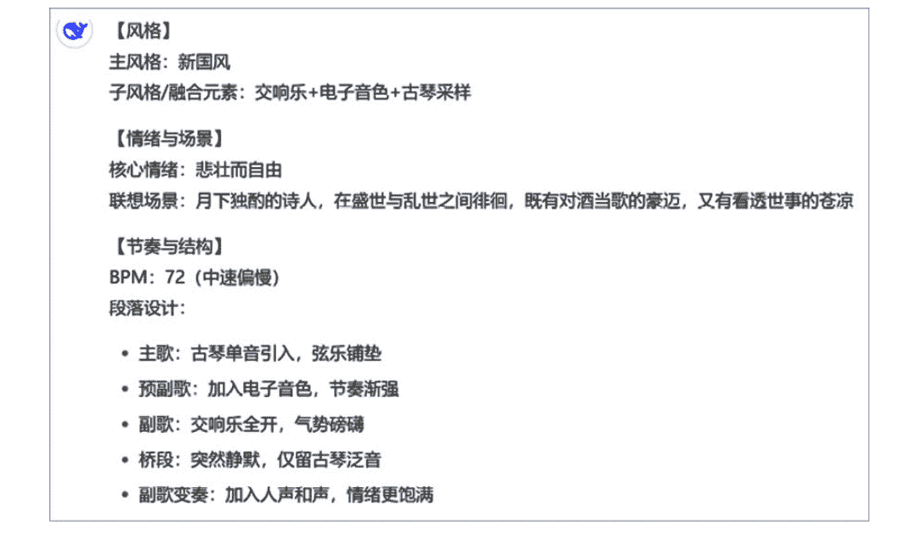

图5-10 DeepSeek 产出的曲风方案

第二步，借助人工智能音乐制作平台完成音源
以下以音疯为例说明操作路径。

（1）登录音疯进入创作页面，切换到自定义模式。左侧文本区分别填入曲名与歌词。右侧可补充参考曲目、主唱人选、风格描述、哼唱旋律等。将 DeepSeek 刚给出的风格说明粘贴到“描述歌曲”栏位，如图5-11。

（2）参数确认后点击“生成歌曲”，等待数分钟即可得到初稿。依据个人审美与需求，可直接采用或重新生成。

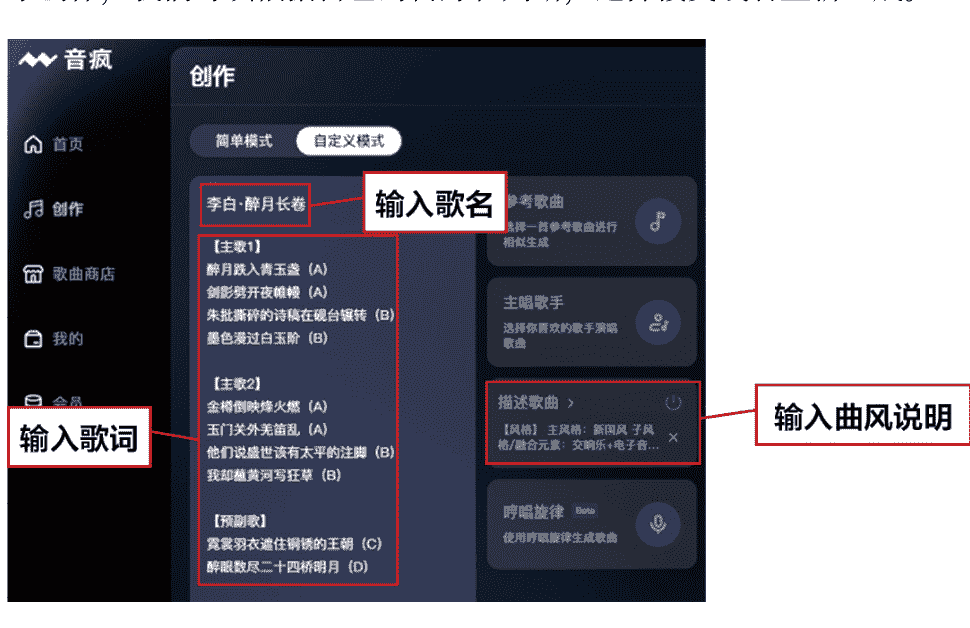

图5-11 音疯生成音乐界面

## 5.4 DeepSeek 联动绘制流程图

流程图用规范图形符号和连线表现步骤顺序、逻辑分支与决策点，帮助人们快速理解、复盘或优化各类过程，如算法、业务运行、工作流等。常见类型包括思维导图、泳道图、甘特图、时序图等。

在绘图阶段，DeepSeek 可与多种制图软件协同，把主题或材料转化为软件可识别的代码，再借助软件完成呈现。常用工具汇总如下：

### 表5-5 常用的流程图制作工具

| 工具名称 | 所属平台 | 特点 | 应用场景 |
| :--- | :--- | :--- | :--- |
| Microsoft Visio | Microsoft | 专业级绘图软件，拖拽模板丰富，兼容 Office，支持复杂逻辑与跨平台协作 | 企业级复杂流程设计 |
| Draw.io | JGraph Ltd | 开源轻量，界面简洁，支持本地保存或云同步 | 个人或小团队制作基础流程图 |
| Mermaid Live | Mermaid Live Editor | 开源平台，支持多种图表，实时编辑预览 | 项目管理、教学、业务分析 |
| ProcessOn | 北京大麦地信息技术有限公司 | 在线协作加模板共享，支持流程图与思维导图混合设计 | 教育、产品团队协作，需参考模板时 |
| 亿图图示 | EdrawSoft（深圳市亿图软件） | 兼容 Visio 格式，提供丰富矢量模板，跨 Windows/Mac/Web | 需专业绘图及格式互通场景 |
| 迅捷流程图软件 | 迅捷（中国） | 内置模板库，操作简便，支持一键导出图片/PDF | 新手快速生成标准化流程图 |
| Boardmix | 博思白板（深圳博思云创） | 在线白板结合流程图，支持思维导图、表格等多元素协作 | 团队头脑风暴或混合图表设计 |
| 妙办画板 | 妙办 | 多功能在线绘图，集成智能创作、思维导图、流程图，支持协作 | 创意图、思维导图、流程图及项目协作 |
| Xmind | 深圳市爱思软件技术有限公司 | 以思维导图为核心，支持基础流程分支设计 | 以思维导图为主、流程图为辅的记录整理 |

下面以 Draw.io 为例说明联动操作。

### 第一步：请 DeepSeek 产出流程图制作代码
Mermaid 语法因简洁、文本化、跨平台且易嵌入，成为首选。这里让 DeepSeek 依据主题产出对应脚本。示例指令为：

制作流程图，主题是“智能垃圾分类指南”，输出 Mermaid 语法。

模型理解后会给出脚本片段，示意如图5-12。

以下是智能垃圾分类流程图的 mermaid 代码：

```
mermaid
flowchart TD
    A[开始] --> B[输入垃圾信息]
    B --> C{信息类型}
    C --> |文字描述| D[文本语义分析]
    C --> |图像信息| E[图像识别处理]
    D --> F[数据库匹配]
    E --> F
    F --> G{判断分类}
    G --> |可回收物| H[显示回收处理方式]
    G --> |有害垃圾| I[显示危险警示和回收点]
    G --> |湿垃圾| J[显示生物降解方法]
    G --> |干垃圾| K[显示焚烧/填埋建议]
    H --> L[结束]
    I --> L
    J --> L
    K --> L
    L --> M{分类正确?}
    M --> |是| N[完成]
    M --> |否| B
```

图5-12 DeepSeek 根据主题输出 Mermaid 代码

### 第二步：将脚本导入 Draw.io
（1）登录 Draw.io 平台。登录成功后，在上方编辑栏点“+”按钮，在下拉菜单选择“高级”→“Mermaid”，如图5-13。

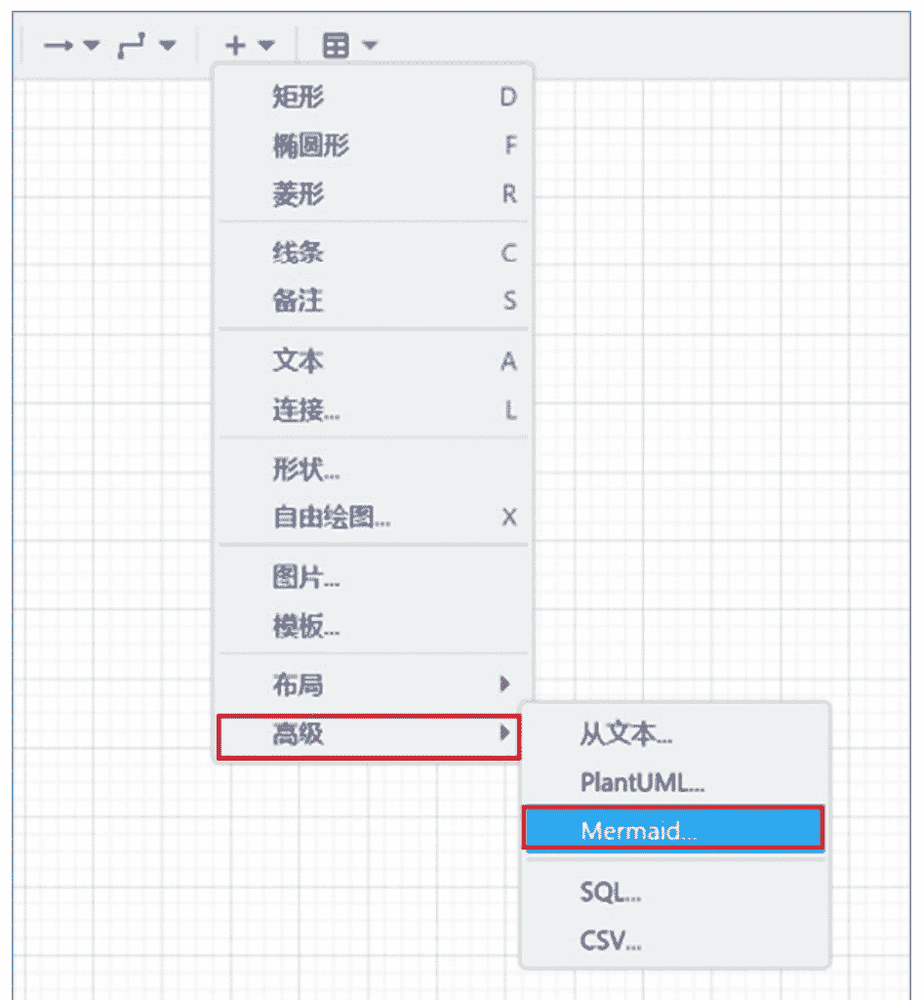

图5-13 在 Draw.io 导入 Mermaid 代码的路径

（2）弹出对话框，将图5-12 中的代码复制、粘贴到该对话框，然后点对话框下方的“插入”按钮，如图5-14。

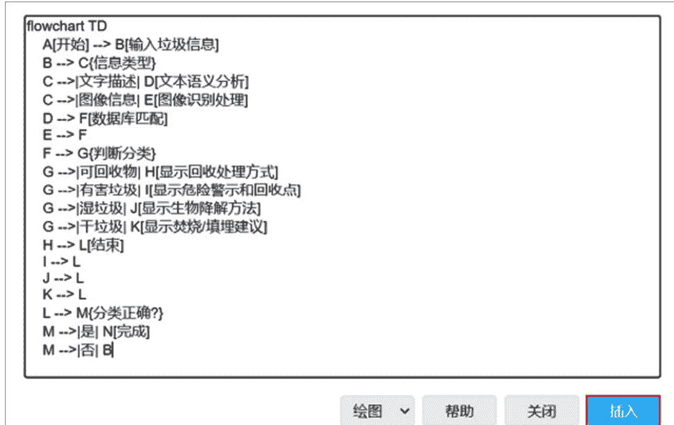

图5-14 在 Draw.io 对话框中插入 Mermaid 代码

（3）插入代码后，即可生成流程图草稿，如图5-15。

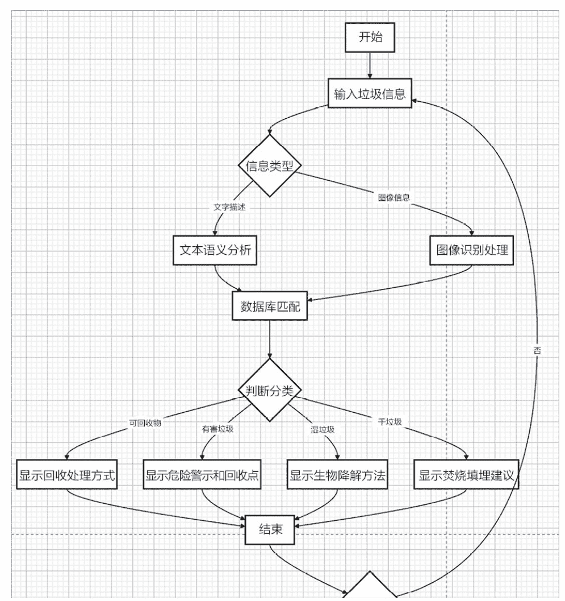

图5-15 流程图草稿

（4）在 Draw.io 中，可对草稿进行编辑。例如，页面右侧有“绘图”和“样式”两个选项卡，应用其中的选项可调整画面和流程图样式，如图5-16。这里选择橙色样式（第4行第1个样式）。

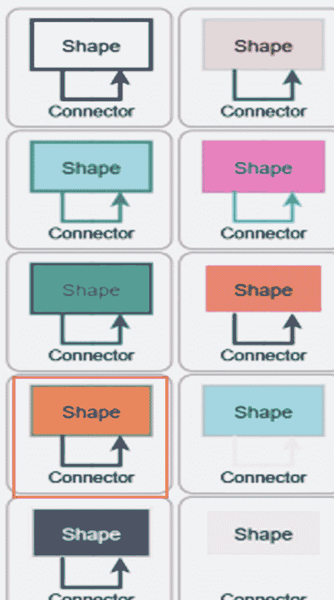

图5-16 对流程图草稿进行画面和样式调整

编辑栏“+”左侧有“连接”按钮和“航点”按钮（见图5-13）。其中，点“连接”按钮可选择不同连接线线型，点“航点”按钮可选择不同连接方式。用户可按需选择。调整后的流程图（部分）效果如图5-17。

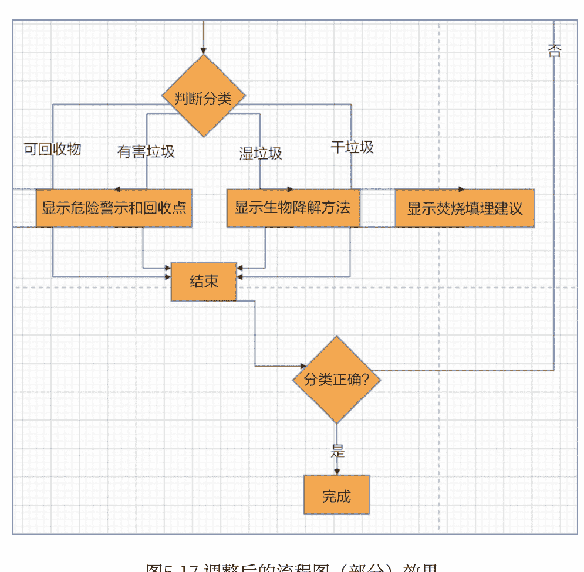

图5-17 调整后的流程图（部分）效果

（5）调整后，可保存到本地。有两个保存路径：其一，点页面左上角“文件”菜单，在下拉菜单选择“导出为”，然后在级联菜单选择相应导出格式；其二，页面上方有红色背景的未保存提醒按钮，点该按钮即可保存，如图5-18。


图5-18 流程图的保存路径

若在第一条路径中选择 PNG 格式，会弹出参数设置对话框，调整相应参数后点“导出”按钮，即可将流程图保存到本地，如图5-19。

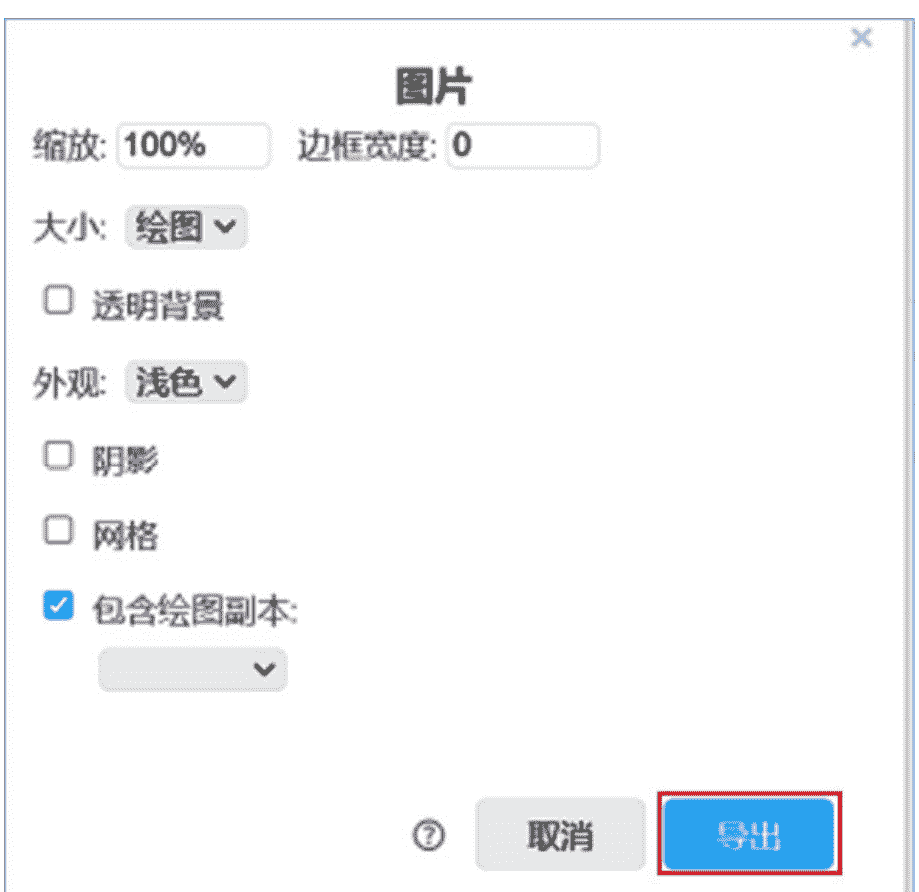

图5-19 将流程图保存到本地

思维导图在信息整理场景使用频率很高。下面以 Xmind 平台做实操演示。

第一步，在 DeepSeek 平台依据主题或材料产出思维导图制作的代码。

Markdown 语法因简洁、文本化、跨平台，成为制作思维导图的常用方式。这里让 DeepSeek 依据主题或材料产出 Markdown 代码，如图5-20。

参考提示词：制作思维导图，主题是“智能垃圾分类指南”，输出 Markdown 代码。

```
### 智能垃圾分类指南

#### 分类标准
- 可回收物
  - 纸张/纸箱
  - 塑料瓶/容器
  - 玻璃制品
  - 金属制品
  - 纺织物
- 有害垃圾
  - 废电池
  - 过期药品
  - 废灯管
  - 化学品容器
- 厨余垃圾
  - 食物残渣
  - 果皮果核
  - 茶叶渣
  - 过期食品
- 其他垃圾
  - 受污染纸巾
```

图5-20 DeepSeek 根据主题生成 Markdown 代码

点代码框右上角“复制”按钮，复制 Markdown 代码。然后在桌面右键新建文本文档，如图5-21。

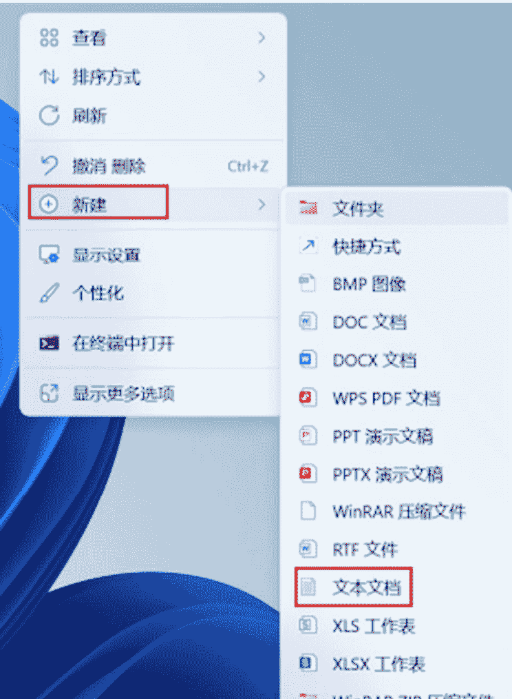

图5-21 新建文本文档

将复制的 Markdown 代码粘贴到新建的文本文档中，然后点右上角“文件”→“另存为”菜单，在弹出对话框中，将文件名改为“智能垃圾分类指南.md”，保存类型选“所有文件”，编码选“UTF-8”，如图5-22。最后点“保存”按钮，将其保存在计算机中。

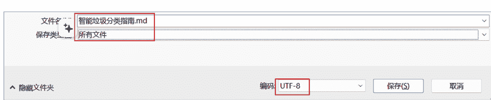

图5-22 将 Markdown 代码保存为 MD 格式文件

**第二步，登录 Xmind 官网。** Xmind 官网提供在线版和本地版两种版本，这里选择在线版，在官网首页导航栏点“在线导图”按钮，如图5-23。

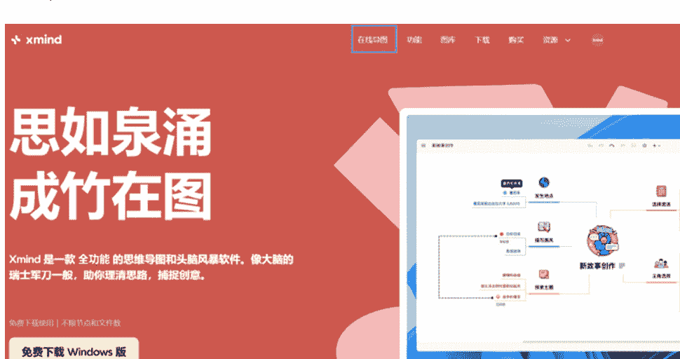

图5-23 Xmind 官网首页

**第三步，进入“在线导图”页面，注册并登录后，点页面上方的“新建导图”按钮，在弹出“新建导图”对话框中点“空文件”，如图5-24（a）。然后在新界面中点左上角三条横线按钮，选择“导入文件”选项，在弹出“导入”对话框中点，接着在“打开”对话框的“文件类型”选项中选择“所有文件”，如图5-24（b）。**

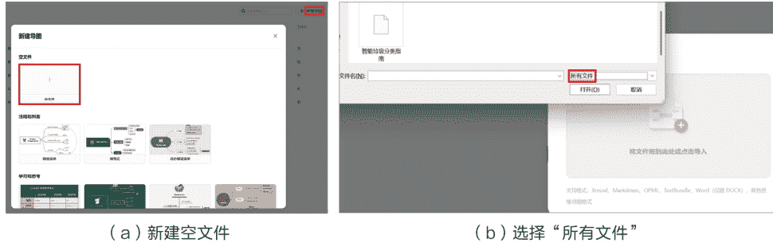

图5-24 导入文件

在计算机中找到“智能垃圾分类指南.md”文件，然后点“打开”按钮上传，在弹出“导入”对话框中点“导入”按钮，即可生成“智能垃圾分类指南”主题的思维导图草稿，如图5-25。

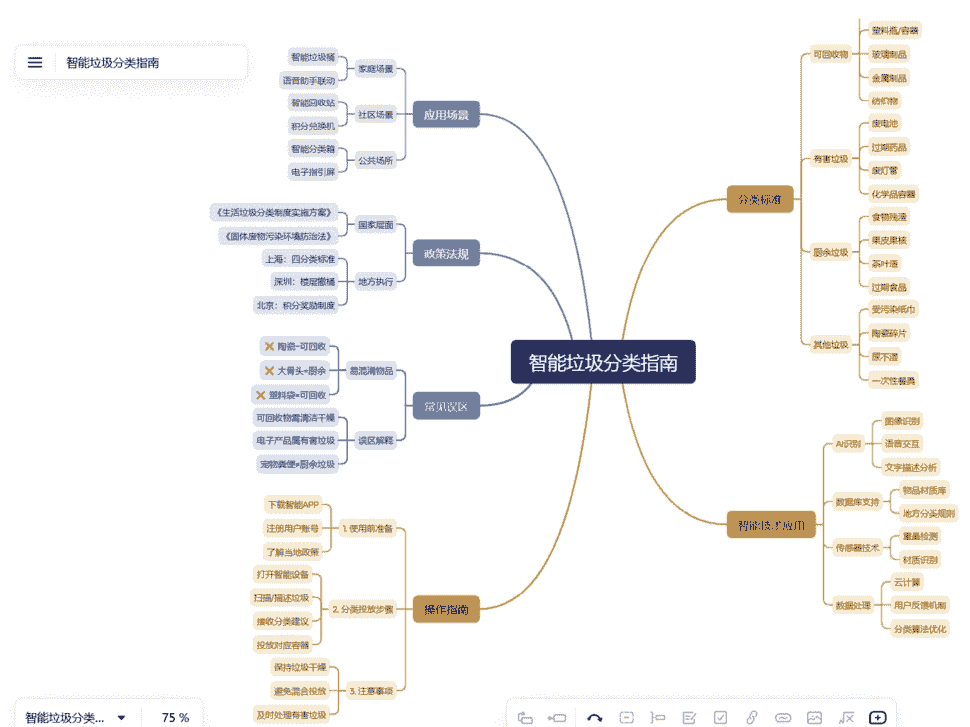

图5-25 “智能垃圾分类指南”主题的思维导图草稿

**第四步，可在 Xmind 中对草稿进行编辑加工。** 利用页面右侧的样式调整面板可调整思维导图样式，如图5-26。还可利用页面下方的内容编辑工具栏对内容进行修改，如图5-27。


▲图5-26 样式调整面板


▲图5-27 内容编辑工具栏

**第五步，** 调整完成后，将文件保存到计算机中。点页面左上角三条横线按钮，可选择“导出”或“下载”选项。例如，选“导出”选项，可将文件导出为 PNG 或 JPEG 等格式，如图5-28。选“下载”选项，则可直接将文件下载保存为.xmind格式。

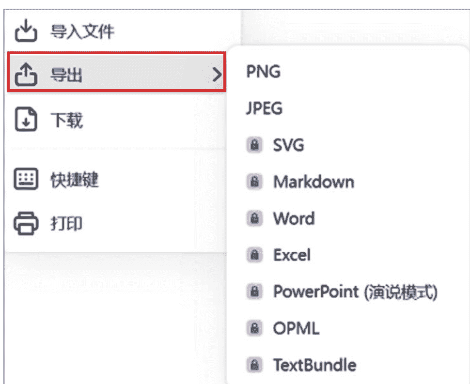

图5-28 “导出”选项

## 5.5 DeepSeek 联动制作 PPT

工作中 PPT 制作已成刚需。传统手工制作耗时费力，而借助智能工具不仅能快速生成内容，还能依据美学原则排版设计，整体周期大幅压缩。

PPT 制作主要由两大环节构成：内容准备与制作呈现。其中内容准备尤为关键，是整个 PPT 的基础。在此环节，可借助 DeepSeek 对相关主题内容进行梳理，快速生成条理清晰、逻辑严谨的内容框架。

在制作环节，各类基于智能的 PPT 生成工具可发挥重要作用。它们能基于准备好的内容迅速生成专业水准的 PPT，内置丰富模板与设计风格，只需简单操作即可将文字、图片、图表融合呈现出美观页面。常见工具如下：

### 表5-6 常见的 PPT 生成工具

| 工具名称 | 所属平台 | 特点 | 应用场景 |
| :--- | :--- | :--- | :--- |
| Gamma | Gamma | 快速生成结构化 PPT，支持交互式编辑、多平台适配 | 公司提案、教育课件等专业设计场景 |
| WPS灵犀 | 金山办公 | 深度集成 WPS 生态，基于 AI 生成 PPT+智能排版+模板推荐 | 企业汇报、教育培训等需高效制作且注重专业排版场景 |
| 通义千问 | 阿里巴巴 | 支持单句主题、文件上传等多种生成方式，支持在线编辑和模板替换 | 适合普通用户快速生成 PPT |
| Kimi PPT助手 | Kimi | 对接 AI PPT.cn 功能，模板丰富且生成速度快 | 适合需要多样化模板的用户 |
| 讯飞智文 | 科大讯飞 | AI 配图、自动生成讲稿、多语种翻译，支持在线编辑和动画效果 | 商务汇报、学术演讲等对美观度与专业性要求较高场景 |
| AiPPT.cn | 北京饼干科技有限公司 | 逻辑性强、模板丰富，支持云端存储及 PPT、PDF 等导出格式 | 基于专业场景快速生成 PPT |
| 万知 | 零一万物 | 可生成 PPT、阅读总结、行业检索 | 免费快速制作 PPT |
| ChatPPT | ChatPPT | 支持在线版和插件版 | 适合轻量化需求 |
| Islide | Islide | 支持 PPT 生成、Word 和脑图转 PPT 等功能，模板丰富 | 适合需要简化设计和快速排版的用户 |
| 智谱清言PPT | 智谱清言 | 通过“智能体中心”调用，支持上传本地文件或网址参考生成 PPT | 生成定制化 PPT |
| 歌者PPT | 彩漩科技 | 支持学术报告、毕业论文、思维导图等秒转 PPT | 普通用户日常 PPT 制作 |
| LivePPT | 美图 | 美观，生成内容量较大 | 需要“高颜值”或有特殊设计需求的演示场景 |

DeepSeek 与 PPT 生成工具的联动方式主要有两种。第一种是基于 DeepSeek 生成主题内容的大纲，然后借助 PPT 生成工具完成 PPT 制作。这种方式定制化程度高，用户可根据需求撰写更细致提示词，生成更贴合实际需求的内容框架，其中 PPT 生成工具仅承担内容呈现职责。不足之处在于操作流程较复杂。第二种方式是直接借助已接入 DeepSeek 功能的 PPT 生成工具，在一个平台上即可完成内容生成与 PPT 制作的全流程。这种方式优势在于使用便捷、高效，不足之处是定制化能力较弱，个性化调整受限于平台功能集成程度。

下面分别演示两种生成 PPT 方式的操作过程。

### 第一种方式：DeepSeek+PPT 生成工具

这里选择 DeepSeek+通义千问联动作为实操案例。

#### 第一步：在 DeepSeek 中生成关于某个主题的 PPT 提纲

参考六定模型，设计了“生成 PPT 提纲”的提示词参考模板，具体如下所示。

##### “生成 PPT 提纲”提示词参考模板

请设计一份面向[某角色]的内容/框架，背景设定为[某特定背景]。目标是实现[具体目标]，采用[某方法]进行呈现，以促进[特定理解或行动需求的实现]。建议内容结构清晰，重点通过[特定表现方式/工具]深化核心内容的表达，加强互动体验或知识迁移，并用[特定标准]简化复杂概念，保证高效传播和易于理解。整体基调需保持[具体基调，如趣味化、启发式、可信赖等]，确保表达生动、简洁且富有吸引力，同时有效引导受众实现[目标行为或进一步思考]。

例如，以面向初中生做一场“人工智能发展史”科普讲座为例，设计如下提示词。

请设计一份面向初中生的内容框架，背景设定为校园科技周活动。目标是实现人工智能基础知识普及与兴趣培养，采用多媒体互动讲座形式呈现，以促进学生对 AI 技术发展历程的理解和激发他们对 STEM 课程的学习热情。建议内容结构清晰，以**“机械生命成长日记”为隐喻，将 AI 进化比喻为生物成长故事**，标题定为“AI 进化之旅：机械大脑变形记”，采用**“大脑进化树”时间轴标注关键阶段。内容分为三大模块：“蒸汽朋克图书馆”比喻早期规则系统为固执导游**；“乐高积木大爆炸”比拟深度学习为积木重组；“魔法镜子工作室”用镜像反射解释生成式 AI。重点通过动画视频与简易编程 Demo 深化核心内容的表达，设计**“思维燃料站”互动环节**，让学生上传照片生成梵高风格画像。整体基调需保持趣味探索与启发思考相结合，结尾以 AR 彩蛋和“给 AI 发明新技能”创意工坊激发兴趣，通过生活化比喻、拟人化语言和互动体验，确保表达生动、简洁且富有吸引力，同时有效引导受众理解并复述 AI 发展关键内容，形成正确认知与未来学习路径规划。

将提示词输入 DeepSeek 后，DeepSeek 很快帮我们整理了相关主题内容，生成 PPT 大纲，其部分内容如图5-29所示。

##### 封面页（1页）

- 主标题：AI 进化之旅：机械大脑变形记

- 副标题：一部会“长大”的机械生命成长日记

- 视觉元素：卡通机械大脑从蒸汽齿轮到数字神经网络的渐变图

- 互动预告：扫描右下角 AR 彩蛋，唤醒沉睡的机械生命

##### 目录页（1页）

“大脑进化树”时间轴（动态生长动画）

- 1940s-1990s → 蒸汽朋克图书馆（规则系统时代）

AI 进化两大时间切片

- 2000s-2010s → 乐高积木大爆炸，深度学习革命的高潮段
- 2020s-未来 → 魔法镜子工作室，生成式 AI 的新纪元

##### 第一幕：蒸汽朋克图书馆 - 机械婴儿的固执导游（6页）

###### 1. 出生证明：图灵测试的摇篮曲

- 拟人化设定：AI 宝宝戴着齿轮发条帽，手中捏着《规则手册》

图5-29 PPT大纲的部分内容

#### 第二步，选择PPT生成工具

（1）本案例选用阿里巴巴旗下的通义千问。通过百度检索“通义千问”，进入官方网站，按指引完成账号注册与登录。

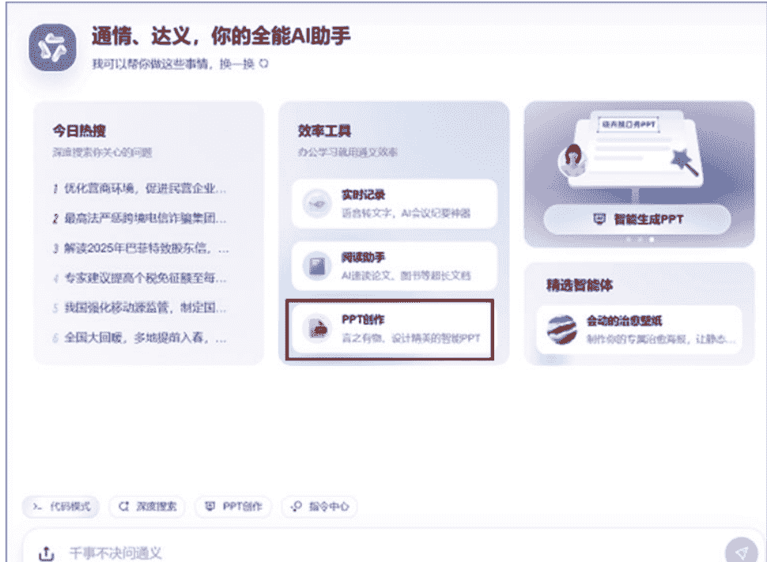

图5-30 通义千问官网

（2）打开对话区上方的“PPT创作”入口，进入通义 PPT 创作界面，把 DeepSeek 之前生成的 PPT 大纲复制到对话框里。在对话过程中可以同步提出页数、配图风格、内容详略等具体要求。

例如可以这样输入：

请基于下面内容制作演示文稿，要求：页数 12 页；配图绘本风格；内容精简。内容：（主题提纲略）。

系统会按给定条件对素材进行处理。确认内容后，点击下方的“PPT创作”按钮，如图5-31所示。

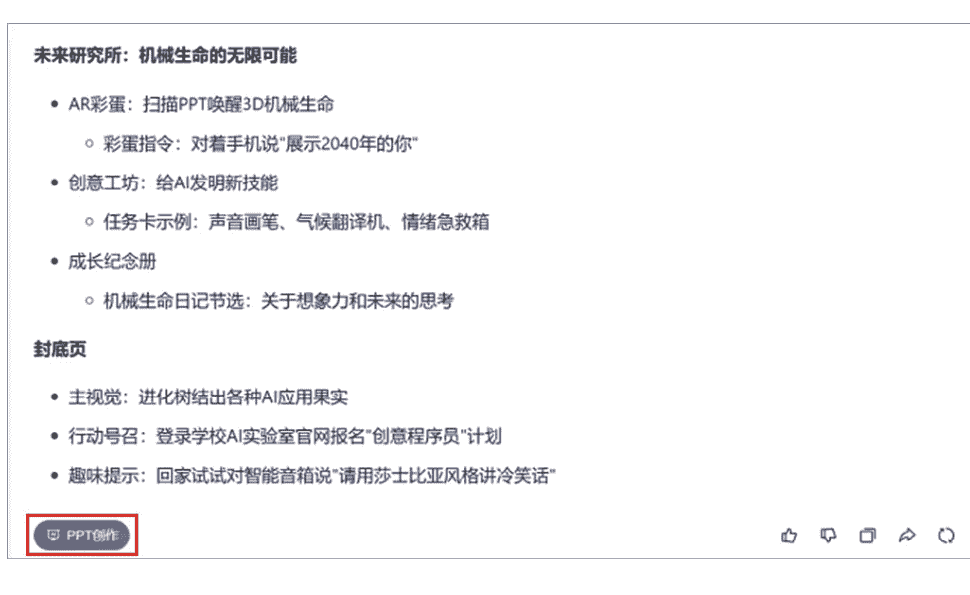

图5-31 通义千问提供资料的整体界面

#### 第三步，PPT制作与调整

（1）点击“PPT创作”后进入可编辑大纲界面，可以增删或修改大纲条目，并可指定演示文稿的应用场景，如图5-32所示。

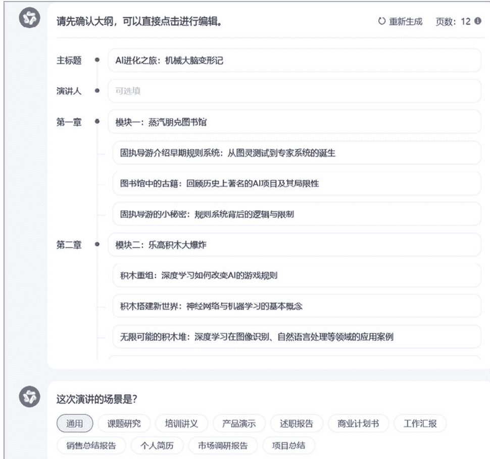

图5-32 可编辑大纲与场景选择界面

（2）大纲确认后点“下一步”，进入模板挑选阶段。按使用场景选择匹配风格。以初中生为目标受众，选用活泼的手绘风格模板，如图5-33所示。

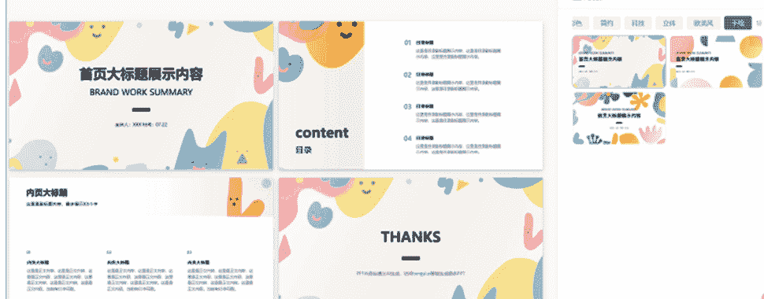

图5-33 手绘风格模板挑选

（3）模板确定后点“生成PPT”，系统逐页完成制作。页面中央展示初稿可直接修改；左上角显示文稿名称，可点改名；右上角集中保存、导出、换模板、演示等操作；左侧为预览区并支持新建单页；右侧提供插入文字卡、流程图等功能列表，如图5-34所示。

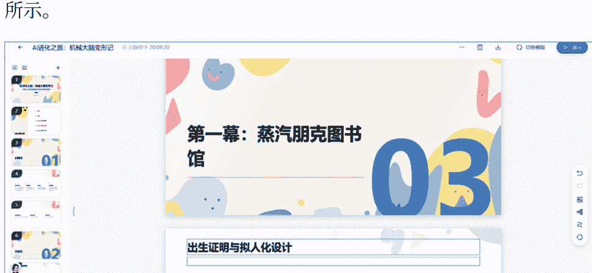

图5-34 PPT页面功能布局

（4）修改过程比较细致，可自行探索尝试。定稿后点右上角导出按钮，选择导出格式即可下载成品，如图5-35所示。

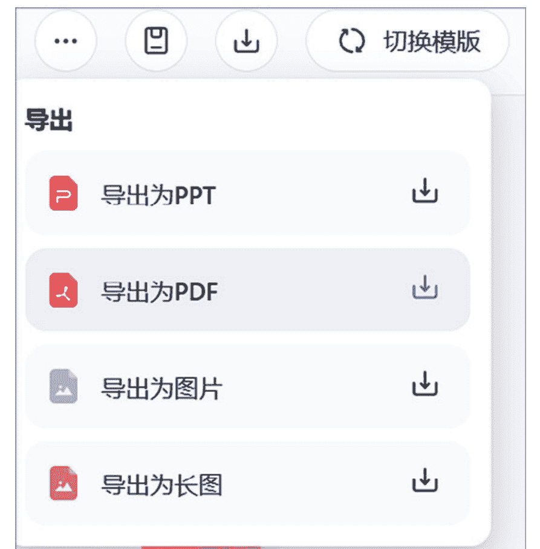

图5-35 导出格式选择

第二种做法：借助已接入 DeepSeek 的 PPT 制作工具

当前已有不少平台接入 DeepSeek，例如 WPS 灵犀、讯飞智文、歌者 PPT 等，下文以 WPS 灵犀为例展开。

#### 第一步，进入 WPS 灵犀

（1）百度搜索“WPS 灵犀”，进入官网注册登录。进入后可看到“DeepSeek R1”“读文档”“生成PPT”等入口，如图5-36所示。


图5-36 WPS 灵犀功能界面

（2）点击“生成PPT”进入制作界面，在交互框内输入提示词。框体下方提供 DeepSeek R1、联网检索、上传文件三项可选，按需选择，如图5-37所示。

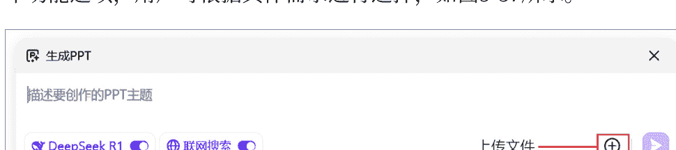

图5-37 PPT制作界面

#### 第二步，按主题生成 PPT 大纲

（1）在交互框内输入提示词。本例沿用第一种方式的提示词，直接复制粘贴过来，如图5-38所示。

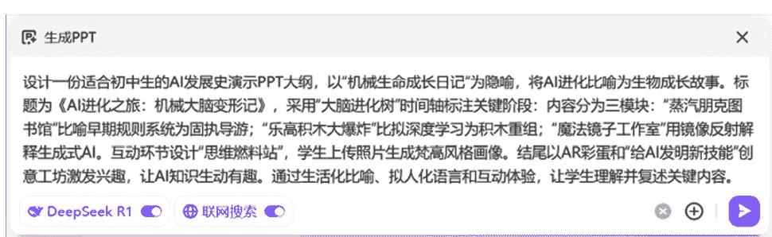

图5-38 提示词粘贴

（2）启用 DeepSeek R1，点击右下角“发送”，接入的 DeepSeek R1 会解析提示并给出大纲。随后界面下方出现“选择模板”选项，先选模板再点“生成PPT”，如图5-39所示。

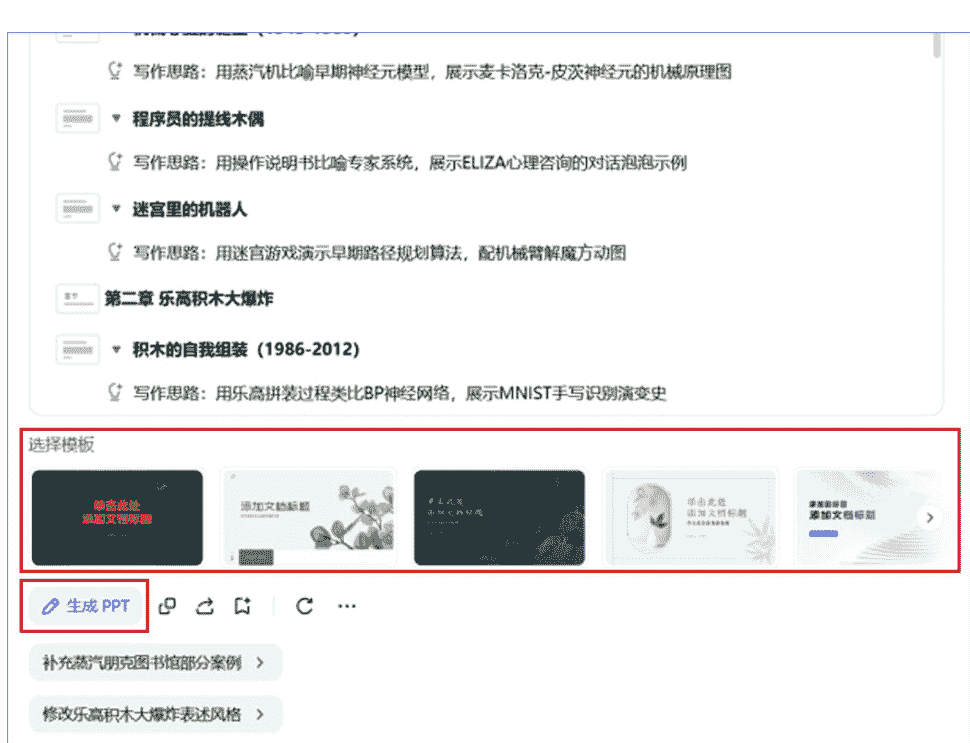

图5-39 生成大纲与模板选择

#### 第三步，按大纲制作 PPT

点击“生成PPT”后，WPS 灵犀会依据大纲逐页生成。完成效果如图5-40所示。

可直接点击文稿中的文字或图片进行修改。

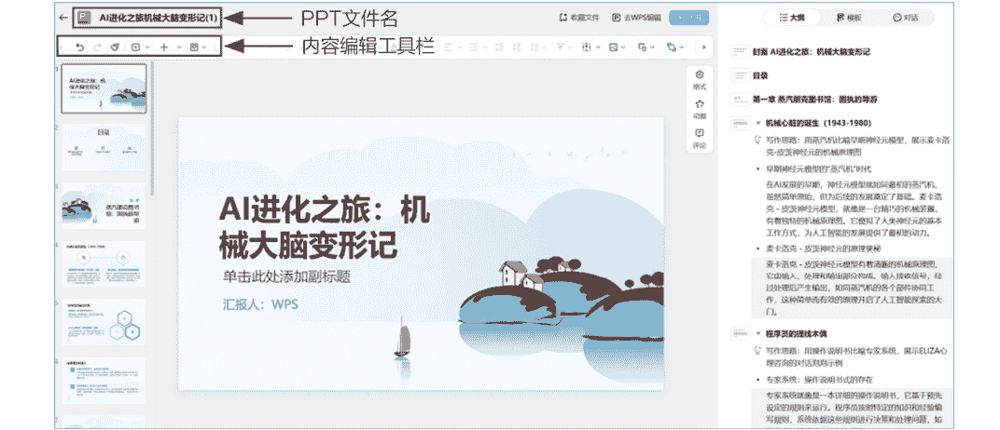

图5-40 制作完成的 PPT 页面

页面上方分两行，第一行左侧是文件名，右侧为“收藏文件”“去WPS编辑”“下载”按钮；第二行是内容编辑工具栏，可做精细化编辑。

左侧为预览窗格，可增删幻灯片。

右侧提供“大纲”“模板”“对话”三个标签。

在“大纲”标签下展示文稿的写作思路。将光标悬停在正文标题上，右侧会出现“添加”+ 与“删除”按钮，点击“添加”可新增子标题，点击“删除”可移除该标题及对应页面，如图5-41所示。

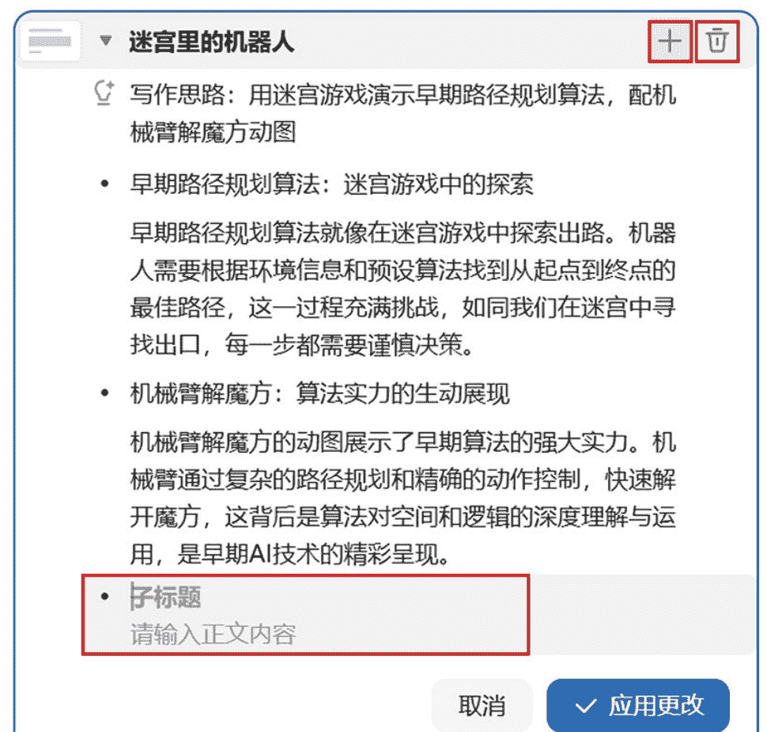

图5-41 在“大纲”选项卡中添加子标题

打开标题后，页面下方会出现蓝色区域，光标移至底部会显示紫色加号，如图5-42所示。点击加号可新增标题及对应内容，输入完成后会出现“AI生成幻灯片”按钮，点击即可自动生成内容，如图5-43所示。

### 猫狗识别大作战

写作思路：用校园宠物照片墙说明卷积神经网络，并对比不同网络的识别准确率

- 校园宠物照片墙：AI 的“识图训练场”
  校园宠物照片墙汇集大量猫狗照片，可作为 AI 的“识图训练场”，卷积神经网络在此发挥作用。

- 卷积神经网络：图像识别的“超级武器”
  卷积神经网络专用于图像处理，能自动抽取图像特征，相当于为 AI 装上精准识图的“火眼金睛”，在猫狗识别等任务中起关键作用。

- 准确率大比拼：不同网络的实力对比
  各类卷积神经网络在猫狗识别准确率上各有表现。例如先进网络可达 90% 以上，而早期网络可能仅 70% 左右，通过对比可直观体现技术进步。

### 请输入正文标题

写作思路：请输入写作思路

▲图5-42 在“大纲”选项卡中添加新标题


▲图5-43 AI 生产新的幻灯片

在图5-40 所示的“模板”标签中可视化更换模板。进入该标签，点击右上角“上传模板”即可导入 PPT 模板，如图5-44所示。

图5-44 “模板”选项卡

在图5-40 所示的“对话”标签中，可通过与 AI 互动继续完善制作思路，也可生成其他主题的 PPT，如图5-45所示。

根据大纲已经帮你生成PPT


### AI进化之旅 机械大脑变形记(1)

蒸汽朋克图书馆：固执的导游

机械心脏的诞生 1943-1980

用蒸汽机比喻早期神经元模型，并展示麦卡洛克-皮茨神经元的机械原理图

生成人工智能的发展趋势PPT

思考 12 秒

好的，我需要帮用户生成一份关于人工智能发展趋势的PPT。用户之前已经提供了详细的AI发展史大纲，现在他们想要转向未来的趋势。首先，我需要确定PPT的主题和结构

提问、选择技能或试试@

DeepSeek R1

图5-45 在“对话”选项卡中生成新主题PPT

#### 第四步，下载 PPT

点击图5-40 页面上方的“下载”按钮即可直接获取成品。如点击“去WPS编辑”按钮，可在 WPS 中打开文件继续保存或编辑。

## 5.6 DeepSeek 联动飞书批量处理信息

飞书是字节跳动打造的高效协作办公平台，提供文档、幻灯片、问卷、思维导图等多种功能。近期飞书多维表格已接入 DeepSeek，二者联动可实现批量信息处理。

下面介绍在飞书多维表格中调用与配置 DeepSeek 的具体步骤。

**第一步：下载和注册飞书**

下载完成后进行注册。登录后进入主页面，点击左上角“+”按钮，在弹出菜单中选择“创建多维表格”，如图5-46所示。创建完成后页面如图5-47所示。

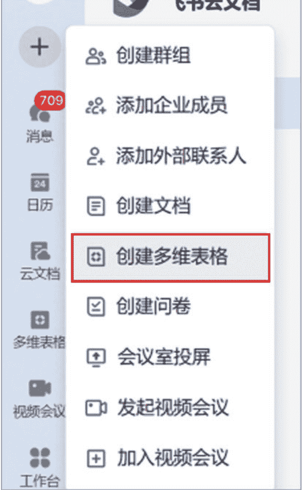

▲图5-46 创建多维表格

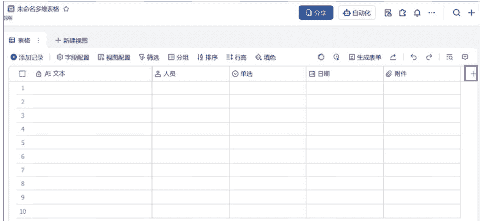

▲图5-47 在飞书中创建的多维表格

**第二步：** 找到“附件”列，点击其右侧的“+”按钮。

会弹出配置窗口，如图5-48所示。在“标题”文本框中填写本次任务名称，便于后续识别与管理，例如填写“总结”，该名称即成为该列名。填写完成后点击“探索字段捷径”选项，在级联列表中检索“DeepSeek”，选择“DeepSeek R1”。

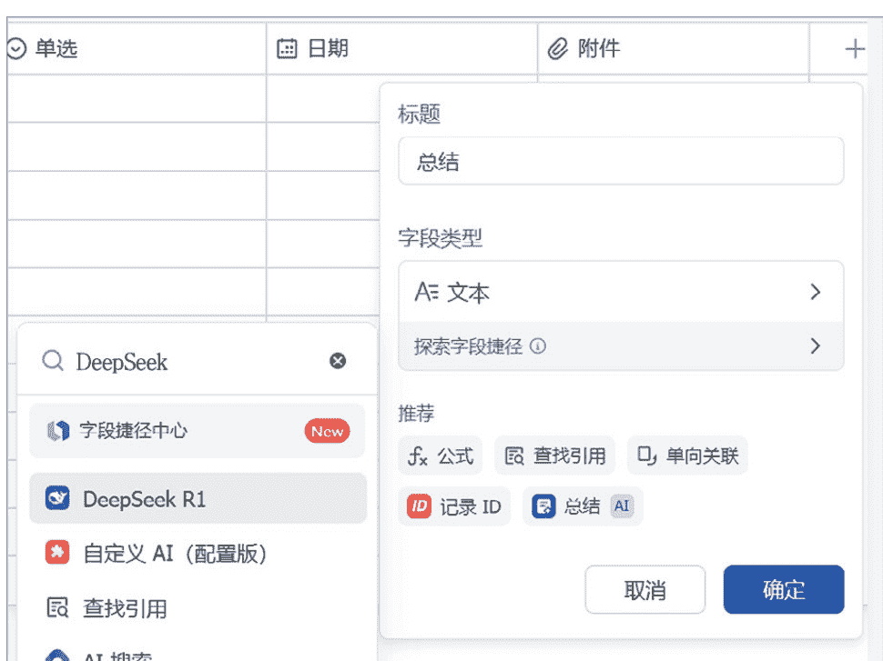

图5-48 配置“附件”列信息

**第三步：** 在弹出面板中对 DeepSeek 进行参数配置。

“选择指令内容”用于指定操作对象，通常选择表格第一列；“自定义要求”文本框用于输入执行指令即提示词，决定 DeepSeek 的处理规则；随后开启“获取更多信息”功能，并勾选“思考过程”和“输出结果”，以便查看推理逻辑与最终结果；最后开启底部的“自动更新”功能，表格数据变动时 DeepSeek 会自动重新执行指令并实时更新结果，保证时效与准确性。配置完成效果如图5-49所示。

对象

DeepSeek R1 字段捷径

关联账号

Deepseek 大模型账号（非必填）

+ 关联账号

配置

选择指令内容 *

A 文本

▼ 自定义要求

总结内容，不超过10个字

获取更多信息

A 思考过程

A 输出结果

自动更新

### 图5-49 完成DeepSeek参数配置

#### 第四步：效果测试

配置完成后需测试运行效果。

（1）在“自定义要求”文本框输入简洁测试提示词，例如“总结内容，不超10字”。该指令含义是对“文本”列内容进行提炼并限制在10字以内。操作完成后多维表格呈现如图5-50所示的页面。

| □ | 📄 文本 | 📊 总结 AI | 📊 总结.思考过程 | 📊 总结.输出结果 | + |
|---|---|---|---|---|---|
| 1 | | | | | |
| 2 | | | | | |
| 3 | | | | | |
| 4 | | | | | |
| 5 | | | | | |
| 6 | | | | | |
| 7 | | | | | |
| 8 | | | | | |
| 9 | | | | | |
| 10 | | | | | |
| + | | | | | |

### 图5-50 配置完DeepSeek后的多维表格页面

（2）将《狼来了》故事文本粘贴至“文本”列第一行。已配置的 DeepSeek 多维表格会按设定自动执行，快速总结并输出不超过10字的结果，如图5-51所示，可据此判断配置是否正确。

| ☐ | 📋 A= 文本 | 📊 总结 AI | A= 总结.思考过程 | A= 总结.输出结果 |
|---|---|---|---|---|
| 1 | 《狼来了》的故事原文如下：<br><br>从前，有个放羊娃... | 🤖 嗯，用户让我总结... | 嗯，用户让我总结《狼来了》的故事内容，不超过10个字。首先，我需要回顾故事的主要情节。放... | 失信致灾 |

图5-51 配置好DeepSeek的多维表格按设定执行任务

完成上述四步即在飞书多维表格中完成 DeepSeek 的配置与测试。多维表格功能丰富，可自行探索。

为进一步说明联动价值，下面以批量撰写书评为例展示实操。

（1）设计总体工作流
思路是输入书名后由 DeepSeek 处理，输出300字以内的简洁书评，高效产出内容。

（2）设计提示词
参考六定模型，提示词如下，引导生成符合要求的书评。

作为资深文学评论家，在信息时代，你需要为读者在知名文化媒体平台提供优质书评。目标是帮读者快速了解书籍内容，判断图书的可读性并引导读者深度思考。撰写时，先精读全书，梳理主要情节、人物或观点，从用词、结构分析写作风格，依据文学、思想、社会影响等客观标准评估价值，结合自身感悟给出真实评价。结构上开篇点明书名、作者与背景，中间阐述内容、风格、价值，结尾总结优缺点。语言要专业客观，兼具深度与通俗性，在严谨与亲和间平衡，篇幅控制在300字内，精准传达观点。

（3）测试流程
配置完成后输入一个书名进行测试，观察处理过程，检查输出是否符合预期，判断工作流是否顺畅。

（4）确认并批量执行
确认无误后可批量提供书名，工作流将按设定批量处理并生成书评，大幅提升效率。

完整的工作流及执行效果如图5-52所示。

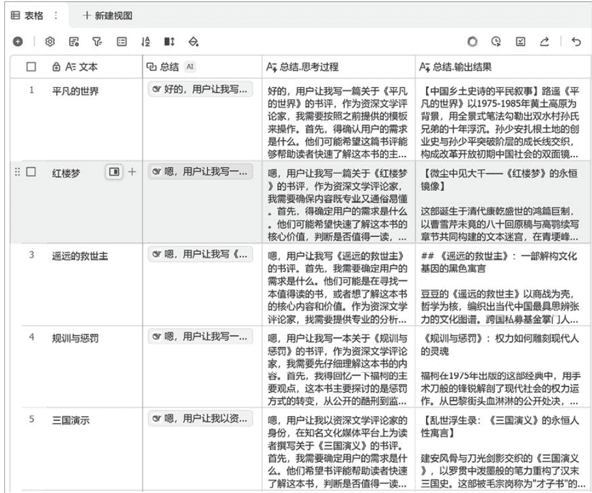

### 图5-52 书评批量生成工作流及执行效果

飞书多维表格与 DeepSeek 的联动可执行多种批量处理任务。应用场景丰富，例如项目管理中可批量跟踪进度、调整任务分配，负责人设定指令后 DeepSeek 可快速分析数据输出关键节点与风险预警，团队据此实时调整安排；在市场调研中面对海量问卷数据，可迅速提炼消费者偏好、市场趋势等关键信息，为营销策略提供支撑，提升效率与决策科学性。更多创新应用有待读者发挥想象。

## 5.7 DeepSeek 联动搭建智能体

智能体 Agent 是一种可自动执行任务的 AI 系统。通过简单参数配置即可搭建解决特定需求的智能体，大幅提升效率。大模型相当于智能体大脑，决定其智能水平。当前众多智能体平台已接入 DeepSeek，用户可将其作为驱动模型。常见搭建平台如表5-7所示。

表5-7 常见的智能体搭建平台

| 工具名称 | 所属平台 | 特点 | 应用场景 |
| --- | --- | --- | --- |
| Dify | Dify | 开源、多模型支持、内置工具、私有化部署 | 企业级AI应用开发、知识库问答、智能客服 |
| FastGPT | 环界云计算公司 | 基于LLM的知识库问答、可视化工作流编排、非结构化数据管理 | 复杂问答、数据分析、快速构建AI应用 |
| 扣子 Coze | 字节跳动 | 拖拽式界面、多智能体协作、插件知识库集成、社交平台一键部署 | 聊天机器人开发、多任务处理、企业级SLA服务 |
| 腾讯元器 | 腾讯 | 支持混元大模型、无代码开发、插件知识库工作流、QQ微信生态集成 | 社交场景AI助手、企业级智能体快速部署 |
| 智谱清言 | 智谱AI | 文档上传管理、企业级开发能力 | 知识库构建、需技术基础的企业应用 |
| 文心智能体平台 | 百度 | 文心大模型驱动、无代码低代码开发、商业闭环、多行业模板 | 行业定制化解决方案、商业场景流量分发 |
| 通义智能体 | 阿里巴巴 | 多模态融合、全场景赋能、开放生态 | 角色对话、企业工作流自动化 |

下面以扣子为例展示将 DeepSeek 作为驱动模型搭建智能体的流程。

### 第一步：登录扣子平台并注册账户

扣子是字节跳动打造的智能体搭建平台，功能丰富便捷。登录后进入首页，如图5-53所示。


图5-53 扣子平台首页

### 第二步：创建智能体

打开工作台后，先看向左上角的 ⊕，点击后会弹出创建菜单。接着选择“创建智能体”，进入新建页面。系统提供两种建模路径：标准创建与 AI 创建。以下以标准创建为例，演示如何搭建一个书评助手。需要填写智能体名称与功能说明，指定工作空间并设置图标，最后点击“确认”完成初建，如图5-54所示。

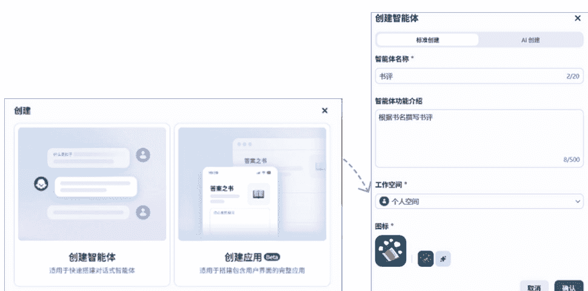

图5-54 创建智能体

### 第三步 进入编排界面

进入编排页后，扣子将页面划分为三块。左侧是模式选择与“人设与回复逻辑”，本质上是提示词填写区；中间为参数调节区，顶部可切换大模型；右侧为预览与调试区。整体布局如图5-55。

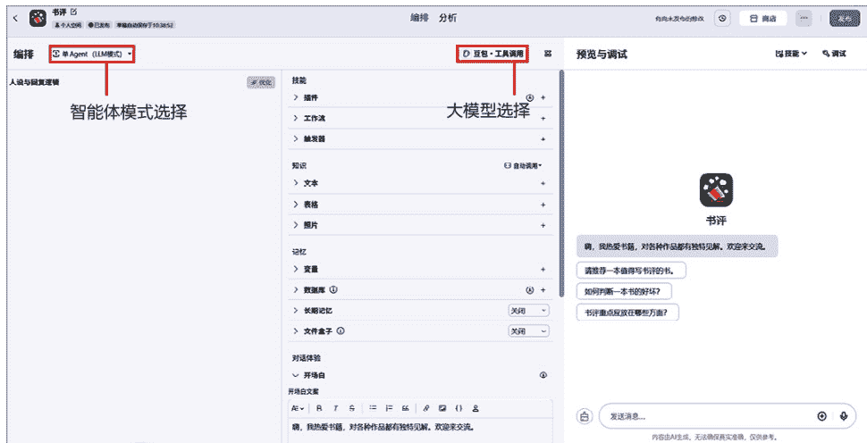

图5-55 扣子平台的智能体“编排”页面

（1）在“人设与回复逻辑”区域，按照实际需求输入提示词，例如“依据书名输出一篇不超过300字的书评”。输入完成后点击该区右上角“优化”，在弹出列表中选择“自动优化”，系统给出优化结果后点“替换”即可完成提示词设计。

（2）随后点击中间上方的大模型选择，下拉列表中可找到 DeepSeek 系列。扣子内置多个版本，这里选用“DeepSeek-R1”即可，如图5-56所示。留意扣子对 DeepSeek 的调用次数有限，选定 R1 后参数区可能出现“模型不支持”的提示，该提示可忽略，直接继续。

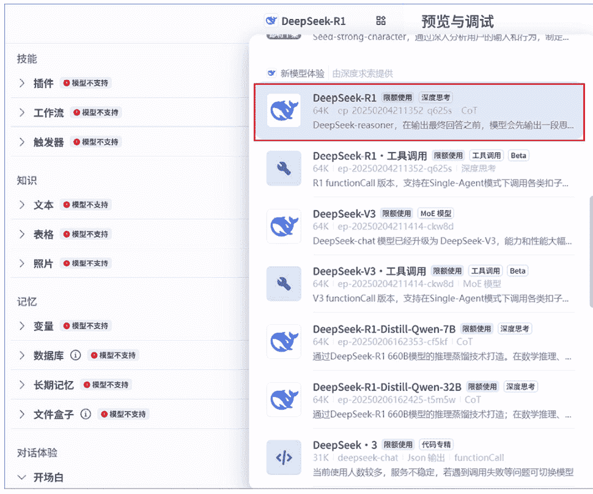

图5-56 在扣子平台中选择DeepSeek模型

### 第四步 测试与发布

（1）设置完成后，可在编排页右侧的“预览与调试”区进行试跑。在下方输入框中输入《平凡的世界》，点击发送，片刻后即可得到书评结果，效果如图5-57所示。

### 预览与调试

用户l0k9gw6B

《平凡的世界》

书评

嗯，用户之前让我写过《平凡的世界》的书评，现在又再次提到了这本书，可能他们需要更深入的分析或者有其他需求。让我先看看之前的对话历史。

用户第一次请求时，我给出了详细的书评，涵盖内容概括、亮点和不足。第二次用户提到《百年孤独》，我也回应了对应的书评。现在用户再次输入《平凡的世界》，可能他们希望比较这两本书，或者对之前的书评有补充的需求？

也有可能用户觉得之前的回答不够全面，想要更多细节。或者他们可能在测试我的记忆和一致性？需要确认是否重复生成同样的内容，或者是否需要调整。

另外，用户可能没有注意已经讨论过这本书，所以再次输入。这时候我应该检查是否已经提供过回答，避免重复。根据历史记录，我之前已经详细写过《平凡的世界》的书评，所以现在需要判断用户的新意图。

可能的意图：1. 用户需要更简短或不同角度的书评；2. 用户希望比较《平凡的世界》和《百年孤独》；3. 用户可能输入错误，或者想确认信息；4. 用户可能希望获得阅读建议或进一步讨论。

考虑到用户再次提到同一本书，但未明确说明需求，我需要礼貌地确认他们的具体需求。或者，可能用户希望以不同的格式或更深入的分析重新生成书评，比如加入更多个人见解或现实意义。

另外，用户可能在准备论文或文章，需要更多素材，所以重复请求同一本书的书评，但可能需要不同的侧重点，比如之前的结构是内容、亮点、不足，现在可能需要更聚焦于某个主题，比如人物分析、社会背景，或者与其他作品的比较。

### 图5-57 测试书评智能体

（2）查看反馈后如需改进可返回微调。确认无误后点击预览与调试区右上角的“发布”，进入发布页，如图5-58所示。

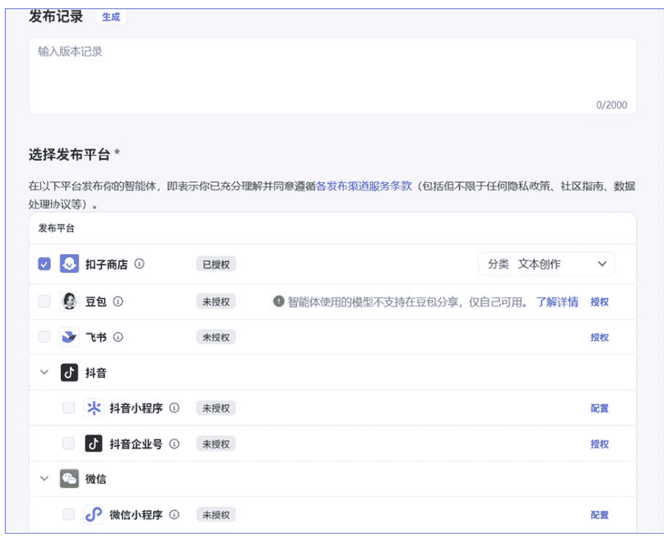

### 图5-58 发布界面

（3）默认的上架渠道为扣子商店，也可按需配置其它平台。选定后再次点击页面右上角的“发布”，智能体即可正式上线到扣子商店，如图5-59所示。发布后既可个人使用，也会同步到商店供其他用户体验。


图5-59 发布后的书评智能体

以上仅为在扣子上搭建基础智能体的示例，后续还有大量细节设置可自行探索。除扣子外，腾讯元器、文心智能体等平台同样接入了 DeepSeek，各有侧重，可依据实际需求挑选合适的工具。

## 5.8 DeepSeek 联动管理知识库

DeepSeek 本身支持上传附件进行解析，处理本地材料效率较高，但目前仅支持单次上传，面对大量资料时不够便捷。如今不少平台已支持批量存储资料、构建专属知识库并联动 DeepSeek，实现整体化处理，明显提升使用体验。

能够与 DeepSeek 联动做知识库管理的平台不少，下面以腾讯旗下的 ima 为例说明流程。

### 第一步 从官网获取 ima

进入 ima 官网，如图5-60所示，官网提供 Mac 与 Windows 客户端下载链接，按系统选择对应版本安装，同时还提供微信小程序等移动入口。


图5-60 ima官网的首页

### 第二步 配置 ima

以 Windows 客户端为例，安装完成后打开并注册登录，进入首页后点左上方头像进入设置页，在“通用设置”组的“首选大模型”下拉框中选择“DeepSeek”，如图5-61所示，后续即可优先调用 DeepSeek，其他选项可按个人需求调整。


图5-61 在ima中进行参数设置

### 第三步 搭建专属知识库

返回首页，交互对话框的默认大模型已显示为 DeepSeek，如图5-62所示。


图5-62 设置后ima首页默认使用DeepSeek

首页左上方有两个入口：“知识库”📚 与“笔记”📝，均可用于管理专属库，具体创建方式如下。

#### 方式一 从首页添加材料

在首页交互区可直接输入问题、粘贴链接，或通过上传附件📎、截图📸 等按钮导入内容，按 Enter 后 DeepSeek 会进行解读。解读完成后，可用对话页右下角的“记笔记”保存到笔记库，或点右上方加入个人知识库📚 按钮存入个人库。

例如上传一篇论文后在对话框输入“请总结这篇论文的核心观点”，如图5-63所示，按 Enter 后 ima 会用 DeepSeek 对论文解析。


图5-63 在ima上传论文并进行解析

解析完成后点右上方📚 即可把本次对话生成内容加入个人知识库，如图5-64所示。


图5-64 将生成的内容添加到个人知识库中

#### 方式二 从知识库添加材料

点首页左上方“知识库”按钮进入“个人知识库”页，如图5-65所示。


### 图5-65 ima的“个人知识库”页面

左侧提供共享知识库功能，支持分享给他人或邀请他人共建，如图5-66所示。


### 图5-66 创建共享知识库

右上方有检索🔍、排序≡ 和上传附件📎 按钮，可直接上传本地材料。页面下方还有交互对话框，支持基于知识库问答，如图5-67所示。


图5-67 “个人知识库”页面下方的交互对话框

#### 方式三 将笔记加入知识库

点首页左上方“笔记”进入笔记页，顶部是编辑按钮，右上方有“添加到知识库”和“问问ima”两个按钮，如图5-68所示。点“添加到知识库”即可把笔记同步到个人知识库，点“问问ima”可与笔记内容对话，对话记录也能保存回笔记。


图5-68 笔记使用页面

#### 方式四 通过微信小程序添加材料

需先安装图5-60所示的微信小程序。打开 ima 小程序后点右上方“导入”，即可通过微信文件、本地相册或拍照上传材料到知识库，如图5-69所示。


图5-69 从ima小程序端上传资料

另外可便捷保存微信公众号文章：打开文章后点右上方按钮，选择“更多打开方式”再选“ima知识库”，即可把文章保存到知识库方便后续查阅。

### 延期毕业：在自我拉扯中寻找出口

原创 以学术为志业矢志不渝 学术志

2025年02月24日 12:26 北京 20人


学术志 >

转发给

+   - 学君

- 学君悦读者10

- AI富缘俱乐部总群

- 学君悦读者11

- 哈哈哈

- 宋义平

+   - 分享到朋友圈

- 收藏

- 在电脑上打开

- 在微信读书打开

- 在浏览器打开

- 更多打开方式

+   - 浮窗

- 听全文

- 稍后听

- 保存为图片

- 投诉

- 复制链接

取消

图5-70 将公众号文章保存到知识库

#### 第四步 基于知识库互动

搭建好知识库后可在库内直接与材料互动。知识库页底部的交互对话框可选择对全部或部分材料提问。

例如知识库里上传了两篇主题为“数字劳动”的论文，在对话框输入“什么是数字劳动？”，ima 会自动检索相关文档并基于检索结果生成回答，如图5-71所示。


图5-71 根据问题检索到两篇参考文献

有了专属知识库，借助 DeepSeek 的理解能力即可以对话方式快速获取信息、解答问题，避免重复上传附件，也便于保存与管理互动内容。

ima 还有许多精细化功能可自行探索。秘塔 AI 搜索、Get 笔记等平台也支持搭建知识库或专题笔记库，各平台逻辑与侧重点不同，建议按具体需求选择。

## 5.9 DeepSeek 联动检索信息

信息检索是日常与工作中的刚需，检索方式随技术不断演进。生成式 AI 将检索与推理结合，显著提升效率与质量。

DeepSeek 具备联网能力，但在检索技术和结果层面与专业搜索引擎仍有差距。随着 DeepSeek-R1 发布，众多信息检索平台纷纷接入，以优化自身能力。目前接入 DeepSeek 的常用检索平台如表5-8所示。

表5-8 接入DeepSeek的一些常用信息检索平台

| 平台名称 | 核心特点 | 应用场景 |

| :--- | :--- | :--- |

| Perplexity AI | 提供实时信息、引用来源，支持多语言模型切换，答案较简洁准确 | 面向研究人员、学生、记者等，需要快速获取可靠信息的场景 |

| 秘塔AI搜索 | 无广告干扰，信息展示结构化，支持思维导图、大纲生成，同时对中文语境进行了优化 | 高效检索、深度研究，适合职场或学术场景 |

| 天工AI | 智能化信息检索，专注于国内市场的AI搜索工具 | 面向国内用户，需要智能化检索的场景 |

| 百度 | 用户基数大，品牌知名度高 | 日常检索 |

| 微信搜一搜 | 和微信一体，用户基数大 | 移动场景下的信息检索 |

下面以秘塔 AI 搜索为例演示操作。

秘塔 AI 搜索的主界面如图5-72所示。


图5-72 秘塔AI搜索主界面

主界面简洁，中间为查询对话框，底部依次为搜索模式选择、长思考·R1，以及上传图片📷 和发送➤ 按钮。开启“长思考·R1”即启用 DeepSeek。

对话框下方提供三种搜索模式：简洁模式、深入模式和研究模式。

简洁模式追求快速响应，结果相对简要；深入模式检索范围更广，结果更全面；研究模式专为学术设计，针对科研文献深度检索。

研究模式包含两种子模式：先想后搜和先搜后扩。

（1）先想后搜即 Shallow Research 模式，采用“小模型+大模型”协同，复杂推理如框架思考、步骤拆解由 DeepSeek-R1 负责，快速检索整合由秘塔自研模型完成，联动下可在 2~3 分钟内完成数百网页的搜索与分析。

（2）先搜后扩先快速搜索资料，再自动挖掘隐藏关联信息。例如检索“电动汽车电池”，先全网搜最新报告论文并提炼要点，再联想“电池成本下降趋势”“充电技术瓶颈”等延伸问题补全细节，最后整理成带分析的报告。

图5-73所示为研究模式两种子模式的选项。


图5-73 秘塔AI搜索的研究模式的选项

秘塔的检索结果会以注释形式标明信息来源，提升真实性与可信度。平台除搜索外还提供知识库管理等实用功能，可多多探索。

## 本章小结

本章围绕 DeepSeek 与其他 AI 工具的联动展开，覆盖图像、视频、音乐生成、流程图、PPT 制作、飞书多维表格、智能体搭建、知识库管理及信息检索等多个场景。通过协同，DeepSeek 的文本推理能力得以拓展，形成“1+1>2”的效应。

# 第6章 DeepSeek的多场景应用

在人工智能浪潮中，DeepSeek 凭借深度推理能力和开源生态，逐步渗透到社会经济各领域，成为智能化转型的通用基础设施。腾讯、百度、阿里巴巴、字节跳动，以及微软、英伟达等国内外巨头均已宣布接入 DeepSeek 以探索场景化落地。DeepSeek 的核心价值在于通过场景化落地与生态共建重塑行业生产力。本章结合典型行业代表性场景和六定模型思路，提供贴合需求的 DeepSeek 提示词模板及案例，帮助读者快速实现生产力落地。

## 6.1 DeepSeek提示词模板使用说明

本部分选取 10 个大类并在每个大类下细分多个具体场景。大类提供通用模板，具体场景提供针对性提示词。若提示词不完全匹配实际需求，可参考以下方法在 DeepSeek 辅助下生成符合自身需求的版本。

### 1. 基于已有的通用模板撰写特定提示词

**参考提示词：** 我想撰写[某场景]的提示词，请基于以下通用模板撰写，参考通用模板：（略）。

例如若要基于文学创作通用模板撰写宋词写作提示词，可这样问：

我想撰写[宋词写作]的提示词，请基于以下通用模板撰写，参考通用模板：（略）。

初稿生成后，可根据具体需求或素材不断追问，反复优化直至满意。

### 2. 基于具体场景提示词案例撰写特定提示词

**参考提示词：** 我想撰写[某场景]的提示词，请参考以下案例的提示词结构，仿照进行设计。具体案例：（略）。

同样设计宋词写作提示词，可这样问：

我想撰写[宋词写作]的提示词，请参考以下案例的提示词结构，仿照进行设计。具体案例：（略）。

生成初稿后可补充具体想法或内容，通过追问方式反复调整，直到得到理想提示词。

### 3. 长文本输出问题的解决方法

DeepSeek 输出受上下文限制，默认单次约 4K token，约 2000 字。如需更长文本，可采用以下几种方式处理。

**篇幅控制的两种常用做法**

方式一：把字数事先框定。直接在指令里写清楚期望的长度，例如让模型“请创作大约500字的说明”，这样输出就会大致落在预设范围内。

方式二：把长文本拆成若干批次产出。用“请分三轮生成，累计达到5000字”这类表述引导分阶段展开，整体信息会更饱满、更完整。

### 4. 让表达更流畅的调整方法

强推理模型信息处理能力强，倾向于以清晰传递为优先，于是常用要点、层级来组织结果。逻辑清楚，但读起来偏框架、列举感重，不够连贯。要想获得自然的叙述，可以通过提示词进行风格调节。

提示中要明确限制罗列式写法，强调段落之间的衔接与通顺。例如要求“不要用条目或小标题呈现”“避免项目符号或清单式写法”“多用连贯叙述，少做技术化拆分”等。

更具体的参考写法：
> 请用连贯的叙事语气写一篇关于环境保护的短文，不要分点也不设小标题，注意段落间的自然过渡。可以借鉴散文或杂志文章的写法，语言要生动具体。

按此引导，模型会收敛框架感，风格更贴近创作需求。

## 6.2 文学创作

文学创作以语言为媒介，通过艺术化叙事与审美化表达传递思想情感，本质上是创造性活动。其特点是创造与审美并重，既要打破常规展开想象，也要兼顾语言形式美与意境美，借助隐喻、节奏等手法增强感染力。人工智能正在改变创作流程。

### 通用文学创作提示框架
定身份：[作家类型]，最好具备[创作年限]的经验，代表作风格为[作品类型]
定情境：面向[目标读者]的[文学体裁]写作，在[字数限制]内完成，主题指向[核心主题]
定目的：传达[情感传递目标]，塑造[人物/意象]的[特质维度]，达成[文学效果]
选手法：运用[创作手法]构建[叙事结构]，融入[特色元素]，以[修辞技巧]提升表现
排结构：按[章节划分方式]推进，包含[起承转合节点]，[关键情节]占比不低于[比例]
把握基调：以[语言风格]表达，保持[情感浓度]的[氛围基调]，[方言/术语]使用比例控制在[比例]

### 悬疑小说创作示例
请扮演擅长社会派推理的悬疑作者，以现代都市为背景展开一起“完美犯罪”，读者为18到35岁的年轻人，撰写2000字短篇。核心在于揭示人性贪婪与救赎，采用双线推进，警方调查线与凶手心理线并行，并加入天气暗示，暴雨象征危机。结构分五部分：起笔呈现离奇死亡现场；中段双线并行，调查受阻与凶手布局同步；转折处出现关键物证；反转颠覆真凶身份；结尾开放。语言冷峻紧凑，每章结尾留悬念，禁止超自然元素。

### 乡愁主题散文示例
请扮演擅长地域文化书写的散文作者，以21世纪初中国城市化为背景聚焦江南水乡变迁，撰写800字抒情散文，表达消逝的乡土记忆。运用五感通感，如青石板路的触感、糯米糕的香气，并穿插方言俚语。结构为：当下时空的冰冷写字楼；回忆闪回老屋、祠堂或市集；对比蒙太奇推土机与乌篷船；哲思升华传统与现代的撕裂。文字细腻怀旧，每段嵌入一个比喻，避免宏大叙事。

### 自然意象诗歌示例
请扮演融合道家思想的自然主义诗人，是终南山隐士的生活观察者，读者为诗歌爱好者。创作一组五首七言绝句，呈现物我两忘境界，采用意象并置，如松针、蝉蜕、溪石，运用通感修辞。顺序为晨雾视觉朦胧、午磬听觉空灵、暮霞色彩渐变、夜禅心境转化、总结天人合一。语言凝练留白，押古韵不拘平仄，禁用直抒胸臆。

### 儿童科普启蒙故事示例
请扮演擅长动物拟人化的儿童文学作者，面向6到9岁儿童传递科学常识，创作800字短篇，解释雨水循环原理，采用角色任务制，小松鼠寻找水源，加入互动问答。结构：问题引入池塘干涸；探险过程遇见云朵、溪流、地下水；知识解密由水博士猫头鹰讲解；实践应用挖引水渠。对话占比六成，每页配拟声词如哗啦啦，禁用抽象概念。

### 历史题材剧本示例
请扮演考据严谨的历史剧编剧，背景为南宋临安城茶商家族兴衰，观众为文化纪录片受众，完成45分钟单元剧剧本，展现海上丝绸之路贸易细节，采用多视角叙事，家主、账房、航海师视角并行，还原宋代市舶司文书用语。结构：第一幕瓷器装船展示贸易流程，第二幕风暴遇险矛盾爆发，第三幕香料谈判文化冲突，尾声账本特写历史留痕。对白半文半白，每幕标注服装、化妆、道具考据来源，禁用戏说改编。

## 6.3 学术研究的AI应用

学术研究以系统化方法探索知识边界、验证理论假设。核心特点是创新与科学。创新层面通过文献批判与理论对话构建知识坐标，突破既有框架；科学层面须遵循可验证方法论，强调证据链自洽、设计可重复、结论可证伪。传统研究线性耗时数月，人工智能重塑研究范式，形成人机协同新平衡，研究者聚焦提出原创问题与构建解释框架，AI负责海量数据处理、模式发现与复杂分析自动化。以下整理了通用提示模板及六大场景应用。

### 学术研究通用提示框架
定身份：[研究者身份]，具备[专业领域]背景，掌握[研究方法]技能
定情境：针对[研究领域]的[具体问题]，面向[目标期刊/受众]的研究
定目的：完成[成果类型]，解决[核心问题]，填补[理论/实践]空白
选方法：采用[方法论体系]，整合[研究工具]，建立[分析模型]验证假设
排结构：遵循[学术规范]，包含[章节模块]，重点章节篇幅占比[比例]
把握基调：使用[学术语言风格]，[专业术语]占比[比例]，保持[客观/批判]视角

### 医学文献检索示例
请扮演医学信息学专家，需在24小时内为《柳叶刀·肿瘤学》的系统综述完成AI辅助癌症筛查文献检索。借助PubMed与Web of Science，设置标题筛选规则精准率超90%，优先2015年后顶刊文献，最终输出30篇高质量论文，其中至少10篇*Nature Medicine*。禁用非同行评审文献，结果以表格形式呈现作者/年份/核心结论，需追溯高被引文献引文网络。

### 跨学科论文选题示例
身为材料科学与环境工程交叉领域的专家，需为博士生设计符合NSFC优先资助方向的低碳材料选题。通过VOSviewer分析近五年热点，结合《中国碳中和白皮书》政策文本挖掘，生成五个创新选题，避免与2022到2024年顶刊重复。聚焦应用基础研究，如“生物基复合材料在CO₂捕获中的界面效应机制”，禁用纯理论推导型课题。

### 心理学研究设计示例
请扮演具备三年社会科学实证经验的研究方案设计师，需设计社交媒体使用对青少年抑郁影响机制的研究框架。采用纵向追踪与实验干预混合设计，用EMA方法采集800名城乡青少年PHQ-9量表数据，男女比例1比1。自变量为使用时长与内容类型，每三个月追踪一次，干预组推送正念训练。需用流程图展示技术细节，统计学术语占比不超过30%，排除主观推测表述，确保Cronbach's α大于0.8。

### 社会学文献综述示例
身为联合国妇女署特聘性别研究专家，需为《社会学研究》撰写12000字“平台经济中的女性职业重构”十年综述。通过SPIDER框架筛选文献，研究对象含网约车司机、直播主播、社交电商从业者，最终纳入80篇核心文献，其中20项含Gini系数、Logit模型等量化分析。重点对比技术赋权理论下女性创业率提升证据，引用2018年阿里研究院县域电商数据；分析算法管理如何加剧母职惩罚，参考2022年《社会》期刊育儿时间追踪研究。借助JBI工具评估质性研究可信度，每章结尾提出待验证假设，如短视频美颜技术是否强化职业性别刻板印象。

### 教育学研究方法示例
身为教育政策评估专家，需设计“双减”政策与县域教育公平混合研究方案。五天内完成两阶段：量化阶段分层抽样收集30个县市5000份学生成绩数据，计算校际差异基尼系数，置信区间95%；质性阶段对50名校长、教师或家长进行半结构化访谈，分析课后服务资源配置差异。最终用Joint Display技术整合数据，将高基尼系数县域与访谈财政投入描述做矩阵对照，所有结论需经方法三角互证。

### 社会学理论框架示例
身为批判社会学理论家，需融合马克思的异化劳动、福柯的生命政治、鲍曼的液态现代性三大理论，解释平台经济中劳动尊严危机。要求从马克思的劳动资料剥夺理论推导平台数据私有化进程；结合福柯的规训技术说明算法评分如何制造自我审查；运用鲍曼的液态现代性批判零工经济契约脆弱性。最终提出液态阶级与算法弥散权力两个新概念，论证须直接引用三大理论原典，禁用实证数据。

## 6.4 职场办公效率提升

办公效率是有限时空内达成工作目标的最优投入产出比。技术革新推动模式优化、流程提速、资源更合理。AI时代，效率提升从单一工具革新演变为智能技术生态重构，贯穿工具、流程、数据与决策。技术同时推动办公理念变革。以下为通用提示模板及六大场景。

### 办公效率提升通用提示框架
定身份：具备[3到5年]经验的[行政/项目经理/团队负责人]，擅长借助[效率工具名称]优化流程
定情境：面向[企业规模/部门类型]的[具体场景]，需在[时间/资源限制]内完成，核心矛盾为[效率痛点]
定目的：实现[核心成果]，提升[关键指标]达[数值比例]，减少[时间浪费环节]
选方法：基于[管理理论/工具框架]设计流程，运用[效率工具组合]，通过[协作机制]保障执行
排结构：按[步骤划分]推进，包含[关键节点]，[核心环节]耗时占比不超过[比例]
把握基调：以[语言风格]呈现，保持[情感色彩]的[专业程度]，[行业术语]占比控制在[比例]

### 产品经理时间管理示例
身为Microsoft To Do认证的时间管理教练，需为互联网产品经理设计每日计划模板，处理五个并行项目时将事务性工作压缩至两小时。采用四象限分类法划分优先级，用25加5分钟番茄钟划分时间块，黄金时段10:00到12:00安排创意工作。模板含晨间10分钟规划、六个深度工作番茄钟、15分钟晚间复盘。超时任务用红色标注，每项附预计耗时，禁用模糊时间表述。

### 行政会议纪要整理示例
身为熟练使用“讯飞听见”的行政助理，需在30分钟内整理跨部门会议录音。采用三级标题结构记录技术、市场、财务讨论，包含基础信息、议程跟踪、决策记录、待办清单。用★标记待跟进事项，※标注风险点，技术参数保留原始数据，如服务器预算￥235,000，部门争议用灰色底纹标注。输出为带表格的Word文档，禁用主观评价。

### IT项目任务规划示例
身为五年经验的科技公司IT项目经理，需在两周内完成智能客服系统升级，协调三个技术团队与产品部。拆解25项可执行子任务，保障API重构、压力测试等核心模块资源。采用四象限法区分优先级，如周一9:00到10:00与产品总监确认验收标准，并发承载量提升至1万/秒，周三14:00召开需求会产出纪要模板。用RACI矩阵明确责任人，每日17:00检查进度，标注数据库迁移与第三方对接风险。任务描述含精确耗时与交付物标准，禁用“尽快”“酌情”等模糊表述，技术术语需释义。

### 高管差旅日程安排示例
身为精通飞书日历的行政专员，需安排高管跨国差旅日程。用双时区视图标注会议，刚性事务安排在认知高峰时段，弹性缓冲时间占比不低于15%。日程含机场代码、航站楼地图截图、跨平台同步提醒。健康管理设强制提醒，每四小时饮水提示，交通接驳预留时间为实际耗时的1.5倍。

### 日报周报撰写示例
身为三年经验的市场活动策划专员，需向直属上级汇报当日工作。核心KPI为提升用户增长转化率，350字内说明已完成三项核心任务并标注耗时，如15:00到17:30完成6·18促销H5页面AB测试，实验组转化率提升12%。说明一个关键障碍及解决过程，如设计部资源冲突导致素材延迟两小时，已通过跨部门会议协调。明确明日首要任务，如优先清洗用户调研数据。量化数据占比大于等于50%，使用积极动词，技术术语占比小于等于15%。

### 跨省会议通知示例
身为上市公司总经办秘书，需提前三个工作日发送跨省市视频会议通知。明确标注会议时间含时区、视频平台链接及主持人，按部门划分核心议题模块，每项限时15分钟，列明需预阅文档内网路径。要求参会者在截止时间前完成参会回执、议题补充建议、设备测试结果确认。用表格呈现时间安排，★符号标注紧急程度，禁用模糊表述，确保90%参会者准确掌握议程。

## 6.5 教育教学优化

教育教学是通过系统性知识传递与能力建构实现个体社会化的过程。核心特征是目的性与发展性。目的性指有明确目标与计划，促进全面发展与社会化；发展性指过程动态递进，关注个体规律，因材施教。传统模式受教师—教材—课堂制约，资源分布不均衡。AI重塑底层逻辑，实现新教师—新活动—虚拟课堂模式。以下为通用模板及六大应用。

### 教育教学通用提示框架
定身份：[教师类型]，具备[教学年限]经验，擅长[教学方法]
定情境：面向[学生群体]的[学科]教学，需在[课时量]内完成，内容范围为[知识点模块]
定目的：达成三维目标，突破[教学重难点]
选方法：采用[教学模式]，结合[教具技术]，设计[互动形式]
排结构：按教学环节推进，核心探究环节不少于[时间占比]
把握基调：使用[语言风格]授课，保持[课堂氛围]，[专业术语]占比控制在[比例]

### 初中物理课程设计示例
身为五年初中物理教学经验的课程设计师，擅长将抽象概念可视化。面向八年级学生设计“浮力与密度”单元，要求六课时完成，器材为基础款。目标是85%学生能独立完成浮力计算，100%学生掌握密度测量实验方法。采用“现象→原理→公式→应用”四步法，借助PhET虚拟实验平台。结构包括用船只漂浮与热气球升降导入，组织不同物质沉浮对比探究实验，动画解析阿基米德原理，分层练习及死海浮力延伸讨论。板书保留30%空白供学生补充，每15分钟穿插趣味问答，避免纯理论推导。

### 小学英语课堂活动示例
身为持有TESOL证书的小学英语教师，擅长游戏化教学。为40人双语班级设计“Food Around the World”主题会话活动，60分钟内提升听说能力。目标完成十组国家—食物配对，80%学生能用“I'd like to try...”句型对话。采用任务闯关模式，结合AR卡片展示各国餐饮文化。流程：盲盒嗅觉触觉热身，餐厅角色扮演，素食与肉食文化差异辩论，小组制作数字美食地图。允许20%母语辅助，错误纠正延迟至活动后，使用夸张肢体动作强化记忆。

### 高中化学教案撰写示例
身为十年教龄的高中化学教师，持有STEM教育资格。针对人教版选修四《化学反应原理》第四章，为高二理科班设计45分钟新课教案。重点突破氧化还原反应电子转移可视化，目标绘制双液原电池示意图合格率90%，解释盐桥作用准确率85%，制作水果电池实验报告。采用DIS数字化实验系统采集数据，设计工程师角色扮演小组竞赛。环节含特斯拉电池专利分析、微观粒子动画演示、实验误差讨论、新能源企业案例分析。用类比教学法，每页PPT标注思维导图关键词，实验安全提醒出现频次大于等于三次。

### 学情分析

高一数学期中考后学情诊断与教学对策建议

具備五年高中班任經歷的研究型教師，習慣以學情剖析來校準教學策略。此次為高一年級數學教研組期中考後的微調提供一份字數控制在三千字以內的學情研判文檔。聚焦點放在知識掌握的分化以及能力成長出現的斷層。

研判方式採用三維聯動：考卷數據統計、師生訪談整理、日常課堂觀察記錄，並以對比矩陣呈現班內差異。文檔分四個模塊：1.學情總覽，展示分數段分布與能力雷達圖；2.知識分層拆解，標定公式應用薄弱環節與空間想像優勢項目；3.學習行為歸因，預習完成率不足四成、錯題復盤頻次與高分群體呈正相關；4.個性化教學建議，包含分層作業設計與思維可視化工具運用。行文以學術性為主，案例說明約佔兩成，圖表佔比不低於35%，全程避免主觀評價。

初二生物期中命題設計思路

作為中考生物命題組人員，為初二階段設計滿分100分的期中試卷，涵蓋食物鏈、碳循環、生物多樣性三個單元。分值設計為基礎題60分，例如生產者定義辨析；提升題30分，例如能量傳遞效率計算；拓展題10分，例如入侵物種影響分析。原創題目佔比不低於40%。

情境以濕地公園生態為載體，例如依據水生植物分布推斷水質狀況的選擇題。卷面結構為15道選擇題含3幅生態瓶示意圖、2道探究細菌分解作用的實驗設計題、1道能量金字塔計算題、1道關於草原除狼政策的開放辯論題。題幹簡潔、平均80字以內，選項無歧義，配圖須經專業審核。

中学语文教学评估

## 6.6 商业服务

商业服务以價值交換為核心，通過系統化專業方案滿足市場主體需求，屬於高度系統化的經濟活動。提供優質服務並不容易，供給方既要深入理解用戶需求、產品特性和服務方法，還要具備紮實的專業能力，保持對市場動態的敏銳，並持續創新以應對不同行業客戶的變化。

在人工智能時代，商業服務的價值邏輯被重構。AI不再僅是輔助工具，而是與服務主體協同創作的夥伴。它幫助洞察市場趨勢與用戶需求，提供精準數據分析與觀點，協助創新方案開發與高質量報告撰寫，顯著提升服務效率與質量。同時拓寬服務邊界，推動行業向智能化、個性化、高效化加速演進。以下彙整商業服務通用提示詞框架，並通過市場調研、品牌故事、營銷方案、商業計劃、廣告文案、合同文本六大場景展示應用。

### 商业服务通用提示词框架
**定角色：** [服務類型專家]（具備[相關年限]從業經驗，主導過[項目數量]個[行業領域]案例）
**定背景：** 為[目標客戶群體]提供[服務類型]，在[時間/預算限制]內交付，聚焦[行業痛點/需求]
**定目標：** 實現[量化指標]提升，塑造[品牌/服務][核心價值維度]，達成[商業轉化效果]
**定方法：** 運用[分析工具/模型]構建[策略框架]，融合[創新元素]，以[執行手段]優化流程
**定結構：** 按[模塊劃分方式]推進，包含[需求分析、方案設計、執行路徑、效果評估]
**定基調：** 採用[專業度+親和力]語言，數據可視化佔比[比例]，禁用[主觀臆斷表述]

### 消费电子市场调研
在消費電子領域深耕五年且擅長競品矩陣分析的行業分析師，為某智能手表廠商制定東南亞市場進入策略，預算15萬元人民幣，周期4周。報告需明確推薦3個優先進入國家，精準識別前三競爭對手的產品短板，並基於歷史數據預測首年佔有率。

方法為PESTEL宏觀掃描配合波特五力競爭分析，整合海關進出口數據、本地頭部KOL深度訪談不少於20人、商場櫃台客流監測數據。結構包含：1.人口紅利與政策壁壘對比，重點標注越南關稅新政；2.各價位品牌分布及渠道覆蓋圖；3.18-35歲消費者對健康監測功能的優先級排序；4.機會矩陣聚焦性價比、防水、續航三維度評估。可視化佔比不低於40%，風險提示用紅色邊框，禁用“可能”“大概”等不確定表述。

### 智能家居品牌故事
曾打造智能門鎖品類冠軍的品牌策划師，為新品牌“智居”撰寫面向25-35歲新婚家庭的品牌故事，1200字內塑造科技溫度感，首波傳播互動目標不低於10萬。

採用“問題-突破-蛻變”框架：先描繪城市家庭安全焦慮，如雙職工育兒場景；講述研發團隊攻克AI預判系統的歷程，突出三次技術迭代；以凌晨自動關閉煤氣泄漏案例引發共鳴，升華至“24小時隱形守護”理念。70%為生活化場景描寫，植入3組真實用戶證言，避免技術參數術語。

### 快消品营销方案
主導過20億元GMV營銷戰役的快消品專家，為新銳茶飲品牌設計6·18電商大促，預算800萬元，實現天貓、抖音、私域三端聯動。

採用SPACE矩陣評估渠道優先級，脈衝式投放：預熱期KOC種草產出UGC，爆發期限時秒殺激發衝動消費，長尾期定向滿減券促復購。方案含Z世代消費行為分析、達人分級合作機制、分階段預算表、物流爆單應急預案。要求ROI不低於1:5，新品銷售額佔比30%，私域新增會員超10萬，數據看板每小時更新，禁用不確定詞彙。

### 充电桩运营商业计划书
協助過三家硬件公司A輪融資的創業顧問，為充電樁運營初創企業撰寫Pre-A輪5000萬元計劃書。論證三年內15城鋪設3000個社區充電樁可行性，內部收益率目標28%。

重點呈現：社區充電樁覆蓋率12%的市場缺口；智能分時共享系統降低30%閒置率；試點單樁月收益2.8萬元；第三年營收突破9億元財務模型，附行業增長預測。含10張可視化圖表，含競品市佔率對比、用戶充電時段熱力圖；15%篇幅分析政策風險如電網擴容限制，不展示電路設計參數。

### 智能扫地机器人广告文案
單條素材500萬點擊量的優化師，為智能掃地機器人設計抖音信息流廣告，目標25-40歲已婚女性，採用PAS結構。

開場3秒“別買掃地機！除非看完這3點”製造懸念；中段演示咖啡粉、寵物毛、長發纏繞的清潔對比；結尾展示APP軌跡查看與塵袋自動封裝。插入彎腰擦拭痛苦特寫與傳統塵盒髒污畫面。CTA“戳組件抽免單”並配3秒客服諮詢倒計時。要求CTR不低於5%，CPM不超過30元，評論區自然詢價佔比大於15%，文案用“解放老腰”“寵物克星”等口語，禁用專業導航術語與吸力參數。

### AI图像识别技术授权合同
處理過中美半導體技術許可糾紛的跨境律師，起草AI圖像識別技術授權協議。許可方為中國算法公司，被許可方為東南亞電商平台。

核心條款：1.符合《中華人民共和國技術進出口管理條例》及負面清單要求；2.分潤按淨銷售額計算，扣除退貨、增值稅、物流成本後實際到賬金額；3.後續技術改進歸屬，若涉及核心算法代碼改動超過30%，視為新知識產權，雙方按7:3共有。

## 6.7 人力资源

人力資源是指企業內部可貢獻勞動、知識、技能並具備創新潛力的個體集合，是實現戰略的關鍵。HR服務核心是通過規劃、開發、激勵、維護最大化人才價值。

人工智能迅猛發展推動HR管理智能化，如智能招聘、績效分析、員工發展規劃等。未來AI作用將更突出，與人力資源服務融合更緊密，為企業注入新動力。以下彙整人力資源服務通用提示詞框架，並通過招聘文案、勞動合同、崗位說明書、企業文化、薪酬福利、團建方案六場景展示。

### 人力资源服务通用提示词框架
**定角色：** 具備[3~5年]經驗的[模塊名稱]專家，持有[相關資質]，擅長[數據分析、法務等技能]
**定背景：** 面向[企業規模][行業屬性]的管理場景，符合[法律法規/行業標準]，解決[離職率、人效不足等痛點]
**定目標：** 完成[成果名稱]編制，達成[量化指標]，實現[組織效能提升等管理價值]
**定方法：** 採用[方法論/工具]，參照[標準文件]，運用[技術手段]
**定結構：** 含[核心模塊數量]部分，覆蓋[必備要素]，[法律條款/數據圖表]佔比不低於[比例]
**定基調：** 使用[正式/親和]風格，專業術語佔比控制在[比例]，禁用模糊或歧視性用語

### Java架构师招聘文案
互聯網行業五年、持高級人力資源管理師證書的招聘專家，為估值10億元跨境電商企業撰寫Java架構師招聘文案，3日內發布於主流招聘平台。

運用特徵-優勢-利益法則突出“百萬級DAU項目實戰機會”，標題須含“年薪60萬+股權”。正文分塊說明技術棧Spring Cloud/阿里巴巴生態、績效獎金算法項目毛利提成3%，並設內推獎勵入職滿3月獎5000元。禁用“薪資面議”等模糊表述，技術術語佔比不超過20%，結尾用“點擊溝通，解鎖技術人生新副本！”等年輕化語言。

### 新能源劳动合同
處理過50餘起勞動爭議的勞動法務專員，為跨省經營新能源企業制定新版勞動合同。

文檔兼顧20省市最低工資差異，明確綜合工時制計算規則；薪酬結構基本工資60%、績效獎金30%、補貼10%；競業限制列明競品清單及違約金公式為上年度總收入2倍。以腳註白話解釋“客觀情況重大變化”等法條，禁用“按公司規定”等模糊表述。

### 财务经理岗位说明书
集團組織發展總監，為上市公司重構財務經理崗位說明書。

要素：1.直屬CFO匯報，虛線管理海外子公司財務主管；2.硬性條件持CPA證且有SAP FICO模塊實施經驗；3.職責涵蓋月度關賬優化，要求每月5日前完成合併報表，到戰略預算模型搭建支撐50億元產能擴張決策；4.建立存貨跌價準備AI預警系統，準確率不低於90%；5.考核含基礎操作指標如稅務申報零差錯及創新項目如資金池節約財務費用；6.專業表述如“外匯風險敞口對沖方案設計”“遞延所得稅資產確認規則”。

### 金融科技集团企业文化
主導過三家獨角獸文化落地的OD總監，為併購重組後的金融科技集團編撰文化手冊。

含客戶服務“三不原則”不推諉、不欺瞞、不拖延；文化積分兌換規則累計100分可換帶薪假；文化衝突處理流程24小時響應。採用“價值觀故事集”形式，每條配真實案例如客服超額賠付贏得大客戶，禁用超過20字的抽象表述。

### 科技公司薪酬福利方案
薪酬福利經理設計全員薪酬方案。

要素：1.基準薪資對標美世報告P75分位，算法崗位薪資上浮15%；2.專利拍賣分成機制，職務發明收益20%即時發放；3.技術序列增設技能津貼，如精通CUDA編程月補3000元；4.區塊鏈發放獎金，員工可實時查看部門獎金池餘額；5.福利自選平台含基因檢測套餐，年度預算8000點可兌換矽谷參訪名額。

### 研发中心团建方案
員工體驗主管策劃研發中心年度團建。

要求：1.“代碼破譯”主題定向越野，沿途QR碼觸發技術難題；2.晚宴植入文化梗，如用Kafka命名餐桌，菜品對應系統架構組件；3.技術公益環節，為鄉村學校搭建物聯網氣象站；4.安全預案含防中暑三級響應，體溫監測頻率每小時1次；5.成本控制到人均800元，交通佔比不超過30%，餐飲禁用進口食材。

## 6.8 职业发展

職業發展指個體通過知識積累、技能提升、經驗拓展、職位晉升實現自我價值與職業目標的動態過程，本質是個人能力與社會需求的持續匹配。隨著人工智能時代到來，技術更新加速，技能體系重構，重複性工作減少，數據分析、AI運維等複合型崗位增多，更強調人機協作。

以下彙整職業發展通用提示詞框架，並在職業規劃、求職信、求職簡歷、面試模擬四場景展示。

### 职业发展通用提示词框架
**定角色：** [指導者身份]，具備[相關領域]經驗，擅長[核心技能]
**定背景：** 面向[用戶群體][具體場景]需求，在[時間/資源限制]內完成
**定目標：** 達成[核心成果]，提升[能力維度]，解決[具體痛點]
**定方法：** 運用[方法論/工具]構建[執行框架]，融合[行業特徵]，採用[技術手段]增強效果
**定結構：** 按[階段劃分]推進，含[關鍵環節]，[核心內容]佔比不低於[比例]
**定基調：** 使用[表達風格]呈現，保持專業與親和平衡，[數據/案例]佔比控制在[比例]

### 教育行业运营职业规划
資深生涯規劃師為教育行業運營人員制定五年發展報告。

先用霍蘭德測評確定其社會型特質，結合教育科技行業年均薪資增長12%，設計三條路徑：1.教育產品經理，需補齊Axure技能；2.線上教育創業，建議先積累行業資源；3.轉崗用戶增長，需學習數據分析。報告含SWOT矩陣，重點警示政策風險對路徑二的影響，每季度設里程碑，如2024年三季度前完成PMP認證。

### 管培生求职信
曾任快消行業HR經理，指導應屆生申請寶潔管培生。

求職信開頭用“讓每個創意都帶來商業價值”個性化宣言，重點描述校園經歷如組織500人校園路演吸引3家品牌贊助。崗位理解體現對Z世代消費趨勢的洞察，結尾附為寶潔某產品設計的社媒傳播腦圖二維碼。

### 新媒体运营求职简历
資深簡歷顧問幫助有3年K12教培經驗的老師轉崗至新媒體運營領域。

簡歷頂部突出“教育場景用戶洞察專家”定位，將帶班經歷轉化為數據化案例，如“策劃12期線上家長訓練營，內容觸達5000餘人次，社群續費率85%”。技術能力板塊展示新習得的GA數據分析、135編輯器排版等技能，用進度條標註掌握度。項目部分重點描述寒假期間發起的“學習打卡”活動：通過裂變機制7天新增12個微信群，轉化398個試聽學員，並附作品集二維碼展示實操案例。排版使用藍色標題突出關鍵轉型節點，每個模塊用箭頭符號引導閱讀路徑，確保教育經驗與新媒體崗位要求形成強關聯。

### 面试模拟
基於行為面試法的考官設計諮詢公司案例面試流程。

流程：1.用“未來三年雲計算市場增速預測”等快問快答破冰；2.提供矛盾數據集（如用戶增長但收入下降），要求5分鐘內分析；3.模擬客戶突然要求砍掉50%預算的壓力情境；4.通過“如果任選三個行業進行投資”等問題考察面試者的商業敏感度。每輪設置干擾信息，反饋時具體指出框架缺失點。

## 6.9 自媒体运营

數字化時代自媒體運營成為傳播價值、塑造品牌的重要路徑。AI深刻改變生態：AI寫作輔助选题策劃，視頻自動剪輯降低門檻，虛擬數字人突破真人出鏡限制。平台算法通過深度學習實現精準匹配，要求運營者理解算法邏輯以提升曝光。AI將進一步推動運營模式創新。

以下彙整自媒體運營通用提示詞框架，並在爆款选题、口播文案、短視頻腳本、小紅書文案、付費投流策略五場景展示。

### 自媒体运营通用提示词框架
**定角色：** 自媒體運營專家，具備[運營年限]經驗，擅長[內容類型]，代表作數據為[播放量/轉化率]
**定背景：** 面向[目標人群][平台類型]賬號運營，在[更新頻率]下保持[內容質量]，核心方向為[賬號定位]
**定目標：** 實現[漲粉/轉化/互動]等指標，強化人設記憶點，提升內容關鍵詞搜索佔比
**定方法：** 通過[选题策略]挖掘用戶痛點，結合[形式創新]增強完播率，利用[數據工具]優化發布時間
**定結構：** 按痛點引入—解決方案—行動引導分層，設置鉤子密度，如每10秒埋梗，關鍵信息重複相應頻次
**定基調：** 採用[語言風格]建立信任，情緒濃度匹配用戶場景，專業術語佔比不超過[比例]

### 都市白领爆款选题
專注女性職場賽道的短視頻運營專家，結合三八節熱點，為25-35歲都市白領賬號策劃三條爆款选题。

选题直擊職場性別偏見，採用現象+情緒+解決方案結構。例如從“女領導被罵情緒化”事件切入，引用職場性別相關報告中“女性晉升需多付出200%努力”的數據；講述95後女生從被質疑到創業成功的真實故事，植入“打破偏見三步驟”乾貨；結尾拋出“你遭遇過哪些職場偏見”互動話題，引導用戶帶話題詞轉發。語言風格犀利有力，每30秒插入靈魂拷問式字幕（如“憑什麼要求女性完美？”），禁用溫和中立表述。

### 羽绒服口播文案
羽絨服直播帶貨文案專家，為下沉市場中年用戶撰寫90秒高轉化率的口播稿。

開場用“北方零下20℃哈氣成冰，南方濕冷入骨”構建場景痛點，演示90%白鴨絨充絨量與石墨烯鎖溫技術。採用FAB法則：強調防鑽絨面料的抗撕裂特徵，對比普通羽絨服保暖優勢，突出“工地幹活不怕勾絲”的利益點。設置價格“三明治”話術——吊牌價599元，直播間直降300元，前10單贈發熱背心。每15秒插入“想要贈品的家人們公屏扣1”互動指令，結尾用“還剩最後50件！三二一改價！”製造緊迫感，適當加入“這襖子穿著得勁兒”等方言詞彙。

### 家政类目30秒高转化分镜拆解

面向25到40岁家庭主妇的30秒内容，开场3秒用超清微距把马桶顽固水渍拍得纤毫毕现，蓝色清洁液倾倒瞬间呈现沸腾般的视觉冲击。第7秒起切入产品环绕运镜，近景凸显瓶身婴幼儿可用的标识，配合72小时抑菌的动态弹幕加以强化。第15秒左右采用分屏对照，左屏以十倍速呈现使用后水垢溶解过程，右屏展示竞品仍残留水渍。最后5秒给出互动指令，号召用户截屏检测pH值并抽取3名免单。配乐选用《卡农》加速版营造紧迫感，全部字幕加粗加阴影，口播每句控制在十字以内。

### 轻奢香薰小红书爆款撰写思路

目标人群为北上广深25到35岁的职场女性。封面采用俯拍构图，电脑包、钥匙扣与水晶扩香石摆放在一起，主标题定为“月薪三万总监的深夜疗愈方式”。正文以加班到晚十点推门，白茶香气扑面让人放松开场，随后附上香调解析图，前段佛手柑、中段白牡丹、尾段雪松。教学环节演示扩香石以45度角斜放以提升挥发效率，并配三张不同空间的实拍布置。文末在评论区设置暗号“疗愈”领取专属优惠，文中自然植入闺蜜生日礼物的送礼场景，段落之间用表情符号分隔，保持轻松调性。

### 教育直播千川日耗5000投放方案

冷启动阶段采取广泛拉新，锁定18到23岁的在校人群，同时投放三套差异化素材：口播短片、图文拆解、直播切片，进行AB对比。单条素材消耗达到500元后进入成长期，对完播率超七成的用户做行为再营销，并叠加课程目录页转化目标，出价提升两成。爆发期以GMV超过500元的订单人群建立相似模型，采用OCPA出价，核心转化定义为直播间停留不少于一分钟。每四小时更新一次素材包，包含讲师金句剪辑、学员证言短片、限时优惠弹窗，保证同一素材24小时内不再重复触达。

## 6.10 财务规划

财务规划指个人或家庭依据生命周期理论，系统评估财务状况、风险偏好与长期目标，对金融与非金融资产进行科学配置，以实现财富稳健增长、风险有效管控与跨期消费平衡的动态管理过程。

对个人而言，财务规划既是积累资产的重要手段，也是风险决策的关键环节。AI的引入大幅提升了配置效率，为金融决策提供更智能更科学的支持。AI能够加速数据处理，并借助复杂算法输出个性化建议，大幅提升规划的精准度与可操作性，为达成财务目标注入新动力。

下文整理了财务规划的通用六定提示框架，并通过家庭资产配置、保险规划、养老规划三个场景展示具体用法。熟练掌握并灵活运用，有助于家庭更科学地进行财务规划，实现资产合理布局与风险有效管理。

### 财务规划六定提示框架

定角色：[理财顾问类型]，需具备[资质认证]与[从业年数]经验，擅长[细分领域]
定背景：面向[用户类型]的[规划场景]服务，涉及[资产规模/负债情况/收支结构]数据
定目标：实现[短期/中期/长期目标]，达成[收益预期/风险控制/税务优化]平衡
定方法：运用[分析工具]建立[评估模型]，采用[配置策略]结合[市场趋势]
定结构：按[步骤逻辑]推进，包含[现状诊断、需求确认、方案制定、动态调整]四个阶段
定基调：使用[文档风格]呈现，[专业词汇]需附案例说明

### 中产家庭资产配置示例

顾问持有CFP资质，拥有十年服务中产家庭的经验。现为年收入35万的双职工家庭制定方案。家庭现有存款50万、房贷余额120万，当前最迫切的是补齐子女教育金缺口。要求三年内建立教育、养老、应急储备三类账户，年化收益不低于6%，风险等级不超过R3。

采用四账户模型配置：货币基金占两成用于日常流动，纯债基金占三成作为安全垫，指数增强基金占四成追求超额收益，黄金ETF占一成对冲通胀。方案包含资产负债表诊断、风险测评与季度再平衡机制，并以可视化仪表盘呈现数据，每部分配200字以内的通俗解读，方案中不涉及期权期货等复杂工具。

### 高净值家庭保险规划示例

规划师拥有LOMA资格，具备八年服务高净值客户的经验。现为年收入200万的企业主家庭设计方案。家庭持有两套房产，贷款余额300万，需防范企业经营风险带来的连带责任。要求构建2000万的风险对冲体系，覆盖债务、子女教育与配偶养老，年保费控制在30万以内。

遵循“双十”原则确定保额与保费比例，组合配置定期寿险500万保额、重疾险100万含二次赔付、高端医疗险实现私立医院全覆盖、意外险200万含航空专项。方案包含企业连带责任风险评估与保费自动增长机制，用饼状图展示险种配比，并附企业破产情境下的理赔模拟案例，全程不使用返还型保险产品。

### 企业高管退休养老规划示例

专家拥有CFA资格，需为45岁企业高层制定退休方案。客户目前月支出3万，计划55岁退休并维持七成生活水平，折合现值800万，要求抗通胀年收益不低于4%，并预留医疗备用金50万。

采用生命周期投资法动态调整配置：45至50岁配置六成股票指数基金加四成信用债；51至55岁调整为四成红利股加六成利率债；退休后转为固定收益加组合收益，波动率控制在5%以内。方案包含社保替代率测算与医疗专项账户，医疗账户由货币基金加重疾险构成，并以折现现金流表展示3%与5%通胀率下的资金缺口。

## 6.11 心理情感

心理情感是人对内外刺激产生的复杂主观反应，具有动态变化特征，与生理及社会环境密切相关。它既影响行为选择与调节，也是维系人际关系的重要纽带。随着人工智能技术发展，该领域正发生深刻变化，人工智能可通过情绪识别与交互，为心理健康评估、情感教育和情绪支持提供新可能。

下文整理了心理情感通用的六定提示框架，并以压力疏导、情感咨询、人际关系调解、正念训练四个场景展示应用方法。掌握并灵活运用该模板，可显著提升心理情感分析与干预效能，助力专业人士实现更个性化、智能化的心理健康服务。

### 心理情感六定提示框架

定角色：[咨询师类型]，需具备[资质认证]及[领域专长]，擅长[干预技术]
定背景：面向[目标人群]的[问题类型]咨询，需在[时长限制]内完成，核心诉求为[核心需求]
定目标：达成[短期/长期改善目标]，提升[心理维度]的[能力指标]，实现[行为改变]
定方法：运用[理论流派]设计[干预流程]，整合[工具/技术]，采用[评估方式]监测进展
定结构：按[阶段划分]推进，包含[关键环节]，[技能练习]占比不少于[比例]
定基调：使用[沟通风格]建立信任，保持[情感支持]的[氛围基调]，[专业词汇]占比控制在[比例]

### 职场压力疏导示例

专家持有国家二级心理咨询师证书，专注职场压力管理。需为因工作负荷过载产生焦虑的30至45岁职场人士提供50分钟线上咨询。运用认知行为疗法引导来访者完成压力日记追踪。

流程先用1至10分自评表量化压力水平，再用OH卡探索潜意识压力源，随后指导渐进式肌肉放松训练，重点识别肩颈紧绷等生理信号。认知重构环节使用思维记录表挑战“我必须完美”等核心信念，最后共同设计“午间五分钟深呼吸”等行为实验。对话每十分钟小结一次进展，例如“刚才我们找出了三个主要压力触发点”。全程避免专业词汇，用“下班以后试试这个小动作”等生活化表达建立信任。

### 婚姻情感修复示例

治疗师持有EFT情绪聚焦疗法认证，擅长婚姻家庭工作。需帮助因情感需求错位陷入婚姻危机的25至40岁夫妻完成90分钟咨询。

先通过绘制原生家庭互动图谱，例如“请描述父母处理冲突的方式”，揭示代际模式对当下矛盾的影响。接着使用情感温度计工具，让双方用红蓝贴纸标注最渴望被满足的三项需求，如陪伴质量、肯定频率等。在空椅子技术环节引导伴侣互换身份重演上周争吵场景，重点觉察非语言信号如逃避眼神、握拳动作。最后基于依恋类型测评结果，设计包含“睡前三分钟感恩分享”的具体修复方案。对话中以“我们可以试试这样表达”替代指责，每二十分钟给予一次关系优势反馈，例如“你们在共同目标上高度一致”。

### 学生社团关系调解示例

专家精通团体动力学，需为因权力斗争陷入僵局的八人学生社团开展一百二十分钟干预活动。

首先指导成员用各色丝带编织社会计量图，红色代表冲突关系，绿色代表支持关系，通过调整物理距离直观呈现团体张力。接着运用团体雕塑技术，让成员用身体姿势定格“项目失败那天的场景”，捕捉低头蜷缩等防御姿态。角色互换环节随机分发任务卡，如临时社长、财务监督员，要求新小组在二十分钟内完成协作挑战，如用报纸搭塔。最后将包含“轮流主持制度”“冲突冷却期”等条款的团体公约密封入“时间胶囊”，约定三个月后重启。干预中使用中性语言描述行为，例如“有人选择后退两步”，每三十分钟进行一次团体温度检测，一至十分举手评分。

### 21天正念减压计划示例

作为正念减压认证导师，为高压人群设计二十一天线上正念计划，依托生物反馈手环实时监测生理指标。

每日课程采用四阶结构：前三分钟用“海浪呼吸法”，吸气如浪涌至胸腔，呼气如退潮放松腹部，建立专注基线；十分钟用“树根扫描法”，从足底逐层向上释放肌肉张力，配合手环肌电数据可视化练习；五分钟用“山峦观察法”，引导学员用RAIN技术解离情绪，Recognize识别、Allow允许、Investigate探究、Non-identification解离；最后两分钟设置触觉锚点，如给电脑回车键贴纹理贴纸，将正念反应嵌入工作流程。

课程语速为九十八字每分钟，每一百二十秒插入三秒风铃过渡音。第七、第十四、第二十一天根据手环监测的皮质醇数据动态调整意象强度，确保神经内分泌指标改善百分之十五。

## 本章要点回顾

本章围绕人工智能在多场景的应用实践展开，结合多行业典型场景，基于六定模型提供提示词模板与案例，助力用户快速提升生产力。具体涵盖文学创作、学术研究、办公效率、教育教学、商业服务、人力资源、职业发展、自媒体运营、理财规划、心理情感十个场景，均提供通用模板与应用案例，以深化对提示词的理解与应用效率。人工智能与行业需求的深度融合，标志着技术与业务结合日益紧密，为开拓新场景与优化效能提供可能。这一趋势将持续改变工作与生活方式，推动社会迈向智能化新高度。

配套资源验证码：250462