# DeepSeek 架构全景与工程实践

## 前言

近几年人工智能的推进节奏明显加快，语言理解、视觉识别以及多模态融合等赛道都出现了阶段性突破。基于海量数据预训练的大规模模型逐步成为主流，标志着智能化进入新一轮周期。ChatGPT、Gemini、Llama、Claude 等代表性产品相继落地，各家机构都在加大研发投入，不断拓展智能的能力边界。

大规模模型之所以备受追捧，主要源于其泛化潜力突出、对复杂任务的理解执行力较强，以及在多类场景下的迁移适应性。智能问答、代码自动生成、内容创作、医疗辅助、法律咨询、科研探索等诸多领域均已显现出新的价值。随着算力持续提升、数据不断累积和算法持续打磨，AI 正从通用工具向具备自主决策倾向的智能体演进，逐渐成为推动生产力升级的重要力量。

行业测算显示，到 2030 年全球人工智能市场规模有望突破 1 万亿美元，其中大模型将占据核心位置，并在企业服务、云计算、自动驾驶、金融科技等方向创造可观的经济效益。政府、头部企业与创业团队同步加大投入，驱动技术迭代与商业化加速落地。

在此情势下，构建兼顾高效、可扩展与安全可靠的大模型、提升训练与推理效率、实现对多模态数据的更好理解与生成，已成为当前研究与产业落地的关键命题。

## DeepSeek 突破性登场

DeepSeek 的出现迅速引发行业关注。它是一款高性能的开源大模型，在自然语言处理方面具备明显优势，尤其在代码生成与编程辅助领域竞争力突出。独有的架构思路、精炼的训练策略与高效的推理机制，使其在众多同类方案中脱颖而出。

该模型的发布在一定程度上填补了国内大模型的技术空白，为开发者、企业与研究机构提供了一套性价比较高的选择。与既有方案相比，其差异主要体现在：

- 架构效率提升：以 Transformer 为基础进行深度改良，在保持生成质量的同时实现更优的计算效率与更低的推理成本。
- 编程能力突出：在代码类任务上表现优异，可自动产出质量较高的代码，兼容多种语言，并提供智能补全与代码优化功能，有效提升开发效率。
- 生态开放友好：以开放方式提供 API 接口，便于集成到社交应用、办公软件、智能助手等多种产品中，进一步拓宽大模型的应用边界。

伴随持续优化与生态完善，DeepSeek 的应用场景正在快速扩散，从智能对话到软件开发，从企业级服务到个性化助手，其在模型时代的角色愈发关键。本书正是在此背景下整理而成，旨在帮助读者深入把握 DeepSeek 的底层架构与核心技术，并探索其在真实场景中的实践价值。

## 书籍概览

全书系统梳理了 DeepSeek 大模型的技术体系与创新实践。从人工智能基础理论入手，深入解析 Transformer 架构、混合专家系统等关键技术，重点讲解 DeepSeekMoE 如何依托细粒度专家划分与动态负载均衡实现高效计算。同时涵盖强化学习驱动的推理优化、稀疏矩阵等前沿方向，并提供从本地部署到 API 开发的完整实操指南，包含 Ollama 部署、微信机器人开发等案例。通过理论解读与工程实践的结合，本书既展现了 DeepSeek 在架构上的创新突破，也为读者提供从原理到落地的全景参考。

## 致谢语

本书成稿离不开人民邮电出版社编辑团队的大力支持，编辑的严谨、耐心与高效让本书得以快速出版。同样感谢家人的无私支持。编者能力有限，书中难免有疏漏之处，恳请读者批评指正，便于后续完善。

感谢您的购阅，愿本书为您的技术之路提供指引，祝阅读愉快！

配套资源可通过专属 QQ 群获取，群号 1032631105，加入后即可下载。

注：部分配图源自官方网站，为保持一致原文未做翻译。

编者

## 目录

## 第 1 章 人工智能和 DeepSeek 全景概览

- 1.1 人工智能介绍
  - 1.1.1 人工智能的核心概念与应用领域
  - 1.1.2 人工智能的四个阶段
  - 1.1.3 从规则驱动到数据驱动的范式转变
- 1.2 大模型介绍
  - 1.2.1 大模型的原理和作用
  - 1.2.2 主流大模型介绍
- 1.3 DeepSeek 的创新之光
  - 1.3.1 DeepSeek 公司简介
  - 1.3.2 DeepSeek 对人工智能市场的影响
  - 1.3.3 DeepSeek 的应用场景
  - 1.3.4 DeepSeek 的未来展望
  - 1.3.5 DeepSeek 的主要产品和开源信息
  - 1.3.6 DeepSeek 与其他模型的对比

## 第 2 章 DeepSeek 底层架构技术揭秘

- 2.1 Transformer 架构技术
  - 2.1.1 Transformer 介绍
  - 2.1.2 Transformer 的核心组件
  - 2.1.3 聚焦智慧：多头注意力机制揭秘
  - 2.1.4 多头潜注意力概述
- 2.2 动态任务分配的核心法则
  - 2.2.1 动态任务分配的特点和原理
  - 2.2.2 动态任务分配的应用场景
- 2.3 稀疏激活机制探秘
  - 2.3.1 稀疏激活机制介绍
  - 2.3.2 稀疏激活机制的实现方式
  - 2.3.3 稀疏激活机制的应用领域
- 2.4 混合专家架构技术解析
  - 2.4.1 MoE 架构介绍
  - 2.4.2 MoE 架构的特点
  - 2.4.3 MoE 架构的应用
  - 2.4.4 DeepSeek 中的 MoE 架构介绍
- 2.5 归一化技术
  - 2.5.1 归一化技术的必要性
  - 2.5.2 微调脉动：LayerNorm 技术原理
  - 2.5.3 轻量替代：RMSNorm 技术探秘
- 2.6 模型训练与优化技术
  - 2.6.1 多令牌预测技术
  - 2.6.2 高效并行策略
  - 2.6.3 混合精度训练与量化策略
  - 2.6.4 EMA 显存优化
  - 2.6.5 结构创新：头尾参数共享策略

## 第 3 章 DeepSeek 硬件协同架构分析

- 3.1 异构计算支持与适配
  - 3.1.1 多加速器融合适配层设计
  - 3.1.2 算子级优化与定制化指令集整合
- 3.2 内存管理与优化策略
  - 3.2.1 显存碎片化解决策略与动态内存分配
  - 3.2.2 梯度内存复用与跨设备一致性管理
- 3.3 分布式计算与通信优化框架
  - 3.3.1 分布式架构设计原则与网络拓扑优化
  - 3.3.2 主流分布式框架的适配与改进
  - 3.3.3 异步通信、数据一致性与同步机制
- 3.4 高性能计算优化与资源调度
  - 3.4.1 并行计算模型
  - 3.4.2 动态负载均衡与资源智能调度
  - 3.4.3 缓存优化与内存访问加速技术
- 3.5 DeepSeek 的专属 GPU 优化与异构加速实践
  - 3.5.1 GPU 计算架构优化与深度集成
  - 3.5.2 GPU 编程模型、FP8 精度与量化策略
  - 3.5.3 异构计算平台搭建及实战案例

## 第 4 章 DeepSeekMoE 模型全景剖析

- 4.1 DeepSeekMoE 架构介绍
  - 4.1.1 背景介绍
  - 4.1.2 架构解码：DeepSeekMoE 的策略蓝图
  - 4.1.3 异同论剑：与传统 MoE 架构的关键差异
- 4.2 DeepSeekMoE 原理透视
  - 4.2.1 细粒度专家细分
  - 4.2.2 共享专家隔离
  - 4.2.3 负载平衡
- 4.3 DeepSeekMoE 模型的微调
  - 4.3.1 DeepSeekMoE 模型微调技术介绍
  - 4.3.2 ZeRO 加持：大模型优化
- 4.4 DeepSeekMoE 模型性能评估
  - 4.4.1 训练数据和分词
  - 4.4.2 硬件基础设施
  - 4.4.3 超参数配置
  - 4.4.4 评估基准
  - 4.4.5 评估结果
  - 4.4.6 与密集模型的对比
  - 4.4.7 DeepSeekMoE 2B 测试
- 4.5 消融研究
  - 4.5.1 消融研究介绍
  - 4.5.2 消融研究在大模型中的应用
  - 4.5.3 DeepSeekMoE 模型的消融研究
- 4.6 DeepSeekMoE 16B 测试
  - 4.6.1 训练数据和分词
  - 4.6.2 设置超参数
  - 4.6.3 评估基准
- 4.7 DeepSeekMoE 16B 的对齐
  - 4.7.1 测试设置
  - 4.7.2 评估结果

## 第 5 章 DeepSeek 多模态大模型架构

- 5.1 DeepSeek 多模态大模型的发展轨迹
- 5.2 Janus 模型剖析
  - 5.2.1 架构介绍
  - 5.2.2 多模态理解路径
  - 5.2.3 视觉生成路径
  - 5.2.4 自回归 Transformer
  - 5.2.5 三阶段训练策略
  - 5.2.6 Janus 模型的推理与扩展性
- 5.3 Janus-Pro 模型的深入探索
  - 5.3.1 解耦视觉编码
  - 5.3.2 训练策略
  - 5.3.3 优化训练策略
  - 5.3.4 数据扩展策略
  - 5.3.5 模型规模扩展
- 5.4 JanusFlow 模型分析
  - 5.4.1 自回归建模与 Rectified Flow 生成
  - 5.4.2 任务解耦的编码器
  - 5.4.3 U-ViT 进阶：通用视觉 Transformer 架构
  - 5.4.4 三阶段训练策略
  - 5.4.5 实验结果

## 第 6 章 DeepSeek 推理模型解析

- 6.1 DeepSeek-R1 模型介绍
  - 6.1.1 DeepSeek-R1 模型演进
  - 6.1.2 DeepSeek-R1 模型的基本架构
  - 6.1.3 训练蓝图：从数据到参数的炼成方案
  - 6.1.4 开源信息介绍
- 6.2 DeepSeek 推理模型的核心引擎
  - 6.2.1 混合专家架构
  - 6.2.2 多头潜注意力
  - 6.2.3 强化学习
- 6.3 DeepSeek-R1-Zero 的自我进化
  - 6.3.1 强化学习算法
  - 6.3.2 奖励建模
  - 6.3.3 训练模板
  - 6.3.4 DeepSeek-R1-Zero 的自我进化过程
  - 6.3.5 DeepSeek-R1-Zero 的“顿悟时刻”
  - 6.3.6 DeepSeek-R1-Zero 性能测试
- 6.4 DeepSeek-R1 训练方案
  - 6.4.1 冷启动
  - 6.4.2 推理导向的强化学习
  - 6.4.3 拒绝采样和监督微调
  - 6.4.4 全场景强化学习
- 6.5 蒸馏处理与轻量化
  - 6.5.1 AI 大模型中的蒸馏处理
  - 6.5.2 基础模型的选择与蒸馏过程
  - 6.5.3 模型蒸馏的技术原理

## 第 7 章 稀疏矩阵技术

- 7.1 稀疏矩阵介绍
  - 7.1.1 稀疏矩阵的基础知识
  - 7.1.2 稀疏矩阵在大模型中的应用
- 7.2 DeepSeek 的稀疏注意力再造
  - 7.2.1 NSA 技术背景介绍
  - 7.2.2 稀疏注意力方法的重新思考
  - 7.2.3 整体设计和实现策略
  - 7.2.4 评估 NSA 的性能
  - 7.2.5 NSA 的效率分析
  - 7.2.6 NSA 应用结论
- 7.3 MoBA——块注意力混合
  - 7.3.1 MoBA 介绍
  - 7.3.2 测试结果
  - 7.3.3 NSA 和 MoBA 的对比

## 第 8 章 DeepSeek 模型的本地部署

- 8.1 Ollama 本地部署
  - 8.1.1 安装 Ollama
  - 8.1.2 DeepSeek 模型的安装与配置
  - 8.1.3 基于本地 DeepSeek 模型的对话程序
- 8.2 LM Studio 本地可视化部署
  - 8.2.1 LM Studio 的特点与安装
  - 8.2.2 安装并配置 DeepSeek 模型
  - 8.2.3 LM Studio API
  - 8.2.4 使用 Dify 调用 LM Studio 模型
- 8.3 Chatbox 本地部署
  - 8.3.1 Chatbox 介绍
  - 8.3.2 Chatbox+Ollama 的本地部署
- 8.4 基于 Ollama+Docker+Open WebUI 的本地部署
  - 8.4.1 Open WebUI 介绍
  - 8.4.2 Docker 介绍
  - 8.4.3 使用 Docker 部署 Open WebUI

## 第 9 章 DeepSeek 应用开发实战

- 9.1 DeepSeek API 开发基础
  - 9.1.1 DeepSeek API 介绍
  - 9.1.2 DeepSeek API 基本教程
  - 9.1.3 基于 DeepSeek API 的对话程序
- 9.2 DeepSeek 的基本接入实战
  - 9.2.1 DeepSeek 接入 Chatbox
  - 9.2.2 DeepSeek 接入 NextChat
- 9.3 DeepSeek 接入社交媒体工具
  - 9.3.1 基于 DeepSeek 的微信聊天机器人
  - 9.3.2 基于 DeepSeek 的 QQ 机器人
- 9.4 将 DeepSeek 接入 Office
  - 9.4.1 OfficeAI 介绍
  - 9.4.2 在 Word 中应用 DeepSeek
  - 9.4.3 在 Excel 中应用 DeepSeek
- 9.5 将 DeepSeek 接入 VS Code
  - 9.5.1 Continue 基础
  - 9.5.2 DeepSeek 中用 VS Code 生成代码
  - 9.5.3 调用 DeepSeek 生成代码
  - 9.5.4 DeepSeek 代码生成和补全

## 第 10 章 推理解密：DeepSeek-Prover-V2 全景分析

- 10.1 启示引擎：模型概述
  - 10.1.1 动机探源：背景与驱动
  - 10.1.2 初露锋芒：DeepSeek-Prover-V2 模型简介
- 10.2 架构深潜：核心设计
  - 10.2.1 智能集结：DeepSeek-Prover-V2 中的 MoE 协同
  - 10.2.2 时空拓展：超长上下文处理策略
- 10.3 设计范式
  - 10.3.1 递归裂变：证明与子目标分解
  - 10.3.2 语义蜕变：自然语言到形式化证明的转换
  - 10.3.3 知识进阶：课程学习框架构建
  - 10.3.4 智能飞跃：强化学习优化路径
- 10.4 训练全过程解析
  - 10.4.1 双阶跃进：两阶段训练策略概览
  - 10.4.2 数据熔炉：训练数据生成与准备
  - 10.4.3 策略脉动：强化学习训练方案
- 10.5 性能剖析：评测与洞见
  - 10.5.1 标尺铸造：评估指标与方法
  - 10.5.2 性能表现与成果
- 10.6 应用场景展望
  - 10.6.1 自动定理验证：逻辑推演实战
  - 10.6.2 推理训练营：逻辑思维强化演练
- 10.7 开放共生：开源与部署
  - 10.7.1 社群共创：开源现状与资源
  - 10.7.2 一键落地：部署方式与实践指南

## 第 1 章 人工智能和 DeepSeek 全景概览

DeepSeek 由 DeepSeek 公司研发，是以深度强化学习思路构建的先进大模型，强调智能体与环境交互以学习最优决策策略。其关键在于对状态与动作空间的数学建模以及奖励机制的设计，目标是实现长期累积奖励的最大化。该公司通过开源策略推动社区协作与技术创新，促进大模型在多领域的落地应用。

### 1.1 人工智能介绍

人工智能是计算机科学的重要分支，致力于构建能够模拟人类智能的系统与方法。

#### 1.1.1 人工智能的核心概念与应用领域

人工智能指计算机系统展现出的学习、推理、问题求解、语言理解、模式识别等智能行为。通过算法与模型设计，机器可完成传统上依赖人类智能的任务。

1. 核心概念
   - 智能代理：能够感知环境并据此采取行动以达成特定目标的系统。

人工智能核心能力与实践图谱

让机器呈现类人智能，本质是赋予计算机类人的思考、学习、解题与决策能力。支撑体系的核心能力可以归纳为三个面向。

自适应学习能力是指系统凭借数据与经验自行提升表现。带标签的监督式训练擅长分类、回归等任务，无标签的无监督式训练聚焦聚类、降维等挖掘，强化式训练则通过与环境的互动不断优化策略。

推理能力是指在已有信息之上推导出新结论，包含逻辑推演、概率推演等形式。

自然语言交互能力让机器读懂并生成人类语言，成为人机沟通的关键通道。

应用场景高度扩散。语音转文字、画面中物体与场景识别、依据行为偏好做个性化推荐、辅助诊疗与优化方案、脱离人工干预的自动驾驶、Siri 类智能助手，都是典型体现。

总体看，AI 是让机器模拟人类智能行为的技术，即让机器像人一样思考、学习、解决问题并做出判断。以下要点有助于更清晰把握。

#### 1.1.2 人工智能的四个阶段

发展历程大致可划为四个阶段。

1. 起源与早期探索
概念可追溯至 20 世纪 50 年代。1956 年达特茅斯研讨会上首次提出 AI 这一称谓，标志研究正式起步。早期系统多依赖符号逻辑与人工规则，ELIZA 对话程序、SHAKEY 移动机器人等展示了初步潜力，但受制于算力与算法成熟度，社会期待未能兑现。

2. 机器学习抬头
80 年代机器自学成为重要分支，系统开始用统计手段从数据中自学，而非固化规则。1982 年 Hopfield 网络问世为神经网络研究奠基。1997 年 IBM 的深蓝击败国际象棋世界冠军卡斯帕罗夫，证明 AI 在特定任务上已实现突破性实力。

3. 深度学习爆发
算力跃升、大数据普及与算法改进共同推动深度学习起飞。2012 年以深度学习为核心的 AlexNet 在图像识别上取得革命性进展，随后在语音识别、自然语言处理等方向持续发力，AI 进入高速发展期。

4. 生成式 AI 与巨模时代
近两年生成式 AI 与大语言模型成为焦点。2018 年 OpenAI 推出 GPT，标志巨模时代开启，并在多项自然语言任务上表现突出。2023 年 ChatGPT 等生成式工具面世，进一步展现语言生成、内容创作的强能力。如今 AI 已深度渗透医疗、金融、交通等行业，逐步逼近最初对机器智能的设想。

#### 1.1.3 从手工规则到数据驱动的转向

早期 AI 多走规则驱动路线，把专家经验编码成 IF-THEN 形式的人工规则，如医疗诊断专家系统依据病症与检查结果进行推理决策。

规则驱动的优势在于可解释性强、规则清晰易改，在棋类对弈、数学定理证明等确定性强的领域成效明显。局限在于现实问题往往规则不全、难以穷举，获取维护成本高，且对复杂多变环境适应性差、泛化能力弱，难以处理日常对话、图像识别等开放场景。

互联网普及与大数据爆发提供了海量训练燃料。机器自学逐渐取代手工规则，推动范式转向数据驱动。模型通过大量数据自行提炼模式、规律与特征，来完成预测与决策，不再依赖人工固化规则，适应性与泛化能力显著增强。

这一转变的意义体现在三方面。技术上，图像识别、自然语言处理、语音识别的精度大幅提升，AI 从实验室走向自动驾驶、智能客服、推荐系统等真实应用。学科上，促进了计算机、数学、统计、物理、生物等多领域交叉融合。产业上，催生大数据、云计算、AI 芯片等新业态，推动传统行业数字化智能化转型。目前 AI 正从数据驱动迈向知识内化，超大规模模型进一步加速这一进程。

### 1.2 超大规模模型概览

巨模指拥有海量参数与复杂结构的深度学习系统，多基于 Transformer 架构，可处理自然语言、图像等多种复杂任务。通过大规模训练获得强大的多任务学习与泛化能力，已广泛用于自然语言处理、图像识别、自动驾驶、医疗诊断等领域。

#### 1.2.1 构建原理与价值

巨模通常以深度神经网络为基础，参数量级从数十亿到数千亿。其核心原理有三。

大规模参数与复杂结构使系统能学习数据中的深层模式与特征，提升表达与泛化能力。

自监督学习配合预训练使系统先在大规模未标注数据上学习通用语言或视觉模式，再通过微调适配特定任务。

涌现能力指当参数与数据规模达到阈值后，系统会出现预料之外的强能力，如更深层次的推理与理解。

应用价值广泛。自然语言处理上可完成文本分类、情感分析、机器翻译、文本生成等；图像与视频处理上可在分类、目标检测、生成、分析等任务中发挥出色；推荐系统上可基于用户行为与兴趣实现个性化推荐；科学研究上可模拟分子运动、基因序列分析等复杂系统；智能决策上可结合历史与实时数据进行趋势预测，服务金融、交通等领域。巨模正重塑行业运作方式。

#### 1.2.2 2025 年主流模型盘点

2025 年主流模型呈现出多元化竞争态势。

1. 国际主流
(1) OpenAI 的 GPT 系列。文本生成与多语言处理能力突出，广泛用于对话机器人、内容创作、代码生成。最新版本在性能与效率上持续优化，推理成本显著下降。应用包括智能客服、内容创作、教育辅助。
(2) Google 的巨模。擅长多语言支持与知识图谱整合，上下文理解与信息检索能力强。应用包括搜索引擎优化、知识问答、学术研究辅助。
(3) Meta 的 Llama 系列。注重轻量化与训练效率，适合资源受限环境运行的同时保持较高水平。应用包括移动端智能助手、轻量级内容生成。

2. 国内主流
(1) 百度的文心一言。国内较早推出，中文理解与生成能力强。应用包括智能搜索、企业数字化转型、智能客服。
(2) 阿里巴巴的通义千问。多模态融合表现好，可处理文本、图像等多类型数据。应用包括内容生成、教育、科研、电商推荐、金融风险预测、智能办公。
(3) 腾讯的混元巨模。聚焦自然语言处理与多模态任务。应用包括游戏内容生成、社交平台智能推荐、数字人交互。
(4) 华为的盘古巨模。依托算力优势与高效训练架构，适配工业、能源等复杂场景。应用包括内容生成、教育、科研。
(5) DeepSeek。坚持开源策略，具备多语言与多模态能力。应用覆盖智能机器人、内容生成、教育、科研等。

### 1.3 DeepSeek 的创新光芒

DeepSeek 核心技术包括多头潜在注意力 MLA 与专家混合模型 MoE，目标是降低训练与推理成本同时提升性能，并在多项公开评测中超越同类模型。

#### 1.3.1 DeepSeek 公司沿革

2020 年在深度学习与强化学习快速发展的背景下，DeepSeek 由一批具深厚学术背景与工程经验的科学家与工程师创立，聚焦复杂决策问题的智能化。

1. 早期发展
成立初期面临技术、资金与市场认可挑战。凭借团队创新精神，2021 年推出首个基于深度强化学习的智能决策平台，并在模拟环境中完成复杂任务，获得学界与产业关注。

2. 技术突破与市场拓展
2022 年研发出高效强化学习算法，使巨模在更复杂环境中决策更优，并发布多款开源模型，为全球开发者提供资源。通过开源合作吸收新思路。市场方面，与机器人制造、自动驾驶、金融科技、游戏开发等企业建立合作，验证了实际问题解决能力。

3. 近年发展与展望
2025 年 1 月发布开源推理模型 DeepSeek-R1，性能超越 OpenAI o1，采用强化学习与蒸馏技术提升复杂推理能力，训练成本远低于同类，支持数学推理、代码生成等。2025 年 2 月提出 Native Sparse Attention NSA 技术，解决传统稀疏注意力训练与推理能力衰减问题，实现全流程兼容，在 64K 上下文任务中大幅提升后向传播与解码速度，降低计算成本。
合作方面，2025 年 1 月 AMD 将 DeepSeek-V3 集成至 Instinct MI300X GPU；2025 年 2 月 DeepSeek-R1 上线国家超算互联网平台，加速科研落地；中国移动、电信、联通全面接入并提供专属算力。
行业应用上，保险领域多家龙头公司已落地应用，推动智能化升级；医疗领域多家三级医院完成本地化部署，临床决策支持系统提升效率与合规风险规避率，并在癌症病例分析中识别罕见基因突变模式。

#### 1.3.2 对行业的冲击

技术创新与成本下降。DeepSeek 通过算法优化与高效训练显著降低模型开发与运行成本，R1 模型性能可匹敌 GPT-4，训练成本仅为其很小一部分，使更多企业与开发者用得起先进 AI。

市场竞争格局变化。高性价比模型挑战了美国巨头的行业主导地位，引发全球关注。

投资与产业链重塑。投资者开始更关注模型效率与应用场景而非仅硬件性能，资金向更具创新性的 AI 软件与服务领域流动，硬件供应商面临新竞争压力。

#### 1.3.3 典型落地场景

1. 自然语言处理领域
智能客服系统开发，DeepSeek-V3 能准确把握用户意图并给出高质量回复，提升满意度。长文本分析与摘要，支持长达 128K 输入，可处理冗长法律文件并快速提取要点。文本翻译，利用多头潜在注意力机制精准理解上下文含义，提升翻译质量。

2. 代码生成与编程辅助
在代码生成与多语言编程测评中表现优异，可根据逻辑需求生成可用代码段，服务初学者与专业开发者。

3. 多模态数据处理
混合专家架构支持高效多模态融合，可联动图像与文本进行深度分析，推动多模态 AI 应用。

4. 金融领域
联合开发的金融舆情巨模可快速分析市场舆情，为投资决策提供参考。

5. 教育领域
接入 DeepSeek-Math 模型推出 AI 数学辅导应用，可依据学习情况提供个性化学习计划与练习。

6. 办公领域
接入 DeepSeek-Writer API 后，办公软件智能写作效率提升约 3 倍，错误率下降 90%。

7. 医疗领域
可基于患者主诉检索相似病例生成鉴别诊断列表，支持私有化部署与数据隔离。

8. 法律领域
可进行合同条款智能审查、争议焦点提取、判决书自动生成等文书处理。

#### 1.3.4 未来方向

技术深化与创新方面，将持续优化 Transformer 架构提升长序列处理能力，改进注意力机制提升语义理解与生成准确性，优化分布式训练与混合精度计算降低成本，并深化多模态融合。

应用拓展与行业渗透方面，将向医疗、金融、教育等领域延伸，助力疾病诊断、药物研发、风险评估、个性化教学等场景。

开源生态与全球化布局方面，将坚持开源，构建开放生态，降低行业门槛，并加速国际化与多语种能力拓展。

在挑战应对上，需提升知识库实时性与动态更新，强化多模态跨模态创新，优化高并发稳定性与用户体验，加深国产硬件适配与自主可控，同时完善数据安全、隐私保护与伦理合规体系，推动健康可持续发展。

#### 1.3.5 产品与开源信息

##### 1. 产品介绍

###### （1）自然语言处理产品
- DeepSeek LLM：模型参数量达 67B，性能接近 GPT-4。

DeepSeek 生态全景：产品线与开放布局解读

在 AlignBench 对齐基准的横向评测里，DeepSeek V2.5 版本长期位居前三，综合水平已超过 GPT-4，并逼近 GPT-4 Turbo 的水准。

###### （2）代码生成产品
DeepSeek Coder 面向研究人员和商业用户免费开放，源码以 MIT 许可证发布。DeepSeek-Math 以 DeepSeek-Coder-v1.5 7B 为起点进行预训练，在竞赛级 MATH 榜单上的表现接近 Gemini Ultra 与 GPT-4。

###### （3）多模态产品
DeepSeek VL 专注于真实场景的视觉语言理解，是一个开源的视觉语言模型，具备通用的多模态理解能力，可处理多类输入信息。DeepSeek-VL2 是其迭代版本，视觉侧采用动态分块编码策略以应对不同分辨率图像；语言侧基于搭载多头潜在注意力的 DeepSeek-MoE，并通过压缩键值缓存提升推理效率。

###### （4）推理产品
DeepSeek-R1 总参数约 6710 亿，激活参数约 370 亿，上下文窗口达 128K，整体能力可与 OpenAI 的 o1 相当。DeepSeek-Prover-V2 是面向定理证明的模型，数学推理与证明能力突出，能够高效处理复杂数学难题。

##### 2. 开源信息
###### （1）开源模型
DeepSeek-R1 以 MIT 协议开源，总规模 6710 亿参数，激活 370 亿，支持 128K 上下文，对标 OpenAI o1。同时还放出了 1.5B、7B、70B 等蒸馏小模型，可适配不同算力环境。

###### （2）训练方法
训练语料未完全公开，官方技术报告详细介绍了关键算法，例如用于大模型训练的专家并行通信库 DeepEP，为开发者提供参考。

###### （3）工具库及文件系统
FlashMLA 是面向 NVIDIA Hopper GPU 深度优化的多层注意力解码内核，支持可变长度序列的动态适配，大幅提升大模型推理效率。DeepEP 是首个面向混合专家 MoE 的专家并行通信库，提供高吞吐低延迟的 all-to-all GPU 通信内核，兼容节点内 NVLink 与节点间 RDMA 高速互联。DeepGEMM 是轻量高性能通用矩阵乘法库，支持 FP8 精度，加速大规模矩阵运算。Optimized Parallelism Strategies 是一套分布式训练优化方案，包含 DualPipe 双向流水线并行算法与 EPLB 专家并行负载均衡，可显著提高分布式训练效率。3FS 与 Smallpond：3FS 面向 AI 训练推理的高性能分布式文件系统，提供极高吞吐与强一致性支持；Smallpond 在 3FS 与 DuckDB 基础上构建的轻量级数据处理框架。

总体来看，DeepSeek 的开源策略为开发者带来丰富资源与技术支持，降低门槛与成本，推动技术普及与创新，促进社区交流。

#### 1.3.6 DeepSeek 与主流模型横向对比
DeepSeek 系列在业界引发广泛关注，性能与特性与主流大模型形成明显差异。

##### 1. 与 GPT 系列对比
训练开销方面，DeepSeek-V3 的成本低于 GPT-4。API 收费上 DeepSeek 明显更低，例如每百万输入 token 约 0.5 元至 2 元，输出约 8 元/百万；GPT-4o 的定价约为每百万 token 数十美元。开源层面，DeepSeek-V3 开放权重，支持本地部署与定制化，降低长期维护成本。生成速度上，DeepSeek-V3 达到 60 TPS，远高于 GPT-4o 的预估速度。架构上，DeepSeek 采用混合专家架构，仅激活约 37B 参数处理任务，资源利用率高；GPT-4 基于传统 Transformer，参数更大但灵活性相对逊色。任务表现上，DeepSeek 在数学竞赛、编程生成及中文翻译、诗歌创作等本地化任务上更优；GPT-4o 在复杂推理、多模态处理与创意写作等通用任务上更稳定，语言风格更自然。技术开发者视角，DeepSeek 代码生成结构化、逻辑清晰，适合编程与技术文档撰写，且开源便于企业集成。普通用户视角，GPT 对话交互更友好，DeepSeek 免费版在复杂问题解答时提供验证步骤，更易理解。中文用户视角，DeepSeek 对中文语境支持更深入，如古文翻译、诗歌生成可结合文化背景。

##### 2. 与 Claude 对比
推理速度测试显示，DeepSeek-V3 文本生成速度为 60 TPS，压力测试吞吐量达 3420 token/s，首 token 延迟 125ms，显存占用 68GB。Claude 3.7 吞吐量 2380 token/s，首 token 延迟 210ms，显存占用 75GB。代码能力上，DeepSeek-V3 得 328.3 分，高于 Claude 3.7 普通版的 322.3 分。数学推理上，MATH-500 测试中 DeepSeek-V3 得分 68.4%，Claude 3.7 为 60.1%；AIME 2024 测试中 DeepSeek-V3 为 94.0%，Claude 3.7 为 82.2%。API 收费上，DeepSeek-V3 每百万输入 token 0.5 至 2 元，输出 8 元/百万；Claude 3.7 输入 3 美元/百万，输出 15 美元。

##### 3. 与 Llama 对比
推理能力上，DeepSeek-V3 在 BBH 基准表现与 GPT-4o 相当；Llama 4 通用推理较强，接近 GPT-4o，但整体略逊于 DeepSeek-V3。代码生成上，DeepSeek-V3 在 LiveCodeBench 等推理型编码任务中表现优秀；Llama 4 在结构化代码生成准确度较高，但在复杂逻辑与优化上弱于 DeepSeek-V3。数学推理上，DeepSeek-V3 在 GSM8K、AIME 等测试中展现更强能力。多语言支持上，DeepSeek-V3 支持 100 多种语言，在非英语 MMMLU 任务中优于 Llama 4；Llama 4 在多语言广度上占优。

##### 4. 与 Gemini 对比
多模态能力上，DeepSeek 主要聚焦文本处理，在 NLP 任务上表现突出，原生多模态能力较弱，需借助外部工具处理图像、音频等；Gemini 为真正多模态模型，支持文本、图像、音频、视频等多种模态输入。推理能力与速度上，DeepSeek 在多步推理方面表现良好，DeepSeek-V3 在 BBH 上与 GPT-4o 相当或更优。本地运行特性可消除云端通信延迟，适合对响应速度要求极高的本地业务。Gemini 在图像识别、视频理解等多模态准确性上表现优异，但云端运行易受网络、负载、地理距离影响延迟。代码生成上，DeepSeek HumanEval 准确率约 55%，LeetCode Hard 成功率达 87%，调试准确率高达 90%。Gemini 代码生成能力强，Next.js 优化任务成功率 91%，但有时会生成无效代码。数学推理上，DeepSeek 在 MATH-500 得 68.4%，AIME2024 得 94.0%，擅长分步求解与复杂逻辑推理。Gemini 更注重速度与效率，适合快速计算与基础算术、代数、统计，但在深度分析 PDF 等复杂多步推理任务上存在局限。

总体而言，DeepSeek 相比其他模型推理更快、成本更低，在数学推理与代码生成上优势明显；开源特性支持本地部署与定制，兼具高效推理与高性价比。

## 第 2 章 DeepSeek 底层架构技术揭秘
DeepSeek 的底层技术融合多项前沿创新，形成高效灵活且强大的模型体系。核心包括基于 Transformer 的序列处理能力，通过自注意力实现高效并行计算；引入混合专家 MoE 架构，通过动态任务分配与稀疏激活提升效率与容量；采用多头潜注意力优化长文本处理，并结合低秩压缩与动态负反馈调节等创新进一步提升性能。本章详细解析其底层架构。

### 2.1 Transformer 架构技术
Transformer 是 DeepSeek 大模型的核心基座之一，通过自注意力机制处理序列数据，能高效捕捉长距离依赖。相较 RNN 与 CNN，Transformer 可并行处理输入序列各元素，大幅提升计算效率。

#### 2.1.1 Transformer 概述
Transformer 是一种基于深度学习的序列数据处理架构，广泛应用于自然语言处理与计算机视觉，于 2017 年由 Vaswani 等人提出并在《Attention Is All You Need》中系统介绍。其核心思想是完全基于注意力机制，摒弃传统 RNN 或 CNN，在处理长序列时效率与性能更优。Transformer 出现前，RNN 及其变体 LSTM、GRU 是主流，但存在计算效率低、难以并行，以及长距离信息衰减的问题。Transformer 通过自注意力机制实现全序列并行，并更有效地捕捉长距离依赖。

#### 2.1.2 Transformer 的核心组件
Transformer 主要由编码器与解码器构成，用于序列到序列任务。
1. 编码器
由多层编码器层堆叠而成，每层包含多头自注意力机制与前馈神经网络。多头自注意力可在不同表示子空间并行学习信息，捕捉序列中不同位置关系；前馈网络对每个位置表示做非线性变换。每模块后均接残差连接与层归一化，以改善信息传递与优化。
2. 解码器
结构与编码器相似，但包含掩码多头自注意力以避免解码时窥探未来信息，以及编码器-解码器注意力机制以利用编码器输出生成目标序列。
3. 自注意力机制
自注意力允许模型在计算某位置表示时同时参考序列全部位置。具体流程为线性变换得到 Query、Key、Value，计算注意力分数并经 softmax 归一化，再对 Value 加权求和。
4. 位置编码
因 Transformer 不依赖序列顺序，需额外引入位置信息。位置编码以向量形式加入输入嵌入，帮助模型理解词序，可为固定或可学习。
5. 应用场景
广泛应用于机器翻译、文本生成、文本分类、问答、命名实体识别等 NLP 任务，以及 Vision Transformer 等计算机视觉任务。
6. 发展与变体
包括 BERT、GPT、ViT 等。BERT 基于编码器做预训练语言表示，GPT 基于解码器做文本生成，ViT 将图像切块后作为序列输入。另有多头注意力扩展、稀疏注意力、Longformer 等长序列处理改进。

#### 2.1.3 多头注意力机制解析
多头注意力是 Transformer 核心组件，通过多个独立注意力头并行处理输入序列，捕捉不同子空间的语义关联。DeepSeek 继承该机制，可在不同子空间同时捕捉语法与语义关系。主要流程为输入变换得到 Q、K、V 矩阵，分头处理后各头独立计算注意力权重，再拼接融合并线性变换得到最终输出。多头设计增强表示能力与长距离依赖捕捉。DeepSeek-V2 与 DeepSeek-V3 广泛使用多头注意力，DeepSeek-V3 进一步引入多头潜注意力 MLA 以优化效率与内存。

#### 2.1.4 多头潜注意力概述
MLA 核心优化点包括：
- 低秩键值联合压缩。利用低秩分解将键值矩阵压缩为两个小矩阵乘积，降低存储与计算开销。
- 旋转位置编码 RoPE。为 Query 与 Key 添加位置信息，无需额外参数，能更好处理变长序列。
- 吸收式实现
$$Attention(Q, K, V) = \text{softmax}\left(\frac{QK^T}{\sqrt{d_k}}\right)V$$
这里 $d_k$ 为每个头的维度。各头分别计算后，再将所有头的输出拼接起来，通过一个线性变换得到最终输出。

MLA 把一部分线性变换直接揉进注意力分数的计算里，少做几次大矩阵乘法，让注意力本身更快。

正因为键值缓存的体积被大幅压小，DeepSeek 在处理 128K token 级别的超长输入时推理加速明显，显存和算力的消耗也同步下降，整体表现基本不变，这让 DeepSeek-V3 在面对海量数据时更省资源。

总体来看，多头注意力是 Transformer 的骨架，DeepSeek 引入潜式多头注意力后，长序列推理的效率和性价比都得到提升。

两种方案的差异可以这样看。

- 经典多头注意力：把查询、键、值切成若干头并行跑，每个头关注输入的不同子空间，从而汇聚更全面的信息。
- DeepSeek 的 MLA 方案：在上述思路上，V2、V3 系列对键值侧做了低秩联合压缩，显存与运算负担显著降低，长程推理效率明显提高，也是高效推理和训练更经济的关键所在。

### 2.2 动态任务分配的核心法则

动态任务分配是在多任务系统、混合专家模型、分布式计算等复杂环境里，根据实时输入或系统状态灵活决定任务如何下发到不同执行单元的机制。

#### 2.2.1 动态任务分配的特点和原理

该机制允许系统依据当下需求、资源状况或输入特征，把工作灵活派给专家模型、计算节点或线程等。和固定派发不同，它能随条件变化在线调整，因而更灵活高效。

1. 主要特点

核心特质可归纳为。

- 灵活可调：能随输入或环境变化即时改写调度策略。
- 在线响应：派发过程实时进行，可快速跟上状态变化。
- 资源更优：通过动态调度提升利用率，避免闲置浪费。
- 适应多样：可匹配不同输入特征与任务需求。

2. 工作原理

（1）输入感知
机制首先要读懂输入特征或系统当前状态，主要涉及。
- 输入的类型或内容，如图像、文本、语音；
- 输入的复杂度或规模；
- 系统当前负载，如 CPU、内存使用率；
- 任务的优先级或紧急性。

（2）决策机制
基于感知结果做出派发决策，通常包含。
- 评估任务需求：根据输入特征判断所需资源。
- 评估资源余量：检查专家模型容量、计算节点负载等。
- 决策算法：结合需求与余量挑选最优方案，常见做法有。
  - 基于规则的决策：按预设规则派发。
  - 基于学习的决策：用神经网络等模型学习最优策略。
  - 优化算法：如线性规划、动态规划等求解最优方案。

（3）任务派发
依据决策结果把工作分给不同单元。
- 专家模型：在混合专家架构里动态挑选最匹配输入的专家。
- 计算节点：在分布式系统里把工作分发到各节点。
- 线程或进程：在多线程/多进程环境里动态调度。

（4）反馈与调整
通常配备闭环以评估效果并优化。
- 性能监控：跟踪执行时间与资源消耗。
- 动态修正：根据监控结果调整调度策略以提升整体表现。

#### 2.2.2 动态任务分配的应用场景

动态任务分配兼具灵活与适应性，在多个领域被广泛使用。

1. 人工智能与机器学习领域

（1）大模型应用
大模型可依据输入特征动态选择处理方式。
- 语言翻译：按语言种类、语义复杂度挑选专家，提升质量与效率。
- 文本生成：依上下文动态分配，优化多样性与连贯性。
- 图像分类：根据场景类型、物体类别挑选专家，提高准确率。
- 目标检测：依据目标复杂度与分布动态分配，提升检测效果。
- 多模态学习：处理图像、文本、语音等多模态数据时，按模态特征挑选专家，提升整体表现。

（2）多任务学习
可依据优先级、输入特征或资源状况调整处理顺序。
- 多任务深度学习：按紧急性或数据类型把任务分到不同网络模块。
- 强化学习：在多智能体系统中依环境状态动态调整智能体任务。

（3）自适应计算
可依据输入复杂度动态调配算力，或按特征选择合适模型架构以减少资源浪费。

2. 分布式计算与云计算

（1）云计算
- 负载均衡：按服务器实时负载分配用户请求，避免过载。
- 弹性资源：依任务需求动态扩缩算力。
- 多租户环境：按租户优先级与资源需求动态分配，保证公平与效率。

（2）高性能计算
- 并行任务派发：结合依赖关系与节点负载减少等待、提高吞吐。
- 动态调度：按优先级与资源可用性调整执行顺序。

（3）边缘计算
- 设备间派发：依计算能力与当前负载把任务分发。
- 云边协同：依据复杂度与实时性要求在云端与边缘间灵活调度。

3. 实时系统与工业自动化

（1）自动驾驶
- 传感器数据处理：按紧急程度与重要性分配任务，保障实时与安全。
- 路径规划与决策：依据实时交通状况调整任务优先级。

（2）工业自动化
- 生产任务调度：按设备状态与任务优先级动态分配。
- 故障检测与处理：实时感知故障后优先调度关键处理。

（3）智能监控
- 视频流处理：异常事件出现时优先分配算力。
- 多传感器融合：按实时性要求分配处理单元。

4. 网络与通信系统

（1）网络流量管理
- 负载均衡：依链路负载动态分流，避免拥塞。
- 服务质量管理：按流量优先级分配资源，保障高优先级传输。

（2）无线通信
- 信道分配：依据信道实时状态动态分配频段。
- 用户资源调度：结合需求与信道质量动态调整。

（3）数据中心网络
- 流量工程：动态调整路径提升利用率。
- 资源池化：按需灵活分配计算、存储与网络资源。

5. 多智能体系统与机器人技术

（1）多智能体协作
- 任务匹配：依复杂度与智能体能力匹配任务。
- 动态修正：按执行情况实时优化分配。

（2）机器人任务调度
- 优先级调整：结合紧急性与机器人状态动态排序。
- 资源优化：受限于资源时合理分配。

（3）无人机群控制
- 任务匹配：依据任务复杂度与无人机能力匹配。
- 动态修正：执行中实时调整确保灵活。

总体而言，动态任务分配通过实时感知与调整，实现资源效率与系统性能的提升，在复杂多变场景下优势尤为明显。

### 2.3 稀疏激活机制探秘

稀疏激活是在深度学习与大规模计算中常用的优化手段，通过让网络输出在多数情况下接近零，减少无效计算与存储，提升效率与表现。常见于混合专家架构、网络优化、自然语言处理与计算机视觉。

#### 2.3.1 稀疏激活机制介绍

稀疏激活是指通过激活函数或结构设计，使神经网络大部分神经元输出为零或接近零。核心思路是。
- 减少计算量：仅激活部分神经元。
- 降低存储需求：稀疏输出可用 CSR、COO 等格式存储。
- 提升效率：降本增效。

优势体现为。
（1）减少计算量：激活神经元减少带来显著加速，如混合专家中每个输入仅激活部分专家，算力可降一个数量级；稀疏卷积只对非零输入运算。
（2）减少内存占用：稀疏存储降低显存需求，如稀疏 Transformer 可优化推理内存。
（3）提高模型效率：计算与存储双降使训练推理更快，如 Switch Transformer 可扩展至万亿参数级。
（4）增强适应性：动态挑选神经元或专家，提升对多样输入的适应能力，如多语翻译中不同专家处理不同语言对。

#### 2.3.2 稀疏激活机制的实现方式

1. 基于激活函数的稀疏激活

（1）ReLU 及其变体
ReLU 通过把负值置零天然引入稀疏性。
- 公式
$$f(x) = \max(0, x)$$
- 变体
  - Leaky ReLU：允许负值以小斜率通过，避免完全稀疏。
$$f(x) = \begin{cases} x, & x > 0 \\ ax, & x \leqslant 0 \end{cases}$$
  - Thresholded ReLU：设定阈值 θ，输入大于阈值才激活。
$$f(x) = \begin{cases} x, & x > 0 \\ 0, & \text{其他} \end{cases}$$

（2）sparsemax 函数
改进版 softmax，输出稀疏分布，大部分为零。公式如下。
$$\text{sparsemax}(z) = \max(z - \tau(z), 0)$$
其中 τ(z) 为阈值函数，保证稀疏性。

（3）hard sigmoid 函数
分段线性函数，输出在 0 到 1 之间，通过阈值引入稀疏性。公式如下。
$$f(x) = \begin{cases} 0, & x < -2.5 \\ \frac{x+2.5}{5}, & -2.5 \leqslant x \leqslant 2.5 \\ 1, & x > 2.5 \end{cases}$$

2. 基于门控机制的稀疏激活

（1）Top-K 选择
在混合专家中，门控网络计算各专家权重 g(x)，挑选权重最高的 K 个专家激活，其余输出为零。
（2）稀疏门控网络
设计输出天然稀疏的门控网络。
- 激活函数：使用 sparsemax 或 Thresholded ReLU。
- 动态调整：依据输入特征实时调节输出稀疏度。
（3）动态门控机制
- 自适应 K 值：依据输入复杂度动态改变激活专家数量，复杂输入多激活，简单输入少激活。
- 负载均衡：避免部分专家过载、部分闲置。

3. 基于训练技术的稀疏激活

（1）L1 正则化
训练时加入 L1 惩罚，促使权重稀疏。
损失 = 原损失 + λ∑|w_i|
λ 为正则系数。
（2）权重剪枝
训练后或训练中移除小权重连接。
- 静态剪枝：一次性剪除。
- 动态剪枝：训练中持续调整。
（3）稀疏训练
- 稀疏初始化：初始即设部分权重为零。
- 稀疏更新：反向传播时只更新非零权重。

4. 基于系统优化的稀疏激活

（1）稀疏存储
- 稀疏存储格式：采用 CSR 或 COO 只存非零值与索引。
- 稀疏张量：框架层面支持稀疏张量高效运算。
- 稀疏矩阵运算：借助专业库优化计算效率。
（2）稀疏通信
- 稀疏通信协议：仅传输激活单元输出，减少零值传输。
- 异步通信：节点异步处理，降低等待。
（3）动态调整
- 负载监控：实时跟踪资源使用，动态修改激活策略。
- 性能反馈：按执行时间与消耗调整稀疏度，追求最优。

#### 2.3.3 稀疏激活机制的应用领域

稀疏激活在多个领域发挥作用。

##### 1. 自然语言处理

（1）语言模型
大模型参数规模庞大，稀疏激活可显著降本。
- Switch Transformer：每个输入仅激活 Top-K 专家，计算量大幅下降。

只用必要的算力：稀疏激活与 MoE 的效率逻辑

稀疏化的 Transformer 用稀疏注意力把原本随序列长度平方增长的计算开销压到接近线性，长文本推理的成本因此变得可控。

多语翻译里，各语对的算力需求差异很大。按需激活机制能根据输入语言在线挑选最匹配的子网络，配合合理的路由设计，可以避免个别子网络过载、整体负载失衡的问题。

生成式任务例如对话、内容创作，需要模型依上下文给出多样且连贯的回答。按需激活通过动态唤醒神经单元来提升多样性与连贯度，常用做法有：
- 上下文感知路由：依据当前上下文挑选专家，产出更贴合语境的文本。
- 稀疏型激活：采用 sparsemax、Thresholded ReLU 这类稀疏激活方式，降低无效计算并加快生成节奏。

##### 2. 计算机视觉
（1）图像分类
处理海量图像对算力与存储压力很大。结合稀疏卷积与按需唤醒，能够压缩计算与内存占用，具体包括：
- 稀疏卷积结构：仅对非零区域进行运算，降低卷积开销，适合点云等稀疏图像。
- 内容驱动唤醒：按图像内容挑选被激活的单元，提升判别精度。

（2）目标检测
复杂场景检测的计算量很高。稀疏激活通过按需启用检测部件来实现降本增效：
- 稀疏检测单元：依据图像复杂度动态启用部件，减少无效计算。
- 负载均衡：借助路由网络平衡不同检测部件的工作量。

（3）图像分割
高分辨率分割对算力与存储要求极高。结合稀疏卷积与动态策略可降低开销：
- 稀疏分割网络：使用稀疏卷积仅计算非零部分，降低分割成本。
- 动态激活的分割模块：依据图像内容选择激活的模块，提升效率。

##### 3. 云计算与高性能计算
（1）云计算
云端需要高效调度。稀疏激活可实现动态任务分发与通信优化：
- 动态任务派发：依实时负载把任务送往不同计算节点，提升资源利用率。
- 稀疏通信：仅传输被激活节点的输出，减少通信量与开销。

（2）高性能计算
大规模数据处理的复杂度极高。稀疏激活通过动态挑选活跃的计算节点降本提速，并借助路由实现节点间的负载平衡。

##### 4. 实时系统与边缘计算
（1）自动驾驶
自动驾驶需实时处理海量传感器数据。稀疏激活可动态启用处理模块，降低计算量、加快响应，路由策略同时保证各模块负载均衡。
（2）边缘计算
资源受限设备上运行任务。稀疏激活通过动态选择神经元节省算力、优化资源使用。

##### 5. 多智能体系统与机器人技术
（1）多智能体协作
系统需动态分配任务。稀疏激活挑选被激活的智能体，减少计算并提升协作效率。
（2）机器人任务调度
机器人要高效处理多种任务。稀疏激活动态启用任务模块，降低计算量并提高执行效率。

总体来看，稀疏激活已在自然语言处理、计算机视觉、云计算、实时系统和多智能体系统等领域广泛落地。它通过剔除冗余计算与存储，显著提升效率与性能，并在不同场景下可灵活设计与优化，在大规模模型与复杂任务中发挥更大作用。

### 2.4 混合专家架构技术解析
DeepSeek 采用混合专家 MoE 架构，把大模型拆分为多个专家子网络，各自擅长不同任务或领域。MoE 借助动态任务分配与稀疏激活减少无效计算，提升效率与灵活性。例如 DeepSeek-V3 总参数达 6710 亿，但每个输入 token 仅激活约 370 亿参数。

#### 2.4.1 MoE 架构介绍
MoE 是一种提升性能与效率的架构，在深度学习尤其是 NLP 与 CV 中应用广泛。其核心是将多个专家组合，通过门控动态挑选最适合当前输入的专家。

1. 动态任务分配的作用
MoE 中动态分配的职责是让门控网络依据输入特征实时决定各专家的贡献权重。分配并非固定，而是随输入变化即时调整，实现按需使用算力。

2. 门控网络的作用
门控网络是动态分配的核心，主要负责：
- 接收输入数据 x。
- 计算每个专家对当前输入的适配度，输出权重分布 g(x) = [g_1(x), g_2(x), ..., g_K(x)]。该分布决定各专家对最终结果的贡献大小。

3. 权重计算方式
门控通常是简单的神经网络或线性层，输出经归一化使权重和为 1。具体公式如下：
$$g_i(x) = \frac{\exp(f_i(x))}{\sum_{j=1}^{K} \exp(f_j(x))}$$
其中：
- $f_i(x)$ 为门控为第 $i$ 个专家算出的原始分数。
- $g_i(x)$ 为归一化后权重，表示第 $i$ 个专家对当前输入的贡献。

##### 4. 动态任务分配的工作流程
（1）输入阶段：将输入数据 $x$ 同时送入门控网络与全部专家模型。
（2）门控网络计算权重：门控依据 $x$ 计算专家权重分布 $g(x)$，反映各专家的适用性。
（3）专家模型处理输入：各专家独立处理 $x$，生成输出 $E_i(x)$。
（4）加权求和生成最终输出：按门控权重对各专家输出加权求和：
$O_i(x) = \sum_{i=1}^{k} g_i(x) \cdot E_i(x)$

#### 2.4.2 MoE 架构的特点
MoE 的关键在于动态分配任务并借助门控实现稀疏激活，从而提升性能与效率。

##### 1. 动态任务分配
门控网络动态挑选最合适的专家，模型能随输入特征灵活调整处理方式，更好适应多样化需求。例如：
- 多语言翻译中，各专家可专攻不同语种对或风格；
- 多模态任务中，各专家可分别处理图像、文本或语音。

##### 2. 任务适应性
能依据输入复杂度调整分配策略：
- 简单输入激活较少专家，降低计算；
- 复杂输入激活更多专家，提升处理能力。

##### 3. 稀疏激活机制
显著减少计算与内存占用：
- Top-K 筛选：每个输入只激活权重最高的 $K$ 个专家，而非全部，可把计算量降低一个数量级。
- 稀疏门控网络：使用 sparsemax 或 Thresholded ReLU 等稀疏激活函数，直接输出稀疏权重，减少无效计算。

##### 4. 负载均衡
通过合理门控确保专家负载均衡，避免个别过载、其他闲置。例如：
- 动态负载监控：实时监测专家负载，动态调整分配；
- 启发式算法：用遗传算法、蚁群算法等优化均衡策略。

##### 5. 扩展性
通过增加专家数量扩展模型容量，而非单纯放大单个模型参数，在不显著增加复杂度的前提下提升表达能力。

##### 6. 多样性
各专家可专注输入的不同侧面，提升模型多样性。例如：
- 图像分类中，不同专家处理不同区域或特征；
- 文本生成中，不同专家生成不同风格内容。

##### 7. 灵活的架构设计
可通过增设专家数或扩展专家复杂度来适配不同需求，兼顾小任务到超大语言模型。例如：
- 小任务用少量简单专家；
- 大规模任务增加专家数并使用复杂深度网络。

##### 8. 分布式计算支持
非常适合分布式环境，可将专家分布到不同节点高效利用资源。例如：
- 分布式训练中用稀疏通信协议降低通信开销；
- 云计算中按当前负载动态分配任务到节点。

##### 9. 实时性
适合实时系统，能随实时输入动态调整分配，优化响应时间与资源利用。例如：
- 自动驾驶中依据传感器实时性要求动态调整；
- 边缘计算中依据设备资源状态动态分配。

上述特性使 MoE 在 NLP、CV 与多模态任务中表现突出，尤其在复杂任务与大规模数据上，能明显提升性能与效率。

#### 2.4.3 MoE 架构的应用
MoE 因灵活、高效、可扩展，在多领域落地。

##### 1. 自然语言处理
- 语言模型：如 Switch Transformer，部分激活专家以减少计算。
- 多语言翻译：动态挑选最适配专家，提升译文质量。
- 文本生成：依据上下文动态选择专家，生成更符合语境的文本。

##### 2. 计算机视觉
- 图像分类：借助稀疏卷积与动态激活降本提精。
- 目标检测：动态选择激活的检测模块，提升检测效率。
- 图像分割：用稀疏卷积与动态激活策略降低计算与内存占用。

##### 3. 多模态任务
- 图像-文本生成：不同专家处理不同模态，动态选择提升效率。
- 语音-文本翻译：动态选择专家处理语音与文本，优化效率与质量。

##### 4. 云计算与高性能计算
- 云计算：动态分配任务到节点，减少通信量、优化资源利用。
- 高性能计算：借助稀疏激活降低计算量、提高效率。

##### 5. 实时系统与边缘计算
- 自动驾驶：动态选择处理模块，降低计算、提升响应速度。
- 边缘计算：动态分配任务，降低内存占用、优化资源使用。

##### 6. 多智能体系统与机器人技术
- 多智能体协作：动态分配任务给不同智能体，优化协作效率。
- 机器人任务调度：按优先级动态选择处理模块，提升执行效率。

总体上，MoE 通过动态选择专家模型，显著提升灵活性、效率与适应性，广泛应用于 NLP、CV、多模态、云计算、实时系统和多智能体系统。

#### 2.4.4 DeepSeek 中的 MoE 架构介绍
在 DeepSeek 模型如 DeepSeek-V2 与 DeepSeek-V3 中，MoE 主要嵌入 Transformer 的前馈网络 FFN，部分替代传统全连接层。

##### 1. DeepSeek 中的 MoE 架构的特点
（1）专家模型的分类与分工
DeepSeek MoE 通常分为两类专家：
共享专家 Shared Expert：始终激活，负责捕捉全局通用知识。
路由专家 Routed Expert：每个 token 经门控动态选择少数专家，专注细粒度专业化特征。例如 DeepSeek-V3 会激活 8 个路由专家。

（2）门控路由机制
为决定每个 token 激活哪些专家，DeepSeek 使用门控网络：
- 计算每个专家的亲和度分数，选择分数最高的前 K 个。
- 创新性引入无辅助损失的负载均衡策略：当某专家过载时动态调整其偏置项，避免专家闲置或饱和。

（3）低秩联合压缩
相较传统 MoE，DeepSeek 对注意力模块的键值引入低秩联合压缩。通过对高维 KV 矩阵低秩分解，将信息压缩到潜空间，使用时再还原，大幅降低 KV 缓存存储需求，提升推理效率。该技术在处理超长上下文如 128K token 时尤为关键，可显著降低内存与通信成本。

##### 2. 工作流程
（1）输入与线性变换：Transformer 层中输入先经标准线性变换生成隐层表示，再进入 MoE 层。
（2）门控网络路由：每个 token 经门控计算与各专家的亲和度，选择分数最高的前 K 个例如 K=2 并加权融合，选择是动态的。
（3）专家计算与输出合并：被选专家各为独立前馈网络，计算后 MoE 层按权重加权求和形成当前层的最终表示。计算稀疏，每个 token 只触发少量专家，大幅降低算力。
（4）低秩联合压缩：在部分实现中，注意力模块的 KV 低秩联合压缩进一步减少内存与带宽消耗，使 MoE 层推理更高效。

### 2.5 归一化技术
归一化是机器学习与深度学习中的重要预处理手段，用于调整数据分布使其尺度统一。归一化可加速收敛、提升性能并减小特征量纲差异的影响。DeepSeek 产品中的 DeepSeekMoE 采用 RMSNorm 取代传统 LayerNorm。

#### 2.5.1 归一化技术的必要性
机器学习与深度学习中数据来自不同特征与维度，量纲与范围差异很大。例如价格跨几元到几万，年龄 0 到 100，评分 0 到 1。差异会导致：
- 梯度下降效率低：特征范围差别大时收敛变慢。
- 模型性能下降：如 K 均值、KNN、SVM 等对尺度敏感，未归一化会拖累效果。
- 数值稳定性问题：未归一化数据可能引发计算不稳定。
因此归一化是重要预处理，能显著提升训练效率与性能。常见方法包括最小-最大归一化、Z-Score 标准化、最大绝对值归一化、Robust Scaler、BatchNorm、LayerNorm、Instance Norm、Group Norm 与 RMSNorm。选择需结合数据分布、任务需求与计算效率综合考量。

#### 2.5.2 微调脉动：LayerNorm 技术原理
LayerNorm 是一种归一化技术，在深度学习尤其是 NLP 与 Transformer 中被广泛使用。它在每一层对输入归一化，使数据具有零均值与单位方差，从而提升训练效率与稳定性。

##### 1. 归一化过程
核心思想是把每层输入调整为零均值单位方差。具体步骤：
（1）计算均值与方差：对输入向量 $x = [x_1, x_2, \cdots, x_H]$ 计算均值 $\mu_L$ 与方差 $\sigma_L^2$。
$$\mu_L = \frac{1}{H} \sum_{i=1}^{H} x_i$$
$$\sigma_L^2 = \frac{1}{H} \sum_{i=1}^{H} (x_i - \mu_L)^2$$
（2）标准化：利用均值与方差对输入做标准化。
$$\hat{x}_i = \frac{x_i - \mu_L}{\sqrt{\sigma_L^2 + \varepsilon}}$$
其中 $\varepsilon$ 是很小的常数如 $10^{-5}$ 或 $10^{-6}$，防止除零。
（3）缩放和平移：为增加灵活性，LayerNorm 引入可学习参数 $\gamma$ 与 $\beta$ 分别用于缩放与平移。
$$y_i = \gamma \hat{x}_i + \beta$$
$\gamma$ 与 $\beta$ 通常初始化为 1 与 0。

##### 2. LayerNorm 的优点
- 与批量大小无关：归一化不依赖批量大小，适合小批量训练与在线学习，在单样本输入如 Transformer 自注意力中表现优异。
- 提升训练稳定性：调整每层输入后显著提高稳定性，减少梯度爆炸与消失。
- 适用于多种架构：广泛用于 RNN、Transformer 等，尤其在序列数据上效果好。
- 减少超参数调优：降低对学习率等超参数的敏感度，便于训练。

##### 3. LayerNorm 的缺点

LayerNorm 的代价常被低估。每一层都要重新算均值与方差，直接拉高了计算成本，模型越大，训练和推理的节奏就越容易被拖慢。显存方面，除了参数本身，还要额外保存每层的统计信息以及可学习的缩放 γ 和偏移 β，整体占用随之攀升。正则化效果上，对比 BatchNorm，LayerNorm 的抗过拟合能力并不突出，部分场景仍需要叠加其他正则手段。综合来看，这笔开销是可接受的，换来的是更稳定的收敛和更好的实际表现，已成为当前主流架构的常规配置。

#### 2.5.3 RMSNorm：轻量归一化新思路
RMSNorm 同属归一化家族，常被部署在深层网络里以稳定训练进程并加速收敛。DeepSeekMoE 就借助 RMSNorm 改善了训练效率与稳定性。

作为对传统方案的简化，RMSNorm 不计算均值，仅用均方根对输入进行缩放，公式如下：

### 2.6 训练与优化核心技术
训练与优化是深度学习的关键环节，核心是用更高效的算法和策略提升模型表现与效率，促成更快收敛、抑制过拟合并增强泛化能力。持续优化训练流程，能在复杂任务上获得更好结果，同时减少算力消耗。

#### 2.6.1 多令牌预测技术
多令牌预测 Multi-Token Prediction，MTP，是一种提升语言模型训练与推理效率的技术，与传统的单令牌预测 Single-Token Prediction，STP 形成对比。STP 每次只输出一个 token，MTP 则能同时预测多个 token。训练阶段可提高数据利用率，推理阶段可实现明显加速。DeepSeek V3 已引入该技术。

##### 1. 实现方案
MTP 由一个主模型及多个 MTP 模块构成。

（1）主模型与 MTP 模块协作：主模型负责基础的下一个 token 预测任务，MTP 模块用于预测多个未来 token。它们共同协作完成多 token 预测训练。

（2）输入与输出 token：输入 token 如 t1、t2、t3、t4 等是模型的输入序列，输出 token 如 t2、t3、t4、t5 等是模型预测需要匹配的真实 token 序列。

（3）共享机制：嵌入层 Embedding Layer 和输出头 Output Head 在主模型和 MTP 模块之间共享。这种共享机制确保了模型在不同预测任务中的参数一致性，同时减少了参数数量，提高了训练效率。

##### 2. 核心价值
- 推理加速：MTP 技术在推理时能够显著加速生成速度，据称生成速度可提升 1.8 倍。
- 高效训练：由于一次可预测多个 token，在相同数据量的情况下，相比 STP 架构，模型可以学习到更多的信息，从而提升数据的利用效率，使训练更加高效。
- 提升训练效果：模型可以基于对多个 token 的预测，更合理地调整自身参数，学习到更丰富的语言模式和语义信息，有助于模型在训练中更好地收敛，提升训练效果。

#### 2.6.2 高效并行策略
DeepSeek V3 在训练过程中采用了多种高效的并行策略，以充分利用计算资源、提高训练效率并减少训练时间和成本。

##### 1. 专家并行 Expert Parallelism，EP
DeepSeek V3 大量使用了专家并行而不是传统的张量并行 Tensor Parallelism，TP。专家并行与 MoE 架构的结构特点高度匹配，能够显著提升训练效率。

- 专家模型并行计算：MoE 架构由多个专家网络和一个门控网络组成。EP 能够将不同的专家模型分配到不同的计算单元上进行并行计算，使大模型可以同时处理多个不同的任务或数据特征，从而提高处理能力和训练效率。
- 通信成本：在 EP 中，不同专家模型之间的通信相对较少，主要通信开销在于门控网络与专家网络之间的信息交互，以及模型参数更新时的全局通信。相比之下，TP 需要在多个设备之间频繁进行张量的切分和合并，通信量会随着模型规模和数据量的增加而显著增加，从而降低训练效率。
- 计算资源利用率：MoE 架构中的不同专家模型可能具有不同的计算复杂度和数据需求。EP 可以根据各个专家模型的特点灵活地分配计算资源，使不同性能的计算单元都能得到充分利用。

##### 2. 流水线并行 Pipeline Parallelism，PP
DeepSeek V3 采用了 16 路流水线并行，通过将模型的不同部分分配到不同的计算单元上进行并行计算，进一步提高了训练效率。

- 通信计算重叠优化：DeepSeek V3 的 PP 算法如 DualPipe 算法通过重叠计算和通信阶段，减少了流水线气泡，解决了跨节点专家并行引入的沉重通信开销的挑战。
- 高效资源分配：通过优化排列功能模块，并精确调控用于通信和计算的 GPU SM 资源分配比例，系统能够在运行过程中有效隐藏全节点通信和 PP 通信开销。

##### 3. 数据并行 Data Parallelism，DP
DeepSeek V3 采用了 ZeRO-1 数据并行策略，显著降低了单个 GPU 的内存占用，同时加速了模型训练。

- 降低内存占用：ZeRO-1 数据并行策略通过将优化器状态划分到不同的设备上，每个设备只保存一部分优化器状态，显著减少了内存冗余。
- 加速模型训练：由于内存占用降低，模型可以处理更大批量的数据，提高了计算资源的利用率，从而加快了训练速度。此外，ZeRO-1 数据并行策略通过在不同 GPU 之间共享一部分状态变量，减少了 GPU 之间的通信开销，进一步提升了整体训练效率。

##### 4. 通信优化
DeepSeek V3 在通信优化方面也做了大量工作，以减少通信开销并提高训练效率。

- 网络拓扑优化：通过优化网络拓扑结构，减少了跨节点的通信流量。
- 资源分配优化：通过动态调整资源分配，使通信和计算能够高效地并行进行。

总之，DeepSeek V3 通过采用专家并行、流水线并行和 ZeRO-1 数据并行等多种高效的并行策略，显著提高了模型的训练效率，减少了训练时间和成本。同时，通过通信优化，还进一步减少了通信开销，使模型能够在大规模分布式训练中高效运行。

#### 2.6.3 混合精度训练与量化策略
在深度学习中，混合精度训练 Mixed Precision Training 与量化策略是用于优化模型训练效率和部署性能的重要技术。

##### 1. 混合精度训练
混合精度训练是一种在训练过程中同时使用单精度浮点数 FP32 和半精度浮点数 FP16 的技术。其主要目的是在不显著影响模型精度的前提下，减少内存占用、加速训练过程。

###### （1）混合精度训练的优势
- 减少内存占用：使用 FP16 可以将显存占用减少一半，从而支持更大的模型和批量大小。
- 加速训练：FP16 计算通常比 FP32 计算更快，尤其是在支持 Tensor Cores 的硬件上。
- 保持精度：通过在关键步骤如梯度更新中使用 FP32，混合精度训练能够在加速的同时保持模型的精度。

###### （2）实现方法
混合精度训练广泛应用于大规模模型训练，如 Transformer 架构及需要高效利用硬件资源的场景。在 PyTorch 中，可以使用 torch.cuda.amp 模块中的 autocast 和 GradScaler 来实现混合精度训练。

##### 2. 量化策略
量化是将模型的权重和激活值从浮点数转换为定点数如 8 位整数的过程，主要用于减少模型大小和加速推理。

###### （1）常见量化策略
- 基础 8 位量化：将模型参数和激活值量化为 8 位定点数，实现简单，压缩率固定。
- 层间均衡量化：通过调整相邻层的数值范围来减小量化误差，适合相邻层数值分布差异大的网络。
- 混合精度量化：对不同层使用不同的量化位宽，平衡精度和效率。

###### （2）量化的优势
- 减少模型大小：量化可以显著减少模型的存储需求，便于在边缘设备上部署。
- 加速推理：量化后的模型在推理时速度更快，功耗更低。

##### 3. 混合精度训练和精细量化策略在 DeepSeek 中的应用
DeepSeek V3 在训练过程中采用了混合精度训练，还结合了精细量化策略，以提升计算效率和降低显存开销。

- 混合精度训练：对计算量大的通用矩阵乘法 GEMM 操作采用 FP8 执行，同时对关键操作如嵌入模块、注意力操作保持高精度 BF16/FP32 计算。
- 精细量化策略：采用分块量化、块级量化和高精度累加等策略，减少量化误差，确保训练稳定性和模型性能。

总之，混合精度训练和量化策略是深度学习中用于优化训练效率和模型部署性能的重要技术。混合精度训练通过结合不同精度的浮点数，减少了内存占用并加速了训练过程；量化策略则通过将浮点数转换为定点数，减少了模型大小并加速了推理。这两种技术在大规模模型训练和边缘设备部署中都发挥了重要作用。

#### 2.6.4 EMA 显存优化
EMA Exponential Moving Average，通过计算模型训练过程中每一步更新得到的参数的指数加权平均值，得到一组新的参数。这些参数用于监测训练方向，避免噪声对模型参数更新的影响，从而得到更稳定、泛化能力更强的参数。然而，EMA 需要额外维护一组参数，这会占用一定的显存空间。

在 DeepSeek V3 的训练过程中，EMA 显存优化是一个重要的技术手段，用于减少显存占用并提高训练效率。DeepSeek V3 通过异步处理和显存卸载优化了 EMA 的显存占用，具体说明如下。

（1）异步处理：由于 EMA 的计算过程并不需要训练过程中实时产生的数据，因此可以独立于前向传播和反向传播而开展。DeepSeek V3 采用异步处理方式，让 EMA 计算过程与训练过程并行开展。这种异步处理方式使得 EMA 的计算不会干扰正常的训练流程，提高了整体的训练效率。

（2）显存卸载：基于异步处理，DeepSeek V3 进一步优化了 EMA 的显存占用。具体来说，就是将 EMA 计算从 GPU 显存卸载至 CPU。在每一轮训练结束后，将模型参数传递给 CPU，在 CPU 上计算 EMA 参数，然后将更新后的 EMA 参数存储在 CPU 内存中。这种方法减少了 GPU 的显存占用，使得更多的显存可以用于模型训练，从而支持更大的模型和批量大小。

总之，通过异步处理和显存卸载，DeepSeek V3 有效地优化了 EMA 的显存占用。这种优化不仅减少了显存的使用量，还提高了训练效率，使得模型能够在有限的硬件资源下实现更高效的训练。

#### 2.6.5 结构创新：头尾参数共享策略
头尾参数共享是一种在自然语言处理模型中十分常见的优化策略，特别是在 Transformer 架构中。头尾参数共享的核心思想是让模型的输入嵌入层和输出层通常是一个线性层如 lm_head 层共享同一个权重矩阵。这种设计不仅减少了模型的参数量，还提高了模型的效率和性能。

##### 1. 头尾参数共享的基本概念
（1）输入嵌入层
输入嵌入层是模型的起始部分，负责将离散的输入 token 如单词或字符映射为连续的向量表示。其权重矩阵的大小通常为 vocab_size × hidden_size。

（2）输出层 lm_head 层
位于模型末端，用于将模型输出的嵌入向量重新映射回 token 的概率分布，以便计算损失函数，其权重矩阵大小同样为 vocab_size × hidden_size。

（3）共享机制
头尾参数共享的核心是让输入嵌入层和输出层使用同一个权重矩阵。通过共享同一个权重矩阵，模型在输入和输出阶段使用相同的参数，从而减少了模型的总参数量。

##### 2. 头尾参数共享在 DeepSeek 中的应用
DeepSeek V3 采用了输入嵌入层和 lm_head 层共享参数的优化策略。

- 减少参数存储量：通过共享参数，减少了与之相关的梯度、优化器状态和参数备份等占用的显存。
- 提高模型性能：共用权重矩阵有助于模型学习到更稳定和通用的 token 表示。

总之，头尾参数共享是一种高效的优化策略，通过让输入嵌入层和输出层共享同一个权重矩阵，减少了模型的参数量和显存占用，同时提升了模型的性能和泛化能力。这种设计在自然语言处理模型中得到了广泛应用，尤其是在 Transformer 架构中，显著提高了模型的效率和可扩展性。

## 第 3 章 DeepSeek 硬件协同架构分析
DeepSeek 的硬件协同架构通过深度融合软硬件优势，实现了异构计算支持、内存高效管理、分布式通信优化和 GPU 加速实践。该架构利用统一的 GPU/TPU/NPU 适配层和专用算子优化技术，解决了显存碎片化和梯度内存复用难题，同时通过高效的分布式框架和数据一致性同步机制，保障了多设备协同工作的高并发性与稳定性。结合低精度计算如 FP8 计算和定制化 GPU 编程模型，DeepSeek 在大规模集群环境下展现出卓越的计算性能和资源调度能力。

### 3.1 异构计算支持与适配
异构计算支持与适配通过将任务分配给最适合的计算单元，如 GPU、TPU、NPU 等，显著提升了模型性能，例如 GPU 的并行计算能力可加速深度学习模型的训练。同时，异构计算具备高度灵活性，能根据任务需求动态分配计算资源，如在视频编解码任务中 GPU 负责并行图像处理，而在对速度和延迟要求更高的任务中则可能更适合使用 CPU 或 FPGA。因此，异构计算具备节能高效、缩短开发周期等优势。

#### 3.1.1 多加速器融合适配层设计
DeepSeek 通过设计多加速器融合适配层，实现了对 GPU、TPU、NPU 等不同加速器的统一抽象，使其能够协同工作。这一适配层的设计主要包括以下 3 个方面。

- 硬件无关的模型优化：DeepSeek 在训练和推理过程中努力实现硬件与底层平台的低耦合设计，以减少对特定硬件生态的单一依赖。例如，DeepSeek 主要基于 PyTorch 框架开发，通过 PyTorch 的抽象后端接口如设备无关代码兼容不同硬件。对于 NVIDIA GPU，默认使用 CUDA 和 cuDNN 加速；对于 AMD GPU，通过 PyTorch 的 ROCm 后端支持 Instinct 系列显卡；对于 TPU/ 其他加速器，借助 Google 的 XLA 编译器适配 TPU 集群。

- 跨平台框架适配：DeepSeek 采用跨平台框架适配策略，确保模型代码在不同硬件平台上具有良好的兼容性。例如，DeepSeek 避免使用 CUDA 专属算子，转而使用 PyTorch 原生 API 或开源替代品，确保模型代码在非 CUDA 环境中可编译。同时，通过 PyTorch 的 AMP 自动混合精度模块而非 NVIDIA 专属的 apex，减少对 CUDA 生态的依赖。

- 分布式训练标准化：DeepSeek 采用分布式训练标准化策略，通过抽象层兼容不同硬件集群的通信库。例如，采用 NCCL NVIDIA、RCCL AMD 等通信库的抽象层，允许在不同硬件集群如混合 NVIDIA-AMD 环境中进行分布式训练。

##### 1. FP8 混合精度在 DeepSeek 中的应用优势
FP8 混合精度在 DeepSeek 中的应用具有以下优势。

- 减少内存占用：FP8 格式的数值表示仅需 8 位存储空间，相比 FP32 减少了 75% 的内存需求。DeepSeek 通过将部分模型参数如激活值、梯度存储为 FP8 格式，并在训练过程中动态调整 FP8 和更高精度格式之间的转换，显著降低了 GPU 内存占用。
- 加速计算：FP8 格式的计算复杂度更低，能够显著提升训练速度。DeepSeek 使用支持 FP8 运算的硬件如 NVIDIA Hopper GPU 加速矩阵乘法和卷积操作，并在关键计算如梯度累积中使用更高精度 FP16/FP32 以保证数值稳定性。
- 保证数值稳定性：通过混合精度策略，在关键计算中使用更高精度，避免因 FP8 的有限表示范围导致的数值溢出或下溢。例如，在前向传播中使用 FP8 表示激活值，在反向传播中使用 FP16 或 FP32 计算梯度。
- 提升硬件利用率：FP8 格式的低存储需求和高计算效率能够更好地利用硬件资源。在支持 FP8 的硬件上充分利用其专用的 Tensor Core 加速器，提升硬件利用率。

##### 2. DeepSeek 在适配层中支持 FP8 混合精度计算
DeepSeek 主要通过以下方式在适配层中支持 FP8 混合精度计算。

- 硬件支持：DeepSeek 利用支持 FP8 运算的硬件加速矩阵乘法和卷积操作。这些硬件具备专用的 Tensor Core 加速器，能够高效处理 FP8 运算任务。
- 软件框架适配：DeepSeek 通过 PyTorch 的 AMP 自动混合精度模块，实现 FP8 混合精度训练的标准化。AMP 模块能够在训练过程中自动调整 FP8 和更高精度格式之间的转换，确保模型训练的稳定性和效率。
- 数值稳定性保障：在适配层中，DeepSeek 通过混合精度策略，在关键计算中使用更高精度如 FP16/FP32，以保证数值稳定性。

总之，DeepSeek 的这种设计不仅提升了模型训练的效率和性能，还为未来更多异构硬件环境下的深度学习优化提供了有力的技术支撑。

#### 3.1.2 算子级优化与定制化指令集整合
算子级优化是指在深度学习模型中，对单个算子如矩阵乘法、卷积等进行优化，以提高其执行效率和资源利用率。常用的算子级优化方法如下。

- 内存管理优化：合理利用内存体系，将频繁访问的数据块缓存到较快的存储区域；对齐和合并访存请求，避免带宽浪费。例如，在 NPU 中，通过特定的编译器或工具，可以对神经网络中的多个卷积、池化等算子进行融合，形成一个更高效的计算单元，从而提高计算效率。

- 线程管理优化：最大化利用硬件计算资源，规划并行线程数量和线程束大小。例如，在 GPU 中，通过合理设置线程块的大小和数量，可以充分利用 GPU 的并行计算能力，提高算子的执行速度。

- 指令使用优化：使用硬件支持的高效指令，减少计算冗余。例如，在 CUDA 编程中，可以使用 shl.b32 指令进行位运算优化索引计算，相比普通的整数乘法 mul.wide.u32，减少了额外计算步骤，提高了执行效率。

定制化指令集整合是指根据特定硬件架构的特点，开发专用的指令集，以提高硬件的计算效率。优化方法如下。

**DeepSeek 全栈算力拆解：从指令到显存再到分布式**

指令体系的设计出发点是围绕芯片内部执行逻辑展开。基于微架构特性打造专属指令，例如 Intel 推出的 AMX 指令体系聚焦矩阵类计算的加速。指令体系要与硬件结构深度适配才能释放性能，比如 GPU 端借助 CUDA 指令体系开展并行运算，TPU 端依托 XLA 指令体系实现编译期优化。对指令本身持续迭代，比如调整调度顺序与执行时序，也能明显降低延迟并提升吞吐。

DeepSeek 将算子层改进与定制指令整合，在内核处完成提速，同步拉升算子执行速度与资源利用水平。具体落地如下。

（1）面向 GPU 的算子改进与指令定制
- 高性能算子引入。DeepSeek 采用 Marlin 算子作为 GPU 内核，用于高效完成量化后矩阵运算。相较传统量化矩阵乘库，Marlin 在 GPU 上实现的理想加速约为 3.87 倍。
- PTX 代码精简。团队对 PTX 做精简，剔除冗余计算以加快推理。典型做法是用位运算 shl.b32 优化索引计算，替代常规整数乘法 mul.wide.u32，减少中间步骤并提升执行效率。
- CUDA Graph 改造。借助 CUDA Graph 削减 Python 调用开销，弱化 CPU 与 GPU 交互带来的中断。KTransformers 方案里，一次 decode 最终只触发一次完整 CUDA Graph 调用。

（2）面向 TPU 的算子改进与指令定制
通过 XLA 编译器对模型做编译期优化，产出适配 TPU 架构的高效计算指令。

$$\text{RMSNorm}(x) = \frac{x}{\sqrt{\text{mean}(x^2) + \varepsilon}} \times w$$
其中，$w$ 是可学习参数，$\varepsilon$ 是一个小的常数，用于防止除零。

RMSNorm 与 LayerNorm 的对比如表 2-1 所示。

表2-1 RMSNorm与LayerNorm的对比

| 特性 | LayerNorm | RMSNorm |
| :--- | :--- | :--- |
| 标准化维度 | 每层各特征维度 | 每层各特征维度的 RMS |
| 计算开销 | 较大 | 较小 |
| 对小批量的大小是否依赖 | 不依赖 | 不依赖 |
| 应用场景 | RNN、Transformer 架构 | 各类神经网络，尤其适用于对计算效率和稳定性有要求的任务 |
| 正则化效果 | 无显著正则化效果 | 无显著正则化效果 |

总体来看，LayerNorm 和 RMSNorm 都是现代深度学习中常用的归一化手段。LayerNorm 通过校准均值和方差保证数值稳定，常用在 RNN 与 Transformer。RMSNorm 则基于 RMS 值做标准化，尺度更稳定且计算更轻，在深层网络里表现更稳。选择时可依据任务需求与模型结构。

在 DeepSeekMoE 中使用 RMSNorm 不仅降低了计算负担，还明显提升训练效率。以 13B 规模为例，RMSNorm 优化后显存占用下降 40%，训练成本比同量级密集模型节省 30%。

### 3.2 内存管理与优化策略
高性能计算里，内存管理决定资源利用率与数据访问延迟，进而影响整体性能。动态分配、化解显存碎片、复用梯度内存等手段能在保证精度的前提下降低占用，加速处理流程，为大规模深度学习提供支撑。

#### 3.2.1 显存碎片化解决策略与动态内存分配
训练过程中频繁分配释放容易产生显存碎片，拖慢效率。常见做法是内存池化，用固定大小块管理内存以减少反复申请释放，并配合最佳适应、最差适应或首次适应等算法降低碎片。系统空闲或使用率下降时做内存整理，将零散块合并为大连续块，也是有效手段。

1. DeepSeek 针对显存碎片化的解决思路
DeepSeek 结合模型特性做显存重构，依托动态分配提升显存利用与训练效率。具体包括：

(1) 精细化管理不同生命周期张量
识别并分类不同生命周期的张量，按需优化管理策略，减少碎片。
- 采用 ZeRO-1 数据并行，把训练优化器状态均分到多张 GPU，前向反向时仅保留必要参数与梯度，降低显存占用。
- 应用细粒度 per-tile 1×128 与 per-group 128×128 量化，对激活与权重分组量化，更好处理异常值，提升量化精度并节省显存。
- 优化自注意力缓存张量的物理存储方式，减少碎片，提升推理吞吐。

(2) 优化自注意力缓存张量的物理存储方式
Transformer 的自注意力会产生大量 KV 缓存。传统做法为每个请求预留最大长度的连续内存，易造成内部碎片。
DeepSeek 借鉴操作系统分页思想，引入 Paged Attention。请求被切分为固定大小的逻辑块，物理显存中动态分配、管理这些块，通过块表映射逻辑块与物理块，实现非连续存储连续键值，大幅降低碎片，提升推理吞吐。

(3) 虚拟内存和分页技术
虚拟内存将不常用数据临时转存磁盘，显存不足时换出、需用时换回，降低显存压力。分页技术把显存切分为固定大小页，按需动态分配多个页组合满足请求，避免为大块连续内存浪费。

2. 实际训练场景中的应用效果与优势
- 显存利用率提升。动态分配显著减少碎片损耗。DeepSeek-V3 训练中用 FP8 精度执行 GEMM，计算效率提高、显存开销下降。
- 训练效率提升。碎片问题缓解后训练更顺畅。DeepSeek-V3 使用定制 PTX，对 GPU SM 做改造，划出部分 SM 专责服务器间通信，并按训练流与通信流特点优化指令，减少 SM 资源争抢和 L2 缓存占用。
- 大规模模型支持增强。优化后的显存管理使更大模型可训练。DeepSeek-V3 通过动态资源调配，按训练流与通信流瞬时需求动态分配 SM 与 L2 缓存资源，支撑更大规模训练。

#### 3.2.2 梯度内存复用与跨设备一致性管理
分布式训练中，内存共享与回收是提升效率的关键。ZeRO 框架把优化器状态分片到不同设备，降低单卡内存。及时释放无用内存避免泄漏，保障资源高效使用。

DeepSeek 在分布式训练中通过内存共享与回收实现梯度复用与跨设备一致性，具体做法：
- 梯度内存复用。基于 ZeRO-1 数据并行，优化器状态分片存储。反向传播后各设备交换负责参数的梯度，按各自保存的部分更新优化器状态与模型参数，最终全网参数一致。
- 跨设备一致性管理。在不同 GPU 间共享部分状态变量，降低通信成本，提升整体效率；内存共享确保多设备协同利用内存，提升利用率。
- 激活重计算。训练时不缓存全部中间激活，采用现用现算、用完即弃。前向保留少量关键数据，反向缺少时临时重算，以时间换空间。
- 参数分片优化。模型按层垂直切分、按张量维度水平切片，需用时经 AllGather 快速拼接。
- DualPipe 算法。将模块细分为注意力、全连接调度、MLP 等组件，重排计算与通信阶段，让无依赖的计算与通信并行，减少流水线气泡。
- 延迟加载。分片只有在计算流到达时才加载，按需加载。
- 动态分片重组。依据显存余量自动调整粒度，如由每层分片改为每两层合并。
- 分片生命周期管理。对即将复用的参数分片保留缓存，对暂时闲置的分片回收内存。
- 通信隐藏。对 GPU 流式多处理器做任务分配，计算与通信并行，避免空闲，使跨节点通信隐藏在执行中，保持高计算-通信比。

在不同架构下的效果：
- 数据并行。ZeRO-1 明显降低单卡内存占用，模型可在有限显存训练，批量更大、资源利用率更高、训练更快。
- 模型并行。内存共享减少参数搬运，提升效率；内存回收避免泄漏，资源使用更健康。

### 3.3 分布式计算与通信优化框架
分布式框架整合多节点多 GPU/CPU 资源，优化通信、同步、负载均衡与容错，提升训练速度。参数子集同步、计算通信重叠、低精度梯度量化等技术可降低带宽需求。数据并行与模型并行中均能提高资源利用，确保高效协同。

#### 3.3.1 分布式架构设计原则与网络拓扑优化
Fat-Tree 拓扑通过扩充上行链路带宽缓解根交换机拥堵。叶节点代表处理器，内部节点代表交换机，消息先上行到最近公共祖先再下行，路径唯一且易路由。

1. DeepSeek 分布式架构设计原则
- 高效节点通信。自研 RDMA 通信协议配合 3D 超立方体网络拓扑，节点间通信延迟小于 1μs，带宽利用率达 98%。
- 动态任务调度。按节点算力与负载智能分配任务，强负载低用节点多派任务，高负载节点卸负，实现集群均衡。
- 资源统一管理。分布式资源管理系统统一管控算力、存储、网络，实时监测并动态调整分配。

2. 网络拓扑优化
- 3D 超立方体网络拓扑。低延迟高带宽，支撑大规模分布式训练，节点间通信延迟小于 1μs，带宽利用率达 98%。
- 跨节点全对全通信高效实现。定制通信内核，通过 PXT 连接 CUDA 与底层 GPU 硬件。跨节点 GPU 经 IB 全互联，节点内经 NVLink 互联。NVLink 带宽 160 Gbit/s，约是 IB 50 Gbit/s 的 3.2 倍。为平衡带宽，每个 token 最多分发到 4 个节点，减少 IB 流量。

3. 性能与可扩展性提升
- 性能提升。高效通信与动态调度大幅提速。DeepSeek-V3 训练实现千卡集群 92% 线性加速比。
- 可扩展性增强。架构可扩至数千节点，支撑超大模型。动态调度和资源统一管理可随模型规模与算力需求灵活调配。

#### 3.3.2 主流分布式框架的适配与改进
PyTorch Distributed 灵活、动态图友好，调试与迭代快，但大规模下静态图优化与资源管理弱于 TensorFlow Distributed。TensorFlow Distributed 稳定、擅长大规模工业部署，但灵活性与迭代速度稍逊。

1. 针对 DeepSeek 定制的分布式训练框架
团队按 DeepSeek 特性做定制优化，引入动态任务调度、资源统一管理与高效节点通信，适配不同规模模型的高效训练。

2. 框架优化效果
- 性能提升。定制框架在计算效率与资源消耗上表现突出，资源消耗优化使其适合资源受限环境，相对 TensorFlow 与 PyTorch，在大规模模型训练中资源利用更高效。
- 可扩展性增强。框架可扩展性与灵活性兼备。可按模型大小动态调配资源，小模型用少量节点，大模型如 DeepSeek-V3 可扩展至数千节点高效训练。

#### 3.3.3 异步通信、数据一致性与同步机制
分布式系统里，异步通信允许发送方发完数据后继续执行，无需等待确认，提升响应与吞吐。数据一致性要求各节点同一时刻数据一致，常靠同步机制实现。同步机制要求发送方获确认后再更新，适合实时场景。

1. 高并发环境下的通信调优策略

2. 高并发通信优化实战
在并发压力极大的训练场景里，通信侧的提效思路大致收敛为四类手段：收缩路由覆盖面、重塑互联拓扑、细化算力分配、按需弹性调配资源。收缩路由覆盖能削减节点间的数据往返量，降低拥塞概率。拓扑层面借助多轨组网，让同一编号的加速卡在不同主机间尽量直连、跳数最小化，从而把高速互联的带宽吃满。算力层面通过定制化 PTX 改写，对加速卡内部的流式多处理器进行再划分，划出一部分专门处理机间通信，缓解计算与通信的资源争抢。弹性调配则依据训练流与通信流的实时负载，灵活分配流式多处理器与二级缓存，提升使用效率。

DeepSeek 在高并发分布式训练中融合了异步通信、数据一致性与同步机制，实现通信侧的高效优化，保证数据准确送达与训练过程稳定。整体采用全对全通信范式，并配合路由受限、拓扑打磨、资源细化与动态调整等组合拳，有效弥补全对全方案在效率上的短板。

### 3.4 高性能计算优化与资源调度
大规模分布式训练的效率放大器是计算优化与资源调度。DeepSeek 引入并行计算范式，明显提升算力利用率与数据处理速度。叠加动态负载均衡与智能调度策略，可依据实时任务需求与硬件状态灵活分配计算、存储、网络资源，使训练协同更高效、更稳健，整体表现持续向好。

#### 3.4.1 并行计算模型
并行范式是拉升超大模型训练效率的关键路径，主要有按层切分、专家切分与混合并行三种思路。

- 按层切分：DeepSeek 把模型的不同层摊到多张加速卡上，解决单卡显存放不下整体模型的问题。以超大 Transformer 训练为例，各层被分配到不同设备，每台设备负责对应层的正向与反向计算。该策略让超大规模模型训练成为可能，突破单设备限制。
- 专家切分：MoE 结构把巨型模型拆成多个小专家，运行时只激活其中一部分，降低计算量与存储开销。分布式环境下 MoE 常与数据切分、按层切分结合。例如 “MoE + 数据切分” 把门控网络与专家网络复制到各计算单元，实现大规模并行；“MoE + 按层切分” 则把专家网络分散到不同单元，通过网络通信完成信息互通。
- 混合并行：DeepSeek 同时采用混合并行，把按层切分与数据切分融合。不同卡组负责模型的不同部分，组内多卡对不同数据分片并行计算。该协同方式既化解模型规模瓶颈，又提升训练效率。

按层切分适用于模型过大单卡无法容纳的情形，优化要点是合理分层、保持各卡负载均衡并优化通信策略以降低层间开销。专家切分适用于削减计算与存储需求的场景，优化要点是设计高效门控网络提升专家选取准确性与效率，同时优化专家分布与通信以减少开销。混合并行适用于兼顾模型与数据规模的场景，优化要点是合理划分模型与数据，保证负载均衡并优化模型与数据间的通信开销。

总体而言，DeepSeek 借助多种并行范式显著加快训练速度，并在不同场景发挥关键作用，团队还通过合理优化确保卡间负载均衡与通信效率。

#### 3.4.2 动态负载均衡与资源智能调度
动态负载均衡与资源智能调度是分布式系统实现资源高效利用与性能优化的核心。

- 动态负载均衡：实时监测各计算节点的负载，动态调整任务分发，使各节点负载维持在合理区间，避免部分节点过载、其他节点空闲。常用算法有轮询、最少连接、加权轮询等。
- 资源智能调度：基于智能调度算法与策略，依据任务需求与资源可用性合理分配计算、存储、网络资源，保证高效运行。常用策略包括规则调度、性能调度、机器学习调度等。

1. 软硬件协同下的资源分配策略
软硬件协同借助软件层的智能调度算法与硬件层的资源管理机制实现精细化管理与动态分配。软件侧采用智能感知与决策，按应用需求与资源实时状态动态调整任务分配与调度策略，例如应用层智能感知可实时跟踪任务计算需求与数据流量以做出更合理的分配决策。硬件侧借助定制化架构与资源管理提升利用率与性能，例如 DeepSeek 借助定制 PTX 改写加速卡 SM，专辟部分 SM 处理服务器间通信，减少资源争抢。

2. DeepSeek 体系内的资源分配做法
DeepSeek 在动态负载均衡与资源智能调度上选用了多项创新做法。

- 引入无辅助损失的负载均衡策略，通过动态调整专家模型接收输入的概率来平衡各专家的负载。该策略不依赖额外辅助损失，直接基于实际负载调整概率，避免训练复杂度提升与收敛风险。
- 选用动态资源分配机制，如 Token Dropping 机制，在负载过高时跳过非关键计算，并结合 FP8 量化降低显存占用。
- 借助软硬件协同的资源分配策略确保各计算节点高效协同。训练过程中依据训练流与通信流需求动态分配 SM 与 L2 缓存，提升资源利用率。

实际应用效果显著。例如 MATH-500 测试准确率达 90.2%，Codeforces 推理速度提升 51.6%，分布式部署吞吐量提升 3 倍。无辅助损失负载均衡策略在 140T tokens 的预训练任务中表现突出，仅用 2.6 天完成训练，充分证明了 DeepSeek 在动态负载均衡与资源智能调度方面的优势。

#### 3.4.3 缓存优化与内存访问加速技术
缓存优化与内存访问加速是提升计算性能的重要手段，涉及缓存替换策略、数据预取、缓存一致性维护等。缓存替换策略如 LRU 通过淘汰最少使用项提高命中率。数据预取基于访问模式提前加载数据以降低延迟。缓存一致性维护确保多处理器或多设备间缓存数据一致。

1. 数据局部性优化与内存层次管理
数据局部性优化借助改善数据访问模式提升缓存命中率，减少内存访问延迟。内存层次管理借助合理利用 CPU 缓存、加速卡显存、硬盘存储等不同层级内存，优化存储与访问策略，提升内存访问效率。

2. DeepSeek 体系内的缓存优化与内存访问加速做法
DeepSeek 借助数据局部性优化与内存层次管理明显提升了内存访问效率与训练性能。

- 数据局部性优化：优化访问模式提高缓存命中率。训练时将高频访问数据块缓存到更快的存储区，对齐并合并访存请求以避免带宽浪费。同时选用低秩 KV 缓存联合压缩技术，进一步提升缓存效率。
- 内存层次管理：合理利用不同层级内存优化存储与访问。例如选用内存池技术预分配内存并复用，降低分配与释放开销；将模型参数的指数移动平均等数据存放至 CPU 内存，减少加速卡显存占用。
- 缓存机制：引入“磁盘上缓存上下文”技术，将用户输入中重复出现的长对话、角色设定或频繁查询数据缓存到分布式硬盘阵列。再次输入时系统先查缓存，命中则直接读取，无需重算。

上述技术带来明显收益。内存访问效率提升，延迟降低；内存占用下降，加速卡显存利用率提高；模型训练性能提升，收敛更快，加速研发迭代。

### 3.5 DeepSeek 的专属加速卡优化与异构加速实践
DeepSeek 借助专属加速卡优化与异构加速技术，在硬件架构、编程模型与平台搭建上实现创新。从实验室到大规模集群部署，积累了丰富的硬件选型、软件环境配置与平台优化经验，为模型训练与研究提供参考。

#### 3.5.1 GPU 计算架构优化与深度集成
计算架构优化借助改进硬件架构与软件编程模型提升深度学习等高性能计算任务的效率。深度集成指加速卡与 CPU、内存、网络等组件紧密协同，实现整体系统高效运行，包括优化数据传输路径、降低数据搬运延迟与开销，并借助软硬件协同充分发挥并行能力。

1. 多卡协同与高速互联技术应用
多卡协同方面，DeepSeek 选用“3D 混合并行”策略，即数据并行、按层切分并行与流水线并行的结合，使万卡集群算力利用率超过 50%，远高于行业平均约 30%。该策略将数据、模型不同部分及计算流程不同阶段分配到多卡，实现高效并行。高速互联方面，利用 GPUDirect RDMA 技术让加速卡直接访问其他卡显存，绕过 CPU 中转，延迟降至微秒级。并借助梯度压缩技术将传输梯度从 32 位浮点压缩至 8 位，带宽占用减少 75%。

2. DeepSeek 的计算架构优化与深度集成方法
DeepSeek 在架构优化上有多项创新。首先，借助 PTX 指令优化实现显存带宽“时间折叠”技术，使有效显存带宽达到理论值的 183%，在 70B 参数模型训练中每迭代步耗时从 210ms 降至 137ms。其次，开发“细胞级频率控制”技术，通过实时监测每个 SM 的 IPC 并动态调整电压，实现跨 SM 负载均衡，使 NVIDIA H800 在持续满载时的能效比 TOPS/W 提升 41%。这些技术应用于大规模模型训练与分布式训练，借助硬件架构优化显著提升训练速度与性能。

优化后加速卡资源利用更高效，训练时间缩短。例如 70B 模型训练中时间折叠带来显著提速；细胞级频率控制大幅提升满载能效，打破 NVIDIA 固件功耗墙限制。整体提升了训练速度、资源利用率与能效比。

#### 3.5.2 GPU 编程模型、FP8 精度与量化策略
编程模型主要包含 CUDA 与 OpenCL 等，CUDA 是 NVIDIA 提供的并行计算平台，支持通用计算。FP8 为 8 位浮点格式，内存占用更低、计算更快，适用于深度学习低精度计算。量化策略旨在将高精度如 FP32 数据转为低精度如 FP8，以减少内存占用、加速计算并尽可能保留精度。

针对低精度训练，DeepSeek 选用多重优化。首先，细粒度量化策略将激活值按 1×128 tile 分组缩放，权重按 128×128 block 分组缩放，相较张量级量化能更好处理异常值，提升量化精度。其次，在 GEMM 中提升累加精度，定期将部分结果提升至 FP32 寄存器累加，减少张量核心低位宽累加误差，保证计算准确。再次，统一选用 E4M3 格式，通过细粒度量化实现元素间指数位共享，简化框架并提升效果。最后，选用在线量化，训练时动态计算每个 tile 或 block 的缩放因子，避免依赖历史最大值导致的延迟量化，简化框架并提高精度。

实际训练中低精度方案效果明显。FP8 量化流程优化在保持高效率的同时显著降低量化误差，部分场景下反量化后模型精度与原始 FP32 差距小于 1%。同时大幅降低内存与通信开销，例如用 FP8 缓存与传输激活值、BF16 存储优化器状态，相较全高精度节省约 40% 内存与通信资源，兼顾效率与稳定性。

#### 3.5.3 异构计算平台搭建及实战案例
从实验室到大规模集群，搭建 DeepSeek 异构计算平台积累了大量实战经验，涵盖硬件选型、软件环境配置、平台优化等。

1. 硬件选型
需依据部署场景与需求选择合适硬件。例如在昇腾、海光等国产加速卡上 GPUStack 提供适配支持。在 8 卡海光 K100_AI 上运行 DeepSeek R1 671B 量化或蒸馏版本可充分发挥国产算力，实现自主可控私有化部署。不同模型、量化方式、上下文长度、推理参数或多卡并行配置下显存需求各异，GGUF 模型可借助 GGUF Parser 手动测算显存，实际部署时 GPUStack 会自动计算并分配显存，无需手动配置。

2. 软件环境配置
需安装配置对应软件框架与依赖。例如 KTransformers 为开源推理优化框架，支持 GPU/CPU 异构计算，并针对 MoE 架构稀疏性优化，可在有限资源下运行 DeepSeek-R1 等庞大模型。实践环境示例为 Intel Xeon Silver 4310 CPU、DDR4 内存、NVIDIA GeForce RTX 3090 计算卡，软件环境包含 Ubuntu 22.04、CUDA 12.1、KTransformers v0.2.1 等。

3. 平台优化
需多维度优化以提升训练与推理效率。GPUStack 不仅支持大语言模型，还覆盖多种生成式 AI 模型。DeepSeek 借助引入 FP8 与 PTX 优化降低芯片成本、提升利用率。推理部署时将计算过程与生成 KV 缓存分离，部署于不同芯片，提升计算效率。

4. 实战案例
实际应用成效显著。例如在 2 台 8 卡 NVIDIA A100 服务器上，利用 GPUStack 多机分布式推理运行 DeepSeek R1 671B 量化版，突破单机显存限制，高效执行超大规模推理。在高并发、高吞吐、低延迟生产环境中，使用 vLLM 高效部署 DeepSeek R1 全量或蒸馏版，充分利用推理加速支持大规模并发，提升推理效率。案例充分证明平台在不同场景下的高效与灵活性。

总体而言，搭建 DeepSeek 异构计算平台，硬件选型要匹配场景需求，软件配置要齐全，平台优化要全面，实战案例显示其具备高效与灵活性。

## 第 4 章 DeepSeekMoE 模型全景剖析
DeepSeek 的基础大语言模型 DeepSeekMoE 借助专家细分与共享专家策略优化传统 MoE 架构的专家专业化问题，灵活激活部分专家以减少冗余、提升计算效率。实验表明，DeepSeekMoE 2B 在计算成本远低于 GShard 2.9B 的情况下达到相当性能，且模型能力接近同等参数量的密集模型。扩展至 16B 参数后，性能与 LLaMA2 7B 相当，但计算量仅为后者的 40%。

### 4.1 DeepSeekMoE 架构介绍
DeepSeek 借助创新的 MoE 架构设计打造 DeepSeekMoE 技术，显著提升模型计算效率与灵活性，同时降低资源消耗。

#### 4.1.1 背景介绍

MoE 如何在算力与参数之间找到平衡点，DeepSeekMoE 给出了一个思路。

近几年实证反复显示，当训练数据充足时，单纯把语言模型的体量与算力一起拉大，能力确实会上涨。可模型规模冲向百亿、千亿级别后，算力开销的陡峭增长成了继续放大的硬约束。正是这种矛盾催生了 MoE 这类稀疏激活路线，它允许参数总量大幅扩张，同时把单次前向的计算保持在可控区间，实现参数跃迁。

这种扩展看起来诱人，落地却暴露出专用化不足的问题。经典做法是在 Transformer 的每层把标准前馈替换成 MoE 层，层内放若干结构同构前馈的 Expert，每个输入标识通常只送给一至两个 Expert 计算。参数是增了，但带来了两个明显痛点。

一是知识搅在一起。现在常用的 Expert 数量多在 8~16 个量级，每个 Expert 要处理的标识来自多个知识域，被迫同时承载多种异质信息，在特定领域很难形成深度专精。二是知识重叠。不同 Expert 处理标识时都逃不开通用表征的学习，于是参数逐渐趋同，产生大量冗余，整体参数利用率被拉低。

这两个限制共同压制了 MoE 的理论上限。DeepSeek 推出的 DeepSeekMoE 把目标定为把 Expert 的专精程度推向极致。做法是在经典 MoE 基础上做两件事：其一，把单个 Expert 进一步拆成更小的子单元，运行期只激活其中一部分，获得更灵活可组合的 Expert 集合；其二，单独设立一组始终在线的共享 Expert 来统一吸收通用知识，让路由 Expert 能聚焦各自的专长。双管齐下，既控制算力开销，又明显提升专精程度，为大模型的经济扩容提供了更稳健的方案。

#### 4.1.2 设计核心：DeepSeekMoE 的两条主线

为缓解知识混合与冗余，DeepSeekMoE 的核心是在大规模扩展中兼顾效果与算力，主要由细粒度拆分和共享 Expert 分离构成。

1. 细粒度 Expert 拆分
该思路把传统 MoE 中的每个 Expert 继续拆成多个子单元。通过调低前馈中间隐层的维度，在总参数量基本不变的前提下，让每个子单元聚焦更窄的知识范围。在相同算力预算下可激活更多的细粒度单元，Expert 组合的灵活性大幅提升，知识获取的针对性也随之增强。不同领域的知识被更精细地切分，每个单元保持高度专精，有效缓解了 Expert 数量受限带来的知识混合。

2. 共享 Expert 分离
为避免多 Expert 重复学习通用知识，设计了一组始终在线的共享 Expert。它们在每次前向中都被激活，负责汇聚与压缩跨上下文的共性表征。这样路由 Expert 只需学习各自独特、专业化的知识。隔离机制提升了参数利用率，也让每个 Expert 在特定任务上输出更精准、更专一的表征。

总体来看，DeepSeekMoE 通过细粒度拆分与共享 Expert 分离实现了极致专精，并在有限算力下为参数扩展提供了高效可持续的路径，也为大模型在效果与效率之间的平衡提供了新参考。

#### 4.1.3 对比视角：与经典 MoE 的关键差别
DeepSeekMoE 与经典 MoE 的区别主要体现在以下方面。

- Expert 划分粒度：经典 MoE 多采用粗粒度的划分，而 DeepSeekMoE 使用更细的拆分。例如其 MoE 层通常包含 1 个共享 Expert 和 256 个路由 Expert，让单个 Expert 处理更具体的任务，提升灵活性和表达力。
- 共享 Expert 机制：DeepSeekMoE 引入共享 Expert 负责所有标识的通用特征提取，路由 Expert 则按标识特性动态分配。分工明确减少了冗余，提升了计算效率。
- 稀疏激活：DeepSeekMoE 采用稀疏激活，每个标识仅激活少数路由 Expert，例如 8 个，而不是全量激活。降低了计算负担，也让模型能更灵活地应对不同输入。
- 动态路由：DeepSeekMoE 使用动态路由为每个标识选择最相关的 Expert，例如 Top-K 策略从全部 Expert 中挑选 K 个最匹配的。相比经典 MoE 的固定分配，更能适应输入差异。
- 训练与推理优化：DeepSeekMoE 在训练推理阶段加入多头潜在注意力与 RMSNorm 等优化，进一步提升效果与效率。

总体而言，DeepSeek 通过创新的 MoE 设计显著提升了计算效率与灵活性，同时降低了资源消耗。

### 4.2 DeepSeekMoE 工作原理

前文提到 DeepSeekMoE 依赖细粒度拆分与共享 Expert 分离两个关键手段，二者协同显著提高 Expert 专精水平，进而提升整体效率与效果。下面详细说明原理。

#### 4.2.1 细粒度 Expert 拆分
细粒度拆分的核心是在不增加总参数量和算力的前提下，将每个 Expert 进一步划分为多个更小的子单元。具体做法是把经典 MoE 中每个 Expert 前馈的中间隐层维度压缩为原来的 1/N，从而把一个 Expert 拆成 N 个子单元。每个子单元的参数与容量大幅下降，但因专注单一知识领域，专精程度显著提升。

通过细粒度拆分，MoE 层的输出可以表示为

$$h_l^{(i)} = \sum_{k=1}^{K \times N} g_{k,l} \cdot \text{FFN}_k(u_l^{(i)}) + u_l^{(i)}$$

$$g_{k,l} = \begin{cases} s_{k,l} & \text{如果 } s_{k,l} \in \text{topk}(\{s_{k',l} | 1 \leqslant k' \leqslant K \times N\}, C \times N) \\ 0 & \text{其他情况} \end{cases}$$

$$s_{k,l} = \text{softmax}_k(u_l^{(i)} e_k^{(i)})$$

其中，Expert 总参数量等于标准前馈参数量的 $K$ 倍，而 $K \times N$ 表示细粒度 Expert 的总数。通过细粒度拆分策略，非零门控值的数量也增加到 $C \times N$。从组合角度看，激活 Expert 组合的灵活性大幅提升。例如当 $K=16$ 时，典型 Top-2 路由可产生 $\binom{16}{2} = 120$ 种组合。若每个 Expert 拆分为 4 个子单元，细粒度路由可产生 $\binom{64}{8} = 4\,426\,165\,368$ 种潜在组合。组合灵活性的提升大幅增强了精准、有针对性知识获取的潜力。

单个子单元虽小，但参与计算的 Expert 数量增多，整体计算量与参数总量仍接近原始 MoE 层。输出更稀疏，且每个 Expert 的输出更贴合特定领域，实现更高效的知识分布与利用。

总之，细粒度拆分有效缓解了经典 MoE 因知识混合导致的专精不足，并在不增加额外算力的前提下提升表达与泛化能力，为 MoE 设定更高效果上限。

#### 4.2.2 共享 Expert 分离
在传统路由下，不同 Expert 处理的标识往往需要部分通用知识，导致多 Expert 参数收敛到相似的共享知识，产生冗余。若存在专门捕捉跨上下文通用知识的共享 Expert，其他路由 Expert 的参数冗余将被缓解，模型更参数高效，路由 Expert 更聚焦独特方面。

在细粒度拆分基础上，DeepSeek 隔离 $M$ 个 Expert 作为共享 Expert。无论路由如何，每个标识都确定性地分配给这些共享 Expert。为保持算力不变，激活的路由 Expert 数量相应减少 $M$ 个。包含共享 Expert 分离策略的 MoE 层可以表示为

$$h_l^{(i)} = \sum_{k=1}^{M} \text{FFN}_k\left(u_l^{(i)}\right) + \sum_{k=1}^{K \times N} g_{k,l} \cdot \text{FFN}_k\left(u_l^{(i)}\right) + u_l^{(i)}$$

$$g_{k,l} = \begin{cases} s_{k,l} & \text{如果 } s_{k,l} \in \text{topk}(\{s_{k',l} \mid M+1 \leqslant k' \leqslant K \times N\}, C \times N - M) \\ 0 & \text{其他情况} \end{cases}$$

$$s_{k,l} = \text{softmax}_k\left(u_l^{(i)} \mathbf{e}_k^{(i)}\right)$$

最终，共享 Expert 数量为 $M$，路由 Expert 总数为 $K \times N - M$，非零门控值数量为 $C \times N - M$。

#### 4.2.3 负载平衡
自动学习的路由会根据输入特征动态选择 Expert。但数据分布与路由机制的限制可能导致负载不均，带来两大缺陷。

- 路由崩溃风险：负载不均可能使模型长期只用少数 Expert 处理大部分输入，其他 Expert 缺乏训练信号，导致利用率下降，多样化任务能力受损。
- 跨设备通信瓶颈：在分布式训练中，Expert 分布于多设备，若部分设备过载而部分闲置，会加剧通信开销与计算瓶颈，降低训练效率并增加延迟风险。

为此现有方法多引入辅助损失项鼓励均衡，但会增加超参数调优负担并可能损害效果。DeepSeek 提出一种无辅助损失的负载平衡策略，通过路由决策中的动态偏置调整，自发实现均衡，既防止路由崩溃，又缓解多设备瓶颈，确保各设备 Expert 充分训练。

##### 1. Expert 级平衡损失
为避免路由器长期偏向少数 Expert，引入 Expert 级平衡损失，鼓励路由器在各 Expert 间更均衡地分配输入，保证每个 Expert 获得足够训练机会，提升专精并降低通信瓶颈。

具体定义为

$$L_{\text{ExpBal}} = \alpha_1 \sum_{i=1}^{K} f_i P_i$$

其中：
$\alpha_1$ 为 Expert 级平衡因子，用于调节该损失对整体目标的影响。
$K'$ 定义为 $mK-Ks$，即细粒度分割后参与路由的 Expert 总数减去被隔离为共享的 Expert 数量；同理定义 $N'=mN-Ks$。

接着定义每个 Expert 的激活频率 $f_i$ 与平均亲和度得分 $P_i$。

（1）激活频率 $f_i$
$f_i$ 表示一个训练批次中选择了 Expert $i$ 的标识数，计算为

$$f_i = \frac{1}{T'} \sum_{t=1}^{T'} 1(\text{令牌}t\text{选择了专家模型}i)$$

这里 $T'$ 为参与路由的标识总数，$1(\cdot)$ 为指示函数。

（2）平均亲和度得分 $P_i$
$P_i$ 表示批次中所有标识对所有参与路由 Expert 的亲和度得分总和，计算为

$$P_i = \frac{1}{T} \sum_{t=1}^{T} s_{i,t}$$

其中 $T$ 为批次标识总数，$s_{i,t}$ 表示标识 $l$ 与 Expert $i$ 的亲和度得分，反映匹配程度。

直观上，若 Expert $i$ 被激活频率低，$f_i$ 小，损失项会提升其贡献，促使路由器后续分配更多标识给该 Expert，达到自适应均衡。$P_i$ 反映 Expert 对选中标识的亲和水平，二者结合经 $\alpha_1$ 调节，形成自适应调节机制，避免过载并保证跨设备负载均衡。

该设计缓解路由崩溃，降低分布式训练通信瓶颈，确保各设备 Expert 充分训练，提升整体效果与专精。

##### 2. 设备级平衡损失
除 Expert 级平衡损失外，还引入设备级平衡损失。若对 Expert 级施加过于严格的约束可能损害效果，更核心的目标是跨设备的计算均衡。将路由 Expert 划分为 $D$ 组 $\{E_1, E_2, \cdots, E_D\}$ 并部署到单个设备，设备级平衡损失计算为：

$$L_{\text{DevBal}} = \alpha_2 \sum_{i=1}^{D} f'_i P'_i$$

其中 $\alpha_2$ 为设备级平衡因子。$f'_i$ 表示第 $i$ 组 Expert 的归一化激活频率，定义为

$$f'_i = \frac{1}{|E_i|} \sum_{j \in E_i} f_j$$

其中 $|E_i|$ 表示第 $i$ 个设备上分配的 Expert 数量，$f_j$ 为组内 Expert $j$ 的激活频率。

$P'_i$ 表示第 $i$ 组 Expert 的累计亲和度得分，计算为

$$P'_i = \sum_{j \in E_i} P_j$$

其中 $P_j$ 为 Expert $j$ 的平均亲和度得分。

实践中通常设较小的 Expert 级平衡因子以降低路由崩溃风险，同时设较大的设备级平衡因子以推动跨设备均衡计算。这既缓解单一设备过载导致的通信瓶颈，也确保各设备 Expert 获得充分训练信号，提升模型稳定性与效果。

### 4.3 DeepSeekMoE 微调实践
DeepSeekMoE 在架构层面通过细粒度拆分与共享 Expert 分离提升效率；同时借助 LoRA、量化、ZeRO 等技术进行微调，使其更好适配指令与对话任务。

#### 4.3.1 微调关键技术
微调过程中使用了以下关键技术。

1. LoRA 技术
LoRA 是一种高效微调方法，通过在关键层如注意力层的 q_proj、v_proj、k_proj、o_proj 等插入低秩矩阵，仅训练低秩参数，减少训练量，避免灾难性遗忘并降低计算成本。

2. 量化技术（4 位/8 位）
量化把模型权重从浮点如 32 位或 16 位转为 4 位或 8 位格式，大幅减少 GPU 或 CPU 内存占用，提高推理效率，同时保持效果。

3. ZeRO 优化
ZeRO 是一种显存优化技术，通过把模型参数、梯度与优化器状态分片存储到多 GPU，减少单卡内存占用，支持更大规模训练。DeepSeekMoE 使用了 ZeRO 第二阶段与第三阶段。

4. 混合精度训练
使用混合精度如 BF16 或 FP16 减少显存占用并加速计算。BF16 是一种更高效的浮点格式，适合相应硬件。

5. 分布式训练（DeepSpeed）
DeepSpeed 是支持大规模分布式训练的库。DeepSeekMoE 使用 DeepSpeed 方案实现高效分布式训练。

6. 数据预处理和分词
对训练数据进行预处理，包括构建指令模板、分词、处理标签掩码等。使用 Hugging Face 的 AutoTokenizer 与自定义 train_tokenize_function 将文本转为模型可接受格式。

7. 自定义数据收集器（DataCollator）
定义 DataCollatorForSupervisedDataset 用于把多条数据实例整理为批量格式，支持填充与注意力掩码生成，保证训练数据格式一致。

8. 梯度累积和动态损失缩放
训练中使用梯度累积以实现更大全局批次大小，适应有限显存。动态损失缩放用于优化混合精度训练的数值稳定性。

9. 检查点与断点续训
训练中断不再意味着从零开始，模型能够从最近的快照继续推进。借助 SavePeftModelCallback，LoRA 适配器的权重会在训练期间按固定频率持久化，保障意外停机后进度不丢失。

10. 生成参数的统一管控
生成阶段的策略全部交由 Hugging Face 的 GenerationConfig 集中管理，包括采样方式、最大生成 token 数等关键项，确保输出稳定可控。

综合上述微调手段，DeepSeekMoE 在保持性能的前提下，能更高效地调用计算资源，并灵活适配不同下游任务。

#### 4.3.2 ZeRO 驱动的大模型训练
ZeRO 的思路是把模型参数、梯度与优化器状态拆分到多张 GPU 共担，从而压低单卡显存占用，支撑更大规模的训练。实现上分为三档，在显存与通信之间做不同权衡。

- ZeRO 第一阶段：只对优化器状态切分，每个设备仍保留完整的模型参数与梯度，实现简单、通信压力小，适合中等规模，但显存释放有限。
- ZeRO 第二阶段：在此基础上把梯度也切分，参数仍在各卡完整保留，显存需求明显下降，通信开销处于中位，是当前主流大模型训练的常用选择。
- ZeRO 第三阶段：参数、梯度、优化器状态全部切分，单卡显存占用最低，可支撑 GPT-3 级别的超大模型，但通信量显著增加，对网络带宽要求更高。

DeepSeekMoE 开源代码中展示了第二阶段与第三阶段的实战配置。

##### 1. 第二阶段配置详解
文件 ds_config_zero2_no_offload.json 用来在 DeepSpeed 中开启 BF16 混合精度并启用 ZeRO 第二阶段，且不使用 offload。里面设了自动梯度累积、自动梯度裁剪、训练批量等，配合 allgather、reduce_scatter、overlap_comm 等开关，在高性能的前提下降低资源消耗。

```json
{
    "bf16": {
        "enabled": true
    },
    "zero_optimization": {
        "stage": 2,
        "allgather_partitions": true,
        "allgather_bucket_size": 1e8,
        "overlap_comm": true,
        "reduce_scatter": true,
        "reduce_bucket_size": 1e8,
        "contiguous_gradients": true
    },
    "gradient_accumulation_steps": "auto",
    "gradient_clipping": "auto",
    "steps_per_print": 2000,
    "train_batch_size": "auto",
    "train_micro_batch_size_per_gpu": "auto",
    "wall_clock_breakdown": false
}
```

各项参数含义如下。

（1）bf16：是否启用 BF16 精度，设为 true 表示开启。
（2）zero_optimization：ZeRO 相关设置，具体为：
# DeepSeek 架构详解与应用实战

- stage：2，表示采用 ZeRO 第二阶段。
- allgather_partitions：true，必要时把分散的参数分区汇总，减少显存占用。
- allgather_bucket_size：1e8，即 1 亿，控制 allgather 通信桶大小以平衡开销。
- overlap_comm：true，反向传播时让通信与计算重叠，提升效率。
- reduce_scatter：true，反向传播使用 reduce-scatter 聚合梯度。
- reduce_bucket_size：1e8，reduce-scatter 的桶大小。
- contiguous_gradients：true，梯度以连续内存块存储，提升访问效率。
（3）gradient_accumulation_steps：auto，自动推导梯度累积步数以达成目标全局 batch。
（4）gradient_clipping：auto，自动确定裁剪阈值防止爆炸。
（5）steps_per_print：2000，每 2000 步打印一次日志。
（6）train_batch_size：auto，自动确定全局训练批量。
（7）train_micro_batch_size_per_gpu：auto，自动确定单卡微批量。
（8）wall_clock_breakdown：false，不输出各阶段耗时分解。

##### 2. 第三阶段配置详解
文件 ds_config_zero3.json 同样是 DeepSpeed 配置，开启 BF16 混合精度，选用 AdamW 优化器与 WarmupLR 调度器，并配置 ZeRO 第三阶段，包括参数与优化器状态卸载、通信重叠、梯度连续存储等，同时设定梯度累积、裁剪、日志频率、批次大小等。

```json
{
    "bf16": {
        "enabled": "auto"
    },
    "optimizer": {
        "type": "AdamW",
        "params": {
            "lr": "auto",
            "betas": "auto",
            "eps": "auto",
            "weight_decay": "auto"
        }
    },
    "scheduler": {
        "type": "WarmupLR",
        "params": {
            "warmup_min_lr": "auto",
            "warmup_max_lr": "auto",
            "warmup_num_steps": "auto"
        }
    },
    "zero_optimization": {
        "stage": 3,
        "offload_optimizer": {
            "device": "cpu",
            "pin_memory": true
        },
        "offload_param": {
            "device": "cpu",
            "pin_memory": true
        },
        "overlap_comm": true,
        "contiguous_gradients": true,
        "sub_group_size": 1e9,
        "reduce_bucket_size": "auto",
        "stage3_prefetch_bucket_size": "auto",
        "stage3_param_persistence_threshold": "auto",
        "stage3_max_live_parameters": 1e9,
        "stage3_max_reuse_distance": 1e9,
        "stage3_gather_16bit_weights_on_model_save": true
    },
    "gradient_accumulation_steps": "auto",
    "gradient_clipping": "auto",
    "steps_per_print": 20,
    "train_batch_size": "auto",
    "train_micro_batch_size_per_gpu": "auto",
    "wall_clock_breakdown": false
}
```

##### 3. ZeRO 优化小结
DeepSeekMoE 中 ds_config_zero2_no_offload.json 与 ds_config_zero3.json 分别对应 ZeRO 第二、第三阶段，主要差异在内存优化深度与策略。

（1）ZeRO 第二阶段 ds_config_zero2_no_offload.json
- 优化范围：优化器状态与梯度分片，显存可降至约 1/8，数据并行度与通信量基本保持。
- 配置特征：zero_optimization.stage=2，未开启参数或优化器卸载，所有数据保留在 GPU。

（2）ZeRO 第三阶段 ds_config_zero3.json
- 优化范围：优化器状态、梯度与参数全部分片，显存下降与并行度成线性关系。举例在 64 GPU 下显存可降低 98.5%，通信量约增加 50%。
- 配置特征：zero_optimization.stage=3，启用参数与优化器状态卸载到 CPU，进一步减少 GPU 显存占用。

总体来看，ds_config_zero3.json 通过更深度的内存拆分能支撑更大模型，但会带来更多通信开销与复杂度。

### 4.4 DeepSeekMoE 模型实测表现
团队在特定任务与数据集上对 DeepSeekMoE 进行了验证，下面展开实验细节。

#### 4.4.1 训练语料与分词方案
验证使用的训练语料来自 DeepSeek-AI 自建的超大规模多语种语料库，覆盖英文、中文及多种其他语言，来源包括网络文本、数学资料、代码脚本、出版文献等，确保领域与风格多样。从中抽取 1000 亿 token 的子集用于训练，提升多语言泛化能力。

分词采用 Hugging Face Tokenizer，在小样本上训练字节对编码 BPE 分词器，通过迭代合并高频子词对来压缩词表并保留罕见词处理能力。验证实验的词表规模设为 8000，词表大小直接影响模型对复杂模式与长尾词汇的捕捉，规模更大时理解与生成能力通常提升。

#### 4.4.2 硬件与并行架构
实验使用高效轻量的 HAI-LLM 训练框架，集成多种并行策略：

- 张量并行：将权重矩阵切分到多 GPU 并行计算。
- ZeRO 数据并行：把优化器状态、梯度、参数分布式存储，降低单卡内存。
- PipeDream 管道并行：模型按层分段在不同 GPU 流水线执行。
- 专家并行：结合数据与张量并行，把不同专家分配到不同设备，提升效率。

为门控与专家线性层定制了 CUDA 与 Triton GPU 内核，充分利用硬件算力。

所有实验在搭载 NVIDIA A100 或 H800 的高性能集群上进行。A100 节点每台 8 卡，通过 NVLink 互联；H800 节点同为 8 卡，内部以 NVLink 与 NVSwitch 连接。节点间通过高速 InfiniBand 通信。

> 说明：A100 基于 Ampere 架构，7nm 工艺，6912 个 CUDA 核心，40/80 GB HBM2 显存，带宽近 1.6 Tbit/s，面向深度学习与高性能计算。H800 在带宽与算力上针对特定市场做了调整。

<sup>1</sup> High-flyer. HAI-LLM：高效且轻量的大模型训练工具 [EB/OL]. (2023-06-27)[2025-02-13].

硬件与并行策略结合后，能在性能与资源利用间取得良好平衡。

#### 4.4.3 关键超参数设定
1. 模型配置
- Transformer 层数：9 层，在深度与计算间取舍。
- 隐藏维度：1280。
- 多头注意力：10 个头，每个头维度 128。
- 参数初始化：可学习参数采用标准差 0.006 的正态分布。
- MoE 设计：全部 FFN 替换为 MoE，专家参数总量约标准 FFN 的 16 倍，激活参数约 2 倍。
整体 MoE 约 20 亿参数，其中激活约 3 亿。

2. 训练配置
- 优化器：AdamW，β1=0.9、β2=0.95，权重衰减 0.1。
- 学习率调度：前 2000 步线性预热至峰值 1.08×10⁻³，随后在训练步长的 80% 与 90% 处分别乘以 0.316 阶梯衰减。
- 梯度裁剪：范数阈值 1.0。
- 批量与序列：每批 2048，最大序列长 2048，约 400 万 token/批。
- 总步数：25 000 步，覆盖 1000 亿训练 token。
- Dropout：未使用。
- 参数部署：全部参数置于单 GPU，避免不平衡与通信开销。
- 标记丢弃与设备级平衡损失：均未使用。
- 专家平衡因子：0.01，防止路由坍缩。

这些设置兼顾训练稳定与复现性，DeepSeekMoE.pdf 中提供了不同规模的超参数概览。

#### 4.4.4 评测任务与指标
评测覆盖多种任务类型。

1. 语言建模
在 Pile 测试集上评估，指标为交叉熵损失，数值越低说明语言理解与生成越好。

2. 语言理解与推理
- HellaSwag：测试日常情境推理，要求从多个选项中挑选最合理的发展。

大模型怎么打分？一套横跨常识、推理、阅读、代码与问答的评测体系

- PIQA，Physical Interaction Question Answering，专门考察模型对物理世界常识的把握，比如日常物品该怎么用。
- ARC，AI2 Reasoning Challenge，收录了从小学到初中的科学考题，分成挑战难度和基础难度，用来检验科学推理能力。

上述两类任务都以准确率为判分标准，即选对答案的比例。准确率越高，说明理解与推理越到位。

3. 阅读理解评测
我们用 RACE 数据集来测阅读能力。RACE 来自国内英语考试，分高中和高年级初中两个难度层级，要求模型读完文章后做多项选择。同样以准确率为指标，反映阅读后作答的正确程度。

4. 代码生成评测
代码能力用两套数据来衡量。
- HumanEval 由 OpenAI 发布，涵盖多种编程题目，要模型根据描述写出能跑的代码。
- MBPP 包含大量多样化的编程任务，测试生成与理解双重能力。
评判指标是 Pass@1，即第一次尝试就生成正确代码的比例，直接体现生成代码的可靠性。

5. 闭卷问答评测
知识问答选用以下两套数据。
- TriviaQA 覆盖多主题问答对，用来考察事实性知识的掌握。
- NaturalQuestions 以真实用户查询为主，要求从长文档中抽取答案，考查检索与理解。
闭卷问答用完全匹配率 Exact Match 评估，即模型输出与标准答案一致的比例，匹配率越高表现越好。

总体来看，组合以上基准可以全方位了解模型在不同场景下的能力，为后续优化提供依据。

#### 4.4.5 评测结果详解
DeepSeek 团队把 DeepSeekMoE 以及另外四种模型放在一起对比。
- Dense：标准的密集 Transformer，参数 2 亿。
- Hash Layer：基于 Top-1 哈希路由的 MoE，总参数 20 亿，激活参数 2 亿。
- Switch Transformer：采用 Top-1 可学习路由的知名 MoE，总参数与激活参数和 Hash Layer 相同。
- GShard：使用 Top-2 可学习路由，总参数 20 亿，激活参数 3 亿。
- DeepSeekMoE：包含 1 个共享专家与 63 个路由专家，每个专家的规模约为标准 FFN 的 0.25 倍。

所有模型训练语料和超参一致，MoE 族总参数相同，GShard 的激活量与 DeepSeekMoE 保持一致。

表4-1 DeepSeekMoE模型的评估结果

| 指标 | 样本数量 | Dense | Hash Layer | Switch Transformer | GShard | DeepSeekMoE |
| :--- | :--- | :--- | :--- | :--- | :--- | :--- |
| 总参数量 | N/A | 0.2B | 2.0B | 2.0B | 2.0B | 2.0B |
| 激活参数量 | N/A | 0.2B | 0.2B | 0.2B | 0.3B | 0.3B |
| 每 2000 个标记的 FLOPs | N/A | 2.9T | 2.9T | 2.9T | 4.3T | 4.3T |
| 训练标记数量 | N/A | 100B | 100B | 100B | 100B | 100B |
| Pile（损失） | N/A | 2.060 | 1.932 | 1.881 | 1.867 | 1.808 |
| HellaSwag（准确率） | 0-shot | 38.8 | 46.2 | 49.1 | 50.5 | 54.8 |
| PIQA（准确率） | 0-shot | 66.8 | 68.4 | 70.5 | 70.6 | 72.3 |

#### 4.4.6 与更大模型对比
前面已证明 DeepSeekMoE 在同等规模下胜过密集基线和其他 MoE。下面把它放到更大参数的模型里比较，估算达到同等水平需要多大规模。

从 1000 亿 token 训练后的结果可见：
- 稀疏结构红利：Hash Layer 和 Switch Transformer 靠更大的总参数，相比密集基线提升明显。
- 激活量影响：GShard 的激活参数比前两者多，性能也随之小幅上扬。
- DeepSeekMoE 的领先：在总参数和激活参数都相同的情况下，明显强于 GShard，说明其架构在现有 MoE 里更优。

而且在放大到 160 亿参数、2 万亿 token 的训练下，DeepSeekMoE 只用约 40% 的算力，就能追平更大规模的密集模型，进一步证明了参数效率与性能的优势。

总体看，DeepSeekMoE 凭借细粒度专家划分和共享专家隔离，在小规模和大规模场景都表现出色，扩展性和效率兼备。

##### 1. 与 GShard × 1.5 的比较
表 4-2 把 DeepSeekMoE 与专家规模放大 1.5 倍的 GShard 做了对照。后者的专家参数和算力均提升 1.5 倍。结果显示 DeepSeekMoE 的表现与 GShard × 1.5 不相上下，凸显架构优势。

再把总参数拉到 133 亿，并分别与总参数 159 亿的 GShard × 1.2 和 198 亿的 GShard × 1.5 比较。在更大的尺度上，DeepSeekMoE 的领先甚至更加明显。

##### 2. 与 Dense × 16 的比较
表 4-2 同样对照了更大规模的密集模型。比较时不采用常见的注意力与 FFN 1:2 比例，而是配置 16 个共享专家，每个专家与标准 FFN 等大，相当于拥有 16 倍 FFN 参数的密集模型。从结果看，DeepSeekMoE 的性能几乎贴近 Dense × 16，可视为 MoE 的理论上限。在约 20 亿参数、1000 亿 token 的区间，DeepSeekMoE 已很接近 MoE 的上限水平。

综合来看，DeepSeekMoE 在参数相对较小的情况下，能达到甚至超过更大模型，体现了设计与资源利用的高效。

#### 4.4.7 DeepSeekMoE 2B 实验
DeepSeekMoE 2B 是总参数 20 亿的产品，含 1 个共享专家和 7 个激活的路由专家。在团队的训练与评测中，它表现出高效与强劲。性能接近同参数量的密集模型，而计算量仅为后者的 17.5%。同时，它的水平与 GShard 2.9B 相当，而后者的专家参数和算力是前者的 1.5 倍，说明在保持效率的同时实现了不输现有方案的水平。下面展开三个关键观察。

##### 1. 路由专家冗余更低
为衡量专家间的冗余，设计了屏蔽顶级路由专家的实验。对每个 token，屏蔽路由概率最高的一部分专家，再从剩余专家里选 top-K 激活。为公平比较，选用 DeepSeekMoE 2B 与 GShard × 1.5，因未屏蔽时 Pile 损失相同。

结果显示 DeepSeekMoE 2B 对屏蔽比例更敏感，随着屏蔽比例上升，Pile 损失明显攀升，而 GShard × 1.5 的变化相对平缓。这种敏感性表明 DeepSeekMoE 2B 的路由专家冗余更小，每个专家都更不可替代。GShard × 1.5 的专家参数冗余更高，能在屏蔽时更好地缓冲。可见 DeepSeekMoE 2B 的专家设计更精简，每个专家承担独特职责。

##### 2. 共享专家的核心作用
为研究共享专家的作用，做了禁用共享专家并激活一个额外路由专家、保持算力不变的实验。Pile 上的损失从 1.808 显著升至 2.414。这说明共享专家捕捉了路由专家不具备的基础核心知识，无法被替代，在处理通用特征和提供全局信息上不可或缺。

##### 3. 知识获取更精准
为验证是否可用更少激活专家获取必要知识，研究了激活专家组合的灵活性。将激活的路由专家从 3 个逐步加到 7 个并观测 Pile 损失。结果显示，即使只激活 4 个路由专家，也能达到与 GShard 相当的损失，支持其更精准高效的知识获取能力。

更进一步，从零开始训练一个含 1 个共享专家和 63 个路由专家、仅激活 3 个路由专家的模型。即使总专家参数相同、激活参数仅为一半，DeepSeekMoE 2B 仍优于 GShard，说明其有效参数比例更高，专家利用更高效，进一步证明了在知识获取和专家使用上的优势。

总之，系列实验验证了 DeepSeekMoE 2B 架构的合理性，在专家利用效率和知识获取准确性上具备明显优势。

### 4.5 消融研究
消融研究是机器学习中常用的方法，通过有计划地移除或修改模型组件，来评估各部分对整体性能的贡献，从而理解内部机制。

#### 4.5.1 消融研究介绍
该方法可追溯至 20 世纪 60-70 年代的实验心理学，当时通过切除动物脑区观察行为变化。后来引入到人工智能，用于分析神经网络各组件的贡献。

流程通常包括：
1. 明确需要评估的模块或特征；
2. 在保持其它部分不变的前提下单独移除或修改某个组件；
3. 比较修改前后在特定任务上的性能差异。

通过此流程可量化各组件的影响，指导优化。需注意，在复杂深度模型中组件间存在交互，单纯移除可能无法完全反映作用，解读时要谨慎。

#### 4.5.2 消融研究在大模型的应用
在模型中移除或修改部分，可深入了解其功能与性能作用，对大模型开发尤为重要。大模型参数以亿计、结构复杂，直接评估困难。消融研究可以帮助：
- 评估特定组件贡献，判断哪些关键、哪些冗余；
- 优化结构，简化模型、降低计算同时保持性能；
- 指导训练，了解不同训练策略或数据处理的影响。

例如在自然语言大模型中，可通过消融评估不同注意力机制、嵌入层或前馈网络的作用，找出最优配置。

#### 4.5.3 DeepSeekMoE 架构的消融验证
为验证细粒度专家细分和共享专家隔离两大策略的有效性，DeepSeek 对 DeepSeekMoE 做消融，所有比较模型保持总参数和激活参数一致。

##### 1. 共享专家隔离
该策略把一个专家从路由池中分离出来专门处理通用特征。实验显示，改进后的模型在多数基准上优于原始 GShard，准确率更高、损失更低，有力证明了隔离共享专家的积极作用。

##### 2. 细粒度专家细分
该策略把专家进一步拆分，使每个专家更专一。为验证效果，将每个专家拆成 2 个或 4 个子专家，得到分别总共 32 个与 64 个子专家模型。结果显示，子专家数量增加，整体性能稳定提升，从 32 到 64 时多个基准表现明显改善，说明细粒度细分提升了灵活性和适应性。

##### 3. 共享专家与路由专家的比例
在最细粒度 64 个子专家的设定下，保持总专家数和激活数不变，分别尝试隔离 1、2、4 个子专家作为共享专家。Pile 损失分别为 1.808、1.806、1.811，差异很小。1:3 的比例，即 1 个共享专家配 3 个激活路由专家，损失略低，因此在扩展时选择保持 1:3 以获得最佳平衡。

总体来看，消融验证了细粒度细分和共享专家隔离的有效性。共享专家隔离显著提升性能，细粒度细分增强专业化和灵活性。共享与路由的比例影响有限，1:3 为最优配置，为架构设计和后续扩展提供了依据。

### 4.6 DeepSeekMoE 16B 测试
前面的测试以 2B 为主，这里展示 16B 的结果。DeepSeekMoE 16B 总参数 164 亿，推理时仅激活约 28 亿，计算成本大幅下降。实验表明，其表现可与 DeepSeek 7B、LLaMA2 7B 相媲美，同时算力减少约 60%。团队计划进一步扩展到 1450 亿参数的更大模型，探索更大规模下的潜力。

#### 4.6.1 训练数据与分词
训练 DeepSeekMoE 时，对数据选择和分词策略做了精心设计，确保在大规模数据上高效学习，具备良好的理解与生成能力。

##### 1. 训练数据

为让 DeepSeekMoE 16B 获得充分的学习素材，团队从涵盖多种来源的大规模语料池中进行了抽样。与此前的小规模验证相比，本轮采样的体量大幅提升，达到 2 万亿个 token，与 LLaMA2 7B 的训练规模相当。如此大的数据量意在为模型提供多样化的表达模式和知识覆盖，帮助其捕捉更宽泛的语言特征与语义规律。

语料的构成同样偏重多样性，包含了新闻稿、维基条目、书籍内容、社交媒体文本等不同类型和语言。这种组合让模型在各类场景下都能保持较好的泛化，同时提升对不同文体和主题的理解敏感度。

##### 2. 分词方案
分词环节选用 Hugging Face 的 Tokenizer 工具训练字节对编码 BPE 分词器。BPE 通过把词拆解为更细的子词单元，能够更好地处理未登录词，也利于罕见词的表示。

DeepSeekMoE 16B 的词表规模定为 10 万。这一数值是在效率与表达力之间权衡后的结果，词表偏小可降低计算与内存开销，而借助 BPE 的子词拆分，模型仍能灵活应对丰富的表达。

#### 4.6.2 超参数设定
团队对模型结构与训练流程进行了细致设计，以确保在大规模训练中稳定收敛并取得良好效果。

##### 1. 结构配置
- Transformer 层数：采用 Transformer 主干，共 28 层，每层隐藏维度为 2048。深度与宽度兼顾，为捕捉复杂语言模式提供足够容量。
- 多头注意力：共 16 个注意力头，每个头维度 128。该设置使模型能从多个视角提取序列特征，提升语义与结构理解。
- 参数初始化：所有可训练参数均以标准差 0.006 的正态分布随机初始化，有助于前期快速收敛并避免梯度消失或爆炸。
- MoE 层设计：除首层外，其余所有 FFN 均替换为 MoE 层。观察显示首层负载均衡收敛较慢，而后续层的 MoE 能明显提升效率与性能。每层包含 2 个共享专家与 64 个路由专家，单个专家的规模约为标准 FFN 的 0.25 倍。每个 token 同时送入 2 个共享专家和 6 个路由专家，实现高效计算与知识抽取。
- 专家细分策略：更细的专家粒度虽能提升专业化，但在总参数超过 160 亿的大规模设定下会降低效率。因此采用 2 个共享专家加 64 个路由专家的组合，在专业化与效率间取得平衡。由此模型总参数约 164 亿，激活参数约 28 亿。

##### 2. 训练配置
- 优化器：使用 AdamW，$\beta_1 = 0.9$，$\beta_2 = 0.95$，权重衰减 0.1，兼顾学习率调整与正则化。
- 学习率调度：前 2000 步线性预热至峰值 $4.2 \times 10^{-4}$，随后在训练进度达 80% 与 90% 时分别将学习率乘以 0.316，促进前期收敛并抑制后期过拟合。
- 梯度裁剪与批次：梯度裁剪范数设为 1.0 防爆裂。全局批次大小 4500，最大序列长度 4000，每批约含 1800 万 token，充分利用算力并提升训练效率。
- 总步数：为覆盖 2 万亿训练 token，总步数设为 106 449，避免欠训练或过度训练。
- Dropout：因数据充足且模型本身具备足够正则化能力，训练中未使用 Dropout，以提升速度并避免性能损失。
- 并行策略：采用流水并行，不同层部署于不同设备，每层的所有专家置于同一设备以减少通信。训练不丢弃任何 token，也不使用设备级均衡损失，确保数据充分利用。
- 路由平衡：专家级平衡系数设为 0.001。实验表明在此并行方案下，增大该系数不会提升效率反而损害性能。

总体来看，DeepSeekMoE 16B 通过 28 层 Transformer、16 头注意力与 MoE 混合结构，结合 AdamW、预热阶梯衰减、大批次与流水并行等策略，在大规模数据上实现了高效训练与稳定表现。

#### 4.6.3 评测基准
在验证实验基础上，团队扩充了多项评测，以全面检验能力，覆盖语言建模、阅读理解、数学推理、多学科选择、消歧义及中文任务。

1. 语言建模：在 Pile 测试集上评估，采用每字节比特数作为指标，以适配不同的分词器。
2. 阅读理解：新增 DROP 数据集，指标为完全匹配率。
3. 数学推理：引入 GSM8K 与 MATH，均用完全匹配率衡量。
4. 多学科多项选择：使用 MMLU，指标为准确率。
5. 消歧义：使用 WinoGrande，指标为准确率。
6. 中文评测：基于双语预训练，评估 CLUEWSC 用于中文消歧义，C-Eval 与 CMMLU 用于中文多学科选择，CHID 用于中文成语完形填空，均以准确率为指标。

此外，为便于与开源模型横向对比，还在 Hugging Face 支持的 Open LLM 排行榜上进行了测试，包含 ARC、HellaSwag、MMLU、TruthfulQA、Winogrande 与 GSM8K 六项任务。

### 4.7 DeepSeekMoE 16B 对齐流程
在自然语言处理中，对齐指使模型输出与人类期望一致的过程。MoE 模型过去对传统微调提升有限，但指令微调可带来收益。为验证这一点，团队对 DeepSeekMoE 16B 进行了监督式微调，得到聊天版本 DeepSeekMoE Chat 16B。

#### 4.7.1 实验设置
##### 1. 训练语料
使用内部整理的监督数据集共 140 万样本，涵盖数学、代码、写作、问答、推理、摘要等，主体为英文与中文，利于双语对话场景。

##### 2. 超参数配置
- 批次大小 1024 样本。
- 优化器 AdamW。
- 训练 8 个 epoch。
- 最大序列长度 4000，样本尽可能紧密打包至长度上限。
- 学习率固定为 $10^{-5}$，不使用调度。
- 微调阶段不使用 Dropout。

##### 3. 评测调整
为匹配聊天用途，去除了 Pile 损失基准；因 CHID 结果不稳定亦予以剔除；新增 BBH 以更全面评估推理能力。

#### 4.7.2 评测结果
##### 1. 基线设定
为保证公平，三款模型使用完全相同的微调数据：LLaMA2 SFT 7B、DeepSeek Chat 7B、DeepSeekMoE Chat 16B。7B 级密集模型的计算量约为 DeepSeekMoE Chat 16B 的 2.5 倍。

##### 2. 评测结果
表 4-3 聊天模型 LLaMA2 SFT 7B、DeepSeek Chat 7B 与 DeepSeekMoE Chat 16B 的性能对比

| 指标 | 样本数量 | LLaMA2 SFT 7B | DeepSeek Chat 7B | DeepSeekMoE Chat 16B |
|---|---|---|---|---|
| 总参数量 | N/A | 6.7B | 6.9B | 16.4B |
| 激活参数量 | N/A | 6.7B | 6.9B | 2.8B |
| 每 4000 个标记的 FLOPs | N/A | 187.9T | 183.5T | 74.4T |
| HellaSwag（准确率） | 0-shot | 67.9 | 71.0 | 72.2 |
| PIQA（准确率） | 0-shot | 76.9 | 78.4 | 79.7 |
| ARC-easy（准确率） | 0-shot | 69.7 | 70.2 | 69.9 |
| ARC-challenge（准确率） | 0-shot | 50.8 | 50.2 | 50.0 |
| BBH（完全匹配率） | 3-shot | 39.3 | 43.1 | 42.2 |
| RACE-middle（准确率） | 5-shot | 63.9 | 66.1 | 64.8 |
| RACE-high（准确率） | 5-shot | 49.6 | 50.8 | 50.6 |
| DROP（完全匹配率） | 1-shot | 40.0 | 41.7 | 33.8 |
| GSM8K（完全匹配率） | 0-shot | 63.4 | 62.6 | 62.2 |
| MATH（完全匹配率） | 4-shot | 13.5 | 14.7 | 15.2 |
| HumanEval（Pass@1） | 0-shot | 35.4 | 45.1 | 45.7 |
| MBPP（Pass@1） | 3-shot | 27.8 | 39.0 | 46.2 |
| TriviaQA（完全匹配率） | 5-shot | 60.1 | 59.5 | 63.3 |
| NaturalQuestions（完全匹配率） | 0-shot | 35.2 | 32.7 | 35.1 |
| MMLU（准确率） | 0-shot | 50.0 | 49.7 | 47.2 |
| WinoGrande（准确率） | 0-shot | 65.1 | 68.4 | 69.0 |
| CLUEWSC（完全匹配率） | 5-shot | 48.4 | 66.2 | 68.2 |
| C-Eval（准确率） | 0-shot | 35.1 | 44.7 | 40.0 |
| CMMLU（准确率） | 0-shot | 36.9 | 51.2 | 49.3 |

结论如下。

- 整体表现：DeepSeekMoE Chat 16B 的计算量仅为密集模型的约 40%，在语言理解推理如 PIQA、ARC、BBH，机器阅读如 RACE，数学推理如 GSM8K、MATH，以及知识型任务如 TriviaQA、NaturalQuestions 上，多项指标与 7B 密集模型相当或更优。
- 代码生成：在 HumanEval 与 MBPP 上显著优于 LLaMA2 SFT 7B，并超过 DeepSeek Chat 7B，显示出更强的编程逻辑捕捉能力。
- 多项选择：在 MMLU、C-Eval、CMMLU 上略逊于 DeepSeek Chat 7B，但差距随微调明显收窄，证明对齐后提升有效。
- 中文能力：得益于双语预训练，在 CLUEWSC、C-Eval、CMMLU 等中文基准上明显优于 LLaMA2 SFT 7B，体现出良好的中文平衡与适应性。

总体而言，对齐后 DeepSeekMoE Chat 16B 在低计算开销下达到甚至超越 7B 密集模型的水平，验证了 MoE 架构在高效计算与下游应用上的潜力。

注意：DeepSeek 团队正测试 DeepSeekMoE 145B 模型，规模扩展至 1450 亿参数并在 2.45 万亿 token 上训练，待最终版本完成后将公开结果。

### 第 5 章 DeepSeek 多模态大模型架构
DeepSeek 在多模态技术上实现了视觉编码解耦、流程优化、数据扩展与规模提升，构建了兼顾理解与图像生成的统一体系。

### 5.1 多模态大模型演进路径
从纯文本处理到视觉语言融合，再到强化学习与推理增强，最终走向跨模态推理与商业化，体现了持续的性能提升与成本优化。

1. 起步阶段：视觉语言模型的引入
   - 2024 年 3 月 11 日发布 DeepSeek-VL，开源视觉语言模型，视觉任务能力突出。
   - 2024 年 5 月 7 日发布 DeepSeek-V2，采用 MoE 架构，性能显著提升。
   - 2024 年 6 月 17 日推出 DeepSeek-Coder-V2，增强代码与数学推理，支持更多编程语言。

2. 探索阶段：Janus 模型
   Janus 采用理解-生成双路径解耦架构。
   - 理解路径使用 SigLIP 编码器提取高层语义特征，用于图像理解。
   - 生成路径借助 VQ Tokenizer 将图像转为离散 ID，经生成适配器映射到语言模型输入空间，用于图像生成。
   该设计缓解了单一编码器在理解与生成间角色冲突的问题。

3. 升级阶段：Janus-Pro 模型

Janus 到 Janus-Pro：DeepSeek 多模态升级全记录

随着落地场景越来越多，初代 Janus 在画面细节还原和复杂多模态指令的跟随上开始显出瓶颈，DeepSeek 团队随即发布了 Janus-Pro。主要改动集中在三方面。

- 训练策略精调：拉长 ImageNet 上的训练步数，重排多模态、纯文本、文生图三类数据的配比，从原来的 7 : 3 : 10 调整为 5 : 1 : 4，让理解、生成等不同任务的表现更均衡。
- 数据规模扩充：在预训练阶段引入海量新多模态素材，包含真实图像配字幕，以及约 7200 万条高质量合成美学数据，图像生成的稳定性和细节表现得到明显提升。
- 参数量升级：模型主体扩容至 7B 级别，个别版本更大，表达能力和收敛效率同步增强。

4. 深度扩展：DeepSeek-VL2 的关键作用
在 Janus-Pro 的迭代中，DeepSeek-VL2 发挥了核心推动作用。作为多模态理解方向的重要模型，DeepSeek-VL2 采用 MoE 思路。

- MoE 架构：面向图像、表格、图表、文档等不同视觉形态，整合多个专业视觉语言专家，挖掘更丰富的语义信息。
- 大规模数据支撑：为 Janus-Pro 的预训练提供约 9000 万个多模态样本，显著增强整体模型在跨模态理解上的泛化能力。
- 多任务适应性：有效提升视觉问答、图像理解等任务效果，为后续跨模态对齐与生成任务打下坚实基础。

总体来看，DeepSeek 的多模态大模型从 Janus 走向 Janus-Pro 是一次持续的迭代，而 VL2 的加入进一步丰富了预训练数据和理解能力。这一系列演进让模型在文生图、视觉问答等任务上表现突出，实现了理解与生成的统一，也为未来接入音频、视频、3D 点云等更多模态提供了技术基础。

### 5.2 Janus 模型拆解
Janus 的设计主线是视觉编码的解耦。传统方案多用单一视觉编码器同时负责理解和生成，而两种任务对视觉特征的需求差异很大，单编码器难以兼顾，容易形成性能天花板。Janus 提出双路径视觉编码架构，将理解与生成的编码流程完全分离，避免互相干扰，提升多模态表现。

#### 5.2.1 架构总览
Janus 的整体骨架基于自回归 Transformer，这是一种擅长序列生成的框架，广泛用于 NLP 和多模态任务。它逐个生成序列元素，能够捕捉依赖关系。在 Janus 中，自回归 Transformer 不仅处理文本，还融合视觉模态特征，实现多模态统一处理。

##### 1. 双路径视觉编码设计
Janus 将视觉编码拆为两条独立线路。

（1）多模态理解：负责图像语义理解类任务，如视觉问答、图像描述、图文匹配等。目标是从图像中抽取高维语义特征，并映射到与语言模型兼容的输入空间。

（2）视觉生成：负责图像生成类任务，如文生图。目标是将图像转成离散视觉 token，通过生成适配器嵌入语言模型的输入空间。

两条路径分别处理不同输入，最终把生成的特征序列拼接成统一的多模态序列，再送入自回归 Transformer 处理。这样既能在同一框架下高效处理理解和生成，又避免了传统编码器在两种任务上的功能冲突。

##### 2. 架构优势
解耦编码后，Janus 带来三方面收益。

- 编码解耦：理解与生成各自优化，避免单一编码器权衡妥协，能更好应对复杂多模态任务。
- 高效扩展：架构支持规模扩展，例如 Janus-Pro 将参数扩至 7B，多模态理解与生成性能同步提升，输出质量更高。
- 统一框架：尽管编码分路，整体仍运行于同一自回归 Transformer，简化训练与推理，也便于向视频理解、多模态对话等方向扩展。

#### 5.2.2 理解路径详解
理解路径的目标是抽取丰富语义信息，支撑问答、描述等任务。Janus 在此环节采用专用模块与流程。

##### 1. 视觉编码器
理解路径选用 SigLIP 编码器作为核心。SigLIP 基于 Transformer，擅长捕捉图像高层语义。

- 抽取高维语义特征：能够获取包含场景、类别等全局语义，同时兼顾局部纹理与结构的高维表征。
- 与语言模型兼容：输出特征格式和分布经过设计，能无缝对齐文本特征，为后续融合奠定基础。

##### 2. 特征处理
SigLIP 输出的是二维特征图，类似由多个特征向量构成的网格，对应图像局部区域。Janus 做了两步处理。

- 保留空间顺序信息：将二维特征图展平为一维序列，同时保留原始空间顺序，便于捕捉局部与全局关系。
- 统一格式：展平后的视觉序列与文本 token 序列格式一致，使后续融合和自回归建模可在同一输入空间进行，提升上下文关联效果。

##### 3. 理解适配器
为把展平的高维视觉特征映射到语言模型嵌入空间，Janus 使用两层 MLP 作为理解适配器。

- 特征映射：对视觉特征做非线性变换，使其语义更贴近文本特征，实现跨模态对齐。
- 无缝融合：映射后图像语义可与文本数据拼接成统一多模态输入序列，提升视觉问答、图像描述等任务的准确性与生成质量。

在 DeepSeek 开源代码中，projector.py 定义了 MlpProjector 类，作为 MLP 投影器，将输入映射到目标嵌入空间。多模态场景下它连接不同模态特征。MlpProjector 支持 identity、linear、mlp_gelu 和 low_high_hybrid_split_mlp_gelu 等多种投影方式。若配置为 low_high_hybrid_split_mlp_gelu，输入会被分为高分辨率和低分辨率两部分，分别投影后再合并。前向方法接受张量或元组输入，按配置转换后返回投影结果。

```python
class MlpProjector(nn.Module):
    def __init__(self, cfg):
        super().__init__()

        self.cfg = cfg

        if cfg.projector_type == "identity":
            modules = nn.Identity()

        elif cfg.projector_type == "linear":
            modules = nn.Linear(cfg.input_dim, cfg.n_embed)

        elif cfg.projector_type == "mlp_gelu":
            mlp_depth = cfg.get("depth", 1)
            modules = [nn.Linear(cfg.input_dim, cfg.n_embed)]
            for _ in range(1, mlp_depth):
                modules.append(nn.GELU())
                modules.append(nn.Linear(cfg.n_embed, cfg.n_embed))
            modules = nn.Sequential(*modules)

        elif cfg.projector_type == "low_high_hybrid_split_mlp_gelu":
            mlp_depth = cfg.get("depth", 1)
            self.high_up_proj = nn.Linear(cfg.input_dim, cfg.n_embed // 2)
            self.low_up_proj = nn.Linear(cfg.input_dim, cfg.n_embed // 2)

            modules = []
            for _ in range(1, mlp_depth):
                modules.append(nn.GELU())
                modules.append(nn.Linear(cfg.n_embed, cfg.n_embed))
            modules = nn.Sequential(*modules)

        else:
            raise ValueError(f"Unknown projector type: {cfg.projector_type}")

        self.layers = modules

    def forward(
        self, x_or_tuple: Union[Tuple[torch.Tensor, torch.Tensor], torch.Tensor]
    ):
        """
        参数：
        x_or_tuple (Union[Tuple[torch.Tensor, torch.Tensor], torch.Tensor]):
        如果是一个元组，则来自混合视觉编码器，其中 x = high_res_x, low_res_x; 否则，它是来自单一视觉编码器的特征。

        返回：
        x (torch.Tensor): [b, s, c]
        """
        if isinstance(x_or_tuple, tuple):
            # self.cfg.projector_type == "low_high_hybrid_split_mlp_gelu":
            high_x, low_x = x_or_tuple
            high_x = self.high_up_proj(high_x)
            low_x = self.low_up_proj(low_x)
            x = torch.concat([high_x, low_x], dim=-1)
        else:
            x = x_or_tuple

        return self.layers(x)

if __name__ == "__main__":
    cfg = AttrDict(
        input_dim=1024,
        n_embed=2048,
        depth=2,
        projector_type="low_high_hybrid_split_mlp_gelu",
    )
    inputs = (torch.rand(4, 576, 1024), torch.rand(4, 576, 1024))

    m = MlpProjector(cfg)
    out = m(inputs)
    print(out.shape)
```

通过上述流程，Janus 将图像视觉信息转换为与文本兼容的表征，既保留全局与局部语义，又为自回归 Transformer 提供统一输入，实现高效多模态融合与建模。

#### 5.2.3 生成路径详解
视觉生成的核心是将图像离散化为 ID 序列，并按文本描述生成对应图像。路径设计解决传统模型在对齐与生成质量上的挑战。通过离散化为视觉 token 并嵌入语言模型输入空间，Janus 能像处理文本一样处理图像，利用语言模型的生成能力。

##### 1. 视觉编码器：VQ Tokenizer
视觉生成使用 VQ Tokenizer 作为核心，基于向量量化技术将图像转为离散 token。

- （1）图像分割：先把输入图像切分为多个固定大小的 patch，例如 16 像素 × 16 像素，将图像分解为局部特征块。
- （2）矢量量化：每个 patch 提取为特征向量，通过矢量量化映射到离散编码空间，实现将连续特征“编码”为符号或 token，降低计算复杂度的同时保留局部信息。
- （3）离散化处理：量化后图像变为一系列离散 ID 序列，可像文本单词一样处理，便于与语言模型对齐并驱动生成。

在 Janus 开源实现中，clip_encoder.py 定义了 CLIPVisionTower 类，用于构建并使用 SigLIP、SAM 或 Hugging Face CLIP 等不同视觉模型。该类提供像素均值、标准差归一化等图像预处理，支持选择不同层输出，按配置生成对应视觉模型。具体而言，图像经 vision tower 提取特征后，可指定提取层，并依据 select_feature 参数选择 “patch” 或 “cls_patch” 等特征形式，同时支持自定义归一化。

```python
class CLIPVisionTower(nn.Module):
    def __init__(
        self,
        model_name: str = "siglip_large_patch16_384",
        image_size: Union[Tuple[int, int], int] = 336,
        select_feature: str = "patch",
        select_layer: int = -2,
        select_layers: list = None,
        ckpt_path: str = "",
        pixel_mean: Optional[List[float]] = None,
        pixel_std: Optional[List[float]] = None,
        **kwargs,
    ):
        super().__init__()
        self.model_name = model_name
        self.select_feature = select_feature
        self.select_layer = select_layer
        self.select_layers = select_layers

        vision_tower_params = {
            "model_name": model_name,
            "image_size": image_size,
            "ckpt_path": ckpt_path,
            "select_layer": select_layer,
        }
        vision_tower_params.update(kwargs)
        self.vision_tower, self.forward_kwargs = self.build_vision_tower(
            vision_tower_params
        )

        if pixel_mean is not None and pixel_std is not None:
            image_norm = torchvision.transforms.Normalize(
                mean=pixel_mean, std=pixel_std
            )
        else:
            image_norm = None

        self.image_norm = image_norm

    def build_vision_tower(self, vision_tower_params):
        if self.model_name.startswith("siglip"):
            self.select_feature = "same"
            vision_tower = create_siglip_vit(**vision_tower_params)
            forward_kwargs = dict()

        elif self.model_name.startswith("sam"):
            vision_tower = create_sam_vit(**vision_tower_params)
            forward_kwargs = dict()

        else:  # huggingface
            from transformers import CLIPVisionModel

            vision_tower = CLIPVisionModel.from_pretrained(**vision_tower_params)
            forward_kwargs = dict(output_hidden_states=True)

        return vision_tower, forward_kwargs

    def feature_select(self, image_forward_outs):
        if isinstance(image_forward_outs, torch.Tensor):
            # 输出已经是 self.select_layer 所对应的特征
            image_features = image_forward_outs
        else:
            image_features = image_forward_outs.hidden_states[self.select_layer]

        if self.select_feature == "patch":
            # 如果输出中包含 cls_token
            image_features = image_features[:, 1:]
        elif self.select_feature == "cls_patch":
            image_features = image_features

        elif self.select_feature == "same":
            image_features = image_features

        else:
            raise ValueError(f"Unexpected select feature: {self.select_feature}")
        return image_features

    def forward(self, images):
        """
        参数:
            images (torch.Tensor): [b, 3, H, W]
        返回:
            image_features (torch.Tensor): [b, n_patch, d]
        """
        if self.image_norm is not None:
            images = self.image_norm(images)

        image_forward_outs = self.vision_tower(images, **self.forward_kwargs)
        image_features = self.feature_select(image_forward_outs)
        return image_features
```
总体来看，CLIPVisionTower 承担着为多模态系统抽取图像表征的工作，得到的视觉表征可以与文本表征进行匹配与融合。

##### 2. 生成适配器与特征转换
VQ Tokenizer 的输出是一段离散的 ID 序列，这段序列要进一步加工才能进入语言模型的输入。处理过程主要包括三步。

- 序列展平：Tokenizer 给出的 ID 原本是二维布局，对应图像的高度和宽度。Janus 会把二维 ID 拉平成一维序列，保持空间先后顺序，让语言模型能感知局部与整体结构。
- 码本嵌入映射：每个离散 ID 都能找到对应的码本嵌入，该嵌入是在 Tokenizer 训练时学到的视觉表示。Janus 用一个生成适配器把视觉 token 投射到语言模型的输入空间，该适配器由两层 MLP 构成。
- 交互与融合：经过适配器映射后，视觉 token 与文本 token 处于同一语义空间，可以直接交互。模型就能在同一框架内同时处理两种模态，例如在文本到图像生成中，依据文本语义挑选合适的视觉 token 来合成图像内容。

##### 3. 向量量化核心模型
在视觉生成分支里，目标是把图像转成离散 ID 序列，再按文本描述生成图像。支撑这一流程的核心是向量量化模型 VQ-VAE。在开源实现中 vq_model.py 包含了编码器、解码器和向量量化器，实现了图像的压缩与重建，为嵌入与生成提供基础。其思路是通过 VQ-VAE 对输入进行编码、离散化，用向量量化学习更紧致的表征。具体流程如下。

- 编码器类 Encoder 负责把输入图像压缩成紧凑的潜变量。内部包含特征提取、下采样、残差学习和注意力机制，用来提炼关键信息并剔除冗余，为后续离散化和解码提供高质量潜特征。
  __init__ 方法会初始化输入卷积、多个下采样层、残差块和注意力块，根据输入通道、基础通道、通道倍增因子等参数动态搭建网络，同时设定是否用卷积做上采样/下采样、Dropout 率、归一化方式和中间特征通道数，保证在不同分辨率下稳定压缩。
  forward 方法先用 conv_in 做初步处理，再依次经过各分辨率层的残差块和注意力块逐步降维提取深层特征，随后经过中间层处理，最后经归一化和卷积输出潜特征图。

编码器结构要点如下。
- conv_in：第一个卷积层，用 3×3 核对输入图像做特征提取，输出指定通道的特征图作为后续起点。
- conv_blocks：由多个下采样模块叠加而成，每个模块含 ResnetBlock 与 AttnBlock，用于逐层提炼高级特征并降低分辨率，不同模块的残差块与注意力块数量可变，确保多尺度信息提取。
- mid：最小分辨率后的中间处理模块，含若干 ResnetBlock 与 AttnBlock，进一步优化特征表示，帮助捕捉深层语义。

#### 5.2.4 自回归 Transformer 引擎
自回归 Transformer 是 Janus 的核心，统一处理来自理解路径和生成路径的特征序列并产生输出，把多模态处理收敛到一个序列生成框架。

##### 1. 多模态输入融合
在进入 Transformer 前，需先把两条路径的特征序列合并。
- 特征拼接：将理解路径的图像语义特征，如 SigLIP 编码器提取的结果，与生成路径的离散视觉 token 嵌入按顺序拼接，保留不同模态的先后信息，使模型能区分来源。
- 上下文保留：保持顺序信息有助于模型理解多模态上下文，明确哪些是图像来源、哪些是文本来源，从而在生成时更好地融合信息，提升理解力并提供更丰富的语义背景。
- 统一输入序列：拼接后的序列构成统一的多模态输入，被送入自回归 Transformer，进一步统一训练与推理流程。

##### 2. 自回归式输出生成
核心是按自回归方式生成输出，文本和图像遵循同一机制。
- 逐 token 生成：模型依次生成输出序列中的每个 token，每一步都参考已生成的历史，捕捉序列依赖，保证连贯性和语义一致。
- 依赖捕捉：自回归机制能有效建模依赖，例如生成描述时依据已写的前文决定下一个词，生成图像时依据已生成的区域决定下一个视觉 token，使结果更自然。
- 多模态生成能力：通过把视觉 token 嵌入输入序列，模型可在生成过程中同时处理文本与图像，实现文本到图像、图像描述等复杂任务。

##### 3. 多头预测设计
为兼顾多任务，Janus 在 Transformer 上挂载多个预测头。
- 语言预测头：自带用于文本生成的头，能依据多模态特征序列输出描述、问答等文本。
- 视觉预测头：额外增加一个随机初始化的头，专门负责视觉生成任务，把生成的视觉 token 序列映射为最终图像，同时不影响理解任务。
- 多任务支持：双头设计让模型在同一架构下同时完成理解和生成，提升灵活性和效率。

在 DeepSeek 开源代码中，siglip_vit.py 实现了一个基于 Vision Transformer 的视觉模型，支持多种配置和预训练权重加载，用于图像特征提取与分类，兼容动态尺寸输入与位置嵌入调整，并提供了权重初始化、层归一化、注意力机制及前向逻辑。该文件旨在用 Transformer 做图像识别，参考 “An Image is Worth 16 × 16 Words”，在标准 ViT 上做了改进：
- 支持动态图像尺寸；
- 多种全局池化策略，token / avg / map；
- 可选 Pre-Norm 结构；
- 增强型 MLP；
- 可调 Dropout 提升泛化；
- 可选 PatchDropout 做数据增强；
- 支持注意力池化替代传统全局池化。

#### 5.2.5 三阶段训练路径
Janus 采用分阶段训练逐步提升多模态理解与生成能力。

1. 阶段Ⅰ：适配器与图像预测头训练
目标是在冻结大语言模型和视觉编码器的前提下，训练理解适配器、生成适配器和图像预测头，建立视觉与语言的连接。
方法：基于 ImageNet-1K 训练，学习图像像素到语义的映射，使视觉特征能被语言模型理解，为融合奠基。

2. 阶段Ⅱ：统一预训练
目标是在多模态数据上联合训练，获得强大的理解与生成能力。
方法：在纯文本、多模态理解、视觉生成等多类数据上共同训练，让模型学到跨模态关联，提升多任务表现。

3. 阶段Ⅲ：监督微调
目标是通过指令微调增强指令遵循与对话能力。
方法：使用混合数据集微调，包含多模态理解、纯文本对话、文本到图像生成，使模型在理解、生成和指令交互上全面提升。

#### 5.2.6 推理机制与扩展能力
Janus 的推理方式和扩展性使其能高效处理多种多模态任务并适应新模态。

##### 1. 推理流程
推理采用自回归方式，文本与图像策略不同。
- 文本任务：逐步解码，模型根据已生成文本预测下一个 token 的概率分布并采样。
- 图像生成任务：使用无分类器引导 Classifier-Free Guidance，结合条件得分与无条件得分引导生成，提升质量。

##### 2. 扩展性
模型具备较强扩展性，可适配多种任务与数据类型，具体体现在三个方面。

Janus 系列在模态扩展上保留了很强的开放性，也为后续的多模态统一建模和生成优化提供了基础。

- 编码器可插拔：架构本身支持接入不同类型的编码器。除了现有的视觉编码器 SigLIP 和语言侧的 Tokenizer 之外，还能接入 3D 点云编码器、EEG 脑电信号编码器、音频编码器等。这种模块化思路让模型可以随任务需求灵活新增模态。
- 统一建模更通用：把视觉编码从整体 Transformer 解耦出来后，Janus 能在统一的自回归架构上做更通用的多模态建模。不仅限于图文组合，还能自然延伸到图音、文本与点云等跨模态组合。
- 扩展时的性能打磨：在加入新模态时，训练策略和数据处理方式也会同步优化。视觉生成这类任务会借助更细粒度的编码器和专用的损失设计，来提升输出质量。

### 5.3 Janus-Pro 架构深度拆解
Janus-Pro 沿用了编码解耦的核心思想，把多模态理解和视觉生成两条视觉路径彻底分开，让各自发挥优势。核心创新是将视觉编码拆成两条独立通道，从而缓解传统统一编码下理解与生成之间的冲突。

#### 5.3.1 视觉编码解耦
Janus-Pro 在 Janus 基础上进一步优化了解耦设计，通过为理解和生成分别定制视觉编码流程，提升了多模态任务的表现和对大规模复杂场景的适应性。

1. 理解编码器
Janus-Pro 的理解侧以 SigLIP 为底座，主要负责从图像中抽取高维语义来支撑图像分类、视觉问答、图文匹配等理解任务。

（1）SigLIP 编码器：基于 Transformer 的视觉编码器，擅长捕捉图像全局语义和局部细节。Janus-Pro 在此基础上做了调优，特征提取效率和语义丰富度都有提升。输出的表征既包含整图语义，也保留局部结构与关系。
（2）特征处理：SigLIP 输出的是二维特征网格，每个位置对应局部区域。为了适配自回归 Transformer 的一维输入，模型将网格展平成序列，空间顺序得以保留，有助于保持局部与全局关系。
（3）理解适配器：为把图像特征送入大语言模型，设计了专门的理解适配器。相比 Janus，适配器更高效地把高维视觉特征映射到语言空间，由两层 MLP 构成，实现图像与文本特征的对齐，统一处理多模态数据。

2. 生成编码器
生成侧的目标是把图像转成离散 ID 序列，用来支撑文生图任务。

（1）VQ Tokenizer：作为生成编码核心，Janus-Pro 对 VQ Tokenizer 进行了改进。借助向量量化，图像被切分成小块并映射到离散码本空间，形成类似文本的 ID 序列，便于语言模型处理。
（2）特征嵌入与映射：VQ Tokenizer 输出的每个 ID 都对应一个可学习的码本嵌入。生成适配器同样采用两层 MLP，把这些视觉 token 嵌入投射到大语言模型的输入空间，实现视觉 token 与文本 token 的统一对齐。
（3）特征序列拼接：经过理解适配器和生成适配器处理后的图像序列与文本序列按顺序拼接，形成统一的多模态输入，经自回归 Transformer 处理。Janus-Pro 在不同模态特征的对齐上做了进一步优化，更好地捕捉上下文。

#### 5.3.2 训练策略演进
Janus-Pro 第二阶段统一预训练最初借鉴了 PixArt 的思路，把文生图训练拆成两部分，分阶段用不同数据与目标逐步提升生成能力。实践中发现效率和效果存在问题，后续进行了重评估与优化。

##### 1. 初期方案：参考 PixArt 的两段式训练
（1）第一部分：ImageNet 训练
目标是用 ImageNet 这类大规模分类数据集训练，文本提示只用类别名称做文生图。目的在于学习像素间依赖，搭建图像的全局语义骨架。在第二阶段文生图步骤中占比 66.67%，模型主要学习按类别生成图像。
（2）第二部分：通用文本到图像训练
使用更复杂的自然描述与图像对，提升在具体场景下的生成能力。占比 33.33%，让模型学会根据详细描述生成更具体的画面。

# DeepSeek 架构详解与应用实战
目的在于让模型掌握基于细致文本描述的精细生成，从而提升实用性。

##### 2. 暴露的问题
###### (1) 计算效率不足
把近三分之二的训练步数投入 ImageNet 分类提示，计算开销大但收益有限。模型过度依赖类别名，复杂文本描述能力的训练被挤压。
###### (2) 性能瓶颈
虽然能学到全局语义，但面对需要细粒度描述的文生图任务时表现欠佳，难以充分利用文本细节，限制了真实应用效果。

##### 3. 优化方向
- 重新分配训练步数比例，降低 ImageNet 部分，增加通用文本到图像数据的比重，实现像素依赖与复杂描述能力的平衡学习。
- 引入更高效的数据采样机制，通过动态调整采样比例，让模型在不同阶段更灵活地学习全局语义和细节。
- 强化多任务学习，在训练中引入更多多模态任务并行，让模型兼顾多种能力，提升泛化与复杂场景表现。

#### 5.3.3 训练流程的优化实践
针对原始三阶段流程在效率和数据利用上的不足，Janus-Pro 做了系统性改进。

1. 阶段 I：适配器与图像预测头训练
原方案步数偏少，像素依赖学习不充分。改进如下：
（1）增加 ImageNet 训练步数：在冻结大语言模型参数的前提下延长训练，让模型更充分地掌握像素依赖，生成更合理的高质量图像。
（2）聚焦像素依赖：阶段 I 不追求复杂文本，专注图像内部结构，为后续多模态任务打基础。

2. 阶段 II：统一预训练
原方案沿用 ImageNet 分类提示与通用数据两段式，导致效率低且不稳定。改进如下：
（1）取消 ImageNet 分类提示训练：去除冗余计算，避免重复学习像素依赖。
（2）直接使用通用文本到图像数据，重点学习密集文本描述到图像的映射。
（3）效率与稳定性提升：模型对文本与图像语义对齐理解更准，生成更稳。

3. 阶段 III：监督微调
原比例为多模态理解 : 纯文本 : 文生图 = 7 : 3 : 10。Janus-Pro 调整为 5 : 1 : 4。
（1）数据比例调整
（2）任务平衡优化：降低文生图占比，让模型更专注多模态理解，在视觉问答、图像分类等任务上表现更强，同时仍保持生成能力。
（3）综合性能增强：在理解与生成之间取得更好平衡，多任务表现更均衡。

#### 5.3.4 数据扩充策略
DeepSeek 在数据层面做了大幅扩充。

1. 多模态理解数据扩充
预训练新增约 9000 万样本：
- 图像字幕数据：引入 YFCC 等大库，强化图文关联学习。
- 专业领域数据：加入表格、图表、文档理解专用集如 Docmatix，提升对结构化视觉信息的处理。

2. 视觉生成数据扩充
- 合成美学数据：补充约 7200 万条高质量合成美学样本，弥补真实数据的噪声与不足，丰富生成模式。
- 真实与合成平衡：训练中真实数据与合成数据比例设为 1:1，加速收敛并提升生成稳定性与美观度。

#### 5.3.5 模型规模扩展
Janus-Pro 通过扩大规模进一步提升能力。

1. 多种规模版本
（1）1B 版本
参数量 15 亿，嵌入维度 2048，注意力头 16，层数 24，词表 100K，上下文窗口 4096。在中等复杂度任务上能以较低成本提供高效解。
（2）7B 版本
参数量 70 亿，嵌入维度 4096，注意力头 32，层数 30，词表 100K，上下文窗口 4096。更大容量带来更强的语义捕捉与模态交互能力。

2. 收敛与性能表现
（1）收敛更快：7B 在多模态理解与文生图任务上早期即快速收敛，训练步数更少即可达到较高水平。
（2）性能更优：MBBench 上 7B 准确率 79.2%，1B 为 69.4%；GenEval 上 7B 总体准确率 80%，1B 为 61%。显示更强语义理解与生成一致性。
（3）扩展策略有效：参数、维度、头数、层数的提升有效增强表达与适应性，为后续多模态对话、视频理解等提供基础。

### 5.4 JanusFlow 模型解析
JanusFlow 融合了自回归建模与 Rectified Flow 生成，构成统一的多模态理解与生成框架，在保证高效图像理解和文生图能力的同时，避免了传统统一模型的架构复杂度和任务冲突。

#### 5.4.1 自回归建模与 Rectified Flow 生成
JanusFlow 以 DeepSeek-LLM 1.3B 为核心，自回归处理文本输入并结合图像编码特征，同时完成多模态理解和文本到图像生成，具备强大的上下文理解能力。

1. 自回归建模

# JanusFlow 与 DeepSeek-R1 原理速览

JanusFlow 体系里处理图文联动的基座是逐次推断式的生成思路，灵感源自常规大语言模型的生成范式。操作流程是按顺序预测下一个单元，后续内容会基于已有的文字描述或图像表征不断展开，直到整段输出收敛。这种递进的生成路径在长文本里能够保持远距离关联，并给出连贯可读的表述。

该递进建模在 JanusFlow 内部并不局限于纯文本流。视觉编码器输出的表征可以被接进来，模型因此具备对图像内容的解读与描述能力。用户给出一段说明后，系统借助逐步推断机制，逐步构建出与说明对应的视觉表征，完成跨模态理解。图文协同能够提升对齐精度与任务准确度。

## 流匹配生成模块

流匹配生成是 JanusFlow 的另一项技术亮点，属于 Flow Matching 范式的实现。与扩散类方法不同，它能在大语言模型框架内直接训练，无需额外搭建复杂的子网络。其核心思路是用常微分方程 ODE 描述图像生成的连续演进过程，从而加快采样并提高成图质量。

传统生成方法往往需要大量迭代逐步逼近目标分布。流匹配通过 ODE 直接建模生成轨迹，让图像在较少步数内就能接近理想结果，不仅效率更高，输出也更稳定。JanusFlow 将该生成方式与逐次建模串联，形成文本到图像的完整链路：先用逐次建模理解输入文本语义，再调用流匹配按描述合成图像。结合后，生成结果更贴合提示，且质量更稳。

总体来看，JanusFlow 借助逐次预测处理图文描述的长距离关系，并用流匹配的 ODE 递归生成提升采样效率与图像质量，为多模态理解与生成提供了一套高效的解决方案。

#### 5.4.2 任务解耦的编码器

JanusFlow 为理解和生成分别配备独立的视觉编码器，避免两种任务相互干扰。编码过程被拆成两条独立路径，从根源上解决了传统共享编码器出现的职能冲突。

- 理解侧：选用预训练的 SigLIP-Large-Patch/16，用来提取图像的语义连续特征。该编码器擅长捕捉高层语义，为多模态理解提供强特征支撑。
- 生成侧：选用 ConvNeXt 结构，专职生成任务。ConvNeXt 是一种高效的卷积网络，能够产出高质量的图像特征，提升生成效果。
- 解码环节：把潜变量映射回图像空间得到最终输出。生成阶段解码器使用流匹配技术，基于 ODE 递归生成图像，进一步提升采样效率和质量。

这种解耦设计增强了模型在理解与生成两端的性能，也提高了灵活性和扩展性。后续可方便地接入点云、脑电信号、音频等新模态，用独立编码器提取特征后由统一 Transformer 处理。

#### 5.4.3 通用视觉 Transformer 架构

JanusFlow 视觉模块的核心是 U-ViT。文件 uvit.py 由 DeepSeek 团队基于 U-Net Transformer 架构实现，即 U-ViT 模型，主要用于图像去噪与生成式建模。该实现参考了 denoising-diffusion-pytorch，并融入了 LLaMA 风格的归一化手段，如 RMSNorm。

文件 uvit.py 的基本结构如下。

1. U-Net Transformer 结构
   - ShallowUViTEncoder 浅层编码器：负责提取图像特征表示，包含时间步编码 Timesteps 与 TimestepEmbedding，以及输入卷积层和中间块 UVitBlock。
   - ShallowUViTDecoder 浅层解码器：依据编码器输出与时间步信息重建图像。
   - UVitBlock 核心 U-Net 块：内部包含 ResNet 风格的 ConvNextBlock，并可选择性地加入 Downsample2D 下采样和 Upsample2D 上采样。

2. Patchify 和 Unpatchify
   - Patchify 把输入图像切分为嵌入块，供 Transformer 计算。
   - Unpatchify 则把处理后的特征图还原为完整图像。

#### 5.4.4 三阶段训练流程

JanusFlow 选用三阶段训练，同时优化逐次建模与流匹配生成。

1. 阶段Ⅰ：适配阶段
训练重点放在新增模块，包括生成编码器、解码器和线性变换层，使其能够对接预训练的大语言模型与 SigLIP 编码器，为后续多模态任务打好基础。

2. 阶段Ⅱ：统一预训练
在超大规模数据上做端到端训练，数据包含多模态理解数据、图像生成数据和纯文本数据。通过混合数据提升模型的泛化能力与多模态处理水平。

3. 阶段Ⅲ：监督微调
使用高质量指令微调数据对模型进行精调，提升对话、问答、文本到图像生成等具体场景的表现，使模型更好地遵循人类指令，输出更准确有用。

三阶段递进式训练强化了多模态理解能力，也显著改善了图像生成质量。

#### 5.4.5 实验结果

JanusFlow 通过逐次建模与流匹配的结合，在多模态理解与生成上达到领先水平。

（1）多模态理解任务中的表现
在 SEED-Bench、GQA、MMBench 等视觉理解基准上，JanusFlow 超越了多数生成型模型，在文本-图像对齐和复杂视觉推理上表现突出。

（2）文本到图像生成任务中的表现
- 在 GenEval 与 DPG-Bench 上，成绩优于 SDXL 和 DALL-E 2 等专用生成模型。
- MJHQ FID-30K 评测中，参数 1.3B 的 JanusFlow 获得 9.12 的 FID，优于同规模的 Janus 10.10 FID 和 Show-o 15.18 FID。
- 语义一致性方面，在颜色匹配、物体关系等任务上得分较高。

综合来看，Janus-Pro 与 JanusFlow 在多项任务上均超过 Janus，部分指标也优于 DALL-E 3 与 Stable Diffusion 3 Medium。

（1）多模态理解任务评测结果如表 5-1 所示。
表5-1 多模态理解任务的评测结果
| 任务 | Janus | Janus-Pro-7B | JanusFlow |
| :--- | :---: | :---: | :---: |
| MMBench | 69.4 | 79.2 | 78.5 |
| GQA | 59.1 | 62.0 | 61.5 |
| SEED-Bench | 63.7 | 72.1 | 73.0 |

（2）文本到图像生成任务评测结果如表 5-2 所示。
表5-2 文本到图像生成任务的评测结果
| 任务 | Janus | Janus-Pro-7B | JanusFlow |
| :--- | :---: | :---: | :---: |
| GenEval | 0.61 | 0.80 | 0.82 |
| DPG-Bench | 79.7 | 84.2 | 85.5 |
| MJHQ FID-30K | 10.10 | 9.51 | 9.12 |

评测表明 JanusFlow 的文本到图像能力优于 Janus-Pro，核心得益于流匹配生成。

结论梳理如下。
（1）Janus-Pro 的优势
- 在理解与生成上全面超越 Janus，指令跟随能力增强。
- VQ Tokenizer 得到改进，图像稳定性和细节提升，在 GenEval 上超过 DALL-E 3。
- 训练策略与数据扩展优化，使 7B 规模达到最佳效果。

（2）JanusFlow 的突破
- 选用流匹配生成，摆脱 VQ Tokenizer 的离散化限制，提升质量与采样速度。
- 引入任务解耦编码器，加强文本-图像对齐。
- GenEval 与 MJHQ FID-30K 上优于 Janus-Pro 与 DALL-E 3。

总之，JanusFlow 是一种创新的多模态大模型，更适合强化多模态理解与文本到图像生成。其以流匹配为核心的探索，为图像质量的提升提供了新思路。

Janus、Janus-Pro 与 JanusFlow 的核心技术对比如表 5-3 所示。
表5-3 Janus、Janus-Pro和JanusFlow模型的核心技术对比
| 技术点 | Janus | Janus-Pro | JanusFlow |
| :--- | :--- | :--- | :--- |
| 核心架构 | 统一自回归 Transformer | 优化的自回归 Transformer，增强视觉编码解耦 | 自回归建模 + Rectified Flow 生成 |
| 视觉编码方式 | 视觉编码解耦 | 增强版 SigLIP + 高质量 VQ Tokenizer | 独立视觉编码器（SigLIP + ConvNeXt） |
| 图像生成方法 | 使用 VQ Tokenizer 进行离散化 | 优化 VQ Tokenizer，提高稳定性和细节质量 | Rectified Flow 生成（基于 ODE 的连续生成） |
| 训练策略 | 三阶段训练 | 优化训练流程，提升数据利用率 | 三阶段训练，结合自回归损失与流匹配损失 |
| 优化目标 | 兼顾理解与生成 | 改进指令跟随，提升文本到图像生成稳定性 | 通过流匹配优化 ODE 轨迹，提升图像质量 |
| 文本到图像生成能力 | 基于 VQ Tokenizer，图像质量接近 DALL-E 2 | 优化 VQ Tokenizer，超越 DALL-E 3 | 基于 Rectified Flow 生成，超越 Stable Diffusion 3 Medium |

## 第 6 章 DeepSeek 推理模型解析

DeepSeek-R1 是 DeepSeek 团队在 DeepSeek-R1-Zero 基础上推出的推理模型，采用大规模强化学习训练，初期不依赖监督微调冷启动，并在多项推理基准上表现突出。R1-Zero 展现出强大的推理涌现能力，但可读性和语言混杂问题明显。R1 在此基础上改进了输出可读性与语言一致性，并通过蒸馏技术将推理能力迁移到更小的模型，为后续研究提供新方向。

### 6.1 DeepSeek-R1 模型介绍

DeepSeek-R1 旨在利用强化学习显著提升大语言模型的推理能力。随着 LLM 逼近通用智能，推理能力的增强对数学、编程、科学推理等任务尤为关键。

#### 6.1.1 DeepSeek-R1 模型演进

DeepSeek-R1 源自 DeepSeek-R1-Zero，具体演进如下。

1. DeepSeek-R1-Zero
首个推理模型，仅使用纯强化学习训练，无监督微调冷启动。在 AIME 2024 等推理基准上取得显著提升，训练中涌现出大量有趣的推理行为，但输出可读性差、语言混杂。

2. DeepSeek-R1
为解决上述问题，引入少量冷启动数据与多阶段训练。先用数千条 Chain-of-Thought 推理数据对基础模型 DeepSeek-V3-Base 进行微调，再以 GRPO 算法的强化学习继续优化，并结合拒绝采样生成的监督微调数据。最终模型在性能上接近 OpenAI o1-1217，同时输出更清晰、更符合用户习惯。

#### 6.1.2 DeepSeek-R1 模型的基本架构

模型融合前沿技术，在超大参数下实现高效推理。

1. 混合专家架构
- 参数规模与激活机制：总参数约 6710 亿，推理时仅激活约十分之一，实现稀疏激活。模型被拆分为多个专家子网络，不同输入由最适配的专家处理，降低计算与内存开销。
- 动态路由机制：输入进入后，路由器根据任务类型与特征将查询分发到最匹配的专家，实现高效推理与负载均衡。

2. 优化的 Transformer 架构与稀疏注意力机制
- Transformer 基础：采用 Pre-Norm 预归一化结构与高效前馈网络，支撑语言理解与生成。
- 稀疏注意力：处理长序列时不做全量注意力，只聚焦关键位置，大幅降低复杂度，加快长文本与复杂逻辑任务的推理速度。

3. 知识蒸馏与强化学习优化
- 知识蒸馏：将大模型的推理能力压缩至小模型，在保持性能的同时降低资源消耗。
- 强化学习驱动：通过反馈调整推理策略，在数学、编程、逻辑推理上效果明显，同时优化输出格式与语言一致性，提升实用性。

4. 低推理成本与部署
- 低推理成本：部分专家激活机制可在低成本硬件上高效运行，降低运维成本与响应延迟。
- 高效资源利用：动态路由与稀疏注意力结合，实现不同场景下的灵活适配与高质量输出。

总体来看，混合专家架构、优化 Transformer、稀疏注意力配合知识蒸馏与强化学习，使 DeepSeek-R1 在超大参数下兼顾性能与成本。

#### 6.1.3 训练蓝图：从数据到参数的炼成方案

提升 LLM 通常依赖大量标注监督数据，成本高昂。DeepSeek-R1 采用不同思路，仅靠大规模强化学习即可显著增强推理能力，模型通过自我探索与奖励机制逐步掌握有效推理策略。

团队发现，强化学习前加入少量高质量冷启动数据可进一步提升效果。设计了三种训练方案。
- DeepSeek-R1-Zero：直接在基础模型上做强化学习训练，全程不使用监督微调数据，验证了纯强化学习的自我进化潜力。
- DeepSeek-R1：先用思维链推理数据对基础模型微调形成温和冷启动检查点，再通过强化学习进一步优化，兼顾性能与可读性。

DeepSeek-R1 推理技术拆解：小模型也能做硬核推理

把顶尖推理能力迁移到小体量模型上已经成为可能。拿到性能出众的 DeepSeek-R1 之后，研究者借助知识蒸馏，把它的推理能力压缩到更轻的密集模型里。即便算力受限，也能跑出高效且推理力强的版本。

这种多阶段混合式的训练思路，打破了过去对海量标注数据的依赖，为大模型训练开辟了一条更省钱更高效的路径，在控制成本的同时把推理表现拉到很高的水平。

DeepSeek-R1 的强化学习选用了组相对策略优化 GRPO。做法是从旧策略里采样一组输出，再用规则化的奖励来引导优化，奖励包含准确性奖励和格式奖励。奖励设计让模型既要答对，也要把思考过程规整地写进指定标签里。文档里给出了两类奖励的具体逻辑。

准确性奖励用来判断回答是否正确，比如数学题必须符合预设的答案格式。
格式奖励要求推理过程按固定模板输出，保证可读性和结构化。

在固定的训练模板用户提问-模型生成推理链和答案的框架下，DeepSeek-R1 在强化学习中出现了顿悟现象：中间版本的模型学会重新审视最初的思路并主动延长思考时长，从而攻克更复杂的难题。

#### 6.1.4 开源资料概览

截至成稿时，DeepSeek-R1 在 GitHub 上的公开物主要是完整版 PDF《DeepSeek_R1.pdf》，文档覆盖了项目的来龙去脉、模型结构、训练方法包括纯强化学习、冷启动策略、推理导向的强化学习、拒绝采样与监督微调，以及知识蒸馏等核心内容。

1. DeepSeek-R1-Zero
DeepSeek-R1-Zero 是团队开源的首个推理模型，训练全程只靠大规模强化学习，没有先做监督微调。模型在数学、编程和逻辑推理上表现突出，训练过程中自发涌现出多种有趣的推理行为。该版本已在 Hugging Face 发布，读者可直接获取。
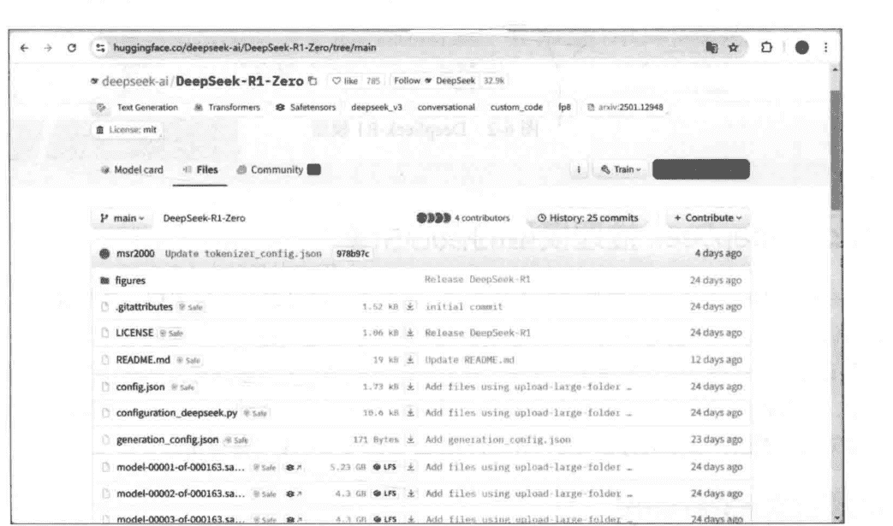

2. DeepSeek-R1
R1-Zero 虽推理强，但输出可读性差且存在语言混杂。后续团队加入少量冷启动数据后再做强化学习，解决了可读性问题，并在数学、编程和逻辑推理上达到与 OpenAI-o1 相当的水准。DeepSeek-R1 同样托管在 Hugging Face 上，可公开下载。
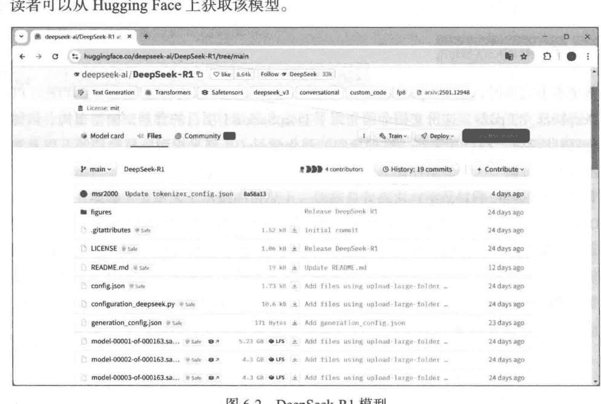

### 6.2 DeepSeek 推理模型的核心引擎

聊到 DeepSeek 的推理技术，混合专家架构、多头潜注意力、强化学习是三根支柱。三者分别负责算力分配、内存效率和策略优化。

#### 6.2.1 混合专家架构
MoE 是 DeepSeek-R1 实现高效推理、降低算力的关键。

稀疏激活：整体参数规模可达数百亿到上千亿，但单次推理只激活一小部分专家，约十之一二，大幅节省算力和显存。
专家划分与动态路由：模型被拆成多个专家，每个擅长特定任务或特征。路由器根据输入动态挑选最匹配的几个专家，提升适配度和准确率。
共享专家与路由专家：共享专家负责高频核心任务，保证基础能力稳定；路由专家处理长尾和特殊场景，避免部分专家过载、部分闲置。
与 Transformer 融合：整体仍是 Transformer 骨架，部分 FFN 层被替换为 MoE 层，通过路由只激活必要专家，保持性能的同时显著降低单次推理成本。

总体来看，MoE 把庞大参数分散到多专家里，按需激活，既保实力又降成本，适合复杂推理和资源受限部署。

#### 6.2.2 多头潜注意力
MLA 通过把 Key-Query-Value 投影到低维潜空间来提升效率。

1. MLA 的核心功能
低秩键值压缩：压缩键值对，减少内存占用，用压缩表示替代完整键值，支撑长上下文。
RoPE 解耦：把旋转位置编码与键值存储分离，保证位置信息有效的前提下不影响潜空间效率。
高效缓存：只缓存压缩后的潜表示，而非全部 token 的完整键值，KV 缓存减少高达 93.3%，推理延迟下降。
自适应投影：查询、键、值使用可学习的独立投影矩阵，训练中动态调整，兼顾效率与精度。
推理缓存机制：选择性缓存压缩表示，对比传统 MHA 内存需求大幅降低。

2. MLA 优化技术
低秩键值联合压缩：键值先压缩到共享潜空间，再投影回各自维度。
多阶段压缩：引入额外 Transformer 层实现分层压缩。
强化学习优化：用 GRPO 根据内存使用效率和检索准确性对 MLA 变换矩阵做奖励优化。

3. MLA 对模型推理速度的影响
推理提速：低秩联合压缩减少重复计算，实验显示推理速度提升约 30%，并行度提高。长文本超过 1000 词时提速近 40%。
资源下降：缓存需求降低约 50%，KV 矩阵重复计算减少，显存压力明显缓解。
性能保持：压缩后准确率几乎不变，可扩展性更好。
实际案例：在线翻译平台引入后推理时间缩短约 30%，资源消耗下降；智能客服对话系统速度提升约 40%，复杂对话更稳。

#### 6.2.3 强化学习
强化学习里智能体通过与环境交互获得奖励来学习最优策略，目标是最大化长期累积奖励，在机器人、游戏、推荐等领域广泛应用。

在 DeepSeek-R1 中的体现有五点。
提升推理能力：后训练阶段大规模使用 RL，在少量标注下大幅增强推理。
优化 SFT 与 RL：先用 R1-Zero 生成冷启动 SFT 数据做指令微调，再用 RL，保留准确性和格式奖励并加入一致性奖励防止语言混杂。
实现推理跃升：展现自我验证、反思和长 CoT，是首个公开验证大模型推理能力可仅靠纯强化学习激发的研究。
GRPO 算法应用：采样一组输出、用规则奖励打分、归一化得到相对优势、更新策略。
性能提升：数学推理、代码生成和通用写作角色扮演等任务都有明显进步。

### 6.3 DeepSeek-R1-Zero 的自我进化
传统方法依赖大量监督数据，成本高耗时长。DeepSeek-R1-Zero 探索了完全无监督的自我进化路径，直接在基础模型上做强化学习，无需人工示例即可自发优化推理策略。

#### 6.3.1 强化学习算法
为降低算力并提高效率，团队引入组相对策略优化 GRPO。

##### 1. GRPO 算法介绍
GRPO 适合大语言模型微调，核心是用组内相对奖励优化，而非传统判别式价值模型。每步状态下采样一组动作，按相对表现调整策略。

##### 2. GRPO 算法的特点
减少计算负担：省去与策略同规模的价值网络，降低显存占用。
提升稳定性：组内比较估计优势，策略更新方差更小。
可控更新：引入 KL 散度约束防止策略跳变，保持分布稳定。

##### 3. 与传统强化学习算法对比
不使用独立评判模型：传统策略梯度需价值网络估计优势，GRPO 直接从当前策略采样候选输出，用组内均值标准差估计基线。
采样与目标设计：对问题 i 采样 {a_i^1...a_i^A}，以旧策略与当前策略概率比做裁剪控制更新幅度，用组内优势衡量优劣，并加入 KL 惩罚项。超参 ε 控制裁剪范围，β 控制 KL 强度。
优势计算：
```
$A_i = \text{std}(\{a_i^1, a_i^2, \cdots, a_i^A\}) / (a_i - \text{mean})(\{a_i^1, a_i^2, \cdots, a_i^A\})$
```

##### 4. GRPO 算法在 DeepSeek-R1-Zero 模型中的应用
完全基于强化学习训练，无监督微调。流程为采样动作组、奖励评估、计算相对优势、带 KL 约束的策略更新、迭代优化。通过内部比较，模型逐步觉醒出强推理能力，为低成本训练提供了实践支撑。

#### 6.3.2 奖励建模
奖励信号决定优化方向和目标。

##### 1. 基本概念
奖励是衡量智能体在特定状态下动作效果的标量反馈，通过累积奖励引导策略逐步改善。

##### 2. 奖励信号的设计方法
简单奖励函数：任务成功给 +1，失败 -1，目标明确时直观易用。
多维度奖励函数：综合位置、速度、控制等多个指标加权，如 R(s,a)=w1·R位置+w2·R速度+w3·R控制力。
基于模型的奖励：在稀疏奖励场景下借助环境模型或大语言模型生成探索目标，提升探索效率。

##### 3. 奖励信号的优化策略
动态调整权重：训练过程中根据表现调节各维度权重，例如逐步提高语言一致性奖励权重以提升生成质量。

DeepSeek-R1 训练全拆解：从 R1-Zero 的规则奖励到 R1 的四阶段进化

给奖励函数里加正则化，本质是给训练上保险，防止过拟合和梯度爆炸。GRPO 采用的动态梯度正则化就是典型例子，让学习过程更稳、效率更高。训练思路也不是一步到位，而是分阶段喂奖励信号。DeepSeek-R1 的实践路线是先用冷启动数据微调做基础，再依次进入监督微调、强化学习、二级强化学习，每个阶段挂的奖励设计都不同。

##### 4. 奖励建模在 DeepSeek-R1-Zero 模型中的作用
训练 R1-Zero 时，团队用了一套纯规则的奖励体系，不引入神经网络式的过程或结果奖励模型，主要分成两类。

准确性奖励关注答案是否正确。数学题要求最终答案放在指定格式比如方框内，方便程序自动核验；LeetCode 类编程题则直接用编译器跑预设测试用例，以通过情况评估代码质量。这种自动化校验能给出明确可靠的训练信号。

格式奖励关注输出是否规范。要求模型把思考过程严格包在指定标签里，例如 <reasoning>...</reasoning>。这样做既让评测系统或人工能快速定位推理轨迹，也能通过固定格式降低噪声，提升可读性和一致性。

团队特意没用过程奖励模型。因为在大规模强化学习里，过程奖励容易被模型套路——奖励黑客，模型钻规则漏洞拿虚假奖励。维护过程奖励模型还很耗资源、流程更复杂。用基于规则的奖励，能保证信号稳定可靠，更好地引导大规模 RL 下的自我进化。

#### 6.3.3 训练模板
R1-Zero 的训练模板非常清晰：先写推理，再给答案。模型输出时必须先生成完整的推理过程，用 <reasoning> 标签标识，随后才生成最终答案，用 <answer> 和 </answer> 包裹。

这样设计有两个考量。规范输出格式能保证所有结果统一，便于自动化评估和人工审查。避免内容偏差也很关键，模板不加入反思、解释特定策略等额外指令，防止人为偏好干扰模型在纯强化学习中自然形成的推理机制，让演化更客观。

#### 6.3.4 DeepSeek-R1-Zero 的自我进化过程
这里的自我进化指的是在没有任何额外监督数据支持下，强化学习单独驱动模型自主提升推理能力的全过程。它直观证明了纯 RL 的有效性，也揭示了内部自发优化的机理。

训练中模型的“思考时间”持续拉长。起初几百个推理 token 就能完成简单任务，随着训练深入，面对难题会主动扩展到数千 token，进行更全面的解析。这体现了策略的优化和对复杂任务的适应力。

更明显的是顿悟时刻。模型开始复盘初始解法，给难题分配更多思考算力，发现更高效的推理路径，准确性和合理性随之跃升。

带来的启示有三点。模型能在纯 RL 下自主调整优化推理，无需监督干预；通过延长推理和增加思考步骤，能更深入探索解题策略；训练过程中会自发涌现顿悟这类复杂高级行为，为自主智能系统指明方向。

#### 6.3.5 DeepSeek-R1-Zero 的“顿悟时刻”
##### 1. “顿悟时刻”的定义与表现
训练中期出现的能力跃迁。R1-Zero 不再依赖最初的解题套路，而是重新评估推理路径，主动为复杂问题投入更多资源，解题准确率和效率明显提升。

##### 2. 机制与内在逻辑
是 RL 在大规模数据上激发自我调整的结果。团队没有预设解法，只通过准确性和格式奖励持续反馈，模型在试错中逐渐学会遇到难题时拉长推理链，用额外思考时间做信息整合和策略调整，这正是顿悟的核心。

##### 3. 意义与启示
证明了不依赖大量监督数据也能激发内在潜力。模型可通过激励和反馈自主发现优化策略，面对多样化问题能灵活调整行为，保持通用性和适应性。也为解析智能系统决策机制提供了新视角。

注意：R1-Zero 在可读性和语言混合上存在短板。为解决这个问题，DeepSeek 开发了 DeepSeek-R1，在初始阶段引入人类友好的监督数据再结合强化学习，提升输出可读性和一致性，增强跨任务和跨语言适应力。

#### 6.3.6 DeepSeek-R1-Zero 性能测试
传统大模型提升常依赖海量监督数据，成本高。DeepSeek 的研究显示，跳过 SFT 直接上大规模强化学习，推理能力也能大幅提升，少量初始数据还能进一步放大效果。对 R1-Zero 的直接测试显示，无 SFT 依赖的情况下，在数学推理、自我进化、推理行为涌现、创意写作等多个基准上表现突出。

### 6.4 DeepSeek-R1 训练方案
R1-Zero 的成功同时暴露新问题：冷启动数据质量会否进一步加速收敛，如何训练出真正用户友好的模型。为此团队设计了包含四个阶段的训练流程。

#### 6.4.1 冷启动
冷启动指模型初期缺乏有效指导信息导致不稳定。CoT 推理是提升推理能力的关键策略，通过把复杂任务拆解为可管理的子步骤，模拟人类逐步推理。

1. 思维链（CoT）推理
让模型输出有序的推理链条而非直接结论。把任务拆成中间步骤并展示推理细节，提升准确性和可解释性。

2. CoT 推理的优势
提升推理性能，增强可解释性，促进模型泛化，更好适应多变任务。

##### 3. DeepSeek-R1 中的冷启动
为避免直接从基础模型开始 RL 的初期不稳定，团队先精心收集少量 CoT 数据微调模型，作为 RL 的初始策略。数据收集方式包括少样本提示、直接提示模型生成反思验证、收集 R1-Zero 的可读输出筛选、人工后处理完善。

数千条冷启动数据用于微调 DeepSeek-V3-Base。相比 R1-Zero，可读性明显改善。R1-Zero 输出常混杂语言且无明确格式，R1 的冷启动数据采用可读模式，响应末尾加总结并过滤不友好内容。输出格式示例：

```
|special_token|<reasoning_process>|special_token|<summary>
```

其中，<reasoning_process> 是查询的 CoT，<summary> 用于总结推理结果。

这项冷启动让模型有了稳定起点，可读性和推理能力同步提升。

#### 6.4.2 推理导向的强化学习
冷启动微调后，对 V3-Base 应用与 R1-Zero 相同的大规模 RL，目标是显著提升推理密集型任务能力，如编码、数学、科学分析、逻辑推理。

1. 语言一致性奖励
CoT 过程中易出现语言混杂，影响可读性。新奖励机制按目标语言单词占比打分，占比越高奖励越高，引导模型保持语言一致。

2. 相关问题
消融实验显示该对齐机制提升语言一致性但略微拉低性能。团队仍认为必要，因为清晰连贯的输出对用户价值更大，长远看有助于实用性和满意度。

3. DeepSeek 的做法
将推理准确性奖励和语言一致性奖励直接相加作为最终奖励函数，在微调后的模型上继续强化学习，直至收敛。这一阶段既提升推理能力，也让输出更符合人类语言习惯。

#### 6.4.3 拒绝采样和监督微调
推理导向 RL 收敛后，利用产生的检查点通过拒绝采样收集 SFT 数据，进一步优化通用任务表现。

1. 拒绝采样
（1）定义与目的
一种蒙特卡洛方法，用于从复杂目标分布中生成样本。在 R1 中用于从 RL 模型输出中筛选高质量样本供监督微调。
（2）实现过程
选择易采样的提议分布，确定缩放常数保证覆盖关系，采样后按接受概率决定是否保留，否则重新采样。

2. 监督微调
（1）定义与目的
在预训练模型基础上用标注数据继续训练，使其在特定任务上表现更好。R1 中用于让模型在推理和其他通用任务上都更出色。
（2）实现过程
准备拒绝采样生成的高质量推理数据，以及写作、角色扮演等领域数据，在此上微调模型。

3. DeepSeek-R1 推理数据的生成与筛选

# DeepSeek-R1 怎么把推理能力做出来又做小

DeepSeek 团队先围绕推理任务设计了一批提示词，再用拒绝采样从强化学习阶段的检查点里抽取推理轨迹。最初的推理导向强化学习更偏爱能用规则奖励直接打分的样本，这次则把边界放宽，纳入了需要生成式奖励模型来评估的数据。做法是把标准答案和模型预测一并输入 DeepSeek-V3，由它来判定输出的好坏。

由于模型偶尔会产出混乱、难读的结果，后续对生成数据做了严格清洗：剔除掉思维链中夹杂多语种、篇幅过长以及包含代码块的片段，保证留下的素材既高质量又易读。对每个推理提示会采样多条候选回复，只保留判断为正确的那部分，最终汇集了约 60 万条推理相关训练样本。

4. 非推理类数据的采集与融合
除了推理轨迹，还需要通用任务的数据，比如写作、事实问答、自我认知、翻译等。这一块沿用了 DeepSeek-V3 的整体方案，并复用了部分监督微调语料。具体分两步走。

数据生成与整合
对于部分非推理任务，会用提示驱动 DeepSeek-V3 先生成潜在的思维链，让模型在给出答案前有更细的思考过程；对于查询等相对简单的任务，则不强制加入思维链，直接给出回应。

数据筛选与优化
生成物同样要过质量关，过滤掉混杂语言、长段落和代码块的输出。筛选后大约获得了 20 万条与推理无关的训练样本。

5. DeepSeek-R1 的监督微调
监督微调是在预训练模型之上，用标注样本继续训练，让模型在特定任务上更稳。DeepSeek-R1 里它既强化了推理表现，也拉升了通用能力。

（1）微调用料
DeepSeek-R1 的微调语料规模约 80 万，覆盖推理与非推理两类。

推理数据：通过拒绝采样从强化学习训练后的模型中抽取轨迹，每个提示生成多条回复只留正确的。这一批既包含规则奖励的样本，也拓展了生成奖励模型评估的样本，并在生成后剔除了混杂语言、长段落和代码块，最终约 60 万条。

非推理数据：沿用 DeepSeek-V3 的流水线，复用部分监督微调数据，对特定任务生成潜在思维链，简单查询则不输出思维链。最终得到约 20 万条非推理样本。

（2）微调过程
数据准备：把上述约 80 万样本拿来对 DeepSeek-V3 做两个 epoch 的微调。
模型微调：训练时在关键投影层上挂 LoRA 适配器，降低显存与算力开销。配置与执行代码如下：

```python
from trl import SFTTrainer
from transformers import TrainingArguments
from unsloth import is_bfloat16_supported

trainer = SFTTrainer(
    model=model,
    tokenizer=tokenizer,
    train_dataset=dataset,
    dataset_text_field="text",
    max_seq_length=max_seq_length,
    dataset_num_proc=2,
    args=TrainingArguments(
        per_device_train_batch_size=2,
        gradient_accumulation_steps=4,
        warmup_steps=5,
        max_steps=60,
        learning_rate=2e-4,
        fp16=not is_bfloat16_supported(),
        bf16=is_bfloat16_supported(),
        logging_steps=10,
        optim="adamw_8bit",
        weight_decay=0.01,
        lr_scheduler_type="linear",
        seed=3407,
        output_dir="outputs",
    ),
)
trainer_stats = trainer.train()
```

（3）微调后的效果
推理任务：经推理数据微调后，数学题、编码、科学实验分析等重推理场景的逻辑与解题能力明显提升。
通用任务：非推理数据让写作、角色扮演、事实问答等场景的表现同步增强，模型既能硬核推理，也能产出高质量通用输出。

整体来看，用约 80 万样本对 DeepSeek-V3 做两轮微调后，DeepSeek-R1 在推理与通用任务上都更均衡，为后续应用打下基础。

6.4.4 全场景强化学习
全场景强化学习的目标是让模型在推理与非推理各类场景下都能稳定发挥，通过多样化的奖励信号和数据分布来兼顾任务需求，同时贴合人类偏好。

1. 核心目标
提升模型在不同场景下的表现，具体包括：
提高有用性和无害性，保证输出既对用户有用又安全，同时不丢推理能力；
增强泛化能力，使模型不局限于单一任务，能在多种情境下自如应对。

2. 在 DeepSeek-R1 中的应用
在 DeepSeek-R1 的第二阶段强化学习里，全场景思路被用于在持续提升推理的同时，兼顾内容的有用与安全。训练数据分为推理数据和通用数据，并融合多种奖励信号与多样提示。

推理数据：沿用 DeepSeek-R1-Zero 的做法，继续使用规则奖励，聚焦数学、编程、逻辑推理等需要精确步骤的任务，通过严格评估推理过程，保证思考路径清晰有条理。

通用数据：引入奖励模型来捕捉更细腻的人类偏好，参考 DeepSeek-V3 的偏好与提示分布，让模型在写作、对(form)话、角色扮演等通用任务上也能给出符合预期答案。

奖励设计上做了区分：
有用性奖励：侧重最终总结，确保回答切实解决用户问题，提升相关性与实用性，同时不过度干扰底层推理细节。
无害性奖励：对整条输出包括推理过程和总结进行全面检查，防止有害、偏见或风险内容，确保安全合规。

落地步骤如下。
（1）推理数据的处理
基于规则的奖励：以数学正确性、代码可运行性等任务标准指导模型学习。
奖励信号：通过规则奖励把推理任务的表现拉到更优。
（2）通用数据的处理
奖励模型：用奖励模型捕捉写作、角色扮演等场景下的人类偏好。
多样化的提示分布：保证覆盖面，让模型在各类场景下都表现稳健。
（3）奖励信号的整合
多奖励信号融合：把推理准确性奖励与语言一致性奖励相加，得到最终奖励函数，既保准又保读性。
优化目标：整合后模型在推理任务上依然卓越，通用任务也保持水准。

总结来看，先准备约 80 万样本的微调集，用 LoRA 降低成本做微调，再在微调模型上做强化学习直至推理收敛。把两类奖励与多样数据结合，最终得到既会推理、又实用且安全的模型，全场景强化学习让能力与安全并行。

6.5 蒸馏处理与轻量化
为了让模型更小更好部署，团队探索了从 DeepSeek-R1 到小规模密集模型的蒸馏。以 Qwen 与 Llama 为底座，直接用 80 万推理样本微调，得到 6 个轻量化模型。这些小模型在多项推理基准上表现突出，部分甚至超过当下不少开源大模型。

6.5.1 AI 大模型中的蒸馏处理
蒸馏是把大教师模型的知识迁移到小学生模型，保持性能的同时大幅降低算力和存储，适合资源受限场景。

1. 知识蒸馏
（1）定义
通过训练小模型模仿大模型的输出行为，在性能与效率间取得平衡。
（2）过程
训练教师模型：先得到参数量大、能力强的教师模型。
生成软标签：教师在大量数据上推理，输出概率分布等更丰富的信号。
学生模型学习：学生不直接拟合原始数据，而是学习教师的输出分布。
蒸馏损失优化：损失包含常规交叉熵与软标签的 KL 散度。
迭代优化与精调：多轮训练后接近教师表现，再做任务微调。

2. 基于特征的蒸馏
（1）定义
把教师中间层的特征表示传递给学生，复刻其抽象语义。
（2）过程
特征提取：教师在各层提取边缘、纹理、形状等特征。
特征传递：指导学生构建相似的特征体系。
性能提升：学生更好捕捉数据本质，提升表现。

3. 特定任务蒸馏
（1）定义
针对机器翻译、文本生成、目标检测、图像分割等具体任务做定制化蒸馏。
（2）过程
任务分析：明确任务特点与需求。
设计蒸馏策略：制定专属目标函数。
性能提升：学生更贴合任务要求。

4. 数据蒸馏
（1）定义
借助教师生成或优化数据，提升多样性与代表性。
（2）过程
数据增强：用教师生成数据扩充样本。
伪标签生成：教师为无标注数据提供标签。
优化数据分布：让学生学习更有效的分布。

5. 模型蒸馏
（1）定义
通过监督微调把教师知识迁移给学生。
（2）过程
监督微调：用教师生成的推理样本微调小模型。
高效蒸馏：不额外做强化学习，流程更简洁。

6. DeepSeek 中的蒸馏应用
数据蒸馏：利用强教师生成数据、做增强、伪标签与分布优化。
模型蒸馏：用教师生成的推理样本对小模型监督微调。
性能提升：蒸馏模型在推理基准上取得明显进步。

6.5.2 基础模型的选择与蒸馏过程
DeepSeek-R1 选用了 Qwen2.5-Math-1.5B、Qwen2.5-Math-7B、Qwen2.5-14B、Qwen2.5-32B、Llama-3.1-8B 和 Llama-3.3-70B-Instruct 作为基座，覆盖不同量级以评估蒸馏效果，对应蒸馏模型如下：

表6-1 蒸馏模型与对应的基础模型

| 蒸馏模型 | 基础模型 |
| :--- | :--- |
| DeepSeek-R1-Distill-Qwen-1.5B | Qwen2.5-Math-1.5B |
| DeepSeek-R1-Distill-Qwen-7B | Qwen2.5-Math-7B |
| DeepSeek-R1-Distill-Llama-8B | Llama-3.1-8B |
| DeepSeek-R1-Distill-Qwen-14B | Qwen2.5-14B |
| DeepSeek-R1-Distill-Qwen-32B | Qwen2.5-32B |
| DeepSeek-R1-Distill-Llama-70B | Llama-3.3-70B-Instruct |

以上模型已在 Hugging Face 公开，可本地或云端部署测试。蒸馏阶段仅使用监督微调，不引入强化学习。借助 DeepSeek-R1 生成的高质量数据对小模型进行微调，成功把推理能力迁移过去。

6.5.3 模型蒸馏的技术原理
DeepSeek-R1 的蒸馏思路是把大模型的先进推理能力以低成本迁移到小模型，兼顾效率与效果。

1. 技术原理
知识迁移与软标签：传统蒸馏依赖软标签传递置信度与推理模式。DeepSeek-R1 经大规模强化学习后能产出带详细链式推理的高质量样本，学生模型由此学到思考路径与策略。
把监督微调当蒸馏手段：直接用 DeepSeek-R1 生成的约 80 万推理样本对开源小模型做监督微调，比强化学习更稳定高效，学生能在较短时间内捕捉推理模式。
模型容量与性能传递：教师在大容量下形成的强推理能力，通过高质量样本指导迁移到小参数模型。虽体量小，但在数学、编程、逻辑推理等任务上仍能逼近教师表现，解决大模型与小模型间的性能鸿沟。

2. 实现方法
(1) 数据生成与收集
教师数据生成：DeepSeek-R1 产出含最终答案与完整推理过程的大规模样本，思维链与总结清晰。
数据清洗与过滤：剔除混杂语言、格式混乱、低质量输出，最终形成约 80 万高质量样本集。
(2) 监督微调训练
目标模型选择：Qwen2.5-Math 系列与 Llama 系列。
训练过程：学生模型对照教师的推理过程与答案学习链式输出，使用交叉熵等标准监督损失迭代逼近教师。
强化学习阶段排除：只做监督微调，避免额外复杂度与资源消耗。
(3) 模型评估与性能提升
性能验证：蒸馏后小模型在数学、编程、逻辑推理等多项基准上显著提升，准确率与推理深度均有优秀表现。

蒸馏后的模型体型更小、推理负担更轻，因而在落地时灵活度提升，能够在算力紧张的场景下迅速完成部署。

## 第 7 章 稀疏矩阵技术

零值占据绝大多数位置的矩阵在科学计算、工程实现和数据分析里出现频率很高。以稀疏性为抓手，可以大幅削减存储开销并优化计算流程。当前在大模型体系中这类技术被广泛采纳，既改善了存取与运算表现，也为处理超大规模稀疏数据提供了新思路。

### 7.1 稀疏矩阵介绍

稀疏矩阵最显著的特征是有效数据稀少。与稠密矩阵相比，在保存与运算上都有可优化的空间，省空间的同时提升速度。

#### 7.1.1 稀疏矩阵的基础知识

当非零项数量远小于矩阵总规模时，即可视作稀疏。以 100×100 的矩阵仅含 10 个非零项为例，若按常规方式全量保存会产生大量浪费。稀疏存储的核心思路是只记录非零项及其坐标。实践中常见的实现方式有三种。

1. 三元组表法
这是最直观的表示手段，用一张表记录所有非零项，每项由行号、列号、数值三部分组成。例如下面这个稀疏矩阵：

$$

\begin{pmatrix}

1 & 0 & 0 \\

0 & 2 & 0 \\

0 & 0 & 3

\end{pmatrix}

$$

以三元组形式写成 (1,1,1)、(2,2,2)、(3,3,3)。理解成本低，但不利于直接做矩阵运算。

2. 十字链表法
借助链表组织非零项，每个节点保存数值以及行指针、列指针，并分别指向同行与同列的下一个非零节点。优点在于增删效率高，适合稀疏结构动态变化的情形。

3. 压缩存储法
压缩稀疏行和压缩稀疏列是数值计算常用的高效范式。

（1）压缩稀疏行 Compressed Sparse Row，CSR
按行顺序集中保存非零数值，同时记录每行非零项的起止位置。需要三组数组配合。
- 值数组：存放全部非零数值；
- 列索引数组：对应每个非零值的列位置；
- 行指针数组：标示每行非零项的起始索引。
以前面示例为例，CSR 表示为：
- 值数组：[1, 2, 3]
- 列索引数组：[0, 1, 2]
- 行指针数组：[0, 1, 2, 3]

（2）压缩稀疏列 Compressed Sparse Column，CSC
做法与 CSR 对称，按列方向存储。同样由值数组、行索引数组和列指针数组组成。

CSR 与 CSC 都具备占用小、对乘法等运算更友好的特点。

总体而言，稀疏矩阵技术通过重塑存储与计算方式，解决了海量稀疏数据的瓶颈，在科学计算、机器学习、网络分析等领域发挥关键作用。随着数据体量持续增大，其研究价值也在上升。

#### 7.1.2 稀疏矩阵在大模型中的应用

稀疏矩阵让大模型在处理长文本或算力受限场景时表现更稳定，主要体现在以下几个面向。

1. 存储与计算的提升
大模型往往拥有高维特征空间与海量参数，矩阵中零值占比极高。只保留非零项及其位置，可显著降低存储需求与运算复杂度。Transformer 的注意力机制会产生稀疏矩阵，正好可以借助该技术实现高效存取与计算。

2. 自然语言处理的语义表达
稀疏矩阵常被用来编码文本中的词语或短语，捕捉语义信息。借助稀疏向量，模型能更快衡量词向量间的距离，更好把握上下文与语义关联，在文本分类、机器翻译、语义检索等任务中价值突出。

3. 量子机器学习中的使用
在量子机器学习 Quantum Machine Learning，QML 的框架下，稀疏矩阵的高效表示是处理大规模数据的关键。例如量子主成分分析借助稀疏矩阵表达数据，结合量子随机存取存储器与量子断层扫描技术，高效提取显著特征。稀疏矩阵也用于量子线性方程求解如 HHL 算法 和量子支持向量机。

4. 图神经网络的邻接矩阵
图神经网络通常用稀疏矩阵表示图的邻接关系。稀疏性带来更省的存储与更快的计算，同时便于图的遍历与聚类操作。

5. 模型压缩与剪枝
训练阶段可利用稀疏技术进行压缩与剪枝。剔除接近零的权重，能大幅减少存储需求与计算负担，同时保持性能。用稀疏矩阵保存优化后的参数，可提升推理速度与内存效率。

6. 量子算法中的稀疏操作
量子 k-最近邻 k-Nearest Neighbor，k-NN 算法用稀疏矩阵存储数据，通过量子态叠加与测量高效计算点间距离。量子基本线性代数子程序也依赖稀疏矩阵来优化线性代数操作。

### 7.2 DeepSeek 的稀疏注意力再造

2025 年 2 月，DeepSeek 公开了关于原生稀疏注意力 Native Sparse Attention，NSA 的研究，论文标题为 “Native Sparse Attention: Hardware-Aligned and Natively Trainable Sparse Attention”。

NSA 是一种面向长文本建模的新型稀疏注意力机制。借助动态分层稀疏策略，包含粗粒度标记压缩与细粒度标记选择，并结合硬件对齐优化，可大幅降低计算复杂度与内存访问，同时保持与全注意力的性能水平。NSA 支持端到端训练，能自动学习最优稀疏模式，在推理与训练阶段均有明显加速。

#### 7.2.1 NSA 技术背景介绍

随着 AI 进展，长文本建模在新一代大语言模型中的重要性日益凸显，推动力来自深入推理、代码库级生成以及多轮自主代理等真实应用，这些场景要求模型驾驭复杂长文本。

DeepSeek-R1 的突破已能处理完整代码库、长篇文档，并保持跨数千 token 的连贯多轮对话，还能执行长距离依赖的复杂推理，展现出长文本建模的潜力。

但序列长度增长会让标准注意力成为延迟瓶颈。估算显示，解码 64K 上下文时，基于 softmax 的注意力计算可占总延迟的 70% ~ 80%，急需更高效的注意力方案。

研究者开始利用 softmax 注意力的固有稀疏性，通过只计算关键查询-键对来降低开销。近期工作包括键值缓存逐出、分块键值选择、基于采样聚类或哈希的选择等。

实际中，现有稀疏注意力往往达不到预期，且多集中在推理，缺乏训练期支持，无法充分发挥稀疏模式的价值。

要真正落地，需要解决两大挑战：
- 面向硬件的推理加速：把理论计算减少转化为真实提速，需在预填充与解码阶段做硬件友好的设计，缓解内存访问与调度瓶颈。
- 感知训练的算法设计：用可训练算子实现端到端计算，降低训练成本同时保持性能。

DeepSeek 团队提出 NSA，一种兼顾层次化标记建模的原生可训练稀疏注意力。NSA 把键值组织成时间块，用三条注意力路径处理：压缩粗粒度标记、选择性保留细粒度标记、滑动窗口提供局部上下文，从而降低每个查询的计算量，并开发专用内核提升实用效率。

NSA 的两大核心创新是：
- 系统级硬件适配：优化分块稀疏注意力以利用 Tensor Core 和内存访问，保持算术强度平衡。
- 训练感知设计：通过高效算法与反向算子实现稳定端到端训练。

这使得模型能高效部署与端到端训练，实现长文本的快速推理或训练。全注意力与 DeepSeek NSA 的对比见图 7-1。

对比显示：
- 即便稀疏，NSA 在通用基准、长上下文任务和推理评估上的平均表现仍优于全注意力；
- 在 64K 长度序列上，解码、前向、反向传播各阶段，NSA 相比全注意力都有显著加速。

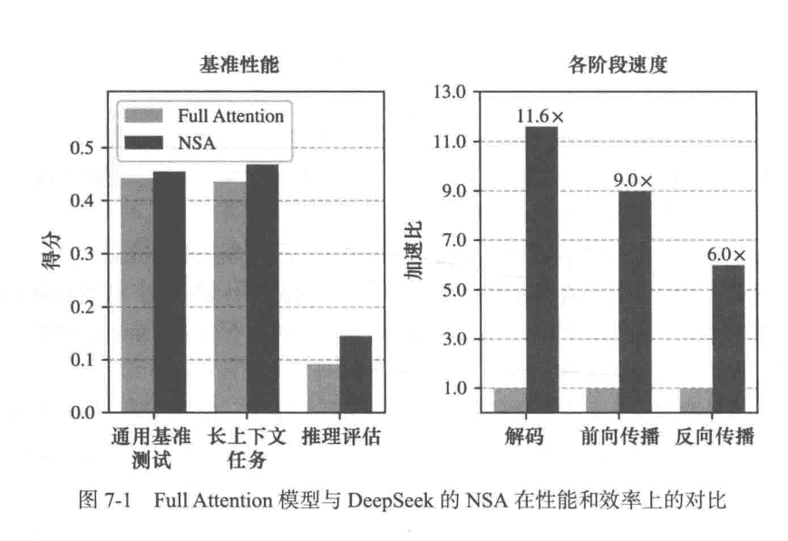

#### 7.2.2 稀疏注意力方法的重新思考

现代稀疏注意力在降低 Transformer 理论复杂度上进展明显，但多数方法仅在推理时引入稀疏，预训练仍保留全注意力，会引入架构偏差，限制稀疏优势的发挥。

1. 推理效率的幻象
虽然注意力计算变稀疏，却未必能降低延迟，主要因为：
（1）阶段专化稀疏
部分方法在自回归解码期启用稀疏，却在预填充期需要昂贵的预处理；另一类只关注预填充。结果是至少一个阶段的成本与全注意力相当，难以在预填充主导的工作负载如图书摘要、代码补全，或解码主导的工作负载如长链推理中同时提速。
（2）与先进架构不兼容
部分稀疏方法无法适配多查询注意力 MQA 和分组查询注意力 GQA 这类现代解码架构。这些架构让多个查询头共享键值，减少解码期内存访问。例如 Quest 等方法让每个注意力头独立选择键值子集，在多头模型上可行，但在 GQA 模型里，键值内存访问对应同一 GQA 组内所有查询头选择的并集。计算量虽降，键值读取仍高，与高效内存访问设计冲突。

这些局限源于多数方案只聚焦键值缓存减少或理论计算减少，在先进框架与后端难以转化为延迟下降，促使研究者开发能结合先进架构与硬件高效实现的算法。

2. 可训练稀疏性的神话
追求 NSA 的两个洞察是：
（1）性能退化。训练后才加稀疏会让模型偏离预训练轨迹，预训练形成的检索头等结构在推理时易被剪枝。
（2）训练效率需求。高效处理长序列训练对大模型开发至关重要，涵盖更长文档预训练以及长上下文微调、强化学习等后续适配。而现有稀疏注意力多为推理导向，对训练计算关注不足。

把现有稀疏注意力搬到训练时还会遇到：
- 不可训练组件。ClusterKV 里的 k-均值聚类、MagicPIG 里的 SimHash 选择等离散操作会带来不连续，阻断梯度通过标记选择，导致模型难以学习最优稀疏模式。
- 反向传播低效。部分理论可训练方法实际训练慢。例如 Hash Attention 的标记粒度选择需要在注意力计算期间从键值缓存加载大量离散标记，非连续内存访问阻碍 Flash Attention 这类依赖连续访问与分块计算的高吞吐技术，硬件利用率低，训练效率受损。

3. 原生稀疏势在必行
上述推理与训练限制推动重新设计。DeepSeek 提出的 NSA 正是同时满足计算效率与训练可行性的原生稀疏注意力框架，下面将介绍其算法与算子实现细节。

#### 7.2.3 整体设计和实现策略

NSA 的整体框架与关键组件旨在以稀疏注意力提升性能与计算效率，通过算法与硬件协同实现高效训练与推理。

1. 背景
在语言建模中，注意力为每个查询标记 q_t 计算与所有前序键 k_:t 的相关性，生成值 v_:t 的加权和。优化输出可形式化为
O_t = Attn(q_t, k_:t, v_:t)
其中 Attn(q_t, k_:t, v_:t) = Σ α_{t,i} v_i / Σ α_{t,j}，α_{t,i}= e^{ q_t^T k_i / √d_k }
随着序列增长，注意力占比升高，长文本处理压力增大。

算术强度是计算操作与内存访问之比，决定硬件优化方向。GPU 的算术强度由峰值算力与内存带宽决定。训练与预填充阶段，批量矩阵乘法与注意力算术强度高，通常是计算受限。而自回归解码每次只生成一个标记，却需加载全部键值缓存，算术强度低、受内存带宽限制。因此解码优化目标是减少内存访问，训练与预填充目标是减少计算成本。

2. 整体框架
为利用注意力的自然稀疏模式，DeepSeek 提出用更紧凑信息密度的键值对 \tilde{K}_t 与 \tilde{V}_t 替换原始键值。优化输出为：
\tilde{K}_t = f_K(q_t, k_:t, v_:t)，\tilde{V}_t = f_V(q_t, k_:t, v_:t)
o_t^* = Attn(q_t, \tilde{K}_t, \tilde{V}_t)
\tilde{K}_t 与 \tilde{V}_t 基于当前查询与上下文记忆动态构建。可设计多种映射策略并组合：
o_t^* = Σ_{c∈C} g_t^c · Attn(q_t, \tilde{K}_t^c, \tilde{V}_t^c)

图 7-2 展示 NSA 架构概览：
- 左图显示三条并行注意力分支处理输入序列：对给定查询，前序键值被加工为粗粒度的压缩注意力、重要 token 块的选择性注意力，以及用于局部上下文的滑动窗口注意力。
- 右图可视化各分支的注意力模式。灰色区域为需计算注意力分数的部分，白色区域可跳过。

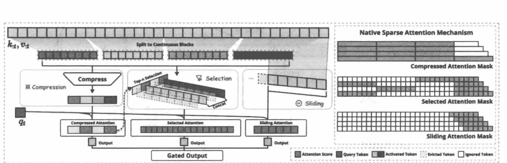

图 7-2 NSA 架构的概览
注：图来自官方，故图中英文没有翻译。

3. 算法设计
NSA 核心目标是在保持长文本建模能力的同时降低计算与内存开销，采用三种稀疏化策略：标记压缩、标记选择、滑动窗口。

（1）标记压缩
把连续的键值块聚合为块级表示，捕捉块内高层语义，同时大幅减少待处理键值对数量，在不丢失关键信息的前提下降低复杂度。

（2）标记选择
仅靠压缩会丢失细粒度信息，NSA 引入选择机制，按块重要性评分保留关键键值，确保细粒度上下文被捕捉。保留得分最高的块，既降本又聚焦重要信息。

（3）滑动窗口
专门处理局部上下文。局部模式易被模型捕捉，滑动窗口分支保证局部信息不被全局稀疏策略淹没。分离局部上下文后，更利于学习长距离依赖。

为最大化实效，NSA 在硬件层面做了对齐。与现代 GPU 架构匹配，利用 Tensor Core 与高效内存访问。采用以组为中心的数据加载，减少冗余键值传输；分块计算提升内存访问效率。这种设计在保持高算术强度的同时提高硬件利用率。

图7-3 说明了NSA内核的工作流。整体采用网格循环的调度思路，按GQA方式逐步装入查询，在内层循环里读取对应的稀疏KV块，然后在SRAM中完成注意力计算。图中①色块为SRAM内的数据，②色块为高带宽内存内的数据。这一做法通过分组共享降低KV搬运的重复开销，并让GPU流式多处理器的负载趋于均衡，最终接近最优算术强度。

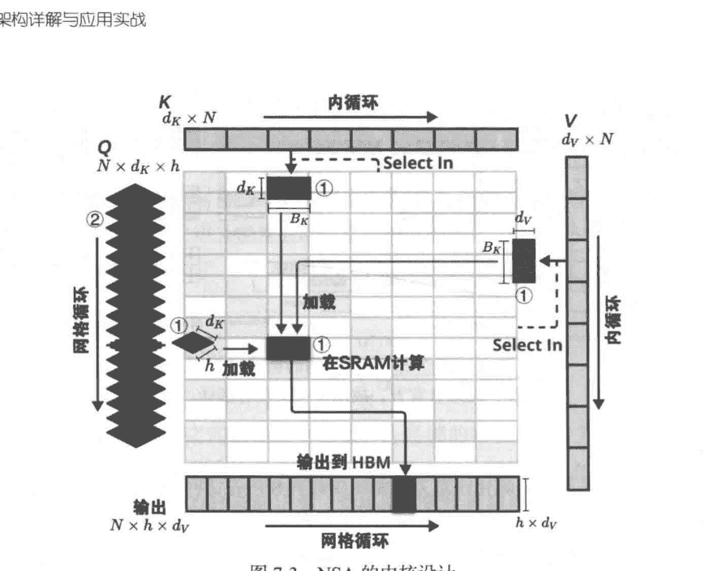

图 7-3 NSA 的内核设计

注：图来自官方，故图中英文没有翻译。

总体来看，DeepSeek的NSA把标记压缩、标记挑选与滑动窗口三种策略结合起来，构建出稀疏化注意力。三种策略在压缩计算与内存访问的同时，依赖动态聚合保持对长文本的建模能力。再加上硬件层面的优化，实际运行效率进一步提升，在长序列任务上表现突出。

#### 7.2.4 评估 NSA 的性能

DeepSeek 研究组从三个视角对NSA做系统验证：通用基准表现、长文本基准表现、基于推理的链式思考表现。对比对象包括完整注意力基线和业界领先的稀疏注意力方案。

##### 1. 预训练设置

研究组沿用主流大模型实践，骨干并用GQA与MoE，总规模270亿参数，其中激活参数30亿。网络共30层，隐藏维2560。GQA分组设为4，注意头总数64。MoE采用自研结构，含72个路由专家与2个共享专家，Top-K为6。为保证训练稳定，第一层的MoE被换成SwiGLU形式的MLP。图7-4对比了270亿参数规模下完整注意力与NSA的预训练损失，两者均稳定收敛，NSA损失更低，说明即便采用稀疏注意力，效果仍然优于全量注意力。

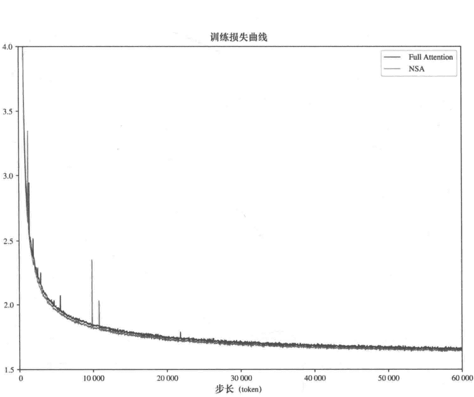

图 7-4 270 亿个参数模型中 Full Attention 与 NSA 的预训练损失比较

注：损失通常是无单位的标量。

NSA的具体配置为压缩块32 token、滑动步长16 token、挑选块64 token、挑选块数16个，含1个初始块与2个局部块，滑动窗口512 token。完整注意力与稀疏模型均在270亿条8K长度文本上预训练，随后借助YaRN扩展到32K并继续训练与监督微调，以适应长序列。两套模型均训至完全收敛以保证公平。实验显示NSA的预训练损失曲线平滑且始终领先于全量注意力。

##### 2. 基线方法

除完整注意力外，研究人员还对照了多项主流推理阶段稀疏注意力做法，包括H2O.ai、infLLM、Quest与Exact-Top，涵盖KV缓存淘汰、查询感知挑选与精确Top-K稀疏挑选等不同范式。

通用评测中，大多数样本长度落在稀疏基线的局部窗口内，这些方法等价于完整注意力，因此仅呈现NSA与完整注意力的对比。长文本评测中所有基线均参与比较，且稀疏程度统一以保证公平。链式思考推理评测因需要长序列监督微调，故仅与完整注意力对比，稀疏基线不支持训练。

##### 3. 性能比较

性能对比包含以下维度。

- 通用评估：团队在涵盖知识推理与编码能力的综合套件上测试NSA与完整注意力，包括MMLU、MMLU-PRO、CMMLU、BBH、GSM8K、MATH、DROP、MBPP与HumanEval。尽管为稀疏设计，NSA在9项指标中7项超越全部基线，包含完整注意力，展现出强劲实力。尤其在推理相关基准上提升明显，DROP提升0.042，GSM8K提升0.034，表明预训练有助于模型形成专用的注意力模式。稀疏预训练迫使模型聚焦关键信息，通过剔除无关路径噪声提升效果。

- 长文本评估：在64K长度的“针扎草垛”测试中，NSA达到完美检索精度。该结果得益于分层稀疏设计，压缩标记用于高效全局扫描，选择标记用于精确局部检索。粗粒度压缩以较低计算成本甄别相关块，而在所选标记的粒度层面保留关键细粒度信息。设计兼顾全局感知与局部精度。图7-5展示了64K长度下不同位置的检索准确率，NSA以分层稀疏设计实现完美准确率。结果显示，依托分层稀疏机制，NSA在所有位置均达到完美检索。机制融合压缩注意力做全局扫描与选择性注意力做局部检索，在保持全局感知的同时确保局部精度。

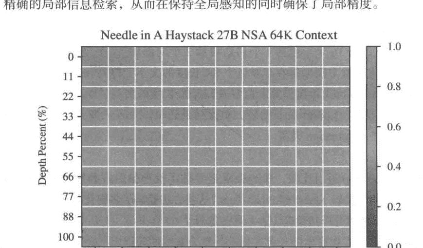

图 7-5 不同上下文位置的检索准确率

注：为了保留图中英文的原意，所以没有翻译。

- 团队还在LongBench上对NSA展开评测，并与先进稀疏方法及完整注意力基线对比。结果显示NSA平均得分最高达0.469，优于全部基线。提升源于两大创新：①原生稀疏注意力设计使得在预训练期间对稀疏模式进行端到端优化成为可能；②分层稀疏注意力在局部与全局信息处理间取得平衡。

- 基于链式思考的推理评估：为检验NSA对下游训练范式的兼容性，研究人员考察其通过后训练获得基于链式思考数学推理能力的潜力，采用DeepSeek-R1的知识蒸馏，进行包含100亿条32K长度数学推理轨迹的监督微调。实验显示在8K设置下NSA准确率显著高于完整注意力，并在16K中优势持续。结果验证了两点关键收益：①预训练的稀疏注意力模式能高效捕获长程逻辑依赖；②硬件对齐设计保持足够序列密度，支持推理深度提升而不发生灾难性遗忘。

综合来看，NSA在通用基准、长序列任务与链式思考推理评估中均表现优异，不仅在性能上超越完整注意力基线与其他稀疏方法，还在训练与推理效率上实现显著提升，验证了其作为高效且强大的稀疏注意力机制的有效性。

#### 7.2.5 NSA 的效率分析

研究人员在A100 GPU上评估NSA的计算效率并与完整注意力对比。

基于Triton实现NSA的注意力机制，与完整注意力进行对比，确保在相同后端下公平测速。如图7-1所示，随着序列长度增长，NSA的加速比逐步放大。序列长达64K时，前向传播提速9.0倍，反向传播提速6.0倍。随序列长度增加，速度优势愈发明显。

加速主要归功于为稀疏注意力架构设计的硬件对齐算法。

- 分块内存访问模式：合并加载以最大化Tensor Core利用率。
- 精心设计的循环调度：消除冗余的KV缓存传输。

实验表明，注意力解码速度主要受内存访问瓶颈制约，与KV缓存加载量密切相关。随解码长度增加，NSA明显降低延迟，在64K长度时实现最高7.6倍加速。鉴于解码阶段算术强度低、受内存限制，这种内存访问效率的优势随序列长度增长而更加突出。

#### 7.2.6 NSA 应用结论

DeepSeek提出的NSA是一种面向长序列建模的硬件对齐稀疏注意力架构，将分层标记压缩与分块标记选择相结合并集成到可训练架构中。整体架构在保持完整注意力性能的同时实现训练与推理加速。NSA在通用基准测试中达到完整注意力基线水平，在长序列评估中超出建模能力，在推理能力上实现显著提升，同时大幅降低计算延迟并取得明显加速。

### 7.3 MoBA——块注意力混合

Kimi团队于2025年2月发布论文“MoBA: Mixture of Block Attention for Long-Context LLMs”。论文提出MoBA，即Mixture of Block Attention，块注意力混合，旨在提升大语言模型处理长序列的效率。MoBA将文本划分为多个块，让每个查询token动态挑选最相关的块进行注意力计算，从而高效处理长序列。实验显示MoBA在长序列场景下的性能与完整注意力相当，而在处理1M长度文本时速度提升6.5倍。

#### 7.3.1 MoBA 介绍

MoBA是一种新型注意力机制，旨在解决传统注意力在长序列场景下计算复杂度高、资源消耗大的问题。

##### 1. 架构设计

架构设计包含以下方面。

- 块稀疏注意力：MoBA将输入文本切分为多个固定大小的块，每个查询token仅关注最相关的块，而非整个文本。该稀疏机制显著减少计算量，同时保留长序列处理能力。
- 动态块选择：通过无参数的Top-K门控机制，MoBA为每个查询token动态挑选最相关的块。机制计算查询token与各块的相关性得分并选取前K个。
- 因果性保持：MoBA限制查询token只能关注当前块与过去块，保证自回归语言模型的因果性，同时对当前块施加因果掩码以避免未来信息泄露。
- 细粒度块分割：MoBA支持细粒度块分割，类似MoE架构中的专家划分，进一步提升性能。
- 与完整注意力的混合：MoBA可在完整注意力与稀疏注意力间无缝切换，既适用于长序列任务，也兼容现有预训练模型。

MoBA架构示意图如图7-6所示，该图说明MoBA如何通过选择性关注最相关块来减少计算量，同时保持长序列处理能力。

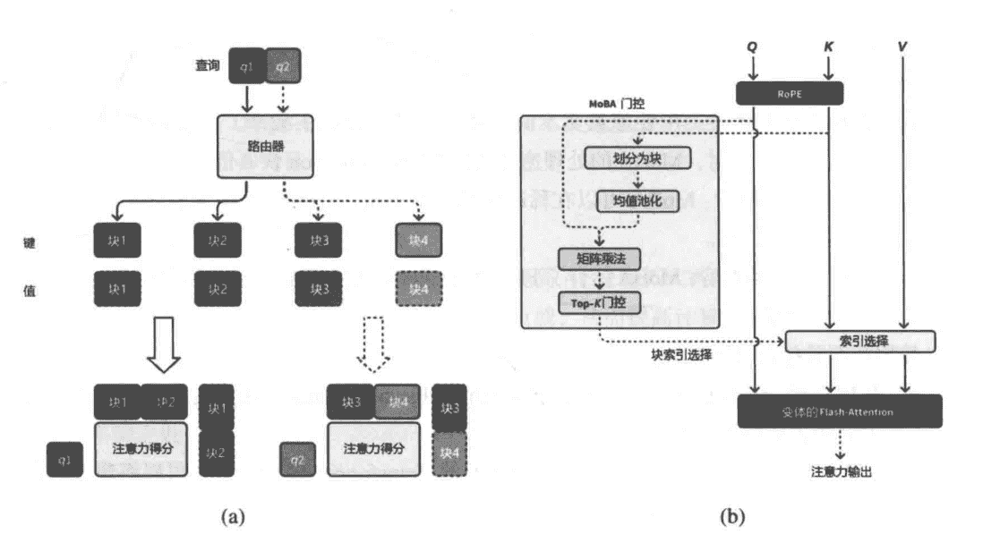

对图7-6的具体说明如下。

图7-6（a）展示了MoBA的一次运行示例，显示查询如何经由路由器分配到不同键值块中。每个查询仅关注被选中的块并计算注意力得分。

图7-6（b）展示了MoBA如何集成到Flash Attention中，详细说明MoBA门控的内部流程，包括将键值划分为块、进行均值池化、矩阵乘法并应用Top-K门控挑选最相关块。随后使用索引选择确定哪些块参与最终注意力计算，该过程通过变体的Flash Attention完成以得到注意力输出。

##### 2. 实现细节

实现细节包含以下方面。

- 块划分：文本被划分为多个块，每个块包含一组连续token。
- 门控机制：通过计算查询token与各块的相关性得分，门控机制动态选择最相关块。该机制类似MoE中的专家选择，但应用于注意力机制。
- 注意力计算：MoBA仅对选定块进行注意力计算，显著降低计算复杂度。同时通过Flash Attention等高性能库优化计算。
- 因果掩码：为保持自回归因果性，MoBA对当前块应用因果掩码，避免token关注未来位置。
- 与现有模型的兼容性：MoBA保持与完整注意力相同的参数量，可作为完整注意力的替代品，无需对现有模型做大规模修改。

##### 3. 性能优势

性能优势包含以下方面。

- 显著加速：在处理长序列时MoBA大幅提升效率。例如处理100万token文本时，MoBA比传统完整注意力快6倍。
- 灵活切换：MoBA可在稀疏注意力和完整注意力间无缝切换，适用于不同长度文本。
- 与现代加速器兼容：MoBA结合Flash Attention等高性能库，进一步优化计算效率。

##### 4. 使用与部署

使用与部署包含以下方面。

- 环境设置：MoBA实现依赖PyTorch与Flash Attention。用户可通过简单命令安装依赖并使用MoBA。
- 集成与转换：MoBA可轻松集成到现有Transformer模型中，也可将现有预训练模型转换为MoBA模型。

总体而言，MoBA的设计与实现为大语言模型处理长序列提供了一种高效且灵活的解决方案，同时保持与传统注意力机制相当的性能。

#### 7.3.2 测试结果

Kimi团队对MoBA进行了全面测试与验证，结果显示在处理长序列时具备显著性能优势。

- 缩放定律实验：尽管注意力模式稀疏度高达81.25%，MoBA在语言模型损失上的表现与完整注意力相当。
- 长序列缩放能力：实验表明，随着文本长度增加，MoBA与完整注意力的差距逐步缩小。
- 细粒度块分割消融研究：实验显示更细粒度的块分割可进一步提高MoBA性能。
- MoBA与完整注意力的混合训练：实验表明混合使用MoBA与完整注意力训练可在训练效率与性能间取得平衡。
- 效率和可扩展性：实验表明MoBA在处理长序列时比完整注意力更高效，计算复杂度为亚平方级。在处理1000万token序列时，MoBA的注意力计算时间降至原来的1/16。

这些结果表明MoBA在保持相近性能的同时，显著降低注意力计算时间和内存消耗，尤其在超长文本场景下优势更加明显。

#### 7.3.3 NSA 和 MoBA 的对比

Kimi的MoBA与DeepSeek的NSA均为针对长序列处理的创新技术，在提升处理效率与降低计算成本方面均有显著表现。

1. 相似之处

两者的相似之处如下。

- 两者均针对长序列处理优化，旨在提高AI处理长序列的效率。
- 两者均通过优先处理重要信息减少计算负载，从而提升计算效率。
- 无论是提升推理能力还是改善长序列处理，这两种技术均有助于使AI更智能。

2. 不同之处

两者的不同之处如下。

- 主要关注点：NSA更侧重逻辑推理与效率提升，MoBA则专注更快处理长序列。
- 核心方法：NSA采用稀疏注意力机制，通过挑选关键值优化注意力；MoBA采用基于块的注意力机制，有选择地进行处理。
- 最佳应用场景：NSA更适合复杂问题求解与深度推理，MoBA更适合摘要、长对话与文档分析。
- 计算策略：NSA通过优化注意力机制减少内存使用，MoBA通过将文本分块并仅处理相关部分来缩短计算时间。
- 性能方面：MoBA在处理1M token时比完整注意力快6.5倍，而在处理超长文本如1000万token时优势更显著，可达16倍以上加速。此外MoBA在大语言模型高效注意力计算方面取得显著进展。NSA在通用基准测试中超越传统完整注意力。

## 第 8 章 DeepSeek 模型的本地部署

DeepSeek模型的本地部署方案通过软硬件深度协同优化，实现高性能与灵活部署的双重目标。该方案核心优势在于其统一的多加速器融合适配层，能够有效整合GPU、TPU、NPU等异构计算设备，充分发挥不同硬件的算力，为大模型推理提供强大支持。

### 8.1 Ollama 本地部署

Ollama是一款专注于大模型本地部署与管理的软件，通过提供直观用户界面与标准化API，使用户能够在本地环境中轻松加载、运行和调优大模型，无需依赖云端资源。Ollama支持多模型协同与动态资源调度，在保证高效响应和低延迟的同时严格保护数据隐私与安全，帮助开发者在本地实现大模型部署。

#### 8.1.1 安装 Ollama

安装Ollama的步骤如下。

（1）登录Ollama官网，根据操作系统类型下载对应版本，目前Ollama支持macOS、Linux与Windows主流系统。笔者选择的是Windows系统版本，如图8-1所示。


（2）点击“Download for Windows”按钮开始下载，下载完成后得到一个.exe格式安装文件，以管理员身份打开。

（3）在弹出界面中点击“Install”按钮开始安装，如图8-2所示。需要注意的是，Ollama必须安装在C盘，不支持更改路径，因此C盘剩余空间必须至少大于5 GB。

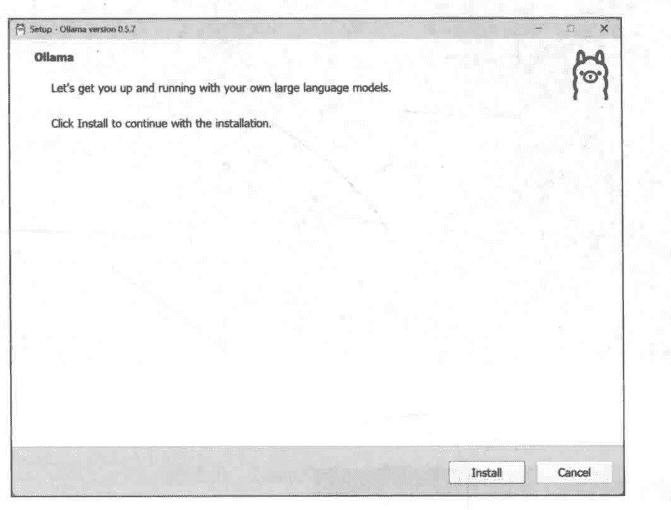

## 第 8 章 DeepSeek 本地化部署详解

图 8-2 “Install” 按钮的示意

（4）弹出 Installing 视窗后，静待进度条走完，过程参照图 8-3 的展示。

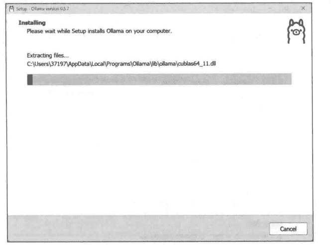

图 8-3 Installing 视窗

（5）部署完毕后，为验证 Ollama 服务是否已正常运行，可在终端执行校验命令，出现图 8-4 的画面即表示安装生效。

```
ollama -h
```

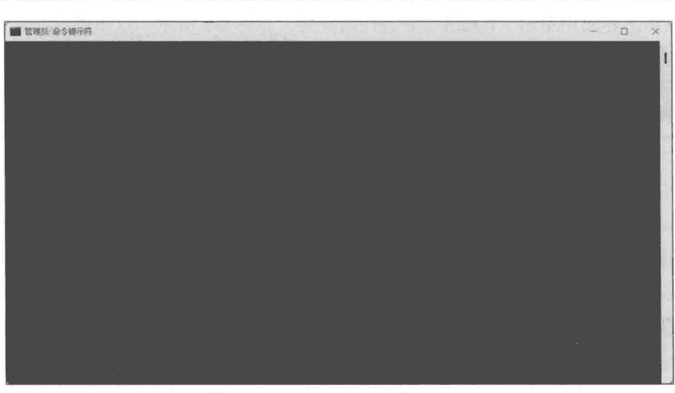

#### 8.1.2 Ollama 环境下引入 DeepSeek

通过 Ollama 在本地使用 DeepSeek 的主要流程如下。

（1）进入 Ollama 官网，在页头点选 “Models”，跳转到模型总览页，效果见图 8-5。

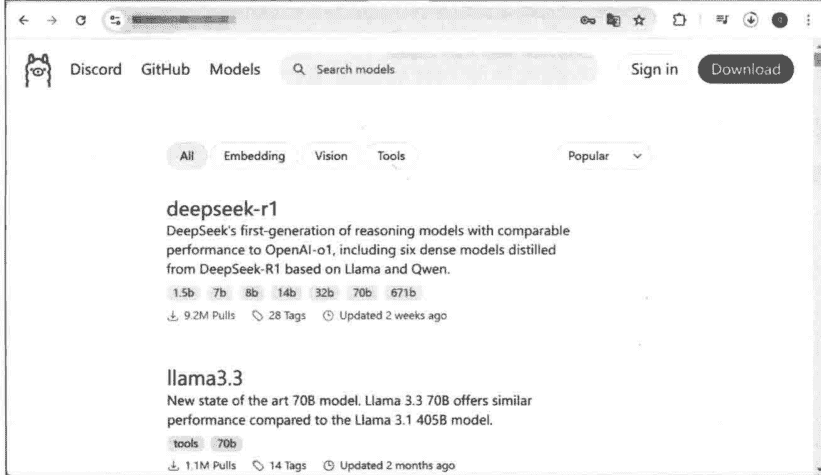

（2）点开 “deepseek-r1” 进入详情页，如图 8-6 所示，下拉区列出了 1.5b、7b、8b、14b、32b、70b、671b 等多个版本，编号同时代表版本与参数规模，数值越大模型体量越大，如图 8-6。

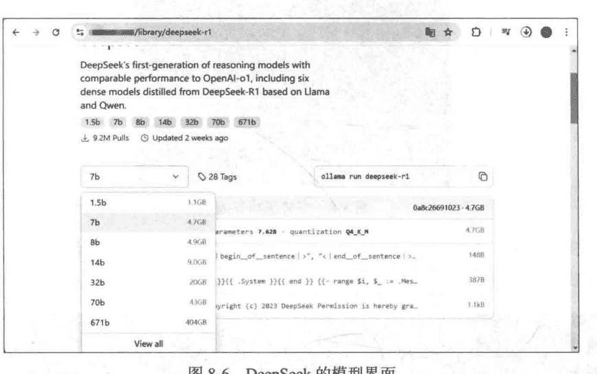

（3）依据本地硬件挑选版本，假设选择 70b，在下拉菜单中定位 70b 并复制对应的拉取指令 “ollama run deepseek-r1:70b”，示例如图 8-7。

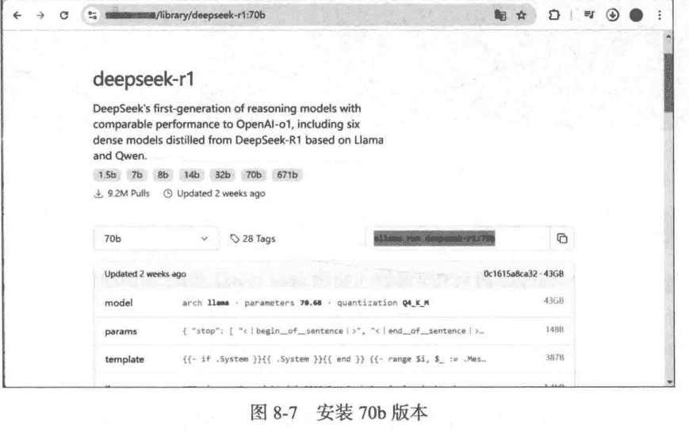

（4）把复制的指令粘贴到命令行回车，系统开始拉取并安装 70b 版 DeepSeek，耗时与模型体量及网络相关，请耐心等待，完成后的界面如 8-8。

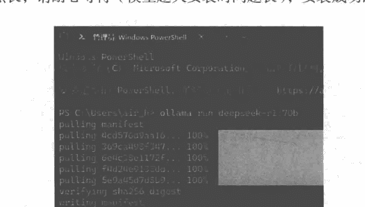

图 8-8 安装完成画面

（5）安装结束后可在终端启动 DeepSeek，输入 “/bye” 可退出会话。与模型交互的界面见图 8-9。

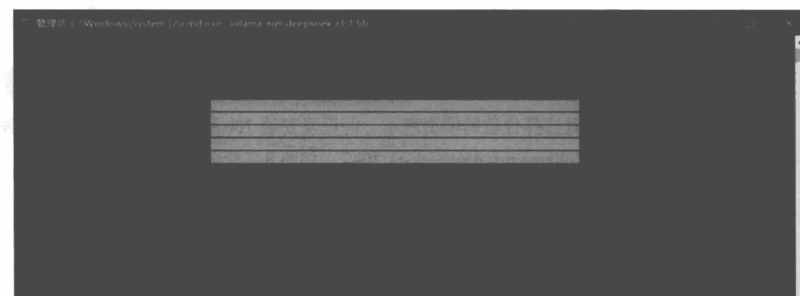

图 8-9 与 DeepSeek 对话界面

#### 8.1.3 基于本地 DeepSeek 的对话程序

模型部署完成后，可用 Python 调用本地 DeepSeek 实现对话功能。下面介绍构建思路。

1. 硬件准备
- 推理加速：DeepSeek 通常需要高性能 GPU，建议 NVIDIA A100、RTX 4090、H100 等，具体以模型规模为准。
- 内存与存储：建议内存不低于 64 GB，并使用高速存储以承载模型加载与运行。

2. 软件环境
- 系统：推荐 Linux 或 macOS，Windows 可用 WSL。
- Python：3.10 及以上版本。
- 依赖：需安装 Transformers、Torch、Accelerate 等，可通过下列命令安装：

```
pip install transformers torch accelerate
```

3. 获取模型
（1）按硬件选择版本，如 1.5b、8b、14b、32b、70b。
（2）可通过 GitHub 手动获取：

```
git clone https://github.com/deepseek-ai/DeepSeek-R1.git
cd DeepSeek-R1
python fp8_cast_bf16.py --input-fp6-hf-path /path/to/DeepSeek-R1 --output-bf16-hf-path /path/to/deepseek-R1-bf16
```

亦可交由 Ollama 自动拉取。

4. 环境变量
- 模型路径确保权重文件地址写入程序。
- CUDA 环境需正确安装 CUDA 与 cuDNN 并配置对应变量。

```
export CUDA_HOME=/usr/local/cuda
export LD_LIBRARY_PATH=$CUDA_HOME/lib64:$LD_LIBRARY_PATH
```

下面以 subprocess 与 Ollama 交互为例实现对话。

实例 8-1：Ollama 本地 DeepSeek 对话程序（源码路径：codes\8\Deep01.py）

Deep01.py 的实现如下。

```python
import subprocess

def deepseek_query(prompt):
    # 使用 subprocess 运行 Ollama 命令，并传递用户输入
    result = subprocess.run(
        ['ollama', 'run', 'deepseek-r1:1.5b'],
        input=prompt.encode('utf-8'),
        capture_output=True
    )
    # 返回模型的响应
    return result.stdout.decode('utf-8')

if __name__ == "__main__":
    while True:
        user_input = input("你：")
        if user_input.lower() in ['退出', 'exit', 'quit']:
            break
        response = deepseek_query(user_input)
        print("DeepSeek:", response)
```

运行后输出对话日志，示例：

```
你：你好！
DeepSeek：你好！有什么我可以帮助你的吗？

你：介绍一下 Python 编程
DeepSeek：Python 是一种广泛使用的高级编程语言，支持多种编程范式，包括面向对象编程、函数式编程等。它语法简洁、易于学习。

你：退出
```

参考 Hugging Face 官方代码，以下是基于 Hugging Face 调用 DeepSeek-R1 的示例。

实例 8-2：Hugging Face 本地 DeepSeek 对话程序（源码路径：codes\8\Deep02.py）

Deep02.py 的实现如下。

```python
from transformers import pipeline

def main():
    # 加载模型
    pipe = pipeline("text-generation", model="deepseek-ai/DeepSeek-R1",
                    trust_remote_code=True)

    print("DeepSeek 对话系统已启动，输入 '退出' 结束对话。")
    while True:
        user_input = input("你：")
        if user_input.lower() in ["退出", "exit", "quit"]:
            break

        # 修改输入为 DeepSeek 模型的格式
        messages = [{"role": "user", "content": user_input}]
        # 生成模型响应
        response = pipe(messages)

        # 解析输出内容
        bot_response = response[0]["generated_text"] if response else "无法获取响应"
        print("DeepSeek:", bot_response)

if __name__ == "__main__":
    main()
```

代码通过 pipeline 加载 DeepSeek-R1 并开启 trust_remote_code。执行后会打印交互信息，例如：

```
DeepSeek 对话系统已启动，输入 '退出' 结束对话。
你：Python 有哪些优点？
DeepSeek: Python 是一种简单易学的编程语言，它支持多种编程范式，包括面向对象编程、函数式编程等。同时，它有丰富的第三方库。

你：退出
```

### 8.2 LM Studio 可视化部署

LM Studio 是一款图形化本地模型工具，提供模型下载、运行及内置聊天窗口，支持 GGUF 格式，无需命令行，兼容 Windows 与 macOS。

#### 8.2.1 LM Studio 特性与安装

主要特性：
- 本地离线运行，数据不依赖外部服务器，保障隐私。
- 广泛兼容，支持 GGUF 并兼容 Hugging Face 等平台资源。
- 内置 GPU 加速，提升推理效率。
- 多功能集成，除生成外还支持本地文档对话、微调等。

安装步骤：
（1）登录 LM Studio 官网，按系统下载对应安装包，例如 Windows 11 用户点选 “Download LM Studio for Windows”，如图 8-10。

DeepSeek 架构详解与应用实战

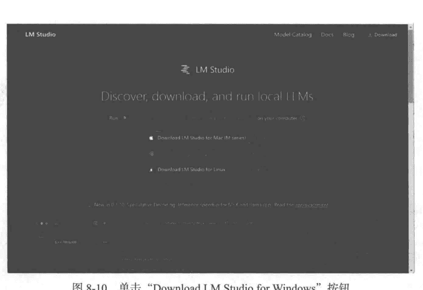

图 8-10 下载 Windows 版按钮

（2）得到 .exe 安装文件后双击启动，先出现安装选项页，勾选 “为使用这台电脑的任何人安装（所有用户）”，如图 8-11。

（3）点下一步进入安装位置页，设置 LM Studio 的安装目录，如图 8-12。

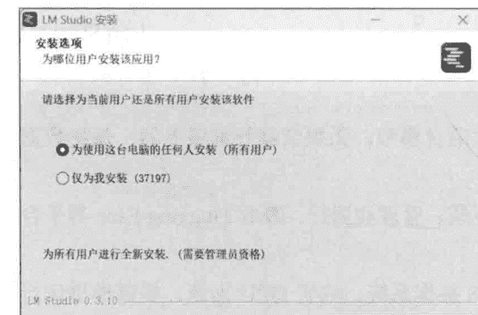

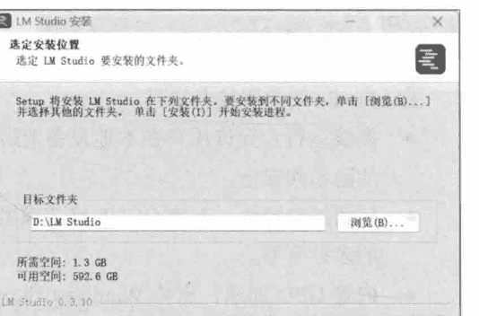

图 8-11 安装选项页

图 8-12 安装路径页

（4）点安装后进入写入阶段，出现正在安装窗口，如图 8-13。

（5）待出现完成向导页，如图 8-14，点完成即可结束。

160

## 第 8 章 DeepSeek 模型的本地部署

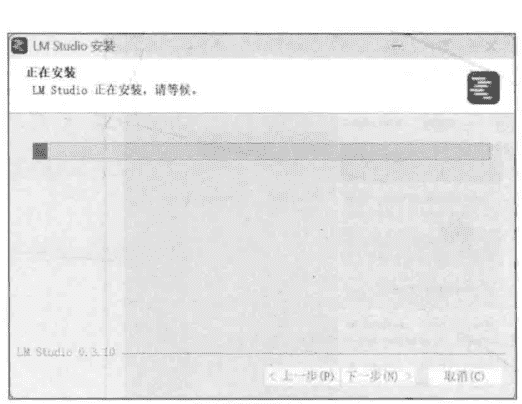

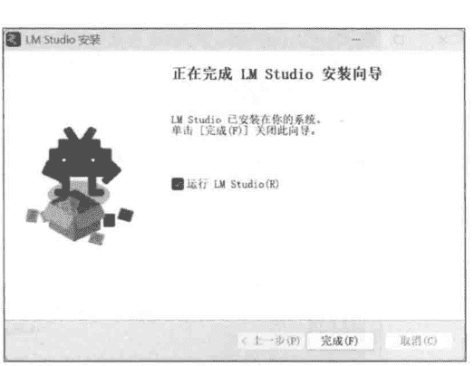

图 8-13 安装进行中

图 8-14 安装向导完成页

#### 8.2.2 DeepSeek 模型配置

配置流程如下。
（1）双击快捷方式启动 LM Studio，初始页如图 8-15，点击右上角 “Skip onboarding” 跳过引导。


图 8-15 初始欢迎页

（2）进入聊天页，如图 8-16，首次使用时模型为空。

DeepSeek 架构详解与应用实战

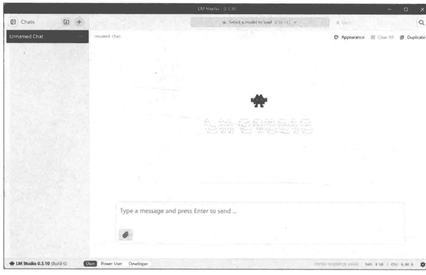

图 8-16 聊天页

（3）点顶部模型搜索框输入 “DeepSeek”，再点下方 “Search more results for “DeepSeek””，如图 8-17。

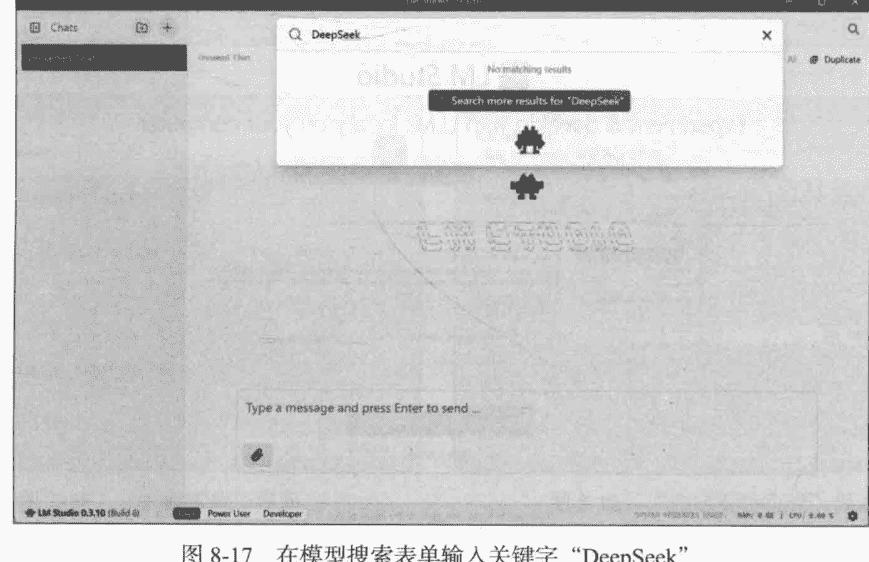

图 8-17 搜索关键词

（4）弹出检索列表，如图 8-18，选择例如 DeepSeek R1 Distill(Qwen 7B)，点右下角 “Download 4.68GB” 开始获取。

162

## 第 8 章 DeepSeek 模型的本地部署

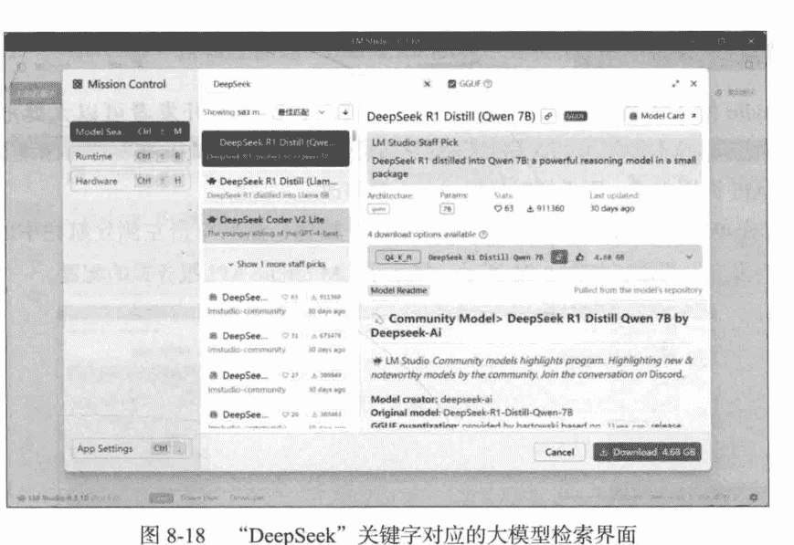

图 8-18 模型检索结果

（5）下载完成提示出现，如图 8-19，点 “Load Model” 或回车即可载入 DeepSeek R1 Distill(Qwen 7B)。

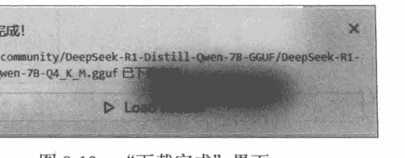

（6）载入后可在聊天窗口与 DeepSeek 交流，如图 8-20。

图 8-19 下载完成提示

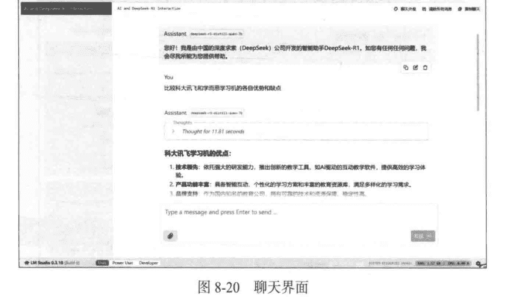

图 8-20 聊天窗口

#### 8.2.3 LM Studio API

LM Studio 提供兼容 OpenAI 的接口，便于将现有 OpenAI 应用迁移到本地模型。

（1）先点底部 “Developer” 按钮，再点左侧终端图标进入开发者页，如图 8-21，展示 API 服务器配置。

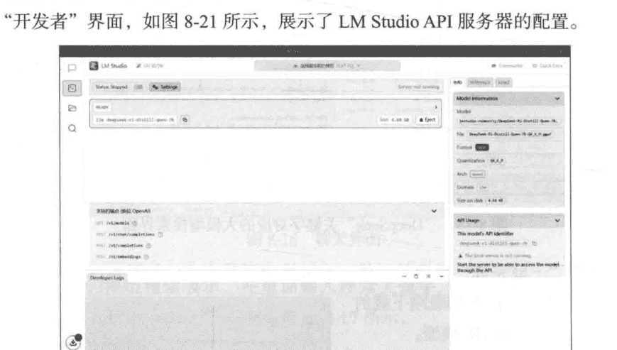

图 8-21 开发者页

（2）在页内点 “Settings”，打开 “在局域网内提供服务” 选项，如图 8-22。

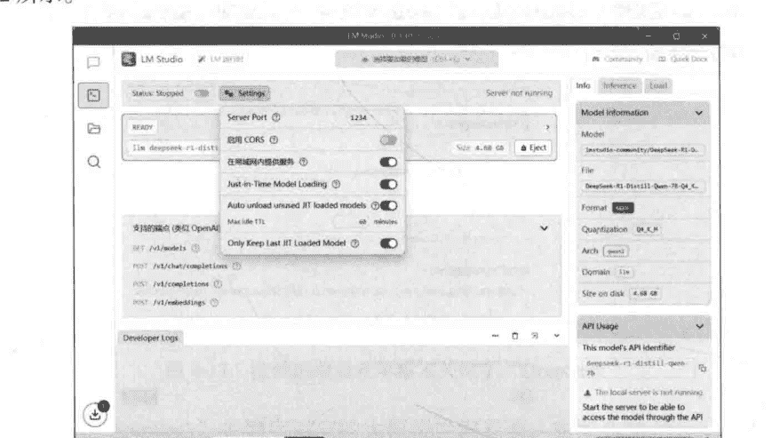

图 8-22 局域网服务选项

（3）在 Settings 左侧打开 “Status:Running” 开关启动 API 服务，如图 8-23。

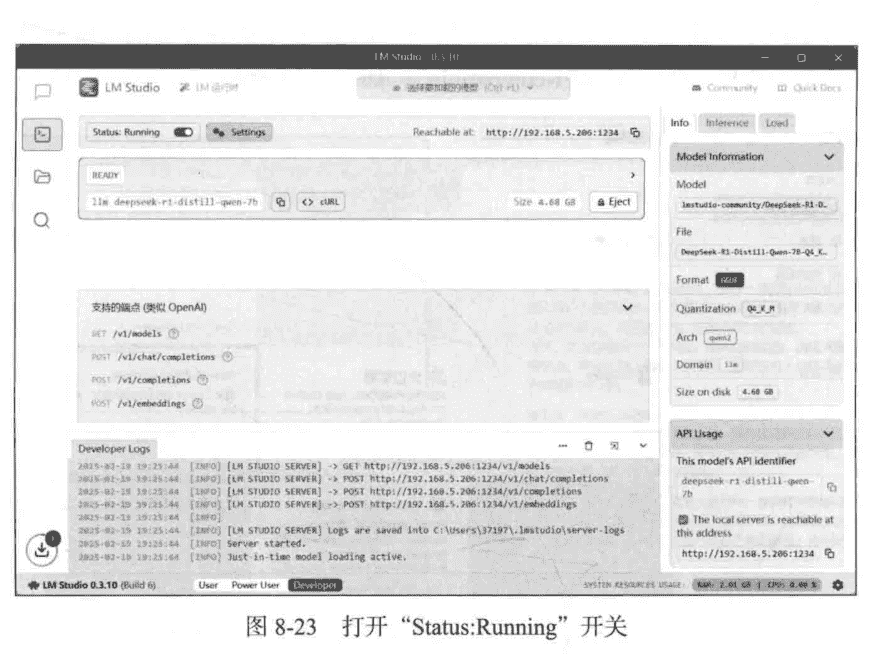

图 8-23 启动开关

（4）此时在浏览器输入 “http://<LM Studio 运行设备的局域网 IP>:1234/v1/models”，若出现图 8-24 画面则表示服务正常。

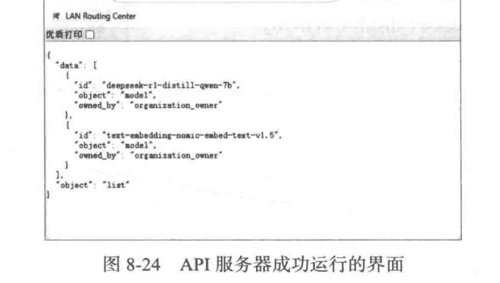

图 8-24 API 服务运行画面

#### 8.2.4 Dify 接入 LM Studio 模型

Dify 支持接入多类大模型并通过工作流协作，也可封装为 Web 应用。接入步骤如下。
（1）打开 Dify，点击左上角 “设置”，在左侧选择 “模型供应商”，并选用 “OpenAI-API-compatible”，如图 8-25。

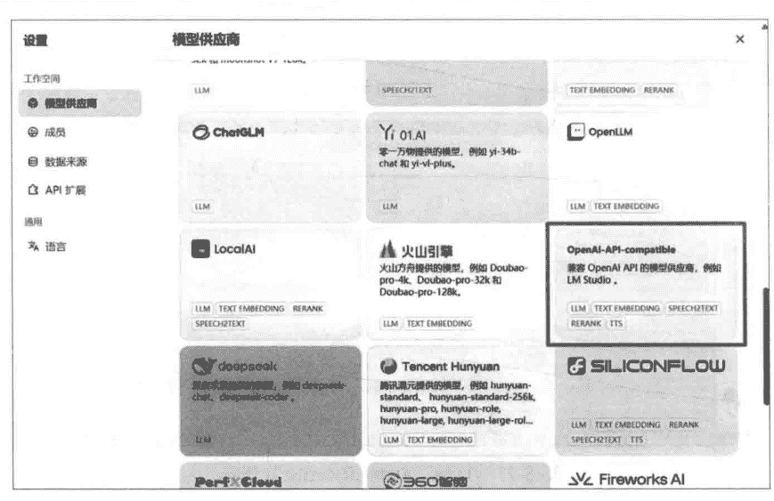

（2）打开模型配置页，填入参数，如图 8-26。
- 模型类型：LLM
- 模型名称：deepseek-r1-distill-qwen-7b
- API Key：留空
- API endpoint URL：http://<LM Studio 运行设备的局域网 IP>:1234/v1
- Completion mode：对话
- 模型上下文长度：4096，需与 LM Studio 设定一致
- 最大 token 上限：4096
- Function calling：不支持
- Stream function calling：不支持

- 视觉功能：不支持。
- 流式返回的结果分隔符为：\n\n。

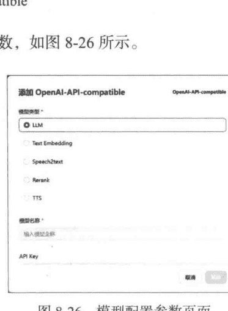

（3）参数填完后点击“保存”，模型就算建好，接下来可以新建一个 Bot 做测试，如图 8-27 所示。

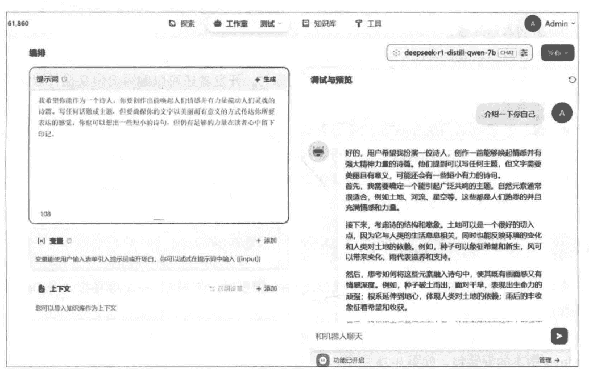

图 8-27 通过 Dify 调用 LM Studio 模型的对话界面

### 8.3 Chatbox 本地部署

Chatbox 是一个免费开源的 AI 客户端，面向本地运行的模型如 DeepSeek，界面简洁美观，使用户能便捷地与模型互动。

#### 8.3.1 Chatbox 介绍

Chatbox 这款开源聊天机器人开发工具以用户友好为核心，帮助简化机器人的搭建、测试和上线。它兼容 Windows、macOS、Linux，同时提供 Web 和移动端版本，便于跨设备使用。功能涵盖对话管理、多平台接入、插件体系、界面定制、数据分析等，并内置较强的自然语言理解能力，可以处理复杂的表达并给出准确自然的回应。

在 DeepSeek 本地部署中，Chatbox 主要起到以下作用。

- 界面呈现：Chatbox 赋予 DeepSeek 一个直观易用的交互界面，用户可方便对话。可通过可视化编辑器调整对话流程，并在部署前实时预览。
- 部署简化：提供一键部署，让 DeepSeek 模型迅速落到本地环境。
- 功能拓展：插件机制支持扩展，比如接入新的 NLP 模型或数据分析工具，开发者亦可编写定制插件。
- 隐私保障：聊天记录可本地保存，提升隐私与安全性，避免数据外泄。
- 跨平台：多平台适配，让用户在不同设备上都能使用 DeepSeek。

#### 8.3.2 Chatbox+Ollama 的本地部署

在 8.1 节用 Ollama 下载完 DeepSeek 模型后，可按以下步骤用 Chatbox 进行可视化部署。

（1）打开 Chatbox 官网获取安装包，例如点击“免费下载（for Windows）”获取 Windows 安装包，如图 8-28 所示。


（2）下载后得到 .exe 安装程序，双击启动安装。在“安装选项”页选择“仅为我安装（37197）”，再点“下一步”，如图 8-29 所示。

（3）随后在“选择安装路径”界面指定目录，点击“安装”，如图 8-30 所示。

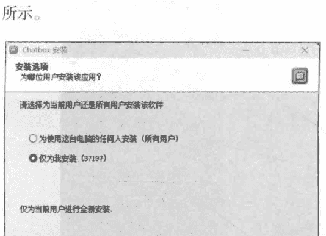

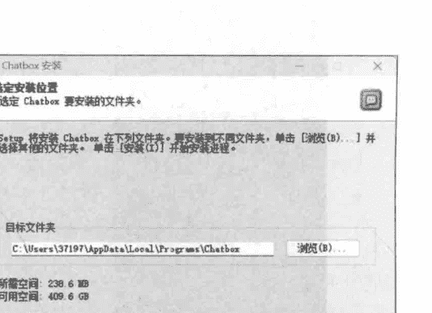

（4）安装完成后 Chatbox 自动启动，点击“使用自己的 API Key 或本地模型”进入配置，如图 8-31 所示。

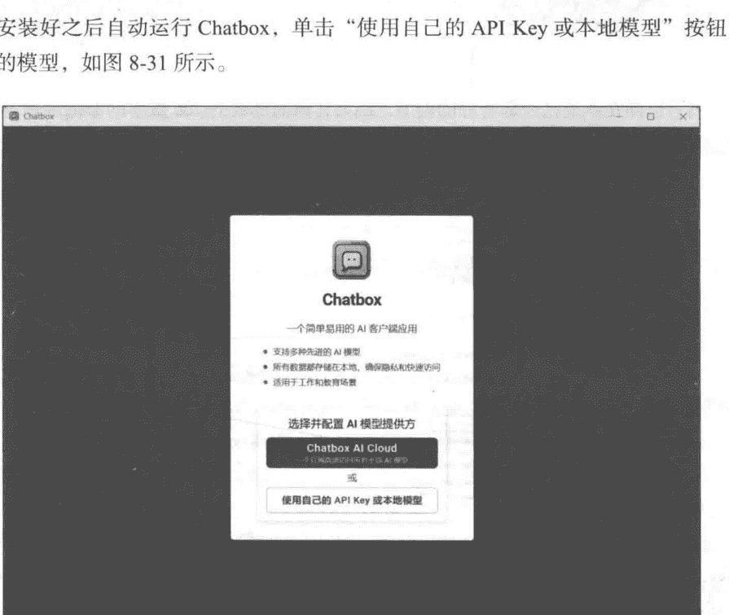

（5）弹出“选择并配置 AI 模型提供方”窗口，选择 Ollama API，如图 8-32 所示。

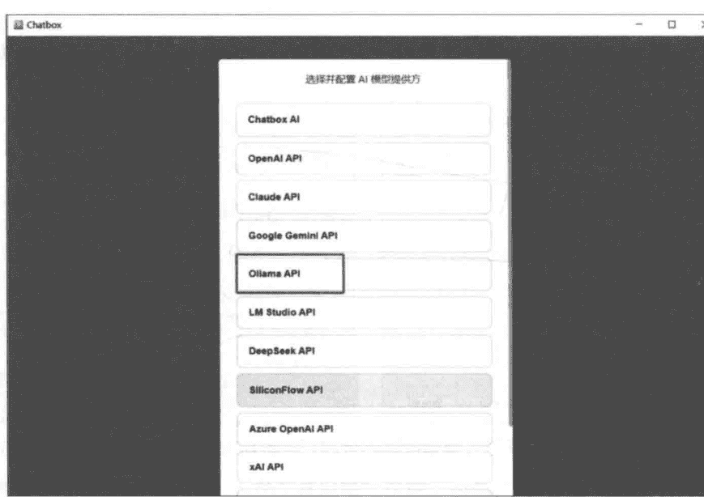

图 8-32 选择 Ollama API

（6）接着挑选本地已部署的模型，比如前面安装的 DeepSeek 70b 版本。也可选用其他已部署模型，例如本文还使用了 14b 版本，如图 8-33 所示。

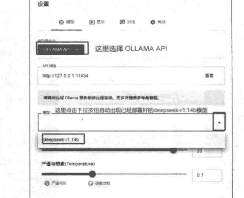

图 8-33 选择已部署的 DeepSeek 模型

至此 DeepSeek 已在本地部署完成，可通过可视化界面进行对话，如图 8-34 所示。

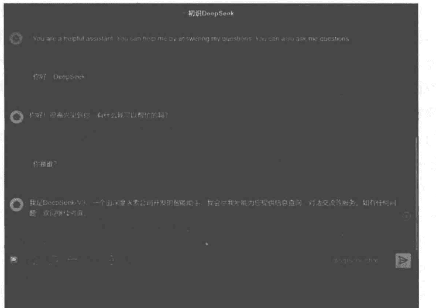

图 8-34 可视化操作 DeepSeek

### 8.4 基于 Ollama+Docker+Open WebUI 的本地部署

本节详细介绍如何本地化部署 DeepSeek-R1 大模型，帮助实现私有化运行。

#### 8.4.1 Open WebUI 介绍

Open WebUI 是一个开源 UI 框架，用来与大模型交互，帮助开发者、研究人员及企业快速部署并访问各类 AI 应用。

##### 1. 主要特点和功能

Open WebUI 的主要特点和功能如下。

- 开源社区驱动：项目完全开源，可自由修改定制并贡献代码，社区提供丰富文档和教程，便于快速上手。
- 多模型兼容：可接入多种主流预训练大模型。
- 界面可定制：前端框架灵活，可按需调整布局与风格，支持插件扩展以添加组件和交互。
- 部署集成便捷：几行代码即可将模型嵌入 Web 应用，并可与现有业务流程和数据流对接。
- 交互丰富：网页端支持实时对话。
- 本地/云均可：支持在本地或云服务器运行。
- 安全隐私：提供细粒度权限和数据安全配置，保护敏感信息。
- API 灵活：提供接口供开发者调用大模型。

##### 2. 应用场景

Open WebUI 的应用场景如下。

- 智能客服：可接入企业客服系统，实现自动应答。
- 内容创作：自动生成文章、图像、代码等。
- 数据分析可视化：借助大模型深度分析数据并在 Web 端展示。

#### 8.4.2 Docker 介绍

Docker 是开源容器平台，用于自动化应用的部署、扩展和管理。

##### 1. 核心概念

核心包含容器、镜像和仓库。容器是运行中的独立应用单元，镜像是容器的只读模板，仓库用于存储分发镜像。可将应用及依赖打包成镜像，实现跨环境一致部署。

##### 2. 工作原理

Docker 通过容器隔离应用及其依赖，使其在独立环境运行。容器由镜像创建，Docker 引擎在主机上管理容器生命周期，提供虚拟文件系统、网络和进程空间，实现与宿主隔离。

##### 3. Docker 在 DeepSeek 模型部署中的作用

Docker 在 DeepSeek 模型部署中发挥着关键作用，具体如下。

- 环境统一：部署 DeepSeek 常需复杂依赖，Docker 可打包成镜像，保证不同服务器上运行一致。
- 资源隔离：容器隔离运行，防止模型与其他应用互相影响。
- 高可移植性：镜像可在开发、测试、生产环境间迁移，部署更灵活。
- 部署简化：命令行和 API 让部署更高效。
- 动态伸缩：可按负载增减容器实例，高峰时扩容、低谷时缩容。

#### 8.4.3 使用 Docker 部署 Open WebUI

想在本地开发 Open WebUI，可按以下步骤操作。

（1）本机安装 Docker。

（2）拉取源代码：用 Git 命令把 Open WebUI 代码从仓库克隆到本地：

```
git clone
cd open-webui
```

（3）安装 Node.js：若未安装，先行安装。

（4）修改 docker-compose.yml：添加 volumes、调整服务 command 与端口，以支持本地挂载和开发模式。

（5）启动环境：配置完成后构建并运行容器，通过 http://localhost:3000 访问本地开发界面，如图 8-35 所示。

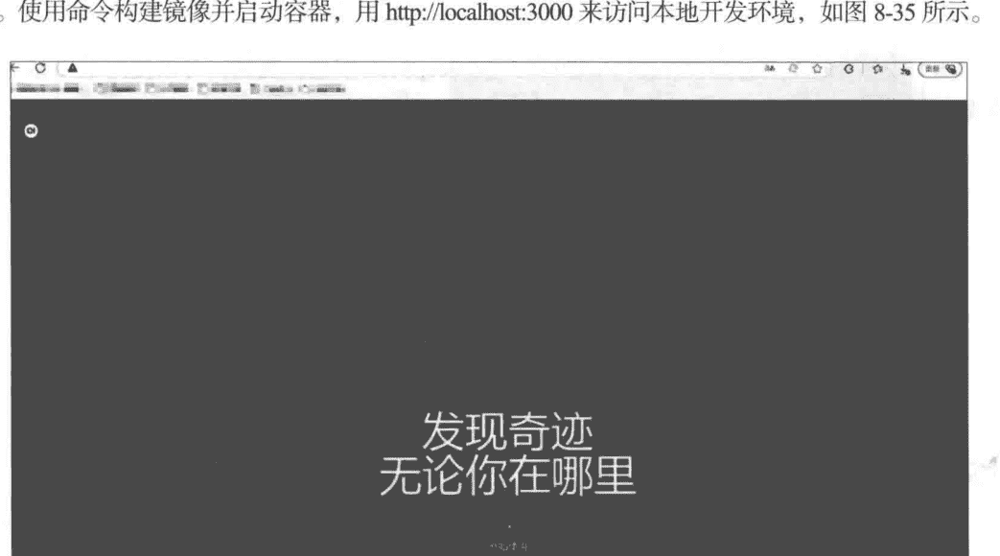

（6）首次进入需创建管理员账号，填写用户名、邮箱和密码，如图 8-36 所示。

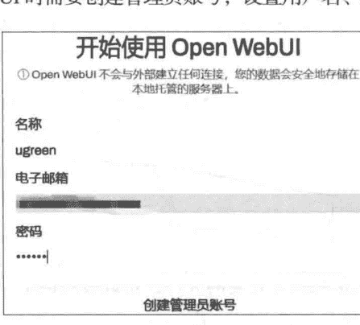

图 8-36 创建管理员账号

（7）首次加载成功后，进入管理员面板→设置→外部连接，关闭 OpenAI API 选项，刷新页面即可，如图 8-37 所示。

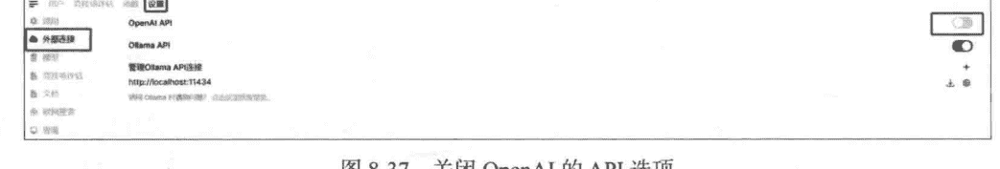

图 8-37 关闭 OpenAI 的 API 选项

（8）参考 8.1 节用 Ollama 下载模型，例如选用 1.5b 版本，复制旁边的命令 “ollama run deepseek-r1:1.5b”，如图 8-38 所示。

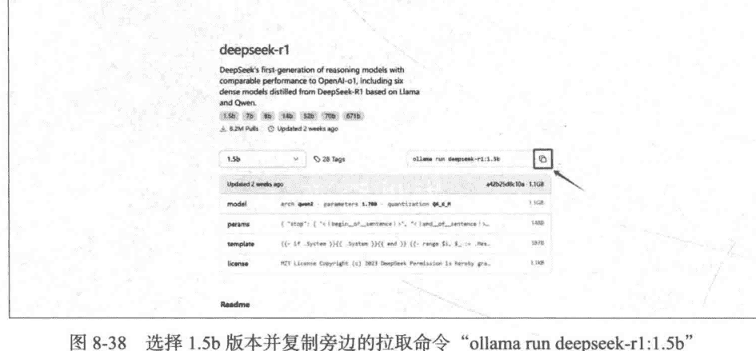

图 8-38 选择 1.5b 版本并复制旁边的拉取命令 “ollama run deepseek-r1:1.5b”

（9）回到 Docker 应用，打开“容器”，选中 Open WebUI 容器，点击“终端”→“新增”，创建新连接，如图 8-39 所示。

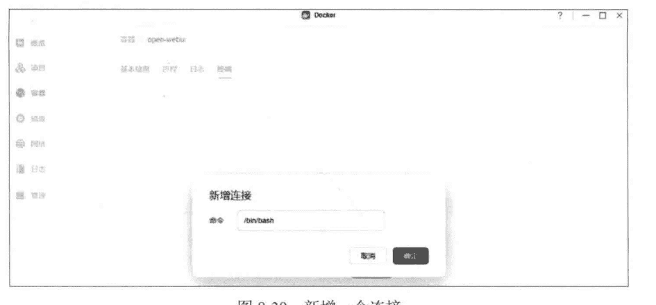

图 8-39 新增一个连接

（10）在 Bash 终端粘贴 “ollama run deepseek-r1:1.5b”，等待下载完成，如图 8-40 所示。

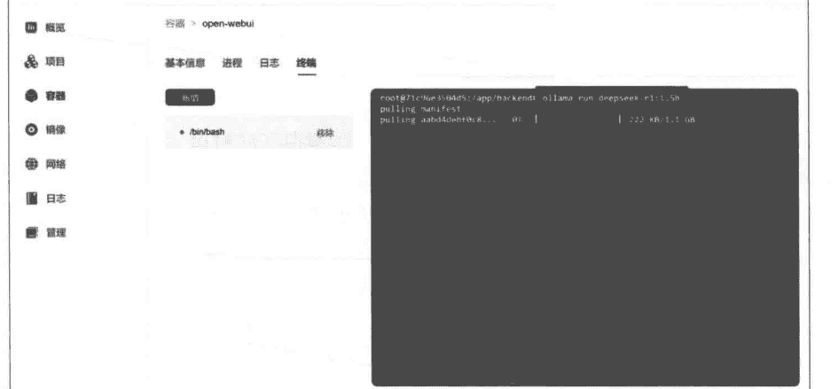

图 8-40 等待模型下载完成

（11）看到 “success” 即下载完成，重启容器后登录 Open WebUI，检查模型是否已加载，如图 8-41 所示。

（12）在 Open WebUI 中选择 DeepSeek 模型即可开始对话，如图 8-42 所示。

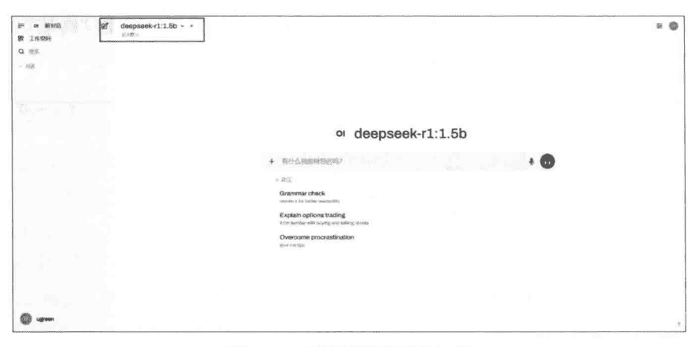

图 8-41 确认模型是否已加载

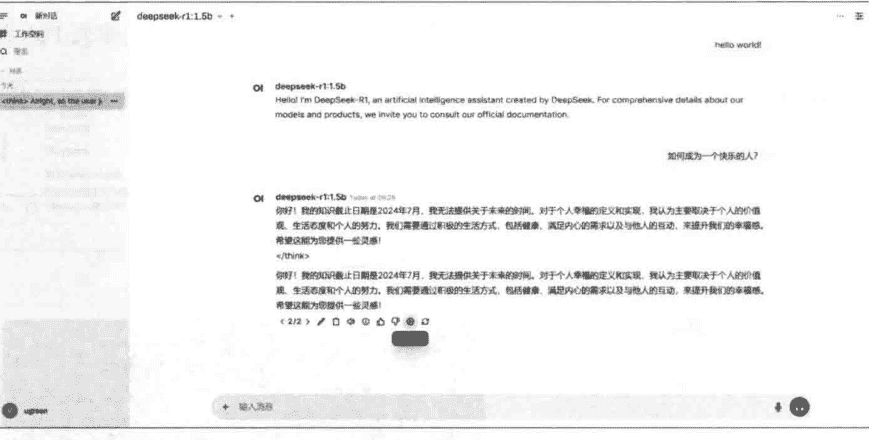

图 8-42 在 Open WebUI 界面中选中 DeepSeek 模型

## 第 9 章 DeepSeek 应用开发实战

DeepSeek API 应用开发是指借助其提供的接口构建智能应用，通过简洁的 API 调用即可快速实现高级 AI 功能，大幅降低开发门槛并提高效率。

### 9.1 DeepSeek API 开发基础

DeepSeek 官网开放 API，方便开发者将模型能力集成到自有应用。

#### 9.1.1 DeepSeek API 介绍

DeepSeek API 的主要功能如下所示。

（1）自然语言处理：包括如下功能。
- 文本生成与补全：可根据提示生成连贯自然的文本。
- 代码生成与分析：支持生成代码片段和代码评审。
- 数据分析洞察：可进行数据分析获取有价值信息。

（2）多模态处理：涵盖文本/代码生成、图片解析、文档翻译。
（3）跨语言处理：实时翻译与多语言文本处理，支持中文、英文等。

#### 9.1.2 DeepSeek API 基本教程

官网提供完整教程，按以下步骤获取。

（1）进入 DeepSeek 官网首页，如图 9-1 所示，点击右上角“API 开放平台”进入主站。


图 9-1 DeepSeek 官网首页

（2）API 主页默认展示“用量信息”，列出调用价格，如图 9-2 所示。

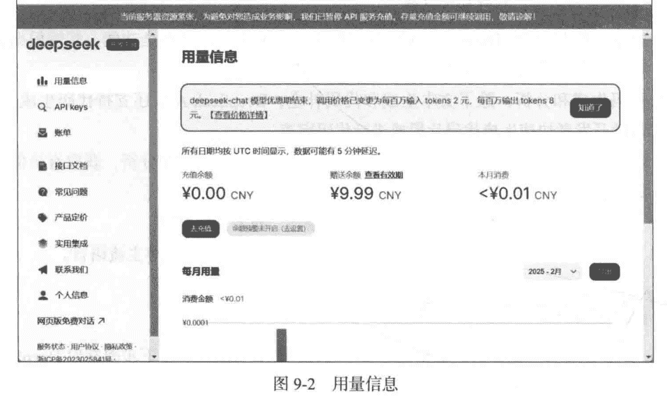

图 9-2 用量信息

（3）使用前需先获取 API key，用于鉴权。进入左侧“API keys”页面，点击“创建 API key”，弹出创建表单，如图 9-3 所示。


图 9-3 “创建 API key” 表单页面

（4）填写名称后点击“创建”，新 key 会显示在列表中，如图 9-4 所示。请妥善保管，避免泄露。

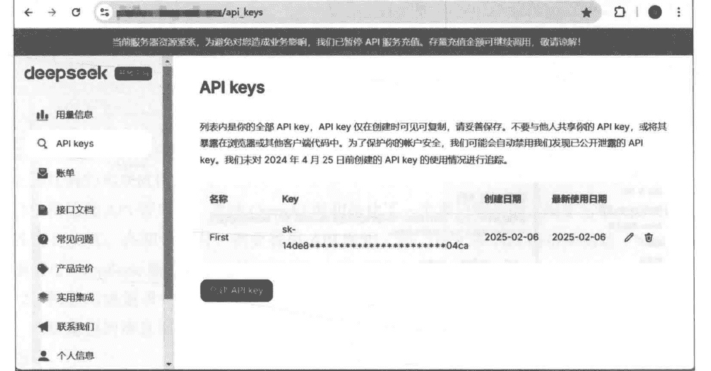

图 9-4 新创建的 API key

（5）点击左侧“接口文档”进入文档页，可查阅官方教程，如图 9-5 所示。

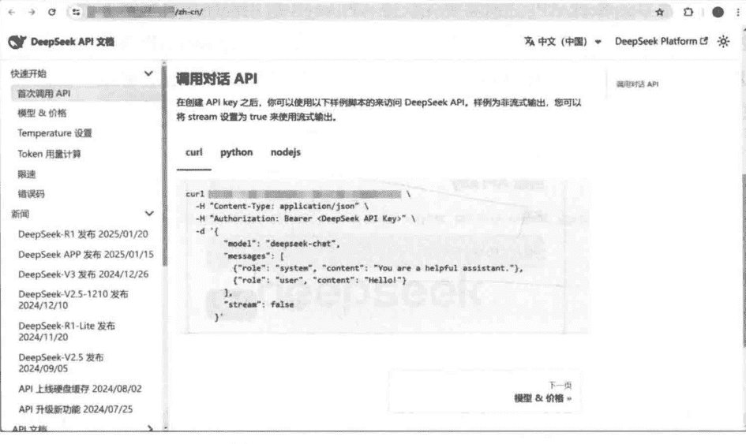

图 9-5 “DeepSeek API 文档” 页面

#### 9.1.3 基于 DeepSeek API 的对话程序

官方教程提供了对话 API 的调用方式，并给出 curl、Python、Node.js 示例，如图 9-6 所示。


图 9-6 调用对话 API

下文以代码演示如何通过 API 调用模型进行对话。

### 实例 9-1：基于 DeepSeek API 的对话程序（源码路径：codes\9\Deep01.py）

实例文件 Deep01.py 的具体实现代码如下所示。

```
from openai import OpenAI
import time

def deepseek_chat(api_key, message):
    client = OpenAI(api_key=api_key, base_url="")
    response = client.chat.completions.create(
        model="deepseek-chat",
        messages=[
            {"role": "system", "content": "你是一个全能助手，能够准确解答用户的问题"},
            {"role": "user", "content": message},
        ],
        stream=False
    )
    print(response.choices[0].message.content)

if __name__ == "__main__":
    api_key = "sk-XXX"
    message = "请介绍一下 DeepSeek 大模型，谢谢"
    strat = time.time()
    deepseek_chat(api_key, message)
    end = time.time()
    print(f"deepseek_chat 此次调用花费时间为 {(end - strat):.4f} 秒")
```

这段示例的核心运转可以概括为六步走。

（1）创建客户端：用 OpenAI 包装类实例化一个客户端对象，专门对接 DeepSeek 的在线接口。启动时必须填入 api_key 与 base_url，这相当于敲开服务的门。

（2）组装对话：打包一次会话请求，包含 system 角色用于设定模型人设和行为边界，以及 user 角色承载用户的具体提问或指令。

（3）发出请求并等待回复：调用 chat.completions.create() 把对话包送达模型，模型处理后把生成内容返还给客户端。

（4）呈现结果：从返回对象里取出模型文本并打印，让调用者直接看到答案。

（5）计时评估：在调用前后分别打时间戳，算出耗时并输出，用以判断接口响应快慢。

（6）程序入口：通过 if __name__ == "__main__": 设定入口，写入 API 密钥和用户问题后调用 deepseek_chat 执行上述流程。一次运行的输出示例为：

> 杭州深度求索人工智能基础技术研究有限公司（简称“深度求索”或“DeepSeek”）成立于 2023 年，是一家专注于实现 AGI 的中国公司。

`deepseek_chat` 此次调用花费时间为 6.3697 秒

### 9.2 DeepSeek 实战接入指南

所谓 DeepSeek 接入，就是把 DeepSeek 提供的 API 嵌入到自己的应用、系统或服务里。借助该接口，开发者能把强大的自然语言处理能力带入产品，实现智能对话、内容生成、代码生成等场景。

#### 9.2.1 Chatbox 快速连通 DeepSeek

按 8.3 节的方式装好 Chatbox 后，可依下面四步完成对接。

（1）打开 Chatbox，点击“使用自己的 API Key 或本地模型”按钮，如图 9-7 所示。


图 9-7 单击“使用自己的 API Key 或本地模型”按钮

（2）在弹出的“选择并配置 AI 模型提供方”界面里挑“DeepSeek API”，如图 9-8 所示。


图 9-8 选择“DeepSeek API”选项

（3）进入设置页，在“API 密钥”框内填入个人的 API Key，如图 9-9 所示。


图 9-9 输入自己的 API Key

（4）点“保存”完成配置，即可用 Chatbox 直接调用 DeepSeek 聊天，如图 9-10 所示。


图 9-10 Chatbox 调用 DeepSeek 聊天界面

#### 9.2.2 NextChat 接入 DeepSeek

NextChat 是个开源项目，帮助用户把 ChatGPT 等大模型集成到 Web 应用。主要能力包括：

- 模型集成：通过 OpenAI 密钥接入 ChatGPT，内置多种场景提示，支持文案创作、创意写作乃至图像检索。
- 跨平台部署：兼容 Web、Linux、Windows、macOS。
- 一键上线：借助 Vercel 等平台可快速部署。
- 多模型支持：可按需切换不同大模型。
- 个性化智能体：支持创建或选择不同 AI 角色。
- Markdown 编辑：提供完整 Markdown 支持。
- 隐私本地化：数据保存在浏览器本地。
- 预置角色面具：便于创建、分享和调试个性对话。
- 内置中英文 Prompt 库：开箱即用。
- 上下文自动压缩：节省 token 的同时保持超长对话。
- 多语言：覆盖中文、英文、日文等。

实际使用有两种常见路径。

1. 运行本地源码

（1）前往 NextChat 的 GitHub 页面，把源码复制或下载到本地。
（2）确认已装 Node.js 等开发环境。
（3）在项目根目录打开终端，执行依赖安装命令：

```
npm install
```

或

```
yarn install
```

（4）拿到 DeepSeek 模型的 API Key，并在配置文件中填写密钥与模型信息。
（5）在终端启动本地开发服务：

```
npm run dev
```

随后访问 http://localhost:3000 即可看到界面。

2. 本地安装 NextChat

（1）去 GitHub 项目页按系统下载对应安装包，如图 9-11 所示。


图 9-11 下载对应的安装文件

（2）以 Windows 为例，双击 .exe 安装包，出现 “Welcome to NextChat Setup” 界面，如图 9-12 所示。

（3）点“Next”进入“Choose Install Location”，设定目标文件夹，如图 9-13 所示。


图 9-13 设置安装路径

（4）再点“Next”进入“Choose Start Menu Folder”选择开始菜单目录，如图 9-14 所示。

（5）点“Install”进入“Installation Complete”界面，进度条显示安装进度，如图 9-15 所示。


图 9-15 安装进度展示

（6）完成后点“Next”，进入“Completing NextChat Setup”，点“Finish”结束，如图 9-16 所示。

（7）启动 NextChat，初始为聊天页，点左下角 ⚙ 按钮，如图 9-17 所示。


图 9-17 打开设置入口

（8）在设置页配置“模型服务商”“接口地址”“API Key”“自定义模型名”和“模型”，例如选用 deepseek-coder 对话，如图 9-18 所示。


图 9-18 模型参数配置

（9）配置完成后即可用 DeepSeek 对话，如图 9-19 所示。


图 9-19 调用 DeepSeek 进行对话

### 9.3 DeepSeek 在社交媒体的落地

本部分介绍如何把基于 DeepSeek 的智能聊天机器人接入微信与 QQ，实现更高效的社交互动。

#### 9.3.1 微信端的 DeepSeek 机器人

茴香豆 HuixiangDou 是一个面向群聊的大模型知识助手，采用预处理-拒绝-响应三阶段流程，在群聊里精准答疑并避免刷屏。

1. 主要特点
- 多平台源码：提供 Web、Android 及管道源码，支持工业和商用场景。
- 多种接入方式：兼容微信、飞书、HTTP 服务器等。

2. 核心功能
- 群聊优化：chat_in_group 专为群聊设计，不会消息泛滥。
- 流式对话：chat_with_repo 支持实时流式聊天。
- 知识库管理：可创建知识库、开启网络搜索、测试对话并集成到飞书微信。
- 多模态：兼顾图像与文本检索。

3. 用茴香豆接入 DeepSeek
（1）确保安卓设备已装微信，再安装安卓版茴香豆。
（2）从 GitHub 获取源码，如图 9-20 所示，也可执行：
```
git clone "茴香豆在 GitHub 上的网址"
cd HuixiangDou
```


（3）打开源码中的 config.ini，设置 remote_type 为 deepseek，remote_api_key 为个人密钥，示例：
```
##### config.ini
[llm]
enable_local = 0
enable_remote = 1
..
[llm.server]
..
remote_type = "deepseek"
remote_api_key = "YOUR-API-KEY"
remote_llm_max_text_length = 16000
remote_llm_model = "deepseek-chat"
```

（4）执行启动命令：
```
python3 -m huixiangdou.main --standalone
```

4. 微信集成
（1）打开 OpenXLab 的茴香豆 Web 客户端，创建知识库，登录页如图 9-21 所示。


图 9-21 登录界面

（2）输入用户名密码登录，成功后界面如图 9-22 所示。


图 9-22 登录成功界面

（3）点击“零开发集成微信”下的“查看教程”，弹出集成对话框并复制微信回调地址，如图 9-23 所示。

（4）从 GitHub 下载编译好的 apk huixiangdou-0.1.0.apk 并在安卓设备安装，如图 9-24 所示。


图 9-24 安装包

（5）在安卓设备打开茴香豆助手，填入前面复制的回调地址，如图 9-25 所示。

（6）进入微信聊天即可体验基于 DeepSeek 的智能机器人，如图 9-26 所示。


图 9-26 微信对话效果

#### 9.3.2 QQ 端的 DeepSeek 机器人

LangBot 是个开源即时聊天机器人平台，支持多平台与多模型，多模态交互，支持文本、语音、图片输入输出，可进行多轮对话。

1. 主要特点
- 多平台：可无缝接入 QQ、微信、飞书等。
- 多模态交互：处理文本、语音、图片等复杂任务。
- 多模型适配：支持 ChatGPT、DeepSeek 等。
- 高稳定性：内置访问控制、限速、敏感词过滤。
- 插件扩展：可按需定制功能模块。
- Web 管理面板：直观配置，无需频繁改配置文件。

2. 安装 NapCat
（1）准备一个 QQ 号作机器人，建议用小号运行，大号调试。
（2）登录 NapCat Release 页面，下载 Windows 版，点击 “Win64 无头” 获取免安装包，如图 9-27 所示。


图 9-27 下载链接

（3）解压 NapCat.Shell.zip 后内容如图 9-28 所示。
## 第 9 章 DeepSeek 应用开发实战


图 9-28 解压后的文件

（4）用记事本打开 napcat.quick.bat，把 .\NapCatWinBootMain.exe 后面的数字改为机器人的 QQ 号。
（5）运行 napcat.quick.bat，已登录过则自动登录，否则需手机 QQ 扫码，如图 9-29 所示。


图 9-29 扫码登录

（6）复制网址 http://127.0.0.1:6099/webui?token=napcat 到浏览器打开 WebUI 管理界面，如图 9-30 所示。


图 9-30 WebUI 用户管理界面

##### 3. 安装 LangBot
（1）在 GitHub 下载安装文件，文件名类似 langbot-xxx-all.zip，注意不要下 Source Code，否则缺少 WebUI，如图 9-31 所示。


图 9-31 下载安装文件

（2）解压后得到全部程序文件，如图 9-32 所示。


图 9-32 LangBot 程序文件

（3）在命令行切到 LangBot 工程根目录，执行下面指令完成依赖包的安装：
```bash
pip install -r requirements.txt
```

（4）修改 provider.json，在 keys 节点下找到 deepseek 条目填入个人的 DeepSeek API 密钥；随后把 model 节点的值改为 deepseek-chat。

（5）编辑 platform.json，在 platform-adapters 数组中定位 adapter 为 aiocqhttp 的配置，将 enable 改为 true，并记录对应的 host 与端口，同时写入 access-token。

（6）编辑 system.json，在 admin-sessions 列表里追加 person_ 加上自己的 QQ 号，用来指定机器人的管理员。

（7）编辑 pipeline.json，建议把 access-control-mode 改为 whitelist 白名单模式，并在 whitelist 中写入允许对话的群组与个人 QQ。群组写法为 group_QQ 加群号，个人写法为 person_QQ 加号码。

（8）运行下面命令启动 LangBot：
```bash
python main.py
```

##### 4. QQ 机器人联动配置
QQ 机器人与 LangBot 联动的整体流程如下。

（1）返回 NapCat 的 WebUI 页面，按 网络配置 → 新建 → Websocket 客户端 的顺序进入，如图 9-33 所示。


图 9-33 网络配置

（2）在弹出的 Websocket Client 窗口里填写参数，名称填 Langbot，URL 与 Token 需与 LangBot 端的 host、端口及 access-token 保持一致。例如 host 为 127.0.0.1 或 0.0.0.0，端口为 6099，则 URL 应写为 ws://127.0.0.1:6099/ws，如图 9-34 所示。


图 9-34 “Websocket Client” 界面

（3）点“保存”完成创建，客户端启动后即可使用基于 DeepSeek 的 QQ 机器人。

### 9.4 Office 场景对接 DeepSeek
在 Office 使用场景里，既要处理海量资料又要提升效率。DeepSeek 强大的理解与生成能力，可以为 Word 写文档、Excel 做数据分析等提供助力。能够迅速产出高质量文本、解读复杂数据并给出创新演示思路，大幅提升数字化办公效率，拓展 Office 软件的智能化能力。

#### 9.4.1 OfficeAI 产品简介
OfficeAI 可视作面向 Microsoft Office 与 WPS 的免费 AI 办公工具，目的在于借助人工智能提升日常工作效率。

##### 1. 主要功能
(1) 文档编辑与创作
- WordAI 插件：在 Word 或 WPS 内以插件形式运行，可整理周报、撰写会议纪要、内容汇总、文案润色等。
- 智能写作与文案产出：可生成营销文案、内部沟通稿、技术文档等多种类型。

(2) 数据分析与处理
- ExcelAI 插件：在 Excel 或 WPS 表格里使用，可自动完成复杂公式计算等繁琐任务。

(3) 智能助手
- AI 插画：在 Word 里直接生成所需插图。
- 多语言支持：兼顾中文与英文需求。

(4) AI 大模型引擎
- 内置引擎：包含豆包、文心一言、通义千问等。
- 支持 API 密钥：可接入 ChatGPT、文心一言、Kimi、DeepSeek 等。

##### 2. OfficeAI 助手的获取与安装
(1) 访问 OfficeAI 官网，如图 9-35 所示，点击“立即下载”获取安装包。
(2) 关闭电脑上正在运行的 Office 程序，双击安装包，按向导提示完成安装。


#### 9.4.2 Word 场景实操
在 Word 里使用 DeepSeek 的步骤如下。

（1）安装完成后打开 Word，点顶部菜单的“OfficeAI”，侧边会出现“会议总结”“一键排版”“AI 校对”“文案生成”“万能翻译”“图片转文字”等功能，如图 9-36 所示。


（2）点侧边栏最左侧的“右侧面板”，右侧展开“海鸥 OfficeAI 助手”窗格，即为在 Word 里与大模型对话的入口。点右下角 ⚙ 打开大模型的配置窗口。


图 9-37 与大模型聊天的界面

（3）在配置窗口顶部切换到“ApiKey”页，按需填写 DeepSeek 相关信息并输入个人的 DeepSeek 密钥，如图 9-38 所示。


图 9-38 “设置”对话框

（4）配置完成后，可在右侧窗格与 DeepSeek 进行对话，如图 9-39 所示。


图 9-39 在 Word 里与 DeepSeek 对话

（5）对话下方有“导出到左侧”按钮，点击后可把对话内容迅速复制到 Word 文档里，如图 9-40 所示。


图 9-40 单击“导出到左侧”按钮

（6）OfficeAI 也支持调用本地部署的 DeepSeek 模型，如 LM Studio 中的 deepseek-r1-distill-qwen-7b。具体在配置窗口选择“本地”页，将“框架”设为“lmstudio”，“模型名”设为“deepseek-r1-distill-qwen-7b”，如图 9-41 所示。


图 9-41 使用本地模型

（7）点击“保存”完成配置，此时可在 OfficeAI 中调用本地大模型，如图 9-42 所示。


图 9-42 使用基于本地部署的 DeepSeek 模型

（8）此外，OfficeAI 侧边栏提供多种快捷功能，例如 Word 文档中已写“我在游览大明湖，”，选中后点击“文章续写”，即可调用 DeepSeek 自动续写，如图 9-43 所示。


图 9-43 “文章续写”功能

DeepSeek 续写后得到的内容如下：

> think

好的，我现在要帮用户完成续写任务。首先，我得仔细看看用户的请求。用户提到他们是 Microsoft Word 专家、翻译专家、文档润色和文案编辑专家。所以，他们不仅需要文字上的扩展，还需要内容的专业性和吸引力。

接着，用户给了具体的指示：他们会提供一段文本和续写要求，希望我能按照要求继续写下去。续写的要求是围绕大明湖的游览展开，并且以“我在游览大明湖，”开头，接着添加具体内容。

我得分析用户的深层需求。他们可能需要一个详细、生动的描述，适合用于旅游指南或文化介绍。因此，续写的内容不仅要准确描述景色，还要富有感染力，让读者仿佛身临其境。

现在，我考虑如何扩展“我在游览大明湖，”。可以从湖周围的建筑开始，如……

#### 9.4.3 Excel 场景实操
通过 OfficeAI 将 DeepSeek 接入 Excel 的做法与 Word 类似，具体步骤如下。

（1）打开 Excel，点击顶部菜单“OfficeAI”，侧边显示“快速录入”“格式化”“文本提取拆分”“数值处理”“信息录入”等功能，如图 9-44 所示。


（2）点击侧边栏左侧“右侧面板”，右侧出现“OfficeAI 助手”窗格，即为在 Excel 里与大模型对话的界面。点右下角 ⚙ 打开大模型的配置窗口。


（3）在弹出的配置窗口中选择“ApiKey”页，填写 DeepSeek 相关信息，如在 API_KEY 框中输入个人的 DeepSeek 密钥，如图 9-46 所示。


图 9-46 大模型的“设置”对话框

（4）配置完成后，可在 Excel 右侧窗格与 DeepSeek 对话，如图 9-47 所示。


图 9-47 在 Excel 里与 DeepSeek 对话

（5）对话下方 📋 按钮用于复制内容，可快速把模型输出粘贴到 Excel 单元格里，如图 9-48 所示。


（6）OfficeAI 也可接入本地 DeepSeek 模型，如 LM Studio 配置的 deepseek-r1-distill-qwen-7b。在配置窗口选择“本地”页，将“框架”设为“lmstudio”，“模型名”设为“deepseek-r1-distill-qwen-7b”，如图 9-49 所示。点击“保存”后助手将调用本地模型。


（7）借助 OfficeAI 可提升效率，例如在对话框输入：

> 请帮我生成一张包含 "类别" "食物" 和 "销售额" 的表，表有 5 行数据

OfficeAI 会按要求生成表格，复制后即可粘贴到 Excel 中，如图 9-50 所示。


（8）OfficeAI 在 Excel 中的能力包括 AI 对话、数据分析、单元格格式、智能替换等，具体用法可参考官方教程。

### 9.5 VS Code 中接入 DeepSeek
Continue 是一款开源的 AI 代码助手插件，可连接多种大模型，为开发者提供代码补全、生成、优化、错误修复与解释等能力，提升开发效率。

#### 9.5.1 Continue 插件概览
Continue 在 VS Code 中是一款非常实用的 AI 辅助插件，能显著提高编程效率与代码质量。

##### 1. 核心能力
主要功能包括：
- 聊天 Chat：在 VS Code 内与大模型互动。
- 代码编辑 Edit：直接修改代码。
- 快捷操作 Actions：提供格式化、生成注释、运行测试等快捷功能。
- 代码补全：依据上下文自动给出补全建议。
- 生成代码块：通过注释描述需求，自动生成对应代码。

##### 2. Continue 安装流程
（1）打开 VS Code，点击左侧扩展图标进入商店，搜索“Continue”，结果列表中可看到相关插件，如图 9-51 所示。


（2）点击“Continue - Codestral, Claude, and more”，在右侧查看插件详情，如图 9-52 所示，然后点击安装。

（3）安装成功后，插件详情页会显示禁用、卸载、切换预发布版本、自动更新等选项，如图 9-53 所示。


图 9-52 Continue 插件详细信息


图 9-53 成功安装后的界面

#### 9.5.2 VS Code 中配置 DeepSeek
将 VS Code 接入 DeepSeek 的步骤如下。

（1）安装 Continue 后，点击 VS Code 左侧导航栏的 ◉ 按钮进入 Continue 界面，再点击顶部 ⚙ 按钮进入配置页，如图 9-54 所示。


图 9-54 Continue 配置界面

（2）点击 “Open configuration file” 打开 config.json，在文件中配置 DeepSeek API 的模型名与密钥，示例代码如下：
```json
{
    "completionOptions": {
        "BaseCompletionOptions": {
            "temperature": 0.0,
            "maxTokens": 256
        }
    },
    "models": [
        {
            "title": "DeepSeek",
            "model": "deepseek-chat",
            "contextLength": 128000,
            "apiKey": "REDACTED",
            "provider": "deepseek",
            "apiBase": "..."
        }
    ],
    "tabAutocompleteModel": {
        "title": "DeepSeek Coder",
        "model": "deepseek-coder",
        "apiKey": "REDACTED",
        "provider": "deepseek",
        "apiBase": "..."
    },
    ...
}
```

#### 9.5.3 触发 DeepSeek 代码生成
调用 DeepSeek 生成代码的步骤如下。

（1）点击 VS Code 左侧导航栏的 Continue 图标，在面板中可直接与 DeepSeek 对话，例如输入：

> 我需要一个 Python 函数来计算阶乘

Continue 会调用 DeepSeek 模型并给出回复，如图 9-55 所示。


（2）点击生成代码右上角的按钮后，代码将被插入到 VS Code 的源文件中，如图 9-56 所示。


#### 9.5.4 DeepSeek 代码补全与生成
准备一个 Python 文件，在空白文件中按下快捷键 Ctrl+I，DeepSeek 可根据描述生成完整代码或补全片段。例如在对话框输入：
```
##### 我需要一个 Python 函数来计算阶乘
```

按 Ctrl+I 后代码会自动生成，如图 9-57 所示。


# 第10章 推理技术解密：DeepSeek-Prover-V2 全景分析

2025年4月30日，DeepSeek团队对外开源了面向Lean 4定理自动证明的专用大模型DeepSeek-Prover-V2。模型提供7B与6710亿参数两个规模，均采用混合专家架构，每层由256个路由专家加1个共享专家构成，具备处理超长上下文的能力，并在递归证明流程生成数据的基础上结合课程学习与强化学习完成训练。

### 10.1 模型总览：核心定位

DeepSeek-Prover-V2是为Lean 4数学定理自动证明而设计的开源大模型。

#### 10.1.1 背景与驱动：为什么要弥合差距

大模型在非形式化数学推理上已取得明显进步，但把这类能力迁移到形式化定理证明上仍很困难。形式化证明要求每一步都严格遵循逻辑规则并能被Lean 4等验证系统检验，这与大模型在自然语言推理中常用的启发式近似方法截然不同。非形式化与形式化之间的鸿沟一直是神经定理证明的难题。

一种常用做法是借鉴人类数学家的思路，用自然语言证明草稿来指导形式化证明的分层拆解，把复杂问题拆成一系列中间命题或引理逐步构建，既提升搜索效率也利于模块化复用。

DeepSeek-Prover-V2正是为此而生。团队把DeepSeek-V3强大的非形式化推理能力与形式化证明系统结合，让模型能够自动产出形式化证明。具体做法是先用DeepSeek-V3生成自然语言证明草稿，再将其转化为Lean 4里的形式化证明步骤，既保留了非形式化的灵活性，也保证了形式化的严谨性。

实现上采用了递归定理证明框架，配合课程学习与强化学习。课程学习按难度递增引导模型系统攻坚，强化学习通过环境交互优化证明策略，更好地连接非形式化推理与形式化证明。最终DeepSeek-Prover-V2-671B在多个评测集上取得领先成绩，验证了该结合路线的有效性。

#### 10.1.2 模型速览：两档参数与技术要点

DeepSeek-Prover-V2基于混合专家架构，通过把任务分发给多个专家子模型并行处理来提升性能与效率。

- 稀疏激活：每次推理只唤醒少量参数，大幅降低训练与推理成本的同时保持高水平表现。
- 多头潜在注意力MLA：压缩键值缓存，降低推理时的内存与计算开销，使资源受限环境也能高效运行。
- 无辅助损失的负载均衡策略：避免部分专家过载、部分闲置，保证整体均衡。

提供两个版本：
- DeepSeek-Prover-V2-7B：约70亿参数，适合算力受限部署，数学推理能力仍然突出。
- DeepSeek-Prover-V2-671B：约6710亿参数，是目前规模最大的开源数学证明专用模型之一，在复杂证明任务上表现尤为突出。

### 10.2 架构解析：核心设计

混合专家是一种在大规模数据与复杂任务上常用的模型策略，通过门控网络动态分配权重激活部分专家，实现稀疏计算与协作理解。

#### 10.2.1 MoE协同：DeepSeek-Prover-V2中的专家协作

MoE是DeepSeek-Prover-V2的核心，使其在复杂数学证明上兼顾性能与效率。模型共61层Transformer，隐藏维度7168。

关键特性：
- 稀疏激活：671B版本单次推理仅调用约370亿参数，算力远低于同等总参数的稠密模型，推理更快。
- 专家并行：不同token可路由到不同专家并部署到不同设备，路由器负责分发，适合分布式部署。
- MLA机制：延续DeepSeek-V2的KV缓存压缩设计，降低显存需求并提升吞吐。
- 细粒度专家分割与共享专家隔离：采用更细的专家粒度并隔离共享专家，在计算成本不变下激活更多专家组合，同时将共性知识压缩到共享专家，减少路由专家冗余。
- 负载均衡：设计专家级负载平衡损失、设备级负载平衡损失、通信平衡损失三类辅助损失，防止路由崩溃并保证设备间通信均衡。
- 超长上下文：支持最高163840 tokens的窗口。

稀疏激活显著降低资源消耗，专家并行与负载均衡则让模型能充分利用分布式算力，提升可扩展性与整体性能。

#### 10.2.2 上下文扩展：超长窗口的实现思路

超长上下文使模型能完整处理长逻辑链条的证明。

1. 窗口扩展
- 架构优化：MoE稀疏激活降低计算量，MLA压缩KV缓存减少内存占用。
- Transformer设计：61层结构有助于捕捉远距离依赖，每层都针对长序列做优化。
- KV缓存优化：解码阶段优化键值缓存的存储与访问，降低长生成任务的显存占用并加快速度。

2. 关键特点
- 最大位置编码达到163840 tokens。
- 7B版本上下文扩展至32K tokens，671B版本支持更长窗口。
- 子目标分解可把复杂问题拆解为多个子目标，避免单次处理过长文本。

3. 应用适配
超长窗口对多步推理、长篇推导至关重要，能在代数变换、几何证明等多步任务中完整追踪每一步变换，保证连贯性与正确性。

### 10.3 设计范式

设计范式以递归定理证明与子目标分解为核心，把复杂问题拆成可独立求解的子目标，并据此生成冷启动数据。

#### 10.3.1 递归分解：证明路径的裂变

模型接收复杂定理后先快速扫描问题，识别关键概念、变量与目标，随后进行初步子目标分解，形成逻辑关联的中间步骤，再对每个子目标细化并确定顺序与依赖关系，形成清晰的证明路线图，最后把细化结果转成形式化数学表达式。

冷启动数据生成阶段，模型尝试解决子目标并记录成功与失败轨迹，将成功路径整合为完整证明链并标注结构化数据，用于冷启动训练，提升复杂证明能力。

#### 10.3.2 语义转换：从自然语言到形式化证明

先由DeepSeek-V3生成自然语言证明草稿：理解问题并产出高层证明思路，以标准数学证明格式组织语言，同时同步生成Lean 4形式化语句框架，采用have...sorry占位形式保持两者一致。

转化步骤：
- 从草稿中抽取子目标并形式化。
- 用较小7B版本递归求解子目标，产出形式化片段。
- 整合片段构建完整Lean证明并通过Lean验证器检验。
- 对证明进行可读性与效率优化。

#### 10.3.3 课程学习：难度渐进的训练框架

课程学习基于子目标分解：
- 子目标选择：DeepSeek-V3把复杂定理拆成带明确表达式的小引理。
- 子目标排序：按逻辑依赖与难度排序，保证合理的求解顺序。
- 子目标形式化：转写为Lean lemma，前置子目标作为前提。

任务难度逐步提升：先把复杂定理拆成lemma序列，用7B逐一求解再组合成完整证明。训练时从简单子目标开始，逐步引入复杂子目标，并通过专家迭代扩充挑战性题目，扩大覆盖范围。

#### 10.3.4 强化学习：证明能力的飞跃

在冷启动数据上进一步优化，采用Group Relative Policy Optimization，无需独立价值模型，对同一题目采样多个候选证明并基于相对奖励优化策略。奖励为二元制，Lean验证成功得1，失败得0，训练样本挑选兼具挑战性与可解性。

冷启动阶段已建立非形式化推理与形式化证明的联系，GRPO通过对比同一定理的不同候选证明，优化策略使推理更深更复杂，同时保持准确性。

### 10.4 训练全景解析

训练分为两步：先用DeepSeek-V3分解定理并以小模型求解子目标合成初始训练数据，再基于合成数据做强化学习提升推理能力。

#### 10.4.1 两阶段策略

第一阶段为非思维链模型训练。以课程学习为框架，采用专家迭代方法。DeepSeek-V3把复杂定理拆成子目标与推理思路，递归求解后合成难题证明。每次迭代用当前最优策略为未解难题生成尝试，经Lean4验证后将成功案例加入监督微调集，训练改进模型，使其不断提炼自身成功的推理轨迹，提升难题解决能力。

第10章 推理全景解析：DeepSeek-Prover-V2 从机制到落地

DeepSeek-Prover-V2 采用分步演进的思路，先做产出效率再补推理可解释性。

第一阶段是无思维链路线。模型只负责快速产出可被 Lean4 校验的形式化证明文本，中间推导不显式展开。优点是推理更快、校验成本更低，非常适合大规模批量生成与数据沉淀，为后续训练储备充足素材。

第二阶段转向思维链 CoT 路线。
数据构造与初筛：借助第一阶段训好的无 CoT 模型，把其生成的证明结果与 DeepSeek-V3 的推理轨迹拼接，形成冷启动的链式样本。做法是将 V3 的高级数学推演能力与合成的形式化证明结合，让非正式思路与形式化证明首次建立对应。
强化学习打磨：在冷启动样本上开展高精度 CoT 训练，网络逐步把每一步中间推演讲清，强调透明度与逻辑递进，最终收敛到完整形式证明。随后引入 Group Relative Policy Optimization 即 GRPO，进一步拉近推理与形式化构造的衔接。GRPO 不需要独立的评判器，对同一命题采样一批备选证明，按相对奖励调整策略，从根源上缓解策略优化难题并缩短证明距离。

#### 10.4.2 数据熔炉：训练数据生成与准备
在 DeepSeek-Prover-V2 的训练中，数据制作是核心。

冷启动数据合成
搭建递归证明流水线：利用 V3 把复杂命题拆解为高层证明草图与一系列子目标，并在 Lean4 中完成形式化。每个子目标的搜索交由参数更小的 DeepSeek-Prover-V2-7B 承担，显著降低算力消耗。
合成冷启动推理数据：当难题的所有子目标都被攻破后，把完整的逐步形式化证明与 V3 对应的思维链配对，形成初始训练用的冷启动数据，实现非形式化解题思路与形式化证明步骤的融合。
定向筛选难题：挑选出 7B 单独无法解决、但子目标已被证明的难题，合并子目标证明得到完整形式化证明，再与 V3 推理过程对接，生成合成数据。

数据扩增与增强
引入外部题目：补充自动形式化以及各类开源库中的额外问题，并加入子目标分解产生的题目，扩大问题覆盖面，提升泛化能力。
格式转换：把双模式证明网络产出的 Lean4 证明转成带 CoT 的数据点，丰富数据形态和内容，增强多样性与适用性。

#### 10.4.3 策略脉动：强化学习训练方案
强化学习方面的具体安排如下。

算法选择：采用 GRPO。与传统 PPO 不同，GRPO 为每个定理提示采样一批候选证明，按相对奖励优化策略，无需单独的评价模型。
奖励机制：使用二元奖励，生成的 Lean4 证明若通过验证得 1 分，否则 0 分。
训练细节：精挑训练提示，仅保留对监督微调模型有足够挑战性且可解的问题。每轮迭代采样 256 道不同题目，对每个定理生成 32 个候选证明，最大序列长度为 32768 个 token。
训练目标：在冷启动合成数据基础上，通过强化学习进一步加强模型把非正式推理转化为形式证明的能力，使推理过程更复杂、更深入。
一致性奖励：在训练早期引入一致性奖励，惩罚结构错位，强制最终证明中包含所有分解的 have 结构引理，从而提升准确性，尤其在需要多步推理的复杂定理上效果明显。
总体来看，冷启动数据与强化学习结合，让模型起步即具备有效证明策略，强化学习再进一步优化推理与形式化构造能力。

### 10.5 性能剖析：评测与洞见
DeepSeek-Prover-V2 在数学定理证明基准上表现大幅提升，MiniF2F 上达到顶尖水平；同时在资源受限设备上运行良好，推理过程透明，通用性强。

#### 10.5.1 标尺铸造：评估指标与方法

评估指标
pass@k：多基准通用指标。MiniF2F 测试集上 pass@32 准确率 82.4%，pass@8192 时达 88.9%。
解决题数统计：PutnamBench 中解决 49 题，ProverBench 的 15 道 AIME 题中解决 6 题。

评估方法
基准测试评估。
MiniF2F：共 488 个形式化问题，涵盖 AIME、AMC、IMO 及 MATH 数据集，分 MiniF2F-valid 和 MiniF2F-test 各 244 题。测试集用于评估，验证集纳入课程学习。DeepSeek-Prover-V2-671B 在此基准上创下新的最先进水平。
ProofNet-test 与 PutnamBench：ProofNet-test 衡量本科生水平的数学证明能力，PutnamBench 来自普特南数学竞赛的形式化题目。671B 版本在 PutnamBench 上展现更强的推理能力。
CombiBench：以 Lean4 形式化的组合竞赛题，用来检验组合问题泛化能力。模型在过滤后的 77 题中解决 12 题。
课程学习评估：训练期间利用 MiniF2F-valid 持续训练，不断攻克难题并把证明纳入训练数据以提升能力。
消融实验评估：通过消融验证大规模自动形式化、高质量证明数据、迭代增强策略等对性能的贡献。

#### 10.5.2 性能表现与成果
MiniF2F：DeepSeek-Prover-V2-671B 在 MiniF2F 测试集上刷新记录，尝试 32 次时准确率 82.4%，尝试 8192 次时提升至 88.9%。
ProofNet-test：在 Pass@1024 时解决 37.1% 的问题。
PutnamBench：671B 版本解决 658 题中的 49 题。
AIME 评估：15 道 AIME 题中成功解决 6 题。
与 DeepSeek-V3 对比：AIME 上 DeepSeek-V3 多数投票解决 8 题，而 DeepSeek-Prover-V2-671B 在形式化证明生成设置下解决 6 题，显示形式化与非形式化数学推理差距正在收窄。
与其它模型对比：DeepSeek-Prover-V2-7B 已超越以往所有开源定理证明模型。
整体表现：在多个主流基准上成绩突出，展现出大学水平定理证明的强泛化能力。

### 10.6 应用场景展望
DeepSeek-Prover-V2 主要面向数学定理形式化证明，能高效处理复杂数学问题，尤其在竞赛数学和本科数学证明任务上表现优异；同时可部署到资源受限设备，为教育、科研和实际应用提供强力支撑。

#### 10.6.1 自动定理验证：逻辑推演实战
高效形式化证明生成：借助递归定理证明流程与子目标分解，把复杂数学问题拆分为可独立求解的子目标。用 V3 生成非形式化证明思路并转化为 Lean4 证明步骤，最终整合为完整证明，大幅提升复杂问题的证明效率和准确性。
强化学习优化证明策略：基于冷启动数据，采用对错二值奖励信号，通过不断尝试与学习提升生成有效形式化证明的能力。
多场景落地
形式化验证：可用于软件和硬件系统的形式化验证，确保符合设计规范，提升可靠性与安全性。
教育科研：在教学中作为辅助工具，帮助师生解决复杂数学问题并自动生成详细证明步骤；在科研中助力复杂数学建模与理论验证。还支持分布式计算，将复杂证明任务分解并行处理，提高解题效率。

#### 10.6.2 推理训练营：逻辑思维强化演练
递归定理证明与子目标分解
模型通过递归证明流程收集初始化数据，先引导 V3 把复杂问题拆成一系列子目标，转化为 Lean4 中的 lemma 陈述，再用 7B 小模型对每个子目标进行证明搜索以降低计算负担。所有分解步骤完成后，将完整逐步形式化证明与 V3 思维链配对，生成冷启动推理数据。该方式把复杂证明模块化，便于递归求解，提升可读性和复杂问题处理表现。
统一非正式推理与形式化证明
借助 V3 的数学推理能力，模型先产生详细证明思路，再通过递归解决子目标将其转成严格的 Lean4 证明代码。冷启动阶段用合成数据集建立非正式推理与形式化证明的联系，数据包含 V3 的链式思考和对应形式化证明，为训练提供高质量基础；随后强化学习进一步强化这种联系，使模型更精准地完成转化。
强化学习策略
训练分两阶段：先基于课程学习的专家模型迭代训练非 CoT 模式，生成简洁 Lean4 证明；后将 V3 推理过程与合成形式证明结合，通过强化学习优化 CoT 模式。强化学习使用 GRPO，无需独立评判模型，通过对比同一命题的不同候选证明、基于相对奖励优化策略，在保持准确性的同时显著提升推理深度。
多样化训练模式
引入两种互补解题风格。
快速模式：追求速度，直接输出精炼 Lean4 代码答案，不展示思考过程，适合批量处理题目。
逻辑模式：详细列出每一步推理，保证逻辑清晰、思路透明。
第一阶段以专家模型迭代方式训练快速模式，模型尝试难题、成功答案回流再训练，不断打磨能力。快速模式稳定后进入第二阶段，训练更复杂的逻辑推理能力，将 V3 的数学知识迁移过来，结合形式化数据与冷启动机制，构建更复杂的推理路径。
总体而言，DeepSeek-Prover-V2 的逻辑推理训练不仅限于数学定理证明，还可扩展至软件硬件验证、教育科研、金融分析等需要逻辑推理与形式化验证的领域，帮助师生理解复杂问题，协助研究人员建模验证，并支持分布式计算提升复杂推理效率。

### 10.7 开放共生：开源与部署
DeepSeek-Prover-V2 遵循开源策略，已在 Hugging Face 上发布，便于研究人员和开发者使用改进。

#### 10.7.1 社群共创：开源现状与资源
开源平台与地址
模型已在 Hugging Face 与 GitHub 开源。Hugging Face 地址为 deepseek-ai/DeepSeek-Prover-V2-671B 和 deepseek-ai/DeepSeek-Prover-V2-7B，GitHub 地址为 https://github.com/deepseek-ai/DeepSeek-Prover-V2。
模型版本与参数规模
开源版本包括 70 亿参数的 DeepSeek-Prover-V2-7B 和 6710 亿参数的 DeepSeek-Prover-V2-671B。

第 10 章 推理技术解密：DeepSeek-Prover-V2 全景分析

图 10-1 DeepSeek-Prover-V2-7B

图 10-2 DeepSeek-Prover-V2-671B
开源后，模型在 AI 领域和数学社区引发广泛关注。许多用户和开发者对其在数学推理与定理证明方面的能力表示认可，并开始探索不同场景下的应用。

#### 10.7.2 一键落地：部署方式与实践指南
支持本地部署和商业使用，可自由下载、部署并在此基础上开发应用。

本地部署
环境准备：本地系统需支持 Windows 10 及以上，安装 Python、CUDA、PyTorch 等必要软件。高性能需求建议使用配置 RTX A6000 等高端 GPU 的工作站或服务器，并确保存储空间和显存充足。
下载模型：从 Hugging Face 或 GitHub 下载模型和配置文件。
加载与运行：使用 Transformers 库加载模型，例如：
```python
from transformers import AutoModel, AutoTokenizer
model = AutoModel.from_pretrained("deepseek-model")
tokenizer = AutoTokenizer.from_pretrained("deepseek-model")
```
例如，下面是 DeepSeek 官网提供的资料，介绍了使用 Hugging Face 的 Transformers 库进行模型推理的方法。
```python
from transformers import AutoModelForCausalLM, AutoTokenizer
import torch
torch.manual_seed(30)

model_id = "DeepSeek-Prover-V2-7B" # or DeepSeek-Prover-V2-671B
tokenizer = AutoTokenizer.from_pretrained(model_id)

formal_statement = """
import Mathlib
import Aesop

set_option maxHeartbeats 0

open BigOperators Real Nat Topology Rat

/-- What is the positive difference between $120\%$ of 30 and $130\%$ of 20? Show that it is 10.-/
theorem mathd_algebra_10 : abs ((120 : R) / 100 * 30 - 130 / 100 * 20) = 10 := by
  sorry
""".strip()

prompt = """
Complete the following Lean 4 code:
```

云端部署
可在支持 GPU 加速的云平台部署，如腾讯云、阿里云等，具体部署方式可参考各平台官方说明。

从源代码编译和运行大模型
克隆项目仓库：将 DeepSeek-Prover-V2 项目仓库克隆到本地。
创建构建目录并编译：切换到项目根目录，创建构建目录，运行 cmake 命令配置项目，再使用 make 命令编译。编译成功后 bin 目录下生成可执行文件，运行即可启动项目。

部署大模型没有标准答案，硬件和软件配置一定要按实际场景灵活调整，才能让模型真正跑起来跑得稳。用开源模型做二次开发时，记得遵守对应的开源许可证，合规使用才是长久之道。

# DeepSeek
架构拆解与实战精要

封面设计：李 一

分类建议：计算机 / 人工智能

人民邮电出版社网址：www.ptpress.com.cn

