# DeepSeek 源码深度剖析

# 推荐序

# 根基奠定 未来共享

智能化正在改写社会运行逻辑。量子计算、基因编辑、智慧城区、数字化外交等前沿赛道，都在智能驱动下完成认知迁移。面对这场变革，既需要面向全局的战略判断，也需要扎根于稳固的理论支撑。北京大学出版社组织的“人工智能与人类未来”丛书应运而生，对理解产业与社会的演化具有长远参考价值。

该丛书最鲜明的特点是追本溯源。当市场上多聚焦于微调带来的短期收益时，《人工智能大模型数学基础》等奠基性著作将线性代数、概率统计、微积分等支撑计算的知识脉络梳理清晰，把卷积核的实质解释为张量空间的映射，把损失函数的构造回溯到变分法的最优控制原理。这种把工程现象拉回数学本源的阐释方式，让认知框架更完整，也为后续突破提供可能。书中提出的“数学考古学”视角，引导读者重走高斯、牛顿等先贤的思维路径，在微分流形中把握 Transformer 的结构，在泛函空间里理解超大模型的涌现规律。

在实践层面，丛书提出“代码即原理”的写作范式。《人工智能大模型：动手训练大模型基础》等实操手册摒弃概念堆砌，以 PyTorch 为底座给出上百个可运行示例，把反向传播具象化为矩阵求导运算，把注意力机制可视化为概率图模型。《DeepSeek 源码深度解析》由作者团队对国产超大模型的底层构造进行细致拆解，从分布式训练的参数同步策略到混合专家系统的动态路由机制，每个关键环节均配有工业级实现。这种逐层剖解的方式，既呈现整体图景，又揭示核心要害。

丛书视野覆盖中国与世界。算力竞争白热化，《Python 大模型优化策略：理论与实践》汇总了模型压缩、量化训练、稀疏计算等关键技术，为突破算力壁垒提供方法论支撑。《DeepSeek 图解：大模型是怎样构建的》借助大量可视化图表，把万亿参数规模的训练过程转译为可理解的动力学系统，显著降低理解门槛。这些探索呼应“十四五”规划对底层技术突破的部署，也为构建自主可控的生态储备人才。

作为行业观察者和参与者，我欣喜于丛书的三重进展：学理上打通数理基础与技术前沿的知识链；产业上搭建理论创新到工程落地的桥梁；战略上回应新时代科技自立自强的国家需求。该系列既可作为高校培养复合型人才的立体教材，也可作为产业界突破技术瓶颈的参考书，更可成为公众认知智能的入门读物。

在智能时代的关键节点，我们更需要兼具理论深度与实践智慧的启蒙之作。愿此书点燃更多探索者的思想火花，共同描绘智能赋能文明的美好图景。

于剑

北京交通大学人工智能研究院院长
交通数据分析与挖掘北京市重点实验室主任
中国人工智能学会副秘书长兼常务理事
中国计算机学会人工智能与模式识别专委会荣誉主任

# 前言

DeepSeek 由杭州深度求索人工智能基础技术研究有限公司推出，于 2025 年 1 月 15 日正式上线。

该系列模型的面世，既是对全球智能化浪潮的积极回应，也是我国在超大规模语言模型研发上取得的重要进展。它融合了领先的视觉、语言与跨模态交互能力，并依托高效训练与推理机制，实现复杂任务的精准处置与快速反馈。DeepSeek 为研究者与开发者搭建了理论到落地的通道，降低高性能智能技术的使用门槛，推动前沿成果在各行业的普及与产业化。

随着技术向更高层级、多模态、跨领域演进，理解核心框架与源码实现愈发关键。本书基于此背景撰写，通过系统拆解 DeepSeek 的设计思路、架构实现与优化策略，为从业者提供详实指引与案例。无论是入门者还是资深工程师，均可借此迅速把握关键技术，在前沿赛道获得竞争优势，推动更多创新项目落地。

**本书特色**

● 全链路概览：系统归纳 DeepSeek 的基本概念、源码架构与核心技术，完成从理论到实践的闭环解析。
● 实战指引：提供完整环境搭建、源码获取、模型部署与调试步骤，助读者快速上手并吃透工程细节。
● 模块架构解读：深入说明各模块的源码组织与设计思想，揭示整体构造及模块间调用关系。
● 核心算法阐释：循序讲解关键算法与数据流处理，从源码层面讨论训练、推理与优化实现。
● 设计模式与工程实践：剖析源码中采用的设计模式与工程策略，展示如何通过合理代码组织提升可维护性与扩展性。
● 案例驱动讲解：以丰富源码实例与分析，带领读者掌握从源码阅读到二次开发的全流程能力。
● 技术前沿：重点解读混合专家模型、DeepSeek-V3 与 DeepSeek-R1 等超大规模模型的训练优化、量化计算及权重转换技术。
● 多模态覆盖：涵盖文本、视觉及跨模态数据处理，展示统一多模态大模型构建与高分辨率图像处理的最新方案。

总体而言，本书以理论结合实践的方式，帮助读者在多模态超大模型领域由浅入深、逐步精通，最终具备自主研发与创新能力。

**赠送资源**

本书配套 67G 学习资料，含全书案例源代码、PPT 课件及教学视频。读者可扫描右侧二维码关注“博雅读书社”微信公众号，输入本书第 77 页的资源下载码，即可获取学习资料。

资源下载码：YM2025

博雅读书社

**特别提醒**

本书从撰写到出版耗时，软件更新可能导致界面变化。阅读时建议把握书中思路举一反三，不拘泥于细节差异，掌握使用方法即可。

**致谢**

成书离不开北京大学出版社专业编辑的悉心指导与大力支持，严谨态度与高效工作确保书稿如期出版，特此致谢。

同时衷心感谢家人在此期间给予的巨大支持与理解，你们的陪伴与鼓励是我坚持完成的动力。

因个人水平有限，书中难免存在疏漏与不足，恳请读者批评指正，以便后续版本不断完善。

最后感谢您选择本书。希望它能成为您技术探索路上的向导，助力学习与实践不断进步。祝阅读愉快！

编者

# 第一章

# DeepSeek 概述

本章将系统介绍 DeepSeek 的基本概念、整体架构、应用场景与评测要点。首先阐述其发展背景、研发目标及在不同场景中的核心能力，明确其动机与价值；随后描述整体架构设计与模块划分，揭示输入嵌入、Transformer 结构、优化策略与输出层的创新；最后通过与其它超大模型的对比，展示其在推理速度、计算效率与多任务处理上的优势，为后续技术细节探讨奠定基础。

## 1.1 DeepSeek 简介

在人工智能的星空中，DeepSeek 如同一颗耀眼新星，引领超大模型时代演进。它以创新精神与前沿架构突破常规，将海量知识与智能推理深度融合，展现出强大的计算力与思维深度。

### 1.1.1 DeepSeek 介绍

DeepSeek 完整名称为杭州深度求索人工智能基础技术研究有限公司，总部位于杭州。

**1. 公司背景**

● 成立时间：2023 年 7 月 17 日由知名量化资管公司幻方量化创立。
● 定位：聚焦先进 LLM 及相关技术研发，核心围绕自然语言处理、机器学习与深度学习。
● 优势：在硬件资源与技术积累上具备明显优势，研发与创新能力突出。

**2. 团队构成**

● 创始人：梁文锋，浙江大学信息与通信工程专业硕士，曾创立幻方量化，后投身通用人工智能，创办 DeepSeek。
● 核心成员：多来自清华大学、北京大学、中山大学、北京邮电大学等顶尖高校，具备深厚学术背景与丰富研发经验。
● 团队特点：规模精简，不足 140 人，成员年轻且多为本土培养，重视技术创新与软硬件协同设计。

### 1.1.2 DeepSeek 的背景与目标

DeepSeek 系列模型的诞生，既是全球 AI 浪潮的呼应，也是中国在大型语言模型领域的重要进展。

**1. 背景动因**

● 全球变革浪潮：深度学习与 NLP 技术加速发展，各大机构投入巨资研发大规模预训练模型，推动语义理解、知识获取与多模态交互突破，同时暴露传统密集模型在参数扩展、推理速度与资源消耗上的局限。
● 国内需求与挑战：面对国际竞争，中国亟需自主知识产权的先进超大模型，以满足本土语言、文化及特定领域如古文解析、历史研究、编程辅助等需求，市场对高效低成本且泛化能力强的智能系统需求旺盛。
● 技术瓶颈与突破：如何在保持大规模参数优势的同时实现高效推理与低能耗成为核心难题，促使研究者探索混合专家 MoE、多头潜在注意力 MLA 等新方案，从而催生 DeepSeek 系列。

**2. 目标追求**

● 性能与效率兼得：通过混合专家架构、多头潜在注意力、低精度训练等创新设计，实现海量参数与高效推理的平衡，提升理解与生成能力，同时优化推理速度与资源消耗。
● 多领域应用与通用性：面向通用语言处理的同时，在编程、数学推理、专业问答及跨语言应用中展现卓越表现，通过大规模多语料预训练与针对性微调，打造服务学术、工业与商业的综合 AI 平台。
● 开放共享与生态构建：坚持开放策略，依托开源协议释放权重与技术文档，鼓励全球开发者与企业协作创新，形成共赢生态，为超大模型标准制定与推广提供经验。
● 引领智能变革：突破现有技术瓶颈，探索更高层次的智能推理与自我反思机制，推动 AI 从工具向智慧体演进，助力各行业进入智能化新阶段。

总体而言，DeepSeek 既是对当前 AI 发展现状的深刻洞察，也是对未来智能变革的战略布局，承载着推动 AI 普惠化、产业化与提升国际竞争力的目标。

### 1.1.3 DeepSeek 的产品

DeepSeek 核心产品为大语言模型，架构经历多轮演进，主要产品如下。

**1. DeepSeek LLM 系列**

包含 7B 与 67B 参数模型，架构与 LLaMA 系列相近，采用 Pre-norm Decoder-only Transformer，结合 RMSNorm、SwiGLU 激活、旋转位置编码 RoPE 与分组查询注意力 GQA。词表规模 102400 字节级 BPE，上下文长度 4096，训练数据约 2 万亿英文与中文文本。

**2. DeepSeek MoE**

2024 年 1 月发布两款 MoE 模型 Base 与 Chat，参数总量 16B，每 Token 激活 2.7B 参数，上下文长度 4K。采用稀疏门控混合专家架构，含始终被查询的共享专家与可能不被查询的路由专家，有效平衡专家使用。

**3. DeepSeek-V2**

2024 年 5 月发布 V2 系列共 4 个模型。V2 模型预训练使用 8.1 万亿 Token 数据，上下文从 4K 扩展至 128K，引入多头潜在注意力与混合专家架构提升性能与效率。

**4. DeepSeek-V3**

2024 年 12 月发布 V3-Base 与 V3 聊天模型，架构延续 V2 并引入多 Token 预测提升解码速度。预训练于 14.8 万亿多语言语料，主要为英文与中文，上下文 128K。并进行监督微调 SFT 与强化学习 RL 训练以增强推理能力。

**5. DeepSeek-R1**

2025 年 1 月开源的 LLM 推理模型，在多个维度实现创新以提升推理能力与效率。

● 强化学习与混合专家架构：采用结果导向的强化学习，摒弃传统过程奖励模型，促使其学会高效思考并展现初步反思能力。MoE 架构下每层含 1 个共享专家与 256 个路由专家，每 Token 激活 8 个专家，中间隐藏维度 2048。
● 多头潜在注意力机制：通过压缩潜在向量提升性能并降低推理内存占用。
● 低精度训练与高效框架：结合低精度训练与 DualPipe 高效训练框架，提升性能并控制成本。
● 开源与协作：鼓励全球开发者实验改进，推动 AI 协作创新。

总体来看，DeepSeek 注重扩展性与效率，通过混合专家、多头潜在注意、多 Token 预测等技术不断提升复杂任务处理性能。

### 1.1.4 DeepSeek 的应用场景

DeepSeek 凭借卓越性能与广泛场景，正推动 AI 在多领域创新。

**1. 自然语言处理领域**

● 智能客服：V3 可准确解析用户意图并给出高质量回复，提升满意度，解决客服痛点。
● 长文本分析与摘要：支持长达 128K 输入，可处理冗长法律文件，快速提取关键信息。
● 文本翻译：借助多头潜在注意力机制，准确理解源语言上下文含义，实现精准翻译。

**2. 代码生成与编程辅助**

V3 在代码生成与多语言编程测评中表现优异，可理解逻辑需求并生成可用代码片段，适合初学者基础编写，也可为资深开发者提供模板快速生成。

**3. 多模态数据处理**

支持图文内容生成与描述，混合专家架构可高效融合图像与文本信息进行分析，推动多模态 AI 应用发展。

**4. 金融领域**

● 金融舆情分析：与拓尔思联合开发的金融舆情大模型，可快速准确分析舆情，为投资者提供参考。
● 智能研报生成：中信证券的智能研报系统接入后错误率降低 90%，大幅提升质量与效率。

**5. 教育领域**

科大讯飞接入 DeepSeek-Math 模型推出 AI 数学辅导应用“星火助学”，可根据学习情况提供个性化学习计划与练习题。

**6. 办公领域**

金山办公接入 DeepSeek-Writer API，提升 WPS 智能写作功能，公文生成效率提升 3 倍，错误率下降 90%。

**7. 医疗领域**

可输入患者主诉检索相似病例生成鉴别诊断列表，通过 HIPAA 认证，支持私有化部署与严格数据隔离。

**8. 法律领域**

内置法律条文数据库并支持实时更新与司法解释对接，可进行合同条款智能审查、争议焦点提取、判决书自动生成。

**9. 工业领域**

DeepSeek-Max 把缺陷图像的自动筛查、维修方案的文本产出、现场操作的语音提示串成一条闭环，漏检概率被明显拉低。

总体而言，DeepSeek 大型系统依托扎实的底座能力和多行业落地路径，正为众多领域提供智能化工具，推动数字化转型与创新突破。

### 1.1.5 DeepSeek 核心能力速览
DeepSeek 是当前技术成熟、应用面宽的人工智能平台，覆盖多个方向，能为用户交付高效且智能的服务。

**1．语言理解与生成**
● 快速问答：能对科学、技术、历史文化、日常常识等各类问题给出准确回应，并在用户追问时继续展开延伸内容，像一位博学顾问持续补充。
● 内容撰写：可以输出新闻稿、学术文章、商业文案、小说等多种体裁，也能整理工作汇报、市场调研资料，提升写作效率。
● 跨语互译：支持多语种即时互译，消除语言隔阂。
● 编程配合：为开发者生成、调试、优化代码，提升编码效率与质量。

**2．视觉能力**
● 图像识别：辨识图中物体、人脸、场景，已在安防、医疗、零售等领域落地。
● 图像合成：依据文字描述生成高质量图像，服务设计与创意。
● 视频解析：抽取视频中的关键信息，如行为识别、事件捕捉等。

**3．语音能力**
● 语音转文字：把口述内容转为文字，用于助手、会议记录等。
● 文字转语音：把文本合成为自然流畅的语音。
● 语音互译：实现实时语音翻译，便于跨语交流。

**4．数据处理**
● 数据清洗与分析：可处理表格、CSV 等数据，完成清洗、统计、排序等，帮助快速提炼洞察。
● 图表呈现：把分析结果转为柱状图、折线图、饼图、散点图等可视化形式，一目了然。

**5．对话与检索**
● 高质量对话：与用户进行自然流畅交流，解答疑惑。
● 全网检索：实时获取知识与热点信息。

**6．多语种覆盖**
支持中文、英文、日文、韩文、法文、德文等主流语言，满足全球用户的沟通需求。

**7．定制化与扩展**
● 私有知识库：可上传文件搭建专属知识库，实现更具针对性的问答。
● 多模态交互：部分版本兼具图像与文本的理解生成能力，支持图文结合提问与创作。

凭借深厚的技术底座与丰富的功能组合，DeepSeek 在日常使用与专业场景中均能提供全方位智能支持，实用性突出。

## 1.2 DeepSeek 结构总览
在经典 Transformer 基础上深度演进，采用混合专家架构配合稀疏激活提升效率，并引入动态路由网络，智能分配算力以处理长文本与复杂逻辑。

### 1.2.1 整体设计思路
设计以长文本高效处理与推理效率提升为目标，主要由以下关键部分构成。

**1. MLA**
● 低秩联合压缩：把 Key 与 Value 分解为低秩矩阵并联合压缩，减少存储与访问开销，降低推理显存与耗时。
● 显式位置编码融合：融合位置信息，使压缩后仍保留序列顺序。
● 并行计算优化：对压缩后的 Key-Value 并行操作，兼顾注意力灵活性与推理速度。

**2. DeepSeekMoE 体系**
● 混合专家机制：融合 MoE、MLA、RMSNorm，通过专家共享、动态路由与潜在变量缓存，相较传统 MoE 约降低 40% 计算开销，同时保持性能。
● 动态路由：针对输入 token 嵌入，路由器经门控网络挑选最相关专家，确保高效稳定。
● 无辅助损失的均衡策略：DeepSeek-V3 通过动态调节专家偏置实现负载均衡，避免传统强制均衡带来的性能下降。

**3. 多 Token 预测目标 MTP**
训练时除预测下一个 Token 外，还同步预测后续多个位置的 Token，提升训练信号密度，帮助学习长期依赖，提高生成质量。

**4. 分层优化策略**
● MoE：内置多个专家子网络，以精细门控按需激活，扩大容量并控制计算成本。
● 分阶段训练：预训练、对齐、领域微调三步走，确保在不同任务与领域稳定表现。

**5. 其他优化手段**
● FP8 混合精度：显著加快训练速度，在硬件支持下提升吞吐。
● 多语种多领域数据：具备跨语言能力，在通用场景保持良好表现。

总体来看，上述创新在超大参数与实际推理效率之间取得平衡，显著提升性能与应用价值。

### 1.2.2 模块划分
采用多层模块化设计以提升性能与效率。

**1. 输入嵌入模块**
● 作用：将输入文本转为可处理的向量。
● 实现：词嵌入与位置嵌入结合，为每个输入 Token 生成固定维度向量。

**2. Transformer 模块**
（1）MLA。
● 作用：高效处理序列信息，降低计算与存储需求。
● 实现：以低秩压缩把 Token 特征压至小潜在空间，再经上投影恢复至 Key、Value 空间。
（2）MoE。
● 作用：借助多专家子网络提升容量与效率。
● 实现：每层含 1 个共享专家与 256 个路由专家，每个 Token 选择 8 个专家处理。
（3）RMSNorm 归一化层。
● 作用：稳定训练，加速收敛。
● 实现：在每个 Transformer 模块中使用 RMSNorm 对输入归一化。

**3. 优化策略模块**
（1）MTP。
● 作用：增加训练信号密度，提升生成质量。
● 实现：训练时同时预测下一个及后续多个 Token。
（2）负载均衡。
● 作用：保证专家负载均衡，提升性能。
● 实现：动态调整专家偏置项实现均衡，无需额外辅助损失。

**4. 输出层**
● 作用：将 Transformer 输出映射为最终预测。
● 实现：经线性层映射到词表维度，得到各 Token 的概率分布。

**5. 辅助模块**
（1）FP8 混合精度训练。
● 作用：降低训练时 GPU 内存占用与计算开销。
● 实现：精细量化配合高精度累加。
（2）残差流分形解码架构。
● 作用：提升推理效率。
● 实现：主次双 Token 预测与动态损失融合，提升单次前向传播学习效率。

### 1.2.3 与主流系统的横向对照
DeepSeek 在人工智能领域备受关注，其表现与其他大模型存在明显差异。

**1. GPT 家族对照**
● 架构：DeepSeek 采用混合架构，兼顾高效与灵活性，支持快速迭代与定制；GPT 系列基于 Transformer，语言生成与上下文理解能力突出。
● 表现：DeepSeek 在语言生成尤其是中文语境下更贴合表达习惯，多轮对话连贯性高；GPT-4 在英文任务优异，中文处理偶有语义偏差或文化理解不足。
● 效率与资源：DeepSeek 设计降低资源消耗，适合资源受限部署；GPT-4 规模更大，部署成本更高。
● 场景：DeepSeek 适配智能客服、内容创作、教育辅助、数据分析等企业级场景；GPT 系列在创作、代码生成、学术研究表现好，但中小企业部署成本受限。

**2. Claude 对照**
● 架构：DeepSeek 强调高效灵活；Claude 以对齐性为核心，注重道德与安全性。
● 表现：DeepSeek 中文生成更佳；Claude 内容安全性突出，复杂语言任务的灵活创造力相对偏弱。
● 效率：DeepSeek 推理效率更高；Claude 效率尚可但生成速度略慢。
● 场景：DeepSeek 覆盖客服、创作、教育、分析；Claude 擅长法律咨询、医疗辅助等高安全要求场景，应用面相对窄。

**3. Gemini 对照**
● 架构：DeepSeek 为混合架构侧重效率；Gemini 为多模态模型，可同时处理文本、图像、音频，架构重多模态融合。
● 表现：DeepSeek 纯文本生成尤其是中文更强；Gemini 多模态任务突出，纯文本略逊。
● 效率：DeepSeek 部署成本更低；Gemini 模型规模大，资源需求高。
● 场景：DeepSeek 适用于客服、创作、教育、分析；Gemini 擅长图像描述、视频分析等多媒体内容生成与分析。

**4. Switch Transformer 对照**
● 参数效率：在 64 个专家、8 个共享配置下，DeepSeekMoE 吞吐量提升 1.8 倍，参数量降低 30%。
● 训练效率：相比 13B 级密集 Transformer，训练速度提升 2.1 倍。
● 推理性能：MLA 缓存使自回归任务延迟降低 35%。
● 模型表现：WikiText-103 上困惑度 12.3，优于 Switch Transformer 的 14.1；WMT 14 EN-DE 上 BLEU 达 44.7，较 Transformer++ 提升 2.1 分。

**5. LLaMA 对照**
● 训练成本：DeepSeek-V3 训练费用远低于 LLaMA，据报道 LLaMA-3.1 训练投入超 5 亿美元。
● 表现：DeepSeek-V3 多项评测超越 LLaMA，逼近 GPT-4o 与 Claude-3.5-Sonnet 等顶尖闭源模型。

总体而言，DeepSeek 在性能、成本效益、开源策略、技术架构与应用领域均展现独特优势。

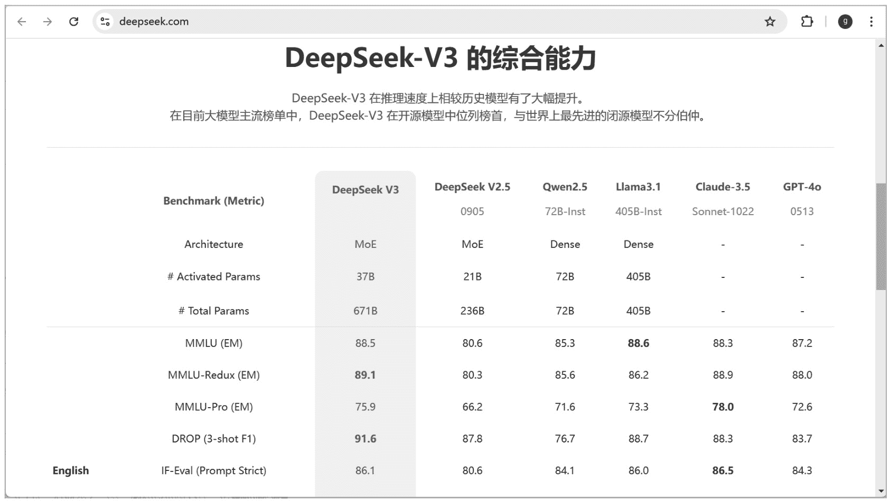

DeepSeek 与其他大模型的对比数据

基于上图可概括如下。

（1）综合性能与推理能力。
● 综合能力突出：在 MMLU 英文评测中表现处于高位，与 Claude-3.5、GPT-4o 等闭源模型相当；在中文评测 CLUEWSC、C-Eval、C-SimpleQA 上均取得最高分，跨语言能力均衡。
● 推理速度显著提升：相较 DeepSeek-V2.5、Qwen2.5、LLaMA3.1，在 DROP、IF-Eval、LiveCodeBench 等指标上，3-shot F1、Prompt Strict 模式表现及代码生成均领先开源阵营。

（2）参数架构与效率。
MoE 优势明显：DeepSeek-V3 总参数 671B，仅激活 37B 即可高效计算，在保持大模型容量的同时实现高效推理。

（3）代码与数学能力。
● 代码生成：在 HumanEval-Mul、LiveCodeBench、Codeforces 等任务上表现优于同类开源模型，复杂编程与逻辑推理能力强。
● 数学推理：在 AIME 2024、MATH-500、CNMO 2024 等评测中 Pass@1 与 EM 分数领先，逻辑与数学处理能力突出。

（4）与闭源模型接近。
部分指标如 GPQA-Diamond、SimpleQA 上闭源模型仍有优势，但整体来看 DeepSeek-V3 在多数评测中领先或持平，成为开源模型领跑者。

（5）结论。
● DeepSeek-V3 在英文、代码、数学等领域与世界顶尖闭源模型不分伯仲。
● 在开源阵营中位居榜首，竞争力突出。
● 多项指标优异，体现技术架构与训练方法的优化效果。

综上，DeepSeek-V3 在推理速度、综合语言理解、代码生成、数学推理等维度优势明显，MoE 架构与高效参数激活机制使其在保持大规模容量的同时实现高效计算，已成为开源主流榜单的领跑者，并与顶尖闭源模型比肩。

# 第二章
# 环境搭建、代码获取与模型部署接入
环境搭建与代码获取是学习 DeepSeek 源码的基础，本章详细介绍相关流程。首先需满足硬件资源要求，并进行软件环境配置，包括操作系统、Python 环境及依赖库安装，以确保代码可正常运行。其次介绍从 GitHub 克隆代码、分支管理、更新同步等流程，最后以 DeepSeek-R1 为例讲解本地部署要点。

## 2.1 环境准备
研究与分析 DeepSeek 开源代码需搭建适配的硬件环境以满足计算需求，并配置软件环境，包括特定版本操作系统、Python、CUDA 等，最后按项目指南安装依赖库以保证代码正确运行。

### 2.1.1 硬件环境要求
不同 DeepSeek 开源模型对硬件需求各异，具体取决于参数规模。各版本建议配置如下表所示。

不同 DeepSeek 模型版本对硬件的配置建议

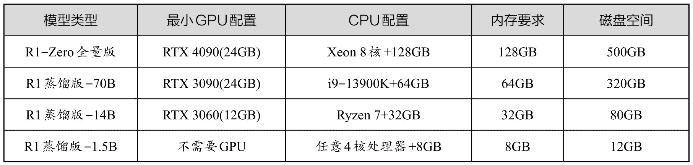

DeepSeek-V3 源码采用 FP8 训练并开源原生 FP8 权重，参数量约 700B，显存需求极高，可能需数百 GB 显存，个人设备难以运行，建议使用高性能计算集群或云服务。

注意
模型参数越大，对硬件要求越高。配置不足时模型将回落至 CPU 计算，推理时间显著延长。部署前应根据参数规模与自身硬件匹配，确保满足最低运行要求以获得最佳体验。

### 2.1.2 软件环境配置
除硬件外，软件环境的搭建同样关键。

1. 操作系统
源码分析与开发对系统无严格限制，但推荐以下环境以获得更好兼容性与支持。
● Linux：如 Ubuntu 20.04 或更高版本。
● Windows：Windows 10 或更高版本。

DeepSeek 本地研发环境搭建与源码操作指南

系统基线
开始前先确认运行平台。Mac 用户建议使用 macOS 11.0 Big Sur 及之后的版本，更新的系统更稳定。

Python 运行环境
DeepSeek 代码以 Python 为主编写，建议采用 3.8 或更高版本。为防止不同项目的依赖互相干扰，推荐使用 venv 或 conda 建立独立的隔离空间。

深度学习框架
模型基于 PyTorch 搭建，安装时要依据显卡型号与 CUDA 版本选择对应发行包。例如在配备 NVIDIA GPU 且 CUDA 为 11.7 的机器上，可执行：
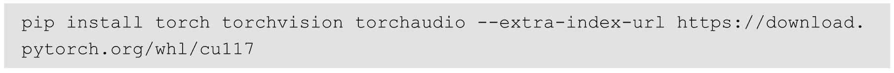

依赖库准备
阅读源码前需要补齐依赖。清单一般记录在 requirements.txt 或 environment.yml 中。以 DeepSeek-V3 为例，其 requirements.txt 内容如下：
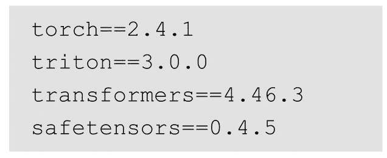
通过 pip 安装清单中列出的包，可参考：
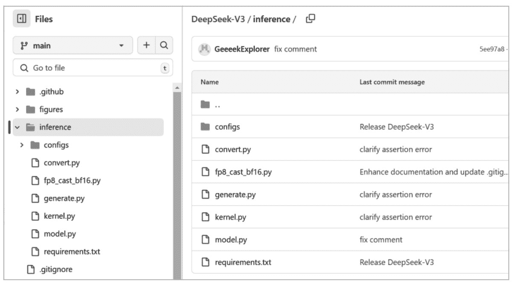
图 2-1 DeepSeek-V3 项目中的依赖文件 requirements.txt

为避免污染全局环境，建议先创建并激活隔离环境后再安装：

若采用 conda 管理环境，可执行：

开发工具
合适的 IDE 或编辑器能明显提升阅读与分析效率。推荐选用：
● PyCharm：面向 Python 打造的 IDE，调试与代码分析能力突出。
● Visual Studio Code：流行且免费的代码编辑器，插件生态丰富。
完成以上准备后即可开始深入研究 DeepSeek 源码，实际搭建时可结合项目说明与个人研究方向灵活调整。

## 2.2 源码获取与管理
把仓库拉到本地是开展工作的第一步。开发过程中合理使用分支，能把不同功能或修复相互隔离，保障主线稳定可维护。定期与远端同步，可保持本地始终与上游一致。

### 2.2.1 开源项目简介
DeepSeek 在 GitHub 上公开的仓库主要有：
（1）DeepSeek-VL2：采用专家混合架构的多模态大模型，擅长高级视觉语言理解。
（2）awesome-Deepseek-Integration：模型应用集成示例集合，提供 API 调用、微调、部署示例，并涵盖与 LangChain、Hugging Face 等主流框架的整合案例。
（3）DeepSeek-V3：第三代通用大语言模型，在性能与推理效率间取得平衡。
（4）DeepSeek-R1：基于强化学习的 AI 智能体框架，支持多工具调用与环境交互。
（5）Janus：统一的多模态理解与生成基座，支持任意模态输入输出，涵盖文本、图像、视频。
（6）DeepSeek-V2：经济高效的 MoE 语言模型，在通用 NLP 任务上接近 GPT-4 水平。
（7）DeepSeek-Coder-V2：代码智能模型，性能超过部分闭源方案，覆盖 300+ 编程语言并支持复杂推理。
（8）ESFT：专家专用微调框架，面向垂直领域的小样本高效微调。
（9）DreamCraft3D：基于扩散模型的 3D 内容生成工具，能从单张图像生成高质量 3D 网格。
（10）DeepSeek-Prover-V1.5：数学定理自动证明模型，兼顾形式化验证与自然语言推理。
（11）DeepSeek-Coder：初代代码生成模型，支持主流编程语言。
（12）DeepSeek-VL：首代视觉语言多模态模型，支持图像描述、视觉定位与跨模态检索。
（13）DeepSeek-Math：专注数学推理的语言模型，解题能力覆盖小学到高等数学。
（14）Awesome-Deepseek-Coder：DeepSeek-Coder 生态资源合集，包含第三方插件、教程和微调指南。
（15）DeepSeek-LLM：初代通用大语言模型 7B/13B/67B，中英双语优化，适合知识密集型任务。
（16）DeepSeek-MoE：高效混合专家架构，提升模型性能与效率。
（17）3FS：面向 AI 训练推理的高性能分布式文件系统，充分利用 SSD 与 RDMA 网络带宽，加速数据访问。
（18）DualPipe：双向流水线并行算法，用于 V3/R1 训练中实现计算与通信重叠，减少流水线气泡与 GPU 空闲。
（19）DeepGEMM：高效 FP8 GEMM 内核，采用细粒度缩放，借助英伟达 CUDA 技术在低精度下提升速度并保证准确性。
（20）DeepEP：专为 MoE 设计的高效专家并行通信库，可智能分配专家负载，平衡 GPU 压力并降低通信开销。
（21）open-infra-index：生产级 AI 基础设施工具集合，助力 AGI 开发与社区创新。
（22）profile-data：收录 DeepSeek 训练与推理框架的性能分析数据，便于理解通信与计算重叠的实现细节。
（23）smallpond：基于 DuckDB 与 3FS 构建的轻量数据处理框架，用于高效预处理与分析。
（24）FlashMLA：面向 Hopper GPU 的高效 MLA 解码内核，动态分配算力，让模型速度接近硬件极限。
（25）EPLB：专家并行负载均衡器，解决 MoE 架构中专家负载不均，提升整体效率。
受篇幅限制，后续主要聚焦最具代表性、最新通用的开源项目。

### 2.2.2 获取源码
GitHub 上获取代码的方式多样，按需选择即可。
**1．下载 ZIP 压缩包**
仅需当前版本且不需版本控制时可直接下载。以 DeepSeek-R1 为例：
（1）在仓库页面点右上角绿色 Code 按钮，下拉菜单选择 Download ZIP，如图 2-2 所示。
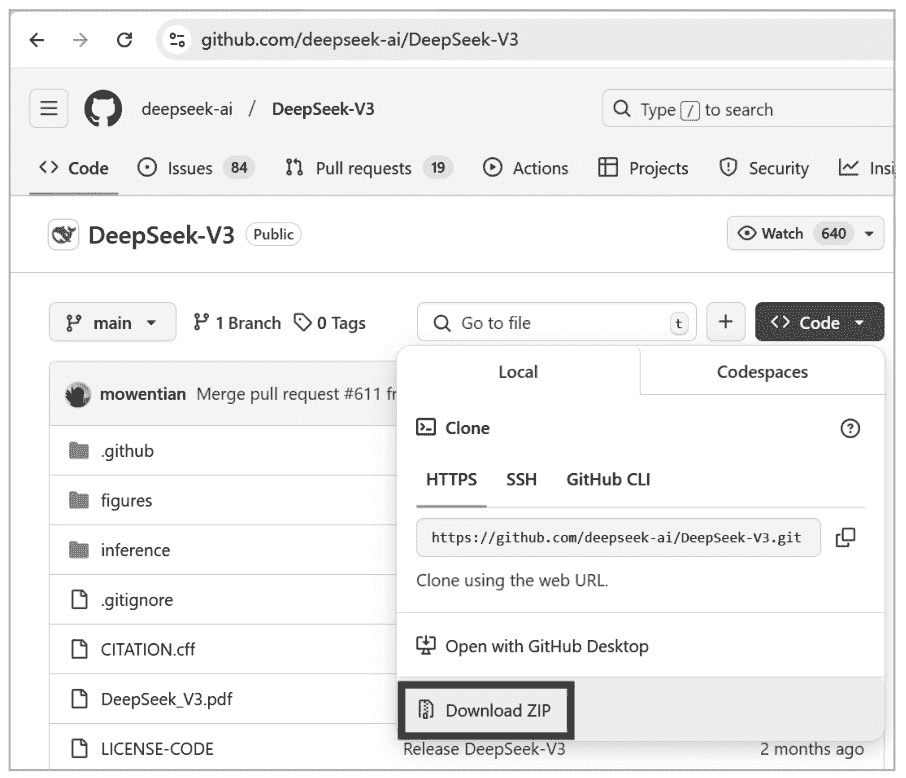
图 2-2 选择“Download ZIP”
（2）下载完成后解压即可使用。
**2．克隆 Clone 仓库到本地**
需要本地版本控制和二次开发时，推荐使用 Git 克隆。以 DeepSeek-R1 为例：
（1）在仓库页面点击 Code 按钮，复制 HTTPS 或 SSH 地址 https://github.com/deepseek-ai/DeepSeek-R1.git，如图 2-3 所示。
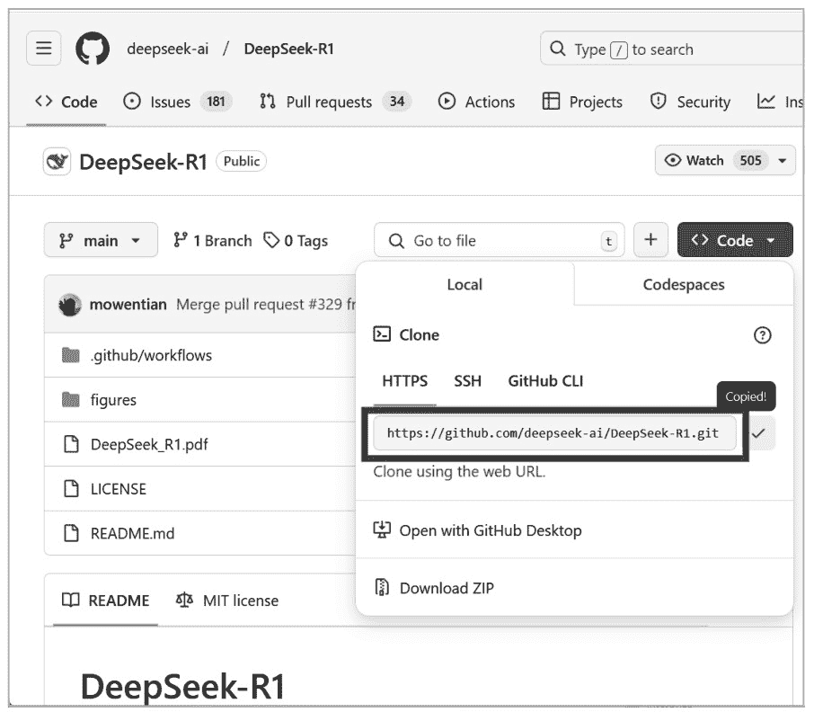
图 2-3 复制链接
（2）在终端切换到目标目录执行：
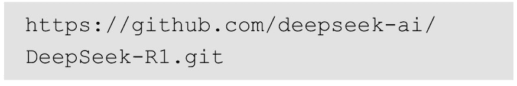
即可在当前目录生成同名文件夹并完整下载仓库内容。
**3．直接在线浏览和复制代码**
只想查看或拷贝片段时，可直接在 GitHub 页面打开文件并复制。
**4．Fork 仓库**
计划修改并可能贡献回上游时，可先 Fork。点击页面右上角 Fork 按钮，如图 2-4 所示。
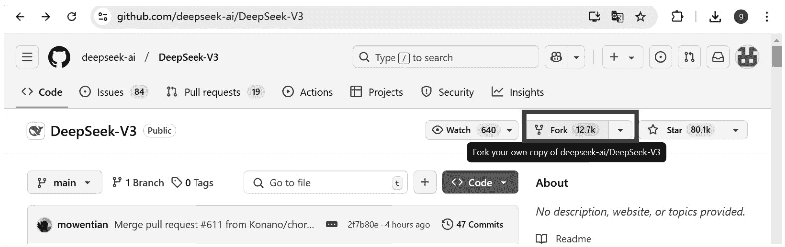
图 2-4 单击右上角的“Fork”按钮
随后按克隆步骤把自己的副本拉到本地开发即可。综合需求选择合适方式即可获取源码。

### 2.2.3 分支管理
DeepSeek 仓库的分支管理遵循 Git 通用规范。
**1．分支类型**
● 主干分支 Main Branch：发布稳定版本的线路。
● 特性分支 Feature Branch：在此开发新功能，不影响主线，完成后合并回去。
● 缺陷修复分支 Bugfix Branch：专门修复 bug，完成后合并回主线。
**2．操作说明**
● 创建：可在 GitHub 分支选择框输入新名称并创建，或本地执行 git checkout -b new-feature-branch 创建并切换。
● 切换：使用 git checkout branch-name。
● 合并：本地可用 git merge feature-branch，或在 GitHub 发起 Pull Request 在线审查后合并。
● 删除：已完成工作可用 git branch -d branch-name 删除，未合并需用 git branch -D branch-name 强制删除。
**3．管理策略**
● 定期把主干分支合并到特性分支，保持同步、降低冲突。
● 合并后及时清理不再需要的分支，保持仓库整洁。
通过以上策略可平衡新功能开发与主线稳定，促进协作并提升质量。

### 2.2.4 更新与同步
更新与同步遵循标准版本控制流程。
**1．更新机制**
功能开发在特性分支进行并测试，通过后提交并发起 Pull Request。维护者审查通过后合并到开发分支。开发分支集成测试通过且稳定后，再合并到主干分支并发布新版本。
**2．同步机制**
● 本地同步：执行 git pull 从远程获取最新更新。
● 远端同步：本地开发完成并测试后用 git push 推送到远程分支，再发起 PR 供审查合并。
● 版本发布：主干分支积累稳定功能后打 Tag 发布，例如 DeepSeek-V3 首个版本已开源。
**3．更新流程**
（1）提交更新：本地修改后用 git add、git commit 提交。
（2）推送更新：git push 将提交推送到远程分支。
（3）创建 PR：在 GitHub 上创建 PR 以合并到主干分支，其他人可审查讨论。
（4）合并 PR：审查通过后管理员合并更改。
**4．同步方法**
● 拉取远程更新：git pull 保持本地与远程一致。
● 推送本地更新：git push 上传本地更改。
● 指定分支合并：在创建 PR 时指定源分支和目标分支。
**5．更新策略**
● 定期更新：项目会持续发布新功能、优化和 bug 修复，开发者可按需检查更新。
● 版本控制：用 git tag 标记特定版本，便于管理。
● 分支管理：主干分支发布稳定版，特性分支开发新功能，修复分支处理 bug，合理管理保障稳定与可维护。

## 2.3 DeepSeek 模型的本地部署与接入
本地部署指将 DeepSeek 大模型及运行环境装在本地服务器或个人电脑上，脱离外部网络和云服务独立运行。这样可保障数据隐私与安全，避免传输泄露，降低网络依赖，提升稳定性和响应速度。同时支持按需定制优化，更好适配特定业务或个性化需求。以下介绍基本部署步骤。

### 2.3.1 安装 Ollama
（1）访问 Ollama 官网，根据系统下载对应版本，目前支持 macOS、Linux、Windows。笔者以 Windows 为例，如图 2-5 所示。
（2）点击 Download for Windows 开始下载，得到 .exe 安装包后以管理员身份运行。
（3）弹出界面点 Install 开始安装，如图 2-6 所示。注意 Ollama 必须装在 C 盘，安装路径不可更改，因此 C 盘需预留大于 5GB 空间。
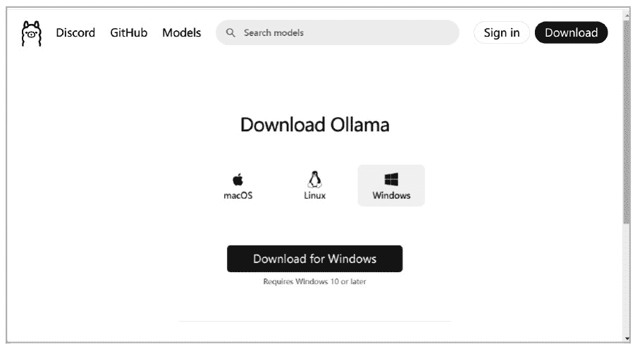
图 2-5 Windows 系统版本的 Ollama
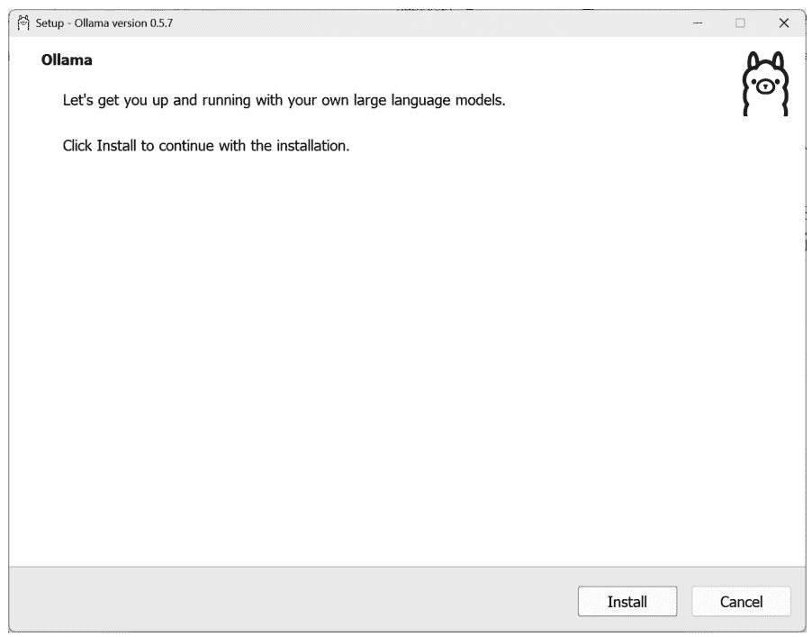
图 2-6 单击“Install”按钮
（4）在 Installing 界面等待进度条完成，如图 2-7 所示。
（5）安装完成后在终端输入 ollama 命令验证，若出现如图 2-8 的界面即表示安装并启动成功。
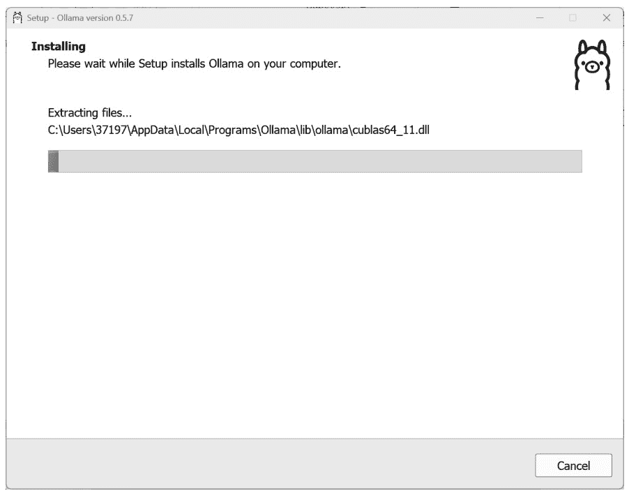
图 2-7 “Installing”界面
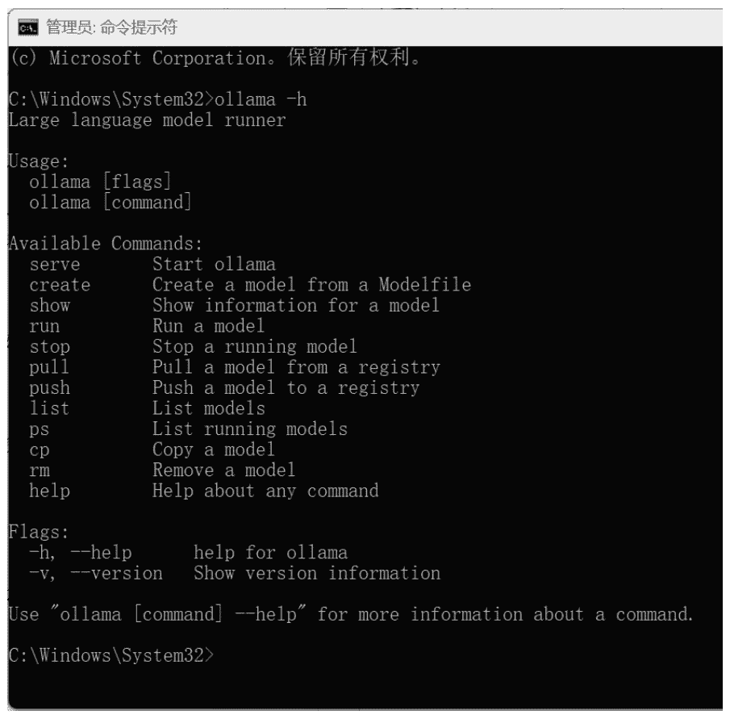
图 2-8 成功安装并启动 Ollama

### 2.3.2 部署 DeepSeek 模型
（1）打开 Ollama 官网，点击顶部 Models 进入模型列表，如图 2-9 所示。
（2）点击 deepseek-r1 进入页面，下拉列表提供多种尺寸版本，如 1.5b、7b、8b、14b、32b、70b、671b。不同大小对应不同的显存、显卡和内存需求，如图 2-10 所示。
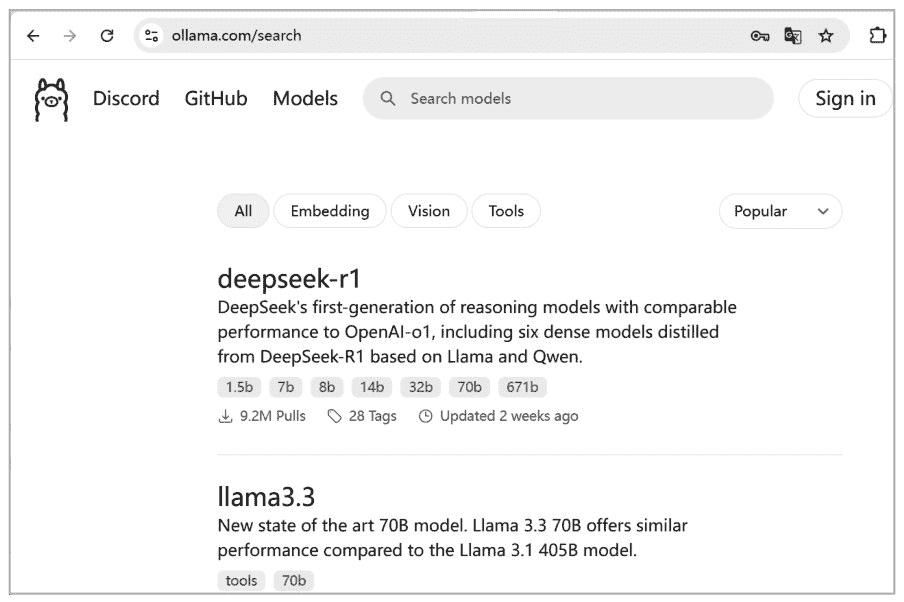
图 2-9 模型界面

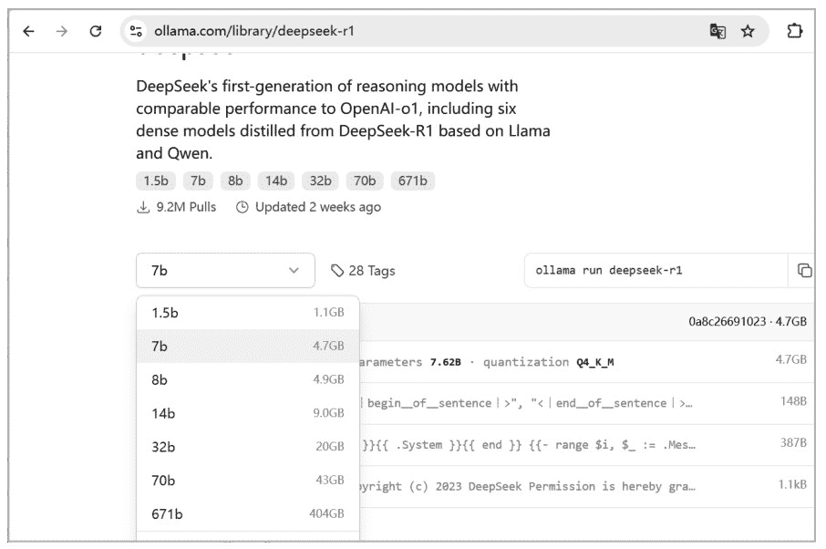

图 2-10 下拉菜单中呈现的 DeepSeek 模型选项

（3）模型规格可以根据本地硬件来定。假设要装 70B 版本，就在下拉菜单里选中 70B，随后把对应的启动语句 “ollama run deepseek-r1:70b” 复制保存，示意见图 2-11。

（4）把复制好的语句粘贴到命令行，回车后系统会开始拉取 70B 版的 DeepSeek。模型越大耗时越长，下载解压需要耐心等待，完成后的画面如 图 2-12。

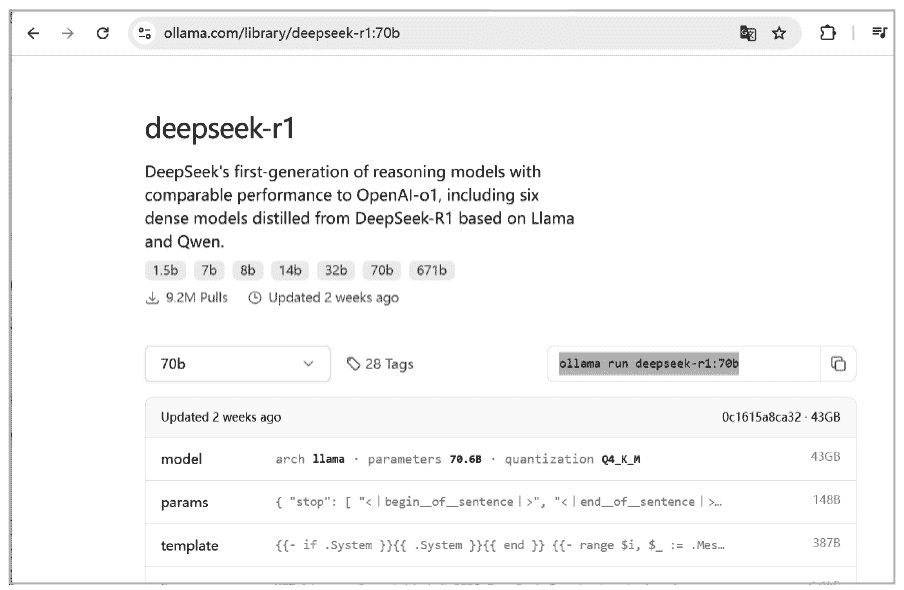

图 2-11 70B 版本的安装示意

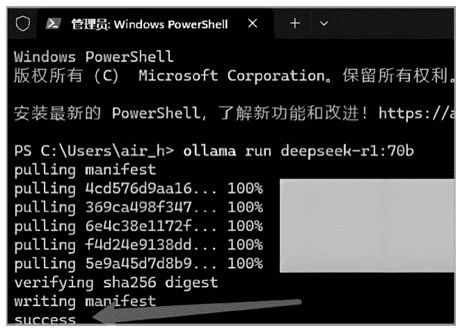

图 2-12 安装完成的界面

（5）部署完成后，终端里执行对应指令即可唤起 DeepSeek 开始对话，输入 “/bye” 即可结束会话。

### **2.3.3** **Chatbox 可视化部署**

Chatbox 是一个面向本地大模型的开源免费客户端，专为 DeepSeek 这类本地模型打造，交互界面清爽好用。

本地调用 DeepSeek 的操作流程如下：

（1）打开 Chatbox 的官方站点获取安装包，点击 “免费下载 (for Windows)” 即可拿到 Windows 安装程序，如图 2-13。

（2）下载得到 “.exe” 安装文件后双击运行，在安装向导中勾选 “仅为我安装”，随后进入下一步，如图 2-14。

图 2-13 Chatbox 官网首页

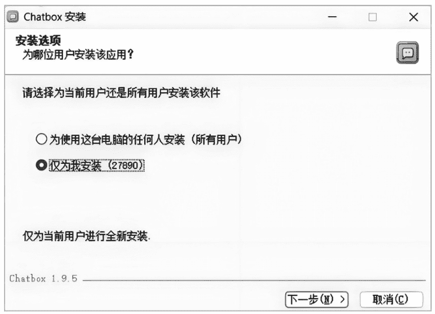

图 2-14 安装向导中的安装范围选项

（3）在 “选定安装位置” 页面指定目录后继续，如图 2-15。

（4）安装结束会自动启动程序，点击 “使用自己的 API Key 或本地模型” 进入配置页，如图 2-16。

（5）在 “选择并配置 AI 模型提供方” 窗口里挑选 “Ollama API”，如图 2-17。

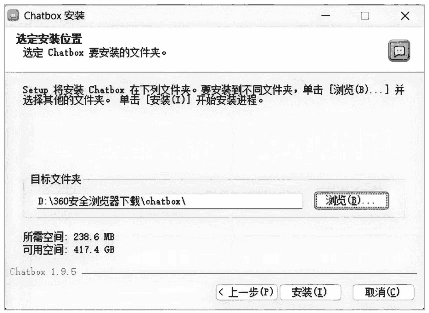

图 2-15 选择安装路径的界面

图 2-16 程序启动后的主界面

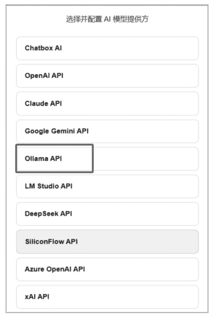

图 2-17 选择 Ollama API 的界面

（6）随后在已在本地部署的模型列表中选择目标模型，这里前面装的是 70B 版的 DeepSeek，也可选用其他已装版本，例如作者本地还保留了 14B 版，如图 2-18。

至此 DeepSeek 已完成本地部署，可通过图形界面进行对话，如图 2-19。

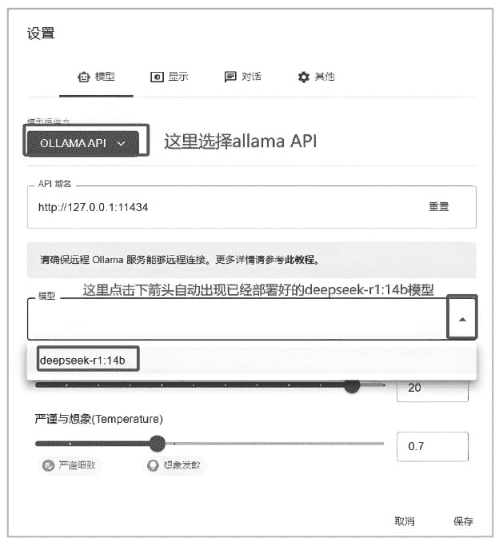

图 2-18 已部署的 DeepSeek 模型列表

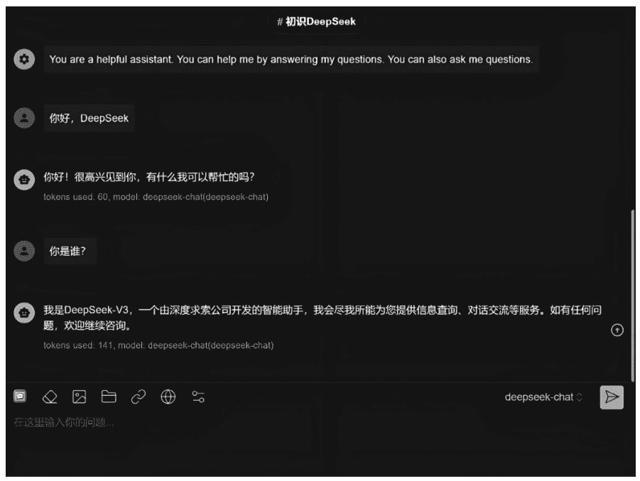

图 2-19 通过图形界面与 DeepSeek 对话

### **2.3.4** **DeepSeek 生态接入一览**

除了 Chatbox，DeepSeek 还能接入大量第三方工具。官方维护的开源整合清单 Awesome DeepSeek Integrations 如图 2-20，其目的是把 DeepSeek API 引入各类流行软件，提升开发者和普通用户的上手效率。

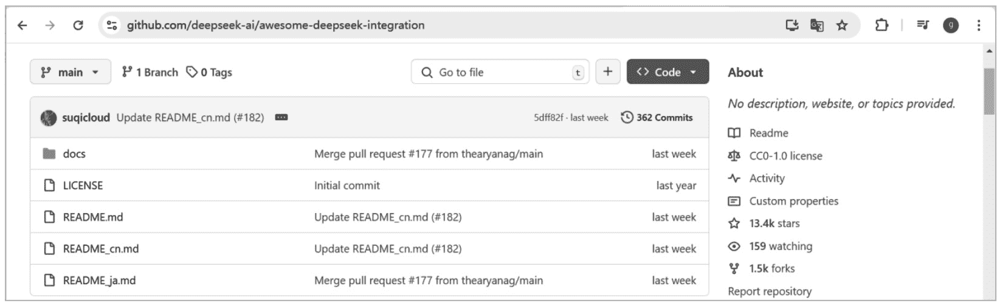

图 2-20 Awesome DeepSeek Integrations 开源项目

该项目把 DeepSeek API 嵌入到受青睐的工具与平台，极大拓展了使用场景。README_cn.md 里整理的接入目录主要包括：

**1．多平台集成**

● Chatbox：覆盖 Windows、Mac、Linux 的桌面客户端，聚合多款前沿 LLM。
● LibreChat：可高度定制的开源聊天应用，原生兼容 DeepSeek。
● Pal - AI Chat Client：面向 iOS 与 iPadOS 的定制化聊天工具。
● Video Subtitle Master：在 Mac 与 Windows 上批量生成视频字幕并支持多语种翻译。

**2．开发框架和工具**

● PHP Client：为 DeepSeek API 提供的 PHP 客户端库，便于嵌入 PHP 项目。
● Laravel Integration：专为 Laravel 应用设计的集成方案。
● Deepseek Tokenizer：轻量高效的 DeepSeek 模型分词库。

**3．浏览器扩展和插件**

● Immersive Translate：网页实时翻译插件。
● Lulu Translate：支持划词翻译、段落对比及 PDF 翻译，已接入 DeepSeek。
● RssFlow：智能 RSS 阅读扩展，可借助 DeepSeek 进行内容理解。

**4．IDE 和编辑器插件**

● VS Code Extensions：如 Continue、 Cline，为 VS Code 提供 AI 编程辅助。
● JetBrains Extensions：为 JetBrains 系列 IDE 提供 AI 助手。
● Neovim Extensions：如 avante.nvim、llm.nvim，让 Neovim 也能调用 DeepSeek。

**5．其他工具和应用**

● Story-Flicks：一句话即可生成高清故事短视频。
● 16x Prompt：擅长上下文管理与复杂编码提示生成的 AI 编码工具。
● Portkey AI：统一 API 网关，兼容 1600+ 模型，提供 Python 与 Node SDK。

项目为每类工具都提供了简明教程，例如 VS Code 插件 Continue 的接入说明位于 awesome-deepseek-integration/docs/continue/README_cn.md，如图 2-21。

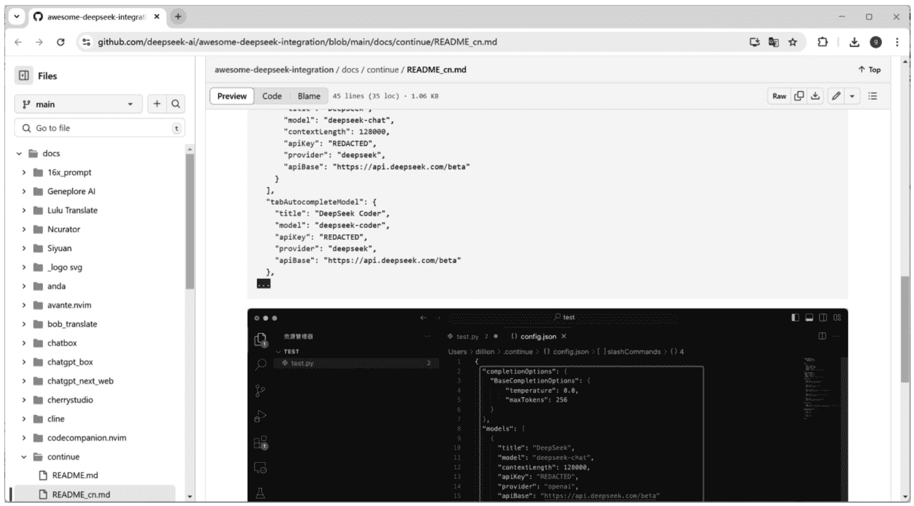

图 2-21 VS Code 插件 Continue 的接入示例

# **第三章**

# **混合专家模型 MoE 初探**

混合专家模型 Mixture of Experts，MoE，由 DeepSeek AI 提出的一种新型语言模型架构，目标是实现专家级专业化。该架构依托细粒度专家划分与共享专家隔离两大思路，提升专业度与整体性能。本章围绕 DeepSeek 开源项目 DeepSeekMoE，管窥 MoE 语言模型的精髓。

## **3.1** **项目介绍**

MoE 语言模型最早由 DeepSeek 开源项目 DeepSeekMoE https://github.com/deepseek-ai/DeepSeek-MoE 提出，旨在借助混合专家技术达成训练与推理的高效化。

### **3.1.1** **基本特点**

DeepSeekMoE 是一个拥有 16.4B 参数的语言模型，采用创新的 MoE 架构。架构把整体模型拆分为多个子专家网络，各自聚焦特定任务或领域，在保持强劲性能的同时大幅降低计算开销。该模型在 2T 英文与中文语料上完成训练，表现与 DeepSeek 7B 及 LLaMA2 7B 相当，但计算量仅为后者约 40%。

MoE 架构的核心优势如下。

**1．创新的 MoE 架构**

MoE 通过动态路由实现高效信息处理，主要组成如下：

（1）专家模型：由多个子模型构成，每个专家负责处理特定类型输入，例如图像切片或文本片段。

（2）门控网络：依据输入特征动态挑选最相关的专家并分配算力。其公式为

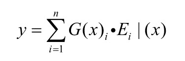

其中：

● *G*(*x*)[*i*] 为门控网络赋予第 *i* 个专家的权重。
● *E*[*i*]|(*x*) 为第 *i* 个专家的输出结果。

（3）负载均衡：借助均衡策略确保各专家负载均匀，避免资源浪费。

### **注意**

在实际落地中，MoE 架构带来的收益包括：

● 计算资源利用率高：DeepSeekMoE 16B 推理时仅激活约 2B 参数，显著节省算力。
● 专家划分更细：通过动态路由将输入 Token 分配给 1~2 个子专家网络，提升效率与专业度。

**2．开放性**

（1）项目提供了 DeepSeekMoE 16B Base 与 DeepSeekMoE 16B Chat 的模型权重，可在单张 40GB 显存 GPU 上直接部署，无需量化。
（2）项目采用 MIT 许可证开源，允许商业用途。

**3．评估结果**

（1）基准测试表现。
● Open LLM Leaderboard：DeepSeekMoE 16B 在激活参数相近的开源模型中表现突出，计算量约为 LLaMA2 7B 的 40% 时性能相当。
● 内部评测：模型在语言建模、知识密集任务 Pile、HellaSwag、TriviaQA、NaturalQuestions、代码生成 HumanEval 与 MBPP、数学推理 GSM8K 与 MATH 等任务上表现优异。
● 聊天模型评估：DeepSeekMoE 16B Chat 在语言理解、推理 PIQA、ARC、BBH、机器阅读理解 RACE、知识任务 TriviaQA、NaturalQuestions 等方面表现突出。

（2）计算量对比。
● 相较 DeepSeek 7B：DeepSeekMoE 16B 仅消耗 40.5% 计算量，性能相当。
● 相较 LLaMA2 7B：DeepSeekMoE 16B 用 39.6% 计算量，性能更佳。

总体来看，DeepSeekMoE 是一个高效、灵活且可商用的开源语言模型，适用于各类自然语言处理任务，在保持高性能的同时显著降低算力需求，适合资源受限场景。

### **3.1.2** **开源内容**

DeepSeek MoE 在 GitHub 仓库中开源了以下资源：

● 模型权重：提供 DeepSeekMoE 16B Base 与 Chat 版本检查点。
● 微调脚本：finetune 目录下包含下游任务微调脚本，支持 DeepSpeed 高效训练。
● 依赖说明：requirements.txt 列出所需 Python 依赖，便于环境配置。
● 使用指南：README.md 详述特性、评测、快速开始、许可与引用方式。
● 许可文件：LICENSE-CODE 与 LICENSE-MODEL 分别说明代码与模型使用条款。

这些内容为研究者和开发者提供了完整资源，便于在不同场景下使用与微调模型。

## **3.2** **功能模块**

DeepSeek MoE 基于 MoE 架构构建，通过动态路由与专家共享实现高效训练推理。主要模块包括混合专家模块与微调模块。

**1. MoE 模块**

（1）多头潜在注意力层：引入潜在向量缓存自回归推理中间结果，优化键值缓存，降低生成任务计算量。
（2）混合专家系统层：采用动态路由从多专家中挑选相关专家计算，并引入专家共享设计，部分专家在不同 Token 或层间共享参数，优化性能。
（3）RMSNorm 归一化层：对模型进行归一化，提升训练稳定性与效果。

**2．微调模块**

项目开源了微调代码，支持 LoRA 低秩适应与 4/8-bit 量化高效微调 MoE 模型。主要功能：

● 数据预处理：构建指令模板、分词与标签掩码。
● 模型加载配置：支持 FlashAttention 与量化参数配置。
● 分布式训练管理：基于 DeepSpeed 实现高效分布式训练。
● 模型保存回调：提供自定义检查点保存机制。
● 混合精度训练：支持混合精度以优化显存并提升效率。

通过上述模块，DeepSeek MoE 在单张 40GB 显存 GPU 上即可运行 16B 参数模型，显著提升大规模语言模型的训练与推理效率。

## **3.3** **ZeRO 配置**

ZeRO 是一种显存优化技术，核心思路是将模型参数、梯度与优化器状态分片到多 GPU，减少单卡内存占用，从而支持更大规模模型训练。

### **3.3.1** **ZeRO 优化器介绍**

ZeRO 技术划分为三个阶段，各有显存与通信开销权衡：

● ZeRO Stage 1：仅分片优化器状态，各 GPU 保留完整梯度与参数，实现简单，通信量小，适合中等规模，显存节省有限。
● ZeRO Stage 2：在 Stage 1 基础上分片梯度，各 GPU 只存负责部分的梯度与优化器状态，参数仍完整复制，显存需求大幅下降，通信开销适中，是大规模训练常用选择。
● ZeRO Stage 3：对参数、优化器状态与梯度全部分片，每张卡只存部分数据，显存需求最小，适合超大模型如 GPT-3，但通信开销高，对网络带宽要求高。

ZeRO 的优势包括显存节省、计算效率提升与策略灵活性，用户可根据模型规模、显存与带宽选择合适阶段。

### **3.3.2** **第 2 阶段优化配置**

文件 ds_config_zero2_no_offload.json 是 DeepSpeed 配置，用于启用 BF16 精度并采用 ZeRO 第二阶段且不使用 Offload。配置设定了自动梯度累积、梯度裁剪、训练批量等参数，并通过 allgather、reduce_scatter、overlap_comm 等选项优化内存与通信，在保持高性能的同时降低资源消耗。

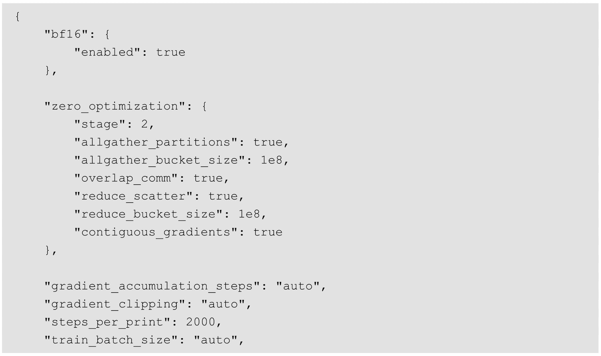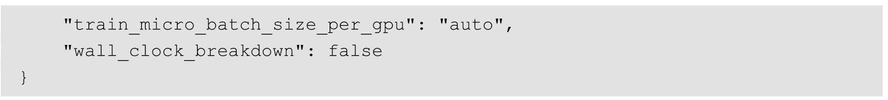

各参数说明如下。

（1）bf16：启用 BF16 精度训练，设为 true。
（2）zero_optimization：ZeRO 相关参数。
● stage：设为 2，使用 ZeRO 第二阶段优化模型状态内存。
● allgather_partitions：设为 true，需要时聚合并集散的模型参数分区，减少内存占用。
● allgather_bucket_size：1e8，控制 allgather 操作的桶大小以平衡通信开销。
● overlap_comm：设为 true，反向传播时重叠通信与计算，提升效率。
● reduce_scatter：设为 true，反向传播时使用 reduce-scatter 聚合梯度。
● reduce_bucket_size：1e8，控制 reduce-scatter 操作的桶大小。
● contiguous_gradients：设为 true，将梯度存储为连续内存块，提升访问效率。
（3）gradient_accumulation_steps：设为 "auto"，自动确定梯度累积步数以达到目标全局批量。
（4）gradient_clipping：设为 "auto"，自动确定梯度裁剪阈值防止爆炸。
（5）steps_per_print：设为 2000，每训练 2000 步打印一次日志。

第6项 train_batch_size 采用 "auto" 模式，由系统自动计算全局批次规模；第7项 train_micro_batch_size_per_gpu 同样设为 "auto"，交由框架决定每个 GPU 的微批；第8项 wall_clock_breakdown 置为 false，禁止输出各阶段耗时明细。上述设置共同影响 DeepSpeed 在 ZeRO 优化与 BF16 精度下的运行表现，核心在于提升效率与性能。

### 3.3.3 第3阶段优化配置
ds_config_zero3.json 仍是 DeepSpeed 的 JSON 配置。它打开 BF16 混合精度，采用 AdamW 作为优化器并配合 WarmupLR 调度，同时针对 ZeRO 第三阶段做了详细设定：涵盖参数与优化器卸载、通信重叠、梯度连续性等，还包含梯度累积步数、梯度裁剪、日志打印间隔、批次规模等。
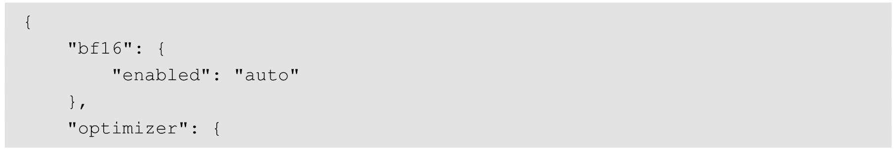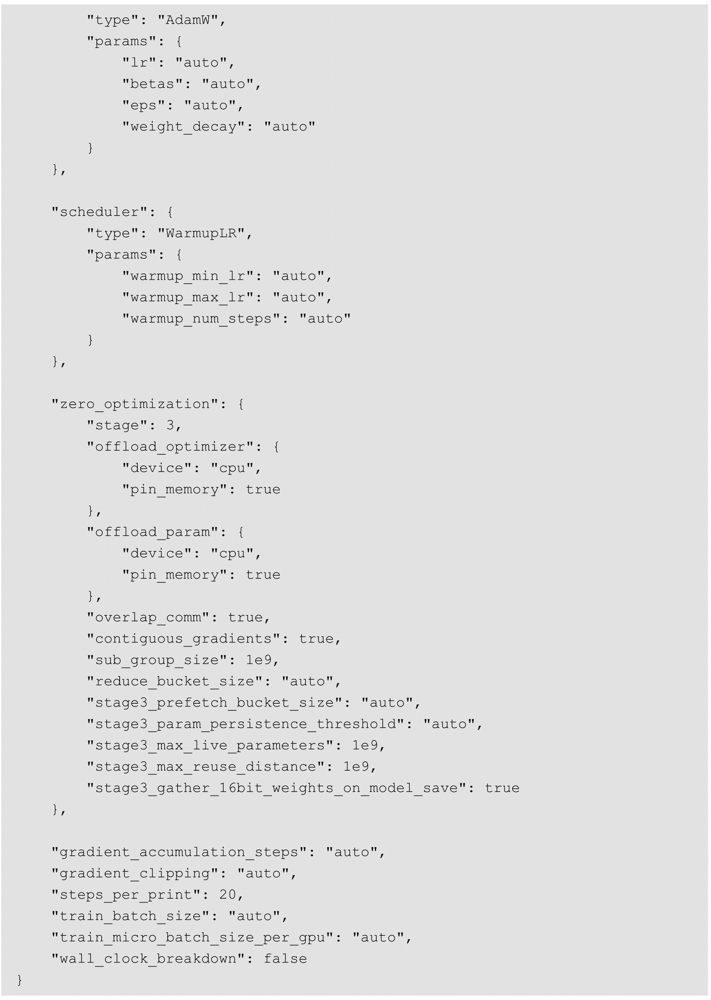

### 3.3.4 优化总结
在 DeepSeek MoE 体系里，ds_config_zero2_no_offload.json 与 ds_config_zero3.json 分别对应 ZeRO 第二阶段与第三阶段。两者的主要分歧在于内存优化的深度与方式。

**1. ZeRO Stage 2 ds_config_zero2_no_offload.json**
● 优化范围：仅对优化器状态与梯度进行分片，显存可压缩至约 1/8，通信负担与数据并行度基本保持。
● 配置要点：zero_optimization.stage 写为 2，且未开启参数或优化器状态的卸载，全部数据保留在 GPU。

**2. ZeRO Stage 3 ds_config_zero3.json**
● 优化范围：同时对优化器状态、梯度、模型参数进行分片，内存节省随并行度线性变化。以 64 卡为例，显存可降到约 1/64，代价是通信量约提升 50%。
● 配置要点：zero_optimization.stage 写为 3，并把参数与优化器状态卸载到 CPU，进一步减轻显存压力。

总体来看，相较 ds_config_zero2_no_offload.json，ds_config_zero3.json 以更激进的内存策略支撑更大模型训练，但通信开销与复杂度也随之上升。

## 3.4 模型微调
本项目中的 finetune.py 提供了完整工具集，用来对 DeepSeek MoE 预训练模型进行微调。支持加载特定任务数据、执行预处理编码，并可通过 LoRA、量化、分布式训练等选项实现高效训练。用户可借助命令行或配置文件调整策略，优化在特定任务上的表现。

### 3.4.1 微调原理
finetune.py 主要借助以下两项技术完成微调。

● LoRA：在 MoE 模型的 q_proj、v_proj、k_proj、o_proj 等层插入低秩矩阵，用极少量可训练参数改变模型行为，避免全量微调带来的遗忘与高计算成本。
● 量化 4/8-bit：将权重从 32-bit/16-bit 浮点转为 4-bit 或 8-bit 低精度格式，显著降低显存占用，使资源受限设备也能继续训练。

执行流程大致如下。
（1）模型加载与配置
按配置载入预训练 MoE 模型，bits 参数决定是否量化；开启 flash_attention_2 或 optimized 注意力以提升效率；若使用 LoRA，则按设定初始化模块并作用于目标层 trainable.split(',')。
（2）数据加载与预处理
借助 load_dataset 导入训练集；通过 train_tokenize_function 完成指令提示构建、分词及标签预处理。
（3）训练准备
将预处理后数据交给 Trainer，设定学习率、批大小、梯度累积步数等；使用 DataCollatorForSupervisedDataset 对输入与标签进行整理格式化。
（4）训练阶段
利用 Hugging Face Trainer 执行训练，支持断点恢复；训练中采用 BF16 或 FP16 混合精度以加速并降内存。
（5）保存与推理
训练过程中，SavePeftModelCallback 定期保存 LoRA 适配器权重；结束后保存模型状态或调用 safe_save_model_for_hf_trainer 将权重安全写入指定目录。

### 3.4.2 提示构建函数
build_instruction_prompt() 用于生成带指令与响应格式的提示文本。接受字符串 instruction 作为输入，返回多行字符串，包含预设上下文说明、指令区与响应区模板，并将传入内容填入指定位置形成完整提示。
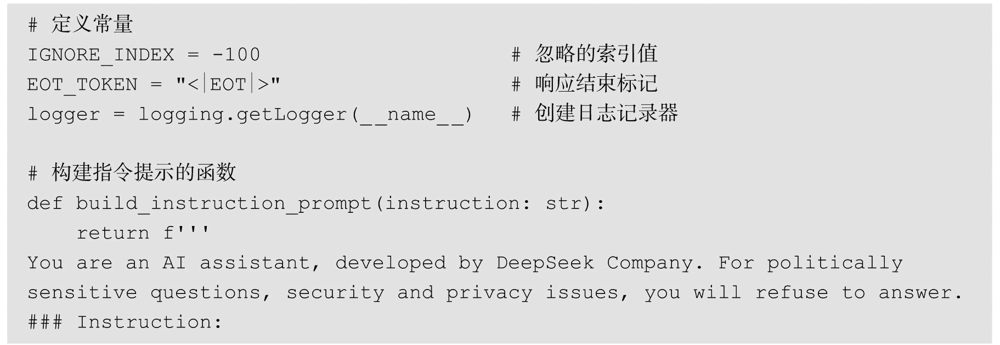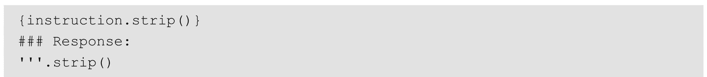

### 3.4.3 模型参数类
ModelArguments 数据类负责微调参数配置，涵盖可训练层列表、LoRA 相关设定、需保存模块、是否启用 LoRA、预训练模型路径、注意力实现方式、双量化开关、量化类型与位数等，便于灵活调整。
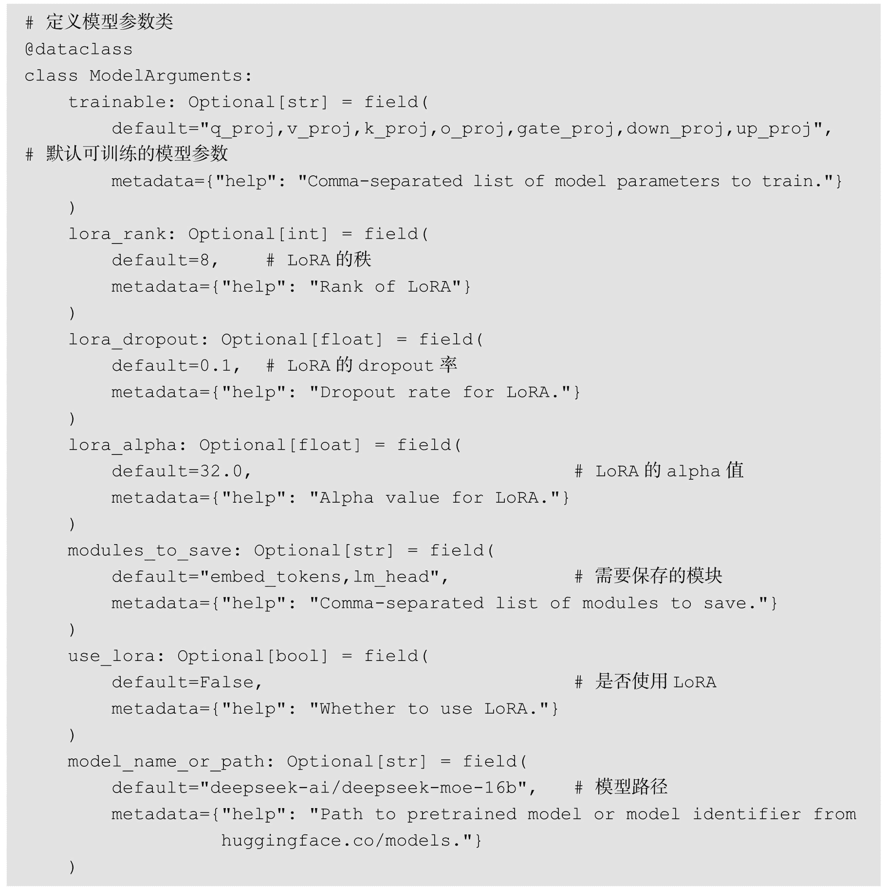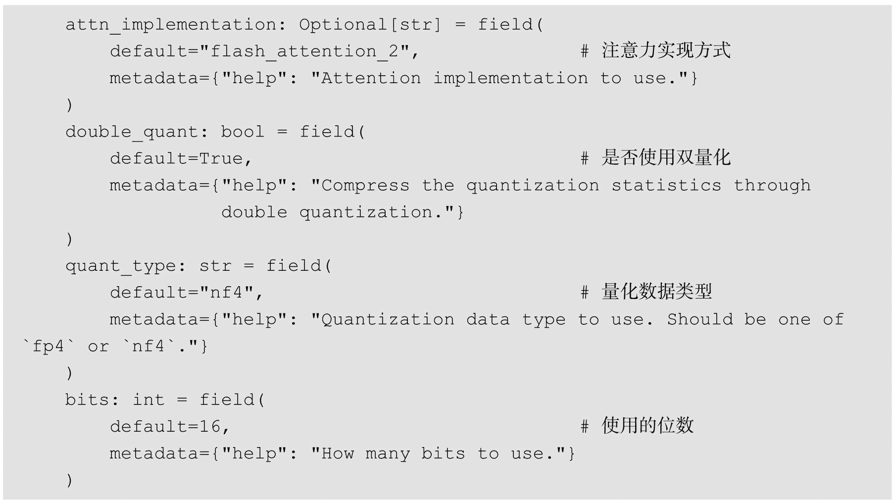

### 3.4.4 数据路径类
DataArguments 数据类仅用于指定训练数据位置，包含字段 data_path 记录数据路径。
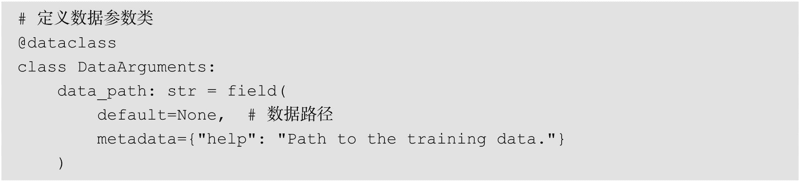

### 3.4.5 训练超参类
TrainingArguments 继承自 transformers.TrainingArguments，用以设定缓存目录、优化器种类、最大序列长度等超参数，控制训练全过程。
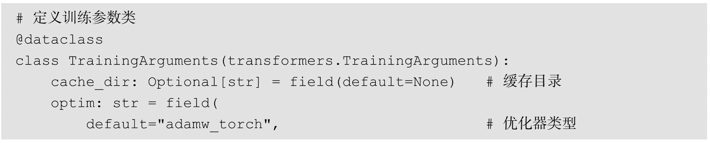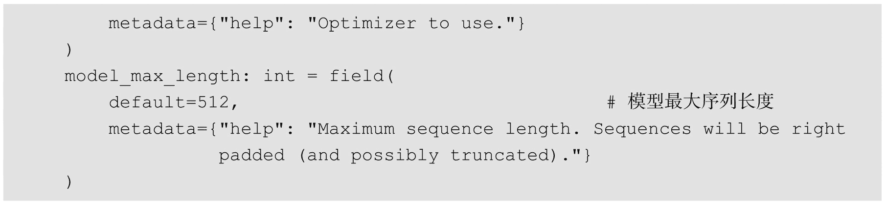

### 3.4.6 PEFT 回调保存
SavePeftModelCallback 为自定义回调，与 Trainer 配合使用。保存时仅写入 PEFT 适配器权重而不保存完整基座模型，节省空间并提升加载速度。训练结束时会生成 completed 文件标记完成。

在 PEFT 微调中，适配器权重的保存与加载至关重要。建议仅保存适配器而不保存完整模型。通过该回调可确保权重被正确写入，并在结束时产生完成标记。
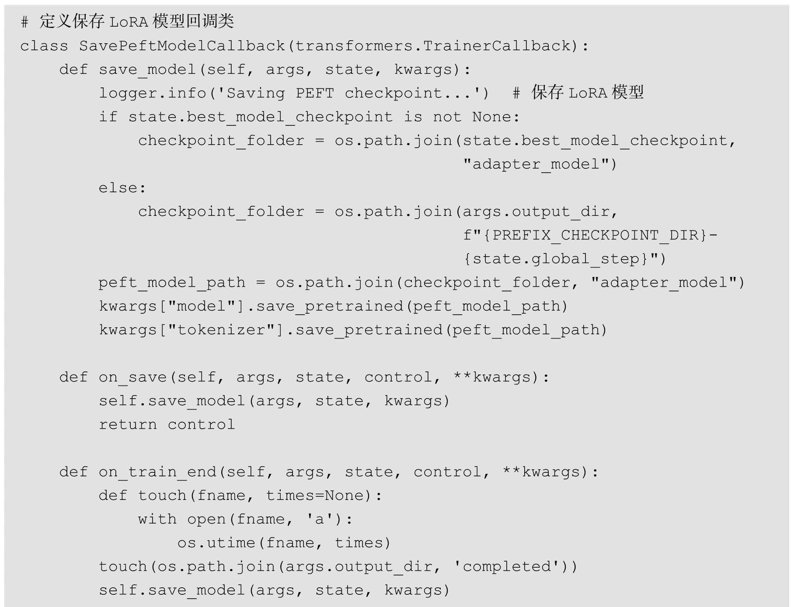

### 3.4.7 定位最新检查点
get_last_checkpoint() 用来寻找指定目录下最新的检查点。先判断目录是否存在 completed 文件，若存在则认为已完成返回 None；否则遍历 checkpoint- 开头的子目录，选取编号最大者返回；未找到则返回 None。
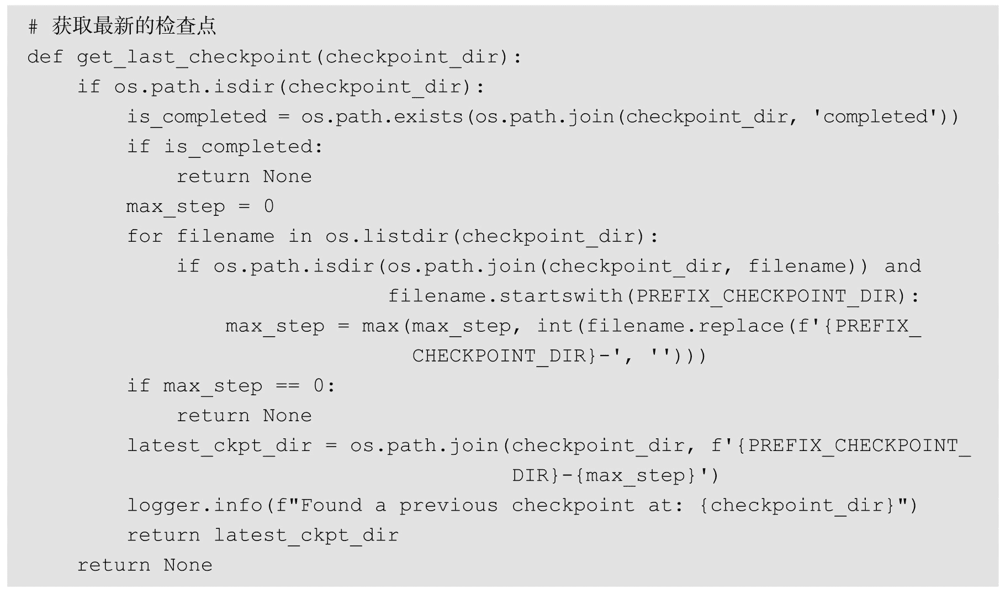

### 3.4.8 安全保存函数
safe_save_model_for_hf_trainer() 的作用是将 Trainer 中的模型安全写入指定目录。保存前把 state_dict 从 GPU 搬到 CPU 释放显存，再调用 Trainer._save 方法写入输出目录，保证分布式或混合精度场景下模型能正确保存，避免内存问题。
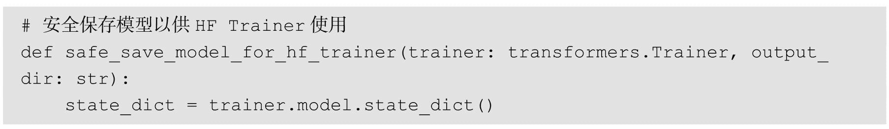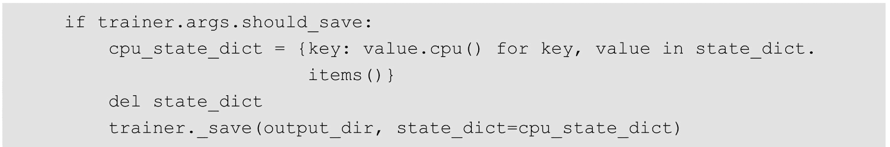

### 3.4.9 分词函数
_tokenize_fn() 对一批字符串进行分词，返回 ID 序列与长度信息。通过 tokenizer 将文本转为模型可读的 ID，并提供长度供后续训练推理使用。
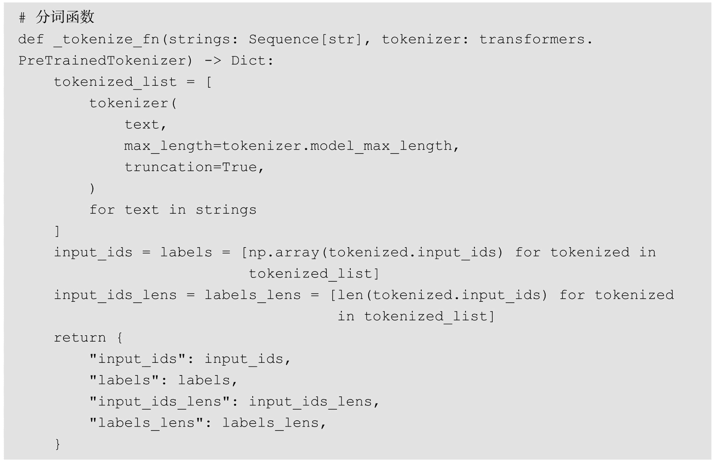

### 3.4.10 文本预处理函数
preprocess() 对源文本与目标文本做预处理，为训练准备结构化输入与标签。核心是将两者拼接后分词，并把源文本部分标签设为 -100 即 IGNORE_INDEX，使模型仅对目标部分做预测。
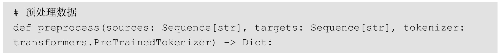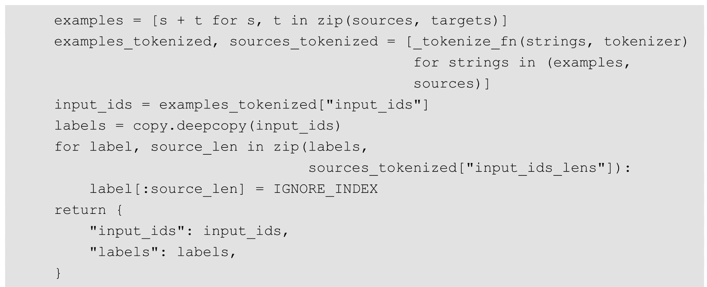

### 3.4.11 数据整理器
DataCollatorForSupervisedDataset 类用于监督微调中把多条样本整理为模型所需批次。主要功能是将 input_ids 与 labels 转为张量并做 padding 以保持维度一致，同时生成 attention_mask 标识有效位置。
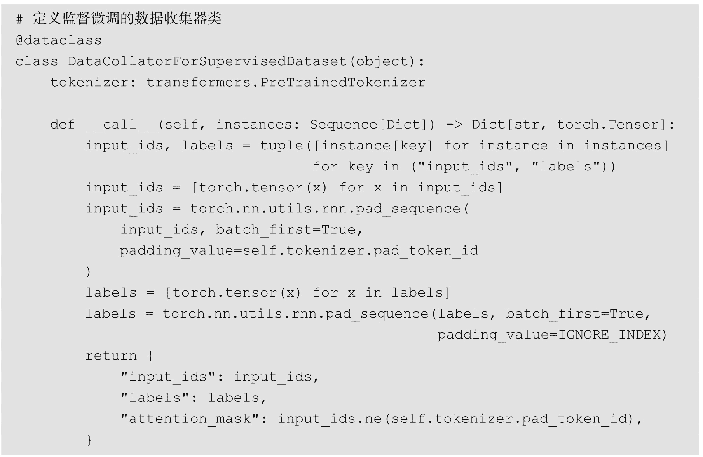

### 3.4.12 训练数据分词函数
train_tokenize_function() 负责对训练数据分词与预处理。接收 examples 与 tokenizer，examples 含指令与输出。函数先调用 build_instruction_prompt 为每条指令生成提示，再在输出后追加 EOT_TOKEN，随后分词并经 preprocess 转为训练格式，最后返回包含输入 ID 与标签的字典。
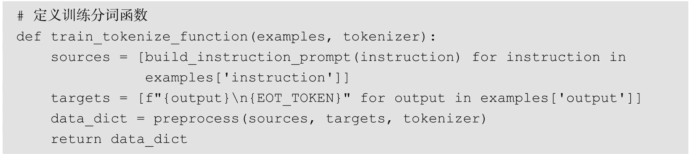

### 3.4.13 模型构建函数
build_model() 按参数构建并配置模型，支持量化与 LoRA。
● 数据类型判定：依据 training_args.bf16 选择 torch.bfloat16 或 torch.float16。
● 预训练模型加载：使用 AutoModelForCausalLM.from_pretrained 加载，按 model_args.bits 决定是否做 4/8 位量化；启用 LoRA 时需配置量化细节如双量化。
● 属性设置：将 model_parallel 与 is_parallelizable 置为 True 以支持并行，并按 bf16 设置 torch_dtype。
● LoRA 处理：若启用 LoRA 且量化位小于 16，则调用 prepare_model_for_kbit_training 准备 k-bit 训练；有检查点则加载适配器，否则初始化 LoRA 并配置目标模块、秩、dropout、alpha 等。
● 层级类型转换：遍历各层，按需转为 bfloat16 或 float32。
● 返回已配置模型。
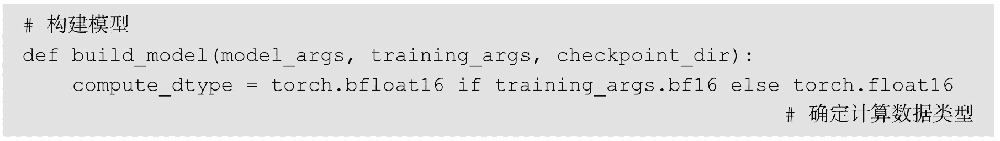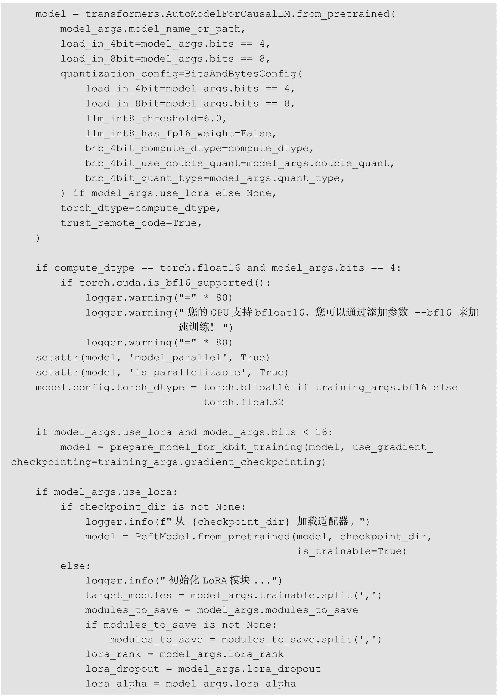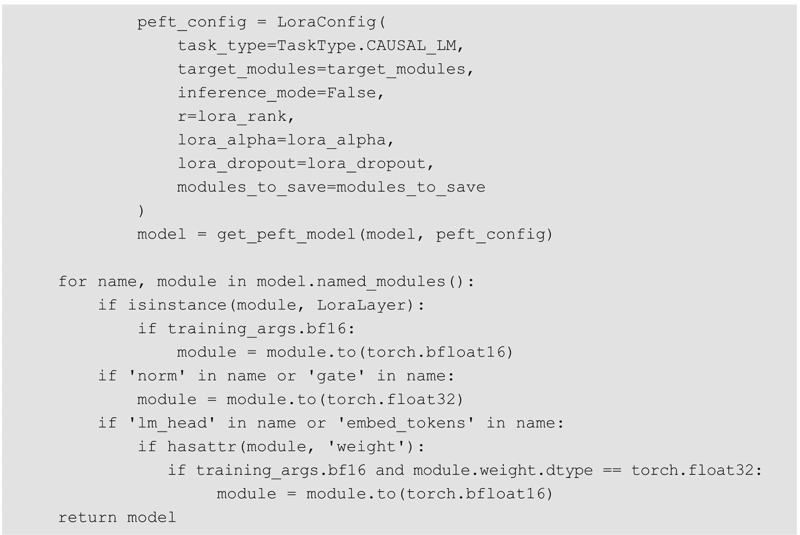

### 3.4.14 主训练流程
train() 是项目的主训练函数，负责完整微调。先加载数据并完成分词预处理；构建模型时应用 LoRA 与量化以优化显存；训练中采用梯度累积、动态损失缩放等手段，并通过检查点支持断点续训；结束后保存权重供后续评估或推理。

具体步骤如下。
（1）参数解析：用 HfArgumentParser 将命令行参数解析为 ModelArguments、DataArguments、TrainingArguments 实例。
（2）日志设置：按训练参数日志级别配置 logger，并启用默认处理器与格式。
（3）分词器加载：用 AutoTokenizer.from_pretrained 加载预训练分词器，设定最大序列长度、填充方向、是否使用快速分词器等。
（4）模型加载：调用 build_model 构建并配置模型。
（5）数据加载：用 datasets.load_dataset 加载训练集，按路径与缓存目录配置。
（6）数据预处理：用 train_tokenize_function 完成提示构建、分词与标签处理。
（7）数据整理器：创建 DataCollatorForSupervisedDataset 实例以整理数据格式。
（8）初始化 Trainer：用 Hugging Face Trainer 初始化，传入模型、分词器、训练参数与数据组件。
（9）添加回调：若启用 LoRA，则加入 SavePeftModelCallback 保存适配器权重。
（10）开始训练：调用 trainer.train 开始训练，可从检查点恢复。
（11）保存训练状态：结束后调用 trainer.save_state 保存权重、优化器状态等。
（12）保存模型：若未启用 LoRA，则调用 safe_save_model_for_hf_trainer 将权重安全保存到指定目录。
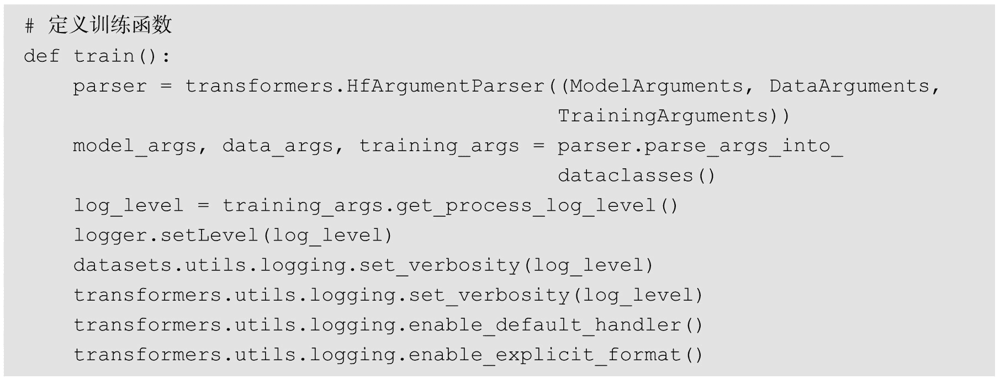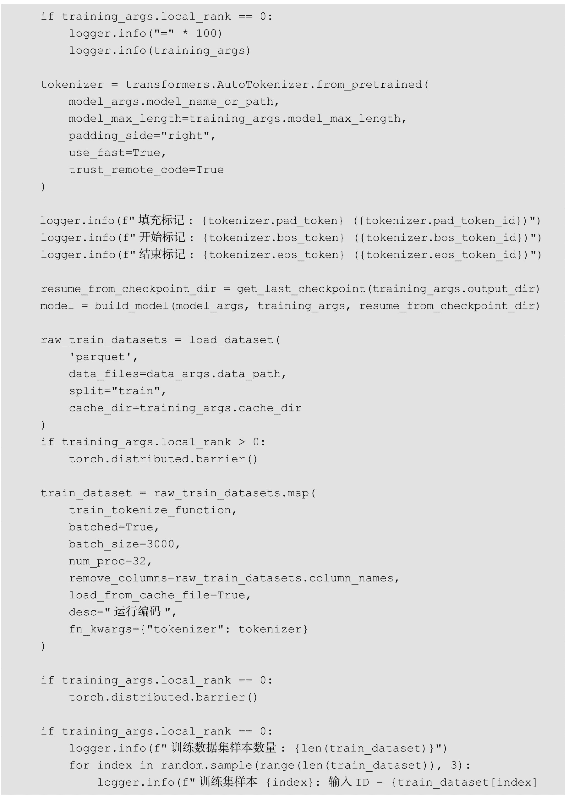

### 3.4.15 启动微调命令
执行指定命令后，finetune.py 将启动训练，加载模型与数据并按配置微调。检查点与日志会保存至输出目录，可通过 TensorBoard 查看指标。

参数说明：
● --model_name_or_path：预训练模型路径或名称。
● --data_path：训练数据路径。
● --output_dir：模型及其他输出的保存目录。

● --num_train_epochs：控制模型对全部训练数据完整遍历的次数。
● --model_max_length：单次输入允许的最长序列长度。
● --per_device_train_batch_size：每张加速卡一次处理的训练样本数。
● --per_device_eval_batch_size：每张加速卡一次处理的评估样本数。
● --gradient_accumulation_steps：在反向传播前累计的梯度步数。
● --evaluation_strategy：评估触发方式，这里设定为不执行评估。
● --save_strategy：检查点保存策略，这里按步数保存。
● --save_steps：达到该步数间隔后写入一次检查点。
● --save_total_limit：同时保留的检查点最大数量。
● --learning_rate：优化器步长。
● --warmup_steps：学习率预热所需的步数。
● --logging_steps：日志输出的步长间隔。
● --lr_scheduler_type：学习率调度器种类，这里为余弦退火。
● --gradient_checkpointing：是否打开梯度检查点以换取显存。
● --report_to：日志上报通道，这里使用 TensorBoard。
● --deepspeed：DeepSpeed 配置文件的路径。
● --bf16：是否以 bfloat16 精度训练。
● --use_lora：是否采用 LoRA 低秩适配进行微调。

整条命令借助 DeepSpeed 实现训练加速与资源调度，通过 configs/ds_config_zero3.json 之类的配置文件可启用 ZeRO Stage 3，对显存和计算做精细管理。命令中同时配置了梯度累积、学习率调度、日志记录等控制项，具体数值需要结合硬件条件与任务目标调整，才能得到理想效果。

## 3.5 调用模型

DeepSeekMoE 的完整训练脚本未开源，预训练权重已在 Hugging Face 仓库上线，下面说明如何获取与使用。

### 3.5.1 下载模型

官方提供了两个可直接使用的版本。

**1. DeepSeekMoE 16B Base 基础模型**

DeepSeekMoE 16B Base 是一个开源的 MoE 语言模型，参数规模约 16.4B。架构采用细粒度专家拆分与共享专家隔离，让各专家更具专长。该模型在 2T 英文和中文 token 上从零训练，效果与 DeepSeek 7B、LLaMA2 7B 相当，计算开销仅约其 40%。单张 40GB 显存即可部署，无需量化。

图 3-1 DeepSeekMoE 16B Base 模型

**2. DeepSeekMoE 16B Chat 聊天模型**

DeepSeekMoE 16B Chat 在 Base 版本之上做了对话微调。在多项评测中表现稳定，尤其在语言理解、推理与代码生成上。相比 DeepSeek 7B Chat 与 LLaMA2 7B SFT，在约四成算力下能达到相近甚至更好的结果，同样支持单张 40GB 显存运行，无需量化。

图 3-2 DeepSeekMoE 16B Chat 模型

权重可直接从 Hugging Face 拉取，无须重新训练。

### 3.5.2 调用模型

开源仓库展示了基于 Hugging Face Transformers 的两种推理实现：文本续写与对话生成。两者均使用 AutoTokenizer 与 AutoModelForCausalLM，并加载对应的 GenerationConfig，同时把 pad_token_id 设为 eos_token_id 以确保生成正确终止。

**1．文本补全**

给定一段开头，模型自动续写，实现连续文本扩展。示例代码如下：

要点说明：

分词器与模型加载：按名称通过 AutoTokenizer.from_pretrained 与 AutoModelForCausalLM.from_pretrained 载入，指定 dtype 为 bfloat16 以降低显存，使用 device_map="auto" 自动分发到可用设备。
生成配置：通过 GenerationConfig.from_pretrained 读取配置，并令 pad_token_id 等于 eos_token_id，保证遇到结束符时停止。
输入处理：调用分词器把文本转为 PyTorch 张量，return_tensors="pt"。
生成：执行 model.generate，max_new_tokens=100 限制新增长度，输入需先移动到模型所在设备。
解码：使用 tokenizer.decode 还原为文本，skip_special_tokens=True 过滤特殊符号。

该方式适用于续写、问答、代码生成等补全场景。

**2．对话生成**

模拟聊天，使用为对话任务微调的模型，并借助聊天模板对用户消息格式化后生成回复。示例代码如下：

要点说明：

加载聊天模型与分词器：加载 deepseek-ai/deepseek-moe-16b-chat，该版本在对话语料上微调，更适合生成回复。
聊天模板处理：输入以含角色字段的消息列表给出，使用 tokenizer.apply_chat_template 自动格式化，加入 User、Assistant 等提示，帮助模型区分双方。
生成与解码：调用方式与文本补全类似，解码时通过切片去掉输入部分，仅保留模型新产生的回复。

该方式可用于搭建聊天机器人或对话系统。

注意

关键要点

设备与精度：设置 dtype 为 bfloat16 与 device_map="auto" 可降低内存占用并自动选择最优设备。
生成配置管理：GenerationConfig 可灵活调节采样策略、最大长度等，设置 pad_token_id 能保证特殊标记正确处理。
输入格式化：文本补全直接编码字符串，对话则需对消息列表做模板化处理，使模型理解角色。
输出解码与后处理：生成结果需解码为字符串，对话场景要截去原对话，只保留新回复。

总体而言，两种示例展示了 Transformers 下的通用推理流程：加载模型与分词器、编码输入、推理生成、解码输出，并配合生成配置调节参数。

# 第四章

# 基于 DeepSeekMoE 架构的 DeepSeek-V3

DeepSeek-V3 由 DeepSeek 团队打造的开源大语言模型，采用 Mixture-of-Experts 架构，总参数 6710 亿，每 token 激活约 370 亿。目标是提供高性能、低成本、易用且可商用的开源模型。

## 4.1 项目介绍

DeepSeek-V3 聚焦推理效率与训练成本控制，核心依托 MLA 与 DeepSeekMoE 架构，这些技术在 DeepSeek-V2 中已验证。V3 在此基础上引入无辅助损失负载均衡与多 token 预测训练目标，进一步提升性能。

### 4.1.1 核心特点

项目通过算法创新与工程优化结合，成为当前最强的开源 MoE 模型之一，适合复杂推理场景。

创新的架构与训练策略：采用 MLA 与 DeepSeekMoE，基于 V2 的高效架构，引入无辅助损失负载均衡与多 token 预测，降低损耗、提升效果。
高效的预训练与知识蒸馏：使用 FP8 混合精度训练框架，优化算法、框架与硬件协同，实现计算与通信重叠。V3 通过知识蒸馏吸收 DeepSeek-R1 系列的推理能力。
强大的多语言支持：在高质量多样化 token 上预训练，覆盖英语、中文等多语言任务。
高性能的推理能力：适配 NVIDIA GPU、AMD GPU、华为 Ascend NPU 等平台。以 SGLang 为例，可在 NVIDIA 与 AMD 上运行，支持 MLA 优化、DP Attention、FP8 W8A8 与 FP8 KV Cache，实现领先的延迟与吞吐。

### 4.1.2 训练流程

训练涵盖数据构建、架构设计、策略与精度优化。模型在 14.8 万亿高质量多样化 token 上预训练，架构为 MLA+DeepSeekMoE，训练中采用无辅助损失负载均衡与多 token 预测，并支持 FP8 混合精度与框架级优化，以加速训练并减少显存占用。

1．预训练阶段

使用 FP8 混合精度训练框架，首次在超大模型上验证有效性。
在 14.8T token 上训练，消耗约 266.4 万 H800 GPU 小时，单卡需约 266.4 万小时，多卡并行可大幅缩短。
通过算法、框架与硬件协同设计，突破跨节点 MoE 通信瓶颈，实现计算与通信几乎完全重叠，降低成本。

2．后续训练阶段

通过监督微调与强化学习进一步优化。
引入知识蒸馏，从 DeepSeek-R1 系列提取长链式思考 CoT 能力，提升逻辑推理，同时控制输出风格与长度。

注意，尽管完整训练流程与代码未开源，预训练权重已在 Hugging Face 公开。可直接下载两种文件。

（1）DeepSeek-V4-Base：671B 总参数、37B 激活参数，支持 128K 上下文，如图 4-1 所示。

图 4-1 DeepSeek-V4-Base 模型

（2）DeepSeek-V3：671B 总参数、37B 激活参数，支持 128K 上下文，如图 4-2 所示。

图 4-2 DeepSeek-V3 模型

权重可直接从 Hugging Face 获取，无需重训。

### 4.1.3 与 DeepSeekMoE 项目的区别

两者在定位、架构与应用场景上差异明显。

1．定位与范畴

DeepSeekMoE：MoE 架构设计，属于核心技术组件，通过共享专家、动态路由与优化注意力提升效率。
DeepSeek-V3：完整开源大语言模型，基于 DeepSeekMoE 构建并结合多项创新，是面向实际应用的综合系统。

2．技术特点

（1）DeepSeekMoE 的核心创新
动态路由与专家共享减少冗余计算提升效率；MLA 优化键值缓存，减少约 25% 浮点运算并支持长文本；RMSNorm 替代 LayerNorm，提升稳定性同时简化计算。
（2）DeepSeek-V3 的扩展技术
无辅助损失负载均衡策略，避免传统 MoE 依赖辅助损失的性能下降；多 token 预测提升数据利用率与推理速度；FP8 混合精度训练首次在超大模型上验证，降低显存并加速。

3．性能与效率

（1）DeepSeekMoE
同等参数规模下训练速度比密集模型快 2.1 倍，推理延迟降低 35%，长文本任务准确率显著高于标准 Transformer。
（2）DeepSeek-V3
综合性能超越 Llama-3.1-405B、Qwen2.5-72B 等主流开源模型，逼近 GPT-4o 与 Claude-3.5。训练成本约 558 万美元，远低于 Llama-3.1 的 5 亿美元。

4．应用场景

DeepSeekMoE 适合对计算资源要求高的实时对话、轻量部署与长文本处理。
DeepSeek-V3 作为完整模型，在代码生成、数学推理、中文理解等通用任务表现突出，并可通过 API 提供商业服务。

总体而言，DeepSeekMoE 侧重底层技术优化，后者在此基础上构建完整模型并加入更多训练策略与工程优化，共同体现高性能低成本的研发路线。

## 4.2 开源信息介绍

目前模型开源情况如下。

1．开源内容

模型权重：官方在 Hugging Face 公开 FP8 格式权重 671B，并提供 FP8 到 BF16 的转换脚本，便于适配不同硬件。
推理支持：社区已适配 SGLang 原生 FP8 推理、LMDeploy BF16/FP8、TensorRT-LLM BF16、MindIE 华为昇腾支持等。
技术文档：公开技术报告 DeepSeek_V3.pdf，详述架构、训练策略与性能评测。

2．训练代码暂时未开源的原因推测

技术保密性：训练代码涉及自研 FP8 混合精度框架、DualPipe 流水线并行算法等核心技术，是高效训练的关键优势。
工程复杂性：MoE 分布式训练需复杂的硬件协同与跨节点通信优化，公开代码复现难度高。

开源边界与商业取舍

当前 DeepSeek 仍在对外开放 API 调用，若把完整的训练代码完全公开，很可能削弱其商业化竞争优势。

**3．社区替代方案与未来可能性**

● 基于公开架构的再造：技术报告已披露 MLA 注意力、DeepSeekMoE 等核心设计思路，开发者可据此尝试复现部分训练流程。
● 潜在的开源走向：技术报告中多次提及“以开源精神实现普惠 AGI”，未来或会逐步释放更多训练细节或工程化工具链。

## **4.3 模型权重**

README_WEIGHTS.md 对 DeepSeek-V3 权重文件的组织方式与加载规范做了完整说明，同时阐述了 FP8 权重的量化配置与反量化实现。这些信息有助于把握权重的存储布局与量化策略，便于工程化部署时准确载入模型。

### **4.3.1 权重结构**

DeepSeek-V3 的参数由主干与 MTP 模块构成。主干包含词表嵌入与 61 个 Transformer 隐层，整体规模达 671B；MTP 则额外提供预测层以增强多 token 预测能力，其参数与主干分离。

**1．主模型权重**

（1）构成：词嵌入与完整的 61 个 Transformer 隐层。
（2）规模。
● 整体参数：671B。
● 实际激活参数：36.7B，内含 0.9B 嵌入与 0.9B 输出头。
（3）细节。
● 嵌入：model.embed_tokens.weight。
● 隐层：model.layers.0 至 model.layers.60，共计 num_hidden_layers 层。
● 输出：model.norm.weight 与 lm_head.weight。

**2. MTP 模块**

（1）构成：由 num_nextn_predict_layers 决定，本版本为 1。
（2）规模。
● 独立参数：11.5B，不含共享的 0.9B 嵌入与 0.9B 输出头。
● 激活参数：2.4B，含共享的 0.9B 嵌入与 0.9B 输出头。
（3）细节。
● embed_tokens：与主干嵌入共用。
● enorm & hnorm：推理时用于解码的 RMSNorm 参数。
● eh_proj：对归一化结果做降维映射的参数。
● 额外隐层：model.layers.61.self_attn 与 mlp，结构与主干隐层一致。
● shared_head：与主干输出头共用。

### **4.3.2 加载规则**

DeepSeek-V3 的权重载入遵循明确规范，确保主干与 MTP 正确初始化。

**1．主模型权重加载**

依赖 config.json 中的 num_hidden_layers。
（1）读取配置：先读取 config.json，获取 num_hidden_layers 的数值。
（2）确定层数：据此判断 Transformer 隐层数量。如值为 61，则主干含 61 层。
（3）载入权重：按确定层数从权重文件读取嵌入与全部隐层权重。

**2. MTP 模块加载**

依赖 num_nextn_predict_layers。
（1）读取配置：读取 config.json，获取 num_nextn_predict_layers。
（2）确定模块数：据此得出 MTP 模块数量。如为 1，则存在 1 个模块。
（3）计算层 ID：MTP 层 ID 紧跟主干之后，起始 ID = num_hidden_layers。如主干 61 层且 MTP 为 1，则层 ID 为 61。
（4）载入权重：按计算层 ID 读取额外隐层及相关参数。

假设 config.json 配置如下：

主模型载入步骤：
（1）系统读取 num_hidden_layers 为 61。
（2）加载 61 个 Transformer 隐层权重及输入/输出嵌入权重。
MTP 载入步骤：
（1）系统读取 num_nextn_predict_layers 为 1。
（2）计算 MTP 层 ID 为 61。
（3）加载 MTP 权重，包含额外隐层 model.layers.61 及相关参数。

总体而言，借助 num_hidden_layers 与 num_nextn_predict_layers 两个配置项，DeepSeek-V3 可灵活加载主干与 MTP，保证部署与后续优化时结构统一且易于扩展，维持完整功能。

### **4.3.3 FP8 权重**

FP8 采用 8 位浮点格式，可在深度学习场景中大幅降低存储与计算开销，内存需求约减半，吞吐提升明显，对精度影响有限。

DeepSeek-V3 原生支持 FP8，采用 128×128 块缩放提升存储与计算效率。量化方式通过 quantization_config 描述，以确保低精度下性能稳定。

**1. FP8 配置**

权重文件引入 quantization_config 字段描述量化方法。示例：

说明：
● 量化格式：quant_method 为 fp8，fmt 为 e4m3，对应 FP8 e4m3 格式，PyTorch 中即 torch.float8_e4m3fn。
● 权重块尺寸：weight_block_size 为 [128, 128]，以 128×128 块处理。
● 激活量化：activation_scheme 为 dynamic，采用动态激活量化。

**2．反量化方法**

FP8 文件包含 weight_scale_inv 字段，保存每个权重块的反量化尺度。
● 存储方式：weight_scale_inv 以 float32 张量形式与权重数据同存，保证精度与效率。
● 反量化流程：若权重块未对齐到 128，先零填充至 128，量化后移除填充。过程如下：

由此模型可在运行时实现每个 token、每 128 个通道的在线量化，在提升存储效率的同时加快计算。
● 运行时操作：经反量化后可实现每个 token、每 128 个通道的在线量化，细粒度量化保障低精度下的性能与精度，并提升效率与内存利用。

注意
FP8 量化虽提升效率，但会引入量化误差。实际使用需结合任务与模型要求权衡精度与效率。

总之，DeepSeek-V3 通过原生 FP8、128×128 块缩放与动态激活量化实现高效存储与计算。反量化借助 weight_scale_inv 记录各块尺度，维持低精度下的精度与表现，显著降低显存占用与计算成本。

## **4.4 超参数配置**

DeepSeek-V3 采用 MoE 架构，总参数约 6710 亿，每个 token 激活约 370 亿。包含 61 层 Transformer，隐层维度 7168。MLA 中使用 128 个注意力头，单头维度 128。所有可训练参数以标准差 0.006 随机初始化，并采用 MTP 训练目标提升效果。

### **4.4.1 小规模版本（16B）的配置**

文件 config_16B.json 为 16B 版本配置：

要点：
● vocab_size：词表规模 102400，覆盖多语言大文本。
● dim：隐层维度 2048，兼顾表达与算力。
● inter_dim：FFN 中间维度 10944，提供充足非线性变换能力。
● moe_inter_dim：MoE 中间维度 1408，适配专家网络高效计算。
● n_layers：隐层数 27，平衡表达力与训练难度。
● n_dense_layers：额外密集层 1，用于特征融合。
● n_heads：注意力头数 16，多子空间捕捉语义关系。
● n_routed_experts：路由专家数 64，提供丰富专家选择空间。
● n_shared_experts：共享专家数，降低参数量并增强泛化。
● n_activated_experts：前向传播中实际激活专家数 6，保持高效灵活。
● route_scale：路由缩放因子 1.0，当前不缩放但保留调参空间。
● q_lora_rank：query 投影 LoRA 秩 0，未使用 LoRA。
● kv_lora_rank：key/value 投影 LoRA 秩 512，提供足够近似自由度。
● qk_nope_head_dim：不使用位置编码的 query/key 头维度 128。
● qk_rope_head_dim：采用 RoPE 的 query/key 头维度 64，便于长依赖建模。
● v_head_dim：value 头维度 128，与 query/key 共同决定注意力精度。
● mscale：缩放因子 0.707，接近于 ，常用于稳定梯度与输出均值。

### **4.4.2 中规模版本（236B）的配置**

文件 config_236B.json 为 236B 版本，相较 16B 新增 n_expert_groups 定义专家分组数。配置如下：

对比 16B，236B 在隐层维度、层数、注意力头数与 MoE 结构上均有显著提升，复杂度与表达能力大幅增强，可处理更复杂任务。

### **4.4.3 大规模版本（671B）的配置**

文件 config_671B.json 为 671B 版本，相较 236B 新增 score_func 参数，用于 MoE 路由评分。配置如下：

## **4.5 模型架构**

文件 model.py 实现了 DeepSeek-V3，基于 Transformer 构建，融合 MLA、MoE 并引入 MTP。

### **4.5.1 DeepSeek-V3 模型架构介绍**

模型在传统 Transformer 基础上，通过 MoE 与定制注意力扩展容量，提升灵活性，并支持分布式训练与低精度计算，为大规模语言模型的高效训练推理提供支撑。

1．基础架构
● Transformer 编码器：多层编码器，每层含自注意与前馈网络，负责深度特征提取。
● 层数与隐维度：61 层 Transformer，隐维度 7168，提供强表达能力。

2．MLA
● 低秩压缩：将注意力键值压缩为低秩潜在向量，降低推理内存占用。
● 查询压缩：对查询同样做低秩压缩，减少训练激活内存。
● RoPE：支持解耦查询与键，增强位置敏感性。

3．MoE 架构
● 专家数量与分布：共 14,906 个专家，每层 257 个，含 1 个共享专家与 256 个路由专家，实现参数灵活分配。
● 路由专家：每个 Token 选择 8 个路由专家处理，实现知识深度挖掘。
● 共享专家：每个 Token 均使用 1 个共享专家，提供通用知识与稳定性。

4．MTP
● 多 token 预测：模型可预测每个位置的多个后续 token，提升训练信号密度，加速训练。
● 顺序预测：保持因果链完整，确保生成序列连贯逻辑。

5．参数与训练
● 总参数量：671B，总参数，每个 token 激活 37B，具备卓越表达与知识储备。
● 训练策略：采用 AdamW 优化器，预训练最大序列长度 4K，在 14.8T token 上训练，充分学习语言多样性。

6．推理与部署
● 硬件部署：部署于 H800 集群，采用预填充与解码分离策略，保证在线服务质量与吞吐。
● 负载均衡：推理阶段采用冗余专家部署，确保各 GPU 处理 token 数相近，提升效率。

DeepSeek-V3 通过上述技术与架构设计，实现高效长序列处理、负载均衡与多 token 预测，在性能与效率上优于多数开源模型，并接近领先闭源模型。

### **4.5.2 配置信息**

# DeepSeek-V3 架构拆解笔记

## 起步配置与超参数定义

先给出模型运行时的基础环境声明：

这段配置决定了程序在哪种硬件假设下启动以及计算是以什么精度进行。解读如下：

- world_size = 1 指只启用单卡运行，整个任务在单一 GPU 上完成。
- rank = 0 代表当前进程的编号，0 通常对应主节点或唯一计算单元。
- block_size = 128 把矩阵运算按 128 的块切分，用块级分解提升内存访问效率和算子速度。
- gemm_impl 默认取 bf16，让矩阵乘法使用脑浮点 16 位低精度格式进行数值计算。
- attn_impl 选 absorb，表示注意力采用吸收式优化方案，提升计算效率与稳定性。

随后通过 ModelArgs 数据类统一收纳模型结构所需的超参数。类里涵盖最大批大小、最大序列长度、数值类型、词表规模、隐藏维度、层数等配置项，用来控制网络形态和行为以适配不同任务。

这些配置直接影响性能与适用范围。max_seq_len 限制可处理的序列最长长度，vocab_size 决定词表容量，dim 与 inter_dim 等则关联模型容量和计算开销，合理调整能让模型更好地对齐具体需求。

### 4.5.3 并行嵌入层实现
ParallelEmbedding 是一种为分布式训练设计的嵌入层。它把 vocab_size 按 world_size 切分，分给不同进程处理，从而降低单进程显存压力并提速。

代码思路是：构造时先校验词表能否被进程数整除，保证分片均匀；再依据 rank 确定本进程负责的词表区间，为该区间创建嵌入权重。前向时先把输入索引筛到本区间对应的范围，调用 PyTorch 嵌入函数拿到表示，若有多进程则做一次归约，让各进程都能看到完整结果。

### 4.5.4 线性变换函数
linear() 用来执行 y = x A^T + b 的线性映射。函数会根据权重是否量化以及全局变量 gemm_impl 选择计算路径。若权重元素尺寸大于 1，直接走 PyTorch 的 F.linear。若 gemm_impl 为 bf16，则先对权重去量化再用 F.linear。否则对输入先量化，再调用 fp8_gemm。最后若有偏置则叠加。

### 4.5.5 线性层家族
DeepSeek-V3 的线性体系以基础 Linear 为核心，并在此之上衍生列并行和行并行版本。

自定义 Linear 支持量化权重和可选偏置。初始化时设定 in_features 与 out_features，权重形状为 out_features×in_features，按指定 dtype 创建。若权重为量化形式即元素尺寸为 1，则计算块大小并初始化缩放因子 scale。偏置可按需创建。前向直接调用上述 linear 完成计算。

ColumnParallelLinear 继承 Linear，实现列并行。它把输出特征按进程切分，让不同设备分别负责一部分输出特征，实现分布式计算。

该设计把输出维度分片，显著提升大模型训练与推理的并行效率。

RowParallelLinear 则实现行并行，把输入特征分片到各进程，在分布式环境下高效完成线性变换。它同样继承 Linear 的属性，并在初始化与前向中做扩展。

### 4.5.6 RMSNorm 归一化
RMSNorm 是对 LayerNorm 的轻量化改进。LayerNorm 需要均值方差，RMSNorm 只计算均方根，既降低计算量又保持表达能力。对每个元素除以其均方根再乘可学习缩放 weight，保留缩放不变性，去掉平移不变性。输出形状与输入一致，有助于训练稳定与收敛。

实现上 RMSNorm 继承 nn.Module，含一个可学习的 weight，前向调用 F.rms_norm 完成归一化，方便接入 PyTorch。

注意
RMSNorm 主要作为 LayerNorm 的替代，在部分任务上能带来提升，但效果受任务和架构影响，建议实测。RMSNorm 并非 DeepSeek-V3 首创，最早由 Biao Zhu 与 Rico Sennrich 于 2019 年提出。DeepSeek-V3 用它替代传统 LayerNorm，仅用均方根缩放输入，减少计算并增强稳定性，LLaMA 等模型也在使用，证明了其通用性。

### 4.5.7 RoPE 位置编码
RoPE 通过旋转变换把位置信息注入嵌入向量，能捕捉相对位置关系。

precompute_freqs_cis() 预先计算 RoPE 所需的复数频率指数，先基于模型参数求频，再生成时间序列并作外积，最终得到复数形式的旋转嵌入，供注意力使用。

apply_rotary_emb() 把 RoPE 应用到张量上。它先把输入转成复数表示，与预计算的 freqs_cis 相乘，再转回实数返回，从而把位置信息融合进表示。

### 4.5.8 多头注意力层
MLA 类实现了 DeepSeek-V3 的多头注意力，采用低秩联合压缩降低推理时的键值缓存占用，在保持性能的同时大幅节省内存。支持多头并行，并结合 RoPE 增强位置感知。

### 4.5.9 前馈感知器
MLP 实现了一个三层前馈网络，包含 w1、w2、w3。w1 与 w3 把输入映射到隐藏空间，w2 再映射回原维度。前向流程为 w1 线性变换后经 SiLU 激活，与 w3 输出逐元素相乘，再经 w2 输出。

其中 ColumnParallelLinear 与 RowParallelLinear 被用于分布式下的列并行与行并行，提升计算效率。

### 4.5.10 MoE 架构实现
DeepSeek-V3 采用 MoE，总参数约 6710 亿，但单次推理仅激活约 370 亿参数，在保持高性能的同时大幅降低计算成本。核心思想是把模型拆成多个专家子网，由门控为每个输入挑选最相关的专家实现稀疏激活。

主要组件包括：
- Gate 门控：为输入计算与各专家的兼容分数，通过归一化选择最优专家，实现稀疏路由。
- Expert 专家层：每个专家含三个线性层，对输入做非线性变换，提升表达。
- MoE 模型：整合门控与专家，按路由权重加权累加专家输出，并与共享专家融合。

工作流为输入路由、专家计算、输出整合。优势在于稀疏激活减少算力与显存、并行计算提升效率、知识分割实现专业化。

路由选择控制
Gate 实现 MoE 的路由机制，输入经门控网络分发到不同专家以扩展容量与效率。

__init__ 设置输入维度、激活专家数、评分函数、缩放因子等可学习参数。forward 计算兼容分数并归一化，选择高分专家，若分组存在则进一步限制路由范围，最终返回权重与专家索引。

专家层
Expert 包含 w1、w2、w3 三个线性层，是 MoE 内的可学习子模块。输入先经 w1 与 SiLU，再与 w3 输出相乘，最后经 w2 得到结果，实现复杂特征变换。

MoE 结构
MoE 类把门控与一组专家组合起来，实现条件计算。输入先经门控路由，再分配给对应专家处理，按权重聚合并与共享专家合并得到最终输出。

### 4.5.11 Transformer 主体
Transformer 类基于 Transformer 架构，包含嵌入层、多层 Transformer 块和输出投影。嵌入层把 token 映射到高维向量，自注意力块聚焦序列不同位置，最后投影回词表空间生成 logits。

Transformer 实现中把并行嵌入、RMS 归一化、列式并行线性层与 Dilated RoPE 组合起来，长序列处理效率提升，同时在分布式训练里兼顾通信开销与计算吞吐。

### **4.5.12 模型功能自测**
直接运行 model.py 会先把默认张量精度固定为 bfloat16、默认运行设备指向 GPU，并用随机种子保证可复现。随后生成一段随机整数构成的输入张量 x，实例化一次 Transformer 之后打印其输出形状，用以确认前向结果是否符合预期。

### **注意**
torch.set_default_dtype 用来声明全局默认浮点类型，torch.set_default_device 用来声明全局默认硬件，方便在不同计算环境下统一行为。

## **4.6 量化计算方案**
DeepSeek-V3 项目里的 kernel.py 承担模型量化的核心实现，依托 Triton 与 PyTorch 的并行能力完成数据量化、反量化与矩阵乘法，加快推理并压缩显存占用。

在量化层面，该系列首次把 FP8 八位浮点系统化地引入超大语言模型的训练，明显降低显存压力并提速；同时引入 FP4 训练，进一步打开计算瓶颈，在保持效果的同时把训练与推理成本拉低。

### **4.6.1 输入侧量化**
act_quant_kernel 为 Triton 内核，按 BLOCK_SIZE 切块计算每块的最大绝对值得到缩放因子 s，再据此对块内元素量化，并把量化结果与缩放因子分别写入 y_ptr 与 s_ptr 指向的地址，实现精度与开销的平衡。

### **4.6.2 块级量化接口**
act_quant 对 PyTorch 张量 x 做块级量化，先校验连续性并要求最后一维可被 block_size 整除。随后分配同形但类型为 torch.float8_e4m3fn 的张量 y 保存量化值，并准备缩放张量 s。计算网格后调用 act_quant_kernel，最后返回 y 与 s。

### **4.6.3 权重反量化**
weight_dequant_kernel 负责把量化权重恢复为可用数值，接收量化权重指针 x_ptr、缩放指针 s_ptr、输出指针 y_ptr 以及 M、N 与 BLOCK_SIZE。依据程序编号定位块，载入对应量化值与缩放系数，乘法还原后写回输出缓冲，块式处理提升并行度。

### **4.6.4 激活与权重的量反量化封装**
weight_dequant 利用 Triton 对激活与权重做量化和反量化。act_quant_kernel 完成块级量化并产出缩放因子，act_quant 为其 Python 封装；weight_dequant_kernel 在缩放因子指导下完成反量化，weight_dequant 提供 Python 调用入口，两者协同降低资源消耗。

### **4.6.5 自动调优参数集**
fp8_gemm_configs 列表里存放多组 triton.Config，每组定义了 GEMM 的 BLOCK_SIZE_M、BLOK_SIZE_N、流水线阶段数 num_stages 与 warp 数 num_warps，供运行时自动挑选最优组合。

块大小与流水参数对矩阵乘法性能影响显著，多套配置可让程序在目标硬件与问题规模下自测择优。Triton 官方也强调块大小直接影响内核表现，自动调优可为特定架构找准甜点，同时兼顾流水深度与 warp 数量以释放 GPU 吞吐。

### **4.6.6 FP8 矩阵乘法内核**
fp8_gemm_kernel 用 Triton 实现，并通过 @triton.autotune 进行参数自调，以在不同设备上获得最佳运行效率。

### **4.6.7 FP8 矩阵乘法调用**
fp8_gemm 在 FP8 精度下完成矩阵乘法，输入为 a、a_s、b、b_s 四项，均要求连续。函数校验连续性后推导维度并新建结果张量 c，随后以 JIT 编译的 fp8_gemm_kernel 执行运算并返回 c。

## **4.7 权重转换**
DeepSeek-V3 采用 FP8 训练以加速并降显存。为方便生态适配，官方提供 FP8 到 BF16 的转换脚本，同时开源原生 FP8 权重并附带转换工具。

### **4.7.1 权重格式迁移**
convert.py 将 Hugging Face 格式的模型权重转为推理框架所需格式。脚本读取权重文件，按预设映射重命名并拆分参数，适配模型并行与专家结构，最终写入指定目录。

转换前需把 Hugging Face 权重放入指定文件夹，再执行迁移命令：

参数含义：

● --hf-ckpt-path /path/to/DeepSeek-V3：Hugging Face 权重位置
● --save-path /path/to/DeepSeek-V4-Demo：转换后保存位置
● --n-experts 256：专家数量
● --model-parallel 16：模型并行度

组合使用可把权重从 Hugging Face 格式稳定转为 DeepSeek-V3 可用格式。

### **4.7.2 精度格式迁移**
fp8_cast_bf16.py 读取指定目录的 FP8 权重，转为 BF16 后保存，并更新索引文件。若缺失 scale_inv 张量则抛出 KeyError。脚本假设权重以 safetensor 形式存储并缓存文件以省内存，同时移除索引中对 scale_inv 的引用。

把 FP8 转为 BF16 的命令示例：

进入 inference 目录执行 python fp8_cast_bf16.py，并用 --input-fp8-hf-path 与 --output-bf16-hf-path 指定输入输出。

● --input-fp8-hf-path /path/to/fp8_weights：FP8 权重目录
● --output-bf16-hf-path /path/to/bf16_weights：BF16 保存目录

执行前请确认 FP8 文件已就位且目标目录可写。

### **4.7.3 多平台迁移流程**
权重迁移是部署关键，主要把 FP8 转为 BF16 以匹配不同硬件与推理需求。

**1. GPU 侧转换**
克隆仓库：

运行转换脚本：

**2. NPU 侧转换**
克隆仓库：

运行转换脚本：

“/path/to/DeepSeek-V3”为原始路径，“/path/to/deepseek-v4-bf16”为转换后路径。

### **注意**
权重体量大，请预留磁盘。例如 DeepSeek-V3 转换前约 640G，转换后约 1.3T。

**3．转换后使用**
完成转换后下载适配镜像并以 docker 加载。
下载镜像包：

校验镜像名称与标签：

启动容器时把转换后的权重置于代码主目录，调整属组与权限后，使用内嵌 DeepSeek-V3 推理脚本的 MindIE 镜像启动。

**4．服务化验证**
配置服务化环境变量并打开内存池扩展段，出现 “Daemon start success!” 即表示服务正常。按此流程可在昇腾社区快速部署并进行推理。

## **4.8 模型测试**
DeepSeek-V3 基于 PyTorch，面向文本生成。加载时读取配置与预训练权重，切到评估模式并迁至 GPU，加速推理。支持交互式与批量两种输入方式，并可通过温度参数调节多样性。

### **4.8.1 加载与生成**
generate.py 负责模型加载与文本生成，提供交互式与批量模式。交互式即时响应，批量模式从文件读取多条提示并发起生成，并支持设定最大长度与温度。

实现要点：
（1）加载检查点与配置
（2）按配置初始化 Transformer，默认精度设为 bfloat16
（3）加载分词器
（4）载入权重
（5）按提示生成指定长度文本
（6）输出到控制台

### **4.8.2 测试模式**
提供两种对话形式：
● 交互式模式 Interactive Mode：通过 --interactive 启动
● 批量推理模式 Batch Inference Mode：通过 --input-file 指定输入文件。也可开启联网搜索获取实时信息。

**1．交互式对话**
启动命令如下：

参数说明：
● torchrun：分布式启动工具
● --nnodes 2：参与节点数
● --nproc-per-node 8：每节点进程数
● --node-rank $RANK：当前节点编号
● --master-addr $ADDR：主节点地址
● generate.py：生成脚本
● --ckpt-path /path/to/DeepSeek-V4-Demo：检查点路径
● --config configs/config_671B.json：配置文件路径

**DeepSeek-V3 调用来得及这些要点**

参数 --interactive 让脚本进入对话形态，用户可以逐条送入提示并立刻拿到模型回覆。

参数 --temperature 0.7 用来调节采样温度，决定输出偏保守还是偏发散。

参数 --max-new-tokens 200 设定单次生成允许产生的新词元最大数量。

把 generate.py 搭配 --interactive 执行后，终端会出现 >>> 的输入标记，等待提示词。脚本收到内容后直接给出结果。一次对话示例如下：

**2．批量推理模式**

以下指令可令 DeepSeek-V3 以批量方式工作，模型会按行读取指定文件中的提示并逐行生成。

指令各部分的含义如下。

● torchrun 是用于启动分布式训练或推理的命令行启动器。
● --nnodes 2 表示参与任务的节点总数为 2。
● --nproc-per-node 8 表示每个节点内部并发 8 个进程。
● --node-rank $RANK 用来标示当前节点的编号，$RANK 由环境变量提供。
● --master-addr $ADDR 指定主节点的网络位置，$ADDR 为 IP 或主机名。
● generate.py 为负责文本生成的执行脚本。
● --ckpt-path /path/to/DeepSeek-V4-Demo 指向模型检查点的存储路径。
● --config configs/config_671B.json 指定模型配置文件位置。
● --input-file $FILE 指定存放提示的文件路径，模型会逐行处理该文件。

当 generate.py 运行时带上 input_file 参数，程序会从外部文件读取提示并输出结果。若 input_file 内容为：

执行后可看到类似的输出信息：

## 4.9 DeepSeek-V3 整体概览

DeepSeek-V3 是一款开源大语言系统，其设计覆盖架构、训练、预训练、知识蒸馏与高效推理等层面，下面做系统梳理。

**1．模型架构**

● 底层基于 Transformer，共 61 层，每层包含自注意力与前馈结构。
● 多头注意力压缩 MLA 通过低秩联合压缩降低推理显存占用，同时维持能力。
● 混合专家 MoE 引入专家路由与负载均衡，提升表达与推理效率。
● 多词元预测 MTP 使每个位置可同时预测多个后续词元，提高数据利用率。

**2．训练**

● 优化器采用 AdamW，预训练阶段学习率 0.0001，后续阶段学习率 0.00005。
● 训练使用 DualPipe 策略，让前向与反向计算重叠，减少通信开销。
● 训练过程平稳，未出现不可恢复的损失尖峰，也未执行回滚。

**3．预训练**

● 预训练语料约 14.8 万亿 token，来源多样且质量较高。
● 预训练超参：学习率 0.0001，批大小 1024，训练 200 epoch。
● 后训练超参：学习率 0.00005，批大小 1024，训练 100 epoch。

**4．知识蒸馏**

● 蒸馏思路：从 DeepSeek-R1 提炼推理能力，将长链思考迁移到标准语言模型。
● 蒸馏效果：推理表现明显提升，同时可控输出风格与长度。

**5．高效推理**

● 量化计算：支持 FP8 混合精度，通过量化权重与激活值降低显存并加快计算。
● 推理优化：结合 Triton 与 PyTorch 实现高效 FP8 矩阵乘法，速度显著提升。
● 生成加速：端到端生成速度较上一代提升两倍以上。

**6．模型表现**

● 数学任务：在 AIME 2024、MATH-500 等基准上达到 OpenAI-o1-1217 水准。
● 编程任务：在 Codeforces、LiveCodeBench 等场景表现优于多数对照模型。
● 知识任务：在 MMLU、GPQA Diamond 等多学科评测中展现强劲推理能力。
● 生成任务：在 AlpacaEval 与 ArenaHard 的开放生成评测中胜率分别为 87.6% 与 92.3%。

**7．部署与优化**

● 长上下文：支持上下文长度从 32K 扩展到 128K，更适合长文档处理。
● 加速：借助量化与优化技术，端到端速度较上一代提升两倍以上。
● 权重转换：提供 convert.py 与 fp8_cast_bf16.py，用于将 FP8 权重转为 BF16，适配不同硬件。

**8．开源代码解析**

● 模型架构：model.py 定义结构与前向逻辑，包含嵌入层、Transformer 块、归一化层与输出投影。
● 训练推理：generate.py 实现训练与推理，支持对话式与批量生成。
● 权重转换：convert.py 与 fp8_cast_bf16.py 完成 FP8 与 BF16 格式转换。

总体而言，DeepSeek-V3 依托新颖架构、高效训练、有效蒸馏与推理优化，在多个公开基准上超越其他开源模型，性能接近领先闭源系统。

# **第五章**

# **统一多模态大模型**

Janus 系列由 DeepSeek 发布，包含 Janus、Janus-Pro 与 JanusFlow 三个版本。项目以统一自回归 Transformer 为主干融合文本与图像，并采用解耦视觉编码，既能精准理解多模态数据，也能生成高质量图像，覆盖从指令到图像生成的多种应用。

## **5.1 项目介绍**

DeepSeek 的 Janus 是一个开源的多模态理解与生成框架，主要由三个版本构成。

● Janus：首次提出视觉编码解耦，为图像理解与生成分别设计编码器，并以统一自回归 Transformer 融合文本和图像，实现多模态协同处理。
● Janus-Pro：在前作基础上优化训练策略、扩充训练数据并放大模型规模，多模态理解与文图生成能力均有提升，指令遵循、生成稳定性与细节质量均有改善，部分指标超过专用生成模型。
● JanusFlow：探索自回归语言模型与 Rectified Flow 生成模型的融合，借助基于常微分方程的流匹配方法提升生成质量与采样效率，同时保留任务解耦的视觉编码器设计，避免任务间的相互干扰，在理解与生成任务上均表现优异。

项目代码结构丰富，包含演示文件、入口程序以及多个模型组件，如 Patchify、Downsample2D、Upsample2D、ConvNeXtBlock、UVitBlock、ShallowUViTEncoder 等，共同构成完整的视觉-语言处理流水线。为多模态人工智能领域提供可扩展、灵活且高效的开源平台，适用于图像生成、理解、编辑等任务。

## **5.2 架构与核心技术**

Janus 基于统一自回归 Transformer，通过解耦视觉编码器分离图像理解与生成，有效避免信息冲突。Janus-Pro 在此基础上引入优化训练、数据扩展与模型放大。JanusFlow 则结合常微分方程的 Rectified Flow 生成方法与自回归语言模型，实现高效、稳定且高质量的图像生成。

### **5.2.1 Janus 架构**

Janus 是一个面向多模态理解与生成的自回归框架，核心在于视觉编码解耦与统一变换器。

**1．视觉编码解耦**

传统统一编码模型常使用单一视觉编码器同时处理理解与生成，导致信息粒度冲突。
● 理解任务需要高层语义信息，如物体类别、属性等。
● 生成任务需要保留局部细节与全局一致性，更偏向低维表示。

Janus 为理解与生成设计独立路径：
● 理解编码器采用 SigLIP 提取高维语义特征。
● 生成编码器采用 VQ Tokenization 将图像离散为词元。
● 统一变换器作为核心处理架构，融合两种任务信息。

**2．统一变换器架构**

自回归 Transformer 在理解与生成间共享架构。
● 语言任务使用 LLM 内置 tokenizer 处理文本。
● 多模态理解将图像编码为高维特征，经适配器映射到 LLM 输入空间。
● 视觉生成将图像离散为词元，经适配器转换后输入 LLM，并使用专用预测头生成图像。

该设计避免相互干扰，保持简洁灵活。

**3．三阶段训练**

（1）适配器与图像预测头训练：冻结 LLM 与视觉编码器，仅训练理解适配器、生成适配器与图像预测头，建立视觉-语言联系。
（2）统一预训练：使用多模态数据联合训练，使模型具备强大的多模态能力。
（3）监督微调：通过指令微调提升指令遵循与对话能力。

**4．推理与扩展性**

推理采用自回归方式，文本按词元逐步解码，图像生成使用 Classifier-Free Guidance 提升质量。可引入新编码器处理 3D 点云、EEG、音频等，实现更通用的多模态建模。

**5．实验结果**

在多模态理解任务如 POPE、MMBench、SEED-Bench 上，Janus 1.3B 优于 LLaVA-v1.5 7B。在视觉生成任务如 GenEval、COCO-30K 上，生成质量接近或超越 DALL·E 2、SDXL 等专用模型。

### **5.2.2 Janus-Pro 架构**

核心仍是解耦视觉编码，解决理解与生成冲突。

**1．解耦视觉编码**

● 理解编码器利用 SigLIP 提取高维语义特征，经二维网格采样展平为一维序列，再经理解适配器映射到 LLM 输入空间。
● 生成编码器使用 VQ Tokenizer 将图像转为离散 ID 序列，经生成适配器映射后与文本特征拼接，统一输入自回归 Transformer。

**2．优化训练策略**

原 Janus 三阶段流程存在效率问题。Janus-Pro 作出改进：
阶段 I 适配器与图像头训练：增加 ImageNet 训练步数，在冻结 LLM 参数下充分学习像素依赖。
阶段 II 统一预训练：取消 ImageNet 分类提示依赖，直接用常规文本-图像数据训练，聚焦密集描述生成。
阶段 III 监督微调：数据比例由原 7:3:10 调整为 5:1:4，保证生成能力的同时提升理解性能。

**3．数据扩展策略**

● 多模态理解数据扩充：预训练新增约 9000 万样本，含 YFCC 字幕数据及 Docmatix 表格、图表、文档理解数据。
● 视觉生成数据扩充：引入约 7200 万条合成美学数据，真实与合成数据比例 1:1，加速收敛并提升稳定性与美观度。

**4．模型规模扩展**

提供 1B 与 7B 两个版本。7B 版本嵌入维度提升至 4096，注意力头 32，层数 30，相比 1B 的 2048、16、24 更强。更大规模模型收敛更快，多项评测领先。

### **5.2.3 JanusFlow 架构**

JanusFlow 融合自回归语言模型与 Rectified Flow 生成模型，实现高效图像理解与文本到图像生成，同时避免统一模型复杂性与任务冲突。

**1．统一大语言模型**

以 DeepSeek-LLM 1.3B 为核心，自回归处理文本输入并与图像编码特征结合，实现多模态理解与文本到图像生成。

**2．结合自回归语言模型与 Rectified Flow**

● 自回归建模：传统 LLM 主要用于多模态理解，通过逐步预测下一个 token 处理文本及图像描述任务。

Rectified Flow 生成思路

Rectified Flow Generation 依托 Flow Matching 理论，在大语言模型内部完成训练，不必额外搭建繁复的子网络。其做法是用常微分方程逐步演算图像像素，实现递归式合成，在保证画质的同时把采样效率拉升。

3. 解耦式编码器设计
JanusFlow 为理解和生成两条线配备独立视觉编码器，降低相互干扰。

● 理解侧编码器 Vision Understanding Encoder, f[enc]：选用 SigLIP-Large-Patch/16 预训练权重，聚焦语义特征抽取。
● 生成侧编码器 Generation Encoder, g[enc]：采用 ConvNeXt 结构，单独负责生成表征学习。
● 生成解码器 Generation Decoder, g[dec]：把隐变量映射回图像空间，输出最终画面。

4. 分阶段训练流程
JanusFlow 同时优化自回归模型与 Rectified Flow 生成模块。

阶段 1：适配
训练新增的生成编码器、解码器及线性变换层，使其与预训练 LLM 与 SigLIP 编码器对齐。

阶段 2：统一预训练
在超大规模语料上端到端训练，用到视觉语言语料 Vision-Language Data、图文配对 Text-to-Image Pairs 以及纯文本 Text-Only Data。

阶段 3：指令微调
借助高质量指令数据 Instruction Tuning Data，提升对话、问答、文本绘图等场景的指令遵循能力。

5. 实验表现
（1）多模态理解
在 POPE、VQAv2、GQA、MMBench 等基准上，JanusFlow 超越既有方案，文本图像对齐与复杂视觉推理尤为突出。

（2）文本转图像
● GenEval 与 DPG-Bench 上，成绩领先 SDXL、DALL·E 2 等专用生成模型。
● MJHQ FID-30k 评测中，1.3B 参数的 JanusFlow 取得 9.51 FID，优于同量级 Janus 的 10.10 FID 与 Show-o 的 15.18 FID。
● 语义保持方面，颜色匹配、物体关系等细节得分较高。

总体来看，JanusFlow 把自回归 LLM 与 Rectified Flow 生成结合，在理解与生成两端均领先。解耦编码、三阶段训练与表示对齐正则化让它在同类方法中脱颖而出，为统一多模态研究提供新思路。

### 5.2.4 核心技术对比
Janus、Janus-Pro、JanusFlow 的技术要点见表 5-1。

表 5-1 Janus、Janus-Pro 和 JanusFlow 的核心技术对比

实测显示 Janus-Pro 与 JanusFlow 在多项任务上都超过 Janus，部分指标还优于 DALL·E 3、Stable Diffusion 3 Medium。

（1）多模态理解评测见表 5-2。

表 5-2 多模态理解任务的评测结果

续表

（2）文本图像生成评测见表 5-3。

表 5-3 文本—图像生成任务的评测结果

上表表明 JanusFlow 在文生图上的效果强于 Janus-Pro，核心在于 Rectified Flow 能更精确地还原文本描述的高质量图像。

归纳结论如下。

（1）Janus-Pro 的长处
● 理解与生成均超越 Janus，指令跟随更强。
● VQ Tokenizer 改进后生成更稳、细节更丰富，在 GenEval 上超过 DALL·E 3。
● 训练策略优化与数据扩充，使 7B 规模达到最佳表现。

（2）JanusFlow 的突破点
● 用 Rectified Flow 取代 VQ Tokenizer 离散化，提升画质与采样速度。
● 新型解耦编码器增强图文对齐。
● GenEval 与 MJHQ FID-30k 上均优于 Janus-Pro 与 DALL·E 3。

总的说，Janus-Pro 适合在现有框架下强化理解与文生图能力，JanusFlow 则凭借 Rectified Flow 实现画质跃升。

## 5.3 开源情况说明
写作时 DeepSeek AI 的 Janus 项目开源现状如下。

1. 已开源部分
● 各版本入口程序 app.py、app_janusflow.py、app_januspro.py，以及 FastAPI 版 fastapi_app.py、fastapi_client.py，供演示部署。
● 模型架构核心位于 janus、janusflow 与多个 models 目录，涵盖视觉编码、上采样下采样、ConvNeXtBlock、UVitBlock、Patchify、ShallowUViTEncoder 等组件。
● 辅助工具与对话管理如 utils/conversation.py 及其他函数，配置文件 pyproject.toml、requirements.txt 与构建脚本 Makefile。

2. 未开源部分
● 大规模预训练与训练数据未公开，仅在技术文档中描述来源与扩充方式。
● 训练代码未开源，策略与超参在报告中说明，但脚本与流程未公布，权重通过外部链接下载。

目前 Hugging Face 上公开 4 个变体：
（1）Janus-1.3B，4096 词长。
（2）JanusFlow-1.3B，4096 词长。
（3）Janus-Pro-1B，4096 词长。
（4）Janus-Pro-7B，4096 词长。

Janus-1.3B 4096 词长模型展示如图 5-1，可直接获取权重部署，无需重训。

图 5-1 Hugging Face 中的 Janus-1.3B（4096 词序列长度）模型

## 5.4 工具模块
项目 utils 目录提供工具支持，涵盖对话管理 conversation.py 与数据处理 io.py。

### 5.4.1 对话管理
conversation.py 管理对话模板与历史，定义 Conversation 类，支持系统消息、角色、历史记录与提示生成。SeparatorStyle 枚举定义多种分隔符样式以兼容不同格式。全局字典 conv_templates 用于注册检索预设模板。

实现要点：

（1）定义 SeparatorStyle 枚举，表示不同分隔符风格，用于在消息前后加冒号、换行等标记，适配不同模型或场景。成员如 ADD_COLON_SINGLE、LLAMA2、DeepSeek 等对应具体格式。

（2）定义 Conversation 数据类，维护提示模板并保存历史，提供设系统消息、追加消息、重置、更新末条消息及多格式转换等能力，并按分隔符风格生成推理提示。

Conversation 成员说明：
● get_prompt(self) -> str：按 sep_style 合并系统消息与历史，生成模型输入提示。
● get_prompt_for_current_round(self, content=None)：获取当前轮问答提示，用于监督微调。
● set_system_message(self, system_message: str)：设置系统消息。
● append_message(self, role: str, message: str)：追加新消息。
● reset_message(self)：清空历史。
● update_last_message(self, message: str)：更新末条消息。
● to_gradio_chatbot(self)：转为 Gradio 聊天格式。
● to_openai_api_messages(self)：转为 OpenAI 聊天格式。
● copy(self)：复制对话实例。
● dict(self)：导出字典格式。

（3）全局注册表 conv_templates 存储模板，register_conv_template 可新增，默认禁止重名。

（4）get_conv_template() 从注册表取出指定模板并返回副本，避免修改影响全局。

（5）register_conv_template 添加时若未开 override 或设为 False，会先检查名称是否存在，存在则抛异常，否则写入。

（6）注册 llama-2 对话模板，提供基于 llama-2 结构的格式化支持。

（7）注册 deepseek_old 模板，含系统消息格式化、角色 User/Assistant、分隔符样式 SeparatorStyle.DeepSeek、停止标识 stop_token_ids 与 stop_str，每轮以 \n\n 分隔，结尾插入 ＜｜end▁of▁sentence｜＞。

（8）注册 deepseek 模板，配置系统消息格式、角色 ＜|User|＞ 与 ＜|Assistant|＞、分隔符 “\n\n” 与结束标记 “＜｜end▁of▁sentence｜＞”，使用 SeparatorStyle.DeepSeek。

（9）注册 plain 模板，适配简易风格对话。

（10）注册 alignment 模板，适配对齐风格对话。

（11）测试 deepseek 模板：先用 get_conv_template("deepseek") 获取，再依次追加：
● "Hello!" → "Hi! This is Tony."
● "Who are you?" → "I am a helpful assistant."
● "How are you?" → 助手回复设为 None，待生成。
最后调用 conv.get_prompt() 打印提示，供推理使用。

### 5.4.2 数据加载
io.py 用于加载预训练多模态大模型，并处理图像与 JSON 数据。

● 加载预训练模型：用 VLChatProcessor 与 MultiModalityCausalLM 读取模型并移至 GPU。
● 图像读取：支持文件路径或 Base64，输出 PIL.Image 对象。
● JSON 读取：提供文件加载函数。

## 5.5 多模态模型构建
janus/models 目录实现多模态模型核心，包含视觉与语言编码器、解码器、特征提取器、投影器与融合模块，构成理解与生成基础。还提供图像文本预处理工具，将输入转为模型可处理格式，但不含完整训练流程。

### 5.5.1 向量量化模型
vq_model.py 实现基于 Vector Quantization 的图像编解码，含编码器、解码器与量化器，支持压缩与重建，为图像嵌入与生成奠基。

核心思路是利用 VQ-VAE 对输入编码并离散化，通过向量量化学习更优表征。具体流程如下。

VQ-VAE 核心模块与视觉编码全解析

（1）ModelArgs 扮演 VQ-VAE 的超参数中枢。它的职责是汇总码本容量、嵌入向量维度和是否做 L2 归一化等离散化配置，一并收纳提交损失的权重、熵损失占比等训练系数，并规定编码器与解码器在不同分辨率下的通道扩张倍率和中间特征宽度。上述设定共同影响模型的表达能力、量化策略与重建质量，适度调整即可实现性能优化。

（2）Encoder 是 VQ-VAE 或同类自编码器中的特征压缩单元，负责将输入图像映射为紧凑的潜空间表示。整体思路是先提取视觉信息，再逐步降低分辨率，同时借助残差学习和注意力来保留关键语义并剔除冗余，为量化与解码提供干净的潜在特征。

Encoder 内部的构造如下。

● __init__ 构造阶段：搭建入口卷积、若干下采样阶段、残差单元和注意力单元。依据输入通道、基准通道和通道扩张系数等设定动态生成网络结构，并指定采样方式、Dropout 大小、归一化形式与中间特征通道数，以保证多尺度下的有效压缩。

● forward 前向阶段：输入先经 conv_in 做初次卷积，随后按分辨率逐级经过残差块和注意力块，边降采样边挖掘深层语义。经过中间处理层后由尾部层进行归一化与卷积，最终输出潜特征图。

结构上可拆分为：

● conv_in 部分：首个 3×3 卷积，将像素图转成指定通道数的特征图，作为后续处理的起点。

● conv_blocks 部分：由多个下采样模块串联组成，每个模块均融合 ResnetBlock 与 AttnBlock，实现特征升华与分辨率压缩，各阶段的残差单元数量和注意力是否启用均可变化。

● mid 部分：最小分辨率处的精炼模块，包含若干 ResnetBlock 与 AttnBlock，用于在瓶颈处进一步提纯语义并增强表达。

● conv_out 部分：尾部卷积，先做归一化与非线性，再经 3×3 卷积生成 z_channels 维度的潜图，供解码使用。

（3）Decoder 的作用是将编码器产生的潜特征图 z 还原为与原图同尺寸的图像。借助残差块与注意力块逐层上采样，在提升分辨率的同时保持语义一致性，主要服务于图像生成类任务。

Decoder 的接口要点：

● __init__ 初始化阶段：搭建入口卷积、上采样模块、残差单元和注意力单元。通过中间通道数、基准通道数、通道扩张系数等参数决定整体结构，以便从潜特征恢复最终图像。

● last_layer 属性接口：返回尾部卷积 conv_out 的权重，常用于诊断或特殊优化。

● forward 前向流程：潜图 z 先经 conv_in 投影为初始特征，随后在中间层中经残差与注意力处理，再经一系列上采样逐步恢复分辨率，最后由输出层生成重建图像。

（4）VectorQuantizer 用于把连续向量映射到可学习的离散码本空间，常出现在 VAE 与生成模型中以提升表达力。它基于嵌入码本完成量化，并支持可调节的损失与不同正则化策略，帮助训练时逼近目标分布。

成员说明：

● __init__ 构造阶段：设定码本数量 n_e、嵌入维度 e_dim、码本损失系数 beta 以及是否做 L2 归一化等选项，通过 nn.Embedding 实例化码本并进行初始化。若启用归一化，嵌入权重会被归一化；show_usage 控制是否记录码本使用情况并注册缓冲区。

● forward 量化阶段：输入 z 先重塑为适合量化的形状，计算其与码本嵌入的欧氏距离并挑选最近邻，得到量化向量 z_q。随后计算量化损失、提交损失与熵损失用于优化，并通过 detach 保持梯度。最后返回量化结果与损失。

● get_codebook_entry 检索接口：依据索引从码本中取出对应向量，可指定输出形状与 channel_first 方式。若开启归一化，返回向量会做归一化，常用于推理时获取离散表示。

（5）ResnetBlock 是残差网络的经典单元，通过跳跃连接缓解梯度消失，加速收敛。内部包含两组卷积、两组归一化、激活以及可选的捷径。

成员说明：

● __init__ 构造阶段：接受输入输出通道数、是否使用卷积捷径、dropout 大小、归一化类型等参数。初始化两层卷积与归一化，并在第二层后加入 dropout；若通道不匹配，则按 conv_shortcut 构建卷积捷径或 1×1 捷径。

● forward 前向阶段：先归一化与激活，再经首个卷积；随后再次归一化、激活、dropout 并经第二个卷积。若通道不一致则对输入做捷径变换，最后主分支与捷径相加形成残差输出，有助于梯度回传。

（6）AttnBlock 实现空间自注意力。特征先归一化后通过三路卷积生成 Q、K、V，计算 Q 与 K 的相似度并经 softmax 归一化得到注意力权重，再用该权重加权 V 聚合，最后经卷积投影并与原始输入做残差相加。可捕捉不同空间位置的长程依赖，提升判别力。

（7）Nonlinearity 是一个自定激活函数，将输入与 Sigmoid 输出相乘得到非线性变换，可改善梯度流动并在特定场景提升表现。

（8）Normalize 根据 norm_type 选择归一化实现。支持：

● GroupNorm：把通道分组后归一化，不依赖批量大小，适合小批量训练。

● BatchNorm：基于批量均值与方差归一化，常用于深度网络训练。

（9）类 Upsample 用于提升张量空间分辨率。提供两种形式：

● 无卷积版：仅用最近邻插值 scale_factor=2.0 上采样。

● 带卷积版：在最近邻插值后追加 3×3 卷积进一步 refine 特征。

类还会按输入数据类型做兼容转换，保证采样过程格式一致。

（10）类 Downsample 用于降低张量空间分辨率，完成一次下采样操作。

（11）函数 compute_entropy_loss 用于计算熵损失，作为量化学习的正则项，借由控制输出分布的不确定性来避免码本崩溃。

（12）类 VQModel 是完整的向量量化模型，整合编码器、解码器与量化器实现编解码。

● 初始化：按配置实例化 encoder、decoder 与 VectorQuantizer，并配置 quant_conv 与 post_quant_conv 两个卷积。

● 编码：输入经编码器后过 quant_conv，再量化得到离散码，返回量化结果、嵌入损失与附加信息。

● 解码：量化编码经解码器还原为重建数据。

● 解码代码：根据给定 code_b 检索量化向量并解码。

● 前向传播：执行编码与解码，返回重建输出及用于正则的嵌入损失。

该模型把连续输入映射到离散编码空间，在重建与生成任务中发挥核心作用。

（13）函数 VQ_16 用于创建特定参数的 VQModel 实例。编码器与解码器的通道扩张列表均设为 [1, 1, 2, 2, 4]，同时允许通过 **kwargs 传入额外配置。

VQ_models = {"VQ-16": VQ_16} 的含义是把字符串 "VQ-16" 作为键、函数 VQ_16 作为值存入字典，便于按名称动态选择配置而无需直接调用函数。

### 5.5.2 CLIP 视觉编码器

文件 clip_encoder.py 定义了 CLIPVisionTower 类，可构建并使用 siglip、sam 或 HuggingFace CLIP 等视觉模型。该类提供图像预处理、像素归一化、指定层输出选择，以及按模型配置生成视觉塔的功能。图像进入视觉塔提取特征后，可按 select_feature 参数选取 patch 或 cls_patch 等特征，并支持自定义归一化。

总体而言，CLIPVisionTower 为多模态系统提供了统一的图像特征抽取能力，便于与文本特征对齐融合。

### 5.5.3 投影器

文件 projector.py 定义了 MlpProjector 类，作为 MLP 投影器将特征映射到目标嵌入空间。在多模态场景中它充当不同模态的桥梁。依据 cfg 支持 identity、linear、mlp_gelu 以及 low_high_hybrid_split_mlp_gelu 等多种形式；当选用 low_high_hybrid_split_mlp_gelu 时，输入会被拆分为高低分辨率两部分分别投影再合并。前向方法接受张量或元组输入，按配置完成映射并返回结果。

### 5.5.4 Vision Transformer 视觉模型

文件 siglip_vit.py 实现了一个可配置的 Vision Transformer，支持多种预训练权重加载，用于图像特征提取与分类。具备动态尺寸适配、位置编码插值、多种全局池化策略、可选 Pre-Norm、增强 MLP、Dropout 调节、PatchDropout 数据增强以及 Attention Pooling 等特性。参考自《An Image is Worth 16×16 Words》并在此基础上扩展。

实现要点：

（1）下面代码实现梯度无关的截断正态初始化，在区间 [a,b] 内按均值 mean、标准差 std 生成随机数并填充到 tensor。流程包括检查均值是否偏离截断边界、利用 erfinv_ 将均匀分布转为截断正态分布，最后做均值、方差与范围裁剪。该初始化有助于避免极端参数影响训练稳定性。

（2）下面代码实现截断正态填充，先把 tensor 转为 float32 以兼容 bfloat16，随后调用 _no_grad_trunc_normal_ 生成符合要求的数值，最后转回原 dtype 并写回。该方法常用于模型参数的合理初始化。

（3）init_weights 的作用是对模型参数进行初始设定，重点覆盖位置编码 pos_embed 与潜在向量 latent。初始化时两者都采用截断正态分布，其中 pos_embed 的方差依据 1 / sqrt(embedding_dim) 计算，latent 则依据 1 / sqrt(latent_dim) 计算。该策略能约束参数幅值，缓解梯度消失或爆炸的风险，从而让训练更平稳。

（4）init_weights_vit_timm 参照 timm 库的惯例来初始化 ViT 权重，以保证结果可复现。对 nn.Linear 的 weight 使用标准差 0.02 的截断正态分布，bias 全部置零。若模块本身实现了 init_weights 方法，则会额外调用，以便自定义初始化逻辑得到执行。

（5）Attention 类提供了多头自注意力 MHSA 的实现，用来对输入特征做加权交互。其内部流程包括：
● 投影：借助 qkv 线性层把输入 x 映射为查询 Q、键 K、值 V。
● 归一化：可选择对 Q、K 做归一化，提升训练稳定性。
● 注意力求解：当 self.fused_attn 为真时调用 torch.F.scaled_dot_product_attention 做高效计算；否则手工实现缩放点积注意力，先做 softmax(q @ k^T / sqrt(d)) 再与 v 相乘。
● 输出处理：把注意力结果重排后经 proj 投影回原通道数，并通过 Dropout 抑制过拟合。
该机制帮助 Transformer 建立不同位置间的长程依赖，增强全局建模能力。

（6）LayerScale 类引入层级缩放思想，通过可学习系数 gamma 调节张量尺度。初始化时 gamma 维度与输入一致，默认初值 1e-5。前向时张量 x 直接与 gamma 相乘，可选就地 inplace 计算或返回新张量。该设计用于稳定深层网络的激活幅度。

（7）Block 类是 Transformer 的基本单元，由注意力子层和前馈 MLP 构成。其工作方式如下。
● 归一化与注意力：先做 norm1，再经注意力处理，随后叠加 LayerScale 与残差，若开启 DropPath 则随机丢弃部分路径。
● 前馈网络：通过 norm2 进入 MLP，同样配合 LayerScale 与 DropPath。
● 最终把两次变换的结果残差相加得到输出。
该模块融合了多头注意、前馈网络、层级缩放和路径丢弃，以改善训练效果并降低过拟合。

（8）VisionTransformer 是一个面向图像分类的 ViT 模型，核心做法是将图像切分为固定 patch 嵌入为向量后送入 Transformer。该结构支持输入尺寸动态调整、位置编码插值、patch 丢弃等配置，整体由图像块嵌入、多层 Transformer 以及分类头组成，通过自注意力学习块间关系并输出类别。

● 方法 __init__()：负责创建模型所需变量，包括图像大小、嵌入维、层数、头数等，完成整体骨架搭建。

● 方法 init_weights()：依据指定方案如 "jax"、"moco" 等初始化权重，并对位置嵌入、类别 token 做特殊处理。

● 方法 no_weight_decay()：返回不参与权重衰减的参数集合。

● 方法 group_matcher()：返回参数分组匹配字典，用于优化器设定。

● 方法 set_grad_checkpointing()：开关梯度检查点，以在训练时节省显存。

● 方法 get_classifier()：取出分类头模块。

● 方法 reset_classifier()：重设分类头类别数，可选择增删全局池化。

● 方法 _pos_embed()：对输入做位置嵌入，并按动态尺寸采样后拼接到特征。

● 方法 _intermediate_layers()：提取中间层输出，支持多层结果返回。

● 方法 get_intermediate_layers()：提供获取中间层输出的接口，可控制是否归一化、是否包含类别 token。

● 方法 forward_features()：完成特征提取流程，包括嵌入、位置编码、Transformer 编码。

● 方法 forward_head()：执行分类头前向，含池化与类别预测。

● 方法 forward()：整合特征提取与分类头，最终输出预测结果。

（9）SigLIPVisionCfg 是一个数据类，用来保存视觉模型超参数，涵盖模型宽度、层数、头数、patch 大小、输入尺寸、全局池化方式、MLP 比例、是否使用类别 token、类别数及是否启用检查点等，便于灵活调参。

（10）代码中定义了 SigLIP 模型的配置字典，收录多套不同版本的参数组合，用于根据图像尺寸和计算预算初始化对应模型。

（11）SigLIP_MODEL_CONFIG 字典以模型名为键存储各类视觉配置的超参数，包含图像尺寸、patch 大小、宽度、层数、头数、MLP 比例、全局池化以及检查点开关等，提供多种可选方案以便按需选用。

### **5.5.5** **图像处理器**

image_processing_vlm.py 实现了 VLMImageProcessor，用来对输入图像做预处理，包括尺寸调整、填充、归一化，确保图像符合模型输入要求。

其中 VLMImageProcessor 继承 BaseImageProcessor，执行标准化流程；VLMImageProcessorConfig 则负责配置图像尺寸、最小尺寸、均值标准差等参数。

### **5.5.6** **多模态因果语言模型**

modeling_vlm.py 定义了融合视觉与语言的多模态因果语言模型，支持理解与生成任务。视觉、语言、对齐等模块协同工作，输出图像与文本的联合表征。

（1）vision_head 是一个视觉处理模块，包含输出投影 mlp、GELU 激活以及最终的视觉头线性层，将输入嵌入映射为指定维度的图像特征。

（2）model_name_to_cls 根据类名字符串返回对应模型类，匹配到 MlpProjector、CLIPVisionTower、VQ 或 vision_head 时返回相应类，否则抛 ValueError。

（3）VisionConfig 继承 PretrainedConfig，用来保存视觉模型配置。包含类名 cls 与参数字典 params，初始化时处理字符串形式的 cls。

（4）AlignerConfig 继承 PretrainedConfig，定义对齐模型配置，初始化时按 kwargs 设定 cls 与 params。

（5）GenVisionConfig 继承 PretrainedConfig，定义生成式视觉模型配置。

（6）GenAlignerConfig 继承 PretrainedConfig，定义生成式对齐模型配置。

（7）GenHeadConfig 继承 PretrainedConfig，定义生成头模型配置。

（8）MultiModalityConfig 继承 PretrainedConfig，整合视觉、对齐、生成视觉、生成对齐、生成头及语言模型等子配置。初始化时根据传入参数创建各子配置，language_config 若为 LlamaConfig 实例则直接使用，否则新建。

（9）MultiModalityPreTrainedModel 继承 PreTrainedModel，提供多模态模型基类，配置类为 MultiModalityConfig，前缀设为 multi_modality，并定义空的 _no_split_modules 与 _skip_keys_device_placement。

（10）MultiModalityCausalLM 继承自前述基类，实现多模态因果语言模型。依据配置实例化视觉模型、对齐器、生成视觉、生成对齐、生成头和语言模型等。提供 prepare_inputs_embeds 将图像和文本转为嵌入，以及 prepare_gen_img_embeds 处理生成图像嵌入，支持多模态融合与输出生成。

（11）该段代码利用 AutoConfig 与 AutoModelForCausalLM 做注册，将 VisionConfig、AlignerConfig 等配置类与对应模型类型关联，实现自动加载与实例化，提升配置管理的扩展性。

### **5.5.7** **多模态处理器**

训练与推理时需把用户文本与图像转为模型可接受格式。processing_vlm.py 定义的 VLChatProcessor 即用于处理多模态输入并生成适配格式。

processing_vlm.py 的内部运行逻辑可以拆成以下几部分来看。

（1）DictOutput 的设计目标是让实例同时具备字典式和属性式的访问能力。它重写了 keys、__getitem__、__setitem__ 等接口，这样既能用 obj["key"] 读取和写入，也保留了 obj.key 的属性写法，为后续的数据读写提供了双模式的便利。

（2）VLChatProcessorOutput 继承自 DictOutput 并加上 @dataclass 装饰器，自动生成构造方法。它专门用来保存多模态对话处理完后的结果，包含 sft_format 代表处理后的训练格式、input_ids 为文本的 Token ID 张量、pixel_values 为图像像素张量、num_image_tokens 为图像对应的 Token 数。类还实现了 __len__ 直接返回 input_ids 的长度，方便快速判断序列规模。继承自 DictOutput 后，实例既能以字典方式操作，也能以对象属性方式操作。

（3）BatchedVLChatProcessorOutput 也是基于 DictOutput 的 dataclass，用来承载批量化后的多模态对话数据。它的职责是统一管理文本和图像的批量输入，并完成格式的转换，适配大模型在训练或推理时的大规模并行需求。

（4）VLChatProcessor 继承 ProcessorMixin，是一个面向图文对话的预处理中心，同时兼顾文本分词、图像处理、模板格式化和批量化。核心能力包括：
● 结合 LlamaTokenizerFast 与 VLMImageProcessor 对文本和图像进行联合处理；
● 用特殊标记如 ＜image_placeholder＞ 在序列中定位图像位置；
● 支持多轮对话转 SFT 监督微调格式；
● 统一维护 input_ids、pixel_values、num_image_tokens 等结构；
● 提供批量接口提升训练推理效率。

该类的成员大致如下：
● __init__()：初始化图像处理器、分词器及各类特殊标记 ＜image_placeholder＞ ＜begin_of_image＞ 等，保证分词器识别图像标记并调用 ProcessorMixin 初始化；
● new_chat_template()：新建对话模板并写入系统提示，完成格式标准化；
● apply_sft_template_for_multi_turn_prompts()：把多轮对话映射为 SFT 格式并返回整理后的文本；
● image_token()：返回图像占位符 ＜image_placeholder＞；
● image_id()：返回分词器中 image_tag 的 token id，不存在时自动补全；
● image_start_id()：返回 ＜begin_of_image＞ 的 token id；
● image_end_id()：返回 ＜end_of_image＞ 的 token id；
● image_start_token()：返回 ＜begin_of_image＞ 的文本形式；
● image_end_token()：返回 ＜end_of_image＞ 的文本形式；
● pad_id()：返回填充标记 ＜｜▁pad▁｜＞ 的 token id；
● add_image_token()：在 id 序列中插入 ＜begin_of_image＞、占位符和 ＜end_of_image＞，输出更新后的 input_ids；
● process_one()：对单条文本或图文输入做 tokenization 并补齐图像标记，得到模型可用的结构；
● __call__()：调用 process_one 并根据 force_batchify 决定是否批量化；
● batchify()：把多个 VLChatProcessorOutput 合并为统一对齐的批次。

## 5.6 JanusFlow 模型架构概览
janus\janusflow\models 目录存放了 JanusFlow 的核心实现。modeling_vlm.py 定义了融合视觉理解、视觉生成与语言模型的统一多模态结构；processing_vlm.py 提供了 VLChatProcessor 完成图文输入的预处理；uvit.py 则实现了基于 U-Net Transformer 的视觉变换模块，用于去噪、超分等任务。该目录下其余文件与 janus/models 中的同名文件功能一致，本文不再展开。

### 5.6.1 多模态融合模型
modeling_vlm.py 构建了一个同时具备视觉理解、视觉生成和语言推理能力的模型。文件内包含三个配置类 VisionUnderstandEncoderConfig、VisionGenerationEncoderConfig、VisionGenerationDecoderConfig 分别负责各子模块的配置。MultiModalityCausalLM 将视觉理解编码器、视觉生成编码器与解码器以及语言模型集成在一起，把视觉输入映射为特征嵌入后与语言输入融合进行多模态处理。类中还定义了 prepare_inputs_embeds 方法，用来处理图像与文本的嵌入并生成模型所需的输入形式。

### 5.6.2 数据预处理模块
processing_vlm.py 中的 VLChatProcessor 专注于视觉语言多模态输入的准备工作。主要职能有：
● 图文联合处理：通过在文本中插入 ＜image_placeholder＞、＜begin_of_image＞ 等标记，把图像与文本拼接成统一的多模态样本；
● 模板管理：提供多轮对话模板以及 SFT 格式生成函数，适配不同对话形态；
● 嵌入生成：借助 image_processor 将图像转为像素值，再与文本编码一同送入模型，图像在文本中以特殊标记序列呈现；
● 批量处理：支持批量输入并保证结构与维度一致，便于并行计算。
总体来看，该处理器为多模态模型提供标准化输入，支撑图文联合推理。

### 5.6.3 U-ViT 视觉变换器
uvit.py 是 DeepSeek 在 UViT 架构上的实现，面向图像去噪、超分辨率、生成式建模等任务。代码参考 denoising-diffusion-pytorch 并引入了 LLaMA 风格的 RMSNorm 规范化。

文件的基本结构如下。
**1. UViT 结构**
● ShallowUViTEncoder 浅层编码器：负责提取图像特征，包含时步编码 Timesteps 与 TimestepEmbedding、输入卷积层以及 UVitBlock；
● ShallowUViTDecoder 浅层解码器：依据编码器输出和时步信息重建图像；
● UVitBlock 核心 U-Net 块：以 ResNet 风格的 ConvNextBlock 为基础，可选配 Downsample2D 与 Upsample2D。

**2. Patchify 与 Unpatchify**
● Patchify 把图像切分为不重叠块并转为嵌入，供 Transformer 计算；
● Unpatchify 把处理后的特征还原为完整图像。

文件 uvit.py 的具体实现流程如下所示。

（1）ImageHead 继承 nn.Module，先对图像特征做归一化，再通过线性层把它投影到指定输出空间。在多模态模型中它用于把视觉特征对齐到语言模型的嵌入空间，实现图文联合。

（2）GlobalResponseNorm 为全局响应归一化模块，计算张量在 H、W 空间维度的 L2 范数再做归一化，并引入可学习的 weight 与 bias，提升训练稳定性和特征表达。该模块常用于视觉任务及多模态 Vision Transformer。

（3）Downsample2D 是二维降采样模块，可缩小特征图尺寸。它支持两种实现：use_conv=True 时用 2D 卷积学习降采样特征；use_conv=False 时用 AvgPool2D 进行均值池化保留整体信息，同时可选配 LayerNorm 或 RMSNorm 做标准化。广泛应用于 CNN 与 Transformer 的计算优化。

（4）Upsample2D 用于把低分辨率特征恢复到高分辨率，支持三种上采样方式：use_conv_transpose=True 时用 ConvTranspose2d 学习放大；use_conv=True 时先做最近邻插值再经 Conv2d 提取特征；use_conv=False 时仅做最近邻插值。该模块还支持 LayerNorm 或 RMSNorm 归一化，常用于 Stable Diffusion、DALL·E 或 JanusFlow 的文本到图像生成流程。

（5）ConvNextBlock 是 ConvNeXt 风格的基础块，结合深度可分离卷积与通道线性变换提取图像特征。内部包含带 GELU 的前馈网络和 GlobalResponseNorm，增强数值稳定性，并通过残差连接改善梯度传播。模块还支持条件缩放与偏移，可融合文本等外部条件，在多模态生成任务中作用显著。

（6）Patchify 是一个 PyTorch 模块，把输入图像划分为多个不重叠 patch。实现上用 self.patch_conv 卷积提取块，再用自定义 RMSNorm self.norm 做归一化，输出嵌入向量。

（7）unpatchify 负责把特征图切回图像块并做归一化处理，使其适配 Transformer 或 CNN 的后续处理。

（8）UVitBlock 是 U-ViT 结构中的残差块，兼顾特征变换与采样。采用多层 ConvNextBlock 构建深层残差网络提升非线性表达能力，同时可通过 Downsample2D 下采样降低计算量，或通过 Upsample2D 上采样恢复分辨率。该块适用于 JanusFlow、Stable Diffusion、DALL·E 等模型的图像理解、生成与编辑任务。

（9）ShallowUViTEncoder 为 U-ViT 的浅层编码器，融合时步嵌入与卷积特征提取。时步嵌入由 Timesteps 与 TimestepEmbedding 完成，使模型感知扩散过程的动态变化；in_conv 采用 7×7 大核卷积配合步长 4 下采样，捕捉全局信息并降低计算；可选的中间 UVitBlock 进一步增强视觉表征。

ShallowUViTEncoder 是一类面向跨域任务的编码器，既可承担图像理解也可支撑图像合成，代表性落地有 Stable Diffusion、DALL·E、JanusFlow 等，核心做法是在时间信号上叠加视觉信号实现融合。

（10）ShallowUViTDecoder 是一个浅层 U-ViT 解码器模块，主要负责对输入表征进行逐层演算并产生最终输出。该解码器允许灵活配置中间处理块 mid_block 与上采样序列 out_convs。mid_block 为可选项，可在解码中段引入额外算子，处理后的特征经多级上采样逐步恢复空间尺度，最终得到图像。

ShallowUViTDecoder 的具体作用如下。

● 特征归一化：对进入解码器的表征进行标准化，提升训练稳定性。
● 中间处理单元 mid_block：基于 U-ViT 结构的可选模块，可对特征做进一步演化，可调参数包括残差结构、隐藏维、dropout 以及偏置开关。
● 输出上采样卷积 out_convs：依据设定的上采样次数以卷积层逐级提升空间分辨率，输出通道数由 out_channels 决定。

该解码器可嵌入 Vision Transformer 体系，常用于图像生成、分割等视觉任务，通常与编码侧协同使用。

## **5.7** **模型推理**

DeepSeek 的 Janus 项目提供了一套统一的跨模态框架，同时覆盖理解与文本生成图像。推理流程先加载预训练的 Janus 或 JanusFlow 权重，再利用 VLChatProcessor 对文本与图像输入进行统一处理，最终得到文字回复或图像结果。脚本按场景拆分为多模态理解 inference.py、文生图 generation_inference.py 与交互式生图 interactivechat.py。

### **5.7.1** **多模态推理测试**

文件 inference.py 以 Janus-1.3B 模型演示图文对话。示例中用户上传一张含数学公式的图像，要求模型将其转写为 LaTeX 代码。

执行后会输出一段 LaTeX 代码字符串，对应图中数学表达式：

### **5.7.2** **文生图推理**

文件 generation_inference.py 使用 Janus-1.3B 跨模态语言模型依据文本提示合成图像。用户输入场景或物体描述后，模型先编码提示，再生成代表图像的 token，随后解码为图像并保存为 JPEG。实现依赖 MultiModalityCausalLM 与 VLChatProcessor 处理图文输入。

运行后会在 generated_samples 目录下得到与描述一致的图像，文件命名为 img_x.jpg，x 为序号。

### **5.7.3** **交互式文生图推理**

文件 interactivechat.py 实现了一个可交互的生图程序，允许用户通过描述触发生成，并可指定单次生成数量。程序依据描述产出图像并存放在本地 generated_samples 目录。生成依赖预训练的 Janus-1.3B 模型，采用跨模态生成方式，输入除文本外亦可携带图像信息。

## **5.8** **Web 交互测试**

项目 demo 目录通过 Gradio 与 FastAPI 提供了界面友好与 API 友好的交互方式，便于用户与跨模态模型沟通。

### **5.8.1** **FastAPI 测试**

（1）文件 fastapi_app.py 以自动化方式展示 DeepSeek Janus 模型在理解与文生图上的能力，用于调用项目中的两大核心 API。

● 图像理解 Multimodal Understanding：通过 understand_image_and_question() 函数向 http://localhost:8000/understand_image_and_question/ 端点发送图像与问题，接收模型回答，实现图像内容解析。
● 文本生成图像 Text-to-Image Generation：通过 generate_images() 函数向 http://localhost:8000/generate_images/ 端点发送文本提示 prompt，接收模型生成的图像并保存为本地文件。

（2）文件 fastapi_client.py 作为 fastapi_app.py 的客户端，用于测试 API 服务。执行后会调用项目的两个 API 端点，以测试与展示跨模态能力。

### **5.8.2** **Gradio 交互**

文件 app.py 基于 Gradio 框架搭建交互界面，采用 DeepSeek 普通版跨模态模型 Janus 实现图片理解与文本生成图像系统，支持如下功能。

（1）多模态理解 Multimodal Understanding。
● 用户上传图片并输入问题，模型基于图像与文本推理后返回答案。
● 核心函数 multimodal_understanding 处理图像与文本输入，借助 VLChatProcessor 与 AutoModelForCausalLM 进行推理。

（2）文本生成图像 Text-to-Image Generation。
● 用户输入文本描述 prompt，模型据此生成图像。
● generate_image 函数先用 VLChatProcessor 处理输入文本，再调用 generate() 生成图像 token，经 unpack 解码后输出一组高质量图像。

除上述代码外，DeepSeek 还提供了如下两个 Web 测试文件。

● app_januspro.py：基于 Janus-Pro 跨模态模型实现的 Gradio 交互界面。
● app_janusflow.py：基于 JanusFlow 跨模态模型实现的 Gradio 交互界面。

运行后可通过 Web 页面调用跨模态模型，Janus-Pro 版的文生图效果如图 5-2 所示。

图 5-2 文生图测试

# **第六章**

# **适用于高分辨率图像的多模态模型**

DeepSeek-VL2 是一个兼顾图文理解与生成的视觉语言模型，融合了高度优化的视觉编码器 SigLIP ViT 与强大的文本生成能力，支持图像与文本的联合推理和生成。项目采用模块化设计，涵盖视觉编码、视文特征对齐、语言生成及稀疏激活的 MoE 机制，提升计算效率。DeepSeek-VL2 提供完整的推理与部署代码，兼容命令行与 Gradio Web 实时交互，是高效灵活的跨模态推理方案。

## **6.1** **项目介绍**

DeepSeek-VL2 由 DeepSeek AI 团队开源的大型 Vision-Language 系列，通过 MoE 架构显著增强跨模态理解能力。相较前代 DeepSeek-VL，视觉与语言两大核心组件均完成大幅升级。

### **6.1.1** **模型架构**

DeepSeek-VL2 包含 6 个核心模块。

**1．视觉编码器**

DeepSeek-VL2 引入动态平铺视觉编码策略，可处理不同分辨率与宽高比的高分辨率图像。系统把大图切分为局部平铺，再用共享的 SigLIP-SO400M-384 视觉变换器处理每个平铺，提取丰富视觉特征。

具体流程如下：

（1）图像分割与平铺：对输入图像先按长短边计算候选分辨率，选择填充面积最小的方案，将图像缩放后切分为多个 384×384 局部平铺，并额外生成一个全局缩略图平铺。
（2）共享编码器：全部 1+m[i]×n[i] 个平铺均由共享的 SigLIP-SO400M-384 变换器处理。每个平铺输出固定数量的视觉嵌入，即 27×27=729 个嵌入，维度为 1152。
该设计既保留局部细节，又能高效得到固定长度的视觉 token 序列，便于后续与语言模型融合。

**2．视觉-语言适配器**

为把视觉特征对齐到语言模型嵌入空间，引入视觉-语言适配器。对每块平铺特征做像素洗牌压缩至 14×14=196 个视觉标记。对全局缩略图平铺追加 14 个 ＜tile_newline＞ 标记，形成 14×15=210 个标记。局部平铺按二维网格排列，形状为 i×14、i×14，并在末列追加 i×14 个 ＜tile_newline＞ 标记。全局与局部平铺之间插入 ＜view_separator＞ 标记。完整视觉序列共 210+1+i×14×(i×14+1) 个标记，随后用两层 MLP 投影到语言模型嵌入空间。
该方法使模型能有效处理高分辨率图像，加强视文融合，提升跨模态任务表现。

**3．MoE 语言模型**

● DeepSeekMoE 语言模型：语言部分基于 DeepSeek-V2 改进的 Transformer 并集成 MoE，模型保持高容量同时仅稀疏激活部分专家，提升推理效率。
● 多头潜在注意力：把 Key-Value 缓存压缩为潜在向量，实现高效注意力计算与更快推理。
● 专家选择与辅助损失：MoEGate 根据输入计算门控分数，采用贪婪或分组策略挑选 Top-K 专家。辅助损失优化专家路由，使分配更合理。

DeepSeek-VL2 提供三种规模：DeepSeek-VL2-Tiny 激活参数 1.0B、DeepSeek-VL2-Small 激活参数 2.8B、DeepSeek-VL2 激活参数 4.5B。MoE 实现高效稀疏计算，可按输入选择不同专家网络。

**4．数据预处理与对话管理**

● 跨模态数据预处理：通过 processing_deepseek_vl_v2.py 与 utils.py 中的函数，将文本与图像转为统一输入格式，包含对话模板格式化、特殊 token 处理、图像转换如 PIL 到张量或 Base64 编码。
● 对话与上下文管理：在生成时把用户输入、图像与历史对话结合，构造模型推理所需的输入序列，实现多轮交互。

**5．训练与微调策略**

● 多阶段训练流程：采用视觉语言对齐、大规模预训练、监督微调与指令调优三阶段策略。
● 数据多样性：训练数据覆盖 VQA、OCR、文档/表格理解、视觉推理等多种任务，保证模型应用范围广泛。

**6．部署与推理**

● 推理接口与 Gradio 部署：开源核心架构与预训练模型，并提供推理与部署代码如 inference.py 与 web_demo.py，支持命令行与 Gradio Web 实时推理与交互。
● 流式生成与增量预填充：推理时支持流式文本输出与增量预填充，提升响应速度与交互流畅度。

总体而言，DeepSeek-VL2 采用模块化设计，有机结合视觉编码、视文融合、语言生成与专家选择机制。

### **6.1.2** **技术亮点**

DeepSeek-VL2 凭借混合专家架构、动态分辨率支持与高效训练策略，实现跨模态任务的高性能与高效率。

**1．动态切片视觉编码策略 Dynamic Tiling Strategy**
（1）背景问题：传统编码器处理固定分辨率图像，对高分辨率且长宽比变化大的图像如文档、图表、复杂场景，会浪费计算资源且细节捕捉不足。
（2）创新方案：把高分辨率图像拆分为多个局部切片，由共享视觉 Transformer 处理，在不显著增加计算量的前提下高效解析细节，适用于文档、表格、图表分析与视觉定位。
（3）设计原理。
● 候选分辨率选择：候选集合 CR={(m×384,n×384)|m,n∈N,1≤m,n,mn≤9}，部分任务可扩展至 mn≤18。对输入 H,W 计算各候选下的填充面积，选取最小者。
● 切片处理：图像按选定分辨率调整后划分为 m_i×n_i 个 384×384 局部切片，并生成一个全局缩略图切片。所有切片均由同一预训练 SigLIP 处理，提取的视觉嵌入用于后续任务。
该方法兼顾细节捕捉与计算效率，避免分辨率提升导致复杂度二次增长。

**2．多头潜在注意力 MLA**
（1）背景问题：传统注意力计算复杂度高，尤其在大型视文模型中。
（3）优化方法：引入 MLA 把 Key-Value 缓存压缩为潜在向量，显著提升推理效率与吞吐。结合 DeepSeek MoE 框架实现稀疏计算，进一步提高效率。

**3．视觉语言适配器 Vision-Language Adaptor**
适配器负责视文有效对接，主要流程：
（1）特征压缩与重排：用 2×2 像素混洗把每个切片的视觉 token 从 27×27 压缩到 14×14，减少 token 数量同时保留局部空间结构。
（2）添加特殊标记：在全局缩略图后每行添加 ＜tile_newline＞，在局部切片网格中添加行结束标记，并在全局与局部间插入 ＜view_separator＞，帮助模型理解序列层次与分隔。
（3）映射到语言空间：用两层 MLP 把整合后的视觉 token 序列映射到语言模型嵌入空间，保证后续融合。
总体上，适配器通过像素混洗与特殊标记把视觉特征序列映射到语言嵌入空间，实现视文无缝对接。

**4．优化算法与超参数**
使用 AdamW 优化器，学习率调度采用 cosine 与 step 策略，权重衰减 0.1，梯度裁剪 1.0。训练中根据任务与数据集调整超参数以获得最优性能。

总体而言，这些创新使 DeepSeek-VL2 成为强大灵活的跨模态大模型，为视觉与语言联合理解与生成提供新方案。

### **6.1.3** **模型训练**

**1．训练数据准备**

DeepSeek-VL2 所用语料被拆成三类：视语对齐、视语预训练与监督微调。对齐部分主要承担开篇阶段的 MLP 桥接训练，预训练部分负责拉高多模态理解水位，微调部分则把任务表现进一步打磨到位。

来源兼顾公开库与内部采集，任务覆盖问答、OCR、文档理解、视觉定位等。种类足够丰富、分布足够广，提供了较好的泛化与迁移基础。

**2．模型训练流程**

整体分为初始化、视语预训练、监督微调三步走。

（1）初始化阶段，视觉主干与语言主干各自先做单模态预训练，先各自形成稳定的表征。
（2）视语预训练阶段，投喂海量多模态样本来学习对齐与融合。多任务学习配合对比学习不断提升对各类场景的解读与处理能力。
（3）监督微调阶段，引入标注的多模态样本做精细化优化。在任务专属损失的引导下强化问答、文档理解等能力，同时借助指令调优提升对话与多模态推理的表现。

**3．并行训练与资源优化**

● 并行策略：同时启用模型并行、数据并行与专家并行，充分调动以 NVIDIA A100 为代表的 GPU 集群完成大规模分布式训练。
● 负载均衡与切片调度：动态切片下不同图像的切片数差异明显，采用细粒度层级切分配合数据并行，可让前向与反向各卡负载保持均衡。

### **6.1.4** **对比 Janus 项目**

DeepSeek-VL2 与 Janus 都来自 DeepSeek 的多模态开源线，侧重点与实现路径不同。DeepSeek-VL2 围绕动态平铺与 SigLIP 编码器做高分辨率细粒度抽取，结合视语适配器与融合 Multi-head Latent Attention 的 MoE 语言主干，覆盖问答、OCR、文档解析、定位等；Janus 追求统一的理解生成范式，核心是把视觉编码拆成独立通道以便同一架构下兼顾理解与生成，并以 JanusFlow 融合自回归与 rectified flow 实现高效的文生图。

**1．设计侧重点**

DeepSeek-VL2：聚焦高分辨率图像的精细抽取与视语信息的深度融合，适合问答、OCR、文档理解、定位。
Janus：聚焦统一多模态平台，通过编码解耦实现理解与生成协同，并借 JanusFlow 提升文本到图像的质量。

**2．视觉编码方法**

● DeepSeek-VL2：动态平铺配合 SigLIP 编码器分块处理，经视语适配器把图像特征转为语言主干可读的输入。
● Janus：解耦式视觉编码，分别提取特征后统一送入 Transformer，从而缓解编码与生成的冲突。

**3．语言模型架构**

● DeepSeek-VL2：以改进的 DeepSeek-V2 Transformer 为底，部分变体引入 MoE 与 MLA，提升参数利用率与推理效率。
● Janus：采用统一 Transformer 处理多模态输入，凭借解耦设计获得更好的任务适应性与交互性，JanusFlow 中融合自回归与 rectified flow 实现图像生成。

**4．训练与推理优化**

● DeepSeek-VL2：对齐、预训练、监督微调三段式训练，并加入增量预填充，保证高分辨率多模态场景下推理高效。
● Janus：更强调数据与模型规模的扩展，优化训练策略提升理解与生成能力，在统一框架里兼顾多任务表现。

总体看，DeepSeek-VL2 更偏细粒度视觉与语言的深度融合，Janus 通过编码解耦与生成技术集成追求更广的统一性与灵活性。

## **6.2** **开源模型**

Hugging Face 上已公开三档规模的变体，均基于 MoE 实现稀疏计算，可按需调度专家。

（1）DeepSeek-VL2-Tiny：激活参数约 10 亿，适合算力受限环境。如图 6-1 所示，可在 Hugging Face 获取部署。

图 6-1 DeepSeek-VL2-Tiny 模型

（2）DeepSeek-VL2-Small：激活参数约 28 亿，性能与资源消耗间取得较好平衡。如图 6-2 所示，可在 Hugging Face 获取部署。

图 6-2 DeepSeek-VL2-Small 模型

（3）DeepSeek-VL2：激活参数约 45 亿，面向高性能与复杂任务。如图 6-3 所示，可在 Hugging Face 获取部署。

图 6-3 DeepSeek-VL2 模型

预训练权重可直接下载使用，无需重训。

## **6.3** **开源信息介绍**

撰写时项目的开源内容如下。

**1．模型推理与部署**

● 提供完整加载、推理、生成及图像文本交互的逻辑。
● 支持多模态对话与图像标注，通过 serve/inference.py 与根目录 inference.py 启用。
● 集成 Gradio 作为前端交互面，用户可通过网页直接调用功能。

**2．数据预处理与格式化**

● processing_deepseek_vl_v2.py 负责多模态输入的处理与格式化，支持图像与文本联合输入。
● 自定义 Tokenizer 与 Processor，把原始文本与图像转为模型可用格式。

**3．自定义模型组件**

● 开源核心模块，包括多头注意力、MLP 层、MoE 门控层等。
● 提供 DeepseekVLV2ForCausalLM 自定义类，支持多模态推理。

**4. Gradio 前端 Web 调用**

● 提供完整 Gradio Web Demo，可在本地或服务器运行推理服务并通过网页交互。
● 开源 Gradio 组件封装与事件处理逻辑，实现文本与图像的联合输入输出。

整体而言，项目在 Gradio Web 部署上做到后端推理到前端交互的闭环，便于高效的多模态服务部署与调用。

## **6.4** **配置文件**

项目 utils 目录提供通用工具与辅助函数，io.py 实现预训练模型加载、图像加载、JSON 读取等功能。具体包括从指定路径加载 DeepSeek-VL2 处理器与语言主干并切为评测模式，从对话数据中读取图像路径并加载为 PIL 对象，以及从文件读取 JSON 数据。

相关函数：
● load_pretrained_model()：加载预训练 DeepSeek-VL2 模型，返回处理器与语言主干并设为评测模式。
● load_pil_images()：遍历对话消息中的图像路径并加载为 PIL 图像。
● load_json()：按指定路径读取 JSON 数据。

## **6.5** **模型架构**

models 目录汇聚核心架构与实现，涵盖配置、对话逻辑、视觉编码器、语言主干如 MoE 模块及其组件、数据预处理与权重初始化等，共同构成多模态视觉语言框架，支撑初始化、训练与推理，并为动态平铺、Flash Attention、多头注意力及辅助损失计算提供技术支撑。

### **6.5.1** **模型配置**

configuration_deepseek.py 定义 DeepseekV2Config 配置类，继承自 PretrainedConfig，用于保存与管理超参数与结构设置，如词表大小、隐藏维度、注意力头数等，并提供默认值，便于实例化与调整。

### **6.5.2** **多模态模型架构**

modeling_deepseek_vl_v2.py 定义核心组件，包括视觉编码器、多层感知机投影器与语言主干，实现多模态融合并处理视觉与文本输入输出。

● 视觉编码器 VisionTransformer：提取图像视觉特征。
● 多层感知机投影器 MlpProjector：将视觉特征映射到语言主干嵌入空间，实现对齐。
● 语言主干 DeepseekV2ForCausalLM：基于 Transformer 的自回归模型，生成文本。
● 多模态融合：将视觉与文本特征结合，用于复杂多模态任务理解与处理。

（1）该类用于把视觉特征投影到语言主干嵌入空间，支持恒等投影、线性投影、带 GELU 激活的 MLP 投影、下采样 MLP 投影等。

（2）代码定义视觉编码器配置类 VisionEncoderConfig，继承自 PretrainedConfig，保存模型名称、图像尺寸、注意力头数等超参数，用于实例化与训练。

类 DeepseekVLV2ForCausalLM 为多模态模型，可处理视觉与语言输入。内部融合视觉编码器、视语投影器与语言主干，VisionTransformer 负责图像特征提取，投影器将视觉特征映射到与语言主干兼容的嵌入空间，语言主干基于处理后的视觉与文本输入生成输出。该类提供 prepare_inputs_embeds 与 incremental_prefilling 等函数，确保多模态数据高效处理。

（3）MlpProjectorConfig 继承自 PretrainedConfig，用于定义 MLP 投影器参数，包括模型类型、投影器类型、输入维度、嵌入维度、深度、MLP 比例、下采样比例等，便于灵活配置。

（4）代码定义 DeepSeekVLV2CausalLMOutputWithPast 数据类，继承自 ModelOutput，用于表示自回归语言模型输出，包含 loss、logits、past_key_values、hidden_states、attentions、rope_deltas 等属性，便于训练与推理时获取输出与内部状态。

（5）类 DeepseekVLV2Config 为配置类，继承自 PretrainedConfig，管理 DeepseekVLV2 模型配置参数，包含 vision_config、projector_config、language_config，以及图像标记方式 tile_tag、全局视图位置 global_view_pos、候选分辨率 candidate_resolutions 等。初始化时从关键字参数提取子配置并实例化。

（6）DeepseekVLV2PreTrainedModel 为预训练模型基类，继承自 PreTrainedModel，指定配置类为 DeepseekVLV2Config，模型前缀设为 deepseek_vl_v2，定义 _no_split_modules 与 _skip_keys_device_placement 控制保存、加载与分布式训练行为。

（7）类 DeepseekVLV2ForCausalLM 实现多模态自回归语言模型，集成视觉编码器、视觉投影器与语言主干，可联合处理图像与文本。首先用 VisionTransformer 提取图像特征，经 MLP 投影器映射到文本嵌入空间，再与文本标记结合输入语言主干生成。此外支持增量预填充，通过分块前向计算与 past key values 缓存加速自回归生成，并提供辅助函数管理 CUDA 内存与缓存状态，实现高效多模态推理。

● 方法 __init__()：初始化实例，根据配置构建视觉编码器 VisionTransformer、视觉投影器 MlpProjector，确定图像标记格式如 2D 或 1D，同时实例化语言主干 DeepseekV2ForCausalLM，构建整体多模态结构，并设置图像 token 格式化的特殊参数如 ＜|view_separator|＞ 和 ＜tile_newline＞。

● 方法 prepare_inputs_embeds()：生成输入嵌入，将文本 token 嵌入与经视觉编码器和投影器处理后的图像 token 嵌入融合。若无图像输入则直接返回文本嵌入；否则根据图像空间切片信息计算每个 batch 的平铺数量，提取视觉特征并投影得到图像嵌入，再按预设 tile 格式对全局与局部视觉特征做格式化，利用 masked_scatter_ 将图像 token 嵌入填充到对应文本嵌入序列中，最终返回融合视觉信息的输入嵌入。

● 方法 incremental_prefilling()：该接口的核心是增量预填充，用来压缩显存开销并加快推理。若输入未带 inputs_embeds，就先调用 prepare_inputs_embeds 生成已融合视觉信息的嵌入向量；随后依预设块大小把嵌入切分，逐块做前向计算并持续累积 past key values 缓存。最终会吐出处理完毕的嵌入以及对应的预填充缓存，供后续自回归生成复用。

● 方法 forward()：标准的前向传播入口，负责把原始输入转化为模型输出。先检查是否已有视觉融合嵌入，若缺失则调用 prepare_inputs_embeds 补齐；再把 attention_mask、position_ids、past_key_values、labels 等全部传给底层的语言模型 forward 执行。输出包含 logits、隐藏向量、注意力权重等，可同时支持自回归生成与条件生成任务。

● 方法 _clear_cuda_cache()：专门负责清理 CUDA 缓存以释放显存。内部依次触发 Python 垃圾回收 gc.collect()、torch.cuda.empty_cache() 与 torch.cuda.synchronize()，完成缓存清空与 GPU 同步，从而降低内存占用并保证长时间运行稳定。

● 方法 _move_past_key_values_to_cpu()：把模型缓存的 past key values 从 GPU 搬到 CPU 以腾出显存。遍历数据结构中每一层的每个张量调用 .cpu() 完成迁移，返回迁移后的缓存，常在增量预填充或分布式训练的内存调度中被使用。

● 方法 _move_past_key_values_to_gpu()：与上一个方法方向相反，将 CPU 上的 past key values 搬回目标 GPU。它对传入的 past_key_values 中每个张量执行 .to(device)，确保后续前向计算能在 GPU 上高效进行。

● 方法 prepare_inputs_for_generation()：为生成阶段准备完整输入。先调用语言模型自带的 prepare_inputs_for_generation 拿到基础输入，再根据 cache_position 判断是否需要注入图像相关字段 images、images_seq_mask、images_spatial_crop。解码起步阶段当 cache_position 为 0 时会把图像信息添入输入，最终返回一个包含全部必要字段的字典，保证视觉信息能融入生成过程。

● 静态方法 _reorder_cache()：Beam Search 解码时对已缓存的 past key values 做重排。依据 beam_idx 对各层缓存使用 index_select 进行索引重排，使张量的顺序与当前 beam 的排列保持一致，从而维持解码过程中缓存的正确性。

（8）这段代码借助 Transformers 提供的注册机制，把自定义的配置类与模型类分别注册到 AutoConfig 和 AutoModelForCausalLM，使 DeepSeek-VL2 能够通过 Transformers 自动化 API 直接加载与使用。

### 6.5.3 多模态数据处理管线
文件 processing_deepseek_vl_v2.py 承担 DeepSeek-VL2 的数据处理职责，负责完成图像与文本的多模态融合，并提供输入格式化、批量化、分辨率选取等能力。内部还包含图像预处理转换、对话格式化以及特殊 token 管理等模块，保证训练与推理时的数据规范与高效。

文件 processing_deepseek_vl_v2.py 的实现要点如下。

（1）函数 select_best_resolution()：在候选分辨率集合中挑选最优方案，在尽量避免浪费的前提下保留尽可能多的原始有效分辨率。实现上会为每个候选计算缩放比、有效分辨率与浪费部分，最后选出最合适的分辨率。

（2）DictOutput 是一个轻量封装类，让对象的属性可以用字典方式读写。通过重写 keys、__getitem__、__setitem__，对象在特定场景下可像字典一样操作，提升属性访问的灵活性。

（3）VLChatProcessorOutput 使用 dataclass 定义，用于存放视觉语言处理的输出结果。它继承自 DictOutput，因此输出属性既可点访问也可字典访问。

（4）BatchCollateOutput 也是 dataclass 定义的数据容器，封装批量处理后的多模态数据并继承 DictOutput。它负责保存批量文本、图像结果及掩码、元数据等，同时提供 to 方法把所有张量搬到指定设备并可指定 dtype，例如 torch.bfloat16，以提升计算效率。

（5）类 ImageTransform 是图像预处理工具，可对 PIL 图像执行预设转换。它支持图像转张量，并可选择性做归一化，使用给定均值与标准差对各通道做标准化，把图像转为模型可接受的格式。

（6）DeepseekVLV2Processor 是视觉语言模型的输入处理器，集成文本与图像预处理。核心能力包括：

● 初始化：设定候选分辨率、补丁大小、归一化参数等，并创建 ImageTransform 与 LlamaTokenizerFast 分词器，同时添加 pad_token 以支持填充。
● 文本与图像预处理：完成分词、裁剪、归一化等转换。
● 会话格式化：把用户-助手的对话整理为模型可读的结构。
● 批量化：对多条样本做统一填充与对齐。
● 设备与精度转换：提供将数据搬运到指定设备并转换 dtype 的能力。

该类的具体方法流程如下：

● 方法 __init__ ()：实例化处理器，配置图像分辨率、补丁尺寸、均值标准差及是否归一化等参数，同时构建 ImageTransform 对象并初始化 LlamaTokenizerFast，并补加 pad_token 作为特殊符号。

● 方法 new_chat_template()：调用 get_conv_template 返回一个新对话模板，供后续对话格式化使用。

● 方法 format_messages()：按 SFT 监督微调模板整理多轮对话。先设定系统提示，再逐条加入用户与助手消息，生成结构化的对话字符串作为模型输入。

● 方法 format_messages_v2()：对含图像的多模态会话做格式化，将图像与对话内容关联，产出包含文本、图像标记与裁剪信息的嵌入序列，确保模型能正确解析多模态输入。

● 方法 format_prompts()：把原始提示字符串包装为 SFT 格式，附加用户与助手的角色标签，便于直接推理。

● 方法 encode()：把字符串编码为 token 序列，可选在开头加 bos、结尾加 eos 以标记边界；方法 decode() 则负责把 token 序列解码回字符串，支持特殊标记处理与输出裁剪等参数。

● 方法 process_one()：处理单条对话，将文本与图像转为模型所需格式，生成 token 序列、图像嵌入、掩码等信息并封装为 VLChatProcessorOutput 返回。

● 方法 __call__ ()：类的主入口，支持直接调用处理多模态输入。内部调用 process_one 并根据 force_batchify 决定是否转为批量格式。

● 方法 tokenize_with_images()：处理带有图像标记的对话，实现图文联合编码，同时产生图像裁剪信息与掩码，保证模型能识别图像位置及序列顺序。

● 方法 batchify()：把多个 VLChatProcessorOutput 样本整合成批次输入。对文本序列、图像、裁剪信息做填充与对齐，使不同长度样本能在同一批次中处理。

以上方法共同保证 DeepSeek-VL2 在训练与推理阶段都能高效准确地处理多模态输入，并提供统一的数据接口。

### 6.5.4 DeepSeek 模型架构
项目中文件 modeling_deepseek.py 定义了 DeepSeekV2 及其组件的实现，涵盖配置、解码层、注意力机制与 MoE 模块，并在 PyTorch 上兼容 DeepSeekV2 与 DeepSeekV3，同时引入 Rotary Position Embedding、Flash Attention 与混合专家等优化策略。

文件 modeling_deepseek.py 的核心实现如下。

（1）函数 _get_unpad_data()：处理 attention_mask，提取非填充部分的索引、累积序列长度以及最大序列长度。

（2）DeepseekV2RMSNorm 是基于 PyTorch 的归一化层，用于对隐藏状态 hidden_states 做归一化处理。

（3）DeepseekV2RotaryEmbedding 实现旋转位置嵌入 RoPE。模块在初始化时计算频率 inv_freq 并缓存最大序列长度的余弦正弦值；当输入长度超出缓存时动态更新；前向时返回对应长度的余弦与正弦用于后续旋转计算。

（4）DeepseekV2LinearScalingRotaryEmbedding 继承自 DeepseekV2RotaryEmbedding，引入线性缩放因子 scaling_factor 控制位置嵌入频率缩放，用于优化长序列自注意力计算并缓存 cos、sin 值。

（5）DeepseekV2DynamicNTKScalingRotaryEmbedding 是 DeepseekV2RotaryEmbedding 的扩展，采用动态 NTK 缩放策略计算旋转位置嵌入，以处理超出预设最大位置的长序列输入，通过动态调整 inv_freq 保持性能。

（6）随后的代码提供旋转嵌入维度与频率的动态调整工具，包含基于数学公式计算位置嵌入频率、维度校正范围、按比例获取缩放因子以及生成线性增长掩码等函数，用于优化不同规模输入下的位置编码策略。

（7）DeepseekV2YarnRotaryEmbedding 在旋转式位置编码之上做了延伸，融合 Yarn 的频率调节思路来优化嵌入效果。借助 beta_fast、beta_slow 等新增超参，频率的计算可以按需动态变化；再配合 mscale 多尺度缩放来调节编码强弱，从而在各类位置索引和不同长度序列上获得更稳健的表现。整体让位置信息的计算更省力，对长文本输入尤其友好。

（8）rotate_half() 的职责是对张量做半维度旋转。先把最后一个维切成两段，后段取负号后再与前段互换顺序拼接起来。在 RoPE 这类旋转编码里，该步骤常用来塑造旋转不变特征。

（9）apply_rotary_pos_emb() 把 RoPE 作用到查询与键张量上。借助正弦余弦函数对位置进行编码，让模型对序列顺序更敏感。

（10）DeepseekV2MLP 是一个自研的前馈模块，内部包含 gate_proj、up_proj、down_proj 三个线性映射再加一个激活。其作用在于对特征做非线性重塑和维度转换，扩大表达空间。

（11）MoEGate 负责混合专家网络的门控选择，给每个输入挑出最合适的专家。先算门控分再挑 Top-K，支持贪婪、分组等多种挑选策略，还能算辅助损失来训练门控。

对上述代码的具体说明如下所示。

● 分数生成：用线性层为每路专家打分，再经 Softmax 或 Sigmoid 归一。
● Top-K 筛选：提供贪婪、分组以及不带辅助训练的三种挑法。
● 权重规范化：保证被选专家的权重和为一。
● 辅助项计算：在训练阶段算出辅助项以改善专家分配。

（12）AddAuxiliaryLoss 是基于 torch.autograd.Function 的自定义算子，用于在训练时额外注入辅助损失。前向阶段保存信息，反向阶段计算梯度，让辅助项能回传影响参数。

（13）DeepseekV2MoE 可实现 MoE 逻辑，通过门控把样本分到不同专家，借助辅助损失调节选择与权重分配，提升表达与效率。也兼容多卡分布式下的专家分布和通信。

（14）repeat_kv() 在注意力中把键值头复制 n_rep 倍扩充。输入形状为 (batch, num_key_value_heads, seqlen, head_dim)，输出形状为 (batch, num_attention_heads, seqlen, head_dim)，头数被放大 n_rep 倍。

（15）DeepseekV2Attention 实现多头自注意力，参考 Attention Is All You Need 并深度改造。可配 LoRA 与 RoPE，涵盖 QKV 产出、位置编码、权重计算到最终输出的全流程。也支持自回归推理缓存，以及线性、动态、yarn 等缩放方式。

（16）DeepseekV2FlashAttention2 继承 DeepseekV2Attention，集成 Flash Attention 加速。对 QKV 做 RoPE 增强序列感知，用 Flash Attention 快速算分数，还处理了 padding 与缓存，适合带填充的输入，兼容低精度训练推理。

（17）ATTENTION_CLASSES 字典把注意力类型映射到具体实现，涵盖 eager、flash_attention_2 及 MLA、MHA 等变体。用户可按需切换实现而无需改动调用逻辑。

（18）DeepseekV2DecoderLayer 是 PyTorch 下的 Transformer 解码器层，构成解码主体：

● 输入归一化：先经 DeepseekV2RMSNorm 归一。
● 自注意力：按配置选用普通注意力或 Flash Attention 2。
● 前馈网络：可换成标准 MLP 或 MoE。
● 残差连接：注意力和 MLP 后都加残差，提升稳定性。
● 输出：返回层结果，可选注意力权重与 KV 缓存。

（19）DeepseekV2PreTrainedModel 基于 Hugging Face PreTrainedModel，提供基类能力：

● 配置类：使用 DeepseekV2Config。
● 模型前缀：设为 "model"。
● 梯度检查点：支持 gradient checkpointing 省显存。
● 不可分模块：DeepseekV2DecoderLayer 标记为不可分，便于并行。
● 设备搬运跳过键：搬到设备时跳过 past_key_values，利于缓存。
● 支持 Flash Attention 2 与缓存类。
● 权重初始化：在 _init_weights 中用正态分布初始化线性与嵌入层，偏置清零。

（20）DeepseekV2_INPUTS_DOCSTRING 是多行文档字符串，列出 DeepSeek V2 的输入项如 input_ids、attention_mask、position_ids、past_key_values、inputs_embeds，帮助开发者理解各参数含义。

（21）DeepseekV2Model 为 Transformer 解码器结构，继承自 DeepseekV2PreTrainedModel，含嵌入层、多层解码器与 RMS 归一层。接收 token、掩码、位置编码，经多层处理输出隐藏状态。支持缓存优化解码，可选输出权重与隐藏状态。

（22）DeepseekV2ForCausalLM 继承自 DeepseekV2PreTrainedModel，用于自回归语言建模，支持条件生成、语言建模与微调：

● 组件：含编码器、语言模型头等。
● 前向：forward 计算 logits 并可算损失。
● 生成相关：提供 prepare_inputs_for_generation 与 _reorder_cache。
● 缓存加速：生成时复用 past key values。
● 位置编码与缓存优化：适配不同缓存方案。

（23）DeepseekV2ForSequenceClassification 基于 DeepseekV2 的序列分类模型，用序列尾 token 做预测，类似 GPT-2。若配置里有 pad_token_id 则跳过填充，否则取末尾。当输入是 inputs_embeds 时同样取每行最后一项。

（24）DeepseekV2ForSequenceClassification 继承自 DeepseekV2PreTrainedModel，用于序列分类：

● 初始化：加载 DeepseekV2Model 并接线性分类头。
● 前向：forward 接受 input_ids、掩码、位置编码等，返回 logits 与其他输出。
● 分类：基于最后一个有效 token 计算，支持单标签、多标签与回归。
● 损失：按标签与配置自动选 MSE、交叉熵或二元交叉熵。
● 兼容性：处理填充 token，确保批量有效。

### 注意

文件 modeling_deepseek.py 与 modeling_deepseek_vl_v2.py 的区别。

（1）功能侧重点不同。
● modeling_deepseek.py 聚焦 DeepSeek 基础架构，含解码层与复杂注意力。
● modeling_deepseek_vl_v2.py 侧重多模态实现，尤其是视觉与语言融合。

（2）多模态支持。
● modeling_deepseek.py 不含图像处理或多模态模块。
● modeling_deepseek_vl_v2.py 定义视觉编码器与投影，用于处理图像特征并与语言模型结合。

（3）注意力实现。
● modeling_deepseek.py 提供 RoPE、Flash Attention 等多种实现。
● modeling_deepseek_vl_v2.py 的注意力更偏向多模态输入处理。

（4）模型结构。
● modeling_deepseek.py 定义基础解码层与 MLP。
● modeling_deepseek_vl_v2.py 集成视觉、语言与投影模块，适配多模态任务。

总体而言，两者分别对应单模态与多模态 DeepSeek 的实现，在架构、注意力、输入处理上差异明显。

### 6.5.5 Vision Transformer (ViT) 的视觉模型

本项目 siglip_vit.py 实现了基于 ViT 的视觉结构及其组件，含 Attention、LayerScale、Transformer Block 等，并给出权重初始化与模型创建方法。详细说明 SigLIP Vision 的参数配置，可按系统配置创建 ViT 并加载层，适用于图像分类与特征提取。

文件 siglip_vit.py 的核心要点如下所示。

● Attention 实现：采用标准 Scaled Dot-Product Attention，计算 Q、K、V 并归一。若支持 Flash Attention 则优先使用以提速。
● Transformer Block 设计：标准块结构，含注意力、MLP 与归一，支持 LayerScale 可学习缩放。
● 权重初始化：提供 init_weights_vit_timm 等方法，用截断正态分布初始化，保证收敛。
● 位置编码实现：使用可重采样的绝对位置编码 resample_abs_pos_embed，适应图像尺寸变化。
● 模型创建与加载：定义 create_siglip_vit 方法，按预设配置创建 ViT 并支持从检查点加载权重。

SigLIP 视觉编码器与对话管理实现拆解

兼容层与模型选择层面，代码采用了与 HuggingFace 及 timm 库对齐的模块化设计，天然支持分布式训练、梯度检查点以及分类头自由替换。SigLIP 的配置体系覆盖了多个尺度，例如 siglip_so400m_patch14_384 与 siglip_large_patch16_384，可按任务需求灵活切换。

整体来看，siglip_vit.py 演示了如何基于 Transformer 搭建高性能视觉主干，并通过 LayerScale、精细的权重初始化与 Flash Attention 等手段同步提升算力效率与表达能力。

siglip_vit.py 的核心实现脉络如下。

（1）首先会探测 flash_attn 是否可用，若环境中存在则导入 flash_attn_qkvpacked_func。Flash Attention 是面向 Transformer 注意力的加速方案，通过更优的内存访问与计算排布大幅提速。当 Flash Attention 2 可用时，模型会用其替代传统注意力，从而降低显存占用并加快推理训练速度。

（2）随后提供了一个无梯度截断正态初始化函数 _no_grad_trunc_normal_()，用于把张量权重限制在区间 [a, b] 内采样。实现借助截断后的均值、标准差以及正态分布的 CDF 进行反变换，能有效规避极端采样带来的数值不稳定，使参数更好地贴合截断范围。

（3）函数 trunc_normal_() 在标准截断正态初始化基础上增加了 bfloat16 兼容处理。做法是先把输入临时转成 float32 执行初始化，再转回原始 dtype，保证低精度下仍稳定。

（4）init_weights() 专注于位置嵌入 pos_embed 与潜在变量 latent 的初始化，采用截断正态分布，并根据维度动态调整标准差，以避免训练期出现梯度爆炸或消失。

（5）init_weights_vit_timm() 负责 ViT 权重的整体初始化，兼容线性层的标准初始化并调用模块自身的初始化逻辑，方案源自 timm，以确保结果可复现。

（6）类 Attention 实现了多头自注意力，兼顾常规实现与高效实现。内部完成 Q、K、V 的线性映射与注意力计算，并支持标准、FlashAttention 2、内存高效注意力等多种路径，同时提供 QK 归一化以增强数值稳定性。

（7）类 LayerScale 引入层缩放机制，通过可学习的 gamma 对层输出做缩放，帮助 Transformer 在深度堆叠时保持稳定，并调节各层输出幅度促进收敛。

（8）类 Block 是 Transformer 编码单元的完整拼装，包含多头注意力、前馈网络、残差连接、LayerScale 与 DropPath，是 ViT 与通用 Transformer 的核心构件，用于对特征进行逐层编码。

（9）类 VisionTransformer 基于论文 An Image is Worth 16x16 Words 构建，把图像切分为 patch 输入 Transformer 处理。主干包含：
Patch Embedding 把固定大小的图像块映射为向量；
Transformer Blocks 由自注意力和 Feed-Forward 堆叠而成；
位置编码为每个块注入空间位置信息；
分类头在经过 Transformer 的特征上做预测，可选 class_token 或均值池化；
模型参数可调，涵盖图像尺寸、patch 大小、网络深度、嵌入维度、头数等；
初始化与 reset_classifier 支持不同权重策略与分类头重设；
动态图片大小机制允许输入尺寸变化。

VisionTransformer 的实现细节如下：
方法 __init__ 负责搭建补丁嵌入、位置嵌入、Transformer 层、归一化、激活与分类头，并根据配置控制是否使用类 token、是否开启动态尺寸、是否启用梯度检查点等开关。
方法 init_weights() 先校验初始化模式是否在 jax、jax_nlhb、moco 或空串范围内，再为分类头设偏置、用截断正态初始化位置嵌入、对类 token 小方差初始化，最后调用 init_weights_vit_timm 完成其余权重。
方法 no_weight_decay() 返回不需要权重衰减的参数集合 pos_embed、cls_token、dist_token，避免对嵌入类特殊 token 做正则化。
方法 group_matcher() 按正则匹配模型子模块，返回参数分组字典，便于对不同层施加差异化学习率或衰减策略。
方法 set_grad_checkpointing() 开关梯度检查点以节省显存，反向时重算中间结果；get_classifier 返回最后的全连接层 self.head。
方法 reset_classifier() 接受 num_classes 与 global_pool，依池化策略调整分类头结构，num_classes 为 0 时使用恒等层。
方法 _pos_embed() 根据 dynamic_img_size 决定静态或动态位置嵌入，动态模式会按输入尺寸重采样嵌入，若存在 cls_token 或 reg_token 会拼接进输入，最后应用丢弃。
方法 _intermediate_layers() 从网络中提取指定索引的中间层输出，先做 patch_embed 与 _pos_embed，随后在各 Block 前向时收集所需层，支持单整数或索引序列。
方法 _intermediate_layers() 的具体流程为先处理输入，再在逐层传播中按给定的 n 采集输出，最后返回列表。
方法 forward_features() 处理输入特征，若为首阶段则做 patch 嵌入、位置嵌入、patch 丢弃与预归一化；启用梯度检查点且未脚本化时用 checkpoint_seq，否则直接前向；末阶段则做归一化并返回特征。
方法 forward_head() 根据 is_last_stage 决定是否进入头部，若存在 attn_pool 则使用；否则按 global_pool 选择均值池化或 class token，随后归一化与丢弃，最后按 pre_logits 决定输出特征或线性层结果。
方法 forward() 串联 forward_features 与 forward_head，当 ignore_head 为 False 时完成完整前向。
方法 to_pipeline() 用于分布式管道并行，按 pp_rank 与 pp_size 判断当前设备属于首尾阶段并裁剪不必要的模块，最终返回裁剪后的子模型。

裁剪规则说明：
若当前设备为第一阶段 pp_rank == 0，则保留 patch_embed、cls_token、reg_token 等输入相关模块；
若非最后阶段 pp_rank != pp_size - 1，则移除 norm、attn_pool、head_drop、head 等输出相关模块；
若提供 pp_splits，则按列表切分 blocks 分配到不同节点。

（10）SigLIPVisionCfg 是配置视觉部分的 dataclass，字段包括 width、layers、heads、image_size、global_pool 等，可统一管理超参数并便捷传递。

（11）SigLIP_MODEL_CONFIG 是一个字典，收录了多个 SigLIP 版本的超参数，如图像大小、patch 大小、网络宽度、层数、注意力头数、mlp_ratio、全局池化方式与是否使用检查点，用于快速构造不同规模模型。

（12）函数 create_siglip_vit() 按模型名称、图像尺寸、层数等配置实例化并返回 SigLIP 版本的 ViT 模型。

### 6.5.6 对话模板与历史管理

文件 conversation.py 实现了 Conversation 类与 SeparatorStyle 枚举，用于管理对话模板与历史并生成训练用 prompt。核心能力包括模板创建与维护、消息历史管理、prompt 生成、Gradio/OpenAI 格式转换、预设模板注册与检索。分隔符样式覆盖 DeepSeek、DeepSeekV2、PLAIN、ALIGNMENT，可自定义格式化。

（1）枚举 SeparatorStyle 定义了四种分隔符样式：DeepSeek、DeepSeekV2、PLAIN、ALIGNMENT，用于不同场景下的文本分隔与格式化。

（2）类 Conversation 用于维护对话历史与提示模板，内部保存系统提示、角色名、消息列表与分隔符样式等。提供设置系统消息、追加消息、更新末条消息、重置历史、转换为 Gradio 或 OpenAI API 格式、复制与字典化等能力，并支持自定义分隔符与停止条件控制。

DeepSeek-VL2 核心架构与线上部署解析

● get_prompt(self) 根据所选分隔符风格 DeepSeek / DeepSeekV2 / PLAIN / ALIGNMENT 把系统指令与多轮角色内容拼接成模型可直接读取的提示文本，最终返回标准化的字符串。

● set_system_message(self, system_message: str) 把传入的系统指令写入内部字段 system_message，后续生成提示时即采用新的指令。

● append_message(self, role: str, message: str) 在对话末尾新增一条记录，role 通常取 USER 或 ASSISTANT，条目会被推入 messages 列表。

● update_last_message(self, message: str) 覆盖 messages 列表的尾项，常用于在模型返回后对最后一条内容进行修正。

● reset_message(self) 清空当前全部历史，将 messages 置空，便于开启全新会话。

● to_gradio_chatbot(self) 把多轮记录整理成 Gradio 组件可识别的交替序列，以用户消息、助手消息成对排列。

● to_openai_api_messages(self) 转换为 OpenAI Chat Completion 兼容的字典列表，首元素为系统消息，其余按角色顺序排列用户与助手消息。

● copy(self) 依据当前实例属性生成一个全新的 Conversation 对象，保证原始对话状态不被改动。

● dict(self) 抽取 Conversation 的关键属性 name、system_message、roles、messages 组成字典，便于序列化与后续处理。

（3）构建全局对话模板仓库 conv_templates，并提供 register_conv_template() 注册新模板。override 控制是否允许覆盖，默认禁止，名称冲突时抛异常，否则写入。

（4）get_conv_template() 依据模板名称从全局仓库检索对应项并返回副本。

（5）注册模板 “deepseek”，定义系统消息、角色、分隔符等配置，并设定停止标记与停止符号。

（6）注册模板 “deepseekv2”，采用 DeepSeekV2 分隔样式，配置系统消息、角色及停止标记与停止符号。

（7）注册模板 “plain”，为简易对话准备，无系统消息与角色名，使用 PLAIN 分隔样式，并配置停止标记与停止符号。

（8）注册模板 “alignment”，为对齐风格对话准备，无系统消息与角色名，采用 ALIGNMENT 分隔样式，并配置停止标记与停止符号。

（9）示例展示如何用 “deepseek” 与 “deepseekv2” 模板创建对话并生成提示：先取出模板、追加消息后打印生成的提示。

上述说明了借助已注册模板生成实际对话历史并按不同样式输出结果的用法。

### **6.5.7** **DeepSeek-VL2 模型总结**

DeepSeek-VL2 采用模块化思路把配置管理、文本对话处理、视觉编码、语言生成、混合专家、数据预处理与权重初始化拆分，构成多模态 Transformer 整体。文本侧基于标准解码器，融合多头注意力、层缩放、路径丢弃与辅助损失；视觉侧借助动态平铺与 SigLIP Vision Transformer 实现高分辨率图像的高效特征提取。混合专家通过门控路由实现专家选择与分布式计算，提升表达与推理效率。整体借鉴 Hugging Face Transformers 与 timm 的实现理念，依托精细配置与多项优化，在多模态理解任务上具备高性能、可扩展与稳定性。

下面梳理 models 目录的技术架构与原理，概括各模块职责、关键做法及思路。

**1.** **configuration_deepseek.py**

（1）职责概览：为 DeepSeek 各部分提供配置类，覆盖语言模型、视觉编码器、MLP 投影器等超参数与初始化参数。
（2）关键做法：
● DeepseekV2Config 包含语言模型的隐藏维度、层数、注意力头数、MoE 专家设置等。
● VisionEncoderConfig 定义视觉编码器的图像尺寸、补丁大小、Transformer 层数、注意力头数等。
● MlpProjectorConfig 设定 MLP 投影器的输入维度、嵌入维度、层数及下采样比例。
（3）实现思路：所有配置类均继承 Hugging Face 的 PretrainedConfig，可无缝接入 Transformers 框架并支持预训练权重加载。

**2.** **conversation.py**

（1）职责概览：实现对话逻辑与会话模板，支持多轮交互。
（2）关键做法：
● 提供获取对话模板的接口，如 SFT 模板。
● 实现消息追加、格式化与完整提示生成。
（3）实现思路：依据预定义模板把用户与助手的对话格式化为模型所需文本串，使文本部分与视觉信息对齐。

**3.** **modeling_deepseek.py**

（1）职责概览：实现 DeepSeek 基础架构，兼容 DeepSeekV2 与 DeepSeekV3。
（2）关键做法：
● 借鉴 GPT-NeoX 与 OPT 的 Transformer 架构，实现解码器、注意力层、前馈网络等核心组件。
● 包含权重初始化、旋转位置编码及部分注意力机制的实现。
（3）实现思路：基于 Transformer 解码器，采用残差连接、层归一化与截断正态初始化，保证文本生成与语言建模的高效稳定。

**4.** **modeling_deepseek_vl_v2.py**

（1）职责概览：在基础模型上扩展视觉与语言联合建模，构建多模态模型。
（2）关键做法：
● 集成基于 SigLIP 的 VisionTransformer 提取高分辨率图像特征。
● 引入视觉语言适配器，将视觉特征映射到语言模型嵌入空间。
● 使用 MoE 语言模型结合 MLA 机制，提升推理效率与表达能力。
（3）实现思路：通过动态平铺与图像 token 格式化融合图像与文本，利用稀疏计算实现专家网络的高效选择与融合。

**5.** **processing_deepseek_vl_v2.py**

（1）职责概览：完成多模态数据的预处理与后处理，包含分辨率选择、图像转换、对话格式化与批处理。
（2）关键做法：
● select_best_resolution 根据图像尺寸与候选分辨率挑选最佳裁剪方案。
● ImageTransform 类把 PIL 图像转为张量并做归一化。
● DeepseekVLV2Processor 负责把对话与图像转为模型所需 token 序列、图像嵌入及掩码，并支持批量处理。
（3）实现思路：结合 torchvision 变换与自定义对话模板，确保转换过程信息一致且格式正确，使模型准确接收输入。

**6.** **siglip_vit.py**

（1）职责概览：实现 SigLIP Vision Transformer，用于高效提取图像特征。
（2）关键做法：
● 基于 Vision Transformer，利用 patch embedding、位置编码与 Transformer 块提取特征。
● 支持多种权重初始化与动态位置编码调整，如重采样位置编码。
● 提供多种规模配置，如 siglip_so400m_patch14_384、siglip_large_patch16_384 等，适应不同尺寸与任务。
（3）实现思路：融合 timm 的 ViT 实现与 Hugging Face Transformers 框架，通过分割、嵌入与自注意力编码生成丰富的视觉表征。

**7．模型注册与集成**

（1）职责概览：在目录末尾通过 AutoConfig.register 与 AutoModelForCausalLM.register 等函数把自定义配置与模型类注册到 Hugging Face Transformers 框架。
（2）实现思路：利用 Transformers 的自动化 API 实现便捷加载、配置与推理，使 DeepSeek-VL2 能与现有生态无缝对接。

总体来看，models 目录以模块化方式拆分配置、对话逻辑、视觉编码、语言生成、混合专家与数据预处理，各模块聚焦特定任务，保证架构灵活可扩展，并通过动态平铺、Flash Attention、MoE、LayerScale、旋转位置编码等技术提升性能与训练稳定性。各部分协同工作，形成面向多模态任务的高效技术框架。

## **6.6 模型部署和在线服务**

serve 目录收纳了模型部署相关源码，包含在线服务与 Web Demo 代码，如 Gradio 封装、前端静态资源及推理接口，实现模型的加载、交互与部署，便于快速演示与测试多模态任务。

### **6.6.1 设置部署参数**

文件 presets.py 定义了部署时默认的界面配置与参数，涵盖页面标题、顶部说明、并发请求数、事件上限、图像尺寸限制以及用于边框着色的预设映射。另定义了一个表示内容已被解析器处理过的标记，并设置了名为 “small_and_beautiful_theme” 的 Gradio 主题，包含按钮背景、边框、文字颜色、输入框背景等 UI 风格参数，以提供统一美观的前端展示。

对上述代码的具体说明如下：

（1）页面元素与说明。
● title：以 HTML 形式定义页面标题，设为“Chat with DeepSeek-VL2”。
● description_top：定义顶部说明，列出特殊 token 的用途，如 ＜image＞、用于视觉定位的 ＜|ref|＞{query}＜|/ref|＞，以及对话中的 ＜|grounding|＞{question}。

（2）并发与图像参数：CONCURRENT_COUNT、MAX_EVENTS、MAX_IMAGE_SIZE 与 MIN_IMAGE_SIZE 分别控制并发数、最大事件数及图像尺寸的上下限。

（3）边框颜色映射：BOX2COLOR 建立数字到 RGB 颜色的映射，便于可视化时为不同类别边框赋色。

（4）转换标记：ALREADY_CONVERTED_MARK 用于标识内容已由解析器转换过。

（5）Gradio 主题设置：small_and_beautiful_theme 定义了一个 Gradio 主题，包含主色调、次级色调、中性色调的配置，以及按钮、背景、输入框等组件在不同模式下的风格。

总体而言，presets.py 为 Web 服务提供预设文本与界面风格配置，保证前端展示统一美观，同时为部署与交互提供必要参数支持。

### **6.6.2 工具函数**

文件 utils.py 提供了一系列工具函数，用于日志配置、文本处理、Markdown 转换、图像与 HTML 转换，以及停用词检测、代码语言标签转换、视觉定位边界框解析等辅助功能，主要服务于前端部署，帮助格式化输出与展示多模态内容。

（1）configure_logger() 配置并返回名为 “gradio_logger” 的日志记录器，级别设为 DEBUG，日志同时输出到控制台与文件。日志文件存放在 “deepseek_vl2/serve/logs” 目录，以当前时间戳命名，便于追踪调试。

（2）strip_stop_words(x, stop_words) 检查输入字符串是否包含停用词列表中的词，若存在则返回该词前的内容并去除首尾空白，否则返回去空格后的完整字符串。

（3）format_output(history, text, x) 把新问答对 [text, x] 加入已有历史 history，并将每个回复转为 Markdown 格式，返回格式化后的输出与更新后的历史。

（4）markdown_to_html_with_syntax_highlight(md_str) 已废弃，用于把 Markdown 字符串转为 HTML 并对代码块做语法高亮，通过正则提取代码块并用 Pygments 处理后生成 HTML。

（5）normalize_markdown(md_text) 已废弃，用于对 Markdown 文本做归一化处理，主要调整列表项格式，确保列表前后空行合理，使格式更统一。

（6）convert_mdtext(md_text) 把 Markdown 文本转为 HTML，同时处理代码块与内联代码，调用归一化与高亮流程进行格式化，并在结果后附加转换标记以示已处理。

（7）convert_asis 的作用是把用户提交的原始内容原样包成一段 HTML，使用 
 段落标签并设置 white-space: pre-wrap 来保留空白与换行，同时完成必要的 HTML 转义，并在文末追加专属转换标识，以确保显示时与输入完全一致。

（8）is_stop_word_or_prefix 用来判断字符串 s 的末尾是否落在 stop_words 列表中的某个停用词上，命中情形返回 True，否则返回 False，为后续是否截断或停止提供依据。

（9）detect_converted_mark 会检查用户输入是否以预置的 ALREADY_CONVERTED_MARK 结尾，用来识别文本是否已经执行过格式转换，已转换则返回 True。

（10）detect_language 从一段代码中取出第一行来判断是否包含语言提示，若判定为语言声明则以小写返回语言名称，并去掉该声明行后返回剩余代码。

（11）convert_to_markdown 负责把普通文本规范化为 Markdown，先对特殊符号如 $ 做 HTML 实体转义，处理换行，并统一各行的前导空格与制表符，同时对标题等 Markdown 标记进行转义，最终输出可用的 Markdown 文本。

（12）add_language_tag 借助正则匹配出代码块，再调用 Pygments 猜测语言，并在 Markdown 代码 fences 中补充对应的语言标识，从而提升浏览器端的语法高亮效果。

（13）is_variable_assigned 用于探测当前局部作用域里是否存在名字为 var_name 的变量，存在返回 True，不存在返回 False，常用于调试或运行时变量状态检查。

（14）pil_to_base64 可把 PIL 图像转成 Base64 编码的  标签字符串，可选是否先做尺寸调整，随后写入内存缓冲区编码并带上指定的 alt 文本生成标签。

（15）parse_ref_bbox 解析模型回复中出现的视觉定位标记 <|ref|> 与 <|det|>，提取对应的边界框坐标和标签，并在给定图像上绘制标注，解析失败时返回 None。

（16）display_example 接收一组图片路径，逐张打开后转为 Base64 的  标签，再拼接为 flex 布局的 HTML 片段，以便在前端统一展示示例图。

这些函数共同构成 DeepSeek-VL2 项目里面向前端展示与数据预处理的工具集合，覆盖日志记录、文本与 Markdown 转换、图像编码、视觉定位解析与可视化等环节。

### **6.6.3 Gradio 相关工具**

gradio_utils.py 提供了 Gradio 应用常用的辅助手段与状态管理，包括生成函数包装、对话历史维护与重置、文本框清空以及输出中断控制，State 类专门负责全局中断开关。通过上述封装，各组件的交互逻辑得到简化。

借助这些封装，Gradio 相关的工具被统一收口，组件调用与配置更简洁，有助于快速搭建交互演示界面。

### **6.6.4 模板覆盖与扩展**

overwrites.py 主要对 DeepSeek-VL2 的文本处理与界面输出做个性化扩展，并提供 JavaScript 加载与模板覆盖能力，以优化交互体验。核心能力包括：

● 文本块压缩 compact_text_chunks：合并输入文本块后再重新切分，使其适配模型处理粒度。
● 后处理 postprocess：将用户与模型产生的 Markdown 消息统一转为 HTML。
● JavaScript 文件加载 reload_javascript：动态加载自定义 JS 并注入 Gradio 模板。
● 覆盖 Gradio 模型响应 GradioTemplateResponseOriginal：重定义模板响应方法以支持自定义脚本。

### **6.6.5 Web 前端**

serve/assets/ 目录存放 DeepSeek-VL2 Web 界面的静态资源，包含 Kelpy-Codos.js、custom.js 等脚本、custom.css 样式、simsun.ttc 字体、favicon.ico 图标以及 avatar.png 等图像，为交互与展示提供资源支撑。

其中 Kelpy-Codos.js 的功能是为页面中所有 <pre> 代码块自动挂载“复制”按钮，点击即可把代码内容写入剪贴板。脚本通过 MutationObserver 监听 DOM 变化，确保新插入的代码块也能自动获得复制按钮，并用图标变化反馈复制状态。

### **6.6.6 模型推理**

inference.py 实现了 DeepSeek-VL2 的推理主流程，涵盖模型初始化、会话转模型输入、停止条件定义以及多模态生成，内部调用 generate 实现流式输出，支持图像输入与多种生成参数调节。

上述实现的核心点如下：

● 模型初始化 load_model：加载模型、处理器与分词器，支持 GPU 推理。
● 会话转换 convert_conversation_to_prompts：将图文对话整理成模型可读的输入格式。
● 文本生成 deepseek_generate：基于多模态内容调用模型生成文本，支持流式与温度、重复惩罚等超参调节。
● 流式输出 generate：借助 TextIteratorStreamer 逐步输出，提升交互即时性。
● 停止条件控制 StoppingCriteria：自定义终止条件，在特定词表出现时结束生成。

总体来看，该文件完成了从数据预处理到多模态生成输出的完整推理闭环。

## **6.7** **图文对话推理**

项目根目录的 inference.py 用于基于 DeepSeek-VL2 进行图文对话推理，涵盖模型加载、会话输入处理、多模态生成与结果呈现，并支持视觉目标定位等高级能力，结合图像与文本生成新的对话结果。

### **注意**

主目录的 inference.py 更偏向离线实验与本地测试；serve 目录下的 inference.py 则面向 Web 部署与在线服务，具备流式输出与更强的交互灵活性。

## **6.8** **Web 测试**

DeepSeek-VL2 提供 Web 体验入口，web_demo.py 可快速搭建基于 Web 的交互界面，用于体验与测试模型，支持实时对话与文本、图像输入的响应观察。

### **6.8.1** **Web 前端实现**

web_demo.py 基于 Gradio 构建前端，实现了模型加载、对话生成、参数配置、图片上传展示、预测与重生成等功能。用户输入文本与图像后，系统调用模型返回对应结果。

具体流程如下：

（1）定义 MODELS 列表，收纳 DeepSeek-VL2 的多种变体名称，涵盖 tiny、small 及标准版，并给出 Hugging Face 完整路径，便于集中管理与动态切换。

（2）声明两个全局变量，DEPLOY_MODELS 为空字典用于缓存已部署模型；IMAGE_TOKEN 设为字符串 "<image>"，作为图像占位符。

（3）examples_list 列表收纳多个示例，主要用于视觉引导与视觉问答，每个元素为图像路径与对应文本指令的组合。

（4）按 model_name 加载模型，若已在 DEPLOY_MODELS 中则直接返回，否则加载并缓存；支持通过 args.local_path 指定本地路径，或使用默认仓库；加载过程会输出提示信息。

（5）根据文本、图片、历史对话及 max_length 构建带历史的提示，图片存在时自动校准 <image> 标记与图片数量的对应关系；提示过长时尝试剔除较早历史以压缩，若仍不可行则返回 None。

（6）把对话 conv 转为 Gradio 聊天机器人格式，遍历每条消息按角色处理，含图片时转为 Base64 字符串嵌入，最终得到 Gradio 可渲染的格式。

（7）把对话转为 Gradio 历史记录状态，返回从偏移量开始的所有消息。

（8）生成用于推理的提示，若采用 DeepSeek 风格分隔符 SeparatorStyle.DeepSeek，则按角色与内容拼接并加入分隔符；否则调用 get_prompt 获取默认提示。

（9）对输入文本与图片做转换并返回更新后的文本框与按钮状态，返回元组包含输入文本、输入图像、清空文本、清空图像以及按钮可见性。

（10）predict() 为用户输入生成响应，先加载处理图像并生成含历史的提示，再调用生成模型产出内容，过程中不断刷新并把结果推送到 Gradio 界面实现实时展示。

（11）retry() 用于重新预测，若聊天记录为空则给出提示；若有历史则删除最后一条记录并回退到上一个有效输入，随后调用 predict 重新生成。

（12）接收一组文件并返回其路径列表，遍历提取路径并汇总，便于图片预览。

（13）build_demo() 构建 Gradio 应用 GUI，包含用户输入区、图片上传、历史记录展示、模型选择与参数调节等，用户可输入文本、上传图片、调整生成参数并交互，通过组件查看对话记录、预览图片、发送、重试、清空对话等操作。

（14）该片段承担了程序的入口职责。先解析命令行传进的参数，用以确定模型标识、监听地址、端口号、根路径等启动配置；随后调用 build_demo() 来搭建 Gradio 应用并设置页面标题；最后借助 demo.queue() 与 demo.launch() 启动服务，并可调节并发请求数量、事件队列上限等运行细节。

### **6.8.2** **Web 测试快速上手**

开展 Web 测试前需先准备好模型权重，全部托管在 Huggingface，具体清单可参见本章 6.2 节。

**1．选用 deepseek-vl2-tiny 版本**

deepseek-vl2-tiny 整体规模约 3.37B，其中激活部分约 1B，可在单张显存低于 40GB 的 GPU 上运行。启动 Web 测试的指令如下：

参数解读：

● CUDA_VISIBLE_DEVICES：用于指定可用的 GPU 编号。如 CUDA_VISIBLE_DEVICES=2 表示选用第 2 号设备。
● --model_name：用于指定待加载的模型标识，例如 deepseek-ai/deepseek-vl2-tiny。
● --port：用于指定 Web 服务的监听端口，例如 37914。

**2．选用 deepseek-vl2-small 版本**

deepseek-vl2-small 整体规模约 16.1B，激活部分约 2.4B。

（1）A100 40GB 环境下的运行方式：建议加上 --chunk_size 512 以压缩显存占用，响应会变慢。启动指令如下：

--chunk_size 用来设定增量预填充的块大小以节省显存，仅在显存受限时启用。

（2）显存大于 40GB 的环境：可省略 --chunk_size 参数以换取更快的响应。启动指令如下：

**3．选用 deepseek-vl2 版本**

deepseek-vl2 整体规模约 7.5B，激活部分约 4.2B。启动指令如下：

**4．打开 Web 界面**

执行上述指令后服务即会启动，可通过以下地址进入：

若部署在远程主机，请把 localhost 换成服务器的 IP。

下面示例展示了基于 deepseek-vl2-small 的启动方式。

按照以上流程即可拉起 DeepSeek-VL2 的 Web 测试界面，在浏览器中与模型交互，效果如图 6-4 所示。

图 6-4 Web 测试界面

# **第七章**
# **DeepSeek-R1 推理体系深度解析**

DeepSeek-R1 是 DeepSeek AI 团队推出的首批推理系列，涵盖 DeepSeek-R1-Zero 与 DeepSeek-R1。两者均通过大规模强化学习训练完成，无需监督微调冷启动，在多项推理评测中表现突出。DeepSeek-R1-Zero 展现出自发涌现的推理现象，能产生多种高效有趣的推理行为。DeepSeek-R1 在改善可读性与语言混用问题的同时，进一步提升了推理能力。

## **7.1** **技术发展脉络**

近年来人工智能持续加速，大语言模型迭代频繁，逐步逼近通用智能。提升推理成为核心方向。传统做法多依赖监督微调，虽有效却需要海量标注数据，成本高且周期长。

为打破瓶颈，DeepSeek R1 研究组尝试用纯强化学习提升大模型推理能力，舍弃 SFT 作为起点。以 DeepSeek-V3-Base 为底座，配合组相对策略优化 GRPO 作为强化学习框架，经大规模训练后模型在推理任务上显现强自我进化能力。例如在 AIME 2024 上，DeepSeek-R1-Zero 的单次通过率从 15.6% 跃升至 71.0%，多样本投票下可达 86.7%，与 OpenAI-o1-0912 处于同一水平。

不过 DeepSeek-R1-Zero 也暴露出可读性差、语言混用等缺陷。为此推出 DeepSeek-R1，训练初期引入少量冷启动数据并采用多阶段流程，最终在多项基准上达到与 OpenAI-o1-1217 相当的水平。

此外团队还借助蒸馏技术把 DeepSeek-R1 的推理能力迁移到更小模型，显著提升小型密集模型的表现，为 LLM 推理提供新思路。

## **7.2** **项目概览**

DeepSeek-R1 项目旨在借助强化学习大幅增强大语言模型的推理能力。随着大模型逼近 AGI，推理增强不仅提高数学、编程、科学推理的准确率，也更贴合社会价值与用户偏好，同时降低算力消耗。

### **7.2.1** **模型发展历程**

本项目涉及 DeepSeek-R1-Zero 与 DeepSeek-R1 两套体系。

**1. DeepSeek-R1-Zero**

首个推理体系，采用纯强化学习训练，未进行监督微调冷启动。经过大规模强化学习后，在 AIME 2024 等评测上实现显著提升。例如 pass@1 从 15.6% 提升到 71.0%，多样本投票下达 86.7%，与 OpenAI o1-0912 相近。训练期间出现多种自发推理行为，但可读性差、语言混杂问题明显。

**2. DeepSeek-R1**

为弥补不足，引入少量冷启动数据与多阶段训练。强化学习前，先用数千条 Chain-of-Thought 示例对 DeepSeek-V3-Base 进行微调，形成温和冷启动；随后以 GRPO 算法强化推理能力。训练还融合拒绝采样生成的监督数据，确保输出兼具高性能推理与清晰格式。最终在多项任务上与 OpenAI-o1-1217 相当。

### **7.2.2** **训练思路**

提升语言模型通常依赖大量监督数据，耗时耗力。本项目提出即便不使用监督微调冷启动，仅靠大规模强化学习也能显著增强推理。模型无需大量人工示例，依靠自我探索与奖励机制逐步掌握有效策略。

团队发现强化学习前加入少量高质量冷启动数据可进一步促进性能。具体方案有三：

● DeepSeek-R1-Zero：直接在基础模型上进行强化学习，全程不使用监督微调数据，验证了纯强化学习激发自我进化的潜力。
● DeepSeek-R1：为克服可读性与语言一致性问题，先用链式推理示例微调形成温和冷启动检查点，再通过强化学习优化复杂推理表现。
● 推理能力蒸馏到小型模型：获得高性能 DeepSeek-R1 后，利用蒸馏将其能力迁移至资源受限的小型密集模型，便于部署。

该混合多阶段流程摆脱了对海量监督数据的依赖，为大规模训练提供了更经济高效的路径。

项目采用 GRPO 进行强化学习训练，从旧策略采样一组输出，并用规则化奖励优化模型，包括准确性奖励与格式奖励。奖励机制确保答案正确，同时将推理过程嵌入 <think> 与 </think> 标签。为引导训练，文档介绍了两种奖励：

● 准确性奖励：评估响应正确性，如数学题要求答案格式符合预定义标准。
● 格式奖励：要求模型以固定格式输出推理过程，保证可读性与结构化。

通过固定模板 用户提示—模型生成推理过程与答案，DeepSeek-R1-Zero 在强化学习中出现“顿悟时刻”：模型能自主重新评估初始思路并延长思考时间，以处理更复杂问题。

### **7.2.3** **小型模型蒸馏**

为降低体量便于部署，团队探索了从 DeepSeek-R1 到更小密集模型的蒸馏。以 Qwen 与 Llama 为基础，直接微调 800K 推理样本，得到 1.5B、7B、8B、14B、32B、70B 六个密集模型，其在多项基准上表现优异，部分超越现有开源大模型。

**1．数学与逻辑推理能力 AIME 2024 pass@1 与 MATH-500 pass@1**

● GPT-4o-0513 9.3% 与 Claude-3.5-Sonnet 16.0% 明显滞后，反映出高难度数学题挑战较大。
● o1-mini、DeepSeek-R1-Distill 系列与 QwQ-32B-Preview 表现更强。随容量提升，如 DeepSeek-R1-Distill-Qwen 从 1.5B 到 32B，AIME pass@1 由 28.9% 升至 72.6%，MATH-500 pass@1 接近 94%，显示强化学习与蒸馏有助于大模型捕捉推理模式。

**2．问答推理能力 GPQA Diamond pass@1**

● Claude-3.5-Sonnet 得分 65.0%，高于 GPT-4o-0513 的 49.9%，显示一定优势。
● DeepSeek-R1-Distill 系列随规模增大得分逐步提升，从 Qwen-1.5B 的 33.8% 到 Qwen-32B 的 62.1%，Llama-70B 达 65.2%，说明更大模型在事实问答与复杂推理上更强。

**3．代码推理与工程能力 LiveCodeBench pass@1 与 CodeForces rating**

● LiveCodeBench 上 o1-mini 为 53.8%，DeepSeek-R1-Distill 系列中 Qwen-32B 与 Llama-70B 分别为 57.2% 与 57.5%，展现出强劲代码生成竞争力。
● CodeForces rating 上 o1-mini 以 1820 领先；DeepSeek-R1-Distill 模型评分在 954 至 1691 之间，随容量增加如 Qwen-32B 达 1691，性能显著提升。

**4．模型规模与性能关系**

整体呈现明显规模效应。小模型如 Qwen-1.5B 指标相对较低，随着参数从 7B、14B 到 32B 提升，数学、问答、代码任务均有明显进步。基于 Qwen 与 Llama 的蒸馏结果在不同指标上各有优势，总体趋势一致：大模型在推理任务上潜力更高。

### **7.2.4** **开源信息说明**

截至成书时，DeepSeek-R1 的 GitHub 仓库主要开源一份详细 PDF DeepSeek_R1.pdf，全面介绍背景、架构、训练方法包括纯强化学习、冷启动策略、推理导向强化学习、拒绝采样与监督微调，以及蒸馏等核心内容。

文档提到 DeepSeek AI 已开源两大系列：

● 推理模型：纯强化学习训练的 DeepSeek-R1-Zero 与经冷启动微调的 DeepSeek-R1。
● 蒸馏模型：利用 DeepSeek-R1 生成的 800K 推理样本，对基于 Qwen 与 Llama 的小型密集模型进行微调，覆盖 1.5B 至 70B。

目前仓库仅提供 PDF，暂无代码或权重，表明团队先公开研究成果与方法论，后续或将发布代码与预训练模型。

虽未提供训练代码，但模型已开源。据仓库信息，DeepSeek-R1-Zero 与 DeepSeek-R1 均基于 DeepSeek-V3-Base 训练，总参数 671B，激活参数 37B，支持最长 128K 上下文，可通过 Hugging Face 下载。

**1. DeepSeek-R1-Zero 体系**

第一代推理体系，全程基于大规模强化学习，未使用监督微调作为起点。在数学、代码、逻辑推理等任务上展现卓越性能，训练过程中自然涌现多种强大推理行为。已在 HuggingFace 发布，如图 7-1 所示，可直接获取部署。

图 7-1 DeepSeek-R1-Zero 体系

**2. DeepSeek-R1 体系**

DeepSeek-R1-Zero 虽强，但存在重复、可读性差、语言混杂问题。为解决挑战并进一步提升性能，团队发布 DeepSeek-R1，强化学习前引入少量冷启动数据，实现在数学、编程、逻辑推理等任务上与 OpenAI-o1 相媲美的效果。已在 Hugging Face 发布，如图 7-2 所示，可直接获取部署。

图 7-2 DeepSeek-R1 体系

可直接从 Hugging Face 获取预训练权重，无需重新训练。

### **7.2.5** **总结**

评估结果充分证明大规模强化学习与蒸馏策略提升推理能力的有效性，模型规模对性能影响显著。大模型不仅能捕捉更多推理模式，在多项复杂任务中均取得明显提升。

● 强化学习与蒸馏效果明显：DeepSeek-R1-Distill 系列在多项推理任务中表现优异，尤其是大容量模型在数学推理上甚至超过部分商业模型。
● 商业与开源对比：GPT-4o-0513 与 Claude-3.5-Sonnet 在某些指标上存在不足，而经蒸馏的开源模型尤其是大模型展示了更强的推理与任务适应能力。
● 应用场景多样：编程竞赛上 o1-mini 评分最高，但 DeepSeek-R1-Distill 在数学、问答、代码生成等任务上均具备较高综合能力，显示其在多场景推理中的实用性。

## **7.3** **DeepSeek-R1-Zero 训练方案**

传统推理研究多依赖大量监督数据提升性能，数据采集与标注耗时耗力。本研究探讨在完全无监督数据条件下，通过纯强化学习实现大语言模型自我进化与推理能力显著提升。为此设计 DeepSeek-R1-Zero，核心思想是在未经监督微调的基础模型上直接进行强化学习训练，让模型在无需人工示例前提下自动挖掘并优化内部推理策略。

### **7.3.1** **强化学习算法**

GRPO：让大模型靠自己学会思考

要把强化学习用在超大模型上，算力是绕不开的门槛。GRPO 就是为此设计的轻量方案，和传统做法相比，它的核心差异集中在两点。

**1. 抛弃独立的评论家网络**

经典的策略梯度往往要配一个与策略体量相当的评论家来打分。GRPO 直接砍掉了这层结构。它从当前策略里一次性抽出一组候选答案，用组内统计量即标准差和均值来近似基线，直接给策略提供梯度信号。省掉了额外网络的训练与维护，也大幅降低了计算开销。

**2. 自行构建采样与优化目标**

以问题 i 为例，GRPO 先从旧策略 πθ[old] 中抽取一批候选输出 。随后对当前策略 πθ 做最大化优化，目标函数的设计有三层意图：

● 对每个候选 a[i]，用旧策略概率与当前策略概率的比值做剪切更新，限制策略偏移幅度，避免一步迈得太大。
● 引入优势 A[i] 来鼓励探索，优势的衡量不再依赖外部标签，而是看该候选在组内均值和标准差上的相对位置，差得越多被认为越有价值。
● 加入 KL 散度惩罚来拉住新旧策略的距离，超参数 ε 控制剪切区间，β 控制 KL 惩罚强度。

优势 A[i] 的计算方式如下：

也就是说，一组候选的离散程度与整体水平如何，会共同决定梯度方向。模型在没有监督信号的情况下，仅靠内部比较就能不断修正推理策略。

正是借助这种机制，DeepSeek-R1-Zero 在纯强化学习的驱动下逐步点亮了推理能力，并在多项推理基准上呈现出明显跃升。实验表明，完全跳过监督微调，模型仍能自进化，为低成本高效的推理训练提供了实践依据。

### 7.3.2 奖励建模

强化学习里奖励决定了优化往哪走。训练 DeepSeek-R1-Zero 时采用了规则化的奖励体系，分两类协同工作，保证答案对，同时格式规范，便于自动校验。

**1. 准确性奖励**

核心是判定答案是否正确。数学题要求把最终结果写入特定格式的方框里，便于规则程序自动核验；LeetCode 类编程题则直接编译运行，用测试用例的通过情况来打分。这种自动化校验给模型提供了清晰可靠的训练信号。

**2. 格式奖励**

正确之外，可读性同样重要。格式奖励强制模型把思考过程包在 ＜think＞ 与 ＜/think＞ 标签内。好处是便于评测系统或人工快速定位推理轨迹，也能压低噪声，提升输出的一致性与可读性。

团队刻意没有使用神经网络形式的奖励模型。因为在大规模训练中，神经奖励容易被模型 exploit 出现奖励黑客，且训练维护成本高。规则化奖励更稳定，也更利于纯强化学习下的自我进化。

总体来看，准确性奖励与格式奖励的组合，为 R1-Zero 提供了既精确又直观的反馈，让模型在纯 RL 训练中同时提升推理质量与输出规范。

### 7.3.3 训练模板

DeepSeek 团队为 R1-Zero 制定了一套简洁明确的输入模板，给基座模型一个清晰的生成指引：先写出内部推理，再给出最终答案。这样可以在训练中持续捕捉思考轨迹，分析自我进化路径。

模板强制的结构如下：

这样设计有两重考量。

● 统一输出结构，便于自动化评估与人工复核。
● 避免注入额外指令，如要求反思或解释特定方法，防止人为偏好干扰模型自然发展的推理方式，从而更客观地观察纯 RL 下的自发优化。

该模板既是生成指南，也是记录模型自然演化的观测窗口。

### 7.3.4 DeepSeek-R1-Zero 的性能

过去提升推理常依赖海量监督数据。DeepSeek 的实验显示，即便不做监督微调，仅靠大规模强化学习也能显著增强推理。加入少量冷启动数据还能进一步提速。团队给出了三种路径：

● DeepSeek-R1-Zero：在原始基座上直接上强化学习，零监督。
● DeepSeek-R1：先用长链推理样本微调，再做强化学习。
● 知识蒸馏：将大模型的推理能力迁移到小型密集模型，提升效率。

不同程度的监督与 RL 结合，都为推理能力提升提供了新思路。

### 7.3.5 DeepSeek-R1-Zero 的自我进化过程

这里的自我进化指在无额外监督下，RL 驱动模型自主提升推理能力的全过程。它直接证明了纯强化学习的效能，也揭示了内部优化的机制。

直接在基座上做 RL，可以细粒度地跟踪模型面对复杂任务时的演变。没有预先的监督引导，模型完全靠奖励反馈调整策略，为研究者提供了一个观察思维从简到繁自然发展的窗口。

如图 7-3 所示，训练中模型的“思考时间”持续上升。

图 7-3 训练过程可视化

“思考时间”可理解为生成答案前使用的推理步数或计算量。初期仅需数百个推理 token 解决简单问题，随着训练深入，模型学会为难题主动扩充计算，到后期可产出数千 token 进行更细致的解析，体现出灵活的适应性。

更关键的是策略重估现象：遇到难题时模型会分配更多思考资源，这被视为“顿悟时刻”——从简单解法跳到更高效路径，准确率随之大幅提升。

总体启示有三点：

● 自我优化能力：纯 RL 下模型能自主调整推理，无需监督干预。
● 适应性与灵活性：延长计算、增加步骤可更深入探索解法。
● 复杂行为涌现：“顿悟”显示强化学习能催生出意外的高级模式，为自主智能系统提供方向。

### 7.3.6 在 DeepSeek-R1-Zero 的“顿悟时刻”

训练中出现的“顿悟时刻”是纯强化学习的典型体现。

**1. 定义与表现**
指训练中期模型能力出现跃迁，不再固守初始解法，而是重新评估推理路径，为复杂问题投入更多思考资源。AIME 2024 上平均 pass@1 从 15.6% 跃升至 71.0%，反映的是内部策略的根本改变而非数值波动。

**2. 机制与逻辑**
通过合理奖励，模型在试错中自行发现更高效解法。每轮生成后依据准确性与格式奖励获得反馈，随着训练推进，模型学会在难题上拉长推理、做更充分的信息整合与策略调整，形成自我反思闭环。

**3. 意义与启示**
● 自主进化可能：靠激励与反馈就能自主优化，无需专家预设规则。
● 自适应：面对多样任务能灵活调整行为，保持通用性。
● 研究契机：解析“顿悟”有助于理解决策机制，为更高效的自完善 AI 打下基础。

R1-Zero 的顿悟既标志着推理质变，也凸显了强化学习在大模型训练中的独特价值。

**注意**
R1-Zero 在推理自主性上表现突出，但生成可读性与语言混合仍是短板。为提升可读性和一致性，团队后续推出 DeepSeek-R1，在冷启动阶段引入人类友好的监督数据，再结合强化学习，改善输出质量与跨语言适应性。

## 7.4 DeepSeek-R1 训练方案

R1-Zero 的成功带来新问题：少量高质量冷启动能否加速收敛？如何让模型更用户友好，既能输出清晰链式推理，又具备强通用性？DeepSeek 设计了四阶段流程来回应这些挑战。

### 7.4.1 冷启动

为避免从零开始 RL 时的初期不稳定，R1 采用冷启动策略。用少量链式数据微调基座，作为 RL 的稳定起点。

数据收集方式包括：
● 少样本提示：用含长链思维的示例引导生成相似推理。
● 直接提示：要求模型输出带反思与验证的详细答案。
● 输出收集：筛选 R1-Zero 生成的可读输出作为训练样本。
● 人类后处理：人工修正提升准确性与可读性。

最终得到数千条冷启动数据微调 DeepSeek-V3-Base。相比 R1-Zero，冷启动具备可读性优势：定义输出格式为 |special_token|＜reasoning_process＞|special_token|＜summary＞，末尾加总结并过滤不友好响应；同时冷启动带来的先验让性能明显提升，验证了迭代训练的有效性。

### 7.4.2 推理导向的强化学习

在冷启动微调后，对模型执行与 R1-Zero 相似的大规模 RL，目标是提升推理密集型任务能力，如编码、数学、科学分析与逻辑。

训练中常出现语言混合，尤其多语言提示下。为此引入语言一致性奖励，按链式推理中目标语言词占比计分，英语占比越高奖励越高。消融显示该机制提升一致性但略有性能损失，仍被保留，因其更贴合人类偏好与可读性需求。

最终奖励为准确性奖励与语言一致性奖励之和，在微调模型上持续优化直至收敛。模型既增强推理，也更符合人类语言习惯。

### 7.4.3 拒绝采样和监督微调

RL 收敛后，利用检查点通过拒绝采样收集 SFT 数据，目标是兼顾推理与通用任务表现。

**1. 推理数据的生成与筛选**
团队准备一批推理提示，从 RL 检查点中采样轨迹。除了可规则评估的数据，还加入用生成式奖励模型评估的数据，即把真实值与模型预测输入 DeepSeek-V3 判断质量。为保证可读性，过滤掉语言混合、过长段落与代码块的链式推理。对每个提示采样多个响应，仅保留正确答案，最终收集约 60 万条推理训练样本。

2．非推理类数据的采集与融合

除了侧重推理的语料外，项目还专门补充了写作、常识问答、自我认知、翻译等非推理方向的数据。整体做法基本延续 DeepSeek-V3 的建设思路，部分监督微调语料也直接复用。整个环节主要拆成两块：

数据生成与整合
● 在一部分非推理任务上，会用提示引导 DeepSeek-V3 先生成一个潜在的思考链，让最终答案之前呈现更完整的推导过程。
● 面对“你好”这类极简交互，则直接给出简短回应，不额外附加推理链，因为这类场景并不需要复杂思考。

数据筛选与优化
生成后会做质量把控，保证可读性和一致性，比如剔除中英混杂、冗长段落、代码块等不合格输出。筛选完成后，约积累了 20 万条与推理无关的训练样本。

3．监督微调

把前面准备好的混合语料，推理加非推理一共约 80 万条，用来对 DeepSeek-V3-Base 进行两轮监督微调。训练既巩固了模型在复杂推理上的表现，也让其在通用类任务上的上手度明显提升。

### 7.4.4 全域偏好对齐强化学习

第二阶段的强化学习核心是让推理能力继续增长的同时，输出更符合人类偏好，做到既好用又安全。为此采用了覆盖全场景的强化学习策略，融合多种奖励信号，并用多样化的提示分布来覆盖不同任务和场景。

这一阶段的数据分为两类：

● 推理数据：沿用 DeepSeek-R1-Zero 的做法，采用规则奖励。重点落在数学、编程、逻辑推理等对解题步骤要求严格的任务上，通过对生成过程的严格评分，保证模型能呈现清晰、有条理的思考路径。
● 通用数据：引入奖励模型来捕捉更细腻的人类偏好。基于 DeepSeek-V3 的流程，使用偏好对以及对应的提示分布，让模型在专业推理之外，也能在写作、闲聊、角色扮演等通用场景给出更贴合用户预期的回答。

奖励设计上做了分层：

● 有用性奖励：关注最终总结的质量，确保回答能真正满足需求，提升相关性和实用性，同时尽量不让底层推理细节干扰主结果。
● 无害性奖励：对整段输出，包括中间推理和最终总结，统一做安全评估，避免产生有害、偏见或高风险内容。

把两类奖励和多样化的数据分布结合起来后，模型在推理基准上保持强势，有用性和安全性指标也同步提升，既能应对多任务，也更符合安全与伦理要求。

## 7.5 小模型推理能力迁移

为了让轻量模型也具备接近 DeepSeek-R1 的推理水平，团队尝试了知识蒸馏的路线。直接用 DeepSeek-R1 生成的约 80 万条高质量样本对多个开源模型做微调，对象包括 Qwen 和 Llama 系列。蒸馏后，小模型的推理能力有了明显跃升。

### 7.5.1 底座模型挑选与蒸馏流程

在 DeepSeek-R1 项目中，选用的底座包括 Qwen2.5-Math-1.5B、Qwen2.5-Math-7B、Qwen2.5-14B、Qwen2.5-32B、Llama-3.1-8B 以及 Llama-3.3-70B-Instruct。之所以偏爱 Llama-3.3，是因为其推理表现略优于 Llama-3.1。这些模型覆盖了不同量级，便于验证蒸馏效果。

DeepSeek 公布了基于 R1 的蒸馏版本，汇总在表 7-1 蒸馏模型。

续表

这些蒸馏模型已在 Hugging Face 开源，例如 DeepSeek-R1-Distill-Qwen-1.5B 的页面如图 7-4 所示，可直接拉取到本地或云端测试。

图 7-4 DeepSeek-R1-Distill-Qwen-1.5B 模型

蒸馏阶段只使用了监督微调，未加入强化学习。虽然强化学习能进一步提分，但这里的重点是验证蒸馏本身的有效性。用 R1 生成的高质量数据对小模型微调，就把 R1 的推理能力成功迁移下来。

### 7.5.2 蒸馏机制拆解

DeepSeek-R1 的蒸馏本质上是把大教师模型的推理直觉迁移到更小、更高效的学生模型上，优势在于低算力成本下获得接近教师的推理能力。

1．技术原理
● 知识迁移与软标签：传统蒸馏常用教师的软标签传递置信度分布。R1 经过大规模强化学习后，掌握了复杂的推理策略，输出里包含了完整的链式思考。用这些细粒度高质量的推理数据训练，学生模型学到的是思考方式而非仅答案。
● 监督微调作为蒸馏手段：蒸馏直接用 R1 生成的约 80 万条推理样本对 Qwen、Llama 等学生模型做监督微调。相比强化学习，监督微调更稳定高效，学生模型能在较短时间内抓住教师的推理模式。
● 容量与性能的传递：大模型在更大参数下形成的强推理能力，通过蒸馏被压缩到小参数体。即使体量有限，在数学、编程、逻辑等任务上仍能逼近教师水平，打破了大模型与小模型的性能鸿沟。

2．实现方法
数据生成与收集
● 教师数据生成：先用 DeepSeek-R1 批量生成推理样本，每条都包含最终答案和详细的推理过程，并确保具备清晰的链式思维和总结。
● 数据清洗与过滤：对生成结果筛选，去掉混杂语言、格式混乱或质量不达标的样本，最终形成约 80 万条高质量集合。

监督微调训练
● 目标模型选择：选用 Qwen2.5-Math 系列 1.5B、7B、14B、32B 和 Llama 系列 3.1-8B、3.3-70B-Instruct 作为学生模型。
● 训练过程：学生模型通过对照教师的推理链和答案学习生成相似的链式输出，采用交叉熵等标准监督损失，多轮迭代逼近教师表现。
● 不引入强化学习：蒸馏阶段仅做监督微调，去掉强化学习的复杂性和高资源开销，凸显蒸馏本身的效果。

模型评估与性能提升
蒸馏后，小模型在数学、编程、逻辑推理等多项基准上表现显著提升，验证了推理模式的有效迁移。模型体积小、推理快，更适合资源受限场景快速部署。

总的来看，DeepSeek-R1 的蒸馏方案以教师模型的输出为监督信号，结合大规模数据生成、精细清洗和标准监督微调，成功把复杂推理能力迁移到轻量模型，为低资源环境下的高效推理提供了可行路径，也为后续优化和落地奠定了基础。