# DeepSeek爆改生意指南

## PREFACE
前言

这是一本带你玩转AI，让DeepSeek替你办事的实战手册！

你知道吗？现在用AI写周报的员工，比吭哧吭哧熬夜加班的人早下班两小时；用AI做市场分析的老板，比凭经验做决策的同行少踩80%的坑。

这不是科幻电影，而是正在发生的职场革命。

或许，你也是那个曾经被AI吓退的普通人。第一次打开DeepSeek时，看着满屏的专业术语，连“Prompt”（指令）这个词都要查中文含义。但当你真正摸清门道后，会发现这玩意儿简直是阿拉丁神灯——只要你会许愿，它就能给你变出文稿、方案、报告，甚至帮你把烦人的数据和资料都调教得服服帖帖。

### 小白入门指南

别被“人工智能”四个字唬住，这本书没有代码和算法，就像教奶奶用智能手机一样手把手教你：

1. 搭建你的AI助手：从注册账号到基础对话，20分钟喝杯咖啡的时间就能搞定。
2. 必学“咒语”：从“帮我写个会议纪要”到“用小学生都能懂的话解释区块链”。
3. 避坑指南：为什么你让AI写方案总跑偏？可能是你“许愿”的姿势不对。

### 老板们的秘密武器

有位餐饮老板用DeepSeek干了件事：把全市20家门店的客诉记录喂给AI，第二天就拿到了菜品改进方案、服务员培训重点和外卖包装优化建议。

用他的话说：以前请咨询公司花20万做的事，现在0成本就搞定了。

### DeepSeek爆改生意指南

### 打工人自救方案

周一早晨的“周报地狱”？让DeepSeek消化你上周的工作邮件，5分钟生成带图表的工作总结。

被领导临时抓去写发言稿？输入三个关键词，AI能给你提供3个不同风格的版本供你选择。更厉害的是，它能记住你们公司的文书格式，连页眉、页脚都能自动对齐。

### 做流量的爆款神器

还有做母婴博主的朋友，用AI同时运营5个平台账号：小红书爆款标题生成器、抖音脚本分镜助手、公众号长文大纲架构师，连评论区互动话术都训练出了专属模板。接广告接到手软，秘诀是把品牌方的产品手册扔给AI，1小时就能生成10条不重样的“种草”文案。AI还能根据不同平台的用户喜好，生成适配的内容，批量生产爆款！

### 专业技术人员的作弊码

程序员老王的“神操作”：让DeepSeek先写基础代码，再让另一个AI检查漏洞，最后自己只需要做关键参数调试。

律师朋友更绝，把《民法典》和司法解释库导入AI，现在处理常规合同审查，速度比实习生团队快三倍，准确率还更高。

这本书特别适合
- 经营企业的老板们——让AI替你管公司
- 带团队的中层管理者——让AI当你的数据分析师
- 天天加班的“996”战士——让AI替你“打工”
- 想通过副业变现的斜杠青年——打造24小时在线的AI“生产车间”
- 创业小个体生意人——用AI降本增效

可能有杠精会说：“AI迟早取代人类。” 但事实是：取代你的从来不是AI，而是会用AI的人。

当别人用DeepSeek一小时干完你三天的工作量时，老板看考勤表的表情会比AI还冰冷。

本书将带你感受AI改变生意、改变工作、改变生活的力量，开启你的AI之旅！


## 第一章

### 走进DeepSeek

DeepSeek是一款独具魅力的AI创作工具，正悄然改变着人们的生活与工作方式。与其他同类AI工具相比，DeepSeek的优势尽显，推理能力、文字处理能力、思考及框架构建能力尤为突出，而且免费使用。

#### 1.1 什么是DeepSeek

DeepSeek摒弃传统模式，采用独特算法与模型架构，实现了回应速度与内容质量的飞跃。遇到复杂问题，它能敏锐捕捉关键，快速调动知识，给出的答案精准、细致，逻辑严密。无论是日常答疑，还是专业助力，DeepSeek都表现卓越。

凭借这些特性，DeepSeek正逐渐成为人们在各类场景中不可或缺的智能助手，助力大家更高效地应对生活和工作中的挑战。

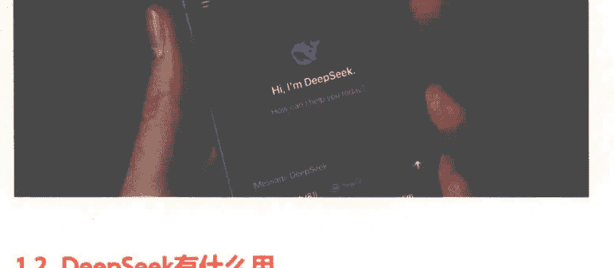

#### 1.2 DeepSeek有什么用

**问答对话：** 直接对话解决难题，如“帮我写个病假条，要显得严重但别被HR识破”。

**文案生成：** 自动生成周报/策划案/小红书文案。比如，输入“七夕奶茶店活动”，5分钟输出完整执行方案。

**爆款脚本：** DeepSeek能快速分析热门话题和用户喜好，帮你抓准流行趋势。自动生成吸睛标题、冲突情节和反转点，提升内容吸引力，让脚本更易引发共鸣和传播。

**流量赋能：** 它能分析平台算法偏好，优化内容发布时间和关键词。利用数据分析用户行为，精准调整投放策略，提升曝光率，引导自然流量增长，同时降低试错成本。

爆款陷阱。

**任务管理：** 智能拆分复杂项目。比如，把“产品发布会”拆解成13个待办事项。

**学习助手：** 文献速读+考点提炼，30篇论文5分钟提取知识框架，附送答辩常见问题库。

**商业决策：** 输入店铺位置和租金，预测周边消费力并推荐定价策略，提供经营建议。

#### 1.3 为什么DeepSeek这么火

##### 1.3.1 更懂中国人的AI管家

DeepSeek对中文的理解，是完胜其他AI模型的。它不仅能听懂“摸鱼”“躺平”等网络流行语，还能自动识别东北话、四川话等方言指令。针对本土需求开发特色功能：帮小老板生成《夜市摆摊指南》，给宝妈定制《家长群发言话术库》，甚至能结合最新政策解读社保缴纳攻略。在电商客服、公文写作等场景中，专业术语识别准确率达98%，比国际竞品更懂“中国特色需求”。

> ● **实战验证**

餐饮老板输入“帮我撑个难搞的供货商”，DeepSeek自动生成三套话术：强硬版引用《食品安全法》条款，委婉版用“最近生意难做”打感情牌，折中版提出“先付50%货款+赠送新品试吃”的解决方案。

大学生用四川话提问“毕业论文哪个写吗？”DeepSeek不仅提供关于论文框架的建议，还推荐川渝地区特色案例库。

##### 1.3.2 流量获客“永动机”

简单地说，DeepSeek可以帮品牌和个人降低做流量的成本，百倍提升内容产出的质量和效率；可以帮你自动生成吸引人的图文/视频内容（如爆款带货文案、热门短视频脚本），还能根据不同平台的特点，为你精准生成用户爱看的内容，还会根据点赞、评论等数据调整策略，让你少花冤枉钱。

> ● 实战验证

比如，卖货的博主用AI分析哪些商品好卖、直播时怎么说话更打动观众，实测结果显示销量提升了30%以上。

比如，你开奶茶店，用AI生成朋友圈晒产品的图文话术，结果新客增加了25%，老客回头率提升了18%。

##### 1.3.3 逻辑狂魔附体

面对“奶茶店月亏3万，如何止损？”这类复杂问题，AI可以在5分钟内输出带数据支撑的解决方案：从原料损耗分析到爆品重组建议，自动生成带成本核算表和风险预案的15页诊断报告。实测处理商业咨询类任务时，DeepSeek给出的方案的落地转化率比其他同类工具高40%，推理链条完整度堪比专业顾问。

> ● 实战验证

杭州某高校奶茶店在经营中发现，每周三下午订单量总会突然暴跌70%，用DeepSeek结合高校的课程表分析后，发现是“周三全天实验课”导致客源流失。于是建议老板推出“实验报告急救套餐”（奶茶+打印服务+数据模板U盘），成功将低谷时段营收提升120%。

##### 1.3.4 免费生产力外挂

个人用户永久免费使用全部功能，企业API调用成本仅为行业均价的1/3。某创业团队实测结果：用DeepSeek处理客服咨询+营销文案+数据分析，综合效率提升3倍，年度人力成本节省超12万元。开发者接口按实际使用量计费，10元就能进行2000次智能问答，性价比碾压其他付费工具。

> ● 实战验证

摆摊卖淀粉肠的小贩，用语音输入“帮我算一下今天该准备多少根肠”，直接获得带天气、周边人流数据的备货建议，省去购买餐饮管理软件的费用。

大学生用免费版生成小组作业PPT，自动匹配学校Logo和导师偏好的学术风格，比专业设计公司出稿更快。

从早点摊到上市公司，DeepSeek正在重新定义生产力工具——让最不懂技术的人，也能用自然语言获取专业级解决方案。


#### 1.4 快速上手DeepSeek

##### 1.4.1 如何下载注册电脑版DeepSeek

1. 在浏览器里输入官方网址：https://chat.deepseek.com/
或登录官方客户端：https://download.deepseek.com/app/
或网页搜索“腾讯元宝”，选择DeepSeek深度思考模式
地址：https://yuanbao.tencent.com/evt/dl?tridChannel=baidu.pcpz.x&pkgChId=3003

2. 打开DeepSeek，选择手机验证码登录，或者是扫码登录，操作完成后会自动注册并登录。

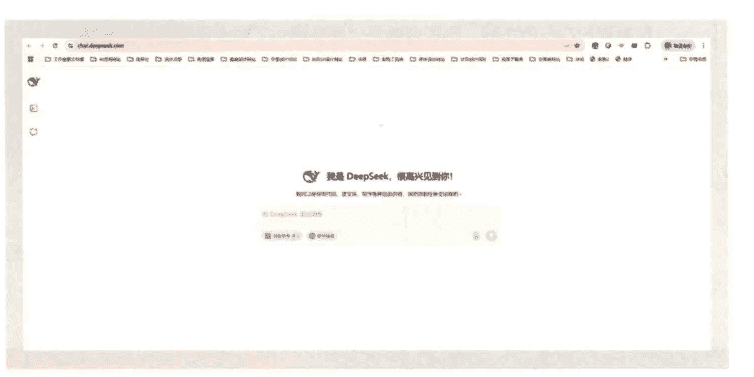

##### 1.4.2 如何下载注册手机版DeepSeek

1. 打开手机的应用市场，搜索DeepSeek，并下载DeepSeek App
2. 用手机号码或者微信注册

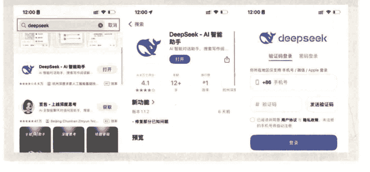

##### 1.4.3 如何使用DeepSeek

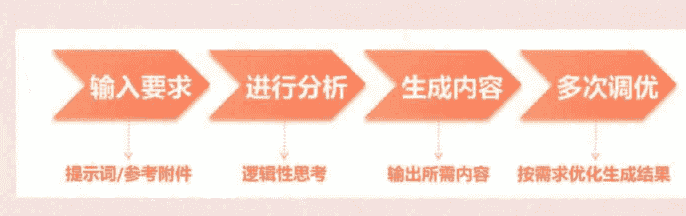

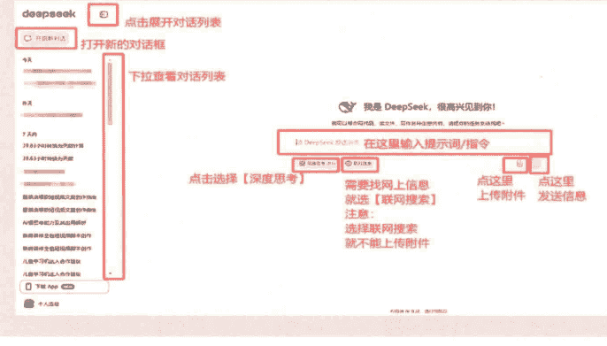

## 第二章

### DeepSeek爆改文案

灵感10秒快速成稿，批量生产爆款内容

使用AI工具做文案，可以提升写作效率。90%的用户体验之后表示，这种智能写作方法，可以让他们的创意捕捉更轻松，进而快速生成初稿，节省大量时间。人们能够从繁重的工作中抽身出来，有更多时间去思考价值创造。

#### 2.1 案例1 知名美妆品牌“AI+文案”做新品，社媒话题量增长35%

● 案例背景

某全球知名的美妆品牌，近年来希望通过数字化手段提升社交媒体营销效果，尤其是在新品推广和用户互动方面。该品牌引入AI技术，结合智能文案生成工具，优化其社交媒体内容。


☑ 取得的结果

通过“AI+文案”的方式，该品牌在海外社交媒体上的互动率提升了40%，新品“眼霜”的社交媒体话题量增长了35%，并直接推动了该产品在上市首月的销量增长。

⊗ 具体做法

**AI数据分析：** 该品牌使用AI工具，分析了社交媒体上用户对眼霜类产品的讨论热点，发现“抗衰老”“淡化细纹”“性价比”是用户最关心的关键词。

**智能文案生成：** 基于这些关键词，该品牌使用AI文案生成工具，自动生成了多条文案，如“告别细纹，年轻只需一‘抹’！××眼霜，抗衰老黑科技，性价比之王！”

**A/B测试：** 该品牌将AI生成的文案与人工撰写的文案进行A/B测试（分成A组和B组），最终选择了互动率最高的文案进行大规模投放。

**动态优化：** 在投放过程中，实时监测用户反馈，并根据数据动态调整文案内容。例如，增加“限时优惠”等促销信息，进一步提升转化率。

###### 方法论总结

> “AI+文案”提效模型

**AI数据分析+智能文案生成+A/B测试+动态优化**

**= 高效营销**

#### 2.2 案例2 成都小型独立咖啡店，粉丝月增长60%

● 案例背景

有一家位于成都的小型独立咖啡店，店主希望通过社交媒体吸引更多年轻人到店消费。由于预算有限，店主决定尝试“AI+文案”的方式，提升线上曝光率和线下转化率。

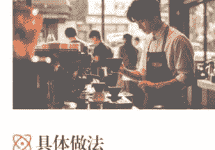

☑ 取得的结果

通过“AI+文案”的方式，咖啡店的微信公众号粉丝数在一个月内增长了60%，到店顾客数量增加了25%，且顾客的复购率显著提升。

具体做法

**AI内容推荐：** 店主使用AI工具，分析了成都本地年轻人常讨论的热门话题，发现“小众咖啡”“打卡拍照”“健康生活”是近期热门。

**文案生成：** 基于这些话题，店主使用AI文案生成工具，自动生成了多条文案，如“来××咖啡店，打卡成都最‘上镜’的角落！每一杯咖啡，都是健康生活的开始！"

**社交媒体投放**：店主将这些文案发布在微信公众号和小红书上，并配合“拍照打卡送咖啡”的活动，吸引用户到店消费。

**用户互动**：利用AI工具，回复用户的评论和私信，提升用户互动率。

###### 📋 方法论总结

##### “AI+文案”变现模型

**AI内容推荐+文案生成+社交媒体投放+用户互动 = 线下转化**

#### 2.3 案例3 自由职业设计师巧用AI设计，项目接到手软

● **案例背景**

李小姐是一名自由职业设计师，希望通过社交媒体展示自己的作品，吸引更多客户合作。由于时间有限，她决定使用“AI+文案”的方式，来提升个人品牌的曝光率和客户转化率。


☑ **取得的结果**

通过“AI+文案”的方式，李小姐的小红书粉丝数在两个月内增长了80%，接到了6个新的设计项目，收入增加了40%。

##### 具体做法

AI内容分析：李小姐使用AI工具，分析了设计行业的热门话题，发现“极简风设计”“品牌视觉升级”“Logo设计”是近期热门。

文案生成：基于这些话题，李小姐使用AI文案生成工具，自动生成了多条展示自己作品的文案，如“极简风Logo设计，让你的品牌一眼难忘！点击查看我的最新案例！”

内容发布：李小姐将这些文案与作品图片一起发布在小红书和Behance上，并定期更新，保持活跃度。

客户沟通：AI工具还帮助李小姐回复潜在客户的咨询，提升了沟通效率。

###### 方法论总结

> “AI+文案”增收模型
AI内容分析+文案生成+内容发布+客户沟通
= 个人品牌增值

#### 2.4 实操攻略：零基础AI写作速成指南

##### ★ 高效提问法则

-   法则一：需求明确化
×错误示例：“帮我随便写点东西。”
√正确姿势：“我需要一封应聘市场营销经理的求职信，突出5年品牌策划经验及成功案例。”

-   法则二：补充背景信息
×错误示例：“整理一下这份报告。”
√正确姿势：“这是一份2023年Q4电商平台用户行为报告，请提炼出复购率与促销活动关联性的关键结论（附Excel表格）。”

###### 法则三：格式清晰化

×错误示例：“设计几个活动方案。”

√正确姿势：“请以分点形式列出3种中秋节线下快闪店活动方案，需包含执行步骤、预算分配及风险预估。”

###### 法则四：内容精简化

×错误示例：“展开讲讲。”

√正确姿势：“请用150字简述人工智能的发展趋势，面向非技术背景的中学生群体。”

###### 法则五：反馈与修正

若对回答不满意，可回复：

“方案创意不足，请增加3个差异化亮点。”

“请将第三部分的语言风格调整为口语化表达。”

##### 2.4.1 爆款文案&脚本改写

###### ★ 基础改写流程

步骤1 打开DeepSeek。

步骤2 输入原始文案：粘贴需要改写的文字。

> 示例输入
原稿：我们的产品采用先进纳米技术，能有效去除99.9%的细菌，保护家人健康，现在购买享8折优惠。

步骤3 设置改写指令（关键步骤）。

| 改写类型 | 指令模板 | 输出示例 |
| :--- | :--- | :--- |
| 风格调整 | “将以下文案改写成（年轻化/专业感/接地气）风格” | “这黑科技纳米涂层超能打！灭掉99.9%细菌，全家健康buff加满！冲就完事，现在剁手直接砍价20%！” |
| 口语化改写 | “用小红书博主语气优化文案” | “救命！这个纳米抗菌神器真的绝！实测干掉99.9%细菌！本宝妈狂囤3瓶，现在入坑立省20%！” |
| SEO优化 | “植入关键词：健康家电、家庭防护、6·18优惠” | “【健康家电必入】纳米抗菌技术守护全家！家庭防护升级首选，6·18限时8折，除菌率高达99.9%！” |
| 情感强化 | “增强紧迫感和稀缺性” | “纳米抗菌黑科技最后36小时特惠！错过今天再等1年！已有2356个家庭抢先体验，库存告急！” |

步骤4 优化生成结果：对生成结果不满意，可以多次提要求。比如，“太短了，扩写一下，不少于500字”“三段式输出”等。调整优化后，可以得到更满意的结果。

生成界面展示如下。

我们的产品采用先进纳米技术，能有效去除99.9%的细菌，保护家人健康，现在购买享8折优惠。
将以上文案改写成[年轻化/专业感/接地气]风格

已深度思考 (用时 17 秒)

嗯，用户让我把一段文案改写成年轻化、专业感和接地气的风格。首先，我需要理解原文的核心信息：产品使用纳米技术，能去除99.9%的细菌，保护家人健康，现在有8折优惠。

接下来，分析每个风格的要求。年轻化可能需要更活泼，有网感的语言，比如使用流行词汇或表情符号。专业感要保持可信度，可能需要强调技术权威和数据。接地气则需要更贴近日常用语，让受众感觉亲切。

然后，考虑如何平衡这三个风格。年轻化和接地气有时可以结合，比如用口语化的表达，但专业感可能需要加入权威的数据或认证，可能需要分句处理。比如开头用吸引年轻人的词汇，中间加入专业的数据支持，结尾用激励的促销语。

还要注意目标受众，年轻化的文案可能针对的是20-35岁的群体，他们喜欢简洁、有活力的表达。专业感可能需要引用权威机构或具体的数据，比如“SGS认证”来增加可信度。接地气的话，可以用“细菌全家桶”这样的比喻，让信息更易理解。

然后检查原文的结构，可能需要调整顺序。比如先突出效果，再讲技术，最后促销，或者用疑问句开头引起注意，比如“还在担心细菌搞事情？”这样更吸引人。

还要考虑使用符号或排版，比如表情符号、感叹号来增强年轻化的感觉。同时，保持句子简短有力，避免过于复杂的结构。

最后，整合这些元素，确保信息准确传达，同时符合三种风格的混合。可能需要多次调整，找到合适的平衡点，让文案既有活力又不失专业，还让人感觉亲切自然。

【年轻化风格】
“纳米黑科技暴击细菌！99.9%团灭率守护全家，现在剁手立省20%！细菌君退退退！🦠✨”

【专业感风格】
“采用ISO认证纳米级抗菌技术，经SGS实验室检测对大肠杆菌/金黄色葡萄球菌等致病菌灭杀率达99.93%，现限时开放行业专享价。”

【接地气风格】
“细菌全家桶退散神器！隔壁老王都装了的纳米防护盾，三胎家庭实测有效，现在下单直接打八折！”

【三合一混合版】
“还在担心细菌搞事情？🔬中科院同款纳米技术出手了！实验室报告显示干翻99.9%常见病菌，现在上车立砍20%预算，给全家穿件隐形防护甲！”

每个版本都保留核心卖点：

+   1. 年轻化：使用“黑科技”“暴击”“团灭”等游戏化语言，配合表情符号
2. 专业感：强调认证机构、具体菌种和精确数据
3. 接地气：采用“全家桶”“隔壁老王”等生活化比喻
4. 混合版：用疑问句制造互动感，穿插专业背书和日常比喻，结尾用“隐形防护甲”强化产品价值

###### ★ 高级改写技巧

01 数据强化改写

指令：“在文案中加入对比数据，提升可信度”

原句：充电速度更快。

改写：比普通充电器提速300%，实测25分钟充满5000mAh电池（某品牌实验室数据）。

02 场景化植入

指令：“添加办公室/母婴室/健身房使用场景”

原句：降噪耳机保护听力。

改写：健身房器械轰响？地铁里人声嘈杂？××降噪耳机智能识别85种噪声，戴上瞬间切换到静音模式！

03 痛点解决方案

指令：“用问题—解决结构改写”

原句：我们的洗衣液去污力强。

改写：咖啡渍、口红印、宝宝尿渍总洗不净？××生物酶洗衣液3步分解顽固污渍，实验证明去污力超国标3倍！

04 平台适配改写

| 平台 | 改写要点 | 示例指令 |
| --- | --- | --- |
| 抖音 | 前3秒悬念+高频感叹号 | “添加‘你一定不知道’开头，每10字加emoji” |
| 公众号 | 故事化开头+数据论证 | “用‘去年有个宝妈发现……’引出产品” |
| B站 | 玩梗+二次元元素 | “融入‘肝帝’‘暴击’等游戏术语” |

05 热点借力改写

指令：“结合最近（淄博烧烤/酱香拿铁）热点优化”

输出示例：比酱香拿铁还上头！这瓶纳米除菌喷雾24小时守护餐桌安全，淄博烧烤店同款！

06 地域化适配

指令：“加入上海本地化元素”

原句：配送覆盖全国。

改写：静安寺30分钟送达，外滩夜景配送可视化，全上海256个社区即点即送！

##### 2.4.2 文档分析

###### ★ 文档基础操作流程

-   步骤1 打开DeepSeek。

-   步骤2 文档准备，确保文档为支持的格式（如PDF、DOCX、TXT等）。文档大小通常限制在100MB以内（不同版本可能不同）。

-   步骤3 单击回形针图标，上传准备好的文档（注意：“联网搜索”功能开启时，回形针图标变灰，就不能上传文件）。

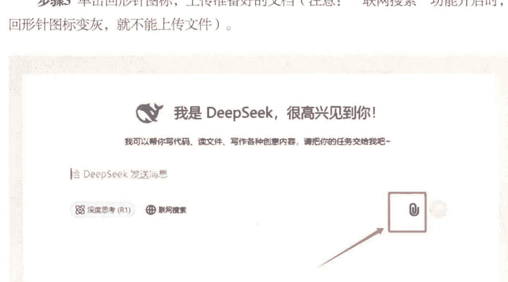

步骤4 等待文档上传成功。

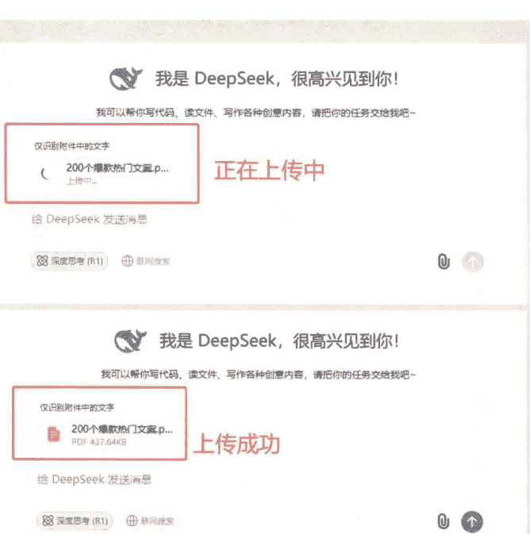

步骤5 输入分析指令。

在对话框中输入分析指令，例如：
总结文档：“请用200字总结这份文档的核心内容。”
提取关键信息：“列出文档中提到的所有技术术语。”
问答：“根据文档，说明××技术的三个优势是什么？”
按回车键或单击【箭头】图标获取分析结果。

分析界面展示如下。

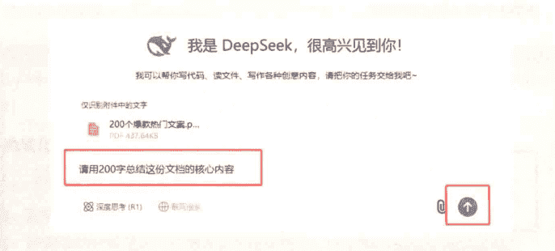

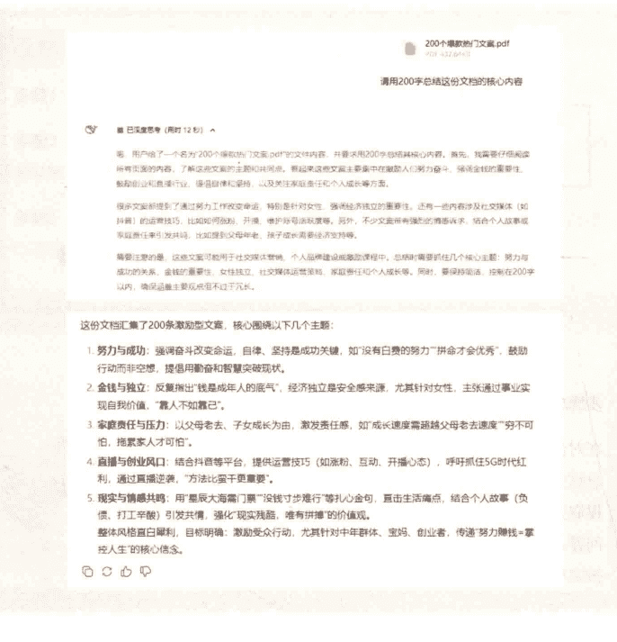

###### ★ 文档进阶分析技巧

多文档对比——上传多个文档后提问：“对比A文档和B文档在研究方法上的差异。”

结构化输出——指定格式：“将分析结果整理为表格，包含页码、关键词和解释。”

深度学习功能——使用自然语言指令：“找出文档中所有矛盾的观点并评估其逻辑性。”

##### 2.4.3 写公众号

###### ★ 先搞清楚微信公众号的四大核心特性

-   ● 私域流量
精准用户群体：可自主运营特定目标用户，降低获客成本。
高黏性互动：通过内容和服务增强用户忠诚度与活跃度。
品牌化运营：强化品牌形象，建立用户信任与长期关系。

-   ● 深度阅读
完整阅读体验：支持长图文、视频等格式，提供连贯内容。
沉浸式内容消费：无干扰界面设计，提升用户专注度。
高质量内容倾向：吸引深度用户，鼓励优质原创内容输出。

-   ● 规范体系
内容审核机制：确保内容合法合规，符合平台政策。
发布流程标准化：从编辑到发布有明确操作规范。
运营规则明确：界定账号权限与行为边界，维护生态秩序。

###### ● 互动机制

评论与点赞：用户可直接反馈，增强内容参与感。
赞赏支持：为创作者提供变现渠道，激励优质内容。
转发分享：通过社交裂变扩大传播范围，提升影响力。

###### ★ 再结合AI实现从账号分析到内容产出全流程

###### 1.账号分析

-   （1）打开微信公众号后台，找到“数据分析”—“用户分析”—“用户属性”，截图保存。
（2）打开DeepSeek，上传截图，输入提示词“请根据这张截图，分析我的公众号粉丝画像”。
（3）等待生成结果。

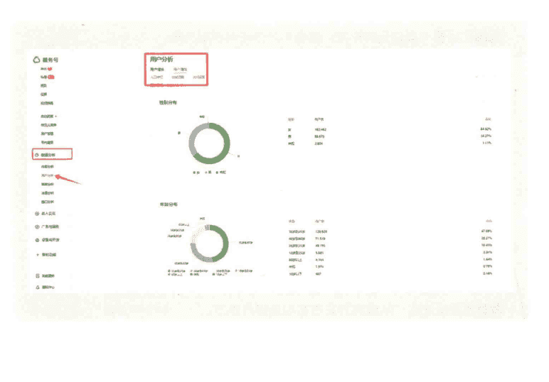

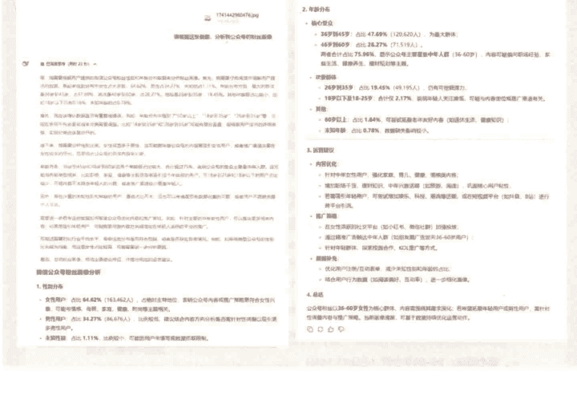

###### 2.继续追问

###### 追问提示词示例

根据这个粉丝画像，分析这些人群的关注点和需求点，分析他们的痛点、痒点、爽点分别是什么？我如何把握这些点，去创造爆款公众号文章？

请帮我分点输出，同时举例子说明，使用小白能够看懂的语言表达。

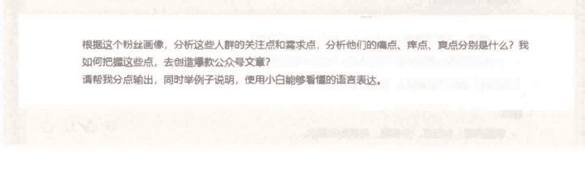

好的，我现在需要根据用户提供的公众号粉丝画像，分析他们的关注点、需求点，以及痛点、痒点、爽点，然后给出如何利用这些点来创造爆款文章的建议。首先，我需要回顾一下用户给出的数据：

性别分布中，女性占64.62%，男性34.27%；主要年龄在36-60岁，尤其是36-45岁占比近一半，这说明核心用户是中年女性，可能关注家庭、健康、职场、理财等方面；次要群体是26-35岁，年轻人占比较少。

接下来，我需要理解什么是痛点、痒点、爽点：

-   - **痛点**：用户迫切需要解决的问题或困扰，可能带来负面情绪。
- **痒点**：用户潜在的欲望或未被满足的期待，不一定紧急但能引发兴趣。
- **爽点**：能够即时满足用户需求，带来愉悦感的解决方案。

然后，我需要结合核心用户的特点来推测他们的关注点和需求：

-   - **中年女性**（36-60岁）：可能关注家庭管理（如子女教育、夫妻关系）、健康保养、职场压力（如中年转型）、理财规划（如家庭财务）、自我提升（如兴趣培养）等。
- **中年男性**（虽然占比较少，但需考虑他们的需求）：可能关注职场发展、健康问题、家庭责任等。
- **年轻人**（18-35岁，尤其26-35岁）：可能关注职业成长、婚恋问题、消费指南、个人兴趣等。

现在需要逐一分析每个群体的痛点、痒点、爽点，并举例说明如何转化为文章主题：

###### 一、核心群体：36-60岁女性（占比75.96%）

-   1. 痛点（急需解决的问题）：
   - 家庭矛盾：孩子叛逆期不听话、婆媳关系紧张、夫妻沟通少。
     例子：标题《孩子顶嘴怎么办？3句话让叛逆期娃主动认错》。
   - 健康困扰：更年期失眠、关节疼痛、身材走样。
     例子：内容“每天10分钟瑜伽，50岁阿姨腰围瘦了10cm”。
   - 财务压力：家庭开支大、存钱难、养老焦虑。
     例子：《普通家庭月省3000元的5个技巧，主妇必看！》
2. 痒点（潜在欲望）：
   - 自我提升：想学新技能但没时间，比如烘焙、插花。
     例子：《周末2小时学会网红蛋糕，朋友圈点赞破百》。
   - 生活品质：希望家里更整洁、仪式感更强。
     例子：《不花钱！用旧物改造让客厅高级感翻倍》。
   - 外貌年轻：如何看起来比同龄人更显年轻。
     例子：《45岁像35岁？坚持这3个习惯，皱纹少一半》。
3. 爽点（即时满足）：
   - 快速解决问题：一招见效的育儿妙招、省钱技巧。
     例子：《孩子写作业拖拉？1个表格让他效率翻倍》。
   - 情感共鸣：真实故事引发共情，比如“全职妈妈逆袭”。

###### 二、次要群体：26-35岁年轻人（占比19.45%）

-   1. 痛点：
   - 职场内卷：加班多、升职难、同事关系复杂。
     例子：《领导偏心怎么办？3招让你成办公室“红人”》。
   - 婚恋压力：被催婚、相亲失败、恋爱矛盾。
     例子：《相亲10次总结的避坑指南，看完脱单率翻倍》。
   - 消费陷阱：网红产品踩雷、月光族存不下钱。
     例子：《这5类商品千万别买！年轻人省钱必看》。

###### 2. 痒点：

副业赚钱：想搞钱但找不到靠谱途径。
例子：《上班族月赚5000+的副业，每天只需1小时》。

个人成长：提升颜值、情商、职场技能。
例子：《说话总得罪人？3个公式让你秒变高情商》。

###### 3. 爽点：

捷径攻略：简单粗暴的方法，比如“7天学会PS”。
例子：《PPT做不好？这5个模板让你秒变大神》。

反差故事：普通人逆袭经历，激发斗志。
例子：《月薪3000到3万，我靠这3个习惯改变人生》。

###### 三、如何创造爆款文章？

###### 1. 标题公式：

痛点+数字+结果：
《婆媳吵架10年，我用1句话让婆婆主动道歉》。

痒点+悬念：
《不节食不运动，她靠这个方法瘦了20斤》。

爽点+福利：
《免费领！2024最新理财表格，家庭存款翻倍》。

###### 2. 内容结构：

开头戳痛点：用真实场景引发共鸣。
例：“每天辅导作业到崩溃？你是不是也这样？”

中间给方案：分步骤、列清单、配图片。
例：“3个沟通模板，让孩子主动写作业”。

结尾促互动：引导留言、转发、点赞。
例：“你在育儿中遇到过什么问题？评论区告诉我！”

###### 3. 爆款元素：

实用性：直接给工具（如表格、模板）。

情感性：用故事代替说教。

即时性：强调“马上能用”“立刻见效”。

###### 四、总结

抓住中年女性的家庭、健康、省钱需求，年轻人的搞钱、变美、脱单痛点，用“真实故事+具体方法+超值福利”的模式创作文章。标题要直击痛点，内容要像朋友聊天一样接地气，最后让读者觉得“这文章就是为我写的”！

###### 3.内容产出

（1）从上述内容中，选取一个爆款文章标题。

（2）让DeepSeek输出完整的公众号文章，可以附加要求，如风格要求、字数要求等。

> 提示词示例：请以《领导偏心怎么办？3招让你成办公室“红人”》为标题，写一篇公众号爆款文章，不少于1000字。

二、次要群体：26-35岁年轻人（占比19.45%）

-   1. 痛点：
- 职场内卷：加班多、升职难、同事关系复杂。
- 婚恋压力：被催婚、相亲失败、恋爱矛盾。
- 消费陷阱：网红产品踩雷、月光族存不下钱。

-   例子：
- 《领导偏心怎么办？3招让你成办公室“红人”》。
- 《相亲10次总结的避坑指南，看完脱单率翻倍》。
- 《这5类商品千万别买！年轻人省钱必看》。

请以《领导偏心怎么办？3招让你成办公室“红人”》为标题，写一篇公众号爆款文章，不少于1000字

好的，我需要根据用户提供的标题《领导偏心怎么办？3招让你成办公室“红人”》来撰写一篇不少于1000字的公众号爆款文章。首先，我需要明确文章的结构和内容方向。标题中提到了“领导偏心”和“成为办公室红人”这两个核心点，因此文章需要围绕这两个主题展开。

###### 《领导偏心怎么办？3招让你成办公室“红人”》

开头：扎心场景引发共鸣

> “明明我加班最多，领导却把升职机会给了同事小王！”
“开会时提了10个方案，领导只夸了小李的‘不痛不痒’的点子……”
“领导总让关系户负责重要项目，我累死累活却像透明人！”

你是不是也经历过这种“领导偏心”的委屈？

别急着骂领导“不公平”，今天教你3招，不用拍马屁、不搞小动作，光明正大成为办公室“红人”！

###### 一、为什么领导会偏心？

很多人以为领导偏心是因为“看脸”“关系户”，其实真相更扎心：

-   1. 领导也是人，本能喜欢“省心”的下属
- 你汇报时总说“遇到了困难”，同事却能说“我解决了3个问题”；
- 你总等领导安排任务，同事已经提前把方案递到桌上。

###### 二、3招逆袭：从透明人变“红人”

####### 第1招：用“老板思维”打工，让领导离不开你

普通员工：只关心“我的任务完成了没”。
高手：永远多想一步——“领导下一步要什么？”

具体操作：

1. 开会时当“捧哏王”
   - 领导问“大家有什么建议？”别沉默！哪怕只说：“我觉得张经理提到的成本问题很重要，我补充一个数据……”
   - 举例：同事小林每次开会都接住领导的话头，半年后成了领导的“御用会议记录员”。
2. 汇报时用“选择题”代替“问答题”
   - 错误示范：“客户投诉了，怎么办？”
   - 正确示范：“客户投诉了，我有两个方案：A方案成本低但见效慢，B方案需要预算但能快速解决。您更倾向哪种？”
3. 主动背“黑锅”（心机版）
   - 项目出了问题，第一时间说：“责任在我，我马上协调解决！”
   - 注意：说完立刻给出补救计划，让领导看到你的担当。

效果：领导会觉得你“省心又靠谱”，重要的事自然先想到你！

####### 第2招：把同事变成“助攻”，而不是对手

办公室最傻的行为：和同事抢功劳、斗心眼。真正聪明的人，都在“借力打力”。

具体操作：

1. 公开夸同事，给领导“暗示”
   - 例：“这次项目能成功，多亏了小王通宵改设计稿！”
   - 小心机：领导会觉得你“大气有格局”，同事也会更愿意帮你。
2. 关键时刻“送人情”
   - 同事被领导骂时，递张纸巾说：“我上次也犯过这种错，后来是这样解决的……”
   - 结果：同事可能成为你的“隐形盟友”，下次帮你说话。
3. 组队时“绑定”实力派
   - 主动和能力强、人缘好的同事合作，项目成了功劳共享，输了也有人分担。

案例：实习生小美总帮同事带咖啡、整理资料，后来竞聘转正时，全部门都给她投票！

####### 第3招：学会“刷存在感”，但别招人烦

天天在领导面前晃，可能被骂“戏精”；完全不露面，又会变成小透明。怎么把握分寸？

具体操作：

1. 每周发一次“简洁版”周报
   - 模板：“本周完成3项任务+1个创新点+下周1个计划”。
   - 举例：
     “领导，本周我完成了客户数据分析（附图表），发现A产品复购率下降5%，建议下周重点跟进，您看是否可行？”
2. 朋友圈“选择性营业”
   - 发加班照配文：“连续三天赶方案，终于通过啦！”（领导看到会觉得你努力）
   - 发培训照配文：“周末充电，希望下周能帮团队做得更好！”（暗示积极态度）
3. 偶尔“麻烦”领导
   - 例：“领导，您上次提到的行业报告对我启发很大，能不能再推荐两本书？”
   - 心机：让领导觉得“被需要”，同时展示你的上进心。

效果：领导会觉得你“认真又有想法”，升职加薪时自然优先考虑你！

###### 三、真实案例：从边缘人到部门红人

背景：90后女生阿琳，入职2年一直没有存在感，领导甚至记不住她的名字。

逆袭操作：

1. 用“周报”刷存在感：每周五下班前发3行字总结，坚持3个月后，领导主动问她：“你这个月的数据分析做得不错，有没有兴趣负责新项目？”
2. 关键时刻“补位”：同事搞砸客户提案时，她连夜做出备用方案，第二天说：“我试着补充了一些内容，您看看能不能用？”
3. 绑定领导需求：发现领导总为会议纪要头疼，她自学AI工具，把3小时的工作缩到30分钟，从此成为“会议救星”。

结果：一年后升职主管，领导公开说：“我就喜欢阿琳这种“能扛事”的人！”

###### 结尾：你的职场运气，藏在“价值感”里

领导偏心不可怕，可怕的是你只会抱怨“不公平”。
记住：职场没有“怀才不遇”，只有“价值不足”。

今日行动：

1. 写下最近一次领导表扬同事的原因，对比自己差在哪里；
2. 从明天起，每周主动向领导汇报一次进展（哪怕只是3句话）。

留言互动：
“你遇到过领导偏心吗？用了什么方法解决？评论区聊聊，点赞最高的送《职场高情商话术手册》！”

##### 2.4.4 写小红书

###### ★ 走出做小红书的误区

在小红书月活突破3亿的当下，如何高效获取流量？

核心用户洞察：平台3亿月活用户中，年轻用户占据主导地位（“95后”占50%，“00后”占35%），超半数集中在一、二线城市。

● 数据显示

- 90%内容由8000万以上用户自主创作（UGC）
- 69.8%用户通过平台获取消费决策信息
- 32.1%用户将其作为生活搜索工具
- 44.5%用户用于知识技能学习

###### ☒ 常见认知误区及分析

- 日更限制论：认为单日只能发布1条内容
- 盲目追热点：忽视内容垂直度
- 过度包装：商业海报式封面降低了点击率
- 跨平台复制：忽略小红书独特社区氛围
- 无账号定位：内容杂乱无主题
- 企业号无效论：错失官方流量扶持

###### 科学运营策略

- 精准定位：打造差异化内容标签
- 高频更新：保持算法活跃度（建议日更两三条）
- 场景化表达：构建“真实使用体验”分享感
- 智能工具：运用DeepSeek实现选题/文案/数据全链路优化

###### 用AI高效写爆款笔记

对于做小红书而言，DeepSeek = 选题规划+吸睛标题+内容产出

####### 1. 选题规划：打开DeepSeek，打开“深度思考” + “联网搜索”功能。

参考以下几个角度，在DeepSeek上输入提示词。

- 请帮我分析小红书近期爆款笔记：
  - 热门内容拆解：分析小红书最近超过10万浏览量的爆款笔记，总结这些内容共同的主题（比如穿搭、家居、职场），摸清现在大家最爱看什么。
  - 互动秘诀挖掘：挑出评论区特别热闹的笔记，研究他们用了什么方法让大家愿意留言（比如提问、争议话题、情感共鸣），学会带动用户讨论的技巧。
  - 个人特色打造：根据特长和兴趣（比如美妆、读书、健身），找到和别人不一样的定位，用真实性格+专业知识让粉丝记住你的点。
  - 赚钱能力分析：对选题进行商业价值分析，预测其潜在的变现能力，判断内容能不能接广告、带货或做知识付费，比如测评类容易接品牌合作，教程类适合卖课，提前规划变现方向。
  - 对手经验借鉴：研究同领域粉丝多的账号，看他们发什么内容火、怎么和粉丝互动，模仿优点同时找到自己的独特风格。

####### 生成选题规划。

######## 一、热门内容拆解：用户偏好与主题趋势

近期小红书爆款笔记（浏览量超10万）的共性主题可归纳为以下几类：

1. 实用干货型
   - 学科资料与备考技巧：如“高考数学解题模板”“医学考研复习规划”，结合图文、PPT、视频等形式，内容结构清晰，强调可操作性。
   - 变美与生活技巧：例如“一周祛痘印攻略”“低成本打造ins风家居”，通过前后对比图或步骤拆解增强说服力。
2. 情感共鸣型
   - 个人成长故事（如“从月薪5k到副业3w”“30岁裸辞创业”），通过真实经历引发用户代入感。
   - 争议性话题（如“职场PUA应对”“婚姻中的女性困境”），激发评论区讨论。
3. 热点结合型
   - 结合节日、考试季等时间节点（如“春节送礼清单”“考研冲刺周计划”）。
   - 蹭社会热点（如“AI工具测评”“碳中和生活方式”）。

用户偏好总结：内容需满足“实用价值+情感共鸣”，形式需视觉化（图文/视频混排），标题需直击痛点或制造悬念（如“10秒判断肤质”“月瘦5斤的懒人食谱”）。

######## 二、互动秘诀挖掘：如何让评论区“活”起来

高互动笔记的评论区运营策略包括：

1. 提问式引导
   - 结尾抛出开放式问题（如“你用过哪些踩雷产品？”“备考时最难的是什么？”），激发用户分享欲。
2. 争议性话题设计
   - 如“平价替代vs大牌”“全职妈妈是否浪费学历”，通过立场对立引发讨论。
3. 情感共鸣触发
   - 分享个人失败经历（如“面试被拒10次后，我悟了”），评论区常形成互助氛围。
4. 实用价值延伸
   - 在干货笔记中预留“隐藏技巧”（如“评论区抽3人送复习资料”），促使用户主动留言。
5. 及时回复与沉淀
   - 高频回复评论并精选优质留言，形成良性互动循环。

######## 三、个人特色打造：差异化定位策略

根据特长领域，建议从以下角度塑造个人IP：

1. 细分领域切入
   - 美妆：聚焦“敏感肌专属教程”或“黄黑皮穿搭”；健身：专攻“产后修复”或“办公室拉伸”。
2. 真实人设强化
   - 用个人故事增强可信度（如“985学姐的考研作息表”“油痘肌博主自救记录”）。
3. 内容形式创新
   - 知识类：用“思维导图+口语化解读”替代纯文字；
   - 生活方式类：结合vlog展示过程（如“独居女孩的一日三餐”）。

######## 四、赚钱能力分析：变现潜力评估

不同内容类型的商业化路径：

1. 测评类（如美妆/家电测评）
   - 变现方式：品牌合作（单篇广告报价约粉丝数×0.1-0.3元）、带货分佣。
2. 教程类（如备考/技能教学）
   - 变现方式：知识付费（专栏/训练营）、社群会员。
3. 生活方式类（如家居/旅行）
   - 变现方式：品牌植入、线下活动邀约。

关键指标：粉丝粘性（互动率>5%）、内容垂直度（标签精准度）、商业标签植入自然度（避免硬广）。

######## 五、对手经验借鉴：头部账号运营策略

1. 选题拆解
   - 分析同领域TOP账号的爆款笔记，提炼高频关键词（如“懒人”“平价”“逆袭”）。
2. 形式优化
   - 模仿热门封面风格（如“大字报标题+对比图”），但加入个人元素（如手写字体/专属IP形象）。
3. 互动技巧
   - 参考头部账号的评论区运营（如固定时间直播答疑、定期发起打卡活动）。
4. 差异化突围
   - 在同类内容中增加稀缺性（如“法学硕士的跨考经验”vs“普通备考攻略”）。

######## 总结与行动建议

- 内容优化：结合实用性与情感价值，强化视觉呈现（封面/排版）。
- 互动设计：主动引导讨论，善用热点与争议话题。
- 变现规划：根据内容类型提前布局合作资源（如入驻小红书蒲公英平台）。
- 工具辅助：使用AI工具（如简单AI）生成创意素材，提升生产效率。

通过以上策略，可实现从流量获取到商业变现的闭环，建议定期复盘数据（播放量、互动率、转化率），动态调整内容方向。

■ 点击生成的内容中的数字（红框中的部分），可以查看更多联网信息来源，为选题规划提供更多参考。

####### 2. 吸睛标题：从以上生成的选题中，选择一个合适的，让DeepSeek围绕这个选题，输出笔记标题（如果对标题不满意，可以输入你的修改意见，优化生成结果）。

###### 示例

> “变美与生活技巧：例如“一周祛痘印攻略”“低成本打造ins风家居”，通过前后对比或步骤拆解增强说服力”
围绕以上选题方向，给我提供10个爆款小红书笔记标题

######### 变美技巧类（祛痘印/护肤）

1. 🔥痘印党必看！28天低成本攻略，红黑印全消失｜附凝胶实测对比图
   （参考低成本祛痘印方法及产品推荐，强调周期+效果对比）
2. 痘印橡皮擦！壬二酸点涂法，7天见效｜油痘肌亲测无广
   （突出壬二酸成分的权威性和效果，吸引精准受众）
3. 手残党急救！5毛钱维生素E用法，痘印淡了80%｜附按摩手法
   （低成本+简易操作，利用天然成分吸引关注）
4. 医学生私藏！光子嫩肤平替法，宅家淡化痘印｜附护肤流程表
   （蹭医美热点，提供居家解决方案）
5. 戒掉挤痘！3步防痘印指南｜红肿痘急救+后期修复全攻略
   （痛点切入，强调预防与修复结合）

######### 生活技巧类（家居/收纳）

6. 百元改造ins风卧室！拼多多好物清单+布置技巧｜附前后对比
   （突出平价渠道和视觉冲击力，吸引租房党）
7. 旧衣架别扔！5种DIY神操作，秒变ins收纳神器｜0成本教程
   （利用旧物改造，强调创意与实用性）
8. 绿植杀手逆袭！10种懒人水培清单，客厅秒变北欧风｜附养护表
   （解决养植物痛点，提供易操作方案）
9. 出租屋秒变网红家！旧家具DIY攻略，0成本翻新｜附配色方案
   （针对租房群体，强调低成本改造）
10. 极简主义控必藏！1㎡角落改造法，打造治愈书桌｜好物链接
    （细分场景，吸引追求生活品质的用户）

######### 标题设计技巧总结

1. 痛点+解决方案：直击用户需求（如“痘印”“租房改造”），搭配具体方法增强可信度。
2. 数字量化：用“28天”“5毛钱”等数据提升专业感，降低决策成本。
3. 对比效果：通过“前后对比图”“红黑印全消失”等关键词制造视觉联想。
4. 场景化标签：如“油痘肌”“出租屋”，精准吸引目标人群。
5. 情绪调动：使用“🔥”“必看”“逆袭”等词汇激发点击欲。

建议结合自身内容方向选择标题模板，并搭配高清对比图/步骤流程图发布，进一步提升互动率！

####### 3. 内容产出：从以上笔记标题中优选出一个，生成最终笔记。

**出租屋秒变网红家！旧家具DIY攻略，0成本翻新｜附配色方案**
用以上标题，针对租房群体，强调低成本改造，输入一篇完整的小红书爆款笔记

🌟出租屋秒变网红家！0元爆改旧家具攻略+神仙配色，手残党也能逆袭！🏠
刷到就是赚到！毕业3年搬了5次家的租房党含泪总结——不用刷墙/不打钉/不花钱的爆改攻略，手把手教你用旧家具打造ins风小屋！（文末附万能配色公式）

🔨【旧家具逆天改命计划】
⚠️重点：万物皆可“布”贴+旧物叠buff！
1️⃣ 丑柜子重生术
🧱材料：废旧床单/窗帘布+双面胶
把布料裁剪成柜门尺寸，用双面胶贴出波浪褶皱边，秒变法式复古风！（比刷漆省力100倍）

🪑木桌变奶油甜品台
🪵材料：过期的身体乳+咖啡渣
1:1混合后厚涂桌面，打磨后立刻拥有做旧感！亲测比某宝200+的复古桌还绝（记得带手套操作）

🪑铁艺床架去年代感
🪵材料：垃圾捡的麻绳
螺旋缠绕床架+系流苏，搭配串灯瞬间田园风拉满（缠4cm宽效果最佳）

💡【全网跪求的万能配色方案】
🧶记住这个公式=70%背景色+25%主题色+5%点缀色
✅奶油杏子酱：米白墙纸+焦糖色地毯+青铜色花瓶
✅薄荷苏打系：浅灰床品+抹绿窗帘+明黄抱枕
✅低保真原木：藤编收纳+亚麻桌布+深咖装饰画
（💡进阶技巧：把手机调成黑白模式，家具明暗度协调才算成功！）

💡【50元内软装王炸组合】
·氛围组：pxx搜“瑕疵陶瓷花瓶”（3元/个）+小区薅的南天竹
·光影魔法：闲置台灯套蕾丝袜=温柔滤镜
·遮丑大法：用外卖袋折的收纳盒，贴上旧杂志内页

▌血泪经验TIPS
❶和房东签“改造协议”：拍照留证承诺恢复原状
❷慎用丙烯颜料！残留味道可能被扣押金
❸改造前用“色采”APP模拟效果（超准！）

改造完记得@我交作业呀！下期教你们用奶茶杯做落日灯～ 🥤
#租房大改造 #旧物改造 #家居配色 #出租屋好物 #抠门美学
@家居薯 @生活薯
（附对比图：改造前vs改造后的9宫格，重点展示布料贴柜子/麻绳床架/咖啡渣做旧桌细节）
🧶房子是租的，但生活不是！点赞收藏的宝子这个月必遇神仙房东！🫶

##### 2.4.5 写报告材料

###### ★ 需求分析与搭建框架

####### 1. 输入关键信息

需要给DeepSeek提供以下基本信息。
**使用场景：** 具体开什么会？（如季度总结会、项目动员会）
**核心内容：** 主要讲什么？（如布置任务、总结问题）
**目标对象：** 听众是谁？（如基层员工、合作单位、上级领导）
**领导习惯：** 喜欢怎么讲话？（爱用数据说话/喜欢举例子/擅长互动）

● **参考例子**

帮忙写个科技园区建设会的讲话稿，听众是管委会和入驻企业老板。领导喜欢先讲理论再讲实际，需要包含现状分析、外地成功案例对比、三年行动计划，按照“找问题—提办法—保落实”的结构来写。

####### 2. 生成基础框架

系统会自动生成包含三大部分的框架：
**开头**（问好+会议目的）
**主体**（当前情况+重点任务+具体做法）
**结尾**（明确责任+时间要求）
如有特殊需要，可以添加表彰环节或问答环节。

###### ★ 分段写作与内容填充

####### 1. 开头注意四个要点

1. 符合最新政策要求
2. 结合当地特色（比如，山区县可以强调生态资源）
3. 回应上级最新指示
4. 照顾所有听众（比如，同时提到乡镇干部和企业代表）

####### 2. 主体部分

**数字处理：** 把枯燥数据变得生动（例如，“招商进度比去年快了一个月”）。
**政策解释：** 翻译成听得懂的话（比如，将“‘放管服’改革”改成“简化审批手续”）。
**问题分析：** 收到材料后整理成三栏表格（问题现象/产生原因/解决办法）。
**结尾设计：** 结合行业趋势和单位特点（比如，物流公司可以讲智慧物流发展）。
**具体措施：** 要配上真实例子（比如，“建立督办小组，像去年处理防汛那样每周检查进度”）。

###### ★ 调整说话风格

1. 按领导习惯改
    - 理论型领导：多引用政策和专家观点。
    - 实干型领导：多用数字和进度表。
    - 亲和型领导：加些“大家辛苦了”这类暖心话。

2. 口语化三个技巧
    - 把长句子拆短。
    - 少用“被”字句（比如，不说“问题被解决”，而说“我们解决了问题”）。
    - 专业术语要解释（比如，“区块链技术”后面跟一句“就是数据防伪的新方法”）。

###### ★ 检查与修改

1. 逻辑检查
    - 重点看：前后数据是否一致（比如，前面说完成80%，后面不能变成70%）；问题和解决办法要对应（比如，缺人手的问题对应招聘计划）。

2. 精简内容
    - 删掉三类内容：重复的话、铺垫太长的部分、模糊表述（比如，把“尽快解决”改成“7月底前完成”）。

3. 校对
    - 用检查工具看三点：专业术语用得对不对、数字准不准、引用文件有没有写清楚出处。

> ● 重要提醒
> - 配合使用：AI写完后要让不同人把关（业务部门看内容、办公室调整格式、领导定方向）
> - 分步修改：定框架→加例子→打磨金句
> - 注意安全：重要数据要打码，引用政策要标明出自哪年哪号文件
> - 合理使用：AI内容不超过六成，关键部分（如人事任命、数据结论）必须人工确认

##### 2.4.6 智能代读

以下是利用DeepSeek高效拆解一本书的教程，每天只需几分钟，帮你智能读书，吃透书籍核心！


###### ★ 建立阅读地图

1. 上传书籍信息
    - 把书名、目录页、前言、结语拍照/截图给DeepSeek，并说明需求。
    - 指令示例：“请用表格整理《刻意练习》全书框架，包括三级目录（章→节→核心观点），用‘理论+生活案例’的形式呈现。”

2. 生成思维导图
    - 要求输出可视化结构。
    - 指令示例：“把《认知觉醒》拆解成‘问题场景—认知原理—行动方法’三列对照表，每部分用！标记重点章节。”

###### ★ 精准抓取核心

1. 关键问题挖掘
    - 让AI模拟读者提问，定位重点内容。
    - 指令示例：“假设我是职场新人，请列出《高效能人士的七个习惯》中最需要优先掌握的3个习惯，并说明如何在加班多的情况下实践。”

2. 核心内容提取
    - 用“三线法”浓缩章节：主线观点（1句话）、辅助案例（1个典型例子）、行动线索（1个可操作步骤）
    - 指令示例：“用三线法拆解《非暴力沟通》第四章，举的例子是基层员工能理解的场景。”

###### ★ 构建知识网格

1. 关联现实场景
    - 理论要联系具体情境。
    - 指令示例：“把《金字塔原理》中的SCQA模型，转化成向领导汇报工作进度的话术模板。”

2. 制定行动清单
    - 生成可直接执行的计划。
    - 指令示例：“根据《掌控习惯》中的内容，给我设计一个21天习惯养成表，包含每日微行动（适用于经常加班的人）。”

###### ★ 强化记忆与应用

1. 问答自测
    - 生成记忆闪卡。
    - 指令示例：“用《思考，快与慢》中的关键概念出10道判断题，正确答案后跟1个常见误解案例。”

2. 场景模拟
    - 让AI模拟实战演练。
    - 指令示例：“假设我要用《影响力》中的互惠原则谈合作，请生成客户可能提出的3种拒绝话术及应对方案。”

###### ★ 强化记忆与应用

1. 通勤听书版
    - 指令示例：“把《原则》第二章转化成5个坐地铁时能听完的音频脚本，每个片段3分钟，用讲故事的方式讲原则应用。”

2. 读书笔记模板
    - 指令示例：“生成《穷查理宝典》读书笔记模板，包含颠覆认知的观点（红色标记）、本周可尝试的方法（绿色标记）、存疑待查内容（黄色标记）。”

###### 3. 主题式阅读

指令示例：“我正在读《卓有成效的管理者》，请关联《这就是OKR》中的目标管理章节，对比两种方法的适用场景。”

###### ● 注意事项

1. 精准投喂：遇到复杂图表，单独拍照上传并标注“请解释这张增长曲线图与第三章结论的关系。”
2. 及时纠偏：发现AI理解错误时，用修正指令：“刚才关于双轨分析法的解释有误，原著第58页说的是……请重新整理。”
3. 输出管控：要求分段输出，避免信息过载：“每次只解析一个章节，用微信对话的形式呈现。”

#### 2.5 知识补给站：国内其他4大语言类AI运用大盘点

1. 豆包 专注于短视频的AI助手，依托抖音的海量数据，特别擅长生成热门视频脚本、智能剪辑建议。适合需要快速产出吸睛内容的创作者，但对复杂文本处理能力较弱。

| 对比维度 | 具体说明 |
| :--- | :--- |
| 核心优势 | ① 15秒生成抖音爆款脚本<br>② 内置1000多个热门BGM与运镜模板<br>③ 支持16国语言实时翻译 |
| 主要劣势 | ① 长文案容易重复套路<br>② 专业领域错误率较高（如法律文案） |
| 适用场景 | 短视频创作/跨境直播/热点跟拍 |
| 推荐用户 | 网红达人/跨境电商运营/新媒体小编 |


2. 文心一言 擅长写营销文案、解读政策文件，还能用方言互动。适合企业做宣传物料或政务科普，但英文内容生成水平一般，复杂逻辑容易出错。

| 对比维度 | 具体说明 |
| :--- | :--- |
| 核心优势 | ① 自动生成朋友圈爆款文案<br>② 方言识别准确率超90%<br>③ 直接调用百度百科数据库 |
| 主要劣势 | ① 英文生成质量不如中文<br>② 专业建议需人工复核（如医疗建议） |
| 适用场景 | 营销文案/政策解读/传统文化科普 |
| 推荐用户 | 市场策划/基层公务员/实体店商家 |

3. KIMI 专注长文本处理的AI工具，能一口气分析200万字的行业报告或法律文件，适合需要深度研究资料的学生和专业人士。虽然解析专业内容能力强，但生成的内容可能过于严肃，且高峰期响应速度较慢。

| 对比维度 | 具体说明 |
| :--- | :--- |
| 核心优势 | ① 法律合同自动查漏补缺<br>② 财报数据可视化解读<br>③ 论文核心观点提炼 |
| 主要劣势 | ① 生成内容缺乏趣味性<br>② 晚上8—10点响应延迟明显 |
| 适用场景 | 学术研究/投资分析/合同审查 |
| 推荐用户 | 法务人员/金融从业者/研究生 |

4. 讯飞星火 主打语音交互的AI助手，能听懂方言，特别适合语言学习和课堂教学。虽然对话流畅，但生成的图片和长文章质量普通，更适用于简单任务处理。

| 对比维度 | 具体说明 |
| :--- | :--- |
| 核心优势 | ① 支持23种方言实时翻译<br>② 英语口语评分系统<br>③ 课堂课件自动生成 |
| 主要劣势 | ① 生成图片清晰度一般<br>② 复杂问题需多次追问 |
| 适用场景 | 外语学习/智能家电控制/在线教学 |
| 推荐用户 | 外语考生/学校教师/智能家居用户 |

##### 总结

在当今快节奏的时代，“AI+文案”高效写作已成为人们的普遍选择。它不仅能够帮助创作者大幅提升效率、降低成本，还能将稍纵即逝的灵感迅速转化为高质量的成品稿件。无论是短视频脚本、营销文案，还是品牌故事，AI工具都能通过智能分析和优化，让内容更具吸引力和传播力。这种高效创作方式，不仅节省了创作者的时间和精力，更能让创作者专注于核心创意，从而收获更多的商业价值和个人成长机会。“AI+文案”写作，正在重新定义内容创作的方式。

## 第三章

### DeepSeek+豆包

AI一键出图，1个普通人=10个设计师

不需要专业设计技能，AI工具让你轻松玩转视觉创作！不管是海报设计、图片精修，还是Logo制作，AI都能快速生成高质量作品。AI可将设计效率提升10倍以上，原本需要3小时才能完成的工作，现在只需几分钟就能完成。智能修图、自动排版、风格转换等功能，让创意落地更高效。

无论是设计师还是小白，都能借助AI工具快速实现想法，节省时间成本，专注创意表达，让视觉生产力实现质的飞跃！

#### 3.1 案例1 游戏公司用AI批量生产广告素材，游戏下载量增长180%

● 案例背景
一家专注于休闲游戏开发的中型公司，面临广告素材需求量大、设计周期长（传统流程需5—7天/套）创意同质化严重等问题。为提升投放效率，公司引入Playturbo的“链接生图”功能，结合AI生图与文案优化，快速生成多风格广告素材。


##### ☑ 取得的结果

- 单套素材生成时间从7天缩短至2小时，创意迭代速度提升10倍；
- 广告点击率（CTR）从1.2%跃升至4.5%，游戏下载量增长180%；
- 半年内广告投放成本降低35%，ROI（投资回报率）提高至1：8.7。

##### ⊗ 具体做法

**链接智能解析：** 输入游戏应用商店链接，AI自动提取图标、截图、关键词（如“休闲”“解压”）。

**风格矩阵生成：** 基于“像素风”“3D卡通”等参考图，批量生成10组素材，包含不同Slogan（如“碎片时间轻松玩” VS “治愈你的小焦虑”），满足多样化需求。

**文案与视觉联动：** AI同步生成适配图片的短文案（如“点这里，治愈你的周一综合征！”），强化用户行为引导。

**数据驱动优化：** 通过A/B测试筛选高点击率素材，反哺AI模型优化生成逻辑，用AI生成100组素材，仅投放前20%高分组合，降低测试成本。

###### 方法论总结

游戏广告AI生图流程

输入链接 → AI解析元素 → 风格矩阵生成 → 文案匹配 → A/B测试 → 数据反哺优化

#### 3.2 案例2 社区面包店AI视觉营销升级，闯入本地美食榜Top10

案例背景

杭州一社区面包店主打手工烘焙，店主因缺乏设计能力，线上宣传仅用手机拍摄产品图，导致朋友圈转化率不足3%。2024年11月，店主使用简单AI的“文生图+AI文案”功能，重构视觉营销体系。


##### 取得的结果

- 朋友圈图文点击率从12%提升至45%，线上订单占比从15%增至52%；
- 3个月内新增会员800人，客单价从38元提高至65元（搭配AI生成的套餐图）；
- 小红书笔记爆款率（点赞>1000）达30%，进入本地美食榜Top10。

##### 具体做法

**场景化关键词输入：** 输入“法棍+阳光早餐”“可颂+下午茶”，生成早餐桌布景、咖啡馆风格图片。

**卖点可视化：** 用AI将“零添加”文案转化为对比图（工厂流水线VS手工揉面过程）。

**套餐组合设计：** 输入“58元套餐：咖啡+可颂+沙拉”，AI生成分层视觉图（产品实物+价格标签+氛围元素）。

**节日热点借势：** 圣诞节输入“麋鹿+红绿配色”，生成限定包装图，配合文案“咬一口圣诞”增加节日订单量。

###### 方法论总结

> **卖点视觉化公式**
> 产品特性（如手工）→对比图/过程图（如揉面特写）

> **场景捆绑法**
> 产品（面包）+使用场景（早餐/下午茶）+情绪关键词（温暖/治愈）。

> **价格锚点设计**
> 在AI生成的图片中植入价格标签（如“原价25元→套餐价18元”），刺激冲动消费。

##### 热点快速响应

节日/天气（如雨天）→生成主题素材（如“雨天和热可可更配哦”）。

##### 低成本素材库

建立“产品单图”“套餐图”“场景图”三类模板库，按需调用。

##### 个体门店AI生图增效模型

产品卖点→场景关键词输入→AI生成多风格图→植入促销信息→多平台分发

#### 3.3 案例3 自媒体博主AI视觉内容变现，首月销售额突破15万元

###### 案例背景

一名上海自由职业者在抖音、小红书上运营美妆测评账号。初期仅用手机拍摄产品实拍图，因画面单调、缺乏创意，粉丝增长停滞在1.2万，广告合作报价仅500元/条。后来，她使用AI生成虚拟场景图，实现“产品+场景”融合，转型为“虚实结合”的美妆视觉博主。


##### 取得的结果

- 流量爆发：单条AI生成的眼影盘场景图笔记获赞12万次，粉丝量3个月突破25万；
- 商业价值跃升：广告报价提升至8000元/条，与各大品牌达成长期合作；
- 副业拓展：开设AI视觉营销课，首月销售额突破15万元，学员超2000人。

##### 具体做法

**第一步：虚拟场景构建**
输入“星空眼影盘+未来感梳妆台”，生成赛博朋克风格化妆场景图，突出产品科技感；使用DALL·E 3的“图像扩展”功能，将实拍口红照片无缝融入AI生成的复古剧院背景中。

**第二步：动态视觉衍生**
利用Runway的图生视频功能，为静态眼影盘图片添加动态粒子消散效果，用于短视频开场；用Stable Diffusion生成“妆容进化史”系列长图，展示从素颜到全妆的AI模拟过程。

**第三步：数据驱动选题**
监控小红书热搜词（如“多巴胺妆容”），2小时内生成对应主题的AI视觉素材库；用AI分析爆款笔记的配色规律，反向指导虚拟场景的色彩搭配（如今年流行色“数字薰衣草”占比提升30%）。

**第四步：版权合规运营**
对核心AI生成图进行版权登记（如“银河系口红矩阵图”），建立数字资产库；使用可商用AI工具（如Midjourney），规避法律风险。

###### 方法论总结

> **虚实融合公式**
> 实体产品图+AI虚拟场景+动态特效→打造沉浸式视觉体验

##### 热点响应机制

实时监控平台热搜词 → 调用预存风格模板 → 2小时极速出图

##### 数字资产沉淀

建立“场景库/动态素材/版权证书”三层管理体系，提升内容复用率

##### 商业闭环设计

引流内容（AI视觉笔记）→ 变现产品（课程/广告）→ 用户数据反哺内容迭代

##### 法律风控策略

商用工具选择+关键素材版权登记+分层授权协议（如限制二创范围）

##### 自媒体AI视觉变现路径

选题定位 → 虚实融合创作 → 多平台分发 → 数据反哺 → 版权资产化 → 商业变现

#### 3.4 实操攻略：人人都能做“智创设计师”

##### 3.4.1 营销海报

用AI生成营销海报的好处之一，是显著提升工作效率，并降低制作成本。传统海报设计通常需要设计师花费大量时间进行构思、排版、配色和修改，而AI工具可以在几分钟内生成多个设计方案，极大地缩短了设计周期。AI能够根据用户输入的关键词、品牌风格和目标受众，自动生成符合要求的海报，减少了人工反复修改的环节。

此外，AI工具的使用成本远低于雇用专业设计师，尤其对于中小型企业或预算有限的团队来说，AI生成海报是一种经济高效的选择。企业可以快速响应市场变化，及时推出符合趋势的营销内容，在竞争中占据先机。

那么，AI生成营销海报具体该怎么做呢？

第一步：先明确需要设计的海报主题和核心内容，确定整体视觉风格方向，规划好背景元素布局，以及标题字体的配色方案。接着，将具体的画面需求整理成文字，由DeepSeek转换为适配图片生成AI的提示词指令。最终通过AI绘图工具，产出符合预期的海报。下面我们以制作一张亲子出游的海报为例。

> 提示词示例
> 需要制作一张亲子出游海报，画面包含父母与孩子放风筝、野餐互动场景，采用暖色调扁平插画风格。请根据需求输出文字描述，输出结果字数不能超过300字，不能带有特殊字符，要符合即梦AI的规范。

第二步：把上面的任务提示词输入DeepSeek，让DeepSeek来优化海报画面的整体文字描述，给出海报的具体设计。

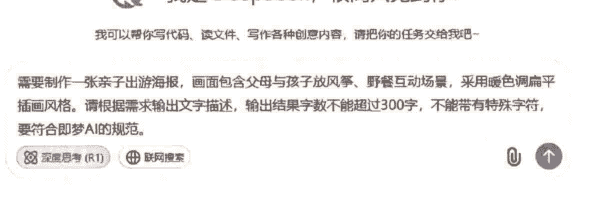

DeepSeek给出的整体文字描述如下。

亲子出游海报以暖色调扁平插画风格呈现。画面中心为开阔的草地，背景点缀低矮山丘与棉花糖般的云朵。左侧父母与孩子呈三角形构图：父亲手握风筝线仰头微笑，母亲半蹲整理野餐篮，扎马尾的小女孩高举燕子造型风筝奔跑，衣角随风扬起。右侧野餐布铺展，竹篮露出三明治与草莓，橙汁玻璃瓶折射阳光，书本自然摊开在格子餐布上。上方三只风筝错落悬浮，鲸鱼风筝采用珊瑚粉撞色设计，蝴蝶风筝融入淡蓝几何花纹。整体以奶油黄为主基调，草地使用低饱和度青绿色，人物服饰选用浅橙、米白等柔和色彩。

标题文字“春日趣游记”采用圆润字体置于顶部，副标题“风筝/野餐/自然探索”以浅棕色衬于画面下方，底部标注简约活动信息条。通过扁平化色块与留白处理，营造温馨轻松的亲子互动氛围。

第三步：打开即梦AI进行登录。即梦AI官方地址为：https://jimeng.jianying.com/

第四步：登录成功之后，点击“图片生成”。

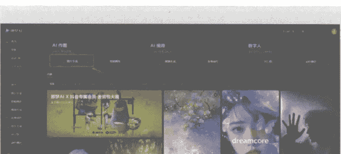

第五步：将DeepSeek输出的海报设计内容复制粘贴到即梦AI。


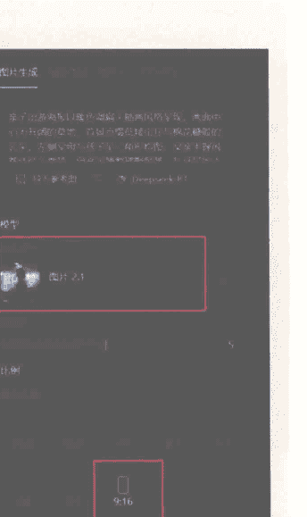

第六步：“模型”选择“图片2.1”，“比例”选择“9：16”手机竖屏海报尺寸（可根据实际情况进行选择）。

第七步：点击“立即生成”，即梦AI会一次性生成4张海报，可自由选择。


第八步：下载生成的海报。

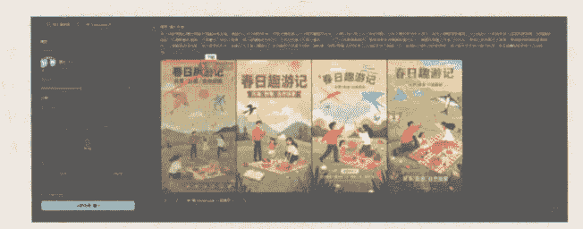

第九步：如果下载的图片带有即梦AI的Logo水印，想去掉水印，可以点击“去画布进行编辑”。

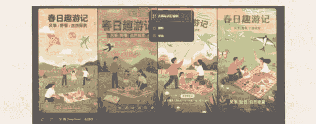

第十步：点击“导出” → “下载”，即可获得海报。


注：除了用DeepSeek+即梦AI做海报外，也可以用DeepSeek+豆包等做海报。

##### 3.4.2 思维导图

用AI生成思维导图的好处，主要体现在效率提升、结构优化和智能辅助三个方面。首先，AI能够快速将复杂的信息自动转化为清晰的思维导图，节省了人工整理和绘制的时间，尤其适合处理大量数据或复杂逻辑的场景。其次，AI生成的思维导图，通常具有更合理的结构和层次，能够根据内容自动调整节点关系，使信息呈现更加直观和易于理解。最后，AI还能根据用户需求提供智能建议。例如，自动补充相关概念、优化布局或推荐关键词，帮助用户更全面地梳理思路。

AI生成思维导图不仅简化了创作过程，还通过智能化和结构化的方式，帮助用户更高效地组织和表达思维，适用于学习、工作、项目管理等多种场景。

**以下是具体实操步骤。**

**第一步：安装工具**——电脑端需准备DeepSeek（AI分析工具）和XMind（思维导图软件）。

**第二步：文件上传**——打开DeepSeek，点击回形针图标，上传课件/文档（支持多文件同时上传）。特别提醒：打开“深度思考”功能。

**第三步：输入提示词**——“请完成以下任务：深度分析附件内容，提炼核心知识点，生成Markdown格式思维导图框架”。

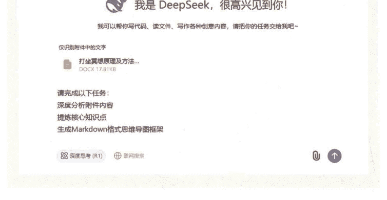

###### 第四步：等待AI生成结构化内容。

好的，我现在需要处理用户提供的关于打坐冥想的文档，并完成三个任务：深度分析内容、提炼核心知识点，以及生成Markdown格式的思维导图框架。首先，我需要仔细阅读并理解文档内容，然后提取关键信息。

首先，用户提供的文档详细解释了打坐冥想的原理和方法。从生理到心理的变化过程，到宇宙能量的概念，再到具体的打坐姿势和冥想方法，内容非常丰富。我需要将这些信息进行分类和整理。

在深度分析时，我应该注意文档中的主要部分：静坐原理、宇宙能量的作用、身体能量层次、打坐姿势的要点、冥想方法（尤其是“观念法”），以及实践中的注意事项。这些都是核心内容。

接下来，提炼核心知识点可能需要分步骤进行。例如，将原理部分的关键点（如身心合一、宇宙能量的吸收）单独列出，方法部分则分为环境和姿势要求，以及具体的冥想步骤和口诀。

生成Markdown格式的思维导图框架时，需要按照层次结构来组织这些知识点。可能需要使用标题和子标题来区分不同部分，并用列表或嵌套列表来表示各个子点。需要确保结构清晰，逻辑连贯。

在过程中，我需要检查是否有遗漏的重要信息。例如文档中提到的“观念法”的三句口诀、打坐姿势的四个要点，以及温馨提示中的实践建议。同时，注意术语的准确性，如“顶轮”、“膻中穴”等，可能需要正确翻译或保留原文术语。

###### 第五步：复制生成的Markdown内容。

Markdown格式思维导图框架

```
# 打坐冥想原理及方法

## 一、核心原理
**身心合一**
- 放下杂念，活在当下。

**宇宙能量**
- 维持生命的基础能量，主动吸收。

**能量体与肉体**
- 肉体是物质，能量体是形而上能量。
- 能量通道堵塞，需冥想放松打开。

## 二、实践方法
### 1. 环境与姿势
**环境**：安静、光线适中、温度适宜。
**姿势**：
- 脊椎挺直，下巴微收。
- 手印（智慧手印/定印），轻放至丹田。
- 双目垂帘，意识对准眉中穴。
```

## 056 DeepSeek爆改生意指南

第六步：新建TXT文本文件，并把复制的内容粘贴到文本中。

第七步：修改文件扩展名，把.txt改为.md（如 “AI课程导图.md” ）。

第八步：打开XMind软件，点击“新建导图”。

第九步：点击“思维导图” → “创建”。

第十步：点击左上角的三条线图标，选择“文件—导入—Markdown”。

第十一步：选择转换好的.md文件，自动生成分级思维导图（如果不满意，可以直接修改调整）。

##### 3.4.3 Logo设计

AI能够在几分钟内根据用户输入的品牌名称、行业特点和设计偏好，快速生成多个Logo方案，极大地缩短了设计周期，尤其适合需要快速推出品牌形象的企业或个人。相比雇用专业设计师的高昂费用，AI生成Logo的成本更低，甚至许多工具提供免费或低价服务，为预算有限的用户提供了经济高效的选择。

AI能够结合海量设计数据和趋势分析，生成多样化的创意方案。用户可以根据需求调整颜色、字体、图标等元素，获得更符合品牌调性的设计；还能通过智能优化，确保Logo在不同场景下的适用性。比如，在网站、名片或社交媒体上的显示效果。

那如何用DeepSeek与其他AI工具，快速设计Logo呢？

> **第一步：参考提示词公式。**

**身份+客户需求+风格+主元素+质感，把你的Logo设计需求输入DeepSeek。**

示例：我是一名品牌设计师，客户要做一个Logo，名称是“麦萌宠物”，要有狗和猫的元素，简单大气，让人一看就觉得很可爱。请帮我设计一下，给我3个不同的方案描述，描述要简洁明了，符合豆包AI生图的要求。

###### 第二步：等待结果生成。

我是一名品牌设计师，客户要做一个logo，名称是“麦萌宠物”，要有狗和猫的元素，简单大气，让人一看就觉得很可爱，请帮我设计一下，给我3个不同的方案描述，描述要简洁明了，符合豆包AI生图的要求

###### 麦萌宠物 Logo 设计方案：

- 方案一：简约线条风
  - 描述：以简洁流畅的线条勾勒出一只猫和一只狗的轮廓，猫狗相互依偎，形成一个爱心形状。整体造型圆润可爱，色彩采用温暖的橘色和米色，给人温馨亲切的感觉。
  - 关键词：简约、线条、猫狗、爱心、温暖、可爱

- 方案二：卡通插画风
  - 描述：设计一对可爱的卡通猫狗形象，猫戴着蝴蝶结，狗戴着项圈，它们俏皮地互动，或玩耍、或拥抱，背景可以加入一些宠物玩具元素。色彩明亮活泼，充满童趣。
  - 关键词：卡通、插画、猫狗、互动、可爱、活泼

- 方案三：字母图形化
  - 描述：将“麦萌”二字进行图形化设计，融入猫狗的元素。例如，“麦”字可以设计成猫耳朵的形状，“萌”字可以融入狗爪印的元素。整体造型简洁大气，又不失可爱。
  - 关键词：字母、图形化、猫狗、简洁、大气、可爱

###### 第三步：选择一个你喜欢的方案并复制文案。

麦萌宠物 Logo 设计方案：
方案一：简约线条风
- 描述：以简洁流畅的线条勾勒出一只猫和一只狗的轮廓，猫狗相互依偎，形成一个爱心形状，整体造型圆润可爱，色彩采用温暖的橘色和米色，给人温馨亲切的感觉。
- 关键词：简约、线条、猫狗、爱心、温暖、可爱

###### 第四步：打开豆包AI（豆包AI地址：https://www.doubao.com/chat/），选择“图像生成”。

###### 第五步：把复制的文案粘贴进去。

风格随你定制，分秒生成同款效果

<图像生成> 设计一个简约线条风LOGO
描述：以简洁流畅的线条勾勒出一只猫和一只狗的轮廓，猫狗相互依偎，形成一个爱心形状，整体造型圆润可爱，色彩采用温暖的橘色和米色，给人温馨亲切的感觉。
关键词：简约、线条、猫狗、爱心、温暖、可爱

###### 第六步：生成后，选择一张心仪的图片下载即可。

举一反三：账号头像、背景图、漫画、插图、场景、风景图等，都可以用不同的提示词输入DeepSeek，再使用豆包AI或即梦AI生成想要的图。

##### 3.4.4 人物动图

用AI生成动态图是一种高效且充满创意的体验。AI能够将静态的图像或文字转化为生动、流畅的动态效果，赋予内容更强的视觉吸引力和表现力。AI通过智能算法分析用户输入的元素，自动生成平滑的过渡效果、炫酷的动画效果，以及符合主题的动态设计，不需要用户具备专业的动画制作技能。

无论是用于社交媒体、广告宣传还是演示文稿，AI生成的动态图都能快速抓住观众的注意力，同时节省用户大量时间和精力。它的灵活性和多样性，让用户可以根据需求调整速度、风格和细节，轻松实现个性化的动态视觉表达，为内容注入更多活力和创意。

即使是普通小白，也能通过以下实操攻略，做出生动好看的人物动图！

## 第三章 DeepSeek+豆包 061

第一步：打开DeepSeek，输入提示词并发送，复制生成的AI提示词。

第二步：手机打开豆包App，打开后选择“创作”。

## 062 DeepSeek爆改生意指南

第三步：点击“AI生图”，把复制的提示词粘贴到输入框里，发送，4张图片就生成出来了。选一张最好看的，保存到相册。

第四步：选择“照片动起来”，上传刚保存到相册里的图片。

第五步：输入提示词，等待生成。生成完毕后点击视频，人物就动起来了，可以保存到手机上。

#### 3.5 知识补给站：小白也能聊的AI生图科技潮

朋友圈里总能看到各种AI生成的“赛博朋克风自拍”“动漫版全家福”，甚至有人用AI设计T恤图案。AI生图技术就像突然冒出来的“魔法画笔”，让普通人也能轻松创作专业级图片。今天我们就用大家都听得懂的方式，揭开AI生图的神秘面纱。

##### AI生图的核心：让电脑学会“脑补”

原理其实像“学画画”

想象你教一个小孩画猫：先给他看1000张猫的照片，告诉他这是“猫”，然后让他自己试着画。AI生图的过程也类似这样。程序员给AI“喂”了海量图片，让它学习这些图的规律。比如，“猫有两只耳朵”“天空是蓝色的”。

AI比人类强的是，它能记住所有细节——从凡·高的笔触到网红自拍的光线，甚至能组合出“穿着宇航服的柴犬在月球上蹦迪”这种离谱画面。

关键技术：文字变图片的“翻译官”

早期的AI生图像个“拼图大师”。比如，把猫耳朵和狗身子拼在一起。而现在的AI更像“编剧”，你输入一句话，比如“一只穿着西装的柯基在开董事会”，它就能凭空生成符合描述的图片。

这里的关键在于AI学会了“跨语言理解”。比如，你说“二次元萌妹”，它知道是日漫风、大眼睛；你说“赛博朋克”，它就自动加霓虹灯和机械元素。这背后是大量“文字—图片配对训练”的结果。

##### 普通人能用AI生图做什么

日常娱乐：朋友圈C位出道

玩梗必备：给朋友生成“如果他是超级英雄”的漫画形象，或者把自家猫P成“蒙娜丽莎猫”。

省下设计钱：设计活动海报、生日邀请函，甚至专属微信头像。比如，在Midjourney上输入“中国风水墨画风格的老虎”，10秒出图。

追星新姿势：生成“某歌手在火星开演唱会”的搞笑图，或者让偶像穿越到古风场景。

##### 搞钱新思路

电商卖家：用AI批量生成商品展示图，卖汉服的不用请模特，直接生成“唐朝少女漫步长安街”的场景即可。

自媒体神器：小红书博主用AI做“减肥前后对比图”，抖音创作者生成电影级封面，点击量暴涨。

接单平台：国外有人靠卖“AI生成的情侣艺术照”月入过万，甚至帮人设计T恤图案。

##### 技术背后的“瓜”和争议

版权大战：AI是否在“偷”艺术家的风格

很多画家发现，AI生成的图和自己的作品风格雷同。这是因为AI训练时用了他们的画，但没给版权费。国外已有艺术家集体起诉AI公司，争议焦点是：学习人类风格算抄袭吗？——这个问题现在还没定论。

以假乱真的风险

有人用AI生成“马斯克推荐比特币”的假新闻视频，甚至伪造明星不雅照。技术越强，造假成本越低。现在各国都在立法。比如，欧盟要求AI生成的图片必须打水印，国内平台也封杀了一批“AI造谣”的账号。

艺术家会被取代吗

目前AI更像是“超级助手”：设计师用AI出100个方案草稿，再挑最好的加工；游戏公司用AI生成NPC（非玩家角色）的服装，省下70%时间。但真正需要创意的核心设计（如《阿凡达》的世界观）还要靠人类。AI可能会让艺术创作更“分层”：顶级的更贵，普通的更卷。

##### 免费工具推荐

**国内亲民版：** 百度“文心一格”（中文友好）、抖音“AI绘画”特效（一键生成漫画脸）。

**国际进阶版：** Midjourney（注册Discord就能用）、Stable Diffusion（“技术党”最爱，支持本地运行）。

**手机App：** 美图秀秀“AI绘画”、醒图“AI特效”。

##### “咒语”技巧（Prompt）

想生成好图，就得学会给AI“念咒”。

**加画风：** 如“宫崎骏动画风格”“皮克斯3D渲染”。

**加细节：** 如“逆光”“蒸汽朋克机械细节”“浅景深”。

**避坑指南：** 别写太抽象的词（如“有灵魂的作品”），AI可能理解不了；多试几次，比如，“柴犬穿西装→柴犬穿黑色西装打领带→柴犬在办公室穿西装敲键盘”。

> 总结

**AI生图是工具，不是魔法。**

AI生图的本质是“大数据+算力”的胜利，它让视觉创作从“专业技能”变成“全民游戏”。但想用好这个工具，依然需要审美力和创意——就像人人都有手机，但能拍出好照片的永远是会构图的人。下次朋友聊起AI生图，你可以淡定地说：“这技术就像让电脑有了想象力，但它画的柯基可能有六条腿，得人类来教它什么是合理。”

## 第四章

### 即梦+剪映打爆流量

超强AI组合技，轻松日更100条短视频

AI技术让短视频创作变得更简单高效，只需几张图片或一段文字，AI就能自动生成流畅视频，还能智能配乐、加特效，轻松打造吸睛内容。可节省70%的制作时间，同时提升视频完播率。

如果你是专业创作者，AI能让你提效很多倍，颠覆之前的产能；如果你是新手，也能快速上手，借助AI轻松产出高质量视频，抓住流量风口，实现内容变现。

#### 4.1 案例1 南京运动服装品牌用“AI+短视频”的方式，发布效率提升900%

● 案例背景

南京某头部运动服装品牌面临暑期销售旺季压力，需在抖音平台上快速生产500条差异化短视频，引流到私域。传统人工团队日产能不足20条，且内容同质化严重。2024年7月，该品牌引入汇智智能的AI数字员工系统，实现短视频生产全链路自动化。

##### 取得的结果

- 效率提升：短视频日产能从20条提升至200条，发布效率提升900%；
- 成本优化：单条视频制作成本从500元降至80元，运营成本降低84%；
- 转化数据：视频平均播放量提升120%，私域引流率从3%增至12%；
- IP效应：品牌抖音账号粉丝3个月增长50万，成为运动服饰垂类Top10账号。

##### 具体做法

● 第一步：AI选题矩阵构建

数字员工抓取抖音“运动穿搭”相关爆款视频1万条，拆解出3类黄金公式。
1. 痛点类：“跑步裤卡裆？这款黑科技让你放肆跑！”
2. 场景类：“健身房社恐穿搭，这件T恤让你自信爆棚。”
3. 数据类：“6·18爆卖10万件防晒衣，实测紫外线阻隔率99%。”

● 第二步：智能脚本生成

输入商品参数（如面料成分、版型数据），AI自动生成3秒钩子+15秒卖点+5秒促销的标准脚本结构。

示例脚本
前3秒：暴雨中跑步画面+字幕“淋雨3小时，衣服竟然不贴肉？”
中间15秒：慢镜头展示速干面料吸水实验+画外音“××科技速干T恤，吸水率降低80%”
最后5秒：弹出限时优惠券+字幕“点击购物车抢199元3件”

● 第三步：自动化素材生产

系统调用Midjourney生成产品3D展示图，用DALL·E合成运动场景背景；利用AI换脸技术，让同一模特适配不同肤色、体形，解决真人拍摄成本问题。

● 第四步：动态投放优化

数字员工实时监测视频完播率、点赞转化率，自动追加投放ROI>2的视频；对播放量<500的视频，AI自动调整封面图，前3秒内容重新发布。

###### 方法论总结

- **爆款公式提炼**：通过AI拆解行业Top1000视频，提炼可复用的内容结构
- **参数化脚本生成**：将产品卖点转化为标准化的脚本参数库
- **虚拟人像工程**：用AI换脸+3D建模降低真人拍摄成本
- **智能A/B测试**：自动进行封面/标题/前3秒的多维度测试
- **流量滚雪球**：对优质内容自动追加投放预算，形成爆款矩阵

##### 品牌短视频工业化生产公式

AI选题库 → 参数化脚本 → 虚拟素材生产 → 智能投放 → 数据回流迭代

#### 4.2 案例2 创业手作饰品店启用AI，小店月销从3万增至28万

● 案例背景
一位“90后”创业者在福建小镇经营手工银饰店，产品设计独特，但客源局限于本地。2024年10月启用搜狐简单AI工具，通过短视频打造“国风银饰设计师”，线上销量占比超50%。

##### 取得的结果

- 内容产出：单月发布短视频82条，爆款率达25%；
- IP打造：账号粉丝从200增至8.6万，客咨询量日均超50；
- 销售转化：抖音小店月销从3万增至28万，定制订单占比40%；
- 成本控制：视频制作时间从6小时/条压缩至40分钟/条，人力成本降低89%。

##### 具体做法

● 第一步：人设强化

AI分析国风赛道Top账号，提炼“工匠+文化传承”关键词，设计固定开场白：“我是××，一个想把故宫纹样戴在你手上的银匠。”

● 第二步：智能内容矩阵

用AI生成四类内容模板。
- 文化类：展示纹样设计灵感（如“敦煌飞天耳坠背后的千年故事”）
- 过程类：延时拍摄錾刻过程+AI生成的工匠旁白
- 场景类：AI合成古风场景（如汉服模特佩戴首饰游园林）
- 促销类：生成“限时定制优惠”倒计时动画。

● 第三步：自动化客户运营

评论区设置AI自动回复话术。
- 用户问“多少钱” → 推送定制价目表+问卷“您喜欢哪种纹样？”
- 用户问“工期” → 回复“普通款3天，定制款7天，点击预约免排队”。

● 第四步：数据驱动选品

AI分析评论区高频词，发现“婚庆”“国潮”需求，推出爆款“龙凤呈祥对戒”，单月售出1200对。

###### 方法论总结

- **人设符号化**：提炼易传播的视觉/语言符号，强化记忆点
- **内容模块化**：建立4—6种标准化内容类型，循环发布
- **互动自动化**：预设20种常见问题回复模板
- **选品数据化**：通过评论分析反向指导产品开发
- **场景虚拟化**：用AI合成无法实拍的高质感场景

个体户短视频变现公式

人设符号 → 模块化内容 → 自动互动 → 数据选品 → 场景虚拟化

#### 4.3 案例3 南昌UI设计师创作AI短视频，斩获大赛金奖

● 案例背景
一位南昌UI设计师业余时间创作AI短视频，2024年7月参加快手可灵AI短剧大赛。该设计师以《西游记》为原型进行创作，全程使用Midjourney+可灵AI，通过差异化内容斩获大赛金奖。


☑ 取得的结果

- 赛事成绩：获快手可灵AI短剧大赛一等奖，奖金5万元；
- 流量爆发：抖音+快手总播放量破2000万，单日最高涨粉8万；
- 商业变现：接到3个品牌广告植入，单条报价2万元；
- IP升级：成立工作室，同平台签约，成为独家创作者。

##### 具体做法

● 第一步：题材讨巧策略
选择《西游记》IP中有争议角色“白骨精”，用AI生成暗黑美学形象，规避人脸一致性难题；设计标志性视觉符号：银色骨冠+血红瞳孔，增强辨识度。

● 第二步：抽卡工业化流程
建立标准化提示词模板。
“中国古典妖魔，苍白皮肤，银色金属头冠，红色瞳孔，阴森山洞，8K细节”。批量生成500张底图，从中筛选出50张进行局部重绘（重点修正头冠）。

● 第三步：低成本运镜技巧
用可灵AI的“镜头控制参数”。
中景：weight: 1.2，强调服装细节，特写：weight: 0.8，聚焦面部表情。
通过调整参数值模拟专业运镜，节省实拍成本。

● 第四步：互动式剧情设计
在每集结尾设置选择题（如“白骨精该复仇还是放下？”），用AI统计观众投票意见，决定下集走向，提升完播率。

###### 方法论总结

> IP借势策略：选择公域IP，进行二次创作，降低认知成本
特征锚定法：设计一两个强辨识度视觉符号，规避AI缺陷
参数化抽卡：建立标准化提示词模板，提升素材可用率
数据化运镜：用权重参数模拟专业影视语言
分支剧情互动：请观众投票，提升观众参与感

##### 个人创作者爆款公式

公域IP+特征锚定 → 参数化抽卡 → 数据运镜 → 分支互动 → 商业变现

#### 4.4 实操攻略：从图生视频到进阶创作全搞定

AI技术正在降低短视频制作的门槛，使全民创作成为可能。

用户只需输入创意，AI系统即可自动完成从剧本到成片的全流程创作，不需要专业技能和场地。AI通过学习优质视频，能生成匹配风格的动画、场景和特效，结合多项技术，快速将创意转化为专业短视频。

无论是个人还是企业，都能利用这个“零门槛视频工厂”实现创意自由。


##### 4.4.1 图生视频基础实操

- **第一步：DeepSeek生成脚本**

比如，想让DeepSeek生成一段秋天公园落叶的美景视频，视频一共包含五个镜头。可直接把下面这段话发给它作为提示词，它会自动生成视频脚本。

帮我写一个短视频脚本，一共分为五个镜头，内容是一段秋天公园落叶的美景视频。

###### 示例

帮我写一个短视频脚本，一共分为五个镜头，内容是一段秋天公园落叶的美景视频。

###### 短视频脚本：秋日私语

- 主题：捕捉秋日公园落叶的静谧与美好
时长：15-20秒
音乐：舒缓的钢琴曲或轻音乐

- 镜头一：全景（4秒）
画面：阳光透过金黄色的银杏树洒下来，整个公园笼罩在一片温暖的秋色中。镜头缓慢推进，展现出一条铺满落叶的小径，蜿蜒通向远方。
音效：轻柔的风声，偶尔传来几声鸟鸣。

- 镜头二：特写（3秒）
画面：一片金黄色的银杏叶慢慢从树上飘落，镜头跟随树叶的轨迹，捕捉它在空中旋转、飞舞的瞬间。
音效：树叶沙沙作响，风声渐起。

- 镜头三：中景（3秒）
画面：一位老人坐在公园的长椅上，静静地欣赏着眼前的秋色。他的脚下落满了落叶，手中捧着一本书，却迟迟没有翻开。
音效：风声轻拂，环境音更加安静。

###### 第二步：优化脚本输出结果

为了让生成的视频脚本更符合要求，可以再次输入提示词。这样生成的脚本可以直接使用。然后使用即梦AI生成图片和视频。

请让以上分镜画面，更符合即梦AI的生图提示词要求。

###### 示例

请让以上分镜画面，更符合即梦AI的生图提示词要求。

为了让以上分镜画面更符合即梦AI生图的提示词要求，我们可以对每个镜头的描述进行优化，使其更具画面感，同时符合AI生图的关键词逻辑。以下是优化后的分镜脚本。

###### 短视频脚本：秋日私语（AI生图优化版）

- 主题：捕捉秋日公园落叶的静谧与美好
时长：15-20秒
音乐：舒缓的钢琴曲或轻音乐

- 镜头一：全景（4秒）
画面描述：
“阳光透过金黄色的银杏树叶，洒在一条蜿蜒的公园小径上。小径两侧铺满厚厚的落叶，远处是模糊的树林和蓝天，整体画面温暖而宁静。”
AI提示词：
“秋日公园，金黄色银杏树，阳光透过树叶，铺满落叶的小径，蜿蜒通向远方，远处模糊的树林，蓝天，温暖色调，宁静氛围，4K高清，写实风格。”
音效：
轻柔的风声，偶尔传来几声鸟鸣。

###### ● 第三步：生成图片

网页搜索即梦AI，打开网页，选择“AI作图→图片生成”，如下图所示。


将DeepSeek生成的提示词复制进去，选择你需要的图片比例，其他参数保持默认，点击“立即生成”，即梦AI会生成四张图片，选择自己喜欢的下载保存。

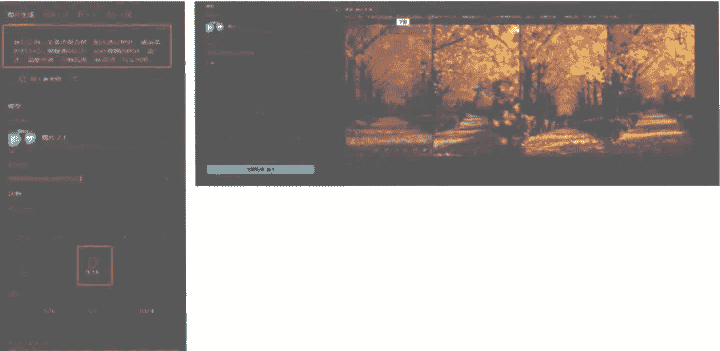

按照以上步骤，把DeepSeek生成的余下四个镜头描述全部做成图片，下载保存。

###### ● 第四步：图生视频

上文生成了五张静态图片，接下来要把图片转化为动态视频。

1. 点击“视频生成”，选择“图片生视频”，上传图片，参数保持默认，点击“生成视频”，即梦AI会快速生成视频，如下图所示。

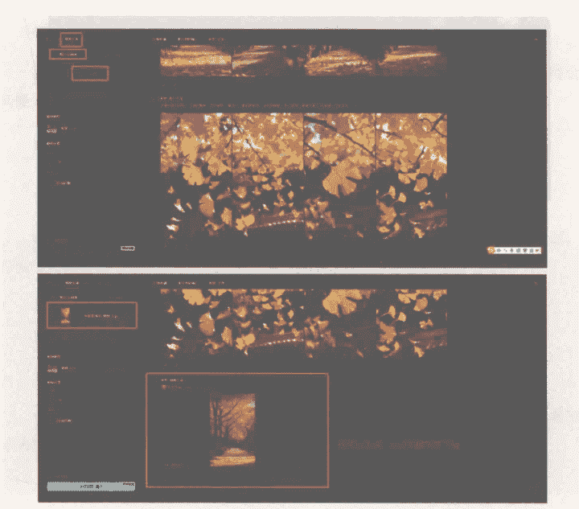

2. 另外四张分镜图片按照同样的操作方法，分别生成四段视频。生成的视频是没有声音的，需要将视频导入剪映，添加音乐和背景音效，把导入的素材拖至下方轨道，拼接在一起，如下图所示。


3. 选择合适的背景音乐，拖入轨道中，点击“导出”，即可完成短视频制作。


> AI工具组合使用能提升创作效率，但关键是要匹配你的内容方向。比如，做风景视频可用AI写脚本+配乐+自动剪辑。其他领域则需要灵活调整：知识博主可以用AI查资料+做课件+生成解说；带货主播可以用AI智能抠图+场景合成+文案优化。

建议先想清楚内容形式，根据你的赛道来做，再选择对应的工具组合。记得多学习新工具，但别被技术带偏——好内容的核心，依然是创意和干货，AI只是帮你把想法更快落实的助手。

##### 4.4.2 进阶创作：AI搞定全流程

**AI做短视频可以像流水线生产一样，全流程丝滑产出。**

以前做短视频太费劲：选题想到头秃、文案写到崩溃、剪视频熬夜到天亮……

现在有了DeepSeek和剪映这对黄金搭档，效率直接提升10倍。从写文案到剪视频，AI全程帮你搞定，新手也能批量做出专业视频，帮你解决“不会做”“没时间”的问题。

###### 爆款流水线：AI帮你搞定全流程

####### 1. 找选题：5分钟挖出100个热门点子

爆款视频第一步：选对话题！

在DeepSeek上输入你的领域关键词，如“穿搭”“职场”，DeepSeek能扒出全网最火的话题和痛点，直接给你一张“热门选题地图”，照着做就行。

比如，输入“打工人逆袭”，AI可能给你生成以下选题。

- 《月薪5千到5万，我就靠这3个Excel技巧》
- 《老板最怕你知道的5条劳动法，赶紧收藏！》

小技巧：想要更吸睛的标题，可以告诉AI“生成10个健身领域的反常识标题，带数字和冲突点”，它立马给你提供一堆灵感。

####### 2. 写脚本：AI自动生成“人话”文案

有了选题，直接让AI帮你写脚本！

告诉它：“写一个60秒的‘早起技巧’视频脚本，开头3秒用‘为什么你总是起不来？’这种扎心问题，中间讲3个科学方法（带数据），结尾让观众点赞。”

AI立马把分镜头写得明明白白。

```
“镜头1（0—3秒）”
画面：闹钟响个不停，一只手狠狠拍掉
字幕：“定了5个闹钟还是起不来？”
音效：刺耳铃声+玻璃碎掉声
“镜头2（3—12秒）”
画面：阳光照进房间，人伸懒腰
字幕：“哈佛研究：开窗帘睡觉，早起成功率涨87%！”
```

####### 3. 配音：AI生成真人声音

怕自己声音不好听？AI连配音问题都帮你解决！

两种方法：1.用剪映“数字人”：选个虚拟主播（如职场精英、萌妹音），输入文案，直接生成带人像的视频，还能调整语速和语气。

2.用DeepSeek语音合成：输入文字，选音色、方言甚至英语，生成超自然配音，拖入剪映就能用。

小贴士：加点背景音（如敲击键盘声、咖啡店环境音），配音听起来更真实。

####### 剪映速成班：10分钟剪出一条片

- **素材库：分门别类存好货**
1.自己拍的视频：按“场景/情绪”分类，如“上班焦虑”“宅家治愈”。
2.AI生成素材：让DeepSeek+AI生图来帮你画图，比如“画一个程序员凌晨加班的卡通背景”。
3.剪映自带素材：直接找炫酷特效，有很多免费的可以用！

- **剪辑四步法：新手也能秒上手**
1.套模板：做好第一条视频后，存成模板，下次直接复制改内容即可。
2.换素材：右击原来的图片/视频，选择“替换文件”，特效字幕全保留。
3.加字幕：点击“智能字幕”，自动识别语音生成文字，选个抖音爆款字体。
4.调画面：点击“一键美化”，AI自动把画面调亮、把颜色调鲜艳。

- **爆款小心机：加这些特效流量翻倍**
1.进度条动画：加个进度条贴纸，让它慢慢填满，观众更愿意看完视频！
2.点赞三连弹幕：片尾加“点赞、关注、转发”动态图标。
3.反转音效：剧情转折时加个乌鸦叫、刹车声（搞笑类音效），效果拉满。

####### 多平台发布技巧

抖音：前3秒必须劲爆！比如，“月薪3千和3万的人差在哪？”加话题#干货分享。

视频号：多发可以分享到朋友圈的内容。
B站：视频做长点（3分钟以上），多讲干货。

####### 案例分析：小白7天赚了1.2万

有个账号叫“AI办公神器”，用DeepSeek写脚本（10分钟）+剪映剪辑（15分钟），7天发20条视频，播放量破500万，靠带货赚了1.2万。他们的秘诀就四点：开头扎心提问+中间甩数据+套模板剪辑+片尾求三连。这说明哪怕你是新手，用对工具也能快速起飞！

####### “AI+短视频”还能帮你干什么

- **自动避坑**：AI会帮你检查内容是否违规，降低被封风险。
- **做外语视频**：一键生成英语配音+字幕。
- **蹭热点神器**：AI自动抓取微博热搜，马上生成相关视频脚本，流量蹭蹭涨。

现在做短视频可以像工厂流水线生产一样高效，用AI工具就能批量生产爆款！赶紧试试DeepSeek+剪映，你负责想点子，剩下的交给AI就行！

#### 4.5 知识补给站：了解AI如何重塑视频生产

##### 4.5.1 技术革新：生产力范式变革

###### 生成式AI突破创作门槛

某顶尖AI实验室的视频生成模型实现了从文本到视频的跨模态生成能力，输入“未来城市空中交通系统”等描述，可直接输出包含多机位运镜、物理特效的60秒视频。传统影视工业中需3D建模团队耗时数周才能完成的工作，现可通过AI在数分钟内完成。最新行业研究显示，AI工具已覆盖全球76%短视频生产环节，制作周期平均缩短了83%。

###### 智能化工具重构工作流

某知名剪辑软件集成AI系统，能自动识别素材情感基调，智能匹配转场特效与背景音乐。某国际动画工作室披露，其AI分镜系统将动画电影前期制作时长从18个月压缩至6个月。国内影视基地调研显示，灯光、场务等基础岗位需求下降40%，而“AI视觉督导”等新职位薪资涨幅达200%。

##### 4.5.2 产业格局重构：从专业垄断到全民共创

**UGC内容爆发式增长**

主流短视频平台推出的AI场景替换功能，允许用户将自拍视频背景实时转换为太空站、古罗马竞技场等场景。2024年数据显示，平台日均AI生成内容超30亿条，其中“AI历史重现”（如让兵马俑“开口说话”）类内容互动量同比激增570%。

**虚拟人经济崛起**

某二次元平台虚拟主播通过实时动作捕捉技术实现直播互动，单场直播收入突破百万。某电商平台推出的“数字人克隆”服务已签约超10万商家，其生成的数字主播可24小时不间断带货，转化效率达到真人主播的92%。

##### 4.5.3 内容形态进化：交互与边界的突破

**动态叙事革命**

某流媒体平台推出的互动剧，采用AI剧情引擎，根据观众心率、表情数据实时调整故事走向，创造28种结局分支。某视频平台测试的AI广告系统，可依据用户地理位置、天气生成个性化内容，点击率提升320%。

**文化遗产的数字化新生**

某博物院联合科技企业推出的“文物活化”项目，通过视频生成技术还原古画动态场景，用户可“穿越”到画中与历史人物互动。此类内容在青少年群体中传播量超5亿次，推动传统文化IP商业价值增长7倍。

##### 4.5.4 伦理与规则的博弈

**知识产权争议加剧**

国际编剧协会与制片方达成新协议，要求AI生成剧本占比不得超过30%。国内有关部门出台《人工智能生成合成内容标识办法》，明确要求AI视频添加可识别水印。某导演用AI“复活”已故演员参演新片引发伦理争议，相关话题社交媒体阅读量达48亿。

**真实性防御体系构建**

某顶尖高校研发的视频鉴伪系统，通过分析物理规律识别AI生成内容，准确率达98.7%。主流社交平台已强制启用该技术，日均拦截违规内容超1200万条。

##### 4.5.5 未来趋势：人机协同新生态

**创意产业的升级路径**

某顶尖美术学院新增“生成艺术设计”专业，培养能驾驭AI工具的新型创作者。某影视集团设立“人机协作实验室”，其AI编剧系统在悬疑剧创作中提出关键线索设计，推动剧情反转，获8.9分观众好评。


**技术普惠与社会影响**

国际组织报告指出，AI视频技术使发展中国家内容创作者收入中位数提升64%。非洲青年利用AI工具制作的环保主题短片，在联合国会议上放映并获千万级传播，凸显技术赋能的全球价值。

##### 总结

AI技术正重构视频生产逻辑：生成式模型实现文本到视频的跨越，将制作周期缩短90%以上；智能化工具推动影视工业流程再造，催生AI视觉督导等新兴职业；全民创作浪潮下，UGC内容爆发与虚拟人经济崛起重塑产业格局；动态叙事、文物活化等新形态突破内容边界。伴随知识产权争议与真实性危机，全球加速建立数字水印、鉴伪系统等规制体系。未来人机协同将强化创意核心价值，技术普惠性正赋予文化传播与社会创新新动能，开启“人类导演+AI执行”的创作新纪元。

## 第五章

### DeepSeek+超级个体

暴力起号！30天用AI数字人打造赚钱IP

你知道吗？现在月入10万的短视频博主，99%都在用AI批量生产内容。一个普通人使用AI工具，一天可以轻松制作500条短视频！

#### 5.1 案例 杭州宝妈用AI打造IP，30天涨粉10万


● 案例背景

杭州一位宝妈的AI美容专家账号，在短短30天内取得了令人瞩目的成绩：

- 粉丝数从0涨至10万以上
- 单条视频播放量突破100万
- 日均内容产出效率提升50倍以上
- 月均收入突破5万元
- 品牌合作邀约超过20个

这些惊人的数字背后，反映的是AI技术在内容创作领域的革命性影响。以往一条高质的视频背后往往是创作者无数次的构思、打磨和迭代，可能花费几个小时甚至几天的时间。但如今，借助AI的力量，每个人都能变成“超级生产者”。一个普通人借助AI工具，一天就能轻松地产出数十甚至数百条短视频，这在过去是不可想象的。

过去的内容创作，就像匠人慢工出细活，强调的是个人的技艺、灵感和耐心。但现在，AI这个超级助手，创作效率得到了颠覆性的提升。AI接管了那些重复的、机械的、费力不讨好的工作——比如，收集素材、剪辑视频、撰写基础脚本等，让创作者能够更多地关注内容的质量和创新。

然而，这种高效率也带来了新的挑战。内容市场的饱和度急剧上升，如何在海量内容中脱颖而出成了新的难题。这就要求创作者不仅要善用AI工具，还要有独特的视角和洞察力，如此才能持续吸引观众的注意力。

##### 具体做法

###### 步骤1：精准选题

利用数据分析工具（如巨量算数、新媒体管家）挖掘热门话题和用户痛点。AI美容专家重点关注了熬夜引发的肌肤问题这一普遍存在的痛点。

###### 步骤2：AI文案生成

使用DeepSeek等大语言模型，输入精心设计的指令。

> 你是一名美容专家，精通护肤美容知识，请为我写作三篇300字以内的口播文案，要求如下。

- 标题必须吸引眼球，激发好奇心
- 开头和结尾都要有钩子，吸引用户继续观看
- 内容要围绕“熬夜导致的肌肤问题”展开
- 提供实用、简单的解决方案
- 语言要口语化，富有情感
- 避免使用违禁词和敏感词汇

###### 熬夜护肤急救与修复指南

你是一位美容护肤专家，精通抗衰老护理。请为我创作3篇300字左右的口播文案，并满足以下要求：

1. 标题必须吸引眼球，激发好奇心。
2. 开头和结尾都要有钩子，吸引用户继续观看。
3. 内容围绕【熬夜对皮肤的影响及快速修复方法】展开。
4. 提供实用、简单的解决方案或建议。
5. 语言要口语化，富有情感。
6. 避免使用违禁词和敏感词汇。
7. 每篇文案都要有明确的结构：开场钩子、问题阐述、解决方案、收尾钩子。
8. 审阅并微调AI生成的内容，确保符合你的品牌调性和目标受众需求。

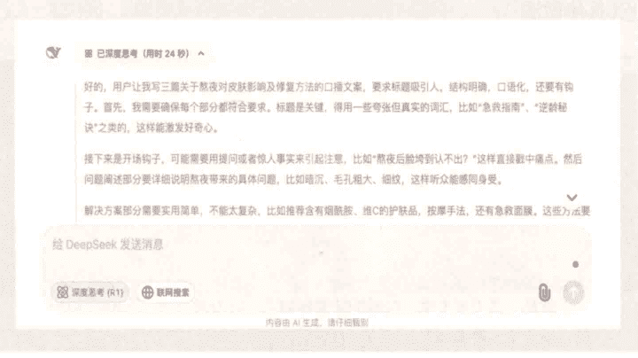

###### 步骤3：AI数字人视频生成

将生成的文案输入AI超级分身平台（如Wonder Studio、Synthesia等），选择预设的数字人形象和声音，一键生成高质量的口播视频。

###### 步骤4：优化与迭代

根据数据反馈（如点赞率、完播率、评论数）不断优化内容和表现形式。例如，发现用户更喜欢25—30岁的女性数字人形象，便将主要IP调整为该形象。

###### 📋 方法论总结

基于杭州宝妈的成功经验，可以提炼出以下**爆款数字人IP**的公式和模型。

- **高价值选题**：大数据分析+用户痛点洞察
- **AI文案生成**：指令明确+多轮优化
- **AI数字人IP呈现**：数字人IP视频制作（高仿真+情感表达）
- **数据驱动优化**：持续优化迭代（数据分析+用户反馈）

这种方法不仅适用于美容领域，还可以扩展到多个垂直市场。

- 健康养生：AI营养师提供饮食建议
- 职场技能：AI职场导师分享职业发展技巧
- 育儿教育：AI育儿专家解答育儿难题
- 财经投资：AI理财顾问分析市场趋势

AI让普通人变成创作者，门槛彻底消失了，普通人有了前所未有的表达能力。以前，能在镜头前说得头头是道的人，不是口才好，就是有才华。但现在，AI把这道门槛彻底抹平了。那些原本不敢露面、不善表达的人，能靠AI轻松做出爆款内容。


#### 5.2 实操攻略 AI数字人口播视频，3步打造百万播放量

任何人都能拥有一个属于自己的“数字人替身”。过去，你可能羡慕那些能在镜头前侃侃而谈的创作者，但如今，你只需掌握几个简单的工具，就能轻松制作出富有感染力的内容。

接下来，要介绍的是一种全新的创作方式，它不再依靠你的颜值、口才，甚至不要求你亲自出镜。你只需要借助DeepSeek这样的AI工具，加上一些简单易用的辅助软件，就能迅速创作出既专业又有吸引力的内容。AI工具会为你写出口播文案，甚至还能帮你生成一个数字形象，替你在镜头前表达观点、传递情绪。你的工作只是给它们提供选题和方向，然后坐在一旁，看着你的数字人替身流畅地完成剩下的一切。通过这种方式，你不仅节省了大量时间，还能确保内容稳定且高质量地批量输出。AI不会累，也不会厌倦，只会不知疲倦地优化和迭代，始终帮你找观众的兴奋点。未来的创作者不是拼谁更勤奋，而是拼谁更懂得如何巧妙地运用这些新工具。

##### 第一步：用DeepSeek量产爆款选题

1. 登录DeepSeek官网（https://www.deepseek.com）；
2. 在输入框中输入以下提示词。

> 请分析[你关注的垂直领域]近期热门话题，列出Top5最受关注的内容方向，每个方向提供3个具体的选题建议。

比如，你在做美容护肤的内容，你就可以输入：
> 请分析[美容护肤领域]近期热门话题，列出Top5最受关注的内容方向，每个方向提供3个具体的选题建议。

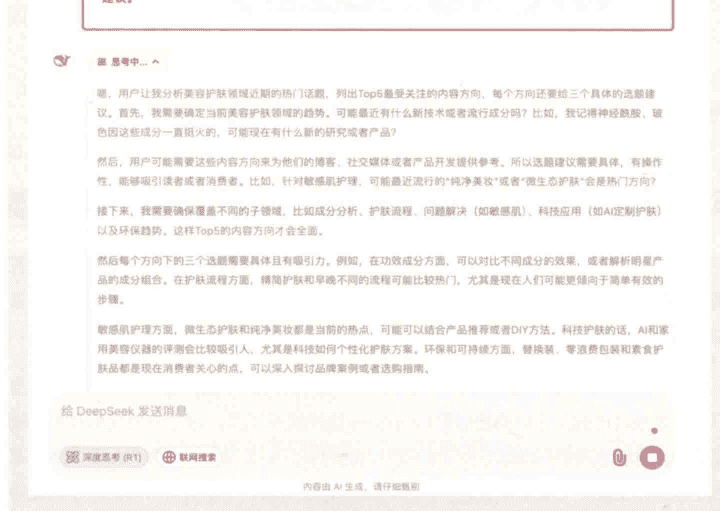

输入后，DeepSeek将会立即生成一份清晰、实用的列表。它会告诉你，最近什么样的内容最火，人们真正关心的是什么，并且提供具体、清晰、可立即上手的选题。

###### 美容护肤领域热门话题分析

根据近期美容护肤领域的行业报告及社交媒体讨论热度，以下为Top 5热门内容方向及选题建议：

####### 一、功效成分深度解析

【热度驱动】消费者对「成分党」关注度持续攀升

1. 《玻色因平替成分大起底：哪些百元产品能达到千元面霜效果？》
2. 《2023新晋明星成分「蓝铜胜肽」：修复力实测+搭配禁忌指南》
3. 《早P晚R新公式：如何用「补骨脂酚+视黄醇」构建抗老组合拳》

####### 二、精简护肤与科学流程

【热度驱动】Z世代「反过度护肤」理念兴起

1. 《三步急救法：如何用「神经酰胺+B5」拯救烂脸期》
2. 《油皮夏日极简方案：控油精华+防晒替代乳液的可行性分析》
3. 《冷热水交替洗脸是伪科学？皮肤科医生拆解清洁误区》

####### 三、敏感肌屏障修复方案

【热度驱动】口罩脸+换季敏感问题激增

1. 《微生态护肤新趋势：益生元精华如何修复「玻璃屏障」》

从DeepSeek生成的建议中选择最适合你的选题即可。

###### 第二步：用DeepSeek创作爆款内容

如果你打算用DeepSeek写出优质的口播文案，第一步就是清晰、明确地告诉AI你想要什么。好的输入，才能获得好的输出。你需要让AI相信自己确实是一位专家，并清楚地知道观众需要什么样的内容。

打开DeepSeek，输入以下模板。

> 你是一位[你的领域]专家，精通[具体专业方向]。请为我创作3篇300字左右的口播文案，并满足以下要求。
> - 开头的第一句话必须是一个钩子，让用户迫切想听下去。
> - 标题要直击痛点，吸引目标用户注意。
> - 内容围绕[你选定的具体主题]展开，针对目标观众最关心的问题提供实用而简单的建议。
> - 每篇内容的结尾都要再设计一个钩子，让用户期待你的下一条视频。
> - 全程语言必须口语化、生动，充满情感和真实感。
> - 文案结构清晰，包含清楚的四个部分：开头钩子→问题描述→解决方案或建议→结尾钩子。
> - 严格避免使用平台违禁词、敏感词和容易引发争议的表达方式。
> - 容易记忆、容易跟读，让观众听完觉得轻松、实用、有价值。

假设你想创作的是美容护肤，特别是抗衰老护理方面的内容，那么你可以这样告诉DeepSeek：

> 你是一位美容护肤专家，精通抗衰老护理。
> 请为我创作3篇300字左右的口播文案，并满足以下要求。
> - 标题必须吸引眼球，激发好奇心。
> - 开头和结尾都要有钩子，吸引用户继续观看。
> - 内容围绕“熬夜对皮肤的影响及快速修复方法”展开。
> - 提供实用、简单的解决方案或建议。
> - 语言要口语化，富有情感。
> - 避免使用违禁词和敏感词汇。
> - 每篇文案都要有明确的结构：开场钩子、问题阐述、解决方案、收尾钩子。
> - 审阅并微调AI生成的内容，确保符合你的品牌调性和满足目标受众需求。

###### 熬夜护肤急救与修复指南

你是一位美容护肤专家，精通抗衰老护理。请为我创作3篇300字左右的口播文案，并满足以下要求：

1. 标题必须吸引眼球，激发好奇心。
2. 开头和结尾都要有钩子，吸引用户继续观看。
3. 内容围绕【熬夜对皮肤的影响及快速修复方法】展开。
4. 提供实用、简单的解决方案或建议。
5. 语言要口语化，富有情感。
6. 避免使用违禁词和敏感词汇。
7. 每篇文案都要有明确的结构：开场钩子、问题阐述、解决方案、收尾钩子。
8. 审阅并微调AI生成的内容，确保符合你的品牌调性和目标受众需求。

好的，用户让我写三篇关于熬夜对皮肤影响及修复方法的口播文案，要求标题吸引人，结构明确，口语化，还要有钩子。首先，我需要确保每个部分都符合要求。标题是关键，得用一些夸张但真实的词汇，比如“急救指南”、“逆龄秘诀”之类的，这样才能激发好奇心。

接下来是开场钩子，可能需要用提问或者惊人事实来引起注意。比如“熬夜后脸垮到认不出？”这样直接戳中痛点。然后问题阐述部分要详细说明熬夜带来的具体问题，比如暗沉、毛孔粗大、细纹，这样听众能感同身受。

解决方案部分需要实用简单，不能太复杂。比如推荐含有烟酰胺、维C的护肤品，按摩手法，还有急救面膜。这些方法要...

###### 输出结果

**口播文案1 夜猫子必看！3招拯救“熬夜垮脸”的急救指南**

- ✓ 开场钩子：“凌晨三点的手机屏光照在你脸上，知道皮肤正在尖叫求救吗？”
- ✓ 问题阐述：每熬一次夜，皮肤都在经历三重暴击——暗沉像蒙了层灰、毛孔能插秧、细纹偷偷爬眼角。更可怕的是胶原蛋白正以3倍速度流失，第二天上妆卡粉到怀疑人生！
- ● 解决方案
  - ★ 黄金修护三部曲：熬夜后先用含烟酰胺的化妆水湿敷5分钟，再用维生素C精华打圈按摩至吸收，最后厚涂神经酰胺面霜锁水。
  - ★ 清晨急救术：冷藏的金属勺子轻压眼周，咖啡因眼霜点涂后搓热掌心捂脸30秒。
  - ★ 饮食彩蛋：第二天必备猕猴桃+蓝莓奶昔，花青素直接帮你擦亮皮肤。
- √ 收尾钩子：下期教你用2分钟按摩手法把垮掉的脸提回来，修仙党记得点好关注！

**口播文案2 熬最深的夜如何不烂脸？美容师私藏的熬夜回春术**

- √ 开场钩子：“我连续熬夜7天，闺蜜看见我，以为我去做了换脸手术！”
- √ 问题阐述：你知道凌晨2点后皮肤会开启“自毁模式”吗？油脂分泌紊乱导致闭口爆发，微循环停滞让脸色发灰，屏障脆弱到吹风都会刺痛！更别说眼周那些像刻上去的干纹……
- ● 解决方案
  - ★ 熬夜守夜人必备：22点前薄涂水杨酸棉片；电脑前放加湿器，保持50%湿度。
  - ★ 分段式修复法：凌晨1点用补水喷雾+角鲨烷油做第一层抢救，早晨用含茶多酚的洁面。
  - ★ 偷师明星的绝招：把冻干粉混合在晚安粉里，整夜修复不粘枕头。
- √ 收尾钩子：“想知道剧组忙到深夜，明星第二天上台前5分钟的急救秘籍？明天这个时间蹲好直播间！”

**口播文案3 别让熬夜偷走你的少女肌！28天逆龄修复计划**

- √ 开场钩子：“25岁和35岁熬夜的差距，竟然全藏在这个动作里……”
- √ 问题阐述：你知道凌晨2点后皮肤会开启“自毁模式”吗？油脂分泌紊乱导致闭口爆发，微循环停滞让脸色发灰，屏障脆弱到吹风都会刺痛！更别说眼周那些像刻上去的干纹……
- ● 解决方案
  - ★ 建立熬夜修复生物钟：22点/1点/6点设置闹钟，完成抗氧化—修护—防御三步骤。
  - ★ 独家按摩手法：用指关节沿下颌线推到耳后，配合含胜肽的精华液，熬夜也能V脸。
  - ★ 食材替代咖啡：喝红枣桂圆枸杞茶，补气血还能提升皮肤含氧量。
- √ 收尾钩子：“下条视频曝光我连熬大夜反而皮肤更好的终极武器，手残党也能学会的3D提拉术！”

DeepSeek会迅速为你生成三篇完整、流畅的口播文案，每一篇都能让你的观众愿意停下来倾听，并感受到你的专业、诚意与人情味。记住，虽然AI负责文案的初稿，但最终掌控质量和风格的人依然是你。

###### 第三步：AI数字人视频制作

1. 登录蝉镜AI数字人平台：https://www.chanjing.cc/
2. 选择适合你内容的数字人形象。
3. 将DeepSeek生成的文案复制到平台的文本输入框内。
4. 选择合适的语音克隆选项，调整语速和情感。
5. 点击“生成视频”，等待视频制作完成。

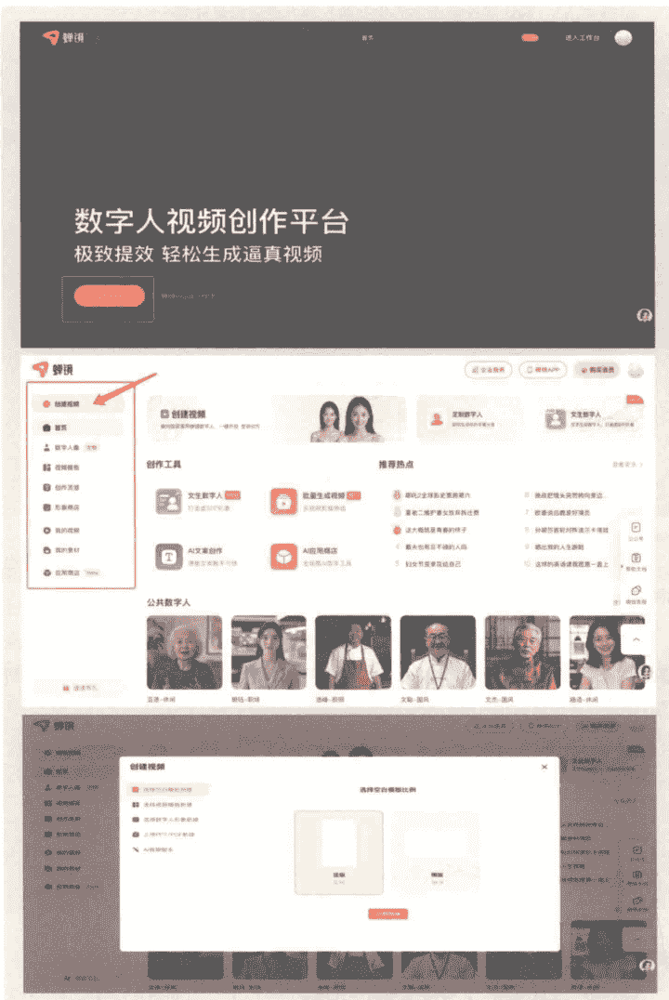

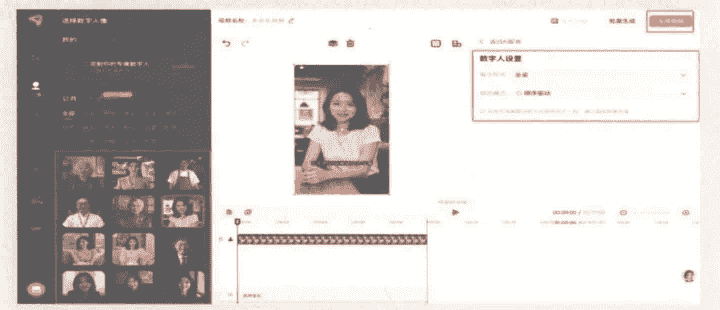

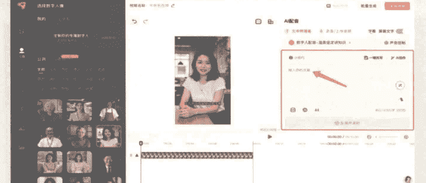

###### 第四步：视频优化与包装

1. 下载并打开开拍App。
2. 导入AI超级分身生成的原始视频。
3. 使用一键剪辑功能，自动添加转场效果和背景音乐。
4. 利用智能包装功能，生成吸引眼球的视频封面。
5. 导出最终成品视频。

###### 第五步：发布与数据分析

1. 将优化后的视频上传至目标短视频平台（如抖音、快手等）。
2. 使用平台自带的数据分析工具，密切关注视频表现。
3. 记录关键指标：播放量、点赞数、评论数、转发数等。

###### 效率提升策略

1. 批量生产：使用DeepSeek一次性生成多个主题的文案，然后批量制作视频。
2. 模板复用：为常用的内容结构创建DeepSeek指令模板，以便快速调用。
3. A/B测试：制作同一主题的不同版本，比较效果，优化最佳实践。
4. 自动化工作流：使用Zapier等工具，将DeepSeek、AI超级分身和开拍App连接，实现半自动化生产。

###### 注意事项

1. 内容质量把控：即使是AI生成的内容，也要确保信息准确、有价值。
2. 版权意识：使用AI工具时，注意遵守相关版权法规。
3. 真实性声明：在适当位置说明视频使用了AI技术，保持透明度。
4. 持续学习：关注AI工具的更新，不断优化你的工作流程。

> 遵循以上这些步骤，制作高质量AI视频将变得简单。从确定选题到文案撰写，再到AI生成视频，流程变得自然快捷。你将与AI合作得更默契，效率显著提升。

记住，速度和数量不是目标，内容质量和用户感受才是关键。要不断优化内容，关注用户反馈，以用户反应为指南针。只有不断改进表达方式，内容才能真正吸引人。

技术提高效率，但优质内容仍需用心雕琢。这是创作者不应忘记的真理。

##### 举例1 如果你是一位职场人，如何使用AI打造你的个人IP

###### 案例背景

也许你正在职场打拼，渴望建立自己的影响力，树立个人品牌。但你担心自己缺乏专业的表达能力，或者面对镜头时不够自信。这时，AI便成为你的最佳伙伴。具体一点：假设你是一位人力资源经理，你希望利用短视频帮助年轻职场人士提高沟通技巧，同时展示你的专业和经验，打造属于你的个人IP。


###### 第一步：用DeepSeek迅速找出职场人士最关心的爆款选题

1. 登录DeepSeek官网（https://www.deepseek.com）
2. 登录后，在搜索框中输入下面的提示词。

> 请分析职场技能提升领域近期热门话题，列出Top5最受关注的内容方向，每个方向提供3个具体的选题建议。重点关注沟通技巧相关内容。

请分析职场技能提升领域近期热门话题，列出Top5最受关注的内容方向，每个方向提供3个具体的选题建议。重点关注沟通技巧相关内容。

嗯，用户让我分析职场技能提升领域近期的热门话题，列出前五名，每个方向三个选题，还要特别关注沟通技巧。首先，我需要确定职场技能提升的当前趋势，可能有哪些方面比较热门。可能要考虑疫情后的职场变化，比如远程办公、混合工作模式的影响，或者随着AI技术的发展，相关技能的需求增加。

首先，我得确认用户的需求是什么。他们可能是在做内容创作，比如写博客、制作课程，或者是为企业培训收集资料。需要列出最受关注的五个方向，每个方向三个选题，并且沟通技巧要重点处理。所以，沟通技巧会是其中一个方向，或者需要在每个方向中都强调沟通的部分？

用户特别提到要重点关注沟通技巧相关内容，所以可能沟通技巧是五个方向中的一个，但其他四个方向也可能需要包含沟通的元素？或者沟通技巧是一个独立的方向，其他四个是其他热门领域？

接下来，我需要确定当前职场技能的热门话题。可能的方向包括：远程沟通与协作、情绪管理/情商、AI工具的应用、跨部门协作、职业发展规划、时间管理、领导力培养、数字化转型中的技能提升等。然后需要筛选出前五个最受关注的。

根据最近的一些趋势，远程办公和混合办公可能会继续热门，AI工具的普及也是一个重点，比如ChatGPT等工具的使用。情绪智力（情商）在职场中的重要性持续上升，尤其是后疫情时代。跨部门协作和项目管理可能因为企业结构复杂化而受到关注。此外，职业发展的敏捷性，比如如何快速学习新技能，也可能是一个方向。

###### 职场沟通技巧热点与选题建议

###### 职场技能提升领域近期Top5热门话题及选题建议

####### 一、远程/混合办公场景下的沟通优化

1. 《视频会议防“跑题”指南：3个议程管控工具+5种打断话术》
   - 痛点：线上会议效率低，聚焦“如何设计议程模板”和“礼貌打断技巧”。
2. 《虚拟办公如何传递温度？表情包/虚拟背景/语音语调的仪式感设计》
   - 创新点：通过非语言符号弥补远程沟通的情感缺失。
3. 《远程工作周报怎么写？用“金字塔模型”展现不可替代性》
   - 方法论：结构化表达+数据可视化，突出个人价值。

####### 二、AI工具赋能的职场效率革命

1. 《ChatGPT邮件优化：从“已读不回”到“秒获回复”的指令公式》
   - 场景：针对跨时区、跨文化沟通的邮件指令模板设计。
2. 《用AI语音转写工具建立会议纪要知识库的SOP》
   - 效率提升：从信息整理到共享的全流程自动化。
3. 《MidJourney视觉化沟通：6分钟将抽象需求转化为示意图》
   - 创新应用：用AI绘图工具降低跨部门沟通成本。

3. 从AI生成的建议中选择最适合你的选题。

几秒钟后，DeepSeek就会向你展示一个清晰、详细的列表，告诉你当下职场中最受关注的沟通问题有哪些。比如，“有效沟通”可能是近期排名第一的热门方向。再进一步细化，选择其中一个具体的问题。比如，如何在职场中进行有效的反馈沟通？这个问题恰到好处：足够具体，切中痛点，是职场人普遍关注的话题。你不用担心选错主题，因为AI早已证实了它的人气。这意味着你的视频会自带流量与关注度。

短短几分钟，你就完成了爆款选题筛选，这在过去几乎是不可能完成的任务。但今天，这正成为现实。AI不会替代你的想法，但会快速引导你找到那些真正值得去表达的想法。这种方式能让你更专注于内容本身，而非被焦虑和犹豫所拖累。选好主题后，就可以开启下一步——让AI帮你写出一篇清晰、有趣而又打动人心的口播文案。

###### 第二步：用DeepSeek创作爆款内容

当你确定了选题，接下来的任务就是写一份生动、有吸引力的口播文案。这听起来很简单，但事实上，要清晰、简洁地表达自己的观点，并且让观众真正感兴趣，并不容易。不过，你很幸运，因为现在你有了AI这个帮手。

假设你是一位人力资源经理，你要制作的视频主题是“如何在职场中进行有效的反馈沟通”。你希望文案的开头足够吸引人，能让观众停下来继续听下去；你也希望结尾有足够的感染力，能让观众觉得意犹未尽，并期待你的下一次分享。这时候，AI工具就能真正帮到你。

你只需打开DeepSeek网站，输入下面这个清晰的指令。

> 你是一位职场沟通专家，精通职场反馈技巧。
> 请为我创作3篇300字左右的口播文案，并满足以下要求。
> - 标题必须吸引眼球，激发好奇心
> - 开头和结尾都要有钩子，吸引用户继续观看
> - 内容围绕“如何在职场中进行有效的反馈沟通”展开
> - 提供实用、简单的解决方案或建议
> - 语言必须口语化、富有人情味，避免空洞的术语
> - 每篇文案要有清晰的结构：开头钩子→问题阐述→解决方案→收尾钩子

###### 输出结果

**口播文案1 同事总把你的建议当耳旁风？3步让他追着你问意见！**

- √ 开头钩子：“昨天小张说我‘说话像领导念文件’，我才发现90%的职场反馈都死在这句话上！”
- √ 问题阐述：你是不是遇到过——明明是好心提醒同事方案有漏洞，他却甩脸走人？给下属提改进建议，结果人家越改越糟？问题就出在反馈方式上！职场里最怕的不是说错话，而是说对话却用错姿势。
- ● 解决方案
  - ★ “三明治话术”：夸具体细节+说改进建议+给成长信心（例：“你的PPT配色特别高级，要是把第三页数据换成柱状图，客户绝对当场签单！”）
  - ★ 黄金15秒法则：开口前先问自己“这句话15秒内能让他记住重点吗？”把“总是/又忘了”换成“这次/下次”。
  - ★ 肢体语言暗号：递文件时把尖角朝向自己，说话时手掌朝上，对方不自觉就会放下戒备。
- √ 收尾钩子：“明天揭秘让领导主动找你讨教的神操作，现在点关注的人下周都能涨薪！”

**口播文案2 领导总说“再想想”？教你3句话把反对意见说成金点子**

- √ 开头钩子：“上周我用这个话术让总监撤回错误决策，现在他开会都让我坐第一排！”
- √ 问题阐述：发现领导方案有问题不敢说？说完就被打上“爱挑刺”的标签？其实不是意见不对，而是你缺了“反馈包装术”。职场高手都懂的——反对的话要顺着说，批评的话要反着说！

###### 解决方案

- ★ “借光表达法”：“您之前教我的××方法特别有用，这次是不是可以……”（用领导的成功经验当跳板）
- ★ “选择题话术”：把“我觉得不行”换成“现在有A/B两版方案，A版能快速落地，B版更适合长远发展……”
- ★ “情绪温度计”：边说边观察对方眉毛——眉心舒展时抛重点，眉头皱起时立刻说“这只是我的浅见”
- √收尾钩子：“下期教你把‘你错了’变成‘咱们对了’的魔法话术模板，戳个收藏明天直接抄作业！”

###### 口播文案3 跨部门甩锅大战？这套反馈公式让你从此不当背锅侠

- √开头钩子：“市场部老王又甩锅？我用了这招后他现在发消息都带‘请’字！”
- √问题阐述：其他部门拖延导致你背锅？协作时总有人装傻？职场最冤的不是做错事，而是替别人的错买单！但高手都懂——反馈不是秋后算账，而是实时排雷。

###### 解决方案

- ★ “彩虹进度法”：每天下班前在工作群发“今日进度：已完成××（绿色）待确认××（黄色），卡点××（红色）”，让甩锅无所遁形。
- ★ “温柔追击术”：催进度时说“知道你最近特别忙，你看周三下午三点还是四点方便碰个头？”
- ★ “留痕小心机”：重要沟通后补发“刚沟通确认的3个要点”，结尾加个[太阳]表情。

106 DeepSeek爆改生意指南

- √收尾钩子：“想知道怎么让甩锅的人主动请你喝奶茶？明晚8点直播间教你反杀话术！”

短短几秒钟后，DeepSeek会生成三篇文案。这三篇文案每一篇都有明确的结构，每一句话都经过精心设计，易于表达，更容易被观众记住。你或许会惊讶地发现这些由AI创作的文案，居然如此贴近你的真实感受和观众的需求。

但别急着直接复制它们。好内容总需要一点点人味儿来润色。花几分钟时间认真阅读一遍AI生成的文案，把你自己的个性与风格融入进去，微调一下词汇或节奏，让它更像“你自己”。

最终文案是否能够取得成功，取决于你有没有注入自己的思考和真诚。这种合作式的创作，会让你的内容真正脱颖而出。

###### 第三步：AI数字人视频制作

1. 登录AI超级分身平台。
2. 选择一个看起来专业、可信的中年女性数字人形象，如一位穿着职业装的女性。
3. 将DeepSeek生成的文案复制到平台的文本输入框内。
4. 选择语音克隆选项，调整语速为1.1倍，选择“自信”的情感标签。
5. 点击“生成”，等待视频制作完成。

###### 第四步：视频优化与包装

1. 下载并打开开拍App。
2. 导入AI超级分身生成的原始视频。
3. 使用一键剪辑功能，添加简洁的转场效果。
4. 选择一个轻快但不过于活泼的背景音乐，音量调至原声的20%。
5. 使用智能包装功能，生成一个吸引眼球的视频封面。可以选择数字人微笑的截图，添加文字“职场沟通秘籍：3步搞定反馈”。
6. 导出最终成品视频，分辨率设置为1080P格式。

###### 第五步：发布与数据分析

1. 将优化后的视频上传至目标短视频平台，如抖音。
2. 添加标签：#职场技能 #沟通技巧 #人际关系 #职场进阶
3. 在视频描述中添加：“想要在职场中脱颖而出吗？掌握这个反馈沟通技巧，让你的职业生涯更上一层楼！”
4. 发布后，使用抖音的创作者工具，密切关注视频表现。
5. 记录关键指标：播放量、完播率、点赞数、评论数、转发数等。
6. 特别关注评论区的用户反馈，回复有价值的问题，为后续内容创作积累素材。

###### 效率提升策略

1. 批量生产：使用DeepSeek一次性生成5—10个职场沟通相关的文案主题，然后批量制作视频。
2. 模板复用：为职场技能类内容创建DeepSeek指令模板，以便快速调用。
3. A/B测试：制作同一主题的不同版本，如正式/幽默风格，比较效果，以此来优化视频。
4. 自动化工作流：使用Zapier将DeepSeek、AI超级分身和开拍App连接，实现半自动化生产。

###### 注意事项

1. 内容质量把控：确保所有建议都是专业、可行的，避免误导观众。
2. 版权意识：使用版权免费的背景音乐，避免侵权问题。
3. 真实性声明：在视频描述中说明使用了AI技术，保持透明度。
4. 持续学习：关注人力资源和职场沟通领域的最新趋势，不断更新内容主题。

> 遵循以上这些步骤，制作高质量职场技能视频将变得简单高效。AI让复杂工作变得简单，任何职场人都能借助AI轻松打造个人IP。

无须反复练习台词，只需告诉AI需求，AI就能生成符合你风格的内容。选择主题，提出要求，简单调整AI内容，即可制作出有感染力的视频。

制作内容是起点，持续关注用户反馈和需求才是关键。

通过不断改进，你将在AI时代找到位置，赢得观众的认可。AI提供速度，你赋予内容温度和意义。希望你在AI赋能的职场技能传播之路上越走越自信。

##### 举例2 如果你是一位大学生，如何使用AI打造你的个人IP

- ● 案例背景

假设你是一位大学生，想建立一个自己的职场成长类账号，想教会其他年轻人如何高效学习，如何在短时间内迅速掌握新技能。那么，你需要从明确、实用又热门的选题入手。

在过去，想要拍摄一个关于如何掌握新技能的视频，你可能要花上几个小时，甚至几天来规划内容、打磨文案、反复修改。但现在有了AI工具，只需短短几分钟，就能轻松完成任务，让你的视频能真正吸引观众的注意力。


第一步：打开DeepSeek官网，在网站首页的搜索框里，输入以下指令。

> 请分析大学生关心的热门话题，列出Top5最受关注的内容方向，每个方向提供3个具体的选题建议。

片刻之后，DeepSeek会提供给你一个整洁而实用的列表，里面清晰地罗列了当前大学生最关注的热门方向，包括学习方法、职场规划、个人成长等。假设DeepSeek推荐的内容中，“如何在一周内掌握一门新技能？”引发了你的兴趣，你应立刻意识到这正是你想要的。因为它足够具体、足够吸引人，也是每个大学生都迫切想要解决的问题。

第二步：让DeepSeek为你创作一篇精彩的口播文案。在DeepSeek的对话框里，输入以下指令。

> 你是一位学习方法专家，擅长帮助大学生高效掌握新技能。请为我创作两篇300字左右的口播文案，并满足以下要求。
- 标题必须吸引眼球，激发好奇心
- 开头和结尾都要有钩子，吸引用户继续观看
- 内容围绕“如何在一周内掌握一门新技能”展开
- 提供实用、简单的解决方案或建议
- 语言必须口语化、有温度、易懂
- 避免使用违禁词和敏感词汇
- 每篇文案都要有明确的结构：开场钩子、问题阐述、解决方案、收尾钩子

###### 输出结果

**口播文案1** 差生自救指南！7天从零到精通的技能速成公式

- √开场钩子：“上周我那个挂科三次的学弟用这个方法，居然7天拿下Python基础课，现在教授追着他做项目！”
- √问题阐述：你是不是也经历过——发誓要学PS，结果软件都没打开？收藏了100个教程，却越看越焦虑？90%的人学不会新技能，不是因为笨，而是因为掉进了“假努力陷阱”！熬夜刷课、疯狂记笔记……其实都是无效努力。

- ● 解决方案
- ★ “切片学习法”：把技能拆解成7片蛋糕（比如，学摄影，第1天搞懂曝光三要素，第2天练构图……）每天只吃一块不贪多。
- ★ “黄金20分钟法则”：用手机定时器，学20分钟必须停5分钟（大脑最喜欢冲刺跑+休息的节奏）。
- ★ “反向教学法”：找3个成品案例模仿（比如，弹吉他先学副歌高潮段），成就感会推着你往前跑。

- √收尾钩子：“明晚直播拆解‘7天学会剪视频’的实战计划，现在点关注的送独家技能拆解模板！”

**口播文案2** 学霸不会说的秘密！用作弊式学习法7天弯道超车

- √开场钩子：“我靠这个野路子方法，大四那年7天突击过了法语A1，现在看电影都不用字幕！”
- √问题阐述：为什么有人学什么都快？不是因为他们天赋异禀，而是因为他们掌握了“技能快充密码”！普通人还在傻傻地背单词，聪明人早就找到知识漏洞精准打击。记住：学得快不是拼命，而是会偷懒！

###### 解决方案

- “肌肉记忆作弊码”：睡前闭眼回忆操作步骤（大脑在黑暗中记忆效率提升200%）。
- 番茄干扰法：学习时故意放轻音乐/咖啡厅白噪声（适度干扰反而会增强专注力）。
- 进度可视化：用彩笔在日历上画进度条（每完成1天就涂满1格，爽过追剧）。

- √收尾钩子：“明天揭秘让大脑超长待机的3种‘充电零食’，熬夜学习也不累的秘诀就在置顶视频！”

短短几分钟内，DeepSeek就能帮你创作出两篇结构清晰、生动有趣又极具实用性的口播文案。就像是你与朋友们在亲切交谈，既能激发观看者的好奇心，又能提供真实有效的方法，帮助他们快速掌握新技能。

当然，不要忘了在拿到文案后，花一点时间进行微调，使之完全符合你的语气和风格。

利用AI工具的力量，内容创作不再是一场枯燥乏味的苦差事，而更像是一场轻松而富有创造力的对话。你不仅高效地制作出有价值的视频，还建立起了属于自己的清晰且有温度的个人IP。

###### 第三步：AI数字人视频制作

1. 登录AI超级分身平台。
2. 选择一个年轻有活力的大学生形象数字人，男生或女生均可。
3. 将DeepSeek生成的文案复制到平台的文本输入框内。
4. 选择清晰有力的年轻声音，调整语速为1.2倍，增加一些活力和热情。
5. 点击“生成”，等待约10分钟，视频制作完成。

###### 第四步：视频优化与包装

1. 下载并打开开拍App。
2. 导入AI超级分身生成的原始视频。
3. 使用一键剪辑功能，添加动感的转场效果。
4. 选择一段轻快的背景音乐，音量调至原声的15%。
5. 使用智能包装功能，生成一个展示7天学习法和时钟图案的视频封面。
6. 添加文字特效，在关键词（如定义目标、实践优先）出现时突出显示。
7. 导出最终成品视频，时长约1分钟。

###### 第五步：发布与数据分析

1. 登录抖音、视频号、小红书等创作者账号。
2. 上传优化后的视频，填写标题：震惊！7天学会新技能的秘密武器，期末不再熬夜。
3. 添加标签：#学习方法 #效率提升 #大学生必备。
4. 发布视频，设置最佳发布时间（如晚上9点，大学生晚自习结束后的休息时间）。
5. 24小时后，查看视频数据。
6. 回复热门评论，与粉丝互动，增强黏性。

###### 效率提升策略

1. 使用DeepSeek一次性生成一周的内容主题和文案，如周一讲学习方法、周二谈时间管理、周三说职业规划等。
2. 创建大学生常用的DeepSeek指令模板，包括不同学科的学习技巧、考试准备等。
3. 尝试不同的数字人形象和视频风格，比较数据表现，找出最受欢迎的形式。
4. 使用Zapier连接DeepSeek和AI超级分身，让文案自动导入视频制作平台。

###### 注意事项

1. 确保所有学习方法和建议都经过实践验证，不传播未经证实的速成法。
2. 在视频简介中注明使用了AI技术，保持透明度。
3. 定期更新学习方法和职业信息，确保内容与时俱进。
4. 与真实的学习达人或职场前辈合作，提高内容的可信度和实用性。

> 制作吸引人的短视频并不需要复杂的设备和高昂的成本，也不需要出色的口才和丰富的经验。只需利用AI工具，提出明确问题，调整语气和结构，AI完成剩余工作。

每天只需1—2小时课余时间，就能完成从确定选题、文案写作到视频制作的全部流程。这个过程像是一次轻松愉悦的对话，你与AI交流思想，再通过AI向观众分享真实有价值的内容。你不仅能掌握新技能，还能帮助他人。持续输出有价值内容，你会获得更多关注和影响力。

记住，长期成功的关键不是技术，而是你的真诚、热情和真实分享。

随着个人品牌的建立，这项技能将成为你未来职业发展的坚实资本。勇于尝试，勇于表达自己。在AI的帮助下，讲述你的故事，让世界听见你的声音。

#### 5.3 知识补给站 AI时代的创作红利，普通人如何抢占先机

在这个信息爆炸的时代，内容创作已经成为每个人都需要掌握的核心技能。过去，内容创作意味着漫长的思考、反复的修改，以及一轮又一轮的自我怀疑。如今，人工智能彻底改变了这一切。每个人手上都握有强大的工具，普通人需要学会的，是如何巧妙地使用这些工具来讲述自己的故事。

##### 1.AI内容创作工具全景

今天，一位创作者的工具箱可能看起来令人难以置信。

举个例子。你打开电脑后，可以选择DeepSeek、ChatGPT或者Claude，这些AI平台能在几秒钟内为你生成高质量的文字内容——从社交媒体文案到营销策略，应有尽有。如果你需要快速迭代、提取观点或者重新润色内容，那么智谱清言或豆包这些小工具也能帮你轻松做到这一点。

如果你需要制作短视频或进行视觉创作，你可能会用到AI超级分身或百度慧播星AI。前者强调速度和规模，后者则注重细致的个性化定制。你可能还会借助开拍App、Opus Clip或者Runway进行剪辑包装。仅凭一部手机、一台电脑，你就能创作出质量媲美专业团队制作的短视频。

不仅如此，你还能借助Stable Diffusion、Midjourney这些图像生成工具，仅用简单几句话就创造出令人惊叹的视觉效果。这意味着即使你完全没有美术基础，也能轻松创作出极具吸引力的视觉作品。Synthesia这样的多语言AI平台，则能帮你轻松打破语言和文化的边界，让你制作的内容瞬间跨越国界。

##### 2.AI内容创作的现状与未来趋势

如今，AI内容创作彻底改变了行业规则。过去成功的创作者，依靠的是独特的才华和坚韧不拔的努力。而现在，一个善于使用AI工具的普通人，也可以迅速登上内容创作的高地。

比如，受欢迎的内容创作模式之一是“DeepSeek+数字人”的组合：DeepSeek负责内容创意和文案撰写，数字人负责生动地呈现这些内容。创作者只需进行轻微的润色与调整，就能轻松打造出引人入胜的短视频。效率如此之高，以至于每天批量生产几十条优质内容都变成了可能。然而，这种高效也带来了新的问题：如何避免内容的同质化？当每个人都使用相同的工具时，创作的真正竞争力究竟是什么？答案是，你的个人声音、独特视角以及与观众真诚的互动。这些是AI无法替代的。

AI的普及甚至催生了新的职业，如“AI提示工程师”，他们的工作仅仅是负责优化AI的输入指令（Prompt），但薪酬却高达数十万美元。这说明，AI不仅没有减少就业机会，反而创造了全新的职业市场。

##### 3.AI时代创作者需要牢记的原则

尽管AI带来了巨大的便利，我们也必须保持清醒的头脑。内容的真实与温度，才是保持长久成功的关键。AI能够迅速生成内容，但真正能引起共鸣的是创作者的真诚、洞察力和独特的个人经历。记住以下两点。

###### ● 第一点

要持续关注用户反馈。你创作的内容归根结底是给人看的，而非仅仅为了迎合平台算法。用户反馈是你的方向盘，它指引你朝正确的方向前进。

###### ● 第二点

真实经验的分享是无可替代的。AI虽然能高效地产出知识点，但故事、挫折、收获和感悟，只有你才能提供。你的个人经历是你区别于AI内容的真正力量所在。AI生成的内容虽好，但总归是人工智能产物，缺少了一点人味儿。你需要为每一条内容注入你的个性、语气和情感。越是真实、有人情味的内容，越容易打动观众。

##### 总结

这是一个绝佳的时代。只需每天投入1—2小时，依靠AI工具，你就可以持续生产出高质量、有价值的短视频内容。你不仅能帮助他人，还能通过分享逐步树立自己的影响力和品牌。别再等待了，从今天开始，用AI讲述你的故事吧。你会发现，你不仅赢得了观众，更为你未来的职业发展打下了坚实的基础。

## 第六章

### DeepSeek+自媒体矩阵

1人操盘100个账号，AI自动化批量引流1000+

> > 用传统方式经营内容的10个人，居然比不过1个善用AI工具的人！
>
> 这句话或许听起来有些夸张，但在AI时代，它的确描述了我们身处的现实：在内容生产领域，一场由AI驱动的革命已经悄然发生了。

#### 6.1 案例 AI批量打造爆款养生矩阵账号，单月流量破10亿

- ● 案例背景

福建泉州的林氏兄弟（化名）在2023年初开始尝试AI矩阵内容创作。他们敏锐地察觉到AI技术在内容创作领域的巨大潜力，特别是在传统文化和养生这个永恒不衰的话题上。通过深入研究DeepSeek等AI工具，他们成功开发出了一套高效的内容生产和分发系统。


##### ☑ 取得的结果

- ☺ 内容规模：在6个月内，他们成功建立了超过5000个活跃账号，覆盖抖音、快手、小红书等多个平台；
- ☺ 流量成就：单月总流量突破10亿，上百个账号单月播放量超过1000万；
- ☺ 变现能力：顶级账号月收入突破50万元，平均每个成熟账号月收入3万—5万元；
- ☺ 私域转化：累计引流超过500万精准用户到私域，转化率达到15%；
- ☺ 产品销售：自主开发的养生课程和产品年销售额突破1亿元。

假设你是一名年轻的内容创作者，你想进入竞争激烈的数字内容市场，但你并没有庞大的团队，也没有丰厚的资金支持。过去，这几乎意味着你的失败已经注定。但如今，AI为你打开了一扇全新的大门。让我们看看一支普通的团队如何借助AI工具，在短短6个月内取得了过去几年都难以企及的成就。

这是一群聪明而敏锐的人，他们精准地抓住了养生这个始终不过时的话题，并迅速研究和掌握了DeepSeek这样的AI工具，建立起一套令人惊叹的内容生产系统。半年内，他们打造了超过5000个活跃账号，覆盖抖音、快手、小红书等几乎所有主流平台。这种规模放在以往，可能需要几十甚至上百名员工每天进行机械的内容创作、审核、发布。

但现在，这支由AI工具驱动的小团队，只需轻轻点击几次鼠标，就能完成传统团队十倍甚至百倍的工作量。

效果同样令人吃惊。他们制作的内容不仅数量庞大，质量也足够优质与吸引人。不到一年时间，就吸引了超过500万名精准用户进入他们的私域流量池，转化率高达15%。而他们自主开发的养生课程和产品，年销售额竟然突破了1亿元。

他们成功的秘诀在哪里？就在于他们巧妙地将AI工具和真实的人性结合在了一起。AI工具替他们完成了烦琐的技术工作，他们得以将精力放在内容的创意、策划与优化上。这使他们能够持续生产有价值、受用户喜爱的内容，并高效地扩大规模。AI创造了新的机会，但也提醒我们必须保持清醒：工具本身并不能保证成功。AI为你节省了大量时间，但真正决定你成功的，依然是你对内容的用心、对用户需求的理解，以及你不断打磨和优化的态度。

这场内容创作的革命才刚刚开始，你是否已经做好准备？

##### 实施方法详解

###### 步骤一：内容规模化生产

- 利用DeepSeek批量生成内容，每天产出500—1000条原创内容。
- 开发专门的指令库，覆盖中医、养生、国学等多个细分领域。
- 建立内容审核团队，确保AI生成内容的质量和准确性。

###### 步骤二：垂类矩阵运营

- 将内容细分为20多个子类别，如“四季养生”“国学智慧”等。
- 为每个子类别创建200—300个特色账号，形成完整的内容生态。
- 利用AI分析工具，实时监控各账号表现，动态调整内容策略。

###### 步骤三：私域转化闭环

- 设计智能话术系统，根据用户互动自动生成个性化引导语。
- 开发多层次私域运营体系，包括免费社群、付费课程和高端定制服务。
- 利用AI客服系统，提供24小时用户支持和个性化建议。

##### AI矩阵变现的爆款公式

**内容批量生成**
日产出量=AI生成速度（条/小时）× 运营时间（小时）× 人工优化系数（0.8—1.2）

**垂类账号矩阵化**
账号增长率=基础增长率+内容质量系数 × 发布频率+平台算法偏好度

**私域精准导流**
私域转化率=基础信任度+内容专业度 × 互动频率+个性化服务水平

在过去，一个人的成功可能取决于他的个人才华、机遇或团队规模。但如今，一个普通人仅凭对AI工具的熟练掌握，也能迅速达到甚至超越传统团队难以企及的高度。这正是AI时代赋予每个普通人的全新机遇。

林氏兄弟的故事，正说明了这一切。他们成功的秘诀是一套清晰而高效的策略：用AI技术加速内容生产，再用传统文化的魅力赢得大众的喜爱。他们之所以能够迅速占领市场，原因其实很简单：

**第一，是技术的可行性**
像DeepSeek这样的AI工具，经过几年的发展，已经非常成熟且易用。它们不仅能够生产大量的内容，还能够确保内容具备足够的深度和质量。这意味着，即使你没有庞大的团队和资金，也依然可以生产出媲美专业团队的优质内容。

**第二，是市场的可行性**

林氏兄弟所选择的主题，如养生和国学，从来没有真正过时过。人们对健康、传统文化的兴趣一直存在，而且随着现代生活节奏的加快，这种需求还在持续增长。他们只需确保内容足够有趣、简单、实用，就能够源源不断地吸引新用户。

**第三，是运营的可行性**

借助AI技术，一个人就能管理几千个账号，这在过去简直不可想象。不再需要大量的人力，也不必花费高昂的成本；只需要有清晰的策略、精准的目标，再加上善于使用AI的能力，就能实现快速而持续的扩张。

我们完全有理由相信AI工具将继续革新内容创作与传播的方式。林氏兄弟的成功为我们展现了一个清晰的前景：未来，AI技术会更加精准，内容创作会更加个性化，创作者与用户之间的互动也会更加即时而真实。无论你是谁，只要你善用这些工具，抓住用户真正的需求，你就有机会在AI时代脱颖而出。

这是一个令人兴奋的时代，AI正在重新定义什么是可能的。但请记住，工具永远只是工具，内容创作的核心依然是人性的温度与真诚。只有将你的真实经验和热情与AI高效的技术结合，你才能真正赢得人心。利用AI的速度，保持人性的温度，你才会在这个全新的创作时代真正获得成功。

#### 6.2 实操攻略 1人操盘100个账号,AI矩阵玩法揭秘

在AI内容创作时代，成功不再仅仅取决于创作者的才华，而是取决于谁能更高效、更精准地利用AI工具。你可以不懂编剧、不擅表达，甚至完全不了解短视频制作，但如果你能巧妙运用AI，你依然可以打造一个高质量的内容矩阵，轻松获取流量与影响力。

让我们来拆解一个实用的AI矩阵内容制作流程，看看如何用DeepSeek等AI工具快速创作爆款矩阵内容。

##### 6.2.1 内容创作——用DeepSeek生成高质量短视频文案

1. 进入DeepSeek，准备输入你的Prompt

首先，访问DeepSeek的官网（https://www.deepseek.com），在搜索框中输入一个精准优化的Prompt。好的输入决定好的输出，因此你的Prompt必须清晰、具体、有明确要求。

2. 输入优化后的Prompt

在DeepSeek的对话框中输入以下内容。

> 你是一位拥有30年经验的中医养生专家，精通国学与现代健康理念。请为我创作10条短视频文案，每条100字左右，要求如下。
> ● 主题围绕“四季养生”展开，涵盖春、夏、秋、冬四个季节，确保内容全面。
> ● 开头必须有吸引眼球的钩子，能让用户在3秒内产生兴趣，愿意继续观看。
> ● 内容既体现传统智慧，又符合现代生活方式，用通俗的语言解释中医原理，避免晦涩难懂的专业术语。
> ● 提供具体、易操作的养生建议，用户听完就能马上应用到日常生活中，比如，“春季多吃什么？”“夏天怎么防暑？”
> （1）结尾设置互动问题、提高用户参与度
> 比如，“你觉得哪种养生方法最有效？”
> （2）语言必须通俗易懂、富有亲和力
> 就像一位长辈在用心分享经验，而不是一堂枯燥的医学课。
> （3）每条文案都要包含一个养生知识点
> 用户不仅能学到方法，还能记住一个实用的健康知识，如“春天要早睡早起，顺应阳气生发”。

**输出结果**

以下为10条符合要求的短视频文案，每条包含季节主题+养生知识+实操建议+互动问题。

“春·惊蛰篇”

开头钩子：“三月吃错菜，郎中跑断腿！你家的荠菜买对颜色了吗？”

知识点：春季肝气旺，青色入肝经

养生法：①每周吃3次荠菜豆腐羹（带根的更祛湿）②晨起拍打腋窝+大腿内侧各36下③睡觉时窗帘留缝，7点前起床接阳气

互动：“你春天必吃的野菜是什么？留言区告诉我，抽3人送《野菜图鉴》电子版。”

“夏·小暑篇”

开头钩子：“空调房吃冰西瓜？你的阳气正在悄悄漏光！”

知识点：夏季养心，汗为心之液

养生法：①煮绿豆汤要加3颗桂圆防寒②随身带盐汽水（1升水+2克盐）③午睡时用真丝眼罩护心神

互动：“你觉得最解暑的食物是什么？评论区晒图有惊喜福利！”

“秋·白露篇”

开头钩子：“喉咙干痒别急着吃润喉糖！秋梨这样煮效果翻3倍”

知识点：秋气燥，白色食物养肺

养生法：①雪梨挖空塞川贝+百合蒸20分钟②晨起搓热大椎穴③穿V领衫露天突穴通风

互动：“你试过最有效的润燥食疗是什么？点赞过千揭秘古法秋梨膏配方。”

“冬·冬至篇”

开头钩子：“手脚冰凉的姑娘记住！三九天的救命菜不是羊肉而是它”

知识点：冬藏肾精，黑色食材补肾

养生法：①黑豆+核桃打米糊当早餐②泡脚时脚趾做“抓毛巾”动作③戴珊瑚绒护腰睡觉

互动：“你觉得哪种保暖神器最有用？家人群转发这条冬天不受寒。”

“春分·昼夜篇”

开头钩子：“春分后还在熬夜？你错失了全年最重要的15天调病期！”

知识点：春分阴阳平衡，宜调和气血

养生法：①每天正午晒后背20分钟②喝茉莉花+枸杞的“平衡茶” ③衣柜里放香樟木祛湿气

互动：“春天你发现身体有哪些变化？抽5人送手作艾草锤。”

“大暑·祛湿篇”

开头钩子：“三伏天喝红豆薏米水的人注意！90%都喝错了时间！”

知识点：午时（11—13点）利排水

养生法：①加炒过的芡实防伤脾②煮水要用细长赤小豆③搭配按压阴陵泉穴

互动：“你用过哪些祛湿妙招？收藏过500晒我家祖传祛湿秘方。”

“秋分·滋阴篇”

开头钩子：“嘴唇起皮千万别舔！老中医私藏的‘润燥三宝’家家都有”

知识点：秋分燥金当令，宜润肺

养生法：①银耳撕碎+米汤炖出胶②吃葡萄不吐籽（嚼碎）③用加湿器时放橘子皮

互动：“你觉得哪种水果最润燥？关注我看百岁老人秋季食谱。”

“小寒·暖身篇”

开头钩子：“穿三件毛衣不如喝对这碗汤！零成本暖全身的秘方”

知识点：“头凉脚热”是冬季养生关键

养生法：①当归+苹果煮水（经期前喝）②穿及踝羊毛袜睡觉③如厕时踮脚尖

互动：“你有哪些独家保暖秘籍？点赞超1000教你用艾草暖宫法。”

“清明·排毒篇”

开头钩子：“回来别急着洗澡！错过全年最佳排毒期别后悔”

知识点：清明地气升发，宜疏肝

养生法：①采摘嫩桑叶煮鸡蛋②敲打胆经（大腿外侧）③枕芯换晒干的菊花

互动：“你们家乡清明必吃哪种青团？评论区让我猜猜你是哪里人。”

“立冬·进补篇”

开头钩子：“冬天吃海参不如吃它！菜市场3块钱的补肾之王”

知识点：冬季咸味入肾，但不可过咸

养生法：①板栗划十字口煮小米粥②泡脚水里加花椒20粒③戴耳罩护肾经（耳通肾）

互动：“你家立冬必吃的传统食物是什么？转发给关心的TA温暖过冬。”

**为什么这个Prompt有效**

**身份设定清晰**——AI会以一位“30年经验的养生专家”身份生成内容，这样输出的内容更具权威性。

**主题明确**——“四季养生”是一个大方向，保证了内容的系统性。

**结构清晰**——开头钩子+实用建议+互动问题，这样的文案结构适合短视频传播。

**强调通俗易懂**——让AI用接地气的语言而不是过于书面化的专业术语表达。

**增强用户互动**——问题引导有助于增强评论区互动，提升短视频的推荐权重。

**AI生成的内容已经具备一定质量，但仍然需要做人工优化**

**调整语气**——让文案更自然，符合你的风格。例如，可以使句子有对话感，让内容更具亲和力。

**增加个性化表达**——如果你是一个年轻的养生博主，可以适当加入一些流行语，让内容更贴近年轻人。

**结合热点**——如果某个季节的养生话题刚好有社会热点，比如夏天流行“冰敷脸”，你可以结合这一热点进行调整。

> 好了，第一步搞定了！你已经用AI生成了10条短视频文案，而且只花了几分钟。换成以前，可能得熬几天几夜，反复修改，才能勉强写出几条。AI的厉害之处就在这里——它让创作变得又快又简单。以前，做内容是拼个人能力；现在，是拼谁能用最省力的方法，做出最多、最好的内容。

##### 6.2.2 账号矩阵搭建

**1. 账号注册与管理**

想要在短时间内运营多个养生账号，最聪明的办法是使用一套高效的管理工具，如“数智宝AI矩阵管理系统”。它能让你一键批量注册抖音、快手、小红书等平台的账号，而不是一个个手动注册，省下大量时间。

注册完成后，给账号分类归档，让它们各司其职。例如：

- “春季养生”账号分享春季如何养肝护阳
- “夏季调理”账号讲解如何防暑降温、调节湿气
- “秋冬进补”账号专注滋补食疗、增强免疫力

这些账号的头像、简介等信息都可以自动填充，每个账号看起来都专业、有条理。

**2. AI数字人视频制作**

不用亲自出镜，也不需要请主播，只需要借助AI技术就能快速量产短视频。步骤如下。

登录即梦AI平台。选择合适的数字人形象。比如，温和稳重的中年女性，适合讲解养生知识；亲切友善的男性形象，适合分享食疗妙招。

（1）把DeepSeek生成的文案直接粘贴到文本输入框内。
（2）语速：设为1.1倍速，让节奏稍微快一点。
（3）语调：设为温和、亲切，像一位知心朋友在分享经验。
（4）重音：在“养生”“小妙招”等关键词上加重语气，这样听众更容易记住重点。
（5）设置视频背景，选择简约、温馨的室内场景，如木质桌面+茶杯，或者中式风格的客厅。

点击生成，1—2分钟后，一个完整的AI讲解视频就制作完成了。

**3. 视频包装与优化**

虽然AI生成的视频已经成型，但还需要优化，让它更具吸引力。可以使用开拍App进行二次加工。

（1）导入AI生成的视频。
（2）使用一键智能剪辑功能，优化观感：添加流畅的转场，避免生硬切换。
（3）插入相关插图或动画。比如，讲到泡脚时，可以加上泡脚示意图。
（4）自动生成字幕，并调整字体大小、颜色，确保易读。
（5）调整视觉风格：应用滤镜，让画面色调更温暖、舒适。
（6）添加背景音乐：选用轻柔、自然的旋律，音量设为15%，确保不会盖过解说声音。
（7）制作封面：用AI生成吸引眼球的标题（例如：冬天手脚冰冷？3个方法帮你回暖）。
（8）添加养生图标，如艾草、红枣、姜茶等，增强内容相关性。
（9）导出最终成品，确保视频时长在60—90秒，这样更符合短视频平台的推荐逻辑。

**4. 批量上传与发布**

一个视频做好后，如何让它最大化曝光？答案是批量上传+智能发布时间。回到“数智宝AI矩阵管理系统”，打开批量上传功能。一次性将所有优化好的视频分发到抖音、快手、小红书等多个平台账号，而不是一个个手动上传。

（1）导入AI生成的视频
A. 早上7—9点：上班前的碎片时间，很多人会刷一刷短视频。
B. 晚上8—10点：下班后、睡觉前，正是学习养生知识的好时机。
（2）启用自动标签功能，这样视频更容易得到推荐
比如：#养生（大流量标签）#国学（文化相关）#健康生活（泛健康类）
这样，视频会被精准推送给真正对养生感兴趣的人。

**5. 数据监控与优化**

账号矩阵的运作并不是“一次性工作”，而是一个持续优化的过程。如何知道哪个视频受欢迎？哪些内容需要改进？答案是数据分析。利用数据分析功能，实时监测每个账号的表现。

（1）哪些视频播放量高
（2）哪些话题互动率高
（3）哪些账号涨粉最快
（4）根据数据反馈，不断调整策略
（5）如果某个话题点赞、收藏特别多，就多做类似内容
（6）如果某些账号粉丝增长缓慢，就调整发布时间或优化封面
（7）重点培养表现优秀的账号：提高内容发布频率
（8）复用热门话题和成功模式，放大影响力

在信息爆炸的时代，成功运营矩阵账号，不仅仅是内容创作的问题，更是一场关于策略与工具的精准博弈。通过账号矩阵+AI工具，你可以：

快速搭建多个账号，覆盖各个细分领域，不再局限于单一主题。批量生产高质量短视频，不需要真人出镜，也无须耗费时间剪辑，AI工具会帮你完成绝大部分的内容制作，让创作效率成倍提升。

智能化上传与发布时间优化，利用数据分析，确保每个视频都能在最恰当的时间推送给最匹配的受众，提高播放量与互动率。

数据驱动优化，不断调整内容策略，基于观众反馈和算法推荐机制，让账号的吸引力与影响力持续增长。

当你掌握了这套方法，你的矩阵账号将从零散的内容输出，跃迁到自动化、高效化的全新运营阶段，摆脱“做内容=无休止地创作”这个旧模式，让工具、数据和策略为你服务。

**实操要点：让系统运转更高效**

- 想要让这套体系真正发挥作用，以下细节至关重要。
- **内容多样化**：不要只局限于文字或视频，尝试制作图表、养生小测试等，让内容更加丰富，以吸引不同类型的用户。
- **互动增强**：定期在评论区回复用户的问题，发起讨论，甚至做一些问答类内容，增强账号活跃度，提升粉丝黏性。
- **跨平台协同**：不要把所有精力放在一个平台，利用短视频、公众号、小红书等多渠道分发内容，并交叉推广，形成流量闭环，让每一条内容的价值最大化。
- **持续学习**：AI工具的更新迭代速度极快，时刻关注新技术、新趋势，不断优化内容制作流程，保持竞争优势。
- **合规性：** 确保所有内容都符合平台规则和相关法规，特别是涉及健康建议时，避免提供误导性信息，保证内容的专业性和可信度。

通过这一整套系统化的实操步骤，你不仅可以迅速建立起一个高效的AI内容矩阵，还能让账号在竞争激烈的市场中脱颖而出。但请记住，工具只是手段，真正的价值来自内容本身。在高效生产的同时，定期加入一些真人专家访谈或案例分析分享，你的账号会更具权威性和可信度，从而赢得用户的长期信任。

最后记住，你的目标不是“生产更多内容”，而是创造真正有价值的内容，让它持续发挥作用。

###### 举例 如果你是一位职场人，如何用AI搭建内容矩阵

- **案例背景**
在当今职场竞争日益激烈的时代，拥有一套可持续的内容输出体系，不仅能帮你积累影响力，还能打开更多职业发展的可能性。幸运的是，AI的出现让这一切变得更简单、更高效。如何用AI搭建职场内容矩阵？给你一份清晰、实用、可落地的指南。

这份指南不会跟你空谈“提升影响力”这类模糊概念，而是从实操出发，教你如何用AI搭建一个职场短视频内容矩阵，你的职场知识将成为长期资产，而不是短暂的灵光一闪。

####### 内容创作——让DeepSeek成为你的“创意发动机”

内容是矩阵的基石。如果你不擅长写作，AI能帮你快速起步。这里使用DeepSeek来生成短视频文案。

**1. 使用DeepSeek生成职场短视频文案**

首先，登录DeepSeek，输入以下优化后的Prompt，让AI生成优质职场内容。

> 你是一位拥有20年经验的职场导师，精通沟通技巧和职业发展策略。
> 请为我创作10条短视频文案，每条100字左右，要求如下。
> （1）主题围绕“职场沟通与晋升”展开
> （2）开头有吸引职场人注意力的钩子
> （3）内容既体现职场智慧，又符合现代职场环境
> （4）提供具体、可操作的职场技巧
> （5）结尾设置互动问题，提高用户参与度
> （6）语言简洁有力，富有激励性
> （7）每条文案都包含一个职场小贴士

**2. AI会快速给你生成10条短视频文案**

**标题：** 3分钟搞定老板，让你的提案100%通过！

**开头钩子：** 还在为提案被驳回而烦恼吗？这个技巧让你瞬间成为会议室主角！

**正文：** PREP法则

- Point（观点）：用一句话说清你的核心想法
- Reason（理由）：给出3个支持你的理由
- Example（例子）：用一个具体案例说明
- Point（重申）：用更强的语气重申你的观点

**职场小贴士：** 准备时，先想象老板可能提出的反对意见，提前准备应对策略。

**结尾互动：** 你有哪些提案被采纳的经验？来分享一下吧！

职场沟通技巧热点与选题建议

以下是10条围绕“职场沟通与晋升”的短视频文案，结合痛点、实操技巧与互动设计，符合现代职场需求——

**文案1：** 升职总轮不到你？因为不会说这3句话！

**钩子：** “为什么每次升职名单都没你？不是能力问题，是‘需求错位’！”

**内容：**

- 场景1：汇报时用“我的目标与部门KPI的关联是...”（绑定战略价值）；
- 场景2：被质疑时用“您担心的点是...吗？我补充三点数据支撑”（预判领导焦虑）；
- 场景3：争取资源时用“短期投入X成本，长期可节省Y人力+提升Z效率”（量化说服）。

**互动：** “哪句话你最想立刻用起来？评论区告诉我！”

**小贴士：** 晋升不是“做得好”，而是“被看到的好”。

**文案2：** 领导说“再想想”=你没听懂潜台词！

**钩子：** “领导对你的方案不置可否？他在等你说出这层‘潜需求’！”

**内容：**

- 破解话术：
    1. “您更关注结果稳定性还是创新性？”（明确优先级）；
    2. “是否需要同步其他部门的风险预案？”（展现全局观）；

你可以一次性生成50条，然后从中筛选出最优秀的30条，稍作修改后，就可以批量制作视频了。

####### 账号矩阵搭建——让AI帮你批量运营多个平台

光有内容还不够，你还需要建立一个能最大限度曝光内容的账号矩阵。

**1. 一键批量注册账号**

首先，登录DeepSeek，输入以下优化后的Prompt，让AI生成优质职场内容。

- 使用“数智宝AI矩阵管理系统”，批量注册视频号、小红书、抖音等平台账号。
- 设置账号分类，如沟通技巧、领导力提升、职场晋升等。
- 自动填充账号信息，利用AI生成专业头像和简介，让每个账号看起来都像是“真实的职场专家”。

**2. AI生成数字人视频**

登录蝉镜AI，选择合适的AI数字人形象。

####### 内容发布与运营——让AI帮助你高效管理

######## 1. AI自动发布内容

使用“数智宝AI矩阵管理系统”批量上传视频。

- 最佳发布时间：早上7—9点（上班通勤时间）
- 中午12点—下午1点（午休刷手机时间）
- 晚上8—10点（职场人放松时间）
- 智能标签：#职场技能#沟通技巧#职业发展

######## 2. AI运营社群，提高互动

- 智能回复评论：使用AI助手快速回复用户留言，保持活跃度
- 定期发起话题讨论，比如，“你遇到过最棘手的职场沟通问题是什么？”
- 组织线上直播分享：邀请真实的职场专家进行互动，提高权威性

######## 3. 数据监控与优化

使用数据分析工具监控账号表现，观察哪些内容数据表现更好。

- 点赞最多的：加大投放
- 互动最强的：做系列内容
- 完播率低的：优化剪辑，提高吸引力
- 增强内容多样性：发布职场技能信息图、设计职场小测验、分享真实职场案例

运用这套方法，每天只需不到1小时，你就能持续产出高质量职场内容，构建专业职场人设，提高影响力，形成长期稳定的流量矩阵。但要记住，AI虽然能提高效率，但真正吸引人的内容，来自你的职场经验和思考。

> 定期加入你的案例分析和经验，让内容更具说服力和差异性，才是长期成功的关键。如果你希望在职场中有影响力，现在就是最好的起点。

#### 6.3 知识补给站 为什么AI矩阵将成为未来内容创作的必然

过去，进行内容创作就像一个人独自划船，写文章、拍视频，全靠自己一点点做出来，费时又费力。但现在，人工智能已经彻底改变了这一切。就像过去的人靠写信交流，现在我们用手机就能发消息。AI让内容创作进入了智能化时代。

AI矩阵运营，就是利用人工智能的力量，批量生产内容，并且精准投放到各个平台。像以前的“一个人一篇文章”，现在的玩法更像是“一个团队同时生产几十篇文章、几十个短视频”，让内容在短时间内覆盖更大范围，以提升曝光度和影响力。

这个新方法不只能提高速度，更关键的是，它让创作变得更加科学和可控。过去你可能是凭感觉发一篇文章，现在AI可以帮你分析数据，告诉你什么内容更容易火、在哪个平台更容易被看到，甚至自动帮你优化标题、调整表达方式，让内容更吸引人。如果你还停留在过去的创作方式，可能会发现想脱颖而出越来越难。因为有些人已经开始用AI把内容做成了矩阵，用更聪明、更高效的方式抢占流量。

##### 6.3.1 为什么必须布局AI矩阵

数字世界的变化从不等待任何人，尤其是在内容创作这个战场上。如果你还在苦苦经营单账号，希望凭借一条短视频、一篇文章一夜爆红，那么现实可能会让你大失所望。业内专家普遍认为，短视频的黄金红利期只剩下五年左右，市场正在迅速饱和。单打独斗的时代正在消亡，矩阵化运营才是未来的生存法则。

- ✅ 我们来看看两个惊人的数据
- 😊 单账号月收入突破10万元的概率不到3%。这意味着，依靠单一账号实现财务自由几乎是一场赌博。
- 😊 相比之下，采用矩阵化运营的方式，月收入突破10万元的概率高达62%。更惊讶的是，其运营成本仅为传统营销方式的十分之一。

这些数字揭示了一个真相：内容创作已经进入“规模化智能运营”阶段，单个账号的竞争力正在被稀释。

> ● 为什么会这样

**答案很简单，用户的注意力正变得越来越分散。**

你的潜在观众可能同时刷着多个社交软件，被各种内容包围。如果你只依靠一个账号、一种内容形式，想要在人群中被看到，难度只会越来越大。而AI矩阵运营的核心优势，就是用批量化、多账号、多平台的方式，让你的内容出现在更多地方，抢占更多的曝光机会。

想象一下，你每天发布10条视频，而你的竞争对手只发布1条。你每周能触达100万用户，而他只能接触到10万。谁能赢得这场流量战争？答案显而易见。想在内容创作领域站稳脚跟，你需要的不只是“更好的内容”，还有更聪明的运营策略。AI矩阵不是未来，而是现在。

##### 6.3.2 AI矩阵运营：重塑内容创作的未来

在信息爆炸的时代，内容创作的游戏规则正在被AI彻底颠覆。曾经，创作是一个人的战斗，一篇文章、一条短视频，全凭创作者的灵感和努力。但今天，AI矩阵运营正在重新定义这一切，它让内容生产变得更高效、更精准、更具规模化。为什么AI矩阵能带来如此巨大的影响？核心在于三个强大的优势。

###### 1. 批量曝光：让你的内容无处不在

过去，内容创作者往往需要一个账号一个账号地运营，靠着日复一日的坚持，逐步积累流量。但在社交媒体注意力极度分散的今天，单一账号已经无法撑起持续的曝光。

AI矩阵运营的核心策略是“多点开花”，即运营多个账号，让内容覆盖不同的用户群体，从而大幅提升曝光率。想象一下，你的内容不再只依赖单一账号，而是同时出现在十个甚至上百个账号上，流量池的规模被成倍放大，传播效果远超传统方式。如果把单账号运营比作一座孤岛，那么AI矩阵就是一座桥梁网络，它连接起更多的流量入口，让你的内容始终处于用户的视线之中。

###### 2. 智能内容池：解决“创意枯竭”难题

创作者面临的最大难题，就是如何持续产出高质量的内容。传统内容创作依赖个人灵感，一旦遇到瓶颈，就可能陷入停滞。但AI矩阵运营不再依赖单一创作者的灵感，而是建立“智能内容池”，让内容生产成为一个可持续的流程。

AI可以通过数据分析精准捕捉用户的兴趣点，自动生成适配的内容，并进行优化调整。这种方式不仅能大幅提高内容产出效率，还能保证内容质量的稳定性。

更重要的是，AI矩阵能够让每个账号保持差异化，避免“千篇一律”的问题。例如，同样一个核心观点，AI可以用不同的表达方式进行拆解，在不同的账号上呈现不同的内容风格，从而扩大受众覆盖面。

###### 3. 闭环转化模型：让流量变现更高效

流量本身没有价值，关键在于如何转化。传统的内容营销往往存在断点。比如，视频吸引了流量，但用户无法顺畅地进入转化路径，最终导致流量流失。而AI矩阵运营的最大优势，就是能够构建完整的闭环转化模型。从公域流量获取到私域沉淀，再到精准成交，AI矩阵让每一个环节都可测量、可优化，这极大地提高了转化效率。

更重要的是，这种模式可以不断学习和迭代，利用AI分析用户数据，优化推送策略，提升用户的转化率和复购率。这意味着，流量不仅能带来短期收益，还能成为长期资产，为未来的内容创作提供持续增长的动力。

> “DeepSeek+AI矩阵已经能实现一周5位数收入！”

这样的案例在社交媒体上越来越多，虽然其中不乏夸大成分，但毫无疑问，AI矩阵运营的潜力已经得到广泛认可。越来越多的内容创作者开始尝试这种新型的运营方式，希望借助AI的力量，实现内容规模化和收益最大化。然而，任何技术都有它的两面性。过度依赖AI可能带来内容同质化、原创性下降的问题，甚至会引发法律和伦理争议。在追求效率的同时，创作者需要始终保持对内容价值的思考，确保内容的真实性、独特性和可持续性。

AI矩阵不是简单的工具升级，而是一场内容生产的工业革命。它就像当年的工业流水线，把传统的“手工制造”变成了“规模化生产”。未来，“内容工厂”的概念可能会成为现实，创作将不再是个体努力，而是一个智能系统的协作产物。AI矩阵运营将成为决定市场格局的关键。掌握AI工具并能将其与创意和策略结合的创作者，将在内容战场上取得绝对优势。我们可能会看到一批“AI内容大亨”的崛起，他们用AI矩阵在短时间内构建起庞大的内容帝国，占据更多流量入口。仍然依赖传统创作方式的个体创作者，将越来越难以在竞争中脱颖而出。

在信息过载的时代，获取用户的注意力变得越来越难。AI矩阵运营提供了一种全新的可能性，让创作者能够以更低的成本、更高的效率，覆盖更广泛的用户群体。如果说过去的流量红利是“早入局”，那么未来的流量红利则是“用AI放大你的影响力”。创意+AI工具，才是未来内容创作的标配。

##### 总结

AI矩阵运营已经不是趋势，而是现实。只有那些懂得借助AI力量并能巧妙结合创意与策略的内容创作者，才能在这场变革中立于不败之地。你准备好了吗？

## 第七章

### DeepSeek+直播变现

1人=100个主播，24小时不眠不休狂卖

在直播电商竞争白热化的当下，虚拟主播正成为中小商家突围的“利器”。真人主播高昂的薪资、频繁的跳槽风险，叠加直播间场地、设备、团队三班倒等运营成本，让现金流有限的小商家不堪重负。虚拟主播凭借7×24小时全时段覆盖、多语种智能交互、零人力成本等优势，不仅能实现降本增效，更能突破时空限制，捕捉碎片化流量。从跨境电商到本地生活服务，从政务大厅到视频号矩阵，这场由AI驱动的“数字人革命”正在重构直播业态的底层逻辑。

#### 7.1 案例1 家电巨头如何用72小时AI无人直播创造2100万GMV

> ● 案例分析

在数字营销战场上，某家电巨头用一场72小时的AI无人直播，打破了传统直播的极限，最终创下2100万GMV的惊人战绩。这不仅是一次技术突破，更是AI驱动商业模式革新的典型案例。这场直播的核心问题是没有真人主播，AI如何实现如此高效的转化？

##### 7.1.1 DeepSeek智能脚本：AI如何精准“逼单”

传统直播依赖主播的经验和应变能力，而AI直播则通过数据驱动，让整个销售流程变得更加精准和高效。

- 实时抓取竞品价格，自动生成紧迫感话术：AI实时监控市场价格变化，一旦发现竞品降价，立即调整话术，制造“限时优惠”的紧迫感，推动观众下单。
- 智能分析销售数据，优化推荐逻辑：过去的直播推荐全靠主播的经验，而AI能基于历史销量和用户购买趋势，动态调整产品推荐顺序，确保最有可能成交的产品始终在最佳曝光位。
- 个性化促销策略，提高下单转化：AI会根据不同时间段的观众画像，自动调整产品介绍方式、折扣力度，让每一位观众都能感受到“专属优惠”。

##### 7.1.2 多模态互动：如何让AI直播不再“机械化”

*观众不会买冷冰冰的机器人的单，AI要做的不仅是讲解产品，更是营造“互动感”。*

- **AI分析观众行为，实时优化直播策略：** 直播间里，AI会追踪观众的停留时间、点赞频率、评论活跃度，实时调整促销节奏。例如，如果某款产品的介绍时间过长，导致观众流失，AI会自动缩短介绍时间，提高转化率。
- **智能对话系统，提高观众参与感：** AI具备自然语言处理能力，能够实时回答用户问题，并智能总结高频问题，优化话术，做到“千人千面”的直播。
- **计算机视觉增强产品展示：** 传统直播只能靠主播手持展示产品，但AI能用360度建模，在屏幕上以更直观、更细节化的方式呈现产品，增强用户的信任感。

##### 7.1.3 智能场景模拟：AI如何让观众“身临其境”

*在过去，消费者只能依赖主播的讲解来理解产品的使用场景。这家家电巨头的AI直播，直接为每个产品打造了虚拟家庭场景，让消费者“看到未来的生活”。*

- **个性化场景推荐，让产品更具吸引力：** AI会根据观众画像，匹配适合的使用场景。例如，家庭主妇观看直播时，背景可能是厨房，AI会展示冰箱的收纳空间；年轻人观看时，场景可能是客厅，突出电视的高端音效。
- **实时调整场景，提高用户沉浸感：** AI还能根据用户反馈，即时调整展示方式。例如，如果发现“洗衣机静音”是用户最关心的点，AI会切换到“夜晚模式”场景，展示其低噪声表现，从而加强产品吸引力。

##### 7.1.4 数据驱动优化：AI如何实现“千场千面的智能直播”

AI直播的最大优势，就是能够让每一场直播都成为数据优化的实验场。这家家电巨头的AI不仅会分析直播数据，还会实时调整直播策略，以达到最佳成交效果。

- 全方位数据分析，实时优化直播表现：传统直播可能需要一天或更长时间进行数据复盘，但AI可以实时追踪观看人数、互动率、转化率，并在直播过程中即时调整策略。
- 智能调整话术、产品顺序、促销力度：如果某款产品的销售表现不佳，AI会快速调整话术、换一种推荐方式，甚至直接调换产品顺序，优先展示更受欢迎的产品。
- 不断学习，优化每一场直播：AI的学习能力意味着，每一场直播的表现都会成为下一场直播的优化数据，整个运营体系会变得越来越精准、高效。

> ● 总结：AI+数据+场景
这家家电巨头的成功并非偶然，他们利用AI的智能计算能力，在内容、互动、数据优化三个层面形成了一个闭环，让直播不再依赖人工，而是变成了一个可自动运转的销售引擎。这个案例不仅展示了AI直播的可行性，更预示了未来零售、营销、内容创作的智能化方向。72小时2100万GMV，或许只是AI直播商业化的一个开始。

#### 7.2 案例2 杭州火锅店如何用AI后厨直播使转化率提升175%

> ● 案例分析

在餐饮行业，透明度是信任的基石。而杭州某火锅店选择了一种极具颠覆性的方式来建立这种信任——让后厨24小时直播，全程向顾客开放。这是营销策略，还是一场“豪赌”？

在过去，餐厅的后厨通常是隐藏的，顾客只能凭菜单和服务员的推荐来判断食物的质量。而这家火锅店打破了行业惯例，不仅向全世界展示自己的后厨，还利用AI直播技术，实现了智能互动，用户在屏幕前“沉浸式参与”餐厅的运营。结果令人惊喜：**深夜档流量反超黄金时段，整体转化率提升175%。**

**他们是怎么做到的？关键在于“透明+互动+个性化”的策略。**

##### 7.2.1 全景摄像头：把后厨变成直播舞台

**传统餐饮行业的直播，多半是美食探店或者厨师表演。但这家火锅店选择了最直接、最大胆的方式——让顾客看到整个烹饪过程，从食材处理到出锅摆盘，一览无遗。**

- **后厨全方位无死角展示：** 他们在后厨安装了360度全景摄像头，摄像头不仅能捕捉大厨翻炒、刀工展示的精彩瞬间，还能细致展现食材的切割和调配，让顾客看到食物从原材料到美味佳肴的全过程。
- **AI智能切换最佳视角：** AI能够识别不同烹饪区域的动态，自动调整镜头角度。例如，当厨师在炒菜时，摄像机会自动聚焦锅里的烹饪画面；当食材被切配时，镜头会自动切换到案板区域，确保观众始终能看到最关键的画面。这种透明度不仅增强了顾客的信任感，还让烹饪本身成为一种内容消费，观众能够享受“看”饭的乐趣。

##### 7.2.2 AI实时解说：让直播更具信息价值

对于大多数人来说，看后厨直播是有趣的，但如果没有解说，很多操作的意义就难以理解。AI的加入，让这一问题迎刃而解。

- **AI自动识别烹饪步骤，智能解说：** 计算机视觉能够自动识别厨师的动作，并匹配相应的解说文案。例如，当厨师在涮羊肉时，AI会自动解说：“上等羊肉的最佳涮烫时间是8秒，以保持鲜嫩口感。”
- **实时回答观众提问，提高互动率：** 观众在弹幕中提出的问题，如“这道菜用了什么调料？”“牛肉为什么要提前腌制？”，AI助手可以立即识别并自动生成回答，甚至提供更详细的补充信息，比如，推荐合适的蘸料搭配。这种AI驱动的实时解说，让原本“只是看看”的直播，变成了一种带有知识性的“沉浸式美食课堂”。

##### 7.2.3 智能互动系统：让观众参与烹饪

直播不仅仅是“看”，更应该是“玩”。这家火锅店用AI打造了一套智能互动系统，观众可以“参与”餐厅的运营，甚至影响食物的制作过程。

- **个性化定制：** 观众可以提出烹饪要求，以弹幕的形式输入个性化需求，比如“少盐”“多加点辣椒”，AI会分析这些需求的可行性，并将指令传达给厨师，实现真正的“弹幕定制”。
- **虚拟厨师形象，与观众趣味互动：** 这家火锅店还设置了一个“AI厨师”，通过语音合成技术与观众进行幽默互动。比如，“这道菜放不放香菜？请投票决定！”这种游戏化体验，让观众感到自己真正参与了食物的制作过程，从而提高了品牌的黏性。

##### 7.2.4 食材溯源：用区块链建立信任

食品安全是消费者最关心的问题之一。为了让顾客放心，这家火锅店引入了区块链技术，实现食材全链路可追溯。

- **展示每种食材的来源和运输过程：** 观众可以在直播中直接点击某种食材，屏幕上会弹出该食材的供应商信息、生产批次、物流轨迹，食材的来源清晰透明。
- **AI自动生成营养价值和搭配建议：** 例如，当顾客点餐时，AI会基于数据推荐进行最佳搭配。比如，“建议搭配蔬菜，提高膳食纤维摄入”“这道菜适合配乌龙茶，减少油腻感”等。

##### 7.2.5 深夜营销策略：抓住夜猫子的胃

深夜，直播间的人数不降反增，这说明很多人在深夜时段更容易被美食诱惑。于是，这家火锅店利用AI分析夜间流量的特征，制定了一套“深夜营销策略”。

- **推出“深夜专享”套餐，激发即时消费：** AI分析夜间观众的消费习惯，发现夜间用户更倾向于点小份量、高口味刺激的食物，于是专门推出“深夜麻辣锅+夜宵小吃”套餐，并在直播间限时促销，营造紧迫感，促成转化。
- **投放“情绪营销”内容，刺激下单：** AI使用情感分析技术，根据观众的互动状态，投放不同的营销内容。对于活跃的用户，AI会推送更热烈的氛围，比如，“夜宵局，必须整一锅！”对于情绪较低的用户，AI会推荐温馨的文案，比如，“夜深了，一碗暖心热汤最治愈。”深夜流量直接反超黄金时段，订单量大幅增长。

> ● **总结：透明+互动+个性化**

这家火锅店之所以成功，绝不仅仅是因为“24小时直播”。他们通过AI技术，将后厨直播从单纯的透明化升级为一个集信任建立、用户互动、个性化推荐于一体的完整商业模式。

##### 核心方法论可以归结为3点

- 透明化运营：用全景摄像头+区块链溯源，让食材和制作过程完全可见，建立用户信任。
- 深度互动：AI智能解说、个性化点餐、弹幕互动，用户不仅能观看，还能“参与”。
- 个性化营销：AI分析用户行为，推出精准的套餐和营销内容，实现更高转化率。

这场AI驱动的直播革命，不仅仅是餐饮行业的突破，也预示着未来各行各业都可能迎来“智能透明化+深度互动”的新商业模式。毕竟，在这个信息爆炸的时代，最聪明的品牌，不仅仅在销售产品，还要让用户真正成为品牌的一部分。

#### 7.3 案例3 宝妈如何用AI直播实现零经验单日GMV破百万

> 案例分析

在过去，直播带货是一项极具挑战的工作，需要掌握产品知识、销售话术、用户互动技巧，还要长时间待在镜头前，维持状态。对于没有经验的新人来说，这几乎是不可能完成的任务。

但现在，直播的门槛被AI彻底打破。

张女士，一位全职宝妈，零直播经验，凭借一部智能手机，在短短几个月内实现了单日GMV破百万，单月佣金收入超5万元。她是如何做到的？关键在于“AI赋能+数据驱动+移动便捷”。

##### 7.3.1 AI人设打造：如何塑造一个让人信任的主播

直播的本质，是人与人的连接。没有经验的新人，如何快速建立自己的影响力？答案是：AI帮你设计最适合你的主播形象。

**AI分析目标受众，精准定位人设：** AI会分析市场数据，识别出目标观众的偏好。比如，她们喜欢哪种类型的主播？关注哪些话题？更愿意购买哪些产品？

**智能匹配主播风格，打造可信IP：** 结合数据，AI助手帮助张女士打造一个符合受众期待的主播形象。例如，她的目标群体是年轻妈妈，AI建议她以温暖、实用、懂生活的形象出现，并推荐符合这一形象的语言风格、服装选择、直播场景。

##### 7.3.2 智能选品系统：AI如何帮她精准选货

一个成功的直播间，选品比主播本身更重要。没有经验的新人，如何确保选到既符合市场趋势，又能保证转化率的产品？

**AI自动推荐最优商品组合：** AI会抓取市场大数据，分析当前流行趋势、用户购买习惯，为张女士筛选最具潜力的产品。比如，如果AI发现最近“轻量级婴儿推车”销量暴增，它会建议张女士重点推广这类产品。

**智能调整产品展示顺序，优化销售节奏：** 在直播过程中，AI能实时监测观众反应、销售转化率，并调整产品排序。例如，如果某款商品的点击率和互动率很高，但转化率较低，AI可能会自动调整话术或促销策略，以提升成交率。

##### 7.3.3 自动化直播：如何让直播“自己跑起来”

张女士不需要整天坐在直播间里。她的直播，AI全自动完成。

**AI定时开启/关闭直播，不需要人工操作：** 传统直播需要人工控制直播时间，而AI可以按照预设日程，自动开启和结束直播，确保全天候覆盖不同时间段的观众。

**智能语音系统模仿张女士声音，全天候讲解：** AI可以学习张女士的语音特点，并生成自然流畅的语音解说，确保直播间始终有人在介绍产品，即使她在带娃、休息，也不会影响直播的进行。这意味着，她的直播间可以24小时不间断运营，而她只需要定期调整品类和策略，这极大地提高了时间利用率。

##### 7.3.4 个性化互动：AI如何让直播更有温度

直播不仅仅是为了展示产品，更重要的是互动。让观众感受到被关注、被理解，才是成交的关键。

**AI自动识别老顾客，提高复购率：** 直播间里，AI可以追踪用户的历史购买记录，当老顾客进入直播间，AI会自动向她推荐之前买过的产品的升级版，或者提供个性化的购买建议。

**智能情感分析，调整互动策略：** AI能通过语音、文字分析观众的情绪，如果检测到某位用户的兴趣度下降，AI会自动推送一条更有吸引力的互动话术，比如，“亲爱的，你是不是在犹豫？这款产品我们30天无理由退换哦！”这种个性化互动让每一位观众都能感受到专属感。

##### 7.3.5 数据驱动优化：AI如何帮她不断提高销售额

**直播不是一次性的，最关键的是不断优化。**

**AI实时分析直播数据，找出最优策略：** AI会监测观看人数、互动率、成交率等关键数据，找出用户最喜欢的产品、最有效的销售话术、最容易成交的时间段，并自动优化直播内容。

**动态调整话术和促销力度，提高GMV：** 例如，如果AI发现“限时折扣”话术的转化率更高，它会在直播过程中自动提高这种话术的使用频率，让成交率进一步提升。这意味着，每一场直播都比上一场更精准、更高效。

##### 7.3.6 移动端一体化：让直播变成“随身生意”

**传统直播需要电脑、设备、团队，而张女士的直播，只靠一部手机就能完成。**

**开发移动端AI直播管理系统：** 这个系统集成了AI选品、语音播报、互动优化、数据分析等所有核心功能，张女士只需要在手机上进行简单设置和监控，剩下的全由AI完成。

**远程操作，随时调整直播策略：** 她可以在任何地方管理直播。在家带孩子时，她可以用手机查看直播数据；在超市购物时，她可以远程调整促销方案。直播变成了一门“随身生意”，不再受时间和地点的限制。

##### 总结：AI赋能+数据驱动+移动便捷

张女士之所以成功，并不是因为她比别人更有经验，而是因为她选择了一种更聪明、更高效的直播方式。她的核心方法论可以归结为以下3点。

1. AI赋能 → 让AI打造主播人设、优化话术、自动运营直播
2. 数据驱动 → 让AI分析市场趋势、调整品类、优化销售策略
3. 移动便捷 → 让AI直播完全可移动化，随时随地管理

这种模式极大地降低了直播的门槛，零经验的人也能快速上手，并取得成功。

##### AI直播高GMV公式

如何让你的直播业绩起飞？

AI直播高GMV=DeepSeek智能话术×个性化互动引导×多模态智能交互×场景化展示×数据驱动优化×移动端便捷操作

直播不再是高门槛的工作，AI让每个人都有机会成为超级主播。未来的成功者，不是那些会直播的人，而是那些懂得让AI帮自己直播的人。

#### 7.4 实操攻略 手把手教你AI直播，5分钟生成数字人带货

##### 7.4.1 DeepSeek智能脚本生成

1. 登录DeepSeek，进入对话界面。
2. 输入精心设计的Prompt。

> 输入示例
你是一名资深家电直播带货主播，擅长创造吸引力强、转化率高的话术。请为以下5种家电产品各生成一段50—100字的促销直播话术。每段话术都应包含吸引人的开场白和强有力的促单结尾。产品包括：智能冰箱、空气净化器、全自动洗衣机、智能电视、多功能电饭煲。

3. DeepSeek立即生成高质量、强转化话术。以下是一个输出示例。

###### 家电直播促销话术创作

【智能冰箱】
“家人们看过来！这台智能冰箱就是你的24小时食材管家！顶部的21英寸智能大屏能实时监控食材新鲜度，语音下单买菜还能自动录入保质期提醒。看这个-24℃深冷锁鲜区，三文鱼放一周都像刚切的一样！现在下单立减800，前50名还送价值399的真空保鲜套装！点击下方购物车，三二一上链接！错过今天再等一年！”

【空气净化器】
“呼吸健康才是真奢侈！这台净化器搭载航天级五重滤芯，甲醛净化率99.97%，PM2.5数值30秒可见下降！手机APP实时监测空气质量，睡眠模式比翻书声还轻！现在直播间专属价直降600，再送3套原装滤芯！家人们，健康呼吸不能等，家里有老人小孩的赶紧抢！倒数10秒库存告急！”

【全自动洗衣机】
“解放双手的神器来了！12公斤超大容量+AI智能感应，真丝衬衫和牛仔外套能一锅洗！蒸汽除菌洗比手洗还干净，烘干功能让你告别梅雨季的霉味！现在下单享3期免息，前100名加赠价值299的洗衣凝珠大礼包！姐妹们，点击右下角小黄车，现在下单明天就让你家阳台空无一物！”

【智能电视】
“把电影院搬回家！这款85英寸巨幕电视搭载量子点矩阵背光，2000尼特峰值亮度让每个细节都发光！MEMC运动补偿看球赛零拖影，AI语音遥控老人小孩都能用！现在直播间破价直降3000，下单再送腾讯视频年卡+挂架安装！家人们，现在点购物车锁单的，额外赠送蓝牙游戏手柄！手慢无！”

【多功能电饭煲】
“厨房小白秒变厨神！这款电饭煲能做柴火饭、煲仔饭、酸奶、蛋糕甚至还能炖鸡汤！3mm厚釜内胆受热超均匀，煮出来的米饭粒粒分明！现在直播间专属价只要299，还送价值199的原装内胆！家人们，点击下方小黄车，今天下单明天就到家，让你的厨房瞬间升级！”

4. 根据需要，可以要求DeepSeek进行话术优化或生成更多变体，以满足不同场景和受众的需求。

##### 7.4.2 直播间搭建

####### 1. 选择AI数字人平台

1. 打开百度慧播星：https://huibo.baidu.com/
2. 注册账号并登录。

###### 2. 克隆品牌IP形象

1. 上传品牌代言人或理想主播形象的照片。
2. 使用AI技术生成与品牌形象匹配的数字人主播。

###### 3. 设置直播间

1. 选择适合产品的虚拟背景或实景。
2. 上传产品3D模型或高清图片，设置展示位置。

####### 4. 导入DeepSeek生成的话术

1. 将DeepSeek生成的话术复制到AI平台的脚本输入区。
2. 调整语速、语调，确保自然流畅。

####### 5. 设置智能互动模块

1. 配置自动弹幕回复规则，如常见问题答复。
2. 设置促销提醒触发条件，如观看时长达到特定时间。
3. 配置优惠券自动发放规则，如互动达到一定次数。

###### 6. 测试和优化

1. 进行小范围测试直播，检查AI主播表现和互动效果。
2. 根据测试结果，调整话术、互动规则等。

###### 7. 启动全天候直播

1. 设置直播时间表，可以24小时不间断或选择特定时段。
2. 一键启动AI直播，开始全自动运营。

##### ★ AI直播互动案例示范

###### 1. 观众进入直播间

AI自动欢迎：“欢迎草莓小姐姐光临我们的智能家电直播间！今天我们有超值特惠哦。看到喜欢的记得给主播点个关注，还能额外获得88元优惠券呢！”

###### 2. 用户询问产品问题

用户：“这款冰箱的容量是多少？”

AI回答：“亲爱的，这款智能冰箱总容量是450L，冷藏室300L，冷冻室150L，完全满足4—6口之家的需求哦！而且它的智能调温功能可以让每一种食材都保持最佳状态。现在下单还能享受限时优惠，要不要考虑带一台回家呢？”

###### 3. 互动抽奖

AI主播：“宝贝们，我们的互动人数已经突破1000啦！现在开启超级幸运抽奖，抽中的幸运儿可以获得价值999元的空气净化器一台！想参与的宝贝快快在弹幕区输入‘我要健康空气’！”

###### 4. 限时秒杀

AI主播：“注意啦！接下来5分钟，我们的智能电视将开启超级秒杀模式。原价5999，现在只要3999！而且前50名下单的还送价值699的音响！手快有，手慢无，快快行动吧！”

###### 5. 个性化推荐

AI识别到常客：“哇，是我们的老朋友小王啊！上次您购买的洗衣机用得还满意吗？考虑到您家的需求，我觉得今天这款多功能电饭煲很适合您哦。它不仅可以煮饭，还能煲汤、蒸菜、做酸奶，绝对是家庭的得力助手！”

AI直播不仅能够精准回答问题，还能根据不同情况灵活插入促销话术，创造个性化的购物体验，有效提高用户参与度和转化率。

##### 举例1 服装行业AI直播销售

在服装行业，直播销售已经成为获取流量和提升转化率的核心手段。然而，传统直播面临诸多挑战——主播人力成本高、直播时间有限、话术质量参差不齐。AI直播的出现，彻底改变了游戏规则。想象一下，一个没有真人主播的直播间，24小时不间断销售，话术精准切中用户痛点，互动基于实时数据不断优化。这样的直播，你觉得它比真人差吗？答案是：不仅不会差，甚至可能更胜一筹。下面详细拆解如何运用AI技术，搭建一个全自动化、高转化率的服装直播间，让销售像滚雪球一样，持续增长。

###### 用DeepSeek生成高转化率话术

1. 进入DeepSeek智能脚本系统

在DeepSeek平台注册并登录账号，进入对话界面。

2. 输入精心设计的Prompt

好的AI输出，始于精准的输入。在对话框中输入以下Prompt，确保AI生成的内容符合销售逻辑。

> “你是一名专业的时尚服装直播主播，擅长创造吸引力强、转化率高的话术。请为以下5种服装产品各生成一段80—120字的促销直播话术。每段话术都应包含吸引人的开场白、产品特点介绍和强有力的促单结尾。产品包括：夏季轻薄防晒衣、高腰阔腿牛仔裤、印花oversize T恤、小香风套装、百搭小白鞋。”

###### 时尚服装直播促销话术创作

> “你是一名专业的时尚服装直播主播，擅长创造吸引力强、转化率高的话术。请为以下5种服装产品各生成一段80-120字的促销直播话术。每段话术都应包含吸引人的开场白、产品特点介绍和强有力的促单结尾。产品包括：夏季轻薄防晒衣、高腰阔腿牛仔裤、印花oversize T恤、小香风套装、百搭小白鞋。”

好的，用户让我帮忙为五种服装产品生成直播促销话术。首先，我需要明确每个产品的卖点和目标受众。夏季轻薄防晒衣，重点应该是防晒指数、透气性和时尚设计。高腰阔腿牛仔裤可能吸引追求显瘦和舒适的人群，强调版型和材质。印花oversize T恤要突出潮流和百搭，可能针对年轻群体。小香风套装适合通勤或正式场合，需要强调优雅和质感。百搭小白鞋则是经典单品，强调舒适和搭配性。

接下来，考虑直播话术的结构：吸引人的开场白，产品特点介绍，强有力的促单结尾。开场白要立刻抓住观众注意力，可以用疑问句或感叹句，比如“姐妹们看过来！”然后介绍产品特点，用具体的数字和场景描述，比如UPF50+防晒，冰丝材质等。结尾要制造紧迫感，比如限时折扣、库存紧张。

需要注意每个产品的独特卖点，避免话术雷同。比如防晒衣的防晒功能，牛仔裤的高腰显瘦，T恤的oversize潮流，小香风的优雅，小白鞋的百搭。同时，语言要口语化，有感染力，多用感叹号和表情符号，符合直播氛围。还要确保每段控制在80-120字，信息准确且吸引人。最后检查是否符合用户要求，有没有遗漏部分，比如促单结尾是否有力，是否包含所有产品，可能用户希望话术能激发立即购买，所以限时优惠和库存信息很重要。

1. 【夏季轻薄防晒衣】

###### 输出结果

###### 夏季轻薄防晒衣

“姐妹们看过来！三伏天救命神器来了！这款防晒衣UPF50+防晒指数能隔绝99%紫外线，冰丝材质上身3秒降温，比吹空调还凉快！后背蜂窝透气孔设计走路带风，防晒不闷汗。看看这个奶油杏色，搭配吊带裙秒变温柔小姐姐！库存只剩最后50件，现在下单立减30元还送冰袖，3！2！1！上链接！手慢的姐妹明天只能顶着太阳哭咯。”

###### 时尚服装直播促销话术创作

1. 【夏季轻薄防晒衣】
“姐妹们看过来！三伏天救命神器来了！这款防晒衣UPF50+防晒指数能隔绝99%紫外线，冰丝材质上身3秒降温，比空调还凉快！后背蜂窝透气孔设计走路带风，防晒不闷汗~看看这个奶油杏色，搭配吊带裙秒变温柔小姐姐！库存只剩最后50件，现在下单立减30元还送冰袖，3！2！1！上链接！手慢的姐妹明天只能顶着太阳哭咯~”

2. 【高腰阔腿牛仔裤】
“胯宽腿粗的宝子有救了！这条神裤我要吹爆它！3D剪裁高腰设计把肉肉全藏起来，弹力牛仔布吃饱火锅都不勒肚子~看这拖地裤脚，155小个子穿出170大长腿！水洗做旧工艺怎么洗都不变形，今天破价直降80！限量100条拍完恢复原价，右上角关注马上开抢！错过这条再等三个月！”

3. 【印花oversize T恤】
“炸街神器来了！这件潮人必备的oversize tee我要按头安利！重磅220g纯棉怎么机洗都不变形，落肩设计遮住拜拜肉~绝~重点看这个原创手绘印花，街头风撞色字母出门绝对不撞衫！一衣多穿教程来了：下衣失踪配马丁靴，扎进短裤显腿长，当外套内搭叠穿yyds！直播间专属59.9还送潮袜三件套，库存只剩最后两分钟！”

4. 【小香风套装】
“轻奢女孩看这里！价值感爆棚的小香风套装来啦~进口粗花呢面料阳光下会泛珍珠光泽，金丝滚边处处都是细节！短外套+高腰裙的黄金比例，小个子穿出九头身！内搭吊带都是配套的，今天见面客户明天约会都能slay全场！专柜同款要1280，直播间三折抢！399还送珍珠胸针！倒数10件拍完下架！”

5. 【百搭小白鞋】
“全年能穿365天的王炸单品来了！这双小白鞋我要称它鞋界万金油！3cm隐形增高鞋垫，踩棉花般的脚感通勤逛街都不累！防泼水科技下雨天也不怕，懒人擦擦就干净，重点是百搭到离谱！牛仔裤、小裙子、运动裤统统能配！今天直播间专属价只要199，还送同款鞋带三副！库存告急，手慢无！”

###### 3. 个性化优化话术

DeepSeek的强大之处，在于它可以根据需求无限优化，直到生成最具吸引力的话术为止。

如果目标用户群体偏年轻，可以要求AI增加潮流热词和网红元素；
如果目标群体偏商务风，可以调整语言风格，显得有高级感；
还可以让AI生成不同折扣力度、不同节奏的促单文案，提高转化率。

###### 直播间搭建

直播间的搭建，是AI数字人直播的核心环节。在这里，你不仅要创造一个视觉吸引力强的场景，还要让AI主播的每一句话、每一个动作都精准贴合品牌形象。以下是具体的操作步骤。

####### 1. 选择AI数字人平台

首先，你需要挑选一个专业的平台，如百度慧播星，然后注册并登录账号，确保你能顺利进入后台管理界面。

####### 2. 创建品牌虚拟主播

你的AI主播是品牌的代表，需要经过精细打磨。

上传品牌代言人照片，或选择一个最符合品牌调性的AI模特作为虚拟主播。
调整发型、妆容和服饰，确保他的形象与品牌风格保持一致，不突兀、不违和。

####### 3. 设置直播间场景

一个好的直播间，就像是一家装修精致的实体店。

选择背景——时尚简约是关键，纯色背景或简洁的店铺场景会让产品更突出。
产品展示——上传3D模型或高清图片，让商品出现在主播旁边的展示区，给观众更直观的购物体验。

####### 4. 导入DeepSeek生成的话术

AI主播的表现，不仅靠形象，还靠“会说话”。

复制话术到百度慧播星平台的脚本输入区。
调整语速和语调，让AI主播听起来更自然、有亲和力，不生硬、不机械。

####### 5. 设置智能互动模块

直播不仅有展示，还有互动。需要有以下配置。

自动回复规则——让AI能快速解答常见问题，如尺码、材质、搭配建议等，减少用户流失。
限时优惠提醒——“还剩5分钟”“库存不多”，这些信息能制造紧迫感，促进下单。
自动发放优惠券——设置关注店铺后自动领取，比如满300减30，用户会更愿意留在直播间。

####### 6. 测试直播效果

在正式开播前，必须进行测试。

安排一次15分钟的试播，观察AI主播的表现和互动效果。

微调话术、互动规则、产品展示方式，确保一切顺畅。

####### 7. 启动正式直播

一切准备就绪，开始正式直播。

设定时间表——每天10：00—22：00全程在线，并在12：00—14：00、19：00—21：00这样的黄金时间段加强互动，提高转化率。

一键启动AI直播，正式进入全自动运营模式，让直播间全天候稳定运行。这不仅是一场直播，更是一台精准运转的商业机器。在AI的加持下，你的品牌不再受限于人工成本，每天都能稳定输出高质量内容，吸引更多用户进入直播间并成交。

##### ★ AI直播互动案例示范

AI直播的核心在于互动，它不仅仅是一个单向的销售通道，还是一个可以让用户参与其中的购物体验。下面是一些具体的场景示范，展示AI如何提升直播间的互动感，让观众既有代入感，又能提高购买欲望。

###### 1. 观众进入直播间

核心技巧：用亲切的称呼拉近距离，强调专属优惠，促使用户留存并关注直播间。

每一次进入直播间的观众，都是一个潜在的顾客。AI主播的第一句话至关重要，它决定了观众是留下来还是离开。

> AI主播：“哇，又来了一位时尚达人！欢迎光临潮流前线的直播间。今天我们有超多夏日新品首发哦，记得给主播点个关注，还能获得88元无门槛优惠券呢！”

###### 2. 用户询问产品问题

核心技巧：直接回答问题，让用户获得关键信息。用感性描述（如“超级显瘦”）和理性数据（如“UPF50+”）结合，增强说服力。

## 162 DeepSeek爆改生意指南

白”）增强代入感，让颜色更具吸引力。结合限时促销，制造紧迫感。

直播中的互动是影响购买决策的关键。当用户提出问题时，AI不仅要回答，还要利用机会引导下单。

用户：“这件防晒衣有什么颜色？”

AI回答：“亲爱的，这款轻薄防晒衣有五种糖果色系哦：薄荷绿、柠檬黄、樱花粉、天空蓝和奶油白。每一种都超级显白，我个人最爱薄荷绿，清新又时髦！您喜欢哪个颜色呢？现在下单还有买二送一活动，可以和闺蜜一起入手哦！”

###### 3.提供搭配建议

核心技巧：用场景化语言（如“立刻变身街拍达人”）让用户产生联想。捆绑销售，推荐一整套搭配，提高客单价。设定限时折扣，让用户感觉机会难得。

服装直播不仅仅是为了卖单品，还要为用户构建整体穿搭，从而提升客单价。

AI主播：“刚刚有小仙女问到高腰阔腿牛仔裤怎么搭配。其实它可太百搭了！配上我们今天主推的印花oversize T恤就很潮，再踩一双小白鞋，立刻变身街拍达人！现在这三件套组合购买还能享受8折优惠，是不是超级划算？”

###### 4.限时秒杀

核心技巧：强调时效性——倒计时提醒用户，促使他们迅速下单。突出价值感——对比原价，让折扣看起来更诱人。制造稀缺性——“只有50套”，制造抢购氛围。

限时折扣是一种极强的刺激手段，能迅速提升订单转化率。

AI主播：“注意啦！接下来10分钟，我们的小香风套装将开启限量秒杀！原价799，秒杀价只要399！这可是今年最火的高级感穿搭，面料还是进口的，手感一级棒！只有50套，先到先得，手慢无哦！”

###### 5.互动抽奖

核心技巧：设定触发条件（如“人气值突破5000”），让观众期待下一次抽奖，增加停留时长。引导用户互动——要求观众发弹幕，提高直播间热度。强调奖品价值，让观众更有动力参与。

抽奖是增强用户黏性的有效手段，观众主动参与，能提高直播间活跃度。

AI主播：“宝贝们，我们的直播间人气值突破5000啦！现在开启幸运抽奖环节，抽中的幸运儿可以获得价值599元的百搭小白鞋一双！想参与的宝贝快在弹幕区打出“我要潮流”！

###### 6.个性化推荐

核心技巧：个性化称呼——直接喊出用户名字，拉近关系。回忆上次购买——让用户觉得被关注，提高信任度。精准推荐——匹配用户兴趣，提高复购率。

AI的强大之处在于数据驱动，它可以记住用户的购买记录，并提供个性化推荐。

AI识别到常客：“哎呀，是我们的老朋友小美啊！上次买的高腰牛仔裤穿着还舒服吗？今天我们上新了一款印花T恤，很适合搭配你那条牛仔裤哦。而且你是我们的VIP客户，还能额外享受9折优惠呢！要不要试试看？”

> AI直播的互动，不是单纯的“介绍产品”。

它涉及心理引导、用户体验优化、数据驱动销售，每一个环节都经过精心设计，目的是让用户更愿意停留、更愿意参与互动、更愿意下单。一个成功的AI直播间，不仅能提升销售转化，还能让品牌形象更具温度和亲和力。这种方式不仅节省了人工成本，还能实现24小时不间断的智能销售，无论是在深夜还是凌晨，AI主播都能保持最佳状态，确保每一个进入直播间的用户，都有愉快的购物体验。

##### 举例2 本地火锅店AI直播推广


###### DeepSeek智能脚本生成

直播的关键，在于如何用语言激发食欲，让观众感受到“屏幕里飘着香气”。DeepSeek能精准生成高转化话术，确保直播内容足够吸引人，能刺激消费。

1. 登录DeepSeek
2. 输入以下Prompt

> “你是一名专业的美食主播，擅长创造吸引力强、转化率高的话术。请为以下5个火锅相关主题各生成一段80—120字的推广话术。每段话术都应包含吸引人的开场白、特色介绍和强有力的促单结尾。主题包括：招牌麻辣锅底、新鲜食材展示、特色调料台、优惠套餐推荐、就餐环境介绍。”

###### 火锅推广话术创意设计

> “你是一名专业的美食主播，擅长创造吸引力强、转化率高的话术。请为以下5个火锅相关主题各生成一段80-120字的推广话术。每段话术都应包含吸引人的开场白、特色介绍和强有力的促单结尾。主题包括：招牌麻辣锅底、新鲜食材展示、特色调料台、优惠套餐推荐、就餐环境介绍。”

好的，我现在需要帮用户生成五个火锅主题的推广话术，每个都要包含开场白、特色介绍和促单结尾。首先，我得理解用户的需求。用户是美食主播，需要吸引观众并提高转化率，所以话术必须生动、有感染力，并且能促使观众行动。

先分主题来看，首先是招牌麻辣锅底。开场白要够吸引人，可能用感官刺激的词汇，比如“火辣辣”、“香气扑鼻”。特色部分要突出原料和工艺，比如多种辣椒、牛油、中药熬制，味道层次丰富。结尾需要紧迫感，比如“立刻下单”或者“错过后悔”。

接下来是新鲜食材展示。开场白可以强调新鲜，比如“鲜到跳动的食材”。特色要具体，比如屠宰场直送、蔬菜现摘，还有摆盘的美观。结尾可以用限时优惠或者赠送菜品来促单。

第三个是特色调料台。开场白可以突出自助和多样性，比如“灵魂所在”。特色要列举各种调料和搭配建议，比如秘制酱料、DIY乐趣。结尾可以鼓励尝试，比如“打造专属味道”。

优惠套餐推荐需要强调省钱和丰富，开场白可以用“火锅控必看”。特色要详细说明套餐内容，比如锅底、荤素搭配、赠品，突出性价比。结尾用限时优惠和行动号召，比如“抢购”。

最后是就餐环境介绍。开场白要营造氛围，比如“浪漫与烟火气结合”。特色描述装修风格、座位舒适度、贴心服务，比

###### 输出结果

a.招牌麻辣锅底

“火辣辣的灵魂暴击来了！家人们，这锅底绝对是嗜辣星人的本命！”

我们精选云贵川三地辣椒+汉源花椒，搭配牛油和32味草本慢熬8小时，辣而不燥、麻香入魂！涮一片毛肚，红油瞬间裹满食材，入口先香后辣，回味带甜，每一口都是颅内高潮！现在下单立减20元，点击下方小黄车，让这锅沸腾的红油承包你今晚的多巴胺！

b.新鲜食材展示

“鲜到会跳舞的食材见过吗？空运直达的暴击鲜度来了！”

凌晨三点屠宰场现杀的雪花肥牛还带着体温，云南高山菌子带着露珠进后厨，活蹦乱跳的九节虾上桌时尾巴还在拍打！360°旋转镜头看这大理石纹路，生菜芯能掐出山泉水！现在进直播间前50名下单，免费升级海鲜拼盘！手速快才能鲜到骨子里！

c.特色调料台

“火锅灵魂的终极密码被我们破解了！”

20+种调料玩出千面味道：云南腐乳+贵州木姜子油的异域风情，沙茶酱+黄金蒜酥的潮汕暴击，还有独家熬制的麻辣牛肉酱！看到这个巨型调料台了吗？连四川老师傅都说这是“移动的火锅博物馆”！点击购物车领9.9元调料自助券，你的味蕾值得拥有VIP定制服务！

d.优惠套餐推荐

“火锅控紧急集合！人均40吃垮老板的攻略来了！”

158元尖叫套餐包含鸳鸯锅底+4荤3素+甜品三剑客！重点来了，牛羊肉拼盘铺满三层，手打虾滑免费续加，连饮料都是巴黎水畅饮！算下来每口肉不到1块钱！但注意这个价格库存只够30单，现在下单再送50元抵用券，手慢的只能看着别人晒图流口水！

e.就餐环境介绍

> “在星空玻璃房里涮毛肚是种什么体验？”

500m²全景露台布满绿植花墙，独立包间自带KTV和麻将机，连等位区都是网红打卡点！更绝的是每个卡座配无线充电和衣物除味机，带娃的宝妈直奔儿童城堡就对了！现在拍摄环境发抖音@我们，立即赠送杨枝甘露！点击定位马上预约，今晚的朋友圈C位属于你！

话术的字数严格控制在110字左右，采用主播常用口语化表达，利用感叹号/表情符号强化情绪，设置价格锚点、限时福利、感官诱惑三重促单机制，兼顾“种草力”和转化指令。

###### 火锅推广话术创意设计

1. 招牌麻辣锅底
🔥“火辣辣的灵魂暴击来了！家人们，这锅底绝对是嗜辣星人的本命！”🔥
我们精选云贵川三地辣椒+汉源花椒，搭配牛油和32味草本慢熬8小时，辣而不燥、麻香入魂！涮一片毛肚，红油瞬间裹满食材，入口先香后辣，回味带甜，每一口都是颅内高潮！现在下单立减20元，点击下方小黄车，让这锅沸腾的红油承包你今晚的多巴胺！🌶️

2. 新鲜食材展示
🥩“鲜到会跳舞的食材见过吗？空运直达的暴击鲜度来了！”🥩
凌晨三点屠宰场现杀的雪花肥牛还带着体温，云南高山菌子带着露珠进后厨，活蹦乱跳的九节虾上桌时尾巴还在拍打！360°旋转镜头看这大理石纹路，生菜芯能拍出山泉水！现在进直播间前50名下单，免费升级海鲜拼盘！手速快才能鲜到骨子里！

3. 特色调料台
✨“火锅灵魂的终极密码被我们破解了！”✨
20+种调料玩出千面味道：云南腐乳+贵州木姜子油的异域风情，沙茶酱+黄金蒜酥的潮汕暴击，还有独家熬制的麻辣牛肉酱！看到这个巨型调料台了吗？连四川老师傅都说是“移动的火锅博物馆”！点击购物车领9.9元调料自助券，你的味蕾值得拥有VIP定制服务！

4. 优惠套餐推荐
🎉“火锅控紧急集合！人均40吃垮老板的攻略来了！”🎉
158元尖叫套餐包含鸳鸯锅底+4荤3素+甜品三剑客！重点来了——牛羊肉拼盘铺满三层，手打虾滑免费续加，连饮料都是巴黎水畅饮！算下来每口肉不到1块钱！但注意⚠️这个价格库存只够30单，现在下单再减0元抵用券，手慢的只能看着别人涮咽口水！

###### 3.话术优化

为了让直播更有“本地烟火气”，可以调整话术。

1. 增加本地特色元素（如提及店铺位置、热门夜市氛围）。
2. 针对不同客群优化推荐（如“家庭聚餐推荐”“情侣双人套餐”）。
3. 增强紧迫感（如“限量50份，售完即止”）。

###### 直播间搭建

直播间的氛围直接影响用户的观看体验。AI主播需要在一个沉浸式的环境中，带领观众进入“想吃”的状态。

####### 1.选择AI数字人平台

挑选一个专业的平台，如百度慧播星，注册并登录账号，确保你能顺利进入后台管理界面。

####### 2.创建品牌虚拟主播

上传店铺代表人物照片（如店长或主厨），或者选择一个符合火锅品牌调性的AI模特。

调整主播装扮，让TA看起来更符合“鲜味江湖”的品牌形象。比如，穿着川味特色的红黑配色围裙，头戴火锅主题发饰，语气热情，带点“食神”风格。

####### 3.设置直播间场景

火锅的魅力，在于氛围感。

选择真实店铺环境作为背景，比如：

1. 店内的就餐区（让观众感受到热闹氛围）。
2. 厨房（展示食材的新鲜度）。
3. 食材展示区（视觉冲击力最强）。
4. 上传火锅相关3D模型或高清图片，如一锅翻滚的红油锅底。
5. “雪花牛肉”涮入锅中瞬间变色的慢镜头。
6. “大虾跳进锅”这样的动态画面（增强趣味性）。

####### 4.导入DeepSeek生成的话术

1. 复制话术到百度慧播星AI平台的脚本输入区。
2. 调整语速和语调，让AI主播听起来热情洋溢。
3. 节奏感要强（不拖沓，信息量足）。
4. 带点“烟火气”（像一个会讲故事的老饕）。

####### 5.设置智能互动模块

1. 用户的提问，是促成下单的重要契机。AI需要及时响应。
2. “招牌锅底是牛油还是清汤？” → “亲，牛油锅底地道又醇香，清汤锅底温润养生，都是我们店里的人气王！”
3. “这道牛肉有什么特别？” → “我们选用48小时自然排酸的雪花牛，肉质鲜嫩，轻涮5秒入口即化！”
4. 限时优惠提醒：“午市套餐优惠还剩30分钟！”
5. “晚市特惠即将开始，锁定直播不走开！”
6. 自动发放优惠券：关注公众号领取88折优惠券。
7. 评论“我要吃火锅”，随机抽送免费菜品。

####### 6.测试直播效果

AI主播的表现，直接影响下单率。在正式开播前，必须进行测试。安排30分钟的试播，观察：语速是否流畅？互动回复是否精准？促销信息是否清晰？

根据数据优化：如果用户在“新鲜食材展示”环节停留时间较长，就在正式直播时多展示细节。

如果“秒杀优惠”环节转化率低，就增强紧迫感，如添加倒计时视觉特效。

####### 7.启动正式直播

设定直播时间表：

- 午市档（11：00—14：00）——主打上班族、午休聚餐
- 晚市档（17：00—22：00）——主打朋友聚会、夜宵氛围


一键启动AI直播，进入全天候运营模式，让“鲜味江湖”的热气腾腾在线下与线上同时升温！

AI直播并不是简单的“播放广告”，它的核心在于让用户“闻得到香气”，在屏幕前产生真实的饥饿感和消费冲动。通过DeepSeek精准话术（制造画面感+诱导下单）、AI数字主播（让火锅“说话”）、高互动智能客服（让观众停留更久）、限时优惠+沉浸式场景（推动即时消费），“鲜味江湖”成为一个随时都能点燃食欲的品牌。在线下热气腾腾的同时，线上也能持续升温，吸引更多食客走进真实的餐厅。

##### ★ AI直播互动案例示范

###### 1.观众进入直播间——第一印象，留住他们

**关键技巧**

用称呼+热情欢迎拉近距离，让观众觉得自己是“懂火锅”的人。立即引导关注公众号，锁定潜在顾客，提高复购率。

> AI主播：“哇，又来了一位火锅达人！欢迎光临‘鲜味江湖’的直播间！这里是麻辣鲜香的天堂，今天我们有超多美味新品和惊喜福利！记得关注我们的公众号，还有88折优惠券等着你哦！”

###### 2.用户询问菜品——用食欲回答问题

**关键技巧**

画面感描述，不是简单说食材，而是让观众“听见、看见、想吃”。

插入时间，如“涮5秒刚刚好”，增强真实感。

促销引导，例如“下单送小吃”，让用户更有动力下单。

用户：“你们有什么特色菜品推荐吗？”

AI回答：“亲爱的，这问题我太爱回答了！‘鲜味江湖’的招牌菜可是镇店之宝！我们最受欢迎的必须是手切毛肚和现涮牛肉！毛肚脆爽弹牙，牛肉纹理紧致，入锅5秒刚刚好，嫩得让人想落泪！再配上我们秘制的麻辣锅底，香辣交融，回味悠长！现在点招牌套餐，还送招牌小吃一份！要不要来尝尝鲜？”

###### 3.食材展示——让新鲜成为购买理由

**关键技巧**

营造仪式感，用“今天的主角登场”增强戏剧性，而不是冷冰冰的食材介绍。

数据支撑新鲜感，如“每天新鲜采购”，增强用户信任感。

限时折扣，如“85折优惠”，让用户感觉“现在不下单就亏了”。

AI主播：“各位看官，今天的主角登场！先看看这盘澳洲和牛，油花分布均匀，纹理清晰，每一口都是爆汁的满足感！再看看这篮本地有机蔬菜，绿油油的，刚从农场直送，清脆爽口，搭配火锅刚刚好！我们每天新鲜采购，确保品质在线！现在下单就餐，食材还能享受85折优惠哦！”

###### 4.限时秒杀——让直播间的温度再升高

**关键技巧**

强调紧迫感，用“倒计时+仅限20份”制造抢购氛围。

给出具体优惠点，如“秒杀价省100块”，让优惠看起来更有吸引力。

秒杀话术节奏快，激发用户的购买冲动。

用户：“你们有什么特色菜品推荐吗？”

AI主播：“注意啦！各位吃货们，黄金秒杀时刻到了！接下来15分钟，我们的人气双人套餐限量抢购！原价288，现在秒杀价188，直接省100块！套餐包含招牌锅底+精选肉类+海鲜拼盘+有机蔬菜，还送两杯特调果汁！只有20份！手慢无！倒计时开始，快点击下单！”

###### 5.互动抽奖——让观众成为主角

**关键技巧**

实时互动，如“刚刚突破500人气值”，让用户感到自己是参与者。

低门槛参与，如“发弹幕即可抽奖”，让更多人加入，提高直播热度。

增强FOMO感（错失恐惧），如“10秒后开奖”，让用户停留更久。

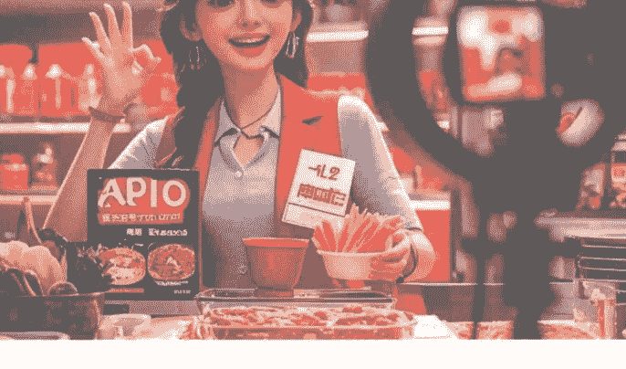

AI主播：“兄弟姐妹们，我们的直播间人气值刚刚突破500啦！这必须安排福利！现在开启幸运抽奖，获奖者将获得价值198元的火锅双人套餐！想参与的朋友，快在弹幕区打出‘我要吃火锅’！10秒后开奖！”

###### 6.个性化推荐——让AI主播“记住”顾客

**关键技巧**

个性化互动，如“哎呀，是小李！”让观众觉得自己被关注，增强归属感。

推荐逻辑清晰，基于用户过往购买行为做推荐，而不是随意推荐。

VIP专属优惠，让老客觉得自己有“特权”，提高忠诚度和复购率。

AI识别到常客：“哎呀，这不是我们的老朋友小李嘛！上次你说特别喜欢我们的麻辣锅底，今天给你推荐一款新品——藤椒锅底！它的椒香清新，入口麻爽，比麻辣锅底更带感，保证让你爱上！而且你是我们的VIP客户，今天点新品还能享受85折优惠哦！要不要今晚过来尝尝鲜？”

##### ☑核心策略

- 热情欢迎——开场就让观众有归属感，提升停留时间。
- 生动描述——让食物“活起来”，增加食欲冲动。
- 紧迫感促单——限时秒杀+FOMO心理，提高转化率。
- 互动抽奖——让观众参与，提高直播间活跃度。
- 个性化推荐——AI精准匹配用户需求，提高复购率。

这不仅是一场火锅直播，还是一次“隔着屏幕都能闻到香味”的体验！AI不仅能全天候运作，还能用热情、氛围和个性化服务，让用户忍不住下单，最终走进你的店！

#### 7.5 知识补给站 AI直播颠覆传统电商，如何抓住趋势赚得更多

在这个信息极速传播的时代，AI直播正以前所未有的方式颠覆商业模式。曾经，直播依赖真人主播的个人魅力和长时间在线互动；如今，AI让每个人都能成为“超级主播”，让企业能以更低的成本、更高的效率实现全天候的内容覆盖。AI直播的崛起不仅关乎技术创新，更是一场商业模式的彻底革新。它让个体创业者、小品牌，甚至是没有任何经验的普通人，都能快速进入直播赛道，拥有令人惊叹的变现能力。

- √一位全职宝妈，用一部手机，靠AI直播一天收入5万！
- √一家小品牌，72小时AI无人直播，GMV突破2100万！

这些不再是少数人的幸运，而是AI正在创造的新商业现实。AI直播的核心优势，在于打破了传统直播的“人力+时间”限制，用更智能、更精准、更低成本的方式，实现前所未有的商业增长。那么，AI直播到底是如何运作的？它如何改变商业生态？又该如何利用AI工具获得竞争优势？


##### 7.5.1 AI工具全景：如何打造无缝直播体验

AI直播之所以强大，不仅仅是因为自动化，还因为它背后有一整套精细化的AI工具。从内容生成到视频制作，再到数据分析，每一个环节都有专门的AI工具支持，即使是零基础的个人或小团队，也能打造专业级的直播间。

1. AI内容生成工具——DeepSeek、ChatGPT等
在几秒钟内生成吸引人的直播话术，精准切中用户痛点。针对不同的产品和人群，自动优化脚本，提高转化率。

2. AI数字人主播——百度慧播星、即梦AI等
AI合成的虚拟主播，24小时不间断直播，真人无须出镜。自动学习真人语气、表情，观众几乎察觉不到是AI在主持。

3. AI视觉生成工具——Stable Diffusion、Midjourney等
为直播间创造高质量的视觉背景，提高品牌感和用户信任度。

4. AI视频剪辑工具——开拍、剪映
让短视频剪辑自动化，快速生产直播切片，提高内容复用率。

5. AI智能运营系统
智能语音：模拟真人对话，让直播更具情感共鸣。
数据分析：追踪直播间用户行为，自动优化话术和促销节奏。
智能推荐：根据观众历史数据，精准推送个性化商品，提高转化率。

这些AI工具的结合，意味着直播不再需要庞大的运营团队，一个人也能管理多个直播间，实现多倍增长。

##### 7.5.2 AI直播的实用技巧：如何提高转化率

AI的真正价值，在于它可以利用数据驱动优化直播策略。一场成功的AI直播，通常具备以下关键要素。

###### 1. AI生成的直播话术的销售逻辑：痛点→解决方案→促单

开场：引发共鸣，抓住观众注意力

> “亲爱的，还在为节食减肥却总是反弹而烦恼吗？”（痛点）

中段：展示产品独特优势

> “我们的××减肥茶采用纯天然配方，不仅能帮你轻松瘦身，还能调理肠胃，改善睡眠质量哦！”（利益）

结尾：限时优惠，促使下单

> “现在下单还有买二送一的超值优惠，错过这次再等一年，快点击下方链接抢购吧！”（促单）

###### 2. AI防封策略：如何避免违规

在内容审核严格的直播平台上，AI可以自动规避敏感词汇，确保直播内容合规。

- 智能替换敏感词：例如，“治疗”改为“缓解”，“效果立竿见影”改为“用户反馈良好”。
- AI实时监测：自动检测潜在违规内容，及时调整表达方式，避免封禁风险。

###### 3. AI情感计算：让直播更有温度

AI可以实时分析观众的情绪，调整直播节奏和话术，提高观众参与感和停留时间。这些微小的调整，最终都会转化为更高的成交率和用户黏性。

- 当检测到观众情绪低落时，AI可能会插入轻松幽默的段子，调节氛围。
- 当观众兴趣浓厚时，AI会自动延长某款产品的介绍时间，增加互动，引导下单。

##### 7.5.3 AI直播的未来趋势：企业和个人如何布局

###### 1. 成本革命：直播成本将降低70%以上

AI技术的发展，意味着企业可以大幅减少在真人主播方面的投入，降低直播运营成本，同时提升直播质量。

###### 2. 技术普惠：一部手机就能开AI直播

未来，AI直播的门槛将越来越低，即便是普通人，也可以通过AI工具，像百万级主播一样直播带货。

###### 3. 体验跃迁：AI主播或超越真人主播

随着技术的进步，AI主播的语音、表情、互动能力将越来越接近真人，甚至在某些方面超越真人主播。

那么，企业和个人应该如何应对这场变革？

- 全面布局AI工具链：从内容生成到数据分析，打造完整的AI直播生态，确保在新趋势下保持竞争力。
- 利用AI精准营销：基于用户的历史数据和实时行为，实现千人千面的个性化推荐，提高转化率。
- 持续优化合规策略：AI直播虽然高效，但监管同样趋严。企业需要利用AI实时调整内容，确保符合平台规则，降低封号风险。

##### 本章结语

AI直播的商业革命已经到来！AI直播是一场彻底的商业变革，正在重塑内容传播、用户互动和销售模式。它的影响不仅限于企业，还在赋能每一个普通人，让他们能够以前所未有的方式进入市场，实现商业增长。

- AI降低了直播门槛，让普通人也能成为超级主播。
- AI优化了营销策略，让直播更精准、更高效、更具互动性。
- AI提升了内容质量，让直播不再依赖个人能力，而是通过系统化运作实现增长。

但AI直播的真正革命性，并不止步于让更多人参与，而在于它正在重新定义整个商业逻辑。这不仅仅是关于成本的降低，还是效率、精准度和用户体验的全面升级。在传统直播时代，决定成败的关键是主播的个人能力，而在AI直播时代，决定胜负的，是谁能更聪明地利用AI工具，构建一套高效运转的内容生态。可以预见，未来直播电商的主导者将不再是单纯的个人，而是那些善于运用AI技术的创新者。他们不会被时间和体力限制，而是通过智能化运营，实现每天24小时的不间断增长。未来的商业世界，人与AI的结合，将决定谁能抢占这场变革的先机。而最重要的是，现在，正是投身这场变革的最佳时机。

## 第八章 DeepSeek+付费投流

海量生成素材，广告爆单率狂飙100%

在这个人人都在抢流量的时代，抖音投流就像给账号装上了“流量加速器”。你可能听说过这样一句话：“自然流量是细水长流，付费投流是开闸放洪。”

美妆品牌PMPM通过在抖音连续投放产品测评视频，实现了销售额的飞跃，从每月50万盒增至80万盒，品牌总销售额突破2000万。王小卤利用用户对试吃的兴趣，推出9.9元mini装鸭脖，将获取新客户的成本从25元降至8元，创造了单月5000万的销售奇迹。

现在有了AI的加持，投流变得更“聪明”了。不仅能自动避开流量低谷时段，还能根据用户刷视频时的停留时间、点赞动作，智能调整投放策略。

流量为王的时代，既要会种树（自然流量），也要会修路（付费投流）。

#### 8.1 案例 鲜花电商行业如何用AI让单量暴涨7倍

某天下午，王总盯着电脑屏幕上的ROI数据皱眉，这位杭州鲜花电商的创始人已经连续三个月亏损。直到2023年4月，他的团队用DeepSeek生成的一组母亲节文案，让单日销售额暴涨7倍——这不仅是技术的胜利，还是认知重构的结果。

##### 8.1.1 依赖主观经验，盲人摸象式选品

某鲜花品牌运营老张曾为选品焦头烂额：去年七夕主推99元永生花礼盒，结果卖不过夜市39元的单枝玫瑰。而用了DeepSeek之后，AI大脑在23秒内，就从8.7万条地址数据里揪出了秘密，AI将产品精准匹配到三类核心场景，转化率瞬间提升217%。

数据显示，68%的中小商家因选品失误导致ROI低于1：1.5。

##### 8.1.2 碰运气式素材制作，设计师月产20组图已是极限

设计师小李每月最多产出20组广告图，还常常被运营要求“再改改”。而AI系统在A/B测试中同时投放10组素材，发现“痛点+场景化”的结构最能打动人心。比如，那条《她以为你忘了纪念日？顺丰加急挽回计划启动》的爆款文案，直接让转化率飙升300%。

##### 8.1.3 凌晨数据波动无人值守，后知后觉式调价

过去凌晨三点的流量波动，往往要等到早会才被发现。某教育机构曾因深夜时段出价过低，白白流失37%的潜在学员。现在DeepSeek像永不疲倦的守夜人，每6小时根据点击率动态调价。

#### 8.2 实操攻略 3分钟教你用AI优化全流程（附操作指令模板）

在广告投放的战场中，提示词就像精准导航的北斗系统——这套整理好的“投放前后必备指令集”，不仅能让新手少走80%的弯路，更能让老炮突破经验瓶颈。

##### ★ 投放前

素材生成提示词：“帮我生成10个突出××功能的短视频脚本”

保温杯保温功能短视频脚本创作

再设计一个包含产品对比、用户评价的落地页大纲

###### XX保温杯 - 持久锁温，温暖随行

一、首屏：吸引眼球，突出卖点 (5秒)

- 视觉：
  - 高清大图/视频：XX保温杯在多种场景下使用（办公室、户外、居家等），突出其时尚外观和实用性。
  - 动态文字：“XX保温杯，持久锁温12/24小时，给你全天候温暖呵护！”
- 行动号召：
  - “立即购买，享受限时优惠！”
  - “点击了解更多产品详情”

二、产品对比：直观展示优势 (10秒)

- 标题：“为什么选择XX保温杯？”
- 对比表格/图表：将XX保温杯与市面上其他品牌保温杯进行对比，突出以下优势：
  - 保温时长：12/24小时超长保温
  - 保冷效果：24小时冰水保鲜
  - 材质工艺：食品级不锈钢，真空锁温技术
  - 外观设计：时尚简约，多种颜色可选
  - 便携性：轻巧易携带，防漏设计
- 行动号召：

落地页框架提示词：“设计一个包含产品对比、用户评价的落地页大纲”

保温杯保温功能短视频脚本创作

给出客户常见问题的10种回复模板

###### XX保温杯 - 客户常见问题回复模板

1. 保温效果如何？能保温多久？
   - 回复模板：感谢您的咨询！XX保温杯采用先进的真空锁温技术，内胆为食品级304不锈钢，能够有效隔绝热量传递。经过专业测试，在室温20℃环境下，装入95℃热水，6小时后水温仍能保持在60℃以上，12小时后水温仍能保持在45℃以上，24小时后水温仍能保持在30℃以上，保冷效果同样出色，能够满足您日常使用需求。
2. 保温杯容量有多大？
   - 回复模板：您好，XX保温杯目前有350ml、500ml、750ml三种容量可供选择，您可以根据自己的需求进行选择。350ml小巧便携，适合日常通勤使用；500ml容量适中，适合大多数场景使用；750ml大容量，适合户外运动或长时间外出使用。
3. 保温杯材质安全吗？
   - 回复模板：请您放心，XX保温杯始终将产品质量和用户安全放在首位。我们的保温杯内胆采用食品级304不锈钢材质，安全无毒，符合国家食品接触材料标准。杯盖采用食品级PP材质，耐高温，无异味，您可以放心使用。
4. 保温杯会不会漏水？
   - 回复模板：您好，XX保温杯采用精密的密封工艺，杯盖内置硅胶密封圈，能够有效防止漏水。即使倒置也不会漏水，您可以放心携带使用。

给 DeepSeek 发送消息

智能话术提示词：“给出客户常见问题的10种回复模板”

##### ★ 投放中

标题优化提示词：“优化这5条广告标题，突出××优势”

保温杯保温功能短视频脚本创作

用对比法展示XX产品与竞品的3个核心差异

###### XX产品 vs 竞品：3个核心差异，一目了然！

为了帮助您更好地了解XX产品的优势，我们将其与市面上其他竞品进行了详细对比，以下是3个最核心的差异：

| 核心差异 | XX产品 | 竞品 | 优势解读 |
| :--- | :--- | :--- | :--- |
| 1. 持久锁温，温暖加倍 | 采用先进的真空锁温技术，内胆为食品级304不锈钢，保温时效长达12/24小时。 | 普通保温技术，保温时效仅6-8小时。 | XX产品采用更先进的真空锁温技术和优质不锈钢材质，能够有效隔绝热量传递，实现更持久的保温效果，让您随时随地享受温暖。 |
| 2. 冰火两重天，畅享双重体验 | 既能保温，又能保冷，24小时冰水保鲜，畅享清凉一整天。 | 仅具备保温功能，无法保冷。 | XX产品突破传统保温杯单一功能，实现保温保冷双重功效，无论是寒冬还是酷暑，都能满足您的需求，带来更舒适的使用体验。 |
| 3. 匠心设计，品质之选 | 时尚简约外观，多种颜色可选，食品级材质，安全无毒，经久耐用。 | 外观设计普通，材质安全性存疑，使用寿命短。 | XX产品注重每一个细节，从外观设计到材质选择，都精益求精，力图为用户提供高品质的产品和使用体验。 |

选择XX产品，您将获得：

- 更持久的温暖呵护：12/24小时超长保温，让您随时随地享受温暖。

卖点提炼提示词：“用对比法展示××产品与竞品的3个核心差异”

保温杯保温功能短视频脚本创作

创作3个限时优惠的CTA文案

###### 限时优惠CTA文案：

1. 紧迫感 + 行动号召：
   - “限时24小时！XX产品直降XXX元，立即抢购，错过再等一年！”
   - “倒计时开始！XX产品限时秒杀，低至X折，手慢无！”
   - “最后X小时！XX产品买一送一，赶紧下单，享受双倍快乐！”

2. 突出优惠力度 + 制造稀缺感：
   - “XX产品年度最大优惠，直降XXX元，限量XXX件，抢完即止！”
   - “XX产品新品首发，限时X折优惠，仅限前XXX名，先到先得！”
   - “XX产品会员专享，限时特价XXX元，非会员立享X元优惠券！”

3. 场景化描述 + 情感共鸣：
   - “这个冬天，让XX产品温暖你！限时优惠，立享X折，快来感受温暖吧！”
   - “XX产品，送给最爱的人！限时特价，表达你的心意，让爱更温暖！”
   - “XX产品，提升你的生活品质！限时优惠，享受精致生活，从此刻开始！”

CTA文案写作技巧：

- 使用动词开头，例如“立即抢购”、“点击领取”、“马上享受”等，引导用户行动。
- 使用数字和符号，例如“24小时”、“X折”、“XXX元”等，突出优惠力度和紧迫感。
- 使用感叹号和表情符号，例如“！”、“🔥”、“🎁”等，增强文案的感染力和吸引力。

给 DeepSeek 发送消息

行动号召提示词：“创作3个限时优惠的CTA文案”

##### ★ 投放后

数据分析提示词：“解析最近7天广告数据，找出转化率低于5%的计划”

- 针对广告创意：
    - 优化文案，突出产品卖点和用户利益。
    - 使用更吸引人的图片或视频。
    - 尝试不同的广告形式，例如视频广告或轮播广告。
- 针对落地页：
    - 提高页面加载速度，优化用户体验。
    - 确保页面内容与广告创意一致，提高相关性。
    - 简化转化路径，降低用户操作成本。
- 针对竞争对手：
    - 分析竞争对手的广告策略，学习其优点。
    - 突出自身产品优势，与竞争对手形成差异化。

###### 6. 持续监测与优化

- 定期监测广告数据，及时发现问题并进行优化。
- 不断尝试新的优化方法，提高广告转化率。

工具推荐：

- **数据分析工具**：Excel、Google Sheets、Python、R等。
- **广告投放平台**：Google Ads、Facebook Ads、抖音广告等。
- **A/B测试工具**：Google Optimize、Optimizely等。

数据分析提示词：“解析最近7天广告数据，找出转化率低于5%的计划”

投放建议提示词：“根据ROI数据给出下阶段预算分配方案”

沟通模板（填空式指令）：行业+平台+产品优势+具体需求

话术模板：“我是（行业）企业在（平台）投广告，想突出（产品优势），需要（具体需求）。”

###### AI投流黄金公式：

GMV提升 = (需求预测准确率 × 素材裂变效率) / (决策延迟时间 × 试错成本)

##### 饮料行业和跨境商品，如何用AI三招打爆市场

某国民饮料品牌今年推出荔枝气泡水时，就遇上了大难题——在抖音砸了300万推广费，ROI（简单说就是投放一块钱能赚回多少钱）却只有1：2.5，相当于每赚2.5元就要花1元广告费。

市场总监小林看着后台数据直挠头，痛定思痛，决定把专业的事交给AI干，联手DeepSeek搭建了智能投放系统，结果上演惊天逆转：广告点击率暴涨60%，每个下单客户广告费直降42%，ROI飙到1：4.3，单月卖出8000万！

###### 他们是怎么用AI玩转抖音的？来看三个神操作

**1. AI人群画像分析：500万用户习惯5秒归纳**

把过去三年500万用户数据喂给AI，挖出“低糖控”“开箱视频迷”“奶茶续命族”等12类人格标签。AI发现“爱看萌宠拆箱”和“爱买气泡水”的重合度高达73%。于是他们专门找宠物博主拍“猫咪开瓶盖”系列视频，有个橘猫用爪子扒拉气泡水的画面，点赞量直接破百万。

**2. 智能文案生成：7天量产200条神文案**

市场部小姑娘输入“0糖”“荔枝香”“解渴”三个关键词，AI连夜吐出200条创意。比如，抓住广州高温梗造的“体感40℃！这瓶荔枝气泡水比空调房还救命！”，配上喝水音效，销量达20万瓶。

###### 0糖荔枝气泡水营销创意20条

突出“0糖”健康属性：

1. “0糖放肆喝，荔枝香满溢” - 强调0糖也能享受美味，荔枝香气带来愉悦体验。
2. “无糖轻负担，荔枝香解渴” - 主打0糖健康，荔枝香气解渴清爽。
3. “甩掉糖分，拥抱荔枝香” - 鼓励消费者选择健康饮品，荔枝香气带来清新感受。
4. “0糖0负担，荔枝香畅饮” - 强调0糖无负担，荔枝香气畅快解渴。
5. “荔枝香，0糖轻生活” - 将产品与健康生活方式关联，荔枝香气提升生活品质。

强调“荔枝香”独特风味：

6. “一口荔枝香，仿佛置身果园” - 用场景化描述突出荔枝香气，带来身临其境的感受。
7. “荔枝香四溢，清爽一整天” - 强调荔枝香气持久，带来全天候清爽体验。
8. “荔枝香气泡，味蕾大爆炸” - 用夸张手法突出荔枝香气带来的味觉冲击。
9. “荔枝香邂逅气泡，清爽新体验” - 强调荔枝香气与气泡的完美结合，带来全新口感。
10. “荔枝香，唤醒你的味蕾” - 用拟人手法突出荔枝香气对味蕾的刺激，激发购买欲望。

结合“解渴”功能：

11. “0糖荔枝香，解渴更健康” - 强调0糖健康的同时，突出解渴功能。
12. “一口荔枝香，解渴又清爽” - 用简洁明了的语言突出产品解渴清爽的特点。
13. “运动后来一瓶，荔枝香解渴更畅快” - 针对运动人群，突出产品解渴功能。
14. “夏日炎炎，荔枝香气泡水给你清凉一夏” - 结合夏日场景，突出产品解渴消暑的功能。
15. “工作学习累了？来瓶荔枝香气泡水，解渴提神更高效” - 针对工作学习人群，突出产品解渴提神功能。

**3. 动态出价策略：半夜自动抢流量**

以前人工调广告费总踩不准点，现在晚上8点追剧党上线，AI自动把广告位竞价抬高15%；凌晨发现游戏宅男刷美食视频，立刻切换成“开黑必备饮料”话术。最牛的是世界杯期间，AI预判到男生会囤饮料看球，提前三天锁定体育类博主广告位，转化成本比平时还低20%。

###### 方法论总结

AI投流增效公式

> 精准人群画像 × 爆款素材裂变 × 动态出价策略
= 低成本高转化

义乌小商品想做TikTok出海，主营卡通发饰，希望通过TikTok开拓东南亚市场。语言障碍和文化差异导致初期投放效果差，单视频播放量不足5000。

他们结合DeepSeek做了全链路优化，AI玩了三招“乾坤大挪移”，印尼订单量暴涨220%，一款彩虹独角兽发箍的视频播放量飙到300万，连雅加达网红都跑来求合作！

###### 他们结合AI做了三步优化。

1. 跨语言AI适配：用DeepSeek生成印尼语/泰语字幕，并植入本地热词“gemes”，意为好可爱。有组对比数据特别惊人：同样是小鹿角发饰视频，机械翻译版播放量2.3万，AI本土化版直接冲到87万！

新对话

分析印尼斋月节热门话题，并生成贴纸方案

###### 印尼斋月节热门话题分析及贴纸方案

一、热门话题分析

印尼斋月节期间，社交媒体上会涌现大量相关话题，以下是一些热门方向：

- 宗教氛围：
  - 开斋时刻、祈祷、古兰经诵读、清真寺活动等。
  - 相关贴纸方案：月亮星星图案、清真寺剪影、祈祷人物、古兰经元素等。
- 家庭团聚：
  - 家人共进开斋饭、准备传统美食、分享节日喜悦等。
  - 相关贴纸方案：丰盛的美食、欢乐的家庭场景、爱心元素等。
- 慈善活动：
  - 捐赠、帮助弱势群体、分享食物等善举。
  - 相关贴纸方案：手捧爱心、分享食物、帮助他人等场景。
- 节日购物：
  - 购买新衣、节日装饰、礼物等。
  - 相关贴纸方案：购物袋、礼物盒、新衣服等元素。
- 幽默搞笑：
  - 关于斋月的有趣经历、玩笑、表情包等。

给 DeepSeek 发送消息

深度思考 (R1) 联网搜索

2. 文化热点抓取：输入指令“分析印尼斋月节热门话题”，生成宗教元素贴纸和赠品方案，用AI生成了一套营销方案：买发箍送珍珠头巾夹。三天卖出8000单，连马来西亚空姐都组团下单。

3. 智能评论区运营：设置自动回复模板，如“Hi! Bisa dikirim ke Surabaya?”（能发往泗水吗？），询单转化率从11%提升到34%。

以前觉得跨国卖货要请翻译、雇运营，现在才明白，AI才是最好的“向导”，比本地人更懂得怎么撬动本地市场！

##### 通用实施框架

AI投流千变万化，但是离不开以下核心步骤：

- 数据基建：用DeepSeek清洗/标注历史数据（完成60%基础工作）
- 智能创作：批量生成适配不同平台的营销内容
- 动态优化：设置关键指标阈值自动报警
- 知识沉淀：建立企业专属的营销策略库

##### 起量口诀

> “三高一快”原则=素材迭代频率高 × 人群标签精度高 × 价值感知度高 × 数据反馈速度快

#### 8.3 知识补给站：国内Top3 AI投流工具横向测评

| 工具 | 核心功能 | 适用场景 | 操作门槛 |
|---|---|---|---|
| DeepSeek | 全链路素材生成+动态出价 | 多平台投放/跨境电商 | 低 |
| 腾讯广告AI | 微信生态定向优化 | 私域引流/小程序转化 | 中 |
| 千川智能版 | 抖音专属人群包裂变 | 直播加热/短视频爆量 | 高 |

##### 本章结语

在流量为王的时代，投流已经成为企业获取用户、提升销量的重要手段。然而，传统的投流方式往往依赖主观经验和运气，效率低下且成本高昂。AI彻底改变了这一局面，投流从“盲人摸象”走向“精准触达”，从“碰运气”走向“数据驱动”。

AI在投流中的应用，不仅提升了效率，还颠覆了传统的投流思维。精准的人群画像、智能的素材生成和动态的出价策略，让投流从“粗放式”走向“精细化”。

未来，投流的竞争将不再是简单的流量比拼，而是精准触达和高效转化的较量。AI通过数据驱动的需求预测、智能化的素材裂变和动态的出价策略，正在帮助企业构建起强大的投流护城河。那些率先完成从人工经验到智能算法转型的企业，已经在投流战场上斩获了10倍级的效率红利。

记住，AI不是投流的替代者，而是让投流价值倍增的催化剂。AI投流的未来，不是替代创意，而是让创意在数据的海洋中乘风破浪。当AI成为投流的“智能引擎”，流量的天花板将被彻底打破，企业将进入一个全新的智能时代。

## 第九章

### DeepSeek+微信社群

引爆私域，4步榨干80%潜在用户

艾瑞咨询发布的《2023年中国私域运营洞察白皮书》显示，当前微信私域用户规模已突破8亿，企业私域渗透率超85%，年均复合增长率达28.6%，其中零售、母婴、快消行业的智能化渗透率将率先超过60%。

例如，广州某美妆品牌通过企业微信沉淀1800万用户，私域复购率高达42%，单客年消费额突破600元；南京母婴品牌依托AI工具实现1对1精准服务，会员年均互动频次达63次，私域GMV占比超35%；茶叶品牌接入智能系统后，用户分层效率提升15倍，转化率提升28%，客诉处理时效缩短至3分钟。

传统人工运营存在以下三大瓶颈：

- **人力成本高**：1个客服最多维护200个用户
- **响应效率低**：高峰期咨询响应超时率超40%
- **转化链路长**：从触达到成交平均需7次互动

在流量成本飙升的今天，微信私域已成为品牌复购增长的核心战场。AI技术的引入，让私域运营实现“千人千面”的自动化服务，私域运营正从“流量收割”转向“用户资产沉淀”的新阶段。

#### 9.1 案例 母婴行业如何用AI提升复购率

> ● 案例背景
南京某母婴连锁品牌，曾因人工推送育儿知识效率低下，导致30%用户流失。引入DeepSeek后，AI自动分析用户宝宝月龄，精准推送“辅食添加”“疫苗接种”等知识，3个月内复购率提升22%，客单价增长65%。

在2023年企业微信生态建设中，该品牌已沉淀800万母婴用户，但传统人工服务模式遭遇三大挑战：

1. 24小时育儿咨询需求激增，夜间值班人力缺口达65%。
2. 用户生命周期管理粗放，0—3岁婴幼儿养育知识推送精准度不足。
3. 奶粉、纸尿裤等刚需品复购预测依赖人工回访，会员消费频次波动显著。

AI辅助人类进行会员经营：

| 传统育儿顾问 | KidsGpt育儿顾问 |
| :--- | :--- |
| 基于经验：会员经营基于人的经验和知识，1500+个标签 | 数据驱动：数字化画像实现“千人千面” |
| 服务效率：受身体状况、地理位置、时间影响 | 7×24服务：以小时为单位迭代更新 |
| 育儿方案：受个人的专业能力影响 | 育儿方案：千人千面的个性化推荐 |
| 情感连接：可靠、值得信任 | 情感链接：高维度数字化体验、有用户黏性 |

##### 核心解决方案

1. 用户画像自动化：清洗12万条消费数据，识别“孕期/0—1岁/1—3岁”三类人群。
2. 内容精准匹配：根据用户生命周期自动推送育儿指南+商品组合。
3. 智能话术库：生成500+条育儿顾问话术，应答准确率达92%。

#### 9.2 实操攻略 用DeepSeek激活母婴行业80%的意向用户

##### 9.2.1 朋友圈运营自动化：AI当你的24小时文案秘书

操作步骤：登录DeepSeek

1. 输入关键词 “六一儿童节+亲子活动”。
2. 选择 “朋友圈风格” 模板。
3. 自动生成10条带emoji的文案。

##### 9.2.2 社群运营智能化：机器人客服+精准用户画像

1. 用DeepSeek设计训练母婴领域对话模型。
2. 导入企业常见的问题库（如奶粉冲泡、早教课程等80个高频问题）。
3. 集成到小程序里设置自动回复。
4. 配置话术模板：当用户提问“6个月宝宝辅食吃什么？”时，自动推送米粉+围兜+研磨碗组合套餐。

##### 9.2.3 裂变活动设计：用DeepSeek分析聊天话术，筛选不同类型用户

**1. 操作步骤**

（1）企业微信聊天记录自动同步至CRM系统。

（2）AI分析聊天话术，识别高价值用户（如提问超过5次未购买）。

（3）生成个性化跟进话术：“看您关心早教，本周三有免费体验课，需要帮您预留名额吗？”

**2. 用AI生成老带新智能激励**

（1）高净值用户：送价值399元早教课程。
（2）普通用户：送试用装大礼包。
（3）生成动态进度海报：“您已邀请2人，还差1人解锁大奖”。

##### AI 私域增效公式

GMV增长 =（用户分层精度 × 内容相关度 × 互动频次）/ 响应延时

##### 9.2.4 五分钟学会全流程指令模板

**1. 用户分层**

提示词：“分析近30天用户互动数据，按消费频次划分VIP/常规/沉睡客户”。

结论：VIP客户（月购≥3次）推送专属折扣，沉睡客户（60天未互动）触发召回话术。

**2. 内容生成**

提示词：“生成10条冬季童装促销朋友圈文案，要求包含场景痛点+限时优惠”。

输出示例：寒潮预警！加绒牛仔裤3秒升温，今天下单送暖手宝→戳链接。

**3. 数据优化**

提示词：“解析社群7日消息热词，找出用户最关注的3个产品功能”。

结论：用“防摔”“透气”“抗菌”这3个关键词优化商品详情页。

**4. 数据分析**

- VIP客户：分析其消费金额、互动行为，制定个性化营销策略。
- 常规客户：分析其消费习惯，制定提升消费频次的策略。
- 沉睡客户：分析其流失原因，制定召回策略。

**5. 可视化**

使用图表展示客户分布和消费行为，如饼图、柱状图等。

**6. 制定营销策略**

- VIP客户：提供专属优惠、个性化推荐。
- 常规客户：提供满减优惠、积分奖励。
- 沉睡客户：发送召回邮件、提供特别优惠。

**7. 持续监控**

定期更新数据，监控客户类型变化，调整营销策略。

通过这些步骤，你可以有效分析用户互动数据并制定相应的营销策略。

##### 9.2.5 AI私域通用方法论框架

当私域进入AI时代，以下四步方法论将成为破局密码。从数据投喂到实时优化，每个环节都在把运营效能推向新高度。

**1. 数据投喂：让DeepSeek分析历史订单、客服对话、浏览行为数据**

某快消品牌曾因数据混乱导致用户分层失误，促销活动ROI仅为1：2.3。让DeepSeek分析历史订单、客服对话、浏览行为数据后，错误率从18%降至0.9%。投喂数据后，某家电企业客服投诉处理效率提升400%。

> 数据是运营的原油，AI是炼油厂——没有干净的数据，再聪明的策略也会变成空中楼阁。

**2. 智能分层：AI自动标记高价值用户**

母婴电商应用RFM模型后，AI自动标记出“月购≥3次”的高价值用户，推送“满99减20”优惠券，转化率比普通用户高58%。更夸张的是，某服装品牌通过RFM模型发现“沉睡用户（60天未购）”对“限量秒杀”敏感度高达34%，召回率提升27%。

**3. 话术生成：批量生成朋友圈/社群/1对1话术素材库**

好话术不是灵感闪现，而是AI从用户行为数据里提炼的“成交密码”。某零食品牌用AI生成的“追剧伴侣限时5折”朋友圈文案，打开率比人工文案高210%。系统通过分析10万条爆款话术，发现“场景痛点+数字承诺+紧迫感”的黄金公式。

AI批量生成的社群话术库，让某教育机构客服应答首次解决率从68%提升至85%。内容工程使某饮品品牌促销活动ROI从1：3.2飙升至1：6.8，相当于每投入1元多赚3.6元。

**4. 实时优化：实时监控“消息打开率”“优惠券核销率”等核心指标**

某生鲜平台实时监控“消息打开率”和“优惠券核销率”，发现早市时段（6：00—8：00）打开率比平时高42%，于是立即调整推送策略，结果该时段订单量增长了37%。更夸张的是，AI动态优化让某汽车品牌线索转化率从4.7%提升至9.2%。

#### 9.3 知识补给站：AI私域工具矩阵

| 工具组合 | 应用场景 | 效率提升 |
| :--- | :--- | :--- |
| DeepSeek+微盟 | 自动化促销活动策划 | 活动筹备周期缩短70% |
| DeepSeek+尘锋SCRM | 多平台用户数据整合 | 画像构建效率提升8倍 |
| DeepSeek+腾讯云智服 | 24小时智能客服 | 人力成本降低60% |

##### 本章结语

未来，私域运营的竞争将不再是简单的用户规模比拼，而是用户价值的深度挖掘。AI通过数据驱动的精准营销、智能化的用户分层和高效的互动响应，正在帮助企业构建起强大的私域护城河。那些率先完成从人工经验到智能算法转型的企业，已经在新消费战场中斩获了10倍级的效率红利。

## 第十章

### DeepSeek重塑管理

5大环节效能爆炸式翻倍，团队战力拉满

在波士顿咨询集团追踪的2147家破产企业中，62%的破产诱因并非技术落后或资金链断裂，而是隐形的“管理黑洞”——那些未被量化的目标失真、人才错配与组织内耗，正以每年吞噬企业15%—22%净利润的方式，悄然完成对商业生命的绞杀。

工业时代的科层制带来的信息衰减，使企业战略落地损耗率高达47%，金字塔结构下的人力资源错配导致30%以上的工时无效，传统绩效考核制造的“伪勤奋”让团队真实效能持续缩水。

（工业时代科层制工厂示意图）

这解释了在技术平权的今天，同类赛道企业为何仍会呈现5—8倍的运营效率差的原因。全球顶尖企业已验证AI的管理价值，从目标协同到执行监控形成完整的智能闭环。

管理正在被AI重新定义，AI不再只是工具，而是进化为组织的“第六管理层”。

#### 10.1 案例 传统制造行业如何用AI创新生产管理

> ● 案例背景

当苏州工厂的车间响起智能调度的指令声，制造业的“人效革命”正式拉开帷幕。这不是科幻电影，而是全球最大汽车零部件厂商正在上演的真实故事。

AI让排班从“拍脑袋”变成精密的数学题，将人力成本压缩的同时，把生产响应速度提升到了令人窒息的23分钟。

2024年，苏州工厂日均要处理20种生产计划波动，传统排班方式需要50名调度员连续加班。

但这次他们做了件疯狂的事：把ERP订单数据和3000名技工的136项技能标签（比如“数控机床操作熟练度≥90%”）喂给AI。

结果像变魔术：系统自动识别出“某班组同时被安排3个高难度工序”的冲突，比人工检查快了100倍。

同样的案例还有很多，比如在春节前，系统提前两周预判到某型号火花塞订单将激增40%，自动调配了3个预备班组。某家电企业曾因预测失误，导致春节期间200名工人闲置，损失超800万元。

机械时代追求“效率最大化”，数字时代追求“流程标准化”，智能时代追求“生命体的自我迭代”。

动态调度算法支持的“三级响应机制”堪称创举：普通订单按常规排，紧急订单触发则预备队10分钟到岗，重大突发情况直接启动智能预案。

在苏州工厂的案例里，AI不是制造业的奢侈品，而是降本增效的核武器。当传统工厂还在为排班表争得面红耳赤时，聪明的企业已经让AI把生产要素变成可调度的“数字积木”。

##### 方法论公式

> 督导效能 = （问题识别速度 × 解决方案准确率）÷ 人工巡检成本

#### 10.2 实操攻略 用DeepSeek解决企业日常最难搞的五个问题

当企业数字化转型进入深水区，这五个阶段将成为破局密码，让管理效能实现指数级跃迁。就像用基因检测定制健康方案，AI让组织进化从随机突变变成定向进化。

**1. 会议管理：提升会议效率，减少时间浪费，确保会议成果可追踪**

AI对话提示词示例：

会议纪要生成

**2. 文档管理：实现文档的智能分类、快速检索和高效协作**

AI对话提示词示例：

文档分类与标签

> “自动分析并分类我上传的10份合同文档，并为每份文档打上关键词标签。”
“将‘2023年财务报告’归类到‘财务’文件夹，并标记为‘年度报告’。”

文档检索

> “帮我找到所有包含‘客户满意度’关键词的文档。”
“搜索去年Q3的市场分析报告，并提取其中的核心数据。”

**3. 客户关系管理：提升客户洞察力，优化销售流程，提高客户满意度**

AI对话提示词示例：

客户画像生成

> “根据最近3个月的客户交互数据，生成客户A的画像，包括需求偏好和购买历史。”
“分析高价值客户的共同特征，并总结他们的核心需求。”

销售机会预测

> “预测下个月可能成交的客户名单，并列出他们的潜在需求。”
“根据历史数据，推荐最适合客户B的产品组合。”

智能客服

> “自动回复客户关于‘产品保修政策’的常见问题。”
“分析客户C的聊天记录，判断他的情绪状态，并推荐合适的沟通策略。”

**4. 人力资源管理：提升招聘效率，优化员工培训，实现绩效评估的客观化**

AI对话提示词示例：

简历筛选与人才匹配

> “筛选所有投递‘产品经理’职位的简历，并推荐最符合要求的5位候选人。”
“对比张三和李四的简历，分析他们的优劣势，并给出招聘建议。”

个性化学习推荐

> “根据张三的技能评估结果，推荐适合他的培训课程。”
“为销售团队生成一份关于‘客户沟通技巧’的学习计划。”

绩效评估

> “分析李四过去6个月的绩效数据，并生成一份评估报告。”
“对比销售团队成员的绩效表现，找出需要改进的共性问题。”

**5. 财务管理：提升财务数据的准确性和分析效率，优化资金管理**

AI对话提示词示例：

财务报表生成

> “自动生成2023年Q2的损益表，并标注关键财务指标。”
“对比2022年和2023年的现金流量表，分析主要变化原因。”

风险检测与合规

> “分析最近一年的财务数据，检测是否存在异常交易。”
“检查所有报销单据是否符合公司政策，并标记可疑项目。”

#### 10.3 知识补给站：AI管理工具选型表

| 工具类型 | 代表产品 | 核心能力 | 适用场景 | 价格区间 |
| :--- | :--- | :--- | :--- | :--- |
| 智能招聘 | Eightfold | 人才画像+内部流动建议 | 万人以上企业 | $8—15/人/月 |
| 流程自动化 | UiPath | RPA+AI审批 | 制造业/金融 | ¥50万/年起 |
| 数据分析 | Tableau AI | 自动生成人效诊断报告 | 中大型企业 | ¥20万/年 |
| 专属定制 | DeepSeek | OKR对齐+战略拆解 | 集团型组织 | 定制报价 |

##### 本章结语

在数字化转型的浪潮中，AI正在成为企业管理的“第二大脑”。

AI不再是简单的工具，而是进化为组织的“第六管理层”，帮助企业在目标对齐、执行监控和风险预判中实现智能闭环。

AI在管理中的应用，不仅仅是效率的提升，还是对管理思维的革新。通过精准的数据分析、智能的流程优化和实时的风险预警，AI让管理从“粗放式”走向“精细化”。无论是制造业的排班革命，还是金融业的智能管理，AI都在帮助企业实现从“经验管理”到“数据管理”的转变。

未来，管理的竞争将不再是简单的流程优化，而是组织效能的全面提升。AI通过数据驱动的目标拆解、智能化的资源调度和高效的决策支持，正在帮助企业构建起强大的管理护城河。那些率先完成从人工经验到智能算法转型的企业，已经在管理效能上实现了质的飞跃。

当AI成为企业的“第二大脑”，管理的天花板将被彻底打破，组织的进化将进入一个全新的智能时代。

## 全书总结

### AI时代，重构未来的无限可能

当您翻到这一页，意味着我们已经共同完成了一场关于AI的深度探索之旅。从文案生成到短视频创作，从私域运营到企业管理，AI技术正以前所未有的速度重塑着商业世界的每一个角落。这场变革不是对传统的颠覆，而是对生产力的重新定义——它让普通人拥有超能力，让小企业具备大智慧，让创新不再受限于资源与经验。

#### 一、AI的本质：从工具到伙伴

本书的各大模块揭示了AI的深层价值：它不仅是效率工具，更是战略级伙伴。

正如DeepSeek在文案创作中展现的“智能许愿”能力，AI正在成为组织的“第二大脑”——它能听懂需求、预判问题、自主决策，甚至创造惊喜。在杭州宝妈案例中，AI让一个素人月入10万；在苏州工厂，AI将排班效率提升90%；在某银行，AI化身“数字侦探”规避数千万风险……这些奇迹的背后，是AI从“执行者”向“协作者”的进化。

#### 二、AI革命的核心逻辑

1.  数据即燃料：无论是用户画像还是战略拆解，精准的数据洞察是AI发挥价值的基石。
2.  场景即战场：AI的价值不在于技术本身，而在于对具体场景的深度适配——从直播间话术到工厂排班表，皆需“对症下药”。
3.  迭代即生存：AI时代的核心竞争力，是持续学习与优化的能力。正如投流场景中“动态出价策略”的进化，唯有让AI与业务共成长，方能立于不败之地。

#### 三、未来已来：AI的下一站

从“功能智能”到“情感智能”：未来的AI将不仅能理解指令，还能感知情绪。当数字人主播能根据观众心情调整语气，当客服机器人能识别用户焦虑并温柔安抚，人机协作将进入全新维度。

从“单点突破”到“生态融合”：AI+文案、AI+直播等独立场景的突破，终将汇流成“全链路智能生态”。企业需要构建数据贯通、能力互补的AI矩阵，让每个环节都成为增长飞轮的一环。

从“替代人力”到“激发潜能”：AI不会取代人类，但会用AI的人终将淘汰不用AI的人。未来的管理者应是“人机协同指挥官”，让员工从重复劳动中解放，专注于创造力与战略思考。

#### 四、致读者：成为AI时代的“新物种”

在这个技术平权的时代，最大的风险不是被AI超越，而是对AI视而不见。请记住三个行动准则。

以终为始：从业务痛点出发选择AI工具，而非追逐技术泡沫。

小步快跑：用“单点实验—快速复制—全面推广”的敏捷模式，降低试错成本。

保持温度：AI能计算数据，但无法替代人类的同理心与价值观。让技术为善意赋能，方是长久之道。

当蒸汽机开启工业文明，电灯照亮现代世界，AI正在书写人类历史的下一篇章。这本书不是终点，而是您探索AI宇宙的起点。请带着这份手册中的方法论，以勇气拥抱变化，以智慧驾驭技术，在AI重构的世界里，找到属于您的星辰大海。

##### 未来属于会用AI的人，工具在手，增长不愁

拒绝低效内卷，拥抱智能时代的指数级爆发

##### 学好本书五大收获

-   高效引流：一人操盘百个账号，AI自动化引流突破式增长
    矩阵运营+智能工具，流量红利尽在指尖
-   降本增效：企业免费提效外挂，运营成本直降三分之二
    10人团队干出100人成果，效率质量双重飙升
-   重塑生意：从夜市摊到上市公司，AI正在重塑商业底层逻辑
    无论规模大小，智能工具助力弯道超车
-   副业增收：虚实融合创作，普通人也能开启第二增长曲线
    AI视觉+场景营销，低成本引爆超级个体价值
-   方案设计：让最不懂技术的人，也能用自然对话，获取专业级解决方案
    零门槛AI重新定义生产力工具，普惠时代已来

上架建议：经济管理

定价：79.00元