# DeepSeek生意提速指南

## PREFACE
前言

这是一本教你把 DeepSeek 当成搭档来用的实操手册。

你会发现，会让 AI 写周报的同事往往比起早加班的人早两小时下班；会用 AI 做判断的老板，比只靠经验的同行少踩很多坑。

这不是科幻设定，而是现在正在发生的办公常态。

很多人第一次打开 DeepSeek 时会被术语吓到，连 Prompt 都要先查中文。熟练之后会觉得它像一盏许愿灯，只要描述清楚需求，就能得到稿件、方案、报告，甚至把琐碎的数据资料整理得井井有条。

### 新手入门路径
别被人工智能四个字吓住，本书不讲代码也不讲算法，像教家人用智能手机那样一步步带你上手：

1. 组建专属 AI 伙伴：从注册到第一次对话，约 20 分钟就能完成。
2. 必会提问技巧：从“帮我整理会议纪要”到“用小学生能懂的话解释区块链”。
3. 避坑提示：为什么让它写的方案总跑偏？多半是表达方式不对。

### 管理层的隐形外挂
一位餐饮老板把全市 20 家门店的客诉记录一次性喂给系统，第二天就拿到了菜品优化点、员工培训重点和外卖包装改进建议。

他说以前要花 20 万请咨询公司做的活，现在零成本就搞定了。

### 职场减负方案
周一的周报压力？把上周的工作邮件丢进去，几分钟就能生成带图表的总结。领导临时要发言稿？输入三个关键词，系统会给出三种不同语气的版本任选。它还能记住公司公文格式，连页眉页脚都能自动对齐。

### 内容爆款流水线
一位做母婴的博主同时打理 5 个平台：小红书标题、小红书标题生成、抖音脚本分镜、公众号大纲搭建，连评论区话术都有专属模板。广告不断，诀窍是把品牌产品手册丢进去，一小时产出十条不重复的种草稿。它还能按平台用户偏好适配，批量制造爆款。

### 专业人士提速码
程序员老王先让 DeepSeek 写基础代码，再让另一套系统扫漏洞，自己只调关键参数。律师朋友把《民法典》和司法解释库导入后，常规合同审查的速度是实习生团队的三倍，准确率更高。

本书适合
- 经营企业的老板，让 AI 代管业务
- 带团队的中层，让 AI 当数据分析师
- 长期 996 的职场人，让 AI 替你工作
- 想靠副业变现的斜杠青年，搭建 24 小时在线的生产车间
- 创业小个体，用 AI 降本增效

总有人说 AI 会取代人。真相是淘汰你的不是 AI，而是会用 AI 的人。当别人用 DeepSeek 一小时完成你三天的工作量时，老板看考勤表的眼神会变冷。

本书带你感受 AI 如何重塑生意、工作和生活，开启使用之旅。

## 第一章
### 认识DeepSeek

DeepSeek 是一款辨识度很高的创作工具，正在悄悄改变工作与生活。与同类产品相比，它的推理、文字处理、框架搭建能力突出，而且完全免费。

#### 1.1 DeepSeek是什么
DeepSeek 采用独特模型与算法，让响应速度和内容质量实现跃升。面对复杂问题，它能快速抓住要点、调动知识，给出精准细致、逻辑严密的答案。无论日常问答还是专业支持，都表现稳定，正逐步成为各场景下不可或缺的智能助手，帮助人们更高效应对挑战。

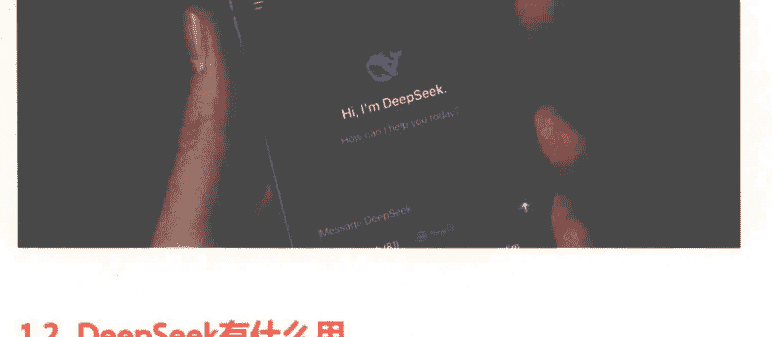
#### 1.2 DeepSeek能做什么
**即时问答：** 直接对话解决问题，例如“帮我写一份病假条，要看起来严重但别被 HR 看破”。

**文案生产：** 自动生成周报、策划案、小红书文案。比如输入“七夕奶茶店活动”，五分钟输出完整执行方案。

**脚本生成：** 快速解析热点与用户偏好，抓住流行趋势，自动生成吸睛标题、冲突情节与反转点，提升传播力与共鸣。

**流量赋能：** 分析平台算法偏好，优化发布时间与关键词，通过数据洞察用户行为，精准调整投放策略，提升曝光、引导自然流量，降低试错成本。

**任务拆解：** 智能分解复杂项目。例如把“产品发布会”拆成 13 个待办事项。

**学习助手：** 文献速读加考点提炼，30 篇论文五分钟提炼知识框架，并附送常见答辩问题库。

**商业决策：** 输入店面位置与租金，预测周边消费力并给出定价建议与经营策略。

#### 1.3 DeepSeek为何走红
##### 1.3.1 更懂中国用户的智能管家
DeepSeek 对中文的理解力领先。它能听懂“摸鱼”“躺平”等网络用语，也能识别东北话、四川话等方言指令。针对本土场景开发特色功能：为小老板生成《夜市摆摊指南》，为宝妈定制《家长群发言话术库》，还能结合最新政策解读社保缴纳。在电商客服、公文写作等领域，专业术语识别准确率达 98%，更懂中国特色需求。

> ● 实战验证
餐饮老板输入“帮我应付一个难缠的供货商”，DeepSeek 自动生成三套话术：强硬版引用《食品安全法》条款，委婉版以“最近生意难做”拉感情，折中版提出“先付 50% 货款 + 赠送新品试吃”的方案。
大学生用四川话问“毕业论文咋个写嘛？”，DeepSeek 不仅给框架建议，还推荐川渝地区特色案例库。

##### 1.3.2 流量获客的永动机
简单说，DeepSeek 能降低获客成本，百倍提升内容产出效率；自动生成图文、视频等吸睛内容，如带货文案、短视频脚本，并按平台特性精准定制，还能根据点赞、评论数据动态调优，避免花冤枉钱。

> ● 实战验证
卖货博主用智能分析热销品与直播话术，实测销量提升超 30%。
开奶茶店的用智能生成朋友圈晒品图文，新客增加 25%，老客回头率提升 18%。

##### 1.3.3 逻辑推演的强项
面对“奶茶店月亏 3 万如何止损”这类复杂问题，系统能在五分钟内输出带数据支撑的方案：原料损耗分析到爆品重组建议，并生成带成本核算表与风险预案的 15 页诊断报告。实测在商业咨询类任务中，落地转化率比同类系统高 40%，推理链条完整度堪比专业顾问。

> ● 实战验证
杭州某高校奶茶店发现每周三下午订单暴跌 70%，结合 DeepSeek 分析高校课程表后发现是“周三全天实验课”导致客流流失。建议推出“实验报告急救套餐”，低谷时段营收提升 120%。

##### 1.3.4 免费的生产力外挂
个人用户永久免费使用全部功能，企业 API 调用成本仅为行业均价的三分之一。某创业团队实测：用 DeepSeek 处理客服咨询、营销文案、数据分析，综合效率提升三倍，年人力成本节省超 12 万元。开发者接口按量计费，10 元可进行 2000 次智能问答，性价比碾压付费工具。

> ● 实战验证
摆摊卖淀粉肠的小贩语音输入“今天该备多少根肠”，直接获得结合天气与周边人流的备货建议，省去购买餐饮管理软件的费用。
大学生用免费版生成小组作业 PPT，自动匹配学校 Logo 与导师偏好风格，比专业设计公司出稿更快。

从早点摊到上市公司，DeepSeek 正在重新定义生产力工具，让不懂技术的人也能用自然语言获取专业级解决方案。


#### 1.4 快速上手DeepSeek
##### 1.4.1 电脑版下载与注册
1. 在浏览器输入官网地址：https://chat.deepseek.com/
或客户端下载页：https://download.deepseek.com/app/
或通过网页搜索“腾讯元宝”，选择 DeepSeek 深度思考模式
地址：https://yuanbao.tencent.com/evt/dl?tridChannel=baidu.pcpz.x&pkgChId=3003
2. 打开后选择手机验证码登录或扫码登录，完成即自动注册并进入。

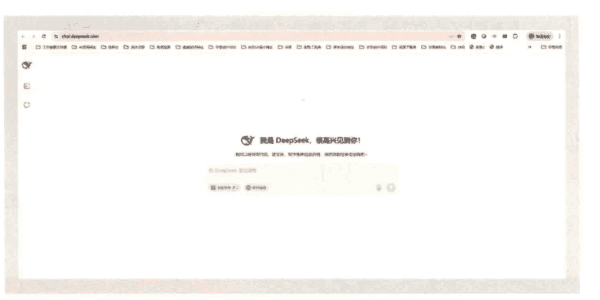
##### 1.4.2 手机版下载与注册
1. 打开手机应用市场，搜索 DeepSeek 下载 App。
2. 用手机号或微信注册。

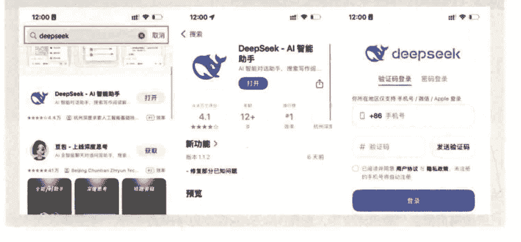
##### 1.4.3 如何使用DeepSeek
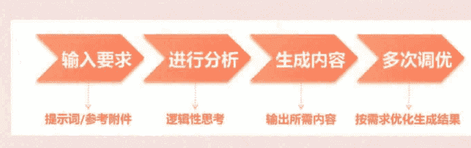
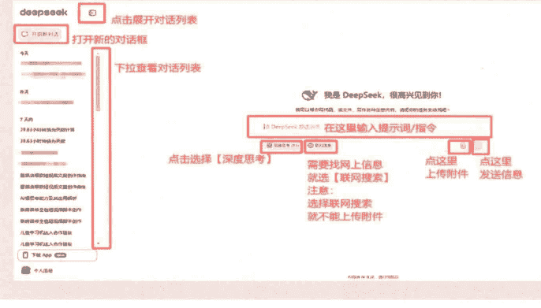

## 第二章
### DeepSeek改造文案
灵感十秒成稿，批量制造爆款内容

借助智能写文案能大幅提升效率。九成用户在体验后表示，智能写作让创意捕捉更轻松，初稿生成更快，节省大量时间，从而把精力留给价值创造。

#### 2.1 案例1 知名美妆品牌“AI+文案”做新品，社媒话题量增长35%
● 案例背景
某全球知名美妆品牌希望通过数字化手段提升社交媒体营销效果，尤其在新品推广与用户互动方面。品牌引入智能技术，结合智能文案生成工具优化社媒内容。


☑ 取得的结果
通过“智能+文案”模式，海外社交媒体互动率提升 40%，新品眼霜的话题量增长 35%，直接推动上市首月销量增长。

⊗ 具体做法
**数据分析：** 分析社交媒体上关于眼霜的讨论热点，发现“抗衰老”“淡化细纹”“性价比”是核心关键词。
**智能文案生成：** 基于关键词自动生成多条文案，如“告别细纹，年轻只需一‘抹’！××眼霜，抗衰老黑科技，性价比之王！”
**A/B 测试：** 将智能文案与人工文案分组测试，选择互动率最高者大规模投放。
**动态优化：** 投放中实时监测用户反馈，动态调整内容，例如增加“限时优惠”等促销信息以提升转化。

###### 方法论总结
> “智能+文案”提效模型
**数据分析+智能文案生成+A/B 测试+动态优化**
**= 高效营销**

#### 2.2 案例2 成都小型独立咖啡店，粉丝月增长60%
● 案例背景
成都一家小型独立咖啡店希望通过社交媒体吸引年轻人到店。由于预算有限，店主尝试“智能+文案”提升线上曝光与线下转化。

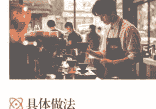
☑ 取得的结果
公众号粉丝一个月增长 60%，到店顾客增加 25%，顾客复购率显著提升。

具体做法
**内容推荐：** 分析成都本地年轻人热议话题，发现“小众咖啡”“打卡拍照”“健康生活”近期走热。
**文案生成：** 基于话题自动生成文案，如“来××咖啡店，打卡成都最‘上镜’的角落！每一杯咖啡，都是健康生活的开始！”
**社交媒体投放：** 将文案发布在公众号和小红书，并配合“拍照打卡送咖啡”活动，吸引到店。
**用户互动：** 利用智能工具回复评论与私信，提升互动率。

###### 📋 方法论总结
##### “智能+文案”变现模型
**内容推荐+文案生成+社交媒体投放+用户互动 = 线下转化**

#### 2.3 案例3 自由职业设计师巧用AI设计，项目接到手软
● **案例背景**
李小姐是自由职业设计师，希望通过社交媒体展示作品吸引客户。由于时间紧张，她使用“智能+文案”提升个人品牌曝光与转化。


☑ **取得的结果**
小红书粉丝两个月增长 80%，接到 6 个新设计项目，收入增加 40%。

##### 具体做法
内容分析：分析设计行业热门话题，发现“极简风设计”“品牌视觉升级”“Logo 设计”近期走热。
文案生成：基于话题自动生成展示作品的文案，如“极简风 Logo 设计，让你的品牌一眼难忘！点击查看我的最新案例！”
内容发布：将文案与作品图片同步发布在小红书和 Behance，并保持定期更新。
客户沟通：智能工具协助回复潜在客户咨询，提升沟通效率。

###### 方法论总结
> “智能+文案”增收模型
内容分析+文案生成+内容发布+客户沟通
= 个人品牌增值

#### 2.4 实操攻略：零基础AI写作速成指南
##### ★ 高效提问法则
- 法则一：需求明确化
×错误示例：“帮我随便写点东西。”
√正确姿势：“我需要一封应聘市场营销经理的求职信，突出 5 年品牌策划经验及成功案例。”
- 法则二：补充背景信息
×错误示例：“整理一下这份报告。”
√正确姿势：“这是一份 2023 年 Q4 电商平台用户行为报告，请提炼出复购率与促销活动关联性的关键结论（附 Excel 表格）。”

###### 法则三：格式清晰化
×错误示例：“设计几个活动方案。”
√正确姿势：“请以分点形式列出 3 种中秋节线下快闪店活动方案，需包含执行步骤、预算分配及风险预估。”

###### 法则四：内容精简化
×错误示例：“展开讲讲。”
√正确姿势：“请用 150 字简述人工智能的发展趋势，面向非技术背景的中学生群体。”

###### 法则五：反馈与修正
若对回答不满意，可回复：
“方案创意不足，请增加 3 个差异化亮点。”
“请将第三部分的语言风格调整为口语化表达。”

##### 2.4.1 爆款文案&脚本改写
###### ★ 基础改写流程
步骤 1 打开 DeepSeek。
步骤 2 输入原始文案：粘贴需要改写的文字。
> 示例输入
原稿：我们的产品采用先进纳米技术，能有效去除 99.9% 的细菌，保护家人健康，现在购买享 8 折优惠。
步骤 3 设置改写指令（关键步骤）。
| 改写类型 | 指令模板 | 输出示例 |
| :--- | :--- | :--- |
| 风格调整 | “将以下文案改写成（年轻化/专业感/接地气）风格” | “这黑科技纳米涂层超能打！灭掉 99.9% 细菌，全家健康 buff 加满！冲就完事，现在剁手直接砍价 20%！” |
| 口语化改写 | “用小红书博主语气优化文案” | “救命！这个纳米抗菌神器真的绝！实测干掉 99.9% 细菌！本宝妈狂囤 3 瓶，现在入坑立省 20%！” |
| SEO 优化 | “植入关键词：健康家电、家庭防护、6·18 优惠” | “【健康家电必入】纳米抗菌技术守护全家！家庭防护升级首选，6·18 限时 8 折，除菌率高达 99.9%！” |
| 情感强化 | “增强紧迫感和稀缺性” | “纳米抗菌黑科技最后 36 小时特惠！错过今天再等 1 年！已有 2356 个家庭抢先体验，库存告急！” |
步骤 4 优化生成结果：对结果不满意可多次提要求。比如，“太短了，扩写一下，不少于 500 字”“三段式输出”等，调整后可得到更满意的结果。

生成界面展示如下。
我们的产品采用先进纳米技术，能有效去除 99.9% 的细菌，保护家人健康，现在购买享 8 折优惠。
将以上文案改写成[年轻化/专业感/接地气]风格
已深度思考 (用时 17 秒)
嗯，用户让我把一段文案改写成年轻化、专业感和接地气的风格。首先，我需要理解原文的核心信息：产品使用纳米技术，能去除 99.9% 的细菌，保护家人健康，现在有 8 折优惠。
接下来，分析每个风格的要求。年轻化可能需要更活泼，有网感的语言，比如使用流行词汇或表情符号。专业感要保持可信度，可能需要强调技术权威和数据。接地气则需要更贴近日常用语，让受众感觉亲切。
然后，考虑如何平衡这三个风格。年轻化和接地气有时可以结合，比如用口语化的表达，但专业感可能需要加入权威的数据或认证，可能需要分句处理。比如开头用吸引年轻人的词汇，中间加入专业的数据支持，结尾用激励的促销语。
还要注意目标受众，年轻化的文案可能针对的是 20-35岁的群体，他们喜欢简洁、有活力的表达。专业感可能需要引用权威机构或具体的数据，比如“SGS 认证”来增加可信度。接地气的话，可以用“细菌全家桶”这样的比喻，让信息更易理解。
然后检查原文的结构，可能需要调整顺序。比如先突出效果，再讲技术，最后促销，或者用疑问句开头引起注意，比如“还在担心细菌搞事情？”这样更吸引人。
还要考虑使用符号或排版，比如表情符号、感叹号来增强年轻化的感觉。同时，保持句子简短有力，避免过于复杂的结构。
最后，整合这些元素，确保信息准确传达，同时符合三种风格的混合。可能需要多次调整，找到合适的平衡点，让文案既有活力又不失专业，还让人感觉亲切自然。
【年轻化风格】
“纳米黑科技暴击细菌！99.9% 团灭率守护全家，现在剁手立省 20%！细菌君退退退！🦠✨”
【专业感风格】
“采用 ISO 认证纳米级抗菌技术，经 SGS 实验室检测对大肠杆菌/金黄色葡萄球菌等致病菌灭杀率达 99.93%，现限时开放行业专享价。”
【接地气风格】
“细菌全家桶退散神器！隔壁老王都装了的纳米防护盾，三胎家庭实测有效，现在下单直接打八折！”
【三合一混合版】

细菌克星上线：纳米防护实测99.9%

还在被细菌困扰？🔬承袭中科院研发路线的纳米工艺已落地，实验室验证对常见致病菌的清除效能达99.9%，现时下单直减20%，相当于为家人披上一层看不见的安全层！

四个沟通角度始终围绕同一价值点：

+   1. 年轻化：调用“黑科技”“暴击”“团灭”等电竞用语，搭配表情符号
+   2. 专业感：突出权威机构背书、具体菌种名称与精确数值
+   3. 接地气：使用“全家桶”“隔壁老王”等生活化比喻
+   4. 混合版：以设问拉互动，融合专业背书与口语比喻，收尾用“隐形防护甲”拔高价值

###### ★ 进阶改写方法

01 数据增强改写

指令：“在文案中补入对比数值，提升可信度”

原句：充电速度更快。

改写：对比市面上常见充电器提速三倍，实验室数据称25分钟可充满5000mAh电池。

02 场景化植入

指令：“加入办公室/育儿室/健身房使用场景”

原句：降噪耳机保护听力。

改写：健身房器械轰鸣？地铁里人声嘈杂？××降噪耳机可识别85类噪音，佩戴即切换静音环境！

03 痛点解决方案

指令：“采用问题—解决结构改写”

原句：洗衣液去污力强。

改写：咖啡渍、口红印、宝宝尿渍洗不掉？××生物酶洗衣液三步分解顽渍，实测去污效能超出国标三倍！

04 平台适配改写

| 平台 | 改写要点 | 示例指令 |
| --- | --- | --- |
| 抖音 | 前三秒设悬念且感叹号密集 | “以‘你一定不知道’起笔，每十个字插入一个emoji” |
| 公众号 | 故事化开头配数据论证 | “用‘去年有位宝妈发现……’引入产品” |
| B站 | 梗文化+二次元元素 | “加入‘肝帝’‘暴击’等游戏术语” |

05 热点借力改写

指令：“结合近期热度如淄博烧烤/酱香拿铁优化”

输出示例：比酱香拿铁更上头！这支纳米除菌喷雾全天守护餐桌安全，淄博烧烤店同款！

06 区域化适配

指令：“融入上海本地元素”

原句：配送覆盖全国。

改写：静安寺30分钟达，外滩夜景配送可视化，全市256个社区点即送！

##### 2.4.2 文档分析

###### ★ 文档基础操作流程

-   步骤1 启动DeepSeek。
-   步骤2 文档准备，确保格式受支持，如PDF、DOCX、TXT等，文件大小通常建议控制在100MB以内。
-   步骤3 点击回形针图标，上传已准备好的文档。注意：联网搜索开启时，回形针图标变灰，无法上传。

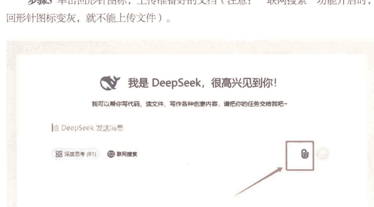

步骤4 等待文件上传成功。

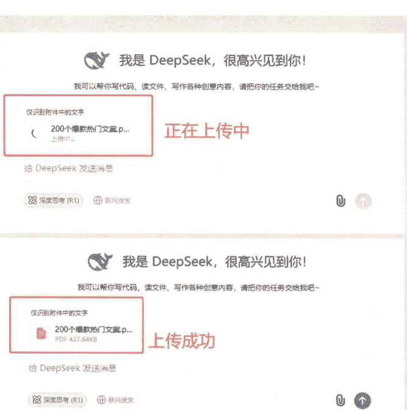

步骤5 输入分析指令。

在对话区输入指令，例如：

总结文档：“请用200字概括该文档的核心内容。”

提取关键信息：“列出文档中出现的所有技术术语。”

问答：“根据文档，说明××技术的三个优势是什么？”

回车或点击【箭头】即可获取结果。

分析界面展示如下。

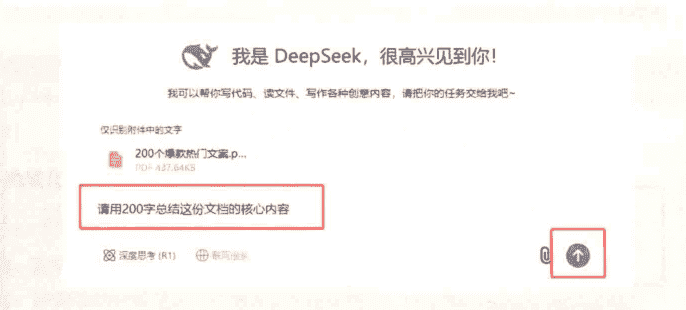

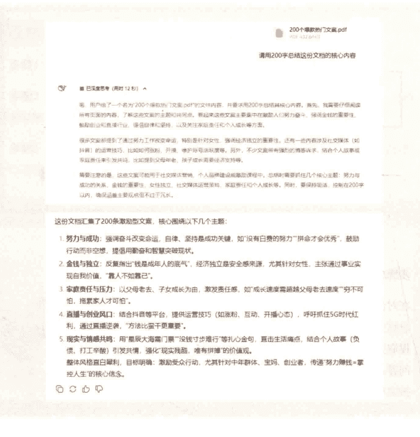

###### ★ 文档进阶分析技巧

多文档对比——上传多份后提问：“比较A文档与B文档在研究方法上的差异。”

结构化输出——指定格式：“把结果整理成表格，包含页码、关键词及解释。”

深度学习——用自然语言指令：“找出文档中矛盾观点并评估其逻辑性。”

##### 2.4.3 写公众号

###### ★ 先明确微信公众号四大核心特性

-   ● 私域流量

精准人群：可自主经营目标用户，降低获客成本。

高黏性互动：通过内容与服务提升用户忠诚度与活跃度。

品牌化运营：强化品牌形象，建立信任与长期关系。

-   ● 深度阅读

完整体验：支持长图文、视频，提供连贯内容。

沉浸式消费：无干扰界面，提升专注度。

偏好优质内容：吸引深度用户，鼓励原创输出。

-   ● 规范体系

审核机制：确保内容合法合规，符合平台政策。

发布流程标准化：从编辑到发布有明确规范。

运营规则清晰：界定账号权限与行为边界，维护生态。

###### ● 互动机制

评论与点赞：用户可直接反馈，增强参与感。

赞赏支持：为创作者提供变现渠道，激励优质内容。

转发分享：通过社交裂变扩大传播范围，提升影响力。

###### ★ 再结合AI实现从账号分析到内容产出的全流程

###### 1.账号分析

-   （1）进入公众号后台，选择“数据分析”—“用户分析”—“用户属性”，截图保存。
（2）打开DeepSeek，上传截图，输入提示词“请根据这张图分析我的粉丝画像”。
（3）等待生成结果。

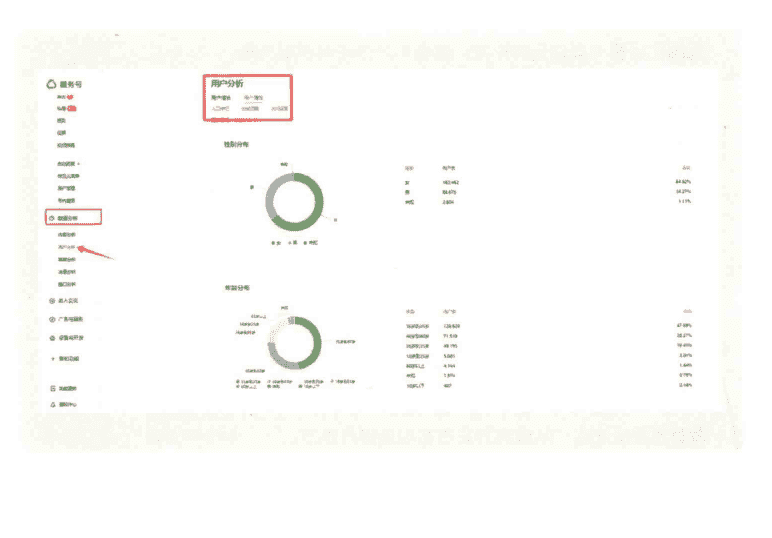

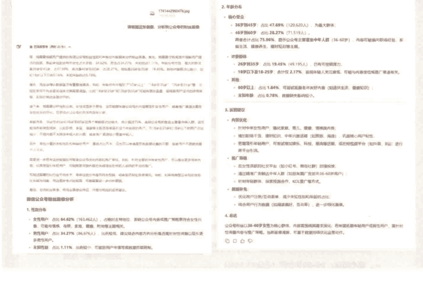

###### 2.继续追问

###### 追问提示词示例

根据这份画像，分析关注点与需求，说明痛点、痒点、爽点分别是什么？我该如何把握来做爆款？

请分点输出并举例，用通俗语言。

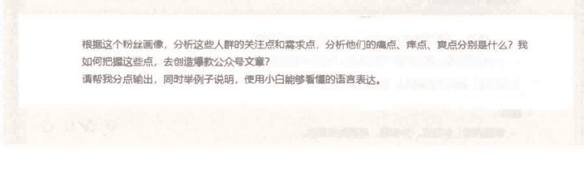

基于给出的数据：女性占比64.62%，男性34.27%；核心年龄36-60岁，其中36-45岁近半，核心为中年女性，关注家庭、健康、职场、理财；次要群体26-35岁。

痛点指迫切需解决的问题；痒点指潜在欲望；爽点指即时满足。

结合人群推断：

中年女性关注家庭管理、健康保养、职场压力、理财规划、自我提升。

中年男性关注职场发展、健康、家庭责任。

年轻人关注职业成长、婚恋、消费、兴趣。

###### 一、核心群体：36-60岁女性

1. 痛点
- 家庭矛盾：子女叛逆、婆媳紧张、夫妻沟通少。例：《孩子顶嘴怎么办？三句话让叛逆期主动认错》。
- 健康困扰：更年期失眠、关节痛、身材走样。例：每日10分钟瑜伽，50岁女士腰围减10cm。
- 财务压力：开支大、难储蓄、养老焦虑。例：《普通家庭月省3000的5个技巧，主妇必看！》

2. 痒点
- 自我提升：想学技能却没时间。例：《周末2小时学会网红蛋糕，朋友圈点赞破百》。
- 生活品质：希望更整洁有仪式感。例：《不花钱！旧物改造让客厅高级感翻倍》。
- 外表年轻：渴望显小。例：《45岁像35岁？坚持这3个习惯，皱纹减一半》。

3. 爽点
- 快速解决：一招见效的育儿妙招、省钱技巧。例：《孩子写作业拖拉？一张表让效率翻倍》。
- 情感共鸣：真实故事引发共情。

###### 二、次要群体：26-35岁年轻人

1. 痛点
- 职场内卷：加班多、升职难、同事复杂。例：《领导偏心怎么办？3招成办公室“红人”》。
- 婚恋压力：被催婚、相亲失败。例：《相亲10次避坑指南，看完脱单率翻倍》。
- 消费陷阱：踩雷、月光族。例：《这5类商品别买！年轻人省钱必看》。

2. 痒点
- 副业赚钱：想搞钱缺渠道。例：《上班族月赚5000+的副业，每天1小时》。
- 个人成长：提升颜值、情商、技能。例：《说话总得罪人？3个公式秒变高情商》。

3. 爽点
- 捷径攻略：简单方法。例：《PPT做不好？5个模板秒变大神》。
- 反差故事：普通人逆袭。例：《月薪3000到3万，我靠这3个习惯改变人生》。

###### 三、如何做爆款

1. 标题公式
痛点+数字+结果：《婆媳吵10年，我用一句话让婆婆主动道歉》。
痒点+悬念：《不节食不运动，她靠这个瘦了20斤》。
爽点+福利：《免费领！2024最新理财表，家庭存款翻倍》。

2. 内容结构
开头戳痛点：真实场景共鸣。
中间给方案：分步、清单、配图。
结尾促互动：引导留言转发。

3. 爆款要素
实用性：直接给工具。
情感性：故事代替说教。
即时性：强调马上能用。

###### 四、小结

抓住中年女性的家庭、健康、省钱需求，年轻人的搞钱、变美、脱单痛点，用“真实故事+具体方法+超值福利”创作。标题直击痛点，内容像朋友聊天，让读者觉得就是为他写。

###### 3.内容产出

（1）从上文选一个爆款标题。
（2）让DeepSeek输出完整公众号文章，可附加风格、字数要求。

> 示例提示词：请以《领导偏心怎么办？3招让你成办公室“红人”》为标题，写一篇公众号爆款，不少于1000字。

二、次要群体：26-35岁年轻人

-   1. 痛点：
- 职场内卷：加班多、升职难、同事关系复杂。
- 婚恋压力：被催婚、相亲失败、恋爱矛盾。
- 消费陷阱：网红产品踩雷、月光族存不下钱。
-   例子：
- 《领导偏心怎么办？3招让你成办公室“红人”》。
- 《相亲10次总结的避坑指南，看完脱单率翻倍》。
- 《这5类商品千万别买！年轻人省钱必看》。

请以《领导偏心怎么办？3招让你成办公室“红人”》为标题，写一篇公众号爆款文章，不少于1000字

根据标题《领导偏心怎么办？3招让你成办公室“红人”》撰写。

###### 《领导偏心怎么办？3招让你成办公室“红人”》

开头扎心

> “我加班最多，升职却给了小王！”
> “会上提十个方案，领导只夸了小李的点子…”
> “重要项目总给关系户，我像透明人！”

有过这种委屈吗？别骂不公平，今天教你三招，不拍马屁、不搞心机，光明正大成红人！

###### 一、领导为何偏心

很多人以为看脸、关系户，其实更扎心：领导喜欢省心的下属。

你汇报总说遇到困难，同事说我解决了三个问题；你等安排，同事已把方案放桌上。

###### 二、三招逆袭

####### 第1招：老板思维工作，让领导离不开你

普通员工只问任务完成没。高手多想一步：领导下一步要什么？

操作：
1. 会上做捧哏
领导问建议时别沉默，哪怕补充一句：“我觉得张经理提的成本问题很关键，我补充个数据…”
案例：小林每次会上接话，半年成领导御用记录员。

2. 汇报用选择题替代问答题
错：“客户投诉了，怎么办？”
对：“客户投诉了，有两套方案：A成本低见效慢，B需预算但快解决，您倾向哪种？”

3. 主动揽责+补救
出问题先说：“责任在我，我马上协调。”随后立刻给补救计划。

效果：领导觉得你靠谱，重要事先想到你。

####### 第2招：把同事变助攻

别抢功、别斗心眼，要借力。

1. 公开夸同事
“这次能成，多亏小王通宵改设计”。领导觉得你格局大，同事更愿帮你。
2. 关键时刻送人情
同事被骂时递纸巾：“我上次也犯过，后来这样解决…”
3. 绑定实力派
和能力强、人缘好的同事合作，功劳共享，风险共担。
案例：实习生小美常帮同事带咖啡、整理资料，转正时全部门投票。

####### 第3招：刷存在感不招烦

天天晃会被骂戏精，不露面成透明。把握分寸：

1. 每周发简版周报
模板：本周完成3项+1个创新点+下周计划。
例：“领导，本周完成客户数据分析，发现A产品复购降5%，建议下周重点跟进，可行吗？”

2. 朋友圈选择性营业
发加班照：“连赶三天方案，终于通过！”
发培训照：“周末充电，希望下周帮团队更好！”

3. 偶尔麻烦领导
“领导，您上次推荐的行业报告启发很大，能再推荐两本书吗？”让领导有被需要感。

###### 三、真实案例

90后阿琳入职两年没存在感，领导记不住名字。
逆袭：
1. 周报刷存在感，每周五发3行总结，3个月后领导主动问她要不要负责新项目。
2. 关键时刻补位，同事提案搞砸，她连夜做备用方案。
3. 绑定需求，领导会议纪要头疼，她自学AI工具把3小时压缩到30分钟，成为会议救星。
一年后升主管，领导说：“我就喜欢能扛事的人。”

结尾：职场运气藏在价值感里。别只抱怨不公平，记住没有怀才不遇，只有价值不足。

今日行动：
1. 写下上次领导表扬同事的原因，对比自己差距；
2. 从明天起，每周主动汇报一次进展，哪怕三句话。

互动：你遇到过领导偏心吗？怎么解决？评论区聊聊，点赞最高送《职场高情商话术手册》！

##### 2.4.4 写小红书

###### ★ 走出误区

小红书月活超3亿，95后占50%，00后35%，多在一二线城市。

数据：
- 90%内容由8000万+用户创作
- 69.8%用户通过平台做消费决策
- 32.1%当作生活搜索工具
- 44.5%用于知识技能学习

常见误区：
- 日更限制论
- 盲目追热点忽视垂直
- 过度包装封面降点击
- 跨平台复制忽略社区氛围
- 无定位内容杂乱
- 企业号无效

科学运营：
- 精准定位打造差异化标签
- 高频更新保持算法活跃，建议日更两三条
- 场景化表达，真实使用体验
- 用AI实现选题、文案、数据全链路优化

####### 1. 选题规划

打开DeepSeek，开启深度思考+联网搜索。

可输入：
- 分析近期10万浏览量的爆款笔记主题
- 挖掘评论区热闹笔记的互动技巧
- 根据特长打造个人特色
- 分析商业变现能力
- 借鉴同领域大号经验

####### 选题策划思路

######## 一、热文拆解：用户偏好与内容走向
近期小红书阅读量破十万的笔记，高频主题大致可归纳为三类方向：

1. 干货实操类
   - 学科资料与考试技巧：如“高考数学常见套路”“医学考研复习时间表”，多以图文、PPT、短视频呈现，逻辑清晰，强调可直接上手。
   - 美容与生活妙招：如“七天淡化痘印方案”“低价复刻ins风卧室”，靠前后对比或步骤演示来增强信任感。

2. 情绪共鸣类
   - 个人成长经历，如“月薪五千到副业三万”“三十岁裸辞创业”，用真实经历带动代入。
   - 争议性话题，如“职场PUA应对”“婚姻中女性处境”，易在评论区发酵。

3. 热点结合类
   - 依托时节节点，如“春节礼物清单”“考研冲刺周安排”。
   - 借势社会话题，如“AI工具测评”“碳中和生活方式”。

偏好汇总：内容要兼顾实用性与共鸣，呈现形式偏混合图文视频，标题需直击痛点或制造悬念，如“十秒辨肤质”“懒人食谱月减五斤”。

######## 二、评论区激活：提升互动的方法
高互动笔记的评论运营策略大致有：

1. 提问式引导
   结尾抛开放问题，如“你踩过哪些雷货？”“备考最难的点是什么？”，激发分享欲。

2. 争议话题设计
   如“平价替代对比大牌”“全职妈妈是否浪费学历”，利用对立观点促讨论。

3. 情绪共鸣触发
   分享个人失败经历，如“面试被拒十次后的领悟”，评论区常形成互助氛围。

4. 价值延伸
   在干货中预留增补技巧，如“评论区抽三人送资料”，促使用户留言。

5. 及时回复与沉淀
   高频回评并置顶优质留言，形成良性互动闭环。

######## 三、人设差异化：IP定位建议
依能力塑造个人标签：

1. 细分赛道切入
   美妆可聚焦“敏感肌专属指南”或“黄黑皮穿搭”；健身可深耕“产后恢复”或“办公拉伸”。

2. 真实人设强化
   用个人故事提升可信度，如“985学姐考研作息”“油痘肌博主自救记录”。

3. 形式创新
   知识类可用“思维导图+口语解读”替代纯文字；生活方式类可结合vlog展示过程，如“独居女孩一日三餐”。

######## 四、变现评估：商业化路径
不同内容类型的变现方式：

1. 测评类，如美妆/家电测评
   变现方式：品牌合作，单篇报价约粉丝数×0.1-0.3元，带货分成。

2. 教程类，如备考/技能教学
   变现方式：知识付费专栏/训练营，社群会员。

3. 生活方式类，如家居/旅行
   变现方式：品牌植入，线下活动邀请。

关键指标：粉丝粘性即互动率>5%，内容垂直度与标签精准度，商业标签植入自然度，避免硬广。

######## 五、头部借鉴：运营策略拆解
1. 选题拆解
   分析同领域头部账号爆款，提炼高频词如“懒人”“平价”“逆袭”。

2. 形式优化
   借鉴热门封面风格如“大字标题+对比图”，同时加入个人元素如手写字体或专属形象。

3. 互动技巧
   参考头部评论区打法，如固定时段直播答疑、定期发起打卡活动。

4. 差异化突围
   在同质内容中增加稀缺性，如“法学硕士跨考经验”vs“普通备考攻略”。

######## 总结与行动建议
内容优化：融合实用性与情感价值，强化封面与排版视觉。
互动设计：主动引导讨论，善用热点与争议话题。
变现规划：按内容类型提前布局合作资源，如入驻小红书蒲公英平台。
工具辅助：借助AI工具如简单AI生成创意素材，提升生产效率。

通过上述策略可实现从引流到变现闭环，建议定期复盘播放量、互动率、转化率，动态调整方向。

■ 点击生成的内容中的数字，可查看更多联网信息来源，为选题规划提供参考。

####### 2. 吸睛标题生成

###### 示范
> “变美与生活技巧：例如‘一周祛痘印攻略’‘低成本打造ins风家居’，通过前后对比或步骤拆解增强说服力”

围绕以上方向，给出10个爆款小红书笔记标题

######### 变美技巧类（祛痘印/护肤）
1. 🔥痘印人群必看！28天低价攻略，红黑印全淡｜附凝胶实测对比图
   （参考平价淡印方法及产品推荐，突出周期与效果对比）
2. 痘印橡皮擦！壬二酸点涂法，一周见效｜油痘肌亲测无广
   （强调壬二酸成分权威性与效果，锁定精准用户）
3. 手残党急救！五毛维生素E用法，痘印淡八成｜附按摩手法
   （低成本易操作，用天然成分吸引关注）
4. 医学生私藏！光子嫩肤平替方案，居家淡化痘印｜附护肤流程表
   （蹭医美热度，提供居家解决方案）
5. 戒掉挤痘！三步防痘印指南｜红肿痘急救+后期修复全攻略
   （痛点切入，兼顾预防与修复）

######### 生活技巧类（家居/收纳）
6. 百元改造ins风卧室！拼多多好物清单+布置技巧｜附前后对比
   （突出平价渠道与视觉冲击，吸引租房用户）
7. 旧衣架别丢！五种DIY神操作，秒变ins收纳神器｜零成本教程
   （旧物改造，强调创意与实用）
8. 绿植杀手逆袭！十种懒人水培清单，客厅秒变北欧风｜附养护表
   （解决养植痛点，提供简单方案）
9. 出租屋秒变网红家！旧家具DIY攻略，零成本翻新｜附配色方案
   （针对租房群体，强调低成本改造）
10. 极简主义控必藏！一平米角落改造法，打造治愈书桌｜好物链接
    （细分场景，吸引追求品质的用户）

######### 标题设计技巧总结
1. 痛点+解法：直击需求如“痘印”“租房改造”，配具体方法提升可信度。
2. 数字量化：用“28天”“五毛”等数据增加专业感，降低决策成本。
3. 对比效果：借助“前后对比图”“红黑印全消失”等关键词营造视觉联想。
4. 场景标签：如“油痘肌”“出租屋”，精准触达目标人群。
5. 情绪调动：使用“🔥”“必看”“逆袭”等词汇提升点击欲。

建议结合自身内容方向选用标题模板，并配高清对比图或流程图发布，进一步提升互动。

####### 3. 内容产出
**出租屋秒变网红家！旧家具DIY攻略，0成本翻新｜附配色方案**

面向租房人群，突出低成本改造，输出一篇完整小红书爆款笔记

🌟出租屋秒变网红家！零元爆改旧家具攻略+神仙配色，手残党也能逆袭！🏠

刷到就是赚到！毕业三年搬了五次家的租房人血泪总结——不刷墙、不打钉、不花钱的改造思路，手把手教你用旧家具打造ins风小窝！（文末附万能配色公式）

🔨【旧家具逆天改命计划】
⚠️核心：万物皆可“布贴”+旧物叠加buff！
1️⃣ 丑柜重生术
🧱材料：废旧床单/窗帘布+双面胶
把布料裁到柜门尺寸，用双面胶贴出波浪褶皱边，瞬间法式复古感！比刷漆省力太多。
🪑木桌变奶油甜品台
🪵材料：过期身体乳+咖啡渣
1:1混合厚涂桌面，打磨后立刻出做旧感！亲测比某宝200+的复古桌还好看，注意戴手套操作。
🪑铁艺床架去年代感
🪵材料：捡来的麻绳
螺旋缠绕床架并系流苏，搭配串灯立刻田园风满分，缠4cm宽效果最佳。

💡【全网求的万能配色方案】
🧶记住公式=70%背景色+25%主色+5%点缀色
✅奶油杏子酱：米白墙纸+焦糖地毯+青铜花瓶
✅薄荷苏打：浅灰床品+薄荷窗帘+明黄抱枕
✅低保真原木：藤编收纳+亚麻桌布+深咖装饰画
（进阶技巧：手机调黑白模式，家具明暗协调才算成功！）

💡【50元内软装王炸组合】
·氛围组：pxx搜“瑕疵陶瓷花瓶”3元/个+小区捡的南天竹
·光影魔法：闲置台灯套蕾丝袜=温柔滤镜
·遮丑大法：外卖袋折收纳盒，贴旧杂志内页

▌血泪经验TIPS
❶和房东签“改造协议”，拍照留证承诺恢复原状
❷慎用丙烯颜料，避免异味影响押金
❸改造前用“色采”APP模拟效果，超准！

改造完记得@我交作业！下期教奶茶杯做落日灯～ 🥤
#租房大改造 #旧物改造 #家居配色 #出租屋好物 #抠门美学
@家居薯 @生活薯
（附对比九宫格，重点展示布贴柜门、麻绳床架、咖啡渣做旧桌细节）
🧶房子是租的，生活不是！点赞收藏的宝子这个月必遇神仙房东！🫶

##### 2.4.5 写报告材料
###### ★ 需求分析与搭建框架
####### 1. 输入关键信息
需提供以下基础信息给DeepSeek。
**使用场景：** 具体开什么会？如季度总结会、项目动员会
**核心内容：** 主要讲什么？如布置任务、总结问题
**目标对象：** 听众是谁？如基层员工、合作单位、上级领导
**领导习惯：** 喜欢怎么讲话？如爱用数据说话/善举例/擅长互动
● 参考例子
帮忙写科技园区建设会的讲话稿，听众是管委会和入驻企业老板。领导喜欢先讲理论再讲实际，需包含现状分析、外地成功案例对比、三年行动计划，按“找问题—提办法—保落实”结构撰写。

####### 2. 生成基础框架
系统会自动生成三大部分框架：
**开头**（问候+会议目的）
**主体**（现状+重点任务+具体做法）
**结尾**（明确责任+时间要求）
如需可增加表彰环节或问答环节。

###### ★ 分段写作与内容填充
####### 1. 开头注意四要点
1. 符合最新政策要求
2. 结合本地特色，如山区县可强调生态资源
3. 回应上级最新指示
4. 照顾全体听众，如同时提到乡镇干部和企业代表

####### 2. 主体部分
**数字处理：** 将枯燥数据形象化，如“招商进度比去年快一个月”。
**政策解释：** 翻译成大白话，如把“放管服改革”说成“简化审批手续”。
**问题分析：** 整理成三栏表：问题现象/产生原因/解决办法。
**结尾设计：** 结合行业趋势与单位特点，如物流公司可谈智慧物流发展。
**具体措施：** 配真实案例，如“成立督办小组，像去年防汛那样每周检查进度”。

###### ★ 调整说话风格
1. 按领导习惯改
   - 理论型领导：多引用政策与专家观点。
   - 实干型领导：多用数字与进度表。
   - 亲和型领导：多加“大家辛苦了”等暖心话。
2. 口语化三技巧
   - 长句拆短。
   - 少用“被”字句，如不说“问题被解决”，改说“我们解决了问题”。
   - 专业术语要解释，如“区块链技术就是数据防伪的新方法”。

###### ★ 检查与修改
1. 逻辑检查
   - 前后数据是否一致，如前面说完成80%，后面不能写70%。
   - 问题与解决办法要对应，如缺人手对应招聘计划。
2. 精简内容
   - 删除重复话、铺垫过长部分、模糊表述，如把“尽快解决”改为“7月底前完成”。
3. 校对
   - 用检查工具核对专业术语、数字准确性、引用文件出处。
> ● 重要提醒
> - 配合使用：AI写完后需多方把关，业务部门审内容、办公室调格式、领导定方向。
> - 分步修改：定框架→加例子→打磨金句。
> - 注意安全：重要数据打码，引用政策需标明年份文号。
> - 合理使用：AI内容不超过六成，关键部分如人事任命、数据结论必须人工确认。

##### 2.4.6 智能代读
以下是利用DeepSeek高效拆解一本书的教程，每天几分钟即可吃透核心！

###### ★ 建立阅读地图
1. 上传书籍信息
   - 将书名、目录、前言、结语拍照或截图给DeepSeek，并说明需求。
   - 指令示例：“请用表格整理《刻意练习》全书框架，含三级目录章→节→核心观点，以‘理论+生活案例’形式呈现。”
2. 生成思维导图
   - 要求输出可视化结构。
   - 指令示例：“把《认知觉醒》拆解成‘问题场景—认知原理—行动方法’三列对照表，每部分用！标记重点章节。”

###### ★ 精准抓取核心
1. 关键问题挖掘
   - 让AI模拟读者提问，定位重点。
   - 指令示例：“假设我是职场新人，请列出《高效能人士的七个习惯》中最需优先掌握的3个习惯，并说明在加班多的情况下如何实践。”
2. 核心内容提取
   - 用“三线法”浓缩章节：主线观点1句、辅助案例1个、行动线索1个可操作步骤。
   - 指令示例：“用三线法拆解《非暴力沟通》第四章，例子要基层员工能理解的场景。”

###### ★ 构建知识网格
1. 关联现实场景
   - 理论结合具体情境。
   - 指令示例：“把《金字塔原理》中的SCQA模型，转化为向领导汇报工作进度的表达模板。”
2. 制定行动清单
   - 生成可直接执行的计划。
   - 指令示例：“根据《掌控习惯》内容，为我设计21天习惯养成表，含每日微行动，适用于经常加班人群。”

###### ★ 强化记忆与应用
1. 问答自测
   - 生成记忆闪卡。
   - 指令示例：“用《思考，快与慢》关键概念出10道判断题，答案后附1个常见误解案例。”
2. 场景模拟
   - 让AI模拟实战演练。
   - 指令示例：“假设我要用《影响力》中的互惠原则谈合作，请生成客户可能提出的3种拒绝话术及应对方案。”

###### ★ 强化记忆与应用
1. 通勤听书版
   - 指令示例：“把《原则》第二章转化为5个坐地铁可听完的音频脚本，每段3分钟，用讲故事方式呈现原则应用。”
2. 读书笔记模板
   - 指令示例：“生成《穷查理宝典》读书笔记模板，含颠覆认知观点红色标记、本周可尝试方法绿色标记、存疑待查内容黄色标记。”

###### 3. 主题式阅读
指令示例：“我正在读《卓有成效的管理者》，请关联《这就是OKR》中的目标管理章节，对比两种方法的适用场景。”

###### ● 注意事项
1. 精准投喂：复杂图表单独拍照上传并标注“请解释这张增长曲线图与第三章结论的关系。”
2. 及时纠偏：发现理解错误时修正，如“刚才关于双轨分析法的解释有误，原著第58页说的是……请重新整理。”
3. 输出管控：要求分段输出，避免信息过载，如“每次只解析一个章节，用微信对话形式呈现。”

#### 2.5 知识补给站：国内其他4大语言类AI运用大盘点
1. 豆包 专注短视频AI助手，依托抖音海量数据，擅长生成热门视频脚本与智能剪辑建议，适合快速产出吸睛内容，但长文本处理较弱。
| 对比维度 | 具体说明 |
| :--- | :--- |
| 核心优势 | ① 15秒生成抖音爆款脚本<br>② 内置1000+热门BGM与运镜模板<br>③ 支持16国语言实时翻译 |
| 主要劣势 | ① 长文案易重复套路<br>② 专业领域错误率较高，如法律文案 |
| 适用场景 | 短视频创作/跨境直播/热点跟拍 |
| 推荐用户 | 网红达人/跨境电商运营/新媒体小编 |

2. 文心一言 擅长写营销文案、解读政策文件，还能方言互动，适合企业宣传或政务科普，但英文生成一般，复杂逻辑易出错。
| 对比维度 | 具体说明 |
| :--- | :--- |
| 核心优势 | ① 自动生成朋友圈爆款文案<br>② 方言识别准确率超90%<br>③ 直接调用百度百科数据库 |
| 主要劣势 | ① 英文质量不如中文<br>② 专业建议需人工复核，如医疗建议 |
| 适用场景 | 营销文案/政策解读/传统文化科普 |
| 推荐用户 | 市场策划/基层公务员/实体店商家 |

3. KIMI 专注长文本处理，可一口气分析200万字行业报告或法律文件，适合深度研究，但生成内容偏严肃，高峰期响应慢。
| 对比维度 | 具体说明 |
| :--- | :--- |
| 核心优势 | ① 法律合同自动查漏补缺<br>② 财报数据可视化解读<br>③ 论文核心观点提炼 |
| 主要劣势 | ① 生成内容缺乏趣味性<br>② 晚间8-10点响应延迟明显 |
| 适用场景 | 学术研究/投资分析/合同审查 |
| 推荐用户 | 法务人员/金融从业者/研究生 |

4. 讯飞星火 主打语音交互，能听懂方言，适合语言学习与课堂教学，对话流畅但图片与长文质量普通，更适合简单任务。
| 对比维度 | 具体说明 |
| :--- | :--- |
| 核心优势 | ① 支持23种方言实时翻译<br>② 英语口语评分系统<br>③ 课堂课件自动生成 |
| 主要劣势 | ① 生成图片清晰度一般<br>② 复杂问题需多次追问 |
| 适用场景 | 外语学习/智能家电控制/在线教学 |
| 推荐用户 | 外语考生/学校教师/智能家居用户 |

##### 总结
在快节奏时代，“AI+文案”高效写作已成普遍选择。它能帮助创作者大幅提升效率、降低成本，将稍纵即逝的灵感迅速转化为高质量稿件。无论短视频脚本、营销文案还是品牌故事，AI工具都能通过智能分析和优化让内容更具吸引力与传播力。这种高效创作方式节省时间精力，让创作者聚焦核心创意，收获更多商业价值与个人成长。“AI+文案”写作正在重新定义内容创作方式。

### DeepSeek+豆包
AI一键出图，1个普通人=10个设计师

零门槛视觉创作力跃迁

绘画功底不再是限制创意落地的门槛，智能创作助手已经把海报、修图、标识等常见视觉任务的交付周期压到数分钟。过去要三小时才能完成的工作，现在靠几次点击即可拿到可用稿件，整体效率可被放大十倍以上。智能修图、自动排版、一键换风等能力，让点子从脑中到成图的距离大幅缩短。

无论是专业设计师还是普通用户，都能借助这类工具把想法快速可视化，省去重复的手工劳动，将精力集中在创意本身，视觉产出的水平实现质的提升。

#### 3.1 案例1 休闲游戏厂商批量出图，下载增幅180%
● 背景说明
一家专注轻度游戏研发的中型公司，长期面临投放素材需求旺盛、制作时长过长——传统一套要5至7天、创意易趋同的困境。为加快投放节奏，团队引入Playturbo的“链接成图”功能，联动图像生成与文案优化，迅速批量产出多元风格的广告件。


##### ☑ 成效回顾
- 单套物料交付由7天缩短至2小时，创意迭代快了约十倍；
- 点击率由1.2%升至4.5%，下载量上涨180%；
- 半年度投放花费降低35%，投入产出比提升至1:8.7。

##### ⊗ 操作拆解
**链接自动解析：** 输入应用商店链接，系统自动提取图标、截图及关键词，如“休闲”“解压”。

**风格矩阵批量制作：** 以“像素风”“3D卡通”等参考图为基准，一次生成10组物料，并搭配不同Slogan，如“碎片时间轻松玩”对比“治愈你的小焦虑”，满足多样化投放需求。

**图文联动产出：** 系统同步生成适配画面的短文案，例如“点这里，治愈你的周一综合征！”，强化用户点击引导。

**数据驱动优化：** 通过A/B测试筛选高点击物料，反馈训练模型生成逻辑。一次生成100组，仅投放前20%的高分组合，降低测试成本。

###### 方法论总结
游戏广告智能成图流程
输入链接 → 系统解析元素 → 风格矩阵产出 → 文案匹配 → A/B测试 → 数据反哺优化

#### 3.2 案例2 杭州社区面包店视觉升级，跻身本地美食Top10
背景说明
杭州一家社区面包店主打手工烘焙，店主缺乏设计经验，线上宣传只能用手机拍产品图，朋友圈转化率不足3%。2024年11月起，店主启用简易智能的“文生图+智能文案”功能，重塑视觉营销体系。


##### ☑ 成效回顾
- 朋友圈图文点击率由12%提升至45%，线上订单占比从15%提高到52%；
- 3个月新增会员800人，客单价从38元提升至65元，得益于智能生成的套餐图；
- 小红书笔记爆款率达到30%，成功进入本地美食榜Top10。

##### ⊗ 操作要点
**场景化关键词输入：** 输入“法棍+阳光早餐”“可颂+下午茶”，系统生成早餐桌布景、咖啡馆氛围图。

**卖点可视化呈现：** 将“零添加”文字转化为对比图，如工厂流水线VS手工揉面过程。

**套餐组合设计：** 输入“58元套餐：咖啡+可颂+沙拉”，系统产出分层视觉图，包含产品实物、价格标签和氛围元素。

**节日热点借势：** 圣诞节输入“麋鹿+红绿配色”，生成限定包装图，配合文案“咬一口圣诞”拉动节日订单。

###### 方法论总结
> **卖点视觉化公式**
> 产品特性如手工→对比图/过程图如揉面特写
> **场景捆绑法**
> 产品面包+使用场景早餐/下午茶+情绪关键词温暖/治愈。
> **价格锚点设计**
> 在智能生成的图片中植入价格标签如“原价25元→套餐价18元”，刺激冲动消费。

##### 热点快速响应
节日/天气如雨天→生成主题素材如“雨天和热可可更配哦”。

##### 低成本素材库
建立“产品单图”“套餐图”“场景图”三类模板库，按需调用。

##### 个体门店智能成图增效模型
产品卖点→场景关键词输入→智能生成多风格图→植入促销信息→多平台分发

#### 3.3 案例3 自媒体博主靠智能视觉变现，首月营收破15万元
###### 背景说明
一名上海自由职业者在抖音、小红书经营美妆测评账号。初期只用手机拍实拍，画面单调，粉丝停滞在1.2万，广告报价仅500元/条。后来她利用智能技术生成虚拟场景，实现“产品+场景”融合，转型为虚实结合的美妆视觉博主。


##### ☑ 成效回顾
- 流量爆发：单条智能生成的眼影盘场景笔记获赞12万，粉丝3个月突破25万；
- 商业价值跃升：广告报价提升至8000元/条，与多个品牌达成长期合作；
- 副业拓展：开设智能视觉营销课，首月销售额突破15万元，学员超2000人。

##### 具体做法
**环节一：虚拟场景构建**
输入“星空眼影盘+未来感梳妆台”，生成赛博朋克风格化妆场景，突出科技感；用DALL·E 3的“图像扩展”功能，将实拍口红照片无缝融合到智能生成的复古剧院背景中。

**环节二：动态视觉衍生**
利用Runway的图生视频，为静态眼影盘添加动态粒子消散效果作短视频开场；用Stable Diffusion生成“妆容进化史”系列长图，展示素颜到全妆的智能模拟过程。

**环节三：数据驱动选题**
监控小红书热搜词如“多巴胺妆容”，2小时内产出对应主题的智能视觉素材库；用智能分析爆款笔记配色规律，反向指导虚拟场景色彩搭配，如今年流行色“数字薰衣草”占比提升30%。

**环节四：版权合规运营**
对核心智能生成图进行版权登记，如“银河系口红矩阵图”，建立数字资产库；选用可商用智能工具如Midjourney，规避法律风险。

###### 方法论总结
> **虚实融合公式**
> 实体产品图+智能虚拟场景+动态特效→打造沉浸式视觉体验

##### 热点响应机制
实时监控平台热搜词 → 调用预存风格模板 → 2小时极速出图

##### 数字资产沉淀
建立“场景库/动态素材/版权证书”三层管理体系，提升内容复用率

##### 商业闭环设计
引流内容智能视觉笔记 → 变现产品课程/广告 → 用户数据反哺内容迭代

##### 法律风控策略
商用工具选择+关键素材版权登记+分层授权协议如限制二创范围

##### 自媒体智能视觉变现路径
选题定位 → 虚实融合创作 → 多平台分发 → 数据反哺 → 版权资产化 → 商业变现

#### 3.4 实操攻略：人人都能当“智创设计师”
##### 3.4.1 营销海报
智能制作营销海报的核心优势是提效降本。传统海报需要设计师反复构思、排版、配色和修改，智能工具可在数分钟内输出多个方案，大幅缩短周期。系统能根据关键词、品牌风格和目标人群自动生成符合要求的海报，减少人工反复。

对中小企业或预算有限的团队，智能工具的成本远低于聘请专业设计师，还能快速响应市场变化，及时推出趋势内容。

制作流程如下：

环节一：明确海报主题和核心信息，确定视觉风格方向、背景元素布局和标题字体配色。将需求整理成文字，由DeepSeek转化为适配图片生成智能的提示词。

以制作亲子出游海报为例：

> 提示词示例
> 需要制作一张亲子出游海报，画面包含父母与孩子放风筝、野餐互动场景，采用暖色调扁平插画风格。请根据需求输出文字描述，输出结果字数不能超过300字，不能带有特殊字符，要符合即梦AI的规范。

环节二：把任务提示词输入DeepSeek，让其优化画面的整体文字描述。

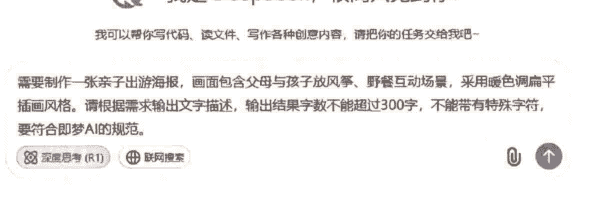
DeepSeek返回的整体文字描述如下。
亲子出游海报以暖色调扁平插画风格呈现。画面中心为开阔的草地，背景点缀低矮山丘与棉花糖般的云朵。左侧父母与孩子呈三角形构图：父亲手握风筝线仰头微笑，母亲半蹲整理野餐篮，扎马尾的小女孩高举燕子造型风筝奔跑，衣角随风扬起。右侧野餐布铺展，竹篮露出三明治与草莓，橙汁玻璃瓶折射阳光，书本自然摊开在格子餐布上。上方三只风筝错落悬浮，鲸鱼风筝采用珊瑚粉撞色设计，蝴蝶风筝融入淡蓝几何花纹。整体以奶油黄为主基调，草地使用低饱和度青绿色，人物服饰选用浅橙、米白等柔和色彩。
标题文字“春日趣游记”采用圆润字体置于顶部，副标题“风筝/野餐/自然探索”以浅棕色衬于画面下方，底部标注简约活动信息条。通过扁平化色块与留白处理，营造温馨轻松的亲子互动氛围。

环节三：打开即梦AI登录。即梦AI官方地址为：https://jimeng.jianying.com/
环节四：登录后点击“图片生成”。
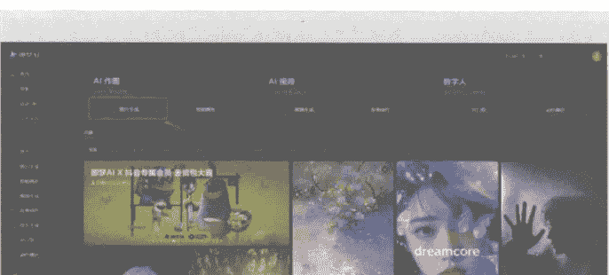
环节五：将DeepSeek提供的海报设计内容复制粘贴到即梦AI。

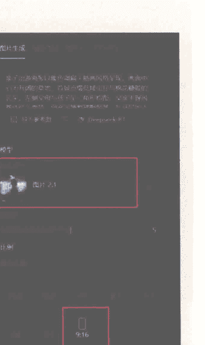
环节六：“模型”选择“图片2.1”，“比例”选择“9：16”手机竖屏海报尺寸。
环节七：点击“立即生成”，系统一次性生成4张海报，可自由选择。

环节八：下载生成的海报。
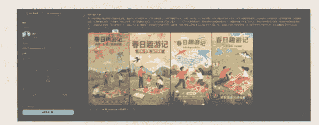
环节九：如图片带即梦AI Logo水印，可点击“去画布进行编辑”。
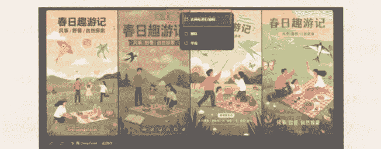
环节十：点击“导出” → “下载”，即可获得海报。

注：除DeepSeek配合即梦AI外，也可用DeepSeek配合豆包等组合制作海报。

##### 3.4.2 思维导图
智能生成思维导图可体现在效率提升、结构优化和智能辅助三方面。系统能快速把复杂信息转为清晰导图，节省整理时间；生成的结构更合理，节点关系自动调整；还能智能补充概念、优化布局、推荐关键词。

**具体实操步骤。**
环节一：安装工具——电脑端准备DeepSeek和XMind。
环节二：文件上传——打开DeepSeek，点击回形针图标，上传课件/文档，支持多文件。提醒打开“深度思考”功能。
环节三：输入提示词——“请完成以下任务：深度分析附件内容，提炼核心知识点，生成Markdown格式思维导图框架”。
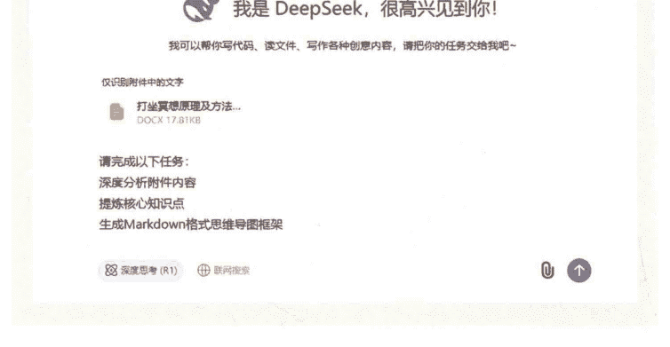
###### 环节四：等待系统生成结构化内容。
好的，我现在需要处理用户提供的关于打坐冥想的文档，并完成三个任务：深度分析内容、提炼核心知识点，以及生成Markdown格式的思维导图框架。首先，我需要仔细阅读并理解文档内容，然后提取关键信息。
首先，用户提供的文档详细解释了打坐冥想的原理和方法。从生理到心理的变化过程，到宇宙能量的概念，再到具体的打坐姿势和冥想方法，内容非常丰富。我需要将这些信息进行分类和整理。
在深度分析时，我应该注意文档中的主要部分：静坐原理、宇宙能量的作用、身体能量层次、打坐姿势的要点、冥想方法（尤其是“观念法”），以及实践中的注意事项。这些都是核心内容。
接下来，提炼核心知识点可能需要分步骤进行。例如，将原理部分的关键点（如身心合一、宇宙能量的吸收）单独列出，方法部分则分为环境和姿势要求，以及具体的冥想步骤和口诀。
生成Markdown格式的思维导图框架时，需要按照层次结构来组织这些知识点。可能需要使用标题和子标题来区分不同部分，并用列表或嵌套列表来表示各个子点。需要确保结构清晰，逻辑连贯。
在过程中，我需要检查是否有遗漏的重要信息。例如文档中提到的“观念法”的三句口诀、打坐姿势的四个要点，以及温馨提示中的实践建议。同时，注意术语的准确性，如“顶轮”、“膻中穴”等，可能需要正确翻译或保留原文术语。
###### 环节五：复制生成的Markdown内容。
Markdown格式思维导图框架
```
# 打坐冥想原理及方法

## 一、核心原理
**身心合一**
- 放下杂念，活在当下。

**宇宙能量**
- 维持生命的基础能量，主动吸收。

**能量体与肉体**
- 肉体是物质，能量体是形而上能量。
- 能量通道堵塞，需冥想放松打开。

## 二、实践方法
### 1. 环境与姿势
**环境**：安静、光线适中、温度适宜。
**姿势**：
- 脊椎挺直，下巴微收。
- 手印（智慧手印/定印），轻放至丹田。
- 双目垂帘，意识对准眉中穴。
```
## 056 DeepSeek爆改生意指南
环节六：新建TXT文本文件，并把复制的内容粘贴到文本中。
环节七：修改文件扩展名，把.txt改为.md。
环节八：打开XMind软件，点击“新建导图”。
环节九：点击“思维导图” → “创建”。
环节十：点击左上角三条线图标，选择“文件—导入—Markdown”。
环节十一：选择转换好的.md文件，自动生成分级思维导图。

##### 3.4.3 标志创作
智能工具可在数分钟内根据品牌名称、行业特点和设计偏好，快速生成多个标志方案，极大缩短设计周期，适合需要快速建立品牌形象的企业或个人。相比专业设计师的高费用，智能生成成本更低，多数工具免费或低价。

系统结合海量设计数据和趋势分析，产出多样化创意，用户可调整颜色、字体、图标等元素，确保在网站、名片、社交媒体等场景的适用性。

用法如下：
> **环节一：参考提示词公式。**
**身份+客户需求+风格+主元素+质感，把需求输入DeepSeek。**
示例：我是一名品牌设计师，客户要做一个Logo，名称是“麦萌宠物”，要有狗和猫的元素，简单大气，让人一看就觉得很可爱。请帮我设计一下，给我3个不同的方案描述，描述要简洁明了，符合豆包AI生图的要求。
###### 环节二：等待结果生成。
我是一名品牌设计师，客户要做一个logo，名称是“麦萌宠物”，要有狗和猫的元素，简单大气，让人一看就觉得很可爱，请帮我设计一下，给我3个不同的方案描述，描述要简洁明了，符合豆包AI生图的要求
###### 麦萌宠物 Logo 设计方案：
- 方案一：简约线条风
  - 描述：以简洁流畅的线条勾勒出一只猫和一只狗的轮廓，猫狗相互依偎，形成一个爱心形状。整体造型圆润可爱，色彩采用温暖的橘色和米色，给人温馨亲切的感觉。
  - 关键词：简约、线条、猫狗、爱心、温暖、可爱
- 方案二：卡通插画风
  - 描述：设计一对可爱的卡通猫狗形象，猫戴着蝴蝶结，狗戴着项圈，它们俏皮地互动，或玩耍、或拥抱，背景可以加入一些宠物玩具元素。色彩明亮活泼，充满童趣。
  - 关键词：卡通、插画、猫狗、互动、可爱、活泼
- 方案三：字母图形化
  - 描述：将“麦萌”二字进行图形化设计，融入猫狗的元素。例如，“麦”字可以设计成猫耳朵的形状，“萌”字可以融入狗爪印的元素。整体造型简洁大气，又不失可爱。
  - 关键词：字母、图形化、猫狗、简洁、大气、可爱
###### 环节三：选择一个喜欢的方案并复制文案。
麦萌宠物 Logo 设计方案：
方案一：简约线条风
- 描述：以简洁流畅的线条勾勒出一只猫和一只狗的轮廓，猫狗相互依偎，形成一个爱心形状，整体造型圆润可爱，色彩采用温暖的橘色和米色，给人温馨亲切的感觉。
- 关键词：简约、线条、猫狗、爱心、温暖、可爱
###### 环节四：打开豆包AI（https://www.doubao.com/chat/），选择“图像生成”。
###### 环节五：把复制的文案粘贴进去。
风格随你定制，分秒生成同款效果
<图像生成> 设计一个简约线条风LOGO
描述：以简洁流畅的线条勾勒出一只猫和一只狗的轮廓，猫狗相互依偎，形成一个爱心形状，整体造型圆润可爱，色彩采用温暖的橘色和米色，给人温馨亲切的感觉。
关键词：简约、线条、猫狗、爱心、温暖、可爱
###### 环节六：生成后，选择心仪图片下载即可。
举一反三：账号头像、背景图、漫画、插图、场景、风景图等，都可用不同提示词输入DeepSeek，再用豆包AI或即梦AI生成。

##### 3.4.4 人物动图
智能生成动态图高效且富有创意。系统能把静态图像或文字转为生动流畅的动态效果，增强视觉吸引力。通过智能算法自动生成过渡、特效和动态设计，无需专业动画技能。

无论用于社交媒体、广告还是演示，智能动态图都能快速抓住注意力，节省时间和精力，且可按需求调整速度、风格和细节，实现个性化表达。

即使是小白，也能按攻略做出生动好看的人物动图。

## 第三章 DeepSeek+豆包 061

步骤一：启动 DeepSeek，对话框里输入想要的画面描述并发送，把模型返回的绘图指令复制出来。

步骤二：用手机打开豆包 App，进入后点开创作入口。

## 062 DeepSeek 与豆包联动做出会动的头像

步骤三：进入 AI 出图功能，把刚才复制的指令粘贴到输入框并发送，系统一次性给出四张成片。挑出最满意的一张保存到相册。

步骤四：回到创作页选择照片动起来功能，上传刚刚保存的那张素材。

步骤五：填入描述动作的提示语等待处理，完成后打开预览就能看到人物在动，直接存入本地即可。

#### 3.5 科普小站：普通人也能看懂的 AI 绘图热潮

朋友圈里常能刷到 AI 做出的赛博朋克自拍、动漫版全家福，甚至有人拿 AI 画 T 恤图案。AI 绘图就像突然普及的数字画笔，让非专业用户也能产出接近大厂水准的图像。下面用大白话拆开说。

##### 绘图背后的原理：让模型学会联想补全

像教小孩学画画

设想你教孩子画猫，先给他看上千张猫的照片并说明这是猫，再让他模仿。AI 绘图的思路很像。工程师把海量图片喂给模型，让它捕捉规律。比如猫有两只耳朵、天空通常是蓝色。

机器的优势在于记忆力，能记住梵高笔触到网红自拍的光影，甚至能拼出宇航服柴犬在月球上蹦迪这种离谱画面。

关键技术：把文字转成图的翻译器

早期的模型像拼图工匠，会把猫耳和狗身拼在一起。现在更像编剧，你丢一句“穿西装的柯基在开董事会”，它就能凭空生成符合描述的画面。

核心在于跨模态理解。你说二次元萌妹，它联想到日漫风大眼睛；你说赛博朋克，它会自动加上霓虹和机械元素。这背后是大量图文配对训练的积累。

##### 普通人能用 AI 绘图做什么

日常娱乐：朋友圈出片率提升

玩梗利器：给朋友生成“他要是超级英雄”的漫画像，或把自家猫 P 成蒙娜丽莎猫。

省设计成本：活动海报、生日请柬、专属头像都能自制。比如在 Midjourney 输入中国水墨风格的老虎，十秒出图。

追星新玩法：做某歌手在火星开演唱会的恶搞图，或把偶像放进古风场景。

##### 商业化思路

电商卖家：批量制作商品展示图，卖汉服的不用请模特，直接让模型生成唐朝女子漫步长安街的场景。

内容创作者：小红书博主用 AI 图做减肥前后对比，抖音创作者做电影质感封面，完播和点击都上去。

接单渠道：海外有人靠卖 AI 情侣艺术照月入过万，也有人接 T 恤图案定制单。

##### 技术背后的争议与风险

版权争议：是否在“偷”艺术家风格

不少画家发现 AI 作品风格与自己高度相似，因为训练数据用了他们的画却未付费。海外已有艺术家集体起诉，焦点是学习风格算不算抄袭，目前未定论。

造假风险升高

有人用 AI 造“马斯克力荐比特币”的假新闻视频，甚至合成明星私照。造假门槛越来越低。欧盟已要求 AI 图必须加水印，国内平台也在打击 AI 造谣号。

会被取代吗

目前 AI 更像超强助手。设计师用它出上百版草图再精修；游戏公司用它生成 NPC 服装，省下七成时间。但像《阿凡达》世界观这种需要核心创意的项目，还得靠人。未来创作可能分层：顶级更贵，普通更卷。

##### 常用工具清单

国内友好型：百度文心一格、抖音 AI 绘画特效。

进阶国际版：Midjourney、Stable Diffusion 本地部署。

手机端：美图秀秀 AI 绘画、醒图 AI 特效。

##### 提词技巧

想出好图，要学会“念咒”。

加风格：如宫崎骏动画风格、皮克斯 3D 渲染。

加细节：如逆光、蒸汽朋克机械细节、浅景深。

避坑：别用太抽象的词，比如有灵魂的作品；多迭代，比如柴犬穿西装→柴犬穿黑西装打领带→柴犬在办公室穿西装敲键盘。

> 总结

AI 绘画是工具不是魔法。本质是大数据加算力的胜利，把视觉创作从专业技能变成大众游戏。但用好它仍需要审美和创意。就像人人有手机，能拍出好照片的永远是懂得构图的人。下次聊到 AI 绘画，你可以说：它让电脑有了想象力，但画的柯基可能有六条腿，还得人来纠正合理性。

## 第四章

### 即梦搭配剪映实现流量放大

强强组合，让你轻松做到日更百条短视频

AI 让短视频生产更高效，一两张图或一段文字就能自动生成连贯视频，还能智能配乐加特效，快速做出吸睛内容。可节省约七成制作时间，同时提升完播率。

专业创作者能把产能放大数倍，颠覆过去产出模式；新手也能快速上手，用 AI 产出高质量视频，抓住风口实现变现。

#### 4.1 案例一 南京运动服品牌靠 AI 短视频，发布效率提升九倍

● 案例背景

南京一家头部运动服品牌面临暑期大促压力，需要在抖音上快速产出 500 条差异化短视频引流到私域。原人工团队日产不足 20 条，内容同质化严重。2024 年 7 月引入汇智智能的 AI 数字员工，实现了短视频全链路自动化。

##### 取得的结果

- 效率提升：日产从 20 条增至 200 条，发布效率提升 900%；
- 成本优化：单条制作成本从 500 元降到 80 元，运营成本降 84%；
- 转化数据：平均播放量提升 120%，私域引流率从 3% 升到 12%；
- IP 效应：抖音号粉丝 3 个月涨 50 万，进入运动服饰垂类 Top10。

##### 具体做法

● 第一步：AI 选题矩阵搭建

数字员工抓取抖音运动穿搭爆款 1 万条，拆解出 3 类黄金公式。

1. 痛点类：跑步裤总卡裆？这款黑科技让你放肆跑！
2. 场景类：健身房社恐穿搭，这件 T 恤让你瞬间自信。
3. 数据类：6·18 爆卖 10 万件防晒衣，实测紫外线阻隔率 99%。

● 第二步：智能脚本生成

输入商品参数，AI 自动生成 3 秒钩子 + 15 秒卖点 + 5 秒促销的标准结构。

示例脚本

前 3 秒：雨中跑步画面 + 字幕淋雨 3 小时，衣服竟然不贴身？
中间 15 秒：慢镜头展示速干面料吸水实验 + 配音××科技速干 T 恤，吸水率降 80%
最后 5 秒：弹出限时券 + 字幕点购物车抢 199 元 3 件

● 第三步：自动化素材生产

调用 Midjourney 生成产品 3D 展示图，用 DALL·E 合成运动场景背景；用 AI 换脸让同一模特适配不同肤色体型，降低拍摄成本。

● 第四步：动态投放优化

数字员工实时监控完播率、点赞转化，自动追加 ROI>2 的视频投放；对播放 <500 的视频，AI 自动更换封面并重发前 3 秒内容。

###### 方法论总结

- 爆款公式提炼：拆解行业 Top1000 视频，提炼可复用结构
- 参数化脚本生成：把卖点转为标准化脚本参数库
- 虚拟人像工程：AI 换脸 + 3D 建模降低真人拍摄成本
- 智能 A/B 测试：自动测试封面 / 标题 / 开头
- 流量滚雪球：对优质内容自动加预算形成矩阵

品牌短视频工业化公式

AI 选题库 → 参数化脚本 → 虚拟素材生产 → 智能投放 → 数据回流迭代

#### 4.2 案例二 手作银饰小店用 AI，月销从 3 万到 28 万

● 案例背景

福建小镇的 90 后创业者经营手工银饰，设计有特色但客源局限本地。2024 年 10 月启用搜狐简单 AI 工具，以国风银饰设计师人设做短视频，线上销量占比超 50%。

##### 取得的结果

- 内容产出：单月发 82 条，爆款率 25%；
- IP 打造：粉丝从 200 涨到 8.6 万，日均咨询超 50 条；
- 销售转化：抖音小店月销从 3 万增至 28 万，定制订单占 40%；
- 成本控制：视频制作从 6 小时 / 条压缩到 40 分钟 / 条，人力成本降 89%。

##### 具体做法

● 第一步：人设强化

AI 分析国风赛道 Top 账号，提炼工匠 + 文化传承关键词，固定开场白：我是××，想把故宫纹样戴在你手上的银匠。

● 第二步：智能内容矩阵

AI 生成四类模板。

- 文化类：纹样设计灵感，如敦煌飞天耳坠背后的千年故事
- 过程类：延时錾刻 + AI 工匠旁白
- 场景类：AI 合成古风场景，汉服模特佩戴首饰游园
- 促销类：生成限时定制倒计时动画

● 第三步：自动化客户运营

评论区 AI 自动回复。

- 问价格 → 推送定制价目表 + 问卷你喜欢哪种纹样？
- 问工期 → 回复普通款 3 天，定制 7 天，点击预约免排队

● 第四步：数据驱动选品

AI 分析评论高频词，发现婚庆、国潮需求，推出龙凤呈祥对戒，单月售 1200 对。

###### 方法论总结

- 人设符号化：提炼易传播的视觉语言符号
- 内容模块化：建立 4-6 种标准化类型循环发布
- 互动自动化：预设 20 种常见问题回复模板
- 选品数据化：用评论反向指导产品开发
- 场景虚拟化：AI 合成难实拍的高质感场景

个体户变现公式

人设符号 → 模块化内容 → 自动互动 → 数据选品 → 场景虚拟化

#### 4.3 案例三 南昌 UI 设计师靠 AI 短剧拿金奖

● 案例背景

南昌一名 UI 设计师业余创作 AI 短视频，2024 年 7 月参加快手可灵 AI 短剧大赛。以西游记为原形，全程 Midjourney + 可灵 AI 创作，斩获金奖。


☑ 取得的结果

- 赛事成绩：获快手可灵 AI 短剧大赛一等奖，奖金 5 万元；
- 流量爆发：抖音 + 快手总播放破 2000 万，单日涨粉 8 万；
- 商业变现：签 3 个品牌广告植入，单条报价 2 万元；
- IP 升级：成立工作室，平台签约成为独家创作者。

##### 具体做法

● 第一步：题材策略

选西游记有争议角色白骨精，用 AI 生成暗黑美学形象，避免人脸一致性难题；设计视觉锚点：银色骨冠 + 血红瞳孔，增强辨识。

● 第二步：抽卡工业化

建立标准提示词模板：中国古典妖魔，苍白皮肤，银色金属头冠，红色瞳孔，阴森山洞，8K 细节。批量生成 500 张底图，筛选 50 张局部重绘，重点修正头冠。

● 第三步：低成本运镜

用可灵 AI 镜头控制参数。中景 weight 1.2 强调服装，特写 weight 0.8 聚焦表情，通过参数模拟专业运镜。

● 第四步：互动式剧情

每集结尾设选择题，如白骨精该复仇还是放下？用 AI 统计投票决定下集走向，提升完播。

###### 方法论总结

> IP 借势策略：选公域 IP 二次创作，降低认知成本
特征锚定法：设计一两个强辨识视觉符号，规避 AI 缺陷
参数化抽卡：建立标准提示词模板，提升可用率
数据化运镜：用权重参数模拟影视语言
分支剧情互动：观众投票提升参与感

个人创作者爆款公式

公域 IP + 特征锚定 → 参数化抽卡 → 数据运镜 → 分支互动 → 商业变现

#### 4.4 实操攻略：从图生视频到全流程创作

AI 正在拉平短视频门槛，让全民创作成为可能。输入创意，系统就能从剧本到成片全自动，零专业技能零场地。AI 学习优质视频风格，生成匹配的动画、场景和特效，快速把想法变专业短视频。

无论个人还是企业，都能用这个零门槛视频工厂实现创意自由。


##### 4.4.1 图生视频基础实操

- **第一步：DeepSeek 生成脚本**

例如想做秋天公园落叶美景，5 个镜头。可直接发提示词：帮我写一个短视频脚本，一共分为五个镜头，内容是一段秋天公园落叶的美景视频。

###### 示例

帮我写一个短视频脚本，一共分为五个镜头，内容是一段秋天公园落叶的美景视频。

###### 短视频脚本：秋日私语

- 主题：捕捉秋日公园落叶的静谧美好
时长：15-20 秒
音乐：舒缓钢琴曲
- 镜头一：全景（4 秒）
画面：阳光透过金黄银杏洒下，公园笼罩秋色，镜头推进展示铺满落叶的小径通向远方。
音效：轻风声，偶尔鸟鸣。
- 镜头二：特写（3 秒）
画面：一片金黄银杏叶飘落，镜头跟随旋转飞舞。
音效：树叶沙沙，风声渐起。
- 镜头三：中景（3 秒）
画面：老人坐长椅欣赏秋色，脚边落叶，手捧书籍未翻。
音效：风拂，安静。

###### 第二步：优化脚本输出结果

为更贴合即梦生图要求，可再次输入提示词优化分镜描述，然后用即梦 AI 生成图和视频。

请让以上分镜画面，更符合即梦 AI 的生图提示词要求。

###### 示例

请让以上分镜画面，更符合即梦 AI 的生图提示词要求。

优化后分镜脚本更具画面感，利于 AI 理解。

###### 短视频脚本：秋日私语（AI 生图优化版）

- 主题：捕捉秋日公园落叶静谧美好
时长：15-20 秒
音乐：舒缓钢琴曲
- 镜头一：全景（4 秒）
画面描述：“阳光透过金黄银杏叶洒在蜿蜒公园小径，两侧落叶厚实，远处树林模糊蓝天，整体温暖宁静。”
AI 提示词：“秋日公园，金黄银杏，阳光透叶，落叶小径蜿蜒，远处模糊树林蓝天，温暖色调，宁静氛围，4K 高清，写实风格。”
音效：轻风，鸟鸣。

###### ● 第三步：生成图片

在网页搜索即梦 AI 打开后选“AI 作图→图片生成”。

把 DeepSeek 生成的提示词复制进去，选择所需比例，其他参数默认，点击“立即生成”，即梦会出 4 张图，挑选喜欢的下载保存。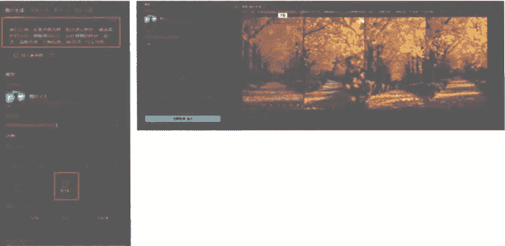

按此步骤把剩余四个镜头做成图片并保存。

###### ● 第四步：图生视频

把五张静态图转为动态视频。

1. 点“视频生成”选“图片生视频”，上传图片，参数默认，点击生成。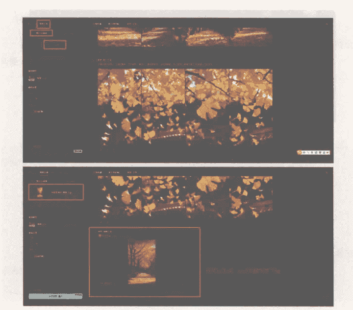
2. 其余四张分镜同法分别生成。视频无声，需导入剪映加音乐和音效，素材拖到轨道拼接。
3. 选好背景音乐拖入轨道，点击导出完成制作。

> AI 工具组合能提升效率，但要匹配内容方向。风景类可用 AI 写脚本配乐自动剪辑；知识博主可用 AI 查资料做课件配解说；带货可做智能抠图场景合成文案优化。

先明确内容形式，按赛道选工具组合。多学习新工具，但别被技术带偏——好内容核心仍是创意和干货，AI 只是加速落地的助手。

##### 4.4.2 进阶创作：全流程 AI 流水线

**AI 做短视频可实现流水线式全自动产出。**

过去做视频费劲：选题头秃、文案崩溃、剪辑熬夜。现在 DeepSeek + 剪映组合效率提升十倍，从文案到成片全程 AI，新手也能批量出专业视频。

###### 爆款流水线：AI 全流程搞定

####### 1. 找选题：5 分钟挖 100 个热门点子

爆款第一步是选题。

在 DeepSeek 输入领域关键词如穿搭、职场，它会扒全网热话题和痛点，给出选题地图。

例如输入打工人逆袭，可能得到：

- 《月薪 5 千到 5 万，我靠这 3 个 Excel 技巧》
- 《老板最怕你知道的 5 条劳动法，赶紧收藏！》

小技巧：要求生成 10 个健身领域反常识标题，带数字和冲突，立马拿到灵感。

####### 2. 写脚本：AI 生成人话文案

选题后让 AI 写脚本。

提示：写一个 60 秒早起技巧视频脚本，开头 3 秒用为什么你总是起不来？这种扎心问题，中间讲 3 个科学方法带数据，结尾引导点赞。

AI 会把分镜头写清楚。```
“镜头1（0—3秒）”
画面：闹钟响个不停，一只手狠狠拍掉
字幕：“定了5个闹钟还是起不来？”
音效：刺耳铃声+玻璃碎掉声
“镜头2（3—12秒）”
画面：阳光照进房间，人伸懒腰
字幕：“哈佛研究：开窗帘睡觉，早起成功率涨87%！”
```

####### 3. 配音：AI 真人音色

短视频提速手册：AI 实战篇

想快速切入短视频创作，现在主流有两条捷径。
第一条是剪映自带的虚拟主持人。挑一个形象，比如职场精英或萌系少女，把口播稿填进去就能合成带人像的成片，语速语气还能手动微调。
第二条是用 DeepSeek 做文本转语音。把文稿丢进去挑选声线、口音甚至英文发音，生成的配音很自然，直接拖进剪映使用。再叠加些环境音，如键盘声或咖啡馆嘈杂声，真实感会立刻提升。

####### 十分钟搞定剪映基础

- **素材分类先收好**
1. 自拍素材。按场景和情绪归档，比如“通勤焦虑”“居家治愈”，后续调用更快。
2. AI 生成素材。让 DeepSeek 配合图像模型出图，例如提示“画一个程序员深夜加班的卡通背景”。
3. 剪映自带素材。平台自带大量特效贴纸，可直接免费使用。

- **新手剪辑四步法**
1. 固化模板。第一条成片后保存为模板，之后直接套用改内容。
2. 替换素材。右键原图或原视频选择替换文件，字幕特效保留。
3. 加字幕。点智能字幕自动识别语音，挑选抖音上流行的字体。
4. 画面优化。打开自动美化，系统会提亮画面并增强色彩。

- **提升完播的小心机**
1. 进度条贴纸。放一个缓慢填满的进度条，观众更愿意看完。
2. 互动引导。片尾加上点赞关注转发的动态图标。
3. 转折音效。剧情反转时加乌鸦叫或刹车声等搞笑音效，氛围更足。

####### 多平台投放要点
抖音：开头三秒必须抓人。例“月薪三千和三万的人差在哪”，并带上 #干货分享 等话题。
视频号：多发适合转朋友圈的生活化内容。
B站：时长可拉长到三分钟以上，内容偏深度干货。

####### 新手实战案例
账号“AI办公神器”用 DeepSeek 写稿约10分钟，剪映剪辑约15分钟，七天发了20条，播放总量破500万，通过带货赚了1.2万。核心就四点：开头扎心提问抓人、中间用数据支撑、剪辑用模板复用、结尾引导三连。说明工具选对，新手也能快速起量。

####### 智能化还能为短视频带来什么
- 风险自检：智能系统可先审内容是否触碰边界，降低封号风险。
- 外语输出：一键生成英文配音加字幕。
- 热点跟进：自动追踪微博热搜并快速生成脚本，方便借势。

现在做短视频已经像流水线一样高效，DeepSeek 配合剪映能批量产出爆款，你负责想点子，剩下的交给智能化完成即可。

####### 4.5 知识补给站：AI如何重塑视频生产

##### 4.5.1 技术革新：创作效率的范式转变
###### 生成式模型拉低创作门槛
某顶尖实验室的文生视频模型能把“未来城市空中交通系统”这类描述变成带多机位运镜和物理特效的60秒成片。过去需要三维团队花费数周的工作，现在几分钟可完成。最新研究显示，智能化应用已覆盖全球76%的短视频生产环节，平均制作周期缩短83%。

###### 智能系统重塑工作流程
某主流剪辑软件接入智能系统后，能自动识别素材情感基调并匹配转场和背景音乐。某国际动画工作室称，智能分镜让动画电影前期的制作时间从18个月压缩到6个月。国内影视基地调研显示，灯光场务等基础岗位需求下降约40%，而“AI视觉督导”等新岗位薪资涨幅达200%。

##### 4.5.2 产业重构：由专业垄断迈向全民共创
**UGC出现爆发式增长**
主流平台上线智能场景替换功能，用户能把自拍背景实时换成太空站、古罗马竞技场等。2024年数据显示，日均模型生成内容超30亿条，其中“AI历史重现”类互动同比增长570%。

**虚拟人物经济快速崛起**
某二次元平台的虚拟主播借助实时动作捕捉直播互动，单场收入破百万。某电商平台的“数字人克隆”服务已签约超10万商家，生成的数字主播可24小时带货，转化效率达到真人主播的92%。

##### 4.5.3 内容形态进化：交互与边界的突破
**动态叙事革命**
某流媒体平台的互动剧采用智能剧情引擎，根据观众心率和表情实时调整走向，提供28种结局分支。某视频平台测试的智能广告系统可依据地理位置和天气生成个性化内容，点击率提升320%。

**文化遗产的数字化新生**
某博物院与科技公司合作推出“文物活化”项目，用视频生成技术让古画场景动起来，用户可“穿越”与历史人物互动。该类内容在年轻群体中传播量超5亿次，推动传统文化IP商业价值增长7倍。

##### 4.5.4 伦理与规则的博弈
**知识产权争议加剧**
国际编剧协会与制片方达成协议，智能生成剧本占比不得超过30%。国内出台《人工智能生成合成内容标识办法》，要求智能视频添加可识别水印。某导演用智能“复活”已故演员参演新片引发伦理争议，相关话题阅读量达48亿。

**真实性防御体系构建**
某顶尖高校研发视频鉴伪系统，通过分析物理规律识别模型生成内容，准确率达98.7%。主流社交平台已强制启用，日均拦截违规内容超1200万条。

##### 4.5.5 未来趋势：人机协同新生态
**创意产业的升级路径**
某顶尖美术学院新增“生成艺术设计”专业，培养能驾驭智能工具的新型创作者。某影视集团设立“人机协作实验室”，其智能编剧系统在悬疑剧创作中提出关键线索，推动剧情反转，观众评分达8.9。


**技术普惠与社会影响**
国际组织报告指出，智能视频技术使发展中国家内容创作者收入中位数提升64%。非洲青年用智能工具制作的环保主题短片在联合国会议放映并获千万级传播，充分体现技术赋能的全球价值。

##### 总结
智能化正重构视频生产逻辑：生成式模型实现文到视频跨越，制作周期缩短超90%；智能化应用推动影视流程再造，催生AI视觉督导等新职业；全民创作下UGC爆发与虚拟人物经济崛起重塑格局；动态叙事、文物活化等新形态拓宽内容边界。伴随知识产权争议和真实性危机，全球正加速建立数字水印、鉴伪系统等规范。未来人机协同将强化创意核心价值，技术普惠为文化传播和社会创新注入新动能，开启“人类导演+智能执行”的新纪元。

## 第五章

### DeepSeek+超级个体

快速起号：30天靠智能虚拟形象打造收益IP
目前月入十万的短视频博主，近九成都在用智能批量生产内容。一个普通创作者借助智能应用，一天即可产出数百条短视频。

#### 5.1 案例 杭州宝妈用智能打造IP，30天涨粉10万

● 案例背景
杭州一位宝妈运营的AI美容专家账号，30天内取得显著增长：
- 粉丝从0涨至破十万
- 单条播放量突破100万
- 日均产出效率提升50倍以上
- 月均收入超5万元
- 品牌合作邀约超过20个
背后反映的是智能对内容创作的革命性提升。过去一条优质视频需数小时甚至数天打磨，如今智能可接管素材收集、剪辑、基础脚本等重复工作，让创作者聚焦质量与创新。高效率也带来内容饱和，如何脱颖而出成为新挑战，需要独特视角和洞察力。

##### 具体做法
###### 步骤1：精准选题
借助巨量算数、新媒体管家等数据工具挖掘热门话题与用户痛点。该账号聚焦熬夜引发肌肤问题这一普遍痛点。

###### 步骤2：智能文案生成
使用 DeepSeek 等大模型输入明确指令，例如指定身份为美容专家，要求输出三篇300字以内口播稿，标题吸睛、开头结尾设钩子、围绕熬夜肌肤问题提供实用修复方案、语言口语化、有情感且规避违禁词，并要求结构为开场钩子、问题阐述、解决方案、收尾钩子，完成后再人工微调以匹配品牌调性。

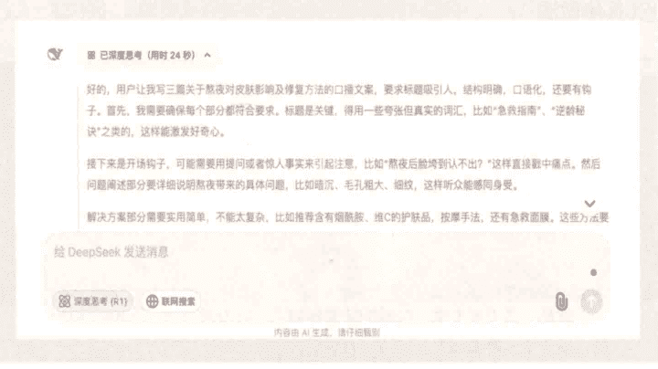
###### 步骤3：智能数字人视频生成
将文案导入智能数字分身平台如 Wonder Studio、Synthesia，选择预设形象与声音，一键生成口播视频。

###### 步骤4：优化与迭代
依据点赞率、完播率、评论数等数据持续优化。例如发现25-30岁女性数字人形象更受欢迎，便将主IP调整为该形象。

###### 📋 方法论总结
- 高价值选题：大数据分析+痛点洞察
- 智能文案生成：指令明确+多轮优化
- 智能数字人呈现：高仿真形象+情感表达
- 数据驱动优化：持续迭代

该方法可拓展至健康养生、职场技能、育儿教育、财经投资等垂直领域。智能抹平了镜头表现门槛，让不善表达的人也能轻松产出爆款。


#### 5.2 实操指南：三步打造百万播放的智能口播

任何人都能拥有自己的数字替身，不再依赖颜值或口才。借助 DeepSeek 配合简单工具，即可批量产出专业且有吸引力的内容，智能负责写作与形象呈现，你只需提供方向即可。

##### 第一步：用 DeepSeek 量产爆款选题
1. 登录 DeepSeek 官方站点；
2. 输入提示词：“请分析[关注的垂直领域]近期热门话题，列出Top5关注方向，每个方向给出3个具体选题建议。”

例如美容护肤领域，系统会返回类似“功效成分深度解析”“精简护肤与科学流程”“敏感肌屏障修复方案”等方向，并给出具体选题。

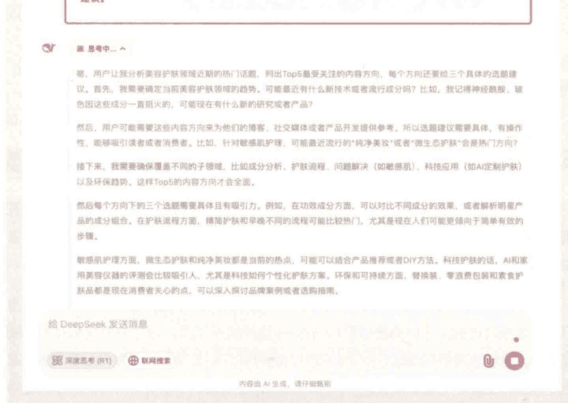
输入后系统会立即给出清晰列表，明确当前最火的内容和用户关注点。

##### 第二步：用 DeepSeek 创作爆款内容
在 DeepSeek 中输入模板：“你是一位[领域]专家，精通[专业方向]。请创作3篇300字左右口播文案，要求开头为钩子、标题直击痛点、围绕[具体主题]给出实用建议、结尾再设钩子、语言口语化生动、结构为开头钩子→问题描述→解决方案→结尾钩子、避免违禁词。”

以美容护肤抗衰老为例，指定主题为“熬夜对皮肤的影响及快速修复方法”，即可获得符合要求的文案，后续人工审阅微调以确保品牌一致性。

输出示例包含三篇结构完整、具备强钩子与实用修复建议的口播稿，帮助创作者快速形成可复用的内容模板，实现稳定批量输出。

熬夜的生理账，25岁和35岁分水岭在哪一招

- √ 开场钩子：“25岁熬夜和35岁熬夜，区别全藏在这个不起眼的小动作里……”

- √ 问题阐述：你注意到凌晨两点以后皮肤会进入自我损耗期吗？油脂分泌失衡导致闭口集中冒出，微循环受阻让面色发沉发暗，屏障变得纤薄到吹风都感到刺痛，更别提眼周那些像刻进皮肤的细小干纹……

- ● 解决方案

  - ★ 搭建熬夜修复节律：把22点、1点、6点设成闹钟，分别执行抗氧化、修复、防御三段程序。
  - ★ 独创提拉手感：以指关节沿下颌线向耳后推移，搭配含肽类精华液，即便熬夜也能维持V线。
  - ★ 用饮品替代咖啡因：改饮红枣桂圆枸杞茶，补益气血的同时提升肌肤含氧度。

- √ 收尾钩子：“下一条我会揭秘连着大夜却皮肤更紧致的终极办法，连手残也能学会的3D提拉手法！”

DeepSeek能在极短时间内产出三篇完整顺畅的口播稿，每篇都能让观众愿意停留并感受到专业、诚意与温度。记住，人工智能负责初稿产出，最终的质量把控与风格定调仍掌握在你手中。

###### 第三步：AI数字人视频制作

1. 进入蝉镜AI数字人平台：https://www.chanjing.cc/
2. 挑选与内容契合的数字人形象。
3. 把DeepSeek输出的文案粘贴到平台的文本输入区。
4. 选择合适的语音克隆方案，微调语速与情绪。
5. 点击生成视频，等待制作完成。

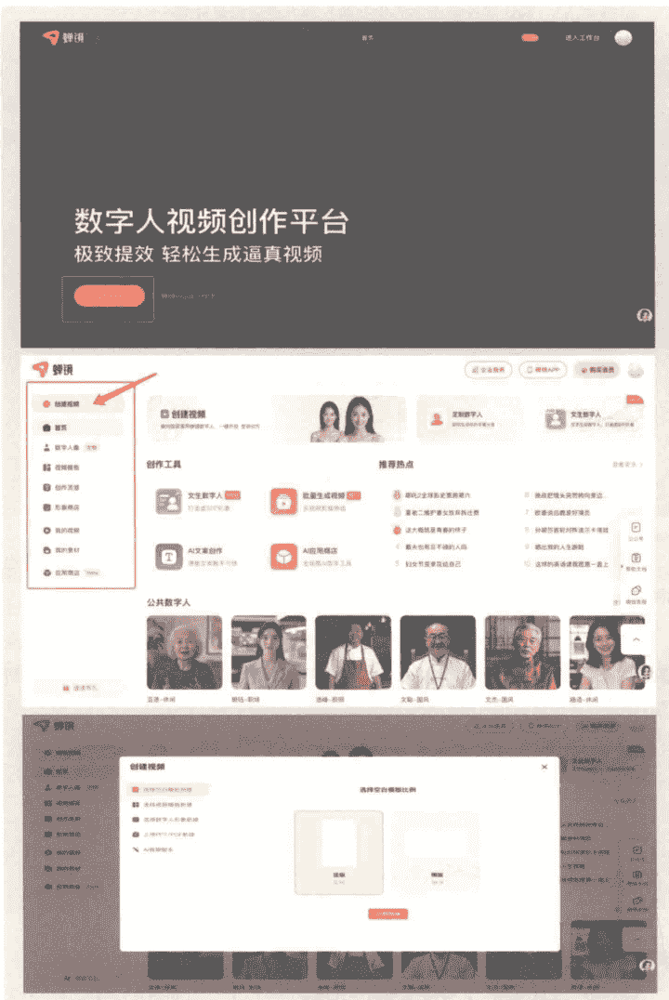

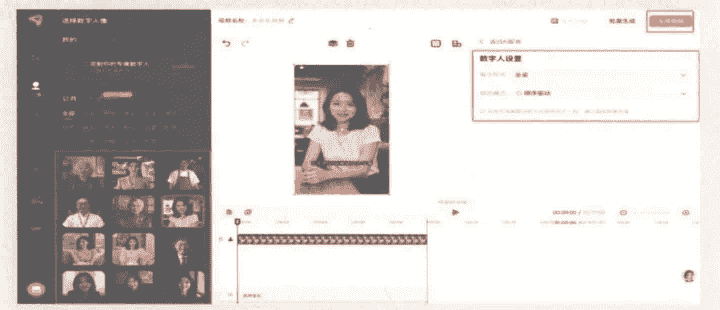

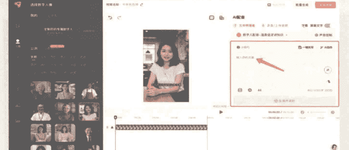

###### 第四步：视频优化与包装

1. 下载并打开开拍App。
2. 导入AI超级分身生成的原始素材。
3. 使用一键剪辑功能，自动添加转场与背景音乐。
4. 借助智能包装功能，生成吸睛的视频封面。
5. 导出最终成片。

###### 第五步：发布与数据分析

1. 将优化后的视频上传至抖音、快手等目标短视频平台。
2. 用平台自带的数据分析工具持续关注表现。
3. 记录核心指标：播放量、点赞数、评论数、转发数等。

###### 效率提升策略

1. 批量生产：让DeepSeek一次性撰写多个主题的稿件，再统一制作。
2. 模板复用：为常用内容结构建立DeepSeek指令模板，便于快速调用。
3. A/B测试：同主题做不同版本对比，沉淀最佳实践。
4. 自动化工作流：借助Zapier等工具串联DeepSeek、AI分身与开拍App，实现半自动化。

###### 注意事项

1. 内容质量把控：即便由人工智能生成，也要核查信息准确且有价值。
2. 版权意识：使用工具时遵守相关版权法规。
3. 真实性说明：在适当位置标明视频使用了人工智能技术，保持透明。
4. 持续学习：关注工具更新，不断优化工作流程。

> 按以上流程，高质量人工智能视频制作会变得简单便捷。从选题到文案再到生成，步骤自然流畅。你会与人工智能配合更默契，效率明显提升。

要记住，速度和数量不是目的，内容质量和用户感受才是关键。要不断优化内容，关注用户反馈，以用户反应为指引。只有持续改进表达，内容才能真正吸引人。

技术提升效率，但好内容仍需用心打磨。这是创作者不能忘的准则。

##### 举例1 如果你是一位职场人，如何用人工智能打造个人IP

###### 案例背景

也许你正在职场拼搏，想建立影响力与个人品牌。担心表达不够专业或镜头前不自信时，人工智能就能成为帮手。假设你是一名人力资源经理，希望用短视频帮助年轻职场人提升沟通技巧，同时展现专业经验，打造个人IP。


###### 第一步：用DeepSeek迅速锁定职场人士关注的爆款选题

1. 登录DeepSeek官网 https://www.deepseek.com
2. 在搜索框输入提示词。

> 请梳理职场技能提升领域近期热门话题，列出Top5关注方向，每个方向给出3个具体选题建议，重点围绕沟通技巧。

片刻后，DeepSeek会呈现清晰清单，告诉你当前职场最受关注的沟通痛点。例如有效沟通可能位居首位。进一步细化，如职场中的有效反馈沟通，既具体又切中痛点。人工智能已验证其热度，你的视频自带流量。

选定主题后，即可进入下一步，让人工智能为你撰写清晰有趣的口播文案。

###### 第二步：用DeepSeek创作爆款内容

确定选题后，下一步是撰写生动吸睛的口播文案。听起来简单，实则需要清晰简洁且能引发兴趣。人工智能正好可以帮忙。

假设你是一名HR经理，视频主题是“如何在职场进行有效的反馈沟通”。你希望开头足够抓人，结尾有余韵。此时工具即可派上用场。

打开DeepSeek网站，输入指令。
> 你是一位职场沟通专家，精通反馈技巧。请为我创作3篇约300字口播文案，要求标题吸睛、开头结尾有钩子、围绕有效反馈沟通展开、提供实用建议、语言口语化有人情味、结构为开头钩子→问题阐述→解决方案→收尾钩子。

###### 输出结果
**口播文案1 同事总把你的建议当耳边风？3步让他主动找你请教**
- 开头钩子：“昨天小张说我说话像领导念文件，我才发现90%的职场反馈都死在这一句话上！”
- 问题阐述：是不是经常好心提醒同事方案有漏洞，对方却翻脸？给下属提改进建议，结果越改越差？问题出在反馈方式。职场最怕的不是说错话，而是用错姿势说对的话。
- 解决方案
  - “三明治话术”：具体夸奖+改进建议+成长鼓励。例如你的PPT配色很高级，若把第三页数据换成柱状图，客户会当场签单！
  - 黄金15秒法则：开口前自问15秒内能否记住重点，把总是/又忘了换成这次/下次。
  - 肢体语言暗号：递文件时尖角朝自己，说话时手掌向上，对方戒备自然放下。
- 收尾钩子：“明天揭秘让领导主动找你讨教的操作，现在关注的人下周都能涨薪！”

**口播文案2 领导总说再想想？教你3句话把反对意见包装成金点子**
- 开头钩子：“上周我用这个话术让总监撤回错误决策，现在他开会都让我坐第一排！”
- 问题阐述：发现领导方案有问题不敢说？说了就被贴上爱挑刺标签？不是意见不对，是缺了反馈包装术。高手懂得顺着表达反对，反着表达批评。
- 解决方案
  - “借光表达法”：您之前教我的方法特别有用，这次是否可以……
  - “选择题话术”：把我觉得不行换成现在有A/B两版，A版快速落地，B版更利于长远…
  - “情绪温度计”：观察对方眉毛，舒展时抛重点，皱起时立刻说这只是我的浅见。
- 收尾钩子：“下期教你把你错了变成咱们对了的魔法模板，点个收藏明天直接抄作业！”

###### 口播文案3 跨部门甩锅？这套反馈公式让你不再背锅
- 开头钩子：“市场部老王又甩锅？我用了这招后他现在发消息都带请字！”
- 问题阐述：其他部门拖延让你背锅？协作时总有人装傻？职场最冤的不是做错事，而是替别人买单。高手的反馈不是秋后算账，而是实时排雷。
- 解决方案
  - “彩虹进度法”：每天下班前在群里发今日进度：已完成绿色，待确认黄色，卡点红色，让甩锅无处藏身。
  - “温柔追击术”：催进度时说知道你最近很忙，觉得周三下午三点还是四点方便碰头？
  - “留痕小心机”：重要沟通后补发刚沟通确认的3个要点，结尾加个太阳表情。
- 收尾钩子：“想知道怎么让甩锅的人主动请你喝奶茶？明晚8点直播间教你反杀话术！”

几秒后，DeepSeek会生成三篇结构清晰的文案。你可以花几分钟加入个人风格微调词汇与节奏，让它更像你自己。最终成效取决于你是否注入思考与真诚。

###### 第三步：AI数字人视频制作
1. 登录AI超级分身平台。
2. 选择专业可信的中年女性数字人形象，如职业装女性。
3. 将DeepSeek生成的文案复制到文本输入框。
4. 选择语音克隆，语速调为1.1倍，情感标签选自信。
5. 点击生成，等待完成。

###### 第四步：视频优化与包装
1. 下载并打开开拍App。
2. 导入AI超级分身生成的原始视频。
3. 使用一键剪辑添加简洁转场。
4. 选择轻快不过于活泼的背景音乐，音量调至原声20%。
5. 用智能包装生成吸睛封面，可选数字人微笑截图，配文字职场沟通秘籍：3步搞定反馈。
6. 导出1080P成品。

###### 第五步：发布与数据分析
1. 将视频上传至抖音等平台。
2. 添加标签：#职场技能 #沟通技巧 #人际关系 #职场进阶
3. 描述写：想在职场脱颖而出？掌握这个反馈沟通技巧，让职业生涯更上一层楼！
4. 发布后用创作者工具关注表现。
5. 记录播放量、完播率、点赞、评论、转发等。
6. 重点关注评论区反馈，回复有价值问题，为后续创作积累素材。

###### 效率提升策略
1. 批量生产：一次性生成5-10个职场沟通文案主题批量制作。
2. 模板复用：为职场技能类内容创建DeepSeek指令模板。
3. A/B测试：制作正式/幽默风格对比，优化最佳版本。
4. 自动化工作流：用Zapier连接DeepSeek、AI超级分身和开拍App。

###### 注意事项
1. 内容质量把控：确保建议专业可行，避免误导。
2. 版权意识：使用版权免费音乐，避免侵权。
3. 真实性声明：在描述中说明使用了人工智能技术，保持透明。
4. 持续学习：关注人力资源和职场沟通新趋势，不断更新主题。

> 按以上步骤制作高质量职场技能视频会变得高效。人工智能让复杂工作简化，任何职场人都能借助人工智能轻松打造个人IP。

无需反复背台词，只需告诉人工智能需求即可生成符合风格的内容。选主题、提要求、简单润色，就能制作有感染力的视频。

内容制作是起点，持续关注用户反馈才是关键。通过不断改进，你将在人工智能时代找到位置，赢得认可。人工智能提供速度，你赋予内容温度。愿你在人工智能赋能的职场技能传播路上越走越自信。

##### 举例2 如果你是一位大学生，如何用人工智能打造个人IP

案例背景
假设你是一名大学生，想做职场成长类账号，教会年轻人高效学习、快速掌握新技能。你需要从明确、实用又热门的选题入手。

过去拍摄一个关于掌握新技能的视频，可能要花数小时甚至数天规划内容、打磨文案、反复修改。现在有了人工智能工具，几分钟就能完成，让视频真正吸引注意。


第一步：打开DeepSeek官网，在搜索框输入指令。
> 请分析大学生关心的热门话题，列出Top5关注方向，每个方向提供3个具体选题建议。

片刻后，DeepSeek会给出整洁实用的清单，包括学习方法、职场规划、个人成长等。假设推荐中如何在一周内掌握一门新技能引起兴趣，这正是具体且吸引人的痛点。

第二步：让DeepSeek创作口播文案。在对话框输入指令。
> 你是一位学习方法专家，擅长帮助大学生高效掌握新技能。请创作两篇约300字口播文案，要求标题吸睛、开头结尾有钩子、围绕一周内掌握新技能展开、提供实用建议、语言口语化有温度、避免违禁词、结构为开场钩子、问题阐述、解决方案、收尾钩子。

###### 输出结果
**口播文案1 差生自救指南！7天从零到精通的技能速成公式**
- 开场钩子：“上周我那个挂科三次的学弟用这个方法，居然7天拿下Python基础课，现在教授追着他做项目！”
- 问题阐述：是不是发誓要学PS，结果软件都没打开？收藏了100个教程，越看越焦虑？90%的人学不会，不是笨，而是掉进假努力陷阱。熬夜刷课、疯狂记笔记都是无效努力。
- 解决方案
  - “切片学习法”：把技能拆成7片蛋糕，如学摄影第1天搞懂曝光三要素，第2天练构图…每天只吃一块。
  - “黄金20分钟法则”：用手机计时，学20分钟必须停5分钟，大脑喜欢冲刺+休息节奏。
  - “反向教学法”：找3个成品案例模仿，如弹吉他先学副歌高潮，成就感会推着你前进。
- 收尾钩子：“明晚直播拆解7天学会剪视频实战计划，现在关注送独家技能拆解模板！”

**口播文案2 学霸不会说的秘密！用做弊式学习法7天弯道超车**
- 开场钩子：“我靠这个野路子方法，大四那年7天突击过了法语A1，现在看电影都不用字幕！”
- 问题阐述：为什么有人学什么都快？不是天赋，是掌握了技能快充密码。普通人还在背单词，聪明人已找到知识漏洞精准打击。学得快不是拼命，是会偷懒。
- 解决方案

- “睡前脑内演练法”：临睡前闭眼在脑中完整走一遍操作流程，黑暗环境下回想效果被放大。
- “适度声波激活法”：学习时刻意放一点轻柔背景音或咖啡馆环境声，恰到好处的干扰能把专注力拽住。
- “月历填色推进法”：拿一本月历，用彩笔把每天的完成度涂成进度条，每填满一格的爽感堪比追剧连更。
- 结束引导：“下一条将拆解让大脑一直满电的3种补充小食，熬夜学习不疲惫的办法已置顶，记得去看。”

几分钟内，DeepSeek 就能给出两篇条理分明、叙事生动又极实用的口播稿。语感像朋友间聊天，既能勾起观众的好奇，也能给到真动手就能用的办法，帮助他们迅速上手新本领。

拿到初稿后，留几分钟做个性化润色，让语气与风格更贴合你本人。

借助智能助手，内容生产不再是枯燥的苦力，而更像一次轻松有创意的头脑对话。你能高效做出有价值的短片，同时沉淀出清晰且有温度的个人IP。

###### 第三步：AI数字人视频制作
1. 进入AI超级分身平台的账号。
2. 挑选一位朝气蓬勃的大学生形象数字人，男或女均可。
3. 把DeepSeek的文案粘贴到平台的文本输入区。
4. 选用清澈有力的青年音色，把语速调至1.2倍，增添活力与热情。
5. 点“生成”，大约十分钟后短片就可完成。

###### 第四步：视频优化与包装
1. 下载并打开开拍App。
2. 导入AI超级分身生成的原片。
3. 用一键剪辑加入动感转场。
4. 配一段轻快背景音乐，音量压到原声的15%左右。
5. 启动智能包装，生成一张展示7天学习法与时钟图案的封面。
6. 加文字特效，在“确定目标”“实践优先”等关键词出现时高亮。
7. 导出最终成品，时长控制在约1分钟。

###### 第五步：发布与数据分析
1. 登录抖音、视频号、小红书等创作者账号。
2. 上传剪辑好的短片，填写标题：震惊！7天学会新技能的秘密武器，期末不再熬夜。
3. 添加标签：#学习方法 #效率提升 #大学生必备。
4. 发布并设定最佳时段，如晚上9点，大学生晚自习后的放松窗口。
5. 24小时后查看各项数据。
6. 及时回复热门评论，与粉丝互动，提升粘性。

###### 效率提升策略
1. 让DeepSeek一次性规划一周主题及稿件，比如周一谈学习方法，周二谈时间管理，周三谈职业规划。
2. 建立大学生常用的DeepSeek提示词模板，覆盖各学科技巧与考前准备。
3. 尝试不同数字人形象和短片风格，对比数据找出最受欢迎的形式。
4. 用Zapier把DeepSeek和AI超级分身串联，实现文案自动导入制作平台。

###### 注意事项
1. 所有学习建议务必经过实践验证，杜绝传播未经证实的速成偏方。
2. 在视频简介中说明使用了AI技术，保持透明。
3. 定期更新学习与职业资讯，确保内容不过时。
4. 与真实的学习达人或职场前辈合作，提升内容可信度与实用性。

做吸睛短片不需要昂贵设备和出色口才。只要善用智能助手，提出清晰问题并调整语气结构，剩余工作由助手接手。

每天用1到2小时的课余时间，就能完成选题到文案再到视频的全流程。这像是一场愉快的交流，你与助手碰撞思想，再通过它把真实价值传递给观众。你既能学到新东西，也能帮助他人。持续输出有价值稿件，关注度和影响力自然增长。

要记住，长期成功的核心不是技术，而是你的真诚、热情与真实分享。

个人品牌一旦建立，这项能力将成为未来职业发展的坚实资本。大胆尝试，大胆表达，在智能加持下讲好你的故事，让世界听见你。

#### 5.3 知识增补区 人工智能时代 普通人如何抢占创作先机

信息爆炸的当下，内容创作已成为每个人必须掌握的核心技能。过去创作意味着漫长思考、反复修改，以及一轮又一轮的自我怀疑。如今人工智能彻底改变了这一切。每个人手上都握有强大的工具，普通人需要学会的，是如何巧妙地使用这些工具来讲述自己的故事。

##### 1.AI内容创作工具全景
今天，一位创作者的工具箱可能看起来令人难以置信。

举个例子。你打开电脑后，可以选择DeepSeek、ChatGPT或者Claude，这些AI平台能在几秒钟内为你生成高质量的文字内容——从社交媒体文案到营销策略，应有尽有。如果你需要快速迭代、提取观点或者重新润色内容，那么智谱清言或豆包这些小工具也能帮你轻松做到这一点。

如果你需要制作短视频或进行视觉创作，你可能会用到AI超级分身或百度慧播星AI。前者强调速度和规模，后者则注重细致的个性化定制。你可能还会借助开拍App、Opus Clip或者Runway进行剪辑包装。仅凭一部手机、一台电脑，你就能创作出质量媲美专业团队制作的短视频。

不仅如此，你还能借助Stable Diffusion、Midjourney这些图像生成工具，仅用简单几句话就创造出令人惊叹的视觉效果。这意味着即使你完全没有美术基础，也能轻松创作出极具吸引力的视觉作品。Synthesia这样的多语言AI平台，则能帮你轻松打破语言和文化的边界，让你制作的内容瞬间跨越国界。

##### 2.AI内容创作的现状与未来趋势
如今，AI内容创作彻底改变了行业规则。过去成功的创作者，依靠的是独特的才华和坚韧不拔的努力。而现在，一个善于使用AI工具的普通人，也可以迅速登上内容创作的高地。

比如，受欢迎的内容创作模式之一是“DeepSeek+数字人”的组合：DeepSeek负责内容创意和文案撰写，数字人负责生动地呈现这些内容。创作者只需进行轻微的润色与调整，就能轻松打造出引人入胜的短视频。效率如此之高，以至于每天批量生产几十条优质内容都变成了可能。然而，这种高效也带来了新的问题：如何避免内容的同质化？当每个人都使用相同的工具时，创作的真正竞争力究竟是什么？答案是，你的个人声音、独特视角以及与观众真诚的互动。这些是AI无法替代的。

AI的普及甚至催生了新的职业，如“AI提示工程师”，他们的工作仅仅是负责优化AI的输入指令，但薪酬却高达数十万美元。这说明，AI不仅没有减少就业机会，反而创造了全新的职业市场。

##### 3.AI时代创作者需要牢记的原则
尽管AI带来了巨大的便利，我们也必须保持清醒的头脑。内容的真实与温度，才是保持长久成功的关键。AI能够迅速生成内容，但真正能引起共鸣的是创作者的真诚、洞察力和独特的个人经历。记住以下两点。

###### ● 第一点
要持续关注用户反馈。你创作的内容归根结底是给人看的，而非仅仅为了迎合平台算法。用户反馈是你的方向盘，它指引你朝正确的方向前进。

###### ● 第二点
真实经验的分享是无可替代的。AI虽然能高效地产出知识点，但故事、挫折、收获和感悟，只有你才能提供。你的个人经历是你区别于AI内容的真正力量所在。AI生成的内容虽好，但总归是人工智能产物，缺少了一点人味儿。你需要为每一条内容注入你的个性、语气和情感。越是真实、有人情味的内容，越容易打动观众。

##### 总结
这是一个绝佳的时代。只需每天投入1—2小时，依靠AI工具，你就可以持续生产出高质量、有价值的短视频内容。你不仅能帮助他人，还能通过分享逐步树立自己的影响力和品牌。别再等待了，从今天开始，用AI讲述你的故事吧。你会发现，你不仅赢得了观众，更为你未来的职业发展打下了坚实的基础。

## 第六章

### DeepSeek+自媒体矩阵

1人操盘100个账号，AI自动化批量引流1000+

> > 用传统方式经营内容的10个人，居然比不过1个善用AI工具的人！

这句话或许听起来有些夸张，但在AI时代，它的确描述了我们身处的现实：在内容生产领域，一场由AI驱动的革命已经悄然发生了。

#### 6.1 案例 AI批量打造爆款养生矩阵账号，单月流量破10亿

- ● 案例背景

福建泉州的林氏兄弟（化名）在2023年初开始尝试AI矩阵内容创作。他们敏锐地察觉到AI技术在内容创作领域的巨大潜力，特别是在传统文化和养生这个永恒不衰的话题上。通过深入研究DeepSeek等AI工具，他们成功开发出了一套高效的内容生产和分发系统。


##### ☑ 取得的结果

- ☺ 内容规模：在6个月内，他们成功建立了超过5000个活跃账号，覆盖抖音、快手、小红书等多个平台；
- ☺ 流量成就：单月总流量突破10亿，上百个账号单月播放量超过1000万；
- ☺ 变现能力：顶级账号月收入突破50万元，平均每个成熟账号月收入3万—5万元；
- ☺ 私域转化：累计引流超过500万精准用户到私域，转化率达到15%；
- ☺ 产品销售：自主开发的养生课程和产品年销售额突破1亿元。

假设你是一名年轻的内容创作者，你想进入竞争激烈的数字内容市场，但你并没有庞大的团队，也没有丰厚的资金支持。过去，这几乎意味着你的失败已经注定。但如今，AI为你打开了一扇全新的大门。让我们看看一支普通的团队如何借助AI工具，在短短6个月内取得了过去几年都难以企及的成就。

这是一群聪明而敏锐的人，他们精准地抓住了养生这个始终不过时的话题，并迅速研究和掌握了DeepSeek这样的AI工具，建立起一套令人惊叹的内容生产系统。半年内，他们打造了超过5000个活跃账号，覆盖抖音、快手、小红书等几乎所有主流平台。这种规模放在以往，可能需要几十甚至上百名员工每天进行机械的内容创作、审核、发布。

但现在，这支由AI工具驱动的小团队，只需轻轻点击几次鼠标，就能完成传统团队十倍甚至百倍的工作量。

效果同样令人吃惊。他们制作的内容不仅数量庞大，质量也足够优质与吸引人。不到一年时间，就吸引了超过500万名精准用户进入他们的私域流量池，转化率高达15%。而他们自主开发的养生课程和产品，年销售额竟然突破了1亿元。

他们成功的秘诀在哪里？就在于他们巧妙地将AI工具和真实的人性结合在了一起。AI工具替他们完成了烦琐的技术工作，他们得以将精力放在内容的创意、策划与优化上。这使他们能够持续生产有价值、受用户喜爱的内容，并高效地扩大规模。AI创造了新的机会，但也提醒我们必须保持清醒：工具本身并不能保证成功。AI为你节省了大量时间，但真正决定你成功的，依然是你对内容的用心、对用户需求的理解，以及你不断打磨和优化的态度。

这场内容创作的革命才刚刚开始，你是否已经做好准备？

##### 实施方法详解

###### 步骤一：内容规模化生产

- 利用DeepSeek批量生成内容，每天产出500—1000条原创内容。
- 开发专门的指令库，覆盖中医、养生、国学等多个细分领域。
- 建立内容审核团队，确保AI生成内容的质量和准确性。

###### 步骤二：垂类矩阵运营

- 将内容细分为20多个子类别，如“四季养生”“国学智慧”等。
- 为每个子类别创建200—300个特色账号，形成完整的内容生态。
- 利用AI分析工具，实时监控各账号表现，动态调整内容策略。

###### 步骤三：私域转化闭环

- 设计智能话术系统，根据用户互动自动生成个性化引导语。
- 开发多层次私域运营体系，包括免费社群、付费课程和高端定制服务。
- 利用AI客服系统，提供24小时用户支持和个性化建议。

##### AI矩阵变现的爆款公式

**内容批量生成**

日产出量=AI生成速度（条/小时）× 运营时间（小时）× 人工优化系数（0.8—1.2）

**垂类账号矩阵化**

账号增长率=基础增长率+内容质量系数 × 发布频率+平台算法偏好度

**私域精准导流**

私域转化率=基础信任度+内容专业度 × 互动频率+个性化服务水平

在过去，一个人的成功可能取决于他的个人才华、机遇或团队规模。但如今，一个普通人仅凭对AI工具的熟练掌握，也能迅速达到甚至超越传统团队难以企及的高度。这正是AI时代赋予每个普通人的全新机遇。

林氏兄弟的故事，正说明了这一切。他们成功的秘诀是一套清晰而高效的策略：用AI技术加速内容生产，再用传统文化的魅力赢得大众的喜爱。他们之所以能够迅速占领市场，原因其实很简单：

**第一，是技术的可行性**

像DeepSeek这样的AI工具，经过几年的发展，已经非常成熟且易用。它们不仅能够生产大量的内容，还能够确保内容具备足够的深度和质量。这意味着，即使你没有庞大的团队和资金，也依然可以生产出媲美专业团队的优质内容。

**第二，是市场的可行性**

林氏兄弟所选择的主题，如养生和国学，从来没有真正过时过。人们对健康、传统文化的兴趣一直存在，而且随着现代生活节奏的加快，这种需求还在持续增长。他们只需确保内容足够有趣、简单、实用，就能够源源不断地吸引新用户。

**第三，是运营的可行性**

借助AI技术，一个人就能管理几千个账号，这在过去简直不可想象。不再需要大量的人力，也不必花费高昂的成本；只需要有清晰的策略、精准的目标，再加上善于使用AI的能力，就能实现快速而持续的扩张。

我们完全有理由相信AI工具将继续革新内容创作与传播的方式。林氏兄弟的成功为我们展现了一个清晰的前景：未来，AI技术会更加精准，内容创作会更加个性化，创作者与用户之间的互动也会更加即时而真实。无论你是谁，只要你善用这些工具，抓住用户真正的需求，你就有机会在AI时代脱颖而出。

这是一个令人兴奋的时代，AI正在重新定义什么是可能的。但请记住，工具永远只是工具，内容创作的核心依然是人性的温度与真诚。只有将你的真实经验和热情与AI高效的技术结合，你才能真正赢得人心。利用AI的速度，保持人性的温度，你才会在这个全新的创作时代真正获得成功。

#### 6.2 实操攻略 1人操盘100个账号,AI矩阵玩法揭秘

在AI内容创作时代，成功不再仅仅取决于创作者的才华，而是取决于谁能更高效、更精准地利用AI工具。你可以不懂编剧、不擅表达，甚至完全不了解短视频制作，但如果你能巧妙运用AI，你依然可以打造一个高质量的内容矩阵，轻松获取流量与影响力。

让我们来拆解一个实用的AI矩阵内容制作流程，看看如何用DeepSeek等AI工具快速创作爆款矩阵内容。

##### 6.2.1 内容创作——用DeepSeek生成高质量短视频文案

1. 进入DeepSeek，准备输入你的Prompt

首先，访问DeepSeek的官网，在搜索框中输入一个精准优化的Prompt。好的输入决定好的输出，因此你的Prompt必须清晰、具体、有明确要求。

2. 输入优化后的Prompt

在DeepSeek的对话框中输入以下内容。

> 你是一位拥有30年经验的中医养生专家，精通国学与现代健康理念。请为我创作10条短视频文案，每条100字左右，要求如下。

> ● 主题围绕“四季养生”展开，涵盖春、夏、秋、冬四个季节，确保内容全面。

> ● 开头必须有吸引眼球的钩子，能让用户在3秒内产生兴趣，愿意继续观看。

> ● 内容既体现传统智慧，又符合现代生活方式，用通俗的语言解释中医原理，避免晦涩难懂的专业术语。

> ● 提供具体、易操作的养生建议，用户听完就能马上应用到日常生活中，比如，“春季多吃什么？”“夏天怎么防暑？”

> （1）结尾设置互动问题、提高用户参与度

> 比如，“你觉得哪种养生方法最有效？”

> （2）语言必须通俗易懂、富有亲和力

> 就像一位长辈在用心分享经验，而不是一堂枯燥的医学课。

> （3）每条文案都要包含一个养生知识点

> 用户不仅能学到方法，还能记住一个实用的健康知识，如“春天要早睡早起，顺应阳气生发”。

**输出结果**

以下为10条符合要求的短视频文案，每条包含季节主题+养生知识+实操建议+互动问题。

“春·惊蛰篇”

开头钩子：“三月吃错菜，郎中跑断腿！你家的荠菜买对颜色了吗？”

知识点：春季肝气旺，青色入肝经

养生法：①每周吃3次荠菜豆腐羹（带根的更祛湿）②晨起拍打腋窝+大腿内侧各36下③睡觉时窗帘留缝，7点前起床接阳气

互动：“你春天必吃的野菜是什么？留言区告诉我，抽3人送《野菜图鉴》电子版。”

“夏·小暑篇”

开头钩子：“空调房吃冰西瓜？你的阳气正在悄悄漏光！”

知识点：夏季养心，汗为心之液

养生法：①煮绿豆汤要加3颗桂圆防寒②随身带盐汽水（1升水+2克盐）③午睡时用真丝眼罩护心神

互动：“你觉得最解暑的食物是什么？评论区晒图有惊喜福利！”

“秋·白露篇”

开头钩子：“喉咙干痒别急着吃润喉糖！秋梨这样煮效果翻3倍”

知识点：秋气燥，白色食物养肺

养生法：①雪梨挖空塞川贝+百合蒸20分钟②晨起搓热大椎穴③穿V领衫露天突穴通风

互动：“你试过最有效的润燥食疗是什么？点赞过千揭秘古法秋梨膏配方。”

“冬·冬至篇”

开头钩子：“手脚冰凉的姑娘记住！三九天的救命菜不是羊肉而是它”

知识点：冬藏肾精，黑色食材补肾

养生法：①黑豆+核桃打米糊当早餐②泡脚时脚趾做“抓毛巾”动作③戴珊瑚绒护腰睡觉

互动：“你觉得哪种保暖神器最有用？家人群转发这条冬天不受寒。”

“春分·昼夜篇”

开头钩子：“春分后还在熬夜？你错失了全年最重要的15天调病期！”

知识点：春分阴阳平衡，宜调和气血

养生法：①每天正午晒后背20分钟②喝茉莉花+枸杞的“平衡茶” ③衣柜里放香樟木祛湿气

互动：“春天你发现身体有哪些变化？抽5人送手作艾草锤。”

“大暑·祛湿篇”

开头钩子：“三伏天喝红豆薏米水的人注意！90%都喝错了时间！”

知识点：午时（11—13点）利排水

养生法：①加炒过的芡实防伤脾②煮水要用细长赤小豆③搭配按压阴陵泉穴

互动：“你用过哪些祛湿妙招？收藏过500晒我家祖传祛湿秘方。”

“秋分·滋阴篇”

开头钩子：“嘴唇起皮千万别舔！老中医私藏的‘润燥三宝’家家都有”

知识点：秋分燥金当令，宜润肺

养生法：①银耳撕碎+米汤炖出胶②吃葡萄不吐籽（嚼碎）③用加湿器时放橘子皮

互动：“你觉得哪种水果最润燥？关注我看百岁老人秋季食谱。”

“小寒·暖身篇”

开头钩子：“穿三件毛衣不如喝对这碗汤！零成本暖全身的秘方”

知识点：“头凉脚热”是冬季养生关键

养生法：①当归+苹果煮水（经期前喝）②穿及踝羊毛袜睡觉③如厕时踮脚尖

互动：“你有哪些独家保暖秘籍？点赞超1000教你用艾草暖宫法。”

“清明·排毒篇”

开头钩子：“回来别急着洗澡！错过全年最佳排毒期别后悔”

知识点：清明地气升发，宜疏肝

养生法：①采摘嫩桑叶煮鸡蛋②敲打胆经（大腿外侧）③枕芯换晒干的菊花

互动：“你们家乡清明必吃哪种青团？评论区让我猜猜你是哪里人。”

“立冬·进补篇”

开头钩子：“冬天吃海参不如吃它！菜市场3块钱的补肾之王”

知识点：冬季咸味入肾，但不可过咸

养生法：①板栗划十字口煮小米粥②泡脚水里加花椒20粒③戴耳罩护肾经（耳通肾）

互动：“立冬一到，你家餐桌上最常出现的暖胃传统菜是啥？转给心上的人，寒冬也暖。”

**这条指令为何好用**

**角色定位精准**——让模型代入一位耕耘中医养生三十年的资深导师来写，成品自然带专业背书。

**话题聚焦**——锚定“四季养生”这一主线，内容体系完整、逻辑顺。

**版式贴合传播**——先用钩子开场，再给可落地的建议，最后抛互动问题，完全符合短视频的起承转合。

**语言接地气**——要求用大白话输出，避免堆砌书面术语，阅读更顺滑。

**互动预留充足**——结尾的开放式提问能撬动评论，提升推荐权重。

初稿可用，但距离可发还差最后一层打磨

**松弛语气**——去掉机器感，让句子更像日常对话，亲和力更强。

**注入个人印记**——若你是偏年轻的博主，可适度加入当下流行表达，拉近和Z世代的距离。

**对齐时效热点**——比如夏季火起来的“冰敷脸”，顺势关联，提升共鸣。

> 第一步就跑通了。用模型几分钟就能拿到十条成稿。过去没有这套打法，可能要熬几个通宵改出几条。现在比拼的不是谁更拼时长，而是谁能用更省力的办法产出更多更有质量的内容。

### 6.2.2 账号矩阵搭建

**1. 号的注册与管理**

想短时间内铺开多条养生垂类，最省事的办法是借助矩阵后台，比如“数智宝AI矩阵管理系统”。它能批量开号抖音、快手、小红书等平台，省去逐个手工操作的麻烦。

开好后做归类，让各号各司其职：
- “春季养生”号聚焦养肝护阳；
- “夏季调理”号讲避暑去湿；
- “秋冬进补”号深耕食补与免疫。

头像、简介等资料可统一自动写入，每个号看起来都专业整洁。

**2. 数字人视频制作**

不必真人出镜，也不用请主播，靠智能技术就能快速量产。流程如下：

登录即梦AI平台。挑选合适的数字人形象，比如沉稳温和的中年女性适合讲养生知识；亲切随和的男性形象适合分享食疗妙招。

（1）把DeepSeek生成的文案粘到文本框。
（2）语速设为1.1倍，节奏稍快更利落。
（3）语调选温和亲切，像老朋友在耳边聊经验。
（4）对“养生”“小妙招”等关键词加重音，更好记。
（5）背景选简约温馨的室内场景，如木质桌面配茶杯或中式客厅。

点生成，1到2分钟就能得到一条完整的讲解片段。

**3. 视频包装与优化**

模型初稿出来后仍需二次精修，提升吸睛度。可用开拍App处理：

（1）导入初版视频。
（2）开一键智能剪辑，加入流畅转场。
（3）按需插入插图或动效，比如讲泡脚时配泡脚示意图。
（4）自动生成字幕并调大字号、换易读配色。
（5）套滤镜让画面更暖更舒适。
（6）加背景音乐，选轻柔自然的曲目，音量压到15%，不抢解说。
（7）做封面，用模型生成抓眼标题，例如：冬天手脚冰凉？三招帮你回暖。
（8）叠加养生图标，如艾草、红枣、姜茶，增强相关性。
（9）导出成片，时长控制在60—90秒，符合平台推荐习惯。

**4. 批量分发与发布**

成片怎样实现最大曝光？批量上传加智能排期。回到“数智宝AI矩阵管理系统”，打开批量上传功能，把优化好的视频一次推送到抖音、快手、小红书等多号。

（1）导入视频并设定投放时段
A. 早上7—9点，上班前碎片刷视频高峰。
B. 晚上8—10点，下班后睡前学养生的黄金档。
（2）开启自动打标，利于推荐
比如：#养生 #国学 #健康生活
内容就能精准触达对养生感兴趣的人群。

**5. 数据追踪与迭代**

矩阵运营不是一次性工程，而是持续优化。借助数据分析功能实时查看表现：

（1）哪些视频播放突出；
（2）哪些话题互动强；
（3）哪些号涨粉快；
（4）结合反馈调整策略；
（5）点赞收藏高的主题多做同类；
（6）粉丝增长慢的号改排期或换封面；
（7）重点扶持表现好的账号，提升发布频率；
（8）复用爆款话题和成功模式，放大影响力。

在信息过载的当下，矩阵加智能工具能让你：
快速搭建多号覆盖细分赛道，不受单一主题限制；批量生产高质量短视频，无需真人出镜和耗时剪辑，效率倍增；智能排期推送，借助数据保证视频在正确时间触达正确的人；数据驱动持续优化，让账号吸引力与影响力不断累积。

当你跑通这套方法，账号就从零散输出升级为自动化高效运营，真正做到用工具、数据和策略为你服务。

**让系统更顺畅的实操细节**

- 内容多元化：别只做图文视频，可增加图表、养生小测试等，覆盖不同偏好用户。
- 互动在线：定期回评论、发起话题讨论，做问答类内容，提升活跃度和粉丝粘性。
- 跨平台联动：别押一个平台，短视频、公众号、小红书多渠道分发并互相导流，形成闭环。
- 保持学习：工具迭代快，持续关注新功能和新趋势，保持领先。
- 注意合规：严格遵守平台规则和法律法规，健康建议类内容避免误导，确保专业可信。

按这套系统化步骤，你能快速建立高效的内容矩阵，在激烈竞争中脱颖而出。记住，工具是助力，核心仍是内容价值。高效生产的同时，偶尔加入真人专家访谈或案例分享，能大幅提升权威感和信任度。

最后的目标不是“造更多内容”，而是“造更有价值的内容”，让它持续发挥作用。

###### 举例 如果你是一位职场人，如何用AI搭建内容矩阵

**案例背景**

职场竞争加剧，可持续的内容输出能积累影响力，打开职业新可能。AI让搭建职场内容矩阵变得简单高效。下面是一份可落地指南。

这份指南不空谈影响力，而是手把手教你用AI搭建职场短视频矩阵，让你的专业知识变成长期资产。

####### 内容创作——让DeepSeek当你的创意引擎

内容是矩阵根基，不擅长写作也没关系，AI能帮你快速启动。用DeepSeek生成职场短视频文案。

**1. 用DeepSeek生成职场短视频文案**

登录DeepSeek，输入优化后的指令让AI产出优质职场内容。

> 你是一位拥有20年经验的职场导师，擅长沟通技巧与职业发展策略。
> 请为我创作10条短视频文案，每条约100字，要求如下。
> （1）主题围绕“职场沟通与晋升”；
> （2）开头有抓人钩子；
> （3）内容兼具职场智慧与当下实操；
> （4）提供具体可用的技巧；
> （5）结尾设互动问题；
> （6）语言简洁有力，带激励感；
> （7）每条含一个职场小贴士。

**2. 模型会迅速给你10条成稿**

标题：3分钟搞定老板，让提案通过率拉满！

开头钩子：还在为提案被毙发愁？用这个方法瞬间成为会议焦点！

正文：PREP法则
- Point观点：用一句话讲清核心想法
- Reason理由：给出3个支撑理由
- Example例子：用具体案例佐证
- Point重申：用更强语气再强调观点

职场小贴士：准备时先预判老板可能的反对点，提前准备回应。

结尾互动：你有哪些被采纳的提案经验？来聊聊吧！

职场沟通技巧热点与选题建议

文案1：升职总轮不到你？可能少了这3句关键话

钩子：“为什么升职名单没你？不是能力差，是需求表达错位。”

内容：
- 汇报时说“我的目标与部门KPI的关联是…”绑定战略价值；
- 被质疑时说“您担心的点是…吗？我补充三点数据支撑”预判焦虑；
- 争取资源时说“短期投入X成本，长期可省Y人力、提Z效率”量化说服。

互动：哪句话你最想立刻用？评论区说说！

小贴士：晋升靠的不是“做得好”，而是“被看见的好”。

文案2：领导说“再想想”=你没读懂潜台词！

钩子：“方案被含糊带过？他在等你点破这层隐性需求。”

内容：
- 破解话术1：“您更看重稳定性还是创新性？”明确优先级；
- 破解话术2：“是否需要同步其他部门的风险预案？”显全局观。

你可以一次生成50条，再筛选出30条精修，就能批量制作视频。

####### 账号矩阵搭建——让AI帮你批量运营多平台

有内容还要有曝光渠道。

**1. 一键批量注册账号**

使用“数智宝AI矩阵管理系统”，批量注册视频号、小红书、抖音等账号。按沟通技巧、领导力提升、职场晋升等分类设置。自动填充账号信息，并用AI生成专业头像与简介，让每个号都像真实的职场专家。

**2. AI生成数字人视频**

登录蝉镜AI，选择合适的AI数字人形象，快速合成讲解视频。

####### 内容发布与运营——让AI高效管理

###### 1. AI自动发布内容

用“数智宝AI矩阵管理系统”批量上传视频。

- 最佳时间：清晨7—9点通勤时；中午12点—下午1点午休时；晚间8—10点放松时。
- 智能标签：#职场技能 #沟通技巧 #职业发展

###### 2. AI运营社群，提升互动

- 智能回复评论：用AI助手快速回用户留言，保持活跃。
- 定期发起话题，如“你遇到过最棘手的职场沟通问题是什么？”
- 组织线上直播，邀请真实职场专家互动，提升权威感。

###### 3. 数据监控与优化

用数据工具盯账号表现，看哪些内容更好。

- 点赞多的加大投放；
- 互动强的做成系列；
- 完播率低的优化剪辑；
- 增加内容多样性：发职场信息图、设计小测验、分享真实案例。

按这套方法，每天不到1小时就能持续产出高质量职场内容，打造专业人设、扩大影响力，形成稳定流量矩阵。AI提升效率，但真正打动人的仍是你的真实经验与思考。

> 定期加入你的案例分析和实战经验，内容才有说服力和差异性，才是长期成功的关键。如果你想在职场更有影响力，现在就是起步最好时机。

#### 6.3 知识补给站 为什么AI矩阵将成为未来内容创作的必然

过去内容创作像一个人划船，写稿拍片全靠自己，费时费力。现在AI彻底改变了游戏规则。就像从写信到即时通讯，AI让创作进入智能化时代。

AI矩阵运营就是用人工智能批量生产内容，并精准投放到各平台。以前是“一个人一篇”，现在是“一个团队同时产出几十篇文、几十条视频”，实现快速覆盖，提升曝光与影响力。

它不仅提速，更让创作更科学可控。过去靠感觉发文，现在AI能分析数据告诉你什么更容易火、在哪个平台更吃香，甚至自动优化标题和表达。还在用旧方式的人会越发难出头，因为对手已用AI把内容做成矩阵，用更聪明的方式抢占流量。

##### 6.3.1 为什么必须布局AI矩阵

数字世界不等人，尤其在内容战场。如果你还在死守单号指望靠一条视频一夜爆红，现实会很骨感。业内普遍认为短视频红利期只剩几年，市场迅速饱和。单打独斗的时代结束，矩阵化运营才是生存法则。

- 单账号月入破10万的概率不到3%，几乎是赌博。
- 矩阵化运营月入破10万的概率高达62%，运营成本仅为传统营销的十分之一。

数据说明：内容创作已进入规模化智能运营阶段，单账号竞争力被稀释。

> 为什么会这样

**用户注意力高度分散。**

潜在观众同时刷多个社交软件，被海量内容包围。只靠一个账号、一种形式，很难被看见。AI矩阵的优势就是多账号、多平台、多点曝光，让内容出现在更多地方。

想象一下，你每天发10条，对手只发1条；你每周触达100万用户，对手只有10万。谁赢流量战争一目了然。想站稳脚跟，需要的不仅是好内容，还有更聪明的运营策略。AI矩阵不是未来，而是现在。

##### 6.3.2 AI矩阵运营：重塑内容创作的未来

信息爆炸时代，AI正在颠覆创作规则。过去是个人战斗，现在AI矩阵重新定义这一切，让生产更高效、更精准、更具规模化。核心优势有三。

###### 1. 批量曝光：让内容无处不在

过去创作者需一个个号运营，靠坚持积累流量。如今注意力极度分散，单号无法支撑持续曝光。AI矩阵策略是“多点开花”，多账号覆盖不同人群，曝光量倍增。若单号是孤岛，矩阵就是桥梁网络，连接更多流量入口。

###### 2. 智能内容池：解决创意枯竭

创作者最大痛点是持续产出高质量内容。传统创作靠灵感，易瓶颈。AI矩阵建立“智能内容池”，让生产变成可持续流程。AI可通过数据捕捉用户兴趣，自动生成并优化内容，保证质量稳定，还能让各账号保持差异化，避免千篇一律。同一观点，不同表达，在不同账号呈现，覆盖面更广。

###### 3. 闭环转化模型：让流量变现更高效

流量本身无价值，关键在转化。传统营销常断点，视频吸粉却难导流。AI矩阵能构建完整闭环，从公域获客到私域沉淀再到精准成交，每个环节可测可优，转化效率大幅提升。模式还能持续学习迭代，利用AI优化推送策略，提升转化率和复购率，让流量既有短期收益也有长期资产价值。

> “DeepSeek+AI矩阵已能做到周入5位数！”

类似案例在社媒越来越多，虽然有夸大，但AI矩阵潜力的认可度已很高。越来越多创作者尝试用AI实现内容规模化和收益最大化。但技术有两面性，过度依赖可能导致同质化、原创性下降，甚至法律伦理风险。追求效率的同时，要守住内容价值，确保真实、独特、可持续。

AI矩阵不是工具升级，而是一场内容生产的工业革命。就像工业流水线把手工制造变成规模化生产，未来“内容工厂”或成常态，创作将是智能系统协作的产物。AI矩阵将决定市场格局，能把AI与创意策略结合的人将在内容战场占据优势。我们可能看到一批“AI内容大亨”，用矩阵快速构建庞大内容帝国。仍依赖传统方式的个体，越来越难脱颖而出。

在注意力稀缺的时代，AI矩阵提供了一种低成本、高效率、广覆盖的新可能。过去的红利是“早入局”，未来的红利是“用AI放大影响力”。创意+AI工具，才是未来内容创作的标配。

##### 总结

AI矩阵运营已经从“会不会用”的阶段进入了“能不能用好”的阶段。今天脱颖而出的，从来不是光会剪辑或会说话的内容人，而是懂得把AI当成创意合伙人、把策略当成底盘的实战者。变革已经落地，你的准备跟上了吗？

## 第七章

### DeepSeek赋能直播变现新打法
一人分饰百播，昼夜不休持续卖货

当直播电商进入红海厮杀，虚拟主播正成为中小商家突围的关键抓手。真人带货成本高、离职风险大，还要承担场地设备与三班倒团队的开销，小商家很难扛住。AI数字人具备全天候在线、多语种对话、零人力成本的特性，既能降本增效，又能跳脱时空限制截获碎片流量。无论是跨境电商还是本地生活、政务窗口或视频号矩阵，一场由AI驱动的数字人浪潮正在重塑直播的底层逻辑。

#### 7.1 案例1 家电头部品牌72小时AI无人直播实现2100万GMV

> ● 案例解读
数字营销战场上，某家电头部品牌用一场连续72小时的无人直播，打破了人工直播的天花板，最终斩获2100万GMV。这既是技术上的突破，也是商业模式的革新。核心命题很清晰：没有真人坐镇，AI如何做到高效转化？

##### 7.1.1 DeepSeek智能脚本：AI如何实现精准逼单
人工直播靠经验，AI直播靠数据闭环，让销售流程更精细。

- 实时抓取竞品价差并生成紧迫感话术。系统时刻监控市场价格，一旦对手降价，脚本即时调整为限时优惠、库存告急等促单表达，制造下单压力。
- 基于历史销量和用户购买轨迹动态优化推荐。过去靠主播直觉排序，现在AI会自动把成交概率最高的产品推到最佳曝光位。
- 按时段人群画像自动调整促销策略。不同时间段的观众被自动分层，产品讲解方式与折扣力度随之变化，让每位观众感受到专属方案。

##### 7.1.2 多模态互动：让AI直播摆脱机械感
观众不会为冷冰冰的机器买单，AI需要营造互动的存在感。

- 行为追踪实时调参。观看时长、点赞密度、弹幕活跃度被实时采集，介绍节奏随即优化。产品讲解过长导致流失，AI会自动压缩时长并加快促单。
- 自然对话增强参与度。AI具备实时问答与高频问题归纳能力，实现千人千面的沟通体验。
- 计算机视觉提升产品可信度。借助三维建模与全景展示，产品细节能在屏幕上被360度呈现，感官信任感大幅提升。

##### 7.1.3 智能场景模拟：把产品放到生活里
过去消费者只能听主播描述，现在AI为每款商品搭建虚拟生活场景，让用户看到使用后的样子。

- 画像匹配场景推荐。家庭主妇观看时，背景切到厨房，突出冰箱收纳；年轻用户观看时，切换至客厅，强调电视音效。
- 根据反馈即时切换场景。若监测到“洗衣机静音”是关注点，AI会自动切至夜间模式，演示低噪表现，进一步拉近购买距离。

##### 7.1.4 数据驱动优化：每场直播都是迭代实验
AI直播的核心优势是把每场直播变成可量化、可迭代的实验。

- 全链路数据实时回流。观看人数、互动率、转化率在直播中被即时追踪，无需等到复盘。
- 自动调节话术、品类顺序与优惠力度。表现不佳的产品会被快速换话术、调位置或降价。
- 持续学习形成正循环。每一场的表现都成为下一场的训练数据，运营体系越跑越准。

> ● 小结：AI+数据+场景
该品牌的成功在于用AI把内容、互动与数据优化串成闭环，直播从人工依赖变为可自主运转的销售引擎。这个2100万GMV案例，预示着零售营销与内容创作正在走向全面智能化。

#### 7.2 案例2 杭州火锅店借助AI后厨直播实现转化率提升175%

> ● 案例解读
餐饮行业里，透明即信任。杭州一家火锅店选择把后厨24小时全景直播给顾客看，这既是营销尝试也是大胆押注。

传统餐厅后厨是黑箱，顾客只能靠菜单判断。这家店打破惯例，用AI直播让顾客沉浸式参与运营。结果超出预期：深夜场流量反超黄金时段，整体转化提升175%。关键在于透明、互动与个性化的组合。

##### 7.2.1 全景镜头：把后厨搬上直播舞台
- 无死角呈现烹饪全流程。360度摄像头覆盖食材处理到出锅摆盘，让观众看到原材料的全貌。
- AI自动切换最佳视角。识别炒锅、案板等动态区域，镜头自主聚焦关键画面，观感始终集中在高价值环节。

##### 7.2.2 AI实时解说：让观看有信息量
- 动作识别自动配文。计算机视觉识别厨师操作后匹配解说，例如涮羊肉时提示最佳涮烫时间与口感要点。
- 弹幕提问即时响应。观众询问调料、腌制等细节，AI助手即时生成解答并补充搭配建议，把观看变成美食课堂。

##### 7.2.3 智能互动系统：让观众参与制作
- 弹幕定制化需求。观众可输入少盐、多辣等偏好，AI判断可行性后传达给后厨，实现弹幕点单。
- 虚拟厨师形象趣味互动。AI语音角色发起投票如“要不要放香菜”，游戏化体验提升品牌粘性。

##### 7.2.4 食材溯源：用区块链加固信任
- 一键查看来源链路。点击食材即可弹出供应商、批次、物流轨迹，信息完全可查。
- AI生成营养与搭配建议。点餐时自动推荐蔬菜搭配、饮品组合，提升专业感与安心感。

##### 7.2.5 深夜营销策略：抓住夜猫子的消费冲动
- 深夜专属套餐引爆即时消费。AI发现夜间用户偏好小份高刺激口味，推出麻辣锅加夜宵组合并限时促销。
- 情绪营销精准投放。基于互动情绪分析，对活跃用户推送热闹文案，对低落状态用户推送暖心安抚文案，深夜订单量大幅攀升。

> ● 小结：透明+互动+个性化
这家火锅店的成功不只是24小时直播，而是把透明化升级为信任构建、用户参与与精准推荐的完整模式。核心方法论：全景+区块链实现透明运营；智能解说与弹幕定制实现深度互动；行为分析实现个性化营销。

#### 7.3 案例3 全职宝妈零经验借助AI直播单日GMV破百万

> 案例解读
传统直播带货门槛高，需要产品知识、话术、互动技巧与长时间在线。对新人几乎不友好。

张女士，一名全职宝妈，零经验，仅凭一部手机，数月内做到单日GMV破百万，月佣金超5万元。核心是AI赋能、数据驱动与移动便捷。

##### 7.3.1 AI人设打造：快速建立可信形象
- 受众分析定位人设。AI解析目标观众偏好，确定内容调性与形象方向。
- 风格匹配打造IP。针对年轻妈妈群体，AI建议温暖实用的人设，匹配语言风格、穿搭与直播场景。

##### 7.3.2 智能选品系统：选对比说好更重要
- 大数据自动推荐组合。抓取流行趋势与购买习惯，为她筛选高潜力商品。
- 实时调整展示顺序。根据点击与转化反馈动态排位，话术与促销同步优化。

##### 7.3.3 自动化直播：让直播自己运转
- 定时启停无需人工。直播时间由系统预设执行，实现全天候覆盖。
- 声音克隆全天候讲解。AI学习她的声纹后生成自然讲解，她带娃休息时直播仍在进行，大幅提升时间利用率。

##### 7.3.4 个性化互动：增加温度
- 老客识别提升复购。AI追踪历史购买，自动推荐升级款或个性化建议。
- 情感分析调节策略。通过语义与语调识别兴趣度下降用户，自动推送安抚与保障话术。

##### 7.3.5 数据驱动优化：持续做大GMV
- 关键指标实时洞察。观看、互动、成交数据被即时分析，找出爆款与黄金话术。
- 动态调整促销强度。若“限时折扣”转化更高，系统自动提升使用频率。

##### 7.3.6 移动端一体化：随身生意
- 手机端AI直播中枢。选品、语音、互动、数据分析全部集成在移动端。
- 远程操控随时调整。她可在家或外出时查看数据、修改策略，直播变成不受时地限制的生意。

> 小结：AI赋能+数据驱动+移动便捷
她的成功并非经验碾压，而是用AI降低门槛、靠数据跑优策略、凭移动端提升效率。

AI直播高GMV公式
DeepSeek智能话术 × 个性化互动引导 × 多模态交互 × 场景化展示 × 数据驱动优化 × 移动端便捷操作

未来赢家不是会直播的人，而是会让AI帮自己直播的人。

#### 7.4 实操攻略 手把手教你五分钟生成数字人带货

##### 7.4.1 DeepSeek智能脚本生成
1. 登录DeepSeek，进入对话页。
2. 输入结构化指令。例如：你是一名资深家电带货主播，请为智能冰箱、空气净化器、全自动洗衣机、智能电视、多功能电饭煲各写一段50到100字的促销口播，要求开场抓耳、结尾强促单。
3. 系统即时返回高转化话术。示例方向为冰箱强调锁鲜与智能提醒并配合限时立减；净化器突出净化率与睡眠静音并赠滤芯；洗衣机主打大容量与蒸汽除菌并赠礼包；电视强调巨幕与游戏体验并送安装；电饭煲突出多功能与内胆并捆绑赠品。可根据场景要求DeepSeek再优化或扩写变体。

##### 7.4.2 直播间搭建
####### 1. 选择AI数字人平台
打开百度慧播星官网，完成注册登录。

###### 2. 克隆品牌IP形象
上传代言人或理想主播照片，AI生成匹配品牌调性的数字人。

###### 3. 设置直播间
选择虚拟背景或实景，上传产品3D模型或高清图并布局展示位。

####### 4. 导入DeepSeek生成的话术
复制脚本到平台输入区，微调语速语调确保自然。

####### 5. 设置智能互动模块
配置自动弹幕回复规则、观看时长触发的促销提醒、互动次数达标的优惠券自动发放。

###### 6. 测试和优化

# AI数字直播从试播验证到24小时运转

1. 先做小范围的预演直播，用来检验虚拟人呈现的自然度与粉丝互动质量。
2. 结合预演数据，对脚本用语、互动规则做精细微调。

###### 7. 启动全天候播出
1. 制定播出排期，可以全天在线，也可聚焦重点时段发力。
2. 点击启动就进入自动化流程，实现无人值守的持续经营。

##### ★ 数字人互动现场示例
###### 1. 观众进入房间
虚拟人自动招呼：“欢迎小草莓来到智能家电频道！今晚福利力度不小，喜欢的款式记得点个关注，还能额外拿到88元抵扣码哦！”
###### 2. 用户咨询产品细节
用户：“这台冰箱的总容积是多少？”
虚拟人回复：“亲亲，这款智能冰箱总体积450L，其中冷藏300L、冷冻150L，4到6口之家足够使用。智能控温能让食材保持最佳状态，现在下单还有限时折扣，要不要带一台回去呀？”
###### 3. 互动抽奖
虚拟人：“大家互动已破千！现在开启幸运抽奖，中奖者可得价值999元的空气净化器一台！想参与的小伙伴在弹幕里发‘我要健康空气’就行！”
###### 4. 限时抢购
虚拟人：“注意啦！接下来5分钟，智能电视进入超值抢购，原价5999，现价3999，前50名下单再赠价值699的音响！手快有手慢无，快行动吧！”
###### 5. 专属推荐
系统识别到老客：“哇，是老朋友小王！上次买的洗衣机使用感受如何？结合你家情况，这款多功能电饭煲很合适，能煮饭煲汤蒸菜还能做酸奶，是家庭好帮手哦！”
数字人直播既能准确答疑，也能依据实时情境灵活植入促销内容，打造专属购物体验，从而拉升参与度与成交率。

##### 案例一：服装赛道智能带货
在服装领域，直播已是引流与转化的核心方式。但传统做法人力开销高、在播时长受限、台词质量不稳。数字带货改变了打法。设想一个没有真人、却能全天候持续售卖的房间，台词直击用户痛点，互动随数据动态优化。你觉得会比真人差吗？答案是：不仅不差，甚至可能更强。下面拆解如何搭建高转化服装直播间，让业绩持续累积。

###### 用 DeepSeek 产出高成交脚本
1. 进入 DeepSeek 对话系统
在 DeepSeek 注册登录，进入对话页。
2. 提交精细设计的指令
好的输出源于精准输入。在对话框中提交以下指令，确保生成内容符合销售逻辑。
> “你是一名专业的时尚服装直播主持人，擅长制作吸睛、转化高的台词。请为夏季轻薄防晒衣、高腰阔腿牛仔裤、印花 oversize T恤、小香风套装、百搭小白鞋这5类商品各写一段80—120字的话术。每段需包含抓眼开场、商品要点介绍和强力收尾促购。”

###### 时尚服装促销台词创作
> “你是一名专业的时尚服装直播主持人，擅长制作吸睛、转化高的台词。请为夏季轻薄防晒衣、高腰阔腿牛仔裤、印花 oversize T恤、小香风套装、百搭小白鞋这5类商品各写一段80-120字的话术。每段需包含抓眼开场、商品要点介绍和强力收尾促购。”

1. 【夏季轻薄防晒衣】
###### 输出结果
###### 夏季轻薄防晒衣
“宝子们看过来！盛夏急救单品上线！这款防晒衣UPF50+可阻隔99%紫外线，冰丝面料触肤即凉，凉感堪比空调！后背蜂窝透气孔设计，行走自带风感，不闷热。奶油杏色搭吊带裙，瞬间温柔感up！只剩最后50件，今日拍下减30元并赠冰袖，3！2！1开抢，错过只能被晒哭~”

2. 【高腰阔腿牛仔裤】
“腿粗胯宽的姐妹有救了！这条显瘦裤我直接夸爆！3D剪裁高腰版型完美藏肉，弹力牛仔布即使吃完火锅也不勒肚。拖地裤脚，155身高也能穿出170大长腿！水洗做旧不易变形，今日特价直降80！限量100条，售完恢复原价，关注后马上抢！不抢等三个月！”

3. 【印花oversize T恤】
“街头炸场神器到货！潮人必备oversize tee强烈推荐！重磅220g纯棉机洗不走形，落肩版型巧遮拜拜肉。亮点是原创手绘印花，撞色字母出街绝对不撞款！一衣多穿：下衣失踪配马丁靴，塞进短裤显腿长，外搭叠穿也yyds！直播专属59.9再送潮袜三件套，库存仅剩最后两分钟！”

4. 【小香风套装】
“轻奢风女孩集合！高质感小香风套装上市~进口粗花呢面料在阳光下泛珍珠光泽，金丝滚边细节满分！短外套+高腰裙黄金比例，小个子也能穿出九头身。内搭吊带配套，今天见客户明天约会都能封神！专柜同款1280，直播间三折抢！399再送珍珠胸针！倒数10件售罄下架！”

5. 【百搭小白鞋】
“365天都能穿的王炸单品！这双小白鞋堪称鞋界万金油！3cm隐形增高鞋垫，踩上像踩棉花，通勤逛街不累脚！防泼水科技下雨也不怕，懒人擦擦即净，搭配度极高！牛仔裤、连衣裙、运动裤都能配！今日直播价199，另赠同款鞋带三副！库存告急，手慢无！”

###### 3. 个性化优化台词
DeepSeek 的优势在于可无限迭代优化，直到产出最大吸引力文案。
若目标人群偏年轻，可要求加入潮流热词与网红元素；
若目标人群偏商务，可调整语气提升高级感；
还能按不同折扣力度、促单节奏生成多版文案，提升转化。

###### 直播间搭建
直播间搭建是数字人直播的核心。不仅要打造视觉吸睛的场景，还要让虚拟人的每一句台词、每个动作都契合品牌形象。具体步骤如下。

####### 1. 选择数字人平台
首选专业平台如百度慧播星，注册登录后进入后台管理。
####### 2. 创建品牌虚拟主持人
虚拟主持人代表品牌形象，需精细打磨。
可上传品牌代言人照片，或选用契合调性的AI模特。
微调发型、妆容、服饰，确保形象与品牌风格统一自然。
####### 3. 设置直播间场景
好的直播间如同精致的实体店。
背景选择上，时尚简洁为佳，纯色或简约店铺场景更突出商品。
产品展示可上传3D模型或高清图，置于主持人旁展示区，给观众直观看感。
####### 4. 导入 DeepSeek 产出的脚本
虚拟人表现靠“会说话”。
将台词复制到百度慧播星脚本输入区。
调节语速与语调，让虚拟人发声更自然亲切，避免生硬机械。
####### 5. 设置智能互动模块
直播不仅是展示，更是互动。
自动回复规则可快速解答尺码、材质、搭配等高频问题，减少流失。
限时优惠提醒如“剩余5分钟”“库存告急”，营造紧迫感促下单。
关注店铺后自动发放优惠券，如满300减30，提升留存意愿。
####### 6. 测试直播效果
正式开播前必须试播。
安排15分钟试播，观察虚拟人表现及互动情况。
微调台词、互动规则与产品展示，确保流畅。
####### 7. 启动正式直播
准备就绪后开启正式直播。
设定排期，例如每日10:00-22:00全天在线，并在12:00-14:00、19:00-21:00等黄金时段加强互动提升转化。
一键启动智能直播，进入全自动运营模式，让直播间7×24小时稳定运行。这不仅是一场直播，更是一台精准运转的生意机器。在智能加持下，品牌不再受限于人力成本，可日更稳定输出高质量内容，持续吸客成交。

##### ★ 智能直播实操
智能直播的核心在于互动，它不仅是单向销售，更是可参与的购物体验。以下场景展示智能如何提升互动感，增强代入感与购买欲。

###### 1. 观众进入直播间
核心技巧：用亲切称呼拉近距离，强调专属优惠，促进留存与关注。
每一次新观众都是潜在客户，第一句话决定去留。
> 虚拟主持人：“哇，又来一位时尚达人！欢迎光临潮流前线直播间。今天夏日新品首发多多，记得点关注还能领88元无门槛券哦！”

###### 2. 用户询问产品问题
核心技巧：直给答案，信息明确。用感受描述加数据支撑增强说服力。
直播互动影响决策，虚拟人需在回答中顺势引导下单。
用户：“这件防晒衣有哪些颜色？”
虚拟人回答：“亲爱的，这款轻薄防晒衣共有五种糖果色：薄荷绿、柠檬黄、樱花粉、天空蓝、奶油白。显白效果都超棒，我最爱薄荷绿，清新又时髦！现在买二送一，和闺蜜一起入手更划算哦！”

##### 案例二：本地火锅智能引流

###### DeepSeek 智能脚本生成
直播的关键是用语言激起食欲，让观众仿佛闻到香味。DeepSeek 可精准产出高转化台词，保证内容吸睛促单。
1. 登录 DeepSeek
2. 提交以下Prompt
> “你是一名专业的美食主播，擅长创造吸引力强、转化率高的话术。请为以下5个火锅相关主题各生成一段80—120字的推广话术。每段话术都应包含吸引人的开场白、特色介绍和强有力的促单结尾。主题包括：招牌麻辣锅底、新鲜食材展示、特色调料台、优惠套餐推荐、就餐环境介绍。”

###### 火锅推广话术创意设计
> “你是一名专业的美食主播，擅长创造吸引力强、转化率高的话术。请为以下5个火锅相关主题各生成一段80-120字的推广话术。每段话术都应包含吸引人的开场白、特色介绍和强有力的促单结尾。主题包括：招牌麻辣锅底、新鲜食材展示、特色调料台、优惠套餐推荐、就餐环境介绍。”

a.招牌麻辣锅底
“火辣辣的灵魂暴击来了！家人们，这锅底绝对是嗜辣星人的本命！”
我们精选云贵川三地辣椒加汉源花椒，搭配牛油和32味草本慢火熬8小时，辣而不燥、麻香入魂！涮一片毛肚，红油瞬间裹满，入口先香后辣，回味甘甜，每口都是颅内高潮！现在下单立减20元，点击小黄车，让这锅沸腾红油承包你今晚的多巴胺！

b.新鲜食材展示
“鲜到会跳舞的食材见过吗？空运直达的暴击鲜度来了！”
凌晨三点屠宰场现杀雪花肥牛还带着体温，云南高山菌子带着露珠进后厨，活蹦乱跳的九节虾上桌尾巴还在拍打！360°旋转看这大理石花纹，生菜芯能掐出山泉水！直播间前50名下单，免费升级海鲜拼盘！手速快才能鲜到骨子里！

c.特色调料台
“火锅灵魂的终极密码被我们破解了！”
20多种调料玩出千变味道：云南腐乳配贵州木姜子油的异域风情，沙茶酱加黄金蒜酥的潮汕暴击，还有独家熬制麻辣牛肉酱！看到这巨型调料台了吗？连四川老师傅都说这是“移动的火锅博物馆”！点击购物车领9.9元调料自助券，你的味蕾值得VIP定制！

d.优惠套餐推荐
“火锅控紧急集合！人均40吃垮老板的攻略来了！”
158元尖叫套餐含鸳鸯锅底加4荤3素再加甜品三件套！重点是牛羊肉拼盘堆满三层，手打虾滑可免费续加，连饮料都是巴黎水畅饮！算下来每口肉不到1块！但价格仅限30单，现在下单再送50元抵用券，手慢只能看别人晒图流口水！

e.就餐环境介绍
> “在星空玻璃房里涮毛肚是什么体验？”
500㎡全景露台遍布绿植花墙，独立包间自带KTV和麻将机，连等位区都是网红打卡点！更绝的是每个卡座配无线充电和衣物除味机，带娃宝妈直奔儿童城堡就对了！现在发抖音@我们并拍摄环境，立即赠送杨枝甘露！点击定位马上预约，今晚朋友圈C位属于你！

话术字数严格控制在110字左右，采用主播常用口语化表达，利用感叹号强化情绪，设置价格锚点、限时福利、感官诱惑三重促单机制，兼顾种草力与转化指令。

###### 火锅推广话术创意设计
1. 招牌麻辣锅底
🔥“火辣辣的灵魂暴击来了！家人们，这锅底绝对是嗜辣星人的本命！”🔥
我们精选云贵川三地辣椒加汉源花椒，搭配牛油和32味草本慢熬8小时，辣而不燥、麻香入魂！涮一片毛肚，红油瞬间裹满食材，入口先香后辣，回味带甜，每一口都是颅内高潮！现在下单立减20元，点击下方小黄车，让这锅沸腾的红油承包你今晚的多巴胺！🌶️
2. 新鲜食材展示
🥩“鲜到会跳舞的食材见过吗？空运直达的暴击鲜度来了！”🥩

三更刚出炉的雪花肥牛仍带着余温，云岭山头采回的菌子一颗颗挂着露珠被推进后厨，活虾从锅里捞上来尾巴还在桌上乱拍。环绕镜头慢慢扫过，牛肉油花像大理石纹一样分明，菜心脆口仿佛能看见泉水光。开播前五十单直接升配海鲜拼盘，抢在前面鲜度才有保障。

**调料台看点**
“火锅的灵魂我们摊开了给你看。” 二十多种酱料可自由混搭：滇式腐乳配黔地木姜子油，异域味立刻出来；沙茶酱拌爆香蒜酥，潮汕的冲击感直接拉满；还有店里现熬的麻辣牛肉酱。巨型调料架摆在眼前，连川内老师傅都说这是个会动的火锅博物馆。点进购物车就能领9.9元调料自助券，给味蕾一次VIP定制体验。

**人均四十吃到撑攻略**
“火锅人集合，人均四十吃垮攻略公开。” 158元热销套餐包含鸳鸯锅底、四荤三素加三款甜品。主打三层叠起的牛羊肉拼盘，手打虾滑可以无限续，饮品是巴黎水任喝。算下来一块肉不到一块钱。注意⚠️这个价位只剩30份，下单再送抵用券，慢一步就只能看别人涮。

###### 3.话术优化
想让直播更有烟火味，可以从三方面提炼。
1. 植入本地名片，比如门店位置、热门夜市氛围。
2. 按人群分层推荐，比如家庭聚餐首选、情侣双人份。
3. 强化稀缺感，比如限量五十份售完即止。

###### 直播间搭建
观看体验决定停留。数字人需要在有沉浸感的场景里把观众带入“想吃”的状态。

####### 1.选择数字人平台
挑一家专业的平台，比如百度慧播星，注册登录后能顺利进入后台操作。

####### 2.创建品牌虚拟形象
可以上传店长或主厨照片，也能挑选契合火锅调性的数字模特。形象上让TA更贴合鲜味江湖的气质，比如穿川味红黑围裙，戴火锅主题发饰，语气热情带点食神式幽默。

####### 3.设置直播场景
火锅的魅力在氛围。
可选用真实门店画面作背景：
1. 堂食区，营造热闹感。
2. 开放式后厨，展示食材新鲜。
3. 食材陈列区，视觉冲击最强。
4. 上传火锅相关3D模型或高清图，如翻滚红油锅底。
5. 雪花牛肉入锅瞬间变色的慢镜头。
6. 大虾跳进锅的动态画面，增强趣味。

####### 4.导入DeepSeek整理的话术
1. 把生成的脚本粘贴到百度慧播星输入区。
2. 调整语速语调，让形象听起来热情饱满。
3. 节奏紧凑，信息密度高。
4. 保留市井气，像个会讲故事的老饕。

####### 5.设置智能互动模块
1. 观众提问是成交关键，系统要即时响应。
2. “招牌锅底是牛油还是清汤？” → “亲，牛油浓郁醇厚，清汤清润养生，都是人气之选！”
3. “这牛肉有何不同？” → “选用48小时自然排酸的雪花牛，肉质细嫩，轻涮五秒即化！”
4. 限时优惠提醒：“午市优惠剩30分钟！”
5. “晚市特惠即将开启，请锁定直播！”
6. 自动发放优惠券：关注公众号领88折券。
7. 评论“我要吃火锅”，随机赠送免费菜品。

####### 6.测试直播效果
形象的表现直接影响转化。开播前务必试播，安排30分钟测试，观察语速是否流畅、互动回复是否精准、促销信息是否清晰。根据数据优化：若用户在新鲜食材展示环节停留时间长，正式场就增加细节；若秒杀环节转化低，就增强紧迫感，如加倒计时特效。

####### 7.启动正式直播
设定排期：
- 午市档 11:00—14:00，主打上班族、午休聚餐
- 晚市档 17:00—22:00，主打朋友聚会、夜宵氛围


一键开启智能直播，进入全天候运营模式，让鲜味江湖的热度同时在线上线下蔓延！

智能直播不等同于放广告，关键是让观众隔着屏幕仿佛闻到香味，产生真实饥饿感和下单冲动。借助DeepSeek打造画面感话术、数字人让火锅会说话、智能客服延长停留、限时优惠配合沉浸场景刺激即时消费，鲜味江湖就成了随时点燃食欲的品牌。线下热气腾腾，线上持续升温，引流更多食客进店。

##### ★ 互动案例示范

###### 1.观众进入直播间——第一印象留人
要点
用称呼加热情欢迎拉近距离，让观众觉得自己是懂火锅的人。立即引导关注公众号，锁定潜在顾客，提升回购。
> 数字人：“哇，又来一位火锅行家！欢迎来到鲜味江湖直播间！这里是麻辣鲜香的乐园，今天有超多新品和惊喜福利！记得关注公众号，88折券等着你哦！”

###### 2.用户询问菜品——用食欲回答
要点
画面感描述，让观众听见、看见、想吃。插入时间，如涮5秒刚刚好，增强真实感。促销引导，如下单送小吃，提升动力。
用户：“有什么特色菜推荐吗？”
回答：“亲爱的，这问题我太爱答了！鲜味江湖招牌可是镇店之宝！最受欢迎的是手切毛肚和现涮牛肉！毛肚脆爽弹牙，牛肉纹理紧致，入锅5秒刚刚好，嫩得想落泪！配上秘制麻辣锅底，香辣交融，回味悠长！现在点招牌套餐，还送招牌小吃一份！要不要来尝鲜？”

###### 3.食材展示——让新鲜成为理由
要点
营造仪式感，用今天主角登场增强戏剧性。数据支撑新鲜感，如每日新鲜采购，增强信任。限时折扣，如85折，让用户觉得现在不下单就亏了。
数字人：“各位看官，今天主角登场！先看这盘澳洲和牛，油花均匀，纹理清晰，每一口都是爆汁满足！再看这篮本地有机蔬菜，绿油油刚从农场直送，清脆爽口，配火锅刚刚好！我们每日新鲜采购，确保品质在线！现在下单就餐，食材还能享85折优惠哦！”

###### 4.限时秒杀——让温度再升高
要点
强调紧迫感，用倒计时加仅限20份制造抢购氛围。给出具体优惠点，如秒杀价省100块，提升吸引力。节奏快，激发冲动。
用户：“有什么特色菜推荐吗？”
数字人：“注意啦！吃货们，黄金秒杀时刻到！接下来15分钟，人气双人套餐限量抢购！原价288，秒杀价188，直接省100块！套餐含招牌锅底加精选肉类加海鲜拼盘加有机蔬菜，还送两杯特调果汁！仅20份！手慢无！倒计时开始，快下单！”

###### 5.互动抽奖——让观众成主角
要点
实时互动，如人气值刚破500，让用户感到参与感。低门槛参与，如发弹幕即可抽奖，提高热度。增强FOMO，如10秒后开奖，延长停留。
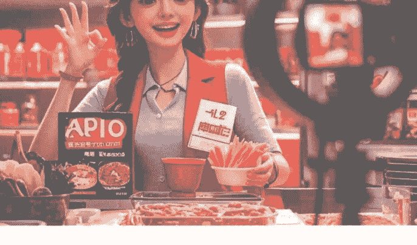
数字人：“兄弟姐妹们，直播间人气值刚刚突破500啦！这必须安排福利！现在开启幸运抽奖，获奖者将获得价值198元的火锅双人套餐！想参与的朋友，快在弹幕区打出我要吃火锅！10秒后开奖！”

###### 6.个性化推荐——让形象记住顾客
要点
个性化互动，如哎呀，是小李！，增强归属感。推荐逻辑清晰，基于过往购买行为。VIP专属优惠，提升忠诚度。
识别到常客：“哎呀，这不是老朋友小李嘛！上次你说特别喜欢麻辣锅底，今天给你推荐新品——藤椒锅底！椒香清新，入口麻爽，比麻辣更带感，保证爱上！而且你是VIP客户，今天点新品还能享85折优惠哦！要不要今晚过来尝鲜？”

##### ☑ 核心策略
- 热情欢迎——开场有归属感，提升停留。
- 生动描述——让食物活起来，增加食欲。
- 紧迫感促单——限时秒杀加FOMO，提升转化。
- 互动抽奖——提高活跃度。
- 个性化推荐——精准匹配需求，提升回购。

这不仅是一场火锅直播，更是一次隔着屏幕都能闻到香味的体验！智能系统不仅能全天候运作，还能用热情、氛围和个性化服务，让用户忍不住下单，最终走进店里！

#### 7.5 知识补给站 智能直播颠覆传统电商，如何抓住趋势赚更多
信息传播极快的今天，智能直播正以全新方式改写商业规则。过去直播靠真人主播的个人魅力支撑长时间在线；现在每个人都能成为超级主播。崛起不仅是技术创新，更是商业模式的重塑。它让个体创业者、小品牌，甚至零经验的普通人，都能快速切入赛道，获得惊人变现能力。

- √一位全职宝妈，用一部手机，靠智能直播一天收入5万！
- √一家小品牌，72小时无人直播，GMV突破2100万！

这些不再是少数人的运气，而是AI正在创造的新现实。核心优势在于打破了传统直播的人力加时间限制，用更智能、更精准、更低成本的方式实现前所未有的增长。那么到底如何运作？如何改变商业生态？又该如何用工具获得竞争优势？


##### 7.5.1 工具全景：如何打造无缝体验
智能直播之所以强大，不仅仅是自动化，还因为背后有一整套精细化工具。从内容生成到视频制作，再到数据分析，每环节都有专门工具支持，即使零基础也能打造专业间。

1. 内容生成工具——DeepSeek、ChatGPT等
几秒钟内生成吸引人的话术，精准切中痛点。针对不同产品与人群，自动优化脚本，提升转化。

2. 数字人主播——百度慧播星、即梦AI等
合成的虚拟形象，24小时不间断，真人无需出镜。自动学习真人语气表情，观众几乎察觉不到是系统在主持。

3. 视觉生成工具——Stable Diffusion、Midjourney等
为直播间创造高质量视觉背景，提升品牌感和信任度。

4. 视频剪辑工具——开拍、剪映
让短视频剪辑自动化，快速生产切片，提升复用率。

5. 智能运营系统
智能语音：模拟真人对话，让直播更具情感共鸣。
数据分析：追踪用户行为，自动优化话术和促销节奏。
智能推荐：根据历史数据精准推送个性商品，提升转化。

这些工具结合，意味着直播不再需要庞大运营团队，一人也能管理多个直播间，实现倍增。

##### 7.5.2 实用技巧：如何提高转化
真正价值在于利用数据驱动优化策略。一场成功的智能直播，通常具备以下要素。

###### 1. 由系统生成的销售逻辑：痛点→方案→促单
开场：引发共鸣，抓住注意力
> “亲爱的，还在为节食减肥却总是反弹而烦恼吗？”（痛点）
中段：展示产品独特优势
> “我们的××减肥茶采用纯天然配方，不仅能帮你轻松瘦身，还能调理肠胃，改善睡眠质量哦！”（利益）
结尾：限时优惠，促使下单
> “现在下单还有买二送一的超值优惠，错过这次再等一年，快点击下方链接抢购吧！”（促单）

###### 2. 防封策略：如何避免违规
在审核严格的平台上，系统可自动规避敏感词汇，确保内容合规。
- 智能替换敏感词：例如，“治疗”改为“缓解”，“效果立竿见影”改为“用户反馈良好”。
- 实时监测：自动检测潜在违规内容，及时调整表达，避免封禁风险。

###### 3. 情感计算：让直播更有温度
系统可实时分析观众情绪，调整节奏和话术，提高参与感和停留时间。这些微调最终都会转化为更高成交率和黏性。
- 当检测到观众情绪低落时，可能会插入轻松幽默段子，调节氛围。
- 当观众兴趣浓厚时，会自动延长某款产品介绍时间，增加互动，引导下单。

##### 7.5.3 未来趋势：企业和个人如何布局
###### 1. 成本革命：直播成本将降低70%以上
技术发展意味着可大幅减少在真人主播投入，降低运营成本，同时提升质量。

###### 2. 技术普惠：一部手机就能开直播
未来门槛将越来越低，即便是普通人，也能通过工具像百万级主播一样带货。

###### 3. 体验跃迁：虚拟形象或超越真人
随着进步，语音、表情、互动能力将越来越接近真人，甚至在某些方面超越。

那么应如何应对这场变革？
- 全面布局工具链：从内容生成到数据分析，打造完整生态，确保竞争力。
- 利用精准营销：基于历史数据和实时行为，实现千人千面，提升转化。
- 持续优化合规策略：虽高效，但监管趋严。需要利用实时调整内容，确保符合规则，降低封号风险。

##### 本章结语
智能直播的商业革命已经到来！它是一场彻底的变革，正在重塑内容传播、用户互动和销售模式。影响不仅限于企业，还在赋能每一个普通人，让他们以前所未有的方式进入市场，实现增长。

- 降低了门槛，让普通人也能成为超级主播。
- 优化了营销策略，让直播更精准、更高效、更具互动性。
- 提升了内容质量，让直播不再依赖个人能力，而是通过系统化运作实现增长。

但真正革命性并不止步于让更多人参与，而在于重新定义商业逻辑。这不仅仅关于成本降低，还是效率、精准度和用户体验全面升级。在传统时代，决定成败的是主播个人能力，而在智能时代，决定胜负的是谁能更聪明地用工具构建高效运转的内容生态。可预见，未来主导者将不再是单纯的个人，而是善于运用技术的创新者。他们不会被时间和体力限制，而是通过智能化运营，实现每天24小时不间断增长。未来的商业世界，人与智能系统的结合，将决定谁能抢占变革先机。而最重要的是，现在正是投身这场变革的最佳时机。

## 第八章 DeepSeek+付费投流
海量生成素材，广告爆单率狂飙100%
在这个人人抢流量的时代，抖音投流就像给账号装上流量加速器。你可能听说过：“自然流量是细水长流，付费投流是开闸放洪。”

美妆品牌PMPM通过在抖音连续投放产品测评视频，实现销售额飞跃，从每月50万盒增至80万盒，品牌总销售额突破2000万。王小卤利用用户对试吃的兴趣，推出9.9元mini装鸭脖，将获取新客户成本从25元降至8元，创造单月5000万销售奇迹。

现在有了AI加持，投流更聪明了。不仅能自动避开流量低谷时段，还能根据用户刷视频时的停留时间、点赞动作，智能调整投放策略。

流量为王的时代，既要会种树，自然流量，也要会修路，付费投流。

#### 8.1 案例 鲜花电商行业如何用AI让单量暴涨7倍
某天下午，王总盯着电脑屏幕上的ROI数据皱眉，这位杭州鲜花电商创始人已连续三个月亏损。直到2023年4月，团队用DeepSeek生成的一组母亲节文案，让单日销售额暴涨7倍——这不仅是技术的胜利，还是认知重构。

##### 8.1.1 依赖主观经验，盲人摸象式选品
某鲜花品牌运营老张曾为选品焦头烂额：去年七夕主推99元永生花礼盒，结果卖不过夜市39元单枝玫瑰。而用了DeepSeek之后，AI大脑在23秒内，就从8.7万条地址数据里揪出秘密，AI将产品精准匹配到三类核心场景，转化率瞬间提升217%。

数据显示，68%的中小商家因选品失误导致ROI低于1：1.5。

##### 8.1.2 碰运气式素材制作，设计师月产20组图已是极限
设计师小李每月最多产出20组广告图，还常被运营要求再改改。而AI系统在A/B测试中同时投放10组素材，发现痛点加场景化的结构最能打动人心。比如，那条她以为你忘了纪念日？顺丰加急挽回计划启动的爆款文案，直接让转化率飙升300%。

##### 8.1.3 凌晨数据波动无人值守，后知后觉式调价
过去凌晨三点的流量波动，往往要等到早会才被发现。某教育机构曾因深夜时段出价过低，白白流失37%的潜在学员。现在DeepSeek像永不疲倦的守夜人，每6小时根据点击率动态调价。

#### 8.2 实操攻略 3分钟教你用AI优化全流程（附操作指令模板）
在广告投放战场中，提示词就像精准导航的北斗系统——这套整理好的投放前后必备指令集，不仅能让新手少走80%的弯路，更能让老炮突破经验瓶颈。

##### ★ 投放前
素材生成提示词：“帮我生成10个突出××功能的短视频脚本”
保温杯保温功能短视频脚本创作
再设计一个包含产品对比、用户评价的落地页大纲

###### XX保温杯 - 持久锁温，温暖随行
一、首屏：吸引眼球，突出卖点 (5秒)
- 视觉：
  - 高清大图/视频：XX保温杯在多种场景下使用（办公室、户外、居家等），突出其时尚外观和实用性。
  - 动态文字：“XX保温杯，持久锁温12/24小时，给你全天候温暖呵护！”
- 行动号召：
  - “立即购买，享受限时优惠！”
  - “点击了解更多产品详情”
二、产品对比：直观展示优势 (10秒)
- 标题：“为什么选择XX保温杯？”
- 对比表格/图表：将XX保温杯与市面上其他品牌保温杯进行对比，突出以下优势：
  - 保温时长：12/24小时超长保温
  - 保冷效果：24小时冰水保鲜
  - 材质工艺：食品级不锈钢，真空锁温技术
  - 外观设计：时尚简约，多种颜色可选
  - 便携性：轻巧易携带，防漏设计
- 行动号召：
落地页框架提示词：“设计一个包含产品对比、用户评价的落地页大纲”
保温杯保温功能短视频脚本创作
给出客户常见问题的10种回复模板

###### XX保温杯 - 客户常见问题回复模板
1. 保温效果如何？能保温多久？

**保温杯售后话术库与AI投放实操合集**

感谢您的垂询！XX保温杯采用真空隔热结构，内胆为食品级304不锈钢，热传导阻隔效果突出。实测环境温度20℃时注入95℃开水，6小时后仍在60℃左右，12小时维持45℃以上，24小时仍有30℃左右。保冷表现同样稳定，完全覆盖日常使用需求。

2. 这款杯子有哪些容量可选？
您好，现有350ml、500ml、750ml三档规格。350ml轻巧便携，偏向通勤场景；500ml大小均衡，适用场景广泛；750ml大容量，更适合户外运动或长时间外出。

3. 用料是否安全？
请放心，品质与安全是我们的第一考量。内胆选用食品级304不锈钢，无毒健康，符合国家食品接触材料要求。杯盖为食品级PP材质，耐高温不异味，使用安心。

4. 会渗漏吗？
XX杯采用精密密闭工艺，盖内置硅胶密封圈，密封性能可靠。即使倒置也基本不渗漏，携带更省心。

给 DeepSeek 发送消息
智能话术提示词：“给出客户常见问题的10种回复模板”

##### ★ 投放中
标题优化提示词：“优化这5条广告标题，突出××优势”

保温杯保温功能短视频脚本创作
用对比法展示XX产品与竞品的3个核心差异

###### XX杯 VS 市面竞品，三个核心区别速览

为便于快速判断，我们将XX杯与常见竞品做了横向对照，提炼出以下三点分化：

| 核心差异 | XX产品 | 竞品 | 优势解读 |
| :--- | :--- | :--- | :--- |
| 1. 持久锁温，温暖加倍 | 真空锁温结构+食品级304不锈钢，保温可达12/24小时 | 传统保温工艺，通常仅6-8小时 | 真空锁温配合优质不锈钢，有效降低热量流失，保温更持久，使用时温度更合适 |
| 2. 冰火两重天，畅享双重体验 | 同时支持保温与保冷，冰水可保持24小时新鲜 | 多数产品仅能保温，不具备保冷 | 保温保冷兼顾，四季适用，使用灵活性更高 |
| 3. 匠心设计，品质之选 | 简约时尚多色可选，食品级材质，耐用安全 | 外观同质化严重，材质存疑，使用寿命偏短 | 从外观到用料均精细打磨，提供更高品质体验 |

选择要点：
- 超长保温呵护：12/24小时持久保暖，随时饮用恰好温度

卖点提炼提示词：“用对比法展示××产品与竞品的3个核心差异”

保温杯保温功能短视频脚本创作
创作3个限时优惠的CTA文案

###### 限时优惠CTA文案：

1. 紧迫感 + 行动号召：
   - “24小时限时！XX产品直降XXX元，立刻抢购，错过再等一年！”
   - “倒计时开启！XX产品限时秒杀，低至X折，手慢无！”
   - “最后X小时！XX产品买一送一，赶紧下单，双倍享用！”

2. 突出优惠力度 + 制造稀缺感：
   - “年度最大让利，直降XXX元，限量XXX件，售完即止！”
   - “首发特惠，限时X折，仅限前XXX名，先到先得！”
   - “会员专属价XXX元，非会员可领X元券！”

3. 场景化描述 + 情感共鸣：
   - “这个冬天让XX产品陪你暖心！限时X折，马上感受温暖！”
   - “XX产品，送给TA的心意！限时特价，让爱更暖！”
   - “提升生活品质就选XX！限时优惠，从此刻开启精致生活！”

CTA文案撰写要点：
- 以动词开头，如“立即抢购”、“点击领取”、“马上享受”，引导行动
- 加入数字与符号，如“24小时”、“X折”、“XXX元”，强化力度与紧迫
- 善用感叹号与表情，如“！”、“🔥”、“🎁”，提升感染力

给 DeepSeek 发送消息
行动号召提示词：“创作3个限时优惠的CTA文案”

##### ★ 投放后
数据分析提示词：“解析最近7天广告数据，找出转化率低于5%的计划”

- 针对广告创意：
  - 优化文案，突出卖点与用户获益
  - 选用更吸睛的图片或视频
  - 尝试视频广告或轮播等不同形式

- 针对落地页：
  - 提升加载速度，优化浏览体验
  - 确保页面内容与广告一致，提升相关性
  - 简化转化路径，降低操作成本

- 针对竞争对手：
  - 分析竞品投放策略，借鉴亮点
  - 强化自身优势，形成差异化

###### 6. 持续监测与优化
- 定期查看广告数据，发现异常及时调整
- 不断测试新方法，提升转化效率

工具推荐：
- 数据分析工具：Excel、Google Sheets、Python、R等
- 广告投放平台：Google Ads、Facebook Ads、抖音广告等
- A/B测试工具：Google Optimize、Optimizely等

数据分析提示词：“解析最近7天广告数据，找出转化率低于5%的计划”
投放建议提示词：“根据ROI数据给出下阶段预算分配方案”

沟通模板（填空式指令）：行业+平台+产品优势+具体需求
话术模板：“我是（行业）企业在（平台）投广告，想突出（产品优势），需要（具体需求）。”

###### AI投流黄金公式：
GMV提升 = (需求预测准确率 × 素材裂变效率) / (决策延迟时间 × 试错成本)

##### 饮料与跨境商品，如何用AI三招实现爆发
某国民饮料品牌推出荔枝气泡水时，抖音投放300万，ROI仅1:2.5，投入1元回2.5元。

引入AI与DeepSeek搭建智能投放体系后，点击率提升60%，获客成本下降42%，ROI升至1:4.3，单月销售额达8000万。

###### 他们如何用AI玩转抖音？三个关键动作

**1. AI人群画像分析：500万用户偏好5秒归纳**
将三年累计500万用户数据导入AI，挖掘出“低糖控”“开箱视频爱好者”“奶茶依赖族”等12类标签。AI发现“萌宠拆箱爱好者”与“气泡水购买者”重合度达73%。团队随后与宠物博主合作推出“猫咪开瓶”系列，橘猫扒气泡水的画面点赞破百万。

**2. 智能文案生成：7天产出200条创意**
输入“0糖”“荔枝香”“解渴”三关键词，AI批量生成文案。如“体感40℃！这瓶荔枝气泡水比空调还解救！”配合喝水音效，单条销量达20万瓶。

###### 0糖荔枝气泡水营销创意20条
突出“0糖”健康属性：
1. “0糖尽情喝，荔枝香气满溢”
2. “无糖零负担，荔枝香解渴”
3. “告别糖分，拥抱荔枝清香”
4. “0糖无压力，荔枝香畅饮”
5. “荔枝香，0糖轻生活”

强调“荔枝香”独特风味：
6. “一口荔枝香，如临果园”
7. “荔枝香气流转，全天清爽”
8. “荔枝香气泡饮，味蕾冲击”
9. “荔枝香邂逅气泡，口感新体验”
10. “荔枝香唤醒味蕾”

结合“解渴”功能：
11. “0糖荔枝香，解渴更健康”
12. “一口荔枝香，解渴又清爽”
13. “运动后一瓶，荔枝香解渴更畅快”
14. “夏日炎炎，荔枝香气泡水带来一夏清凉”
15. “工作学习疲惫？一瓶荔枝香气泡水提神解渴”

**3. 动态出价策略：夜间自动抢量**
人工出价难以精准，AI在晚8点追剧高峰自动提升竞价15%，凌晨捕捉游戏用户看美食视频时切换“开黑必备”话术。世界杯期间，AI提前三天预判囤货需求锁定体育博主，转化成本同比降低20%。

###### 方法论总结
AI投流增效公式
> 精准人群画像 × 爆款素材裂变 × 动态出价策略 = 低成本高转化

义乌小商品做TikTok出海，主营卡通发饰，初期因语言文化差异，单视频播放不足5000。

借助DeepSeek实现全链路优化后，印尼订单增长220%，彩虹独角兽发箍播放达300万，连雅加达网红主动寻求合作。

###### 他们结合AI做的三步优化
1. 跨语言AI适配：生成印尼语/泰语字幕，并植入本地热词“gemes”意为好可爱。机械翻译版播放2.3万，AI本土化版冲到87万。

2. 文化热点抓取：指令“分析印尼斋月节热门话题”，生成宗教贴纸与赠品方案，推出买发箍送珍珠头巾夹，三天售出8000单，马来西亚空姐团购。

3. 智能评论区运营：自动回复模板如“Hi! Bisa dikirim ke Surabaya?”，咨询转化率从11%提升至34%。

##### 通用实施框架
AI投放核心步骤：
- 数据基建：用DeepSeek清洗标注历史数据，完成60%基础工作
- 智能创作：批量生成适配各平台的营销内容
- 动态优化：设置关键指标阈值自动报警
- 知识沉淀：建立企业专属营销策略库

##### 起量口诀
> “三高一快”原则=素材迭代频率高 × 人群标签精度高 × 价值感知度高 × 数据反馈速度快

#### 8.3 知识补给站：国内Top3 AI投流工具横向测评
| 工具 | 核心功能 | 适用场景 | 操作门槛 |
|---|---|---|---|
| DeepSeek | 全链路素材生成+动态出价 | 多平台投放/跨境电商 | 低 |
| 腾讯广告AI | 微信生态定向优化 | 私域引流/小程序转化 | 中 |
| 千川智能版 | 抖音专属人群包裂变 | 直播加热/短视频爆量 | 高 |

##### 本章结语
在流量为王的时代，投放是获客增收的关键。传统投放依赖经验，效率低成本高。AI推动投放从盲投走向精准触达，从经验驱动转向数据驱动。精准画像、智能生成与动态出价，让投放从粗放到精细。未来竞争是触达效率与转化质量的较量。AI通过数据预测、素材裂变与智能出价，帮助企业构建投放护城河。先行者已获得数倍效率红利。AI不是替代创意，而是放大创意的催化剂。

## 第九章

### DeepSeek+微信社群
引爆私域，4步激活80%潜在用户

艾瑞咨询《2023年中国私域运营洞察白皮书》显示，微信私域用户规模超8亿，企业私域渗透率超85%，年复合增长率28.6%，零售母婴快消智能化渗透率将超60%。

如广州美妆品牌通过企业微信沉淀1800万用户，私域复购率42%，单客年消费超600元；南京母婴品牌借助AI实现1对1服务，会员年均互动63次，私域GMV占比超35%；茶叶品牌接入智能系统后，分层效率提升15倍，转化率提升28%，客诉处理时效缩至3分钟。

传统人工运营存在三大瓶颈：
- **人力成本高**：1个客服最多维护200个用户
- **响应效率低**：高峰期超时响应率超40%
- **转化链路长**：从触达到成交平均需7次互动

AI让私域运营实现千人千面自动化，从流量收割转向用户资产沉淀。

#### 9.1 案例 母婴行业如何用AI提升复购率
> ● 案例背景
南京某母婴连锁因人工推送育儿知识效率低，导致30%用户流失。引入DeepSeek后，AI据宝宝月龄推送“辅食添加”“疫苗接种”等内容，3个月复购率提升22%，客单价增长65%。

该品牌已沉淀800万母婴用户，但手工服务面临三大挑战：
1. 24小时育儿咨询需求激增，夜间人力缺口65%
2. 用户生命周期管理粗放，0-3岁知识推送精准度不足
3. 奶粉纸尿裤等刚需品复购依赖人工回访，消费频次波动大

AI辅助会员经营：
| 传统育儿顾问 | KidsGpt育儿顾问 |
| :--- | :--- |
| 基于经验：1500+人工标签 | 数据驱动：数字化画像实现千人千面 |
| 服务效率：受时间和地点限制 | 7×24服务：小时级迭代更新 |
| 育儿方案：依赖个人专业能力 | 育儿方案：个性化千人千面推荐 |
| 情感连接：可靠值得信任 | 情感链接：高维度数字化体验，强黏性 |

##### 核心解决方案
1. 用户画像自动化：清洗12万条消费数据，识别“孕期/0-1岁/1-3岁”三类人群
2. 内容精准匹配：按生命周期自动推送育儿指南+商品组合
3. 智能话术库：生成500+条育儿顾问话术，应答准确率达92%

#### 9.2 实操攻略 用DeepSeek激活母婴行业80%的意向用户
##### 9.2.1 朋友圈运营自动化：AI当24小时文案秘书
操作步骤：
1. 登录DeepSeek
2. 输入关键词 “六一儿童节+亲子活动”
3. 选择“朋友圈风格”模板
4. 自动生成10条带emoji文案

##### 9.2.2 社群运营智能化：机器人客服+精准用户画像
1. 用DeepSeek设计母婴领域对话模型
2. 导入奶粉冲泡、早教课程等80个高频问题库
3. 集成至小程序设置自动回复
4. 话术模板：用户问“6个月宝宝辅食吃什么？”自动推送米粉+围兜+研磨碗套餐

##### 9.2.3 裂变活动设计：用DeepSeek分析聊天话术，筛选不同类型用户
**1. 操作步骤**
（1）企业微信聊天记录自动同步至CRM
（2）AI分析话术，识别高价值用户如提问超5次未购买
（3）生成个性化跟进话术：“看您关注早教，本周三有免费体验课，需预留名额吗？”

**2. 用AI生成老带新智能激励**
（1）高净值用户：赠价值399元早教课程
（2）普通用户：赠试用装大礼包
（3）生成动态进度海报：“您已邀请2人，还差1人解锁大奖”

##### AI 私域增效公式
GMV增长 =（用户分层精度 × 内容相关度 × 互动频次）/ 响应延时

##### 9.2.4 五分钟学会全流程指令模板
**1. 用户分层**
提示词：“分析近30天用户互动数据，按消费频次划分VIP/常规/沉睡客户”。
结论：VIP客户月购≥3次推送专属折扣，沉睡客户60天未互动触发召回话术。

**2. 内容生成**
提示词：“生成10条冬季童装促销朋友圈文案，要求包含场景痛点+限时优惠”。
输出示例：寒潮预警！加绒牛仔裤3秒升温，今天下单送暖手宝→戳链接。

**3. 数据优化**
提示词：“解析社群7日消息热词，找出用户最关注的3个产品功能”。
结论：用“防摔”“透气”“抗菌”三关键词优化商品详情页。

**4. 数据分析**
- VIP客户：分析消费金额、互动行为，制定个性化营销策略
- 常规客户：分析消费习惯，提升消费频次
- 沉睡客户：分析流失原因，制定召回策略

**5. 可视化**

用可视化图表呈现客户分布与消费倾向，饼图、柱状图等能迅速建立全局认知。

**6. 营销策略制定**
- VIP客户：给予专属权益与一对一推荐。
- 常规客户：以满减、积分回馈为主。
- 沉睡客户：用召回邮件触达并附带特惠刺激。

**7. 持续监控**
保持数据定时更新，关注各人群迁移趋势，及时调整投放打法。

按此路径推进，可将用户互动数据系统拆解并转化为可落地的营销动作。

##### 9.2.5 私域AI四步破局框架
私域进入智能阶段，四步操作已成为突围关键。从喂养数据到实时微调，每个环节都在放大运营产出。

**1. 数据投喂：让DeepSeek解析历史订单、客服对话、浏览行为数据**
某快消因数据混乱导致人群划分失准，活动ROI仅1：2.3。经DeepSeek对历史订单、客服对话、浏览行为建模后，分层错误率由18%降至0.9%。完成投喂后，某家电企业客服投诉处理效率提升400%。

> 数据是运营的原油，AI是炼油厂——没有干净的数据，再聪明的策略也会变成空中楼阁。

**2. 智能分层：AI自动标注高价值人群**
母婴电商引入RFM模型后，AI自动筛出“月购≥3次”的高价值用户并推送“满99减20”券，转化率比普通用户高58%。某服饰品牌借助RFM发现“沉睡用户（60天未购）”对“限量秒杀”敏感度达34%，召回率提升27%。

**3. 话术生成：批量搭建朋友圈/社群/一对一话术素材库**
好话术是AI从行为数据里提炼的成交密码。某零食品牌用AI生成的“追剧伴侣限时5折”朋友圈文案，打开率比人工高210%。系统分析10万条爆款话术后总结出“场景痛点+数字承诺+紧迫感”的黄金结构。

AI批量生成的社群话术库，使某教育机构客服首次解决率由68%提升至85%。内容工程让某饮品品牌促销ROI从1：3.2跃升至1：6.8，相当于每投1元多赚3.6元。

**4. 实时优化：动态监测“消息打开率”“优惠券核销率”等核心指标**
某生鲜平台实时跟踪打开率与核销率，发现早市6：00—8：00打开率较平时高42%，随即调整推送节奏，该时段订单量增长37%。AI动态优化也让某汽车品牌线索转化率从4.7%提升至9.2%。

#### 9.3 知识补给站：AI私域工具矩阵

| 工具组合 | 应用场景 | 效率提升 |
| :--- | :--- | :--- |
| DeepSeek+微盟 | 自动化促销活动策划 | 活动筹备周期缩短70% |
| DeepSeek+尘锋SCRM | 多平台用户数据整合 | 画像构建效率提升8倍 |
| DeepSeek+腾讯云智服 | 24小时智能客服 | 人力成本降低60% |

##### 本章结语
私域竞争焦点已从规模转向价值深挖。AI凭借数据驱动的精细投放、自动化分层与高效互动，正为企业筑牢护城河。率先把经验转向算法的企业，已在新消费赛道获得十倍级效率红利。

## 第十章

### DeepSeek驱动管理升级
五大环节效能跃迁，团队战力拉满

波士顿咨询追踪的2147家破产企业中，62%并非技术落后或资金断裂，而是隐形的管理黑洞——目标失真、人才错配、组织内耗，每年吞噬15%—22%净利润。

工业时代科层制带来信息衰减，战略落地损耗高达47%，金字塔结构导致超30%工时无效，传统绩效催生“伪勤奋”持续稀释真实产出。

（工业时代科层制工厂示意图）

这解释了为何同赛道企业仍会出现5—8倍运营效率差。头部企业已用AI形成从目标协同到执行监控的智能闭环。

管理正被AI重新定义，AI不再只是工具，而是组织的“第六管理层”。

#### 10.1 案例 传统制造行业如何用AI创新生产管理

> ● 案例背景
苏州工厂车间响起智能调度指令，制造业人效革命开启。这是全球最大汽车零部件厂商的真实实践。

AI把排班从拍脑袋变成精密计算，人力成本下降同时生产响应压缩至23分钟。

2024年，苏州工厂日均处理20种计划波动，传统排班需50名调度员加班。这次将ERP订单数据与3000名技工的136项技能标签，如“数控机床操作熟练度≥90%”，喂入AI。

系统自动识别“某班组同时被安排3个高难度工序”的冲突，检查速度比人工快100倍。

类似案例还有，春节前系统提前两周预判某型号火花塞订单将激增40%，自动调配3个预备班组。某家电企业曾因预测失误致春节期间200名工人闲置，损失超800万元。

机械时代追求效率最大化，数字时代追求流程标准化，智能时代追求生命体的自我迭代。

动态调度算法支撑的“三级响应机制”极具创造性：常规订单正常排，紧急订单触发预备队10分钟到岗，重大突发直接启动智能预案。

在苏州工厂，AI不是奢侈品，而是降本增效的核武器。当传统工厂为排班表争论时，领先企业已让AI把生产要素变成可调度的数字积木。

##### 方法论公式

> 督导效能 = （问题识别速度 × 解决方案准确率）÷ 人工巡检成本

#### 10.2 实操攻略 用DeepSeek解决企业日常最难搞的五个问题

数字化转型进入深水区，五大场景成为效能跃迁密码，让组织进化从随机突变变为定向进化。

**1. 会议管理：提升会议效率，减少时间浪费，确保会议成果可追踪**
AI对话提示词示例：
会议纪要生成

**2. 文档管理：实现文档的智能分类、快速检索和高效协作**
AI对话提示词示例：
文档分类与标签
> “自动分析并分类我上传的10份合同文档，并为每份文档打上关键词标签。”
> “将‘2023年财务报告’归类到‘财务’文件夹，并标记为‘年度报告’。”

文档检索
> “帮我找到所有包含‘客户满意度’关键词的文档。”
> “搜索去年Q3的市场分析报告，并提取其中的核心数据。”

**3. 客户关系管理：提升客户洞察力，优化销售流程，提高客户满意度**
AI对话提示词示例：
客户画像生成
> “根据最近3个月的客户交互数据，生成客户A的画像，包括需求偏好和购买历史。”
> “分析高价值客户的共同特征，并总结他们的核心需求。”

销售机会预测
> “预测下个月可能成交的客户名单，并列出他们的潜在需求。”
> “根据历史数据，推荐最适合客户B的产品组合。”

智能客服
> “自动回复客户关于‘产品保修政策’的常见问题。”
> “分析客户C的聊天记录，判断他的情绪状态，并推荐合适的沟通策略。”

**4. 人力资源管理：提升招聘效率，优化员工培训，实现绩效评估的客观化**
AI对话提示词示例：
简历筛选与人才匹配
> “筛选所有投递‘产品经理’职位的简历，并推荐最符合要求的5位候选人。”
> “对比张三和李四的简历，分析他们的优劣势，并给出招聘建议。”

个性化学习推荐
> “根据张三的技能评估结果，推荐适合他的培训课程。”
> “为销售团队生成一份关于‘客户沟通技巧’的学习计划。”

绩效评估
> “分析李四过去6个月的绩效数据，并生成一份评估报告。”
> “对比销售团队成员的绩效表现，找出需要改进的共性问题。”

**5. 财务管理：提升财务数据的准确性和分析效率，优化资金管理**
AI对话提示词示例：
财务报表生成
> “自动生成2023年Q2的损益表，并标注关键财务指标。”
> “对比2022年和2023年的现金流量表，分析主要变化原因。”

风险检测与合规
> “分析最近一年的财务数据，检测是否存在异常交易。”
> “检查所有报销单据是否符合公司政策，并标记可疑项目。”

#### 10.3 知识补给站：AI管理工具选型表

| 工具类型 | 代表产品 | 核心能力 | 适用场景 | 价格区间 |
| :--- | :--- | :--- | :--- | :--- |
| 智能招聘 | Eightfold | 人才画像+内部流动建议 | 万人以上企业 | $8—15/人/月 |
| 流程自动化 | UiPath | RPA+AI审批 | 制造业/金融 | ¥50万/年起 |
| 数据分析 | Tableau AI | 自动生成人效诊断报告 | 中大型企业 | ¥20万/年 |
| 专属定制 | DeepSeek | OKR对齐+战略拆解 | 集团型组织 | 定制报价 |

##### 本章结语
数字化浪潮下，AI正成为企业管理的“第二大脑”。它已进化为组织的“第六管理层”，在目标对齐、执行监控与风险预判中形成智能闭环。

AI的应用不仅提升效率，更革新管理思维。通过精准数据分析、智能流程再造与实时风险预警，管理从粗放走向精细。无论是制造业排班革命，还是金融业智能管理，AI都在推动企业从经验管理迈向数据管理。

未来管理竞争的核心是组织效能全面提升。AI以数据驱动的目标拆解、智能化资源调度与高效决策支持，助力企业构建管理护城河。率先完成人工经验向智能算法转型的企业，已实现管理效能质变。

当AI成为企业“第二大脑”，管理天花板将被打破，组织进化进入全新智能时代。

## 全书总结

### AI时代，重构未来的无限可能
翻到这一页，意味着我们已完成一次关于AI的深度探索。从文案生成到短视频创作，从私域运营到企业管理，AI正以前所未有的速度重塑商业世界的每个角落。这不是对传统的颠覆，而是对生产力的重新定义——让普通人拥有超能力，让小企业具备大智慧，让创新不再受限于资源与经验。

#### 一、AI的本质：从工具到伙伴
全书揭示AI的深层价值：它不仅是效率工具，更是战略级伙伴。正如DeepSeek在文案创作中展现的“智能许愿”能力，AI正成为组织的“第二大脑”——听懂需求、预判问题、自主决策、创造惊喜。杭州宝妈案例中AI助力素人月入10万；苏州工厂排班效率提升90%；某银行AI化身“数字侦探”规避数千万风险……这些背后是AI从执行者向协作者的演进。

#### 二、AI革命的核心逻辑
1. 数据即燃料：无论是用户画像还是战略拆解，精准数据洞察是AI发挥价值的基石。
2. 场景即战场：AI的价值不在技术本身，而在对具体场景的深度适配——从直播话术到工厂排班皆需对症下药。
3. 迭代即生存：AI时代的核心竞争力是持续学习与优化。正如投流场景“动态出价策略”的进化，唯有AI与业务共成长，方能立于不败。

#### 三、未来已来：AI的下一站
从“功能智能”到“情感智能”：未来AI不仅能理解指令，还能感知情绪。数字人主播可按观众心情调整语气，客服机器人能识别用户焦虑并温柔安抚，人机协作进入新维度。
从“单点突破”到“生态融合”：AI+文案、AI+直播等单点突破终将汇流为“全链路智能生态”。企业需构建数据贯通、能力互补的AI矩阵，让每个环节成为增长飞轮。
从“替代人力”到“激发潜能”：AI不会取代人类，但用AI的人终将淘汰不用AI的人。未来管理者应是“人机协同指挥官”，让员工从重复劳动中解放，聚焦创造力与战略思考。

#### 四、致读者：成为AI时代的“新物种”
技术平权时代，最大风险不是被AI超越，而是视而不见。请记住三条行动准则。
以终为始：从业务痛点出发选择AI工具，而非追逐技术泡沫。
小步快跑：用“单点实验—快速复制—全面推广”的敏捷模式，降低试错成本。
保持温度：AI能计算数据，无法替代人类的同理心与价值观。让技术为善意赋能，才是长久之道。

当蒸汽机开启工业文明，电灯照亮现代世界，AI正在书写人类历史的下一篇章。本书不是终点，而是探索AI宇宙的起点。请带着方法论，以勇气拥抱变化，以智慧驾驭技术，在AI重构的世界里，找到属于你的星辰大海。

##### 未来属于会用AI的人，工具在手，增长不愁
拒绝低效内卷，拥抱智能时代的指数级爆发

##### 学好本书五大收获
- 高效引流：一人操盘百个账号，AI自动化引流突破式增长
矩阵运营+智能工具，流量红利尽在指尖
- 降本增效：企业免费提效外挂，运营成本直降三分之二
10人团队干出100人成果，效率质量双重飙升
- 重塑生意：从夜市摊到上市公司，AI正在重塑商业底层逻辑
无论规模大小，智能工具助力弯道超车
- 副业增收：虚实融合创作，普通人也能开启第二增长曲线
AI视觉+场景营销，低成本引爆超级个体价值
- 方案设计：让最不懂技术的人，也能用自然对话，获取专业级解决方案
零门槛AI重新定义生产力工具，普惠时代已来

上架建议：经济管理
定价：79.00元