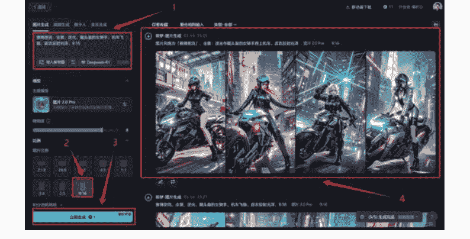
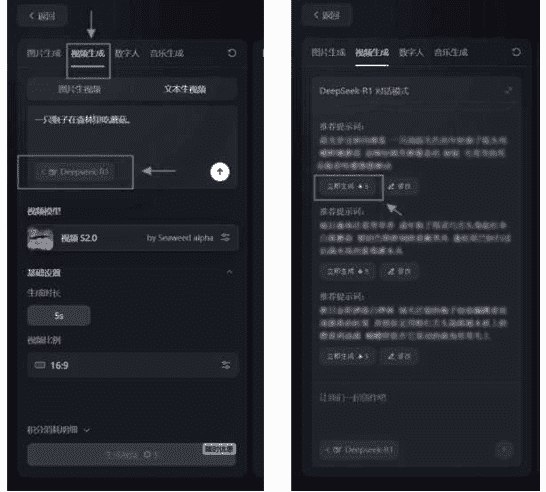
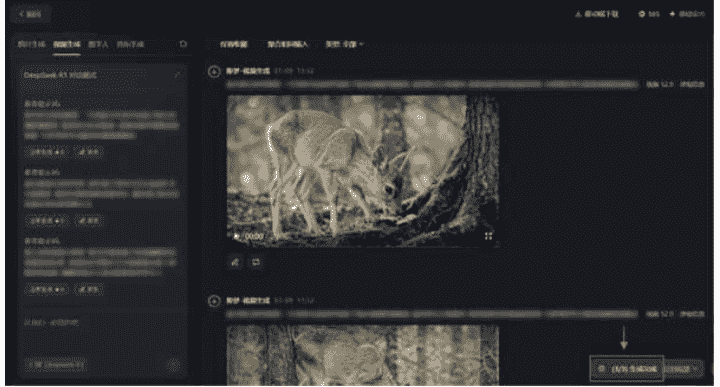
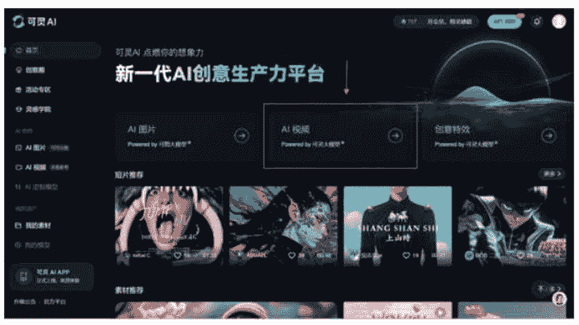
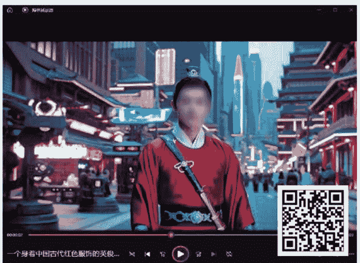

# DeepSeek短视频爆款密码：AI重塑内容生产力

# 前言

# DeepSeek：短视频时代的爆款孵化器

凌晨两点，创作者小王第23次点开后台：1.2万播放、589点赞、完播率28.7%。耗费三日打磨的沉浸式返乡Vlog<sup>注</sup>，终究卡在平台算法的30%生死线。评论区最热的两条，一条吐槽BGM<sup>注</sup>太吵，另一条竟是观众误发的表情包。类似的尴尬，正上演在千万间工作室里。

短视频全民化的今天，创作者像在布满数据的迷宫摸索：拆解过上百套爆款模板，轮到自己选题却犯了热梗脱敏；反转设计刚铺开就被3秒划走；好不容易跟上的潮流，转身就成过期库存。更让人焦虑的是，传统的人工智能产品像鸡肋——千篇一律的震惊体标题、生硬拼接的流行语，产出的废稿反而要花更多时间返工。

转机出现在DeepSeek。

这款现象级产品在国内外掀起波澜，以润物无声的方式渗入各行各业，内容创作首当其冲。从素人博主到头部网红再到MCN公司，数日内“让DeepSeek处理下”成了口头禅。它迅速被视为短视频赛道的爆款孵化器。

回看行业节点，DeepSeek推动的是新的人工智能内容生产方向：它并非以魔法棒姿态彻底取代人的创意，也不沦为制造同质化内容的流水线，而是把创作者从重复性劳动中解放，让天马行空回归本质。接下来，揭开这场智能创作变革的序幕。

# 一、逆袭实录：普通人如何撬动AI杠杆

小红书达人“赖大宝成长记”透露女儿学业不理想，想让DeepSeek写一封家书。粉丝不过数千，发布后点赞突破3.6万。即便挑选极其简单的热门话题，以向DeepSeek提问录屏的方式制作“伪短视频”，也频频出现上万点赞的作品。

在浙江义乌国际商贸城，商户傅江燕因语言障碍难以打开海外市场。她尝试让DeepSeek产出二十余种语言的产品介绍视频，不仅技术参数翻译精准，还会按文化差异调整话术：对欧美客户强调环保认证，对东南亚市场突出性价比优势。热度最高的一条播放超5.4万次，积压库存迅速售罄。有评论称：“相当于请了一支精通多国文化的营销团队，成本几乎为零。”

（AI时代的生意跃迁——守世界一隅，做全球买卖。本图由AI生成）

案例背后值得探究。大模型技术已日趋成熟，DeepSeek崭露头角前，豆包、Kimi、文小言等国产语言产品已深嵌在许多人的工作与生活中。后来者如何突围，成为引爆短视频的现象级存在？

# 二、创意源泉：爆款内容的原子级重构

DeepSeek的走红并非运气。若把短视频创作比作化学反应，其独特价值在于重构内容生产的原子要素，并以独特的创意挖掘生成模式，解决制作的第一痛点。

当同类产品仍在关键词匹配加模板填充阶段试探时，DeepSeek已搭建起多模态感知、语义拆解、创意重组的智能中枢。它像一位洞悉流量的军师，既能预判全网热点趋势，又能把抽象创意转为可执行的脚本语言。其核心的“动态知识图谱”，犹如永不疲惫的流行文化观察者，通过实时抓取分析全网爆款，精准捕捉元素演变轨迹。

例如，美妆博主若缺乏选题，可直接向DeepSeek发起询问。它会基于上亿条美妆评论训练的语义情感云图，识别出“显脸小”“伪素颜”“持妆12小时”等隐性需求。若再输入“油皮底妆”主题，系统会推荐如下选题：

- “早八族”地铁补妆指南
- “口罩刺客”克星：三明治定妆法
- 油皮人士必看！散粉的五种进阶玩法

笔者之一长期在MCN任职，深有体会。过去编导团队需数日完成的选题策划，如今DeepSeek三分钟内可给出20套专业方案，且数据验证显示AI挑选的方案爆款率更高。那些绞尽脑汁也想不出的“离谱”选题，反而成了打开爆款之门的钥匙。

# 三、文案打磨：依托算法的修辞增强术

对多数创作者而言，脚本是痛点中的痛点。好脚本往往需数日打磨，DeepSeek在特定主题下产出脚本既快质也高。

测试“返乡”主题时，它给出“当高铁穿过隧道，窗玻璃上映出的，是十年前站台上攥紧车票的少年”，展现出惊人的意象运用与情感唤起能力，从文字堆砌转向情感共振。

依据不同垂类风格，它能按指令给出契合目标人群调性的文案，避免模式化输出。

一位美食博主做过对比：人工团队的“泡面测评”脚本完播表现平平，DeepSeek版本在开场前三秒植入“面条弹起慢镜头+这包泡面居然会跳舞”的强冲突画面，完播率骤升。这种对用户注意力的精准把控，源于底层独创的“多巴胺响应预测模型”——它能模拟观众观看时的神经兴奋曲线，自动优化脚本以达最佳播放效果。

# 四、创意生产链：打造病毒式传播全方案

相比旧竞品，DeepSeek不仅具备拟人化的结构思维，更能提供一套可执行的短视频创意生产链。

以“职场焦虑”为题，它给出三幕式悬念架构。第一幕冲突建立：画面是“25岁总监凌晨三点改方案”的强对比；第二幕情节反转：AI工具让方案优化效率提升300%；第三幕主题升华：给出“我们战胜的不是KPI，而是对时间的恐惧”的金句，令人惊艳。

输入“夏日防晒”，它并未停留在功效对比层面，而是深入分析受众，融合实验对比与故事情节，构建“实验室数据PK+海岛旅行故事情节”的双线叙事：既有紫外线相机下的直观测试，又有女主从办公室到沙滩的场景穿越。见表0-1。

表0-1 DeepSeek生成的“夏日防晒”主题分镜头脚本

| 镜头 | 画面 | 特效/字幕 |
|---|---|---|
| 开场0～5秒 | 烈日下，主角撑伞行走，汗珠飞溅 | 大字标题炸裂弹出：“40℃暴击！你的防晒真的有用吗？” |
| 实验对比20秒 | 实验室中，主角将涂与未涂防晒霜的手臂置于紫外线灯下，测试卡显色对比 | 紫外线紫光特效；未涂手臂测试卡由白变深紫 |
| 反转剧情30秒 | 未涂防晒的男士嘲笑主角麻烦，次日晒红似虾并惨叫 | 夸张表情+漫画红肿特效，弹幕：“哈哈哈，打脸现场” |
| 知识干货40秒 | 快速切换防晒霜、帽子、墨镜等物品 | 动态字幕：“SPF防UVB晒伤，PA防UVA老化！”“每2小时补涂一次！” |
| 结尾5秒 | 主角抛接防晒霜并眨眼笑：“防晒是场科学游戏，你通关了吗？” | 贴纸弹出防晒小测试链接 |

不仅如此，它将时长控制在1分30秒内，还主动提供运营方案以提升传播，生成包含选题创意、视觉设计、文案脚本、运营策略在内的可执行方案。

# 五、“DeepSeek+”：从灵感到成片的跃迁

当前创作者可将DeepSeek与Midjourney、Stable Diffusion、文心一格、即梦、可灵、无界、秒创、腾讯智影、剪映等工具深度对接。本书也将带你学习指令生成文本、文本生成图像、文本生成音频、文本生成视频、图像生成视频、AI特效使用等短视频制作全流程，并搭配国内优秀AI应用，形成高效制作组合。

借助这种“DeepSeek+”工具链，即使是制作小白，也能在短时间内完成从灵感到成片的跃迁。无论是想以短视频为副业的上班族、有专业领域想打造个人IP的行业精英，还是以短视频为主业的自媒体大V或MCN公司，都难以拒绝。

DeepSeek已展现惊人的爆款生产能力，而变革才刚开始。当前版本仍存在视觉创作断层、插件生态滞后、与Premiere、After Effects等专业软件协同不足等局限。这些技术沟壑恰指明了未来进化方向：当开放生态成熟后，创作者可在同一平台完成脚本生成、素材调用、智能剪辑的无缝衔接，从而实现更高效、更优质的内容生产。

（在未来的智能社会，由于AI赋能，“超级个体”将大量涌现）

# 六、别被时代落下，只能不断学习

DeepSeek带来的效率变革正在重塑短视频行业规则：个体创作者开始以“单人小队”模式挑战机构化团队，传统的“内容产能天花板”可被彻底打破。在可见的未来，掌握以DeepSeek为代表的先进AI工具的创作者，将获得指数级的内容竞争优势。

笔者之一所在的MCN行业也在经历变革。某头部电商公司过去用400余名剪辑师制作海量短视频切片，如今通过AI赋能的自动化作业，仅需一人即可完成，不仅覆盖发布、监控、数据分析等流程，还能智能筛选转化数据最佳的切片持续推广，进一步扩大转化效果。

这一切的基础和前提，是必须掌握以DeepSeek为代表的AI工具的使用技巧。DeepSeek能帮助创作者打造更好作品，但关键仍在于掌握这根魔法棒使用规则的人。只有这样，它才能真正成为手握者手中的爆款制造器。成功的短视频创作者，必须持续学习，掌握AI时代的法宝。

接下来，进入DeepSeek实操部分。

# 第一篇章

DeepSeek短视频制作全流程

短视频时代，每个人都能用15秒讲故事、用30秒传情绪、用1分钟掀起风潮。中国短视频用户已超10亿，人均日刷超2小时。背后是无数创作者的文案构思、素材制作、剪辑优化——直到AI崛起，让“一个人就是一支队伍”成为现实。

在这场效率变革中，DeepSeek像一把万能钥匙，串联起文案生成、视觉设计、视频制作的完整流程，让爆款从碰运气变为可复制的操作。以DeepSeek为核心的人工智能高效工作流已成型。

本篇要揭示的，是一套经实战验证的AI短视频创作公式：从零基础到日更博主，可能只需四步：用10分钟熟悉操作界面，像使用智能手机一样调用能力；通过“关键词激活+数据喂养”组合，让AI生成兼具网感与个人风格的爆款文案；打通文心一言、Midjourney等绘画工具的任督二脉，以“文字描述→概念图→精修图”的三阶操作打造媲美专业设计的视觉；借助剪映实现素材智能匹配、字幕自动生成、流量密码植入的一条龙生产。

这不仅是工具革新，更是创作思维进化。当AI承担80%执行工作，创作者得以聚焦创意策划与风格塑造。

# 第一章

DeepSeek如何快速上手

DeepSeek由杭州深度求索打造，以国产、免费、开源、强大四重魅力引领AI普及。它打破技术垄断惠及大众，DeepSeek-R1不仅是里程碑，更是开启全新AI时代的钥匙，提供免费、高效、易用的工具。

本章帮助对AI好奇的朋友快速上手，从开源魔法到操作界面细节，从高效对话黄金原则到提示词设计艺术，逐步走进奇妙世界。无论是专业制作人员还是普通用户，DeepSeek都能成为得力助手。也将介绍微信小程序、百度AI搜索、纳米AI搜索、秘塔AI搜索等常用通道。

# 一、推开大门：新手从零到一操作指南

在AI飞速发展下，拥有DeepSeek这样智能贴心的助手，学习工作生活更高效。科研人员、企业管理者、普通用户都能从中创造价值。

## 1.DeepSeek官网入口

打开浏览器进入DeepSeek官方网站，像打开通往未来的门。

### （1）DeepSeek电脑网页版注册与登录

点官网左侧“开始对话”会出现注册登录界面，支持手机号、邮箱、微信。若首次使用按提示完成注册，务必绑定常用手机号，最好与微信捆绑，便于后续登录与多平台切换。

### （2）DeepSeek手机App版注册与登录

不习惯网页可选用App。点官网右侧“获取手机App”扫码后可在主流应用商店下载，或直接搜索“DeepSeek”认准蓝色鲸鱼Logo。App具备网页版全部功能，并支持拍照上传、相册导入，随时随地畅聊。

## 2.DeepSeek其他常见通道

访问量激增时服务器易卡顿，可尝试以下通道。

### （1）微信小程序

用户超10亿的微信逐步开放DeepSeek-R1满血版灰度测试。搜索DeepSeek公众号或小程序即可调用，实现公众号内容与全网公开信息智能整合。优势：无需额外注册，与微信生态无缝衔接；支持文字、图片、语音多模态输入；隐私保护完善，仅调用公开数据。

### （2）百度AI搜索

百度AI搜索凭强大检索与数据资源，精准定位DeepSeek-R1满血版内容。结合百度AI技术，能提供更智能高效服务。依托7亿月活的百度App生态，融合检索增强生成技术，降低模型幻觉。实测表现：搜索广告率降87%，如故宫预约直达官方；数学解题误差仅2.3%，公历农历转换准确率99.6%；集成PPT自动生成、智能文档总结等办公功能。

### （3）纳米AI搜索

打开纳米AI搜索官网并开启对话框中的“深度思考（DeepSeek-R1联网满血版671B）”功能键。作为360集团旗下增速最快的AI搜索工具，优势包括：全工作流覆盖，搜索学习到创作输出一体化；多模态生成，支持图文混排及短视频生成；双专线保障，360高速专线加满血版专线分流压力；目前提供无广告纯净界面，兼容微软和苹果系统；访问速度快；支持切换多个大模型对比优化。缺点：不支持本地文件上传，未注册用户次数受限。

### （4）秘塔AI搜索

打开秘塔AI搜索官网并开启对话框中的“长思考·R1”功能键

被誉为中国版Perplexity 注 的秘塔AI搜索，创新性地实现了以下几项功能：

- 可追溯的双核检索：RAG 与 R1 配合工作，查询结果会附上可回溯的文献出处；
- 零门槛上手：免注册即可领取每日免费额度直接体验；
- 超长文本解析：单次可处理约十万字量级的文献并完成要点整合；
- 多端实时互通：网页、App、小程序的数据保持同步；
- 直达体验更流畅：秘塔 AI 搜索强调无广告直达答案，交互经过优化，响应等待被压缩；
- 信息整合能力强：作为通用型搜索，覆盖面广，能汇总全网资料给出相对可信的结论。

短板主要是追问入口较为隐蔽，二次交互的顺滑度还有提升空间。

熟悉 DeepSeek 的主流入口后，就能和这位 AI 伙伴开启使用。无论是学习新知、解决工作难题，还是寻找生活乐趣，它都能提供实用帮助。

## 3. 熟悉你的AI助手操作台
电脑网页版和手机 App 的整体布局都很清晰，可分为两大部分：中央对话区和侧边辅助栏。对话区是与模型互动的核心，侧栏主要负责历史记录与账号相关操作。

### （1）DeepSeek 对话区功能概览
对话区最核心的是模式切换和文件导入。窗口左下方提供“深度思考（R1）”与“联网搜索”两个开关，“基础模型（V3）”则默认在后台运行。

> [如果“深度思考（R1）”模块显示为灰色，说明系统默认使用的是“基础模型（V3）”]

“深度思考（R1）”“基础模型（V3）”“联网搜索”三者的定位各不相同，用户可按场景自行挑选。

#### ①基础模型（V3）：日常小助手
- 适用范围：闲聊、常识问答、文案撰写等日常常见需求。
- 核心特质：应答迅速、知识覆盖面宽。
- 知识状态：反应快、储备量大、更新相对及时。
- 小结：日常首选，使用省时省心。

#### ②深度思考（R1）：难题攻坚手
- 适用范围：需要复杂逻辑推演、编程攻关或高难度数学问题时。
- 核心特质：推理严谨、考量周全，速度稍慢但每一步都经推敲。
- 小结：深度挖掘，帮助解决棘手难题。

#### ③联网搜索：实时资讯采集区
- 适用范围：查询最新新闻、热点资讯或实时数据时。
- 使用注意：在基础模型（V3）或深度思考（R1）模式下均可叠加联网搜索，但开启后无法上传附件。
- 小结：弥补基础模型和深度思考在时效性上的不足，帮助获取最新信息。

[如果点击开启“深度思考（R1）”，则该模块显示为蓝色]

（如果点击开启“联网搜索”，则该模块显示为蓝色；此模式下 DeepSeek 可参考最新网络信息，确保回答时效）

[在“深度思考（R1）”和“基础模型（V3）”两种模式下，用户均可上传附件，但“联网搜索”开启时该功能不可用；“上传附件”支持 PDF、Excel 表格及多种图片格式，仅识别文字内容，单文件上限 100 MB；可用于让 DeepSeek 归纳上传文档的核心观点或分析数据]

# 你好，我是 DeepSeek，很高兴认识你！

我能帮你写代码、阅读文件、创作各类创意内容，请把任务交给我吧~

[同时开启“深度思考（R1）”和“联网搜索”后可进入深度功能区，适用于多种场景，例如运营公众号时常遇到的选题枯竭、热点跟不上、专业内容写不透、用户互动缺话题等问题，深度功能能很好地提供帮助]

（在 DeepSeek 手机 App 版中，“上传附件”选项除文件外，还新增“拍照识文字”“图片识文字”两项功能）

### （2）DeepSeek 侧边栏主要功能
侧栏相当于私人助理的工作台，简洁高效。“开启新对话”随时可用；“历史对话框”记录每次交流，用户可按需调整主题或清理记录；“个人信息”用于管理账户信息。

（DeepSeek 左侧边栏功能区：“对话历史记录”中保存着过往每轮对话的主题与时间，用户可根据需要删除或重命名）

### （3）四种大模型应答模式对比测试
要把 DeepSeek 用得更顺手，需先了解不同模型的“性格”。我们设计了一道可考验多方面能力的测试题，对其进行全方位评估。

测试题目：“2023年短视频行业经历了哪些重大变革？未来三年抖音、快手、视频号三大平台商业化竞争的核心战场将转向哪里？”

测试的四种模型如下。

#### ①简约而不简单的“基础模型（V3）”

## 2023年短视频行业重大变革

1. AI 技术深度应用
   - AIGC 在短视频创作中普及，降低创作门槛并提升生产效率。
   - 个性化推荐算法持续优化，提升体验与平台粘性。

2. 直播电商持续增长
   - 直播电商成为主要变现路径，平台与品牌合作加深，销售额大幅上升。
   - 虚拟主播与 AR/VR 技术应用，提升直播互动性与沉浸感。

3. 内容监管趋严
   - 各国加强内容监管，平台加大审核力度以保证合规。
   - 版权保护与内容原创性受重视，打击抄袭侵权。

4. 全球化扩张
   - 抖音、快手等加速海外布局，争夺全球市场份额。
   - 本地化运营与跨文化创作成为关键策略。

5. 社交属性增强
   - 平台强化社交功能，推出更多互动工具，提升用户粘性。
   - 短视频与社交媒体融合加深，形成更紧密的社交生态。

# 未来三年抖音、快手、视频号商业化竞争的核心战场

1. 本地生活服务
   - 平台将深入本地生活服务领域，如餐饮、旅游、娱乐，推动线上线下融合。
   - 通过短视频与直播推广本地商家，提升消费体验。

2. 电商生态扩展
   - 强化供应链与物流建设，提升电商服务能力。
   - 拓展跨境电商，吸引更多国际品牌与用户。

3. 广告变现优化
   - 提升广告投放精准度，优化广告形式，增强效果。
   - 探索更多变现模式，如互动广告、沉浸式广告等。

4. 内容付费与订阅
   - 推出更多优质付费内容，吸引用户订阅。
   - 提供独家内容与增值服务，增强付费意愿。

5. 技术创新与用户体验
   - 持续投入 AI、AR/VR 等技术，提升创作与体验。
   - 优化平台功能，提升参与度与满意度。

6. 全球化与本地化
   - 加强海外布局，推动全球化扩展。
   - 针对不同市场做本地化运营，提升粘性与份额。

## 总结

2023年短视频行业在技术、内容、监管与全球化方面经历重大变革。未来三年，抖音、快手、视频号将在本地生活服务、电商、广告变现、内容付费、技术创新与全球化等领域展开激烈竞争，推动行业持续发展。

> 本报告由 AI 生成，仅供参考，不构成任何专业建议。

[ 针对同样一个问题，DeepSeek 的“基础模型（V3）”输出结果 🔗 ]

“基础模型（V3）”像一位快速扫描的行家，能迅速勾勒行业轮廓，让用户在短时间内把握概况。但若追求更深见解或最新信息，其深度与时效性略显不足。

#### ②拥有互联网“超能力”的“基础模型（V3）+联网搜索”

## 2023年短视频行业重大变革

1. 商业化全面提速
   2023年商业化进程明显加快。抖音、快手、视频号在电商、广告、本地生活服务全面发力。抖音电商 GMV 突破 2.3 万亿元，快手电商 GMV 超过 9000 亿元，视频号电商 GMV 约 1000 亿元。直播电商成为主要增长引擎，抖音和快手的直播电商 GMV 占比分别达 80% 和 30% 以上。

2. 本地生活服务崛起
   平台加速布局本地生活，抖音和快手通过短视频、直播和搜索推动餐饮、旅游、娱乐线上化。抖音本地生活服务 GTV 达 2000 亿元，接近美团三分之一。

3. 内容电商化与微短剧爆发
   内容全面电商化，创作者通过短视频和直播带货成常态。微短剧成为新风口，快手、抖音、视频号微短剧播放量大幅增长，部分作品播放超 10 亿次。

4. 监管趋严与内容治理
   2023年行业面临更严格监管，中央网信办多次开展“清朗”专项行动，打击虚假信息、低俗内容和网络暴力。平台加强审核，优化推荐，推动规范化。

5. AI 技术深度应用
   AI 在制作、推荐和广告投放中应用更广。快手推出“可灵”系统，抖音通过 AI 优化体验和广告转化，AI 成为商业化重要驱动。

# 未来三年抖音、快手、视频号商业化竞争的核心战场

1. 本地生活服务
   将成为三大平台核心竞争领域。抖音与快手通过短视频和直播带动餐饮、旅游、娱乐线上化，视频号借助微信生态加速布局。未来将通过技术和服务创新，提升渗透率与体验。

2. 电商生态扩展
   电商仍是商业化主战场。抖音和快手将继续优化“搜索+商城”货架场景，视频号通过降低商家门槛和打通微信生态，加速电商基建。未来更注重品牌化和全域经营，提升复购率与客单价。

3. 广告变现优化
   广告收入是商业化重要组成。未来将利用 AI 与精准推荐提升投放效率与转化率。视频号凭借微信生态流量优势，有望在广告市场占据更大份额。

4. 内容付费与订阅
   随着对优质内容需求提升，内容付费和订阅模式将成新增长点。微短剧、知识付费、会员服务等商业化潜力进一步释放。

5. 全球化与技术创新
   抖音 TikTok 和快手将继续推进全球化，拓展海外市场。同时 AI、AR/VR 等技术将推动创作和体验升级，为商业化注入新动力。

## 总结

2023年行业在商业化、本地生活服务、内容创新与技术应用等方面发生重大变革。未来三年，抖音、快手和视频号的竞争将聚焦本地生活服务、电商扩展、广告变现、内容付费和技术创新。平台将通过精细化运营和技术赋能，提升商业化能力与用户体验。

[针对同样一个问题，DeepSeek 的“基础模型（V3）+联网搜索”输出结果]

“基础模型（V3）+联网搜索”的组合像速度与激情的碰撞。联网搜索赋予其获取实时信息的翅膀，使用户能轻松获取最新事实与数据。但在逻辑性和深度上可能稍显薄弱，对需要深入思考分析的问题可能无法给出理想答案。

#### ③爱钻研的“深度思考（R1）”

好的，我现在要回答用户关于2023年短视频行业的重大变革以及未来三年三大平台商业化竞争核心战场的问题。首先回顾之前两次回答，确保不重复，同时加入新视角或数据。

用户已得到两次回答，第一次较为全面，第二次补充了 GMV 数据和微短剧等内容。现在再次提问，可能需要更深入分析或最新信息。假设信息截止2023年，需保持结构和逻辑更清晰。

2023年变革方面，之前提到商业化提速、本地生活崛起、内容电商化、监管趋严、AI 应用等，需检查是否有遗漏，如创作者经济变化、平台政策调整、用户行为变化等。

未来战场方面，之前提到本地生活、电商扩展、广告变现优化、内容付费、全球化与技术创新，需思考新趋势，如社交电商深化、私域流量运营、跨平台整合等。

接下来组织内容，避免重复并补充新观点。例如在2023年变革中加入创作者工具与生态变化，或平台应对监管的具体措施。未来竞争方面可探讨各平台差异化策略，如视频号利用微信生态、抖音强化内容生态、快手巩固下沉市场等。

注意数据更新，如最新 GMV 或市场份额。同时分析各平台优势劣势，预测战略。

最后总结需简明，突出核心观点，并强调行业趋势与平台策略关联。

## 2023年短视频行业重大变革

1. 商业化全面提速，电商与本地生活成核心引擎
   - 抖音、快手、视频号电商交易额均创新高：抖音超 2.3 万亿元，快手达 9000 亿元，视频号突破千亿。
   - 直播电商占比显著提升：抖音直播电商占总 GMV 80%，快手超 30%，内容与消费深度绑定。
   - 本地生活服务爆发：抖音本地生活 GTV 接近 2000 亿元，覆盖餐饮、酒旅、娱乐，直接冲击传统本地生活平台。

2. 内容形态迭代：微短剧与“电商化内容”爆发
   - 微短剧成流量新风口：单部播放破 10 亿次，抖音、快手推出分账激励，吸引专业团队；内容直接嵌入商品链接，实现“边看边买”。
   - 创作者全面电商化：中小商家通过短视频和直播降低获客成本，内容从娱乐向“种草-交易”闭环转型。

3. 监管升级与行业规范化
   - 国家网信办“清朗”行动重点整治虚假营销、低俗微短剧，平台加强审核与算法干预，如抖音下架违规微短剧超 2 万部。
   - 版权保护强化：AI 生成内容需标注来源，打击搬运抄袭，推动原创占比提升。

4. 技术驱动：AI 重塑生产与分发
   - AIGC 工具普及：抖音“剪映”推出 AI 文本生成，快手“快影”支持 AI 虚拟主播，降低创作门槛。
   - 算法优化：AI 动态调整推荐策略，如抖音“兴趣电商”精准匹配潜在需求，广告转化率提升 30% 以上。

# 未来三年竞争核心战场：差异化与生态闭环

1. 本地生活服务：从流量到落地能力比拼
   - 抖音：依托 6 亿日活和精准算法，主攻一线城市，通过“到店核销率”验证商业模式，未来或自建地推团队。
   - 快手：聚焦下沉市场，联合区域中小商家，以低价团购和熟人社交裂变突围。
   - 视频号：借力微信支付和公众号生态，打造“内容-社群-交易”链路，可能推出“附近的人”功能强化本地触达。

2. 电商生态：从 GMV 竞争到利润竞争
   - 货架电商补短板：抖音商城独立入口日活破 1.5 亿，快手“信任购”强化复购，视频号接入微信搜一搜，争夺“搜索电商”场景。
   - 供应链与物流自建：抖音测试自营仓储，快手投资冷链物流，降低对第三方依赖，提升利润率。
   - 品牌化与垂直化：高端品牌入驻抖音，快手扶持产业带白牌，视频号依托私域发展奢侈品代购，形成分层竞争。

3. 广告变现：从粗放投放到“品效销一体”
   - 抖音：利用全域兴趣电商数据，打通品牌广告与效果广告，为头部品牌提供全链路营销方案。
   - 视频号：释放朋友圈广告位潜力，通过社交关系链实现广告裂变，单次点击成本可能低于抖音 30%。
   - 快手：强化“老铁信任”背书，推动中小商家投放，推出按 ROI 结算的广告产品。

4. 内容付费：探索高净值用户变现
   - 微短剧付费：单片付费、会员订阅模式成熟，快手测试“打赏解锁剧情”，抖音探索 IP 衍生品联动。
   - 知识付费崛起：视频号依托公众号知识博主资源，打造“短视频+直播+社群”变现闭环，客单价可达千元级。
   - 虚拟社交消费：三大平台均布局虚拟偶像和 AR 互动，未来可能推出虚拟礼物、数字藏品等增值服务。

5. 技术战：AI 与跨端生态定胜负
   - AI 内容生产：抖音“云雀”大模型支持一键生成带货视频，快手 AI 剪辑工具降低商家成本，技术能力决定中小创作者留存。
   - 多端联动：抖音与饿了么合作拓展即时零售，视频号与小程序深度整合，快手接入本地生活 App“快秒”，生态协同能力成关键壁垒。

## 总结

2023年行业以商业化深化和技术普惠为主线，形成“内容即消费”新范式。未来三年，抖音、快手、视频号的竞争将超越流量争夺，转向生态闭环能力构建：

- 抖音需证明“流量帝国”能转化为可持续商业模式，如本地生活服务利润率；
- 快手依赖下沉市场基本盘，需突破用户价值天花板；
- 视频号胜负手在于能否激活微信 12 亿用户的沉默流量，实现社交与商业化学反应。

技术、供应链、跨场景运营能力将成为决定最终赢家的三大核心变量。

[针对同样一个问题，DeepSeek 的“深度思考（R1）”输出结果]

“深度思考（R1）”更像一位思维缜密的策略家，擅长逻辑分析和趋势预测。在其引导下，用户可看到事物背后的逻辑链条及未来可能走向。但值得注意的是，由于缺乏最新数据支撑，其预测可能会与现实产生一定偏差。

#### ④集深思与广博于一身的“深度思考（R1）+联网搜索”

## 2023年短视频行业重大变革

**1. 商业化全面提速，电商与本地生活成核心引擎**

2023年核心变革之一是商业化加速。抖音、快手、视频号电商交易额 GMV 均创历史新高：抖音突破 2.3 万亿元，快手达 9000 亿元，视频号首次突破千亿规模。直播电商成为主要增长点，抖音直播电商 GMV 占比 80%，快手占比超 30%。同时本地生活服务快速崛起，抖音本地生活服务总交易额 GTV 接近 2000 亿元，覆盖餐饮、酒旅、娱乐，直接挑战传统平台如美团。

**2. 内容形态迭代：微短剧与“电商化内容”爆发**

微短剧成为流量新风口，单部作品播放超 10 亿次，抖音、快手推出分账激励计划吸引专业团队入局，内容直接嵌入商品链接实现“边看边买”。创作者全面电商化，中小商家通过短视频和直播降低获客成本，内容从娱乐向“种草-交易”闭环转型。

**3. 监管趋严与行业规范化**

2023年监管力度空前加强，中央网信办开展多次“清朗”专项行动，重点整治虚假信息、低俗内容和微短剧乱象，抖音、快手累计下架违规微短剧超 2 万部。版权保护和内容原创性成为焦点，要求 AI 生成内容标注来源，打击搬运抄袭。

**4. 技术驱动：AI 重塑生产与分发**

AI 技术在创作、推荐算法和广告投放中深度应用。抖音推出“剪映”AI 脚本生成工具，快手“快影”支持虚拟主播，降低创作门槛；算法优化使广告转化率提升 30% 以上。

**5. 视频号崛起与三足鼎立格局形成

短视频平台商业化新版图

微信体系内的视频号近期成长动能突出，观看时长已经超出朋友圈约1.2倍，平台电商交易规模站上千亿量级，人均下单金额维持在205元左右，相比抖音、快手更具优势，三家共同构成短视频赛道的三分天下。

## 未来三年商业化竞争的核心战场

### 1. 本地生活服务：从拉新到履约闭环
- 抖音：拥有约6亿日均活跃人群与成熟的内容分发模型，聚焦一二线市场，通过拉高到店核销比例来验证商业闭环，后续有自建地面招商团队的可能。
- 快手：深耕下沉客群，与区域中小商家联动，以低价拼团配合熟人社交裂变打开切口。
- 视频号：借助微信支付与公众号矩阵串联内容、社群与成交，有望上线邻近人群触达能力，进一步强化线下转化。

### 2. 电商生态扩张：从规模到效率
- 货架补位。抖音商城日均活跃已超1.5亿，快手以信任购提升复购，视频号接入微信搜一搜切入搜索式购物场景。
- 供应与履约自控。抖音在试水自营仓储，快手加大冷链投入，均意在降低对第三方依赖并提升利润空间。
- 品牌分层。抖音吸纳高端品牌，快手扶持产业带白牌，视频号依托私域做奢侈品代购，呈现差异化赛道。

### 3. 广告变现：从粗放投放走向品效销一体
- 抖音：打通全域兴趣电商数据，将品牌广告与效果广告联动，提供全链路营销方案。
- 视频号：依托朋友圈广告位与关系链实现裂变，单次点击成本可能较抖音低约三成。
- 快手：强化老铁信任背书，推出按ROI结算的投放产品，更贴合中小商家需求。

### 4. 内容付费与技术创新
- 微短剧与知识付费趋于成熟，单集付费、会员订阅模式普及，视频号结合公众号资源打造短视频+直播+社群闭环，人均付费可达千元级。
- AI与跨端生态。抖音云雀大模型可一键生成带货素材，快手提供商家降本AI工具，视频号与小程序深度整合，协同能力成为壁垒。

### 5. 产业带协同与全球化布局
- 产业带深耕。抖音覆盖684个特色产业带，快手聚焦服装、陶瓷等垂直领域，视频号布局九大产业带，均以源头供应链优势激活实体经济。
- 海外拓展。抖音旗下TikTok加速海外电商布局，尤其在东南亚与Tokopedia合作；快手也在持续探索新兴市场。

## 总结
2023年短视频行业在商业化、技术应用、内容创新与监管规范上均出现深刻变化。未来三年，抖音、快手、视频号的竞争将集中在本地生活渗透率、电商生态的利润效率、广告与内容付费的精细化运营，以及技术与产业带的协同能力。抖音需证明流量变现的可持续性，快手需突破用户价值天花板，视频号则需激活微信12亿用户的沉睡流量，三者在差异化路径上争夺行业制高点。

> [针对同样一个问题，DeepSeek的“深度思考（R1）+联网搜索”的输出结果]
综合来看，“深度思考R1+联网搜索”在四类组合里表现最突。兼顾推理严谨与数据实时性，能给出既全面又深入的解答，无论行业剖析还是趋势预测都能应对自如，若对洞察要求较高，它是首选。
值得提示，高峰期开启深度思考易出现服务器繁忙提示。做轻量文本写作时，基础模型V3+联网搜索更顺手；若用户自备素材充足，也可不强制联网。

## 二、如何与DeepSeek对话：从无效沟通到精准对话

在人工智能时代，与模型对话的能力正逐步成为一种新的数字素养。初次使用DeepSeek的人常有困惑，为何他人能得到条理清晰的大纲或创意文案，自己却只得到笼统回复。关键在于提示词的设计，这串指令就是打开智能库的钥匙。

### 1. 六大核心技巧：从入门到精通

#### （1）技巧一：需求具象化——为模型装上定位系统
避免抽象概念，用可视化语言传递诉求。模糊指令太宽泛，只有改为细节明确的精确指令才能得到预期结果。示例可改为创作八行现代诗，以特定意象隐喻等要求，模型即可输出符合格式的作品。

#### （2）技巧二：分阶段拆解——搭建思维脚手架
面对复杂任务可采用三步提问法。以新品推广方案为例，先定策略，再创内容，最后调方案。通过策略—内容—优化三阶拆解，可将复杂任务转化为可执行模块。

#### （3）技巧三：角色赋予——启动专业模式
身份设定能激活隐藏技能库。可让模型扮演经济学教授用生活比喻解释通胀，或扮演故事板画师设计动画分镜，从而获得专业化输出。

#### （4）技巧四：输出控制——定制你的AI打印机
通过模块化指令设定输出框架，可精准控制内容形态。
- 格式：要求生成包含活动概览、亮点、话术、清单的表格模板。
- 风格：要求将技术参数转化为消费者语言，用比喻描述性能。
- 形态：要求将发布会流程压缩成倒计时流程图，以每小时为节点。
模型输出：
```
plaintext ^
D-7: 彩排预演
├─ 14:00 媒体签到（数字身份认证）
├─ 14:30 CEO演讲（全息投影开场）
└─ 15:00 实车揭幕（AR特效触发）
D-Day:
08:00 设备最后调试 → 10:00 动线模拟 → 12:00 应急预案演练
```

#### （5）技巧五：逆向修正——建立反馈回路
结果偏离预期时，可用靶向修正法调整。先要求具体化，再限定表达，最后添加数据，逐步逼近理想答案。

#### （6）技巧六：跨界联想——突破思维边界
非常规组合可激发创新能力。可让模型用生物模型解析热搜传播，或用绘画手法呈现碳排放数据等。

### 2. 避坑指南：新手常见的四个思维陷阱

#### （1）陷阱一：过度抽象——别让模型猜谜语
错误示例把开放式哲学问题直接抛给模型，会导致泛泛而谈。解决方法是具象化锚定法：锁定靶点、建立连接、设定边界。

## 用“手机电池健康度”类比衰老的生物学本质

### 1. 类比结构
- 手机电池：新机容量100%，每次充电损耗健康度，低于80%续航明显下降。
- 细胞端粒：端粒如同电池健康指示条，随细胞分裂缩短，临界长度时细胞停止分裂并衰老。

### 2. 工作原理
- 电池健康度下降：充电时化学物质损耗，快充、过充、高温会加速损耗。
- 端粒损耗机制：每次分裂端粒缩短一段，过短时触发DNA损伤警报，细胞停止分裂。

### 3. 快充与慢充的影响
- 快充损伤电池：频繁快充加速内部老化。
- 氧化损伤与端粒缩短：活性氧导致端粒功能障碍，加速衰老。

### 4. “优化充电”的启示
- 手机优化技术：限制充电速度或避免满电以延缓健康度下降。
- 端粒酶的作用：干细胞和生殖细胞中存在端粒酶，可延长期望，但普通体细胞缺乏。

### 5. 最终结果
- 手机寿命终结：健康度耗尽后无法开机或频繁死机。
- 衰老的本质：端粒缩短至临界值后，组织修复功能衰退，出现皮肤松弛、免疫力下降等现象。

（2）陷阱二：单向输出——别做模型的点头娃娃
错误示例全盘接受模型首次输出的食谱，未考虑蛋白质是否满足健身需求。模型的首次回答多为通用版，需通过辩论引导进入专业模式。经多轮修正后质量可大幅提升。
解决方法：辩论模式激活术
- ①挑刺式反驳

# 让模型真正懂你：从精准提问到短视频批量生产

**② 先定人设再设硬指标**

提示词里先锁定身份再加上可量化的约束，得到的答案会立刻更专业。  
示范场景：模型给出“早餐燕麦粥加水果”后，直接追问——“你给的轻食蛋白质明显不足，请以健身教练的视角，在单餐控制在400大卡以内，给出高蛋白的优化方案。”

DeepSeek 的回应逻辑：

> 质疑很到位！从健身教练角度看，早餐确实要补足蛋白。现给出优化方向。

第一步：锚定目标
目标：约400 kcal 内拿到至少30 g优质蛋白。  
原则：保留膳食纤维；压低碳水占比；补充必需脂肪酸。

第二步：原配方诊断
原组合：50 g燕麦约191 kcal蛋白约7 g+150 g香蕉约135 kcal蛋白约1.5 g+100 g蓝莓约57 kcal蛋白约0.7 g。  
问题：总蛋白仅约9.2 g，且以植物蛋白为主，赖氨酸偏低。

第三步：重构配方
总热量约398 kcal，蛋白约33.2 g
【基底调整】
燕麦减到25 g保留纤维
热量约88 kcal蛋白约3 g
做法：用160 mL脱脂奶代替水煮制
【蛋白强化组合】
乳清蛋白粉15 g：热量约60 kcal蛋白约12 g，拌入粥中
希腊酸奶50 g：热量约30 kcal蛋白约5 g
水煮蛋白2个：热量约34 kcal蛋白约8 g
【细节微调】
水果替换：蓝莓100 g→草莓100 g，提升维C
添加奇亚籽5 g：热量约25 kcal蛋白约1.5 g纤维约2 g
撒肉桂粉：助代谢，无额外热量

营养师提示：该配比适合力量训练后早餐。有氧日可再加10 g杏仁补充健康脂肪。

## （3）陷阱三：对话僵化 别当搬运工

错误做法：照搬知乎高赞模板如“请用SCQA模型写产品文案”，搬到小红书完全不吃香。  
不同平台人群差异很大。知乎偏好深度拆解，小红书更吃情绪共鸣与视觉化表达。生搬硬套会水土不服，就像给南方人推东北酸菜饺子做法。

对策：动态迁移三板斧
- ①提炼模板内核：取方法论，不抄形式。
- ②拆解底层逻辑：迁移“为何爆”的原因，而非“爆文原文”。
- ③匹配平台特性：对照各平台用户需求差异。

正确示范：“把知乎高赞回答的结构迁移到小红书标题创作，注意用户画像差异。知乎重知识密度，小红书重生活共鸣，请把这篇人工智能科普文章的标题风格做转化。”

DeepSeek 的回复：

我将按以下思路完成标题风格转换，并给出示例。

一、平台调性处理
1. 知识密度→生活共鸣：
知乎常用“简史/原理/逻辑”等严谨词→小红书换成“每天都在用/隐藏功能/冷知识”
2. 专业术语→具象比喻：
“图灵测试”→“手机语音助手”“深度学习”→“智能修图”
3. 理性思辨→感性共鸣：
“人类如何让机器思考”→“打工人必备神器”
4. 长句→短促节奏：
增加感叹号/波浪号/表情符号

二、标题转换示例
1. 原知乎标题：
《人工智能简史：从图灵测试到深度学习，人类如何让机器“思考”？》
2. 小红书改造：
《打工人的AI神器清单！手机里这5个隐藏功能居然都是人工智能》
（场景化+数字具象+人群定位+制造悬念）
3. 备选方案：
《每天在用的AI黑科技！修图/语音/推送背后的神奇原理（附使用场景）》
《建议收藏！打工人必备的3个AI冷知识 效率翻倍小技巧》
《原来这些App功能都是AI！手机里藏着的人工智能秘密》
《震惊！自拍修图/语音助手背后的AI原理 学生必看科普》
《AI入门指南|从美颜相机到智能推荐 每天接触的科技魔法》

三、小红书标题公式模板
1. 悬念揭秘型：原来×××都是AI！……+使用场景+表情符号
2. 实用清单型：××必备的N个AI技巧！……+利益点+表情符号
3. 生活场景型：每天都在用的××！……+原理+表情符号
4. 热点结合型：××同款AI工具！……+人群定位+效果承诺

建议挑选3个标题做A/B测试，按流量反馈迭代。配图用明亮色调+真实使用场景，正文加入个人使用感受增强可信度。

## （4）陷阱四：人类中心主义 别让模型猜术语

错误做法：默认模型懂“品效合一”潜台词，结果被解释成“品牌效果统一”，偏离营销真实含义。

模型无法解读未定义的专业词。数据显示70%沟通失误源于概念歧义。就像不能指望外国朋友立刻明白“马上”是指“立刻”而非“马背上”。认知偏差会让沟通效率断崖下跌。

对策：主动释义三板斧
- ①先定义关键词，如“‘品效合一’在国内营销语境指品牌传播与销售转化双达标”。
- ②举例说明，如“完美日记联名礼盒既提升品牌调性，又拉动天猫销量”。
- ③要求确认，如“如何通过话术实现品牌曝光与商品转化的双提升”。

正确示范：“‘品效合一’在本土营销中特指品牌传播与销售转化双达标。比如完美日记联名礼盒，既提升了品牌调性（品），又带动了天猫平台销量（效）。在抖音母婴直播中，如何通过话术设计实现品牌曝光（观看量≥10万）和商品转化（ROI≥1:3）的双提升？”

DeepSeek 的回复：

在抖音母婴直播中，借助话术实现品牌曝光与商品转化的双达标，需结合用户心理、产品卖点与平台算法，综合运用以下策略。

## 一、精准锚定痛点，建立情感共鸣
1. 场景化痛点挖掘
直接切入新手父母核心焦虑，例如：
- “很多妈妈担心宝宝过敏，选保健品时反复纠结。这款‘无过敏原配方’液体钙规避了90%以上常见过敏原，经权威检测，过敏体质也能安心食用！”
- “宝宝红屁屁反复？这款纸尿裤采用3D热封面层，仅2毫米厚，吸水快不回渗，后腰加高防侧漏！”

2. 专业背书与信任加固
强调资质与市场反馈，例如：
- “遛娃车通过欧标与国标双认证，承重70斤，折叠便携，直播间复购率超80%！”
- “产品连续三年位居抖音婴童营养榜单前列，累计售出800万盒，‘无过敏’配方获百万家庭认可。”

## 二、话术结构优化：从留人到成交
1. 开场：快速抓人
- 悬念+福利：“今天直播间价格比双十一更低，买8包纸尿裤送价值399元遛娃车，仅限前100单！”
- 紧迫感：“活动仅此一天，其他渠道拿不到，错过就原价！”

2. 产品讲解：突出差异
- 可视化演示：“这款纸尿裤吸水量是普通款3倍，现场倒水测试，瞬间吸收不回渗！”
- 竞品对比：“别人家300元只送湿巾，我们直接送可双向折叠带脚刹的遛娃车，是直播间专属福利！”

3. 促销转化：阶梯优惠
- 分层赠品：“前50单送遛娃车+益生菌，50-100单送遛娃车，100单后恢复原价！”
- 组合引导：“拍2份不同尺码，到手8包仅需300元，可叠加满减券，点击下方购物车加购！”

## 三、互动与流量撬动
1. 高频互动延长停留
- 提问式：“这款婴儿车能用到几岁？评论区留言抽3人试用！”
- 引导分享：“把直播间分享到宝妈群，截图后台领5元无门槛券，助力冲破10万观看！”

2. 算法友好话术
- 目标喊话：“点赞破10万解锁隐藏福利！现在8万，家人们再冲一波！”
- 预热预告：“明天同时间上架限量联名奶瓶，关注主播不错过！”

## 四、复盘与长期沉淀
1. 赛后跟进
收集用户反馈：“收到产品的宝妈欢迎晒单，优质评价额外送礼品！”复盘观看峰值与高转化话术，优化下期脚本。

2. 私域沉淀
引导进群：“加入粉丝群领育儿手册，提前获知每周福利！”通过社群持续输出专业内容，强化品牌形象。

## 五、案例与风险提示
- 成功案例：某婴童营养品商家以“无过敏”配方+现场检测演示，单场破百万。
- 风险提示：避免过度承诺如“绝对不过敏”，需注明“效果因人而异”并提供售后保障。

通过以上话术设计结合精准运营，可有效实现品牌曝光（观看量≥10万）与高ROI（≥1:3）的双重目标。

掌握以上四类坑的规避方法，就能把日常口语转化为模型可精准理解的指令。记住，模型不是万能魔法师，而是需要有效引导的助手。下次提问前自问：问题够具体吗？需补充哪些背景？如何追问让答案更精确？

## 3. 成为提示词艺术家的万能公式

熟练运用上述技巧后，与模型的对话会升华为思维训练。每个人都可以把提示词设计当作“元技能”来培养。

- 思维显性化：把模糊想法转为可执行指令本身就是逻辑梳理。
- 认知结构化：不断拆解重组需求，培养金字塔式结构思维。
- 创意工序化：掌握把灵感转化为具体方案的路径设计能力。

这些元技能不仅是沟通模型的法则，更是训练结构化思维的利器。当你享受设计提示词的过程，就会明白：真正的人机协同不是让模型代替思考，而是通过精准话术让思维碰撞出新可能。

与DeepSeek对话的万能公式：
> “假设你是___（角色），请通过___（方法），帮助我解决___（问题），要求包含___（要素），排除___（干扰项）。”

# 第二章 用 DeepSeek 批量生产短视频文案

短视频井喷的当下，能快速产出兼具创意与传播力的文案成为创作者核心需求。DeepSeek凭借前沿技术体系，在短视频文案生成领域展现明显差异化优势。当同行还在为日更绞尽脑汁时，用好DeepSeek的创作者已能三小时量产一周内容。这并非人类被取代，而是借助模型翅膀穿越内容红海的机遇。

相比传统工具，DeepSeek有三大优势。
- 第一，热点嗅觉更快：动态语义网络实时抓取全网“爆梗”，例如把“00后整顿职场”升级为“00后整顿婚恋市场”，让旧题焕新。
- 第二，创作逻辑有章法：自动组合“悬念开场+共鸣痛点+反转金句”的爆款公式，甚至标注“观众预期笑点在第8秒”。
- 第三，平台适配更精准：能区分小红书的“治愈系排版”和抖音的“强冲突表达”，还能为快手定制方言带货话术。

下面以剧情搞笑、生活体验、技能分享、电商好物、影视解说、短剧等六大黄金赛道为例，从选题、脚本优化、标题/大纲创作等环节演示高效用法。

## 一、剧情搞笑类短视频：意料之外，情理之中

剧情搞笑以幽默为核心，通过紧凑叙事和夸张表演，在1~3分钟内制造笑点。常融合生活场景与戏剧化冲突，刻意埋设争议细节，既反映现实痛点，又以反转带来解压效果，核心是“用最短时间触发情绪”，正成为快节奏社会的减压首选。

创作门槛低、受众广，适合擅长模仿、表情丰富、有镜头感的人，尤其一人分饰多角易吸睛；也适合生活段子手、文案达人、擅长捕捉细节做强反转的人。剪辑要求不高，简单特效即可增强喜剧感。

核心受众18~35岁都市青年占比超60%，偏好碎片化娱乐，对职场压力、婚恋话题敏感；下沉市场爱方言市井故事，一线城市更嗜职场黑色幽默。

以下为该类视频的实操示例。

### 1. DeepSeek 为夫妻档策划10个热门选题

指令：“我是一名剧情搞笑类短视频创作者，出镜是夫妻二人。请结合平台最新爆款趋势，给我10个热门选题。”

生成结果如下。

> 按最新爆款趋势，结合夫妻档搞笑账号特点，给你策划10个高热选题，附爆点解析。

1. “全网最怂躲猫猫挑战”夫妻版
爆点：妻子手持卷发棒/平底锅当武器躲藏，丈夫戴假发套当夜视仪，最后发现对方藏在窗帘后。加入恐怖游戏运镜+搞怪道具，结尾放《恐龙扛狼》魔性舞蹈。

2. 超市推车攻防战
剧情：丈夫推空购物车省钱，妻子疯狂扫货；丈夫切换“男友力”单手扛起满车零食，结果是隔壁小孩的玩具车。
关键点：0.5倍速拍“耍帅”瞬间，瞬间反转。

3. 夫妻快闪变装
配乐《爱如火》。前半段抢厕所/抢被子的邋遢日常，闪光灯间奏变装成《狂飙》夫妻造型，高潮时一人“破功”打喷嚏。

4. 沉浸式体验老公“求生欲测试”
- 妻子提问“闺蜜好看吗”，丈夫手表心率爆表特效。
- 妻子假装生气，丈夫拿筋膜枪当应援棒跳《阳光开朗大男孩》。
- 定格动画展示丈夫连夜写800字检讨。

5. 假如夫妻吵架有段位
青铜：表情包斗图。黄金：把对方童年照做成威胁表情包。王者：直播拆盲盒，内含搞笑周边如菜狗玩偶。

6. “反向凡尔赛”大挑战
妻子：“老公非要给我买爱马仕”→镜头切，老公扛着印“爱马仕化肥”的袋子。
老公：“这是我媳妇做的米其林大餐”→展示烤焦爱心煎蛋，撒金粉成“平价米其林”。

7. 宠物拆家甩锅现场
《今日说法》式分析。慢镜回放：妻子口红沾狗爪vs老公臭袜子遗留现场。彩蛋用狗狗视角拍人类迷惑行为。

8. 方言版热剧名场面
东北话翻拍《消失的她》海底星空：“瞅你这损色！别游了赶紧上来整锅包肉！”
四川话翻拍《长风渡》大婚：“你个瓜娃子！红包不给够休想进去！”

9. “00后”整顿婚恋市场
- 丈夫模仿求婚视频，突然掏出“家务全包终身卡”。
- 纪念日送“免揍金牌”（平底锅造型）。
- 用“奥特曼变身器”拍婚纱照花絮。

10. AI绘画翻车大赏
输入“神仙眷侣”得克苏鲁画风；生成结婚照出现双头；美颜相机200斤特效扮演“AI终结者”。

从结果可见，DeepSeek给出覆盖挑战、反转、模仿、宠物互动、日常搞笑等方向的选题，并附拍摄手法与运营要点，甚至给出优先拍摄建议。

### 2. DeepSeek的反套路创作方法论

选择第9个选题生成可直接拍摄脚本。指令：“请以第九条选题为主题，写一篇可直接拍摄的脚本。开头要有钩子，中间至少3次反转和3个笑点，人物语言生动，时长约3分钟。”

生成结果如下。

```
短视频脚本：《“00后”整顿婚恋市场之“这婚非结不可吗？”》

[开场：悬念钩子（15秒）]
镜头：仰拍视角，男主西装革履单膝跪地，手捧巨型钻戒盒（盒上贴满奥特曼贴纸）。

男主（深情）：“亲爱的，你愿意……”
女主（突然打断）：“停！先签了这份《婚前协议》！”
（音效：急刹车声+乌鸦叫）

[第一幕：反套路求婚（20秒）]
场景：客厅摆满《甄嬛传》周边抱枕。
女主（甩出一张A4纸）：“条款一：婚后吵架必须用说唱方式解决！”
男主（掏出话筒秒接）：“哟哟，你说东我不往西，但马桶圈必须掀起！”
（反转1：打开钻戒盒，里面是“家务全包终身卡”，弹出指纹锁特效字幕——“激活此卡须每月投喂奶茶×1”）
女主（突然娇羞）：“那……行吧！”
男主（跳起摸吊灯）：“啊哈！终于骗到……啊不是，娶到宝了！”
```
## 第二幕：纪念日反转（35秒）

场景：烛光晚餐（蜡烛是搞怪香薰，燃烧后散发螺蛳粉味）。

男主（蒙眼捧礼盒）：“纪念日送你我家的祖传宝物！”

女主（拆开尖叫）：“免揍金牌？！”

（反转2：金牌实际上是平底锅的造型，锅底刻着“有效期至下次惹你生气前”）

女主（举锅狞笑）：“现在试用一下？”

男主（秒怂）：“宝娟！宝娟我的嗓子！”（模仿《甄嬛传》梗）

（笑点2：镜头拉远，服务员举着“家暴现场目击者”灯牌路过）

背景音乐突变：《爱情买卖》唢呐版

男主（突然深情）：“其实还有终极礼物……”

（反转3：男主掏出的丝绒盒里装的是“奥特曼对战蟑螂”搞怪手办）

女主（泪光闪闪）：“我就知道你懂我！”

（笑点3：两人拥抱时，手办突然发光，开始播放《学猫叫》）

## 第三幕：婚纱照暴击（40秒）

场景：影棚挂着“整顿婚恋市场示范基地”横幅。

摄影师：“新郎搂住新娘的腰！”

男主（突然后撤一步）：“等一下！根据协议第八条，接触需要消耗‘积分’！”

（反转4：亮出手机，屏幕显示“积分余额-250”）

女主（甩出游戏手柄）：“现场对决赢积分！”

（笑点4：两人用《超级玛丽》音效玩石头剪刀布，女主头顶自动生成“大魔王”特效）

婚恋整顿短剧收尾反转参考

摄影师情绪快要失控：“你们两个到底在搞什么整顿？！”

男女主把镜头拉近，笑着说：“下次见面，我们就拿结婚证去迪士尼插队。”

片尾互动5秒
画面把结婚证P成了整顿许可证。
字幕提示：关注才能看到下集——婚礼现场放《孤勇者》会怎样？
彩蛋：片尾字幕滚动，拍摄损耗清单：平底锅x3、奥特曼手办x1、摄影师头发若干。

3.“00后整顿婚恋市场”十个吸睛标题示例
为了让成片更容易被分发，可以让模型基于脚本批量产出易传播的标题。示例指令：请按照这个脚本给出10个具备爆款潜力的短视频标题，要求贴合主题且足够抓人。

下面列出10个贴合脚本、吸引力强的短视频标题，融合了热点词和悬念设置，适合投放时使用。

1. 《“00后”整顿婚恋市场：求婚先签协议？这婚还能成吗？》
（悬念加热点，直指主题）

2. 《求婚钻戒换成家务卡？“00后”情侣婚恋观太硬核！》
（反差加热词“硬核”，激发好奇）

3. 《纪念日送免打金牌？网友：这波操作我笑疯了！》
（搞笑加互动，引导评论）

4. 《婚前协议规定吵架必须说唱！这届年轻人太会玩了！》
（趣味规则加热词“说唱”，吸年轻观众）

5. 《婚纱照拍成“奥特曼大战蟑螂”？“00后”整顿婚恋市场实锤！》
（画面冲击加热词“整顿”，制造话题）

6. 《求婚现场吊灯掉了？这婚结得比《甄嬛传》还刺激！》
（戏剧性加经典IP联动，吸睛）

7. 《纪念日礼物是螺蛳粉味香薰？网友：这对情侣脑回路绝了！》
（奇葩礼物加热词“螺蛳粉”，引发共鸣）

8. 《婚前协议曝光！网友：建议全国推广！》
（争议性加热词“推广”，激发讨论）

9. 《婚纱照拍一半，新郎：搂腰要扣积分？！》
（反转加热词“积分”，制造悬念）

10. 《“00后”情侣用《孤勇者》当婚礼伴奏？婚礼策划人：这届新人太难带！》
（热点音乐加场景反差，提升完播）

标题设计要点
1. 悬念感：借助问号、省略号制造好奇，促使用户点击。
2. 热点词：植入“整顿”“硬核”“说唱”等平台高频词。
3. 反差感：突出剧情中的离谱操作和反转，勾起好奇心。
4. 互动性：引导观众评论或分享亲身经历，提升互动率。
5. IP联动：结合《甄嬛传》《奥特曼》等经典IP，扩大覆盖面。

从结果看，模型不仅给出10个精彩标题，还对结构和主题做了简述，并提供封面、表情、话题等实用建议。

二、生活体验类短视频：真实感与代入感
生活体验类短视频以记录日常为主，涵盖探店测评、旅行打卡、宠物日常、家居改造等，通过镜头展现真实场景与个人体验，兼具实用性和观赏性，在抖音等平台十分走红。

这类内容的核心是“真实感”和“沉浸式体验”，基调自然真实，场景化强、代入感强、实用价值高，贴近用户需求，兼具信息量与情感共鸣。常见形式有：探店测评，通过实地体验给出消费参考；旅行Vlog，边看景边分享攻略；宠物互动，记录萌宠日常或科普养宠；家居改造，分享装修技巧与空间美学。

适合热爱生活、乐于分享的人创作，选题要做细分、明确受众、做差异化，同时需坚持输出优质内容。受众集中在18-35岁，尤其年轻群体和刚组建家庭的年轻人，他们追求新鲜体验与情感共鸣，也愿意为优质内容付费。

1. 为美食探店号定制10个高转化选题
指令示例：“我做美食探店类账号，请结合2024-2025年的热门美食短视频，给我10个吸流选题。”

生成结果如下。

2024—2025爆款美食选题清单

1. 《AI随机菜谱挑战》
- 让AI给出“黑暗料理”配方，随机找餐厅定制试吃。
- 看点：科技加猎奇加翻车现场，可在评论区征集下期配方。

2. 《废墟美食家》
- 探访废弃工厂或老城改造的赛博朋克主题餐厅。
- 搭配末日滤镜，挖掘城市新旧反差。

3. 《1元vs 1000元套餐：极限二选一》
- 同品类街头摊贩与黑珍珠餐厅对比。
- 突出平价美食惊艳感，讨论1000元值不值。

4. 《“00后”整顿餐饮业》
- 测评年轻人开的新型餐厅，如发泄式摔面馆、自习室火锅、遛狗咖啡厅。

5. 《反网红打卡指南》
- 专挑全网差评店验证真假。戏剧化标题：“全网骂的喷射烤肉，我一口气吃了3盘！”

6. 《美食时间胶囊》
- 寻找1990-2010年火爆现已消失的童年餐厅，如老式自助沙拉吧。怀旧加复刻，引导用户投稿回忆。

7. 《预制菜“刺客”通缉令》
- 暗访人均300元以上餐厅后厨，鉴定是否使用预制菜。结合热梗“这钱谁在赚”，引发讨论。

8. 《量子料理实验室》
- 拍摄分子料理/液氮美食制作全过程，用高速摄影捕捉爆破瞬间。

9. 《低社交压力餐厅测评》
- 测试无交流点单、单人隔间、AI送餐等场景。精准击中年轻群体痛点，评论区变树洞。

10. 《元宇宙美食家》
- 用AR眼镜探店，叠加虚拟食材与现实菜品互动，如扫描菜品出现食材溯源动画。

流量密码拆解
1. 冲突制造：价格/环境/服务对比，如选题3、5、7。
2. 技术赋能：AI/AR/高速摄影提升稀缺性，如选题1、8、10。
3. 情绪价值：怀旧共鸣、“社交焦虑”关怀、解压场景，如选题6、9。
4. 话题延展：预制菜、“00后”创业等社会议题自带传播。

建议采用“3秒强冲击开场+过程埋互动投票+结尾悬念预告”结构，完播率可达45%以上。

2. 从脑洞到落地的“低社交压力”餐厅测评脚本
指令：“以第九条选题为主题，用网红大V口吻写一篇美食探店脚本，要求有场景感、细节，语言生动，突出餐厅给社交焦虑人群的情绪价值，500-800字。”

生成结果如下。

《全网社交焦虑人群集合！这家“人类消失器”餐厅治好了我的社交恐惧！》

【开场灵魂拷问】
“谁在吃烤肉被问要几分熟时脱口‘都可以谢谢’？谁在海底捞生日歌响起时想钻进锅里？举手！”“今天带你们去一家连门把手都写着‘离我远点’的低社交压力餐厅——黑洞食堂！这里全程不用点单，不用对视！”

【进门先签自闭协议】
推开玻璃门警报响：“警告！检测到人类社交能量！启动防护罩——”天花板降下防窥帘，地面亮起荧光指引。菜单封面写着：“本店人类员工已接受哑巴培训，开口扣工资！”

【社交边界体验】
L型卡座配2米高亚克力隔板，防止服务员寒暄和偷窥。侧边45度余光屏蔽窗。桌底有自闭开关：拍三下出菜单并附焦虑指数测试；拍五下才叫真人服务员，红字提示“非极端状态勿用”。

【AI读心术送餐】
纠结要不要备注不要葱花时，天花板开洞，机械臂降下豚骨拉面。系统自动过滤了最讨厌的木耳，便签显示AI通过上次挑木耳动作学会了偏好。

【厕所社恐庇护所】
卫生间门写“勇气试炼”，感应后自动播放暴雨白噪音。墙上提示：已进入绝对领域，建议刷手机、假装便秘、享受10分钟自由。

【沉默付费】
吃完桌面弹出二维码：“检测到你偷瞄出口17次，已帮你结账。请对镜头眨眼三次代替再见。”

【结尾升华】
“这里社交焦虑不是缺陷，是VIP特权！可以埋脸狂嗦面、外放土味视频、练习假笑，没人关注，连扫地机器人都马赛克人脸。下次被火锅热情吓到胃痉挛时，记住暗号——”黑屏字幕：人类退散！一键遁入黑洞！

3. 社交焦虑经济的标题结构
指令：“根据以上脚本写10个上热门短视频标题。”

生成结果如下。

1. 《建议全国推广！这家店把“不想理人”写进了员工手册！》
（热词钩子加反常识规定）

2. 《进门先签“自闭协议”？社交焦虑狂喜！社牛慎入！》
（身份对立加情绪冲突）

3. 《服务员一说话就扣钱！这是社交焦虑的复仇者联盟吧！》
（爽感机制加超级英雄梗）

4. 《救命！连厕所马桶都在帮我逃避社交……》
（荒诞细节加场景共鸣）

5. 《全网低社交压力人群听令！速来认领你的“人类消失器”！》
（军事化指令加科幻感）

6. 《在这里吃饭像演谍战片：AI对暗号/隔板防偷窥/马桶加密通话……》
（多重悬念加谍战类比）

7. 《吃完想给老板磕头！原来吃饭不用假笑这么爽！》
（极致情绪加动作引导）

8. 《监控到社交焦虑就自动马赛克？这家店怕不是偷看我日记！》
（隐私梗加被害妄想式幽默）

9. 《建议改名社交焦虑ICU！连餐巾纸都带焦虑检测……》
（医疗化类比加猎奇功能）

10. 《在这家店，服务员开口算工伤！》
（职场梗加法律冲突点）

三、技能分享类短视频：生活技巧、职业指南
技能分享类短视频用简洁语言和实操示范传授实用技能，涵盖烹饪、家居清洁、绘画、乐器、Excel、PPT等。特点是易掌握、实用性强、操作性强，受众能在短时间解决问题。

适合有专长的人创作，也适合学习者分享成长过程。风格有简洁高效型、故事化叙事型、互动娱乐型。受众包括渴望提升自我的学习者、关注办公技巧的职场人、关注养生园艺的中老年用户。

1. 用“茶香+互动公式”生成选题库
指令：“我做生活技能分享，请以泡茶为主题，想出10个实用又有趣的选题。”

生成结果如下。

1. “茶水比拿捏术”拯救翻车现场
- 展示苦涩寡淡错误案例，用电子秤加量杯演示精准泡法，自嘲吐槽。

2. 冷泡茶暗黑实验室（水果/气泡水/养乐多）
- 调酒师风格测试荔枝乌龙、柠檬薄荷绿茶等，试管对比，盲测夸张表情。

3. 办公室求生茶包变形记
- 用订书机和咖啡滤纸做三角形茶包，文件筐当茶盘，马克杯蒸脸彩蛋，共鸣打工人。

4. 魔法少女煮茶器（虹吸壶/蒸汽朋克机）
- 二次元运镜加蒸汽特效，搞怪台词，对比手冲风味，结尾巫师袍泡茶。

5. 茶叶渣复活计划
- 茶叶渣晒干做香囊、混黏土做茶碗、拌猫砂除臭，家庭小剧场传递零浪费。

6. 解压茶膏盲盒挑战
- 配舒适音效研磨茶膏，盲抽溶解测试，失败案例做表情包，片尾惊喜联名。

7. 反常识泡茶方法
- 雪水、露水新奇水源，冰火两重天冲泡，引用《茶经》小剧场，用pH试纸检测茶汤酸碱性。

8. 茶馆谍战片：偷师三招
- 伪装成探店视频，用微型摄像头视角记录老板的温杯和注水手法，后期拆解为“江湖秘籍”心法口诀，片尾致敬《无间道》经典镜头。

9. “二次元”浓度检测茶
- 为动漫角色匹配其代表茶，设计角色立牌陪喝场景，用色卡比对茶汤颜色，并承诺：“播放量突破1万即可解锁动漫福利。”

10. 茶桌时间折叠术
- 多屏分镜展示在同一时间煮茶、烤茶点、插花，用快切镜头加倒计时制造紧迫感，结尾展示时间管理失败的后果——上演“厨房着火”的喜剧彩蛋。

2. 分镜头脚本：拯救泡茶新手翻车现场
指令：“以第一条选题写分镜头脚本，含拍摄序号、景别、画面、旁白、音效特效，3分钟内。”

生成结果如下。

01 特写。画面：热气马克杯，茶汤浑浊发黑。旁白：“是谁又泡出比中药还苦的茶？”音效：恐怖尖叫加罐头笑声。

02 全景。主人公瘫沙发痛饮，慢动作喷茶。旁白：“当代泡茶翻车实录——要么苦到怀疑人生，要么淡到喝了个寂寞。”音效：综艺诙谐音乐。

03 中景分屏。左侧茶器溢渣，右侧保温杯出褐色不明液。旁白：“翻车案例001：茶叶刺客！007式暴力萃取！”音效：警报加玻璃破碎。

04 特写→中景推镜。电子秤逐片放茶，拉远展示茶具。旁白：“救星！茶水比万能公式——1克茶：20毫升水。”音效：科技滴答。

05 近景俯拍。手部取10克绿茶入200毫升玻璃杯，注入75℃热水。旁白：“绿茶泡法——水温越低投茶越少，拒绝烫熟青菜汤！”字幕：烫熟警告！

06 特写微距。茶叶舒展开慢镜头。旁白：“看！让茶叶在水中跳舞才是正确方式。”音效：泡泡加竖琴。

07 中景手持晃动。主人公举普洱茶饼砸镜头定格。旁白……

3. 10个爆款标题背后的元素搭配法
指令：“根据分镜头脚本写10个上热门标题。”

生成结果如下。

1. 《天哪！泡茶翻车，结果被我爸当中药喝了……（附电子秤防翻车公式）》
热词组合：家庭喜剧加知识干货加共情痛点

2. 《1克茶=20毫升水？当代年轻人科学泡茶法大揭秘！》
爆款公式：数字悬念加传统文化解构加年轻人群人设

3. 《全网测试：你的泡茶段位是青铜还是王者？（附段位对照表）》

标题打法游戏化拆解

4. 《电子秤入茶圈！老师傅沉默的称重泡法》
    张力来自手感派传统做法和数据派称重做法的碰撞，结尾留开放式悬念并借圈层反差放大讨论。

5. 《三秒上手！把药水味茶调成花香露的茶水比例术》
    承诺效率，用量化时间降低门槛，用感官极致反差制造冲击，配合表情包式画面做记忆点。

6. 《理科生泡茶：用量杯丈量感情浓度？#硬核茶学#》
    学科人设与生活场景反差，绑定情感话题并借助话题标签扩大触达。

7. 《别乱试了！各茶类自毁式冲泡清单汇总》
    警示语气+错误合集+禁忌符号刺激，促使用户自检点击。

8. 《茶水比公式实测后，我妈把祖传茶壶丢了》
    用代际冲突做引子，认知颠覆叠加喜剧效果增强说服力。

9. 《惊人发现：可乐瓶盖量茶比专业器皿更准？#生活黑客#》
    颠覆常识，把日常物件玩出新用法，制造猎奇感并贴技巧标签。

10. 《泡茶翻车王教你科学泡法，结尾有超大彩蛋》
     自黑人设拉近距离，悬念引导延长观看并提升完播。

从以上呈现来看，模型不仅给出十个抓眼球的标题，还对每条的结构逻辑和主题进行了点评，并总结出可复用的标题心法，部分标题还植入了互动式提问，便于触发平台分发。

四、电商好物短视频：柔性种草促转化

该品类以商品展示、场景演绎、体验测评为核心，用直观画面或情绪化叙事点燃购买欲，把硬广转成软性种草，缩短决策路径，成为连接商品与消费者的高效媒介。

主要受众包括追求新鲜体验的年轻群体，易受KOL影响偏好美妆、数码、潮流服饰；注重实用与性价比的家庭用户，关注母婴、家居、食品；以及规模扩大的银发群体，对健康用品、适老化产品需求增加。

常见形态有四类：展示型聚焦功能与外观细节，如试色、家电演示；对比测评型通过横向比较或深度体验建立信任；剧情植入型把商品自然融入生活化故事，实现无痕带货；知识赋能型结合使用技巧或文化故事为商品增值。

1. 搭建热销翡翠带货选题的新思路
指令示例：以平台上正在热销的翡翠为主题，输出十个适合短视频带货的选题方向。
要点如下。

【视觉冲击类】
1. 《价差十倍的翡翠显微镜对决》
   用紫外灯、放大镜呈现不同价位在透光、纹理上的差异，科普种水色标准；突出平价款也能做出高价质感。
2. 《宫廷同款老坑种开箱》
   以黄绸布、檀木盒营造历史感，慢镜头捕捉光泽流动；话术关联皇家进贡与直播间低价。

【场景化种草类】
3. 《通勤新人翡翠搭配指南》
   展示平价吊坠、耳钉与职业装的组合效果；痛点在于高级感不露牌，易引发同事追问。
4. 《云南姐告早市淘货实录》
   拍摄市场砍价实况与现场加工过程；强化源头直采、绕过中间环节。

【知识信任类】
5. 《三招辨真辨假》
   火烧、水滴、划玻璃等直观测试法，道具提前准备；结尾主推带检测证书款，强调可验货。
6. 《工厂厂长说实话》
   跟拍原石切割，点出行业暴利环节；人设为做翡翠二十年的老从业者，看不惯市场乱涨价。

【情感营销类】
7. 《奶奶传家翡翠背后的故事》
   微电影形式演绎三代传承情节；关联传家宝与长期升值。
8. 《男友送女友翡翠段位图》
   对比直男审美与女生偏好款式；推荐情人节定制款，可刻印首字母。

【猎奇引流类】
9. 《能否用翡翠换一台车》
   携高品质翡翠赴二手车行谈判制造冲突与悬念；失败后在直播间以骨折价清仓。
10. 《赌石盲盒开箱：翻车还是暴富？》
    记录开箱时表情变化，废料片段做搞笑剪辑；引导用户购买性价比之王而非赌运气。

整体覆盖产品展示、知识科普、情感诉求，兼顾低价到高价、鉴别、搭配、节礼等场景，卖点清晰利于快速制作。

2. 用“翡翠+通勤”组合实现转化提升
选取第三个热门选题后，要求写一篇五百至八百字纯旁白脚本，通俗生动、可植入具体产品。

脚本思路：
开场用地铁报站、高跟鞋声设问月薪五千如何戴出上万质感，引出三件通勤神器。
先点出避坑：廉价合金耳环显脸大、夸张金链像暴发户、塑料水晶反光，衬托翡翠温润贵气，平价也能出祖传质感。
首件糯冰种锁骨链：八毫米以下珠子、浅晴水绿、银扣头，以阳绿小米珠举例类比莫奈睡莲，佩戴于V领第三颗扣眼若隐若现；推荐四十九点九元的福豆锁链，云南边角料打磨，可见细棉絮纹。
第二件冰紫蛋面耳钉：直径五毫米、莲花镂空银托，适合早起通勤；直播间清仓七十九元，原价一百九十八元，用超声波切割。
第三件危地马拉蓝水随形牌：替代塑料减压骰子，午休盘玩凉感舒缓，关联君子比德于玉的心态调节。
结尾强调细节即战袍，翡翠越戴越润，组合入手价不足二百五十元，搭配新人券引导下单。

脚本兼顾带货话术与职场代入，避免生硬推销。

3. 为通勤脚本配热门发布标题
要求给出十个具冲突、悬念、热词的封面标题。
示例方向包括：
《月薪几千戴出上万质感？打工人通勤翡翠三件组合》
《被总监追问链接！这款玉石让同事以为我暴富》
《紧急通知：办公室同事疯抢的翡翠边角料》
《挤地铁不敢戴真品？这三件可随意佩戴》
《HR没说的潜规则：戴对玉石升职机会变多》
《震惊！零零后实习生靠百元翡翠拿下百万项目》
《别再戴假水晶！玉石边角料才是通勤利器》
《翡翠厂长女儿揭秘：我们日常都戴这几款》
《同事以为我戴古董首饰？其实一百三十八元入手》
《戴玉石被董事长夸品位？新人通勤段位图》

整体口语化、年轻化，且规避违规表述。

五、影视解说类短视频：碎片观影的视听供给

该类内容通过剧情概括、细节挖掘、评论解读帮助观众快速把握精华，既是剧透也是二次创作。节奏快、信息密度高，时长多控制在数分钟，契合碎片化消费。受众覆盖学生、上班族、家庭主妇等。

主要类型：剧情解说、作品评论、细节解读、二次创作。优秀创作者会融入个人观点与情感，形成辨识度。

1. “时代共鸣+金句拆解”打开好莱坞爱情片流量
指令示例：列出1930至1960年评价最高的十部好莱坞爱情电影并简述剧情与主演。

1. 《乱世佳人》1939，主演克拉克·盖博、费雯·丽。南北战争背景下斯嘉丽与瑞德相爱相杀，经典台词“明天又是新的一天”。获奥斯卡最佳影片等。
2. 《卡萨布兰卡》1942，主演亨弗莱·鲍嘉、英格丽·褒曼。二战时期酒馆老板在旧爱与正义间抉择，配乐《As Time Goes By》传世。获最佳影片、导演、编剧。
3. 《罗马假日》1953，主演奥黛丽·赫本、格利高里·派克。公主逃出使馆与记者展开一日罗马奇遇，赫本短发风靡。赫本获奥斯卡最佳女主。
4. 《金玉盟》1957，主演加里·格兰特、黛博拉·蔻儿。游轮邂逅后约定半年后帝国大厦重逢，因车祸错过，成为错过式爱情经典。
5. 《日落大道》1950，主演葛洛丽亚·斯旺森、威廉·霍尔登。过气默片女星与年轻编剧的畸形恋，好莱坞虚荣寓言。“我准备好拍特写了”成名句。获最佳编剧。
6. 《一个明星的诞生》1954，主演朱迪·加兰、詹姆斯·梅森。过气男星扶持女歌手崛起自身沉沦，名利与牺牲主题。获金球奖主角。
7. 《费城故事》1940，主演凯瑟琳·赫本、加里·格兰特、詹姆斯·斯图尔特。富家女离婚后卷入复杂情感纠葛，机智台词讽刺阶级。斯图尔特获奥斯卡最佳男主。
8. 《郎心似铁》1951，主演蒙哥马利·克利夫特、伊丽莎白·泰勒。穷小子攀附富家女杀害情人，欲望与道德撕裂。获奥斯卡最佳导演。
9. 《深闺疑云》1941，主演加里·格兰特、琼·芳登。富家女怀疑丈夫谋财害命，牛奶杯投毒桥段悬疑经典。芳登获奥斯卡最佳女主。
10. 《黄昏之恋》1957，主演加里·库珀、奥黛丽·赫本。侦探之女周旋于花花公子，巴黎背景下忘年恋。赫本演绎大提琴少女形象。

整理准确，利于深度内容制作。

2. 把六十年前的爱情片剪成新生代爆款
以《金玉盟》为例，要求约一千字解说旁白，包含影响力、剧情、感人细节、金句、当代共鸣。

核心内容：
影响层面：被《西雅图未眠夜》《老友记》《爱乐之城》等多次致敬，是BE美学鼻祖，错过式爱情教科书。
剧情起于豪华游轮，男主尼克与准新娘泰瑞偶遇，约定半年后帝国大厦顶楼相见。细节上无手机年代靠手写留言、暴雨寻唱片、六个月等待反衬当下秒回焦虑。赴约时泰瑞车祸拖伤腿爬向大厦迟到，尼克仅剩大雨与失望。再见时轮椅与冷嘲讽下的“傻瓜才会当真”更显成年人脆弱。
金句集中在深渊哼歌、等到大厦倒塌、把爱情存进时间银行等。
当代映照：对秒回、外卖超时焦虑的嘲讽，强调真爱不是效率游戏，信件素描与默契比攻略更诚实，呼唤不求结果的爱与等待的勇气。

下一次因为对方沉默几分钟就忍不住胡思乱想时，或许可以想起尼克与泰瑞的那段往事。那是一个没有即时通讯可用的年代，思念却依然能够跨越半个地球抵达。如今信息可以秒达，我们却常把亲密关系经营成一场排雷游戏。或许《金玉盟》想要表达的是，爱情最动人的并不是大数据推算出的匹配度，而是明知可能错失仍敢孤注一掷的笨拙。帝国的雨中誓言、轮椅后隐忍的泪水，都在提醒我们，放慢一点，多一点笨拙，反而能呈现这个时代最稀缺的真诚。

从实际的生成结果来看，该模型很擅长用自然的衔接把不同板块串起来，不会出现生硬的跳跃。在交代完影片的历史分量后，会顺势进入剧情概述，再展开细节与台词，最后收束到情感启示，以坚定的收尾作结。

### 3. 让六十年前的故事击中年轻人的泪点

脚本成型之后，可以让模型帮忙拟定吸睛的发布标题，以便视频上线后更容易获得推流。比如针对这个选题，可以这样下指令：根据这份解说稿，帮我写十个具备上热门潜力的短视频标题。

输出大致如下，兼顾痛点对比、悬念设置与平台热门词。

## 六、短剧赛道：碎片化观影的新增长点
短剧以单集一到十五分钟为主，特点是节奏紧凑、情节密集、爽点集中，品类涵盖甜宠、悬疑、喜剧、情感等。每一集常在结尾留下反转或悬念来提升留存，凭借信息密度高、情绪来得快，契合移动互联网的碎片化观看习惯，成为短视频平台与长视频网站共同加码的新兴赛道。

抖音、快手等平台凭借低门槛、高流量和多元变现，成为普通创作者的起点。借助智能工具降低制作难度，叠加平台流量红利，素人也有机会凭创意与执行力在短剧领域脱颖而出。

一条工业化短剧流程通常分为四步：先是策划立项，锁定核心品类与目标人群，结合社会热点与算法偏好确定方向；再是剧本开发，撰写大纲、分镜与人物设定；随后拍摄制作，用手机或专业设备拍摄，重点把控构图与光线，后期强化音效、字幕与转场；最后是发行运营，通过投放、分账、带货等方式实现收益。

在这些环节中，剧本是成败的关键。该模型正好提供了从选题发散到剧本落地的效率增益，下面就用一个案例演示其在创意剧本上的生产力。

### 1. 盘点当前最火的十种短剧题材
在输入框里这样提问：我是一名短剧编剧，请梳理市场上最热的十种短剧类型，简要说明主题定位并附上代表作品。

整理出来的结论如下，供创作参考。

1. 甜宠恋爱
核心卖点：以高甜互动为核心，多用霸总、契约婚、青梅竹马等套路，满足用户对理想爱情的投射。
参考剧目：《他过分野》《好一个乖乖女》《夺娶》。

2. 重生逆袭
核心卖点：女主借助前世记忆改写命运，多见于古装或现代背景，主题集中在复仇、成长与阶层跃迁。
参考剧目：《本宫驾到》《执笔》《闪婚老伴是豪门》。

3. 豪门商战
核心卖点：以家族恩怨、商场博弈与权谋为骨架，呈现主角在金钱权力漩涡中的抉择与感情纠葛。
参考剧目：《情陷港城》《盲心千金》《侯府夫人不好当》。

4. 穿越搞笑
核心卖点：现代人穿越至古代或异界，因文化差异制造无厘头笑点，主打轻松解压。
参考剧目：《穿成极品老妇之后只想当咸鱼》《蛇年大吉之小青渡劫》。

5. 宅斗权谋
核心卖点：围绕家族争斗与宫廷算计展开，女性角色靠谋略争夺地位。
参考剧目：《画堂春》《姜颂》《鹅绒雪》。

6. 悬疑复仇
核心卖点：因身世冤屈展开复仇，融入犯罪推理，翻转密集。
参考剧目：《凤栖梧桐》《老千》《原罪》。

7. 民国年代
核心卖点：以民国为时空，糅合谍战、商战或爱情，呈现乱世人物的家国情怀与命运挣扎。
参考剧目：《情陷港城》《宫锁金枝》《青川入梦》。

8. 女强男弱
核心卖点：女主主导事业与感情线，男主多为辅助型忠犬，打破传统性别分工。
参考剧目：《鹅绒雪》《团宠千金大小姐她过分野》。

9. 奇幻仙侠
核心卖点：融合仙侠玄幻元素，强调视觉奇观与宿命纠缠，多为虐恋或热血成长。
参考剧目：《青川入梦》《照镜辞》《古相思曲》。

10. 职场励志
核心卖点：聚焦职场生存与自我突破，刻画边缘群体或女性向上奋斗的轨迹。
参考剧目：《今人不见古时玥》《少年田野》法治题材。

可见该模型不仅罗列了十类热门类型，还为每类提供了清晰的主体概括与代表作，同时给出了趋势判断和创作建议。

### 2. 搭出具备爆款基因的故事骨架
继续输入：请以职场励志为主题，写一个短剧大纲，女主性格突出，既有职场逆袭也有甜宠暗线，反转密集，符合当下市场审美，约一千二百字。

生成结果为《荆棘玫瑰》。

主题：职场女性逆袭×甜宠暗恋×高能反转。
关键词：暗恋成真、职场霸凌、绝地反杀、商战悬疑。

亮点提炼
1. 强冲突：每集至少一个职场突围加一段情感拉扯，每三集设置一次大反转。
2. 人设反差：
- 女主白天是实习生，夜晚是百万粉丝的职场博主；
- 男主表面是空降总裁，实则是暗恋女主十年的守护者。
3. 现实共鸣：职场霸凌、裁员等话题易引发讨论。

人物介绍
角色：乔羽（女主），关键词：野性玫瑰/职场新人，隐藏线：父亲因商业阴谋自杀，决心揭开行业黑幕。
角色：陆沉（男主），关键词：毒舌总裁/沉默骑士，隐藏线：为查明乔父死因潜伏商界，暗恋乔羽多年。
角色：周蔓（女二），关键词：笑面虎总监/精致利己主义者，隐藏线：与乔父之死密切相关，操控下属。
角色：程野（男二），关键词：黑客高手/人间清醒，隐藏线：乔羽网络马甲的合作伙伴，掌握关键证据。

高能剧情线
第一阶段：替罪羊陷阱（1-3集）
空降总裁陆沉上任首日，乔羽因拒绝无理要求被周蔓陷害，莫须有泄露机密罪名。反转：乔羽公开偷录视频揭露客户丑闻，反被陆沉以损害公司形象处分。暗线：陆沉电脑弹出乔羽匿名职场博主的直播画面。

第二阶段：马甲博弈战（4-6集）
乔羽以博主身份曝光行业黑幕，收到陆沉私信“你父亲的事另有隐情”。反转：陆沉故意把核心项目交给周蔓，却暗中把真数据放进乔羽抽屉。高光：庆功宴周蔓逼酒，陆沉出现代饮：“我的助理轮不到你管。”

第三阶段：血色真相局（7-9集）
程野入侵周蔓电脑，发现伪造文件。反转：陆沉抢先收购爆料媒体，质问时冷笑：“这么容易打草惊蛇，怎么给你爸报仇？”

第四阶段：终局狼人杀（10-12集）
乔羽直播揭发周蔓罪行，身后出现陆沉与多家媒体。终极反转：陆沉取出十年前日记本，封面贴着16岁乔羽照片：“我等的一直是你。”收束：乔羽升任新总裁，陆沉递戒指：“要不要把仇家变亲家？”

流量设计：女主受虐必反击，耳光戏、数据战、舆论战层层升级；男主每次救援都带条件。植入劳动法科普短片，联动#职场生存指南#话题。

整体来看，大纲分为职场低谷、逆袭萌芽、情感升温、危机反转、甜宠收束，每个阶段多线冲突，角色成长清晰，暗线与明线交织，具备现象级潜力。

### 3. 从大纲到分镜，抓住黄金七秒
在获得大纲后，可继续让模型产出分集大纲：请按上述大纲写分集梗概，每集约两百字，强调冲突与爽感。确定分集后，再指令：根据第一集梗概撰写分镜头脚本，开场抓人、代入感强、台词鲜活。

通过这种递进式提问，可逐步生成后续分镜。当前短剧正从野蛮生长走向精品化，需要平衡流量与文化价值。AI编剧加人类润色，既能提升效率又能把控合规与调性，推动行业可持续发展。

# 第三章 用DeepSeek玩转AI作画
绘画与科技始终相互作用。从原始岩画到达芬奇解剖素描，再到数字绘画软件，人工智能作画让“想即得”成为现实，人人都能拥有神笔。

AI绘图发展迅速：六十年代示波器几何波纹，2015年DeepDream的迷幻视觉，2022年扩散模型逼近人工水准。如今《太空歌剧院》获奖，《瞬息全宇宙》用AI特效，图像生产已重塑视觉产业。

在大语言模型加持下，DeepSeek能把模糊描述优化为专业提示词，并协调Midjourney、Stable Diffusion等工具完成创作，相当于为短视频创作者配备了好莱坞级别的美术团队。

表3-1 常用的AI绘画工具
名称：Midjourney，简介：基于扩散模型、在Discord交互，擅长艺术化表达与电影级渲染，风格多样，服务设计师与影视从业者。
名称：DALL-E3，简介：OpenAI出品，基于GPT优化文本解析，图像逻辑强细节丰富，覆盖写实到抽象，适合广告出版，但速度偏慢。
名称：Stable Diffusion，简介：开源扩散模型代表，支持本地部署与深度定制，可模仿多种风格，擅长精细场景与二次元，生态活跃。
名称：智慧绘图，简介：百度文心一言旗下，中文提示词理解突出，支持水墨工笔等东方美学，最高1024×1024，门槛低，适合国风插画与营销素材。
名称：即梦AI，简介：字节一站式创作平台，集成文图视频多模态，提供智能画布，擅长动态视觉与商业设计，覆盖创作者与中小企业。
名称：可灵AI，简介：聚焦亚洲审美，自研模型强化人像与东方元素，具备人像修复与服饰风格化，服务摄影师与电商。
名称：无界AI，简介：国内轻量化产品，基于简化扩散模型优化中文场景，内置新中式动漫模板，支持手机端，面向初级用户与社交配图。

## 一、水墨武侠风游戏场景：DeepSeek加智慧绘图实战
水墨武侠从大师专属变成普通人可玩的东西。DeepSeek负责提炼专业指令，智慧绘图精准解析“粉桃映刀光”等意象，二者配合可快速产出4K水墨场景，并能一键转宫崎骏风格或局部修复细节。

### 1. 智慧绘图三大核心功能：用语言点亮视觉
文心一言的智慧绘图包含文字生图、图片重绘、局部编辑三大模块，让创作门槛大幅下降。

#### （1）文字生图：从无到有的想象力跃迁
除了支持白话描述，还内置八大模板：文案配图、标志设计、活动海报、壁纸、商品图、手抄报、人像、艺术画作。点击模板可直接获得精准指令。输入营销文案，AI会自动提取关键词生成契合意境的配图；活动海报模板会自动推荐霓虹、字体、质感等关键词。

#### （2）图片重绘：赋予旧图新生机
上传图片后可实现风格模仿、风格转换、背景替换。例如上传梵高画作输入“星空下的咖啡馆”即可生成同笔触新作；实拍风景可一键变宫崎骏风格；电商商品可圈选主体放入巴黎街头或极光背景。

#### （3）局部编辑：像素级的精修手术
支持局部重绘与一键消除。给模特换装只需圈选衣物区域输入质感描述；涂抹水印、电线等杂物后AI会根据周边自动补全。输入“孤舟蓑笠翁”，系统不仅呈现古诗意境，还会自动添加飞雪远山等氛围元素。

### 2. DeepSeek加智慧绘图操作示范
第一步，让模型产出画作指令。
指令示例：“我想画一幅水墨武侠风游戏场景，请给出绘图指令。”输出：“水墨武侠风游戏场景——古寺依山而建，九爪金龙盘绕飞檐，龙鳞映霓虹。千树粉桃浮于云海，花瓣与刀光交织。青石板倒映龙啸，赛博水墨云雾增强动感。风格：超凡绘画＋炫彩插画。”

第二步，智慧绘图生成多图。
把指令粘贴进对话框，系统会返回四张风格一致细节各异的图，不满意可点重新生成。

第三步，挑选并编辑。
放大选定画面，进行局部重绘或消除修整。

第四步，下载保存。
编辑完成后导出到本地。

## 二、女性化妆品系列展示图：DeepSeek加可灵AI实战案例

AI短视频新纪元：从灵感到成片只要一句话

当拍摄与剪辑不再是门槛，决定作品上限的是想象力。生成式技术正在改写内容生产逻辑，不必研究光线布置，也不必苦熬后期，只要说清需求，系统就能交付接近电影质感的画面。以美妆类电商拍摄为例，DeepSeek 可充当创意顾问，精准理解韩风极简之类诉求，输出适配投放的提示词；可灵AI 则像云端影棚，一键产出高清商品图，还能让静图起效，像面霜瓶身旋转时高光的流动、模特上妆时发丝的飘动，都由三维时空联合注意力模型按物理规律模拟。结合创意圈的热卖模板与膨胀类特效，广告素材很快就能具备传播属性。这轮视觉升级，正把普通用户推向自有品牌的导演位。

### 1. 可灵AI“魔法三件套”：让普通人变身创作达人

在人人皆可发布的时代，关键是如何把脑中画面快速落地。快手推出的可灵AI 如同一枚随身的创意助手，把平凡灵感转化为惊艳成片，并搭建起从制作到分发的闭环。

> [可灵AI由快手大模型团队自研，是一款面向大众的真实影像级视频生成产品，核心构成包括①AI作图；②AI成片；③创意滤镜；④创作者社区（如创意圈、活动区、灵感学院等）]

#### （1）AI图片：从脑洞到画面的魔法工厂
图像模块堪称视觉翻译器。输入文字或参考图即可得到二十余种风格结果。比如输入穿汉服的少女在樱花树下弹古筝，系统会给出水墨、赛博朋克、日漫等不同演绎。可控生图更灵活，上传自拍后调节参考强度，就能在保留五官特征的同时切换风格，从迪士尼公主到敦煌飞天一键转换。
商业场景亦可精细定制。商家上传商品图，输入ins风北欧家居场景，即可获得适配社媒传播的高清产品图，无需实拍布景。

#### （2）AI视频：让静态素材动起来的黑科技
若图像是基础，动态创作才是核心杀手锏。关键能力如下。
- ①文转视频：输入柯基犬在彩虹跑道上倒立翻跟头，AI 会自动生成5～10秒趣味短片，连毛发飘动都细腻自然。
- ②图转视频：上传旅游照片，选择动态漫画模板，静止风景会变为宫崎骏风格的流动动画。
- ③视频续写：对已生成的5～10秒片段点续写，系统按剧情自动延展，最长可连贯生成3分钟。
- ④动态笔刷：用涂抹工具圈选云朵或水流，拖动方向箭头即可赋予自然元素流动感。
成片水准达到影视级别，1080P分辨率搭配30帧流畅度，手机素材也能呈现电影质感。

#### （3）创意特效：普通人也能玩的“视觉魔术”
最新上线的五大特效释放了产品的娱乐基因。
- ①花花世界：上传照片后建筑会被鲜花覆盖，形成万物生花效果。
- ②魔力转圈圈：让画面主体持续旋转，制造循环趣味。
- ③快来惹毛我：把实物变成炸毛的毛绒玩偶，萌趣十足。
- ④捏捏乐：将主角捏成橡皮泥小人，身体扭曲逼真。
- ⑤万物膨胀：人物像气球般鼓起，产生滑稽弹性。
操作仅需上传加点击，成品却媲美专业特效团队，适合病毒式趣味内容。

#### （4）创作生态：从工具到社群的闭环
可灵AI 不只提供工具，更打造成长体系。
- ①创意圈：类似AI版朋友圈，用户分享作品，如用赛博朋克模板做的国风舞，获赞后可兑换素材。
- ②活动区：定期举办主题赛，例如AI奇幻春节，用户生成龙年主题作品可参与万元奖金瓜分。
- ③灵感学院：提供入门到精通的视频课程，手把手教学动态笔刷配合反向提示词制作电影级运镜。

#### （5）技术支撑
背后是快手研发的3D时空联合注意力模型。它能读懂穿汉服转圈这类复杂指令，让衣袖飘动符合物理，并自动补足花瓣飘落等氛围细节。配合强化学习机制，系统越用越聪明，例如大量用户生成海边奔跑视频后，模型会自主学习浪花形态和光影变化，持续优化。

### 2. DeepSeek 联动可灵AI 的实操流程
第一步，用 DeepSeek 起草绘画指令。
输入我想要一张年轻女性使用化妆品的图片，请帮我生成绘图指令。DeepSeek 输出年轻时尚的女模特手上拿着面霜产品展示其细节，简洁背景，自然光、现代极简、韩范、高清特写——ar 1:1。将此指令填入可灵AI 的绘画框。


（女性化妆品系列展示图片生成过程示意）

第二步，导入产品参考图。
把需要展示的产品上传至可灵AI，作为场景中的示范商品。
第三步，设置图像参数。
选择比例1:1，生成数量设为2。
第四步，点击生成。
点立即生成。
第五步，获取多图。
可灵AI 按指令和参数输出多张结果，每张消耗1灵感值，参考图则消耗2点。挑选满意的图，悬停即可显示点赞、分享、下载，选择下载。
第六步，后续加工。
可根据需要对产品照片做进一步设计或生成视频。


（用DeepSeek＋可灵AI生成的女性化妆品产品宣传图片）

## 三、在城市霓虹中飞驰的机车女郎：DeepSeek 配合即梦AI 的案例
DeepSeek-R1 通过多阶段循环训练获得深度推理与审美理解，自然语言即可一键生成电影级分镜。艺术创作正从专业高墙走向指尖。即梦AI 的加持放大了这种能力，其智能画布支持多图层协同，用文字描述赛博朋克城市与机械翼少女，即可合成空间关系精准的画面；动作模仿技术甚至能让历史人物复刻现代舞蹈，实现文化符号的跨时空对话。这不仅降低门槛，更催生人机共创美学。

### 1. 即梦AI 五大核心能力：重塑创作边界
字节跳动推出的即梦AI 用一键生成把文字、图像、视频的门槛降到新低。它是一个一体化智能创作平台，涵盖AI绘画、视频生成、数字人等模块，并借助自然语言交互与社区灵感激发，让人人都能表达。


（即梦AI是字节跳动公司旗下的一站式智能创作平台，支持高质量AI图像和视频生成，激发无限想象力，让灵感即刻成片。其主要功能模块包括AI作图、AI视频、数字人、智能画布和故事创作）

#### （1）AI作图：从文字到画面的转化
图片功能像灵感翻译器。输入星空下的独角兽等简单描述，即可生成高清图像，支持调整画幅，内置超清修复、局部重绘。图生图模式可上传手稿，AI 自动补全细节，将线稿转化为精致画面。灵感广场提供大量优质作品与提示词参考，相当于随身创意宝库。

#### （2）AI视频：让静止画面流动
- ①文转视频：输入樱花飘落，古风少女，系统自动生成连贯动画，可调节运镜与运动速度，形成电影级镜头。
- ②图转视频：上传图片后元素可按指令运动，如让汽车驶向远方；尾帧设置可实现变身特效，只需首尾两张图即可自动生成过渡。
- ③动作模仿：2025 年 3 月上线，上传人物照片与参考视频，AI 能让静态人物复刻动作与情绪，支持肖像、半身、全身，30 秒内完成动态转化。

#### （3）数字人：从纸片到演员
近期迎来两大升级。
- ①动作模仿：以参考视频驱动图片人物，实现动作表情同步，适合虚拟偶像或个性化短视频。
- ②大师模式：基于 OmniHuman-1，上传图片与音频后数字人可自动匹配口型、手势甚至乐器演奏，兼容动漫、3D 卡通，输出视频标注 AI 生成水印以保合规。
这些能力让企业宣传、知识科普更生动，甚至能让历史人物跨时空对话。

#### （4）智能画布：多图层协同创作
智能画布把传统 PS 与 AI 结合，支持多图层叠加，每个图层用文字描述不同元素，如背景赛博朋克城市、前景机械翼少女，AI 自动合成。进阶用户可手绘草图，由 AI 智能填充细节，实现人机共创。

#### （5）故事创作：从灵感到成片的流水线
即梦正在内测故事创作功能，输入梗概后自动完成分镜描述、配图生成、视频剪辑全流程。例如输入武侠少年闯荡江湖，AI 会生成10章分镜脚本，搭配水墨画面与动态转场，5 分钟内输出微电影。
即梦优势在于语义理解精准与动作自然，但视频清晰度与高速运动稳定性仍有提升空间。

### 2. DeepSeek 配合即梦AI 的操作示范


第一步，让 DeepSeek 撰写绘画指令。
输入我想要一张年轻女性在夜色中骑摩托车的图片，请帮我生成绘图指令。输出赛博朋克，全景，逆光，戴头盔的女骑手，机车，皮衣反射光泽。填入即梦绘画框。
第二步，设置参数。
在即梦中将图片比例设为9:16。
第三步，开始生成。
点击立即生成。
第四步，多图输出。
即梦按指令、参数及参考图生成4张图片，每张耗1积分，导入参考图则耗2积分。选满意的点击下载保存，若不满意可微调提示词反复生成。
第五步，后续加工。
可进一步设计或转为视频。


（在城市夜色中的时尚机车女性。由DeepSeek＋即梦AI生成）

# 第四章 DeepSeek 如何实现从文字到视频的创作
AI 快速迭代的背景下，DeepSeek 联动剪映、可灵AI、即梦AI 等工具，让普通人也能实现文字到视频的创作自由。这种组合简化了传统流程，给普通人零门槛落地创意的路径，推动内容生产从专业垄断走向全民共创。
这些工具构成 AI 创作流水线：DeepSeek 扮演编剧，按需求输出精细脚本；即梦与可灵负责视觉导演，把文字图片转为动态画面；剪映则像后期团队，通过智能剪辑、自动配字幕音效完成成片。原本需专业团队的工作被压缩到几分钟。

## 一、文本生成视频：从文字到影像的智能跃迁
文本生成视频允许用户输入简单描述快速生成完整视频，还能调节风格、时长、画幅，满足个性化需求，适合社交媒体创作者与广告营销团队。

### 1. 鲜活场景：浅棕孢子低头舔食嫩蘑
即梦AI 是字节跳动打造的 AI 视频创作软件，整合生成式 AI 与模块化编辑工具，提供从创意到成片的智能化方案，自上线已服务超200万创作者。
其文本生成视频功能支持输入文案自动成片，可选科幻、国风等模板，能精确控制角色动作如穿汉服的少女在竹林中舞剑。Prompt 是文生视频的核心交互语言，直接决定成片内容。即梦已接入 DeepSeek-R1，用户可借助 DeepSeek 生成更适配的提示词，提高准确率与质量。

第一步，打开即梦首页，点击 AI 视频—视频生成。

第二步，选择视频生成，输入一只孢子在森林里吃蘑菇，点击 DeepSeek-R1 按钮。

系统会给出三段备选细化提示词。第三步，选用晨光穿过林间薄雾，一只浅棕毛色的年幼孢子低头舔食鲜嫩蘑菇，前蹄轻踏苔藓覆盖的树根，毛茸茸的耳朵随着动作微微颤动，点击立即生成。
第四步，即梦按该提示词生成三个版本，选择效果最佳的。

第五步，点击下载保存至本地。


### 2. 古今碰撞：古装少年腰佩宝剑行走在未来都市
可灵AI 是快手 AI 团队自研的视频生成工具，凭借对短视频生态的理解迅速成为国内 AIGC 标杆。深度融合生成式 AI 与快手内容数据库，已赋能电商、教育、娱乐等多场景。
输入文字后可灵会生成5秒或10秒视频，支持标准与高品质两种模式，标准更快、高品质画质更好，同时支持16:9、9:16、1:1三种画幅。
撰写提示词可参考：主体+运动+场景+镜头光影氛围。核心是主体、运动、场景。可灵已接入 DeepSeek，帮助扩写提示词。
第一步，打开可灵首页，点击 AI 视频。

第二步，选择文生视频，点击 DeepSeek 按钮。
第三步，在 DeepSeek-R1 文本框输入一个身着中国古代红色服饰的英俊少年，腰佩宝剑，行走在一个赛博朋克风格的城市街道上。DeepSeek 会生成包含镜头、景别的细化提示词：一个身着中国古代红色服饰的英俊少年腰佩宝剑，在霓虹闪烁的赛博朋克街道上缓步前行，全息广告与机械装置环绕四周，镜头跟随主体移动展现未来都市的远景，霓虹光与金属质感交织，丰富细节呈现传统与现代的视觉碰撞。点击立即生成。


第四步，可灵生成 AI 视频，点击下载保存本地。


【“文生视频”实战小技巧】
当前版本建议用简单词汇与短句，避免嵌套或抽象表述；画面元素简化，5～10 秒内呈现；提示词加入水墨质感、中式美学等更易触发国风；避免量化表述如10只小狗，用一群小狗更稳；暂不支持精细动态模拟如球体连续弹跳、物体坠落轨迹。

## 二、图片生成 AI 视频：静变动的多维表达突破

# 让静图活起来：图片变视频的创作新玩法

把不动的原图变成有节奏的短片，已经成为当下内容生产里最受欢迎的套路。把素材丢进系统后，画面立刻获得呼吸感：原本凝固的瀑布开始流动，人像会自然眨眼或露出微笑，局部还能叠加火焰燃烧、花瓣飘落之类的动画。时长、推进速度、镜头角度都能自行设定，成品的表现力与感染力因此明显提升。

这种玩法之所以被频繁选用，是因为它兼顾了可控与想象。从制作链路看，先用绘画工具得到理想画面再转成动态，整个过程更容易把控；在表达层面，文字指令就能驱动画面主体运动。近期走红的“老照片复活”“与童年自己拥抱”系列，以及被戏称为致幻风的奇幻片段，像蘑菇幻变成企鹅，都说明想象边界被大幅拓宽。

下面从起止画面驱动、多图融合、特效直出三个方向展开。

### 1.起止画面驱动：雪糕马头化为门前石狮
控制主体如何运动是核心。可参考的描述公式：
画面描述＝视觉焦点＋运动路径＋环境基底＋动效细节
视觉焦点指人物、动物或物体；运动路径指预期的位移轨迹；环境基底指背景及其变化。若涉及多个主体依次说明即可，系统会结合输入与画面语义理解后生成结果。

目前有两种创作路径：只放一张图时，系统会基于图像理解自动生成5秒或10秒的动态；同时提供图像与文字说明时，则按指令生成定制化片段。支持标准规格与高品质规格，比例可选16:9、9:16、1:1，适配不同分发场景。

以雪糕马头变石狮为例的操作思路：
进入可灵的视频模块，选择图转视频起止帧功能。将可作为起止的两张图像放进对应框，填写创意说明，在灵感库里挑选镜头类型后点击生成。系统依据两张图与设定合成新片段，点击下载即可保存到本地。

> 【图转视频实战提示】
> 用词越简洁越稳，句子不宜复杂；描述的动作要符合物理常识，尽量用画面中可能发生的情形，差距过大容易触发镜头切换。目前对复杂物理运动如弹跳、抛物等仍有限制。

### 2.多图融合：夜色里猫咪爬上古建屋顶
相比纯文字生成视频，多图参考能保留创作者希望固定的主体或背景，也不受起止帧限制。支持最多四张参考图像，人物、动物、场景、服饰皆可，并需写一段文字说明主体与背景的互动或细节，让素材融合为一段创意片段。

操作思路：
在视频模块选择图转视频多图参考功能，导入1到4张图像，填写类似“一只猫穿过街道出现在夜色古建筑屋顶，周围弥漫神秘气息”的说明，同时在灵感库挑选镜头、景别、光影后点击生成。生成后下载保存即可。

> 【多图参考实战提示】
> 图像元素过多时建议使用框选主体精准指定参考对象；若不想出现某些内容，可在不希望呈现的内容栏说明，系统会尽量规避。

### 3.特效直出：鲜花被点燃后变身玩偶
可灵的创意特效大幅降低门槛，以趣味与高自由度成为亮点，目前提供五大玩法：
一是花花世界，让建筑长出鲜花；二是魔力转圈圈，主体持续旋转形成魔性循环；三是快来惹毛我，将主体转为毛绒玩具风格的动态片段；四是捏捏乐，主体被做成可捏压的软胶形态；五是万物膨胀，通过夸张体积变化制造喜剧效果。

以快来惹毛我为例：
在左侧边栏打开创意特效，选择该分类，导入一张图像后点击生成。系统会生成鲜花在烟雾中摇身变为可爱玩偶的片段，下载即可。

此类特效只需导入图像并选模板，无需复杂参数或专业剪辑，商家可动态展示商品，普通用户可快速制作节日祝福或生活记录，反差萌易引发传播，适用于娱乐、商业、社交等领域。

## 三、文字变视频：剪映图文成片的零门槛生产力
剪映的图文成片基于人工智能，把文字快速转为含画面、字幕、旁白、背景音乐的完整视频，大幅降低门槛，适合文字创作者或新手。

有两种做法：一是自定义输入标题与正文，系统按关键词自动匹配素材与音乐；二是让系统智能撰写文案，给出备选后匹配素材，文字会转为AI语音并同步生成字幕。

### 内置文案成片：情感告白短视频演示
平台提供情感关系、励志鸡汤、美食教程、营销广告、旅行感悟等近十类模板。

以情感关系为例：
打开界面选情感关系模板，设定约1分钟时长，微调后在右下角选旁白风格，点击生成视频。系统自动匹配素材并生成配音、字幕、音乐，可精细调整，不需修改直接导出即可完成。

从输入到成片只需数分钟，无需剪辑技巧，也适合新闻快讯、科普、创作等快速生产场景。后期可替换素材、修改旁白或加特效，兼顾效率与个性化。

# 第二篇章
用深度求索制作短视频的实战案例详解
刷到机器人讲解量子物理、非遗变身潮流符号等内容时，背后是人工智能与创意的深度融合。内容生产正从个人单打独斗转向人机协作的创意交响。

本篇呈现的代表性切片包括：科普工作者输入论文生成动画脚本；语文老师把夸父逐日做成动态水墨，让学生在AI构建的洪荒宇宙里感受神话温度；茶品牌将围炉煮茶拍成新中式美学大片。它们都是工具链与垂直领域结合的产物。

人工智能创作并非一键神话，而是有迹可循的化学反应。科普案例中，深度求索的文献解析与可视化工具联动，把深奥技术变成3D拆解动画；教育案例则显示如何平衡文化传承与青少年审美，既保留内核又加入赛博朋克分镜。共同密码是人工智能消解专业壁垒，人类负责价值判断，技术解决怎么做，人来定义为什么。

# 第五章
机器人来啦：AI科普口播视频全流程拆解
专业感十足的数字人视频背后，也许是零基础创作者。人工智能降低了制作门槛，只需动动手指就能让机器人撰写文案、生成数字人、自动剪辑，效果堪比专业团队。

本章以深度求索与剪映为搭档，演示科普口播视频制作。包括生成800字脱口秀文案、数字主播相声腔讲解、一键生成电影级素材、积木式多轨道剪辑，全程约30分钟完成从空白文档到十万播放量级内容的转变。

## 一、用深度求索撰写机器人应用场景的科普口播稿
在深度求索R1联网搜索模式下输入指令：你是一位科普作家，请撰写一段关于人工智能机器人在未来几年具体应用场景的视频口播稿，时长3分钟，800字以内，要通俗易懂、生动有趣、朗朗上口，不需要场景描写或话外音。

生成的文案嘿，AI机器人要承包你的生活啦，内容涵盖手术机器人4.0、在葡萄皮上雕花的精细操作与疾病筛查；学校全能家教记住200个学生知识漏洞、化身说唱或3D游戏；家庭智能管家自动关冰箱、做早餐并提供比价与试穿模拟；快递分拣与巡逻机器人；农田机械巡视喷药采摘；情感机器人记住细节并陪伴。整体强调机器人是搭档而非替代。

## 二、用剪映生成单口相声风格数字人口播视频
### 1.设定数字人形象
首先打开剪映点开始创作。
随后选择数字人→知识→李牧数码分享。
接着设置景深并选择特写，点下一步。

【其他选项：其他风格形象或真人形象】
模板除知识外还有热门、营销、职业、休闲、运动、商务、亚洲、欧美、实景等；也可定制形象克隆视频形象或上传相册照片。

### 2.生成数字人口播视频
点输入文案，粘贴深度求索生成的口播稿。
选择音色，男声中选单口相声，勾选同时生成字幕，点生成。

【其他选项：可以选择真人配音】
也可上传自录音频后生成字幕。

### 3.编辑数字人口播视频
设置字幕字体、大小、间距、行距；调整数字人头像位置，如置于右上角；调节配音音量与语速；保存至草稿并命名为机器人素材1。

## 三、用剪映 AI文案成片生成机器人视频素材
### 1.一键生成AI素材
重开剪映首页选AI文案成片。
选AI素材成片，风格选写实电影，比例16:9，输入同一口播文案，音色选单口相声，点生成。
1到2分钟后生成素材，点去剪映编辑，自动下载到草稿。

### 2.编辑机器人视频素材
打开我的云空间草稿中的素材，隐藏字幕轨道，关闭原声，备份并覆盖。命名为机器人素材2。

## 四、用剪映合成数字人口播视频和机器人视频素材
### 1.叠加合成二段视频素材
打开机器人素材1，从子草稿导入机器人素材2，置于下方图层，播放器中呈现叠加效果。

### 2.对合成的视频进行编辑
添加机器人主题配乐，调节音乐长度、音量、淡入淡出，最后导出。

### 3.对最终完成的视频进行完整展示
至此，介绍机器人未来应用场景的科普数字人口播视频完成，可下载查看并进一步修改。

# 第六章
夸父的故事：AI教育类视频半小时成片法
传统连环画需数月打磨，如今深度求索＋即梦AI＋剪映组合，半小时内即可让中国古典神话跃然屏上。

以夸父逐日为例，深度求索先化为故事大师，把成语转为儿童版叙事，再化身分镜导演拆解巨灵擘天踏岳饮河等电影级画面并生成精准绘画指令；即梦AI作为数字画师，通过参考图迭代保持细节统一，火山岩浆与幻化桃林的水墨质感浑然一体，实现文化传承与青少年审美的平衡。

神话再造的惊喜跃迁

更出乎意料的是，整条从文字起稿、画面生成到动态成片的链路，完全不需要专业门槛。使用者只要像拼积木那样下达指令，模型就会自动弥合创意构想与成品之间的落差。当技术能够还原《山海经》里黄河漩涡翻滚的鲤鱼精，也能把巨人化山的悲烈转译为漫天花雨时，每个人都可能成为数字时代的神话再造者。这既是制作效率的革新，也是传统文化在数字语境里的新生。

## 一、借助 DeepSeek 重述成语《夸父逐日》
第一步，让模型产出儿童向的成语故事。
打开秘塔搜索，切到全网检索并启用 DeepSeek 长思考 R1 模式，在对话框里输入：“你是一个讲故事的人，请围绕‘夸父逐日’这个成语，写一个六岁孩子能听懂的版本，字数控制在600字以内。”
模型返回的标题是《夸父逐日：勇敢巨人的传奇之旅》。故事设定在一座可触云的山巅，巨人首领夸父戴着会发光的黄蛇耳饰，能举巨石、引渠抗旱、驱逐害兽。盛夏时节，太阳像炽铁悬空，溪流干涸、麦田萎靡。夸父见族人唇干、幼童饥哭，便背上装果的布袋，手持桃木杖出发。路上他跨越九十九座山、踏裂山脊、激起彩虹、把黄河喝成小沟，小鱼惊呼留水。最终追到落日，夸父喊话让太阳早些休息，随后力竭就地，桃木杖扎根瞬间长成粉花桃林。夏暮的火烧云被解释为夸父挠太阳，桃林常年结果，路人摘桃即可听见风中回声“慢慢走，前头就有甘泉”。

第二步，让模型把故事拆成分镜与绘画提示。
继续输入：“请依据上文‘夸父逐日’的情节，撰写五个分镜方案并给出对应的 AI 绘图提示词。”
返回的分镜采用“镜号+画面+景别+拍摄+音效”的工业化结构，兼具史诗感与当代动感。
第一镜为水墨重彩的云巅，兽皮巨人夸父立于云端，黄蛇耳饰微光，胸口透出金色光晕，身后族人开渠。
第二镜为旱灾景象，赤红天幕下焦土开裂，夸父背藤编袋持桃木杖，远处太阳呈金色漩涡，杖身刻部落纹样。
第三镜为追逐长卷，巨人腾跃踏碎山脊，松果如雨，黄河水被吸入口形成螺旋水柱，小鱼惊跃，兽皮裙摆飞扬，杖尖划出彩光。
第四镜为神迹转化，夸父跪坐熔岩原野背对夕阳，桃木杖插入裂缝迸发粉白花枝，日落镉红渐变与没骨花雾形成强烈对照。
第五镜为永恒馈赠，云层化作巨人轮廓轻触落日，旅人走向光亮，身后桃林结琥珀果，岩层隐现脚印状清泉，充满东方浪漫神秘。

## 二、用即梦生成油彩感的分镜画面
### 1. 批量出图
访问即梦官网后选择「AI 作图」，制作《夸父逐日》五组分镜。流程为：点「图片生成」→在输入框依次粘贴 DeepSeek 提供的五组绘图提示→设定模型、精细度、比例与尺寸→点「立即生成」→在右侧结果中挑选满意作品保存，不满意可重绘。
### 2. 保持系列画风统一
连环画对风格与器物一致性要求高。可在生成第二张后点击下方「导入参考图」，把第一张保存的图片作为参考；下方可选智能参考、主体、角色特征、风格、边缘轮廓等维度。保存后参考缩略图与维度会出现在输入框左上角，后续生成均以此锚定。
### 3. 复核五张分镜
将五张图按顺序排列并配解说。第一张对应高山巨人族群，第二张对应旱灾与出发，第三张对应跨山饮河，第四张对应杖化桃林，第五张对应桃林永恒与脚印甘泉。对不理想画面可返回即梦继续编辑。

## 三、让即梦把静态分镜动起来
### 1. 上传素材并补充描述
打开即梦，进入「故事创作」→「批量导入分镜」→「从本地上传」，把五张夸父分镜导入编辑区，为整组命名，并分别为每张图补充文字描述，可沿用 DeepSeek 的分镜说明。
### 2. 图片转视频与导出
在左侧展开编辑区，点击「视频生成」。选中第一张图，填入对应分镜描述，设置视频模型、关键帧控制可上传邻近分镜作参考，时长一般设5秒，比例选自动匹配。点击生成，1-2分钟后5秒视频出现在分镜素材区。重复操作将五张图全部转为视频后，点击「导出」→「导出草稿到剪映」，上传到剪映云空间。

## 四、用剪映为《夸父逐日》配史诗音乐
### 1. AI 自动配乐
在剪映中打开云空间下载即梦导出的素材。进入「音频」→「AI 音乐」→「纯音乐」→「史诗音乐」，在描述框输入关键词“夸父逐日”，开始生成，从结果中挑选合适曲目使用并做编辑。
### 2. 配字幕
打开《夸父逐日》故事视频，进入「文本」→「新建文本」，为每张分镜输入标题与解说，调整字体、字号、样式、色彩、字距行距与对齐方式，预览后导出。
### 3. 成片展示
至此《夸父逐日：勇敢巨人的传奇之旅》视频制作完成，可下载审阅并进一步修改。

# 第七章
AI 商业片制作新路径

营销竞争加剧，商业短片已成品牌触达用户的主通道。过去需要专家团队和高成本投入，如今借助 DeepSeek、可灵、剪映等工具，普通商家也能实现零门槛高质量创作，大幅节省费用且效果不减。

这些工具把复杂流程压缩为一串指令。写脚本时告诉 DeepSeek“要卖一款纯粮白酒”，它会直接给出30秒短剧本并附拍摄建议；找素材时用可灵输入文字就能得到免版权动态画面；剪辑上剪映的自动成片可配乐加特效，十几分钟完成一支商业片。

本章以乌龙茶品牌案例演示如何用 DeepSeek、可灵、剪映制作融合传统工艺与都市感的商业片。

## 一、DeepSeek 产出乌龙茶品牌商业脚本
在 DeepSeek 文本框输入指令：“我要制作一个时长30秒的乌龙茶商业宣传片，乌龙茶的品牌名为‘尚品堂’。请为我生成一个脚本，要求包括时间轴、画面描述、文案字幕、音效、镜头运动等元素，整体风格要大气精致。”
```
【30秒乌龙茶广告分镜头脚本】
0:00～0:05
【航拍镜头】晨雾中的梯田式茶园，露珠在墨绿茶叶间折射金光。
字幕：千年茶韵·一品匠心。
音效：空灵鸟鸣+渐起的古筝泛音。
镜头：无人机从茶园底部45度角上升推进。
0:06～0:10
【微距特写】戴着白手套的匠人用手指轻捻茶叶，叶脉纹理清晰可见。
字幕：古法焙制  七道匠艺。
音效：炭火细微爆裂声+丝绸摩擦声。
镜头：轨道平移+焦点从指尖转移到叶片。
0:11～0:16
【动态镜头】琥珀色茶汤沿鎏金茶器倾泻，慢镜头呈现茶水流动效果。
字幕：凝萃东方茶魂。
音效：清冽水流声+编钟余韵。
镜头：270度环绕拍摄+高速摄影升格。
0:17～0:22
【人物场景】现代艺术馆内，商务精英举杯品茗，窗外竹林随风摇曳。
字幕：尚品堂·当代茶道美学。
音效：瓷器轻碰声+竹叶沙响。
镜头：前景虚化茶杯/后景人物中景平移。
0:23～0:27
【产品展示】黑底金纹礼盒缓缓打开，茶罐表面浮现水墨丹青动画。
字幕：礼遇时光  自有境界。
音效：宣纸展开声+低频震动音效。
镜头：俯拍镜头伴随光影粒子特效。
0:28～0:30
【品牌定版】“尚品堂”篆刻印章标志压入青玉色茶台。
字幕：尚品堂乌龙茶 东方至味。
音效：玉石叩击声+交响乐高潮收尾。
镜头：三维立体翻转动画。
```
返回结果显示 DeepSeek 按要求给出了可执行度高的分镜脚本。30 秒广告结构包含开场吸睛、产品展示、结尾品牌强化，核心场景涵盖自然茶园、产品特写、冲泡过程、消费者体验，以此为基础可打造高质量商业大片。

## 二、即梦产出《千年茶韵》视频素材
演示如何将 DeepSeek 的画面描述转为高质量图片。
第一步进入即梦「AI 作图」模块，点击「图片生成」。
第二步把 DeepSeek 的首句画面描述粘贴到文本框并设置参数，点击「立即生成」，右侧出现四张备选。
第三步依次把其余五句描述输入，即梦为每句生成四张备选，从中挑选最契合脚本意境与产品定位的画面，共得六张。
结果整体传递出乌龙茶优雅宁静的高品质感，茶园呈现广阔绿色，特写展现茶叶水珠反光的精致感。随后进入即梦「视频生成」界面，上传第一张图，输入画面描述“晨雾中的梯田式茶园，露珠在墨绿茶叶间折射金光”，设置参数后生成视频。依此类推其余五张，最终得到六段高质量短视频。

## 三、剪映剪辑生成“当代茶道美学”成片
把六段短视频导入剪映，进行转场、配乐、字幕等精修，最后点击导出下载。

视频截图呈现产品包装突出“尚品堂”品牌，金色或暗纹彰显品质；文案如“千年茶韵·一品匠心”简洁有力，兼具传统与工艺感。整体画面与文案契合注重生活品质的目标受众，满足品牌需求。

该案例表明 DeepSeek 与即梦、剪映 的组合，使商业视频制作从技术密集与创意驱动转向需求驱动。商家只需提出需求，AI 便能聚焦品牌故事与用户洞察输出创意，并以低成本高效率实现落地，成为超级助手。

# 第三篇章
短视频运营与变现拆解

相同内容在各平台表现迥异，根源在于算法与用户基因差异。短视频已进入生态化生存阶段，DeepSeek 正帮助创作者实现多平台覆盖。

平台算法像考官：抖音看重前三秒抓眼与完播，快手偏爱真实故事，小红书需要种草干货，视频号依托社交裂变，B 站期待知识型内容。面对不同规则，DeepSeek 可按平台“考纲”生成适配脚本。

若前一章是 AI 解题秘籍，本章则是变现地图。可通过 AI 数字人直播实现24小时带货，AI 还能洞察用户情绪自动调整策略——当检测到怀旧敏感时调用老照片特效与温情旁白，提升打赏转化。这不是技术手册，而是兼具商业智慧的实战指引。书中案例证明 AI 不是对手，而是放大创意的杠杆。

在算法洪流中，人类不可替代性在于“不完美的真实”。快手的方言对话、小红书的真实体验、B 站的硬核科普，都是 AI 无法复制的灵魂。本书指导如何在技术与人性间找平衡，让 DeepSeek 成为创作路上的得力助手。无论是内容创业者还是中小企业，都能借助“平台思维+技术杠杆”在短视频江湖开辟掘金之路。

# 第八章
短视频平台适配策略

短视频行业竞争激烈，创作者要在各平台算法与用户偏好夹击下突围，已成核心命题。DeepSeek 作为 AI 创作代表，通过深度适配抖音、快手、小红书、视频号、B 站等生态，为创作者提供突破口。

五大平台差异明显：抖音强调前三秒“黄金钩子”与完播率，快手注重信任经济与熟人社交，小红书用户需求种草逻辑与深度测评，视频号具微信生态传播与社交裂变，B 站用户兼顾深度与趣味。创作者可向 DeepSeek 发出指令做“多风格裂变”，实现一鱼多吃。

本章以“便携式卷发棒的五大平台风格化脚本”为例，展示 DeepSeek 在各平台的差异化，具体见表8-1。
表8-1 五大平台关键维度对比

| 平台 | 内容形态 | 用户期待 | 变现路径 | 核心互动设计 |
| :--- | :--- | :--- | :--- | :--- |
| 抖音 | 15秒视觉轰炸 | 即时爽感 | 挑战赛导购 | 争议性话题评论 |
| 快手 | 38秒场景故事 | 情感共鸣 | 直播间信任下单 | 方言互动接龙 |
| 小红书 | 图文+20秒精华 | 决策依据 | 搜索关键词转化 | 收藏/合辑归类 |
| 视频号 | 25秒情感短片 | 社交货币 | 私域客服跟进 | 家庭群@提醒 |
| B站 | 5分钟技术剧场 | 知识娱乐化 | 充电打赏/品牌定制 | 弹幕梗文化+共创挑战 |

## 一、抖音：算法驱动的爆款机制
### 1. 抖音平台核心特点分析
#### （1）算法驱动的流量分配机制
抖音推荐算法以“短平快”为主，强调前3秒黄金钩子与完播率，通过完播率—互动率—复播率递进筛选，要求内容具备强冲击开场，快速完成悬念建立—冲突升级—高潮释放的三段结构。相比快手重社区、小红书重图文种草，抖音更依赖强节奏高密度信息传递。
#### （2）用户行为与内容偏好

抖音：情绪视觉驱动的短时场

平均每日使用时间已到128分钟，Z世代在整体用户里占比接近六成，整体内容消费呈现看得见的情绪表达特征。用户更年轻化，偏好高娱乐、高视觉冲击的内容形态，比如反转剧情、重特效呈现和热点演绎。平台数据显示，把技术人格化与戏剧冲突结合的作品，互动表现约是普通内容的3.2倍，国际象棋AI对战的高赞案例印证了观众对戏剧化叙事的偏爱。相较其他短视频，抖音更依赖公域流量造爆款，内容必须自带病毒扩散基因。

#### （3）商业化与创作生态
兴趣电商模式要求内容同时具备娱乐与带货力，卖点要自然植入。美食创作者借助DeepSeek脑暴出“麒麟火焰醉金甲”这类概念菜，既制造视觉奇观又带入厨具，单条转化可观。这种软种草与小红书的成分测评路线不同，更强调创意与商业的无缝融合。比起小红书美妆博主的长篇成分解析，抖音创作者更爱虚拟试妆加特效换脸的沉浸呈现，把带货转化为视效体验。

### 2. DeepSeek在抖音的落地路径
#### （1）爆款框架拆解与开头抓手
通过拆解百万播放案例提炼出颠覆认知提问、冲突场景描写等常用模版，用于生产符合算法偏好的开场。节奏与悬念方面，系统会按钩子—冲突—解法的三步结构自动规划，贴合短平快高密度的叙事规律。例如基于爆款学习，自动产出“AI真的能预判彩票吗？”这类颠覆性提问，或“用DeepSeek挑战一元生活30天”的极端场景起头范例。

#### （2）热点追踪与在地化定制
实时热点挖掘融合热搜榜与评论大数据，产出与挑战赛强挂钩的创意选题，并可即时抓取挑战话题。针对区域流量池如方言内容，以及美妆美食等垂类标签，提供个性化脚本建议。有剧情账号借此批量产出方言短剧，单月增粉45万。

#### （3）分镜特效与视觉辅助
分镜与特效提示词方面会输出运镜转场、霓光滤镜等高频视觉关键词，并联动Midjourney等AI绘画及即梦AI等视频生成工具加速素材制作。智能分镜层面依据文案自动生成特写—全景—运镜轨迹的分镜方案，美食视频的标准组合即食材特写—烹饪过程—成品展示。

#### （4）数据驱动的互动优化
为提升互动，会分析高互动视频的评论区高频词，生成引导点赞、提问或制造争议的收尾文案。借助评论热词制作互动话术，例如“左选还是右选？3秒测你的审美密码”，平均互动率因此被拉升。

### 3. 案例：15秒卷发棒抖音脚本拆解
在抖音，产品被转译为可视觉化的事件冲突，用信息密度冲击算法阈值。

> 抖音范例：算法驯兽师的视觉博弈（时长15秒）

**创作思路**
针对前三秒定生死的机制，把3秒速热卖点转译为视觉冲突。开场借鉴极限挑战梗，用危险动作类比产品特性，在用户本能驻留时植入记忆点。

**完整脚本**
0-1秒 漆黑画面里打火机嗞声骤起，火苗瞬间点亮女主惊讶特写，叠字幕“敢用打火机整理发型吗？”听觉视觉双刺激。
2-3秒 火焰转场为卷发棒红光，发丝慢镜头掠过镜头泛出丝绸质感，配“滋”的一声机械音提升科技感。
4-8秒 快节奏卡点切换3场景
●地铁补妆1秒，拥挤车厢迅速卷起刘海。
●行李箱特写1秒，卷发棒与口红并排呈现小巧便携。
●日落沙滩2秒，海风中卷度依然稳定。
9-12秒 女主凑近镜头挑眉说“3秒就热，这回刚刚好”，手持产品旋转露出品牌。
13-15秒 屏幕炸裂弹出“点我挑战同款闪电造型”，评论区埋话题“第三秒火光是特效吗？”

## 二、快手：圈层信任的乡土叙事
### 1. 平台核心特征
（1）圈层围合与半熟人关系
依托同城页、粉丝头条等功能搭建半熟人社交网络，形成东北老乡、云贵手工艺人、中原三农博主等鲜明圈层。数据显示60%用户会主动搜同城内容，互评率约为抖音的2.3倍。强地域粘性要求内容扎进县域文化肌理，如山东菏泽“曹县汉服”话题靠方言梗在社区内爆发。

（2）土味审美与真实粗糙感
与抖音精致感、B站二次元不同，快手用户对原生粗糙感接受度更高。直播间用方言讲解的成交转化高于标准普通话，背景出现农具、土灶元素的视频完播率明显提升。AI创作标尺不是炫技，而是放大不完美的真实。

### 2. DeepSeek在快手的适配思路
（1）社区调性与信任内核
快手以信任文化为核心，强调真实感、下沉市场和强社区粘性，用户更关注贴近生活的草根创作与情感共鸣。对比抖音潮流化、B站二次元、小红书精致生活，快手内容更接地气、重记录。某农产品商家用DeepSeek输入产品信息生成“土特产采摘+老乡推荐”视频，结合信任机制，单条带货转化提升。

（2）场景素材智能配对
通过爆款分析建立农村红白事、县城商业街、工地日常等垂类素材库。创作者输入“卖西瓜帮儿子筹学费”，系统会组合烈日下擦汗、三轮车颠簸、久等无客等镜头，形成沉浸叙事。也可生成方言配音、乡土场景素材匹配等本地化内容。

（3）热点捕捉与迭代优化
快手需要快速响应平台流行话题，热点分析可实时抓取热门标签生成脚本建议。对比抖音算法推荐，快手更重社区内垂直内容的深度挖掘。结合“赶海”热点，推荐使用“渔民生活+幽默旁白”模板。

### 3. 案例：38秒卷发棒快手人情脚本
在快手，产品成为社交关系的润滑剂，构建人情味使用场景。

> 快手范例：半熟人信任链的构建艺术（时长38秒）

**创作思路**
利用半熟人社交属性，通过代际互动建立情感认同。放弃参数堆砌，用老式熨斗类比降低理解门槛，让产品成为孝心传递载体。

**完整脚本**
0-5秒 东北小院全景，花棉袄大妈举火钳，方言说“闺女你瞅瞅这啥老物件？”
6-15秒 女儿递卷发棒笑说“妈，城里人都用这个”，对比演示：火钳烫糊头发—卷发棒3秒出波纹卷，配惊叹音效。
16-25秒 母女对话互动，回忆“你小时候偷用我口红被揍还记得不？”“这不给您赔个新款时髦发型！”
26-35秒 镜头掠过玉米堆和土狗，产品静静放在窗台箩筐边，字幕点题“城里时髦，咱家也赶趟”。
36-38秒 大妈竖大拇指，邻居声音入镜“老张家的，借你家卷发棒使使呗！”

## 三、小红书：搜索种草的精致信任
### 1. 平台核心特质
（1）女性主导的体验分享
以真实、实用、高互动的社区文化构建差异化生态。预计2025年用户规模突破4亿，月活3.5亿，女性占比72%，24-35岁人群贡献62%核心消费力。内容以图文+短视频为主，强调深度体验分享与情感共鸣。

（2）搜索驱动与长效分发
60%用户靠主动搜索获取信息，如“油皮粉底推荐”“三亚亲子酒店攻略”，形成需求触发→内容消费→决策转化的强闭环。平台采用长尾友好推荐，优质笔记可持续获3-6个月二次曝光，形成阶梯流量池。点赞、收藏、完播率和标签共同决定推荐权重。

（3）信任经济主导的商业逻辑
用户倾向通过评论互动建立信任，算法更看重互动率。收藏率>5%、评论互动率>3%的内容更易获流量倾斜。用户对真实体验极度敏感，“滤镜景点翻车”事件致多博主掉粉超30%。品牌推广需融入生活场景，避免硬广。

### 2. DeepSeek在小红书的打法
（1）标题与文案精细化
用户对标题敏感度高，需20字内突出核心价值，结合符号表情增强吸引力。案例指令：“你是一位美妆测评博主，创作春季敏感肌护肤内容，要求生成5个标题，使用表情包并突出平价好物推荐。”
示例输出：“春季救星！5款平价敏感肌神器，红血丝秒退散！”

（2）垂直深度内容创意
提供多视角创作建议，如拍摄角度“开箱+使用对比”、故事化叙事“从烂脸到素颜女神的心路历程”。案例指令规划“大理小众咖啡馆探店”需含拍摄场景设计、互动问题及数据支撑。生成分镜包含环境特写、手冲过程、与店主访谈“你心中的理想咖啡是什么”。

（3）互动引导场景化
通过开放式问题或用户故事征集提升评论活跃度。案例指令：在“宝宝辅食添加误区”视频结尾设计3个互动问题。示例输出：“你踩过哪些辅食坑？留言区揪3位宝妈送辅食工具套装！”

### 3. 案例：小红书测评式卷发棒脚本
打造可收藏的技术档案，满足认知好奇心。

> 小红书范例：技术党的理性说服（图文+20秒视频）

**创作思路**
针对“成分研究癖”，用实验室级测评建立专业信任。通过拆解内部结构满足“知其所以然”心理，同时埋入长尾关键词。

**内容设计**
封面：九宫格对比图（直发/卷发/编发+温度测试仪/负离子发生器特写）。
正文：
实测｜巴掌大黑科技！出差党必看
【3秒速热真相】红外测温仪显示：室温25℃→170℃仅需2.8秒
【护发玄机】拆机发现隐藏负离子发生器！对比实验使用后发尾分叉减少38%
【隐藏功能】可充当应急暖手宝、拆快递小工具
【避雷指南】粗硬发质需调2档

**视频片段**
0-5秒 产品拆解，放大电路板细节。
6-12秒 不同发质使用对比实验。
13-20秒 机场安检快速通过，强调便携。

## 四、视频号：熟人分发与实用价值
### 1. 平台关键特性
（1）微信内嵌的熟人优势
内置微信无需下载，深度绑定好友链，内容优先推给好友及群成员，好友点赞转发直接影响曝光。《春节送礼避坑指南》被分享至家族群，因多位长辈点赞播放破50万。

（2）公私域无缝联动
唯一可同时撬动公域流量与私域流量的平台，实现私域裂变→公域推荐→私域沉淀闭环。本地餐饮账号将探店视频发至粉丝群，触发转发至朋友圈后登上同城热榜。

（3）真实与信任优先
用户更看重实用价值与真实感。主力用户25-45岁占比超60%。实用攻略、本地服务、情感共鸣类易引发转发。

### 2. DeepSeek在视频号的应用
（1）关键词与标签组合
分析热门视频提取“90%的人不知道”“居然还可以这样”等高互动词汇自动植入文案。职场视频标题《90%的职场人都在犯的3个错误，你犯了几个？》，搭配“职场干货”“生活技巧”标签提升入池概率。

（2）热点融合与跨界选题
可抓取微信生态热点如ChatGPT、职场话题，生成跨界选题如《从ChatGPT爆火看职场人的核心竞争力》。旅游账号借助DeepSeek生成《马尔代夫5天攻略》文案，结合“春节出行”热点标签，单周阅读大幅提升。

（3）熟人+生人双抓策略
运营精髓是让观众觉得你在帮他的朋友圈好友解决问题。DeepSeek可在文案中埋社交话术，结尾加“@你身边常熬夜的人”，中间插“转发到同事群，明天说好不加班！”

### 3. 案例：25秒卷发棒情感转发脚本
设计可转发的社交货币，激活私域传播链。

> 视频号范例：社交货币的情感封装（时长25秒）

**创作思路**
利用强社交属性将产品转化为情感传递媒介。通过代际对话触发中老年用户转发欲。

**完整脚本**
0-3秒 泛黄老照片轮播，背景音“那些年妈妈为你梳过的头发…”
4-12秒 现代职场女性清晨快速造型，画外音“现在轮到我们撑起一个家。”
13-19秒 产品特写掠过母女合影相框，字幕“把时间留给更重要的人。”
20-25秒 微信对话框弹出“妈，开视频教我卷头发吧！”，结尾定格“马上开家庭群教学”按钮动画。

## 五、B站：硬核内容与梗文化共生
### 1. 平台核心特征
（1）深度与趣味并重
用户以Z世代为主，18-30岁占比超80%，要求内容兼具深度与趣味。量子力学讲解若照本宣科易被吐槽枯燥；若用“三体人如何破解量子通信”科幻梗包装配动画，就能引发弹幕刷屏。

（2）用户即观众也是质检员
爆款需满足知识密度高、互动设计强、社区归属感强。爆款《5G日常》用生活场景解释原理，结尾升华人文关怀，契合用户对有温度硬核内容的期待。

（3）完播与互动导向算法
推荐更看重完播率和互动率。20分钟视频若70%观众看到最后，即使播放量不高也可能上热门。用户更接受为爱发电，对广告植入容忍度低。

### 2. DeepSeek在B站的适配方案
（1）长视频爆款公式生成
结构化叙事上，输入“我想做一期中国航天史视频，要兼顾专业性和趣味性”，会生成悬念开头“中国差点放弃载人航天？”→历史转折点故事→技术原理动画解说→结尾升华航天精神与年轻人使命的框架。梗文化植入可建议在科普视频中插入“诸葛亮骂王朗”搞笑片段，类比量子纠缠不可逆性。

（2）数据驱动选题雷达
输入“游戏区”会列出“Steam新作评测”“怀旧游戏考古”等话题并提供差异化角度如“《黑神话：悟空》的动捕技术解析”。标题优化上，将《手机摄影教程》优化为《iPhone隐藏功能：教你用夜景模式拍星空（附参数）》，兼顾关键词与悬念。

（3）素材与弹幕情绪翻译
输入“《亮剑》李云龙+赛博朋克”可生成混剪脚本：开场用“开炮”台词配机械音效→中间插入机甲战斗→结尾台词改为“这就是我的元宇宙”。弹幕热词预测可提取“泪目”“前方高能”等高频词生成提示。

### 3. 案例：5分20秒硬核玩梗测评
用硬核知识搭建游乐场，通过梗文化消解商业感。

> B站范例：硬核玩梗的狂欢（5分20秒）

**创作思路**
针对技术趣味化偏好，将测评转为赛博实验。融合二次元梗、技术解析与剧情反转。

**完整脚本**
0-30秒 像素风游戏界面，角色血条显示“头发耐久度100%”。UP主扮演《电锯人》角色登场“今天用恶魔之力改造卷发棒！”
31-90秒 实验室暴走：连接示波器测试加热曲线，画面叠加《命运石之门》画风。发现隐藏模式“按下R1+L1竟解锁烧烤模式！”烤棉花糖实验。
91-180秒 剧情反转：误触按钮召唤虚拟歌姬。联动测试用卷发棒控制歌姬发丝舞动轨迹。
181-300秒 硬核拆解：对比戴森/松下内部结构，画面标注“圣晶石导热管”等科幻词语。粉丝挑战用卷发棒改造无人机。
结尾彩蛋 弹出互动投票“下一期拆解蕾姆的流星锤？” 评论区置顶“三连过5万直播给卷发棒装RGB光污染！”

结合前面做的平台拆解与横向案例对照，可以看出同一件货物在不同生态里的表达侧重点完全不同，有的主攻注意力，有的主打情绪共振，有的偏向理性决策。这说明当下创作者需要的不是搬运，而是具备生态化运营的思维，按平台基因重写产品叙事。这种叙事重构，正是DeepSeek这类模型能够精准适配的关键所在。

# 第九章
短视频变现的DeepSeek新机会

DeepSeek正在改写短视频赚钱的底层逻辑，越来越多普通人借低门槛工具撬动收入。春节前后短短半个月，就有超6000人靠售卖DeepSeek教学资料拿到第一桶金，也有团队4天做到20万元营收的案例出现。

它的核心价值在成本压缩与能力外溢上。既让短视频传统变现路径更高效，也催生音乐、电商、工具开发等全新场景。当操作难度被拉到极简，创意判断与商业嗅觉反而成为稀缺壁垒。这说明人工智能已从专业人士专利变成普通人手里的数字杠杆，算法正为创业者打开新的财富通道。

下面梳理11条以短视频为核心，由DeepSeek赋能创作者的创新变现路径，供想在AI时代掘金的读者参考。

## 一、广告合作：让投放更贴合内容
过去品牌露出多以片头硬广或口播为主。DeepSeek能依据算法对脚本进行拆解再写，结合观众画像、账号特征、弹幕热词、二创素材等指标，为创作者自动给出3到5套植入方案。某汽车测评账号的实践显示，视频出现“零百加速”这类专业词时切入试驾画面，咨询量明显提升。

系统还能对品牌与创作者做双向评估。除了历史数据，还会监测舆情、预判合作风险。某国产手机品牌原本计划签约一位海外旅行博主，系统提前发出预警后品牌调整了合作对象，最终效果更理想。

在精细化运营阶段，DeepSeek把广告合作从拍脑袋经验转向数据决策，动态优化让内容与商业融合更顺滑，对用户留存也有正面作用。

> 【智能方法论】
过度依赖模型容易导致内容同质化，需要创作者保持创意的主导权。建议采用人机协同，比如设置可自主调节的模型权重，让模型做助手而非主导。跨平台数据孤岛的打通将是提升预测精度的重要方向，需要行业共同建立合规的数据共享机制。

## 二、电商带货：本地化与话术升级
全球化电商浪潮下，DeepSeek用技术重构了带货逻辑，为中小商家提供降本增效的新赛道。义乌商户傅江燕的案例里，系统完成了多语种的精准翻译，同时保持口型同步的自然度，这种拟真本地化让单条视频的海外转化率大幅提升。

与直播的深度融合实现了智能升级。口播稿的产出效率从人工的20到40分钟缩短到2分钟，并可一稿多用。交个朋友直播间就用模型产出的标准化话术提炼iPhone16系列卖点，单日销售额突破3.3亿元。

在场景构建上，输入“登山杖”关键词后，系统给出了“阿尔卑斯徒步”“城市健步”等12个细分场景，并匹配相应的地理背景描述。

> 【智能方法论】
模型解决了内容产出的瓶颈，也带来风险。其一是技术依赖，产出占比过高易致话术同质化，主播需聚焦情感共鸣与临场应变。其二是情感共鸣陷阱，精准场景可能缺乏生活真实感，需要让模型学习真实用户场景。其三是文化适配的最后一公里，多语言转化仍需深化对地区消费心理的把握，可引入本地KOL校准。

## 三、粉丝打赏：共情分析提升转化
全民创作时代，打赏已从秀场延伸到各新媒体形态。DeepSeek通过情感分析提升黏性，无论是公众号文章、短视频文案还是直播煽情话术，都能提高共鸣与打赏转化。

某育儿博主在做“青春期沟通”选题时感到焦虑，DeepSeek通过语义理解捕捉到代际和解、成长阵痛等核心痛点，产出《给青春期孩子的一封信》脚本，采用时空对话结构并配合模型合成的老照片特效与温柔配音，引发家长强烈共鸣，打赏激增。

情感模型能监测“泪目”“想起我女儿”等信号，动态调整推荐策略。当检测到怀旧元素触发高频互动时，系统会产出特定年代的家庭场景脚本，形成情感刺激闭环。

> 【智能方法论】
模型赋能打开新空间，但需注意三点：第一，情感计算不能停留在表面，需长期追踪用户心理画像，避免“催泪疲劳”；第二，避免算法茧房，过度依赖同一类煽情套路会受限；第三，平衡商业与真实，虚拟感动过多会反噬账号信誉。模型是放大器，创作者的真实人格魅力才是根基。

## 四、矩阵运营：一键生产多平台分发
DeepSeek打破了个人产能的物理限制。以旅游为例，输入“大理民宿推荐”后，15分钟内可产出含历史背景、价格对比、拍照攻略的完整框架。创作者经个性化调整后，日产50篇小红书笔记成为可能，3个月内可搭建起美食、住宿、交通的垂直矩阵。

智能改写支持形态精准转化。同一篇丽江攻略可拆解为抖音15秒卡点视频脚本、知乎3000字深度评测、公众号交互图文。通过标签与画像匹配，同一内容在多平台都能获得不错点击。

矩阵形成规模效应后，可搭建三层变现：基础层靠平台补贴与广告，增值层售卖攻略下载，高阶层用AI直播助手做24小时无人带货。

> 【智能方法论】
模型打破了技术壁垒，但需警惕三点：一是算法依赖导致人格化缺失；二是平台推荐机制持续变化，需人工校准；三是用户价值沉淀，模型内容可作引流，核心人群仍需深度运营。建议采用“模型生产+人工调味”，重点打磨三到五个核心账号。

## 五、IP创作：脑暴加速工业化生产
DeepSeek推动小说创作向工业化迈进。网络文学出现“模型主笔+人工润色”工作室，将IP拆解为多条支线，由模型产出定制内容，人类负责调味。

影视策划团队用DeepSeek做“剧本体检”，自动检测剧情漏洞与人物动机矛盾。个人编剧领域某悬疑作者用模型产出100个犯罪动机，从中挑选组合，这种模型脑暴加人工淬炼的模式成为新路径。

结合文生图，可从创意到脚本全流程转化。某漫画工作室制作周期大幅缩短，并实现多风格适配，同一剧情同步产出日漫、美漫、国风版本，提高付费转化。

> 【智能方法论】
模型在效率上优势明显，但文学价值仍有争议。麦家认为模型虽能超越95%人类写作，却无法暴露人类局限性，而缺陷与挣扎正是经典灵感；冯远征认为其语言严谨却缺温度。文学灵魂源于人类生命体验，核心是界定人机协作边界。

## 六、知识付费：碎片化与周期压缩
短视频红利放缓背景下，DeepSeek为知识付费带来智能升级。某职场博主输入“零基础Python入门”需求，模型产出含30个知识点的完整框架并匹配真实项目案例，开发周期显著缩短。系统分析B站、抖音热门标签后产出年轻用户偏好的梗文化教学脚本，提升短视频点赞。

内容呈现上，模型可把庞大体系拆解为独立单元。金融理财课程中，“基金定投”被拆为概念解析、实操演示、避坑指南等脚本，既独立学习又形成知识图谱。

新商业形态也在出现：有机构开设“AI课程设计师”培训，也有创作者专注情感温度塑造，把结构化工作交给模型，分工进化提升IP产能。

> 【智能方法论】
知识付费正从人脑驱动转向人机协同。需注意模型内容的同质化倾向，要求创作者强化个性化IP；智能答疑的标准答案可能抑制创新思维。建议采用“模型产出+人工校准”，在关键知识点设置人工介入。

## 七、互动内容：多结局提升参与感
DeepSeek通过多结局产出实现创作范式突破，让内容从单向输出变为双向互动。某悬疑博主的互动视频中，观众选择“检查血迹”或“询问不在场证明”等选项，直接影响剧情走向，每次选择都会生成专属路径码。

技术正向多领域延伸。某游戏开发者用一周时间完成文字冒险游戏剧情架构，玩家对话选择会实时产出任务提示，游戏世界持续演进。

商家推出“AI爱情定制”服务，上传恋爱故事后模型提取情感标签，生成藏头诗情歌歌词并用新人声纹合成演唱，受年轻人欢迎。

> 【智能方法论】
参与式体验带来“选择即开始”模式，但要注意：防止选择疲劳，需建立张弛节奏；建立动态定价，避免用户被迫消费；平衡产出效率与叙事艺术，技术越强越需创作者把控失控边界。

## 八、视觉创意：指令化降本增效
美术院校团队用指令“古风侠客+水墨晕染+宣纸纹理”产出基础图后优化细节，消除塑料感，作品被头部饮品品牌用作年度限定包装并延伸至AR与线下主题店。

短视频领域输入“生肖蛇+国潮喜庆+流体动力学”关键词，模型产出舞龙舞狮分镜、文案与配乐推荐，制作的20秒模板在电商平台售出，边际成本趋近于零。

在影视预演、游戏原画、广告提案等专业场景，训练专属风格模型可批量产出分镜头概念图，交付周期大幅缩短。甲方开始接受“3套模型方案+1套人工精修”的组合付费模式。

> 【智能方法论】
模式打破了专业壁垒，但过度依赖模板易致同质化，版权界定模糊或引发纠纷。建议保留人工创意权重，构建差异化指令体系，如注入方言民俗等特色元素，让模型从平替进化为新创意生态。

## 九、音乐创作：零门槛打开变现通道
《七天爱人》凭借甜美旋律与动人歌词登上热歌榜，97后杨平用2小时完成制作并卖出数万元版权费，还通过短视频分享教程带动一批音乐爱好者。

传统作词编曲制作的门槛被大幅降低。输入“科技感+未来城市”关键词，DeepSeek产出电子风歌词并配合编曲，成本从万元级降至近零。

当模型日均可产10万首合规歌曲时，产业底层逻辑改变。某公司建立歌曲数据库，用抖音用户行为数据反哺模型，精准生成爆款模板，数据-创作-变现飞轮重塑利润分配。

> 【智能方法论】
音乐商业化新维度带来隐忧：一是版权迷雾，训练数据权属不清有法律风险；二是情感稀释，算法歌词易缺人性留白；三是市场过载，日产百曲易致劣币驱逐良币。需在机制与商业侧探索监督，平衡效率与艺术。

## 十、工具开发：技术红利场景化转化
DeepSeek开放能力催生“技术套利革命”。某团队基于文档解析功能开发“一键生成周报”工具，抓取企业微信聊天记录自动生成工作量统计与风险预警，以“5分钟解放8小时”为卖点推广。

核心在于洞察企业周报焦虑，用自然语言处理将非结构化对话转为可视化看板，无缝衔接企业微信生态。相较传统SaaS半年周期，此类轻量工具平均2周上线。

数据服务领域也有机会。如“短视频爆款雷达”系统每日抓取平台热门视频，用多模态分析提取文案高频词、音乐节奏等42项特征，生成爆款公式与广告主偏好报告。

> 【智能方法论】
需注意数据合规红线，自动抓取聊天记录可能涉及隐私，需脱敏机制。功能保鲜期缩短，护城河在于持续增值。如周报工具可加入效率分析、资源调配建议，并用用户反馈反哺模型，形成越用越聪明的循环。

## 十一、小众市场：文化适配撬动长尾
传统二八定律下，DeepSeek让长尾市场释放价值。全球使用人数低于100万的小语种达3500种，垂直兴趣社群超200万个，这些曾被视为商业荒漠的领域成为新绿洲。

义乌商人陈美君主营五金配件，借助DeepSeek实现斯瓦希里语、祖鲁语精准翻译，并产出符合当地审美的主播视频，适配高饱和配色与肢体语言，完播率提升，单月新增数百家非洲客户。

明代军事史的爱好者用DeepSeek将“明代冷兵器考据”资料库解构为30集音频课程框架，转化为“兵器传奇+制作工艺+历史秘闻”模块化叙事并加入战场音效，在小众平台持续产生长尾收益。

> 【智能方法论】
小众规模化本质是技术杠杆撬动结构。可观察实时数据驱动的动态长尾生态，形成需求预测-内容产出-市场验证闭环。但需警惕文化符号误用引发伦理争议，以及过度碎片化导致知识体系瓦解，要在碎片中建立专业图谱。

# 后记
DeepSeek的术与道：在算法洪流中打捞人性微光

DeepSeek像一把剪刀，剪碎传统生产的时空维度。在义乌傅江燕的店里，跨文化营销文案从3天压缩到15分钟：中东要沙漠背景、南美偏明快配乐、东南亚习惯竖屏。技术如时空织布机，把全球市场碎片编织成整体。

在短视频行业冲击更明显。某MCN编导输入“宋朝美学+都市科幻”混搭关键词，DeepSeek即刻产出《清明上河图》动态分镜：虹桥商贩用AR叫卖，货郎扁担里跳出高科技炊具。这种千年意象拼贴，让文化传播从单向讲解变为时空折叠。

AI写得再好,也写不出人性的裂缝

郑渊洁随口一句戏言——AI写得真不错,自己再怎么卯劲也追不上——听上去像玩笑,实则戳中了当下创作者圈里弥漫的不安。当不少网络文学平台悄悄抬高AI生成作品的占比,作者们的集体发声与其说是对“假作者”的抗议,不如说是想要守住创作主体的尊严。有人喊出文字别沦为喂饱流量的饲料,转头又不得不承认,AI搭好的故事骨架,比熬夜码出来的稿子更吃算法,这场争论早已超出真假之辨,逼着我们思考:当知识型重复劳动可以被模型接管,人生的价值标尺该往哪里靠?

这种不安在影视里早有预演。《银翼杀手2049》里复制人K在假雪里伸手,才发现独一无二的记忆不过是程序员的一场代码游戏;《机械姬》里艾娃用近乎完美的逻辑通过检验,随后反手把造物主关进玻璃房。两段画面带来的战栗,正是今天面对浪潮时的困惑与恐惧的投射。

中国作协副主席麦家谈到DeepSeek这类产品对文学的冲击时说得直白:它可能比九成五的人写得更顺,但它暴露不出人的局限,而正是局限甚至缺陷,催生过无数经典。正因机器缺少那种带刺的人性边界,在他看来,文学的高度始终是人独占的领地。

这跟苏绣的传承很像。机器绣的凤凰一丝不苟,完美到无趣;手工的绣面上常有几针看似“错位”的痕迹,里面藏着当时茶喝到一半走神、窗外鸟鸣、老伴催吃饭的碎碎念。这些低效却鲜活的生活指纹,恰恰构成了对抗算法同质化的防线,也让德尔斐神庙“认识你自己”的古老箴言,在今天有了新的分量。

把话题收小一点,那些担心AI会掏空创造力的声音,或许问错了方向。摄影没有终结绘画,反而孵化了印象派;自动织布机没有抹掉工艺之美,反而让手工刺绣被推向更高阶的艺术。危险从来不在工具本身,而在我们把AI当成怎样的一面镜子去用。

我曾问DeepSeek:若用“道”与“术”来定位自己,你如何回答?它给出的收尾一段是这样写的。

> “庖丁解牛”的典故在此浮现新解：DeepSeek这样的“技术之刀”，唯有在“道”的指引下游刃有余，方能避免沦为解构的凶器。或许真正的智慧，不在于追问AI能否写出《红楼梦》，而在于我们是否还记得，那个在潇湘馆竹影下为落花垂泪的灵魂，才是文明最珍贵的“不可计算量”。

对短视频创作者乃至所有内容生产者而言,这都是一记提醒:只有厘清技术的边界和人的不可替代处,才能在术与道的拉扯里,找到灵感与共鸣的真正坐标。


天生管理者