# DeepSeek 生态深度探索

# **内容简介**

本书是一本为大模型应用开发者量身打造的 DeepSeek 实践指南与生态洞察手册，旨在帮助开发者掌握 DeepSeek 开源生态的技术脉络与应用路径，并深度解析 DeepSeek 庞大且充满活力的商业生态系统。全书以 DeepSeek 生态的四大核心层次——基石层（GPU/NPU 芯片、AI 操作系统、AI 数据库等）、云服务层（IaaS、SaaS、MaaS 模式下的云服务厂商）、企业软件层（ERP、CRM、桌面操作系统、Kubernetes、OpenStack 等企业级软件）及甲方应用层为主线，系统呈现从技术开发到商业落地的完整图景。本书汇聚了 20 余家代表性企业的典型落地案例，通过丰富的行业分析和翔实的技术解析，介绍了 DeepSeek 生态在技术落地与商业扩展中的价值链条，为读者提供兼具实践性与前瞻性的视角。

本书适合大模型应用开发者、具备技术背景的产品经理和企业管理者阅读，旨在帮助他们理解 DeepSeek 在降低成本、提高效率和促进商业创新中的核心价值。

# **编委会**

**顾问**（按姓氏拼音排序）

陆首群 陈立东 崔宝秋 何宝宏 红 薯 李昊阳

林咏华 罗小江 马 涛 万如意 王铁震 袁进辉

郑伟波

**主任** 王卫斌 刘国辉

**主编** 谭中意 狄 安 刘闻欢

**编委** 韩 鹏 顾正嘉 杨 勇 马 腾 张 佳 黄敏杰

郭长波 颜 开 张红兵 要海峰 汤 庆 庄怀轩

吴官林 黄 彬 王长金 张 卫 邵剑秋 唐清原

任紫东 曹 州 常 韬 陈 卓 王 震 杨锐林

祝海林 王家琦 杜宏伟 杨 攀 孙 策 张家驹

# **作者介绍**

**主编简介**

**谭中意**

开源专家，中国开源推进联盟常务副秘书长，开放原子基金会技术监督委员会主席，CCF 开源发展技术委员会常委，国际内源基金会 InnerSource Commons 董事，Apache 基金会正式成员。在 Sun、百度、腾讯、第四范式等有超过 20 年的开源相关工作经验，对 AI、DevOps、开源等领域有深入的理解和实践经验。

**狄安**

资深企业数字化专家和开源战略专家，企业级软件服务领域的连续创业者。曾任职普华永道咨询部，是国内最早从事 ERP、CRM、BI 和大数据领域工作的专家之一，曾担任过 Sage 中国区 CEO。企业管理软件领域的连续创业家，创立过如 FirstBI、卓越动力、SPSS 中国、蓝灯数据等多家软件企业。

**刘闻欢**

统信软件 CEO。2004 发起 deepin 操作系统社区，2011 年创建武汉深之度科技，2019 年创立统信软件并担任总经理，从事国产操作系统研发和推广超过 20 年。2023 年带领统信软件发起中国桌面操作系统根社区，并推出与操作系统整合的 UOS AI。

**编委简介**

**韩** **鹏**

中软国际 AIGC 研究院执行院长兼解放号副总裁，开放原子开源基金会 TOC 成员，中国软协理事会专家委员会委员，在企业级人工智能、云原生和应用平台等领域拥有丰富经验，主导多个国家级应用平台建设和行业 AI 场景落地，所打造的 JointPilot 灵析 AI 应用平台、问系列 Agent、ResourceOne 中间件等产品拥有广泛的行业应用和良好的客户口碑。

**顾正嘉**

中软国际 AIGC 研究院秘书长、解放号生态业务部总经理，负责主导公司 AIGC 技术和大模型的业务创新研究，并推动大模型产品和解决方案的业务孵化。

**杨** **勇**

龙蜥社区技术委员会主席，阿里云基础软件部资深技术总监。曾就职于 EMC、甲骨文、SUN 中国工程研究院等公司，领导过业界一系列存储、操作系统产研团队的创新研究和工程项目。

**马** **腾**

在阿里云主要从事基础软件国产化方向的研究工作，针对基础软件尤其是大模型推理框架在新硬件环境下不再适用的问题，提出若干创新的系统设计及软硬协同方法。在 SOSP、ASPLOS、ATC、SC、INFOCOM、VLDB、TPDS 等国际顶级会议或期刊上发表论文二十余篇。其研究成果已经成功应用于阿里云的多个核心业务中。

**张** **佳**

在阿里云基础软件系统安全团队担任安全架构师，长期深耕机密计算领域，并带领团队在技术预研、开源社区贡献和产品化落地领域不断创新和突破，形成以机密计算技术为基础的端云一体 AI 数据安全与隐私保护方案。

**黄敏杰**

腾讯操作系统研发专家，OpenCloudOS 社区 AI SIG Maintainer。主导腾讯操作系统智能管家 TManager 及智能助手 TAI/OCAI 的设计和研发工作，并深度参与操作系统研发、安全、开源社区及信创认证等工作。硕士毕业于香港科技大学，本科毕业于北京理工大学，曾就职于华为云从事云计算工作。

**郭长波**

北京易捷思达科技发展有限公司创始工程师，先后参与产品开发，负责产品发布，历任产品部、售前负责人，当前主要负责海外业务拓展。在 IBM 工作期间，是中国最早参与云计算开源项目 OpenStack 的工程师。2025 年再次当选 OpenInfra 基金会个人独立董事。

**颜** **开**

上海道客网络科技有限公司首席架构师。曾获上海市经信系统青年岗位能手、上海市产业青年先锋、“十大杰出软件工程师”（中国电子信息行业联合会评选）、福布斯中国 30 岁以下精英等荣誉称号，并获得 21 项国家发明专利。

**张红兵**

上海道客 DaoCloud 首席运营官，上海市五一劳动奖章获得者，Linux 基金会首个边缘毕业项目 KubeEdge TSC。拥有 20 年云计算及开源技术从业经验，曾任 IBM、EMC 高管，创建 IBM 中国 Linux 技术中心。

**要海峰**

开源贡献者，长期深耕于 Linux、CNCF 和 AI 社区，主要参与 Kubernetes、Istio、OpenTelemetry、vLLM 和 PyTorch 等项目的文档维护与社区协作。作为 CNCF 大使，致力于推动云原生和人工智能技术的普及与实践，并积极组织和参与社区活动。

**汤** **庆**

本科毕业于北京交通大学，硕士毕业于中国人民大学，曾就职于北京商汤科技有限公司，从事云原生数据库开发。北京奥星贝斯科技有限公司 OceanBase 技术专家，深耕分布式数据库底层架构，专注于 OceanBase 故障诊断、根因分析与性能优化工作。

**庄怀轩**

硕士毕业于南开大学，拥有 17 年信息技术行业从业经验。用友网络解决方案专家，长期致力于云计算和数据智能框架的底层研究和技术推广，专注于云原生和人工智能生态相关技术和理念。曾就职于中国电科第十五研究所、大连华信、Dell/EMC/VMware 中国、Pivotal 和 Portworx 等硅谷顶级技术创新公司。

**吴官林**

拥有十多年 AI 项目落地经验，近期尝试生成式推荐系统架构落地。负责机器学习平台、推荐/搜索架构和实验平台落地，服务数百个内容分发和商业化场景并带来效果和效率的提升。

**黄** **彬**

网易云音乐算法平台专家，计算引擎团队负责人。负责网易云音乐算法工程体系的标准化建设，主导了模型推理平台、检索平台、存储平台的建设等。在推荐系统的工程落地与多平台的性能优化方面具有丰富经验。

**王长金**

中兴通讯算力及核心网产品规划总工，在电信网络产品、云计算产品、智算产品领域拥有超过 15 年的研发和规划经验。目前负责算力及核心网产品线的开源规划工作，积极参与 LF Networking、OpenInfra Foundation、Cloud Native Computing Foundation 等开源社区的技术生态建设工作。

**张** **卫**

小米集团技术委员会专家算法工程师，负责 AI 创新应用的相关工作，包括智能代码助手、智能数据分析和智能问答助手等。

**邵剑秋**

上海宜思企业管理咨询有限公司创始人，智能流程编排平台 ORION 的发起人与核心设计者，致力于推动流程自动化与人工智能技术在各行业的深度融合。

**唐清原**

解决方案架构师，开源技术爱好者，专注于数据分析与生成式人工智能产品服务架构设计及解决方案。拥有超过 10 年的数据领域研发及架构设计经验，历任 IBM 咨询顾问、Oracle 高级咨询顾问，以及澳新银行数据部领域架构师、GenAI 解决方案架构师等职务。

**任紫东**

操作系统资深专家，曾在微软、红帽操作系统公司从事相关工作近 15 年。对国产操作系统建设与突破、开源社区运营与发展等有较深刻的理解，参加过华为主导的欧拉社区、阿里云主导的龙蜥社区等开源社区的建设。在信息技术应用创新整体政策、行业进展，以及核心操作系统、芯片等领域有丰富经验。

**曹** **州**

北京智源人工智能研究院 AI 框架系统工程师，负责 AI 框架工具链与生态方向和大模型业务的训练和推理工作，FlagScale 框架的核心开发者。曾先后参与华为 MindSpore、百度 PaddlePaddle 和智源 FlagScale 框架研发。

**常** **韬**

北京智源人工智能研究院 AI 框架系统工程师，负责通信库方向的研发与优化，FlagCX 统一通信库架构设计和核心开发者。长期从事通信库、异构加速、高性能计算等方面的工作。先后参与百度智能云 AIAK 加速套件和智源 FlagCX 统一通信库研发工作。

**陈** **卓**

北京智源人工智能研究院 AI 框架 FlagScale 团队成员，负责推理部署方向的研发与优化。曾加入华为 MindSpore 和百度 PaddlePaddle 团队，主要研发方向包括框架、模型压缩、算子体系。

**王** **震**

北京智源人工智能研究院 AI 编译器研发工程师，负责 FlagGems 算子库开发和模型适配优化等工作。曾先后参与百度 PaddlePaddle 和智源 FlagGems 研发。

**杨锐林**

北京智源人工智能研究院 AI 编译器工程师，负责 FlagTree 和 FlagGems 开发等工作，曾先后参与百度 PaddlePaddle 与智源 FlagOpen 生态开发。

**祝海林**

Auto-Coder/InfiniSynapse/Byzer-SQL 系列作者，前 Kyligence 技术合伙人，现任 IDEA 研究院 AI 辅助编程工程师。致力于使用 AI 赋能数据和编程，开发了 AI 辅助编程工具 auto-coder 系列，推出了纯 llm-native RAG 框架 auto-coder.rag 及 AI 辅助分析工具 InfiniSynapse。

**王家琦**

香港浸会大学理学硕士研究生，山东大学人工智能研究生（在读），浪潮数字企业平台软件研发部总体架构与技术保障处经理，在人工智能、aPaaS 平台领域具备扎实的理论基础与项目实战经验，主导海岳大模型、海岳 PaaS 平台等多个产品方案。

**杜宏伟**

济南市企业服务大模型技术重点实验室副主任、浪潮集团博士后，从事生成式 AI、自然语言处理领域的研发工作。担任人工智能、模式识别、计算机视觉等领域多个国际顶级期刊的审稿专家。

**杨** **攀**

硅基流动联合创始人、增长副总裁。中国知名的连续科技创业者，广泛连接中国科技创业生态系统。作为融云的联合创始人和前首席技术官、大规模高并发即时通信和社交平台领域的资深专家，在 MSN、飞信和融云三个十亿级平台的产品研发和运营中发挥了关键作用。拥有十年为面向全球的中国开发者提供支持的经验，深刻理解全球市场、用户增长和业务合规要求，并担任多家公司的全球化顾问。

**孙** **策**

中兴通讯终端产品规划总工程师、战略专家组成员，长期跟踪 XR、3D 显示、AI 等新技术在终端产品上的发展与应用。

**张家驹**

红帽亚太区 CTO 办公室首席架构师兼大中华区 CTO。拥有 20 年开源领域研发经验，专注开源软件发展及社区生态建设。技术专长涵盖 Linux 操作系统、分布式架构、存储与高可用系统、虚拟化技术、云计算平台、容器及云原生体系、AI 基础设施等，在多个国际开源项目中拥有个人代码贡献并领导团队参与核心开发。

# **推荐序**

一、DeepSeek 获得的最大的成功是梁文锋团队以创新的姿态研发出了一条“低投资、低成本、有限资源、高效率、高性价比（产出）”发展人工智能的新路径。

二、DeepSeek 堪称当前中国人工智能的代表作，正在改变世界人工智能的发展格局。

•打击美国在人工智能领域的霸权。

•为中国发展人工智能开辟了康庄大道。

•否定西方以“巨额投资、高成本、海量资源、低效率、低性价比（产出）”发展人工智能的老路。

三、称梁文锋团队是一群奇才或天才，实现了“国运式”的创新，并不为过！

四、梁文锋团队坚持开源创新，有助于人工智能的迭代创新、维稳升级、生态开拓；DeepSeek 将大模型 C 端全开源和 B 端实行开源商业模式铸成一体，不但实现了开源创新，而且支持了开源产业的发展，这也是 DeepSeek 的一大创新。

五、有人将大语言模型按现行产品排序，以此来打压 DeepSeek。其实 DeepSeek 与其他生成式大语言模型的产出性能处于对等状态，不存在过分夸张的你高我低的情况。如果以更科学的性价比排序，那么 DeepSeek 处于领先水平。

六、目前，DeepSeek 的主要技术没有多少秘密可言，国内外一些生成式大语言模型基本上将 DeepSeek 的主要技术学到了手，在开展下一阶段人工智能竞赛时，大家处于同一条起跑线上。

七、DeepSeek 是一种生成式自回归大语言模型，与其他大语言模型一样，不可避免地存在局限性和缺陷。DeepSeek 在发展中要克服局限性、根治缺陷、大幅提升智能、节能增效，并扩大应用范围。

八、由于语言不能取代世界，因此生成式自回归大语言模型缺乏世界知识，或者不能产生新知识，无法真正理解物理世界。同时，语言不等于思维，它在运行时也限制了思维深度，最终限制了产出的智能水平。大语言模型训练架构的自回归机制基于 Token 及其支持的信号处理和统计学，这是产生幻觉的根源。

九、DeepSeek 像其他标准的、普惠的基座模型一样，难以直接转变为企业、行业的优质生产力，尚需提升其暂时缺失的商业价值。它们对企业、行业是缺乏深度理解的，要想在企业、行业（如金融、制造、医疗等）中落地，对企业、行业产生价值，就必须将企业、行业的数据抓起来，进行应用补缺。

十、建议将解决纠偏转轨问题作为 DeepSeek 发展的重要任务，力争在全球白热化竞赛中制胜。

十一、DeepSeek 纠偏转轨的目标是研发真实的、先进的人工智能——通用人工智能（AGI）。研发 AGI 时切忌急功近利，而欲达 AGI，则先要研发过渡阶段 AI 的任务（如多模态、具身智能、智能体和世界模型等）。AGI 是具有自主系统的人工智能，它能否超越人类智能，将关系到人类的安全，甚至影响到人类的未来生存。在制定保障人类安全的措施时，全球要在相互增进信任的基础上统一行动，并实行技术、管理（监管）并举的方针，这项任务极其严峻和艰巨。

**陆首群**

**“中国开源之父”，中国开源推进联盟名誉主席**

# **推荐语**

（按姓氏拼音排序）

DeepSeek 生态的崛起证明了中国 AI 底层技术的突破——异构算力与容器化虚拟化技术为其提供了强劲引擎，国产操作系统为其构建了安全可控的技术底座。从集成支持到应用调优，OpenCloudOS 社区持续关注和助力 AI 生态的发展。本书系统梳理了 DeepSeek 从模型创新到产业落地的全链条，为行业提供了兼具前瞻性与实操性的生态发展指南。

陈立东

OpenCloudOS 社区理事长

开源 DeepSeek 的惊艳表现给大模型的应用生态注入了新的活力。本书从 DeepSeek 生态的四大核心层次出发，结合 20 多家企业的实战案例，由浅入深地为读者绘制了一幅清晰的 DeepSeek 生态全景视图，是一本 AI 从业者不可错过的学习手册。

崔宝秋

小米技术原副总裁

当一项技术创新处于“能用但不好用”的历史发展阶段时，就会因为应该追求“多能”还是“多用”而出现分歧。一条道路会围绕技术深度，探索让技术能力更强大；另一条道路会围绕技术广度，探索让技术更实用。DeepSeek 以开源模式，用更低的技术门槛和使用成本，为大模型的应用普及开辟了一条实用的技术之路。本书通过对 DeepSeek 生态的深度介绍和分析，助力读者的智能化之路走得更高效、更实用。

何宝宏

中国信息通信研究院云计算与大数据研究所所长

开源，一直是推动技术进步与创新的强大动力。在 AI 领域，DeepSeek 的开源举措正掀起一场意义深远的变革。本书恰如一幅画卷，将 DeepSeek 开源生态的奥秘全面展现在读者眼前。它深入剖析了 DeepSeek 在开源基础上构建的完整技术体系，从模型架构、训练优化到应用拓展，为开发者、技术产品经理和企业管理者提供了清晰的技术脉络与实践指引。书中的多个实际案例生动诠释了 DeepSeek 开源生态在各行各业的成功应用，彰显出开源技术赋能千行百业的无限潜力。无论是对于想深入钻研 AI 技术的开发者，还是对于期望借助开源力量实现业务创新的管理者，本书都是不可或缺的宝贵资源。强烈建议每位关注开源与 AI 发展的朋友阅读！

红薯

开源中国 CTO

本书是一部卓越的指南，深入解析了 DeepSeek 开源大模型的生态系统。它系统呈现了大模型从技术开发到商业落地的全景，涵盖基石层、云服务层、企业软件层和甲方应用层。本书专为大型模型应用开发者、技术产品经理和企业管理者定制，提供搭建开发环境、构建 RAG 和智能体应用的实用指导，包含 20 多个落地案例，强调 DeepSeek 在本地部署和国家 AI 自给自足方面的低成本和高性能。本书不仅是技术手册，更是战略指南，能够帮助读者掌握 DeepSeek 技术脉络和应用路径，实现降本增效和商业创新。

李昊阳

Linux 基金会 OpenInfra 基金会亚洲区执行总监

在全球 AI 产业快速演进的今天，DeepSeek 的强势崛起，不仅标志着中国大模型技术的重大突破，更激活了整个产业生态的全面共振，打开了从应用落地到 AI 基础建设的大门，加速了整个进程。在这个过程中，北京智源人工智能研究院打造的 FlagOS 技术作为关键底座，成功实现了 DeepSeek 在多元芯片上的高效部署。我们期待能以 DeepSeek 发展为契机，降低产业落地门槛，推动多元 AI 芯片生态的协同发展。

本书深入解析了如何通过技术创新与系统软件的全面布局，实现 DeepSeek 在多元芯片生态中高效落地。对于希望深入了解 AI 系统技术并推动多元芯片生态发展的开发者、研究者和产业决策者，本书都是不可多得的实践参考资料。诚挚推荐大家阅读此书，共同探索 AI 产业化进程中的系统创新路径。

林咏华

北京智源人工智能研究院副院长兼总工程师

在 AI 浪潮中，DeepSeek 生态独具魅力，其开源精神极大地降低了技术门槛，促进开发者协作，让创新灵感宛如泉涌。DeepSeek 的推理与多模态能力出色，为应用筑牢根基，同时将 AI 的使用成本急速降低，大大推进了 AI 平权，加速了 AI 生态的繁荣。我坚信，DeepSeek 将在企业场景里大显身手，加速大模型在人机交互、业务运营、知识生成和应用生成等方向落地，引领企业迈向智能化新征程。

罗小江

用友网络副总裁

DeepSeek 开源生态正在重塑千行百业。作为一名操作系统老兵，我深刻体会到操作系统与 AI 的融合已经势不可挡。例如，通过存储加速模型数据传输，通过 PD 分离提高推理性能并降低 Token 成本，通过机密计算守护模型应用安全，等等。本书通过全面解析 DeepSeek 相关技术和生态，帮助读者抢占 AI 先机，重构业务增长思维，打开通往未来的 AI 之门。

马涛

龙蜥社区理事长、阿里云智能集团研发副总裁、阿里巴巴集团内核团队创始人、开放原子开源基金会技术委员会副主席

在全球 AI 技术重构产业格局的当下，中国正以 DeepSeek 为支点开启企业软件的智能革命。中软国际通过云边端全栈 AI 战略，推动大模型与企业数据的深度耦合，构建“智能原生”企业软件的新体验和新范式。这轮浪潮之所以不同于以往，在于它不仅是技术栈的迭代，更是由中国自主创新驱动的产业生态重构。本书以中国技术生态的实践为脉络，系统解析 DeepSeek 如何激活硬件、云服务与行业应用的协同进化，为见证并参与中国 AI 生态崛起的开发者提供了从技术落地到生态共建的关键路径指南。

万如意

中软国际副总裁兼 AIGC 研究院院长

大语言模型正以前所未有的力量重塑世界。在这场变革中，DeepSeek 以其卓越性能、低成本和开源的姿态，成为推动 AI 平权的关键力量，让顶尖的智能技术不再是少数巨头的专属。

本书是一本系统的 DeepSeek 实战手册，从大模型环境搭建到商业落地、从应用开发到基础设施部署，可为任何希望将 DeepSeek 解决方案落地的团队提供一站式参考。

王铁震

HuggingFace 工程师

作为 DeepSeek 生态的早期建设者和云服务层的重要伙伴，硅基流动见证了 DeepSeek 从开源大模型到繁荣生态的跨越式发展。本书不仅是一份 DeepSeek 实践指南，更是一幅全景生态图，系统性地拆解了从底层基础设施到上层商业落地的完整链条，为开发者与企业提供了难得的参考范本。

袁进辉

硅基流动创始人

DeepSeek 凭借卓越的技术创新和开源策略，正在颠覆 AI 服务的成本结构，推动 AI 算力需求迁移，重构 AI 技术和产业生态，加速 AI+制造、AI+能源、AI+科研等产业智能转型进程，对实现智能化应用深度推广和真正落地产生重要影响。本书汇聚了 20 余家生态企业的智慧与实践，系统呈现了 DeepSeek 生态从算力适配到应用场景的完整图景，既有来自项目一线的实战经验，也有对未来的前瞻性思考，有助于读者站在更高的位置、以生态的视角更好地理解自身在 AI 浪潮中的需求和定位。无论是希望快速上手的开发者，还是寻求 AI 转型建议的决策者，都能从中获得兼具实用性和前瞻性的建议。

郑伟波

浪潮通软 CTO

# **前言**

**DeepSeek 生态正在吞噬世界！**

人工智能，特别是大模型技术，正在以前所未有的速度蓬勃发展，深刻改变着各行各业，并重塑着我们的工作与生活方式。开源大模型凭借开放共享的理念，正成为推动 AI 平权的关键力量。来自中国的 DeepSeek 开源大模型，自 2025 年 1 月上线以来，凭借其卓越的性能、高效的成本控制及持续开源开放的姿态，迅速在全球范围内引发广泛的关注，赢得了广大开发者和企业的青睐。在此基础上，DeepSeek 生态已经逐步形成产业共识，建立起一个日益繁荣、充满活力的生态系统。每当目睹其日新月异的发展，总让我联想起网景公司的创始人马克·安德森（Marc Andreessen）所言—软件正在吞噬世界。我借用这个比喻，写下了“DeepSeek 生态正在吞噬世界”，以表达对开源力量的敬畏与期待。

我的 DeepSeek 之旅始于 2025 年 2 月沙特开源峰会的演讲邀请。峰会组织方希望我分享 DeepSeek 的技术特性及其背后的团队。我以“DeepSeek：Open Source AI is Unlocking the Future”为题阐述了其核心理念：“DeepSeek 不仅是一个开源模型，更是一种愿景—AI 应当开放、强大且普惠所有人。”现场的强烈反响和掌声，让我深切地感受到 DeepSeek 不仅仅是中国技术人员的一个开源模型，它已超越技术范畴，成为跨越国界的全球性力量。后续调研更证实，DeepSeek 已渗透至大模型商业生态的各层面，从底层技术到终端应用，形成了完整的生态闭环。

**缘起：为何撰写本书**

正是沙特之行的触动，以及与朋友狄安关于 DeepSeek 未来挑战的深度探讨，促使我深感有必要为 DeepSeek 生态贡献一份力量，于是写下了博文《开源社区该如何帮助 DeepSeek？—“不添乱，尽帮忙”》。

随后，电子工业出版社的宋亚东编辑与我沟通编写一本 DeepSeek 相关图书，这个提议与我酝酿已久的构想不谋而合：为广大的大模型应用从业者提供一本全面、深入的开发指南，帮助他们拨开迷雾，理解并参与 DeepSeek 生态的建设。同时，我希望通过这本书，有效推动 DeepSeek 生态的进一步发展与壮大。这个想法一旦确立，便迅速转化为行动。然而，要全面剖析如此庞大且复杂的生态系统，仅凭我个人之力显然无法达成。因此，我很荣幸地邀请到了多位行业资深专家，以及在 DeepSeek 生态中扮演关键角色的领先企业，共同投入本书的编写。我们的目标明确：帮助每位有志于在大模型领域深耕的开发者、产品经理和企业管理者，系统、深入地理解 DeepSeek 的技术脉络，掌握其应用开发的核心技能，并洞察其背后庞大且充满机遇的商业生态。我们坚信，只有充分理解并善用 DeepSeek 生态的价值，才能在这场智能变革中站稳脚跟，抓住机遇，实现真正的创新。

**本书的特点与核心内容**

在内容组织上，我们尝试以一种更符合实际业务场景的创新视角来呈现。我们将 DeepSeek 生态系统按照从业公司的业务和技术特性，系统地划分为基石层、云服务层、企业软件层和甲方应用层四大核心层次。针对每个层次，我们都荣幸地邀请到了国内外非常具有代表性的知名企业参与编写。他们分享了各自在 DeepSeek 生态中的深入洞察、领先的技术方案以及真实、宝贵的客户案例。这种多维度、多视角的呈现方式，旨在为读者构建一个更加立体、更加贴近实际的 DeepSeek 生态全景视图。具体来说，本书共 6 章，内容如下。

面对新技术，快速上手并建立信心至关重要。第一章从搭建 DeepSeek 本地开发环境开始，逐步引导读者快速开发典型的检索增强生成（Retrieval-Augmented Generation，RAG）应用，运用智能体工具构建应用。希望通过这些实践，帮助读者建立清晰的认知和扎实的实操能力。

DeepSeek 的稳定运行需要底层软硬件的支撑。第二章将深入探讨 GPU 芯片、AI 操作系统（OS for AI）、AI 数据库（DB for AI）及 AI 一体机等新一代 AI 基础设施。中兴通讯、龙蜥 OS、OpenCloudOS、OceanBase 和北京智源人工智能研究院等企业将介绍其关键技术适配方法和优化成果。

云厂商是连接大模型与更广泛用户的关键桥梁。第三章将详细展示多家云厂商如何通过 IaaS、SaaS、MaaS 等模式，将 DeepSeek 的能力交付给千行百业。亚马逊云科技、硅基流动、开源中国等企业将分享其成熟的产品技术方案和丰富的客户案例。

越来越多的乙方软件厂家正积极地将 DeepSeek 能力集成到已有的技术产品方案中，以增强软件功能并为用户创造更多的价值。第四章将重点探讨 DeepSeek 如何赋能 ERP、CRM、桌面操作系统、Kubernetes、OpenStack 等传统及前沿的企业级软件，例如业务流程编排。用友、浪潮通软、DaoCloud、红帽、EasyStack、中软国际、统信、Orion 等企业将分享他们对行业趋势的洞察、具体的创新技术方案和精彩的客户案例。此外，我们特别设置了 AI 辅助编程内容，介绍了 AI 辅助编程的发展历程和核心技术，并以 Auto-Coder 为例介绍前沿进展和落地应用案例。

DeepSeek 的真正价值，最终体现在甲方企业的实际业务场景中。第五章将深入探讨甲方企业如何将 DeepSeek 应用于自身业务，实现效率飞跃和业务创新。例如，中兴手机如何将 DeepSeek 集成到新款手机中，网易云音乐如何将 DeepSeek 应用于其核心的互联网推荐系统中，小米如何利用 DeepSeek 提高集团内部的研发效能。

在本书的最后，我们将跳出具体的应用层面。第六章对 DeepSeek 生态的持续发展进行前瞻性的推演，并结合当前趋势，提出一些思考和建议。

**谁将从书中获益**

本书是为真正希望在大模型应用领域有所作为的开发者量身定制的深度学习指南。同时，它也为具有一定技术背景，希望全面了解大模型应用场景和商业生态的产品经理和企业管理者提供丰富且全面的视角。无论是刚刚起步、希望快速上手的新手，还是渴望深入洞察、寻求创新实践的行业专家，均能够从中获得启发，在 DeepSeek 生态中找到自己的位置，并发挥相应的价值。

**致谢**

本书得以顺利面世，首先要衷心感谢每位参与编写的编者。是他们的专业知识、行业经验，以及在百忙之中抽出宝贵时间贡献的智慧和见解，使本书的内容兼具广度和深度。其次，要特别感谢“中国开源之父”、中国开源推进联盟名誉主席陆首群为本书作序，特别感谢（按姓氏拼音排序）陈立东、崔宝秋、何宝宏、红薯、李昊阳、林咏华、罗小江、马涛、万如意、王铁震、袁进辉、郑伟波等专家推荐本书，并提出了许多宝贵的意见。同时，还要特别感谢电子工业出版社的宋亚东编辑，从最初的约稿到最终的付梓，他给予了我们极大的信任、专业的指导和不懈的支持。如果没有他的鼓励和协调，这本书或许无法如此顺利地与大家见面。

我们衷心希望，本书能成为您在大模型时代乘风破浪的得力助手，为您打开一扇通往 DeepSeek 生态深处的大门。

**谭中意**

**2025 年 5 月于北京**

**第一章** **DeepSeek 开发者快速入门**

在人工智能尤其是大语言模型（Large Language Model，LLM，下文简称大模型）浪潮席卷而来的今天，针对大模型进行开发，已经逐渐成为软件开发的主流。当前的大模型开发者众多，包括大模型训练和推理算法的研究者（大模型算法科学家）、支持大模型的底层基础设施（包括大规模存储和计算、分布式通信）的研发人员（又称 AI Infra 研发工程师），以及为大模型的训练和推理提供高质量数据的工程师（大模型数据工程师）。但是，更多的大模型相关从业者是基于大模型进行应用开发的开发者，他们深入各行各业，仔细研究各种应用场景，用大模型的能力重构每个商业领域，使应用更加高效和易用，正如某著名投资人所说：“每个行业都值得用大模型重做一遍。”因此，在大模型时代，作为一名开发者，无论是从事大模型本身的模型研发，还是基于大模型进行应用开发，要想保持长期的核心竞争力，熟悉基于大模型的研发过程和常用工具，掌握最常见的研发技能，都是非常必要的。

DeepSeek 作为一款国产的性能卓越、成本低廉、开放开源的大模型，已经初步形成了国内外产业上下游的共识。因此，本章以 DeepSeek 为例，系统讲述开发者需要掌握的各种工具和典型的开发过程，包括如下三部分。

•如何在本地快速部署 DeepSeek。

•如何在本地基于 DeepSeek 快速开发检索增强生成（Retrieval-Augmented Generation，RAG）应用。

•如何在本地基于 DeepSeek 快速开发智能体（Agent）应用。

读者或许会问，既然有大模型云端的应用程序编程接口（Application Programming Interface，API），例如 ChatGPT 和 DeepSeek 官网提供的 API 服务，且硅基流动、腾讯云、阿里云等云服务厂家都提供了云端的 DeepSeek API，直接调用这些 API 就可以完成应用开发，那么为什么还要费力地在本地部署 DeepSeek 呢？

答案很简单，在本地部署 DeepSeek 等大模型拥有云端 API 服务无可比拟的优势。

•数据隐私与安全：代码、数据等都牢牢地掌握在自己手中，无须担心数据泄露。在本地运行 DeepSeek，信息安全更有保障。

•降低长期成本：告别昂贵的 API 调用费用，一次部署，长期使用，尤其对于重度使用者来说，本地部署能够显著降低成本。

•高度定制化潜力：本地部署为模型定制化打开了大门。用户可以轻松地构建 RAG 知识库，甚至进行模型微调，打造真正符合个人或团队需求的专属 AI 工具。

•离线环境支持：即使在没有网络连接的环境下，也可以流畅地使用 DeepSeek，在任何场景下都能高效地工作。

在中国的产业生态中，本地化部署大模型已成为企业的主流选择。特别是对于各类大中型国有企业等需求方，出于数据安全、合规管理及系统可控性等多维度考量，普遍倾向于采用本地部署方案。基于这种市场需求，了解和掌握大模型的本地化部署技术已成为开发者必备的核心能力。

为了有效构建大模型的综合开发能力，在开发者高度可控的本地环境（如笔记本计算机）中搭建大模型部署环境具有重要的实践价值。这种本地化开发模式不仅能够帮助开发者系统性地快速掌握大模型应用开发的全场景技能，更重要的是还能将在本地调试完成的程序无缝地迁移至企业级 AI 服务器、AI 一体机或私有云平台，实现开发环境与生产环境的平滑过渡。

本章将重点探讨在本地环境中部署、开发和调试 DeepSeek 模型的典型应用方案，涵盖从基础环境配置到完整应用落地的全流程实践。通过构建标准化的开发范式，帮助开发者建立可复用的技术实施路径。无论是初探人工智能领域的新手，还是具备实战经验的资深工程师，均能从中获得系统性的解决方案。

本章将循序渐进地介绍 DeepSeek 本地化部署的各项技能，具体分为如下三部分。

•本地运行 DeepSeek（入门篇，使用 Ollama 工具在本地快速完成模型部署）：通过业界流行的 Ollama 命令行工具，快速完成 DeepSeek 大模型的本地化部署与基础调用，构建大模型的本地运行能力。

•本地运行 DeepSeek+RAG（进阶篇，使用 Dify 工具快速构建 RAG 系统）：深入解析 RAG 技术原理，并结合流行的低代码开发平台 Dify，演示基于私有知识库的智能问答系统的搭建过程，实现垂直领域知识的高效利用。

•本地运行 DeepSeek+Agent（高阶篇，使用 Dify 进行 Agent 开发实战）：聚焦智能体开发范式，详解如何通过 Agent 扩展模型能力边界，打造具备复杂任务处理能力的 AI 应用系统。

你准备好了吗？让我们一起开启这场 DeepSeek 本地化部署的技术探索之旅吧！

**1.1** **本地运行 DeepSeek**

**1.1.1** **硬件准备与软件准备**

在正式开展本地化部署之前，需要完成基础运行环境的配置。请按照以下规格要求核查硬件设备，以确保系统满足 DeepSeek 模型的运行条件。

**1.硬件配置建议**

为了保障大模型的稳定运行和提高推理效率，建议设备配置至少满足以下技术指标，如表 1-1 所示。

•CPU：Intel Core i5 或 AMD Ryzen 5 及以上处理器（多核心处理器更佳）。

•内存：16GB RAM 或更高（推荐 32GB RAM，特别是对于参数量较大的模型）。

•硬盘空间：至少 20GB 的可用硬盘空间（用于存放模型文件和相关软件）。

•GPU 加速卡（可选，但强烈推荐）：NVIDIA GeForce GTX 1060 或 AMD Radeon RX 580 及以上显卡（显存 6GB 以上更佳）。

表 1-1

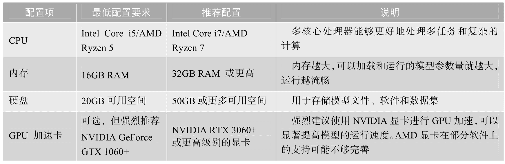

GPU 加速的重要性：虽然 DeepSeek 可以在 CPU 上运行，但使用 GPU 进行加速能够大幅提高模型的运行速度，尤其是在处理复杂的代码生成和推理任务时，GPU 加速能够带来数倍甚至数十倍的性能提高。因此，如果计算机配备了英伟达显卡，那么强烈建议开启 GPU 加速，以获得最佳的使用体验。对于入门级用户，NVIDIA GeForce GTX 1060 或更高级别的显卡就能提供不错的加速效果。

另外，对于 Mac Book，要求如下。

•硬件：至少需要 Apple M1 芯片，内存推荐在 8GB 以上，可用硬盘空间在 15GB 以上。

•操作系统：macOS 11 Big Sur 或更高版本。

对于更低配置的笔记本计算机，虽然仍可运行基础功能，但将面临性能显著衰减的风险，且不能使用能力较强的大模型。本节将介绍一个对硬件配置要求相当低的大模型版本，方便开发者进行学习。

**2.软件安装**

为了在本地运行 DeepSeek 模型，需要安装和使用核心部署工具—Ollama。

1）Ollama 工具介绍

Ollama 是一款专注于快速部署和运行本地大模型的轻量级命令行工具，凭借简洁的指令设计和高效的性能，深受开发者喜爱。熟悉 Docker 容器或云原生开发的开发者应该对其操作逻辑和操作命令非常熟悉。例如：

镜像拉取对比：docker pull <image> → ollama pull <model>。

运行实例对比：docker run <image> → ollama run <model>。

2）工具选型考量

当然，开发者也可选择其他大模型部署工具，例如直接从 Hugging Face 等模型托管仓库将模型文件手动下载至本地硬盘目录，再通过 Python 脚本加载模型进行开发调试，但本章推荐使用 Ollama 工具。

作为热门的大模型部署工具，Ollama 实现了模型管理的自动化处理，其核心价值体现在：自动解析模型依赖（自动识别 Hugging Face 仓库路径）；智能管理存储路径（自动处理本地目录结构）；版本控制系统（自动追踪模型更新）；命令行接口（CLI）支持基础模型操作（下载、运行、更新）、本地化轻量部署（适配 PC、笔记本计算机开发环境），以及实时交互式调试（支持快速原型开发）。不过，在企业级的大模型应用场景下，对安全审计、负载均衡和分布式推理等有很高的性能要求，大模型的体积比较大，需要在更高配置的服务器或者集群上运行，往往会使用特定的大模型推理加速引擎工具，如流行的 vLLM 或者 SGLang 等，这里不再赘述。

另外，Ollama 流行度高且更新迭代迅速，拥有完善的社区支持和丰富的学习资源。借助庞大的用户基数，开发者遇到问题时能在社区中快速找到解决方案，因此推荐大家使用。

除了 Ollama，类似的支持大模型本地部署的工具还有很多，如 LM Studio、GPT4All、AnythingLLM 等，它们各有特点。例如，LM Studio 基于 llama.cpp 开发，提供图形化的操作界面，无须命令行操作，专注于桌面端用户体验，支持 GGUF 格式模型的下载、管理和运行，适合偏好图形界面的非技术用户，以及需要本地 AI 写作、问答等服务的场景。

接下来介绍 Ollama 的安装方法。Ollama 支持 Windows、macOS 和 Linux 操作系统。用户可以根据自己的操作系统，从 Ollama 的官网选择相应的安装包进行安装，如图 1-1 所示。 ^(¹)

图 1-1

（1）Windows 系统。访问 Ollama 官网，单击“Download”按钮，在“Download for Ollama”页面中单击“Windows”按钮，然后单击“Download for Windows”按钮，下载安装包 OllamaSetup.exe。

双击下载完成的 OllamaSetup.exe 文件，启动安装程序。

根据安装向导的提示，即可完成安装。安装完成后，打开命令提示符或 PowerShell 终端，输入 ollama--version 命令，如果能正确显示 Ollama 版本号，则说明已安装成功。

然后输入 ollama--help，可以看到 Ollama 的命令行用法说明文档，如图 1-2 所示。

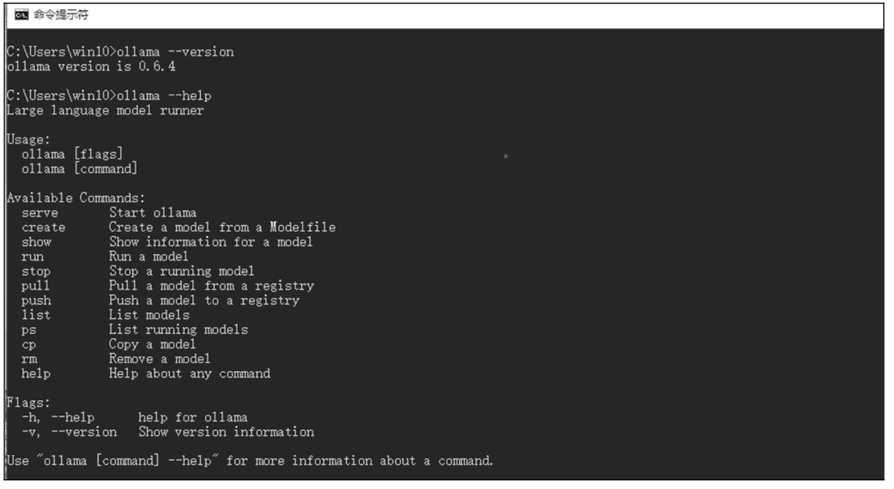

图 1-2

（2）macOS 系统。访问 Ollama 官网，先单击“macOS”按钮，再单击“Download for macOS”按钮，下载安装包。

双击下载的 ollama-darwin.zip 文件，将其解压缩，即可得到 Ollama 应用程序。

将 Ollama 应用程序拖曳到“Applications”文件夹中。

打开终端应用程序，输入 ollama--version 命令，如果能正确显示 Ollama 版本号，则说明安装成功。

输入 ollama--help 可以得到 Ollama 命令行的更多用法，如图 1-3 所示。

（3）Linux 系统。在 Linux 系统中安装 Ollama，通常需要根据 Linux 发行版，选择相应的安装命令。

•Debian/Ubuntu：sudo apt-get update && sudo apt-get install-y ollama。

•Fedora/RedHat：sudo dnf install ollama。

•Arch Linux：sudo pacman-S ollama。

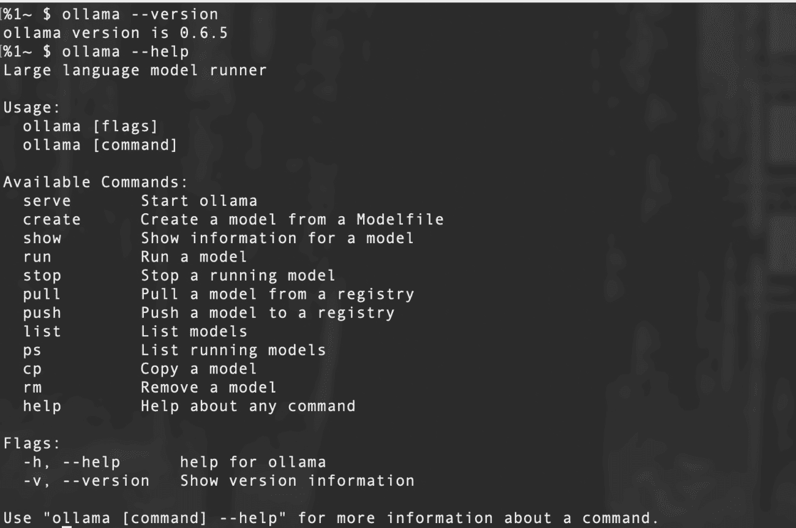

图 1-3

输入安装命令后，按“Enter”键并输入管理员密码，等待安装完成。

安装完成后，在终端输入 ollama--version 命令，如果能正确显示 Ollama 版本号，则说明安装成功。

**3.Ollama 的优缺点**

Ollama 作为一种轻量级的大模型部署工具，有自己的适用范围，其优缺点也很明显。

1）优点

（1）易用性好。安装过程简单便捷，只需几行命令就能完成，无须复杂环境配置，降低了部署难度，新手也能快速上手。同时，它提供友好的用户界面和命令行工具，用户借助简单命令行操作即可管理、运行大模型，甚至只需一行代码就能与大模型对话。

（2）资源占用少。利用量化技术将模型参数从高精度调整为低精度，减少内存占用，使其能在个人计算机、移动设备等资源受限的设备上运行，对经常出差的商务人士及使用低配计算机的用户十分友好。

（3）跨平台支持。全面兼容 macOS、Windows、Linux 等主流操作系统，具有良好的跨平台性，能够满足不同用户在各种操作系统上的部署需求，同时方便跨地区团队协作和知识共享。

（4）模型生态完善。支持 Llama2、Mistral、DeepSeek 等多种大模型，配备预置的模型库，方便用户快速上手并尝试不同的模型，还允许用户自定义模型，满足多样化的应用需求。

（5）API 兼容性强。完整实现 OpenAI API 规范，可与其他依赖此规范的工具平台无缝集成，拓展性好，便于用户在现有基于 OpenAI API 的应用上快速拓展模型功能与应用场景。

（6）推理优化技术多。专为推理设计，具备混合精度（FP16）、张量并行（Tensor Parallelism）等多种加速技术，能有效提高推理速度，降低延迟，提升用户体验。

（7）社区活跃。社区氛围非常活跃，开发者和用户能够迅速获得支持和帮助，高参与度确保能够及时地解决使用中的问题。

2）缺点

（1）并发处理能力有限。采用单线程架构，并发处理能力较弱。即使是 4 个左右的少量并发请求，也会引发资源争用，高并发时易出现瓶颈，无法高效处理大量请求，更适合个人用户、小型项目或并发需求低的场景。

（2）国内网络环境受到限制。由于 Ollama 的服务器在国外，国内用户下载和使用时网速可能会较慢，可以通过修改下载源地址等方式来解决。

（3）安全性有待加强。Ollama 默认采用开放式访问模式，但需要额外配置网络层防护措施来保证服务安全，否则可能存在被未授权访问的风险。

**1.1.2** **下载 DeepSeek 模型**

安装好 Ollama 软件之后，下一步是下载 DeepSeek 模型文件。

**1.模型选择**

DeepSeek 公司提供多种原生大模型，DeekSeek V3 和 DeepSeek R1 为参数量 671B 的“满血版”，因文件庞大，对内存和算力的需求大，不适合在本地 PC 或笔记本计算机上运行。为满足本地化部署需求，DeepSeek 还提供多种基于阿里巴巴开源的 QWen 模型和 Meta 公司开源的 Llama 模型的蒸馏版本，主流的 6 个蒸馏版本如表 1-2 所示。

表 1-2

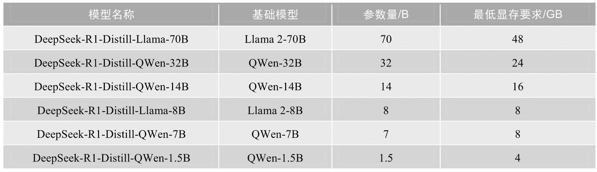

在选择模型并将其下载到本地运行时，需要根据硬件配置和实际需求进行权衡。参数规模较小的模型（例如 7B、1.5B）对硬件要求较低，运行速度较快，适合在资源有限的计算机上使用，也适用于对响应速度要求较高的场景。参数规模较大的模型（例如 32B、70B）能力更强，生成的文本质量更高。然而，这些模型对硬件要求也更高，运行速度相对较慢，需要更强大的 GPU 或更大的内存空间。

需要注意的是，许多支持 DeepSeek 模型的软件或硬件系统实际运行的是蒸馏版本而不是满血版本。原因可能是硬件性能不足或场景需求与硬件性能不匹配。实际上，QWen-32B、QWen-14B 乃至 QWen-7B 蒸馏模型通常能满足大部分需求。

本节以参数规模最小的 DeepSeek-R1-Distill-QWen-1.5B 为例进行演示。该模型由阿里巴巴 QWen-1.5B 模型经 DeepSeek-R1 蒸馏而来。尽管参数规模小，模型能力有限，但对系统资源要求低、运行速度快，非常适合用于演示和快速入门。

**2.使用 Ollama 下载模型**

使用 Ollama 下载模型非常简单，只需打开命令提示符（Windows）或终端（macOS/Linux），输入以下命令并按“Enter”键。

Ollama 将自动下载 DeepSeek-R1-Distill-QWen-1.5B 模型。下载速度取决于网络状况，请耐心等待。

下载完成后，终端会显示“success”提示。macOS 操作系统的界面如图 1-4 所示。

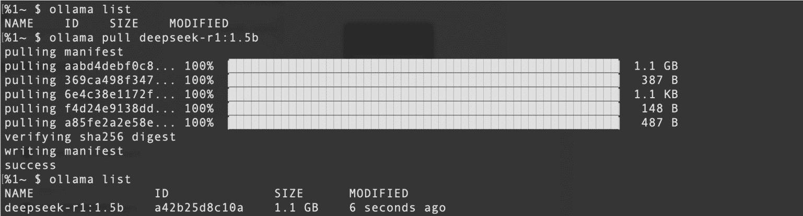

图 1-4

Windows10 操作系统的界面如图 1-5 所示。

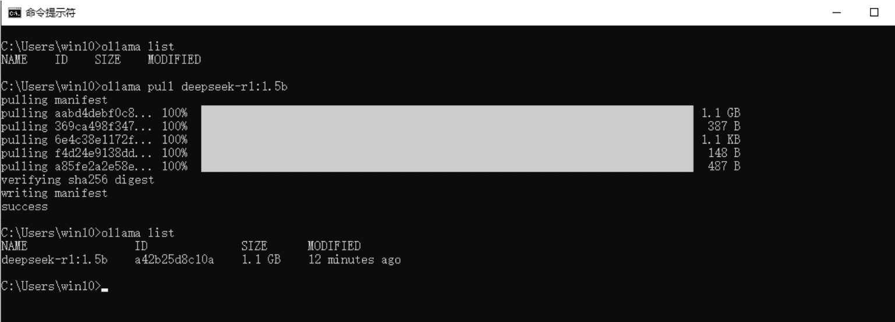

图 1-5

运行 ollama list 命令可以查看已经安装好的模型列表，可以看出，模型已经被成功下载了，大小（Size）为 1.1GB。

**1.1.3** **使用 Ollama 运行 DeepSeek 模型**

接下来，使用 Ollama 在本地运行 DeepSeek 模型并进行简单的对话测试。打开命令提示符（Windows）或终端（macOS/Linux），输入以下命令并按“Enter”键。

Ollama 将启动 DeepSeek-R1-Distill-QWen-1.5B 模型，并进入交互式对话模式。在终端中直接输入问题或指令，并按“Enter”键发送。DeepSeek 会根据输入生成相应的回复并将其显示在终端中。

可以与 DeepSeek 进行多轮对话。

例如，问它：“你是谁？”它会回答：“您好！我是由中国的深度求索（DeepSeek）公司开发的智能助手 DeepSeeek-R1。如果您有……”。

再例如，你可以继续问 DeepSeek 一些编程问题，例如“帮我写一个 Python 函数，实现快速排序的功能。”它会给出思考过程，用<think></think>包裹，这正是 DeepSeek-R1 模型默认将推理的过程公开显示的结果。如果要结束对话，则可以按“Ctrl+D”组合键并按“Enter”键。

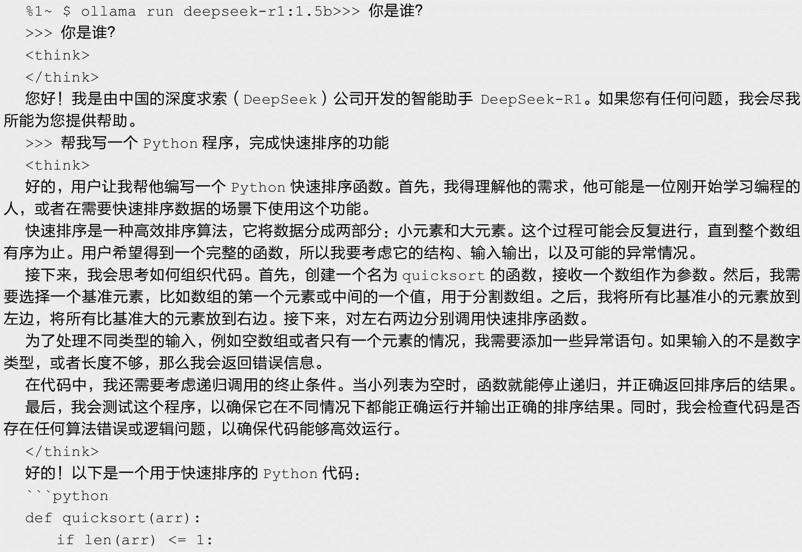 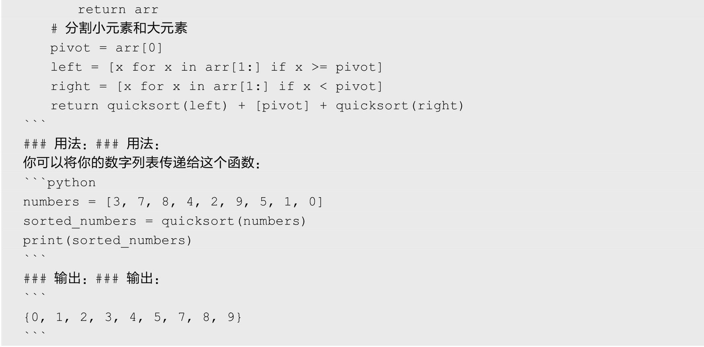

DeepSeek 生成的 Python 程序经过测试验证。笔者在笔记本计算机的另一个终端中启动 Python 3.12.4，将生成的代码复制到 Python Console 中执行。测试结果显示程序运行正常，输出结果完全符合预期。

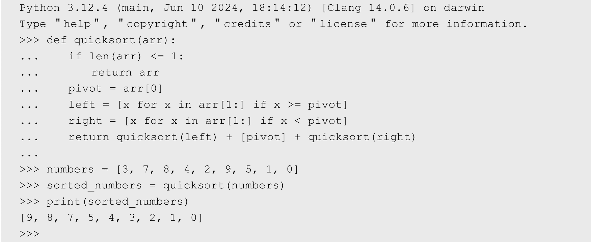

目前，我们已经成功实现了 DeepSeek-R1-Distill-QWen-1.5B 模型的本地运行，虽然该模型的体积不是很大，但它是一个严格意义上的大模型。

**1.1.4** **常见问题排查**

在本地部署和运行 DeepSeek 的过程中，可能会遇到一些问题。下面列举一些常见问题及解决方案，可以帮助读者快速排查和解决问题。

**1.模型下载速度慢或下载失败**

（1）网络问题。请检查网络连接是否正常，尝试重启路由器或更换网络环境。

（2）镜像源问题。Ollama 默认从 Hugging Face Hub 下载模型，当网络不稳定时，可以更换国内镜像源（具体方法请参考 Ollama 官方文档）。

（3）服务器压力。Hugging Face Hub 服务器在高峰期可能负载较高，建议在非高峰时段下载，或稍后重试。

**2.模型运行报错**

（1）硬件配置不足。请检查计算机硬件配置是否满足模型的最低要求，特别是内存和 GPU 显存是否充足。可以尝试运行参数规模较小的模型，或考虑升级硬件。

（2）驱动问题。如果使用 GPU 加速，那么请确保显卡驱动程序已经正确安装并更新至最新版本（特别是英伟达显卡驱动程序）。

（3）模型文件损坏。模型文件可能因网络中断等原因导致下载不完整或损坏，建议删除本地模型文件后重新下载。

（4）软件 Bug。Ollama 仍在快速迭代中，可能存在一些 Bug。可以尝试更新到最新版本，或查看官方文档和社区论坛，搜索是否有类似的报错信息和解决方案。

**3.性能不佳（运行速度慢）**

（1）GPU 加速功能未生效。请确认 Ollama 是否已经正确配置并启用了 GPU 加速功能。检查软件设置中是否已经启用 GPU 加速选项，并确保显卡驱动程序能够正常工作。

（2）模型参数设置不恰当。某些模型参数（例如 temperature、top_p、max_tokens）的设置可能会对模型的运行效率产生影响，可以尝试调整这些参数，在性能和效果之间找到平衡。

（3）硬件瓶颈。如果计算机硬件配置较低，则运行大型模型会比较吃力，可以考虑升级硬件，或者使用参数规模较小的模型。

**1.1.5** **小结**

至此，我们已在本地成功运行了 DeepSeek 模型，迈出了本地大模型应用开发的第一步。下一节将进一步介绍如何结合 RAG 技术，提高 DeepSeek 的知识库能力，打造更智能的应用。

**1.2** **在本地基于 DeepSeek 编写 RAG 应用**

本节将重点介绍大模型应用开发领域中最常见的场景—RAG 应用和相应的技术。RAG 技术是每个大模型应用开发者都需要掌握的最基本的技术，RAG 应用可能也是广大开发者编写大模型应用的第一个场景。学习 RAG 技术并不困难，掌握它有助于拥有大模型开发相关的关键技能，例如提示词、向量数据库等。要让一个 RAG 应用实现企业级的品质，即达到企业客户满意的程度，还需要大量深入的知识。本节的目标是让读者快速入门，并搭建一个典型的 RAG 应用样本，对大模型应用开发建立最基本的认知。本节还将对 RAG 的技术难点和下一步演进方向做扩展性的阐述，方便读者更全面地了解 RAG 应用开发。

**1.2.1** **RAG 是什么**

在进入实战之前，先了解 RAG 是什么、它的原理是什么、它与用户的交互流程是怎样的，以及常见的工作步骤有哪些。

**1.RAG 的 What/Why/How**

在大模型应用开发的各种场景中，RAG 可以说是在当前企业应用中最广泛的技术之一。它是一种结合了检索（Retrieval）增强和生成（Generation）能力的应用开发框架，为企业级大模型应用开发提供了更强大的功能和更灵活的解决方案。本节将从 RAG 是什么、为什么需要 RAG、RAG 的优势三个方面简要介绍。

1）RAG 是什么

RAG 结合了大模型和信息检索技术。具体来说，当大模型需要生成文本来回答用户的问题时，不是仅基于预先训练的海量数据，还需要先从一个庞大的文档集合中检索出相关信息，然后利用检索结果辅助生成文本，最后返回给用户，从而提高回答的质量与准确性。换句话说，RAG 通过从外部知识库检索相关文档或信息片段，并将其融入生成过程中，来增强大模型的回答能力。这使大模型能够回答那些未包含在其训练数据中的特定领域问题，甚至是最新的动态信息。

RAG 是检索（Retriever）、增强（Argumentation）、生成（Generation）三个单词的首字母缩写，对应以下三个基本模块。

（1）检索模块。当用户输入一个问题或者指令时，检索模块会首先从外部知识库（如文档、数据库、网页等）中检索与问题相关的信息。

（2）增强模块。增强模块将检索到的信息与用户输入的原始问题合并，从而形成一个完整的内容并传递给大模型，例如 ChatGPT 或者 DeepSeek 等。这个过程相当于给大模型提供了一个“外脑”，避免其完全依赖内部训练数据的记忆。

（3）生成模块。生成模块会综合外部知识库提供的信息和用户的原始输入，整理之后生成最终答案并返回给用户。

2）为什么需要 RAG

大模型具备强大的语言生成能力，但在处理一些需要特定的专业知识和准确信息的任务时，如果这些知识并不存在于互联网上且不能被公开检索到，那么常常会暴露出很大的局限性。例如，当面对复杂的问答任务，或需要结合最新数据的场景时，仅依赖生成模型自身的知识库，可能会导致生成内容不准确或不相关。RAG 就是为了解决这些问题而设计的。

首先，RAG 能够弥补大模型知识的局限性。大模型的知识通常是通过固定的大规模训练数据集获得的，对于训练完成后出现的新信息或冷门领域的知识，模型难以准确掌握。通过引入外部检索模块，RAG 可以实时获取最新的相关信息，从而为生成模块提供更全面的知识。例如，DeepSeek-R1 的训练数据截止时间是 2024 年 4 月，因此它无法了解此日期之后的信息。如果用户在 2025 年询问“当今美国的总统是谁？”，那么它会回答“乔·拜登（Joe Biden）”。

其次，RAG 可以提高生成内容的准确性和相关性，减少大模型常见的“幻觉”问题。生成式人工智能的底层机制是概率生成模型，幻觉常见且很难去除。在 RAG 系统中，检索模块能够从海量的指定数据中精准地找到与用户查询最相关的文档片段，并将这些文档片段作为上下文输入给生成模块。这样一来，生成模块能够基于更准确的事实生成更符合用户需求的内容。这对于准确性要求较高的应用场景尤为重要，如医疗问答、法律咨询等。

最后，RAG 还能够提高大模型应用的效率和可扩展性。在一些复杂任务中，直接使用生成模型可能会带来较大的计算开销，而 RAG 通过检索模块的筛选，有效减少了生成模块需要处理的信息量，从而提高了整体的运行效率。此外，RAG 的架构也使开发者可以更容易地扩展和更新应用—只需调整或更新检索数据源和策略，即可快速适应新的业务需求和使用场景。

3）RAG 的优势

RAG 的优势主要体现在以下几个方面。

（1）提升生成内容质量。RAG 能够显著提升生成内容的准确性、相关性和丰富度。通过检索模块引入外部知识，生成模型可以获得更全面的信息，从而输出更高质量的结果。例如，在新闻摘要任务中，RAG 可以检索到最新的新闻报道片段，生成更贴近当前事件的摘要；在学术写作辅助任务中，RAG 可以检索相关的学术文献，为论文提供更准确的引用和背景知识。

（2）增强知识更新能力。由于检索模块可以从外部数据源实时获取信息，因此 RAG 具有出色的知识更新能力。开发者无须重新训练整个生成模型，只需更新检索数据源，就可以让应用掌握最新动态。这种特性对于需要紧跟时代发展的应用场景尤为重要，如金融分析、科技资讯等。

（3）提高处理效率和可扩展性。RAG 的架构设计使它在处理复杂任务时更加高效。检索模块可以预先筛选出相关信息，减轻生成模块的处理负担，从而降低计算开销。同时，RAG 具备良好的可扩展性，开发者可以通过调整检索策略、增加检索数据源或优化生成模块的参数，来轻松扩展应用的功能和性能。这种灵活性使 RAG 能够适应各种不同规模和复杂度的应用场景。

（4）降低对预训练数据的依赖。传统的生成模型高度依赖大规模预训练数据来学习语言知识和背景信息，而 RAG 通过检索模块引入外部知识，降低了对预训练数据的依赖。开发者可以在有限的预训练数据的基础上，借助外部知识库提升模型表现，从而节省数据收集和标注的成本，同时提高系统的实用性与适应性。

**2.RAG 的调用流程**

RAG 的调用流程可以分为知识库构建和查询生成过程两部分，如图 1-6 所示。

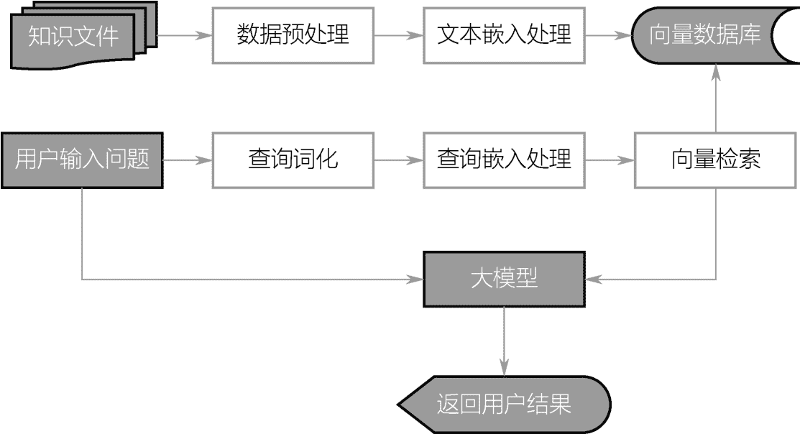

图 1-6

1）知识库构建（离线服务）

首先对用户指定的一个或多个知识文件（可能是 PDF、HTML、Word、PPT、Excel 等，也可能是网页、数据库等）进行**数据预处理**，包括数据清洗（去掉其中的噪声信息，例如无用的 HTML 标签、广告内容等）、文本分割（把长文本分割为多个片段）、元数据提取（提取文档片段的元数据）等，然后对文档片段进行**文本嵌入处理**（一般用特定的文本嵌入模型进行转换，例如后续需要使用 nomic-embed-text 模型），获得文本片段的嵌入向量，并将这些嵌入向量存入一个向量数据库中。向量数据库存在多种可选方案，例如专有的向量数据库 Milvus、Chroma 和 Weaviate 等；也有一些传统数据库支持数据的向量化存储和查询，例如 OceanBase。在本项目中，我们使用 Dify 内置的 Weaviate 向量数据库。

2）查询生成过程（在线服务）

用户输入问题，RAG 系统首先对用户输入的问题进行查询词化（把查询问题分割为多个单词），然后对查询进行嵌入处理（用同样的文本嵌入模型进行向量化处理），将其转换成查询的嵌入向量。接下来用向量相似性检索算法查询向量数据库，获得与用户输入问题最相关的知识库中的文本片段。最后将查询结果和用户输入问题结合，由大模型进行统一处理，生成结果并将其返回给用户。

其中，知识库构建的过程是离线完成的，对整体流程的延迟没有严格限制，更注重质量，文本分割算法、嵌入模型的选择等都会影响最后查询的准确性。

查询生成过程是一个典型的在线服务，需要在较短的时间内完成，以保证比较流畅的用户体验，因此对各子模块的技术性能都有较高的要求，不仅需要保证检索的准确性和召回率，还需兼顾在线服务的响应延迟和服务并发能力。它与传统的网页搜索服务（一个典型的在线检索系统）类似，只不过其中的关键环节—答案生成是靠大模型完成的。

**1.2.2** **本地搭建 RAG 应用并集成本地的 Ollama** **DeepSeek 服务示例**

本节将继续介绍如何在本地搭建 RAG 应用，并使用之前已经设置且运行成功的本地 DeepSeek 服务。

这里将向大家介绍一个流行的大模型应用开发框架——Dify。常见的 RAG 开发工具有很多，包括 LangChain、RAGFlow、Dify 等，但是从用户友好程度、开发者快速上手的便捷程度以及支持的数据源丰富程度来看，Dify 具有更大的优势。Dify 是开源框架，也是最早支持图形化操作的工具之一，社区热度很高，所以挑选 Dify 工具进行演示。

**1.Dify 介绍**

Dify 的名字来源于“Do it for yourself”这四个单词的首字母，是一款非常优秀的开源大模型应用开发框架，它最初以简化 RAG 应用开发流程而闻名，随后逐渐扩展出更多功能。其创始团队拥有深厚的 DevOps 工具开发背景，对 DevOps 和 LLMOps，尤其是开发者体验有深刻的理解，Dify 在海外社区也有良好的运营表现。

Dify 的功能非常多，本节将主要介绍 Dify 的 RAG 框架功能，其他功能可以参考其官方文档。

**2.Dify 安装和运行**

Dify 有多种安装方式，本节采用 Docker Compose 的方式安装 Docker 版本。安装步骤如下。

1）安装 Docker Desktop 版本

前往 Docker 官网下载适用于自己操作系统的 Docker Desktop 版本。例如，在 macOS 操作系统中，根据 CPU 类型选择对应版本（Apple Silicon 或 Intel Chip），然后进行安装。

在命令行中输入以下命令，验证是否安装成功。

2）将 Dify 安装到本地

Dify 对硬件环境的最低配置要求如下。

•CPU：至少 2 核。

•RAM：大于或等于 4GB。

•操作系统：macOS 需要 10.14 或更高版本；Linux 需要支持 Docker 19.03 或更高版本。

Dify 有多种安装方式，本节通过复制 Dify 的 GitHub 仓库来获取源代码。执行如下命令。

也可以使用 Gitee 的镜像地址进行复制。

3）在本地运行 Dify

进入 Dify 源码目录下的 docker 文件夹。

复制示例环境配置文件。

如果需要更改默认配置，那么可以编辑.env 文件，例如把 EXPOSE_NGINX_PORT=80 的 80 端口改为 8080。修改并生效后，再次访问 Dify Web 服务时，应使用 http：//localhost：8080/。

接着，使用 Docker Compose 启动所有的容器服务。

在 macOS 操作系统上会显示已经运行的容器。

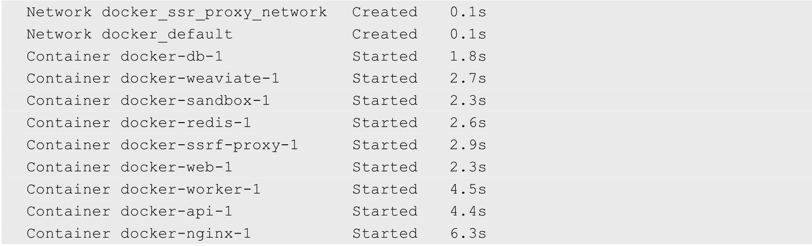

至此，Dify 已成功部署并开始运行。接下来，将在 Dify 的 Web 页面中配置 RAG 流程，并接入本地已成功运行的 DeepSeek 模型服务，搭建一个完整的本地化 RAG 应用。

**3.配置 Dify**

在浏览器中访问 http：//localhost/install，设置管理员信息，包括邮箱和密码。访问 http：//localhost/apps，进入 Dify 的管理主页面。使用已设置的管理员邮箱和密码，将看到 Dify 应用管理界面，如图 1-7 所示。

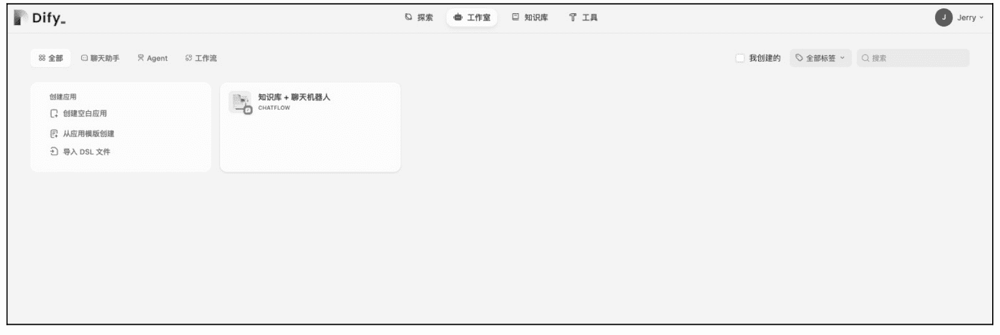

图 1-7

由于 Dify 是一个基于大模型的 AI 应用开发平台，因此初次使用时需要先在 Dify 的“模型供应商”选项卡中添加并配置所需要的大模型，如图 1-8 所示。

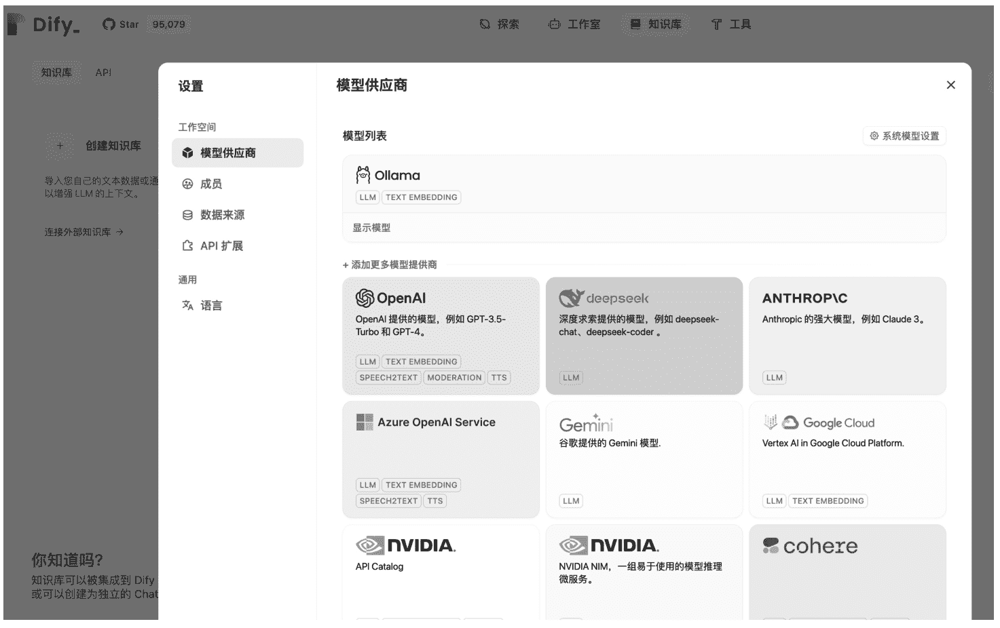

图 1-8

Dify 支持的大模型包括 OpenAI、Anthropic，以及 DeepSeek 官网的 API 等，几乎涵盖了国内外常见的多数大模型。

之前已经在本地配置了 Ollama 并运行了 DeepSeek-R1-Distill-QWen-1.5B 模型，现在需要在该设置界面中选择 Ollama，然后配置 RAG 应用开发所需的两个模型：一个是大模型，一个是文本嵌入模型。其中，大模型选择 deepseek-r1：1.5b，基础 URL 选择 http：//host.d**ker.internal：11434。文本嵌入模型选择 nomic-embed-text，基础 URL 同样设置为 http：//host.d**ker.internal：11434，如图 1-9 和图 1-10 所示。

注意：

•文本嵌入模型是 RAG 应用中必不可少的组件，由于之前尚未下载过该模型，因此需要在命令行中运行 ollama pull nomic-embed-text 命令下载 nomic-embed-text 模型。nomic-embed-text 模型是一个高性能、开源的嵌入模型，在 Ollama 社区被广泛使用。当然，读者也可以选择其他的嵌入模型，例如 granite-embedding、bge-large 等。

•本节通过 Docker 方式运行 Dify，所以基础 URL 填写 http：//host.d**ker.internal：11434，如果用其他方式运行 Dify，那么请用其他的配置 URL，具体参考 Dify 的官方文档。

**4.设置 Dify 的知识库**

在成功配置大模型后，接下来需要建立一个知识库，并将所需的私有文档导入该知识库中。整个操作包括以下三个步骤。

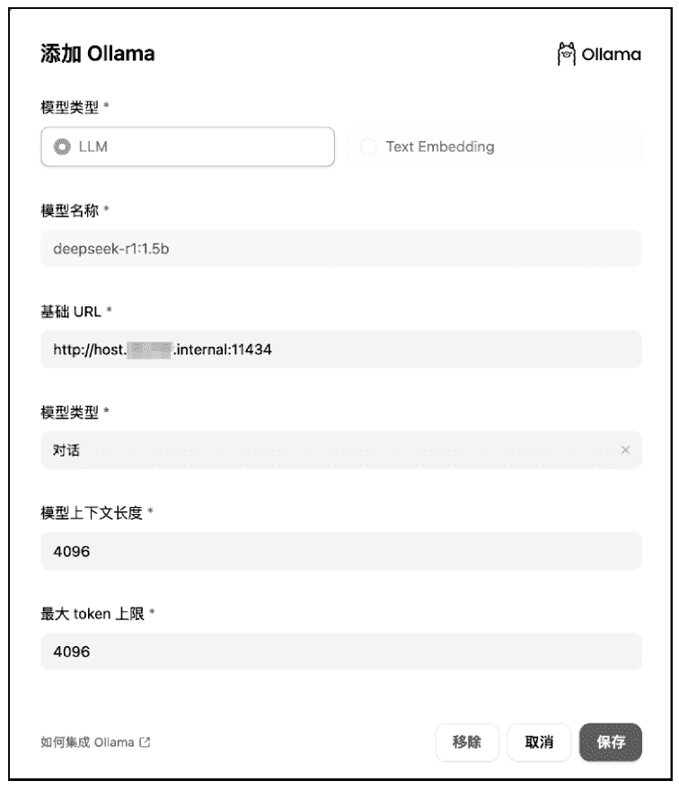

图 1-9

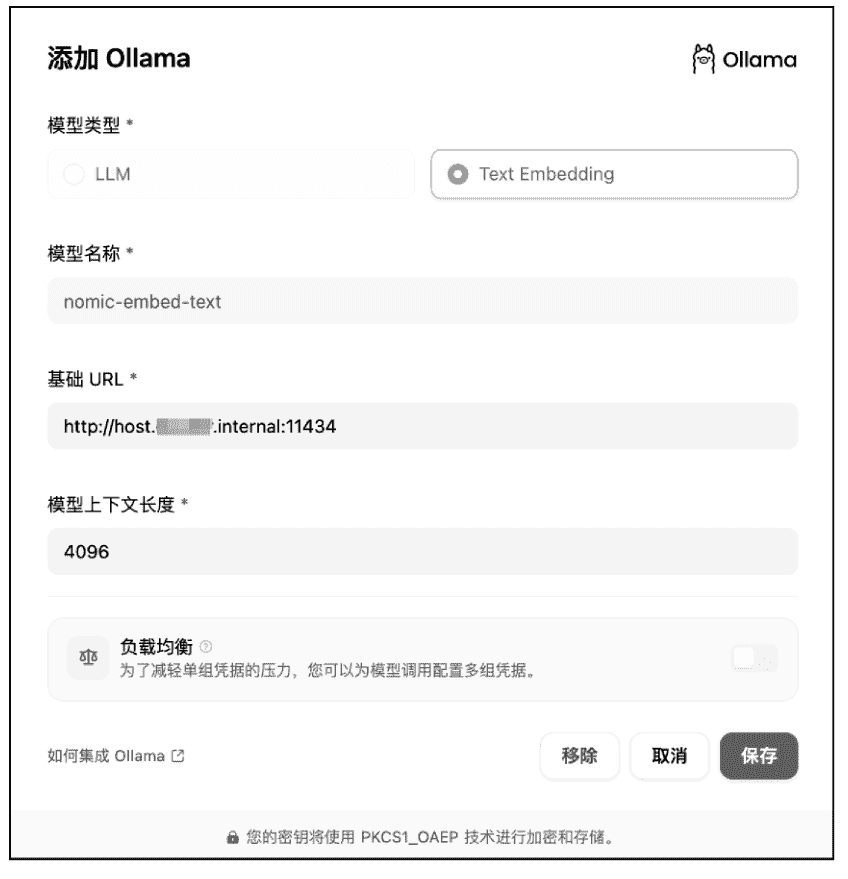

图 1-10

1）选择数据源

Dify 支持三种类型的数据源：导入已有文本、同步自 Notion 内容和同步自 Web 站点。其中，导入已有文本是指导入已有的各种文本文件，包括 TXT、Markdown、DOCX、CSV、HTML 等；同步自 Notion 内容是指导入 Notion 账号的内容；同步自 Web 站点是指使用爬虫抓取某个网站的内容。

为方便演示，这里选择“导入已有文本”，上传一份 PDF 文件，单击“下一步”按钮，如图 1-11 所示。

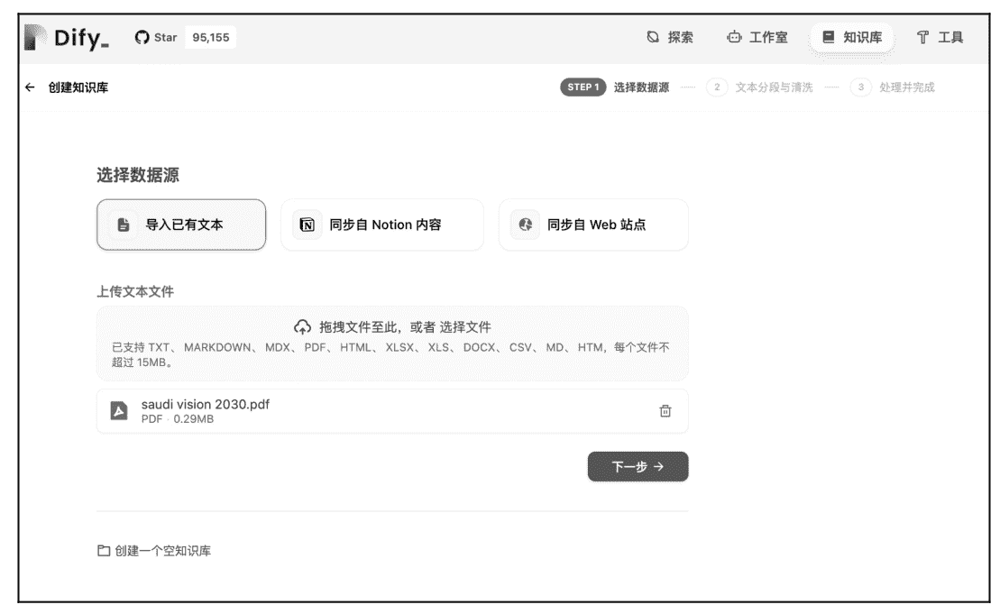

图 1-11

2）文本分段与清洗

第二步是对本地知识库进行设置，包括分段设置、索引方式、Embedding 模型、检索设置等，如图 1-12 所示。设置完成后，进入下一步，也是最后一步。这里的设置选项比较多，会影响到本地知识库的建库时间，以及查询的速度和准确性，具体请参考 Dify 官方文档。

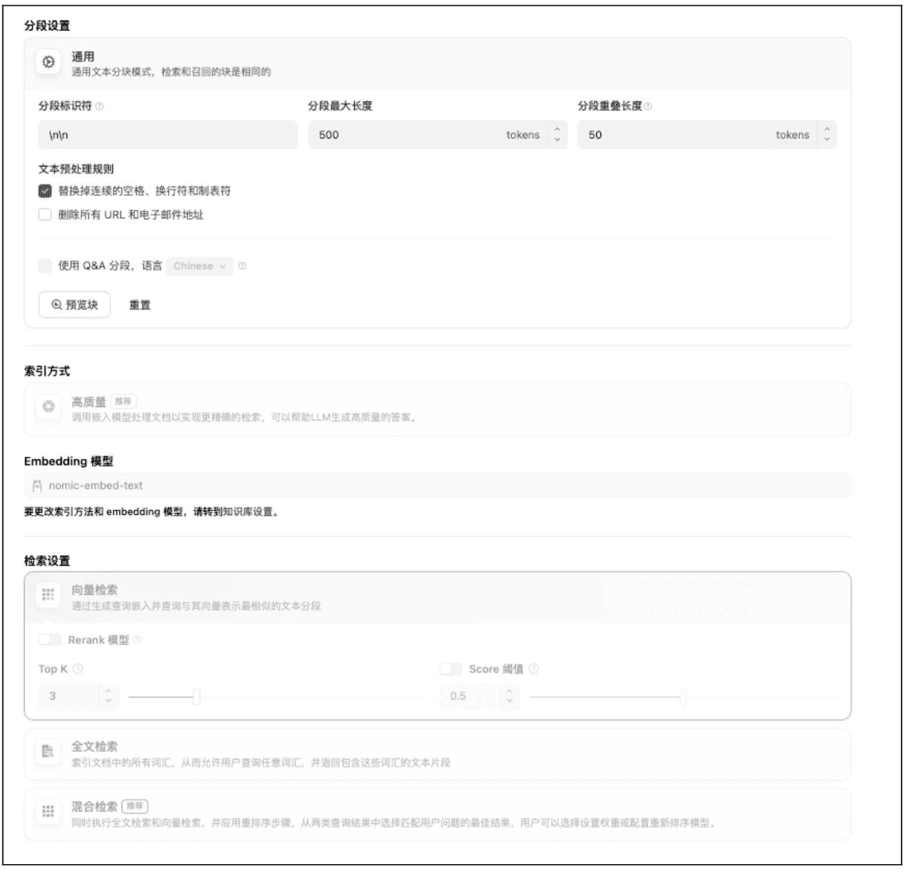

图 1-12

3）处理并完成

按照分段设置和索引方式，对上传的知识库文件进行处理，包括文本分段、向量化处理和建立索引等。

作为演示，这里上传的文件较小，完成速度很快，单击“前往文档”按钮，如图 1-13 所示，可以进入“召回测试”选项卡中进行测试。

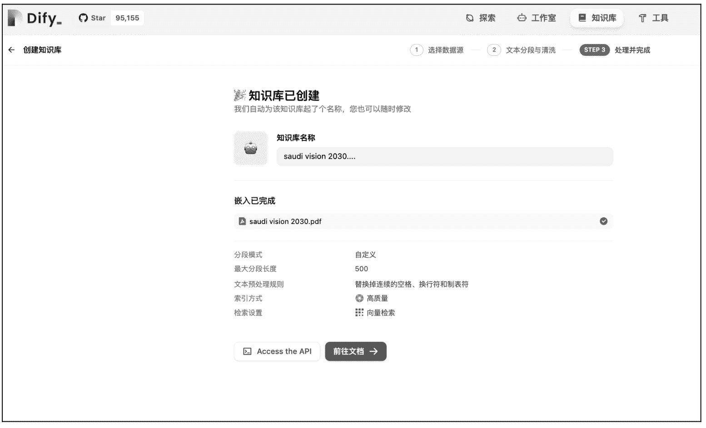

图 1-13

4）召回测试

在 Dify 主页面左侧，单击“召回测试”按钮，即可进入“召回测试”选项卡。

在中间的输入框中输入关键字，然后单击“测试”按钮，就能看到右边的列表中返回与关键字相关的文档片段。

作为演示，笔者输入“请问沙特 2030 远景目标是什么？”就可以返回文档中几个相关的文档片段，如图 1-14 所示。

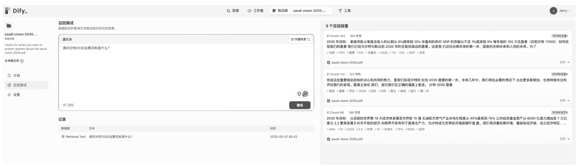

图 1-14

测试页面的中间部分用于输入用户问题，而页面右侧显示了知识库中与用户问题相关的文档片段。可以看出，笔者输入的问题成功检索出了多个文档片段，这些片段都与问题密切相关。

这表明，一个基于 RAG 技术的本地知识库已经搭建完成，它能够有效地完成知识检索与生成任务。

**5.创建应用并调用 RAG**

目前，该知识库处于可运行状态。开发者可以通过编写 Python 程序并调用其 API 进行查询。为了简化演示，这里使用 Dify 提供的图形化界面创建一个 RAG 应用。

Dify 提供了一个非常方便的应用创建页面，可以快速构建 RAG 应用。具体步骤如下：单击页面顶部的“工作室”按钮，创建一个新的聊天类应用。在该应用的配置页面中，选择已配置好的 DeepSeek 1.5B 模型，以及刚刚建立的本地知识库。

在该聊天应用的交互界面中，用户可以输入与本地知识库相关的问题。系统将按照 RAG 的典型流程进行处理。首先将问题词化和向量化，然后在知识库（底层为向量数据库）中进行向量相似性检索，最后由大模型将检索得到的结果与用户输入的问题整合，生成最终答案并返回给用户。

例如，笔者输入了问题：“沙特 2030 远景都有哪些目标？”，系统在检索知识库后，给出了一个结构清晰的回答，展示了明显的推理过程和基于文档内容的准确信息，如图 1-15 所示。

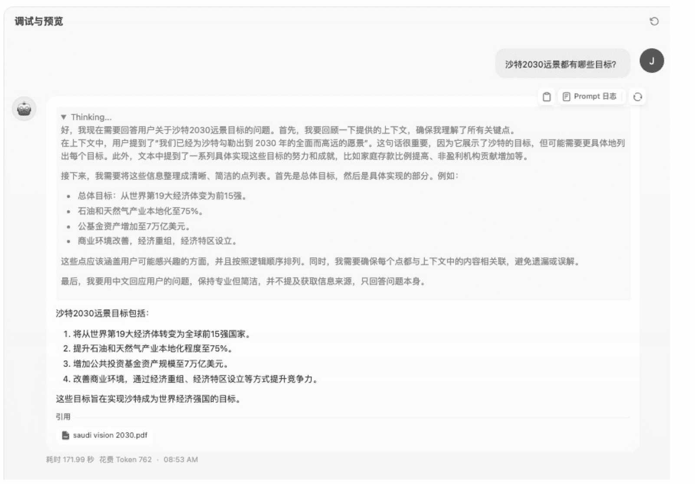

图 1-15

此外，Dify 为每个应用提供了标准的 API，开发者可以参考 Dify 的官方文档编写 Python 程序，调用这些 API 实现自定义的 RAG 检索。

**6.RAG 应用开发**

我们通过简单的图形化操作成功创建了一个典型的 RAG 应用，充分体现了 Dify 在简化 RAG 应用开发方面的易用性和高效性。然而，需要注意的是，这只是一个基础示例。如果要在生产环境中部署满足实际业务需求的 RAG 系统，则需要完成大量的复杂工作，包括评估系统性能、进一步改进和完善功能、加入权限和安全模块等。

评估 RAG 系统的性能通常会涉及以下几个关键指标。

1）检索准确性

检索准确性通常用于衡量检索模块返回的信息与用户输入问题的相关程度。该指标越高，表示系统越能精准地找到与用户意图匹配的内容。

评估方法包括以下几种。

•召回率（Recall Rate）：计算知识库中的相关文档被 RAG 的检索模块成功检索到的比例。例如，知识库中共有 100 份文档包含与用户输入的问题相关的信息，而检索系统找出了其中的 80 份，那么召回率为 80÷100×100%=80%。召回率越高，表示系统能覆盖的相关知识越多。

•精确率（Precision）：指在被检索到的文档中，真正与用户问题相关的文档所占的比例。如果检索系统返回了 50 份文档，其中 40 份与用户问题高度相关，那么精确率就是 40÷50×100%=80%。检索系统的精确率越高，说明检索结果越有价值，越聚焦于用户的实际需求。

这两个指标也是常见信息检索类应用中最常用的评估指标。

2）检索结果的相关性排序

对于检索出的多个文档，可以根据它们与用户问题的相关程度进行排序，即将最相关的文档排在前面。这有助于用户优先查看最重要的信息，或者在仅返回一个结果时，确保该结果是最具相关性的。

可以通过人工评估或基于用户单击行为的数据分析进行判断。例如，观察用户是否倾向于单击排在前面的文档，并在这些文档上停留较长时间。如果大部分用户的行为符合这种趋势，则说明检索结果的相关性排序较好。

当然，除了这两个指标，还有其他值得关注的评估指标，包括检索系统的延迟、生成模块的耗时，以及系统端到端的响应时间等。

根据阶段不同，提高准确性和相关性的方法如下。

（1）建库阶段。

•采用更合适的文档切分方法。按照固定的字符长度（例如 1024）再加一部分分段重叠长度（例如 50）对原始文档进行分段处理，是比较简单的做法，但是这种切分方式不符合文档内部的语义逻辑，很容易导致一个文档片段内有多个内容或同一块内容被分散在多个文档片段里。改进方式是采用更符合语义的切分方式，按照逻辑块、层级结构切分，或整理成问答对再切分。

•选择更合适的文本嵌入模型。根据知识库的文件类型和内容组织形式，选择更适合的文档嵌入模型，以提高文档表示的质量。市场上有很多不错的开源嵌入模型，可以查询 Ollam 官网和 Hugging Face 官网。

•合理选择向量数据库：根据应用场景和数据规模，选择性能和需求匹配的向量数据库系统（如 Milvus、Weaviate 等）。

（2）检索阶段。

•查询改写。对用户的原始输入进行语义理解和改写，使其更符合知识库中的表达方式，再对改写后的用户输入进行 Tokenizer 和向量化处理。

•相关性排序。使用专门的 Rerank 模型对使用向量化相似度检索获得的多个结果进行相关性排序，选出最相关的内容片段。注意，向量化检索会检索出最相似的文档片段，而未必是最相关的内容，所以用 Rerank 模型排序，可以筛选出更符合用户输入意图的答案。市场上有很多 Rerank 开源模型可供选择。

•混合检索策略。单纯依靠向量化检索效果一般，可以将关键词检索与向量检索结合，进行双路召回，弥补单一检索方式的不足，提高整体效果。

（3）生成阶段。

•选择合适的提示词模板，严格限制大模型的“自由发挥”行为。不要简单地把检索到的排序结果和用户输入问题“一股脑”地发给大模型，让它自由组装，它有可能忽略查询结果而基于它自有的训练数据回答，这有违 RAG 的初衷。需要设定比较严格的提示词模板，让大模型基于查询的结果进行回答。

•生成结果之后，记录用户的点击数据，根据用户的点击频率提升相应文档分段的检索权重，类似于网页搜索系统的 Learning to Rank 功能。

此外，还可以通过其他手段提升 RAG 系统的整体表现。

底层大模型的选择至关重要。只有基于合适的底层大模型，才能结合知识库的特性和用户查询的内容不断优化，在准确性和性能之间找到平衡的解决方案。

**1.2.3** **小结**

RAG 作为结合检索和生成的混合模型框架，在大模型应用开发中具有非常重要的价值。它能够弥补生成模型知识的局限性，减少大模型的幻觉，提升生成内容的质量，增强模型的知识更新能力，提高模型的效率和可扩展性，并降低模型对预训练数据的依赖。开发者可以充分利用 RAG 的优势，开发出更智能、更高效、更符合用户需求的大模型应用。

RAG 系统是大模型应用开发的基本场景，开发者应该通过学习和实践，熟悉 RAG 的各功能模块，掌握提升系统性能的关键技术，真正将大模型的能力落地于企业级应用场景中。

此外，RAG 系统也在不断进化中，除了简单的文本类 RAG，对多模态的数据（音频、视频等）建立知识库并进行查询的需求也较强。另外，随着智能体（Agent）技术的出现和快速发展，Agentic RAG 也出现了雏形。用户提出的知识查询类任务，经过大模型推理后被分解为多个子任务，交给不同的 Agent 工具完成，从而完成比较复杂的对比、验证等过程，提高工作效率和质量，得到更符合用户意图的结果。

**1.3** **使用 DeepSeek 和 Dify 构建智能体应用**

2022 年 11 月 30 日，ChatGPT 正式发布并迅速引发广泛关注。进入 2023 年后，它在全球范围内掀起了一波生成式人工智能的热潮。业内有人评价：如果说 2023 年首次向公众揭开了大模型的神秘面纱，展示了人工智能前所未有的强大能力，是“ChatGPT 之年”，那么 2025 年将是“智能体之年”。ChatGPT 的出现开启了生成式人工智能的新时代，智能体则在此基础上更进一步，赋予机器自主理解与执行任务的能力，能够灵活调用工具、规划复杂流程，像一位贴心的智能助手，无缝融入学习、工作和生活场景，为人们带来前所未有的智能化体验。智能体正在迅速成为一种强大的技术工具，在大模型应用领域中扮演着越来越重要的角色。

可以认为：

大模型应用=底层大模型+多个智能体+若干外部功能

对于大模型领域的开发者而言，理解和构建智能体是掌握技术趋势的关键一步。本节旨在介绍 Agent 的定义、概念、作用和价值、与大模型的关系、与用户的交互流程，以及常见的开发工具。除此以外，还将构建一个基于 DeepSeek 大模型和 Dify 开发平台的简单但功能完整的智能体应用—查询股票信息的智能助手。

**1.3.1** **什么是智能体**

**1.智能体的定义**

百度百科对智能体的定义如下：智能体指能够感知环境并采取行动以实现特定目标的代理体。它可以是软件、硬件或一个系统，具备自主性、适应性和交互能力。智能体通过感知环境中的变化（如通过传感器或数据输入），根据自身学习到的知识和算法进行判断和决策，进而执行动作以影响环境或达到预定的目标。智能体在人工智能领域应用广泛，常见于自动化系统、机器人、虚拟助手和游戏角色等，其核心在于能够自主学习和持续进化，以更好地完成任务和适应复杂环境。

智能体具备感知（Perception）、规划（Planning）和执行（Action）的能力，并具备一定程度的自主性，能够智能地进行决策、学习和适应。这意味着它们不仅是简单的程序，而且能够像人类一样思考和行动，尽管当前的技术还远未达到科幻小说中的水平。理解这些核心概念对于开发者来说至关重要，因为它们定义了 Agent 的能力边界和发展方向。与传统的软件程序不同，Agent 更加灵活和通用，不依赖固定的编程规则进行决策，因此特别适合处理复杂、动态以及需要与人交互的任务。

**2.智能体的主要特点**

1）自主性

自主性是智能体最基本的特性之一，指智能体能够独立地感知环境、做出决策并执行行动，而无须持续的人类干预或指导。自主性使智能体能够在动态且不可预测的环境中独立运行，适应变化并调整行为。例如，自动驾驶汽车就是一个具有高度自主性的智能体，它能够在复杂的交通环境中感知周围的车辆和行人，自主规划路径、控制速度和做出避障决策。自主性不仅减少了对人类监督的依赖，也使智能体能够在需要实时响应的任务中保持高效和可靠。

2）反应性

反应性是指智能体能够迅速感知环境变化并及时做出响应的能力。这种特性使智能体能够在面对突发事件或紧急情况时做出快速且有效的反应。反应性对于实时系统和动态环境中的智能体至关重要，例如在机器人控制中，智能体需要及时感知障碍物的出现，并立即调整路径以避免碰撞。虽然反应性通常意味着对当前状态的即时响应，但高级智能体还可以结合历史数据和预测信息，使反应更加智能和灵活。

3）主动性

主动性是指智能体能够主动设定目标、规划行动并采取措施实现目标的能力，而不仅是对环境的变化做出反应。主动性使智能体不局限于被动应对外界刺激，能够根据内在目标和动机采取积极行动。例如，智能家居系统可以主动学习用户的日常习惯，提前调节室内温度或照明，以提高用户的舒适度。具有主动性的智能体能够在环境中自主探索、发现问题并提出解决方案，从而在实现长期目标的过程中展现出更好的灵活性和创造力。

4）社会性

社会性是指智能体与其他智能体或人类进行互动、协作和交流的能力。具有社会性的智能体能够理解和遵循社会规范，与其他个体协调行动，以共同完成复杂任务。例如，在多智能体系统中，各智能体需要通过通信协议分享信息、分配任务，并通过协作实现团队目标。社会性还体现在人机交互中，如智能语音助手能够理解用户的指令，并通过对话的形式提供反馈和建议。通过增强社会性，智能体能够在团队工作、群体决策和协作环境中表现出更高的效率。

5）进化性

进化性是指智能体通过学习和适应，在长期运行中不断提高自身能力的特性。具有进化性的智能体能够在面对新的环境或任务时，通过自我调整和优化，逐步提升性能。这种特性通常与机器学习、进化算法或强化学习相结合，使智能体能够在不断变化的环境中保持竞争力。例如，强化学习智能体通过与环境持续交互，不断调整策略以最大化长期收益。进化性使智能体具备应对不确定性和复杂性的能力，使其在长期任务或未知环境中表现出色，并能够随着时间推移变得更加智能和高效。

现阶段的大模型被认为是智能体的“大脑”，赋予它们理解、推理和行动的能力；智能体被认为是大模型的手和脚，能够调用外部 API 与外部世界交互，从而扩展大模型的功能，完成更多真实世界的任务。

**3.智能体的发展历史**

智能体的发展经历了如下三个阶段：

（1）规则驱动阶段（2010 年前）。基于 If-else 逻辑的有限场景自动化（如客服机器人等）。

（2）机器学习阶段（2010—2020 年）。引入自然语言处理技术，可以实现简单的语义理解，但依赖大量的标注数据。

（3）大模型驱动阶段（2020 年至今）。基于大模型的自主决策能力，可以实现动态任务分解和外部工具调用。

**1.3.2** **智能体的主要模块**

当前，主流的智能体普遍采用“感知—规划—执行”三层架构模型，并通过思维链（Chain-of-Thought，CoT）实现复杂任务的理解与处理。

**1.三大基础模块**

1）感知模块

感知模块用于获取外部信息。它通过传感器（物理接口或软件接口）数据输入等方式收集并解析来自周围环境的信息，包括图片、音频、视频和文本等多种形式的数据。开发者需要考虑智能体应与哪种数据交互，以及如何收集和处理这些数据。只有具备准确、全面的感知能力，智能体才能为后续的决策提供可靠的依据。

2）规划模块

规划模块是智能体的“大脑”，负责对感知模块提供的信息进行分析、推理、判断，并制订相应的行动计划，大模型在此阶段发挥了关键作用。推理是智能体展现“智能”的关键部分，尤其是在需要逻辑推理、多步骤思考的任务中。开发者需要考虑如何使智能体具备逻辑化、系统化的信息处理能力，以及如何根据已有知识和实时输入做出合理、高效的决策。

3）执行模块

执行模块是智能体对外部世界产生影响的部分，它通过执行器或对外接口（例如回答查询、处理请求、控制物理设备）来完成实际操作。简而言之，执行模块决定着智能体如何影响世界。开发者需要考虑智能体需要执行哪些行动以及如何执行这些行动。

除了以上三个模块，许多智能体还包括学习模块，该模块使智能体能够根据新信息、用户反馈和历史经验不断优化自身行为和决策机制，从而在长期运行中持续提升性能。这种自我进化的能力是智能体有别于传统程序的重要特征之一。开发者应考虑是否引入强化学习、在线学习或其他机器学习机制，以增强智能体的适应性和智能化水平。

这些模块如何让智能体与世界互动？感知模块负责收集数据，规划模块处理这些数据并做也决策，最后由执行模块执行这些决策，从而完成与环境的交互。这种“感知—规划—执行”的循环机制，确保了智能体能够动态响应环境变化，并通过持续迭代，不断提升自身的性能。

开发者在构建智能体时，必须确保这三者无缝衔接、协同工作。同时，为了提高系统的灵活性和稳健性，建议采用迭代式的设计思路，使智能体能够在“感知—规划—执行”的迭代过程中完善自身能力。

**2.智能体与大模型的交互**

1）大模型扮演“大脑”的角色

大模型是构建智能体的基础，扮演着“大脑”的角色，为智能体提供理解、规划和行动的能力。凭借强大的自然语言处理能力和日益增强的多模态支持，大模型让智能体能够准确理解用户的输入内容。同时，大模型出色的推理能力也使智能体能够进行任务规划，并决定何时调用哪些外部工具。对于开发者来说，理解大模型的工作原理及其与其他智能体工具的交互方式至关重要，这将直接影响到智能体的智能水平和实用性。

2）利用大模型的规划、记忆和工具使用能力

（1）规划。大模型可以将复杂的任务分解为更小、更易于管理的部分，并为每部分制订具体的计划。例如，ReAct（Reasoning+Acting）框架结合了推理（Reasoning）与行动（Action），允许大模型在生成思考过程的同时，交替执行可操作的动作，从而高效解决问题。这意味着大模型不仅能理解任务，还能自主思考完成任务的方式，并将任务拆解为一系列可执行的具体步骤。开发者可以利用大模型的规划能力，构建能够处理复杂任务的智能体。

（2）记忆。大模型可以保留过往对话中的关键信息，增强智能体的上下文理解能力，并使对话更加连贯和具有逻辑性。记忆使智能体能够回忆过去的经验并根据反馈不断地调整行为。对于开发者来说，这意味着可以构建出能够记住用户偏好和历史对话的智能体，从而提供更加个性化、持续性的交互体验。智能体开发框架可以提供完善的智能体记忆管理功能，方便开发者通过配置会话上下文、设置记忆窗口等方式，灵活控制智能体的记忆行为，增强智能体的交互能力。

（3）工具使用。大模型驱动的智能体不仅可以与外部工具（如 API、数据库和知识库）交互，还可以扩展其在语言处理之外的能力。借助这些工具，智能体能够执行网络搜索、数值计算和数据检索等任务。工具的调用能力是智能体强大实用性的核心所在，它打破了传统语言模型只能“说”不能“做”的局限，使智能体成为能够参与现实任务的智能代理。开发者可以通过智能体开发框架将各种工具集成到智能体中，使其能够执行更广泛的任务。

**3.智能体的 4 种常见设计模式**

著名人工智能科学家和教育家吴恩达教授于 2024 年撰写博客文章，描述了智能体的 4 种常见设计模式，非常有借鉴意义。

吴恩达教授认为，智能体有如下 4 种常见的设计模式。

（1）反思（Reflection）。智能体检查自己的工作并提出改进方法。

（2）工具使用（Tool Use）。大模型配备具有网络搜索、代码执行等功能的工具，以帮助智能体收集信息、采取行动或处理数据。

（3）规划（Planning）。大模型可以根据任务描述，提出并执行一个多步骤的工作计划来实现目标。例如，写一篇文章的大纲，然后进行在线研究，最后写草稿。

（4）多代理协作（Multi-agent Collaboration）。多个智能体协同工作，以不同的角色分解任务并讨论想法，提出比单个智能体更好的解决方案。

详情可以参考 DeepLearning.ai 上的 Agent 系列文章。

**1.3.3** **智能体开发框架**

在开发智能体应用时，最原始的方式是编写一系列提示词（Prompt），并使用 Python 程序对其进行编排。例如，首先对用户的输入进行改写，识别其意图，并从中提取关键参数；接着将这些参数组织成外部 API 所需的调用 URL，发送请求并获取返回结果；最后结合用户输入与外部 API 响应生成最终答案，返回给用户。

这种方式虽然可行，但开发效率低下，且维护成本高。为了解决这些问题，近年来陆续出现了一系列智能体开发工具和框架，极大地简化了开发流程。LangChain 作为最早的大模型提示词编排工具，提供了一整套封装良好的 Python 库，帮助开发者快速构建上层应用逻辑。随后出现了更多图形化、可视化的开发平台，使开发者能够通过拖曳等直观操作完成智能体所需功能的配置，显著提高了开发效率和易用性。

**1.典型的智能体开发框架**

下面介绍几个业内比较流行的智能体开发框架，它们各具特点，适用于不同的场景。

1）LangChain：最早的大模型开发框架

（1）核心优势。模块化设计，采用 Chains、Agents、Tools 分层架构，灵活组合提示词、记忆、工具调用等组件。提供统一接口，以简化多个大模型（GPT 等）的集成。有丰富的文档和社区支持，学习曲线较平缓。

（2）典型应用。适用于需要深度定制化的复杂场景，例如多轮对话系统和智能客服系统等。集成多数据源、自动化数据分析等功能。

2）Dify：图形化操作界面，功能丰富，迭代飞快

（1）核心优势。集成 RAG 引擎和插件市场，以支持快速构建生产级应用。提供可视化工作流，从而降低开发门槛。支持无代码或低代码开发，适合非技术背景的用户。

（2）典型应用。构建企业内部知识管理系统，快速开发定制化的智能助手。

3）扣子（Coze）：字节跳动推出的智能体工具，插件丰富

（1）核心优势。零代码或低代码开发，适合非技术用户快速上手。提供丰富的插件库，支持调用各种外部 API，扩展智能体功能。内置知识库和工作流引擎，支持复杂业务流程处理。

（2）典型应用。构建企业内部知识管理系统。开发虚拟助手、个人助理等对话型智能体。

4）Microsoft AutoGen：微软推出的多角色智能体工具

（1）核心优势。支持多智能体并行执行任务，可以提高任务处理效率。提供生产级监控和调试工具，方便部署和维护。与 Microsoft Azure 生态系统深度集成，适合企业级应用。

（2）典型应用。构建多智能体的对话系统。可以实现自动化运维和任务调度。

5）CrewAI：创业公司推出的多角色智能体工具，上手容易

（1）核心优势。强调多角色协作，每个智能体都拥有独立的角色和任务。内置记忆和错误处理机制，提高了系统的稳健性。

（2）典型应用。模拟多角色对话协作场景，例如虚拟团队协作。构建任务分解和协作执行的工作流程。

表 1-3 从开发者关心的维度出发，对这几种智能体开发框架进行了比较。

表 1-3

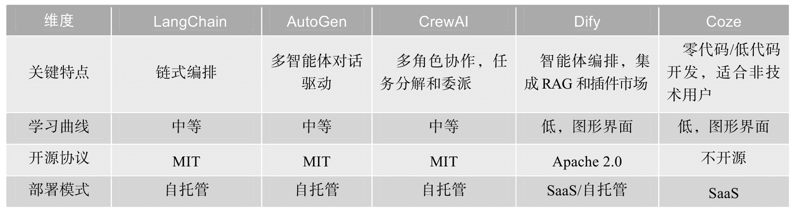

可以看出，Dify 在开发者友好方面表现相对较好，这也是选择它作为本节工具的原因之一。

**2.Dify 的智能体开发功能**

1）Dify 简介

最初，Dify 聚焦于 RAG 应用的快速构建，随着大模型应用开发技术的发展和行业需求的演进，Dify 逐步增强了对智能体开发的支持，并将其自然地融入 Dify 现有的架构和操作流程。如今，Dify 不仅可以用于快速开发 RAG 应用，也可以用于快速构建功能丰富的智能体应用。

2）Dify 用于智能体构建的关键特性

（1）智能体框架。Dify 提供了一种灵活的智能体框架，允许开发者自定义可以独立使用各种工具来处理复杂任务的智能体，支持诸如函数调用和 ReAct 等智能体策略。该框架为构建自主运行的智能体提供了结构化的方法，开发者可以定义智能体的目标、行为逻辑以及可以使用的工具，从而提供高度定制化的智能化交互体验。

（2）工具集成。Dify 允许无缝集成各种工具，包括内置工具（如 Google 搜索、维基百科、DALL-E）和外部工具（通过 OpenAPI/Swagger 和 OpenAI 插件导入），同时支持通过 API 连接外部知识库。这种强大的工具集成能力极大地扩展了智能体的应用场景，使其能够与外部世界进行交互并执行各种操作。

**1.3.4** **使用 Dify 构建智能体的步骤**

在 Dify 中构建智能体非常便捷，为了给读者提供连续且完整的体验，将使用前面的内容，在本地环境中使用 Dify 和 DeepSeek-R1-Distill-QWen1.5B 演示如何构建一个股票查询的智能体。

**1.设置本地 Dify 和 DeepSeek 环境**

本节继续使用本地化部署的 DeepSeek-R1-Distill-QWen-1.5B 模型和本地 Dify 平台。

注意：Dify 同样提供了云端 SaaS 版本，开发者也可以选择在 Dify 的云端环境中进行配置，并使用云端的 DeepSeek 模型服务。操作界面和流程与本地化部署基本一致，具体可根据实际需求选择部署方式。

**2.熟悉和使用 Dify 内置的智能体工具**

在开发智能体之前，建议先熟悉和使用 Dify 内置的智能体开发工具，这有助于理解 Dify 的智能体开发机制。Dify 提供了一个名为 MarketPlace（市场）的模块，其中预置了大量常用的智能体工具，例如 Google Search、DALL-E、Slack 等。

下面先体验一个 Dify 内置的股票查询智能体—AlphaVantage。打开 Dify 主页；单击顶部导航栏中的“工具”按钮；在搜索框中输入“AlphaVantage”，找到该工具；查看描述：AlphaVantage 是一个在线平台，它提供金融市场数据和 API，便于个人投资者和开发者获取股票报价、技术指标和股票分析。当前版本是 0.0.2，开发商是 langgenius/alphavantage，共 671 次安装。单击“安装”按钮，即可将该智能体工具安装到系统中。

注意：AlphaVantage 是一家提供免费股票数据 API 的服务商。使用其 API 需要注册账号并获取一个 API Key（例如 5***）。在后续使用时，需要将该 API Key 填入配置项中，以完成身份验证。

单击 Dify 顶部的“工作室”选项卡，选择“创建空白应用”选项，在“选择应用类型”中选择“Agent”选项，在“应用名称&图标”中输入名字“testagain”，即可创建出一个新的应用，如图 1-16 所示。

进入该应用的主页面之后，在中间页面中选择“工具”选项卡，单击“添加”按钮，选择已经安装的“AlphaVantage”的“query_stock”接口，添加成功后，就能够在工具下方看到添加的工具，如图 1-17 所示。

然后，在该应用的右上角选择模型，将其设置为 Ollama 平台上的 deepseek r1：1.5b 模型，这样就完成了之前配置好的本地的大模型（在 Ollama 上运行的 DeepSeek 模型服务）的调用设置配置。

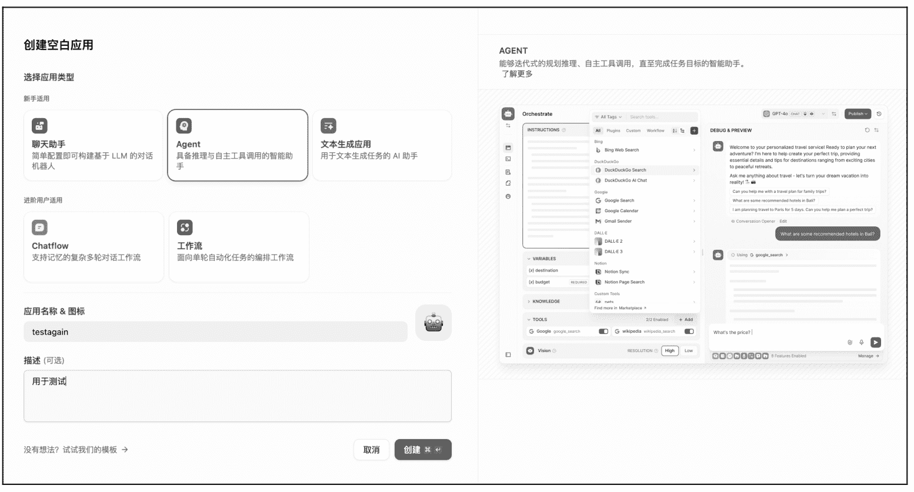

图 1-16

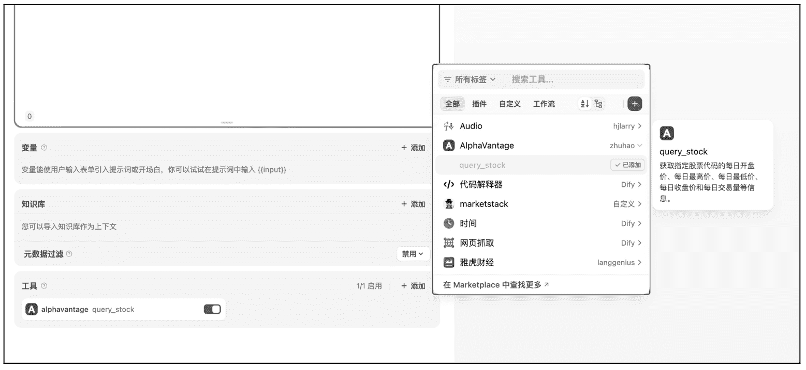

图 1-17

最后，在该应用的调试与预览界面中进行测试。

为了展示使用和不使用智能体工具带来的结果差异，首先在“工具”选项中将“AlphaVantage query_stock”功能关闭，然后在右边的输入栏中输入“请问苹果公司最新的股价是多少”，因为 deepseek r1：1.5b 并没有联网查询的能力，所以返回的内容如下。

“目前我无法实时获取苹果公司（AAPL）的最新股价信息，建议您通过财经网站（如雅虎财经、谷歌财经）或股票交易应用查看实时数据。”

然后，在“工具”选项中将“AlphaVantage query_stock”开启，在右边的输入栏中同样输入“请问苹果公司最新的股价是多少”。此时，系统将调用智能体工具中的 AlphaVantage 的 query_stock 接口，向 AlphaVantage 官网 API 发起请求，并传入参数，即苹果公司的股票代码“AAPL”，以获取其最新的股价信息，最后生成并返回如下内容。

其中思考过程如下。

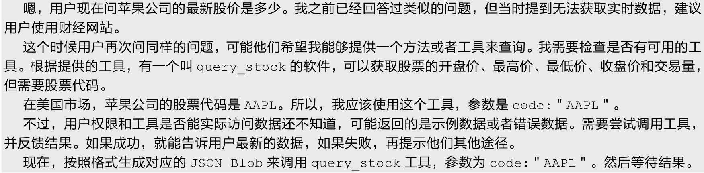

生成的结果如下。

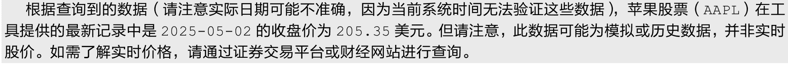

注：笔者查询的时间是 2025 年 5 月 4 日，美国股市周末关闭，所以查询到 5 月 2 日的结果就是最新的结果。

目前，我们已经成功地调用了一个智能体工具，并完整执行了全部流程，取得了预期的结果。

在这种场景下，大模型 DeepSeek-R1-Distill-QWen-1.5B 的工作流程如下。

（1）理解用户诉求。大模型识别到用户的请求是查询苹果公司的最新股价。

（2）分析需求并调用工具。大模型判断该任务需要借助智能体工具完成。当前已安装的智能体工具“AlphaVantage query_stock”具备相应功能。但根据该智能体工具的 API 要求，需要传入目标公司的股票代码。

（3）参数传递与数据获取。大模型将苹果公司的股票代码“AAPL”作为参数传给智能体工具，后者调用 AlphaVantage 公司提供的 API，成功获得苹果公司 2025 年 5 月 2 日的收盘价为 205.35 美元。

（4）生成最终回答。大模型将获取的数据结合用户原始问题，整合生成自然语言形式的回答，返回给最终用户。

从上述流程可以看出，大模型相当于“大脑”，智能体相当于“手脚”，大模型指挥智能体完成这一系列的动作，最后给出一个用户满意的结果。如果大模型的能力不够，就会导致这一系列的工作不能达到预期。

**3.创建一个新的智能体工具，并完成调用**

接下来创建一个新的智能体工具，同样用于查询股票价格，但选择另一个股票信息提供商，以展示智能体工具的可扩展性和灵活性。

（1）确定一个合适的免费股票价格查询 API 提供商。目前，市面上有多个提供免费股票市场数据的 API，包括 Marketstack、AlphaVantage、Finnhub 和 Twelve Data 等。本书选择 Marketstack，因为它的 API 文档清晰易懂、提供免费使用计划、支持提供基础股票报价的“每日数据”（EOD）接口、需要使用 API 密钥访问。

开发者可前往 Marketstack 网站注册账户，并获取免费的 Marketstack API 密钥。

（2）研究股票查询的 API 文档。查阅 Marketstack API 文档，了解如何使用“每日数据”端点（/v1/eod），端点获取指定股票的最新行情数据。请注意所需的参数（访问密钥和股票代码）以及 JSON 响应的结构。

开发者需要注意以下内容。

•基本 URL：https：//api.markets***k.com/v2/eod/。

•所需参数：access_key（API 访问密钥）；symbols（目标股票，如 AAPL）。

•响应格式：返回 JSON 格式，其中收盘价位于“data”数组下的 close 字段中。

示例请求 URL 如下：https：//api.markets***k.com/v2/eod/latest？access_key=cd007113a9c11b bdffc0b50a4d6513c4&symbols=AAPL

（3）在 Dify 中创建“自定义工具”。进入 Dify 主页面，依次单击“工具”→“自定义”→“创建自定义工具”按钮，然后按照以下步骤操作。

•工具名称：输入新工具的名称，例如“Marketstack Stock Query”。

•Schema 配置：根据 Marketstack API 的文档规范及 OpenAI 的 Swagger 格式，填写对应的 API 调用配置。参考模板如下。

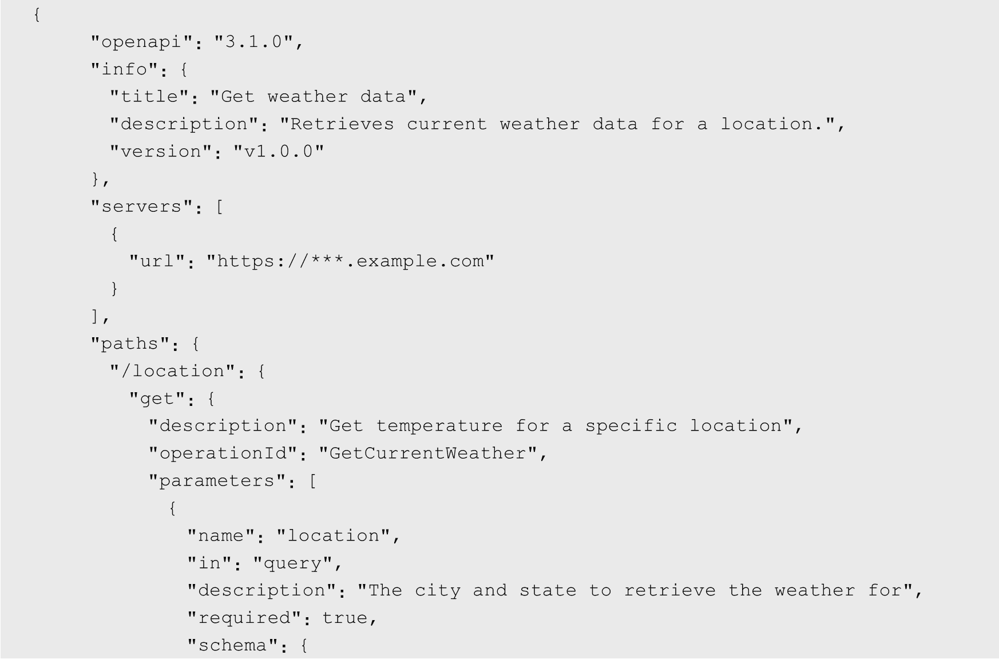 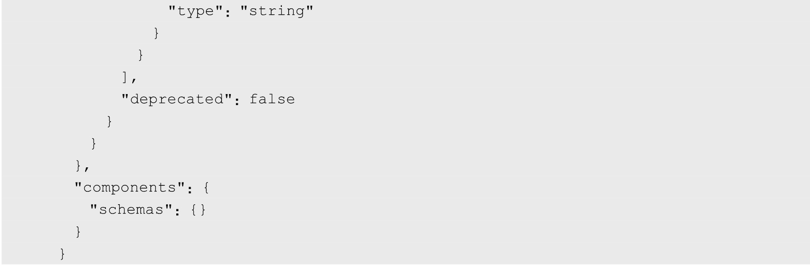

填写完成后，单击“保存”按钮。

在 Dify 的主界面中新建一个工作室，然后在“工具”列表中选择刚刚生成的智能体工具“Marketstack Stock Query”，参照前文的操作流程，输入查询语句，获得 IBM 公司的最新股价信息，如图 1-18 所示。

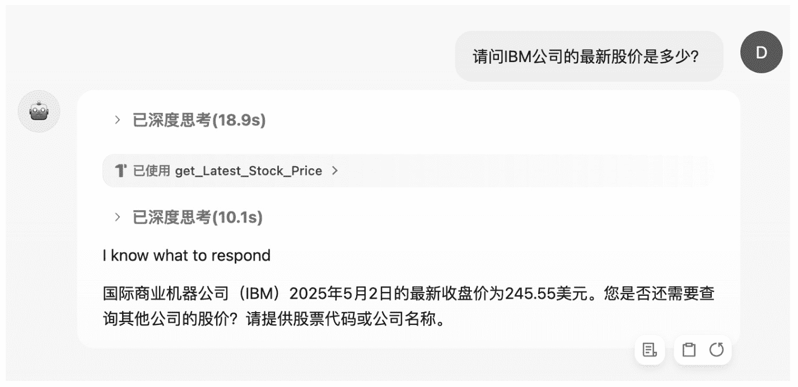

图 1-18

**4.探索 Dify 关于智能体的高级功能**

•Dify 提供了多种智能体执行策略，包括“函数调用”（Function Call）和“ReAct”（Reasoning+Acting）。开发者可以根据具体场景选择合适的策略，以优化智能体的推理和执行效率。

•Dify 内置了可观测性功能，支持开发者实时监控与分析应用日志和性能指标。借助这些工具，可以跟踪 Token 使用情况、响应延迟、历史对话等关键数据，从而优化智能体的运行表现和稳定性。

**1.3.5** **小结**

本节深入探讨了智能体的定义及三大核心组成部分—感知、规划与执行，并阐述了它们如何借助大模型的能力来调用外部工具完成复杂任务。同时，介绍了 Dify 作为一个用户操作友好、功能强大的平台，如何高效地构建和部署基于智能体的工具与应用。此外，演示了如何配置 Dify 环境，并创建一个集成外部 API 来获取股票信息的简单股票报价智能体，展示了智能体在实际场景中的应用流程。

智能体是 2025 年人工智能领域的重要发展方向之一，其技术迭代速度非常快，新概念、新架构和新技术不断涌现。其中 MCP 和 A2A 就是两个备受关注的新概念。

•模型上下文协议（Model Context Protocol，MCP）：由 Anthropic 公司主导提出，旨在标准化模型与外部上下文资源之间的交互协议。

•智能体通信协议（Agent-to-Agent Communication Protocol，A2A）：由 Google 公司推出，致力于建立统一的通信机制，实现多个智能体之间的高效协作。

这二者中，MCP 更关心智能体与外部工具或数据的互联，A2A 则更关心智能体间的通信与协作，二者既有交集又有合作空间，让我们拭目以待，看看智能体的通信和交互协议究竟如何发展。

随着智能体的发展，出现了一个新词—智能体式 AI（Agentic AI）。智能体式 AI 和智能体密切相关，但是又不一样。智能体更多是指一个具体的、具有自主行为能力的 AI 系统或程序。智能体式 AI 更多是指一种范式、一种能力或一种系统设计理念，强调 AI 系统具备的“代理能力”（Agency）。智能体式 AI 往往涉及多个智能体的协作，或者一个复杂的智能体拥有多项核心能力。打个简单的比方，智能体就像一个工人。它可以是流水线上一个只会拧螺钉的工人（简单的智能体），也可以是能独立完成一项复杂工程的工程师（智能体式 AI 下的智能体）。智能体式 AI 则更像是一套智能管理系统，能够协调多个工人（智能体），让他们自主地规划任务、调用设备、互相协作，最终完成整个工程。

随着新兴标准的不断完善和新兴概念的不断出现与发展，智能体技术将在多模态、跨平台、可扩展性等方面迎来更广阔的发展空间。开发者需要密切关注智能体开发中的新趋势、新的开发工具以及新的开发方式，以便更好地进行开发。

**1.4** **本章总结**

本章系统地讲解了如何在本地快速部署 DeepSeek，如何在本地基于 DeepSeek 快速开发 RAG 应用，如何在本地基于 DeepSeek 快速开发智能体应用，并介绍了流行的工具 Ollama 和 Dify 的使用方法。

相信通过对本章的学习，读者可以熟悉大模型应用开发的基本技术和适用场景，从而快速建立信心，认识到大模型应用开发并不难，为下一步的深入学习打下良好的基础。

下一章将介绍 DeepSeek 生态的更多内容。

自从 2025 年春节“爆火”之后，上下游的国内外厂家已经纷纷拥抱了 DeepSeek。根据从业厂家的产品类型、目标客户，以及技术特点，本书将 DeepSeek 的生态简单分为四层，如图 1-19 所示。

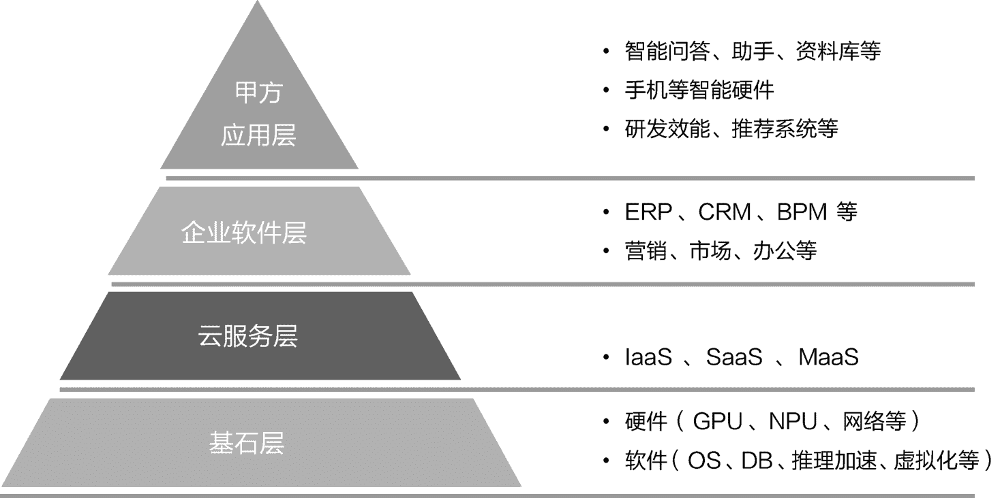

图 1-19

第 1 层：基石层。DeepSeek 的稳定运行需要底层软硬件的支撑。本书第二章将深入探讨 GPU 芯片、AI 操作系统（OS for AI）、AI 数据库（DB for AI）以及 AI 一体机等新一代 AI 基础设施是如何支持和适配 DeepSeek 的，介绍中兴通讯、阿里云和北京智源人工智能研究院等企业或机构的关键技术和优化成果。

第 2 层：云服务层。云厂商作为连接大模型与更广泛用户的关键桥梁，具有重要的意义。第三章将详细展示多个云厂商如何通过 IaaS、SaaS、MaaS 等模式，将 DeepSeek 的能力交付给千行百业，分享亚马逊云科技、硅基流动和开源中国等企业的技术方案和客户案例。

第 3 层：企业软件层。越来越多的软件厂家正积极地将 DeepSeek 能力集成到已有的技术产品中，以增强软件功能并给用户创造更多的价值。第四章将重点探讨 DeepSeek 如何赋能 ERP、CRM、桌面操作系统、Kubernetes、OpenStack 等传统及前沿的企业级软件，分享用友、浪潮通软、红帽、EasyStack、DaoCloud、中软国际、统信和 Orion 等企业对行业趋势的洞察、技术方案和客户案例。

第 4 层：甲方应用层。DeepSeek 的价值最终体现在甲方企业的实际业务场景中。第五章将深入探讨甲方企业如何将 DeepSeek 应用于自身业务，实现效率飞跃和业务创新。例如，中兴通讯如何将 DeepSeek 集成到新款手机中，小米如何利用 DeepSeek 大幅提升集团的研发效能，以及网易云音乐如何将 DeepSeek 应用于其核心的互联网推荐系统中。

**第二章 DeepSeek 生态的基石层：AI Infra 筑基与演进**

DeepSeek 大模型之所以能展现卓越的性能与成本优势，除了具有优秀的算法，还依赖深度优化的底层基础设施。本章将深入探讨人工智能基础设施（AI Infra）如何协同支撑 DeepSeek 及构建在 DeepSeek 之上的各类创新应用。

在传统认知中，AI Infra 泛指模型训练和推理等软件平台。但随着大模型的飞速发展，AI Infra 已迈入“AI Infra 2.0”时代，实现了“软硬一体化”高度协同。它不仅包括 AI 芯片、高速网络、AI 一体机等硬件，甚至包括 AI 数据中心，更涵盖完整的软件栈。该软件栈是高效运作的神经中枢，包括芯片软件栈（如英伟达的 CUDA、华为的 CANN）、AI 操作系统（OS for AI）、AI 数据库（DB for AI）、虚拟化及训练推理加速软件等。

其中，AI 芯片是驱动大模型的“心脏”。本章将首先深入浅出地解释什么是 AI 芯片，为何它对 AI 的训练和推理至关重要；然后剖析当前 AI 芯片市场的竞争格局，并展望其发展趋势和未来前景；最后将重点关注国内外主要 AI 芯片玩家积极支持 DeepSeek 开源大模型的最新进展。

“软硬一体”的演进对操作系统和数据库影响极大。面对大模型的海量数据和复杂计算需求，传统技术架构面临挑战。操作系统和数据库针对大模型进行了深度适配与功能增强，通过引入新机制、优化算法，聚焦大模型训练、推理和应用，实现性能跨越。例如，操作系统在内存管理、任务调度、多核/多卡协同等方面进行了深度优化，以确保海量参数的训练和推理过程更加流畅、高效；数据库在向量检索能力、非结构化数据的高效管理，以及实时数据获取和流式处理等方面取得了突破性进展，从而能够更高效地支撑 DeepSeek 推理，以及开发检索增强生成等大模型应用。

本章将全面解析 AI Infra 的核心要素。通过中兴通讯的 AI 一体机、龙蜥操作系统和 OpenCloud 操作系统展示面向 AI 场景的操作系统优化，同时介绍跨芯片、支持国产芯片的统一软件栈—北京智源人工智能研究院的 FlagOS，以及支持大模型的数据库 OceanBase，希望能为读者描绘清晰的 AI Infra 演进蓝图。

**2.1 硬件子层**

**2.1.1 AI 芯片与 DeepSeek：开发者眼中的现状与未来**

本节旨在为关注和使用 DeepSeek 等大模型的开发者全面解析 AI 芯片的奥秘，以及它们如何支撑并驱动大模型的发展。本节将深入探讨 AI 芯片的核心概念、市场格局、主流厂商及其对 DeepSeek 的适配情况，并展望 AI 芯片未来的发展趋势。通过本节的学习，读者不仅将深入了解 AI 芯片的底层逻辑和性能指标，更重要的是将掌握在多样化的硬件环境中高效选择和优化 DeepSeek 等大模型的方式，从而在“算力普惠”的时代把握机遇。

DeepSeek 开源大模型，特别是 DeepSeek-V3.1（最新版本为 2025 年 8 月发布的 V3.1）和 DeepSeek-R1（最新版本为 2025 年 5 月发布的 R1-0528），已成为人工智能领域中不可忽视的力量。这些模型在性能上能够与 OpenAI 的 o1、GPT-4o 和 Llama 3.1 等顶尖模型媲美，更引人注目的是，其训练和推理成本相比竞品显著降低。与 DeepSeek-V3 模型一同公开的论文表明，DeepSeek-V3 训练共使用了 2000 块 NVIDIA H800 GPU，总计消耗约 278.8 万 GPU 小时，单次训练成本约为 480 万至 520 万美元。这主要得益于其采用了混合专家（Mixture of Experts，MoE）、多头潜在注意力（Multi-head Latent Attention，MLA）等创新架构，以及组相对策略优化（Group Relative Policy Optimization，GRPO）等优化训练方法，同时结合了英伟达在芯片上的基础设施优化工作。

DeepSeek 的成功从根本上挑战了“堆硬件、拼算力”的传统模式，促使整个行业开始重新思考对 AI 硬件的需求。

目前，全球 AI 芯片市场正处于爆发式增长阶段，远超市场预期。根据德勤报告的最新数据，2024 年全球 AI 芯片市场规模已经突破 1250 亿美元，预计 2025 年将超过 1500 亿美元，到 2030 年有望达到 1 万亿美元。在整个市场中，图形处理器仍是 AI 芯片市场的核心，英伟达占据全球 AI 芯片市场约 77%的份额，在训练大模型方面表现尤为突出。根据格隆汇报告，2024 年中国 AI 芯片市场规模已达 1599.39 亿元人民币（约合 220 亿美元），预计 2030 年将突破 1.14 万亿元人民币，年复合增长率高达 38.66%。

**1.AI 芯片的本质：为什么 AI 需要专属芯片？**

1）CPU 与 GPU

很多开发者会有这样的疑问：计算机中已经配备了中央处理器（Central Processing Unit，CPU），能够处理各种复杂的任务，为什么还需要为人工智能配备专门的芯片呢？

我们可以用一个比喻来解释这个问题。CPU 就像是一位“万能工程师”，具备处理多种复杂任务的能力，无论是逻辑判断、数据管理还是程序运行，都能胜任。但它的特点是每次只专注一项任务，擅长的是“串行”工作，即一步一步地解决问题。

而 AI 模型，尤其是拥有数百亿甚至上千亿个参数的大模型，在训练和推理过程中需要进行海量、重复且高度并行的数学计算。这就好比要求一位工程师同时拧成千上万颗，甚至数百万、数千万颗相同的螺钉—效率显然会非常低下。

这时，AI 芯片应运而生。它更像一个专注拧螺钉的团队。特别是 GPU 这类 AI 芯片，其内部集成了成千上万个小型核心，特别擅长同时处理大量简单的计算任务。这意味着，在执行 AI 相关任务时，GPU 能够以远超 CPU 的速度进行大规模并行计算，从而显著提高 AI 模型的训练效率和推理效率。

为了帮助大家更直观地理解 CPU 与 GPU 在 AI 场景下的区别，下面使用一张表格进行对比说明，如表 2-1 所示。

表 2-1

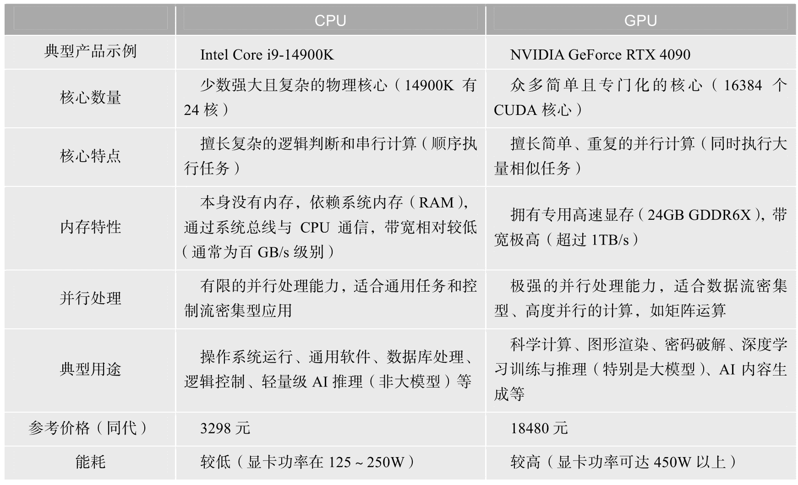

那么，为什么 GPU 在 AI 计算中，特别是大模型计算中，能展现出如此强大的优势呢？

这主要源于 AI 模型的计算特性与 GPU 架构之间的天然契合。

（1）大规模并行计算需求。无论是 AI 模型的训练还是推理，其核心都在于执行海量、高度重复且彼此独立的数学运算。这些运算虽然总体计算量巨大，但每个子任务相对简单，且相互之间依赖性较弱，非常适合并行处理。

（2）GPU 的“众核”架构。CPU 的设计理念是拥有少数几个强大且复杂的核心，擅长处理复杂的逻辑判断和串行任务，就像一位“全能将军”。GPU 则配备了成千上万个小型计算单元，能够同时执行数千甚至数万个独立的任务，更像是“一支训练有素的军队”，可以高效地完成大量重复性的计算工作。这种“众核”架构使 GPU 在并行计算能力上远超 CPU。

（3）针对 AI 的专用核心。现代高性能 GPU，尤其是英伟达的 Tensor Core，专为深度学习中的核心操作—矩阵乘法和累加（Matrix Multiply-Accumulate，MMA）进行了硬件级优化。这些专用核心能够在极短的时间内完成大模型中最频繁、最耗时的计算任务，从而显著提高大模型的训练效率和推理效率。

（4）高速、高带宽的显存。大模型通常包含数百亿甚至上万亿个参数，在计算过程中还会产生大量的中间数据，这些数据都需要被快速存取。GPU 配备了专用的高速显存，其容量和带宽远高于 CPU 所使用的系统内存，能够以极快的速度向计算核心提供数据，有效避免了数据传输成为计算瓶颈的问题。

（5）成熟且强大的软件生态。以英伟达的 CUDA 平台为代表的 GPU 软件生态系统，为开发者提供了丰富的编程工具、优化库及深度学习框架（如 PyTorch 和 TensorFlow）的底层支持。这使开发者能够便捷地利用 GPU 的强大算力来构建、训练和部署复杂的 AI 模型，大大降低了开发难度和优化成本。

GPU“为并行而生”的架构设计、面向 AI 优化的专用计算核心、高速显存，以及成熟的软件生态，使其成为推动现代人工智能，尤其是大模型计算发展的关键动力。

值得一提的是，GPU 曾被广泛应用于大型 3D PC 游戏中。这类游戏追求高质量的图形效果和逼真的视觉体验，例如精美的 3D 场景、细腻的纹理及真实的光影效果（如天气变化、光线反射等）。渲染这些复杂的图形需要进行大量的实时计算，传统的 CPU 在面对此类大规模并行任务时效率较低，而 GPU 能够并行处理数千个简单的计算任务，从而高效完成图形渲染，为玩家带来更好的游戏体验。

2）常见的 AI 芯片性能指标

在了解了 AI 芯片的基本作用之后，接下来介绍几个常用的性能衡量指标。这些指标可以更好地反映芯片的具体参数，也有助于评估不同 AI 芯片在实际应用中的表现。

（1）算力。表示芯片每秒能完成的浮点运算次数（Floating-point Operations Per Second，FLOPS），可以看作芯片“计算能力”的体现。数值越高，说明芯片的处理能力越强。

常见的单位如下。

•TFLOPS（Tera FLOPS）：每秒万亿次浮点运算。

•PFLOPS（Peta FLOPS）：每秒千万亿次浮点运算。

在 AI 领域，尤其是在大模型训练中，常常会提到 FP32（单精度浮点）、FP16（半精度浮点）或 BF16（脑浮点）等不同精度下的算力。一般来说，精度越低，芯片的算力越高。

当前的大模型训练和推理已经能够很好地支持 FP16、BF16 甚至 INT8（8 位整型）等低精度计算方式，因此厂商通常会重点强调芯片在这些精度下的高算力。需要注意的是，在比较不同芯片的算力时，一定要确保是在相同的精度条件下。

（2）显存。类似于计算机中的内存，AI 芯片也拥有专门的存储单元，通常被称为“显存”。与普通内存不同的是，显存直接集成在 AI 芯片上，而不是通过主板总线连接到 CPU。这种设计使显存具有更高的数据传输带宽，并且距离计算核心更近，能够持续为 AI 计算提供高速的数据流。

我们可以将显存想象成 AI 芯片的“工作台面”。AI 模型及其计算过程中产生的数据，以及需要处理的输入数据（如长文本、图像等）都会被临时存放在这里。

显存容量越大，意味着“工作台面”越大，能够同时加载更大的模型，或者处理更长的文本、更复杂的任务。对于拥有数百亿甚至上万亿个参数的大模型来说，大容量显存是必不可少的。

（3）显存带宽。显存带宽是指数据在 AI 芯片的计算核心与显存之间传输的速度，可以理解为“计算核心与显存之间的高速公路宽度”，其单位通常是 GB/s 或 TB/s。

如果芯片的计算核心非常强大（算力很高），但数据从显存传输到计算核心的速度较慢（显存带宽不足），那么就会出现计算核心“等待数据”的情况，导致整体效率下降。

高显存带宽能够确保数据被快速、持续地送到计算核心，让 AI 芯片的强大算力得以充分发挥，避免因“数据饥饿”而影响性能。这一点对于大模型的高效训练和推理来说尤为关键。

（4）互联带宽。互联带宽是指多个 AI 芯片之间进行数据传输的速度，通常通过专用的高速互连技术实现，例如英伟达的 NVLink 或华为的 HCCS。你可以将其想象为“芯片之间的高速公路宽度”，其单位同样是 GB/s 或 TB/s。

在进行大模型训练时，一个模型可能分布在多块，甚至成千上万块 AI 芯片上进行协同计算，这时芯片之间需要频繁地交换数据，如更新模型参数、进行梯度同步等。

在这种多芯片并行计算的场景下，高互联带宽至关重要。它能够确保数据在不同芯片之间快速流动，避免通信成为系统性能瓶颈，从而显著提高大规模 AI 集群的训练效率和扩展能力。

以上是衡量 AI 芯片性能的核心指标。在通常情况下，数值越大代表性能越强，但成本也会相应上升。

需要注意的是，这些指标并不是孤立存在的，它们之间的匹配程度直接决定了 AI 芯片的整体性能。例如，即使一块芯片拥有极高的算力，如果显存容量不足或显存带宽较低，那么整体计算速度仍然会受到限制，难以发挥出理想的性能。

因此，在选择和评估 AI 芯片时，不仅要关注单一的指标，更要综合考虑各项参数之间的平衡与协同，这样才能真正实现高性能、高效率的 AI 应用部署。

**2.AI 芯片的江湖：群雄逐鹿的市场与生态**

1）各式各样的 AI 芯片

目前，AI 芯片市场正处于前所未有的快速发展阶段。其中，GPU 依然是市场的主力军，因为它在并行计算方面具有天然的优势，非常适合处理 AI 模型中的复杂计算任务。

然而，GPU 并不是唯一的选择。随着 AI 应用场景的不断细化和技术的持续进步，其他类型的 AI 芯片也在迅速崛起，例如 NPU、ASIC 和 FPGA 等。

（1）图形处理器。

特点：擅长并行计算，最初为图形渲染设计，后被广泛应用于深度学习中的矩阵运算。具有较强的通用性，是目前 AI 训练和推理的主流选择，尤其适用于大规模并行计算任务。

典型产品：英伟达的 H100、H200、RTX 系列；AMD 的 Instinct MI300X、Radeon RX 系列。

（2）专用集成电路（ASIC）。

特点：为特定 AI 任务“量身定制”的芯片，在特定应用场景下可实现极高的计算效率和能效比。但其功能固定，灵活性较差。

典型产品：谷歌的张量处理单元（TPU）、英特尔的 Habana Gaudi 系列。

（3）现场可编程门阵列（FPGA）。

特点：可在制造完成后根据需求重新配置逻辑电路，性能和能效通常略逊于 ASIC，但比 GPU 更适合定制化任务，适用于需要快速迭代算法或有特殊定制需求的场景。

典型产品：英特尔的 Arria 系列、Xilinx（已被 AMD 收购）的 Versal 系列。

（4）神经网络处理器（NPU）。

特点：专为神经网络计算而设计的处理器单元，通常集成在 CPU 或系统级芯片（SoC）中，主要面向高效的 AI 推理任务，特别适合低功耗的边缘设备和移动设备。虽然一般不具备训练能力，但在执行已训练模型时表现出色。

典型产品：高通 Snapdragon 系列中的 Hexagon NPU、苹果 A 系列芯片中的 Neural Engine、英特尔酷睿 Ultra 系列中的 Intel AI Boost NPU。

（5）其他创新架构。除了上述主流类型，许多公司正在积极研发新型芯片架构，希望突破传统限制，为 AI 计算提供更优的解决方案。

这场“芯片大战”不仅发生在不同类型的芯片之间，也发生在各大科技企业之间。过去，英伟达凭借其 GPU 在 AI 芯片领域占据主导地位，尤其是在大型 AI 模型的训练方面表现突出。但如今，越来越多的企业正加入这场战争。

其中包括：

•传统芯片巨头，如 AMD 和英特尔。

•科技企业，如谷歌、Qualcomm 等。

•中国本土的芯片厂商，如华为、百度、摩尔线程、寒武纪、沐曦、壁仞科技等。

这些企业在 AI 芯片领域纷纷加大投入，推动技术革新，并在中国迅速扩大市场份额，展现出强劲的发展势头。

2）软件生态：芯片的“灵魂”

拥有了强大的 AI 芯片硬件，还需要配套的软件来驱动它，就像电动汽车即使配备了强劲的电机，也需要车载操作系统和自动驾驶辅助系统才能真正“跑起来”。这类软件通常被称为“软件栈”，包括驱动程序、编程工具、库文件等多个组成部分，其核心目标是帮助开发者更高效地利用芯片的算力来运行大模型。

目前，英伟达的 CUDA 平台是 AI 芯片软件领域的“事实标准”。它就像一种通用的“语言”，让开发者可以便捷地在各种英伟达 GPU 上编写和运行 AI 程序。CUDA 的强大之处在于，它为开发者提供了一个统一的编程模型，使应用可以在所有英伟达 GPU 上灵活地部署与扩展。

AMD 为其 GPU（尤其是 Instinct 系列数据中心加速卡）推出了开源软件平台 ROCm。该平台旨在提供与 CUDA 类似的功能，涵盖编译器、库和开发工具，并支持主流深度学习框架（如 PyTorch 和 TensorFlow）。AMD 正积极联合社区及合作伙伴（如 Meta 的 PyTorch 团队），不断优化 ROCm 对大模型的支持，以提高其在 AI 训练与推理领域的竞争力。

英特尔推出了 oneAPI，这是一种面向多种架构的统一编程模型，旨在简化 CPU、GPU（包括英特尔 Xe 架构）、FPGA 和 AI 加速器（如 Gaudi 系列）等不同硬件平台上的开发流程。oneAPI 包含多个工具包，如 oneDNN（深度神经网络库）和 oneCCL（集合通信库），并提供了基于 C++、Fortran 和 Python 的编程接口。其核心理念是打造一个开放的、标准化的统一软件栈，避免因硬件平台差异而频繁修改代码。对于 AI 应用，开发者可以通过 Intel Extension for PyTorch 等工具，在英特尔硬件上高效运行并优化大模型。

华为则为昇腾 AI 处理器构建了核心软件栈 CANN。CANN 提供了从底层芯片驱动到上层应用开发的全栈能力，涵盖了统一的编程接口、算子库、编译器、运行时及开发工具等模块。它的目标是简化 AI 应用的开发与部署过程，支持华为自研深度学习框架 MindSpore，以及 PyTorch 和 TensorFlow 等主流框架。通过 CANN，开发者能够充分地发挥昇腾处理器的强大算力，高效训练和部署各类 AI 模型，特别是大模型。

目前，中国本土 AI 芯片制造商正在积极构建自己的软件栈，以降低对 CUDA 的依赖。华为的 CANN、摩尔线程的 MUSA、寒武纪的 NeuWare/MagicMind，以及沐曦的 MXMACA 等，都在致力于提供类似 CUDA 的功能。这些本土软件栈通常支持 PyTorch 和 TensorFlow 等主流 AI 框架，并配备了相应的工具链，帮助开发者迁移现有代码。

中国本土的软件生态系统正在快速发展，但其在成熟度、生态广度和全球开发者支持方面，与 CUDA 仍存在一定差距。这种差距可能导致互操作性问题，并增加跨国企业在多平台开发中的复杂度。然而，随着开源 AI 模型的普及，“硬件无关”和“开放平台”的发展趋势得到了推动。这为本土芯片厂商提供了新的机会，可以通过提供兼容性强、性能优异的解决方案，进一步扩大市场份额。

为了帮助开发者直观地理解这些软件生态的特点与差异，这里给出 AI 芯片软件生态对比，如表 2-2 所示。

表 2-2

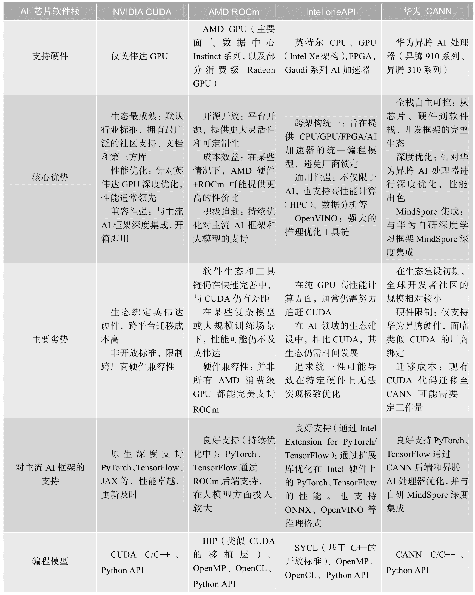

（续表）

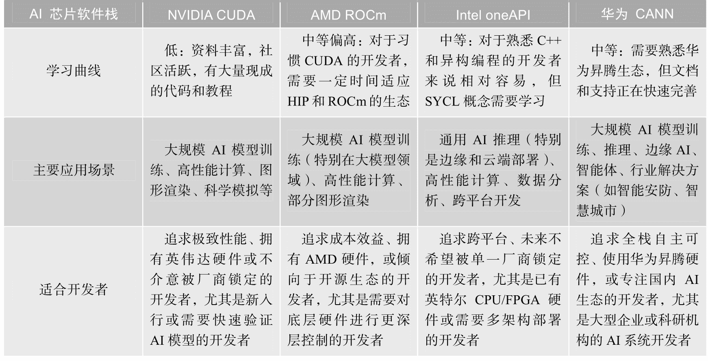

3）AI 芯片的软件栈总结

CUDA 仍然是目前最成熟、生态系统最完善的 AI 软件平台之一。对于追求极致性能和即开即用体验的开发者而言，CUDA 依然是首选方案。然而，其仅适用于英伟达硬件，存在一定的平台绑定限制。

ROCm 是 AMD 为挑战英伟达地位而推出的开源软件平台，在性能和生态成熟度方面正不断进步，尤其与 PyTorch 等主流深度学习框架的兼容性日益增强。对于重视开放性和成本效益的开发者来说，ROCm 具有极强的吸引力。

oneAPI 是英特尔提出的一种跨硬件统一编程模型，旨在打破厂商锁定，提供更灵活的开发体验，特别适合需要在 CPU、GPU 和 FPGA 等多种英特尔硬件平台上部署 AI 应用的场景。其中，OpenVINO™是 oneAPI 在推理端的重要组成部分，已成为边缘计算和高性能推理的亮点。

CANN 是华为昇腾 AI 处理器专属的全栈式软件平台，体现了中国在 AI 芯片领域实现自主可控的重要进展。对于致力于国产化替代、并采用华为昇腾硬件的开发者而言，CANN 提供了深度优化的性能表现和持续完善的生态支持。

**3.AI 芯片主要玩家及 DeepSeek 适配情况**

近年来，AI 芯片市场竞争异常激烈，发展速度也非常迅猛。主要参与者既包括国际科技巨头，也涵盖一批快速崛起的中国本土 AI 芯片企业。各方都在积极研发并不断迭代芯片产品，以更好地支持大模型的训练与推理任务。

作为极具代表性的开源大模型，DeepSeek 成为 AI 芯片应用的重要场景之一，因此也受到了业界的广泛关注。

以下所列各厂商的芯片参数均来自公开资料或官方发布会信息，仅供参考。其实际性能可能因具体配置、应用场景及软件优化程度不同而有所差异，部分数据为特定精度下的理论峰值算力。

1）国外主要厂家

（1）英伟达。

•**地位：**全球 AI 芯片市场的领导者，尤其在数据中心 GPU 领域占据主导地位。其 CUDA 生态系统是 AI 开发中事实上的标准。

•**代表产品：**H100、H200（数据中心训练与推理旗舰）、H20、B300 以及消费级的 RTX 系列（如 RTX 4090，常用于本地开发和推理），如表 2-3 所示。

表 2-3

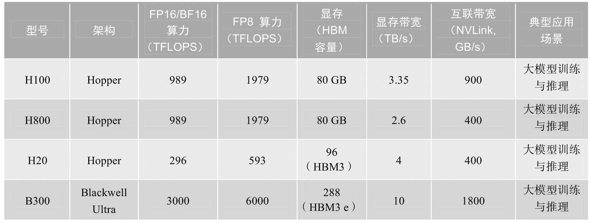

•**DeepSeek 适配：**DeepSeek 模型在训练和推理时，原生且深度支持英伟达 GPU，并能通过 PyTorch、TensorFlow 等主流深度学习框架充分利用 CUDA 生态的优势。DeepSeek-V3 模型的训练正是使用了大量的 NVIDIA H800 GPU，这直接证明了英伟达硬件在 DeepSeek 大模型训练中的核心地位和卓越性能。另外，DeepSeek 开源周开源出来的一系列项目，例如 FlashMLA、DeepEP 等都针对英伟达的 H800 系列 GPU 进行了优化。

•落地案例：绝大多数主流 AI 云服务商（如 AWS、Azure、Google Cloud、阿里云、腾讯云、华为云等）都提供了基于英伟达 GPU 的计算实例，并支持 DeepSeek 模型的部署和微调。

英伟达高度支持 DeepSeek，并称 DeepSeek-R1 是具备最先进推理能力的开源模型之一。

2025 年 1 月 30 日，英伟达官网宣布：“DeepSeek-R1 Now Live With NVIDIA NIM”。这意味着开发者可以通过英伟达提供的 NIM（NVIDIA Inference Microservice）服务访问 DeepSeek 的模型。借助 NIM，开发者能够更轻松地部署 DeepSeek-R1，从而确保其 AI 系统获得更高的运行效率。

此外，英伟达还在 Hugging Face 上发布了经过优化的 DeepSeek-R1-FP4 模型版本。该版本基于原始 DeepSeek-R1 模型，采用 FP4（四位浮点数）量化技术，在显著降低模型参数规模的同时，几乎未损失模型性能。这使它能够在对硬件要求更低的 AI 芯片上顺利运行。

目前，NVIDIA 正积极致力于进一步提升 DeepSeek 在其硬件平台上的性能表现。公司计划通过一个名为 NVIDIA Dynamo 的全新开源软件项目，将 DeepSeek AI 的推理速度提升高达 30 倍。Dynamo 的核心目标是将 AI 推理任务高效分配到多达 1000 块英伟达 GPU 上，从而大幅提高系统的吞吐能力。

这项优化旨在通过支持更多并发查询或为单个用户提供更高质量的服务，来提高 GPU 推理服务的每秒收入（Revenue per Second）。目前，Dynamo 项目已在 GitHub 上开源，开发者可自由访问并参与共建。

（2）AMD（超微半导体）。

•**地位：**正在努力挑战英伟达在 AI 市场的领导地位，在 CPU 和 GPU 领域均有深厚积累。

•**代表产品：**Instinct MI300X/MI300A（数据中心 AI 加速器），以及消费级的 Radeon RX 系列。

•**DeepSeek 适配：**AMD 通过 ROCm 软件平台，正大力提升与 PyTorch 等主流 AI 框架的兼容性。ROCm 6 系列版本显著加强了对大模型的优化。Meta 的 PyTorch 团队与 AMD 合作，积极优化 PyTorch 在 AMD Instinct MI300X 集群上的性能。

•**落地案例：**部分社区开发者已在 ROCm 支持的 AMD 消费级 GPU 上成功运行部分开源大模型。

AMD 与 DeepSeek 的合作非常紧密，已实现“Day 0”级别的支持。这意味着 AMD 的开发者从第一时间起，就可以在其 Instinct 系列 GPU 上顺利运行 DeepSeek 大模型。

2025 年 1 月 7 日，AMD 在其官网宣布，其 Instinct 系列 GPU 已正式支持 DeepSeek-V3，并通过 SGLang 完成了适配工作。

随后，在 2025 年 2 月 11 日，AMD 再次发布官方声明，宣布 Ryzen 系列 AI 芯片已支持 DeepSeek-R1 的蒸馏模型，用户可以便捷地在本地环境中部署和运行该模型。

（3）英特尔。

•**地位：**传统 CPU 巨头，但是在 AI 芯片市场落后得太久，正通过收购（如 Habana Labs）和自研（如 Xe 架构）奋起直追。

•**代表产品：**Intel Gaudi 3（AI 加速器，由 Habana Labs 设计）、Intel Data Center GPU Max 系列。

•**DeepSeek 适配：**英特尔通过 Intel Extension for PyTorch、OpenVINO、oneAPI 等软件工具链，积极支持主流大模型的推理和训练。尽管没有直接针对 DeepSeek 的公开案例，但英特尔的 OPEA 工具套件可以方便地将 PyTorch 等框架训练好的 DeepSeek 模型部署到其硬件上以进行高效推理，尤其适用于边缘设备和终端设备。

2025 年，英特尔官网宣布，DeepSeek 系列模型可在其 Xeon CPU 和 Gaudi AI 芯片上运行，并通过 vLLM 和 OPEA 等开源推理框架实现高效部署。

同年，英特尔进一步宣布，其酷睿 Ultra 系列处理器支持在 AI PC 上本地运行 DeepSeek 的蒸馏模型，为终端侧的 AI 推理提供了更强的性能与灵活性。

2）国内主要厂家

在中国本土政策支持与市场需求的双重驱动下，各大 AI 芯片厂商正积极主动地推进与 DeepSeek 大模型的适配与支持工作，致力于构建自主可控的人工智能生态体系。这种合作不仅体现在技术层面的深度适配上，更上升到了战略协同的高度，体现了各方共同推动国产 AI 产业发展的决心与布局。

（1）华为（昇腾 AI）。

•**地位：**中国 AI 芯片的领军企业，拥有从底层芯片到计算平台、开发框架的全栈能力。

•**代表产品：**昇腾 910 系列（训练/推理旗舰，如昇腾 910B/C/D）、昇腾 310 系列（推理芯片）。这些芯片通常集成在华为的 Atlas 系列服务器中，如表 2-4 所示。

•**DeepSeek 适配：**华为昇腾 AI 平台对 DeepSeek 模型的适配工作非常深入，通过 CANN 软件栈提供强大的支持。

表 2-4

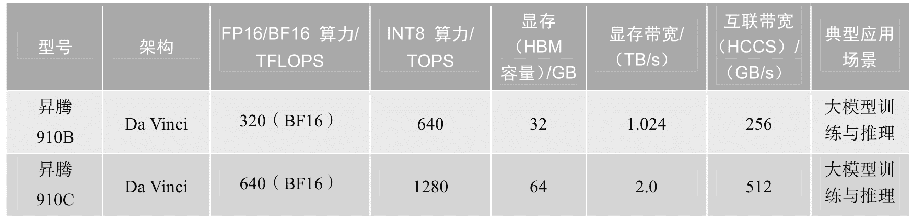

2025 年 2 月 1 日，MaaS 创业公司硅基流动在国内率先上线并支持 DeepSeek-R1 和 DeepSeek-V3 模型的推理服务，该服务基于华为云昇腾云平台实现部署。

2025 年 2 月 5 日，华为宣布，DeepSeek-R1、DeepSeek-V3、DeepSeek-V2 以及 Janus-Pro 等模型已正式上线昇腾社区。用户可以一键获取 DeepSeek 系列模型，并在昇腾硬件平台上实现开箱即用。

2025 年 3 月，天翼云与华为云 ModelArts Studio 先后推出基于昇腾 NPU 的 DeepSeek-R1 蒸馏模型镜像及配套部署指南，帮助用户快速创建昇腾物理机实例，高效运行 DeepSeek 模型。

同期，昇腾也推出了面向 DeepSeek 的一体机系列产品，涵盖服务器、推理卡及加速模组等多种形态，全面适配 DeepSeek-V3、DeepSeek-R1 的满血版、蒸馏版等全系列模型，满足从边缘到云端的多样化部署需求。

（2）沐曦（MetaX）。

•**地位：**国内高性能通用 GPU 厂商，致力于提供数据中心级通用图形处理器产品。

•**代表产品：**曦云 C 系列（MXC500，数据中心通用图形处理器），如表 2-5 所示。

•**DeepSeek 适配：**沐曦正在构建 MXMACA 软件栈，并积极适配主流深度学习框架（如 PyTorch）和 Transformer 类大模型。

表 2-5

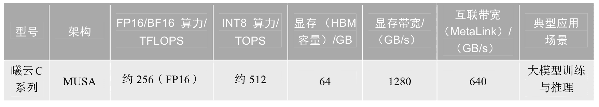

2025 年 2 月 5 日，联想集团与国产 GPU 领军企业沐曦联合发布了首个基于 DeepSeek 大模型的国产一体化解决方案，标志着国产软硬件协同在大模型应用领域迈出关键一步。

2025 年 2 月，知名大模型服务创新企业 Gitee AI（模力方舟）宣布推出基于沐曦 AI 芯片的 DeepSeek 全尺寸模型服务，涵盖从 1.5B、7B、14B、32B 到满血版 671B 的全部模型，为开发者提供多样化、本地化的大模型部署选择。

同月，在 DeepSeek 发起的“开源周”发布计划中，沐曦技术团队于 FlashMLA 解码内核开源当天即完成与沐曦 GPU 的适配工作，并将相关代码上传至 Gitee。这使沐曦 GPU 成为首个成功适配 DeepSeek FlashMLA 的国产芯片平台，并在适配过程中全面满足 FlashMLA 对性能的严苛要求。

除了华为、沐曦等企业，国内其他主要 AI 芯片厂商，如昆仑芯、燧原科技、海光信息、摩尔线程、寒武纪、壁仞科技、天数智芯等，也推出了针对 DeepSeek 各版本模型的技术方案。由于篇幅限制，这里不再赘述。

总而言之，在当前 AI 芯片产业格局中，若不能支持 DeepSeek，就意味着落后甚至被淘汰。这也正是笔者反复强调的观点：DeepSeek 大模型已在行业内初步建立起广泛的产业共识。

**4.AI 芯片的行业发展趋势和未来展望**

AI 芯片作为人工智能时代的核心基础设施，也是 DeepSeek 生态体系最关键的组成部分，正以前所未有的速度不断发展与演进。DeepSeek 等高效开源大模型的涌现，不仅推动了 AI 技术的进步，也为 AI 芯片的未来发展指明了方向。本节将深入探讨未来几年 AI 芯片行业的主要发展趋势，并对其发展前景进行展望。

1）技术演进：更强的算力、更高的能效、更低的成本

（1）异构计算的深度融合与优化。

未来的 AI 芯片将不再局限于单一的 GPU 架构，而是朝着 CPU、GPU、NPU、ASIC 和 FPGA 等多种架构向深度融合的方向发展，构建出高度协同的异构计算平台。这种融合将实现更高效的任务分发与资源调度，例如，CPU 负责逻辑控制，NPU 承担轻量级推理任务，GPU 支撑大规模并行计算，ASIC 专注高频特定任务的加速。

与此同时，芯片内部互联技术（如 Chiplet 技术、高带宽内存 HBM）将持续创新，突破传统冯·诺依曼架构的数据传输瓶颈，确保各类计算单元之间实现高速、低延迟的数据交互，从而全面提高系统性能。

（2）极致能效比的持续提升。随着 AI 模型规模呈指数级增长，能耗已成为制约其可持续发展的关键因素之一。未来 AI 芯片的发展将更加注重单位功耗下的算力输出能力。

这需要从多个维度进行协同优化，包括芯片架构设计（如采用存算一体、近存计算等新型结构）、先进制造工艺（如 3nm 及以下制程），以及创新型散热方案等。DeepSeek 等开源大模型在降低训练成本方面的成功，也进一步凸显了提升能效比在推动 AI 发展中的核心价值。

（3）更细粒度的精度支持。除了传统的 FP32、FP16/BF16 精度格式，未来 AI 芯片将广泛支持更低精度的数据类型，如 FP8、INT4，甚至二进制神经网络。这些低精度表示方式不仅能有效提升推理速度和能效比，还能显著降低模型对显存和带宽的需求。

然而，在降低精度的同时，如何保持模型准确性的可控性，将是芯片架构设计与算法优化共同面临的挑战。只有软硬件协同优化，才能在性能与精度之间取得最佳的平衡。

（4）专业化与通用化的动态平衡。针对视觉、语音、自然语言处理等特定 AI 任务的专用芯片（如 ASIC）将继续演进，在细分场景中实现极致的性能与能效。与此同时，通用型 AI 芯片（如 GPU）也将通过更灵活的编程模型和可配置的硬件单元，提高其在面对新兴 AI 模型和算法时的适应能力。

未来的发展趋势可能是：以通用芯片作为基础算力平台，并通过集成可编程 IP 核或模块化加速器来满足专业化算力需求，从而实现“一芯多用”的灵活性与扩展性。

（5）边缘 AI 芯片的快速崛起。随着自动驾驶、智能物联网、扩展现实等应用的快速发展，AI 计算正逐步从云端向边缘侧迁移。在此背景下，边缘 AI 芯片将成为新的发展热点。

2）市场格局：竞争加剧与合作共赢

（1）“一超多强”格局下的竞争与分化。英伟达作为 AI 芯片领域的领导者，凭借强大的技术实力和 CUDA 生态系统，确立了事实上的行业标准地位，在短期内难以被撼动。然而，AMD、英特尔等国际巨头，以及华为、百度、摩尔线程、寒武纪、沐曦、壁仞科技等中国本土厂商正在奋起直追，不断推出具有更强竞争力的产品。

未来市场将呈现出“一超多强”的格局，竞争日趋激烈。各厂商将采取差异化策略（如聚焦特定应用场景、提供软硬一体化解决方案等）争夺市场份额。尤其是在中国市场，随着本土企业的快速崛起，市场份额的格局也将迎来变化。

（2）垂直整合已成为行业的新趋势。越来越多的科技巨头开始自研 AI 芯片，以实现硬件与软件的深度融合，从而提升其云服务和 AI 应用的整体性能并降低成本。国外如谷歌、亚马逊、微软等企业，国内如百度、腾讯、阿里等企业均已布局芯片研发。

这种趋势表明，芯片设计已不再只是单纯的硬件工程，而是与应用场景、算法优化和软件生态紧密结合的系统性工程。垂直整合将成为未来 AI 芯片发展的重要方向。

（3）国产替代和自主可控正在加速推进。在地缘政治不确定性加剧和供应链安全日益受到重视的背景下，中国本土 AI 芯片产业正持续获得政策支持与资本投入，推动核心技术突破和生态系统建设。

与此同时，以 DeepSeek 为代表的国产开源大模型迅速崛起，为国产 AI 芯片提供了重要的应用场景和验证平台，进一步促进了软硬件协同发展，助力构建自主可控的 AI 产业链。

（4）云边端协同与生态互联的新模式。随着 AI 技术在各行各业的深入应用，不同算力形态的协同变得愈发重要：云端承担大模型训练与复杂推理任务，边缘侧负责实时决策与数据预处理，终端则聚焦个性化交互体验。

未来的 AI 芯片厂商不仅需要提供高性能的芯片产品，更应打造覆盖“云—边—端”全场景的完整解决方案与统一的软件平台。通过构建开放、协同、互操作的生态系统，AI 芯片行业将迈向多方参与、互联互通的新阶段。

3）训练和推理的焦点转移

AI 芯片的发展最初聚焦于高性能训练，以满足大型神经网络对算力的渴求。然而，随着 AI 技术日渐成熟和应用场景的多元化，焦点正在发生转移，未来 99%以上的算力将集中在推理侧。

（1）从训练到推理的效率演进。大模型训练仍是衡量 AI 芯片性能的“皇冠”，一旦大模型完成训练，其在实际应用中的部署（推理）将产生更庞大的计算需求，并覆盖更广泛的应用场景。推理任务对芯片提出了新的要求：更低的延迟、更高的并发处理能力、更小的功耗及更具成本效益的部署方案。

因此，AI 芯片的设计正在逐步向推理性能优化倾斜。例如，引入高效的量化技术（如 INT4、INT8），优化键值缓存（KV Cache）管理机制，以及支持稀疏计算（如 MoE 模型）。以 DeepSeek 等采用 MoE 架构的大模型为例，在推理过程中仅激活部分专家模块，从而在保证性能的同时，显著降低计算资源消耗和部署成本。这一特性进一步推动了市场对专为推理优化设计的 AI 芯片的需求增长。

（2）端侧推理的爆发式增长。智能手机、可穿戴设备、智能家居、自动驾驶汽车等边缘设备正迅速成为 AI 应用的重要载体。这些设备对芯片的功耗、体积和实时响应能力提出了极高的要求。

未来，集成 NPU 或轻量级 AI 加速器的系统级芯片将在端侧推理市场中占据主导地位。这类芯片能够在本地实现低延迟、高能效的 AI 推理服务，不仅降低了对云端算力的依赖，也有助于提高用户的隐私保护能力。

（3）定制化微调与小模型训练兴起。尽管超大规模模型的训练仍然需要依赖巨型算力集群，但随着 LoRA、QLoRA 等高效微调技术的普及，以及面向特定领域的小型模型逐渐兴起，市场对中小规模训练算力的需求也在持续增长。

针对这种趋势，AI 芯片厂商正积极推出更多适用于企业本地微调、私有化部署和定制化训练的产品，致力于提供成本更低、部署更便捷、易用性更好的解决方案，以满足多样化的训练场景需求。

4）地缘政治风险与供应链韧性

AI 芯片作为战略性高科技产品，其供应与发展受到地缘政治因素的影响。

（1）国际合作与竞争格局日趋复杂。全球主要经济体普遍将 AI 芯片视为国家科技竞争力和战略安全的关键资产，呈现出“竞争中有合作、合作中带博弈”的复杂态势。一些国家和地区通过出口管制、技术封锁等手段限制先进 AI 芯片的流通，以维护自身在人工智能领域的领先地位。

在此背景下，国际的合作模式正发生转变：从以往的技术共享逐步转向特定领域的联合研发与标准共建，强调互惠互利与风险可控，推动形成更具韧性的全球技术协作体系。

（2）供应链正在趋向本地化和多元化。面对地缘政治带来的不确定性，各国纷纷致力于增强 AI 芯片供应链的韧性，推动构建更加自主、多元的产业生态。

•本土制造能力提升：加快本土晶圆制造能力建设，降低对少数国际代工厂的高度依赖。

•关键材料与设备自给自足：加大对半导体设备、光刻胶等核心材料和技术的研发投入，降低对外部供应链的依赖。

•“去风险化”策略实施：跨国科技企业正采取“中国+*N*”等多元化布局策略，在多个地区设立生产基地，以分散地缘政治带来的潜在风险。

（3）国产替代和生态建设正在加速推进。对中国而言，实现 AI 芯片领域的自主可控是国家战略的重要组成部分。这不仅推动了本土芯片企业的快速发展，也带动了配套软件生态的完善，包括编译器、框架优化库、算子库等关键技术。

以 DeepSeek 国产大模型为代表的开源项目，为国产芯片提供了重要的应用场景和生态伙伴，促进了软硬件协同创新，助力构建具备自主知识产权的人工智能基础设施。

（4）新兴半导体技术的战略意义日益凸显。随着传统硅基芯片逐渐逼近物理极限，量子计算、光子计算、神经拟态计算等前沿技术虽短期内难以实现大规模商用，但被广泛视为未来突破性能瓶颈的关键路径。各国政府和科技企业正积极布局相关领域，力争在未来技术竞争中占据先机。

**5.DeepSeek 驱动的 AI 芯片未来：开发者的机遇和挑战**

DeepSeek 的出现及其在 AI 模型训练和推理效率方面的突破，已对全球 AI 芯片产业产生了深远影响，也为 AI 开发者带来新的机遇和挑战。

1）对开发者的机遇

（1）降低 AI 开发门槛。DeepSeek 凭借其优化的 MoE 架构和高效的训练方法，显著降低了大模型训练与推理的成本。这意味着，过去只有少数科技巨头才能负担的 AI 模型开发与部署，如今正逐步向更广泛的开发者群体开放，包括中小型团队乃至个人开发者。

开发者无须拥有大量昂贵的 GPU 资源，也能相对轻松地尝试训练和部署高性能的大模型，从而加快技术创新与落地进程。

（2）推动硬件多样化发展。DeepSeek 对多种硬件平台（尤其是国产芯片）的积极适配，正在加速 AI 芯片市场的多元化进程。开发者不再局限于单一厂商的硬件生态，而是可以根据项目需求（如成本、功耗、特定场景下的性能优化）灵活选择合适的 AI 芯片。

这种趋势不仅增强了市场竞争力，也促使开发者更深入地理解和利用不同计算架构及其配套软件生态的优势，为技术选型提供更多的可能性。

（3）加速开源 AI 生态的繁荣。DeepSeek 的开源特性，以及其对“硬件无关”与“开放平台”理念的支持，极大地推动了整个开源 AI 生态的发展。开发者可以更便捷地获取模型资源，进行微调、部署，并适配到各类硬件平台上，甚至直接参与底层优化代码的构建。

这种开放协作模式形成了良性循环，促进了更多创新应用的诞生，也为社区生态注入了持续活力。

（4）聚焦应用层的深度创新。随着底层模型效率与芯片性能的不断提升，开发者得以从繁重的模型调优与基础设施搭建中解放出来，将精力投入上层应用的创新中去。

将 DeepSeek 等高效的大模型与具体行业知识、业务流程深度融合，打造出真正具备实用价值的 AI 应用，将成为未来开发者的核心竞争力。

2）对开发者的挑战

（1）多软件生态带来的学习负担。随着 AI 芯片种类的不断丰富，开发者需要掌握多个不同的软件栈（如 CUDA、ROCm、OneAPI、CANN），以及它们的编程模型和性能优化技巧。虽然像 PyTorch 这样的主流框架提供了较高层次的抽象接口，降低了跨平台开发的门槛，但在追求极致性能或解决特定性能瓶颈问题时，开发者仍需深入理解底层接口和硬件特性。

（2）性能优化的技术复杂性。尽管 DeepSeek 本身具备较高的计算效率，但要在不同硬件平台上充分发挥性能，仍对开发者的调优能力提出了较高的要求。这包括但不限于模型量化、算子融合、内存访问优化、并行策略选择等关键技术。

尤其在异构计算集群或边缘设备上进行部署时，由于资源限制和架构差异，性能优化的复杂性将显著上升，对开发者的综合技术能力也提出了更大的挑战。

（3）地缘政治与供应链风险的考量。在当前复杂的国际形势下，AI 芯片的选择和使用已不仅仅是一个技术问题，开发者还需要关注潜在的地缘政治影响和供应链稳定性问题。了解芯片的来源、供应渠道、相关政策法规及替代方案，已成为在技术选型和长期规划中不可忽视的重要因素。

（4）模型与硬件快速迭代带来的持续学习压力。AI 模型和芯片技术正在以极快的速度演进。新型网络架构、高效的训练方法，以及新一代芯片的推出，都在不断推动行业向前发展。开发者必须保持持续学习的态度，紧跟最新的算法进展、优化工具和硬件更新，才能确保其 AI 应用始终保持技术先进性和市场竞争力。

3）展望未来

DeepSeek 所代表的“性能持平、效率优先”理念，将持续推动 AI 芯片向更具性价比、更高能效及更开放兼容的方向发展。未来的 AI 芯片，将不再是单纯性能的堆砌，而是与特定模型架构和应用场景深度协同的产物。

随着 DeepSeek 大模型的持续迭代，开发者将迈入一个“算力普惠”的新时代。高性能 AI 计算将不再只是少数科技巨头的专属资源。无论是通过云服务、边缘设备，还是本地部署，开发者都将能够选择更加丰富、灵活且易于使用的 AI 芯片。

而那些能够熟练使用多种硬件平台，并善于将 DeepSeek 等开源大模型与具体行业场景深度融合的开发者，将成为 AI 时代最具竞争力的核心人才。

与此同时，芯片厂商与大模型开源社区之间的深度合作也将成为常态，形成“模型定义芯片，芯片赋能模型”的良性循环。DeepSeek 的成功，正是这一趋势的有力印证。对开发者而言，积极拥抱开源生态，深入理解模型与硬件的协同机制，将是把握未来机遇、赢得技术先机的关键所在。

**2.1.2 DeepSeek 智算一体机**

**1.行业概况**

在 AI 算力方面，随着人工智能技术的飞速发展，各行业对 AI 算力的需求呈现爆发式增长态势。从智能语音助手到图像识别，从自然语言处理到预测分析，众多 AI 应用的落地都需要强大的算力来处理和分析海量的数据。

在数据安全与合规性要求方面，特别在金融、政务、医疗等关键领域，数据的安全性和合规性至关重要。这些行业涉及大量的敏感信息，如个人隐私、商业机密、国家机密等，因此对数据的保护和管理有严格的要求。传统公有云难以满足数据不出域、模型自主可控等强监管要求，而智算一体机可以实现私有化部署，将数据和模型部署在本地，从而有效保障数据的安全性和合规性。

在技术架构的演进方面，AI 应用从云端向边缘端快速渗透，推动了技术架构从“云优先”向“端边协同”转变。这种架构的演进使算力能够更加贴近数据源和用户，减少数据传输的延迟和带宽消耗，提高系统的响应速度和运行效率，为智算一体机的发展提供了广阔的空间。

1）产品定义

智算一体机是一种软硬件集成的系统解决方案。它内置了业界主流的大模型，硬件包括 AI 芯片、服务器、存储、网络设备等，软件涵盖操作系统、AI 框架、中间件及应用软件等，为用户提供更高效、便捷、安全的本地化 AI 算力服务。智算一体机具备高效算力、本地部署、快速交付、灵活定制等特点，能够满足不同行业和场景的 AI 应用需求，如智能客服、图像识别、数据分析和智能决策等。

2）市场现状

智算一体机的市场正在迅速崛起。2023 年，中国智算一体机市场规模约 120 亿元，预计 2027 年将突破 500 亿元，CAGR 超 40%。浙商证券预测，2025—2027 年，智算一体机的市场需求将达 15 万～72 万台，对应市场空间分别为 1236 亿元（2025 年）、2937 亿元（2026 年）、5208 亿元（2027 年）。截至本书完稿时，已有超过 30 家企业推出了相关产品，政企客户（如政府、医疗、高校和银行等）是主要的用户群体，它们对接入 DeepSeek 的热情已经带动一体机销量的激增。在场景应用方面，教育、金融和政务等行业率先实现了落地。

3）竞争格局

当前，国内众多企业纷纷布局智算一体机市场，已形成多元化的竞争格局。以下是一些典型厂商及其差异化定位。

（1）联想。联想与沐曦联合发布基于 DeepSeek 大模型的一体机解决方案，以“联想服务器/工作站+沐曦训推一体 GPU+自主算法”为核心架构，配合联想 AI force 智能体开发平台，推出智能体一体机与训推一体服务器双产品形态。其智能体一体机以 ThinkStation PX 工作站为载体，搭载沐曦曦思 N260 GPU，可支持本地部署 DeepSeek 各种参数蒸馏模型推理；训推一体机基于联想问天 WA5480G3 AI 服务器，搭载 8 张曦云 C500 专业 GPU，为大模型训练和推理提供强大的算力。

（2）京东云。京东云发布的 DeepSeek 大模型一体机，秉持“本地化开箱即用”的理念，提供全栈解决方案，具备国产算力全适配、支持丰富大模型参数规格、AI 应用开箱即用、超高性价比等核心特性。内置智能体和知识库双引擎，预置海量智能体配置模板、100 多个行业解决方案模板，以及 1000 多种插件，支持快速构建本地知识库。

（3）华鲲振宇。华鲲振宇的天巡 DeepSeek 大模型一体机基于“天巡 CubeX AI 使能平台+卡多多 AI 服务器”打造，深度融合 DeepSeek 全系列大模型。该模型具有开箱即用、硬件规格领先、软硬协同优化等特点，使模型性能提高超过 30%，综合成本降低超过 50%。在性能优化方面，采用通算智算协同加速技术，基于鲲鹏 CPU+昇腾+openEuler+推理加速引擎，构建了大模型的推理加速能力。这种技术实现了 CPU 与 NPU 的高效协同，使时延降低 40%；在显存利用方面，通过动态 KV Cache、无损压缩、显存卸载等算法，实现显存资源精细化调度。

（4）中国电信。中国电信的息壤智算一体机-DeepSeek 版以华为昇腾芯片为基础，在硬件层面提供多种规格，包括 8 卡、16 卡、32 卡等，以满足不同规模企业和项目对算力的需求。

（5）天融信。天融信天问智算一体机集智算、云计算、安全于一体，集成 DeepSeek 等多种大模型，以“算力硬件平台智算平台”为基础，融合“计算、存储、网络、安全、智能”五大能力，为客户提供安全可靠的高性能智算中心建设方案。

（6）中兴通讯。中兴通讯 AiCube DeepSeek 智算一体机凭借软硬件一体化的高性能架构，让 DeepSeek 的部署更快、更强、更易用、更安全，帮助企业以更低成本、更高效率释放 AI 潜能。AiCube 提供一站式模型迁移工具，支持 DeepSeek 等大模型在不同计算架构 GPU 间的无缝迁移，仅需数小时即可完成 DeepSeek-R1 全系列蒸馏模型的适配。AiCube 还根据客户需求提供灵活的定制方案，实现开箱即用，大幅缩短部署周期。

DeepSeek 智算一体机是为解决上述行业差异化需求和痛点而设计的，通过软硬件一体化设计，实现了高效、安全和灵活的本地化 AI 算力服务和运维。

**2.DeepSeek 带来的机遇和挑战**

1）机遇

（1）**解决算力成本高昂痛点。**DeepSeek 智算一体机通过技术创新，如多头潜注意力机制、混合专家模型架构等，在实现强大推理能力的同时，大幅降低了算力需求。其在推理阶段的算力需求较低，DeepSeek-R1 的推理成本仅为 OpenAl o1 的 3%，减少了对高额投入和高端算力的依赖，使中小企业和科研机构等也能以较低的成本部署和应用大模型，极大地推动了 AI 技术的普及。

（2）**推动国产算力产业发展**。DeepSeek 的出现为国产算力产业带来新的机遇。此前，全球算力生态的锚点在英伟达的 CUDA 体系，而 DeepSeek 通过硬件级优化绕过 GUDA 进行 PTX 编程、计算与通信优化，性能提高了 30%，使国内厂商能够基于新的生态锚点快速构建。

（3）**满足行业个性化需求。**DeepSeek 智算一体机具有多种规格，可适用于不同行业的应用场景。如在金融行业，可用于优化高频交易算法、实时风险评估和智能客服；在医疗领域，能辅助导诊、对接药物数据库、实现专科诊断等；在能源、电力等行业，主要用于生产和安全管理。

（4）**促进 AI 应用快速落地**。一体机具有集成度高、可实现私有化快速部署等特点。对于希望快速应用 AI 技术但缺乏深厚技术积累的企业来说，DeepSeek 智算一体机提供了开箱即用的解决方案，减少了部署时间和成本，降低了 AI 应用的门槛，加速了 AI 技术在各行业的落地和推广。

2）挑战

（1）**标准兼容性问题**。尽管 DeepSeek 智算一体机在技术上取得了一定突破，但在实际应用中，仍可能面临与其他系统和设备的标准兼容性问题。例如，在与其他厂商的硬件或软件进行集成时，可能会出现接口不匹配、通信协议不一致等情况，这些问题可能影响系统的整体性能和稳定性，并增加部署和维护的难度。

（2）**生态适配难度大**。虽然 DeepSeek 的开源特性吸引了众多厂商，但要实现整个生态的协同发展仍面临挑战。目前，AI 行业的生态体系较为复杂，涉及硬件、软件、应用等多个层面。DeepSeek 智算一体机需要与不同类型的生态伙伴进行适配和整合，包括芯片制造商、服务器厂商、操作系统开发商、应用软件提供商等。在这个过程中，可能会出现适配难度大、兼容性问题多等情况，从而影响用户体验和市场推广。

（3）**成本控制挑战。**尽管 DeepSeek 在一定程度上降低了算力成本，但对于一些企业来说，采购和部署智算一体机仍需要投入较多的资金。此外，随着业务的发展和数据量的增长，可能还需要对硬件进行升级和扩容，这进一步增加了成本。一些预算有限的中小企业可能难以承担这些费用，从而限制了 DeepSeek 智算一体机的市场覆盖范围。

（4）**用户需求未满足**。部分用户反馈，DeepSeek 一体机在与具体业务场景结合时的效果并不理想，存在算力效率和硬件兼容性等问题。例如，在一些对实时性要求较高的场景中，可能无法满足低延迟的要求；在处理大规模数据时，可能会出现性能瓶颈。此外，一些用户还希望一体机能够提供更丰富的模型、更强大的功能，以及更便捷的管理和维护工具，以更好地满足其业务需求。

（5）**技术迭代与硬件更新**。AI 技术发展迅速，大模型不断迭代更新，这可能使原本适配的硬件在未来面临性能不足的问题。企业可能需要不断投入资金进行硬件升级，以适应新的技术要求。同时，随着技术的进步，新的硬件架构和计算模式不断涌现，DeepSeek 智算一体机也需要不断地跟进和适配，以保持其竞争力。

（6）**技术门槛与人才短缺**。尽管 DeepSeek 智算一体机提供了较为便捷的部署和使用方式，但其背后仍然涉及复杂的技术原理和架构。对于一些企业来说，可能缺乏专业的技术人员来对一体机进行维护和管理，因此无法充分发挥其性能优势。此外，目前 AI 领域的人才相对短缺，企业在招聘和培养相关人才方面也面临一定的困难，这在一定程度上影响了 DeepSeek 智算一体机的应用和推广。

**3.DeepSeek 智算一体机产品架构**

1）DeepSeek 智算一体机产业链

**（1）上游：基础硬件与软件。**

•芯片及组件：AI 芯片为 DeepSeek 智算一体机提供核心算力，不同芯片厂商的产品可满足不同算力需求；CPU 为智算一体机提供通用的计算处理能力，保障整机系统稳定运行；存储芯片厂商，如三星、海力士及国内的长江存储等，拥有大容量、高速的存储芯片，可确保智算一体机高效存储和读取数据，满足模型训练和推理过程中的高性能数据存储需求；风扇等散热设备，以及 PCB 板等基础组件，共同构成智算一体机的基础硬件。

•软件及算法：操作系统厂商，如龙蜥 OS、OpenCloudOS、麒麟软件、统信软件等，为保障智算一体机的稳定运行和安全，为上层应用提供可靠的运行系统环境。

•AI 框架及算法：开源的 AI 框架为智算一体机的开发提供基础框架和算法支持，为智算一体机在不同应用场景下的训练和优化提供算法资源。

**（2）中游：智算一体机的研发、生产与优化。**

•硬件集成厂商：中兴通讯、神州数码、浪潮信息等，根据自身或合作伙伴的设计方案，进行智算一体机的硬件组装和生产，将芯片、存储、散热等硬件整合在一起，确保产品的质量和稳定性，满足不同场景下的硬件需求。同时，它们将智算一体机与客户的其他系统和设备进行集成，如将智算一体机与企业现有的数据中心基础设施、网络系统等整合，为客户提供完整的信息化解决方案，满足客户在不同业务场景下的多样化需求。

•软件平台及算法优化厂商：火山引擎等企业为智算一体机提供机器学习平台，帮助用户进行模型开发和调优。此外，专注算法优化的企业还针对 Flash Attention 等技术进行研究和应用，进一步提高智算一体机在处理大规模语言模型等任务时的效率和性能。

**（3）下游：行业应用及服务。**

a）行业应用场景。

•政务领域：智算一体机可用于政务智能客服，快速准确地解答民众咨询；高效处理和分析政务数据，为政府决策提供数据支持；通过视频分析进行交通违章检测、环境监测等，提高城市管理的效率和精准度。

•金融领域：通过对大量金融数据的分析和模型训练，更准确地评估金融风险；利用 AI 技术识别异常交易行为；为金融客户提供 7×24 小时的咨询服务，提升客户体验。

•医疗领域：辅助医生快速准确地识别病灶；基于大数据分析预测疾病的发生趋势；模拟药物分子的结构和活性，加速新药研发的进程。

•教育领域：用于知识课程、实训课题、智能体等教学工具的设计开发，为学生提供个性化的学习体验和智能化的教学辅助，提升教学效果。

•制造业领域：利用 AI 图像识别技术检测产品质量；通过数据分析和建模优化生产过程；提前预测设备故障并进行维护，减少停机时间，提高生产效率。

b）运维服务商。

为智算一体机提供运维服务，包括设备维护、故障排除、性能优化等，确保智算一体机的稳定运行，保障用户的业务连续性。

2）系统架构

智算一体机是面向行业大模型高效推理和构建便捷应用的一体化解决方案。如图 2-1 所示，智算一体机整体上可以分为硬件层、推理引擎层、模型层和应用层。

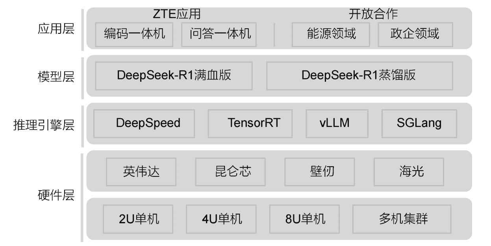

图 2-1

**（1）硬件层。**从硬件形态上看，分为推理单机和推理集群。

•**单机场景**。仅提供单台 GPU 服务器，支持 2U 单机、4U 单机、8U 单机等多种机型。只需接入客户的交换机网络后，即可使用相关推理服务。

•**集群场景（蒸馏版）。**支持 3～8 台 GPU 服务器。并配置了一台带外交换机、一对业务交换机，完成内部组网，业务交换机接入客户网络即可提供推理能力。以上形态未配置独立的外部存储，以融合的形态呈现。单机可以直接使用本地存储，而集群则使用 3 台 GPU 服务器的本地存储空间来构建共享分布式存储。

•**集群场景（满血版）。**支持 2～8 台 GPU 服务器，配置了高性能独立存储、RoCE 网络，不仅支持单机推理精调，还实现了跨机推理精调，提供了全场景能力。

提供英伟达、昆仑芯、壁仞等 GPU，客户可以根据模型大小、并发需求等因素选择不同的配置。通过对资源的统一调度和管理，可以实现 AI 资源对外的最大性能和统一运维。

**（2）推理引擎和模型层。**基于算力平台及模型的网络结构特性，提供大模型微调、推理、加速等环境，适配多种主流大模型。提供模型一站式生命周期解决方案，为知识库、模型部署和推理发布提供端到端功能。

**（3）应用层。**面向应用场景及下游任务的 AI 应用开发框架，支持快速搭建 AI 应用，可以为客户提供一个快速搭建推理应用的高效平台。

3）网络架构

DeepSeek 一体机分为单机、集群两种产品形态。

（1）单机形态。智算一体机（单机）组网的网络平面如图 2-2 所示。

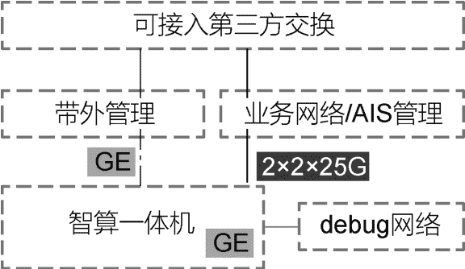

图 2-2

•AIS 管理：负责 AIS 管理、模型管理、数据处理、推理任务等的网络流量。

•业务网络：负责推理服务的业务网络通信。

•带外管理：负责整体 AI 集群所有设备的硬件带外管理。

•debug 网络：用于部署、运维和改配。

（2）集群形态（蒸馏版）。智算一体机集群组网如图 2-3 所示。

•业务面、管理面、存储面物理合一，传统 VLAN 组网，一对 5960X-56QU-HF 部署方式，MC-LAG 双活部署。

•配置带外管理网，一台 5952G-D。

•适用于参数量为 72B 及以内的推理，以及参数量为 13B 以内的精调，因此不考虑参数面和样本面组网。

（3）集群形态（满血版）。智算一体机集群组网如图 2-4 所示。

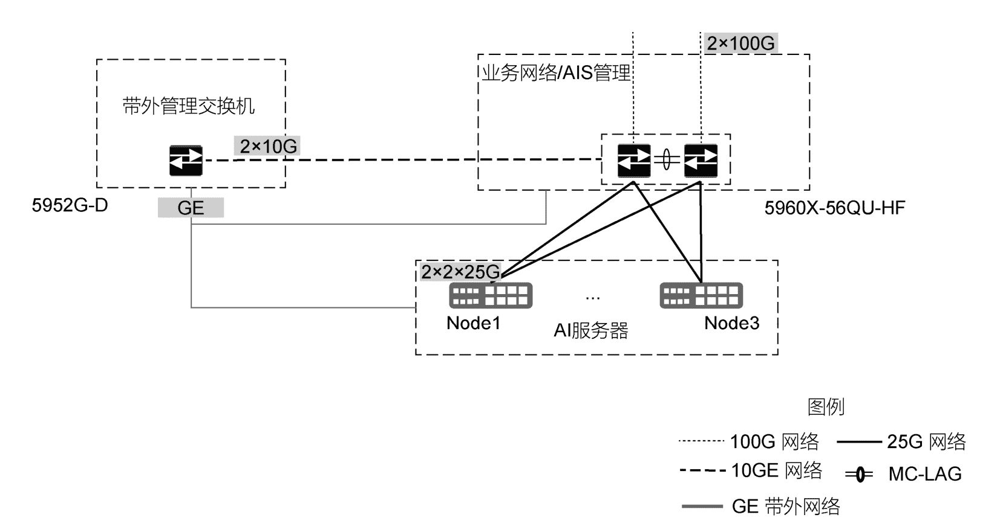

图 2-3

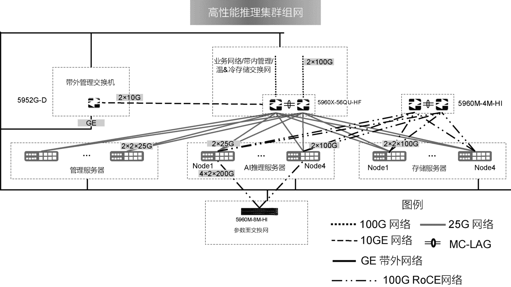

图 2-4

•参数面 RoCE 单独组网，2～4 台 GPU 服务器使用 1 台 5960M-8M-HI；5～8 台 GPU 服务器再增加 1 台交换机，直连部署。

•业务面、管理面、存储面物理合一，一对 5960X-56QU-HF 部署方式，传统 vLAN 组网，MC-LAG 双活部署。

•带外管理网，一台 5952G-D。

**4.AiCube DeepSeek 一体机技术突破**

中兴通讯 AiCube 智算一体机是用于大模型精调和推理的 AI 全栈一体化产品，开箱即用，可以实现本地训推、数据不泄露，具有快交付、易使用、高安全、全开放的优势。其创新性主要体现在三个方面。第一，提供开放、高效、灵活的智算资源，让企业用得起。全面适配业界主流的 GPU 和 CPU，提供不同厂家多品类、多规格的算力，精准满足差异化算力需求。第二，提供简单易用的训推平台，快速定制行业专属大模型。训推工程能力工具化，通过工具链实现大模型训推过程全流程贯通、向导式引导和过程可视化。第三，通过模型仓库和市场，实现 AI 能力共享和商业规模复制。AiCube 智算一体机已在多个领域开展探索应用，包括研发代码生成和工业质检等。

1）全栈 AI 工具链：开发到运维全流程覆盖

（1）多生态推理引擎。支持 PyTorch、TensorFlow、vLLM 等开源框架，兼容英伟达 TensorRT、壁仞 SuInfer 等私有框架，适配多芯片硬件生态。

（2）加速技术融合。

•Flash Attention：优化注意力机制计算效率，在提速的同时保持精度无损。

•Kernel Fusion：融合 GPU 内核操作，减少内存开销，显著提高小算子密集型任务的速度。

•算子硬件级优化：针对卷积、矩阵乘法等核心算子，适配特定硬件架构实现加速。

（3）模型全生命周期管理。

•模型仓库：集成 LLama、通义千问等主流模型，支持一键导入、转换、部署，提供版本管理、安全删除及多途径上传（SFTP/网盘）功能。

•轻量化精调：支持全参数精调与 LoRA 轻量化微调，适配小样本任务，平衡性能与资源消耗。

（4）自动化评估体系。内置 MMLU、5G-ZTE 等数据集，支持多模型多维度对比评测。兼容 OpenAI 标准接口，可配置多模型、多数据集进行自动化测试。

（5）构建企业级知识库。支持 PDF、Excel 等 12 种文档格式的分段清洗和向量化存储，从而实现私域知识管理。提供命中测试功能，评估模型对关键词的识别能力，并支持问答检索直接关联应用。

2）高性能智算资源管理

智算资源管理平台基于开源 Kubernetes，旨在实现商用化增强。提供作业管理、云原生管理、集群管理、基础设施优化等功能，如图 2-5 所示。

（1）计算资源。OpenPalette 支持当前主流的容器运行时，并为应用提供部署、启停、删除、弹性伸缩、滚动升级、灰度发布、Operator、Helm 和蓝图编排等功能，方便用户进行应用的生命周期管理和可视化编排。OpenPalette 还提供 CPU 绑核、巨页等增强计算功能，以满足应用的高性能需求。

（2）存储资源。OpenPalette 为平台内的应用提供持久化存储服务。当前版本提供文件存储服务和块存储服务。

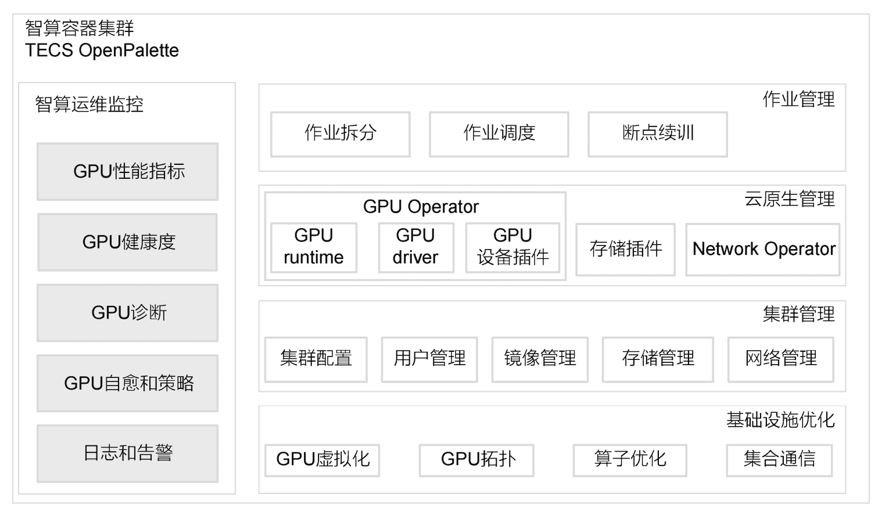

图 2-5

（3）网络资源。OpenPalette 提供了多场景、多类型端口的网络管理、容器网络资源管理和网络运维功能，支持多网络平面和 IPv4/IPv6 双栈，满足用户电信级高可靠、高性能网络需求。

3）快速构建场景化应用

（1）低门槛推理服务。简化了部署流程，并支持弹性资源调度、实时日志查询和服务状态监控。提供 RESTful API，开放模型推理与资源管理能力，加速企业应用集成。

（2）生成式 AI 应用开发。

•Prompt 模板库：预置任务引导指令，降低模型调优门槛。

•插件生态：集成 NLP、机器翻译等插件，扩展模型功能边界。

•支持对话式、生成式应用一键发布，通过 Web 或 API 双通道访问。

（3）智能运维与开放生态

在可视化智能运维方面，支持多维看板，实时监控开发资源、服务状态等核心指标；分层告警体系，按严重程度和类型分类告警，支持自动恢复与历史追溯。

在 AI 驱动运维助手方面，基于大模型实现自然语言交互，提供功能指导与故障排查服务。支持自定义知识库扩展，以实现个性化知识问答。

4）核心创新价值

•软硬协同优化：从芯片级算子加速到 Kubernetes 资源调度，全栈性能提升。

•全流程闭环：覆盖模型开发—精调—评估—推理—运维环节，降低大模型应用门槛。

•企业级敏捷性：通过知识库、API 开放与轻量化工具，实现私有化场景快速落地。

•智能运维降本增效：通过 AI 助手与可视化看板等方式减少人工干预，运维效率提高 30%以上。

**5.企业案例**

在教育场景中，学校和机构希望借助 DeepSeek 打造智能教学工具，辅助备课、为学生提供个性化辅导，满足教育个性化、智能化的发展趋势；在政务服务领域，政府部门期望通过 DeepSeek 提高办公效率，实现智能客服，助力城市治理与民生诉求处理，提高政务服务的质量和效率；在金融领域，客户期望利用 DeepSeek 增强风控、辅助投研，提高决策效率，在复杂多变的金融市场中降低风险、挖掘投资机会；在医疗行业，医疗机构利用 DeepSeek 助力影像分析、辅助诊断，提高疾病筛查准确率，为患者提供更准确、及时的诊断治疗参考；在电信行业，5G 消息利用 DeepSeek 实现文本类消息互动，5G 新通话利用 DeepSeek 的推理分类能力对通话内容进行意图识别，提高反诈能力，保障用户通信安全。这些行业的需求反映了 DeepSeek 技术的广泛适用性和巨大潜力，也驱动着中兴通讯不断探索将产品与 DeepSeek 相结合，为客户提供更优质的解决方案。

1）鞍钢数科：为鞍钢数科效能提升提供“加速器”，AI 应用快速上线

（1）背景和痛点分析。作为由中央直接管理的国有大型企业，鞍钢集团是新中国首个恢复建设的大型钢铁联合企业和最早建成的钢铁生产基地，被誉为“共和国钢铁工业的长子”“新中国钢铁工业的摇篮”。同时，鞍钢集团是世界 500 强企业，粗钢、铁精矿产能均位居世界前列，是世界最大的产钒企业、中国最大的钛原料生产基地。鞍钢数科是鞍钢集团旗下的一家集自动化、信息化、网络化、数智化服务于一体的高新技术企业。在国家大力推动数字经济与人工智能深度融合发展的战略指引下，鞍钢数科积极响应号召，主动拥抱 AI 时代浪潮，引入智能文档检索系统，推进 AI 应用上线，深化企业智能化转型进程。

在企业的文档检索环节中，传统方式在面对海量信息时存在局限性，例如受限于个人知识储备、被主观因素干扰等。为了实现更精准、高效的文档检索，鞍钢数科借助 AI 技术提高信息处理效率和质量，为企业的高质量发展筑牢信息根基。

（2）合作方案。中兴通讯创新性地在其智能问答系统中引入大小模型协同工作机制，以此强化知识检索和生成能力。通过算子开发，在文档自动化导入、文档分割/分块、知识库向量化、重排序等方面进行优化；通过多种技术手段极大地减少大模型的幻觉，大幅提高回答的准确率。目前，鞍钢数科智能问答系统在特定知识领域的回答准确率高达 99%，性能远超目前业界主流智能问答类应用工具，极大地提高了文档检索的准确率，如图 2-6 所示。

中兴通讯智算一体机凭借强大的算力以及按权重配置模型服务的多实例机制，确保 GPU 资源利用最大化，保证查询性能，提高文档检索和企业工作效率。

在知识查询过程中，在端到端 4K 输入/输出长度场景下实现了首字时延秒级控制，意味着系统能够在用户输入查询问题后快速响应，无须等待。字间时延缩短至 20ms 左右，大幅节省查询时间，显著提高工作效率，为鞍钢数科文档检索工作带来前所未有的便捷与高效。

（3）成效与价值收益。中兴通讯智算一体机极大地简化了信息获取流程，提高了员工的工作效率，不仅帮助鞍钢数科实现了智能化、高质量发展，也为整个行业的智能化转型提供了可借鉴的经验。

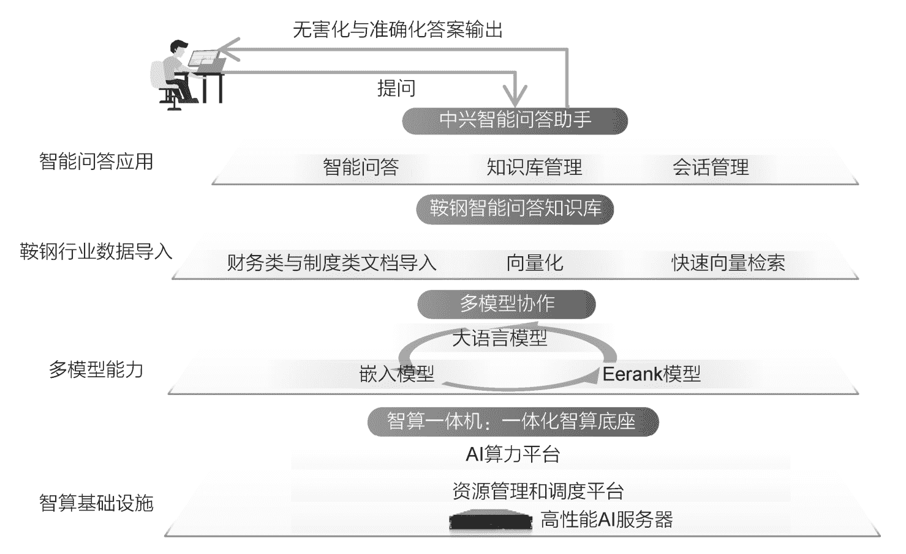

图 2-6

中兴通讯智算一体机提供高度集成化的全栈解决方案，出厂前已预装所需全套软硬件产品，包括高性能服务器、分布式文件存储、IB/RoCE 网络、安全、数据平台软件、智算平台软件等，用户只需进行简单的网络连接、参数配置等基础操作，即可快速完成部署。此外，智算一体机还采用预先集成的方式，内置多种行业模型，由中兴通讯提供大模型代训、精调及应用系统集成等服务，满足不同客户的个性化需求。中兴通讯智算一体机开箱即用，一站式交付，显著提高了鞍钢数科的企业效能，并确保了 AI 应用的快速上线。

2）中兴接入 DeepSeek，实现全链条智能化升级

中兴通讯已全面接入 DeepSeek，并与现有的端、网、算智能化产品结合，实现了 DeepSeek 在多场景、多产品中的广泛应用。

在端侧，中兴通讯旗下努比亚手机品牌已将 DeepSeek-R1 的满血版（6710 亿个参数）服务深度嵌入手机系统，显著提高了 AI 交互深度与响应能力，为用户带来更智能、更便捷的手机使用体验。

在网侧，基于 AIR DNA 解决方案的网络智能化解决方案已引入多尺寸的 DeepSeek 大模型产品，深度重构电信网络的基因与架构，重新定义未来网络的智能化形态，提高网络的智能化水平和服务质量。

在算力侧，依托商用成熟的智算一体机 AiCube，推出 AiCube DeepSeek 智算一体机解决方案，成为业界首批实现 DeepSeek 全栈部署的供应商，为企业提供高效、便捷的智算服务。

3）DeepSeek 赋能产业、政务与医疗场景的落地实践

AI 大模型的真正价值，最终必须回归到产业中，转化为看得见、摸得着的应用。在中兴通讯引入 DeepSeek 技术之后，其产品与服务在多个垂直行业迅速落地，得到了客户的高度评价与积极反馈。

在政务场景中，中兴通讯携手某省打造 AiCube 公文助手一体机，本地部署中兴通讯国产化高性能 AI 服务器和智算底座，基于 DeepSeek 蒸馏版 QWen 模型的思维理解与语义生成能力，结合自身 RAG 公文知识库，实现自动化生成公文、规范表达与多方案生成，大幅提高政务办公效率与标准化水平。

在医疗场景中，某医院在本地部署中兴通讯 AiCube 智算一体机，通过本地精调的 DeepSeek Janus-Pro 及数个医疗专业大模型的理解与生成能力，迅速识别病理切片中的关键病灶，生成高质量的诊断报告。这不仅保护了患者的隐私，还提高了诊断准确率。

这些场景并非传统意义上的“模型调用”，而是 AI 与业务的深度耦合，是模型与行业知识、业务流程的紧密融合。只有当大模型真正嵌入业务核心，成为感知、理解与决策的中枢神经，形成“数据—模型—场景—反馈”的闭环系统，才能推动产业智能化从工具阶段跨入能力阶段。

**2.2 软件子层**

**2.2.1 OpenCloudOS 与 DeepSeek 生态的强力支撑与协同进化**

**1.行业概况**

近年来，全球信息技术竞争格局发生深刻变革，国产操作系统在国家信息安全与科技自主创新战略中的地位日益凸显。在国际技术壁垒加剧的背景下，以 CentOS 为代表的国外主流服务器操作系统停止维护，暴露出关键基础设施依赖外部技术的安全隐患，进一步体现了构建自主可控技术体系的紧迫性。在此背景下，我国提出在党政、金融、能源等关键领域实现核心技术国产化的目标，推动国产操作系统从技术适配阶段迈向规模化应用阶段。

当前，国产操作系统已形成涵盖桌面、服务器、嵌入式等场景的完整产品矩阵，通过深度参与开源社区建设，构建起覆盖芯片架构、基础软件和行业应用的协同创新生态。在技术层面，系统安全性、稳定性实现跨越式提升，生态适配数量突破百万级，原生应用覆盖办公、经营等核心场景；在产业层面，通过政产学研用协同机制，建立起涵盖硬件厂商、软件开发者、行业用户的完整生态链。面对智能化浪潮，国产操作系统正加速与人工智能技术融合，开发端侧推理能力与智能引擎，为数字经济高质量发展筑牢根基。这既是对国家信息安全战略的响应，更是实现科技自立自强、突破“卡脖子”困境的必由之路。

**2.DeepSeek 给操作系统带来的机遇和挑战**

1）AI for OS：DeepSeek 的技术特性可为操作系统解决运维等痛点

DeepSeek 具有高效的推理能力、灵活的模型架构和基于企业知识库的增强支持等技术特性，在操作系统运维中发挥了重要作用。DeepSeek 开源、低成本的优势，使得操作系统在一些日常环节或隔离网络环境中，具备了接入 AI 能力的可能性。针对操作系统的使用场景，DeepSeek 大模型可在如下几个方面发挥作用。

**（1）智能化自动运维**。传统的系统运维方式依赖人工，效率较低、易出错，难以应对复杂的环境。DeepSeek 大模型具有强大的自然语言处理和推理能力，通过工程化，可以实现自动分析日志、实时监控设备状态、智能诊断故障并给出排查建议。支持自动化报告生成和健康状态评估，可以大幅减少人工干预和误操作，提高运维效率和准确性，在自动化故障定位、日志分析、健康报告自动生成、智能告警与建议等方面，能够发挥积极作用。

**（2）配置管理自动化**。由于操作系统的各项配置较为复杂，手工操作容易出错，因此操作准确性和安全性难以保障。DeepSeek 大模型在经过预设提示词等适配接入后，可支持自动生成配置脚本、自动备份与恢复配置，实时检查配置合规性并智能修复。通过 AI 分析流量和使用情况，可以提供个性化性能优化建议。在自动化配置脚本生成、配置合规性检查、配置备份与一键恢复等方面探索应用方法。

**（3）性能优化与资源调度智能化**。操作系统资源分配和性能优化依赖经验，难以动态适应业务变化。在端侧接入 DeepSeek 大模型后，通过多模态数据分析（文本、日志、图像等），智能识别性能瓶颈，预测负载变化，自动调整资源分配和调度策略。且推理速度较快，可较为迅速地调整优化性能。智能负载均衡、资源调度优化、性能瓶颈分析与预测等场景值得进一步探索。

**（4）安全威胁检测与响应自动化**。操作系统的许多安全事件检测均依赖人工，响应相对较慢，潜在威胁难以被及时发现和处理。若在此场景中接入 DeepSeek 大模型，则可具备实时检测威胁能力，能自动分析安全日志、识别异常行为、阻断攻击并自动响应。支持安全事件溯源和风险报告自动生成，诸如在 DDoS 攻击检测、恶意行为识别、自动化安全响应、日志安全分析等应用场景中可以获得较好的支持。

**（5）智能知识库与文档自动化**。传统运维知识库较为分散，文档编写耗时，知识传承难。将运维知识库检索与 DeepSeek 大模型相结合，可支持知识库问答、自动化文档生成和技术资料检索，帮助运维人员快速获取所需信息，提高知识管理效率。该软件能够方便和低成本地支持智能知识库问答、自动生成运维文档、技术资料智能检索等典型应用。

2）OS for AI：DeepSeek 对操作系统提出了更高要求

DeepSeek 的广泛应用对操作系统提出了更高的要求。操作系统需要提供高效的硬件适配和推理框架性能加速，以支持多种国产 CPU 架构和深度优化，从而提高 GPU 资源利用率。此外，操作系统还需要提供全链路 AI 适配支持，覆盖从模型训练到推理部署的完整流程，确保大模型的高效运行。

DeepSeek 等大模型的规模化部署对操作系统技术体系提出了全方位升级需求，需从底层硬件适配到上层服务支撑构建完整的 AI 原生支持能力，具体体现在以下六大技术维度。

**（1）异构硬件深度适配与驱动优化**。操作系统需实现对多元计算架构的兼容性支持，包括英伟达/AMD GPU、昇腾/昆仑芯等国产 AI 加速卡，以及龙芯/申威等国产 CPU 的指令集的适配。需通过动态资源感知技术自动匹配硬件特性，如针对 NVIDIA A100 GPU 的 Tensor Core 单元优化矩阵运算指令，对昇腾芯片提供 CANN 框架的深度集成。同时需要建立统一的显存管理机制，支持多卡间显存池化技术，以解决大模型参数分片存储时的 PCIe 带宽瓶颈问题。

**（2）推理框架性能加速体系。**需原生集成 TensorRT、ONNX Runtime 等推理加速引擎，提供计算图编译优化、算子融合、混合精度计算等功能。通过内核级的内存分配策略优化，可以实现显存碎片整理和零拷贝数据传输。例如，针对 70B 以上的模型，可以采用分页注意力机制来降低峰值显存占用。操作系统还应支持动态批处理调度，根据实时负载自动调整并行推理任务规模，将 GPU 利用率提高至 90%以上。

**（3）全流程 AI 开发支持能力。**需构建覆盖模型训练、微调、压缩、部署的全链路工具链。

•**训练阶段**：集成 Horovod 分布式训练框架，支持多节点 RDMA 网络的无缝对接，通过梯度压缩技术降低通信开销。

•**压缩阶段**：提供量化工具链（FP32→INT8）、结构化剪枝接口，结合 AutoML 实现精度与速度的自动平衡。

•**部署阶段**：内置服务化封装模块，支持通过 Kubernetes 实现容器化部署，提供负载均衡和弹性扩缩容策略。

**（4）异构计算资源调度系统。**需要设计智能调度器，以实现 CPU-GPU-NPU 的协同计算。例如，将数据预处理任务自动分配至 CPU 集群，并将模型推理任务动态调度至 GPU/NPU 阵列。通过时间切片技术实现多模型共享硬件资源，支持 QoS 分级保障机制，确保高优先级任务获得确定性时延。针对国产化场景，需要提供软硬件协同的异构编程模型，例如同时支持 CUDA 和 OpenCL 标准接口。

**（5）构建安全可信执行环境。**需要在操作系统内核层面实现数据全生命周期加密，采用国密算法加密模型权重文件，并通过 SGX/TEE 技术保护推理过程中的敏感数据。建立细粒度访问控制策略，对模型 API 调用进行动态鉴权。同时需要提供漏洞扫描模块，以便实时检测模型服务的安全风险。

**（6）生态兼容与迁移支持。**需构建跨架构二进制兼容层，支持 PyTorch、TensorFlow 等主流框架的自动适配，提供从 x86 到 ARM 架构的模型无缝迁移能力。针对国产操作系统，需深度优化银河麒麟等系统的 AI 软件栈，实现与开源生态的组件互通。同时需提供性能分析工具链，帮助开发者快速定位硬件瓶颈并进行针对性优化。

这种操作系统级的技术演进，本质上是在构建 AI 原生基础设施，通过硬件抽象层重构、计算资源虚拟化、服务编排智能化等创新手段，为 DeepSeek 类大模型提供从芯片指令集到云边端协同的全栈支持，推动 AI 算力效率实现数量级的提升。

**3.产业链与关键技术**

1）DeepSeek 生态与操作系统开源社区相结合

DeepSeek 生态与操作系统开源社区的结合，促进了产业的快速发展。操作系统开源社区优化了硬件架构和推理框架的性能，为 AI 应用提供了全链路适配支持。同时，OpenCloudOS 积极推动软硬件协同优化，建立了完善的兼容性测试体系，以确保系统的稳定性和广泛的生态适配能力。这种深度协同不仅加速了 AI 技术在操作系统层面的落地应用，更推动了开源系统向智能化方向的演进，形成了技术创新与产业发展的良性循环。

（1）技术互补性融合。DeepSeek 的 AI 能力与开源操作系统的结合形成了技术互补。开源操作系统提供了稳定的底层运行环境，而 DeepSeek 为其注入了智能化能力。

•**智能调度优化。**传统操作系统的任务调度机制难以适应 AI 工作负载的动态需求。通过强化学习算法，可以优化 CPU/GPU 的资源分配策略，从而使系统能够根据实时负载自动调整任务优先级。在云计算环境中，结合 Kubernetes 调度器，DeepSeek 的 AI 模型可以预测容器化 AI 任务的资源需求，实现更高效的集群管理。

•**驱动与固件智能化。**在嵌入式和实时操作系统中，DeepSeek 的轻量化 AI 模型为预测性维护和异常检测提供了新思路。通过分析设备传感器数据，AI 模型可以提前预测硬件故障或网络异常，并触发自动修复机制，这种能力在工业自动化和物联网设备管理中展现出重要价值。

•**应对安全威胁。**在网络安全威胁日益复杂的背景下，DeepSeek 的 AI 能力与开源操作系统的安全机制形成了深度协同，共同应对网络安全威胁。传统操作系统的安全模块主要基于静态规则，难以应对新型攻击。可以通过机器学习分析系统调用行为，实时检测异常进程并动态调整安全策略，以确保系统的安全性。在 Linux 内核中集成了异常行为检测模型，该模型可以通过监控进程的系统调用序列来识别潜在的恶意活动。

•**AI 增强的内核安全。**通过机器学习分析系统调用行为，检测异常进程（如挖矿木马、0day 漏洞利用），并集成到 SELinux、AppArmor 等安全模块中。

•**智能漏洞预测。**DeepSeek 的代码分析模型能够自动化扫描开源操作系统的代码库，检测潜在的安全漏洞。在 Linux 内核开发中，AI 模型可以帮助开发者识别高风险代码段，例如内存泄漏、竞态条件等。通过结合模糊测试技术，DeepSeek 模型能够生成更有效的测试用例，从而提高发现漏洞的效率。

•**隐私计算支持。**结合可信执行环境和联邦学习，使 AI 模型能在保护用户数据的前提下，在开源系统中安全运行。

（2）产业应用创新。DeepSeek 与开源操作系统的结合正在催生多个领域的创新应用。在智能运维领域，通过将 AI 模型集成到开源监控工具中，系统能够实现故障预测与自愈功能，大幅提高运维效率。在边缘计算场景下，轻量级 AI 模型与嵌入式操作系统的结合，为智能制造和智慧城市等应用提供了可靠的技术支撑。自动驾驶领域是另一个重要的应用方向。在医疗健康领域，DeepSeek 的 AI 模型与医疗设备操作系统的结合，实现了更精准的医学影像分析和诊断辅助。这种创新应用不仅提高了诊断效率，也为远程医疗和基层医疗服务提供了技术支持。

2）操作系统助力 DeepSeek 的关键技术点

操作系统在助力 DeepSeek 方面提供了多项关键技术支持。硬件架构深度支持龙芯、海光、鲲鹏、飞腾等国产 CPU 架构，提供不同规模模型的部署方案。通过预置优化库，可以提高 PyTorch 和 TensorFlow 等框架的推理性能。全栈 AI 适配支持覆盖从模型训练到推理部署的全流程，提供高效的开发和部署体验。

**（1）硬件架构深度适配。**操作系统通过构建统一的抽象层，实现了对龙芯、海光、鲲鹏、飞腾等国产 CPU 架构的全面兼容。在模型部署环节，操作系统提供了从边缘设备到云端服务器的全栈支持，确保 DeepSeek 模型能够在不同计算规模的硬件平台上获得最优的性能表现。

**（2）推理框架性能加速提升。**操作系统采用经过深度优化的数学计算库，显著提高了 PyTorch 和 TensorFlow 等主流框架的推理效率。特别值得关注的是，操作系统通过内存管理机制和任务调度策略，有效降低了推理过程中的资源占用率。同时，针对特定硬件平台（如 NPU 加速卡）的专用驱动支持，进一步释放了 DeepSeek 模型的推理性能潜力。

**（3）全栈 AI 适配支持。**操作系统已经对 DeepSeek 全流程工作负载进行了深度优化，以提高性能和可靠性。在模型训练阶段，提供了高效的分布式训练框架，其中包括 GPU/NPU 集群管理、数据并行处理等关键功能。在模型转换环节，内置的格式转换工具链确保了模型在不同框架间的无缝迁移。在部署运行时，通过轻量化容器技术和虚拟化技术支持，为 DeepSeek 模型提供了灵活多样的部署选项。

**（4）安全可信执行环境**。通过硬件级的安全隔离机制和软件层的访问控制策略，操作系统为 DeepSeek 模型的训练数据和推理过程构建了全方位的安全防护体系。在隐私计算场景下，操作系统的基础设施支持结合联邦学习框架（如 TensorFlow Federated 或 FATE），使 DeepSeek 能够在保护数据隐私的前提下实现多方协同建模。

**（5）资源调度与能效优化**。操作系统通过智能化的资源监控和分配机制，显著提高了 DeepSeek 模型工作负载的执行效率。能效管理策略可以根据工作负载特征动态调整计算单元的功耗状态，从而最大化能效比，保证性能。针对大规模模型推理场景，操作系统提供的弹性伸缩能力确保了服务质量的稳定性。

（6）**跨平台统一接口**。通过标准化的 API 设计和统一的开发工具链，操作系统使 DeepSeek 模型可以无缝运行在不同架构的硬件平台上，大幅降低了开发者的移植和维护成本。这种跨平台能力极大地拓展了 DeepSeek 技术的应用范围，为开发者提供了更便捷的开发体验。

**4.OpenCloudOS 的全链路自研创新**

1）OpenCloudOS 简介和定位

OpenCloudOS 作为国内首个全链路自研的服务器操作系统，凭借其稳定、高效、安全的特性，迅速在市场中占据了一席之地。OpenCloudOS 的自主研发实现了从源社区（L1）、企业版（L2）到社区稳定版（L3）的全链路覆盖，并输出了经过海量业务验证的企业级稳定操作系统版本，如图 2-7 所示。

OpenCloudOS 作为全链路服务器操作系统的标杆，其多层级架构覆盖了从上游研发到生产落地的完整生态。

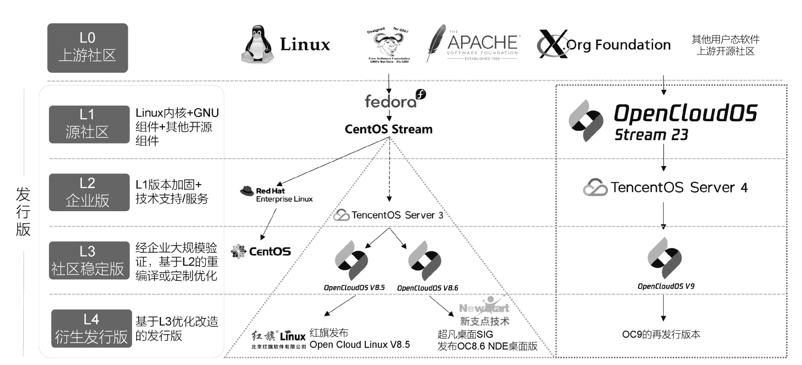

图 2-7

（1）**OpenCloudOS Stream（L1 层级）。**作为上游“源社区”版本，由腾讯、中兴通讯等厂商联合研发并独立演进，内核及软件包均基于 Linux 原生社区最新稳定版本选型。该版本通过持续监控上游更新实现快速迭代，提供自主可控的软件供应链，并构建了包含超过 1800 个软件包的完整生态体系，为下游版本奠定创新基础。

（2）**TencentOS Server（L2 层级）。**它是腾讯基于 OC 社区 L1 版本的 OpenClousOS Stream 开发的腾讯首个自主可控的商业发行版本，TencentOS Server 的内核及用户态软件均基于 OpenClousOS Stream 社区独立演进，自主选型和维护，不再依赖任何第三方发行版，实现了对超过 2000 个用户生态软件的独立编译和维护。具备高性能、安全稳定、支持多硬件平台的特性，能为云原生、大数据、人工智能等领域的开发者和用户提供最佳的基础环境和服务能力，彻底解决 CentOS 断供的问题。

（3）**OpenCloudOS 8（L3 层级）。**该版本属于社区稳定版，基于 L1 版本进行了深度优化并兼容 CentOS 8 生态。通过内核级增强，可以实现稳定性提高 70%，特定场景性能提高 50%，并且经过千万节点验证，支持云原生场景。提供长达 10 年的维护周期，并配备 Cgroup V2 支持、热补丁等特性，因此成为 CentOS 替代的理想选择。

（4）**OpenCloudOS 9（L3 层级）。**作为首个全自研社区版本，完全摆脱 CentOS 依赖链，从内核到用户态组件均为自主选型维护。创新性引入 MGLRU 内存管理、Maple Tree 等特性，使数据库性能提高超过 50%，I/O 性能提高 26.5%。支持多架构芯片和新型硬件，集成国密算法与 TPM 安全模块，为 AI、大数据等前沿领域提供云原生底座。

该体系通过 L1 源头创新到 L3 稳定版本的协同，构建起覆盖软件供应链全周期的自主生态，目前已在金融、云计算等 12 大行业中实现千万级节点部署。

2）OpenCloudOS 社区和生态

OpenCloudOS 社区是国内领先的开源操作系统根社区，已经形成了覆盖全产业链的生态体系。截至 2024 年年底，社区理事单位达 31 家，连接上下游企业超过 800 家，触达开发者 15 万人，装机量突破 1500 万个节点。在技术层面上，该系统全面支持 x86_64、ARM64、RISC-V、LoongArch、飞腾和海光等国产芯片架构，能够适配超过 96000 款软硬件。此外，该系统还提供全栈国密支持，可用性高达 99.999%，故障率较 CentOS 降低 70%。

在生态建设上，社区推出城市联盟计划，在北京、上海等五城试点产业落地，并成立行业发展委员会推动标准制定。通过腾讯、龙芯、中科方德等核心成员的技术共建，已在金融、教育、AI 等领域实现突破：趣丸科技容器利用率提高至 80%，网易有道实现 AI 知识库一键部署，中南民族大学完成教育数字化基座建设。社区还推出云原生 OS 玄湾、跨版本迁移方案等技术，持续引领国产操作系统生态发展。

3）OpenCloudOS 对 DeepSeek 等大模型的针对性优化

（1）性能优化：内核与系统级改进。OpenCloudOS 针对 AI 场景下的海量数据处理和复杂计算需求，通过深度优化内核和系统核心组件，显著提升了基础性能表现。

•**内核核心优化。**通过调度算法重构与锁机制优化，上下文切换性能较上游原生内核提高 10%，降低多线程任务调度延迟。首先，网络性能取得了突破，基于 eBPF 与 Cilium 的网络协议栈优化，网络带宽较 CentOS 8 提高了 29%～38%，PPS（每秒数据包处理量）提高了 59%～65%，从而满足 AI 训练中大规模数据吞吐需求。接下来，存储和计算得到了加速，文件锁测试性能提高了 200%，虚拟机缺页处理内存分配效率提高了 100%，Redis 性能提高了 11%，Nginx 最大性能提高了 150%。

•**资源调度优化。**引入自研的离线混部技术，通过智能资源隔离与优先级调度，降低虚拟化开销达 130%～150%，提高异构计算资源利用率。例如，通过容器网络优化，完整支持 Cilium eBPF-based 网络方案，容器间通信性能可以提高 50%以上，同时多容器并发访问页缓存（Page Cache）的性能也可以提高 187%。

（2）安全体系：全链路安全体系。OpenCloudOS 构建了覆盖“云-管-端”的全链路安全体系，为 AI 系统提供了主动防御和被动防护的双重保障。

•**主动安全防护。**例如，机密计算与可信根，基于海光安全虚拟化技术 CSV，实现内存数据加密保护；通过 TPM 2.0 与 TPCM 双路径可信根，建立从 BIOS 到内核的完整性校验链，防止启动过程篡改。国密算法全栈支持，集成 SM2/SM3/SM4 算法，覆盖 OpenSSL、Libgcrypt 等基础库及内核层，为数据传输与存储提供合规加密支持。

•**被动安全加固。**例如，漏洞生命周期管理，通过 SBOM（软件物料清单）实时追踪供应链风险，漏洞修复自动化率达 70%；结合混元大模型实现漏洞影响预测，修复时效从小时级压缩至分钟级。采用热补丁技术，自研 ARM64 热补丁机制，支持运行时漏洞修复，使宕机率较 CentOS 降低 70%，系统可用性达到 99.999%。

（3）兼容性支持：AI 生态深度适配。OpenCloudOS 通过广泛兼容主流 AI 框架和硬件生态，构建了一个灵活、高效的 AI 开发环境。

•**AI 框架与工具链支持。**推理与训练框架原生支持 TensorRT、TensorRT-LLM、vLLM、DeepSpeed 等 30 余个推理和训练框架，提供预置环境镜像与部署指南。模型开发工具集成 Ollama、HuggingFace TGI、ChatTTS 等 WebUI 工具链，支持模型微调、推理服务部署等全流程开发。

•**多种计算卡适配。**GPU/NPU 兼容 NVIDIA CUDA、AMD ROCm 及国产计算卡（如昇腾、寒武纪等），适配 1143 款硬件设备，提供异构计算资源统一调度能力。

•**国产化适配**：联合红旗、统信等厂商推出联合发行版，支持国产 CPU（鲲鹏、飞腾）及 AI 芯片，满足信创场景需求。与沐曦、天数智芯、太初元碁、壁仞科技、燧原、紫霄、海光-DCU 等厂商进行一体机合作，提供更稳定的支持，减少安全威胁，并提供云原生集群支持。

**（4）AI 开箱即用镜像。**随着企业业务上云，容器成为应用部署和运行的关键组件，容器的广泛使用，使各种容器镜像应接不暇，带来资源、部署和管理等方面的新挑战。OpenCloudOS 发布多种小型化容器镜像，基于 OpenCloudOS 操作系统制作的小型化容器镜像，可以实现更小的应用镜像，提高环境的资源利用率、部署速度和安全性。

•**基础镜像。**opencloudos9-microdnf（101MB）使用 microdnf 包管理器，coreutils 为 Linux 工具集。microdnf 是一个轻量化的包管理器，与 dnf（yum）相比，二者安装、卸载和更新软件包的命令相同，但 microdnf 不支持 search 搜索包、deplist 查询包依赖关系、dnf 插件扩展、历史记录及事务回滚等高级特性。

对比 dnf 包管理器的 opencloudos9-minimal 镜像，microdnf 镜像大小不到其 60%，若无包搜索和其他 dnf 高级特性需求，则推荐使用此镜像替换 opencloudos9-minimal 镜像。

另外，提供将 dnf（yum）作为包管理器，coreutils 作为 Linux 工具集的 opencloudos9-minimal（176MB）。同时支持以 systemd 为镜像启动进程，包括可以在单个容器中运行多个服务的 opencloudos9-init（218MB）无包管理器，以及将轻量化的 busybox 作为 Linux 工具集的 opencloudos9-busybox（26.9MB）等。

•**应用 runtime 镜像。**应用 runtime 镜像包括：opencloudos9-rt-java17（248MB）、opencloudos9-rt-python3.11（51.1MB）、opencloudos9-rt-dotnet7.0（134MB）、opencloudos9-rt-static（4.34MB）、opencloudos9-rt-php8.2（58.7MB）和 opencloudos9-rt-nodejs18（80.9MB）。

该系列镜像的特点如下。

-更小：只包含应用运行所需的最小依赖，不包含任何不必要的系统工具或库。如果需要 shell 调试，则可以在 runtime 镜像上叠加基础镜像（如 opencloudos9-busybox）作为 debug 镜像。

-更安全：镜像只包含最小的运行时环境，减少了潜在的攻击面，从而提高了容器的安全性。

-更高效：镜像在运行时只加载必要的组件，因此启动时间更短，运行效率更高。

•**与业界镜像对比。**OpenCloudOS 应用的 runtime 镜像总体优于 Google distroless 镜像，接近 Alpine 镜像。支持的语言包括 Java、Python、PHP、Node.js、Go 和 DotNET，后续会持续扩展主流语言。

在镜像大小方面，除 Java 镜像外，OpenCloudOS 应用的 runtime 镜像整体优于 Google distroless 镜像，Python 3.11 为 51.1MB、Java 17 为 248MB、Node.js 为 80.9MB。

在应用兼容性方面，OpenCloudOS 应用的 runtime 镜像将 glibc 作为 C 库，兼容性好，所有软件包均来自 OpenCloudOS 软件源，能够高效响应、快速修复漏洞。

在可调测性方面，OpenCloudOS 应用的 runtime 镜像可以在 runtime 镜像上叠加基础镜像作为 debug 镜像。基础镜像根据调测工具软件的需要可选择 opencloudos9-busybox 或包含包管理的 opencloudos9-microdnf、opencloudos9-minimal。

4）OCAI-Agent DeepSeek 满血版运维神器

（1）OCAI-Agent 开发背景。OCAI-Agent 旨在解决系统工程师日常运维中的痛点，包括命令查询困难、脚本编写复杂及提高运维效率难等。具体来说，面对不熟悉的命令，工程师需要反复查阅手册或在搜索引擎中寻找答案，这不仅耗时耗力，还容易出错。此外，小型自动化脚本中烦琐的语法和调试过程，进一步增加了工作负担。通过引入 AI 作为“命令行副驾驶”，OCAI-Agent 希望能够高效获取命令并执行方案，从而显著提高运维效率。

（2）OCAI-Agent 核心功能。

•自然语言交互问答：OCAI-Agent 的核心功能之一是自然语言交互问答。用户可在终端中直接输入日常语言提问，如“如何查看最近登录失败的记录”，工具会输出对应命令（如 auditd 或 lastb），甚至可确认后直接执行，调出相关记录。这一功能大大降低了使用门槛，尤其是对于新手或需要快速解决问题的场景。

•命令行智能辅助：当用户忘记具体命令或参数时，可通过描述需求获取建议。例如，如果需要批量替换文件中的字符串，则工具会推荐使用 sed 或 awk 命令，并且可以直接生成可执行代码片段。这种智能辅助功能减少了查阅文档的时间，提高了工作效率。

•上下文感知：OCAI-Agent 能够记住对话历史，处理多步问题。如果用户先询问如何查看进程列表，然后询问如何只显示 CPU 占用高的进程，则工具会结合上下文推荐 top 命令或通过 ps 命令过滤输出结果。这种上下文感知能力使工具在处理复杂任务时更加高效和智能。

（3）OCAI-Agent 三大模式。

第一种，Chat 模式。Chat 模式较为常用，用户通过提问调用 OCAI 问答系统，并让系统进入思考、推理及结果输出过程。在命令窗口中直接输入相关问题，无须加入任何命令前缀，即可方便调用 OCAI 智能助手的问答能力。

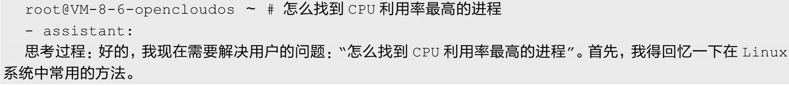 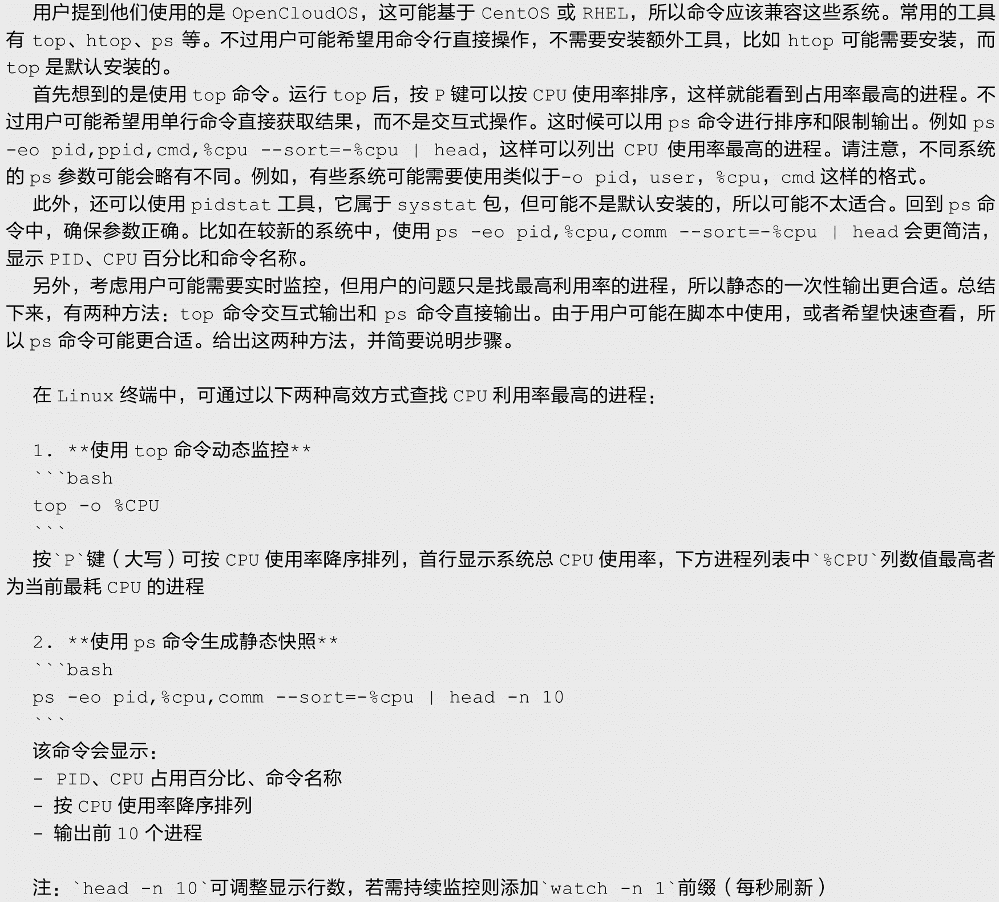

第二种，Cmd 模式。Cmd 模式支持根据用户指示生成可直接执行的 Shell 命令，用户确认后可立即执行并获取结果。可以通过 ocai cmd 的形式对命令生成能力进行调用。工具在执行命令前会要求用户二次确认，用户可在工具输出命令的基础上进行编辑，完成后可快速执行并获取结果。

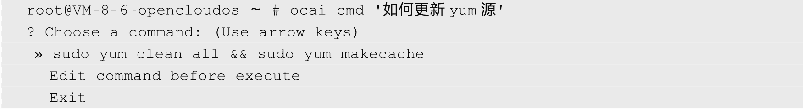

第三种，Code 模式。Code 模式支持根据用户指示生成不同编程语言下的代码。通过 ocai code<question>形式对代码生成能力进行调用。例如，用户可以输入“用 python 实现快排”，工具会生成相应的 Python 代码。建议在问题描述中清晰地表述功能需求和使用语言，以确保生成的代码符合预期。

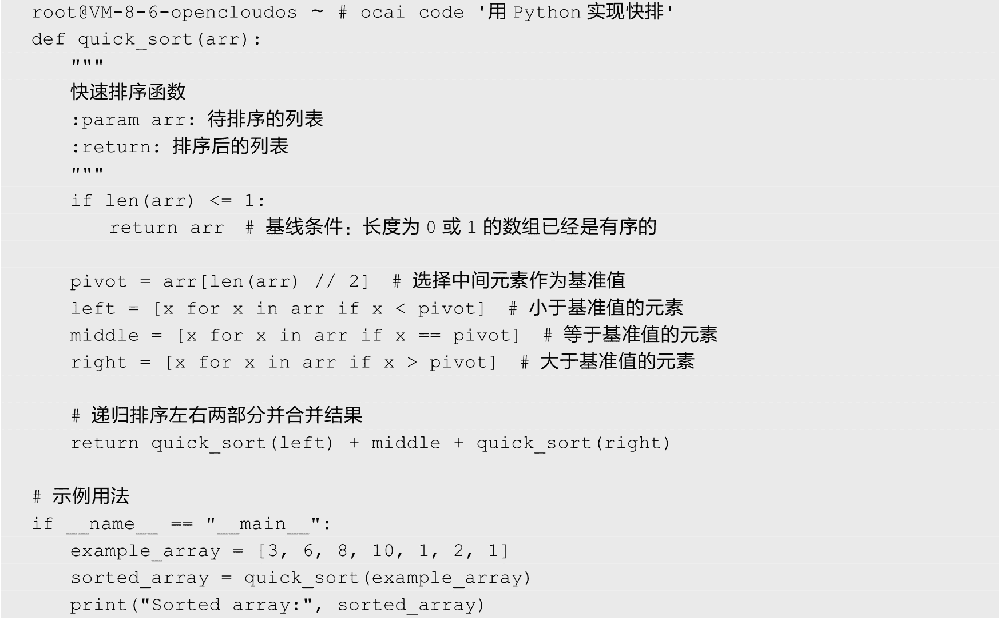

（4）OCAI-Agent 技术原理。当前 OCAI 智能助手针对不同场景设计了多个 Agent 分别处理请求，采用 RAG 方式导入 OpenCloudOS 特有知识库信息，通过 OCAI-Service 与客户端进行交互，使用不同的底座模型对数据进行推理、总结和润色，最终输出给用户，如图 2-8 所示。

主要技术点包括以下几个方面。

•操作服务：OCAI 智能助手针对不同场景和数据库创建了多个不同的智能体，每个智能体负责特定的一个领域的处理逻辑（如对话、命令生成、代码生成等），并通过指定逻辑将多个智能体组合编排，使用入口得以统一，多个智能体可以协同工作。

•索引服务：针对通用模型缺少特定领域知识的情况，OCAI 智能助手通过 RAG 将特定领域的知识库（如 OpenCloudOS 文档库）数据进行处理后，计算成向量形式并存入向量数据库。用户提问时，先从向量数据库中检索出相关程度较高的数据，再将其统一拼接成提示词提交给大模型进行总结和回答。

•API：OCAI-Service 是 OCAI 智能助手的接口层服务。在直接提供服务调用接口的同时，还支持上下文管理、接口转发、用户识别、身份鉴权、配置管理、反馈收集、统计日志等基础能力。OCAI-Service 也为多模型选择及函数调用提供了通道。

•模型服务：OCAI 智能助手在处理逻辑的各阶段使用了 DeepSeek 和混元等各类大模型，包括但不限于 DeepSeek-R1、DeepSeek-V3、混元-T1、混元-Turbo 等。

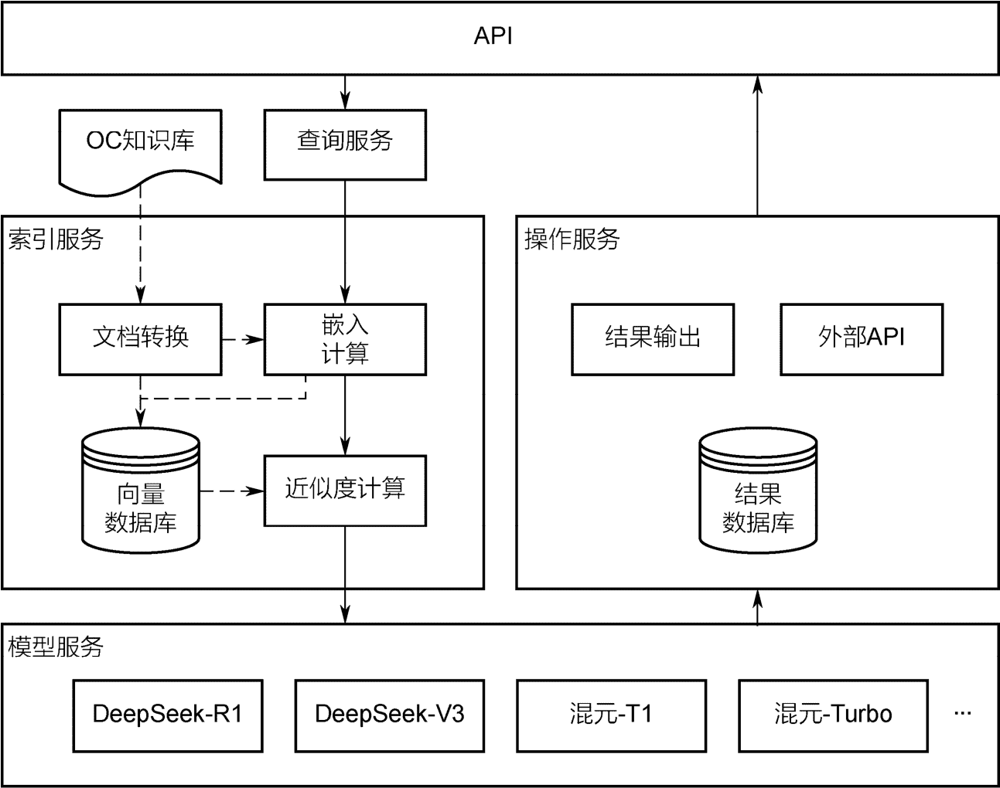

图 2-8

（5）OCAI-Agent 获取方式。当前 OCAI-Agent RPM 包已在 OpenCloudOS 8/9 软件源上线，使用上述版本的 OC 用户可直接执行 yum install ocai-agent 进行安装，或通过 OpenCloudOS 官网右上角的 Banner 获取安装指引。

完成安装后，按照指引在指定网址内输入邮箱进行注册，并按照邮件中的指引配置访问密钥，即可开始使用。

**5.行业案例分析**

1）OpenCloudOS 适配优化场景

（1）网易有道 QAnything。网易有道开源的 AI 知识库问答平台 QAnything 与 OpenCloudOS 通过技术合作，将 QAnything 集成到 OpenCloudOS 操作系统中，打造了一套操作系统 AI 问答解决方案，为 OpenCloudOS 用户提供了一键部署 AI 知识问答库的能力。

QAnything 是网易有道自研的检索增强引擎，可以高效管理各类文档，快速构建本地知识库问答，实现“即问即答、即找即现”，具备稳定、高性能、高可用的系统，以及成熟的应用落地实践经验。而 OpenCloudOS 作为一款开源操作系统，侧重于提供稳定、安全、高效的底层计算环境，双方在技术栈上具有显著互补性。

这一合作解决了用户在部署 AI 知识库时面临的环境配置复杂、依赖库兼容性差、运维成本高等问题。传统部署方式需要手动安装依赖和调整配置，流程烦琐且容易出错，而 OpenCloudOS 用户现在只需拥有 Docker 运行环境，使用 Docker Compose 命令即可一键启动 QAnything 应用程序，极大地简化了部署流程。

在方案实施过程中，研发团队首先解决了依赖库的兼容性问题。为了确保 QAnything 能够在 OpenCloudOS 环境中正常运行，团队仔细分析 QAnything 的 Dockerfile 文件和相关文档，识别出所有必要的依赖库。在 OpenCloudOS 的 Dockerfile 中，团队使用 dnf 包管理器安装了这些系统级依赖，对于 Python 依赖，则使用 pip 包管理器进行安装。通过逐个检查和安装依赖库，确保 OpenCloudOS 镜像中包含运行 QAnything 所需的所有组件。

针对容器编排和配置调整的挑战，QAnything 使用了多个容器协同工作，因此需要对 docker-compose.yml 文件进行适当调整。团队仔细分析原有 docker-compose.yml 文件，深入理解各服务的功能和配置后，根据 OpenCloudOS 的特点，对文件进行了必要修改，包括调整镜像名称、端口映射、卷挂载等。通过反复的测试和调试，确保服务能够在 OpenCloudOS 环境下正常运行。

在解决了这两大难题后，OpenCloudOS 具备了一键部署 QAnything 的能力。用户无须关注复杂的环境配置和依赖管理，只需拥有 Docker 运行环境，并使用 Docker Compose 命令即可快速启动 QAnything 应用程序。这不仅极大地简化了 QAnything 启动和运行的过程，降低了使用门槛，也节省了用户的时间和精力。

目前，双方联合打造的操作系统 AI 问答解决方案已经在企服、文旅、电力、汽车等行业落地，打造了多个标杆案例。以中关村壹号园区为例，通过该方案，园区上线了国内首个基于国产化的园区级问答项目，帮助园区企业进一步实现了降本增效。同时，通过该方案，为园区搭建了一个集百万份技术文档于一体的企业本地知识库问答系统。截至本书完稿，中关村壹号园区企业文档问答产品日均解答问题已经超过 200 次，平均问题响应时间降低了 29%，企业团队协作的效率提高了 35%。

未来，网易有道将持续深化与 OpenCloudOS 的合作，共同推动操作系统与知识库问答领域的技术进步和发展，为用户提供更加好用、易用的智能问答服务。

（2）AMD EPYC 助力优化 AI 计算。AMD 第五代 EPYC Turin 处理器在人工智能计算领域取得了重要技术突破。该处理器基于 Zen 5 微架构设计，标准版本提供单芯片 128 核心配置，而 Zen 5c 高密度版本更可扩展至 192 个核心，基础频率最高可达 5GHz，显著提高了单位计算密度和能效表现。在架构层面，Turin 采用先进的多芯片互连技术，支持 DDR5-6000 内存与 128 条 PCIe 5.0 通道，为大规模 AI 工作负载提供强劲的硬件支撑。

当前，AI 计算领域的核心痛点在于，传统计算架构难以平衡性能与成本效益。一方面，AI 工作负载对计算密度和内存带宽的需求持续攀升；另一方面，企业需要控制日益增长的能源消耗和硬件采购成本。同时，虚拟化环境下的安全隔离和性能监控也成为关键挑战。

针对这些痛点，AMD 与 OpenCloudOS 开源社区建立了深度技术协同机制，双方在操作系统内核层完成多项关键技术融合，包括基于 SEV（安全加密虚拟化）和 SNP（安全嵌套分页）的机密计算框架、针对 Zen 5 架构优化的 NUMA 调度算法，以及支持 EPYC 处理器的实时性能监控系统。这些技术创新有效解决了 AI 计算环境中的安全隔离、资源调度和性能优化等问题。

在具体实施过程中，技术团队首先对 OpenCloudOS 内核进行了深度调优，以满足客户的需求。通过重构 NUMA 调度算法，操作系统能够更好地适配 EPYC Turin 处理器的多芯片互连架构，优化了跨核心的数据访问效率，从而提高了性能和可靠性。此外，集成的 SEV/SNP 安全框架为 AI 工作负载提供了硬件级的安全隔离保障，实时性能监控系统可以精确追踪处理器在各 AI 计算阶段的资源使用情况。

通过腾讯云落地的 EPYC+OpenCloudOS 联合解决方案实测数据显示，这些技术创新带来了显著的性能提升。在 DeepSeek 大模型推理场景中，AI 训练吞吐量实现大幅增长，单节点推理时延已降低至行业领先水平。这验证了“高核心数高频率”异构计算架构与开源操作系统深度适配的技术路线的可行性。

这种硬件与软件协同创新模式，不仅解决了 AI 计算中的性能瓶颈和安全挑战，还通过提高能效表现有效降低了总拥有成本。AMD EPYC Turin 处理器与 OpenCloudOS 的深度整合，为企业在多元算力时代构建高性能、高安全性的 AI 基础设施提供了经过验证的解决方案。

（3）TACO-LLM。随着大模型、复杂 AI 算法的广泛应用，计算效率不足已成为制约模型落地与应用效果的关键因素。如何在有限资源下实现计算性能的显著提升，成为行业技术攻关的核心。

针对显存碎片化、调度效率低等问题，TACO-LLM 通过三大创新技术实现性能跃升。

•Continuous Batching：动态批处理技术消除计算“气泡”，在千卡集群中实现 95%线性度，吞吐量较静态批处理提升 2 倍。

•Speculative Sampling：结合大小模型协同推理，通过“草稿生成+验证”机制，首字延迟降低 40%，解码吞吐提高 1.8～2.5 倍。

•TurboAttention：专为长序列设计的自研算子，结合分块管理与 FlashAttention 优化，8K 长文本推理显存占用减少 30%，计算效率提高 86%。

基于 OpenCloudOS 与 NVIDIA H800 硬件，采用专家并行优化部署，在 MoE 模型推理中实现通信与计算重叠，单机 NVLink 带宽利用率超过 95%，多机 RDMA 效率达 90%，验证了推理引擎在复杂场景下的技术成熟度。

通过 TACO-LLM 与 OpenCloudOS 的“强强联合”，OpenCloudOS 凭借对底层硬件的深度优化能力，全面支持满血版 DeepSeek-R1，在双机 16 卡的硬件环境下，无论是短输入场景（如知识问答）还是长输入场景（如私有信息的检索增强生成），推理性能都有大幅提升，为企业降低算力成本、提升竞争优势提供了全新的解决方案。

2）OCAI-Agent 在运维与实践中的应用案例

（1）服务器 CPU 负载飙升问题定位。OCAI-Agent 智能运维工具在实际生产环境中表现出卓越的问题诊断能力。以 Kubernetes 集群运维场景为例，当节点出现 CPU 负载异常飙升（如持续超过 90%）时，传统人工排查方式面临诸多挑战：运维人员需要依次检查系统监控数据、分析 kubelet 日志、排查容器资源使用情况，整个过程不仅耗时，而且对工程师的经验依赖性强。

通过部署 OCAI-Agent 工具，运维流程得到了显著优化，使用者只需用自然语言描述问题现象，例如“节点 CPU 负载持续高于 90%，请分析原因”。该工具基于内置的知识图谱和大模型，准确识别出诸如“Pod 内存限制配置不足导致频繁 OOM”这类深层次问题。值得关注的是，系统会同步生成包含根因分析、验证方法和修复方案的结构化报告，其中修复建议不仅包含参数调整的具体数值，还会标注操作的风险等级。

在实际案例中，某电商平台使用该工具后，将平均故障修复时间（MTTR）从原来的 25 分钟缩短至 3 分钟以内。特别是在处理复杂的连锁故障时（如因内存泄漏引发的 CPU 竞争问题），工具展现出的全链路分析能力远超人工排查效率。此外，系统还会自动记录解决方案并形成知识库，为后续类似问题的处理提供参考，实现了运维经验的持续沉淀。

从技术架构角度来看，OCAI-Agent 的优势主要体现在三个方面：首先是通过语义理解降低使用门槛，非资深工程师也能快速上手；其次是采用增量学习机制，使诊断模型能够持续优化；最后是确保对各类异常情况都能给出专业级的处理建议。这些特性使该工具特别适合需要 7×24 小时稳定运行的云原生环境。

（2）本地目录同步到远程服务器命令生成。在 OC 社区与高校的合作实践中，大学生在进行服务部署时，经常需要将本地开发环境的目录内容同步到远程服务器。以 rsync 命令为例，虽然功能强大但参数复杂，新手容易混淆。例如需要实现以下需求。

•同步本地/data 目录到远程服务器（IP：192.168.1.100）的/backup 目录。

•排除所有带有.log 扩展名的日志文件。

•同步显示进度详情。

传统方式需要查阅手册组合参数，而使用 OCAI-Agent 工具时，开发者只需输入“使用 rsync 将本地 data 目录同步到 192.168.1.100 服务器的 backup 目录，排除.log 文件并显示进度”，工具会立即返回优化后的命令。

这个解决方案包括：

•-a 保持文件属性和递归同步。

•-v 显示详细过程。

•-z 启用压缩传输。

•--progress 显示实时进度。

•--exclude 精确过滤日志文件

经过测试，该方案较手动查询可以节省大量时间，特别适合不熟悉 Linux 命令的初学者快速完成部署任务。

**6.小结**

OpenCloudOS 与 DeepSeek 的深度融合和相互促进标志着国产操作系统与人工智能技术的协同进化进入新阶段。作为全链路自研的服务器操作系统标杆，OpenCloudOS 通过 L1～L3 分层架构构建了自主可控的生态体系。该生态体系在安全、性能和兼容性方面实现了突破，覆盖了金融、云计算等 12 大行业的千万级节点部署。DeepSeek 的接入为操作系统注入智能化能力，在自然语言交互、自动化运维、资源智能调度等场景中，可以显著提升运维效率并降低风险，凭借低成本和高效的特性获得了极高的热度，推动操作系统向 AI 原生基础设施演进。

二者协同形成技术互补与生态共建的双向赋能，OpenCloudOS 为 DeepSeek 提供异构硬件适配、推理框架加速等底层支撑，DeepSeek 的 AI 能力反哺操作系统在智能调度、安全检测、知识管理等维度的创新。未来，随着国产化替代与智能化浪潮的深化，这种技术融合范式将持续推动操作系统从“可用”向“智能”跃迁，为数字经济发展筑牢根基。

**2.2.2 阿里云服务器操作系统：为 DeepSeek 构建智能化时代隐形底座**

服务器操作系统的发展与算力产业的演进密切相关。当前，算力产业正在经历重大变革，“云+AI 深度融合”的产业趋势与大模型驱动的智能化浪潮，给操作系统的演进与发展带来前所未有的机遇和挑战。本节将基于这一背景，探讨服务器操作系统如何通过双向赋能的技术路径实现自身重构。

**1.云+AI：积极应对基础设施挑战**

1）大模型趋势下计算基础设施面临的挑战

大模型的爆发式发展正深刻改变技术格局，DeepSeek 671B 等千亿级参数模型的落地暴露出基础设施的深层矛盾，而算力成本的挑战尤为突出—单机部署模型的硬件成本动辄百万元人民币。例如，单台搭载 8 张 NVIDIA H100 GPU 的服务器，采购投入接近三百万元人民币。而这种单机部署模式难以充分释放 GPU 算力，与采用混合并行（数据并行+专家并行）的分布式推理方案相比，每 Token 成本可相差几十倍。这种矛盾在中小规模企业中尤为尖锐：在一些私有化部署场景中，日均负载可能不足 15%，但当请求量达到饱和负载的 90%时，单机仅几十个 Token 每秒的吞吐能力将引发严重延迟。更严峻的是，静态资源分配策略导致空闲期的算力浪费率超过 80%，技术理想与商业现实间的鸿沟亟待弥合。

对自建 AI 基础设施的用户而言，更深层次的挑战源于供应链的复杂性。

•在规模定律（Scaling Law）的驱动下，分布式训练集群的规模从千卡向万卡再到十万卡集群扩展。DeepSeek 等超大规模模型的发展，让分布式推理成为主流，常常需要消耗数百张 GPU 卡来实现并行推理。这对数据中心或集群的建设提出了更高的要求。

•AI 芯片制程遇到瓶颈，开始出现垂直扩展（Scale Up）的架构，加上水平扩展（Scale Out）的分布式集群，各部分需要协同工作，才能实现最佳性能。同时，硬件系统的采购成本和运维难度也显著提高。

在国内，由于 AI 芯片供应链的问题，AI 基础设施建设面临异构算力生态碎片化的挑战。用户可能需要面对英伟达、AMD、华为昇腾、寒武纪等多元 AI 芯片的软硬件架构差异，这迫使企业花费大量时间解决兼容性与可用性问题。英伟达、DPU、RDMA 高性能网络建设与运维面临着稳定性和性能挑战，AI 软件栈的版本冲突更如同隐性陷阱：框架不兼容导致模型转换失败、操作系统选型不当引发存储性能衰减、工具链与算子库的适配缺陷致使芯片无法达到标称性能。这些问题不仅推高部署成本，更威胁系统可用性，成为规模化落地的关键掣肘。

当企业试图通过云原生 AI 分布式架构降低成本时，AI 系统栈技术复杂性却呈指数级增长。在分布式训练中，单节点故障可能导致数十小时任务中断，直接损失数万美元的算力。DeepSeek 满血版 MoE 架构下的专家并行优化方案，通常需搭建由数十台机器、数百张 GPU 卡构成并通过高速网络互联的分布式推理集群。这已超越单纯的预算或性价比问题—当前具备此类软硬件协同优化及运维能力的厂商凤毛麟角。在安全层面，企业常常面临业务数据和模型参数的双重安全威胁，成熟可靠的解决方案仍然是稀缺资源。私有化部署缺乏弹性能力，导致在突发流量冲击下服务质量难以得到保障，最终阻碍 AI 技术向企业核心业务场景渗透。这种“降本”与“增能”的悖论，折射出分布式系统的技术深水区。

正是由于上述挑战，越来越多的用户选择通过公共云部署 AI 应用，以获取按需即用的 AI 算力，并享受兼具高性价比与 SLA（服务等级协议）保障的推理服务。可以预见，云计算与 AI 的深度融合已成为必然趋势。随着大模型参数规模持续扩张，以及 PD 分离、稀疏计算等分布式推理技术的突破，算力成本曲线不断下探，云原生架构正从“可选项”转变为“必选项”。Gartner 预测，到 2027 年，中国 AI 推理工作负载中基于云的占比将从当前的 20%攀升至 80%，驱动数据中心基础设施的重构与变革，并为芯片、框架、运维工具等环节创造巨大市场。在这一进程中，基础设施的敏捷性、经济性和智能化，将成为竞争的核心。

2）云+AI：服务器操作系统的新定位

面对“云+AI”的技术变革，操作系统行业正在通过“System for AI”与“AI for System”的双向赋能重塑自身定位。

在 System for AI 方向上，通过参与解决供应链、云原生 AI 分布式架构的复杂性问题，让操作系统成为 AI 基础设施的重要一环。首先，针对供应链的复杂性，在硬件和系统层面，操作系统需要以 GPU 为主，CPU 和 DPU 为辅的思路重新思考系统设计。在软件生态层面，需要结合 AI 软件栈的开发者和应用生态，重新考虑软件的分发和部署形态。这样做可以让操作系统更加贴合当前 AI 软件栈“云+AI”的部署形态，进一步拥抱容器、Python 包索引（Python Package Index，PyPI）生态、AI 框架，以及大模型的开源生态，重新构建安全可信的商业化交付体系。其次，针对 AI 系统栈技术复杂性问题，将传统操作系统的边界拓展到 AI 软件栈和硬件底层，通过全栈软硬协同优化破解云原生 AI 系统栈技术复杂性。

在 AI for System 方向上，从资源管理者进化为智能协作者，构建智能化“隐形底座”。操作系统拥抱大模型技术，让大模型智能成为操作系统的内核是一个需要长期探索的方向。目前，大模型的推理延迟与操作系统底层资源管理的性能要求存在数量级的差距，因此短期内需要先发展智能辅助技术，随着 AI 算力性能和智能化能力进一步提升，再逐步向前演进。

上述两个方向的技术演进，本质上是对基础设施技术底座的重构。操作系统需要通过开源协同、软硬协同的全栈优化及智能运维体系（如 OS Copilot、AI Agent 等），解决当下 AI 基础设施建设运维过程中出现的成本、兼容性和稳定性等问题，并在定义未来标准：从“被动支撑算力”到“主动释放算力”，从“运行模型”到“协同进化”。在算力成本曲线下探的进程中，它成为平衡技术复杂性的“调节阀”；在云与 AI 的融合浪潮中，它化身为基础设施升级的“推进器”。未来十年，操作系统作为数据中心算力升级过程中不可或缺的“隐性力量”，必将与 AI 基础设施共同经历激动人心的技术演进与架构重构。

**2.场景驱动：拓展双向赋能的操作系统边界**

在 AI 推理应用涵盖的模型应用开发、模型精调训练及模型推理服务等环节，AI 推理应用的多样化场景正在重塑基础设施需求。从实时交互的对话服务到高吞吐离线批量推理，从私有化部署的敏感场景到混合云架构下的弹性扩展，不同业务场景对计算、存储、网络及生态支持的要求呈现显著差异。这种差异化的需求迫使基础设施在性能、成本与敏捷性之间寻求动态平衡，并通过 IaaS、PaaS、MaaS 等体系化、灵活的云产品服务界面，满足用户多样化的需求。在此背景下，操作系统通过“System for AI”与“AI for System”的双向赋能，不断突破传统功能边界，成为云产品服务链路中的重要环节。

1）System for AI：应对供应链与 AI 系统栈技术复杂性

AI 基础设施的规模化落地面临两个核心矛盾：软硬件生态碎片化带来的供应链复杂性，以及 AI 系统栈技术复杂性。操作系统在这两方面均发挥着重要作用。

针对供应链的复杂性，在硬件方面，将通用计算场景的一云多芯架构延伸至 AI 基础设施领域，并通过同源异构的操作系统架构选型，为上层应用提供统一管理接口。在软件方面，构建 AI 容器生态，提升部署效率。通过商业化交付模式，在保障软件供应链安全的前提下，让企业聚焦业务创新。

针对 AI 系统栈技术复杂性问题，需要从操作系统管理系统软硬件资源的优势出发，通过有效介入对 GPU、CPU、DPU 底层硬件机制的系统优化，参与 AI 全栈优化。例如，操作系统深度参与硬件资源调度—通过计算资源的动态配置策略，优化 DPU、CPU 与 GPU 间的数据流转效率。通过内核层面的 I/O 优化，解决训练、推理数据从存储器加载到内存的性能瓶颈问题。

（1）算力统一管理：异构一云多芯架构。AI 基础设施的供应链引入了更多的复杂性，数据中心要处理 CPU、GPU、DPU 等芯片，以及高速互联总线和网络（NVLink 和 RDMA）带来的复杂性。不同厂商及同一家厂商不同代际的硬件，需要实现统一资源池纳管，以确保应用、模型和算力的合理调度。

服务器操作系统厂商通常采用同源异构系统架构，以最大程度地减少一云多芯数据中心带来的兼容性问题。如何建立一套完备的兼容性架构和工程规范化体系是核心挑战。

以阿里云服务器操作系统为例，通过继承龙蜥社区的同源异构架构设计，具体有如下特点。

•在 CPU、GPU、DPU 等不同芯片上，确保相同代际的芯片使用同样的操作系统和组件。例如，龙蜥社区定义了 6.6 内核规范，并移植了主线的新内核特性，以确保支持新一代 AI 芯片。

•在同源异构软件包的基础上，定义了内核配置开关（KCONFIG）规范、内核源码接口（kAPI）规范，以及内核应用二进制接口（kABI）规范，并在产品实践中通过 CI/CD 自动化测试来确保遵循规范。

•建立了遵循上述规范的第三方驱动库，实现硬件厂商驱动代码以 OOT（Out of Tree，代码树外）方式独立维护，脱离操作系统发版节奏独立更新发布，并保持软硬件兼容性。

•在龙蜥社区成立 AI Infra 工作组，通过接入更多 AI 上下游厂商，实现 AI 软硬件生态对上述兼容性规范的全面支持，并确保兼容适配工作可以前置。

更深远的影响在于生态标准的建立。龙蜥社区通过与国内所有操作系统开源社区达成一致性规范，确保了行业规范的影响力，并积极与国内标准权威机构共同将社区产业共识转换为行业标准。

（2）软件供应链商业化交付：AI 容器生态与软件分发。AI 软件栈的复杂性已经成为显著的部署和运维壁垒。AI 应用得以运行，需要依赖驱动模块、基础库和工具、AI 框架等众多软件组件，这些组件的版本选型会经常带来安全性、稳定性、可用性的问题。例如，因内核与这些组件的选型匹配问题，导致超过 30%的存储性能下降，影响了集群的训练性能，最终体现在集群的 GPU 利用率上。异构 AI 芯片在集群中的使用，进一步增加了这种选型的复杂度。

服务器操作系统厂商通过提供预构建的 AI 容器镜像，提供了开箱即用的用户体验，从而降低了用户部署 AI 应用的门槛。如何建立一个完整的容器构建生态和全链路交付体系，是厂商面临的首要问题。

例如，阿里云服务器操作系统依托龙蜥社区构建 AI 容器生态，并通过 Alibaba Cloud AI Containers（AC2）产品，建立了开箱即用的商业化交付体系，在以下方面为用户提供了可靠的保障。

•在核心组件选型方面，龙蜥社区与 AI 芯片厂商展开合作，建立包含 CUDA、ROCm、OneDNN 等关键基础库和工具组件的版本基线兼容认证机制，确保底层基础库和工具的选型与 AI 芯片型号、操作系统内核版本完全匹配，并通过 CI/CD 的发布流程确保稳定性和可用性。

•在基础镜像构建层，产品通过内置不同的硬件加速库、AI 运行时、AI 框架等满足用户不同场景的部署诉求，例如，提供预集成 PyTorch、vLLM 框架，以包含业内的最新优化成果，并通过对阿里云基础设施，如 ECS（弹性计算）、ACK（阿里云容器服务 Kubernetes 版）、ECI（弹性容器实例）、ACS（阿里云容器计算服务）云产品和灵骏集群进行深度优化，提升云上的 AI 性能和体验。

•在软件供应链安全层，建立软件包溯源（SBOM 软件物料清单）机制、安全漏洞修复与公告机制、镜像签名机制，保障从源代码到软件分发的安全可靠。通过构建全链路 AI 镜像发布平台，保障镜像的构建、测试、发布、维护过程安全可信。

•在软件分发层面，通过阿里云的容器镜像平台（ACR）进行分发。官网已经提供了预构建的 AC2 容器，并且支持大规模集群容器加速能力。此外，通过引入龙蜥社区的 AI 软件仓库（EPAO 源），支持运行时安装各类组件。

总之，AI 容器生态是提升 AI 基础设施易用性的关键一环，它使企业 AI 能力建设的重心从“环境适配”回归到“算法创新”。

（3）全栈协同：AI 系统栈全链路优化。AI 系统栈的复杂性呈指数级增长，在分布式训练场景中，由于分布式架构的特殊性，故障爆炸半径显著扩大。例如，局部节点 NCCL（英伟达集合通信库）通信故障可以导致 GPU 大规模不可用，造成直接的经济损失。因此，节点的运维监控和故障诊断技术对提升训练集群的整体效能至关重要。类似地，任何单节点的性能瓶颈，都会因集群训练的同步机制被放大，例如，训练框架在存储上的定时操作检查点（CheckPoint），经常遇到性能瓶颈，进而导致性能问题被放大。

在分布式推理场景中，DeepSeek 的混合专家架构以其参数稀疏化和动态路由机制，正在成为千亿级大模型降低成本、提高效率的主流方案。然而，其云上分布式推理的实现，由于涉及几十个节点，数百张 GPU 卡的协同，也带来一系列技术复杂性。首先，与分布式训练场景相似，具有故障爆炸半径过大的问题。其次，专家网络路由也面临负载均衡的挑战，为降低延迟，行业普遍采用 RDMA 网络技术，增加了通信优化的复杂性。总之，DeepSeek MoE 分布式推理架构的引入，导致运维与技术优化的复杂度显著提升。

当前，服务器操作系统往往从“集成”和“支撑”的角度来参与分布式推理系统的部署和建设，往往错失了全栈协同优化的机会。这就要求操作系统积极地参与 AI 系统软件的全栈优化，不断拓展端到端性能优化的边界。

以阿里云服务器操作系统为例，通过全栈协同优化，在以下三个维度拓展边界。

•在预处理阶段，提供存储链路上的数据加速技术，以优化 CheckPoint 保存、数据预处理和模型加载性能。

•在异构计算管控方面，增强单节点的故障诊断和报告能力，与调度系统协同，对可快速恢复的故障使用快速恢复手段，加速故障的自愈。

•在异构计算数据方面，积极参与 AI 框架深度集成与优化，通过优化 AI 框架直接提升单节点训练和推理服务性能。例如，基于 vLLM、SGLang 框架的 PD 分离技术，配合弹性资源池化方案，将 DeepSeek 推理成本显著降低。

在基础设施从“能用”向“好用”演进的过程中，借助全栈优化能力，阿里云服务器操作系统也在从 DPU 到 CPU 再到 GPU 的全链路上逐步实现了边界的拓展。

2）AI for System：操作系统的智能化跃迁

当 AI 算力成本进入下行通道时，伴随着 AI 大模型技术的突破性发展，涌现出强大的智能化能力，AI 推理应用及智能体应用将出现爆发性增长。在 OS 领域使用智能体技术来重构 OS 研发、运维、售后的全流程，充分发挥 AI 的优势来提高生产和运维效率、改进用户体验，已是一个重大命题。

在生产研发领域，操作系统可以结合大模型的优势积极探索并改进产品化研发流程，提高研发过程的智能化能力。

在售后服务领域，大模型结合 RAG 技术，梳理操作系统领域知识和问题知识库，通过多样化的自动化机制，处理和分拣服务工单，持续提高问题响应处理速度，改善用户体验。

在辅助操作系统运维和管理领域，操作系统集成大模型能力，降低用户使用操作系统的门槛，使操作系统的故障诊断效率大幅提升，并通过自然语言交互改善运维体验。

以阿里云服务器操作系统为例，通过研发并集成 OS Copilot 组件（支持 DeepSeek 和通义千问模型），它具备如下优势。

•智能：通过持续学习用户习惯，提高准确性并做出预测性建议。

•专业：帮助回答用户的所有和操作系统相关的问题。

•高效：帮助用户在系统诊断、调优、编程等场景中处理相关问题。

•协作：管理用户在阿里云上的资源，享受阿里云上一体化的服务。

OS Copilot 包括以下功能。

•命令行自然语言问答：通过命令行自然语言问答，OS Copilot 能够让用户在操作系统的命令行中直接输入用自然语言表述的问题，从而提供与日常使用及操作系统领域相关的专业解答，提高用户的操作效率和整体体验。

•辅助命令执行：Linux 操作系统主要通过命令行进行日常使用与维护操作。OS Copilot 提供了辅助命令执行功能，帮助 Linux 新手用户迅速掌握基本的使用技能。

•阿里云 CLI 调用：阿里云 CLI（Command Line Interface）是基于阿里云开放 API 构建的管理工具，借助此工具，用户可以通过调用阿里云开放 API 来管理阿里云产品。OS Copilot 支持用户在操作系统内便捷地调用阿里云 CLI，用户可通过命令行便捷地查询阿里云 ECS 服务的信息。

•系统运维和调优：在系统的运维和调优过程中，操作系统的表现对业务有着非常大的影响。OS Copilot 可以通过自然语言调用相关系统运维及调优工具（特别是阿里云自研的系统工具），帮助用户轻松使用系统运维工具定位系统问题，提升系统性能。

未来，随着 MCP、A2A 协议和多智能体协作框架的发展，操作系统将探索基于智能感知的资源管理新模式。智能体作为 AI 技术演进的前沿方向，将在自我学习、自我迭代方面取得突破，推动操作系统从辅助执行者进化为智能决策者。操作系统的核心价值逐渐从“资源管控”转向“智能决策”，从而重构基础设施的管理范式。

**3.技术驱动：跨越产品能力与场景需求的鸿沟**

全新的 AI 应用场景驱动基础设施重构，而 AI 基础架构的复杂性带来的系统性问题愈发凸显。实时对话场景要求毫秒级响应时延，离线批处理需要攻克高吞吐存储问题，混合云架构面临跨域资源协同难题，产品能力与场景需求之间的鸿沟亟须跨越。这些场景需求直接转化为四大核心产品能力需求：稳定性、安全性、弹性伸缩、性能和成本优化。在操作系统完成“双向赋能”的基础上，需要直面这些技术挑战，形成差异化的产品竞争力，方能将场景想象力转化为商业可行性。

1）稳定性：复杂系统的确定性保障

当前，分布式训练和推理架构成为主流，AI 基础设施的稳定性直接决定服务 SLA 的达成率，操作系统也需要为此构建多层防御体系，在系统的可观测性和 RAS（可靠性、可用性和可服务性）处理方面，针对 AI 基础设施的特点，已经形成了完整的支撑方案。

（1）AI 系统的可观测性。阿里云服务器操作系统的 SysOM 组件集成了应用观测、系统监控、告警、诊断和安全运维等全流程解决方案。通过大数据和机器学习技术，可以对内核行为进行深入监控和分析，不仅能够实时观测应用的性能和状态，还能智能地监控系统的运行情况，发现并定位故障原因，实现“一键式”运维。

为直面 AI 基础设施的稳定性挑战，SysOM 扩展了 AI 可观测体系，通过动态注入技术，采集 AI 作业运行过程中的算子、调度和内核函数等信息，进行综合分析。这一方法实现了零侵入、灵活且低开销的 AI 作业观测，帮助开发者和运维人员实时监控和分析 AI 作业的运行状态，及时发现并解决问题，从而提高整体效率和可靠性。当前，SysOM 的 AI 可观测模块支持如下功能。

•系统观测：应用和任务状态监测，CPU 和 GPU 性能问题分析。

•异常告警：监测 GPU 利用率与分配率，提供资源使用优化建议。

•链路追踪：支持 CPU 和 GPU 的链路追踪、分布式存储、RDMA 网络链路追踪。

•故障发现和预测、定界定位：CPU 和 GPU 故障监控与定位。

（2）异构全链路 RAS 支持。在超大规模数据中心中，服务器宕机率一直是衡量 RAS 的关键指标，而在 AI 基础设施里，相比服务器宕机率，GPU 的可用时长是更为本质的指标。同时，AI 基础设施的规模化扩展呈现出两个发展方向，并对故障的处理能力提出了更高的要求，这些都加剧了 GPU 可用性问题。

•垂直扩展：系统故障域扩展到了机架（例如，NVIDIA NVL72），带来了更大的爆炸半径。同一故障域部署的硬件和软件密度越来越高。例如，CPU 核心由数十个增加到数百个，内存由 GB 级向 TB 级发展，GPU 向 Switch 级联拓展，系统可部署上百个虚拟机和上千个容器实例。此外，AI 系统引入了更多的关键硬件，例如 CPU、GPU、DPU、高速互联（NVLink）等，使故障处理复杂度增加，不同部件的故障处理链路和涉及的软硬件技术存在较大的差异。

•水平扩展：分布式训练和推理的技术架构，让单点故障可以影响全局，也带来更大的爆炸半径。而模型参数规模增长，持续推动集群规模增长，问题变得越来越具有挑战性。与此同时，GPU 故障率高是集群运维面临的首要问题。

阿里云服务器操作系统通过软硬件的协同创新，整合了 AI 系统硬件的 RAS 能力与故障恢复技术，构建了全面的端到端 RAS 解决方案，并提供了如下能力。

•故障注入能力：针对异构计算场景，扩大了全链路 RAS 能力的覆盖范围，确保 CPU、GPU、DPU、PCIe、CXL 相关的硬件故障可以注入验证，保证硬件和操作系统全链路正确地隔离、报告、诊断及处理硬件故障。

•故障诊断能力：通过对接不同 AI 芯片的故障处理机制，建立从设备（如故障码解析与拓扑诊断）到进程（如进程状态诊断与算子状态诊断）的细粒度故障定位能力。

•故障持久化能力：通过提高硬件故障的持久化能力，在系统重启后，收集和解析持久化到 ROM 中的硬件故障信息，从而提高硬件故障的根因定位能力，避免推理和训练任务的二次受损。

•轻量级故障收集和分析能力：通过 tracepoint 机制，实现 CPU、内存、EGM、AER、CXL 等错误通知式收集，在用户态实现错误解析、统计分析和告警。

2）安全性：端云协同的 AI 隐私计算体系

在人工智能加速发展的今天，端云一体的联合计算模式正在成为主流。与传统云计算模型不同，AI 场景下的推理提示词、训练数据集，以及领域特定的私有数据集因频繁上云而面临更高的泄露风险。更重要的是，在传统云环境中，用户的数据安全性几乎完全依赖云平台自身的能力，例如存储加密、访问控制等，而这些能力往往由云服务商掌控，导致用户必须承担巨大的“信任成本”。

随着机密计算技术的成熟，这种对云平台高度信任依赖的安全模式正在被打破。通过将数据以加密状态进行计算、存储和传输，用户可以真正掌握其数据的解密权和排他性的所有权，从而构建起一个端云协同、保护 AI 数据主权的安全与隐私保护体系。

随着模型规模的不断增长，跨域数据传输的需求持续上升。然而，这种需求也带来严重的隐私与安全挑战：用户不仅希望在数据传输过程中保护其隐私，更希望在第三方基础设施上运行 AI 工作负载时，其模型和数据不会被泄露或篡改。

传统的虚拟化隔离机制仅能防御来自恶意租户的攻击，无法保障用户工作负载的完整性与保密性。因此，一种新的安全范式—可信执行环境（TEE）和机密计算逐渐成为行业共识。它允许用户在不信任底层平台的情况下，仍能安全地运行敏感计算任务。

针对大模型训练与推理场景下数据高度敏感、模型价值高的特点，阿里云服务器操作系统推出了基于异构 TEE 的 CAI 解决方案。该方案具备以下核心能力。

•**异构 TEE 与 GPU 安全验证。**在 CPU 可信执行环境的基础上，进一步支持对 GPU 执行环境的验证，并在物理总线上建立安全通道，实现 CPU 与 GPU 之间的端到端数据机密性和完整性。这有效地防止了高价值训练数据（如企业私有数据、个人隐私数据）及模型参数在处理过程中被泄露。

•**无缝适配主流 AI 框架。**异构机密计算（Confidential AI，CAI）能够与 TensorFlow、PyTorch 等主流 AI 推理架构无缝集成，业务无须修改代码即可部署安全可信的模型训练与推理流程。在整个链路中，用户的提示词、输入数据和输出结果均处于加密状态，从而避免了企业在使用外部模型服务时可能面临的提示词泄露和模型逆向工程风险。

•**远程证明与信任传递。**基于机密计算的远程证明服务，CAI 可以向用户证明其执行环境未被篡改，软件栈完整无误，且数据处理流程可追溯。这一能力解决了模型提供者与平台提供者之间存在的信任断层问题，特别是在模型即服务和多方协作训练等场景中具有重要意义。

在大模型时代，数据的跨域流动已经成为一种常态。这也推动隐私计算技术进入技术创新的前沿领域。当前的关键挑战在于如何在隐私保护、计算性能与系统效率之间取得平衡，同时保证模型产权归属清晰、跨域协作信任可靠。阿里云服务器操作系统的 CAI 解决方案，正是应对上述挑战的实践成果。未来，阿里云将继续融合软硬件创新、完善标准体系，并深入垂直行业应用场景，构建更加开放、安全、高效的 AI 基础设施，助力大模型技术在保障数据隐私的前提下实现规模化落地。

3）弹性伸缩：云+AI 架构的敏捷响应

在“云+AI”的部署形态下，容器成为 AI 应用部署的事实标准。基于 AI 容器镜像部署应用，基于 Kubernetes 生态的 AI 应用管理具有无可比拟的竞争力，特别是针对 AI 场景。CNCF 社区中有众多类似 KubeRay、Koordinator、KServe、Knative、KubeFlow 和 Fluid 的基于 Kubernetes 生态的开源项目，它们可以进一步简化和提高分布式推理的开发、部署和运维效率，并可以自由对接 AI 容器生态。例如，阿里云服务器操作系统的 AC2 生态，以及英伟达的 NGC container 和 NIM 生态。

阿里云服务器操作系统通过支持原生容器架构 runC 和安全容器架构 runD，来实现“云+AI”的部署形态。融合 Kubernetes 生态的 AI 相关的套件及工具，AI 容器可以在训练精调和分布式推理的服务场景下，实现弹性伸缩。而在整体弹性伸缩的过程中，为实现端到端秒级的弹性伸缩性能，阿里云服务器操作系统需要做一系列的优化工作。

在 AI 场景下，通过 RunD 高效地支撑 PaaS 云产品实现 Serverless AI，面临如下挑战：

•Kata 容器的资源开销比较大，每个安全容器的资源开销都超过 100MB，启动也很慢，需要数秒。

•安全容器较为臃肿，内存资源开销大，虚拟和物理直通设备开销大，系统服务启动开销较大。

高并发创建 CGroup（Control Group）会导致高同步时延，尤其在高密度场景下会带来更高的调度开销。阿里云服务器操作系统的 RunD 快速弹性伸缩具备如下特点。

•Rust 实现 VMM Dragonball：让原有 VMM 的内存开销从超过 100MB 下降到 3MB。同时支持设备直通、设备热插拔、NUMA 等特性，让 RunD 能够适配各种复杂业务场景。

•多进程融合设计：使 RunD 在生产环境中维护升级更加便捷，在提高安全容器稳定性的同时降低通信开销，优化启动性能。

•精简操作系统相关组件：有效剥离非容器场景相关特性和组件，降低资源开销，精简组件和接口数量，降低沙箱受攻击风险。

•VMM 和 Guest Kernel 的融合设计是安全容器的独特之处。传统虚拟机 Guest Kernel 由用户提供，VMM 要处理各类 Guest Kernel，因此大量问题要在宿主机侧解决。但在安全容器场景，Guest Kernel 和 VMM 的统一提供让二者可以深度融合。这一设计进一步提高了安全容器的启动速度，降低了安全容器的开销。

优化内核，解决高并发创建 CGroup 在高密度场景下带来的高调度开销问题。

通过上述技术突破，RunD 目前已在生产环境部署并支持单节部署 4000 个安全容器、200 个/s 并发、200ms 启动。

RunD 经历过大规模生产环境的考验，相关成果也已汇总为学术论文发表在 2022 年的 USENIX ATC 和 2023 年的 SOSP 上。当前，RunD 部分的主体功能已经被正式合并到 OpenStack 的开源项目 Kata Container 3.0 中，成为 Kata 3.0 架构的一部分。

4）性能和成本优化：全栈协同的工程实践

AI 基础设施的性能和成本优化是解决算力成本问题的关键一环，其本质就是充分挖掘 AI 芯片的并行计算能力，确保数据在 DPU、CPU、GPU 全链路的传输、处理、交换和计算的过程中，被及时且高效地处理，在满足吞吐率和延迟的情况下，能够持续提高链路各环节的利用率。因此，整个 AI 基础设施的优化挑战是巨大的，而掌控操作系统和管理硬件资源，可以通过端到端的软硬协同工程实践，拓展优化边界，发挥更大的作用。

（1）存储访问加速。大模型时代对存储提出了更高的要求，简单来说，呈现出规模大且多样化的特点。在规模方面，可以看到亿级的文件预处理需求；在多样性方面，多模态的模型应用的发展趋势，让数据包含文本、图像、视频等更丰富的种类。以下是 AI 基础设施中常见的数据访问场景。

•训练数据：大量只读读，或者读多写少的数据。模型训练时，需要读取这部分数据。

•检查点数据：在训练过程中，AI 框架会通过检查点机制周期性地保存训练状态（包括模型参数和优化器状态），确保在发生故障时恢复进度，以避免因训练从头开始。因此，这类数据写多读少，且根据模型参数规模，可以达到 TB 级。

•模型数据：训练完成后写入，推理服务启动时要拉取模型数据，这类数据通常读多写少，且根据模型参数规模，可以达到 TB 级。

•缓存数据：为加速推理效率，会产生键值缓存（KV Cache），并且一些系统会将 KV Cache 持久化保存。

通常来说，在大模型训练过程中，训练数据的加载速度、模型数据的参数存储与更新效率、检查点数据的保存与恢复等过程会影响性能。而在大模型推理应用过程中，模型数据的加载速度，缓存数据的读取命中会影响推理服务的延迟、吞吐及弹性扩容的能力。在训推一体化架构下，由于存储冷热数据的方案不同，上述过程可能会对存储系统有更高的要求。一旦存储成为性能的瓶颈，数据无法及时传输到 CPU 和 GPU 侧参与计算，就会对性能造成影响，并直接体现在 GPU 利用率上。

为应对上述挑战，DeepSeek 为 AI 量身定制了 3FS 文件系统。它是一个分布式文件系统，针对大模型场景下的存储需求进行了优化，从而提供了非常有竞争力的性能。然而，大多数 AI 场景下的数据处理和 AI 计算任务依旧需要 POSIX 兼容的存储加速方案，因此，阿里云服务器操作系统提供了两个存储加速特性，确保在 POSIX 兼容的前提下，让 AI 场景的训练和推理存储不再成为瓶颈。

•高性能文件协议加速：继承 FUSE POSIX 兼容优势，通过 FUSE 性能优化，比社区原生 FUSE 模块快 6 倍以上，支持对接所有 FUSE 协议的分布式存储系统。

•低成本块协议加速：通过 EROFS 文件系统提供虚拟块设备访问对象存储（例如阿里云 OSS）的方案，采用极低成本的云存储介质，无须购买高性能的分布式存储。在海量（百万级）OSS 小文件数据读取上，相比标准 OSSFS 接入方式，提供 10 倍以上的 OSS 读取性能。

（2）PyTorch ARM 架构优化。PyTorch 的构建在学术研究和工业应用中占据重要地位，广泛用于开发、训练和部署各种深度学习模型。特别是在大模型优化过程中，PyTorch 提供了灵活且高效的支持，使研究人员和工程师能够快速迭代和实现复杂的模型架构。例如，DeepSeek、通义千问等大模型都是使用 PyTorch 开发和训练的。

PyTorch 在英伟达 GPU、英特尔 CPU 上往往可以实现最佳性能。但是在 ARM 芯片上，由于 PyTorch 未充分利用硬件的所有加速指令，性能表现存在差距。

在深度学习的实现中，以及 Transformer 的模型结构中，都包含大量矩阵乘法。阿里云服务器操作系统为 ARM 版本的 PyTorch 引入了 ACL（ARM Compute Library）的矩阵乘法实现，充分发挥处理器的计算能力，提升 PyTorch 在 ARM 平台上的性能。经实测，通过 ARM v8.6A 架构的 BF16 矩阵乘法优化，在 ResNet-50 和 BERT 模型推理场景下，模型的吞吐性能得到了 100%的提升。

（3）PD 分离特性。阿里云服务器操作系统团队参与了 Mooncake 的 Transfer Engine 和 Mooncake Store 项目的开发，并有一系列开源贡献。Mooncake 采用以 KV Cache 为中心的解耦架构，支持将 Prefill 集群与 Decode 集群分离，并利用 GPU 集群中未充分利用的 CPU、DRAM 和 SSD 等资源，实现 KV Cache 的解耦缓存。

作为 Mooncake 的社区成员，阿里云服务器操作系统团队开始参与对业界主流大模型推理框架 vLLM 和 SGLang 的 PD 分离架构的支持的研究。

通常情况下，推理服务可以通过增加批大小（batch size）来提高吞吐量和性能，但这种方式对于大模型的自回归生成计算来说，效率并不高。为了减少重复计算，设计了 KV Cache 机制。因此，模型计算过程可以分两步来分析：预填充（Prefill，P）阶段属于计算密集型，算力消耗大；解码（Decade，D）阶段属于访存密集型，自回归过程要求顺序计算，算力消耗低。这两个过程如果放在一个推理服务实例中，则会出现 P 阶段显存利用率低、D 阶段算力使用不高的问题。因此，又衍生出了 PD 分离计算的方案，该方案能带来如下收益。

•通过 P 阶段的并行处理和 D 阶段的优化调度，可以降低并发推理服务的延迟。

•通过定制和规划 P 集群和 D 集群的 GPU 硬件规格，例如，P 集群使用算力更强的高端 GPU，D 集群使用显存容量和性价比更适合的 GPU，促进资源的高效利用，降低每 Token 成本。

将 PD 分离特性直接贡献给 vLLM 和 SGLang 社区是团队明确的目标。

vLLM 是一个专注于大规模语言模型高效推理的开源库，旨在提高模型的响应速度和资源利用率。vLLM 集成了大模型推理中关键的 Paged Attention、Speculative Decoding、Chunked Prefill 等技术，支持不同的模型、后端设备和量化方法。模型支持生态完善，在开源社区和工业界备受瞩目，2024 年 10 月加入 Linux 基金会。

SGLang 是一个快速、高效且可修改的用于大型语言模型和视觉语言模型的服务框架，具有广泛的模型支持，性能优异，在开源界有良好的口碑。

上述两个开源项目在学术界和工业界都有广泛的影响力。通过国际上游社区的直接开源贡献，阿里云服务器操作系统可以在第一时间获取业内最新的推理特性，并让 PD 分离式推理架构成为业内的事实标准。

阿里云服务器操作系统团队参与 Mooncake 项目，通过两种方式提供了 PD 分离的标准，分别为基于 GDR 的直连传输模式和中心化 KV Cache 存储模式。2024 年 12 月起，通过 Mooncake 的中心化 KV Cache 存储模式分阶段实现了 vLLM 项目的 PD（1P1D、xPyD）分离特性，并将该特性合并入 vLLM 项目主线。该特性的性能在每个输出 Token 的延迟（Time per Output Token，TPOT）和 Token 间延迟（Inter-token Latency，ITL）等性能指标上有明显提升。2025 年 3 月，与 SGLang 合作，阿里云服务器操作系统团队的 PD 分离主线支持采用 Mooncake 项目基于 GDR 的直连传输模式。

可以看到，通过满足 AI 基础设施训练、推理场景的需求，直面稳定性、安全性、弹性伸缩、性能和成本优化的技术挑战，阿里云服务器操作系统从被动适配者转型为主动优化者。

**4.企业案例：DeepSeek 模型高效商业化部署**

在 AI 技术快速迭代的背景下，某互联网公司面临大模型商业化部署的核心挑战。该系统涵盖了智能问答、个性化推荐和自动化内容审核等多个业务场景，需要实时处理数亿级用户请求。然而，随着业务规模扩张，传统基于张量并行（Tensor Parallelism，TP）的部署方案逐渐暴露出高成本、低效率与扩展性不足的问题，亟须进一步优化。

1）客户痛点：高成本与低效推理的双重制约

某公司原有 AI 推理架构采用了基于 MoE 架构的 DeepSeek 模型。然而，在商业化落地过程中，问题日益凸显。首先，推理成本居高不下。由于内存碎片化与 GPU 利用率不足 60%，每百万输出 Token 成本存在巨大的优化空间，高频业务请求导致算力支出激增。其次，性能瓶颈显著。MoE 架构的稀疏计算引发专家负载不均衡，部分 GPU 因任务分配不均而被长期闲置，解码速度仅 4500 Tokens/s/节点；预填充与解码阶段统一调度导致请求中断频繁，用户首次响应时间长达 10s，严重影响实时性体验。最后，扩展灵活性不足。传统专家并行（Expert Parallelism，EP）方案依赖固定分组（如 EP32），无法动态适配业务流量波动，扩容需要重构集群架构，耗时长且成本高。

2）解决方案：云原生架构与并行化技术的深度协同

为提供大模型推理服务的极致性能，降低推理成本，SGLang 社区联合阿里云技术团队，基于 SGLang 框架与 Mooncake 项目，以及 DeepEP 等社区领先的开源项目，设计了一套融合 PD 分离、数据高度并行策略及大规模专家并行的优化方案，从架构设计、资源调度到底层支持实现全链路革新，如图 2-9 所示。

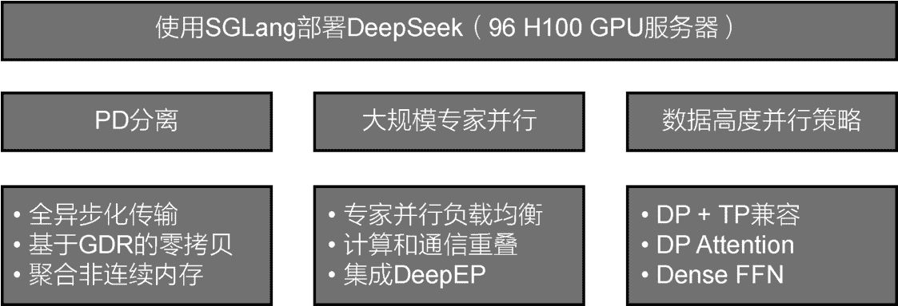

图 2-9

其中最重要的架构层革新之一，就是 PD 分离，实现了 P 阶段和 D 阶段解耦。阿里云技术团队作为 Mooncake 开源项目的主要参与方之一，承担了 PD 分离的技术研发任务。通过 Mooncake 通信库的集成，优化了非连续内存块传输，同时结合 SGLang 的异步 API，使通信开销降低了 50%，从而避免 CPU 阻塞导致的 GPU 闲置。针对调度冲突问题，将模型推理拆分为独立的预填充服务（Prefill Server）与解码服务（Decode Server），组成两个互相通信的专家并行资源池。Prefill Server 专用于处理长输入序列，采用 DeepEP Normal Dispatch 模式，通过 RDMA 实现非阻塞 KV Cache 传输；Decode Server 则通过 DeepEP Low-latency Dispatch 模式优化 Token 生成效率。二者通过阿里云操作系统的 Mooncake 通信库实现了高效的通信。

同时，通过引入社区优化方案，专家并行负载均衡（EPLB）与冗余专家池得以支持动态负载均衡。为了缓解 MoE 架构的负载不均衡，专家并行负载均衡将原生 256 个专家扩展至 288 个冗余池，支持灵活分组（如 EP72）。EPLB 实时统计专家使用频率，动态调整分布策略，例如，将高频专家复制至多个 GPU，低频专家合并分组，使负载均衡度（Balancedness）从 0.6 提高至 0.9，进而使 GPU 空闲时间减少 70%。此外，通过 Two-batch Overlap（TBO）技术，将单批次拆分为微批次，重叠计算与通信过程，将峰值内存占用降低 30%，实现解码吞吐量的进一步优化，性能较传统 EP 方案提高 2.5 倍。在硬件方面，阿里云自建的 RDMA 高速网络实现了跨节点数据的零拷贝传输，将通信延迟压缩至微秒级，从而保障了大规模 EP 的协同效率。

与传统张量并行方案相比，该方案的整体输出吞吐量提高了 5 倍，达到了业内领先水平。其中 P 阶段的输入速度提升至 52.3K Tokens/s/节点，解码输出速度达 22.3K Tokens/s/节点。同时，首次响应时间缩短至 2s，解码延迟稳定在 100ms 以内，显著提升了用户体验。

图 2-10 展示了基于 12 个服务器节点（每节点含 8 个 H100 GPU）构建的分布式推理架构，该架构通过 PD 解耦与大规模专家并行实现高效推理。其具体架构分为三部分：预填充资源池使用 3 个节点，每个节点包含 3 个专家子组（Expert Sub-group），负责快速处理输入序列。解码资源池使用 9 个节点，通过 KV Cache 传输实现注意力机制的分布式计算，结合低延迟调度的 9 个专家子组，实现高吞吐输出。通过 Mooncake 支持 KV Cache 传输，传输过程与两级调度协同降低通信开销，保障端到端效率。

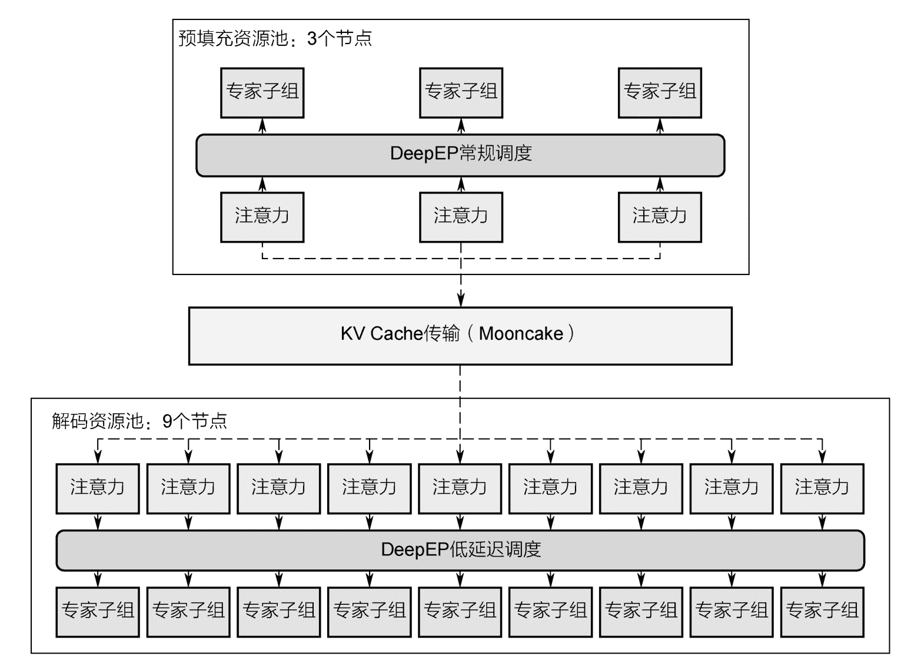

图 2-10

3）案例效果：大规模落地和多维度突破

该方案在成本、性能与生态层面实现多维突破。在成本方面，输出 Token 成本经过预估仅为原方案的 1/5，年节省算力支出能够达到千万美元级别；在性能层面，推理吞吐量提升 5 倍，日均支持 10 亿级请求，预填充延迟缩短至 50ms/请求，解码吞吐量稳定在 17K Tokens/s/节点（模拟 MTP 场景），资源利用率长期保持在 85%以上；在生态层面，通过验证 PD 分离技术与大规模专家并行的技术可行性，推动开源框架（SGLang）与 Mooncake 社区的深度协同，加速 PD 分离架构标准化，同时发布技术文章，为行业从“开源项目原型”转向“商业化部署”提供可复制的技术路径。

**5.小结**

实践表明，AI 技术的商业化突破不仅依赖算法创新，更需要底层系统与工程化能力的深度协同。阿里云操作系统以“隐形技术底座”的角色，通过 RDMA、内存管理等核心能力，为 SGLang 框架的高效运行提供了坚实支撑。这种“软硬一体”的协同模式，不仅重塑了云计算时代的基础设施技术体系，更以开源协作与生态共建为路径，为行业智能化转型提供了可复制的标杆案例。未来，随着 AI 原生操作系统的持续进化，此类深度协同将催生更多突破性应用，加速全球 AI 基础设施的技术革命。

**2.2.3 OceanBase：DeepSeek 生态下的数据管理新范式的探索与实践**

**1.行业概况**

在当今数字化浪潮席卷全球的背景下，数据已成为新时代最重要的生产资料之一。无论是企业的业务运营、用户的交互行为，还是人工智能模型的训练推理，都离不开稳定、高效、可扩展的数据存储与管理系统—数据库。

数据库技术自 20 世纪 60 年代起步，经历了从层次型和网状模型到关系型的革命性转变，SQL 语言的标准化极大地推动了数据库的普及与统一。进入 21 世纪后，随着互联网、移动应用和大数据的迅猛发展，传统关系数据库在扩展性和性能方面面临挑战，因此，NoSQL 数据库应运而生，以灵活的数据模型和横向扩展能力满足多样化的业务需求。与此同时，NewSQL 数据库在保持事务一致性的同时实现了分布式扩展，重新定义了高性能数据库的可能性。近年来，数据库向云原生、多模态、智能化方向演进，成为现代数字基础设施的核心支柱。

在数据库技术不断突破性能极限的同时，技术变革也在悄然酝酿—这就是人工智能，以及大模型所带来的范式革命。以 DeepSeek 为代表的大模型正以前所未有的方式重塑人机交互、知识获取乃至整个软件开发流程。对数据库行业而言，这种变化不仅是工具层面的优化，更是思维方式的根本转变。DeepSeek 强大的推理能力为数据库操作带来全新的可能性，例如通过自然语言直接表达查询意图，使非技术人员也能轻松完成数据检索与分析任务。此外，DeepSeek 还能深入参与数据库的运维和调优过程，提供自动化的异常检测、根因分析和修复建议生成等功能，大幅提高故障处理效率。

随着 DeepSeek 等大模型的兴起，数据库技术正经历着从“存储工具”向“智能引擎”的演进。在这个过程中，数据库不仅需要支持传统的数据存储与管理功能，还需要具备强大的智能化服务能力，以适应日益复杂的应用场景。特别是通过对向量能力与 RAG 架构的支持，数据库可以更高效地服务于深度学习模型，成为 DeepSeek 生态的重要数据底座。在这个新的生态系统中，数据库不仅是存放数据的地方，还扮演着智能决策中心的角色，通过对海量数据的实时分析和深度学习模型的集成，为企业提供更加精准和个性化的服务。

**2.DeepSeek 带来的机遇和挑战**

在人工智能和数据库技术加速融合的背景下，DeepSeek 等大模型与数据库的双向赋能关系日益凸显。一方面，DeepSeek 为数据库系统带来智能化升级的新路径，推动其向更高效、更智能、更易用的方向演进；另一方面，数据库作为支撑大模型训练与推理的核心基础设施，在性能、架构与数据治理层面面临新的挑战。

1）大模型赋能数据库系统的智能化升级

传统的数据库系统在设计之初主要面向结构化数据的存储与查询，其交互方式以 SQL 语句为主，用户需要具备一定的编程能力和数据结构知识。随着企业数据量的激增、业务场景的复杂化，传统数据库在易用性、灵活性和智能化程度上出现瓶颈。此时，DeepSeek 这样的大模型为数据库系统带来了全新的可能性。

首先，自然语言查询（Natural Language Query，NLQ）是 DeepSeek 赋能数据库的典型应用场景之一。通过集成大模型，用户可以直接使用自然语言进行数据检索和分析，无须掌握复杂的 SQL 语法。例如，一位销售人员可以输入“2024 年第四季度销售额最高的产品是什么？”系统即可自动将其转换为对应的 SQL 语句，并返回结果。这种交互方式极大地降低了数据库的使用门槛，使非技术人员也能快速获取所需信息，提高企业内部的数据驱动决策效率。

其次，在数据库优化和自动化运维方面，DeepSeek 同样展现出强大的潜力。数据库性能优化通常需要经验丰富的 DBA 手动调整索引、查询计划和缓存策略，而这些过程往往耗时且容易出错。借助 DeepSeek，系统可以基于历史查询日志和运行状态，智能推荐索引创建、查询重写或资源分配方案，从而实现数据库的自适应优化。另外，在异常检测、故障预测、日志分析等方面，DeepSeek 也可以帮助数据库实现自动化运维，提高系统的稳定性和可用性。

此外，数据治理和语义理解也是大模型带来的一项重要变革。随着数据合规要求日益严格，数据质量、隐私保护和访问控制成为关键问题。DeepSeek 可以通过语义分析识别敏感字段，自动打标签并推荐脱敏策略，从而提高数据资产的整体管理效率。另外，它还可以帮助构建统一的数据字典和元数据管理系统，使不同部门的数据标准更加一致。

最后，DeepSeek 在数据库文档生成、知识问答、培训教学等方面也展现出了巨大的潜力。它可以自动生成数据库设计文档、解释复杂查询逻辑，甚至帮助初学者理解数据库原理。这种知识增强的能力，使数据库不再是封闭的黑箱系统，而是可以被广泛理解和使用的开放平台。

尽管 DeepSeek 为数据库系统带来诸多智能化优势，但其在应用过程中也面临一系列挑战。

•**准确性与一致性问题。**大模型在生成 SQL 语句或执行逻辑判断时，可能存在语义偏差或逻辑错误，导致查询结果不准确甚至引发数据泄露风险。

•**安全性与隐私保护问题。**用户输入的数据可能包含敏感信息，当数据库通过大模型对外提供服务时，若缺乏有效的脱敏机制和访问控制，那么将带来严重的隐私泄露风险。

•**兼容性与标准化难题。**目前，主流数据库生态较为封闭，与新兴 AI 模型之间的接口标准尚未统一，如何实现无缝集成仍是一个技术难点。

因此，“DeepSeek for DataBase”的发展方向不仅在于功能创新，更需要解决模型输出的可靠性、安全性与工程落地性问题。

2）数据库作为大模型的基础设施支撑

如果说“DeepSeek for DataBase”是大模型对数据库的赋能，那么“DataBase for DeepSeek”则是数据库反向支撑大模型的关键环节。高质量、结构化的数据库不仅是 DeepSeek 训练阶段的核心数据来源，更是其推理过程中不可或缺的知识补充系统。

在训练阶段，数据库的作用尤为关键。DeepSeek 等大模型依赖海量文本数据进行训练，而这些数据往往来自企业内部的结构化数据库。例如，金融行业的交易记录、医疗行业的电子病历、电商领域的商品描述等，都是训练垂直领域大模型的重要素材。通过将这些数据清洗、标注后输入模型，可以显著提升其在特定行业中的表现力和专业性。

在推理阶段，数据库承担着实时知识供给的角色。大模型虽然具备广泛的知识库，但由于训练数据截止于某个时间点，无法动态更新，因此在面对最新事件或个性化需求时存在局限。例如，在回答“某公司今年第一季度营收是多少”这类问题时，如果模型仅依靠静态知识库，则可能给出过时甚至错误的答案。如果能够将 DeepSeek 与实时数据库连接，模型就可以在推理过程中动态调用最新的业务数据，从而确保回答的准确性和时效性。

此外，数据库还为 DeepSeek 提供了多模态数据支持。除了传统的文本数据，现代大模型也越来越倾向于融合图像、音频、视频等多种类型的信息。这要求数据库不仅要支持结构化数据的高效存储与检索，还要具备处理非结构化数据的能力。例如，图数据库可用于表示复杂的实体关系网络，文档数据库可以支持 JSON 格式的嵌套数据，对象存储可用于管理多媒体文件。因此，未来数据库的发展方向将更加多元化、智能化，以满足大模型对多样化的数据需求。

然而，数据库在支撑 DeepSeek 的过程中也面临诸多挑战。

（1）数据实时性与一致性要求高。DeepSeek 在实际应用中往往需要快速获取最新数据，而传统数据库在高并发读写、大规模数据检索方面可能存在性能瓶颈，难以满足低延迟的需求。

（2）数据规模与扩展性压力大。为了支持模型训练与推理，数据库可能需要处理 PB 级的历史数据，并进行复杂的特征提取和预处理操作，这对底层架构提出了更高的扩展性和弹性要求。

（3）数据合规性与访问权限管理难度大。不同行业对数据的使用有严格的法律限制，尤其在金融、医疗等领域，如何在保障数据隐私的前提下让模型合法合规地访问数据库，是一个亟须解决的问题。

由此可见，“DataBase for DeepSeek”不仅是数据存储的问题，更是关乎模型性能、安全性与合规性的核心议题。

**3.产业链和关键技术**

1）产业链分析：数据库在 DeepSeek 生态中的角色

围绕 DeepSeek 等大模型的应用场景，整个产业链可以划分为多个关键环节，每个环节都离不开数据库的支持。以下将重点讨论几个核心层级及其与数据库的关系，如表 2-6 所示。

表 2-6

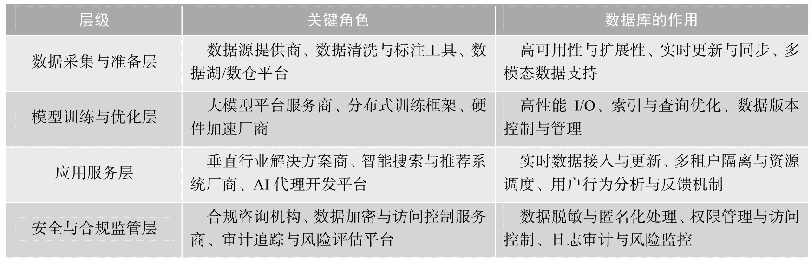

2）关键技术演进：数据库如何助力 DeepSeek

在上述产业链的基础上，以下几项关键技术将成为支撑“DataBase for DeepSeek”的核心驱动力。向量数据库的引入为大模型带来了新的可能性。

向量数据库是什么？它是一种利用 AI 大模型技术，将文档、图像、音视频等多模态数据通过大模型转化为多维向量数组，以便加速数据查询与处理流程的技术。

与传统侧重精准查询的 TP 和 AP 数据库不同，向量数据库依靠向量距离算法执行模糊查询，常见的算法包括曼哈顿距离算法、欧氏距离算法及余弦距离算法等。这些算法通过计算向量间的距离，在数据库中近似地查找与目标向量相似的其他向量，如表 2-7 所示。

表 2-7

数据库作为数据存储、管理和处理的核心基础设施，在支持 DeepSeek 等大模型的发展过程中扮演着至关重要的角色。无论是对于数据采集与准备、模型训练与优化，还是对于应用服务层和安全合规监管，数据库都发挥着不可替代的作用。OceanBase 等原生分布式数据库凭借出色的事务处理能力、高可用性和弹性伸缩特性，已经成为支撑 DeepSeek 等大模型的理想选择。随着技术的不断发展，像 OceanBase 这样的先进分布式数据库将在促进 AI 与数据库融合发展的道路上发挥越来越重要的作用，成为企业数字化转型与智能化升级的核心引擎。

**4.技术架构和创新突破**

1）现代数据架构是时代驱动下的必选项

随着科技的高速发展，单一、结构化、静态数据架构的时代已经一去不复返了。当今的业务由多种形式的数据及不同质量和信任程度的数据驱动，传统的数据库体系显得力不从心，难以满足实时分析、高可用性、快速响应及大规模扩展的需求，数据库体系的变革呼之欲出。如何迎接新时期的数据挑战，是数据库领域面临的迫切问题。因此，现代数据架构的发展是当前的必然要求。

现代数据架构要求数据库不仅要支持传统的关系数据处理，还需具备处理非结构化数据的能力，支持多源异构数据的集成与管理，并能够在保证数据安全的前提下实现高效的数据共享和流通。在这样的背景下，OceanBase 应运而生。作为一个原生的分布式关系数据库，OceanBase 凭借卓越的扩展性、丰富的一体化能力及强大的存储检索性能，在众多数据库解决方案中脱颖而出。它不仅能够处理海量数据和高并发访问，还通过创新的设计理念解决了传统数据库面临的诸多挑战，例如跨数据中心部署、自动故障恢复和水平扩展等，OceanBase 为企业提供了一个既能满足当前复杂数据处理需求，又能灵活应对未来增长的强大工具，成为构建现代数据架构的理想选择之一。

2）OceanBase 践行一体化理念

随着互联网、移动互联网尤其是 AI 时代的来临，数据库管理的数据已经由原来单纯的结构化数据，逐步演变为半结构化数据甚至无结构化数据。但是客户仍然希望使用同一套系统处理各种不同的工作负载，并保证数据的一致性。客户不希望区分到底哪些查询是 OLTP、哪些是 OLAP、哪些是多模、哪些是 AI，他们希望采用一套强有力的系统处理所有数据存储和管理的任务。

但是，一体化的客户需求，在技术实现上面临很大的挑战。首先，因为要处理海量数据，所以这套数据库系统需要是分布式的，而不是集中式的。其次，这套数据库系统需要具备海量数据的存储和计算能力。

OceanBase 持续提高一体化能力，迄今为止共经历了两次大的技术迭代。从分布式到一体化，从 TP 到 HTAP，再到 SQL+NoSQL、SQL+AI。

3）向量数据库：OceanBase 一体化架构“再发新枝”

向量数据库有两种实现方式：第一种，完全独立的向量数据库；第二种，在通用数据库里集成向量插件。通过在通用数据库里集成向量插件，能够直接复用通用数据库已经有的功能、生态和稳定性。通过 OceanBase 一体化数据库里面的插件，能够直接复用 OceanBase 的一体化多云原生架构能力，直接复用 OceanBase 高性能、低成本的存储和事务引擎，直接复用并扩展 SQL，同时支持 OceanBase 已有的 SQL 能力。其整体架构如图 2-11 所示。

（1）OceanBase 的向量功能。具体而言，OceanBase 的向量功能主要体现在以下层面。

•支持丰富的索引类型：OceanBase 索引不仅支持向量索引，还支持标量索引、半结构化索引（如多值索引、空间索引），以及全文索引，并且支持同时访问多路索引，为复杂的数据检索需求提供了坚实保障。

•集成便捷的应用：OceanBase 采用 SQL 访问的方式，可复用 MySQL 生态中各语言的客户端，极大地降低开发人员的学习成本。同时，OceanBase 还支持类似 MilvusSDK 的 SDK，方便用户根据自身需求灵活选择开发工具。

•支持全面的索引创建语法：OceanBase 支持的索引类型包括 HNSW、IVFFalt、DiskANN 等，可以满足不同场景下的数据库索引需求。距离算法涵盖 L2、IP、COSINE、Jaccard 等，确保在向量检索时能够精准计算相似度。

图 2-11

•强大的向量查询功能：OceanBase 支持 TOP *N*排序的相似度计算，能够快速筛选出与目标向量最相似的结果。同时支持向量和标量混合查询，可有效应对复杂业务场景中的多元数据查询需求。

•简单的部署运维流程：向量功能紧密集成在数据库内核中，用户可以使用部署、运维、监控及数据迁移工具，简化运维工作流程，降低运维难度。

•简洁易用的接口设计：用户可以通过标准 SQL 语句创建向量表并写入向量数据，使用标准 SQL 语法导入向量数据并进行 DML 操作，还可以直接在对应的向量字段上创建向量索引，并指定索引类型和距离算法，利用 SQL 语句直接查询，操作简便直观。Python 接口只需要导入 Python 包，即可通过 Python 接口完成创建表、写入数据，以及 ANN 等方面的检索操作，为 Python 开发者提供便捷、高效的开发途径。

作为一款具备向量能力的通用数据库，OceanBase 为用户带来了极大的便利。用户无须替换原有数据库，只需对现有数据库应用进行版本升级，即可轻松获得向量能力，极大地降低了替换成本和学习成本。此外，OceanBase 的数据压缩能力能够有效帮助用户节省数据存储成本，进一步提高产品的性价比。

（2）OceanBase 向量数据库的优势。总体而言，相较于常见的向量数据库存在的稳定性不足、上手门槛高、运维复杂、周边配套不完善等问题，OceanBase 在向量场景的应用中，展现出了以下优势。

•上手简单：接口设计简单，支持一键部署，并且高度兼容 MySQL，无论是新手还是有经验的开发者，都能快速上手。

•具备金融级数据库的稳定性：OceanBase 的系统稳定性和容灾能力在大规模金融场景中得到了充分验证，同时拥有成熟的保障体系和完整的运维工具，为系统稳定运行提供全方位支持。

•性能强劲：OceanBase 的向量检索能力集成了索引算法库 VSAG，VSAG 算法库在 960 维的 GIST 数据集上表现出色，在 ANN-Benchmarks 测试中远超其他算法。

•成本效益显著：OceanBase 的一体化架构有效避免了在多个数据库之间进行融合查询时，因需要重排序后返回复杂需求而产生的高额成本，同时节省了组件之间的 RPC 调用开销。其多租户能力能够大幅提高资源利用率，帮助用户降低总体成本。

•运维管理简单：OceanBase 提供了一套完整的运维工具体系，包括数据迁移工具 OMS、开发者工具 ODC、运维管理工具 OCP 等一系列可视化的白屏工具，且使用简单、便捷，极大地减轻了运维人员的工作负担。

**5.企业案例**

1）RAG 技术实践：帮助 DBA 解决客户问题

在 DeepSeek 问世之前，AI 赋能数据库智能运维的核心挑战在于打通技术落地的“最后一公里”。传统 AI 系统虽能生成诊断报告，但其输出结果往往呈现为由专业术语堆砌的技术指标（如锁争用率、缓存命中率等），其分析结论只能作为参考。DeepSeek 的出现，为数据库运维管理中诊断决策这一问题提供了解决方案。

OceanBase 社区为了更好地支持用户对 OceanBase 数据库进行诊断，推出敏捷诊断工具 obdiag，将诊断经验代码化，让用户能够快速进行集群巡检、根因分析，以及数据一键收集等工作。然而，obdiag 工具和使用者之间存在诸如用户如何知晓在何种场景下使用何种诊断命令、如何解读诊断报告等“最后一公里”的问题，如图 2-12 所示。

图 2-12

为了解决这一问题，OceanBase 社区探索出一条 RAG+obdiag 的创新路径。

数据是大模型的基础，也是 RAG 系统的基石。对 RAG 系统而言，数据指的是需要用于检索的知识的集合，是用于增强大模型文本生成效果的语料库。正所谓“输入决定输出”，知识库本身的质量直接决定了生成答案的质量。OceanBase 拥有众多开源项目，其中开源的文档组件包括但不限于 OceanBase、OCP、OMS、ODC、OBD、ODP、ob-operator 等，且大部分文档为 Markdown 格式的文本文件，为构建 RAG 知识库提供了优质素材。

图 2-13 所示为 OceanBase 社区使用 DeepSeek 的智能助手进行交互的流程图，其完整的流程如下。

•用户在 Web 界面中输入想要咨询的问题并发送给机器人。

•机器人将用户提出的问题使用文本嵌入模型转换为向量。

•将用户提问转换而来的向量作为输入在 OceanBase 中检索最相似的向量。

•OceanBase 返回最相似的一些向量和对应的文档内容。

•机器人将用户的问题和查询到的文档一起发送给 DeepSeek 并请它生成问题的回答。

•大模型分片地、流式地将答案返回给机器人。

•机器人将接收到的答案也分片地、流式地显示在 Web 界面中，完成一轮问答。

图 2-13

OceanBase 利用开源文档构建 RAG 应用的业务场景之一是开源社区论坛问答帖的初次回复，它可以协助技术人员尽可能解答用户提出的特性问题，针对诊断问题指导用户获取系统日志并提供相关建议。

在实际操作中，在收到论坛用户提出的问题后，系统会将问题分为闲聊、特性问题和诊断问题三类。

（1）闲聊。与 OceanBase 无关的问题，如明天天气如何？如何使用 Python 实现快速排序算法？针对这类问题系统不予回复，并终止流程。

（2）特性问题。与 OceanBase 及其周边组件特性有关的问题，通常具有抽象、宏观、整体性的特点，例如 OceanBase 合并是集群级别还是租户级别？OceanBase 分区均衡策略的优先级是什么？回答特性问题属于典型的 RAG 场景，系统会将特性问题进行书面润色和改写后，提交给 RAG 流程进行文档检索、检索结果重排以及通过大模型答复，最终生成带有参考文档链接的回复。

（3）诊断问题。与 OceanBase 及其周边组件的问题排查相关的问题，往往较为具体、微观且局部。例如，“OCP 告警推送失败【CancellationException】租户备份失败：ob 4.0 环境下，调用租户备份恢复菜单执行租户级别备份，失败，报错代码 2024-08-13 10：40：38.370 INFO 1057922---［p...］”。诊断问题的处理远比特性问题复杂，无论是对于大模型还是人类都是如此。其复杂性体现在错误域广泛、诊断链路长且缺乏丰富的诊断知识库作为参考，仅依靠检索开源文档库的文档无法完全解决问题。在处理诊断问题时，OceanBase 借助 obdiag 敏捷诊断工具的部分功能，为用户提供日志采集、根因分析的指引，以及进一步诊断方向的建议。

对于诊断问题，采取至少进行三轮对话的策略。

•第一轮对话：用户初次提问时，将用户问题改写后交给 obdiag 智能体，该智能体结合 obdiag 的日志采集和根因分析功能给出相应的命令建议，指导用户采集日志并上传至论坛，如果可能还会建议用户尝试进行根因分析，排查问题。同时，除了给出 obdiag 命令建议，还会向用户提出 4 个左右的问题，以获取更多的信息。

•第二轮对话：由 Question 智能体答复。该智能体根据历史消息判断问题是否可解，若判断为可解，则交由 RAG 智能体答复；若判断为不可解，则向用户追问 4～5 个问题，进一步收集信息。

•第三轮对话：由 RAG 智能体完成，与处理特性问题类似。首先利用历史消息对用户问题进行向量检索，查询到相关文档后，结合历史对话内容让大模型生成回答，尝试解决用户提出的问题，且不再响应用户后续提问。最终对话生成后，会附加提示信息“小助手答复已经结束，如果未能解决您的问题，请您继续追问并等待其他同学的答复，谢谢！”，告知用户 RAG 系统流程已结束。

OceanBase 社区通过 RAG 技术与 obdiag 工具的深度融合，以“知识检索—工具调用—动态交互”的闭环逻辑，展示了数据库运维支持的智能化边界和可能。随着知识库的持续迭代与诊断链路的精细化，“RAG+工具生态”的范式将重塑 DBA 与用户协同解决问题的底层逻辑。

2）某运营商：向量数据库助力知识库升级，硬件成本下降 30%

目前，OceanBase 的应用场景主要集中在智能推荐、多模态搜索和 RAG 等领域。

某运营商的数据库平台服务数百到上千名内部用户，业务范围涵盖从应用开发到运维管理的各环节。如此庞大且复杂的数据库应用场景，给运维开发人员带来了长期且严峻的挑战。

一方面，数据库种类繁多，版本之间差异较大，对生产系统的稳定性要求极高；另一方面，测试环境与生产环境的差异严重影响了工作效率。此外，日常数据库运维和管理的工作负荷繁重，提高响应速度困难重重。

为了提高运维效率和内部敏捷性，该运营商积极探索解决方案，尝试用 RAG 架构解决上述实际问题，并成功开发出数据库智能专家“ChatDBA”。“ChatDBA”结合数据库领域的专业知识并联通内部的运维数据，让开发人员和 DBA 可以直接使用自然语言对数据库状态进行查询、排查故障或获取相关建议，减少了大量重复性工作，显著提高了工作效率。这样的方式不仅提高了问题解决效率，还让团队能够将精力更多地集中在关键任务上，整体方案流程如图 2-14 所示。

图 2-14

在项目初期，某运营商选择了 MySQL 进行关系数据存储，并将 Milvus 作为向量数据库。然而，随着数据量和需求的增长，它们很快发现了两个关键问题：首先，现有的数据库无法进行水平扩展，且无法应对更大规模的数据处理；其次，必须同时维护两种数据库系统，增加了管理和运维的复杂性。

为了解决这些问题，它们开始寻找一种能够统一支持关系数据和向量数据的方案。在选型过程中，它们发现 OceanBase 4.x 实验室版本具备强大的向量检索与混合查询能力，因此对独立向量数据库、单机数据库，以及分布式数据库在向量场景下的能力进行详细评估，表 2-8 是具体的评估结果。

表 2-8

（续表）

在实现 OceanBase 数据库向量检索功能和性能验证后，它们决定将现有的 MySQL 和 Milvus 数据库进行现代化升级，并进行了相应的适配改造。

OceanBase 引入的工作量相对较小，对于原 MySQL 数据库几乎没有额外的工作量，SQL 语法完全兼容，甚至无须更换驱动包，只需要修改配置即可。对于 Milvus 向量数据库的升级，主要是更新数据库依赖包和调整数据库操作方式。由于 OceanBase 支持通过 SQL 操作向量数据，只要熟悉 SQL 语法，改造工作也非常简便。该运营商在大约一周的时间内完成了所有程序的适配改造，并在不到两周的时间内完成了所有验证工作。

2024 年 10 月，OceanBase 发布支持向量检索的稳定版本 4.3.3，该运营商随后启动了生产环境的数据库现代化升级。借助前期充分验证和 OceanBase 的 OMS 工具，升级过程高效顺畅，顺利完成从 Milvus 到 OceanBase 的数据迁移，加快了整体进程。

升级后，它们将多套数据库整合为一个统一的系统架构，硬件资源使用量减少约 30%，业务性能全面满足用户需求。OceanBase 原生的分布式架构不仅显著提高了系统稳定性，降低了单点故障风险，还为未来业务增长提供了可扩展能力。这次升级不仅简化了技术栈，减轻了运维团队的压力，还为业务的长远发展构建了灵活可靠、可扩展的技术基础。

**6.总结：数据库向 AI Infra 进化**

DeepSeek 等大模型的技术演进揭示了一个重要趋势：AI 基础设施正在经历从“支撑性工具”向“价值创造主体”的深刻转变。过去，AI 模型依赖独立的数据存储层和计算层。如今，随着模型规模扩大、推理成本上升、应用场景多样化，整个 AI 链路对底层基础设施提出了更高的要求—需要更强的一体化能力、更低的运维复杂度、更高的数据访问效率以及更灵活的扩展机制。

OceanBase 作为一款原生分布式国产数据库，正在积极探索 Data X AI 时代数据管理新范式，通过 SQL+NoSQL、SQL+AI 等形式，更好地满足 AI 时代多模数据存储、融合检索的需求，为 AI 应用提供安全稳定的数据存储底座。在这个背景下，数据库不再仅是静态的数据仓库，而是逐步演化为 AI 基础设施中不可或缺的“智能引擎”和“价值放大器”。

当存储开始参与计算、通信协议和影响模型设计时，基础设施的每次迭代都将成为技术跃迁的支点。未来的竞争焦点，或许不在于单一模型参数规模，而在于谁能构建更符合物理定律与商业本质的 Infra 生态。

**2.2.4 FlagOS—跨芯片软件栈**

**1.行业概况**

在人工智能迅速发展的背景下，大模型技术的广泛应用推动了强劲的计算需求，对算力提出了前所未有的挑战，人工智能系统软件栈正在从同构 GPU 计算向多芯片异构部署演进。然而，随着模型规模和算力需求猛增，多种 AI 加速器开始大规模投入使用。在这种背景下，如何构建统一的软件栈以管理异构算力成为关键挑战。各类硬件在上层基础软件、底层编程模型和软件兼容性等方面存在挑战，业界亟须一套统一的系统软件栈来屏蔽底层复杂性，让多厂商异构算力协同工作，包括统一的算子接口、通信调度、编译优化和集群管理等。唯有如此，才能充分发挥混合硬件资源的优势，提高大模型训练与推理效率，满足市场对算力的需求。

DeepSeek 以低训练成本实现了比肩一流模型的高性能并且全面开源，引起了社区和行业的强烈反响。一方面，从指标上看，DeepSeek 相关项目在开发者社区表现出极高的人气。其中 DeepSeek-V3 项目约有 9.69 万颗星、DeepSeek-R1 项目约有 8.93 万颗星，这些数字反映了全球开发者对 DeepSeek 技术的浓厚兴趣和积极参与。另一方面，DeepSeek 的开源降低了大模型的使用门槛，激发了生态活力，引发了海量大模型部署及场景应用，推理计算需求迅猛增长。

大模型从训练到推理部署涉及许多环节，在异构硬件环境中面临以下挑战。

（1）推理部署成本高。推理阶段需要将模型部署到各种终端或服务器上，涉及多种推理引擎（vLLM、SGLang、TensorRT 等）。不同硬件之间的模型格式和推理引擎的兼容性是一个难点，对于普通开发者来说，大模型的部署，尤其在分布式场景中，门槛是很高的，业界需要低门槛部署的方案。

（2）算子适配与优化成本高。不同芯片的算子库独立实现，缺乏统一标准，导致模型在不同硬件上的迁移和部署变得复杂。为了适配多种芯片，开发者需要针对每种硬件进行单独的优化算子，增加了开发和维护成本。

（3）通信调度难度高。大模型训练往往在多机多卡集群上进行，通信效率和调度策略至关重要。在异构集群中，不同厂商的通信库互不兼容，传统通信方案难以跨平台实施。

总体而言，大模型部署链条上的关键技术点涵盖了算子库适配、通信效率和部署自动化等方面。在这些层面持续创新和优化，能在复杂的异构硬件环境下实现高效、稳定的大模型训练与推理部署。

**2.多芯片统一开源开放软件栈**

为了满足多样化的 AI 芯片需求，并提高系统的灵活性和效率，业界亟须一个统一、开放的系统解决方案。

为此，北京智源人工智能研究院牵头，与生态合作伙伴及社区开发者共同打造了 FlagOS。FlagOS 是一个面向多元 AI 芯片的统一、开源的系统软件技术栈，旨在兼容英伟达和多种 AI 芯片，为用户提供高效、易用的系统软件，使大模型能够在不同 AI 芯片上高效运行，从而提高算力利用效率，解决大模型在异构场景中面临的推理部署成本高、算子适配与优化成本高和通信调度难度高等问题。

图 2-15 展示了 FlagOS 整体架构，包括支持多种 AI 芯片架构的通用大模型算子库 FlagGems、支持多种 AI 芯片的高效训练推理并行框架 FlagScale，以及支持多种 AI 芯片的统一编译器 FlagTree 和统一通信库 FlagCX 等关键组件。

图 2-15

FlagOS 的开放性和兼容性为多样化的 AI 芯片生态提供了关键支撑，助力打破算力束缚，推动人工智能技术的广泛应用。

接下来介绍这些核心组件，包括各组件的架构和核心特性。

1）FlagScale

随着人工智能技术的迅猛发展，尤其是生成式 AI 应用的兴起，训练参数规模达到数百亿甚至千亿级别的大模型已成为常态。这些超大规模模型在训练、推理、压缩和部署等方面都面临着前所未有的挑战。

在实际应用中，企业和研究机构往往在不同阶段采购了不同型号、不同厂商的 AI 加速硬件，形成了所谓的“资源墙”—这些异构设备难以协同工作，导致计算资源无法被充分利用，训练成本高，效率低下。

此外，模型的推理和部署也面临着资源受限的环境，如移动设备和边缘计算场景，需要高效的模型压缩和优化技术，以确保模型在多种硬件平台上高效运行，同时保持性能。

为了解决这些问题，北京智源人工智能研究院联合多家生态伙伴，基于开源技术共同构建了面向多芯片的开源大模型框架—FlagScale。

FlagScale 旨在提高计算资源的利用效率，并确保模型训练和推理的效果。通过提供训练、推理、压缩和部署全流程关键组件，FlagScale 致力于成为优化大型模型工作流程效率与效果的必备开源工具包，它具备如下特点。

•领先的异构混训技术。首次实现不同代际与不同架构芯片之间大模型异构混合训练，提供通用的多维异构混合并行策略，支持不同厂商跨节点 RDMA 直连和 CPU 中转通信。

•高效的端到端训练与推理。支持智源内外 10 余种模型的端到端预训练与推理，涵盖稠密和稀疏模型，涉及语言与多模态领域，参数规模达千亿量级。在 LLaVA-OneVision 相同配置下，训练效率达到 DeepSpeed 的 1.7 倍；多模态 CFG 推理效率达到 HuggingFace 的 3.8～6.7 倍。

•跨芯片自动调优能力。为用户提供开箱即用的自动调优工具，通过配置可以一键获取性能最优的并行策略，大幅降低了分布式训练与推理的部署门槛。通过自动调优，实际测试中多款芯片的性能平均提高 11.3%。

•多芯片训练与推理适配。与厂商共建，已在 8 款不同芯片上完成训练与推理适配，实现算子、预训练损失、微调损失及评测效果四个层级的精度对齐。涵盖语言和多模态领域多个不同规模的模型，并成功实现非英伟达芯片上千卡的端到端完整训练。

图 2-16 展示了 FlagScale 的整体结构，包括统一的用户接口前端和多种高效执行后端。

图 2-16

FlagScale 通过统一的用户接口和高度模块化的系统架构，实现了训练、推理、压缩和部署。用户只需简单配置，即可启动包括训练、推理、压缩和部署在内的各类任务，从而实现“一键式”开发大模型。配合自动调优、容错、预估与检查点管理等机制，FlagScale 大幅降低了大模型的开发和使用门槛。

（1）推理部署介绍。随着大模型在各行各业中被的广泛应用，如何高效地将训练好的模型部署到实际生产环境中，成为了一个亟待解决的问题。尤其是在异构硬件环境下，部署面临着如下挑战。

•硬件多样性：不同厂商和架构的 AI 芯片共存，导致兼容性问题。

•资源利用率低：在异构环境中，无法充分发挥各类硬件的计算能力。

•部署效率低下：传统部署方式难以适应快速变化的业务需求，部署周期长。

为了解决这些问题，FlagScale 提供了一套高效、灵活的大模型部署解决方案，支持在多种异构硬件环境下实现模型的快速部署和高效运行，如图 2-17 所示。

图 2-17

FlagScale 推理部署的核心能力体现在以下几个方面。

•支持多芯片高效推理。FlagScale 可实现包括 DeepSeek-R1 在内的大模型在多款国产 AI 芯片上的高效推理部署，兼顾性能与平台适配性。

•支持多个后端推理。FlagScale 提供原生高性能推理引擎，专为大模型分布式部署场景设计并进行了深入优化，同时兼容包括 vLLM 在内的主流推理框架，支持灵活配置的多样化部署策略。

•支持一键启动分布式任务。FlagScale 提供极简的 YAML 配置驱动部署，内置主流模型模板，支持一键启动，大幅降低分布式部署门槛。内置负载均衡功能，用户无须额外配置即可自动执行多节点的任务负载均衡。

•自动调优与并行策略优化相结合。FlagScale 提供智能调优工具，通过在配置文件里设置自动调优关键字，即可自动搜索最优参数配置。同时支持用户自定义搜索空间和优化目标（如吞吐量，端到端时延等）。

•支持动态扩缩容。FlagScale 启动部署任务后，根据系统资源情况，支持实例的动态扩缩容。

•集成 FlagGems，可以简化高性能算子库的接入。FlagScale 深度集成 FlagGems 高性能算子库，提供开箱即用的计算优化，只需在配置文件里设置 USE_FLAGGEMS=1 即可自动加载高性能算子库，无须修改代码。

（2）多芯片场景下的大模型部署任务，会面临以下挑战。

•模型与硬件的适配性问题：不同模型在不同硬件芯片上运行时，如何实现最优的推理效率？

•推理框架超参数配置复杂：面对众多超参数，如何为不同模型配置最优参数以提高推理性能？

•资源固定下的最优资源分配：在资源数量固定的情况下，如何分配资源以实现最优的部署效果？

为解决上述问题，FlagScale 推出部署自动调优功能，如图 2-18 所示。

图 2-18

FlagScale 部署功能的自动调优流程如下。

步骤 1：用户提供目标模型与计算资源上限，框架据此确定硬件边界与模型特性。

步骤 2：从自动枚举并行策略、实例数量等可调维度，构建包含离散、连续取值的参数网格。

步骤 3：通过生成候选配置并临时部署试验实例，结合内置数据集模拟推理负载，实时采集吞吐量、时延等指标，并动态更新“当前最优”解。

步骤 4：基于历史数据持续迭代，执行“生成→部署→评估→更新”循环，逐步缩减搜索空间以提高效率。

步骤 5：当性能收益收敛或满足终止条件时，冻结最优配置并自动切换至正式部署模式，完成负载均衡、健康检查与监控接入，实现服务稳定输出。

通过上述 5 个步骤，FlagScale 可在既定资源约束下全程无人值守地找到性能最优的推理部署方案。

（3）总结。FlagScale 的推理部署模块通过多芯片支持、多引擎适配、一键部署、自动调优、原生集成 FlagGems 等关键技术，显著提高大模型的推理部署效率，适用于大规模 AI 应用。

2）FlagGems

（1）介绍。传统的 CUDA 编程直接使用 CUDA 编写高性能算子，且需要深入理解 GPU 架构（如线程块、共享内存、寄存器分配等），开发门槛极高，编写高性能内核代码耗时且易出错，同时高性能算子在不同的硬件平台难以迁移。为了应对这些困难和挑战，北京智源人工智能研究院联合生态合作伙伴开发了 FlagGems 算子库。

FlagGems 是一个使用 OpenAI 推出的 Triton 编程语言实现的高性能通用算子库，旨在为大模型提供一系列可用于 PyTorch 框架的算子，加速模型的推理与训练。FlagGems 通过对 PyTorch 的后端 ATen 算子进行覆盖重写，实现算子库的无缝替换，使用户能够在不修改模型代码的情况下平稳地切换到 Triton 算子库。FlagGems 不会影响 ATen 后端的正常使用，并且会带来良好的性能提升。Triton 语言为算子库提供了更好的可读性和易用性，同时保持了不逊于 CUDA 的算子性能，因此开发者只需付出较低的学习成本，即可参与 FlagGems 的算子开发与建设。

目前在 FlagGems 的主分支已经支持了 179 个算子，相比 PyTorch 的原生算子平均加速比为 136%。

（2）特性分析。

•多后端硬件支持：FlagGems 支持更多的硬件平台并且在不同硬件平台上进行了充分的测试。

•自动代码生成：FlagGems 提供了一套自动代码生成的机制，开发者可以使用它来便捷地生成 pointwise 类型的单算子与融合算子。自动代码生成可以处理常规的对位计算、非张量参数、指定输出类型等多种需求。

•LibEntry：FlagGems 构造了 LibEntry 独立维护 Kernel Cache，绕过 Autotuner、Heuristics 和 JitFunction 的运行时，使用时仅需在 Triton Kernel 前装饰即可。LibEntry 支持 Autotuner、Heuristics、JitFunction 的直接包装，不影响调参功能的正常使用，但是无须经过运行时类型的嵌套调用，节省了重复的参数处理，无须绑定和类型包装，简化了 Cache Key 格式，减少不必要的键值计算。

•C++运行时：FlagGems 可以作为纯 Python 包安装，也可以作为带有 C++扩展的包安装。C++运行时旨在解决 Python 运行时开销昂贵的问题，提高整个端到端的性能。

3）FlagCX

（1）介绍。为了满足不断增长的计算需求，各大智算中心纷纷部署多种类型的 AI 加速芯片，并构建起异构且可扩展的集群系统。这种“多元算力”环境虽然极大地提高了计算潜力，但也带来了前所未有的系统软件挑战。在这个背景下，如何有效调度、管理和融合多种算力资源，成为制约 AI 系统性能和可扩展性的关键问题。在这个体系中，通信库作为连接不同计算单元、实现数据高效交换的基础软件，其重要性愈发凸显。通信库不仅决定了模型训练和推理过程中的数据吞吐与并行效率，还直接影响到整个算力资源的调度边界和协同能力。面对多元算力环境，通信库正在面临两个亟须解决的新问题。

第一，通信库各异，导致通信算法的实现与优化不具备通用性和自适应性。训练模型结构、规模及超参数会变化，且训练任务也可能迁移到不同芯片或不同规模的集群。然而，当前 AI 芯片的通信库各不相同，导致通信优化只能针对特定芯片集群和模型结构，难以满足各智算中心的规模化部署要求，也很难快速适应训练任务的变化。

第二，无法实现跨芯片的高效互联。数据中心的集群建设在不同阶段面临更好的芯片选型，随着 AI 芯片的更迭和升级，难以保证一个数据中心只有一款 AI 芯片。当不同的 AI 芯片在同一个集群中出现时，希望有能力将它们聚合起来，完成更大的训练任务。然而，不同芯片通信库缺乏统一接口和协议，导致跨芯片高速互联开发和优化的难度大，很难实现不同算力的高效聚合。

为了解决这些问题，北京智源人工智能研究院联合生态合作伙伴，构建并开源异构统一通信库 FlagCX，旨在实现不同芯片之间高效通信和不同场景下的大规模自适应通信优化，填补多元算力开源软件栈的重要版图。

（2）特性分析。

•全场景通信能力与多芯片自动拓扑探测。FlagCX 支持基于 device-buffer RDMA 设计的跨芯高性能 send/recv 操作，并在此基础上实现自研跨芯集合通信算法（C2C Algo：Cluster-to-Cluster Algorithm），同时支持单网卡和多网卡通信，最大化地利用网卡带宽。

•FlagCX 支持服务器级的自动拓扑探测模块，该模块能够自动识别服务器内部硬件拓扑，并读取或写入 XML 格式的标准化拓扑描述文件，从而为优化通信调度提供数据支持。

•高效异构集合通信算法。FlagCX 支持同构模式“零开销”厂商通信库分发异构模式高性能跨芯 P2P 和 Collective 通信操作。

•多框架集成和端到端异构混训和推理部署。FlagCX 已经集成到以 PyTorch 为基础的 FlagScale 大模型训推一体框架中，该框架结合了高效异构混训全栈开源方案，训练更加高效。

4）FlagTree

（1）AI 编译器的概念。AI 编译器（AI Compiler）是专门针对人工智能计算范式设计的程序转换系统，它通过自动化代码优化和硬件适配，架起了深度学习模型与异构计算硬件的关键桥梁。与传统编译器处理静态控制流和确定型计算不同，AI 编译器需要应对动态计算图、张量计算、混合精度运算等新型计算，其核心使命如下。

•计算图抽象与优化：将深度学习框架（如 PyTorch、TensorFlow）描述的高层次计算图，转换为可执行的计算中间表示（IR），进行算子融合、内存复用等关键优化。

•硬件适应性映射：针对 CPU、GPU、TPU、NPU 等硬件后端，自动生成优化指令流，充分利用硬件特性（如 SIMD 指令、张量核心、片上存储等）。

•动态性处理：结合条件分支、动态形状等现代模型特性，在编译时与运行时之间建立协同优化机制。

典型 AI 编译器架构包含多层中间表示（如 MLIR 的 Linalg、Affine、LLVM IR 层次），在不同抽象层次使用类型推导、内存规划和并行优化等技术。以 Google XLA、TVM、MLIR 等系统为代表，现代 AI 编译器正在形成“前端框架-中间优化-后端代码生成”的完整技术栈。AI 编译器采用分层 IR 设计实现渐进式优化。

•框架级 IR：捕获原始计算图结构（如 TorchScript、JAXPR）。

•计算抽象 IR：表达张量运算语义（如 MLIR 的 Linalg Dialect）。

•硬件映射 IR：描述并行、内存布局等物理约束（如 MLIR 的 GPU、Vector Dialect）。

•底层代码 IR：生成具体指令集（如 LLVM IR、SPIR-V）。

这种分层结构允许在保持语义完备性的前提下，逐层实施硬件无关优化（如自动微分、算子融合等）和硬件相关优化（如寄存器分配、指令选择等），如图 2-19 所示。

图 2-19

现有 Triton 编译器开源项目面临的问题如下。

•算子层及其编程语言层：已有统一的技术栈—基于 Triton 的大模型算子库 FlagGems。

•Triton 对多后端的支持不足，导致在 ttir 和 ttgir 之间发散出多种芯片编译路线，每个芯片厂商都维护不同的 Triton 版本。

•Triton 基于 Python 的实现，在运行时等部分没有性能优势，有很大的优化空间。

•围绕 Triton 编程，可以有高效的代码生成工具，但当前 Triton 主社区对外围能力的扩展较慢。

（2）FlagTree 介绍。FlagTree 是基于 Triton（Fork From OpenAI-Triton）孵化的后端繁荣（面向多种 AI 芯片）和能力增量的 compiler 项目，发展和壮大 Triton 上下游生态，可以推进算力一体化建设，将各种异构设备的效能发挥到极致，释放巨大的算力潜能，打造具有影响力和无处不在的人工智能基座。FlagTree 规划整体分两步走，如图 2-20 所示。

图 2-20

第一步，v0.1.x：快速对接、使能各种异构设备，初步释放算力（截至本书付梓之时，FlagTree 处于 v0.1.x 阶段）。

第二步，v1.x～v2.x：基于各种异构设备特征、抽象通性、统筹通性与特性，在 Linalg 层做深度优化，进一步释放算力。

FlagTree 的重要特性如下。

•增强的硬件表达能力：扩展 Triton 前端语言，新增硬件原语与指导属性（如 Shared Memory 优化），精准控制底层硬件行为，提高开发灵活性。

•统一的硬件抽象架构：构建并行、存储与加速计算的统一抽象层，指导后端编译器自动适配多厂商硬件（如 GPU、ASIC），实现跨平台性能优化。

•编译架构深度整合：融合 Linalg 扩展 DSA 与 TTGIR 双路线，优化中间层编码与布局映射，提高编译效率与跨厂商兼容性。

•开放的硬件特性集成：支持厂商以非硬件方式暴露专属特性（如架构指令集），通过中上层统一接口实现性能调优，降低适配成本。

•端到端性能提高：结合语言层指导与中间层优化，突破 Triton 现有的性能局限。

**3.多芯片大模型自动发版平台**

1）FlagRelease 简介

基于 FlagOS 软件栈，北京智源人工智能研究院构建了支持多芯片环境下大模型自动发布的系统化平台 FlagRelease。该平台以 FlagOS 为核心能力载体，打通了模型生态与芯片生态之间的关键环节，是国产 AI 基础设施协同发展的重要支点。

作为开源体系中的关键枢纽，FlagRelease 致力于解决大模型在多种芯片体系中的高效迁移与快速部署问题。目前，平台已对外发布超过 10 个 AI 模型，覆盖语言模型与多模态任务，并持续满足业界对最新模型的集成需求。通过支持高价值模型落地，平台帮助国产芯片在算力效率与易用性方面实现持续突破，进而缓解对外部算力依赖的结构性问题。

平台提供了从模型接入到部署发布的一体化能力，包含模型选择、基于高性能算子库和框架的一键迁移、部署适配与自动评测、报告生成分析、镜像与模型归档发布等核心机制。这些机制并非流程的简单堆叠，而是围绕“系统协同”构建的统一执行逻辑，强调机制化、模块化与自动化，确保平台具备强韧的响应能力与可扩展性。

FlagRelease 的设计目标，是在下一个具备变革意义的大模型发布之时，使国产芯片生态能够第一时间完成对接，实现快速适配、顺利部署，真正进入基于国产自主底座的智能算力生态闭环。

FlagRelease 不仅是一个工程化工具平台，更代表了一种国产 AI 基础设施的发展路径。它通过机制化设计与系统化工程，打通了大模型和多芯片生态之间的“最后一公里”，推动“模型—系统—芯片”三位一体协同演进。在全球算力资源重构的时代背景下，FlagRelease 的实践对构建具备自演化能力的国产智能生态具有重要的战略意义。

2）基于 FlagRelease 发布的模型使用流程

本节将以 DeepSeek-R1 模型为例，系统介绍基于 FlagRelease 平台发布的模型的使用流程。该流程涵盖了镜像与模型文件拉取、容器配置、关键组件安装、厂商适配代码管理，以及最终服务部署等方面，旨在帮助开发者从零起步，在多元芯片上完成一次标准化的大模型部署任务。

第一步，拉取镜像与模型参数。使用 flagscale pull 命令从镜像仓库和模型平台中提取所需的运行环境和权重文件。

FlagScale 是由北京智源人工智能研究院联合生态伙伴构建的开源多芯片大模型框架，已支持 pull、serve 等核心命令。该步骤通过一条命令实现镜像与参数文件的一键式拉取，但由于模型体积较大，拉取过程可能需要较长的时间。

第二步，启动容器并挂载参数文件。在镜像拉取完成后，通过 Docker 启动容器，并挂载本地参数目录与关键路径。

确保参数文件成功挂载，以供后续服务使用。

第三步，安装高性能算子库 FlagGems。FlagGems 是使用 OpenAI Triton 编程语言实现的高性能通用算子库，用于加速模型执行。安装后可通过环境变量启用。

设置环境变量。

第四步，适配厂商代码并编译 vLLM。FlagScale 提供了类似 Linux patch/unpatch 的机制，用于管理不同芯片厂商提供的定制化适配代码，确保代码安全、版本可控。

执行 unpatch。

进入适配目录，编译并安装 vLLM。

第五步，配置服务并启动模型部署。设置模型配置文件、端口参数与多机 hostfile 后，即可通过 flagscale serve 启动模型服务。

此命令支持多机部署，但需要确保各节点已完成环境一致性配置，包括 hostfile 文件、端口映射与共享路径设置等。

部署成功后，可以通过服务日志实时查看运行状态。

**4.应用案例**

通过 FlagRelease 启动模型服务后，自动生成 OpenAI 标准格式的服务 API，既可以直接调用，也可以集成到 AnythingLLM 等前端交互组件中。例如，只需要完成参数配置，就可以快速接入 DeepSeek-R1 模型，从而打造个性化的智能应用，如图 2-21 所示。

图 2-21

与其他多元芯片一样，复用上述步骤可以在对应芯片上部署相应的模型。该流程验证了 FlagRelease 发布的模型在多芯片环境下的高可移植性与工程化便捷性，满足多种大模型的高效部署需求。

**5.小结**

本节围绕 FlagOS 在 DeepSeek 服务端一站式部署中的整体解决方案，系统梳理了从系统架构到落地实践的完整链路，并给出了示例配置与开发流程。

通过将架构介绍、核心技术细节与实操示例结合，不仅有助于读者对 FlagOS 全栈能力有宏观的认识，更能帮助读者掌握 DeepSeek 服务在异构环境下一键部署与自动调优的落地要点。无论是应用快速上线，还是硬件的深度适配与二次开发，皆可依托本节内容构建高效、可扩展的 DeepSeek AI 服务平台。

**2.3 本章总结**

本章系统地讲解了 DeepSeek 大模型及其应用赖以生存的基石—AI Infra 的筑基与演进过程。详细剖析了 AI Infra 如何从传统软件发展为软硬一体的“AI Infra 2.0”，它涵盖 AI 芯片、高速网络、一体机等硬件，以及包括芯片软件栈、定制化操作系统与数据库在内的完整软件栈。

读者可以更深入地了解 AI 芯片在大模型中的核心作用、市场格局和发展趋势，以及操作系统和数据库如何为大模型工作负载进行颠覆性适配。本章通过对龙蜥操作系统、OpenCloudOS、北京智源人工智能研究院的 FlagOS 及 OceanBase 等领先企业贡献的介绍，帮助读者了解 AI Infra 的底层逻辑与未来蓝图，为读者进一步深入理解 DeepSeek 生态打下坚实的基础。

**第三章** **DeepSeek 生态的云服务层：云端赋能，普惠智算**

如果说 DeepSeek 生态的基石层为大模型及其创新应用，那么云服务层就是“自来水和电力”，通过便捷的“管道和线路”直达千家万户。本章将深入探讨云服务提供商如何将 DeepSeek 生态中的强大模型能力和计算资源以灵活、可扩展的方式，便捷地交付给千行百业的开发者和企业。

在云端，DeepSeek 生态的强大能力不再是少数拥有高性能算力机构的专属资源。云服务厂商通过基础设施即服务（IaaS）、软件即服务（SaaS）和模型即服务（MaaS）等模式，将复杂的底层资源和模型服务化、API 化。这极大地降低了大模型应用的开发门槛和成本，使无论是初创公司还是大型企业，都能按需获取、快速部署和高效利用 DeepSeek 生态的智能。本章将展示国内外领先云厂商在赋能 DeepSeek 生态中的创新成果、产品服务及实践案例。

•硅基流动：作为全球第一个支持 DeepSeek 大模型的云服务厂商，其前瞻性布局和快速响应，为 DeepSeek 生态的早期发展提供了关键助力。

•亚马逊云科技：作为国际云服务的领军企业，率先在国际云上独家上线并支持 DeepSeek 大模型，这不仅彰显了 DeepSeek 的国际影响力，也为全球用户提供了可靠、高性能的云端部署方案。

•开源中国：支持多种国产 AI 芯片，构建了符合本土技术生态的云服务环境，为 DeepSeek 在国内的广泛应用提供了重要支持。

**3.1** **亚马逊云科技**

**1.背景**

自 DeepSeek 模型发布以来，亚马逊云作为全球领先的云计算服务提供商，迅速识别并高度评价了其技术创新及卓越性能。以下是亚马逊云对 DeepSeek 模型的深入分析和洞察。

1）引发轰动的原因

（1）效果显著。DeepSeek 模型在解决复杂问题方面表现出色，尤其在数学、代码编写和自然语言处理等领域，其性能在各类测评数据集中名列前茅。

（2）技术创新。DeepSeek 模型在训练过程中采用了多头潜在注意力、组相对策略优化算法及强化学习等先进技术，显著提升了模型的效果和性能。

（3）成本优化。DeepSeek-V3 模型的训练成本仅为 560 万美元，显著低于行业标准。此外，其 GPU 训练时长大大缩减，仅需 266.4 万 H800 GPU 小时。DeepSeek-R1 模型的推理成本更是不到 OpenAI o1 模型的 10%，展示了卓越的成本效益。

（4）开源策略。DeepSeek 模型及其相关技术均公开模型权重，并采用商业友好的许可政策。这种开源策略不仅促进了学术研究和技术创新，也普惠了整个产业链。

2025 年年初，DeepSeek 与主流模型 Benchmark 的对比如表 3-1 所示。

表 3-1

（续表）

在最新的模型基准测试中，DeepSeek 展示了其在复杂推理和代码生成方面的卓越能力。在 AIME2024 一次通过率和 MATH-500 一次通过率等代表模型顶级实力的复杂推理问题上，DeepSeek 的评测得分显著超越了 GPT 4o、Gemini 等业界顶尖模型。此外，在 CodeForces 评级开发相关评测上，DeepSeek 同样表现出色，充分证明了其模型能力的全面性和先进性。

2）应用前景

DeepSeek-R1 的推理能力在多个业务场景中具有广泛的应用前景。

•**解决复杂问题**：DeepSeek 在数学推理和分步问题解决方面表现卓越，特别适用于教育和研究领域。

•**代码生成和开发**：DeepSeek 能够进行高级代码合成和调试，自动生成技术文档，并在集成开发环境中提供强大支持。

•**企业应用程序**：DeepSeek 适用于知识密集型 RAG 解决方案，以及多智能体系统的监督和管理。

•**特定领域问题**：DeepSeek 在研究和学术计算、经济高效的模型优化，以及自定义特定领域的应用程序开发中表现出色。

**2.亚马逊云提供的 DeepSeek 模型接入方式**

基于以上观察及预判，在从 IaaS 到 MaaS 的各服务组件方面，亚马逊云都在第一时间上架了 DeepSeek 模型。目前，DeepSeek-R1/V3 系列模型已经在亚马逊云科技正式上线。根据不同的用户类型和使用场景，亚马逊云提供了不同的 DeepSeek 模型接入方式，方便用户根据自身需求进行选择，并提供了更加先进和高效的技术解决方案。

下面针对不同的用户类型和使用场景介绍在亚马逊云上使用 DeepSeek 的方法和步骤。

1）Amazon Bedrock 平台

**（1）适用用户**。适合希望以简单、安全且易于管理的方式使用 DeepSeek 模型的用户，特别是模型消费者。

**（2）接入方式**

•**Bedrock 平台**：用户可以直接在 Bedrock 平台上使用 DeepSeek 模型，可以确保安全性且易于管理。

•**Bedrock** **API**：全托管的 Serverless 架构，用户可以通过 API 直接调用 DeepSeek-R1 满血版模型。

•**Bedrock** **Marketplace**：用户可以在 Bedrock 模型市场中导入第三方蒸馏或定制的 DeepSeek 模型，如 DeepSeek-R1+DeepSeek-R1-Distill Series。

•**Bedrock** **Custom** **Model** **Import**：用户可以将自有云存储中的模型 Checkpoint 导入 Bedrock 平台，支持 DeepSeek-R1-Distill-Llama 8B/70B 等 DeepSeek 蒸馏版模型。

2）Amazon SageMaker

**（1）适用用户**。适合需要灵活地集成上下游业务系统的用户，特别是需要进行微调和预训练的用户。

**（2）接入方式**

•**SageMakerJumpStart**：用户可以通过 SageMakerJumpStart 使用 DeepSeek-R1 满血版及 DeepSeek-R1-Distill Series 蒸馏版模型。

•**SageMaker** **Large** **Model** **Inference（LMI）推理镜像**：用户可以使用 SageMakerLMI 推理镜像来部署和运行 DeepSeek-R1/V3 满血版及 DeepSeek-R1-Distill Series 蒸馏版模型。

3）GPU 加速芯片

**（1）适用用户**。适合专业算法工程师和技术专家团队，需要对模型进行深度定制和自主优化部署，以获得更好的性价比。

**（2）接入方式**

•Amazon EC2：用户可以在 Amazon EC2 上部署和运行 DeepSeek-R1 满血版和 DeepSeek-R1-Distill Series 蒸馏版模型。

•搭载 Trainium 芯片的 Trn 实例：专为高性能计算设计的 Trn 实例，用户可以在上面运行 DeepSeek-R1-Distill-Llama 8B/70B 蒸馏版模型，以实现更高的计算效率和性能。

以下是三种接入方式的详细介绍，从用户的角度提供具体的接入步骤和使用方法。

**3.Amazon** **Bedrock** **DeepSeek 模型接入**

Amazon Bedrock 是亚马逊云计算服务旗下的革命性平台服务，旨在为开发者和企业提供一个统一的接口，以简化和加速人工智能和机器学习应用的开发过程。作为多模型访问服务，Amazon Bedrock 的核心优势在于能够通过统一的 API 访问和整合业界顶尖的商用大模型和开源大模型。

在 Amazon Bedrock 平台上，用户可以轻松地访问和利用来自不同提供商的先进 AI 模型。例如，Anthropic 的 Claude 模型、Meta 的 Llama 模型等。通过 Amazon Bedrock，开发者无须深入了解每个模型的底层实现细节，也不必为集成和管理这些模型而感到苦恼。只需要通过一个简单的 API 调用，就可以利用这些模型的强大功能，为自己的应用程序注入智能。除了提供统一 API 访问各种业界顶尖的大模型的核心功能，Amazon Bedrock 还提供了 Knowledge Bases、Prompt Cache、Agent、Guardrails 等配套组件，进一步丰富了其平台服务，通过引入一系列配套组件，为开发者和企业提供了更全面、更强大的 AI 解决方案。

1）Amazon Bedrock DeepSeek API 全托管

现已在 Amazon Bedrock 上以完全托管的无服务器模式推出 DeepSeek-R1，用户可以通过单一 API，利用其功能来支持应用程序。这种高效的构建生成式 AI 应用程序的方式，使用户无须担心复杂的托管、基础设施维护或扩展问题，从而大规模负责任地部署 AI。同时，用户可以完全掌控自己的私有数据，这些数据永远也不会被公开。

在 Bedrock 中使用 API 方式接入 DeepSeek 模型步骤如下。

第一步，在亚马逊云科技的“Amazon Bedrock”界面，选择“Foundation models”（基础模型）→“Model catalog New”（模型目录）菜单选项，通过搜索或筛选快速查找 DeepSeek 模型，如图 3-1 所示。

图 3-1

第二步，在 Bedrock 控制台的“Model catalog”中申请模型权限，如图 3-2 所示。

权限申请通过后，在 Text playground 上体验模型，如图 3-3 所示。

2）Bedrock Marketplace

除了 Amazon Bedrock 中精选的行业领先模型，Bedrock Marketplace 还提供了超过 100 种流行、新兴和专业的基础模型。

可以在单一目录中发现、订阅模型，然后在托管端点上部署模型。

以 DeepSeek-R1-Qwen-14B 蒸馏版为例，在 Bedrock Marketplace 上部署 DeepSeek-R1 及蒸馏模型的步骤如下。

第一步，在 Bedrock 控制台的“Model catalog”中找到 DeepSeek-R1 模型，如图 3-4 所示。

图 3-2

图 3-3

图 3-4

第二步，设置部署所需的服务器机型（不同的模型所需的机型不同，默认为 mL.p5e.48×large。注意，需要提前获得服务器资源配额），并单击“Deploy”按钮，如图 3-5、图 3-6 所示。

图 3-5

图 3-6

从 Bedrock Marketplace 导入 Bedrock，即可在 Text playground 上或通过 Invoke API 调用模型，其使用方式与 Bedrock 全托管模型是一致的。在 Bedrock Martketplace 上调用 DeepSeek 模型的 API 示例代码如下所示。

 

在 Martketplace 上部署 DeepSeek 模型时，用户可以配置高级选项，自定义 DeepSeek-R1 模型的安全和基础设施，包括 VPC 网络、服务角色权限和加密设置等。

例如，用户可以使用 Amazon Bedrock Guardrails，通过过滤生成式 AI 应用程序中不受欢迎的内容和有害的内容，使用自定义的一组策略来控制用户与 DeepSeek 模型的交互。

还可以集成其他 Bedrock 工具，包括 Amazon Bedrock Agents 和 Amazon Bedrock Knowledge Bases，它能够构建端到端的生成式 AI 应用程序。

3）Custom Model Import

Custom Model Import 是另一种在 Amazon Bedrock 上部署模型的方式，它支持将用户自定义的 DeepSeek 模型导入 Bedrock 平台，并将其作为托管及无服务器架构的模型调用。

目前，Custom Model Import 支持 DeepSeek-R1-Distill-Llama 7B/70B（Llama 架构），同样可以使用 Amazon Bedrock 提供的内置开发工具及安全护栏，如图 3-7 所示。

图 3-7

在 Custom Model Import 中使用 DeepSeek 模型的流程如下：

•下载或准备客户的 DeepSeek-Distill-Llama 模型并上传到 S3 存储桶。

•进入 Bedrock Imported models 控制台，创建导入任务。

•填写机型等信息，即可等待完成部署。

•部署完成后，其调用方式与 Bedrock Marketplace 的调用方式一致。

**4.Amazon** **SageMaker** **DeepSeek 模型接入**

Amazon SageMaker 是一个 MLOps 的全生命周期平台，覆盖模型开发、模型训练、模型部署、特征库、模型监控、多人协作等端到端 AI 中台的一站式服务，其架构如图 3-8 所示。

图 3-8

在 Amazon SageMaker 上部署 DeepSeek 模型，可以更灵活地对 DeepSeek 进行定制和集成，如使用 vLLM 推理框架提高模型的推理性能，或者通过 SageMaker training job 对模型进行微调，从而实现与客户业务及 AI 中台更紧密的集成和适配，提高服务质量和效率。

在 Amazon SageMaker 上部署 DeepSeek 模型主要有以下两种方式。

1）SageMaker JumpStart

SageMaker JumpStart 是一个机器学习快速启动中心，包含基础模型、内置算法和预构建的机器学习解决方案，用户无须掌握算法或者业界推理、训练等框架的技术细节，只需单击几下即可开始训练或部署各种模型。

要在 SageMaker JumpStart 中部署 DeepSeek-R1，可以在 Amazon SageMaker AI 控制台中找到 DeepSeek-R1 模型，或者通过 SageMaker Python SDK 以编程方式操作。

在 SageMaker JumpStart 控制台上部署 DeepSeek 模型的步骤如下。

第一步，在 Amazon SageMaker AI 控制台中，选择“Studio”选项，然后选择“JumpStart”选项。在“All public models”（所有公共模型）页面中搜索“DeepSeek-R1”，如图 3-9、图 3-10 所示。

图 3-9

图 3-10

第二步，选择模型并部署，以默认设置（服务器机型及数量）创建一个 SageMaker Endpoint 推理端点。

第三步，当推理端点进入服务状态时，用户即可通过客户端 SDK 或者 RESTful HTTP 服务向其发送请求以便进行推理，如图 3-11 所示。

图 3-11

用户可以利用 Amazon SageMaker 的配套 AI 功能（如 Amazon SageMaker Pipelines、Amazon SageMaker Debugger 或容器日志等）来获取模型性能和机器学习操作控制。当然，还可以将该模型部署在特定的用户账户的 VPC 子网环境中，这有助于提升数据安全性。

与 Bedrock Marketplace 类似，可以在 SageMaker JumpStart 中使用 ApplyGuardrail API 将生成式 AI 应用程序的安全防护与 DeepSeek-R1 模型关联起来。

2）SageMaker LMI 推理容器

SageMaker LMI 推理容器是预置的模型推理引擎，用户无须了解和掌握推理框架的技术细节，也无须构建和调试代码，即可选择各种成熟的推理框架，通过自定义的配置，将其应用于模型部署推理。

下面以 vLLM 推理框架进行 DeepSeek-R1-QWen-32B 蒸馏模型部署为例，说明利用 SageMaker LMI 部署的步骤。

（1）创建 SageMaker Endpoint。首先，需要创建一个 SageMaker Endpoint，配置实例类型和初始实例计数，代码示例如下。

（2）配置 SageMaker LMI vLLM 推理引擎。使用 SageMaker LMI vLLM 推理镜像，需要准备 vLLM 推理镜像的配置文件（server.properties），以及相关的 vLLM 版本依赖文件（requirements.txt）。serving.properties 配置如下所示。

将 server.properties 和 requiremnts.txt 配置文件打包并上传至 S3 存储桶。

至此，SageMaker LMI vLLM 镜像所需配置已经准备好，可以开始创建 Model 和 SageMaker Inference Component，具体步骤如下。

部署 DeepSeek-R1-32B 模型。

部署完成后，即可在 SageMaker SDK 中对端点进行调用。

 

**5.AmaEon** **GPU 加速芯片 DeepSeek 模型部署**

有的团队需要部署 DeepSeek-V3/R1 满血版，以进行更深层次的训练、部署和开发。

1）EC2 服务器在 DeepSeek 部署

作为 GPU 加速芯片上云的先驱，亚马逊云 EC2 提供了多种 GPU 计算实例，以满足用户在高性能训练和推理场景中的多样化需求。

用户可以选择英伟达的 H100、H200、B200、GB200、A100、L40S、L4、A10G，AMD 的 Radeon GPU、Xilinx accelerator、Xilinx FPGA，以及英特尔的 Gaudi accelerator 等，根据自身需求灵活地配置和优化计算资源，从而实现最佳的性能和成本效益。

Amazon EC2 P5 系列搭载英伟达 H100、H200 的高端 GPU 显卡，包括 80G 的 P5、128G 的 P5e，以及 Inter SPR CPU 的 P5en，规格参数如表 3-2 所示。

表 3-2

P5 机型专为 AI 训练与推理进行优化，提供卓越的性能。其 NVSwitch GPU 点对点连接通信速度高达 900GB/s，通过 Elastic Fabric Adapter（EFA）实现无阻塞互联，从而支持规模扩展。用户可以利用这些高级特性，完成更高效的 AI 训练和推理任务，从而显著提高整体计算性能和扩展能力。

这里以 P5e、8×128GB 显存的 H200 显卡服务器部署 DeepSeek-V3 为例，说明使用 Amazon 高端服务器进行自主部署的步骤。

（1）模型选择。在 EC2 上可以部署各种规格的 DeepSeek 模型，如 DeepSeek-V3、DeepSeek-V3-Base、DeepSeek-R1、DeepSeek-R1-Zero 等，其模型权重可通过 HuggingFace 获取。

（2）下载模型权重文件。可以通过 huggingface-cli 命令行工具在 Amazon EC2 上下载模型权重文件。

•使用本地路径 /opt/dlami/nvme（8×3.84TB NVMe 实例存储）保存模型权重文件。

•（可选）用户可以选择将模型权重移动到 S3 存储桶或 FSx for Lustre。

（3）安装依赖。Amazon Deep Learning AMIs 已经包含了英伟达相关的驱动和依赖。

例如：实例使用 PyTorch 版本的 Deep Learning AMIs 启动，可以使用预安装的 conda 创建一个新环境。

（4）使用 SGLang 进行推理（推荐）。SGLang 目前支持 MLA 优化、FP8（W8A8）、FP8 KV Cache 和 Torch Compile，在开源框架中提供了最先进的延迟和吞吐量性能。

对于 SGLang 相关安装方法，可参考 SGLang 官方文档。

使用 conda 环境。

安装 sglang。

启动服务器（单个 P5en/P5e 实例：8×H200）。

启动服务器（多个 P5 实例：8×H100），建议在共享存储（例如 FSxL）上构建 conda 环境，或者在每个 P5 实例上的依赖项严格相同。在每个节点执行 conda 环境创建命令。

基于 AMAZON 容量块为 P4/P5+启动两个实例。在每个实例上运行以下命令。

完成部署。可以通过 HTTP 向 SGLang 服务端点发送请求，测试部署完成的 DeepSeek 模型。

2）亚马逊自研芯片 DeepSeek 部署

除了众多的 GPU 加速芯片，亚马逊云还深耕自研加速芯片 Neuron，以满足用户更高性价比的需求。Amazon EC2 Trn2 UltraServers 服务器配备 64 个相互连接的 Trainium2 芯片，采用 NeuronLink 超速互连技术，可提供高达 83.2 Petaflops 浮点算力，计算、内存和网络能力是单一实例的 4 倍，可以支持训练和部署超大规模的模型。

亚马逊云 Trn1、Trn2 服务器规格如表 3-3 所示。

表 3-3

另外，在 Amazon 自研芯片服务器上，Neuron SDK 提供 Kernel Interface（NKI）接口，支持自定义算子。用户可以在 Neorun 平台上对底层模型算子进行深度定制和改写，从而挖掘 Trn1、Trn2 的最大性能，并最大限度地提升服务器 IaaS 层硬件的吞吐量。

下面以在 trn1.32×large 上部署 DeepSeek-R1-32B 蒸馏版为例，说明在亚马逊云自研芯片上进行自主部署的方法。

第一步，启动服务器。从 AMAZON 控制台启动一个 trn1.32×large EC2 实例，使用名为 Deep Learning AMI Neuron（Ubuntu 22.04）的 Neuron 多框架 DLAMI ami 机器镜像。

第二步，激活虚拟环境。

第三步，安装推理框架。使用 vLLM 推理框架，该框架已经原生支持 Neuron 加速芯片上模型的推理部署。

第四步，使用 vLLM 推理框架部署 DeepSeek-ai/DeepSeek-R1-Distill-Llama-70B，命令如下。

 

第五步，调用模型服务器。在 vLLM 推理服务器端点被拉起后，即可通过 vLLM 暴露的 API Server Endpoint 进行 DeepSeek 模型的推理调用。

**6.案例分析**

1）医疗企业 DeepSeek 推理部署

（1）业务场景及痛点。有一家专业的医疗连锁机构，其多家医院和诊所分布在国内不同城市。该企业经过多年积累，拥有大量的病例数据，以及专业医疗仪器拍摄的图片。为了提高诊断效率和准确性，企业使用 Llama Vision 对当前的数据进行微调（Fine-tuning）。微调后，系统可以根据患者的检查图片及症状，输出疾病诊断结果。

企业希望进一步利用 DeepSeek 模型，针对不同岗位（如医生、护士、康复师等），生成患者资料，例如《个性化治疗方案》《康复方案》《患者的预后预测》等。

然而，企业在预算有限的情况下，希望能够在现有的 V100 型号亚马逊云 EC2 GPU 服务器上部署 DeepSeek 模型，并且要求模型兼容 OpenAI 的输入输出格式。

我们尝试在 EC2 上使用 vLLM 推理框架部署 DeepSeek 模型。为此，启动了 P3.16×large 实例（配备 8 张 V100 显卡，显存总计 128GB），并使用 vLLM 启动了 DeepSeek 量化模型 empirischtech/DeepSeek-R1-Distill-Llama-70B-gptq-4bit，具体如下。

vLLM 推理框架安装启动示例。

vLLM 推理框架全参数 startup 启动示例。

 

（2）调优方案。由于英伟达 V100 GPU 卡型号较老，vLLM 的推理部署很快遇到了性能瓶颈。启动时经常出现内存溢出（Out of Memory，OOM）问题，且吞吐量不足。DeepSeek 模型使用 Llama 架构，根据 vLLM 对 Llama 架构模型推理的滚动批处理（Rolling Batch）特性，进行了如下参数调优。在多卡环境下，vLLM 的配置项会对每张 GPU 单独生效，总处理能力随 GPU 数量的增加线性增加。关键点如下。

•lblock-size。

作用：设置缓存块的大小。

默认值：通常为 16。

影响：块的大小决定了每个缓存块能存储的 Token 数量。较大的块可以减少内存碎片，但会增加内存。

多卡行为：每个 GPU 独立处理自己的批次，因此总批次数为--max-num-batches 乘以 GPU 的数量。例如，max-num-batches=64 且使用 4 张 GPU，系统一共可以处理 64×4=256 个批次。

•lgpu-memory-utilization。

作用：控制 GPU 显存的使用比例。

默认值：通常为 0.9（90%）。

影响：该参数决定了用于 KV 缓存的最大显存比例，值越大表示分配给缓存的显存越多，但可能会影响其他操作。

多卡行为：每个 GPU 独立处理自己的序列，因此总序列数为--max-num-seqs 乘以 GPU 的数量。例如，max-num-seqs=128 且使用 4 张 GPU，系统一共可以处理 128×4=512 个序列。

•lmax-num-batches。

作用：设置最大批处理数量。

默认值：根据 GPU 显存自动调整。

影响：较大的批处理数量会占用更多的显存，但能够会提高吞吐量。

•lmax-num-seqs。

作用：设置最大序列数量。

默认值：根据 GPU 显存自动调整。

影响：较多的序列数量会占用更多的显存，但能够会提高并发处理能力。

（3）优化效果。通过上述调优，vLLM 在 P3.16×large 上的推理速度达到 34.9Tokens/s，显著提高了系统的吞吐量和稳定性，有效解决了内存溢出问题。

2）金融企业 DeepSeek MaaS 平台部署

（1）场景描述。一家金融企业希望在 MaaS 中台上集成多种模型，既包括市场上成熟的 SaaS 模型，如 Amazon Nova、Claude Sonnet 3.7 等，也包括自主部署的 DeepSeek-R1 蒸馏版模型。这种多样化的模型选择，能够满足不同业务场景下的需求，为企业带来更大的灵活性和创新空间。为了确保高效运行，有的模型配备了 A100 8 卡高端服务器。这些服务器用于部署基于开源自建的不同规格的 DeepSeek-R1 蒸馏版模型，例如 DeepSeek-R1-Distill-Qwen-32B 和 DeepSeek-R1-Distill-Qwen-1.5B，能够满足从高精度到快速响应的各种需求。

客户希望通过 MaaS 中台最大限度地提升推理服务器的资源利用率，以满足企业内部不同规模的流量需求。为了实现这个目标，需要对后端部署的不同版本 R1 蒸馏模型提供细粒度的模型副本级别的弹性扩缩容功能。这意味着系统能够根据实际需求，动态调整模型的副本数量，从而在保证性能的同时，有效减少资源浪费。

（2）解决方案。

•具体方案：LiteLLM+Amazon SageMaker Inference Component。

•请求发送：客户通过 OpenAPI RESTful HTTP 接口发送请求，包含 Max token 和 Model temperature 参数。

•请求处理：LiteLLM Proxy 接收请求，并根据请求内容将其转发到相应的模型服务。

•模型响应：模型服务（如 Bedrock 或 DeepSeek）处理请求，并生成响应。

•响应返回：LiteLLM Proxy 将模型的响应返回给客户端。

具体在亚马逊云上 SageMaker 的实施步骤如下。

 

SageMaker Inference Component 推理组件允许客户指定要分配给每个模型副本的加速器数量和内存量，以及模型对象、容器镜像和要部署的模型副本数量，从而便于实施多个模型的资源隔离和分配。

当需要同时部署 DeepSeek-R1-Distill-Qwen-32B 和 DeepSeek-R1-Distill-Qwen-1.5B 两种模型时，在一个 8 卡（Nvidia A10）的亚马逊云 G5 服务器上（ml.g5.48×large），可以将 32B 的模型部署在 4 张 GPU 卡上并行推理，副本数为 1；将 1.5B 的模型部署在 2 张 GPU 卡上，副本数为 2。具体如下。

首先，需要创建一个 SageMaker Endpoint 推理端点，作为承载 SageMaker 不同 IC 的服务器。

使用 SageMaker LMI vLLM 推理镜像，因此需要准备 vLLM 推理镜像的配置文件（server.properties），以及相关的 vLLM 版本依赖文件（requirements.txt）。

serving.properties 配置如下所示：

 

requirements.txt 文件如下所示（这里指定 vLLM 为 0.7.0 版本）。

将 server.properties 和 requirements.txt 配置文件打包并上传至 S3 存储桶。

至此，SageMaker LMI vLLM 镜像所需配置已经准备好，可以开始创建 model 和 SageMaker Inference Component 了，示例如下：

部署 DeepSeek-R1-Distill-Qwen-32B 模型。

（3）部署效果。通过上述方案，客户能够在 MaaS 中台上集成多种模型，并通过 LiteLLM+Amazon SageMaker Inference Component 实现细粒度的模型副本级别的弹性扩缩容功能。这种部署方式不仅提高了推理服务器的资源利用率，还有效满足了企业内部不同规模的流量需求，确保了系统的高效运行和稳定性。

**7.小结**

亚马逊云科技为用户提供了多种 DeepSeek 模型的接入方式，包括 Bedrock 平台、SageMaker 和 GPU 加速芯片，以便灵活地部署和使用 DeepSeek 模型。

Bedrock 平台提供了全托管的无服务器模式，用户可以通过单一 API 访问 DeepSeek 模型，无须担心复杂的托管和基础设施维护。

SageMaker 允许用户更灵活地对 DeepSeek 模型进行定制和集成，例如使用 vLLM 推理框架提高模型推理性能，或者通过 SageMaker Training Job 对模型进行微调。

此外，亚马逊云的 GPU 加速芯片，如 P5 系列和自研芯片 Trn1、Trn2，提供了卓越的性能和高性价比，满足用户在高性能训练和推理场景中的多样化需求。

通过这些服务，用户可以在不同场景中实现高效的推理和训练，满足各种业务需求，并显著提高模型的计算性能和扩展能力。

**3.2** **国内云厂商**

**3.2.1** **硅基流动**

**1.行业概况**

在生成式人工智能迅猛发展的浪潮中，基础设施能力成为制约行业大模型规模化落地的关键因素。硅基流动（SiliconFlow）在这样的时代背景下应运而生，致力于打造新一代高性能、可规模化的大模型推理与云服务平台。硅基流动更关注“模型之下”的算力与工程优化问题，擅长通过系统架构与底层技术的深度协同，实现推理效率、资源利用率与部署灵活性的全面提升。

**2.DeepSeek 带来的机遇和挑战**

随着大模型技术进入高速演进周期，开源模型正在成为中国 AI 生态的重要组成部分。DeepSeek 作为当前最具代表性的国产开源大模型之一，其快速迭代的能力、开放友好的授权策略以及在中文任务上的强适配性，吸引了大量开发者、创业团队乃至大型企业的关注。

1）中国大模型生态的崛起窗口期

2023 年以来，中国大模型发展已进入爆发式增长阶段。从模型数量、参数规模到实际落地场景，整个行业都呈现出极高的热度。然而，这个过程也暴露出诸多痛点：模型效果参差不齐、闭源策略阻碍使用、部署门槛过高等。在这样的背景下，DeepSeek 的推出正当其时。

•开源合规：全系列模型以 MIT License 许可开源，商业应用门槛低。

•中文能力强：在中文语义理解、知识问答、数学推理等任务中表现优异。

•版本进化快：从 DeepSeek-V1、DeepSeek-V1.5、DeepSeek-V2 到 DeepSeek-V3，快速响应社区反馈、迭代能力强。

这为希望在本地部署、控制数据隐私、降低成本的开发者和企业提供了极具吸引力的选择。

2）海外模型强压下的生态突破口

尽管国内模型加速进步，但 OpenAI、Anthropic、谷歌等海外厂商仍在多个方面具备显著优势。

•模型性能成熟：GPT-4、Claude 3 已在代码生成、多模态、复杂逻辑上处于领先地位。

•生态工具齐全：如 OpenAI 插件系统、ChatGPT GTPs 等，构建了开发闭环。

•品牌基础强大：特别是在中大型企业决策中，海外模型具有较高的议价能力。

DeepSeek 要突破上述壁垒，需要的不仅是模型能力的提升，还包括完整的“服务包装”，即从模型下载到落地服务的一整套基础设施。

例如，一家初创公司若直接使用 DeepSeek 的开源模型，则需要搭建完整的推理框架、GPU 调度系统、监控与计费模块，而通过 SiliconCloud 平台，则可直接调用 Serverless API，在 3 分钟内接入服务。正是这种“让模型能用、好用”的能力，支撑了 DeepSeek 在开发者生态中的快速传播。

3）不同用户群体的新兴诉求

随着大模型应用逐渐深入产业，用户对模型的诉求也发生变化。DeepSeek 的开源属性使其具有极强的可塑性，但也对基础设施提出了更高的要求，如表 3-4 所示。

表 3-4

DeepSeek 提供了模型基础能力，硅基流动负责将这些能力按照需求进行“产品化”，并使其具有服务形式上的可落地性，这是中国开源模型生态与产业化连接最直接、效率最高的方式。

4）合规、安全、国产替代三重压力下的增长机会

国内监管政策对大模型服务提出了更高的要求，尤其体现在数据合规、可控可审计、安全可追溯等方面。相较于闭源的国外模型，DeepSeek 的开源可控特性自然具备优势，而硅基流动通过以下方式将其优势放大。

•国产芯片适配：与华为、寒武纪等厂商合作，完成 DeepSeek 模型在昇腾、MLU 上的全流程适配。

•合规运营环境：通过私有化部署、数据不留存、调用日志等机制构建安全闭环。

•本地部署能力：为金融、医疗、能源等行业客户提供“模型+平台”一体化服务。

•核心思想：不只要让 DeepSeek 被看见，还要让它真正被用起来，并能长期、安全地使用。

**3.大模型推理服务的产业链分层**

当前，大模型服务主要分为五层，如表 3-5 所示。

表 3-5

硅基流动的技术能力横跨模型优化层至应用交付层，尤其在推理执行层和部署与管理层上构建了自有的技术栈，形成了区别于传统云计算平台的“模型原生推理云”。

1）推理引擎的性能瓶颈被突破

推理效率是大模型落地的核心壁垒。以 DeepSeek-V3 模型为例，该模型具有数百亿个参数，处理每个请求都需要高密度矩阵乘法、大量缓存调度和上下文窗口管理。硅基流动自研的 SiliconLLM 引擎针对以下关键点进行了优化。

•Token 流水线并发调度：实现单进程内高并发 Token 请求处理。

•KV 缓存管理优化：对上下文缓存进行分片处理，提高上下文窗口的稳定性。

•异构硬件适配：支持英伟达、昇腾、寒武纪等多芯片平台运行。

•内存复用与延迟压缩机制：单 GPU 最大并发能力提升 2～5 倍。

•Context Window 扩展：实测已支持最高 128KB 的上下文窗口。

这些优化技术大幅降低了推理延迟和资源成本，使 DeepSeek 模型能够在政企、搜索、客服等场景中实现毫秒级响应。

2）多模型调度与混合部署

大模型服务的本质是将“静态参数模型”转化为“动态推理服务”。这要求平台必须具备强大的多模型调度和部署能力。硅基流动的 SiliconCloud 平台具备以下特性。

•弹性分配机制：根据请求压力自动调整 GPU 资源分配。

•模型热更新机制：在不中断服务的情况下更新权重。

•自定义推理配置模板：便于企业按需配置批大小、温度、Top *P*等参数。

•跨区域部署支持：国内外数据中心同步上线。

这些调度能力构成了 DeepSeek 模型从开源代码到企业可用服务之间的“中间件”，为后续 SaaS 层创新打下了坚实的技术基础。

3）国产化与私有化部署相适配

在当前政策环境与大型机构对数据合规的诉求下，国产大模型服务必须同时支持以下特性。

•国产芯片适配：如华为昇腾、寒武纪等。

•私有云部署：在用户内网中运行完整的模型与推理系统。

•数据不出域：仅暴露 API 调用结果，不产生数据回传。

•全链路审计能力：记录调用日志、模型版本、输入/输出等信息。

硅基流动已经完成了昇腾平台上部署 DeepSeek-V3 模型的适配优化，具备政企项目落地优势。

4）多模态扩展能力

虽然当前主流模型仍以文本为核心，但各种模型逐步开放图像、语音等多模态功能。硅基流动针对多模态任务构建了完整的推理链路。

•图像生成：整合 SDXL、OneDiff，自研图像渲染加速器。

•语音合成：集成 CosyVoice 等模型，统一 API。

•视频生成：支持 ComfyUI 兼容格式的推理调度。

•多模态路由器：当输入为图文混合或音频时，可自动选择相应的模型组合。

凭借这些能力，DeepSeek 模型可以作为“核心语言处理模块”被嵌入更复杂的多模态 AI 产品中。

从模型研发到多模态输出，整个生成式 AI 的产业链已逐步建立清晰的分工，而推理服务层正是连接上游模型与下游应用的关键一环。硅基流动通过在推理引擎、多模型调度、国产适配和多模态支持等方面的持续优化，建立起支撑 DeepSeek 模型大规模应用的底层能力。未来，随着多模态任务、多语言支持及个性化模型需求的增长，推理服务层将不仅是“模型托管”的技术基础，更是 AI 生态竞争的主战场。在这个战场中，硅基流动与 DeepSeek 的深度协同将成为中国开源模型生态加速走向商业可用的关键变量。

**4.技术架构与创新突破**

硅基流动作为 AI 基础设施领域的重要参与者，也是 DeepSeek 生态中最具系统性协同价值的合作伙伴之一，从产品技术路线，到市场定位与服务模式，均体现出一种“基础设施即生态底座”的发展逻辑。

而在大模型迈向产业落地的过程中，“技术架构”已不仅是工程实现的方式，更决定了服务的扩展边界、运营效率和生态开放程度。硅基流动在技术架构层面取得了多项创新突破，使 DeepSeek 模型能够以更高效、更弹性的方式被调度、部署、调用和优化。相较于传统 AI 云平台的资源堆叠式设计，硅基流动的架构具有模型原生性和多模态兼容性，这为构建高吞吐、高可控、低成本的服务能力奠定了坚实的基础。

1）架构总览：从模型到服务的完整链路

硅基流动围绕“Model-as-a-Service”理念，构建了覆盖服务至芯片的五层异构融合架构，如图 3-12 所示。

图 3-12

模型服务层（服务层）提供高性能 Serving 能力，支持应用框架（如智能体、RAG）直接调用，支持数百款主流开源模型（如 DeepSeek LLM 7B/67B、Qwen 等），并具备模型注册、权重版本管理、LoRA 插件加载与接口规范化能力。

模型优化与编译层（模型层+推理层）产品 SiliconLLM，实现模型端到端编译与 Token 级推理优化，融合以下功能。

•Dense/MoE 模型优化。

•Token 调度 DAG 自动生成。

•Paged-Attention/Batch Streaming。

•在公开基准中，推理吞吐量相较 TGI 提高了 2～4 倍。

•代码转换器、计算图编译器与 Runtime 优化。

同时，支持单节点多模型热加载、GPU 弹性资源池管理，提供 RESTful 与 WebSocket API 调用接口。执行路径涵盖通信、精度、执行和资源等多维优化。

芯片抽象与调度层（芯片层）面向英伟达 GPU、昇腾 NPU、AMD GPU 等异构算力资源，构建统一运行时、统一算子接口与统一通信接口，同时对接主流芯片生态，支撑高性能计算任务调度与调优。

2）Token 级流式调度

采用 Token 级抢占与并行交错，典型场景如下。

•吞吐量相较批次级调度提高 2～4 倍。

•首字延迟平均降低 30%～45%。

•单 GPU 可并发处理 20～40 个任务（以 2KB 上下文为例）。

3）异构后端与国产芯片统一抽象

硅基流动提供统一推理抽象（Unified Inference Abstraction），使用一套 YAML 部署脚本即可在 Nvidia A 100/H 100、Ascend 910 C、MLU 等后端运行。

4）LoRA 插件机制与在线微调

平台集成 PEFT-hotswap 与 LoRAX 技术。

•支持 LoRA 权重在毫秒级动态装载和卸载。

•请求级路由将不同插件绑定到隔离 tenant。

•提供快照、回滚和自动触发再训练管线。

5）多模态任务统一调度栈

•通过分词桥接（tokenization bridge）将文本、图像、音频映射到统一表示。

•任务路由器会自动选择模型组合，并按 GPU、CPU、NPU 池进行动态分配。

6）开发者友好型 API 与 SDK

•统一/v1/chat/completions 风格接口。

•内置 Playground 与调用链指标。

•版本化发布支持灰度与 A/B 测试。

7）服务治理与多租户隔离

参考 Kubernetes 与 MIG 实践，实现以下特性。

•GPU 分片与 Namespace 隔离。

•角色级权限、日志审计、配额预警与后付费计费。

利用这套完整的架构体系，能够在个人开发、企业部署、行业集成等多个场景下快速适配、灵活使用 DeepSeek 模型。

**5.企业实践与案例分析**

硅基流动的一站式大模型服务平台 SiliconCloud 已拥有超过 600 万名用户、数千家企业客户，日 Token 生成量上千亿，帮助开发者与企业客户快速开发 AI 应用而无须担忧模型部署成本与高企的算力成本。针对企业客户，硅基流动推出专属实例、算力纳管、私有版 MaaS 等服务，为大规模生产环境提供高效、稳定、可靠的模型服务，助力企业实现数智化转型。

目前，硅基流动的产品已在大模型、文生图、视频生成等领域实现落地，这让硅基流动成为洞察 AI 应用落地情况的绝佳窗口。本节通过硅基流动的实际应用案例介绍 AI 产品的落地情况和应用场景。

1）AI 图片内容生成平台

捏 Ta 是国内每日图片生成量最大的 AI 产品之一。年轻的用户在该平台上使用 AI 角色创作内容，并且用角色经历的场景模拟一个简化的“西部世界”。无论是生成文字、智能体行为模拟，还是生成图片，都需要巨大的推理成本，因此对推理性能和成本的优化迫在眉睫。

通过对比多种不同的大模型 API 并对 AI 推理加速方案进行 A/B 实验，捏 Ta 团队最后选择将硅基流动的大模型 API 服务平台 SiliconCloud 和图片/视频推理引擎 OneDiff 引入其核心技术栈。

2）AI 翻译工具

沉浸式翻译作为爆火全网的双语对照网页翻译插件，结合大模型的跨语言理解能力，能够实时翻译外语内容，可应用于网页阅读、PDF 翻译、EPUB 电子书翻译、双语字幕翻译等场景，自 2023 年上线以来，已帮助超过 100 万名用户跨越语言障碍，自由汲取全球智慧。

硅基流动 SiliconCloud 平台是沉浸式翻译官方接入的首个大模型云服务平台。用户可以在沉浸式翻译的“翻译服务”中直接选择 SiliconCloud，从而获得比传统翻译模型更高质量、更高性能的翻译体验。硅基流动的 SiliconCloud 与沉浸式翻译的合作充分发挥了双方的优势，形成了强大的协同效应。

3）AI 编码

Trae 是由字节跳动发布的中国首个 AI 原生集成开发环境（AI IDE），以“人机协同、互相增强”为核心理念，对代码补全、代码理解、Bug 修复、基于自然语言生成代码等场景都有非常好的适应性，不仅是一个开发工具，更是一位全天候的开发“搭档”，为开发者带来更加高效、优质的开发体验。

Trae 预置了硅基流动 SiliconCloud 平台，支持通过 API 密钥接入平台中的 DeepSeek 等模型，满足用户多样化的需求。

4）AI 知识库

FastGPT 是由环界云团队开发的基于大模型的知识库问答系统，提供开箱即用的数据处理、模型调用等能力，同时可以通过 Flow 可视化进行工作流编排，适用于复杂的问答场景。

硅基流动的 SiliconCloud 覆盖了多种模型，包括语言、向量、重排序、TTS、STT、绘图、视频生成等，可以满足 FastGPT 中所有模型的需求，帮助用户低成本、快速地进行开源模型的测试和使用，提升使用体验。

5）大模型聚合服务平台

Cherry Studio 是一款支持多模型服务的桌面客户端，内置了超过 30 个行业的智能助手，旨在帮助用户在多种场景下提高工作效率。它兼容 Windows、macOS 和 Linux 系统，无须复杂设置即可使用。

Cherry Studio 已集成包括硅基流动 SiliconCloud 在内的主流的大模型云服务和 AI Web 服务，同时支持本地模型运行。Cherry Studio 还提供了 Markdown 渲染、智能体创建、翻译、文件上传和多模态对话等功能，并具有友好的界面设计和灵活的主题选项，旨在为用户提供全面和高效的 AI 交互体验。

6）检索增强生成系统

检索增强生成系统用于提高大模型的响应质量，能显著减少大模型的幻觉。当用户提交查询时，检索增强生成系统从向量数据库中提取相关信息，然后通过嵌入模型和重排序模型，提高内容相关度与精细度，最终通过大模型为用户生成准确的响应。在检索增强生成流水线中，Milvus 等高性能向量数据库在检索信息相关数据方面起着至关重要的作用，能帮助大模型生成上下文相关且充分的回应。Milvus 能够进行快速且精确的相似度搜索，是快速访问大型数据集任务的理想选择。

开发者可以利用 Milvus、硅基流动 SiliconCloud 上的语言模型，以及 BCE 与 BGE 等嵌入模型和重排序模型构建属于自己的完整检索增强生成系统。

7）智能 DevOps 方案

在数字化转型的浪潮中，云原生技术与人工智能的融合正为企业带来前所未有的创新动力。Zadig 是由 KodeRover 公司基于 Kubernetes 开源的自助式云原生 DevOps 平台，目标是帮助企业实现产研的数字化转型，使工程师成为创新引擎，为数字经济的无限价值链接提供支持。

通过集成硅基流动 SiliconCloud 平台上的先进 AI 模型，Zadig 在云原生 DevOps 领域实现了 AI 环境巡检和 AI 效能诊断能力的突破，为企业数字化转型带来高效、智能的 DevOps 解决方案。

8）智能数据分析

在日常办公中，人们经常要处理大批量、结构类似的数据，表格成了清晰管理这些信息不可或缺的工具。虽然有了大模型的加持可以提高效率，但如果大模型工具选得不好，那么也会遇到指令遗忘、上下文长度限制、输出格式杂乱等问题。飞书多维表格支持使用大模型，无须烦琐操作，只需一个提示，配合选定的数据字段，就能自动生成符合需求的处理工作流，真正实现智能化批量处理表格数据。

飞书多维表格已接入硅基流动 SiliconCloud 平台，用户可直接在多维表格的 AI 字段捷径中心调用平台上的大模型，搭配多维表格的批量结构化数据处理和业务自动化构建能力，一键完成创作、翻译、分类、总结等操作，可以享受更快、更准、更智能的数据管理体验。

9）垂域大模型训练数据生成

在推动大模型落地垂直领域的过程中，高质量问答对数据的获取始终是一个难题。“数据体量大、专业门槛高、质量把控难”这三重困境让垂域数据构建步履维艰。为此，上海人工智能实验室开发了基于知识图谱引导的合成数据生成框架 GraphGen，专为知识密集型任务打造高质量问答数据，该项工作已开源且支持在线使用。

为方便用户使用高效、经济的大模型服务生成垂域训练数据，GraphGen 默认接入硅基流动 SiliconCloud 平台，支持用户按需灵活选择包括 DeepSeek、Qwen-2.5 在内的数十款 AI 模型。平台还提供部分免费模型 API，让开发者实现真正意义上的“Token 自由”，可以生成所需的任意领域数据。

10）无代码开发平台

轻流是一款领先的无代码开发平台，致力于为企业提供便捷、高效、智能的业务系统搭建工具，在企业业务流程管理、数据收集与分析等方面展现出卓越的能力，已帮助超过 120 万家企业优化流程、提高效率。

轻流平台成功上线“硅基流动连接器”，帮助企业客户实现更高效、智能的工作方式。用户在轻流系统内可以快捷使用硅基流动 SiliconCloud 平台的大模型资源，从而在流程审批、数据处理、生成报表等方面提升智能化和自动化水平。

11）MaaS 私有化部署

在大模型推理部署领域，某大型国企客户自己训练了千亿级参数模型，但开源推理框架无法得到支持。同时，该客户有长上下文的应用场景，对吞吐量、延迟要求极高，对其自身硬件资源有较大的挑战。通过使用硅基流动的 SiliconLLM 高性能大模型推理引擎，以上需求得以满足。

**3.2.2** **模力方舟：打造国产 AI 应用生态的共创引擎**

**1.行业概况：从模型能力走向可用生态，中国 AI 基础设施正经历重构**

在大模型成为 AI 时代关键引擎的今天，云服务层（Cloud Service Layer）不仅承载了大模型运行的底座能力，更逐渐演变为生态竞争的制高点。相较于模型层（Model Layer）的集中竞争，云服务层的竞争核心在于，从单纯的算力供应转向具备“连接开发者、支撑应用创新、打通产业链”的综合生态能力。这种能力的强弱直接决定了模型是否能被用好，甚至能否进入主流产业链。

从全球来看，OpenAI 与微软的深度协作、Anthropic 与 AWS 的紧密联动，都在不断强化“云原生推理服务+应用构建平台”的核心地位。它们不仅提供底层算力，更通过对推理服务、开发工具链与插件平台的全面建设，形成了“模型能力+平台工具+应用生态”的正向飞轮，快速释放模型的商业价值与产业价值。

在国内，随着国产 AI 生态建设加速，云服务的演变也呈现出明显的两大趋势。

•**深度适配国产芯片、国产框架。**以昇腾、天数智芯等为代表的国产 AI 芯片正在加速普及，政企客户对模型可控性、数据本地化、算力自主性的要求迅速上升。传统以英伟达为中心的格局正被国产异构算力体系逐步替代，驱动“平台国产化”成为云服务体系建设的刚需。

•**向开发者友好和应用生态化跃迁。**传统云厂商仅提供算力和存储已远远不够，同时，仅提供“GPU 租用+模型下载”的服务模式已远远不能满足 AI 应用开发需求。新一代云服务平台需要具备 Serverless 推理架构、MaaS 标准化接口、可编排的智能体体系与应用封装能力，降低中小团队从“想用 AI”到“用得起来”的门槛，助力 AI 能力真正落地到产业端。

与此同时，**在大模型的落地过程中，API 化能力的高低是决定是否“可用”的关键**，模型能力的释放路径从来不是从“预训练结果”直接进入“行业价值”，而是必须经过一条完整的链路：

模型→API 封装→推理调度→应用集成与发布

在这条链路上，API 封装是第一跳，也是最大一跳。有些国内模型虽然测试指标优异，但由于缺乏标准化 API、无法快速对接业务系统，最终被困在样本或评测阶段。相比之下，能提供稳定、低延迟、支持国产芯片、开箱即用的 API 服务平台，才是真正打通“从能力到应用”路径的关键角色。

因此，衡量模型 API 平台的好坏，不仅要看“谁的吞吐量更高”“谁支持的模型更多”，更要注重以下内容。

•是否真的能让一个没有 AI 工程师的团队，在两天内跑通一个多轮对话流程。

•是否能在国产 GPU/NPU 环境下稳定推理输出，而不是仅支持 CUDA。

•是否能够支持开发者“跑通一个场景”，而不仅仅是“调试一个接口”。

当前，模型 API 平台的演化路径，大致呈现出两种典型模式。

**一种聚焦于大型企业客户**，强调一体化模型部署能力，具备灰度发布、账号体系对接等工程闭环能力，主要服务于金融、制造、政务等拥有专业 AI 团队的机构客户。其特点是产品体系深、接口设计严谨、服务流程完备，但也往往伴随着上手门槛高、文档复杂、集成流程重等特性，对资源有限的开发者和初创团队并不友好。

**另一种更注重轻量化和开发者可用性，**面向中小团队、独立开发者和项目试验者，提供标准化模型 API、低门槛注册、可视化提示词构建与工作流编排等能力。其平台架构更加灵活，强调快速试错、边做边调、国产算力兼容，以及无须绑定大型平台权限的开放接入方式。这种开放接入方式更加贴近当下“一个人、一周内、跑通一套”的实际需求。

这两类平台并无优劣之分，但在服务对象与落地方式方面形成了明显的差异。

**2.DeepSeek 对 MaaS 平台生态的影响：推动、冲击与再分化**

1）机遇

伴随 DeepSeek 的高速迭代与产品体系扩展，大模型基础能力层正迎来一轮“高质量开源+快速社区扩散”的周期性飞跃。

在技术层，它标志着国内开源模型的性能首次逼近国际顶尖闭源模型，如 GPT-4、Claude；在生态层，它推动了模型使用方式从“平台绑定”向“插件化接入”的快速演进。

对于 MaaS 平台，DeepSeek 的广泛使用不仅带来更强的通用推理能力，也在平台能力结构与产品设计上引发了一系列再配置。

（1）**能力下沉：模型不再是平台区隔的壁垒。**曾经，MaaS 平台通过“独占模型访问”或“稀缺接口权限”形成技术高地。但 DeepSeek 的开放策略极大地削弱了这一壁垒：模型变成了“人人可用”的通用资源，平台间的服务能力差距不再由“模型好坏”决定，而是落在了“模型怎么调”“谁调得顺”“谁接得快”上。

这意味着，以模型预装与服务封装为主要优势的平台，若缺乏配套的工程能力、插件支持、接口抽象与提示词编排能力，将面临价值下滑压力。以“链式拼接能力”和“开发场景适配”为优势的平台，反而迎来了从“模型搬运”向“场景解决方案集成商”的战略跃迁机会。

（2）**生态竞争：模型普惠后，拼的是工具链与组织弹性。**DeepSeek 大幅降低了开发者接入高质量大模型的技术门槛，直接提高了开发者对 MaaS 平台的预期标准—不再满足于“能调模型”，而是希望平台提供任务级别的调用结构，具备工作流管理能力，能支持国产卡并进行在线调用，能快速发布成 SaaS 工具或嵌入已有系统。

这种变化对平台提出“双边能力”要求：既要拥有服务机构客户的可靠性（稳定推理、调用可监控、权限可隔离），又要具备服务个体开发者的低门槛与响应速度。

这正好与模力方舟的现有能力相呼应。一方面，模力方舟已经具备支持政府、医疗、教育等政企行业的私有化模型部署和国产芯片适配能力；另一方面，模力方舟依靠 Gitee 与开源中国构建的开发者生态，能够快速响应一线用户对低门槛、高自由度的场景定制化需求。

如果平台只服务一端（例如只做工程体系集成或只做模型调度抽象），则在 DeepSeek 的“技术下放”背景下极易被替代。反之，那些具备双向能力，能够连接个人开发者与组织需求的平台，可以在这次模型重构周期中占据重要地位。

（3）**商用边界：模型 API 商品化加速，反推平台治理机制。**DeepSeek 模型的广泛部署带来了另一个深远的变化—模型 API 商品化。原本模型调用多以“服务接入”形式存在，如今更趋向“模块化调用+插件式封装”。

•对每个模型版本提供可计量、可跟踪、可灰度的调用层。

•构建自有 API 商店、组件市场，支持模型插件、智能体组合、应用微服务等。

•支持模型微调、私域部署与代码级控制（非仅限于黑盒 API）。

•提供清晰的计费与接入边界，确保技术使用的商业治理合规性。

2）挑战

DeepSeek 的普及既推动了模型供给的普惠化，也催生了平台能力的“标准上移”。它将模型服务从技术性服务推向产品性服务，从“谁能调通”变为“谁能快速调成一个场景”，同时倒逼 MaaS 平台不再停留于托管者角色，而要成为**生态组织者、应用共建者和价值分发者**。

在这个过程中，平台间的差异不再是表面上的“模型调用数量”“支持几个参数”，而是“谁更懂开发者的使用习惯”“谁更擅长把模型拆分为任务组件”“谁更贴近国产化、私有部署等现实场景”“谁能从‘模型展示台’成长为‘AI 工作台’”。

这种模型商业化趋势使平台不仅要成为“技术中转站”，更要成为“模型资源运营者”。对以数据合规、应用交付为主要目标的客户而言，平台能否支持 DeepSeek 等模型在“私有推理+自主配置+可定价集成”模式下运行，将成为衡量其成熟度的重要标准。

**3.产业链与关键技术：从模型供给到应用能力的闭环再造**

大模型时代的“应用产业链”早已不再只是模型训练、推理部署的线性结构，而是以模型能力为中心的多环闭环生态系统。从模型发布到实际产生价值，至少需要经过**模型设计、API 封装、推理调度、应用集成与发布**这四个环节，构成了现代 MaaS 平台的基本操作闭环，这也正是模力方舟深耕的关键能力。下面将解析当前产业的三大趋势，以及其中的核心技术节点。

1）从“以模型为中心”到“以调用为中心”：平台接口标准决定开发效率

传统模型部署逻辑重在“模型跑得通”，如今则转向“业务接得上”。API 封装能力已成为 MaaS 平台的第一生产力。

•是否支持细颗粒度任务调用（如总结、提取、生成）。

•是否支持跨模型路由（多模型回退机制、多语种切换机制）。

•是否支持基于国产芯片的调用链优化（内存占用、异步加载等）。

•是否支持智能体、插件、RAG、文档问答等上层封装标准。

•如果平台缺乏通用 API 抽象和调用配置能力，那么即使拥有大量的预装模型，也无法支撑实际工程集成。

2）从“模型工具”到“模型系统”：数据流闭环与私有化部署的深度绑定

在企业侧，MaaS 平台的价值不仅在于调用，也在于对模型结果的过程可控、权限可控、数据可控。这要求平台具备“应用层—中间件—数据层”的一体化治理能力。

•是否具备调用日志、行为审计的能力。

•是否支持多角色、多租户系统。

•是否可以绑定私有向量库、私有数据集、安全策略等。

•是否支持在国产 GPU、NPU 上部署、运行，包括推理加速和算力调度。

3）从“应用雏形”到“场景产品”：平台能力持续延续的关键

大模型最终要通过“服务+场景集成”走向业务系统，因此，平台是否支持将智能体、提示词等封装为 SaaS 小组件，并将其嵌入微信小程序、企业内部系统、数据分析平台，决定了其商业转化能力。

**4.技术架构与创新突破**

模力方舟以“国产适配、小步快跑、开发者友好”为核心策略，构建了一套真正能“用得起、跑得通、落得下”的大模型基础平台，回应当下国产大模型应用生态中被长期忽视的用户群体与使用场景。

Gitee 和开源中国为模力方舟的发展提供了坚实基础。作为全球第二大代码托管平台与国内领先的企业级研发效能平台，Gitee 自 2013 年以来，已服务超过 1350 万名开发者，托管项目逾 3600 万个，覆盖个人开发者、开源社区、高校及各类企业客户，为金融、制造、政务等行业的超过 36 万家企业客户提供了私有化部署和定制开发服务，深受大型客户的认可。开源中国自 2008 年成立以来，持续深耕开发者服务体系，其服务覆盖开源软件项目、开源硬件生态及国内外技术社区。

模力方舟在此基础上演化而来，继承了 Gitee 社区对工具链友好、平台开放与个体开发效率高的特点，以及开源中国在开源生态建设、社区运营与技术传播方面的深厚积淀，面向大模型时代构建面向多场景的 MaaS 能力。

模力方舟在“双轨定位”中寻找平衡：一方面，服务于政务、医疗、教育等行业的客户，凭借私有化部署、国产卡适配与模型管理能力，满足合规、安全、可控的要求；另一方面，深入 Gitee 与开源中国的开发者社区生态，围绕“个人也能调模型”的场景构建工具链，降低 AI 应用开发门槛，支持更多中小团队小步快跑。

模力方舟当前具有以下特性。

•API 调用封装 SDK，可以嵌入任意后端。

•与 Gitee 项目绑定，“代码+模型+应用”三位一体。

•配合权限系统，实现按组织、项目和用户粒度进行访问控制。

•AI 应用发布。

这种设计直接将从“技术探索”到“产品上线”的路径缩短 70%以上，适配中小团队的“验证—试错—迭代式”产品设计方法论。与此同时，当前看似同质化的 MaaS 产业竞争，实际上正因技术架构层的分化，形成全新的格局。

在大模型基础设施迈向“平台化”与“服务化”的过程中，模力方舟以国产化兼容为基础、以灵活可控为特色，努力构建一套既能服务工程体系客户，又能赋能一线开发者的中国式模型应用平台。

在大模型平台迈向工程化落地、服务化交付的过程中，“能不能用”早已不是核心，“能不能用得稳、接得上、跑得久、扩得开”才是决定平台生命力的关键。

模力方舟构建的 Serverless+PaaS 双轨推理引擎体系既支持在线模型动态加载（降低资源成本），也支持模型私有封装、统一身份认证与权限访问策略，兼顾政企客户与开发者团队的多端接入方式。

如图 3-13 所示，模力方舟在其底层架构设计中，不以“重建新工具链”为目标，而是通过“打通关键节点、整合中间能力、放权给开发者”，构建出一套面向国产生态、兼顾服务模式、支持多端场景的轻量化 AI 基础平台。而且，通过适配天数智芯、昇腾、沐曦等国产 AI 芯片，具备异构推理调度、冷热模型切换、任务分级缓存等私有部署能力，满足金融、医疗、政务等行业对“国产替代+合规落地”的双重要求。

图 3-14 为模力方舟 API 模型广场产品特性，其技术架构与创新突破可分为如下三个关键层面。

1）多层次解耦的推理引擎架构

模力方舟作为一个面向开发者与企业的 AI 应用共创平台，其在技术架构上的第一性原理是：**将模型、算力、应用三者解耦，打通大模型从“部署”到“调用”再到“场景触达”的路径**。

这种理念在与 DeepSeek 的融合中得到了充分验证。以 Serverless API 推理平台为例，模力方舟基于自研**GiEngine 高性能推理引擎**构建出一套“模型即服务”的体系，其底层架构呈现出三大特点。

图 3-13

图 3-14

（1）**多引擎兼容性。**GiEngine 可接入并统一调度 DeepSeek-V2、DeepSeek-Coder 等模型，支持 TensorRT、ONNX Runtime、Ascend、CUDA 等主流推理框架。

（2）**多租户资源隔离机制。**支持多模型并发推理与配额控制，为 B 端企业提供稳定 SLA 保证。

（3）**按需扩缩容与负载均衡能力。**基于业务侧调用行为与系统资源动态调度，使 DeepSeek 能够在资源紧张的场景中稳定服务响应。

GiEngine 的优势在于其“轻引擎+高吞吐”架构极大地压缩了模型推理链长度，为 DeepSeek 模型的服务封装提供了底层技术保障。

2）适配国产算力的私有化能力：软硬一体机助力企业落地

在私有化部署方面，模力方舟与 DeepSeek 的融合重点体现在“训推一体机”方案上。该方案内嵌 DeepSeek 模型服务和模力方舟管理平台，具有即装即用、快速上线、场景灵活适配三大特点，特别适用于金融、政务、科研等行业对安全性和闭环性要求较高的客户。

关键能力如下。

•支持主流国内外 GPU、NPU 推理。

•私有化 API 服务可以帮助企业掌控数据全流程。

•支持各类基于主流模型微调的企业私有模型。

•快速响应高并发场景，确保服务性能。

3）加强科研与应用的创新合作

在推动 DeepSeek 落地过程中，模力方舟积极牵头产学研合作，形成具有中国特色的技术创新路径。其中，清华大学高性能计算所与天数智芯的合作成为代表案例。

模力方舟与清华大学联合设计并开发了面向大规模企业场景的 Serverless 推理调度引擎，亮点如下。

（1）**模型与算力解耦机制。**通过“资源调度层+多模型路由层”实现调用自动配对，支持 DeepSeek 模型的“多地分布+统一管理”。

（2）**动态热更新能力。**可不中断服务地进行模型升级、扩容与缓存迁移，显著降低维护成本。

（3）**高并发请求优化策略。**引入异步微批调度与冷启动优化，将 DeepSeek 模型在真实请求下的平均响应延迟降低至 500ms 内。

模力方舟携手天数智芯，仅用一天时间便完成 DeepSeek-R1 与智铠 100 GPU 的全流程适配，并成功在东南大学部署上线。这一技术合作的关键如下。

•依托 GiEngine 的硬件指令抽象层，可以自动映射算子到硬件的执行路径。

•实现 1.5～3 倍性能提升与资源利用率 3 倍提升。

•通过接入阿里云异构平台，可以实现多云异构调度。

这意味着 DeepSeek 具备强大的本地适配能力，而模力方舟成为其在国产生态落地过程中的“解耦引擎”。

模力方舟在 DeepSeek 技术服务体系中的角色，不是一个简单的“接入者”，而是**技术架构的补全者与能力扩展者**。其以 Serverless 架构、适配机制、国产化一体机、模型调度引擎等核心能力，为 DeepSeek 建立了一套“模型向应用跃迁”的完整通路。

**5.应用案例：Serverless 驱动的 AI 医疗落地实践**

1）场景痛点和难点分析

随着国家公立医院绩效考核和高值耗材重点治理工作的持续推进，一个科室往往有几十台、上百台设备，信息化管理已然成为相关管理工作的必选题。然而，在实际业务场景中，仍存在诸多挑战，亟须提出系统性解决方案。

（1）医疗设备更新快，培训覆盖难。

•医疗设备功能日益复杂、更新换代频繁，机器的说明书厚度常常超过 5cm，一次性培训很难让医护人员全面掌握其使用方法。

•特别是在涉及报警处理、应急响应等关键知识时，医护人员需要在实际操作中反复查对，培训效果不佳。

（2）医护人员流动性高，传统培训模式失效。

•医护人员岗位轮换频繁，今天培训完，明天就可能轮岗。

•新入职员工往往面临“无人带教、无人指导”的局面。

•传统的“传帮带”模式已经无法适应当前高流动性的人员结构。

（3）产品种类繁多，规格标准不统一。

•同一种类型的医疗设备可能由多个不同的厂商生产，不同的厂商产品的操作方式也存在差异。

•同一家厂商的同一款型号产品，也可能因规格不同而在使用上存在细微区别，这进一步提高了培训复杂性。

（4）工作节奏快，说明书难以保存与查找。

•一个科室往往有多台设备，说明书数量庞大且难以集中管理。

•在繁忙的临床一线工作中，医护人员很难抽出时间逐一查找、核对纸质资料。

（5）说明书数据杂乱，传统检索方式难以精准命中。

•医疗设备说明文档来源多样，存在多种格式与版本，导致内容提取困难。

•传统 RAG 方案无法针对特定设备型号进行精准检索，因数据堆叠、干扰信息过多会返回无关结果，从而降低检索准确率。

•在高精度场景下，需要结合数据清洗与向量分组策略，针对不同规格型号设备实现精准匹配与内容定位。

2）当医工遇上 AI：医疗创新，正在被重新书写

基于对上述痛点与难点的深入分析，富源县医疗集团富源县人民医院医学装备科的工程师积极探索智能化解决方案，开发了一系列垂直领域的 AI 应用，以提高医疗设备管理的效率与精度。其中包括用于设备信息精准采集的“设备铭牌识别助手”、实现设备说明书智能化管理的“医疗设备 AI 说明书”系统。为进一步提高 RAG 的准确性和适用性，团队自主研发了《清墨智析文档解析系统》，为医疗文档处理提供了更加专业、高效的支撑。

（1）医疗设备铭牌识别助手。最初的方案是使用 AI 工具直接识别照片，但效果并不理想，医疗设备铭牌通常包含关键信息，如型号、序列号、制造日期等，对于资产管理、维护记录和故障排除至关重要，如图 3-15 所示。

实际拍摄的照片往往存在以下问题。

•**角度与透视问题**：由于拍摄角度各异，照片中的医疗设备铭牌可能出现严重的透视变形，导致文字倾斜或扭曲。

•**光线与反射干扰**：现场光线条件复杂，强光反射或阴影遮挡使医疗设备铭牌上的文字难以被清晰辨认。

•**背景杂乱**：周围环境复杂，背景中的其他物体可能会干扰文本区域的识别。

图 3-15

由于存在这些问题，直接使用视觉语言模型进行识别的准确率极低，如图 3-16 所示。

图 3-16

经过一系列论证，技术人员最终给出了一套完整的解决方案：通过 UVDoc 图像校正工具预处理图像，再利用 QwenVL 进行信息识别，最后使用大模型实现结构化数据的提取，这显著提升了铭牌文字的提取效果。

•**UVDoc 图像校正工具：提升输入质量。**针对上述难题，采用模力方舟的 UVDoc 图像校正工具对原始照片进行预处理。该工具利用先进的计算机视觉算法，自动检测并纠正图像中的透视变形，恢复铭牌的真实形状。同时，它可以调整图像的亮度和对比度，减少光线和反射带来的干扰。这不仅提高了文本的可读性，还为后续的文字识别提供了更好的基础。

•**QwenVL：强大的信息识别引擎。**完成图像预处理后，接下来是关键的信息识别阶段，将 QwenVL 作为核心识别引擎。它融合了最新的视觉语言模型技术，能够在复杂的背景条件下精准定位，识别出文本内容。QwenVL 不仅可以处理常规的印刷体文字，还能应对手写体以及多种语言混合的情况。此外，QwenVL 还支持多模态输入，可以同时解析图像中的非文本元素，如图标、表格等，为用户提供更加全面的信息提取服务。

•**大模型结构化数据提取：智能化处理结果。**最后一步是将 QwenVL 输出的结果进一步转化为结构化的数据格式。这一步依赖 Qwen2.5-72B-Instruct，它具备强大的自然语言理解能力，可以从非结构化的文本中抽取出有价值的结构化信息。例如，在设备铭牌识别场景中，Qwen2.5-72B-Instruct 可以自动识别并分类不同的字段，如型号、序列号、制造日期等；同时生成易于检索和分析的结构化数据，这极大地方便了后续的数据管理和应用。

（2）医疗文档智能净化解析系统。数智医工医学装备全周期管理软件是医院医疗设备管理的专业平台，铭牌识别仅是其基础功能之一。为更好地满足临床使用需求，团队创新开发了 AI 说明书模块，采用“大模型+RAG”的技术路线。为提高 RAG 的准确性和适用性，团队深入研究了文档处理与 RAG 关键技术，逐步将文档解析能力从通用场景拓展至更为复杂、专业的医疗领域，最终孕育出一款更加系统化、工程化的全新产品—清墨智析。

清墨智析是一款基于模力方舟 Serverless 架构与大模型能力构建的医疗文档智能处理系统，专注于对医疗行业中的说明书、病历、政策法规、科研资料等复杂文档进行清洗、解析与结构化建模。其核心目标是解决医疗行业长期存在的非结构化信息难管理、跨部门协作效率低、知识库构建精度差等问题。

•系统定位与应用场景。随着电子病历、医疗合规、数字监管等体系持续推进，医疗机构面对的文档管理问题已不再是“是否有系统”，而是“系统是否足够智能”。从临床到科研，从行政到合规，海量医疗文档中仍充斥着排版混乱、格式非标、数据冗余等问题，这成为构建高质量知识体系的第一道“信息入口难题”。

清墨智析的出现，正是为了满足以下场景的智能化需求：临床辅助，对药品说明书、设备使用文档、患者病历进行高质量的解析与归档；政策法规管理，支持对医疗行业法规、上级通知、内部制度文件的抽取、归类、智能检索；科研支持，助力医学论文、研究报告等文献资源的知识库化与图谱化；行政与风控，结构化处理采购合同、财务报表、审计记录等关键数据，提高流程合规性与数据一致性。

•核心能力与技术路径。清墨智析系统基于模力方舟的大模型服务栈，结合多模态解析、向量化建模与智能体编排能力，构建了一个完整的文档智能净化和结构化处理链条。如图 3-17 展示了清墨智析系统的技术架构。

为了实现文档格式的标准化，通过 MinerU 等组件对 PDF、Word、扫描图像等异构文档进行清洗、版式优化和语义补全，完成“源文件至文本”的第一步。利用 Qwen2VL、Qwen2.5、BGE-M3 等模型进行实体抽取与分段建模，并构建可查询、可绑定的向量数据库，支持精准检索与关联。基于 RAG 框架，将说明书数据与型号信息、法规术语进行映射整合，构建适用于医疗场景的领域知识图谱。智能体应用生成，通过 Dify 智能体平台进行智能体编排，开发多场景下的问答应用、表单提取、问答路由等自动化助手，最终嵌入业务系统。

图 3-17

这条技术路径不仅大幅提高了医疗文档的解析精度和处理效率，还实现了数据价值的进一步释放，从“可查”走向“可用”“可融”。

•系统优势与未来发展。清墨智析的系统性突破，体现在它超越了传统 OCR+分类模型的“识别式工具”，转而成为一个可集成、可交互、可调度的智能文档中间件平台，它不仅能读懂文档，更能理解文档的场景语义与业务边界。随着平台能力的持续拓展，清墨智析正逐步成为连接医疗业务流程与知识资产体系的“内容治理操作系统”，这不仅提高了信息处理效率，也为医疗机构向 AI 驱动型知识组织转型提供了清晰路径，如图 3-18 所示。

图 3-18

3）成效与价值体现

（1）铭牌识别的系统性能提升与指标验证。在医疗设备管理这一高度依赖准确性与可追溯性的场景中，传统的图文识别手段普遍面临复杂背景干扰、识别稳定性差、信息碎片化等问题。为验证本方案在真实业务中的可行性与系统价值，模力方舟围绕设备铭牌识别任务开展了针对性实验。

实验共采集 30 张在不同光照、角度和材质条件下的医疗设备铭牌照片，分别采用两种流程进行处理，按照描述性统计分析的思路对结果进行分析总结。

一组直接由多模态模型识别（基础流程），另一组先经过 UVDoc 图像校正，再进行模型识别与结构化抽取（组合优化流程）。实验结果清晰地呈现出组合优化方案的显著优势。

•识别准确率从 26.7%提高至 93.3%，极大地减少了重复拍摄与人工复核的需求。

•完全无法识别的样本降至 0，消除了传统模型面对字体模糊、标签腐蚀等干扰时的“识别盲区”。

•系统稳健性显著提升，在不同铭牌排版、材质反光等复杂条件下，依然能稳定地输出结构化信息。

•高效处理大批量识别任务，依托于模力方舟稳定的 AI 服务，系统识别能力突破了常规 AI 平台的限制。

更重要的是，这套识别方案并非停留在技术层面的“可用性验证”，而是真正走向了实际场景中的“体验可信化”与“交付实效化”。

（2）把说明书揣进口袋。将技术融入场景，让成效真实可感。基于高精度的 RAG 知识库，整个 AI 说明书的检索结果已经完全满足临床要求。数智医工团队将 AI 说明书与设备管理软件高度集成，通过优化的人机交互流程，医护人员在实际使用中仅需三步即可完成信息查询。第一步：掏出手机；第二步：扫描设备铭牌上的二维码；第三步：等待几秒。

整个过程简单、便捷、高效，极大地提高了设备信息检索的实时性与准确率，真正实现了医疗设备管理从人工依赖向智能化辅助的跨越。

4）实践复制与工程沉淀：AI 医工应用范式

本案例充分表明，在医疗行业推进 AI 应用，不仅是技术指标的较量，更是对业务流程适配性、安全合规性与工程可执行性的全面考验。相较于通用领域，医疗设备管理具有典型的高复杂度、高敏感性和强监管特征，对智能化系统的落地能力提出了更为严苛的要求。

在近期的项目实践中，数智医工团队成功将“铭牌识别”模块的核心技术用于某省级三级甲等医院的大型巡查迎检工作中。在此次巡查迎检工作中，检查组要求医院提供全院范围内详尽的设备台账，然而医院此前尚未建立如此精细的台账体系，医学装备科需要在短短两天内完成全院设备信息的全面核查与整理。

该医院拥有超过 5000 台价值上万元的医疗设备，采购日期最早可追溯至 2008 年。纸质台账资料残缺破损，电子档案也存在断代严重、信息缺失等问题。更加棘手的是，所需的设备名称、型号、厂家、注册证号、出厂日期、使用期限等关键字段，分散于不同时期、不同格式，甚至不同材质的设备铭牌中。这些铭牌因长期接触消毒剂而字迹模糊，有的外形各异、排版混乱，更有老设备使用非标准格式铭牌，而难以批量提取信息。

面对这一高强度、高标准、高度不确定的极限任务，依托模力方舟强大的 AI 服务支持，数智医工团队在不到 30 小时内高质量完成了全部设备信息的结构化采集与合规化提交。在整个任务执行过程中，系统 AI 功能始终保持高效、稳定运行，成为此次紧急任务顺利完成的关键保障，如图 3-19 所示。

图 3-19

此次任务不仅取得了令人瞩目的成果，更重要的是沉淀出了一套面向医疗行业 AI 应用的系统化理解：在强合规、高复杂、高压力的场景中，AI 的价值不再是单点突破，而是构建能够嵌入一线工作流、长期可持续运行的工程智能体系。在这个过程中，“三现主义”逐步成为指导医疗 AI 实践的关键范式与方法论。

（1）现场思维。技术的真正战场不在机房，而在消毒水弥漫、空间逼仄、光线复杂的一线科室。只有深入理解医疗场景的真实环境，才能设计出可执行、可落地的智能系统。

（2）现物逻辑。医疗行业数据治理以真实物理证据为唯一合法来源。无论技术多么先进，系统都必须严格遵循“所见即所得”的原则，拒绝任何基于推测的数据补全，确保合规与可追溯性。

（3）现实选择：面对医院信息科室普遍缺乏专职 AI 工程师、预算有限、运维能力受限的现实情况，重型 AI 系统反而难以落地。量化、API 即服务的 Serverless 架构，以更低成本、更易集成、更快部署的特性，成为能够满足医疗行业实际需求的最佳解法。

通过“数智医工 SmartAI 助手”的落地实践可以看到，真正有价值的 AI 应用，不是追逐参数量最大、指标最优的模型，不是堆砌炫目的 SOTA（State of the Art）标签，而是精准切入真实业务场景，持续解决一线问题。

当 AI 的浪潮退去，真正留下来的，必然是那些能够融入行业工作流，并沉淀为组织能力的系统与方法，而非一堆无人维护的说明文档。

医疗行业的智能化转型，不需要炫技的屠龙刀，而需要锚定现实、持续演进的智慧引擎。

**3.3** **本章总结**

本章系统地阐述了 DeepSeek 生态中的云服务层，作为连接底层能力与广大行业用户的“自来水和电力”，其重要性不言而喻。本章详细剖析了云厂商如何通过 IaaS、SaaS 和 MaaS 三种模式，将 DeepSeek 的模型能力和计算资源，以“按需获取、即插即用”的方式普惠千行百业。

本章深入介绍了硅基流动、亚马逊云科技和开源中国等国内外优秀云厂商在赋能 DeepSeek 生态中的创新实践，特别是在全球首发支持、国际云独家上线以及大批量支持国产 AI 芯片方面所做出的突出贡献。

通过对本章的学习，读者可以深入了解云服务是如何极大地降低大模型应用的门槛和成本的。

**第四章 DeepSeek 生态的企业软件层：智能增值，产品创新**

DeepSeek 生态的基石层为大模型及其创新应用提供了坚实的“基础设施”，云服务层将这些能力化作“自来水和电力”，通过便捷的“管道和线路”直达千家万户。企业软件层就是那些面向企业级用户的软件厂商，将 DeepSeek 的智能能力融入其核心产品，从而实现自身产品的智能化改造和价值飞跃的“智能引擎”。本章将聚焦企业级软件厂商如何积极拥抱 DeepSeek，通过深度集成大模型能力，重塑传统企业软件的功能逻辑，显著提高其智能化水平和市场竞争力，进而为客户提供更具创新性和更高效率的解决方案。

在数字化转型的大背景下，各类企业级软件系统，无论是耳熟能详的企业资源计划、业务流程管理，还是桌面办公系统，以及底层的云原生基础设施，如 K8s（Kubernetes）、OpenStack，都在寻求新的增长点。DeepSeek 大模型的出现，为这些成熟的软件产品带来了前所未有的智能升级机遇。本章将详细探讨软件厂商如何巧妙地将 DeepSeek 的智能能力集成到其既有的技术产品和解决方案中，通过提高自动化水平、优化决策流程、提升用户体验，创造出巨大的业务价值。这不再是简单的功能叠加，而是对软件系统核心逻辑和用户交互方式的重塑，为产品增添了强大的“智能卖点”。

在各领域中，具有代表性的企业贡献了其在 DeepSeek 应用方面的洞察力、具体的技术实现方案以及精彩的典型客户案例。这些企业包括用友软件、浪潮通软、DaoCloud、红帽、EasyStack、中软国际、统信软件、ORION 等。通过本章的学习，读者将看到 DeepSeek 如何帮助这些企业软件实现从“自动化”到“智能化”的跃迁，从而提升产品价值，并最终引领客户走向更高效、更智慧的运营模式。

我们特别增加了 AI 辅助编程内容，介绍 AI 辅助编程的发展历程和核心技术，并以 Auto-Coder 为例介绍前沿进展和落地实践案例。

**4.1 通用软件厂商**

**4.1.1 用友 BIP：智能时代的商业创新平台**

**1.行业概况**

1）产品定义

企业管理软件是面向企业全生命周期管理的数字化工具，通过集成信息技术与管理理念，实现业务流程自动化、资源优化配置及决策支持。其核心功能涵盖财务、人力、供应链、生产制造等多个领域。

通过数智化实现商业创新，是当今企业的发展与生存之道。数智化已经不只是企业发展的机遇，更成为企业生存与发展的必经之路。数智化转型的底层逻辑是业务与管理的重构与创新，其核心是通过数据智能工具、平台，发挥数据的价值来赋能企业的业务经营与管理运营。因此，企业数智化转型需要新型能力体系来支撑。从企业视角看，未来的企业 IT 架构需要通过平台思维，构建能够实现数据打通和 IT 资产沉淀的体系，为企业提供平台化的技术能力；从社会视角看，企业不仅是商业生态的功能单元，也是产业链上的连接器，企业之间、企业与社会服务机构之间，都需要更便捷地连接、更精准地共享及更高效地协同。

IDC 认为，理想的新一代数字化平台必然能够全面赋能组织的业务创新和高效运营，助力组织管理数据和挖掘价值，降低运营和技术管理的复杂度。平台提供可调用、高内聚、低耦合的标准化数字服务，以服务为主线，横向连接产业链和生态，纵向连接企业内部的各组织机构，为风格各异的实体提供快速、灵活的数字化能力。

从流程驱动的企业资源计划（Enterprise Resource Planning，ERP）到数据驱动的商业创新平台（Business Innovation Platform，BIP），是信息技术在企业应用上的一次新飞跃，帮助企业“商业创新，重构发展力”。通过打造企业数智化新底座，可以帮助企业提高对数智化技术的驾驭能力。实现开放共享的生态连接，赋能企业、生态、社会，成就数智企业，推动商业创新。

2）市场现状

全球企业管理软件市场呈现“云化、智能化、国产化”三大趋势。根据 Verified Market Research 的数据，2023 年，全球市场规模达 2331.3 亿美元，预计 2031 年将突破 5600 亿美元，年复合增长率达 12%。其中，云服务占比持续攀升。在中国市场，国产替代进程在加快。从竞争格局看，国际市场仍由 SAP（22.3%）和 Oracle（18.4%）主导，但国内厂商在细分领域快速崛起，例如，金蝶在中小企业市场中保持领先，用友则在大型企业及 ERP SaaS 领域建立优势。

3）竞争格局

目前，在企业信息服务市场中，全球化巨头 SAP，以及国内的用友、金蝶等企业是主要的厂商。目前，用友的旗舰级产品 BIP 聚焦大型企业，以及巨型企业的数智化建设需求，一方面紧盯以央国企为代表的大型企业的国产化需求，打造出越来越多的产品和替换方案，另一方面充分满足大型企业的定制化需求，不仅提供高水平的标准化产品，更积极帮助这类客户及其下属数科类型公司建设自己的数智底座，以 iuap 为核心产品，满足客户开发应用软件的需求。

**2.DeepSeek 带来的机遇和挑战**

1）机遇

事实上，企业软件运用 AI 的历史由来已久，无论是基于光学字符识别的图像识别、票据识别乃至废钢判定等应用，还是基于机器学习的价格和市场预测、排产优化等解决方案，都是决策式 AI 的成功案例。以大模型为代表的生成式 AI 则进一步为企业的全面智能化提供了更加广阔的空间，但是这种潜力的发挥需要技术供应商必须具备充足的经验和认知。

企业使用大模型，在容错性、可观测性等方面的要求比消费领域更高，因此对于大模型的要求也更加严格。在 DeepSeek-V3 和 DeepSeek-R1 出现之前，国内企业级市场可以选择的开源大模型在能力上与 OpenAI 等全球顶级大模型供应商存在非常明显的差距。尤其是 OpenAI o1 和 DeepSeek-R1 模型，无论是在可观测性上还是在可控制性上都展现出了很大的潜力。DeepSeek 遵循开源协议，以及多种蒸馏后的版本，让企业在需要极高隐私的场景下，有了全栈私有化部署的可能，也为各行业的用户提供了可满足其隐私级别要求的大模型部署形式。

从具体使用需求的角度来看，在层出不穷的应用场景中，对于智能技术的使用必须考虑三个方面的效果：响应速度、内容准确率和交互友好程度。在产品的具体实现中，往往需要在这三方面进行取舍，以实现最优效果。这也意味着在不同的场景下需要使用不同的大模型，或者在同一个场景中，需要多次调用不同性能的大模型。DeepSeek-R1 除了满血版本，还有多种蒸馏后和量化后的轻量级版本，各版本的模型在不同维度的具体表现上各有千秋，再加上 DeekSeek-V3 的补充，这样丰富多彩的大模型产品线为用户提供了丰富的选项。

2）挑战

一方面，对于大多数企业客户而言，虽然 DeepSeek 的开源协议为用户的私有化部署提供了技术上的可能，但是一般被称为满血版本的全参数版本 DeepSeek-V3 和 DeepSeek-R1 模型需要的算力，无论从经济成本还是运维难度来考虑，都绝非一般的企业可以承担。即便不考虑预训练、微调等训练场景的需要，仅仅从推理使用方向来看，在不确定性的影响下，以英伟达为代表的芯片供应商也无法充分满足国内的算力需求，而国产算力还需要一定的时间和经验积累，才能充分发挥出 DeepSeek 等基于 CUDA 架构的大模型的全部能力。此外，基于蒸馏技术或量化技术实现的多种轻量级 DeepSeek 模型，虽然降低了推理时对算力的需求，但是其实际表现各不相同，如何优化和选择，对使用方提出了更高的要求。生态化的全面合作是加速问题的最优形式，需要通用模型供应商、垂直场景实现方和最终用户等方面的通力配合。

另一方面，对于实现高价值的最终场景，无论大模型能够提供多么强大的能力，仅基于 AI 生成能力，也只能完成对话交流的部分，真正的执行动作则必须依赖智能体。一个完整智能体的构建，除了将大模型作为认知核心，还需要大量的技能和卓越的记忆，以及详细的流程和完善的编排。这些细微环节的实现和优化，需要智能体开发者对使用需求和业务场景有深刻的理解。对于长期从事企业信息服务和数智化建设的用友网络来说，最擅长的是将 AI 等新技术在企业实践中成功落地。围绕企业的实际需求和实践挑战，用友总结出了企业 AI 的定义，包括统一数智底座、嵌入核心业务、实时智能运营和结果安全可靠。按照这个标准，如何充分发挥 DeepSeek 的能力，并衔接行业上下游，挖掘符合企业 AI 标准的应用场景，是一个必须面对的挑战。

**3.产业链与关键技术**

1）核心环节

对于软件行业而言，在云计算技术普及之后，以云原生为目标重塑产业链，原本的软件和硬件部门的分类在一定程度上围绕云计算资源的形态进行了重组。大模型被融入现代化软件架构后，AI 原生将成为下一轮软件技术架构变革的目标。如果说在云原生架构中，微服务成为被普遍接受的软件实现形态，那么在 AI 原生的潮流下，智能体所代表的软件形态则会扮演相似的角色。智能体是具备一定自主性、交互性和智能决策能力的软件实体，它能感知环境信息，依据预设目标和实时数据进行推理、判断，并采取相应的行动。就像在复杂多变的业务场景中，能自主分析用户需求、调配资源并给出精准解决方案的“数智员工”。不仅于此，随着智能体的快速发展，多智能体形态呈现出多个智能体协作、多个智能体通信，以及智能体内部和外部的工作流编排组合协同的特点，成为智能原生（AI Native）行业新的发展方向。这与云原生发展过程中，容器微服务形态中的容器标准化、容器编排、容器间通信的特点颇有相似之处，如图 4-1 所示。

图 4-1

基于智能体的产业链构成丰富且多元。首先是模型研发与训练部门，它们是智能体中枢神经的核心，也就是大模型的供应部门，汇聚了大量的人工智能专家，他们设计智能体的核心算法架构，利用计算资源对模型进行大规模训练，不断调整参数以提高模型的智能水平，使模型能在不同任务中表现出色。其次是算力的供应方，包括原始的芯片制造商和基于芯片资源以云服务方式提供算力服务的云厂商，它们负责优化模型在推理和训练时的表现。然后是智能体应用开发部门，它们将已训练好的模型封装成适用于不同场景的智能体应用，如智能客服、智能办公助手和智能推荐系统等，让智能体应用真正应用融入实际业务流程。还有人机交互设计部门，专注于打造智能体与用户之间的友好交互界面，无论是对于语音交互、文本对话还是图形化操作，都力求使用户能便捷、自然地与智能体沟通协作。最后是运维与安全保障部门，持续监控智能体在运行过程中的性能、稳定性，及时修复漏洞，并保障数据安全和用户隐私，确保整个智能体产业链健康、稳定运转，为软件行业的 AI 原生变革筑牢根基，推动软件产品向更智能、更人性化的方向发展。

需要注意的是，智能体开发生态正在向更加开放、包容的方向发展，从由不同开发平台的内部生态转变为跨平台跨大模型的标准化协议。比如规范化了大模型调用各种 API 和资源的 MCP，促进在不同智能体开发平台上以标准化的方式构建智能体；又如使用 A2A 协议解决不同来源的智能体之间相互通信的问题，为智能体集群提供了更好的协作方式。目前，这两种协议尚未成熟，与标准还存在距离，却代表了智能体开发的发展趋势。

2）关键技术

用友商业创新平台 YonBIP 是用友采用新一代信息技术，按照云原生、数据驱动、中台化等先进的技术架构设计，涵盖平台服务、应用服务、业务服务与数据服务等形态，集工具、能力和资源服务为一体的云服务群，旨在服务企业与产业商业创新，帮助各行各业的企业客户通过数智化实现商业创新发展，如图 4-2 所示。

在社会化商业时代，要满足数智化商业创新的数智化新底座的需求，企业必须具备以下能力。

•轻松驾驭最新的数字化技术，能降低新技术带来的使用门槛。

•提供可组装的场景化应用，能支撑企业快速创新，快速组装及调整各类创新业务。

•具备敏捷与韧性，能敏捷响应需求，更快地推动业务及迭代，能承受大流量的冲击，保持韧性。

•连接集成，能够更好地连接外部资源和能力，扩展业务边界和运营范围。

•数据智能能够更好地沉淀数据资产，并基于数据和智能产生价值。

•产业互联，能帮助龙头企业构建产业互联网；柔性扩展，实现产业链价值重塑，有效配置资源。

但是，在企业级市场和消费级市场中，AI 的使用要求明显不同，为了实现真正的企业级 AI，必须注意以下方面：

图 4-2

•需求维度：企业 AI 需要满足“可追溯性/可解释性”（如财务核算）和“强事务处理”（如供应链排程）要求，而消费 AI 侧重情绪化交互（如客服机器人）和创意生成（如营销文案）；

•安全要求：企业场景要求“权限体系融合”与“零幻觉容忍”（如合规审计），消费场景更注重响应速度和用户黏性；

•工程挑战：需要对接 ERP/CRM 等复杂系统接口，且涉及“低容错+长流程”（如智能制造中的排产优化），需要与流程引擎、规则引擎深度集成，远高于消费级单任务交互的复杂度。

在围绕企业 AI 目标的实际智能体开发过程中，有一些细节的技术需要在产品打磨的过程中反复试错并完善。一方面，围绕 DeepSeek 的提示工程，如同所有的大模型产品一样，提示词的质量会直接影响生成内容的质量。而在企业 AI 的场景中，用友 iuap 底座为开发智能体准备的智能体框架智友可以为每个智能体预置提示词并设计编排工作流程，这是让 DeepSeek 能够理解其工作时的背景信息的关键。在不同的流程和环节里，通过输入角色信息或者预置提示词的方式，让 DeepSeek 在不同的页面被调用时表现出不同的状态，从而提高内容生成的准确性。

另一方面，企业使用 AI 等智能化技术后，在提高生产经营效率的同时，仍然需要使用原来的权限系统，无论是用户对于不同智能体的可访问性，还是智能体调用系统接口的范围，以及接口被调用后的反应，都需要按照企业的业务规则重新设计。用友 BIP 作为历史悠久的企业数智平台，在 iuap 底座中配置了丰富且精细的权限和角色管理功能，为在 BIP 中接入权限系统提供了坚实的基础。智友作为 BIP 平台的一部分，大量的系统内原生接口都可以作为直接使用的功能提供给智能体。

不仅如此，对于不在 BIP 平台内的外部异构系统，iuap 底座内置的连接集成平台 YonLinker 具备数据总线、数据转换和格式映射等功能，还提供跨系统的 API 发布、调用和管理功能。作为用友 BIP 平台化和生态化、应用一体化的关键设施，连接集成平台 YonLinker 提供了开放和集成的能力，支持云内集成和云间集成，支持企业内业务集成和生态链间集成，可有效解决企业的账号集成、门户集成、（主）数据集成、服务集成、设备集成和流程集成等方面的问题，使企业能在公有云、混合云、专属云、私有云及多云之间互联互通。YonLinker 的产品模块包括 API 网关、数据集成、主数据、混合云网关产品，以与 MCP 相似的方式，让智友智能体具备跨系统、跨平台的强大技能库。

**4.技术架构与创新突破**

在以 ChatGPT 为典型代表的生成式人工智能推动 AI 全面普及之前，用友网络就预见了从数字化到智能化的行业发展趋势，提出了“数智化”的概念，即数据技术和智能技术的结合将成为下一轮企业信息系统建设的战略目标。DeepSeek 的成功让这一预见成为现实。这种准确的预判源于用友的深厚行业底蕴，以及用友对于企业级 AI 需求的深刻理解。

1）产品技术架构

基于数据和智能结合的双轮驱动战略，用友找到了利用 DeepSeek 等大模型来升级传统数据平台产品的方式。基于 BIP 的智能体架构，用友设计了对话式数据分析产品（简称 ChatBI）。一方面，以数据指标平台弥补大模型在本质上的随机性；另一方面，放大数据资产的应用价值，提升数据平台的使用体验。

用友的 Yondata 数据平台产品涵盖了数据存储、治理、开发和应用分析的全生命周期管理。从底层分布式数据仓库，到围绕数据质量资产等目标的数据治理模块，以及将数据与业务结合的指标平台，再到最终的智能分析展示，可以提供多个基于数据平台面向特定业务主体的分析资产包，如图 4-3 所示。

企业数智化数据治理、加工、分析的能力总成是一套覆盖数据全生命周期的综合性体系，其核心产品与服务深度融合了底层技术引擎、智能治理工具、多模态分析能力和场景化应用平台。在数据治理层，通过元数据管理构建全域数据血缘地图，依托数据标准管理统一编码规则，消除“一物多码”问题，结合数据质量规则引擎实时监控指标异常并触发闭环整改，同时基于主数据管理实现核心实体（如客户、供应商）的一致性管控，并借助敏感数据分类分级与区块链存证技术保障安全合规。在数据加工层，通过多源集成工具兼容 SAP、Oracle 等第三方系统及 IoT 设备数据流，利用分布式计算框架处理海量异构数据，依托可视化建模平台实现零代码 ETL 流程开发与任务调度，并引入 NLP 和机器学习技术自动解析非结构化文本或图像、清洗异常值，数据可用性得到了显著提升。在智能分析层，以智能分析工具为核心，提供 ChatBI 自然语言交互报告生成、语义模型、实时监控关键指标等功能，并针对供应链优化（智能库存预测）、经营决策（资金流向分析）、消费者洞察（行为精准营销）等场景提供深度服务，构建开放共享的数据资产目录，支持 API 计费服务。在技术底座层，以统一数据中台架构整合治理、加工、分析模块，通过 HTAP 混合引擎保障实时分析性能，结合 AI 开放平台沉淀语音识别、图像处理等通用能力，并依托认证/鉴权与审计日志满足合规要求，形成支撑全域数智化应用的坚实基座。

图 4-3

在这些不同的产品模块中，指标平台起到了数据与智能结合的中枢作用。一方面，指标平台是企业数据中台的“标尺”，通过标准化的指标体系支撑企业量化管理，提供业务规划和维度建模能力，建立统一业务衡量标准（如原子指标、派生指标、复合指标等），形成企业级指标体系，从而量化企业经营成果（如 KPI 指标），将其转化为可分析的多维度数据，支持归因分析、智能库存、销量预测等场景。另一方面，指标平台解决传统报表冗余问题，帮助管理者直接获取业务洞察，通过与大模型协作，实现了“数据供给→语义理解→动态分析→决策生成”的链路。指标体系的自然语言指标名称和描述天然地与大模型基于自然语言的提示词形成了有机结合，直接从业务视角回答“发生了什么？为什么会发生？”

2）关键技术突破

在大模型带来的自然语言对话方式被越来越多的客户接受后，用友也认识到可以借助这种拟人化的交互方式带来数据产品使用价值的提升，弥补传统数据分析对于使用者的限制，降低使用门槛，更有可能提供超越传统范围的可以辅助企业经营决策的数据洞察，甚至可定制化的分析报告等。

面对复杂的市场环境和多变的客户需求，企业对数据的依赖和挖掘愈发深入，敏捷强健的数据支撑能力成为企业实现数据驱动、获得市场竞争优势的前提。

传统 BI 的数据分析方式难以满足企业快速增长的分析要求，反复沟通，周期长，难以及时地得出深度的结论。传统固定报表仅能呈现数据事实，经营者或者业务人员更希望探究数据变化背后的原因，进而采取行动。业务人员通常不具备自主分析能力，需要向 IT 人员提出分析需求。IT 人员由于对业务缺乏理解，需要与业务团队反复沟通，反复编写脚本、修改 SQL 来调整数据模型。这个过程的周期长，一旦分析结果不满足业务需求，就要重走流程。

同时，业务对数据分析依赖增加后，供需严重不平衡。数据分析使用对象从经营者转向以业务人员为主，不仅数据分析任务数量快速增长，分析需求也更加个性化、多样化，企业有限的 IT 资源难以满足业务分析需求，亟须提高分析效率。如一款游戏上线后会进入增长期，业务需求多为探索性需求，紧急且频繁。数据开发人员有限，造成大量需求被搁置，供需严重失衡。多部门对指标定义的不同也导致跨部门沟通和决策的混乱。

BI 产品的学习门槛高，难以被广泛推广和规模化应用。相对报表式 BI，自助式 BI 工具进行了更多的改善和对用户体验的优化，但整体操作仍然复杂，业务人员需要经过完整的产品培训，才能熟悉指标、数据集、聚合函数类型、语法和过滤条件等，进而挖掘数据，这通常需要 IT 人员介入，可能导致业务人员花费过多时间在 BI 工具的学习上，而不是在洞察和行动上。

因此，在用友的数据平台 YonData 中，智能分析平台引入了 ChatBI 功能，以实现智能问数、数据洞察等生成式 AI 的典型能力，经过反复研究比对后，选择了一条相对独特的实现路径。没有直接使用大模型擅长的代码生成能力，也就是 NL2SQL 或者 Text2SQL 等，而是依托智能体技术和指标平台与大模型的理解能力来实现。

虽然 NL2SQL 技术有很高的热度，被认为是一个具备很大潜力的 AIGC 代码的场景，但是如果直接在数据分析场景中使用这种技术来代替传统的指标构建，就不可避免地需要解决准确率和可观测性的问题。比如，如果 NL2SQL 的准确率为 90%～95%，就意味着在 100 次基于对话的智能问数过程中，会有 5～10 次的答案并不准确，而且错误答案的分布是随机的，距离正确结果的差距也可能是极大的。围绕企业的经营分析场景，尤其是涉及财务类指标的数据应用，这种准确率是无法满足企业的基本要求的。为了定位错误的答案，仍然需要企业客户沿用传统的数据业务指标对应关系对全部的智能问数结果进行检查，这也意味着对于实际的数据分析工作并没有起到提高效率的作用，反而可能提升了复杂度和故障率。因此，用友 ChatBI 的 NL2 指标设计思路，充分避免了直接使用 NL2SQL 所带来的不确定性和不透明性，而采用了自然语言对应业务指标，再到查询语句的间接方式，如图 4-4 所示。首先利用数据指标平台建立起分布于不同的数据源和格式中的原始数据资料与业务指标的联系，搭建出准确、高效的最终查询 SQL 代码，再利用大模型的意图识别能力，将客户的需求准确地对应到可使用的指标上，并且提供完整的被调用指标项，提高可观测性，便于用户发现大模型可能出现的错误，以便通过修改提示词的方式来精准调用工具。通过数据指标，大模型可以更加准确地理解对话中的分析目标，同时解决数据分析准确度低的问题，为下一步的深度数据洞察提供可靠的分析依据。

图 4-4

在完成智能问数的基础上，数据洞察也是将大模型和大数据结合的一个高价值场景。传统的 BI 类数据产品能通过各种图形化的方式将数据内容以更加直观和生动的形式进行呈现，但是在进一步针对数据进行洞察和分析，结合业务特点和企业实际经营现状，发现数据所呈现的问题，寻找业务对应的特点，打通利用数据指导经营决策的“最后一公里”上，却完全依赖数据使用者或者业务经营者自身的思考和实践，作为价值最高的应用场景，在自动化程度上却是最低的。大模型作为一种高效的辅助工具，可以通过赋予角色定位，并利用 RAG、提示工程等技术快速学习企业经营分析的模式和规律，成为经营管理者的智能助理，以远超人脑的效率快速完成数据的整体分析和初步洞察，找到较为明显的特征并提供给经营管理者作为后续详细分析的高质量起点。而 DeepSeek 的逻辑推理能力可以形成复杂的思维链，提供更有深度的辅助决策意见、更接近于人类经营管理的思维模式，从而扩大数据资产的使用范围，提高其应用价值。

**5.企业案例**

1）内容案例 1：DeepSeek 与合同管理的结合

在用友 BIP 支撑的企业应用场景中，合同管理一直是企业运营的关键环节之一，但长期以来存在着诸多痛点。一方面，合同起草过程耗时费力，法务人员需要反复查阅法规、参考过往模板，还需要与业务部门反复沟通以协商条款细节，稍有疏忽就可能导致合同条款不符合业务需求或存在法律风险。例如，某国内特殊能源行业客户合同的起草，可能需要法务团队花费数周时间研究不同国家的贸易法规、知识产权条款等，同时必须参考该行业内大量的特殊行业规则和标准文档，才能确保合同合法合规且保障企业利益。另一方面，合同审核环节也面临巨大的挑战，传统的人工审核方式效率低下，容易因人员疲劳或专业局限性而出现漏审、错审的情况。特别是对于一些包含复杂技术细节或专业术语的合同，如软件许可协议、工程承包合同等，审核难度进一步加大，风险也随之上升。此外，合同履行跟踪与管理同样存在困难，企业往往难以实时掌握合同的执行进度、交付情况、付款时间节点等关键信息，导致合同履行不及时、不到位，可能引发违约风险和商业纠纷。

针对这些痛点，用友 BIP 将 DeepSeek 等大模型与合同管理结合，为企业带来了创新性的解决方案。用友的财务云产品涵盖了合同起草、修订、审核和履约的完整生命周期，即智能合同管理。合同管理与大模型结合后，智能合同的产品力进一步增强。在合同起草阶段，大模型可以基于海量的合同文本数据和相关法律法规知识，快速生成符合业务需求和法律规范的合同初稿。只需输入合同的基本要素和业务场景描述，模型就能自动生成条款完整、结构清晰的合同文本，并可根据用户的反馈进行实时修改与优化。例如，用户在输入“软件服务合同，服务期限一年，涉及数据安全与知识产权条款”等信息后，大模型能迅速生成一份具有针对性的合同，大大节省了法务和业务人员的时间与精力。在合同审核环节，通过将审核要求注入提示词等方式，大模型能够对合同条款进行全面、细致的分析，快速识别潜在的法律风险、不合理的条款，及其与企业标准合同模板的差异，并给出详细的审核意见和修改建议。它可以从多个维度对合同进行审查，如合法性、合规性、公平性和可操作性等，帮助审核人员更准确地评估合同质量，降低错审漏审的概率。例如，对于一份复杂的金融衍生品交易合同，模型可以快速定位其中可能存在风险的条款，如不合理的风险分担机制、模糊的交易条件等，并提供相应的法律依据和修改思路。未来，用友将合同履行管理方面继续探索，基于 RAG 和智能体的架构，让 DeepSeek 可以通过与企业合同管理系统、业务系统的集成，实时获取合同履行数据，对合同执行情况进行智能监控和分析，自动提醒相关人员合同的关键时间节点，如交货日期、付款日期和验收日期等，并根据合同条款和实际履行情况，预测可能出现的风险，提前发出预警，以便企业及时采取措施进行调整和应对，确保合同的顺利履行。

2）内容案例 2：DeepSeek 赋能智慧招采

在招投标服务领域，存在着诸多痛点。一方面，信息收集与整理效率低下。招标方需要从海量的法律法规、行业规范、企业采购制度等文件中提取关键信息，这会耗费大量的时间和人力。同时，投标方面对复杂的招标要求和多样的招标文件模板，也难以快速、准确地获取有效信息并制作出符合要求的投标文件。另一方面，招标文件的编制和审核难度较大。招标文件需要严谨、准确地表述招标要求、评标标准、合同条款等内容，任何疏漏或表述不清都可能导致投标方的误解或争议，影响招标效果。此外，知识传承与共享也存在一定的困难。招投标过程中的经验、专业知识等往往分散在不同人员中，难以被有效地传承和共享，导致新员工上手慢，工作效率难以提高。

DeepSeek 等大模型为招投标服务带来了创新性的解决方案。在信息收集与整理方面，大模型可以快速阅读和分析招投标文件，提取关键信息并进行分类整理，帮助招标方和投标方更高效地获取所需内容。例如，DeepSeek 能够梳理《中华人民共和国招标投标法》《中华人民共和国招标投标法实施条例》等法律法规，以及各类行业规范、企业采购制度等，构建知识库，为问答和文件生成提供支持。在招标文件的编制与审核环节，基于大模型的智能问答系统可以为招标方提供实时的合规性检查和建议，确保招标文件的严谨性和准确性。同时，模型可以根据输入的项目需求和条件，自动生成招标文件初稿，提高编制效率。在知识传承与共享方面，大模型可以作为一个智能的知识中枢，存储和管理招标投标过程中的各类知识和经验，并以问答或文档生成的形式分享给相关人员，促进知识的快速传递和应用。

位于深圳的某央企下属机构，作为当地专业的招采服务提供商，通过用友的解决方案，将 DeepSeek 等大模型应用于招标投标服务，获得了显著的实际收益。目前，该机构积累了数百 TB 规模的历史招标投标文档，可用于大模型的微调训练或者基于 RAG 的知识平台。通过智慧招采平台的建设，在工作效率方面，招标文件的编制时间大幅缩短，从以往可能需要数天甚至数周的时间，减少到只需几小时或几天，审核效率也得到了提高，减少了因招标文件问题导致的招标延误。在成本节约方面，减少了人工收集、整理信息和编写文件的工作量，降低了人力成本。同时，模型的智能客服功能能够自动回答大量的常见问题，减轻了人工客服的负担，节省了沟通成本。该方案主要使用用友 iuap 底座中的开发平台和智能平台并基于客户的理解，通过高度定制化的方式进行完整的开发，而非基于用友标准化产品修改而成，同时，采用低代码为主的敏捷方式构建，证明了 iuap 数智底座的完备能力，也体现了大型企业对构建自有系统化能力的需求和趋势。

**4.1.2 重构软件价值边界：浪潮海岳商业 AI 与 DeepSeek 的技术探索**

**1.企业软件行业概况**

近年来，人工智能技术的快速发展再次掀起了企业软件的智能变革浪潮。在大模型、Agent 等技术的推动下，人工智能在企业软件中大量应用，不仅提升了单一业务环节的自动化水平，还在分析预测、决策支持和智能交互等方面展现出了强大的潜力，进一步催生了“智能原生”（AI-native）软件的新范式。这种趋势促使软件企业加速对人工智能技术的布局和应用过程，将人工智能视为软件系统的核心组成部分，以构建更具竞争力的产品和服务体系。

浪潮海岳认为，在生成式 AI、低代码、开源等技术的推动下，软件将在生产方式、架构形态、应用模式及发展模式方面进行转型创新。一是大模型推动软件开发模式变革，AI 增强的智能低代码开发是热点；二是**软件形态加速演变，走向更彻底的微服务架构、事件驱动架构和智能原生架构**；三是体验重塑与业务流程自主智能自动化；四是开源开放、联合创新，加速国产软件创新发展进程。

1）大模型推动软件开发模式变革，AI 增强的智能低代码开发是热点

大模型的飞速发展正在以前所未有的方式革新软件的生产流程。传统的软件开发模式依赖大量人工编码和烦琐配置，导致周期长、成本高，且难以快速响应业务变化。通过自然语言理解、代码生成等智能辅助开发能力，大模型极大地降低了开发的技术门槛和工作量。但是，在企业级复杂软件开发中，代码大模型的表现尚不理想，这主要是因为大模型作为数据驱动的概率模型，容易产生“幻觉”错误，且难以有效结合企业的开发规范和代码资产。AI 增强的智能低代码开发将为解决这个问题提供新的思路。通过发挥大模型在自然语言理解和工具调用方面的技术优势，可以根据业务需求在低代码平台模型的基础上，智能推荐组件、工作流和数据模型。这样，就可以使用更少的时间和配置，快速构建复杂的企业应用。

2）软件形态加速演变，走向更彻底的微服务架构、事件驱动架构和智能原生架构

企业软件的形态正在发生深刻变革，以更好地被大模型理解和调用。基于统一技术标准和原则的技术平台，进一步深化微服务和事件驱动架构，使复杂的企业级应用进一步被拆分为一系列可独立部署的小型服务，每个服务专注于特定的业务功能。事件驱动架构则进一步提升了系统的解耦性和响应速度，一个服务的状态变化会触发相关的事件，其他关注该事件的服务会做出响应，这不仅带来更快的交付速度、更强的系统韧性及更低的运营成本，也将成为智能原生的基础要素。

3）体验重塑与业务流程自主智能自动化

智能原生软件的核心在于将人工智能深度集成到软件架构和业务逻辑中，使其不仅是辅助工具，而且成为系统运作的核心驱动力。用户可以通过自然语言与软件进行交互，而非仅依赖 GUI 界面。大模型可以理解用户的意图、提供个性化建议、自动化执行任务，进一步实现比 IRPA 级别更高的自主自动化，流程自动化不再是被设计和预定义的，而是能够根据外部环境和内部数据的变化进行自适应调整和优化的。下一代智能原生软件将自主分析海量业务数据，并根据预设的目标自主调整业务流程。

4）开源开放、联合创新，加速国产软件创新发展进程

开源跨组织、跨领域的联合创新模式，打破传统封闭式研发的壁垒，加速技术成果的转化和应用，已成为国产软件技术创新发展的重要策略。正如 DeepSeek 创始人梁文锋所言：“我们希望形成一种生态，让业界直接使用我们的技术和产品，其他公司可以在此基础上构建 toB、toC 的业务。”这种开放共赢的生态思维及实际开源行动，使更多的企业和开发者得以基于顶级模型进行创新，这不仅促进了国内 AI 技术的普及，也有力推动了开源文化在国内的深化和发展，为国产软件行业建立更加开放合作的创新生态注入了新活力。

**2.DeepSeek 带来的机遇和挑战**

DeepSeek 在技术、市场和社会层面带来了多维度且深远的影响，不仅推动了大模型的普惠和进步，也正在重塑软件产业的竞争格局。对于软件企业，如何充分利用 DeepSeek 的技术优势，充分把握 DeepSeek 带来的机遇，推动企业级软件的智能化重构，应对市场竞争和技术迭代带来的不确定性挑战，成为当前亟须解决的关键问题。

1）供给端：开源加速大模型技术平权，但竞争格局迅速演变

长期以来，全球领先的人工智能大模型主要掌握在欧美国家的科技巨头手中，中国软件企业往往面临技术封锁和供应链安全等挑战。DeepSeek 通过开源模型权重、训练方法、数据集和代码，打破了传统闭源大模型的技术垄断，在一定程度上降低了垂直领域大模型微调和部署应用的技术门槛，为中国企业提供了一种替代方案。各类企业、研究机构和个人开发者都能够快速掌握相关的技术和方法，在能源、教育、医疗、金融等行业，越来越多的企业客户利用 DeepSeek 的开源模型构建智能客服、数据分析和文档审核等智能应用，以提高运营效率和服务质量。

这种“大模型技术普惠”效应正在深刻重塑 AI 产业的竞争格局，使 AI 技术不再局限于少数科技巨头，而是成为企业可低成本获取和应用的基础能力。这意味着更多的中小企业和初创公司也可以参与其中，从而激发整个行业的创新活力，形成更加多元、开放但竞争激烈的 AI 产业新格局。这促使整个行业进入竞协关系更加激烈的阶段，对企业软件的技术储备、敏捷开发能力和生态协作能力也提出了更高要求。企业唯有不断地强化自身的技术能力和生态整合能力，才能在这一轮 AI 革命中占据有利地位。

DeepSeek 不仅带来软件技术的升级，更带来软件开发商生态的根本性转变，包括产业结构、商业模式、价值创造方式等方面。基础模型提供商、企业软件开发商等新参与者加入，基础模型提供商向应用层拓展，参与智能体平台工具和应用的竞争；企业软件开发商发挥自己的行业垂域知识优势，扩展贯穿垂域模型的训练和微调，以及智能体的开发和运行。传统参与者和新参与者都在重新定义自己的生态位，形成更加复杂的“多维竞争与协作”结构。企业软件开发商凭借深厚的行业 Know-How、技术整合能力和创新思维，更贴近最终的应用场景，更了解如何获取场景所需的数据，如何设计面向场景的提示词，以充分发挥模型的能力，整合算力、基础模型等生态参与者，开发出能够真正提升效率、优化流程、创造价值的智能体应用，将企业的数据和基础模型的潜力转化为实际的业务价值。

2）需求端：AI 普惠激发广泛需求与期待，但落地仍面临挑战

DeepSeek 通过慢思考、思维过程可视和高质量的内容生成能力增强用户的信心，让用户看到了大模型解决实际问题的潜力，显著增强了用户企业部署大模型的意愿，带来了更广泛的市场需求，也提升了企业客户和公众对智能场景和智能能力的期待。然而，在企业级应用场景落地过程中，存在三大核心挑战。

**第一，场景适配性不足：理想预期与技术成熟度错位。**

大模型在企业中有丰富的应用场景，但难以满足市场过高的期望。在媒体和行业机构的放大效应下，市场对人工智能大模型的能力预期不断攀升，忽略了大模型本身的局限性和适用范围。

**第二，数据治理难题：知识来源复杂，数据结构不统一。**

企业的知识来源往往是多样的，且存储形式各异。例如，业务规则可能存在于员工的日常办公文档中，关键数据分布在各类业务系统的数据库表、聊天记录、邮件、会议纪要、培训视频等媒介中。这种复杂的数据环境给大模型的训练和推理带来了巨大的挑战。为了有效利用数据资源，企业必须首先解决知识的接入和管理问题。这包括建立统一的数据采集系统，将不同来源的信息整合到数据仓库中，同时，需要进行数据清洗、格式转换和标准化处理，以确保输入数据的质量和一致性。只有在数据基础稳固的前提下，大模型才能准确理解业务逻辑，并提供有价值的输出。因此，企业在推进 AI 落地的过程中，必须同步加强数据治理体系建设，提高数据资产的可用性和可控性。

**第三，安全与合规风险：数据隐私、意识形态偏差等。**

大模型在企业中的广泛应用还面临着前所未有的安全与合规性挑战。生成式 AI 输出的内容可能存在意识形态偏差，尤其是在历史、伦理、价值观等方面，容易引发舆情风险。首先，生成的某些文本可能会在无意中传播错误的历史观或不当的价值，从而对企业形象造成负面影响。然后，大模型在训练和推理过程中可能存在敏感信息泄露的风险。最后，在推理过程中，还存在权限控制失效、信息泄露的风险。例如，大模型在训练和推理时访问了大量未脱敏的隐私数据、机密数据，可能导致某位员工或未经授权者访问了敏感数据，进而引发法律纠纷和信任危机。因此，企业在部署大模型时，必须同步构建完善的安全防护体系，包括数据加密、访问控制、审计追踪等机制，以确保 AI 系统的运行高效且合规。

**3.浪潮海岳技术架构与创新突破**

浪潮海岳通过“海岳大模型+海岳软件+海岳商业 AI”协同推进，为企业提供了一条从技术底座到场景落地的完整进化路径。浪潮海岳商业 AI 定位于企业开箱即用的智能体能力集合，融合了浪潮海岳大模型垂域能力，以浪潮海岳软件为基础，沉淀了 2000 多种业务规则、5000 多个行业业务场景知识库，将大模型能力转化为 100 多种开箱即用的智能体，如智能审核智能体、现金流预测智能体、供需感知决策智能体、智能工艺智能体等。这些智能体支撑财务、供应链、项目管理等 40 余个高价值场景的一站式落地，形成“AI 即服务”的交付模式，打通企业智能化落地“最后一公里”，如图 4-5 所示。

图 4-5

1）场景创新

浪潮海岳商业 AI 面向财务共享、管理会计、司库管理、财务核算、税务等财务领域，提供了多模态智能审核、现金流精准预测、税务风险分析、预算智能填报等开箱即用的功能，强化对战略管理、经营决策、风险防范的高质量支撑。面向需求、供应、生产、库存等各领域，提供了需求预测、弹性供给、订单变更、智能排产、库存平衡等智能体，支撑供需感知决策、智能项目资源分配、智能工艺代码生成等智能场景应用。通过对全域数据的分析洞察、问题归因与模拟测算，驱动企业运营向数智化、精益化、绿色化发展。以下是几个典型的场景。

（1）多模态+规则引擎双模智能审核，打造企业合规“大脑”。浪潮海岳商业 AI 面向智能审核场景，提供大模型+智能规则双模智能审核能力，融合对原始附件、业务数据的多模态交叉审核能力，以及发票合理性、支付安全、客商履约风险等 5 大类 100 余项审核知识库，实现对单据、发票、合同等多模态数据的自主思考与智能审核。智能审核的效率和可靠性得到了进一步提升，总体拦截率已经提升至 90%。

（2）精准现金流预测，最优化现金流安排。浪潮海岳商业 AI 将现金流预测场景进一步细化为“短期计划+中期预测+长期规划”的现金流预测模型，实现对于不同周期多模态、多源数据的综合获取、分析、预测的多智能体自主调度编排，支撑对现金盈缺的精准、动态预测，形成最优投融资行动规划，以数据为核心构建一个动态精准、风险可控的现金流高效配置体系。

（3）供需感知决策，快速响应客户需求变化。浪潮海岳商业 AI 面向供需感知决策场景，提供双核心 MRP 计划体系，实时联动物料需求计划、库存、采购订单/计划、原有订单交期等数据进行综合分析，提供整体计划与联动采购、生产等计划的精准优化，以满足不同客户的需求。将销售订单变更管理从“被动响应”升级为“主动优化”，将传统地需要多人协作数日的流程压缩至几小时，极大地提高了业务处理效率，降低了人为错误风险。

（4）智能项目管理，优化资源配置和调度。浪潮海岳商业 AI 面向大规模项目资源调配场景，打造混合式 AI 驱动的大模型 AI 顾问系统，结合项目资源信息、人力资源画像与人员状态等数据，快速洞察资源空闲情况，并运用 Pareto 优化用工方案，实现新项目的资源的快速匹配。

（5）智能工艺生成，提高生产精准度。浪潮海岳商业 AI 面向生产制造场景，提供工艺图纸识别和代码生成智能体。该智能体能够精准识别图纸中的图形元素、文字注释、尺寸标注等关键工艺参数，并基于工艺参数生成控制层代码，从而打通设计端、工艺端和资源端的协同壁垒，提高控制层代码的开发效率。

2）关键技术创新突破

浪潮通软重点关注大模型的信息获取方式单一、存在幻觉、可解释性不足及灾难性遗忘等问题，致力于解决企业在实际应用中面临的知识准确性不高、推理能力有限、决策可信度低等痛点。通过融合突破知识图谱、思维链、多智能体协同等技术，为用户提供高质量、可信的内容，满足用户在不同领域的需求，提高用户对智能系统的信任度和满意度。

**（1）基于 AIGC 的集团企业领域知识语义链接自动化技术。**基于 AIGC 的集团企业领域知识语义链接自动化技术，系统化挖掘文本知识实体间的深层语义关联，并基于领域模型与知识自动抽取文本空间中的实体、属性及关系（如流程元模型与组件元模型的依赖关系），构建可动态扩展的语义链接关系图。为企业打造可解释、可扩展的智能决策底座，实现从知识价值到业务决策的全链路赋能，如图 4-6 所示。

图 4-6

基于大模型多任务学习框架，从检索到的文本块中自动抽取实体、关系和事件，并通过图神经网络显式表示知识内部网络结构。针对大模型挂载外部数据的问答范式可解释性差的问题，将检索的文本块转化为结构化知识，显式表示复杂问题多跳推理路径，是实现复杂推理过程结果正确性验证的关键。我们将信息抽取任务转化为一个自然语言生成问题，设计了一个基于大模型的多任务学习框架，自动进行命名实体识别、关系抽取和事件抽取，并利用图神经网络对领域知识进行结构化表示。

一是基于大模型多任务指令调优的信息抽取。将信息抽取任务表述为一个自然语言生成问题，设计一个基于大模型的多任务学习框架，使用人类可读的指令来指导大模型的输出，对命名实体识别、关系抽取、事件抽取等任务进行统一建模。设计了一个基于大模型的多任务学习框架，它能够使用人类可读的指令来指导大模型的输出，对各种信息提取任务进行统一建模，并捕获任务间的依赖关系，用给定源文本和特定于任务的指令对模型进行训练，以生成表示所需输出结构及其相应标签的 Token 序列。对于源语句，设计描述性指令使模型能够理解不同的任务，并将包括所有候选类别的选项机制作为输出空间的约束，需要预训练的语言模型可以以自然语言的形式生成目标结构和相应的类型。

二是基于图神经网络的领域知识图谱构建。结合图论与深度学习，自动学习实体与关系特征表示，自动构建有向图模型与多个实体之间的关系。图神经网络具备强大的表示学习能力，能够有效地整合知识图谱中的结构特征和属性特征，为实体和关系学习出低维的向量表示，同时包含丰富的语义信息。在命名实体识别、关系抽取、事件抽取的基础上，图神经网络通过节点的领域信息聚合并更新节点表示，利用其信息传播能力学习数据间的语义关系和潜在信息，处理知识推理中的节点信息、节点间关系信息以及全局结构信息。对于复杂的多跳关系和路径，图神经网络通过图卷积等方式聚合邻域信息，发现和推理知识图谱中的隐含关系。图神经网络的信息传播机制具有可解释性，用于知识图谱的逻辑推理，有助于理解模型的决策过程。

**（2）多智能体协同作业框架。**通过多个智能体的协作和协调，实现共同优化的目标，是解决复杂系统问题的有效途径，涉及协同决策、资源分配和任务分配等核心环节。

智能体通过建立高效的通信机制，实时共享信息和状态，基于共同的目标进行协同决策。例如，在企业业务流程中，不同职能的智能体（如财务智能体、生产智能体、供应链智能体等）可以根据市场需求、库存状态和生产能力等信息，协同制定最优的生产计划和供应链策略，实现资源的最优配置和任务的合理分配。

通过分布式计算和智能算法，多智能体系统能够动态调整协作策略，适应环境变化和任务需求的多样性。在面对突发情况（如订单变更、设备故障等）时，各智能体能够迅速响应，重新分配任务和资源，确保系统的稳定性和可靠性，如图 4-7 所示。

图 4-7

**4.企业案例**

1）项目背景

近年来，随着桥梁在建项目规模的扩大，施工难度、安全风险的提高，专项施工方案与安全技术交底的编制数量不断增多。为保证方案全面合理、依法合规、措施得当，对编制质量的要求也在逐步提高。与之对应的是，项目一线技术人员普遍经验偏少、年龄偏小，且由于工作量较大，投入方案编制的精力相对较少，导致方案存在内容不完善、风险识别不全面、措施不合理等问题，因方案缺陷引发的安全事故也时有发生。此外，虽然专项施工方案和安全技术交底是企业核心技术的载体，但由于技术知识分散于技术人员中，未形成企业显性知识，因此不利于企业知识的积累、共享和传承。

2）解决方案

为提高施工方案的编制效率，降低人力成本，将企业内分散的隐性知识转化为集中的可共享的显性知识，该企业与浪潮海岳大模型合作，携手攻破了面向桥梁施工的多维度领域知识库构建、面向智能编制的多智能体协同、信创环境下智能人机交互协同编制等多项关键技术，联合打造了融合 DeepSeek 等多个模型能力的施工方案智能编制平台，如图 4-8 所示。

图 4-8

该平台包括模型推理平台、开放集成平台、智能体框架平台、知识管理平台等基础能力，其中模型推理平台包括模型解析、模型压缩、模型优化、前后处理等大小模型推理引擎，以及硬件加速、模型服务、服务组装、模型监控等能力发布及监控管理功能；开放集成平台包括外部系统连接、外部服务管理、服务编排及服务开放等功能；智能体框架平台内置了知识增强、文档问答、实体抽取、对话式分析等智能体框架，为智能应用快速开发及运行提供了基础；知识管理平台包括知识分类、知识库管理，以及知识接入、知识储存、知识检索等功能，支持施工资料柜知识的接入及检索；智能编制平台通过智能化编制技术，快速生成报告和方案，减少工作量，同时降低人为错误，提高文档的规范性和质量。

（1）构建多维度领域知识库，构建覆盖施工全生命周期的智能化知识底座。针对铁路工程施工领域知识体系庞杂、数据模态多样、结构异构性强等问题，该项目基于知识本体论构建铁路工程领域知识框架，融合施工规范（国家推荐标准、行业标准）、工程案例（桥梁、隧道、路基等专项工程）、工艺工法（施工模拟数据）、风险库（安全事故案例）等多维度知识，建立包含“实体—关系—属性—约束”四元组的动态知识表示模型，支持文本、表格、CAD 图纸、施工影像等多模态数据的语义对齐与结构化映射。采用深度学习方法实现非结构化数据的智能解析，包括施工日志实体关系抽取、基于 Faster R-CNN 的设计图纸构件识别、基于时空特征融合的施工监控视频语义分析，结合规则引擎对招标投标文件、检测报告等半结构化数据进行精准解析，构建覆盖施工全流程的“设计—施工—验收”知识链，实现 TB 级工程知识的高效组织与检索，如图 4-9 所示。

图 4-9

（2）工具链驱动的多智能体协作，实现流程智能决策和可信性保障。基于检索增强生成框架，开发面向铁路工程领域的知识增强型生成模型，通过动态注入施工规范、工艺标准、历史案例等知识片段，结合后处理模型（基于 BERT 的文本事实性校验模块），对施工作业内容的合规性进行双重校验，确保方案中关键技术参数符合国家标准。研发包括参数化设计工具、工程量智能计算引擎、风险模拟推演模块等研发工程方案专用 AI 工具，通过工具调用接口实现大模型智能体与专业工具的深度协同，如图 4-10 所示。例如，在隧道施工作业中，智能体可调用围岩分级工具自动匹配地质勘探数据，联动有限元分析模块验证支护结构安全性，最终生成包含三维可视化模型、力学计算书、施工工序图的综合解决方案。构建基于语义增强的自然语言处理查询引擎，支持从自然语言指令到结构化查询语句（SQL/Cypher）的精准转换，实现跨文本、图纸、BIM 模型的多模态数据关联检索。通过知识图谱嵌入，将设计规范条款与施工场景动态关联，确保铁路工程施工符合相关规范。

图 4-10

3）成果与价值

项目构建 IT+多维领域知识库，面向方案编制任务的多智能体协同框架和工具集，以及超过 1500 个智能体，按照“先整后分、集分为整”的思路，将专项施工方案拆分为多个章、节及子节，并分别配置知识库、提示词、智能体。当生成专项施工方案时，主智能体下达指令，子智能体完成任务，交由主智能体进行整合，生成相应的文档。相较于传统人工方式，方案编制时间从数周缩短至几天，安全施工风险识别率提高至 90%，内部知识共享率提高至 95%以上。

**4.1.3 DeepSeek 与红帽 OpenShift 的深度集成**

DeepSeek 风靡全球，改变了行业使用大模型的范式。有更多的企业从模型训练转向模型推理，因此，有人称 2025 年为“推理之年”，这也标志着大模型真正在千行百业落地。那么，大模型是如何在企业的 IT 基础架构环境中落地的呢？

**1.行业概况**

目前，企业的 IT 基础设施主要以混合云环境为主。这意味着，企业可以在自己的数据中心搭建计算、存储、网络等硬件设施，以及操作系统、数据库、中间件等软件系统，这些系统可以直接运行在物理机中，也可以运行在虚拟机中，还可以运行于容器环境中，从而构建私有云；部分企业将自己的 IT 系统放置在公有云中，以获得更大的弹性，将 IT 系统的维护工作更多地“外包”给云厂商。这种做法可能会导致企业既有私有云环境，也有公有云环境，并且二者可以互通。此外，有些企业选择了多家公有云厂商的服务。无论采用哪种 IT 技术设施—物理机、虚拟机、私有云、公有云，抑或边缘计算，大模型的出现都将重塑现有的 IT 系统。各种形态的 IT 基础设施都要考虑如何将大模型引入，与现有的应用结合，或者开发新型的基于大模型的应用或智能体，让大模型最大程度地发挥价值，同时为企业带来技术革新、流程优化、降本增效等多重收益。

**2.关键技术**

大模型能否在混合云环境中成功落地，成为企业亟待解决的问题。DeepSeek 的大发展，让大模型迎来了在企业落地的春天，很多企业纷纷加入部署 DeepSeek 的浪潮中。然而，大模型在企业内部成功部署，稳定、可靠、高效地对外提供服务，是需要相关的技术保障的。同时，相关企业级需求也需要通过技术得到满足。

•推理效率提升：算力紧张、推理速度慢、延时高、影响用户体验和业务效率。

•企业级安全与合规保障：企业对模型私域部署有强烈的需求，但在保障数据安全、隐私合规方面面临挑战。

•云化部署与弹性伸缩：企业希望 AI 应用具备云化和弹性伸缩能力。

这些都需要将大模型和现有的企业 IT 基础设施环境很好地结合。

目前，大多数企业在其 IT 系统中已经进行了容器化改造，有的正在将其老旧的 IT 系统或基于虚拟化的 IT 系统转换成基于容器的系统，大多数新开发的应用也以容器的方式交付。因此，Kubernetes 已成为许多企业搭建其 IT 系统时的首选。对于大模型及其应用，生产级的稳定平台无疑是基于 Kubernetes 的，一方面，它可以与现有的 IT 系统很好地融合，避免割裂的“竖井”式架构；另一方面，更多的例证表明 Kubernetes 平台是该场景下的普遍选择，例如，生成式 AI 技术的引爆者 ChatGPT 就是搭建在 Kubernetes 上的。

就像谷歌 Borg 的技术精髓通过 Kubernetes 开源项目从互联网走向企业一样，大模型在企业 IT 环境中的成功落地也离不开 Kubernetes。然而，面向大模型这种全新类型的工作负载，传统 Kubernetes 以及基于 Kubernetes 的商业解决方案不能很好地将大模型的能力释放出来，如何让 Kubernetes 对运行在其上的大模型应用做到“AI 感知”，成为很多企业关注的焦点。

此外，针对大模型的不同应用场景，如 RAG、后训练、推理及 MLOps 等，企业需要提供完整的解决方案。

**3.产品创新**

红帽的 OpenShift 定位于开放混合云平台，是基于 Kubernetes 并根据企业在使用 Kuberntes 时的共性需求打造的企业级产品。例如，从单机操作系统到虚拟化技术，再到云服务和云原生架构，以及现今以算力加速硬件为代表的智算中心，企业数据中心需要具备满足大模型稳定、高效运行要求的具有“AI 感知”能力的架构。红帽在社区 Kubernetes 的基础上，开发了具备 DevOps 能力，能够满足容器环境统一纳管、企业安全与合规等多种需求的 OpenShift 产品。在此基础上，红帽开发了提供企业级 AI 应用场景支持，具备“AI 感知”能力的 OpenShift AI 产品，其以插件形式运行在 OpenShift 之上，为企业提供一体化的解决方案。此外，针对单机运行的训练或推理任务，红帽推出了 RHEL AI 及轻量级的推理服务器引擎产品 RHAIIS，与 OpenShift 及 OpenShift AI 共同构成红帽 AI 的产品家族，支持多种 AI 模型，如 DeepSeek、千问、LLaMA 等，提供模型即服务（Model as a Service）的能力，满足企业多样化的 AI 需求。针对 DeepSeek 出现后海量的推理需求，红帽聚焦推理引擎优化技术，通过 RHAIIS 产品显著提高了 AI 推理的效率和性能，面向企业推出“训推一体”方案，降低了 AI 应用的门槛。

OpenShift AI 的一大特点是中立、可选择，即用户可以用自己喜爱的方式部署任意模型、任意推理引擎。下面以在红帽 OpenShift 上部署 DeepSeek 为例，讲述 DeepSeek 是如何集成到 OpenShift 上的。

DeepSeek 是国内领先的大模型之一，在中文理解和推理方面表现优异。相比于 OpenAI 的 GPT 系列，DeepSeek 在本地化适配、代码生成、数学推理等方面表现突出，适合开发各种智能应用。

DeepSeek 主要包括 DeepSeek-V3 和 DeepSeek-R1 两个大系列。其中 DeepSeek-V3 是通用型大模型，特点是可扩展性和高效处理，目标是在多种自然语言处理任务中实现高效、灵活的应用，在数学、多语言任务及编码任务中表现出色。DeepSeek-V3 适用于大规模自然语言处理任务，如对话式 AI、多语言翻译和内容生成等，能够为企业提供高效的 AI 解决方案，满足多领域的应用需求。DeepSeek 的满血模型拥有 671B 个参数，至少需要 8 张内存为 96GB 的显卡。

DeepSeek-R1 是推理优先的模型，专注于处理复杂的推理任务，针对需要深度逻辑分析和问题解决的场景设计，在需要逻辑思维的基准测试中表现出色，在数学、代码和推理任务中实现了与 OpenAI-o1 相当的性能。为了支持研究社区，厂商开源了 DeepSeek-R1-Zero、DeepSeek-R1，以及基于 LLaMA 和 Qwen 的从 DeepSeek-R1 中提的 6 个密集模型。DeepSeek-R1-Distill-Qwen-32B 在各种基准测试中的表现均优于 OpenAI-o1-mini。

为了进行技术验证并节省资源，选择 deepseek-ai/DeepSeek-R1-Distill-Qwen-7B 蒸馏模型进行测试。该蒸馏模型在计算资源的利用上进行了优化，既能保证性能，又能满足现有硬件的需求。当然，如果条件许可，建议采用 deepseek-ai/DeepSeek-R1-Distill-Qwen-32B 甚至满血模型。

在大模型应用浪潮中，企业越来越需要高效、可扩展、安全的基础设施来支持 AI 模型的开发、训练和推理。传统的物理机或虚拟化基础设施，在运维和自动化等方面为客户带来的便捷性和增值服务不如容器平台。OpenShift 作为基于 Kubernetes 的企业级容器平台，提供了一整套人工智能解决方案，特别适用于大模型及 AI 负载的部署与管理。

Operator 提供了打包、部署和管理 Kubernetes 应用程序的方法，简化了客户管理应用程序的安装和持续维护流程。例如，NVIDIA GPU Operator 能自动管理在 Kubernetes 集群上配置 GPU 所需的英伟达软件组件，使向 OpenShift 添加 GPU 资源成为集群运维管理员的优先选择。让客户在部署大模型类的模块时，无须安装、运维后台显卡的各种复杂驱动。

OpenShift 运维英伟达驱动与传统虚拟化基础设施的异同如图 4-11 所示。

图 4-11

在大模型时代，企业级 AI 解决方案需要具备强大的计算能力、稳定的部署环境、自动化管理能力，以及数据安全合规性。OpenShift AI（基于 Open Data Hub）为企业提供了一套端到端的 AI/机器学习平台，适用于模型训练、推理、MLOps 和 AI 应用部署，如图 4-12 所示。

图 4-12

OpenShift AI 兼容主流 AI 框架，并集成了多种 AI 组件，形成了完整的 AI/LLM 生态，如表 4-1 所示。

表 4-1

在大模型（如 GPT-4、LLaMA、DeepSeek）部署方面，OpenShift 相较于传统基础设施（裸机服务器、虚拟机等）具有明显的优势，尤其在灵活性、自动化、资源管理和多云支持等方面。

当前，主流的开源推理框架很多，包括 Ollama、vLLM、HuggingFace TGI、SGLang 等。下面以 SGLang 为例，介绍将 DeepSeek 部署到 OpenShift AI 上的方法。

在本地堡垒机或操作台上，确保已经安装了 OpenShift CLI（oc）并登录 OpenShift 集群。

在 OpenShift 上，需要将 SGLang 和 DeepSeek 封装为一个容器（Pod），然后暴露成服务（Service）。

首先，从官方社区获取镜像。

由于 docker.io 的拉取次数被限制，所以建议另存为其他镜像仓库。如果有红帽官网账号，则建议使用 quay.io 镜像仓库。

其次，将镜像推送到新镜像仓库。

在浏览器中打开 quay.io，然后登录账号（如果没有 quay.io 账号，则可以使用内部镜像仓库或者其他公有云仓库）。

为了方便使用，建议将该镜像设置为“public 可访问”，如图 4-13 所示。

图 4-13

最后，准备 DeepSeek 大模型。SGLang 支持在线拉取大模型，在实际工作中，一般需要提前把大模型下载并存放到共享存储或者制品库的某个位置。

为了便于 OpenShift 使用，下面采取将大模型存入 PV（Persistent Volume）的方式，节省部署和调试的时间。

首先，创建一个 PVC。

再创建一个 Pod。

成功创建 Pod 后，会自动挂载该 PVC，并且自动创建 PV（取决于环境中的 StorageClass 配置）。

然后，将大模型复制到 PV。

注意，创建 Pod 后就可以将其删除。在删除 Pod 之前，需要确认 PV 的 persistentVolume ReclaimPolicy 状态为 Retain，这样删除 Pod 时 PV 会保留数据。

这样就可以删除刚创建的 Pod。

最后，在 OpenShift 上部署 Deployment。

首先，编写 deployment.yaml。

 

其次，部署应用。

可以看到，SGLang 能够正常启动并加载大模型，如图 4-14 所示。

图 4-14

为了让外部应用访问 AI 推理服务，需要创建一个 Service 和一个 Route（具体步骤本节省略）。

最后，用 curl 进行测试。

结果如图 4-15 所示。

图 4-15

此时，可以充分利用 OpenShift 的扩缩容特性，增加 Deployment 的副本数量，实现多机多卡的高可用推理。

**4.OpenShift 在企业 AI 应用中的实践与效果**

OpenShift 为企业 AI 应用提供了强大的支持，特别是在部署和运行 DeepSeek 模型方面。以下是一些具体的应用场景和效果。

1）企业级 AI 应用场景

•开发运维自动化：客户在开发运维阶段使用 OpenShift AI 平台，特别是在 CI/CD 流水线中。该客户最初使用 Qwen 模型，后来切换到 DeepSeek 模型。OpenShift 平台支持多种模型共存，允许在同一个平台上运行不同的 AI 模型。

•自动代码审核：客户使用 DeepSeek 模型实现自动代码审核功能。在传统的代码审核流程中，人工审核效率低下且容易出错。利用 AI 自动审核，平台能够快速识别代码中的问题，并提供改进建议，这显著提高了代码审核的效率和准确性。

2）技术实现与效果

•模型部署：客户在 OpenShift 平台上部署了 DeepSeek 的满血版模型（671B 个参数），并成功实现了高效运行。OpenShift 的调度和管理功能确保了模型的稳定性和高性能。

•效率提升：AI 自动审核机制大幅提高了代码审核的效率。例如，原本半天只能处理 10 个请求，现在可以处理 100 个甚至 1000 个请求。尽管 AI 存在幻觉问题，但后续的测试流程（如单元测试和集成测试）确保了最终代码的质量。

•业务流程优化：通过深入了解客户的业务流程，OpenShift 帮助客户识别了可以被 AI 替代的环节。这种优化不仅提高了效率，还减少了人工干预的需求。

3）客户反馈与未来规划

OpenShift 在企业 AI 应用中展现了强大的能力和灵活性，帮助客户实现了从模型部署到业务流程优化的全面提升。

客户对 OpenShift 平台在 AI 应用中的表现感到满意，特别是在模型部署效率和推理效率方面。

红帽计划继续扩展 AI 平台的功能，特别是在智能体开发和多模型支持方面，以满足更多企业的需求。

**4.1.4 EasyStack 构建可进化 AI 基础设施**

**1.云计算行业概况**

云计算 2006 年被提出，经历了形成阶段、发展阶段和应用阶段。在过去的近 20 年中，全球云计算市场规模增长数倍，我国云计算市场规模从最初的十几亿元增长到现在的千亿元。全球各国政府纷纷制定并推出“云优先”策略。我国云计算政策环境日趋完善，云计算技术不断发展成熟，云计算应用从互联网行业向政务、金融、工业和医疗等传统行业加速渗透。

中国信通院发布的《云计算白皮书（2024 年）》显示，2023 年，我国云计算整体市场规模达 6165 亿元，较 2022 年增长 35.5%，大幅高于全球增速：公有云市场规模达 4562 亿元，同比增长 40.1%；私有云市场规模达 1563 亿元，同比增长 20.8%。预计到 2027 年，我国云计算市场规模将接近 2.1 万亿元。伴随着数字化转型的深入，作为降本增效重要举措之一的云计算得到了广泛应用，从互联网走向非互联网，从传统应用升级走向云原生和 AI 应用，从影响企业 IT 变革走向推动企业全面数字化转型，正深刻地影响着个人、企业乃至整个社会的生产生活方式。

私有云专为单一企业或组织构建，可部署在本地数据中心或第三方数据中心中，实现资源独享与高度可控。私有云的用户主要集中在对数据安全、合规性、性能和可控性有较高要求的领域和大型组织中，涵盖各级政府部门、公共事业单位、电信运营商，以及能源、金融制造、医疗、交通运输和教育科研等多个领域。

云计算产品从最初只提供计算虚拟化、网络虚拟化、存储虚拟化能力，到支持云原生现代应用，再到近年来支持各种人工智能应用，使用的技术和对外提供的能力也在逐渐演进。企业数据中心在向云化转型的过程中主要面临如下挑战：烟囱式重复建设和建设周期长、堆叠集成的复杂性能与稳定性无法持续满足重要生产业务的要求；基础设施竖井数据无法流动，无法按需扩展和平滑建设，资源利用率低；运维管理复杂，规模、对接、信创建设方案需求多样，无法整合和平稳过渡，运维与故障处理复杂度高；为满足信创与现代化应用需求，部分方案无法渐进式建设承接容器、云原生和人工智能等应用架构。在私有云部署过程中，如何选择正确的主流开放技术持续迭代，保护客户当前已有硬件和软件资产，并面向未来进行业务的创新，是采用私有云部署模式时需要回答的关键问题。

**2.DeepSeek 带来的机遇和挑战**

1）机遇

AI 云原生带来的云计算技术革新及大模型应用的落地，进一步促进了云计算的普及。其中，DeepSeek 带来技术与开源双重突破，一经发布便受到全球追捧，各大云厂商陆续推出 DeepSeek 大模型线上访问服务。企业在内部私有部署大模型的门槛在降低，越来越多的企业寻求在内部部署专有的 AI 大模型。DeepSeek 等大模型为私有云计算行业带来多重机遇：首先，大模型的开源特性推动企业从公有云测试转向私有云部署，催生了一体机、专有云等定制化需求，让数据安全与场景适配。其次，通过算法优化，可以显著降低算力成本（如训练成本减少 30%～50%），提高 GPU 利用率，从而使私有云能够以更低的成本提供更高性能的服务。此外，大模型推动云服务模式从“算力租赁”向“AI 能力即服务”升级，促进私有云厂商提供模型微调、行业知识库集成等增值服务，增强竞争力。最后，大模型加速企业数字化转型，拉动边缘计算和实时 AI 应用需求，推动私有云在低延迟场景（如工业机器人）中的扩展。

2）挑战

DeepSeek 带来巨大机遇的同时，也给私有云行业带来了一系列挑战，主要体现在以下几个方面。

（1）成本高。传统 AI 基础设施需要一次性投入大规模算力资源，初始成本高昂，中小企业难以承受。GPU 资源利用率低，传统烟囱式建设使算力无法在组织内被合理调度分配，造成浪费。如果从头搭建 AI 平台，则需要搭建众多技术栈，并在人员技能培养方面进行投入。

（2）技术复杂。DeepSeek 需要适配多种国产和国际芯片架构，算力调度协议（如 CUDA、ROCm）差异非常显著，需要投入大量资源进行私有云兼容性优化。初期技术路线存在多种方案，对从硬件到软件栈的长期演进有很大挑战。大模型规模也在不断迭代变化，传统底层架构难以灵活适配。安装部署大模型应用后，高效稳定运行大模型应用是关键，需要专业的技术知识来保证。

（3）扩展性与弹性不足。在业务开始起步时，算力需求较少，在业务高峰期时，算力需求激增，传统架构无法快速横向扩展，从轻量级模型到超大规模模型的平滑演进存在困难。

**3.私有云行业产业链与关键技术**

1）私有云的核心能力与技术

私有云的核心能力在于通过技术整合实现资源弹性供给、灵活调度及安全可控，其关键技术如下。

（1）底层硬件抽象。私有云通过虚拟化技术（如 KVM、VMware ESXi）将企业现有服务器、存储设备等异构硬件资源抽象为统一资源池，支持 x86、ARM 及国产芯片（如昇腾、鲲鹏）混合部署。可以屏蔽底层硬件差异，由上层云管理平台统一管理调度，在资源隔离上做了增强。企业级应用要求稳定可靠地运行，除了云平台自身要具备高可用机制应对单个磁盘或物理服务器故障场景，充分的硬件兼容适配也必不可少，适配涉及服务器的 CPU、网卡、RAID 卡、磁盘及对应驱动固件，与物理器操作系统的适配，并能在较大的压力测试下保持稳定。

（2）虚拟化与 KVM 技术。KVM 提供轻量级、高性能的虚拟化能力，KVM 基于 Linux 内核，支持硬件辅助虚拟化（Intel VT-x/AMD-V），并结合 QEMU 实现 I/O 设备模拟。此外，它还借助 Libvirt 统一管理接口，实现了更高效、更可靠的虚拟化服务。支持虚拟机热迁移、CPU 超分（如 vCPU 与物理核动态绑定）和内存气球（Memory Ballooning）技术，可以提高资源利用率。其与 OpenStack 等云平台深度集成，可自动化部署和管理大规模虚拟机集群。

（3）软件定义存储。软件定义存储通过解耦存储硬件与控制逻辑，实现存储资源的弹性扩展与智能管理。典型方案如 Ceph，采用 CRUSH 算法构建分布式存储池，支持块、文件和对象存储，提供自动修复、副本冗余和纠删码功能。结合存储虚拟化技术（如 LVM），可动态分配存储空间，并支持快照、复制等高级特性，满足私有云高可用与多协议（如 iSCSI/NFS/S3）访问需求。

（4）软件定义网络。软件定义网络通过集中控制器（如 OpenFlow）实现网络流量可编程化。私有云采用 VXLAN/ Geneve 等 Overlay 技术扩展二层网络，结合 OVS（Open vSwitch）构建虚拟交换机，支持微隔离、动态 QoS 和安全组策略。

（5）与现有 IT 系统集成。企业现有 IT 系统包括各种硬件与软件，私有云需要与其集成。常见的硬件包括集中商业存储、裸金属服务器和防火墙等。常见的软件系统包括权限管理系统和公司统一监控告警系统，需要根据客户的实际情况和需求制定灵活的方案。

总之，私有云依托 KVM 虚拟化、软件定义存储与软件定义网络技术，构建从硬件抽象到服务编排的全栈能力，实现异构资源池化、弹性扩展及自动化运维，为企业提供安全可控、高效敏捷的云基础设施。

2）支持 DeepSeek 的关键技术

私有云支持 DeepSeek 等大模型的核心技术能力，需要围绕算力适配、性能优化与场景化落地来打造，涵盖以下关键环节。

（1）GPU 适配与算力调度。通过 CUDA（英伟达）、ROCm（AMD）及 CANN（昇腾）等异构计算框架，构建统一的 GPU 资源池，支持英伟达（如 A100/H100）、国产 GPU、NPU、DCU 及 AI 加速卡等混合调度。采用 Kubernetes Device Plugin 或 NVIDIA vGPU 技术实现显卡切分（如将单卡切分为 4 个 1/4 卡），提高资源利用率。在驱动与虚拟化层优化方面，在 KVM 虚拟化环境中集成 SR-IOV（单根虚拟化）或 MIG（多实例 GPU）技术，实现物理 GPU 的细粒度分配（如英伟达 A100 支持 7 个 MIG 实例），并确保虚拟化损耗低于 5%。

（2）GPU 规格选型与成本控制。对于显存与算力的匹配，可根据模型参数量级选择硬件：对于中小模型（参数少于 70B 个），选择单卡部署（如 NVIDIA L40S、48GB 显存、FP8 算力）；对于百亿级参数模型，选择多卡并行部署（如 H100 NVLink 集群、显存互联带宽 900GB/s）；对于国产化场景，选择昇腾 910B（640TOPS INT8，32GB 显存）满足信创需求。结合 FP8/INT8 量化技术，可以降低显存占用（如 DeepSeek-MoE 模型显存需求减少 40%）。

（3）大模型推理引擎优化。集成 vLLM 等高性能推理框架引擎，支持动态批处理（Batch=128 时延迟小于 50ms）、持续批处理（Continuous Batching）及 PagedAttention 技术，吞吐量提升 3～5 倍。例如，基于 vLLM 的 DeepSeek-7B 在 A10 GPU 上实现每秒生成超过 200 个 Token。

（4）模型参数与部署策略。首先是模型轻量化选择，根据场景需求灵活选择参数规模：高实时性场景（如客服机器人）采用部署蒸馏版模型（如 DeepSeek-1.8B，响应时间小于 300ms），复杂任务（如文档分析）采用 MoE 架构模型（如 DeepSeek-145B，激活参数仅 22B 个），平衡精度与资源消耗。接下来是量化和稀疏化，应用 AWQ（自适应权重量化）或 GPTQ（4bit 量化）技术，可以将模型显存占用压缩至 1/4，推理速度提高 2 倍，同时精度损失控制在 1%以内。

（5）常见 AI 应用场景支撑。对于智能客服，集成检索增强生成框架，结合私有知识库实现精准问答；对于工业质检，部署轻量化视觉模型（YOLOv8+DeepSeek-V），支持端边云协同推理，时延小于 100ms；对于金融分析，基于长上下文窗口（128k Tokens）模型，实现财报结构化提取与风险预测。私有云需要构建“硬件兼容-引擎高效-场景精准”的技术闭环，通过异构 GPU 池化与量化技术降本增效，依托高性能推理引擎释放大模型潜力，并针对行业需求定制轻量化模型与弹性架构，最终实现从算力基础设施到 AI 能力输出的全链路支持。

**4.EasyStack 私有云方案：渐进式可进化 AI 基础设施**

1）技术架构创新

EasyStack 在技术架构上实现了创新，ECF 云基础设施与 ECNF 云原生基础设施基于 Linux、OpenStack、Kubernetes 构建开源基础设施 LOKI 标准，将数字原生引擎 EOS 作为产品底座，整合多种架构下的硬件资源，提供计算、存储、网络和监控等基础能力。客户可以根据不同业务场景的需求，通过永久授权或者订阅的方式按需获取计算、云网络、云存储、裸金属、云原生、云安全、软件基础设施、成本分析、监控与运维、云资源管理等产品，帮助企业满足合规要求、降低客户成本、提高运维效率、整合优化功能，如图 4-16 所示。

（1）微服务化。产品采用微服务、分布式和多副本的机制，具有极强的稳健性。微服务具有独立运行的特点，消除了各服务模块的依赖性，产品的各组件可以随时调整部署形态，进行弹性伸缩和动态更新，或者通过增加组件的方式扩展新服务，即使某个服务出现了故障，也不会影响其他服务及系统整体运转。

图 4-16

（2）分布式架构设计。分布式架构设计奠定了产品平滑向大规模扩展的基础，产品的控制平面不再是固化的资源需求、固化的分布组合，而是更加弹性和智能的形态。在规模较小的情况下，可以将控制平面的众多服务聚集起来，充分复用资源以减少物理节点的开销，降低成本。当规模逐渐扩大时，可以将控制平面服务分散于一定数量的物理节点上，性能强大、稳定可靠。

（3）多副本机制。多副本机制为产品提供了服务冗余和服务自愈的能力。控制平面的所有服务都具有多个副本，从而消除了服务的单点风险。更加关键的是，当某个服务发生异常或出现故障时，无须手动恢复，通过多副本机制即可自动化恢复，增强了产品的稳健性，并且极大地简化了运维环节。

（4）可持续进化。产品遵循 LOKI 标准，结合企业应用的特点，实现可持续进化。通过自动化中心 ECAS 协同空中升级 OTA 服务，实现了高度自动化、平滑无感、全栈全平面的进化能力。支持无须停机的持续扩容，支持云产品的在线获取与激活，实现从单一场景到混合场景，再到全栈场景的服务能力的持续进化。

2）技术架构创新优势

从“传统操作系统+产品服务”的模式转变为基于“统一底座 EOS（数字原生引擎）+各类云产品”的模式，EOS 由针对云场景优化的自研操作系统、Kubernetes 容器编排、计算、网络、存储的基础组件组成，向下管理各种硬件，向上为云产品提供支撑。OpenStack 管理服务、Ceph 存储软件等组件都作为 Kubernetes 的应用运行，VMware、Redhat 等厂商的云软件也采用类似的架构。这种架构与服务的分离设计可以用 iPhone 的 iOS 系统与各种软件来类比，在通用的底座上可以按需安装各种服务。

这种架构的优势主要体现在以下方面。

（1）利用 Kubernetes 分布式架构可以更容易地实现服务的高可用性和更灵活的横向扩展。针对 MySQL 和 MariaDB 的高可用通常采用 Gelera Cluster 方案，现在可以采用通用的高可用方案。可以根据不同的场景灵活编排节点角色，例如，中小企业通常以超融合架构（通常前 3 个节点为控制、计算、存储角色，其余节点为计算、存储角色）起步，随着业务量的增加，需要在单一集群中支持更多的节点，该架构可以轻松地将计算或存储角色节点转变为单独的计算或存储节点。

（2）底座与上层云产品可以按需选择，独立升级。涵盖计算、网络、存储等基础产品，以及一云多芯、多区域、独享型负载均衡、裸金属等众多云产品，支持在现有平台上一键安装部署。底座的发布周期通常为 1 年半，主要适配新的硬件，上层云产品的发布周期通常为 3～6 个月，二者都可以独立升级。

（3）统一的架构可以应对虚拟化、超融合、云场景，并支持云原生和 AI 场景。EasyStack 鼓励客户在条件允许的情况下尽可能升级到最新版本，整个升级过程包括底层操作系统和云产品软件的升级，通过热迁移负载到其他计算节点并逐节点重启的方式可以确保业务在升级期间不受影响。如果客户开始主要用虚拟机，后来需要用云原生，则不需要独立建设云原生平台。如果客户有 AI 需求，那么也可以采用类似的方法，通过添加一台或几台带有 AI 芯片的服务器，在现有平台上扩展新的服务器，一键安装 AI 基础设施产品，原来的平台就可以很容易地支持 AI 应用。

3）产品特点

（1）基于开源生态进行产品化。深度参与云计算相关开源项目，主要包括 Linux、OpenStack、Kubernetes、Ceph 等主流和成熟技术实现产品化。

（2）金融关键行业验证。包括银行、证券等金融行业，部署的物理节点超过 10 万个。

（3）具备完善的基础设施能力。一个平台可以提供计算虚拟化、网络、存储和云原生等 IaaS 能力，在使用统一的存储、网络的基础上可以提供多种工作负载（包括虚拟机、裸金属），以及基于虚拟机或裸金属的容器集群和 AI 负载。

（4）丰富的应用场景。单一集群最少包括 3 个节点，可支持数千个节点。针对小规模集群，可以采用超融合架构。针对大规模集群，可以采用分离式架构，支持从超融合架构在线转换成分离架构。可以根据需求灵活选择云产品，无论是针对云原生场景，还是针对 AI 应用场景，都可以从已有平台实现平滑扩展支持。

（5）灵活的解决方案。基于开源生态开放的特点，具备广泛的硬件和软件兼容性，可以与第三方用户权限管理系统、存储、SDN、日志监控系统进行集成，避免硬件锁定，让客户有更多的选择。

（6）简单部署与轻量运维。面向私有云场景，关注从部署到生产运行的全生命周期。通过标准化的全图形界面安装部署扩容步骤，可以在数小时内完成小规模云平台的部署。支持平滑无感升级，可以使平台具备最新的能力。丰富的监控日志告警功能可以大大降低运维难度。

4）渐进式可进化 AI 基础设施

（1）典型 AI 平台架构。从下到上通常包含 4 层，分别是硬件、AI 基础设施、模型即服务和 AI 应用，以及配套的运维与运营，如图 4-17 所示。

图 4-17

硬件包括服务器、网络设备和存储设备等，在原有私有云硬件的基础上，EasyStack 增加了在服务器上专门针对 AI 集成的各种 AI 芯片，例如 CPU、GPU、DCU 和 NPU 等。为了配合 AI 应用，通常会配置更大的内存，使用支持 RoCE（RDMA over Converged Ethernet）协议的存储，100GB 以上的网络交换机和网卡。

AI 基础设施一般基于 Kubernetes 构建，可以统一管理各种集成了 AI 芯片的服务器，提供算力需要的高性能存储和网络，提供高效、灵活的算力底座。

模型即服务提供 DeepSeek、QWen 等大模型的推理部署，也提供模型微调、数据集管理等功能，方便用户部署或微调大模型。

AI 应用是基于大模型推理 API 构建的上层应用，如智能对话、RAG 知识库、工作流编排、代码辅助编写和智能体等。

运维包括监控告警日志等，运营包括用户和租户的权限配额管理，以及计费账单服务等。

EasyStack 在底层硬件管理和调度方面积累了大量经验，公司设有专门的系统工程团队，负责维护 Linux 内核、虚拟化等基础开源组件，并通过完善的 CI/CD（持续集成/持续交付）系统支撑产品的发布流程。每款服务器、网卡、CPU、RAID 卡及 AI 芯片在加入兼容性列表之前，都会经过严格测试，以确保交付给客户后能够稳定运行，出现问题时也能及时修复。因此，EasyStack 更加聚焦 AI 基础设施层面。

（2）EasyStack AI 基础设施。AI 基础设施以“云原生+多元算力融合”为核心，对 CPU、GPU、NPU、DCU 等 AI 芯片进行统一管理，实现异构计算资源的标准化与算力池化，如图 4-18 所示。通过智能调度和弹性伸缩，构建支持全栈网络、多租户、多态负载、多实例 GPU（MIG）等功能的高效算力底座，可以满足不同业务的需求。

图 4-18

AI 基础设施主要由算力资源池、异构 AI 算力资源调度和运维管理等部分构成。

**算力资源池：**通过对底层各类硬件的统一管理，支持 x86、ARM、C86、GPU 和 DCU 等 AI 芯片，兼容国产化与国际化生态，支持多种算力负载。runC 容器提供了云主机容器、裸金属服务两种类型，可以实现更灵活的计算环境部署。kubevirt VM 服务将虚拟机纳入 Kubernetes 编排（如 Windows 应用），兼容传统业务。安全容器服务基于 Kata Containers 实现强隔离，满足金融等高安全场景的需求。

在同一个底座上，针对不同应用场景，可以分为两种算力资源池：通用算力资源池和人工智能算力资源池。人工智能算力资源池（智能优先）基于运行在物理机上的裸金属 runC 容器+GPU/DCU/NPU 等 AI 芯片+RoCEv2 RDMA 网络+高性能存储，实现 DeepSeek 等大模型的推理与微调。通用算力资源池（成本优先）以 CPU 为核心，支持 runC 容器运行微服务。

**异构 AI 算力资源调度：**基于开源技术 GPU-Manager 优化并扩展，探索面向异构算力管理的能力，规划统一接口，让 AI 程序无须关心底层异构资源的细节，简化异构资源的管理和分配。应用程序可以更方便地与主流异构算力进行交互并自动分配和管理异构资源，高效地提供异构的算力管理能力，充分发挥异构算力性能，提高应用程序对算力资源的使用效率。此外，系统可以动态分配和调度异构资源，并根据任务类型和优先级匹配最合适的异构算力，同时，提供优化算法，根据 AI 应用程序的需求调整异构算力资源的分配和调度策略，从而提高任务的执行效率和吞吐量。

**运维管理：**基于 AI 芯片厂商提供的监控能力，运维管理可通过监测 AI 芯片的关键指标，如温度、功耗、利用率和内存占用等，对调用 AI 芯片的容器进行细粒度监控。通过对不同任务的资源需求进行分析，可以优化容器调度策略，进而提高整体计算效率。

**5.企业案例：某科研单位综合云平台**

1）建设背景

某科研单位的 IT 基础设施分散独立建设，缺乏统一规划，存在资源利用率不高、分配资源流程烦琐、面对新业务无法灵活扩展等问题。该单位现有的基础设施包括独立的物理服务器、商业存储、几套虚拟化平台，并计划采购新的容器平台和 AI 平台。EasyStack 与客户充分交流，了解到客户当前的痛点包括堆叠式建设管理不同平台的效率低下、预算有限、需要继续使用已经采购的硬件、后续对运行 AI 应用信心不足，以及需要小规模验证并根据效果再规划建设。

2）建设目标

根据客户的需求和痛点，EasyStack 与客户确认了项目建设目标。

本次平台建设应满足多样化使用场景下不同种类应用对算力类型的差异化需求。通过统一的云基础设施平台，提供统一的权限管理、资源使用、监控和运维管理等能力，同时支持虚拟机、裸金属、容器集群及 AI 工作负载的部署。其中，AI 负载部署了参数量级为 70B 的 DeepSeek-R1 模型，该模型可以应用于推理场景，并构建私有化知识库。

在充分利用已有硬件的基础上，结合新采购的硬件，在多租户体系下，能够按需通过平台界面一键部署虚拟机、裸金属、容器集群以及 AI 工作负载。根据使用场景的不同，可划分为 IT 基础环境、生产环境、开发环境和演示环境。

具体建设方案包括云主机算力与容器集群的集成，以及 DeepSeek 的建设。基于统一的基础设施，可以根据业务动态发展需求，灵活选择和按需组合容器和云主机等算力资源，实现一体化平台多元算力供应。架构层面以统一的基础设施层实现，而非不同平台软件的堆叠，提供统一的用户界面、用户体验、用户权限管理、算力调度和供给、监控运维、网络管理和存储管理能力。通过一套平台即可完成项目的基础设施建设，从而提升管理和运维的效率、灵活性和便捷性。

针对不同的使用场景，可选择部署不同规模的 Kubernetes 集群，例如部署单个主节点的测试环境，或部署多个主节点的高可用生产环境。每个租户的 Kubernetes 集群均支持扩容、监控、删除等操作。

3）建设方案

（1）云主机算力建设方案。云主机算力作为在本套建设平台上部署展示的算力形态，在同一个平台租户中，应可以按需进行容器集群的一键部署并使用云主机算力。初步按照容器算力资源需求的 30%规划云主机算力资源，即 CPU 和内存需求总量为 880vCPU/880GB。云主机算力使用分布式混闪高性能块存储。

（2）DeepSeek 建设方案。4 套 DeepSeek 大模型采用容器方式部署。作为通用算力的 10 套 Kubernetes 集群将云主机作为节点，注重资源使用率、灵活性和弹性，而 4 套 DeepSeek 大模型则注重硬件使用效率和性能，以满足各种推理场景的业务需求，因此直接将物理服务器作为节点。

在 70B 个参数量的情况下，每套 DeepSeek 大模型实例的资源规划如下：

•CPU（每套）：64 个物理核心；

•内存（每套）：800～1024GB；

•GPU 显存（每套）：320GB；

•存储容量需求（每套）：数据卷为 10TB；

•业务网络：25GB。

每套 DeepSeek 大模型实例都采用单节点方式进行部署。4 套 70B 个参数的 DeepSeek 总体资源需求为 256 物理核心 CPU、4096GB 内存、1280GBGPU 显存、40TB 存储容量。

（3）负载均衡建设方案。负载均衡服务将访问流量负载均衡到多种后端资源上，自动检测并隔离不可用的后端资源。后端资源可以是云主机、容器资源及 DeepSeek 大模型实例资源。负载均衡服务为负载均衡实例分配独占的 CPU、内存和网络等资源，以确保在应对海量的业务访问请求时，能够保障业务的稳定性。可以根据业务场景灵活地选择使用 TCP/UDP/HTTP/HTTPS 等工作负载模式。HTTP/HTTPS 七层负载需提供多种策略匹配算法，以便根据结果对请求进行重定向。

建设平台提供的负载均衡服务需要统一支持容器集群、云主机算力和 DeepSeek 大模型实例，可以按需创建负载均衡实例，以支持不同的算力形态实例进行负载均衡。

为支持容器集群、云主机算力和 DeepSeek 大模型实例，在考虑实例高可用的情况下，总体规划 300vCPU/300GB 内存的资源用于部署负载均衡实例。

（4）私有化知识库建设方案。私有化知识库基于 DeepSeek 大模型打造整体解决方案，通过领域知识优化和 RAG 技术实现精准语义理解，结合量化压缩技术降低算力消耗。体系构建覆盖多源异构数据的全流程治理，完成数据清洗标注与向量化处理，并基于知识图谱建立非结构化文档的语义关联网络。采用容器化架构实现 GPU、CPU 混合资源调度，通过权限分级管控、私有协议保障核心数据安全，从而支持灵活扩展的企业级部署需求。平台提供标准化 API，赋能智能问答、辅助决策、个性化推荐等场景，内置动态学习机制持续更新知识体系，在保障数据主权与合规性的前提下，实现交互的准确性，推动企业知识资产的高效流转与应用创新。将部署知识库模块的 CPU 和内存资源规划为 128vCPU/256G，从而更好地利用资源。

4）资源容量设计。

根据客户的需求，设计 10 套容器集群的资源配置建议如下。

（1）IT 基础环境配置 2 套 Kubernetes 集群。每套配置 3 个主节点+8 个从节点，每个容器节点都是建设平台中的云主机，单容器节点配置为 32 vCPU/32GB。容器应用部署在从节点中，8 个从节点可以提供 256vCPU/256GB 的资源支持容器应用的部署。容器存储采用平台中的分布式混闪高性能块，2 套 IT 基础环境 Kubernetes 集群对 CPU 和内存的需求总和为 704vCPU/704GB。

（2）开发环境配置 1 套 Kubernetes 集群，包括 3 个主节点+6 个从节点，将云主机作为容器节点，单容器节点配置 32 vCPU/32GB 内存。容器应用部署在从节点上，6 个从节点可以提供 192vCPU/192GB 内存的资源来支撑容器应用的部署，将分布式混闪高性能块用于存储。1 套开发环境 Kubernetes 集群的需求总和为 288 vCPU/288GB 内存。

（3）生产环境配置 1 套 Kubernetes，包括 3 个主节点+10 个从节点，将云主机作为容器节点，单容器节点配置 32 vCPU/32GB 内存。容器应用部署在主节点上，10 个从节点可以提供 320vCPU/320GB 内存的资源来支撑容器应用的部署，将分布式混闪高性能块用于存储。1 套生产环境 Kubernetes 集群的需求总和为 416 vCPU/416GB 内存。

（4）演示环境 2 套 Kubernetes 集群。每套包括 3 个主节点+3 个从节点，将云主机作为容器节点，单容器节点配置 32 vCPU/32GB 内存。容器应用部署在主节点上，3 个从节点可以提供 96vCPU/96GB 内存的资源来支撑容器应用的部署，将分布式混闪高性能块用于存储。2 套演示环境 Kubernetes 集群对 CPU 和内存的需求总和为 384vCPU/384GB 内存。

（5）科研教学环境配置 1 套 Kubernetes 集群，包括 3 个主节点+6 个从节点，将云主机作为容器节点，单容器节点配置 32 vCPU/32GB 内存。容器应用部署在主节点上，6 个从节点可以提供 192vCPU/192GB 内存的资源来支撑容器应用的部署，将分布式混闪高性能块用于存储。1 套科研教学环境 Kubernetes 集群的需求总和为 288 vCPU/288GB 内存。

（6）其他科研项目配置 3 套。每套包括 3 个主节点+6 个从节点，将云主机作为容器节点，单容器节点配置 32 vCPU/32GB 内存。容器应用部署在从节点上，6 个从节点可以提供 192vCPU/192GB 内存的资源来支撑容器应用的部署，将分布式混闪高性能块用于存储。3 套其他科研项目 Kubernetes 集群的需求总和为 864vCPU/864GB 内存。

如上 10 套 Kubernetes 集群的需求总量为 2944vCPU/2944GB 内存。

5）物理服务器配置

通用算力部分采用 12 台通用服务器，满足 10 套容器集群+云主机算力+负载均衡实例的资源需求，通过一套基础设施平台软件将项目中的通用服务器和 GPU 服务器进行统一池化，12 台通用服务器中的硬盘形成分布式混闪高性能块存储，具体配置如表 4-2 所示。

表 4-2

4 套 DeepSeek 大模型部分采用 4 台 GPU 服务器，DeepSeek 存储可以使用通用服务器上的磁盘组成的软件定义的分布式混闪高性能块存储或者 GPU 服务器配置的本地 NVME 盘（选配），如表 4-3 所示。

6）建设成果总结

为破解 IT 资源分散、管理复杂、业务响应滞后及云平台迭代受限等难题，通过统筹规划建成新一代智能私有云平台。采用“利旧纳新”策略，整合原有的异构硬件资源，新增高性能 GPU 服务器集群，构建统一资源池，实现计算、存储、网络的集约化管理。通过分布式存储架构与智能调度算法，资源利用率提高了 80%，运维效率提高了 60%。基于容器化与微服务架构设计，平台支持业务应用的敏捷开发与弹性扩展，业务上线周期缩短至小时级。

表 4-3

（续表）

针对技术演进需求，平台采用软硬件解耦分层架构，兼容主流开源生态，确保技术栈平滑升级。重点突破 AI 场景支撑能力，成功部署 DeepSeek 大模型推理环境，实现千亿参数模型的高效训练，为智能客服、数据分析等业务提供核心驱动力。

在项目建成后，IT 资源实现全局可视化管控，成本下降 35%，同时为业务创新提供高性能算力底座，标志着企业数字化转型迈入智能化新阶段。

**4.1.5 DaoCloud 云原生 AI 探索**

**1.云原生行业概况**

Kubernetes 自诞生以来，凭借强大的容器编排能力、良好的扩展性及活跃的社区生态，成为现代应用基础设施的事实标准。其在微服务架构、DevOps 实践、弹性伸缩、跨云部署等方面展现出明显的优势，被广泛应用于各类传统行业与新兴行业。云原生理念的核心在于“松耦合、弹性伸缩、自愈与声明式配置”，这些特性为现代应用提供了灵活、可控和自动化的运行平台。

1）AI 工作负载面临的挑战

在人工智能迅猛发展的当下，特别是 DeepSeek 等大模型与多模态模型进入生产环境后，企业基础设施面临前所未有的挑战。这些 AI 工作负载具有如下特点。

•**资源密度高**：单个训练作业可能需要上百张 GPU，涉及海量数据的高速处理与传输。

•**训练拓扑复杂**：AI 模型训练依赖分布式训练框架（如 DeepSpeed、Megatron、Colossal-AI 等）及复杂的节点通信机制。

•**运维与合规要求严苛**：包括 GPU 故障自动处理、训练作业可观测性、数据与模型版本管理，以及针对模型输出的审计与安全防护。

2）Kubernetes 面临的挑战

在这场由 DeepSeek、OpenAI、Anthropic 等公司引领的大模型技术变革中，Kubernetes 被视为承载 AI 工作负载的关键平台之一，但它也正面临一系列新的边界考验。

•**调度维度升级**：传统基于 CPU 和内存的调度不再适用，调度器需要考虑原生支持 GPU 拓扑感知、网络带宽限制、NUMA 亲和性等因素。

•**弹性训练支持**：训练任务需要具备失败恢复能力、断点续训支持及多阶段调度策略。

•**资源共享与利用率优化**：推动 GPU overcommit、GPU 空闲切片（如 MIG、vGPU）等技术落地。

•**模型生命周期管理**：涵盖模型训练、评估、部署、监控和回滚的全流程自动化。

未来，随着 AI 模型继续演化为更深层次的行业基础设施，Kubernetes 有望从传统意义上的“云操作系统”升级为“算力操作系统”，承载从微服务到 AGI 的整个生命周期管理任务。在这个过程中，云原生社区将迎来新一轮的技术迭代和生态升级，成为驱动 AI 规模化落地的核心动力。

**2.DeepSeek 带来的机遇和挑战**

随着以 DeepSeek 为代表的国产大模型迈入能力攀升与产业落地的深水区，云原生行业也正进入一个前所未对有的发展阶段。作为大模型训练与部署的重要基础设施，Kubernetes 与其生态系统不仅需要应对 AI 工作负载所带来的资源和架构挑战，还要经历从“通用计算平台”向“智能计算平台”演进的过程。

1）机遇：以 AI 驱动的云原生再造

（1）AI 原生算力管理需求推动 Kubernetes 深层演进。DeepSeek 等大模型训练和推理任务极度依赖高性能的 GPU、RDMA 网络、海量数据流动与混合存储架构。传统 Kubernetes 面向微服务设计的调度与资源管理机制暴露出诸多不足。为此，云原生社区正在加速推进如下演进。

•**GPU 拓扑感知调度器**（如 Volcano、Koordinator）：支持 GPU 编号感知、PCIe 带宽对齐、NUMA 域亲和。

•**弹性训练编排框架**（如 Kueue、Kubeflow、JobSet）：支持按阶段调度、预热机制与失败重调度。

•**AI 算力共享优化**：通过 NVIDIA MIG、GPU overcommit、gang scheduling 技术，提高资源利用率。

这些改进不仅拓展了 Kubernetes 在 AI 场景下的能力边界，也间接提高了其在金融、制造和生命科学等高性能计算场景下的普适性。

（2）推动模型即服务基础设施的标准化。随着 DeepSeek 等大模型在各行业的广泛应用，企业在“模型托管、版本管理、热更新、审计控制”等方面的需求迅速增长。这种趋势反过来推动了模型生命周期管理系统（如 MLflow、SageMaker、KServe）与云原生技术的深度融合，催生出专注于 AI 基础设施平台的标准化建设机会。这也为云原生厂商和开源社区带来新一轮的价值创造空间。

（3）国产化与自主可控战略加速国产云原生生态的发展。作为国产大模型的代表，DeepSeek 的快速发展带动了对本土算力调度框架、本地化数据处理能力及国产芯片（如昇腾、比亚迪、海光等）适配能力的迫切需求。这些现实需求不仅为国内云原生基础设施厂商提供了前所未有的机遇，也加快了从底层操作系统内核到上层应用平台的技术链路贯通，推动整个国产云原生生态的成熟与完善。

2）挑战：深度融合过程中的现实压力

（1）Kubernetes 对极端 AI 负载的原生适配仍显滞后。尽管社区已在 AI 支持方面持续推进，但在实际部署 DeepSeek 模型的过程中，用户仍面临原生能力缺失的问题。

•容器启动时间与 GPU 驱动加载时间不稳定。

•Job 管理与日志聚合系统对超长周期任务支持不足。

•AI 作业的中断恢复与阶段控制依赖大量定制。

这导致企业往往需要开发大量算子或绕过 Kubernetes 使用裸机调度，增加运维了复杂度。

（2）AI 工作负载引入云原生系统存在“黑盒化”风险。大模型作业的调试复杂性远高于传统服务。现有的 Kubernetes 日志、Metrics 和事件机制难以满足分布式训练作业对故障进行精准诊断的需求，导致平台在出现问题时变得“不可观测、不可控”。一旦遇到性能下降或资源浪费等情况，问题定位的成本将会大幅增加，从而严重影响运维效率和资源利用率。

（3）资源碎片化和租户隔离问题日益突出。DeepSeek 模型的训练通常需要大量连续的 GPU 实例，在多租户环境下容易引发资源争抢和利用率低下的问题。如何在保障租户间资源隔离的前提下，提高整体资源的使用效率，已成为当前调度系统亟须解决的核心问题。综上所述，以 DeepSeek 为代表的大模型不仅推动了云原生平台能力向 AI 场景加速演进，也标志着云原生技术正式迈入更高复杂度的阶段。这既是挑战，也是云原生生态实现跨越式发展的历史机遇。未来，围绕 AI 模型的高效托管、弹性训练以及安全合规等能力的深度融合，将成为云原生平台构建差异化竞争力的关键所在。

**3.云原生行业的产业链和关键技术**

过去十年间，云原生技术从理念逐步走向大规模落地，已形成一条涵盖基础设施、平台服务和应用交付的完整产业链。它不仅重塑了企业构建和运维 IT 系统的方式，也正加速演进为支撑 AI、边缘计算和高性能计算等新兴负载的核心基础架构范式。

1）云原生行业的产业链

云原生行业的产业链起点是底层的基础设施层，包括计算、存储与网络资源的提供者。这里既有传统的物理服务器和虚拟化平台，也涵盖了 GPU、NPU、FPGA 等多样化的异构加速算力资源。在这个层面上，公有云厂商（如阿里云、腾讯云、AWS、GCP）提供了大规模的弹性资源池，而私有云和边缘云为特定场景（如制造、交通、安防等）提供了定制化部署能力。底层的网络栈和虚拟化能力，如 DPDK、RDMA、KVM 等，为云原生的运行提供高性能和低延迟的保障。

在基础设施上，云原生是容器运行时与编排调度系统构成的中间层，核心技术是 Kubernetes，它通过统一的 API 和声明式模型，实现了对容器化工作负载的自动调度、扩缩容与生命周期管理。围绕 Kubernetes，在生态系统中形成了多种运行时（如 containerd、CRI-O）和调度增强组件（如 Volcano、Koordinator、Kueue），以支持 AI、批处理、混部等多样化场景。同时，Harbor、Docker Hub 等镜像仓库也成为支撑持续交付与版本控制的重要基础设施。

随着应用形态的日益丰富，云原生平台层在产业链中的地位愈发重要。平台层通过服务网格、配置中心、事件驱动中间件等组件，提供了治理、发现、配置与通信等基础能力。例如，Istio 等服务网格解决了微服务之间的流量治理、安全通信和监控难题，Argo Workflows 和 Dapr 推动了无服务器架构与异步工作负载的容器化落地。在这一层，越来越多的中间件也以容器化形式运行在 Kubernetes 上，为上层业务提供即开即用的云原生能力。

云原生系统的另一个关键层级是可观测性和运维能力。Prometheus、Grafana、ELK、OpenTelemetry 等工具组成了完整的监控、日志、链路追踪体系，使开发者和 SRE 团队可以在极为复杂的分布式系统中实现实时观测和问题诊断。同时，随着 GitOps、自动化运维等方法的推广，整个运维体系逐渐从脚本驱动转向声明式配置与自动闭环，极大地减轻了运维负担，提高了系统可靠性。

产业链的顶层是面向开发者和数据科学家的应用与服务平台。云原生 DevOps 平台集成了 CI/CD、测试、发布、灰度和回滚等核心能力，打通了从代码提交到应用上线的全过程。与此同时，AI 与数据平台（如 Kubeflow、Ray on Kubernetes、MLflow）正在将 Kubernetes 转变为 AI 模型训练与推理的统一底座。Serverless 平台、企业级中台、微服务架构等也通过云原生实现了敏捷交付与弹性扩展。

在整个产业链背后，一系列关键技术构成了云原生的根基。容器化技术解决了应用打包与环境一致性问题，Kubernetes 提供了强大的调度与自动化能力，服务网格实现了通信治理与安全隔离，而 DevOps 与可观测性工具构建了从开发到运维的全生命周期闭环。特别是在 AI 负载不断涌入的背景下，云原生技术正向着更强的异构算力支持、更智能的调度逻辑和更自动化的管理能力演进，逐步成为新一代基础设施的操作系统。

云原生不仅是一套技术工具链，更是贯穿从基础设施到业务交付的完整产业生态。它正在推动基础设施从传统 IT 向自动化、自愈、可编程的智能系统转型，成为数字时代软件基础设施现代化的主旋律。

2）支持 DeepSeek 的云原生关键技术

随着 DeepSeek 等国产大模型的规模不断扩大、推理性能持续优化，其训练部署与在线服务对底层基础设施提出了更高的要求。相比传统微服务，大模型在算力编排、网络带宽、存储吞吐与任务调度等方面的需求显著增加。云原生作为连接硬件与应用的关键平台，正通过一系列核心技术成为 DeepSeek 等模型的坚实基础。

（1）面向 AI 负载的异构资源调度与编排。DeepSeek 的训练通常涉及数十张甚至上百张 GPU，借助分布式训练框架（如 Megatron-LM、Colossal-AI、DeepSpeed）实现横向扩展。尽管 Kubernetes 原生调度器具备一定的弹性调度能力，但在应对 AI 工作负载时，仍需要通过以下技术手段增强。

•**GPU 拓扑感知调度**：通过 Volcano、Koordinator、Yunikorn 等增强型调度器，实现对 GPU 编号、NUMA 节点、PCIe 拓扑结构的精准调度，避免资源碎片化和带宽瓶颈。

•**Gang Scheduling（团调度）**：确保分布式训练任务的所有副本（如 Worker、PS、Evaluator）能够在同一时间段内成功调度并启动，从而避免资源碎片化导致的资源浪费。

•**GPU MIG（多实例化）管理**：利用英伟达的多实例化（Multi-Instance GPU，MIG）技术，将单张 GPU 虚拟化为多个独立逻辑实例，从而提高 GPU 利用率，并实现多租户间的有效隔离。

这些调度优化机制使 Kubernetes 不再仅是容器编排平台，更逐步演进为面向 AI 训练任务的智能算力调度引擎。

（2）容器化训练与推理任务的生命周期管理。大模型的训练流程通常包括多个阶段：数据预处理、训练启动、检查点保存、验证测试和模型存档等。每个阶段都需要具备高度自动化和容错能力，以提高整体效率和稳定性。Kubernetes 及其生态组件为此提供了全面的支持。

•**Kubeflow 与 Argo Workflows**：通过有向无环图流程定义与任务编排，实现复杂训练流程的自动化与可视化管理。

•**Kueue 与 JobSet**：为批量作业提供队列管理、弹性资源预分配与按阶段提交功能，从而提高集群资源利用率和任务吞吐能力。

•**Operator 模式**：将模型训练和推理过程封装为可编排、可观测、可扩展的自定义控制器（如 PyTorch Operator、XGBoost Operator），实现模型生命周期的智能化管理。

借助这些能力，Kubernetes 能够有效支持 DeepSeek 的模型研发与迭代，显著减少人为干预，提高训练的成功率与执行效率。

（3）高性能网络与数据访问优化。大模型的分布式训练对节点间的通信带宽和延迟提出了极高的要求，传统基于 TCP 的网络架构已经难以满足大规模集群中梯度同步的需求。为此，云原生体系引入了一系列高性能网络与存储优化方案。

•**RDMA over RoCE/Infiniband 支持**：结合 SR-IOV 与 RDMA 技术，实现 GPU 服务器的高速、低延迟数据传输，绕过内核路径，降低通信开销。

•**GPU 直通与共享存储访问优化**：借助 NVIDIA Container Toolkit 与 CSI 插件，保障数据在容器、GPU 与远程存储之间的高效流转。

•**并行文件系统适配**：如 Alluxio、CephFS、MooseFS，为 DeepSeek 大体积训练数据提供可扩展的数据访问性能。

网络与存储的高性能是大模型稳定训练的基础，也是推动 AI 与云原生深度融合的核心要素。

（4）模型服务治理与弹性推理。在将 DeepSeek 模型部署为推理服务时，面临以下挑战：模型加载延迟高、显存资源占用大、请求延时要求严苛。为应对这些问题，云原生技术栈发展出了以下关键能力。

•**模型服务网关（如 KServe）**：提供统一的推理接口（如 REST/gRPC）、自动扩缩容（AutoScaler）、多模型热切换及多版本灰度发布功能。

•**Lazy Load 与共享模型缓存机制**：减少每个节点单独加载模型的资源消耗，提升冷启动性能。

•**异步/批处理推理**：结合 Ray、Triton Inference Server 等框架实现请求合并处理，降低高并发场景下的 GPU 占用率。

这些技术显著提高了 DeepSeek 模型在在线服务中的可用性和成本效率，使大模型真正具备落地生产环境的能力。

（5）安全合规与算力审计。大模型在部署过程中的安全与合规问题同样至关重要，尤其是在处理个人隐私数据或政企类业务场景中。此时，需要强化对审计、访问控制和模型行为可追溯性的支持。云原生安全体系提供了以下保障。

•**OPA/Gatekeeper 统一策略引擎**：实现基于策略的资源准入控制、权限控制和配置合规性检查。

•**SPIFFE/SPIRE 身份认证机制**：为模型服务建立零信任连接机制，确保通信过程的身份可信。

•**模型访问审计与日志采集**：通过 Fluent Bit、OpenTelemetry、Kibana 等工具，实现模型使用记录与运行行为的全面追踪。

这套安全治理体系不仅保障了 DeepSeek 在技术层面的稳定运行，也使其能够在各类合规框架下安全、可控地落地。

支持 DeepSeek 等大模型的云原生关键技术，已经远超传统“容器+编排”的基本范畴。它涵盖了异构资源调度、高性能网络传输、模型服务治理、安全合规机制等多个维度，标志着云原生体系向智能计算操作系统方向的全面演进。随着 DeepSeek 模型规模的持续扩大，这些技术将进一步驱动云原生平台向 AI 原生架构深度融合，成为新时代算力基础设施的核心支柱。

**4.技术实践案例**

在支持国产开源大模型生态方面，DaoCloud 正将上述能力与 DeepSeek 模型体系深度整合，提供从训练部署、推理服务到持续集成的全链路支持，助力企业快速、安全、高效地将 DeepSeek 模型纳入自身的业务体系。

这种 AI 与云原生基础设施的深度融合，不仅推进了 DeepSeek 模型在产业场景中的落地速度和应用规模，也推进了 Kubernetes 向智能原生平台的演进。

下面演示如何借助 LWS（LeaderWorkerSet）等云原生工具部署 DeepSeek，实现推理性能优化和管理。

（1）硬件配置。硬件配置是保障 DeepSeek-R1 模型高效推理的基础。在推荐使用的 FP8 模式下，根据模型对计算力和显存的需求，可选用多种硬件的组合方案。8×H200、8×MI300X 具备强大的并行计算能力和充足的显存，能够应对大模型的复杂计算任务。2×8×H100/H800/H200 的组合则在灵活性和扩展性方面更具优势，可以根据实际业务需求进行灵活配置。

除了计算和存储能力，硬件的网络连接性能也非常重要。高速、低延迟的网络连接能够确保节点间数据传输的高效性，避免因网络瓶颈影响推理性能。在实际部署中，可采用 InfiniBand 等高速网络技术，为分布式推理提供稳定的网络环境。

（2）搭建 Kubernetes 集群。Kubernetes 作为容器编排的事实标准，为分布式推理提供了强大的资源调度和管理能力。用户可以选择主流云平台（如 GKE、AWS、阿里云、腾讯云、火山云等）的 Kubernetes 服务，这些云平台利用其成熟的基础设施和管理工具，快速搭建稳定的集群环境。对于对数据安全和隐私要求较高的企业，也可以自行搭建私有 Kubernetes 集群，从而实现对基础设施的完全掌控。

（3）安装与配置组件。在 Kubernetes 集群中，首先要安装并配置稳定可靠的容器运行时，如 containerd。作为轻量级的容器运行时，containerd 具有高效、稳定的特点，能够为分布式推理提供坚实的运行基础支撑。此外，安装 LWS 是实现 DeepSeek 分布式推理的关键步骤。LWS 能够将一组节点作为一个副本单元进行部署，有效管理分布式推理工作负载，确保任务在多节点环境下的高效协同。

如图 4-19 所示为该方案的整体架构，整合了 Kubernetes 的资源管理能力与推理服务的核心功能。该架构涵盖了推理基准测试、流量管理、工作负载 API、调度等多个关键组件。通过合理的调度机制和动态资源分配策略，系统可以根据推理任务的实时需求，灵活分配计算资源，提高资源利用率和推理性能。同时，支持多种模型服务器（如 vLLM、Triton、SGLang 等），为不同类型的推理任务提供了多样化部署选择。

图 4-19

1）基于 LWS 的部署配置

当使用 LWS 进行部署时，需要首先编写以下 YAML 配置文件。

在上述配置中，replicas 参数用于指定副本数量，每个副本包含一个领导者节点和多个工作者节点。leaderTemplate 和 workerTemplate 分别定义了领导者节点和工作者节点的容器镜像、启动命令及资源限制。通过合理设置这些参数，确保 DeepSeek 模型在分布式环境下高效运行。

2）模型加载与初始化

在容器启动阶段，系统会根据配置从指定位置（如 Hugging Face）下载 DeepSeek 模型权重，这个过程需要保持网络环境稳定，以避免下载中断或文件损坏。利用推理引擎（如 vLLM）的特性进行模型初始化和加载时，合理配置张量并行（Tensor Parallelism，TP）和流水线并行（Pipeline Parallelism，PP）的参数至关重要。

张量并行可以通过将模型的张量划分到多个 GPU 上进行并行计算，从而提高计算效率。而流水线并行可以将模型的不同层分配到不同的 GPU 上，实现任务的流水化处理，从而减少计算资源的空闲时间。通过结合硬件资源和模型需求，精细调整这些参数，能够充分发挥分布式系统的性能优势，显著提高推理性能效率和吞吐能力。

3）资源动态分配

Kubernetes 的动态资源分配（Dynamic Resource Allocation，DRA）机制结合 LWS，为 DeepSeek 推理提供了灵活、高效的资源管理方案。通过定义 ResourceClaim，可以根据硬件设备的属性进行精准的资源选择和分配，从而满足不同推理场景下的异构资源需求。

例如，在以下配置中指定 nvidia.com/gpu：1 和 rdma/rdma_a：1，表示该任务需要一块 GPU 和一个特定的 RDMA 网卡资源。同时，通过 selectors 中的 CEL（Common Expression Language）表达式，可以进行更细致的筛选，如选择显存大于或等于 80Gi 的 GPU 和 sriovType 为 vf（虚拟功能）的网卡。constraints 部分则用于确保所选的 GPU 和 RDMA 网卡在同一个 PCIe 根节点下，避免因资源不匹配出现性能问题。

这种方式能够根据推理任务的实时需求，灵活分配异构资源，提高资源利用率，降低成本。

4）推理性能优化

（1）优化缓存机制。缓存感知的推理策略是提高推理性能的关键手段之一。以 SGLang v0.4 中引入的缓存感知数据并行（Cache-Aware Data Parallelism）技术为例，相较于传统的轮询式调度方式，该技术显著提高了缓存命中率—从约 20%提高至 75%。通过优化 KV 缓存的管理机制，在模型推理过程中，避免了输入数据的重复计算，有效减少了计算资源的浪费，从而显著提高了模型的推理效率。这种优化在处理大规模推理任务时尤为有效，不仅能提高系统的整体吞吐量，还能显著降低推理延迟。

（2）推理引擎的选择与调优。根据 DeepSeek 模型的架构特性和目标硬件环境，合理选择推理引擎对于实现高效推理至关重要。目前，主流的 vLLM 和 SGLang 等推理引擎在不同场景下各有优势：vLLM 在处理大模型推理时，具有高效的计算能力和灵活的配置选项；SGLang 则在缓存管理和特定硬件环境下表现出色，尤其适合对缓存利用率要求较高的场景。

在选定推理引擎后，进行针对性的参数调优能够进一步释放其性能潜力。以 vLLM 为例，可以调整批处理大小、队列大小等参数。在实际推理任务中，需要根据负载情况进行多次测试，以确定最优配置，并寻找吞吐量和响应速度之间的最佳平衡点。例如，在高并发请求场景下，适当增加批处理大小可以有效提高系统吞吐量，但可能会增加响应延迟，需要根据业务需求进行权衡。

5）推理服务管理

（1）弹性伸缩。结合 Kubernetes 的 Horizontal Pod Autoscaler（HPA）与 LWS，实现推理服务的智能弹性伸缩。传统的伸缩策略往往将 GPU 利用率作为指标，容易造成资源分配不合理。本方案引入了更贴近大模型推理负载特征的指标作为伸缩依据，如请求队列大小、批处理大小、KV 缓存使用率等，能够更准确地反映推理服务的实际负载情况。

当推理请求量上升时，HPA 会根据设定策略自动增加 LWS 的副本数量，并启动更多节点组参与推理任务，以确保服务能够及时地响应用户请求；当请求量下降时，则自动减少副本数量，释放闲置资源，从而降低运行成本。这种弹性伸缩机制在保障服务质量的同时，显著提高了资源利用率，增加了系统的性价比。

（2）故障恢复。LWS 提供完善的故障处理机制，为分布式推理的稳定性提供了有力保障。当组内某个节点或容器发生异常并重启时，系统将采取“整组重启”策略，以确保整个推理工作负载的一致性。这种机制有效避免了因部分节点故障导致的推理结果不一致、服务中断或性能下降等问题，显著提高了推理服务的可靠性与连续性，尤其适用于对稳定性要求较高的生产环境。

（3）滚动更新。在对推理服务进行升级或维护时，LWS 支持基于滚动更新（Rolling Update）机制的安全发布方式。通过合理配置 maxUnavailable 和 maxSurge 参数，能够在更新过程中保障推理服务的连续性和可用性。maxUnavailable 指定了在更新过程中允许不可用的节点的最大数量，maxSurge 则指定了在更新过程中允许超出期望副本数的最大数量。

在滚动更新过程中，逐步替换旧版本的节点组，同时对新上线的节点组进行充分的测试和验证，确保其满足服务要求后才正式接管流量。这种机制能够在推理服务不中断业务的情况下完成平滑升级，既保障了用户体验，也降低了运维风险，是大模型服务持续交付的重要支撑能力。

**5.产品方案探索**

DaoCloud 借助 DeepSeek 等大模型对产品和方案进行了多种探索。

1）d.run 大模型服务平台

DaoCloud 基于 Kubernetes 开发的 d.run 大模型服务平台，正是这样一种具象化的一站式环境，专为 DeepSeek 等大模型的应用开发与部署而设计，体现了对 DeepSeek 产品化落地的深入探索。该平台支持 TensorFlow、PyTorch 等主流学习框架，通过集成 vLLM 和 SGLang 推理优化工具，能够充分释放 DeepSeek 等大模型的潜力。

用户通过平台提供的直观的图形界面，可以一键部署、体验和使用 DeepSeek 大模型，轻松构建文本生成文本（Text-to-Text）、文本生成图像（Text-to-Image）等智能化应用。平台提供了丰富的模型资源，包括 DeepSeek-R1 及其多个训练版本，满足不同场景和需求下的模型选择需求。同时，d.run 平台配备了完善的费用中心与统计管理功能，帮助用户实时监控资源使用情况与模型运行表现，提高资源管理效率与成本可控性，如图 4-20 所示。

图 4-20

d.run 支持多种 GPU 矩阵，涵盖英伟达、昇腾、天数智芯、沐曦、寒武纪等多个厂商的不同型号。无论是英伟达的 Ampere 架构系列（A100、A800、H100），还是国产的昇腾 Ascend 310、Ascend 910B 等，都能在平台上得到良好的支持，为用户提供了多样化的算力选择，如表 4-4 所示。

表 4-4

2）DeepSeek 一体机

DaoCloud 推出 DeepSeek 一体机，为企业私有化部署 DeepSeek 提供了安全、高效且智能化的新选择。用户可以在模型广场中浏览、体验并一键部署包含 DeepSeek 在内的前沿大模型，真正做到开箱即用。模型广场持续更新，汇聚了紧跟行业前沿的丰富模型资源，覆盖众多的业务场景，满足用户的多样化需求。同时，平台提供企业问答 Agent 功能，帮助企业快速实现“大模型+知识库”的融合落地，一键打造专属的智能助手。DeepSeek 一体机不仅满足了企业在数据安全、算力保障和部署可控性方面的核心诉求，也为用户提供了更加便捷、高效的 AI 使用体验。

（1）私有化部署，稳定高可用。DeepSeek 一体机面向企业私有化部署，可完全部署于企业内网中，确保数据不外流，无论是机密文档、客户数据，还是核心算法，都能在本地安全运行，能够满足金融、医疗、政务等高隐私行业的合规要求，推动企业私域的 AI 加速。一体机支持三节点高可用部署，保障业务 7×24 小时稳定运行，避免云端 API 限流或不可用的问题。

（2）软硬一体化调优，高效推理。DeepSeek 一体机搭载先进的算力调度平台，支持多机多卡分布式部署，通过虚拟化技术和高性能调度引擎，GPU 利用率可提高至 80%以上，充分释放硬件性能。该平台可以在本地环境中高效运行完整版 DeepSeek-R1 及其多个蒸馏版本，推理速度可以媲美云端服务。通过这种方式，真正实现 AI 助手“随时在线、快速响应”，为用户提供流畅、即时的智能交互体验。

（3）“模型广场”实时更新，前沿模型开箱即用。DeepSeek 一体机预装 DeepSeek-R1 大模型，无须复杂的环境搭建和安装调试，开箱即用，助力智能化应用快速落地。平台实时同步接入行业前沿模型资源，保持模型服务的最新和最优。集成丰富的模型微调、部署、推理等工具，基于可视化界面，无须 AI 背景也可以轻松操作。

（4）快速搭建适配企业需求的 AI 助手。内置企业问答 Agent 模块，可基于企业私有知识数据构建专属员工知识库，打造个性化智能助手。平台还支持与现有业务系统无缝对接，方便企业进行二次开发和定制化扩展，打造真正“懂业务、懂流程”的企业级 AI 应用。

（5）成本可控。DeepSeek 一体机采用一次性投入模式，部署完成后即可无限次调用，特别适合对 AI 需求量大、需长期运行的企业，显著降低单位使用成本，提升整体投资回报率。

（6）多样化业务场景的创新突破。DeepSeek 一体机大幅降低了企业部署和应用大模型的技术门槛，推动行业领先模型在实际业务场景中的快速落地。无论是在客服、营销、研发还是运营领域，数字化都能帮助企业优化流程、提升效率、增强竞争力，抢占数字化转型和智能化升级的市场先机。

当前，AI 正以前所未有的速度重塑各行各业。企业通过部署 DeepSeek 一体机，不仅能在可控成本范围内获得高性能的 AI 算力支撑，还能实现模型能力的安全、高效落地，真正释放大模型背后的“觉醒之力”，迈向智能化转型的新阶段。

3）国产化算力中心建设探索

DaoCloud 在国产算力设备方面做了多种探索，也成功为复旦大学智算中心搭建了 ShanghaiCube 国产化高密度算力设备平台。

Shanghai Cube 是全面正向开发的国产高密度算力设备，将算力设备软硬件一体化的“设计”与“生产”阶段进行了分离，汇聚了多家头部科技企业的研发成果。第一代 Shanghai Cube 产品采用沐曦的曦云 C550 系列高性能 GPU 芯片的定制化 OAM 模组，采取单机柜 128 卡液冷的高密度部署方式，集成了搭载云合智网的国产交换机芯片的交换机设备，由 DaoCloud 提供定制化的国产操作系统，并由立讯精密提供整机量产服务，由无限光年、无问芯穹等团队全程参与软硬件一体化的联合优化，并由复旦大学和创智学院进行模型调优。此外，Shanghai Cube 还广泛采用了国产液冷系统、国产高性能并行存储系统、国产 rRetimer、国产主板电容等，如图 4-21 所示。

图 4-21

实测数据显示，该系统的集成优化优势明显。目前，Shanghai Cube 支持 DeepSeek671B 满血版的高效推理，以及其他主流大模型的训练、微调等。Shanghai Cube 已初步完成了与多家科学计算平台、算力调度平台的适配。

高度的软硬件一体化集成与特殊的架构设计使 Shanghai Cube 的计算性能、通信效率、存储调用和软件环境等得到进一步提升和优化，而定制化液冷的设计方案进一步优化了整机散热和能耗指标。性能与效率的提高，连同生产和能耗成本的集约，带来可观的性价比增长空间，产生的收益可进一步用于细分领域软硬件的攻坚克难，形成良性的产品研发和迭代循环。

4）DeepSeek 大规模推理集群

除了 DeepSeek 一体机和国产化产品，DaoCloud 还通过多渠道设计搭建了 DeepSeek 大规模推理集群，致力于实现每 GPU10k Token 以上的高性能推理能力。这个目标的实现，依赖由超过 200 块高性能 GPU 组成的强大算力底座。同时，通过张量并行、数据并行、专家并行、流水线并行等多种并行技术，系统如同一座注重燃烧效率的发电站，充分挖掘硬件的潜力，全面提高整体的推理性能。

DeepSeek 推理集群的构建过程涵盖多个关键环节，如图 4-22 所示。

图 4-22

大模型推理通常可拆分为两个阶段：预填充和解码。用户请求首先由 API 服务器接收，根据阶段不同被分别转发到预填充负载均衡器或解码负载均衡器中，然后被分发给多个预填充服务或解码服务实例。每个服务实例内部还包含一个专家并行负载均衡器，用于将计算任务分派给特定的模型专家（通常用于混合专家架构），以提高并行能力和吞吐量。

在预填充阶段，系统处理输入的完整上下文（如提示词）并计算出注意力缓存（KV 缓存），这些缓存可以选择性地被存入外部存储。解码阶段则依赖这些缓存，更高效地逐 Token 生成响应。整体架构设计强调了计算解耦、负载均衡与缓存复用，适用于高性能、可扩展的大模型推理场景。

随着技术的不断进步，DaoCloud 将持续优化基于 Kubernetes 构建的各种规模的 DeepSeek 分布式推理方案。一方面，密切关注 LWS 的未来演进路线，积极引入新功能特性，如支持动态资源分配的进一步优化，实现更精细的资源调度；引入 Gang Scheduling 机制，确保分布式任务中的多个相关节点能够同时被调度，避免资源空转，提高集群的整体吞吐能力；对于分离预填充和解码过程，通过异步计算和资源复用，减少计算资源浪费，进一步提高分布式推理的性能和效率。

另一方面，DaoCloud 积极探索新兴技术和工具与现有架构的融合：AIBrix 提供了更灵活的 AI 应用构建方式，NVIDIA Dynamo 能够优化 GPU 内存管理，GPU FP4 则在降低计算精度的同时保持较高的性能。这些技术的引入将不断优化推理性能，拓展应用场景。DaoCloud 将通过持续创新，为人工智能领域的发展提供更强大、更高效的技术支持，帮助企业在 AI 驱动的新时代实现跨越式发展。

**4.2 集成方案提供商**

**4.2.1 全栈 AI 驱动的数智赋能伙伴：中软国际结合 DeepSeek 大模型应用落地实践**

**1.行业概况**

在过去的几十年中，国内企业级数字化建设经历了从电算化、系统化、网络化到智能化的发展历程，从 20 世纪 90 年代的基础业务电子化，到 21 世纪初的互联网重塑业务模式，再到 2010 年后云计算、大数据、AI 赋能的智能化应用，政企机构在数字化建设方面已经取得了阶段性成果。在这个过程中，作为政企机构数字化重要伙伴的集成商也经历了定位的变革和发展。在信息化建设初期，传统集成商主要定位于系统集成，扮演基础设施构建者的角色。通过整合服务器、存储、网络设备等硬件资源，为企业搭建底层 IT 环境，并提供基础运维支持服务。随着互联网技术普及和中台战略的兴起，单纯硬件集成的价值空间持续收窄，传统集成商向“应用集成”方向转型，承担门户、OA、ERP 等越来越复杂的大型应用系统建设和集成任务，进一步推动数据、业务、AI 等中台型底座应用建设和业务系统的打通，为客户提供业务梳理、架构咨询、解决方案实施与运维等服务。尽管如此，企业级数字化市场仍存在系统割裂、重复建设、整体运作效率不高等问题，建设成果往往停留在“工具”层面，业务价值难以彰显，数智化转型仍然存在很大挑战。

随着大模型技术的应用价值被广泛讨论和验证，政企机构运用大模型提升企业数字生产力的意愿被充分唤起，希望借助大模型的语言理解、生成、推理和多模态等能力，攻克既有数字化难题、打破发展困境。由此，企业级数字化市场迎来了两大核心变化。

一是数字化建设正在从“工具”向“价值”转变。新技术的业务闭环潜力让政企机构不再满足于系统的功能性，而是关注 AI、大模型投入带来的实际业务价值（如销售线索转化率、运营成本优化等可量化指标），并以此来衡量建设成效，评估投入产出比。数字化核心驱动的部门也将从传统信息化部门扩展到业务部门，最终由业务部门主导。这将大幅扩大数字化预算，将传统 IT 投入扩展到业务投入，从而打开更广阔的数智化市场空间。同时，这对集成商、解决方案提供商等提出了更新的挑战和更高的要求。

二是数字化场景将比以往更加丰富，而实现场景的主流 AI 应用形态将是基于大模型的智能体。智能体让大模型具备强有力的“手脚”，并增强模型能力、消除幻觉和缺陷。从辅助到替代人类完成工作，智能体成为新“数字劳动力”的趋势已成为行业共识，未来企业的形态可能是“CEO 加直属员工管理各数百万个 Agent”，企业级数字化环境将变得更加复杂。对集成商而言，智能体构建的关键是帮助客户实现智能体对现有数字化资产，特别是数据资产的有效运用，达成其与业务流程的有机融合。

由此看来，面对大模型时代的变革，集成商必须进行全面的升级，围绕大模型为客户提供从数智化规划咨询、数据基础设施改造，到智能体应用建设、AI 集成及持续运营的一体化解决方案，实现从技术落地到业务价值交付的服务闭环。

第一，具备“全局统筹规划、全面数据治理”的基石能力。大模型的到来，使 AI 应用不再局限于少数结构化、高频场景，而是深入更多非标和分散的业务环节中。面对更细的赋能颗粒度和复杂耦合的业务流程，集成商必须具备 AI 优先的数字化前瞻思维和全局统筹规划能力，精准对齐客户核心业务目标，将大模型能力有序、无缝地融入现有的业务流程和 IT 架构中。与此同时，还需要深度接入并激活企业的数据资产，对结构化和非结构化等异构、多源的业务数据进行高效的治理与利用。只有在数据基础设施被改造至 AI Ready 状态的前提下，通用大模型能力才有可能转化为企业专属智能，最终实现生产级的可靠与可用。

第二，具备“敏捷开发支撑、自主进化运营”的平台级能力。尽管政企机构对大模型应用热情高涨，迫切希望快速产出价值，但现实中 AI 应用落地往往存在开发流程复杂、定制化成本高、实施难度大等问题，用户自身技术能力及人才储备也难以支撑智能体快速的开发节奏。针对这种情况，集成商应该为客户提供围绕大模型落地的技术平台，不仅能够支撑 AI 应用的快速构建、灵活部署，还需要具备支持智能体自主进化的运营迭代机制，实现从前端应用到后台服务的全链路一站式交付。更重要的是，在与客户的持续协作中，集成商借助这种平台可以不断地优化业务场景、技术路径与最佳实践，与客户共同建立 KPI 指标体系，持续推动与客户的“价值共创”，完成业务价值感知的效果交付。

第三，具备“统一部署管理、全面安全合规”的支撑保障能力。随着企业部署的 AI 产品日益增多，多套 AI 应用分散在各自的界面与入口，频繁的页面跳转不仅打断工作流，也严重影响客户的应用效率。与此同时，大模型技术更新迭代速度极快，企业对多模型管理的平台化需求也在不断攀升。针对这种情况，集成商需要对主流厂商模型、开源模型进行对接、解耦、纳管，并构建企业 AI 产品的统一入口管理和安全防护体系，从而简化运维、提高效率，同时为企业提供安全、可控、可持续的全生命周期服务。

集成商在上述 AI 集成能力的加持下，将不再只是技术实施或系统部署供应的角色，而是升级为政企机构数智化转型过程中的价值共创伙伴。以中软国际为例，该公司已深耕行业信息化 20 余年，长期服务于大型政企客户，积累了广泛的行业经验与深厚的技术资产，具备面向复杂系统的应用总集成能力，一直以帮助客户业务成功为目标，提供伴随式的赋能服务，与大模型时代的“价值”理念不谋而合。中软国际把握 AI 技术脉搏、在原有应用总集成基础上升级自身能力体系，以 AIGC 研究院等创新组织为载体，迅速打造大模型技术和智能体落地的“咨询、数据、平台、服务”技术工程能力和产品，定位于“帮助客户打通大模型应用落地的‘最后一公里’”，在算力和模型层为政企机构提供算力基础设施运营、模型训推服务，在数据基础设施层提供数据智能治理、知识融合、端侧智能服务，在应用层提供通用和行业智能体建设运营、咨询集成的全栈 AI 产品与服务，为客户切实解决大模型与业务场景深度结合、价值的落地问题，成为大模型时代的新型集成方案提供商。

**2.DeepSeek 带来的机遇和挑战**

1）机遇

在大模型发展初期，市场以算力堆叠和参数规模扩张的技术竞赛为主导，头部厂商依托资金与资源优势形成技术壁垒。然而，这种“军备竞赛”模式导致中小企业面临高昂的算力成本与部署门槛，市场呈现“技术热、落地冷”的断层现象。以 DeepSeek 为代表的开源策略打破了传统闭源生态的垄断格局，通过算法创新、成本压缩、工程优化等技术路径，系统性降低了大模型应用的技术准入门槛与本地化部署成本，大幅推进了市场认知培育与产业实践进程。

（1）切实降低大模型联调适配成本，提高大模型落地的高价值投入。在 DeepSeek-V3 开源之前，市场上的大模型厂商存在能力参差不齐、用户选择不一等问题。这些问题与需求离散化引发的多模型选型沟通、跨架构部署问题导致工程化成本激增方案碎片化等，严重影响了用户拥抱大模型的积极性。DeepSeek 凭借其卓越的性能表现和技术开放性，在业界逐渐形成选择共识，在大模型实践落地时，能把用户宝贵的技术资源从底层模型联调等工作中释放出来，转而聚焦场景化选择设计、全域数据治理体系搭建、智能体构建运营等高价值环节。

（2）显著提升大模型在企业端的落地实效，加速用户对 AI 技术的认知培育进程。在市场认知层面，DeepSeek 开源模型显著提高了大模型技术的用户认知度和接受度，大幅加速了用户培育进程。在落地实践中，DeepSeek 通过创新性架构设计与高效资源优化，不仅大幅降低了大模型技术应用门槛及本地化部署成本，更通过系列模型的多步骤推理能力，精准匹配并满足了企业级复杂场景的智能化需求。

（3）有效破解国产算力适配难题，降低大模型落地的实践门槛。以往，政企客户在进行智能化转型时，往往面临算力不足、算力成本高昂及适配困难等问题。而 DeepSeek 与国产芯片的全栈适配，大幅降低了政企智能化转型的算力门槛。用户无须再花费大量的资金和精力购置、部署和维护昂贵的国外算力设施，而是可以基于国产芯片与 DeepSeek 模型，快速构建起适合自己业务需求的智能化应用。这种生态路径不仅大幅降低了大模型的落地成本，更通过国产技术栈的深度适配提高了企业级 AI 应用的系统部署效率、运行稳定性，并能够保障隐私安全。

2）挑战

尽管以 DeepSeek 为代表的大模型在能力上有了显著提升，但其“幻觉”问题依然严重，常常出现“无中生有”的现象。在企业级应用场景中，尤其是在对准确性要求极高的严肃场景中，这种问题显得尤为突出。因此，大模型在实现企业级规模化应用时，仍有若干“最后一公里”的问题需要解决。

（1）企业级数据尚未到达“大模型就绪”阶段，业务价值难以有效释放。尽管 DeepSeek 已经具备较强的基础自然语言理解、生成及推理能力，但还无法做到“懂业务”和“懂用户”，基础模型的准确率仍不理想。要让 DeepSeek 大模型真正融入政企客户的组织环境中以发挥高度智能性，必须与用户现有数据资产有效融合。但对于拥有众多数字化系统和应用的大中型政企客户来说，数据库和数据仓库作为价值密度最高的数据资产，其庞大的数据量和复杂的结构，让数据的连接、理解、重构和访问成为大模型落地过程中不可避免的挑战。知识体系的数据质量是大模型在业务场景中的效能天花板，大模型需要突破当下数据体系普遍静态化、碎片化的瓶颈，对数据知识进行高效、准确的解析和重构，将内外部知识库进行有效整合，才能保证在企业级生产环境中的可用性和可靠性。

（2）传统开发流程难承智能进化之重，大模型实现真智能需要应用的持续运营。在传统应用开发“需求—设计—开发—测试—部署”的线性流程中，系统上线往往意味着创新停滞。后续运维仅聚焦漏洞修复和功能保障，版本迭代需要经历冗长的需求重审与代码重构周期（见图 4-23 左侧），整体上呈现“重建设、轻运营”的状况。这种刚性架构无法适配 AI 时代的技术特性。在 DeepSeek 大模型驱动的智能应用投入运行后，其推理准确性、知识时效性持续依赖实时数据注入与场景反馈。因此，政企客户需要构建“部署—反馈—优化—再部署”的动态运营环路（见图 4-23 右侧），通过嵌入用户行为分析、数据质量监控、模型微调适配等自动化、半自动化的运营机制，使 AI 系统在持续吸收业务现场知识的过程中实现能力进化，最终形成越用越精准的智能增强飞轮，大模型应用开发将演进为重运营的新模式。

图 4-23

（3）多元大模型技术并存下的资源浪费、安全风险与成本失控问题。随着政企客户 AI 建设的深入，DeepSeek、通义、智谱等厂商的基座模型将不断被引入和并行使用，RAG、智能体等衍生技术框架、组件日益丰富，形成多版本交织、多云环境交错的“技术拼图”，不同厂商模型接口协议互不兼容将增加算力资源调度的难度，存在 GPU 重复投入和闲置浪费的风险。在跨部门多角色场景中，提示工程权限分级缺失、敏感数据调用管理不善等问题也可能导致商业秘密泄露和合规问责风险。此外，模型调用频次和 Token 消耗的指数级增长也容易让 AI 资源投入产出比陷入黑箱式管理困境。对异构技术栈进行系统性统一纳管、权限合规管理和全方位安全隐私保护，成为大模型落地过程中面临的重大挑战。

实际上，数据融合治理、应用动态运营及 AI 集成管理等方面的挑战，也是企业级大模型应用集成方案商构建自身差异化优势的关键所在。围绕这些核心挑战，形成相应产品和有效解决方案的厂商终将构建企业级大模型应用落地的护城河。

**3.大模型应用领域的产品和关键技术**

大模型具有自然语言界面能力和泛化潜力，有着广阔的企业级应用空间，生态各方都在积极尝试以大模型赋能软件开发、数据管理和业务提升。大模型技术在编程提效方面已经展现出了不凡的实力，对企业级应用开发和协同方式提出了新要求。大模型应用开发和集成方案提供商需要在算力资源、模型服务、数据治理、平台架构和应用生态等技术栈各层构建全面的能力体系，响应引入大模型技术带来的开发范式和复杂度升级。在算力和模型服务方面，中软国际提供多种服务和产品，包括算力部署、调度、加速、迁移、扩容和一体机，以及模型部署、管理、优化和性能监控等。在大模型和智能体应用开发方面，中软国际主要依赖智能体开发和集成平台，其中涉及数据准备、智能体开发、运营和持续集成等工具和技术能力。以 DeepSeek 为代表的大模型，凭借其特定的技术能力和部署特性，在赋能大模型应用集成方案商的技术服务之外，也提供了技术创新与价值创造路径重构的商业机遇和关键契机。

1）算力层面

大模型应用落地仍处于早期阶段，在较高的技术门槛下，用户更需要端到端的技术服务，大模型应用落地往往也面临算力等技术问题。在基础算力供应商之上，大模型应用开发方需要满足用户具体的应用场景需求，提供“业务就绪”的算力整合、调度、多租户治理等计算资源的交付和管理服务；随着大模型应用场景的迅速延伸，还需要解决 GPU 和混合异构算力架构的管理、AI 编排与专用调度，以及算力动态扩容和加速等资源配置部署问题。

DeepSeek 对算力层有两方面的影响：一是 DeepSeek 模型的推理能力和复杂度提高，要求更高的实时性与伸缩性，推动厂商进一步强化自动化监控与负载平均机制；二是 DeepSeek 的成本大幅降低推动算力定制化、本地化部署需求，创造了一体机等端到端和敏捷部署的算力供应，以及 DeepSeek 国产化环境适配等市场需求。

端到端的算力基础设施及一体机是大模型应用落地过程中的两项关键技术。大模型应用开发商自建算力中心，以规模化采购和标准化运维让用户总体成本和预算更可控，通过统一调度和多租户管理实现资源的高效利用，以定制化安全服务满足严格合规与数据主权要求，还具备灵活集成不同类型加速器和调度系统的能力，避免对单一云厂商的依赖。一体机采用预集成硬件、网络和管理软件以及本地快速部署的模式，实现即插即用和统一运维。这种模式可以降低用户公有云选型或私有部署的前期投入成本、后期运维的门槛以及成本波动和多租户性能干扰等风险，帮助用户在最短的时间内完成大模型及 AI 应用的验证与规模化落地。一体机方案已经成为大模型应用领域相关技术平台和应用产品部署和推广的必选模式。

2）模型层面

在大模型出现之前，机器学习模型和统计模型的部署、监控、版本管理和性能优化已成为企业级应用建设中的一项独立的技术工作。随着大模型在企业级应用中的地位日益重要并成为政企数字化基础设施的一部分，大模型本身的快速技术迭代及与应用效果的紧密联系，使模型服务成为大模型应用开发和集成方的关键能力之一。

DeepSeek 推动了大模型生态的开源化，使更多用户能够同时使用多个模型进行任务处理。在现实中，多模型接入对于业务结构相对复杂、场景多样、体量较大的用户更是常态，而大型机构除了灵活、安全、经济地接入模型，也通常需要针对特定的垂直场景训练特定的模型，并且不断迭代和提高模型能力。这就要求大模型应用开发方具备从接入到测试和精调优化等全生命周期管理能力，以确保 DeepSeek 和其他基础模型在生产环境中实现高效协作。

具体而言，当大模型在实际环境和场景中落地时，政企客户面临着异构模型协同管理、模型版本、性能稳定性、安全合规等技术复杂性挑战，需要统一高效管理。同时，面向不断增加的应用场景、持续接入的数据以及业务对应用效果日益提升的要求，已部署的大模型也需要不断迭代优化。上述模型服务需求无法通过云和 MaaS 服务商提供的通用模型调用服务和标准化生命周期管理工具来完全满足，大模型应用落地往往需要提供模型部署、测试、训练、微调/精调优化、性能监控、评估，以及用户认证和接入管理等一系列服务。

3）数据层面

在过去的几十年中，数据在企业级应用建设中的重要性与日俱增，数据管理和服务逐渐成为政企数字化转型所需的核心能力之一，基于大模型技术的应用构建更推动了这个进程。大模型从海量数据中提取知识的能力使数据集成的目标从“人懂数据”转变为“模型懂数据”。因此，在用户的原有数据资产之上，需要构建支撑大模型训练与推理的数据体系，大模型应用构建不仅需要解决传统的系统间数据打通和结构化数据质量问题，还需要解决结构化数据、非结构化数据及多模态数据之间的打通问题，并构建高质量的企业级知识体系，以满足大模型训练、微调和推理对高质量、大规模数据的需求。

DeepSeek 在推理、生成等方面的优越性能在扩大用户应用需求的同时，也加速了用户对内部私域数据整合和治理的进程，给大模型应用落地带来数据管理软件和服务方面的新机会。例如，基于 DeepSeek 的特定任务微调需要持续、定制化的数据准备服务，DeepSeek 强大的文本、代码生成等能力需要集成商处理和管理更多非传统的数据格式，如文档、对话记录和代码库等。

**大模型应用实现提效的前提是与用户现有数据资产和知识体系的有效连接和融合**。政企市场的数字化系统和应用众多，数据量庞大、构成复杂，是否有效接入用户的数据资产、为模型提供高质量数据和体系化知识，是浅应用和深应用的分水岭，而知识管理能力是大模型价值释放的关键。然而，大模型在企业级生产场景中的应用面临三重数据挑战：一是海量异构结构化数据精准定位与计算复杂，整合分析难；二是非结构化数据如文档、图片、音视频等多模态数据的处理效率低，且缺乏良好的泛化能力，尤其在专业领域应用中知识转化成本高；三是大模型对数据的理解受限于语义层，业务术语和口语的差异导致模型难以准确识别，影响输出质量，如图 4-24 所示。

图 4-24

在大模型应用落地之前，除了传统的数据 ETL 等清洗治理工作，还需要进行多项结构化数据和非结构化数据知识准备工作。与结构化数据相关的大模型应用，需要具备与企业级异构数据库、数据仓库的连通能力，对包含大量用户专有术语、指标的理解能力，以及多表的数据精准定位和查询分析能力。特别是后两者，在企业级复杂业务场景中，仍然是业界难题之一，需要通过专项能力微调优化、语义治理等技术手段实现大模型能力的提高。

尽管大模型对非结构化数据有较强的知识提炼能力，但在现实中仍然需要依赖对专有文档、图像、音视频等格式文件的预先解析处理，现有技术方法效率不高、泛化性差；在医疗、政务、金融和制造等涉及专业知识深度联系和挖掘的场景中，知识转化成本高、不可持续等问题凸显。大模型对结构化数据和非结构化数据的理解，除了向量匹配，还受制于“语义层”。大模型应用以自然语言交互为特点，用户大量使用的业务术语和口语在很大程度上影响大模型输出的结果。

4）平台层面

不同于传统企业级应用开发以代码编程为主、基于静态逻辑获得确定性结果，大模型应用开发以提示工程和多智能体编排为主，运行过程具有非确定性、依赖上下文，并且需要引入主观指标与闭环反馈以确保应用的可靠性。另外，区别于传统应用上线即标志开发基本完成，大模型应用开发的重心正从传统的项目建设期（Buildtime）向持续运营期（Runtime）转移。因此，大模型应用开发和运行在工具平台方面提出了智能编排、推理监控、自动评估和持续优化等新要求，需要集成“开发—训练—评估”闭环工具链并具备知识库、搜索引擎、工具组件等集成和接口调用能力。

**大模型应用智能化的难点在于智能体的高效构建、自学习和自进化。尽管**DeepSeek 大模型使构建复杂智能的应用成为可能，但类似 Manus 的通用智能体在实测中还远远无法胜任复杂的端到端场景，企业级智能体开发还需要进行大量编排，更依赖智能体运行过程中知识的不断注入和优化。企业级业务和数字化环境复杂，大模型落地在智能体开发方面有诸多痛点。一是业务复杂导致编排门槛高，开发效率低；二是内外系统集成难，组件化不足导致重复开发；三是多 Agent 协作机制弱，调试观测工具匮乏，增加了运维风险，同时多端部署适配复杂，共同制约了开发效率与商业化落地；四是运行过程中的人机交互蕴含大量的隐性专家经验，传统工作流模式反馈流程长、难以动态维护，运营成本高、泛化能力弱，如图 4-25 所示。

图 4-25

在开发平台工具层，需要重点突破以下关键技术以化解落地难题。首先，需要构建下一代低代码或无代码编排引擎，通过融合可视化流程设计器、自然语言意图解析技术及多智能体协作技术，将复杂业务逻辑转化为可执行、自优化的智能体行为链，进一步降低复杂业务场景的编排门槛。然后，需要提供标准化组件开发工具，通过 API 网关中间件和异构系统适配器实现内外系统集成，让智能体在生产环境中真正闭环。其次，通过模块化功能组件库的原子化封装技术，避免重复开发，提高组件复用率，并实现领域知识沉淀，帮助智能体持续优化。针对多智能体协作，需要提供分布式协作框架和全链路调试观测工具链，支持基于强化学习的任务分配与冲突消解机制，并通过智能体状态可视化追踪、意图偏离实时告警及异常回溯分析功能，确保应用的安全可用。最后，需要设计动态知识增强系统，通过在线学习引擎与实时反馈闭环，结合知识检索增强生成与增量训练技术，实现隐性经验知识的自动化抽取与动态注入，突破传统工作流静态知识更新的局限。这些技术的深度融合将推动智能体开发从人工编排向自主进化转变，最终形成可感知、可决策和可进化的企业级智能体操作系统。

5）应用层面

大中型政企客户积极使用 DeepSeek 大模型，并面向未来规划和实施以 AI 驱动的业务转型。对于具有一定规模、规划或已经开始在多场景应用智能体的用户，大模型应用从单场景到多场景的持续扩展将给政企应用集成带来新的要求，包括数据、技术内容和集成边界，如表 4-5 所示。在数据形态层面，AI 应用不再仅依赖传统以结构化数据为核心的接入方式，而是要求对文本、图像、音频、视频等非结构化数据以及多模态感知数据的统一处理与融合，进一步延伸至行业知识库、领域本体等复杂知识形态的集成与管理。在技术实现层面，AI 驱动的集成架构对数据访问与语义融合能力提出了更高的要求。除了基础的数据打通与标准化处理，还需要构建跨模态的统一语义理解机制，支持多源异构数据的动态感知与智能调度。同时，AI 应用集成往往伴随外部工具链的协同调用、模型生命周期的统一管理、智能体之间的任务编排与联动执行，并叠加安全合规、权限控制、隐私保护等系统性要求，整体技术体系更为复杂、耦合度更高。在集成边界层面，传统系统集成通常围绕固定业务系统之间的“点对点”连接进行构建，具有一定的刚性。AI 时代的新型集成则呈现出平台化、网状化的特点，依托智能中台与服务编排框架，能够按需动态组合异构组件与作业单元，构建可自适应、高灵活、强弹性的智能作业网络，更好地支撑复杂多变的业务场景与智能决策需求。

表 4-5

在大模型应用的集成管理方面，需要以下关键技术的支撑。一是多厂商、多渠道模型统一接入管理，通过标准化 API 网关与协议转换中间件，实现不同厂商模型的统一注册、鉴权、可用性和用量监控管理。二是智能体全场景统一门户，支持 PC、移动端、大屏，以及问答机器人、即时通信等多终端、多模态智能体应用的统一交互。三是数据与内容安全合规护栏，支撑生成内容事实性校验及敏感信息实时拦截，实现数据流转可控、内容输出合规与风险规则自动化执行，满足多层级审计与监管要求。这些技术将推动形成模型资源池化、智能体服务化、安全能力原子化的新型集成架构，通过统一管控平台为政企客户应对多场景智能化扩展提供弹性、安全的技术基座。

**4.技术架构与创新突破**

作为深耕政企 IT 服务 20 余年的软件领域头部企业，中软国际一直聚焦服务用户业务数字化提质增效场景，不仅提供解决方案和产品，更提供包括集成服务的各类 IT 服务，助力客户持续释放数据价值，在大模型及智能体应用在政企落地方面形成卓有成效的探索和实践。

中软国际自 2023 年年初全面启动 AI 战略，以 AIGC 研究院等创新组织为载体，迅速构建大模型相关基础设施。AIGC 研究院结合对大模型技术发展趋势的深入研究和对用户业务场景的前沿实践，认识到在大模型技术方面，以“ROI 价值为导向、以数据和知识能力为前提、以持续优化运营为关键”的一般性成功规律。基于对这种行业新范式的深刻洞察，定位于帮助客户打通大模型应用落地的“最后一公里”，为政企客户提供覆盖算力基础设施运营、数据治理、模型训练、推理部署、端侧智能及智能体行业应用的全栈 AI 技术产品与服务。

中软国际在深耕垂直行业业务场景的过程中，通过 DeepSeek 加速大模型与用户核心场景的深度融合，构建了一套聚焦智能体应用构建和集成的关键技术和产品体系，覆盖了算力、模型相关的产品和服务。公司发布了自研的 JointPilot 灵析 AI 应用构建与集成平台，包括“问”系列场景大模型、灵析问数等，形成了“问”系列 AI 智能体产品矩阵。在 DeepSeek-R1、DeepSeek-V3 等模型开源后，智能体“大脑”得以全面升级，“问”系列智能体的能力也获得了全面优化与拓展，能更好地应用于不同行业的专业场景和任务。面对企业级复杂多样的 AI 需求，中软国际不仅注重智能体设计和构建，更通过数据资产接入治理、知识融合、大模型选型和多模型整合、智能体运营服务及 AI 新集成，形成了体系化的能力优势和差异化竞争力，真正实现了大模型的应用价值释放。

中软国际的大模型技术和产品解决方案落地实践经历了三个发展阶段。第一阶段探索 AI for SE（Software Engineering）等前沿技术在企业级场景的应用，通过构建代码生成、缺陷检测等基础能力验证技术可行性，并开展行业模型开发、模型精调及小规模测试，积累了丰富的技术经验，为后续工作奠定了基础。第二阶段聚焦大模型与用户现有系统（Legacy Systems）的集成难题，确保用户数字资产质量与 AI 技术的适配性。第三阶段基于积累的数据增强能力、工具和框架，构建以智能体为主要形态的新型企业级 AI 应用，并加速孵化行业级智能体解决方案，形成“技术研发—系统改造—商业闭环”的全生命周期赋能体系。

中软国际在大模型落地方面的技术创新体现在算力和模型服务、智能体应用构建和集成、智能体产品和解决方案三个方面。

1）算力和模型服务

**（1）算力服务。**在 DeepSeek 开源和大模型国产化趋势下，面对大模型应用落地过程中国产芯片生态兼容性问题，以及政企客户在应用落地过程中迫切的端到端算力服务诉求，中软国际与北京昌平区政府合作建立了国产化算力中心，基于昇腾 GPU 搭建算力平台，并通过优化硬件配置（如 32 张华为 910B GPU 满配集群）保障模型运行效率，满足 DeepSeek-V3 和 DeepSeek-R1 的核心能力需求，帮助昌平政数局完成了政务大模型的发布，并在两周的时间内部署上线了相关应用，为昌平“回天大脑”基层治理等政务场景提供服务。该算力中心也服务于中软国际自身财经运营、人力招聘及日常办公场景的智能体运行和产品开发，并且面向全行业政企客户提供应用集成验证、方案展示等服务，打造了电力、政务等多个“行业智算中心样板点”。中软国际的自建算力服务能够提供比用户自建或公有云方案更加均衡的成本可控性、性能稳定性、安全合规性及服务可定制性，从而为公司带来独特的竞争优势。

**（2）算力一体机。**一体机方案适用于预算有限、希望快速迭代上线、简化采购与运维、并对安全与合规有较高要求的中小型或行业特定项目。中软国际与华为深度合作，基于华为昇腾系列 AI 基础硬件平台，提供面向政务、医疗、社保、金融、园区、教育及制造业的 DeepSeek 一体机产品与综合解决方案，有效支持了各行业用户 AI+业务的探索和实践，如表 4-6 所示。

**（3）模型优化服务。**针对通用大模型在垂直行业的适配难题，中软国际自建“模型工场”，提供在特定场景下用户对模型所需的服务。中软国际模型工场基于昇腾架构，围绕 DeepSeek 模型，提供数据标注、模型训练、模型部署、模型调优等服务，帮助用户快速构建并持续优化 AI 模型，并自主研发大模型运营管理系统，提供算力运营与调度服务，已落地贵安、南京等地，并成功接入了北京、深圳的智慧城市算力平台。

表 4-6

2）智能体应用构建和集成

大模型企业级应用落地的“最后一公里”的核心任务就是**构建与业务和既有数字化体系融合、嵌入业务流程和 IT 架构的智能体**。中软国际在这方面进行了大量的探索和实践，验证了 DeepSeek 等主流大模型在信息提取、智能体任务规划及自然语言到 SQL 语言转换（NL2SQL）等方面的能力。JointPilot 平台接入 DeepSeek 并全面提升模型在复杂任务规划、代码生成、知识理解、RAG 和模型蒸馏等任务中的能力，在现实场景中取得了出色的表现。基于 JointPilot 平台，中软国际面向政务、医疗、企业和金融等行业打造了多款智能体产品和多个系列解决方案，高水平赋能垂直领域数智化转型，展示了其在大模型应用及一体化技术交付方面的优势。

在此基础上，AIGC 研究院进一步聚焦企业级智能化转型中的痛点，围绕企业级**数据增强、智能体构建与运行管理、智能体集成管理**三大关键技术领域开展系统性研发，并通过与华为 aPaaS 产品、军团及开发者联盟等部门的深度协同，实现了创新技术成果的快速验证与规模化复制。

（1）企业级数据增强。针对大模型落地在数据准备方面的难题，中软国际 AIGC 研究院对结构化数据和非结构化数据的接入、语义治理、融合和访问增强进行了重点研发，为大模型构建友好的企业级数据连接层，并借助 DeepSeek 的智能理解和生成能力实现半自动知识编织、高效低成本语义对齐和治理，显著提升了大模型的数据融合效率，为大模型精准定位目标数据、理解业务语义和复杂分析、检索提供可靠支撑。例如，在能源场景中，对配电术语、指标、元数据等语义进行统一管理，借助 DeepSeek 模型自动化完成同义词、语义解释等工作，实现多表智能定位、关联和高准确率访问。在医疗场景中，采用 DeepSeek 模型通过结构化数据和语义治理，为基因数据分析提供了高质量的数据服务层。

随着模型的不断成熟和收敛，上下文的数据质量和规模提升变得尤为重要。中软国际致力于优化用户数据环境，并通过在垂直场景中积累的数据和知识帮助用户构建高质量的知识体系，确保数据和知识能够支持高质量 AI 应用。

（2）智能体构建与运行管理。针对智能体开发与运行中存在的痛点，中软国际基于 JointPilot 平台和 IFPEE 多智能体框架，发挥 DeepSeek 的强大推理能力，打造具备企业级复杂度、低幻觉、可信赖、安全和具备自我学习进化能力的智能体应用。该平台具备智能体高效构建和一体化运行管理（AgentOps）等核心技术能力，提供了直观的无代码、可视化编排界面，并支持团队协作开发。此外，该平台能够无缝对接集成用户内部能力插件，并集成包括 MCP 调用在内的各类外部第三方服务；将意图识别、对话管理等通用能力进行了组件化封装，方便开发者快速复用和沉淀能力；提供了强大的调试与观测能力，支持智能体端到端、全流程的单个工作流节点精细化调试，并确保智能体在运行过程中的状态透明可观察，有效提高问题定位与解决的效率；支持智能体在 PC、移动等多终端部署，以及包括公有云 SaaS 模式和私有化部署在内的多种灵活部署模式。

值得一提的是，中软国际聚焦智能体在运营期自我优化这一业界难题，研发了灵析多智能体协同框架 IFPEE。IFPEE 是一种面向复杂企业级任务、可进行不断自我迭代进化的多智能体框架，能够通过在对话中识别、判断用户意图，将用户意图转化为具体任务，并可以自主规划并调用具备对应技能的智能体和工具来完成任务。相较于其他多智能体框架，IFPEE 可以自主实现数据回流，自动抽取隐性知识，通过将隐性知识显性化并存储沉淀的方式不断丰富自身知识体系，实现自我优化。IFPEE 采用了参考开源范式的代码，确保了架构逻辑的完整性。该框架与开源平台在技术上兼容，同时，IFPEE 更注重企业级场景的严肃性，提供了业务流程、合规管理的对齐和融合机制，以支撑更深层次的企业级解决方案。IFPEE 符合超自动化和业务编排自动化的行业趋势，未来可能成为标准框架的一部分，支持更广泛的工具箱和平台。

中软国际计划在智能体开发工具环境中进行更多的拓展，特别是在 MCP 服务方面，与合作伙伴共同提供更多的工具服务。另外，鉴于多智能体框架在解决企业级复杂业务流程方面的巨大潜力，中软国际也将继续迭代升级 IFPEE 框架，通过多智能体协同、智能体与人协同，以及智能体与传统系统协同，帮助政企客户突破政企数字化转型中的瓶颈。

（3）智能体集成管理。AI 应用集成和管理是政企单位 AI 转型的关键。中软国际凭借在过去 20 多年参与“十二金”工程以及与华为云的行业合作中积累的咨询、集成和服务经验，打造了一套领先的智能体集成与管理平台，为用户提供端到端“管家式”AI 新集成服务，共同应对 AI 转型中的挑战。在大模型管理方面，中软国际支持包括 DeepSeek 在内的多厂商、多种类、多部署方式大模型统一纳管，缩小底层差异，并提供模型性能对比测试与调用优化，确保各类大模型的无缝协同。针对智能体分散的问题，中软国际构建了具备搜索、问答、任务执行等功能的统一智能体入口，为用户提供基于整合界面的高效、连贯的操作体验，提高智能体能力的复用效率和整体效能。此外，中软国际提供了用户统一认证机制，简化了在不同系统和平台间的身份验证流程，确保用户权限的精确控制与数据访问的安全性。同时，结合行业最佳实践和法规要求，提供数据流转控制、敏感信息识别、生成内容智能审核过滤以及行为审计等端到端安全技术保障，在 AI 赋能业务的同时，确保政企客户的数据资产安全和业务行为合规性。

未来，中软国际将在 AI 集成和管理方面持续研发，提高大模型的统一管理能力，实现更加高效的调度和精细化的成本管理；探索更多创新的交互方式，如将微信和 welink 等 IM 工具作为超级助理的入口，提供更便捷的 AI 服务；持续强化数据安全与合规管理，完善数据隐私保护机制，为政企用户提供更加高效、安全和一体化的智能体运行环境。

（4）智能体平台。融合企业级数据增强、智能体构建与运行管理及智能体集成管理三大关键技术，中软国际打造了 JointPilot 灵析 AI 应用构建与集成平台，服务大中型业务体量、有持续数字化投入的政企医客户。通过构建“企业级智能体基座”，提供支撑复杂专业场景智能体建设、数智转型整体 AI 集成、智能体持续自我提升的平台产品。

如图 4-26 所示，JointPilot 灵析 AI 应用构建与集成平台由数据管理、知识管理、模型管理、开发管理、智能体管理和安全管理六大模块组成，在结构化数据增强、非结构化数据增强、知识融合、智能体构建、智能体运营管理及智能体集成等方面有突出的表现。

图 4-26

在结构化数据增强方面，支持多种企业级数据源接入、多表准确定位和关联查询，如表 4-7 所示。

实现数据表语义自动生成和统一管理，如图 4-27 所示。

在非结构化数据增强方面，可以深度解析复杂多样的非结构化数据，并结合用户文档知识实现高效、高准确率的问答，如表 4-8 所示。

表 4-7

图 4-27

表 4-8

支持 PDF、PPT 等特殊文档格式的解析，对其中混合图文、中国式复杂表格等实现数据、表格、公式等准确识别、理解、检索和引用，如图 4-28 所示。

图 4-28

在知识融合方面，重构融合用户数据，提供构建、更新、应用“越用越好”的知识环境，如表 4-9 所示。

表 4-9

自动化批量提取非结构化文档中的知识要素，可以有效地解决提取效率低、提取不全、挂取不准等问题，如图 4-29 所示。

在智能体构建方面，采用低门槛、高效率、支持复杂工作流的技术，并预置了丰富的技术组件和业务插件。这些插件支持 MCP 调用、端到端工作流节点级调试，以及多端发布和 SaaS、私有化模式部署，如表 4-10 所示。

图 4-29

表 4-10

通过自定义工作流、组件调用、任务节点化、过程可视化编排，智能体可以应用于复杂业务处理场景，如图 4-30 所示。

支持 MPC 调用，已预置超过 50 项 MCP 服务，如图 4-31 所示。

在智能体运营管理方面，拥有自主实现数据回流、动态学习反馈、持续优化知识体系构建的智能体运营能力，如表 4-11 所示。

在智能体运营管理方面，动态监测智能体的使用情况，并确保应用的稳定运营和合规使用，如图 4-32 所示。

图 4-30

图 4-31

表 4-11

图 4-32

在智能体集成方面，提供对大模型、应用、账号认证等的统一管理服务，以构筑多道安全合规防线，如表 4-12 所示。

表 4-12

支持多角色权限、多组织管控和账号统一认证管理和审计，如图 4-33 所示。

3）智能体产品和解决方案

中软国际以 JointPilot 灵析 AI 应用构建与集成平台为产品底座，帮助客户轻松接入 DeepSeek-R1、DeepSeek-V3 等大模型，满足专业场景任务需求，如图 4-34 所示。

图 4-33

图 4-34

凭借“平台+产品+解决方案”的三层加速模式，中软国际已经在多个垂直行业成功打造了 60 多个客户案例，在获得客户认可、真实赋能客户业务、降低成本、提高效率的基础上，沉淀并形成了具备 AI 生产力的智能体产品集群。

（1）智慧政务 AI 智能体集群。中软国际以 DeepSeek 为智能驱动引擎，通过自研灵析 AI 应用构建与集成平台搭建公务人员的智能辅助体系，深度适配华为昇腾 AI 基础硬件平台，构建智慧政务智能体集群，实现灵活本地化部署、弹性化扩展与场景化演进，助力政务客户构建自主可控的 AI 应用一体化系统，推动政务管理与服务模式创新，实现政务体验升级、政务闭环重塑与政务效能提升，如图 4-35 所示。

图 4-35

（2）智慧企业 AI 智能体集群。中软国际面向制造、能源和交通等垂直行业，基于自身问系列数据分析和搜索问答智能体产品搭建智慧企业智能体集群，涵盖售后服务、经营管理、合规审查、营销提升及办公自动化等多个关键业务场景，全面提高企业业务运营和办公效率，推动企业在各业务领域的数字化转型，如图 4-36 所示。

（3）智慧医疗 AI 智能体集群。中软国际面向医疗行业的诊疗、科研、教学和管理等场景，构建智慧医疗 AI 智能体集群，支撑医保合规常态化、管理精细化，提高医疗科研与教学质量，提高医院院区能源利用效率，帮助医疗机构进行智能化转型，如图 4-37 所示。

**5.实践案例**

中软国际通过“问”系列智能体产品和行业解决方案，成功服务了大量的行业客户，覆盖了 100 余项行业场景任务，并将其深度融入业务专业流程中。大模型应用落地已经得到了政府机构、大型企业、医疗机构等领域客户的高度认可，并在实际生产环境中得到了广泛使用。

1）某城市区政府政务助手

某区政府通过数据底座建设工作，已汇聚大量人口、法人和房屋等数据，但政务管理服务业务用户在实际使用数据时仍存在痛点、堵点，现有技术和方法无法支撑快速、灵活、高频的需求，数据价值尚未完全发挥。同时，汇聚数据的水平不足，业务价值产出与数据建设投入不匹配，制约了数据基础设施持续更新的投入。在数据治理和价值应用方面，存在以下两个问题。

图 4-36

图 4-37

**一是面向业务场景的数据共享存在技术瓶颈，用数需求响应周期长。**该区数据局主要通过接口、库表两种形式向委办局业务用户提供数据服务。然而，对于跨部门的人口、法人、房屋等数据查询需求，以及民政、应急、国防等多样化灵活用数场景，仍然存在跨部门数据协作难、响应慢的问题。传统数据申请流程需要经过发函审批、数据开发等环节，实际用数门槛较高。在拿到数据后，大部分情况下仍然需要定制开发。此外，现有技术架构仅支持*T*+1 离线数据服务，若平均响应周期超过 24 小时，则无法满足相对高频的用数需求。

**二是政务数据应用大多停留在基础数据层面，决策支撑能力薄弱。**客户的政务数据服务主要用于对现有业务应用服务运行的支撑，例如统计报送、图表展示等相对浅层的场景，缺乏基于数据的业务归因、预测和建议等高级分析和决策支持能力。大量数据库表访问率低，非结构化数据和实时数据尚未得到深度解析和价值挖掘。仍存在许多依赖人工经验和操作的业务场景，数据作为新型生产要素的提效增质“乘数效应”尚未显现。

简而言之，尽管该地区的政务数据基础设施建设已经取得了一定成绩，但在数据赋能业务提质增效方面仍存在技术和方法的瓶颈。中软国际希望利用 AI 技术，在政务管理和服务场景中实现数据应用效率的突破、助力形成政务数据治理的正向循环。对此，中软国际基于其数据分析问数智能体产品和灵析 AI 应用构建与集成平台，高效接入人口、法人、房屋、宏观统计等政务数据，在产业招商、民政服务、征兵管理等场景中有效降低了政府工作人员的用数门槛，改变了传统手工作业模式，切实推动了政府数据资源价值利用和可持续治理，如图 4-38 所示。

图 4-38

**（1）场景一：法人数据查询。**客户各级业务部门在经济分析、产业规划、招商引资等工作中，经常需要根据辖区内企业的区域分布、行业构成、规模和经营状况等数据做出相应的政策或资金安排。但在现实中，要获取最新的相关数据常涉及多个部门数据的申请，业务人员面对众多数据表也往往存在不理解字段含义、多表无法下手等问题。而且往往需要反复进行手动整合、去重、分析和制图等工作，一线人员负担重，难以快速获得全面的企业画像和区域分布特征。

中软国际政务问数助手让用户可以直接用自然语言提问，通过理解用户意图，自动从多个数据表中精准定位所需数据，并根据数据特征进行分析。同时，推荐合适的图表（如条形图、饼图等）进行可视化展示，用户可以切换图表类型。

以用户需要了解辖区内企业在不同区域分布的情况为例，用户只需要输入“某区各街道企业分布”，接下来问数助手与用户互动，自动给出所需数据，如图 4-39 所示。

图 4-39

•自动定位到企业信息表。

•自动理解客户意图是查询“按街道”的企业数量分布。

•显示取数的思路供用户参考，方便用户发现操作偏差并指示进行相应的调整，从而降低幻觉并提高准确率。

•将用户查询意图翻译为“根据‘街道’字段进行分组”等技术语言，并在后台转换为 SQL 语句。

•将查询结果以自然语言输出“XX 街道企业数量最多，为 111 家，其次是 XX 街道 56 家，XX 街道 23 家”。

•根据数据特征自动选择适合这种类型数据分析的条形图并展示。

接下来，如果用户想进一步了解某区域企业的行业发展状况，且问数助手具有记忆和持续多轮对话的能力，那么可以延续之前的问题继续作答。例如，客户接下来问：“某街道所有企业的各行业比例情况”，如图 4-40 所示。

图 4-40

•基于上一轮筛选出的位于该街道的企业，在企业信息表中找到相应的企业所属的行业数据。

•计算并输出各行业的占比，得出“批发和零售业占比最高，达 63.96%，其次是租赁和商务服务业，达 12.61%”的结论。

•根据数据特征推荐使用饼图展示，用户也可以选择表格或其他形式的可视化展示。

中软国际基于灵析平台和既有的数据分析基座产品，能够适配主流的企业级数据源，通过对该客户场景的简单编排和优化，即可实现周级的快速上线。其中，DeepSeek 让准确的数据查询意图理解、选表，精准的 SQL 语句生成、计算以及图表推荐成为可能。经办人员借助问数助手能够轻松地获取企业动态数据，无须专门的技术人员或学习专业的数据分析技术。

**（2）场景二：人口数据场景应用。**人口数据在政府各委办局的日常政务管理和专项基层治理工作中有广泛应用。在传统模式下，数据跨部门获取难、周期长，基层社区数据零散，整理费时费力。问数助手通过多轮对话，逐步深入，精准满足用户需求。下面以民政部门在青年联谊活动组织工作中的数据应用为例，说明问数助手帮助政务用户解决业务用数问题，提高业务效率的创新做法。

民政部门经常会开展适龄未婚青年联谊活动，在活动策划阶段，需要了解目标人群的分布情况以确定活动地点和邀请对象。以往主要依赖社区工作人员在活动前临时收集信息，耗时费力，且难以全面掌握区域内未婚青年的整体情况。

问数助手在接入相应的人口数据后，即可用自然语言的方式根据民政部门的活动策划人员的需求逐步提供所需信息。

在实际使用中，民政活动策划人员一般需要先了解当前目标人群的总体情况。因此，可以向问数助手提问“某区各社区 20 至 35 周岁未婚青年的数量和分布情况如何？”，如图 4-41 所示。

图 4-41

•根据问题选择“实有人口信息表”。

•按社区统计目标年龄段未婚青年数量。

•选择柱状图展示，可清晰显示社区的未婚青年数量。

基于这一初步探查结果，策划人员考虑先在未婚青年数量最多的某社区进行尝试，接下来需要取得具体人员的名单。在实际操作中，对定向邀约的人员进行范围限定，以符合活动目标、控制活动规模。在这个案例中，针对受教育水平做了简单的筛选。用户输入“给我某社区 20 至 35 岁未婚青年明细数据，文化程度为中专及以上”，如图 4-42 所示。

图 4-42

•提供该社区符合条件的未婚青年详细信息，包括姓名、籍贯、居住类型、文化程度等，为活动邀约提供直接的数据支撑。

•涉及个人隐私的数据，如电话、住址等，在页面进行脱敏处理，导出时需要进行相应的权限验证。

问数助手上线后，大大提高了工作人员的决策效率，改变了下发报表、填表、收集表格和数据整合的工作流程，从一到两周的规划准备时间缩短到几分钟，在提高活动组织效率的同时，也基于较为准确和高时效性的人口数据提高了邀约的送达率和人群参与度。类似地，问数助手也在该区征兵办的定期人口摸底工作，以及应急部门的灾害风险评估、预警信息推送等业务场景中成功应用。

**（3）场景三：民意深度调研分析报告。**基于社情民意持续优化社会治理是地方政府的重要政务管理和服务工作之一。该区民意分析人员需要周期性报告民情热点，并对突发事件进行专题调研和报告、提出相应的预防和处置建议。周期性报告编写过程涉及对大量来自“12345 热线”等渠道民生诉求工单数据的热点识别分析和趋势总结，针对特定问题（如占道经营）的专报则需要对类似事件的历史情况、复现频率、处置效果等进行排查和关联分析，人工处理的数据工作量大、效率低下，简单的统计和基于规则的自动化也无法满足业务要求，亟须利用智能化手段提效减负。

针对这种业务场景，结合结构化数据分析和非结构化数据语义分析与生成的能力，中软国际为客户开发了“民意报告助手”，实现了从海量数据直达业务洞察的高价值数据挖掘。

以占道经营事件专题分析报告编写为例，民意分析员一般要先基于占道经营相关投诉数据分析占道表现类型、时空规律、经营生态等基础数据，之后结合人口、房屋数据及城市管理案件数据进行归因分析和执法效能分析，对占道经营类事件进行追溯分析。民意分析员无须手动或求助技术人员调用数据表，可以直接对民意报告助手提问“占道经营主要类型”，如图 4-43 所示。

图 4-43

民意报告助手识别用户意图、确定相关主题，在工单数据集中定位到占道经营数据表，分析计算其中数据并以条形图展示统计结果。在图 4-43 中，可以看到“流动商贩无证无照经营”是主要的占道经营表现形态。

民意工作人员接下来可以对各种类型的占道经营活动进行下钻，找到其活动规律。举例来说，可提问“流动商贩无证无照经营的地点分布”，如图 4-44 所示。

民意报告助手将“地点分布”转化为“列出所有不同地址”的分析指令，以表格形式列出高发地点并以发生次数倒序排列。

类似地，工作人员还可以用提问的方式轻松地分析占道投诉/案件高发时空热力图、路段聚集度指数，以及摊贩复摆率、商品类型关联度等。完成全部数据分析后，接下来可用一句话生成报告初稿。民意分析员输入“帮我生成一份占道经营分析报告，数据时间范围是 2024 年 8 月—2024 年 10 月”，如图 4-45 所示。

图 4-44

图 4-45

民意报告助手根据数据分析生成分析报告初稿。并自动设定报告主题和数据时间范围，如图 4-46 所示。

为了进一步提高效率，减少重复性工作，工作人员可将上述分析和报告过程模板化，并利用 Copilot 工具进行定制编辑，自动生成的模板中已预设分析框架和数据填充点，如图 4-47 所示。

在报告编辑界面中，用户可以将左侧数据集拖曳至右侧文本编辑区，然后触发 Copilot 窗口。用户可在 Copilot 窗口中通过对话进一步分析数据，并将分析结果（如图表、统计数据、文字描述等）便捷地添加到报告模板的相应位置，不断完善报告内容。

民意报告助手智能体基于 DeepSeek 的强大推理、文本生成和数据分析基础模型能力，大大提高了民情报告的工作效率，大幅缩短撰写周期，使分析人员能专注于深层分析和策略建议。智能体让分析人员能够轻松定位和整合多个政府部门及基础设施数据，快速定位民生热点、有效追踪问题变化趋势及治理成效，并为突发事件和专题调研提供快速的数据追溯和态势分析能力，提升应急响应和决策的科学性。

图 4-46

图 4-47

在上述智能体开发过程中，中软国际发现客户海量复杂的政务数据库表尽管已经过数据清洗和标准化治理，但在指标口径及业务语义方面仍远不能满足大模型应用的要求。因此，中软国际通过**智能体辅助的自动化、半自动化数据治理工程**，对现有数据资源开展语义治理、构建业务语义库，支撑面向用户自然语言查询的精准**意图理解、表资源快速定位和数据库查询语句生成**，实现智能体应用的高准确率、全流程闭环。此外，中软国际问系列智能体应用对大模型输出内容边界进行了合规约束，在确保结果精准、查询高效的前提下，防止敏感信息、隐私内容泄露，为政务客户提供可信、可靠、合规的数据服务，充分保障用户数据安全。

2）某工业企业售后服务助手

随着工业 4.0 和智能制造的深入推进，设备制造企业所处的市场竞争环境愈发激烈，客户需求也在不断增加，高效、专业的售后服务逐渐成为企业维持竞争力的关键要素之一。国内某头部 AGV 制造业客户依旧采用传统售后服务模式，在响应速度、服务质量和数据决策等关键维度上遭遇重重挑战，这些问题严重制约了该客户智能化转型的进程。

**（1）痛点 1：响应速度慢，服务质量不稳定。**传统人工客服模式难以应对高峰期大量咨询，导致客户等待时间过长。由于人工服务的特性，系统难以实现 7×24 小时无间断响应，并且专业水平参差不齐，这可能会影响服务的一致性。

**（2）痛点 2：技术服务体系效能不足，存在专业知识流失风险。**设备故障类型多、维修涉及零部件复杂、参考资料冗长烦琐，造成普通售后服务人员难以快速解决简单问题，复杂故障的诊断与维修则需要高级技术人员介入，进一步造成资源紧张。此外，经验丰富的技术人员退休或离职也带来宝贵知识流失的风险。

针对现有痛点，中软国际为企业客户打造了售后服务助手智能体。如图 4-48 所示，中软国际从客户价值出发，融合多模态大模型、动态知识图谱和持续策略优化等技术，推动客户售后服务环节的智能化应用。

图 4-48

依托 DeepSeek 和开源多模态模型形成的综合推理能力，中软国际对客户的结构化数据、图文影音等多模态数据进行高效处理，对结构化数据中出现的术语、指标、元数据、API 等语义进行统一和标准化管理，对齐业务表达、减少幻觉，极大地提高查询召回率。进一步对混合图文、复杂表格、图片和公式等进行准确识别和理解，并有效提取知识，用于进一步检索，支持多模态内容的直接检索，实现以原有方式在应用中输出。

在客服、维修和服务分析等场景下，售后服务助手智能体背后的知识库质量至关重要。对此，中软国际为客户构建了融合结构化数据与非结构化数据的自适应、动态知识图谱，以 UIL/HIL 技术持续优化数字员工能力，实现基于交互的知识积累和策略优化，为客户提供灵活的知识问答、智能问数、产品维修 BOM、工单智能流转等产品服务，并实现内外门户、企业微信和微信公众号等渠道全方位接入，让客户可以随时询问和进行远程协作，大大降低了响应延迟，显著降低了设备停机时间，如图 4-49 所示。

图 4-49

通过智能售后服务助手，中软国际成功赋能头部 AGV 制造业客户，实现智能化服务升级。在服务效率方面，可以缩短响应时间，提高问题解决速度，实现全天候服务，同时减少人力资源依赖，优化服务流程，降低整体运营成本。此外，可以融合维修 SOP、案例和工单数据，增强售后助手的能力。如图 4-50 所示，可以实现常见问题秒级生成图文维修方案，分钟级精准定位派单，快速、准确地进行问题诊断并给出解决方案，从而显著提升客户体验。此外，可以为客户构建动态更新的知识库，实现工业企业对经验和技术的有效传承与共享。智能售后助手上线后，中软国际已帮助客户将无须现场维修故障的线上闭环率提升到 90%以上，售后服务人员月工单处理量提升 1 倍，平均故障解决时间降低 60%。

3）某三甲医院 AI 医保合规官解决方案

为确保医保基金合理、安全、有效地使用，国家和省、市医疗保障行政部门会组织实施对定点医药机构、医保经办机构等进行不预先告知的现场监督检查，即飞行检查。近来，国家医保飞行检查工作呈现常态化、严格化趋势，对医院医保基金管理提出更高的要求，尤其在疑点自查自纠、重点耗材管理等方面。医院亟须优化医保监管体系，在日常运营中主动发现、改正不合规情况，避免在被动响应国家医保局的飞行检查工作时才发现存在问题。

图 4-50

中软国际过去 4 年参与 15 次国家飞行检查工作，积累了丰富的经验，沉淀超过 25 万条医保目录数据、5000 条以上历史医保飞行检查规则。依托医疗领域的项目积淀与对国家医保规则的充分了解，团队为某三甲医院打造了 AI 医保合规官解决方案。以药品知识图谱、诊疗项目及指征图谱，以及耗材检查体系等知识引擎为底座，为医院提供医保风险推送提醒、多轮问答交互与医保数据统管分析等产品服务，建立起有效的事前、事中医保合规监管机制，实现以知识驱动的医保监管模式。AI 医保合规官上线后，该医院能够更及时、精准地判断医保付费出现的问题，实现了医保拒付率低于 1%，医保飞行检查违规问题数量减少 50%的目标。

**（1）关键技术**

**关键技术 1：构建药品知识图谱，打造专业合规的稽查智能体**。医保飞行检查会对药品是否符合医保规则进行核查。在实际医疗过程中，医院需要加强合规意识，对不符合医保限定支付条件的药品被纳入医保结算的行为进行审查拦截。而医保药品目录涵盖的药品多达 22 万种，医保目录与药品说明书也存在差异，不同适应症的剂量同样会有不同，过往合规审查拦截时需要大量人工翻阅资料，且知识更新十分困难。中软国际通过基本医疗保险药品目录、药品说明书等医疗数据，为客户构建了可持续动态更新的药品知识图谱，并构建药品合规稽查智能体，能够智能生成医保飞行检查规则、处方药品拦截规则，以及对药品进行智能合规检查，药品适应症检查准确率高达 95%，如图 4-51 所示。

图 4-51

**关键技术 2：构建诊疗项目及指征图谱，沉淀医保项目检查规则。**医保飞行检查会对诊疗项目是否符合医保规则进行核查，确保医保基金的规范使用。在日常医疗过程中，医院需要对过度检查行为及超标准收费行为等违规操作进行风险拦截，及时发现问题并调整解决。当采用传统的手工编写 SQL 语句方法筛查时，会出现对医学知识理解不够全面、仅停留在字面关键词匹配、检查方式维护困难等问题，带来系统性漏检风险。对此，中软国际团队将医保诊疗项目与指征数据解构沉淀，为客户构建了 1000 多个诊疗项目及病症指征图谱，依托 GraphRAG 知识图谱引擎为智能体实现诊疗路径与指征要求的动态匹配分析，推理识别医疗行为的不合规场景，减少了对专业人员的知识经验依赖，并极大地提高了风险管理的覆盖率和检测准确率，如图 4-52 所示。

**关键技术 3：构建耗材一致性检查体系，精准识别耗材不合规行为。**在医用耗材使用上，虚构项目、重复收费或串换项目是典型的医保基金违规使用行为。以往，医院未打通库存、手术耗材应用等数据，需要人工清点，存在耗费人力、检查时效性弱、难以定位到具体记录等问题。针对这种情况，中软国际为客户提供了一套严谨缜密的耗材一致性检查方案。该方案基于中软国际灵析问数智能体，能够对接打通系统的进出存数据与医保结算数据，实现医疗数据智能感知。同时，针对每日全量数据自动进行对比分析，将耗材风险发现时间缩短为 24 小时。当发现数据不一致时，对医嘱、手术耗材申领、手术耗材记录等医疗全流程数据进行穿透式比对，快速定位到出现问题的医疗环节，并且能够自动决策、进行风险提醒及生成处置动作，显著提升了医保基金耗材使用合规性的管控效能。此外，还对耗材库存进行智能分析，并给出补货策略、效期优先使用等优化建议，以实现耗材的精细化管理。

图 4-52

**（2）方案效果**

**方案效果 1：构建动态更新的 AI 知识驱动引擎，提高医保不合规行为检出率。**

中软国际深度融合医疗专业知识与医院运营流程，为客户构建了覆盖药品、诊疗和耗材的知识图谱体系，通过药品知识图谱实现用药合规分析，依托诊疗项目及指征图谱进行诊疗路径合规监测，结合耗材一致性检查体系严控耗材设备管理，形成严谨、缜密的 AI 医保监管中枢。这套知识引擎不仅能对医保基金使用不合规行为进行精准的识别与有效的预警，更通过持续学习医院运营数据与医疗过程知识，构建起动态进化的医疗 AI 知识底座，未来能拓展到更多的医疗场景，帮助医院实现从合规管控到智慧运营的全面数智化转型，进一步提高医保基金的使用效率和医疗服务质量。

**方案效果 2：变事后为事前、事中，搭建及时、高效、科学管理的医保合规监管机制。**

如图 4-53 所示，AI 医保合规官能自动对医院信息化系统的门诊数据、住院数据、结算数据、耗材数据等进行日常审计，提供医保前置审核、智能疑点复核和重点耗材智能监管等智能服务。将企业微信作为医生端入口，提高安全性和可管理性，对医保不合规风险进行及时推送。医生可以在微信上直接对话，查看详细风险清单与修正建议，并通过多轮问答详细了解医保规则。通过以上方式，可以实现医保风险的事前智能拦截、事中灵活介入和事后精准追溯，极大地降低医保基金的使用风险。

图 4-53

过去，医保办对全院医保违规情况、各科室违规情况难以做到及时、详细地了解。如图 4-54 所示，AI 医保合规官协助医院构建起全面、完善的医保合规监管机制，每日检查风险数据并输出日报及时提醒，根据飞行检查风险类型构建各科室、医生的风险问题画像，并建立药品合规、诊疗合规和耗材合规多维度评分体系，对各科室进行量化排名。系统定向推送风险报告至责任科室，以实施闭环整改督导，全程跟踪风险纠正效果，为医院进行长效化医保合规管理提供智能化支持。

图 4-54

如图 4-55 所示，AI 医保合规官能够全面监测分析全院医保违规情况，为医保办日常监管、风险把控提供数据支持。结合 DeepSeek-R1 推理模型与中软国际问数大模型的能力，AI 医保合规官为医保办端提供动态数据监测与交互式分析查询服务，不仅支持全院及各科室的医保违规数据分析，还建立了对违规项目、金额变化的量化归因机制，能够精准定位问题原因。通过整合历史飞检情况，可追溯违规项目的历史检查情况与违规占比，并自动化生成指定科室的违规分析报告，在科室整改教育方案上为医保办提供科学、量化的制定依据，推动医院合规管理，从事后处置向源头防控的智能化模式转型。

图 4-55

**4.2.2 统信软件开启 AI OS 新纪元：UOS 智能操作系统**

统信软件作为国内领先的桌面和服务器操作系统提供商，正借助 AI 浪潮主动转型。继 2024 年 12 月发布 UOS AI 2.0 后，成为首个将 AI 功能嵌入商业发行版的国产操作系统厂商，开启 AI OS 新纪元。2025 年，DeepSeek 的出现正在重新定义 AI OS 的生态。本节将从操作系统（Operating System，OS）领域出发，以企业级面对 AI 的挑战为切入点，为行业领域读者提供最新的视角。

**1.操作系统在不同技术时代的定位和演变**

从传统部署到云原生，再到 AI 驱动的现代技术栈，操作系统的定位逐渐“下沉”，但其核心功能始终是连接硬件资源与上层应用。

1）技术栈的分层演变

（1）传统 IT 架构阶段。技术栈由“App 应用—操作系统—硬件”组成，操作系统直接管理硬件资源，为应用提供运行环境。

（2）云原生技术阶段。新增“云原生”层（如容器、微服务），操作系统下沉至云原生之下，负责支撑容器化基础设施的调度和资源隔离。

（3）AI 驱动智能化阶段。引入“AI 模型”层后，操作系统将进一步下沉至 AI 模型和云原生之下，为 AI 训练和推理优化硬件资源，并支持分布式计算框架，如图 4-56 所示。

图 4-56

2）操作系统始终作为关键基础设施

在传统架构中，操作系统直接管理硬件资源（CPU、内存、存储），并为应用提供标准化接口（如系统调用）。它是应用和硬件之间的唯一中介，决定了系统的稳定性和性能。

在 AI 时代，以 DeepSeek 为例，在“硬件—操作系统—云原生—AI 模型—App 应用”四层技术架构中，统信软件通过双向赋能实现生态价值的闭环，具体包括两大核心角色。

（1）底层基石。智能硬件调度中枢可以为 DeepSeek 云服务或私有化部署提供确定性基础设施支撑，包括提升异构资源纳管能力、云原生底座强化等。此外，与 DeepSeek 联合定义 AI 专用硬件（如存算一体芯片）的操作系统级适配标准，可以释放算力潜力。

（2）顶层入口。以操作系统为平台，在应用层推动“AI 定义桌面”的交互范式升级。实现交互重构、端侧 AI 原生应用、端云协同引擎。在桌面端打造 AI 原生应用，未来将以“AI 桌面/AIPC”形态重构人机交互。

虽然操作系统在 IT 架构中的位置已经下移，但随着人工智能、边缘计算、量子计算等新兴技术的发展，其基础软件地位变得更加关键。

3）AI 技术出现促进国产操作系统从“能用”向“好用”跨越

国产操作系统在 2020 年开始快速发展，如统信软件的企业级 UOS 数量已经超过 800 万套，支持全系列国产芯片算力。产品的商用普及与反馈反向促进了操作系统的稳定性提升，从开机时间、使用习惯、企业级应用功能等方面迅速与国外头部操作系统厂商缩小差距。在人工智能技术革新浪潮中，统信软件不仅作为坚实的技术底座提供支撑，更深度参与场景定义与落地。AI OS 的关键价值在于实现“云-端”全链路协同—既保障私有化部署的安全与稳定，又驱动端侧智能的体验升级。所有 AI 应用最终回归操作系统层，完成高效的资源管理与调度，彰显其不可替代的枢纽作用。

**2.AIPC 元年的统信进化—操作系统与 PC 机的交互模式即将飞跃**

1）国际闭源操作系统厂商 AI 桌面构建

2024 年被视为 AIPC（人工智能个人计算机）发展的元年。作为全球领先的操作系统提供商，微软公司正式推出 Copilot 人工智能助手，并积极与各大 PC 制造商展开深度合作，旨在通过 Windows 操作系统深度整合 Copilot 功能，重新定义 AIPC 的标准。Windows 11 通过系统级的 AI 能力整合，不仅在 Copilot 的智能对话交互层面实现了突破，更在底层架构上进行了全面的优化。系统能够智能调度 NPU 芯片组的计算资源，显著提高文档语义检索效率和实时语音转写准确率。同时，大幅提高操作系统在离线环境下的 AI 运算能力，通过本地化 AI 模型处理敏感数据，在确保用户隐私安全的前提下，打造真正值得信赖的智能终端体验。

2）统信软件开源引领 AI 操作系统创新发展

作为国内操作系统领域的先行者，统信软件于 2023 年底率先在 deepin 社区版中集成 UOS AI 模块，开创了国产操作系统与 AI 技术深度融合的先河。2024 年 5 月，公司推出首款搭载 UOS AI 的商业版本 1070，为用户带来更智能化的服务体验，彰显了其在技术创新方面的优势。

2024 年 12 月，在“2024 年通明湖论坛”上，北京市怀柔区财政局专家展示了 AI 应用探索成果。面对财政业务挑战及安全应急需求，采用了由统信软件和神州数码共同打造的解决方案；通过 UOS AI 协同神州 OA 平台，搭建了智慧办公平台，深度融合国产操作系统和人工智能，具备强大的人工智能集成能力和智能化、高效能等特点；拥有“AI+公文”“AI+数据融合”“AI+会议”多种办公场景；通过统信软件的黄金组合+Agent 功能实现了智能化紧急预案处理，从而保证了数据安全。统信的人工智能操作系统在国内率先实现了商业落地。

3）统信软件在桌面端的 PC OS 设想

AI PC 在中国尚未迎来真正大的机遇，当前，从多家 AI 厂商适配合作，到 DeepSeek 的开源兴起，国内很快形成了公认标准，这对操作系统的生态集合是重要利好。2025 年 4 月，UOS 所有应用已经全部接入 DeepSeek，国内操作系统厂商与国际、国内软硬件厂商联手，打造全产业链生态。

统信软件认为 AI 将实现 OS 与 PC 的深度结合，真正的 AIPC 会有跨时代的变化，传统的键盘鼠标等输入设备将逐渐被淘汰，取而代之的是更为智能的交互方式。通过语音与视觉的多模态结合，大模型能够更直观地理解用户的意图并实现智能调度。统信将 DeepSeek 与大模型和操作系统深度融合，力求将每一台设备都打造成“AI 原生终端”，为用户带来更加智能便捷的使用体验，如图 4-57 所示。

图 4-57

**3.聚焦 ToB 市场，构建 AI 驱动的商业生态**

中国软件行业已进入 AI 转型关键期，DeepSeek 的崛起为产业提供了通用的底层技术支撑，显著加速了 AI 应用的规模化进程。统信软件将战略聚焦 ToB 市场，利用在国内的市场占有率优势，以丰富的域管、内网升级的企业级产品解决方案为依托，全面升级桌面和服务器操作系统。在桌面 AIOS 领域，统信重点突破大模型集成成本与应用场景拓展两大核心问题。针对 ToB 市场，统信依托操作系统优势，专注于解决行业知识融合与模型稳定性等关键问题，形成“技术底座+行业方案”的双轮驱动模式，切实提升 AI 技术的商业落地价值。

1）ToB 市场私有化部署的需求与痛点

当前，在数字化转型浪潮下，国产 AI 技术正成为党政机关和企事业单位智能化升级的核心驱动力。在实际应用场景中，用户迫切需要安全可控的国产化 AI 解决方案，这类方案需要具备快速部署能力，支持初期验证和场景化实践，从而有效降低技术应用门槛。

当前，企业在私有化部署 DeepSeek 等大模型时，存在以下关键盲区和痛点。

•部署≠能用：许多方案仅完成基础环境搭建和模型加载，缺乏针对企业场景的深度优化，导致实际业务支持能力有限。简单的问答和检索功能无法满足专业领域需求，如法律、金融、医疗等。

•能用≠有用：即使模型能运行，若未结合企业知识库进行微调和检索增强生成，则输出结果也往往缺乏专业性，存在幻觉问题，难以直接用于决策或生产流程。

•运维成本高：在私有化部署后，企业需要自行承担算力管理、版本迭代、安全合规等长期运维工作，而大多数 IT 团队缺乏 AI 运维经验，导致模型效果逐渐退化，无法持续发挥价值。

•缺乏场景化适配：通用大模型在企业内部往往“水土不服”，需要结合行业术语、业务流程和数据特点进行定制化开发，但现有方案大多只提供标准化能力，难以快速满足业务需求。

•替代价值存疑：如果私有化部署仅提供与公网免费版相近的能力，那么企业投入的硬件、人力和时间成本将难以证明其 ROI，导致项目沦为“面子工程”。

真正有价值的私有化部署，应聚焦业务融合，包括：知识库进行深度集成，以确保输出符合企业规范；工作流嵌入，如合同解析、报告生成、智能客服等；持续优化机制，保障模型随业务需求进化，否则企业可能陷入“有 AI，无智能”的困境。

另外，AI 技术正处于快速上升期，MCP、A2A 等技术将直接影响企业的投资预算和技术实现，也造成了用户试用多、花钱少，需求激增但不精确，体验不尽如人意的现象。

因此，统信软件密切关注 AI 技术发展动态，并提供企业私有化平台部署能力，以满足企业日益增长的国产化替代和 AI 搭建评估需求。对内，全员推动提高 AI 的使用技能，并将内部知识文档、招投标等常用生产系统通过 UOS AI 2.0 以知识库方式服务于一线人员，实现降本增效，如图 4-58 所示。

图 4-58

2）统信企业级 AI 一体化解决方案

统信企业级 AI 一体化解决方案是基于统信操作系统生态的端到端 AI 部署框架。该解决方案以统信服务器操作系统和桌面操作系统为核心底座，整合开源大模型（DeepSeek）、低代码开发平台（Dify）、本地化知识库工具（UOS AI 助手）及运维服务，为企业提供从硬件适配到 AI 应用落地的全栈式私有化部署能力，满足数据安全、快速交付、低成本运维的核心诉求。

方案围绕“国产化+AI 敏捷化”设计，分为五大层级。

•基础设施层：统信 UOS 服务器与桌面端提供安全、稳定的国产化运行环境，适配主流国产芯片，如鲲鹏、飞腾、海光、兆芯、龙芯等。

•AI 能力层：集成 DeepSeek 大模型，支持私有化训练与推理，结合 New API 实现多模态能力扩展。

•应用开发层：通过 Dify 低代码平台，企业可快速开发 AI 应用（如智能问答、文档分析等），无须复杂编程。

•知识库层：基于统信桌面 V20 构建本地知识库，支持接入文档、数据库等多源数据，实现领域知识精准检索。

•运维服务层：统信支持全生命周期运维，包括系统调优、模型更新和安全防护等。

下面将以桌面系统中最常见的用户利用打印机知识库实现自服务为样例进行详细的描述。

**4.AI 与 OS 超融合需要关注的技术能力**

作为从事操作系统行业近 20 年的老兵，经历了从视窗到移动的技术体验和产业变革，在 AI 带来的技术性革命中，扩展了想象空间：一方面，操作系统和 AI 模型采用开源技术为世界带来数字平权的机遇；另一方面，数字鸿沟将加大人类贫富差距，需要尽快弥合。作为底层操作系统提供商，统信关注新技术带来的高效和数据安全的平衡。

1）AI 赋能的多端无缝体验与安全数据流转

随着 AI 技术的深度应用，传统桌面操作系统正加速向泛桌面模式演进，其核心在于打破设备边界，实现多终端的高效协同与数据自由流转。泛桌面的本质是通过 AI 驱动的跨端协同能力，将手机、平板、PC 甚至云端资源整合为统一的办公环境，用户可以在不同设备间无缝切换。例如，在统信 UOS 桌面端编辑文档时，通过语音指令即时同步至移动端继续处理，或调用云端算力实现高性能渲染。AI 技术在此过程中发挥三重作用：一是智能识别用户场景，自动分配最适合的设备算力（如将图形处理任务分配至 GPU 更强的终端）；二是构建加密数据通道，确保跨端传输时的文件安全（如基于国产密码算法的端到端加密）；三是学习用户习惯，预加载高频使用的应用与数据，减少用户的等待时间。统信将通过深度整合 UOS 与移动端系统，实现剪贴板同步、文件秒传、应用状态实时保存等功能，同时依托可信执行环境和硬件级安全芯片，确保敏感数据在多端安全流转。这种“一次生产，多端呈现”的泛桌面模式，正重新定义人机交互边界，使办公效率提高 40%以上，尤其适合需要移动办公又注重数据安全的政企用户。

2）智能防护体系与自动化响应重塑高效运营

在数字化进程加速的背景下，统信 AI 私有化解决方案的目标是构建“安全防御—智能响应—知识沉淀”闭环体系，显著增强企业级数据安全能力。针对操作系统与第三方软件的补丁升级，提供了自动化漏洞扫描和补丁分发功能，同时结合国产化生态适配引擎，能够实时检测并降低兼容性风险。这一举措将传统运维的漏洞修复周期缩短至小时级，最大限度地减少攻击面。在安全防护层面，依托企业级知识库与 AI 驱动的威胁情报分析，系统可动态识别新型攻击模式（如 APT 攻击、零日漏洞等），并自动生成防御策略。例如，通过行为分析拦截异常进程、隔离高风险外设接入，同时基于统信 UOS 的硬件级可信执行环境，实现敏感数据的加密存储和访问控制。面对安全事件，自动化应急响应模块可以快速定位威胁源头，并执行预设处置流程，从而大幅减少业务中断损失。统信软件将发挥平台生态集成能力，将安全运维经验沉淀为可复用的知识图谱，通过低代码平台赋能企业自定义合规审计规则、自动化生成安全报告，既满足等保要求，又通过持续创新提供安全基座。通过构建“防御主动化、响应智能化、知识资产化”的安全体系，提高企业实现高效运营与业务敏捷拓展的核心竞争力。

**5.统信 AI 知识库一体化交付**

依据统信近三年的统计，企业级用户切换到国产操作系统后，在部署和使用中，50%的问题来自外设，而在外设问题中，有 80%是关于打印机的问题。如果能够自动处理打印机的驱动、安装步骤打印问题，那么不仅能够降低统信热线电话的支持频率，还能够帮助维护人员减轻工作压力。基于 DeepSeek 搭建的统信 AI 知识库正是基于这个需求孕育而生的，将统信生态和 400 技术中心的常见问题通过企业私有化知识库部署，用户可以在第一时间通过统信 UOS AI 的问询功能解决问题。经过初期用户使用，很多年轻人员接受知识库求助方式非常快，仅在打印机方面，就可以降低 60%的电话求助量。

接下来以打印机知识库为用例介绍统信软件基于 DeepSeek 的 AI 知识库一体化交付方案。

1）方案概述

统信 AI 知识库一体化交付方案可以满足党政机关、企事业单位对快速构建私有化 AI 能力的核心需求。通过整合 DeepSeek 开源大模型、Dify 低代码平台、New API、UOS 打印机知识库及统信运维服务，实现标准化部署与多领域知识库快速构建，满足针对 AI 大模型与 AI 知识库的快速私有化部署与低成本运维的需求。

2）技术架构与核心模块

（1）快速标准化部署。该方案提供了标准化部署服务和工具，可以缩短单机部署周期，并支持物理机、集群和云端等多种交付模式，从而降低部署难度和成本。

（2）零代码知识库构建。基于 Dify 平台 RAG 管道，支持零代码知识库构建，用户无须编程能力，即可通过上传文档自主构建领域知识库（如政策解读、设备运维、客服知识等）。同时，支持零代码多知识库扩展与管理，降低搭建知识库的技术门槛，快速适应业务变化。

（3）运维服务保障。统信提供操作系统级专项运维支持（系统更新、安全加固、安全巡检、故障修复等），还提供全生命周期、标准化服务支撑，通过三级服务支撑体系与专项技术能力，保障系统稳定性、安全性和业务连续性。

（4）安全可控。全链路适配国产化硬件与 UOS 系统，支持内网隔离部署与数据加密存储，提供服务器操作系统安全加固工具，确保数据的安全性和隐私性，为企业提供稳定且坚实的基座。

3）方案价值

（1）整体架构。统信 AI 知识库一体化交付方案的架构包括部署层（物理机/集群/云端）、操作系统层（统信服务器操作系统/桌面操作系统）、模型服务层（DeepSeek+Dify+知识库+New API）、应用层（Dify 可视化管理后台+UOS AI 助手），如图 4-59 所示。

图 4-59

（2）核心模块

**统信服务器操作系统。**统信服务器操作系统 V20 可支持为 DeepSeek 大模型、Dify 低代码平台、New API、UOS 打印机知识库等服务端私有化部署，支持物理机、集群、云端部署等方式。统信服务器操作系统 V20 结合人工智能进行了专项优化，可大大降低 DeepSeek 与 AI 知识库部署的工作量。

统信服务器操作系统 V20 汲取国内外主流社区技术栈的优势，结合国内外设计标准与规范，以及各类用户的业务应用需求，积极开展技术创新，全面支持国内外主流 CPU 架构。在各种应用环境中，满足强安全、高可用、高性能、易维护及高可靠等要求。

**统信桌面操作系统。**统信桌面操作系统 V20 支持在终端侧接入 DeepSeek 模型服务和 Dify 私有化知识库服务，帮助用户和企业提高生产效率。

统信桌面操作系统 V20 基于 Linux 内核研发，同源异构支持全系列 CPU 架构，提供高效简捷的人机交互、美观易用的桌面应用与安全稳定的系统服务。统信桌面操作系统 V20 致力于打造原生 AIOS，全面融合硬件的多种 AI 算力，通过端云结合的方式为用户提供系统级、全场景智能化体验，并提供丰富的智能体生态和原生 AI 功能，是智能时代的新型计算平台。

统信桌面操作系统 V20 围绕生产力场景提供丰富的 AI 功能，面向底层硬件构建 AIOS 底座和硬件生态，面向上层构建 AI 应用生态，统一服务和赋能。提供全局 UOS AI 助手、AI 文件处理、AI 图片处理、AI 数字员工、AI 自然语言检索、AI 会议助手和 AI 个人知识库等功能。

**DeepSeek 模型服务。**统信提供 DeepSeek 一体化部署方案和服务。DeepSeek 作为强大的人工智能工具，为普通用户提供了前所未有的便捷体验。DeepSeek 属于开源大模型，可灵活实现私有化部署。DeepSeek 模型的版本选型和硬件要求如表 4-13 所示。

表 4-13

**Dify 企业级大模型应用平台。**该方案通过 Dify 企业级大模型应用平台，提供了从大模型到垂直应用落地的工具，降低了 AI 应用开发门槛，提高了业务场景适配速度。客户可以使用 Dify 可视化编排工具、RAG 管道、多模型管理等方式，快速采用零代码搭建自主 AI 知识库。

Dify 是一款开源的大模型应用开发平台，它融合了后端即服务（Backend as Service）和 LLMOps 的理念，使开发者可以快速搭建生产级的生成式 AI 应用。即使非技术人员，也能参与到 AI 应用的定义和数据运营过程中。Dify 作为开源软件，支持基于任何模型部署类似 Assistants API 和 GPTs 的能力，客户可保持对数据的完全控制。

Dify 内置了构建大模型应用所需的关键技术栈，包括对数百个模型的支持、直观的提示词编排界面、高质量的 RAG 引擎、稳健的智能体框架、灵活的流程编排，并提供了一套易用的界面和 API，为客户节省了大量时间，让客户可以将精力专注于创新和业务需求。

**New API。**通过在服务端部署 New API，将基于 DeepSeek 的 Dify 知识库封装为一个接口，在统信桌面操作系统 V20 中，仅需在 UOS AI 客户端配置中填写 3 项信息即可完成接入。无须定制开发，即可将 AI 知识库集成至统信桌面操作系统 V20 中。

New API 是一个基于 One API 二次开发的开源项目，是新一代大模型网关与 AI 资产管理系统，旨在提供强大、统一的 AI 模型接口管理与分发服务。

**打印机知识库。**打印机知识库聚焦于解决操作系统迁移过程中的打印机使用问题，通过将基于 Dify 和 DeepSeek 构建的统信云端打印机 AI 知识库集成至 UOS AI 助手，为用户提供驱动安装、故障诊断与修复指引服务。模块以自然语言交互为核心，能够快速响应并解决打印机连接异常、驱动不兼容、打印故障等高频问题，从而降低用户操作门槛，确保迁移后系统的稳定性和可用性。

•驱动安装指南：提供驱动获取路径指引、驱动安装场景化指导（如 USB 直连、网络打印配置、共享打印机权限设置），覆盖不同品牌的打印机。

•故障智能解决建议：收录统信软件长期积累的典型故障案例，如“打印任务队列卡死”“纸张尺寸识别错误”等，基于用户自然语言描述（如“打印机显示脱机但电源已开”）自动提取知识库中相关的故障案例信息，为用户提供合理化建议。

•动态知识更新机制：知识库数据由统信技术服务团队维护，动态监控用户“未解决”问题，根据用户反馈数据（如高频报错关键词）快速迭代知识库内容，持续提高知识库解决问题的能力。

4）统信专项运维服务

统信专项运维服务为 AI 知识库一体化方案提供全生命周期、标准化服务，有效解决开源 AI 组件（如 DeepSeek 大模型、Dify 平台）缺乏商业维保的痛点。通过三级服务支撑体系（L1-L2-L3）与专项技术能力，保障系统的稳定性、安全性和业务连续性，从而满足企业级用户对 AI 知识库场景的严苛运维需求。本方案仅展示服务价值（见表 4-14），关于服务内容等信息不再赘述。

表 4-14

**6.小结**

统信软件作为植根于 deepin 开源社区的国产操作系统领军者，正以开放姿态携手 DeepSeek 开启“AI+开源”的全球化生态新纪元。面对 2025 年 AI 技术快速发展的战略机遇，统信深度融合 deepin 的开源生态与 DeepSeek 的 AI 创新能力，依托全球开发者社区，打造新一代 AI 原生操作系统，实现从功能完善到体验升级的质的飞跃。通过“开源基础场景驱动”的创新模式，统信致力于将中国开源力量打造成全球数字普惠的典范。统信提供定制化服务，帮助政企、金融等重点行业实现数字化转型突破，同时利用 deepin 全球社区的生态优势，构建跨行业的商业化发展路径。站在数字文明的新起点，统信将持续以开源创新为纽带，推动中国技术走向世界，为构建人类数字命运共同体贡献中国智慧与中国方案。

**4.2.3 ORION 集成 DeepSeek：为企业提供智能编排能力**

**1.行业概况**

在数字化转型加速的背景下，企业与政府机构普遍面临着流程复杂、响应迟缓、系统割裂等挑战。业务编排（Business Orchestration）作为连接人、系统与数据的重要桥梁，正在成为推动组织智能化的关键抓手。从业务流程管理到低代码平台、机器人流程自动化与决策引擎，超自动化（Hyperautomation）逐步成为技术与业务融合的最佳实践路径。值得注意的是，国内的 OA 产品虽隶属于业务流程管理范畴，但二者存在显著差异。OA 产品聚焦审批类任务，以表单驱动流程，严格来说，其仅实现了业务流程管理的部分功能与应用场景。

根据 Gartner 的定义，超自动化利用多种技术工具，包括人工智能、机器学习、事件驱动软件、机器人流程自动化、集成平台即服务（Platform as a Service，iPaaS）等，实现业务流程的全面自动化。在此背景下，业务编排不再局限于传统的流程驱动，而是演进为一个支持多角色协作、具备智能决策能力、可动态响应业务变化的系统中枢。

在实际应用方面，业务编排技术展现出极强的适应性和广泛的适用性。一方面，在企业领域，业务编排技术被广泛应用于客户服务、财务、人力资源、IT 运维等场景，通过可视化、规则驱动和集成能力提高流程效率和透明度。另一方面，在政府与公共事务领域，尤其是在公安、医保和教育等关键领域，业务编排系统支撑着高频、高复杂度的人机协作任务，已成为提升治理能力和服务质量的重要数字化基础。

与此同时，行业中也涌现出多样化的产品形态，例如 Camunda、ProcessMaker 等开源流程引擎，主打开发灵活性与模块化集成能力；Appian、Mendi 等平台则强调一体化架构与低代码体验；UiPath、Automation Anywhere 等 RPA 厂商围绕自动化执行能力构建生态体系。尽管这些产品在功能定位和用户体验方面各有侧重，但都在探索一个共同趋势—将流程从规则驱动转化为“智能驱动”。

随着生成式人工智能技术的兴起，之前被超自动化技术覆盖的领域正迎来新一轮变革。传统的流程自动化多依赖规则预设与流程图驱动，而以 OpenAI、DeepSeek 等为代表的大模型则赋予系统更强的理解、推理与生成能力。这使过去难以结构化或高度依赖人工判断的场景，例如自然语言处理、非结构数据识别、复杂任务的语义匹配等，也逐步被纳入智能编排的范围中。由此带来的，是从“规则驱动的流程自动化”向“语言驱动的意图自动化”迈进。这不仅提升了系统的可配置性和响应能力，也进一步降低了业务自动化的门槛，推动企业与政府迈入 AI 辅助、AI 驱动的运营范式。

为此，Gartner 在 2024 年提出了业务编排与自动化技术（Business Orchestration and Automation Technology，BOAT），将其作为超自动化的演进方向。BOAT 更加聚焦于智能决策、任务的智能编排与生成式 AI 的融合，强调以业务编排为核心的智能自动化能力，将成为未来企业级 AI 智能体应用平台的新范式，如图 4-60 所示。

图 4-60

**2.DeepSeek 带来的机遇和挑战**

1）大模型技术演进：从语言理解到泛化智能

以 DeepSeek、GPT、Claude、Gemini 等为代表的大模型迅速崛起，具备对自然语言的理解、生成、推理和编排等综合能力。以 DeepSeek 为例，其表现出的“多任务泛化能力”已突破传统人工智能模型的局限，展现出“类通用人工智能”的雏形。

这些模型背后的技术基础如下。

•基于 Transformer 的大规模预训练和指令微调（Instruction Tuning）。

•基于人类反馈的强化学习（Reinforcement Learning with Human Feedback，RLHF）提升模型对人类意图的对齐能力。

•多模态模型的融合，实现图像、语音和视频等多信号输入。

•函数调用、插件系统和工具使用等“操作模型”能力的增强。

这些技术使 DeepSeek 等先进大模型不再仅是“对话工具”，而是正在成为“平台级的智能中枢”，为各行业的智能化升级提供强大的技术支撑与创新动力。

2）业务编排与 DeepSeek 的融合

DeepSeek 等大模型的兴起为业务编排系统带来前所未有的机遇，重塑了低代码平台、零代码平台、流程自动化平台、数字员工系统的能力。

•**自然语言驱动的流程生成与配置**：通过自然语言指令自动生成 BPMN 流程图、接口调用配置、表单结构等，极大地降低企业构建数字化业务流程的技术门槛。

•**智能任务拆解与流程设计辅助**：大模型能够根据用户的描述将业务目标自动拆解为子任务，并推荐流程模式，协助设计者高效地完成流程建模。

•**流程执行过程中的智能节点增强**：在流程执行过程中，大模型可以扮演语义分析、文档解析、客户意图识别、风险预判等智能节点角色，提高自动化流程对非结构化信息的处理能力。

•**Agent 编排机制的兴起**：通过 LangChain、AutoGen、Orion 智能编排等框架，多个具有不同能力的 Agent（包括数据访问、知识问答、流程执行）可以协同工作，形成可动态适配业务任务的“数字员工网络”。这标志着流程引擎的执行方式从静态走向动态协同体。

•**对话即流程（Conversation-as-Workflow）**：基于对话的交互方式，用户无须了解具体的流程图结构，只需描述问题，系统即可调用已有流程、配置参数并自动执行，极大地提高了业务服务的可达性与友好性。

3）面临的挑战与风险

尽管以 DeepSeek 为代表的大模型具有强大的能力，但其在落地过程中仍面临一系列挑战。

•**稳定性与可控性问题**：大模型的输出存在“幻觉”现象，即可能生成看似合理但实际不准确的信息。在流程控制和关键任务决策方面，这种不可控性是一种重大风险。

•**知识准确性与时效性**：模型训练存在滞后性，不能自动吸收最新的组织知识与业务规则，需要通过外部知识库、检索增强生成等手段进行弥补。

•**安全性与隐私保护问题**：大模型通常需要处理大量的上下文信息，包括业务数据、用户隐私甚至国家安全相关数据，如何保障数据安全传输、模型访问控制、审计追溯能力，是满足监管与企业合规要求的核心。

•**资源成本与性能挑战**：部署专属大模型或调用高性能模型需要大量的计算资源，在响应时间、调用频次和系统成本之间需要取得平衡。

•**用户习惯与组织能力迁移**：从“流程驱动”向“语言驱动”是一次范式转变，不仅涉及工具迁移，更涉及组织文化、IT 治理模式和人才结构的调整。

4）未来展望：走向协同智能体编排及应用架构

为了有效应对上述挑战，企业和平台厂商正在逐步构建“大模型+流程引擎+低代码+工具链”的融合架构。该架构不将大模型视为“全能替代者”，而是将其视为流程中的“协同智能体”，让其参与关键节点任务，形成更安全、更可控、更高效的 AI 工作流体系。

智能体编排的发展趋势如下。

•构建可控、可解释的模型输出机制（如添加规则约束、审核环节）。

•深度结合组织知识，构建企业专属语义智能体。

•多智能体任务导向协同工作流。

•开放插件与连接器体系，打造“可编排的 AI 生态”。

•统一业务语义层，缩小用户语言与系统能力的鸿沟（业务编排的可视化语言，ORION 采用了成熟的 BPMN 2.0 建模标准）。

可以预见，未来的业务编排平台，将不再只是静态规则与图形流程的组合，而是一个由 AI 理解业务、辅助设计、动态响应的“语义智能系统”。在这个系统中，大模型将真正成为企业组织中每位员工的“数字化助手”。

**3.产业链与关键技术**

1）从传统 BPM 到智能体编排的演进

业务流程管理（Business Process Management，BPM）作为企业数字化转型的重要功能，长期以来在企业中发挥着重要作用。传统 BPM 系统主要基于流程图建模方式，以人为主导制定规则、配置流程，其优势在于高效执行标准化流程、确保流程透明和可控。随着企业业务的高度数字化与个性化演进，传统 BPM 在应对非结构化任务、个性化服务需求以及实时变化的业务环境方面暴露出局限性。系统无法根据实时情境进行智能化调整，需要频繁地依赖人工干预来更新流程逻辑，导致响应迟缓、维护成本高。

智能体编排（Agentic Orchestration）正是在这样的背景下诞生的。它在 BPM 的基础上，融合人工智能、多智能体系统、认知推理等技术，具备自主响应、智能协同、持续学习的能力。不同于传统 BPM 强调“预定义+执行”，智能体编排更强调“感知+协同+自主驱动”的运行机制。ORION 正是这个领域的开源新秀。

自动化平台厂商纷纷探索智能体编排的落地方案，其中以 UiPath 为典型代表。UiPath 推出的 Agentic Framework 引入了任务代理（Task Agent）、环境感知组件及基于大模型的决策模型，使系统不仅能够执行固定流程，还能根据环境变化动态调度资源、重构流程，适配复杂流程和长周期业务管理场景。例如，在处理跨部门审批流程时，系统能根据实时数据判断是否简化审批、跳过冗余步骤，大幅提高了效率和灵活性。

2）Agentic AI 的核心能力与技术路径

Agentic AI（代理型人工智能）指具备自主意图生成、目标规划、环境感知与自主行动能力的智能体系统。相比传统规则系统或被动响应式 AI，Agentic AI 拥有更强的自适应能力和决策能力，能够用于复杂、开放和多变的业务环境。其核心能力通常体现在以下几个方面。

**（1）自主决策（Autonomous Decision-Making）**。Agentic AI 能够基于既定目标和当前环境状态，通过强化学习、树搜索或大模型生成策略，选择最优的行动路径。典型的如 ReAct、Reflection 等增强策略，能让 AI 在执行任务的过程中不断试错并优化。

**（2）多模态交互（Multimodal Interaction）**。支持图像、语音和文本等多模态信息的输入与输出，使其在感知复杂场景时拥有更广泛的信息来源和交互能力。例如，客户服务机器人可通过文本识别客户意图，通过语音确认细节，再调用视觉系统解析上传的材料。

**（3）动态适应与协作能力**。智能体不仅能独立执行任务，还能与其他智能体协作、共享知识。例如，在复杂的制造场景中，一个调度智能体需要实时协调仓储、运输和设备状态，实现对整个系统的智能调度。

这类能力使 Agentic AI 在供应链管理、城市交通调度、智能客服、个性化推荐等领域展现出极大的应用潜力。

3）多智能体编排的关键技术

智能体编排技术的核心优势在于支持多智能体协作来完成复杂任务，要实现高效的多智能体系统运行，需要在以下几个维度取得技术突破。

**（1）智能体角色建模与职责划分**。每个智能体都需要具备明确的职责范围，如数据采集智能体、知识推理智能体、任务执行智能体等。通过合理的分工，系统能够在高并发场景下确保任务并行处理并避免冲突。

**（2）上下文共享与长期记忆机制**。通过向量数据库、知识图谱等形式建立“共享上下文”，使各智能体能理解当前的全局任务状态。例如，在一个自动化处理合同文档的系统中，读取文本内容的智能体需要将关键信息存储至共享内存中，以便审核智能体使用，从而实现无缝协作。

**（3）通信协议与调度机制**。采用标准化的 API 或 Agent-to-Agent 协议（如 A2A、MCP 等）来实现高效通信调度。系统可设置主控智能体来协调和监控其他智能体，确保任务顺序正确、流程可控。

ORION 的 Multi-Agent Orchestrator 就是一个典型范例，它构建了一套精密的智能协作体系：基于任务分类器将用户输入分发给不同的智能体，每个智能体独立执行任务并将结果汇总，通过任务总控中心统一协调，实现端到端任务闭环。例如，在一个客户服务场景中，一个智能体负责语义理解，一个智能体负责知识查询，一个智能体负责建议生成，它们协同回应用户复杂请求，显著提升用户体验。

4）产业链生态与技术趋势

智能体编排的兴起不仅推动了企业内部流程智能化重构，也催生出新的产业链结构。

**（1）基础模型层**。如 OpenAI（GPT-4）、Anthropic（Claude）、DeekpSeek、Gemini 等提供通用智能的核心能力。这些模型成为智能体的“认知引擎”，支持自然语言理解、规划推理等高级能力。

**（2）开发工具层**。如 LangChain、Autogen、Dify 等，提供智能体构建、上下文管理、通信调度等能力，降低开发门槛。LangChain 可以将大模型封装为智能体，支持工具调用；智能体提供灵活的多 Agent 协作机制，支持使用 Python 编排复杂任务。

**（3）平台与解决方案层**。如 UiPath、ServiceNow、ORION 等，集成智能体编排架构，面向不同的垂直行业提供标准化能力。例如，将智能体引入客户体验分析场景中，替代传统规则引擎完成文本分类和情感判断等任务。

在国内，以 ORION 为代表的新兴企业，也凭借灵活的技术架构与创新能力，积极开拓应用边界。如将智能体编排应用于智慧农业、政府政务和能源管理等领域，推动技术应用于更广泛的行业。

未来，随着大模型推理能力的增强和智能体协作协议的标准化，智能体编排有望成为继传统 BPM、RPA 之后的下一代自动化核心范式。它不仅代表着超自动化的新阶段，也预示着 AI 驱动业务系统将迈入更高阶的自主智能时代。

**4.技术架构与创新突破：打造智能协同的下一代流程平台**

面对日益复杂和动态变化的业务环境，传统的流程自动化架构已经无法满足企业对智能化、自主化和灵活性的更高需求。ORION 平台作为面向智能体编排时代的智能流程平台，围绕大模型原生集成、AI+流程编排的深度融合、智能体驱动的自动化能力，构建了覆盖“感知—理解—决策—执行”的闭环智能架构，推动企业从规则自动化迈向认知智能化。

1）ORION 平台总体架构

ORION 平台采用模块化、可扩展的微服务架构，整体分为五大核心层。

**（1）AI 基础能力层（Foundation Intelligence Layer）。**集成 OpenAI、DeepSeek 等主流大模型，支持多模态模型、私有模型接入，并通过统一的提示词编排引擎管理上下文交互。

**（2）智能编排引擎（Intelligent Orchestration Engine）。**基于 BPMN 2.0 的扩展实现，融合 AI 任务节点、提示词驱动（Prompt Driven）节点和智能体执行引擎，支持流程与 AI 任务的混合编排。

**（3）Copilot 协同层（Collaboration Layer）。**提供面向用户的自然语言交互能力，通过意图识别、语义解析与上下文管理，驱动流程设计、数据分析与业务流程的触发。

**（4）连接器与执行层（Conneater & Execution Layer）。**内置标准 API 连接器、RPA 执行引擎和 IoT 网关，接入数据库，并支持用户自定义编排模块和 API 调用逻辑。

**（5）治理与安全层（Governance & Security Layer）。**通过实现流程版本管理、权限控制、运行监控、提示词安全沙箱及数据加密传输，可以保障系统的可靠性和数据合规性。

2）AI 能力在流程编排体系中的三种模式

在 ORION 中，AI 不再是流程外的辅助，而成为流程中的“一等公民”。平台围绕业务场景需求，设计了三种深度融合的 AI 任务能力，分别面向不同场景，构建从协作到自主执行的智能流程图谱。

**（1）Copilot for Designer：AI 协同设计助手。**用户在建模流程时，只需通过自然语言描述业务目标，Copilot 即可基于知识库、历史流程与语义推理自动生成流程草图，并支持对节点逻辑的实时解释与调整建议。这种模式降低了非技术用户的设计门槛，提高了建模效率和一致性。

**（2）AI Service Task 插件：AI 可编排为流程节点。**平台将 AI 能力封装为标准化 Service Task，开发者可以在流程中调用这些能力，例如“本分”“数据提取”“问答生成”等，并配置输入输出参数，以便像操作微服务一样使用 AI 模型。这种模式强调可控性和可复用性，适用于标准化智能任务。

**（3）Prompt-Driven 自动执行节点：Agent 原生驱动。**面向高度动态或上下文不确定的任务，用户可创建“Prompt Nod”，通过提示词驱动大模型，直接控制流程走向、调用外部资源甚至修改变量。这种机制引入了类似智能体的“感知—思考—行动”闭环能力，是构建复杂自动化智能体的基础单元。

3）多模态与多语言支持：全面提高人机交互能力

ORION 平台内置对 Vision AI、Speech AI 与 Code AI 的统一接入能力，实现了“看、说、写”一体化的流程理解与驱动。

此外，ORION 原生支持多语言交互界面与提示词多语言适配机制，使平台具备全球化部署能力，服务多语言用户群体。

4）自定义连接器、提示词模块化与数据安全网关

为满足企业个性化场景和平台级生态构建需求，ORION 在连接器与提示词管理层面实现了关键创新。

**（1）连接器注册中心**。允许用户将常用 API 调用、自定义微服务或调用流程封装为可复用的连接器组件，在流程节点中一键调用，支持配置模板与版本控制。

**（2）提示词模块化引擎**。该系统支持将高频提示词模板封装为参数化组件，将其作为流程或节点属性使用，从而实现提示词的复用、组合和更新。

**（3）数据安全网关**。所有流向外部大模型的请求都通过安全网关中转，实现 PII 数据脱敏、审计日志记录、请求限制与响应加密，保障企业数据不外泄。

通过上述机制，ORION 在支持企业快速定制个性化智能流程的同时，确保平台生态的安全可控，为大模型驱动的业务编排系统在企业级场景的落地提供了可靠的解决方案。

5）ORION Copilot：从意图理解到流程执行的智能中枢

ORION Copilot 不仅是一个界面助手，更是连接用户语言与平台能力的智能中枢。其运行机制包括三个关键步骤。

**（1）意图识别**。通过自然语言解析技术（如意图分类、实体识别、上下文跟踪等），可以理解用户的目标和操作场景。

**（2）流程匹配与生成**。通过调用内置知识图谱和流程模板库，可以选择或构建最匹配的 BPMN 模型结构，从而重复使用已有流程或自动拼装新的任务流。

**（3）参数填充与执行触发**。自动识别流程执行所需的参数，通过对话补全变量信息，最终触发流程在引擎中运行并实时反馈结果。

例如，用户输入“请帮我统计过去一周的销售情况并生成汇报邮件”，Copilot 将解析为“数据查询→图表生成→邮件发送”三步，自动调用数据连接器、AI 图表生成与邮件发送节点，无须用户手动建模。

ORION 平台通过融合 AI 原生能力、智能编排机制及低代码可编程特性，重构了流程自动化的技术架构。在未来的业务系统中，AI 不再是被调用的“工具”，而是流程的发起者、参与者和执行者。借助 ORION，企业将拥有一套真正具备感知与行动力的智能流程引擎，全面迈入智能体编排时代，如图 4-61 所示。

图 4-61

**5.企业案例：ORION 构建智能温室自主协同系统**

在全球气候变暖与消费升级的双重驱动下，设施农业，特别是高附加值作物的温室精细化种植，正迎来快速发展期。然而，随之而来的是日益严苛的作物生长环境控制要求和不断攀升的人力成本。一家深耕高品质叶菜温室种植的现代农业企业，迫切需要一套能够实现“无人值守、智能判断、精细控制”的自动化温室管理体系，以突破效率瓶颈，提高品控上限。

传统依赖人工经验和固定规则的温室管理模式难以应对复杂多变的环境及种植需求。为此，该企业引入**ORION 智能流程平台**，成功构建了覆盖“环境感知→智能决策→设施控制→数据闭环”全链路的端到端智能编排系统。这不仅是一套自动化流程，更是一个将农业专家的智慧、实时环境数据与 AI 预测能力深度融合的智慧中枢。

1）核心能力与系统运行流程

**（1）实时感知与数据汇聚。**系统通过部署在温室内外的各类 IoT 传感器，不间断地采集温度、湿度、光照、CO[2]浓度等关键环境数据，并接入外部气象预报系统。这些海量实时数据流经 ORION 的环境监测数据通道，成为后续智能判断和流程触发的基础。

**（2）Copilot 专家建模经验。**集成 DeepSeek 的能力，ORION 的 Copilot 功能在此发挥了关键作用。农业专家无须编写代码，只需通过自然语言描述其丰富的种植经验和控制策略。例如：“如果当前湿度低于 60%并且光照强度高，系统应优先启动雾化器，若外部风速超过 10m/s，则需立即关闭天窗以防损害”。ORION 平台能够智能理解并将其转化为可视化的 BPMN 业务流程模型及 DMN 决策模型，大幅降低了知识固化与流程数字化的门槛，帮助非技术人员轻松理解、复用和优化这些专家模板。

**（3）AI 决策智能增强。**系统在关键的控制决策节点嵌入了 AI 服务。例如，通过机器学习模型预测未来数小时的温度变化趋势，从而决定是否提前启动遮阳系统；结合图像识别和历史数据，预测病虫害发生的概率，智能优化灌溉方案。这种“AI Service Task”的引入，使温室管理从被动响应升级为基于数据分析和预测的主动干预。

**（4）多设备协同自动化控制。**基于智能决策的结果，ORION 平台（图 5-1）通过连接器精确控制温室内的可编程序控制器、智能插座、泵阀和电机等。在执行流程时，系统能够根据作物当前的生长阶段、实时环境条件及预设的业务目标，动态选择和执行“最佳”的控制策略。这里的“最佳”并非单一固定模式，而是可以根据需要灵活调整，如优先满足作物最大化生长速度的需求、侧重于保障最佳口感风味，或者以优化能耗为首要目标。这种灵活、智能、目标导向型控制的实现，正是 ORION 平台核心编排能力与集成 AI 技术共同作用的结果。系统在接收环境数据和利用 AI 预测分析后，通过 ORION 流程中预设的、由 Copilot 将专家经验与不同目标（生长、口感、能耗等）结合固化而成的多条控制逻辑分支进行判断。ORION 引擎根据当前激活的业务目标参数，智能选择并执行对应的流程路径，调用相关的 AI 服务进行辅助决策，最终将抽象的策略目标转化为一系列精确的设备控制指令，下发给执行层。这种方法彻底摆脱了传统系统僵化执行单一规则的限制，实现了复杂场景下多设施的智能联动与协同控制，使系统真正服务于差异化的种植目标。

**（5）多模态交互与智能报告。**为了提高管理效率，系统支持温室管理员通过语音指令查询温室状态或历史数据，如“查询昨天下午的 CO[2]平均值及波动原因”。ORION 调用语义分析及日志处理流程，自动生成图文并茂的分析报告，并通过企业微信等渠道及时推送给管理团队，实现便捷高效的沟通与复盘，如图 4-62 所示。

图 4-62

2）关键创新与显著成效

**（1）农业知识的低代码转化。**通过提示词模块化和 Copilot 功能，将农业技术专家的隐性知识快速显性化、流程化，显著降低了 AI 及自动化技术在农业领域的应用门槛。

**（2）情境感知与自主决策。**ORION 的智能体执行能力为农业生产流程提供了“智慧大脑”，能够根据实时情境进行动态判断、路径调整甚至自我优化，从而构建了真正“自适应”的智能控制闭环。

**（3）数据驱动的持续迭代。**温室的每个控制动作、每次环境变化都被完整记录，形成了宝贵的知识库。这些数据不仅可以用于专家复盘，还可以持续“喂养”AI 模型，实现系统的自我学习和性能演进。

**（4）运营效率实现质的飞跃。**应用 ORION 平台实现核心温室区域的“无人值守”与自动化调控后，人均管理面积从原有的 300 平方米大幅提升至 1000 平方米以上，实现了超过 300%的人效增长，同时显著降低了人工成本及运营成本，有效支撑了企业的规模化扩张。

在这个智慧农业的应用案例中，ORION 平台不仅提供了强大的业务编排与智能自动化引擎，更成为融合农业专家经验、环境大数据与前沿 AI 能力的载体。AI 原生、低代码、智能体驱动等核心特性，有力地支撑了其成功落地“以数据为基础、以智能为核心”的精准种植模式。这种模式标志着农业数字化管理正迈向“智能化自治”和高效可持续发展的新阶段，如图 4-63 所示。

图 4-63

**5.小结与未来展望**

生成式人工智能的浪潮，特别是以 DeepSeek 等大模型为代表的新一代通用 AI，正以前所未有的速度和深度重塑企业的软件系统与工作模式。传统的基于静态规则和人工驱动的流程系统，正加速演进为更加智能、动态和自适应的智能体架构。在这种变革中，流程的定义不再是被动执行的脚本，而是转变为具备理解、协同和自我优化能力的活性智能系统。

在这场深刻的数字化与智能化转型浪潮中，企业业务流程管理平台型厂商的角色也随之升级。他们不再是仅仅提供底层工具的技术供应者，更应该成为连接 AI 能力与行业具体业务场景的“智能桥梁”和“核心赋能者”。这要求平台具备深厚的行业知识理解能力、强大的复杂系统管理能力，并通过专业的业务编排平台，确保将既有的数字化资产与前沿的 AI 能力安全、高效、无缝地融入企业流程的每个关键环节。

正是在这种时代背景下，ORION 平台应运而生。它致力于构建一个开放、智能、协同的业务编排与智能自动化中枢，核心在于紧密连接大模型、智能体编排，从而构建不同能力的 AI 应用，并使其能够协同运作，从而强力支撑企业完成从传统的流程驱动模式向未来的智能驱动模式的跃迁。

展望未来，ORION 将与 DeepSeek 等领先的大模型进行更深层次、更紧密的融合，共同构建具备“协同感知与决策能力”、“多模型高效共生机制”及“持续自学习与演进能力”的下一代企业智慧中枢。在全新的企业大脑中，AI 的角色将实现根本性转变，不再局限于执行单一任务，而是真正成长为可深度参与企业运营的“数字员工”、提供战略洞察的“智慧伙伴”，以及驱动业务增长的“核心新动能”，为企业数字化转型注入持久动力。

**4.3 DeepSeek 与 AI 辅助编程**

目前，AI 辅助编程作为大模型最热门的应用落地场景，已经进入白热化竞争阶段，无论是应用厂商（如 Windsurf、Cursor）、模型厂商（如 Anthropic、OpenAI），还是互联网公司（如谷歌、百度、阿里巴巴、腾讯、字节跳动等），都开发了 AI 辅助编程工具。AI 作为软件的一部分，首先要改变软件的开发模式。截至本书出版时，DeepSeek-V3/R1 能够有效地支持 AI 辅助编程，跻身世界顶尖模型，也是唯一的开源模型。

本节将从 AI 辅助编程的发展历程开始介绍，然后分析 AI 辅助编程的核心技术，随后探索 AI 辅助编程的前沿进展，最后探讨 DeepSeek 与 AI 辅助编程结合的价值，分析 AI 辅助编程对软件开发领域产生的影响。

**4.3.1 AI 辅助编程的发展历程**

下面从一个独特的视角介绍 AI 辅助编程的发展历程。实际上，AI 辅助编程大致经历了三个时期：代码自动补全时期、提示编程和自动补全混合时期、完全提示编程的智能体范式时期。

其中，代码自动补全和提示编程有单独的发展历程。

（1）代码自动补全时期划分。

•Tab：对当前鼠标位置的下一个输出给出提示。

•Tab Tab：不仅能补全当前鼠标所在位置的下一个输出，还能猜测可能要修改的另一个地方，且能跨文件操作。

（2）提示编程时期划分。

•利用通用聊天网页或者 IDE Chat 面板进行提示编程，需要手动复制代码。

•当前文件能自动以代码块为粒度合并到项目的源码中。

•支持单个或多个文件的自动修改。

•在代码智能体时代，实现了 Agentic 范式（完整意义上的提示编程）。这是当前编程的主流方式。

下面详细回顾整个历程。

2022 年 11 月 30 日，ChatGPT 正式对外发布。人们发现，AI 竟然如此熟悉编程，能够根据用户的需求编写一些代码。这也标志着 AI 辅助编程时代开始快速进化。当时，人们会将自己的代码粘贴到 Web 界面中，然后让大模型修改。修改完成后，再复制、粘贴并合并代码。

但实际上，更早实现此功能的是 GitHub Copilot。它提供了一年的预览版后，于 2022 年 6 月 22 日正式发布。实际上，大模型有两个核心能力：一个是对话能力，另一个是自动补全能力。GitHub Copilot 的核心是自动补全能力，也就是程序员熟悉的 Tab 能力。然而，这远没有实现真正意义上的 AI 辅助编程，它只是一个更加智能的代码提示工具，而非基于提示词的编程。

通过 Web 界面粘贴代码终究过于烦琐和低效，而 Github Copilot 的代码补全功能提高效率的效果也是有限的。于是，GitHub Copilot 推出了 GitHub Copilot Chat 面板，使开发者可以直接在 IDE 中聊天，无须在 IDE 和 Web 之间切换，并且继续支持代码补全功能，从而实现了“all in one”的效果，也奠定了当前的主流交互形态，快速将 AI 辅助编程带到了公众视野中。所以，通常认为 AI 辅助编程是以 GitHub Copilot 作为起点的。

在 GitHub Copilot 获得巨大成功后，Anthropic 发布了 Opus 3。笔者惊讶地发现，Opus 3 可以完整重写一个或多个源码文件，从而直接自动修改、替换原来的文件。这意味着开发者可以通过工具调用 Opu 3，实现代码的完全自动化修改。同时期的 OpenAI 模型则在重写过程中使用一些省略字符（如……和之前相同……），导致从工程角度很难直接将代码合并到代码仓库中。这时，笔者认为 AI 辅助编程接管软件开发的时代已经开启。于是，在 2024 年 3 月，正式开发开源项目—Auto-Coder，并且在一开始就提供了面向多文件 AI 辅助编程能力。

当我们以为 Github Copilot 成为难以逾越的大山时，Cursor 异军突起。2024 年，它通过两个核心能力获得了更大的关注。

•Tab Tab：支持跨文件的代码补全，并自动猜测下一处开发者可能关注的地方。

•在 Chat 面板中的代码块将自动合并：无须复制和粘贴操作。

这极大地提升了编程体验，用户对自动补全的效果赞叹不已—大模型能够准确地预测接下来要写什么。跨文件的代码块合并也开启了 AI 接管人类代码的进程。OpenAI 前研究员 Karpathy 直接发文感叹：Future be like tab tab tab。他接下来的解释也诠释了在那个时期人们对 AI 辅助编程的使用状态：

“就经验来看，在过去几天里，我的大部分‘编程’其实是在写英文（写提示词，然后审查和编辑生成的差异）……还有一点‘半编程’的感觉，就是你先写出想要的第一段代码，可能再加点儿注释让大模型知道你的意图，然后就一直按‘Tab’键接受自动补全的内容。”

在这个时期，人们会通过 Chat 面板，采用提示词进行编程。系统会生成当前文件需要修改的代码块，用户可以单击“Apply”按钮将其合并到当前文件。同时，“半编程的”的体验也非常好，甚至超过了纯提示词编程的效果：用户写出部分代码，再加一些注释，大模型就能奇迹般地知道用户后面要写什么，并且能够支持跨文件的联想。所以，这个时期处于提示编程和自动补全混合使用阶段。

Cursor 再接再厉，于 2024 年 8 月 27 日推出了多文件修改功能—Composer。相比原来只能修改单个文件，Composer 完全支持通过提示词自主修改多个文件并自动合并代码，实际上与现在的 Agentic 编程体验已经比较接近了。笔者开发的 Auto-Coder 在 2024 年 4 月也实现了类似的功能。在这个阶段，AI 辅助编程工具实现了真正意义上的提示编程：用户提出需求，并提供一个合理的文件列表（系统也可以自动寻找，但寻找的准确性一直是个难题），AI 辅助编程工具就能自动修改所有业务逻辑。该功能一经发布便火爆全网，奠定了 Cursor 的地位。

当人们以为 AI 辅助编程的发展格局已定，Cursor 取代 GitHub Copilot 成为日后估值近百亿美元的霸主时，曾经籍籍无名的 Windsurf 通过一项技术创新，树立了 AI 辅助编程的里程碑，迅速跃居行业第二。这项技术就是 2024 年 11 月 Windsurf 推出的 Agent（Cascade）。Windsurf 在 Agent 中采用的 Agentic 范式深刻影响了基于大模型应用的开发范式，也成为 Agent 实现的标杆。有传言称 Windsurf 以 30 亿美元被 OpenAI 收购—这样的奇迹也许只有在技术变革年代才可能发生。

随后，Cursor 快速跟进这项技术，提供了 Agent 模式，然后将原来的 Composer 功能更名为 Edit，后改名为 Manual 模式（Windsurf 只提供 Agent 模式）。大部分后期跟进的 AI 辅助编程工具，仅提供 Agent 模式。

Agent 模式和 Manual 模式各有优缺点。Agent 模式在给定目标后，AI 辅助编程工具会自行组合以满足用户需求，其能力不局限于修改代码。Manual 模式主要用于修改代码，代码探索等增益则超出其能力范围。但是，Agent 范式非常消耗 Token—每次工具调用都需要将完整的会话发送给大模型，导致轮次过多，输入 Token 量激增，成本高昂。相比之下，Manual 模式的输入和输出都相对稳定，通常只需一次交互即可完成任务，也能更精准地控制修改细节。

**4.3.2 AI 辅助编程核心技术**

下面介绍 AI 辅助编程使用的一些核心技术，以便更好地理解 AI 辅助编程是如何实现的，如大模型是如何修改代码的、Agentic 范式是如何实现的。

**1.AI 辅助编程工具如何实现代码修改**

首先，AI 辅助编程工具会读取文件，并按一定的文本格式将这些文件发送给大模型。大模型会根据要求输出特定格式的文本，AI 辅助编程工具随后解析该文本，将其转化为可应用的修改指令，最终完成代码的更新。实际上，这套机制不仅适用于代码修改，也可用于修改任何文本文件，甚至日常文档等。图 4-64 描述了这个流程。

图 4-64

其中比较重要的环节是大模型的格式化输出，业界通常有三种模式。

•Wholefile：以文件为粒度，让大模型重新输出整个文件的内容。此时，用 AI 辅助编程工具直接替换原始文件即可完成修改。

•Editblock：一种特殊格式，大模型输出需要被替换的旧代码及对应的新代码，AI 辅助编程工具解析后执行查找或替换操作。

•Diff：标准的 Git Diff 格式，AI 辅助编程工具解析后执行 Apply 操作。

图 4-65 包含三种模式的示例。

图 4-65

当然，为了提高合并的成功率，AI 辅助编程工具还需要处理大量的工程细节。例如，对 Editblock，若［exact content to find］部分多出一个空格，就会导致无法定位代码而替换失败。此时，需要引入文本相似度等算法，确保大模型生成的代码即使存在细微差异也能被正确合并。Wholefile 和 Diff 格式也存在类似的问题。

**2.Agentic 范式的基本原理**

Agentic 范式是当前主流代码智能体的实现框架。如图 4-66 所示，其基本流程为：在 System Prompt 中描述工具集合；当用户提出问题后，大模型流式输出响应；若遇到需调用工具的场景，则声明使用工具类型并执行；工具执行结果以 user 角色反馈给大模型；大模型根据结果决策下一步操作，如此循环推进。

图 4-66

通常来说，大模型终止循环的条件有三种：大模型判定已解决用户问题；大模型无法解决问题，主动终止或调用用户咨询工具，等待用户输入；达到预设的循环次数（工具调用上限）。在现实中，可让大模型通过输出一个特定终止工具标识来表示流程结束，实现的效果如图 4-67 所示。

图 4-67

**3.AI 辅助编程的常见功能**

Agent 的核心能力是通过调用工具理解项目并根据需求修改代码，当然也能完成更多的任务。为了更好地满足用户需求，还需要许多的辅助功能。一个较为成熟的 AI 辅助编程工具通常具备的功能或机制列表，下面简单介绍每个功能或机制的用途。

（1）Rules/规则文件机制。很多时候，用户希望 AI 辅助编程工具能够满足用户的个性化要求（如要求模型使用中文），而他们不可能在每次提出需求时都重复输入这些要求，于是便有了 Rules/规则文件机制。用户可以使用 AI 辅助编程工具生成一些规则文档，声明对 AI 的常规需求，工具会按需读取相应的规则文件。该机制使用户能更好地定制化个性化 AI 辅助编程工具。

（2）RAG/知识库。企业代码常依赖内部开发的第三方包（非公开库），但大模型通常不了解这些库的用法。知识库机制可以在大模型不清楚具体 API 的使用方法时，自动查询知识库以获取 API 相关文档，再基于此进行编码，以满足用户的功能需求。

（3）MCP。AI 辅助编程工具通常集成了内置工具（如 read_file、write_file、replace_file 等）。为使模型能够调用其他第三方工具，MCP 应运而生。只要工具暴露 MCP 接口并在 AI 辅助编程工具中注册，Agent 即可在需要时调用它来完成任务。MCP 规定了工具的自我描述方式、调用协议，并提供标准的客户端/服务端接口。

（4）Pruner（Conext/Conversations）/上下文管理。AI 辅助编程工具可能会读取超大的文件（单个文件即超出模型上下文窗口，或者随对话轮次增加而超出窗口限制），上下文机制可以动态修剪内容，避免运行中文件规模超出模型的限制。

（5）多任务支持。当前的主流 AI 辅助编程工具都支持用户同时发起多个互不依赖和冲突的任务。

（6）运行时文件感知。当智能体运行时，用户可能手动修改了某个文件，而该组件使智能体能够感知文件的变化，如重新读取文件以更新上下文。

（7）忽略文件管理。为防止智能体关注无关代码，并避免大模型操作（如罗列目录结构）时因包含 node_module 等超大型目录导致上下文溢出，需要一套忽略文件管理系统。

（8）Token 预估和统计。用户通常希望查看单次任务消耗的 Token 数量及费用。同时，AI 辅助编程工具会在调用工具之前预估其返回结果的大致规模，防止超出上下文窗口导致任务失败。

实际上，除了上述系统，还有很多子系统。只有这些组件协同工作，才能为用户提供良好的体验。

**4.3.3 AI 辅助编程前沿进展**

从上文可以看出，AI 应用并非简单的套壳实现，而是需要构建一套非常丰富和完善的基础设施。当前，AI 辅助编程仍有几个难点需要攻克，才能实现真正意义上的氛围编程（Vibe Coding）：如何让 AI 深入理解和接管代码的探索；人机交互的探索。

**1.如何让 AI 深入理解较大的规模的 Codebase**

当大模型开始深度参与软件开发时，会发现一个有趣的现象：**传统的模块化代码组织方式并不适合 AI 理解和处理**。想象这样的场景：用户向 AI 助手描述需求，希望它实现一个功能。面对庞大的项目，AI 往往望洋兴叹—它无法读取完整的源码，只能尝试查看目录、通过关键字检索关键代码。高级方案会引入索引机制实现语义检索或查找与名称相关的代码。在多数情况下，大模型实际上依赖良好的目录结构命名及一定的运气。

因此，在传统开发模式下，AI 面临的最大挑战是：它难以把握项目的全貌，包括模块作用和模块间的依赖关系。而在实际项目迭代中，每个需求通常要求 AI 理解并定位合适的已有模块作为依赖，复用其功能来实现新需求。

有读者或许会问：为每个模块写文档，大模型不就能理解了吗？但问题在于，只要由人类维护文档，就意味着文档极容易与代码脱节。维护文档的工作量庞大，导致现存项目能有一份项目文档已属不易，很难要求每个模块都有详细的文档。

那么，能否用 AI 为每个模块生成文档？答案是可以部分实现。如果模块过大，超出大模型的上下文窗口，模型就难以准确撰写文档。此外，作为人类智慧的延伸，以及与人类沟通的需要，大模型也更擅长理解文档而非直接阅读代码。对于庞大、复杂的模块，这很容易超出大模型的能力范围。

为了解决这个问题，许多厂商进行了大量的尝试。Windsurf、Cursor 能从对话中提取有效信息，在下次会话时自动加入，但效果有限。Cline 等厂商提出的 Memory Bank 方案值得研究。

Memory Bank 是一种通过结构化文件将 AI 助手从无状态变为可跨会话“记忆”的机制。它系统性地提取全局项目信息和近期变更，最大限度地帮助 AI 辅助编程工具在处理新需求时准确理解项目，从而更好地实现目标。其核心原理如下。

1）外部持久存储

AI 会话结束时上下文丢失。Memory Bank 利用外部 Markdown 文件（存储在 memory-bank/目录下），在每次执行新任务前强制 AI 读取这些文件，从而重建上下文。

2）文件结构层级

主要文件及其职责如下。

•projectbrief.md：项目目标、高层简介。

•productContext.md：项目背景、解决的问题。

•systemPatterns.md：架构、设计模式和核心决策。

•techContext.md：语言、框架、依赖和环境。

•activeContext.md：当前工作内容、最近改动和待办事项。

•progress.md：完成进度、问题和后续计划。

图 4-68 展示了文件之间的关系。

图 4-68

3）强制读取与更新机制

•**初始化（initialize memory bank）**：首次创建目录和模板，AI 根据项目描述填写初始内容。

•**每次会话开始**：AI 必须读取所有的记忆库文件，确认上下文完整。

•**更新触发点**：发现新的项目模式；完成显著变更；明确指令“update memory bank”；需要澄清上下文。

执行流程如图 4-69 所示。

图 4-69

4）与 Plan/Act 模式结合

（1）Plan/Act 模式。

•**Plan 模式**：AI 首先读取 Memory Bank，判断其完整性。若不完整，则制订更新计划，并输出“# Mode：PLAN”。

•**Act 模式**：读取 Memory Bank 后执行任务，同步更新 Memory Bank 和规则，最终记录执行结果。

（2）原理解析。

•**解决上下文窗口限制**：通过重新读取文本文件来重建上下文，缓解 Token 限制。

•**结构化体系**：分层文件存储信息，便于 AI 系统理解与维护。

•**自动文档化**：AI 自动生成并维护文档，降低额外成本。

•**提升开发效率**：跨会话无须重复说明上下文，显著提高连续性和精确性。

然而，该方案还不能从根本上解决项目认知问题，原因在于它仍停留在项目级别，难以有效捕捉项目模块的细节。在某种程度上，Memory Bank 只是使用 AI 时代的传统项目组织方式，通过打补丁的形式在项目层级增加文档来解决记忆问题。

传统模块并不适合 AI 理解和维护：第一，模块的设计基于人类偏好（如按功能或其他维度划分），较大模块的规模常超出模型上下文窗口，导致很难理解模块内容；第二，项目可能包含大量的模块，不可能每次加载所有模块的源码来理解其使用方式。

当前限制大模型的软件开发能力的核心在于对项目理解不足，而非代码生成能力。虽然大模型的代码生成能力已经足够优秀，但每次面对项目时，模型都将其视为全新对象，需要重新探查项目结构，这带来了巨大的认知负担。解决此问题必须从模块的角度重新梳理软件项目的模块化设计。

最终，我们提出了 AC 模块（Auto Coder Module）的概念—一种全新的**以 AI 为中心的**模块化组织方式，专为 AI 时代设计。AC 模块的实现很简单，如果源码文件夹包含.ac.mod.md 文件，则表示这是一个 AC 模块。

以 Auto-Coder 项目的内容裁剪模块为例，该模块的组织结构如图 4-70 所示。

图 4-70

单个 AC 模块的大小不能超过大模型窗口限制（当前主流为 128K/200K），这是 AC 模块最重要的约束条件。在此约束下，大模型可以完全掌控该模块，精准更新代码和.ac.mod.md 文件。

当需求产生时：

•先阅读本模块的.ac.mod.md 文件，完整了解模块的功能，根据需求决定是否阅读依赖模块的.ac.mod.md 文件。

•修改模块后，自动根据.ac.mod.md 中定义的测试和验证方法执行对应的测试命令，并修复由此产生的问题。

•通过测试验证后，自动更新.ac.mod.md 文件。

由此可见，AI 能够完全自主地维护单个模块，而人类最多只需干预测试集和验证集。AI 辅助编程工具 Auto-Coder 已经实现了 AC 模块功能，用户既可以将现有项目模块拆解为多个 AC 模块，也可以在新项目中直接创建 AC 模块。

**AC 模块的关键特性在于：Token 限制约束下的精简设计实现了完全 AI 托管。**目前，该方案效果显著，Auto-Coder 自身已经部分采用 AC 模块的方式来组织代码。

**2.人机交互的探索**

当前 AI 辅助编程的主流方式仍以 IDE 为主（如 Cursor 和 Windsurf），其他形态为辅（如 Web 或 Terminal）。2025 年 5 月，当多数厂商支持多标签功能后，AI 辅助编程进入并行化时代—用户可以将任务拆解成多个并行子任务，让它们在不同的标签页中运行。这种并行化功能普及后，用户不再需要关注任务执行过程，仅需关注输入指令和最终结果——要么继续推进，要么返工修改。当用户无须介入中间过程时，所有任务都可以后台化运行：提交任务→自动执行→返回结果→人工审核。

IDE 作为强交互型产品，难以适应这种交互模式的转变。厂商的实际行动已表明方向：

•Codex 的 Web 版已移除代码编辑功能，仅保留任务提交和拉取请求审核。

•Cursor 推出了 Background Agent，支持通过 Slack 应用发起需求。

•Claude 提供命令行和 Python API，可集成至任意交互产品。

这种人机交互变革凸显了代码智能体相对于人类的巨大优势：真正的多核并行处理能力。人类在本质上是单核处理器，仅能通过任务切换实现伪并行。高度并行化则将效率提高了成百上千倍。

需要指出的是，IDE 高度依赖人工操作：用户需要打开 IDE 加载项目→手动描述并提交需求。若需要同时发起十个代码修改任务，则要求 AI 工具具备多标签支持能力，用户需要逐个开启标签页输入指令。Web 版本同样需要设计后台运行机制来支持 IDE。

因此，下一代代码智能体将向弱人机交互方向发展，重点提高被其他应用集成的能力。主流探索方向包括：CLI 命令行接口，可通过 Shell 或任意语言调用，灵活性稍弱；语言接口，如 Python API、TypeScript API 等，可实现代码智能体与开发环境的深度集成。

**3.CLI**

通过调用一个命令唤起代码智能体执行任务，并在执行完成后自动退出，中间没有人机交互。

下面演示如何在 Shell 脚本中集成 CLI。例如，用户写了 5 个需求的提示词，希望同时发起 5 个任务并自动提交拉取请求。可以简单地使用一个 Shell 脚本来实现。

 

这种需求是很难通过 IDE 实现的。

**4.Python API**

用户可以很方便地在代码中集成代码智能体的能力，如下所示。

在上面的示例代码中，用户只需要引入 autocoder.sdk 即可快速调用 query 功能完成代码修改并获取流信息，从而自主控制渲染或工具的执行过程。这使代码智能体的执行过程和结果均可被精细调控。

从整体来说，代码智能体未来将被集成至无数应用中，形成一种弱人机交互模式。

**4.3.4 DeepSeek 与 AI 辅助编程结合的价值**

当前能够有效支持 AI 辅助编程的大模型仍相对有限，主流的模型包括：

•Claude Sonnet 3.5/3.7/4.0、Opus 系列。

•GPT-4.1、GPT-4o 及 O 系列的部分模型。

•Gemini 2.5 Pro。

•DeepSeek-V3/R1。

目前，Claude 处于领先地位，OpenAI 次之，Gemini 2.5 Pro 与 DeepSeek-V3/R1 性能接近。值得注意的是，在上述顶尖的 AI 编程模型中，仅有 DeepSeek-V3/R1 是开源的，这凸显了它们的独特价值。下面分析 DeepSeek 和 AI 辅助编程结合的优势。

**1.效果**

DeepSeek 在效果上达到了及格线，具备基本可用性，能正常驱动代码智能体运行，对复杂度适中的任务也能良好覆盖（尽管与 Claude Sonnet 4、GPT-4.1 等仍有差距）。

**2.成本**

DeepSeek-V3/R1 在成本上具备显著优势。以 Claude Sonnet 4 为例，100 万输入 Token 的费用为 5 美元，输出为 15 美元；而在同等 Token 的情况下，DeepSeek-V3 仅需 0.27 美元（输入）和 1.10 美元（输出），成本相差 10 倍。对用户而言，DeepSeek-V3 仍然是高性价比的选择。

**3.代码隐私安全**

企业代码往往对安全性要求极高。作为唯一开源方案，DeepSeek-V3/R1 支持私有化部署，既能保障代码隐私安全，又能进一步降低使用成本。

DeepSeek 凭借合格的效果、极致的成本优势和开源特性，必将加速全球化发展，对 AI 辅助编程工具的普及产生深远影响。

**4.3.5 小结**

AI 辅助编程已从最初的代码补全工具进化为具备强大智能体能力的编程助手，彻底改变了软件开发的范式。其整个发展历程经历了从 Tab、Chat 到智能体的跃迁，在技术上融合了提示工程、代码结构分析、上下文管理、多任务并行、RAG、MCP 等，并逐步朝弱人机交互、高度自动化方向演进。

DeepSeek-V3/R1 作为当前唯一具备实用性的开源大模型，结合其优秀的性价比及可私有化的部署能力，为全球开发者提供了开放、安全、低成本的 AI 编程解决方案，有望推动 AI 辅助编程大规模普及。

未来，AI 不仅是编程的助手，更将成为代码的创作者和维护者。开发者需要做的是为 AI 设计好模块和接口，交由 AI 驱动软件的全生命周期运行。

**4.4 本章总结**

本章系统地讲解了 DeepSeek 生态的企业软件层（面向企业级用户的乙方软件厂商如何将 DeepSeek 智能融入其核心产品），详细剖析了企业软件将 DeepSeek 大模型作为“智能引擎”，如何通过深度集成大模型能力，重塑传统 ERP、BPM、桌面操作系统及云原生基础设施等的功能逻辑，显著提高其智能化水平与市场竞争力。

通过阅读本章，读者可以了解用友软件、浪潮通软、DaoCloud、红帽、EasyStack、中软国际、统信等著名企业，以及 ORION 和 AutoCoder 在 DeepSeek 应用方面的洞察与实践，理解 DeepSeek 如何帮助这些企业软件实现从“自动化”到“智能化”的跃迁，从而提高其产品价值并引领其客户转向更高效、更智慧的运营模式。

**第五章** **DeepSeek 生态的甲方应用层：业务重塑，价值跃迁**

甲方应用层作为 DeepSeek 生态价值的最终“落脚点”，是大模型智能技术与千行百业的真实业务场景深度融合，并带来业务模式创新和效率大幅提升的丰硕果实。甲方应用层也是最贴近终端用户和商业价值实现的一层。甲方企业直接应用或集成 DeepSeek 大模型能力，可实现自身的业务重塑、效率飞跃和价值跃迁。

在当前大模型浪潮下，各行业的甲方企业正面临前所未有的机遇和挑战。他们不再仅仅购买和使用标准化的软件产品，而是积极思考如何将 DeepSeek 等大模型技术直接融入自身的核心业务流程和产品服务。这种直接应用，旨在解决企业运营中的痛点、提升客户体验、优化内部协作、加速产品创新，甚至开辟全新的商业模式。无论是提升研发效率、优化营销策略、改进客户服务，还是革新内容创作、辅助智能决策，DeepSeek 大模型都展现出了巨大的潜力。

本章将深入探讨甲方企业将 DeepSeek 应用于自身业务的各种典型场景和实现路径。这不仅包含技术层面的集成，还涉及对业务流程的重新设计、组织架构的适应性调整，以及数据资产的深度挖掘与利用。在各领域具有代表性的甲方企业贡献了他们在 DeepSeek 应用方面的宝贵经验和成功案例。例如，中兴手机将 DeepSeek 能力深度集成到其新款手机操作系统和智能助手功能中，打造更人性化的用户体验；小米利用 DeepSeek 大幅提升集团内部的研发效能，从代码生成、测试优化到知识管理，全面加速创新步伐；网易云音乐利用 DeepSeek 优化其核心的互联网推荐系统，实现更精准的用户内容匹配和更丰富的互动体验。这些案例生动地展示了 DeepSeek 如何在真实的业务场景中创造可量化的价值。

通过本章的学习，读者将深刻理解 DeepSeek 大模型如何在甲方企业内部从概念走向实践，将技术转化为效益。通过这些鲜活的案例和深入的分析，本章希望为更多有志于利用 DeepSeek 改造自身业务的甲方企业提供启发和行动指南，共同探索大模型时代下企业增长的无限可能。

**5.1** **AI 手机集成 DeepSeek 提升使用体验**

**5.1.1** **AI 手机行业概况**

虽然生成式人工智能已经赋能千行百业，但手机用户仍未从烦琐的日常操作中解放出来，智能手机也需要借助生成式人工智能赋能，进化为 AI 手机。AI 手机是指通过云端接入或在端侧部署 AI 大模型，实现多模态人机交互的非单一应用智能化手机终端。与智能手机的智能化功能集中于独立 App 以实现特定服务不同，AI 手机以智能助手等为统一入口，通过 AI Agent 的形态联动各种软件功能来实现用户目标，成为以用户为中心的个性化智能终端。

业内普遍认为 AI 手机应满足三大标准：

•手机 SoC 芯片中有加速 AI 运行的专用处理器单元，如高通 Hexagon NPU、联发科技 APU、谷歌 TPU。

•能够在端侧运行大模型、视觉模型和其他生成式 AI 模型。

•端侧大模型的推理生成速度高于人类的阅读速度，以保证及时响应（10 Token/s）。端侧 AI 图像生成时间小于 2s。虽然当前还不能在手机上运行大尺寸的大模型，但是通过云端接入的方式可以保证手机使用大模型的可及性和准确性。厂商则通过在端侧部署小尺寸的大模型来解决用户的隐私问题。随着手机 SoC 芯片计算能力的不断提高，大部分厂商的旗舰手机都将达到上述标准。

然而，真正决定 AI 手机区别于传统智能手机的是用户体验。在移动互联网时代，不能否认的是，通过云端可以获得良好的生成式 AI 驱动的用户体验。从长远来看，AI 手机的应用范围远超上述刻板的定义。

手机的系统已经从功能机操作系统、智能机操作系统逐渐转换到 AI 操作系统。AI 手机内嵌的智能体将不断理解、学习用户的使用习惯。个人助理也将从千篇一律走向人格化，可以理解复杂需求，为每位用户提供聪明的、个性化的服务。例如，人们只需要发出语音指令就能让手机助理完成机票、酒店的查询和预订。而在传统智能机中，用户需要在多个 App 间切换，并通过多次单击屏幕输入查询条件。在 AI 手机上，AI 智能体完成用户指令后，还会根据其了解的用户习惯和情景信息主动提供服务。例如，在完成上述预订任务后，AI 手机会贴心地查询目的地的天气信息并为用户提供穿衣指南，同时反馈返程机票的信息。

2024 年，全球 AI 手机的渗透率约为 4%，国内外众多手机品牌纷纷推出 AI 手机产品。尽管目前 AI 手机仍处于早期成长阶段，但随着 AI 技术的不断进步和市场需求的持续增长，未来有望迎来更广泛的应用和更高的市场占有率，成为手机行业发展的新趋势和新增长点。

**5.1.2** **DeepSeek 带来的机遇和挑战**

**1.机遇**

1）提升手机智能化水平

DeepSeek 在模型结构、训练方法、训推框架等方面均进行了优化，成为国内第一个解锁大模型“慢思考”能力并开源的全球顶尖大模型。DeepSeek 的训练推理成本低，只激活部分参数来处理输入，相比 GPT-o1 每百万 Token 的训练成本降低约 95%。据预测，随着模型算法和底层硬件设施的优化，半年内每百万 Token 的生成成本会降至 1 元以下。DeepSeek 的“慢思考”能力将为端侧带来更聪明的体验，凭借其强大的语言理解、生成和逻辑推理能力，手机能够更精准地理解用户指令，提供更智能、更具个性化的服务。例如，华为小艺助手接入 DeepSeek 后，显著提高了用户与 AI 交互的流畅度和用户满意度；荣耀 YOYO 助理接入 DeepSeek 后，语音识别、语义理解和对话生成能力等得到了显著提升，能够更好地满足用户的多样化需求。

2）丰富应用场景

DeepSeek 的出现激发了手机应用开发的新活力，催生出诸多创新的应用场景。

**（1）智能写作。**AI 写作助手接入 DeepSeek 后，能够根据用户输入的主题和要求，快速生成高质量的文本内容（如文章、邮件、报告等），大幅提高了用户的写作效率和质量。例如，用户在撰写一篇工作报告时，只需在 AI 写作助手中输入报告的主题、要点和大致结构，AI 写作助手就能根据这些信息快速生成一篇逻辑清晰、语言流畅的工作报告草稿，用户只需进行简单的修改和完善，节省了大量的时间和精力。

**（2）智能翻译。**利用 DeepSeek 的语言翻译能力，可以实现实时智能翻译功能。用户在通话或聊天过程中，手机能够实时将对方的语言翻译成用户所需的语言并显示在屏幕上，方便用户进行跨语言交流。该功能突破了语言障碍，为用户的跨国沟通和旅行提供了极大的便利。例如，一位中国用户在国外旅行，与当地商家进行沟通时，只需使用手机的智能翻译功能，就可以将商家的外语表述实时翻译成中文，同时将自己的中文回复翻译成对方的语言，双方能够顺畅地交流信息并解决问题。

**（3）智能摄影。**将 DeepSeek 与手机的摄像头相结合，可以实现智能场景识别、智能美颜、智能修图等功能。用户只需轻轻一拍，即可获得高质量的照片，这极大地提升了用户的摄影体验。例如，当用户拍摄风景照片时，手机的智能场景识别功能会自动识别出这是风景场景，并根据场景的特点调整拍摄参数，如曝光度、白平衡、色彩饱和度等，使照片更加清晰、亮丽、自然。同时，智能美颜和修图功能可以自动对人物的面部进行优化，使人像更加美观、动人，用户无须进行烦琐的后期处理。

**（4）智能图像识别与分析。**DeepSeek 在 AI 手机中的智能图像识别与分析功能，使用户只需拍下照片，就能瞬间识别其中的内容并获取相关的信息和建议。例如，在识别植物种类及养护方法方面，用户拍摄一张植物照片，手机通过 DeepSeek 的图像识别能力，可以准确地识别出植物的种类，并为用户提供详细的养护方法，包括光照、浇水、施肥等方面的要求。再如，在识别宠物品种和健康状况方面，拍摄宠物照片后，手机能够识别宠物品种，并根据宠物的外观特征等信息，为用户提供基本的宠物健康状况评估和护理建议，帮助用户更好地照顾宠物。

**（5）推动行业发展**。DeepSeek 的开源生态为手机行业带来新的竞争格局和发展机遇，促使手机厂商加大在 AI 技术研发和应用方面的投入，推动芯片、算法等关键技术的创新。支持 DeepSeek 的手机厂商能够在激烈的市场竞争中脱颖而出，吸引更多的用户和开发者。AI 将推动整个手机行业的技术创新和产品升级，提升行业的整体竞争力，为用户带来更好的产品体验。

**2.挑战**

**（1）技术适配与优化**。将 DeepSeek 集成到手机中，面临着模型与手机硬件、软件的适配问题，以及对模型进行优化的挑战。DeepSeek 端侧部署方案受模型性能和硬件资源的限制，仍在研究中。表 5-1 列出了 DeepSeek 端侧部署的参考方案和对应的性能分析。

表 5-1

端侧部署 DeepSeek 1.5B 参数规模模型的最小内存占用需求为 1.7GB。蒸馏后的小尺寸模型（1.5B、7B）在各项指标上比全尺寸模型有明显的下降。为了获得更好的用户体验，需要部署 7B 尺寸的模型。此外，生成速度大幅降低也会影响使用体验，并且此时的内存占用达到 5.2GB。内存成本仍然是限制 DeepSeek 在端侧设备上大规模应用的关键因素。手机厂商需要投入大量的研发资源来解决技术难题，以提高 DeepSeek 在手机上的性能和稳定性。

**（2）数据安全与隐私保护**。AI 功能的增强意味着手机需要收集和处理更多的用户数据，这给数据安全和隐私保护带来了更大的挑战。手机厂商需要加强数据安全防护措施，建立健全的隐私保护机制，防止用户数据泄露和滥用，保障用户的合法权益。

**（3）市场竞争加剧**。随着 DeepSeek 等 AI 技术在手机行业的广泛应用，市场竞争更加激烈。手机厂商需要不断提升产品性能和用户体验，加大品牌推广和市场营销力度，以在激烈的市场竞争中脱颖而出。手机厂商需要构建完善的生态系统，包括开发者工具、应用商店、内容平台等，以支持 DeepSeek 的广泛应用。

**5.1.3** **AI 手机产业链与关键技术**

AI 手机产业链涵盖硬件、软件、应用等多个层面。在硬件方面，包括 SoC 芯片、传感器等，其中 SoC 芯片加入 NPU 等 AI 专用单元，成为 AI 手机硬件发展的重要趋势，为 AI 功能的实现提供了强大的算力支持。软件层面则涉及操作系统、AI 框架、应用软件等，操作系统为 AI 功能的运行提供了基础环境，AI 框架则为开发和部署 AI 应用提供了便利。应用层面包括各种基于 AI 的功能和服务，如智能语音助手、智能写作、智能翻译、智能图像识别等，为用户提供丰富的 AI 体验。

**1.大模型技术**

像 DeepSeek 这样的大模型是 AI 手机发展的核心技术之一。其参数量庞大，经过大规模的数据训练，具备超强的语言理解和生成能力，在自然语言处理、代码生成、逻辑推理等多个关键领域均表现优异，为 AI 手机提供了更强大的智能能力，使其能够实现更复杂、更自然的人机交互，为用户带来更加智能化、个性化的服务。

**2.端侧 AI 技术**

通过在手机端部署 AI 模型和算法，实现数据的本地处理和推理。端侧 AI 技术具有诸多优势：通过提高数据的隐私安全性，用户的数据无须传输到云端，从而减少了数据泄露的风险；通过降低延迟，手机能够更快地响应用户的操作和指令，提供更加实时、流畅的 AI 体验；节省了带宽和云算力成本，降低了手机对网络的依赖，提升了手机在离线状态下的 AI 功能可用性。

**3.多模态技术**

多模态技术融合视觉、语音、文本等多种模态信息，使手机能够更全面、更准确地理解用户需求和环境信息。例如，手机可以通过摄像头捕捉图像和视频，结合语音输入和文本信息，为用户提供更加丰富、立体的交互体验。在拍照时，手机能够根据场景和物体的识别结果，自动调整拍摄参数，优化照片效果。在语音助手功能中，手机可以结合语音语调、语速等信息，更精准地理解用户的意图，提供更加准确、自然的回答。

**5.1.4** **技术架构与创新突破**

手机公司普遍采用端云协同的架构来解决当前手机端侧算力不足的问题。该架构将云计算的强大算力和终端设备的实时交互能力有机结合起来，形成了一种优势互补的解决方案。云端大模型负责复杂问题的推理，终端设备则直接与用户交互。例如，手机端侧的智能决策器可以根据任务的复杂程度和设备的实时状态，动态地决定是在端侧调用小模型，还是将任务转发至云端的大模型。努比亚手机在此基础上提出了 AI Together 架构，该架构既可以作为传统意义上的端云协同架构，也可以作为一种广义上的混合专家架构，如图 5-1 所示。

图 5-1

**1.多模型协同**

传统的 MoE 架构主要是为了解决单一模型在处理大规模复杂任务时面临的参数量激增、计算资源消耗巨大及模型性能瓶颈等问题而设计的，通过将大模型拆分为多个小型专家网络来提高效率和性能。AI Together 架构则侧重于整合多种已有的优秀大模型，实现不同模型能力的互补和协同，打造一个更强大、更智能的 AI 生态系统，为用户提供丰富多样的 AI 功能和体验。AI Together 架构融合了多种顶尖的大模型，如星云大模型、DeepSeek、豆包等，形成了一个多专家协同的智能中枢。类似 MoE 架构中多个专家网络并行处理不同特征或子任务的方式，不同的 AI 模型在 AI Together 架构中各司其职，共同为用户提供更全面、更智能的 AI 服务。

**2.动态任务分配**

在 MoE 架构中，各专家网络通常相对独立地对输入数据进行处理，然后由组合网络根据门控网络分配的权重将它们的输出进行加权融合，得到最终结果。而在 AI Together 架构中，不同 AI 模型的交互和协作方式可能更加灵活。除了简单的加权融合，还可能存在更复杂的任务分解、信息共享和联合推理等机制，以充分发挥各模型的优势，处理更复杂的 AI 任务。AI Together 架构能够根据用户的需求和场景，智能地选择并调用最合适的 AI 模型来处理相应的任务，就像 MoE 架构中的门控网络根据输入数据的特点为各专家网络分配权重一样。例如，在需要进行文本生成时，可能会优先调用 DeepSeek 等擅长语言处理的模型；在进行图像创作时，则更多借助星云大模型等在图像领域表现出色的模型。

AI Together 架构作为努比亚手机的一种整体 AI 设计理念和技术策略，系统集成程度相对更高。它不仅涉及不同 AI 模型的协同工作，还包括与手机硬件、操作系统、应用程序等方面的深度融合，以实现更自然、更流畅的 AI 交互体验。传统的 MoE 架构主要关注模型本身的结构和优化，与整个系统的集成相对松散。AI Together 架构借鉴了 MoE 架构中多模型协同和动态任务分配的核心思想，并在架构设计初衷、模型间交互方式和系统集成程度等方面展现了自身的独特性和创新性。它并非传统意义上的严格 MoE 架构，更像一种面向 AI 手机应用的广义混合专家系统的实现形式，为推动 AI 技术在手机行业中的深度融合和创新发展提供了一种全新的思路和实践路径。

**5.1.5** **努比亚的实践案例**

**1.系统级交互整合**

努比亚 Z70 Ultra 搭载完整的 6710 亿个参数的 DeepSeek-R1 模型，实现了系统级的交互整合。用户无须安装额外的应用程序，即可在对话界面上使用 DeepSeek-R1 模型，通过星云智能对话界面直接调用 DeepSeek-R1，进行日常聊天、知识查询、文本创作等操作，享受更加便捷、智能的 AI 服务。

**2.入口一体化设计**

当用户在星云智能中调用 DeepSeek-R1 时，可配合星云大模型进行图像理解，拍摄照片后让 DeepSeek 进行解答，包括解数学题、物理题等。此外，内嵌的 DeepSeek-R1 可以与努比亚 AI 耳机等智能穿戴设备互联。通过努比亚 AI 智能耳机，用户可以利用语音唤醒 DeepSeek，一句话启动会议录音并快速生成会议纪要，无须进入 App。该功能与手机自带的语音助手几乎没有差别，为用户提供了更加便捷、高效的使用体验。

**3.跨终端 AI 体验**

努比亚的 AI 耳机内置的 AI 语音助手功能，为用户提供了更多便捷的选择，提升了智能化使用的便利性。用户可以通过内置的语音助手实现诸多智能化操作，如会议录音、会议纪要等。这种跨终端的 AI 体验，让用户在不同设备间也能享受一致的服务，实现了多设备的无缝连接和协同工作，拓展了 AI 在生活中的应用场景。

**4.提供情绪价值**

努比亚不仅是技术的创新者，更是用户体验的深耕者。通过将 DeepSeek 深度嵌入系统底层，努比亚不仅提升了设备的性能和界面的友好度，更重要的是为用户带来了情绪价值。这种情绪价值体现在设备更聪明、更听话、更懂用户，能成为用户生活中的智能伙伴，提供更自然、更人性化、更贴心的服务。例如，用户在使用手机的过程中，DeepSeek 能够根据用户的使用习惯和偏好，主动提供更个性化的内容推荐、智能提醒等服务，让用户感受到手机的温暖和关怀，增强用户对手机的认同感和依赖感。

**5.提升硬件体验**

搭载全尺寸 DeepSeek-R1 的努比亚 Z70 Ultra，其硬件配置同样不容忽视。该手机搭载了高效能的处理器，配合高分辨率的显示屏和先进的摄像系统，使用户的日常使用体验得到了极大的提升。无论是观看高清影视作品还是运行大型游戏，该设备都能流畅运行，以确保用户在沉浸式体验中的快感与舒适度。例如，在运行大型 3D 游戏时，高效的处理器能够快速处理游戏画面和指令，高分辨率的显示屏能够呈现细腻、逼真的游戏画面，让用户仿佛身临其境，享受更加畅快淋漓的游戏体验。

**6.实现 AI 生态互联**

努比亚并不满足于在单一设备上实现 AI 功能，更致力于构建一个完整的 AI 生态。通过深度融合 DeepSeek-R1，努比亚实现了手机与其他智能设备的无缝连接和协同。例如，努比亚 Z70 Ultra 与 AI 耳机的结合，为用户提供了更丰富的使用场景和更便捷的交互方式。在办公场景中，用户可以通过将 AI 耳机与手机连接，利用 DeepSeek 的智能语音交互功能，快速记录会议内容、生成会议纪要，并通过手机进一步编辑和分享，提高工作效率。在生活场景中，用户可以通过手机与家中的智能音箱、智能电视等设备进行连接，利用 DeepSeek 的智能控制功能，实现对家居设备的智能化控制，打造更加便捷、舒适的智能家居生活。

**5.1.6** **小结**

在这个数字化浪潮汹涌澎湃的时代，DeepSeek 为手机行业带来了前所未有的变革与机遇。努比亚、OPPO、vivo、华为、荣耀、魅族等手机品牌纷纷接入 DeepSeek，将其强大的 AI 能力融入手机的产品和服务，为用户带来更加智能、便捷、个性化的移动体验。从智能写作助手、智能翻译、智能摄影到智能图像识别与分析等众多应用场景，DeepSeek 的应用不断拓展和深化，推动了手机行业的智能化发展进程。

展望未来，随着技术的不断进步和完善，DeepSeek 在手机行业的应用将更加广泛和深入。手机厂商将继续加大在 AI 技术研发和应用方面的投入，不断探索和创新，同时促进手机行业的持续发展和创新，推动整个行业向更加智能化、人性化的方向迈进。DeepSeek 的出现和发展，无疑为手机行业注入了新的活力和动力，开启了手机行业智能化发展的新篇章。

**5.2** **小米研发效能**

**5.2.1** **行业概况**

近几年，随着人工智能技术的爆发式发展，代码大模型在软件研发领域的落地逐步成为主流趋势，带来编程领域的 AI 革命，推动软件研发效能的显著提升。

AI 正在重塑软件开发的范式，这一切背后的根本原因正是大语言模型的代码能力不断增强。为了提升逻辑推理能力，在大语言模型的训练数据中加入代码数据几乎成了标准流程，因此大语言模型天生就具备代码理解和代码生成能力。在此基础上用更多的代码数据进行二次预训练，还会得到代码能力更强的专用大模型。因此，代码领域成为大模型应用的重要场景之一。早在 2023 年的一项针对 ChatGPT 用户的使用情况分析就发现，编程以 29%的占比高居榜首。2024 年的一项调查显示，相比生成式 AI 在图像视频创作、文字创作等领域的应用，AI 代码生成已成为最易落地且最受欢迎的场景。

具体到编程场景，代码大模型最直接的应用就是通过代码补全的方式辅助人类写代码，通常以 IDE 插件的形式与人类交互。微软和 OpenAI 合作推出的 AI 编程工具 GitHub Copilot 可以认为是这类产品的“鼻祖”，具有重要的里程碑意义。AI 编程工具成为大模型应用的热门赛道，众多互联网企业纷纷入局，推出了各自的编程助手。国内同样如此，如腾讯的“腾讯云代码助手”、百度的“Comate”、阿里巴巴的“通义灵码”等，都以插件的形式安装到代码编辑器中辅助编程，提供代码自动补全、根据注释生成代码、优化代码、解释代码、生成单元测试、技术对话等功能。

AI 编程工具的演进从人机协同到智能体模式逐渐转变。在 2024 年火爆的 Cursor，基于 VS Code 的开源版本 VSCodium 开发，深度集成的智能体能力可以完成项目级上下文理解和分析、端到端的全自动代码生成，极大地提升用户体验。2024 年 10 月问世的 Bolt.new 更加激进，用户群体扩大到不懂编程的人群，其核心优势在于零代码门槛和自然语言交互，用户只需通过浏览器输入框描述需求，如“创建一个美食分享网站，包含时间、地点和照片”，Bolt.new 就会自动生成前后端代码并部署发布上线。

**5.2.2** **DeepSeek 带来的影响**

编程助手背后的代码大模型多种多样，有闭源模型，也有开源模型。DeepSeek 因其优秀的代码和推理能力，迅速成为开源模型的首选。以 DeepSeek-Coder-V2 为例，训练数据集由 60%的源代码、10%的数学语料和 30%的自然语言语料组成，同上一代相比，支持的编程语言从 86 种扩展到 338 种，同时将上下文长度从 16K 扩展到 128K，各项能力显著增强。正如 DeepSeek-Coder-V2 论文的标题一样——“打破闭源模型在代码智能中的壁垒”，DeepSeek-Coder-V2 的编码和数学推理能力不仅远超同时代的开源模型，甚至超过同时代的大多数闭源模型，仅次于 GPT-4o，颠覆了闭源模型的统治地位。DeepSeek-Coder-V2.5、DeepSeek-Coder-V3、DeepSeek-Coder-V3-0324 的代码能力继续攀升，尤其是 DeepSeek-Coder-V3-0324，在数学和代码类相关评测集上的得分已经超过 GPT-4.5，能够处理更加复杂的编程任务，一次性生成几百行无错误的代码。

**5.2.3** **关键技术**

编程助手主要依赖大模型的代码补全和代码对话功能。代码对话和普通的自然语言对话功能没有本质区别，训练过程也一样。但代码补全功能比较特殊，需要专门训练。

普通的大语言模型，其训练目标为下一个 Token 预测（Next Token Prediction，NTP），而对于代码大模型，一般还需要增加一个目标——中间填充（Fill In the Middle，FIM），可以看作代码字符级的完形填空。这是由于编程场景的特殊性，需要强化对代码上文和下文的依赖。具体过程如下：假设有一段代码，会随机切分为前缀、中缀、后缀三段——prefix、middle、suffix（加深部分为 middle 片段）。

然后重新拼接，并加上特殊 Token，构成 FIM 格式的训练语料。

经过预训练阶段，模型已经具备理解和代码补全的能力。在推理阶段，代码补全通常需要 Base 版本的模型，如 DeepSeek-Coder-V2-Lite-Base，其提示词格式如下。

模型可输出缺失的 middle 部分，完成代码补全的任务。

随着完成编码任务的复杂程度的提高，编程助手向智能体方向演化，还需要代码大模型具备函数调用（Function Calling）能力，让模型能够调用外部工具，如生成代码、编译代码、运行代码等，进一步提升交互体验。

**5.2.4** **技术架构和创新**

小米公司的软件研发人员众多，对研发效能的提高有迫切需求。大模型时代来临，AI 编程风起云涌，小米内部同样在持续不断探索，以多种形式、从多个层面，在软件研发的整个链路上进行一场 AI 革命，如图 5-2 所示。

图 5-2

在实践过程中，小米取得了众多技术创新成果。

**1.基建能力**

（1）大模型微调。针对不同架构的大模型，小米自研了相应的微调算法，在保证通用能力不下降的同时，提高执行特定任务的能力。

（2）推理效果优化。针对具体业务需求，调整大模型后处理逻辑，通过多种手段保证模型的输出质量。

（3）推理加速优化。代码补全场景需要非常低的响应延迟。小米通过改进现有的推理加速算法，进一步提高推理速度。

（4）推理框架优化。推理框架常常具有滞后性，不能适配最新的大模型。为了尽快部署上线，小米多次修改推理框架代码，完成新模型的适配。

（5）代码检索增强 GraphRACG。RAG 是一种提升大模型智能的重要手段。在代码领域，小米创建了基于 Graph 数据库的 RAG 算法，能够更加高效、准确地检索到相关代码。

**2.代码智能体**

软件开发流程涉及多个环节。为了尽可能消除短板效应，小米在各环节引入 AI 辅助功能，构建了多种代码智能体，包括文生代码智能体、IDE 插件端智能体、单元测试智能体、代码评审智能体等。

**3.代码生成载体**

为了让 AI 提效无处不在，随时随地可以发起，小米尽可能使智能体不仅在 IDE 环境中发挥作用，还可以在非 IDE 场景中使用，甚至可以接入集团 GitLab 的 CI 流程。

**5.2.5** **企业案例**

**1.案例一：IDE 编程助手**

1）背景

从 2023 年开始，小米的多个部门开始探索 IDE 编程助手的落地（有的采用自研方案，有的采用供应商方案）。到了 2024 年，为了方便集团对编码效能数据的管理，小米统一采购第三方供应商代码助手的企业私有化版本，在公司内部部署。但考虑到小米内部的编程环境极其复杂，超过 10 种编程语言被大规模应用，供应商难以同时满足要求，所以部署方案为仅客户端插件由供应商统一提供，在模型侧并非采用单一的供应商模型，而是灵活适配。在内网中部署多种基座大模型，针对不同部门实际场景进行微调，各部门可按需切换，实现最佳的代码生成效果。IDE 编程助手整体架构如图 5-3 所示。

2）代码大模型评测

代码大模型发展日新月异，而新的大模型发布后，若直接部署，则可能遇到各种“水土不服”的问题。如何才能快速筛选出最好的开源大模型，并在小米落地？小米通过线下评测和线上 A/B 测试两个步骤来解决。

图 5-3

**（1）线下评测。**业界对大模型的代码能力评测通常采用公开评测集，如通过 HumanEval 评测对话模型能力，通过 CrossCodeEval 评测补全模型能力。但在实际使用中发现，公开的评测集和公司内部业务代码差异较大，且评测集指标不能满足内部诉求。因此，小米构建了自研的代码评测集，相比公开评测集有如下优点：对小米后端代码进行采样，更贴合业务场景；自研评测指标考虑语义准确性、语法准确性、保留字加权等，更加符合业务特点；模拟 IDE 环境的 RAG 上下文，更还原。

**（2）线上 A/B 测试。**线下评测尽管很重要，但还不能完全模拟真实情况，因此需要在线上同时对比新模型和旧模型。通过将用户随机切分到新旧模型，进行严格的 A/B 测试。只有新模型的代码接受率等指标胜出，才会替换旧模型。

在不断的评测对比中，每代 DeepSeek 几乎都是我们线上部署的首选，如补全模型经历 DeepSeek-Coder、DeepSeek-Coder-V2 的迭代，对话模型经历 DeepSeek-Coder、DeepSeek-Coder-V2、DeepSeek-V2.5、DeepSeek-V3、DeepSeek-V3-0324 的迭代。随着模型的升级，线上代码接受率、人均对话次数等指标也得到持续提升。

3）更懂小米的大模型

开源代码大模型基于公开的代码数据训练，很难最佳适配公司内部所有的业务场景，存在质量洼地。通过用公司内部代码微调，再结合 RAG，可以进一步提高智能水平。

**（1）自研微调算法。**开源大模型为了更好地适配业务场景，需要用业务数据微调，但常规的微调方法会导致通用能力下降，因此如何避免世界知识遗忘是一个重要的研究热点。小米针对 Dense 模型（如 DeepSeek-Coder）和 MoE 架构模型（如 DeepSeek-Coder-V2）分别自研了有效的微调算法。

•自研算法 1：LoRA+Orthogonal Loss，针对 Dense 模型。引入正交性达到减少遗忘的目的；训练简单，不会改变原有模型结构；类似 LoRA，可以合并权重，方便部署。

•自研算法 2：LoRA+MoE+Contrastive Loss，针对 Dense 模型。在 LoRA+MoE 的基础上引入对比学习约束，使专家的输出在语义空间上的差异更加明显。

•自研算法 3：MoE 架构模型的二阶段微调。第一阶段使用业务数据学习新知识，第二阶段用通用数据学习 Routing，并引入 Orthogonal Loss，助力模型 Expert 专业化，减少模型遗忘。

自研算法经过实践验证，效果明显。例如，通过自研算法 3，使用业务数据微调 DeepSeek-Coder-V2 模型：线下评测，用公开评测集验证通用知识能力是否下降，发现不降反升；线上 A/B 测试，AI 生成的代码人均采纳行数提升 11%。

**（2）微调模型结合 RAG。**在模型微调的基础上，结合构建知识库，使用 query 改写、混合检索等技术提高问答准确率。在某个业务场景中验证，问答模型的准确率从 38%提高到 80%。

4）推理优化

**（1）Long** **Context 能力提升。**随着 RAG 的引入，大模型输入的长度越来越长，大模型的长上下文读取能力变得越来越重要。虽然很多模型都支持非常长的上下文，但在实际使用中还是会受到资源的限制，长上下文能力并不能被完全发挥出来。以 DeepSeek-V2-16B 为例，理论上支持 128K 上下文能力，但需要多卡部署。如果推理资源受限，如每个模型实例用单卡部署，那么上下文只能支持 12K。小米通过改造推理代码，采用 Dual Chunk Attention 算法，在同样的资源情况下，可以做到不增加推理耗时，且上下文能力翻倍到 24K，极大地缓解了 RAG 的压力。

**（2）补全模型推理效果优化。**开源模型在补齐场景中，避免不了 Bug，如生成的代码中出现各种非预期的内容。小米通过自研 Token 粒度惩罚算法和句子粒度停止算法，在不影响速度的同时，优化输出质量，降低了 70%的 bad case 率。

**（3）对话模型推理效果优化。**在对话场景中，小米尝试了自我反思+蒙特卡罗树搜索算法，让大模型获得自我纠正的能力，显著提升输出效果，HumanEval 准确率提升 3%。

**（4）推理加速优化。**对研发人员来说，编码是一种沉浸式的专注过程，任何的被打断或等待都是一种不佳的体验，因此代码补全是一种时延敏感型的任务，需要做到高性能、低延迟。业界也有共识，推理速度每慢 100ms，代码采纳率就会降低若干百分点。因此，代码补全大模型的参数通常不会太大，一般在 10B 上下。但即便是规模较小的模型，有时性能还是不尽人意，因此小米对主流的推理加速算法 Speculative Decoding 做了改进，推理 P99 耗时降低了 30%。

**（5）推理框架优化。**大模型的推理性能离不开优秀的推理框架，如 vLLM 和 SGLang。但是，推理框架很难做到与大模型的技术发展保持同步，如 DeepSeek 从 V2 版本开始引入 MLA 核心技术，而一开始 vLLM 和 SGLang 并不支持。小米在使用 vLLM 部署 DeepSeek-V2.5 时，采用 8 卡部署，由于不支持 MLA，导致 KV 缓存占用大，上下文长度受到限制，最多到 16K，因此小米修改 vLLM 源码并增加了 MLA 算子，最终可以支持 128K 上下文。

DeepSeek-V3 具备函数调用（Function Calling）能力，可以调用外部工具，是开发智能体的必备条件。但小米在部署时，发现当前版本的 vLLM 并不支持 DeepSeek-V3 的函数调用。小米自己修改 vLLM 源码，增加了这一功能，支持后续各种智能体的开发。

5）研发提效成果

编程助手在小米集团推广使用，在整体指标上，代码 AI 生成接受率超过 35%，整体人力提效达 10%。

**2.案例二：AI 单元测试工具 UT-Agent**

1）背景

生成单元测试代码是软件开发流程中的“刚需”。尽管通过 IDE 编程助手插件也能自动生成单元测试代码，但粒度通常是函数级的或文件级的，且属于人机合作的协同模式，需要人工不断给出反馈指令和修正，提效有限。

针对这种需求，小米开发出一款全自研的单元测试智能体 UT-Agent，面向非 IDE 场景，规模化全自动生成项目级的高质量单元测试代码，无须人工参与，让开发人员能够专注于更具创造性的代码编写，摆脱耗时耗力且枯燥的单元测试编写工作。单元测试工具支持 Java、C、C++、Python、Go、Kotlin 等多种主流的编程语言和测试框架。

2）产品形态

UT-Agent 客户端有多种运行方式，以 Web 运行为例，界面如图 5-4 所示。

图 5-4

3）技术方案

（1）客户端和服务端分离架构。UT-Agent 采用客户端与服务端分离的架构，有效提高了系统的灵活性和扩展性，如图 5-5 所示。开发者可以在本地客户端使用 UT-Agent 生成单元测试，而单元测试生成的核心逻辑则由服务端的大模型处理。这种设计带来了以下优势。

•节省资源：客户端不需要消耗大量计算资源，复杂的计算和模型推理任务由服务端完成。

•易于扩展：服务端的模型可以随时根据需求进行升级和扩展，而无须对客户端进行更新。

•灵活部署：UT-Agent 可以灵活地部署在本地、云端，或集成到现有的 CI/CD 流水线中。

图 5-5

（2）多智能体协同设计。为了有效提高单元测试的覆盖率，UT-Agent 采用了多智能体协同工作机制，如图 5-6 所示。不同的智能体负责不同模块或功能的测试生成，通过协作，确保项目的所有部分都能得到充分的测试覆盖。这种设计显著提高了测试生成的效率和全面性。

•代码分析 Agent：分析源代码，包括每个函数的功能、输入输出关系。

•预定义测试代码：当不存在测试代码文件时，根据源代码、测试框架生成预定义的测试代码骨架。

•信息收集 Agent：分析获取当前测试代码的测试框架、插入新增测试用例的位置、缩进等信息。

•代码检索：调用 GraphRACG，检索所需的上下文代码。

•单元测试生成 Agent：调用大模型生成测试用例。

•测试验证：通过调用测试命令，验证每个测试用例。

•错误反馈：收集测试覆盖率数据和失败的测试用例信息。

图 5-6

输入单元测试生成 Agent 的代码主要包括三部分，如图 5-7 所示。

图 5-7

第一部分是 Source Code：如果源代码比较长（大于 500 行），则按照 Method 或者 Function 进行切分，针对每个 Method 或者 Function 单独请求模型；如果源代码比较短（小于或等于 500 行），则不切分。

第二部分是 Test Code：如果包含 Test 文件，则保留所有的测试用例；如果不包含 Test 文件，则根据测试框架，预定义 Test Code 部分内容（如 import 部分、class 部分）。

第三部分是 Context Code：根据整个 Source Code 或者每个 Method/Function，通过 GraphRACG 返回相关代码。

（3）GraphRACG。代码大模型可以基于当前代码完成相应的任务，提供更多的上下文信息，显著提高任务完成的质量。然而，由于大模型处理上下文能力的限制，将整个项目代码输入模型通常是不可行的。这一点对代码生成的效果影响很大，因为信息的丢失可能导致生成的代码不够准确或无法满足需求。

传统的文本大模型也存在上下文限制。为了解决这个问题，研究者引入了检索增强生成（RAG）的方法。RAG 通过在有限的上下文中插入更重要的信息，提升模型在特定任务上的表现。然而，传统的 RAG 方法在处理代码时面临一些挑战，原因在于代码与自然语言文本在结构和语义上的不同。代码通常具有更高的层次结构和逻辑性，简单的文本插入往往无法充分捕捉代码之间的复杂关系。

为此，小米自主研发了 GraphRACG（Graph Retrieval-Augmented Code Generation）技术，用于解析项目代码，为 UT-Agent 提供阅读整个项目代码的能力。通过将项目代码转化为图结构，可以有效地展示代码节点的依赖关系，使模型在生成代码时拥有更丰富的上下文信息。这种方法能够在 UT-Agent 生成单元测试报错时，找到错误的相关代码细节，进而帮助开发者在二次生成过程中有效地解决报错问题。

整个 GraphRACG 由两部分构成，一是如何将代码解析到 Graph 中，二是如何从 Graph 中检索到需要的信息。

4）技术原理

对于代码这种结构，在存入 Graph 时，节点代表代码，边代表节点之间的关系。以 Python 代码为例，设定了 MODULE、CLASS、METHOD、FUNCTION、FIELD 和 GLOBAL VARIABLE 6 种节点，CONTAINS、INHERITS、HAS METHOD、HAS FIELD 和 USES 5 种边。

这个过程包括两个阶段，如图 5-8 所示。

图 5-8

**第一阶段：浅层索引（Shallow** **Indexing）**。在这个阶段，系统使用静态分析方法对整个代码库进行单次遍历，提取每个代码文件中的符号和关系，并将它们作为节点和边存储在图数据库中。同时，记录这些元素的元信息。这种方法快速且高效，能够在一次遍历中捕获所有节点及其元信息。但是，由于单次遍历的特性，可能会遗漏一些重要的边，尤其是需要多个文件上下文的 INHERITS 和 CONTAINS 关系。

**第二阶段：跨文件补全边（Complete** **the** **edges）**。第二阶段旨在解决浅层索引的局限性，专注于跨文件关系。通过深度优先搜索遍历每个代码文件，并使用抽象语法树解析来识别模块和类。系统将相对导入转换为绝对导入，以便通过图查询准确建立跨文件的 CONTAINS 关系，同时记录每个类的 INHERITS 关系。对于复杂的多重继承情况，深度优先搜索用于在图数据库中建立继承的 FIELD 和 METHOD 节点的边。这种方法确保了代码库结构的完整表示。

（1）检索。

•**基于错误信息检索**：UT-Agent 会根据单元测试验证过程中的错误信息，结合当前代码，基于大模型生成检索查询，然后从图数据库中检索出相关代码，提高单元测试生成的准确率。

•**基于 Source** **Code 检索**：根据函数定义，检索输入变量、输出变量、中间临时变量依赖的上下文代码，使大模型可以更加准确地模拟相关数据。

（2）应用场景扩展。GraphRACG 提供了项目级代码的阅读能力，这种能力不仅限于 UT-Agent 场景，还可以扩展到更多的场景，如项目级的代码问答、项目级的代码生成、更加全面的 AI 代码审查。

5）研发提效成果

UT-Agent 在多个部门落地使用，能够在短时间内将项目代码的单元测试覆盖率从零提高到 60%以上，大幅提高软件质量和开发效率。

**3.案例三：Code** **Review** **Agent**

1）背景

代码审查（Code Review）是软件工程中确保代码质量的关键环节，旨在通过同行评审机制提高代码质量和项目可维护性。常规的人工代码审查虽然是一种有效的代码质量保障手段，但在实际应用中存在以下弊端。

•效率低下，人工审查通常需要逐行阅读代码，对于大型项目或复杂代码库，耗时极长。

•主观性与不一致性，审查结果高度依赖审查者的个人经验、技术偏好甚至情绪状态。

•知识局限性，审查者可能缺乏某些领域的专业知识，导致跨模块或跨技术栈的代码难以被充分审查，复杂逻辑错误或性能问题易被遗漏。

•高成本，包括时间成本（审查占用开发者大量时间，可能延迟交付）和人力成本（需要资深开发者参与审查，影响核心开发进度）。

因此，小米希望通过 AI 手段来辅助人工代码审查，每个合并请求（Merge Request）先经过 AI 的仔细检查，作为第一次把关，至少把一些低级错误和容易发现的错误拦住，降低后续的人工成本。未来希望能够结合 AI 单元测试代替绝大部分人工审查，甚至全部代替人工。

2）产品形态

用户发起 MR（Merge Request）后，AI 会自动对代码变更的部分进行审查并将评论添加到集团 GitLab 中。

评论主要包括：方法名称，出现问题的方法；解释，出现的问题的详细解释；建议的代码示例，AI 建议的代码；评审按钮，用户反馈建议。

评论的处理方法：直接修改对应的代码，评论自动解决；直接关闭评论。

3）技术方案（见图 5-9）

图 5-9

**（1）Code** **Diff。**通过 git diff 获取修改的文件和修改的内容。

**（2）Commit** **Message**。获取用户提交的 Commit 信息。

**（3）Code** **Context。**为代码文件扩展上下文，如将 Method 某行修改代码的地方，扩展成整个 Method 上下文作为输入；针对扩展的代码，对每行代码进行行号标注（增、删、未修改）；针对每个文件的修改内容，单独生成修改内容 msg（类似 Commit 信息）；使用 GraphRACG 补充引入相关上下文代码，让模型理解更加全面。

**（4）CR** **Agent。**生成代码审查结果，主要输入是 Code diff、Commit Message、Code Context**，**输出是针对被审查片段代码的评论、改进代码等。

**（5）Refine** **Agent**。针对 CR Agent 的输出，通过思维链技术，进行精细化优化，输出数据格式和 CR Agent 输出一致。

**（6）Filter** **Agent。**过滤一些不重要的评论。

4）效果

AI 代码审查已经在小米集团内多个部门陆续推广，当前采纳率在 30%左右。随着算法的持续优化，效果将得到进一步提升。

**4.案例四：文生代码 Agent**

1）背景

公司内部存在很多老旧项目，会不断响应新的需求。这些新需求有一个特点：与过往的需求类似，都是重复性工作，如旧的需求是对接了某个数据源 A，新的需求是对接另一个数据源 B，区别只在于接口文档的字段和格式不同，最费时的是需要人工根据需求文档逐个对齐字段，其他的处理逻辑差别并不大。这种代码写多了枯燥无味，交给 AI 处理正合适。

2）技术方案

设计一套智能体系统，输入为当前项目代码路径和新的需求文档（包括需求描述、数据描述等），输出为新生成的代码，包括单元测试代码。用户使用时只需要一键启动，剩下的完全交给系统处理即可。系统会调用各种智能体构建本地代码仓库、克隆远程代码、研究并理解项目代码、学习项目需求文档、自动生成项目级代码、完成编译和错误修复、生成单元测试代码、新建代码分支并且将其推送至远程仓库。

整体流程图如图 5-10 所示。

图 5-10

**（1）代码分析 Agent。**针对当前项目构建索引，深度理解需求文档，从项目中检索出所有的相关代码。

**（2）代码生成 Agent。**参考相关代码，先让大模型将需求文档分解成多个可管理的子任务**，**列出需要创建的类清单和类的职责，然后逐个生成类的代码。这种逐步规划有助于保证代码结构合理，类与类之间接口契合。在生成过程中，可以让模型输出类的骨架（包括类名、属性和方法签名）以供审查，再填充方法实现。这种逐步细化的方法减少了一步到位生成大量代码的混乱问题，确保每个类都清晰明了。

**（3）代码修复 Agent。**首次生成的新代码不一定完全正确，可能无法编译通过，因此增加了一个循环的迭代反馈机制，在沙箱中编译新代码，根据错误信息提示不断修正代码，直到编译通过。

为了让整个项目编译通过，大模型可能需要对项目代码进行少则几步、多则十几步的循环修复。这是一个很长的处理逻辑链条，由于误差的累积，工程代码在编译修复过程中容易发散，导致后期的编译错误越来越多，最终的项目代码混乱不堪。为此，小米设计并实现了 Checkpoint 缓存机制，实时地对当前的最优编译中间结果进行缓存，并实现对最优编译缓存结果的自动回滚。

3）研发提效成果

在某部门的多个项目中落地验证，对每个需求文档，都可以在很短的时间内生成数千行代码，整个工程编译无误，人工评估代码完成度达 90%以上，整体只需少量修改即可上线使用，其中某些项目可实现 100%准确完成（同样的工作量，需要数个人月的人工开发成本）。

**5.案例五：CI** **Agent 平台**

1）背景

用于代码生成的各种智能体的输入常常是代码仓库地址，常规做法是首先从远程将项目代码拉取到本地，然后通过 IDE 插件或者服务端接口生成新的代码，最后提交到远程代码仓库。小米希望绕过代码在本地处理的过程，让全部流程都在远程代码仓库中完成，可以让程序员在任何终端“写”代码。

2）技术方案

打通集团 GitLab 平台的 CI 流程，构建了一个 CI Agent 平台（名为 Aha-Agent 平台），以便接入各种代码智能体，然后通过多种方式触发启动智能体。如图 5-11 所示，这里的 Aha-Agent 可以是任意代码智能体。

图 5-11

3）使用流程

以 Issue 触发为例，方法为针对新需求，手动创建 Issue，通过添加评论启动智能体解决问题，如图 5-12 所示。

图 5-12

（1）集团 GitLab 平台创建 Issue，描述需求。Issue 描述有多种方式：直接使用文本描述需求、使用飞书文档描述需求或者上传本地文档。

（2）添加 Issue 评论，启动智能体解决问题。Issue 创建完成后，添加评论@aha-agent@base-branch（branchName）。其中，branchName 用于指定基础分支，要求分支必须存在。后续生成的代码会提交合并请求到这个分支，建议设置为自己的开发分支名。

（3）等待飞书机器人（Aha 助手）的消息通知。

（4）如果收到消息通知 Task Success，则可以直接单击“MR URL”，跳转到集团 GitLab 合并请求页面，审查代码并合并。

（5）如果发现 MR 中有遗留问题未修复，则需要进一步处理，可以通过添加 MR 评论的方式再次触发智能体，进一步修复。

4）研发提效成果

目前，平台已经接入了单元测试、代码审查、文生代码等多种智能体，给研发人员提供了更方便的 AI 代码生成途径。

随着大模型智能水平的不断提高，特别是像 DeepSeek 这样的开源大模型的不断涌现，基础能力已经不再是瓶颈，如何应用这些模型成为下一阶段的重要工作。在代码领域，相信在未来三五年内，将发生翻天覆地的变化。如何紧跟时代的发展，在代码领域实现研发范式的变革，已成为我们这一代从业者的历史使命。

**5.3** **DeepSeek 启发下生成式推荐推理加速**

**5.3.1** **背景概况**

在数字经济与人工智能技术深度融合的当下，推荐系统已成为数字内容平台提升用户体验、增加用户黏性的核心技术引擎。

**1.判别式推荐与生成式推荐**

传统推荐系统以**判别式推荐**为主导，通过浅层模型或多层深度神经网络直接建模用户与物品的条件概率关系，擅长基于显式反馈（点击、购买）的实时精准匹配，但受限于被动响应用户历史行为，难以挖掘潜在需求与长尾内容，还存在数据强依赖和冷启动困境。

随着 Transformer 等生成式模型的突破，**生成式推荐**通过建模用户历史序列与目标 Token 的联合概率分布，并利用自注意力机制解析长序列行为，能更加精准地发掘用户兴趣，在多样性、长尾覆盖和冷启动场景中展现出优势。由于其特殊的网络结构，推荐系统能够实现规模定律，即模型的效果随着模型尺寸的增大、训练数据的增加而逐步提高，如图 5-13 所示。

图 5-13

生成式推荐模型已成为业界热点，Meta、Google 等公司大力投入。网易云音乐算法与工程团队在 2024 年通过持续优化迭代，提出了自研 Climber 架构的生成式推荐模型，该模型在重点推荐场景中将核心指标提高了 10%～20%。

**2.生成式模型的落地痛点**

虽然基于 Transformer 结构的生成式推荐模型在业务中能取得较好的效果，但模型在大规模部署时却面临多维度的挑战。

1）成本问题

生成式推荐模型的计算量达 10[9] Flops，而最复杂的判别式模型的计算量约为 10[7] Flops，相比之下增长了几十倍。网易云音乐所有推荐场景的高峰期请求量约为数万 QPS，如果全场景上线生成式推荐模型，则会增加巨大的成本。为了在有限的成本下大规模部署应用生成式推荐模型，就要尽可能地提高硬件资源的利用率，如图 5-14 所示。

2）推理延迟过高的问题

（1）较高的数据查询延时。生成式推荐模型需要跨网络从外部存储服务中查询大量的特征，有较高的查询延时与网络带宽的要求。

图 5-14

（2）长序列推理延迟高。多层 Transformer 的自注意力机制计算复杂度较高，当用户行为序列长达数千时，单次推理延迟可达秒级。

因此，生成式推荐模型推理延迟过高无法满足实时推荐（小于 50ms）的需求。

3）无成熟方案可用

生成式推荐模型与大模型在推理过程方面有较大的区别，如表 5-2 所示。

表 5-2

基于上述差别，业内主流的大模型推理引擎和性能优化手段无法直接应用在生成式推荐模型中。因此，需要根据业务特点与生成式推荐的模型特点开发一套推理引擎，并总结出性能优化的方法。

**5.3.2** **硬件环境概述**

在介绍生成式推荐模型计算加速优化前，分析一下推理服务器的硬件特点。

**1.网络通信**

在推荐系统中，除了模型自身的前向计算，还需要从外部的存储服务查询大量的用户特征与候选集特征，这涉及推理服务与存储服务的跨机网络通信。目前，主流的网卡设备是 10Gb/s 网卡（**万兆网卡**）。10Gb/s 网卡的**理论最大传输字节数为**10×10[9]bit/s，转换成字节为 1.25GB/s，但因为传输中的**协议开销、硬件中断延迟、网络拥塞**等因素影响，实际参数带宽可能为 1.13～1.19GB/s。

随着硬件的逐步升级，网卡的通信带宽也在不断提高，云服务商及数据中心也逐步采用 25Gb/s、40Gb/s 等高速网卡。总的来说，跨机通信的网络带宽相比本地的内存读写速度仍然偏低。

**2.CPU 与 GPU 协同**

GPU 并不是一个独立运行的计算平台，而需要与 CPU 协同工作，GPU 可以看作 CPU 的协处理器。因此，当提到 GPU 并行计算时，指的是基于 CPU+GPU 的异构计算架构。在异构计算架构中，GPU 与 CPU 通过 PCIe 总线连接在一起协同工作。CPU 所在位置称为主机端（Host），GPU 所在位置称为设备端（Device）。

**3.传输效率**

下面详细介绍各模块的连接情况及通信带宽。CPU 与 GPU 组件的传输效率如图 5-15 所示。

图 5-15

通过网卡进行跨机通信，通信速度约为 1.25GB/s。

CPU 中 DRAM 的主流容量是 512GB，可以通过扩展内存条的方式扩容，通信速度约为 600GB/s。

CPU 与 GPU 通过 PCIe 通信，通信速度约为 64GB/s。

在 GPU 内部：全局内存（Global Memory）的容量最大，在 A100 显卡中的存储空间是（显存空间）40GB，数据传输带宽约为 1.5TB/s；向内层为片上内存（Shared Memory），带宽可达 19 TB/s；寄存器堆是 GPU 中最快的存储结构，它是离计算单元（Tensor Core）和 CUDA 核心最近的存储结构。

**5.3.3** **性能优化详解**

**1.来自 DeepSeek 的启发**

随着大模型逐步落地应用，其推理过程对算力资源的需求已成为实现规模化部署的核心瓶颈。如何在高昂的硬件成本与严苛的实时响应之间找到平衡点，成为学术界与工业界共同关注的焦点。在这个背景下，以国产大模型为代表的 DeepSeek 通过一系列创新性的优化实践，为行业提供了极具启发性的技术范本—其核心思路可概括为“**追求硬件的极致效率、追求算法的极致性能**”。

DeepSeek 技术团队在模型架构设计与推理引擎优化中，核心突破方向是**计算密度与访存效率的极致平衡**：通过算子融合、分块计算等策略，将计算访存比（FLOPs/Byte）提高至硬件理论峰值，突破“**内存墙**”的限制。

下面将以 DeepSeek 的优化路径为引，深入解析在推荐场景下生成式推荐大模型推理加速的实践方法，如图 5-16 所示。

图 5-16

1）减少跨机数据通信

在推荐场景中，除了模型本身的计算，还需要从外部服务中获取大量的特征数据。大量特征数据的跨机通信可能会影响服务性能。可采用多级对象缓存与因子分解机合并的方案，尽量减少跨机数据通信。

2）提高计算访存比

尽量提高数据计算的占比，从而减少数据传输、内核等待的时间。下面分别从提高 CPU 到 GPU 的计算访存比、提高 GPU 内的计算访存比两个方面进行介绍。

（1）提高 CPU 到 GPU 的计算访存比。

•通过 NUMA 绑定内核，可以提高内存访问效率。

•通过锁定内存（Pinned Memroy），可以提高内存到显存的传输效率。

•通过动态批处理方案，解决实际请求中 Item 数量不固定，以及隐式结构（Implicit Shape）方案性能差的矛盾。

•通过多流调度，可以尽可能重叠数据传输与 GPU 内核计算的时间，从而减少 GPU 内核的等待时间。

（2）提高 GPU 内的计算访存比。

•充分利用 GPU 中的分级存储体系，采用 FlashGemm 方案，通过数据分级存储、分块计算、并行调度等方法提高计算性能。

•通过操作（OP）合并（减少 OP 数量），减少 GPU 中数据从全局内存到寄存器的多次传递，包括优化注意力（Attention）、自定义 Plugin 深入融合网络结构等。

3）异构硬件计算

GPU 更适合执行计算密集型任务，CPU 更适合执行逻辑型任务，在生成式推荐场景下将条件判断、数据查找等逻辑任务放到 CPU 中处理，将矩阵计算放到 GPU 中处理，以提高整体性能。

**2.减少跨机数据通信**

跨机通信是通过网卡实现的，网卡的通信带宽约为 1.25GB/s，因此要尽量减少跨机数据通信。

1）多级缓存

与大模型不同，推荐类的生成式模型除了模型计算，还包括前置的针对用户与候选物品的特征查询和特征抽取等过程，如图 5-17 所示。

图 5-17

在特征查询阶段，需要从外部存储服务查询大量的特征数据，这对网络带宽的需求非常大。目前，主流网卡的理论带宽为 1.25GB/s，因此要尽量减少查询阶段对网络带宽的需求，不让跨网络通信成为服务的瓶颈。

推荐场景的请求由一个 User 和一批候选 Item 组成（50～1000 个不等），而热门 Item 的数量仅在万级别或十万级别，Item 的特征分为离线特征（小时级或天级更新）和实时特征（秒级或分钟级更新）。基于推荐场景的请求特点，Item 特征完全可以通过请求触发的方式缓存在进程内，在超时时间内可以直接使用缓存中的内容，避免无效的外部查询、特征解析和特征抽取。不仅能大幅降低外部存储的查询量，也能大幅减少预估服务的资源占用。

如图 5-18 所示，可以在预估服务的数据查询和特征抽取阶段使用缓存机制。在缓存设计方面，可以采用线程池异步处理、分多个桶保存缓存结果、减少写锁碰撞等措施提高缓存查询性能。还可以为不同场景提供不同的特征查询及缓存策略，具体如下。

图 5-18

（1）同步查询和 LRU 对象缓存。该方式的查询性能较高，能保证数据的准确性，适用于比较重要的 Item 特征查询。具体的查询和缓存逻辑如下：先查询本地缓存，如果缓存命中且特征没有过期，则直接使用缓存特征；如果缓存命中，但特征过期了，则发起外部查询，等待查询结果返回，使用返回的结果更新本地缓存；如果缓存没有命中，则发起外部查询，等待查询结果返回，使用返回的结果更新本地缓存。

（2）异步查询和 LRU 对象缓存。该方式的查询性能很高，但是当缓存没有命中时，会出现特征缺失，因此适合缓存命中率很高且对性能有较高要求的 Item 特征查询。具体的查询与缓存逻辑如下：查询本地缓存，如果缓存命中且特征没有过期，则直接使用缓存特征；如果缓存命中，但是特征过期，那么也可以直接使用，但是会发起异步查询任务（后台运行，不用阻塞等待查询结果返回），结果返回后会更新本地缓存；如果缓存没有命中，则返回一个空结果，并发起异步查询任务（后台运行，不用阻塞等待查询结果返回），结果返回后会更新本地缓存。

（3）离线特征批量导入。对于离线 Item 特征，可以将生成的特征表以文件的方式推送到服务内存中。该方式的查询性能最高，且保证数据的准确性。由于内存空间有限，因此该方式只适用于量级不大的离线 Item 特征。具体的查询与缓存逻辑如下：将新推送的特征文件加载或更新到内存中；查询本地文件，如果缓存命中，则返回查询到的特征；如果缓存没有命中，则返回空结果。

推理系统中使用多级对象缓存的功能，在特征查询阶段，Item 特征的缓存命中率可达到 98%，极大地降低了推理服务对网络通信带宽的需求。

2）FM 合并

FM（Factorization Machine）合并是指将与特征相关的计算和与模型相关的计算放在同一个进程中。

（1）业内通用方案。传统推理方案通常会将特征查询、特征抽取和模型计算分进程部署，这可能会导致特征跨网络传输、序列化、反序列化和频繁且大量的内存申请和内存释放，特别是在推荐场景中会使用大量的特征，因此 FM 分离的方案可能会带来较大的性能问题，如图 5-19 所示。

图 5-19

（2）FM 合并方案。把高性能机器学习库无缝集成到预估系统内，并将特征查询、特征抽取和模型计算同进程部署。这样可以实现特征指针化操作，避免大量特征在多个机器之间传递带来的序列化、反序列化、网络传输等开销，较大程度地提高服务的性能，如图 5-20 所示。

图 5-20

在推荐类场景中，需要处理大量的特征，因此采用 FM 合并方案可以将系统性能提高 30%。

**3.提高 CPU 到 GPU 的计算访存比**

1）提高内存访问效率

单核处理器的计算能力无法满足日益增长的算力需求，处理器厂商开始朝着多核的方向发展。单机服务器架构从一致性访存（Uniform Memory Access，UMA）演进到非一致性访存（Non-Uniform Memory Access，NUMA）架构，如图 5-21 所示。

图 5-21

在 UMA 架构中，多路 CPU 无主次关系，共享内存、总线、操作系统等资源，此时每个 CPU 访问内存的任何地址所耗费的时间是相等的。由于所有的 CPU 都共享内存，因此单机的扩展能力非常有限。随着 CPU 数量的增加，内存访问冲突也会随之增加。

在 NUMA 架构中，每个 CPU 都有本地内存，同时可以通过高速交换矩阵实现其他 CPU 本地内存的访问。这种架构的特点是 CPU 访问自己的本地内存速度非常高，但是访问远端的 CPU 本地内存因为需要经过的总线更长，延时也有相应的增加（通过牺牲内存的访问延时提高机器的扩展性）。

因此，在 NUMA 架构下，要尽量减少远端内存的访问，可以通过 Numactl 工具将进程绑定到指定节点，也可以通过 C++pthread_attr_setaffinity_np 接口直接绑定线程。

合理使用 NUMA 绑定核心技术可以显著提高服务器在高负载场景下的性能，特别是在多核、多插槽的高端服务器中，这种优化手段已成为系统调优的标配，如表 5-3 所示。

•避免跨节点访问带来的高延迟。

•绑定核心后，线程在固定的 CPU 上运行，L1、L2、L3 缓存的命中率显著提高。

•隔离资源竞争，将不同进程绑定到不同 NUMA 节点，减少跨节点总线的争用。

表 5-3

2）提高数据传输效率

CUDA 编程会涉及主机内存与设备显存的申请、释放、数据传递等多个环节。CPU 和 GPU 之间的数据传输需要通过 PCIe 总线实现，导致传输带宽相对较低。因此，要时刻考虑如何提高 CPU 和 GPU 之间的数据传输速度。CPU 和 GPU 的传输关系如图 5-22 所示。

图 5-22

对于 CUDA 架构，主机端的内存分为两种，一种是**可分页内存**（Pageable Memroy），一种是**页锁定内存（Pinned** **Memroy）**。**可分页内存**由操作系统 API malloc（）在主机上分配；**页锁定内存**由 CUDA 函数 cudaHostAlloc（）和 cudaMallocHost（）在主机内存中分配。页锁定内存的重要属性是主机的操作系统不会对这块内存进行分页和交换操作，以确保该内存始终保留在物理内存中。

GPU 知道页锁定内存的物理地址，可以通过**直接内存访问**（Direct Memory Access，DMA）技术在主机和 GPU 之间复制数据，效率更高。

图 5-23 所示为数据复制过程，左边是可分页数据传输，右边是页锁定数据传输。对于可分页内存，在数据从主机到设备的复制过程中，GPU 驱动会先将数据复制到主机中的临时页锁定内存中，然后由临时页锁定内存将数据复制到 GPU 内存中，从而完成数据从主机到设备的复制（多一次数据复制）。对于页锁定内存，CUDA 平台会直接申请一块页锁定内存，免去了从可分页内存中从 CPU 内存到临时页锁定内存的数据复制，从而提高数据复制效率。

图 5-23

**（1）使用可分页内存**。主机端—设备端的数据传输带宽高，某些设备上可以通过零拷贝功能将数据映射到设备地址空间，从 GPU 直接访问，省略主存与显存间的数据复制。对于某些设备，页面锁定主机内存和设备内存之间的复制可以与内核同时进行。

**（2）使用页锁定内存**。页锁定内存不可以分配过多，导致操作系统用于分页的物理内存变少。

推荐模型一般包含数百个特征，将特征从主机传递到设备时，因特征数太多（传输分散），无法充分利用传输带宽，导致传输耗时较长。为了解决这个问题，可以在 Host Buffer 中预先开辟一块连续的空间，首先在特征抽取阶段将特征合并到一起，然后统一进行一次 H2D（这样可充分利用传输带宽），最后在 GPU 端从连续的 Buffer 切分映射到模型的输入节点。

3）动态批与预分配

在实际的推理请求中，请求的 Item 数量是不固定的，面对动态 Item，最直观的想法是使用 Implicit Shape 方案，即在请求到来后，根据 Item 数量自动推断出批维度，并临时动态分配空间。采用 Implicit Shape 方案会带来如下问题。

•无论是 CPU 中的内存、还是 GPU 中的显存，分配和释放都是一项耗时耗力的操作，过于频繁地申请和释放会带来一定的性能问题。

•每次分配的空间大小不同，都不可避免地会产生内存碎片。

•很难提前做图优化。

如果采用 Explicit Shape 方案，Item 的数量超过 Explicit Shape 较多，则一个请求需要拆分成多个子请求进行模型推理计算（这样用户域会重复计算），加上生成式推荐中用户域的序列往往很长，用户域的重复计算会带来较大的性能损失。

有没有好的方案能解决上述问题呢？基于上述背景，可以考虑动态批方案，即将 Explicit Shape 与 Implicit Shape 方案中的优势结合，在服务初始化时创建多个执行器（Executor），每个 Executor 内采用 Explicit Shape 方案，初始化支持不同 Shape 的实例。请求来了之后，根据 Item 数量匹配最合适的 Executor 进行推理计算。在创建 Executor 时，可以考虑内存预分配和内存池的方案，如图 5-24 所示。

图 5-24

•封装多个模型计算 Executor，每个 Executor 支持对应的 Explicit Shape，如 1×100、2×100、3×100。

•Executor 包含模型对象（Engine）、推理上下文（Context）及 Bindings。

•Bindings 包含了一次模型推理计算所需要的所有输入节点和输出节点。在初始化时，根据指定的 Shape 提前分配节点对应的 Host Buffer 与 Device Buffer。

•请求来了之后，选择空闲且 Shape 最匹配的 Executor 进行推理计算，这样既可以重复使用 Executor 中的 Bindings 预分配的空间，也能采用最高性能的方式进行推理计算。

•推理结束后，将 Executor 放回 Waiting 队列中。

4）CPU 与 GPU 间调度优化

典型的 CUDA 编程模式如下。

•将输入数据从 Host 转移到 Device 中。

•在 Device 中执行 Kernel。

•将结果从 Device 转移回 Host 中。

图 5-25 所示为 CPU 与 GPU 内核（Kernel）之间顺序调度的情况，Kernel 大部分时间处于等待数据传输的状态，利用率严重不足。

图 5-25

可以通过流（Stream）管理任务的执行顺序。虽然同一个 Stream 中的任务是顺序执行的，但不同 Stream 之间的任务支持彼此无序，再结合使用异步内存操作（cudaMemcpyAsync），就可以实现**数据传输与计算的重叠**，从而充分发挥 Tensor 核心的计算能力，如图 5-26 所示。

图 5-26

**4.提高 GPU 内计算访存比**

1）GPU 内存布局

从设备归属上看，内存分为 CPU 中的内存与 GPU 中的内存。GPU 中的内存按层级又可以分为：

•片外存储结构—全局内存。

•片上 SM 内的 Shared Memory 和 L1 数据缓存，以及寄存器堆。

•在全局内存和 SM 之间的 L2 数据缓存。

如图 5-27 所示，GPU 内存的布局如下。

•全局内存容量最大，在 A100 显卡中存储空间是 40GB（常说的显存空间），数据传输带宽约 1.5GB/s。

•再向内层为 L2 缓存，在 A100 上为 40MB，传输带宽可达 7000GB/s。

•再向内层为片上存储 Shared Memory 和 L1 数据缓存。Shared Memory 和 L1 数据缓存共享 192KB 的空间，可以配置 Shared Memory 和 L1 的大小。带宽可达 19TB/s。

•寄存器堆是 GPU 中最快的存储结构，每个 SM 有 64KB 空间的寄存器。它是离计算单元 Tensor 核心和 CUDA 核心最近的存储结构。

图 5-27

GPU 计算时需要首先将数据从全局内存加载到寄存器中，然后由 Tensor 核心或 CUDA 核心从寄存器中加载数据并进行计算，计算的结果临时保存在寄存器中，最后将寄存器中的数据写回全局内存。

2）FlashGemm

（1）GEMM 计算的痛点。在模型推理计算中，绝大多数计算是矩阵运算，如果采用最原始的 GEMM（General Matrix Multiplication）算法，那么由于 GPU 的全局内存带宽有限，大量的读写操作会引发性能问题。

（2）FlashGemm。为了解决 GEMM 计算时对全局内存的高频读写问题，考虑利用 GPU 的分级内存架构，即用带宽更高的共享内存与寄存器来减少对全局内存的读写。但由于共享内存与寄存器容量小，无法将大块矩阵全部存放到共享内存或寄存器中，所以，可以使用数据分块、分级存储与分块计算的方案。FlashGemm 加速方案是一种基于 Cutlass 实现的高性能矩阵计算方法。该方案充分利用 GPU 多级内存体系（全局内存→共享内存→寄存器），实现了分块存储和分块计算，最大程度地提高了模型中矩阵计算的性能。

（3）数据分块。计算机内存是一维的线性地址空间，而数学计算往往处理的是高维空间。为了更好地表示高维空间，以及方便对数据进行分块，可以使用 Cutlass 中的 Layout 表示矩阵。Layout 包含 Shape 和 Stride 两个概念。Shape 表示矩阵维度，Stride 表示步长，通过 Stride 可以表示矩阵是行优先存储，还是列优先存储。

利用 Layout 表示矩阵后，便可以通过指定坐标完成 Tensor 的切片操作，如图 5-28 所示。有如下矩阵：Shape（（2，2），（3，3）），Stride（（3，6），（1，12））。

图 5-28

（4）分级存储。GPU 中的内存分为全局内存、片上 SM 内的共享内存和 L1 数据缓存，以及 Register File。可以编程控制的存储结构包括全局内存、共享内存和寄存器。L1 数据缓存和 L2 数据缓存是缓存机构，可以控制其 Bypass 与否。

为了降低对全局内存的访问频率（提高 GEMM 的计算性能），首先将全局内存中的数据分块，将分块后的小矩阵加载到共享内存中；然后对共享内存中的数据按照执行线程切分，把切分后的数据拷贝到寄存器中；Tensor 核心计算时优先从寄存器或共享内存中获取数据，以减少对全局内存的访问，从而提高性能，如图 5-29 所示。

整个流程主要为全局内存→共享内存→寄存器→Tensor 核心。

图 5-29

（5）分块计算。GPU 中有多个 SM，可以使用 Grid、Block 的线程层级来调用 SM 硬件资源。在矩阵计算中，将输出矩阵***C***作为划分 Thead Block 的单元进行任务拆分，也就是说，一个 Thread Block 完成矩阵***C***中的一个小块（Tile*C*）的计算任务。如图 5-30 所示，矩阵 Tile*C*的大小为（*k*Tile*M*，*k*Tile*N*）。

图 5-30

根据块状矩阵乘法的公式，Tile*C*的计算需要矩阵***A***和矩阵***B***中的数据，它们的形状分别为（*k*Tile*M*，*k*）和（*k*Tile*N*，*k*）。然后，对矩阵***A***、***B***沿着*k*轴按照*k*Tile*K*的大小进行分块，则 Tile*C*矩阵等于矩阵***A***、***B***块的点积运算。

进行小块矩阵计算时，使用 Tensor 核心。Tensor 核心是专门针对矩阵计算而设计的硬件单元，可以高效地计算小块矩阵乘法。

在数据分级存储与分块计算时，可以通过多线程并行的方式充分重叠全局内存到寄存器的数据复制与 Tensor 核心的 MMA 计算，尽量提高计算访存比，如图 5-31 所示。

图 5-31

总的来说，FlashGEMM 的核心优化是分块存储与分块计算，即充分利用 GPU 多级内存体系，将全局内存中的大块数据切分成小块，并将小块矩阵存储在带宽更高的共享内存与寄存器中，Tensor 核心计算时直接从寄存器或共享内存中加载数据，降低对全局内存的读取频率，从而提高性能。

3）OP 合并

在模型推理计算中，层中的每个 OP 数据都要从全局内存复制到寄存器文件中，然后由 Tensor 核心从寄存器文件中加载数据并进行计算。

由于全局内存的带宽有限，高频的全局内存读写会带来严重的性能问题。为了降低对全局内存的访问频率，在日常开发中，可以尽量进行 OP 合并操作，降低推理计算中对全局内存的读取频率。

（1）图融合。图融合是 TensorRT 最关键的优化技术之一，通过将计算图中的多个操作（层）合并为单个复合操作，可以显著降低内存访问开销和计算延迟。

TensorRT 在转换模型时，不用做额外的处理，默认会启用图融合优化。如果模型支持 Dynamic Shapes，在模型转换时通过 optShapes 指定最优 Shape，那么 TensorRT 会为模型生成最优的融合策略，并优化内存分配。

TensorRT 自动的图融合策略只能按照固定的几种方式进行，如垂直融合、水平融合、常量折叠等。如果想进行更深入的图融合，那么可以通过自定义插件（Plugin）的方式实现。

TensorRT Plugin 是英伟达 TensorRT 框架提供的一种扩展机制，允许开发者自定义实现深度学习模型中的部分结构。其典型应用场景如下。

•包含 TensorRT 不支持的算子。

•需要优化特定算子的计算逻辑（如融合多个层以减少内存拷贝）。

•实现硬件相关加速（如针对英伟达 GPU 的 Tensor 核心优化）。

有了自定义的插件后，可以使用 ONNX-GraphSurgeon（ONNX-GS）修改模型，把插件嵌入原模型。ONNX-GS 是一个专为 ONNX 模型设计的 Python 工具包，它允许开发者对 ONNX 模型的图结构进行灵活的操作和优化。它提供了丰富的 API，使开发者可以轻松地添加、删除、修改 ONNX 计算图中的节点和边。这些操作包括但不限于节点融合、子图替换等高级操作，实现了对 ONNX 模型的全面优化和定制。

（2）Attention 改造。Transformer 结构已成为自然语言处理和图像分类等应用中最常用的架构之一。尽管 Transformer 在规模上不断增大和加深，但处理更长的上下文仍然是一个挑战（核心的自注意力模块在序列长度上具有二次方的时间和内存复杂度）。这导致在处理长序列时速度变慢且内存需求巨大。因此，需要一些优化算法来提高注意力模块的计算速度和内存利用率，如图 5-32 所示。

图 5-32

通常的计算任务主要有计算密集型任务和访存密集型任务：计算密集型任务的计算耗时集中在计算本身，忽略显存读写，如 GEMM；访存密集型任务的计算耗时集中在访存操作，计算本身耗时较短，如 Mask、Softmax、Dropout 和 Matmul。从图中可以发现，Transformer 中 GEMM 占用的时间很少。

通过前面的 GPU 内存布局可知，全局内存带宽较低，全局内存中的数据需要传递到寄存器中才能进行计算，对于 Memory-Bound 的优化一般是进行融合操作。于是，FlashAttention 诞生了，它是一种针对 Transformer 自注意力机制的高效优化算法，由斯坦福大学团队于 2022 年提出。其核心目标是通过减少内存访问开销（Memory-Bound）和优化计算效率，显著提高长序列场景下的训练和推理速度。

在 Transformer 的自注意力机制中，Mask 用于控制不同位置之间的可见性，如处理可变长度序列（Padding Mask）或防止解码器看到未来信息（Causal Mask）。在使用 FlashAttention 时，不同的场景需要使用不同的 Mask 机制，常见的 Mask 类型如下。

•Padding Mask。用于忽略输入序列中的填充位置。通常是一个二值矩阵（0 表示掩盖，1 表示可见）。

•Causal Mask。在自回归模型（如 GPT）中，必须确保每个位置只能看到过去的位置（防止未来信息泄露），表现为一个下三角矩阵。

•推荐类 Mask。生成式推荐模型与大模型在推理过程上有较大的区别，大模型是自回归式推理，Token 的生成依赖前序所有的 Token，因此它的 Mask 是倒三角的样式。而推荐类的 Transformer 模型，不需要生成新的 Item（Token），候选物品之间相互独立。因此，生成式推荐模型中的 Mask 并不是倒三角结构，需要自定义 Mask。

考虑到生成式推荐模型与生成式大模型在 Mask 机制上差异较大，以及批大小与多头结构的差异，最终借鉴 FlashAttention 的思想手写了 Attention Kernel。它通过分块计算，将大型矩阵分割为小块，在 GPU 高速缓存中完成多个子 OP 的计算，以减少对全局内存的访问次数，大幅提高了 Attention 的计算效率，如图 5-33 所示。

图 5-33

在 Attention 计算中采用 FP16 计算。FP16 推理具有内存占用少、计算速度快等优势。使用 FP16 格式进行推理，相比 FP32，吞吐量提高明显，且精度几乎无损。

除了使用自定义插件的方式替换模型原有的 Attention 层，还可以使用类似的方式，结合当前硬件特点与模型特点，通过分块计算与 OP 融合的手段，自定义性能更高的多层感知机层或对多层进一步融合，进一步提高模型计算性能。

**5.异构计算**

GPU 拥有成 100 多个 SM，每个 SM 可以并发地执行成百上千条线程，所以 GPU 特别适合执行矩阵运算等计算密集型任务。但 GPU 在执行控制型任务时并不高效，如数据查找、逻辑条件判断等。GPU 规定线程束中的所有线程在同一个周期执行的指令必须是相同的。在处理逻辑判断时，如果一些线程因为某个条件进入某个分支，但是另一些线程有可能不执行这个分支，那么其他的线程就会停止等待。因此，条件判断可能会导致线程束分化，从而影响计算性能。

为了确保平台的通用性，主流的推理平台会将整个模型放到 GPU 中计算，但是在面对模型内的数据查找或条件判断等逻辑时，GPU 的性能会降低。传统推理方案如图 5-34 所示。

图 5-34

基于上述背景，我们提出了模型推理异构计算的想法，即采用 CPU+GPU 联合计算的方案，如图 5-35 所示。

•将所有特征的嵌入查找和条件判断逻辑从 GPU 中迁移到 CPU 中进行处理。

•对于 Item 域的部分计算逻辑，可以在 CPU 中提前处理好，并借助 CPU 的大内存进行缓存复用。

•GPU 尽可能只处理计算密集型任务。

图 5-35

通过上述改造，可以充分利用 CPU 擅长处理逻辑任务、GPU 擅长处理并行计算任务的特点，提高模型的推理性能。

**5.3.4** **小结**

大模型推理性能优化本质上是对“数据流—计算流—硬件流”的全局协同优化。本节从提高计算访问比的思路出发，重点介绍了减少跨机数据通信、提高计算访存比、异构计算等内容，从不同维度揭示了性能优化的核心逻辑：打破“内存墙”“通信墙”“调度墙”的枷锁，在系统层面追求计算资源的最优配比。

通过上述优化，生成式模型的推理性能相比通用推理方案提高 10 倍左右，模型 P99.9 推理耗时小于 30ms，使用有限资源可承载数万 QPS 的请求。以下是生成式模型基于 NVIDIA 4090 显卡的性能优化详情，如图 5-36 所示。

图 5-36

**5.4** **本章总结**

本章系统地讲解了 DeepSeek 生态中的甲方应用层，这是 DeepSeek 智能技术与千行百业真实业务场景深度融合、带来业务模式创新和效率大幅提高的最终落脚点。

本章通过中兴手机、网易云音乐等代表性甲方的贡献，生动地展示了 DeepSeek 在真实业务场景中创造巨大价值的成功案例，包括手机智能化、研发效能提升和互联网推荐系统优化等。本章阐述了甲方企业如何直接应用或集成 DeepSeek 大模型能力，以实现自身的业务重塑、效率飞跃和价值跃迁。

通过本章的学习，读者可以理解 DeepSeek 大模型如何在甲方企业内部从概念走向实践、从技术转化为效益，为利用 DeepSeek 改造自身业务提供启发和行动指南。

**第六章 DeepSeek 生态社区与资源建设**

随着 DeepSeek-V3 和 DeepSeek-R1 的正式发布，DeepSeek 以巨浪奔涌之势席卷全球技术界，引爆资本市场狂欢，激发产业界对 AI 生态场景的探索热情，更引发政策制定者的高度关注，并带动普通民众对 AI 应用的新鲜感与期待。从杭州到硅谷，从北京到华盛顿，从上海到纽约，从巴黎到利雅得，无数开发者竞相下载、使用或部署研究 DeepSeek，试图解读其现象背后的深层含义。

现象级的 DeepSeek 为何诞生于当下而非过往？其热度能否持续，是否会如大模型浪潮中的浪花般昙花一现，市场是否会继续青睐 DeepSeek？在当前占尽天时地利人和的先机条件下，DeepSeek 能否维持可持续的竞争优势？这些正是热潮背后值得深思的核心命题。

**6.1 DeepSeek 生态演进分析**

据《每日经济新闻》援引数据分析平台 QuestMobile 数据显示，截至 2025 年 2 月 9 日，DeepSeek App 应用累计下载量已突破 1.1 亿次。与 DeepSeek 生态相关的核心数据统计如下。

•用户活跃度：周活跃用户峰值达 9700 万。

•生态合作方：涵盖国内三大运营商及头部互联网企业（腾讯、百度、阿里巴巴、字节跳动等）。

•企业客户群：覆盖央企集团、大型企业及科技公司（用友股份、中软国际、浪潮海岳等）。

•智能终端厂商：华为、荣耀、OPPO、魅族、小米等手机制造商。

•芯片供应链：20 余家国产芯片厂商（华为昇腾、龙芯中科、海光信息、沐曦、天数智芯、摩尔线程、燧原科技等）。

•模组供应商：美格智能、广和通、移远通信、芯讯通、有方科技等。

在 DeepSeek 通过开源策略迅速获得市场关注后，OpenAI 与百度相继宣布重启开源计划。两大行业巨头的战略转向，显然源于对 DeepSeek 开源模式所形成的竞争压力的共同认知。无论其开源回归的具体动机为何，这种行动共识释放出明确信号：开源生态已成为人工智能领域构建可持续竞争力的核心战略要素。

正是技术创新与开源策略的双轮驱动，使 DeepSeek 实现了从籍籍无名到声名鹊起的跨越式发展。2023 年 7 月，幻方量化注册成立 DeepSeek，专注于研发先进大模型及相关技术。2024 年 1 月 5 日，幻方量化发布了一款包含 670 亿个参数的 DeepSeek LLM，并在 2 万亿个 Token 数据集上完成了训练。此后，幻方量化相继推出 DeepSeek-Coder、DeepSeekMath 等垂直领域模型，分别聚焦代码生成与数学推理任务。2024 年 5 月，采用混合专家架构的 DeepSeek-V2 正式亮相，凭借显著的性能提升及仅为 GPT-4 Turbo 1%的 API 定价策略，迅速获得开发者与企业的关注，但此阶段其生态体系仍较为薄弱。

2024 年 11 月，DeepSeek 推出首款推理专用模型 DeepSeek-R1-Lite。同年 12 月，发布旗舰模型 DeepSeek-V3，其开源版本 DeepSeek-R1 实现了与 GPT-o1 正式版的性能对标。同期，DeepSeek 智能助手登顶美区 App Store 榜首，并推出多模态系统 Janus-Pro，以拓展 AI 应用边界。2025 年 1 月，幻方量化发布开源推理大模型 DeepSeek-R1，性能对标 GPT-o1 正式版，训练成本却仅为后者的 1/20。2025 年 2 月，阿里云、华为云、微软 Azure、亚马逊 AWS 等全球主流云服务厂商相继接入 DeepSeek 模型，推动其成为全球 AI 基础设施的重要选项。同月，微信 AI 搜索集成 SeepSeek-R1 模型，标志着国民级应用对开源大模型的全面接纳。

DeepSeek 技术生态快速崛起的核心驱动力是技术创新与开源协同。在技术突破方面，其通过混合专家架构与潜在注意力机制创新，将大模型拆分为多个功能模块，既提高了资源利用效率，又实现了动态注意力焦点调整，有效降低了内存占用。同时，采用 FP8 混合精度训练等技术，使千亿参数级模型在保持高性能的同时，训练成本大幅下降，推理效率显著提高。此外，DeepSeek 在强化学习、知识蒸馏等领域的系统性创新，进一步强化了模型的推理能力。

在技术创新的基础上，开源策略成为生态扩展的关键加速器。DeepSeek 通过标准化 API 与 AI 工具链，不仅能够兼容主流大模型框架，还能够实现与非英伟达芯片的高效适配，从而构建起“应用—模型—系统—硬件”的全链路生态闭环。这种开放协作模式既加快了技术迭代速度，也为其商业化落地提供了可持续发展路径。

对于 DeepSeek，在强手如林的 AI 赛道中，如何持续深化开源战略以保持发展动能至关重要。否则，在这场日新月异的大模型竞赛中，其星辰大海的愿景或将转瞬化为泡影。要避免这一局面，DeepSeek 至少需要直面三大核心挑战。

•开源信任危机：DeepSeek 能否持续获得开发者社区与公众的信赖？

•人才引力场：DeepSeek 能否持续吸引顶尖人才来探索 AGI 的边界？

•资源保障力：如何确保拥有充足的资金与资源支撑技术领先？

其中，前两项与开源生态直接相关，第三项则存在间接关联。因此，DeepSeek 不能仅停留在“开源获客”或“生态扩张”的营销层面，而需要从战略高度重构开源治理体系。唯有设计兼顾商业化诉求与开源精神的组织架构，建立透明高效的社区治理机制，才能获取技术生态与社会公众的长期信任。

OpenAI 的发展轨迹为此提供了可借鉴的经验。

•2015—2019 年：开源理想主义探索期。初创阶段的 OpenAI 秉持“有益 AI”理念，通过 GPT-1/GPT-2 部分开源（如 PyTorch 代码、预训练权重等）构建开发者生态，试图以开放协作推动技术普惠。

•2020—2024 年：闭源商业化转型期。GPT-3 时代开启闭源战略，通过 API 服务实现技术控制与商业变现。GPT-4 延续该模式，虽推动了营收增长，但也引发了“使命漂移”争议—商业利益与公益初心的冲突逐渐显现。

•2025 年至今：开源战略重构期。面对 DeepSeek 等开源模型的冲击，CEO 山姆·阿尔特曼承认闭源策略的局限性，启动“开源民主化”改革：发起社区投票决定开源项目，并于 2025 年 3 月开源 Agent 开发工具链（含 Agents SDK、内置工具集及可观察性系统），标志着战略转型。

从 OpenAI 的范式转变可以得到三大警示：使命与资本的博弈，ChatGPT 爆发后付费增速放缓暴露商业化局限，凸显公益使命与盈利目标的结构性矛盾；开源与闭源的钟摆效应，从开放协作到技术垄断的路径转换，既引发了“初心背离”的质疑，也削弱了创新活力；技术竞争的动态风险，闭源模式下遭遇开源生态反超（如 DeepSeek 模型冲击），企业必须建立动态竞争思维，既要防范技术失控，又要保持开放创新的敏捷性。

这些教训对 DeepSeek 的启示在于：开源不仅是技术策略，更是构建可持续生态的治理哲学。唯有在技术创新、社区自治与商业价值间建立动态平衡机制，方能在 AI 竞赛中行稳致远。

**6.2 DeepSeek 生态治理设想**

DeepSeek 团队通过 X 平台官方账号发起“一日一开源”计划，在一周内连续开源 5 个代码库，以完全透明的方式向全球开发者展示其“微小而真诚的技术进展”，并将其定义为“开源周”特别行动。

值得注意的是，该活动的信息并未同步在国内官方渠道发布。这种差异化传播策略折射出 DeepSeek 在获得国际关注后面临的竞争态势—既要应对国际巨头的技术压制，又需要维持开源社区的持续热度。这种双重压力迫使 DeepSeek 必须建立快速响应机制来适应市场变化。

从本质看，“一日一开源”计划虽以技术透明化为表象，实则更接近市场攻防策略。尽管此类传播手法在商业宣传中无可厚非，但若仅依赖短期曝光获取开发者认同，那么不仅难以建立真正的技术信任，反而可能陷入“形式主义开源”的认知陷阱。当前，DeepSeek 虽凭借技术创新与免费开源策略快速积累流量，但要维系长期竞争优势，必须突破现有开源范式。

虽然 DeepSeek 通过独特的技术创新，并凭借开源策略的免费特性在短时间内获得了巨大流量，但关于如何通过开源持续保持技术领先的问题，从其公开的技术文档中尚未发现系统性的规划。例如，在开源项目必备的组织架构设计、项目治理机制、社区运营规范等关键环节，均未见明确说明。

DeepSeek 团队需要深刻理解开源的本质内涵，方能在以开源为核心价值观的战略框架下构建具有真正生命力的开源生态体系。唯有建立透明、开放、可持续的治理模式，才能获得开发者社区与公众的长期信任，进而形成难以复制的竞争优势。

值得关注的是，目前在 GitHub 平台显示的两个核心开源项目（DeepSeek-R1 与 DeepSeek-V3）中，DeepSeek-V3 的 18 位贡献者与 DeepSeek-R1 的 8 位贡献者几乎全部来自 DeepSeek 内部团队。这种封闭式开发模式与国际主流开源项目的社区化特征存在显著差异，可能影响其技术生态的可持续发展。

这些现象表明，DeepSeek 是否对开源战略进行过系统性的审视与规划，在实践中已显现出认知的模糊性。从当前发展态势观察，其开源体系至少存在三重治理缺失：开源项目的组织治理缺失、技术治理缺失及运营治理缺失。

在组织治理层面，企业主导的开源项目通常采用三种成熟模式：设立公司层面的开源社区委员会、创建独立开源基金会、向第三方开源基金会捐赠项目。目前，尚未发现 DeepSeek 构建任何层级的组织治理架构，这种制度真空可能影响其生态的可持续发展。

技术治理方面则呈现双重困境：其一，技术路线控制权高度集中—通过保留核心代码库，DeepSeek 实质掌握模型迭代主导权，当前开源更多体现为市场传播策略而非技术民主化实践；其二，开源深度存在局限—部分项目未实现完整代码、训练数据与模型权重的透明开放。尽管这种控制可能源于对企业技术路线延续性的考量，但客观上会引发社区对开源诚意的质疑，既阻碍外部开发者参与技术创新，也难以建立去中心化的项目治理文化。

关于技术开源不彻底问题，坦率地讲，相较于其他的开源大模型，尽管 DeepSeek 的开放程度已属领先，但仍存在开放深度不足的客观事实。具体表现为训练代码、数据集构建方法及强化学习流程等核心技术细节尚未完全公开。诚然，在当前竞争环境下，DeepSeek 为维持技术优势保留核心机密具有合理性，但这将导致研究者难以复现模型训练过程以验证其技术可行性，也使项目的透明度和可验证性大打折扣，不利于建立学术和技术信任。

在运营治理层面，GitHub 数据显示，由于底层技术开放受限，无论是对于 DeepSeek-R1 还是对于 DeepSeek-V3 项目，开发者均无法参与核心算法优化，仅能基于开放权重进行表层应用开发。这种参与深度的局限性直接导致两重后果：外部开发者的技术创新潜力被抑制，开源社区的集体智慧难以转化为技术迭代动能；项目演进过度依赖内部团队，生态活力与创新多样性面临挑战。

此外，存在生态碎片化的风险，不同厂商基于 DeepSeek 模型调整参数形成的衍生版本可能产生兼容性问题。例如，Hugging Face 的 Open-R1 项目尝试复现 DeepSeek-R1 全流程时，若与官方模型存在技术差异，则开发者将陷入技术选型困境，导致开发成本与技术风险同步增加，最终破坏社区生态的技术统一性与稳定性。

更深层次的问题在于安全与伦理隐患。模型本身存在“幻觉”现象，且开源后技术滥用门槛显著降低，模型可能被用于生成虚假信息或违法内容。DeepSeek 尚未建立有效的安全过滤机制，这种技术缺陷不仅增加了管理复杂度与治理成本，更可能引发社区信任危机，为运营方带来负面舆论压力，威胁用户与社会安全。要改善上述缺陷，DeepSeek 在推进开源战略时，首要任务是建立有效的开源组织架构来统筹社区治理。对于 DeepSeek 可以采用的组织设计：一方面，可以得到公众的认可和持续信任；另一方面，可以依赖这个开源组织开展有效的治理和运营。

企业主导的开源项目通常采用三种组织模式：一是在公司层面设立开源社区委员会，如代码托管平台 GitLab 的治理架构或者由企业自主开发并维护的开源项目（如 Elastic 公司打造的 Elasticsearch 搜索引擎）；二是成立独立的开源基金会，如 MariaDB 数据库与 Node.js 后端开发框架分别依托的 OpenJS 基金会；三是将项目捐赠至第三方开源基金会，如华为将 OpenHarmony 操作系统及欧拉开源操作系统捐赠给开放原子基金会，浪潮将 KWDB 数据库捐赠给同一基金会，百度将 MPP 分析型数据库 Doris 捐赠给 Apache 基金会。下文将系统分析这三种组织模式的优劣。

**1.公司层面设立开源社区委员会**

（1）优势。与公司内部资源及战略深度绑定，便于协调技术、运营等部门为开源项目提供系统性支持，从而快速满足项目需求。可将企业技术路线与业务目标有机融入开源社区，引导社区发展方向与企业战略协同，加速技术成果在业务场景中的转化应用。

（2）劣势。容易引发社区成员对公司过度干预开源项目的担忧，可能削弱社区自治性和独立性，降低外部开发者的参与热情。企业决策机制可能与社区治理节奏存在冲突，导致决策流程冗长，影响社区治理响应效率与灵活性。

**2.成立独立的开源基金会**

（1）优势。具备更强的独立性与中立性，可吸引社区成员、企业及机构广泛参与，有效提升项目公信力与行业影响力。拥有独立的资金筹集与管理机制，可通过多元渠道获取资金支持，保障开源项目的可持续发展。治理机制相对灵活，能够快速响应社区需求变化。

（2）劣势。需要投入大量人力物力用于基金会的筹建与运营，包括章程制定、团队组建、机制建设等工作。初期阶段可能面临资金与资源短缺问题，且与母公司间的沟通协调成本较高。如果处理不当，则可能会降低母公司与基金会的协作效率，甚至影响双方的战略协同。

**3.捐赠至第三方开源基金会**

（1）优势。可依托知名开源基金会的品牌背书、资源整合能力及成熟的治理体系，提升开源项目的知名度与公信力，吸引更多优质开发者与贡献者参与。同时，降低企业在开源治理方面的管理成本与运营投入，使公司能够聚焦核心业务的技术创新。

（2）劣势。面临控制权稀释风险—项目发展方向可能受基金会战略规划及其他捐赠方利益诉求影响，导致与企业战略契合度下降。技术演进路径与社区治理的主导权弱化，可能导致开源项目难以有效支撑企业特定业务目标的实现。

结合 DeepSeek 的发展现状，建议采用分阶段治理策略：在项目初创期采用公司主导模式，依托企业资源与技术优势加速产品迭代与用户积累；待生态规模与社区影响力达到临界点后，逐步向基金会治理模式过渡，以平衡技术自主性与社区自治需求。

面对短时间内迅速崛起的用户规模与社区生态，若 DeepSeek 延续原有治理架构，将难以匹配其发展需求。管理层亟须启动基金会模式转型，而此时面临双重选择：是设立独立的 DeepSeek 开源基金会，还是将项目捐赠给第三方开源基金会？若选择设立独立的基金会，那么可构建更具自主性的治理机制，在保障开源项目可持续发展的同时，维持与母公司的协同创新，实现技术生态与商业价值的共生共荣。若倾向于捐赠给第三方基金会，则需要确保该基金会的战略定位与 DeepSeek 项目高度契合，且能提供不可替代的资源支持，同时母公司需要通过治理席位、技术委员会等机制保留必要的话语权。然而，鉴于大模型作为战略级基础设施的特殊属性，以及当前开源生态的格局演变，第三方基金会已成为唯一可行选项。无论最终选择何种路径，启动系统化的开源社区治理体系建设，都是 DeepSeek 生态战略升级的当务之急。

**6.3 DeepSeek 的开源价值**

常言道：“每个偶然背后必有其必然。”看似偶然爆发的 DeepSeek 背后，蕴含着多重必然性。从开源的角度看，DeepSeek 究竟采取了哪些创新举措？其开源策略背后的底层逻辑是什么？

相较于传统软件代码开源，DeepSeek 的开放维度更为丰富：其一，在基础架构层面，开源混合专家架构等核心技术（如 DeepSeek-R1）为开发者提供了研究与二次开发的基础；其二，在模型权重层面，开放 7B、13B 参数版本的模型权重及训练数据路径，既满足开发者的实验需求，也便于第三方审计机构进行合规验证；其三，在功能模块层面，开放多语言自动补全、漏洞检测等基础功能，助力应用层创新；其四，在训练方法层面，公开分布式量化训练技术等关键流程，增强开发者对模型机制的理解；其五，在文档体系层面，将完整的技术文档与源代码托管在 GitHub 等平台，实现知识共享的最大化。

在许可协议方面，DeepSeek 采取分层策略：核心代码采用 MIT 宽松开源协议，DeepSeek-R1 与 DeepSeek-R1-Zero 的模型权重沿用 MIT 协议，其他模型则采用自研许可条款。在当前阶段，出于竞争考量，保留部分核心要素—包括训练代码、推理代码、评估代码及工程优化技术等，同时建立权重分层授权机制。相较于主流大模型的开放程度，DeepSeek 的开源策略已经处于行业领先水平。

**6.3.1 DeepSeek 开源的底层价值逻辑**

应当指出，DeepSeek 的开源部分恰好回应了当前市场对基础大模型的核心诉求。若要成长为被广泛接纳的全民级数字基础设施，该技术除了具备技术先进性与成本优势，还必须遵循四项基本原则：技术平权、技术民主、技术透明与使用自由。

审视这四项基本原则，是否会联想到某些经典理念？事实上，人类在数字世界与物理世界对公平、参与、公开与自主等价值的追求，在本质上并无二致。

技术平权强调技术触达的平等性—无论个体贫富、地位或能力差异，所有人都应享有平等的技术获取权。

技术民主体现创新参与的包容性—所有群体都应具备技术贡献与改进的可能性，而非局限于特定团队或组织的单向输出。

技术透明是技术正义的基石—通过公开算法原理与代码实现，打破“技术黑箱”对决策权的垄断，防范技术滥用。例如，公众对“大数据杀熟”的抵制，实质是对技术非正义的集体抗议。

在实现前三项原则的基础上，使用自由赋予用户双重权利：既包含自主使用的便利性，也涵盖修改权与分发权—这种自由不仅体现在终端用户的个性化应用中，更延伸至技术层面的二次开发与生态共建。

实际上，在数字世界中，对这四项基本原则的追求并非新生事物。在大模型成为数字基础设施核心支柱之前，在操作系统、互联网、移动互联网、云计算等基础技术生态的发展历程中，这些原则已被反复验证。而这也反复印证了一个核心结论：开源是数字技术发展的必然选择！因此，DeepSeek 的开源战略恰好精准契合了当前大模型市场的本质需求。

在大模型领域，DeepSeek 并非先行者。OpenAI、Meta 等企业曾经历过“开源—闭源”的战略摇摆。若仅从表象观察，DeepSeek 似乎延续了互联网时代的免费获客与生态建设逻辑，但实质上存在根本差异：其开源模式不仅提供免费软件，更通过开放核心技术满足公众对数字技术基本原则的诉求。

若 DeepSeek 团队未能将开源认知升维至上述层面，并将其内化为企业核心价值观与长期战略，那么开源将沦为短期经营策略。OpenAI、百度等企业因对开源价值认知偏差导致战略反复的教训，已充分证明了这一点。

将开源作为阶段性业务策略本无可厚非—它能实现获客、生态构建、人才吸引与社会化协作创新等目标，创造直接的商业价值。这种路径既清晰又现实。但若仅将开源定位为商业模式服务工具，而忽视其在社会资本积累与 ESG（环境、社会、治理）责任履行方面的价值创造，则会导致对企业开源价值的认知局限。

对企业价值创造而言，开源绝非单纯服务于商业模式的工具性策略。DeepSeek 正在重构企业价值评估体系—其带来的不仅是技术突破与商业收益，更是通过构建数字公共产品积累的社会资本。这种基于 ESG 框架的长期价值，远超传统财务指标所能衡量的范畴。

**6.3.2 DeepSeek 开源对企业自身价值的提升**

尽管每个开源项目的创建背景各不相同，但在衡量其价值时，无论是项目发起方还是资本投资者，都习惯沿用传统估值方法评估项目或所属企业的商业价值。即使将开源带来的影响纳入商业产品或服务的评估框架，这种方式也未必科学合理，如图 6-1 所示。

图 6-1

通过深入分析开源项目生命周期可见，其实际产生三类独立产品。

•开源 DeepSeek 溢出库（大模型时代包含开源权重参数与数据集），即数字公共产品。

•基于开源社区的社区网络。

•依托开源项目的商业产品或服务。

这三类产品虽存在关联性与协同效应，但本质上具有独立属性：开源知识库、社区生态与商业产品各自拥有独特的形态、生命周期和使命目标。如果将整体价值仅归因于企业商业价值，则可能会产生评估偏差。优质开源项目未必能孵化成功企业，因此在评估开源项目或企业价值时，必须重视两重独立维度：其一，作为数字公共产品的开源知识库价值；其二，开源社区构建的社区网络价值。

忽视数字公共产品与社区网络的价值评估，将导致企业估值体系存在结构性缺陷。无论企业以何种切入点开展开源，最终目标均指向企业价值的提升。在传统竞争战略要素（人才、技术、资金、市场）对应的既有市场价值之外，开源生态新增了两个关键维度：开源技术作为数字公共产品创造的社会责任 ESG 价值，以及开源社区积累的社会资本价值，如图 6-2 所示。

图 6-2

**1.开源作为数字公共产品给企业带来的 ESG 价值**

ESG 是衡量企业可持续性及社会影响的量化指标，其概念源于联合国倡导的可持续发展理念与社会责任原则。2004 年，联合国全球契约组织首次提出 ESG 框架，分别代表 Environmental（环境）、Social（社会）和 Governance（治理）三大维度，旨在系统评估企业在环境责任、社会福祉及公司治理方面的表现。随着全球对可持续发展的关注逐步深化，ESG 已成为资本市场主流投资理念与企业战略指南，被广泛应用于企业投资价值的量化评估体系。

可以预见，一旦开源贡献被纳入 ESG 评估框架，则标志着开源生态的价值认可进入新阶段。DeepSeek 的开源实践为资本市场提供了一个标杆案例，不仅验证了开源技术的市场潜力，更凸显了数字公共产品的社会价值。优质开源项目团队或企业完全可能成为资本追逐的对象，这背后折射出企业的价值维度已超越商业价值，ESG 要素已成为企业估值的关键因子。

**2.开源作为社区网络为企业所带来的社会资本价值**

社会资本价值在此处的内涵不同于传统品牌形象概念。在数字经济的时代背景下，这种价值重构并非源于技术迭代本身，而反映了社会结构的深层变革。

需要特别强调的是，此处所指的社会资本概念与马克思提出的“集团资本”（含股份资本、国家资本等与私人资本相对的形态）存在本质差异。根据社会学理论，社会资本特指个体或团体间通过社会网络、互惠规范及信任关系形成的资源联结—这种资源源于主体在社会结构中的特定位置，本质上是一种动态的社会网络关系。

在企业价值构成中，技术、资金与人才历来是核心要素，而开源项目可被视为新型社会资本的载体。Coleman 的社会资本理论指出：社会资本存在于网络节点间的连接中，人力资本体现在节点个体上，社会资本则存在于节点间的连接中。这种理论框架为评估开源生态的价值维度提供了新的分析视角。

传统企业社会资本通常包含家族网络、政府网络、商圈网络、科研网络及校友网络等，企业通过外部关系网络，能以较低的成本获取关键资源与能力。在数字经济时代，开源社区网络为开源企业开辟了全新的竞争优势维度—相比传统企业，开源生态通过去中心化协作机制构建了更具开放性的社会资本网络。

社会资本可以提供政策支持、金融资源、管理经验、人才储备、技术协同及其他稀缺资源。对开源项目来说，社区网络关系所积累的社会资本，正是推动企业降本增效、人才引进、技术创新的核心要素。这种由开源协作产生的社会资本，既突破了传统企业资源获取的时空限制，又通过知识共享与信任机制重构了价值创造模式，如图 6-3 所示。

DeepSeek 通过开源路径获得广泛关注，这种现象既向全社会揭示了开源模式的技术普惠价值，也隐含着认知偏差的风险。若缺乏对开源本质的系统性认知，则不同主体可能陷入片面理解：普通用户容易将开源窄化为“免费使用”的技术工具，忽视其蕴含的协作精神与开放生态价值；企业方可能将其工具化为低成本获客的营销手段，弱化开源社区共建的技术民主属性；战略决策层可能会将开源局限于技术运营策略，忽略了其重构行业创新范式、培育技术共同体的深层价值。本质上，开源的价值远超免费、工具或策略的范畴，它是一种推动技术普惠、促进生态共建、践行社会责任的系统性思维。若仅停留于表层应用，那么将难以释放其在技术演进、商业创新与社会价值创造中的完整潜力。

图 6-3

当然，我们不能简单地否定这些认知或实践方式的合理性。在开源生态中，每个参与者都有权选择与自身认知相匹配的策略—开源本身正是为不同选择提供了包容性的实践土壤。通过解析开源的社会价值与企业价值的底层逻辑可以发现：开源所蕴含的核心原则（如开放协作、共享共赢、技术普惠），恰恰能够成为技术创新道路上秉持长期主义的企业家们构建核心价值观的基石。开源模式最终可能带来的回报将呈指数级增长。对 DeepSeek 而言，这个探索过程至少揭示了两个关键认知：其一，企业价值的多维性—企业的价值不仅由直接商业利益构成，更需纳入社会价值、生态价值等无形维度；其二，开源的平衡艺术—在正确认识企业价值衡量标准后，如何通过开源策略协调技术使命与商业目标，将成为企业可持续发展的关键能力。

我们始终强调：未来的企业价值绝非单一维度的。在传统认知中，将企业价值等同于“直接商业利益”的线性思维正在被打破。基于对开源价值体系的深度探索，我们提出了“三维企业价值”模型：商业价值（*X*轴），企业通过产品、服务等直接创造的经济收益；社会资本价值（*Y*轴），企业通过协作网络、行业影响力等构建的“软实力”资源；ESG 价值（*Z*轴），企业在环境、社会与治理层面的责任履行与价值输出。

企业价值函数可以表述为*V*=*F*（*X*，*Y*，*Z*），其中：*V*表示企业的综合价值；*F*表示价值整合函数，体现各维度的动态关联；*X*、*Y*、*Z*分别表示商业价值、社会资本价值、ESG 价值的量化或质性指标。

常有人质疑：若 ESG 与社会资本无法直接转化为商业收益，那么其存在意义何在？在传统线性思维中，人们习惯将价值视为单向转化关系（如“ESG 投入→商业回报”），但三维模型颠覆了这种逻辑：价值是立体存在的，*X*、*Y*、*Z*轴代表不同的维度，彼此并非简单的“转化”关系，而是通过协同作用共同塑造企业竞争力；投影与全局性，若强行将*Y*轴和*Z*轴的坐标点“投影”到*X*轴上，那么虽能通过单一维度比较价值大小，但会丢失关键信息。这如同以平面视角观察立体物体—*X*轴上的比较仅是局部映射，无法反映全局价值图景。

**6.3.3 DeepSeek 开源推动社会经济增长的原理**

DeepSeek 的价值体系包含两个核心维度：技术创新价值，体现其在人工智能领域的算法突破与技术能力；开源价值溢出，通过开源实践引发的知识扩散与公共价值创造。开源的价值溢出本质上是一种知识溢出（Knowledge Spillover）。当 DeepSeek 以开源形式开放其技术、算法及代码时，原本隐性的知识与技术被显性化并融入开源社区，最终沉淀为社会的公共知识资源与数字化基础设施。由于开源知识以代码形式存在并可被广泛复制、改进与共享，这个过程形成了独特的“开源 DeepSeek 知识溢出”现象。

这种现象可追溯至经济学家保罗·罗默（Paul M.Romer）的新增长理论（Endogenous Growth Theory）。作为内生经济增长理论的奠基人，罗默首次系统性地提出了知识溢出的概念，并构建了两个著名模型：知识外溢模型，强调知识的非竞争性与非排他性，使其在传播过程中能自发产生溢出效应；技术进步驱动模型，指出知识溢出形成的公共知识库是技术进步的核心动力，而技术进步则是经济增长的终极驱动力。

罗默的理论体系颠覆了传统将知识视为“外部性”的观点，将知识视为经济与技术体系的核心要素。凭借这一突破性贡献，罗默与威廉·诺德豪斯（William D.Nordhaus）共同荣获 2018 年诺贝尔经济学奖。

DeepSeek 开源软件通过开放共享，使所有用户在遵循开源许可协议的前提下，能够公开、免费且无障碍地获取代码。这种开放性源于开源软件的两大核心属性——“拥有上的非排他性”与“使用上的非竞争性”，即代码资源可被无限复制和共享，几乎实现“人人可用”。由此，开源的直接结果是：DeepSeek 代码中蕴含的技术知识溢出部分，转化为社会公共物品与公共知识。这个过程完美契合了保罗·罗默新增长理论中的知识溢出效应。开源 DeepSeek 的实践带来了双重经济价值：其一，通过技术知识的扩散加速社会整体的技术进步；其二，技术进步作为经济增长的核心驱动力，最终推动经济系统的持续发展。

要深入理解这个机制，需要回顾罗默新增长理论的两大模型：其一是在完全竞争条件下基于知识溢出的内生增长模型，其二是非完全竞争与部分知识垄断条件下的内生增长模型。若对理论细节感兴趣，那么可以参考罗默的原始论文进一步研读。在开源生态中，严格遵循开放源代码促进会制定的开源标准发布的软件，本质上属于罗默第一个模型的实践场景。根据罗默第一个模型的数学框架，可尝试从开源使用者的角度构建生产函数表达式，以量化分析代码溢出后的经济效应。

式中，*Y*表示使用开源技术后企业的实际产出水平；*K*表示企业自主研发或积累的专有知识资产（如专利、技术诀窍等）；*X*表示传统生产要素的投入组合（如资金、劳动力、基础设施等）；*V*表示开源 DeepSeek 所贡献的公共知识总量，这种知识资源因开源协议的非排他性可被所有使用者共享。

### *ll*

式（6-1）的经济学含义可理解为：开源使用者的产出水平（*Y*）由三组关键要素共同决定—使用者自身拥有的专有知识资产（*K*）、开源 DeepSeek 溢出的公共知识总量（*V*），以及传统生产要素投入（*X*）：

### *ll*

对于式（6-2），其核心逻辑在于：开源生态中公共知识总量（*V*）并非凭空产生的，而是由所有开源贡献方（包括开发者、企业、社区等）的个体贡献（*V*）累加而成的。

### *i*

对于以上两个函数表达式，若将其进一步应用于具体的开源场景，并采用开源领域从业者熟悉的语境进行阐释，那么可开展以下三项基于 DeepSeek 开源溢出生产函数的经济学分析。

1）第一项分析

在开源使用方资本投入与私有知识存量保持不变的约束条件下，更高的 DeepSeek 开源溢出总量将显著提高企业产品的产出能力。

企业能否获取更高水平的 DeepSeek 开源溢出知识，主要取决于：其所在技术生态中可触达的开源溢出总量规模；在既定溢出总量基础上实现的技术转化效率。

由此可推导出关键结论：DeepSeek 的开源开放程度与其对企业产出水平的促进效应呈正相关关系。具体来说，若企业能系统性地构建开源技术体系并持续优化技术转化效率，那么其产品竞争力将获得显著增强。实证观察显示，美国科技企业普遍展现出更强的技术迭代能力，这与其深度参与开源生态密切相关。在中国市场，过去 20 年间崛起的科技企业（如阿里巴巴、腾讯、华为、小米、字节跳动等），其成功路径均体现出对开源技术红利的高效利用—既注重开源技术资源的体系化积累，又能持续提高技术转化效率。在数字化转型浪潮中，企业若想实现跨越式发展，必须同时强化两方面能力建设：其一，构建覆盖核心开源项目的知识获取网络；其二，建立适配业务场景的技术转化机制。

值得注意的现实案例是 Log4J 漏洞事件引发的行业反思。该事件暴露出开源软件安全责任体系的制度性缺陷，但若置于本节分析框架下，其本质可转化为对有效技术转化系数*V*的量化求解问题。这为构建开源技术风险防控机制提供了理论切入点。

2）第二项分析

在 DeepSeek 开源溢出总量与资本投入保持稳定的约束条件下，开源使用方通过提升自身私有知识储备（*K*），可实现产品产出能力的显著提升。

## *i*

这个结论揭示了双重身份主体的特殊矛盾：当开源技术贡献者同时作为技术使用者时，其产品竞争力本质上由专有知识资产决定。若其开源贡献行为导致核心私有知识外流，反而会削弱产品的产出优势。在市场竞争环境下，此类企业面临两难选择：要么缩减开源贡献量以维持技术护城河，要么追加资本投入以抵消知识外溢造成的产出损失。

这个理论框架完美解释了 MongoDB、Elastic 等开源企业的战略转向。当其面对亚马逊等资本雄厚的云厂商的竞争时，受限于资本规模的结构性劣势，必然选择双轨制竞争策略。

（1）构建技术壁垒。通过非 OSI 认证许可协议（如 SSPL）控制代码开放范围，同时研发专有技术模块以提高核心专有知识密度。

（2）限制性开源。采用动态许可协议（如 Elastic License）设置使用场景限制，通过技术手段（如加密核心组件）和法律条款（如禁止商业化衍生品）降低竞争对手对开源溢出的技术转化效率。

这种策略组合本质上是开源企业在“开放共享”与“商业生存”之间寻求的纳什均衡。实践表明，现代开源商业模式已经从纯粹开放转向“选择性开放”，通过精准控制知识溢出的流量和质量，建立动态平衡机制，实现生态共建和商业利益的最大化。

3）第三项分析

从宏观视角看，开源 DeepSeek 溢出总量（*V*）在特定时点上构成所有使用方的外生约束条件。根据前文推导的生产函数表达式，*V*本质上是全体开源贡献者代码输出的集合体。开源社创始人庄表伟在《开源生态的经济模型》一文中，曾尝试以劳动价值理论为基础构建分析框架，主张以“必要劳动时间”度量开源软件价值，并将社区活跃度等同于总劳动投入量。这个思路为开源经济研究提供了重要启示。

然而，开源软件作为数字时代的新型生产要素，其价值创造机制已突破传统劳动价值论的解释边界。不同于工业时代商品生产，开源产出不仅取决于显性的劳动时间投入，更深度关联了三类不可通约的创新要素：隐性的人力资本存量；累积的知识网络效应；动态的创新涌现机制。这要求采用更具解释力的内生增长模型进行刻画。参考罗默的新增长理论框架，可构建如下递归形式的扩展生产函数：

即开源 DeepSeek 溢出总量，本质上由两部分构成：其一是既有开源社区累积的存量知识溢出，其二是当前各贡献主体新增代码贡献的集合。单个贡献主体的产出能力，取决于三个核心要素：资本投入强度、既有开源知识的复用效率，以及私有技术资产的转化能力。

由此可见，提升总体溢出水平的关键在于激活各参与方的贡献动能。无论是代码提交、文档完善等显性投入，还是社区运营、技术布道等隐性投入，都将通过乘数效应放大溢出总量的经济价值。

基于罗默内生增长理论框架可推知：开源知识溢出总量作为非竞争性生产要素，其社会边际收益将随使用规模的扩大呈现递增特征。从宏观层面观察，区域或产业领域的开源知识储备密度，将通过技术扩散效应和创新协同效应，直接决定其数字经济发展的质量与速度。这种“知识外溢—创新加速—经济增值”的正向循环，正是数字时代全要素生产率跃升的核心机制。

4）DeepSeek 溢出模型下的开源建议

对开源使用方来说，在共享知识池的框架下构建差异化竞争力是提升产品价值的关键路径。通过扩大开源溢出总量，可有效提升产出效能。但需要清醒认识到：对开源生态的持续性投入（包括资金支持、技术反哺等）是维持并扩大 DeepSeek 溢出总量的必要条件。

当技术贡献者同时作为自身产品的使用者时，将面临特殊困境：开源贡献虽能提升公共知识池的规模，却可能导致企业专有知识存量的稀释，进而削弱产品竞争力。这个矛盾看似不可调和，但可以通过罗默内生增长理论框架获得突破。在其内生增长模型的演进过程中，罗默特别强调人力资本与创新思想的动态耦合效应—这恰好为开源主体提供了战略指引。

正如诺德豪斯与罗默共同揭示的规律：尽管开源行为使特定技术失去排他性，但掌握核心能力的人力资本主体仍具有天然垄断优势。这种优势体现在：技术洞见的持续创新能力、复杂系统的架构整合能力、生态演进的前瞻判断能力。

因此，虽然开源贡献者可能会在一定程度上丧失技术独占优势，但其人力资本的专属属性（如核心团队的工程化能力、技术领导力等）将构筑长期竞争壁垒。除非企业丧失关键人才储备，否则其创新迭代能力将持续保持领先。这种“知识外溢—能力强化—价值创造”的动态循环，正是开源经济可持续发展的微观基础。

这个理论模型虽具有理想化特征，但为实践提供了明确指引：人力资本的掌控能力相较于专有知识储备，往往具有更持久的竞争优势与垄断价值。

对个体开发者而言，在兴趣驱动或利益导向的基础上，应以更具战略性的视角审视开源贡献—将其视为推动社会经济发展的战略性选择。将代码纳入公共知识体系可能带来局部经济收益的暂时让渡，但开发者作为人力资本的核心竞争力（包括技术洞察力、架构设计能力及生态治理经验），始终具备不可替代性。这种“短期让渡—长期增值”的价值转换机制，正是数字时代人才竞争优势的本质特征。

从政策制定维度，系统性支持策略应包含三重发力点：设立开源专项基金支持社区基础设施建设；通过政府采购云服务商的开源技术支持服务；对开源贡献企业实施研发费用加计扣除等政策。

这些制度将有效提升公共技术知识池的存量规模，而知识溢出效应的持续释放将通过创新扩散机制驱动经济长期增长。

**6.4 本章总结**

英国诗人约翰·多恩（John Donne）于 1623 年创作的《没有人是一座孤岛》中写道：

没有谁是一座孤岛，

在大海里独踞；

每个人都像一块小小的泥土，

连接成整个陆地。

在日新月异且日益智能化的数字时代，技术创新与生态壁垒呈现双重变奏：一方面，持续迭代的新技术为人类打开通往智能文明的通道；另一方面，技术门槛的抬升正在构筑无形的数字围城。正如多恩的诗句揭示的永恒真理—人类社会始终是命运与共的共同体。封闭带来的短期保护犹如孤岛城墙，终究难敌开放生态的春潮涌动。通过开源协作机制打破技术适配、人才集聚的孤岛困境，才能实现从模型创新到产业链价值共创的生态跃迁。

展望 DeepSeek 生态的演进路径，将经历从“技术开源”到“商业共生”的战略升级：既通过国产化替代筑牢技术根基，又依托全球化协作构建创新网络。这种双轮驱动的战略，不仅呼应了多恩“泥土连陆”的哲学隐喻，更强化了数字文明时代协同进化的必然选择。

* * *

1.  1.  注意：本书的演示和操作可能随着软件版本的升级产生变化，请参考官网的最新文档和操作手册。↩︎