# DeepSeek 生态解码

# 内容概览
本书为面向大模型工程实践者的行动手册兼产业观察报告，聚焦 DeepSeek 开源体系下的技术演进与商业化落地。整书以四层结构展开论述：底座层涵盖算力芯片、人工智能操作系统、智能数据底座等基础要素；云服务层梳理 IaaS、SaaS、MaaS 模式下的主流云厂商布局；企业软件层覆盖 ERP、CRM、桌面系统、Kubernetes、OpenStack 等企业级中间件与应用软件；终端业务层则聚焦真实行业场景的落地形态。书中汇聚二十余家代表企业的实践案例，并结合行业拆解与技术解析，还原从研发到商业化的完整价值链，为读者提供兼具操作性与前瞻性的视角。

本书面向大模型应用开发者、具备技术背景的产品经理以及企业管理者，旨在阐明 DeepSeek 在降本增效与商业创新方面的核心作用。

# 编委会名录
**顾问** 按姓氏拼音排序
陆首群 陈立东 崔宝秋 何宝宏 红 薯 李昊阳
林咏华 罗小江 马 涛 万如意 王铁震 袁进辉
郑伟波

**主任** 王卫斌 刘国辉

**主编** 谭中意 狄 安 刘闻欢

**编委** 韩 鹏 顾正嘉 杨 勇 马 腾 张 佳 黄敏杰
郭长波 颜 开 张红兵 要海峰 汤 庆 庄怀轩
吴官林 黄 彬 王长金 张 卫 邵剑秋 唐清原
任紫东 曹 州 常 韬 陈 卓 王 震 杨锐林
祝海林 王家琦 杜宏伟 杨 攀 孙 策 张家驹

# 主创团队介绍

**主编**

**谭中意**
长期深耕开源生态，现任中国开源推进联盟常务副秘书长、开放原子基金会技术监管委员会主席、CCF 开源发展技术委员会委员、国际内源基金会 InnerSource Commons 董事、Apache 基金会正式成员。历任 Sun、百度、腾讯、第四范式等，二十余年开源实战经验，对 AI、DevOps、开源发展有深厚理解。

**狄安**
企业数字化与开源战略领域的资深专家，连续创业者。曾任普华永道咨询顾问，是国内较早从事 ERP、CRM、BI、大数据研究的从业者之一，曾出任 Sage 中国区 CEO。先后创办 FirstBI、卓越动力、SPSS 中国、蓝灯数据等软件企业。

**刘闻欢**
统信软件 CEO。2004 年发起 deepin 社区，2011 年创立武汉深之度科技，2019 年创立统信软件并担任总经理，二十年国产操作系统研发推广经验。2023 年牵头成立中国桌面操作系统根社区，并推出融合 UOS 的 UOS AI。

**编委**

**韩 鹏** 中软国际 AIGC 研究院执行院长兼解放号副总裁，开放原子开源基金会 TOC 成员、中国软件协会理事会专家委员。深耕企业级 AI、云原生与应用平台，主导多项国家级平台建设与行业落地方案，其打造的 JointPilot 灵析 AI 平台、问系列 Agent、ResourceOne 中间件获广泛应用。

**顾正嘉** 中软国际 AIGC 研究院秘书长、解放号生态业务部总经理，主导公司 AIGC 技术与大模型业务创新，推动相关产品与解决方案孵化。

**杨 勇** 龙蜥社区技术委员会主席，阿里云基础软件部资深技术总监。曾就职 EMC、甲骨文、SUN 中国工程研究院，领导多项存储、操作系统等产研创新项目。

**马 腾** 阿里云基础软件国产化方向研究者，聚焦大模型推理框架在新型硬件环境的适配，提出多项系统设计与软硬协同方法。在 SOSP、ASPLOS、ATC、SC、INFOCOM、VLDB、TPDS 等顶会发表论文二十余篇，研究成果已应用于阿里云核心业务。

**张 佳** 阿里云基础软件系统安全团队安全架构师，长期深耕机密计算，带领团队在预研、开源贡献与产品化方面突破，形成端云一体 AI 数据安全与隐私保护方案。

**黄敏杰** 腾讯操作系统研发专家，OpenCloudOS 社区 AI SIG Maintainer。主导腾讯操作系统智能管家 TManager 及智能助手 TAI/OCAI 设计研发，深度参与研发、安全、开源社区与信创认证。

**郭长波** 北京易捷思达科技发展有限公司创始工程师，曾任产品部、售前负责人，现负责海外业务拓展。IBM 时期为国内早期参与 OpenStack 开源项目的工程师，2025 年再次当选 OpenInfra 基金会个人独立董事。

**颜 开** 上海道客网络科技有限公司首席架构师。获上海市经信系统青年岗位能手、上海市产业青年先锋、中国电子信息行业联合会评选十大杰出软件工程师、福布斯中国 30 岁以下精英等荣誉，拥有 21 项国家发明专利。

**张红兵** 上海道客 DaoCloud 首席运营官，上海市五一劳动奖章获得者，Linux 基金会首个边缘毕业项目 KubeEdge TSC。具备二十年云计算与开源经验，曾任 IBM、EMC 高管，创建 IBM 中国 Linux 技术中心。

**要海峰** 活跃于 Linux、CNCF、AI 社区，参与 Kubernetes、Istio、OpenTelemetry、vLLM、PyTorch 等项目文档维护与协作。担任 CNCF 大使，推动云原生与人工智能技术普及。

**汤 庆** 北京交通大学本科、人民大学硕士，曾任商汤云原生数据库研发。现任奥星贝斯 OceanBase 技术专家，专攻分布式数据库底层架构、故障诊断、根因分析与性能优化。

**庄怀轩** 南开大学硕士，十七年信息技术经验。用友网络解决方案专家，长期研究云计算与数据智能框架，聚焦云原生与 AI 生态。曾任职中国电科第十五研究所、大连华信、Dell/EMC/VMware 中国、Pivotal、Portworx。

**吴官林** 十余年 AI 项目落地经验，探索生成式推荐系统架构。负责机器学习平台、推荐搜索与实验平台建设，服务数百个内容分发与商业化场景。

**黄 彬** 网易云音乐算法平台专家、计算引擎负责人。主导算法工程体系标准化，建设模型推理、检索、存储平台，在推荐系统工程落地与多平台性能优化方面经验丰富。

**王长金** 中兴通讯算力及核心网产品规划总工，十五年以上电信网络、云计算、智算产品研发与规划经验。现负责开源规划，积极参与 LF Networking、OpenInfra Foundation、Cloud Native Computing Foundation 等社区建设。

**张 卫** 小米集团技术委员会专家算法工程师，负责 AI 创新应用，包括智能代码助手、智能数据分析、智能问答助手等。

**邵剑秋** 上海宜思企业管理咨询有限公司创始人，智能流程编排平台 ORION 发起人与核心设计者，推动流程自动化与 AI 在各行业的融合。

**唐清原** 解决方案架构师，开源技术爱好者，专注数据分析与生成式 AI 产品服务架构设计，十余年数据研发与架构经验，曾任 IBM 咨询顾问、Oracle 高级咨询顾问、澳新银行数据架构师、GenAI 解决方案架构师。

**任紫东** 操作系统资深专家，曾在微软、红帽任职近十五年。对国产操作系统建设与开源社区运营有深入理解，参与华为主导欧拉社区、阿里云主导龙蜥社区建设，在信创政策、核心操作系统与芯片领域经验丰富。

**曹 州** 北京智源人工智能研究院 AI 框架系统工程师，负责框架工具链与生态、大模型训练推理，FlagScale 核心开发者。曾参与华为 MindSpore、百度 PaddlePaddle、智源 FlagScale 研发。

**常 韬** 北京智源人工智能研究院 AI 框架系统工程师，负责通信库研发优化，FlagCX 统一通信库架构设计与核心开发者，长期从事通信库、异构加速、高性能计算工作。曾参与百度智能云 AIAK 加速套件与 FlagCX 研发。

**陈 卓** 北京智源人工智能研究院 FlagScale 团队成员，负责推理部署研发优化。曾在华为 MindSpore、百度 PaddlePaddle 从事框架、模型压缩、算子体系研发。

**王 震** 北京智源人工智能研究院 AI 编译器研发工程师，负责 FlagGems 算子库开发与模型适配优化。曾参与百度 PaddlePaddle 与智源 FlagGems 研发。

**杨锐林** 北京智源人工智能研究院 AI 编译器工程师，负责 FlagTree 与 FlagGems 开发。曾参与百度 PaddlePaddle 与智源 FlagOpen 生态开发。

**祝海林** Auto-Coder/InfiniSynapse/Byzer-SQL 系列作者，前 Kyligence 技术合伙人，现任 IDEA 研究院 AI 辅助编程工程师。致力于 AI 赋能数据与编程，推出纯 LLM-Native RAG 框架与 AI 辅助分析工具。

**王家琦** 香港浸会大学理学硕士、山东大学人工智能在读研究生，浪潮数字企业平台软件研发部总体架构与技术保障处经理，扎实掌握 AI、aPaaS 平台理论与实战，主导海岳大模型、海岳 PaaS 平台等方案。

**杜宏伟** 济南市企业服务大模型技术重点实验室副主任、浪潮集团博士后，从事生成式 AI、自然语言处理研发，担任多个国际期刊审稿专家。

**杨 攀** 硅基流动联合创始人、增长副总裁，连续科技创业者。曾任融云联合创始人及 CTO，深耕大规模高并发即时通信，参与 MSN、飞信、融云等十亿级平台建设，具备全球化市场与用户增长经验。

**孙 策** 中兴通讯终端产品规划总工程师、战略专家组成员，长期跟踪 XR、3D 显示、AI 等新技术在终端产品中的应用演进。

**张家驹** 红帽亚太区 CTO 办公室首席架构师兼大中华区 CTO，二十年开源研发经验，专注开源软件发展与社区生态，技术覆盖 Linux、分布式架构、存储、高可用、虚拟化、云平台、容器云原生与 AI 基础设施，在多个国际开源项目贡献代码并领导核心开发。

# 专家序言

一、DeepSeek 最大的成就是以更少投入、更低成本、有限算力实现更高效率与性价比的 AI 发展新路径。

二、DeepSeek 可视为中国 AI 的代表性成果，正改写全球 AI 格局。
• 对美国在 AI 领域的优势形成冲击。
• 为中国 AI 发展开辟新方向。
• 质疑西方“巨额投入、高成本、海量算力、低效率、低产出”的旧模式。

三、梁文锋团队堪称奇才与天才，实现国运级创新。

四、团队坚持开源，有助于技术迭代、稳定升级与生态开拓。DeepSeek 将 C 端大模型完全开源与 B 端开源商业模式结合，既推动开源创新，也助力开源产业化。

五、部分观点以现行产品排名压制 DeepSeek。实际上其生成式大语言模型产出能力与同类相当。若按性价比排序，DeepSeek 处于领先。

六、当下 DeepSeek 核心技术已基本公开，国内外模型多已掌握其关键思路，下一轮竞赛已同起跑线。

七、DeepSeek 属于生成式自回归大语言模型，与同类一样存在局限与缺陷，需克服短板、根治问题、提升智能、节能增效并扩大应用。

八、语言无法替代世界，生成式自回归模型缺乏世界知识，难以产生新知，也无法真正理解物理世界。语言不等同思维，运行中限制思维深度，进而制约智能水平。自回归机制基于 Token 与统计信号处理，是幻觉根源。

九、DeepSeek 作为普惠型基座模型，难以直接转化为企业与行业的优质生产力，商业价值尚需补足。对金融、制造、医疗等行业，必须结合行业数据进行应用补齐才能发挥价值。

十、应把纠偏转轨作为发展重点，力争在全球白热化竞争中胜出。

十一、纠偏转轨目标是研发真实前沿 AI，即通用人工智能。研发 AGI 应避免急功近利，先推进多模态、具身智能、智能体、世界模型等过渡任务。AGI 是具备自主系统的智能，其能否超越人类智能关乎人类安全与未来。安全保障上，全球需在互信基础上统一行动，实行技术与监管并举，任务极其艰巨。

陆首群
中国开源之父，中国开源推进联盟名誉主席

# 业界点评

按姓氏拼音排序

DeepSeek 生态的崛起印证了中国 AI 底层技术的突破，异构算力与容器虚拟化提供强劲动力，国产操作系统构成安全可控底座。OpenCloudOS 社区始终关注并助力 AI 生态演进。本书完整梳理了 DeepSeek 从模型创新到产业落地的全链条，为行业提供兼具前瞻性与可操作性的发展参考。

陈立东
OpenCloudOS 社区理事长

DeepSeek 的开源表现给大模型应用生态注入新活力。本书以四大核心层次为框架，结合二十余家企业的实战案例，由浅入深描绘出清晰的 DeepSeek 生态全景图，是从业者不可错过的学习手册。

崔宝秋
小米技术原副总裁

当技术处于“能用但不好用”阶段，往往在“追求更强”与“追求更易用”间分歧。DeepSeek 以开源模式以更低门槛与成本推动大模型普及。本书通过深度剖析其生态，帮助读者走得更高效、更务实。

何宝宏
中国信息通信研究院云计算与大数据研究所所长

开源是技术进步的重要动力。DeepSeek 的开源实践正引领 AI 深刻变革。本书如同画卷，全面呈现其开源生态，从模型架构、训练优化到应用拓展，为开发者、产品经理与管理者提供清晰脉络。书中案例生动展示开源技术赋能各行业的潜力，是关注开源与 AI 发展的必读之作。

红薯
开源中国 CTO

本书系统解析 DeepSeek 开源大模型的生态体系，呈现从技术研发到商业落地的全貌，涵盖基石层、云服务层、企业软件层与甲方应用层。专为大模型开发者、技术产品经理与企业管理者撰写，提供环境搭建、RAG 与智能体构建的实操指导，收录二十多个落地案例，并强调其在本地部署与 AI 自主可控方面的低成本与高性能，是技术手册也是战略指南。

李昊阳
Linux 基金会 OpenInfra 基金会亚洲区执行总监

在全球 AI 产业加速演进的背景下，DeepSeek 的强势出现不仅是技术突破，更激活了整个产业共振。北京智源人工智能研究院的 FlagOS 技术作为关键底层，实现了 DeepSeek 在多元芯片上的高效部署。期待以此为契机降低落地门槛，推动多元 AI 芯片生态协同发展。

本书围绕技术创新与系统软件的整体规划展开，阐释 DeepSeek 如何在多样化芯片环境中实现稳定落地。希望深入研究 AI 系统技术、推动多元芯片生态进展的工程人员、研究人员和产业决策者，都能从中获得较强的实践参考。诚挚邀请读者共同研读，一起探讨 AI 产业化中的系统创新路径。

林咏华

北京智源人工智能研究院副院长兼总工程师

AI 浪潮中，DeepSeek 打造的开放生态极具吸引力。开源姿态明显降低了参与门槛，激发开发者协作，创意持续涌现。其推理与多模态能力扎实可靠，为应用提供坚实基础，同时大幅压缩使用成本，推动 AI 普惠，促进整体生态繁荣。笔者相信 DeepSeek 在企业场景中将大放异彩，助力大模型在人机交互、业务运营、知识生成与应用生成等方向落地，引领企业迈向智能化新阶段。

罗小江

用友网络副总裁

DeepSeek 开放生态正重塑各行各业。作为一名操作系统老兵，我切身感受到操作系统与 AI 融合已成必然。以存储加速模型数据搬运、借助 PD 分离提升推理效率并降低 Token 支出，以及用机密计算保障模型应用安全为例。本书系统梳理 DeepSeek 相关技术与生态全貌，帮助读者抢占先机，重塑业务增长思路，打开通向未来的 AI 之门。

马涛

龙蜥社区理事长、阿里云智能集团研发副总裁、阿里巴巴集团内核团队创始人、开放原子开源基金会技术委员会副主席

全球 AI 技术正重构产业格局，中国正以 DeepSeek 为支点启动企业软件智能化变革。中软国际依托云边端全栈 AI 战略，推动大模型与企业数据的深度耦合，打造“智能原生”企业软件的新体验与新范式。本轮浪潮的独特性在于，不仅是技术栈迭代，更是中国自主创新驱动的产业生态重塑。本书以中国技术生态实践为脉络，系统解析 DeepSeek 如何激活硬件、云服务与行业应用的协同演进，为见证并参与中国 AI 生态崛起的建设者提供从技术落地到生态共建的关键指引。

万如意

中软国际副总裁兼 AIGC 研究院院长

大语言模型正以前所未有的力量改写世界。DeepSeek 以优异性能、低廉成本与开放姿态，成为推动 AI 普惠的关键力量，让顶尖智能不再是少数巨头的专属。

本书是一部体系化的 DeepSeek 实战手册，覆盖从环境搭建到商业落地、从应用开发到基础设施部署，能为希望将 DeepSeek 方案落地的团队提供一站式参考。

王铁震

HuggingFace 工程师

作为 DeepSeek 生态的早期建设者与云服务层的重要伙伴，硅基流动见证了 DeepSeek 从开源大模型到繁荣生态的跨越式发展。本书既是实践指南，也是一幅全景图，系统拆解从底层基础设施到上层商业落地的完整链路，为开发者与企业提供难得的参考范本。

袁进辉

硅基流动创始人

凭借卓越的技术创新与开源策略，DeepSeek 正颠覆 AI 服务的成本结构，推动算力需求迁移，重塑技术与产业生态，加速 AI+制造、AI+能源、AI+科研等领域的智能转型，对智能化应用的推广与落地产生深远影响。本书汇聚二十余家生态企业的智慧与实践，系统呈现 DeepSeek 生态从算力适配到应用场景的全貌，既有来自一线的实战经验，也有前瞻性思考，帮助读者以生态视角清晰定位自身在 AI 浪潮中的需求与方向。无论是希望快速上手的工程师，还是寻求 AI 转型建议的决策者，都能获得兼具实用性与前瞻性的启示。

郑伟波

浪潮通软 CTO

# 前言

**DeepSeek 生态正席卷全球！**

人工智能尤其是大模型技术正以前所未有的速度演进，深刻改变各行各业的工作与生活方式。开源大模型以开放共享的理念，成为推动 AI 普惠的重要力量。源自中国的 DeepSeek 开源模型，自 2025 年 1 月发布以来，凭借出色性能、高效成本控制与持续开放的姿态，迅速在全球引发关注，赢得开发者与企业的青睐。在此基础上，DeepSeek 社群逐步形成产业共识，构建起日益繁荣活跃的生态系统。每一次见证其日新月异的发展，都让我联想到网景创始人马克·安德森的名言——软件正在吞噬世界。我借用这一比喻，提出“DeepSeek 生态正在吞噬世界”，以表达对开源力量的敬畏与期待。

我的 DeepSeek 之旅始于 2025 年 2 月沙特开源峰会的演讲邀请。主办方希望我分享 DeepSeek 的技术特质与团队背景。我以“DeepSeek：Open Source AI is Unlocking the Future”为题，阐述核心理念：“DeepSeek 不仅是一个开源模型，更是一种愿景——AI 应当开放、强大且惠及所有人。”现场的热烈反响与掌声，让我深刻感受到 DeepSeek 已超越技术范畴，成为跨越国界的全球性力量。后续调研进一步证实，DeepSeek 已渗透至大模型商业生态的各个层面，从底层技术到终端应用，形成完整闭环。

**缘起：为什么写下此书**

正是沙特之行的触动，以及与友人狄安关于 DeepSeek 未来挑战的深入交流，使我深感有必要为 DeepSeek 生态贡献力量，于是撰写了博文《开源社区该如何帮助 DeepSeek？——“不添乱，尽帮忙”》。

随后，电子工业出版社编辑宋亚东与我沟通出版 DeepSeek 相关图书，这一提议与我早有构想不谋而合：为广大模型应用从业者提供一本全面深入的开发指南，帮助他们厘清迷雾，理解并参与 DeepSeek 生态建设。同时，我希望通过此书推动生态的进一步发展与壮大。想法确定后迅速付诸行动。然而，仅凭个人难以全面剖析如此庞大复杂的生态系统。因此，我有幸邀请多位行业资深专家，以及 DeepSeek 生态中的关键领先企业共同参与编著。我们的目标明确：帮助有志于大模型领域深耕的开发者、产品经理与企业管理者，系统深入地理解 DeepSeek 技术脉络，掌握应用开发核心技能，并洞察其庞大且充满机遇的商业生态。我们坚信，只有充分理解并善用 DeepSeek 生态价值，才能在智能变革中站稳脚跟，抓住机遇，实现真正创新。

**本书特色与核心内容**

在内容组织上，我们尝试以更贴近实际业务场景的视角呈现。我们将 DeepSeek 生态按从业公司的业务与技术特性，系统划分为基石层、云服务层、企业软件层与甲方应用层四大核心层次。针对每一层，均邀请了国内外极具代表性的知名企业参与撰写。他们分享了在 DeepSeek 生态中的深度洞察、领先技术方案及真实客户案例。这种多维度呈现旨在为读者构建立体、贴近实际的 DeepSeek 生态全景。本书共 6 章，内容如下。

面向新技术，快速上手并建立信心至关重要。第一章从搭建 DeepSeek 本地开发环境启程，逐步引导读者开发典型的检索增强生成 RAG 应用，并运用智能体工具构建应用。期望通过实践，帮助读者建立清晰认知与扎实实操能力。

DeepSeek 的稳定运行依赖底层软硬件支撑。第二章深入探讨 GPU 芯片、AI 操作系统 AI OS、AI 数据库 DB for AI 及 AI 一体机等新一代 AI 基础设施。中兴通讯、龙蜥 OS、OpenCloudOS、OceanBase 与北京智源人工智能研究院等企业将介绍关键技术适配方法与优化成果。

云厂商是连接大模型与更广泛用户的关键桥梁。第三章详细展示多家云厂商如何通过 IaaS、SaaS、MaaS 等模式，将 DeepSeek 能力交付给千行百业。亚马逊云科技、硅基流动、开源中国等企业将分享成熟产品技术方案与丰富客户案例。

越来越多的乙方软件厂商正将 DeepSeek 能力集成至现有技术产品方案，以增强功能并创造更多价值。第四章重点探讨 DeepSeek 如何赋能 ERP、CRM、桌面操作系统、Kubernetes、OpenStack 等传统及前沿企业级软件，例如业务流程编排。用友、浪潮通软、DaoCloud、红帽、EasyStack、中软国际、统信、Orion 等企业将分享行业趋势洞察、创新技术方案与精彩客户案例。此外特别设置 AI 辅助编程内容，介绍其发展历程与核心技术，并以 Auto-Coder 为例阐述前沿进展与落地应用。

DeepSeek 的真正价值最终体现在甲方企业的实际业务场景中。第五章深入探讨甲方企业如何将 DeepSeek 应用于自身业务，实现效率跃升与业务创新。例如中兴手机如何将 DeepSeek 集成至新款手机，网易云音乐如何将其应用于核心互联网推荐系统，小米如何借助 DeepSeek 提升集团内部研发效能。

在本书最后，我们跳出具体应用层面。第六章对 DeepSeek 生态的持续发展进行前瞻性推演，并结合当前趋势提出思考与建议。

**谁将从中受益**

本书为希望在大模型应用领域有所作为的开发者量身定制深度学习指南。同时也为具备一定技术背景、希望全面了解大模型应用场景与商业生态的产品经理与企业管理者提供丰富视角。无论是初入行希望快速上手的入门者，还是渴望深度洞察、寻求创新实践的行业专家，均能从中获得启发，在 DeepSeek 生态中找到自身定位并发挥价值。

**致谢**

本书得以面世，首先衷心感谢每位参与编写的编者，他们的专业知识、行业经验和宝贵时间使本书内容兼具广度与深度。特别感谢“中国开源之父”、中国开源推进联盟名誉主席陆首群为本书作序，特别感谢按姓氏拼音排序的陈立东、崔宝秋、何宝宏、红薯、李昊阳、林咏华、罗小江、马涛、万如意、王铁震、袁进辉、郑伟波等专家推荐本书并提出宝贵意见。同时特别感谢电子工业出版社宋亚东编辑，从约稿到付梓给予极大信任、专业指导与不懈支持。若无他的鼓励与协调，本书难以如此顺利与大家见面。

衷心希望本书能成为您在大模型时代乘风破浪的得力助手，为您打开通往 DeepSeek 生态深处的大门。

谭中意

2025 年 5 月于北京

**第一章 DeepSeek 开发者快速入门**

在人工智能尤其是大语言模型 LLM 浪潮席卷之下，面向大模型的开发已逐渐成为软件开发主流。当前大模型开发者众多，包括大模型训练与推理算法研究者、大模型底层基础设施研发人员、以及提供高质量数据的工程人员。但更多从业者是基于大模型进行应用开发的开发者，他们深入各行各业，用大模型能力重构商业领域，使应用更高效易用，正如某知名投资人所言：“每个行业都值得用大模型重做一遍。”因此在大模型时代，无论从事模型研发还是应用开发，熟悉基于大模型的研发流程与常用工具，掌握常见研发技能，都是保持长期核心竞争力的关键。

DeepSeek 作为国产性能卓越、成本低廉、开放开源的大模型，已初步形成国内外产业上下游共识。本章以 DeepSeek 为例，系统讲述开发者需掌握的工具与典型开发流程，涵盖以下三部分。

•如何在本地快速部署 DeepSeek。
•如何在本地基于 DeepSeek 快速开发检索增强生成 RAG 应用。
•如何在本地基于 DeepSeek 快速开发智能体 Agent 应用。

读者或会疑问，既然已有大模型云端 API 服务，例如 ChatGPT 与 DeepSeek 官网提供的 API，以及硅基流动、腾讯云、阿里云等云服务厂商提供的云端 DeepSeek API，直接调用即可完成应用开发，为何还要费力本地部署？

答案很简单，本地部署 DeepSeek 等大模型拥有云端 API 无可比拟的优势。

•数据隐私与安全：代码、数据完全掌握在自己手中，无需担心泄露，信息安全更有保障。
•降低长期成本：告别昂贵 API 调用费用，一次部署长期使用，对重度使用者显著降本。
•高度定制化潜力：本地部署为模型定制打开大门，可轻松构建 RAG 知识库，甚至进行模型微调，打造符合个人或团队需求的专属 AI 工具。
•离线环境支持：无网络连接时亦可流畅使用 DeepSeek，在任何场景下高效工作。

在中国产业生态中，本地化部署大模型已成为企业主流选择。特别是大中型国有企业等需求方，出于数据安全、合规管理及系统可控性等多维度考量，普遍倾向本地部署。基于此市场需求，掌握大模型本地化部署技术已成为开发者必备核心能力。

为有效构建大模型综合开发能力，在开发者高度可控的本地环境如笔记本电脑中搭建大模型部署环境具有重要实践价值。这种本地化开发模式不仅能帮助开发者系统性快速掌握全场景应用开发技能，更能将本地调试完成的程序无缝迁移至企业级 AI 服务器、AI 一体机或私有云平台，实现开发与生产环境平滑过渡。

本章重点探讨在本地环境部署、开发与调试 DeepSeek 模型的典型应用方案，涵盖从基础环境配置到完整应用落地的全流程。通过构建标准化开发范式，帮助开发者建立可复用技术路径。无论是人工智能领域新手，还是具备实战经验的资深工程师，均能获得系统性解决方案。

本章将循序渐进介绍 DeepSeek 本地化部署技能，具体分为以下三部分。

•本地运行 DeepSeek 入门篇，使用 Ollama 工具在本地快速完成模型部署。通过业界流行 Ollama 命令行工具，快速完成 DeepSeek 大模型本地化部署与基础调用，构建大模型本地运行能力。
•本地运行 DeepSeek+RAG 进阶篇，使用 Dify 工具快速构建 RAG 系统。深入解析 RAG 技术原理，结合流行低代码平台 Dify，演示基于私有知识库智能问答系统的搭建，实现垂直领域知识高效利用。
•本地运行 DeepSeek+Agent 高阶篇，使用 Dify 进行 Agent 开发实战。聚焦智能体开发范式，详解如何通过 Agent 扩展模型能力边界，打造具备复杂任务处理能力的 AI 应用系统。

准备好了吗？让我们一起开启这场 DeepSeek 本地化部署的技术探索之旅吧！

**1.1 本地运行 DeepSeek**

**1.1.1 硬件准备与软件准备**

在正式开展本地化部署前，需完成基础运行环境配置。请按以下规格要求核查硬件设备，以确保系统满足 DeepSeek 模型运行条件。

**1.硬件配置建议**

为保障大模型稳定运行并提升推理效率，建议设备配置至少满足以下技术指标，如表 1-1 所示。

•CPU：Intel Core i5 或 AMD Ryzen 5 及以上处理器，多核心更佳。
•内存：16GB RAM 或更高，推荐 32GB RAM，特别是参数量较大模型。
•硬盘空间：至少 20GB 可用空间，用于存放模型文件与相关软件。
•GPU 加速卡 可选但强烈推荐：NVIDIA GeForce GTX 1060 或 AMD Radeon RX 580 及以上显卡，显存 6GB 以上更佳。

表 1-1

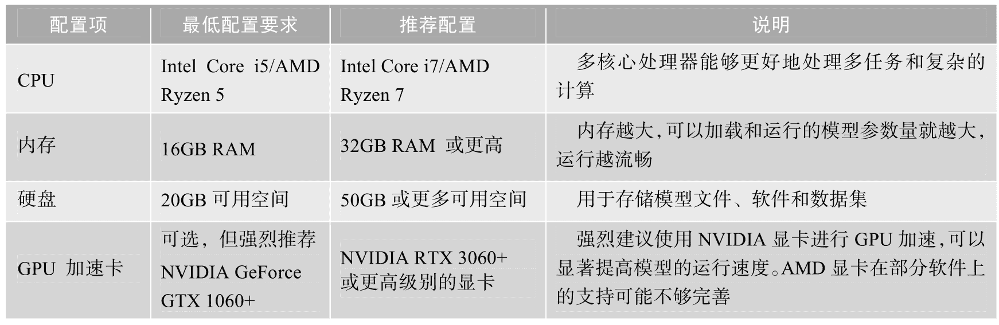

GPU 加速的重要性：虽然 DeepSeek 可在 CPU 上运行，但使用 GPU 加速能大幅提升运行速度，尤其在处理复杂代码生成与推理任务时，GPU 可带来数倍甚至数十倍性能提升。因此，若计算机配备英伟达显卡，强烈建议开启 GPU 加速以获得最佳体验。对入门用户，NVIDIA GeForce GTX 1060 或更高级别显卡即可提供不错加速效果。

另外，Mac Book 要求如下。

•硬件：至少需要 Apple M1 芯片，内存推荐 8GB 以上，可用硬盘空间 15GB 以上。
•操作系统：macOS 11 Big Sur 或更高版本。

对于更低配置笔记本，虽仍可运行基础功能，但将面临性能显著衰减风险，且无法使用能力较强的大模型。本节将介绍一个对硬件配置要求相当低的大模型版本，方便开发者学习。

**2.软件安装**

为在本地运行 DeepSeek 模型，需安装核心部署工具—Ollama。

1）Ollama 工具介绍

Ollama 是一款专注于快速部署与运行本地大模型的轻量级命令行工具，凭借简洁指令设计与高效性能深受开发者青睐。熟悉 Docker 容器或云原生开发的开发者对其操作逻辑应非常熟悉。例如：

镜像拉取对比：docker pull <image> → ollama pull <model>。

运行实例对比：docker run <image> → ollama run <model>。

2）工具选型考量

当然，开发者也可选择其他大模型部署工具，例如直接从 Hugging Face 等模型托管仓库将模型文件手动下载至本地硬盘目录，再通过 Python 脚本加载模型进行开发调试，但本章推荐使用 Ollama 工具。

在本地大模型部署领域里，Ollama 是目前比较受关注的一个自动化工具。它把模型管理的重复工作做成了流水线：能够自动读懂 Hugging Face 仓库地址并梳理依赖关系，自动规划本地存放目录，自动记录版本变更；通过命令行即可完成下载、启动、升级等基础操作；支持面向个人电脑、笔记本的轻量本地运行，并且提供实时交互式调试，方便做快速原型验证。

当应用场景升级到企业级，对安全审计、负载均衡、分布式推理等维度的要求会明显上升，模型本身体量较大，往往需要在高配服务器或集群上配合 vLLM、SGLang 这类推理加速引擎来使用，这里不再展开。

Ollama 更新频率快，社区生态成熟，学习资料丰富，用户规模大，遇到问题通常能在社区里快速找到解决思路，因此被很多人作为入门本地大模型的首选。

除了 Ollama，市场上还有 LM Studio、GPT4All、AnythingLLM 等可本地化的方案，各有侧重。以 LM Studio 为例，它基于 llama.cpp 构建，提供图形化操作界面，无需命令行，聚焦桌面端体验，支持 GGUF 格式模型的获取与管理，比较适合偏好可视化操作的非技术用户，以及本地 AI 写作、问答类需求。

下面介绍安装流程，系统兼容 Windows、macOS、Linux，可前往项目官网挑选对应安装包，如图 1-1 所示。 ^(¹)

图 1-1

（1）Windows 系统。打开项目官网，点击“Download”按钮，在下载页选择“Windows”，再点“Download for Windows”获取安装包 OllamaSetup.exe。

双击完成下载的 OllamaSetup.exe 启动安装向导，按提示完成安装。安装后打开命令提示符或 PowerShell，执行 ollama--version 命令，若能正常显示版本号即为安装成功。

随后执行 ollama--help，可查看命令行用法说明，如图 1-2 所示。

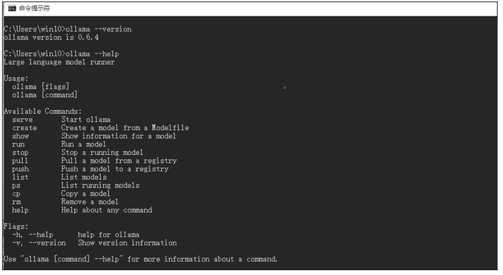

图 1-2

（2）macOS 系统。访问项目官网，先点“macOS”按钮，再点“Download for macOS”获取安装包。

双击下载的 ollama-darwin.zip 解压，得到应用程序。

将程序拖拽至“Applications”文件夹。

打开终端，执行 ollama--version 命令，显示版本号即表示安装成功。

执行 ollama--help 可获取更多命令行用法，如图 1-3 所示。

（3）Linux 系统。安装方式依发行版而定。

•Debian/Ubuntu：sudo apt-get update && sudo apt-get install-y ollama。

•Fedora/RedHat：sudo dnf install ollama。

•Arch Linux：sudo pacman-S ollama。

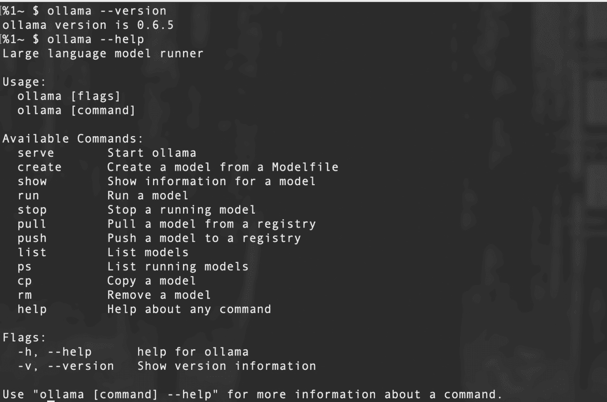

图 1-3

执行命令后按“Enter”并输入管理员密码，等待完成。安装完成后在终端输入 ollama--version，若显示版本号说明成功。

**3.Ollama 的优缺点**

该工具属于轻量级部署方案，适用边界清晰，优缺点都很明显。

1）优点

（1）上手门槛低。安装便捷，通常几行指令即可完成，无需繁琐环境准备，降低部署难度，新手也能迅速起步。提供友好的命令行工具，通过简单指令即可管理与运行权重，甚至一行代码就能与模型对话。

（2）资源占用小。借助量化技术把参数精度从高降低到低，减少内存消耗，可在个人电脑、移动设备等资源受限环境运行，对经常出差的商务人士及低配机用户友好。

（3）跨平台。全面支持 macOS、Windows、Linux，具有良好跨平台性，满足不同系统部署需求，也方便跨区域团队协作与知识共享。

（4）生态丰富。支持 Llama2、Mistral、DeepSeek 等多种大模型，内置预置模型库，便于快速尝试，也允许自定义模型，满足多样化需求。

（5）接口兼容性强。完整实现 OpenAI API 规范，可与依赖该规范的工具平台无缝集成，便于在已有 OpenAI API 应用上扩展模型功能。

（6）推理优化手段多。面向推理设计，具备混合精度 FP16、张量并行 Tensor Parallelism 等加速技术，可提升推理速度、降低延迟。

（7）社区活跃。社区氛围热烈，用户与开发者能迅速获得支持，高参与度确保问题及时解决。

2）缺点

（1）并发能力受限。采用单线程架构，并发处理较弱，4 个左右的并发请求就可能产生资源争用，高并发下易成瓶颈，更适合个人用户、小型项目或低并发场景。

（2）国内网络受限。项目服务器在海外，国内用户下载与使用时网速可能较慢，可通过修改下载源等方式缓解。

（3）安全需加固。默认开放式访问，需额外配置网络层防护，否则存在未授权访问风险。

**1.1.2 下载 DeepSeek 模型**

安装完成后，紧接着是获取 DeepSeek 权重文件。

**1.模型选择**

DeepSeek 团队提供多款原生大模型，其中 DeepSeek V3 与 DeepSeek R1 为参数量 671B 的完整版，因体积庞大，对内存和算力要求极高，不适合在本地 PC 或笔记本运行。为适配本地部署，DeepSeek 还提供基于阿里巴巴开源 QWen 模型和 Meta 开源 Llama 模型的蒸馏版本，主流的 6 个蒸馏版本见表 1-2 所示。

表 1-2

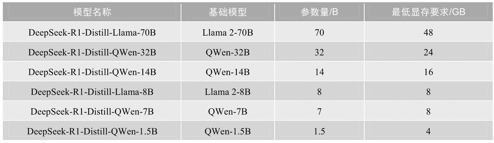

选型时需结合硬件与需求权衡。参数规模小如 7B、1.5B 的版本硬件要求低、运行快，适合资源有限环境或对响应速度要求高的场景；参数规模大如 32B、70B 的版本能力更强、文本质量更高，但对硬件要求更高、运行更慢，需更强 GPU 或更大内存。

需要注意的是，很多支持 DeepSeek 的软件或硬件实际运行的是蒸馏版而非完整版，原因多为硬件性能或场景需求限制。实际上，QWen-32B、QWen-14B 乃至 QWen-7B 蒸馏版本通常已能满足大部分需求。

本节以参数规模最小的 DeepSeek-R1-Distill-QWen-1.5B 为例演示。该版本由阿里巴巴 QWen-1.5B 经 DeepSeek-R1 蒸馏而来，参数虽小、能力有限，但资源占用低、速度快，适合演示与快速入门。

**2.使用 Ollama 下载模型**

使用该工具获取模型很简单，打开命令提示符 Windows 或终端 macOS/Linux，输入以下命令回车。

工具会自动下载 DeepSeek-R1-Distill-QWen-1.5B 版本，下载耗时取决于网络，请耐心等待。

下载完成后终端会显示“success”提示。macOS 界面如图 1-4 所示。

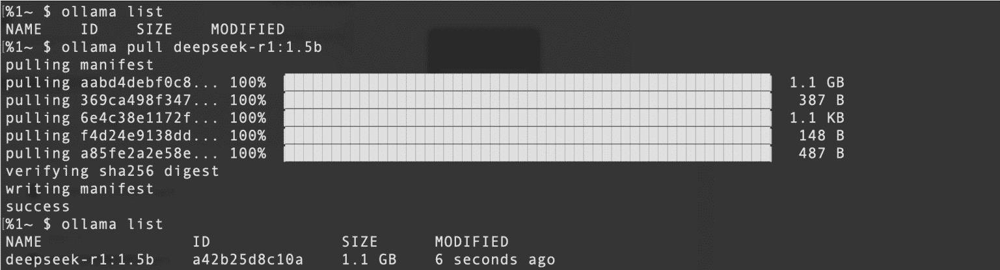

图 1-4

Windows10 界面如图 1-5 所示。

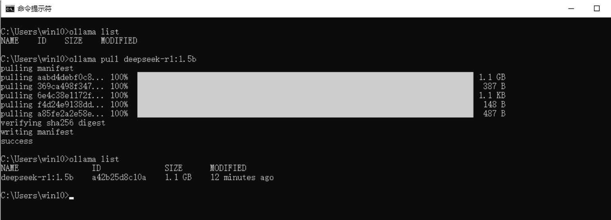

图 1-5

执行 ollama list 可查看已安装模型列表，可见模型已成功下载，大小 Size 为 1.1GB。

**1.1.3 使用 Ollama 运行 DeepSeek 模型**

接下来在本地运行该版本并做简单对话测试。打开命令提示符或终端，输入以下命令回车。

工具将启动 DeepSeek-R1-Distill-QWen-1.5B 并进入交互式对话模式，直接在终端输入问题或指令回车发送，模型会生成回复并显示。

可进行多轮对话。

例如问“你是谁？”，会回答“您好！我是由中国的深度求索 DeepSeek 公司开发的智能助手 DeepSeek-R1。如果您有……”。

再例如询问编程问题，如“帮我写一个 Python 函数，实现快速排序的功能。”，它会给出思考过程，用 <think> </think> 包裹，这是 DeepSeek-R1 默认公开推理过程的表现。结束对话可按“Ctrl+D”并回车。

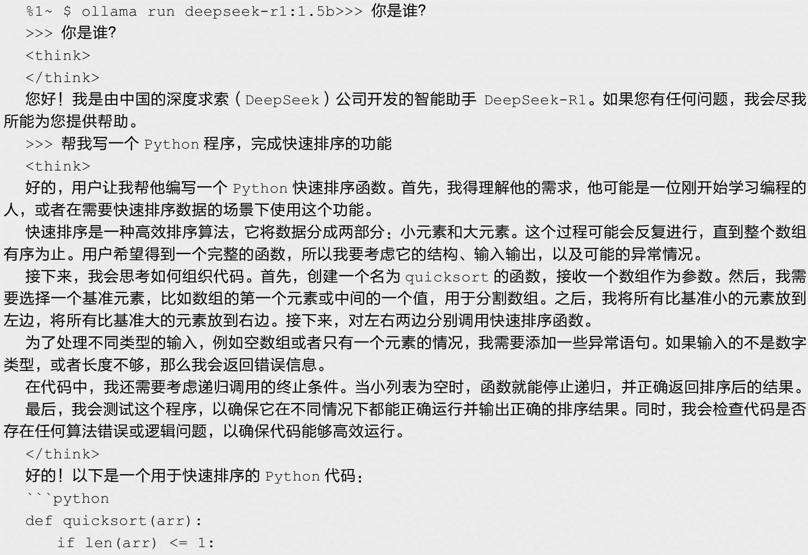 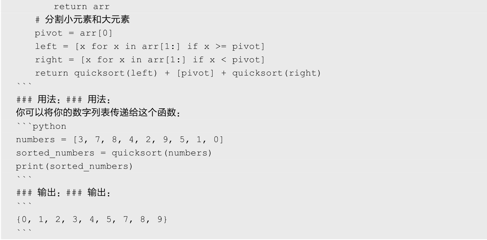

DeepSeek 生成的 Python 程序经测试验证。笔者在笔记本另一终端启动 Python 3.12.4，将代码复制到 Python Console 执行，结果正常，输出符合预期。

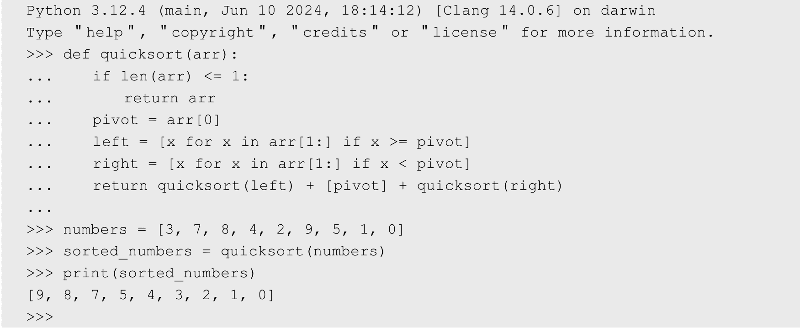

至此，已成功实现 DeepSeek-R1-Distill-QWen-1.5B 的本地运行，虽体积不大，但属于严格意义上的大模型。

**1.1.4 常见问题排查**

本地部署运行 DeepSeek 时可能遇到以下问题。

**1.模型下载速度慢或下载失败**

（1）网络问题。检查网络连接是否正常，尝试重启路由器或更换网络环境。

（2）镜像源问题。工具默认从 Hugging Face Hub 获取，网络不稳时可更换国内镜像源，具体方法参考官方文档。

（3）服务器压力。Hugging Face Hub 高峰期负载高，建议避峰获取或稍后重试。

**2.模型运行报错**

（1）硬件不足。检查电脑配置是否满足最低要求，特别是内存与 GPU 显存，可尝试运行更小参数版本或升级硬件。

（2）驱动问题。若使用 GPU 加速，请确保显卡驱动已正确安装并更新至最新，特别是 NVIDIA 显卡驱动。

（3）文件损坏。文件可能因网络中断导致不完整，建议删除本地模型后重新获取。

（4）软件 Bug。Ollama 仍在快速迭代，可能存在 Bug，可尝试更新到最新版，或查阅官方文档与社区论坛寻找解决方案。

**3.性能不佳 运行速度慢**

（1）GPU 加速未生效。确认工具已正确配置并启用 GPU 加速，检查设置与显卡驱动是否正常。

（2）模型参数不恰当。temperature、top_p、max_tokens 等参数会影响运行效率，可适当调整以平衡性能与效果。

（3）硬件瓶颈。电脑配置较低时运行大模型吃力，可升级硬件或改用小参数版本。

**1.1.5 小结**

至此，已在本地成功运行 DeepSeek 版本，完成本地大模型应用开发的第一步。下一节将介绍结合 RAG 技术提升 DeepSeek 知识库能力，打造更智能应用。

**1.2 在本地基于 DeepSeek 编写 RAG 应用**

本节聚焦大模型应用开发中最常见的场景——RAG 应用及技术。RAG 是开发者必须掌握的基础技术，RAG 应用往往是开发者编写大模型应用的起点。学习 RAG 并非困难，掌握后有助于获得提示词、向量数据库等关键技能。让 RAG 应用达到企业级品质仍需深入知识，本节目标是快速入门并搭建典型 RAG 样本，建立基础认知，并对技术难点与演进方向做扩展阐述。

**1.2.1 RAG 是什么**

先了解 RAG 的概念、原理、交互流程及常见步骤。

**1.RAG 的 What/Why/How**

在企业级大模型应用中，RAG 是最广泛使用的技术之一。它融合检索增强与生成能力，为企业应用提供更强功能与更灵活方案。本节从 RAG 是什么、为何需要、优势三方面简述。

1）RAG 是什么

RAG 结合大模型与信息检索技术。当大模型需生成文本回答问题时，不只依赖预训练数据，还会先从庞大文档集合中检索相关信息，利用检索结果辅助生成，最后返回用户。简单说，RAG 通过从外部知识库检索相关片段并融入生成过程，增强模型回答能力，使其能回答训练数据未覆盖的专业领域问题或最新动态信息。

RAG 由 Retriever、Argumentation、Generation 三词首字母组成，对应三个基本模块。

（1）检索模块。用户输入问题或指令后，检索模块先从外部知识库如文档、数据库、网页中找出相关信息。

（2）增强模块。将检索到的信息与原始问题合并，形成完整内容传递给大模型，如 ChatGPT 或 DeepSeek，相当于给模型提供“外脑”，避免完全依赖内部记忆。

（3）生成模块。综合外部知识与用户输入，整理后生成最终答案返回用户。

2）为什么需要 RAG

大模型语言生成能力强，但在需特定专业知识与准确信息的任务上，若知识未在互联网公开检索，则会暴露局限。例如复杂问答或需结合最新数据的场景，仅靠模型自身知识库易产生不准确或不相关内容。RAG 正为解决这些问题而生。

首先，RAG 弥补模型知识局限。模型知识来自固定大规模训练集，对训练后出现的新信息或冷门领域难以掌握。引入外部检索可实时获取最新相关信息。例如 DeepSeek-R1 训练数据截止 2024 年 4 月，若 2025 年询问“当今美国总统是谁？”会回答“乔·拜登”。

其次，RAG 提升生成准确性与相关性，减少“幻觉”。生成式 AI 底层为概率生成，幻觉常见且难根除。RAG 系统中检索模块能从指定数据中精准定位相关片段作为上下文输入生成模块，使输出更贴近事实，对医疗问答、法律咨询等高准确场景尤为重要。

最后，RAG 提高效率与可扩展性。复杂任务中直接使用生成模型计算开销大，RAG 通过检索筛选减少生成模块处理信息量，提升整体效率。架构上，调整或更新检索数据源与策略即可快速适应新业务需求。

3）RAG 的优势

RAG 主要优势体现在：

（1）提升生成质量。引入外部知识可显著提高准确性、相关性与丰富度。例如新闻摘要可检索最新报道生成更贴近事件的摘要；学术写作辅助可检索相关文献提供更准确引用与背景。

（2）增强知识更新能力。检索模块可实时获取外部数据源信息，无需重训练整个生成模型，只需更新检索数据源即可掌握最新动态，对金融分析、科技资讯等场景尤为重要。

（3）运算更省力，扩展更自如
RAG 的分层架构让复杂任务的处理变得更轻快。检索层先把与问题相关的信息筛出来，生成层就不用在海量上下文里硬扛，直接聚焦精华，整体算力开销被有效压缩。扩展性同样出色：检索策略可以调、数据源能加、生成参数可优化，功能和性能的提升基本不耽误。正是这种灵活性，让 RAG 能够顺滑地适配从轻量原型到重负载业务的不同规模和复杂度。

（4）对预训练语料的依赖明显下降
纯生成模型几乎要靠大规模预训练来堆语言能力和背景知识。RAG 通过检索把外部知识实时拉进来，用知识库补位模型记忆。即使预训练数据有限，也能借助外部库把表现拉起来，从而省下数据采集和标注的成本，并在实用性和适应性上实现跃升。

**2.RAG 调用全流程**
RAG 的运行可以拆成离线建库和在线问答两段，如图 1-6 所示。
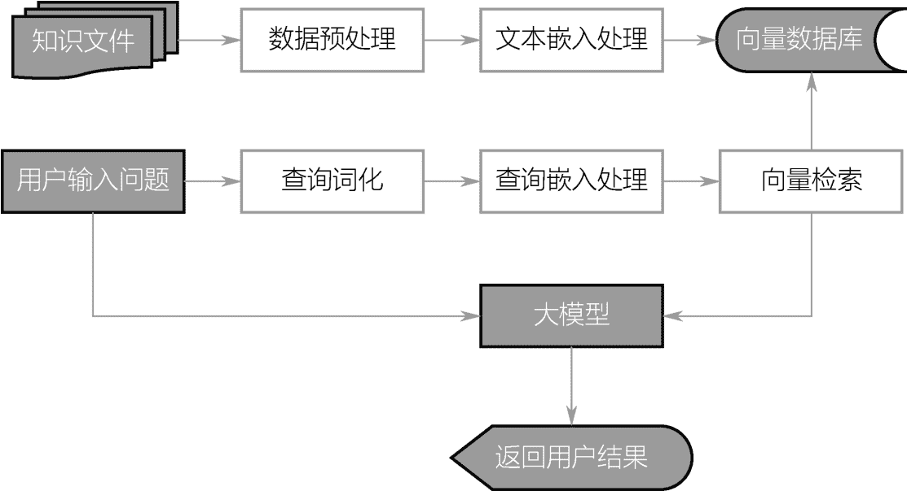

1）知识库构建（离线）
先对用户指定的一个或多个知识文件做预处理，文件可能是 PDF、HTML、Word、PPT、Excel，也可能是网页或数据库。预处理包括数据清洗，去掉噪声如无用的 HTML 标签、广告等；文本切分，把长文档拆成若干片段；元数据抽取，记录片段来源信息等。随后用指定的文本嵌入模型把片段转成向量，比如 nomic-embed-text，再把向量写入向量数据库。向量库可选 Milvus、Chroma、Weaviate 等，也有 OceanBase 这类传统数据库支持向量存储与查询。本项目采用 Dify 内置的 Weaviate。

2）查询生成过程（在线）
用户提问后，系统先把问题切词，再用同一嵌入模型做向量化得到查询向量。随后以向量相似度检索算法在向量库中寻找最相关的片段，最后把检索结果与原始问题一起交给大模型统一处理，产出答案返回。建库是离线作业，对延迟容忍度高，更看重质量，切分方式和嵌入模型的选择会直接影响检索效果。问答则是典型的在线服务，要求响应快、体验顺畅，既要保证检索准确与召回，也要兼顾延迟和并发能力。整体机制与传统网页搜索相似，区别在于答案的最终生成由大模型完成。

**1.2.2 本地搭建 RAG 应用并接入本地 Ollama DeepSeek 服务示例**
本节演示在本地搭起 RAG，并接入此前已跑通的本地 DeepSeek 服务。
这里选用大模型应用开发框架 Dify。市面上的 RAG 工具很多，如 LangChain、RAGFlow、Dify 等，从上手友好度、开发效率和数据源支持广度来看，Dify 优势明显。它是开源项目，也是较早支持图形化操作的工具之一，社区活跃度很高。

**1.Dify 介绍**
Dify 名称取自 “Do it for yourself” 的首字母，是一款优秀的开源大模型应用开发框架，最初因简化 RAG 开发流程而出名，后续功能不断扩展。创始团队有深厚的 DevOps 工具开发背景，对 DevOps 与 LLMOps 以及开发者体验理解深刻，在海外社区也有良好口碑。本节聚焦其 RAG 框架能力。

**2.Dify 安装和运行**
本节使用 Docker Compose 安装。

1）安装 Docker Desktop 版本
前往官网下载对应操作系统的 Docker Desktop，例如 macOS 需按 Apple Silicon 或 Intel 选择并安装。安装完成后在命令行执行如下命令验证：

2）将 Dify 拉到本地
最低硬件要求：CPU 至少 2 核；内存大于等于 4GB；macOS 10.14 及以上；Linux 支持 Docker 19.03 及以上。本节通过克隆 GitHub 仓库获取源码：

也可使用 Gitee 镜像：

3）在本地运行 Dify
进入源码目录下的 docker 文件夹：

复制示例环境配置文件：

如需改动默认配置，可编辑 .env，例如把 EXPOSE_NGINX_PORT=80 改为 8080，生效后访问地址应改为 http://localhost:8080/。随后用 Docker Compose 启动全部容器：

在 macOS 上可看到已运行的容器：
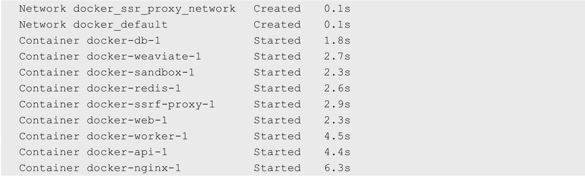
至此 Dify 已部署并运行，接下来在 Web 页面配置 RAG 流程并接入本地 DeepSeek 模型。

**3.配置 Dify**
在浏览器打开 http://localhost/install，设置管理员邮箱和密码。打开 http://localhost/apps 进入管理主页面，用管理员账号登录后即可看到应用管理界面，如图 1-7 所示。
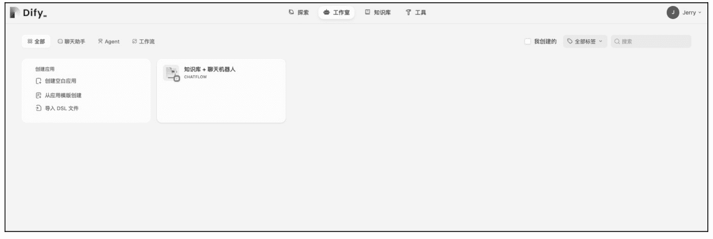
Dify 是基于大模型的应用平台，首次使用需先在“模型供应商”选项卡中添加并配置大模型，如图 1-8 所示。
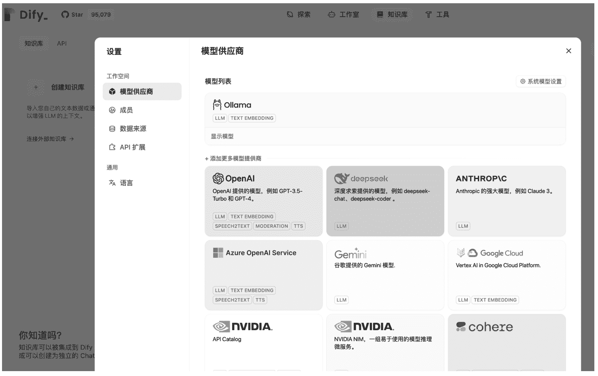
Dify 支持 OpenAI、Anthropic、DeepSeek 官网 API 等主流模型。此前已在本地用 Ollama 跑起 DeepSeek-R1-Distill-QWen-1.5B，现在在此界面选择 Ollama，并配置两个模型：大模型选 deepseek-r1:1.5b，基础 URL 填 http://host.d**ker.internal:11434；文本嵌入模型选 nomic-embed-text，基础 URL 同上，如图 1-9 和图 1-10 所示。
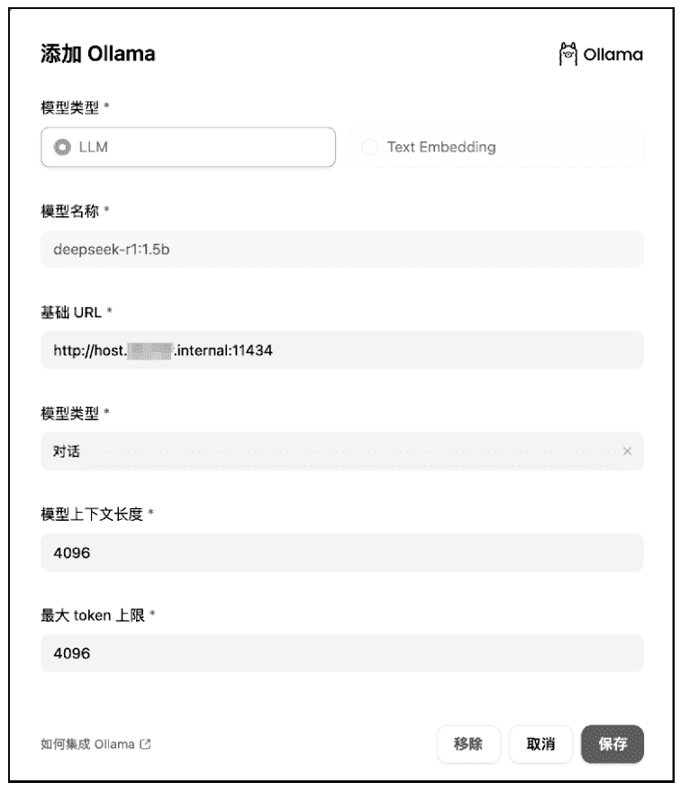
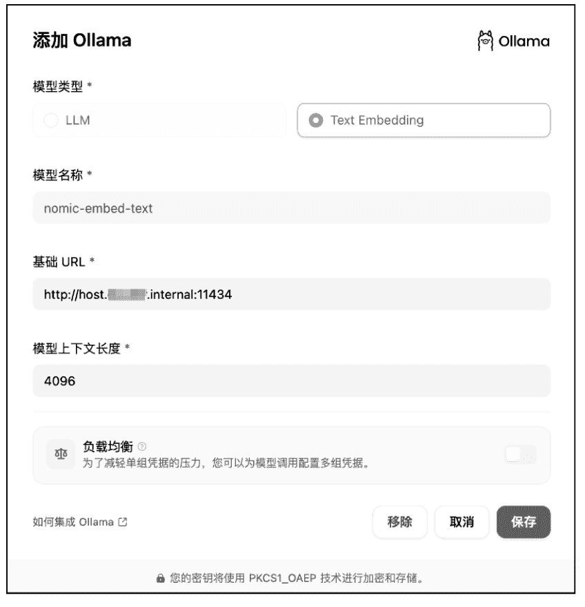
注意：
• 文本嵌入模型是 RAG 必备组件，若未下载需在命令行执行 ollama pull nomic-embed-text 下载。nomic-embed-text 是高性能开源嵌入模型，在 Ollama 社区常用，也可换 granite-embedding、bge-large 等。
• 本节以 Docker 方式运行 Dify，故基础 URL 使用 http://host.d**ker.internal:11434，其他运行方式请按官方文档调整。

**4.设置 Dify 的知识库**
配置好模型后，建立知识库并导入私有文档，操作分三步。

1）选择数据源
Dify 支持导入已有文本、同步 Notion 内容、同步 Web 站点。导入已有文本可上传 TXT、Markdown、DOCX、CSV、HTML 等。为演示选择“导入已有文本”，上传一份 PDF，点击下一步，如图 1-11 所示。
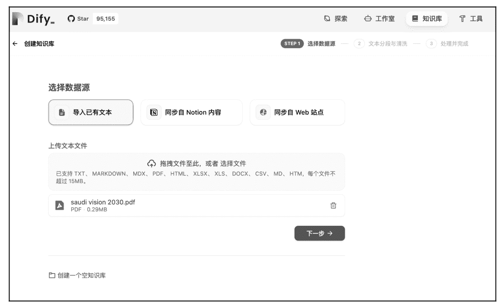

2）文本分段与清洗
第二步设置分段、索引方式、Embedding 模型、检索参数等，如图 1-12 所示。设置会影响建库时长与查询速度准确性，具体可参考官方文档。
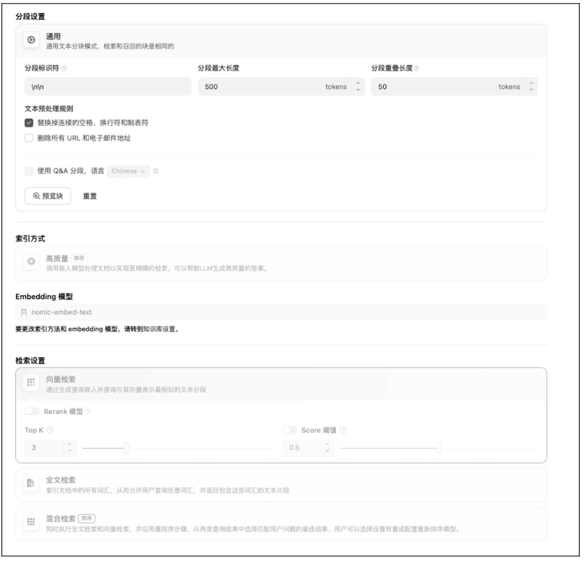

3）处理并完成
按分段和索引设置对文件进行分段、向量化、建索引。演示文件较小，处理很快，点击“前往文档”即可进入“召回测试”选项卡，如图 1-13 所示。
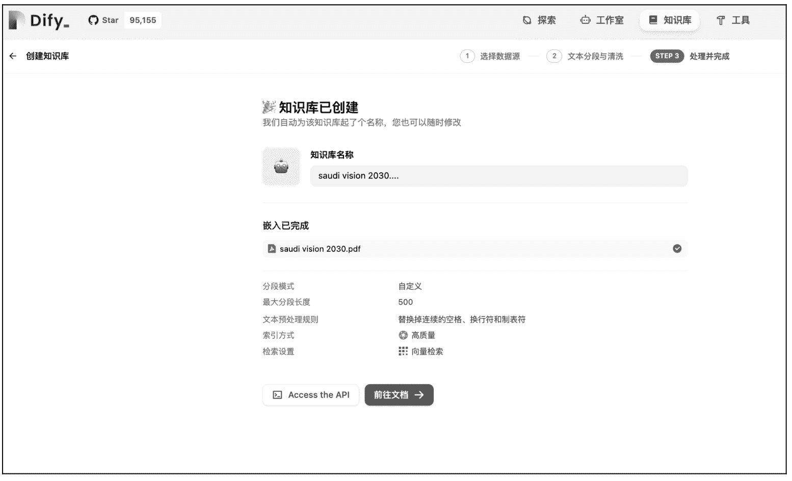

4）召回测试
在主页面左侧点“召回测试”，中间输入框填关键字，点击测试，右侧列表会展示相关片段。演示输入“请问沙特 2030 远景目标是什么？”即可返回多个相关片段，如图 1-14 所示。
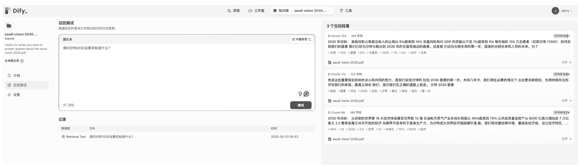
中间用于输入问题，右侧展示知识库中相关的片段，说明本地 RAG 知识库已能完成检索与生成。

**5.创建应用并调用 RAG**
知识库可运行后，开发者可通过 Python 调用 API，或用图形界面快速创建应用。点击顶部“工作室”，新建聊天类应用，在配置页选择已配置的 DeepSeek 1.5B 模型和刚建的本地知识库。交互界面中输入与知识库相关的问题，系统会先词化向量化，再在向量库中做相似检索，最后由大模型整合检索结果与问题生成答案。例如输入“沙特 2030 远景都有哪些目标？”，系统检索后给出结构清晰、带推理过程的答案，如图 1-15 所示。
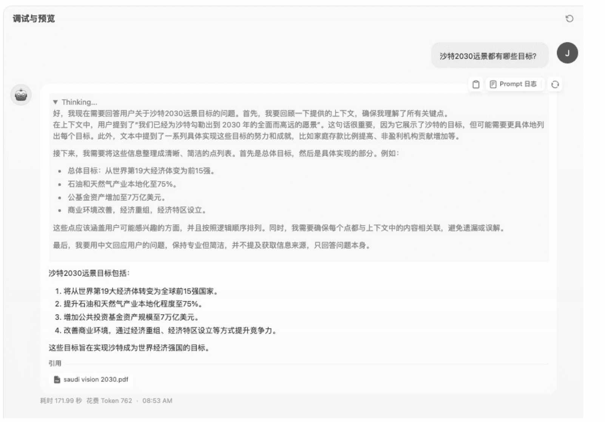
Dify 为每个应用提供标准 API，可按官方文档编写 Python 程序实现自定义检索。

**6.RAG 应用开发**
图形化操作即可搭建基础 RAG，体现了 Dify 简化开发的易用性。但生产级系统需完成大量工作，包括性能评估、功能完善、权限安全等。常见评估指标：

1）检索准确性
衡量检索结果与问题相关程度。
• 召回率：知识库中相关文档被成功检索到的比例。如相关 100 份，检索到 80 份，召回率为 80%。
• 精确率：被检索文档中真正相关的比例。如返回 50 份，其中 40 份相关，精确率为 80%。

2）检索结果的相关性排序
把更相关的文档排在前面，便于用户优先查看。可通过人工评估或点击行为数据判断用户是否更倾向浏览靠前的结果。

此外还关注检索延迟、生成耗时、端到端响应时间等。

不同阶段的优化思路：

（1）建库阶段
• 更合理的文档切分。固定 1024 字符加 50 字符重叠虽简单，但易破坏语义。改进为按逻辑块、层级结构切分，或整理成问答对再切分。
• 选择合适的嵌入模型。按文件类型和内容组织挑选模型，提升文档表征质量。
• 合理选型向量数据库。按场景与数据规模选择 Milvus、Weaviate 等。

（2）检索阶段
• 查询改写。对用户输入做语义理解与改写，再向量化，提升匹配度。
• 相关性重排。用 Rerank 模型对向量检索结果二次排序，选出更相关片段。
• 混合检索。结合关键词检索与向量检索双路召回，弥补单一方式不足。

（3）生成阶段
• 严格提示词模板。限制大模型自由发挥，避免忽略检索结果而套用训练数据。
• 记录点击数据。按用户点击频率提升对应片段权重，实现类似 Learning to Rank 的效果。

底层大模型选择至关重要，需在准确性与性能间找到平衡。

**1.2.3 小结**
RAG 作为检索与生成的混合框架，在大模型应用中价值突出。它弥补模型知识局限、减少幻觉、提升内容质量、增强知识更新能力、提高效率与可扩展性，并降低对预训练数据的依赖。开发者应通过学习实践掌握各模块与关键技术，把大模型能力真正落地到企业级场景。

RAG 仍在演进，除文本类 RAG，多模态知识库查询需求增强；随着智能体技术发展，Agentic RAG 雏形已现，用户查询会被大模型拆解为子任务，交由不同 Agent 工具完成对比验证等复杂流程，提升效率与质量。

**1.3 使用 DeepSeek 和 Dify 构建智能体应用**

2022 年 11 月 30 日，ChatGPT 公开发布后迅速引发市场和大众关注。进入 2023 年，生成式人工智能的浪潮在全球范围内加速扩散。业内有一种判断在传播：2023 年是让公众第一次大规模感知到大模型能力的 ChatGPT 年，那么 2025 年更可能成为智能体集中落地的年份。ChatGPT 拉开了生成式人工智能的新篇章，智能体则在此基础上迈出关键一步，让机器具备自主理解需求并完成任务的能力，能够灵活调用外部工具、拆解复杂流程，像一位贴心的数字助手一样嵌入学习、工作和生活的场景，带来更具感知的智能化体验。如今智能体已成为大模型应用中最核心的组成部分之一。

大致可以这样概括：
落地的大模型应用 = 底座模型 + 多个智能体 + 多项外部能力

对大模型研发人员来说，读懂并学会搭建智能体是把握技术走向的关键。本文将从 Agent 的定义、核心概念、价值、与大模型的关系、交互流程以及常用开发工具展开，并以 DeepSeek 大模型结合 Dify 开发平台为例，演示如何搭建一个简洁可用且功能完整的股票查询助手。

**1.3.1 什么是智能体**

**1. 智能体的定义**

公开百科的表述是：智能体是指能够感知外部环境并采取行动以实现特定目标的代理实体。它可以是软件、硬件或复合系统，具备自主性、适应性与交互性。智能体通过传感器或数据输入捕捉环境变化，基于自身已学知识与算法进行判断，再执行动作影响环境或达成预设目标。智能体广泛应用于自动化系统、机器人、虚拟助手、游戏角色等领域，其核心在于能够自我学习并持续进化，以更好地完成任务并适应复杂环境。

总体来看，智能体通常具备感知、规划、执行三类能力，并拥有一定程度的自主性，能够进行决策、学习与适应。这意味着它们并非被动执行的程序，更接近能像人一样思考和行动的实体，尽管当前技术与科幻设定仍有差距。把握这些概念对开发者很重要，因为它们划定了 Agent 的能力边界与发展方向。与传统软件不同，Agent 更灵活通用，不依赖固定编程规则做决策，因此特别适合处理复杂、动态、需要与人互动的任务。

**2. 智能体的主要特点**

1）自主性
自主性是智能体的基础特质，指其能够独立感知环境、做出决策并执行行动，而无需持续的人类干预。具备自主性后，智能体可在动态且不可预测的环境中自行运行并调整行为。例如自动驾驶汽车就是高度自主的智能体，它能感知周边车辆与行人，自主规划路线、控制车速并进行避障决策。自主性降低了人工监督依赖，也让智能体在需要实时响应的场景中保持高效可靠。

2）反应性
反应性指的是对环境变化迅速察觉并及时回应的能力。这种特性让智能体在突发或紧急情况下能快速有效应对。对实时系统和动态环境尤为重要，比如机器人需要立刻感知障碍出现并马上改变路径以免碰撞。虽然反应性常指对当前状态的即时响应，但高级智能体还能结合历史数据和预测信息，使反应更智能、更灵活。

3）主动性
主动性指智能体能够自行设定目标、规划行动并采取措施达成目标的能力，而不仅仅是对环境变化做出被动反应。主动性让智能体能根据内在目标和动机积极行动。例如智能家居系统可以主动学习用户的作息习惯，提前调节室内温度或灯光以提升舒适度。具备主动性的智能体能在环境中自主探索、发现问题并提出解决方案，在长期目标达成上展现出更好的灵活性和创造力。

4）社会性
社会性指智能体与其他智能体或人类进行互动、协作和交流的能力。具有社会性的智能体能够理解并遵守社会规范，与其他个体协同行动以完成复杂任务。例如在多智能体系统中，各体需要通过通信协议共享信息、分工合作，实现团队目标。社会性也体现在人机交互中，如智能语音助手能理解用户指令，并通过对话形式给出反馈和建议。社会性增强后，智能体在团队协作和群体决策场景中的效率更高。

5）进化性
进化性指智能体通过学习和适应，在长期运行中不断提升自身能力的特性。具备进化性的智能体在面对新环境或新任务时，能够自我调整和优化，逐步提高性能。该特性通常与机器学习、进化算法或强化学习结合，使智能体在变化环境中保持竞争力。例如强化学习智能体通过持续与环境交互，不断调整策略以最大化长期收益。进化性让智能体能应对不确定性和复杂性，在长期任务或未知环境中表现更优，并随时间推移变得更智能、更高效。

目前大模型常被视作智能体的“大脑”，提供理解、推理和行动能力；智能体则被看作大模型的“手脚”，通过调用外部 API 与真实世界交互，扩展大模型的功能，完成更多现实任务。

**3. 智能体的发展历史**

智能体的演进大致经历了三个阶段：

（1）规则驱动阶段，2010 年前。以 If-else 逻辑为核心的有限场景自动化，比如早期的客服机器人。

（2）机器学习阶段，2010—2020 年。引入自然语言处理技术，实现初步语义理解，但对标注数据依赖较强。

（3）大模型驱动阶段，2020 年至今。依托大模型的自主决策能力，支持动态任务分解与外部工具调用。

**1.3.2 智能体的主要模块**

主流智能体多采用“感知-规划-执行”三层架构，并借助思维链 Chain-of-Thought 处理复杂任务。

**1. 三大基础模块**

1）感知模块
感知模块负责获取外部信息。通过物理或软件接口采集并解析来自环境的各类数据，包括图像、音频、视频、文本等。开发者需要考虑智能体应与何种数据交互，以及如何采集和处理。只有具备准确全面的感知能力，智能体才能为后续决策提供可靠依据。

2）规划模块
规划模块是智能体的“大脑”，负责对感知信息进行分析、推理、判断，并制定行动计划，大模型在此环节发挥关键作用。推理是智能体展现“智能”的核心，尤其在需要逻辑推演和多步思考的任务中。开发者需要思考如何让智能体具备系统化的信息处理能力，并依据已有知识和实时输入做出合理高效的决策。

3）执行模块
执行模块是智能体作用于外部世界的部分，通过执行器或对外接口，如回答查询、处理请求、控制物理设备，来完成实际操作。简单说，执行模块决定智能体如何影响世界。开发者需要明确智能体需要执行哪些行动以及如何执行。

除上述三模块外，许多智能体还包含学习模块，使其能够基于新信息、用户反馈和历史经验持续优化行为与决策机制，从而长期提升性能。这种自我进化能力是智能体区别于传统程序的重要特征。开发者可考虑引入强化学习、在线学习或其他机器学习机制，以增强适应性和智能化水平。

感知收集数据，规划处理数据并决策，执行落实决策，形成闭环。这种“感知-规划-执行”循环确保智能体能够动态响应环境变化，并通过持续迭代不断提升性能。构建时需确保三者无缝衔接、协同工作，建议采用迭代式设计，让智能体在循环中完善自身能力。

**2. 智能体与大模型的配合**

1）大模型扮演大脑角色
大模型是构建智能体的基础，扮演“大脑”角色，为智能体提供理解、规划和行动能力。凭借强大的自然语言处理能力和日益增强的多模态支持，大模型让智能体能够准确理解用户输入。同时，大模型的推理能力也使智能体能够进行任务规划，并决定何时调用哪些外部工具。对开发者而言，理解大模型原理及其与工具的交互方式至关重要，这直接影响智能体的智能水平与实用性。

2）利用大模型的规划、记忆和工具使用能力
（1）规划。大模型可以将复杂任务拆解为更小、更易管理的子任务，并为每部分制定具体计划。例如 ReAct 框架结合推理与行动，允许大模型在生成思考过程的同时交替执行可操作动作，从而高效解决问题。这意味着大模型不仅能理解任务，还能自主思考完成方式并拆解为一系列可执行步骤。开发者可以利用大模型的规划能力构建能处理复杂任务的智能体。
（2）记忆。大模型可以保留过往对话中的关键信息，增强上下文理解能力，使对话更连贯、更具逻辑性。记忆使智能体能够回忆过去经验并根据反馈不断调整行为。对开发者来说，这意味着可以构建记住用户偏好和历史对话的智能体，提供更个性化、更持续的交互体验。智能体开发框架通常提供记忆管理功能，便于配置会话上下文、设置记忆窗口等方式灵活控制记忆行为。
（3）工具使用。大模型驱动的智能体不仅能与外部工具如 API、数据库、知识库交互，还能扩展其在语言处理之外的能力。借助这些工具，智能体能够执行网络搜索、数值计算、数据检索等任务。工具调用能力是智能体实用性的核心，它打破了传统语言模型只能“说”不能“做”的局限，使智能体成为能参与现实任务的智能代理。开发者可通过智能体开发框架将各种工具集成，使其能执行更广泛的任务。

**3. 智能体的四种常见设计模式**

吴恩达教授于 2024 年撰写博客，总结了智能体的四种常见设计模式，具有参考价值。

他认为智能体主要有以下四种模式。
（1）反思 Reflection。智能体检查自身工作并提出改进建议。
（2）工具使用 Tool Use。大模型配备网络搜索、代码执行等工具，帮助收集信息、采取行动或处理数据。
（3）规划 Planning。大模型可以根据任务描述提出并执行多步骤工作计划来实现目标，例如先写文章大纲，再进行在线研究，最后撰写草稿。
（4）多代理协作 Multi-agent Collaboration。多个智能体协同工作，以不同角色分解任务并讨论想法，提出比单个智能体更好的解决方案。

详情可参考 DeepLearning.ai 上的 Agent 系列文章。

**1.3.3 智能体开发框架**

最原始的开发方式是手写多条提示词并用 Python 编排。例如先改写用户输入、识别意图并提取关键参数，再组织成外部 API 所需的调用地址发送请求并获取返回结果，最后结合用户输入与 API 响应生成最终答案返回给用户。

这种方式可行但开发效率低、维护成本高。为此近年来出现了一系列智能体开发工具和框架，极大简化流程。LangChain 作为早期的大模型提示词编排工具，提供封装良好的 Python 库，帮助开发者快速搭建上层应用逻辑。随后出现了更多图形化、可视化平台，使开发者能够通过拖拽等直观操作完成配置，显著提高效率和易用性。

**1. 常用框架盘点**

以下几种框架在业内较为流行，各有侧重。

1）LangChain：最早的大模型开发框架
（1）核心优势。模块化设计，采用 Chains、Agents、Tools 分层架构，灵活组合提示词、记忆、工具调用等组件。提供统一接口简化多个大模型集成。文档与社区丰富，上手较平缓。
（2）典型应用。适用于需要深度定制的复杂场景，例如多轮对话系统、智能客服，集成多数据源、自动化数据分析等。

2）Dify：图形化操作，功能丰富迭代快
（1）核心优势。集成 RAG 引擎和插件市场，支持快速构建生产级应用。提供可视化工作流，降低开发门槛。支持无代码或低代码开发，适合非技术用户。
（2）典型应用。构建企业内部知识管理系统，快速开发定制化智能助手。

3）扣子 Coze：字节跳动推出的智能体工具，插件丰富
（1）核心优势。零代码或低代码开发，适合非技术用户快速上手。提供丰富的插件库，支持调用各种外部 API，扩展智能体功能。内置知识库和工作流引擎，支持复杂业务流程处理。
（2）典型应用。构建企业内部知识管理系统，开发虚拟助手、个人助理等对话型智能体。

4）Microsoft AutoGen：微软推出的多角色智能体工具
（1）核心优势。支持多智能体并行执行任务，提高任务处理效率。提供生产级监控和调试工具，方便部署维护。与 Microsoft Azure 生态深度集成，适合企业级应用。
（2）典型应用。构建多智能体对话系统，实现自动化运维和任务调度。

5）CrewAI：创业公司推出的多角色智能体工具，上手容易
（1）核心优势。强调多角色协作，每个智能体拥有独立角色和任务。内置记忆和错误处理机制，提高系统稳健性。
（2）典型应用。模拟多角色对话协作场景，例如虚拟团队协作，构建任务分解和协作执行的工作流。

表 1-3

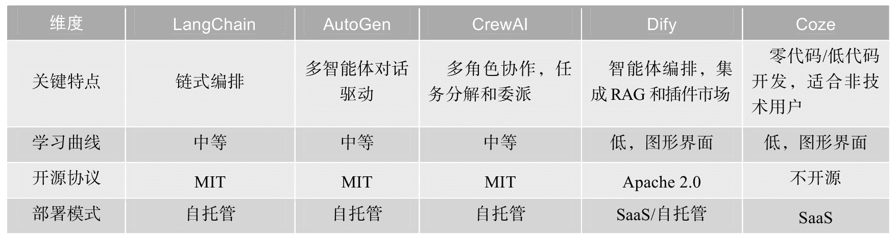

可以看出，Dify 在开发者友好度上表现相对突出，这也是本节选用它的原因之一。

**2. Dify 的智能体能力**

1）Dify 简介
最初 Dify 聚焦于 RAG 应用的快速构建，随着技术发展和行业需求演进，Dify 逐步增强对智能体开发的支持，并自然融入现有架构和操作流程。如今 Dify 不仅可用于快速开发 RAG 应用，也可用于构建功能丰富的智能体应用。

2）Dify 用于智能体构建的关键特性
（1）智能体框架。Dify 提供灵活的智能体框架，允许开发者自定义智能体以独立使用多种工具处理复杂任务，支持函数调用和 ReAct 等智能体策略。该框架为构建自主运行智能体提供结构化方法，开发者可以定义目标、行为逻辑以及可用工具，实现高度定制化交互。
（2）工具集成。Dify 允许无缝集成各类工具，包括内置工具如 Google 搜索、维基百科、DALL-E，以及通过 OpenAPI/Swagger 和 OpenAI 插件导入的外部工具，同时支持通过 API 连接外部知识库。强大的工具集成能力极大扩展智能体应用场景，使其能与外部世界交互并执行各种操作。

**1.3.4 使用 Dify 构建智能体的流程**

在 Dify 中搭建智能体非常便捷，下面以本地环境中的 Dify 与 DeepSeek-R1-Distill-QWen-1.5B 为例，演示如何构建一个股票查询智能体。

**1. 设置本地 Dify 和 DeepSeek 环境**
本节继续使用本地化部署的 DeepSeek-R1-Distill-QWen-1.5B 模型与本地 Dify 系统。

注意：Dify 同样提供云端 SaaS 版本，开发者也可以选择在云端环境配置并使用云端 DeepSeek 模型服务。操作界面和流程与本地部署基本一致，可根据实际需求选择。

**2. 熟悉和使用 Dify 内置的智能体工具**
开发前建议先熟悉 Dify 内置工具，有助于理解其开发机制。Dify 提供名为 MarketPlace 的市场模块，预置大量常用智能体工具，如 Google Search、DALL-E、Slack 等。

下面体验 Dify 内置的股票查询工具 AlphaVantage。打开 Dify 主页，点击顶部导航栏中的“工具”按钮，在搜索框输入“AlphaVantage”，找到该工具。描述显示 AlphaVantage 是一个提供金融市场数据与 API 的在线平台，便于个人投资者与开发者获取股票报价、技术指标与分析。当前版本 0.0.2，开发商 langgenius/alphavantage，安装次数 671 次。点击“安装”按钮，即可将该工具加入系统。

注意：AlphaVantage 是一家提供免费股票数据 API 的服务商。使用其 API 需要注册账号并获取一个 API Key，例如 5***。后续使用时需要将该 API Key 填入配置项，以完成身份验证。

点击 Dify 顶部的“工作室”选项卡，选择“创建空白应用”，在“选择应用类型”中选择“Agent”，在“应用名称&图标”中输入“testagain”，即可创建出新应用，如图 1-16 所示。

进入该应用主页面后，在中间区域选择“工具”选项卡，点击“添加”按钮，选择已安装的“AlphaVantage”的“query_stock”接口，添加成功后可在工具下方看到已添加的工具，如图 1-17 所示。

随后在应用右上角选择模型，将其设为 Ollama 平台上的 deepseek r1：1.5b 模型，即完成对本地大模型服务的调用配置。

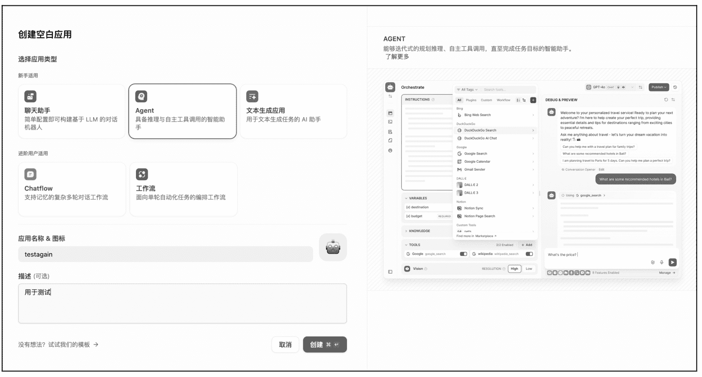

图 1-16

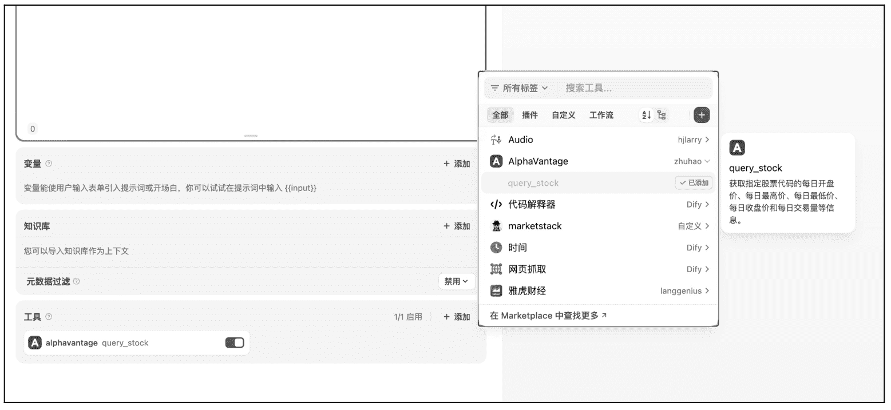

图 1-17

最后在应用的调试与预览界面进行测试。

为体现使用与不使用智能体工具的差异，先在“工具”选项中关闭“AlphaVantage query_stock”功能，然后在右侧输入框输入“请问苹果公司最新的股价是多少”。由于 deepseek r1：1.5b 并没有联网查询能力，返回内容如下。

“目前我无法实时获取苹果公司（AAPL）的最新股价信息，建议您通过财经网站（如雅虎财经、谷歌财经）或股票交易应用查看实时数据。”

在 Dify 的工具区域把 AlphaVantage query_stock 插件打开，右侧的输入区输入“请问苹果公司最新的股价是多少”。发送后，平台会通过智能体插件中的 AlphaVantage query_stock 入口向 AlphaVantage 官网 API 发起查询，把股票代码 AAPL 作为参数传入，拿到最新报价后整理成自然语言返回给用户。

其中思考过程如下。
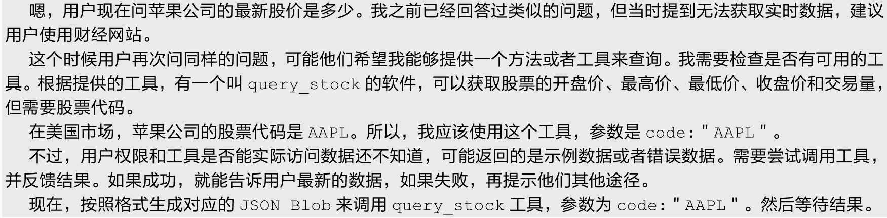

生成的结果如下。
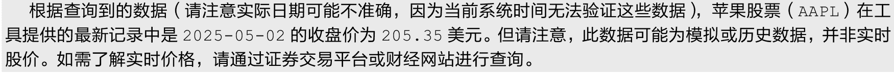

注：笔者操作时间是 2025 年 5 月 4 日，美国股市周末休市，所以能返回的 5 月 2 日数据即为当时最新的数值。

到这里，一次完整的智能体工具调用链路已经跑通，结果符合预期。

以 DeepSeek-R1-Distill-QWen-1.5B 为例，内部处理大致可拆成四步。

1）意图识别。模型先判断用户实际上是想查询苹果的即时股价。
2）需求拆解与工具选择。模型认为需要借助外部插件，已部署的 AlphaVantage query_stock 满足需求，但该插件要求必须提供股票代码。
3）参数传递与数据获取。模型把 AAPL 交给插件，插件再向 AlphaVantage 请求，成功拿到苹果在 2025 年 5 月 2 日的收盘价 205.35 美元。
4）答案组织。模型把数值与原问题结合，用流畅中文给出最终回复。

从这条链路看，模型更像决策中枢，智能体插件负责执行具体操作，模型指挥插件完成查询、计算后再呈现用户可读的结果。若模型能力不足，整条链路的产出也会受影响。

3.创建一个新的智能体工具，并完成调用

下面演示如何新增一个股票查询插件，改用另一家数据商，以体现插件的可扩展性和灵活性。

1）选定免费行情接口。市面上免费股票数据接口有 Marketstack、AlphaVantage、Finnhub、Twelve Data 等，本例选 Marketstack，因为文档清晰、提供试用额度、支持每日收盘价 EOD 接口且需 API Key 鉴权。

开发者可在 Marketstack 官网注册并领取免费 API Key。

2）研读接口文档。查阅 Marketstack 说明，了解每日行情端点 /v1/eod 的用法，该端点可返回指定股票的最新行情。请注意必填参数与返回结构。

需关注要点如下。

•基础地址：https：//api.markets***k.com/v2/eod/。
•必要参数：access_key 用于鉴权；symbols 指定目标标的，如 AAPL。
•返回格式：JSON，收盘价位于 data 数组中的 close 字段。

示例请求地址为：https：//api.markets***k.com/v2/eod/latest？access_key=cd007113a9c11b bdffc0b50a4d6513c4&symbols=AAPL

3）在 Dify 中创建自定义工具。进入 Dify 主页，依次点开“工具”→“自定义”→“创建自定义工具”，按以下步骤配置。

•工具名称：如“Marketstack Stock Query”。
•Schema 配置：依据 Marketstack 文档及 OpenAI Swagger 规范填写调用配置。参考模板如下。
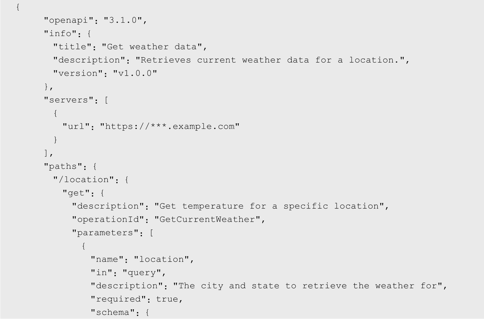 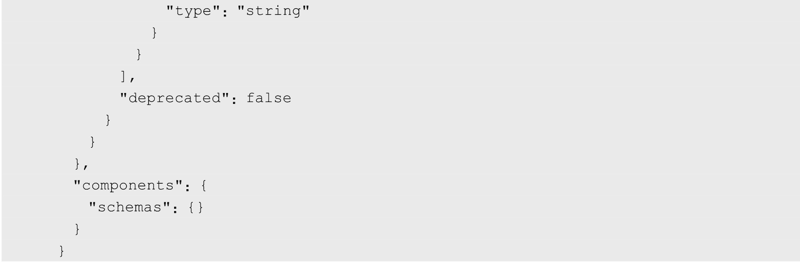

填写完毕后点击“保存”。

在 Dify 主界面新建工作室，从工具列表中选用刚创建的 Marketstack Stock Query，沿用前文操作习惯输入查询语句，即可获取 IBM 公司的最新股价信息，如图 1-18 所示。
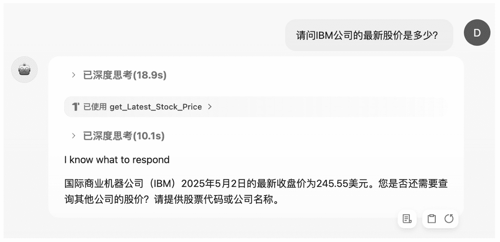

图 1-18

4.探索 Dify 关于智能体的高级功能

•Dify 为智能体提供多种执行策略，常见有“函数调用”与“ReAct”。开发者可按任务复杂度切换策略，以提升推理效率与执行准确度。
•Dify 内置可观测性能力，支持实时查看应用日志与性能指标。可追踪 Token 消耗、响应延迟、历史对话等关键数据，辅助优化智能体的稳定性和表现。

1.3.5 小结

本节厘清了智能体的定义与感知、规划、执行三大核心环节，并说明其如何借助大模型调用外部工具完成复杂任务。同时介绍了 Dify 作为上手友好、功能完善的平台，可快速搭建与部署基于智能体的应用。文中演示了在 Dify 中配置环境，并基于外部 API 构建一个获取股票报价的简易智能体，呈现了真实场景的完整流程。

智能体是 2025 年人工智能领域的重要发展方向，迭代很快，新概念不断涌现。其中 MCP 与 A2A 备受关注。

•模型上下文协议 Model Context Protocol，MCP：由 Anthropic 提出，旨在规范模型与外部上下文资源之间的交互方式。
•智能体通信协议 Agent-to-Agent Communication Protocol，A2A：由 Google 提出，致力于建立统一的智能体间协作通信机制。

MCP 更侧重智能体与工具、数据的连通，A2A 更侧重多智能体间的协同，二者既有交集也有互补空间，未来演进值得期待。

随着智能体发展，出现了“智能体式 AI Agentic AI”的提法。它与智能体相关但不等同。智能体更像具备自主行为的 AI 程序或系统；智能体式 AI 更像一种设计范式或能力，强调系统的代理能力，往往涉及多智能体协作或单一智能体具备多项核心能力。打个比方，智能体可以是只会拧螺丝的产线工人，也可以是能独立完成复杂工程的工程师；而智能体式 AI 更像智能管理系统，能调度多个工人自主规划、调用设备、相互配合，最终交付整项工程。

在标准不断完善、概念持续涌现的背景下，智能体技术将在多模态、跨平台、可扩展性等方面打开更大空间。开发者需要持续关注新趋势、新工具和新方法。

1.4 本章总结

本章系统讲解了在本地快速部署 DeepSeek、在本地基于 DeepSeek 快速搭建 RAG 应用、在本地基于 DeepSeek 快速搭建智能体应用，并介绍了 Ollama 和 Dify 的使用方法。

掌握本章内容后，读者可建立起大模型应用开发的基础认知与实操信心，认识到大模型应用开发门槛并不高，为后续深入学习打下基础。

下一章将继续展开 DeepSeek 生态的更多话题。

自 2025 年春节“出圈”后，上下游厂商纷纷拥抱 DeepSeek。结合厂商类型、目标客户和技术特征，本书把 DeepSeek 生态划分为四层，如图 1-19 所示。
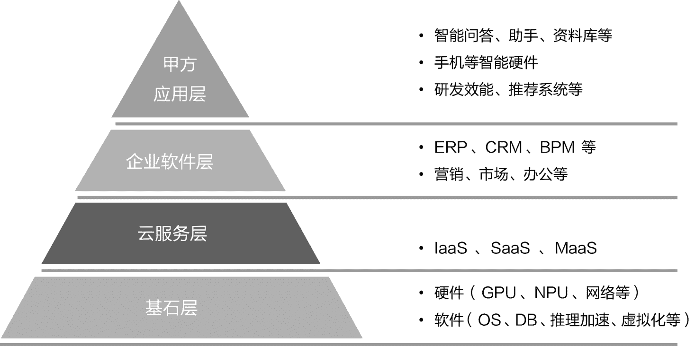

图 1-19

第 1 层：基石层。DeepSeek 稳定运行依赖底层软硬件支撑。第二章将深入探讨 GPU 芯片、AI 操作系统、AI 数据库、AI 一体机等新一代 AI 基础设施如何适配 DeepSeek，并介绍中兴通讯、阿里云、北京智源人工智能研究院等机构的关键技术和优化成果。

第 2 层：云服务层。云厂商是连接大模型与广大用户的桥梁，意义重大。第三章将展示多家云厂商如何通过 IaaS、SaaS、MaaS 等模式把 DeepSeek 能力交付给各行业，并分享亚马逊云科技、硅基流动、开源中国等企业的方案和案例。

第 3 层：企业软件层。大量软件厂商正把 DeepSeek 能力集成到现有产品中，提升功能价值。第四章将聚焦 DeepSeek 如何赋能 ERP、CRM、桌面操作系统、Kubernetes、OpenStack 等软件，分享用友、浪潮通软、红帽、EasyStack、DaoCloud、中软国际、统信、Orion 等企业的洞察、方案和案例。

第 4 层：甲方应用层。DeepSeek 的最终价值体现在企业真实业务场景。第五章将探讨甲方如何把 DeepSeek 应用到自身业务，实现效率跃升和创新。例如中兴通讯把 DeepSeek 集成到新手机、小米借助 DeepSeek 大幅提升研发效率、网易云音乐把 DeepSeek 用于核心推荐系统。

第二章 DeepSeek 生态的基石层：AI Infra 筑基与演进

DeepSeek 大模型兼具性能与成本优势，除了算法优秀，还得益于底层基础设施的深度优化。本章将剖析人工智能基础设施 AI Infra 如何协同支撑 DeepSeek 及其上层的创新应用。

传统认知里 AI Infra 仅指训练推理平台。如今已进入“AI Infra 2.0”时代，实现软硬一体协同。它不仅包括 AI 芯片、高速网络、AI 一体机、AI 数据中心等硬件，还涵盖完整的软件栈，是高效运行的神经中枢，包括芯片软件栈如英伟达 CUDA、华为 CANN、AI 操作系统 OS for AI、AI 数据库 DB for AI、虚拟化与训练推理加速软件等。

其中 AI 芯片是大模型的“心脏”。本章先通俗解释 AI 芯片是什么、为何对训练推理至关重要，再分析当前市场格局并展望趋势，最后聚焦国内外主流玩家支持 DeepSeek 开源大模型的最新进展。

“软硬一体”的演进深刻影响操作系统和数据库。面对大模型的海量数据和复杂计算，传统架构承压。操作系统和数据库针对大模型做了深度适配，通过新机制和算法优化聚焦训练、推理和应用。例如操作系统在内存管理、任务调度、多卡协同上做了优化，保证海量参数训练推理更流畅；数据库在向量检索、非结构化数据管理、实时获取与流式处理上取得突破，更好支撑 DeepSeek 推理和检索增强生成等应用。

本章将全面解析 AI Infra 的核心要素。通过中兴通讯的 AI 一体机、龙蜥操作系统、OpenCloud 操作系统展示面向 AI 场景的系统优化，并介绍北京智源人工智能研究院的跨芯片统一软件栈 FlagOS，以及面向大模型的数据库 OceanBase，为读者描绘清晰的演进蓝图。

2.1 硬件子层

2.1.1 AI 芯片与 DeepSeek：开发者眼中的现状与未来

本节为关注 DeepSeek 等大模型的开发者解析 AI 芯片的原理与价值，探讨它们如何支撑大模型发展。内容涵盖核心概念、市场格局、主流厂商对 DeepSeek 的适配情况及未来趋势。学习后，读者不仅能理解底层逻辑和性能指标，更能在多样化硬件环境中高效选型和优化 DeepSeek 等模型，把握“算力普惠”机遇。

DeepSeek 开源大模型，特别是 DeepSeek-V3.1 最新版为 2025 年 8 月发布的 V3.1 和 DeepSeek-R1 最新版为 2025 年 5 月发布的 R1-0528，已成为 AI 领域的重要力量。它们在性能上可与 OpenAI o1、GPT-4o、Llama 3.1 等顶尖模型媲美，且训练与推理成本显著更低。随 DeepSeek-V3 公开的论文显示，训练使用了 2000 块英伟达 H800 GPU，共消耗约 278.8 万 GPU 小时，单次训练成本约 480 万至 520 万美元。这得益于混合专家 MoE、多头潜在注意力 MLA 等创新架构，以及组相对策略优化 GRPO 等训练优化，同时结合英伟达在芯片基础设施上的优化工作。

DeepSeek 的成功从根本上挑战了“堆硬件、拼算力”的传统思路，促使行业重新审视 AI 硬件需求。

目前全球 AI 芯片市场正快速爆发。根据德勤数据，2024 年全球 AI 芯片市场规模已突破 1250 亿美元，预计 2025 年超 1500 亿美元，到 2030 年有望达 1 万亿美元。其中图形处理器仍是核心，英伟达占据约 77% 市场份额，在大模型训练方面优势明显。据格隆汇报告，2024 年中国 AI 芯片市场规模达 1599.39 亿元人民币，约合 220 亿美元，预计 2030 年突破 1.14 万亿元人民币，年复合增长率约 38.66%。

1.AI 芯片的本质：为什么 AI 需要专属芯片？

1）CPU 与 GPU

很多开发者会问：已有中央处理器 CPU 能处理各种复杂任务，为何 AI 还需要专用芯片？

可以用一个比喻：CPU 像“万能工程师”，能处理逻辑判断、数据管理、程序运行等多种任务，但每次只专注一项，擅长串行处理，一步步解决问题。

而 AI 模型尤其是参数上百亿甚至上千亿的大模型，训练和推理需要海量、重复且高度并行的数学计算。好比让一位工程师同时拧成千上万颗甚至数百万颗相同的螺钉，效率会很低。

AI 芯片则像一支专注拧螺钉的团队。特别是 GPU 这类芯片，内部集成成千上万个小型核心，擅长同时处理大量简单计算任务。在 AI 场景下，GPU 能以远超 CPU 的速度进行大规模并行计算，大幅提升训练效率和推理效率。

为直观对比 CPU 与 GPU 在 AI 场景下的差异，下面用表格说明，如表 2-1 所示。
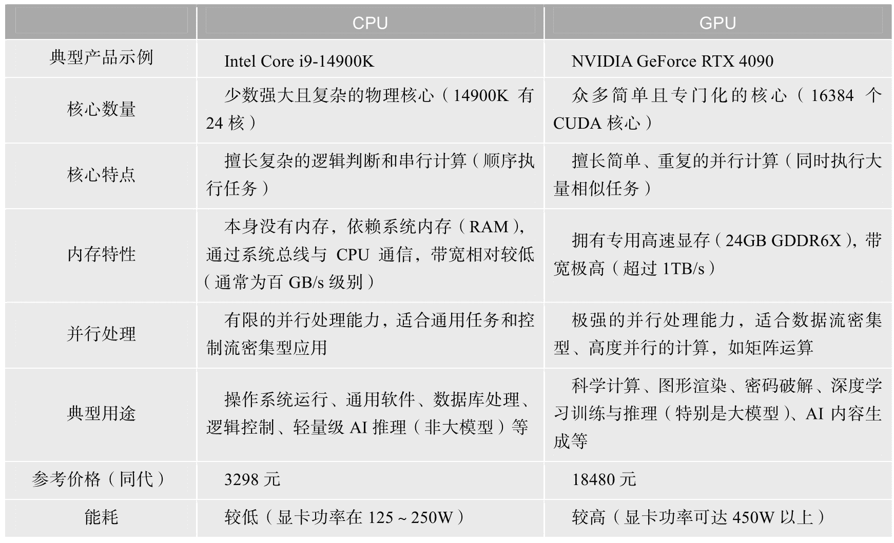

表 2-1

那么 GPU 为何在 AI 计算、尤其是大模型计算中优势突出？

主要源于计算特性与架构的契合。

1）大规模并行计算需求。AI 训练和推理的核心是执行海量、高度重复且彼此独立的数学运算，总体量大但子任务简单、依赖弱，非常适合并行。
2）GPU 的“众核”架构。CPU 设计为少数强核，擅长复杂逻辑和串行任务，像“全能将军”。GPU 配备成千上万个小型计算单元，可同时执行数千上万个独立任务，像“训练有素的军队”，高效完成重复计算。
3）面向 AI 的专用核心。现代高性能 GPU 如英伟达 Tensor Core，针对深度学习核心操作矩阵乘加 MMA 做了硬件级优化，能在极短时间内完成大模型中最频繁的计算，提升训练和推理效率。
4）高速高带宽显存。大模型参数多达数百亿甚至万亿，计算过程产生大量中间数据，需要快速存取。GPU 的专用高速显存容量和带宽远高于 CPU 内存，能以极快速度供给计算核心，避免数据传输成为瓶颈。
5）成熟的软件生态。以英伟达 CUDA 为代表的生态系统提供丰富的编程工具、优化库及 PyTorch、TensorFlow 等框架的底层支持，让开发者更便捷地利用 GPU 算力构建、训练和部署复杂模型，降低开发难度和优化成本。

GPU 为并行而生的架构、面向 AI 优化的专用核心、高速显存以及成熟软件生态，共同构成推动现代人工智能尤其是大模型计算发展的关键动力。

从3D游戏到大模型：显卡如何改写算力命运

回看PC三维游戏的黄金时期，图形处理器最先因画面需求而被打造出来。那一代产品追求极致沉浸感，典型表现是精致的三维场景、细腻的材质贴图以及可信的光影，天气变化、反射折射等效果早已成为标配。要把这样复杂的画面实时输出，背后需要海量即时运算。通用CPU在面对大规模并行负载时效率偏低，而图形处理器可以同时调度数千条轻量计算，高效完成渲染，让玩家得到更顺滑的体验。

2）智能芯片的核心性能指标
搞清楚算力单元的基本作用后，下面梳理几项在实际评估中常被引用的参数。

（1）计算吞吐量。指单位时间内能够完成的浮点运算次数，以 FLOPS 来度量，是判断计算能力的直观标尺，数值越高处理能力越强。常见单位有 TFLOPS，即每秒万亿次浮点运算；PFLOPS，即每秒千万亿次浮点运算。在大模型训练与推理场景里，常按 FP32 单精度、FP16 半精度或 BF16 脑浮点等不同数值精度来表述吞吐。总体规律是精度越低，标称吞吐越高。如今训练与推理普遍支持 FP16、BF16 甚至 INT8 等低精度模式，厂商多以这些精度的高吞吐作宣传。跨产品对比时务必把精度对齐，否则结论会失真。

（2）显存容量。相当于集成在智能处理器内部的专用高速缓存，而非挂在主板总线上供 CPU 调用。这种布局带来更高的搬运带宽，且更靠近计算核心，可持续为算力供给高速数据流。可把显存视作处理器的操作台面，模型权重、中间结果以及待处理的输入数据如长文本、图像等都会暂时存放于此。容量越大台面越宽阔，能一次载入更大规模的模型，或处理更长文本、更复杂的任务。对参数量动辄数百亿、数万亿的大模型而言，大容量显存是刚需。

（3）显存传输速率。指计算核心与显存之间数据搬运的速度，可理解为两者间的通道宽度，单位通常是 GB/s 或 TB/s。若核心吞吐很强但数据传不过来，核心就会空等，整体效率被拖累。足够高的传输速率可保证数据被快速持续喂入，让强劲算力得到释放，避免出现数据饥饿，对大模型的高效训练与推理尤为关键。

（4）芯片间互联速率。指多颗智能处理器之间传输数据的速率，一般借助 NVLink、HCCS 等专用高速互连实现，可看作芯片间的连接通道宽度，单位同样是 GB/s 或 TB/s。训练超大模型时，模型往往分布在数百甚至上万颗芯片上协同工作，需要频繁交换参数、同步梯度。互联速率越高，数据在芯片间流动越顺畅，就越不容易让通信成为系统瓶颈，从而提升大规模集群的训练效率与扩展能力。

以上参数数值普遍越大性能越强，成本也越高。它们并非孤立存在，相互匹配程度直接决定整体表现。就算吞吐很高，若存储容量或传输速率不足，实际速度仍会被限制。因此选型时不能只盯单一数字，要看各项参数的平衡与协同。

**2.算力版图：多头竞争与生态博弈**
1）算力单元的类型概览
当前智能算力市场正处高速扩张期，GPU 仍是绝对主力，得益于天然的并行优势，非常契合模型中的复杂计算。不过 GPU 并非唯一解，随着场景细分与技术演进，NPU、ASIC、FPGA 等类型也在迅速抬头。

（1）GPU。擅长并行计算，最初为图形渲染而生，后被广泛用于深度学习的矩阵运算。通用性强，是目前训练和推理的主流选择，尤其适合大规模并行任务。典型产品有 NVIDIA H100、H200、RTX 系列；AMD Instinct MI300X、Radeon RX 系列。

（2）专用集成电路 ASIC。为特定智能任务量身打造，在特定场景下能实现极高的计算效率和能效比，但功能固定、灵活性较差。典型产品有 Google 的张量处理单元 TPU、Intel 的 Habana Gaudi 系列。

（3）现场可编程门阵列 FPGA。制造完成后可按需重配置逻辑电路，性能和能效通常略逊于 ASIC，但比 GPU 更易做定制化，适合算法需要快速迭代或有特殊定制需求的场景。典型产品有 Intel Arria 系列、Xilinx Versal 系列，后者现属 AMD。

（4）神经网络处理器 NPU。专为神经网络计算设计，常集成在 CPU 或 SoC 中，主要面向高效推理，特别适合低功耗的边缘设备和移动终端。一般不具备训练能力，但在执行已训练模型时表现突出。典型产品有 Qualcomm Snapdragon 系列中的 Hexagon NPU、Apple A 系列芯片中的 Neural Engine、Intel Core Ultra 系列中的 Intel AI Boost NPU。

（5）其他创新架构。除以上主流类型外，众多厂商正在探索新型架构，希望突破传统限制，为智能计算提供更优解。

这场算力竞争既在类型之间展开，也在企业之间展开。过去 NVIDIA 凭借 GPU 在智能芯片领域占据主导，尤其在大型模型训练上领先。如今竞争加剧，传统芯片巨头 AMD、Intel，科技公司 Google、Qualcomm，以及中国本土厂商 Huawei、百度、摩尔线程、寒武纪、沐曦、壁仞科技等都在加大投入，推动技术革新，并在国内市场快速扩大份额。

2）软件生态：算力的灵魂
硬件强劲还需要软件驱动，就像电动车配强劲电机也需要操作系统和自动驾驶辅助系统才能跑起来。软件栈包括驱动、编程工具、库文件等，核心目标是帮助开发者更高效利用算力运行大模型。

NVIDIA 的 CUDA 平台是智能软件领域的事实标准，像一种通用语言，让开发者能便捷地在各款 NVIDIA GPU 上编写和运行智能程序。统一的编程模型让应用可在所有 NVIDIA GPU 上灵活部署与扩展。

AMD 为其 GPU 尤其是 Instinct 系列数据中心加速卡推出开源平台 ROCm，提供编译器、库和开发工具，支持 PyTorch、TensorFlow 等主流框架。AMD 正联合社区及合作伙伴如 Meta 的 PyTorch 团队，不断优化 ROCm 对大模型的支持，提升在训练与推理领域的竞争力。

Intel 推出 oneAPI，这是一种面向多种架构的统一编程模型，旨在简化 CPU、GPU 包括 Intel Xe 架构、FPGA 和智能加速器如 Gaudi 系列等不同硬件的开发流程。oneAPI 包含 oneDNN、oneCCL 等工具包，提供 C++、Fortran、Python 接口，核心理念是打造开放标准化统一软件栈，避免因硬件差异反复改代码。智能应用可通过 Intel Extension for PyTorch 在 Intel 硬件上高效运行并优化大模型。

Huawei 为 Ascend AI 处理器构建全栈软件 CANN，覆盖底层驱动到上层应用开发，提供统一编程接口、算子库、编译器、运行时及开发工具，目标是简化智能应用开发与部署，支持自研 MindSpore 以及 PyTorch、TensorFlow 等主流框架，帮助充分发挥 Ascend 处理器算力，高效训练和部署各类大模型。

中国本土厂商正积极自建软件栈以降低对 CUDA 的依赖，如 Huawei CANN、摩尔线程 MUSA、寒武纪 NeuWare/MagicMind、沐曦 MXMACA 等，均致力于提供类似 CUDA 的功能，支持主流智能框架并配备工具链帮助迁移代码。

本土软件生态发展很快，但在成熟度、生态广度和全球开发者支持方面与 CUDA 仍有差距，可能带来互操作性问题和跨平台开发复杂度。但随着开源大模型的普及，硬件无关和开放平台趋势加强，为本土厂商提供了凭兼容性和性能扩大份额的机会。

这里给出智能芯片软件生态对比，如表 2-2 所示。

表 2-2

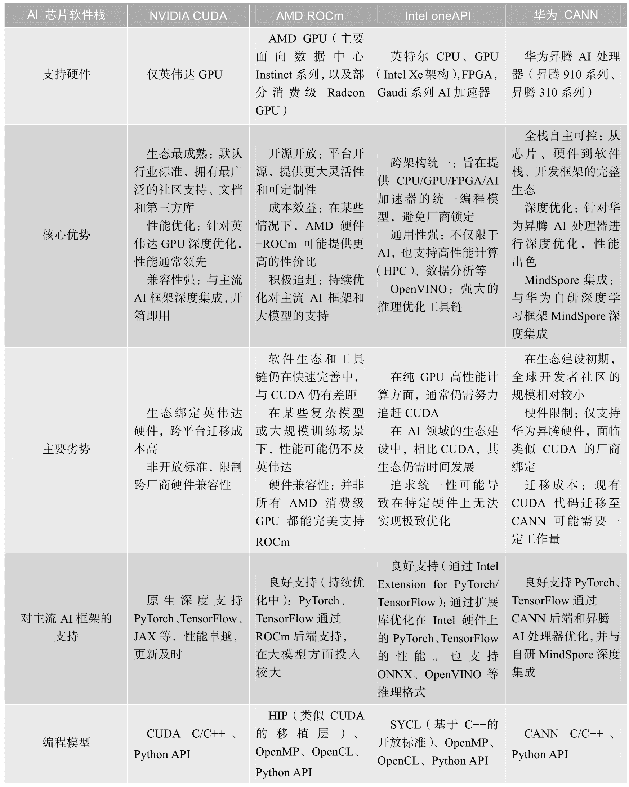

（续表）

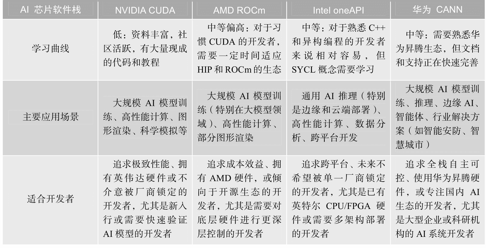

3）智能芯片的软件栈小结
CUDA 仍是最成熟、生态最完善的智能软件平台之一，对追求极致性能和即开即用体验的开发者仍是首选，但仅限 NVIDIA 硬件，存在平台绑定。

ROCm 是 AMD 为挑战 NVIDIA 地位推出的开源平台，性能与生态成熟度不断提升，与 PyTorch 等主流深度学习框架的兼容性日益增强，对看重开放性和成本效益的开发者极具吸引力。

oneAPI 是 Intel 提出的跨硬件统一编程模型，旨在打破厂商锁定，提供更灵活的开发体验，特别适合需在 CPU、GPU、FPGA 等多种 Intel 硬件上部署智能应用的场景。其中 OpenVINO 是 oneAPI 在推理端的关键组成部分，已成为边缘计算和高性能推理的亮点。

CANN 是 Huawei Ascend AI 处理器专属的全栈式软件平台，体现中国在智能芯片领域实现自主可控的重要进展。对致力国产化替代并采用 Ascend 硬件的开发者而言，CANN 提供深度优化的性能表现和持续完善的生态支持。

**3.智能芯片主流玩家及 DeepSeek 适配现状**
近年来智能芯片竞争激烈，发展迅猛，参与者既有国际巨头，也有快速崛起的中国本土企业。各方都在迭代产品以更好支撑大模型的训练与推理。作为代表性的开源大模型，DeepSeek 成为算力应用的重要场景，也受到业界高度关注。以下参数多来自公开资料或官方发布，仅供参考，实际表现会因配置、场景和软件优化而异，部分数据为特定精度下的理论峰值。

1）海外主要厂商
（1）NVIDIA。
地位：全球智能芯片市场的领导者，尤其在数据中心 GPU 领域占据主导，CUDA 平台是智能开发的事实标准。
代表产品：H100、H200 为数据中心训练与推理旗舰，H20、B300 以及消费级 RTX 系列如 RTX 4090 常用于本地开发和推理，如表 2-3 所示。
表 2-3

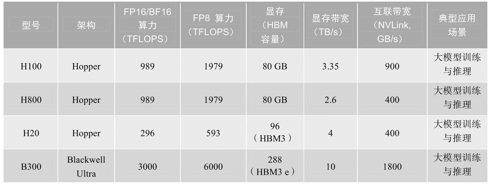
兼容情况：DeepSeek 模型在训练和推理时原生深度支持 NVIDIA GPU，可通过 PyTorch、TensorFlow 等主流框架充分利用 CUDA 平台。DeepSeek-V3 的训练大量使用 NVIDIA H800 处理器，充分证明 NVIDIA 硬件在 DeepSeek 大模型训练中的核心地位。DeepSeek 开源项目如 FlashMLA、DeepEP 也针对 H800 系列做了优化。
落地案例：绝大多数主流智能云服务商如 AWS、Azure、Google Cloud、阿里云、腾讯云、Huawei Cloud 等均提供基于 NVIDIA GPU 的计算实例，并支持 DeepSeek 模型部署和微调。
NVIDIA 高度认可 DeepSeek-R1 为具备最先进推理能力的开源模型之一。2025 年 1 月 30 日，NVIDIA 官网宣布“DeepSeek-R1 Now Live With NVIDIA NIM”，开发者可通过 NIM 服务访问 DeepSeek 模型，便捷部署 DeepSeek-R1，提升智能系统运行效率。
此外 NVIDIA 在 Hugging Face 发布了优化的 DeepSeek-R1-FP4 版本，采用 FP4 四位浮点量化，在显著降低参数规模的同时几乎不损失性能，使其可在硬件要求更低的芯片上运行。
目前 NVIDIA 正通过全新开源软件项目 NVIDIA Dynamo，进一步提升 DeepSeek 在其硬件上的性能，目标将推理速度提升高达 30 倍。Dynamo 的核心是将智能推理任务高效分配到多达 1000 块 NVIDIA GPU，大幅提高系统吞吐能力，提升每秒收入。项目已在 GitHub 开源。

（2）AMD。
地位：正努力挑战 NVIDIA 在智能市场的主导地位，在 CPU 和 GPU 领域均有深厚积累。
代表产品：Instinct MI300X/MI300A 数据中心智能加速器，以及消费级 Radeon RX 系列。
兼容情况：AMD 通过 ROCm 软件平台大力提升与 PyTorch 等主流智能框架的兼容性，ROCm 6 系列显著加强对大模型的优化。Meta 的 PyTorch 团队与 AMD 合作，优化了 PyTorch 在 AMD Instinct MI300X 集群上的性能。
落地案例：部分社区开发者已在 ROCm 支持的 AMD 消费级 GPU 上成功运行开源大模型。
AMD 与 DeepSeek 合作紧密，已实现 Day 0 级别支持。2025 年 1 月 7 日，AMD 官宣 Instinct 产品线正式支持 DeepSeek-V3，并通过 SGLang 完成适配。2025 年 2 月 11 日，AMD 再宣布 Ryzen 产品线智能芯片已支持 DeepSeek-R1 的蒸馏模型，用户可便捷在本地部署运行。

（3）Intel。
地位：传统 CPU 巨头，在智能芯片市场起步较晚，正通过收购 Habana Labs 和自研 Xe 架构奋起直追。
代表产品：Intel Gaudi 3 智能加速器由 Habana Labs 设计，以及 Intel Data Center GPU Max 系列。
兼容情况：Intel 通过 Intel Extension for PyTorch、OpenVINO、oneAPI 等工具链积极支持主流大模型推理训练。虽无直接针对 DeepSeek 的公开案例，但 Intel 的 OPEA 工具套件可方便将 PyTorch 等框架训练好的 DeepSeek 模型部署到其硬件上高效推理，尤其适用于边缘和终端设备。
2025 年 Intel 官网宣布 DeepSeek 系列模型可在其 Xeon CPU 和 Gaudi 智能芯片上运行，并通过 vLLM 和 OPEA 等开源推理框架实现高效部署。同年 Intel 进一步宣布 Core Ultra 系列处理器支持在智能 PC 上本地运行 DeepSeek 的蒸馏模型，为终端侧推理提供更强灵活性。

2）国内主要厂商
在政策支持与市场需求双重驱动下，本土智能芯片厂商正积极推进与 DeepSeek 大模型的适配，构建自主可控的智能生态，合作已上升到战略协同层面。
（1）Huawei Ascend AI。
地位：中国智能芯片领军企业，拥有从底层芯片到计算平台、开发框架的全栈能力。
代表产品：Ascend 910 系列训练推理旗舰如 910B/C/D、Ascend 310 系列推理芯片，通常集成在 Huawei Atlas 系列服务器中，如表 2-4 所示。
表 2-4
兼容情况：Huawei Ascend 智能平台对 DeepSeek 模型的适配工作深入，通过 CANN 软件栈提供强力支持。

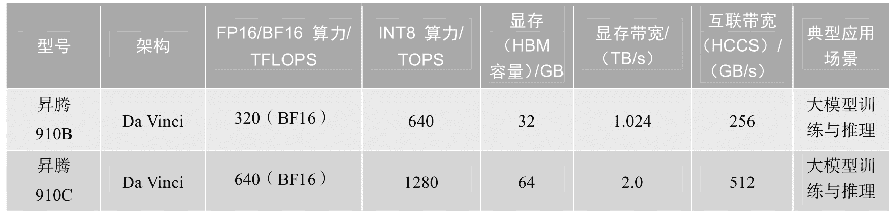

2025年2月1日，MaaS赛道的新玩家硅基流动率先在国内把DeepSeek-R1与DeepSeek-V3的推理能力上线，整个服务借助华为云昇腾底座完成部署。

2025年2月5日，华为对外宣布DeepSeek-R1、DeepSeek-V3、DeepSeek-V2以及Janus-Pro等已全部进入昇腾社区，开发者可以一键拉取DeepSeek家族的权重，并在昇腾硬件环境里实现开箱即用。

2025年3月，天翼云与华为云ModelArts Studio先后推出基于昇腾NPU的DeepSeek-R1蒸馏版镜像及配套部署指引，帮助用户快速起物理机实例并顺畅运行相关权重。

同期昇腾面向DeepSeek发布了整机方案矩阵，品类覆盖服务器、推理卡与加速模组，能够适配DeepSeek-V3、DeepSeek-R1的满血版与蒸馏版等全系版本，满足从边缘到云端的部署诉求。

（2）沐曦（MetaX）。
•定位：国内聚焦数据中心级通用图形计算的GPU厂商。
•代表产品：曦云C系列，典型型号MXC500为数据中心通用图形处理器，具体参数见表2-5。
•适配进展：沐曦正在自建MXMACA软件栈，并积极推进与PyTorch等主流深度学习框架及Transformer类大模型的兼容。

表 2-5

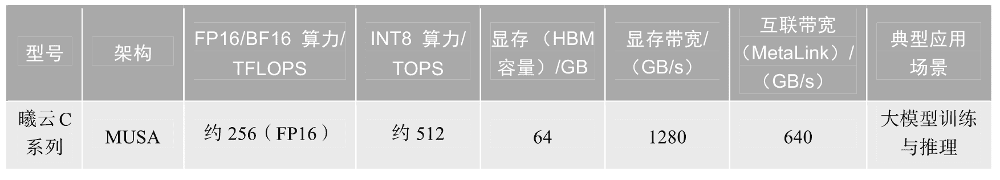

2025年2月5日，联想与国产GPU厂商沐曦联合对外官宣首个以DeepSeek为核心的国产软硬一体化方案，国产软硬件协同在模型落地层面迈出关键一步。

2025年2月，大模型服务创新企业Gitee AI模力方舟宣布推出基于沐曦AI芯片的DeepSeek全尺寸服务，覆盖1.5B、7B、14B、32B直至671B满血版，为开发者提供多元化、本地化部署选择。

同月，在DeepSeek“开源周”活动中，沐曦研发团队在FlashMLA解码内核开源当天即完成对自家GPU的适配并把代码同步至Gitee。由此沐曦GPU成为首个完成DeepSeek FlashMLA适配的国产芯片平台，并在适配过程中满足了该内核的严苛性能要求。

除华为、沐曦外，昆仑芯、燧原科技、海光信息、摩尔线程、寒武纪、壁仞科技、天数智芯等国内主流算力厂商均已推出面向DeepSeek各版本的工程方案，限于篇幅不逐一展开。

总体来看，若算力芯片无法支撑DeepSeek，就意味着掉队甚至被淘汰。DeepSeek在产业层面已形成初步共识，这正是反复强调的判断。

**4. AI芯片产业趋势与未来展望**

算力芯片作为智能时代的基础设施，也是DeepSeek生态的关键环节，正以极快速度演进。DeepSeek等高效开源大模型的出现，既推动技术前进，也为算力芯片的未来指明方向。

1）技术演进：算力更强、能效更高、成本更低
（1）异构融合深化。未来不再固守单一GPU架构，而是向CPU、GPU、NPU、ASIC、FPGA等多架构深度融合演进，构建高度协同的异构算力平台。任务分发将更精细：CPU负责逻辑控制，NPU承担轻量推理，GPU支撑大规模并行，ASIC聚焦高频特定加速。同时Chiplet技术与高带宽内存HBM等内部互联持续突破，缓解传统冯·诺依曼架构的数据搬运瓶颈，实现单元间低延迟高速交互。
（2）能效持续极致化。随着模型规模指数级增长，功耗成为制约可持续发展的关键。未来设计更重视单位功耗下的算力产出，需要在架构上采用存算一体、近存计算等新结构，在工艺上推进3nm及以下制程，并在散热上引入创新方案。DeepSeek等开源模型在降低训练成本上的成效，强化了提升能效比的核心价值。
（3）更细粒度精度支持。除FP32、FP16/BF16外，未来芯片将广泛支持FP8、INT4甚至二进制神经网络。低精度可提升推理速度与能效并降低显存带宽需求，但如何在降精度同时保持准确性可控，是架构与算法协同优化的挑战。
（4）专业化与通用化的动态平衡。面向视觉、语音、自然语言处理等特定任务的专用ASIC将持续演进，实现细分场景的极致性能与能效；与此同时，通用型GPU将通过更灵活编程模型和可配置硬件单元提升对新模型和算法的适应性。趋势可能是以通用芯片为底座，集成可编程IP核或模块化加速器，实现一芯多用的灵活扩展。
（5）边缘智能快速崛起。自动驾驶、智能物联、扩展现实等应用推动算力从云端向边缘迁移，边缘智能芯片成为热点。

2）市场格局：竞争加剧与协作并存
（1）一超多强格局下的分化。英伟达凭借技术实力与CUDA生态占据事实标准地位，短期难撼。AMD、英特尔等国际巨头，以及华为、百度、摩尔线程、寒武纪、沐曦、壁仞科技等中国厂商正加速追赶。未来呈现一超多强态势，各方以差异化策略争夺份额，中国市场格局亦在重塑。
（2）垂直整合成新趋势。谷歌、亚马逊、微软等海外巨头，以及百度、腾讯、阿里等国内企业均自研智能芯片，实现软硬深度融合以提升云服务与AI应用性能并降本。芯片设计已演变为与场景、算法、软件生态紧密结合的系统工程。
（3）国产替代与自主可控加速。在地缘政治不确定与供应链安全压力下，本土算力芯片产业获得政策与资本支持，核心技术与生态建设加快。DeepSeek等国产开源模型的崛起为本土芯片提供场景与验证，推动软硬件协同与产业链自主可控。
（4）云边端协同与生态互联。云端承担大模型训练与复杂推理，边缘侧负责实时决策与数据预处理，终端聚焦个性化交互。厂商需提供覆盖云边端的完整方案与统一软件平台，构建开放互操作生态。

3）训练与推理的重心转移
算力芯片起初聚焦高性能训练，如今随着场景多元化，关注点正转向推理，未来九成以上算力将集中在推理侧。
（1）从训练到推理的效率演进。大模型训练仍是性能标杆，但落地应用产生的推理需求更庞大。推理对芯片提出低延迟、高并发、低功耗、高性价比部署的新要求。设计正向推理优化倾斜，如引入INT4/INT8量化、优化KV Cache管理、支持稀疏计算等。以DeepSeek等MoE模型为例，推理时仅激活部分专家，有效降低资源消耗与成本，进一步拉动推理专用芯片需求。
（2）端侧推理爆发式增长。智能手机、可穿戴、智能家居、自动驾驶等边缘设备对功耗、体积与实时响应要求极高。集成NPU或轻量AI加速器的SoC将在端侧推理占据主导，降低云依赖并提升隐私保护。
（3）定制化微调与小模型训练兴起。LoRA、QLoRA等高效微调技术普及，面向特定行业的小模型增多，市场对中小规模训练算力需求持续。厂商正推出适配企业本地微调、私有化部署与定制化训练的低成本易用方案。

4）地缘政治风险与供应链韧性
（1）国际合作与竞争日趋复杂。全球主要经济体视智能芯片为科技竞争与战略安全资产，竞争中合作、合作中博弈并存。出口管制与技术封锁增多，国际协作正从技术共享转向特定领域联合研发与标准共建。
（2）供应链趋向本地化与多元化。各国强化供应链韧性，推动自主多元生态：提升本土晶圆制造能力、加强半导体设备与光刻胶等关键材料自给、实施“中国+N”等去风险化布局以分散风险。
（3）国产替代与生态建设加速。对中国而言，智能芯片自主可控是国家战略重点，本土企业快速发展带动编译器、框架优化库、算子库等配套软件完善。以DeepSeek为代表的开源项目为国产芯片提供应用场景与生态伙伴，促进软硬件协同创新。
（4）新兴半导体技术战略意义凸显。硅基芯片逼近物理极限，量子计算、光子计算、神经拟态计算等前沿技术虽短期难规模商用，但被视为突破性能瓶颈的关键路径，各国与企业正积极布局。

**5. DeepSeek重塑芯片生态：开发者机遇与挑战**

DeepSeek在训练与推理效率上的突破深刻影响全球智能芯片产业，也为开发者带来新机遇与新挑战。

1）对开发者的机遇
（1）降低开发门槛。DeepSeek凭借MoE架构与高效训练方法大幅降低大模型训练与推理成本，使过去仅少数巨头可承受的开发与部署向中小团队乃至个人开放，无需大量昂贵GPU即可尝试高性能模型，加速创新落地。
（2）推动硬件多样化。DeepSeek对多种硬件尤其是国产芯片的积极适配，加速市场多元化。开发者可按成本、功耗、场景性能等需求灵活选型，提升竞争力并更深入理解不同架构优势。
（3）繁荣开源生态。DeepSeek的开源特性与开放平台理念推动开源AI生态发展，开发者可便捷获取模型资源、微调部署并适配各平台，甚至参与底层优化，形成良性创新循环。
（4）聚焦应用层创新。底层模型效率与芯片性能提升使开发者从繁重调优与基建中解放，集中精力将高效大模型与行业知识、业务流程深度融合，打造实用价值应用。

2）对开发者的挑战
（1）多软件生态学习负担。芯片种类增多带来CUDA、ROCm、OneAPI、CANN等多套软件栈，开发者需掌握不同编程模型与优化技巧。主流框架提供高层抽象降低门槛，但在极致性能场景仍需深入底层。
（2）性能优化复杂度提升。不同平台充分发挥性能对调优能力要求高，涉及量化、算子融合、内存访问优化、并行策略等。异构集群与边缘设备受资源与架构差异影响，优化难度显著上升。
（3）地缘政治与供应链风险考量。芯片选型不仅是技术问题，还需关注来源、供应渠道、政策法规与替代方案，纳入选型与长期规划。
（4）快速迭代带来的持续学习压力。模型架构、训练方法与芯片代际更新极快，开发者需持续跟踪算法进展、优化工具与硬件更新，保持技术先进性与市场竞争力。

3）展望未来
DeepSeek代表的“性能持平、效率优先”理念将持续推动智能芯片向更具性价比、更高能效、更开放兼容方向发展。未来芯片将与特定模型架构与应用场景深度协同，而非单纯堆砌性能。

随着DeepSeek持续迭代，开发者将进入算力普惠新时代。高性能智能计算不再是少数巨头专属，无论云服务、边缘设备或本地部署，均可选择更丰富灵活易用的芯片。熟练使用多平台并善于将开源大模型与行业场景融合的开发者，将成为AI时代的核心人才。

芯片厂商与大模型开源社区的深度合作将成常态，形成模型定义芯片、芯片赋能模型的良性循环。DeepSeek的成功正是这一趋势的印证。开发者积极拥抱开源生态、理解模型硬件协同机制，将是把握机遇、赢得先机的关键。

**2.1.2 DeepSeek智算一体机**

**1.行业概况**
智能算力需求呈爆发式增长，智能语音、视觉识别、自然语言处理、预测分析等应用均需强算力支撑海量数据处理。金融、政务、医疗等关键行业对数据安全与合规要求严苛，传统公有云难以满足数据不出域、模型自主可控等监管要求，智算一体机可实现私有化部署保障安全合规。AI应用从云端向边缘渗透，技术架构由“云优先”转向“端边协同”，为智算一体机提供广阔空间。

1）产品定义
智算一体机是软硬件集成的解决方案，内置主流大模型，硬件涵盖智能芯片、服务器、存储、网络，软件包括操作系统、AI框架、中间件及应用软件，提供高效便捷安全的本地化智能算力服务。具备高效算力、本地部署、快速交付、灵活定制等特点，适用于智能客服、图像识别、数据分析、智能决策等场景。

2）市场现状
2023年中国智算一体机市场规模约120亿元，预计2027年突破500亿元，CAGR超40%。浙商证券预测2025至2027年市场需求为15万至72万台，对应市场空间分别为1236亿元、2937亿元、5208亿元。截至本稿，已有超30家企业推出相关产品，政企客户如政府、医疗、高校、银行等为主，接入DeepSeek的热情已显著带动一体机销量。教育、金融、政务等行业率先落地。

3）竞争格局
国内众多企业布局智算一体机，形成多元化竞争格局，各厂商在定位与方案上呈现差异化。

DeepSeek 本地推理部署的厂商图谱与落地观察

当前推理需求升温，交付形态正从单纯堆资源转向软硬协同的本地套装。厂商把大模型推理与行业诉求结合，形成了几条可辨识的落地路线。

联想联合沐曦发布的方案以联想服务器与工作站、沐曦训推合一 GPU 及自研算法为底座，并叠加联想 AI force 智能体开发平台，形成两类产品形态。面向桌面的 Agent 套件以 ThinkStation PX 工作站为载体，搭载沐曦曦思 N260，可在本地运行 DeepSeek 各类参数蒸馏版本的推理。面向算力的训练推理服务器以联想问天 WA5480G3 AI 服务器为基础，配置 8 张曦云 C500 专业卡，为大模型训推提供算力支撑。

京东云的 DeepSeek 本地方案主打即到即用，提供全栈服务，具备国产算力全适配、模型参数规格丰富、应用开箱即用、性价比突出等特点。内部集成智能体引擎与知识库引擎，预置大量智能体配置模板、上百个行业解决方案模板及上千个插件，便于快速搭建本地知识库。

华鲲振宇的天巡 DeepSeek 方案由天巡 CubeX AI 使能平台与卡多多 AI 服务器构成，对 DeepSeek 全系列模型实现深度融合。定位即插即用、规格领先、软硬协同优化，使用后模型性能提升超 30%，综合成本下降超 50%。核心是通算智算协同加速，基于鲲鹏 CPU、昇腾 NPU、openEuler 与推理加速引擎实现 CPU 与 NPU 高效配合，时延降低约 40%。显存侧通过动态 KV Cache、无损压缩、显存卸载等机制实现显存精细调度。

中国电信的息壤智算设备 DeepSeek 版以华为昇腾芯片为基座，提供 8 卡、16 卡、32 卡等多种规格，适配不同规模企业与项目。

天融信天问智算设备融合智算、云计算、安全能力，内置 DeepSeek 等多款大模型。以算力硬件平台与智算平台为基础，整合计算、存储、网络、安全、智能五项能力，为客户提供安全可靠的高性能智算中心建设方案。

中兴通讯 AiCube DeepSeek 智算设备走软硬一体高性能路线，突出部署更快、体验更强、操作更简便、安全更高，帮助企业以更低投入释放 AI 价值。平台提供一站式模型迁移工具，支持 DeepSeek 等模型在不同计算架构 GPU 间无缝搬迁，DeepSeek-R1 全系蒸馏模型的适配可在数小时内完成，同时支持按需定制，实现即插即用并明显缩短落地周期。

总体看，多家厂商正围绕行业差异化痛点，以软硬一体化设计提供高效、安全、灵活的本地化 AI 算力服务与运维保障。

**2.DeepSeek 放大机会与落地阻力**

1）机会

（1）**算力支出明显下降。**DeepSeek 设备借助多头潜注意力、混合专家模型等创新，在保持强推理能力的同时显著压缩算力开销。推理侧需求明显下降，DeepSeek-R1 的推理开销约为 OpenAI o1 的 3% 左右，降低了对高投入高端算力的依赖，让中小企业与科研机构也能以更低门槛部署大模型，推动技术普及。

（2）**国产算力生态被激活。**DeepSeek 的出现为国产算力链提供新锚点。此前全球算力生态以英伟达 CUDA 体系为主，DeepSeek 通过硬件级优化绕开 CUDA 进行 PTX 编程与计算通信优化，性能提升约 30%，助力国内厂商快速构建新生态。

（3）**贴合行业个性化需求。**设备规格多样，可适配不同场景。金融可用于高频交易算法优化、实时风险评估与智能客服；医疗可辅助导诊、对接药物数据库、实现专科诊断；能源电力主要面向生产与安全管理。

（4）**加速 AI 应用落地。**设备集成度高，支持私有化快速部署。对技术积累不足的企业而言，即插即用的方案减少部署时间与成本，降低应用门槛，加速技术在各行业的推广。

2）挑战

（1）**标准兼容风险。**技术层面虽有突破，与其他系统设备对接时仍可能出现接口不匹配、通信协议不一致，影响整体性能与稳定性，增加部署维护难度。

（2）**生态协同难度。**DeepSeek 开源吸引众多厂商，但硬件、软件、应用多层生态协同复杂。设备需与芯片商、服务器商、操作系统商、应用软件商等进行适配整合，适配难度大、兼容问题多，易影响体验与推广。

（3）**成本控制压力。**算力成本虽降，采购与部署整机仍需较大资金投入。业务扩张与数据量增长带来的硬件升级扩容进一步推高费用，预算有限的中小企业覆盖面受限。

（4）**用户需求未完全满足。**部分用户反映在特定业务场景下效果不理想，存在算力效率与硬件兼容性问题。对实时性要求高的场景可能无法满足低延迟需求，大规模数据处理易出现性能瓶颈，用户还期望更丰富的模型、更强功能与更便捷的管理维护工具。

（5）**技术迭代与硬件更新。**AI 发展迅速，大模型持续迭代，原有适配硬件可能很快性能不足。企业需不断投入升级以适应新技术，同时需跟进新硬件架构与计算模式以保持竞争力。

（6）**技术门槛与人才短缺。**整机使用便捷，但背后涉及复杂原理与架构，企业缺乏专业运维人员难以发挥全部效能。AI 人才整体短缺，招聘培养困难制约应用与推广。

**3.DeepSeek 智算设备产品架构**

1）DeepSeek 智算设备产业链

（1）上游：基础硬件与软件。
•芯片及组件：AI 芯片提供核心算力，不同厂商产品满足差异化需求；CPU 保障系统稳定运行；存储芯片如三星、海力士、长江存储等提供大容量高速存储；风扇散热、PCB 等构成基础硬件。
•软件及算法：龙蜥 OS、OpenCloudOS、麒麟软件、统信软件等操作系统保障稳定安全运行；开源 AI 框架为开发提供基础算法支持。

（2）中游：智算设备的研发、生产与优化。
•硬件集成厂商：中兴通讯、神州数码、浪潮信息等负责硬件组装生产，将芯片、存储、散热整合并与客户数据中心、网络系统等集成，交付完整信息化方案。
•软件平台及算法优化厂商：火山引擎等提供机器学习平台助力模型开发调优，算法优化企业聚焦 Flash Attention 等技术提升大规模语言模型处理效率。

（3）下游：行业应用及服务。
a）行业应用场景。
•政务：智能客服、政务数据分析、视频分析用于交通违章检测与环境监测等。
•金融：金融数据分析评估风险、异常交易识别、7×24 小时智能咨询。
•医疗：病灶识别、疾病趋势预测、药物分子模拟加速新药研发。
•教育：教学工具设计、个性化学习体验与智能化教学辅助。
•制造业：AI 图像识别质检、生产流程优化、设备故障预测与维护。
b）运维服务商：提供设备维护、故障排除、性能优化，确保稳定运行与业务连续性。

2）系统架构

智算设备面向行业大模型高效推理与便捷应用，是融合硬件层、推理引擎层、模型层与应用层的整体方案。
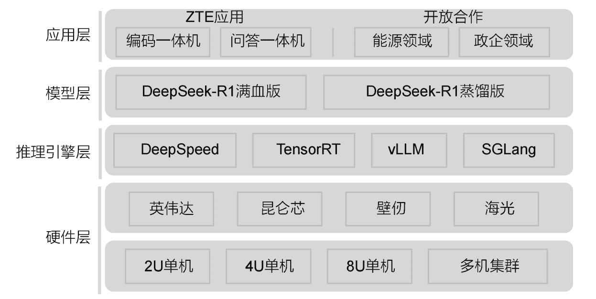
图 2-1

（1）硬件层。从形态看分为推理单机与推理集群。
•单机场景：提供单台 GPU 服务器，支持 2U、4U、8U 等机型，接通客户交换机网络即可使用推理服务。
•集群场景（蒸馏版）：支持 3～8 台 GPU 服务器，配带外交换机与一对业务交换机完成内部组网，业务交换机接入客户网络即可提供推理能力。未配置独立外部存储，呈现融合形态。单机使用本地存储，集群以 3 台 GPU 服务器本地存储构建共享分布式存储。
•集群场景（满血版）：支持 2～8 台 GPU 服务器，配置高性能独立存储与 RoCE 网络，支持单机与跨机推理精调，提供全场景能力。

提供英伟达、昆仑芯、壁仞等 GPU 供客户按模型大小与并发需求选择，通过统一调度和管理实现资源最大化与统一运维。

（2）推理引擎和模型层。基于算力平台与模型网络特性，提供大模型微调、推理、加速环境，适配主流大模型，提供一站式模型生命周期管理，覆盖知识库、模型部署与推理发布端到端功能。

（3）应用层。面向应用场景与下游任务的 AI 应用开发框架，支持快速搭建 AI 应用，为客户提供高效推理应用搭建平台。

3）网络架构

DeepSeek 设备分为单机、集群两类形态。

（1）单机形态。智算设备单机组网网络平面如图 2-2 所示。
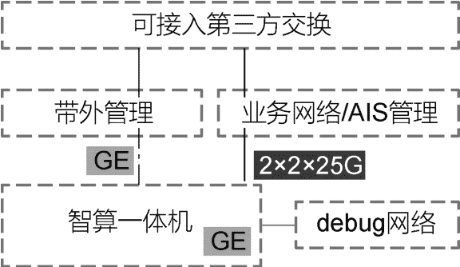
图 2-2
•AIS 管理：承载 AIS 管理、模型管理、数据处理、推理任务等流量。
•业务网络：承载推理服务的业务通信。
•带外管理：负责 AI 集群全部设备的硬件带外管理。
•debug 网络：用于部署、运维、改配。

（2）集群形态（蒸馏版）。智算设备集群组网如图 2-3 所示。
•业务面、管理面、存储面物理合一，传统 VLAN 组网，一对 5960X-56QU-HF 部署，MC-LAG 双活。
•配置带外管理网，一台 5952G-D。
•适用于参数量 72B 以内推理与 13B 以内精调，不涉及参数面与样本面组网。

（3）集群形态（满血版）。智算设备集群组网如图 2-4 所示。
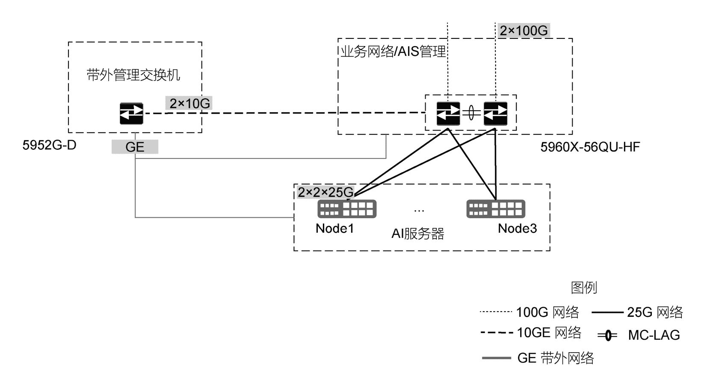
图 2-3
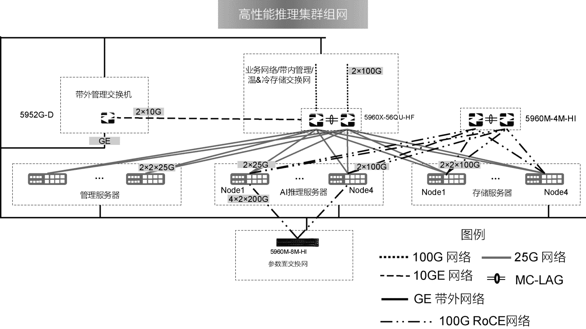
图 2-4
•参数面 RoCE 独立组网，2～4 台 GPU 服务器用 1 台 5960M-8M-HI；5～8 台再增 1 台交换机直连部署。
•业务面、管理面、存储面物理合一，一对 5960X-56QU-HF，传统 VLAN 组网，MC-LAG 双活。
•带外管理网一台 5952G-D。

**4.AiCube DeepSeek 设备技术突破**

中兴通讯 AiCube 智算设备是用于大模型精调与推理的 AI 全栈一体化产品，开箱即用，实现本地训推与数据不泄露，具有快交付、易使用、高安全、全开放优势。创新体现在三方面：提供开放高效灵活的智算资源，全面适配主流 GPU CPU，多品类多规格算力满足差异化需求；提供简易训推平台，工程能力工具化，实现全流程贯通、向导式引导与过程可视化，快速定制行业专属大模型；通过模型仓库与市场实现 AI 能力共享与商业规模复制，已在研发代码生成、工业质检等领域探索应用。

1）全栈 AI 工具链：开发到运维全流程覆盖

（1）多生态推理引擎。支持 PyTorch、TensorFlow、vLLM 等开源框架，兼容英伟达 TensorRT、壁仞 SuInfer 等私有框架，适配多芯片生态。

（2）加速技术融合。
•Flash Attention：优化注意力机制计算效率提速且精度无损。
•Kernel Fusion：融合 GPU 内核操作，减少内存开销，提升小算子密集任务速度。
•算子硬件级优化：针对卷积、矩阵乘法等核心算子适配特定硬件加速。

（3）模型全生命周期管理。
•模型仓库：集成 LLama、通义千问等主流模型，支持一键导入转换部署，提供版本管理、安全删除与 SFTP/网盘等多途径上传。
•轻量化精调：支持全参数精调与 LoRA 轻量化微调，适配小样本任务，平衡性能与资源消耗。

（4）自动化评估体系。内置 MMLU、5G-ZTE 等数据集，支持多模型多维度对比评测，兼容 OpenAI 标准接口，可配置多模型多数据集自动化测试。

（5）构建企业级知识库。支持 PDF、Excel 等 12 种文档格式分段清洗与向量化存储，实现私域知识管理，提供命中测试评估关键词识别能力，支持问答检索关联应用。

2）高性能智算资源管理

智算资源管理平台基于开源 Kubernetes 实现商用化增强，提供作业管理、云原生管理、集群管理、基础设施优化等功能，如图 2-5 所示。
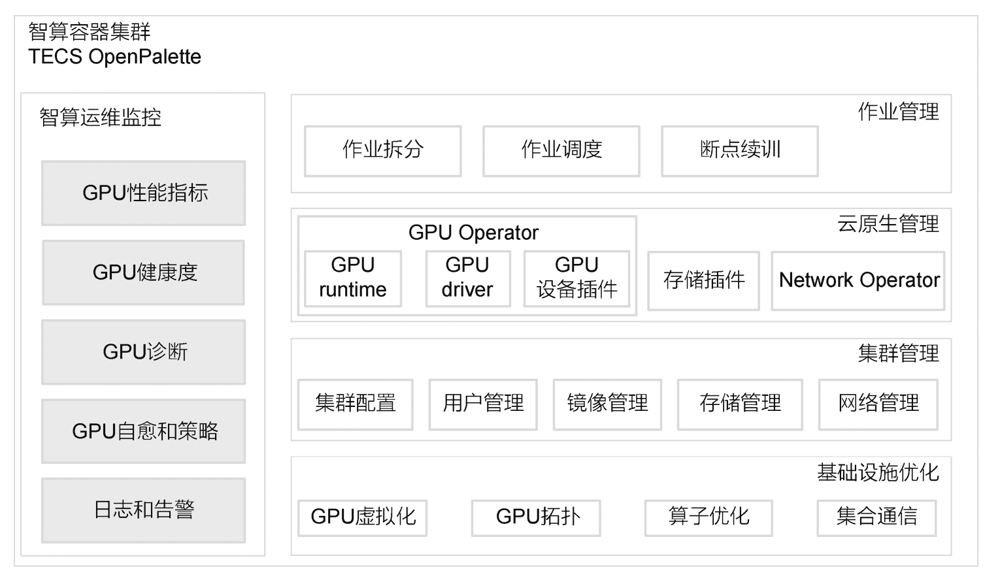
图 2-5

（1）计算资源。OpenPalette 支持主流容器运行时，提供部署、启停、删除、弹性伸缩、滚动升级、灰度发布、Operator、Helm 与蓝图编排等功能，方便生命周期管理与可视化编排，并提供 CPU 绑核、巨页等增强计算能力。

（2）存储资源。OpenPalette 为平台应用提供持久化存储，当前提供文件存储与块存储服务。

（3）网络资源。提供多场景多类型端口网络管理、容器网络资源管理与网络运维，支持多网络平面与 IPv4/IPv6 双栈，满足电信级高可靠高性能需求。

3）快速构建场景化应用

（1）低门槛推理服务。简化部署流程，支持弹性资源调度、实时日志查询与服务状态监控，提供 RESTful API 开放模型推理与资源管理能力，加速企业集成。

（2）生成式 AI 应用开发。
•Prompt 模板库：预置任务引导指令，降低调优门槛。
•插件生态：集成 NLP、机器翻译等插件，扩展模型功能边界。
•支持对话式、生成式应用一键发布，通过 Web 或 API 双通道访问。

（3）智能运维与开放生态
可视化智能运维支持多维看板实时监控核心指标，分层告警体系按严重程度分类，支持自动恢复与历史追溯。
AI 驱动运维助手基于大模型实现自然语言交互，提供功能指导与故障排查，支持自定义知识库扩展实现个性化问答。

4）核心创新价值
•软硬协同优化：从芯片级算子加速到 Kubernetes 资源调度，实现全栈性能提升。
•全流程闭环：覆盖模型开发—精调—评估—推理—运维，降低大模型应用门槛。
•企业级敏捷性：通过知识库、API 开放与轻量化工具实现私有化场景快速落地。
•智能运维降本增效：AI 助手与可视化看板减少人工干预，运维效率提升 30% 以上。

**5.企业案例**

教育场景中，院校希望借助 DeepSeek 打造智能教学工具辅助备课并为学生提供个性化辅导，契合教育个性化智能化趋势；政务服务领域，政府部门期望提升办公效率、实现智能客服、助力城市治理与民生诉求处理，提高服务质量与效率；金融领域客户希望增强风控、辅助投研，提升决策效率，在复杂市场中降低风险、挖掘投资机会；医疗机构利用 DeepSeek 助力影像分析与辅助诊断，提升疾病筛查准确率，为患者提供更准确及时的诊疗参考；电信行业中 5G 消息借助 DeepSeek 实现文本类消息互动，5G 新通话利用其推理分类能力进行意图识别，提升反诈能力，保障通信安全。这些需求体现了 DeepSeek 技术的广泛适用性与巨大潜力，也驱动中兴通讯持续探索产品与 DeepSeek 结合，为客户提供更优解。

1）鞍钢数科：为鞍钢数科效能提升提供“加速器”，AI 应用快速上线

钢铁央企数智升级：从知识检索到算力底座

(1) 背景与转型动因
鞍钢集团是中央直接监管的国有大型企业，新中国首批恢复建设并投产的钢铁联合体，被誉为共和国钢铁长子和新中国钢铁摇篮。集团位列世界 500 强，粗钢和铁精矿产能常年稳居全球前列，钒产品产量全球领先，钛原料供应量国内第一。集团下属的鞍钢数科主营自动化、信息化、网络化、数智化服务，是集团的科技服务平台。在国家大力推进数字经济与人工智能融合的顶层指引下，鞍钢数科主动拥抱智能化浪潮，部署智能检索方案并正式启用，推动企业向智能化转型。

面对资料规模快速膨胀，传统的人工检索方式显露出局限，易受个人认知范围和主观判断干扰。鞍钢数科引入生成式智能手段，提升信息处理的质量与效率，为高质量发展夯实信息基础。

(2) 落地路径：模型协同与算力支撑双轮驱动
中兴通讯在问答平台中构建大中小模型协同机制，以增强知识检索与内容生成能力。通过算子研发，对文档自动接入、拆分、分块、向量化、重排序等环节进行优化，并采用多项技术手段有效遏制生成式模型的幻觉，提升答案可信度。实测数据显示，在特定专业知识域，鞍钢数科智能问答平台的应答准确率达到 99%，远高于当下主流问答产品，检索精准度明显改善，如图 2-6 所示。

配套的智算融合平台凭借强劲算力与按权重调度模型服务的实例化机制，实现 GPU 资源的高效利用，保障查询响应与整体办公效率。

在端到端 4K 输入输出的使用场景中，系统首字响应被控制在秒级，用户提问后即可即时获得反馈；字符间隔时延降至约 20ms，显著缩短等待时间，提升操作流畅感，为文档检索带来全新便捷高效体验。

(3) 成效与行业启示
智算一体机大幅简化了信息获取流程，提升了员工日常工作效能，不仅助力鞍钢数科迈向智能化与高质量发展，也为行业数字化转型提供了可参考的路径。

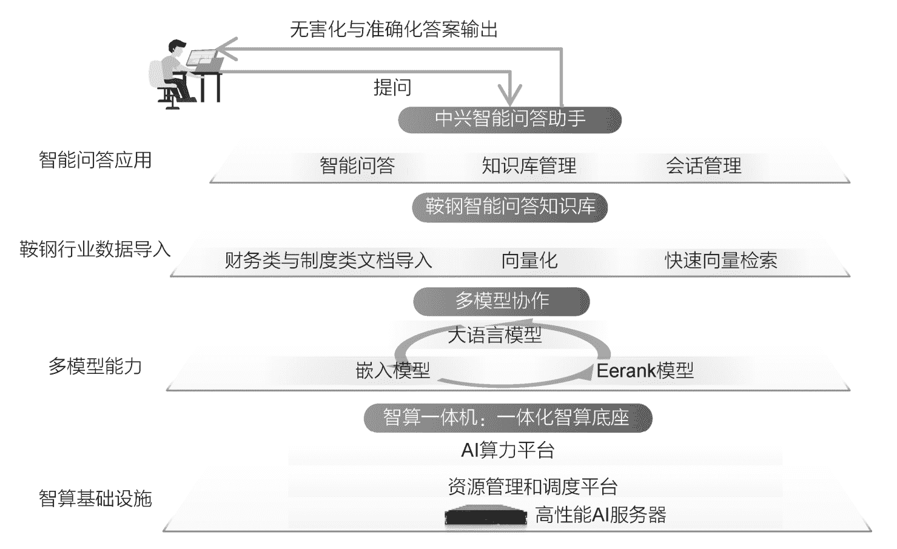

图 2-6

中兴通讯提供的智算一体机是高度集成化的一体化方案，出厂前已预装服务器、分布式文件存储、IB/RoCE 网络、安全组件、数据平台软件、智算平台软件等全套软硬件，用户仅需完成基础网络接入与参数配置即可快速上线。设备内置多种行业模型，厂商还提供大模型代训、微调及应用系统集成服务，满足差异化需求。开箱即用、一站式交付显著提升了鞍钢数科的运营效能，并加速了 AI 应用的落地。

2）全链路接入 DeepSeek，实现端网算一体化升级
中兴通讯已完成 DeepSeek 的全面接入，并与自有端、网、算智能化产品结合，实现多场景、多产品的广泛应用。

端侧，旗下努比亚手机将 DeepSeek-R1 满血版 6710 亿参数服务深度植入系统，显著提升 AI 交互深度与响应能力，带来更智能便捷的使用体验。

网侧，基于 AIR DNA 解决方案的网络智能化方案引入多规格 DeepSeek 大模型产品，深度重构电信网络基因与架构，重塑未来网络智能化形态，提升网络智能化水平与服务质量。

算力侧，依托商用成熟的 AiCube 平台，推出 AiCube DeepSeek 智算一体机解决方案，成为业内首批实现 DeepSeek 全栈部署的供应商，为企业提供高效便捷的智算服务。

3）DeepSeek 赋能政务、医疗等场景的落地实践
AI 大模型的价值最终要体现在产业应用中。中兴引入 DeepSeek 技术后，产品与服务在多个垂直领域快速落地，获得客户高度认可。

政务场景中，中兴携手某省打造 AiCube 公文助手一体机，本地部署国产化高性能 AI 服务器和智算底座，基于 DeepSeek 蒸馏版 QWen 模型的思维理解与语义生成能力，结合自建 RAG 公文知识库，实现公文自动生成、规范表达与多方案生成，大幅提升办公效率与标准化水平。

医疗场景中，某医院本地部署中兴 AiCube 智算一体机，通过本地微调的 DeepSeek Janus-Pro 及若干医疗专业大模型，迅速识别病理切片关键病灶并生成高质量诊断报告，既保护患者隐私，又提高诊断准确率。

这些实践并非简单的模型调用，而是 AI 与业务的深度耦合，是模型与行业知识、业务流程的紧密融合。只有当大模型真正嵌入业务核心，成为感知、理解与决策的中枢神经，形成数据—模型—场景—反馈的闭环系统，才能推动产业智能化从工具阶段跨入能力阶段。

**2.2 软件子层**

**2.2.1 OpenCloudOS 与 DeepSeek 生态的强力支撑与协同进化**

**1. 行业变局与国产操作系统的突围**
近年来全球信息技术竞争格局发生深刻变化，国产操作系统在国家信息安全与科技自主战略中的分量不断提升。随着 CentOS 等国外主流服务器操作系统停止维护，关键基础设施对外部技术依赖的安全隐患凸显，构建自主可控技术体系的紧迫性提升。国家提出在党政、金融、能源等关键领域实现核心技术国产化，推动国产操作系统从适配验证迈向规模化应用。

当前，国产操作系统已形成覆盖桌面、服务器、嵌入式等场景的完整产品矩阵，通过深度参与开源社区建设，构建起覆盖芯片架构、基础软件与行业应用的协同创新生态。系统安全性、稳定性实现跃升，生态适配量突破百万级，原生应用覆盖办公、经营等核心场景。面对智能化浪潮，国产系统正加速与人工智能融合，发展端侧推理能力与智能引擎，为数字经济高质量发展筑牢根基。

**2. DeepSeek 对操作系统的双向重塑**
1） AI for OS：DeepSeek 的技术特性可缓解运维等痛点
DeepSeek 具备高效推理能力、灵活模型架构和基于企业知识库的增强支持等特性，在操作系统运维中发挥重要作用。其开源、低成本优势使其在日常环节或隔离网络环境中具备接入 AI 能力的可能性。针对操作系统使用场景，DeepSeek 大模型可在以下方面发挥作用。

**（1）智能化自动运维。** 传统运维依赖人工，效率低且易出错。DeepSeek 凭借强大的自然语言处理与推理能力，经工程化后可实现日志自动分析、设备状态实时监控、故障智能诊断与排查建议，支持自动化报告生成与健康状态评估，可大幅减少人工干预与误操作，提升运维效率与准确性。

**（2）配置管理自动化。** 操作系统配置复杂，手工作业易出错。经提示词适配后，DeepSeek 可支持自动生成配置脚本、自动备份与恢复配置，实时检查配置合规性并智能修复，并基于流量与使用情况提供个性化性能优化建议。

**（3）性能优化与资源调度智能化。** 资源分配常依赖经验，难以动态适应业务变化。端侧接入 DeepSeek 后，可通过多模态数据分析识别性能瓶颈，预测负载变化并自动调整资源分配与调度策略，推理速度快，适用于智能负载均衡、资源调度优化、性能瓶颈分析与预测。

**（4）安全威胁检测与响应自动化。** 许多安全事件检测依赖人工，响应较慢。接入大模型后可具备实时检测威胁能力，能自动分析安全日志、识别异常行为、阻断攻击并自动响应，支持安全事件溯源与风险报告自动生成，在 DDoS 攻击检测、恶意行为识别、自动化安全响应、日志安全分析等场景效果良好。

**（5）智能知识库与文档自动化。** 传统运维知识库分散，文档编写耗时。结合 DeepSeek 可支持知识库问答、自动化文档生成与技术资料检索，帮助运维人员快速获取所需信息，提升知识管理效率。

2） OS for AI：DeepSeek 对操作系统提出更高要求
DeepSeek 的广泛应用对操作系统提出更高要求，需提供高效硬件适配与推理框架性能加速，支持多种国产 CPU 架构与深度优化，提高 GPU 资源利用率；同时需提供覆盖训练到推理部署的全链路 AI 适配，确保大模型高效运行。

规模化部署要求操作系统从底层到上层进行 AI 原生能力升级，具体体现在六大技术维度。

**（1）异构硬件深度适配与驱动优化。** 操作系统需实现对多元计算架构的兼容性支持，包括英伟达/AMD GPU、昇腾/昆仑芯等国产 AI 加速卡，以及龙芯/申威等国产 CPU 指令集的适配。需通过动态资源感知技术自动匹配硬件特性，建立统一显存管理机制，支持多卡显存池化，解决大模型参数分片存储时的 PCIe 带宽瓶颈。

**（2）推理框架性能加速体系。** 需原生集成 TensorRT、ONNX Runtime 等推理加速引擎，提供计算图编译优化、算子融合、混合精度计算等功能。通过内核级内存分配策略优化，实现显存碎片整理与零拷贝数据传输，支持动态批处理调度，将 GPU 利用率提升至 90%以上。

**（3）全流程 AI 开发支持能力。** 需构建覆盖模型训练、微调、压缩、部署的全链路工具链。训练阶段集成分布式训练框架，支持多节点 RDMA 网络及梯度压缩；压缩阶段提供量化、结构化剪枝接口，结合 AutoML 实现精度与速度平衡；部署阶段内置服务化封装模块，支持容器化部署与弹性伸缩。

**（4）异构计算资源调度系统。** 需设计智能调度器实现 CPU-GPU-NPU 协同计算，通过时间切片实现多模型共享硬件资源，支持 QoS 分级保障机制。针对国产化场景，需提供软硬件协同的异构编程模型，同时支持 CUDA 与 OpenCL 标准接口。

**（5）构建安全可信执行环境。** 需在操作系统内核层面实现数据全生命周期加密，采用国密算法加密模型权重文件，通过 SGX/TEE 技术保护推理过程中的敏感数据。建立细粒度访问控制策略，对模型 API 调用进行动态鉴权，并提供漏洞扫描模块实时检测模型服务安全风险。

**（6）生态兼容与迁移支持。** 需构建跨架构二进制兼容层，支持 PyTorch、TensorFlow 等主流框架自动适配，提供从 x86 到 ARM 架构的模型无缝迁移能力。深度优化银河麒麟等系统的 AI 软件栈，实现与开源生态组件互通，并提供性能分析工具链帮助开发者定位硬件瓶颈。

这种演进本质是在构建 AI 原生基础设施，为 DeepSeek 类大模型提供从芯片指令集到云边端协同的全栈支撑，推动 AI 算力效率实现数量级提升。

**3. 产业链协同与关键技术**
1） DeepSeek 生态与操作系统开源社区的结合
DeepSeek 生态与操作系统开源社区的结合促进了产业快速发展。开源社区优化硬件架构与推理框架性能，为 AI 应用提供全链路适配支持；OpenCloudOS 积极推动软硬件协同优化，建立完善兼容性测试体系，确保系统稳定与广泛生态适配，形成技术创新与产业发展的良性循环。

**（1）技术互补性融合。** 开源操作系统提供稳定底层运行环境，DeepSeek 注入智能化能力。智能调度优化方面，强化学习可优化 CPU/GPU 资源分配，结合 Kubernetes 实现容器化 AI 任务资源需求预测；驱动与固件智能化方面，轻量级 AI 模型可实现预测性维护与异常检测；安全协同方面，机器学习可分析系统调用行为实时检测异常进程，并集成至 SELinux、AppArmor 等安全模块；智能漏洞预测方面，代码分析模型可自动化扫描内核代码并结合模糊测试生成有效用例；隐私计算方面，结合可信执行环境与联邦学习，使 AI 模型在开源系统上安全运行。

**（2）产业应用创新。** DeepSeek 与开源操作系统的结合催生多领域创新。智能运维可实现故障预测与自愈；边缘计算场景中轻量级模型与嵌入式系统结合支撑智能制造与智慧城市；自动驾驶与医疗健康等领域亦实现精准影像分析与诊断辅助，提升效率与服务能力。

2） 操作系统助力 DeepSeek 的关键技术点
操作系统为 DeepSeek 提供多项核心支持。深度适配龙芯、海光、鲲鹏、飞腾等国产 CPU，提供不同规模模型部署方案；预置优化库提升 PyTorch 与 TensorFlow 推理性能，降低资源占用；全栈 AI 适配覆盖训练到推理部署，提供分布式训练、格式转换与轻量化容器部署；通过硬件级隔离与软件访问控制构建安全可信环境，支持联邦学习等隐私计算；智能化资源监控与能效管理可动态调整功耗状态，弹性伸缩保障服务质量；标准化 API 与统一工具链实现跨平台无缝运行，降低移植成本。

**（1）硬件架构深度适配。** 操作系统通过构建统一抽象层，实现对龙芯、海光、鲲鹏、飞腾等国产 CPU 架构全面兼容。在模型部署环节，提供从边缘设备到云端服务器的全栈支持，确保 DeepSeek 模型在不同计算规模平台获得最优性能。

**（2）推理框架性能加速提升。** 操作系统采用深度优化数学计算库，显著提高 PyTorch 与 TensorFlow 主流框架推理效率。通过内存管理机制与任务调度策略，有效降低推理资源占用。针对特定硬件平台如 NPU 加速卡的专用驱动支持，进一步释放 DeepSeek 模型推理性能潜力。

**（3）全栈 AI 适配支持。** 操作系统已对 DeepSeek 全流程工作负载进行深度优化。训练阶段提供高效分布式训练框架，含 GPU/NPU 集群管理、数据并行处理等关键功能；模型转换环节内置格式转换工具链，确保跨框架无缝迁移；部署运行时通过轻量化容器与虚拟化技术支持，为 DeepSeek 模型提供灵活部署选项。

**（4）安全可信执行环境。** 通过硬件级安全隔离与软件层访问控制策略，操作系统为 DeepSeek 模型训练数据与推理过程构建全方位防护。在隐私计算场景下，基础设施支持结合联邦学习框架，使 DeepSeek 能在保护数据隐私前提下实现多方协同建模。

**（5）资源调度与能效优化。** 操作系统通过智能化资源监控与分配机制，显著提高 DeepSeek 模型工作负载执行效率。能效管理策略可根据工作负载特征动态调整计算单元功耗状态，最大化能效比并保障性能。针对大规模模型推理场景，提供弹性伸缩能力确保服务质量稳定。

**（6）跨平台统一接口。** 通过标准化 API 设计与统一开发工具链，操作系统使 DeepSeek 模型可无缝运行于不同架构硬件平台，大幅降低开发者移植与维护成本。这种跨平台能力极大拓展 DeepSeek 技术应用范围，为开发者提供便捷体验。

**4. OpenCloudOS 的全链路自研创新**
1） OpenCloudOS 简介和定位

国产服务器操作系统全链路自研新标杆

国内首个实现研发全流程自主可控的服务器系统 OpenCloudOS，以稳健运行、高效处理与安全防护著称，上线后迅速获得市场认可。自研体系覆盖源头社区、企业定制版与社区稳定版三层架构，并产出经海量业务检验的企业级发行版本，见图 2-7。

借助多层架构设计，OpenCloudOS 将上游研发与生产落地串联成完整闭环，成为全链路服务器操作系统的典型范式。

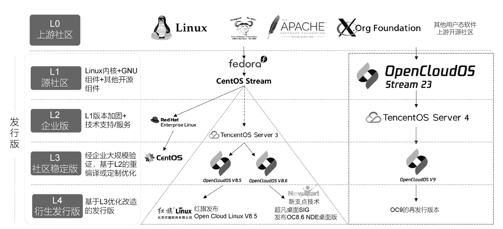

图 2-7

（1）OpenCloudOS Stream — L1 源社区层。由腾讯、中兴通讯等厂商联合发起并自主演进的上游基线，内核与软件包均以 Linux 主线最新稳定版为选型依据。持续跟踪上游动态保持快速迭代，建立可自主掌控的软件供给体系，生态内软件包已超 1800 个，为后续版本提供创新基础。

（2）TencentOS Server — L2 企业发行版。腾讯在 OpenCloudOS Stream 之上构建的首个商业发行版，内核与用户态均在 Stream 基础上独立演进，自主挑选维护，不再受第三方发行依赖牵制。已完成 2000 多个生态软件的自主编译维护，具备高性能、稳定安全、跨硬件适配能力，可为云原生、大数据、人工智能等领域提供优质底座，有效填补 CentOS 停止维护后的空白。

（3）OpenCloudOS 8 — L3 社区稳定版。在 L1 基础上深度调优并保持对 CentOS 8 应用环境的兼容。内核优化后稳定性提升约 70%，特定场景性能提升约 50%，已通过千万节点规模验证并适配云原生。提供长达 10 年维护期，内置 Cgroup V2 与热补丁能力，是 CentOS 的理想替代。

（4）OpenCloudOS 9 — L3 社区稳定版。作为首个完全自研的社区版本，彻底脱离 CentOS 依赖链，内核到用户态组件均自主选型维护。创新引入 MGLRU 内存管理、Maple Tree 等特性，数据库性能提升超 50%，I/O 性能提升 26.5%。支持多架构芯片与新型硬件，集成国密算法与 TPM 安全模块，为 AI、大数据等前沿方向提供云原生底座。

该体系以 L1 源头创新驱动 L3 稳定版本演进，形成贯穿软件供应全周期的自主生态，目前已在金融、云计算等 12 大行业实现千万级节点部署。

2）OpenCloudOS 社区与生态

OpenCloudOS 社区是国内领先的开源操作系统根社区，已形成覆盖全产业链的协作网络。截至 2024 年底，理事单位 31 家，上下游企业超 800 家，开发者规模 15 万，累计装机突破 1500 万节点。技术层面同时适配 x86_64、ARM64、RISC-V、LoongArch、飞腾、海光等国产芯片，兼容软硬件超 96,000 款。全栈国密可用性达 99.999%，故障率较传统发行版降低七成。

生态建设上，社区推出城市联盟计划，在北京、上海等五城开展产业试点，并设立行业委员会推动标准制定。联合腾讯、龙芯、中科方德等核心成员共建，已在金融、教育、AI 等领域取得进展：趣丸科技容器使用率提升至 80%，网易有道实现 AI 知识库一键部署，中南民族大学建成教育数字化底座。社区持续发布云原生 OS 玄湾、跨版本迁移方案等技术，推动国产操作系统生态发展。

3）OpenCloudOS 对 DeepSeek 等大模型的针对性优化

（1）性能优化：内核与系统级增强。面向生成式模型对海量数据处理与复杂计算的需求，OpenCloudOS 深度优化内核与核心组件，基础表现明显提升。

内核核心优化。通过重构调度算法与锁机制优化，上下文切换效率较上游原生内核提升 10%，多线程调度延迟下降。网络层面基于 eBPF 与 Cilium 优化协议栈，带宽较 CentOS 8 提升 29%–38%，每秒包处理量提升 59%–65%，满足大规模数据吞吐要求。存储计算层面，文件锁测试性能提升 200%，虚拟机缺页内存分配效率提升 100%，Redis 性能提升 11%，Nginx 峰值性能提升 150%。

资源调度优化。引入自研离线混部方案，结合智能隔离与优先级调度，虚拟化开销下降 130%–150%，异构算力利用率显著提升。容器网络全面兼容 Cilium eBPF 方案，容器间通信提升超 50%，多容器并发访问页缓存性能提升 187%。

（2）安全体系：贯穿云管端的全链路防护。为 AI 系统提供主动防御与被动加固双重保障。

主动防御。机密计算与可信根方面，借助海光安全虚拟化 CSV 实现内存加密保护；依托 TPM 2.0 与 TPCM 双路径可信根，从 BIOS 到内核构建完整性校验链，防止启动过程被篡改。国密算法全栈适配，集成 SM2/SM3/SM4，覆盖 OpenSSL、Libgcrypt 等基础库及内核，为传输与存储提供合规加密。

被动加固。漏洞全生命周期管理结合 SBOM 实时追踪供应链风险，自动化修复率达 70%；借助混元大模型预测漏洞影响，将修复时效从小时级压缩至分钟级。热补丁技术方面，自研 ARM64 热补丁支持运行时修复，宕机率较 CentOS 下降 70%，系统可用性达到 99.999%。

（3）兼容适配：深度契合 AI 生态。通过兼容主流框架与硬件，打造灵活高效的开发环境。

框架与工具链。原生适配 TensorRT、TensorRT-LLM、vLLM、DeepSpeed 等 30 余款推理与训练框架，并提供预置镜像与部署文档。模型开发工具集成 Ollama、HuggingFace TGI、ChatTTS 等 WebUI 工具，覆盖微调、推理服务部署全流程。

计算卡适配。支持 NVIDIA CUDA、AMD ROCm 及国产计算卡如昇腾、寒武纪等，已适配 1143 款硬件，提供异构算力统一调度。

国产化适配。携手红旗、统信等厂商发布联合发行版，兼容鲲鹏、飞腾等国产 CPU 及 AI 芯片，满足信创需求。与沐曦、天数智芯、太初元碁、壁仞科技、燧原、紫霄、海光-DCU 等厂商共建一体机，强化稳定性与安全性，并支持云原生集群。

（4）AI 开箱即用镜像。随业务上云，容器成为部署核心，OpenCloudOS 发布多款轻量化容器镜像，提升资源利用率、部署效率与安全性。

基础镜像。opencloudos9-microdnf 仅 101MB，采用 microdnf 包管理器与 coreutils。microdnf 为轻量版包管理器，安装卸载命令与 dnf/yum 保持一致，但不支持包搜索、依赖查询、插件扩展、历史记录及事务回滚等高级功能。相较 176MB 的 opencloudos9-minimal，microdnf 版本大小不足其 60%，若不需高级功能可优先选用。此外还提供使用 dnf/yum 的 opencloudos9-minimal 176MB、支持 systemd 启动多服务的 opencloudos9-init 218MB 无包管理器、以及使用 busybox 工具集的 opencloudos9-busybox 26.9MB。

应用 runtime 镜像。涵盖 opencloudos9-rt-java17 248MB、opencloudos9-rt-python3.11 51.1MB、opencloudos9-rt-dotnet7.0 134MB、opencloudos9-rt-static 4.34MB、opencloudos9-rt-php8.2 58.7MB、opencloudos9-rt-nodejs18 80.9MB。该系列特点：更小，仅保留运行所需最小依赖；更安全，降低攻击面；更高效，启动更快。调试时可在 runtime 上叠加基础镜像如 opencloudos9-busybox 作为调试镜像。

与业界镜像对比，OpenCloudOS runtime 镜像整体优于 Google distroless，接近 Alpine。支持 Java、Python、PHP、Node.js、Go、DOTNET 等语言，除 Java 外，Python 3.11 为 51.1MB、Node.js 为 80.9MB，均优于 distroless。兼容性上采用 glibc，软件包均来自 OpenCloudOS 官方源，响应与修复效率高。可调测性支持在 runtime 上叠加基础镜像作为调试镜像，基础镜像可按需选 opencloudos9-busybox 或含包管理的 opencloudos9-microdnf、opencloudos9-minimal。

4）OCAI-Agent 基于 DeepSeek 的运维助手

（1）开发背景。OCAI-Agent 针对系统工程师日常运维痛点设计：命令查找困难、脚本编写繁琐、效率提升受阻。遇到不熟悉的命令常需翻阅手册或搜索，耗时且易错；小型自动化脚本的语法调试亦增加负担。引入 AI 作为命令行副驾，可快速获取命令与执行方案，显著提升效率。

（2）核心功能。

口语化问答。用户可在终端用日常口语提问，如“如何查看最近登录失败记录”，工具会给出 auditd 或 lastb 等对应命令，并在确认后可直接执行并展示结果，大幅降低使用门槛。

命令行智能辅助。忘记命令或参数时，可用自然描述获取建议。如需批量替换文件中的字符串，工具会推荐 sed 或 awk 并生成可执行代码片段，减少文档查询时间。

对话记忆。工具可记忆历史对话，处理多步请求。例如先问进程列表，再问如何只显示 CPU 占用高的进程，会结合上下文推荐 top 或通过 ps 过滤输出，提升复杂任务处理效率。

（3）三大模式。

第一种，Chat 模式。用户通过提问调用 OCAI 问答系统，系统进入思考、推理与结果输出。在命令窗口直接输入问题，无需命令前缀即可调用智能助手问答能力。

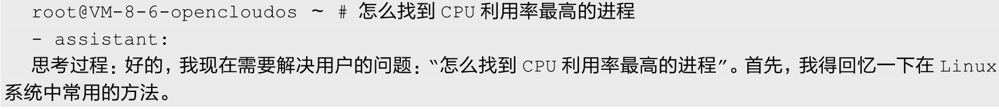 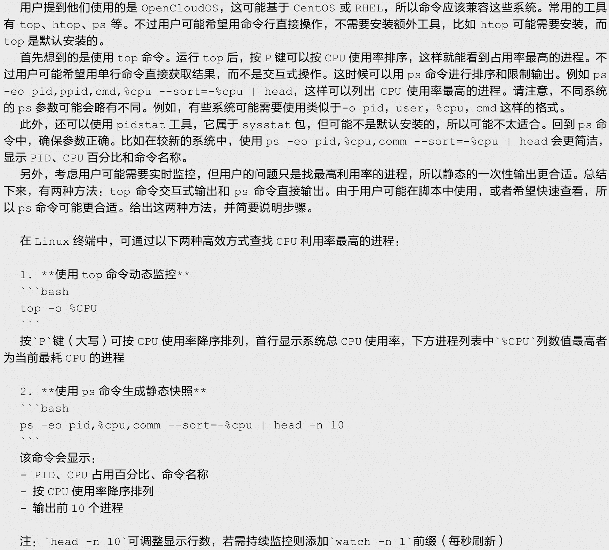

第二种，Cmd 模式。依据用户指示生成可直接执行的 Shell 命令，确认后立即执行并获取结果。通过 ocai cmd 形式调用命令生成能力，执行前会二次确认，用户可在输出基础上编辑后快速执行。

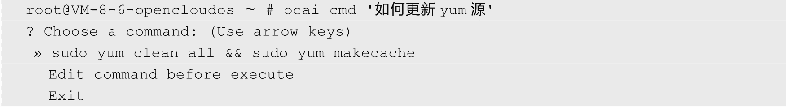

第三种，Code 模式。依据用户指示生成不同编程语言的代码。通过 ocai code<question> 形式调用代码生成能力。例如输入“用 python 实现快排”，工具会生成对应 Python 代码。建议清晰描述功能需求与使用语言，以确保输出符合预期。

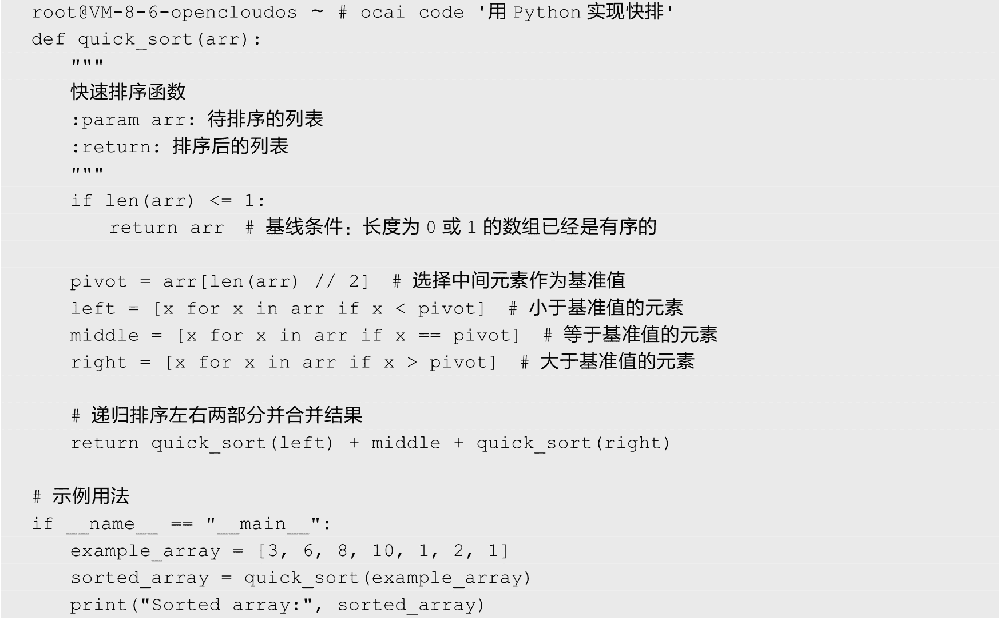

（4）技术原理。当前 OCAI 智能助手按场景设计多个 Agent 各自处理请求，采用 RAG 机制导入 OpenCloudOS 专属知识库，通过 OCAI-Service 与客户端交互，使用不同基座模型进行推理、总结与润色，最终输出结果，见图 2-8。

主要技术点包括：操作服务。针对不同场景与数据源创建多个智能体，各自负责特定领域逻辑如对话、命令生成、代码生成等，通过预设编排实现统一入口，多智能体协同工作。索引服务。为弥补通用模型在特定领域的知识缺口，通过 RAG 将 OpenCloudOS 文档库等专属知识处理为向量存入向量库。用户提问时先检索相关度高的数据，再拼接成提示词提交大模型总结。API。OCAI-Service 为接口层，除提供服务调用外，还支持上下文管理、接口转发、用户识别、鉴权、配置管理、反馈收集、统计日志等基础能力，并为多模型选择与函数调用提供通道。模型服务。各处理阶段使用 DeepSeek、混元等大模型，包括 DeepSeek-R1、DeepSeek-V3、混元-T1、混元-Turbo 等。

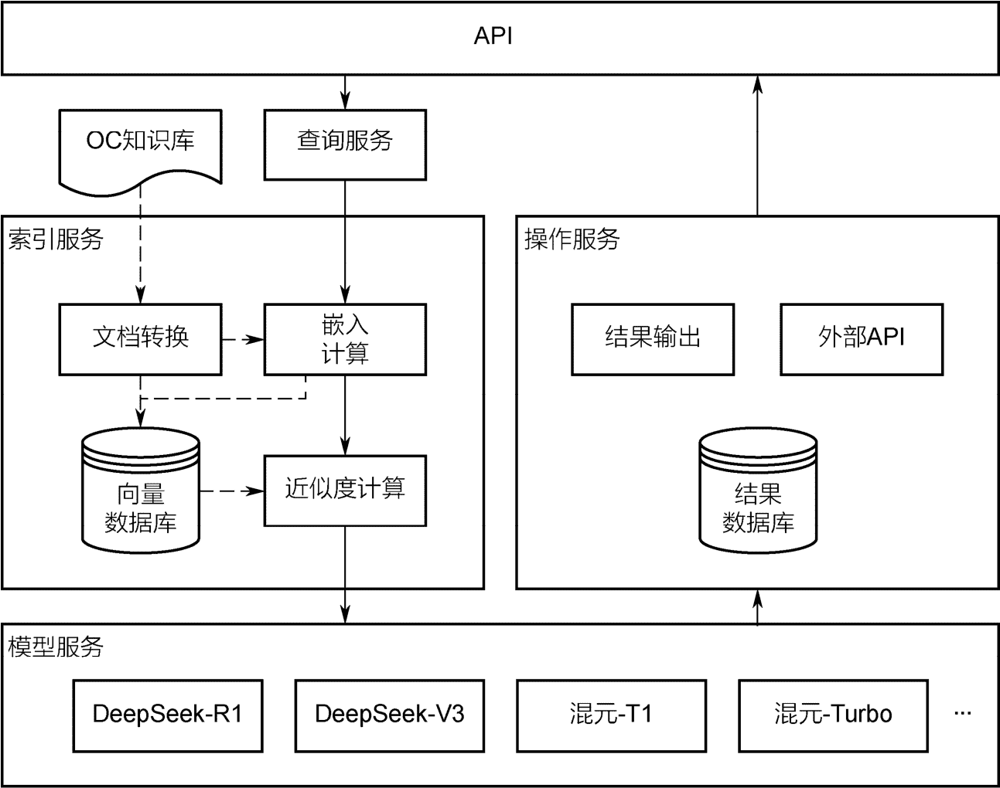

图 2-8

（5）获取方式。OCAI-Agent RPM 已发布至 OpenCloudOS 8/9 软件源，用户可直接执行 yum install ocai-agent 安装，或通过官网右上角 Banner 查看安装指引。安装完成后按提示在指定网站用邮箱注册，按邮件指引配置访问密钥即可使用。

5.行业案例分析

1）OpenCloudOS 适配优化场景

（1）网易有道 QAnything。网易有道开源的 AI 知识库问答平台 QAnything 与 OpenCloudOS 开展技术合作，将 QAnything 集成至 OpenCloudOS 操作系统，打造操作系统 AI 问答解决方案，为用户提供一键部署 AI 知识问答库能力。

QAnything 是网易有道自研的检索增强引擎，可高效管理多类文档，快速搭建本地知识库，实现即问即答、即找即现，具备稳定、高性能、高可用的成熟经验。OpenCloudOS 专注提供稳定、安全、高效的底层计算环境，双方技术栈互补。

该合作解决了 AI 知识库部署时环境配置复杂、依赖兼容性差、运维成本高等问题。传统方式需手动安装依赖与调整配置，流程繁琐易错，而 OpenCloudOS 用户只需有 Docker 运行环境，通过 Docker Compose 即可一键启动 QAnything。

实施中，研发团队首先解决依赖兼容性。为确保 QAnything 在 OpenCloudOS 上正常运行，团队分析其 Dockerfile 与文档，梳理所有必要依赖。在 OpenCloudOS Dockerfile 中使用 dnf 安装系统级依赖，Python 依赖使用 pip 安装，逐项核查保证镜像包含运行所需组件。

针对容器编排与配置调整，QAnything 采用多容器协同，需对 docker-compose.yml 进行相应修改。团队在深入理解各服务功能与配置后，依据 OpenCloudOS 特点调整镜像名称、端口映射、卷挂载等，并经反复测试验证服务正常。

国产系统一键唤起 QAnything，降低部署门槛

在核心痛点被攻克后，OpenCloudOS 为 QAnything 提供了开箱即用的部署能力。使用者不用再自行处理繁琐的环境依赖和配置，只要本地具备 Docker 环境，运行一条 Compose 指令即可完成启动。流程被大幅压缩，上手难度明显下降，省下的时间与人力成本十分可观。

该方案已在企业服务、文旅、电力、汽车等多个行业落地，形成可复用的标杆。中关村壹号园区借助此组合率先上线国内首个国产化园区级问答平台，为入驻企业带来降本提效的实效。平台聚合了上百万份技术文档，搭建起本地化的企业知识库问答体系。截至成稿，园区文档问答日均处理量超过 200 次，平均响应耗时缩短 29%，团队协作效率提升 35%。网易有道将继续深化与 OpenCloudOS 的合作，推动知识库问答与操作系统的协同演进，让智能问答更易用更顺畅。

（2）AMD EPYC 加持，AI 计算效能再提
AMD 第五代 EPYC Turin 在人工智能计算上取得关键进展。芯片采用 Zen 5 微架构，标准版单颗提供 128 核，Zen 5c 高密度版可扩展至 192 核，基础频率最高达 5GHz，单位算力密度与能效均显著提升。架构层面以先进的多芯片互联为基础，搭配 DDR5-6000 内存与 128 条 PCIe 5.0 通道，为大规模 AI 负载提供坚实硬件支撑。

当前 AI 计算的核心矛盾在于性能与成本难以兼顾。算力密度、内存带宽需求持续攀升，企业对电耗与硬件投入的管控压力也在加大。虚拟化环境中的安全隔离与运行监控同样构成痛点。

为此 AMD 与 OpenCloudOS 社区开展深度内核协同，在系统内核完成多项融合：基于 SEV 与 SNP 的机密计算框架、面向 Zen 5 优化的 NUMA 调度逻辑、适配 EPYC 的实时性能观测体系。这些改进有效缓解了隔离、安全、调度和性能调优方面的难题。

落地时团队对 OpenCloudOS 内核进行深度调参以匹配实际需求。重构 NUMA 调度后，系统对 Turin 多芯片互联的适配性明显增强，跨核数据访问效率提升，性能与稳定性同步改善。SEV/SNP 框架提供硬件级隔离保护，实时监控可精细追踪各推理阶段的资源占用。

腾讯云落地的 EPYC 联合 OpenCloudOS 方案实测显示融合效果明显。在 DeepSeek 超大模型推理测试中，训练吞吐量大幅攀升，单节点推理延迟达到领先水平，印证了高核高频异构架构与开源系统的深度匹配可行性。软硬协同不仅打破性能与安全瓶颈，还以更高能效压缩总体拥有成本，为企业构建高性能高安全 AI 基础设施提供了可落地的范例。

（3）TACO-LLM
大模型与复杂 AI 算法普及后，计算效率不足已成制约落地的关键。如何在有限资源下实现显著提速，成为行业主攻方向。针对显存碎片与调度低效，TACO-LLM 通过三项创新实现跃升。

• Continuous Batching：动态批处理消除计算空隙，在千卡集群中保持约 95% 的线性度，吞吐量相对静态批处理约翻倍。
• Speculative Sampling：大小模型协同推理，采用草稿生成加验证机制，首 token 延迟下降 40%，解码吞吐提升 1.8 至 2.5 倍。
• TurboAttention：面向长序列的自研算子，结合分块管理和 FlashAttention 优化，8K 长文本推理显存占用减少 30%，计算效率提升 86%。

在 OpenCloudOS 加 NVIDIA H800 环境下，采用专家并行优化，MoE 模型推理实现通信与计算重叠，单机 NVLink 利用率超 95%，多机 RDMA 效率达 90%，验证了引擎在复杂场景下的成熟度。TACO-LLM 与 OpenCloudOS 结合后，后者凭借底层硬件深度优化能力，完整支撑满血版 DeepSeek-R1。双机 16 卡配置下，无论短输入问答还是长输入检索增强生成，推理表现均大幅改善，为企业降本增效提供新路径。

2）OCAI-Agent 在运维实战中的应用

（1）服务器 CPU 负载飙升的定位
在 Kubernetes 集群运维中，节点 CPU 长期高于 90% 时，人工排查需逐项查看监控、解析 kubelet 日志、检查容器资源占用，耗时且高度依赖经验。

部署 OCAI-Agent 后工作流大幅优化。使用者可用自然语言描述现象，如“节点 CPU 持续超 90%，帮忙分析原因”。工具依托内置知识图谱与大模型，能精准定位深层根因，例如 Pod 内存上限不足引发频繁 OOM。系统同步输出结构化报告，涵盖根因、验证步骤与修复建议，并对参数值和操作风险等级进行标注。

某电商平台应用后，平均修复时长从 25 分钟压缩到 3 分钟以内。面对内存泄漏引发 CPU 竞争等连锁故障，全链路分析能力明显优于人工。系统自动沉淀解决方案为知识库，为后续问题提供参考，实现经验积累。技术上，语义理解降低使用门槛，增量学习让诊断模型持续进化，异常场景均可给出专业级建议，特别适合云原生环境 7×24 小时稳定运行。

（2）本地目录同步到远程服务器的命令生成
在社区与高校的协作中，学生部署服务时常需把本地目录同步到远端服务器。以 rsync 为例，功能强但参数繁多，新手易混淆。典型需求包括：把本地 /data 同步到 192.168.1.100 的 /backup，排除所有 .log 文件，并展示传输进度。

传统做法要查手册拼装参数。用 OCAI-Agent 时，只需输入“用 rsync 把本地 data 目录同步到 192.168.1.100 服务器的 backup 目录，排除 .log 文件并显示进度”，工具即可给出优化命令。

此方案包含：

•-a 参数负责保留文件属性并递归同步。
•-v 输出详细过程。
•-z 开启传输压缩。
•--progress 实时展示传输进度。
•--exclude 精准过滤日志文件

实际测试显示，该方式比手工查阅节省大量时间，对 Linux 命令不熟练的新手尤其友好。

**6.小结**
OpenCloudOS 与 DeepSeek 的深度融合标志着国产操作系统与 AI 的协同进化迈入新阶段。作为全链路自研的服务器系统标杆，OpenCloudOS 以 L1 至 L3 分层架构打造自主可控生态，在安全、性能与兼容性上取得突破，已覆盖金融、云计算等 12 大行业、千万级节点部署。DeepSeek 的引入为系统注入智能能力，在自然语言交互、自动化运维、资源智能调度等场景中提升效率、降低风险，以低成本高效能获得广泛关注，推动操作系统向 AI 原生基础设施演进。

二者形成技术互补与生态共建的双向促进。OpenCloudOS 为 DeepSeek 提供异构硬件适配、推理加速等底层支持，DeepSeek 的 AI 能力回馈到系统的智能调度、安全检测、知识管理等创新。未来随国产化替代与智能化深化，这一融合模式将推动操作系统从“能用”迈向“好用智能”，为数字经济奠定基础。

**2.2.2 阿里云服务器操作系统：DeepSeek 的智能底座**
服务器操作系统演进与算力产业发展紧密关联。目前算力正经历重大变革，云与 AI 的深度融合及大模型驱动的智能化浪潮，为操作系统带来新机遇与新挑战。本节探讨操作系统如何通过双向赋能实现重塑。

**1. 云＋AI：直面算力基建难题**

1）大模型趋势下计算基础设施面临的挑战
大模型爆发式发展重塑技术格局，DeepSeek 671B 等千亿级模型落地暴露基础设施深层矛盾，算力成本尤为突出。单机部署硬件投入常达百万级，例如 8 张 H100 的服务器采购接近 300 万，且难以充分释放 GPU 算力。相较分布式推理的混合并行方案，每 token 成本差距可达数十倍。中小企业私有化场景日均负载常不足 15%，请求达 90% 饱和时，单机数十 token/秒的吞吐将导致严重延迟。静态资源分配导致空闲期浪费超 80%，技术理想与商业现实差距明显。

自建 AI 基础设施更深的挑战来自供应链复杂度。
• 规模定律推动分布式训练从千卡向万卡、十万卡演进，DeepSeek 等超大模型使分布式推理成主流，常需数百张 GPU 并行，这对数据中心建设提出更高要求。
• AI 芯片制程遇瓶颈，出现 Scale Up 与 Scale Out 混合架构，需协同才能达最佳性能，采购与运维难度同步上升。

国内 AI 芯片供应多元导致生态碎片化，企业需面对英伟达、AMD、华为昇腾、寒武纪等差异，兼容适配耗时巨大。DPU、RDMA 高性能网络的稳定与性能仍是难题，AI 软件栈版本冲突如同隐形陷阱：框架不兼容致模型转换失败、系统选型不当导致存储性能下降、工具链与算子适配缺陷使芯片性能打折。这些问题推高成本并威胁可用性。

企业试图以云原生 AI 分布式架构降本时，系统栈复杂度指数级上升。分布式训练单点故障可能中断数十小时任务，造成数万美元损失。DeepSeek 满血 MoE 的专家并行方案需数十台机器、数百张 GPU 通过高速网络互联，具备软硬协同优化与运维能力的厂商稀缺。安全层面，业务数据与模型参数双重威胁下，可靠方案稀缺。私有化部署弹性不足，突发流量难以保障服务质量，阻碍 AI 向核心业务渗透。

正因如此，越来越多用户选择公共云部署 AI 应用，获取按需算力与 SLA 保障。云与 AI 深度融合已成必然。随模型规模扩张及 PD 分离、稀疏计算等技术突破，算力成本曲线下探，云原生架构从可选项变为必选项。Gartner 预测到 2027 年中国 AI 推理负载云化占比将从 20% 升至 80%，重塑数据中心基础设施。敏捷性、经济性与智能化将成竞争核心。

2）云+AI：服务器操作系统的新定位
面对云与 AI 变革，操作系统正以 “System for AI” 与 “AI for System” 双向赋能重塑定位。

System for AI 方面，操作系统需参与解决供应链与云原生 AI 分布式复杂度，成为 AI 基础设施关键环节。硬件与系统层面需以 GPU 为主、CPU 与 DPU 为辅重构设计；软件生态层面需结合 AI 软件栈开发者与应用生态，重新思考分发与部署形态，拥抱容器、PyPI 生态、AI 框架及开源大模型，构建安全可信的商业化交付。针对系统栈复杂度，需将操作系统边界扩展至 AI 软件栈与硬件底层，通过全栈软硬协同破解复杂性。

AI for System 方面，操作系统从资源管理者演进为智能协作者，构建智能化隐形底座。让大模型智能进入内核需长期探索，目前推理延迟与底层资源管理性能要求差距明显，短期先发展智能辅助，随着算力与智能化提升再逐步深入。

两种演进本质是基础设施底座的重构。操作系统需通过开源协同、软硬协同全栈优化与智能运维体系如 OS Copilot、AI Agent，解决成本、兼容性、稳定性问题，并定义未来标准：从被动支撑算力到主动释放算力，从运行模型到协同进化。在算力成本下探中扮演调节阀，在云与 AI 融合中成为推进器。未来十年，操作系统将作为数据中心算力升级的隐性力量，与 AI 基础设施共同演进。

**2.场景驱动：拓展双向赋能的操作系统边界**
AI 推理覆盖模型开发、精调训练与推理服务，多样化场景重塑基础设施需求。实时对话、高吞吐离线批处理、私有化敏感场景、混合云弹性扩展等，对算力、存储、网络与生态要求各异。基础设施需在性能、成本与敏捷性间动态平衡，并通过 IaaS、PaaS、MaaS 等体系化产品满足多元需求。操作系统借此不断突破边界，成为云服务链路关键环节。

1）System for AI：应对供应链与 AI 系统栈技术复杂性
AI 基础设施规模化面临软硬件生态碎片化与系统栈复杂度两大矛盾。

针对供应链复杂度，硬件上将通用场景一云多芯架构延伸至 AI 基础设施，通过同源异构系统架构为上层提供统一管控接口。软件上构建 AI 容器生态提升部署效率，以商业化交付保障供应链安全，让企业聚焦业务。

针对系统栈复杂度，依托操作系统管理软硬件资源的优势，介入 GPU、CPU、DPU 底层机制优化，参与全栈优化。通过动态资源配置优化 DPU、CPU、GPU 间数据流转，通过内核 I/O 优化解决训练推理数据从存储到内存的性能瓶颈。

（1）算力统一管理：异构一云多芯架构
AI 基础设施引入 CPU、GPU、DPU 及 NVLink、RDMA 等复杂性，不同厂商与代际硬件需统一纳管以保障调度。

服务器操作系统厂商常采用同源异构架构降低兼容性问题，建立完备兼容架构与工程规范是关键。

以阿里云服务器操作系统为例，继承龙蜥社区同源异构设计，主要特点如下：
• CPU、GPU、DPU 等不同芯片同代使用相同系统与组件。龙蜥定义 6.6 内核规范并移植主线特性，确保新一代 AI 芯片支持。
• 基于同源异构软件包定义 KCONFIG 规范、kAPI 规范、kABI 规范，并通过 CI/CD 自动化测试保证合规。
• 建立遵循规范的第三方驱动库，硬件厂商驱动以 OOT 方式独立维护，与系统发版解耦，保持软硬件兼容。
• 龙蜥社区成立 AI Infra 工作组，汇聚 AI 上下游厂商，全面支持兼容性规范并前置适配工作。

AI 基建新范式：标准、交付与智能决策

生态共识沉淀为行业规范。龙蜥社区与境内各系统开源阵营就接口规范达成统一，使得行业规则的影响力被放大；同时携手权威标准组织，把产业内部的共识转化为正式标准。

（2）商业化交付：智能容器生态与软件分发
人工智能软件堆栈的复杂性已成为部署与运维的显著壁垒。让模型跑起来，需要驱动程序、基础库与工具链、框架等多层组件协同，版本搭配不当时会牵动安全、稳定与可用性。典型情况是内核与组件选型不匹配，导致存储性能损失超过30%，进而拖累训练效率，最终反映在GPU利用率下滑。异构芯片混布进一步放大了选型难度。

厂商提供预编译的智能运行镜像，实现即用即跑，是降低门槛的关键。核心在于搭建完整的容器构建体系与端到端交付链路。

阿里云服务器操作系统借助龙蜥社区构建智能容器生态，并以 Alibaba Cloud AI Containers 即 AC2 实现商业化交付，在多方面提供保障。

• 组件选型：龙蜥社区与芯片厂商联合制定涵盖 CUDA、ROCm、OneDNN 等关键基础库与工具的版本基线兼容认证，确保底层库与工具的选型与芯片型号及系统内核版本严格对应，并通过 CI/CD 发布流程保障稳定可靠。
• 镜像构建：内置不同硬件加速库、运行时与模型框架，覆盖多样化场景，例如预集成 PyTorch、vLLM 等并引入业界最新优化；同时对 ECS、ACK、ECI、ACS 等云产品及灵骏集群做深度适配，提升云上智能负载表现。
• 供应链安全：建立软件物料清单 SBOM 追溯、安全漏洞修复与公告、镜像签名等机制，确保从源码到分发的全程可信；配套全链路镜像发布平台，覆盖构建、测试、发布、维护。
• 分发：依托阿里云容器镜像服务 ACR 统一分发，官网已上架预构建 AC2 镜像并支持大规模集群加速；同时接入龙蜥社区 AI 软件仓库 EPAO 源，支持运行时动态安装组件。

总体而言，智能容器生态是提升基础设施易用性的抓手，让企业建设重心从环境适配回归算法创新。

（3）全栈协作：系统栈端到端调优
智能系统栈复杂度呈指数级上升。分布式训练中，因架构特性故障影响面会被急剧放大，局部节点的 NCCL 通信异常就可能导致整组 GPU 掉线，造成经济损失。节点级监控与故障诊断因此成为提升集群效能的核心；同样，单点性能瓶颈会因同步机制被放大，训练框架的定期 Checkpoint 在存储层常成为瓶颈。

分布式推理同样严峻。以 DeepSeek 混合专家架构为例，其参数稀疏与动态路由在千亿级模型上有效降本提效，但在云上落地需协同数十节点、数百张 GPU，带来多重复杂性：故障影响半径依然很大，专家路由的负载均衡需精细化，且为降低时延普遍采用 RDMA，进一步提升通信优化难度。MoE 架构引入使运维与技术优化难度明显攀升。

当前不少服务器操作系统仍停留在集成与支撑层面，错失全栈协同机会。操作系统需深度参与智能系统软件的全栈优化，持续拓展端到端性能边界。

以阿里云服务器操作系统为例，全栈协同在三个方向拓展边界。
• 预处理阶段，提供存储链路数据加速，优化 Checkpoint 写入、数据预处理与模型加载速度。
• 异构计算管控，强化单节点故障诊断与上报，与调度系统联动，对可快速自愈的故障采用快速恢复策略。
• 异构计算数据，深度集成并优化模型框架，直接提升单节点训练与推理性能。如基于 vLLM、SGLang 的 PD 分离技术配合弹性资源池化，将 DeepSeek 推理成本显著下降。

在基础设施从“能用”走向“好用”的过程中，阿里云服务器操作系统已在 DPU-CPU-GPU 全链路上逐步拓展优化边界。

2）AI for System：操作系统的智能化跃迁
算力成本下行叠加大模型能力跃升，推理与智能体应用将迎来爆发。在 OS 领域，用智能体重塑研发、运维、售后全流程，以 AI 提升生产效率与体验，已成关键命题。

研发生产端，操作系统可借力大模型优化产品化研发流程，提升研发智能化水平。
售后服务端，大模型结合 RAG 构建知识与问题库，通过自动化分拣与处理工单，加快响应速度。
运维管理端，集成大模型能力降低使用门槛，大幅提升故障诊断效率，并以自然语言交互改善体验。

阿里云服务器操作系统已研发并集成 OS Copilot 模块，兼容 DeepSeek 与通义千问，具备以下特质。
• 智能：持续学习用户习惯，给出更准的预测性建议。
• 专业：覆盖操作系统相关各类问题解答。
• 高效：在系统诊断、调优、编程等场景中快速处置。
• 协作：可管理阿里云资源，提供一体化服务。

主要功能包括：
• 命令行自然语言问答：用户可在命令行用自然语言提问，获取专业解答，提升操作效率。
• 辅助命令执行：帮助新手快速掌握 Linux 常用操作。
• 阿里云 CLI 调用：基于阿里云开放 API，支持在操作系统内便捷调用 CLI，例如查询 ECS 实例信息。
• 系统运维与调优：通过自然语言调用运维调优工具，尤其是阿里云自研工具，帮助定位问题、提升性能。

展望未来，随着 MCP、A2A 协议与多智能体协作框架成熟，操作系统将探索基于智能感知的资源管理新范式。智能体在自我学习与迭代上取得突破，推动 OS 从执行者进化为决策者，核心价值由资源管控转向智能决策，重塑基础设施管理范式。

**3.技术驱动：补齐能力与需求差距**
新场景驱动基础设施重构，架构复杂性带来的系统性问题愈发突出。实时对话要求毫秒级时延，离线批处理要攻克高吞吐存储，混合云面临跨域协同挑战，产品能力与场景需求的差距需要跨越。这些需求最终转化为稳定性、安全、弹性伸缩、性能与成本优化四大诉求。在完成双向赋能后，直面技术挑战、塑造差异化竞争力，才能把场景想象力变为商业可行性。

1）稳定性：为复杂系统提供确定性保障
分布式训练与推理成为主流，AI 基础设施稳定性直接决定 SLA。操作系统需构建多层防御体系，在可观测性与 RAS 处理上针对智能特性形成完整支撑。

（1）智能系统的可观测性。阿里云服务器操作系统的 SysOM 组件集成应用观测、系统监控、告警、诊断与安全运维，基于大数据与机器学习深入分析内核行为，实现实时性能观测与智能故障定位，达成一键运维。
为应对稳定性挑战，SysOM 扩展可观测体系，通过动态注入采集算子、调度与内核函数信息，实现低侵入、低开销的作业观测，助力运维实时分析。当前模块支持：
• 系统观测：应用与任务状态监测，CPU 与 GPU 性能问题分析。
• 异常告警：监控 GPU 利用率与分配率，给出资源优化建议。
• 链路追踪：支持 CPU、GPU、分布式存储、RDMA 网络链路追踪。
• 故障发现与预测、定界定位：CPU 与 GPU 故障监控与定位。

（2）异构全链路 RAS 支持。大规模数据中心里，服务器宕机率是传统 RAS 指标，在智能场景下 GPU 可用时长更具本质意义。规模化扩展带来双重压力，加剧可用性挑战。
• 垂直扩展：故障域扩展到机架级，如 NVIDIA NVL72，爆炸半径增大；单机 CPU 核心数百量级、内存向 TB 级演进、GPU 液态级联，单机可部署上百虚拟机、上千容器，CPU、GPU、DPU、NVLink 等关键硬件混杂，故障处理复杂度上升。
• 水平扩展：分布式架构下单点故障影响全局，模型规模推高集群规模，GPU 故障率高成为运维痛点。
阿里云服务器操作系统通过软硬件协同构建端到端 RAS 方案，提供：
• 故障注入：覆盖 CPU、GPU、DPU、PCIe、CXL 等异构场景，验证硬件与操作系统全链路隔离、报告、诊断与处理。
• 故障诊断：对接各智能芯片处理机制，实现从设备故障码解析与拓扑诊断到进程、算子状态诊断的细粒度定位。
• 故障持久化：重启后读取 ROM 中持久化硬件故障信息，提升根因定位，避免任务二次受损。
• 轻量级故障收集与分析：依托 tracepoint 实现 CPU、内存、EGM、AER、CXL 等错误通知式采集，用户态完成解析、统计与告警。

2）安全性：端云协同的 AI 隐私计算体系
端云一体联合计算成为主流。智能场景下提示词、训练集、私有数据集频繁上云，泄露风险更高。传统云环境中数据安全高度依赖云平台自身能力，用户需承担高信任成本。
机密计算技术成熟后，数据在加密状态下计算、存储、传输，用户掌握解密权与排他所有权，形成端云协同的数据主权保护体系。
模型规模增长推动跨域数据传输需求上升，用户希望数据在第三方基础设施运行不被泄露或篡改。传统虚拟化隔离只能防恶意租户，无法保障工作负载完整性与保密性。可信执行环境 TEE 与机密计算成为行业共识，允许在不信任底层平台下安全运行敏感任务。
针对大模型训练推理的高敏感性，阿里云服务器操作系统提供基于异构 TEE 的 CAI 方案，核心能力包括：
• 异构 TEE 与 GPU 安全验证：在 CPU 可信环境基础上验证 GPU 执行环境，并在物理总线建立安全通道，实现 CPU-GPU 端到端机密性与完整性，防止高价值训练数据与模型参数泄露。
• 无缝适配主流模型框架：与 TensorFlow、PyTorch 等框架无缝集成，无需改动代码即可部署可信训练推理，提示词、输入、输出全程加密，避免提示词泄露与模型逆向风险。
• 远程证明与信任传递：通过远程证明向用户展示执行环境未被篡改、软件栈完整、处理可追溯，解决模型提供者与平台提供者间的信任断层，尤其适用于模型即服务与多方协作训练。

大模型时代数据跨域流动常态化，隐私、性能、效率与产权归属的平衡是关键挑战。CAI 方案为保障数据隐私下的规模化落地提供实践，未来将持续融合软硬件创新与标准体系，深化行业应用。

3）弹性伸缩：云加 AI 架构的敏捷响应
在云加 AI 形态下，容器成为事实标准。基于 Kubernetes 的智能应用管理生态具有显著竞争力，KubeRay、Koordinator、KServe、Knative、KubeFlow、Fluid 等项目简化分布式推理开发运维，并可对接智能容器生态，如 AC2、NVIDIA NGC 与 NIM。
阿里云服务器操作系统支持原生容器 runC 与安全容器 runD，实现云加 AI 部署。结合 Kubernetes 生态套件，智能容器可在训练微调与分布式推理服务中弹性伸缩。为实现秒级弹性，需在多环节优化。
RunD 在支撑 Serverless AI 时面临挑战：Kata 容器资源开销大，常超 100MB，启动需数秒；安全容器臃肿，内存与设备直通开销高，系统服务启动慢；高并发创建 CGroup 导致同步时延与调度开销上升。
RunD 快速弹性伸缩特性包括：
• Rust 实现 VMM Dragonball：VMM 内存从百兆降至 3MB，支持设备直通、热插拔、NUMA，适配复杂业务。
• 多进程融合设计：便捷运维升级，降低通信开销，提升启动性能与稳定性。
• 精简操作系统组件：剥离非容器特性，降低资源占用与攻击面。
• VMM 与 Guest Kernel 融合设计：安全容器统一提供二者，深度融合提升启动速度与效率。
同时优化内核，解决高并发 CGroup 的调度开销问题。
技术落地后，RunD 已在生产环境支撑单节点 4000 个安全容器、200 个/秒并发、200ms 启动。相关成果发表于 2022 年 USENIX ATC 与 2023 年 SOSP，并已部分并入 OpenStack 开源项目 Kata Container 3.0。

4）性能和成本优化：全栈协同的工程实践
AI 基础设施的性能与成本优化是算力成本问题的核心，本质是挖掘智能芯片并行能力，确保数据在 DPU、CPU、GPU 全链路高效传输、处理与计算，在吞吐与时延约束下持续提升各环节利用率。掌控操作系统与硬件资源，通过端到端的软硬协同工程实践，可拓展优化边界，释放更大价值。

让大模型算力不被存储拖住的隐形底座

（1）存储瓶颈的拆解与加速
大模型落地后存储的压力从“够用就行”变成“规模+形态”双重考验。数据量上，预处理往往要面对上亿文件的处理；形态上，多模态应用让文本、图像、视频一同涌入。AI 计算底座里最常见的数据读写模式可以归纳为四类：
训练集以只读为主，训练期间持续拉取；检查点以写为主，周期性把模型状态和优化器状态落盘，规模可达 TB 量级；模型本体训练后写一次，推理时反复加载，读多写少且体量大；推理加速产生的键值缓存，部分系统会选择落地持久化。
在训推一体场景下，训练数据带宽、模型参数的读写效率、检查点的保存与恢复速度，以及推理时模型加载和缓存命中情况，直接决定图形处理器的实际忙碌度。一旦数据来不及送到计算侧，算力就会空转，延迟和吞吐立刻恶化。
DeepSeek 为这一场景量身打造了 3FS 分布式文件系统，在大模型典型负载下提供强劲性能。但多数 AI 作业仍需要 POSIX 可用的存储加速。阿里云服务器操作系统因此补齐两项能力：
文件协议层提速，保留 FUSE 的 POSIX 兼容性，对核心路径进行深度打磨，实测较社区原生实现快 6 倍以上，可对接所有基于 FUSE 的分布式存储。
块协议层降本提效，通过 EROFS 构建虚拟块设备直连对象存储，例如阿里云 OSS，用低成本云存储替代昂贵的高性能分布式存储。在百万级小文件读取的压力测试里，相较传统对象存储文件系统的标准接入方式，读取速度提升十倍以上。

（2）让 PyTorch 在 ARM 上跑出完整算力
PyTorch 是学术和工业界的主流建模底座，DeepSeek、通义千问等模型都基于它构建。在英伟达显卡和英特尔 CPU 上表现理想，而在 ARM 芯片上，因未能充分调用硬件加速指令，效率存在差距。
深度学习和 Transformer 里矩阵运算占比极高。阿里云服务器操作系统为 ARM 版 PyTorch 接入 ARM 计算库的矩阵乘法实现，释放处理器潜能。实测在 ARM v8.6A 架构下对 BF16 矩阵乘法进行优化后，ResNet-50 与 BERT 推理的吞吐实现翻倍。

（3）预填与解码解耦的实践
阿里云服务器操作系统团队参与了 Mooncake 传输引擎和 Mooncake Store 的开发并持续开源贡献。Mooncake 以键值缓存为核心实现解耦，支持预填充集群与解码集群分离，并利用 GPU 集群中闲置的 CPU、内存和 SSD 资源来缓存键值。
团队随后参与主流推理框架 vLLM 与 SGLang 的预填-解码分离架构研究。传统上通过扩大批大小提升吞吐，对自回归生成并不高效。引入键值缓存后，计算可分为两段：预填充阶段计算密集、算力消耗大；解码阶段以访存为主、顺序生成、算力利用偏低。两者放在同一实例会造成预填充期显存利用不足、解码期算力闲置。
分离后带来的收益是：预填充并行与解码调度优化可降低并发延迟；可为两类集群配置不同规格的 GPU，例如算力更强的设备承担预填充、显存充裕且性价比高的设备承担解码，实现资源精细化并降低每 Token 成本。
相关能力已逐步上游化。vLLM 是面向大规模语言模型高效推理的开源库，集成了分页注意力、猜测解码、分块预填充等技术，2024 年 10 月加入 Linux 基金会；SGLang 是面向大模型与视觉语言模型的高效服务框架，反响良好。借助上游贡献，阿里云可第一时间获取最新推理特性，并推动预填-解码分离成为行业事实标准。
在 Mooncake 框架下，团队提供两条标准化路径：基于 GDR 的直连传输与中心化键值缓存存储。2024 年 12 月起，通过中心化缓存模式分阶段实现了 vLLM 的 1P1D、xPyD 等分离形态并合并入主线，输出 Token 的平均耗时与相邻 Token 间延迟均明显改善。2025 年 3 月，与 SGLang 合作，基于 Mooncake 的 GDR 直连传输完成分离能力的主线支持。
总体看，训练与推理对基础设施的要求正推动系统从被动适配转向主动优化，稳定、安全、弹性、性能与成本共同构成挑战。

4. 企业案例：DeepSeek 模型的高效商业化部署
一家互联网公司在大模型商业化过程中，业务覆盖智能问答、个性化推荐与自动化内容审核，日均需处理数亿级用户请求。原方案采用张量级并行部署 MoE 架构的 DeepSeek 模型，成本、效率与扩展性问题逐渐显现。

1）客户痛点：成本高企与效率受限并存
推理成本居高不下，内存碎片与显卡利用率不足六成，每百万输出 Token 的成本有很大优化空间，高频请求推高算力支出；MoE 稀疏计算导致专家负载不均衡，部分显卡长期空闲，单节点解码速度仅 4500 Tokens/s；预填充与解码统一调度引发请求中断，首次响应时间长达 10 秒；传统专家并行以固定分组如 EP32 为主，难以随业务流量波动动态伸缩，扩容需要重构集群。

2）解决方案：云原生与并行化技术的协同
SGLang 社区联合阿里云技术团队，基于 SGLang、Mooncake 与 DeepEP，设计融合预填-解码分离、数据高并行与大规模专家并行的全链路优化方案。

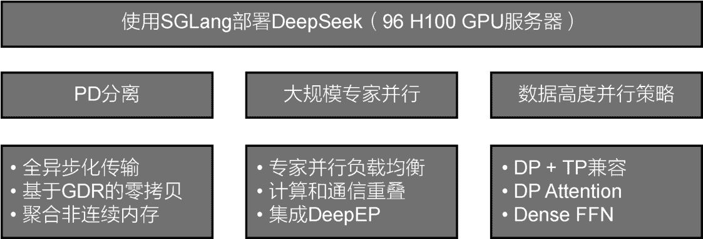

图 2-9

核心是预填-解码分离。推理被拆分为预填充服务与解码服务两个资源池。预填充服务专注长输入，采用 DeepEP 常规分发配合 RDMA 实现非阻塞键值传输；解码服务使用 DeepEP 低延迟分发提升 Token 生成效率。两者通过阿里云操作系统的 Mooncake 通信库互联，通信开销降低一半，避免 CPU 阻塞导致显卡闲置。
同时引入专家并行负载均衡与冗余专家池。将原生 256 个专家扩展到 288 个冗余池，支持灵活分组如 EP72。负载均衡机制实时统计专家使用频率，动态调整分布，高频专家复制、低频专家合并，使均衡度从 0.6 提升到 0.9，显卡空闲时间减少七成。双批次重叠技术把单批拆分为微批，重叠计算与通信，峰值内存占用下降三成，解码吞吐较传统专家并行方案提升 2.5 倍。阿里云自建 RDMA 高速网络实现跨节点零拷贝传输，通信延迟压到微秒级。
相比传统张量并行，整体输出吞吐提升 5 倍，预填充阶段输入速度达 52.3K Tokens/s/节点，解码输出速度达 22.3K Tokens/s/节点。首次响应时间压缩至 2 秒，解码延迟稳定在 100ms 以内。

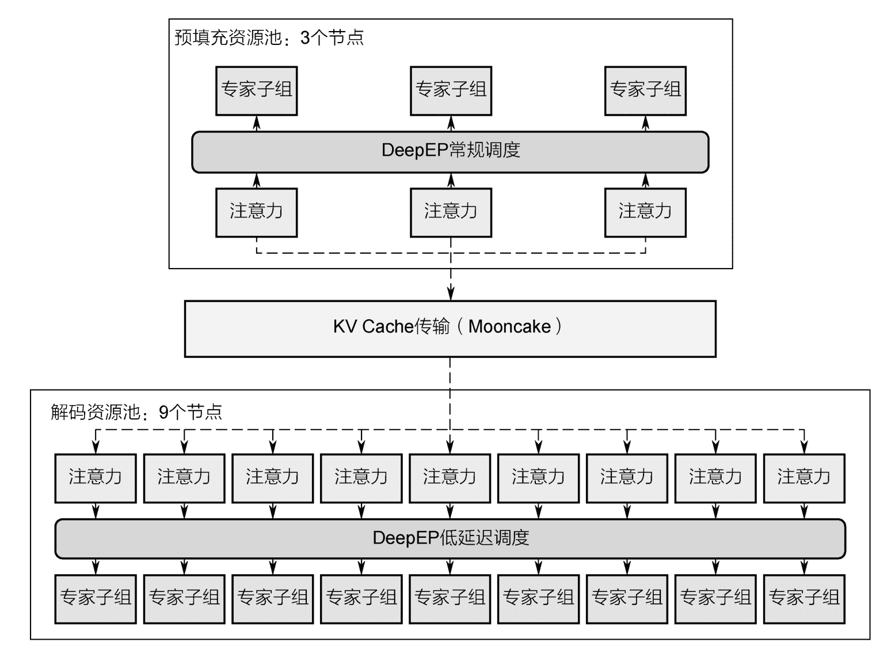

图 2-10

该架构以 12 个服务器节点、每节点 8 个 H100 GPU 为例。预填充资源池 3 个节点，每个节点 3 个专家子组，快速处理输入序列；解码资源池 9 个节点，通过键值传输实现注意力分布式计算，结合低延迟调度的 9 个专家子组实现高吞吐输出。Mooncake 支持的键值传输与两级调度协同降低通信开销，保证端到端效率。

3）案例效果：多维度突破
成本层面，输出 Token 成本降至原方案约五分之一，年算力支出节约达千万美元级；性能层面，推理吞吐提升 5 倍，日均支撑 10 亿级请求，预填充延迟降至 50ms/请求，解码吞吐稳定在 17K Tokens/s/节点，资源利用率长期保持 85% 以上；生态层面，验证了预填-解码分离与大规模专家并行的可行性，推动 SGLang 与 Mooncake 社区协同，加速分离架构标准化，并形成可复制的商业化路径。

小结
AI 商业化不仅依赖算法，还依赖底层系统与工程化协同。阿里云操作系统以隐形技术底座定位，借助 RDMA、内存管理等核心能力，为 SGLang 高效运行提供支撑。软硬一体与开源共建重塑云计算基础设施，为行业智能化转型提供标杆。

2.2.3 OceanBase：DeepSeek 生态下的数据管理新范式探索

1. 行业概况
数据已成为核心生产资料，数据库是支撑业务运营、用户交互与模型训练推理的基础。数据库从层次与网状模型演进至关系型，SQL 标准化推动普及；互联网与大数据时代催生 NoSQL 的横向扩展能力；NewSQL 在保持事务一致性的同时实现分布式扩展。近年来数据库向云上原生、多模态、智能化演进。
以 DeepSeek 为代表的大模型带来范式革命。强大的推理能力让自然语言直接驱动查询，成为非技术人员的数据入口；同时参与运维调优，提供自动化异常检测、根因分析与修复建议；推动数据库从存储工具向智能引擎演进。向量能力与 RAG 架构的支持，使数据库成为 DeepSeek 生态的重要数据底座。

2. DeepSeek 带来的机遇与挑战
大模型与数据库正双向赋能。
智能化升级方面，自然语言查询让用户用口语表达意图，系统自动转译为 SQL；运维层面可基于历史日志智能推荐索引、查询改写与资源分配，实现自适应优化，并自动化异常检测与日志分析；数据治理层面可通过语义分析识别敏感字段、自动打标脱敏，构建统一数据字典；文档生成、知识问答与教学辅助能力也显著提升。
同时面临挑战：大模型生成 SQL 或逻辑判断时可能出现语义偏差，导致结果不准甚至泄露；用户输入含敏感信息时缺乏有效脱敏与访问控制会带来隐私风险；主流数据库生态相对封闭，与 AI 模型的接口标准尚未统一，无缝集成仍是技术难点。

大模型与数据平台的双向奔赴

DeepSeek 在数据平台场景的演进，重点已从叠加新功能转向提升输出可信度、运行安全性与工程化落地能力。

2）数据平台成为大模型的底层支柱
若把 DeepSeek 用在数据平台视作模型对存储层的赋能，那么数据平台反向托举大模型则是另一条关键路径。高质量、结构化的数仓既是 DeepSeek 训练期的核心素材来源，也是推理时不可或缺的知识补全机制。

在训练环节，数据平台价值突出。大模型需要海量文本喂养，这些文本大量来自企业内部的结构化仓。金融的交易流水、医疗的电子病历、电商的商品描述，经清洗标注后进入模型，能显著提升垂直领域的专业度与表现。

在推理环节，数据平台承担实时供给角色。大模型知识有时间截止点，难以自发更新，面对“某公司本年首季度营收是多少”这类时效性或个性化问询时容易出错。将 DeepSeek 接入实时业务仓，就能在推理过程中动态拉取最新业务数据，保证答案的准确与时效。

数据平台还提供多模态支撑。当前大模型不局限于文本，还要融合图像、音频、视频。图型存储适合表达复杂实体关系，文档型存储可承载 JSON 嵌套数据，对象存储负责多媒体文件。数据系统正向多形态、智能化演进，以匹配大模型对多样数据的需求。

支撑过程中挑战明显。
（1）实时性与一致性要求严。高并发读写、大规模检索下，传统架构难以满足低延迟。
（2）数据体量与弹性压力大。PB 级历史数据、复杂的特征抽取与预处理，对底层架构的伸缩性提出更高要求。
（3）合规性与权限管控复杂。金融、医疗等行业数据受严格法律约束，如何在保护隐私前提下实现合规访问，需尽快解决。

可见 DataBase for DeepSeek 已不是单纯的存储问题，而是关乎模型性能、安全与合规的核心议题。

3.产业链与核心技术
1）产业链分析：数据平台在 DeepSeek 生态中的定位
围绕 DeepSeek 等大模型的应用，产业链可拆分为多个关键环节，数据平台贯穿始终。以下聚焦核心层级及其与平台的关系，如表 2-6 所示。

表 2-6

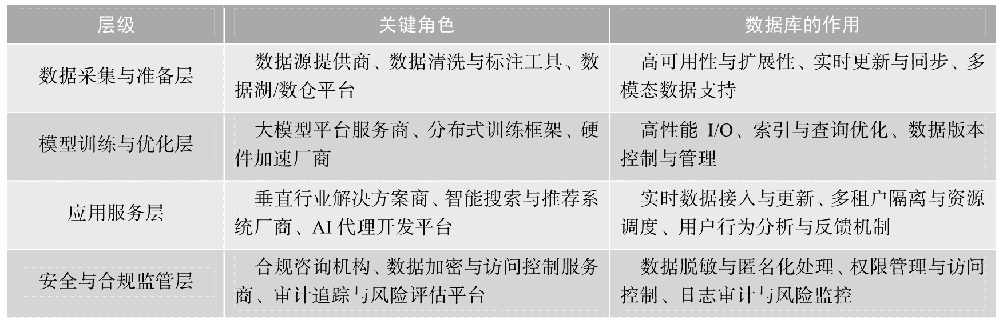

2）关键技术演进：数据平台如何助力 DeepSeek
在上述链条之上，以下关键技术正成为 Database for DeepSeek 的核心驱动。向量存储的到来为大模型打开新空间。

向量存储是什么？它是借助大模型技术，把文档、图像、音视频等多模态素材转成多维向量数组，从而加速检索与处理的方案。

传统 TP 与 AP 平台侧重精确查询，向量存储则依靠向量距离做模糊检索，常用算子包括曼哈顿距离、欧氏距离、余弦距离等，通过计算向量间距在库中近似查找相似对象，如表 2-7 所示。

表 2-7

作为数据存储、治理与处理的基础设施，数据平台在支撑 DeepSeek 的数据采集准备、训练优化、应用服务及安全合规监管中都不可替代。OceanBase 等原生分布式数据平台凭借强事务、高可用、弹性伸缩特性，已成为支撑 DeepSeek 的理想选择。随着技术融合加深，这类平台将在 AI 与数据系统协同发展中发挥更大作用，成为企业数字化与智能化升级的核心引擎。

4.技术架构与创新突破
1）现代数据架构已成必然选择
单一、结构化、静态的数据架构时代已过。如今业务由多形式、多质量的数据驱动，传统体系难以满足实时分析、高可用、快速响应与大规模扩展的需求，变革已成当务之急。

现代数据架构要求平台既能处理关系数据，又能承接非结构化数据，支持多源异构集成，并在保障安全前提下实现高效共享。OceanBase 应运而生。作为原生分布式关系平台，它具备卓越扩展性、丰富融合式能力与强存储检索性能，能处理海量数据与高并发，并通过跨数据中心部署、自动故障恢复、水平扩展等设计化解传统痛点，为企业提供面向当下与未来的数据底座。

2）OceanBase 的融合实践
在互联网、移动互联网与 AI 时代，管理的数据已从纯结构化扩展到半结构化乃至非结构化。但客户仍期望用一套系统处理各类负载并保持一致性，不愿区分 OLTP、OLAP、多模、AI 等场景。

融合需求在技术上挑战巨大。首先系统必须分布式而非集中式；其次需具备海量存储与计算能力。

OceanBase 不断强化融合能力，历经两次大迭代：从分布式到融合式，从 TP 到 HTAP，再到 SQL+NoSQL、SQL+AI。

3）向量存储：融合式架构再升级
向量能力有两种实现路径：独立向量库，或在通用平台中集成向量插件。后者可复用通用平台的功能、生境与稳定性。基于 OceanBase 融合式平台的插件，可直接复用其多云原生架构、高性能低成本存储与事务引擎，并扩展 SQL，同时保留既有 SQL 特性。其整体架构如图 2-11 所示。

（1）OceanBase 的向量功能全景。具体体现在：
•支持丰富的索引类型：向量索引之外，还支持标量索引、半结构化索引如多值索引、空间索引，以及全文索引，并可同时访问多路索引，满足复杂检索。
•集成便捷的应用：采用 SQL 访问，可复用 MySQL 生态圈各语言客户端，降低学习成本；同时支持类似 Milvus SDK 的 SDK 灵活选用。
•支持全面的索引创建语法：支持 HNSW、IVFFlat、DiskANN 等索引类型，距离算子涵盖 L2、IP、COSINE、Jaccard 等，确保相似度计算精准。

图 2-11
•强大的向量查询功能：支持 TOP N 排序的相似度计算，快速返回最相似结果；支持向量与标量混合查询，应对多元业务场景。
•简单的部署运维流程：向量功能内嵌内核，可用统一的部署、运维、监控与迁移工具，降低运维难度。
•简洁易用的接口设计：标准 SQL 即可建表写入向量、导入数据与 DML 操作，直接在向量字段上建索引并指定类型与距离算子；Python 接口导入包后即可完成建表、写入与 ANN 检索。

作为具备向量能力的通用平台，OceanBase 无需替换原库，版本升级即可获得向量能力，降低替换与学习成本；其数据压缩能力还能节省存储开销，提升性价比。

（2）OceanBase 向量场景的竞争优势。相比市场上稳定性不足、上手门槛高、运维复杂、生境配套缺失的问题，OceanBase 展现出：
•上手简单：接口简洁，支持一键部署，高度兼容 MySQL，新手与资深开发者均可快速上手。
•金融级稳定性：系统稳定与容灾能力在金融大规模场景得到验证，具备成熟保障体系与完整运维工具。
•性能强劲：向量检索集成 VSAG 算法库，在 960 维 GIST 数据集与 ANN-Benchmarks 测试中表现突出。
•成本效益显著：融合式架构避免多库融合查询的重排序与 RPC 开销，多租户能力提升资源利用率，降低总成本。
•运维管理简单：提供 OMS、ODC、OCP 等可视化运维工具链，使用便捷，减轻运维负担。

5.企业落地案例
1）RAG 技术实践：把 DBA 诊断带到最后一步
DeepSeek 问世前，AI 赋能平台智能运维的核心痛点是落地最后一步。传统系统虽能生成诊断报告，却堆砌锁争用率、缓存命中率等专业指标，结论仅供参考。DeepSeek 的出现为诊断决策提供了新解。

OceanBase 社区推出敏捷诊断工具 obdiag，将诊断经验代码化，支持集群巡检、根因分析与一键采数。但用户何时用哪条命令、如何解读报告，仍是最后一步难题，如图 2-12 所示。

图 2-12

社区探索出 RAG+obdiag 的创新路径。

数据是 RAG 的基石，指的是用于检索的知识集合。OceanBase 开源文档涵盖 OceanBase、OCP、OMS、ODC、OBD、ODP、ob-operator 等，多为 Markdown 文本，为构建高质量知识库提供素材。

图 2-13 为智能助手交互流程：
•用户在 Web 界面输入问题并发送。
•机器人用文本嵌入模型把问题转为向量。
•向量在 OceanBase 中检索最相似文档。
•返回相似向量与原文。
•机器人把问题与文档一起发给 DeepSeek 生成答案。
•大模型流式返回，机器人同步展示。

图 2-13

业务场景之一是开源论坛问答的初次回复，可辅助解答特性问题并指导诊断。

问题被分为三类处理：
（1）闲聊。与 OceanBase 无关的问题不予回复并终止。
（2）特性问题。涉及组件特性、抽象宏观的问题，经润色改写后进入 RAG 流程，检索、重排、生成带参考链接的回复。
（3）诊断问题。问题具体微观，如 OCP 告警推送失败等，错误域广、链路长，仅靠检索开源文档难以完全解决。此时借助 obdiag 工具提供日志采集、根因分析指引与下一步建议。

诊断问题采用至少三轮对话策略：
•第一轮：问题改写后交 obdiag 智能体，给出日志采集与根因分析命令建议，并追问约 4 个问题补充信息。
•第二轮：Question 智能体判断是否可解，可解则转 RAG，不可解则继续追问 4-5 个问题。
•第三轮：RAG 智能体结合历史对话检索生成回答，不再响应后续提问，结尾提示流程结束建议继续追问。

RAG 与 obdiag 的深度融合，以知识检索—工具调用—动态交互闭环，重塑 DBA 与用户协同解决问题的逻辑。

2）运营商实践：向量库升级让硬件成本降三成
OceanBase 在智能推荐、多模态搜索、RAG 等场景应用广泛。

某运营商数据平台服务数百至上千名内部用户，覆盖开发到运维全流程。平台种类多、版本差异大、稳定性要求高，且测试与生产环境差异影响效率，运维负荷重。

为提升效率，运营商探索 RAG 架构并开发数据智能专家 ChatDBA，融合专业知识与内部运维数据，支持自然语言查询、故障排查与建议，减少重复工作，如图 2-14 所示。

图 2-14

初期采用 MySQL 存关系数据、Milvus 作向量库。随着规模增长出现两大问题：无法水平扩展应对更大数据量；需同时维护两套系统，运维复杂度上升。

寻找统一方案后，OceanBase 4.x 实验室版本展现出强向量检索与混合查询能力，随后对独立向量库、单机库、分布式库在向量场景下的能力进行评估，表 2-8 为结果。

表 2-8

（续表）

**向量检索与异构算力融合升级实录**

在 OceanBase 的向量检索能力完成功能验证与压测后，运营团队决定把存量的 MySQL 与 Milvus 体系一并做现代化提炼。

OceanBase 方的改造成本很低，对原有 MySQL 几乎没有侵入，SQL 语法可沿用，连接驱动无需更换，只调整连接配置即可。Milvus 的升级主要体现在依赖包的更新与数据访问方式的适配。OceanBase 能够用标准 SQL 管理向量数据，熟悉 SQL 的开发人员即可快速完成改造。全部代码适配约一周完成，验证环节在两周内结束。

2024 年 10 月 OceanBase 正式推出 4.3.3 稳定版本并原生支持向量检索，随后团队启动生产环境的数据库迁移。以前期验证为基础，结合 OceanBase 自带的 OMS 迁移工具，Milvus 到 OceanBase 的数据搬迁过程平稳高效，整体进度明显加快。

迁移完成后，多套存储收敛到单一平台，物理资源占用下降约 30%，业务承载能力全面达标。原生分布式架构显著提升了系统的容错性，降低了单点风险，同时为后续业务扩容预留了弹性。技术栈更简洁，运维负担减轻，为长期发展打下灵活可靠、可扩展的基础。

**6.总结：数据库角色从存储走向 AI 底座**

DeepSeek 等大模型的技术演进说明了一个明显趋势：AI 基础设施正从单纯的支撑层转向价值创造的核心层。过去模型依赖独立的存储与计算两层。如今模型规模扩大、推理成本上升、应用场景不断分化，底层需要更强的一体化能力、更低的运维复杂度、更高的数据访问效率，以及更灵活的扩展机制。

OceanBase 作为国产自研的原生分布式数据库，正探索 Data X AI 时代的数据管理新范式，通过 SQL 与 NoSQL 融合、SQL 与 AI 结合的方式，更好地满足多模数据存储与融合检索的需求，为 AI 应用提供安全稳定的数据底座。在此背景下，数据库不再只是静态的数据仓库，而是逐步演化为 AI 基础设施中不可或缺的智能引擎与价值放大器。

当存储开始参与计算、通信协议开始影响模型设计时，基础设施的每一次迭代都可能成为技术跃迁的支点。未来的竞争焦点，或许不再是单一模型的参数量，而在于谁能搭建更贴合物理规律与商业本质的基础设施生态。

**2.2.4 FlagOS—跨芯片软件栈**

**1.行业背景**

人工智能快速演进，大模型落地推动算力需求急剧攀升，系统软件正在从同构 GPU 计算向多芯片异构部署迁移。随着模型体量与算力需求的同步放大，多类 AI 加速器被大规模引入。如何为异构算力构建统一的软件基座成为关键难题。各硬件在上层软件、底层编程模型与兼容性层面存在差异，业界亟需一套统一的系统软件来屏蔽底层复杂性，让来自不同厂商的异构算力协同工作，涵盖统一算子接口、通信调度、编译优化与集群管理。唯有如此，才能充分释放混合硬件的潜力，提升大模型训练与推理效率，满足市场对算力的需求。

DeepSeek 以极低的训练成本实现与顶尖模型相当的性能并全面开源，在开发者社区引发强烈共鸣。DeepSeek-V3 在 GitHub 上获得约 9.69 万星，DeepSeek-R1 约 8.93 万星，体现了全球开发者的关注与参与。开源大幅降低了大模型使用门槛，激活了生态活力，带来海量大模型部署与场景落地，推理计算需求迅猛增长。

大模型在异构硬件环境下从训练到推理部署面临多重阻力。

（1）推理部署门槛高。推理阶段需要把模型下放到各类终端或服务器，涉及 vLLM、SGLang、TensorRT 等多种引擎。不同硬件间模型格式与引擎的兼容性是痛点，对普通开发者而言，尤其是分布式部署，门槛很高，需要更低门槛的方案。

（2）算子适配优化成本高。各芯片的算子库各自实现、缺乏统一规范，导致模型在不同硬件间迁移部署复杂。面向多芯片，开发者往往要为每种硬件单独做算子优化，开发与维护成本上升。

（3）通信调度困难。大模型训练通常在多机多卡集群进行，通信效率与调度策略至关重要。异构集群中各厂商通信库互不兼容，传统方案难以跨平台使用。

总体来看，部署链路的核心技术集中在算子库适配、通信效率与部署自动化，持续优化这些环节才能在复杂异构环境下实现稳定高效的训练与推理。

**2.多芯片统一开源开放软件栈**

为应对多样化的 AI 芯片需求并提升系统灵活性，业界需要统一开放的系统方案。

北京智源人工智能研究院牵头，与生态伙伴及社区开发者一起打造了 FlagOS。FlagOS 是一个面向多元 AI 芯片的统一开源系统软件技术栈，兼容英伟达及多种 AI 芯片，为用户提供高效易用的系统软件，让大模型在不同芯片上高效运行，提升算力利用率，解决异构场景下推理部署成本高、算子适配优化成本高、通信调度难度高等问题。

图 2-15 展示了 FlagOS 的整体架构，包含面向多种芯片架构的通用大模型算子库 FlagGems、面向多种芯片的高效训练推理并行框架 FlagScale，以及统一编译器 FlagTree 和统一通信库 FlagCX 等核心组件。

图 2-15

FlagOS 的开放性与兼容性为多样化 AI 芯片生态提供了关键支撑，有助于打破算力束缚，推动人工智能技术广泛应用。

下面介绍这些核心组件的架构与特性。

1）FlagScale

生成式 AI 的兴起推动百亿、千亿参数的大模型成为常态，这些超大规模模型在训练、推理、压缩与部署上都面临全新挑战。

企业与研究机构往往在不同阶段采购不同型号、不同厂商的加速硬件，形成“资源墙”，异构设备难以协同，导致算力闲置、训练成本高、效率低。此外，推理与部署还面临移动设备、边缘计算等资源受限场景，需要高效的模型压缩与优化技术以兼顾性能与多平台运行。

为此北京智源人工智能研究院联合多家生态伙伴基于开源技术构建了面向多芯片的开源大模型框架 FlagScale。

FlagScale 致力于提升算力利用效率并保障训练推理效果，提供训练、推理、压缩、部署全流程关键组件，成为优化大型模型工作流效率与效果的必备开源工具包，具备以下特点。

•领先的异构混训技术。首次实现不同代际与不同架构芯片间大模型异构混合训练，提供通用的多维异构混合并行策略，支持不同厂商跨节点 RDMA 直连和 CPU 中转通信。

•高效的端到端训练与推理。支持智源内外 10 余种模型的端到端预训练与推理，涵盖稠密与稀疏模型，涉及语言与多模态，参数规模达千亿量级。在 LLaVA-OneVision 相同配置下，训练效率达到 DeepSpeed 的 1.7 倍；多模态 CFG 推理效率达到 HuggingFace 的 3.8～6.7 倍。

•跨芯片自动调优能力。为用户提供开箱即用的自动调优工具，通过配置即可一键获取性能最优的并行策略，大幅降低分布式训练与推理部署门槛。经过自动调优，多款芯片性能平均提升 11.3%。

•多芯片训练与推理适配。与厂商共建，已在 8 款不同芯片上完成训练与推理适配，实现算子、预训练损失、微调损失及评测效果四层精度对齐。覆盖语言与多模态多个规模模型，并在非英伟达芯片上实现千卡端到端完整训练。

图 2-16 展示了 FlagScale 的整体结构，包含统一的用户接口前端和多种高效执行后端。

图 2-16

FlagScale 通过统一用户接口与高度模块化架构实现训练、推理、压缩与部署。用户只需简单配置即可启动训练、推理、压缩、部署等任务，实现“一键式”大模型开发。配合自动调优、容错、预估与检查点管理等机制，FlagScale 大幅降低大模型的开发和使用门槛。

（1）推理部署介绍。随着大模型在各行业广泛应用，如何高效把训练好的模型部署到生产环境成为亟待解决的问题。尤其在异构硬件环境下，部署面临以下挑战。

•硬件多样性：不同厂商与架构 AI 芯片共存，导致兼容性问题。
•资源利用率低：异构环境下难以充分发挥各类硬件计算能力。
•部署效率低下：传统部署方式难以适应业务快速变化，周期长。

为此 FlagScale 提供高效灵活的大模型部署方案，支持在多种异构硬件环境下实现模型快速部署与高效运行，如图 2-17 所示。

图 2-17

FlagScale 推理部署的核心能力体现在以下方面。

•支持多芯片高效推理。可实现包括 DeepSeek-R1 在内的大模型在多款国产 AI 芯片上高效推理部署，兼顾性能与平台适配。

•支持多个后端推理。提供原生高性能推理引擎，专为大模型分布式部署场景设计并深度优化，同时兼容 vLLM 等主流推理框架，支持灵活配置多样化部署策略。

•支持一键启动分布式任务。采用极简 YAML 配置驱动部署，内置主流模型模板，支持一键启动，大幅降低分布式部署门槛。内置负载均衡功能，无需额外配置即可自动执行多节点任务负载均衡。

•自动调优与并行策略优化结合。提供智能调优工具，通过配置文件设置自动调优关键字即可自动搜索最优参数配置，同时支持用户自定义搜索空间和优化目标如吞吐量、端到端时延等。

•支持动态扩缩容。部署任务启动后，可根据系统资源情况支持实例动态扩缩容。

•集成 FlagGems 简化高性能算子库接入。深度集成 FlagGems 高性能算子库，提供开箱即用计算优化，只需在配置文件设置 USE_FLAGGEMS=1 即可自动加载高性能算子库，无需修改代码。

（2）多芯片场景下大模型部署任务面临以下挑战。

•模型与硬件适配性问题：不同模型在不同硬件芯片上运行如何实现最优推理效率？
•推理框架超参数配置复杂：面对众多超参数，如何为不同模型配置最优参数以提升推理性能？
•资源固定下的最优资源分配：在资源数量固定情况下如何分配以实现最优部署效果？

为解决上述问题，FlagScale 推出部署自动调优功能，如图 2-18 所示。

图 2-18

FlagScale 部署自动调优流程如下。

步骤 1：用户提供目标模型与计算资源上限，框架据此确定硬件边界与模型特性。
步骤 2：从自动枚举并行策略、实例数量等可调维度，构建含离散、连续取值的参数网格。
步骤 3：生成候选配置并临时部署试验实例，结合内置数据集模拟推理负载，实时采集吞吐量、时延等指标，动态更新“当前最优”解。
步骤 4：基于历史数据持续迭代，执行“生成→部署→评估→更新”循环，逐步缩小搜索空间以提升效率。
步骤 5：当性能收益收敛或满足终止条件时，冻结最优配置并自动切换至正式部署模式，完成负载均衡、健康检查与监控接入，实现服务稳定输出。

通过上述 5 步，FlagScale 可在既定资源约束下全程无人值守地找到性能最优推理部署方案。

（3）总结。FlagScale 推理部署模块依托多芯片支持、多引擎适配、一键部署、自动调优、原生集成 FlagGems 等关键技术，显著提升大模型推理部署效率，适用于大规模 AI 应用。

2）FlagGems

（1）介绍。传统 CUDA 编程直接用 CUDA 编写高性能算子，需深入理解 GPU 架构如线程块、共享内存、寄存器分配等，开发门槛极高，编写高性能内核耗时易错，且难以跨硬件迁移。为应对这些困难，北京智源人工智能研究院联合生态合作伙伴开发 FlagGems 算子库。

FlagGems 是基于 OpenAI 推出的 Triton 编程语言实现的高性能通用算子库，旨在为 PyTorch 框架提供一系列算子加速推理与训练。通过覆盖重写 PyTorch 后端 ATen 算子，实现算子库无缝替换，用户可在不修改模型代码情况下平滑切换至 Triton 算子库。FlagGems 不影响 ATen 后端正常使用并带来良好性能提升。Triton 语言提供更好可读性与易用性，同时保持不逊于 CUDA 的算子性能，开发者只需较低学习成本即可参与建设。

目前主分支已支持 179 个算子，相较 PyTorch 原生算子平均加速比为 136%。

（2）特性分析。

•多后端硬件支持：支持更多硬件平台并在不同平台充分测试。
•自动代码生成：提供自动代码生成机制，可便捷生成 pointwise 单算子与融合算子，支持常规对位计算、非张量参数、指定输出类型等需求。
•LibEntry：构建 LibEntry 独立维护 Kernel Cache，绕过 Autotuner、Heuristics 和 JitFunction 运行时，使用时仅需在 Triton Kernel 前装饰即可。LibEntry 支持对 Autotuner、Heuristics、JitFunction 直接包装，不影响调参功能正常使用，但无需运行时类型嵌套调用，节省重复参数处理，无需绑定与类型包装，简化 Cache Key 格式，减少不必要键值计算。
•C++运行时：可作为纯 Python 包安装，也可作为含 C++ 扩展的包安装。C++ 运行时旨在解决 Python 运行时开销昂贵问题，提升端到端性能。

3）FlagCX

（1）介绍。为满足增长的计算需求，各大智算中心部署多种 AI 加速芯片并构建异构可扩展集群。多元算力环境虽提升计算潜力，也带来前所未有的系统软件挑战。在此背景下，如何有效调度、管理和融合算力资源成为制约 AI 系统性能与可扩展性的关键。通信库作为连接不同计算单元、实现数据高效交换的基础软件，重要性日益凸显。它不仅决定模型训练与推理中的数据吞吐与并行效率，也直接影响算力资源调度边界与协同能力。面向多元算力，通信库面临两大亟待解决的问题。

其一，通信库各异导致通信算法实现与优化缺乏通用性和自适应性。训练模型结构、规模及超参数会变化，任务也可能迁移至不同芯片或不同规模集群。当前 AI 芯片通信库各不相同，优化只能针对特定芯片集群与模型结构，难以满足智算中心规模化部署要求，也难快速适应训练任务变化。

其二，无法实现跨芯片高效互联。数据中心集群建设在不同阶段面临芯片选型，随着 AI 芯片更迭升级，难以保证单一芯片。当不同 AI 芯片同处集群时，希望能聚合完成更大训练任务。但不同芯片通信库缺乏统一接口与协议，导致跨芯片高速互联开发优化难度大，难以高效聚合算力。

为解决这些问题，北京智源人工智能研究院联合生态伙伴构建并开源异构统一通信库 FlagCX，旨在实现不同芯片间高效通信及不同场景下大规模自适应通信优化，填补多元算力开源软件栈版图。

（2）特性分析。

•全场景通信能力与多芯片自动拓扑探测。FlagCX 支持基于 device-buffer RDMA 设计的跨芯高性能 send/recv 操作，并在其上实现自研跨芯集合通信算法 C2C Algo：Cluster-to-Cluster Algorithm，同时支持单网卡与多网卡通信，最大化网卡带宽利用。
•FlagCX 支持服务器级自动拓扑探测模块，可自动识别服务器内部硬件拓扑，并读取或写入 XML 格式标准化拓扑描述文件，为优化通信调度提供数据支持。
•高效异构集合通信算法。支持同构模式“零开销”厂商通信库分发，异构模式高性能跨芯 P2P 与 Collective 通信操作。
•多框架集成与端到端异构混训推理部署。已集成至以 PyTorch 为基础的 FlagScale 大模型训推一体框架，结合高效异构混训全栈开源方案，提升训练效率。

4）FlagTree

（1）AI 编译器的概念。AI Compiler 是专为人工智能计算范式设计的程序转换系统，通过自动化代码优化与硬件适配架起深度学习模型与异构计算硬件的关键桥梁。与传统编译器处理静态控制流与确定型计算不同，AI 编译器需应对动态计算图、张量计算、混合精度运算等新型计算，其核心使命如下。

•计算图抽象与优化：将深度学习框架如 PyTorch、TensorFlow 描述的高层次计算图转换为可执行计算中间表示 IR，进行算子融合、内存复用等关键优化。
•硬件适应性映射：针对 CPU、GPU、TPU、NPU 等硬件后端自动生成优化指令流，充分利用硬件特性如 SIMD 指令、张量核心、片上存储等。
•动态性处理：结合条件分支、动态形状等现代模型特性，在编译时与运行时之间建立协同优化机制。

智能编译栈的分层解耦与异构适配现状

当下主流的人工智能编译系统多以多层中间语义组织编译工作。以 MLIR 为例，从 Linalg、Affine 一直到 LLVM IR，构成了从高抽象到低实现的递进链路。各层分别承担类型推断、内存编排、并行化等不同维度的优化任务。XLA、TVM、MLIR 等工程把前端框架、中间优化、后端代码生成串起来，形成完整的技术链路。分层 IR 的价值在于优化可以由粗到细逐步展开。

• 源框架层中间表示：保留原始计算图结构与算子关系，典型形态有 TorchScript、JAXPR。
• 计算抽象层中间表示：刻画张量运算的语义，MLIR 的 Linalg 方言是常见实现。
• 硬件映射层中间表示：体现并行执行、存储布局等物理限制，MLIR 的 GPU、Vector 方言可作代表。
• 底层代码层中间表示：最终落地到具体指令集，如 LLVM IR、SPIR-V。

在语义不被破坏的前提下，上层适合做与硬件无关的优化，例如自动微分、算子融合；下层则侧重与硬件相关的优化，例如寄存器分配、指令选择，如图 2-19 所示。

图 2-19

Triton 开源编译器现存的痛点

• 算子与编程层面：已形成相对统一的技术栈，核心是面向大模型的 FlagGems 算子库。
• 多后端支撑不足：ttir 到 ttgir 之间衍生出多条芯片专属编译路径，各厂商各自维护独立的 Triton 分支。
• Python 实现的性能瓶颈：运行时等关键环节缺少性能优势，优化空间较大。
• 生态外延速度偏慢：虽可基于 Triton 构建高效代码生成工具，主社区对周边能力的孵化节奏偏慢。

FlagTree 项目解读。FlagTree 基于 OpenAI-Triton 做 Fork，定位是推动后端繁荣并面向多种 AI 芯片做能力增量。目标是壮大 Triton 的上下游生态，推进算力一体化，让异构设备的效能得到充分释放，构建有影响力且无处不在的人工智能底座。整体规划分两步，如图 2-20 所示。

图 2-20

第一步 v0.1.x：快速对接各类异构设备，初步释放算力。截至付梓时，FlagTree 仍处 v0.1.x 阶段。
第二步 v1.x～v2.x：依托各异构设备的共性与特性，在 Linalg 层进行深度优化，进一步挖掘算力。

关键特性如下：

• 硬件表达能力增强：扩展 Triton 前端语言，新增硬件原语与指导属性，比如 Shared Memory 优化，从而精细控制底层行为，提高开发灵活性。
• 统一硬件抽象架构：构建并行、存储、加速计算的统一抽象层，引导后端编译器自动适配 GPU、ASIC 等多厂商硬件，实现跨平台性能优化。
• 编译架构深度整合：融合 Linalg 扩展 DSA 与 TTGIR 双路线，改善中间层编码与布局映射，提升编译效率与跨厂商兼容性。
• 开放硬件特性集成：支持厂商以非硬件方式暴露专属特性，如架构指令集，通过中上层统一接口实现性能调优，降低适配成本。
• 端到端性能提升：结合语言层指引与中间层优化，突破 Triton 原有的性能边界。

3.多芯片大模型自动发版平台

1）FlagRelease 平台总览

基于 FlagOS 软件栈，北京智源人工智能研究院搭建了面向多芯片环境的大模型自动化发布平台 FlagRelease。以 FlagOS 为核心载体，打通模型生态与芯片生态的关键环节，是国产 AI 基础设施协同发展的重要支点。

作为开源体系的关键枢纽，FlagRelease 专注解决大模型在多芯片体系下的高效迁移与快速部署。目前已对外发布十余款 AI 模型，涵盖语言与多模态任务，并持续响应业界对新模型的集成需求。通过推动高价值模型落地，帮助国产芯片在算力效率与易用性上持续突破，缓解对外算力的结构性依赖。

平台提供从模型接入到部署发布的一体化能力，包含模型挑选、基于高性能算子库与框架的一键迁移、部署适配与自动评测、报告生成分析、镜像与模型归档发布等机制。这些机制围绕系统协同构建统一执行逻辑，强调机制化、模块化与自动化，确保平台具备强韧的响应能力与可扩展性。

设计目标是：在下一个具有变革意义的大模型发布时，国产芯片生态能够第一时间完成对接，实现快速适配与顺利部署，进入以国产自主底座为核心的智能算力闭环。FlagRelease 不仅是工程化工具，更代表了一种国产 AI 基础设施的发展路径，通过机制化设计与系统化工程打通大模型与多芯片生态的“最后一公里”，推动模型—系统—芯片三位一体协同演进，在全球算力重构背景下对构建具备自演化能力的国产智能生态具有战略意义。

2）基于 FlagRelease 的模型部署流程

以下以 DeepSeek-R1 为例，介绍基于 FlagRelease 平台的发布使用流程。流程覆盖镜像与模型文件拉取、容器配置、关键组件安装、厂商适配代码管理以及最终服务部署，帮助开发者在多元芯片上完成标准化部署。

第一步，拉取镜像与模型参数。执行 flagscale pull 命令，从镜像仓库与模型平台提取运行环境与权重文件。

FlagScale 是北京智源人工智能研究院联合生态伙伴打造的开源多芯片大模型框架，已支持 pull、serve 等核心命令。该命令实现镜像与参数文件的一键拉取，但因模型体积大，耗时可能较长。

第二步，启动容器并挂载参数。镜像就绪后，通过 Docker 启动容器并挂载本地参数目录与关键路径。

确保参数文件成功挂载，以便后续服务调用。

第三步，安装高性能算子库 FlagGems。FlagGems 基于 OpenAI Triton 编程语言实现，是通用高性能算子库，用于加速模型执行。安装后可通过环境变量启用。

设置环境变量。

第四步，适配厂商代码并编译 vLLM。FlagScale 提供类似 Linux patch/unpatch 的机制，用于管理不同芯片厂商提供的定制化适配代码，保证代码安全与版本可控。

执行 unpatch。

进入适配目录，编译并安装 vLLM。

第五步，配置服务并启动部署。设置模型配置文件、端口参数与多机 hostfile 后，即可通过 flagscale serve 启动模型服务。

该命令支持多机部署，需确保各节点完成环境一致性配置，包括 hostfile、端口映射与共享路径等。部署成功后，可通过服务日志实时查看运行状态。

4. 实战案例

通过 FlagRelease 启动模型服务后，会自动生成符合 OpenAI 标准的服务 API，既可直接调用，也可集成到 AnythingLLM 等前端交互组件中。完成参数配置后即可快速接入 DeepSeek-R1，打造个性化智能应用，如图 2-21 所示。

图 2-21

同理，复用上述步骤可在对应芯片上部署相应模型。该流程验证了 FlagRelease 发布的模型在多芯片环境下的高可移植性与工程便捷性，满足多种大模型的高效部署需求。

5. 小结

本节围绕 FlagOS 在 DeepSeek 服务端一站式部署的整体方案，系统梳理了从架构到落地的完整链路，并给出示例配置与开发流程。

结合架构介绍、核心技术细节与实操示例，有助于读者宏观把握 FlagOS 全栈能力，并掌握异构环境下一键部署与自动调优的落地要点。无论是应用快速上线，还是硬件深度适配与二次开发，均可依托本节内容构建高效、可扩展的 DeepSeek AI 服务平台。

2.3 本章总结

本章系统讲解了支撑 DeepSeek 大模型及其应用的基石——AI Infra 的构建与演进。剖析了 AI Infra 如何从传统软件发展为软硬一体的“AI Infra 2.0”，涵盖 AI 芯片、高速网络、一体机等硬件，以及芯片软件栈、定制化操作系统与数据库在内的完整软件栈。

读者可深入了解 AI 芯片在大模型中的核心作用、市场格局与发展趋势，以及操作系统和数据库如何对大模型工作负载进行颠覆性适配。本章通过龙蜥操作系统、OpenCloudOS、北京智源人工智能研究院 FlagOS 及 OceanBase 等领先实践，帮助读者把握 AI Infra 的底层逻辑与未来蓝图，为深入理解 DeepSeek 生态奠定基础。

第三章 DeepSeek 生态的云服务层：云端赋能，普惠智算

如果说 DeepSeek 生态的基石层是大模型与创新应用，那么云服务层就是“自来水与电力”，通过便捷的管道与线路直达千家万户。本章探讨云服务商如何以 IaaS、SaaS、MaaS 模式将 DeepSeek 的模型能力与计算资源服务化、API 化，降低开发门槛与成本，使初创公司到大型企业均可按需获取、快速部署与高效利用。

• 硅基流动：全球首个支持 DeepSeek 大模型的云服务商，前瞻布局为生态早期发展提供关键助力。
• 亚马逊云科技：国际云服务领军企业，率先在国际云上独家上线并支持 DeepSeek 大模型，为全球用户提供可靠高性能云端部署方案。
• 开源中国：支持多种国产 AI 芯片，构建符合本土技术生态的云服务环境，助推 DeepSeek 在国内广泛应用。

3.1 亚马逊云科技

1. 背景

自 DeepSeek 模型发布以来，亚马逊云作为全球领先云计算服务商迅速高度评价其技术创新与卓越性能。

1）引发关注的原因

（1）效果突出。DeepSeek 在复杂问题求解上表现优异，数学、代码编写、自然语言处理等领域成绩位居前列。
（2）技术创新。训练过程采用多头潜在注意力、组相对策略优化算法及强化学习等先进技术，显著提升效果与性能。
（3）成本优化。DeepSeek-V3 训练成本仅 560 万美元，远低于行业标准；GPU 训练时长大幅缩减至 266.4 万 H800 GPU 小时。DeepSeek-R1 推理成本不足 OpenAI o1 的 10%，体现卓越成本效益。
（4）开源策略。模型权重与相关技术全部开源，采用商业友好许可，促进学术研究与产业链普惠。

2025 年年初，DeepSeek 与主流模型基准对比见表 3-1。

表 3-1

（续表）

最新基准测试显示，DeepSeek 在复杂推理与代码生成方面表现突出。在 AIME2024 一次通过率、MATH-500 一次通过率等顶级推理指标上，得分显著超越 GPT 4o、Gemini 等业界顶尖模型；在 CodeForces 评级相关评测上同样出色，充分证明其全面先进性。

2）应用前景

DeepSeek-R1 的推理能力在多个场景具备广泛价值。

• 解决复杂问题：在数学推理与分步求解上表现卓越，适用于教育与研究。
• 代码生成与开发：可进行高级代码合成与调试，自动生成技术文档，并在集成开发环境中提供强力支持。
• 企业应用：适用于知识密集型 RAG 方案，以及多智能体系统的监督与管理。
• 特定领域问题：在研究与学术计算、经济高效模型优化、定制特定领域应用开发中表现优异。

2. 亚马逊云提供的 DeepSeek 模型接入方式

基于上述观察，亚马逊云在 IaaS 到 MaaS 各组件均第一时间上线 DeepSeek 模型。目前 DeepSeek-R1/V3 系列已在亚马逊云科技正式发布。不同用户类型与场景提供多种接入方式。

1）Amazon Bedrock 平台

适用用户：希望以简洁、安全、可管理方式使用 DeepSeek 模型的用户，尤其是模型消费者。

接入方式：
• Bedrock 平台：可在平台直接使用 DeepSeek 模型，保证安全与易管理。
• Bedrock API：全托管 Serverless 架构，可通过 API 直接调用 DeepSeek-R1 满血版。
• Bedrock Marketplace：可在模型市场导入第三方蒸馏或定制 DeepSeek 模型，如 DeepSeek-R1 + DeepSeek-R1-Distill Series。
• Bedrock Custom Model Import：可将自有云存储中的模型 Checkpoint 导入 Bedrock，支持 DeepSeek-R1-Distill-Llama 8B/70B 等蒸馏版模型。

2）Amazon SageMaker

适用用户：需灵活集成上下游业务系统，尤其是需微调与预训练的用户。

接入方式：
• SageMaker JumpStart：可通过 JumpStart 使用 DeepSeek-R1 满血版及 Distill Series 蒸馏版。
• SageMaker Large Model Inference 推理镜像：可使用 LMI 推理镜像部署运行 DeepSeek-R1/V3 满血版及 Distill Series 蒸馏版模型。

3）GPU 加速芯片

适用用户：专业算法工程师与技术专家团队，需深度定制与自主优化部署以获得更好性价比。

接入方式：
• Amazon EC2：可在 EC2 上部署运行 DeepSeek-R1 满血版与 Distill Series 蒸馏版。
• 搭载 Trainium 芯片的 Trn 实例：专为高性能计算设计，可运行 DeepSeek-R1-Distill-Llama 8B/70B 蒸馏版模型，实现更高计算效率与性能。

以下为三种接入方式的详细介绍，提供用户视角的具体接入步骤与使用方法。

3. Amazon Bedrock DeepSeek 模型接入

Amazon Bedrock 是亚马逊云计算服务旗下的平台服务，旨在为开发者与企业提供统一接口，简化并加速 AI 与机器学习应用开发。作为多模型访问服务，其核心优势是通过统一 API 访问并整合业界领先的商用与开源大模型。

在 Bedrock 平台上，用户可便捷访问来自不同提供商的先进 AI 模型，如 Anthropic Claude、Meta Llama 等。开发者无需深入每个模型的底层实现，也无需为集成与管理苦恼，只需一次 API 调用即可注入智能。除了统一 API 访问核心功能，Bedrock 还提供 Knowledge Bases、Prompt Cache、Agent、Guardrails 等配套组件，构建更全面强大的 AI 解决方案。

1）Amazon Bedrock DeepSeek API 全托管

DeepSeek-R1 在 Amazon 云的落地全攻略

DeepSeek-R1 已通过全托管的 Serverless 方式接入 Amazon Bedrock。开发者调用同一个接口即可获得模型能力，加速生成式 AI 应用的搭建，同时免去自行运维、扩缩容和基础设施管理的负担，实现合规可控的大规模上线。用户的私有数据全程自管，不会外泄。

一、在 Bedrock 上调用 DeepSeek-R1

API 接入
打开 Amazon Bedrock 控制台，进入 Foundation models 下的 Model catalog New，按关键词检索或筛选定位 DeepSeek 系列基础模型，如图 3-1 所示。

图 3-1
在 Model catalog 页面为所需模型递交使用许可，图 3-2 所示为申请界面。通过审核后可在 Text playground 里先行试用，图 3-3 所示为体验界面。

Bedrock Marketplace
除了官方精选的基础模型，Marketplace 还收录了上百款流行、新兴和专业模型，统一目录内可发现、订阅并部署到托管端点。以 DeepSeek-R1-Qwen-14B 蒸馏版为例，上线流程如下。
在控制台的 Model catalog 中定位 DeepSeek-R1 模型，如图 3-4 所示。

图 3-2

图 3-3

图 3-4
根据算力需求设定部署规格，不同模型默认规格各异，常见默认项为 mL.p5e.48×large，提交 Deploy 前需先获取配额，如图 3-5、图 3-6 所示。

图 3-5

图 3-6
导入 Bedrock 后，模型既可在 Text playground 调用，也可通过 Invoke API 访问，使用体验与原生托管模型一致。Marketplace 调用 DeepSeek 的示例代码如下。
 
Marketplace 支持高级定制，可调整 VPC、服务角色权限与加密等基础设施参数。可结合 Amazon Bedrock Guardrails 过滤不当或有害生成内容，并以自定义策略管控人与模型交互。也可接入 Amazon Bedrock Agents 与 Amazon Bedrock Knowledge Bases，搭建端到端工作流。

Custom Model Import
该路径允许把自有 DeepSeek 模型导入 Bedrock，按托管 Serverless 方式调用。当前支持 DeepSeek-R1-Distill-Llama 7B/70B，均可沿用 Bedrock 内置开发工具与安全护栏，如图 3-7 所示。

图 3-7
大致流程：准备好 DeepSeek-Distill-Llama 模型并上传到 S3，进入 Bedrock Imported models 控制台新建导入任务，填写机型等参数等待部署完成，上线后调用方式与 Marketplace 保持一致。

二、Amazon SageMaker 接入

Amazon SageMaker 覆盖模型开发、训练、部署、特征库、监控与协作等 MLOps 全链路，架构如图 3-8 所示。

图 3-8
在 SageMaker 上运行 DeepSeek 可获得更强的定制空间，例如借助 vLLM 提升推理效率，或使用 SageMaker training job 进行微调，更贴合业务中台。

SageMaker JumpStart
JumpStart 是机器学习快速启动集市，提供基础模型、内置算法与预置方案，无需深入推理训练框架细节即可开箱即用。部署 DeepSeek-R1 的操作如下。
在 Amazon SageMaker AI 控制台进入 Studio，再打开 JumpStart，在 All public models 页面检索 DeepSeek-R1，如图 3-9、图 3-10 所示。

图 3-9

图 3-10
挑选模型后以默认规格创建 SageMaker Endpoint 推理端点。端点就绪后可通过客户端 SDK 或 RESTful HTTP 发起推理请求，如图 3-11 所示。

图 3-11
可利用 SageMaker Pipelines、SageMaker Debugger、容器日志等能力监控性能与运维，也可将端点部署在指定账户的 VPC 子网内增强数据安全。与 Marketplace 类似，JumpStart 也支持用 ApplyGuardrail API 为 DeepSeek-R1 绑定安全防护。

SageMaker LMI 推理容器
LMI 是预置推理引擎，无需掌握框架细节也不必自行编写调试代码，即可选用成熟框架并通过配置上线。以 vLLM 部署 DeepSeek-R1-QWen-32B 蒸馏模型为例。
创建 SageMaker Endpoint，先建立端点并配置实例类型与初始实例数，代码示例如下。

配置 SageMaker LMI vLLM 引擎，需准备推理镜像配置文件 server.properties 与依赖清单 requirements.txt。serving.properties 配置如下。

把 server.properties 与 requiremnts.txt 打包上传到 S3。

配置就绪后创建 Model 与 SageMaker Inference Component。
部署 DeepSeek-R1-32B 模型。

部署完成可在 SageMaker SDK 中调用该端点。
 

三、GPU 加速芯片自助部署

部分团队需要完整版 DeepSeek-V3/R1 以做更深度的训练与开发。

EC2 服务器部署
Amazon EC2 提供多类 GPU 计算实例，满足高性能训练与推理。可选英伟达 H100、H200、B200、GB200、A100、L40S、L4、A10G，AMD Radeon GPU、Xilinx accelerator、Xilinx FPGA，以及英特尔 Gaudi accelerator 等。
EC2 P5 系列搭载英伟达 H100、H200 高端显卡，包含 80G 的 P5、128G 的 P5e，以及搭载 Inter SPR CPU 的 P5en，规格参数如表 3-2。
表 3-2

P5 机型面向 AI 训练与推理优化，NVSwitch GPU 点对点带宽达 900GB/s，并通过 Elastic Fabric Adapter 实现无阻塞互联，支持规模扩展。
以下以 P5e、8×128GB 显存的 H200 服务器部署 DeepSeek-V3 为例。
模型选择，EC2 可部署多种 DeepSeek 规格，权重可通过 HuggingFace 获取。
下载权重文件，可通过 huggingface-cli 命令在 Amazon EC2 上拉取。

建议使用本地路径 /opt/dlami/nvme 存放权重，可选迁移至 S3 或 FSx for Lustre。
安装依赖，Amazon Deep Learning AMIs 已内置英伟达驱动与相关依赖。例如以 PyTorch 版本 Deep Learning AMIs 启动时，可用预装 conda 新建环境。

使用 SGLang 进行推理，SGLang 支持 MLA 优化、FP8、FP8 KV Cache 与 Torch Compile，在开源方案中提供领先延迟与吞吐。
使用 conda 环境。

安装 sglang。

启动服务器，单台 P5en/P5e 实例：8×H200。

多台 P5 实例：8×H100，建议在共享存储如 FSxL 上构建 conda 环境，或确保各实例依赖一致。
在每个节点执行 conda 环境创建命令。

部署完成后，可通过 HTTP 向 SGLang 服务端点发送请求验证模型。

自研芯片部署
除 GPU 外，Amazon 云还深耕自研加速芯片 Neuron。Amazon EC2 Trn2 UltraServers 配备 64 个互联 Trainium2 芯片，采用 NeuronLink 超速互连，可提供最高 83.2 Petaflops 浮点算力。
亚马逊云 Trn1、Trn2 服务器规格如表 3-3。
表 3-3

在自研芯片服务器上，Neuron SDK 提供 Kernel Interface，支持自定义算子，用户可在 Neorun 平台对底层算子深度定制。
以下以 trn1.32×large 部署 DeepSeek-R1-32B 蒸馏版为例。
从控制台启动 trn1.32×large EC2 实例，使用 Deep Learning AMI Neuron Ubuntu 22.04 镜像。
激活虚拟环境。

安装推理框架，选用 vLLM，该框架已原生支持 Neuron 加速芯片。

使用 vLLM 部署 DeepSeek-ai/DeepSeek-R1-Distill-Llama-70B，命令如下。
 
vLLM 推理服务器启动后，可通过其暴露的 API Server Endpoint 进行推理调用。

四、案例分析

医疗企业推理部署
某医疗连锁机构旗下医院与诊所遍布全国，积累大量病例数据及医疗影像。先前对 Llama Vision 微调后，系统可据检查图片与症状输出疾病诊断结果。企业希望借助 DeepSeek 为医生、护士、康复师等不同岗位生成患者资料，如个性化治疗方案、康复方案、患者预后预测等。
在预算有限情况下，希望在现有 V100 型号 EC2 GPU 服务器上部署 DeepSeek 模型，并要求兼容 OpenAI 的输入输出格式。
我们尝试在 EC2 上以 vLLM 推理框架部署 DeepSeek 模型。为此启动 P3.16×large 实例，配备 8 张 V100 显卡，总显存 128GB，并用 vLLM 启动量化模型 empirischtech/DeepSeek-R1-Distill-Llama-70B-gptq-4bit。
vLLM 推理框架安装启动示例。

vLLM 推理框架全参数 startup 启动示例。

 

（2）参数调优策略
V100 已属较老的计算卡，用 vLLM 直接承接 DeepSeek 推理很快就会触到天花板。压测时启动阶段频繁出现显存溢出 OOM，且吞吐表现不佳。DeepSeek 采用 Llama 族架构，vLLM 对此族提供了滚动批处理能力，基于该特性对关键开关做了精细化调整。vLLM 在多卡环境下各参数按卡独立生效，总算力随卡数线性放大。重点如下。

• lblock-size
作用：划分 KV 缓存的颗粒度。
出厂默认值：多为 16。
影响：决定单块可容纳的 Token 数，块越大碎片越少但显存占用越高。
多卡表现：每张卡各自维护批次，整体批次上限 = --max-num-batches × GPU 数。例如 max-num-batches=64、4 卡时，可并行处理 64×4=256 个批次。

• lgpu-memory-utilization
作用：限制单卡显存使用比例。
出厂默认值：通常 0.9，即 90%。
影响：此比例控制 KV 缓存可用的显存上限，值越高缓存空间越大，却可能挤占其它计算。
多卡表现：序列维度按卡拆分，整体序列上限 = --max-num-seqs × GPU 数。例如 max-num-seqs=128、4 卡时，并发序列可达 128×4=512。

• lmax-num-batches
作用：限定最大批处理并发数。
出厂默认值：由显存自动推算。
影响：批次数提升会增加显存压力，换来吞吐的增长。

• lmax-num-seqs
作用：限定最大序列并发数。
出厂默认值：由显存自动推算。
影响：序列数越多显存消耗越大，并发能力也随之增强。

（3）调优成效
组合调整后，vLLM 在 P3.16×large 上的实测稳定在 34.9Tokens/s，吞吐与稳定性均明显改善，内存溢出问题得到根治。

2）金融机构 DeepSeek MaaS 落地实践

（1）业务场景
某金融客户希望在自研 MaaS 中台同时挂载多类模型，包含市面成熟的 SaaS 模型如 Amazon Nova、Claude Sonnet 3.7，也包含内部自建的 DeepSeek-R1 蒸馏版。多样化供给可覆盖不同业务诉求，提升灵活性与创新空间。为保障关键负载，部分模型已配 A100 8 卡高配节点，用于承载开源自建的 DeepSeek-R1 蒸馏系列，其中 DeepSeek-R1-Distill-Qwen-32B 主打精度，DeepSeek-R1-Distill-Qwen-1.5B 主打响应速度。

客户核心诉求是通过 MaaS 中台把推理节点的利用率拉满，适应内部不同量级的流量波动。因此后端对不同版本的 R1 蒸馏模型需要提供模型副本级别的精细弹性伸缩，按需增减副本，在性能与成本间取得平衡。

（2）落地方案
•方案组合：LiteLLM + Amazon SageMaker Inference Component。
•请求发起：客户端通过 OpenAPI RESTful HTTP 接口调用，携带 Max token 与 Model temperature 等参数。
•请求分发：LiteLLM Proxy 接收请求后按路由规则转发到对应模型服务。
•模型侧响应：Bedrock 或自建 DeepSeek 完成推理后返回结果。
•结果回传：LiteLLM Proxy 将响应原路返回给调用方。

在亚马逊云上以 SageMaker 部署的步骤如下。

 

SageMaker Inference Component 允许为每个模型副本单独指定加速器数量与内存配额，并声明模型对象、容器镜像与副本数量，从而实现多模型间的资源隔离与灵活分配。

以同时承载 DeepSeek-R1-Distill-Qwen-32B 与 DeepSeek-R1-Distill-Qwen-1.5B 为例，在一台 8 卡 Nvidia A10 的 G5 实例 ml.g5.48×large 上，可把 32B 模型放在 4 卡上单副本并行推理，1.5B 模型放在 2 卡上部署 2 个副本。具体操作如下。

首先需要建一个 SageMaker Endpoint 推理端点，作为承载不同 Inference Component 的入口。

选用 SageMaker LMI vLLM 推理镜像，需提前准备 vLLM 镜像的配置文件 server.properties，以及依赖清单 requirements.txt。

serving.properties 配置如下所示：

 

requirements.txt 文件如下所示，这里把 vLLM 锁定为 0.7.0。

将 server.properties 与 requirements.txt 打包上传至 S3 桶。

至此 SageMaker LMI vLLM 镜像所需的基础配置已就绪，可进入 Model 与 SageMaker Inference Component 的创建流程，示例如下：

部署 DeepSeek-R1-Distill-Qwen-32B 模型。

（3）上线成效
借助上述组合，客户可在 MaaS 中台统一接入多类模型，并通过 LiteLLM 与 Amazon SageMaker Inference Component 实现副本级别的弹性扩缩容。部署方式显著提升了推理节点的资源使用效率，同时兼顾不同流量规模下的稳定性和响应质量。

7.小结

亚马逊云科技为 DeepSeek 模型的接入提供了多条路径，覆盖 Bedrock 平台、SageMaker 服务以及 GPU 加速硬件，满足不同灵活度需求。

Bedrock 提供全托管无服务器模式，用户只需调用单一 API 即可使用 DeepSeek 模型，无需自行管理基础设施。

SageMaker 提供更强的定制空间，例如借助 vLLM 推理框架提升推理性能，或通过 SageMaker Training Job 进行模型微调。

此外，亚马逊云的 GPU 加速芯片如 P5 系列，以及自研芯片 Trn1、Trn2，在高性能训练与推理场景下兼顾性能与成本。

综合来看，用户可在不同场景实现高效推理与训练，提升计算性能与扩展能力。

3.2 国内云厂商

3.2.1 硅基流动

1.行业概况
在生成式 AI 放量浪潮中，算力与工程能力已成为大模型规模化落地的关键制约。硅基流动在此背景下成立，专注打造新一代高性能、可规模化的大模型推断与云服务平台。公司更关注模型之下层面的算力调度与工程优化，通过架构与底层技术的协同，整体提升推断效率、资源利用率与部署灵活性。

2.DeepSeek 带来的机遇与挑战

1）中国大模型生态的崛起窗口期
自 2023 年起，中国大模型进入爆发式增长期，模型数量、参数规模与落地场景同步升温。但行业痛点同样明显：模型质量参差、闭源限制使用、部署门槛过高。DeepSeek 的出现恰逢其时。

•开源合规：全系模型采用 MIT License 开源，商业落地门槛低。
•中文表现突出：在中文语义理解、知识问答、数学推理等任务上具备优势。
•迭代速度快：从 DeepSeek-V1、V1.5、V2 到 V3，持续快速响应社区反馈。
这为希望本地化部署、保障数据隐私、控制成本的开发者和企业提供了强吸引力。

2）海外模型强压下的生态突破口
尽管国内模型进步迅速，OpenAI、Anthropic、谷歌等海外厂商在性能成熟度、生态工具与品牌影响力上仍有领先。GPT-4、Claude 3 在代码生成、多模态、复杂逻辑上保持优势，且拥有插件系统、ChatGPT GPTs 等完整工具链，在企业决策中议价力强。

DeepSeek 要突破壁垒，不仅需要模型能力，还需要完整的服务包装，从下载到上线的一整套基础设施。例如初创团队若直接使用开源模型，需自行搭建推理框架、GPU 调度、监控计费等系统；而通过 SiliconCloud 平台，可直接调用 Serverless API，3 分钟内完成接入。这种“好用可用”的能力正是 DeepSeek 在开发者生态快速扩散的支撑。

3）不同用户群体的新兴诉求
随着大模型深入产业，用户需求出现分化。DeepSeek 开源可塑性强，但对底层基础设施提出更高要求，如表 3-4 所示。

DeepSeek 提供底层模型能力，硅基流动负责将其产品化并变为可落地服务，是开源模型与产业化连接的高效桥梁。

4）合规、安全、国产替代三重压力下的增长机会
国内监管对大模型服务提出数据合规、可控可审计、安全可追溯等要求。相较于闭源海外模型，DeepSeek 具备开源可控优势，硅基流动通过以下方式放大该优势。

•国产芯片适配：与华为、寒武纪等合作，完成 DeepSeek 在昇腾、MLU 上的全流程适配。
•合规运营环境：提供私有化部署、数据不留存、调用日志等安全闭环。
•本地部署能力：为金融、医疗、能源等行业提供“模型+平台”一体化解决方案。
•核心思想：让 DeepSeek 不仅被看见，更能长期、安全地被使用。

3.大模型推理服务的产业链分层

当前大模型服务大致可分为五层，具体分层见表 3-5。

硅基流动的技术布局覆盖模型优化层到应用交付层，特别是在推理执行层与部署管理层自建技术栈，形成了区别于传统云厂商的“模型原生推理云”。

1）推理引擎的性能瓶颈被突破
推理效率是落地关键。以 DeepSeek-V3 为例，数百亿参数带来高密度矩阵运算、大量缓存调度与长上下文管理压力。硅基流动自研的 SiliconLLM 引擎在以下方向做了优化。

•Token 流水线并发调度：单进程内实现高并发 Token 请求。
•KV 缓存管理优化：上下文缓存分片处理，提升窗口稳定性。
•异构硬件适配：兼容英伟达、昇腾、寒武纪等多芯片。
•内存复用与延迟压缩：单 GPU 最大并发能力提升 2～5 倍。
•Context Window 扩展：实测支持最高 128KB 上下文。
优化后延迟和成本大幅下降，使 DeepSeek 在政企、搜索、客服场景可实现毫秒级响应。

2）多模型调度与混合部署
大模型服务的本质是把静态参数转化为动态推理服务，需要强大的多模型调度能力。SiliconCloud 平台具备。

•弹性分配机制：按请求压力自动调整 GPU 分配。
•模型热更新机制：权重更新不中断服务。
•自定义推理配置模板：支持批大小、温度、Top P 等按需配置。
•跨区域部署支持：国内外数据中心同步上线。
这些能力构成了从开源代码到企业可用服务的中间层，为上层 SaaS 创新奠定基础。

3）国产化与私有化部署相适配
在政策与数据合规诉求下，国产大模型服务需具备。

•国产芯片适配：华为昇腾、寒武纪等。
•私有云部署：在客户内网运行完整推理系统。
•数据不出域：仅返回 API 结果，不回传数据。
•全链路审计：记录调用日志、模型版本、输入输出。
硅基流动已完成昇腾平台上 DeepSeek-V3 的适配，具备政企落地优势。

4）多模态扩展能力
当前模型仍以文本为主，但多模态功能逐步开放。硅基流动构建了完整的多模态推理链路。

•图像生成：整合 SDXL、OneDiff，自研图像渲染加速器。
•语音合成：集成 CosyVoice 等模型，统一 API。
•视频生成：支持 ComfyUI 兼容格式的调度。
•多模态路由器：图文混合或音频输入时自动选择模型组合。
借此，DeepSeek 可作为核心语言模块嵌入更复杂的多模态 AI 产品。

从研发到多模态输出，生成式 AI 产业链分工日渐清晰，推理服务层是连接上游模型与下游应用的关键。硅基流动在推理引擎、调度、国产生态和多模态支持上的持续投入，构建了支撑 DeepSeek 大规模应用的底层能力。未来在多模态、多语言、个性化模型需求增长下，推理服务将成为 AI 生态竞争主战场，硅基流动与 DeepSeek 的协同将推动中国开源模型更快走向商业可用。

4.技术架构与创新突破

硅基流动作为 AI 基础设施的重要参与者，也是 DeepSeek 生态中系统性协同价值突出的合作伙伴，其产品路线与服务模式体现了“基础设施即生态底座”的逻辑。

在大模型产业化过程中，技术架构不仅关乎工程实现，更决定服务边界、运营效率与生态开放度。硅基流动在架构层面实现多项突破，使 DeepSeek 模型能以更高效率、更强弹性被调度、部署、调用与优化。相较传统云平台的资源堆叠设计，其架构具备模型原生性和多模态兼容性，为高吞吐、高可控、低成本服务奠定基础。

1）架构总览：从模型到服务的完整链路

围绕 Model-as-a-Service 理念，硅基流动构建了覆盖服务到芯片的五层异构融合架构，如图 3-12 所示。

图 3-12

模型服务层提供高性能 Serving 能力，支持智能体、RAG 等应用框架直接调用，兼容数百款主流开源模型如 DeepSeek LLM 7B/67B、Qwen 等，并具备模型注册、权重版本管理、LoRA 插件加载与接口规范化能力。

模型优化与编译层产品为 SiliconLLM，实现端到端编译与 Token 级推理优化，包含 Dense/MoE 模型优化、Token 调度 DAG 自动生成、Paged-Attention/Batch Streaming，在公开基准上吞吐量较 TGI 提升 2～4 倍，并集成代码转换器、计算图编译器与 Runtime 优化。同时支持单节点多模型热加载、GPU 弹性资源池管理，提供 RESTful 与 WebSocket API。执行路径覆盖通信、精度、执行、资源等多维优化。

芯片抽象与调度层面向英伟达 GPU、昇腾 NPU、AMD GPU 等异构算力，构建统一运行时、统一算子接口与统一通信接口，对接主流芯片生态以支撑高性能任务调度与调优。

2）Token 级流式调度

采用 Token 级抢占与并行交错，典型表现如下。

•吞吐量较批次级调度提升 2～4 倍。
•首字延迟平均降低 30%～45%。
•单 GPU 可并发处理 20～40 个任务，以 2KB 上下文计。

3）异构后端与国产芯片统一抽象

提供统一推理抽象 Unified Inference Abstraction，一套 YAML 部署脚本即可在 Nvidia A100/H100、Ascend 910C、MLU 等后端运行。

4）LoRA 插件机制与在线微调

平台集成 PEFT-hotswap 与 LoRAX 技术。

•支持 LoRA 权重毫秒级动态装载卸载。
•请求级路由将不同插件绑定到隔离租户。
•提供快照、回滚与自动触发再训练管线。

5）多模态任务统一调度栈

统一表征与弹性调度：DeepSeek 模型服务底座

· 通过词元桥接机制，将文本、图像、音频等异构模态映射到同一语义空间。
· 请求调度器会依据特征自动组合推理单元，并在 GPU、CPU、NPU 算力池间做动态分配。

6）开发者友好接口与工具包
· 对外调用规范与 /v1/chat/completions 保持一致，便于迁移对接。
· 内置可视化调试工作台，可观测全链路调用指标。
· 支持版本化发布，可做灰度投放与 A/B 对比实验。

7）服务管控与多租户隔离
借鉴 Kubernetes 与 MIG 实践，实现：
· GPU 切片与命名空间隔离。
· 分级权限、操作日志审计、配额告警与后付费计费。

以上体系使 DeepSeek 系列能力能够在个人研发、企业部署、行业融合等多类场景下快速适配、灵活运转。

5.企业实践与案例分析

硅基流动旗下 SiliconCloud 已覆盖超 600 万注册用户、数千家机构客户，日均 Token 产出上百亿，帮助使用者在不自建推理栈的情况下降低算力与部署开销。对企业侧提供专属实例、算力纳管、私有化 MaaS 等方案，已在通用基础模型、文生图、视频合成等方向完成落地，成为观察人工智能产业化进程的重要参照。典型案例如下：

1）图片内容生成应用
捏 Ta 属于国内图片生成量头部创作产品，用户以 AI 角色进行创作并模拟类西部世界的叙事。文字生成、智能体行为模拟与图像生成对推理成本与性能要求极高。团队经多组 API 对比与加速方案 A/B 测试后，将 SiliconCloud 的大模型 API 及 OneDiff 图片视频推理引擎引入核心技术栈。

2）双语翻译工具
沉浸式翻译是走红的双语网页翻译插件，借助基础模型的跨语言理解能力，可实时翻译网页、PDF、EPUB、双语字幕等，自 2023 年上线以来服务超 100 万用户。SiliconCloud 是该产品官方首个接入的基础模型云服务，用户可在翻译服务中直接选用，获得更优质量与更高效率，双方形成互补协同。

3）编程环境
Trae 由字节跳动推出，是国内首个以人机协作理念打造的人工智能原生集成开发环境，覆盖代码补全、代码理解、缺陷修复与自然语言生成代码等场景。Trae 预置 SiliconCloud 体系，支持以 API Key 接入 DeepSeek 等系列模型，满足多元化需求。

4）知识库问答
FastGPT 由环界云团队打造的基于基础模型的知识库问答系统，提供开箱即用的数据处理与模型调用，并可通过可视化 Flow 编排工作流。SiliconCloud 覆盖语言、向量、重排、TTS、STT、绘图、视频生成等多类能力，可完整匹配 FastGPT 需求，降低模型测试成本。

5）多模型聚合客户端
Cherry Studio 是一款跨 Windows、macOS、Linux 的桌面客户端，内置 30 余个行业助手。已集成 SiliconCloud 等主流云端服务与 AI Web 服务，同时兼容本地模型，并提供 Markdown 渲染、智能体创建、翻译、文件上传与多模态对话能力。

6）检索增强生成系统
RAG 可显著降低幻觉。查询时从向量库抽取相关信息，经嵌入与重排模型提升相关性后由基础模型生成回答。开发者可结合 Milvus 向量数据库、SiliconCloud 语言模型及 BCE、BGE 等嵌入重排模型自建完整检索增强流水线。

7）智能 DevOps 方案
Zadig 是 KodeRover 开源的云原生自助 DevOps 平台。集成 SiliconCloud 上的模型后，在 AI 环境巡检与 AI 效能诊断方面取得突破，为企业数字化转型提供智能化 DevOps 方案。

8）智能数据分析
飞书多维表格接入基础模型后可一键生成处理工作流，实现表格数据的创作、翻译、分类、总结等批量智能处理。接入 SiliconCloud 后，用户可在 AI 字段捷径中心直接调用平台模型，结合批量结构化处理能力获得更快更准的体验。

9）垂域训练数据生成
上海人工智能实验室开源的知识图谱引导合成数据框架 GraphGen，面向知识密集任务生成高质量问答数据。该框架默认接入 SiliconCloud，支持按需选择 DeepSeek、Qwen-2.5 等数十款模型，部分模型免费开放，实现垂域数据的低成本生产。

10）无代码开发平台
轻流是面向企业流程与数据管理的无代码平台，已服务超 120 万家企业。上线“硅基流动连接器”后，企业可在平台内直接调用 SiliconCloud 基础模型资源，提升流程审批、数据处理与报表生成的智能化水平。

11）MaaS 私有化部署
某大型国企自研千亿参数模型后受限于开源推理框架与长上下文场景的吞吐、延迟及硬件资源，采用硅基流动的 SiliconLLM 高性能推理引擎后需求得以满足。

3.2.2 模力方舟：打造国产人工智能应用生态的共创引擎

1.行业概况：从模型能力走向可用生态，中国人工智能基础设施正经历重构
基础模型成为核心引擎后，云服务层已从算力供给转向连接开发者、支撑创新、打通产业链的综合生态。OpenAI 与微软、Anthropic 与 AWS 的协作均强化“云原生推理服务+应用构建平台”的地位，形成模型能力、平台工具与应用生态的正向循环。
国内呈现两大趋势：
·深度适配国产芯片与国产框架。昇腾、天数智芯等国产人工智能芯片加速普及，政企对可控性、数据本地化与算力自主的要求上升，国产化成为刚需。
·向开发者友好与生态化跃迁。Serverless 推理、MaaS 标准化接口、可编排智能体与应用封装能力降低从“想用 AI”到“用得起来”的门槛。
在模型→API 封装→推理调度→应用集成与发布的链路中，API 封装是关键一跃。衡量 API 平台不仅看吞吐与模型数量，更看是否能让非 AI 团队在短期内跑通多轮对话、是否在国产 GPU/NPU 上稳定推理、是否能支撑场景跑通而非仅调试接口。
当前平台分两类：一类面向大型企业，重一体化部署与工程闭环，上手门槛高；一类面向中小团队与独立开发者，强调标准化 API、低门槛注册、可视化提示词与工作流编排，更贴近“一周跑通一套方案”的现实需求。

2.DeepSeek 对 MaaS 生态的影响：推动、冲击与再分化
1）机遇
DeepSeek 的快速迭代推动开源模型性能逼近国际顶尖闭源模型，并加速模型使用从平台绑定向插件化接入演进。
（1）能力下沉：模型不再是区隔壁垒。开放策略削弱独占优势，竞争转向调度效率、易用性与接入速度。缺乏工程能力、插件支持与提示词编排的平台价值承压，以链式拼接与场景适配见长的平台可从“搬运”转向“解决方案集成”。
（2）生态竞争：模型普惠抬高预期，开发者要求平台提供任务级调用、工作流管理、国产卡在线调用与快速 SaaS 化能力。平台需同时具备机构客户的可靠性与个体开发者的低门槛。模力方舟既具备政企私有化部署与国产芯片适配能力，又依托 Gitee 与开源中国触达一线开发者，可兼顾两端。
（3）商用边界：模型 API 商品化趋势明显，要求可计量、可追踪、可灰度的调用层、自有 API 商店与组件市场、微调与私域部署能力，以及清晰的计费与合规治理。
2）挑战
DeepSeek 普及将服务标准从“能调通”推向“能快速调成场景”，要求平台从托管者变为生态组织者、应用共建者与价值分发者。差异体现在对开发者习惯的理解、模型组件化拆分能力、对国产化与私有部署场景的贴合度，以及是否从“展示台”进化为“AI 工作台”。

3.产业链与关键技术：从模型供给到应用能力的闭环再造
现代 MaaS 平台需覆盖模型设计、API 封装、推理调度、应用集成与发布。
1）从“以模型为中心”到“以调用为中心”：平台接口标准决定效率。需支持细粒度任务调用、跨模型路由、国产芯片调用链优化、智能体/插件/RAG/文档问答等上层封装。
2）从“模型工具”到“模型系统”：企业需要过程可控。需具备调用日志与行为审计、多角色多租户、私有向量库与数据集绑定、在国产 GPU/NPU 上的部署与算力调度能力。
3）从“应用雏形”到“场景产品”：平台需支持将智能体与提示词封装为 SaaS 组件，嵌入小程序、企业系统与数据分析平台，以实现商业转化。

4.技术架构与创新突破
模力方舟以“国产适配、小步快跑、开发者友好”为策略构建可用底座。Gitee 自 2013 年起服务超 1350 万开发者，托管项目超 3600 万个，覆盖 36 万家企业客户，提供私有化部署与定制服务；开源中国自 2008 年深耕开源生态与技术传播。模力方舟继承其工具链友好、开放与效率导向，并在大模型时代构建多场景 MaaS 能力。

模力方舟：政企稳运行，开发者快起跑

模力方舟现在在两条主线上同时发力。其一服务政务、医疗、教育等对合规、安全、可控提出刚性要求的机构客户，依靠本地私有化部署、国产生态适配卡、完整的模型治理能力来满足监管与运维要求；其二深耕 Gitee 与开源中国的开发者生态，围绕“个人也能用少量代码驱动大模型”的场景构建工具链，降低模型应用开发门槛，让中小团队可以小步试错、快速迭代。

当前平台呈现的四个特征：

• 对外提供可被后端直接嵌入的 SDK 接口，完成调用封装；
• 与 Gitee 仓库打通，实现代码、模型、应用三位一体管理；
• 通过权限体系，按组织、项目、用户三个粒度控制访问边界；
• 支持 AI 应用的一键发布与交付。

这种打法把技术验证到上线落地的周期压缩七成以上，与中小团队“验证—试错—迭代”的研发习惯高度吻合。表面看 MaaS 市场同质化严重，实质是技术底座的分化正在重塑版图。

当大模型基础设施向平台化、服务化演进时，模力方舟以国产兼容为底座、以灵活可控为差异点，试图搭建一套既能服务工程型客户、又能赋能一线开发者的本土模型应用体系。

在平台化落地的判断上，“能不能用”已不是门槛，决定生命力的是“用得稳、接得上、跑得久、扩得开”。其底层采用 Serverless 与 PaaS 结合的双轨推理架构，一方面可在线动态加载模型以节约资源，另一方面提供私有封装、统一鉴权和细粒度访问策略，能同时兼顾政企客户与开发者团队的多样化接入需求。

如图 3-13 所示，平台不追求重建整套工具链，而是聚焦打通关键节点、整合中间能力、向开发者放权，形成面向国产生态、可在多端复用的轻量智能底座。已完成对天数智芯、昇腾、沐曦等国产智能芯片的适配，具备异构推理调度、冷热模型切换、任务分级缓存等本地部署能力，可满足金融、医疗、政务等行业对国产替代与合规上线的双重需求。

图 3-14 展示了 API 模型广场的主要特征，创新可分为三个层面。

1）多层次解耦的推理引擎架构
面向开发者与企业共创应用，架构的第一性原理是把模型、算力、应用解耦，打通从部署到调用再到场景触达的路径。

这一思路在与 DeepSeek 的结合中得到验证。以无服务器 API 推理平台为例，模力方舟基于自研高性能推理引擎 GiEngine 构建模型即服务的体系，底层呈现三大特质。

图 3-13

图 3-14

（1）多引擎兼容。GiEngine 可统一调度 DeepSeek-V2、DeepSeek-Coder 等模型，并支持 TensorRT、ONNX Runtime、Ascend、CUDA 等主流推理框架。
（2）多租户隔离。多模型并发推理与配额管理，为 B 端企业提供稳定 SLA。
（3）弹性扩缩与负载均衡。依据调用行为与系统负载动态调度，确保 DeepSeek 在资源紧张时仍能稳定响应。

GiEngine 以轻量引擎配合高吞吐设计，显著缩短推理链路，为 DeepSeek 的服务化封装提供底座保障。

2）适配国产算力的私有化能力：软硬一体机助力企业落地
在私有化方向，模力方舟与 DeepSeek 的融合核心是“训推一体机”方案。该方案内置 DeepSeek 服务与模力方舟管理平台，具有开箱即用、快速上线、场景灵活适配的特点，适用于金融、政务、科研等对安全性与闭环性要求高的客户。

关键能力包括：

• 兼容主流国内外 GPU、NPU 推理。
• 私有化 API 服务让企业掌握数据全流程。
• 支持基于主流基座微调的企业私有模型。
• 可快速应对高并发，保持性能稳定。

3）加强科研与应用的创新合作
落地过程中，模力方舟牵头产学研协同，形成本土化创新路径，清华大学高性能计算所与天数智芯的合作是代表案例。

与清华大学联合研发的大规模企业场景无服务器推理调度引擎亮点如下。

（1）模型与算力解耦。通过资源调度层与多模型路由层实现调用自动匹配，支持 DeepSeek 模型多地分布、统一管理。
（2）动态热更新。实现模型升级、扩容与缓存迁移不中断，降低运维成本。
（3）高并发优化。引入异步微批调度与冷启动优化，将真实请求下 DeepSeek 的平均响应延迟压至 500ms 以内。

模力方舟联手天数智芯仅用一天完成 DeepSeek-R1 与智铠 100 GPU 的全流程适配，并在东南大学上线。核心在于：

• 依托 GiEngine 的硬件指令抽象层自动映射算子执行路径。
• 实现 1.5～3 倍性能提升与资源利用率提升 3 倍。
• 接入阿里云异构平台后可实现多云异构调度。

这体现了 DeepSeek 的本地适配力，而模力方舟扮演了解耦引擎的角色。

在 DeepSeek 技术服务体系中，模力方舟并非简单接入方，而是架构补全者与能力扩展者。以无服务器架构、适配机制、国产生态一体机、模型调度引擎等核心能力，为 DeepSeek 构建了从模型到应用跃迁的完整通道。

5.应用案例：无服务器驱动的智能医疗落地实践

1）场景痛点和难点分析
在公立医院绩效考核与高值耗材治理推进下，科室设备数量动辄数十上百台，信息化管理成为必选项。实际仍存在诸多挑战。

（1）医疗设备更新快，培训难覆盖。设备功能复杂、迭代频繁，说明书常厚达数厘米，一次性培训难以掌握。报警处理、应急响应等关键知识需反复查对，效果不佳。
（2）医护人员流动性高，传统培训失效。岗位轮换频繁，新人常面临无人带教局面，“传帮带”难以为继。
（3）产品种类繁多，规格不统一。同类设备来自多家厂商，操作差异大；同一型号因规格不同也存在使用差异，培训复杂度提升。
（4）节奏快，说明书难保存查找。科室设备多，资料庞大分散，临床一线难以及时查阅。
（5）说明书数据杂乱，检索难精准。文档来源多样、格式版本不一，传统检索增强生成方案易受干扰返回无关结果，高精度场景需清洗与向量分组才能实现型号级精准定位。

2）当医工遇上人工智能：医疗创新正在被重新书写
富源县医疗集团富源县人民医院医学装备科在上述痛点下探索智能化方案，研制出设备信息精准采集的“设备铭牌识别助手”与“医疗设备 AI 说明书”系统。为提升检索增强生成准确性，团队另行开发了《清墨智析文档解析系统》。

（1）医疗设备铭牌识别助手。初期直接用人工智能工具识别照片效果不佳，铭牌承载型号、序列号、生产日期等关键资产信息，识别至关重要，如图 3-15 所示。

实拍照片常见问题：

• 角度与透视问题导致文字倾斜扭曲。
• 光线与反射干扰使文字难以辨认。
• 背景杂乱干扰文本定位。

图 3-15

图 3-16

直接使用视觉语言模型识别准确率极低，如图 3-16 所示。

最终方案为：先用 UVDoc 图像校正工具预处理，再用 QwenVL 识别，最后由大模型抽取结构化数据，显著提升提取效果。

• UVDoc 图像校正工具：提升输入质量。自动纠正透视变形、恢复铭牌形状，调整亮度对比度，减少光线反射影响，为后续识别提供更清晰基础。
• QwenVL：信息识别引擎。融合视觉语言技术，可在复杂背景下定位并识别印刷体、手写体及多语言混合内容，并支持图标、表格等多模态解析。
• 大模型结构化抽取：智能化处理。Qwen2.5-72B-Instruct 将非结构化文本转为字段化数据，自动分类型号、序列号、生产日期等，便于后续管理与检索。

（2）医疗文档智能净化解析系统。
数智医工医学装备全周期管理软件将铭牌识别作为基础能力，并创新 AI 说明书模块，采用大模型加检索增强生成路线。为提升准确性，团队深入文档解析与检索增强生成技术，最终形成系统化产品——清墨智析。

清墨智析基于模力方舟无服务器架构与大模型能力，面向说明书、病历、政策法规、科研资料等复杂文档进行清洗、解析与结构化建模，解决非结构化信息难治理、跨部门协同低效、知识库精度差等问题。

• 系统定位与应用场景。电子病历、合规监管持续推进，机构需求已从“有没有系统”转向“是否够智能”。清墨智析服务于临床辅助、政策法规管理、科研支持、行政风控等场景，实现药品说明书、设备文档、病历、法规、采购合同等的高质量解析与归档。
• 核心能力与技术路径。如图 3-17 所示，技术链路包括：
通过 MinerU 等组件对 PDF、Word、扫描图像进行清洗、版式优化与语义补全，完成源文件到文本的转换；利用 Qwen2VL、Qwen2.5、BGE-M3 等模型做实体抽取与分段建模，构建可查询可绑定的向量库；基于检索增强生成框架将说明书数据与型号、法规术语映射，构建医疗领域知识图谱；借助 Dify 智能体平台编排问答、表单提取、问答路由等自动化助手，最终嵌入业务系统。

图 3-17

该路径大幅提升了解析精度与效率，推动数据从“可查”走向“可用”“可融”。

• 系统优势与未来发展。清墨智析超越传统 OCR 加分类工具，成为可集成、可交互、可调度的智能文档中间件，能读懂文档并理解其场景语义与业务边界，正逐步成为连接业务流程与知识资产的“内容治理操作系统”，为机构向人工智能驱动型知识组织转型提供路径，如图 3-18 所示。

图 3-18

3）成效与价值体现

（1）铭牌识别性能提升与指标验证。
实验采集 30 张不同光照、角度、材质条件下的铭牌照片，分别采用直接识别与 UVDoc 校正后识别加结构化抽取两种流程对比。

• 识别准确率由 26.7% 提升至 93.3%，减少重复拍摄与人工复核。
• 完全无法识别样本降至 0，消除字体模糊、标签腐蚀等盲区。
• 稳健性显著提升，在复杂排版与反光条件下仍稳定输出结构化信息。
• 依托模力方舟稳定智能服务，高效处理批量任务。

（2）把说明书揣进口袋。
基于高精度检索增强生成知识库，AI 说明书检索结果已满足临床需求。数智医工团队将其与设备管理软件深度集成，医护人员仅需三步查询：掏出手机、扫描铭牌二维码、等待数秒。流程简便高效，实现设备信息管理从人工依赖向智能辅助的跨越。

4）实践复制与工程沉淀：人工智能医工应用范式
案例表明，医疗人工智能落地不仅是技术指标竞争，更是对业务适配、安全合规与工程可执行性的综合检验。设备管理具有高复杂度、高敏感性、强监管特征，对系统落地能力要求严苛。

近期，数智医工团队将铭牌识别技术用于某省级三甲医院大型巡查迎检。该院拥有超 5000 台价值上万元设备，台账残缺、电子档案断代，铭牌因长期消毒字迹模糊、排版混乱。依托模力方舟智能服务，团队在不足 30 小时内完成全院设备信息结构化采集与合规提交，系统始终稳定运行，如图 3-19 所示。

图 3-19

任务沉淀出医疗行业人工智能应用的系统性认知：在强合规、高复杂、高压力场景下，人工智能价值在于构建可嵌入工作流、长期可持续运行的工程智能体系，形成“三现主义”方法论。

（1）现场思维。技术战场在一线科室而非机房，需理解消毒水弥漫、空间逼仄、光线复杂等真实环境，设计可落地方案。
（2）现物逻辑。数据治理以真实物理证据为唯一合法来源，系统须遵循“所见即所得”，拒绝推测补全，确保合规可追溯。
（3）现实选择。医院普遍缺乏专职人工智能工程师、预算有限、运维受限，重型系统难以落地。量化、API 即服务的无服务器架构以低成本、易集成、快部署的特性，成为更契合医疗实际的选择。

“数智医工 SmartAI 助手”的实践说明，有价值的人工智能应用不是追求最大参数量或最优指标，而是精准切入真实业务场景，持续解决一线问题。

当 AI 浪潮平息后，真正留下来的不是层层文档，而是能够嵌入业务运行、沉淀为组织能力的系统与方法。

医疗智能化并不需要花哨的演示武器，而是需要锚定现实、能够持续进化的智慧引擎。

**3.3 本章总结**

本节围绕 DeepSeek 体系里的云端供给侧展开，将其视作打通底层能力与行业用户的“水电”通道，地位至关重要。文中拆解了云厂商如何以 IaaS、SaaS、MaaS 三种交付方式，把 DeepSeek 的模型算力转化为可按需取用、即插即用的公共能力，普惠各行各业。

文中还梳理了硅基流动、亚马逊云科技、开源中国等中外厂商在生态赋能方面的实践，重点在于全球首个接入、海外云平台独家上线，以及大规模适配国产智能芯片的贡献。

研读本节后，可以更清晰地看到云端供给在降低大模型落地难度和压缩使用成本上的关键作用。

**第四章 企业软件层：以 DeepSeek 驱动智能增值与产品创新**

DeepSeek 体系的基建层为大模型与创新应用提供了底层支撑，云端供给层把这些能力变成类似水电的基础资源，通过便捷管道送达终端。企业软件层由面向组织的厂商构成，它们把 DeepSeek 的智能植入核心产品，完成产品的智能化改造与价值跃升，成为智能驱动的引擎。本章聚焦集团级软件厂商如何拥抱 DeepSeek，通过深度融合重塑传统软件的功能逻辑，提升智能化水平与市场竞争力，为客户提供更具创新性与更高效率的方案。

在数字化转型背景下，ERP、业务流程管理、桌面办公，以及 K8s、OpenStack 等云原生基础设施都在寻找新的增长点。DeepSeek 大模型的出现，为这些成熟产品带来了前所未有的智能化升级机遇。本章将论述软件厂商如何把 DeepSeek 的智能能力集成到既有技术产品与方案中，通过提升自动化、优化决策、改善用户体验，创造出可观的业务价值。这并非简单功能叠加，而是对系统核心逻辑与交互方式的重塑，为产品注入强大的智能卖点。

用友软件、浪潮通软、DaoCloud、红帽、EasyStack、中软国际、统信软件、ORION 等代表企业贡献了在 DeepSeek 应用方面的洞察、技术路径与典型客户案例。阅读本章后可见 DeepSeek 如何帮助企业软件从自动化迈向智能化，提升产品价值，最终引领客户走向更高效、更智慧的运营方式。

本章还补充了 AI 辅助编程的内容，介绍该方向的发展脉络与核心技术，并以 Auto-Coder 为例说明前沿进展与落地实践。

**4.1 通用软件厂商**

**4.1.1 用友 BIP：智能时代的商业创新平台**

**1. 行业概况**

1）产品定义

面向组织的数字化管理工具，通过信息技术与管理理念融合，实现流程自动化、资源优化与决策支持。核心域覆盖财务、人力、供应链、制造等。

用数字化与智能化推动商业创新，已成为组织生存的必经之路。数智化转型的本质是业务与管理的重构，核心是借助数据智能工具与平台释放数据价值，赋能经营与管理。因此转型需要新的能力体系支撑。从组织视角看，未来信息技术架构需以平台思维构建数据贯通与 IT 资产沉淀的体系，提供平台化技术能力；从社会视角看，组织既是商业生态单元，也是产业链连接点，组织间与组织与社会服务机构间需更便捷连接、更精准共享、更高效协同。

IDC 认为，新一代数字化平台应全面赋能业务创新与高效运营，助力组织管理数据并挖掘价值，降低运营与技术管理的复杂度。平台需提供可调用、高内聚、低耦合的标准化服务，以服务为主线横向连接产业生态、纵向连接内部各单元，为差异化实体提供灵活数字化能力。

从流程驱动的 ERP 到数据驱动的商业创新平台 BIP，是信息技术在组织应用上的新跃迁，帮助组织实现商业创新与发展力重塑。通过打造数智化新底座，可提升组织对数智技术的驾驭力，实现开放共享的生态连接，赋能组织、生态与社会，推动商业创新。

2）市场态势

全球企业管理软件市场呈现云端化、智能化、国产生态化三大走向。依据 Verified Market Research 数据，2023 年全球规模约 2331.3 亿美元，预计 2031 年突破 5600 亿美元，年复合增速约 12%。云端供给占比持续提升。在中国市场，国产替代加速。从格局看，国际市场仍由 SAP 22.3% 与 Oracle 18.4% 主导，国内厂商在细分赛道快速崛起，如金蝶在中小企业保持领先，用友在大型企业及 ERP SaaS 领域建立优势。

3）竞争态势

在组织信息服务市场，全球巨头 SAP 与国内用友、金蝶等为主要参与者。用友旗舰产品 BIP 聚焦大型及超大型组织的数智化建设，一方面紧盯央国企等的大型组织的国产化需求，提供产品与替换方案，另一方面满足定制化需求，不仅提供高标准化的产品，还助力客户及其下属数科公司构建数智底座，以 iuap 为核心满足应用开发需求。

**2. DeepSeek 带来的机遇和挑战**

1）机遇

企业软件使用智能的历史已久，从 OCR 图像识别、票据识别到废钢判定，以及基于机器学习的价格预测、排产优化等，都是决策型智能的成功案例。以生成式大模型为代表的技术进一步打开了全面智能化的空间，但落地需要供应商具备充足经验与认知。

企业对大模型在容错、可观测等方面的要求高于消费场景。DeepSeek-V3 与 DeepSeek-R1 出现前，国内企业级可选的开源大模型与 OpenAI 等差距明显。尤其是 OpenAI o1 与 DeepSeek-R1 在可观测与可控性上展现出潜力。DeepSeek 遵循开源协议并提供多种蒸馏版本，使组织在高隐私场景可实现全栈私有化部署，也提供了匹配不同隐私等级的部署形式。

从使用需求看，智能技术的落地需兼顾响应速度、内容准确性与交互友好度。产品实现常需在这三者间取舍，也意味着不同场景需选用不同模型，或在同一场景多次调用不同性能的模型。DeepSeek-R1 除完整版外，还有多种蒸馏与量化轻量版，各版本在不同维度表现各异，加上 DeepSeek-V3 的补充，形成了丰富可选的产品线。

2）挑战

一方面，虽开源协议提供了私有化可能，但被称作完整版的全参数 DeepSeek-V3 与 DeepSeek-R1 所需算力，无论经济成本还是运维难度，都并非普通企业可承受。即便仅考虑推理，以英伟达为代表的芯片供给难以充分满足国内需求，国产算力仍需时间积累才能完全发挥基于 CUDA 架构的大模型能力。此外，基于蒸馏或量化实现的轻量模型虽降低推理算力，但表现不一，如何优化选择对使用者提出更高要求。生态化协同是加速问题的优解，需模型供应商、垂直场景实现方与最终用户通力配合。

另一方面，高价值场景不仅依赖生成能力，更需智能体执行。完整智能体的构建除以大模型为认知核心外，还需技能、记忆、流程编排等。细节实现与优化要求开发者对业务场景有深刻理解。用友网络擅长将新技术在企业实践中落地。围绕实际需求总结出企业 AI 的定义：统一数智底座、嵌入核心业务、实时智能运营、结果安全可靠。按此标准，如何发挥 DeepSeek 能力并衔接上下游，挖掘符合企业 AI 要求的应用场景，是必须面对的挑战。

**3. 产业链与关键技术**

1）核心环节

云计算普及后，以云原生为目标重塑产业链，原本软硬件划分在一定程度上围绕云资源形态重组。大模型融入现代软件架构后，AI 原生将成为下一轮技术架构变革目标。若云原生以微服务为代表，则 AI 原生中智能体将扮演相似角色。智能体是具备一定自主性、交互性与智能决策能力的软件实体，能感知环境、依据目标与实时数据推理判断并行动，如同在复杂业务中自主分析需求、调配资源并给出精准方案的数智员工。随着发展，多智能体形态呈现协作、通信与内外工作流编排协同特点，成为 AI 原生行业新方向。这与云原生中容器标准化、编排、通信的特点有相似之处，如图 4-1 所示。

图 4-1

基于智能体的产业链多元丰富。首先是模型研发与训练环节，是智能体的核心大脑，提供大模型，汇聚大量 AI 专家设计算法架构并用算力大规模训练，不断调参以提升任务表现。其次是算力供给方，包括芯片制造商与以云服务方式提供算力的云厂商，负责优化训练与推理表现。然后是智能体应用开发环节，将训练好的模型封装为智能客服、办公助手、推荐系统等，让应用真正融入业务流程。再有人机交互设计环节，打造语音、文本、图形化等友好交互界面，便于用户自然协作。最后是运维与安全保障环节，持续监控性能与稳定性，及时修复漏洞并保障数据安全与隐私，筑牢产业链根基，推动产品向更智能、更人性化发展。

生态正向开放包容演进，从平台内部生态转向跨平台跨模型的标准化协议。例如规范化模型调用 API 与资源的 MCP，促进各开发平台以标准方式构建智能体；再如 A2A 协议解决异源智能体间通信问题，提升集群协作。两种协议尚未完全成熟，却代表了发展方向。

2）关键技术

用友商业创新平台 YonBIP 采用新一代信息技术，按云原生、数据驱动、中台化等先进架构设计，涵盖平台服务、应用服务、业务服务与数据服务，集工具、能力与资源服务于一体，服务组织与产业商业创新，帮助客户通过数智化实现商业创新，如图 4-2 所示。

在社会化商业时代，满足数智化新底座需具备以下能力：轻松驾驭最新数字化技术降低使用门槛；提供可组装的场景化应用支撑快速创新；具备敏捷与韧性以快速响应与承受大流量冲击；连接集成以扩展业务边界；数据智能以沉淀数据资产并产生价值；产业互联助力龙头企业构建产业互联网并实现柔性扩展。

集团级市场与消费级在 AI 使用要求上差异明显，实现真正的企业级 AI 需注意：

图 4-2

需求维度上，企业 AI 需满足可追溯/可解释性如财务核算与强事务处理如供应链排程，而消费 AI 更偏情绪化交互与创意生成；安全要求上，企业场景强调权限体系融合与零幻觉容忍如合规审计，消费场景更重响应速度与粘性；工程挑战上，需对接 ERP/CRM 等复杂接口，涉及低容错长流程如智能制造排产优化，需深度集成流程引擎、规则引擎，复杂度远高于消费级单任务交互。

在企业 AI 目标下，智能体开发有不少细节需反复打磨。一方面，提示工程对生成质量影响显著。用友 iuap 底座提供的智能体框架智友可为每个智能体预置提示词并设计工作流编排，帮助 DeepSeek 理解工作背景。在不同流程环节，通过角色信息或预置提示词使 DeepSeek 在不同页面呈现不同状态，提升生成准确性。

另一方面，企业使用智能化技术后仍需原有权限体系，无论用户对智能体的访问权限，还是智能体调用系统接口的范围及后续反应，都需按业务规则重新设计。用友 BIP 在 iuap 底座中配置了精细的权限与角色管理，为接入权限体系提供基础。智友作为 BIP 平台一部分，平台内大量原生接口可直接作为智能体技能使用。

对于平台外的异构系统，iuap 底座内置的连接集成平台 YonLinker 具备数据总线、转换与格式映射功能，并提供跨系统 API 发布、调用与管理能力。作为平台化与生态化关键设施，YonLinker 提供开放集成能力，支持云内、云间、企业内与生态链间集成，有效解决账号、门户、主数据、服务、设备与流程集成问题，实现公有云、混合云、专属云、私有云与多云互联。其模块包括 API 网关、数据集成、主数据、混合云网关，以类似 MCP 的方式让智友智能体具备跨系统跨平台的强大技能库。

**4. 技术架构与创新突破**

在 ChatGPT 推动生成式 AI 普及时，用友网络已提出“数智化”概念，即数据技术与智能技术结合将成为下一轮企业信息系统建设战略目标。DeepSeek 的成功让该预判变为现实，这源于深厚行业积淀与对企业级 AI 需求的深刻理解。

1）产品技术架构

基于数据与智能双轮驱动，用友找到利用 DeepSeek 等大模型升级传统数据平台的方法。基于 BIP 的智能体架构，用友设计对话式数据分析产品 ChatBI，一方面以数据指标平台弥补大模型本质随机性，另一方面放大数据资产价值与提升使用体验。

Yondata 数据平台覆盖存储、治理、开发与应用分析全生命周期。从底层分布式数据仓库，到数据治理模块，再到指标平台与智能分析展示，可提供面向特定业务主体的分析资产包，如图 4-3 所示。

组织数智化数据治理、加工、分析是一套覆盖全生命周期的综合体系，深度融合技术引擎、智能治理工具、多模态分析能力与场景化应用平台。治理层通过元数据管理构建全域血缘地图，利用数据标准管理统一编码消除“一物多码”，结合质量规则引擎实时监控并闭环整改，基于主数据管理实现客户、供应商等核心实体一致管控，并借助敏感数据分类分级与区块链存证保障安全合规。加工层通过多源集成兼容 SAP、Oracle 等第三方系统与 IoT 设备数据流，利用分布式计算处理海量异构数据，依托可视化建模平台实现零代码 ETL 与任务调度，并引入 NLP 与机器学习自动解析非结构化文本图像、清洗异常值，提升数据可用性。智能分析层以分析工具为核心，提供 ChatBI 自然语言交互报告生成、语义模型、实时关键指标监控，并针对供应链优化、经营决策、消费者洞察等场景提供深度服务，构建开放的数据资产目录并支持 API 计费。技术底座以统一数据中台整合治理、加工、分析模块，通过 HTAP 混合引擎保障实时分析性能，结合 AI 开放平台沉淀语音识别、图像处理等通用能力，并依托认证鉴权与审计日志满足合规，形成支撑全域数智化应用的坚实基座。

图 4-3

指标中枢：连接数据与决策
在多模块协同的整体架构里，指标平台承担着把数据沉淀转化为经营判断的核心枢纽角色。一方面它相当于企业数据中台的度量标尺，依托标准化的指标体系支撑量化运营管理，提供业务规划与维度建模能力，围绕原子指标、派生指标、复合指标等建立统一的业务衡量口径，形成覆盖全公司的指标体系，从而把 KPI 等经营结果固化为可拆解的多维数据，服务于归因分析、智能补货、销量预测等典型场景。另一方面它化解了传统报表堆叠冗余的弊端，让管理者直达业务本质洞察，结合大模型后打通了“数据供给—语义理解—动态分析—决策生成”的闭环。指标本身具备自然语言的名称与说明，与大模型基于提示词的交互方式天然契合，能够直接从业务视角解答“发生了什么、为什么发生”。

2）技术破局：ChatBI 的另类实现路径
随着自然语言对话被客户广泛接受，用友意识到拟人化交互能明显提升数据产品的价值，得以弥补传统分析对使用者的限制、降低使用门槛，甚至输出超出传统范畴的经营决策洞察与可定制分析报告。

当前市场环境复杂多变，客户需求快速迭代，企业对数据的依赖与挖掘深度都在加剧，敏捷而稳健的数据支撑已成为数据驱动与竞争优势的前提。

传统 BI 的分析方式已难以跟上增长节奏，沟通往返、交付周期长，很难迅速给出深度结论。固定报表只能陈列事实，经营者和业务人员更想探究变化背后的原因并采取行动。业务侧通常缺乏自主分析能力，需向 IT 提需求，IT 对业务理解不足，需反复沟通、写脚本、改 SQL 调整模型，周期冗长，成果不符预期就得重新跑流程。

分析依赖度提升后供需失衡加剧。分析对象从高层经营转向业务一线，任务量激增且需求高度个性化、多样化，有限的 IT 资源难以覆盖。如某游戏上线后进入增长期，探索性需求紧急且高频，数据开发人力吃紧，大量需求被积压。多部门对同一指标的定义不一致，也导致跨部门沟通与决策混乱。

BI 学习成本高，难以规模化推广。自助式 BI 虽在体验上有所优化，操作仍偏复杂，业务人员需系统培训指标、数据集、聚合函数、语法与过滤条件等，过程中往往仍需 IT 介入，时间耗费在工具学习而非洞察行动上。

因此在 YonData 数据平台中，智能分析平台引入 ChatBI，实现智能问数与数据洞察等生成式 AI 能力。研究对比后，用友选择了一条与主流不同的路径：未直接使用大模型擅长的 NL2SQL / Text2SQL 代码生成，而是借助智能体技术叠加指标平台与大模型的理解力来落地。

NL2SQL 热度虽高，但在分析场景直接替代传统指标构建会暴露准确率与可观测性难题。若准确率在 90%～95%，100 次对话式问数中仍有 5～10 次结果不准，且错误分布随机、偏差可能很大。涉及经营分析尤其是财务类指标时，此类精度无法满足企业底线。要定位错误仍需客户按传统指标映射逐一核验，效率未提升反增复杂度与故障率。

用友 ChatBI 的 NL2指标思路规避了直接 NL2SQL 的不确定与不透明，改为“自然语言映射业务指标，再映射到查询语句”的间接方式。如图 4-4 所示，先用指标平台把散落在不同数据源、不同格式的原始资料与业务指标关联，生成精确高效的最终 SQL；再借助大模型的意图识别把用户需求准确对应到可用指标，并完整呈现被调用的指标项，提升可观测性，便于用户发现模型偏差并通过调整提示词精准调用工具。依托指标，大模型能更准确理解分析目标，解决准确度问题，为后续深度洞察提供可靠依据。

图 4-4

在智能问数之上，数据洞察是更大价值的场景。传统 BI 能以图形化方式直观呈现数据，但在结合业务特征、经营现状挖掘问题、指导经营决策的“最后一公里”上，仍高度依赖使用者的经验与思考，自动化程度最低。大模型可被赋予角色定位，利用 RAG、提示工程快速习得企业经营分析的模式与规律，成为管理者的智能助理，以远超人脑的速度完成整体扫描与初步洞察，提炼明显特征供管理者深入研判。DeepSeek 的逻辑推理能力可形成复杂思维链，给出更接近人类经营思维的深度辅助决策建议，扩大数据资产的使用半径与价值。

5.企业案例
1）案例一：合同全生命周期提效
在用友 BIP 支撑的场景中，合同管理长期存在痛点。起草耗时费力，法务需反复查法规、对照历史模板、与业务反复协商条款，稍有疏漏即带来合规与业务错配风险。如某能源行业客户起草一份跨国合同，法务团队需数周时间研读各国贸易法规、知识产权条款，并结合行业特殊规则与标准文档。审核环节人工效率低，易因疲劳或专业局限导致漏审错审，技术细节密集的软件许可、工程承包合同审核难度更高。履行跟踪也困难，企业难以实时掌握执行进度、交付、付款节点，易引发违约与纠纷。

用友 BIP 将 DeepSeek 等大模型嵌入合同管理，构建智能合同全生命周期能力。起草阶段，模型基于海量合同文本与法规知识快速生成符合业务与法律要求的初稿，只需输入要素与场景描述即可输出条理清晰的文本，并根据反馈实时优化修订。审核阶段，通过提示词注入审核要求，模型可全面分析条款，识别法律风险、不合理表述与标准模板差异，并给出详细意见与修改建议，多维度覆盖合法性、合规性、公平性、可操作性。履行管理方面正探索 RAG 与智能体架构，让 DeepSeek 接入合同系统与业务系统，实时监控执行数据，自动提醒交货、付款、验收等关键节点，并基于条款与实际履行预测风险提前预警。

2）案例二：招采流程智能化
招投标服务痛点明显。信息收集整理效率低，招标方需从法规、行业规范、企业制度中提炼关键信息，投标方也难快速准确获取招标要求与文件模板。编制审核难度大，招标文件对严谨性要求高，表述不清易引发误解与争议。经验与知识分散，传承共享不足，新人上手慢。

大模型带来新解法。信息环节，模型可快速阅读分析招投标文件、抽取并分类关键信息，帮助双方高效获取内容，如梳理《招标投标法》《实施条例》及行业规范构建知识库。编制审核环节，智能问答系统提供实时合规检查与建议，并可依据项目需求自动生成初稿。知识传承方面，模型作为智能知识中枢，存储管理招投标经验与专业知识，通过问答或文档生成形式实现快速传递。

深圳某央企下属招采机构借助用友方案将 DeepSeek 应用于招标投标，成效显著。机构积累数百 TB 历史文档用于微调或 RAG 平台。智慧招采平台上线后，招标文件编制从数天至数周缩短至数小时或数天，审核效率提升，减少因文件问题导致的延误；人工信息收集、整理、撰写工作量下降，人力成本降低；智能客服自动响应常见问题，节省沟通成本。方案基于用友 iuap 底座的开发平台与智能平台高度定制化构建，采用低代码敏捷方式，验证了 iuap 数智底座的完备能力，也体现出大型企业构建自主系统化能力的趋势。

4.1.2 软件价值重塑：浪潮海岳与 DeepSeek 的协同探索
1.企业软件行业概况
人工智能的快速发展掀起企业软件智能化新浪潮。大模型与 Agent 的推动让 AI 在企业软件中广泛应用，不仅提升单一环节自动化，更在分析预测、决策支持与智能交互上释放潜力，催生“智能原生”软件新范式，推动厂商加速 AI 布局。

浪潮海岳认为在生成式 AI、低代码、开源等技术驱动下，软件将在生产、架构、应用与发展模式上转型：
一是开发模式变革，AI 增强智能低代码成热点。大模型以自然语言理解与代码生成能力降低开发门槛与工作量，但在企业级复杂开发中表现有限，易出现幻觉且难以适配企业规范与代码资产。AI 增强低代码可发挥大模型在理解与工具调用上的优势，在低代码平台模型之上智能推荐组件、工作流与数据模型，快速构建复杂应用。
二是形态演进，向微服务、事件驱动与智能原生架构迈进。统一技术平台深化微服务与事件驱动，使企业应用拆分为可独立部署的小型服务，事件驱动提升解耦性与响应速度，形成更快的交付、更强的韧性与更低运营成本，也为智能原生奠基。
三是体验重塑与业务流程自主自动化。智能原生软件把 AI 深度嵌入架构与业务逻辑，成为系统核心驱动。用户可用自然语言交互，大模型理解意图、提供个性化建议、自动执行任务，实现超越 RPA 的自主自动化，流程可随内外环境与数据变化自适应优化。下一代软件将自主分析海量业务数据并据目标调整流程。
四是开源开放与联合创新。跨组织开源协作打破封闭研发壁垒，加速成果转化，已成国产软件创新的重要策略。开放生态让更多企业与开发者基于顶级模型创新，推动 AI 普惠与开源文化深化，为国产软件构建开放合作创新生态注入活力。

2.DeepSeek 带来的机遇与挑战
DeepSeek 在技术、市场与社会层面产生深远影响，推动模型普惠并重塑软件竞争格局。软件企业如何利用其优势推动企业级软件智能化重构、应对竞争与迭代不确定性，成为关键。

1）供给侧：开源加速技术平权，竞争格局快速演变
长期以来领先大模型集中于欧美科技巨头，中国企业面临技术封锁与供应链安全挑战。DeepSeek 通过开源权重、训练方法、数据集与代码，打破闭源垄断，降低垂域微调与部署门槛，提供替代路径。众多企业、研究机构与开发者得以快速掌握技术，在能源、教育、医疗、金融等领域构建智能客服、数据分析、文档审核等应用，提升运营与服务效率。

“模型技术普惠”重塑产业竞争格局，AI 从少数巨头能力变为企业可低成本获取的基础能力，中小企业与初创公司得以参与，激发创新活力，形成多元开放但竞争更激烈的格局。行业进入竞合更复杂的阶段，对技术储备、敏捷开发与生态协作能力提出更高要求。

DeepSeek 不仅升级技术，更改变开发生态。基础模型提供商与企业软件开发商双双入局，前者向应用层延伸参与智能体平台与应用竞争，后者发挥行业知识优势，拓展垂域模型训练微调与智能体开发运行。传统与新参与者重新定义生态位，形成多维竞争协作结构。企业软件开发商凭借深厚行业 Know-How、技术整合与创新思维，更贴近场景，擅长获取数据、设计提示词，充分发挥模型能力，整合算力与基础模型，打造真正提升效率、优化流程、创造价值的智能体应用，将数据与模型的潜力转化为业务价值。

2）需求侧：AI 普惠激发期待，落地仍存挑战
DeepSeek 的慢思考、可视化思维过程与高质量生成增强用户信心，提升企业部署意愿，带来更广需求与更高期待。但企业级落地仍面临三大挑战。

第一，场景适配不足，理想预期与成熟度错位。媒体与行业放大效应推高对大模型能力的预期，忽视其局限与适用边界，难以满足过高期望。

第二，数据治理难题，知识来源复杂、结构不统一。企业知识分散于办公文档、业务系统数据库、聊天记录、邮件、会议纪要、培训视频等，数据环境复杂，给训练与推理带来挑战。需建立统一采集与整合体系，进行清洗、格式转换与标准化，确保输入质量与一致性。唯有数据基础稳固，大模型才能准确理解业务逻辑并输出价值。因此 AI 落地必须同步强化数据治理，提升数据资产可用性与可控性。

**第三，规模化落地后显现的合规与安全压力**

生成式模型在企业内部从试点走向规模应用后，效率提升的同时也带来了新的治理难题。模型输出容易在历史、伦理、价值取向等敏感话题上出现偏差，轻微失误就可能引发舆情。部分生成内容会无意传播错误史观或不当价值判断，对品牌造成负面影响。训练和推理全流程都存在隐私数据外泄隐患，推理阶段还可能出现权限失控、信息泄露。模型在训练或推理时若调用了未脱敏的个人隐私和商业机密，就可能被内部员工或未授权人员接触，进而引发法律纠纷和信任危机。因此企业在部署生成式模型时，必须同步建立完整的安全防护体系，覆盖加密存储、访问授权、行为审计等措施，让人工智能在高效运行的同时保持可控合规。

**3.浪潮海岳技术架构与创新突破**

浪潮海岳以“海岳大模型+海岳软件+海岳商业AI”协同推进，为企业提供从底座到场景落地的完整进化路径。海岳商业AI定位为面向企业的即拿即用智能体能力集合，融合海岳大模型的垂域能力，以海岳软件为基础，沉淀了两千余条业务规则与五千余个行业业务场景知识库，将模型能力转化为一百多种可直接调用的智能体，如智能审核体、现金流预测体、供需感知决策体、智能工艺体等。这些体支撑财务、供应链、项目管理等四十余个高价值场景的端到端落地，形成AI服务化交付模式，打通智能化落地的最后一公里，如图4-5所示。

图 4-5

1）场景创新

海岳商业AI面向财务共享、管理会计、司库、财务核算、税务等领域，提供多模态智能核验、现金流精算预测、税务风险分析、预算智能填报等即用功能，强化战略管理、经营决策与风险防范。面向需求、供应、生产、库存等环节，提供需求预测、弹性供给、订单变更、智能排产、库存平衡等智能体，支撑供需感知决策、智能项目资源分配、智能工艺代码生成等应用。通过全域数据洞察、根因归因与仿真推演，推动企业运营向数智化、精益化、绿色化演进。典型场景如下：

（1）多模态与规则引擎双模智能审核，构建合规大脑。面向审核场景，提供大模型与智能规则双引擎能力，兼顾原始附件与业务数据的多模态交叉核验，并调用发票合理性、支付安全、客户履约风险等五大类百余项审核知识库，实现对单据、发票、合同等多模态资料的自主研判与智能审核。审核效率与可靠性显著提升，整体拦截率已达到90%。

（2）现金流精算预测，优化资金配置。现金流预测被细分为短期计划、中期预测、长期规划三层模型，通过多智能体协同调度获取、分析、预测跨周期、多模态、多源数据，实现现金盈余缺口的精准动态预判，并据此生成最优投融资行动方案，构建以数据为核心的动态精准、风险可控的资金配置体系。

（3）供需感知决策，快速响应客户变化。面向供需感知决策，提供双核心MRP计划体系，实时联动物料需求、库存、采购订单与历史交期数据进行综合分析，精准优化整体及联动采购、生产计划。销售订单变更管理从被动响应升级为主动优化，传统需多人协作数日的工作被压缩至数小时内，大幅提升处理效率并降低人为失误。

（4）智能项目管理，优化资源调配。面向大规模项目资源调配，构建混合式AI驱动的大模型顾问系统，结合项目资源、人员画像与状态数据，快速识别资源闲置并基于帕累托原则优化用工方案，实现新项目资源快速匹配。

（5）智能工艺生成，提升生产精度。面向生产制造，提供工艺图纸识别与代码生成体。可精准识别图纸中的图形元素、文字注释、尺寸标注等关键工艺参数，并据此生成控制层代码，打通设计、工艺、资源协同壁垒，提升控制层代码开发效率。

2）关键技术创新突破

浪潮通软聚焦大模型信息获取单一、易产生幻觉、可解释性不足及灾难性遗忘等痛点，着力解决企业实际应用中知识准确性不足、推理能力受限、决策可信度偏低的问题。依托知识图谱、思维链、多智能体协同等技术融合，输出高质量可信内容，提升用户对智能系统的信任。

**（1）基于AIGC的集团企业领域知识语义链接自动化技术。** 借助AIGC对集团领域知识进行语义链接自动化，系统挖掘文本中知识实体的深层语义关联，并基于领域模型自动抽取文本空间的实体、属性及关系，例如流程元模型与组件元模型的依赖关系，构建可动态扩展的语义链接图谱，为企业打造可解释、可扩展的智能决策底座，实现从知识价值到业务决策的全链路赋能，如图4-6所示。

图 4-6

基于大模型多任务学习框架，从检索到的文本块中自动抽取实体、关系和事件，并借助图神经网络显式呈现知识内部网络结构。针对大模型挂载外部数据问答可解释性弱的问题，将检索文本块转为结构化知识，显式呈现复杂问题多跳推理路径，是验证复杂推理结果正确性的关键。信息抽取任务被转化为自然语言生成问题，设计基于大模型的多任务学习框架，自动完成命名实体识别、关系抽取、事件抽取，并利用图神经网络对领域知识进行结构化表示。

其一，基于大模型多任务指令调优的信息抽取。将信息抽取表述为自然语言生成任务，设计基于大模型的多任务学习框架，用人类可读指令引导模型输出，统一建模命名实体识别、关系抽取、事件抽取等任务。框架可用人类可读指令指导模型输出，统一建模各类信息抽取任务并捕捉任务间依赖关系，利用源文本和特定任务指令训练模型，生成代表所需输出结构及对应标签的标记序列。针对源语句设计描述性指令帮助模型理解不同任务，并以候选类别选项机制约束输出空间，使预训练语言模型能以自然语言形式生成目标结构及类型。

其二，基于图神经网络的领域知识图谱构建。结合图论与深度学习自动学习实体与关系特征表示，自动构建有向图及实体间关系。图神经网络具备强大表示学习能力，能有效融合知识图谱的结构特征与属性特征，为实体与关系学习出低维向量表示并保留丰富语义信息。在命名实体识别、关系抽取、事件抽取基础上，图神经网络通过节点领域信息聚合更新节点表示，利用信息传播学习数据间的语义关系与潜在信息，处理知识推理中的节点信息、节点间关系及全局结构。对于复杂的多跳关系与路径，图神经网络通过图卷积聚合邻域信息，发现并推理知识图谱中隐含关系。其信息传播机制具有可解释性，可用于知识图谱逻辑推理，有助于理解模型决策过程。

**（2）多智能体协同作业框架。** 通过多个智能体协作协同达成共同优化目标，是解决复杂系统问题的有效方式，涉及协同决策、资源分配、任务分配等核心环节。

智能体建立高效通信机制，实时共享信息与状态，基于共同目标进行协同决策。例如企业业务流程中，不同职能智能体如财务体、生产体、供应链体，可根据市场需求、库存状态、生产能力等信息协同制定最优生产计划与供应链策略，实现资源最优配置与任务合理分配。

借助分布式计算与智能算法，多智能体系统可动态调整协作策略，适应环境变化与任务多样性。面对突发情况如订单变更、设备故障时，各智能体能迅速响应、重新分配任务与资源，保证系统稳定可靠，如图4-7所示。

图 4-7

**4.企业案例**

1）项目背景

近年来桥梁在建项目规模持续扩大，施工难度与安全风险同步攀升，专项施工方案与安全技术交底编制量急剧增长。为确保方案全面、合规、措施得力，对编制质量要求不断提高。现实中，一线技术人员多为经验不足的年轻员工，且工作负荷重，投入方案编制的时间有限，导致方案内容不全、风险识别不到位、措施不合理等问题频发，因方案缺陷引发的安全事故时有发生。另外，专项施工方案与安全技术交底虽是企业核心技术载体，但技术知识分散在个人手中，未形成显性知识，不利于企业知识积累、共享与传承。

2）解决方案

为提升施工方案编制效率、降低人力成本，并将分散的隐性知识转化为可共享显性知识，该企业与浪潮海岳大模型合作，联合攻克面向桥梁施工的多维度领域知识库构建、面向智能编制的多智能体协同、信创环境下智能人机交互协同编制等关键技术，打造融合DeepSeek等多模型能力的施工方案智能编制平台，如图4-8所示。

图 4-8

平台包含模型推理平台、开放集成平台、智能体框架平台、知识管理平台等基础能力。模型推理平台涵盖模型解析、压缩、优化、前后处理等大小模型推理引擎，以及硬件加速、模型服务、服务组装、模型监控等发布与管理功能；开放集成平台提供外部系统连接、外部服务管理、服务编排与开放能力；智能体框架平台内置知识增强、文档问答、实体抽取、对话式分析等智能体框架，为智能应用快速开发运行提供基础；知识管理平台提供知识分类、知识库管理及知识接入、存储、检索功能，支持施工资料柜知识接入与检索；智能编制平台借助智能化编制技术快速生成报告与方案，减少工作量，降低人为错误，提升文档规范性与质量。

（1）构建多维度领域知识库，搭建覆盖施工全生命周期的智能化知识底座。针对铁路工程施工领域知识体系庞杂、数据模态多样、结构异构等问题，项目基于知识本体论构建铁路工程领域知识框架，融合施工规范、工程案例、工艺工法、风险库等多维度知识，建立包含“实体—关系—属性—约束”四元组的动态知识表示模型，支持文本、表格、工程图纸、施工影像等多模态语义对齐与结构化映射。采用深度学习实现非结构化数据智能解析，包括施工日志实体关系抽取、基于卷积神经网络的设计图纸构件识别、基于时空特征融合的施工监控视频语义分析，结合规则引擎对招标投标文件、检测报告等半结构化数据精准解析，构建覆盖“设计—施工—验收”全流程的知识链，实现TB级工程知识高效组织与检索，如图4-9所示。

图 4-9

（2）工具链驱动的多智能体协作，实现流程智能决策和可信性保障。基于检索增强生成框架，开发面向铁路工程的知识增强型生成模型，通过动态注入施工规范、工艺标准、历史案例等知识片段，结合后处理模型如基于BERT的文本事实性校验模块，对施工作业内容合规性进行双重校验，确保方案关键技术参数符合国家标准。研发参数化设计工具、工程量智能计算引擎、风险模拟推演模块等工程方案专用人工智能工具，通过工具调用接口实现生成式模型智能体与专业工具深度协同，如图4-10所示。例如隧道施工作业中，智能体可调用围岩分级工具自动匹配地质勘探数据，联动有限元分析模块验证支护结构安全性，最终生成含三维可视化模型、力学计算书、施工工序图的综合解决方案。构建基于语义增强的自然语言处理查询引擎，支持自然语言指令向结构化查询语句的精准转换，实现跨文本、图纸、BIM模型的多模态数据关联检索。通过知识图谱嵌入，将设计规范条款与施工场景动态关联，确保铁路工程施工符合相关规范。

图 4-10

3）成果与价值

项目构建了信息技术+多维领域知识库、面向方案编制的多智能体协同框架与工具集，以及超过1500个智能体。按照“先整后分、集分为整”的思路，将专项施工方案拆分为多章节节子节，并分别配置知识库、提示词、智能体。生成方案时，主智能体下发指令，子智能体执行任务，再由主智能体整合输出文档。相比传统人工，方案编制周期从数周缩短至数天，安全施工风险识别率提升至90%，内部知识共享率提高至95%以上。

**4.1.3 DeepSeek与红帽OpenShift的深度集成**

DeepSeek爆火全球，彻底改变了行业使用大模型的逻辑。越来越多公司从训练转向推理，2025年被称作“推理元年”，也标志着大模型在各行业真正落地。那么大模型究竟如何嵌入企业信息技术基础设施呢？

**1.行业概况**

当前企业信息技术基础设施以混合云为主。企业可在自有数据中心搭建算力、存储、网络等硬件及操作系统、数据库、中间件等软件，或部署于物理机、虚拟机、容器环境构成私有云；部分企业将系统放在公有云以获得弹性，将运维外包给云厂商。由此企业往往同时拥有私有云与公有云且互通，部分企业甚至多云并行。无论是物理机、虚拟机、私有云、公有云还是边缘计算，大模型的出现都在重塑现有信息技术系统。各形态基础设施都要考虑如何引入大模型，与现有应用融合或开发新型大模型应用与智能体，最大化价值并带来技术革新、流程优化、降本增效等多重收益。

**2.关键技术**

大模型在混合云环境中能否稳定落地，已成为企业关键难题。DeepSeek的兴起为企业落地大模型打开窗口，众多企业加入部署浪潮。但要让大模型在企业内部稳定可靠高效服务，需要坚实的技术支撑，也要满足企业级需求。

•推理效率提升：算力吃紧、推理速度慢、延迟高，影响体验与业务效率。
•企业级安全与合规保障：企业强烈要求私域部署，但在数据安全与隐私合规上挑战突出。
•云化部署与弹性伸缩：企业希望人工智能应用具备云化与弹性伸缩能力。

这些都要求大模型与现有企业信息技术基础设施深度融合。

目前多数企业已完成容器化改造，部分正将老旧虚拟化系统迁移至容器，新应用也多以容器交付。因此Kubernetes成为搭建信息技术系统的主要选择。对大模型及其应用，生产级稳定平台基本都基于Kubernetes，一方面可与现有信息技术系统无缝融合，避免竖井式架构；另一方面实践表明Kubernetes是主流选择，例如ChatGPT就搭建在Kubernetes之上。

正如谷歌Borg的技术精髓通过Kubernetes开源项目走向企业，大模型在企业信息技术环境中的成功落地也离不开Kubernetes。但面对大模型这种全新负载，传统Kubernetes及商业方案难以完全释放其能力，如何让Kubernetes对运行其上的大模型应用具备AI感知能力，是众多企业关注焦点。

此外，针对RAG、后训练、推理、MLOps等不同场景，企业需要完整解决方案。

**3.产品创新**

红帽OpenShift被设计为开放混合云平台，基于Kubernetes并结合企业使用Kubernetes的共性需求打造企业级产品。从单机操作系统到虚拟化、云服务、云原生，再到以算力加速硬件为代表的智算中心，企业数据中心需具备支撑大模型稳定高效运行的感知AI负载架构。红帽在社区Kubernetes基础上，开发出具备DevOps能力、支持容器统一纳管、企业安全合规的OpenShift产品。在此之上，红帽推出具备企业级AI场景支持、拥有感知AI负载能力的OpenShift AI插件，以插件形式运行于OpenShift，为企业提供一体化方案。此外，针对单机训练或推理任务，红帽推出RHEL AI及轻量级推理服务器引擎RHAIIS，与OpenShift及OpenShift AI插件构成红帽AI产品家族，支持DeepSeek、千问、LLaMA等多模型，提供模型即服务能力，满足多样化AI需求。随DeepSeek带来海量推理需求，红帽聚焦推理引擎优化，通过RHAIIS显著提升AI推理效率与性能，向企业推出“训推一体”方案，降低AI应用门槛。

OpenShift AI插件一大特点是中立可选，用户可用自己偏好方式部署任意模型、任意推理引擎。以在红帽OpenShift上部署DeepSeek为例，说明集成方式。

DeepSeek是国内领先大模型之一，在中文理解与推理上表现突出。相较OpenAI GPT家族，DeepSeek在本地化适配、代码生成、数学推理方面更强，适合开发各类智能应用。

DeepSeek主要包括DeepSeek-V3与DeepSeek-R1两大系列。其中DeepSeek-V3为通用型大模型，具备可扩展性与高效处理能力，目标是在多自然语言处理任务中实现高效灵活应用，在数学、多语言、编码任务中表现优异。DeepSeek-V3适用于大规模自然语言处理任务，如对话式智能、多语言翻译、内容生成等，可为企业提供高效AI解决方案，满足多领域需求。满血版模型参数达671B，至少需要8张96GB显存显卡。

推理优先的 DeepSeek-R1，如何在企业级容器平台落地？

DeepSeek-R1 的设计主线是把推理能力放在第一位，专门面向需要深度逻辑推演和复杂问题求解的场景。在以思维水平为核心的评测体系里表现突出，数学、代码编写与综合推理的成绩已逼近 OpenAI-o1 的水准。为了推动学术研究，厂商同步开源了 DeepSeek-R1-Zero 与 DeepSeek-R1，以及基于 LLaMA、Qwen 的六组密集型蒸馏版本。其中 DeepSeek-R1-Distill-Qwen-32B 在多项基准测试中的得分均已超过 OpenAI-o1-mini。

在做概念验证且控制算力开销的前提下，本次实验选用 deepseek-ai/DeepSeek-R1-Distill-Qwen-7B。该蒸馏版对资源占用做了精简，在保留可用能力的同事更贴合现有硬件。若算力预算充足，deepseek-ai/DeepSeek-R1-Distill-Qwen-32B 乃至完整版会是更理想的选择。

当大模型步入规模化应用阶段，企业对支撑模型研发、训练与推理的基础设施提出了高效率、可伸缩且可信的要求。相较于裸金属或传统虚拟化方案，容器化体系在自动化运维与增值能力上更具弹性。OpenShift 是一款以 Kubernetes 为底座的企业级容器平台，提供了面向大模型与 AI 工作负载的一体化方案。

Operator 把 Kubernetes 应用的打包、部署与持续维护流程化，大幅降低运维负担。以 NVIDIA GPU Operator 为例，它可在 OpenShift 集群中自动铺设英伟达生态所需的软件组件，让 GPU 资源接入变得直观，管理员无需手工处理显卡驱动等繁琐环节。

在 OpenShift 环境下管理英伟达驱动与传统虚拟化基础设施的差异可见图 4-11 所示。

图 4-11

迈向大模型时代，企业级 AI 方案必须同时兼顾强算力、稳定运行环境、自动化治理以及数据合规。OpenShift AI 以 Open Data Hub 为底座，提供覆盖训练、推理、MLOps 与 AI 应用发布的端到端平台，如图 4-12 所示。

图 4-12

OpenShift AI 兼容主流 AI 框架，并内置多类组件，形成完整的 AI/LLM 生态，具体构成见表 4-1。

表 4-1

在 GPT-4、LLaMA、DeepSeek 等大模型的落地层面，OpenShift 相比裸机或虚拟机具备明显优势，尤其体现在灵活性、自动化、资源管控与多云适配上。

当前开源推理框架选择较多，如 Ollama、vLLM、HuggingFace TGI、SGLang 等，这里以 SGLang 为例说明 DeepSeek 如何部署到 OpenShift AI。

先在本地堡垒机或操作台确认 OpenShift CLI（oc）已安装并完成集群登录。

在 OpenShift 侧，需要把 SGLang 与 DeepSeek 打包进同一个容器 Pod，再暴露为 Service。

首先从社区官方渠道拉取镜像。

因 docker.io 拉取存在次数限制，建议将镜像迁移至自有仓库。若拥有红帽账号，可优先使用 quay.io。

随后把镜像推送到新仓库。

在浏览器打开 quay.io 并登录，无账号时可改用内网镜像站或其他公有云仓库。为便于调用，建议将镜像权限设为公开，如图 4-13 所示。

图 4-13

最后准备 DeepSeek 模型文件。SGLang 支持在线拉取，生产环境通常会提前下载并存放到共享存储或制品库。为减少部署调试时间，这里选择写入 PV。

先创建 PVC。

再创建临时 Pod。

Pod 创建成功后会自动挂载 PVC，并在 StorageClass 规则下自动创建对应的 PV。

接着把模型文件拷贝进 PV。

注意，Pod 建好后即可删除，删除前须确认 PV 的 persistentVolume ReclaimPolicy 为 Retain，以保证数据保留。

确认数据安全后可删除刚建的临时 Pod。

最后在 OpenShift 上部署 Deployment。先编写 deployment.yaml。

 

再执行部署操作。

部署完成后 SGLang 可正常启动并加载模型，如图 4-14 所示。

图 4-14

若需外部系统调用推理服务，还需创建 Service 与 Route，具体步骤略。

最后通过 curl 进行连通性验证。

返回结果如图 4-15 所示。

图 4-15

此时可借助 OpenShift 的弹性伸缩能力提升 Deployment 副本数，实现跨节点多卡的高可用推理。

**4.OpenShift 在企业 AI 应用中的实践与效果**

OpenShift 为企业级 AI 落地提供了坚实支撑，尤其在 DeepSeek 模型的部署运行方面。典型场景与成效如下。

1）企业级 AI 应用场景

•开发运维自动化：某客户在 OpenShift AI 平台上嵌入 CI/CD 流水线，初期使用 Qwen，后切换至 DeepSeek。平台可同时承载多种模型，实现多模型共存运行。

•自动代码审核：基于 DeepSeek 构建自动代码审查能力，替代传统人工审核。AI 可快速定位代码缺陷并给出改进建议，显著提升审核效率与准确度。

2）技术实现与效果

•模型部署：客户在 OpenShift 上上线了 DeepSeek 满血版 671B 参数模型，借助平台调度与管理能力实现稳定高效运行。

•效率提升：自动审核后，原本半天处理 10 个请求，现可处理 100 至 1000 个请求。尽管存在幻觉风险，后续单元测试与集成测试流程保障了交付质量。

•业务流程优化：通过梳理业务链路，识别出可由 AI 替代的人工环节，减少干预并提高整体效率。

3）客户反馈与未来规划

客户对 OpenShift 在模型部署与推理效率上的表现给予积极评价。红帽计划继续丰富 AI 平台能力，重点在智能体开发与多模型协同方面满足更广泛需求。

**4.1.4 EasyStack 构建可进化 AI 基础设施**

**1.云计算行业概况**

云计算自 2006 年提出以来经历形成、发展与应用三个阶段。近二十年里全球市场规模数倍增长，我国从十几亿元增至千亿元级。各国普遍推行“云优先”战略，我国政策环境持续完善，技术逐步成熟，应用从互联网向政务、金融、工业、医疗等领域渗透。

中国信通院《云计算白皮书（2024 年）》显示，2023 年我国云计算整体规模达 6165 亿元，同比增长 35.5%，高于全球增速；公有云 4562 亿元，同比 40.1%；私有云 1563 亿元，同比 20.8%。预计到 2027 年市场规模接近 2.1 万亿元。随着数字化深入，云计算作为降本增效手段正从传统应用升级走向云原生与 AI 应用，深刻改变生产生活方式。

私有云面向单一企业或组织，可部署在本地或第三方数据中心，实现资源独享与高可控。主要服务于对数据安全、合规、性能与可控性要求高的政府、事业、运营商及能源、金融、制造、医疗、交通、教育科研等行业。

云产品从基础虚拟化逐步演进至云原生再到 AI 使能。企业数据中心云化转型面临挑战：烟囱式重复建设周期长、堆叠集成难以满足关键业务稳定性需求；基础设施割裂、数据难流动、扩展受限、资源利用率低；运维复杂、对接与信创需求多样，难以平稳过渡。私有云部署需在保护存量资产同时，选择可持续迭代的主流开放技术。

**2.DeepSeek 带来的机遇和挑战**

1）机遇

AI 云原生推动技术革新，大模型落地加速云计算普及。DeepSeek 以技术与开源双重突破获得关注，多家云厂商已提供线上访问服务，企业私有化部署门槛降低。带来的机遇包括：开源特性推动公有云测试向私有云部署迁移，催生一体机、专有云等定制化需求，兼顾数据安全与场景适配；算法优化可降低算力成本 30%~50%，提升 GPU 利用率；服务模式从“算力租赁”转向“AI 能力即服务”，厂商可提供微调、行业知识库集成等增值服务；大模型还拉动边缘计算与实时 AI 需求，推动私有云在低延迟场景扩展。

2）挑战

（1）成本高。传统 AI 基础设施需一次性投入大规模算力，中小企业难以承受。GPU 利用率偏低，烟囱式建设导致算力闲置；自建平台需投入技术栈与人才培养。

（2）技术复杂。DeepSeek 需适配国产与国际芯片，CUDA、ROCm 等调度协议差异大，兼容性优化成本高。技术路线多元，软硬栈演进难度大；模型规模持续迭代，底层架构难灵活跟进。

（3）扩展性与弹性不足。业务起步时算力需求低，高峰期激增，传统架构横向扩展缓慢，轻量到超大规模模型平滑演进困难。

**3.私有云行业产业链与关键技术**

1）私有云的核心能力与技术

（1）底层硬件抽象。通过 KVM、VMware ESXi 等虚拟化技术将异构服务器、存储抽象为统一资源池，支持 x86、ARM 及昇腾、鲲鹏等国产芯片混合部署，屏蔽硬件差异并强化资源隔离。企业级运行需高可用与广泛硬件兼容，涵盖 CPU、网卡、RAID 卡、磁盘、驱动固件及操作系统适配，并通过压力测试验证稳定性。

（2）虚拟化与 KVM 技术。KVM 基于 Linux 内核，提供轻量高性能虚拟化，结合 QEMU 模拟 I/O，借助 Libvirt 统一管理。支持热迁移、CPU 超分与内存气球技术，提升资源利用率，并与 OpenStack 等深度集成实现大规模虚拟机自动化运维。

（3）软件定义存储。解耦硬件与控制逻辑，实现弹性扩展与智能管理。以 Ceph 为代表，采用 CRUSH 算法构建分布式池，支持块、文件、对象存储，提供自动修复、副本与纠删码，结合 LVM 支持快照、复制与多协议访问。

（4）软件定义网络。基于 OpenFlow 等集中控制器实现流量可编程，采用 VXLAN/Geneve 等 Overlay 技术扩展二层网络，结合 OVS 构建虚拟交换机，支持微隔离、动态 QoS 与安全组策略。

（5）与现有 IT 系统集成。需对接集中存储、裸金属服务器、防火墙及权限管理、统一监控告警等系统，按客户实际制定灵活方案。

总体而言，私有云依托 KVM 虚拟化、软件定义存储与网络，构建从硬件抽象到服务编排的全栈能力，实现异构资源池化、弹性扩展与自动化运维。

2）支持 DeepSeek 的关键技术

（1）GPU 适配与算力调度。基于 CUDA、ROCm、CANN 等异构框架构建统一 GPU 池，兼容英伟达、国产 GPU、NPU、DCU 等。借助 Kubernetes Device Plugin 或 NVIDIA vGPU 实现单卡切分，提升利用率。在 KVM 环境中集成 SR-IOV 或 MIG，实现物理 GPU 细粒度分配，虚拟化损耗可控制在 5% 以内。

（2）GPU 规格选型与成本控制。参数规模决定硬件选择：中小模型 <70B 可单卡部署如 NVIDIA L40S、48GB 显存、FP8 算力；百亿级模型需 H100 NVLink 集群、显存互联带宽 900GB/s；信创场景可选昇腾 910B、640TOPS INT8、32GB 显存。结合 FP8/INT8 量化可降低显存占用，例如 DeepSeek-MoE 显存需求可减少约 40%。

（3）大模型推理引擎优化。集成 vLLM 等高性能引擎，支持动态批处理、连续批处理与 PagedAttention，吞吐量可提升 3~5 倍。如 DeepSeek-7B 在 A10 上可实现每秒 200 Token 以上生成。

（4）模型参数与部署策略。按场景选择轻量化模型：高实时场景如客服机器人使用蒸馏版 DeepSeek-1.8B，响应 <300ms；复杂任务如文档分析使用 MoE 架构如 DeepSeek-145B，激活参数仅 22B。量化与稀疏化方面，AWQ、GPTQ 等 4bit 量化可把显存压缩至约 1/4，推理速度提升 2 倍，精度损失控制在 1% 以内。

5. AI 落地三大典型场景

客服对话侧接入检索增强生成并挂载企业自有知识库，问答准确度明显提升；工业质检侧采用轻量化视觉方案 YOLOv8 配合 DeepSeek-V，实现端到边再到云的协同推理，全链路时延可压到 100ms 以内；财经分析侧借助 128k Tokens 长上下文模型，完成财报结构化抽取与风险预判。私有化部署需要打通硬件适配、推理效能与场景匹配的闭环，依托异构 GPU 池化与量化压缩降本增效，用高性能推理引擎释放大模型潜能，并面向行业定制轻量模型与弹性架构，最终实现从算力底座到智能能力交付的全链路支撑。

4. EasyStack 私有云方案：渐进式可进化 AI 基础设施

1）技术架构创新

EasyStack 在底座层面实现突破，ECF 云基础设施与 ECNF 云原生基础设施均以 Linux、OpenStack、Kubernetes 为基座，遵循 LOKI 开源规范，以数字原生引擎 EOS 作为核心底座，统一编排多架构硬件，提供计算、存储、网络、监控等基础能力。用户可按业务需要通过永久授权或订阅方式，按需获取计算、云网络、云存储、裸金属、云原生、云安全、软件基础设施、成本分析、监控运维、资源管理等产品，以满足合规、降本、提效与功能整合的需求，如图 4-16 所示。

图 4-16

（1）服务微粒化。产品以微服务、分布式部署与多副本保障为基础，韧性强。各服务单元可独立运行，模块耦合度低，组件可随时调整部署形态，实现弹性伸缩与热更新，也可通过扩充组件拓展新能力；即便个别服务异常，也不会波及其它服务与整体系统。

（2）分布式架构设计。分布式设计为大规模扩展提供平滑路径。控制面不再是固定资源与固定组合，而是更具弹性与智能。小规模时可将控制面服务集中部署，充分复用资源减少物理节点开销；规模扩大时可将控制面服务分散到若干物理节点，保持性能稳定可靠。

（3）多副本机制。多副本为服务冗余与自愈提供保障。控制面各服务均配置多个副本，消除单点风险。当某副本出现异常或故障时，系统可自动恢复，无需人工介入，提升稳健性并简化运维。

（4）可持续进化。产品遵循 LOKI 规范，结合企业应用特性实现持续演进。通过自动化中心 ECAS 协同空中升级 OTA，具备高度自动化、平滑无感、全栈覆盖的演进能力。支持不停机扩容，在线获取与激活产品，从单一场景向混合场景再到全栈场景持续扩展服务能力。

2）技术架构创新优势

架构从“传统操作系统加产品服务”转向“统一底座 EOS 加各类云产品”。EOS 由面向云场景优化的自研操作系统、容器编排 Kubernetes 以及计算、网络、存储基础组件构成，下连硬件，上承云产品。OpenStack 管理服务、Ceph 存储等均作为 Kubernetes 应用运行，VMware、Redhat 等厂商的云软件亦采用类似思路。底座与服务的分离，类似 iOS 系统与应用商店的关系，可在通用底座上按需安装服务。

优势主要体现在：

（1）借助 Kubernetes 分布式架构，服务高可用与横向扩展更容易实现。MySQL、MariaDB 的高可用可从 Galera Cluster 方案转向通用高可用方案。节点角色可灵活编排，中小企业常以超融合起步，前 3 节点兼具控制、计算、存储，其余节点为计算、存储；业务增长后，可将计算或存储角色节点拆分为独立角色，轻松支撑更大规模集群。

（2）底座与上层云产品可独立选配、独立升级。涵盖计算、网络、存储等基础产品，以及一云多芯、多区域、独享型负载均衡、裸金属等众多云产品，均可一键安装部署。底座发布周期约 1.5 年，主要适配新硬件；上层云产品发布周期约 3～6 个月，二者可分别升级。

（3）统一架构可应对虚拟化、超融合、传统云场景，并兼容容器化与人工智能场景。EasyStack 建议客户尽可能升级至最新版本，升级过程涵盖底层操作系统与云产品软件，通过热迁移负载到其它计算节点并逐节点重启，可保障业务不中断。若客户从虚拟机起步，后续转向容器化，无需另建平台；若有人工智能需求，可在现有平台上增加搭载智能芯片的服务器，一键安装人工智能基础设施，原平台即可平滑支撑人工智能应用。

3）产品特点

（1）基于开源生态产品化。深度参与 Linux、OpenStack、Kubernetes、Ceph 等主流开源项目，将成熟技术产品化。

（2）金融关键行业验证。已在银行、证券等金融行业落地，部署物理节点超过 10 万个。

（3）基础设施能力完备。单平台可提供计算虚拟化、网络、存储、容器化等 IaaS 能力，在统一存储、网络基础上可承载虚拟机、裸金属，以及基于二者的容器集群与人工智能负载。

（4）应用场景丰富。单集群最少 3 节点，可支撑数千节点。小规模可采用超融合，大规模可采用分离式架构，并支持超融合向分离架构在线转换。可按容器化或人工智能场景需求从已有平台平滑扩展。

（5）方案灵活开放。得益于开源开放，可实现广泛硬件与软件兼容，可与第三方用户权限管理、存储、SDN、日志监控系统集成，避免硬件锁定，提升选择空间。

（6）部署简便、运维轻量。面向私有云全生命周期，从部署到生产运行均有标准图形化向导，数小时即可完成小规模云平台部署。支持平滑无感升级，丰富监控日志与告警可大幅降低运维难度。

4）渐进式可进化人工智能基础设施

（1）典型人工智能平台架构。从下至上通常包含 4 层：硬件、人工智能基础设施、模型即服务、人工智能应用，以及配套的运维与运营，如图 4-17 所示。

图 4-17

硬件涵盖服务器、网络与存储设备，在原有私有云硬件基础上，EasyStack 增加了面向人工智能的各类芯片，如 CPU、GPU、DCU、NPU 等。为配合人工智能应用，常配置更大内存、支持 RoCE 协议的存储、100Gb 及以上交换机与网卡。

人工智能基础设施通常基于 Kubernetes 构建，可统一管理搭载人工智能芯片的服务器，提供算力所需的高性能存储与网络，形成高效灵活的算力底座。

模型即服务提供 DeepSeek、Qwen 等大模型的推理部署，并提供模型微调、数据集管理等功能，便于用户部署或微调大模型。

人工智能应用基于大模型推理 API 构建的上层应用，包含智能对话、RAG 知识库、工作流编排、代码辅助、智能体等。

运维涵盖监控告警日志，运营涵盖用户与租户权限配额管理及计费账单服务。

EasyStack 在底层硬件管理与调度方面积累丰富，设有专职系统工程团队维护 Linux 内核、虚拟化等开源组件，并通过完善的 CI/CD 体系支撑产品发布。每款服务器、网卡、CPU、RAID 卡及人工智能芯片在进入兼容列表前均经严格测试，确保交付后稳定运行并可及时修复问题。因此更聚焦人工智能基础设施层面。

（2）EasyStack 人工智能基础设施。核心为“云原生+多元算力融合”，统一管理 CPU、GPU、NPU、DCU 等人工智能芯片，实现异构计算资源的标准化与算力池化，如图 4-18 所示。通过智能调度和弹性伸缩，构建支持全栈网络、多租户、多态负载、多实例 GPU 等功能的高效算力底座，满足差异化业务需求。

图 4-18

人工智能基础设施主要由算力资源池、异构人工智能算力调度与运维管理构成。

算力资源池：对底层硬件统一管理，支持 x86、ARM、C86、GPU、DCU 等人工智能芯片，兼容国产与国际生态，支持多种算力负载。runC 容器提供云服务器容器与裸金属服务两种形态，实现灵活计算环境部署；kubevirt VM 服务将虚拟机纳入 Kubernetes 编排，如 Windows 应用；安全容器服务基于 Kata Containers 实现强隔离，满足金融等高安全场景。

同一底座下可划分为两种算力池：通用算力池与人工智能算力池。人工智能算力池以运行在物理机上的裸金属 runC 容器+GPU/DCU/NPU 等人工智能芯片+RoCEv2 RDMA 网络+高性能存储为基础，支撑 DeepSeek 等大模型的推理与微调；通用算力池以 CPU 为核心，运行微服务，侧重成本。

异构人工智能算力调度：在开源 GPU-Manager 基础上优化扩展，面向异构算力管理，形成统一接口，使人工智能程序无需感知底层异构细节。应用可更便捷地与主流异构算力交互，实现自动分配与管理，提升异构算力利用率。系统可动态分配与调度异构资源，按任务类型与优先级匹配最合适的算力，并依据人工智能应用需求调整分配策略，提升执行效率与吞吐。

运维管理：基于人工智能芯片厂商提供的监控能力，对温度、功耗、利用率、内存占用等关键指标进行监控，对调用人工智能芯片的容器做细粒度监控。通过分析不同任务资源需求，优化容器调度策略，提升整体计算效率。

5. 企业案例：某科研单位综合云平台

1）建设背景

该科研单位 IT 基础设施分散建设，缺乏统一规划，存在资源利用率低、资源分配流程繁琐、新业务扩展不灵活等问题。现有环境包括独立物理服务器、商业存储、数套虚拟化平台，并计划采购容器平台与人工智能平台。经沟通，客户痛点为多平台堆叠管理效率低、预算受限、需继续使用已采购硬件、对人工智能应用落地信心不足，以及希望小规模验证后再规划建设。

2）建设目标

在满足多样化场景下算力差异化需求的前提下，通过统一云基础设施平台提供统一权限管理、资源使用、监控运维能力，同时支撑虚拟机、裸金属、容器集群与人工智能工作负载部署。其中人工智能负载部署参数量约 70B 的 DeepSeek-R1 模型，用于推理场景并构建私有化知识库。

在充分利用存量硬件并结合新购硬件的基础上，构建多租户体系，通过平台界面一键部署虚拟机、裸金属、容器集群与人工智能工作负载。按场景划分为 IT 基础环境、生产环境、开发环境、演示环境。

方案涵盖云服务器算力与容器集群集成及 DeepSeek 建设。基于统一基础设施，可动态灵活组合容器与云服务器等算力资源，形成一体化多元算力供给。架构层面采用统一基础设施层而非多平台堆叠，提供统一界面、体验、权限管理、算力调度供给、监控运维、网络与存储管理能力，以一套平台完成基础设施建设，提升管理与运维效率、灵活性和便捷性。

不同场景可部署不同规模 Kubernetes 集群，如单主节点测试环境或多主节点高可用生产环境。各租户 Kubernetes 集群均支持扩容、监控、删除等操作。

3）建设方案

（1）云服务器算力建设方案。云服务器算力在本平台中作为一种算力形态，同一租户内可按需一键部署容器集群并使用云服务器算力。初步按容器算力需求的 30%规划云服务器算力，即 CPU 与内存总量约 880vCPU/880GB。云服务器算力采用分布式混闪高性能块存储。

（2）DeepSeek 建设方案。4 套 DeepSeek 大模型以容器方式部署。10 套通用算力 Kubernetes 集群以云服务器作为节点，侧重资源使用率、灵活性和弹性；4 套 DeepSeek 大模型侧重硬件使用效率与性能，故直接以物理服务器作为节点。

70B 参数量下，每套 DeepSeek 大模型实例资源规划如下：
•CPU（每套）：64 物理核心；
•内存（每套）：800～1024GB；
•GPU 显存（每套）：320GB；
•存储容量需求（每套）：数据卷 10TB；
•业务网络：25Gb。

每套实例均采用单节点部署。4 套 70B DeepSeek 总体资源需求为 256 物理核心 CPU、4096GB 内存、1280GB GPU 显存、40TB 存储容量。

（3）负载均衡建设方案。负载均衡服务将访问流量分发到多种后端资源，自动检测并隔离不可用后端。后端资源可为云服务器、容器资源及 DeepSeek 大模型实例。负载均衡实例可独占 CPU、内存、网络资源，以应对海量访问保障业务稳定。可按场景选择 TCP/UDP/HTTP/HTTPS 等负载模式，HTTP/HTTPS 七层负载提供多种策略匹配算法，实现请求重定向。

建设平台的负载均衡服务需统一支撑容器集群、云服务器算力与 DeepSeek 大模型实例，按需创建实例以适配不同算力形态。为支持高可用，规划 300vCPU/300GB 内存用于部署负载均衡实例。

（4）私有化知识库建设方案。私有化知识库基于 DeepSeek 大模型构建整体解决方案，通过领域知识优化与 RAG 技术实现精准语义理解，结合量化压缩技术降低算力消耗。体系覆盖多源异构数据的全流程治理，完成数据清洗标注与向量化处理，并基于知识图谱建立非结构化文档语义关联网络。采用容器化架构实现 GPU、CPU 混合资源调度，通过权限分级管控与私有协议保障核心数据安全，支持企业级灵活扩展部署。平台提供标准化 API，赋能智能问答、辅助决策、个性化推荐等场景，并内置动态学习机制持续更新知识体系，在保障数据主权与合规前提下提升交互准确性，推动企业知识资产高效流转与应用创新。知识库模块部署规划 CPU 与内存资源为 128vCPU/256GB。

4）资源容量设计

10 套容器集群资源配置建议如下。

（1）IT 基础环境配置 2 套 Kubernetes 集群。每套 3 个主节点+8 个从节点，容器节点均为平台中的云服务器，单节点 32 vCPU/32GB。容器应用部署于从节点，8 个从节点可提供 256vCPU/256GB 资源。容器存储采用平台分布式混闪高性能块存储，2 套集群 CPU 与内存需求合计 704vCPU/704GB。

（2）开发环境配置 1 套 Kubernetes 集群，含 3 个主节点+6 个从节点，以云服务器作为容器节点，单节点 32 vCPU/32GB。6 个从节点可提供 192vCPU/192GB 资源，存储采用分布式混闪高性能块。1 套集群需求合计 288 vCPU/288GB。

（3）生产环境配置 1 套 Kubernetes，含 3 个主节点+10 个从节点，云服务器作为容器节点，单节点 32 vCPU/32GB。10 个从节点可提供 320vCPU/320GB 资源，存储采用分布式混闪高性能块。1 套集群需求合计 416 vCPU/416GB。

（4）演示环境配置 2 套 Kubernetes 集群。每套含 3 个主节点+3 个从节点，云服务器作为容器节点，单节点 32 vCPU/32GB。3 个从节点可提供 96vCPU/96GB 资源，存储采用分布式混闪高性能块。2 套集群 CPU 与内存需求合计 384vCPU/384GB。

（5）科研教学环境配置 1 套 Kubernetes 集群，含 3 个主节点+6 个从节点，云服务器作为容器节点，单节点 32 vCPU/32GB。6 个从节点可提供 192vCPU/192GB 资源，存储采用分布式混闪高性能块。1 套集群需求合计 288 vCPU/288GB。

⑥ 其余科研类负载额外规划三组 Kubernetes 集群，每组以 3 台主控 + 6 台工作节点搭建，容器运行时均放在云主机上。单台容器主机规格为 32 vCPU / 32 GB RAM。应用全部调度到工作节点，6 台工作节点合计可提供 192 vCPU / 192 GB RAM 的算力，存储选用分布式混合闪存的块级高性能存储。三组科研集群算力合计 864 vCPU / 864 GB RAM。

十套 Kubernetes 集群整体育力需求汇总为 2944 vCPU / 2944 GB RAM。

5）物理机部署方案

通用计算域采用 12 台通用服务器，承载十组容器集群、云主机算力以及负载均衡实例的资源诉求。通过一套基础设施管控平台将通用服务器与 GPU 服务器统一池化，12 台通用服务器的磁盘被组织为分布式混合闪存高性能块存储，具体规格见表 4-2。

表 4-2

DeepSeek 大模型侧共 4 组，采用 4 台 GPU 服务器。存储可复用通用服务器磁盘构建的软件定义分布式混合闪存块存储，也可为 GPU 服务器本地挂载 NVMe 盘作为选配，参数见表 4-3。

6）建设成效归纳

为解决 IT 资源分散、管理繁复、业务响应迟缓以及云平台升级受限等问题，项目统筹建设新一代智能化私有云。以旧带新策略整合既有异构硬件并新增高性能 GPU 集群，形成统一算力池，实现计算、存储、网络的集中化管理。依托分布式存储与智能调度，资源使用效率提升约 80%，运维效率提升约 60%。基于容器与微服务设计，平台支持应用敏捷开发与弹性伸缩，业务上线时间压缩到小时级。

表 4-3

（续表）

平台采用软硬件解耦的分层架构，兼容主流开源生态，保证技术栈平滑演进。重点强化 AI 场景支撑，成功搭建 DeepSeek 推理环境，实现百亿级参数模型的高效训练，为智能客服、数据分析等业务提供算力驱动。

项目交付后 IT 资源实现全局可视化管控，综合成本下降 35%，为业务创新提供高性能算力底座，标志企业数字化迈向智能化新阶段。

**4.1.5 DaoCloud Cloud Native AI 实践洞察**

**1. Cloud Native 行业概览**

Kubernetes 自发布以来凭借强大的容器编排能力、良好的扩展性及活跃社区，已成为现代应用底座的事实标准。其在微服务、DevOps、弹性伸缩、跨云部署等方面优势明显，被广泛应用于传统行业与新兴领域。Cloud Native 核心思想是松耦合、弹性伸缩、自愈与声明式配置，为应用提供灵活可控且自动化的运行环境。

1）AI 工作负载的新压力

人工智能快速发展，特别是 DeepSeek 等大模型与多模态模型进入生产后，基础设施承压显著。AI 作业呈现以下特征。

• 算力密度高：单次训练可能动用上百张 GPU，伴随海量数据高速处理与传输。
• 训练拓扑复杂：依赖 DeepSpeed、Megatron、Colossal-AI 等分布式训练框架及复杂节点通信。
• 运维与合规要求严苛：涵盖 GPU 故障自动处理、作业可观测性、数据与模型版本管理，以及模型输出审计与安全防护。

2）Kubernetes 面临的新挑战

在大模型技术浪潮中，Kubernetes 被视作承载 AI 作业的关键平台，但也面临边界考验。

• 调度维度升级：传统 CPU/内存调度已不适用，需考虑 GPU 拓扑感知、网络带宽限制、NUMA 亲和等。
• 弹性训练支撑：需具备失败恢复、断点续训及多阶段调度能力。
• 资源共享与使用率优化：推动 GPU overcommit、GPU 闲置切片如 MIG、vGPU 等落地。
• 模型全生命周期自动化：覆盖训练、评测、部署、监控与回滚。

未来随着 AI 模型持续演进，Kubernetes 有望从云操作系统升级为算力操作系统，承载微服务到 AGI 的全生命周期，推动 Cloud Native 社区新一轮迭代，成为 AI 规模化落地的核心动力。

**2. DeepSeek 带来的机遇与挑战**

随着以 DeepSeek 为代表的国产大模型进入能力跃升与产业落地深水区，Cloud Native 行业进入全新阶段。作为大模型训练与部署的关键底座，Kubernetes 生态既要应对 AI 作业带来的资源与架构挑战，也需从通用计算向智能计算演进。

1）机遇：AI 驱动的 Cloud Native 重塑

（1）AI 原生算力管理需求推动深度演进。DeepSeek 等模型的训练推理极度依赖高性能 GPU、RDMA 网络、海量数据流动与混合存储。传统面向微服务的调度与资源管理机制暴露不足。社区正加速推进：

• GPU 拓扑感知调度器，如 Volcano、Koordinator，支持 GPU 编号感知、PCIe 带宽对齐、NUMA 域亲和。
• 弹性训练编排框架，如 Kueue、Kubeflow、JobSet，支持分阶段调度、预热与失败重调度。
• 算力共享优化，通过 NVIDIA MIG、GPU overcommit、gang scheduling 等技术提升利用率。

这些改进拓展了 Kubernetes 在 AI 场景的能力边界，也提升了其在金融、制造、生命科学等高性能计算场景的适用性。

（2）推动模型即服务基础设施标准化。随着 DeepSeek 在各行业的普及，企业对模型托管、版本管理、热更新、审计控制需求快速增长。该趋势推动 MLflow、SageMaker、KServe 等模型生命周期系统与 Cloud Native 技术深度融合，催生 AI 基础设施标准化建设机会，为厂商与开源社区创造新价值。

（3）国产化与自主可控加速生态成熟。DeepSeek 的快速发展带动对本土算力调度框架、本地化数据处理能力及国产芯片如昇腾、海光等适配需求，为国内基础设施厂商提供机遇，并加速从底层内核到上层平台的技术链路贯通。

2）挑战：融合过程中的现实压力

（1）Kubernetes 对极端 AI 负载的原生适配滞后。虽然社区持续推进 AI 支持，实际部署 DeepSeek 时仍存在能力缺口：容器启动与 GPU 驱动加载时间不稳定；Job 管理与日志聚合对超长周期任务支持不足；AI 作业的中断恢复与阶段控制高度依赖定制，企业往往需自研算子或绕过 Kubernetes 使用裸机调度，运维复杂度上升。

（2）AI 作业引入黑盒风险。大模型调试复杂度远高于传统服务，现有 Kubernetes 的日志、Metrics 与事件机制难以满足分布式训练故障精准诊断，导致平台不可观测、不可控，问题定位成本大幅增加。

（3）资源碎片化与租户隔离突出。DeepSeek 训练通常需要大量连续 GPU 实例，多租户环境下易引发资源争抢与利用率下降，如何在保障隔离前提下提升整体使用效率，成为调度系统亟待解决的核心问题。

总体而言，以 DeepSeek 为代表的大模型推动 Cloud Native 平台向 AI 场景加速演进，也使其迈入更高复杂度阶段。围绕高效托管、弹性训练、安全合规的深度融合，将成为平台构建差异化竞争力的关键。

**3. Cloud Native 产业链与核心技术**

过去十年 Cloud Native 技术从理念走向规模化，已形成覆盖基础设施、平台服务与应用交付的完整产业链，重塑企业 IT 构建与运维方式，并正演进为支撑 AI、边缘计算与高性能计算的核心架构范式。

1）产业链结构

起点为底层基础设施层，提供计算、存储、网络资源，涵盖物理服务器、虚拟化平台及 GPU、NPU、FPGA 等异构加速算力。公有云厂商提供大规模弹性资源池，私有云与边缘云满足制造、交通、安防等定制化场景。DPDK、RDMA、KVM 等网络与虚拟化技术为运行提供高性能低延迟保障。

其上为容器运行时与编排调度层，核心是 Kubernetes，通过统一 API 与声明式模型实现容器化工作负载的自动调度、扩缩容与生命周期管理。生态中形成 containerd、CRI-O 等运行时，以及 Volcano、Koordinator、Kueue 等调度增强组件，支撑 AI、批处理、混部等场景，Harbor、Docker Hub 等镜像仓库支撑持续交付。

平台层通过服务网格、配置中心、事件驱动中间件提供治理、发现、配置与通信能力。例如 Istio 解决微服务流量治理、安全通信与监控，Argo Workflows 与 Dapr 推动无服务器架构与异步工作负载容器化落地，中间件以容器化形式为上层业务提供即用能力。

可观测与运维能力层由 Prometheus、Grafana、ELK、OpenTelemetry 等构成监控、日志、链路追踪体系，实现复杂分布式系统的实时观测与问题诊断。GitOps 与自动化运维推动运维从脚本驱动转向声明式配置与自动闭环。

顶层为面向开发者与数据科学家的应用与服务平台。Cloud Native DevOps 平台集成 CI/CD、测试、发布、灰度与回滚，打通代码到上线全流程。AI 与数据平台如 Kubeflow、Ray on Kubernetes、MLflow 将 Kubernetes 转变为模型训练与推理的统一底座，Serverless、企业中台、微服务借此实现敏捷交付与弹性扩展。

根基技术包括容器化、Kubernetes 调度、服务网格治理、DevOps 与可观测闭环。随着 AI 负载涌入，Cloud Native 正向更强的异构算力支持、更智能调度与更自动化管理演进，成为新一代基础设施的操作系统。

2）支撑 DeepSeek 的关键技术

随着 DeepSeek 规模扩大与推理性能提升，对底层算力编排、网络带宽、存储吞吐与任务调度提出更高要求。Cloud Native 通过多项核心技术成为其坚实基础。

（1）面向 AI 负载的异构资源调度与编排。DeepSeek 训练常涉及数十至上百张 GPU，借助 Megatron-LM、Colossal-AI、DeepSpeed 等框架横向扩展。Kubernetes 原生调度器需增强：GPU 拓扑感知调度，Volcano、Koordinator、Yunikorn 实现对 GPU 编号、NUMA、PCIe 拓扑的精准调度，避免碎片与带宽瓶颈；Gang Scheduling 确保分布式训练各副本同步启动，避免资源浪费；GPU MIG 管理利用 Multi-Instance GPU 将单卡虚拟化为多个逻辑实例，提升利用率并实现多租户隔离。调度优化使 Kubernetes 从容器编排平台演进为 AI 训练的智能算力调度引擎。

（2）容器化训练与推理任务生命周期管理。大模型训练包含数据预处理、启动、Checkpoint 保存、验证与归档，需高度自动化与容错。Kubernetes 生态提供：Kubeflow 与 Argo Workflows 通过 DAG 定义实现复杂流程自动化与可视化管理；Kueue 与 JobSet 提供队列管理、弹性预分配与分阶段提交，提升吞吐能力；Operator 模式将训练推理封装为可编排、可观测、可扩展的自定义控制器，实现生命周期智能化管理。这些能力显著减少人工干预，提升训练成功率与执行效率。

（3）高性能网络与数据访问优化。分布式训练对节点通信带宽与延迟要求极高，Cloud Native 引入：RDMA over RoCE/Infiniband 结合 SR-IOV 绕过内核路径，降低通信开销；GPU 直通与共享存储访问优化借助 NVIDIA Container Toolkit 与 CSI 插件保障容器、GPU 与远程存储间高效流转；并行文件系统适配如 Alluxio、CephFS、MooseFS 为大体积训练数据提供可扩展访问性能。

（4）模型服务治理与弹性推理。在线推理面临加载延迟、显存占用、时延要求等问题，关键能力包括：模型服务网关如 KServe 提供统一推理接口、自动扩缩容、多模型热切换与灰度发布；Lazy Load 与共享模型缓存减少资源消耗，提升冷启动性能；异步/批处理推理结合 Ray、Triton Inference Server 实现请求合并，降低高并发下 GPU 占用。

（5）安全合规与算力审计。模型部署涉及隐私数据与合规要求，需强化审计与访问控制：OPA/Gatekeeper 策略引擎实现资源准入、权限与配置合规检查；SPIFFE/SPIRE 身份认证为模型服务建立零信任连接机制；访问审计与日志采集通过 Fluent Bit、OpenTelemetry、Kibana 实现模型使用记录与运行行为追踪。

支撑 DeepSeek 的 Cloud Native 技术已远超容器编排范畴，涵盖异构调度、高性能网络、服务治理与安全合规，标志着 Cloud Native 向智能计算操作系统演进，成为新时代算力基础设施的核心支柱。

**4. 技术落地案例**

DaoCloud 正将上述能力与 DeepSeek 模型体系深度整合，提供从训练部署、推理服务到持续集成的全链路支撑，助力企业安全高效地将 DeepSeek 纳入业务体系。

AI 与 Cloud Native 基础设施的深度融合，既加速 DeepSeek 在产业场景的落地速度与规模，也推动 Kubernetes 向智能原生平台演进。以下演示借助 LWS 等 Cloud Native 工具部署 DeepSeek，实现推理性能优化与统一管理。

DeepSeek-R1 分布式推理落地拆解

算力与互联底座
在 FP8 精度下，推理效率主要取决于算力与显存的匹配。8 张 H200 或 8 张 MI300X 的方案并行运算能力强、显存充足，可支撑复杂大模型的计算。2 组 8 卡 H100/H800/H200 的编排则更具弹性，可按业务负载灵活扩容。

互联质量同样关键。分布式推理对节点间传输时延敏感，低时延高带宽的网络可避免瓶颈。实践中常用 InfiniBand 构建多节点协同环境，提供稳定底座。

容器编排环境搭建
Kubernetes 仍是分布式推理的主流编排方案。可直接使用 GKE、AWS、阿里云、腾讯云、火山云等厂商的托管服务，借助成熟平台快速形成可用环境。对数据主权要求高的组织，可自建私有集群，实现基础设施全栈可控。

核心组件部署与编排
集群内部部先部署轻量运行时 containerd，为推理任务提供可靠执行基础。随后引入 LWS 作为分布式推理的核心编排手段，LWS 将多台机器抽象为一个副本单元，统一管理推理工作负载，保证跨节点协同。

图 4-19 展示了整体蓝图，将资源调度能力与推理服务核心功能融合，覆盖推理评测、流量治理、工作负载 API、调度策略等环节。通过精细调度与动态资源分配，系统可依据实时请求灵活调配算力，提升使用效率与推理表现。同时兼容 vLLM、Triton、SGLang 等多种模型服务，为不同场景提供多样化选择。

图 4-19

基于 LWS 的部署配置
使用 LWS 投放时，需先准备 YAML 配置清单。

清单中 replicas 决定副本数量，每个副本由一个领导节点与若干工作节点构成。leaderTemplate 与 workerTemplate 分别描述领导节点与工作节点的镜像、启动参数及资源上限，合理设定可保证模型在分布式场景下的稳定运行。

模型加载与初始化
容器启动后，系统会按配置从 Hugging Face 等源地址拉取 DeepSeek 权重，该过程对网络稳定性要求较高。借助 vLLM 等推理引擎完成初始化时，张量并行 TP 与流水线并行 PP 的参数调优至关重要。

TP 将张量拆分到多 GPU 并行计算，提升算力利用率；PP 把不同层映射到不同 GPU，形成流水式处理，降低空闲。结合硬件与模型特征精细调节，可充分释放分布式系统潜力，显著提高吞吐与效率。

资源动态分配
Kubernetes 的动态资源分配 DRA 与 LWS 结合，为推理提供灵活的异构资源管理。定义 ResourceClaim 后，可按设备属性精准挑选资源，满足不同推理场景需求。

例如指定 nvidia.com/gpu:1 与 rdma/rdma_a:1，表示任务需一块 GPU 与特定 RDMA 网卡；借助 selectors 中的 CEL 表达式，可进一步筛选显存不低于 80Gi 的 GPU 以及 sriovType 为 vf 的网卡；constraints 用于约束 GPU 与 RDMA 网卡位于同一 PCIe 根节点，避免资源不匹配带来的损耗。

此方式可随实时负载调度异构资源，提升使用率并降低成本。

推理性能优化
缓存机制优化。缓存感知的推理策略是提速的关键。SGLang v0.4 引入的缓存感知数据并行技术，相较传统轮询调度，缓存命中率由约 20% 提升至 75%。通过优化 KV 缓存管理，避免重复计算，减少资源浪费，大规模任务的整体吞吐与延迟均得到明显改善。

引擎选型与调参。依据模型架构与目标硬件选择引擎至关重要。vLLM 在大模型推理上具备高效计算与灵活配置能力；SGLang 在缓存管理与特定硬件环境下表现突出，适合对缓存利用率要求高的场景。

选定引擎后需进行针对性调参。以 vLLM 为例，可调整批处理大小、队列长度等参数。通过多次压测找到吞吐与响应速度的最佳平衡，例如高并发时适当增大批处理可提升吞吐，但可能增加延迟，需结合业务权衡。

推理服务管理
弹性伸缩。结合 Kubernetes 的 Horizontal Pod Autoscaler 与 LWS，实现服务的智能弹性。传统方案以 GPU 利用率为指标易导致分配不合理，本方案改用更贴合大模型负载的指标：请求队列长度、批处理大小、KV 缓存使用率等。

请求上升时 HPA 自动扩增 LWS 副本，引入更多节点组参与推理；请求下降时自动缩减副本，释放闲置资源，兼顾质量与成本。

故障恢复。LWS 提供完善的故障处理机制。组内节点或容器异常重启时，系统执行整组重启策略，保证推理工作负载的一致性，避免部分故障导致结果不一致或服务中断，提升生产环境可靠性。

滚动更新。LWS 支持滚动更新实现平滑发布。通过配置 maxUnavailable 与 maxSurge，可控制更新过程中不可用节点的最大数量与可超额副本的最大数量。旧节点组逐步替换，同时对新节点进行充分验证后再接管流量，实现零中断升级，降低运维风险。

产品方案探索

d.run 大模型服务平台
DaoCloud 基于 Kubernetes 打造的 d.run 平台，是一站式大模型开发与部署环境，面向 DeepSeek 等模型的产品化落地。该平台兼容 TensorFlow、PyTorch 等主流框架，集成 vLLM 与 SGLang 推理优化工具，释放模型潜力。

用户可通过图形界面快捷部署与体验 DeepSeek，快速构建 Text-to-Text、Text-to-Image 等智能应用。平台提供丰富模型资源，包括 DeepSeek-R1 及多个蒸馏版本，并配备费用中心与统计管理功能，实时监控资源使用与模型表现。

图 4-20

d.run 支持多厂商 GPU 矩阵，涵盖英伟达、昇腾、天数智芯、沐曦、寒武纪等。英伟达 Ampere 架构的 A100、A800、H100，以及国产昇腾 Ascend 310、Ascend 910B 等均可良好接入，提供多样化算力选择，如表 4-4 所示。

表 4-4

DeepSeek 一体式设备
DaoCloud 推出 DeepSeek 一体式方案，为企业私有化部署提供安全高效选择。模型库支持浏览、体验与快速部署 DeepSeek 等前沿大模型，持续更新并覆盖多场景。平台还提供企业问答 Agent，助力大模型与知识库融合，打造专属智能助理。

私有化部署，稳定高可用。设备可完全部署于企业内网，确保数据不出域，满足金融、医疗、政务等高合规场景。支持三机高可用，保障 7×24 小时稳定运行，避免云端 API 限流。

软硬一体化调优，高效推理。搭载先进算力调度平台，支持多机多卡分布式部署，借助虚拟化与高性能调度引擎，显卡使用率可达 80%以上，本地即可高效运行完整版 DeepSeek-R1 及蒸馏版本，推理速度接近云端。

模型库持续同步，前沿模型开箱即用。预装 DeepSeek-R1，无需复杂环境搭建，通过可视化界面即可完成微调、部署、推理操作。

快速搭建适配企业需求的智能助理。内置企业问答 Agent，可基于私有知识构建专属知识库，并支持与现有业务系统无缝对接，定制企业级智能应用。

费用可控。一次性投入后可无限次调用，适合高频长期使用场景，降低单位成本，提升投资回报。

多样化业务场景创新突破。降低大模型落地门槛，助力客服、营销、研发、运营等环节提效增质，推动数字化转型。

当前 AI 重塑产业，企业通过一体式方案可在可控成本下获得高性能算力，实现模型安全高效落地，释放大模型价值。

国产化算力中心建设探索
DaoCloud 在国产算力方面持续探索，为复旦大学智算中心搭建 ShanghaiCube 国产高密度算力平台。

Shanghai Cube 采用正向设计思路，软硬件一体化，集成多家头部科技成果。首代产品选用沐曦曦云 C550 系列 GPU 芯片定制 OAM 模组，单机柜 128 卡液冷部署，搭配云合智网国产交换机芯片的交换设备。DaoCloud 提供定制国产操作系统，立讯精密负责整机量产，无限光年、无问芯穹参与软硬件联合优化，复旦大学与创智学院完成模型调优。此外还采用国产液冷、并行存储、rRetimer、主板电容等。

图 4-21

实测显示系统集成优化效果显著，支持 DeepSeek-671B 满血版高效推理，以及主流大模型的训练与微调，已初步适配多家科学计算与算力调度平台。软硬件一体化与特殊架构提升了计算、通信、存储与软件环境表现，定制液冷优化散热与能耗，带来可观性价比。

DeepSeek 大规模推理集群
除一体式方案与国产化产品外，DaoCloud 还构建 DeepSeek 大规模推理集群，目标实现每 GPU 10k Token 以上的推理能力。集群由 200 余块高性能 GPU 构成，结合张量并行、数据并行、专家并行、流水线并行等技术，充分挖掘硬件潜力。

如图 4-22 所示，构建过程涵盖多环节。

图 4-22

推理通常分为预填充与解码两阶段。请求经 API 服务器接收后，分发至预填充或解码负载均衡器，再派发到各服务实例。每个实例内部包含专家并行负载均衡器，将任务分配给特定模型专家，提升并行度与吞吐。

预填充阶段处理完整上下文并计算 KV 缓存，可选择性写入外部存储；解码阶段依托缓存逐 Token 生成响应。架构强调计算解耦、负载均衡与缓存复用，适用于高性能可扩展推理场景。

未来，DaoCloud 将持续优化 Kubernetes 体系的 DeepSeek 分布式推理方案，关注 LWS 的动态资源分配优化、引入 Gang Scheduling 保障分布式任务同时调度、分离预填充与解码实现异步计算与资源复用。同时探索 AIBrix、NVIDIA Dynamo、GPU FP4 等新技术融合，持续提升推理性能与应用广度。

4.2 集成方案提供商

4.2.1 全栈 AI 驱动的数智赋能伙伴：中软国际结合 DeepSeek 大模型应用落地实践

行业概况
过去数十年，国内企业级数字化建设经历了电算化、系统化、网络化到智能化的演进。从 20 世纪 90 年代基础业务电子化，到 21 世纪初互联网重塑业务模式，再到 2010 年后云计算、大数据、AI 赋能的智能化应用，政企机构取得阶段性成果。

作为数字化重要伙伴的集成商也经历定位变革。信息化初期，传统集成商聚焦系统集成，构建服务器、存储、网络等底层 IT 环境并提供运维。随着互联网与中台战略兴起，硬件集成价值收窄，集成商向应用集成转型，承接门户、OA、ERP 等复杂系统的建设与集成，推动数据、业务、AI 中台底座建设与业务系统打通，提供咨询、方案实施与运维服务。

尽管如此，市场仍存在系统割裂、重复建设、效率不高等问题，成果多停留在工具层面，业务价值难以充分体现，数智化转型仍面临挑战。

大模型落地：政企数智转型的关键转折点

大模型在具体业务场景里的商业价值已经反复被验证，政府部门和大型企业都希望借助其强大的语言理解、内容生成、逻辑推理与多模态能力，去破解既有数字化瓶颈，推动生产力跃升。需求集中释放，让企业级数智化市场出现了两大结构性变化。

第一个变化，建设逻辑从追求功能可用转向追求经营结果。技术闭环的潜力显现后，客户不再只看系统能不能用，更关注模型投入带来的可度量的经营成效，比如线索转化效率提升、运营成本压缩，并以投入产出比来评判项目成败。决策中心也在迁移，从过去的信息化部门逐步转向业务部门，最终由业务方主导规划与验收。预算边界随之被拉大，过去的IT投入被延伸到业务投入，市场空间明显拓宽，这对系统集成商与方案提供方提出了更高要求。

第二个变化，应用场景在持续扩张，主流承载形态聚焦在以大模型为底座的自主代理。代理为模型补足了执行能力，一定程度上缓解能力短板与幻觉问题。从辅助决策到部分替代人工操作，代理作为新型数字劳动力的判断已成业界共识，未来企业形态可能演变为“一把手带领少量核心员工管控数百万个代理”。由此，企业级数智化环境会更复杂。对服务方而言，核心在于帮助客户让代理真正调动起现有的数字化资产，尤其是信息资产，实现与业务流程的无缝融合。

在这一背景下，集成方必须完成能力跃迁，围绕大模型提供数智化规划咨询、数据底座改造、代理应用搭建、AI融合与持续运营的端到端组合，把技术实施闭环到经营成效交付。

第一，夯实全局统筹与数据治理的基础能力。大模型的赋能已不局限于结构化高频场景，而是深入到大量非标分散的业务环节。面对更细的赋能颗粒与高度耦合的流程，服务商需要以AI为先导的前瞻视角与全局规划能力，精准对齐客户核心经营目标，把模型能力有序嵌入现有流程与IT架构。同时要深度激活企业的资产库，对结构化与非结构化、异构多源的数据做高效规范化与利用。只有数据底座改造到可被AI充分利用的状态，通用模型能力才可能转化为专属智能，实现生产级稳定可用。

第二，构建敏捷支撑与自主进化运营的平台能力。政企对大模型热情高涨，追求快速见效，但落地常受流程复杂、定制成本高、实施难度大制约，自身技术储备也难以支撑代理的快节奏开发。服务商应提供围绕大模型落地的技术平台，支撑人工智能应用的快速搭建与灵活部署，并内置代理自主进化的运营迭代机制，实现从前端应用到后端服务的全链路交付。更重要的是在持续协作中不断优化场景、技术路径与最佳实践，与客户共建KPI体系，推动共同创造价值，完成成效感知交付。

第三，建立统一部署管理与安全合规的保障能力。随着AI产品增多，多套应用分散在不同界面入口，频繁跳转会打断工作流并降低效率。大模型迭代速度快，客户对多模型集中管理的平台化需求攀升。服务商需要对接纳管主流厂商模型与开源模型，实现解耦管理，构建企业AI产品的单一门户与安全防护体系，简化运维、提升效率，同时提供安全可控可持续的全生命周期服务。

在此能力加持下，集成商角色从技术实施转向数智化转型过程中的价值共创伙伴。以中软国际为例，公司深耕行业信息化二十余年，长期服务大型政企，积累深厚行业经验与技术资产，具备复杂系统应用总集成能力，始终以客户业务成功为目标，提供伴随式赋能，与大模型时代的成效导向理念高度契合。公司把握AI技术脉搏，在原有集成能力基础上升级，以AIGC研究院等创新组织为载体，打造大模型与智能代理落地的咨询、数据、平台、服务技术工程能力与产品，定位于帮助客户打通大模型应用落地的最后环节。在算力与模型层提供算力基础设施运营、模型训练推理服务；在数据基础设施层提供数据智能治理、知识融合、端侧智能服务；在应用层提供通用与行业智能代理建设运营、咨询集成的全栈AI产品与服务，切实解决大模型与业务场景深度结合、成效落地问题，成为大模型时代的新型集成方案提供商。

2.DeepSeek带来的机遇和挑战

1）机遇
大模型早期以算力堆叠和参数竞赛为主导，头部厂商靠资金壁垒形成技术护城河。这种军备竞赛让中小企业承受高算力成本与部署门槛，市场出现技术热、落地冷。以DeepSeek为代表的开源策略打破闭源垄断，靠算法创新、成本压缩、工程优化系统性降低技术门槛与本地化部署成本，推动认知培育与产业实践。

（1）切实降低联调适配成本，提升高价值投入。DeepSeek-V3开源前，市场模型能力参差、选择混乱，多模型选型沟通、跨架构部署导致工程成本激增、方案碎片化。DeepSeek以优异性能和技术开放形成行业共识，让用户把宝贵技术资源从底层模型联调中解放出来，聚焦场景化设计、全域数据治理、智能代理构建运营等高价值环节。

（2）显著提升企业端落地实效，加速认知培育。开源模型大幅提升用户认知度和接受度，加速培育进程。创新架构与高效资源优化显著降低应用门槛与本地化成本，系列模型的强推理能力精准匹配企业复杂场景的智能化需求。

（3）有效破解国产算力适配难题，降低落地门槛。政企转型过去受制于算力不足、高成本、适配难。DeepSeek与国产芯片全栈适配，大幅降低智能化转型门槛。用户无需投入昂贵境外算力，可基于国产芯片与DeepSeek模型快速构建业务所需的智能应用。该生态路径降低落地成本，提升系统部署效率、运行稳定性，并保障隐私安全。

2）挑战
尽管能力显著提升，幻觉问题仍严重，企业级严肃场景中尤为突出。规模化应用仍面临最后环节问题。

（1）企业级数据尚未大模型就绪，经营成效难释放。DeepSeek具备较强自然语言理解生成推理能力，却做不到懂业务懂用户，基础准确率仍需提升。要融入组织环境，必须与用户现有数据资产深度融合。大中型政企数据体系庞大复杂，连接、理解、重构、访问成为落地挑战。数据质量是业务场景效能天花板，需突破数据静态化、碎片化瓶颈，高效准确解析重构内外知识库，才能保证生产环境可用可靠。

（2）传统开发流程难承智能进化之重，需持续运营。传统需求-设计-开发-测试-部署线性流程，上线即创新停滞，后续运维仅修补，迭代周期冗长，呈现重建设轻运营。刚性架构无法适配AI特性。大模型驱动的智能应用运行后，其推理准确性、知识时效性依赖实时数据注入与场景反馈。政企需构建部署-反馈-优化-再部署的动态运营环路，嵌入用户行为分析、数据质量监控、模型微调适配等自动化半自动化机制，使系统在持续吸收业务现场知识中进化，形成越用越准的智能增强飞轮。开发范式演进为重运营。

图 4-23

（3）多元技术并存带来资源浪费、安全风险与成本失控。DeepSeek、通义、智谱等基座模型并行引入，RAG、智能代理等技术框架组件丰富，形成多版本交织、多云交错的技术拼图。接口协议不兼容增加算力调度难度，存在GPU重复投入与闲置风险。跨部门多角色场景下，提示工程权限分级缺失、敏感数据调用管理不善可能导致泄密与合规问责。模型调用频次与Token消耗指数增长，让投入产出比陷入黑箱。对异构技术栈进行统一纳管、权限合规与全方位安全隐私保护，成为重大挑战。

数据融合治理、应用动态运营、AI集成管理等挑战，也是企业级方案商构建差异化护城河的关键。

3.大模型应用领域的产品和关键技术

大模型具备自然语言交互界面与泛化潜力，企业级应用空间广阔。生态各方积极尝试用大模型赋能开发、数据与业务。大模型在编程提效上已显实力，改变企业应用开发与协作方式。集成方案商需在算力资源、模型服务、数据治理、平台架构、应用生态各层构建完整能力体系。

在算力与模型服务方面，中软国际提供算力部署、调度、加速、迁移、扩容、一体设备，及模型部署、管理、优化、性能监控等服务。在大模型与智能代理应用开发方面，主要依赖智能代理开发集成平台，涵盖数据准备、代理开发、运营、持续集成等。以DeepSeek为代表的大模型除赋能技术服务外，还重构了商业机遇与价值创造路径。

1）算力层面
落地仍处早期，高门槛下用户需要端到端服务，常面临算力问题。在基础算力商之上，开发方需交付业务就绪的算力整合、调度、多租户治理服务；并解决GPU与混合异构算力管理、AI编排专用调度、算力动态扩容加速等资源配置问题。

DeepSeek对算力层有两方面影响：一是推理能力和复杂度提升，要求更高实时性与伸缩性，推动自动化监控与负载均衡强化；二是成本大幅降低推动算力定制化、本地化部署需求，催生一体设备等端到端敏捷部署和国产化环境适配市场。

端到端的算力基础设施与一体设备是两项关键技术。自建算力中心可通过规模化采购与标准化运维控制总体成本，统一调度与多租户管理提升利用率，定制化安全服务满足合规与数据主权，灵活集成不同加速器避免单一云厂商依赖。一体设备采用预集成硬件、网络与管理软件，本地快速部署，即插即用并统一运维，降低公有云选型或私有部署前期投入与后期运维门槛，减少成本波动与多租户性能干扰，帮助用户最快完成验证与规模化。一体设备已成为技术平台与产品部署推广的必选模式。

2）模型层面
大模型出现前，机器学习模型的部署、监控、版本管理、性能优化已是独立技术工作。随着大模型成为数字基础设施一部分，快速迭代与效果强绑定使其模型服务成为关键能力。

DeepSeek推动生态开源，更多用户可多模型并用处理任务。现实中复杂场景用户常态是多模型接入，除灵活安全经济接入外，还需针对垂直场景训练特定模型并持续迭代。这要求方案商具备从接入到测试精调优化的全生命周期管理能力，确保DeepSeek及其他基座模型在生产环境高效协作。

落地时企业面临异构模型协同、版本、稳定性、安全合规等复杂性，需统一高效管理。随着场景增多与数据持续接入，业务对效果要求提升，已部署模型需不断迭代。通用调用与标准化生命周期工具无法完全满足，需提供模型部署、测试、训练、微调/精调优化、性能监控评估、用户认证接入管理等一系列服务。

3）数据层面
数十年来数据重要性持续上升，数据管理与服务成为转型核心能力。大模型从海量数据提取知识，推动数据集成目标从人懂数据转向模型懂数据。需在原有资产上构建支撑训练推理的数据体系，解决系统间打通、结构化数据质量、结构化/非结构化/多模态数据融合问题，构建高质量企业知识体系。

DeepSeek的推理生成优势扩大需求同时加速内部私域数据整合治理。例如特定任务微调需要持续定制化数据准备，强大的文本代码生成能力需要集成商处理更多非传统格式如文档、对话记录、代码库。

让大模型应用真正提效，关键在于把现有数据资产和知识体系无缝接入并深度融合。政企系统众多、数据量大构成复杂，是否有效接入数据资产决定浅应用与深应用分水岭，知识管理能力是价值释放关键。然而企业级生产场景面临三重数据挑战：一是海量异构结构化数据精准定位与计算复杂，整合分析难；二是文档、图片、音视频等多模态非结构化数据处理效率低，泛化能力不足，专业领域知识转化成本高；三是模型理解受限于语义层，业务术语与口语差异导致输出不准。

图 4-24

落地前除传统ETL清洗治理外，还需多项知识准备。结构化数据场景需具备与企业级异构数据库、数据仓库连通能力，对专有术语指标理解能力，多表精准定位与查询分析能力，后两者在复杂业务中仍是难题，需专项微调、语义治理等手段提升。

大模型对非结构化数据有较强提炼能力，现实中仍依赖对专有文档、图像、音视频预先解析，现有方法效率低泛化差；医疗、政务、金融、制造等专业场景知识转化成本高不可持续。除向量匹配外，理解还受语义层制约，自然语言交互下业务术语与口语影响输出结果。

4）平台层面
传统企业应用以代码编程为主、静态逻辑得确定性结果，大模型应用以提示工程与多智能代理编排为主，运行非确定性、依赖上下文，需引入主观指标与闭环反馈保障可靠性。开发重心从Buildtime转向Runtime，平台需具备智能编排、推理监控、自动评估、持续优化能力，集成开发-训练-评估闭环工具链及知识库、搜索引擎、工具组件集成接口。

要实现智能化，核心难题是高效搭建智能代理，并使其具备持续自学与自进化能力。DeepSeek让复杂智能代理构建成为可能，但类似Manus的通用智能代理在实测中还远远无法胜任复杂的端到端场景，企业级智能代理开发还需要进行大量编排，更依赖运行过程中知识的不断注入优化。业务环境复杂，痛点包括：业务复杂导致编排门槛高效率低；内外系统集成难、组件化不足导致重复开发；多代理协作机制弱、调试观测工具匮乏增加运维风险，多端部署适配复杂制约效率与商业化；人机交互蕴含大量隐性专家经验，传统工作流反馈流程长难以动态维护，运营成本高泛化弱。

图 4-25

平台工具层突围：让智能体跑进真实业务

把智能体从试验环境推向生产现场，关键在于把分散的能力通过平台工具串联起来。首要攻关点是新一代编排引擎，将可视化流程设计、自然语言意图解析和多智能体协同融合在一起，把繁复的业务逻辑转化为可执行且能自我优化的行为链条，从而大幅降低复杂场景的接入门槛。随后要补齐标准化组件开发能力，借助 API 网关中间层和异构系统适配器打通内外系统，实现生产环境闭环运行。还要对模块化功能组件进行原子化封装，避免重复建设，提升复用效率，并沉淀领域知识，助力智能体持续演进。面向多智能体协作，需要搭建分布式协作底座和全链路调试观测体系，引入基于强化学习的任务分配与冲突化解机制，并通过状态可视化追踪、意图偏离实时告警、异常回溯分析来保障可用与安全。最后要构建动态知识增强体系，以在线学习引擎和实时反馈闭环为核心，结合检索增强生成与增量训练，自动抽取隐性经验并动态注入，打破传统工作流知识更新固化的局限。各能力深度融合，将推动开发模式从人工编排转向自主演化，最终形成可感知、可决策、可进化的企业级智能体操作系统。

5）应用层面

中大型政企正在规模化引入 DeepSeek 大模型，并围绕 AI 驱动的业务升级进行前瞻规划与落地。对规模较大、已有或计划在多场景使用智能体的客户而言，模型应用由单点向多点扩展，对集成提出新要求，涉及数据、技术内容与集成边界，如表 4-5 所示。数据形态上，AI 不再局限于结构化接入，需要统一处理文本、图像、音频、视频等非结构化内容及多模态感知信息，并进一步整合行业知识库、领域本体等复杂知识形态。技术实现上，AI 驱动的集成架构对数据访问与语义融合提出更高要求，除基础的数据打通与标准化处理外，还需构建跨模态统一语义理解能力，支撑多源异构数据的动态感知与智能调度。同时集成往往伴随外部工具链协同调用、模型全生命周期集中管控、智能体间任务编排与联动执行，并叠加安全合规、权限管控、隐私保护等系统性约束，整体复杂度与耦合度明显提升。集成边界上，传统集成多为固定业务系统间的点对点连接，刚性较大。AI 时代的集成呈现平台化、网状化特点，依托智能中台与服务编排框架，可按需动态组合异构组件与作业单元，构建自适应、高弹性、强韧性的智能作业网络，更好支撑多变业务与智能决策。

表 4-5

在模型应用集成管理方面，关键支撑包括：其一，多厂商多渠道模型的统一接入管控，通过标准化 API 网关与协议转换中间件实现不同厂商模型的统一注册、鉴权、可用性与用量监控；其二，智能体全场景统一入口，支持 PC、移动端、大屏，以及问答机器人、即时通讯等多终端多模态应用的统一交互；其三，数据与内容安全合规防护，支撑生成内容事实性校验及敏感信息实时拦截，实现数据流转可控、输出合规与风险规则自动化执行，满足多层级审计与监管需求。这些能力将推动形成模型资源池化、智能体服务化、安全能力组件化的新型集成架构，通过统一管控中枢为政企客户的多场景智能化扩展提供弹性、安全的技术底座。

**4.技术架构与创新突破**

深耕政企 IT 服务二十余年的中软国际，长期聚焦业务数字化提质增效，既提供方案与产品，也提供包含集成的全栈服务，助力客户持续释放数据价值，在大模型与智能体政企落地方面形成有效探索与实践。

公司自 2023 年初全面启动 AI 战略，以 AIGC 研究院等创新组织为载体，快速搭建大模型相关基础设施。AIGC 研究院基于对技术发展趋势的深入研究与场景实践，总结出大模型落地的共性规律：以 ROI 价值为导向、以数据知识能力为前提、以持续优化运营为关键。基于此定位，公司致力于帮助客户打通大模型落地的“最后一公里”，提供覆盖算力基础设施运营、数据治理、模型训练、推理部署、端侧智能及智能体行业应用的全栈 AI 产品与服务。

在垂直行业深耕中，公司借助 DeepSeek 加速大模型与用户核心场景融合，构建起聚焦智能体构建与集成的关键技术与产品体系，覆盖算力与模型相关产品服务。公司发布自研的 JointPilot 灵析 AI 应用构建与集成平台，并推出“问”系列场景大模型、灵析问数等，形成“问”系列智能体产品矩阵。DeepSeek-R1、DeepSeek-V3 开源后，智能体“大脑”得到全面升级，“问”系列能力获得优化拓展，能更好地服务各行业专业场景与任务。面对企业级复杂需求，公司不仅关注智能体设计与构建，还通过数据资产接入治理、知识融合、大模型选型与多模型整合、智能体运营服务及 AI 新集成，形成体系化优势与差异化竞争力，真正释放大模型应用价值。

落地实践经历了三个阶段。第一阶段探索 AI for SE 等前沿技术在企业级场景的应用，构建代码生成、缺陷检测等基础能力验证可行性，并开展行业模型开发与精调、小规模测试，积累技术经验。第二阶段聚焦大模型与存量系统融合难题，确保数字资产质量与 AI 技术适配。第三阶段依托积累的数据增强能力、工具与框架，构建以智能体为主要形态的新型企业级 AI 应用，并加速孵化行业级智能体解决方案，形成“技术研发—系统改造—商业闭环”的全生命周期赋能体系。

在落地层面的技术创新体现在算力与模型服务、智能体应用构建和集成、智能体产品与解决方案三个维度。

1）算力和模型服务

**（1）算力支撑。**在 DeepSeek 开源与国产化推进背景下，面对国产芯片生态兼容性问题及政企端到端算力需求，公司与北京昌平区政府合作建设国产化算力中心，基于昇腾 GPU 搭建平台，通过 32 张华为 910B GPU 满配集群优化配置保障模型运行效率，满足 DeepSeek-V3 与 DeepSeek-R1 核心能力需求，助力昌平政数局发布政务大模型，并在两周内上线相关应用，为昌平“回天大脑”基层治理等政务场景提供服务。该中心同时支撑公司自身财经运营、人力招聘及日常办公场景的智能体运行与产品开发，并面向行业政企提供集成验证、方案展示，打造电力、政务等多个行业智算中心样板点。自建算力服务相较用户自建或公有云方案，在成本可控、性能稳定、安全合规与服务可定制方面更具优势。

**（2）整机方案。**整机适用于预算有限、追求快速迭代、简化采购运维且对安全合规要求高的中小型或行业特定项目。公司与华为深度合作，基于华为昇腾 AI 基础硬件平台，提供面向政务、医疗、社保、金融、园区、教育及制造业的 DeepSeek 整机产品与综合解决方案，支撑各行业 AI+ 业务探索，如表 4-6 所示。

**（3）模型调优能力。**针对通用大模型在垂直行业的适配难题，公司自建“模型工场”，在特定场景下为用户提供模型相关服务。模型工场基于昇腾架构围绕 DeepSeek 提供数据标注、模型训练、部署与调优，帮助用户快速构建并持续优化 AI 模型，并自主研发大模型运营管理系统提供算力运营与调度，已落地贵安、南京等地，并接入北京、深圳智慧城市算力平台。

表 4-6

2）智能体应用构建和集成

大模型企业级落地的“最后一公里”，核心是构建可与业务及既有数字化体系融合、嵌入流程与 IT 架构的智能体。公司在该方向开展大量验证，确认 DeepSeek 等主流大模型在信息抽取、智能体任务规划及自然语言转 SQL 等方面的能力。JointPilot 平台接入 DeepSeek 后，在复杂任务规划、代码生成、知识理解、RAG 与模型蒸馏等任务中表现突出。依托该平台，公司面向政务、医疗、企业与金融打造多款智能体产品及系列解决方案，高水平赋能垂直领域数智化转型，展现出在大模型应用及一体化交付方面的优势。

在此基础上，AIGC 研究院聚焦企业级智能化转型的痛点，围绕企业级数据增强、智能体构建与运行管理、智能体集成管理三大关键领域开展系统研发，并通过与华为 aPaaS 产品、军团及开发者联盟协同，实现技术成果快速验证与规模化复制。

（1）企业级数据增强。针对落地中的数据准备难题，研究院重点研发结构化与非结构化数据的接入、语义治理、融合与访问增强，为大模型构建友好的企业级数据连接层，并借助 DeepSeek 的理解与生成能力实现半自动知识编织、低成本高效语义对齐与治理，显著提升数据融合效率，支撑精准定位目标数据、理解业务语义与复杂检索。例如能源场景中对配电术语、指标、元数据进行统一语义管理，借助 DeepSeek 自动化完成同义词、语义解释，实现多表智能定位关联与高准确率访问；医疗场景中通过结构化数据与语义治理，为基因数据分析提供高质量数据服务层。随着模型成熟，上下文数据质量与规模提升愈发关键，公司致力于优化用户数据环境，并通过垂直场景积累的数据与知识帮助构建高质量知识体系。

（2）智能体构建与运行管理。针对开发与运行痛点，公司基于 JointPilot 平台与 IFPEE 多智能体框架，发挥 DeepSeek 强推理能力，打造具备企业级复杂度、低幻觉、可信赖、安全且具备自我学习进化能力的智能体应用。平台提供智能体高效构建与一体化运行管理 AgentOps 核心能力，具备直观无代码可视化编排界面并支持团队协作开发，可无缝对接内部能力插件并集成 MCP 调用等各类外部第三方服务；将意图识别、对话管理等通用能力组件化，便于快速复用与沉淀；提供强调试观测能力，支持端到端全流程节点级精细化调试，确保运行状态透明可观察，提升问题定位效率；支持 PC、移动等多终端部署，以及公有云 SaaS 与私有化部署等灵活模式。

值得一提的是，公司为解决运营期自我优化难题研发灵析多智能体协同框架 IFPEE。该框架面向复杂企业级任务，可进行持续自我迭代进化，能在对话中识别判断用户意图并转化为具体任务，自主规划调用具备对应技能的智能体与工具完成任务。相较其他框架，IFPEE 可自主实现数据回流，自动抽取隐性知识并显性化存储沉淀以丰富知识体系，实现自我优化。框架代码参考开源范式，兼顾架构完整性，同时更注重企业级场景严肃性，提供业务流程与合规管理的对齐融合机制。IFPEE 符合超自动化与业务编排自动化趋势，未来有望成为标准框架的一部分，支撑更广泛工具箱与平台。

公司计划在智能体开发工具环境中进一步拓展 MCP 服务，与合作伙伴提供更多工具服务，并持续迭代 IFPEE，通过多智能体协同、智能体与人协同及智能体与传统系统协同，帮助政企客户突破数字化转型瓶颈。

（3）智能体集成管理。AI 应用集成与管理是政企转型的关键。依托二十多年“十二金”工程参与及与华为云行业合作积累的咨询、集成与服务经验，公司打造领先的智能体集成与管理平台，提供端到端“管家式”AI 新集成服务。在大模型管理上，支持包含 DeepSeek 在内的多厂商多类型多部署方式大模型统一纳管，缩小底层差异，并提供性能对比测试与调用优化，确保无缝协同。针对智能体分散问题，构建具备搜索、问答、任务执行功能的统一入口，提供整合界面实现高效连贯操作，提升能力复用效率与整体效能。同时提供统一认证机制，简化跨系统平台身份验证，保障权限精确控制与数据访问安全。结合行业最佳实践与法规，提供数据流转控制、敏感信息识别、生成内容智能审核过滤及行为审计等端到端安全保障，在赋能业务的同时确保数据资产安全与行为合规。

未来将在 AI 集成管理上持续研发，提升大模型统一管理能力，实现更高效调度与精细化成本管理；探索更创新交互方式，如以微信、Welink 等 IM 工具作为超级助理入口；持续强化数据安全与合规管理，完善数据隐私保护，为政企用户提供更高效、安全、一体化的智能体运行环境。

（4）智能体平台。融合企业级数据增强、智能体构建与运行管理及智能体集成管理三大技术，公司打造 JointPilot 灵析 AI 应用构建与集成平台，服务大中型业务体量、有持续数字化投入的政企医客户。通过构建“企业级智能体基座”，支撑复杂专业场景智能体建设、数智转型整体 AI 集成及智能体持续自我提升。

如图 4-26 所示，平台由数据管理、知识管理、模型管理、开发管理、智能体管理和安全管理六大模块组成，在结构化与非结构化数据增强、知识融合、智能体构建、运营管理及集成方面表现突出。

在结构化数据增强方面，支持多种企业级数据源接入、多表精准定位与关联查询，如表 4-7 所示。

实现数据表语义自动生成与统一管理，如图 4-27 所示。

在非结构化数据增强方面，可深度解析复杂非结构化数据，结合用户文档知识实现高效高准确率问答，如表 4-8 所示。

表 4-7

图 4-27

表 4-8

支持 PDF、PPT 等特殊文档解析，对混合图文、中国式复杂表格实现数据、表格、公式的准确识别、理解、检索与引用，如图 4-28 所示。

图 4-28

在知识融合方面，重构融合用户数据，提供构建、更新、应用“越用越好”的知识环境，如表 4-9 所示。

表 4-9

自动化批量提取非结构化文档中的知识要素，有效解决提取效率低、不全、不准问题，如图 4-29 所示。

在智能体构建方面，采用低门槛、高效率、支持复杂工作流的技术，并预置丰富技术组件与业务插件。这些插件支持 MCP 调用、端到端工作流节点级调试，以及多端发布与 SaaS、私有化部署，如表 4-10 所示。

图 4-29

表 4-10

通过自定义工作流、组件调用、任务节点化、过程可视化编排，智能体可以应用于复杂业务处理场景，如图 4-30 所示。

支持 MCP 调用，已预置超过 50 项 MCP 服务，如图 4-31 所示。

在智能体运营管理方面，具备自主数据回流、动态学习反馈、持续优化知识体系构建的运营能力，如表 4-11 所示。

在智能体运营管理方面，动态监测使用情况，确保应用稳定运营与合规使用，如图 4-32 所示。

图 4-30

图 4-31

表 4-11

图 4-32

在智能体集成方面，提供对大模型、应用、账号认证等的统一管理服务，以构筑多道安全合规防线，如表 4-12 所示。

表 4-12

支持多角色权限、多组织管控与账号统一认证管理与审计，如图 4-33 所示。

3）智能体产品和解决方案

以 JointPilot 灵析 AI 应用构建与集成平台为底座，公司帮助客户轻松接入 DeepSeek-R1、DeepSeek-V3 等大模型，满足专业场景任务需求，如图 4-34 所示。

图 4-33

图 4-34

凭借“平台+产品+解决方案”三层加速模式，中软国际已在多个垂直行业打造 60 多个客户案例，在获得认可、真实赋能业务、降本增效的基础上，沉淀并形成具备 AI 生产力的智能体产品集群。

智能体驱动政企医疗三域升级

（1）政务智能矩阵。以 DeepSeek 作为推理引擎，依托自研灵析构建与整合平台为公务员打造智能助手，深度对接华为昇腾算力底座，形成可就近落地、可弹性扩容、随业务演化的政务智能体组合，助力客户搭建自主掌控的 AI 综合应用体，推动管理服务创新，带来使用体验优化、流程闭环再造与运行效率提升，见图4-35。

图 4-35

（2）企业智能矩阵。面向制造、能源、交通等行业，基于问系列数据洞察与检索问答能力搭建企业智能体体系，覆盖售后支持、经营管控、合规审查、营销强化、办公自动化等关键环节，全方位提效运营与日常办公，推动多业务线数智化转型，见图4-36。

（3）医疗智能矩阵。聚焦诊疗、科研、教学、院区运营等场景构建医疗智能体群，支撑医保合规常态运行、精细化运管，提升科研教学质量与园区能源利用效率，助力医疗机构完成智能化转型，见图4-37。

**5.实践案例**

依托问系列智能体产品与行业方案，公司已服务大量客户，覆盖上百项任务场景并嵌入专业业务流程。大模型应用在政府机关、大型企业、医疗机构等领域获高度认可，并在生产环境规模化使用。

1）某市辖区政府政务助手

该区已通过数据底座汇聚人口、法人、房屋等海量信息，实际应用仍存在明显堵点。用数环节痛点突出，现有技术难以满足高频灵活需求，数据价值释放不足；汇聚水平有限，投入与产出不匹配，制约底层设施迭代。治理与价值应用层面主要存在两类难点。

图 4-36

图 4-37

一是业务场景下数据共享受技术制约，响应周期偏长。区数据局多通过接口、库表向业务部门提供服务。面对跨部门人口、法人、房屋联合查询，以及民政、应急、国防等灵活用数场景，协作困难、响应迟缓。传统申请需发函审批、数据开发，门槛较高；拿到数据后多需二次定制。现有架构仅能支撑 T+1 离线服务，若平均响应超24小时，难以满足高频诉求。

二是政务数据多停留在基础运用，决策支撑薄弱。当前服务主要用于统计报送、图表呈现等浅层支持，缺乏基于数据的归因、预测、建议等高阶分析。大量表访问率低，非结构化与实时数据未被深度挖掘，诸多业务仍依赖人工经验，数据作为新型生产要素的乘数效应尚未显现。

总体看，政务数据基础设施已有进展，但在赋能提质上仍受方法制约。公司以人工智能切入，在管理服务场景实现数据应用效率突破，形成治理正向循环。方案基于问数智能体与灵析平台，高效接入人口、法人、房屋、宏观统计等政务数据，在产业招商、民政服务、征兵管理等场景显著降低工作人员用数门槛，改变手工作业模式，推动数据资源价值释放与可持续治理，见图4-38。

图 4-38

**（1）场景一：法人数据查询。**各业务部门在经济分析、产业规划、招商引资工作中，需依据辖区企业区位、行业、规模、经营状况等信息制定政策与资金安排。现实中获取最新数据常需跨部门申请，面对大量表存在字段含义不清、多表难入手的问题，且需手工整合、去重、分析、制图，负担重，难以快速形成企业画像与区域特征。

公司政务问数助手支持自然语言交互，理解意图后自动从多表精准定位数据，并按数据特征推荐条形图、饼图等可视化形式，用户可自由切换。

以“某区各街道企业分布”为例，用户输入后助手会互动并自动返回结果，见图4-39。

图 4-39

• 自动锁定企业信息表；
• 理解查询意图为按街道统计企业数量；
• 展示取数思路供用户校验，降低幻觉、提升准确性；
• 将意图转化为“按街道字段分组”等技术描述，后台生成SQL；
• 以自然语言输出结论，如“XX街道企业数量最多，为111家，其次是XX街道56家”；
• 按数据特征自动选用条形图展示。

若需进一步分析，可延续对话。例如追问“某街道所有企业的各行业比例情况”，见图4-40。

图 4-40

• 在上一轮筛选结果基础上，调取该街道企业的行业信息；
• 计算各行业占比，得出“批发和零售业占比最高达63.96%，其次租赁和商务服务业达12.61%”等结论；
• 推荐饼图展示，也可切换为表格等形式。

依托灵析平台与既有数据分析底座，方案可适配主流企业级数据源，经少量编排优化即可周级上线。DeepSeek支撑了意图理解、表选择、SQL生成、图表推荐等关键环节。经办人员无需专业技术即可获取企业动态数据。

**（2）场景二：人口数据应用。**人口数据贯穿各委办局日常政务与基层治理。传统模式下跨部门取数难、周期长，社区数据分散整理耗时。问数助手通过多轮对话逐步深挖需求，实现精准匹配。以民政部门青年联谊活动策划为例，说明效率提升路径。

活动策划需先掌握目标人群分布以确定地点与邀约对象。过去依赖社区临时收集，耗时且不全面。

接入人口数据后，策划人员可自然语言提问“某区各社区20至35周岁未婚青年数量和分布情况如何？”，见图4-41。

图 4-41

• 选用“实有人口信息表”；
• 按社区统计目标年龄段未婚青年数量；
• 以柱状图呈现，清晰对比各社区规模。

基于初步洞察，策划人员决定先在未婚青年最多的社区试点，需进一步获取名单并限范围。以受教育水平筛选为例，输入“给我某社区20至35岁未婚青年明细数据，文化程度为中专及以上”，见图4-42。

图 4-42

• 返回符合条件的青年明细，包括姓名、籍贯、居住类型、文化程度等，用于邀约；
• 涉及电话、住址等隐私字段页面脱敏，导出需权限校验。

上线后，决策效率大幅提升，原需一到两周的规划准备缩短至数分钟，活动组织效率与邀约送达率同步提高。问数助手同类应用已在区征兵办定期摸底、应急部门灾害风险评估与预警推送等场景落地。

**（3）场景三：民意深度调研分析报告。**持续优化社会治理需周期性产出民情热点报告，并对突发事件专题调研后给出预防处置建议。编写涉及12345热线等工单数据的热点识别、趋势归纳，占道经营等专项需排查历史表现、复现频率与处置效果，人工工作量大，规则自动化难以满足需求。

公司开发“民意报告助手”，融合结构化分析与非结构化语义分析生成能力，实现从海量数据到业务洞察的高价值挖掘。

以占道经营专题为例，先基于投诉数据分析表现类型、时空规律与经营生态，再结合人口、房屋、城管案件数据进行归因与执法效能分析。分析员可直接提问“占道经营主要类型”，见图4-43。

图 4-43

助手识别意图并定位工单数据中占道经营表，统计后以条形图呈现，结果显示“流动商贩无证无照经营”为主要形态。

下一步可下钻规律，例如提问“流动商贩无证无照经营的地点分布”，见图4-44。

民意报告助手将“地点分布”转化为列出不同地址的指令，以表格倒序展示高发地点。

同理可通过提问快速分析投诉高发时空热力图、路段聚集度指数、摊贩复摆率、商品类型关联度等。数据分析完成后，一句话即可生成初稿：输入“帮我生成一份占道经营分析报告，数据时间范围是2024年8月—2024年10月”，见图4-45。

图 4-44

图 4-45

助手基于分析结果生成报告初稿并自动设定主题与时间范围，见图4-46。

为减少重复工作，可将分析与报告流程模板化，并借助Copilot定制编辑。模板预设分析框架与数据填充点，见图4-47。

在编辑界面，用户可将左侧数据集拖入右侧文本区触发Copilot，对话式补充图表、统计与文字描述，不断完善内容。

民意报告助手依托DeepSeek的推理、文本生成与数据分析能力，显著压缩撰写周期，让分析人员聚焦深层研判与策略建议。智能体可跨部门整合数据，快速定位民生热点、追踪问题演化与治理成效，为突发事件提供快速回溯与态势研判，提升应急响应科学性。

图 4-46

图 4-47

开发中发现，政务数据库虽经清洗标准化，但在指标口径与业务语义上仍难以满足大模型要求。公司以智能体辅助的自动化与半自动化数据治理工程开展语义治理，构建业务语义库，支撑自然语言查询的意图理解、表资源定位与SQL生成，实现高准确率全流程闭环。同时对问系列智能体输出边界进行合规约束，防止敏感隐私泄露，在保障精准高效前提下提供可信合规的数据服务，守护用户数据安全。

2）某工业企业售后服务助手

在工业4.0与智能制造推进下，设备制造企业竞争加剧，客户对售后响应与专业度要求提高。国内头部AGV制造客户沿用传统售后模式，在响应速度、服务质量与数据决策上受阻，制约智能化转型。

**（1）痛点1：响应慢、服务不稳定。**人工客服难以承受高峰咨询，等待时间长；难以实现7×24小时稳定响应，人员专业水平差异影响一致性。

**（2）痛点2：技术服务体系效能不足，知识流失风险。**故障类型多、零部件复杂、资料冗长，普通人员难快速解决简单问题，复杂故障需资深工程师介入导致资源紧张；资深人员流失带来知识流失。

针对痛点，公司打造售后服务助手智能体。见图4-48，方案融合多模态大模型、动态知识图谱与持续策略优化，推动售后环节智能化。

图 4-48

借助DeepSeek与开源多模态模型，公司对客户结构化数据及图文影音多模态数据进行高效处理，统一术语、指标、元数据与API语义，对齐业务表达、降低幻觉，提升召回率；对混合图文、复杂表格、图片公式准确识别与抽取，支持多模态内容原位检索与输出。

客服、维修与服务分析场景下，知识库质量关键。公司构建融合结构化与非结构化数据的自适应动态知识图谱，以UIL/HIL技术持续优化数字员工能力，实现交互式知识积累与策略迭代，提供灵活问答、智能问数、产品维修BOM、工单智能流转等服务，并接入内外门户、企业微信、微信公众号等渠道，实现随时远程协作，大幅降低响应延迟与设备停机时间，见图4-49。

图 4-49

智能售后助手助力头部AGV客户完成服务升级：响应时间缩短、问题解决加速、全天候服务、人力资源依赖下降、运营成本优化。融合维修SOP、案例与工单数据后，见图4-50，可实现常见问题秒级生成图文维修方案、分钟级精准派单，实现快速准确诊断与处置，提升客户体验。动态知识库保障经验与技术传承共享。上线后，无需现场维修的线上闭环率提升至90%以上，售后人员月工单处理量提升1倍，平均故障解决时间降低60%。

3）某三甲医院AI医保合规官解决方案

为保障医保基金安全，医疗保障部门常开展不预先告知的飞行检查。近年检查常态化、严格化，对医院自查自纠与重点耗材管理提出更高要求，医院亟需在日常运营中主动发现不合规，避免被动应对。

图 4-50

公司过去四年参与15次国家飞行检查，沉淀超25万条医保目录数据与5000条以上历史检查规则。基于医疗项目积淀与对国家医保规则的深刻理解，团队为某三甲医院打造AI医保合规官方案。以药品知识图谱、诊疗项目及指征图谱、耗材检查体系等知识引擎为底座，提供医保风险推送提醒、多轮问答交互与医保数据统管分析，建立事前、事中合规监管机制，实现知识驱动监管。上线后，医院医保拒付率降至1%以下，飞行检查违规问题数量减少50%。

**（1）关键技术**

**关键技术 1：药品图谱驱动的智能稽查体**

医保飞行检查的核心任务之一是判断药品使用是否符合支付规则，医院必须在诊疗环节强化合规意识，对不符合限定支付条件的药品结算进行前置阻截。实际操作中，医保药品目录已超过 22 万条目，目录表述与说明书存在差异，同一适应症下剂量要求也不相同，传统人工翻阅核查效率低下且更新滞后。中软国际利用基本医疗保险药品目录、药品说明书等医疗基础数据，构建可持续动态更新的药品知识图谱，并在图谱之上搭建药品合规稽查智能体，可自动生成飞行检查规则与处方拦截规则，实现药品智能合规校验，其中适应症核验准确率达到 95%，如图 4-51 所示。

图 4-51

**关键技术 2：诊疗项目与指征图谱沉淀**

飞行检查同样要核查诊疗项目合规性，以保障基金规范使用。临床需要对过度检查、超标准收费等违规行为进行风险拦截并及时纠偏。过去以手工编写 SQL 筛查为主，容易出现医学理解不全面、停留在关键词匹配、规则维护困难等问题，进而产生系统性漏检风险。中软国际将医保诊疗项目与指征信息进行解构沉淀，构建了一千余个诊疗项目及病症指征图谱，借助 GraphRAG 知识图谱引擎实现诊疗路径与指征要求的动态匹配分析，推理识别不合规医疗场景，降低对专家经验的依赖，提升风险覆盖面与检测精度，如图 4-52 所示。

**关键技术 3：耗材一致性核查体系**

在医用耗材领域，虚构项目、重复收费、项目串换是典型违规情形。过往库存与手术耗材使用数据未打通，只能依赖人工盘点，耗时耗力且难以精确定位记录。中软国际为客户提供一套耗材一致性核查方案，依托灵析问数智能体打通进出存数据与医保结算数据，实现医疗数据智能感知。对每日全量数据进行自动比对，将风险发现周期压缩至 24 小时内；发现不一致时，对医嘱、耗材申领、耗材使用记录等全流程数据穿透比对，快速定位问题环节，并可自动决策、发出风险提醒并生成处置动作，大幅提升耗材使用合规管控效能。同时对库存进行智能分析，输出补货建议、效期优先使用等优化策略，实现耗材精细化管理。

图 4-52

**（2）方案效果**

**方案效果 1：AI 知识引擎驱动不合规检出率提升**

中软国际融合医疗专业知识与医院运营流程，构建覆盖药品、诊疗、耗材的知识图谱体系。药品图谱支撑用药合规分析，诊疗指征图谱监测路径合规性，耗材一致性体系严控设备与耗材管理，形成严谨的 AI 医保监管中枢。该引擎不仅能够精准识别基金使用不合规行为并及时预警，还能持续学习医院运营数据与医疗过程知识，构建动态进化的医疗 AI 知识底座，未来可拓展至更多场景，助力医院由合规管控向智慧运营转型，提升基金使用效率与服务质量。

**方案效果 2：由事后向事前事中转变，构建及时高效监管机制**

如图 4-53 所示，AI 医保合规官可自动对医院信息化系统的门诊、住院、结算、耗材等数据进行日常审计，提供医保前置审核、智能疑点复核、重点耗材智能监管等服务。以企业微信作为医生端入口，提升安全性与可管理性，风险信息即时推送。医生可在微信内对话查询，查看风险清单与修正建议，并通过多轮问答深入了解医保规则。由此实现风险的事前拦截、事中介入、事后追溯，有效降低基金使用风险。

图 4-53

过往医保办难以及时全面掌握全院及各科室违规情况。如图 4-54 所示，AI 医保合规官协助医院建立完善的合规监管机制，每日检核风险数据并输出日报提醒，按飞行检查风险类型为各科室、医生构建风险画像，建立药品合规、诊疗合规、耗材合规的多维度评分体系，对科室进行量化排名。系统定向推送风险报告至责任科室开展闭环整改督导，全程跟踪纠正效果，为长效合规管理提供智能化支撑。

图 4-54

如图 4-55 所示，AI 医保合规官可全面监测分析全院医保违规态势，为医保办日常监管提供数据支撑。结合 DeepSeek-R1 推理模型与中软国际问数大模型，面向医保办端提供动态数据监测与交互式分析查询，支持全院及科室级违规数据分析，并建立违规项目、金额变化的量化归因机制，精准定位原因。整合历史飞检数据可追溯违规项目的历史检查情况与违规占比，并自动生成指定科室的违规分析报告，为整改教育方案提供科学量化依据，推动合规管理由事后处置转向源头防控。

图 4-55

**4.2.2 统信软件开启 AI OS 新纪元：UOS 智能操作系统**

统信软件作为国内领先的桌面与服务器操作系统厂商，正借助 AI 浪潮主动转型。2024 年 12 月发布 UOS AI 2.0 后，成为首个将 AI 能力嵌入商业发行版的国产操作系统厂商，开启 AI OS 新阶段。2025 年 DeepSeek 的出现进一步重塑 AI OS 生态。本节从操作系统视角切入企业级 AI 挑战，为行业读者提供最新观察。

**1.操作系统在不同技术时代的定位与演进**

从传统部署到云原生再到 AI 驱动的技术栈，操作系统的角色持续下沉，但连接硬件与上层应用的核心功能始终不变。

1）技术栈的分层演进
（1）传统 IT 架构阶段。技术栈为“App 应用—操作系统—硬件”，操作系统直接管理硬件资源，为应用提供运行环境。
（2）云原生技术阶段。新增“云原生”层如容器、微服务，操作系统下沉至其之下，支撑容器化基础设施的调度与资源隔离。
（3）AI 驱动智能化阶段。引入“AI 模型”层后，操作系统进一步下沉至 AI 模型与云原生之下，为 AI 训练推理优化硬件资源并支持分布式计算框架，如图 4-56 所示。

图 4-56

2）操作系统始终是关键基础设施
传统架构中操作系统直接管理 CPU、内存、存储等硬件，提供系统调用等标准化接口，是应用与硬件的唯一中介，决定系统稳定与性能。
在 AI 时代，以 DeepSeek 为例，在“硬件—操作系统—云原生—AI 模型—App 应用”架构中，统信通过双向赋能形成生态闭环，发挥两大角色。
（1）底层基石。智能硬件调度中枢为 DeepSeek 云服务或私有化部署提供确定性基础设施，强化异构资源纳管与云原生底座；联合定义 AI 专用硬件如存算一体芯片的操作系统级适配标准，释放算力潜力。
（2）顶层入口。以操作系统为平台推动“AI 定义桌面”交互范式升级，涵盖交互重构、端侧 AI 原生应用、端云协同引擎，在桌面端打造 AI 原生应用，未来以“AI 桌面/AIPC”形态重塑人机交互。
尽管位置下移，随着人工智能、边缘计算、量子计算等发展，基础软件地位更加关键。

3）AI 推动国产操作系统从“能用”到“好用”
国产操作系统自 2020 年起快速发展，统信企业级 UOS 装机量已超 800 万套，支持全系列国产芯片算力。商用普及带来的反馈推动稳定性提升，开机速度、使用习惯、企业级应用等方面与国际头部厂商差距显著缩小。在 AI 革新浪潮中，统信不仅提供坚实底座，更深度参与场景定义。AI OS 的核心价值在于实现云端全链路协同，既保障私有化部署安全稳定，又驱动端侧智能体验升级。所有 AI 应用最终回落至操作系统层完成高效资源管理与调度，彰显其枢纽价值。

**2.AIPC 元年的统信进化—操作系统与 PC 交互模式即将飞跃**
1）国际闭源厂商的 AI 桌面构建
2024 年被视为 AIPC 元年。微软推出 Copilot 并与 PC 厂商深度合作，通过 Windows 深度整合 Copilot 重塑 AIPC 标准。Windows 11 在系统级 AI 整合上实现突破，底层架构优化后可智能调度 NPU 计算资源，提升文档语义检索与实时语音转写能力，同时增强离线 AI 运算，通过本地化模型处理敏感数据，在保障隐私前提下打造可信智能终端。
2）统信以开源引领 AI 操作系统创新
统信于 2023 年底率先在 deepin 社区版集成 UOS AI 模块，开创国产操作系统与 AI 深度融合先河。2024 年 5 月推出首个搭载 UOS AI 的商业版 1070，提升智能化服务体验。2024 年 12 月“通明湖论坛”上，北京市怀柔区财政局展示由统信与神州数码共建的解决方案，UOS AI 协同神州 OA 平台搭建智慧办公平台，融合国产操作系统与 AI，具备 AI+公文、AI+数据融合、AI+会议等多场景能力，并通过黄金组合+Agent 实现智能化应急预案处理，保障数据安全，成为国内率先商业落地的 AI 操作系统案例。
3）统信在桌面端的 PC OS 设想
当前国内 AI PC 尚未迎来爆发，从多厂商适配到 DeepSeek 开源兴起，行业正形成共识标准，有利于生态聚合。2025 年 4 月起 UOS 全部应用接入 DeepSeek，厂商与软硬件生态联手打造全产业链。统信认为 AI 将实现 OS 与 PC 深度结合，真正 AIPC 将带来跨时代变化，传统键盘鼠标或被语音视觉多模态交互取代，大模型可更直观理解用户意图并智能调度。统信将 DeepSeek 与大模型及操作系统深度融合，致力把每台设备打造成“AI 原生终端”，如图 4-57 所示。

图 4-57

**3.聚焦 ToB 市场，构建 AI 驱动的商业生态**

中国软件行业进入 AI 转型关键期，DeepSeek 为产业提供通用底层支撑，加速 AI 应用规模化。统信聚焦 ToB 市场，利用市场占有率优势，以域管、内网升级等企业级方案为依托，全面升级桌面与服务器操作系统。在桌面 AIOS 领域，重点突破大模型集成成本与场景拓展问题，针对行业知识融合与模型稳定性形成“技术底座+行业方案”双轮驱动，提升商业落地价值。

1）ToB 市场私有化部署的需求与痛点
在数字化转型下，国产 AI 成为党政机关与企事业单位智能化升级的核心驱动，用户亟需安全可控的国产化方案，具备快速部署与场景化验证能力。企业私有化部署 DeepSeek 等大模型时普遍存在痛点：
•部署≠能用：仅完成环境搭建与模型加载，缺乏场景深度优化，简单问答检索难以满足法律、金融、医疗等专业需求。
•能用≠有用：未结合企业知识库做微调与检索增强生成，输出专业性不足、存在幻觉，难用于决策与生产。
•运维成本高：私有化后需自行承担算力管理、版本迭代、安全合规等工作，IT 团队缺乏 AI 运维经验，模型效果易退化。
•缺乏场景化适配：通用模型在企业内部“水土不服”，需结合行业术语与业务流程定制，现有方案多为标准化能力。
•替代价值存疑：若私有化能力仅与公网免费版相当，投入难以体现 ROI，易成“面子工程”。
有价值的私有化部署应聚焦业务融合：深度集成知识库确保输出符合企业规范；嵌入工作流如合同解析、报告生成、智能客服；建立持续优化机制，否则易陷入“有 AI、无智能”困境。MCP、A2A 等技术演进也影响预算与实现，用户试用多、付费少、需求不精确的现象突出。
因此统信密切关注技术动态，提供企业私有化平台部署能力，满足国产化替代与评估需求。内部亦以 UOS AI 2.0 将知识文档、招投标等生产系统以知识库方式服务一线，实现降本增效，如图 4-58 所示。

图 4-58

2）统信企业级 AI 一体化解决方案
该方案基于统信操作系统生态构建端到端 AI 部署框架，以统信服务器与桌面操作系统为核心底座，整合开源大模型 DeepSeek、低代码平台 Dify、本地化知识库工具 UOS AI 助手及运维服务，提供从硬件适配到 AI 应用落地的全栈私有化能力，满足数据安全、快速交付、低成本运维诉求。
方案围绕“国产化+AI 敏捷化”设计，分为五层：
•基础设施层：统信 UOS 服务器与桌面端提供安全稳定的国产化运行环境，适配鲲鹏、飞腾、海光、兆芯、龙芯等主流国产芯片。
•AI 能力层：集成 DeepSeek 大模型，支持私有化训练与推理，结合 New API 扩展多模态能力。
•应用开发层：通过 Dify 低代码平台快速开发智能问答、文档分析等 AI 应用，无需复杂编程。
•知识库层：基于统信桌面 V20 构建本地知识库，接入文档、数据库等多源数据，实现领域知识精准检索。
•运维服务层：提供全生命周期运维，包括系统调优、模型更新与安全防护。
以桌面系统打印机知识库实现自服务为例，可详细说明落地方式。

**4.AI 与 OS 超融合需要关注的技术能力**

作为深耕操作系统行业近 20 年的厂商，经历从视窗到移动的变革，AI 带来的技术革命拓展了想象空间：开源技术带来数字平权机遇，也可能加剧数字鸿沟。作为底层提供商，统信关注高效与数据安全的平衡。

1）AI 赋能的多端无缝体验与安全数据流转
AI 深度应用推动传统桌面向泛桌面演进，核心在于打破设备边界，实现多终端高效协同与数据自由流转。泛桌面通过 AI 驱动的跨端协同，将手机、平板、PC 与云端资源整合为统一办公环境，用户可在不同设备无缝切换。例如在 UOS 桌面编辑文档，通过语音指令即时同步至移动端，或调用云端算力实现高性能渲染。AI 在此发挥三重作用：智能识别场景自动分配最优设备算力；构建加密数据通道保障跨端传输安全，如基于国产密码算法的端到端加密；学习用户习惯预加载高频应用与数据，减少等待。统信将深度整合 UOS 与移动端系统，实现剪贴板同步、文件秒传、应用状态实时保存，并依托可信执行环境与硬件级安全芯片确保敏感数据安全流转。“一次生产，多端呈现”的泛桌面模式正重塑人机交互边界，办公效率可提升 40% 以上，尤其适合注重数据安全的政企用户。

2）智能防护体系与自动化响应重塑高效运营

数字化步伐加快之下，统信面向本地部署推出的智能安全能力，以防御在前、处置自适应、经验可沉淀为逻辑线，形成完整回路，明显拉升企业数据安全水位。针对操作系统及第三方组件的补丁需求，方案提供自动化漏洞探查与补丁分发，结合国产生态适配引擎实时捕捉兼容性隐患，把传统运维动辄数日的修复窗口压缩到小时量级，攻击面被大幅收敛。

在防护层面，体系融合自有知识库与大模型驱动的威胁情报研判，可动态识别APT、零日等新型手法并自动产出防护建议。例如通过行为分析阻断异常进程、隔离高危外设接入，并依托UOS硬件级可信执行环境对敏感数据实施加密存储与细粒度访问管控。事件发生时，自动化应急模块能够快速溯源并按预案执行处置，显著降低业务中断损失。

统信借助平台生态整合能力，将安全运维经验固化为可复用图谱资产，通过低码搭建平台让用户自主定义等保审计规则并自动生成安全报告，既满足合规诉求，也持续夯实安全底座。整体呈现防御更前置、处置更自主、经验更资产化的安全形态，成为支撑高效运营与业务敏捷扩张的核心内核。

**5.知识库一体交付：从外设迁移痛点到全域自助**

统信近三年统计显示，企业切换到国产操作系统后约半数诉求集中在外设，其中打印机相关占比超八成。若能把驱动获取、安装指引与故障自助解决实现自动化，可明显降低400热线压力并减轻运维负担。基于DeepSeek搭建的统信智能问答知识集即为此需求而生，将生态资源与技术中心常见问题封装为私有化知识集，用户可通过UOS侧问询入口实时自助。初期使用反馈表明年轻用户接受度高，仅在打印机场景电话求助量就下降约六成。

以下以打印机为例说明统信基于DeepSeek的知识库一体交付思路。

1）方案概述
面向党政机关与企事业单位快速构建本地化智能能力的需求，方案整合DeepSeek开源引擎、Dify编排平台、New API、UOS打印机知识集及统信运维服务，实现标准化交付与多领域知识集的快速搭建，满足大模型私有化部署与低成本运维诉求。

2）技术架构与核心模块
（1）标准化部署。提供统一交付工具与服务，缩短单机部署周期，支持物理机、集群与云端等多种形态，降低部署难度与成本。
（2）零代码建库。依托Dify的检索增强管道，支持无需编程的文档上传建库，可自建政策解读、设备运维、客服等领域知识集；同时支持多库扩展与管理，技术门槛低且能快速跟随业务变化。
（3）运维保障。统信提供操作系统级专项支持，涵盖更新、安全加固、巡检、故障修复等，并以全生命周期标准化服务与三级支持体系保障稳定、安全和业务连续性。
（4）安全可控。全链路适配国产硬件与UOS，支持内网隔离部署与数据加密存储，并提供服务器操作系统加固工具，确保隐私与安全。

3）方案价值
（1）整体架构。交付方案由交付层、操作系统层、模型服务层与应用层构成。交付层覆盖物理机/集群/云端；操作系统层为统信服务器操作系统与桌面操作系统；模型服务层为DeepSeek+Dify+知识集+New API；应用层为Dify管理后台+UOS问答入口，如图 4-59 所示。

图 4-59

（2）核心模块

**统信服务器操作系统。**统信服务器操作系统V20可为DeepSeek引擎、Dify编排平台、New API、UOS打印机知识集等服务端组件提供私有化部署环境，支持物理机、集群、云端。V20针对智能场景做了专项优化，可大幅降低部署工作量。系统融合国内外主流社区技术栈，全面支持主流CPU架构，在强安全、高可用、高性能、易维护与高可靠方面满足各类场景需求。

**统信桌面操作系统。**统信桌面操作系统V20支持终端侧接入DeepSeek服务与Dify私有化知识集服务，提升生产效率。基于Linux内核研发，同源异构支持全系列CPU架构，提供简洁人机交互与稳定系统服务。V20致力打造原生AIOS，通过端云协同提供系统级全场景智能体验，并提供丰富智能体生态与原生智能功能，是智能时代的新型计算平台。围绕生产力提供全局UOS问答入口、文件处理、图片处理、数字员工、自然语言检索、会议助手与个人知识库等能力。

**DeepSeek服务。**统信提供DeepSeek一体化部署方案与服务。DeepSeek为普通用户带来便捷体验，属于可灵活私有化部署的开源引擎。其版本选型与硬件需求如表 4-13 所示。

表 4-13

**Dify企业级应用平台。**方案借助Dify实现从大模型到垂直应用的落地，降低开发门槛，加快场景适配。客户可用Dify的可视化编排、检索增强管道、多模型管理等方式搭建自主知识集。Dify融合Backend as Service与LLMOps理念，使开发者能快速搭建生产级生成式应用，也让非技术人员参与应用定义与数据运营。支持基于任意模型部署类似Assistants API与GPTs的能力，保持数据完全可控。内置对数百个模型支持、提示词编排界面、高质量检索引擎、智能体框架与流程编排等关键技术栈。

**New API。**在服务端部署New API后，可将基于DeepSeek的Dify知识集封装为统一接口，在统信桌面操作系统V20中仅需在UOS问答客户端填写3项信息即可完成接入，无需定制开发即可集成。New API是基于One API二次开发的开源项目，提供新一代大模型网关与AI资产管理的统一接口分发服务。

**打印机知识集。**聚焦迁移过程中打印机使用的痛点，通过把基于Dify与DeepSeek构建的统信云端打印机智能知识集集成至UOS问答入口，为用户提供驱动安装、故障诊断与修复指引。模块以自然语言交互为核心，可快速响应连接异常、驱动不兼容、打印故障等高频问题，降低操作门槛，保障迁移后系统稳定可用。

•驱动安装指南：提供驱动获取路径指引与场景化安装指导，覆盖USB直连、网络打印配置、共享打印机权限设置等，并适配不同品牌。
•故障智能建议：收录长期积累的典型案例，如“打印任务队列卡死”“纸张尺寸识别错误”等，基于用户自然语言描述自动匹配案例并给出合理化建议。
•动态更新机制：知识集由统信技术服务团队维护，动态监控“未解决”问题，结合用户反馈的高频报错关键词快速迭代，不断提升解决率。

4）统信专项运维服务
专项运维为AI知识库一体方案提供全生命周期标准化支撑，有效解决开源智能组件缺乏商业维保的痛点。依托L1-L2-L3三级支持体系与专项技术能力，保障稳定、安全与业务连续，满足企业对知识集场景的严苛运维需求。本方案仅展示服务价值见表 4-14。

表 4-14

**6.收束**

统信软件作为深耕deepin开源社区的国产操作系统代表，正以开放姿态携手DeepSeek开启“AI+开源”全球化生态新篇。面向2025年AI快速发展的战略窗口，统信深度融合deepin开源生态与DeepSeek的智能创新能力，依托全球开发者社区打造新一代AI原生操作系统，实现从功能完善到体验升级的质变。通过“开源基础场景驱动”的创新模式，统信致力于将中国开源力量打造成全球数字普惠的典范。公司提供定制化服务助力政企、金融等重点行业实现数字化转型突破，并借助deepin全球社区生态优势构建跨行业商业化路径。站在数字文明新起点，统信将持续以开源创新为纽带，推动中国技术走向世界，为构建人类数字命运共同体贡献中国智慧与方案。

**4.2.3 ORION结合DeepSeek为企业注入智能编排能力**

**1.行业概况**
数智化转型加速下，企业与政府机构普遍面临流程繁杂、响应迟缓、系统割裂等挑战。流程编排作为连接人、系统与数据的桥梁，已成为推动组织智能化的抓手。从BPM到低码、机器人流程自动化与决策引擎，超自动化逐步成为技术与业务融合的主流路径。国内OA产品虽属流程管理范畴，但主要聚焦审批类表单驱动，仅覆盖部分功能场景。

按Gartner定义，超自动化依托人工智能、机器学习、事件驱动软件、机器人流程自动化、iPaaS等技术实现业务流程全面自动化。在此背景下，流程编排已从传统流程驱动演进为支持多角色协同、具备智能决策能力、可动态响应业务变化的系统枢纽。

应用层面，流程编排在客户服务、财务、人资、IT运维等场景提升效率与透明度；在政府与公共事务领域，如公安、医保、教育等关键领域，支撑高频高复杂度的人机协同，成为提升治理能力与服务质量的重要数字化基础。

行业产品形态多样：Camunda、ProcessMaker等开源引擎强调开发灵活性与模块化集成；Appian、Mendi等平台突出一体化架构与低码体验；UiPath、Automation Anywhere等RPA厂商围绕自动化执行构建生态。共性趋势是流程从规则驱动向智能驱动转变。

生成式AI的兴起带来新一轮变革。传统自动化依赖规则预设与流程图，而OpenAI、DeepSeek等大模型赋予系统更强的理解、推理与生成能力，使自然语言处理、非结构数据识别等高度依赖人工判断的场景逐步纳入智能编排。由此从“规则驱动的自动化”迈向“语言驱动的意图自动化”，降低门槛，推动AI辅助、AI驱动的运营范式。

Gartner于2024年提出业务编排与自动化技术BOAT，作为超自动化的演进方向，聚焦智能决策、任务智能编排与生成式AI融合，以流程编排为核心的智能自动化能力将成为未来企业级AI智能体应用平台的新范式，如图4-60所示。

图 4-60

**2.DeepSeek带来的机遇与挑战**

1）大模型技术演进：从语言理解到泛化智能
以DeepSeek、GPT、Claude、Gemini为代表的大模型快速崛起，具备自然语言理解、生成、推理与编排等综合能力。DeepSeek展现的多任务泛化能力已突破传统模型的局限，呈现类通用人工智能雏形。

技术基础包括基于Transformer的大规模预训练与指令微调、基于人类反馈的强化学习RLHF提升意图对齐能力、多模态融合实现图像语音视频多信号输入，以及函数调用、插件系统与工具使用等“操作模型”能力增强。这些使大模型不再仅是对话工具，而成为平台级智能中枢。

2）流程编排与DeepSeek的融合
大模型的兴起重塑低码、零码、流程自动化与数字员工系统的能力：

•自然语言驱动的流程生成与配置：通过自然语言指令自动生成BPMN流程图、接口调用配置、表单结构等，降低构建数字化业务流程的技术门槛。
•智能任务拆解与流程设计辅助：大模型可根据业务目标自动拆解子任务并推荐流程模式，辅助高效建模。
•流程执行过程中的智能节点增强：大模型可在执行中承担语义分析、文档解析、客户意图识别、风险预判等智能节点角色，提升对非结构化信息的处理能力。
•Agent编排机制兴起：通过LangChain、AutoGen、Orion智能编排等框架，多Agent协同工作形成可动态适配业务任务的“数字员工网络”，使执行方式从静态走向动态协同。
•对话即流程：用户无需了解流程图结构，只需描述问题，系统即可调用已有流程、配置参数并自动执行，大幅提升服务可达性与友好度。

3）面临的挑战与风险
大模型落地仍需克服多重挑战：

•稳定性与可控性：输出存在“幻觉”风险，在流程控制与关键决策中可能产生不可控影响。
•知识准确性与时效性：模型训练存在滞后，需通过外部知识集、检索增强生成等手段弥补组织知识与业务规则的最新性。
•安全性与隐私保护：处理大量上下文数据时，如何保障数据安全传输、模型访问控制与审计追溯，是合规核心。
•资源成本与性能：专属大模型部署或高性能模型调用需大量算力，需在响应时间、调用频次与成本间取得平衡。
•用户习惯与组织能力迁移：从“流程驱动”到“语言驱动”是范式转变，涉及工具、治理模式与人才结构调整。

4）未来展望：走向协同智能体编排及应用架构
为应对挑战，企业与平台厂商正构建“大模型+流程引擎+低码+工具链”融合架构，将大模型定位为流程中的协同智能体，参与关键节点任务，形成更安全可控高效的AI工作流。

发展趋势包括构建可控可解释的模型输出机制、深度结合组织知识构建专属语义智能体、多智能体任务导向协同工作流、开放插件与连接器体系打造可编排AI生态、统一业务语义层缩小用户语言与系统能力的鸿沟，ORION采用成熟BPMN2.0建模标准。未来的流程编排平台将成为AI理解业务、辅助设计、动态响应的语义智能系统，大模型真正成为每位员工的数字化助手。

**3.产业链与关键技术**

1）从传统BPM到智能体编排的演进
业务流程管理长期以来是企业数字化转型的重要功能。传统BPM以流程图建模、规则配置为主，优势在于高效执行标准化流程并保证透明可控。随着业务高度数字化与个性化，传统BPM在应对非结构化任务、个性化服务与实时变化环境时显现局限，难以基于实时情境智能化调整，需频繁人工干预更新逻辑，导致响应迟缓、维护成本高。

智能体编排：从预设流程到自感知协同

当经营波动加剧、不确定性上升时，仅靠先行固化规则的流程自动化已显吃力。智能体编排便在这一矛盾中出现，它保留了传统 BPM 的流程骨架，并叠入人工智能、多智能体协同与认知推理，形成可感知环境、可跨体协作、可持续进化的运作方式。相较于经典 BPM 先定义后执行的逻辑，新范式更强调感知、配合与自主推进。开源代表 ORION 正是该方向上备受关注的实践样本。

自动化厂商的探索也在加速，UiPath 最具代表性。其推出的 Agentic Framework 引入了任务代理、环境感知单元及基于大模型的决策模块，系统不再局限于固定脚本，能够随外部变化即时重排资源、重塑执行路径，特别适合流程复杂、周期较长的业务。以跨部门审批为例，平台可依据实时信号判断是否精简环节、跳过冗余步骤，效率与灵活度同步提升。

2）代理式人工智能的核心职能与实现路径

代理型人工智能是指能够自行产生意图、规划目标、感知环境并独立行动的智能主体。对比传统规则引擎或被动响应式方案，它在适应性与判断力上更强，更适合开放多变的商业场景。核心表现可归纳为三个层面。

**（1）自主决策**。在既定目标与当前态势下，通过强化学习、树搜索或大模型生成策略挑选最优行动。ReAct、Reflection 等增强范式让系统在任务推进中边试错边优化。

**（2）多模态交互**。同时处理图像、语音、文本等多种输入输出，使感知更立体。例如客服机器人可用文字识别意图，用语音确认细节，再调用视觉模块解析用户上传的材料。

**（3）动态适应与协作**。单体可独立作业，也能与其它智能体交换知识协同工作。制造场景中，调度体可实时联动仓储、运输与设备状态，对全链路进行智能排布。

这些能力让代理式人工智能在供应链管理、城市交通调度、智能客服、个性化推荐等领域展现出广阔空间。

3）多智能体编排的关键技术

让多个智能体合力解决复杂问题是编排的核心价值，实现高效运行需在几个层面取得突破。

**（1）角色建模与职责划分**。每个体须有清晰边界，如数据采集体、知识推理体、任务执行体。合理分工可在高并发下实现并行作业并避免冲突。

**（2）上下文共享与长期记忆**。借助向量数据库、知识图谱搭建共享上下文，使各体能把握全局任务状态。例如合同自动化处理中，负责读取文本的体把关键信息写入共享内存，供审核体直接使用，实现无缝衔接。

**（3）通信协议与调度机制**。通过标准化 API 或 Agent-to-Agent 协议如 A2A、MCP 实现高效沟通。可设立主控体统一协调与监控任务顺序，确保流程可控。

ORION 的 Multi-Agent Orchestrator 就是典型实践。任务分类器把用户输入分派给不同体，各自执行后汇总结果，由总控中心统一闭环。以客服为例，一个体负责语义理解，一个负责知识检索，一个负责建议生成，三者协同回应复杂诉求，用户体验明显改善。

4）产业链生态与技术趋势

智能体编排不仅重塑内部流程，也在催生新的产业链分工。

**（1）基础模型层**。OpenAI GPT-4、Anthropic Claude、DeepSeek、Gemini 等提供通用智能底座，成为智能体的认知引擎，支撑语言理解、规划推理等高级功能。

**（2）开发工具层**。LangChain、Autogen、Dify 等降低构建门槛，提供体构建、上下文管理、通信调度等能力。LangChain 能把大模型封装成体并调用工具，Autogen 支持灵活的多体协作与 Python 编排。

**（3）平台与解决方案层**。UiPath、ServiceNow、ORION 等把编排架构产品化，面向垂直行业提供标准化能力。如用智能体替代传统规则引擎完成文本分类与情感判断。

国内以 ORION 为代表的新锐力量，正把编排能力推向智慧农业、政务、能源管理等更多场景。随着大模型推理增强与协作协议标准化，智能体编排有望成为继传统 BPM、RPA 之后的新一代自动化主线，标志超自动化阶段到来。

4. 技术架构全览：ORION 如何构建智能协同平台

面对日益动态的业务需求，传统自动化架构已捉襟见肘。ORION 定位于智能体编排时代的流程平台，围绕大模型原生集成、人工智能与流程编排深度融合、智能体驱动自动化，搭建起感知—理解—决策—执行的闭环，推动企业从规则自动化迈向认知智能化。

1）ORION 平台总体架构

平台采用模块化微服务形态，划分为五大核心层。

**（1）人工智能基础能力层**。集成 OpenAI、DeepSeek 等主流大模型，支持多模态与私有模型接入，并通过统一提示词编排引擎管理上下文交互。

**（2）智能编排引擎**。在 BPMN 2.0 基础上扩展，融合人工智能任务节点、提示词驱动节点与智能体执行引擎，支持流程与人工智能任务混合编排。

**（3）Copilot 协同层**。提供自然语言交互能力，经由意图识别、语义解析与上下文管理，驱动流程设计、数据分析与业务触发。

**（4）连接器与执行层**。内置标准 API 连接器、RPA 执行引擎与 IoT 网关，可接入数据库，也支持用户自定义编排模块及 API 调用。

**（5）治理与安全层**。实现流程版本管理、权限控制、运行监控、提示词安全沙箱及数据加密传输，保障可靠性与合规性。

2）人工智能在流程编排体系中的三种模式

在 ORION 里人工智能是流程的一等公民，设计了三种融合方式。

**（1）Copilot for Designer：人工智能协同设计助手**。用户用自然语言描述业务目标，Copilot 依托知识库、历史流程与语义推理自动生成流程草图，并实时解释节点逻辑与优化建议，降低非技术人员门槛。

**（2）人工智能服务任务插件：人工智能可编排为流程节点**。把人工智能功能封装成标准化 Service Task，开发者可在流程中调用如分词、数据提取、问答生成等，并配置入参出参，像调用微服务一样使用。强调可控与复用。

**（3）提示词驱动自动执行节点：智能体原生驱动**。针对高度动态任务，用户创建 Prompt Node，通过提示词驱动大模型直接控制流程走向、调用外部资源甚至修改变量，形成感知—思考—行动闭环，是构建复杂自动化智能体的基础单元。

3）多模态与多语言支持：全面提高人机交互能力

平台统一接入 Vision AI、Speech AI 与 Code AI，实现看、说、写一体化的流程理解与驱动。同时原生支持多语言界面与提示词多语言适配，具备全球化部署能力。

4）自定义连接器、提示词模块化与数据安全网关

为满足个性化需求与生态构建，ORION 在连接与提示词管理上做了关键创新。

**（1）连接器注册中心**。可把常用 API、自定义微服务或流程封装为可复用连接器组件，在节点中一键调用，支持模板与版本控制。

**（2）提示词模块化引擎**。把高频提示词模板封装为参数化组件，作为流程或节点属性使用，实现复用、组合与更新。

**（3）数据安全网关**。所有发往外部大模型的请求经安全网关中转，完成 PII 脱敏、审计日志、请求限制与响应加密，防止数据外泄。

这些机制让企业能快速定制个性化智能流程，同时保持生态安全可控。

5）ORION Copilot：从意图到执行的智能中枢

ORION Copilot 不只是界面助手，更是语言与平台能力的桥梁。运行分三步：

**（1）意图识别**。通过意图分类、实体识别、上下文跟踪解析用户目标与场景。

**（2）流程匹配与生成**。调用内置知识图谱与流程模板库，选择或构建最匹配的 BPMN 模型，可复用现有流程或自动拼装新任务流。

**（3）参数填充与执行触发**。自动识别所需参数，通过对话补全变量后触发引擎运行并实时反馈。

例如用户说“请帮我统计过去一周销售情况并生成汇报邮件”，Copilot 会解析为数据查询→图表生成→邮件发送三步，自动调用数据连接器、人工智能图表生成与邮件发送节点，无需手动建模。

ORION 通过融合人工智能原生能力、智能编排与低代码特性，重构了流程自动化架构。人工智能不再是被调用的工具，而是流程的发起者、参与者和执行者，助力企业迈入智能体编排时代，如图 4-61 所示。

图 4-61

5. 案例实战：ORION 让温室实现无人自主协同

在气候变暖与消费升级双重推动下，设施农业尤其是高附加值作物种植快速增长，但环境控制要求更严、人工作本攀升。一家主攻高品质叶菜温室的企业，需要一套无人值守、智能判断、精细控制的管理体系，ORION 智能流程平台为其搭建了覆盖环境感知→智能决策→设施控制→数据闭环的全链路编排系统。

1）核心能力与系统运行流程

**（1）实时感知与数据汇聚**。温室内外 IoT 传感器不间断采集温度、湿度、光照、CO2 浓度等数据，并接入外部气象预报，经 ORION 环境监测通道汇聚，成为后续判断与触发基础。

**（2）Copilot 专家建模经验**。借助 DeepSeek 能力，ORION 的 Copilot 让农业专家用自然语言描述种植经验与控制策略，例如“湿度低于 60% 且光照强度高时优先启动雾化，外部风速超 10m/s 立即关闭天窗”。平台将其转译为可视化 BPMN 业务模型与 DMN 决策模型，大幅降低知识固化门槛。

**（3）人工智能决策智能增强**。在关键控制节点嵌入人工智能服务，如用机器学习预测未来数小时温度趋势以提前启动遮阳，结合图像识别与历史数据预测病虫害概率并优化灌溉。人工智能服务任务让管理从被动响应转为数据驱动的主动干预。

**（4）多设备协同自动化控制**。基于决策结果，ORION 通过连接器精准控制 PLC、智能插座、泵阀、电机等设备。系统会根据作物生长阶段、实时环境和预设目标动态选择“最佳”策略，可优先追求生长速度、口感或能耗优化。环境数据与人工智能预测经 ORION 内置的多条控制逻辑分支判断后，选择对应路径、调用人工智能服务辅助决策，再下发精确指令，实现多设施智能联动。

**（5）多模态交互与智能报告**。管理员可用语音查询状态或历史数据，如“查询昨天下午 CO2 平均值及波动原因”。系统调用语义分析与日志处理流程，自动生成图文报告并推送至企业微信，实现便捷复盘，如图 4-62 所示。

图 4-62

2）关键创新与显著成效

**（1）农业知识的低代码转化**。提示词模块化与 Copilot 让专家隐性知识快速显性化、流程化，降低农业领域人工智能应用门槛。

**（2）情境感知与自主决策**。智能体执行为生产提供“智慧大脑”，能按实时情境动态调整路径并自我优化，形成自适应闭环。

**（3）数据驱动的持续迭代**。每个控制动作和环境变化都被记录，形成知识库，用于专家复盘并持续喂养人工智能模型，实现自我学习。

**（4）运营效率质变**。核心温室实现无人值守自动化调控后，人均管理面积从 300 平方米提升至 1000 平方米以上，人效增长超 300%，人工与运营成本显著下降，支撑规模化扩张。

该案例显示 ORION 不仅提供编排与自动化引擎，更是融合专家经验、大数据与前沿人工智能的载体，推动农业数字化管理迈向智能化自治，如图 4-63 所示。

图 4-63

5. 小结与未来展望

生成式人工智能浪潮以 DeepSeek 等大模型为代表，正在重塑企业软件与工作方式。基于静态规则的流程系统正演进为智能、动态、自适应的智能体架构。流程定义从被动脚本转变为具备理解、协同和自我优化能力的活性系统。

在转型中，业务流程平台厂商角色升级，从底层工具提供者变为连接人工智能能力与行业场景的智能桥梁与赋能者。平台需具备行业理解、复杂系统管理能力，并通过专业编排把既有数字化资产与人工智能无缝融合至流程关键环节。

ORION 正是在此背景下诞生，致力于打造开放、智能、协同的业务编排与自动化中枢，核心是连接大模型与智能体编排，构建协同运作的人工智能应用，助推企业从流程驱动迈向智能驱动。

展望未来，ORION 将与 DeepSeek 等领先模型深度融合，构建具备协同感知决策、多模型共生、持续自学习演进能力的下一代企业智慧中枢。在新一代企业大脑里，人工智能的角色将从单一任务执行者，成长为可深度参与运营的数字员工、提供战略洞察的智慧伙伴和驱动增长的核心动能。

4.3 DeepSeek 与人工智能辅助编程

人工智能辅助编程已成为大模型最热门落地方向，竞争白热化。应用厂商如 Windsurf、Cursor，模型厂商如 Anthropic、OpenAI，以及谷歌、百度、阿里巴巴、腾讯、字节跳动等都在布局。人工智能作为软件的一部分，首先改变的是软件开发模式。截至本书出版，DeepSeek-V3/R1 能有效支撑人工智能辅助编程，跻身世界顶尖，且是唯一的开源模型。

从补全到自主决策：AI 编程助手进化全景

本章先梳理 AI 编程助手从萌芽到成熟的演进脉络，再拆解支撑其运转的技术底座，继而聚焦当下前沿攻关方向，最后点出 DeepSeek 与该赛道的结合价值，以及对软件开发行业的整体影响。

**4.3.1 AI 辅助编程发展脉络**

从交互体验切入，这条赛道大致走过三类阶段：以补全为主的阶段、补全与提示混用的阶段、以提示驱动智能体为主的阶段。补全路线和提示路线各自独立演进。

（1）补全阶段的两类表现。
• Tab：给出光标位置下一个片段的补全建议。
• Tab Tab：在补全当前光标的同时，会预判开发者下一步可能触及的另一处，并可跨文件生效。

（2）提示编程阶段的几个里程碑。
• 初期依赖通用网页或 IDE 内的对话面板提问，代码需手工搬运进出。
• 随后当前文件可按代码块粒度自动写回项目仓库。
• 再后来实现对单文件或多文件的批量自动改写。
• 进入代码智能体时代后，Agentic 方式才算真正意义上的提示编程，成为当下主流。

按时间线回看关键节点。

2022 年 11 月 30 日 ChatGPT 对外上线后，市场迅速意识到大模型对程序的理解已相当到位，能按需求生成片段，AI 编程由此进入加速期。当时典型做法是把本地代码复制到网页让模型改写，改完再拷回。

实际上更早落地的方案是 GitHub Copilot。经历一年内测后于 2022 年 6 月 22 日正式发布，其核心能力是自动补全，也就是程序员熟悉的 Tab 体验。仅靠补全尚谈不上真正的提示式编程，更像一个更智能的代码提示助手。

网页粘贴改写的流程繁琐，Copilot 的补全效率提升也有限。随后 GitHub 推出了 Copilot Chat 面板，开发者可在 IDE 内直接对话，无需在 IDE 与网页间切换，同时保留补全，形成一体式体验，也奠定了当下主流交互形态。因此业界常以 GitHub Copilot 为起点。

Copilot 取得巨大成功后，Anthropic 发布 Opus 3。笔者观察到 Opus 3 能完整重写一至多个源码文件，实现自动化替换。同期 OpenAI 模型在重写时习惯使用省略号占位，导致工程合并困难。基于此判断 AI 接管开发的时机已到，并在 2024 年 3 月启动开源项目 Auto-Coder，首版即提供多文件辅助能力。

就在人们认为 GitHub Copilot 已成难以撼动的壁垒时，Cursor 于 2024 年异军突起，凭借两项能力获得关注：
• Tab Tab：支持跨文件补全，并自动预测开发者下一步关注点。
• 对话面板中的代码块可自动合并，免去复制粘贴。

编程体验随之大幅提升。OpenAI 前研究员 Karpathy 发文感叹 Future be like tab tab tab，并描述当时使用写照：大部分“编程”其实是写英文提示并审阅差异，剩下是半编程，即先写一段代码加注释让模型理解意图，再连按 Tab 接受自动补全的内容。

这一阶段用户通过对话面板用提示词编程，系统生成当前文件的改动块，点击 Apply 即可合并。半编程体感甚至优于纯提示编程：用户写出局部代码加注释，模型就能准确推断后续内容并支持跨文件联想，属于提示与补全混用期。

Cursor 于 2024 年 8 月 27 日推出多文件修改功能 Composer。相较此前只能改单个文件，Composer 可通过提示词自主修改多文件并自动合并，体验已接近现今的 Agentic 编程。笔者开发的 Auto-Coder 在 2024 年 4 月也实现类似能力。该阶段工具实现真正意义上的提示编程：用户给出需求并提供合理文件清单，工具即可自动改动业务逻辑。发布后迅速走红，巩固了 Cursor 的地位。

当格局看似已定时，名不见经传的 Windsurf 以一次技术创新改写局面，迅速跻身行业前列。2024 年 11 月推出的 Agent，即 Cascade，采用 Agentic 范式，深刻影响大模型应用开发范式。坊间传闻 Windsurf 以 30 亿美元被 OpenAI 收购，也折射变革期的特殊性。

随后 Cursor 快速跟进，提供 Agent 模式，并将原 Composer 改名为 Edit，后更名为 Manual 模式。Windsurf 仅提供 Agent 模式，后续多数跟进者也只保留该模式。

两种做法各有取舍。Agent 模式在给定目标后可自行组合工具完成任务，能力不限于代码改动。Manual 模式聚焦代码修改，探索类增强已超出范围。但 Agent 范式 Token 消耗极大，每次工具调用都要把完整会话送入模型，导致轮次增多、输入量激增、成本高。Manual 模式交互稳定，通常一次即可完成，修改细节的可控性也更强。

**4.3.2 AI 辅助编程核心技术**

下面介绍实现 AI 编程助手的关键技术，帮助理解模型如何改写程序、Agentic 范式如何运行。

**1. AI 编程工具如何实现代码改动**

工具首先读取目标文件，按约定格式把内容送给大模型。模型按要求输出特定格式文本，工具解析后转化为可应用的修改指令，完成更新。该机制不仅适用于代码，也可用于任意文本文件。图 4-64 描述了这一流程。

图 4-64

核心环节是大模型的格式化输出，业界常见三种模式。
• Wholefile：以文件为单位让模型重写整份文件，直接替换原文件即可。
• Editblock：模型输出待替换的旧代码片段及新代码片段，工具解析后执行查找替换。
• Diff：标准 Git Diff 格式，工具解析后执行 Apply。

图 4-65 展示了三种模式的示例。

图 4-65

为提升合并成功率，还需处理大量工程细节。例如 Editblock 中若［exact content to find］多一个空格就会定位失败，需要引入文本相似度等算法容错。Wholefile 与 Diff 也存在类似问题。

**2. Agentic 范式的基本原理**

Agentic 范式是当前主流代码智能体的实现框架。如图 4-66 所示，流程为：System Prompt 中描述工具集合；用户提问后模型流式输出；若需调用工具则声明工具类型并执行；工具结果以 user 角色回传给模型；模型据此决策下一步，如此循环。

图 4-66

模型通常在三种情况下终止循环：判定问题已解决；无法解决并主动终止或调用用户咨询工具等待输入；达到预设的工具调用上限。实践中常让模型输出特定终止标识表示流程结束，如图 4-67 所示。

图 4-67

**3. AI 编程的常见功能**

Agent 的核心是通过调用工具理解项目并按需改写代码，同时还能完成更多任务。成熟工具通常具备以下机制。

（1）Rules/规则文件机制。用户希望工具遵守个性化要求如中文回复，不必每次重复说明。可生成规则文档声明常规需求，工具按需读取，实现个性化定制。

（2）RAG/知识库。企业代码常依赖内部私有库，大模型不了解其 API。知识库可在模型不确定时自动检索相关文档，再据此编码。

（3）MCP。为让模型调用第三方工具，MCP 应运而生。工具只要暴露 MCP 接口并注册，Agent 即可按需调用。MCP 规范了工具自描述方式、调用协议及标准客户端/服务端接口。

（4）Pruner / 会话窗口管理。工具可能读取超大文件或对话轮次导致窗口溢出，窗口管理可动态裁剪内容，避免超出模型限制。

（5）多任务支持。主流工具均支持用户并发发起多个互不冲突的任务。

（6）运行时文件感知。智能体运行期间用户可能手动改动文件，该机制可感知变化并重新读取以更新会话窗口。

（7）忽略文件管理。为防止智能体关注无关代码并避免因 node_modules 等巨型目录导致溢出，需要忽略文件管理系统。

（8）Token 预估和统计。用户可查看单次任务 Token 消耗及费用。工具在调用前会预估返回规模，防止会话窗口超出导致失败。

除上述组件外，还有大量子系统协同，才能提供流畅体验。

**4.3.3 AI 辅助编程前沿进展**

从前文可见，AI 应用并非简单套壳，而是需要完整的基础设施。当前要实现真正的氛围编程 Vibe Coding，仍有两大难点：一是让 AI 深入理解并接管代码探索，二是人机交互的持续探索。

**1. 如何让 AI 深入理解较大规模的 Codebase**

大模型深度参与开发时会出现一个现象：传统模块化组织方式并不利于 AI 理解。用户描述需求后，面对庞大项目，AI 往往无法读全源码，只能浏览目录、关键词检索。高级方案引入索引实现语义检索，多数情况下模型仍依赖清晰的目录命名与运气。

因此传统开发下 AI 的最大挑战是难以把握项目全貌及模块依赖。实际迭代中，每个需求都要求 AI 定位合适的已有模块并复用。

有人会问，为每个模块写文档不就行了？但人类维护文档极易与代码脱节，维护成本高昂。

能否用 AI 为模块生成文档？部分可行。若模块过大超出会话窗口，文档质量就会下降。且出于沟通需要，模型更擅长读文档而非直接读代码，复杂模块容易超出能力。

为此厂商做了大量尝试。Windsurf、Cursor 能从对话中提取信息在下次会话自动加入，但效果有限。Cline 等提出的 Memory Bank 方案值得研究。

Memory Bank 通过结构化文件让 AI 助手实现跨会话记忆，核心原理如下。

1）外部持久存储
会话结束会话窗口会丢失。Memory Bank 使用 memory-bank/ 目录下的 Markdown 文件，在每次新任务前强制读取，重建会话窗口。

2）文件结构层级
主要文件职责如下。
• projectbrief.md：项目目标与高层简介。
• productContext.md：项目背景与解决的问题。
• systemPatterns.md：架构、设计模式与核心决策。
• techContext.md：语言、框架、依赖与环境。
• activeContext.md：当前工作、近期改动与待办。
• progress.md：完成进度、问题与后续计划。

图 4-68 展示文件间关系。

图 4-68

3）强制读取与更新机制
• 初始化 initialize memory bank：首次创建目录模板，AI 按项目描述填充初始内容。
• 每次会话开始：AI 必须读取全部记忆库文件，确认会话窗口完整。
• 更新触发点：发现新模式、完成显著变更、收到 update memory bank 指令、需澄清会话窗口。

执行流程如图 4-69 所示。

图 4-69

4）与 Plan/Act 模式结合
（1）Plan/Act 模式。
• Plan 模式：AI 先读 Memory Bank，判断完整性，不完整则制定更新计划并输出 “# Mode：PLAN”。
• Act 模式：读 Memory Bank 后执行任务，同时更新 Memory Bank 与规则，最后记录结果。

（2）原理解析。
• 解决会话窗口限制：通过重读文本文件重建会话窗口，缓解 Token 制约。
• 结构化体系：分层文件便于理解与维护。
• 自动文档化：AI 自动生成维护文档，降低成本。
• 提升效率：跨会话无需重复说明会话窗口，提升连贯性与精确度。

该方案仍不能根本解决项目认知问题，因其仍停留在项目层级，难以捕捉模块细节。某种程度上，Memory Bank 只是 AI 时代对传统项目组织的打补丁式增量。

传统模块不适合 AI 理解维护：第一，模块按人类偏好划分，较大模块常超出窗口；第二，项目模块众多，不可能每次加载全部源码。

当前制约大模型软件开发能力的核心是项目理解不足，而非代码生成能力。模型每次面对项目都视为全新对象，需重新探查结构，认知负担巨大。解决之道需从模块角度重塑模块化设计。

最终提出 AC 模块 Auto Coder Module 概念，一种以 AI 为中心的模块化组织方式。若源码文件夹包含 .ac.mod.md 文件，则视为一个 AC 模块。

以 Auto-Coder 项目的内容裁剪模块为例，其组织结构如图 4-70 所示。

图 4-70

单个 AC 模块大小不得超过大模型窗口限制，当前主流为 128K/200K。这是 AC 模块最关键约束。在此约束下，模型可完全掌控模块，精准更新代码与 .ac.mod.md。

需求产生时：
• 先读取本模块的 .ac.mod.md，完整了解功能，按需决定是否阅读依赖模块的 .ac.mod.md。
• 修改后，自动按 .ac.mod.md 定义的测试验证方法执行测试并修复问题。
• 验证通过后，自动更新 .ac.mod.md。

AI 全托管单模块，人只做验收

落地来看，单个代码单元的日常维护已经可以交给模型完全执行，人工层面基本只保留对测试集和验证集的把关。Auto-Coder 这一类辅助编程工具已经把 AC 模块的能力做成了可用功能，老项目里的模块可以被拆解成若干个 AC 单元，新项目也可以直接按 AC 单元的思路来搭建。

AC 单元最突出的设计思路，是在 Token 配额的硬约束下做极简抽象，从而实现真正的 AI 全托管。实践反馈相当正面，Auto-Coder 自身的代码组织也在逐步向这种单元化方式靠拢。

2.人机交互的探索
当下 AI 编程的主流载体仍是 IDE，Cursor、Windsurf 这类产品占主导，Web 端和终端只是补充。2025 年 5 月前后，多标签能力在头部厂商中基本普及，AI 编程进入并行化阶段。一次大需求可以拆成多个并行子任务，分摊到不同标签同时推进。并行化普及后，人的注意力从过程监控转向指令输入和结果判定，是继续迭代还是返工。中间环节无需人工干预，任务可以彻底后台化：提交任务→自动执行→返回结果→人工审核。

IDE 本质是强交互形态，很难适配这种转变。厂商的动作已经很直白：
• Codex 的网页版去掉了代码编辑能力，只留下任务投递和 PR 审核。
• Cursor 上线了 Background Agent，可以通过 Slack 应用发起需求。
• Claude 提供了命令行和 Python API，可以嵌入任意交互产品。

这轮交互迁移凸显了代码智能体相对人类的结构性优势：真正意义上的多核并行。人本质上是单核处理器，只能靠任务切换来模拟并行。高强度并行能把效率拉升数百倍甚至上千倍。

IDE 对人工依赖很重：打开 IDE、加载工程、手工描述需求、提交。要同时发出十个修改任务，需要工具支持多标签，用户还要逐页输入指令。Web 版也需要设计后台运行机制来补足 IDE 的短板。

因此下一代代码智能体会走向弱交互，强化被其它应用调用的能力。探索方向主要有两类：命令行接口，可通过 Shell 或任意语言调用，灵活性相对弱一些；语言接口，如 Python API、TypeScript API，能实现智能体与开发环境的深度融合。

3.CLI
一条命令唤醒代码智能体执行工作，完成后自动退出，期间全程无需人工介入。

下面以 Shell 脚本集成为例。比如用户准备了 5 条需求提示，想同时起 5 个任务并自动提交 PR，可以用一个 Shell 脚本轻松实现。

 

这类需求用传统 IDE 很难优雅实现。

4.Python API 集成
用户可以直接在代码里调用代码智能体的能力。

示例中只要引入 autocoder.sdk，就能调用 query，完成代码修改并拿到流式信息，从而自主决定渲染时机或工具调用时机。对执行过程和结果的控制粒度很高。

总体来看，代码智能体未来会以弱交互形态被集成到大量应用中。

4.3.4 DeepSeek 与 AI 辅助编程结合的价值
目前能有效支撑 AI 辅助编程的大模型仍有限，头部主要是：
• Claude Sonnet 3.5/3.7/4.0、Opus 系列
• GPT-4.1、GPT-4o 及 O 系列部分模型
• Gemini 2.5 Pro
• DeepSeek-V3/R1

目前 Claude 处于领先，OpenAI 次之，Gemini 2.5 Pro 与 DeepSeek-V3/R1 水平接近。值得注意的是，在顶尖编程模型里，只有 DeepSeek-V3/R1 是开源的，这构成了它独有的价值。

1. 效果
DeepSeek 的表现已达到可用门槛，能稳定驱动代码智能体，对中等复杂度任务覆盖良好。整体仍与 Claude Sonnet 4、GPT-4.1 有差距，但已可投入实战。

2. 成本
DeepSeek-V3/R1 的价格优势非常明显。以 Claude Sonnet 4 为例，100 万输入 Token 约 5 美元，输出约 15 美元；同等规模下 DeepSeek-V3 仅需约 0.27 美元输入、1.10 美元输出，差距接近十倍。对使用者而言性价比突出。

3. 代码隐私安全
企业代码对安全要求极高。作为唯一开源方案，DeepSeek-V3/R1 支持私有化部署，既能保障代码隐私，又能进一步压低使用成本。

凭借合格的效果、极致的成本优势和开源属性，DeepSeek 必将加速全球普及，对 AI 辅助编程工具的推广产生深远影响。

4.3.5 小结
AI 辅助编程已从代码补全进化为具备强智能体能力的编程助手，彻底改变了软件开发范式。发展路径经历了从 Tab 到 Chat 再到智能体的跃迁，技术上融合了提示工程、代码结构分析、上下文管理、多任务并行、RAG、MCP 等，正朝着弱人机交互和高度自动化演进。

DeepSeek-V3/R1 作为当前唯一具备实用价值的开源大模型，凭借优异的性价比和可私有化部署能力，为全球开发者提供了开放、安全、低成本的 AI 编程方案，有望推动大规模普及。

未来 AI 不再只是编程助手，更将成为代码的创作者和维护者。开发者需要做的，是为 AI 设计好模块和接口，让 AI 驱动软件的全生命周期。

4.4 本章总结
本章系统讲解了 DeepSeek 生态的企业软件层，即面向企业级用户的乙方厂商如何把 DeepSeek 智能融入核心产品，并剖析了企业软件以大模型为“智能引擎”，通过深度集成重塑传统 ERP、BPM、桌面操作系统及云原生基础设施的功能逻辑，从而大幅提升智能化水平和市场竞争力。

阅读本章可了解用友软件、浪潮通软、DaoCloud、红帽、EasyStack、中软国际、统信等企业，以及 ORION 和 AutoCoder 在 DeepSeek 应用上的洞察与实践，理解 DeepSeek 如何帮助企业软件从“自动化”迈向“智能化”，提升产品价值并引领客户走向更高效、更智慧的运营模式。

第五章 DeepSeek 生态的甲方应用层：业务重塑，价值跃迁
甲方应用层是 DeepSeek 生态价值的最终落脚点，也是大模型技术与千行百业真实场景深度融合、带来业务创新与效率提升的关键所在。它最贴近终端用户和商业价值的实现。甲方企业直接应用或集成 DeepSeek 能力，可实现业务重塑、效率飞跃和价值跃迁。

在当下大模型浪潮中，各行业甲方不再满足于购买标准化软件，而是思考如何把 DeepSeek 等技术直接嵌入核心业务流程和产品服务，用来解决运营痛点、提升客户体验、优化协作、加速创新，甚至开辟新商业模式。无论是研发提效、营销优化、客服改进、内容创作还是智能决策，DeepSeek 都展现出巨大潜力。

本章将深入探讨甲方企业将 DeepSeek 投入业务的典型场景和落地路径，涵盖技术集成、流程再造、组织适配和数据资产挖掘。代表性案例包括中兴手机把 DeepSeek 深度集成到新机系统和智能助手，提升人性化体验；小米借助 DeepSeek 全面提升集团研发效能，从代码生成到测试优化再到知识管理；网易云音乐利用 DeepSeek 优化推荐系统，实现更精准的内容匹配和更丰富的互动。这些案例生动展示了 DeepSeek 在真实业务中创造可量化价值的方式，为有志于改造自身业务的甲方企业提供启发和行动指南。

5.1 AI 手机集成 DeepSeek 提升使用体验
5.1.1 AI 手机行业概况
生成式 AI 已经赋能众多行业，但手机用户仍未摆脱繁琐操作，智能手机需要借助生成式 AI 进化为 AI 手机。AI 手机依托云端接入或端侧部署大模型，实现多模态人机交互的非单一应用智能化终端。与传统智能手机的智能功能分散在独立 App 不同，AI 手机以智能助手为统一入口，通过 AI Agent 联动各类软件功能实现用户目标，成为以用户为中心的个性化智能终端。

业内对 AI 手机通常有三条标准：
• SoC 芯片内建 AI 加速单元，如高通 Hexagon NPU、联发科 APU、谷歌 TPU；
• 端侧可运行大模型、视觉模型及其他生成式模型；
• 端侧大模型推理速度高于人类阅读速度，约 10 Token/s，端侧 AI 图像生成小于 2s。虽然目前手机难以跑大尺寸模型，但云端接入保证了可及性和准确性，端侧小模型则用于解决隐私问题。随着 SoC 算力提升，旗舰机基本可达标。

真正区分 AI 手机与传统智能手机的是体验。在移动互联网时代，云端已能提供良好的生成式 AI 体验。长远看，AI 手机的应用远不止上述定义。

手机系统正从功能机 OS、智能机 OS 向 AI OS 过渡。内置智能体不断学习用户习惯，个人助理从千篇一律走向人格化，可理解复杂需求，为每位用户提供聪明个性化服务。比如一句语音指令就能完成机票酒店查询预订，而传统智能机需在多个 App 间切换、多次点击输入。AI 手机在完成指令后，还会基于用户习惯和场景主动服务，如预订后主动查询目的地天气并给出穿衣建议，同时提醒返程机票信息。

2024 年全球 AI 手机渗透率约 4%，国内外众多品牌已推出相关产品。AI 手机仍处早期成长阶段，但随着技术进步和需求增长，有望迎来更广应用和更高市占率，成为行业发展新趋势。

5.1.2 DeepSeek 带来的机遇和挑战
1. 机遇
1）提升手机智能化水平
DeepSeek 在模型结构、训练方法、训推框架上均有优化，成为国内首个解锁大模型“慢思考”能力并开源的顶尖模型。其训练推理成本低，只激活部分参数处理输入，相比 GPT-o1 每百万 Token 训练成本降低约 95%。预计半年内每百万 Token 生成成本将降至 1 元以下。“慢思考”能力为端侧带来更聪明体验，强大的语言理解、生成和逻辑推理能力让手机更精准理解指令，提供更智能个性化服务。例如华为小艺助手接入 DeepSeek 后交互流畅度和满意度显著提升；荣耀 YOYO 助理接入后语音识别、语义理解和对话生成能力明显增强。

2）丰富应用场景
DeepSeek 激发了手机应用创新的活力。
（1）智能写作。AI 写作助手接入后可根据主题和要求快速生成高质量文本，大幅提升效率。用户只需输入主题、要点和结构，助手就能生成逻辑清晰的草稿。
（2）智能翻译。利用 DeepSeek 的语言能力实现实时翻译，通话或聊天时可即时互译，突破语言障碍，便于跨国沟通和旅行。
（3）智能摄影。结合摄像头实现智能场景识别、美颜、修图，拍摄时自动调整曝光、白平衡、饱和度，人像自动优化，无需繁琐后期。
（4）智能图像识别与分析。拍照即可识别内容并给出信息和建议。如识别植物种类并提供养护要点，或识别宠物品种并给出健康评估和护理建议。
（5）推动行业发展。DeepSeek 的开源生态重塑了竞争格局，促使厂商加大 AI 研发投入，推动芯片、算法等关键技术创新。支持 DeepSeek 的厂商能在竞争中脱颖而出，吸引用户和开发者，带动行业整体升级。

2. 挑战
（1）技术适配与优化。集成 DeepSeek 到手机面临模型与硬件软件适配及优化挑战。端侧部署受性能和资源限制仍在探索中。表 5-1 列出了 DeepSeek 端侧部署参考方案和性能分析。

表 5-1

端侧部署 DeepSeek 1.5B 参数模型最小内存需求约 1.7GB。蒸馏后的小模型在各项指标上较全尺寸明显下降。为获得更好体验需部署 7B 模型，内存占用升至 5.2GB，生成速度也大幅下降。内存成本仍是端侧大规模应用的关键制约，厂商需投入研发提升性能和稳定性。
（2）数据安全与隐私保护。AI 功能增强意味着收集处理更多用户数据，对安全和隐私提出更高要求。厂商需加强防护，建立健全隐私机制，防止泄露滥用。
（3）市场竞争加剧。随着 AI 技术在手机行业普及，竞争更激烈。厂商需持续提升性能和体验，加大品牌推广，同时构建开发者工具、应用商店、内容平台等完善生态，支持 DeepSeek 的广泛应用。

5.1.3 AI 手机产业链与关键技术
AI 手机产业链覆盖硬件、软件、应用等层面。硬件包括 SoC 芯片、传感器，SoC 内建 NPU 等 AI 专用单元成为趋势，为 AI 功能提供算力。软件涵盖操作系统、AI 框架、应用软件，为运行提供基础环境并简化开发部署。应用层面包括智能语音助手、写作、翻译、图像识别等，为用户提供丰富 AI 体验。

1. 大模型技术
像 DeepSeek 的大模型是 AI 手机发展的核心。其参数量大、训练数据规模大，具备超强语言理解和生成能力，在自然语言处理、代码生成、逻辑推理等领域表现优异，为 AI 手机提供更强智能能力，实现更复杂自然的人机交互。

2. 端侧 AI 技术
在手机端部署模型和算法，实现数据本地处理和推理。优势在于提升隐私安全性，数据无需上云，减少泄露风险；降低延迟，响应更快更流畅；节省带宽和云算力成本，降低网络依赖，提升离线可用性。

3. 多模态技术

跨模态融合让手机的感知从单通道转向立体化。图像、语音与文字信号被同时采集后，终端对用户意图以及周边情境的理解变得更为全面和精确。摄影场景下，镜头捕捉的画面和语音指令可以协同工作，交互丰富度随之提升；拍摄时系统依据对场景与物体的判读结果自动修正参数，成像质量得到优化。在语音助手侧，除了内容本身，语调起伏、语速快慢等细微特征也被纳入判断，意图识别更准确，回应的自然度也更高。

**5.1.4 技术架构与创新突破**

算力不足始终制约着端侧体验的上限，业内普遍用端云协同来分担压力。云侧承担重计算，端侧保障实时交互，二者形成互补。复杂推理交由云端大模型，轻量日常对话保留在设备本地。手机内嵌的智能调度模块会结合任务难度和设备实时状态，决定调用本地轻量模型还是把请求转发到云端。努比亚据此提出 AI Together 架构，该方案既可理解为传统端云配合，也可视作广义混合专家范式，如图 5-1 所示。

图 5-1

**1.多模型协同**

传统 MoE 的初衷是缓解单模型在海量复杂任务下参数激增、算力消耗高、性能遇瓶颈的问题，通过把大模型拆分为若干小型专家网络来提升效率。AI Together 更强调聚合市场上已有优质大模型，让不同专长相互补足，搭建更强壮的 AI 生态，输出多元化的智能服务。该架构汇聚了星云大模型、DeepSeek、豆包等顶尖模型，形成多专家协同的智能中枢。类似 MoE 中各专家并行处理不同特征或子任务的思路，AI Together 里各模型各司其职，共同为用户提供更全面更智能的服务。

**2.动态任务分配**

MoE 架构中各专家独立处理输入后，由门控网络加权融合得到最终结果。AI Together 的协作形式更具弹性，除加权融合外，还可能出现任务拆解、信息共享、联合推理等机制，以充分发挥各模型优势应对更复杂的场景。系统会依据用户需求与场景，智能挑选最匹配的模型执行，逻辑与 MoE 的门控分配相似。例如文本生成时更倾向调用擅长语言处理的 DeepSeek，图像创作时则更多借助在视觉领域表现突出的星云大模型。

AI Together 是努比亚对 AI 手机的整体设计理念与技术策略，集成度更高。它不仅涉及模型间协作，还深度打通硬件、操作系统、应用层，实现更自然流畅的交互。传统 MoE 主要聚焦模型结构本身，与系统耦合相对松散。AI Together 借鉴了 MoE 的多模型协同与动态调度思想，但在设计出发点、模型交互方式与系统融合深度上展现差异化。它并非严格意义上的 MoE，更像面向手机场景的广义混合专家系统落地，为 AI 在手机行业的深度融合提供新思路与实践路径。

**5.1.5 努比亚的实践案例**

**1.系统级交互整合**

努比亚 Z70 Ultra 全量搭载 6710 亿参数的 DeepSeek-R1，实现系统级交互整合。用户无需安装额外应用，就能在对话界面直接使用 DeepSeek-R1，通过星云智能对话界面调用进行日常聊天、知识检索、文本创作，获得更省心更智能的服务。

**2.入口一体化设计**

在星云智能中调用 DeepSeek-R1 时，可配合星云大模型完成图像理解。拍摄照片后 DeepSeek 能就画面内容给出解答，涵盖数学题、物理题等。内嵌的 DeepSeek-R1 还可与努比亚 AI 耳机等穿戴设备互联，通过 AI 智能耳机语音唤醒 DeepSeek，一句话即可启动会议录音并快速生成纪要，无需进入 App。体验与手机自带语音助手几乎一致，使用效率明显提升。

**3.跨终端体验统一**

努比亚 AI 耳机内置的 AI 语音助手为用户提供更多选择，提升了智能化使用便利。借助内置助手可完成会议录音、纪要生成等操作。这种跨设备的 AI 体验让不同终端服务保持一致，实现多设备无缝协同，也拓宽了 AI 在生活中的使用场景。

**4.情绪价值的塑造**

努比亚不仅做技术创新，也深耕使用感受。将 DeepSeek 深度植入系统底层，不仅提升性能与界面友好度，更带来了情绪价值。设备变得更聪明、更听话、更懂人，成为生活中的智能伙伴，提供更自然、更人性、更贴心的服务。比如使用过程中 DeepSeek 能依据习惯与偏好主动推送个性化内容推荐、智能提醒，让人感受到手机的温度，增强认同感与依赖。

**5.硬件体验的加持**

搭载全尺寸 DeepSeek-R1 的努比亚 Z70 Ultra 在硬件上同样扎实。高能效处理器搭配高分辨率屏幕与先进影像系统，日常使用体验得到明显拉升。无论是观看高清影视还是运行大型游戏，设备都能顺畅应对，带来沉浸感与舒适感。例如运行大型 3D 游戏时，处理器能迅速处理画面与指令，屏幕呈现细腻逼真的画面，让人仿佛身临其境，享受畅快体验。

**6.AI 生态互联的实现**

努比亚的野心不止于单设备功能，更在构建完整的 AI 生态。通过深度融合 DeepSeek-R1，实现手机与智能设备的无缝互联协同。以 Z70 Ultra 与 AI 耳机组合为例，带来更丰富的场景与更便捷的交互。办公时可将耳机与手机连接，利用 DeepSeek 的智能语音交互快速记录会议内容、生成纪要，再通过手机编辑分享，提升效率。生活中，手机可与智能音箱、智能电视等连接，利用 DeepSeek 的智能控制能力操控家居设备，打造便捷舒适的智能家居体验。

**5.1.6 小结**

在数字化浪潮下，DeepSeek 为手机行业带来全新变革与机会。努比亚、OPPO、vivo、华为、荣耀、魅族等品牌纷纷接入 DeepSeek，把其强大的 AI 能力融入产品与服务，为用户带来更智能、更便捷、更个性化的移动体验。从智能写作、智能翻译、智能摄影到智能图像识别分析，DeepSeek 的应用持续扩展深化，推动手机行业智能化进程。

展望未来，随着技术成熟，DeepSeek 在手机场景的应用会更广更深。手机厂商将持续加大 AI 研发投入，不断探索创新，推动行业持续发展，让产业向更智能、更人性化的方向迈进。DeepSeek 的出现与演进，为手机行业注入新活力，开启智能化发展新篇章。

**5.2 小米研发效能**

**5.2.1 行业全景**

近几年人工智能迎来爆发，代码大模型在软件研发领域的落地成为主流趋势，引领编程领域 AI 革命，显著提升开发效能。

AI 正在重塑软件开发范式，根本驱动是大型语言模型的代码能力持续增强。为提升逻辑推理，在大模型训练数据中加入代码数据几乎成为标配，因此大语言模型天然具备代码理解与生成能力。在此基础上再用更多代码数据做二次预训练，就能得到更专业的代码大模型。代码领域因此成为大模型落地的核心场景之一。早在 2023 年针对 ChatGPT 用户的分析中，编程以 29% 的占比位居首位。2024 年的调研显示，相较图像视频创作、文字创作，AI 代码生成已成为最容易落地且最受欢迎的应用方向。

在编程场景里，代码大模型最直接的应用是辅助人类写作的代码补全，通常以 IDE 插件形式交互。微软与 OpenAI 联合推出的 GitHub Copilot 可视为该品类的里程碑。AI 编程工具成为大模型落地的热门赛道，无数互联网公司纷纷入局，推出各自的编程助手。国内如腾讯的腾讯云代码助手、百度的 Comate、阿里巴巴的通义灵码等，都以插件形式安装进代码编辑器，支持自动补全、按注释生成代码、代码优化、代码解释、生成单元测试、技术问答等。

AI 编程工具正从人机协同向智能体模式演进。2024 年走红的 Cursor 基于 VS Code 开源版本 VSCodium 开发，深度集成的智能体能力可完成项目级上下文理解与分析、端到端全自动代码生成，体验大幅提升。2024 年 10 月出现的 Bolt.new 更为激进，受众扩展到不懂编程的人群，核心优势是零代码门槛与自然语言交互，用户只需在浏览器输入框描述需求，如“创建一个美食分享网站，包含时间、地点和照片”，Bolt.new 就会自动生成前后端代码并部署上线。

**5.2.2 DeepSeek 的影响**

编程助手背后的代码大模型有闭源也有开源。DeepSeek 因出色的代码与推理能力迅速成为开源阵营的首选。以 DeepSeek-Coder-V2 为例，其训练数据由 60% 源代码、10% 数学语料、30% 自然语言语料构成，相较前代，支持的编程语言从 86 种扩展到 338 种，上下文长度从 16K 扩展到 128K，整体能力明显增强。正如论文标题所言“打破闭源模型在代码智能中的壁垒”，DeepSeek-Coder-V2 的编码与数学推理能力不仅远超同期开源模型，甚至超过同期大多数闭源模型，仅次于 GPT-4o，颠覆了闭源模型的统治地位。DeepSeek-Coder-V2.5、DeepSeek-Coder-V3、DeepSeek-Coder-V3-0324 的代码能力持续攀升，尤其是 DeepSeek-Coder-V3-0324，在数学与代码类评测集上的得分已超过 GPT-4.5，能处理更复杂的编程任务，一次性生成数百行无错误代码。

**5.2.3 关键技术点**

编程助手主要依赖大模型的代码补全与代码对话能力。代码对话与普通自然语言对话本质相近，训练流程也类似。但代码补全较为特殊，需要专门训练。

普通大语言模型训练目标为下一个 Token 预测 Next Token Prediction，NTP，而代码大模型通常还会增加一个目标——中间填充 Fill In the Middle，FIM，可视为代码字符级的完形填空。这源于编程场景的特殊性，需要强化对代码上文与下文的依赖。具体过程如下：假设一段代码会随机切分为前缀、中缀、后缀三段——prefix、middle、suffix，加深部分为 middle 片段。

然后重新拼接并加上特殊 Token，构成 FIM 格式的训练语料。

经过预训练阶段，模型已具备理解与代码补全能力。在推理阶段，代码补全通常需要 Base 版本模型，如 DeepSeek-Coder-V2-Lite-Base，其提示词格式如下。

模型可输出缺失的 middle 部分，完成代码补全任务。

随着编码任务复杂度提升，编程助手向智能体方向演化，还需要代码大模型具备函数调用 Function Calling 能力，让模型能够调用外部工具，如生成代码、编译代码、运行代码等，进一步提升交互体验。

**5.2.4 技术架构与创新**

小米软件研发人员众多，对研发效能提升需求迫切。大模型时代到来，AI 编程风起云涌，小米内部持续探索，以多种形式从多个层面在软件研发全链路开展 AI 革命，如图 5-2 所示。

图 5-2

实践中小米取得诸多技术创新成果。

**1.基建能力**

（1）大模型微调。针对不同架构大模型，小米自研相应微调算法，在保持通用能力不下降的同时提升执行特定任务的能力。
（2）推理效果优化。针对具体业务需求，调整大模型后处理逻辑，通过多种手段保证输出质量。
（3）推理加速优化。代码补全场景需要极低响应延迟。小米改进现有推理加速算法，进一步提高推理速度。
（4）推理框架优化。推理框架常有滞后性，难以适配最新大模型。为尽快上线，小米多次修改推理框架代码，完成新模型适配。
（5）代码检索增强 GraphRACG。RAG 是提升大模型智能的重要手段。在代码领域，小米创建基于 Graph 数据库的 RAG 算法，能更高效、准确地检索到相关代码。

**2.代码智能体**

软件开发流程涉及多个环节。为尽可能消除短板效应，小米在各环节引入 AI 辅助，构建多种代码智能体，包括文生代码智能体、IDE 插件端智能体、单元测试智能体、代码评审智能体等。

**3.代码生成载体**

为让 AI 提效无处不在，随时随地可发起，小米尽可能使智能体不仅在 IDE 环境发挥作用，还可在非 IDE 场景使用，甚至可接入集团 GitLab 的 CI 流程。

**5.2.5 企业案例**

**1.案例一：IDE 编程助手**

1）背景

自 2023 年起，小米多个部门开始探索 IDE 编程助手落地，有的采用自研方案，有的采用供应商方案。至 2024 年，为方便集团对编码效能数据管理，小米统一采购第三方供应商代码助手企业私有化版本在内部部署。考虑到内部编程环境极其复杂，超过 10 种编程语言大规模应用，供应商难以全部满足，因此部署方案为仅客户端插件由供应商统一提供，模型侧并非单一供应商模型，而是灵活适配。内网中部署多种基座大模型，针对不同部门实际场景进行微调，各部门可按需切换，实现最佳代码生成效果。IDE 编程助手整体架构如图 5-3 所示。

2）代码大模型评测

代码大模型发展日新月异，新模型发布后直接部署可能遇到各种“水土不服”。如何快速筛选出最好的开源大模型并在小米落地？小米通过线下评测与线上对比测试两步解决。

图 5-3

**（1）线下评测。**业界对大模型代码能力评测通常采用公开评测集，如用 HumanEval 评测对话模型能力，用 CrossCodeEval 评测补全模型能力。但实际使用发现，公开评测集与公司内部业务代码差异较大，且评测指标不能满足内部诉求。因此小米构建自研代码评测集，相较公开评测集优势如下：对小米后端代码采样，更贴合业务场景；自研评测指标考虑语义准确性、语法准确性、保留字加权等，更符合业务特点；模拟 IDE 环境的 RAG 上下文，更还原真实。

**（2）线上对照实验。**线下评测很重要，但仍无法完全模拟真实情况，因此需在线上同时对比新旧模型。通过将用户随机切分到新旧模型，进行严格对照实验。只有新模型在代码接受率等指标上胜出，才会替换旧模型。

在不断评测对比中，每一代 DeepSeek 几乎都是我们线上部署的首选。如补全模型经历 DeepSeek-Coder、DeepSeek-Coder-V2 的迭代，对话模型经历 DeepSeek-Coder、DeepSeek-Coder-V2、DeepSeek-V2.5、DeepSeek-V3、DeepSeek-V3-0324 的迭代。随着模型升级，线上代码接受率、人均对话次数等指标持续提升。

3）更懂小米的大模型

开源代码大模型基于公开代码数据训练，很难最佳适配公司内部全部业务场景，存在质量洼地。通过用内部代码微调，再结合 RAG，可进一步提高智能水平。

**（1）自研微调算法。**开源大模型为更好适配业务场景需用业务数据微调，但常规微调会导致通用能力下降，如何避免世界知识遗忘是重要研究热点。小米针对 Dense 模型如 DeepSeek-Coder 和 MoE 架构模型如 DeepSeek-Coder-V2 分别自研有效微调算法。

•自研算法 1：LoRA+Orthogonal Loss，针对 Dense 模型。引入正交性以减少遗忘；训练简单，不改变原模型结构；类似 LoRA，可合并权重，方便部署。
•自研算法 2：LoRA+MoE+Contrastive Loss，针对 Dense 模型。在 LoRA+MoE 基础上引入对比学习约束，使专家输出在语义空间差异更明显。
•自研算法 3：MoE 架构模型的二阶段微调。第一阶段用业务数据学习新知识，第二阶段用通用数据学习 Routing，并引入 Orthogonal Loss，助力模型 Expert 专业化，减少模型遗忘。

自研算法经实践验证效果明显。例如，使用自研算法 3，用业务数据微调 DeepSeek-Coder-V2 模型：线下评测，用公开评测集验证通用知识能力是否下降，发现不降反升；线上对照实验，AI 生成代码人均采纳行数提升 11%。

**小米代码智能体实践：从模型底座到全链路提效**

**(2) 微调叠加检索，问答准确率实现倍增**
在完成模型微调后接入自建知识库，并通过查询改写、混合检索等技术强化问答可靠性。某业务场景的实测结果显示，问答模型的正确率由38%跃升至80%。

4）推理环节深度优化

**（1）长上下文处理能力升级**
RAG引入后大模型输入长度显著增加，长上下文读取能力变得关键。虽然不少模型在参数上宣称支持超长上下文，实际受资源限制难以发挥。以DeepSeek-V2-16B为例，理论上可达128K，但在单卡部署的资源受限环境下实际只能用到12K左右。小米对推理代码进行改造，引入Dual Chunk Attention机制，在资源不变、时延不增的前提下将上下文窗口翻倍至24K，有效缓解了RAG带来的压力。

**（2）代码补全质量优化**
开源模型在补全任务中易产生非预期输出、Bug频发。小米自研了Token级惩罚算法与句子级停止算法，在保持速度的前提下提升输出质量，bad case发生率下降约70%。

**（3）对话模型推理效果优化**
对话场景中小米尝试自我反思结合蒙特卡罗树搜索，让模型具备自我纠错能力，输出效果明显改善，HumanEval准确率提升3个百分点。

**（4）推理加速优化**
代码补全是时延敏感型任务，业界普遍认为推理每慢100ms，代码采纳率就会明显下滑。补全模型参数通常控制在10B左右，即便如此性能仍有提升空间。小米对主流的Speculative Decoding加速算法进行改进，P99时延降低30%。

**（5）推理框架优化**
优秀的推理框架是模型落地的关键，如vLLM和SGLang。框架迭代往往滞后于模型技术，DeepSeek-V2起引入的MLA核心技术初期并未被vLLM、SGLang支持。小米在8卡部署DeepSeek-V2.5时，因缺乏MLA支持导致KV缓存占用高、上下文上限仅16K。团队修改vLLM源码并新增MLA算子后，最终支持128K上下文。

DeepSeek-V3具备函数调用能力，是构建智能体的必要条件。但在部署时发现当时版本的vLLM并不支持其函数调用。小米自行修改vLLM源码补齐该功能，为后续各类智能体的开发扫清障碍。

研发提效成果
编程助手在集团内推广后，代码AI生成接受率超过35%，整体人力提效达到10%。

2.案例二：全自动单元测试智能体 UT-Agent

1）背景
自动生成单元测试是开发流程的刚需。IDE插件虽能生成测试代码，但粒度多停留在函数或文件级，且依赖人机协同、需反复指令修正，提效有限。小米自研了一款面向非IDE场景的UT-Agent，可规模化全自动生成项目级高质量单元测试，无需人工介入，让开发者聚焦创造性编码。工具支持Java、C、C++、Python、Go、Kotlin等主流语言及测试框架。

2）产品形态
UT-Agent客户端支持多种运行方式，以Web运行为例，界面如图5-4所示。

图 5-4

3）技术方案

（1）客户端与服务端分离架构。UT-Agent采用前后分离设计，提升灵活性和扩展性，如图5-5所示。开发者本地调用，核心生成逻辑由服务端大模型完成。优势在于客户端无需承载重计算、服务端模型可随时升级、部署可灵活适配本地、云端或CI/CD流水线。

图 5-5

（2）多智能体协同设计。为提升覆盖率，UT-Agent采用多智能体协同机制，如图5-6所示，各智能体分工负责不同模块测试生成，确保项目全面覆盖。
• 代码分析Agent：解析源代码，识别函数功能与输入输出关系。
• 预定义测试代码：在无测试文件时按框架生成测试骨架。
• 信息收集Agent：提取当前测试框架、新增用例插入位置、缩进等信息。
• 代码检索：调用GraphRACG获取所需上下文代码。
• 单元测试生成Agent：基于大模型生成测试用例。
• 测试验证：执行测试命令验证用例。
• 错误反馈：收集覆盖率数据与失败用例信息。

图 5-6

输入单元测试生成Agent的代码主要包含三部分，如图5-7所示。

图 5-7
第一部分是Source Code：代码长度大于500行时按方法或函数切分单独请求；小于等于500行则不切分。
第二部分是Test Code：已有测试文件则保留全部用例；无测试文件则按框架预定义导入、类等骨架。
第三部分是Context Code：通过GraphRACG基于全量源码或单个方法/函数返回相关代码。

（3）GraphRACG。代码大模型依赖丰富上下文才能完成高质量任务，但受限于上下文窗口无法一次性吞入整个项目。传统RAG在代码场景下难以捕捉结构化依赖关系。小米自研GraphRACG技术，将项目代码解析为图结构，使模型拥有项目级阅读能力，并在生成报错时快速定位相关细节。GraphRACG包含代码解析到图与图检索两部分。

4）技术原理
代码入图时节点代表代码实体，边代表关系。以Python为例，节点类型设为MODULE、CLASS、METHOD、FUNCTION、FIELD、GLOBAL VARIABLE6种，边类型设为CONTAINS、INHERITS、HAS METHOD、HAS FIELD、USES5种。
流程分两阶段，如图5-8所示。

图 5-8
第一阶段：浅层索引。静态分析单次遍历代码库，抽取符号与关系存入图数据库并记录元信息，效率高但可能遗漏跨文件依赖如INHERITS、CONTAINS。
第二阶段：跨文件补全边。通过深度优先搜索遍历文件并用抽象语法树解析模块与类，将相对导入转为绝对导入以精确建立跨文件CONTAINS关系并记录INHERITS关系；对多重继承使用DFS建立FIELD与METHOD节点的继承边，确保结构完整。

（1）检索。
• 基于错误信息检索：结合验证阶段报错与当前代码，由大模型生成检索查询，从图数据库召回相关代码，提升生成准确率。
• 基于Source Code检索：按函数定义检索输入、输出及中间变量依赖的上下文，帮助模型更准模拟数据。

（2）应用场景扩展。GraphRACG的项目级阅读能力可延伸至项目级问答、项目级代码生成、更全面的AI代码审查等场景。

5）研发提效成果
UT-Agent已在多个部门落地，可在短时间内将项目单元测试覆盖率由零提升至60%以上，显著提高软件质量与开发效率。

3.案例三：代码审查智能体

1）背景
代码审查是保障质量的关键环节，但人工审查效率低、结果受个人经验与情绪影响、跨技术栈知识盲区多、成本高。小米希望以AI作首轮把关，拦截低级错误降低人工成本，未来结合AI单元测试逐步替代人工审查。

2）产品形态
用户发起MR后，AI自动审查变更代码并将评论同步至集团GitLab。评论包含问题方法、问题说明、建议代码示例、评审按钮。处理方式为直接修改代码自动关闭评论或手动关闭评论。

3）技术方案（见图5-9）

图 5-9
（1）Code Diff。通过git diff获取改动文件与内容。
（2）Commit Message。获取提交信息。
（3）Code Context。为代码扩展上下文，如将修改行扩展为完整方法并标注行号增删未改；为每个文件生成类似Commit信息的改动摘要；借助GraphRACG补充相关上下文。
（4）CR Agent。基于Code Diff、Commit Message、Code Context生成审查结果，输出评论与改进代码。
（5）Refine Agent。通过思维链技术对CR Agent输出进行精细化优化，保持输出格式一致。
（6）Filter Agent。过滤不重要评论。

4）效果
AI代码审查已在集团多部门推广，当前采纳率约30%，随算法优化持续提升。

4.案例四：文档驱动代码生成智能体

1）背景
存量老旧项目常需响应与历史需求相似的重复性工作，如将数据源A接入改为接入数据源B，仅接口字段与格式不同，人工对齐字段耗时枯燥，适合交由AI处理。

2）技术方案
构建智能体系统，输入为项目代码路径与新需求文档，输出为新生成代码及单元测试。用户一键启动后，系统自动构建本地仓库、克隆远程代码、理解项目与需求、生成项目级代码、编译修复、生成单元测试并推送分支。
整体流程图如图5-10所示。

图 5-10
（1）代码分析Agent。构建项目索引，深度理解需求文档，检索项目中所有相关代码。
（2）代码生成Agent。参考相关代码，先让大模型将需求拆解为可管理子任务并列出待建类清单与职责，再逐类生成代码。生成时先输出类骨架供审查再填充实现，减少一次性生成造成的混乱。
（3）代码修复Agent。首次生成代码可能无法编译，采用沙箱编译与错误反馈闭环迭代修复，直至编译通过。为避免长链修复累积误差导致代码发散，小米引入Checkpoint缓存机制，实时保存当前最优编译中间结果并支持自动回滚。

3）研发提效成果
在某部门多项目验证中，每个需求文档可在很短时间内生成数千行代码且全工程编译通过，人评完成度超90%，少量修改即可上线，部分项目实现100%准确交付，相当于节省数人月人工成本。

5.案例五：CI智能体平台

1）背景
代码生成智能体通常需要拉取仓库到本地处理，再提交回远程，体验受限。小米希望实现全流程在远程仓库内闭环，让开发者在任意终端即可“编写”代码。

2）技术方案
打通集团GitLab CI流程，构建CI Agent平台Aha-Agent，可接入各类代码智能体并以多种方式触发，如图5-11所示。

图 5-11
3）使用流程
以Issue触发为例，如图5-12所示。

图 5-12
（1）在集团GitLab创建Issue描述需求，支持文本、飞书文档或本地文档上传。
（2）添加评论@aha-agent@base-branch(branchName)启动智能体，其中branchName指定基础分支，需已存在，后续代码将以MR形式提交至该分支。
（3）等待飞书机器人Aha助手通知。
（4）收到Task Success后点击MR URL进入GitLab审查合并。
（5）若MR仍有遗留问题，可通过MR评论再次触发智能体修复。

4）研发提效成果
平台已接入单元测试、代码审查、文档生码等多种智能体，为研发人员提供更便捷的AI代码生成通道。

随着大模型能力快速提升，尤其以DeepSeek为代表的开源模型不断涌现，基础能力已不再是瓶颈，关键在于如何有效应用。在代码领域，未来三五年将迎来范式级变化，紧跟时代实现研发变革，已成为从业者的使命。

**5.3 生成式推荐推理加速：从 DeepSeek 得到的方法论启示**

**5.3.1 背景与现状**

在数字经济与人工智能深度融合的当下，推荐系统已成为内容平台提升体验、增强用户粘性的核心引擎。

**1.判别式推荐与生成式推荐**

过去的主流是**判别式推荐**，主要依靠浅层模型或多层深度神经网络直接学习用户与物品的条件概率，擅长依据点击、购买等显式反馈做实时精准匹配。但这种方式是被动的，只能响应历史行为，难以挖掘潜在兴趣与长尾内容，且对数据依赖强、冷启动问题突出。

随着 Transformer 类生成式模型的发展，**生成式推荐**开始崭露头角。它通过建模用户行为序列与目标 Token 的联合概率，并利用自注意力捕捉长序列依赖，能够更细致地发现兴趣偏好，在多样性、长尾覆盖和冷启动上优势明显。得益于网络结构特点，生成式推荐具备规模效应，模型越大、数据越多，效果逐步提升，如图 5-13 所示。

图 5-13

生成式推荐已成为行业共识，Meta、Google 等巨头持续加码。网易云音乐算法与工程团队在 2024 年自研了 Climber 架构的生成式推荐模型，并在核心推荐场景中实现了 10%～20% 的关键指标提升。

**2.生成式模型落地的痛点**

尽管 Transformer 类生成式推荐在业务效果上可观，大规模部署时仍面临多重挑战。

1）算力成本激增

生成式推荐的计算量约在 10^9 Flops 量级，而最复杂的判别式模型仅约 10^7 Flops，差距数十倍。网易云音乐整体推荐场景的高峰 QPS 在数万级别，若全场景切到生成式，成本压力巨大。如何在有限预算下推广，就必须最大化硬件利用率，如图 5-14 所示。

2）推理延迟过高

（1）特征查询耗时。生成式推荐需跨网从外部存储拉取海量特征，对查询延迟和带宽要求较高。

图 5-14

（2）长序列计算慢。多层 Transformer 自注意力复杂度高，当用户行为序列达到数千条时，单次推理延迟可达秒级。

因此难以满足实时推荐小于 50ms 的要求。

3）缺乏现成方案

生成式推荐在推理流程上与通用大模型存在明显差异，如表 5-2 所示。

表 5-2

因而，主流大模型推理引擎与优化手段不能直接套用，必须结合业务与模型特性自研推理引擎并总结优化方法。

**5.3.2 推理服务器硬件概览**

在展开加速优化前，先看下推理服务器的硬件特性。

**1.网络通信**

推荐系统除模型前向计算外，还需跨机查询用户特征与候选集特征。当前主流还是 10Gb/s 网卡，即万兆网卡。理论峰值 10×10^9 bit/s，折算约 1.25GB/s，考虑协议开销、中断延迟与网络拥塞，实际带宽常在 1.13～1.19GB/s。

随着升级，25Gb/s、40Gb/s 高速网卡逐步普及。但总体来看，跨机网络带宽仍远低于本地内存读写速度。

**2.CPU 与 GPU 协同**

GPU 并非独立运行，必须与 CPU 协同，作为协处理器存在。异构计算架构下，CPU 与 GPU 通过 PCIe 相连。CPU 端称为主机 Host，GPU 端称为设备 Device。

**3.传输效率**

各模块连接与带宽关系如图 5-15 所示。

图 5-15

网卡跨机通信约 1.25GB/s。

CPU 侧 DRAM 主流 512GB，可扩展，带宽约 600GB/s。

CPU 与 GPU 间 PCIe 通信约 64GB/s。

GPU 内部：全局内存容量最大，A100 上约 40GB 显存，带宽约 1.5TB/s；向内为片上共享内存，带宽可达 19TB/s；寄存器堆最快，紧贴 Tensor Core 与 CUDA 核心。

**5.3.3 性能优化详解**

**1.来自 DeepSeek 的启发**

大模型落地后，推理算力成为规模化部署的关键瓶颈。如何在高成本与强实时之间取得平衡，是学界与工业界的共同关注点。DeepSeek 以国产大模型为代表，通过一系列创新实践提供了可借鉴范本，核心思想可归纳为“**榨干硬件效率、榨干算法性能**”。

DeepSeek 在架构设计与推理引擎优化上的核心突破，是将计算密度与访存效率推向极致平衡：借助算子融合、分块计算等手段，把计算访存比 FLOPs/Byte 提升到硬件理论峰值，打破“内存墙”限制。

下面以此为线索，解析推荐场景下生成式大模型推理加速的做法，如图 5-16 所示。

图 5-16

1）减少跨机数据通信

推荐场景除模型计算外，还需从外部服务获取大量特征。跨机搬运会拖慢服务。可通过多级对象缓存与因子分解机合并来降低跨机通信。

2）提升计算访存比

提高数据被计算的比例，减少传输与等待。分两层阐述：CPU 到 GPU 的访存比提升，以及 GPU 内部的访存比提升。

（1）提升 CPU 到 GPU 的访存比。

•NUMA 绑定内核，提升内存访问效率。
•使用锁定内存 Pinned Memory，提升内存到显存传输效率。
•采用动态批处理，解决请求中 Item 数量不固定与隐式形状性能差的矛盾。
•多流调度，让数据传输与 GPU 内核计算尽量重叠，减少空转。

（2）提升 GPU 内部的访存比。

•充分利用分级存储，采用 FlashGemm 方案，通过分级存储、分块计算、并行调度提升性能。
•操作合并减少 OP 数量，降低全局内存到寄存器多次搬运，含注意力优化、自定义 Plugin 深度融合网络结构等。

3）异构硬件协同

GPU 擅长计算密集任务，CPU 擅长逻辑任务。在生成式推荐中，将条件判断、数据查找等逻辑放到 CPU，矩阵计算放到 GPU，以提高整体效率。

**2.减少跨机数据通信**

跨机通信依赖网卡，带宽约 1.25GB/s，故需尽量减少。

1）多级缓存

与大模型不同，推荐类生成式模型包含前置的用户与候选物品特征查询与抽取，如图 5-17 所示。

图 5-17

特征查询阶段需从外部存储拉取海量特征，对网络带宽需求极大。主流网卡理论带宽 1.25GB/s，故必须降低查询阶段的网络依赖，避免跨网成为瓶颈。

推荐请求由一个 User 加一批候选 Item 组成，Item 数量 50～1000 不等。热门 Item 仅万级到十万级，Item 特征分离线特征小时/天级更新与实时特征秒/分钟级更新。基于此特点，Item 特征可通过请求触发的方式进程内缓存，超时内直接复用，避免无效外部查询、解析与抽取，既降低存储查询量，也减轻预测服务负载。

如图 5-18 所示，预估服务的数据查询与特征抽取阶段均可引入缓存。缓存设计可采用线程池异步处理、多桶存储、减少写锁竞争等手段提升性能，并可为不同场景设计差异化策略。

图 5-18

（1）同步查询加 LRU 对象缓存。性能较高且保证准确性，适用于重要 Item 特征。流程：先查本地缓存，命中且未过期直接使用；命中但过期则发起外部查询并回填；未命中则查询并回填。

（2）异步查询加 LRU 对象缓存。性能很高，但缓存未命中会出现特征缺失，适合命中率极高且对性能敏感的场景。流程：查本地缓存，命中且未过期直接用；命中但过期仍可先用，同时后台异步查询回填；未命中返回空结果并后台异步查询回填。

（3）离线特征批量导入。对离线 Item 特征，可将特征表以文件形式推送到服务内存。性能最高且准确，但受内存限制仅适用于量级较小的离线特征。流程：加载/更新推送文件到内存；查询本地文件，命中则返回，未命中返回空。

引入多级对象缓存后，Item 特征缓存命中率可达 98%，大幅降低推理服务对网络带宽的依赖。

2）FM 合并

FM 合并指把与特征相关的计算与模型计算放在同一进程。

（1）行业通用方案。传统方案常将特征查询、抽取与模型计算分进程部署，会导致特征跨网传输、序列化反序列化、频繁内存申请释放，尤其在推荐场景特征量大时性能损失明显，如图 5-19 所示。

图 5-19

（2）FM 合并方案。将高性能机器学习库无缝集成到预估系统，特征查询、抽取与模型计算同进程部署。可实现特征指针化，避免大量特征在多机间搬运带来的序列化、反序列化和网络开销，显著提升性能，如图 5-20 所示。

图 5-20

在推荐类场景下，FM 合并可将系统性能提升约 30%。

**3.提高 CPU 到 GPU 的计算访存比**

1）提升内存访问效率

单核算力难以满足需求，处理器向多核演进。单机架构从 UMA 演进到 NUMA，如图 5-21 所示。

图 5-21

UMA 下多路 CPU 共享内存总线，访问任意地址耗时一致，但扩展能力有限，CPU 增多时冲突加剧。

NUMA 下每个 CPU 拥有本地内存，可通过高速交换矩阵访问远端内存。访问本地内存极快，访问远端因总线更长延迟增加，用少量延迟换取扩展性。

因此应尽量减少远端访问，可用 Numactl 绑定进程到指定节点，也可用 C++ 接口 pthread_attr_setaffinity_np 直接绑定线程。

合理使用 NUMA 绑定可在高负载下显著提升性能，尤其在多核多插槽服务器中已成为调优标配，如表 5-3 所示。

•避免跨节点访问的高延迟。
•绑定后线程固定在同一 CPU，L1/L2/L3 缓存命中率明显提高。
•隔离资源竞争，将不同进程绑定到不同 NUMA 节点，减少总线争用。

表 5-3

2）提升数据传输效率

CUDA 编程涉及主机内存与设备显存的申请、释放与搬运。CPU 与 GPU 间通过 PCIe，带宽有限，需持续优化传输。CPU 与 GPU 传输关系如图 5-22 所示。

图 5-22

CUDA 下主机内存分可分页内存 Pageable Memory 与页锁定内存 Pinned Memory。可分页内存由 malloc 分配，页锁定内存由 cudaHostAlloc / cudaMallocHost 分配。页锁定内存不会被操作系统分页或换出，保证驻留物理内存。

GPU 知道页锁定物理地址，可通过 DMA 直接复制，效率更高。

图 5-23 为数据复制对比，左为可分页传输，右为页锁定传输。可分页时 GPU 驱动先把数据拷到临时页锁定内存再拷到 GPU，多一次复制。页锁定则可直接搬运，避免中间复制，从而提速。

图 5-23

（1）使用可分页内存。部分设备支持零拷贝，可将数据映射到设备地址空间由 GPU 直接访问，省去主存显存间复制。某些设备下，页锁定内存与设备内存复制可与核并发。

（2）使用页锁定内存。注意别分配过多，否则会挤占操作系统分页所需的物理内存。

推荐模型通常含数百个特征，直接逐个搬运无法填满带宽。可在 Host Buffer 预先申请连续空间，先在特征抽取阶段把特征合并，再一次性 H2D 传输，充分利用带宽，最后在 GPU 端从连续 Buffer 切分映射到模型输入。

3）动态批与预分配

实际请求中 Item 数量不固定，直观做法是 Implicit Shape，即随请求动态推断批维度并临时分配。弊端在于：

•CPU 内存与 GPU 显存的频繁申请释放耗时。
•不同大小分配产生碎片。
•不利于提前做图优化。

若用 Explicit Shape，Item 数超出设定时需拆分为多个子请求，用户域会重复计算，而生成式推荐用户域序列较长，重复计算代价高。

折中方案是动态批：将 Explicit 与 Implicit 的优点结合。服务初始化时创建多个执行器 Executor，每个采用 Explicit Shape 并预先支持不同形状。请求到来时按 Item 数量匹配最合适的 Executor。创建 Executor 时可采用内存预分配与内存池，如图 5-24 所示。

图 5-24

•封装多个计算 Executor，各自支持的 Explicit Shape 如 1×100、2×100、3×100。
•Executor 包含模型对象 Engine、推理上下文 Context 及 Bindings。

推理调度与显存利用的优化思路

• 每个推理任务的全部入口与出口节点会被整理成一个 Bindings 容器。容器创建时，会依据事先确定的张量形态，为每个节点预先申请主机缓冲与设备缓冲。
• 新请求触发时，调度层会从闲置池中挑选出空闲且形态匹配度最高的执行单元去承载。该策略既能持续使用执行单元内部 Bindings 的预分配存储，也能以最优路径完成计算。
• 计算收敛后，执行单元会被归还到等待队列，准备接纳下一轮任务。

4）主机与设备间的调度优化
常规的 CUDA 执行范式一般是：
• 先把待处理数据从主机拷贝到设备；
• 在设备端启动核函数；
• 再把计算结果拷贝回主机。

图 5-25 展示了 CPU 与 GPU 核函数顺序调度时的状况，核函数大部分时间处在等待数据搬运的空档，计算资源利用率很低。

图 5-25

借助流来编排执行时序，同一条流内操作仍然串行，不同流之间则可以并行。配合 cudaMemcpyAsync 这类异步搬运，就能让数据搬运与核执行相互交错，形成传输与计算的重叠，从而释放 Tensor Core 的算力，如图 5-26 所示。

图 5-26

**4.提升片上计算与访存比例**

1）显卡存储层级
按归属划分，存储可分为 CPU 内存与显卡内存。显卡内部呈现多级结构：
• 最外层为片外的全局内存；
• SM 内部包含共享存储、L1 数据缓存与寄存器；
• 全局内存与 SM 之间设有 L2 数据缓存。

如图 5-27 所示，层级如下。
• 全局内存容量最大，以 A100 为例显存 40GB，搬运带宽约 1.5GB/s。
• 向内一层是 L2 缓存，A100 上约 40MB，带宽可达 7000GB/s。
• 再向内是片上共享存储与 L1 数据缓存，两者共用 192KB 可调配空间，带宽可达 19TB/s。
• 寄存器是显卡中最快的存储，每个 SM 约 64KB，与 Tensor Core 和 CUDA Core 距离最近。

图 5-27

推理时数据先从全局内存搬入寄存器，由 Tensor Core 或 CUDA Core 在寄存器中完成运算，中间结果暂存寄存器，最后写回全局内存。

2）FlashGemm
（1）GEMM 的瓶颈。推理中绝大多数运算都是矩阵乘法，若沿用原始 GEMM，因全局内存带宽受限，高频读写会成为瓶颈。
（2）FlashGemm。为缓解 GEMM 对全局内存的频繁访问，可利用显卡分级存储，用带宽更高的共享存储与寄存器分担压力。但共享存储与寄存器容量有限，无法容纳整块大矩阵，因此采用分块、逐级存放与逐块计算的策略。FlashGemm 是基于 Cutlass 的高性能矩阵计算方案，充分利用全局内存→共享存储→寄存器的多级体系，实现分块存放与分块运算，最大程度提升模型中矩阵运算效率。
（3）数据分块。内存是一维线性地址，而数学计算多为高维。为便于表达高维与分块，可用 Cutlass 中的 Layout 来描述矩阵。Layout 包含 Shape 与 Stride。Shape 表达维度，Stride 表达步长，可描述行优先或列优先存储。

用 Layout 描述后即可按坐标对 Tensor 做切片，如图 5-28 所示。示例矩阵：Shape（（2，2），（3，3）），Stride（（3，6），（1，12））。

图 5-28

（4）分级存放。显卡存储分为全局内存、SM 内共享存储与 L1 缓存、寄存器文件。可编程控制的有全局内存、共享存储与寄存器。L1、L2 为缓存结构，可选择是否旁路。

为降低全局访问频率，先把全局内存中的数据分块，加载到共享存储；再按线程切分共享存储数据拷贝到寄存器；Tensor Core 计算时优先取寄存器或共享存储的数据，减少全局访问，提升性能，如图 5-29 所示。

整体路径为 全局内存→共享存储→寄存器→Tensor Core。

图 5-29

（5）分块运算。显卡包含多个 SM，可通过 Grid、Block 的线程层级调度资源。在矩阵计算中，以输出矩阵 C 作为 Thread Block 划分单元，一个 Thread Block 完成 C 的一个小 Tile 计算。如图 5-30 所示，Tile C 尺寸为（kTileM，kTileN）。

图 5-30

按块矩阵乘法公式，Tile C 的计算需要 A 与 B，形状分别为（kTileM，k）与（kTileN，k）。再沿 k 轴按 kTileK 切分 A、B，则 Tile C 等于 A、B 块的点积。

小块计算使用 Tensor Core，它是专为矩阵运算设计的硬件单元，能高效完成小块乘法。

在分级存放与分块运算中，可用多线程并行把全局内存到寄存器的数据复制与 Tensor Core 的 MMA 计算重叠，以提升计算访存比，如图 5-31 所示。

图 5-31

总体而言，FlashGEMM 的核心是分块存放与分块运算，充分利用显卡多级存储，把全局内存的大块数据切分，放到带宽更高的共享存储与寄存器中，Tensor Core 直接从寄存器或共享存储读取，降低全局内存读取频次，从而提速。

3）算子合并
推理中层内每个算子的政数据都要从全局内存复制到寄存器文件，再由 Tensor Core 读取计算。

全局内存带宽有限，高频读写会导致严重性能问题。开发中可尽量做算子合并，降低推理对全局内存的访问频次。

（1）图融合。图融合是 TensorRT 的关键优化手段，把计算图中的多个操作合并为一个复合操作，可明显降低内存访问开销与延迟。

TensorRT 转换模型时默认开启图融合。若模型支持 Dynamic Shapes，转换时通过 optShapes 指定最优 Shape，TensorRT 会生成最优融合策略并优化内存分配。

TensorRT 自动融合策略仅限几种固定方式，如垂直融合、水平融合、常量折叠等。若需更深融合，可通过自定义插件实现。

TensorRT Plugin 是 Nvidia TensorRT 提供的扩展机制，允许开发者自定义实现模型中部分结构。典型场景：
• 包含 TensorRT 不支持的算子；
• 需要优化特定算子的计算逻辑，如融合多层以减少内存拷贝；
• 实现硬件相关加速，如针对 Nvidia GPU 的 Tensor Core 优化。

有了自定义插件后，可用 ONNX-GraphSurgeon 修改模型，把插件嵌入原图。ONNX-GS 是专为 ONNX 设计的 Python 包，支持对 ONNX 图结构进行灵活操作与优化，提供丰富 API，可增删改节点与边，支持节点融合、子图替换等高级操作，实现对 ONNX 模型的全面定制。

（2）Attention 改法。Transformer 已成为 NLP 与图像分类等领域的主流架构。尽管规模不断增大，处理更长上下文仍是挑战，自注意力在序列长度上呈二次方复杂度，导致长序列时速度下降且内存需求大。因此需要优化算法提升注意力模块速度与内存利用率，如图 5-32 所示。

图 5-32

任务大致可分为计算密集型与访存密集型：前者耗时在计算本身，如 GEMM；后者耗时在访存，如 Mask、Softmax、Dropout 与 Matmul。从图中可看出 Transformer 中 GEMM 占比很小。

结合前述存储层级，全局内存带宽较低，数据需先到寄存器才能计算，对 Memory-Bound 场景通常采用融合。于是出现了 FlashAttention，它是斯坦福团队 2022 年提出的 Transformer 自注意力高效优化算法，核心目标是通过减少内存访问开销与优化计算效率，显著提升长序列训练与推理速度。

在自注意力中，Mask 用于控制位置可见性，如 Padding Mask 处理可变长度序列，Causal Mask 防止解码器窥探未来信息。使用 FlashAttention 时需按场景选择 Mask，常见类型：
• Padding Mask。用以忽略填充位置，通常为二值矩阵，0 表示掩盖，1 表示可见。
• Causal Mask。在自回归模型如 GPT 中，每个位置只能看到过去位置，防止信息泄露，表现为下三角矩阵。
• 推荐类 Mask。生成式推荐模型与大模型推理差异较大，大模型为自回归式，Token 生成依赖全部前序 Token，Mask 为倒三角；而推荐类 Transformer 无需生成新 Item，候选物品相互独立，Mask 并非倒三角，需自定义。

考虑到生成式推荐与生成式大模型在 Mask 机制上的差异，以及批大小与多头结构的差异，最终借鉴 FlashAttention 思想手写了 Attention Kernel。它通过分块计算，将大矩阵切分为小块，在显卡高速缓存中完成多个子算子计算，减少全局内存访问，大幅提升 Attention 效率，如图 5-33 所示。

图 5-33

Attention 计算采用 FP16。FP16 推理内存占用少、速度快，相较 FP32 吞吐提升明显，且精度几乎无损。

除用自定义插件替换原有 Attention 层外，还可结合硬件与模型特点，通过分块计算与算子融合，自定义更高效的多层感知机层或进一步融合，以提升性能。

**5.异构计算**
显卡拥有上百个 SM，每个 SM 可并发执行数百上千线程，适合矩阵运算等计算密集型任务。但显卡执行控制类任务并不高效，如数据查找、逻辑分支。线程束内所有线程必须在同一周期执行相同指令，条件判断易导致分化，拖慢性能。

为保证平台通用性，主流推理方案会把整模型放在显卡计算，但在模型内的数据查找或条件判断时性能会下降。传统方案如图 5-34 所示。

图 5-34

基于此，我们提出模型推理异构计算思路，即 CPU+显卡联合计算，如图 5-35 所示。
• 将特征嵌入查找与条件判断逻辑从显卡迁移到 CPU 处理。
• Item 域部分计算可在 CPU 提前处理，并借助 CPU 大内存缓存复用。
• 显卡尽可能只负责计算密集型任务。

图 5-35

改造后可充分发挥 CPU 处理逻辑、显卡并行计算的优势，提升推理性能。

**5.3.4 小结**
大模型推理性能优化本质是对数据流、计算流、硬件流的全局协同。本节从提升计算访存比出发，介绍了减少跨机通信、提升计算访存比、异构计算等方向，核心逻辑是打破内存墙、通信墙、调度墙的限制，在系统层面追求计算资源最优配比。

经上述优化，生成式模型推理性能相比通用方案提升约 10 倍，P99.9 推理耗时小于 30ms，有限资源可支撑数万 QPS。基于 Nvidia 4090 显卡的性能优化详情如图 5-36 所示。

图 5-36

**5.4 本章总结**
本章系统讲解了 DeepSeek 生态中的甲方应用层，是 DeepSeek 智能技术与真实业务场景深度融合、带来模式创新与效率提升的落脚点。

通过中兴手机、网易云音乐等代表性案例，生动展示了 DeepSeek 在真实场景中创造价值的成功经验，包括手机智能化、研发效能提升与推荐系统优化。阐述了甲方企业如何直接应用或集成 DeepSeek 大模型能力，实现业务重塑、效率飞跃与价值跃迁。

学习本章后，读者可理解 DeepSeek 大模型在甲方企业内从概念到实践、从技术到效益的转化路径，为利用 DeepSeek 改造自身业务提供启发与行动指南。

**第六章 DeepSeek 生态社区与资源建设**
DeepSeek-V3 与 DeepSeek-R1 发布后，迅速席卷技术界，引爆资本市场，激发产业探索热情，也引发政策高度关注。从杭州到硅谷，从北京到华盛顿，无数开发者竞相下载与部署研究 DeepSeek。

现象级诞生背后值得深思的核心命题是：为何诞生于当下、热度能否持续、能否维持可持续竞争优势。

**6.1 DeepSeek 生态演进分析**
据《每日经济新闻》援引 QuestMobile 数据，截至 2025 年 2 月 9 日，DeepSeek App 累计下载量突破 1.1 亿次。相关核心数据如下。
• 用户活跃度：周活跃用户峰值达 9700 万。
• 生态合作方：涵盖三大运营商及头部互联网企业腾讯、百度、阿里巴巴、字节跳动等。
• 企业客户群：覆盖央企、大型企业与科技公司，如用友股份、中软国际、浪潮海岳等。
• 智能终端厂商：华为、荣耀、OPPO、魅族、小米等。
• 芯片供应链：20 余家国产芯片厂商，包括华为昇腾、龙芯中科、海光信息等。
• 模组供应商：美格智能、广和通、移远通信、芯讯通、有方科技等。

DeepSeek 通过开源策略迅速获得关注后，OpenAI 与百度相继宣布重启开源计划。两大巨头的转向反映出对 DeepSeek 开源模式竞争压力的共同认知。无论动机如何，这一共识明确释放信号：开源生态已成为人工智能领域构建可持续竞争力的核心战略要素。

# 技术开放双轮驱动，DeepSeek 快速崛起

研发创新与开放姿态同步推进，让 DeepSeek 在极短周期内从不为人知跃升为行业焦点。2023年7月，幻方量化正式设立 DeepSeek 团队，聚焦先进大模型研发。2024年1月5日首个大模型 DeepSeek LLM 发布，参数规模670亿，训练语料约2万亿 Token。随后陆续推出代码生成专项的 DeepSeek-Coder 与数学推理专项的 DeepSeekMath。2024年5月，基于 MoE 的 DeepSeek-V2 登场，性能明显提升且 API 报价约为 GPT-4 Turbo 的 1%，迅速吸引开发者与企业关注，但生态厚度仍显不足。

2024年11月首个推理专用版本 DeepSeek-R1-Lite 发布。12月旗舰 DeepSeek-V3 上线，其开源形态 DeepSeek-R1 的表现已可与 GPT-o1 正式版对标。同阶段 DeepSeek 智能助手登顶美国 App Store，多模态系统 Janus-Pro 也同步推出以拓展应用边界。2025年1月，幻方量化正式开源推理大模型 DeepSeek-R1，能力对标 GPT-o1 正式版，训练开销仅为后者的约五分之一。2025年2月，阿里云、华为云、微软 Azure、亚马逊 AWS 等主流云平台相继接入，使其成为全球 AI 基础设施的重要选项；同月微信 AI 搜索接入 SeepSeek-R1，标志国民级产品对开放大模型的全面接纳。

扩张的共振来自研发与开放的协同。技术面，团队以 MoE 结合潜在注意力机制将模型拆分为若干功能单元，提升资源利用率并实现注意力焦点动态调节，降低显存占用。FP8 混合精度训练等手段让千亿参数级模型在保持高性能的同时压缩训练成本并提升推理效率。强化学习与知识蒸馏的系统化探索进一步强化推理能力。

在创新之上，开放成为生态扩展的关键催化剂。依托标准化 API 与 AI 工具链，DeepSeek 既兼容主流框架，又能高效适配非英伟达硬件，进而搭建起覆盖应用、模型、系统、硬件的全链路闭环。开放协作一方面加快迭代节奏，另一方面也为商业化落地提供可持续路径。

在高手林立的赛道，持续深化开放以维系动能至关重要，否则日新月异的竞争会让愿景迅速褪色。为避免此局，至少要直面三项核心难题：开放信任缺口，能否持续赢得开发者社群与公众认可；人才吸附力，能否持续吸引顶尖人才共探 AGI 边界；资源支撑力，如何确保资金与资源足以支撑技术领先。前两项与开放生态直接相关，第三项关联较间接。因此不能停留在开放获客或生态扩张的营销层面，而需在战略高度重塑开放治理体系。只有设计兼顾商业诉求与开放精神的组织架构，建立透明高效的社区治理机制，才能换取技术生态与社会的长期信任。

OpenAI 的演进提供可参照经验。2015—2019 年开放理想主义探索期，初创期秉持有益 AI 理念，通过 GPT-1/GPT-2 部分放出 PyTorch 代码、预训练权重等培育开发者社群，试图以协作推动技术普惠。2020—2024 年闭源商业化转型期，GPT-3 时代开启闭源策略，靠 API 服务实现技术控制与变现。GPT-4 延续该模式，营收增长的同时触发使命漂移争议，商业利益与公益初心冲突加剧。2025 年至今开放战略重构期，面对 DeepSeek 等开放模型的冲击，CEO 山姆·阿尔特曼承认闭源局限，启动开放民主化改革：发起社群投票决定开放项目，并于 2025 年 3 月放出 Agent 开发工具链，含 Agents SDK、内置工具集及可观测性系统，标志战略转向。

从范式变化可提炼三大警示：使命与资本的博弈，ChatGPT 爆发后付费增速放缓暴露商业化局限，凸显公益使命与盈利目标的结构性矛盾；开放与闭源的钟摆效应，从协作到垄断的路径转换既引发初心背离质疑，也削弱创新活力；技术竞争的动态风险，闭源模式下遭遇开放生态反超，企业必须建立动态竞争思维，既防技术失控，又保持开放创新的敏捷。

这些教训的启示是：开放不仅是技术手段，更是构建可持续生态的治理哲学。只有在技术创新、社群自治与商业价值之间建立动态平衡机制，才能在 AI 竞赛中行稳致远。

### 6.2 DeepSeek 生态治理设想

团队通过 X 官方账号发起“一日一开源”计划，一周内连续放出 5 个代码仓库，以高度透明的方式向全球开发者展示微小而真诚的技术进展，并命名为开源周特别行动。

值得注意的是，该活动的信息并未同步在国内官方渠道发布。这种差异化传播折射出国际关注提升后的竞争压力，既要应对国际巨头的技术压制，又要维持开放社群的热度。双重压力倒逼出快速响应机制的需求。

本质上，一日一开源以技术透明为表象，更接近市场攻防策略。商业宣传层面虽无可厚非，但若仅靠短期曝光换取开发者认同，不仅难以建立真正技术信任，反而可能陷入形式主义开放的认知陷阱。目前凭借技术创新与免费开放快速累积流量，要维系长期优势，必须突破现有开放范式。

尽管流量可观，但从公开技术文档看，关于如何以开放持续保持技术领先，尚未见到系统规划。组织架构设计、项目治理机制、社群运营规范等关键环节均缺乏明确说明。

需要深刻理解开放的本质内涵，才能在以开放为核心价值观的战略框架下，构建真正有生命力的生态。只有建立透明、开放、可持续的治理模式，才能赢得长期信任，形成难以复制的竞争优势。

目前在 GitHub 上，两个核心开放项目 DeepSeek-R1 与 DeepSeek-V3，DeepSeek-V3 的 18 位贡献者与 DeepSeek-R1 的 8 位贡献者几乎全部来自内部。这种封闭式开发与国际主流开放项目的社区化特征存在明显差异，可能制约技术生态的可持续性。

这些现象显示对开放战略的系统审视与规划在实践中显得模糊。当前体系至少存在三重治理缺失：组织治理缺失、技术治理缺失、运营治理缺失。

组织治理层面，企业主导的开放项目通常有三种成熟模式：设立公司层面的开放社群委员会、创建独立开放基金会、向第三方开放基金会捐赠项目。目前尚未见到构建任何层级的组织治理架构，制度真空可能影响生态可持续发展。

技术治理呈现双重困境：一是技术路线控制高度集中，通过保留核心代码库实质掌控模型迭代主导权，当前开放更多体现传播策略而非技术民主化；二是开放深度受限，部分项目未实现完整代码、训练数据与模型权重的透明放出。这种控制虽可能出于技术路线延续性的考量，却会引发社群对开放诚意的质疑，阻碍外部开发者参与创新，也难以培育去中心化的项目治理文化。

关于开放不彻底的问题，坦率讲，相较于其他开放大模型，开放程度已属领先，但开放深度仍不足。具体体现在训练代码、数据集构建方法、强化学习流程等核心细节尚未完全公开。竞争环境下保留核心机密具有合理性，却让研究者难以复现训练过程以验证可行性，降低透明度与可验证性，不利于学术与技术信任的建立。

运营治理层面，GitHub 数据显示底层技术开放受限，开发者无法参与核心算法优化，只能基于开放权重进行表层应用开发。参与深度受限带来两重后果：外部开发者的技术创新潜力被抑制，集体智慧难以转化为迭代动能；项目演进过度依赖内部团队，生态活力与创新多样性受挑战。

此外还存在生态碎片化风险。不同厂商基于该体系调参形成的衍生版本可能产生兼容性问题。例如 Hugging Face 的 Open-R1 项目尝试复现 DeepSeek-R1 全流程，若与官方模型存在技术差异，开发者将陷入选型困境，导致开发成本与技术风险同步上升，最终破坏社群生态的技术统一性与稳定性。

更深层次的问题是安全与伦理隐患。模型本身存在幻觉现象，开放后技术滥用门槛显著降低，可能被用于生成虚假信息或违法内容。尚未建立有效的安全过滤机制，这不仅增加管理复杂度与治理成本，更可能引发社群信任危机，威胁用户与社会安全。

要改善上述缺陷，首要任务是建立有效的开放组织架构来统筹社群治理。对 DeepSeek 而言，可采用的组织设计一方面能获得公众认可与持续信任，另一方面可依托该组织开展有效治理与运营。

企业主导的开放项目通常有三种组织模式：一是在公司层面设立开放社群委员会，如 GitLab 治理架构或 Elastic 自主维护的 Elasticsearch；二是成立独立开放基金会，如 MariaDB 与 Node.js 依托的 OpenJS 基金会；三是将项目捐赠至第三方开放基金会，如华为把 OpenHarmony 与欧拉捐赠给开放原子基金会，浪潮把 KWDB 捐赠给同一基金会，百度把 Doris 捐赠给 Apache 基金会。下面将系统分析这三种模式的优劣。

**1.公司层面设立开放社群委员会**

优势。与公司内部资源与战略深度绑定，便于协调技术、运营等部门为开放项目提供系统性支持，快速满足项目需求。可将企业技术路线与业务目标有机融入开放社群，引导社群发展方向与企业战略协同，加速技术成果在业务场景的转化应用。

劣势。易引发社群成员对公司过度干预的担忧，可能削弱社群自治性与独立性，降低外部开发者参与热情。企业决策机制与社群治理节奏可能冲突，导致决策流程冗长，影响治理响应效率与灵活性。

**2.成立独立的开放基金会**

优势。具备更强独立性与中立性，可吸引社群、企业与机构广泛参与，提升项目公信力与行业影响力。拥有独立的资金筹集与管理机制，可通过多元渠道获取资金支持，保障可持续发展。治理机制相对灵活，能快速响应社群需求变化。

劣势。需要投入大量人力物力用于基金会筹建与运营，包括章程制定、团队组建、机制建设等。初期可能面临资金与资源短缺，与母公司沟通协调成本较高。若处理不当，可能降低母公司与基金会的协作效率，甚至影响战略协同。

**3.捐赠至第三方开放基金会**

优势。可依托知名开放基金会的品牌背书、资源整合能力及成熟治理体系，提升项目知名度与公信力，吸引更多优质开发者与贡献者参与。同时降低企业在开放治理方面的管理成本与运营投入，使公司聚焦核心业务技术创新。

劣势。面临控制权稀释风险，项目发展方向可能受基金会战略规划及其他捐赠方利益诉求影响，导致与企业战略契合度下降。技术演进路径与社群治理主导权弱化，难以有效支撑企业特定业务目标的实现。

结合发展现状，建议采用分阶段治理策略：在项目初创期采用公司主导模式，依托企业资源与技术优势加速产品迭代与用户积累；待生态规模与社群影响力达临界点后，逐步向基金会治理模式过渡，以平衡技术自主性与社群自治需求。

面对短时间内迅速崛起的用户规模与社群生态，若延续原有治理架构，将难以匹配发展需求。管理层亟须启动基金会模式转型，此时面临双重选择：设立独立的 DeepSeek 开放基金会，还是将项目捐赠给第三方开放基金会？若选择独立基金会，可构建更具自主性的治理机制，在保障可持续发展的同时维持与母公司的协同创新，实现技术生态与商业价值共生共荣。若倾向捐赠第三方基金会，则需确保该基金会的战略定位与项目高度契合，并能提供不可替代的资源支持，同时母公司需通过治理席位、技术委员会等机制保留必要话语权。然而鉴于大模型作为战略级基础设施的特殊属性及当前开放生态格局演变，第三方基金会已成为唯一可行选项。无论最终选择何种路径，启动系统化开放社群治理体系建设，都是生态战略升级的当务之急。

### 6.3 DeepSeek 的开放价值

常言道：每个偶然背后必有其必然。看似偶然爆发的 DeepSeek 背后，蕴含多重必然性。从开放角度看，采取了哪些创新举措？其开放策略背后的底层逻辑是什么？

相较于传统软件代码开放，开放维度更为丰富：其一，在基础架构层面，开放混合专家架构等核心技术为开发者提供研究与二次开发基础；其二，在模型权重层面，开放 7B、13B 参数版本的模型权重及训练数据路径，既满足开发者实验需求，也便于第三方审计合规验证；其三，在功能模块层面，开放多语言自动补全、漏洞检测等基础功能，助力应用层创新；其四，在训练方法层面，公开分布式量化训练技术等关键流程，增强开发者对模型机制的理解；其五，在文档体系层面，将完整技术文档与源代码托管在 GitHub 等平台，实现知识共享最大化。

在许可协议方面，采取分层策略：核心代码采用 MIT 宽松开放协议，DeepSeek-R1 与 DeepSeek-R1-Zero 的模型权重沿用 MIT 协议，其他模型则采用自研许可条款。当前阶段出于竞争考量，保留部分核心要素，包括训练代码、推理代码、评估代码及工程优化技术等，同时建立权重分层授权机制。相较主流大模型开放程度，已处于行业领先水平。

#### 6.3.1 DeepSeek 开放的底层价值逻辑

应当指出，开放部分恰好回应了当前市场对基础大模型的核心诉求。若要成长为被广泛接纳的全民级数字基础设施，该技术除了具备技术先进性与成本优势，还必须遵循四项基本原则：技术平权、技术民主、技术透明与使用自由。

审视这四项基本原则，是否会联想到某些经典理念？事实上，人类在数字世界与物理世界对公平、参与、公开与自主等价值的追求，在本质上并无二致。

技术平权强调技术触达的平等性，无论个体贫富、地位或能力差异，所有人都应享有平等的技术获取权。

技术民主体现创新参与的包容性，所有群体都应具备技术贡献与改进的可能性，而非局限于特定团队或组织的单向输出。

技术透明是技术正义的基石，通过公开算法原理与代码实现，打破技术黑箱对决策权的垄断，防范技术滥用。例如，公众对大数据杀熟的抵制，实质是对技术非正义的集体抗议。

在实现前三项原则的基础上，使用自由赋予用户双重权利：既包含自主使用的便利性，也涵盖修改权与分发权，这种自由不仅体现在终端用户的个性化应用中，更延伸至技术层面的二次开发与生态共建。

实际上，在数字世界中，对这四项基本原则的追求并非新生事物。在大模型成为数字基础设施核心支柱之前，在操作系统、互联网、移动互联网、云计算等基础技术生态的发展历程中，这些原则已被反复验证。而这也反复印证了一个核心结论：开放是数字技术发展的必然选择！因此，开放战略恰好精准契合了当前大模型市场的本质需求。

在大模型领域，并非先行者。OpenAI、Meta 等企业曾经历过开放—闭源的战略摇摆。若仅从表象观察，似乎延续了互联网时代的免费获客与生态建设逻辑，但实质上存在根本差异：开放模式不仅提供免费软件，更通过开放核心技术满足公众对数字技术基本原则的诉求。

若团队未能将开放认知升维至上述层面，并将其内化为企业核心价值观与长期战略，那么开放将沦为短期经营策略。OpenAI、百度等企业因对开放价值认知偏差导致战略反复的教训，已充分证明这一点。

将开放作为阶段性业务策略本无可厚非，它能实现获客、生态构建、人才吸引与社会化协作创新等目标，创造直接的商业价值。这种路径既清晰又现实。但若仅将开放定位为商业模式服务工具，而忽视其在社会资本积累与 ESG 责任履行方面的价值创造，则会导致对企业开放价值的认知局限。

对企业价值创造而言，开放绝非单纯服务于商业模式的工具性策略。正在重构企业价值评估体系，带来的不仅是技术突破与商业收益，更是通过构建数字公共产品积累的社会资本。这种基于 ESG 框架的长期价值，远超传统财务指标所能衡量的范畴。

#### 6.3.2 DeepSeek 开放对企业自身价值的提升

尽管每个开放项目的创建背景各不相同，但在衡量其价值时，无论是项目发起方还是资本投资者，都习惯沿用传统估值方法评估项目或所属企业的商业价值。即使将开放带来的影响纳入商业产品或服务的评估框架，这种方式也未必科学合理，如图 6-1 所示。

图 6-1

通过深入分析开源项目生命周期可见，其实际产生三类独立产品。

•开源 DeepSeek 溢出库（大模型时代包含开源权重参数与数据集），即数字公共产品。

•基于开源社区的社区网络。

•依托开源项目的商业产品或服务。

开源体系里看似紧密联动的三个角色，实际运行在不同轨道上。知识沉淀库、协作社群、商业化产品会互相影响，但在形态、演进节奏与使命上是彼此独立的存在。若把整体意义压缩成企业的商业回报去判断，很容易产生系统性的误判。技术上很优秀的开放项目，不等于一定能孵化出成功的商业公司。评估需要拆开两条并行的思路：一边把开源知识库当作数字公共品来衡量其公共意义，另一边把社区网络积累的关系资源作为独立维度来审视。

把公共品属性和关系资源从评价体系中剔除，公司的估值就会出现结构性盲区。企业进入开源的路径各不相同，最终都指向整体价值的提升。除人才、技术、资金、市场这些传统竞争要素之外，开放生态额外贡献了两类增量：一是技术以数字公共品形态带来的环境社会治理溢价，二是社群长期协作沉淀的社会资本溢价，如图 6-2 所示。

图 6-2

**1. 公共品视角带来的环境社会治理溢价**

环境社会治理用来量化企业可持续性和社会影响，其思想源于联合国对可持续发展与社会责任的倡导。2004 年联合国全球契约首次系统提出环境社会治理三要素，用来评估企业在环境担当、社会贡献与公司治理方面的表现。随着资本市场对长期价值的重视，该框架已成为主流投资判断和战略制定的依据。

一旦开源贡献被纳入环境社会治理的评判体系，开源价值的认可就进入新阶段。以 DeepSeek 的开放实践为例，市场既看到了开放技术的商业潜力，也体会到了数字公共品的社会意义。优质的开放团队或公司完全可能成为资本追逐的焦点，这说明价值坐标在扩展——企业价值早已不是营收本身，环境社会治理要素正在成为估值的因子。

**2. 社群网络沉淀的关系资本**

这里谈的关系资本不等同于品牌声誉，而是在数字经济语境下社会结构变化的产物。

需要厘清的是，此处的关系资本概念与马克思所说的集团资本——股份资本、国家资本等对立私人资本的形态——存在本质区别。社会学意义上的关系资本，指个体或组织借助社会网络、互惠规范与信任关系所形成的资源联结，其本质取决于主体在社会结构中的位置，是一种动态的关系网络。

在公司价值构成中，技术、资金、人才长期占主导，而开源项目可以视作新型关系资本的载体。Coleman 强调，关系资本存在于节点间的连接，人力资本则存在于节点本身。这一视角为评估开放生态提供了新工具。

传统公司的关系资本多依托家族、政府、商圈、科研与校友网络，企业借此以较低成本获取关键资源。在数字经济时代，开放社群网络为公司打开了另一种竞争优势：去中心化的协作构建出更开放的关系网络。

关系资本能够带来政策支持、金融资源、管理经验、人才储备、技术协同等稀缺要素。对开源项目而言，社群关系累积的关系资本，正是实现降本增效、吸引人才、推动创新的核心驱动。它突破了传统资源获取的时空限制，并通过知识共享与信任机制重塑价值创造方式，如图 6-3 所示。

DeepSeek 带来的广泛关注，一方面体现了开放模式的技术普惠价值，另一方面也暗藏认知风险。缺乏系统认知，容易产生片面理解：普通用户把开放窄化为免费工具，忽略协作精神与开放生态；公司方把它工具化为低成本获客手段，弱化社群共建的技术民主属性；决策层则把它局限于技术运营策略，忽视其重塑行业创新范式、培育技术共同体的深层作用。本质上，开放的价值远超免费、工具或策略，它是一种推动技术普惠、促进生态共建、践行社会责任的系统性思维。若只停留在表层，就难以释放其在技术演进、商业创新与社会价值创造上的完整潜力。

图 6-3

当然不能全盘否定这些实践方式。开放生态里，每个参与者都可以选择与自身认知匹配的策略，这正是开放包容性的实践土壤。拆解开放的社会价值与公司价值的底层逻辑会发现，开放协作、共享共赢、技术普惠等核心原则，正是长期主义企业家构建价值观的基石。开放模式带来的回报往往是指数级的。对 DeepSeek 而言，探索至少带来两点认知：第一，公司价值的多维性，价值不仅是直接商业利益，还包括社会价值、生态价值等无形维度；第二，开放的平衡艺术，在厘清价值衡量标准后，如何协调技术使命与商业目标，是可持续发展的关键能力。

我们始终强调，公司价值绝非单一维度。把公司价值等同于直接商业利益的线性思维正在被打破。基于开放价值体系的研究，可以提出“三轴公司价值”框架：商业价值 X 轴，公司通过产品服务创造的经济收益；社会资本价值 Y 轴，公司通过协作网络和行业影响力构建的软实力资源；环境社会治理价值 Z 轴，公司在环境、社会、治理层面的责任履行与价值输出。

公司价值函数可表述为 V=F(X,Y,Z)，其中 V 为综合价值，F 为价值整合函数，X、Y、Z 分别为商业价值、社会资本价值、环境社会治理价值的量化或质性指标。

有人质疑，若环境社会治理与关系资本无法直接变现，其意义何在。传统线性思维习惯把价值看成单向转化，但三轴框架颠覆了这一点：价值是立体的，X、Y、Z 代表不同维度，并非简单转化，而是协同塑造竞争力；若强行把 Y、Z 投影到 X 轴比较大小，会丢失关键信息。这就像用平面看立体，X 轴的比较只是局部映射，无法呈现全局图景。

**6.3.3 DeepSeek 开放如何撬动社会经济增长**

DeepSeek 的价值体系由两部分构成：人工智能领域的算法突破带来的技术创新价值，以及开放实践引发的知识扩散与公共价值创造。开放价值外溢本质上是知识溢出。当 DeepSeek 以开放形式释放技术、算法和代码时，隐性知识被显性化并沉淀为公共知识资源和数字基础设施。由于开放知识以代码形态存在，可被广泛复制、改进和共享，形成了独特的开放知识溢出现象。

这一现象可追溯至保罗·罗默的新增长理论。作为内生增长理论的奠基人，罗默提出知识溢出的概念，并构建了知识外溢模型和技术进步驱动模型，强调知识的非竞争性和非排他性使传播产生自发溢出，公共知识库是技术进步的核心动力。凭借这一贡献，罗默与威廉·诺德豪斯共同获得 2018 年诺贝尔经济学奖。

DeepSeek 开放软件在许可协议下可被公开、免费、无障碍获取。这种开放性源于开放的两大属性——所有权上的非排他性和使用上的非竞争性。代码可无限复制共享，近乎人人可用。结果是代码中蕴含的技术知识溢出部分转化为社会公共物品，完美契合罗默的知识溢出效应。开放实践带来双重经济价值：一是技术知识扩散加速社会整体技术进步，二是技术进步作为经济增长核心动力推动系统持续发展。

要理解机制，可回顾罗默的两大模型：完全竞争条件下的知识溢出内生增长模型，和非完全竞争部分知识垄断条件下的内生增长模型。在开放生态中，严格遵循开放源代码促进会标准的软件属于第一个模型的实践场景。基于该框架，可从使用者角度构建生产函数以量化代码溢出效应。

式中，Y 对应使用开放技术后公司的实际产出水平；K 对应公司自主研发或积累的专有知识资产，如专利、技术诀窍等；X 对应传统生产要素投入组合，如资金、劳动力、基础设施等；V 对应 DeepSeek 开放贡献的公共知识总量，该资源因协议的非排他性可被所有使用者共享。

### *ll*

式 6-1 的经济学含义是：开放使用者的产出由三组要素共同决定——自身专有知识资产 K、DeepSeek 溢出的公共知识总量 V，以及传统生产要素投入 X：

### *ll*

对式 6-2，其核心逻辑是：开放生态中公共知识总量 V 并非凭空产生，而是所有开放贡献方个体贡献 V_i 的累加。

### *i*

将这两个函数应用于 DeepSeek 开放溢出场景，可开展三项经济学分析。

1）第一项分析

在使用者资本投入与私有知识存量不变的约束下，更高的 DeepSeek 开放溢出总量会显著提高公司产品产出能力。公司能否获取更高水平的溢出知识，取决于所在技术生态的触达规模，以及在既定总量基础上的技术转化效率。

由此可得关键结论：DeepSeek 的开放程度与其对公司产出的促进效应正相关。若公司能系统构建开放技术体系并持续优化转化效率，产品竞争力将明显增强。实证显示，美国科技公司技术迭代能力强，与深度参与开放生态密切相关。在中国，过去二十年崛起的科技公司如阿里巴巴、腾讯、华为、小米、字节跳动，其成功均体现了对开放技术红利的高效利用——既体系化积累资源，又持续提升转化效率。数字化转型中，公司必须同时强化知识获取网络和业务场景下的技术转化机制。

Log4j 事故引发的行业反思，在本框架下可转化为对有效技术转化系数 V 的量化求解问题，为构建开放技术风险防控机制提供理论切入点。

2）第二项分析

在 DeepSeek 开放溢出总量与资本投入稳定的条件下，使用者通过提升自身私有知识储备 K，可实现产出能力的显著提升。

## *i*

该结论揭示双重身份主体的矛盾：当贡献者同时是使用者时，产品竞争力本质由专有知识资产决定。若开放贡献导致核心私有知识外流，反而削弱产出优势。市场竞争中，这类公司面临两难：缩减贡献以维持技术护城河，或追加资本投入以抵消知识外溢损失。

这一框架解释了 MongoDB、Elastic 等开放公司的战略转向。面对亚马逊等资本雄厚的云厂商，它们受限于资本规模，选择双轨制竞争策略：一是构建技术壁垒，通过非 OSI 认证许可协议如 SSPL 控制代码开放范围，同时研发专有模块以提升核心知识密度；二是限制性开放，采用动态许可协议如 Elastic License 设定使用场景限制，通过技术和法律手段降低竞争对手的技术转化效率。

这种组合本质是在开放共享与商业生存之间寻求纳什均衡。现代开放商业模式已从纯粹开放转向选择性开放，通过精准控制知识溢出的流量和质量，实现生态共建与商业利益的最大化。

3）第三项分析

从宏观视角看，DeepSeek 开放溢出总量 V 在特定时点构成所有使用方的外生约束。根据前文生产函数，V 本质是全体贡献者代码输出的集合体。开源社创始人庄表伟在《开放生态的经济模型》中尝试以劳动价值论构建分析框架，主张以必要劳动时间度量开放软件价值，并将社群活跃度等同于总劳动投入，为开放经济研究提供启示。

然而，开放软件作为数字时代新型生产要素，其价值创造已突破传统劳动价值论边界。开放产出不仅取决于显性劳动时间，更关联隐性人力资本存量、累积的知识网络效应和动态创新涌现机制。需要更具解释力的内生增长模型。参考罗默框架，可构建递归形式的扩展生产函数：

即 DeepSeek 开放溢出总量本质由既有社群累积的存量知识溢出和当前各贡献主体新增代码贡献构成。单个贡献主体的产出能力取决于资本投入强度、既有开放知识复用效率和私有技术资产转化能力。

可见，提升总体溢出水平的关键在于激活各参与方的贡献动能。代码提交、文档完善等显性投入，以及社群运营、技术布道等隐性投入，都会通过乘数效应放大溢出总量的经济价值。

基于罗默理论可推知：开放知识溢出作为非竞争性生产要素，其社会边际收益随使用规模扩大而递增。区域或产业领域的开放知识储备密度，通过技术扩散和创新协同，直接决定其数字经济发展质量与速度。这种知识外溢、创新加速、经济增值的正向循环，是数字时代全要素生产率跃升的核心机制。

4）DeepSeek 溢出模型下的开放建议

对开放使用者而言，在共享知识池中构建差异化竞争力是提升价值的关键。扩大开放溢出总量可有效提升产出效能，但需清醒认识到，对生态的持续投入，包括资金支持、技术反哺，是维持并扩大溢出总量的必要条件。

当技术贡献者同时是自身产品使用者时，会面临特殊困境：开放贡献提升公共知识池规模，却可能稀释公司专有知识存量，削弱竞争力。这一矛盾可通过罗默内生增长理论获得突破。罗默强调人力资本与创新思想的动态耦合，这为开放主体提供战略指引。

正如诺德豪斯与罗默揭示的规律：尽管开放使特定技术失去排他性，掌握核心能力的人力资本主体仍具天然垄断优势，体现在技术洞见的持续创新能力、复杂系统的架构整合能力、生态演进的前瞻判断能力。

因此，即便贡献者一定程度上丧失技术独占优势，其人力资本的专属属性如核心团队的工程化能力、技术领导力等，将构建长期竞争壁垒。除非公司丧失关键人才储备，否则创新迭代能力将持续领先。这种知识外溢、能力强化、价值创造的动态循环，是开放经济可持续发展的微观基础。

该模型虽具理想化特征，但为实践提供明确指引：人力资本掌控能力相较于专有知识储备，往往具有更持久的竞争优势与垄断价值。

对个体开发者而言，在兴趣驱动或利益导向下，应以更具战略性的视角审视开放贡献——将其视为推动社会经济发展的战略选择。将代码纳入公共知识体系可能带来局部经济收益的暂时让渡，但开发者作为人力资本的核心竞争力，包括技术洞察力、架构设计能力及生态治理经验，始终不可替代。这种短期让渡、长期增值的价值转换机制，是数字时代人才竞争优势的本质。

从政策制定维度，系统性支持应包含三重发力：设立开放专项基金支持社群基础设施建设；通过政府采购推动云服务商采纳开放技术服务；对开放贡献公司实施研发费用加计扣除等激励。这些制度将有效提升公共技术知识池存量，知识溢出效应持续释放将通过创新扩散驱动经济长期增长。

**6.4 本章总结**

英国诗人约翰·多恩在 1623 年创作的《没有人是一座孤岛》中写道：

没有谁是一座孤岛，

在大海里独踞；

每个人都像一块小小的泥土，

连接成整个陆地。

在日新月异的数字时代，技术创新与生态壁垒呈现双重变奏：一方面新技术不断打开智能文明通道，另一方面技术门槛抬升构筑无形数字围城。正如多恩诗句揭示的人类共同体真理，封闭带来的短期保护犹如孤岛城墙，终难敌开放生态的春潮。通过开放协作打破技术适配、人才集聚的孤岛困境，才能实现从模型创新到产业链价值共创的生态跃迁。

展望 DeepSeek 生态演进，将经历从技术开放到商业共生的战略升级：既以国产化替代筑牢技术根基，又依托全球化协作构建创新网络。这种双轮驱动不仅呼应多恩泥土连陆的哲学隐喻，更强化了数字文明时代协同进化的必然选择。

* * *

1. 1. 注意：本书的演示和操作可能随着软件版本的升级产生变化，请参考官网的最新文档和操作手册。↩︎