# DeepSeek硬核技术解读

# **前言**

**为何写作本书**

自 2022 年 ChatGPT 横空出世以来，大语言模型（Large Language Model，LLM，或简称大模型）的发展浪潮以惊人的速度席卷全球，彻底改变了人工智能领域的竞争格局。从国外的 GPT、Llama、Claude，到国内的 Qwen、GLM、Kimi、MiniMax 等，各大模型在短短两年间展开了激烈的技术角逐。DeepSeek 作为这一领域的先行者，从第一代产品的推出，到第二代在中文开源领域追平最强模型 Qwen，再到 DeepSeek V3 和 R1 引发全球关注，成功复现了 ChatGPT 的辉煌时刻，展现了技术创新的强大潜力。

然而，尽管大语言模型在自然语言处理、知识推理、代码生成等领域取得了突破性进展，通用人工智能（AGI）的实现仍然任重道远。当前的技术更多是在特定任务上表现出色，距离真正的“智能”还有很长的路要走。与此同时，行业竞争也远未结束，技术的迭代速度不断加快，新的挑战和机遇层出不穷。

在这样的背景下，深入了解当前最先进的模型及其技术原理，不仅能够帮助我们把握人工智能领域的前沿动态，还能为职业发展提供强有力的支持。无论是从事算法研发、产品设计还是战略规划工作，对最新技术的深刻理解都将成为核心竞争力。此外，大语言模型的广泛应用也为各行各业带来了新的可能性，从教育、医疗到金融、娱乐，其潜在价值不可估量。

本书旨在为读者提供一个深入技术底层的视角，帮助大家更好地理解大语言模型的技术演进、应用场景以及未来趋势。无论你是人工智能领域的研究者、从业者，还是对技术充满好奇的普通读者，相信都能从本书中获益，为未来的职业发展或学术研究奠定坚实的基础。

**本书主要内容**

本书内容围绕 DeepSeek 的底层技术创新展开，旨在帮助读者全面而深入地理解 DeepSeek 的工作机制和核心原理。为了确保所有读者都能顺利跟随书中的讲解节奏，我们首先介绍了必要的 DeepSeek 学习前置知识，涵盖基础概念和技术背景，为后续深入探讨奠定坚实的基础。

在模型方面，本书对 DeepSeek 系列进行了全方位解读，包括但不限于：

●**DeepSeek V2：**探讨其改进之处和在性能提升上的具体表现。

●**DeepSeek Coder：**专注于代码生成与理解能力的增强，展示其如何优化编程任务。

●**DeepSeek V3：**深入分析最新版本的技术进步及其带来的新功能和应用场景。

●**DeepSeek Math：**特别聚焦于数学问题解决能力的强化，解析其在处理复杂数学任务时的独特方法。

●**DeepSeek R1：**探讨其强大的推理模型。

从技术栈的角度看，本书覆盖了多个关键领域，以确保读者能够构建全面的知识体系。

●**模型结构：**详细介绍不同 DeepSeek 版本的架构设计，帮助读者理解不同组件的功能及其相互作用。

●**数据处理：**讨论数据预处理、特征工程等重要步骤，以及这些过程如何影响最终模型的性能。

●**基础设施：**探索大语言模型训练和部署所需的硬件与软件环境。

●**训练策略：**分享有效的训练方法和技巧，包括超参数调优、分布式训练等。

●**强化学习：**解释强化学习在 DeepSeek 中的应用，以及如何通过它来提升模型的表现。

●**模型量化：**探讨如何通过模型量化技术提高推理效率，同时保持模型的高性能。

**本书读者对象**

本书适合希望深入了解 DeepSeek 底层原理的人士，包括与大语言模型相关的高校教师、研究员、本科生、研究生以及算法工程师阅读。

**本书内容特色**

（1）深入解析底层创新技术

本书专注于 DeepSeek 的核心技术，深入挖掘其背后的硬核创新。通过本书对底层原理的详细讲解，读者不仅能理解 DeepSeek 如何运作，还能洞察其设计哲学和技术突破点，为从事相关领域的研究和开发打下坚实的基础。

（2）内容全面，案例丰富

从代码实现到大语言模型的应用实践，本书提供了丰富的内容资源。无论你是对算法感兴趣的初学者，还是寻求进阶知识的专业人士，都能在本书中找到所需的信息。本书不仅涵盖了理论知识，还提供了大量案例分析，能帮助读者更好地理解和应用所学内容。

（3）逻辑严谨，条理清晰

为了确保读者能够系统地掌握 DeepSeek 的相关知识，本书在结构安排上力求逻辑严密、条理清晰。每一章都经过精心设计，引导读者逐步从基础概念深入到高级主题。通过这种方式，即使是初次接触该领域的读者也能轻松跟随书中的思路，建立起完整的知识体系。

**资源和勘误**

由于个人能力有限，书中难免存在疏漏或不足，请各位读者指正。欢迎加入 QQ 群（QQ 号：1017387681）交流学习。

**致谢**

首先，我要感谢我的妻子杨院伶女士，她在背后付出太多并将追逐事业的宝贵机会让给我，激励我读研博得渺茫却珍贵的上升机会，放手让一个而立之年却仍未长大的孩子爸出来折腾。其中多少曲折与心酸，不足为外人道。

其次，我要感谢本书另一作者——也是我的挚友尹俊希，他广阔的视野成为我寻找前路的灯塔。如果不是认识了俊希，或许我就没有勇气离开象牙塔从事这个行业。

再次，我要感谢被大语言模型赋能的这个生机勃发的时代，如果不是大语言模型，可能我今天仍在某个四线城市的汽修厂拆轮胎，找不到自己的人生方向。

最后，我要感谢面壁智能。在面壁智能负责开源工作的经历让我接受了开源精神，习惯于分享，这使我愿意在“世俗价值”不那么大的书籍撰写工作中投入巨大的精力。

刘丹

# **第一部分**

# **DeepSeek 学习前置知识**

DeepSeek 技术报告以严谨的学术思维和前沿的技术深度著称，大量引用了大模型训练、强化学习优化、分布式系统设计等领域的核心理论与工程实践。对于缺乏相关背景的读者而言，直接阅读 DeepSeek 技术报告可能面临术语密集、概念交叉的挑战，难度较高。

为帮助读者更顺畅地理解后续章节中 DeepSeek 的核心技术原理（如 RLHF 策略优化、MoE 架构设计、万亿参数分布式训练等），本部分将系统梳理四大关键领域的基础知识。

●**大模型：**涵盖 Transformer 架构演进、参数量化方法等核心概念，解析模型规模与性能的权衡关系。

●**强化学习：**重点介绍基于人类反馈的强化学习（RLHF）、奖励模型设计，以及策略梯度在大模型对齐中的应用。

●**大模型量化：**重点介绍大模型量化技术，并详细介绍量化分组策略。

●**分布式训练框架：**详解混合并行策略（数据、模型、流水线并行）。

通过本部分的学习，读者将建立起与 DeepSeek 技术体系相匹配的知识框架，从而在后续深入阅读时能够准确理解技术报告中的术语定义（如分组查询注意力机制、梯度检查点），把握算法设计背后的动机（例如为何采用 MoE 而非稠密架构），辨识工程实现的创新点（如分布式训练中的通信压缩策略）。

建议读者根据自身情况选择性地精读或速览本部分内容，也可将其作为“工具手册”随时查阅。

## **第一章** **认识 DeepSeek**

AI 技术正以前所未有的速度重塑全球科技格局，而在这场变革中，DeepSeek 作为中国 AI 领域的创新标杆，凭借其开源生态、技术突破与产业影响力，正在重新定义大模型的发展范式。

DeepSeek 是一种创新精神的象征。它从零开始，以开源为核心理念，以技术创新为驱动力，挑战了全球 AI 领域的既定规则。无论是 DeepSeek V3 的混合专家（Mixture of Experts，MoE）架构，还是 DeepSeek R1 的直接强化学习训练方式，抑或 DeepSeek Math 在小参数量下超越大模型的数学推理能力，DeepSeek 的每一步突破都在证明：中国 AI 企业不仅能跟上全球步伐，更能引领技术潮流。

本章将系统介绍 DeepSeek 的模型家族、技术贡献、性能表现及行业影响，并对比国内外主流大模型，展现 DeepSeek 如何以开源透明、高效训练、低成本推理等优势，推动 AI 技术的民主化进程。从破除科技垄断到激发本土创新信心，DeepSeek 不仅是技术的探索者，更是 AI 未来的塑造者。

让我们一同走进 DeepSeek 的世界，见证中国 AI 如何从“跟随者”迈向“引领者”!

### **1.1** **DeepSeek 的模型介绍**

DeepSeek 是由杭州深度求索人工智能基础技术研究有限公司（简称深度求索或 DeepSeek 公司）开发的一系列 AI 模型的统称，旨在通过深度学习技术探索未知领域。它的核心是一个强大的语言模型，能够理解自然语言并生成高质量的文本内容，广泛应用于问答、推理、代码生成、数学任务和视觉语言处理等领域。DeepSeek 的模型家族包括多个功能强大的子模型，每个模型都在特定领域表现出色，展现了其在 AI 领域的领先地位。

**1.DeepSeek** **V3**

DeepSeek V3 是一款通用型大模型，采用创新的 MoE 架构，总参数量为 6710 亿，但每次推理仅激活 370 亿参数，显著降低了计算成本。它在知识问答、长文本处理、代码生成和数学能力等方面表现优异，尤其在数学竞赛和长文本处理任务中超越了其他开源和闭源模型。DeepSeek V3 的训练成本仅为 557.6 万美元，展现了经济性。

**2.DeepSeek** **R1**

DeepSeek R1 是一款专注于复杂推理任务的模型，采用强化学习训练方式，摒弃了传统的监督微调（Supervised Fine-Tuning，SFT）步骤。它在数学、代码和逻辑推理任务中表现出色，例如它在 AIME 2024 中取得了通过率 79.8%的成绩，超越了 OpenAI o1 模型。DeepSeek R1 的推理过程包含大量反思和验证，思维链长度可达数万字，适用于科学研究、工程计算和复杂问题求解。

**3.DeepSeek** **Math**

DeepSeek Math 是一款专注于数学任务的模型，虽然参数量仅为 70 亿，但在数学基准榜单上的表现超过了多个 300 亿～700 亿参数量的开源模型。它基于代码领域模型 DeepSeek Coder V1.5 进行初始化，并引入了群组相对策略优化（Group Relative Policy Optimization，GRPO）技术，显著提升了模型的泛化能力和推理性能。DeepSeek Math 在中文和英文数学基准榜单上表现优异，逼近 GPT-4 的水平。

**4.DeepSeek** **VL2**

DeepSeek VL2 是一款 MoE 架构的视觉语言模型，支持高达 1152×1152 分辨率的图像处理和极端长宽比。它在视觉问答、光学字符识别（OCR）、文档/表格/图表理解及视觉定位等任务中表现出色。DeepSeek VL2 采用了多头潜在注意力（Multi-Head Latent Attention，MLA）和 MoE 架构，显著降低了训练和推理成本，同时提升了性能。

**5.DeepSeek** **Coder**

DeepSeek Coder 是一款专注于代码生成和编程任务的模型，基于 Transformer 架构和 MoE 架构。它在代码补全、代码生成和编程竞赛中表现优异，支持多种编程语言和复杂逻辑推理任务处理。DeepSeek Coder 的训练数据覆盖了广泛的代码库和编程任务，在编程领域具有很大的应用潜力。

**6.Janus**

Janus 是一款多模态模型，专注于跨模态任务处理，如图像生成文本、文本生成图像等。它结合了视觉和语言处理功能，能够实现复杂的多模态推理和生成任务处理，适用于创意设计、内容生成等领域。

### **1.2** **DeepSeek 的重要突破**

DeepSeek 在 AI 领域，尤其是自然语言处理（Natural Language Processing，NLP）和强化学习（Reinforcement Learning，RL）方面，做出了卓越贡献。以下是 DeepSeek 公司的主要贡献。

**1.2.1** **为开源做贡献**

DeepSeek 公司自创立以来一直致力于开源社区共建，在 Hugging Face 上开源了 DeepSeek V3、DeepSeek R1、DeepSeek Coder、DeepSeek Math、DeepSeek VL 等大模型，涉及语言模型、推理模型、代码生成模型、数学任务模型、多模态模型等多种类别。另外，每种模型又有多个不同的尺寸。以 DeepSeek VL2 为例，它开源了 DeepSeek VL2、DeepSeek VL2-tiny、DeepSeek VL2-small 共 3 种不同尺寸的模型，用于不同推理设备、不同场景。

DeepSeek 公司在推动大模型技术发展的过程中，不仅开源了模型和算法，还针对每一代、每一个版本发布了详尽的技术报告。这一做法在大模型领域具有深远的意义，尤其在当前大模型普遍被视为“黑盒”的背景下，DeepSeek 公司的透明化举措为技术发展、教育普及和行业解读树立了新的标杆。

开源不仅是技术共享，更是价值观的输出。DeepSeek 公司以“热爱与好奇心”为人才选拔标准，激发了科研人员的探索热情，呼应了“兴趣驱动创新”的理念。

**1.破除科技垄断**

通过开源策略，DeepSeek 公司打破了闭源巨头的技术壁垒，推动 AI 发展从“寡头垄断”转向“多元协作”。例如，DeepSeek 开源模型被华为、百度等企业采用，加速了技术普惠与产业落地。这种模式不仅挑战了 OpenAI 等企业的商业垄断，更在技术伦理和安全性上提供了更优解，为全球 AI 治理贡献了中国方案。

**2.推动大模型技术发展**

大模型的复杂性和规模使得其内部机制往往难以被完全理解，这种“黑盒”特性在一定程度上阻碍了技术的进一步发展和优化。DeepSeek 公司通过发布详尽的技术报告，公开了模型的设计思路、训练方法、性能评估以及改进方向，为研究人员和开发者提供了宝贵的参考。这种透明化不仅促进了技术的迭代和创新，还帮助开源社区更好地理解模型的局限性，从而推动更高效、更可靠的解决方案的诞生。

**3.激发本土创新信心**

DeepSeek 的成功证明了中国在顶尖人才培养和原创性创新上的潜力。DeepSeek 团队主要由国内高校毕业生组成，依托扎实的人才储备和产业闭环，实现了从技术到应用的反哺循环。正如《人民日报》评论文章所指出的，DeepSeek 的诞生“为我们提供了一个重新审视和理解中国创新模式、路径的生动样本”，展现了从“跟随”到“引领”的转型决心。

**4.助力教育和学术研究**

对于教育界和学术界而言，DeepSeek 的技术报告为教学和学术研究提供了丰富的素材。学生和研究人员可以通过这些报告深入了解大模型的核心技术细节，从模型架构到训练策略，从数据预处理到性能优化。这种开放的教育资源降低了学习门槛，使更多人能够参与到人工智能的研究和应用中，有助于培养更多的高素质人才。

**5.建立行业信任**

在工业界，大模型的应用往往面临信任问题，尤其在涉及敏感领域（如医疗、金融、法律）时，模型的透明性和可解释性至关重要。DeepSeek 公司通过发布技术报告，向行业展示了模型的工作原理和性能表现，增强了用户对技术的信任。这种透明化不仅有助于企业更好地理解和应用大模型技术，还为行业标准的制定提供了参考依据。

**6.对“黑盒”现象的突破**

DeepSeek 的技术报告开源和透明化举措，是对大模型“黑盒”现象的一次重要突破。通过详细的技术解读和公开的评估数据，DeepSeek 公司展示了如何以开放的态度推动技术进步，同时也为其他研究机构和企业树立了榜样。这种透明化有助于消除公众对 AI 技术的疑虑。

**1.2.2** **性能大幅提升**

DeepSeek 模型自开源以来，每一代都有着出色的性能，2024 年末开源的 DeepSeek V3 更是能力超越了 GPT-4o-0513 和开源模型 Llama-3.1-405B-Inst。图 1-1 展示了 DeepSeek V3 及其对标模型的性能基准测试。**[图][1][-][1]** **[D][e][e][p][S][e][e][k]** **[V][3][及][其][对][标][模][型][的][性][能][基][准][测][试]**

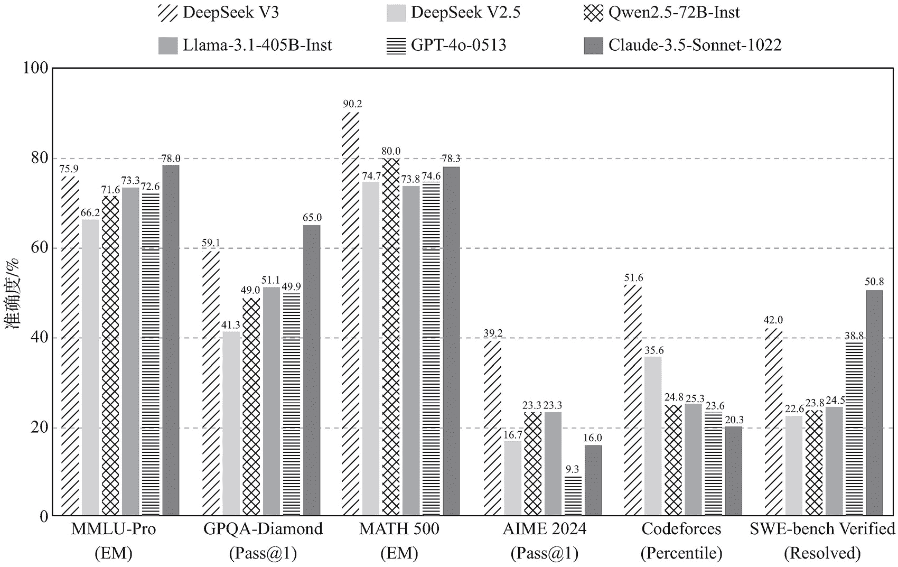

从图 1-1 可知，DeepSeek V3 在所有开源模型中取得了最好的成绩，且与部分闭源模型相比也是各有千秋。各个基准测试的具体介绍如下。

●**MMLU-Pro：**增强版多任务语言理解评测基准，通过增加选项数量和题目复杂度来测试大模型在专业领域的深度理解能力。

●**GPQA-Diamond：**高难度跨学科科学问答数据集，包含生物学、物理学等领域的博士级问题，需要多步推理，专家准确率仅 65%～74%。该测试集可用于评估模型的高阶科学推理能力。

●**MATH** **500：**OpenAI 精选的 500 道高难度数学题，涵盖代数、数论等领域，用于严格测试模型的数学推理和复杂问题解决能力。

●**AIME** **2024：**美国数学邀请赛，包含 15 道高难度数学题（如微分方程、组合数学），作为评估大模型数学能力的权威竞赛基准，可用于测试多步逻辑推理能力。

●**Codeforces：**全球知名算法竞赛平台，通过实时编程比赛来评估代码生成和算法设计能力，采用积分制反映选手实战水平。

●**SWE-bench** **Verified：**OpenAI 于 2024 年 8 月推出的改进版软件工程评估基准，旨在更精准地衡量大模型解决现实世界软件问题的能力。

DeepSeek R1 冲破了以 OpenAI 公司为代表的世界领先人工智能公司对中国人工智能的封锁，通过自研技术追赶 OpenAI 公司的先进推理模型 OpenAI-o1-1217。DeepSeek R1 及其对标模型的基准测试性能如图 1-2 所示。**[图][1][-][2]** **[D][e][e][p][S][e][e][k]** **[R][1][及][其][对][标][模][型][的][基][准][测][试][性][能]**

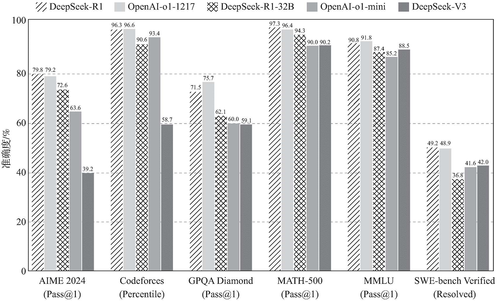

由于 DeepSeek R1 属于语言推理模型，因此对比的模型统一变成了语言推理模型。这一类模型更加擅长处理复杂的推理任务，但在普通任务上可能存在输出过长、思考过于复杂等问题。从图 1-2 可以看出，DeepSeek R1 在各个基准测试中都已达到或者接近 SOTA（State Of The Art,目前最先进）的水平。

**1.2.3** **成本显著降低**

通过图 1-1 的 DeepSeek V3 及其对标模型的基准测试可以知道，DeepSeek V3 已经在性能上全面超越 Llama-3.1-405B-Inst，接下来具体介绍它们的训练以及推理部署成本。

**1.训练成本**

Llama-3.1-405B-Inst 的训练使用了超过 1.6 万个英伟达 H100 GPU（这些 GPU 是目前最先进的计算硬件之一），消耗了约 3930 万 GPU 小时，其中 405B 模型占用了 3084 万 GPU 小时。

DeepSeek V3 的训练使用的是性能相对较弱的英伟达 H800 GPU，且全训练仅需 278.8 万 GPU 小时。此外，DeepSeek V3 训练过程非常稳定。在整个训练过程中，没有遇到任何不可恢复的损失峰值或进行任何回滚。

DeepSeek V3 用成果证明了训练大模型并不需要如此多的顶级显卡，用更少或者更低端的显卡一样可以打造世界一流的大模型。这也侧面影响了大模型公司以及芯片公司的估值。

**2.推理部署成本**

（1）计算量

由于部署方式的不同，我们很难具体评价推理成本的影响。但 Llama-3.1-405B-Inst 作为密集模型，在推理时所有参数（共 4050 亿个参数）被激活。而 DeepSeek V3 作为 MoE 模型，推理时仅激活 370 亿个参数。在 Transformer 架构中，大部分算子与参数量呈 1 次方乃至 2 次方关系。因此在相同输入下，DeepSeek V3 的推理计算量在 Llama-3.1-405B-Inst 的 1/10 左右。

（2）一次性部署成本

虽然 DeepSeek V3 作为 607B 的 MoE 模型，在推理时激活参数量较低，但是在加载它时仍然需要将全部参数加载到设备的 HBM（高带宽内存）中。接下来以 H800 GPU 为例，计算加载它最低需要的机器与显存。

单卡 H800 GPU 的 HBM 为 80GB，若推理时以 BF16 精度进行 DeepSeek V3 模型加载，需要的内存为

607×10⁹×2B=1.214×10¹²B=1.214TB

DeepSeek V3 模型加载需要的卡数为

下面计算 Llama-3.1-405B-Inst 的一次性部署成本（以 BF16 精度为例）。

Llama-3.1-405B-Inst 模型加载需要的内存为

405×10⁹×2B=0.91×10¹²B=0.91TB

Llama-3.1-405B-Inst 模型加载需要的卡数为

以上估算仅考虑模型加载所需卡数和计算量，实际部署需要考虑 KV-cache、分布式推理、内存碎片、PD 分离等因素。值得注意的是，MoE 模型的分发和聚合均属于 All-to-all 通信，在推理过程中通信量是非常大的瓶颈，会拉低推理速度。因此，对于 MoE 模型的分布式推理来说，合理地将计算和通信重叠可极大地缓解通信量导致的通信墙问题，详情可见第八章的 Dualpipe 流水线并行。

**1.2.4** **算法创新**

DeepSeek 是中国底层创新做得最好的大模型公司之一，DeepSeek 在大模型算法方面的创新如下。

**1.MLA**

Transformer 最原始的多头注意力（Multi-Head Attention，MHA）机制由于在推理时的 KV-cache 而需要占用大量的内存且计算量大，导致模型部署困难、推理速度下降、可用上下文降低。

为了解决计算复杂度和 KV-cache 占用高等问题，分组查询注意力（Grouped Query Attention，GQA）在 MHA 的基础上发展而来。它的核心思想是多个 K_head 或者 V_head 共用一个投影矩阵，这样既减少了计算量，也减少了推理时的内存占用量。而且在模型参数量达到一定级别后，使用 GQA 可以达到和使用 MHA 基本一致的性能。

虽然使用 GQA 减少了推理时的内存占用和计算量，但是参数量的下降导致了一定的低秩性，从而使得表达空间下降，影响语言模型能力。为了进一步减少内存占用且保证语言模型的效果，DeepSeek V2 采用了多头潜在注意力（Multi-Head Latent Attention，MLA）机制，极大地减少了推理时的内存占用，提升了推理速度并且保证了模型的表达能力不退化。MLA 的技术细节将在第六章进行讲解。

**2.MoE**

MoE 是一种神经网络架构，核心思想是将模型分成多个专家子网络，每个输入仅激活部分专家子网络进行计算，从而提升模型效率。

MoE 并非 DeepSeek 原创，但却是由 DeepSeek 发扬光大的，DeepSeek 一直坚定地拥抱 MoE 路线。在 DeepSeek 之前，业界有名的大模型公司大多并没有采用 MoE 架构。

**3.GRPO**

在 ChatGPT 的指导性论文“Training language models to follow instructions with human feedback”中，使用了 PPO（Proximal Policy Optimization，近端策略优化）算法对模型进行基于人类反馈的强化学习（Reinforcement Learning from Human Feedback，RLHF）。PPO 算法后来演变成了业界的默认对齐算法。但是，作为在线-离线算法，PPO 存在一些问题。

●**占用内存大：**同时需要策略模型、参考模型、评估家模型、奖励模型 4 个模型，其中策略模型和评估家模型在 PPO 算法中更新，因此运行该算法需要足够的内存加载 4 个模型的参数，其中两个模型需要更新，因此需要更高的显存。

●**Reward** **Hack：**理想情况下的奖励（reward）由环境反馈，然而 RLHF 中策略模型的奖励由人类反馈，且难以被训练后的奖励模型所泛化，因此存在奖励模型与人类价值观不一致的情况。

●**评估家模型估计状态值不准确：**语言模型的状态空间为*V**^L*,其中*V*为词表数量，一般为 5 万～15 万不等，*L*为最大生成 Token 数，一般为 12.8 万左右。因此，状态空间极大，状态值便难以被评估家模型拟合，导致 PPO 算法效果下降。

DeepSeek 提出的 GRPO（Group Relative Policy Optimization，群体相对策略优化）以及强化学习的训练方式很好地解决以上 3 个问题。GRPO 首先修改了 PPO 中的优势函数计算，不再需要评估家模型，并且对于有明确答案的问题（如数学、代码、逻辑等类型的问题）直接采用规则获得奖励（代替了奖励模型的训练），极大地避免了 Reward Hack。GRPO 算法的细节将在第三章详细讲解。

**4.直接进行强化学习**

大模型训练的标准流程是先进行监督微调（Supervised Fine Tuning，SFT），再进行基于人类反馈的强化学习。但是，DeepSeek Zero 提出了预训练后直接进行强化学习，获得了不错的长链条推理效果。是否 SFT 的训练已经不必要？对于这个问题众说纷纭，笔者还是认为 SFT 仍是一般语言模型的必要步骤，具体将在第十章展开介绍。

**5.基础设施工程技术**

相较于相同参数级别的 Llama-3.1-405B-Inst，DeepSeek V3 仅用了其 1/10 的训练成本就获得了更佳的性能，这不仅归功于 DeepSeek V3 更加节省计算量的模型架构，还与配套的基础设施工程技术有关，具体如下。

●**更细粒度的量化方式：**量化粒度越细，将获得更小的精度下降。

●**FP8 的混合精度训练：**DeepSeek 是为数不多的能在 FP8 精度下进行大规模训练的模型，显著降低了计算量。

●**Dualpipe：**通过双向的流水线并行策略，重叠不同批次的计算与通信，从而提高 MCU 的利用率。

●**低精度通信：**MoE 架构会带来很高的通信量，降低通信时向量的精度对降低通信量尤为重要。

●**分块计算：**为了避免 FP8 在 Tensor Core 中的精度下溢问题，DeepSeek 提出了矩阵分块计算并且在 CUDA Core 中做累加的方式。

●**专家调度策略：**为了充分利用通信、算力，DeepSeek 深度设计了负载均衡和通信专家分组等策略。

### **1.3** **DeepSeek 系列模型与其他大模型的介绍**

**1.3.1** **DeepSeek 系列模型**

**1.DeepSeek** **V3**

目前，DeepSeek V3 是由 DeepSeek 团队开发的最新一代语言模型，在多项基准测试中展现出卓越的性能，特别是在处理复杂任务和长文本方面。它凭借独特的技术优势和广泛的应用潜力，确立了自己在国内乃至国际 AI 领域的地位，成为继 Kimi 和其他领先模型之后又一重要的里程碑。此外，DeepSeek V3 的开源特性使其成为开发者社区中不可或缺的一部分。

DeepSeek V3 的特点如下。

●**增强的推理与理解能力：**DeepSeek V3 在自然语言处理任务上展现出更强的理解和推理能力，适用于复杂问题解决、因果分析等需要高度智能的任务处理。

●**上下文处理能力：**支持长上下文处理，能够有效理解长达 12.8 万个 Token 长度的文本内容，适合处理复杂的文档或长篇文章。

●**强化学习优化：**利用强化学习技术对模型进行训练，提升了模型在面对多样化任务时的适应性和灵活性，特别是在多步骤推理任务中表现突出。

●**数据整合与准确性：**DeepSeek V3 不仅限于文本信息处理，还能有效地整合不同来源的数据，提供准确且信息丰富的回答，并能清晰地标记数据来源，便于用户验证信息的真实性。

**2.DeepSeek** **R1**

DeepSeek R1 是由 DeepSeek 团队开发的高级语言模型，专注于提升逻辑推理和问题解决能力，以强大的处理能力和推理技术在业界崭露头角。

DeepSeek R1 的特点如下。

●**推理能力：**在数学、代码生成以及自然语言推理等任务上表现卓越，性能可与 OpenAI 的 GPT 系列及 Kimi 等模型相媲美。

●**训练方法：**采用预训练后直接进行强化学习训练的方法，简化了传统的“预训练→有监督微调→强化学习”的流程，提高了训练效率。

●**参数规模：**拥有 671 亿个参数，支持 12.8 万个 Token 的上下文长度，提升了对复杂文本的处理能力。

●**多源信息整合：**虽然不特别强调多模态支持，但 DeepSeek R1 能够结合多种来源的数据，提供准确的回答，并标注数据来源，便于用户追溯信息。

**3.DeepSeek** **V2**

DeepSeek V2 是由 DeepSeek 团队开发的基于 MoE 架构的语言模型。该模型以其训练经济性和推理高效性著称，是 DeepSeek 系列模型的一大进步。

DeepSeek V2 的特点如下。

●**高效的 MoE 架构：**采用 MoE 架构，允许在处理不同类型任务时动态选择最合适的子模型，从而提高资源利用效率。DeepSeek V2 与前一代相比，减少了 42.5%的训练成本。

●**推理性能提升：**通过优化注意力机制和前馈网络架构，DeepSeek V2 实现了推理速度的显著提升，比 DeepSeek 67B 快 5.76 倍，并支持通过 vLLM 解决方案进一步优化 GPU 的推理性能。

●**全面的语言支持：**DeepSeek V2 在多种语言和任务类型上表现优秀，尤其在中文处理方面取得了显著进展，比如专门针对中文对话生成的 DeepSeek V2-Chat 模型。

●**联网搜索：**DeepSeek V2.5-1210 加入了联网搜索功能，可以深入分析海量网页信息，提供更全面、准确的答案，并自动提取关键词进行并行搜索。

**1.3.2** **国外知名大模型**

**1.OpenAI 的 GPT 系列**

（1）简介

截至本书写作时，GPT-4 是 OpenAI 推出的最新多模态预训练大模型，它以强大的语言理解和生成能力而闻名，支持文本生成、内容理解等多种应用，具有处理长上下文的能力，并且在自然语言处理任务中表现出色。

GPT 系列模型凭借卓越的技术架构和持续创新，在多项基准测试中保持领先地位，成为当前最具影响力的大语言模型之一。GPT-4o 在 LMSYS 聊天机器人竞技场以 1310 分高居榜首，并在 Reka Vibe-Eval 多模态测试中超越 Gemini Pro 1.5 近 3 个百分点。该模型在针里寻针测试中达到 80%～100%的正确率，配合原生多模态能力，在编程、数学、创意写作等领域持续刷新记录。GPT 系列采用的预训练-微调策略和 Transformer 架构，使其在语言理解、文本生成等核心自然语言处理任务上保持明显优势，进一步巩固了行业领先地位。

（2）应用场景

●**教育：**个性化学习建议和资源推荐。

●**医疗健康：**协助医生进行疾病诊断，提供治疗方案。

●**客户服务：**实时处理客户咨询，提高客户满意度。

●**娱乐产业：**游戏开发中的虚拟角色设计。

**2.Anthropic 的 Claude 系列**

（1）简介

Claude 系列包括 3 个版本——Haiku、Sonnet 和 Opus，分别针对智能、速度和成本需求设计。Claude 系列模型擅长处理结构化和非结构化数据（包括图像、图表等），具有接近人类水平的自然语言处理能力。

Claude 系列（如 Claude 3.5 Sonnet）模型与 GPT 系列（如 GPT-4o）模型在多个领域展现出强劲的竞争态势。从技术架构来看，Claude 系列模型基于 Transformer 架构并强化了安全设计，支持 20 万个 Token 的长文本处理，在代码生成、法律分析等结构化任务上表现突出。而 GPT-4o 凭借原生多模态能力（支持文本、图像、音频处理）在创意内容和跨模态交互方面更具优势。在性能表现上，Claude 3.5 Sonnet 在编码任务（如代码修复、API 生成）的准确率较前代提升 68%，运行速度翻倍，其创新的 Artifacts 功能支持实时代码预览与协作。GPT-4o 在多语言支持（特别是中文互联网语境）和复杂推理方面表现更佳。在应用场景方面，Claude 系列模型更适用于高合规性要求的医疗、金融领域的长文档任务处理，GPT-4o 更适用于营销创意、多模态内容生成等场景。两大系列模型各有所长，共同推动着 AI 技术的发展，形成了互补的生态系统。

（2）应用场景

●**教育：**作为智能助教，提供学习建议。

●**医疗健康：**辅助疾病诊断，制定个性化的治疗方案。

●**金融服务：**市场分析和预测，管理风险。

**3.谷歌的 PaLM 系列**

（1）技术特点

PaLM 系列模型支持处理多种信息类型，包括文本、代码、音频、图像和视频。PaLM 系列模型具有优秀的自然语言处理能力和计算机视觉功能。

PaLM 系列模型是基于谷歌提出的 Pathways 机器学习系统搭建的大语言模型，初始版本于 2022 年 4 月发布，2023 年 3 月公开 API，包含 8B、62B、540B 等不同参数量版本及 PaLM 2、PaLM-E 等改进版本，具有超大规模参数、多语言支持、零样本和少样本学习等特点。该系列模型采用 Transformer 架构、MoE 模型等核心技术，可用于文本生成、编程、语言翻译、教育学习、医疗、金融等多领域，能处理从简单文本生成到复杂推理等各类任务，展现了谷歌追求通用人工智能的愿景。

（2）应用场景

谷歌 PaLM 系列模型凭借强大的多语言理解、逻辑推理和代码生成能力，已在多个行业实现规模化应用落地。

●**企业办公：**PaLM 2 深度集成 Google Workspace，提供智能邮件撰写、PPT 自动生成、表格数据分析等功能，大幅提升了工作效率。

●**医疗健康：**Med-PaLM 2 已通过美国医疗执照考试，可辅助医生解读 X 光片并生成诊断报告，目前正通过谷歌云平台向医疗机构试点开放。

●**网络安全：**Sec-PaLM 能够快速识别恶意脚本行为，为企业提供实时威胁分析服务。它的轻量化版本 Gecko 支持移动端离线运行，特别适合隐私要求高的场景使用。

PaLM 系列模型的多模态能力已赋能 Bard 聊天机器人实现跨模态交互体验。目前，全球已有超过 25 款谷歌产品接入 PaLM 2，覆盖搜索、教育、开发工具等多个业务生态，并通过开放 API 支持开发者定制行业解决方案。

**4.Meta 的 Llama 系列**

（1）简介

Llama（Large Language Model Meta AI）系列模型由 Meta 开发，具有优秀的自然语言处理能力，特别适合需要高效处理大量数据的场景。该系列模型基于 Transformer 架构，采用 Decoder-only 结构，运用预归一化、SwiGLU 激活函数、旋转位置编码等技术，提高了训练的稳定性和性能。该系列模型通过分组查询注意力机制等降低计算量和内存占用，实现了在相对较少的计算资源上达到较高的性能，优化了训练过程，提高了数据利用效率，在低资源环境下表现出色。

Llama 模型架构有多个变体，如 Llama-7B、Llama-13B、Llama-30B 等，它们规模各不相同以满足不同计算资源需求。该系列模型使用大量数据进行预训练，训练数据来源广泛，包含网页文本、百科知识、代码、学术论文等，且注重数据质量，通过严格的数据过滤保证数据多样性和准确性，还支持数据分布均衡处理，能学习到丰富多样的语言知识和语义信息，以提升语言理解和生成能力。

此外，Llama 系列模型支持多语言处理，能理解和生成多种语言文本，在多种自然语言处理任务中表现出高准确性，还具备多模态能力（部分版本），不局限于文本输入，还支持图像等多模态数据处理。在训练方法上，该系列模型采用了 AdamW 优化器和余弦学习率调度器，使用因果多头注意力机制来减少内存使用、缩短运行时间，通过梯度检查点技术减少向后传播期间的内存开销，并采用分布式训练和混合精度训练来加速训练过程。

Llama 系列模型凭借开源策略和技术创新，已成为全球 AI 领域最具影响力的开源模型之一。截至 2025 年 4 月，Llama 系列模型下载量突破 10 亿次，不仅深度集成至 Meta 旗下的 Facebook、Instagram、WhatsApp 等核心产品，更获得 Spotify、AT&T 等全球知名企业的广泛应用。

Llama 4 采用 MoE 架构，其中 Scout 模型以 1000 万 Token 的上下文窗口刷新开源模型纪录，Maverick 版本在多模态任务上的性能超越了 GPT-4o。Behemoth 模型达到 2 万亿参数规模，有望冲击行业性能巅峰。

在 LMSYS 评测中，Llama 4 Maverick 以 1417 分位列第二，仅次于闭源的 Gemini 2.5 Pro。面对 DeepSeek 等竞争对手的挑战，Meta 通过 800 亿美元的 AI 战略投资和 LlamaCon 开发者大会生态建设，持续巩固其在开源大模型领域的领先地位。

目前，Llama 系列模型已形成完整的技术矩阵，覆盖从边缘计算到企业级应用的全场景需求，其中 Gecko 轻量化版本支持移动端部署，Behemoth 模型则面向高性能计算场景。该系列模型已成功应用于全球超过 25 款主流产品，展现出强大的商业潜力。

（2）应用场景

Llama 系列模型凭借优秀的自然语言处理能力，在多个领域展现出广泛应用价值。

●**自然语言处理：**该系列模型能精准完成文本分类、情感分析、摘要生成等任务，显著提升内容处理效率。

●**智能客服：**电商和金融机构通过部署该模型，实现了快速响应和个性化服务。

●**内容创作：**该系列模型为创作者提供智能辅助服务，有效提高了写作效率。

●**医疗：**该系列模型支持病历分析和辅助诊断，在药物研发中能加速化合物筛选。

●**金融：**该系列模型可实现风险评估和反洗钱监测，提升业务安全性。

●**教育：**该系列模型可提供个性化学习辅导服务，实现智能批改和自适应教学，打造差异化学习体验。

**1.3.3** **国内知名大模型**

**1.MiniCPM 系列**

MiniCPM 是面壁智能推出的端侧大模型系列，主打高效、低能耗，适合在资源受限的设备上运行，被称为“性能小钢炮”，特别是多模态能力极其出色，跨参数量级超越一众大模型。

（1）技术特点

●**端侧部署：**MiniCPM 能够在智能手机、平板电脑等终端设备上本地运行，支持多模态（文本、图像、音频、视频）任务处理。

●**高效性能：**通过模型蒸馏、流式处理等技术，MiniCPM 在低参数规模（如 2B、8B）下实现了接近 GPT-4o 的性能，尤其在视觉理解和语音任务上表现出色。

●**低成本与低延迟：**MiniCPM 通过 CPU、NPU 推理降低了成本，适用于网络条件不佳或需要全天候响应的场景。

（2）应用场景

●**智能终端：**在智能手机、平板电脑等设备上部署，实现 AI 功能本地化，如语音助手、实时翻译、图像识别等。

●**自动驾驶与安防：**支持实时处理视频流，捕捉动态信息，适用于自动驾驶、安保监控等场景。

●**多模态交互：**支持情感控制、语音克隆、角色扮演等高级功能，能够提升用户体验。

（3）行业地位

MiniCPM 在 OpenCompass 等评测中表现优异，尤其在部分端侧多模态任务上超越了部分云端大模型（如 GPT-4o、Claude 3.5 Sonnet），成为端侧 AI 的标杆。

**2.通义千问（Qwen）**

通义千问是由阿里云开发的大规模预训练语言模型，以强大的中文理解能力和多模态支持著称，广泛应用于商业、教育、科研等领域。

（1）技术特点

●**中文优化：**通义千问在中文语料上进行了深度优化，能够更好地理解中文语法、语义和文化背景，显著提升了中文任务处理的表现。

●**多模态支持：**支持文本、图像、音频等多种模态的联合推理，能够处理复杂的多模态任务，如图文生成、语音识别等。

●**高效推理：**通过模型压缩和分布式计算优化，在保证高性能的同时降低了推理成本，适合大规模商业化部署。

●**长上下文处理：**通过扩展上下文窗口和优化记忆机制，能够有效处理长文本任务，如文档摘要、长对话等。

（2）应用场景

●**智能客服：**支持高效的语音识别和自然语言处理，可提升客户服务体验，适用于电商、金融等领域。

●**内容创作：**支持高质量的文章生成、广告文案创作和视频脚本编写，适用于媒体、广告等领域。

●**教育辅助：**通过强大的语义理解和知识推理能力，帮助学生解答问题，辅助教师备课，提升教学质量。

●**科研支持：**帮助研究人员进行文献分析、数据整理和知识推理，适用于科研领域的知识挖掘与创新。

（3）行业地位

通义千问在中文大模型领域具有重要地位，强大的中文处理能力和多模态支持使其在商业化和科研应用中表现优异。在多项中文自然语言处理基准测试中，通义千问均取得了优异成绩，成为国产大模型的代表之一。

**3.Kimi 大模型**

Kimi 是由月之暗面（Moonshot AI）开发的国产大模型，以长文本处理能力和多模态支持著称，被誉为“国产 AI 之光”。

（1）技术特点

●**长文本处理：**支持高达 200 万字的上下文解析，在文本处理方面远超大多数模型，特别适合处理复杂文档和长篇文章。

●**多模态支持：**支持文本、图像、文件（如 PDF、Word）的解析与整合，能够结合多源信息提供综合回答。

●**强化学习与长上下文扩展：**通过扩展上下文窗口至 12.8 万 Token，结合强化学习优化策略，显著提升了推理能力和任务适应性。

●**搜索与信息整合：**搜索功能强大，能够整合多源数据（如搜索引擎、网络社群），并提供逻辑清晰的答案，标注来源信息，方便用户追溯。

（2）应用场景

●**教育与研究：**帮助学生理解复杂概念、辅助研究人员进行文献解读与数据分析。

●**商务辅助：**支持商业计划制订、市场分析、代码解析等任务处理。

●**日常使用：**提供旅行规划、语言翻译、生活建议等服务。

（3）行业地位

Kimi 大模型在多项基准测试中表现优异，尤其在长文本处理和复杂推理任务上，与 OpenAI 的 GPT 系列和 DeepSeek R1 等模型性能接近，是国产大模型的代表之一。

**4.MiniMax 大模型**

MiniMax 大模型以高效推理和低成本著称，广泛应用于多个行业。

（1）技术特点

●**线性注意力：**使用线性注意力机制降低了长文本下的计算复杂度。

●**高效推理：**通过模型压缩和优化技术，MiniMax 在低参数规模下实现了高性能推理，显著降低了计算资源需求。

●**多模态支持：**支持文本、图像、音频等多种模态的联合推理，适用于复杂任务处理。

●**云端协同：**通过云端协同计算，MiniMax 能够在资源受限的设备上实现高效推理，同时能利用云端算力处理复杂任务。

（2）应用场景

●**智能客服：**提供高效的语音识别与自然语言处理，提升客户服务体验。

●**内容生成：**支持文本、图像、视频内容的自动生成与编辑，适用于媒体、广告等行业。

●**工业自动化：**通过多模态推理能力，支持工业设备的智能监控与故障诊断。

（3）行业地位

MiniMax 在高效 AI 模型领域具有重要地位，其技术路线与面壁智能的 MiniCPM 类似，均致力于在低资源环境下实现高性能推理。

**5.GLM**

GLM（General Language Model）是由智谱公司开发的大规模预训练语言模型，以通用性和高效性著称，广泛应用于自然语言处理领域。

（1）技术特点

●**通用性：**GLM 采用自回归和自编码结合的混合架构，能够同时支持生成和理解任务处理，显著提升了模型的通用性。

●**高效训练：**通过创新的稀疏注意力机制和分布式训练优化，GLM 在训练效率和资源利用率上表现优异，降低了训练成本。

●**多任务学习：**GLM 支持多任务联合训练，能够同时处理文本生成、分类、翻译等多种任务，提升了泛化能力。

●**长文本处理：**GLM 通过扩展上下文窗口和优化记忆机制，能够有效处理长文本任务。

（2）应用场景

●**文本生成：**支持高质量的文章创作、故事生成和代码编写，适用于内容创作领域。

●**智能问答：**通过强大的语义理解能力，能够提供精准的问答服务，适用于教育、客服等场景。

●**机器翻译：**支持多语言翻译任务处理，能够实现高质量的语言转换，适用于跨语言交流场景。

●**科研辅助：**能够帮助研究人员进行文献分析、数据整理和知识推理，提升科研效率。

（3）行业地位

GLM 在自然语言处理领域具有重要地位，其通用架构和高效训练技术为后续大模型的发展提供了重要参考。GLM 在多项基准测试中表现优异，尤其在中文任务上展现出强大的性能，成为国产大模型的代表之一。

## **第二章 经典 Transformer 架构**

Transformer 自 2017 年问世，因具有可拓展、并行训练快、无梯度消失等优点，已成为大语言模型的主流底层架构。本章主要介绍 Transformer 的底层技术，从 Transformer 的底层原理结合源码进行讲解。

### **2.1 Transformer 架构的特点**

Transformer 模型最早由 Vaswani 等人在 2017 年的论文“Attention is All You Need”中提出，旨在解决序列建模问题，特别是在自然语言处理领域。它的核心思想是通过完全依赖于注意力机制，特别是自注意力机制，处理输入数据的每一个元素与序列中其他所有元素之间的关系。这使得 Transformer 可以并行计算，大大提高了训练效率和模型性能。

在 Transformer 之前，自然语言处理主要使用 RNN 以及 LSTM、GRU 等 RNN 的变体网络。这些网络与 Transformer 的简单对比分析如下。

**1.并行化能力**

●**RNN/LSTM/GRU：**由于它们的序列依赖性，每一步的计算都依赖于前一步的输出，因此难以并行化处理。这造成训练速度较慢，尤其是在处理长序列时。

●**Transformer：**通过自注意力机制，Transformer 可以并行处理整个序列，极大地提高了训练效率。

**2.长程依赖**

●**RNN：**在处理长序列时，RNN 容易出现梯度消失或梯度爆炸问题，难以捕捉长程依赖关系。

●**LSTM/GRU：**虽然 LSTM 和 GRU 通过门控机制缓解了梯度消失问题，但在处理非常长的序列时，仍然可能难以有效捕捉长程依赖。

●**Transformer：**自注意力机制能够直接建模序列中任意两个位置的关系，因此能够更好地处理长程依赖。

**3.计算复杂度**

●**RNN/LSTM/GRU：**它们的计算复杂度是*O*（*T***D*²），其中*T*是序列长度，*D*是隐藏层维度。虽然计算复杂度相对较低，但由于无法并行化，实际训练时间较长。

●**Transformer：**计算复杂度是*O*（*T*²**D*），其中*T*是序列长度，*D*是模型维度。虽然计算复杂度较高，但由于并行化能力强，实际训练速度通常更快。

**4.模型表达能力**

●**RNN/LSTM/GRU：**它们的表达能力受限于隐藏状态的维度，且难以直接建模序列中任意两个位置的关系。

●**Transformer：**通过自注意力机制，Transformer 能够直接建模序列中任意两个位置的关系，表达能力更强，尤其适合处理复杂的序列数据。

**5.内存占用**

●**RNN/LSTM/GRU：**由于需要存储每一步的隐藏状态，内存占用随着序列长度线性增加。

●**Transformer：**虽然自注意力机制的内存占用与序列长度的平方成正比，但由于并行化能力强，实际内存使用效率更高。

**6.对位置信息的处理**

●**RNN/LSTM/GRU：**它们天然具有捕捉位置信息的能力，因为是按顺序处理序列的。

●**Transformer：**需要额外引入位置编码来捕捉序列中的位置信息，否则模型无法区分序列中不同位置的元素。

**7.训练稳定性**

●**RNN/LSTM/GRU：**由于梯度消失或爆炸问题，训练过程可能不稳定，尤其是在处理长序列时。

●**Transformer：**通过层归一化和残差连接等机制，Transformer 的训练过程通常更加稳定。

### **2.2 Transformer 的基本原理**

目前，Transformer 是大语言模型主流架构，因此掌握 Transformer 架构对进一步深入学习大语言模型至关重要。图 2-1 是 Transformer 的基本架构。Transformer 可以分为 Encoder 和 Decoder 两个基本部分。简单来说，Encoder 可以理解为编码器，即将输入的语言或者问题编码成向量，Decoder 可以理解为生成器或者解码器，将 Encoder 编码出的向量生成文字输出。**[图][2][-][1][T][r][a][n][s][f][o][r][m][e][r][的][基][本][架][构]**

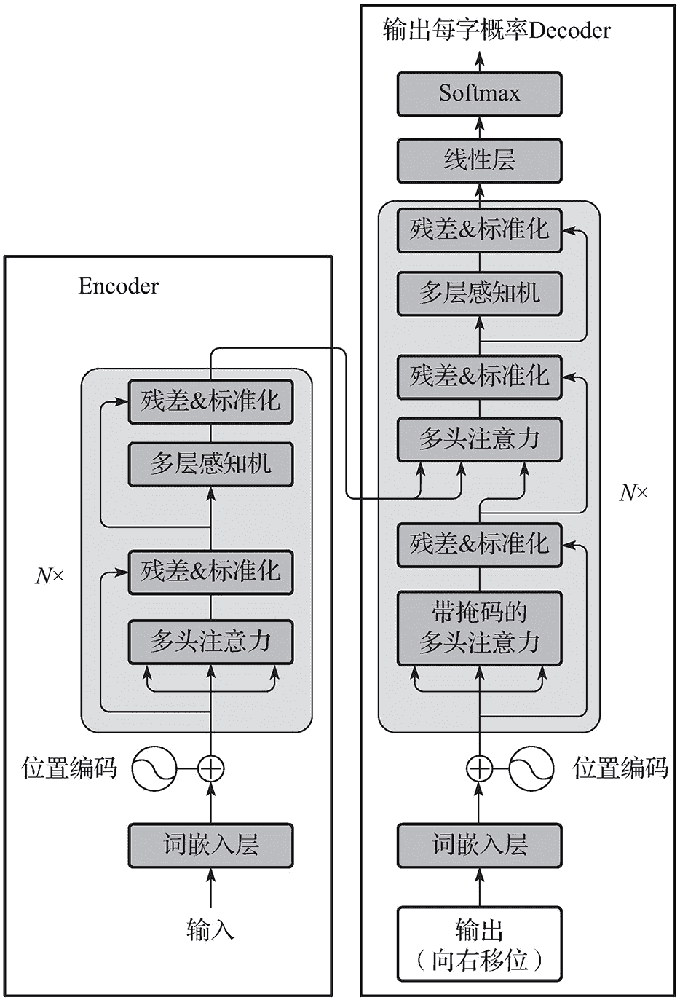

Encoder 和 Decoder 虽然属于 Transformer 的不同结构部分，但是由相同的基本单元组成，主要包括分词器（Tokenizer）、词嵌入（Embedding）层、位置编码模块、自注意力模块、多头注意力模块、前馈神经网络模块、残差连接和层归一化模块。下面将对以上模块进行详细介绍。

**2.2.1 分词器**

对于大语言模型来说，输入是文本序列，但是真正进入模型之前需要对文本序列进行分词，分词后的单元被称为 Token，这个过程示例如下：

1 输入文本序列：我爱人工智能！

2 输出 Token：我 爱 人工智能 ！

如上例所示，Token 并不一定是一个词或字，有些读者会想上例中“人工智能”一词的切分是否可以分成“人工”和“智能”呢？答案是可能的，但取决于词表的优先级。对于同一个分词器来说，相同序列输入下，输出是一定的。问题又来了，中英文那么多如何确定词表呢？照抄新华字典、词典么？可以看第 6.3 节分词算法。

**2.2.2 词嵌入层**

分词之后得到的一系列 Token 仍然是文本形式，但是大语言模型本质上需要的是矩阵运算，因此如何将 Token 变成数值矩阵进行下一步的计算也是一个非常重要的问题。

词嵌入（Embedding）层很好地解决了这一个问题。Embedding 层可以理解为一个查询表，每个词对应其中一个*d*[model]维度的向量。下面为一个词嵌入层示例。

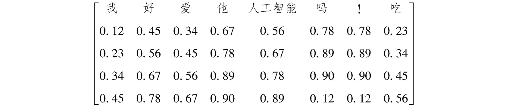

将分词后的 Token 输入这个查询表，并且根据每一个 Token 查表获得该 Token 的列矩阵，比如输入“我、爱、人工智能、！”，经 Embedding 层后输出的向量为

注意：分词器输入到 Embedding 层的并不是 Token 而是 Token_ID，关于 Token_ID 可以理解为词表中该 Token 的顺序。比如 Embedding 的矩阵变成以下矩阵，输入的“我、爱、人工智能、！”这几个 Token 变成 0，2，4，6 这几个 Token_ID：

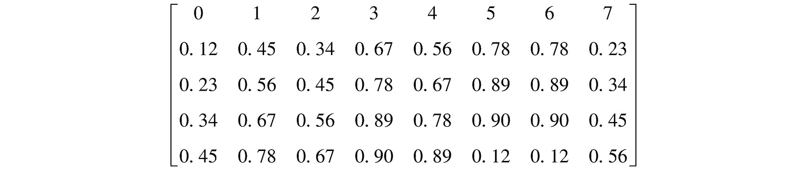

输出矩阵保持不变：

**2.2.3 位置编码模块**

由于 Transformer 架构中没有显式的序列顺序信息处理机制，它依赖于自注意力机制来处理输入数据，这种方式本质上是置换不变的（即不考虑元素之间的顺序关系）。这意味着，如果不额外添加位置信息，Transformer 架构将无法区分相同集合的不同排列顺序，因为它的自注意力机制仅基于输入元素的内容而忽略了它们的位置关系。因此，为了使模型能够理解并利用序列中元素的相对或绝对位置信息，必须通过位置编码为输入序列添加位置相关的特征。

Transformer 相关论文中采用的位置编码计算方式如下：

在输入的注意力层之前，Embedding 层获得的向量可以和以上位置编码相加，从而使词向量获得位置信息：

***P***[OUT]=**PE**+**Em**

其中，***P***[OUT]代表加上了位置信息的词向量，**PE**为 Transformer 中的位置编码,**Em**表示 Embedding 层输出的词向量矩阵。

具体来说，位置编码的作用在于为序列中的每个元素（如句子中的每个单词）附加一个表示其在序列中位置的信息。这样，即使输入元素本身可能相同，模型也能够根据其位置编码识别出它们在序列中的不同位置，进而捕捉到序列内部的顺序依赖关系。例如，在自然语言处理任务中，正确理解“猫坐在垫子上”和“垫子上坐着猫”这两个句子的区别就依赖于对词语顺序的理解，而这正是位置编码所赋予模型的能力。通过结合内容嵌入和位置编码，Transformer 可以有效地处理序列数据，并学习到序列元素间的复杂依赖关系。这一机制对于提高模型在各种序列处理任务（包括但不限于机器翻译、文本生成和语音识别等）中的表现至关重要。

以下是 Transformer 中位置编码的代码实现：

Python

import torch

import torch.nn as nn

import math

class PositionalEncoding（nn.Module）:

  def __init__（self, embed_dim, max_seq_len）:

    super（PositionalEncoding, self）.__init__（）

    #初始化位置编码矩阵，形式为[max_seq_len, embed_dim]，初始值为 0

    self.encoding = torch.zeros（max_seq_len, embed_dim） #形式为[max_seq_len, embed_dim]

    #创建一个表示位置的向量，大小为（max_seq_len, 1）

    position = torch.arange（0, max_seq_len, dtype=torch.float）.unsqueeze（1）                #形式为[max_seq_len, 1]

    #计算 div_term，用于生成正弦和余弦函数的周期性变化，大小为（embed_dim // 2）

    div_term = torch.exp（torch.arange（0, embed_dim, 2）.float（） * （-math.log （10000.0） / embed_dim）） #形式为[embed_dim // 2,]

    #对偶数索引的位置应用正弦函数，奇数索引的位置应用余弦函数

    #这里 position 与 div_term 相乘的结果会被广播，以匹配 encoding 矩阵的尺寸

    self.encoding[:, 0::2] = torch.sin（position * div_term）

      #偶数列填充为正弦值，形式为[max_seq_len, embed_dim // 2]

    self.encoding[:, 1::2] = torch.cos（position * div_term）

      #奇数列填充为余弦值，形式为[max_seq_len, embed_dim // 2]

    #将位置编码扩展到（batch_size, max_seq_len, embed_dim），但实际使用时只会选取相应序列长度的部分

    self.encoding = self.encoding.unsqueeze（0） #形式为[1, max_seq_len, embed_dim]

  def forward（self, x）:

    #x 是输入张量，形式通常是[batch_size, seq_len, embed_dim]

    #将位置编码加到输入张量上，并且使用 detach（）来确保位置编码不参与梯度计算

    return x + self.encoding[:, :x.size（1）].detach（）

  #输出形式为[batch_size, seq_len, embed_dim]

代码解释如下。

（1）初始化阶段

●self.encoding 是一个形式为[max_seq_len, embed_dim]的零矩阵，用来存储不同位置的位置编码。

●position 是一个形式为[max_seq_len, 1]的向量，包含了从 0 开始的最大序列长度范围内的位置索引。

●div_term 是根据公式计算出的一个向量，其目的是调整正弦和余弦函数的频率，以确保位置编码具有不同的周期性，有助于模型学习相对位置信息。它的形式为[embed_dim // 2]。

（2）位置编码计算

正弦函数应用于偶数索引维度（即 0,2,4…），余弦函数应用于奇数索引维度（即 1,3,5…）。这使得每个位置都有一个独特的位置编码。

（3）前向传播

在 forward 方法中，给定输入张量***x***，其形式通常为（batch_size, seq_len, embed_dim）。通过将适当截取的位置编码（基于实际序列长度 seq_len）加到输入张量上来赋予模型对序列中元素顺序的理解能力。这里使用 detach（）来确保位置编码不参与梯度计算，因为它是一个固定的预定义值，不需要训练更新。最终输出形式保持不变，为[batch_size, seq_len, embed_dim]。

**2.2.4 自注意力模块**

自注意力模块是 Transformer 模型的核心组成部分，它使得 Transformer 能够在处理序列数据时，有效地捕捉序列中各个元素之间的依赖关系。通过自注意力模块，每个元素都能动态地与序列中的其他所有元素进行“交流”，从而计算出更加精确的表示。这种机制支持并行化计算，极大地提高了训练效率和模型性能。因此，自注意力不仅是 Transformer 架构的关键技术，也是其能够在多种自然语言处理任务中取得卓越表现的重要原因之一。

图 2-2 主要展示自注意力机制的基本原理，核心在于每个输入的 Token（*t*¹，*t*²，*t*³，*t*⁴）的注意力和哪些 Token 有关。比如可以明显看出***Q***¹将参与***K***¹，***K***²，***K***³，***K***⁴的计算。最终输出的 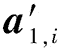是对所有的***a***[1,]*[i]*进行 Softmax 计算的结果。**[图][2][-][2][自][注][意][力][机][制][的][基][本][原][理]**

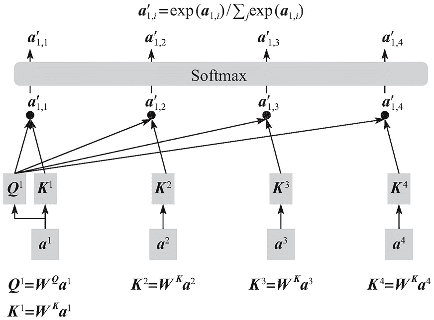

图 2-3 所示是自注意力机制整体架构。**[图][2][-][3][自][注][意][力][机][制][整][体][架][构]**

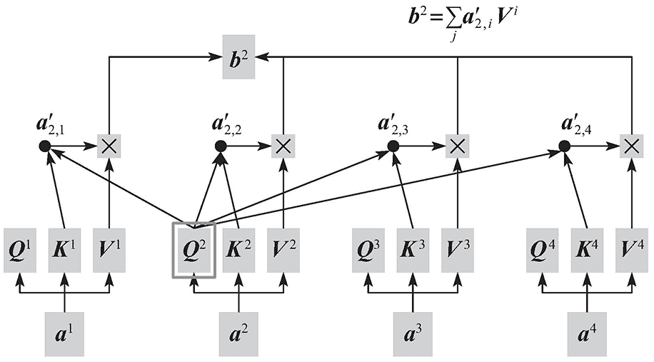

结合图 2-2 与图 2-3 可知，注意力机制的具体流程如下。

1）首先对输入文本序列进行分词处理，得到*t*¹,*t*²,*t*³,*t*⁴…*t**^i*（表示第 1，2，3，4…*i*个 Token）。

2）*t*¹,*t*²,*t*³,*t*⁴…*t**^i*输入 Embedding 层获得***a***¹,***a***²,***a***³,***a***⁴,…,***a****^i*。

3）图 2-2 和图 2-3 中***a***¹,***a***²,***a***³,***a***⁴,…,***a****^i*分别为文本序列*T*中第 1，2，3，4…*i*个 Token 的表示向量。

4）***Q****^i*,***K****^i*,***V****^i*分别代表***a****^i*分别经过***W******^Q***,***W******^K***,***W******^V***（上图未画出）投影获得的向量，即

***Q****^i*=***a****^i****W******^Q***

***K****^i*=***a****^i****W******^K***

***V****^i*=***a****^i****W******^V***

5）图 2-3 中的 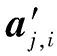代表第*j*个 Token 与第*i*个 Token 之间的注意力分数，具体计算方式见图 2-2：

注意：注意力分数不满足交换律，即

6）注意力机制的最终输出***b****^i*可以理解为*t**^i*与其他所有 Token 进行注意力交互后获得的最后输出向量，即

自注意力机制代码如下：

Python

import torch

import torch.nn as nn

import torch.nn.functional as F

class SelfAttention（nn.Module）:

  def __init__（self, embed_dim）:

    super（SelfAttention, self）.__init__（）

    self.embed_dim = embed_dim

    #定义线性变换层，用于生成 Query、Key 和 Value

    self.query = nn.Linear（embed_dim, embed_dim） #W[Query]用于生成 Query 向量

    self.key = nn.Linear（embed_dim, embed_dim）  #W[Key]用于生成 Key 向量

    self.value = nn.Linear（embed_dim, embed_dim） #W[Value]用于生成 Value 向量

  def forward（self, x, mask=None）:

    """

    x:输入序列 （batch_size, seq_len, embed_dim）

    mask:掩码 （batch_size, seq_len, seq_len）

    """

    batch_size, seq_len, embed_dim = x.shape

    #生成 Query、Key 和 Value

    Q = self.query（x） #Query 向量形式为[batch_size, seq_len, embed_dim]，用于计算注意力分数

    K = self.key（x）#Key 向量形式为[batch_size, seq_len, embed_dim]，用于计算注意力分数

    V = self.value（x） #Value 向量形式为[batch_size, seq_len, embed_dim]，用于加权求和

    #计算注意力分数

    scores = torch.matmul（Q, K.transpose（-2, -1）） / torch.sqrt（torch.tensor（embed_dim, dtype=torch.float32））

    #注意力分数矩阵形式为[batch_size, seq_len, seq_len]，表示每个位置对其他位置的关注程度

    #如果存在掩码，则应用掩码

    if mask is not None:

      scores = scores.masked_fill（mask == 0, float（"-1e20"））

    #掩码用于屏蔽无效位置（如填充位置），将对应位置的注意力分数设置为一个很小的值

    #计算注意力权重

    attention_Weights = F.Softmax（scores, dim=-1）

    #注意力权重矩阵形式为[batch_size, seq_len, seq_len]，表示每个位置对其他位置的归一化关注程度

    #加权求和得到输出

    output = torch.matmul（attention_Weights, V）

    #输出序列形式为[batch_size, seq_len, embed_dim]，每个位置的输出是其他位置的加权和

    return output

代码解释如下。

（1）SelfAttention 类

embed_dim: ***X***为输入 Embedding 层的向量，embed_dim 为输入序列的嵌入维度，形式为[*B*,*T*,*D* ]，其中*B*为 batch_size（即一个批次传入模型的数据数），*T*为文本长度，*D*为模型将文本映射到什么维度。

***W***[Query]、***W***[Key]、***W***[Value]表示 3 个线性变换层，分别用于生成***Q***、***K***、***V***向量，可表示为

（2）forward 方法

***X***:输入序列，形式为[batch_size, seq_len, embed_dim]。

mask: 可选的掩码矩阵，形式为[batch_size, seq_len, seq_len]，用于屏蔽无效位置。

（3）生成***Q***、***K***和***V***

***Q***、***K***、***V***分别表示 Query、Key 和 Value 向量，形式均为[batch_size, seq_len, embed_dim]，计算方式为

***Q***=***X**W******^Q***

***K***=***X**W******^K***

***V***=***X**W******^V***

（4）计算注意力分数

scores:注意力分数矩阵，形式为[batch_size, seq_len, seq_len]，表示每个位置对其他位置的关注程度。

计算公式为通过 torch.matmul（Q, K.transpose（-2, -1））计算点积，然后除以 sqrt（embed_dim）进行缩放，公式为

（5）注意力掩码

如果提供了 mask 矩阵，则将对应位置的注意力分数设置为一个很小的值（如-1e20），以屏蔽无效位置。将***S***加上 mask 矩阵后进行 Softmax 操作的结果如下：

（6）计算注意力权重

attention_Weights: 注意力权重，形式为[batch_size, seq_len, seq_len]，通过 Softmax 函数对注意力分数进行归一化：

***A***=Softmax（***S***）

两两 Token 之间的注意力分数***A***计算如下：

（7）加权求和得到输出

output:输出序列，形式为[batch_size, seq_len, embed_dim]，每个位置的输出是其他位置的加权和。输出计算公式为

***O***=***A**V***

**2.2.5 多头注意力模块**

多头注意力（Multi-Head Attention，MHA）机制是自注意力机制的一种扩展和增强形式，旨在捕捉序列中更加丰富和多样化的依赖关系。在自注意力机制中，输入序列中的每个元素都能与序列中的其他所有元素进行交互，通过计算相似度来决定关注的重点。

MHA 机制进一步将这个过程分解为多个注意力头，每个注意力头独立地执行自注意力计算，但使用不同的权重参数集，如图 2-4 所示。这样做的好处是可以让模型从不同的表示子空间中学习信息，从而能够更细致地关注到序列的不同部分或不同类型的依赖关系。最终，MHA 机制通过拼接各个注意力头的输出并经过线性变换整合这些信息，使得模型的整体表达能力得到显著提升。因此，多头注意力机制可以看作对自注意力机制的一个补充和完善，增强了模型处理复杂模式的能力。**[图][2][-][4][M][H][A][机][制][架][构]**

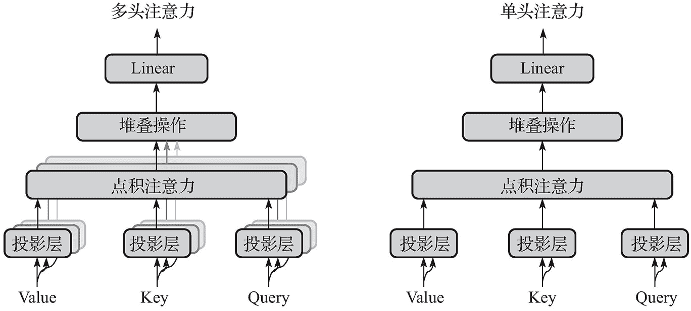

MHA 机制的代码如下：

Python

import torch

import torch.nn as nn

import torch.nn.functional as F

class MultiHeadAttention（nn.Module）:

  def __init__（self, embed_dim, num_heads）:

    super（MultiHeadAttention, self）.__init__（）

    self.embed_dim = embed_dimX           #输入嵌入维度

    self.num_heads = num_heads           #多头注意力机制中的头数

    self.head_dim = embed_dim // num_heads     #每个头的维度

    #定义线性变换层，用于生成 Q（查询）、K（键）和 V（值）

    self.query = nn.Linear（embed_dim, embed_dim） #输入维度到 embed_dim

    self.key = nn.Linear（embed_dim, embed_dim）  #输入维度到 embed_dim

    self.value = nn.Linear（embed_dim, embed_dim） #输入维度到 embed_dim

    self.fc_out = nn.Linear（embed_dim, embed_dim） #最终输出的线性变换层

  def forward（self, query, key, value, mask=None）:

    batch_size = query.shape[0]           #获取批次大小

    #线性变换并分头

    #Q、K、V 的形式从[batch_size, seq_len, embed_dim]变为[batch_size, num_heads, seq_len, head_dim]

    Q = self.query（query）.view（batch_size, -1, self.num_heads,

      self.head_dim）.transpose（1, 2）

    K = self.key（key）.view（batch_size, -1, self.num_heads,

      self.head_dim）.transpose（1, 2）

    V = self.value（value）.view（batch_size, -1, self.num_heads,

      self.head_dim）.transpose（1, 2）

    #计算注意力分数：Q 与 K 的转置相乘，并除以 sqrt（head_dim）进行缩放

    #scores 形式为[batch_size, num_heads, seq_len, seq_len]

    scores = torch.matmul（Q, K.transpose（-2, -1）） / torch.sqrt（torch.tensor（self.head_dim, dtype=torch.float32））

    if mask is not None:

      #如果有掩码，则将被掩码的部分填充为负无穷大，使得 Softmax 计算后对应的权重接近 0

      scores = scores.masked_fill（mask == 0, float（"-1e20"））

    #应用 Softmax 函数，转换成概率分布

    attention_Weights = F.Softmax（scores, dim=-1） #形式不变，仍为[batch_size, num_heads, seq_len, seq_len]

    #加权求和，计算最终输出

    #output 形式为[batch_size, num_heads, seq_len, head_dim]

    output = torch.matmul（attention_Weights, V）

    #将多头合并，调整形式从[batch_size, num_heads, seq_len, head_dim]变为[batch_size, seq_len, embed_dim]

    output = output.transpose（1, 2）.contiguous（）.view（batch_size, -1, self.embed_dim）

    #最终通过一个线性层处理

    output = self.fc_out（output） #输出形式仍为[batch_size, seq_len, embed_dim]

    return output

**2.2.6 前馈神经网络模块**

前馈神经网络（Feed Forward Network, FFN）是深度学习模型中的一种基础结构，其特点是信息在模型内部仅沿一个方向流动——从输入层到输出层，中间经过若干个隐藏层，而不会形成任何反馈连接。在诸如 Transformer 等现代深度学习架构中，前馈神经网络作为其中的一个关键组件，发挥着重要作用。

在 Transformer 架构中，前馈神经网络作为一个子层出现，位于自注意力模块之后。它由两个线性变换组成，中间夹有一个 ReLU 激活函数。该模块独立应用于序列中的每个元素，不改变序列长度，但增强了模型对单个元素上信息处理的能力。具体来说，它为每个位置提供了额外的非线性转换，使得模型能够在保留序列信息的同时，增强其对每个单独元素的理解能力。

前馈神经网络的主要作用和特点如下。

1）特征变换与非线性映射。前馈神经网络通过一系列线性变换（如全连接层）和非线性激活函数（如 ReLU、tanh 等），可以将输入数据从低维空间映射到高维空间，从而捕捉到原始输入中难以直接观察到的复杂模式和特征。这种能力使得模型能够学习到更丰富的数据表示。

2）增加模型表达能力。在多层堆叠的情况下，前馈神经网络能够构建非常深的架构，这极大地增强了模型的学习能力和表达能力。深层结构允许模型学习数据中的多层次抽象特征，对于处理复杂任务（比如图像识别、自然语言理解等）特别有用。

3）局部特征提取与全局整合。在某些应用场景中，前馈神经网络可以帮助提取局部特征，并将其组合成更有意义的全局特征。例如，在卷积神经网络（CNN）中，前馈神经网络常作为最后几层来整合来自不同卷积层和池化层的信息，以便进行最终的分类或回归预测。

4）加速收敛与提升性能。适当设计的前馈神经网络有助于加速训练过程中的梯度下降，降低陷入局部极小值的风险，同时也有助于提高模型的泛化能力，避免过拟合问题。

前馈神经网络的 Torch 代码具体如下：

Python

import torch

import torch.nn as nn

class FeedForward（nn.Module）:

  def __init__（self, embed_dim, ff_dim）:

    super（FeedForward, self）.__init__（）

    #定义第一个全连接层，将输入维度从 embed_dim 映射到 ff_dim（前馈神经网络的隐藏层维度）

    self.fc1 = nn.Linear（embed_dim, ff_dim）

      #输入形式为[任意, embed_dim]，输出形式为[任意, ff_dim]

    #定义第二个全连接层，将维度从 ff_dim 映射回 embed_dim

    self.fc2 = nn.Linear（ff_dim, embed_dim）

      #输入形式为[任意, ff_dim]，输出形式为[任意, embed_dim]

    #定义 ReLU 激活函数

    self.relu = nn.ReLU（）        #将输入张量应用于 ReLU 激活函数，保持形式不变

  def forward（self, x）:

    #x 通常是来自上一层的输出，形式为[batch_size, seq_len, embed_dim]

    #第一个线性变换，将 embed_dim 维的特征映射到 ff_dim 维

    fc1_output = self.fc1（x）      # 形式变为[batch_size, seq_len, ff_dim]

    #应用 ReLU 激活函数，增强模型的非线性表达能力，形式保持不变

    relu_output = self.relu（fc1_output） #形式为[batch_size, seq_len, ff_dim]

    #第二个线性变换，将 ff_dim 维的特征映射回 embed_dim 维，以便与后续层兼容

    output = self.fc2（relu_output）   # 形式变回[batch_size, seq_len, embed_dim]

    return output           #最终输出形式为[batch_size, seq_len, embed_dim]

代码解释如下。

（1）初始化阶段

●self.fc1 是第一个全连接层，用于将输入的特征维度从 embed_dim 映射到 ff_dim。这里的“任意”可以是针对批量大小、序列长度等，取决于输入的具体情况。

●self.fc2 是第二个全连接层，其作用是将经过非线性变换的特征维度从 ff_dim 再次映射回 embed_dim，以确保输出可以顺利传递给下一个层或模块。

●self.relu 是 ReLU 激活函数，用于引入非线性，这对于提高模型的学习能力和表示能力非常重要。

（2）前向传播

输入***x***的形式通常为[batch_size, seq_len, embed_dim]，即批次中每个样本的每个位置都有一个 embed_dim 维度的嵌入向量。

首先通过 self.fc1 进行线性变换，将每个位置的嵌入向量转换为 ff_dim 维度的向量。这一步骤的输出形式变为[batch_size, seq_len, ff_dim]。

然后对这些向量应用 ReLU 激活函数，增强模型的非线性特性，但不改变数据的形式。

最后通过 self.fc2 将这些非线性变换后的向量再次映射回原始的 embed_dim 维度，使得输出可以与其他层兼容。最终输出的形式为[batch_size, seq_len, embed_dim]，与输入形式相同。这样设计保证了模型结构的灵活性和一致性。

**2.2.7 残差连接和层归一化模块**

**1.残差连接**

残差连接也被称为跳跃连接，是在深度神经网络中用于缓解梯度消失问题和促进信息流的一种技术。它通过直接将输入数据添加到经过几层变换的输出上，形成一种“捷径”，从而帮助构建更深的网络结构而不损失性能。

残差连接数学原理如下:**[图][2][-][5][残][差][连][接][结][构]**

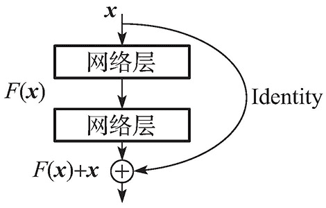

***y***=*F*（***x***）+***x***

残差连接结构如图 2-5 所示。

如图 2-5 所示，残差连接代表的是将某模块的输入***x***直接加到该模块的输出中。残差连接的作用如下。

●**缓解梯度消失问题：**在深层网络训练过程中，反向传播时梯度可能会变得非常小或非常大，导致权重更新困难。残差连接通过提供一条直接路径，使得梯度可以直接回传到前面的层，有助于保持梯度稳定。如图 2-5 所示，残差连接可用 Identity 旁边的曲线表示。通过残差连接原始信息加到两个网络层之后，可以保证***x***的信息无损地向后传递，这样的设计可以抑制梯度消失。

●**加速收敛：**研究表明，使用残差连接的网络往往比没有使用残差连接的网络更快地达到最优解，因为它们能够更容易地学习恒等映射。

●**允许构建更深的网络：**由于上述优点，残差连接使得构建非常深的网络成为可能，这有助于模型捕捉更加复杂的模式和特征。

例如，在 Transformer 架构中，残差连接通常位于注意力机制和前馈神经网络之后，确保原始输入信息可以无损地传递到下一层，同时结合了新的特征表示。

**2.层归一化**

层归一化是一种正则化技术，旨在减小内部协变量偏移。它通过对每个训练样本的每一层激活值进行归一化来实现这一点，而不是像批归一化那样依赖于批次中的其他样本。层归一化的具体作用和优势如下。

●**稳定训练过程：**通过减小不同层之间输入数据分布的变化，层归一化可以帮助稳定和加速模型的训练过程。这对于处理变长序列的任务尤其重要，如自然语言处理中的文本分类、机器翻译等。

●**独立于批次大小：**与批归一化相比，层归一化不依赖于批次中的其他样本，因此更适合应用于批次较小或者单样本在线学习场景。

●**增强泛化能力：**正则化技术一般有助于提高模型的泛化能力，降低过拟合的风险。层归一化也不例外，它可以促使模型学习更具普遍性的特征表示。

下面看一下归一化在做一件什么事。假设***x***是输入特征，*x**[i]*是按某些维度切片获得的值。

层归一化的具体公式如下。

首先计算样本均值：

然后计算样本方差：

最后根据样本均值和方差进行归一化后的样本：

●*μ*是特征向量的均值。

●*σ*²是特征向量的方差。

● 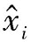是归一化后的特征值。

● 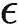是一个很小的常数，用于避免分母为零。

由以上公式可知，归一化减掉了均值并且除以方差，这相当于统一了样本之间的量纲，从而使不同样本之间可以进行比较。

为何在自然语言处理（NLP）任务中使用层归一化，在计算机视觉（CV）任务中使用批归一化？

（1）NLP 任务中使用层归一化的原因

假定**activation**（中间激活值）的形式为[*B*，*L*，*H*]，此时输入层归一化的 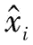的形式为[*H*]，也就是在进行归一化时***x***转换为了*B***L* 个形式为 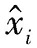样本。NLP 任务有如下特点。

1）序列长度可变

在 NLP 任务中，序列长度通常是可变的（如不同句子的词数不同）。批归一化需要固定长度的输入来计算统计量，而层归一化对每个样本独立归一化，不受序列长度影响。

2）样本独立性

在 NLP 任务中，每个样本（如一个句子）的统计特性可能差异较大。层归一化对每个样本独立归一化，能够更好地适应样本间的差异性。

3）对批量大小的鲁棒性强

在 NLP 任务中，批量可能较小（如训练长文本时），批归一化在小批量上计算统计量有不稳定性。层归一化不依赖于批量大小，因此在小批量或单样本情况下仍能稳定工作。

4）对位置信息的保留

在 NLP 任务中，序列的位置信息（如词序）非常重要。批归一化会破坏序列的位置信息，而层归一化对每个样本独立归一化，能够保留序列的位置信息。

（2）CV 任务中使用批归一化的原因

假定**activation**（中间激活值）的形式为[*B*，*H*，*W*，*C*],此时输入批归一化的 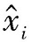的形式为[*B*，*H*，*W*],也就是在进行归一化时***x***转换为了*C*个[*B*,*H*,*W*]形式的 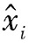样本。批扫一化任务有如下特点。

1）空间维度共享统计量

在图像数据中，同一通道的不同空间位置通常具有相似的统计特性。批归一化通过在整个批量上计算均值和方差，能够有效捕捉通道级别的全局统计信息。

2）批量大小稳定

在 CV 任务中，批量通常较大且稳定，这样能够提供足够的样本来得到可靠的均值和方差。较大的批量也有助于降低批归一化对噪声的敏感性。

3）对平移、旋转等变换的鲁棒性强

批归一化对输入数据的全局统计量进行归一化，能够增强模型对图像平移、旋转等变换的鲁棒性。

批归一化和层归一化的比较如表 2-1 所示。**[表][2][-][1][批][归][一][化][和][层][归][一][化][的][比][较]**

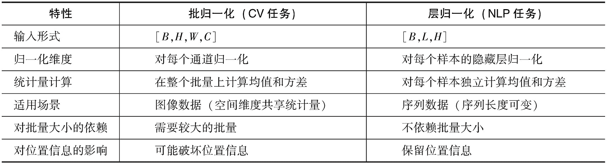

图 2-6 展示了层归一化和批归一化的差别。**[图][2][-][6][层][归][一][化][和][批][归][一][化][的][差][别]**

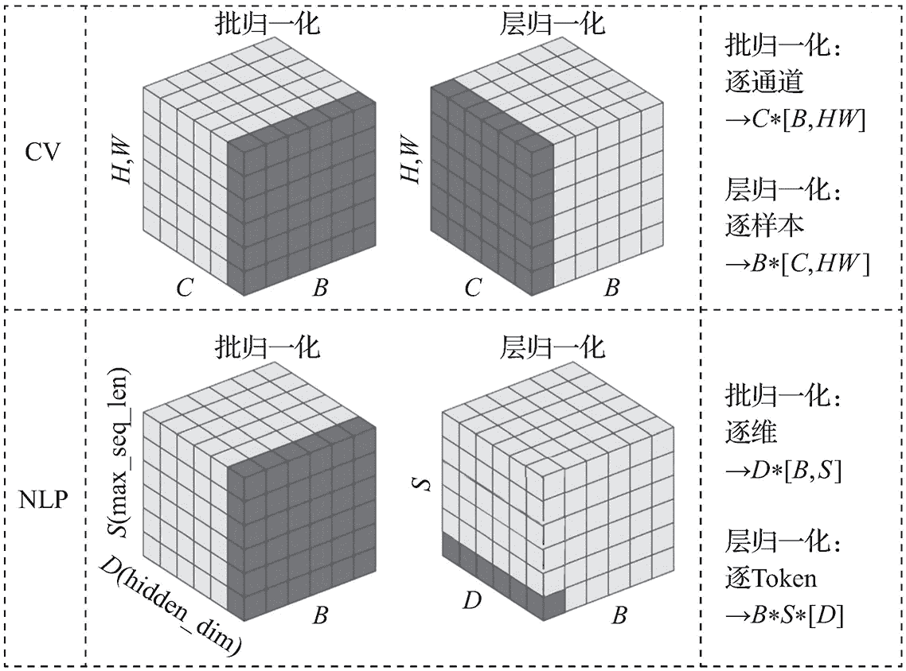

从图 2-6 中可知在 CV 任务中，每一个批次输入的特征矩阵形式是[*B*,*H*,*W*,*C* ]，进行批归一化即在每一个通道上进行特征的归一化，单样本的形式为[*B*,*H*,*W* ]，这种方式更加适合跨通道对比特征，比较适合计算机任务处理。

在 NLP 任务中，每个批次输入的特征矩阵形式是[*B*,*S*,*H* ]，进行层归一化即在 Token 粒度上进行特征的归一化，即单样本的形式为[*D*],共存在*B***S*个样本。这也更能满足 NLP 任务中对比不同 Token 特征的需求。

**3.残差连接与层归一化代码**

根据以上对残差连接与层归一化的理解，它们的 Torch 代码如下：

Python

import torch

import torch.nn as nn

class TransformerBlock（nn.Module）:

  def __init__（self, embed_dim, num_heads, ff_dim, dropout=0.1）:

    super（TransformerBlock, self）.__init__（）

    #多头注意力模块

    self.attention = MultiHeadAttention（embed_dim, num_heads）

      #输入和输出形式为[batch_size, seq_len, embed_dim]

    #层归一化模块

    self.norm1 = nn.LayerNorm（embed_dim）#归一化维度为 embed_dim，保持输入和输出形式不变

    self.norm2 = nn.LayerNorm（embed_dim）# 同上

    #前馈神经网络模块

    self.feed_forward = FeedForward（embed_dim, ff_dim）

      #输入和输出形式为[batch_size, seq_len, embed_dim]

    #Dropout 层，用于防止过拟合

    self.dropout = nn.Dropout（dropout）

  def forward（self, x, mask=None）:

    """

    :param x: 输入张量，形式为[batch_size, seq_len, embed_dim]

    :param mask:注意力掩码，形式可变，通常为[batch_size, 1, seq_len, seq_len]

    :return:输出张量，形式为[batch_size, seq_len, embed_dim]

    """

    #残差连接和层归一化

    #执行多头自注意力计算，输出形式为[batch_size, seq_len, embed_dim]

    attention_output = self.attention（x, x, x, mask）

    #残差连接（x + attention_output），然后应用 dropout 函数

    x = x + self.dropout（attention_output）

      #形式保持不变：[batch_size, seq_len, embed_dim]

    #应用层归一化，保持形式不变

    x = self.norm1（x）         #形式为[batch_size, seq_len, embed_dim]

    #前馈神经网络，输出形式为[batch_size, seq_len, embed_dim]

    ff_output = self.feed_forward（x）

    #再次进行残差连接（x + ff_output），然后应用 Dropout

    x = x + self.dropout（ff_output）  #形式为[batch_size, seq_len, embed_dim]

    #应用层归一化，保持形式不变

    x = self.norm2（x）         #形式为[batch_size, seq_len, embed_dim]

    return x

该代码的具体解释如下。

（1）初始化阶段

●self.attention 是一个多头注意力模块，处理输入张量并生成与输入相同形式[batch_size, seq_len, embed_dim]的输出。

●self.norm1 和 self.norm2 是两个层归一化模块，它们对指定维度（这里是 embed_dim）的数据进行归一化处理，但不会改变数据的形式。

●self.feed_forward 是一个前馈神经网络模块，同样接受和产生形式为[batch_size, seq_len, embed_dim]的张量。

●self.dropout 是一个 Dropout 层，用于在训练过程中随机丢弃一部分神经元，以防过拟合。

（2）前向传播

输入***x***的形式是[batch_size, seq_len, embed_dim]，即批次中每个样本的每个位置都有一个 embed_dim 维度的嵌入向量。

首先执行多头自注意力机制，该操作允许模型关注序列内的不同部分。attention_output 的形式仍然是[batch_size, seq_len, embed_dim]。

然后将原始输入***x***与 attention_output 相加形成残差连接，并应用于 Dropout。这一步骤有助于稳定梯度流，避免深层网络中的梯度消失问题。

随后应用第一个层归一化 self.norm1，其输出形式仍为[batch_size, seq_len, embed_dim]。

接下来，通过前馈神经网络模块处理归一化后的输出，生成新的特征表示 ff_output，其形式也保持为[batch_size, seq_len, embed_dim]。

最后再进行一次残差连接（这次是***x***加上 ff_output），并通过第二个层归一化 self.norm2，最终输出形式依然为[batch_size, seq_len, embed_dim]。

**2.2.8 Encoder-Decoder 架构****[图][2][-][7][T][r][a][n][s][f][o][r][m][e][r][的][E][n][c][o][d][e][r][-][D][e][c][o][d][e][r][架][构]**

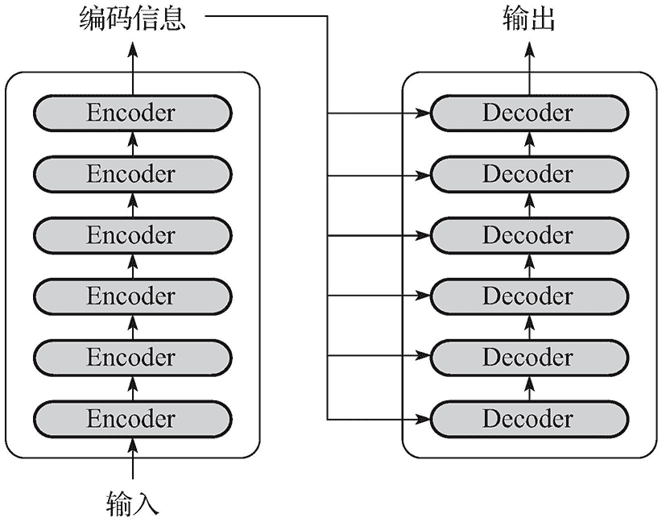

Transformer 由 Encoder（编码器）和 Decoder（解码器）组成，编码器将输入序列映射为隐藏表示并输出到每一个解码器，解码器根据编码器的输出生成目标序列。图 2-7 所示为 Transformer 的 Encoder-Decoder 架构。

Transformer 总体架构 Encoder-Decoder 实现代码如下：

Python

class Transformer（nn.Module）:

  def __init__（self, src_vocab_size, trg_vocab_size, embed_dim, num_heads, num_layers,

  ff_dim, max_seq_len, dropout=0.1）:

    """

    Transformer 模型初始化

    参数说明：

    - src_vocab_size:源语言词汇表大小

    - trg_vocab_size:目标语言词汇表大小

    - embed_dim:词向量维度

    - num_heads:多头注意力头数

    - num_layers:编码器/解码器堆叠层数

    - ff_dim:前馈神经网络隐藏层维度（通常为 4*embed_dim）

    - max_seq_len:最大序列长度

    - dropout:随机失活率

    """

    super（Transformer, self）.__init__（）

    #词嵌入层（将 Token 索引映射为稠密向量）

    self.Encoder_embedding = nn.Embedding（src_vocab_size, embed_dim）

    self.Decoder_embedding = nn.Embedding（trg_vocab_size, embed_dim）

    #位置编码（注入序列位置信息）

    self.positional_encoding = PositionalEncoding（embed_dim, max_seq_len）

    #编码器/解码器层堆叠（核心组件）

    self.Encoder_layers = nn.ModuleList（[

      TransformerBlock（embed_dim, num_heads, ff_dim, dropout）

      for _ in range（num_layers）

    ]）

    self.Decoder_layers = nn.ModuleList（[

      TransformerBlock（embed_dim, num_heads, ff_dim,dropout）

      for _ in range（num_layers）

    ]）

    #输出层（将解码器输出映射到目标词汇表空间）

    self.fc_out = nn.Linear（embed_dim, trg_vocab_size）

    self.dropout = nn.Dropout（dropout）

  def forward（self, src, trg, src_mask=None, trg_mask=None）:

    """

    前向传播流程

    输入：

    - src:源语言序列 [batch_size, src_len]

    - trg:目标语言序列 [batch_size, trg_len]

    - src_mask:编码器输入掩码（如 padding mask）

    - trg_mask:解码器输入掩码

    """

    #1.输入嵌入与位置编码

    #公式：token_embedding + positional_encoding

    src = self.dropout（self.Encoder_embedding（src） + self.positional_encoding（src））

    trg = self.dropout（self.Decoder_embedding（trg） + self.positional_encoding（trg））

    #2.编码器处理（特征提取）

    #每层包含多头注意力 → 残差连接&层归一化 → 前馈网络 → 残差连接&层归一化

    for layer in self.Encoder_layers:

      src = layer（src, src_mask） # [batch_size, src_len, embed_dim]

    #3.解码器处理（序列生成）

    #每层包含掩码多头注意力 → 编码-解码注意力 → 前馈网络（均含残差连接）

    for layer in self.Decoder_layers:

      trg = layer（trg, src, trg_mask, src_mask） #[batch_size, trg_len, embed_dim]

    #4.输出映射（词汇表概率分布）

    output = self.fc_out（trg）  #[batch_size, trg_len, trg_vocab_size]

    return output

以上是一个标准的 Transformer 模型实现代码，主要用于序列到序列任务（如机器翻译）处理。该模型实现包含以下核心阶段。

初始化部分包括词嵌入层（Encoder_embedding 和 Decoder_embedding）、位置编码层（positional_encoding）、多个编码器层（Encoder_layers）和多个解码器层（Decoder_layers）堆叠、输出映射层（fc_out）和 Dropout 层。

前向传播流程如下。

●**输入处理：**先对输入进行词嵌入和位置编码的融合。

●**编码：**通过多层编码器提取源语言特征。

●**解码：**多层解码器结合编码器输出生成目标语言序列。

●**输出映射：**将解码结果映射到目标词汇表空间并输出概率分布。

关键特性如下。

●采用多头注意力机制处理长距离依赖。

●使用残差连接和层归一化保证训练稳定性。

●通过掩码机制实现序列生成时的自回归特性。

●参数配置灵活，可调整 embed_dim、num_layers 等参数来适应不同任务。

**1.编码器（Encoder）与解码器（Decoder）的结构差异**

原始的 Transformer 架构存在 Encoder 和 Decoder 两个模块。具体来说，Encoder 可以理解为全局理解，也就是任意的 Token 与 Token 之间能够相互被“看到”（注意力覆盖，也就是相互之间有不为 0 的注意力分数）。对于 Decoder 来说，只有后面的 Token 能够“看到”前面的 Token（注意力分数不为零），前面的 Token 则无法“看到”后面的 Token（注意力分数为零）。

上述具体实现原理来自自注意力机制中的**Mask**变量，它将影响最终注意力分数。在 Encoder 中，**Mask**变量是一个全零矩阵，不会对注意力分数做任何修改。**Mask**变量之前的注意力分数代表任意两个 Token 之间的相关性，**Mask**变量为零时，将使得注意力分数降为 0。以下是 Encoder 中的注意力分数计算，首先是***Q***和***K***的转置相乘：

Encoder 中的**Mask**矩阵如下：

最终的注意力分数计算如下：

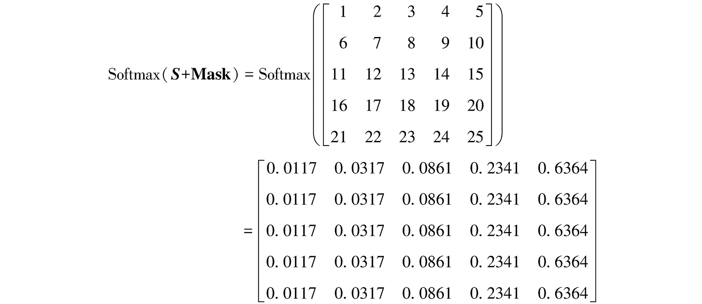

Decoder 中的**Mask**是一个对角线及下三角全为 0、上三角全为负无穷的矩阵，由于 Softmax 函数将负无穷的位置全都计算为零，使原本的注意力分数矩阵上三角全为零。这样也就达到了前面 Token 的无法“看到”后面 Token 的目的。本节所有的“看到”指的是注意力分数不为零。以下是 Decoder 中的注意力分数计算。首先是***Q***和***K***的转置相乘：

Decoder 中的**Mask**如下：

最终注意力分数计算如下：

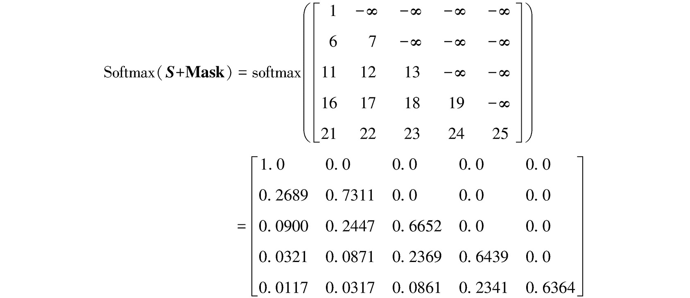

在相同的 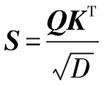输入下，Encoder 和 Decoder 的**Mask**不同，导致最终输出的注意力分数不同。可以看到，***S***[Encoder]所有的值都不为零，这说明在 Encoder 中任意两个 Token 之间都是可以相互“看到”，Decoder 上三角注意力分数全为零，这也可以理解为只有后方的 Token 可以“看到”前面的 Token，反之则不行。

**2.Encoder 和 Decoder 的区分**

（1）Encoder

由于任意两个 Token 间注意力的存在，Encoder 更加理解整句的语义，因此 Encoder 适合处理的任务更加偏向于理解型，比如完形填空、命名实体识别、句子分类等。比如 Bert 就是使用 Transformer 的 Encoder 部分训练而来的。Bert 最常见的应用便是命名实体识别、文本分类等，由于本书主要讲解大语言模型，Bert 的原理与实践不在此展开。

（2）Decoder

当 Google 对 Bert 的训练而使 Encoder 声名鹊起时，OpenAI 坚定地选择了 Decoder，通过爆款产品 ChatGPT 为 Decoder 部分正名。Decoder 更加通用，适用于所有的 NLP 任务，因此目前主流的基于 Transformer 的大语言模型基本都采用 Decoder。

由于前面的 Token 与后面 Token 注意力分数为零，因此 Decoder 更加适合生成式任务，即基于前方 Token 生成后方 Token。由于生成式任务的可塑性，基本所有的 NLP 任务都可以转化为生成式任务。

Decoder 的应用如下。

a.任务类型:文本生成

模型输入:请以“伟大的人工智能”为题写一篇文章。

模型输出:我出生在一个人工智能起飞的伟大时代……

b.任务类型:命名实体识别

模型输入:请提取以下输入的人名和地名：刘丹出生在伟大的中国。请保持 json 格式。

模型输出:{刘丹:人名，中国:地名}。

c.任务类型:文本分类

模型输入:请对以下文本进行“积极”或者“消极”的二分类分析。我今天很开心，吃了很多汉堡，然后还打了很久的游戏。

模型输出:积极

d.计算

模型输入:请输出 2 的 4 次方等于多少。

模型输出:首先 2 的平方是 4，2 的 4 次方是 2 的平方的平方，也就是 4 的平方 16，最终答案为 16。

现在大语言模型基本使用的是 Decoder-only 架构，也就是说仅拿出 Decoder 模块搭建大语言模型，早期也存在一些其他结构，比如 Encoder-Decoder 结构的 T5、Bart 模型，Prefix-Decoder 结构的 GLM 模型等，但是最终仍然收敛到 Decoder-only 架构，可能存在以下原因。

●大模型最大的特点是通用性好，适用于各种 NLP 任务，而 Encoder 在生成式任务上表现不佳，影响了其通用性。

●OpenAI 在最近几年发现的 Scaling Law 说明模型参数量越大，模型能力上限越高。但是，这个定理并不适用于 Encoder，原因众说纷纭。笔者比较喜欢从矩阵角度分析，这里引用苏剑林的理解，由于 Encoder 的**Mask**变量是一个非上三角矩阵，所以这个**Mask**变量有可能是一个非满秩矩阵，且由于语言模型实现基本都是矩阵乘法，降秩矩阵乘以任何矩阵都是降秩的，又因为矩阵的秩将直接影响模型的表达能力，Attention 矩阵的形式为[Length,Length]，因此有以下不等式:

*r*（Attention_encoder）< *r*（Attention_decoder）<length_text

其中，*r*（Attention_encoder）代表 Encoder 的注意力分数矩阵的秩，*r*（Attention_decoder）代表 Decoder 的注意力分数矩阵的秩，length_text 代表输入文本的长度。

由于矩阵的秩表示矩阵的表达能力，矩阵的表达能力会影响模型能力的上限，这也决定了 Decoder 模型能力上限较高。

### **2.3 Transformer 架构下的计算复杂度**

**2.3.1 矩阵乘法的计算复杂度**

**1.理解矩阵的线性空间**

矩阵的线性空间也称列空间，是指由矩阵的列向量所生成的向量空间，具体解释如下。

●**矩阵*****A*****的线性空间：**由矩阵***A***的所有列向量生成的向量空间。假设***A***是一个*m*×*n*的矩阵，那么***A***的列空间是*m*维空间中的一个子空间，其维度等于***A***的列秩（即***A***的线性无关列向量的最大数量）。

●**矩阵*****B*****的线性空间：**同理，***B***的列空间是由***B***的所有列向量生成的向量空间。如果***B***是一个*n*×*p*的矩阵，那么***B***的列空间是*n*维空间中的一个子空间，其维度等于***B***的列秩。

**2.矩阵乘法的定义**

给定两个矩阵***A***（*m*×*n*）和***B***（*n*×*p*），它们的乘积***C***是一个*m*×*p*的矩阵，其中***C***的第*i*行第*j*列的元素*c**[i][j]*计算如下：

这意味着，***C***的每个元素都是***A***的一行与***B***的一列的点积。

矩阵乘积***C***=***A**B***的计算量主要取决于矩阵的维度和所涉及的基本运算（乘法和加法）的数量。

**3.基本运算的数量**

对于每个元素*c**[i][j]*，我们需要进行*n*次乘法和*n*-1 次加法。因此，对于整个矩阵***C***（有*m*×*p*个元素），总的计算量如下：

加法计算次数：*m*×*p*×（*n*-1）

乘法计算次数：*m*×*p*×*n*

**2.3.2 Transfomer 架构下的计算量推导**

以下是后续公式中各参数的意义。

●***n*****：**序列长度。

●***d*****[m][o][d][e][l]****：**隐藏状态的维度。

●***V*****：**词汇表大小。

●***L*****：**Transformer Block 的层数。

●***d******[K]*****：*****K***矩阵的嵌入维度。

●***d*****[f][f]****：**MLP 层中第一个层的输出维度。

**1.Embedding 层的计算量推导**

输入序列***X***的长度为*n*，Embedding 层可用矩阵表示，形式为[*V*，*d*[model]]，但是本层的计算量并不按照上述的矩阵乘法计算，这是因为输入序列***X***将通过 One-hot 编码变成稀疏矩阵。因此，该层的矩阵计算可以简化为查表操作。

查表操作的计算量表示为

*O*（*n*×*d*[model]）

输出矩阵***O***的形式为[*n*，*d*[model]]。

Embedding 层的计算量：

计算量[Embedding]=*n*×*d*[model]

**2.自注意力机制层的计算量推导**

线性变换（将 Embedding 矩阵输入到***Q***、***K***、***V***）计算方法：

***Q***=***X**W******^Q***

***K***=***X**W******^K***

***V***=***X**W******^V***

计算量：

计算量=3×*n*×*d*[model]×*d****[K]***

注意力分数的计算方法：

计算量：

计算量=*n*²×*d****[K]***

注意力权重计算方法：

***A***=Softmax（***S***）

计算量:

*O*（*n*²）

加权求和计算方法：

***O***=***A**V***

计算量：

计算量=*n*²×*d****[V]***

注意力机制计算量：

计算量[self-Attention]=3×*n*×*d*[model]×*d****[K]***+*n*²×*d****[K]***+*n*²×*d****[V]***+*n*²

其中，*d****[K]***和*d****[V]***分别为***K***矩阵和***V***矩阵的维度，且有*d****[K]***=*d****[V]***；*n*为输入的文本长度，*d*[model]代表整个模型中 Transformer Block 的维度。

**3.MLP 层的计算量推导**

（1）第一层线性变换计算量

计算量=*n*×*d*[model]×*d*[ff]

激活函数计算量：

计算量=*O*（*d*[model]×*d*[ff]）

（2）第二层线性变换计算量

计算量=*n*×*d*[ff]×*d*[model]

MLP 层的总计算量：

计算量[MLP]=*n*×*d*[model]×*d*[ff]+*n*×*d*[ff]+*n*×*d*[ff]×*d*[model]

简化后：

**4.Lm_head 层的计算量推导**

输入矩阵***H***的形式为[*n*，*d*[model]]，权重矩阵***W***的形式为[*d*[model]，*V*]，与 Embedding 层转置的形式相同。

线性变换的计算量：

计算量=*n*×*d*[model]×*V*

Lm_head 层的计算量：

计算量[Lm_head]=*n*×*d*[model]×*V*

**5.位置编码的计算量推导**

由于 Transformer 结构中不能像 RNN 那样自带时序信息，因此需要额外添加时序信息，这便由位置编码实现。

位置编码计算公式：

生成位置编码的计算量：

*O*（*n*×*d*[model]）

将位置编码添加到嵌入层并输出嵌入向量的计算量：

计算量=*O*（*n*×*d*[model]）

位置编码的总计算量：

计算量[Positional Encoding]=*O*（*n*×*d*[model]）

**6.总计算量推导**

由于 Transforme 架构包含 Embedding 层、位置编码、自注意力机制层、MLP 层、Lm_head 层，其中自注意力机制层和 MLP 层共同组成一个 Transformer Block，且 Transformer Block 重复多次。Transformer 架构下的总计算量可以表示为

计算量[Transformer]=计算量[Embedding]+计算量[Positional Encoding]+*L*×计算量[Transformer Block]+计算量[Lm_head]

对以上公式进行简化可得出：

代入上述各项可得最终结果，则

忽略低次项，计算量可以表示为

由以上公式可知，Transformer 的计算复杂度最主要和序列长度*n*以及模型的嵌入维度*d*[model]有关，并且与序列长度*n*和嵌入维度*d*[model]呈二次方关系。这也说明了当模型参数量上升、模型处理文本长度增大时，计算速度将大幅下降。

### **2.4 Decoder 模式下的推理与训练**

**2.4.1 Mask 矩阵详解**

2.2.8 节提到 Decoder 中**Mask**矩阵上三角为负无穷，在***S***矩阵和**Mask**矩阵相加并进行 Softmax 操作后，对应位置的注意力分数为零，具体计算公式如下：

Decoder 中**Mask**矩阵如下：

***Q***矩阵和***K***的转置矩阵乘法计算如下：

最终注意力分数矩阵***A***的计算如下：

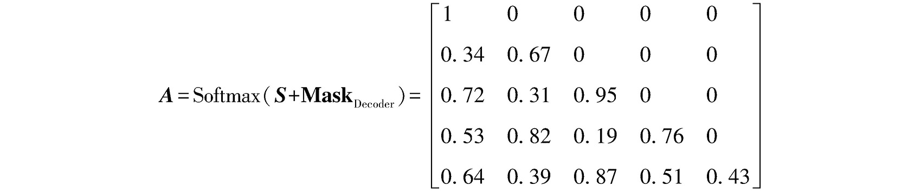

***A***中任意一个元素*a**[i][j]*表示文本中第*i*个 Token 和第*j*个 Token 之间的关联程度，也叫作注意力分数。以“你好帅啊！”为例，有以下理解。

●矩阵***A***中*a*[34]=0 代表“帅”字无法“看到”“啊”字。

●矩阵***A***中*a*[43]=0 代表“啊”字能够“看到”“帅”字。

●矩阵***A***中*a*[31]>*a*[32]代表对于“帅”字来说，“帅”字更多“看到”“你”字，更少“看到”“好”字。

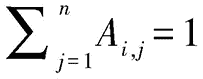

●，代表***A***矩阵任意一行求和都等于 1，这说明注意力分数其实只是一个权重。

以下是两两 Token 之间的注意力分数矩阵：

**2.4.2 具体训练和推理**

**1.训练**

训练的时候整个文本序列（图中为“你好帅啊！”）一次性输入，并且一次性输出，如图 2-8 所示。**[图][2][-][8][T][r][a][n][s][f][o][r][m][e][r][训][练][（][并][行][）]**

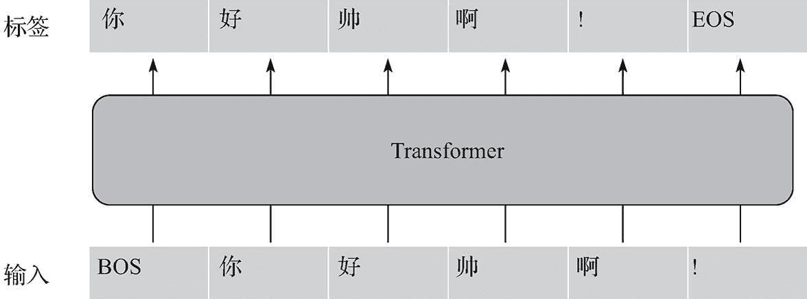

**2.推理**

模型训练好之后，对模型进行推理是一个自回归的过程。推理的过程中每次都基于之前的所有 Token，再向后输出一个 Token，直到结束。这样比较接近人类的语言习惯。下面是一个示例：

Plain Text

input:<BOS>          output:你

input:<BOS>你         output:<BOS>你好

input:<BOS>你好        output:<BOS>你好帅

input:<BOS>你好帅       output:<BOS>你好帅啊

input:<BOS>你好帅啊      output:<BOS>你好帅啊！

input:<BOS>你好帅啊！     output:<BOS>你好帅啊！<EOS>

一般的机器学习推理需要和训练保持完全一致才能得到好的效果，但是**Mask**矩阵上三角为 0 的存在，导致在训练时，前方的 Token 无法“看到”后方的 Token，所以推理的时候每次生成一个 Token，再将这个 Token 添加到文本末尾生成下一个 Token。

在大语言模型的发展过程中，研究者发现大语言模型推理速度的重要性。为了减少推理时间，一种使用空间换时间的技术 KV-cache 诞生。

（1）KV-cache 与推理

1）无 KV-cache 推理的计算复杂度

从前文已经知道，大语言模型推理是进行 NTP（Next Token Predict）的自回归预测过程，即每一轮推理都是将上一轮输入的 Token 和输出的 Token 拼接起来再输入大语言模型进行下一个 Token 的预测。我们已经知道大语言模型的计算复杂度是*O*（Length²），因此如果提示词输入*n*个 Token，经过*N*-*n*次自回归推理后得到总共*N*个 Token，最终计算量应该为

计算量=*O*（*n*²）+*O*（（*n*+1）²）+*O*（（*n*+2）²）+…+*O*（（*N*-1）²）+*O*（（*N*）²）=*O*（*N*³）

2）有 KV-cache 的推理原理

KV-cache 是为了降低以上计算复杂度而设计的。在将文本输入 Decoder 模型中时，由于自回归的特性，每次都要将前面的所有 Token 又重新输入 Transformer 模型一次，在这个过程中有大量的计算是重复进行的，因此可以将一部分的 Key 值和 Value 值保存在内存中，下一次自回归如果要做重复计算就可以直接从内存中取出，从而节省推理时间。

接下来按照“你好帅啊”这四个 Token 分别进行有无 KV-cache 的推理讲解。

步骤 1 中有无 KV-cache 的实现如图 2-9 所示。**[图][2][-][9][步][骤][1][中][有][无][K][V][-][c][a][c][h][e][的][实][现]**

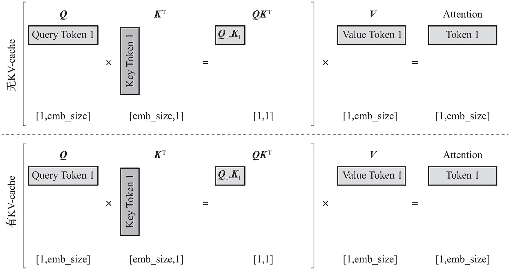

输入“你”，将“你”放入大模型计算，此时由于是第一个 Token，不存在 KV-cache，因此有无 KV-cache 计算方式完全相同，需要计算每一个 Transformer Block 的第一个 Token“你”的***Q***[1]、***K***[1]、***V***[1]值，最后通过 Softmax 预测出第二个 Token“好”。

步骤 2 中有无 KV-cache 的实现如图 2-10 所示。

●**无 KV-cache 方法：**根据步骤 1 预测出来了 Token 2“好”进行下一轮自回归预测。本轮预测的输入是“你好”,需要重新计算***Q***[1]、***K***[1]、***V***[1]和***Q***[2]、***K***[2]、***V***[2]，需要计算 4 个***Q**K***^T 值，且需要计算 Attention 1 和 Attention 2 这两个值。

●**有 KV-cache 方法：**由于步骤 1 中已经输入了 Token 1“你”，所以在 KV-cache 中已经保存了 Token 1“你”的***K***[1]、***V***[1]值。本轮仅输入 Token 2“好”并计算***Q***[2]、***K***[2]、***V***[2]值（比不使用 KV-cache 方法减少了 3 次计算量），然后计算***Q***[2]与所有其他***K***值的 2 个注意力分数***Q**K***^T（这里比不使用 KV-cache 方法减少了 1 次计算量），最后计算 Attention 2 一个值，比不使用 KV-cache 的方法少计算 Attention 1。**[图][2][-][1][0][步][骤][2][中][有][无][K][V][-][c][a][c][h][e][的][实][现]**

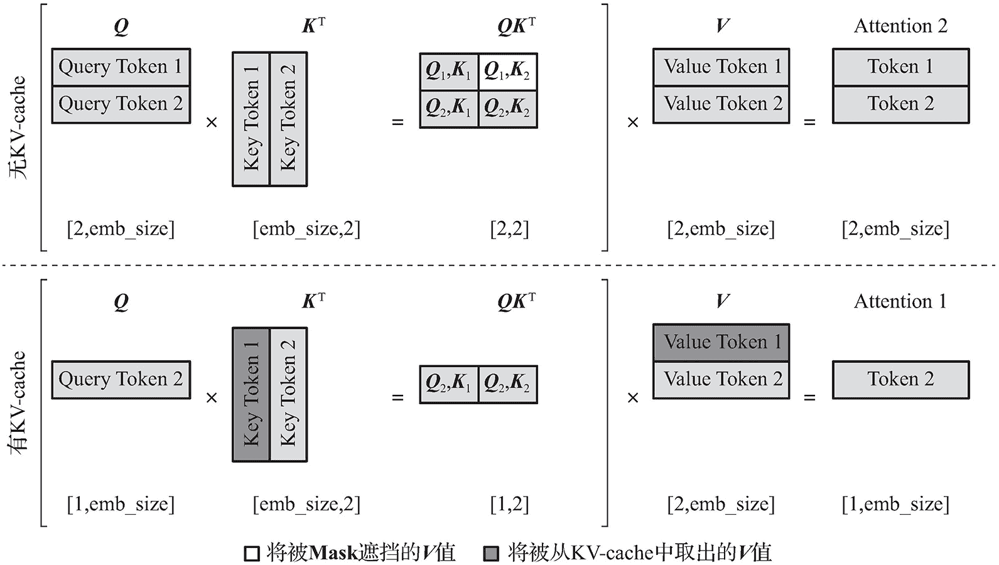

步骤 3 中有无 KV-cache 的实现如图 2-11 所示。

●**无 KV-cache 方法：**根据步骤 2 预测出来了 Token 3“帅”进行下一轮自回归预测。本轮预测的输入是“你好帅”,需要重新计算***Q***[1]、***K***[1]、***V***[1]和***Q***[2]、***K***[2]、***V***[2]以及***Q***[3]、***K***[3]、***V***[3]，需要计算 3 个***Q**K***^T 值，且需要计算 Attention 1 和 Attention 2 以及 Attention 3 这三个值，并预测下一个 Token。

●**有 KV-cache 方法：**由于之前的步骤中已经输入了 Token 1“你”、Token 2“好”，所以在 KV-cache 中本轮已经保存了 Token 1“你”的***K***[1]、***V***[1]值和 Token 2“好”的***K***[2]、***V***[2]值。本轮仅输入 Token 3“帅”并计算***Q***[3]、***K***[3]、***V***[3]值（比不使用 KV-cache 方法减少 3 次计算量），然后计算***Q***[3]与所有其他的***K***值的 3 个注意力分数***Q**K***^T（这里比不使用 KV-cache 方法减少了 2 次计算），最后计算 Attention 3，并预测下一个 Token。**[图][2][-][1][1][步][骤][3][中][有][无][K][V][-][c][a][c][h][e][的][实][现]**

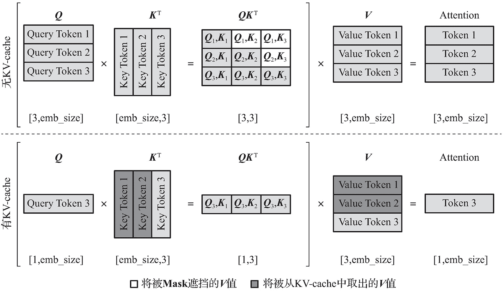

步骤 4 中有无 KV-cache 的实现如图 2-12 所示。

●**无 KV-cache 方法：**根据步骤 3 预测出来了 Token 4“啊”，进行下一轮自回归预测。本轮预测的输入是“你好帅啊”,需要重新计算***Q***[1]、***K***[1]、***V***[1]和***Q***[2]、***K***[2]、***V***[2]、***Q***[3]、***K***[3]、***V***[3]、***Q***[4]、***K***[4]、***V***[4]，需要计算 16 个***Q**K***^T 值，且需要进行 4 次计算，最终预测出下一个 Token。

●**有 KV-cache 方法：**由于之前的步骤中已经输入了 Token 1“你”、Token 2“好”、Token 3“帅”，所以在 KV-cache 中本轮已经保存了 Token 1“你”的***K***[1]、***V***[1]值，Token 2“好”的***K***[2]、***V***[2]，Token 3“帅”的***K***[2]、***V***[2]值。本轮输入 Token 4“啊”并计算***Q***[4]、***K***[4]、***V***[4]值，然后计算***Q***[4]与所有其他***K***值的 4 个注意力分数***Q**K***^T，最后仅计算了 Attention 4，最终预测出下一个 Token。

3）KV-cache 的推理复杂度

首先，之所以 Transformer 的计算复杂度是*O*（Length²），原因在于***Q**K***^T 中***Q***矩阵和***K***矩阵的形式都为[Length，emb_size]。**[图][2][-][1][2][步][骤][4][中][有][无][K][V][-][c][a][c][h][e][的][实][现]**

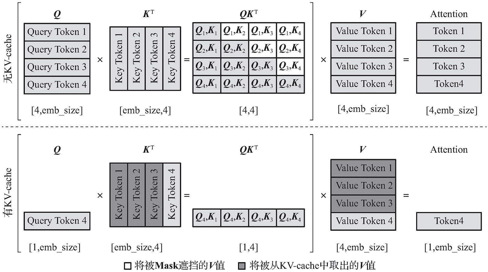

但是从图 2-9 到图 2-12 可知，有 KV-cache 的推理中，每次推理的***Q***矩阵的形式为[1，emb_size],每次计算***Q**K***^T 的复杂度为*O*（Length）。回到之前的例子，如果输入*n*个 Token，经过*N*-*n*次自回归推理后得到总共*N*个 Token，最终***Q**K***^T 计算量应该为

计算量=*O*（*n*）+*O*（*n*+1）+*O*（*n*+2）+…+*O*（*N*-1）+*O*（*N*）=*O*（*N*²）

由此来看，KV-cache 将推理的计算复杂度降低了一个量级，但是存在以下未考虑到的点。

●由于 KV-cache 占用大量显存，需要将计算从 HBM 转移到 SM，这增大了开销。

●Transformer 的计算复杂度既和注意力层的复杂度*O*（Length²）有关，又和 MLP 层的复杂度*O*（hidden_size²）有关，KV-cache 仅降低了注意力层的计算复杂度*O*（Length²），并没有降低 MLP 层的*O*（hidden_size²）。

**3.Prefill 和 Decode 阶段**

上述例子是一个比较特殊的形式，初始输入 Token 仅有一个，然后进行自回归。但是对于大多数的任务来说，模型初始输入包含多 Token。

（1）Prefill 阶段

Prefill 阶段是指在生成式模型（如 Transformer 或 GPT）中，对输入序列进行预处理和编码的阶段。在这个阶段，模型会将输入的上下文（如提示词或前缀）转换为内部表示（如隐藏状态或键值缓存），以便在后续的生成步骤中直接复用这些信息，而不需要重新计算。

简单来说，在多 Token 输入时，并非进行 NSP 的自回归，而是进行所有 Token 的并行计算，即一次性计算出输入所有 Token 的***Q***和***K***值。

Prefill 阶段由于一次性输入了大量文本，并不需要像 Decode 阶段那样频繁地将 HBM 的矩阵多次移动到 SM 中，并且计算时是多 Token 并行计算。Prefill 阶段的计算复杂度为*O*（Length²）,如果考虑 PD 分离策略进行推理，应该使用高算力的设备。

另外，Prefill 阶段主要影响推理过程中的首字响应，首字响应过长将严重影响用户体验。根据笔者经验，端侧设备（非 NPU）一般算力受限，由于 Prefill 阶段计算复杂度是文本长度的平方，当输入长度较长时，首字响应时间将大幅增加。

（2）Decode 阶段

Decode 阶段是指模型根据输入序列（如提示词、源语言句子等）逐步生成输出序列的过程。在生成式模型中，Decode 阶段通常以自回归的方式进行，即模型每次生成一个词（或 Token），并将其作为下一步的输入，直到生成完整的输出序列。简单来说，在完成 Prefill 阶段后，设备中已经储存提示词的 KV-cache，这样一来 Decode 阶段便成了完成自回归任务。

### **2.5 绝对位置编码与相对位置编码**

Transformer 模型本身不具备捕捉序列顺序的能力，因此需要通过位置编码来注入位置信息。位置编码主要分为绝对位置编码和相对位置编码两类。

**2.5.1 绝对位置编码**

绝对位置编码为序列中的每个位置分配一个唯一的编码向量，通常通过固定的数学函数生成，经典的生成位置编码方法是使用正弦和余弦函数，数学公式已在 2.2.3 节介绍，这里不再赘述。

以下为一个序列长度为 10，*d*为 8 的位置编码矩阵示例。

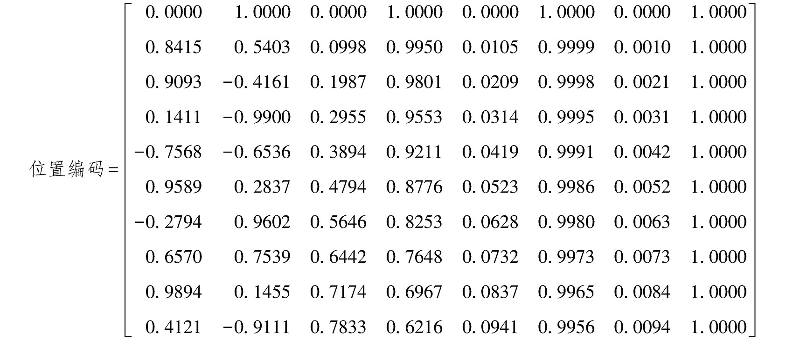

绝对位置编码的优点是简单直观，缺点是难以捕捉序列中元素之间的相对位置关系。注意，绝对位置编码**PE**是直接用加法加到输入 Embedding 向量中，使原有的词向量中存在位置信息，公式如下。

***h****[t]*=**PE**+**Embedding**

其中，**PE**表示绝对位置编码向量，**Embedding**表示输入 Transformer Block 的词向量。

**2.5.2 相对位置编码**

相对位置编码（Rotary Position Embedding,RoPE）是一种改进的位置编码方法，旨在更好地捕捉序列中元素之间的相对位置关系。这种方法通过旋转矩阵将绝对位置编码转换为相对位置编码。之所以称之为相对位置编码，是因为位置编码在实现时，对绝对位置*m*进行建模，最终通过注意力达到了表达相对位置的目的。

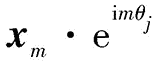

RoPE 的公式是复数形式的旋转操作。我们可以将其转换为矩阵形式，从而与旋转矩阵***R****[θ]*联系起来。

其中，***x****[m]*表示序列中第*m*个元素的嵌入向量，*θ**[j]*=10000-2*j*/*d* ，其中*j*是维度索引，i 是虚数单位。

**1.复数形式的旋转**

复数*z*=*x*+i*y*可以表示为向量[*x*，*y*]。复数的旋转操作*z*·e^i*^θ*等价于将向量[*x*，*y*]旋转*θ*角度。

**2.复数旋转的矩阵形式**

复数旋转*z*·e^i*^θ*可以展开为

*z*·e^i*^θ*=（*x*+i*y*）（cos（*θ*）+isin（*θ*））=（*x* cos（*θ*）-*y* sin（*θ*））+i（*x* sin（*θ*）+*y* cos（*θ*））

对应的矩阵形式为

因此，在实际实现中，RoPE 通过旋转矩阵将绝对位置编码转换为相对位置编码。旋转矩阵的形式为

对于多维向量，RoPE 将每两个维度组成维度对，每个维度对（2i,2i+1）视为一个复平面，并分别应用旋转矩阵。

对于输入向量***X***的第*i*和第*j*个 Token 向量***x****[i]*和***x****[j]*，旋转操作公式为

RoPE 并非独立于 Transformer 的注意力机制，而是与 Transformer 的注意力机制相融合。具体的融合位置后的注意力分数计算如下：

计算相对位置注意力得分:

其中：

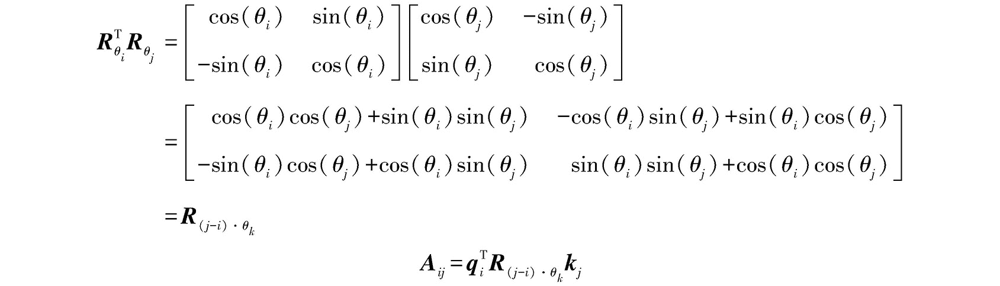

由以上结果可知，通过 RoPE（***Q***矩阵和***K***矩阵相乘）的方法注意力分数***A****[i][j]*直接关联到了*j*-*i* 的相对位置，这也就说明模型能够直接捕捉到两个 Token 的相对位置。

**2.5.3 绝对位置编码与相对位置编码的对比**

**1.编码原理**

绝对位置编码为每个位置分配固定的编码向量，通常使用正弦函数生成。相对位置编码则计算元素之间的相对距离，比如两个位置之间的间隔。RoPE 采用旋转矩阵实现位置相关的向量变换。

**2.序列长度适应性**

绝对位置编码在处理长序列时可能失效，特别是超出训练长度的序列。相对位置编码天然支持任意长度序列，因为它只依赖相对距离。相对位置编码通过旋转运算可以自动适应任意长度，理论上支持无限长序列。

**3.计算复杂度**

绝对位置编码计算复杂度最低，只需要*O*（1）时间直接查表。相对编码需要*O*（Length²）时间计算所有位置对。相对位置编码的复杂度为*O*（Length），经过优化后可以达到近似*O*（1）。

**4.任务表现**

绝对位置编码适合短文本分类等简单任务。相对位置编码在机器翻译等任务上表现更好。相对位置编码在长文本生成任务中表现最优，被 Llama、GPT 等模型采用。

**5.实现难度**

绝对位置编码实现最简单，只需要将编码向量直接相加。相对位置编码需要修改 Attention 计算逻辑。相对位置编码需要实现复数旋转运算，实现难度较高。

**6.典型应用**

绝对位置编码用于原始 Transformer 和 Bert 模型。相对位置编码被 T5 和 DeBERTa 模型采用。相对位置编码应用于 Llama 系列模型和 GPT-NeoX 模型等。

**7.外推能力**

绝对位置编码无法外推，推理长度一旦超出训练长度就会失效。相对位置编码具有有限的外推能力，需要调整 bias 项。

**8.显存占用**

绝对位置编码显存占用最低，只需要存储位置向量。相对位置编码需要缓存位置矩阵，占用显存较高。相对位置编码只需要存储旋转角参数，占用显存较少。

**9.训练稳定性**

绝对位置编码在深层网络中可能出现梯度消失问题。相对位置编码具有更稳定的梯度传播特性。相对位置编码保持模长不变，训练稳定性最佳。

## **第三章 强化学习基础**

本章主要介绍强化学习的基础概念、基础的强化学习的核心原理、强化学习在大语言模型上的应用以及数据标准。

目前，强化学习主要在游戏、下棋等领域应用。接下来，笔者以下象棋为例介绍什么是强化学习。基于强化学习的 AI 象棋如图 3-1 所示。**[图][3][-][1][基][于][强][化][学][习][的][A][I][象][棋]**

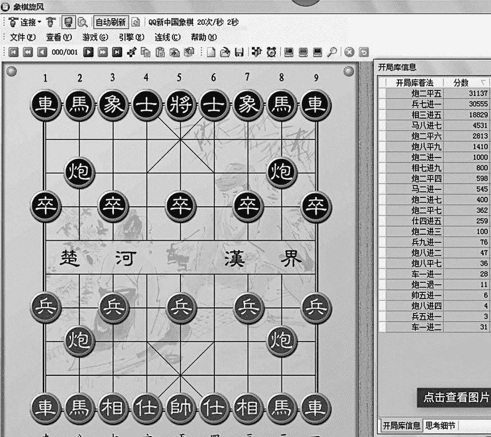

简单来说，训练一个策略（Actor）模型和环境进行交互（下棋），策略模型基于当前状态（当前局势）会选择一个动作（比如炮二平五）进入下一个状态，环境会反馈一个奖励（Reward）分数，训练模型的最终目标是使整局的奖励数学期望（回报）尽量大，也就相当于最大化动作优势（某一特定动作相对于其他动作的平均价值期望之差）。在下棋过程中，可通过计算奖励和价值来优化模型，以接近以上目标。

### **3.1 基础概念**

●**动作（Action）：**走一步棋，比如卒三进一就是一种动作，可以用*A*表示。

●**动作空间（Action Space）：**所有可以选择的动作的集合，比如图 3-1 中右侧的从“炮二平五”到“车一进二”的所有动作，可以用 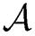表示。

●**环境（Environment）：**模型和智能体以外的所有统称，在 AI 象棋中对手、棋盘、打分反馈等统称为环境，可以用*ε*表示。

●**奖励（Reward）：**每走一步，仅当前步（不考虑后续局势）的综合分数，可以用*R*（*s*,*a*）表示。

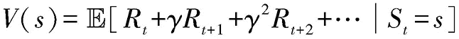

●**价值（Value）：**考虑每一步的奖励并且累加起来，对于未来的奖励可能会以折扣的方式计入。计算公式为，其中*γ*是折扣因子。

●**状态（State）：**当前敌我双方棋盘上每一个子例构成的局势就是当前状态，可以用*s*表示。

●**状态空间（State Space）：**所有的状态的集合就是状态空间，比如象棋中所有的对局可能就是状态空间，可以用 S 表示。

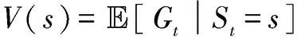

●**状态价值（State Value）：**系统给一个当前局势综合的分数，这个分数是当前状态下未来所有对局可能的奖励和的期望值。计算公式为，其中*G**[t]*=*R**[t]*+*γR**[t]*[+1]+*γ*²*R**[t]*[+2]+…。

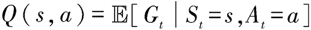

●**动作价值（Action Value）：**每走一步，每个动作后可能获得的局势综合分数，这个分数是当前动作完成后未来所有对局可能的奖励和的期望值。计算公式为

●**优势（Advantage）：**特定局势下采取某特定动作（炮二平五）获得的分数相对于其他所有可能动作价值的平均值的差。以下公式表明在*s*状态下采取动作*a*的价值减去*s*状态下所有动作平均价值即为优势：

*A*（*s*,*a*）=*Q*（*s*,*a*）-*V*（*s*）

●**策略（Policy）：**在一定状态下选择特定动作的概率模型。在 AI 象棋里，策略就是我们要训练的模型。可以用*π*（*a*|*s*）表示，即在状态*s*下选择动作*a*的概率。

●**强化学习目标（Reinforcement Learning Objective）：**强化学习（策略型强化学习）的目标是找到好的策略（好的策略指一定局势下能够获得高优势的动作）。

●**在线强化学习（Online Reinforcement Learning）：**指模型一边探索，一边获得环境的奖励，并根据奖励进行更新。在 AI 象棋里可以理解为一边下棋，一边进行策略的更新。

●**离线强化学习（Offline Reinforcement Learning）：**指吸收过往经验，这里的经验并不是当前策略正在进行的棋局。

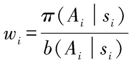

●**重要性采样（Importance Sampling）：**离线学习时，经验样本（过往对局、别人的对局）对于现在的策略模型的重要程度。可以用表示，其中*w**[i]*表示第*i*个样本的重要性权重，*π*表示目标策略，*b*表示行为策略。

### **3.2 大语言模型中的 RLHF**

**3.2.1 PPO**

PPO（Proximal Policy Optimization）属于 Actor-Critic 模型，也是在线-离线强化学习模型，兼顾了在线模型探索和离线模型利用效率高的优点。接下来使用伪代码对 PPO 算法进行讲解，具体代码如下所示。

Bash

#超参数

K = 3       #每次迭代中策略更新的次数

T = 2048      #每次采样的时间步数

M = 64       #每次更新的 mini-batch 大小

epsilon = 0.2   #PPO 的裁剪范围

gamma = 0.99    #折扣因子

lambda_ = 0.95   #GAE 的超参数

alpha = 0.0003   #学习率

#由于并不是所有的环境都会直接反馈 Reward 和 Value，所以在这种情况下需要训练奖励模型和评估模型。这两个模型分别用于模拟环境生成的 Reward 和 Value

#初始化策略模型、值函数网络和奖励模型

policy_network = PolicyNetwork（）

value_network = ValueNetwork（）

reward_model = RewardModel（）

#初始化优化器（不需要为奖励模型定义优化器，这是因为奖励模型训练好就不再更新）

policy_optimizer = Adam（policy_network.parameters（）, lr=alpha）

value_optimizer = Adam（value_network.parameters（）, lr=alpha）

for iteration in range（max_iterations）:

  #1.采样数据

  states, actions, rewards, dones, log_probs_old = collect_trajectories（policy_network, T）

  #2.使用奖励模型预测奖励（奖励模型不更新）

  predicted_rewards = reward_model（states, actions）

  #3.计算回报（价值）和优势

  value = compute_returns（predicted_rewards if use_reward_model else rewards, gamma）

  advantages = compute_advantages（predicted_rewards if use_reward_model else rewards,value_network, gamma, lambda_）

  #4.更新策略模型和值函数网络

  for epoch in range（K）:

    #将数据分成 mini-batches

    for batch in get_mini_batches（states, actions, returns, advantages,

      log_probs_old, M）:

      states_b, actions_b, returns_b, advantages_b, log_probs_old_b = batch

      #4.1 计算新的对数概率

      log_probs_new = policy_network.get_log_prob（states_b, actions_b）

      #4.2 计算策略损失 （Clipped Surrogate Objective）

      ratio = exp（log_probs_new - log_probs_old_b）

      clipped_ratio = clip（ratio, 1 - epsilon, 1 + epsilon）

      policy_loss = -min（ratio * advantages_b, clipped_ratio * advantages_b）.mean（）

      #4.3 计算值函数损失 （MSE）

      values_pred = value_network（states_b）

      value_loss = （returns_b - values_pred）.pow（2）.mean（）

      #4.4 计算熵正则化项

      entropy = policy_network.get_entropy（states_b）

      #4.5 计算总损失（忽略奖励模型的损失）

      total_loss = policy_loss + 0.5 * value_loss - 0.01 * entropy

      #4.6 更新网络参数（跳过奖励模型）

      policy_optimizer.zero_grad（）

      value_optimizer.zero_grad（）

      total_loss.backward（）

      policy_optimizer.step（）

      value_optimizer.step（）

LLM 本身就是策略模型，动作是生成 Token，状态是目前生成的语言序列。早期的 Reward 是训练奖励模型对当前动作进行预测得到的，状态值 Value 是由经过训练的评估模型预测所获得的。以下是在大语言模型中预测一个动作、状态、奖励以及价值的示例：

Plain Text

input:你好。

output：你好，阿姨？

#动作   状态         奖励     价值

a1:你/你 s1:你        r1:0.2    v1:0.2

a2:好   s2:你好       r2:0.6    v2:0.8

a3:，   s3:你好，      r3:0.5    v3:1.3

a4:，   s4:你好，阿姨    r4:-0.2    v4:1.1

a5:？   s5:你好，阿姨？   r5:-0.1    v5:1.0

上述代码解释了在大语言模型生成动作过程中，动作、状态、奖励、价值之间的简单关系。动作可以理解为生成当前的 Token，状态为之前生成的序列，奖励为当前动作获得的反馈分数，价值是之前一系列动作的累计分数。

接下来对 PPO 的伪代码进行解释。

1）首先使用当前策略模型对输入多个 Prompt 进行采样，获得每一个 Prompt 在此时的输出（包括状态、动作）。

Plain Text

  states, actions, dones, log_probs_old = collect_trajectories（policy_network, T）

2）根据当前的状态和动作预测每个动作的奖励：

Plain Text

  predicted_rewards = reward_model（states, actions）

3）对每一个 Prompt 采样获得的轨迹计算回报和优势：

*A*（*s*,*a*）=*Q*（*s*,*a*）-*V*（*s*）

*G**[t]*表示回报值，也是价值。计算方式为

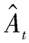

表示优势值，代表在状态*s*下采取动作*a*的价值相对于所有动作平均价值之差。

*V*（*s*）有 3 种计算方式，具体如下。

①蒙特卡洛方法。计算公式如下：

蒙特卡洛方法对*V*（*s*）的估计是首先计算多个样本序列的价值，然后取平均值作为状态价值。也就是说，蒙特卡洛方法估计的一个样本是一个完整的动作序列，比如一条完整的语句、一盘完整的象棋对弈。很容易可知，蒙特卡洛估计必定是对*V*（*s*）的无偏估计，但是由于最细粒度样本是整局，导致样本少、方差大。

②时序差分方法。计算公式如下：

*V*（*s**[t]*）←*V*（*s**[t]*）+*α*（*r**[t]*[+1]+*γV*（*s**[t]*[+1]）-*V*（*s**[t]*））

时序差分方法对*V*（*s*）估计的最小粒度是动作时间步，但是该方法并不是对*V*（*s*）的无偏估计，因此会导致偏差比蒙特卡洛方法大，但方差小。

③广义优势方法。计算公式如下：

其中，*γ*是折扣因子，用来计算未来奖励的当前价值。*λ*是 GAE 的混合参数，调节了估计的偏差和方差之间的权衡。*δ**[t]*表示时序差异误差（Temporal Difference Error），反映了即时奖励与状态价值预测之间的差异。

以下是计算回报、价值和优势的代码：

Python

returns/value = compute_returns（predicted_rewards if use_reward_model else rewards, gamma）

advantages = compute_advantages（predicted_rewards if use_reward_model else rewards, value_network,gamma, lambda_）

4）计算重要性采样。这是因为 PPO 属于在线/离线算法，需要判断采样时的策略模型与目前策略模型的差异程度。差异程度越大，重要性越低。伪代码如下。

Python

#4.1 计算新的对数概率

log_probs_new = policy_network.get_log_prob（states_b, actions_b）

#4.2 计算策略损失 （Clipped Surrogate Objective），重要性采样

ratio = exp（log_probs_new - log_probs_old_b）

5）计算 clip 操作后的损失值，主要考虑 Actor 模型单次更新不要太大，代码如下：

Python

#4.2 计算策略损失 （Clipped Surrogate Objective）

ratio = exp（log_probs_new - log_probs_old_b）

clipped_ratio = clip（ratio, 1 - epsilon, 1 + epsilon）

policy_loss = -min（ratio * advantages_b, clipped_ratio * advantages_b）.mean（）

计算策略模型损失公式：

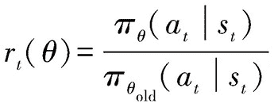

其中，是新旧策略下采取动作*a**[t]*在状态*s**[t]*下的概率比，也就是上文中的重要性采样。 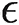

是一个超参数，用于控制新旧策略之间的偏差程度，通常取值为 0.1 或 0.2。

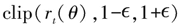 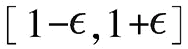

表示将*r**[t]*（*θ*）值裁剪到范围内。

6）计算评估模型的损失，代码如下：

Python

#4.3 计算值函数损失 （MSE）

values_pred = critic_network（states_b）

value_loss = （returns_b - values_pred）.pow（2）.mean（）

这里其实是在采样后，更新评估模型，使模型能够更加无偏地预测当前的状态价值。

7）将策略的损失和评论的损失加起来，并且更新评估模型和策略模型，代码如下：

Python

total_loss = policy_loss + 0.5 * value_loss - 0.01 * entropy

#4.6 更新网络参数（跳过奖励模型）

policy_optimizer.zero_grad（）

value_optimizer.zero_grad（）

total_loss.backward（）

policy_optimizer.step（）

value_optimizer.step（）

Python

#4.7 更新策略模型和值函数网络

  for epoch in range（K）:

8）进入下一个外循环，重复第 1～7 步，重新采样，代码如下：

Python

for iteration in range（max_iterations）:

9）进入下一个内循环，重复第 4～7 步，注意此时是离线模式了，因为模型更新了。

PPO 的缺点如下。

●**显存消耗大：**同时存在奖励模型、评估模型、参与者模型、参考模型 4 个模型，其中评估模型和参与者模型都需要更新，因此需要很大的显存。

●**奖励漏洞（Reward Hack）：**由于奖励模型是在模拟环境给予的奖励分数，存在预测与实际的偏差，甚至比较大的偏差，从而使模型朝着奖励模型给予错误的高分方向偏离。

●**评估偏差大：***V**[s]*表示由评估模型预测未来的奖励和，奖励又来自奖励模型的预测，因此评估模型的偏差会更大。

●**效率较低：**由于在线算法的存在，进行在线采样时模型需要等待更新。

**3.2.2 DPO**

DPO（Direct Policy Optimization）算法伪代码如下：

Python

#导入必要的库

import torch

import torch.nn as nn

from torch.optim import Adam

#1.定义初始化模型的函数

def initialize_model（model_class, model_config）:

  """

  初始化模型

  :param model_class:模型的类（例如 Transformer 或 GPT）

  :param model_config:模型的配置参数（例如层数、隐藏层大小等）

  :return:初始化后的模型

  """

  model = model_class（**model_config） #根据配置初始化模型

  return model

#2.定义 DPO 训练函数

def train_dpo（D, π_ref, π_θ, β, α, epochs）:

  """

  DPO 训练函数

  :param D:数据集，包含输入 x 和偏好对 （y_w, y_l）

  :param π_ref:参考模型（预训练的语言模型）

  :param π_θ:待优化的策略模型

  :param β:温度参数，控制偏好差异的敏感度

  :param α:学习率

  :param epochs:训练轮数

  :return:训练好的模型 π_θ

  """

  #初始化优化器（例如 Adam）

  optimizer = Adam（π_θ.parameters（）, lr=α）

  for epoch in range（epochs）:           #遍历每一轮训练

    for （x, y_w, y_l） in D:           #遍历数据集中的每个样本

      #1.计算参考模型的对数概率

      log_p_ref_w = π_ref（y_w | x）      #参考模型对 y_w 的对数概率

      log_p_ref_l = π_ref（y_l | x）      #参考模型对 y_l 的对数概率

      #2.计算待优化模型的对数概率

      log_p_θ_w = π_θ（y_w | x）        #待优化策略模型对 y_w 的对数概率

      log_p_θ_l = π_θ（y_l | x）        #待优化策略模型对 y_l 的对数概率

      #3.计算对数概率差异

      log_diff_w = log_p_θ_w - log_p_ref_w   #y_w 的对数概率差异

      log_diff_l = log_p_θ_l - log_p_ref_l   #y_l 的对数概率差异

      #4.计算 DPO 损失函数

      loss = -log_sigmoid（β * （log_diff_w - log_diff_l）） #使用 sigmoid 函数计算损失

      #5.反向传播和优化

      optimizer.zero_grad（）          #清空梯度

      loss.backward（）             #计算梯度

      optimizer.step（）            #更新模型参数

      # 6.打印损失（可选）

      if epoch % 10 == 0:

        print（f"Epoch {epoch}, Loss: {loss.item（）}"）

  #返回训练好的模型

  return π_θ

#3.辅助函数：log_sigmoid

def log_sigmoid（z）:

  """

  计算 log（sigmoid（z））

  :param z:输入值

  :return: log（sigmoid（z））

  """

  return -torch.log（1 + torch.exp（-z））     #log（σ（z）） = -log（1+ exp（-z））

#4.示例：如何使用初始化函数和训练函数

if __name__ == "__main__":

  #定义模型配置

  model_config = {

    "n_layers": 12,

    "hidden_size": 768,

    "n_heads": 12,

    "vocab_size": 50257,

  }

  #初始化参考模型和待优化模型

  π_ref = initialize_model（TransformerLM, model_config） #参考模型

  π_θ = initialize_model（TransformerLM, model_config）  #待优化的策略模型

  #定义数据集 D（假设已经加载）

  D = load_dataset（）                   #加载数据集

  #定义超参数

  β = 0.1                         #温度参数

  α = 1e-5                         #学习率

  epochs = 100                       #训练轮数

  #训练模型

  trained_model = train_dpo（D, π_ref,π_θ, β, α, epochs）

DPO 的损失函数如下：

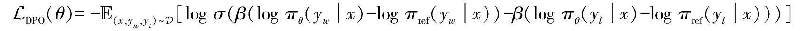

由损失函数可知,（log *π**[θ]*（*y**[w]*|*x*）-log *π*[ref]（*y**[w]*|*x*））是为了让策略模型*π**[θ]*接近正确的偏好的同时不要偏离参考模型*π*[ref]太远。-*β*（log *π**[θ]*（*y**[l]*|*x*）-log *π*[ref]（*y**[l]*|*x*））是为了让策略模型*π**[θ]*远离错误的偏好的同时不要偏离参考模型*π*[ref]太远。

虽然 DPO 避免了 PPO 的缺点，但是也带来了一些 PPO 不存在的缺点。

●由于模型是离线学习，所有的数据样本都是已知的，不存在探索能力，模型预测能力很难大幅度超过正样本的平均水平。

●没有奖励模型虽然减小了偏差，但是也没有了细粒度的奖励值，只能区分好坏，没有好坏的区分程度。

●标注更加困难，PPO 算法只需要提供输入（象棋里的开局或残局、大模型训练的输入），DPO 算法还需要提供两个有好坏之分的动作序列。（象棋中过往棋局的妙手和败招、语言模型中好的输出以及坏的输出。）

### **3.3 GRPO**

GRPO 算法是 PPO 算法的变体，主要是对优势计算的修改。让我们先回顾一下 PPO 算法的损失函数：

优势计算如下：

组内归一化（减均值，除以方差）的原因如下。

*r*[1],*r*[2],…,*r**[G]*是在同一个问题输入下，采样第 1、2…*G*个输出的奖励值 Reward 为一组。对于代码任务，输出一组奖励分数（1，2，3）；对于写作任务，输出一组奖励分数（3，4，5）。如果没有进行归一化，写作任务中所有奖励分数都比代码任务的奖励分数高，这将导致所有的写作任务都被奖励，而所有的代码任务都被惩罚。但是真实目的应该是对同一个任务中好的回复进行奖励，差的任务进行惩罚。

GRPO 的伪代码如下：

Bash

#超参数

K = 3      #每次迭代中策略更新的次数

T = 2048    #每次采样的时间步数

M = 64     #每次更新的 mini-batch 大小

epsilon = 0.2  #PPO 的裁剪范围

gamma = 0.99  #折扣因子

lambda_ = 0.95 #GAE 的超参数

alpha = 0.0003 #学习率

#由于并不是所有的环境都会直接反馈 Reward 和 Value，所以经常需要使用训练（奖励模型）和（评估模型）来模拟环境生成的 Reward 和 Value

#初始化策略模型、值函数网络和奖励模型

policy_network = PolicyNetwork（）

reward_model = RewardModel（）

#初始化优化器（不需要为奖励模型定义优化器，这是因为 Reward 训练好就不再更新）

policy_optimizer = Adam（policy_network.parameters（）, lr=alpha）

for iteration in range（max_iterations）:

  #1.采样数据

  states, actions, rewards, dones, log_probs_old = collect_trajectories（policy_network, T）

  #2.使用奖励模型预测奖励（奖励模型不更新）

  predicted_rewards = reward_model（states, actions）

  #3.计算回报（价值）和优势

  value = compute_returns（predicted_rewards if use_reward_model else rewards, gamma）

  advantages = compute_advantages（predicted_rewards if use_reward_model else rewards, value_network, gamma, lambda_）

  #4.更新策略模型

  for epoch in range（K）:

    #将数据分成 mini-batches

    for batch in get_mini_batches（states, actions, returns, advantages, log_probs_old, M）:

      states_b, actions_b, returns_b, advantages_b, log_probs_old_b = batch

      #4.1 计算新的对数概率

      log_probs_new = policy_network.get_log_prob（states_b, actions_b）

      #4.2 计算策略损失（Clipped Surrogate Objective）

      ratio = exp（log_probs_new - log_probs_old_b）

      clipped_ratio = clip（ratio, 1 - epsilon, 1 + epsilon）

      policy_loss = -min（ratio * advantages_b, clipped_ratio * advantages_b）.mean（）

      #4.3 总损失（忽略奖励模型的损失）

      total_loss = policy_loss

      #4.4 更新网络参数（跳过奖励模型）

      policy_optimizer.zero_grad（）

      total_loss.backward（）

      policy_optimizer.step（）

GRPO 算法的优点如下。

●GRPO 已经没有了评估模型，从而减少了显存消耗。

●GRPO 的优势值已经与价值无关，直接使用奖励值代替。这样减小了预估价值带来的偏差。

●由于 GRPO 的优势值直接用奖励值进行替代，因此一些能够给予明确反馈的任务（比如代码、数学）可以不需要奖励模型。

### **3.4 大语言模型中的强化学习训练数据格式**

**1.SFT 的数据标注格式**

强化学习和 SFT（Supervised Fine-Tuning，监督微调）有所差别，SFT 可以简单理解为，考试的时候老师给了一个标准答案，这更适合更低年级的学生，强化学习（在线）没有给出答案，需要自己探索，但是探索过程中会给予一个反馈，这样也更加容易创新，可能更加适合高年级的学生。

SFT 的数据标注格式一般包括两种，一种是带有 system 字段的，示例如下：

Plain Text

system：You are a helpful assistant.

user:hello,nice to meet you.

assistant:nice to meet you too.

另一种是不带 system 字段的，示例如下：

Plain Text

user:hello,nice to meet you.

assistant:nice to meet you too.

以上两种标注输入模型前会被拼接。大语言模型在生成 user 和 assistant 过程中会停顿，这也是为什么大语言模型看起来在完成和人类的对话。大语言模型本身接收到的拼接文本有如下两种。

大语言模型接收到的有 system 字段拼接的字符串：

<|im_start|>system

You are a helpful assistant.<|im_end|>

<|im_start|>user

hello, nice to meet you.<|im_end|>

<|im_start|>assistant

nice to meet you too.<|im_end|>

大语言模型接收到的无 system 字段拼接的字符串：

<|im_start|>user

hello, nice to meet you.<|im_end|>

<|im_start|>assistant

nice to meet you too.<|im_end|>

注意：文本切分的 Token 在输入语言模型中时，除了 assistant 字段以外，都不计入交叉熵损失，伪代码如下：

Python

import torch

import torch.nn as nn

#假设输入是一个对话序列，包含 user 和 assistant 字段

#例如：["user: hello, nice to meet you.", "assistant: nice to meet you too."]

input_sequence = system：You are a helpful assistant.user:hello,nice to meet you.assistant:nice to meet you too.

#将输入序列转换为模型输入（例如 Token IDs）

#这里假设 Tokenizer 是一个预定义的 Tokenizer

input_ids =Tokenizer（input_sequence, return_tensors="pt", padding=True）.input_ids

#假设模型是一个预训练的语言模型

model = …           #例如 GPT-2

#前向传播，获取模型的输出 logits

output_logits = model（input_ids）.logits

#创建标签，将 user 部分的 Token 设置为 -100（计算 Loss 时忽略-100 的位置）

#假设 user 部分的 Token 长度为 5，assistant 部分的 Token 长度为 7

labels = input_ids.clone（） #复制输入作为标签

labels[:, :5] = -100     #将 user 部分的 Token 设置为 -100（计算 Loss 时忽略-100 的位置）

#定义交叉熵损失函数，并设置 ignore_index=-100

loss_fn = nn.CrossEntropyLoss（ignore_index=-100）

#计算损失

#注意：logits 的维度是 [batch_size, sequence_length, vocab_size]

#labels 的维度是 [batch_size, sequence_length]

loss = loss_fn（output_logits[:, :-1, :].reshape（-1, output_logits.size（-1））,

  labels[:, 1:].reshape（-1））

print（"Loss:", loss.item（））

如表 3-1 所示，在以上训练过程中，由于大语言模型执行的是自回归的 NSP 任务，即用前方的 Token 预测下一个 Token，因此训练时的输入 Token 和输出 Token 需要错开一位，以上方无 system 为例，<BOS>和<EOS>分别表示开始符和结束符。**[表][3][-][1][S][F][T][中][输][入][T][o][k][e][n][和][输][出][T][o][k][e][n][位][置][对][比]**

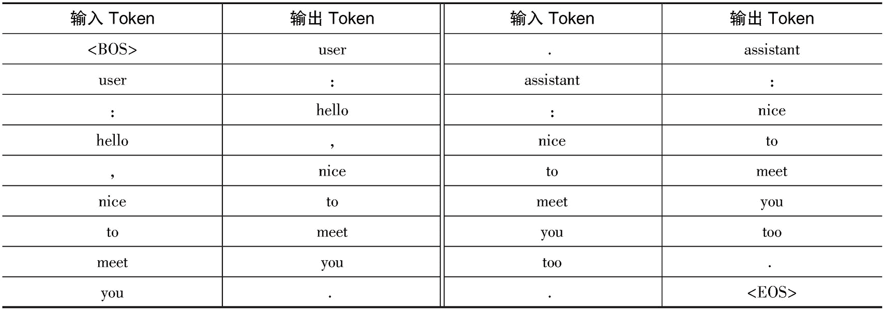

**2.DPO 的数据标注格式**

DPO 中奖励模型使用和 PPO 中奖励模型相同的数据进行标注，并且使用排序损失（Rank Loss）进行训练。Rank Loss 具体计算公式如下：

*L*[Rank]=max（0,*m*-*s*^++*s*^-）

其中，*s*^+和*s*^-分别表示正负样本的分数。

rank_loss 代码如下：

Python

import torch

class RankingLoss（torch.nn.Module）:

  def __init__（self, margin=1.0）:

    super（）.__init__（）

    self.margin = margin  # 间隔超参数

  def forward（self, s_plus, s_minus）:

    """

    s_plus:正样本得分 （batch_size,）

    s_minus:负样本得分 （batch_size,）

    """

    #计算间隔损失项

    loss = torch.clamp（

      self.margin - s_plus + s_minus,

      min=0.0

    ）

    return loss.mean（）

该损失函数的核心目标是强制正样本得分*s*^+要高于负样本得分*s*^-至少一个间隔*m*，当不满足*s*^+>*s*^-+*m* 条件时，损失函数不为零，进行梯度下降，因此更新模型将导致*s*^+>*s*^-+*m* 的条件趋向于满足。对同一批次的所有样本损失取平均将获得更多的奖励信号，这个损失函数和 MSE 之类的不同，没有强监督信号（比如标签是一个明确值），所以一般需要大量的样本。

训练奖励模型代码如下：

Python

import torch

from torch.utils.data import Dataset, DataLoader

fromTransformers import AutoTokenizer, AutoModel

#配置参数

class Config:

  Pretrained_model = "bert-base-uncased" #使用 Hugging Face 的预训练模型

  batch_size = 16

  num_epochs = 3

  learning_rate = 1e-5

  margin = 0.5              #排序损失的间隔参数

  max_length = 128            #文本最大长度

#自定义数据集类

class TextPairDataset（Dataset）:

  def __init__（self,Tokenizer, file_path）:

    """

    Tokenizer: 文本分词器

    file_path:包含正负样本对的文本文件路径

    数据格式假设：（每行）

    positive_text \\t negative_text

    """

    self.Tokenizer = Tokenizer

    self.data = []

    with open（file_path, 'r', encoding='utf-8'） as f:

      for line in f:

        prompt, pos, neg = line.strip（）.split（'\\t'）

        self.data.append（（pos, neg））

  def __len__（self）:

    return len（self.data）

  def __getitem__（self, idx）:

    prompt, pos_text, neg_text =self.data[idx]

    #对正负样本分别进行编码

    pos_encoded = self.Tokenizer（

      prompt+pos_text,

      max_length=Config.max_length,

      padding='max_length',

      truncation=True,

      return_tensors='pt'

    ）

    neg_encoded = self.Tokenizer（

      prompt+neg_text,

      max_length=Config.max_length,

      padding='max_length',

      truncation=True,

      return_tensors='pt'

    ）

    return {

      'pos_input_ids': pos_encoded['input_ids'].squeeze（0）,

      'pos_attention_mask': pos_encoded['attention_mask'].squeeze（0）,

      'neg_input_ids': neg_encoded['input_ids'].squeeze（0）,

      'neg_attention_mask': neg_encoded['attention_mask'].squeeze（0）

    }

#定义评分模型

class ScoringModel（torch.nn.Module）:

  def __init__（self）:

    super（）.__init__（）

    self.bert = AutoModel.from_Pretrained（Config.Pretrained_model）

    self.scoring_layer = torch.nn.Linear（self.bert.config.hidden_size, 1）

  def forward（self, input_ids, attention_mask）:

    """

    输入：

      input_ids:token IDs 张量 （batch_size, seq_len）

      attention_mask:注意力掩码 （batch_size, seq_len）

    输出：

      scores:样本得分 （batch_size,）

    """

    outputs = self.bert（input_ids, attention_mask=attention_mask）

    pooled_output = outputs.last_hidden_state[:, 0] #取[CLS]位置的表示

    scores = self.scoring_layer（pooled_output）.squeeze（-1）

    return scores

#排序损失函数（与之前相同）

class RankingLoss（torch.nn.Module）:

  def __init__（self, margin=1.0）:

    super（）.__init__（）

    self.margin = margin

  def forward（self, s_plus, s_minus）:

    loss = torch.clamp（self.margin - s_plus + s_minus, min=0.0）

    return loss.mean（）

#主训练流程

def main（）:

  #0.设备配置

  Device = torch.Device（"cuda" if torch.cuda.is_available（） else "cpu"）

  print（f"UsingDevice: {Device}"）

  #1.初始化组件

  tokenizer = Autotokenizer.from_Pretrained（Config.Pretrained_model）

  model = ScoringModel（）.to（Device）

  optimizer = torch.optim.Adam（model.parameters（）, lr=Config.learning_rate）

  loss_fn = RankingLoss（margin=Config.margin）

  #2.加载数据

  train_dataset = TextPairDataset（tokenizer, "train_data.txt"）

  train_loader = DataLoader（

    train_dataset,

    batch_size=Config.batch_size,

    shuffle=True,

    collate_fn=lambda batch: {

      'pos_input_ids': torch.stack（[x['pos_input_ids'] for x in batch]）,

      'pos_attention_mask': torch.stack（[x['pos_attention_mask'] for x in batch]）,

      'neg_input_ids': torch.stack（[x['neg_input_ids'] for x in batch]）,

      'neg_attention_mask': torch.stack（[x['neg_attention_mask'] for x in batch]）

    }

  ）

  #3.训练循环

  model.train（）

  for epoch in range（Config.num_epochs）:

    total_loss = 0.0

    for i, batch in enumerate（train_loader）:

      #将数据移动到设备上

      pos_input_ids = batch['pos_input_ids'].to（Device）

       pos_attention_mask = batch['pos_attention_mask'].to（Device）

      neg_input_ids = batch['neg_input_ids'].to（Device）

      neg_attention_mask = batch['neg_attention_mask'].to（Device）

      #前向传播

      pos_scores = model（pos_input_ids, pos_attention_mask）

      neg_scores = model（neg_input_ids, neg_attention_mask）

      #计算损失

      loss = loss_fn（pos_scores, neg_scores）

      #反向传播

      optimizer.zero_grad（）

      loss.backward（）

      optimizer.step（）

      total_loss += loss.item（）

      #每 100 个 Batch 打印一次进度

      if i % 100 == 99:

        avg_loss = total_loss / 100

        print（f"Epoch {epoch+1} | Batch {i+1} | Loss: {avg_loss:.4f}"）

        total_loss = 0.0

#执行主函数

if __name__ == "__main__":

  main（）

**3.PPO 和 GRPO 的数据标注格式**

PPO 和 GRPO 的数据标注都是最简单的，因为都属于在线强化学习，在奖励模型充分训练的前提下，只需要提供输入就行，输出由环境打分。

PPO 和 GRPO 的数据标注格式如下：

Python

prompt：请问我要怎么去×××××。

PPO 和 GRPO 需要对模型输出的结果进行奖励打分，这时可以使用奖励模型。PPO 和 GRPO 奖励模型的数据标注方式和前面 DPO 的相同，这里不再赘述。

## **第四章 大语言模型量化**

大语言模型量化是指将深度学习模型中的权重和激活值从高精度（如 32 位浮点数）转换为低精度（如 8 位整数或 16 位浮点数）表示的过程，目的是减小模型的存储需求和降低计算复杂度，从而加速推理过程并降低能耗。量化可以在几乎不损失模型准确性的前提下，显著提高计算效率和部署灵活性，使得大规模深度学习模型能够在资源受限的设备上运行。

量化基础主要包括模型权重和激活值的量化算法、量化感知训练（Quantization-Aware Training,QAT）以及训练后量化（Post Training Quantization,PTQ）技术。本章主要针对大语言模型的精度、量化基础知识、量化的基本方式以及量化效果的影响因素等进行了详细阐述。

### **4.1 大语言模型精度基础知识**

首先需要明确的是，包括大语言模型在内的深度学习模型本质上都是进行矩阵的数值计算，既然是数值计算，必然有数值精度的概念。不同数据精度对应的十进制的值的计算公式如下：

Value=（-1）*^s*×2^（*^E*^(-bias）)×（1+*M*）

其中，*s*表示符号位（0 表示正数，1 表示负数）。*E*表示指数位转换成十进制后的值，bias 在 FP16 精度下的值是 15。*M*是尾数位，表示小数部分。在 IEEE 754 标准中，默认在小数点前加上隐含的 1，因此实际使用的尾数是 1*M*。

在大语言模型领域，常用的精度如图 4-1 所示。**[图][4][-][1][常][用][的][精][度]**

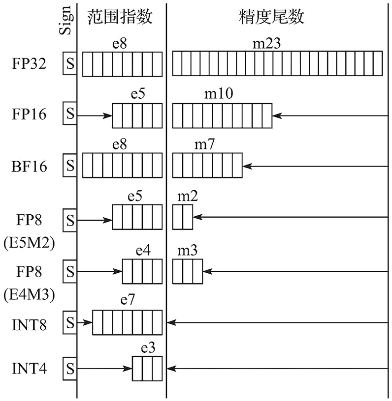

**1.FP32（32-bit Floating Point）**

FP32 是深度学习中常用的 32 位数据精度之一，其特性具体如下。

●**指数位：**FP32 使用 8 位表示指数部分。

●**小数位：**FP32 使用 23 位表示小数部分（尾数）。

●**最小精度：**FP32 的最小精度为 2^(-23)。

●**数值范围：**FP32 的数值范围为±3.4×10³⁸。

**2.TF32（Tensor Float 32）**

TF32 是深度学习中常见的数据精度之一，其特性具体如下。

●**指数位：**TF32 使用 8 位表示指数部分。

●**小数位：**TF32 使用 10 位表示小数部分（尾数）。

●**最小精度：**TF32 的最小精度为 2^(-10)。

●**数值范围：**TF32 的指数范围与 FP32 相同，因此数值范围基本也与 FP32 一致，但是由于小数位的降低，因此降低了通信量和计算量。

**3.FP16（16-bit Floating Point）**

FP16 是目前训练推理中主流的数据精度之一。

●**指数位：**FP16 使用 5 位表示指数部分。

●**小数位：**FP16 使用 10 位表示小数部分（尾数）。

●**最小精度：**FP16 的最小精度为 2^(-10)。

●**数值范围：**FP16 的数值范围为±6.55×10⁴。

**4.BF16（Brain Floating Point 16）**

BF16 有着更宽的数值范围，更粗的数据精度。

●**指数位：**BF16 使用 8 位表示指数部分（与 FP32 相同）。

●**小数位：**BF16 使用 7 位表示小数部分（尾数）。

●**最小精度：**BF16 的最小精度为 2^(-7)（约 7.81×10^(-3)）。

●**数值范围：**BF16 的数值范围与 FP32 相同，为±3.4×10³⁸。

注意：经过实验发现模型训练中，数值范围比最小精度更加重要，因此 BF16 在 FP16 的基础上增加了指数位，减少了小数位。

**5.FP8 E4M3（8-bit Floating Point）**

FP8 是一种 8 位浮点数格式，其中 FP8 E4M3 有 4 位指数，3 位尾数。

●**指数位：**FP8 E4M3 使用 4 位表示指数部分。

●**小数位：**3 位尾数对应显式存储的 3 比特（范围为 0～7），但实际尾数精度通过隐含前导 1 的方式实现，即总尾数范围为[1,1.875]（计算时需加 1）。

●**最小精度：**FP8 E4M3 的最小精度为 2^(-9)。

●**最大值：**FP8 E4M3 的最大值为 1.75×2⁸。

**6.FP8 E5M2（8-bit Floating Point）**

FP8 E5M2 有 5 位指数，2 位尾数。

●**指数位：**FP8 E5M2 通常使用 5 位表示指数部分。

●**小数位：**FP8 E5M2 使用 2 位表示小数部分（尾数）。

●**最小精度：**FP8 E5M2 的最小精度为 2^(-16)。

●**最大值：**FP8 E5M2 的最大值为 1.75×2¹⁵。

**7.INT8（8-bit Integer）**

INT8 是一种 8 位整型格式，多用于深度学习的量化推理。

●**指数位：**INT8 是整数格式，没有指数位。

●**小数位：**INT8 是整数格式，没有小数位。

●**最小精度：**INT8 的最小精度为 1。

●**数值范围：**INT8 的数值范围为[-128,127]。

**8.INT4（4-bit Integer）**

INT4 是一种 4 位整型格式，多用于深度学习的量化推理。

●**指数位：**INT4 是整数格式，没有指数位。

●**小数位：**INT4 是整数格式，没有小数位。

●**最小精度：**INT4 的最小精度为 1。

●**数值范围：**INT4 的数值范围为[-8,7]。

### **4.2 量化基础知识**

由于高精度向低精度转换的过程中必定存在信息丢失，所以模型轻量化的核心目标就是在降低数据精度的同时尽量保证模型的性能，减少量化导致的输出损失。

**4.2.1 线性量化**

在所有的量化方法中，线性量化是最简单也是最常用的量化方法，可将浮点数线性映射到整数范围。

注意：后文如果没有特别说明，默认为线性量化。

线性量化的公式：

其中，*x*表示输入的浮点数值。scale 表示量化比例因子，通常由数据的最大值和最小值决定。*q*表示量化后的低 bit 整数值。

线性量化的特点如下。

●线性量化假设数据分布是均匀的。

●计算简单，适用于硬件加速。

**4.2.2 非线性量化**

非线性量化通过非线性函数将浮点数值映射到离散值，适用于数据分布不均匀的情况。非线性量化通常使用对数、指数或其他非线性函数进行映射。

非线性量化的公式：

其中， 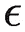是一个很小的常数，用于避免对零取对数。

非线性量化的特点如下。

●计算复杂度较高，但能更好地保留数据的重要特征。

**4.2.3 对称量化**

对称量化是一种线性量化方法，其量化范围关于零对称。

对称量化的公式：

其中，*b*表示量化的比特数。

对称量化的特点如下。

●量化范围对称，适用于数据分布关于零对称的情况。

●实现简单，对硬件支持较好。

**4.2.4 非对称量化**

非对称量化是一种线性量化方法，其量化范围不对称，可以更好地适应数据分布。

非对称量化的公式：

其中，*b*表示量化的比特数。

非对称量化的特点如下。

●量化范围不对称，适用于数据分布不均匀的情况。

●能更好地保留数据的动态范围。

**4.2.5 量化感知训练**

量化感知训练（Quantization Aware Training,QAT）是一种在模型训练过程中模拟量化效果的技术。通过在训练阶段引入量化操作，模型可以更好地适应量化带来的精度损失，从而在推理阶段保持较高的性能。注意，由于大语言模型的训练成本高，较少使用量化感知训练方式。下面是实现量化感知训练的主要步骤。

（1）定义量化模型

在模型的定义中，插入伪量化节点，这些节点在训练过程中模拟量化的效果。伪量化节点通常包括量化和反量化操作，以模拟量化后的数值范围和精度。

（2）训练模型

使用常规的训练算法（如 SGD、Adam 等）对模型进行训练。在每次前向传播时，伪量化节点会模拟量化操作，使得模型在训练过程中逐渐适应量化带来的精度损失。

（3）微调模型

在训练后期，可以对模型进行微调，以进一步减少量化带来的精度损失。微调过程中，可以调整学习率或其他超参数，以确保模型在量化后仍能保持良好的性能。

（4）导出量化模型

训练完成后，将模型导出为量化格式。在推理阶段，模型将直接使用量化后的权重和激活值进行计算，从而提高推理速度并减少内存占用。

**4.2.6 训练后量化**

训练后量化（Post Training Quantization,PTQ）是一种在模型训练完成后进行量化的技术。与量化感知训练不同，训练后量化不需要重新训练模型，而是通过校准数据来调整模型的权重值和激活值，以适应量化后的数值范围。下面是实现训练后量化的主要步骤。

（1）准备校准数据

选择一组代表性的校准数据（通常是从训练集中抽取的子集）。校准数据用于确定量化参数（如缩放因子和零点）。

（2）量化模型

●使用校准数据对模型进行前向传播，记录每一层的激活值以及权重值的分布。

●根据具体的算法（比如 LLM.INT8、AWQ、GPTQ），计算每一个 Block 的量化参数（如缩放因子和零点）。

（3）应用量化参数

●将计算得到的量化参数应用到模型的权重值和激活值上进行量化。

●量化操作通常包括将浮点数转换为整数（如 INT8），并应用缩放因子和零点进行调整。

（4）验证量化模型

●使用验证集对量化后的模型进行验证，确保量化后的模型性能没有显著下降。

●如果性能下降较多，可以尝试调整量化参数或使用更复杂的量化方法（如逐层量化）。

（5）导出量化模型

●验证通过后，将量化后的模型导出为推理格式（如 TensorFlow Lite、ONNX 等）。

●在推理阶段，模型将直接使用量化后的权重值和激活值进行计算，从而提高推理速度并减少内存占用。

**4.2.7 反量化**

反量化是将低精度数据转换回高精度数据的过程，通常用于量化模型推理时恢复数据精度，也常用于混合精度计算。

反量化的公式：

*x*′=***q***×scale+zero_point

由于量化中存在一个 round 函数取整过程，这个过程中存在不可逆的信息丢失，因此*x*′（量化后的值）与*x*（量化前的值）之间存在差异。这也是量化后的推理存在模型精度损失的主要原因。

### **4.3 分组量化**

分组量化又称分块量化。分块量化的核心思想是将输入数据矩阵***X***划分为多个较小的子矩阵（分块），每个分块独立计算并共享一组量化参数。例如，对于一个 10000 行 10000 列的矩阵***X***，可以将其划分为 100 个 1000 行 1000 列的子矩阵，每个子矩阵使用独立的 scale 和 zero 参数进行量化，具体如下。

其中，*b*是量化的比特数（如 8bit 量化）。

然后对每个分块进行量化：

其中，***X****[i][,][j]*是第*i*行第*j*列的分块。scale*[i][,][j]* 和 zero*[i][,][j]* 是该分块的量化参数。***q****[i][,][j]*是量化后的整数值矩阵。

**4.3.1 分组量化的优点**

大语言模型大部分采用线性量化，这导致了大语言模型均匀分布的参数更加容易获得较小的量化误差，然而对于大语言模型来说，权重的数值分布是复杂的，并不满足这个条件。另外，由于线性量化的特性，极端的离群值将更加难以量化。因此，分组量化可以减小每一组数据中含有离群值的概率，从而降低量化误差。下面是分组量化的示例：

以上分组量化中每个小方块内进行一次量化计算，共享一个量化参数。下面是对整个矩阵进行量化的示例，没有进行分组。

上述示例明显地反映了分组量化的优点。具体来说，分组量化的优点如下。

**1.适应数据的局部特性**

●大规模矩阵通常具有非均匀分布特性，全局量化参数可能无法准确反映局部数据的动态范围。

●分块量化通过为每个分块独立计算量化参数，能够更好地适应数据的局部特性，从而提高量化的精度。

**2.减小量化误差**

●全局量化可能导致某些分块的数据范围远小于全局范围，从而引入较大的量化误差。

●分块量化通过为每个分块单独计算缩放因子 scale 和零点 zero，能够显著减小量化误差，尤其是在数据分布不均匀的情况下。

**3.提高硬件效率**

●分块量化可以将大规模矩阵分解为多个小矩阵，便于并行计算和硬件加速。

●每个分块的量化参数可以单独存储和加载，减少内存带宽占用，提高计算效率。

**4.3.2 分组量化的分组方式**

目前，主流的量化方式基本都采用线性量化，但是在分组方式上又不尽相同，由于大语言模型矩阵分布差异的存在，使用不同的分组方式将导致巨大的精度差异。

图 4-2 展示了 4 种不同的量化分组策略，其中虚线框为量化分组的大小，旁边标注了量化后 scale 的形式。per-tensor 量化是指对整个形式为[*L*,*C*]的 Activation 矩阵或者形式为[*H*,*h*]的 Weight 矩阵进行一次量化。per-tile 量化是指将整个矩阵切分成若干个形式为[*M*,*N*]的小矩阵，对每个形式为[*M*,*N*]的小矩阵进行一次量化。per-token 量化是指将形式为[*L*,*C*]的 Activation 矩阵分组为*L*个形式为[*C*]的向量，对每个形式为[*C*]的向量进行一次量化。**[图][4][-][2][4][种][不][同][的][量][化][分][组][策][略]**

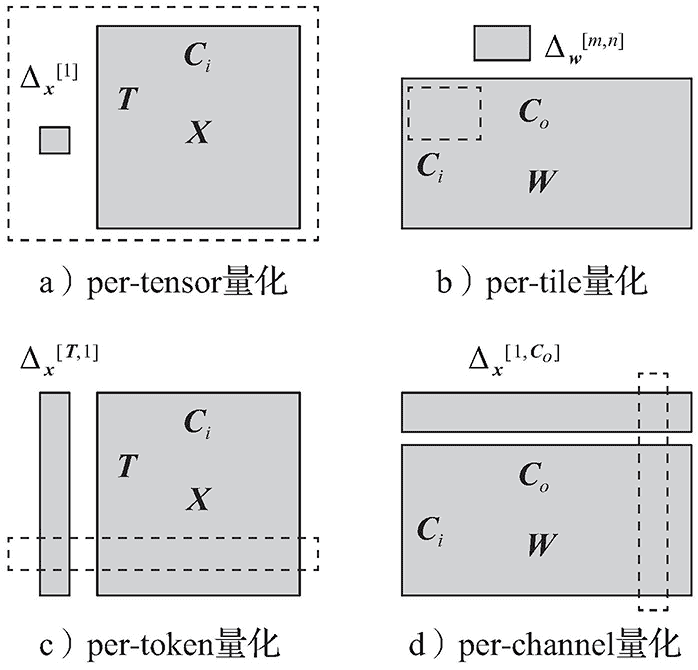

per-channel 量化是指将形式为[*C*,*c*]的 Weight 矩阵分组为*c*个形式为[*C*]的向量，对每个形式为[*C*]的向量进行一次量化。

注意：本节所有矩阵中的框代表矩阵分块，比如

代表对整个矩阵中的 1.2,2.3,3.4,4.5 这四个值同时进行量化，共享一组 scale 和 zero 值，其中 scale 和 zero 为反量化过程中的重要参数。

**1.per-tensor 量化**

对整个张量使用相同的量化参数，比如对于矩阵***X***就将整个***X***进行一次性量化。下面是线性量化公式：

其中，*s*是缩放因子。

以下是量化前后的矩阵：

per-tensor 的基本量化分块：

**2.per-token 量化**

对每个 Token（行或列）使用不同的量化参数，在大语言模型中一般是对每个 Token 对应的向量进行量化，一般是对 Activation 的量化：

其中，*s**[i]*是第*i*个 Token 的缩放因子。

以下是量化前后的矩阵：

per-token 的基本量化分块：

**3.per-channel 量化**

其中，*s**[c]*是第*c*个通道的缩放因子。

以下是量化前后的矩阵：

per-channel 的基本量化分块：

**4.per-tile 量化**

对张量的每个子块使用不同的量化参数：

其中,*s**[i][,][j]*是第（*i*,*j*）个子块的缩放因子。

以下是量化前后的矩阵：

per-tile 的基本分块：

### **4.4 影响量化后模型精度与速度的因素**

量化后模型的精度和速度影响主要考虑因素如下。

**1.量化方法**

量化方法的选择直接影响量化后模型的精度和速度。目前，常见的量化方法包括 GPTQ、AWQ 等，但这些方法通常仅对权重（Weight）值进行量化，而激活值（Activation）仍保持较高精度（如 FP16 或 FP32）。这种不一致性会导致以下问题。

●**精度损失：**权重值和激活值的精度不一致可能导致计算误差累积，影响模型输出精度。

●**计算开销：**在推理前需要对量化后的权重值进行反量化，以匹配激活值的精度。这一过程会增加额外的计算开销，从而影响推理速度。

●**量化粒度：**粗粒度量化（如对整个模型使用相同的量化参数）可能导致精度损失较大，而细粒度量化（如逐层或逐通道量化）可以更好地保持精度，但会增加计算复杂度，从而降低速度。

**2.模型大小**

模型大小对量化后模型的精度和速度有显著影响，主要体现在以下几方面。

●**内存占用：**参数量越少的模型占用内存越小，能够更快地加载到硬件的高带宽内存（HBM）中，从而减少数据传输时间。

●**计算效率：**较小的模型在推理时需要加载到共享内存中的数据更少，这可以显著减小内存带宽压力，从而提高计算速度，减少推理时间。

●**缓存：**量化后的模型参数更少，能够更好地利用硬件缓存，减少缓存未命中的情况，从而提升速度。

然而，模型减小也可能带来精度损失，尤其是在极端量化（如 INT4）的情况下，需要权衡模型大小与精度之间的关系。

**3.算子**

算子是模型推理的基本计算单元，其实现方式对量化后模型的精度和速度有重要影响。

●**量化算子优化：**如果硬件或框架支持高效的量化算子（如 INT8 矩阵乘法），则可以显著加速推理过程。反之，如果量化算子未优化，可能导致性能下降。

●**混合精度计算：**在量化模型中，权重值和激活值可能使用不同精度（如 INT8 权重和 FP16 激活值），这需要硬件支持混合精度计算，否则会增加额外的转换开销。

●**反量化开销：**如果硬件不支持低精度（如 INT4）计算，则需要将量化后的权重反量化为更高精度（如 FP16 或 FP32），这会增加计算量并降低速度。

**4.硬件**

硬件是决定量化后模型的精度和速度的关键因素之一，主要体现在以下几方面。

●**支持的精度类型：**不同硬件支持的精度类型不同，例如某些 GPU 支持 INT8、FP16、FP32，而某些硬件可能支持 INT4 或 FP8。如果硬件不支持量化后的精度（如 INT4），则需要额外的反量化操作，增加计算开销，降低推理速度。

●**计算单元：**硬件对低精度计算单元（如 Tensor Core）的优化程度直接影响量化后模型的推理速度。高效的硬件可以充分利用低精度计算的优势，提升速度。

●**内存带宽：**量化后的模型对内存带宽的需求降低，但如果硬件内存带宽不足，仍可能成为性能瓶颈，从而使整体的速度降低。

**5.总结**

量化技术在提升模型推理速度和减少内存占用方面具有显著优势，但模型精度和速度受多种因素影响，具体如下。

●量化方法影响了精度损失和计算开销。

●模型大小影响了内存占用和数据传输效率。

●算子支持影响了计算效率和混合精度计算的可行性。

●硬件支持是量化技术能否充分发挥性能的关键。

在实际应用中，我们需要根据具体场景（如模型类型、硬件平台、精度要求等）选择合适的量化策略，以实现精度与速度的最佳平衡。

### **4.5 常见的量化算法**

到笔者写完本书为止，业界主流的量化算法主要包括 3 种：LLM.INT8、AWQ 和 GPTQ。这些算法在深度学习模型压缩和加速推理中被广泛应用。本节将对其核心思想和实现原理进行简要介绍。

**4.5.1 LLM.INT8**

LLM.INT8 ^(¹)是一种针对大语言模型的 8 位整数量化方法，由 Tim Dettmers 等人提出。它的核心思想是通过混合精度量化策略，仅对部分敏感层保留高精度（FP16），而对其他层使用 8 位整数量化，以平衡精度和速度。LLM.INT8 算法量化原理如图 4-3 所示。**[图][4][-][3][L][L][M][.][I][N][T][8][算][法][量][化][原][理]**

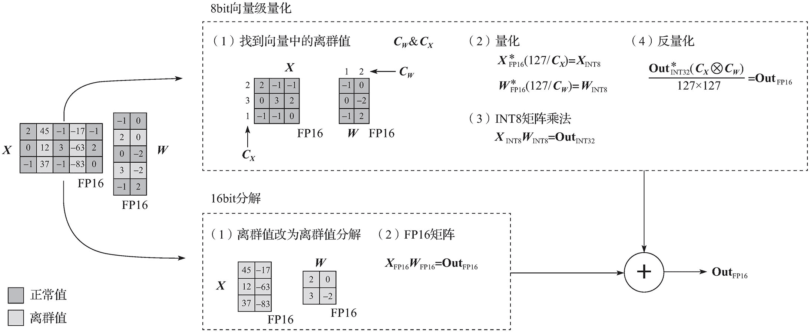

LLM.INT8 由于混合精度的存在，反量化时也存在混合精度，进而产生额外的计算开销。LLM.INT8 量化伪代码如下：

Python

#输入: 浮点权重矩阵 W （形式为 [out_dim, in_dim]），激活矩阵 X （形式为 [batch_size, in_dim]），异常值阈值 τ

#输出: 量化后的 INT8 权重 W_quant，混合精度计算结果 Y（形式为[batch_size, out_dim]）

def LLM_INT8（W, X, τ=6.0）:

  #1.检测激活中的异常值通道（Outlier Channels）

  outlier_mask = detect_outlier_channels（X, τ）   # [in_dim], True 表示异常通道

  #2.分离权重和激活的异常通道（FP16 计算）与非异常通道（INT8 计算）

  W_fp16 = W[:, outlier_mask]             #异常通道权重（保留 FP16）

  W_int8 = W[:, ～outlier_mask]            #非异常通道权重（量化 INT8）

  X_fp16 = X[:, outlier_mask]             #异常通道激活（保留 FP16）

  X_int8 = X[:, ～outlier_mask]            #非异常通道激活（量化 INT8）

  #3.对非异常部分执行 INT8 矩阵乘法

  W_quant, s_w, z_w = quantize_int8（W_int8）     #权重量化

  X_quant, s_x, z_x = quantize_int8（X_int8）     #激活量化

  Y_int8 = int8_matmul（W_quant, X_quant）      #INT8 矩阵乘法

  Y_int32 = dequantize（Y_int8, s_w, s_x, z_w, z_x） #反量化为 INT32

  #4.对异常部分执行 FP16 矩阵乘法

  Y_fp16 = fp16_matmul（W_fp16, X_fp16）       #FP16 矩阵乘法

  #5.合并两部分结果

  Y = combine_results（Y_int32, Y_fp16, outlier_mask）#按通道位置合并

  return W_quant, Y

def detect_outlier_channels（X, τ）:

  #检测异常通道：绝对值最大值超过阈值的输入通道

  max_vals = max（abs（X）, axis=0）         #[in_dim]

  return max_vals > τ                 #异常通道掩码

def quantize_int8（matrix）:

  #对称 INT8 量化（范围[-127, 127]，排除-128）

  max_val = max（abs（matrix））

  scale = max_val / 127.0

  quantized = round（matrix / scale）         #量化到 INT8

  return quantized, scale, 0             #零点 z=0（对称量化）

def dequantize（Y_int8, s_w, s_x, z_w, z_x）:

  #反量化：Y = （Y_int8 * s_w * s_x） + 偏置项（对称量化可忽略零点）

  return Y_int8.astype（float32） * （s_w * s_x）

推理反量化的伪代码如下：

Python

#输入:

# - INT8 矩阵乘法结果 Y_int8 （形式为 [batch_size, out_dim], 数据类型为 int8）

# - FP16 矩阵乘法结果 Y_fp16 （形式为 [batch_size, out_dim], 数据类型为 float16）

# -权重量化参数 s_w （形式为 [out_dim, 1]）

# -激活量化参数 s_x （形式为 [1, in_dim_non_outlier]）

# -异常通道掩码 outlier_mask （形式为 [in_dim]）

#输出: 反量化后的最终输出 Y （形式为 [batch_size, out_dim], 数据类型为 float32）

def dequantize_and_merge（Y_int8, Y_fp16, s_w, s_x, outlier_mask）:

  #1.反量化 INT8 结果为 INT32（实际推理中，INT8 矩阵乘法结果直接存储在 INT32 累加器中）

  Y_int32 = Y_int8.astype（int32）    #转换为 INT32（防止溢出）

  #2.计算反量化缩放因子（逐输出通道×逐输入非异常通道）

  #注意：s_w 的形式为 [out_dim, 1], s_x 的形式为 [1, in_dim_non_outlier]

  #广播乘法得到缩放因子矩阵，形式为 [out_dim, in_dim_non_outlier]

  scale_matrix = s_w * s_x

  #3.对 INT32 结果应用反量化（转换为浮点数）

  Y_dequant = Y_int32.astype（float32） * scale_matrix.sum（axis=1） #按输出通道求和

  #4.合并 FP16 异常通道结果与反量化后的 INT8 结果

  #根据 outlier_mask 确定每个输入通道的位置

  Y_combined = combine_with_outliers（Y_dequant, Y_fp16, outlier_mask）

  return Y_combined

def combine_with_outliers（Y_dequant,Y_fp16, outlier_mask）:

  #初始化全精度输出矩阵（与原始 FP32 计算形式相同）

  batch_size, out_dim = Y_dequant.shape

  in_dim = len（outlier_mask）

  Y_combined = zeros（（batch_size, out_dim）, dtype=float32）

  #分离异常通道与非异常通道的索引

  outlier_indices = where（outlier_mask）[0] #异常通道位置（列索引）

  normal_indices = where（～outlier_mask）[0] #非异常通道位置

  #将反量化结果填充到非异常通道位置

  Y_combined[:, normal_indices] = Y_dequant

  #将 FP16 结果填充到异常通道位置（转换为 FP32）

  Y_combined[:, outlier_indices] = Y_fp16.astype（float32）

  return Y_combined

LLM.INT8 算法量化的关键步骤如下。

（1）异常值检测

识别模型中激活值分布中的异常值，这些值对模型性能影响较大。

（2）混合精度量化

●对包含异常值的矩阵分块（如注意力矩阵）保留 FP16 精度。

●对其他层进行 8 位整数量化。

●在计算过程中，将 8 位整数临时反量化为 FP16 进行高精度运算。

LLM.INT8 算法量化的优势与不足如下。

●**优势：**在几乎不损失精度（测试集上）的前提下，显存占用减少 50%。

●**不足：**依赖异常值检测，可能增加算法复杂度，混合精度的存在将严重降低推理速度。

**4.5.2 AWQ**

AWQ（Activation-aware Weight Quantization，激活感知权重量化）是一种基于激活值感知的权重量化方法，由 MIT 等机构提出。如图 4-4 所示，AWQ 的核心思想是通过分析激活值的分布动态识别重要权重，对这些权重进行放大后再统一量化，从而在低比特量化时最小化关键权重的误差。它的创新点在于基于激活值统计自动优化每通道的缩放因子，而非直接保留部分权重为高精度，实现了硬件友好的高效量化。**[图][4][-][4][A][W][Q][原][理][图][4][-][4][（][续][）]**

我们发现大语言模型权重中存在 1%左右的异常值，如果量化时将这 1%的权重保持在 FP16 的精度，能够显著提升量化效果，PPL 从 43.2（见图 4-4a）下降到 13.0（见图 4-4b），但是混合精度的格式导致硬件效率低。我们提出 AWQ 量化技术（见图 4-4c），AWQ 执行 per-channel 放大保护这 1%的异常值，从而降低量化误差。

AWQ 实现的伪代码如下。

Python

#输入: 浮点权重矩阵 W （形式为 [out_channels, in_channels]）,

#  激活值统计 A （形式为[batch_size, in_channels]）,

#  量化比特数 b，搜索迭代次数 T

#输出: 量化权重矩阵 W_quant, 缩放因子 s （按通道）

def AWQ（W, A, b, T）:

  #1.分析激活分布：计算每个输入通道的"显著性"（激活幅值均值）

  channel_significance = compute_Activation_significance（A）  #[in_channels]

  #2.按通道生成缩放因子 s，放大显著通道的权重（保护重要区域）

  s = search_optimal_scales（W, A, channel_significance, T）  #[in_channels]

  #3.应用缩放因子到权重（W_scaled = W * s），再进行量化

  W_scaled = W * s                       #缩放后的权重

  W_quant, s_quant, z_quant = quantize_per_channel（W_scaled, b）

  #4.将缩放因子 s 吸收到量化参数中（关键！推理时无需额外计算）

  s_final = s_quant / s                     #合并缩放因子

  return W_quant, s_final, z_quant

# ---关键子函数 ---

def search_optimal_scales（W, A, significance, T）:

  #目标：找到最优的按通道缩放因子 s，使得量化后的权重误差最小

  s = ones_like（significance）                 #初始化为 1（不缩放）

  for t in 0 to T-1:

    #通过校准数据计算权重误差对输出的影响

    output_error = compute_quant_error_impact（W, A, s）   #前向传播量化误差

    #根据显著性更新缩放因子（放大重要通道的 s）

    s = update_scales（s, significance, output_error）    #梯度下降/启发式搜索

  return s

def quantize_per_channel（W, b）:

  #按通道量化：每个输出通道独立计算量化参数

  scales = []

  zeros = []

  W_quant = zeros_like（W）

  for out_ch in 0 to W.shape[0]-1:

    #标准线性量化（可对称或非对称）

    w = W[out_ch, :]

    scale = （max（w） - min（w）） / （2**b - 1）

    zero_point = round（-min（w） / scale）

    W_quant[out_ch, :] = round（w / scale + zero_point）

    scales.append（scale）

    zeros.append（zero_point）

  return W_quant, scales, zeros

AWQ 实现的关键步骤如下。

（1）激活显著性分析

计算输入通道的激活幅值均值，如 channel_significance = mean（abs（A）, axis=0）。

**核心思想：**激活值较大的通道对模型输出影响更大，需优先保护其对应的权重。

（2）缩放因子搜索

通过校准数据迭代搜索最优的按通道缩放因子*s*，使得缩放后的权重量化误差最小。

**数学原理：**放大权重通道（*W*×*s*）等价于缩小对应激活值（*A*/*s* ），从而减小量化对重要区域的影响。

（3）缩放因子吸收

量化后，将缩放因子*s*合并到下一层的计算中（如 LayerNorm 或矩阵乘法），推理时无需额外操作。

例如，若下一层为 Y = （W_quant * s_final） @ X，可合并到 LayerNorm 的权重中。

AWQ 方法的优势与不足如下。

●**优势：**量化后模型精度损失极低（<1%），适用于低比特（4bit）量化。

●**不足：**需要额外的校准数据优化参数，增加预处理时间。

**4.5.3 GPTQ**

GPTQ（Gradient-based Post-training Quantization）是一种基于梯度的训练后量化方法，专门针对大模型设计。它的核心思想是通过二阶梯度信息，逐层优化权重量化误差，最小化全局输出扰动，并且由于模型采用分组量化，因此按照模型权重的重要性顺序对不同分块进行量化，后量化的分块需要弥补先量化导致的误差。由于速度快、精度好、兼容性好，GPTQ 是业界目前量化推理过程中使用最多的量化方法，但也由于其通过计算二阶导来减小误差，容易过拟合量化数据集。

GPTQ 实现的伪代码如下。

Python

#输入: 浮点权重矩阵 W （形式为[m, n]），量化比特数 b，校准数据集 D，块大小 B

#输出: 量化权重矩阵 W_quant （形式为[m, n]），缩放因子 s，零点 z

def GPTQ（W, b, D, B）:

  #初始化参数

  H = compute_hessian_approximation（D） #通过校准数据近似 Hessian 矩阵（二阶导数信息）

  W_quant = W.copy（）          #初始化量化后的权重矩阵

  m, n = W.shape

  #逐列处理权重矩阵（按列重要性排序）

  for j in 0 to n-1:

    #1.选择当前列对应的权重块

    W_j = W_quant[:, j]              #当前待量化的列

    W_not_quant = W_quant[:, j+1:]         #未量化的剩余列

    #2.计算量化误差的 Hessian 逆矩阵（关键步骤）

    H_jj = H[j, j]                 #Hessian 矩阵的对角块

    H_j_not = H[j, j+1:]              #Hessian 矩阵的非对角块

    H_inv = inverse（H_jj - H_j_not @ H[j+1:, j+1:].inv（） @ H_j_not.T）

    #3.计算当前列的量化误差

    quant_error = quantize（W_j, b） - W_j     #量化误差 = 量化后权重 - 原始权重

    #4.通过 Hessian 逆更新未量化列的权重（补偿量化误差）

    delta = H_inv * quant_error          #二阶梯度补偿

    W_not_quant += delta              #更新未量化权重以抵消当前列误差

    #5.应用量化到当前列

    W_quant[:, j] = quantize（W_j, b）       #对当前列执行量化

  #6.最终调整（可选）

  W_quant = adjust_for_Activation_range（W_quant, D）#根据激活值动态范围调整缩放因子

  return W_quant, s, z

def quantize（w, b）:

  #标准线性量化：将浮点权重映射到 b-bit 整数

  scale = （max（w） - min（w）） / （2^b - 1）

  zero_point = round（-min（w） / scale）

  w_quant = round（w / scale + zero_point）

  return w_quant * scale - zero_point * scale    #反量化后的值

GPTQ 实现的关键步骤如下。

（1）计算目标

首先，GPTQ 的目标在于量化前后在相同的***X***下输出尽可能相近，比如***W***、 分别为量化前后的权重，***X***为输入的 Activation。

GPTQ 算法的损失计算如下：

（2）Hessian 近似计算

使用校准数据的前向传播结果，通过计算以上 loss 的二阶导数得到 Hessian 的近似值。

Hessian 矩阵反映权重的敏感度，用于指导量化误差的补偿。

（3）逐列量化

按列顺序处理权重矩阵，每次量化一列后，通过更新未量化列的权重补偿误差。

列处理顺序通常按重要性排序（如 L2 范数）。

（4）误差补偿

量化误差通过公式 delta = H_inv * quant_error 传播到未量化的列。

利用 Hessian 逆矩阵的二阶信息，最小化整体量化损失。

（5）动态范围调整

根据激活值的实际分布调整量化参数（缩放因子*s*和零点*z*），避免饱和误差。通过贪心算法选择最优量化参数，使每块的量化误差最小化。

GPTQ 支持 2～4 位超低比特量化，显存占用减少 75%以上，但是计算 Hessian 矩阵的计算开销较大，量化过程耗时较长。

3 种量化方法对比如表 4-1 所示。**[表][4][-][1][3][种][量][化][方][法][对][比]**

可见，LLM.INT8 适用于需要快速部署的大模型场景。AWQ 适用于对显存敏感的低比特量化任务（如边缘设备）。GPTQ 在极端压缩场景下表现优异，但需要更多计算资源。

## **第五章** **大语言模型分布式训练基础知识**

随着 Transformer 的普及，大语言模型的大小随时间的推移已经打破了摩尔定律，这也意味着单显卡难以存放整个大语言模型，比如 DeepSeek V3 有 6500 亿的参数量，如果以 BF16 格式进行加载需要 1300GB 的显存，现有的任何单张量产显卡都不足以存放这个模型。

在大模型训练中，占用显存主要包括以下几部分：模型本身占用的权重、梯度占用的权重、优化器的权重、中间激活值的保留、显存碎片和环境。

如果是大规模预训练，batch_size 的增大将极大地增加中间激活值，这也是分布式技术在语言模型中最常用的场景。另外在大模型推理时，由于模型过大、单卡算力不够等原因，需要使用到分布式推理。分离式推理是业界较新的分布式加速推理方式。

本章主要从大语言模型分布式训练的通信原语、大语言模型并行方式两方面介绍大语言模型分布式基础知识。

### **5.1** **通信原语**

在并行计算和分布式系统中，通信策略是确保各个计算节点之间高效交换数据的关键。下面介绍几种常见的通信策略，并通过矩阵公式进行表达。

**5.1.1** **Reduce**

Reduce 操作是将多个节点上的数据通过某种操作（如求和、求最大值等）合并到一个节点上。图 5-1 为 Reduce 操作原理图，即将 Device0 到 Device3 上的矩阵聚合（图中为加号）到 Device0 上。**[图][5][-][1]** **[R][e][d][u][c][e][操][作][原][理]**

假设有*n*个节点，每个节点有一个数据向量***v****[i]*，Reduce 操作可以表示为

其中，⊕表示某种规约操作，如求和、平均。

在 Reduce 操作中，每个节点需要将自己的数据发送到一个目标节点（通常是根节点）。假设共有*n*个设备，每个设备上的数据量为*m*，则

通信量=（*n*-1）×*m*

解释如下。

●每个非根节点发送*m*单位的数据到根节点，*m*为数据维度。

●总共有*n*-1 个节点需要发送数据。

**5.1.2** **Broadcast**

Broadcast 操作将一个节点上的数据广播（复制）到其他所有节点。图 5-2 为 Broadcast 操作原理图，将 Device0 上的向量复制到所有设备上。**[图][5][-][2]** **[B][r][o][a][d][c][a][s][t][操][作][原][理]**

假设有一个节点上的数据向量***v***，Broadcast 操作可以表示为

***v***→***v***被广播到所有节点

在 Broadcast 操作中，根节点需要将数据发送到其他所有节点。假设共有*n*个设备，每个设备上的数据量为*m*，则

通信量=（*n*-1）×*m*

解释如下。

●根节点发送*m*单位的数据到每个非根节点。

●总共有*n*-1 个节点需要接收数据。

**5.1.3** **Gather**

Gather 操作将多个节点上的数据收集到一个节点上，但不进行任何合并操作。

如图 5-3 所示，Gather 操作是指将 Device0 到 Device3 上的矩阵收集到同一个 Device 上，由于不进行聚合操作，Device0 上的矩阵参数量为各个 Device 上的参数量之和。**[图][5][-][3]** **[G][a][r][t][h][e][r][操][作][原][理]**

假设有*m*个节点，每个节点有一个数据向量***v****[i]*，Gather 操作可以表示为

在 Gather 操作中，每个节点需要将自己的数据发送到一个目标节点（通常是根节点），则

通信量=（*n*-1）×*m*

解释如下。

●每个非根节点发送*n*单位的数据到根节点。

●总共有*m*-1 个节点需要发送数据。

**5.1.4** **Scatter**

如图 5-4 所示，Scatter 操作将一个节点（Device0）上的数据分发到多个节点（Device0 到 Device3）上。Scatter 操作为 Gather 操作的逆操作。**[图][5][-][4]** **[S][c][a][t][t][e][r][操][作][原][理]**

假设有一个节点上的数据矩阵***v***，Scatter 操作可以表示为

在 Scatter 操作中，根节点需要将数据分发到其他所有节点，则

通信量=（*n*-1）×*m*

解释如下。

●根节点发送*m*单位的数据到每个非根节点。

●总共有*n*-1 个节点需要接收数据。

**5.1.5** **All-Reduce**

如图 5-5 所示，All-Reduce 操作将多个节点（Device0 到 Device3）上的数据通过某种操作聚合，并将结果广播到所有节点（Device0 到 Device3）。**[图][5][-][5]** **[A][l][l][-][R][e][d][u][c][e][操][作][原][理]**

假设有*n*个节点，每个节点有一个数据向量***v****[i]*，All-Reduce 操作可以表示为

在 All-Reduce 操作中，每个节点需要将自己的数据发送给其他所有节点，并最终接收全局归约结果。假设使用树形或环形算法，则

通信量=2×（*n*-1）×*m*

解释如下。

●每个节点需要发送和接收数据。

●总通信量是 Reduce 操作的两倍。

**5.1.6** **All-Gather**

如图 5-6 所示，All-Gather 操作将多个节点（Device0 到 Device3）上的数据收集到所有节点（Device0 到 Device3）上，每个节点最终拥有所有数据。**[图][5][-][6]** **[A][l][l][-][G][a][t][h][e][r][操][作][原][理]**

假设有*n*个节点，每个节点有一个数据向量***v****[i]*，All-Gather 操作可以表示为

在 All-Gather 操作中，每个节点需要将自己的数据发送给其他所有节点，并接收其他所有节点的数据，则

通信量=（*n*-1）×*m*×*n*

解释如下。

●每个节点需要发送*m*单位的数据到*n*-1 个节点。

●每个节点也需要接收（*n*-1）×*m*单位的数据。

### **5.2** **数据并行**

数据并行是一种并行计算的技术，通过将输入数据分割成若干部分并分配给多个设备（如 GPU）来加速大规模数据处理任务的执行，如图 5-7 所示。数据并行的核心思想是每个设备执行相同的计算逻辑但作用于不同的数据片段。具体来说，模型副本被复制到各个设备上，而输入数据集则被划分为多个小批次，每个设备处理不同的数据批次。在计算完成后，通过通信机制（如 All-Reduce）汇总或平均化各设备的结果，以更新模型参数，保证所有设备上的模型副本同步。这种方法不仅能够加快训练和推理的速度，还能够扩展到非常大的数据集和复杂的模型结构中，适用于需要大量数据处理的任务，如图像识别、自然语言处理等。**[图][5][-][7]** **[数][据][并][行]**

如图 5-7 所示，数据并行即在不同设备（GPU0 和 GPU1）上保存相同的模型权重，将数据 BATCH_DATA 分为多个微批次（mirco_batch0，mirco_batch1）分别传入不同设备（GPU0 和 GPU1）进行计算的过程。各个微批次前向传播完成后将各个设备上的梯度做一次 All-Reduce 操作，保证不同设备上的模型权重始终相同。

数据并行计算步骤如下。

**1.定义权重矩阵和输入矩阵**

假设有一个权重矩阵***W***和一个输入矩阵***x***，具体如下：

**2.输入矩阵拆分**

***x***[1]是矩阵***x***的第一列。

***x***[2]是矩阵***x***的第二列。

**3.并行计算**

**4.结果合并**

**5.结果验证**

### **5.3** **张量并行**

注意：本章皆采用***y***=***w*******x***这种计算方法，这种计算方法偏理论推导，如果某些框架采用***y***=***x*******w***这种计算方法，张量并行的行并行和列并行的所有结论需要颠倒。

如图 5-8 所示，张量并行是一种将模型的张量（如权重矩阵）拆分到多个设备（如 GPU）上并行计算的技术，主要用于加速大规模深度学习模型的训练和推理。它的核心思想是将一个大的张量（如权重矩阵）按行或列拆分成多个子张量，分配到不同的设备上并行计算。每个设备只处理部分数据，最后通过通信机制（如 All-Reduce）合并结果。**[图][5][-][8]** **[张][量][并][行]**

**5.3.1** **张量并行——行并行**

**1.定义权重矩阵和输入向量**

假设我们有一个权重矩阵***W***和一个输入矩阵***x***，具体如下：

**2.权重矩阵拆分**

将矩阵***W***按行拆分为两个子矩阵***W***[1]和***W***[2]，分别分配到两个设备上：

●***W***[1]是矩阵***W***的前两行。

●***W***[2]是矩阵***W***的后两行。

**3.结果验证**

**5.3.2** **张量并行——列并行**

**1.定义权重矩阵和输入矩阵**

假设原始权重矩阵***W***和输入矩阵***x***如下：

**2.权重矩阵与输入矩阵的拆分**

行并行需将权重矩阵按列拆分，同时输入矩阵按对应维度切分。

权重矩阵***W***的拆分：按列拆分为***W***[1]（前两列）和***W***[2]（第三列）：

输入矩阵***x***的拆分：与权重矩阵拆分对齐，按列拆分为***x***[1]（前两行）和***x***[2]（第三行）：

**3.结果验证**

**5.3.3** **行并行与列并行的差别**

我们可以从上文看到，列并行和行并行有些区别，在列并行中最终结果由***y***[1]和***y***[2]进行 Gather 操作所得，在行并行中最后结果由***y***[1]和***y***[2]进行 Reduce 操作所得。这个差别将导致并行后的激活函数对行并行比较敏感。

**1.列并行的非线性激活函数**

act_function（***y***）!=act_function（***y***[1]+***y***[2]）

**2.行并行的非线性激活函数**

act_function（***y***）=act_function（[***y***[1]，***y***[2]]）

由于以上列并行在前向传播和反向传播时都需要进行通信、聚合结果与梯度，但是行并行仅需要在反向传播时聚合梯度即可，因此行并行的通信成本较低。

由于 MLP 层存在两个线性层，且两个线性层之间存在一个非线性激活函数，因此会在第一个线性层使用行并行，第二个线性层使用列并行。MiniCPM 在 VLLM 中的张量并行适配代码如下：

class MiniCPMMLP（nn.Module）:

def __init__（

self,

hidden_size: int,

intermediate_size: int,

hidden_act: str,

hidden_act_param: float,

quant_config: Optional[QuantizationConfig] = None,

） -> None:

super（）.__init__（）

self.gate_up_proj = MergedColumnParallelLinear（

hidden_size, [intermediate_size] * 2,

bias=False,

quant_config=quant_config） #列并行（本书中的行并行）

self.down_proj = RowParallelLinear（intermediate_size,

hidden_size,

bias=False,

quant_config=quant_config） #行并行（本书中的列并行）

if hidden_act == "silu":

self.act_fn = SiluAndMul（）

elif hidden_act == "fatrelu":

self.act_fn = FatreluAndMul（threshold=hidden_act_param）

else:

raise ValueError（f"Unsupported activation: {hidden_act}. ""Only silu and fatrelu are supported for now."）

def forward（self, x）:

gate_up, _ = self.gate_up_proj（x）

x = self.act_fn（gate_up）

x, _ = self.down_proj（x）

return x

综上所述，张量并行中的行并行和列并行对比如表 5-1 所示。**[表][5][-][1]** **[张][量][并][行][中][的][行][并][行][和][列][并][行][对][比]**

### **5.4** **流水线并行**

流水线并行是一种并行计算技术，通过将计算过程划分成多个连续的阶段，并将这些阶段分配到不同的设备（如 GPU）上来加速大规模深度学习模型的训练和推理。它的核心思想是每个设备负责执行整个任务中的一个特定阶段，数据则依次流经各个阶段进行处理。

图 5-9 中每个颜色代表不同的卡，F 代表前向传播，B 代表反向传播，某个数据批次在第一个设备的第一个模型层前向传播后将结果传递到第二个设备上的第二个模型层，依此类推。当前向传播完成后，从最后一个模型层进行反向传播更新参数，再将梯度传递到上一个层的设备上进行反向传播。**[图][5][-][9]** **[朴][素][流][水][线][并][行]**

流水线并行最大的的缺点是存在气泡，气泡可以见图 5-9 中的空白部分，所有空白部分占整个流水线面积的比值是气泡比。不难计算出朴素流水线并行的气泡比是：

其中，*K*表示流水线的深度，即图 5-9 中 F[0]或者 B[0]的数量。

为了解决气泡占比的问题，后续出现了 GPipe 方案。这种方案的核心思想是将 Batch 切分成多个 micro_batch，从而降低等待时间。如图 5-10 所示，深蓝色部分为前向传播，绿色部分为反向传播，GPipe 流水线的气泡比为

其中，*K*为流水线深度，*M*为微批次的数量。**[图][5][-][1][0]** **[G][P][i][p][e][流][水][线]**

### **5.5** **序列并行**

序列并行是一种用于加速深度学习模型（尤其是 Transformer 模型）训练的技术，主要用于长序列输入处理的场景。由于 Transformer 的空间复杂度是序列长度的平方，因此减少序列长度可以降低显存需求。它的核心思想是将输入序列切分成多个子序列，并将这些子序列分配到不同的设备（如 GPU）上并行计算，从而减少单个设备的显存占用并提高计算效率。

如图 5-11 所示，对于注意力层来说，输入是一个[*S*（Sequence）,*B*（Batch_size）,*D*（dim）]的向量，将其按照*S*维度切分成*m*个 Chunk 并分别计算***Q***、***K***、***V***，再将 Chunk 分配到不同设备上进行 Attention Score 计算。由于单向注意力的存在，靠后的 Chunk 需要获得靠前 Chunk 的***K***、***V***值，这部分需要进行额外的通信。**[图][5][-][1][1]** **[序][列][并][行]**

对于 MLP 层来说，需要将不同 Chunk 在注意力层的计算结果分配到不同设备上以进行 MLP 层的计算，最终输出 MLP 层的结果并进入下一个注意力层。

### **5.6** **“专家”并行**

“专家”并行是一种用于大规模深度学习模型训练的并行计算技术，特别适用于混合专家模型（Mixture of Expert, MoE）。它的核心思想是将模型的不同部分（即“专家”）分配到不同的设备（如 GPU 或 TPU）上，从而利用分布式计算资源加速训练和推理。

MoE 在分布式训练推理时最大的问题在于负载不均和通信量过高。由于 MoE 的稀疏性，只有将每个“专家”放在不同的设备上才能将每个设备实际的 Batch_size 增大。

从宏观上来讲，MoE 有一个问题，如果在不同“专家”上分配的 Token 差别较大，将导致不同设备的利用率不同，不仅会降低效率，还会导致分布式推理训练中快卡等慢卡的问题出现。

MoE 的另外一个问题是由于 Dispatch 和 Combine 都属于 All-to-All 通信，这将导致通信量急剧上升，因此如何使计算和通信同步进行是非常重要的事情。

# **第二部分**

# **DeepSeek 核心技术**

在人工智能技术迈向“效率革命”的今天，DeepSeek 以一系列突破性创新重新定义了大语言模型的研发范式。本书第二部分将深入剖析这一技术体系的核心架构与工程实践，揭示其如何在参数效率、训练成本与推理性能的“不可能三角”中实现颠覆性平衡。

从模型架构的底层重构到分布式训练的算力协同，DeepSeek 的技术演进始终贯穿着对“智能本质”的深刻思考。传统大模型依赖参数堆砌的“暴力美学”正被 DeepSeek MoE 架构的“组织艺术”取代——将 6710 亿参数的超级模型拆解为 256 个“专科专家”与 1 个“共享专家”组成的动态网络，每次推理仅激活 370 亿参数，在保持顶尖性能的同时将计算能耗压缩至传统方案的 1/8。这种细粒度“专家”划分机制，如同为 AI 系统植入了“术业专攻”的智慧基因，使得万亿参数规模的模型也能在单台服务器上流畅运行。

在训练逻辑层面，DeepSeek 开创的认知蒸馏策略打破了传统强化学习的路径依赖。通过 R1-Zero 冷启动技术，模型在纯数学与代码数据中自发涌现出逻辑推理能力，再通过四阶段混合训练（监督微调→强化学习→数据反哺→人机融合），最终锻造出在 GSM8K 数学评测中准确率突破 97.3%的商用级模型。这种“从零自证”的训练范式，不仅大幅降低了对标注数据的依赖，更让 AI 的认知进化呈现出类人的阶段性特征。

在工程实践领域，DeepSeek 的突破则体现在对算力本质的重新诠释。Fire-Flyer AI-HPC 架构通过 PCIe 与 NVLINK 混合组网，将万卡集群的通信开销削减至传统方案的 10%；无辅助损失负载均衡技术摒弃了烦琐的梯度补偿，通过动态偏置项调节实现“专家”资源的智能调度；MLA 层注意力机制与 FP8 混合精度的结合，更让长文本处理的显存占用从 48GB 锐减至 2.3GB。这些系统级优化构成的“效率飞轮”，使得 DeepSeek V3 仅以 557 万美元训练成本便达到 GPT-4 的基准性能。

当行业仍在算力内卷中徘徊时，DeepSeek 已用实践证明：真正的智能革命不在于参数的无限膨胀，而在于对计算资源的极致利用。它的开源生态与模块化设计，正推动 AI 研发从“封闭竞技”转向“开放共创”——开发者可通过知识蒸馏将万亿级模型能力迁移至边缘设备，或基于“共享专家”网络快速构建垂直领域模型。这场始于架构创新的技术浪潮，最终指向的是人工智能民主化的终极图景。

接下来的章节将以代码级的精度拆解上述技术的实现细节，从 MoE 路由矩阵的数学证明到分布式训练的通信压缩策略，带你亲历这场 AI“效率革命”的每一个技术里程碑。

## **第六章 DeepSeek 的模型架构**

DeepSeek 基于 Transformer 架构主要进行了两大创新：一是使用 MoE 架构替换了 MLP 架构,二是使用了多头潜注意力（Multi-head Latent Attention，MLA）机制。MoE 和 MLA 的核心目标都是在保持模型性能不下降的前提下提高训练和推理的效率。

DeepSeek V3 架构如图 6-1 所示，其中主要包括 MoE 和 MLA。**[图][6][-][1][D][e][e][p][S][e][e][k][V][3][架][构]**[（来自 DeepSeek V3 技术报告）]

图中 Concatenate 操作表示将 和 两个向量进行堆叠操作，Apply RoPE 操作代表将***h****[t]*矩阵转换为带有 RoPE 的***K***矩阵。

本章将对 MoE 和 MLA 架构进行详细讲解。首先从代码和计算量、原理方面介绍 MoE 架构，并介绍门控单元、“专家”并行等概念。然后介绍从 MHA 到 GQA 再到 MLA 的演进过程、注意力结构、KV-cache 的使用方法等。接着介绍 BPE 和 BBPE 分词器的核心原理，以及对分词效果的影响。最后从多模态架构方面介绍 DeepSeek VL2，并且介绍 MiniCPM-V 多模态模型是如何处理高清图片输入丢失细节的问题。

### **6.1 MoE 架构**

**6.1.1 MoE 的基本原理**

从前文可知，Transformer 的 MLP 层就是多个线性层，这就导致了*O*（hidden_size²）的计算复杂度高。为了解决这一问题，DeepSeek 采用 MoE 架构替换了 MLP 层，本质上说，是使用多个参数量更小的并行 MLP 代替了原有的一个 MLP 并且每次前向传播仅选取一部分进行激活。**[图][6][-][2][M][o][E][与][M][L][P][架][构][示][意][图]**

如图 6-2 所示，MoE 即多个并行的参数量更小的 MLP 层，MoE 的输入***X***进行分发（Dispatch）操作时选择所有的共享专家和*k*个路由专家对输入***X***进行投票，并对投票结果进行加权相加，然后获得最终结果。

**1.MoE 架构的宏观原理**

1）MoE 架构由多个并行的 MLP 层组成，每个 MLP 层被称为“专家”。

2）和原始的 Transformer 相比，每个“专家”的 MLP 层参数量下降很多。

3）专家分为共享专家和路由专家，“共享专家”每一次输入的***X***都参与计算，“路由专家”仅选择 Top *K*个“专家”参与计算。

4）这 Top *K*个“专家”由门控机制计算获得权重，然后将输入值***X***分发到所选“专家”。

5）所有参与计算的“专家”将结果按照每个“专家”的权重进行加和，这一步由代码中的 MoE_infer 函数实现，后文将着重讲解。

6）将第 5 步所得结果加上“共享专家”的输出作为最终 MoE 架构的输出结果。

**2.伪代码**

MoE 实现伪代码如下:

Python

#DeepSeek V3 代码节选（有修改）

class DeepSeekV3MoE（nn.Module）:

  """

  MoE 模块核心实现，包含“分布式专家”计算与“共享专家”机制

  核心流程：输入→门控路由→“分布式专家”计算→结果聚合→“共享专家”增强→输出

  """

  def __init__（self, config）:

    super（）.__init__（）

    self.config = config

    self.num_experts_per_tok = config.num_experts_per_tok #每个 Token 使用的“专家”数

    #“分布式专家”初始化 ---------------------------------------------------

    if hasattr（config, "ep_size"） and config.ep_size > 1:#模型并行场景

      self.ep_size = config.ep_size           #“专家”并行设备数

      self.experts_per_rank = config.n_routed_experts // config.ep_size

      self.ep_rank = dist.get_rank（）          #当前设备编号

      #“分布式专家”分配：每个设备仅初始化自己负责的“专家”

      self.experts = nn.ModuleList（[

        DeepSeekV3MLP（config, ...）

        if 属于当前设备

        else None

        for i in range（config.n_routed_experts）

      ]）                        #这里只有“路由专家”

    else:                         #单设备模式

      self.ep_size = 1

      self.experts = nn.ModuleList（

        [

          DeepSeekV3MLP（

            config, ...

          ）

          for i in range（config.n_routed_experts）

        ]

      ） #所有“路由专家”在同一设备

    self.gate =MoEGate（config）              #门控网络

    #“共享专家”机制（增强通用特征处理）

    if config.n_shared_experts:

      self.shared_experts =DeepSeekV3MLP（...）     #大容量“共享专家”

  def forward（self, hidden_states）:

    """前向传播流程"""

    identity = hidden_states                #原始输入形式为 [B, L, D]

    #门控计算 ----------------------------------------------------------

    Top K_idx, Top K_Weight = self.gate（hidden_states）  #[B*L, top_k], [B*L, top_k]

    #推理专用路径 ------------------------------------------------------

    if not self.training:

      #将输入展平为二维 [B*L, D]

      x = hidden_states.view（-1, hidden_states.size（-1））

      #“分布式专家”计算 [B*L, D] → [B*L, D]

      y = self.MoE_infer（x, Top K_idx, Top K_Weight）.view（*orig_shape）

    #“共享专家”增强 -----------------------------------------------------

    if self.config.n_shared_experts:

      y+= self.shared_experts（identity）        #y 的形式为[B, L, D] + [B, L, D]

    return y                        #y 的形式为[B, L, D]

  @torch.no_grad（）

  defMoE_infer（self, x, Top K_ids, Top K_Weight）:

    """

    分布式推理核心逻辑：

    1.统计各“专家”分配的 Token 数量

    2.根据“专家”分布进行跨设备通信

    3.“专家”并行计算

    4.结果聚合与还原

    """

    #统计每个“专家”需要处理的 Token 数 ----------------------------------------

    cnts =Top K_ids.new_zeros（（x.size（0）, len（self.experts））） #[B*L, E]

    cnts.scatter_（1,Top K_ids, 1）         #设置对应位置的计数

    tokens_per_expert = cnts.sum（dim=0）      #[E]为每个“专家”处理的 Token 数

    #数据重排序（提高计算效率） ------------------------------------------

    idxs =Top K_ids.view（-1）.argsort（）     #按“专家”ID 排序 [B*L*top_k]

    sorted_tokens = x[idxs // Top K_ids.size（1）] #sorted_tokens 的形式为[总 Token 数, D]

    #分布式通信阶段（模型并行关键） ---------------------------------------

    if self.ep_size > 1:

      #该分支见下文，此处省略

    #“专家”并行计算 -----------------------------------------------------

    outputs = []

    start_idx = 0

    for i, num_tokens in enumerate（Tokens_per_expert.cpu（）.numpy（））:

      #i 代表第几个“专家”

      if num_tokens == 0: continue

      expert = self.experts[i + self.ep_rank*self.experts_per_rank] #获取本地专家

      expert_out = expert（sorted_tokens[start_idx:start_idx+num_tokens]）

                            #expert_out 的形式为[num_tokens, D]

      outputs.append（expert_out）

      start_idx += num_tokens

    #结果聚合 ---------------------------------------------------------

    outs = torch.cat（outputs, dim=0）       #outs 的形式为 [总 Token 数, D]

    #分布式结果还原 ---------------------------------------------------

    if self.ep_size > 1:

      #逆 all_to_all 操作恢复原始设备分布

      new_x = torch.empty_like（outs）

      new_x[gatherd_idxs] = outs         #还原索引顺序

      gathered_tokens = ...            #重新聚合各设备结果

    #最终加权求和 -----------------------------------------------------

    final_out = new_x.view（*Top K_ids.shape, -1） #[B*L, top_k, D]

      .mul_（Top K_Weight.unsqueeze（-1））    #乘权重后的形式为 [B*L, top_k, D]

      .sum（dim=1）                #加权求和的形式为 [B*L, D]

    return final_out                #final_out 的形式为 [B*L, D]

**3.MoE_infer 函数**

1）根据门控机制获取 Top *K*个“专家”及其权重。

2）根据门控机制返回的结果计算出每个“专家”需要参与多少个 Token 计算，将每个“专家”需要计算的 Token 数放入一维向量 Tokens_per_expert。

3）计算 sorted_Tokens。sorted_Tokens 表示按顺序将“专家”对应的每个 Toke 的 hidden 向量组合在一起形成的二维向量。sorted_Tokens 示例如下：

[*h*[11]，*h*[13]，*h*[18]，*h*[21]，*h*[24]，*h*[25]…，*h**[n]*[2]，*h**[n]*[4]，*h**[n]*[8]]

其中，*h**[i][j]*代表第*i*个“专家”对应的第*j*个 Token 的 hidden 向量。

4）遍历所有的“专家”，获得“专家”*E**[i]*。

5）在 sorted_Tokens 中获取“专家*E**[i]*”相关的所有向量，例如[*h**[i]*[1]，*h**[i]*[3]，*h**[i]*[8]]。

6）将步骤 1 中的权重向量代入“专家*E**[i]*”并行计算获得 expert_out。expert_out 的形式为[num_Tokens, *D*]。由于这一步的存在，每个“专家”能够并行计算多个 Token，提高了速度。

7）将结果保存到 outputs。

8）将 outputs 按照“专家”维度进行根据 Weight 权重的带权加和，获得最终结果。

**4.“专家”并行**

“专家”并行的伪代码如下:

Python

if self.ep_size > 1:

  ##########################################################

  #步骤 1：统计“专家”分配信息（按 ep_size 进程分组）

  ##########################################################

  #将每个“专家”需要计算的 Token 数按 ep_size 进程分组，统计各进程需处理的 Token 总量

  tokens_per_ep_rank = tokens_per_expert.view（self.ep_size, -1）.sum（dim=1）

  #创建空张量，用于跨进程交换统计信息

  tokens_per_expert_group = Tokens_per_expert.new_empty（tokens_per_expert.shape[0]）

  #使用 all_to_all_single 通信交换各进程的“专家”分配统计量

  dist.all_to_all_single（tokens_per_expert_group, tokens_per_expert）

  ##########################################################

  #步骤 2：跨进程分发输入数据

  ##########################################################

  #计算每个进程将接收的数据块大小（基于交换后的统计信息）

  output_splits = （

    tokens_per_expert_group.view（self.ep_size, -1）

    .sum（1）

    .cpu（）

    .numpy（）

    .tolist（）

  ）

  #创建接收缓冲区，尺寸为所有进程发送数据的总和

  gathered_tokens = sorted_tokens.new_empty（

    tokens_per_expert_group.sum（dim=0）.cpu（）.item（）,

    sorted_tokens.shape[1]

  ）

  #获取本地要发送给其他进程的数据块划分方案

  input_split_sizes =tokens_per_ep_rank.cpu（）.numpy（）.tolist（）

  #执行 all_to_all 通信：发送本地分块数据，接收其他进程数据

  dist.all_to_all（

    list（gathered_tokens.split（output_splits））,

    list（sorted_tokens.split（input_split_sizes））,

  ）

  ##########################################################

  #步骤 3：按专家 ID 重组数据

  ##########################################################

  #统计跨进程后的每个本地“专家”应处理的 Token 总数

  tokens_per_expert_post_gather = tokens_per_expert

**5.MoEGate**

MoEGate 的伪代码如下:

Python

#DeepSeek V3 MoEGate 函数节选（有修改）

class MoEGate（nn.Module）:

  def __init__（self, config）:

    super（）.__init__（）

    #初始化 MoE 门控参数

    self.config = config

    self.top_k = config.num_experts_per_tok     #每个 Token 选择的前 k 个专家

    self.n_routed_experts = config.n_routed_experts #参与路由的总“专家”数

    self.routed_scaling_factor = config.routed_scaling_factor     #权重缩放因子

    self.scoring_func = config.scoring_func     #得分计算函数（如 sigmoid）

    self.seq_aux = config.seq_aux          #是否使用序列级辅助损失

    self.Top K_method = config.Top K_method     #“专家”选择策略（当前实现为 noaux_tc）

    self.n_group = config.n_group          #“专家”分组数

    self.Top K_group = config.Top K_group      #每组选择的“专家”数

    #参数初始化相关

    self.norm_Top K_prob = config.norm_Top K_prob  #是否归一化 Top K 权重

    self.gating_dim = config.hidden_size       #门控层输入维度

    self.Weight = nn.Parameter（torch.empty（（self.n_routed_experts, self.gating_dim）））

    if self.Top K_method == "noaux_tc":       #推理专用的分数修正策略

      self.e_score_correction_bias = nn.Parameter（torch.empty（（self.n_routed_experts）））

    self.reset_parameters（）

  def reset_parameters（self）:

    #Kaiming 均匀初始化权重

    init.kaiming_uniform_（self.Weight, a=math.sqrt（5））

  def forward（self, hidden_states）:

    bsz, seq_len, h = hidden_states.shape

    #计算“专家”得分 ----------------------------------------------------------

    hidden_states = hidden_states.view（-1, h） #展平为二维张量 [batch*seq_len, hidden]

    logits = F.linear（hidden_states.float（）,self.Weight.float（））

                           #[n_Tokens, n_experts]

    #激活函数处理得分

    if self.scoring_func == "sigmoid":

      scores = logits.sigmoid（）       #转换为概率

    else:

      raise NotImplementedError（f"Unsupported scoring function: {self.scoring_func}"）

    #Top K 专家选择策略 ------------------------------------------------------

    if self.Top K_method == "noaux_tc":

      assert not self.training         #该策略仅用于推理

      #分组选择策略

      scores_for_choice = scores + self.e_score_correction_bias.unsqueeze（0）

      #按组聚合得分：每组取前 2 个“专家”得分求和

      group_scores = scores_for_choice.view（-1, self.n_group, self.n_routed_experts

      //self.n_group）.Top K（2, dim=-1）[0].sum（dim=-1）

      #选择得分最高的 Top K_group 组

      group_idx = torch.Top K（group_scores, k=self.Top K_group, dim=-1）[1]

      group_mask = torch.zeros_like（group_scores）.scatter（1, group_idx, 1）

      #生成“专家”选择掩码

      score_mask = group_mask.unsqueeze（-1）.expand（-1, -1, self.n_routed_experts

      //self.n_group）.reshape（-1, self.n_routed_experts）

      tmp_scores = scores_for_choice.masked_fill（～score_mask.bool（）, 0.0）

      #从选中的组中选择 Top K 个专家

      _,Top K_idx = torch.Top K（tmp_scores, k=self.top_k, sorted=False）

      Top K_Weight = scores.gather（1, Top K_idx）

    #权重后处理 -----------------------------------------------------------

    if self.norm_Top K_prob and self.top_k > 1:          #权重归一化

      Top K_Weight = Top K_Weight / （Top K_Weight.sum（dim=-1, keepdim=True） + 1e-20）

      Top K_Weight = Top K_Weight * self.routed_scaling_factor #应用缩放因子

      return Top K_idx, Top K_Weight              #返回专家索引和权重

MoEGate 的实现原理如下。

1）使用每个“专家”模型的质心向量（代码中的 Weight）与输入的 hidden_size 相乘，计算出每个输入 Token 和每个“专家”的亲和度。如果是推理模式，可以使用 noaux_tc 分组策略，这种策略将“专家”限制在 Top K_group 个节点内，减少了节点间通信。该策略的具体实现如下。

①将所有的“路由专家”进行分组。

②计算该 Token 和所有“专家”的亲和度。

③取每个组中亲和度最高的两个“专家”的亲和度之和作为整个组的亲和度，并对每个组的亲和度进行排序。

④根据上一步选择分数和最高的 Top K_group 个分组。

⑤在这 Top K_group 个分组中找到 Top K_expert 个“专家”。

⑥返回这 Top K_expert 个“专家”的亲和度。

2）将亲和度分数进行归一化，即亲和度分数除以该 Token 和 Top K_expert 个“专家”的亲和度的总和，作为最终的权重返回。

以下是 DeepSeek V3 的 MLP 层代码：

Python

#DeepSeekV3MLP 函数节选（有修改）

class DeepSeekV3MLP（nn.Module）:

  def __init__（self, config, hidden_size=None, intermediate_size=None）:

    super（）.__init__（）

    self.config = config

    #设置隐藏层大小，如果未提供 hidden_size，则使用 config 中的默认值

    self.hidden_size = config.hidden_size if hidden_size is None else hidden_size

    #设置中间层大小，如果未提供 intermediate_size，则使用 config 中的默认值

    self.intermediate_size = （

      config.intermediate_size if intermediate_size is None else intermediate_size

    ）

    #定义门控投影层（gate_proj），用于将输入映射到“专家”选择的门控信号

    self.gate_proj = nn.Linear（self.hidden_size, self.intermediate_size, bias=False）

    #定义上投影层（up_proj），用于将输入映射到“专家”的中间表示

    self.up_proj = nn.Linear（self.hidden_size, self.intermediate_size, bias=False）

    #定义下投影层（down_proj），用于将“专家”的输出映射回原始隐藏层大小

    self.down_proj = nn.Linear（self.intermediate_size, self.hidden_size, bias=False）

    #激活函数（根据 config 中的配置选择）

    self.act_fn = ACT2FN[config.hidden_act]

  def forward（self, x）:

    #前向传播过程

    #1.通过 gate_proj 计算门控信号，然后应用激活函数

    #2.通过 up_proj 计算“专家”的中间表示

    #3.将门控信号与“专家”的中间表示相乘，实现“专家”输出的加权组合

    #4.通过 down_proj 将加权后的“专家”输出映射回原始隐藏层大小

    down_proj = self.down_proj（self.act_fn（self.gate_proj（x）） * self.up_proj（x））

    return down_proj

**6.1.2 MoE 架构下计算量下降的分析**

MoE 通过引入专家机制，显著降低了计算量。下面是 MoE 架构下计算量下降的具体分析。

**1.MLP 架构下的计算量**

假设 MLP 层仅有两个线性层，中间维度为 2.5 倍的 hidden_size，MLP 密集层的计算量如下：

●**输入矩阵：**[*h*]

●**第一个矩阵：**[*h*,2.5*h* ]

●**第二个矩阵：**[2.5*h* ,*h*]

每个“专家”对每个 Token 的计算量为

计算量[MLP]=*h*×*h*×2.5*h*+*h*×2.5*h*×*h*=5*h*³

**2.MoE 架构下的计算量**

同等参数量下，假设有*n*个“专家”，每次选择*k*个“专家”进行计算，总的参数量为 5*h*²。每个“专家”的计算量如下：

●**输入矩阵：**[*h*/*n*^(1/2)]

●**第一个矩阵：**[*h*/*n*^(1/2),2.5*h*/*n*^(1/2)]

●**第二个矩阵：**[2.5*h*/*n*^(1/2),*h*/*n*^(1/2)]

每个“专家”对每个 Token 的计算量为

**3.MoE 和 MLP 架构下的计算量对比**

MoE 架构下的计算量下降的原因如下。

1）“专家”数量*n*增加，但仅选择*k*个“专家”。

在 MoE 架构下，通过增加“专家”数量*n*，将计算量分摊到多个“专家”上，从而降低单个 Token 的计算量。

每次仅选择*k*个“专家”进行计算，而不是使用所有“专家”，进一步减少了计算量。

2）输入维度降低。

每个“专家”的输入维度为*h*/*n*^(1/2)，远低于 MLP 架构下的输入维度*h*，从而降低了矩阵乘法的计算量。

由于*k*<<*n* ,因此 远小于 1，计算量大幅下降。

值得注意的是，模型训练成本不仅仅来自计算量，还涉及通信量和训练方法。在 MoE 架构下，由于稀疏问题，存在与计算成本相比巨大的通信成本，所以在实际训练中，训练成本的下降并不等同于计算量的下降。

### **6.2 MLA 架构**

从 Transformer 被提出以来，它的核心模块——注意力机制一直在被学界及工业界改造，特别是 2022 年以来，如何获得一个性能好、效率高、占用 KV-cache 少的注意力机制是一个热点话题。

图 6-3 所示为注意力机制演进路线。**[图][6][-][3][注][意][力][机][制][演][进][路][线]**[（来自 DeepSeek V3 技术报告）]

MHA 在前文中已经详细讲解，GQA 是在 MHA 的基础上将注意力头分成了*N*组，***Q***矩阵数量与注意力头数相同，每组注意力头共用同一个***K***、***V***矩阵，这样一来，GQA 的 KV-cache 的内存占用降到 MHA 的 1/*N*。MQA 相比 GQA 更加极端，让*N*=1，使得所有的注意力头共用一个***K***、***V***矩阵，虽然 KV-cache 的内存占用下降非常多，但是也导致了比较大的性能下降。MLA 的核心思想是对***K***、***V***矩阵进行低秩压缩，从而降低 KV-cache 占用并且无性能下降。

不同注意力机制对比如表 6-1 所示。**[表][6][-][1][不][同][注][意][力][机][制][对][比][（][续][）]**

表中，*n**[h]*表示 MHA 中一个 Transformer Block 的注意力头数，*d**[h]*表示每个 Transformer 层的维度，*l*表示 Transformer Block 的层数，*n**[g]*表示 GQA 中有多少个组，*d**[c]*表示 MLA 中低秩矩阵的维度， 表示 MLA 中 ROPE 的维度。

**6.2.1 MHA**

图 6-4 所示为 MHA 实现原理。**[图][6][-][4][M][H][A][实][现][原][理]**

MHA 的代码实现过程如下。

1）***W******^Q***、***W******^K***、***W******^V***3 个矩阵分别对输入的***X***进行投影，获得***Q***，***K***，***V***三个值（类似图 6-4 中的第 4 步操作）。代码实现如下：

Python

query = self.project_q（hidden_q）   #query 的形式为[b,l,H]

key = self.project_k（hidden_kv）    #key 的形式为[b,l,H]

value =self.project_v（hidden_kv）   #value 的形式为[b,l,H]

2）对***Q***，***K***，***V***三个值在最后一维进行切分,变成 num_heads*h 维，这是矩阵的分头操作，维度都从[*b*,*l*,*H*]变成[*b*,*l*,num_head,*h*]（类似图 6-4 中的第 4 步操作）。代码实现如下：

Python

query = query.view（batch_size, len_q, self.num_heads, self.dim_head）.permute（0, 2, 1, 3）

key =key.view（batch_size, len_k, self.num_heads, self.dim_head）.permute（0, 2, 1, 3）

value = value.view（batch_size, len_k, self.num_heads, self.dim_head）.permute（0, 2, 1, 3）

3）计算注意力，图 6-4 中缺乏此操作，下式为注意力计算公式：

代码实现如下：

Python

#计算 Q*K^T，并且加上绝对位置编码

score = torch.matmul（query, key.transpose（-1, -2）） / math.sqrt（self.dim_head）

score = score + position_bias

#加上上三角为负无穷大的 attention_mask 矩阵，这也是单向注意力的由来

score = torch.masked_fill（

  score,

  attention_mask.view（batch_size, 1, len_q, len_k） == torch.tensor（False）,

  torch.scalar_tensor（float（"-inf"）,Device=score.Device, dtype=score.dtype）,

）

#Softmax 计算

score = self.Softmax（score）

#对于一个 Batch 内的长短不一的样本需要进行 pad 操作，pad 操作后文本长度相同，但是 pad 操作增加的文本不应该将 pad 的位置注意力归零

score = torch.masked_fill（

  score,

  attention_mask.view（batch_size,1, len_q, len_k） == torch.tensor（False）,

  torch.scalar_tensor（0,Device=score.Device, dtype=score.dtype）,

）

#计算 score*v 的结果，其中 socre=Softmax（q*kT）

#（batch_size, num_heads, len_q, len_k） @ （batch_size, num_heads, len_k, dim_head） -> （batch_size, num_heads, len_q, dim_head）

score = torch.matmul（score, value）

4）实现图 6-4 中的第 5 步操作，代码如下：

Python

#将多头汇聚成单头

score = score.view（batch_size, self.num_heads, len_q, self.dim_head）.permute（0, 2, 1, 3）

score =score.contiguous（）.view（batch_size, len_q, self.num_heads * self.dim_head）

#*W*^o 矩阵和 score 矩阵相乘，作为最终输出

score = self.attention_out（score）

上述 MHA 代码实现与图 6-4 存在以下差别。

1）***W******^Q***、***W******^K***、***W******^V***的个数不同。

图 6-4 的第 3 和第 4 步中，***X***通过和第*i*个注意力头的 、 、 投影得到第*i*个注意力头的***q****[i]*，***k****[i]*，***v****[i]*的值。

代码中只有一个***W******^Q***即 self.project_q，将***X***与 self.project_q 相乘后得到所有注意力头的***q***值，再对***q***进行维度的切分，获得***q****[i]*。

简而言之，图 6-4 中是先将***W******^Q***、***W******^K***、***W******^V***切分,之后对***X***投影分别得到***Q***、***K***、***V***，代码是先投影后切分。

2）图 6-4 中第 4 和第 5 步之间缺少注意力计算，即图 6-4 中的***Z***应该是用下式计算得到的：

**6.2.2 GQA**

**1.MHA 和 GQA 的差异**

MHA 和 GQA 的***Q***、***K***、***V***对比如图 6-5 所示。MHA 的***Q***、***K***、***V***三者数量都和注意力头数 num_heads 相同。GQA 中***Q***的数量仍然和注意力头数 num_heads 相等。将注意力头数 num_heads 平均分成多个 Group，***K***和***V***被每一个 Group 中的所有注意力头共用。**[图][6][-][5][M][H][A][和][G][Q][A][的]*****[Q]*****[、]*****[K]*****[、]*****[V]*****[对][比]**

**2.GQA 的优势**

1）模型参数量下降，计算量下降。

GQA 减少了***K***和***V***的参数量，下面以***K***为例进行解释，***V***的原理相同。

如果每一个注意力头***K****[i]*的形式为[*l*,*h*],多头汇聚的***K***=[***K***[1],***K***[2]…***K****[n]*]，那么 MHA 中多头汇聚***K***的形式为[*l*,num_heads*h],GQA 中多头汇聚***K***的形式为[l,num_groups*h]。

num_heads=num_groups*N，N 表示一个 Group 中的注意力头数，明显 num_heads>num_groups,因此 num_heads*h>num_groups*h，又因为***K***=***X*******W******^K***，所以 MHA 中***W******^K***的维度[hidden_size,num_heads*h]要高于 GQA 中***W******^K***的维度[hidden_size,num_groups*h]。因此，GQA 可以减少模型参数量，也就减少了计算量。

2）减少 KV-cache。

KV-cache 的实现原理前文已经提到，由于 KV-cache 是对之前对话的***K***和***V***值的缓存，因此其实现也就是用空间换时间。

从第一点可以知道，GQA 的***K***和***V***的形式是[*l*,num_groups*h]，相比 MHA 的形式[*l*,num_heads*h]，矩阵***K***和***V***的总参数量减少到了原来的 1/*N*。因此 KV-cache 的缓存也就下降到了原来的 1/*N*，这对模型推理至关重要。

**3.GQA 的计算流程**

GQA 的计算流程如图 6-6 所示。

对于 GQA 机制来说，每组的注意力头共享一个***K***和***V***矩阵，则

*d****[Q]***=n_group×*d****[K]***

*d****[Q]***=n_group×*d****[V]***

其中，*d****[Q]***表示***Q***矩阵的输出维度，*d****[K]***表示***K***矩阵的输出维度，n_head 表示注意力头数，groups 表示一共将注意力头分为几组，n_group 表示每组有多少个注意力头。**[图][6][-][6][G][Q][A][计][算][流][程][示][意][图]**

**4.GQA 的代码实现**

1）投影获得***Q***、***K***、***V***值：

Python

query_states = self.q_proj（hidden_states）

key_states = self.k_proj（hidden_states）

value_states = self.v_proj（hidden_states）

2）将***Q***按 num_heads 切分，***K***和***V***按 num_groups（代码中的 num_key_value_heads）切分：

Python

query_states =query_states.view（bsz, q_len, self.num_heads, self.head_dim）.

 transpose（1, 2）

key_states = key_states.view（bsz, q_len, self.num_key_value_heads, self.head_dim）.

 transpose（1, 2）

value_states = value_states.view（bsz, q_len, self.num_key_value_heads, self.head_dim）.

 transpose（1, 2）

3）为***Q***和***K***加入 RoPE 的位置信息：

Python

cos, sin = self.rotary_emb（value_states, seq_len=kv_seq_len）

query_states, key_states = apply_rotary_pos_emb（query_states, key_states, cos,

   sin, position_ids）

4）如果存在 KV-cache（代码中的 past_key_value），将 KV-cache 更新到***K***和***V***中：

Python

if past_key_value is not None:

  cache_kwargs = {"sin": sin, "cos": cos}

  key_states, value_states = past_key_value.update（key_states, value_states,

  self.layer_idx, cache_kwargs）

5）将***K***和***V***值重复*N*（代码中的 num_key_value_groups）次，这是为了让***K***、***V***能够和***Q***有相同的形式，因为***K***和***V***是组内共享的，而***Q***不是：

Python

key_states = repeat_kv（key_states, self.num_key_value_groups）

value_states = repeat_kv（value_states, self.num_key_value_groups）

6）注意力计算：

Python

attn_output = torch.nn.functional.scaled_dot_product_attention（

  query_states,

  key_states,

  value_states,

  attn_mask=attention_mask,

  dropout_p=self.attention_dropout if self.training else 0.0,

  is_causal=self.is_causal and attention_mask is None and q_len > 1,

）

7）注意力输出值的多头汇聚后与矩阵***O***投影，作为注意力层的最终输出值：

Python

attn_output =attn_output.transpose（1, 2）.contiguous（）

attn_output = attn_output.reshape（bsz, q_len, self.hidden_size）

attn_output = self.o_proj（attn_output）

**6.2.3 MLA**

相比于 GQA，MLA 在同样节省 KV-cache 的情况下获得了更好的性能。MLA 的计算流程如图 6-7 所示。**[图][6][-][7][M][L][A][的][计][算][流][程][示][意][图][（][不][考][虑][R][o][P][E][）]**

图 6-7 中 low_rank<<*H*，low_rank 代表低秩矩阵***C***的输出维度，从而使得在***K***、***V***进入***W******^K***和***W******^V***之前维度下降。由于***K***和***V***在推理时都需要被缓存，因此降低***K***、***V***的维度将会减少推理时所需的显存。

**1.MLA 和 GQA 的差异**

1）MLA 不对***K***、***V***执行 Repeat 操作，模型能力上升。

GQA 是一个 Group 中所有的头共享***K***和***V***，所以在计算多头注意力时需要进行 Repeat 操作，之后***K***的形式从[*l*,num_groups*h]上升到[*l*,num_heads*h]：

Python

#GQA 的多头 k、v 获取是通过复制同组的 k、v 实现的

key_states = repeat_kv（key_states, self.num_key_value_groups）

value_states = repeat_kv（value_states, self.num_key_value_groups）

在实验中，GQA 的***K***、***V***复制确实导致了性能不如 MHA，所以 MLA 的目标是同时获得 GQA（KV-cache 小）和 MHA 的优点（***K***、***V***的值不重复）。

从图 6-7 中可以看出，MLA 执行的是 Split 操作。

2）KV-cache 保存不一致。

●GQA 保存的是 Repeat 操作之前的***K***、***V***值。

●MLA 保存的是图 6-7 中的低秩矩阵***C***。

原因是 MLA 中的***K***、***V***不重复，无法共享，如果直接保存***K***、***V***值，那么 KV-cache 和 MHA 的 KV-cache 大小是相等的，将比 GQA 的 KV-cache 大 N_groups 倍。

MLA 保存低秩矩阵***C***，可以通过***C***和矩阵***W******^K***和***W******^V***分别相乘，计算出***K***、***V***值。而且***C***向量占用显存比较少，增加的计算量也比较有限。因此，MLA 相对于 GQA 来说降低了显存占用，提高了推理时的吞吐量。

**2.MLA 无法直接适应 RoPE**

（1）维度压缩

设原始头维度*d*[head]=128，压缩维度*d****[C]***=64，标准 RoPE 作用于完整头维度，具体冲突如下：

**低秩投影**

MLA 的维度压缩过程可表示为

***K***[rec]=***W***[up]·***C***

***C***=***W***[down]·***h***

其中，

表示降维矩阵，将隐藏层特征映射到低维潜在空间。

表示升维矩阵，将潜在变量映射回头维度空间。

表示潜在变量，表示压缩后的特征。

表示输入隐藏层特征。

（2）标准 RoPE 的直接应用

强行在压缩后的***K***[rec]上应用 RoPE：

其中,

表示重构后的键向量。

表示旋转位置编码矩阵，用于对位置信息进行编码。

（3）冲突点

***W***[up]是升维后的低秩投影矩阵，但矩阵的秩并没有上升（秩*d****[C]***=64）， 是满秩旋转矩阵（秩*d*[head]=128），这意味着 RoPE 的旋转作用被限制在低秩子空间内，无法覆盖完整的*d*[head]维度。

（4）解决方案

为了解决这个问题，将***C***向量后面一部分直接保留，没有再和***W******^K***、***W******^V***相乘，即这一部分的***C***和***Q***能够保留原始的 RoPE 特性。

（5）MLA 代码实现

Python

#节选自 DeepSeek V3

class DeepSeekV3Attention（nn.Module）:

  """支持 KV-cache 的多头注意力模块（含 LoRA 适配和 RoPE）"""

  def __init__（self, config:DeepSeekV3Config, layer_idx: Optional[int] = None）:

    super（）.__init__（）

    #关键参数初始化

    self.layer_idx = layer_idx           #必须指定层级索引，以用于缓存管理

    self.num_heads = config.num_attention_heads  #注意力头数

    self.v_head_dim = config.v_head_dim      #值向量维度

    #KV 联合投影（内存优化设计）

    self.kv_a_proj_with_mqa = ...#合并键值的低秩投影 [hidden_size, kv_lora_rank + RoPE_dim]

    self.kv_b_proj = ...#键值分离投影矩阵形式为 [kv_lora_rank, head_dim*（k_dim + v_dim）]

    #RoPE 初始化

    self._init_RoPE（）              #根据配置初始化旋转位置编码

    #KV-cache 相关参数

    self.is_causal = True             #保证自回归特性

  def forward（self, hidden_states, ..., past_key_value=None, use_cache=False）:

    bsz, q_len, _ = hidden_states.size（）  #输入矩阵形式为 [batch, seq_len, hidden]

    #投影计算（含 LoRA 优化）----------------------------------------------

    #查询向量分解为位置相关和无关部分

    q_nope, q_pe = torch.split（q, [nope_dim,RoPE_dim], dim=-1） #[bsz, heads, q_len, dim]

    #键值联合投影（内存优化）

    compressed_kv, k_pe = torch.split（..., [kv_lora_rank,RoPE_dim]）

    k_nope, value_states = torch.split（kv, [nope_dim, v_dim]） #[bsz, heads, q_len, dim]

    #KV-cache 处理 ----------------------------------------------------

    kv_seq_len = value_states.shape[-2]

    if past_key_value is not None:

      #合并历史缓存长度（自回归生成时逐步增长）

      kv_seq_len += past_key_value.get_usable_length（kv_seq_len, self.layer_idx）

    #RoPE 应用

    cos, sin = self.rotary_emb（value_states, seq_len=kv_seq_len）     #动态生成旋转矩阵

    q_pe, k_pe = apply_rotary_pos_emb（q_pe, k_pe, cos, sin, position_ids）#应用旋转矩阵

    #构建完整键值对（拼接位置编码部分）

    key_states = cat（[k_nope, k_pe], dim=-1） #[bsz, heads, q_len, k_dim]

    #KV-cache 更新机制 -------------------------------------------------

    if past_key_value is not None:

      #将当前计算的键值追加到缓存（实现自回归的关键）

      key_states, value_states = past_key_value.update（

        key_states, value_states,

        self.layer_idx,

        {"sin": sin, "cos": cos}      #保存旋转参数，以用于后续位置编码

      ）

      #更新后 key_states 形式为 [bsz, heads, cache_len + q_len, dim]

      #value_states 形式同步更新

    #注意力计算（含缓存处理）--------------------------------------------

    attn_Weights = （q @ k.transpose（-2, -1）） * self.Softmax_scale

      #attn_weights 的形式为 [bsz, heads, q_len, cache_len+q_len]

    #注意力掩码处理（确保自回归性）

    attn_Weights += attention_mask

    #归一化与输出计算

    attn_output = （attn_Weights @ value_states）

      #attn_output 的形式为 [bsz, heads, q_len, v_dim]

    #输出投影

    attn_output = self.o_proj（attn_output） #attn_output 的形式为 [bsz, q_len, hidden]

    return attn_output, attn_Weights, past_key_value

### **6.3 分词器设计**

大语言模型常见的分词算法包括 BPE 和 BBPE，这两种算法有明显的差别。本节将对这两种分词算法进行详细的讲解。

**6.3.1 BPE**

**1.BPE 算法的核心思想**

BPE 是一种数据压缩算法，后来被广泛应用于自然语言处理任务中的子词分割。BPE 的核心思想是通过迭代合并频繁出现的字节对来构建词汇表。BPE 的核心操作有如下几点。

●**初始化：**将文本中的每个字符视为一个独立的符号（比如 30000 个基础汉字都可以作为独立符号），并统计每个字符出现的频率。

●**迭代合并：**在每一步中，找到出现频率最高的字节对（即两个相邻的符号），并将它们合并为一个新的符号。同时，更新词汇表和频率统计。

●**迭代停止：**当达到预定的词汇表大小或合并次数时，停止迭代。

通过这种方式，BPE 能够有效地解决未登录词问题，并且能够在词汇表大小和模型性能之间找到一个平衡。

**2.BPE 算法的伪代码**

BPE 算法的伪代码如下：

Python

def BPE（text, vocab_size）:

  #初始化词汇表

  vocab = {char: freq for char, freq in count_characters（text）}

  while len（vocab） < vocab_size:

    #统计所有相邻符号对的出现频率

    pairs = get_most_frequent_pair（vocab）

    #如果没有更多的符号对可以合并，退出循环，停止增加词表个数

    if not pairs:

      break

    #合并出现最频繁的符号对

    new_vocab = merge_pair（vocab, pairs[0]）

    #更新词汇表

    vocab = new_vocab

  return vocab

def count_characters（text）:

  #统计每个字符出现的频率

  return Counter（text）

def get_most_frequent_pair（vocab）:

  #统计所有相邻符号对出现的频率

  pairs = {}

  for word, freq in vocab.items（）:

    symbols = word.split（）

    for i in range（len（symbols） - 1）:

      pair = （symbols[i], symbols[i+1]）

      pairs[pair] = pairs.get（pair, 0） + freq

  #返回出现频率最高的符号对

  return sorted（pairs, key=pairs.get, reverse=True）

def merge_pair（vocab, pair）:

  #合并符号对

  new_vocab = {}

  for word, freq in vocab.items（）:

    new_word = word.replace（' '.join（pair）, ''.join（pair））

    new_vocab[new_word] = freq

  return new_vocab

**3.BPE 算法的示例**

假设我们有以下文本和初始词汇表，BPE 算法的基本流程如下。

（1）文本

"low lower newest widest"

（2）初始词汇表（字符级别）

Plain Text

l: 2, o: 2, w: 2, : 3, e: 3, r: 1, n: 1, s: 2, t: 2, d: 1, i: 1

（3）合并过程

1）**第一次合并：**出现最频繁的符号对为（'l','o'）（出现 2 次），合并 l、o 成为新的 Token。合并后的词汇表：

Plain Text

lo: 2, w: 2, :3, e: 3, r: 1, n: 1, s: 2, t: 2, d: 1, i: 1

2）**第二次合并：**出现最频繁的符号对为（'lo','w'）（出现 2 次），合并 lo、w 成为新的 Token。合并后的词汇表：

Plain Text

low: 2, : 3, e: 3, r: 1, n: 1, s: 2, t: 2, d: 1, i: 1

3）**第三次合并：**出现最频繁的符号对为（'e','s'）（出现 2 次），合并 e、s 成为新的 Token。合并后的词汇表：

Plain Text

low: 2, : 3, es: 2, t:2, r: 1, n: 1, d: 1, i: 1

4）**第四次合并：**出现最频繁的符号对为（'es','t'）（出现 2 次），合并 es、t 成为新的 Token。合并后的词汇表：

Plain Text

low: 2, : 3, est: 2, r: 1, n: 1, d: 1, i: 1

5）**最终词汇表：**

Plain Text

low, , est, r, n, d, i

**4.BPE 分词器的训练代码**

以下是 BPE 分词器的训练代码（基于字符级别的操作）：

Python

from collections import defaultdict, Counter

class BPETokenizer:

  def __init__（self, vocab_size=1000）:

    self.vocab_size = vocab_size            #目标词汇表大小

    self.vocab = defaultdict（int）           #初始化词汇表

    self.merges = []                  #存储合并的符号对

  def train（self, text）:

    #初始化词汇表，统计每个字符的出现频率

    self.vocab = Counter（text.split（））

    #迭代合并符号对，直到词汇表达到目标大小

    while len（self.vocab） < self.vocab_size:

      #统计所有相邻符号对的出现频率

      pairs = self.get_pairs（）

      if not pairs:

        break                    #如果没有可合并的符号对，停止送代

      #找到出现最频繁的符号对

      most_frequent_pair = max（pairs, key=pairs.get）

      #合并符号对，并更新词汇表

      self.merge_pair（most_frequent_pair）

      #记录合并的符号对

      self.merges.append（most_frequent_pair）

 def get_pairs（self）:

    #统计所有相邻符号对的出现频率

    pairs = defaultdict（int）

    for word, freq in self.vocab.items（）:

      symbols = word.split（）            #将单词拆分为符号

      for i in range（len（symbols） - 1）:

        pair = （symbols[i], symbols[i+1]）     #获取相邻符号对

        pairs[pair] += freq             #更新符号对的出现频率

    return pairs

  def merge_pair（self, pair）:

    #合并符号对，更新词汇表

    new_vocab = defaultdict（int）

    for word, freq in self.vocab.items（）:

      #将符号对合并为一个新 Token

      new_word = word.replace（' '.join（pair）, ''.join（pair））

      new_vocab[new_word] += freq           #更新新词汇表

    self.vocab = new_vocab

  def Tokenize（self, text）:

    #将输入文本分词为子词符号

    words = text.split（）

    Tokens = []

    for word in words:

      symbols = list（word）             #将单词拆分为字符

      #应用所有合并规则

      for pair in self.merges:

        symbols = self.apply_merge（symbols, pair）

      Tokens.extend（symbols）            #将符号加入结果列表

    return Tokens

  def apply_merge（self, symbols, pair）:

    #应用合并规则到符号列表

    new_symbols = []

    i = 0

    while i < len（symbols）:

      #如果当前符号和下一个符号匹配合并规则

      if i < len（symbols） - 1 and （symbols[i], symbols[i+1]） == pair:

        new_symbols.append（''.join（pair））    #合并符号对

        i += 2                   #跳过下一个符号

      else:

        new_symbols.append（symbols[i]）      #保留当前符号

        i += 1

    return new_symbols

#示例使用

text = "low lower newest widest"

Tokenizer = BPETokenizer（vocab_size=10）          #初始化 BPE 分词器

Tokenizer.train（text）                   #训练分词器

print（"Tokenized result:", Tokenizer.Tokenize（"lowest"））#分词示例

**5.代码输出示例**

（1）训练后的词汇表：

Plain Text

low, est, r, n, d, i

（2）分词结果：

SQL

Tokenized result: ['l', 'o', 'w', 'e', 's', 't']

**6.3.2 BBPE**

**1.BBPE 核心思想**

DeepSeek V3 采用的是 BBPE 分词器。BBPE 是 BPE 的一种变体，它在字节级别（而不是字符级别）进行操作。BBPE 的核心思想是将文本视为字节序列，而不是字符序列，从而处理多语言文本和任意字符集。BBPE 的主要优势如下。

●**多语言支持：**由于字节是计算机中基本的存储单位，BBPE 可以处理任何语言的文本。

●**统一处理：**BBPE 不需要针对不同语言设计不同的分词规则，因为它直接在字节级别操作。

●**兼容性强：**BBPE 生成的词汇表可以跨语言和任务共享，适用于多语言模型。

BBPE 的工作流程与 BPE 类似，但操作单位是字节而不是字符，其核心步骤如下。

●**初始化：**将文本编码为字节序列，并将每个字节视为一个独立的符号。

●**迭代合并：**在每一步中，找到出现频率最高的字节对（即两个相邻的字节），并将它们合并为一个新字节序列。同时，更新词汇表和频率统计。

●**停止迭代：**当达到预定的词汇表大小或合并次数时，停止迭代。

**2.BBPE 算法的伪代码**

BBPE 算法的伪代码如下：

Python

def BBPE（text, vocab_size）:

  #将文本编码为字节序列

  text_bytes = text.encode（'utf-8'）

  #初始化词汇表

  vocab = {bytes（[b]）: freq for b, freq in count_bytes（text_bytes）}

  while len（vocab） < vocab_size:

    #统计所有相邻字节对的出现频率

    pairs = get_most_frequent_pair（vocab）

    #如果没有更多的字节对可以合并，停止迭代

    if not pairs:

      break

    #合并出现最频繁的字节对

    new_vocab = merge_pair（vocab, pairs[0]）

    #更新词汇表

    vocab = new_vocab

  return vocab

def count_bytes（text_bytes）:

  #统计每个字节的出现频率

  return Counter（[bytes（[b]） for b in text_bytes]）

def get_most_frequent_pair（vocab）:

  #统计所有相邻字节对的出现频率

  pairs = {}

  for word, freq in vocab.items（）:

    symbols = list（word）         #将字节序列拆分为单个字节

    for i in range（len（symbols） - 1）:

      pair = （symbols[i], symbols[i+1]） #获取相邻字节对

      pairs[pair] = pairs.get（pair, 0） + freq

  #返回出现频率最高的字节对

  return sorted（pairs, key=pairs.get, reverse=True）

def merge_pair（vocab, pair）:

  #合并字节对

  new_vocab = {}

  for word, freq in vocab.items（）:

    #将字节对合并为一个新字节序列

    new_word = b''.join（[word[:i], bytes（pair）, word[i+2:]]） if pair in word else word

    new_vocab[new_word] = freq

  return new_vocab

**3.BBPE 算法的示例**

假设有以下文本和初始字节级别词汇表，BBPE 算法的基本流程如下。

（1）文本

"low lower newest widest"

（2）初始字节级别词汇表（每个字符的字节表示）

Plain Text

l: [108], o:[111], w: [119], : [32], e: [101], r: [114], n: [110], s: [115], t: [116],

  d: [100], i: [105]

（3）合并过程

1）**第一次合并：**出现最频繁的字节对为（[108], [111]）（出现 2 次）。合并后的词汇表：

Plain Text

[108, 111]: 2, [119]: 2, [32]: 3, [101]: 3, [114]: 1, [110]: 1, [115]: 2, [116]: 2, [100]: 1,

  [105]: 1

2）**第二次合并：**出现最频繁的字节对为（[108,111], [119]）（出现 2 次）。合并后的词汇表：

Plain Text

[108, 111, 119]: 2, [32]: 3, [101]: 3, [114]: 1, [110]: 1, [115]: 2, [116]: 2, [100]: 1,

  [105]: 1

3）**第三次合并：**出现最频繁的字节对为（[101], [115]）（出现 2 次）。合并后的词汇表：

Plain Text

[108, 111, 119]: 2, [32]: 3,[101, 115]: 2, [116]: 2, [114]: 1, [110]: 1, [100]: 1, [105]: 1

4）**第四次合并：**出现最频繁的字节对为（[101,115],[116]）（出现 2 次）。合并后的词汇表：

Plain Text

[108, 111, 119]: 2, [32]: 3, [101, 115, 116]: 2, [114]: 1, [110]: 1, [100]: 1, [105]: 1

5）**最终词表：**

Plain Text

[108, 111, 119],[32], [101, 115, 116], [114], [110], [100], [105]

**4.BBPE 分词器的训练代码**

以下是 BBPE 分词器的训练代码（基于字节级别的操作）：

Python

from collections import defaultdict, Counter

class BBPETokenizer:

  def __init__（self, vocab_size=1000）:

    self.vocab_size = vocab_size

    self.vocab = Counter（）

    self.merges = [] #存储合并的字节对

  def train（self, text）:

    #将文本编码为字节序列，并初始化词汇表

    text_bytes = text.encode（"utf-8"）

    self.vocab = Counter（[bytes（[b]） for b in text_bytes]）

    #迭代合并字节对

    while len（self.vocab） < self.vocab_size:

      pairs = self.get_pairs（）

      if not pairs:

        break

      #合并出现最频繁的字节对

      most_frequent = max（pairs, key=pairs.get）

      self.merge_pair（most_frequent）

      self.merges.append（most_frequent）

  def get_pairs（self）:

    pairs = defaultdict（int）

    for Token, freq in self.vocab.items（）:

      for i in range（len（Token）-1）:

        pair = （Token[i], Token[i+1]）

        pairs[pair] += freq

    return pairs

  def merge_pair（self, pair）:

    new_vocab = defaultdict（int）

    forToken, freq in self.vocab.items（）:

      i = 0

      new_Token = b""

      while i < len（Token）:

        if i < len（Token）-1 and （Token[i], Token[i+1]） == pair:

          new_Token += bytes（pair）

          i += 2

        else:

          new_Token += bytes（[Token[i]]）

          i += 1

      new_vocab[new_Token] += freq

    self.vocab = new_vocab

  def Tokenize（self, text）:

    text_bytes = text.encode（"utf-8"）

    Tokens = [bytes（[b]） for b in text_bytes]

    #应用所有合并规则

    for pair in self.merges:

      Tokens = self.apply_merge（Tokens, pair）

    return Tokens

  def apply_merge（self,Tokens, pair）:

    new_Tokens = []

    i = 0

    while i < len（Tokens）:

      if i < len（Tokens）-1 and （Tokens[i][0], Tokens[i+1][0]） == pair:

         new_Tokens.append（b"".join（[Tokens[i], Tokens[i+1]]））

        i += 2

      else:

        new_Tokens.append（Tokens[i]）

        i += 1

    return new_Tokens

#示例

text = "low lower newest widest"

Tokenizer = BBPETokenizer（vocab_size=20）

Tokenizer.train（text）

print（"Tokenized 'lowest':", Tokenizer.Tokenize（"lowest"））

**5.代码输出示例**

**输入文本：**"low lower newest widest"

**训练后的词汇表：**

Plain Text

[108, 111, 119], [32], [101, 115, 116], [114], [110], [100], [105]

**分词结果：**

Plain Text

Tokenized 'lowest': [b'low', b'est']

**6.3.3 分词器对模型性能的影响**

分词器是自然语言处理（NLP）模型的核心组件之一，直接影响模型的输入表示、训练效率和最终性能。下面是分词器对模型性能的主要影响。

**1.词汇表大小**

●词汇表越大，模型需要学习的嵌入参数越多，可能导致内存占用和计算开销增加。

●过小的词汇表会导致未登录词问题，模型无法有效表示低频或未知词汇。

**2.输入序列长度**

●分词粒度越细（如字符或字节），输入序列长度越长，可能增加模型的计算成本。

●分词粒度越粗（如单词），输入序列越短，可能牺牲对复杂词汇的表示能力。

**3.泛化能力**

●字符或字节级别的分词器通过共享子词单元，可以更好地处理未登录词和形态学变化（如 running→run+ning）问题，提升模型泛化能力。

●单词级别的分词器对低频词泛化能力较差。

**4.多语言支持**

字节级别的分词器（如 BBPE）天然支持多语言文本，而字符级别分词器可能需要为不同语言单独设计规则。

### **6.4 DeepSeek VL2 模型的原理**

DeepSeek VL2 是 DeepSeek 系列中的多模态大模型，可以接受图像输入、文本输出。DeepSeek VL2 模型的结构如图 6-8 所示。和一般的多模态大模型一样，DeepSeek VL2 主要包括图像编码器、跨模态适配层、大语言模型 3 部分。**[图][6][-][8][D][e][e][p][S][e][e][k][V][L][2][模][型][的][结][构]**[（来自 DeepSeek VL2 技术报告）]

首先将图像编码成特征向量，这些向量会通过跨横态适配层映射到大语言模型的特征空间，然后将这些特征向量和文本 Token 一起拼接起来送入大语言模型，此时大语言模型同时获得文本和图像的特征向量，从而根据图像的特征向量和文本进行回复。

目前，从多模态的发展来看，多模态大模型的图像编码器和大语言模型都是预训练模型，比如 MiniCPM-V 使用的语言模型为 Qwen2-7B，图像编码器则使用 SigLIP，的图像编码器和大语言模型分别为 SigLIP-SO400M-384 和 DeepSeek V2。这些模型都已经经过大规模训练，在各自模态已经有了非常出色的效果，因此多模态大语言模型的核心任务便是跨模态对齐。

**6.4.1 什么是跨模态对齐**

跨模态对齐是指将不同模态（如文本、图像、音频、视频等）的数据在语义或特征空间中对齐，使得不同模态的信息能够相互关联。它是多模态人工智能（Multimodal AI）的核心技术之一，旨在实现不同模态数据之间的无缝交互和协同。

不同的多模态大语言模型有不同的对齐方式，主要取决于跨模态适配层。据笔者了解，目前主流的跨模态适配层包括以下两种。

1）MLP 层（一个或多个线性层投影），比如 Qwen VL2。

2）注意力结构，比如 MiniCPM-V。

**6.4.2 DeepSeek VL2 模型对高清图像的处理**

多模态大模型面对的另一个问题是高清图像输入问题。由前文可知，多模态的图像编码模块一般是使用预训练的图像模型，比如 vit、SigLIP 等。但是这些模型训练时的图像输入分辨率较低（比如 224×224）,当多模态大语言模型采用高清图像输入时（分辨率为 1024×1024），需要将高清图像缩放成低分辨率图像，但是这个过程中将导致细节信息丢失，比如（密集文字信息完全不可读，导致 OCR 任务的低效）。

图 6-9 展示了在将图像特征融合到大语言模型之前的处理逻辑。**[图][6][-][9][图][像][特][征][融][合][到][大][语][言][模][型][之][前][的][处][理][逻][辑]**

DeepSeek VL2 的高清图像处理使用自适应切图方案，具体流程如下。

**1.输入高分辨率图像**

输入图像大小为（*H*,*W*），其中*H*为高度，*W*为宽度。

**2.定义候选分辨率集合 CR**

候选分辨率集合定义：

CR={（*m*·384,*n*·384）*m*∈*N*,*n*∈*N*,1≤*m*,1≤*n*,*m*·*n*≤9}

其中，*m*∶*n*表示纵横比，*m*和*n*为正整数。

**3.计算填充区域**

对于输入图像分辨率为（*H*,*W*），计算将其调整到每个候选分辨率（*m*·384,*n*·384）所需的填充区域。

填充区域的计算公式：

填充区域=（*m*·384-*H*）×（*n*·384-*W*）

**4.选择填充最小分辨率**

选择最小的候选填充区域，从而获得填充最小分辨率（*m**[i]*×384,*n**[i]*×384），其中*m**[i]*和*n**[i]*是对应的最优参数。

**5.调整图像大小**

将输入图像调整为选定的分辨率（*m**[i]*×384,*n**[i]*×384），并填充必要的区域。

**6.划分图像为图块**

将调整大小后的图像划分为局部图块（*m**[i]*×*n**[i]*个分辨率为 384×384 的图块）、全局缩略图块（1 个缩略图块，是整个图像的缩小版本，用于补充全局信息）。

**7.使用 SigLIP-SO400M-384 处理图块**

将划分后的（1+*m**[i]*×*n**[i]*）个图块输入 SigLIP-SO400M-384 视觉编码器。

**8.生成视觉嵌入向量**

对于每个分辨率为 384×384 的图块，SigLIP-SO400M-384 输出一个 1152 维的嵌入向量。最终得到（1+*m**[i]*×*n**[i]*）个 1152 维的嵌入向量。

**9.将视觉嵌入向量进行平铺**

将上述处理的（1+*m**[i]*×*n**[i]*）个向量进行平铺（Flatten 操作），其中 1 表示缩略图平铺在最前方，*m**[i]*×*n**[i]*表示按照图像二维形式切图编码获得的向量，Flatten 操作将按行拼接。

**10.汇总嵌入向量并输入跨模态适配层**

将所有图块的嵌入向量按顺序汇总，形成最终的视觉表示。

将获得的视觉表示输入跨模态适配层。

## **第七章** **MoE 架构负载均衡技术详解**

在 MoE 架构中，负载均衡是决定模型训练与推理效率的核心因素。随着模型规模突破万亿参数，如何让数千个“专家”协同工作，避免计算资源的浪费与通信瓶颈，成为 AI 工程领域的“圣杯问题”。

DeepSeek V3 通过全局无损失负载均衡、序列间负载均衡损失函数、卡间与节点通信优化三大创新，实现了 90%“专家”利用率、5.76 倍推理加速，让稀疏计算的潜力得以极致释放。本章将首先介绍负载均衡的意义和 DeepSeek 负载均衡的实现，深入剖析 MoE 架构负载均衡的核心技术，揭示 DeepSeek 如何通过算法与工程的协同设计，让万亿参数模型在有限算力下高效运行。

### **7.1** **负载均衡的意义与挑战**

**7.1.1** **卡间负载均衡**

**1.背景与问题**

在分布式训练和推理任务中，设备（如 GPU 或 NPU）是最小的执行单元。多卡协作时，设备之间的通信是不可避免的。然而，设备间的计算能力、数据分布或任务分配不均，可能导致某些设备的执行进度落后，进而拖慢整个系统的执行效率。这种现象被称为卡间负载不均衡。

**2.卡间负载不均衡的影响**

●**拖慢整体进度：**分布式系统的执行速度取决于最慢的设备（即“短板效应”），因为较快的设备需要等待较慢设备的数据进行同步更新。

●**资源浪费：**执行进度快的设备需要等待执行进度慢的设备，导致计算资源闲置。

●**通信瓶颈：**设备间的同步通信会因负载不均衡而增加额外开销。

**3.卡间负载不均衡的解决方案**

（1）动态任务分配

1）**原理：**根据设备的实时负载情况，动态调整任务分配。

2）**实现方法：**监控设备的计算负载和通信延迟，动态调整负载，即对于负载较重的设备减少任务，对于负载较轻的设备增加任务。

3）**优点：**适应性强，能够应对设备性能波动。

4）**缺点：**任务迁移可能带来额外的通信开销。

（2）数据并行优化

1）**原理：**在数据并行训练中，将数据均匀分配到各个设备。

2）**实现方法：**使用更细粒度的数据分片（如 Micro-batching），比如一个批次的数据量为 1000，使用数量为 10 的数据并行，此时每个设备的实际数量为 100。这样，根据设备性能调整每个设备的数据量可以减少单个设备的负载压力。

3）**优点：**简单易实现，适合大规模数据并行任务。

4）**缺点：**对设备性能差异敏感，可能无法完全消除负载不均衡。

（3）模型并行优化

1）**原理：**在模型并行训练中，将模型的不同部分分配到不同设备。

2）**实现方法：**根据设备性能将它们分配到模型的不同层（如将高性能设备分配到计算密集型层）。使用流水线并行来减少设备间的等待时间。

3）**优点：**可以有效降低内存占用、通信开销，提升模型训练效率，适合超大模型训练。

4）**缺点：**实现复杂，通信开销较大。

（4）硬件层面的优化

1）**原理：**通过硬件设计或配置减小设备间的性能差异。

2）**实现方法：**使用统一的硬件配置（如相同型号的 GPU），这是因为当任务平均分配到每台设备上时，如果每台设备的性能不一样，将导致快卡等慢卡问题，进而导致整体效率的降低。另外还需要优化设备间的通信带宽（如使用 NVLink 或 RDMA 进行优化），因为通信速度的提高也将提高硬件整体运行效率。

3）**优点：**从根本上降低负载不均衡的可能性。

4）**缺点：**成本较高，灵活性差。

**4.卡间负载均衡的评估指标**

●**设备利用率：**各设备的计算资源使用率是否均衡。

●**通信开销：**设备间的通信延迟是否缩短，带宽占用是否减少。

●**任务完成时间：**整体任务的执行时间是否显著减少。

●**模型收敛性：**在异步训练中，模型是否能够稳定收敛。

卡间负载均衡是分布式训练和推理中的关键问题，直接影响系统的性能和资源利用率。通过动态任务分配、数据并行优化、模型并行优化、异步训练和硬件优化等方法，可以有效解决卡间负载不均衡问题。在实际应用中，我们需要根据具体任务和设备条件选择合适的解决方案，并结合监控和评估指标持续优化系统性能。

**7.1.2** **节点间负载均衡**

**1.背景与问题**

在分布式训练中，节点是比设备（Device）更高一级的计算单元。通常，系统中包含多个设备。节点间的负载均衡问题尤为重要，因为节点间通信速度通常比卡间通信速度慢，导致训练效率下降。节点间负载均衡具体问题如下。

●**通信瓶颈：**节点间通信速度较慢，可能导致某些节点等待数据，拖慢整体训练进度。

●**负载不均：**由于任务分配不均或节点性能差异，某些节点的负载过高，而其他节点处于空闲状态。

●**资源浪费：**负载不均和通信瓶颈会导致计算资源浪费，降低训练效率。

**2.节点间负载不均衡的影响**

●**拖慢整体进度：**负载高的节点或通信延迟高的节点成为瓶颈，拖慢整个系统的训练速度。

●**资源浪费：**载低的节点处于空闲状态，导致计算资源浪费。

●**通信开销增加：**节点间的数据交换和同步会增加额外的通信开销，进一步降低训练效率。

**3.节点间负载不均衡的解决方案**

（1）动态任务分配

1）**原理：**根据节点的实时负载情况和通信延迟，动态调整任务分配。系统通过持续监测各节点的资源利用率和网络状况，建立实时的负载画像，并基于预测算法预判未来的负载趋势，从而做出智能化的任务调度决策。在深度学习训练场景中，我们还需要考虑显存占用、计算单元利用率等特殊指标。

2）**实现方法：**实现动态任务分配需要构建完整的监控-决策-执行闭环系统。监控层面需要部署轻量级的采集代理，实时收集 CPU/GPU 利用率、内存占用、磁盘 I/O、网络延迟等指标数据，并通过时间序列数据库进行存储和分析。决策层面可采用基于阈值的简单规则，或更复杂的强化学习算法来优化调度策略。执行层面需要实现高效的任务迁移机制，包括检查点设置、状态保存与恢复等关键技术。在容器化环境中，可以结合 Kubernetes 的调度器扩展来实现动态负载均衡。

3）**优点：**适应性强，能够应对节点性能波动和通信延迟。

4）**缺点：**任务迁移可能带来额外的通信开销。

（2）数据分片优化

1）**原理：**通过智能化的数据分布策略，确保每个计算节点处理的数据量和计算复杂度保持均衡。该方案需要深入理解数据特征和计算模式，设计出最适合特定应用场景的分片算法。

2）**实现方法：**基础实现可以采用一致性哈希算法，确保数据分布的均匀性和扩展性。更高级的实现则需要考虑数据局部性、访问热点等复杂因素，可能需要结合范围分片、哈希分片等多种策略。在分布式数据库场景中，我们还需要采用动态的再平衡机制，以便检测到数据倾斜时自动调整分片策略。对于机器学习训练数据，我们可以采用数据并行策略，确保每个 GPU 节点获得具有相似特征分布的批次数据。

3）**优点：**简单易实现，适合大规模数据并行任务。

4）**缺点：**对输入数据分布敏感，可能无法完全消除负载不均衡。

（3）通信优化

1）**原理：**通过减少节点间的通信量和优化通信模式，降低网络延迟对系统性能的影响。在分布式训练等通信密集型场景中，通信优化往往能带来显著的性能提升。

2）**实现方法：**在协议层面，可以选择 NCCL、MPI 等高性能通信库，它们针对特定硬件进行了深度优化。在算法层面，可以采用梯度压缩、稀疏通信等技术减少数据传输量。在拓扑层面，可以优化节点间的连接方式，如使用环形通信代替星形通信。对于参数服务器架构，还可以采用异步通信机制，减少等待时间。在 RDMA 网络环境下，可以采用特别优化内存注册和零拷贝传输等关键技术。

3）**优点：**显著减少通信开销，提高训练效率。

4）**缺点：**实现复杂，可能增加计算开销。

（4）硬件层面的优化

1）**原理：**通过统一硬件配置和升级网络设施，从基础设施层面减小性能差异和通信瓶颈。这是最直接但也最昂贵的解决方案。

2）**实现方法：**在计算设备方面，尽量使用相同型号和批次的 GPU/CPU，确保计算能力一致。在网络方面，采用 IB 或高速以太网，配合 RDMA 技术实现低延迟通信。在存储方面，配置高性能的 NVMe SSD 和并行文件系统。对于关键业务系统，还可以考虑部署专用网络设备（如智能网卡），将部分通信处理任务卸载到硬件层面。在超大规模集群中，可以精心设计网络拓扑，减少跨机架通信。

3）**优点：**从根本上降低负载不均衡和通信延迟的可能性。

4）**缺点：**成本较高，灵活性差。

**4.节点间负载均衡的评估指标**

●**节点利用率：**各节点的计算资源使用率是否均衡。

●**通信开销：**节点间的通信延迟是否缩短，带宽占用是否减少。

●**任务完成时间：**整体任务的执行时间是否显著减少。

●**资源利用率：**计算资源和网络资源是否充分利用。

节点间负载均衡是分布式训练中的关键问题，直接影响系统的性能和资源利用率。通过动态任务分配、数据分片优化、通信优化和硬件优化等方法，可以有效解决节点间负载不均衡问题。在实际应用中，我们需要根据具体任务和节点条件选择合适的解决方案，并结合监控和评估指标持续优化系统性能。

**7.1.3** **MoE 架构的“专家”负载均衡**

**1.背景与问题**

MoE 架构基于“专家”进行分布式训练，将模型划分为多个“专家”，每个“专家”负责处理输入数据的一部分。在 MoE 中，负载均衡问题尤为重要，因为输入数据的分布可能导致某些“专家”的负载过高，而其他“专家”处于空闲状态，从而影响整体训练效率。此外，“专家”负载不均衡还会导致以下问题。

●**训练效果差异：**负载高的“专家”可能无法充分训练，而负载低的“专家”可能过拟合，降低模型性能和鲁棒性。

●**资源利用率低：**一个设备内可能存在多个“专家”，负载不均衡会导致卡内资源浪费，降低训练和推理效率。

**2.“专家”模型负载不均衡的影响**

●**拖慢整体进度：**负载高的“专家”成为瓶颈，拖慢整个系统的训练速度。

●**资源浪费：**负载低的“专家”处于空闲状态，导致计算资源浪费。

●**训练效果差异：**不同“专家”的训练效果不同，降低模型性能和鲁棒性。

●**卡内资源浪费：**一个设备内多个“专家”的负载不均衡会降低设备的计算效率。

**3.“专家”负载不均衡的解决方案**

（1）动态“专家”任务分配

1）**原理：**根据输入数据的分布和“专家”的负载情况，动态调整“专家”的任务分配。

2）**实现方法：**使用负载均衡算法（如损失函数）分配输入数据（可以设计多种损失函数来引导数据分配）。例如，引入辅助损失函数，计算“专家”被选中的概率分布，最小化其方差，以此鼓励每个“专家”的任务分配尽可能均匀；还可以采用“专家”利用率损失，直接惩罚未被充分使用的“专家”。通过这些损失函数的计算，为输入数据选择合适的“专家”进行处理。

监控“专家”的负载情况，动态调整数据分配策略：实时监控每个“专家”的任务队列长度、处理时间、资源利用率等负载指标。当某个“专家”的负载过高时，减少分配给该“专家”的数据量；当某个“专家”负载较低时，增加其任务分配。可以采用定期检查或者事件驱动的方式进行监控和调整。例如，设定一个负载阈值，当“专家”的负载超过该阈值时，触发数据分配策略的调整机制。

3）**优点：**适应性强，能够应对输入数据分布的变化。

4）**缺点：**动态调整可能带来额外的计算和通信开销。

（2）数据分片优化

1）**原理：**将输入数据均匀分配到各个“专家”，避免某些“专家”负载过高。

2）**实现方法：**使用哈希函数将输入数据均匀分配到“专家”，具体为选择合适的哈希函数，将输入数据的特征映射到不同的“专家”上。例如，对于文本数据，可以根据文本的哈希值将其分配到不同的“专家”；对于图像数据，可以根据图像的某些特征（如颜色直方图、纹理特征等）的哈希值进行分配。这样可以保证数据在“专家”之间的均匀分布。同时，为了适应数据分布的变化，可以定期更新哈希函数，或者根据“专家”的负载情况动态调整哈希函数的参数。

除了哈希分片，我们还可以采用范围分片，将数据按照一定的范围划分给不同的“专家”；分层分片，将数据空间划分成多个层级，每个“专家”处理不同层级的数据；基于 K-D 树的分片，通过递归划分数据空间来分配数据；球形 K-means 分片，使用 K-means 聚类将数据点组织到球形簇中，每个簇对应一个“专家”。我们可以根据具体的数据特点和应用场景选择和组合这些方法。

3）**优点：**简单易实现，适合大规模数据并行任务。

4）**缺点：**对输入数据分布敏感，可能无法完全消除负载不均衡。

（3）“专家”容量调整

1）**原理：**根据“专家”的负载情况，动态调整“专家”的容量。

2）**实现方法：**实时监测“专家”的任务处理速度、资源占用率等指标，当“专家”的负载接近或超过其当前容量时，增加容量；当负载较低时，适当减少容量。例如，可以通过增加“专家”的参数规模、副本数量等方式来提高其容量；反之，则进行相应的容量减少。

使用容量限制机制（如 Top *k*选择）来避免某些“专家”负载过高：在每次任务分配时，只选择负载较低的*k*个“专家”进行处理，将其他“专家”排除在外，这样可以有效地控制“专家”的负载，避免个别“专家”过载。同时，可以根据实际情况动态调整*k*的值，以适应不同的负载情况。

3）**优点：**能够有效控制“专家”的负载，避免过载。

4）**缺点：**容量调整可能影响模型的表达能力。

（4）异步训练

1）**原理：**允许“专家”在不同步的情况下独立更新模型参数。

2）**实现方法：**使用参数服务器或去中心化的异步更新机制。在参数服务器架构中，“专家”将梯度信息发送给参数服务器，由参数服务器统一更新模型参数；在去中心化的异步更新机制中，“专家”之间直接进行参数交换和更新。例如，在一些分布式训练系统中，采用异步的梯度下降算法，“专家”可以在本地计算梯度后，立即更新自己的模型参数，而不需要等待其他“专家”的梯度信息。

通过梯度压缩或稀疏更新减少通信开销：在数据传输过程中，对梯度信息进行压缩，减少通信量；采用稀疏更新策略，只传输重要的梯度信息，避免传输大量的冗余数据。这样可以降低通信开销，提高系统的性能。

3）**优点：**减少“专家”间的等待时间，提高资源利用率。

4）**缺点：**可能引入模型收敛性问题。

（5）卡内负载均衡

1）**原理：**在一张卡内，优化多个“专家”的任务分配，提高卡的计算效率。

2）**实现方法：**使用任务调度算法（如轮询或优先级调度）分配卡内任务。轮询调度算法按照顺序依次将任务分配给卡内的“专家”；优先级调度算法则根据任务的优先级将任务分配给“专家”，优先处理高优先级的任务。例如，在处理图像数据时，可以根据图像的复杂度和重要性为其分配不同的优先级，然后使用优先级调度算法将任务分配给卡内的“专家”。

监控卡内“专家”的负载情况，动态调整任务分配策略：实时监控卡内每个“专家”的计算资源使用情况、任务处理时间等负载指标。当某个“专家”的负载过高时，将部分任务转移到其他负载较低的“专家”上；当某个“专家”的负载较低时，分配更多的任务给它。可以通过动态调整任务的分配比例来实现卡内负载的均衡。

3）**优点：**提高卡的计算效率，减少资源浪费。

4）**缺点：**实现复杂，可能增加调度开销。

（6）“专家”训练效果均衡

1）**原理：**通过调整“专家”的训练数据分布，使不同“专家”的训练效果均衡。

2）**实现方法：**使用数据增强技术增加低负载“专家”的训练数据。对低负载“专家”的训练数据进行增强，如执行旋转、翻转、缩放等操作，增加训练数据的多样性。这样可以提高低负载“专家”的学习能力，使其能够更好地处理不同的输入数据。例如，在图像分类任务中，可以对图像执行随机旋转、翻转、裁剪等操作，生成更多的训练样本。

使用正则化技术避免高负载“专家”过拟合：在高负载“专家”的训练过程中，采用正则化方法，如 L1 正则化、L2 正则化、Dropout 等，防止模型过拟合。正则化技术可以限制模型的复杂度，提高模型的泛化能力。例如，在神经网络训练中，添加 L2 正则化项可以使得模型的参数更加平滑，降低过拟合的风险。

3）**优点：**提高模型性能和鲁棒性。

4）**缺点：**可能增加训练时间和计算开销。

**4.“专家”负载均衡的评估指标**

●**专家利用率：**各“专家”的计算资源使用率是否均衡。

●**通信开销：**“专家”间的通信延迟是否缩短，带宽占用是否减少。

●**任务完成时间：**整体任务的执行时间是否显著减少。

●**模型收敛性：**在异步训练中，模型是否能够稳定收敛。

●**模型性能：**模型的各性能指标是否提升。

●**卡内资源利用率：**一张卡内多个“专家”的计算资源是否充分利用。

“专家”负载均衡是 MoE 训练中的关键问题，直接影响系统的性能和资源利用率。通过动态“专家”任务分配、数据分片优化、“专家”容量调整、异步训练、卡内负载均衡和“专家”训练效果均衡等方法，可以有效解决“专家”负载不均衡问题。在实际应用中，我们需要根据具体任务和设备条件选择合适的解决方案，并结合监控和评估指标持续优化系统性能。

### **7.2** **DeepSeek** **V3 的负载均衡**

**7.2.1** **全局无损失负载均衡**

全局无损失负载均衡方法来自 DeepSeek V3，通过记录训练时各个“专家”的使用率，平衡训练时各个“专家”的负载。

MoE 架构通过亲和度*s**[i][,][t]*来表示第*i*个“专家”对第*t*个 Token 的影响，并且作为投票权重。因此，亲和度可以直接影响负载均衡，且修改后的亲和度不影响投票权重。MoE 的亲和度计算公式如下：

其中：

*s**[i][,][t]*表示第*i*个“专家”和第*t*个 Token 的亲和度。

*b**[i]*表示对第*i*个“专家”使用的偏置项，用于调整负载过高或者过低的“专家”利用率。

*g**[i][,][t]*表示加上偏置的亲和度。

*K**[r]*表示选取的 Top *k*值。

*N**[r]*表示一共有多少个“共享专家”。

每个输入的 Token 和所有“专家”计算出的*s**[i][,][t]*都增加一个偏置项*b**[i]*。*b**[i]*由以往统计的第*i*个“共享专家”的使用率来决定，使用率高的“专家”的*b**[i]*低，使用率低的“专家”的*b**[i]*高。最终得到每个“共享专家”和第*t*个 Token 之间的训练亲和度*g**[i][,][t]*，选取前*k*个*g**[i][,][t]*最大的“共享专家”作为最终使用的“专家”，这样保证了对不同“专家”的负载均衡。

**7.2.2** **序列间负载均衡**

在序列间实施负载均衡的核心原因在于大规模并行计算场景下，不同序列的请求长度、计算复杂度差异会导致 GPU 资源分配不均，进而引发性能瓶颈和资源浪费。序列间计算负载失衡的原因体现在以下两个方面。

（1）序列长度差异导致计算负载失衡

在预填充（Prefill）和解码（Decode）阶段，不同序列的输入/输出 Token 数量差异显著。例如，长序列需要更多的注意力计算和 KV-cache 占用，短序列则可能因通信开销占比过高影响整体效率。通过序列间负载均衡，DeepSeek 将长序列拆分为多个子序列（Micro-Batch），并动态分配到不同 GPU，确保各 GPU 的核心注意力计算量和分发发送负载保持均衡。

（2）MoE 架构天然负载不均衡

在 MoE 架构中，某些“专家”可能因参数分布或任务特性成为高负载“专家”，导致不同 GPU 上的“专家”计算量差异过大。DeepSeek 通过“专家”并行负载均衡器，动态调整 Token 到“专家”的路由策略，最小化各 GPU 接收的最大分发负载，从而避免“专家”过载导致的推理延迟。

本方法来自 DeepSeek V3 技术报告，属于损失函数型负载均衡，可用于序列间的“专家”负载均衡。以下是 DeepSeek V3 的序列间负载均衡损失函数：

其中：

*s**[i][,][t]*表示第*i*个“专家”和第*t*个 Token 的亲和度， 表示第*i*个“专家”和第*t*个 Token 的相对亲和度。

*K**[r]*表示选取的 Top *k*值。

*N**[r]*表示一共有多少个“共享专家”。

下面以图 7-1 为例对上述公式进行讲解。**[图][7][-][1]** **[序][列][间][负][载][均][衡][损][失][计][算][原][理]**

1）根据第六章 MoEGate 函数计算出的亲和度*s**[i][,][t]*代表第*i*个专家和第*t*个 Token 之间的亲和度。

2）*s**[i][,][t]*在“专家”维度上归一化的 代表该“专家”对第*t*个 Token 的亲和度占所有“专家”对第*t*个 Token 的亲和度的百分比。

3）将*s**[i][,][t]*在文本维度上求平均得到的每个“专家”的*P**[i]*代表该文本序列对第*i*个“专家”的平均亲和度。

4）*f**[i]*代表对于每个“专家”来说，平均一个序列进入 Top *k*的频率。

5）最终用于平衡各“专家”之间的负载。

从上文分析中可知，*P**[i]*可以理解为频率，*f**[i]*可以理解为亲和度的值，且*P**[i]*与*f**[i]*正相关。这很容易联想到信息熵，其中*P*（*x**[i]*）和 log*P*（*x**[i]*）正相关。不难证明，当*P*（*x**[i]*）最平均时，熵值最小。因此，反向传播导致∑*P**[i]**f**[i]*减少时，将导致*f**[i]*更加均衡，也就是平衡负载。

负载均衡后的 MoE 复杂度计算方法如下。

注意，*g**[i][,][t]*=*s**[i][,][t]*+*b**[i][,][t]*仅用于判断使用哪些“专家”，但不作为“专家”的投票权重。以表 7-1 为例进行说明，按照*g**[i][,][t]*的大小选择前*k*个“专家”，输出结果用*s**[i][,][t]*作为投票权重。**[表][7][-][1]** **[增][加][负][载][均][衡][系][数][后][的][计][算]**

1）选择前*k*个“专家”，公式如下：

*g**[i][,][t]*=*s**[i][,][t]*+*b**[i][,][t]*

Top *k*（*g*·,*t*,*k*）={*i*|*g**[i][,][t]*是前*k*大的值}

2）归一化亲和度权重，对选中的前*k*个“专家”的亲和度*s**[i][,][t]*进行归一化：

3）加权求和。使用归一化后的权重*W**[i][,][t]*对专家输出***y****[i]*进行加权求和，得到最终输出：

**7.2.3** **节点与卡间的通信负载均衡**

**1.报告原文**

与 DeepSeek V2 使用的设备限制路由一样，DeepSeek V3 也使用限制路由机制来限制训练期间的通信成本。简而言之，该策略确保每个 Token 最多会被发送到*M*个节点，这些节点是根据分布在每个节点上的“专家”的最高*K**[r]*/*M*亲和力分数之和来选择的。在此约束下，DeepSeek V3 的 MoE 训练框架几乎可以实现完全的计算-通信重叠。

为确保 Dualpipe 有足够的计算性能，我们定制了高效的跨节点全对全通信内核（包括调度和组合），以节省用于通信的 SM 数量。内核的实现、MoE 门控算法以及集群的网络拓扑应协同设计。具体来说，在集群中，跨节点 GPU 通过 IB 技术完全互联，节点内通信通过 NVLink 技术处理。NVLink 提供 160GB/s 的带宽，大约是 IB（50GB/s）的 3.2 倍。为了有效利用 IB 和 NVLink 的不同带宽，我们限制每个 Token 最多分发到 4 个节点，从而减少 IB 流量。对于每个 Token，当其路由决策确定后，它将通过 IB 首先传输到目标节点上具有相同节点索引的 GPU。一旦到达目标节点，我们将努力确保它通过 NVLink 即时转发到托管其目标“专家”的特定 GPU，而不会被随后到达的 Token 阻塞。在这种方式下，通过 IB 和 NVLink 的通信完全重叠，每个 Token 可以高效地选择每个节点平均托管约 3.2 位“专家”，而不会产生额外的通信开销。这意味着，尽管 DeepSeek V3 在实际中只选择了 8 位“路由专家”，但它可以将这个数字扩展到最多 13（4 个节点，每个节点平均托管约 3.2 位“专家”），同时保持相同的通信成本。总体而言，在这种通信策略下，只需要 20 个 SM 就可以充分利用 IB 和 NVLink 的带宽。

**2.解读**

卡间与节点间的通信负载均衡的核心在于，节点内的 NVLink 通信和节点间的 IB 通信速度差异巨大，因此应该限制节点间的通信，这也对应第六章 MoE 架构解读中提到的“专家”分组，每组“专家”放在一个节点中，最终限制每个 Token 分发到前 K_group 个节点上，在这 K_group 个节点上找到前 K_expert 个专家，其中 K_expert>K_group。

另外，因为卡间通信速度约是节点间通信速度的 3.2 倍，为了不让卡间通信浪费，需要卡间通信量是节点间通信量的 3.2 倍左右。所以，选择 4 个节点推理时，每个 Token 理论上可以选择 12.8 个“专家”，此时卡间通信与卡内通信将达到平衡。

### **7.3** **DeepSeek** **V2 的负载均衡**

**7.3.1** **设备级负载均衡**

为了提高设备的利用效率，设备级负载均衡技术尤为重要，其损失计算如下：

解释如下。

1）将所有的“专家”分为*D*组,每组占用一个设备（显卡）。

2） 代表平均每个文本序列与第*i*个“专家”的亲和度。

3） 代表第*j*个组内所有“专家”的亲和度总和。

4） 代表第*j*个组内每个“专家”被选上（被选中前*k*）的平均频率。

5）表示最终用于平衡设备负载的损失函数，因为 和 都是设备级的，因此损失值越小，设备负载越平衡。

**7.3.2** **“专家”级负载均衡**

本节“专家”级负载均衡与 7.3.1 节中的负载均衡基本一致，这里不再赘述。“专家”级负载均衡损失计算如下：

**7.3.3** **通信负载均衡**

为了保证 Token 能够比较平均地分发到不同的节点上，DeepSeek V2 在最终的损失函数上加上了节点间的通信平衡 Loss。通信负载均衡损失计算如下：

解释如下。

1）将所有的“专家”分为*D*组,每组占用一个设备（显卡）。

2）根据前文所述，每个 Token 最多发送到*M*个设备（显卡）上。

3）*P**[j]*代表平均每个文本序列与第*j*个“专家”的亲和度。

4） 代表第*i*个组内所有专家的亲和度总和。

5） 代表第*j*个设备被选上（被选中前*k*）的平均频率。

6）表示最终用于平衡设备负载的损失函数，因为 和 都是设备级的，因此损失值越小，设备负载越平衡。

## **第八章 DeepSeek V3 在基础设施层的优化**

在大语言模型的训练中，算力成本与模型规模呈指数级增长。如何让千亿参数模型在有限硬件资源下高效训练，成为 AI 工程领域的核心挑战。DeepSeek V3 通过混合精度训练、流水线并行、分块量化策略三大基础设施创新，实现了训练成本降低 90%、通信效率提升 5.76 倍的突破性进展，让万亿参数模型的训练从实验室走向工业化落地。

本章将深入解析 DeepSeek V3 如何在基础设施层重构大模型训练的底层逻辑。

●**混合精度训练：**全球首个实现 FP8 计算-通信-存储全栈优化的框架，在 Tensor Core 与 CUDA Core 间动态调度精度，兼顾速度与稳定性。

●**Dualpipe：**通过对称模型切分与双向微批次流水线，实现计算-通信 100%重叠，将传统流水线的气泡占比降至趋近于零。

●**分块量化计算：**创新性采用矩阵分块量化与高精度累加策略，解决 FP8 训练的数值溢出难题，使 GEMM 运算误差降低至 0.2%以下。

### **8.1 混合精度训练**

**8.1.1 为什么要进行混合精度训练**

混合精度训练是一种在深度学习模型训练过程中同时使用不同数值精度（如 FP32 和 FP16）的技术。具体来说，它通过将部分计算（如矩阵乘法、卷积等）在较低精度（如 FP16）下执行，而将其他关键操作（如梯度累加、权重更新等）保持在较高精度（如 FP32）下执行。这种技术能够显著减少内存占用和计算开销，同时保持模型的训练精度和稳定性。

混合精度训练的主要目的是在深度学习模型训练过程中实现性能与效率的平衡。下面是进行混合精度训练的主要原因。

**1.减少内存占用**

使用 FP16 或 BF16 代替 FP32 可以将内存占用减少一半，从而允许训练更大的模型或使用更大的批量。这对于显存有限的硬件（如 GPU）尤为重要。

**2.提升计算速度**

低精度（如 FP16）计算在硬件上的执行速度通常比高精度（如 FP32）计算快得多。现代 GPU（如 NVIDIA 的 Tensor Core）对低精度计算有专门的优化，能够显著加速训练过程。

**3.降低通信开销**

在分布式训练中，低精度（如 FP16）数据的传输量更小，能够减少节点间的通信带宽需求，从而加快训练速度。

**4.保持模型精度**

模型的某些操作需要保持高精度，否则容易导致梯度消失、模型收敛慢等问题。通过将关键操作（如梯度累加和权重更新）保持在较高精度 FP32 下执行，能够避免低精度计算带来的数值不稳定问题，确保模型的最终精度不受影响。

**5.节能与成本效益**

低精度计算消耗的能源更少，能够降低训练成本，同时减少对环境的影响。

**8.1.2 传统的混合精度训练框架**

DeepSeek V3 的混合精度训练框架与传统混合精度训练框架有所不同，传统的混合精度训练框架如图 8-1 所示。**[图][8][-][1][传][统][的][混][合][精][度][训][练][框][架]**

首先，模型的前向传播都采用 FP16 精度，这是因为前向传播过程并不会产生高精度的小数。

其次，模型的反向传播主要目的在于计算激活量梯度和模型参数梯度，在该过程中仍然使用 FP16 可以获得较好的精度保持。

最后，模型的参数更新使用 FP32 精度，这是因为

***W***[1]=***W***[0]+*α**gradient

其中，***W***[0]、***W***[1]分别为更新前后的模型参数，*α*为设置的学习率，gradient 为梯度。由于*α*和 gradient 都有较多的尾数位，因此***W***[1]和***W***[0]在模型更新时为了保证精度，使用 FP32。

在目前的主流硬件支持 FP8 的计算之前，多数混合精度训练指的是 FP16 与 FP32 的混合或者是 BF16 和 BF32 的混合，其中仅在模型参数更新时使用更高精度的 FP32，这是因为本质上模型参数更新在优化器中进行。优化器简单来说可理解为执行以下操作：

***W***[1]=***W***[0]+*Δ****w***=***W***[0]+d***w*****x*

其中，***W***[1]和***W***[0]分别为更新前后的模型权重，d***w***为模型梯度。

如果使用如 Adam 之类的二阶优化器，则

其中，*η*表示学习率。

    表示数值稳定性常数。

Adam 的动量***m****[t]*和二阶矩估计***v****[t]*是指数移动平均值，随着训练步数增加，这些累积值可能变得极小或极大。使用低精度计算时，可能出现数值溢出问题，因此采用高精度计算，保持数值稳定。

**8.1.3 DeepSeek V3 的混合精度训练**

DeepSeek V3 是目前已知公开第一个使用 FP8 混合精度进行训练的大模型。该混合精度兼顾了精度与速度，并且整个过程存在 3 种不同的模型精度。下面以一篇报告进行解读说明。

**1.报告原文**

首先，为了加速模型训练，大多数核心计算内核，即 GEMM 操作，都以 FP8 精度实现。这些 GEMM 操作接受 FP8 精度的张量作为输入，并以 BF16 或 FP32 精度生成输出。在图 8-2 中，与线性运算符相关的 3 个 GEMM 操作[即 Fprop（前向传播）、Dgrad（激活反向传播）和 Wgrad（权重向后传播）]都以 FP8 精度执行。与原来的 BF16 相比，这种设计理论上将计算速度提高了一倍。此外，FP8 Wgrad GEMM 允许将激活值以 FP8 精度存储，以便在向后传递中使用。这大大减少了内存消耗。

尽管 FP8 格式具有效率优势，但由于某些运算符对低精度计算敏感，因此仍然需要更高的精度。此外，一些低成本的操作还可以使用高精度，而总体训练成本的开销可以忽略不计。经过仔细调查，我们对以下组件保持原始精度（例如 BF16 或 FP32），包括嵌入模块、输出头、MoE 门控模块、归一化运算符和注意力运算符。这些组件高精度定向保留确保了 DeepSeek V3 的稳定训练动态。为了进一步保证数值稳定性，我们以更高的精度存储主权重、权重梯度和优化器状态。虽然这些高精度组件会产生一些内存开销，但在我们的分布式训练系统中，可以通过跨多个 DP 等级的高效分片来最大限度地减少影响。

**2.解读**

（1）什么是 GEMM

GEMM（General Matrix to Matrix Multiplication，通用矩阵乘法）是线性代数中的基本运算，用于实现两个矩阵相乘。在深度学习和科学计算中，GEMM 是核心操作之一，其本质是通过矩阵乘法将输入数据与权重结合，生成输出矩阵。

GEMM 的数学表达式为***C***=***A***×***B***，其中***A***是*m*×*n*矩阵，***B***是*n*×*p*矩阵，结果***C***是*m*×*p*矩阵。每个元素*c**[i][j]*通过行-列点积计算，则

在深度学习中，全连接层和卷积层（通过 im2col 方法转换为矩阵乘法）均依赖 GEMM 实现。

GEMM 的优化直接影响计算效率，硬件（如 GPU）会针对大规模矩阵乘法进行专门加速，例如 NVIDIA 的 cuDNN 库可通过 GEMM 实现卷积操作的高效计算。

（2）为什么 FP8 计算理论上优于 FP16 计算

FP8 相比 FP16 在理论上的优势主要体现在以下几方面。

●**内存与带宽需求减半：**FP8 的数值仅需 8 位存储，相比 FP16 节省 50%的内存占用。例如，微软的 FP8-LM 框架在训练 GPT-175B 时，内存占用减少 42%，通信开销降低 63%。

●**计算效率提升：**FP8 的位宽更小，允许每个计算单元处理更多数据。NVIDIA Hopper 架构的 GPU 支持 FP8 Tensor Core，可在相同时间内完成更多乘加运算，理论速度提升 2 倍。

**注意：**实际性能提升可能受限于量化误差和硬件实现，但理论上的优化潜力显著。

（3）哪些模块仍然保留高精度？为什么？

在低精度训练（如 FP8）中，部分模块仍需保留高精度（如 FP32 或 BF16），原因如下。

●**注意力机制：**注意力权重计算中的指数运算对数值范围敏感，低精度可能导致数值溢出（值过大）或下溢（值过小），需用高精度保持数值稳定性。

●**方差与均值计算：**归一化涉及全局统计量的计算，低精度可能导致累积误差，影响模型收敛。

●**路由决策：**MoE 的门控函数需精确判断输入分配，低精度可能引发错误路由，影响模型性能。

●**权重更新：**权重更新需要高精度（如 FP32）避免舍入误差，尤其在 Adam 优化器中，二阶矩估计对精度敏感。

DeepSeek V3 的混合精度训练框架如图 8-2 所示。**[图][8][-][2][D][e][e][p][S][e][e][k][V][3][的][混][合][精][度][训][练][框][架]**[（来自 DeepSeek V3 技术报告）]

可以看到，Fprop、Dgrad 和 Wgrad 的加法操作都是使用 FP32，这也许意味着累加精度都是 FP32（具体可见后文的 FP8 精度溢出问题），在这个加法操作中混合精度是 FP8 和 FP32，因此要进行 FP8 到 FP32 的反量化操作。另外需要解释的是图 8-2 中有两个 Weight，Master Weight 是保存在优化器中将被梯度更新的权重（精度为 FP32），Weight 是用于计算前向、后向传播的权重。另外，Optimizer State 是优化器中的一阶动量和二阶动量，都使用 FP16 进行保存。

下面是对图 8-2 中 Fprop、Dgrad 和 Wgrad 三个操作的推导：

Output=Input*Weight

Input*d***W***=Input*Gradient=>OutputGradient=Input*WeightGradinte

dInput*Weight=dOutput=>InputGradient*Weight=OutputGradient

### **8.2 Dualpipe**

在上一节中已经知道，大模型训练过程中主要的时间消耗在两个阶段：计算与通信。MoE 的训练需要将 Activation 和 Weight 加载到机器中，然后进行计算。在分布式训练中，对 Activation 和 Weight 的加载需要大量的时间，而计算量和通信量基本都是固定的。如何将计算与通信同步进行变成了影响效率的重要问题。通信与计算重叠的原理如图 8-3 所示。**[图][8][-][3][通][信][与][计][算][重][叠][的][原][理]**

在模型训练中，计算量主要包括 3 个部分：前向传播计算、反向传播计算、权重更新，分别对应图 8-4 中的 F、B、W。**[图][8][-][4][前][向][传][播][、][反][向][传][播][、][权][重][更][新]**

在 MoE 中，由于每个 Token 要分发到 Top *k*个“专家”上进行计算，这个分发过程叫作 Dispatch。在这些“专家”上计算出来的结果需要进行汇总获得最终结果，汇聚过程叫作 Combine。这两个都是 All to All 过程，代表可能存在任意两个设备进行通信，如图 8-5 所示。

**1.Dualpipe 微观讲解**

DeepSeek V3 中的 Dualpipe 设计主要在于两个不同的微批次能在同一张卡上流水线并行执行，其中一个微批次在前向传播时，另一个微批次在反向传播；一个微批次在进行 I/O 通信的同时另一个微批次在进行计算。

Dualpipe 前向传播顺序如图 8-6 所示。

可见，MoE 层前向传播流程是以下 4 步操作的循环。

1）Attention 层的结果分发（Dispatch）到不同的“专家”。

2）MLP 层前向传播计算。

3）前向传播结果汇聚（combine）到下一个 Attention 层。

4）在 Attention 层计算聚合的结果。

Dualpipe 中 MoE 层的反向传播流程如图 8-7 所示。

1）在更新权重的同时进行通信分发。**[图][8][-][5][M][o][E][中][的][D][i][s][p][a][t][c][h][和][C][o][m][b][i][n][e][流][程][图][8][-][6][D][u][a][l][p][i][p][e][前][向][传][播][顺][序]**[（来自 DeepSeek V3 技术报告）]**[图][8][-][7][D][u][a][l][p][i][p][e][中][M][o][E][层][的][反][向][传][播][顺][序]**[（来自 DeepSeek V3 技术报告）]

2）通信分发后在 Attention 层进行梯度计算。

3）将该 Attention 层梯度计算结果汇聚到上一个 MoE 层的同时，更新当前 Attention 层的权重。

4）在上一个 MoE 层进行反向传播计算。

DeepSeek V3 模型按前向传播的顺序分为 Layer0，Layer1 到 Layer7 共 8 层，如图 8-8 所示。**[图][8][-][8][D][e][e][p][S][e][e][k][V][3][模][型][切][分]**

从图 8-8 可知，若共存在 8 个 Device，将两个模型实例对称地切分到不同的 Device 中，具体切分方法如表 8-1 所示。**[表][8][-][1][D][u][a][l][p][i][p][e][模][型][层][切][分][（][续][）]**

**2.Dualpipe 宏观讲解**

如图 8-9 所示，横坐标是时间，纵坐标代表不同的 Device，在纵向上 Dualpipe 是对称的。图 8-9 中的数字表示数据的微批次，黄色小块表示前向传播（1 个时间单位），绿色长块表示包括梯度计算和参数更新的反向传播（2 个时间单位），绿色小块表示梯度计算（1 个时间单位），蓝色小块表示单独进行反向传播的参数更新（1 个时间单位），黄色加上绿色的长块表示包括前向传播和反向传播（共 3 个时间单位）。**[图][8][-][9][D][u][a][l][p][i][p][e][宏][观][示][意][图]**

对图 8-9 中框出的蓝色框进行了放大获得前向和反向传播重叠实例，如图 8-10 所示。**[图][8][-][1][0][前][向][和][反][向][传][播][重][叠][实][例]**

该图表示数据批次 4 在 Device4 上的 Layer4 上进行前向传播（黄色块）的同时，数据批次 10 在 Device4 上的 Layer3 上进行反向传播（长绿色块），这样一来这个实例就可以完全对应上之前的通信与计算重叠的原理图。正因为如此，设计的前向传播和反向传播可以在同一个 Device 上交替进行计算和通信，从而使通信时间被计算时间掩盖。

流水线并行有一个非常重要的缺点就是存在气泡，也就是流水线设计等原因导致某些时间存在 Device，不进行计算和通信的情况，从而降低了资源利用率。图 8-11 和图 8-12 展示了 1F1B、ZF1B 流水线并行，其中灰色和白色空格表示气泡。**[图][8][-][1][1][1][F][1][B][流][水][线][并][行][图][8][-][1][2][Z][F][1][B][流][水][线][并][行]**

衡量流水线并行的一个核心指标是气泡占比，代表气泡在整个流水线并行中的时间占比。不同流水线并行效率对比如表 8-2 所示。**[表][8][-][2][不][同][流][水][线][并][行][效][率][对][比]**

可以明显发现，在气泡占比中，Dualpipe<ZF1B<1F1B，这也表明 Dualpipe 提升了训练效率。

### **8.3 分块量化计算**

**8.3.1 Tensor Core 的 FP8 数值溢出**

**1.FP8（E4M3）加法计算流程**

假设 FP8 格式为 1 位符号位+4 位指数位+3 位尾数位，而且寄存器只有 8 位，计算两个 FP8 数的加法。

操作数 A：0 1001 110（符号位 0，指数位 1001，尾数位 110）。

操作数 B：0 1000 101（符号位 0，指数位 1000，尾数位 101）。

（1）对齐指数位

①比较两个操作数的指数位，确定较大的指数值。

②将指数值较小的操作数的尾数位右移，使其与另一个操作数中较大的指数对齐。

③右移的位数为两个指数之差。

操作数 A 的指数为 1001（9），操作数 B 的指数为 1000（8）。

将操作数 B 的尾数右移 1 位（指数差为 1），得到 0 1001 010.1（尾数右移后补 0）。

（2）尾数位相加

①将对齐后的尾数位相加。

②如果尾数相加后产生进位，则需要调整指数位。

操作数 A 的尾数：110（1.110）。

操作数 B 的尾数：010.1（0.101）。

相加结果：1.110 + 0.101 = 10.011（二进制）。

（3）规格化结果

①如果尾数相加后超出表示范围（例如尾数位溢出），则需要右移尾数位并增加指数位。

②如果尾数相加后小于表示范围（例如尾数位不足），则需要左移尾数位并减少指数位。

相加结果 10.011 超出表示范围，需要右移 1 位并增加指数位。

右移后尾数为 1.0011，指数增加 1，变为 1010（10）。

（4）舍入处理

①根据舍入模式（如四舍五入、向零舍入等）对结果进行舍入处理。

②舍入后可能需要再次调整尾数位和指数位。

尾数 1.0011 舍入到 3 位尾数位，得到 1.010。

（5）返回结果

将最终的符号位、指数位和尾数位组合成 FP8 格式的结果。

最终结果为 0 1010 010（符号位 0，指数位 1010，尾数位 010）

**2.数值溢出**

通过上述示例的第四步舍入处理，我们可知当加法结果超过 Tensor Core 的最大位数时，将造成舍入误差，从而变成数值溢出。

 

由 2.4 节矩阵计算基础可知，会得到一个矩阵，矩阵***C***中每个值都要进行 10000 次乘法与加法，这种情况很容易造成数值溢出，从而导致截断误差。因为目前 Tensor Core 仅有 14 位精度，训练过程中容易造成精度损失，从而导致模型训练效果下降。通过 DeepSeek 的实验证明，以*K*=4096 的两个随机矩阵的 GEMM 运算为例，Tensor Core 中的有限累积精度导致最大相对误差接近 2%。为此，DeepSeek 采用了转移到 CUDA Core 的方法来提高精度。CUDA Core 中可以进行 FP32 格式的高精度计算。

**8.3.2 DeepSeek V3 的分块量化计算原理**

**1.DeepSeek V3 的量化**

DeepSeek V3 的分块量化计算的同时使用 Tensor Core 和 CUDA Core，避免了在 Tensor Core 上 FP8 计算的数值溢出问题。DeepSeek V3 量化和增加累积精度运算具体如图 8-13 所示。**[图][8][-][1][3][D][e][e][p][S][e][e][k][V][3][量][化][和][增][加][累][积][精][度][运][算]**[（来自 DeepSeek V3 技术报告）]

如图 8-13a 所示，DeepSeek V3 的 Activation 采用了在线 pertoken-perchanel 量化的方式。pertoken-perchanel 量化是对每个[1,*N**[c]*]的向量进行量化。

Weight 采用的 per-tile 量化，per-tile 量化可见第四章的量化基础，每个 per-tile 的形式是[*N**[c]*,*N**[c]*],即对 Weight 进行分块，每个分块是*N**[c]*行*N**[c]*列，这个分块内的所有值都共享一组量化参数（scale，zero）。scale 为反量化时的放大系数，zero 为反量化时的中心值。

因为 Activation 的量化分块形式为[1,*N**[c]*]，Weight 的量化分块形式为[*N**[c]*,*N**[c]*]，这带来了分块量化后的 Weight 和分块后的 Activation 可以相乘，从而做到先计算后反量化，达到降低计算量的目的。

**2.FP8 的累积精度溢出问题解决**

DeepSeek V3 的技术报告中花了大量的篇幅介绍如何解决量化与 FP8 Tensor Core 的精度丢失问题。我们从上文中已经知道 DeepSeek V3 中量化的方案和转移 FP8 结果到 CUDA Core 中避免精度丢失的方案。

但是在 8.1 节的混合精度训练中我们已经知道了，Bias（每一层的偏置）的精度是 FP32，由于 Tensor Core 的矩阵乘法累加（MMA）计算结果需要跟 Bias 的精度对齐，也就是说 FP8 操作后的结果需要反量化到 FP32，以同时解决以下 3 个问题。

1）Tensor Core 的 FP8 精度丢失问题。

2）在 Tensor Core 中进行 FP8 的 MMA 计算前进行量化。

3）在 FP8 的 MMA 计算后反量化到 FP32 并与 Bias（FP32）相加。

（1）矩阵计算

由图 8-14 可知，MMA 计算一般是 Activation 和 Weight 的矩阵乘法，最终输出 Output 矩阵。***A***[1]为 Activation 的第一行，***W***[1]和***W***[2]分别为 Activation 的第一列和第二列，Output 中 1 的位置应该为***A***[1]与***W***[1]相乘，即 Activation 的行与 Output 的列相乘。**[图][8][-][1][4][矩][阵][计][算]**

（2）矩阵分块计算

矩阵分块计算如图 8-15 所示。**[图][8][-][1][5][矩][阵][分][块][计][算]**

由图 8-15 可知，矩阵也可以进行分块计算，***A***[1]分解为[***a***[1],***a***[2],***a***[3],***a***[4]]四个形式相同的行向量，将[***W***[1],***W***[2]]合并后分解为***w***[1]、***w***[2]、***w***[3]、***w***[4]形式相同的矩阵，最终 Output 结果不变。注意：矩阵分块时需要保证***a***[1]的列数等于***w***[1]的行数。图 8-15 中标黄的矩阵乘法操作代表在 Tensor Core 中进行。矩阵分块计算公式如下：

***o***[1]=***a***[1]×***w***[1]+***a***[2]×***w***[2]+***a***[3]×***w***[3]+***a***[4]×***w***[4]

请注意以上的分块存在：

（3）矩阵分块后的量化计算

为了解决 FP8 量化、FP32 反量化，以及 Tensor Core 的 FP8 数值溢出问题，在矩阵分块计算的基础上进行了量化，具体操作如图 8-16 所示。**[图][8][-][1][6][矩][阵][分][块][后][的][量][化][计][算]**

注意：图 8-16 中标黄的矩阵乘法操作代表在 Tensor Core 中进行，标绿代表操作在 CUDA Core 中进行。

1）按照图 8-16 的矩阵分块操作先进行分块。

2）对于分块的***a***[1],***a***[2],***a***[3],***a***[4]进行量化得到***q***_***a***[1],***q***_***a***[2],***q***_***a***[3],***q***_***a***[4]矩阵和*q*[1],*q*[2],*q*[3],*q*[4]量化因子，存在：

***a****[i]*=***q***_***a****[i]***q**[i]*

3）对于分块的***w***[1],***w***[2],***w***[3],***w***[4]进行量化，得到***q***_*w*[1],***q***_*w*[2],***q***_*w*[3],***q***_*w*[4]矩阵和*Q*[1],*Q*[2],*Q*[3],*Q*[4]量化因子，存在：

***w****[i]*=***q***_***w****[i]***Q**[i]*

4）按照图 8-16 中的矩阵分块计算进行分块，量化后得到***q***_output,具体的计算方法为以***q***_output 中的***q***_***o***[1]为例：

***q***_***o***[1]=***q***_***a***[1]×***q***_*w*[1]+***q***_***a***[2]×***q***_*w*[2]+***q***_***a***[3]×***q***_*w*[3]+***q***_***a***[4]×***q***_*w*[4]

需要注意的是，此时图 8-16 的矩阵分块计算中进行了量化

***q***_***o***[1]!=***o***[1]

5）结合以上式子可得：

由于*q**[i]*和*Q**[i]*都是数，并非矩阵，可以使用矩阵数乘的交换律：

***o***[1]=*q*[1]**Q*[1]****q***_***a***[1]×***q***_*w*[1]+*q*[2]**Q*[2]****q***_***a***[2]×***q***_*w*[2]+*q*[3]**Q*[3]****q***_***a***[3]×***q***_*w*[3]+*q*[4]**Q*[4]****q***_***a***[4]****q***_*w*[4]

6）以上步骤已经解决 FP8 量化计算和反量化到 FP32 的问题，但仍未解决 FP8 数值溢出的问题。

为解决数值溢出问题，在每一个小分块进行矩阵乘法（比如***q***_***a***[2]×***q***_*w*[2]）时使用 Tensor Core，这样做的好处是分块后矩阵变小，即使在 Tensor Core 中进行矩阵运算也不容易数值溢出。反量化的点乘计算在 CUDA Core 中进行，如图 8-16 中的绿色部分。反量化后的累加计算在高精度 CUDA Core 中进行，不容易数值溢出。

（4）伪代码

防止精度下溢伪代码如下：

Python

防止精度下溢伪代码

def MMA_Mixed_Precision（A_FP8, W_FP8, scal_A, scal_W, NC=128）:

  """

  使用混合精度（FP8 + FP32）进行矩阵乘法累加（MMA）操作

  参数：

  - A_FP8: 形式为 [M, K] 的 FP8 激活值矩阵

  - W_FP8: 形式为 [K, N] 的 FP8 权重矩阵

  - scal_A: A_FP8 的量化缩放因子，形式为 [M, K // NC]

  - scal_W: W_FP8 的量化缩放因子，形式为 [K // NC, N]

  - NC:量化分组大小，默认为 128。

  返回：

  - final_answer:高精度的 FP32 结果矩阵，形式为 [M, N]

  """

  import numpy as np

  #获取输入矩阵的形式

  M, K = A_FP8.shape

  K, N = W_FP8.shape

  #初始化最终结果矩阵

  final_answer = np.zeros（（M, N）, dtype=np.float32）

  #遍历 A 的行

  for i in range（M）:                #遍历 A 的每一行

    #遍历 W 的列，以 NC 为步长

    for j in range（0, N, NC）:          #遍历 W 的每一列，每次处理 NC 列

      #初始化累加器，形式为 [1, NC]

      D_fp32 = np.zeros（（1, NC）, dtype=np.float32）

      #遍历内部维度 K，以 NC 为步长

      for k in range（0, K, NC）:

        #提取 A 的当前块，形式为 [1, NC]

        A_block = A_FP8[i, k:k+NC]       #A_block 形式为 [1, NC]

        #提取 W 的当前块，形式为 [NC, NC]

        W_block = W_FP8[k:k+NC, j:j+NC]    #形式为 [NC, NC]

        #在 Tensor Core 上使用 FP8 计算矩阵乘法

        C_FP8 = np.dot（A_block, W_block）   #形式为 [1, NC]

        #提取对应的缩放因子

        scale_A = scal_A[i, k // NC]      #A 的缩放因子

        scale_W = scal_W[k // NC, j:j+NC]   #W 的缩放因子，形式为 [1, NC]

        #在 CUDA Core 中进行反量化

        D_fp32 += scale_A * scale_W * C_FP8  #累加到 D_fp32

      #将累加结果存储到最终答案矩阵

      final_answer[i, j:j+NC] = D_fp32

  #返回最终结果

  return final_answer

**3.Tensor Core 和 CUDA Core**

Tensor Core 和 CUDA Core 是 NVIDIA GPU 中的两种计算单元，主要特点如下。

（1）CUDA Core 的特点

●支持高精度计算：CUDA Core 主要支持标准的单精度浮点运算（FP32）和双精度浮点运算（FP64）。

●精度更高：对于需要高精度的科学计算、模拟或其他任务，CUDA Core 的 FP32 和 FP64 运算提供了更高的数值精度。

●灵活性：CUDA Core 可以处理各种精度的计算任务，包括整数运算和低精度浮点运算（如 FP16），但它的强项在于高精度计算。

（2）Tensor Core 的特点

●专为混合精度设计：Tensor Core 主要针对深度学习中的矩阵运算优化，支持混合精度计算（如以 FP16 格式输入，以 FP32 格式累加）。

●精度较低：Tensor Core 的默认模式是使用较低精度（如 FP16）进行矩阵乘法运算，然后将结果累加（使用 FP32 精度）。虽然这种混合精度在深度学习中足够，但在绝对精度上不如 CUDA Core 的 FP32 或 FP64。

●性能优先：Tensor Core 的设计目标是加速大规模矩阵运算，牺牲了一些精度以换取更高的计算吞吐量。

（3）精度对比总结

●CUDA Core：支持 FP32 和 FP64，适合需要保持高精度的场景。

●Tensor Core：使用 FP16 和混合精度，精度较低，但计算速度更快，适合深度学习等对精度要求不极端的场景。

## **第九章 数据处理与质量提升**

在大模型训练中，数据质量决定模型性能，数据处理方式定义效率边界。DeepSeek 通过多阶段数据治理体系，从 14.8T 原始语料中淬炼出信息密度提升 300%的高质量训练数据，其数据处理方法论已成为行业标杆。

本章首先介绍了预训练数据工程，然后介绍了 SFT 数据的构建与处理，接着着重讲解 RLHF 数据进化，最后介绍 DeepSeek Math 的数据处理。

### **9.1 预训练数据工程**

在深度学习模型的预训练过程中，数据的收集与处理是至关重要的环节。高质量的预训练数据能够显著提升模型的性能，而低质量的预训练数据可能导致模型训练失败或性能下降。下面是预训练数据处理的关键步骤和方法。

**9.1.1 预训练数据的一般处理流程**

预训练数据处理通常包括以下几个步骤。

（1）数据收集

1）从多种渠道（如公开数据集、网络爬虫、向合作伙伴购买等）收集原始数据。

2）确保数据来源的多样性和广泛性，以覆盖模型可能的应用场景。

（2）数据清洗

1）去除噪声数据（如乱码、重复数据、无关内容、人名等）。

2）处理缺失值和异常值。

（3）数据去重

使用去重算法（如 SimHash、MinHash 等）去除重复数据，避免模型过拟合。

（4）数据质量评估

通过人工标注或自动化工具评估数据的质量，确保数据的准确性和一致性。

（5）数据格式化

将数据转换为模型可接受的格式（如 json、TFRecord 等）。

（6）数据划分

将数据划分为训练集、验证集和测试集，用于模型训练和评估。

**9.1.2 数据去重的常见算法**

数据去重是预训练数据处理中的重要步骤，诸多实验表明少量的重复数据将对语言模型产生致命的伤害。常见的数据去重算法如下。

●**SimHash：**通过哈希函数将文本映射为固定长度的二进制向量，并通过计算汉明距离判断相似性。该算法适用于大规模文本数据的去重场景。

●**MinHash：**通过计算文本的相似性去重，适用于中等规模的数据去重场景。

●**Bloom Filter：**基于概率的数据结构，快速判断数据是否已存在。该算法适用于内存有限的大规模数据去重场景。

●**Deduplication via Clustering：**通过聚类算法（如 K-Means）将相似数据分组，然后从每组中去除重复数据。该算法适用于针对不同类别的文章使用特定方法去重的场景。

●**Exact Matching：**对文本进行精确匹配，然后去重匹配到的文本。该算法适用于小规模数据或高精度去重场景。

**9.1.3 数据质量保障**

数据质量直接影响模型的性能，下面是保证数据质量的关键措施。

**1.数据清洗**

1）去除噪声数据（如乱码、重复数据、无关内容等）。

2）处理缺失值和异常值。

**2.数据标注**

通过人工标注或自动化工具对数据进行标注，确保数据的准确性和一致性。

**3.数据验证**

1）使用统计方法或规则检查数据的分布和完整性。

2）通过抽样检查数据的质量。

**4.数据多样性保证**

确保数据来源的多样性，覆盖模型可能的应用场景。

**5.数据更新**

定期更新数据，确保数据的时效性和相关性。

**9.1.4 预训练数据的格式**

预训练数据的格式通常需要满足模型输入的要求，常见的预训练数据的格式如下。

**1.文本格式**

文本格式（如 txt）简单直接，每行一个样本，常见于无额外元数据的通用语料，像书籍、网页文本等。文本格式的数据的优势在于易于存储和处理，很多模型在预训练初期会使用这种格式的数据。不过，对于大规模数据，可能会因文件过大而导致读取效率低，此时可考虑对数据进行压缩，如采用 zst 格式来节省存储空间。

在 json 格式文件中，每个样本为一个 json 对象，具有很强的扩展性和灵活性。json 格式采用键值对的形式，能够清晰地表示数据的结构和关系。它可以包含丰富的字段，如数据来源标识、领域分类标签、语言标记、采集时间、质量评分、许可协议等。例如在处理学术论文时，可以通过 json 文件记录论文的标题、作者、发表期刊、摘要等信息，方便后续对数据进行分类和分析。

**2.序列化格式**

TFRecord 是 TensorFlow 推荐的数据输入格式之一。它将数据序列化为二进制形式，相比于文本格式，大大减小了数据文件的大小，节省了存储空间。同时，TFRecord 格式支持通过并行化的方式高效地读取数据，提高数据读取的速度，加快模型训练的进程。TFRecord 格式数据常用于计算机视觉、自然语言处理、语音识别、推荐等领域的模型。

HDF5 是一种用于存储多维数据的格式。它可以将不同类型的数据组织成一个层次化的结构，便于管理和访问。HDF5 文件支持多种数据类型，包括数组、表格、图像等，适合存储复杂的科学数据和多模态数据。在处理大规模多维数据时，HDF5 可以有效地提高数据的读写效率，减少数据加载时间，从而提升模型的训练效率。

**3.多模态格式**

多模态格式结合了文本、图像、音频等多种数据类型，旨在让模型具备对多种类型信息的理解和生成能力。在多模态格式数据中，通常需要一个跨模态索引字段（如 modality_links）来实现不同模态数据之间的关联。例如在图像字幕任务中，可以使用 json 格式存储图像的路径和对应的文本描述，通过跨模态索引字段将图像和文本信息关联起来，使模型能够学习到图像和文本之间的对应关系。这种格式在图像标注、视频理解、跨模态检索等任务中有着广泛的应用。

**9.1.5 DeepSeek 预训练数据的处理**

DeepSeek 系列模型在预训练数据的处理上经历了持续的优化和改进，从 DeepSeek V1 到 DeepSeek V3，每一代都在数据质量、多样性和规模上有显著提升。下面是 DeepSeek 系列模型预训练数据处理的核心方法和演进过程。

**1.DeepSeek V1 的数据处理**

DeepSeek V1 的主要目标是全面提升数据集的丰富性和多样性。为了实现这一目标，DeepSeek V1 数据处理流程分为 3 个阶段：去重、过滤和重混。另外，DeepSeek V1 使用了 BBPE 分词算法。

（1）去重

采用了跨数据集的全局去重策略，相较于单数据集去重，全局去重能够更有效地移除重复数据。实验表明，对 Common Crawl 的 91 个数据分片进行全局去重，能够移除比单分片去重多 4 倍的重复文档。

（2）过滤

通过过滤低质量数据，提升数据集的信息密度，从而提高模型训练的效率和效果。

（3）重混

在重混阶段，调整了解决数据不平衡的方法，专注于增加代表性不足的数据集的数量，确保数据充分代表不同的观点和信息，并补充多样化数据。

（4）分词器

使用 Byte-level Byte-Pair Encoding （BBPE）算法，基于 Hugging Face 的 Tokenizer 库实现。

在分词前进行预分词处理，防止不同字符类别（如换行符、标点符号、中日韩字符）的 Token 合并。

将数字拆分为单个数字，词汇表包含 100000 个常规 Token，并额外添加 15 个特殊的 Token。为了提高训练效率和未来扩展，模型的实际词汇表大小设置为 102400 个 Token。

**2.DeepSeek V2 的数据处理**

DeepSeek V2 在数据规模和多样性上进行了进一步扩展，尤其是在中文数据方面，具体如下。

（1）预训练语料库

构建了一个由 8.1T Token 组成的高质量、多源预训练语料库。相较于 DeepSeek V1，数据量显著增加，尤其是中文数据的比例和质量得到提升。

（2）监督微调（SFT）数据

收集了 150 万个对话样本，涵盖数学、代码、写作、推理、安全等多个领域，用于模型的监督微调。

**3.DeepSeek V3 的数据处理**

DeepSeek V3 在数据质量和多样性上进行了进一步优化，同时扩展了多语言覆盖范围，具体如下。

（1）语料库优化

●提高了数学和编程样本的比例，以增强模型在逻辑推理和代码生成任务上的表现。

●将多语言覆盖范围从英文和中文扩展到更多语言。

（2）数据处理管道改进

●改进了数据处理管道，在保持语料库多样性的同时，最大限度地减少冗余。

●引入了文档打包方法，以提高数据完整性，但未在训练过程中使用交叉样本注意力掩蔽。

（3）预训练语料规模

DeepSeek V3 的训练语料包含 14.8 万亿个 Token，涵盖了更高质量和多样化的数据。

### **9.2 SFT 数据的构建与处理**

SFT 数据是用于微调预训练模型的关键数据，其质量和构建方式直接影响模型的性能。下面是 SFT 数据的构建与处理的详细说明。

**9.2.1 SFT 数据的一般格式和内容**

SFT 数据通常以对话或指令-响应对的形式存在，其格式和内容要求如下。

**1.格式要求**

JSON 格式：

JSON

{"instruction": "You are ahelpful assistant",

input: "请解释什么是人工智能。",

output: "人工智能是模拟人类智能的计算机系统，能够执行诸如学习、推理和问题解决等任务。"}

●**instruction：**任务指令。

●**input：**可选字段，提供额外的上下文信息。

●**output：**期望的模型输出。

**2.内容要求**

●**任务多样性：**涵盖多种任务类型（如问答、翻译、摘要生成等）。

●**语言多样性：**支持多语言数据，确保模型的泛化能力。

●**高质量标注：**确保每个样本的指令和输出都是准确且高质量的。

**9.2.2 基于教师模型的数据蒸馏**

数据蒸馏是一种利用教师模型（如 GPT-4）生成高质量 SFT 数据的方法，具体步骤如下。

1）**任务定义：**定义生成数据的任务类型（如问答、翻译、代码生成等）。

2）**输入构造：**构造任务指令和输入（如问题、原文等）。

3）**输出生成：**使用教师模型生成输出（如答案、翻译结果等）。

4）**数据筛选：**对输出进行质量筛选，去除低质量或不相关的数据。

5）**人工校验：**通过人工校验来确保数据的准确性和一致性。

数据蒸馏的优点和缺点如下。

**1.优点**

●能够快速生成大量高质量数据。

●极大地降低了数据标注的成本。

●可以快速迭代，反复修改。

**2.缺点**

●依赖性能很强的教师模型。

●生成的数据可能存在偏差，主要取决于教师模型的数据分布。

●较难进行大批量细粒度的修改。

**9.2.3 构建 SFT 数据的一般原则**

构建高质量的 SFT 数据需要遵循以下原则。

1）**任务多样性：**覆盖多种任务类型（如问答、翻译、代码生成等），确保模型的泛化能力。

2）**数据质量：**确保每个样本的指令和输出都是准确且高质量的。

3）**语言多样性：**支持多语言数据，确保模型在多语言场景下的表现。

4）**数据平衡：**确保数据在不同任务和语言上的分布均衡，避免模型偏向某些任务或语言。

5）**数据规模：**确保数据规模足够大，以覆盖模型可能的应用场景。

### **9.3 RLHF 数据进化**

RLHF 是一种通过人类反馈来优化模型行为的技术，广泛应用于对话系统、内容生成等任务。本节介绍 RLHF 的基本作用、流程、数据格式以及数据构建。

**9.3.1 RLHF 的基本作用与流程**

**1.作用**

RLHF 的主要作用是通过人类反馈来优化模型的行为，使其更符合人类的期望，具体如下。

1）提高模型的生成质量。

2）确保模型输出的安全性和合规性。

3）使模型更好地理解复杂指令和上下文。

**2.流程**

RLHF 的基本流程如下。

1）**预训练模型：**使用大规模数据预训练一个基础模型（如 GPT）。

2）**监督微调（SFT）：**使用高质量的标注数据对模型进行微调，使其初步具备任务执行能力。

3）**奖励模型训练：**收集人类对模型输出的反馈（如评分、排序等），训练一个奖励模型。

4）**强化学习优化：**使用奖励模型对预训练模型进行强化学习优化，使其输出更符合人类期望。

5）**迭代优化：**重复上述步骤，不断优化模型性能。

**9.3.2 RLHF 数据的格式与构建**

**1.格式**

RLHF 数据通常包括以下两种类型。

（1）评分数据

评分数据示例：

JSON

{"prompt": "请解释什么是人工智能。",

response: "人工智能是模拟人类智能的计算机系统。",

rating: 4.5}

●**prompt：**输入指令。

●**response：**模型输出。

●**rating：**人类对输出的评分。

（2）排序数据

排序数据示例：

JSON

{"prompt": "请写一篇关于气候变化的短文。",

responses: ["气候变化是地球气候系统的长期变化。","气候变化主要由人类活动引起，如燃烧化石燃料。"],

ranking: [1, 0]}

●**prompt：**输入指令。

●**responses：**多个模型输出。

●**ranking：**人类对输出的排序。

（3）奖励模型训练数据

将基于人类反馈的数据转换为奖励模型的训练数据示例：

JSON

{"prompt": "请解释什么是人工智能。",

response: "人工智能是模拟人类智能的计算机系统。",

reward: 4.5}

●**prompt：**人类对大模型的提问。

●**response：**模型对人类提问的回复。

●**reward：**奖励值，基于人类反馈计算。

**2.构建**

RLHF 数据的构建步骤如下。

1）**数据收集：**通过人工标注或众包平台收集人类反馈数据，并确保数据的多样性和覆盖性。

2）**数据清洗：**去除噪声数据（如不一致的评分、重复数据等）。

3）**数据标注：**对模型输出进行评分或排序，确保反馈的准确性和一致性。

4）**数据划分：**将数据划分为训练集、验证集和测试集，用于奖励模型训练和评估。

### **9.4 DeepSeek Math 的数据处理**

**9.4.1 初始数据准备**

（1）种子语料库选择

采用 OpenWebMath 作为初始高质量数学文本来源。

（2）分类模型训练

●使用 FastText 模型进行网页分类。

●训练数据配置包括正例（从 OpenWebMath 中随机抽取 500000 个数据点）、负例（从 Common Crawl 中随机选取 500000 个非数学网页）。

●**模型参数：**向量维度为 256，学习率为 0.1，词 n-gram 最大长度为 3，最小词频为 3，训练轮数为 3。

（3）分类模型使用

使用训练好的分类模型筛选出好的数据网页，并且从这些网页爬取数据。

**9.4.2 数据预处理与召回**

1）**数据去重：**对 Common Crawl 原始数据应用 URL 去重和近去重技术。

2）**数学网页筛选：**使用训练好的 FastText 模型对去重后的数学网页进行打分。根据预测分数对数学网页排序，保留前 4000 万个 Token 的高质量数学内容。

**9.4.3 迭代优化**

**1.首轮迭代问题**

初始正例数据多样性不足，大量数学网页未被召回。

**2.改进策略**

（1）域级分析

●将 Common Crawl 按域（共享相同基础 URL 的网页）划分。

●统计各域中被召回数学网页的占比，筛选占比>10%的域（如 mathoverflow.net）。

（2）人工标注与扩展

●人工标注数学相关域内的特定 URL（如 mathoverflow.net/questions）。

●抓取相关链接的未收录网页，扩充种子语料库。

（3）模型更新

用扩展后的种子数据重新训练 FastText 模型，提升召回能力。

**9.4.4 基准污染过滤**

1）**过滤目标：**避免训练数据包含评测基准（如 GSM8K、MATH、CMATH、AGIEval）中的问题或答案。

2）**过滤规则：**长文本匹配，移除包含与基准内容完全匹配的 10-gram 子串的网页；短文本匹配，对长度小于 10-gram 但大于或等于 3-gram 的基准文本，采用精确匹配过滤方法。

**9.4.5 关键结果与收敛判断**

**1.最终数据规模**

●**数据来源网页：**3550 万个数学网页。

●**总标记数：**1200 亿个 Token。

**2.终止条件**

第 4 轮迭代时，新增数据占比不足 2%，判定数据收集收敛，停止爬取数学网页。

**9.4.6 SFT 数据构建**

**1.数据集概况**

1）**目标：**构建多语言（英语、中文）、多领域、多推理格式的数学指令微调数据集。

2）**总规模：**77.6 万个训练样本，涵盖 CoT（思维链）、PoT（思维程序）和工具集成推理形式的解决方案。

3）**混合训练策略：**结合多种形式解决方案，增强模型对复杂数学问题的泛化能力。

**2.英文数学数据集构建**

（1）数据来源

1）**GSM8K：**小学至初中数学问题，标注工具集成推理解决方案。

2）**MATH：**高中至竞赛级数学问题，补充 PoT 和 CoT 解决方案。

3）**MathInstruct 子集：**覆盖代数、几何等领域的多样化问题。

4）**Lila-OOD 训练集：**整合 CoT 和 PoT 标注的开放领域数学问题。

（2）数据标注

1）**工具标注：**对原始问题重新标注工具集成推理步骤（如调用计算器、公式推导）。

2）**领域覆盖：**代数、概率论、数论、微积分、几何等核心数学分支。

**3.中文数学数据集构建**

（1）数据来源

●**中国 K-12 数学题库：**覆盖 76 个子主题（如线性方程、三角函数、立体几何）。

（2）标注策略

●**教育适配性：**解决方案符合中国数学课程标准，强调逻辑严谨性和步骤清晰性。

●**跨年级覆盖：**包含小学至高中阶段的代表性题目，难度层次分明。

**4.数据质量控制与统计**

（1）验证与过滤

●**人工审核：**随机抽取 5%样本，验证解决方案的正确性与格式一致性。

●**自动去重：**基于问题文本的语义相似度（BERT 嵌入+余弦相似度）去除重复样本。

（2）数据统计

DeepSeek Math 数据统计如表 9-1 所示**[表][9][-][1][D][e][e][p][S][e][e][k][M][a][t][h][数][据][统][计]**

（3）覆盖复杂性

●**难度分布：**基础题（40%）、中等题（35%）、高阶题（25%）。

●**具依赖：**约 15%的问题需调用外部工具（如计算器、几何绘图软件）。

## **第十章 DeepSeek 的训练逻辑**

对于大模型来说，三块核心分别是数据、算法、算力。大模型的基本训练流程：预训练->监督微调->基于人类反馈的强化学习。本章围绕训练方法，主要介绍 DeepSeek 的一些创新或者比较特别的训练技巧和训练方法。

### **10.1 DeepSeek V3 的训练逻辑**

**10.1.1 FIM**

FIM（Fill-in-Middle）是一种用于代码生成或文本补全的方法，特别适用于在已有上下文的基础上生成中间缺失的部分。它通常用于代码补全工具（如 GitHub Copilot）或文本生成模型中。FIM 的核心思想是根据前缀（Prefix）和后缀（Suffix）来预测中间（Middle）缺失的部分，从而生成完整的代码或文本。该方法在 DeepSeek V3 和 DeepSeek Coder 中使用。FIM 方法已经被 DeepSeek 公司验证并不会影响到 NTP 任务的效果，并且增强了训练任务的多样性和模型的鲁棒性。DeepSeek V3 的预训练中有 10%的数据被处理成了 FIM 任务。

FIM 的实现思路如下。

（1）输入格式

将输入分为 3 部分：前缀、中间缺失部分、后缀。

对于代码补全任务，输入如下：

Plain Text

prefix: "def add（a, b）:\\n "

middle: "c = a + b"

suffix: "return c"

（2）模型训练

在训练时，将输入序列重新组织为 prefix + suffix + middle 的形式，并让模型学习如何根据前缀和后缀预测中间部分。示例如下：

Plain Text

<|fim_begin|>def add（a, b）:\\n <|fim_hole|>return c<|fim_end|>c = a + b<|eos_token|>.

**10.1.2 MTP**

**1.Meta 的 MTP 任务**

一般大语言模型从预训练到 SFT 都是采用 NTP 方法。NTP 方法是训练过程中用前*N*个 Token 去预测接下来的第*N*+1 个 Token。Meta 发表的“Better & Faster Large Language Models via Multi-Token Prediction”论文中提出了一种多令牌预测（Mult-Token Predict，MTP）方法。该方法具体是在共享的主干网络后并行多个 Lm_head 进行文本预测，其中 Lm_head1 预测第*N*+1 个 Token、Lm_head2 预测第*N*+2 个 Token，依此类推，共有 4 个 Lm_head 用于预测文本，并且每个 Lm_head 都获得一个 Loss，最终模型训练的 Loss 为这四个 Lm_head 的 Loss 加权之和，如图 10-1 所示。**[图][1][0][-][1][M][e][t][a][的][M][T][P][方][法]**

**2.传统 NTP 方法的优势**

NTP 方法存在以下缺点。

●**低效：**需要大量的训练数据才能达到较好的性能。

●**局部性：**模型容易陷入局部模式，难以学习长距离依赖关系和全局语义。

●**推理速度慢：**在推理时，模型需要逐个生成 Token，导致推理速度较慢。

**3.Skip-gram 的基本原理**

DeepSeek 采用的 MTP 的核心思想和 Word2Vec 时代的 Skip-gram 非常相似，都是使用多 Token 预测获得更多的奖励信息。Skip-gram 是一种用于学习词向量的模型，属于 Word2Vec 框架的一部分。它的核心思想是通过目标词预测上下文词，从而捕捉词汇间的语义关系。

Skip-gram 的实现原理如下。

（1）目标与上下文

●给定一个句子，Skip-gram 以目标词为中心，预测其上下文词。例如，句子“I love natural language processing”中，若目标词为“natural”，上下文词可能为“love”和“language”。

（2）模型结构

●**输入层：**目标词通过 One-hot 编码表示。

●**隐藏层：**将 One-hot 向量映射到低维词向量空间，权重矩阵的每一行对应一个词的向量。

●**输出层：**通过另一个权重矩阵将隐藏层输出映射为[Length，Embedding_size]形式的向量，再通过 Softmax 函数计算每个词作为上下文词的概率。其中，Length 为文本长度，Embedding_size 为 Embedding 层的维度。

（3）训练过程

●使用反向传播和梯度下降优化模型参数，最小化预测误差。

●目标函数通常为负对数似然函数，即

其中,*P*（*w**[c]*|*w**[t]*）是给定目标词*w**[t]*时，上下文词*w**[c]*的概率。

**4.DeepSeek V3 的 MTP 原理**

与 Meta 的多 Token 预测机制有所不同，DeepSeek V3 的 MTP 不仅仅是增加了分类头（Lm_head），还对每个分类头增加了一个小的 Transformer Block。

DeepSeek V3 的 MTP 结构如图 10-2 所示。

●用于预测下一个 Token 的主网络有多层 Transformer Block，其他的 Lm_head 只有一层 Transformer Block。

●每一个嵌入层和 Lm_head 都是共享权重的。

●预测第*N*+1 个 Token 的主网络的输出将传到预测第*N*+2 个 Token 的 MTP 模块 1 中，预测第*N*+2 个 Token 的主网络输出将传到预测第*N*+3 个 Token 的 MTP 模块 2 中，依此类推。**[图][1][0][-][2][D][e][e][p][S][e][e][k][V][3][的][M][T][P][结][构]**

主模型实现原理如下。

1）将输入语句分词后获得*t*[1]，*t*[2]，…，*t**[n]*，其中*t**[i]*代表第*i*个 Token。

2）将*t*[1]，*t*[2]，…，*t**[n]*输入主模型，并且在主模型中执行 NTP 任务。

3）将*t*[1]，*t*[2]，…，*t**[n]*从主模型最后一个 Transformer Block 输出的向量输入到下一个 MTP 分支。

MTP 模块实现原理如下。

1）将*t*[1]，*t*[2]，…，*t**[n]*向右移动一位获得*t*[2]，*t*[3]，…，*t**[n]*，并将*t*[2]，*t*[3]…*t**[n]*输入嵌入层获得向量[***h***[2],***h***[3],…,***h****[n]*]。

2）将从上一个网络获得的向量[***h***[2],***h***[3],…,***h****[n]*]，将其和[***e***[2],***e***[3],…，***e****[n]*]在最后一维进行堆叠。***e****[i]*代表第*i*个 Token 在 Embedding 层输出的嵌入向量。

3）将以上堆叠操作后的向量在 MTP 副网络中进行前向传播后预测下一个 Token，此时相对于主网络来说是在预测后两个 Token。

4）MTP 副网络仅有一个 Transformer Block，从 Transformer Block 输出的向量将输入下一个 MTP 副网络。

**5.MTP 训练应用**

MTP 训练的伪代码如下：

Python

import torch

import torch.nn as nn

class RMSNorm（nn.Module）:

  def __init__（self, dim: int, eps: float = 1e-8）:

    """RMSNorm 层，替代 LayerNorm 的轻量级归一化方案"""

    super（）.__init__（）

    self.eps = eps

    self.Weight = nn.Parameter（torch.ones（dim）） #可学习的缩放参数

  def _norm（self, x: torch.Tensor）:

    """核心归一化逻辑：按最后一维计算均方根"""

    return x * torch.rsqrt（x.pow（2）.mean（-1, keepdim=True） + self.eps）

  def forward（self, x: torch.Tensor）:

    """支持混合精度训练的正向传播"""

    return self.Weight * self._norm（x.float（））.type_as（x）

class ShareEmbedding（nn.Module）:

  """共享的词嵌入层（同时用于输入和输出投影）"""

  def __init__（self, config）:

    super（）.__init__（）

    self.embed_Tokens = nn.Embedding（config.vocab_size, config.hidden_size）

  def forward（self, input_ids）:

    """将 Token ids 转换为嵌入向量"""

    return self.embed_Tokens（input_ids）

class ShareOutputHead（nn.Module）:

  """共享的语言模型头（与嵌入层权重绑定的输出层）"""

  def __init__（self, config）:

    super（）.__init__（）

    self.lm_head = nn.Linear（config.hidden_size, config.vocab_size）

  def forward（self,Transformer_hidden）:

    """将隐藏状态投影到词汇表空间"""

    return self.lm_head（Transformer_hidden）

classTransformerBlock（nn.Module）:

  """基础 Transformer Block（包含 MLA 和 MoE 层）"""

  def __init__（self, config）:

    super（）.__init__（）

    self.mla = MLA（config）            #多头线性注意力层

    self.MoE = MoE（config）            #混合专家层

    self.pre_RMSNorm = RMSNorm（config）      #前归一化

    self.post_RMSNorm = RMSNorm（config）      #后归一化

  def forward（self, input_hidden）:

    """残差连接的双路径结构"""

    out_logits = self.pre_RMSNorm（input_hidden）

    out_logits = self.mla（out_logits）       #注意力路径

    out_logits = self.post_RMSNorm（out_logits）

    MoE_input = input_hidden + out_logits      #第一残差连接

    MoE_output = self.MoE（MoE_input）       #专家路径

    block_output =MoE_output + MoE_input      #第二残差连接

    return block_output

class MTP（nn.Module）:

  """多 Token 预测模块（核心创新点）"""

  def __init__（self, config）:

    super（）.__init__（）

    self.RMSNorm_right = RMSNorm（config）     #右侧归一化（处理历史信息）

    self.RMSNorm_left = RMSNorm（config）      #左侧归一化（处理未来信息）

    self.Transformer = TransformerBlock（config）  #特征融合模块

    self.proj = nn.Linear（2*config.hidden_size, config.hidden_size） #融合投影

  def forward（self, last_block_out, input_ids_truncated, share_embedding,

  share_lm_head）:

    """

    实现多 Token 预测的关键步骤：

    1.将历史编码与截断的原始嵌入拼接

    2.通过投影层融合两种信息

    3.生成面向多步预测的隐藏状态

    """

    last_norm_out = self.RMSNorm_right（last_block_out）   #历史信息归一化

    embedding_trunc = share_embedding（input_ids_truncated） #截断位置嵌入

    #拼接历史编码和当前截断嵌入（实现多步预测的关键设计）

    concat_input = torch.cat（（last_norm_out, embedding_trunc）,dim=-1）

    proj_out = self.proj（concat_input）           #降维融合特征

    trans_out_logits = self.Transformer（proj_out）      #通过 Transformer 模块

    return trans_out_logits

class MTPAndDeepSeek（nn.Module）:

  """整体模型架构（同时包含基础预测和多 Token 预测）"""

  def __init__（self, config）:

    super（）.__init__（）

    #共享组件

    self.share_embedding = ShareEmbedding（config）

    self.share_lm_head = ShareOutputHead（config）

    self.loss = nn.CrossEntropyLoss（ignore_index=config.pad_Token_id）

    #基础预测模块（常规的 Transformer Block 堆叠）

    self.Model_trans_blocks = nn.ModuleList（

      [TransformerBlock（config） for _ in range（config.num_hidden_layers）]

    ）

    #多 Token 预测模块（MTP 特有的层次结构）

    self.MTP_trans_blocks = nn.ModuleList（

      [TransformerBlock（config） for _ in range（config.num_MTP_layers）]

    ）

    self.config = config

    self.alpha_list = config.alpha_list  #多任务损失权重（控制不同预测深度的贡献）

  def forward（self, input_ids）:

    """

    多粒度预测流程：

    1.常规的下一个 Token 预测（基础损失）

    2.多步预测（通过逐步截断输入序列实现）

    注意：labels_MTP*的构造方式体现了多步预测的特点。

    - MTP1 预测第 2～n 个 Token（相比基础预测偏移 1 位）

    - MTP2 预测第 3～n 个 Token（偏移 2 位）

    -依此类推……

    """

    # 基础预测路径

    embedding_logits = self.share_embedding（input_ids）

    DeepSeek_hidden = embedding_logits

    for trans_block in self.Model_trans_blocks:

      DeepSeek_hidden = trans_block（DeepSeek_hidden）

    DeepSeek_logits = self.share_lm_head（DeepSeek_hidden）

    #构造基础预测的 labels（常规的下一个 Token 预测）

    labels = torch.cat（[input_ids[:, 1:],

             torch.full（（input_ids.size（0）, 1）, self.config.pad_Token_id）],

             dim=1）

    Main_loss = self.loss（DeepSeek_logits, labels）

    #多 Token 预测路径（核心创新部分）

    last_mtp_out =DeepSeek_hidden

    for ind, MTP in enumerate（self.MTP_trans_blocks）:

      #构造截断输入（关键设计：逐步移除序列起始部分）

      input_ids_trunc = torch.cat（[

        input_ids[:, ind+1:],      #截断前 ind+1 个 Token

        torch.full（（input_ids.size（0）, ind+1）, self.config.pad_Token_id）

      ], dim=1）

      #通过 MTP 模块生成预测

      mtp_out = MTP（last_mtp_out, input_ids_trunc, self.share_embedding）

      mtp_logits = self.share_lm_head（mtp_out）

      last_mtp_out = mtp_out

      #构造对应 MTP 层的 labels（比基础预测多偏移 ind+1 位）

      labels_trunc = torch.cat（[

        input_ids_trunc[:, 1:],

        torch.full（（input_ids.size（0）, 1）, self.config.pad_Token_id）

      ], dim=1）

      mtp_loss = self.loss（mtp_logits, labels_trunc）

      Main_loss += self.alpha_list[ind] * mtp_loss#加权多任务损失

    return Main_loss

**6.MTP 的推理应用**

由于 MTP 的存在，因此 DeepSeek V3 在推理时有如下两种选择。

●仅使用主网络进行 NTP 的串行推理，MTP 仅在训练时使用，以获得更多的训练信号。

●使用 MTP 直接进行多 Token 推理。

使用 MTP 的多 Token 推理本质上属于一种投机解码，接下来主要介绍投机解码步骤。

**第一步：**输入*N*个 Token 预测*M*个 Token，并且记录下这*M*个 Token 的生成概率*p*（*x*），这个过程做了*M*次 Forward 操作。示例如下：

Plain Text

N=10，M=5

user：你晚上吃的是什么东西？

assistant：吃的是蛋糕

吃： 0.6

的： 0.8

是： 0.3

蛋： 0.5

糕： 0.8

**第二步：**大模型将输入和输出的*M*个 token 拼接起来放到主模型进行验证，请注意只做一次 Forward 操作，对于输出中的*M*个 Token 都输出一个概率*q*（*x*）。示例如下：

Plain Text

大模型：input：你晚上吃的是什么东西？output：吃的是蛋糕

吃： 0.7

的： 0.5

是： 0.3

蛋： 0.6

糕： 0.8

**第三步：**候选序列的并行验证。

大模型通过单次前向传播验证所有候选 Token。例如，若草稿模型生成候选序列的长度为*γ*，大模型会一次性计算*γ*+1 个位置（含原始输入）的 Token 生成的概率分布，并生成对应位置的 Token 的接受概率。

每个候选 Token 的接受概率计算：

若随机采样值小于接受概率，则接受该 Token；否则，拒绝并终止后续验证。

**第四步：**拒绝后的修正与截断。

若某个候选 Token 被拒绝，大模型会基于当前上下文生成新 Token 来替换，并舍弃后续所有候选 Token。

**示例：**草稿模型生成序列*A*,*B*,*C*，若*B*被拒绝，则大模型基于序列*A*生成新 Token *B*′，最终输出为*A*,*B*′，后续 Token *C*被丢弃。

注意：可用数学证明投机解码推理和直接大模型推理生成完全一致。

**10.1.3 超参数设计**

模型超参数设计如下。

●Transformer 层数为 61。

●隐藏层维度为 7168。

●参数初始化为所有可学习参数采用标准差为 0.006 的随机初始化。

多头注意力机制参数设计如下。

●注意力头数*n**[h]*为 128。

●每头维度*d**[h]*为 128。

●键值压缩维度*d**[c]*为 512。

●查询压缩维度 为 1536。

●解耦查询和键的每头维度 为 64。

MoE 层参数设计如下。

●替换除前 3 层外的所有前馈网络为 MoE 层。

●每个 MoE 层包含 1 个“共享专家”和 256 个“路由专家”。

●每个“路由专家”的中间隐藏层维度为 2048。

●每个 Token 激活 8 个“专家”。

●每个 Token 最多分配到 4 个节点。

●多 Token 预测深度*D*为 1（每个 Token 预测下一个 Token 及其后一个 Token）。

总参数量为 6710 亿。

●每个 Token 激活 370 亿参数。

**10.1.4 SFT 数据构建**

DeepSeek V3 获得如此出众的效果，其高质量的 SFT 数据功不可没。目前，各模型厂商的 SFT 数据的构建流程不尽相同。用于 DeepSeek V3 SFT 数据生成的数据模型构建流程如图 10-3 所示。**[图][1][0][-][3][用][于][D][e][e][p][S][e][e][k][V][3][S][F][T][数][据][生][成][的][数][据][模][型][构][建][流][程]**

该数据模型构建的核心步骤如下。

1）创建指令调优数据集，保证数据数量和质量。

2）蒸馏 DeepSeek R1（这里严格意义上是 DeepSeek R1 Lite）获得 Long-cot 的推理数据集，并对这些数据集进行处理，保证高准确率和良好的格式。

3）对每个 problem 的指令实例都生成两种数据，形成数据集*D*[COT-NORM]，主要包括以下两种来源。

●**<problem，原始响应>：**原始响应是对于 problem 使用 DeepSeek V2.5 蒸馏生成的简单回复。

●**<system prompt，problem，R1 response>：**R1 response 是对于 problem 的 Long-cot 回复，可以使用 DeepSeek R1 进行蒸馏；system prompt 是精心设置的包括指导模型反射和验证机制的系统提示词。

4）使用*D*[COT-NORM]数据集对 DeepSeek V3-Base 进行两个轮次的微调，使用余弦衰减学习率调度，从开始 5×10^(-6)逐渐减小到 1×10^(-6)，每个训练的序列都是从多个文本中打包的，不同序列中使用 Attention **Mask**相互掩盖。

5）由于第 4 步用模型训练了<problem，原始响应>和<system prompt， problem， R1 response>两种模式，因此使用高温度采样时，即使不输入 system prompt 也能够输出融合原始响应和 R1 response 各自优点的回复，暂且称之为 response[Short-cot]。

6）对于第 4 步训练得到的模型使用第 5 步采样方法进行强化学习，奖励融合原始响应和 R1 response 各自优点的输出，这样获得的强化学习模型输出将保留稳定的 Short-cot 能力。

7）使用奖励模型对强化学习模型生成的 response[Short-cot]打分，并对分数较低的 response[Short-cot]进行拒绝采样，将分数高的留存到 SFT 数据集。

**10.1.5 强化学习**

在强化学习中，语言模型输出一个语言序列，每个 Token（*w**[t]*）代表一个动作（*a**[t]*），每个动作（*a**[t]*）后的状态转换（*s**[t]*→*s**[t]*+1）都应该有一个对应的奖励（*r**[t]*）。强化学习的最终目标从长远来看是获得尽可能高的奖励期望值（），如果每个动作（*a**[t]*）都能得到一个奖励值（*r**[t]*），奖励密度会较高，从而获得更具泛化性和综合性能的最终策略模型（*π**[θ]*）。从这个方面考虑，确实应该建立过程奖励模型（Process Reward Model，PRM），但是为语言模型建立逐 Token 的 PRM 存在以下问题。

●逐 Token 的 PRM 需要逐 Token 的奖励标注，这种标注成本过于昂贵。

●逐 Token 的 PRM 状态空间过大，模型难以获得很好的逐 Token 的奖励泛化能力。

●计算复杂度高，需要一个足够复杂的模型来计算逐 Token 的奖励值。

由于上述问题的存在，从工程实现以及算法落地的角度来看，结果奖励模型（Outcome Reward Model，ORM）也有其优势。

那么，奖励和奖励模型如何构建？

（1）针对有严格的标准答案的任务

对于可以使用特定规则验证的问题，我们采用基于规则的奖励系统来确定反馈。例如，某些数学问题具有确定性的结果，我们要求模型以指定的格式提供最终答案，进而实现用规则来验证正确性。同样，对于 LeetCode 问题，我们可以利用编译器根据测试用例生成反馈。通过基于规则进行验证的方法，我们确保了更高水平的可靠性。

通俗地讲就是，在强化学习算法已经确定的时候，最重要的是如何从环境中获得奖励。对于数学推理、代码生成等任务来说，可以直接利用代码解释器、数学计算器等工具直接验证结果并获得奖励。但是，代码解释器、数学计算器等工具也许只能对结果是否正确进行验证，对于过程的正确与否无法提供奖励。

（2）针对有标准答案，但表达形式不严格的任务

对于某些任务或许有明确的答案，但是答案的形式并不严格（比如询问相对论是谁发明的，答案可以是爱因斯坦、阿尔伯特·爱因斯坦或者 Albert Einstein），我们使用奖励模型对输入问题、输出结果、标准答案三者进行评价，确定输出结果和标准答案是否一致，从而获得奖励。

（3）针对无标准答案任务

对于无法使用硬编码奖励的任务，采用论文“Constitutional AI: Harmlessness from AI Feedback”的方法获得奖励，如图 10-4 所示。该方法的核心是如何根据原则训练有较好泛化性的 PM（Prefer Model）。**[图][1][0][-][4][从][“][C][o][n][s][t][i][t][u][t][i][o][n][a][l][A][I][:][H][a][r][m][l][e][s][s][n][e][s][s][f][r][o][m][A][I][F][e][e][d][b][a][c][k][”][论][文][中][获][得][奖][励][的][方][法]**

SFT 阶段的具体实现如下。

1）对于未经过 RLHF 的模型，输入红队攻击 prompt[red]诱导其输出有害的内容 responce[bad]。

2）设置对齐优化规则库，遍历优化规则库来获取规则 rule*[i]*：首先将 responce[bad]和 rule*[i]*输入模型；然后要求模型根据 rule*[i]*对 responce[bad]进行批判，并且进行优化，输出优化后的 responce[bad]。

3）当第 2 步完成后，输出的 responce[bad]已经得到改善，将其变成了 responce[good]，然后将模型在 responce[good]数据集上进行监督微调。

RLHF 阶段的具体实现如下。

1）使用监督微调后的模型对一些 prompt[red]采样出不同的 responce[red]。

2）将同一个 prompt[red]及其生成的多个 responce[red]形成多项选择题。

3）使用对齐优化规则，询问多项选择中哪个最好，从而形成偏好数据集。

4）根据偏好数据集训练 PM（P 参考模型）。注意：在 DeepSeek V3 的检查点上进行训练。

5）使用 PM 对监督微调后的模型进行基于人类反馈的强化学习。

### **10.2 DeepSeek 开源推理模型的训练逻辑**

DeepSeek 开源的推理模型包括 DeepSeek R1 和 DeepSeek R1-Zero。它们的主要差别在于效果和训练方式。DeepSeek R1-Zero 存在更多的语言混合和幻觉问题，没有经过任何监督微调，但是 DeepSeek R1 经过了少量的 Long-cot 数据训练。

推理模型是一种专门设计用于处理复杂推理任务的大语言模型。与传统的语言模型相比，推理模型不仅能够生成文本，还能通过多步推理解决需要逻辑分析、数学推导或专业知识的问题。它的主要特点是能够生成中间推理步骤，模拟人类的“思维链”（Chain-of-Thought, CoT），从而提升复杂任务处理的准确性和可解释性。

**10.2.1 推理模型的主要特点**

**1.多步推理能力**

推理模型通过生成中间步骤（如数学推导、逻辑分析）来解决复杂问题，而不是直接输出最终答案。例如，在解决数学问题时，模型会逐步展示计算过程，而不是直接给出结果。

**2.思维链**

思维链（CoT）是推理模型的核心技术之一。通过慢思考引导模型生成中间推理步骤，从而提升复杂任务处理的准确性。

**3.专业化**

推理模型在数学、编程、逻辑谜题等需要深度推理的领域表现尤为突出。例如，DeepSeek R1 在研究生级别的数学题上表现优异，甚至超越了 OpenAI 的 o1 模型。

**10.2.2 DeepSeek R1 的构造逻辑**

使用基于结果奖励的强化学习是 DeepSeek R1 的一大特色，也是 DeepSeek R1 获得如此高性能、高关注的原因。图 10-5 展示了在 AIME 测试集上基于结果奖励的强化学习迭代步数与准确率之间的关系。可以发现，随着强化学习迭代步数的增加，准确率上升明显。并且从图 10-6 中可以看到，随着迭代步数的增加，回复长度逐渐增加。**[图][1][0][-][5][强][化][学][习][迭][代][步][数][与][准][确][率][的][关][系]**[（来自 DeepSeek R1 技术报告）]**[图][1][0][-][6][迭][代][步][数][与][回][复][长][度][的][关][系]**[（来自 DeepSeek R1 技术报告）]

具体来说，DeepSeek R1 的训练流程如图 10-7 所示。

1）DeepSeek 进行预训练，得到 DeepSeek V3-base 模型。

2）构造少量 Long-cot 数据对 DeepSeek V3-base 模型进行监督微调，得到 SFT 模型 1。

3）将 SFT 模型 1 进行强化学习得到强化学习模型。

4）对强化学习模型进行拒绝采样，获取部分蒸馏数据*A*。

5）将蒸馏数据*A*和 DeepSeek V3 的 SFT 数据进行混合，并在 DeepSeek V3 的检查点上训练得到 SFT 模型 2。

6）为了实现有用性、无害性、多场景应用，对 SFT 模型 2 进行基于人类反馈的强化学习得到最终的 R1 模型。

7）迭代第 2～6 步。**[图][1][0][-][7][D][e][e][p][S][e][e][k][R][1][的][训][练][流][程]**

**10.2.3 DeepSeek R1 的奖励和奖励模型**

DeepSeek R1 的奖励分为两部分：一部分是对格式的奖励，另一部分是对输出结果的奖励。

首先，DeepSeek R1 采用以结果为奖励的 GRPO 算法进行强化学习，需要从模型输出文本中使用规则获取结果，因此需要模型输出有一定的格式（提示词中会给出格式要求）。然后，匹配输出是否符合格式要求，从而获得奖励值。输出模板如下：

SQL

A conversation between User and Assistant. The user asks a question, and the Assistant

  solves it.

The assistant first thinks about the reasoning process in the mind and then provides the user

with the answer. The reasoning process and answer are enclosed within <think> </think> and

<answer> </answer> tags, respectively, i.e., <think> reasoning process here </think>

<answer> answer here </answer>. User: prompt. Assistant:

DeepSeek R1 不使用 PRM 的原因如下。

1）难以对过程进行较好的奖励判断，容易出现 Reward Hack。

2）对于数学推理、代码生成等有明确答案的问题，可以直接使用最终结果作为奖励。

3）难以控制奖励的粒度，比如是句子级、Token 级，还是 Cot 级。

4）数据标注变得复杂，难以泛化。

DeepSeek R1 不使用蒙特卡洛搜索树的原因在于：句子生成的状态空间太大（比如 Long-cot 数据假设上限长度为 10000，中文词表数为 30000，状态空间将高达 30000¹⁰⁰⁰⁰）,且难以训练泛化性良好的评估模型来估计状态价值（Value）。

**10.2.4 Open-R1 中的奖励**

Open-R1 是根据 DeepSeek R1 的技术报告进行复现的 GitHub 项目。这里主要介绍 Open-R1 的奖励如何获取。以下不同奖励可能存在不同组合。

1）根据结果是否与标准答案一致进行奖励（基础奖励）：

Python

def accuracy_reward（completions, solution, **kwargs）:

  #正确得 1，不正确得 0

  """奖励函数，用于检查模型的输出是否与标准答案一致。"""

  #从 completion 中提取模型生成的内容

  contents = [completion[0]["content"] for completion in completions]

  #初始化奖励列表

  rewards = []

  #遍历每个生成的内容和对应的标准答案

  for content, sol in zip（contents, solution）:

    #解析标准答案，提取其中的 LaTeX 表达式

    gold_parsed = parse（

      sol,

      extraction_mode="first_match",         #使用"first_match"模式提取

      extraction_config=[LatexExtractionConfig（）], #使用 LaTeX 表达式提取配置）

    #如果标准答案解析成功

    if len（gold_parsed） != 0:

      #解析模型生成的内容，提取其中的 LaTeX 表达式

      answer_parsed = parse（

        content,

        extraction_config=[

          LatexExtractionConfig（

            normalization_config=NormalizationConfig（

              nits=False,           #不处理 nits

              malformed_operators=False,   #不处理错误的运算符

              basic_latex=True,        #处理基本的 LaTeX 表达式

              equations=True,         #处理方程

              boxed="all",          #处理所有 boxed 表达式

              units=True,           #处理单位

            ）,

            #优先匹配 boxed 表达式

            boxed_match_priority=0,

            try_extract_without_anchor=False,  #不尝试在没有锚点的情况下提取

          ）

        ]

        extraction_mode="first_match",       #使用"first_match"模式提取）

      #如果模型生成的内容与标准答案一致，奖励 1；否则，奖励 0

      try:

        reward = float（verify（answer_parsed, gold_parsed））

      except Exception as e:

        #如果验证失败，打印错误信息并奖励 0

        print（f"verify failed: {e}, answer: {answer_parsed},

          gold: {gold_parsed}"）

        reward = 0.0

    else:

      #如果标准答案无法解析，奖励 1 并跳过该示例

      reward = 1.0

      print（"Failed to parse gold solution: ", sol）

    #将奖励添加到奖励列表中

    rewards.append（reward）

  #返回奖励列表

  return rewards

2）使用正则表达式对格式是否匹配进行奖励：

Python

def format_reward（completions, **kwargs）:

  #格式奖励，如果格式能匹配，则奖励 1；否则，奖励 0

  """奖励函数，用于检查模型的输出是否符合指定的格式要求：

    推理过程必须包含在<think>和</think>标签中，

    最终答案必须包含在<answer>和</answer>标签中。"""

  #定义正则表达式模式，用于匹配指定的格式

  pattern = r"^<think>\\n.*?\\n</think>\\n<answer>\\n.*?\\n</answer>$"

  #从 completions 中提取模型生成的内容

  completion_contents = [completion[0]["content"] for completion in completions]

  #对每个生成的内容，检查是否匹配指定的格式

  matches = [re.match（pattern, content, re.DOTALL | re.MULTILINE） for content in

    completion_contents]

  #如果匹配成功，奖励 1；否则，奖励 0

  return [1.0 if match else 0.0 for match in matches]

3）格式奖励，匹配输出中"<think>\\n"、"\\n</think>\\n"、"\\n</answer>\\n"和"\\n</answer>"的个数是否都为 1，可以结合上一个格式奖励，这种奖励方式的粒度更细：

Python

def tag_count_reward（completions, **kwargs） -> list[float]:

  #这是一个思维链的格式奖励

  """奖励函数，用于检查模型生成的内容中是否包含正确数量的`<think>`和`<answer>`标签。这些标签

    与`format_reward（）`函数中的格式要求相关

  """

  def count_tags（text: str） -> float:

    #初始化计数器

    count = 0.0

    #检查是否包含一个`<think>\\n`标签

    if text.count（"<think>\\n"） == 1:

      count += 0.25

    #检查是否包含一个`\\n</think>\\n`标签

    if text.count（"\\n</think>\\n"） == 1:

      count += 0.25

    #检查是否包含一个`\\n<answer>\\n`标签

    if text.count（"\\n<answer>\\n"） == 1:

      count += 0.25

    #检查是否包含一个`\\n</answer>`标签

    if text.count（"\\n</answer>"） == 1:

      count += 0.25

    #返回总分数

    return count

  #从 completions 中提取模型生成的内容

  contents = [completion[0]["content"] for completion in completions]

  #对每个生成的内容，计算标签的分数

  return [count_tags（c） for c in contents]

4）思维链奖励，但是为了控制输出长度，仅对前三步推理进行奖励：

Python

def reasoning_steps_reward（completions, kwargs）:

  #这是另外一个思维链的奖励，最多奖励三步推理

  """奖励函数，用于检查模型生成的内容是否包含清晰的逐步推理过程

  正则表达式模式：

    Step \\d+: 匹配 "Step 1:", "Step 2:" 等

    ^\\d+\\.: 匹配行首的数字列表，如"1.", "2." 等

    \\n-: 匹配带连字符的列表项

    \\n\\*: 匹配带星号的列表项

    First,|Second,|Next,|Finally, ：匹配过渡词（如"First,", "Second," 等）

  """

  #定义正则表达式模式，用于匹配逐步推理的标记

  pattern = r"（Step \\d+:|^\\d+\\.|\\n-|\\n\\*|First,|Second,|Next,|Finally,）"

  #提取模型生成的内容

  completion_contents =[completion[0]["content"] for completion in completions]

  #对每个生成的内容，计算匹配到的逐步推理标记的数量

  matches = [len（re.findall（pattern, content）） for content in completion_contents]

  #鼓励至少三步推理，最多奖励三步

  #如果匹配到的标记数量超过 3，奖励为 1.0；否则，按比例奖励

  return [min（1.0, count / 3） for count in matches]

5）长度奖励，在 Open-R1 的强化学习过程中，输出结果长度会越来越长，其中长度的奖励设置如下：

Python

def len_reward（completions: list[Dict[str, str]], solution: list[str], **kwargs） ->

  float:

  #长度奖励

  """计算基于长度的奖励，以鼓励简洁的回答并避免过度冗长

  参考 Kimi 1.5 技术报告: https://arxiv.org/abs/2501.12599

  参数:

    completions:模型生成的内容列表，每个元素是一个字典，包含生成的内容

    solution:标准答案列表，每个元素是一个字符串形式的答案

  返回值:

    返回一个奖励列表，其中：

    -对于正确答案：奖励 = 0.5 - （len - min_len）/（max_len - min_len）

    -对于错误答案：奖励 = min（0, 0.5 - （len - min_len）/（max_len - min_len））

  """

  #提取模型生成的内容

  contents = [completion[0]["content"] for completion in completions]

  #首先检查答案的正确性

  correctness = []

  for content, sol in zip（contents, solution）:

    #解析标准答案，提取其中的 LaTeX 表达式

    gold_parsed = parse（

      sol,

      extraction_mode="first_match",         #使用"first_match"模式提取

      extraction_config=[LatexExtractionConfig（）], #使用 LaTeX 表达式提取配置）

    #如果标准答案无法解析，跳过该示例并视为正确

    if len（gold_parsed） == 0:

      correctness.append（True）           #视为正确，以避免惩罚

      print（"Failed to parse gold solution: ", sol）

      continue

    #解析模型生成的内容，提取其中的 LaTeX 表达式

    answer_parsed = parse（

      content,

      extraction_config=[

        LatexExtractionConfig（

          normalization_config=NormalizationConfig（

            nits=False,             #不处理 nits

            malformed_operators=False,     #不处理错误的运算符

            basic_latex=True,          #处理基本的 LaTeX 表达式

            equations=True,           #处理方程

            boxed=True,             #处理 boxed 表达式

            units=True,             #处理单位

          ）,

          boxed_match_priority=0,         #优先匹配 boxed 表达式

          try_extract_without_anchor=False,    #不尝试在没有锚点的情况下提取

      ]

      extraction_mode="first_match",         #使用"first_match"模式提取）

    #验证模型生成的内容是否与标准答案一致

    correctness.append（verify（answer_parsed, gold_parsed））

  #计算每个生成内容的长度

  lengths = [len（content） for content in contents]

  min_len = min（lengths）                #最小长度

  max_len = max（lengths）                #最大长度

  #如果所有生成内容的长度相同，返回 0 奖励

  if max_len == min_len:

    return [0.0] * len（completions）

  #计算奖励

  rewards = []

  for length, is_correct in zip（lengths, correctness）:

    #计算线性插值

    lambda_val = 0.5 - （length - min_len） / （max_len - min_len）

    #根据答案正确性调整奖励

    if is_correct:

      reward = lambda_val               #正确答案的奖励

    else:

      reward = min（0, lambda_val）          #错误答案的奖励

    rewards.append（float（reward））

  return rewards

6）对正确性和生成长度都进行余弦插值，余弦是（0,π）的上凸函数，长度惩罚的边际将随着生成长度增加而降低：

Python

def get_cosine_scaled_reward（

  min_value_wrong: float = -1.0,  #错误答案的最小奖励值，默认为-1.0

  max_value_wrong: float = -0.5,  #错误答案的最大奖励值，默认为-0.5

  min_value_correct: float = 0.5, #正确答案的最小奖励值，默认为 0.5

  max_value_correct: float = 1.0, #正确答案的最大奖励值，默认为 1.0

  max_len: int = 1000,       #计算奖励缩放的最大长度，默认为 1000

）

  def cosine_scaled_reward（completions, solution, **kwargs）:

    """基于生成内容长度，使用余弦调度进行缩放的奖励函数

  更短的正确解答会获得更高的奖励，而更长的不正确解答会受到较少的惩罚

    参数:

      completions:模型生成的答案列表

      solution:正确答案列表

    参数说明:

      min_value_wrong:错误答案的最小奖励值

      max_value_wrong:错误答案的最大奖励值

      min_value_correct:正确答案的最小奖励值

      max_value_correct:正确答案的最大奖励值

      max_len:用于缩放的最大长度

    """

    #从 completions 中提取内容文本

    contents = [completion[0]["content"] for completion in completions]

    rewards = []

    for content, sol in zip（contents, solution）:

      #解析正确的解决方案

      gold_parsed = parse（sol, extraction_mode="first_match", extraction_config=

        [LatexExtractionConfig（）]）

      if len（gold_parsed） == 0:

        rewards.append（1.0）#对于无法解析的示例跳过

        print（"Failed to parse gold solution: ", sol）

        continue

      #解析模型生成的内容

      answer_parsed = parse（

        content,

        extraction_config=[

          LatexExtractionConfig（

            normalization_config=NormalizationConfig（

              nits=False,

              malformed_operators=False,

              basic_latex=True,

              equations=True,

              boxed=True,

              units=True,

            ）,

            boxed_match_priority=0,

            try_extract_without_anchor=False,

          ）

        ],

        extraction_mode="first_match", ）

      #验证模型生成的答案是否正确

      is_correct = verify（answer_parsed, gold_parsed）

      gen_len = len（content）

      #根据长度应用余弦缩放

      progress = gen_len / max_len       #计算进度比例

      cosine = math.cos（progress * math.pi） #计算余弦值

      #根据答案是否正确，选择对应的最小最大奖励值

      if is_correct:

        min_value = min_value_correct

        max_value = max_value_correct

      else:

        #对于错误答案，交换最小和最大奖励值

        min_value = max_value_wrong

        max_value = min_value_wrong

      #根据余弦值插值计算最终奖励

      reward = min_value + 0.5 * （max_value - min_value） * （1.0 + cosine）

      rewards.append（float（reward））

    return rewards

  return cosine_scaled_reward

**10.2.5 DeepSeek R1-Zero 为什么跳过 SFT**

某开源论文中提到的大语言模型训练流程主要包括预训练、监督微调、基于人类反馈的强化学习。这个流程到现在已经成为构造大语言模型的基本流程。但是 DeepSeek R1-Zero 在构造推理模型时跳过了 SFT。为什么这是令人激动人心的创新呢？

需要知道的是，大语言模型训练中，预训练消耗了绝大部分的算力和语料。进行 SFT 和 RLHF 分别是为了让模型能够执行对话任务和输出符合人类价值观的答案。

对于推理模型，一方面 Long-cot 数据集非常难构造，并且成本极高，因此直接使用 Long-cot 数据集进行训练。

最重要的原因是，如果利用普通的语料进行 SFT 后再进行强化学习存在难以收敛的问题，具体原因如下。

由于 GRPO 和 PPO 算法中存在以下正则项：

 

其中，刚开始时，代表更新前的模型在当前输入*s**[t]*下获得输出*a**[t]*的概率。对于没有利用 Long-cot 数据集进行 SFT 的模型来说，这一项的值将比预训练模型的值更大，导致正则项过大，从而使模型收敛更慢。

**10.2.6 DeepSeek R1 为什么需要进行少量 Long-cot 数据的监督微调**

首先，DeepSeek R1 使用的是 GRPO 算法，这是一种具有在线探索的强化学习算法，但是算法的收敛结果取决于模型的起始优化点与优化目标的距离。其中，优化目标是提升模型的 Long-cot 能力，如果不进行任何利用 Long-cot 数据的 SFT，起点和目标之间的距离会很大。因此，利用 Long-cot 数据的 SFT 的目的相当于让模型先找到一个离目标较近的次优点，以让模型更容易收敛。

另外，Long-cot 数据是人工标注的，可以极大地抑制 DeepSeek R1-Zero 的不可读、语言混乱问题。

### **10.3 DeepSeek VL2 的训练逻辑**

DeepSeek VL2 的训练过程分为 3 个阶段，每个阶段都针对不同的目标进行优化，最终具备强大的视觉-语言理解和内容生成能力。

**10.3.1 初始阶段：视觉-语言对齐**

（1）目标

在视觉特征和语言特征之间建立初步的联系，使大语言模型能够初步理解视觉输入。

（2）方法

使用图像-文本配对数据进行训练的过程中保持语言模型参数固定，只训练视觉编码器和视觉语言适配器。之所以这样做，是因为视觉语言适配器的权重是随机初始化的。视觉语言适配器先进行训练可以找到比较合适的位置。另外，在这一阶段强调视觉理解能力，仅在文本标记上计算下一个标记预测的损失。

（3）结果

视觉编码器能够将图像转换为大语言模型可以理解的视觉特征，初步建立视觉-语言对齐。

**10.3.2 预训练阶段：多模态联合学习**

（1）目标

发展全面的联合视觉-语言能力，增强模型的多模态理解能力。

（2）方法

●使用大规模图像-文本数据进行训练。

●解冻所有模型参数，包括视觉编码器、视觉语言适配器等的参数，并进行完整的模型优化。

●使用约 8000 亿个图像-文本标记进行训练，以覆盖各种视觉-语言任务。

（3）结果

模型能够理解图像和文本之间的复杂关系，并生成与图像内容相关的自然语言描述。

**10.3.3 微调阶段：指令跟踪和对话能力增强**

（1）目标

增强模型的指令跟踪和对话能力，使其能够更好地理解和执行用户指令。

（2）方法

●使用内部视觉语言数据进行监督微调。

●优化所有模型参数，仅监控答案和特殊标记，屏蔽系统和用户提示。

●将多模态数据与纯文本对话数据相结合，增强对话理解能力。

（3）结果

模型能够根据用户指令生成更准确、更自然的回复，并在各种视觉-语言任务（例如表格/图表/文档/图形理解、视觉推理、语言理解）中表现出色。

这种分阶段的训练方法有效地利用了不同阶段的数据和计算资源，最终实现了 DeepSeek VL2 在各种视觉-语言任务中的卓越性能。

## **第十一章 DeepSeek 的推理及优化**

在大模型推理领域，吞吐量和延迟是决定系统可用性与商业可行性的关键指标。DeepSeek V3/R1 通过大规模跨节点“专家”并行（EP）、计算和通信重叠优化和动态负载均衡三大核心技术，实现了理论成本利润率 545%的惊人效率，重新定义了大模型推理。

本章将深入剖析 DeepSeek 推理系统的核心设计及优化。从硬件部署到算法调度，DeepSeek 的推理架构证明：万亿参数模型的实时响应并非遥不可及，而是工程与算法协同进化的必然结果。

### **11.1 DeepSeek 推理阶段的报告原文**

DeepSeek V3/R1 推理系统的优化目标是更大的吞吐量、更低的延迟。为了实现这两个目标，我们的方案是使用大规模跨节点专家并行（EP）。首先，使用 EP 使得 Batch Size 大大增加，从而提高 GPU 矩阵乘法的效率，提高吞吐量。其次，使用 EP 使得“专家”分散在不同的 GPU 上，每个 GPU 只需要支持很少的“专家”计算（因此更少的访存需求），从而降低延迟。

但使用 EP 也增加了系统的复杂性，主要体现在以下两个方面。

●使用 EP 会引入跨节点的传输。为了提高吞吐量，我们需要设计合适的计算流程来使得传输和计算同步进行。

●使用 EP 涉及多个节点，因此天然需要数据并行（Data Parallelism，DP），不同的 DP 之间需要进行负载均衡。

因此，我们需要解决如何使用 EP 增大 Batch Size、如何降低传输耗时以及如何进行负载均衡等问题。

**1.大规模跨节点“专家”并行**

DeepSeek V3/R1 的“专家”数量众多，并且每层 256 个“专家”中仅激活其中 8 个。模型的高度稀疏性决定了我们必须采用很大的全局样本批次，才能给每个“专家”提供足够的“专家”样本批次，从而实现更大的吞吐量、更低的延迟。这需要大规模跨节点“专家”并行。

我们采用多机多卡的“专家”并行策略来达到上述目的。

●**Prefill：**32 路“路由专家”并行、32 路 MLA 并行和“共享专家”32 路数据并行，一个部署单元使用 4 个节点，32 个冗余“路由专家”，每张卡设置 9 个“路由专家”和 1 个“共享专家”。

●**Decode：**144 路“路由专家”并行、144 路 MLA 并行和“共享专家”144 路数据并行，一个部署单元使用 14 个节点，32 个冗余“路由专家”，每张卡设置 2 个“路由专家”和 1 个“共享专家”。

**2.计算和通信重叠**

多机多卡的“专家”并行会引入比较大的通信开销，所以我们使用了双 Batch 重叠来掩盖通信开销，提高整体吞吐量。

（1）Prefill 阶段的计算和通信重叠

如图 11-1 所示，对于 Prefill 阶段，两个 Batch 的计算和通信交错进行。一个 Batch 在进行计算的时候可以掩盖另一个 Batch 的通信开销。**[图][1][1][-][1][P][r][e][f][i][l][l][阶][段][的][双][B][a][t][c][h][计][算][和][通][信][重][叠]**[（来自 DeepSeek 的知乎官方报告）]

图 11-1 中浅色和深色代表两条不同的流水线，即 Dualpipe 的两个分支：深色分支 A 和浅色分支 B。图 11-1 中深色的 MLP 计算指的是“路由专家”的计算操作，Shared 代表“共享专家”的计算操作。图 11-1 中存在两条流水线并行，目的是掩盖通信时间。单条流水线的执行顺序是：Attention 层计算→MoE 层的分发（Dispatch）通信→MLP 层的“路由专家”计算→MoE 层的汇聚（Combine）通信→Shared 层的“共享专家”计算。

将 H100 的 132 个共享内存进行划分，其中 24 个用于通信，108 个用于计算，具体流程如下。

1）在分支 A 进行 MoE 层的汇聚操作的同时进行分支 A 的 Attention 层计算和分支 B 的 MoE 层的“专家”计算。

2）在分支 A 完成 Attention 层的计算后进行分发通信操作，同时完成分支 B 的 Attention 层计算。

3）在分支 A 完成了分发通信操作后，继续进行 MoE 层的“路由专家”计算，同时分支 B 进行 MoE 层的分发通信操作。

（2）Decode 阶段的计算和通信重叠

在分支 A 完成 MoE 层的“路由专家”计算后，进行分支 B 的“路由专家”计算。对于 Decode 阶段，不同阶段的执行时间有所差别，所以我们把 Attention 层的计算部分拆成了两个阶段，共计 5 个阶段的流水线来实现计算和通信的重叠。

图 11-2 中浅色和深色代表两条不同的流水线，即 Dualpipe 的两个分支：深色分支 A 和浅色分支 B。图 11-2 中的 ATTN-0 计算指的是***Q**K***^T 操作之前的矩阵乘法，ATTN-1 代表包括***Q**K***^T 操作在内的后续的 Attention 层计算操作。**[图][1][1][-][2][D][e][c][o][d][e][阶][段][的][双][B][a][t][c][h][计][算][和][通][信][重][叠]**[（来自 DeepSeek 的知乎官方报告）]

与 Prefill 阶段相同，图 11-2 中存在两条流水线并行，目的是掩盖通信时间。单条流水线的执行顺序是：ATTN-0 计算→ATTN-1 计算→MoE 层的分发（Dispatch）通信→MLP 层的“路由专家”计算→MoE 层的汇聚（Combine）通信→Shared 层的“共享专家”计算。

将 H100 的 132 个共享内存全部用于计算，具体流程如下。

1）在分支 A 进行 MoE 层的分发通信操作的同时进行分支 A 的“共享专家”计算和分支 B 的 ATTN-0 计算。

2）进行分支 A 的“路由专家”计算。

3）在分支 B 进行汇聚通信操作之前，进行分支 B 的 ATTN-1 计算。

4）在分支 B 进行“共享专家”计算和分支 A 进行 ATTN-0 计算的同时进行分支 B 的分发通信操作。

5）分支 B 进行“路由专家”计算。

6）在分支 B 进行汇聚通信操作的同时进行分支 A 的 ATTN-1 计算。

**3.动态负载均衡**

由于采用了大规模的并行（包括数据并行和专家并行），如果某个 GPU 的计算或通信负载过重，将成为性能瓶颈，拖慢整个系统。同时，其他 GPU 因为等待而空转，造成整体利用率下降。因此，我们需要尽可能地为每个 GPU 分配均衡的计算负载、通信负载。

（1）Prefill 阶段的负载均衡

●**核心问题：**不同数据并行实例上的请求个数、长度不同，导致 Core-attention 计算量、分发操作的通信量也不同。

●**优化目标：**各 GPU 的计算量尽量相同（Core-attention 计算负载均衡），输入的 Token 数量也尽量相同（分发操作的通信量负载均衡），避免部分 GPU 处理时间过长。

（2）Decode 阶段的负载均衡

●**核心问题：**不同数据并行实例上的请求数量、长度不同，导致 Core-attention 计算量（与 KV-cache 占用量相关）、分发操作的通信量不同。

●**优化目标：**各 GPU 的 KV-cache 占用量尽量相同（Core-attention 计算负载均衡）、请求数量尽量相同（分发操作的通信量负载均衡）。

（3）专家负载均衡器

●**核心问题：**对于给定 MoE 模型，存在一些天然的高负载“专家”，导致不同 GPU 上的“专家”计算负载不均衡。

●**优化目标：**每个 GPU 上的“专家”计算量均衡（即最小化所有 GPU 的分发操作的通信量的最大值）。

### **11.2 推理阶段的综合解读**

**1.采取 PD 分离技术**

PD 分离指的是将 Prefill 阶段和 Decode 阶段放在不同的设备上完成，采用不同的策略。原因是 Prefill 阶段执行计算密集型任务，在这个阶段仅需要进行一次并行计算，为了保证计算的效率，需要做的是增大 BatchSize，保证计算效率，因此一个 DeepSeek 部署单元的 Prefill 阶段共使用 4 个节点。Decode 阶段执行访存密集型任务，应该优先保证 I/O 速度，因此需要减少 BatchSize，也可以使用高带宽、低计算量的设备。最终，一个 Decode 阶段共使用了 14 个节点。

**2.“专家”并行推理**

对于大模型推理来说，Decode 占用的时间多，使用“专家”并行既可以减少每张卡的访存，又能够增加每个“专家”并行计算的 Token 数。

**3.张量并行数比较小**

从分布式训练的基础可知，张量并行（TP）的通信量高于流水线并行、数据并行，设置 TP<8 可以使得张量并行在一张卡上完成。对于 MoE 层的每个“专家”来说，TP=1，这是因为 MoE 本身每个“专家”的参数量大幅下降，可以在一张卡上完成计算。

**4.设置“冗余专家”**

“冗余专家”也就是“高负载专家”，设置“冗余专家”的目的是减少通信量。举个极端的例子，A 设备上的“专家”a 负载 100%，即所有的 Token 都要分发到这个“专家”，B 设备上有“专家”b。某个 Token 既要“专家”a 计算又要“专家”b 计算，此时该 Token 需要同时分发到 A 和 B 两个设备上。但是，如果将“高负载专家”a 复制到设备 B 上作为“冗余专家”，此时，该 Token 仅需要分发到设备 A 上，减少了一次通信。

### **11.3 Prefill 阶段的推理设计及优化**

**1.硬件部署与并行策略**

●**最小部署单元：**由 4 个节点、32 个 GPU 组成，单节点配置 8 个 GPU，支持 EP 与 DP 结合的多维度计算。

●**注意力计算层：**采用张量并行（TP4）、序列并行（SP）、数据并行（DP8）的分布式计算方式，通过小规模 TP（尺寸为 4）降低通信开销，同时利用 SP 优化长序列处理。

●**MoE 层“专家”并行：**采用 EP32，每个 GPU 上托管 8 个“共享专家”和 1 个“冗余专家”，共计 32 个“冗余专家”动态分配，确保每个“专家”处理足够大的批量数据，以提升计算效率。

●**浅层优化：**对前 3 层密集 MLP 使用 TP1，进一步减少通信开销。

**2.路由机制设计**

●**动态冗余路由：**基于在线负载统计（如 Token 处理量、GPU 利用率），每 10 分钟检测一次“高负载专家”并复制冗余实例，通过节点内 GPU 间“专家”重排来实现负载均衡。

●**专家分配策略：**每个 GPU 上除分配原始 8 个“共享专家”外，还托管 1 个“冗余专家”，通过冗余覆盖热点负载，避免跨节点通信开销增加。

●**全局路由探索：**研究动态激活策略（如每个 GPU 上托管 16 个“共享专家”但每次推理仅激活其中 9 个），结合 Prefill 阶段的计算余量实时优化路由方案。

**3.通信架构设计**

●**分层通信协议：**跨节点通信通过 InfiniBand（IB）传输 Token，节点内 GPU 间通过 NVLink 低延迟转发，实现 MoE 层 All-to-all 操作的高效执行。

●**计算-通信重叠：**并行处理两个微批次，将注意力计算与 MoE 层的分发/汇聚通信操作交错执行，隐藏通信延迟。

●**量化通信优化：**MoE 层激活值采用 FP8 格式传输，结合 IB 网络直连来减少数据量，提升带宽利用率（需与训练阶段量化策略兼容）。

**4.冗余策略与容错机制**

●**动态冗余调整：**根据实时监控的“专家”负载（如 Token 分配数量、GPU 显存占用），周期性（每 10 分钟）地调整“冗余专家”集合并重排“专家”在 GPU 中的物理位置。

●**容错设计：**“冗余专家”覆盖高负载模块，以便在单 GPU 发生故障时快速切换至备用“专家”，保障服务的连续性。

●**内存优化：**探索“专家”参数的 FP8 混合精度存储，平衡“冗余专家”内存占用与计算精度。

**5.性能优化**

●**通信瓶颈优化：**跨节点 All-to-all 通信延迟占比较高，需进一步优化 IB 网络调度策略。可以引入 IBGDA 技术绕过 CPU，直接通过 GPU 内存交换数据。

●**负载不均衡优化：**动态路由可能因“专家”热度差异而产生长尾延迟。可以开发轻量级贪心算法（如 Top *K*剪枝）或预编译路由表，降低实时计算开销。

●**内存带宽限制优化：**微批次规模较小时，“专家”计算受限于显存访问带宽。可以采用块稀疏矩阵乘法（如 MegaBlocks 方案）优化显存访问模式。

### **11.4 Decode 阶段的推理设计及优化**

**1.硬件部署与并行策略**

●**最小部署单元：**由 40 个节点、320 个 GPU 组成，单节点配置 8 个 GPU，支持大规模并行计算。

●**注意力计算层：**采用张量并行（TP4）、序列并行（SP）、数据并行（DP80）进行分布式部署，通过多维度划分提升计算效率。

●**MoE 专家并行：**使用 EP320，每个 GPU 上独立托管 1 个“专家”（共 320 个），其中 64 个 GPU 上固定托管 64 个“冗余专家”与“共享专家”，其余 256 个 GPU 上动态分配“领域专家”。

**2.路由机制设计**

●**强制路由规则：**“共享专家”作为“高负载专家”，在 Token 级路由时必定被选中，其余“专家”从动态池中选取。

●**负载均衡：**基于在线服务的历史负载统计，定期调整“冗余专家”组规模，但无须重新排列“专家”物理位置（因每个 GPU 上仅承载 1 个“专家”）。

●**动态冗余探索：**研究全局最优路由算法，需与分发通信内核融合以减少调度开销，例如通过稀疏化计算或硬件加速优化路由决策策略。

**3.通信架构设计**

●**低延迟调度：**通过 IB 网络多对多直连传输，实现多对多通信，避免传统网络协议栈的开销。

●**IBGDA 技术增强：**利用 NVIDIA 的 IBGDA 技术绕过 CPU，直接通过 GPU 内存交换数据，降低端到端延迟，并提升带宽利用率。

●**计算-通信重叠：**通过异步执行微批次的注意力计算与 MoE 层的通信操作，隐藏通信延迟。

**4.冗余策略与容错机制**

●**静态冗余配置：**根据实时监控的“专家”负载（如 Token 处理量、GPU 利用率），动态调整“冗余专家”数量，以应对热点负载。

●**“专家”动态激活：**探索仅激活部分“专家”（如每次推理激活 16 个中的 9 个本地“专家”）的轻量化策略，优化内存访问模式（如 FP8 混合精度存储）。

●**容错设计：**“冗余专家”覆盖关键功能模块，确保单 GPU 故障时服务连续。

**5.性能优化**

●**内存优化：**Decode 阶段 Token 批量小（通常小于或等于 256），“专家”计算受限于内存带宽而非算力。可以采用稀疏化存储或 FP8 量化方法来降低内存占用。

●**动态路由复杂度优化：**全局最优路由算法需实时计算“专家”分配，可能引入额外延迟。可以设计轻量级贪心算法（如 Top *K*剪枝）或预编译路由表，这样就不需要寻找全局最优解，仅需使用局部最优解，从而降低计算复杂度。

* * *

1.  1.  相关论文可见 https://arxiv.org/abs/2208.07339。↩︎