# DeepSeek 技术全景拆解

# 前言

**为何要写这本书**

2022 年 ChatGPT 公开展示后，超大规模语言模型迅速掀起全球浪潮，重塑了人工智能的竞争格局。短短两年，海外阵营的 GPT、Llama、Claude 与国内的 Qwen、GLM、Kimi、MiniMax 展开密集角逐。DeepSeek 从首代产品起步，到二代在中文开源圈追平 Qwen，再到 V3 与 R1 引发全球关注，复制了 ChatGPT 当年的爆发路径，展现出强劲的创新动能。

但通用人工智能仍未真正到来。现阶段模型多在特定任务上表现突出，距离泛化智能还有相当距离。技术迭代加速，挑战与机遇并存。

在这样的背景下，读懂领先模型的底层逻辑，有助于把握行业风向，也能成为个人发展的支撑。算法研发、产品设计、战略规划等岗位，都对新技术的理解提出更高要求。同时，超大模型的应用边界正从教育、医疗向金融、娱乐等领域延伸。

本书以 DeepSeek 为线索，提供一套向技术底层下探的视角，梳理演进脉络、应用场景与未来走向。无论是人工智能的研究者、从业者，还是对技术抱有好奇的普通读者，都能藉此夯实基础，为研究与职业规划提供参考。

**本书涉及内容**
全书围绕 DeepSeek 的底层创新展开，帮助读者弄清其运行机制与核心原理。为保证阅读连贯，开篇先补齐前置知识，涵盖基础概念与技术背景。

模型层面，对 DeepSeek 家族做全景梳理：

●**DeepSeek V2：**聚焦迭代点与性能提升的具体体现。
●**DeepSeek Coder：**聚焦代码生成与理解能力的强化，展现编程任务的优化思路。
●**DeepSeek V3：**解析最新版本的技术进展、新能力与应用空间。
●**DeepSeek Math：**聚焦数学解题能力的强化，剖析复杂数学任务的处理方法。
●**DeepSeek R1：**探讨其在复杂推理上的强项。

技术栈层面，覆盖以下关键方向：

●**模型结构：**详解各版本的架构设计，厘清模块功能与相互作用。
●**数据处理：**讨论预处理、特征工程等环节对最终效果的影响。
●**基础设施：**探讨大规模训练与部署所需的软硬件条件。
●**训练策略：**分享超参数调节、分布式训练等方法与诀窍。
●**强化学习：**解释强化学习在 DeepSeek 中的落地方式及提升路径。
●**模型量化：**探讨量化技术如何提升推理效率同时保持精度。

**阅读人群**
本书面向希望深入理解 DeepSeek 底层原理的人群，包括从事大模型研究的高校教师、研究者、本科生、研究生，以及算法工程师。

**编写特点**
（1）聚焦底层创新
本书紧扣 DeepSeek 的核心技术，挖掘背后的硬核创新。通过对底层原理的详细阐述，读者既能明白模型如何工作，也能洞察其设计哲学与技术突破，为相关研究开发奠定基础。

（2）体系完整、案例丰富
从工程实现到大模型应用实践，本书提供大量信息资源。无论是入门者还是寻求进阶的专业人士，都能找到所需内容。理论配合大量案例分析，便于理解与迁移。

（3）结构清晰、循序渐进
本书在结构上力求严谨清晰，每章由浅入深引导读者从基础概念迈向高级主题。即便是首次接触该领域的读者，也能顺畅跟随，建立完整知识体系。

**勘误与交流**
因个人能力有限，书中难免有疏漏，欢迎指正。交流学习可加入 QQ 群 1017387681。

**致谢**
首先感谢我的妻子杨院伶。她默默付出，把追逐事业的机会让给我，鼓励我在读研深造的路上坚持，让而立之年的我得以折腾。诸多不易，不足为外人道。

其次感谢本书另一位作者、挚友尹俊希。他的开阔视野为我指引方向。若无相识，我可能没有勇气离开象牙塔投身此行。

再次感谢这个被大语言模型赋能的蓬勃时代。若无此变革，我可能仍困在四线城市的汽修厂，找不到人生方向。

最后感谢面壁智能。在面壁负责开源工作的经历，让我接受开源精神，习惯分享，这使我愿意把大量精力投入到世俗价值不高的书籍写作中。

刘丹

# 第一部分

# DeepSeek 前置认知

DeepSeek 的技术报告以严谨的学术思维和前沿深度著称，广泛引用了大模型训练、强化学习优化、分布式系统设计等领域的核心理论与工程实践。对缺乏背景的读者而言，直接阅读技术报告易因术语密集、概念交叉而感到困难。

为帮助更顺畅地理解后续章节中 DeepSeek 的核心原理，如 RLHF 策略优化、MoE 架构设计、万亿参数级分布式训练等，本部分系统梳理四大基础领域：

●**大模型：**涵盖 Transformer 架构演进、参数量化等核心概念，解析规模与性能的权衡。
●**强化学习：**重点介绍基于人类反馈的强化学习 RLHF、奖励模型设计，以及策略梯度在大模型对齐中的应用。
●**大模型量化：**重点介绍量化技术，并详解量化分组策略。
●**分布式训练框架：**详解混合并行策略，包括数据并行、模型并行、流水线并行。

学习本部分后，读者可建立与 DeepSeek 技术体系匹配的知识框架，在后续阅读中准确理解术语定义如分组查询注意力机制、梯度检查点，把握算法设计的动机如为何选用 MoE 而非稠密架构，并辨识工程创新的亮点如分布式训练中的通信压缩策略。

建议读者根据自身情况选择性精读或速览，也可作为工具手册随时查阅。

## 第一章 认识 DeepSeek

AI 正在以前所未有的速度重塑全球科技版图，在此变革中，DeepSeek 作为中国人工智能创新的代表，凭借开源生态、技术突破与产业影响力，正重新定义大模型的发展范式。

DeepSeek 象征着一种创新精神。从零起步，以开源为内核、以技术创新为驱动，挑战了全球 AI 领域的既定规则。无论是 V3 的混合专家 MoE 架构，还是 R1 的直接强化学习训练方式，或是 Math 在小参数量下超越大模型的数学推理能力，每一次突破都在证明：中国人工智能企业不仅能跟上全球步伐，更能引领潮流。

本章系统介绍模型家族、技术贡献、性能表现及行业影响，并对照国内外主流大模型，展现其以开源透明、高效训练、低成本推理等优势推动 AI 民主化的进程。从打破科技垄断到激发本土创新信心，DeepSeek 既是技术的探索者，也是 AI 未来塑造者。

让我们一起走进 DeepSeek 的世界，见证中国 AI 从“跟随者”到“引领者”的跨越。

### 1.1 产品矩阵概览
DeepSeek 是由杭州深度求索人工智能基础技术研究有限公司开发的一系列 AI 模型的统称，旨在通过深度学习探索未知领域。其核心是强大的语言模型，可理解自然语言并生成高质量文本，广泛应用于问答、推理、代码生成、数学任务和视觉语言处理等。

**1.DeepSeek V3**
通用型大模型，采用 MoE 架构，整体规模 6710 亿参数，推理时仅激活 370 亿，显著降低计算开销。在知识问答、长文本处理、代码生成和数学能力上表现突出，尤其在数学竞赛与长文本任务中超越多项开源与闭源模型。训练花费约 557.6 万美元，体现了经济性。

**2.DeepSeek R1**
专注复杂推理任务的模型，采用强化学习训练，未走传统监督微调 SFT 路径。在数学、代码和逻辑推理上表现优异，在 AIME 2024 中通过率达 79.8%，超越 OpenAI o1 模型。推理过程包含大量反思与验证，思维链长度可达数万字，适用于科研、工程计算与复杂问题求解。

**3.DeepSeek Math**
专注数学任务的模型，规模只有 70 亿参数，却在数学基准榜单上超过多款 300 亿至 700 亿参数的开源模型。基于 DeepSeek Coder V1.5 初始化，并引入群组相对策略优化 GRPO 技术，提升泛化与推理性能。在中英文数学基准上表现优异，逼近 GPT-4 水平。

**4.DeepSeek VL2**
MoE 架构的视觉语言模型，支持最高 1152×1152 分辨率图像处理及极端长宽比。在视觉问答、光学字符识别 OCR、文档表格图表理解及视觉定位等任务中表现突出。采用多头潜在注意力 MLA 与 MoE 架构，降低训练与推理成本的同时提升性能。

**5.DeepSeek Coder**
专注代码生成与编程任务的模型，基于 Transformer 与 MoE 架构。在代码补全、代码生成与编程竞赛中表现优异，支持多种编程语言与复杂逻辑推理。训练数据覆盖广泛代码库与编程任务，在编程领域应用潜力巨大。

**6.Janus**
多模态模型，专注跨模态任务处理，如图像生成文本、文本生成图像等。融合视觉与语言处理能力，可实现复杂的多模态推理与生成，适用于创意设计、内容生成等领域。

### 1.2 关键进展

在自然语言处理 NLP 与强化学习 RL 领域做出突出贡献。

**1.2.1 开源实践**
自创立以来深耕开源社区，在 Hugging Face 上开源了 V3、R1、Coder、Math、VL 等模型，涵盖语言、推理、代码、数学、多模态等多类方向，且每个模型均有多尺寸版本。以 VL2 为例，开源了 VL2、VL2-tiny、VL2-small 三种规格，适配不同设备与场景。

在推动技术发展的同时，还针对每代版本发布了详尽技术报告。在大模型普遍“黑盒化”的当下，这一透明做法为技术发展、教育普及与行业解读树立了新标杆。

开源不仅是技术共享，更是价值观输出。以“热爱与好奇心”为人才选拔标准，激发科研探索热情，呼应“兴趣驱动创新”的理念。

**1.破除科技垄断**
通过开源策略，打破闭源巨头的技术壁垒，推动 AI 从“寡头垄断”转向“多元协作”。例如其开源版本被华为、百度等公司选用，加速技术普惠与产业落地。此模式不仅挑战 OpenAI 等企业的商业垄断，也在技术伦理与安全性上提供了更优解，为全球 AI 治理贡献中国方案。

**2.推动技术进步**
大模型的复杂性导致内部机制难以完全理解，形成“黑盒”阻碍。通过发布详尽技术报告公开设计思路、训练方法、性能评估与改进方向，为研究者与开发者提供宝贵参考。透明化促进迭代创新，帮助社区更好理解模型局限，推动更高效可靠的解决方案。

**3.激发本土创新信心**
成功印证了中国在顶尖人才培养与原创创新上的潜力。团队主要由国内高校毕业生构成，依托扎实人才储备与产业闭环实现技术到应用的反哺。正如《人民日报》评论文章指出，诞生为审视中国创新模式提供了生动样本，展现从“跟随”到“引领”的决心。

**4.助力教育和学术研究**
对教育与学术界而言，技术报告是丰富素材。学生与研究人员可通过报告深入了解大模型核心细节，从架构到训练策略，从数据预处理到性能优化。开放资源降低学习门槛，促进人才培养。

**5.建立行业信任**
在医疗、金融、法律等敏感领域，模型透明性与可解释性至关重要。通过公布工作原理与性能表现，增强用户信任，也为行业标准制定提供参考。

**6.对“黑盒”现象的突破**
开源与透明是对大模型“黑盒”的一次重要突破。通过详细解读与公开评估数据，展示开放态度推动技术进步，为其他机构树立榜样，有助于消除公众疑虑。

**1.2.2 能力跃升**
自开源以来逐代提升，2024 年末发布的 V3 能力超越 GPT-4o-0513 与开源模型 Llama-3.1-405B-Inst。图 1-1 展示了 DeepSeek V3 及其对标模型的性能基准测试。**[图][1][-][1]** **[D][e][e][p][S][e][e][k]** **[V][3][及][其][对][标][模][型][的][性][能][基][准][测][试]**

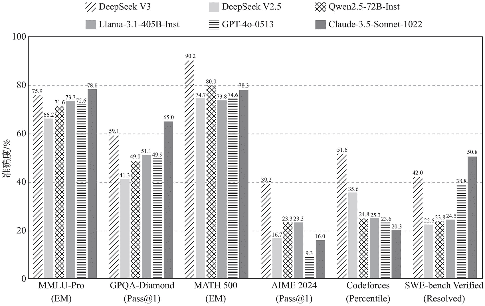
从图 1-1 可见，V3 在所有开源模型中取得最佳成绩，在部分闭源模型对比中也各有千秋。各基准具体如下：

●**MMLU-Pro：**增强版多任务语言理解评测，通过增加选项数与题目复杂度，测试专业领域的深度理解。
●**GPQA-Diamond：**高难度跨学科科学问答集，涵盖生物、物理等博士级问题，需多步推理，专家准确率仅 65%～74%，用于评估高阶科学推理。
●**MATH 500：**OpenAI 精选的 500 道高难度数学题，覆盖代数、数论等，用于严格测试数学推理与复杂问题解决。
●**AIME 2024：**美国数学邀请赛，含 15 道高难度数学题，用于评估多步逻辑推理能力。
●**Codeforces：**全球知名算法竞赛平台，通过实时编程比赛评估代码生成与算法设计能力，采用积分制。
●**SWE-bench Verified：**OpenAI 于 2024 年 8 月推出的改进版软件工程评估基准，用于衡量解决现实世界软件问题的能力。

R1 突破了以 OpenAI 为代表的世界领先公司对中国 AI 的封锁，通过自研技术追赶 OpenAI-o1-1217。R1 及其对标模型的基准测试性能如图 1-2 所示。**[图][1][-][2]** **[D][e][e][p][S][e][e][k]** **[R][1][及][其][对][标][模][型][的][基][准][测][试][性][能]**

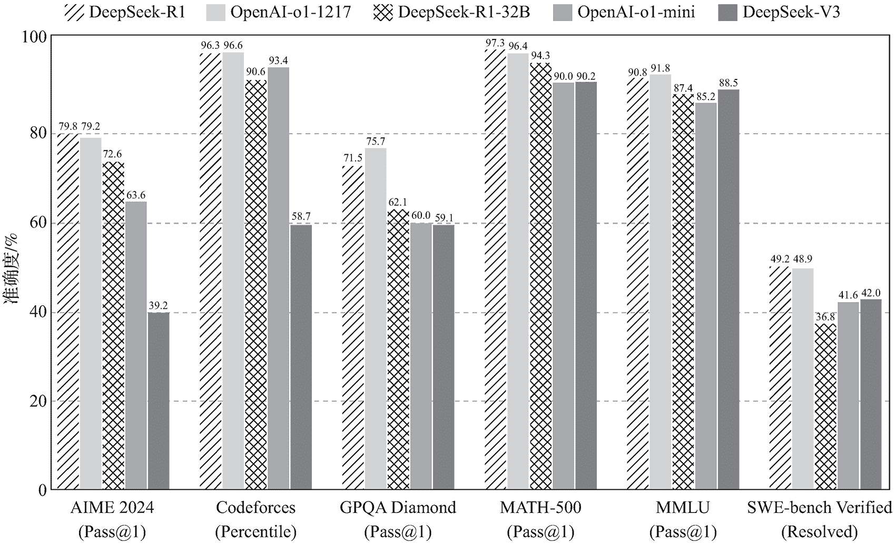
由于 R1 属于语言推理模型，对比对象统一为推理模型。这类模型更擅长复杂推理，但在普通任务上可能出现输出过长、思考过度等问题。从图 1-2 可见，R1 在各基准上均已达到或接近 SOTA 水平。

**1.2.3 成本下探**

**DeepSeek V3 成本与技术拆解**

图 1-1 的横评显示 DeepSeek V3 已稳稳拉开 Llama-3.1-405B-Inst 的差距。下面把训练投入和落地推理开销分开聊。

**1.训练开销拆解**

Llama-3.1-405B-Inst 的预训练动用了超过 1.6 万张英伟达 H100，这类卡属于现阶段算力顶端，累计消耗约 3930 万 GPU 小时，其中 405B 主体部分就占了 3084 万小时。

DeepSeek V3 选用的是算力偏弱的英伟达 H800 全程完成训练，总计仅 278.8 万 GPU 小时。训练曲线非常平稳，整段过程未出现不可恢复的损失尖峰，也没有做过回滚。

这组对比说明，造世界级大模型并不一定要堆满旗舰卡，用更少或入门一些的设备一样能做出顶尖水准，这对模型厂商和芯片厂商的估值逻辑产生了间接影响。

**2.推理落地成本拆解**

（1）算力需求

部署形态不同导致绝对成本难以直给，但 Llama-3.1-405B-Inst 是稠密结构，推理时 4050 亿参数全部参与。DeepSeek V3 是混合专家结构，推理时只激活约 370 亿参数。在 Transformer 体系里，大量算子复杂度随参数规模呈一次方乃至二次方增长，因此在相同输入下，DeepSeek V3 的推理算力需求大约只有 Llama-3.1-405B-Inst 的十分之一左右。

（2）首次加载资源

即便激活参数较少，作为 607B 级别的混合专家模型，加载时仍需把全部权重放入设备的 HBM。以 H800 为例估算最低机器与显存需求。

单卡 H800 的 HBM 为 80GB，若以 BF16 精度把 DeepSeek V3 装载，所需显存为

607×10⁹×2B=1.214×10¹²B=1.214TB

模型加载所需卡数


下面估算 Llama-3.1-405B-Inst 在 BF16 精度下的首次部署开销。

模型加载所需显存为

405×10⁹×2B=0.91×10¹²B=0.91TB

模型加载所需卡数


以上仅计入权重加载所需卡数与算力，真实落地还要考虑键值缓存、分布式推理、显存碎片、预处理与解码分离等。需要留意的是，混合专家模型的分发与聚合属于全对全通信，推理阶段通信量常成为瓶颈。因此在混合专家的分布式推理里，合理重叠计算与通信能显著缓解通信墙问题，具体可参考第八章的 Dualpipe 流水线并行。

**1.2.4 算法创新**

DeepSeek 在底层算法上是国内做得最扎实的团队之一，主要进展集中在以下几项。

1.MLA

Transformer 传统的多头注意力 MHA 因为推理时键值缓存占用大、计算重，导致部署困难、速度下降、上下文受限。分组查询注意力 GQA 在此基础上让多个 K_head 或 V_head 共享投影矩阵，降低计算与显存开销，并在参数规模足够时逼近 MHA 效果。

但 GQA 因参数减少带来一定低秩性，表达空间受损。为在压缩显存的同时保持表达力，DeepSeek V2 引入多头潜在注意力 MLA，极大压缩推理显存、提升推理速度并维持能力不退化。细节见第六章。

2.MoE

混合专家的核心是把模型拆成多个子网络，输入只激活其中一部分，从而提升效率。虽然思想并非 DeepSeek 首创，但该路线在 DeepSeek 手中得到系统性发扬，该团队一直坚定拥抱混合专家，而业界不少同行此前并未采用。

3.GRPO

ChatGPT 的指令遵循论文使用 PPO 做 RLHF。PPO 作为在线离线算法存在明显痛点：显存占用大，需同时加载策略模型、参考模型、价值评估模型、奖励模型 4 个模型，其中策略与评估模型还需更新；Reward Hack，因奖励来自人工反馈而难以泛化，导致奖励模型与人类价值不一致；价值评估模型难以拟合语言模型极大的状态空间 V^L，效果受限。

DeepSeek 提出的群体相对策略优化 GRPO 有效缓解上述三点。GRPO 改造了 PPO 的优势函数计算，不再依赖价值评估模型，对数学、代码、逻辑等有明确答案的问题直接用规则给奖励，避免了奖励模型的训练与 Reward Hack。算法细节将在第三章展开。

4.直接强化学习

常规流程是监督微调 SFT 后再做基于人类反馈的强化学习。DeepSeek Zero 则尝试在预训练后直接进行强化学习，获得了不错的长链条推理效果。SFT 是否可省目前仍有争议，笔者认为对通用语言模型而言 SFT 仍是必要环节，具体讨论见第十章。

5.工程基础设施

相较同量级 Llama-3.1-405B-Inst，DeepSeek V3 仅用约十分之一训练成本就取得更好性能，除架构外还得益于配套工程：

● 更细粒度的量化方式，粒度越细精度损失越小。
● FP8 混合精度训练，DeepSeek 是少数能在 FP8 下完成大规模训练的团队，显著降低计算量。
● Dualpipe，通过双向流水线并行重叠不同批次的计算与通信，提升 MCU 利用率。
● 低精度通信，专家混合架构会带来很高的通信量，降低通信时向量精度有助于削减通信开销。
● 分块计算，为避免 FP8 在 Tensor Core 中下溢，提出矩阵分块计算并在 CUDA Core 累加。
● 专家调度策略，深度设计负载均衡与通信专家分组，以充分利用算力与带宽。

**1.3 DeepSeek 系列与海外大模型的盘点**

**1.3.1 DeepSeek 系列模型**

1.DeepSeek V3

目前 DeepSeek 团队发布的最新一代通用语言模型，在多项评测中表现突出，尤其在复杂任务与长文本处理上。该模型凭借技术优势与开源特性，在国内及国际 AI 圈确立了重要地位，成为继 Kimi 等之后的新里程碑，也成为开发者社区的核心资源。

特点：

● 推理与理解能力增强，在自然语言处理任务上具备更强理解与推理，适合复杂问题求解与因果分析。
● 上下文处理能力，支持最长 12.8 万 Token 的上下文，有效处理长文档与长篇文章。
● 强化学习优化，利用强化学习提升模型对多样化任务的适应性，在多步推理上表现突出。
● 数据整合与准确性，除文本外可整合多源数据，给出准确信息并标注来源，便于核查。

2.DeepSeek R1

DeepSeek 团队主攻逻辑推理与问题解决的高级语言模型，具备强处理与推理能力。

特点：

● 推理能力，在数学、代码生成与自然语言推理上表现优异，性能可比肩 OpenAI GPT 系列与 Kimi。
● 训练方法，采用预训练后直接强化学习，跳过了传统预训练→SFT→强化学习的流程，提升效率。
● 参数规模，拥有 671 亿参数，上下文长度 12.8 万 Token，提升复杂文本处理能力。
● 多源信息整合，能结合多种来源数据作答并标注出处，便于追溯。

3.DeepSeek V2

基于专家混合架构的语言模型，以训练经济性与推理高效性著称，是系列的重要进展。

特点：

● 高效专家混合架构，处理不同任务时动态选择子模型，提升资源利用率，相比前代训练成本降低 42.5%。
● 推理性能提升，通过优化注意力与前馈网络，推理速度较 DeepSeek 67B 快 5.76 倍，可借助 vLLM 进一步优化 GPU 推理。
● 全面语言支持，在多语言任务上表现良好，中文处理尤为突出，如 DeepSeek V2-Chat。
● 联网搜索，DeepSeek V2.5-1210 增加联网搜索，可分析海量网页并自动提取关键词并行检索。

**1.3.2 海外知名大模型**

1.OpenAI 的 GPT 系列

（1）简介

截至本书成稿，GPT-4 是 OpenAI 最新发布的强多模态预训练大模型，以强大的语言理解与生成著称，支持文本生成、内容理解等，具备长上下文能力，在自然语言任务中持续领先。GPT 系列凭借持续的技术迭代在多项基准保持领先。GPT-4o 在 LMSYS 聊天机器人竞技场以 1310 分居首，在 Reka Vibe-Eval 多模态测试中超过 Gemini Pro 1.5 近 3 个百分点；针孔测试正确率达 80%～100%。模型采用预训练加微调策略与 Transformer 架构，在语言理解与文本生成上保持优势。

（2）应用场景

● 教育：个性化学习建议与资源推荐。
● 医疗健康：辅助疾病诊断与治疗方案制定。
● 客户服务：实时咨询处理，提升满意度。
● 娱乐产业：游戏开发中的虚拟角色设计。

2.Anthropic 的 Claude 系列

（1）简介

Claude 系列包含 Haiku、Sonnet、Opus，分别面向智能、速度、成本。模型擅长处理结构化与非结构化数据，包括图像、图表，具接近人类水平的自然语言能力。Claude 3.5 Sonnet 与 GPT-4o 在多领域形成竞争。Claude 基于 Transformer 并强化安全设计，支持 20 万 Token 长文本，在代码生成与法律分析等结构化任务上表现强。Claude 3.5 Sonnet 的编码准确率较前代提升 68%，速度翻倍，Artifacts 功能支持实时代码预览与协作。GPT-4o 在多语言支持与复杂推理上更占优。Claude 更适合高合规医疗、金融的长文档处理，GPT-4o 更适合营销创意与多模态内容生成。

（2）应用场景

● 教育：作为智能助教提供学习建议。
● 医疗健康：辅助诊断与个性化治疗方案。
● 金融服务：市场分析预测与风险管理。

3.谷歌的 PaLM 系列

（1）技术特点

PaLM 系列支持文本、代码、音频、图像、视频等多类型信息，具有优秀的自然语言与计算机视觉能力。基于 Pathways 机器学习系统搭建，首版 2022 年 4 月发布，2023 年 3 月开放 API，包含 8B、62B、540B 等规模及 PaLM 2、PaLM-E 等改进版，具备超大参数、多语言、零样本少样本学习等特点。采用 Transformer、专家混合等核心技术，可用于文本生成、编程、翻译、教育、医疗、金融等场景。

（2）应用场景

● 企业办公：PaLM 2 深度集成 Google Workspace，提供智能邮件撰写、PPT 自动生成、表格分析等。
● 医疗健康：Med-PaLM 2 通过美国医师执照考试，可辅助解读 X 光片并生成报告，正通过 Google Cloud 试点开放。
● 网络安全：Sec-PaLM 可快速识别恶意脚本，提供实时威胁分析；轻量化版 Gecko 支持移动端离线运行，适合隐私场景。

PaLM 的多模态能力已赋能 Bard 实现跨模态交互。全球已有超 25 款谷歌产品接入 PaLM 2，覆盖搜索、教育、开发工具等，并通过开放 API 支持行业定制。

4.Meta 的 Llama 系列

（1）简介

Llama 由 Meta 开发，具有优秀的自然语言处理能力，适合高效处理海量数据。基于 Transformer Decoder-only 结构，采用预归一化、SwiGLU 激活、旋转位置编码等技术，提升训练稳定性与性能。借助分组查询注意力等技术降低计算与显存占用，可在相对有限资源下取得较高性能，训练过程优化，数据利用效率高。

系列包含 Llama-7B、13B、30B 等多个规模，以满足不同算力需求。预训练数据覆盖网页文本、百科、代码、学术论文等，注重质量过滤、数据多样性与分布均衡，以学习丰富语言知识与语义。

支持多语言处理，部分版本具备多模态能力。训练上使用 AdamW 优化器与余弦学习率调度，因果多头注意力减少内存占用，梯度检查点降低反向传播显存，配合分布式与混合精度训练加速。

凭借开源策略与技术创新，Llama 已成为全球最具影响力的开源模型之一。截至 2025 年 4 月下载量突破 10 亿次，已深度集成至 Facebook、Instagram、WhatsApp 等核心产品，并被 Spotify、AT&T 等企业广泛采用。

**Llama 4 MoE 化，开源大模型迎来新一轮提速**

Llama 4 全面迁移到 MoE 混合专家体系。Scout 将上下文窗口拉大到一千万 token，刷新开源纪录；Maverick 在多模态综合能力上已跑赢 GPT-4o。Behemoth 以两万亿参数体量布局，瞄准性能天花板。

LMSYS 榜单上 Maverick 得分 1417 排在第二，仅落后闭源的 Gemini 2.5 Pro。在 DeepSeek 等对手的挤压下，Meta 以八百亿美元加码人工智能布局，并通过 LlamaCon 开发者峰会经营生态，进一步稳固开源大模型头部位置。

目前 Llama 体系已覆盖边缘到企业的完整谱系，Gecko 可在移动端运行，Behemoth 面向高算力场景。全球已有二十多款主流产品接入该系列，商业化动能明显。

（2）应用场景

Llama 家族在自然语言处理上基础扎实，落地方向较广。

● **自然语言处理：** 可完成文本分类、情感判断、摘要抽取等任务，提升内容处理效率。
● **智能客服：** 电商与金融机构部署后实现快速应答与个性化服务。
● **内容创作：** 为创作者提供智能辅写，有效提高写作效率。
● **医疗：** 支持病历解析与辅助诊断，在药物研发中加速化合物筛选。
● **金融：** 可执行风险评估与反洗钱监测，提升业务安全性。
● **教育：** 能提供个性化辅导、智能批改与自适应教学，打造差异化学习体验。

**1.3.3 国内知名大模型**

**1. MiniCPM 系列**

MiniCPM 由面壁智能推出，主打端侧高效低功耗，被称作性能小钢炮，多模态表现尤其突出，在跨规模对比中胜出不少同类。

（1）技术特点
● **本地运行：** 可在手机、平板等终端离线使用，支持文本、图像、音频、视频等多模态任务。
● **运行效率：** 借助模型蒸馏与流式推理，2B、8B 等小规格接近 GPT-4o 水平，视觉理解与语音环节表现亮眼。
● **成本与延迟：** 依托 CPU、NPU 推理降本，适用于网络不佳或需持续响应的场景。

（2）应用场景
● **智能终端：** 在手机、平板实现 AI 本地化，如语音助手、实时翻译、图像识别。
● **自动驾驶与安防：** 实时解析视频流捕捉动态信息，用于自动驾驶、安保监控。
● **多模态交互：** 支持情感控制、语音克隆、角色扮演等，提升交互体验。

（3）行业地位
MiniCPM 在 OpenCompass 等榜单中成绩突出，部分端侧多模态任务甚至超过 GPT-4o、Claude 3.5 Sonnet 等云端模型，成为端侧 AI 的标杆。

**2. 通义千问（Qwen）**

通义千问由阿里云研发的大规模预训练语言模型，中文理解能力强、多模态兼顾，广泛用于商业、教育、科研。

（1）技术特点
● **中文优化：** 在中文语料上深度调优，对语法、语义与文化背景把握更准，中文任务表现显著提升。
● **多模态兼顾：** 支持文本、图像、音频联合推理，可处理图文生成、语音识别等复合任务。
● **推理效率：** 通过模型压缩与分布式计算优化，在保持高性能下降低推理成本，利于规模化商用。
● **长文本处理：** 扩展上下文长度并优化记忆机制，可应对文档摘要、长对话等长文本需求。

（2）应用场景
● **智能客服：** 高效语音识别与自然语言处理，提升电商、金融等领域的服务体验。
● **内容创作：** 生成高质量文章、广告文案、视频脚本，适配媒体、广告行业。
● **教育辅助：** 凭借语义理解与知识推理能力解答学生问题、辅助教师备课。
● **科研支持：** 进行文献分析、数据整理与知识推理，助力科研挖掘与创新。

（3）行业地位
通义千问在中文模型赛道占重要位置，中文处理与多模态能力使其在商业化与科研中表现优异，多项中文 NLP 基准测试成绩突出，是国产模型的代表。

**3. Kimi 大模型**

Kimi 由月之暗面 Moonshot AI 研发，以长文本与多模态著称，被誉为国产 AI 的代表。

（1）技术特点
● **长文本能力：** 支持高达 200 万字上下文解析，远超多数模型，适合复杂文档与长文。
● **多模态解析：** 可解析文本、图像、PDF、Word 等文件并融合多源信息作答。
● **强化学习与上下文扩展：** 窗口扩展至 12.8 万 Token，结合强化学习策略优化，提升推理与任务适应性。
● **检索与整合：** 检索能力强，能整合搜索引擎、社群等多源数据并给出逻辑清晰、带来源标注的答案。

（2）应用场景
● **教育与研究：** 帮助学生理解复杂概念，辅助研究人员文献解读与数据分析。
● **商务辅助：** 商业计划制定、市场分析、代码解析等。
● **日常使用：** 旅行规划、语言翻译、生活建议等。

（3）行业地位
Kimi 在多项基准测试中表现优异，尤其长文本与复杂推理接近 OpenAI GPT 系列与 DeepSeek R1，是国产模型的代表之一。

**4. MiniMax 大模型**

MiniMax 以高效推理与低成本见长，行业覆盖面广。

（1）技术特点
● **线性注意力：** 采用线性注意力机制降低长文本计算复杂度。
● **高效推理：** 模型压缩与优化技术让低参数规模也能高效推理，减少算力需求。
● **多模态兼容：** 支持文本、图像、音频联合推理，适配复杂任务。
● **云端协同：** 资源受限设备本地推理，复杂任务可借助云端算力。

（2）应用场景
● **智能客服：** 高效语音识别与自然语言处理，提升服务体验。
● **内容生成：** 文本、图像、视频的自动生成与编辑，适配媒体、广告。
● **工业自动化：** 利用多模态推理实现工业设备智能监控与故障诊断。

（3）行业地位
MiniMax 在高效 AI 模型领域占重要位置，技术路径与面壁智能 MiniCPM 相似，均致力于低资源环境下的高性能推理。

**5. GLM**

GLM 即 General Language Model，由智谱公司研发，以通用性与高效性著称，广泛用于自然语言处理。

（1）技术特点
● **通用性：** 自回归与自编码混合架构，同时支持生成与理解任务。
● **高效训练：** 创新稀疏注意力与分布式训练优化，提升训练效率与资源利用率，降低成本。
● **多任务学习：** 支持多任务联合训练，可同时处理文本生成、分类、翻译，提升泛化能力。
● **长文本处理：** 通过扩展上下文窗口与记忆机制优化，有效处理长文本。

（2）应用场景
● **文本生成：** 高质量文章创作、故事生成、代码编写，适用于内容创作。
● **智能问答：** 语义理解能力强，提供精准问答，适用于教育、客服。
● **机器翻译：** 多语言翻译，服务跨语言交流。
● **科研辅助：** 文献分析、数据整理、知识推理，提升科研效率。

（3）行业地位
GLM 在 NLP 领域地位重要，通用架构与高效训练为后续大模型提供参考，多项基准测试表现优异，中文任务尤其突出，是国产模型的代表之一。

**第二章 经典 Transformer 架构**

Transformer 自 2017 年提出以来，因可扩展、训练并行快、无梯度消失等优势，已成为大语言模型的主流底层架构。本章结合源码讲解其底层原理。

**2.1 Transformer 架构的特点**

Transformer 由 Vaswani 等人在 2017 年论文《Attention Is All You Need》中提出，核心是用自注意力机制刻画序列内各元素的相互关系，实现并行计算与性能提升。与 RNN、LSTM、GRU 相比：

1. 并行化能力
● RNN/LSTM/GRU：序列依赖强，每步计算依赖前步，难以并行，训练慢，尤其长序列更明显。
● Transformer：自注意力可并行处理整段序列，大幅提升训练效率。

2. 长程依赖
● RNN：长序列易梯度消失/爆炸，难捕捉长程依赖。
● LSTM/GRU：门控机制缓解问题，但极长序列仍受限。
● Transformer：自注意力直接建模任意位置关系，更好处理长程依赖。

3. 计算复杂度
● RNN/LSTM/GRU：O(T·D²)，T 为序列长，D 为隐藏维度，计算量相对低但难并行。
● Transformer：O(T²·D)，复杂度更高，但并行优势使实际训练更快。

4. 模型表达能力
● RNN/LSTM/GRU：表达受隐藏状态维度限制，难以直接关联任意两位置。
● Transformer：自注意力直接建模任意位置关系，表达能力更强。

5. 内存占用
● RNN/LSTM/GRU：需存储每步隐藏状态，内存随序列长线性增长。
● Transformer：自注意力内存随序列平方增长，但并行使实际使用效率更高。

6. 对位置信息的处理
● RNN/LSTM/GRU：按序处理，天生具备位置感知。
● Transformer：需额外引入位置编码，否则无法区分排列顺序。

7. 训练稳定性
● RNN/LSTM/GRU：易受梯度消失/爆炸影响，训练不稳定。
● Transformer：层归一化与残差连接使训练更稳定。

**2.2 Transformer 的基本原理**

Transformer 是大语言模型主流架构，掌握其结构对深入理解大模型至关重要。图 2-1 是 Transformer 基本架构。模型分为 Encoder 编码器与 Decoder 解码器，Encoder 将输入编码为向量，Decoder 将向量生成文本输出。**[图][2][-][1][T][r][a][n][s][f][o][r][m][e][r][的][基][本][架][构]**

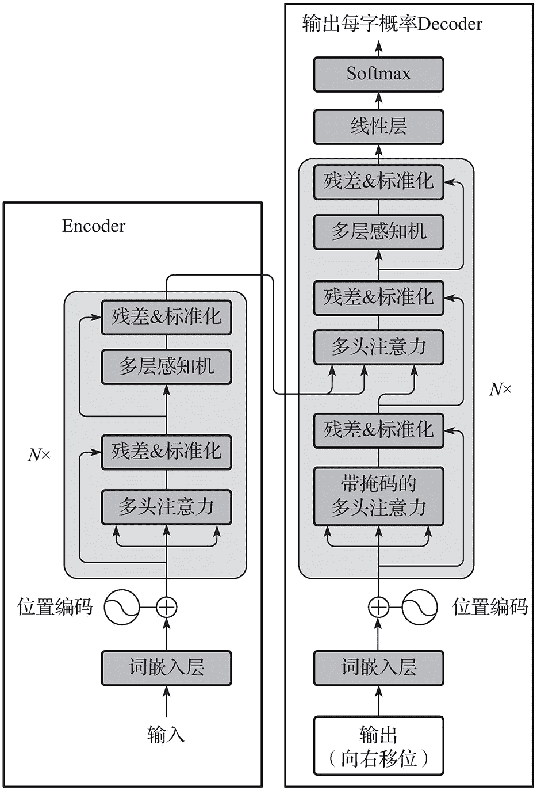

Encoder 与 Decoder 由相同基本单元构成，包括分词器、词嵌入层、位置编码模块、自注意力模块、多头注意力模块、前馈神经网络、残差连接与层归一化。

**2.2.1 分词器**

大模型输入为文本序列，进入模型前需分词，分词单元称 Token。示例：

1 输入文本序列：我爱人工智能！
2 输出 Token：我 爱 人工智能 ！

Token 不一定等于词或字，“人工智能”也可能被切分为“人工”“智能”，取决于词表优先级。同分词器下相同输入输出一致，词表构建见第 6.3 节分词算法。

**2.2.2 词嵌入层**

分词后 Token 仍是文本，需转为数值矩阵供模型计算。词嵌入层提供查询表，每个词对应 d_model 维向量。

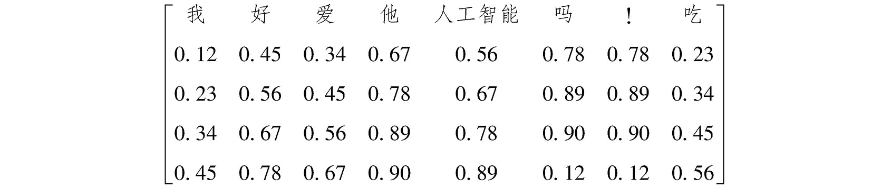

将 Token 输入查询表查得列向量，如“我、爱、人工智能、！”经 Embedding 后输出向量


注意：进入 Embedding 层的实际是 Token_ID，即词表中位置。Embedding 矩阵若对应“我、爱、人工智能、！”为 0、2、4、6，输出矩阵不变：

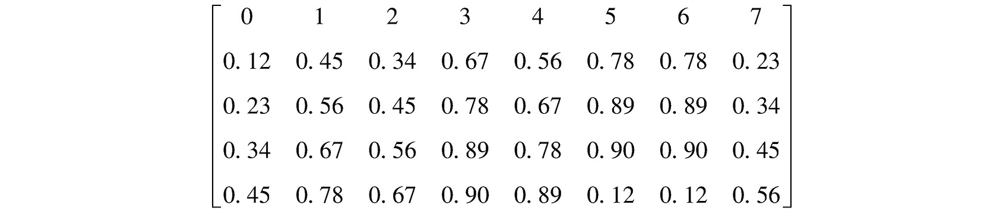


**2.2.3 位置编码模块**

Transformer 本身对输入置换不变，自注意力只关注内容不关注顺序。若不加位置信息则无法区分不同排列。为此需通过位置编码注入序列位置特征。

论文中位置编码计算方式如下：


Embedding 输出与位置编码相加得到带位置信息的词向量：

P_OUT = PE + Em

其中 P_OUT 为带位置信息的词向量，PE 为位置编码，Em 为 Embedding 输出。位置编码让模型区分“猫坐在垫子上”与“垫子上坐着猫”等顺序差异，结合内容嵌入与位置信息，Transformer 能有效处理序列数据，在机器翻译、文本生成、语音识别等任务中表现关键。

以下是 Transformer 位置编码的代码实现：

Python

import torch

import torch.nn as nn

import math

class PositionalEncoding（nn.Module）:

 def __init__（self, embed_dim, max_seq_len）:

 super（PositionalEncoding, self）.__init__（）

 #初始化位置编码矩阵，形式为[max_seq_len, embed_dim]，初始值为 0

 self.encoding = torch.zeros（max_seq_len, embed_dim） #形式为[max_seq_len, embed_dim]

 #创建一个表示位置的向量，大小为（max_seq_len, 1）

 position = torch.arange（0, max_seq_len, dtype=torch.float）.unsqueeze（1） #形式为[max_seq_len, 1]

 #计算 div_term，用于生成正弦和余弦函数的周期性变化，大小为（embed_dim // 2）

位置编码 让序列有顺序感

Transformer 没有位置感知，需要额外注入顺序信息。最常用的做法是用正弦余弦为每个位置生成可区分的向量，推理时直接加到词向量上，就像给模型装上位置感官。

```python
div_term = torch.exp（torch.arange（0, embed_dim, 2）.float（） * （-math.log （10000.0） / embed_dim）） #形式为[embed_dim // 2,]

#对偶数索引的位置应用正弦函数，奇数索引的位置应用余弦函数

#这里 position 与 div_term 相乘的结果会被广播，以匹配 encoding 矩阵的尺寸

self.encoding[:, 0::2] = torch.sin（position * div_term）

  #偶数列填充为正弦值，形式为[max_seq_len, embed_dim // 2]

self.encoding[:, 1::2] = torch.cos（position * div_term）

  #奇数列填充为余弦值，形式为[max_seq_len, embed_dim // 2]

#将位置编码扩展到（batch_size, max_seq_len, embed_dim），但实际使用时只会选取相应序列长度的部分

self.encoding = self.encoding.unsqueeze（0） #形式为[1, max_seq_len, embed_dim]

def forward（self, x）:

  #x 是输入张量，形式通常是[batch_size, seq_len, embed_dim]

  #将位置编码加到输入张量上，并且使用 detach（）来确保位置编码不参与梯度计算

  return x + self.encoding[:, :x.size（1）].detach（）

  #输出形式为[batch_size, seq_len, embed_dim]
```

代码拆解

初始化
self.encoding 预先开辟一个零矩阵，维度对应最大长度和嵌入大小，用来保存位置表。position 是一个从 0 开始的递增索引列，形状为 [max_seq_len, 1]。div_term 按 -log(10000)/embed_dim 的规律计算，用来让不同通道的正弦余弦拥有不同周期，长度为 embed_dim // 2。

编码生成
偶数下标通道填入 sin，奇数下标通道填入 cos。position 与 div_term 相乘后经广播对齐到编码矩阵，每一行形成一个唯一的位置签名。

前向使用
输入 x 通常是 [batch_size, seq_len, embed_dim]。实际推理时从预计算的编码里截取与当前长度一致的部分相加，并用 detach 切断梯度，使位置表保持固定。输出形状与输入一致。

2.2.4 自注意力模块

自注意力是 Transformer 的核心部件，让序列里的每个元素都能动态地关注其余所有元素，从而捕捉长距离依赖。计算完全并行，训练效率和表达能力都显著提升，也是自然语言处理多次突破的关键。

图 2-2 主要展示自注意力机制的基本原理，核心在于每个输入的 Token（*t*¹，*t*²，*t*³，*t*⁴）的注意力和哪些 Token 有关。比如可以明显看出***Q***¹将参与***K***¹，***K***²，***K***³，***K***⁴的计算。最终输出的 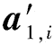是对所有的***a***[1,]*[i]*进行 Softmax 计算的结果。**[图][2][-][2][自][注][意][力][机][制][的][基][本][原][理]**

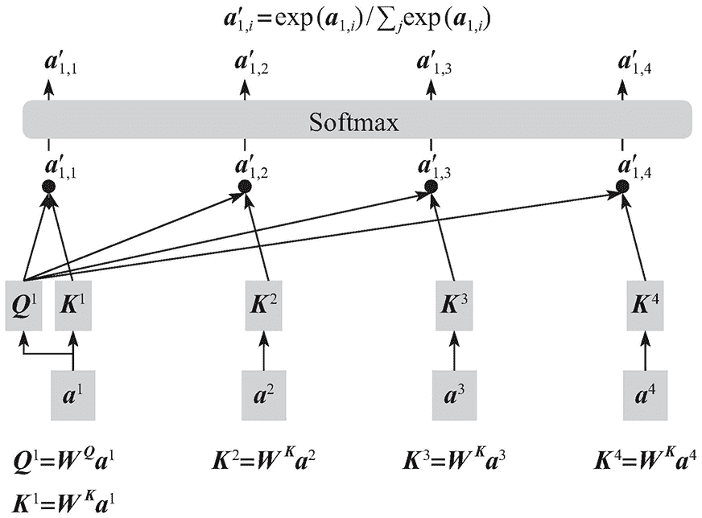

图 2-3 所示是自注意力机制整体架构。**[图][2][-][3][自][注][意][力][机][制][整][体][架][构]**

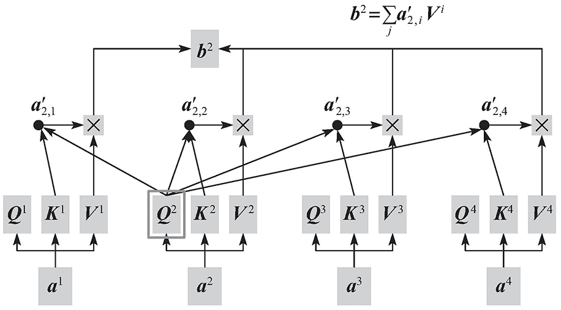

将图 2-2 与图 2-3 结合，注意力执行的步骤可概括为：

1）把原始句子切分为 token 序列 t¹,t²,t³,t⁴…t^i，分别对应第 1、2、3、4…i 个词元。
2）这些词元进入 Embedding 层得到向量表示 a¹,a²,a³,a⁴,…,a^i。
3）图 2-2、图 2-3 中的 a¹,a²,a³,a⁴,…,a^i 即文本序列 T 中各位置的向量。
4）Q^i,K^i,V^i 是 a^i 通过 W^Q,W^K,W^V 投影得到的查询、键、值向量，即
***Q****^i*=***a****^i****W******^Q***
***K****^i*=***a****^i****W******^K***
***V****^i*=***a****^i****W******^V***
5）图 2-3 中的 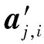 表示第 j 个词元与第 i 个词元之间的注意力分数，具体形式见图 2-2：

注意：注意力分数不满足交换律，即

6）最终输出 b^i 可理解为 t^i 在与全部其他词元交互后得到的向量，即


自注意力机制代码如下：

Python

import torch
import torch.nn as nn
import torch.nn.functional as F
class SelfAttention（nn.Module）:
  def __init__（self, embed_dim）:
    super（SelfAttention, self）.__init__（）
    self.embed_dim = embed_dim
    #定义线性变换层，用于生成 Query、Key 和 Value
    self.query = nn.Linear（embed_dim, embed_dim） #W[Query]用于生成 Query 向量
    self.key = nn.Linear（embed_dim, embed_dim）  #W[Key]用于生成 Key 向量
    self.value = nn.Linear（embed_dim, embed_dim） #W[Value]用于生成 Value 向量
  def forward（self, x, mask=None）:
    """
    x:输入序列 （batch_size, seq_len, embed_dim）
    mask:掩码 （batch_size, seq_len, seq_len）
    """
    batch_size, seq_len, embed_dim = x.shape
    #生成 Query、Key 和 Value
    Q = self.query（x） #Query 向量形式为[batch_size, seq_len, embed_dim]，用于计算注意力分数
    K = self.key（x）#Key 向量形式为[batch_size, seq_len, embed_dim]，用于计算注意力分数
    V = self.value（x） #Value 向量形式为[batch_size, seq_len, embed_dim]，用于加权求和
    #计算注意力分数
    scores = torch.matmul（Q, K.transpose（-2, -1）） / torch.sqrt（torch.tensor（embed_dim, dtype=torch.float32））
    #注意力分数矩阵形式为[batch_size, seq_len, seq_len]，表示每个位置对其他位置的关注程度
    #如果存在掩码，则应用掩码
    if mask is not None:
      scores = scores.masked_fill（mask == 0, float（"-1e20"））
    #掩码用于屏蔽无效位置（如填充位置），将对应位置的注意力分数设置为一个很小的值
    #计算注意力权重
    attention_Weights = F.Softmax（scores, dim=-1）
    #注意力权重矩阵形式为[batch_size, seq_len, seq_len]，表示每个位置对其他位置的归一化关注程度
    #加权求和得到输出
    output = torch.matmul（attention_Weights, V）
    #输出序列形式为[batch_size, seq_len, embed_dim]，每个位置的输出是其他位置的加权和
    return output

代码说明

SelfAttention 类
embed_dim 表示嵌入层的向量维数，输入可记作 [B,T,D]，B 为批次数，T 为文本长度，D 为映射维度。

W[Query]、W[Key]、W[Value] 为三个线性变换，分别生成 Q、K、V，可表示为

forward 方法
X 的形状为 [batch_size, seq_len, embed_dim]。mask 为可选的掩码矩阵，形状为 [batch_size, seq_len, seq_len]，用于屏蔽无效位置。
生成 Q、K、V
三者形状同为 [batch_size, seq_len, embed_dim]，计算方式为
***Q***=***X**W******^Q***
***K***=***X**W******^K***
***V***=***X**W******^V***
计算注意力分数
scores 的形状为 [batch_size, seq_len, seq_len]，反映各位置间的关注程度。先做 Q 与 K 转置的点积，再除以 sqrt(embed_dim) 缩放，公式为

注意力掩码
若提供 mask，则把对应位置的分数置为极小值如 -1e20 以屏蔽。将 S 与 mask 结合后做 Softmax 的结果如下：

计算注意力权重
attention_Weights 的形状为 [batch_size, seq_len, seq_len]，通过 Softmax 归一化：
***A***=Softmax（***S***）
两两 Token 之间的注意力分数 A 的计算如下：

加权求和得到输出
output 的形状为 [batch_size, seq_len, embed_dim]，每个位置的输出是其他位置的加权和。计算公式为
***O***=***A**V***

2.2.5 多头注意力模块

多头注意力 MHA 是自注意力的扩展，把过程拆成多个独立头，各自用不同参数在不同子空间做注意力，再拼接并线性融合。这样能捕捉更丰富多样的依赖，提升模型对复杂结构的表达力。**[图][2][-][4][M][H][A][机][制][架][构]**

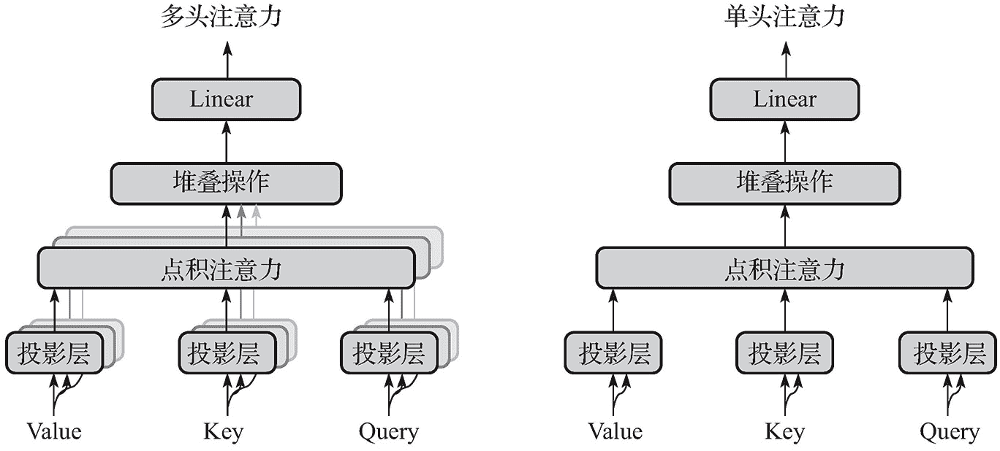

MHA 机制的代码如下：

Python

import torch
import torch.nn as nn
import torch.nn.functional as F
class MultiHeadAttention（nn.Module）:
  def __init__（self, embed_dim, num_heads）:
    super（MultiHeadAttention, self）.__init__（）
    self.embed_dim = embed_dimX           #输入嵌入维度
    self.num_heads = num_heads           #多头注意力机制中的头数
    self.head_dim = embed_dim // num_heads     #每个头的维度
    #定义线性变换层，用于生成 Q（查询）、K（键）和 V（值）
    self.query = nn.Linear（embed_dim, embed_dim） #输入维度到 embed_dim
    self.key = nn.Linear（embed_dim, embed_dim）  #输入维度到 embed_dim
    self.value = nn.Linear（embed_dim, embed_dim） #输入维度到 embed_dim
    self.fc_out = nn.Linear（embed_dim, embed_dim） #最终输出的线性变换层
  def forward（self, query, key, value, mask=None）:
    batch_size = query.shape[0]           #获取批次大小
    #线性变换并分头
    #Q、K、V 的形式从[batch_size, seq_len, embed_dim]变为[batch_size, num_heads, seq_len, head_dim]
    Q = self.query（query）.view（batch_size, -1, self.num_heads,
      self.head_dim）.transpose（1, 2）
    K = self.key（key）.view（batch_size, -1, self.num_heads,
      self.head_dim）.transpose（1, 2）
    V = self.value（value）.view（batch_size, -1, self.num_heads,
      self.head_dim）.transpose（1, 2）
    #计算注意力分数：Q 与 K 的转置相乘，并除以 sqrt（head_dim）进行缩放
    #scores 形式为[batch_size, num_heads, seq_len, seq_len]
    scores = torch.matmul（Q, K.transpose（-2, -1）） / torch.sqrt（torch.tensor（self.head_dim, dtype=torch.float32））
    if mask is not None:
      #如果有掩码，则将被掩码的部分填充为负无穷大，使得 Softmax 计算后对应的权重接近 0
      scores = scores.masked_fill（mask == 0, float（"-1e20"））
    #应用 Softmax 函数，转换成概率分布
    attention_Weights = F.Softmax（scores, dim=-1） #形式不变，仍为[batch_size, num_heads, seq_len, seq_len]
    #加权求和，计算最终输出
    #output 形式为[batch_size, num_heads, seq_len, head_dim]
    output = torch.matmul（attention_Weights, V）

# 多头融合与线性投射

    #将多头合并，调整形式从[batch_size, num_heads, seq_len, head_dim]变为[batch_size, seq_len, embed_dim]

    output = output.transpose（1, 2）.contiguous（）.view（batch_size, -1, self.embed_dim）

    #最终通过一个线性层处理

    output = self.fc_out（output） #输出形式仍为[batch_size, seq_len, embed_dim]

    return output

**2.2.6 前馈神经网络模块**

FFN 属于典型的单向信息处理单元，数据只能从前向后流动，经多层隐层后抵达输出，没有任何反馈回路。在 Transformer 等现代结构里，它是注意力之后的标配子层。

内部实现很简洁：两段线性变换夹一个 ReLU，按位置独立计算，序列长度保持不变，但对每个 token 的表征有明显增强。换句话说，它给每个位置再加一次非线性重塑，在不破坏顺序的前提下提升语义刻画力。

主要价值体现在几个方面。

1）升维与非线性。借助全连接加激活，把低维表示扩到高维空间，能挖掘原始数据里不易察觉的复杂模式，得到更丰富的特征。
2）表达能力提升。层层堆叠后可形成很深的网络，学习多层抽象，对图像识别、文本理解这类复杂任务帮助很大。
3）局部提取服务全局融合。先捕捉局部细节，再把不同隐层的信号汇总，为后续分类或回归提供更完整的依据。
4）训练更稳、泛化更好。合理设计能让梯度下降更顺滑，降低陷入局部最优的概率，也能缓解过拟合。

PyTorch 参考实现：

Python

import torch

import torch.nn as nn

class FeedForward（nn.Module）:

  def __init__（self, embed_dim, ff_dim）:

    super（FeedForward, self）.__init__（）

    # 首层线性：embed_dim -> ff_dim
    self.fc1 = nn.Linear（embed_dim, ff_dim）
      # 形状 [..., embed_dim] -> [..., ff_dim]

    # 次层线性：ff_dim -> embed_dim
    self.fc2 = nn.Linear（ff_dim, embed_dim）
      # 形状 [..., ff_dim] -> [..., embed_dim]

    # 非线性激活
    self.relu = nn.ReLU（）        # 形状不变

  def forward（self, x）:

    # x 常见形状 [batch_size, seq_len, embed_dim]
    # 第一次映射到隐藏宽 ff_dim
    fc1_output = self.fc1（x）      # -> [batch_size, seq_len, ff_dim]
    # 激活
    relu_output = self.relu（fc1_output） # 形状不变
    # 映射回原宽 embed_dim
    output = self.fc2（relu_output）   # -> [batch_size, seq_len, embed_dim]
    return output           # 最终形状 [batch_size, seq_len, embed_dim]

实现要点。

（1）构造
● fc1 把通道从 embed_dim 扩到 ff_dim，“...”代表批量、长度等可变前导维。
● fc2 把 ff_dim 压回 embed_dim，保证与前后层对齐。
● ReLU 提供非线性，提升表征能力。

（2）前向
输入 x 一般是 [batch_size, seq_len, embed_dim]。先过 fc1 变为 [..., ff_dim]，ReLU 保持形状，最后 fc2 回到 [..., embed_dim]。进出形状一致，便于拼接。

**2.2.7 残差连接和层归一化模块**

**1.残差连接**

跳跃连接是加深网络同时保持信息畅通的常用手段，把原始输入直接叠加到若干层变换的结果上，形成捷径。

残差连接数学原理如下:**[图][2][-][5][残][差][连][接][结][构]**

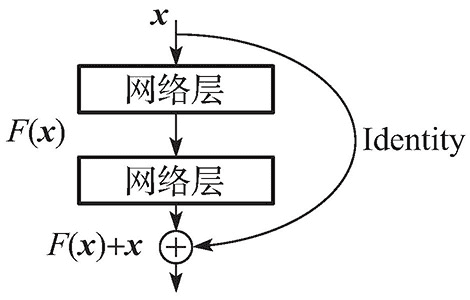

***y***=*F*（***x***）+***x***

结构如图 2-5。

核心是把模块输入 x 原封不动地加到模块输出上。效果有：

● 缓解梯度消失：反向传播多了一条直达前层的通道，梯度不易衰减。图里 Identity 旁的曲线即这条通路，信息无损回传。
● 收敛更快：网络更容易学到恒等映射，训练节奏更顺。
● 支持更深结构：上述优点让超深模型成为可能，有助于捕捉更复杂规律。

在 Transformer 中，残差通常放在注意力与前馈之后，让原始信息与新特征融合后一起传递。

**2.层归一化**

层归一化是稳定训练的正则手段，目的是减小内部协变量偏移。它按每个样本的每一层激活值做归一化，不依赖同批其它样本。

● 训练更稳：降低层间分布漂移，加速收敛，对变长序列友好。
● 与批量无关：不像批归一化依赖批量统计，在小批量或单样本在线场景下也可靠。
● 泛化增强：有助于学到更通用的特征，降低过拟合风险。

设 x 为输入，x[i] 为切片值，过程如下。

先算样本均值：


再算样本方差：


最后归一化：


●*μ* 为特征向量的均值。
●*σ*² 为特征向量的方差。
● 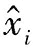 为归一化后特征。
● 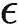 为极小常数，避免除零。

本质是减均值除方差，统一量纲，便于比较。

为何 NLP 多用层归一化而 CV 多用批归一化？

（1）NLP 选层归一化的原因
假设激活形式为[*B*，*L*，*H*]，此时进入层归一化的 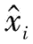 形状为[*H*]，即 x 被视作*B***L* 个 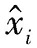 样本。NLP 特点：
1）序列长度可变，批归一化受长度限制，层归一化按样本独立更灵活。
2）样本差异大，独立归一化更贴合各句特性。
3）批量常小，层归一化不受批量大小影响更稳定。
4）位置信息重要，层归一化保留序列顺序。

（2）CV 选批归一化的原因
假设激活形式为[*B*，*H*，*W*，*C*]，此时进入批归一化的 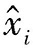 形状为[*B*，*H*，*W*]，即 x 被视作*C* 个 [*B*,*H*,*W*] 形式的 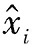 样本。特点：
1）空间维度共享统计量，同一通道不同位置统计特性相近，全批统计更有效。
2）批量通常大且稳定，均值方差估计更可靠。
3）对平移、旋转等几何变化更鲁棒。

批归一化与层归一化的对比见表 2-1。**[表][2][-][1][批][归][一][化][和][层][归][一][化][的][比][较]**

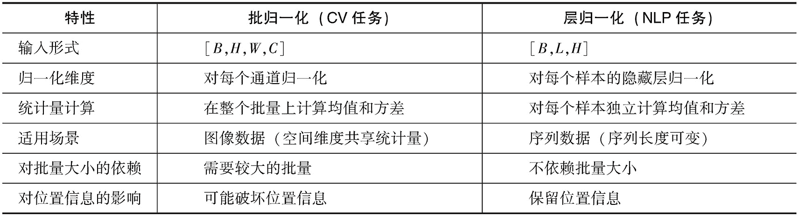

图 2-6 展示了两者的区别。**[图][2][-][6][层][归][一][化][和][批][归][一][化][的][差][别]**

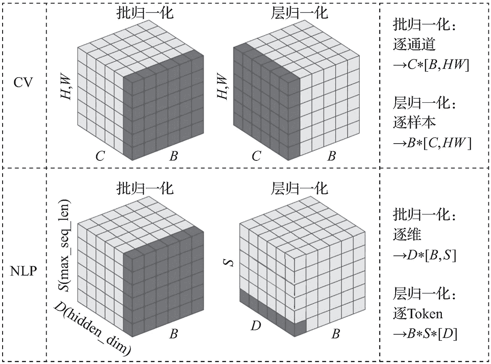

从图 2-6 可见，CV 中特征矩阵为[*B*,*H*,*W*,*C* ]，批归一化按通道归一，单样本视作[*B*,*H*,*W* ]，适合跨通道对比。NLP 中特征矩阵为[*B*,*S*,*H* ]，层归一化按 Token 粒度归一，单样本为[*D*]，共*B***S*个，更贴合 Token 级对比需求。

**3.残差连接与层归一化代码**

Python

import torch

import torch.nn as nn

class TransformerBlock（nn.Module）:

  def __init__（self, embed_dim, num_heads, ff_dim, dropout=0.1）:

    super（TransformerBlock, self）.__init__（）

    # 多头自注意力
    self.attention = MultiHeadAttention（embed_dim, num_heads）
      # 入出形状 [batch_size, seq_len, embed_dim]

    # 层归一化
    self.norm1 = nn.LayerNorm（embed_dim）# 归一化维度 embed_dim，形状不变
    self.norm2 = nn.LayerNorm（embed_dim）# 同上

    # 前馈子层
    self.feed_forward = FeedForward（embed_dim, ff_dim）
      # 入出形状 [batch_size, seq_len, embed_dim]

    # 防过拟合
    self.dropout = nn.Dropout（dropout）

  def forward（self, x, mask=None）:

    """

    :param x: 输入张量，[batch_size, seq_len, embed_dim]
    :param mask: 注意力掩码，通常 [batch_size, 1, seq_len, seq_len]
    :return: 输出张量，[batch_size, seq_len, embed_dim]

    """

    # 自注意力 + 残差 + 归一化
    attention_output = self.attention（x, x, x, mask）
    x = x + self.dropout（attention_output）
      # 形状保持 [batch_size, seq_len, embed_dim]
    x = self.norm1（x）

    # 前馈 + 残差 + 归一化
    ff_output = self.feed_forward（x）
    x = x + self.dropout（ff_output）
    x = self.norm2（x）
    return x

解读。

（1）初始化
● attention 完成多头自注意力，入出均为 [batch_size, seq_len, embed_dim]。
● norm1、norm2 对 embed_dim 维度归一化，形状不变。
● feed_forward 为前馈子层，入出形状一致。
● dropout 用于防止过拟合。

（2）前向
输入 x 为 [batch_size, seq_len, embed_dim]。先做自注意力得 attention_output，再与 x 做残差并 Dropout，利于梯度稳定；随后经 norm1。接着进入前馈得 ff_output，再次残差加 Dropout，最后经 norm2 归一化输出，整体形状始终保持 [batch_size, seq_len, embed_dim]。

先由 self.norm1 完成一次层归一化，输出张量的三维规格仍然保持为 [batch_size, seq_len, embed_dim]。

随后把规范化后的表征送入前馈网络做非线性映射，得到中间特征 ff_output，其维度与前一步一致，仍是 [batch_size, seq_len, embed_dim]。

最后把原始残差 x 与 ff_output 相加，再经过 self.norm2 做第二次归一化，得到的最终结果形状未变，依旧是 [batch_size, seq_len, embed_dim]。

**2.2.8 编码器-解码器架构全景**[图][2][-][7][T][r][a][n][s][f][o][r][m][e][r][的][E][n][c][o][d][e][r][-][D][e][c][o][d][e][r][架][构]

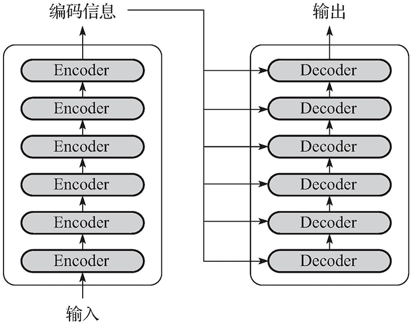
模型由编码侧 Encoder 与解码侧 Decoder 两大部分组成，Encoder 把源序列压缩成深层隐向量供 Decoder 使用，Decoder 在此基础上逐步生成目标序列。图 2-7 即为 Transformer 的 Encoder-Decoder 整体结构。

Transformer 总体架构 Encoder-Decoder 实现代码如下：

Python

class Transformer（nn.Module）:

  def __init__（self, src_vocab_size, trg_vocab_size, embed_dim, num_heads, num_layers,

  ff_dim, max_seq_len, dropout=0.1）:

    """

    Transformer 模型初始化

    参数说明：

    - src_vocab_size:源语言词汇表大小

    - trg_vocab_size:目标语言词汇表大小

    - embed_dim:词向量维度

    - num_heads:多头注意力头数

    - num_layers:编码器/解码器堆叠层数

    - ff_dim:前馈神经网络隐藏层维度（通常为 4*embed_dim）

    - max_seq_len:最大序列长度

    - dropout:随机失活率

    """

    super（Transformer, self）.__init__（）

    #词嵌入层（将 Token 索引映射为稠密向量）

    self.Encoder_embedding = nn.Embedding（src_vocab_size, embed_dim）

    self.Decoder_embedding = nn.Embedding（trg_vocab_size, embed_dim）

    #位置编码（注入序列位置信息）

    self.positional_encoding = PositionalEncoding（embed_dim, max_seq_len）

    #编码器/解码器层堆叠（核心组件）

    self.Encoder_layers = nn.ModuleList（[

      TransformerBlock（embed_dim, num_heads, ff_dim, dropout）

      for _ in range（num_layers）

    ]）

    self.Decoder_layers = nn.ModuleList（[

      TransformerBlock（embed_dim, num_heads, ff_dim,dropout）

      for _ in range（num_layers）

    ]）

    #输出层（将解码器输出映射到目标词汇表空间）

    self.fc_out = nn.Linear（embed_dim, trg_vocab_size）

    self.dropout = nn.Dropout（dropout）

  def forward（self, src, trg, src_mask=None, trg_mask=None）:

    """

    前向传播流程

    输入：

    - src:源语言序列 [batch_size, src_len]

    - trg:目标语言序列 [batch_size, trg_len]

    - src_mask:编码器输入掩码（如 padding mask）

    - trg_mask:解码器输入掩码

    """

    #1.输入嵌入与位置编码

    #公式：token_embedding + positional_encoding

    src = self.dropout（self.Encoder_embedding（src） + self.positional_encoding（src））

    trg = self.dropout（self.Decoder_embedding（trg） + self.positional_encoding（trg））

    #2.编码器处理（特征提取）

    #每层包含多头注意力 → 残差连接&层归一化 → 前馈网络 → 残差连接&层归一化

    for layer in self.Encoder_layers:

      src = layer（src, src_mask） # [batch_size, src_len, embed_dim]

    #3.解码器处理（序列生成）

    #每层包含掩码多头注意力 → 编码-解码注意力 → 前馈网络（均含残差连接）

    for layer in self.Decoder_layers:

      trg = layer（trg, src, trg_mask, src_mask） #[batch_size, trg_len, embed_dim]

    #4.输出映射（词汇表概率分布）

    output = self.fc_out（trg）  #[batch_size, trg_len, trg_vocab_size]

    return output

这是序列到序列任务的典型实现，机器翻译即是代表。实现可拆为四个环节。

初始化里包含源端嵌入 Encoder_embedding、目标端嵌入 Decoder_embedding、位置编码 positional_encoding、若干编码器层 Encoder_layers、若干解码器层 Decoder_layers、输出投影 fc_out 以及 Dropout。

前向过程概括如下：

●**嵌入融合：**词嵌入与位置编码相加后做丢弃。
●**编码阶段：**多层编码器逐层提炼源语表示。
●**解码阶段：**多层解码器借助编码结果自回归生成目标语。
●**投影阶段：**把解码向量映射到目标词表得到概率。

主要特性为：多头注意力捕捉长距离依赖；残差与层归一化稳定训练；掩码实现自回归生成；超参如 embed_dim、num_layers 可按任务调配。

**1. 编码器与解码器的可见性差异**

标准 Transformer 同时拥有 Encoder 与 Decoder。Encoder 具备全双向可见，任意两个 Token 的注意力分数都不为零。Decoder 则是因果可见，仅允许后位置 Token 看见前位置 Token，前位置对后位置的注意力为零。

差异来源于自注意力中的 Mask。Encoder 的 Mask 为全零矩阵，对 QKᵀ 不做改动，零位置对应的分数被置零。Encoder 的注意力分数先计算 Q 与 K 的转置乘积：


Encoder 的 Mask 矩阵如下：


最终注意力分数计算如下：

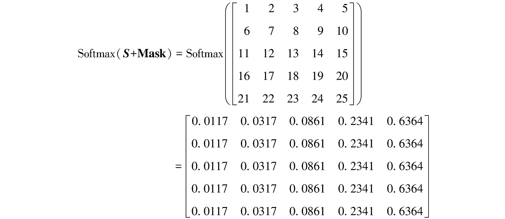
Decoder 的 Mask 为对角线及下三角为 0、上三角为负无穷的矩阵，经 Softmax 后负无穷处变为零，上三角被清零，从而实现前向不可见。这里所说的可见即分数非零。Decoder 的注意力分数先是 Q 与 K 的转置乘积：


Decoder 的 Mask 如下：


最终注意力分数计算如下：

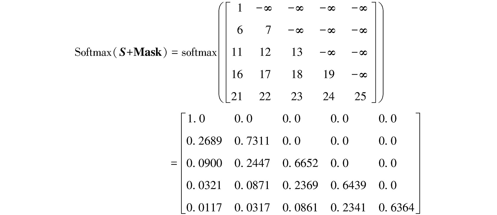
在相同的 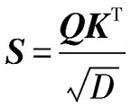 输入下，两类 Mask 不同，最终分布也不同。可观察到 S[Encoder] 全为非零，说明 Encoder 中任意 Token 均可相互关注；Decoder 上三角全部为零，意味着只有后方 Token 能看到前方 Token，反向不可见。

**2. Encoder 与 Decoder 的使用分野**

（1）Encoder
由于 Token 间全双向交互，Encoder 更擅长全局语义理解，适用于完形填空、命名实体识别、句子分类等理解类任务。BERT 即基于 Transformer Encoder 训练而成，典型用途包括命名实体识别与文本分类，本书聚焦大模型故不再展开。

（2）Decoder
当 BERT 让 Encoder 成为焦点时，OpenAI 选择 Decoder 并以 ChatGPT 为其背书。Decoder 通用性更强，可覆盖几乎所有 NLP 问题。因前向 Token 对后向 Token 的注意力为零，Decoder 天生适合生成式任务，即基于已生成历史预测下一个词。生成式任务的高可塑性使绝大多数 NLP 问题都能转化为生成形式。

Decoder 的常见用法：

a.任务类型:文本生成
模型输入:请以“伟大的人工智能”为题写一篇文章。
模型输出:我出生在一个人工智能起飞的伟大时代……

b.任务类型:命名实体识别
模型输入:请提取以下输入的人名和地名：刘丹出生在伟大的中国。请保持 json 格式。
模型输出:{刘丹:人名，中国:地名}。

c.任务类型:文本分类
模型输入:请对以下文本进行“积极”或者“消极”的二分类分析。我今天很开心，吃了很多汉堡，然后还打了很久的游戏。
模型输出:积极

d.计算
模型输入:请输出 2 的 4 次方等于多少。
模型输出:首先 2 的平方是 4，2 的 4 次方是 2 的平方的平方，也就是 4 的平方 16，最终答案为 16。

当前主流大语言模型多采用 Decoder-only 结构，即只堆叠解码器。早期还有 Encoder-Decoder 的 T5、BART，以及 Prefix-Decoder 的 GLM 等，最终仍收敛到 Decoder-only，可能原因有二。

●大模型核心价值在于通用性，能适配各类任务，而 Encoder 在生成任务上不足会限制通用性。
●Scaling Law 指出参数越大能力上限越高，但该规律对 Encoder 不成立。矩阵视角引用苏剑林的解释：Encoder 的 Mask 为非上三角矩阵，可能导致注意力矩阵非满秩，而语言模型以矩阵乘法为主，降秩矩阵乘任意矩阵仍降秩。注意力矩阵形状为 [Length, Length]，于是有：

*r*（Attention_encoder）< *r*（Attention_decoder）<length_text

其中 *r*（Attention_encoder）为 Encoder 注意力矩阵的秩，*r*（Attention_decoder）为 Decoder 注意力矩阵的秩，length_text 为输入长度。

矩阵秩决定表达能力，进而影响模型上限，这也解释了 Decoder 上限更高的原因。

### **2.3 Transformer 架构下的计算复杂度**

**2.3.1 矩阵乘法的计算复杂度**

**1.理解矩阵的线性空间**
矩阵的线性空间即列空间，由列向量张成。具体为：
●**矩阵 A 的线性空间：**由 A 的所有列向量生成的空间。若 A 为 m×n，则其列空间是 m 维空间的子空间，维度等于列秩，即线性无关列向量的最大个数。
●**矩阵 B 的线性空间：**同理，B 的列空间由其列向量生成。若 B 为 n×p，则其列空间是 n 维空间的子空间，维度等于 B 的列秩。

**2.矩阵乘法的定义**
给定 A（m×n）和 B（n×p），乘积 C 为 m×p，其中 C 的第 i 行第 j 列 c[i][j] 计算为：


这表示 C 的每个元素都是 A 的一行与 B 的一列的点积。矩阵乘积 C=A B 的计算量取决于维度与涉及的基本运算次数。

**3.基本运算的数量**
对每个元素 c[i][j] 需要 n 次乘法和 n-1 次加法。因此整个矩阵 C 的计算量为：
加法次数：m×p×（n-1）
乘法次数：m×p×n

**2.3.2 Transfomer 架构下的计算量推导**
后续符号含义如下。

●*n*：序列长度。
●*d*[m][o][d][e][l]：隐藏状态维度。
●*V*：词汇表大小。
●*L*：Transformer Block 的层数。
●*d*[K]：K 矩阵的嵌入维度。
●*d*[f][f]：MLP 层第一层的输出维度。

**1.Embedding 层的计算量推导**
输入序列 X 长度为 n，Embedding 可表示为 [V, d[model]]，但本层不按常规矩阵乘法计算，因为 X 经 One-hot 编码后为稀疏矩阵，可简化为查表。

查表计算量为
*O*（*n*×*d*[model]）
输出矩阵 O 的形状为 [*n*, *d*[model]]。
Embedding 层计算量：
计算量[Embedding]=*n*×*d*[model]

**2.自注意力机制层的计算量推导**
线性变换把 Embedding 投到 Q、K、V：
***Q***=***X**W***^Q***
***K***=***X**W***^K***
***V***=***X**W***^V***
计算量：
计算量=3×*n*×*d*[model]×*d*[K]
注意力分数计算：

计算量：
计算量=*n*²×*d*[K]
注意力权重计算：
***A***=Softmax（***S***）
计算量:
*O*（*n*²）
加权求和：
***O***=***A**V***
计算量：
计算量=*n*²×*d*[V]
自注意力总计算量：
计算量[self-Attention]=3×*n*×*d*[model]×*d*[K]+*n*²×*d*[K]+*n*²×*d*[V]+*n*²
其中 *d*[K] 与 *d*[V] 分别为 K、V 的维度且相等；*n* 为文本长度，*d*[model] 为 Transformer Block 的维度。

**3.MLP 层的计算量推导**
（1）第一层线性变换计算量
计算量=*n*×*d*[model]×*d*[ff]
激活函数计算量：

为什么序列变长会让 Transformer 明显变慢

前馈子网络的首个线性映射在规模上大致是 O(d 模型 × d 前馈)。
（2）后一个线性映射的运算规模
所需运算 = n × d 前馈 × d 模型
整条 MLP 的合计开销：
整体开销[MLP] = n × d 模型 × d 前馈 + n × d 前馈 + n × d 前馈 × d 模型
化简之后：


**4. Lm_head 层的开销推导**

特征矩阵 H 的形状为[n，d 模型]，权重矩阵 W 的形状为[d 模型，V]，这与词嵌入层的转置结构相同。

一次线性投影所需运算：
所需运算 = n × d 模型 × V
Lm_head 的整体开销：
开销[Lm_head] = n × d 模型 × V

**5. 位置编码的开销推导**

Transformer 不像循环网络那样自带时序，必须显式注入位置信息，这项工作由位置编码承担。

位置编码的构造式：

生成位置编码本身的规模：
O(n × d 模型)
把位置编码叠加到嵌入并得到最终表征的开销：
开销 = O(n × d 模型)
位置编码的总开销：
开销[Positional Encoding] = O(n × d 模型)

**6. 整体系规模汇总**

该架构包含词嵌入、位置编码、自注意力、前馈、Lm_head，自注意力和前馈共同构成一个 Transformer Block 并重复 L 次。总体规模可写为
规模[Transformer] = 规模[Embedding] + 规模[Positional Encoding] + L × 规模[Transformer Block] + 规模[Lm_head]
对上式整理可得：

把各部分代入后得到最终表达式，则

舍去低阶项后，规模可表示为

由此可知，支配 Transformer 复杂度的核心是序列长度 n 与嵌入宽 d 模型，且两者呈现平方增长。参数越大、处理文本越长，推理速度下降越明显。

### 2.4 Decoder 模式下的训练与推理
**2.4.1 Decoder 的 Mask 细节**
2.2.8 节指出 Decoder 中 Mask 矩阵的上三角为负无穷，S 矩阵与 Mask 相加后再做 Softmax，对应位置的注意力分数变为零，具体式子如下：
Decoder 中的 Mask 矩阵如下：

Q 矩阵与 K 转置的乘法如下：

最终注意力分数矩阵 A 的计算如下：
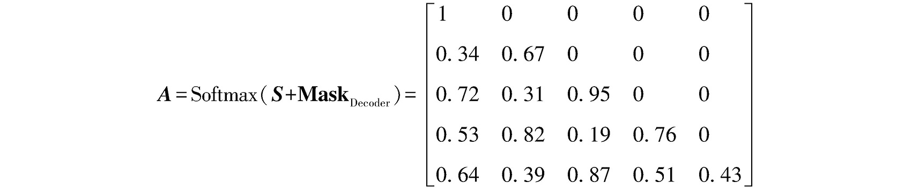
A 中任意元素 a[i][j] 表示文本里第 i 个词元与第 j 个词元的关联强度，即注意力分数。以“你好帅啊！”为例：
● 矩阵 A 中 a[3][4]=0 代表“帅”字看不到“啊”字。
● 矩阵 A 中 a[4][3]=0 代表“啊”字可以看到“帅”字。
● 矩阵 A 中 a[3][1]>a[3][2] 代表对“帅”字而言，更关注“你”字而非“好”字。
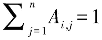
●，代表 A 矩阵任意一行求和都等于 1，这说明注意力分数本质上是一个权重。
两两词元之间的注意力分数矩阵如下：


**2.4.2 训练与推理的差异**
1. 训练
训练时整段序列一次性送入并一次性产出，如图 2-8 所示。**[图][2][-][8][T][r][a][n][s][f][o][r][m][e][r][训][练][（][并][行][）]**
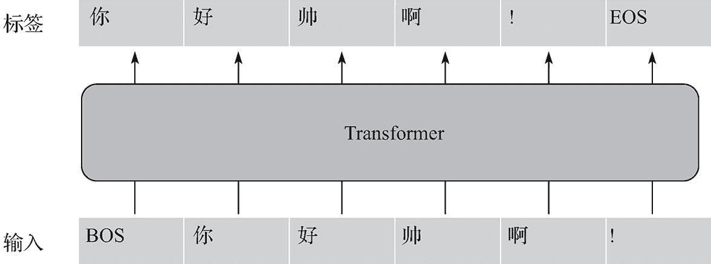
2. 推理
训练完成后，推理采用自回归方式，每轮基于已有词元生成下一个词元，直至结束，更贴近人类语言习惯。示例：
Plain Text
input:<BOS> output:你
input:<BOS>你 output:<BOS>你好
input:<BOS>你好 output:<BOS>你好帅
input:<BOS>你好帅 output:<BOS>你好帅啊
input:<BOS>你好帅啊 output:<BOS>你好帅啊！
input:<BOS>你好帅啊！ output:<BOS>你好帅啊！<EOS>
通常机器学习推理需与训练保持一致，但 Mask 矩阵上三角为 0 导致训练时前向词元不能看到后向词元，因此推理时需逐个生成并追加到序列末尾。
为提升推理速度，研究者提出 KV-cache 以用空间换时间。
（1）KV-cache 与推理
1）无 KV-cache 推理的复杂度
大模型推理是 Next Token Predict 的自回归预测，每轮把上一轮输入和输出拼接再预测。已知模型复杂度是 O(Length²)，提示词 n 个词元，经过 N-n 次自回归得到 N 个词元，最终开销为
开销=O(n²)+O((n+1)²)+O((n+2)²)+…+O((N-1)²)+O(N²)=O(N³)
2）有 KV-cache 的原理
KV-cache 用于降低上述复杂度。自回归时每次都要把前面所有词元重新喂入 Transformer，其中大量计算是重复的，于是把 Key 和 Value 缓存到内存，下次直接读取。
以“你好帅啊”四个词元为例说明有无 KV-cache 的差异。
步骤 1 中有无 KV-cache 的实现如图 2-9 所示。**[图][2][-][9][步][骤][1][中][有][无][K][V][-][c][a][c][h][e][的][实][现]**
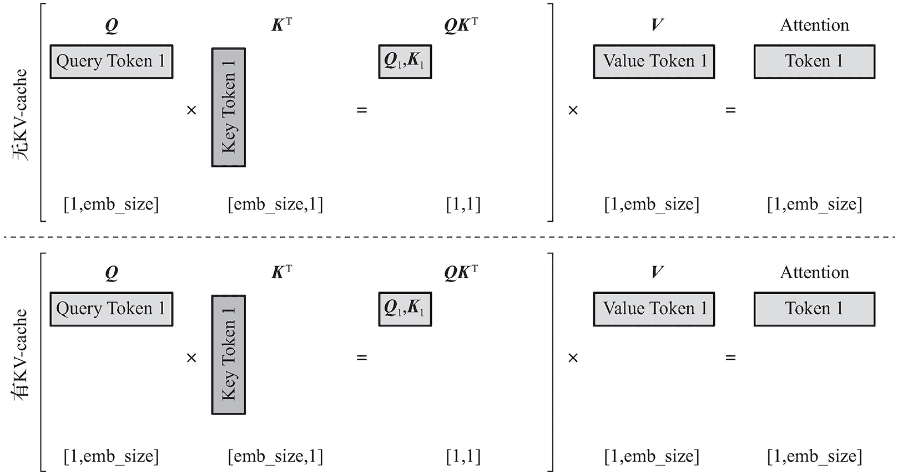
输入“你”时，因是第一个词元，不存在缓存，有无 KV-cache 计算一致，需计算每个 Transformer Block 的第一个词元“你”的 Q[1]、K[1]、V[1]，最后 Softmax 预测出第二个词元“好”。
步骤 2 中有无 KV-cache 的实现如图 2-10 所示。
● 无 KV-cache 方式：基于步骤 1 预测出词元 2“好”进入下一轮，输入“你好”需重新计算 Q[1]、K[1]、V[1] 和 Q[2]、K[2]、V[2]，计算 4 个 QK^T 值，并计算 Attention 1 和 Attention 2。
● 有 KV-cache 方式：步骤 1 已缓存词元 1“你”的 K[1]、V[1]。本轮仅输入词元 2“好”计算 Q[2]、K[2]、V[2]，减少 3 次计算；计算 Q[2] 与所有 K 的 2 个注意力分数，减少 1 次 QK^T；仅计算 Attention 2。**[图][2][-][1][0][步][骤][2][中][有][无][K][V][-][c][a][c][h][e][的][实][现]**
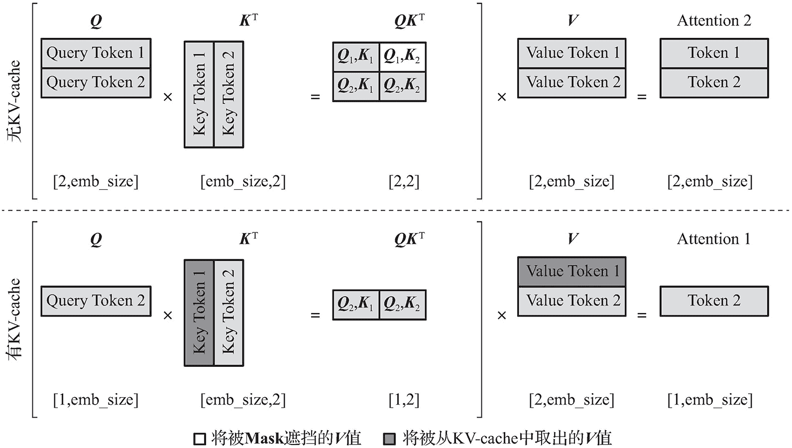
步骤 3 中有无 KV-cache 的实现如图 2-11 所示。
● 无 KV-cache 方式：基于步骤 2 预测出词元 3“帅”，输入“你好帅”需重新计算 Q[1]、K[1]、V[1]、Q[2]、K[2]、V[2]、Q[3]、K[3]、V[3]，计算 3 个 QK^T 值，并计算 Attention 1、2、3。
● 有 KV-cache 方式：已缓存词元 1“你”和词元 2“好”的 K、V。本轮仅计算 Q[3]、K[3]、V[3]，减少 3 次计算；计算 Q[3] 与所有 K 的 3 个注意力分数，减少 2 次；仅计算 Attention 3。**[图][2][-][1][1][步][骤][3][中][有][无][K][V][-][c][a][c][h][e][的][实][现]**
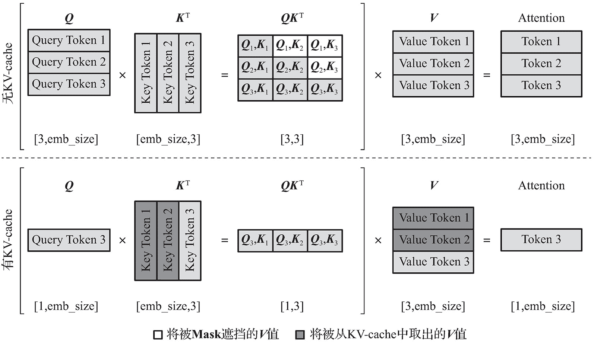
步骤 4 中有无 KV-cache 的实现如图 2-12 所示。
● 无 KV-cache 方式：基于步骤 3 预测出词元 4“啊”，输入“你好帅啊”需重新计算四个词元的 Q、K、V，计算 16 个 QK^T 值，进行 4 次 Attention 计算。
● 有 KV-cache 方式：已缓存前三个词元的 K、V。本轮输入词元 4“啊”计算 Q[4]、K[4]、V[4]，计算 Q[4] 与所有 K 的 4 个注意力分数，仅计算 Attention 4。
3）KV-cache 的推理复杂度
Transformer 复杂度为 O(Length²) 的原因在于 QK^T 中 Q 与 K 形状均为 [Length，emb_size]。**[图][2][-][1][2][步][骤][4][中][有][无][K][V][-][c][a][c][h][e][的][实][现]**
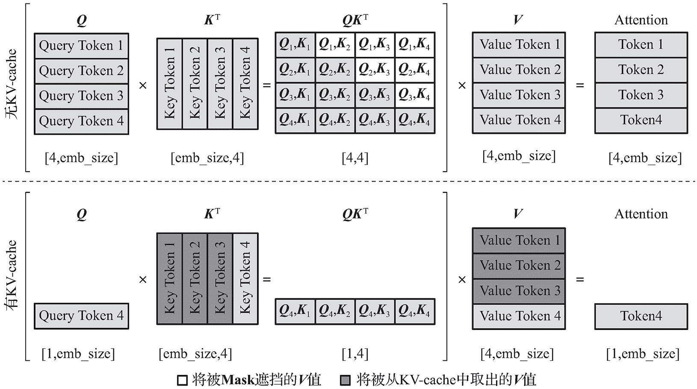
从图 2-9 到图 2-12 可知，有 KV-cache 时每次推理 Q 形状为 [1，emb_size]，每次 QK^T 复杂度为 O(Length)。若输入 n 个词元，经过 N-n 次自回归得到 N 个词元，最终 QK^T 开销为
开销=O(n)+O(n+1)+O(n+2)+…+O(N-1)+O(N)=O(N²)
由此 KV-cache 将推理复杂度降低一个量级，但需注意：
● KV-cache 占用大量显存，需在 HBM 与 SM 之间搬运，增加开销。
● Transformer 复杂度既与注意力 O(Length²) 相关，也与 MLP O(hidden_size²) 相关，KV-cache 仅降低注意力部分。

**3. Prefill 与 Decode 阶段**
上述例子初始输入仅一个词元再自回归，实际任务常以多词元起步。
（1）Prefill 阶段
Prefill 是对输入序列进行预处理和编码的阶段，把上下文转为内部表示或键值缓存以便复用，避免重复计算。简单说，多词元输入时并行计算所有词元的 Q 和 K。
Prefill 一次性处理大量文本，无需像 Decode 那样频繁搬运 HBM 矩阵，计算复杂度为 O(Length²)，适合用高算力设备。Prefill 主要影响首字响应，端侧设备算力受限时，输入越长首字延迟越明显。
（2）Decode 阶段
Decode 以自回归方式逐步生成输出，每次生成一个词或词元并作为下一步输入。Prefill 完成后提示词的 KV-cache 已在设备中，Decode 即完成自回归任务。

### 2.5 绝对位置编码与相对位置编码
Transformer 本身不具备序列顺序感知能力，需通过位置编码注入位置信息。主要分为绝对位置编码和相对位置编码。
**2.5.1 绝对位置编码**
绝对位置编码为每个位置分配唯一编码向量，通常用固定数学函数生成，经典做法是正弦余弦函数，具体公式在 2.2.3 节已介绍。
以下为序列长度 10、d 为 8 的位置编码矩阵示例。
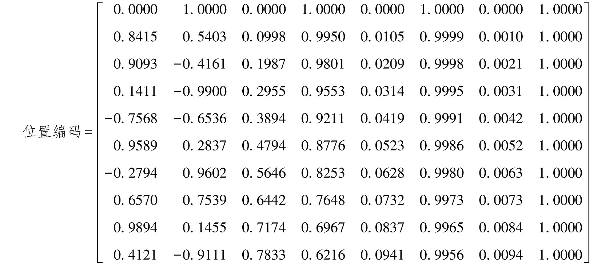
优点是简单直观，缺点是难以捕捉相对位置关系。绝对位置编码 PE 用加法叠加到输入 Embedding，公式为
h[t]=PE+Embedding
其中 PE 为绝对位置编码向量，Embedding 为词向量。
**2.5.2 相对位置编码**
相对位置编码即 Rotary Position Embedding, RoPE，旨在更好捕捉元素间相对位置。通过旋转矩阵把绝对位置转为相对位置表达。
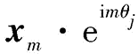
RoPE 的公式是复数形式的旋转操作，可转为矩阵形式与旋转矩阵 R[θ] 联系。
其中 x[m] 表示第 m 个元素的嵌入向量，θ[j]=10000^{-2j/d}，j 为维度索引，i 为虚数单位。
**1. 复数形式的旋转**

从复数到 RoPE：位置编码的旋转视角

复数写成 x + i y 时，在复平面上正好对应坐标 (x , y)。再把该复数与 e^{iθ} 相乘，几何意义就是把对应的点绕原点逆时针推移 θ。

**2.复数旋转的矩阵形式**

把乘法展开：
z·e^{iθ} = (x+iy)(cosθ + i sinθ) = (x cosθ - y sinθ) + i (x sinθ + y cosθ)
对应的线性写法是


在工程实现里，RoPE 正是借助这种转动把绝对位置信息转化为相对位置信息。所用算子为


对高维向量，RoPE 把相邻通道两两配对，把第 2i、2i+1 维视作一个复平面，在每个平面上单独做转动。

以序列 X 为例，第 i 个 token 向量 x[i] 与第 j 个 token 向量 x[j] 经转动后的联系记为


RoPE 不是在注意力之外额外添加，而是在注意力内部完成融合。融合后的分数形式为


相对位置的注意力得分写作


其中涉及的量为
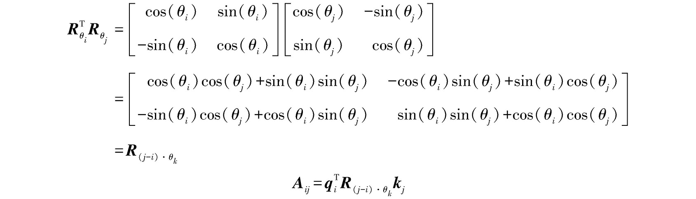

由此可见，经 RoPE 后 Q 与 K 的内积 A[i][j] 会显式依赖 j-i，模型因此能直接感知两个 token 的相对间隔。

**2.5.3 绝对位置编码与相对位置编码的对比**

**1.编码原理**
绝对式做法给每个位置分配一个固定向量，常以正弦函数生成；相对式做法关注元素间的距离。RoPE 通过旋转算子实现随位置变化的向量映射。

**2.序列长度适应性**
绝对式在序列拉长、尤其是超出训练长度时容易失效。相对式只依赖两位置的距离，天生支持任意长度。借助旋转，RoPE 可自动适配不同长度，理论上可处理无限长输入。

**3.计算复杂度**
绝对式最省力，基本是 O1 的查表。朴素相对编码需要 O Length² 计算全部位置对。RoPE 复杂度约 O Length，经优化后可逼近 O1。

**4.任务表现**
绝对式在短文本分类等简易任务上可用。相对式在机器翻译等任务上更稳健。相对式在长文本生成上表现突出，被 Llama、GPT 等系列采用。

**5.实现难度**
绝对式最简单，只需把位置向量直接相加。相对式需改动注意力计算。RoPE 涉及复数转动，工程实现相对复杂。

**6.典型应用**
绝对式见于原始 Transformer 与 Bert。相对式被 T5 与 DeBERTa 所用。RoPE 式相对编码被 Llama 系列和 GPT-NeoX 等模型采用。

**7.外推能力**
绝对式基本不具备外推，推理长度超出训练范围即退化。相对式有一定外推性，通常需要微调偏置。

**8.显存占用**
绝对式只需保存位置向量，显存开销最小。早期相对编码需缓存位置矩阵，压力较大。RoPE 只需保存旋转角参数，显存需求较低。

**9.训练稳定性**
绝对式在深层网络里易出现梯度消失。相对式梯度传播更平稳。RoPE 在转动过程中保持模长不变，训练稳定性更好。

## 第三章 强化学习基础

本章梳理强化学习的核心概念、基本原理、在大语言模型中的用途以及相关数据规范。

目前强化学习多用于游戏、下棋等场景。下面以象棋为例说明其含义。基于强化学习的 AI 象棋如图 3-1 所示。**[图][3][-][1][基][于][强][化][学][习][的][A][I][象][棋]**

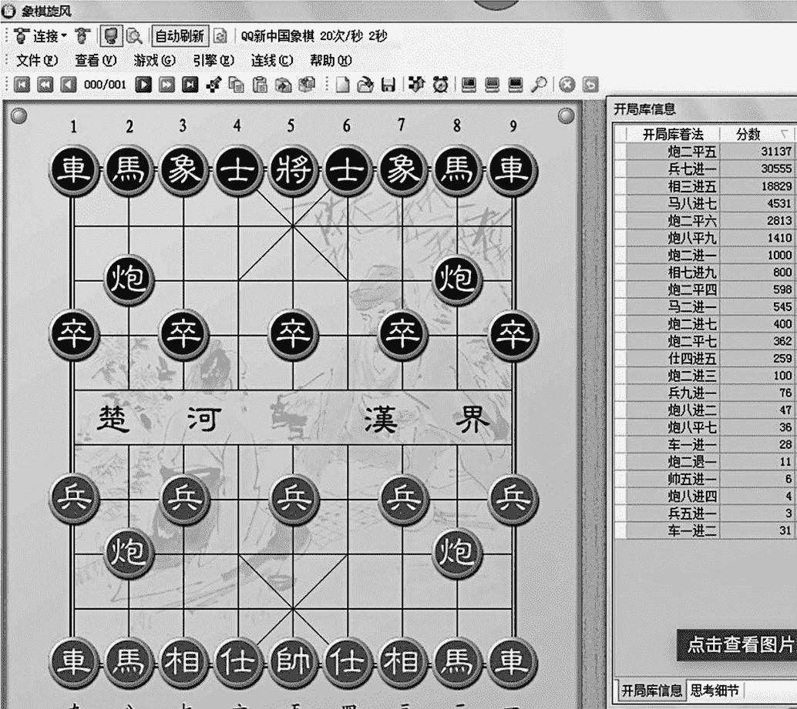

通俗讲，训练一个策略 Actor 与环境交互落子，策略依据当前局面选择下一步，环境返回奖励分数，训练目标是把整局奖励的期望最大化，也即提升动作的优势。下棋过程中通过奖励与价值的计算不断优化策略，以逼近目标。

### 3.1 基础概念

●**动作 Action**：落一子，如卒三进一，可记作 A。

●**动作空间 Action Space**：所有可选项的集合，如图 3-1 右侧从“炮二平五”到“车一进二”的集合，可用 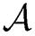 表示。

●**环境 Environment**：智能体之外的一切，在象棋里指对手、棋盘与评分反馈，可记作 ε。

●**奖励 Reward**：单步的即时综合分数，可记作 R(s,a)。
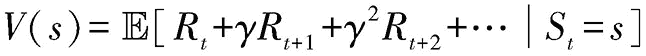

●**价值 Value**：把各步奖励累加，未来奖励以折扣计入。公式中 γ 为折扣因子。

●**状态 State**：双方棋盘上所有子力的局面，即 s。

●**状态空间 State Space**：全部可能局面的集合，如象棋全部对局，记作 S。
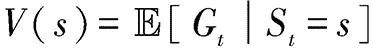

●**状态价值 State Value**：当前局面的长期期望回报，公式中 G[t]=R[t]+γR[t+1]+γ²R[t+2]+…。
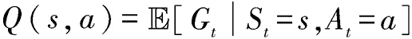

●**动作价值 Action Value**：某步后未来回报的期望。

●**优势 Advantage**：在给定局面下，特定动作的价值与所有动作平均价值的差。A(s,a)=Q(s,a)-V(s)。

●**策略 Policy**：在状态下选择动作的概率模型，记作 π(a|s)。

●**强化学习目标 Reinforcement Learning Objective**：寻找能在各局面下获得高优势动作的策略。

●**在线强化学习 Online Reinforcement Learning**：边探索边获奖励并即时更新。象棋中即边下边调整策略。

●**离线强化学习 Offline Reinforcement Learning**：利用历史经验，经验并非来自当前策略正在进行的对局。
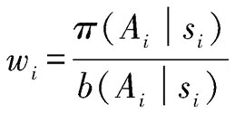

●**重要性采样 Importance Sampling**：离线时历史样本对当前策略的重要性，可表示为，其中 w[i] 为第 i 个样本权重，π 为目标策略，b 为行为策略。

### 3.2 大语言模型中的 RLHF

**3.2.1 PPO**

PPO 属于 Actor-Critic 架构，同时兼具在线探索与离线利用的优点。下面用伪代码说明 PPO。

Bash

#超参数

K = 3 #每次迭代中策略更新的次数

T = 2048 #每次采样的时间步数

M = 64 #每次更新的 mini-batch 大小

epsilon = 0.2 #PPO 的裁剪范围

gamma = 0.99 #折扣因子

lambda_ = 0.95 #GAE 的超参数

alpha = 0.0003 #学习率

#由于并不是所有的环境都会直接反馈 Reward 和 Value，所以在这种情况下需要训练奖励模型和评估模型。这两个模型分别用于模拟环境生成的 Reward 和 Value

#初始化策略模型、值函数网络和奖励模型

policy_network = PolicyNetwork()

value_network = ValueNetwork()

reward_model = RewardModel()

#初始化优化器（不需要为奖励模型定义优化器，这是因为奖励模型训练好就不再更新）

policy_optimizer = Adam(policy_network.parameters(), lr=alpha)

value_optimizer = Adam(value_network.parameters(), lr=alpha)

for iteration in range(max_iterations):

 #1.采样数据

 states, actions, rewards, dones, log_probs_old = collect_trajectories(policy_network, T)

 #2.使用奖励模型预测奖励（奖励模型不更新）

 predicted_rewards = reward_model(states, actions)

 #3.计算回报（价值）和优势

 value = compute_returns(predicted_rewards if use_reward_model else rewards, gamma)

 advantages = compute_advantages(predicted_rewards if use_reward_model else rewards,value_network, gamma, lambda_)

 #4.更新策略模型和值函数网络

 for epoch in range(K):

 #将数据分成 mini-batches

 for batch in get_mini_batches(states, actions, returns, advantages,

 log_probs_old, M):

 states_b, actions_b, returns_b, advantages_b, log_probs_old_b = batch

 #4.1 计算新的对数概率

 log_probs_new = policy_network.get_log_prob(states_b, actions_b)

 #4.2 计算策略损失 （Clipped Surrogate Objective）

 ratio = exp(log_probs_new - log_probs_old_b)

 clipped_ratio = clip(ratio, 1 - epsilon, 1 + epsilon)

 policy_loss = -min(ratio * advantages_b, clipped_ratio * advantages_b).mean()

 #4.3 计算值函数损失 （MSE）

 values_pred = value_network(states_b)

 value_loss = (returns_b - values_pred).pow(2).mean()

 #4.4 计算熵正则化项

 entropy = policy_network.get_entropy(states_b)

 #4.5 计算总损失（忽略奖励模型的损失）

 total_loss = policy_loss + 0.5 * value_loss - 0.01 * entropy

 #4.6 更新网络参数（跳过奖励模型）

 policy_optimizer.zero_grad()

 value_optimizer.zero_grad()

 total_loss.backward()

 policy_optimizer.step()

 value_optimizer.step()

大语言模型本身即为策略，动作是生成下一个 token，状态是已生成的序列。早期 Reward 由训练好的奖励模型预测，Value 由评估模型给出。示例：

Plain Text

input:你好。

output：你好，阿姨？

#动作 状态 奖励 价值

a1:你/你 s1:你 r1:0.2 v1:0.2

a2:好 s2:你好 r2:0.6 v2:0.8

a3：， s3:你好， r3:0.5 v3:1.3

a4：， s4:你好，阿姨 r4:-0.2 v4:1.1

a5：？ s5:你好，阿姨？ r5:-0.1 v5:1.0

上例说明生成过程中动作、状态、奖励、价值的对应关系。动作即当前 token，状态为历史序列，奖励为即时反馈，价值为累积期望。

PPO 伪代码解读如下。

1）用当前策略对多个 Prompt 采样，得到状态、动作等轨迹。
Plain Text

 states, actions, dones, log_probs_old = collect_trajectories(policy_network, T)

2）依据状态动作预测奖励：
Plain Text

 predicted_rewards = reward_model(states, actions)

3）计算回报与优势：
A(s,a)=Q(s,a)-V(s)

G[t] 为回报。计算式为
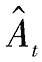

优势即在 s 下动作 a 的价值相对于平均价值的差。

V(s) 有三种估计方式。

①蒙特卡洛。公式为

该方法以完整序列为单位估计，估计无偏但方差较大。

②时序差分。
V(s[t])←V(s[t])+α(r[t+1]+γV(s[t+1])-V(s[t]))
最小粒度为一步，有偏差但方差小。

③广义优势估计。

γ 为折扣因子，λ 调节偏差与方差的权衡，δ[t] 为时序误差。

计算代码：
Python

returns/value = compute_returns(predicted_rewards if use_reward_model else rewards, gamma)

advantages = compute_advantages(predicted_rewards if use_reward_model else rewards, value_network,gamma, lambda_)

4）重要性采样用于评估新旧策略差异。伪代码：
Python

#4.1 计算新的对数概率

log_probs_new = policy_network.get_log_prob(states_b, actions_b)

#4.2 计算策略损失 （Clipped Surrogate Objective），重要性采样

ratio = exp(log_probs_new - log_probs_old_b)

5）clip 后的损失控制单次更新幅度，代码如下：
Python

#4.2 策略更新的裁剪版目标

更新策略时，先用新旧策略的对数概率做差再取指数，得到一个重要性权重。

ratio = exp（log_probs_new - log_probs_old_b）
clipped_ratio = clip（ratio, 1 - epsilon, 1 + epsilon）
policy_loss = -min（ratio * advantages_b, clipped_ratio * advantages_b）.mean（）

数学表达是：

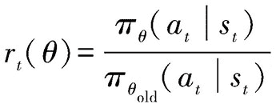

式中 r_t(θ) 就是状态 s_t 下采取动作 a_t 的新旧策略概率比，等价于上文提到的重要性采样权重。 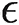

ε 用来限制新旧策略偏离的幅度，工程里常见取值 0.1 或 0.2。

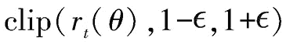 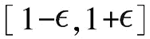

裁剪把 r_t(θ) 压进 1-ε 到 1+ε 的区间内。

6）评估网络的损失，代码如下：

Python

#4.3 计算值函数损失 （MSE）

values_pred = critic_network（states_b）

value_loss = （returns_b - values_pred）.pow（2）.mean（）

采样结束后让价值网络修正，使其对当前状态的价值估计更稳定、更少偏。

7）把策略损失与评论家损失合并后一起优化，代码如下：

Python

total_loss = policy_loss + 0.5 * value_loss - 0.01 * entropy

#4.6 更新网络参数（跳过奖励模型）

policy_optimizer.zero_grad（）

value_optimizer.zero_grad（）

total_loss.backward（）

policy_optimizer.step（）

value_optimizer.step（）

Python

#4.7 更新策略模型和值函数网络

  for epoch in range（K）:

8）外层再采样一轮，代码如下：

Python

for iteration in range（max_iterations）:

9）内层重复第 4～7 步，此时模型已更新，属于离线更新。

PPO 的主要短板：

●显存压力大：奖励模型、价值模型、策略模型、参考模型共存，其中价值和策略都要梯度更新，显存需求很高。
●奖励漏洞：奖励模型模仿环境打分，预测与真实反馈有偏差，极端时会给出误导的高分，让策略偏向错误方向。
●评估误差累积：V[s] 由价值模型预测未来累计回报，而回报本身又依赖奖励模型的预测，误差会逐层放大。
●迭代效率低：在线采样要等模型更新完成，整体速度受限。

**3.2.2 DPO 直接偏好优化**

DPO（Direct Policy Optimization）算法伪代码如下：

Python

#导入必要的库

import torch

import torch.nn as nn

from torch.optim import Adam

#1.定义初始化模型的函数

def initialize_model（model_class, model_config）:

  """

  初始化模型

  :param model_class:模型的类（例如 Transformer 或 GPT）

  :param model_config:模型的配置参数（例如层数、隐藏层大小等）

  :return:初始化后的模型

  """

  model = model_class（**model_config） #根据配置初始化模型

  return model

#2.定义 DPO 训练函数

def train_dpo（D, π_ref, π_θ, β, α, epochs）:

  """

  DPO 训练函数

  :param D:数据集，包含输入 x 和偏好对 （y_w, y_l）

  :param π_ref:参考模型（预训练的语言模型）

  :param π_θ:待优化的策略模型

  :param β:温度参数，控制偏好差异的敏感度

  :param α:学习率

  :param epochs:训练轮数

  :return:训练好的模型 π_θ

  """

  #初始化优化器（例如 Adam）

  optimizer = Adam（π_θ.parameters（）, lr=α）

  for epoch in range（epochs）:           #遍历每一轮训练

    for （x, y_w, y_l） in D:           #遍历数据集中的每个样本

      #1.计算参考模型的对数概率

      log_p_ref_w = π_ref（y_w | x）      #参考模型对 y_w 的对数概率

      log_p_ref_l = π_ref（y_l | x）      #参考模型对 y_l 的对数概率

      #2.计算待优化模型的对数概率

      log_p_θ_w = π_θ（y_w | x）        #待优化策略模型对 y_w 的对数概率

      log_p_θ_l = π_θ（y_l | x）        #待优化策略模型对 y_l 的对数概率

      #3.计算对数概率差异

      log_diff_w = log_p_θ_w - log_p_ref_w   #y_w 的对数概率差异

      log_diff_l = log_p_θ_l - log_p_ref_l   #y_l 的对数概率差异

      #4.计算 DPO 损失函数

      loss = -log_sigmoid（β * （log_diff_w - log_diff_l）） #使用 sigmoid 函数计算损失

      #5.反向传播和优化

      optimizer.zero_grad（）          #清空梯度

      loss.backward（）             #计算梯度

      optimizer.step（）            #更新模型参数

      # 6.打印损失（可选）

      if epoch % 10 == 0:

        print（f"Epoch {epoch}, Loss: {loss.item（）}"）

  #返回训练好的模型

  return π_θ

#3.辅助函数：log_sigmoid

def log_sigmoid（z）:

  """

  计算 log（sigmoid（z））

  :param z:输入值

  :return: log（sigmoid（z））

  """

  return -torch.log（1 + torch.exp（-z））     #log（σ（z）） = -log（1+ exp（-z））

#4.示例：如何使用初始化函数和训练函数

if __name__ == "__main__":

  #定义模型配置

  model_config = {

    "n_layers": 12,

    "hidden_size": 768,

    "n_heads": 12,

    "vocab_size": 50257,

  }

  #初始化参考模型和待优化模型

  π_ref = initialize_model（TransformerLM, model_config） #参考模型

  π_θ = initialize_model（TransformerLM, model_config）  #待优化的策略模型

  #定义数据集 D（假设已经加载）

  D = load_dataset（）                   #加载数据集

  #定义超参数

  β = 0.1                         #温度参数

  α = 1e-5                         #学习率

  epochs = 100                       #训练轮数

  #训练模型

  trained_model = train_dpo（D, π_ref,π_θ, β, α, epochs）

DPO 的损失函数如下：

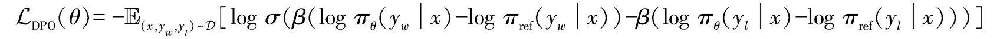

从式子看，log π_θ(y_w|x) - log π_ref(y_w|x) 让策略更贴近好样本的同时不远离参考模型；-β[log π_θ(y_l|x) - log π_ref(y_l|x)] 让策略远离坏样本的同时也不过度偏离参考模型。

DPO 规避了 PPO 的部分问题，但也带来新限制：

●离线训练无探索，所有样本固定，模型难以明显超越正样本平均水平。
●没有奖励模型虽降了偏差，却失去了精细奖励，只能做好坏二分类，无法衡量好坏程度。
●标注成本更高，PPO 只需输入，DPO 还需成对的好坏输出序列，例如象棋的妙手与败招、语言模型的优质与劣质回答。

### **3.3 GRPO**

GRPO 是 PPO 的变体，核心在优势的计算方式。先回顾 PPO 的损失：


优势计算为：


组内归一化即先减均值再除标准差，原因在于：

r[1],r[2],…,r[G] 是同一问题输入下采样出的 G 个输出的奖励。对于代码任务奖励可能在 1-3 分，写作任务可能在 3-5 分。若不归一化，写作类任务整体得分偏高会被一律奖励，代码类任务则被惩罚。真实意图是对同一任务内部相对好坏进行区分。

GRPO 伪代码如下：

Bash

#超参数

K = 3      #每次迭代中策略更新的次数

T = 2048    #每次采样的时间步数

M = 64     #每次更新的 mini-batch 大小

epsilon = 0.2  #PPO 的裁剪范围

gamma = 0.99  #折扣因子

lambda_ = 0.95 #GAE 的超参数

alpha = 0.0003 #学习率

#由于并不是所有的环境都会直接反馈 Reward 和 Value，所以经常需要使用训练（奖励模型）和（评估模型）来模拟环境生成的 Reward 和 Value

#初始化策略模型、值函数网络和奖励模型

policy_network = PolicyNetwork（）

reward_model = RewardModel（）

#初始化优化器（不需要为奖励模型定义优化器，这是因为 Reward 训练好就不再更新）

policy_optimizer = Adam（policy_network.parameters（）, lr=alpha）

for iteration in range（max_iterations）:

  #1.采样数据

  states, actions, rewards, dones, log_probs_old = collect_trajectories（policy_network, T）

  #2.使用奖励模型预测奖励（奖励模型不更新）

  predicted_rewards = reward_model（states, actions）

  #3.计算回报（价值）和优势

  value = compute_returns（predicted_rewards if use_reward_model else rewards, gamma）

  advantages = compute_advantages（predicted_rewards if use_reward_model else rewards, value_network, gamma, lambda_）

  #4.更新策略模型

  for epoch in range（K）:

    #将数据分成 mini-batches

    for batch in get_mini_batches（states, actions, returns, advantages, log_probs_old, M）:

      states_b, actions_b, returns_b, advantages_b, log_probs_old_b = batch

      #4.1 计算新的对数概率

      log_probs_new = policy_network.get_log_prob（states_b, actions_b）

      #4.2 计算策略损失（Clipped Surrogate Objective）

      ratio = exp（log_probs_new - log_probs_old_b）

      clipped_ratio = clip（ratio, 1 - epsilon, 1 + epsilon）

      policy_loss = -min（ratio * advantages_b, clipped_ratio * advantages_b）.mean（）

      #4.3 总损失（忽略奖励模型的损失）

      total_loss = policy_loss

      #4.4 更新网络参数（跳过奖励模型）

      policy_optimizer.zero_grad（）

      total_loss.backward（）

      policy_optimizer.step（）

GRPO 的优点：

●去掉了价值网络，降低显存占用。
●优势直接基于奖励计算，减少了价值估计带来的误差。
●对代码、数学等能给出明确反馈的任务，可直接用奖励替代，无需额外奖励模型。

### **3.4 大语言模型中的强化学习训练数据格式**

**1.SFT 的数据标注格式**

强化学习与 SFT 本质不同。SFT 类似有标准答案的考试，适合入门；强化学习没有标准答案，需要自行探索并靠反馈迭代，更利于创新。

SFT 标注常见两种形式，带 system 字段：

Plain Text

system：You are a helpful assistant.

user:hello,nice to meet you.

assistant:nice to meet you too.

不带 system 字段：

Plain Text

user:hello,nice to meet you.

assistant:nice to meet you too.

进入模型前会拼接。带 system 的拼接示例：

<|im_start|>system

You are a helpful assistant.<|im_end|>

<|im_start|>user

hello, nice to meet you.<|im_end|>

<|im_start|>assistant

nice to meet you too.<|im_end|>

不带 system 的拼接示例：

<|im_start|>user

hello, nice to meet you.<|im_end|>

<|im_start|>assistant

nice to meet you too.<|im_end|>

注意：Token 化后除 assistant 部分外，其余字段不参与交叉熵计算，伪代码如下：

Python

import torch

import torch.nn as nn

#假设输入是一个对话序列，包含 user 和 assistant 字段

#例如：["user: hello, nice to meet you.", "assistant: nice to meet you too."]

input_sequence = system：You are a helpful assistant.user:hello,nice to meet you.assistant:nice to meet you too.

#将输入序列转换为模型输入（例如 Token IDs）

#这里假设 Tokenizer 是一个预定义的 Tokenizer

input_ids =Tokenizer（input_sequence, return_tensors="pt", padding=True）.input_ids

#假设模型是一个预训练的语言模型

# 自回归微调：让梯度只落在助手回复上

大模型在监督微调阶段的核心任务是下一词预测，监督信号需要把目标右移一位，用已知的上下文去猜测紧随其后的词元。下面这段实现先做一次前向得到 logits，再把整段 input_ids 复制成标签并把对话中提问那一段全部写成 -100。交叉熵在 ignore_index=-100 的设定下会自动跳过这些位置，梯度只来自助手生成的部分。把 logits 截掉最后一个时间步、把标签截掉第一个时间步再拉平成二维送入损失，就完成了输入输出的错位对齐。

model = …           #例如 GPT-2

#前向传播，获取模型的输出 logits

output_logits = model（input_ids）.logits

#创建标签，将 user 部分的 Token 设置为 -100（计算 Loss 时忽略-100 的位置）

#假设 user 部分的 Token 长度为 5，assistant 部分的 Token 长度为 7

labels = input_ids.clone（） #复制输入作为标签

labels[:, :5] = -100     #将 user 部分的 Token 设置为 -100（计算 Loss 时忽略-100 的位置）

#定义交叉熵损失函数，并设置 ignore_index=-100

loss_fn = nn.CrossEntropyLoss（ignore_index=-100）

#计算损失

#注意：logits 的维度是 [batch_size, sequence_length, vocab_size]

#labels 的维度是 [batch_size, sequence_length]

loss = loss_fn（output_logits[:, :-1, :].reshape（-1, output_logits.size（-1）），

  labels[:, 1:].reshape（-1））

print（"Loss:", loss.item（））

如表 3-1 所示，在以上训练过程中，由于大语言模型执行的是自回归的 NSP 任务，即用前方的 Token 预测下一个 Token，因此训练时的输入 Token 和输出 Token 需要错开一位，以上方无 system 为例，<BOS>和<EOS>分别表示开始符和结束符。**[表][3][-][1][S][F][T][中][输][入][T][o][k][e][n][和][输][出][T][o][k][e][n][位][置][对][比]**

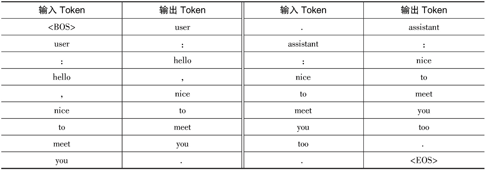

## 2.DPO 的数据标注格式

DPO 在奖励建模的标注方式与 PPO 保持一致，都是成对偏好数据。区别在于优化目标换成了排序损失。排序损失的表达式为：

*L*[Rank]=max（0,*m*-*s*^++*s*^-）

其中 *s*^+ 与 *s*^- 分别是优样本和劣样本的打分，要求优样本至少领先 *m*。

Python

import torch

class RankingLoss（torch.nn.Module）:
  def __init__（self, margin=1.0）:
    super（）.__init__（）
    self.margin = margin  # 间隔超参数
  def forward（self, s_plus, s_minus）:
    """
    s_plus:正样本得分 （batch_size，）
    s_minus:负样本得分 （batch_size，）
    """
    #计算间隔损失项
    loss = torch.clamp（
      self.margin - s_plus + s_minus,
      min=0.0
    ）
    return loss.mean（）

该损失的思路是把好样本的分数压到比差样本高出一个安全间隔 *m*。只有当 *s*^+ 没能超过 *s*^-+*m* 时损失才为正，随后参数更新会朝满足条件方向移动。因为没有像 MSE 那样的逐点监督值，排序损失更依赖成对样本的数量来提供稳定信号。

奖励模型的训练以 BERT 为骨干，顶部接线性打分头，数据文件每行用制表符分隔提示、正样本、负样本。

Python

import torch
from torch.utils.data import Dataset, DataLoader
fromTransformers import AutoTokenizer, AutoModel
#配置参数
class Config:
  Pretrained_model = "bert-base-uncased" #使用 Hugging Face 的预训练模型
  batch_size = 16
  num_epochs = 3
  learning_rate = 1e-5
  margin = 0.5              #排序损失的间隔参数
  max_length = 128            #文本最大长度
#自定义数据集类
class TextPairDataset（Dataset）:
  def __init__（self,Tokenizer, file_path）:
    """
    Tokenizer: 文本分词器
    file_path:包含正负样本对的文本文件路径
    数据格式假设：（每行）
    positive_text \t negative_text
    """
    self.Tokenizer = Tokenizer
    self.data = []
    with open（file_path, 'r', encoding='utf-8'） as f:
      for line in f:
        prompt, pos, neg = line.strip（）.split（'\t'）
        self.data.append（（pos, neg））
  def __len__（self）:
    return len（self.data）
  def __getitem__（self, idx）:
    prompt, pos_text, neg_text =self.data[idx]
    #对正负样本分别进行编码
    pos_encoded = self.Tokenizer（
      prompt+pos_text,
      max_length=Config.max_length,
      padding='max_length',
      truncation=True,
      return_tensors='pt'
    ）
    neg_encoded = self.Tokenizer（
      prompt+neg_text,
      max_length=Config.max_length,
      padding='max_length',
      truncation=True,
      return_tensors='pt'
    ）
    return {
      'pos_input_ids': pos_encoded['input_ids'].squeeze（0）,
      'pos_attention_mask': pos_encoded['attention_mask'].squeeze（0）,
      'neg_input_ids': neg_encoded['input_ids'].squeeze（0）,
      'neg_attention_mask': neg_encoded['attention_mask'].squeeze（0）
    }
#定义评分模型
class ScoringModel（torch.nn.Module）:
  def __init__（self）:
    super（）.__init__（）
    self.bert = AutoModel.from_Pretrained（Config.Pretrained_model）
    self.scoring_layer = torch.nn.Linear（self.bert.config.hidden_size, 1）
  def forward（self, input_ids, attention_mask）:
    """
    输入：
      input_ids:token IDs 张量 （batch_size, seq_len）
      attention_mask:注意力掩码 （batch_size, seq_len）
    输出：
      scores:样本得分 （batch_size，）
    """
    outputs = self.bert（input_ids, attention_mask=attention_mask）
    pooled_output = outputs.last_hidden_state[:, 0] #取[CLS]位置的表示
    scores = self.scoring_layer（pooled_output）.squeeze（-1）
    return scores
#排序损失函数（与之前相同）
class RankingLoss（torch.nn.Module）:
  def __init__（self, margin=1.0）:
    super（）.__init__（）
    self.margin = margin
  def forward（self, s_plus, s_minus）:
    loss = torch.clamp（self.margin - s_plus + s_minus, min=0.0）
    return loss.mean（）
#主训练流程
def main（）:
  #0.设备配置
  Device = torch.Device（"cuda" if torch.cuda.is_available（） else "cpu"）
  print（f"UsingDevice: {Device}"）
  #1.初始化组件
  tokenizer = Autotokenizer.from_Pretrained（Config.Pretrained_model）
  model = ScoringModel（）.to（Device）
  optimizer = torch.optim.Adam（model.parameters（）, lr=Config.learning_rate）
  loss_fn = RankingLoss（margin=Config.margin）
  #2.加载数据
  train_dataset = TextPairDataset（tokenizer, "train_data.txt"）
  train_loader = DataLoader(
    train_dataset,
    batch_size=Config.batch_size,
    shuffle=True,
    collate_fn=lambda batch: {
      'pos_input_ids': torch.stack（[x['pos_input_ids'] for x in batch]）,
      'pos_attention_mask': torch.stack（[x['pos_attention_mask'] for x in batch]）,
      'neg_input_ids': torch.stack（[x['neg_input_ids'] for x in batch]）,
      'neg_attention_mask': torch.stack（[x['neg_attention_mask'] for x in batch]）
    }
  )
  #3.训练循环
  model.train（）
  for epoch in range（Config.num_epochs）:
    total_loss = 0.0
    for i, batch in enumerate（train_loader）:
      #将数据移动到设备上
      pos_input_ids = batch['pos_input_ids'].to（Device）
       pos_attention_mask = batch['pos_attention_mask'].to（Device）
      neg_input_ids = batch['neg_input_ids'].to（Device）
      neg_attention_mask = batch['neg_attention_mask'].to（Device）
      #前向传播
      pos_scores = model（pos_input_ids, pos_attention_mask）
      neg_scores = model（neg_input_ids, neg_attention_mask）
      #计算损失
      loss = loss_fn（pos_scores, neg_scores）
      #反向传播
      optimizer.zero_grad（）
      loss.backward（）
      optimizer.step（）
      total_loss += loss.item（）
      #每 100 个 Batch 打印一次进度
      if i % 100 == 99:
        avg_loss = total_loss / 100
        print（f"Epoch {epoch+1} | Batch {i+1} | Loss: {avg_loss:.4f}"）
        total_loss = 0.0
#执行主函数
if __name__ == "__main__":
  main（）

## 3.PPO 和 GRPO 的数据标注格式

PPO 与 GRPO 属于在线强化学习，准备工作非常简洁。奖励模型训好之后，只需给出原始提示，模型自行采样候选回复，再由环境或奖励模型给出评分即可。

Python

prompt：请问我要怎么去×××××。

评测时，PPO 与 GRPO 都可以直接沿用前面 DPO 介绍的奖励模型标注方式，这里不再展开。

## 第四章 大语言模型量化

量化就是把权重与激活值从 32 位浮点等高精度表示压缩到 8 位整数或 16 位浮点等低精度表示，以换取更小的存储占用、更低的计算量和更快的推理，同时尽量保留精度。量化技术主要围绕权重和激活的量化策略、量化感知训练 QAT 以及训练后量化 PTQ 展开。本章围绕大语言模型的精度概念、量化原理、常见量化手段及其对效果的影响进行梳理。

### 4.1 大语言模型精度基础知识

大语言模型本质上是大量矩阵数值运算，数值精度直接决定表达范围与区分度。以 IEEE 754 为代表的浮点数可写成：

Value=（-1）*^s*×2^（*^E*^(-bias）)×（1+*M*）

其中 *s* 为符号位，0 为正 1 为负；*E* 为指数位换算后的十进制值，FP16 下 bias 为 15；*M* 为尾数位表示的小数部分。标准下尾数前隐含 1，实际使用的是 1.*M*。大语言模型里常用的精度类型如图 4-1 所示。**[图][4][-][1][常][用][的][精][度]**

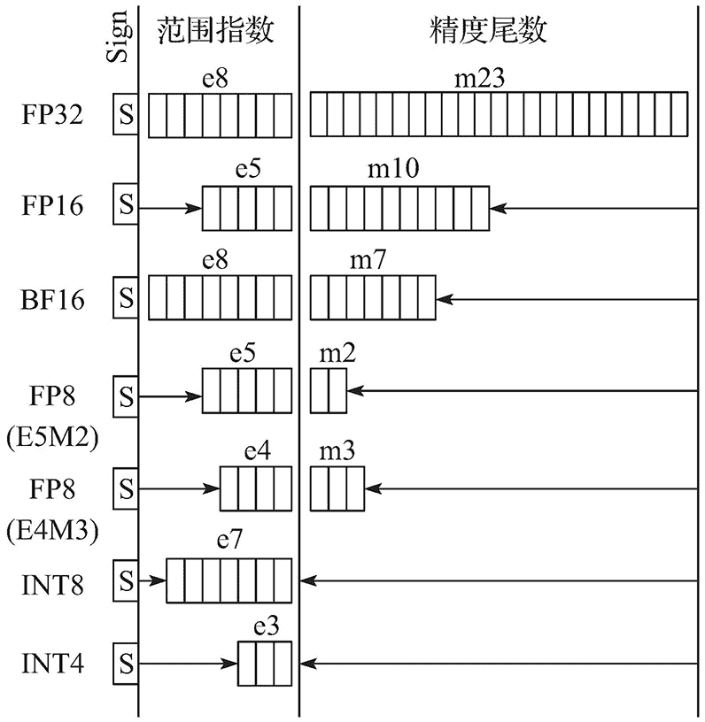

**1.FP32（32-bit Floating Point）**

FP32 是深度学习里广泛使用的 32 位浮点精度，主要特征如下。

●指数位：占用 8 位。

●小数位：占用 23 位尾数。

●最小精度：约为 2^(-23)。

●数值范围：可达 ±3.4×10³⁸。

**2.TF32（Tensor Float 32）**

TF32 在速度与精度间做折中。

●指数位：保留 8 位。

●小数位：仅 10 位尾数。

●最小精度：约为 2^(-10)。

●数值范围：指数范围与 FP32 相同，数值跨度相近，但尾数减少降低了通信和计算开销。

**3.FP16（16-bit Floating Point）**

FP16 已成为训练推理的主流选择之一。

●指数位：5 位。

●小数位：10 位。

●最小精度：约为 2^(-10)。

●数值范围：约 ±6.55×10⁴。

**4.BF16（Brain Floating Point 16）**

BF16 以更宽的动态范围换取更粗的精度。

●指数位：8 位，与 FP32 相同。

●小数位：7 位。

●最小精度：约为 2^(-7)，约 7.81×10^(-3)。

●数值范围：与 FP32 相同，约 ±3.4×10³⁸。

实验显示训练时数值范围的重要性常高于最小精度，这也是 BF16 在 FP16 基础上扩充指数、压缩尾数的设计动机。

**5.FP8 E4M3（8-bit Floating Point）**

量化位宽与主流策略要点梳理

FP8 这类 8 位浮点在模型压缩里占有一席之地。以 E4M3 为例，整体占用 8 位，其中指数域占据 4 位，尾数域占据 3 位。指数部分直接用 4 位编码。尾数显式保留 3 比特，取值 0 至 7，配合隐含的 1 前导位后，有效尾数区间落在 1 到 1.875 之间。数值分辨率下限可达 2 的 -9 次方，上限约为 1.75 乘以 2 的 8 次方。

6. FP8 E5M2 八位浮点权衡版
E5M2 同样是 8 位浮点，只是把指数位加到 5 位，尾数压到 2 位。指数仍以 5 位表示，尾数只剩 2 位。最小分辨步长约为 2 的 -16 次方，可表示的最大数值约为 1.75 乘以 2 的 15 次方。

7. INT8 常见八位整数
INT8 属于八位整型，在推理量化里使用频繁。整数表示不含指数也不含小数。数值步长下限为 1，取值区间为 -128 到 127。

8. INT4 极致压缩四位整数
INT4 是四位整型，也被用于极致压缩场景。同样不带指数与小数，步长为 1，取值区间为 -8 到 7。

### 4.2 量化基础知识
高精度转低精度必然丢信息。轻量化的核心是让数值精度下降的同时尽量守住模型表现，压低量化带来的输出偏差。

4.2.1 线性量化 起点与常用做法
在各类映射里，线性方式最简洁也最普及，能把浮点线性拉伸到整数区间。

注意：后文未作特殊说明，均以线性为准。

映射表达式：

式中 x 为输入浮点，scale 为伸缩比例，一般由数据极值决定，q 为量化后的低位整数。

特点：
● 假设数据均匀。
● 计算开销小，对硬件加速友好。

4.2.2 非线性量化
借助非线性函数把浮点映射到离散点，适合分布偏态的情况。常用对数、指数等进行转换。

表达式：

其中 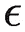 为一个极小常数，用来避免对零取对数。

特点：
● 计算相对重，但能更好保留关键特征。

4.2.3 对称量化
对称属于线性的一种，量化区间关于零点对称。

表达式：

其中 b 代表使用的比特宽度。

特点：
● 区间对称，适合以零为中心分布。
● 实现简洁，硬件支持度不错。

4.2.4 非对称量化
同样是线性，但区间不必对称，能更贴合实际分布。

表达式：

其中 b 为比特宽度。

特点：
● 区间不对称，适合不均匀分布。
● 能更好保留动态跨度。

4.2.5 量化感知训练
量化感知训练 Quantization Aware Training, QAT 是在训练阶段模拟量化效果的技术。训练中引入量化操作，模型可提前适应精度损失，推理更稳。受训练成本限制，大模型上较少使用。主要流程：

（1）定义量化模型
在结构中加入伪量化节点，训练期间模拟量化。节点通常包含量化与反量化，以复现量化后的数值范围与精度。

（2）训练模型
用常规优化器如 SGD、Adam 训练。每次前向时伪节点执行模拟量化，让模型逐步适应。

（3）微调模型
后期可再微调，进一步收敛量化损失。可调节学习率等超参，保证量化后表现。

（4）导出量化模型
训练结束后导出为量化格式。推理时直接使用量化后的权重与激活，提速并降内存。

4.2.6 训练后量化
训练后量化 Post Training Quantization, PTQ 在训练完成后进行，无需重训，靠校准数据修正权重与激活以适配量化范围。主要步骤：

（1）准备校准数据
挑选代表性子集，用来确定缩放系数与零点。

（2）量化模型
● 用校准数据做前向，记录各层激活与权重的分布。
● 按 LLM.INT8、AWQ、GPTQ 等算法计算每块的量化参数。

（3）应用量化参数
● 将计算得到的参数作用到权重与激活上完成量化。
● 操作通常把浮点转整数如 INT8，并施加缩放与零点调整。

（4）验证模型
用验证集检验性能是否明显下滑。若下降明显，可调参数或采用更细粒度方法。

（5）导出模型
验证通过后导出为 TensorFlow Lite、ONNX 等推理格式。推理时直接使用量化权重与激活。

4.2.7 反量化
反量化是把低精度数据恢复为高精度的过程，常用于推理恢复精度或混合精度计算。

表达式：x′=q×scale+zero_point
量化中存在 round 取整，该过程不可逆，会产生信息丢失，因此 x′ 与原始 x 有差异，这也是量化推理失精的主要根源。

### 4.3 分组量化
分组量化又称分块量化。思路是把输入矩阵 X 切成若干小子矩阵，每个子块独立计算并共享一组参数。例如把 10000×10000 的矩阵切成 100 个 1000×1000 子块，每个子块用独立的 scale 与 zero 量化，具体：

其中 b 为量化比特数。

随后对每个分块量化：

其中 X[i][,][j] 为第 i 行第 j 列的分块，scale[i][,][j] 与 zero[i][,][j] 为该分块参数，q[i][,][j] 为量化后整数矩阵。

4.3.1 分组量化的优势
大模型多用线性量化，均匀分布的参数更易取得小误差，但实际权重分布复杂且含离群值。分组可降低每组内出现离群值的概率，从而减小误差。示例：

以上每个小方块做一次量化，共享一组参数。下面是整体统一量化、无分组的示意：


优势概览：
1. 贴合局部特性
大规模矩阵往往非均匀，全局参数难以反映局部动态范围。分块为每个子块单独算参数，能更好贴合局部，提升精度。
2. 降低量化误差
全局量化可能让某些子块范围远小于全局，引入较大误差。分块单独算缩放与零点，能显著减小误差，尤其在分布不均时。
3. 提升硬件效率
分块把大矩阵拆成小矩阵，便于并行与硬件加速。每个分块参数可单独存取，降低带宽压力，提速。

4.3.2 分组方式
当前主流基本基于线性，但在分组策略上差异很大，不同方式会带来明显精度差异。

图 4-2 展示了 4 种分组策略，虚线框为分组大小，旁标注 scale 形式。整张量量化是指对整个 [L,C] 激活或 [H,h] 权重做一次量化。按块量化是指把矩阵切成若干 [M,N] 小矩阵，每个小矩阵单独量化。按标记量化是指把 [L,C] 激活分组为 L 个 [C] 向量，每个向量单独量化。**[图][4][-][2][4][种][不][同][的][量][化][分][组][策][略]**
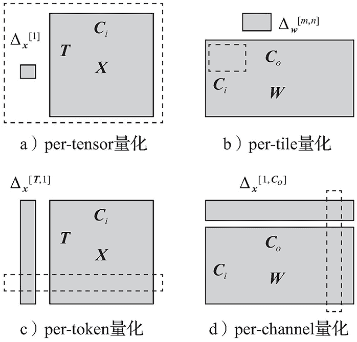
按通道量化是指把 [C,c] 权重分组为 c 个 [C] 向量，每个向量单独量化。

注意：本节矩阵中的框代表分块，比如

代表对矩阵中的 1.2,2.3,3.4,4.5 这四个值同时量化，共享一组 scale 与 zero。

1. 整张量量化
对整个张量使用同一组参数，比如对矩阵 X 一次性量化。公式：

其中 s 为缩放因子。

量化前后示意：

基本分块：


2. 按标记量化
对每个标记即行或列使用不同参数，在大模型中通常用于激活：

其中 s[i] 为第 i 个标记的缩放因子。

示意：

基本分块：


3. 按通道量化

其中 s[c] 为第 c 个通道的缩放因子。

示意：

基本分块：


4. 按块量化
对张量的每个子块使用不同参数：

其中 s[i][,][j] 为第（i,j）个子块的缩放因子。

示意：

基本分块：


### 4.4 影响精度与速度的因素
1. 方法选择
方法直接影响精度与速度。常见如 GPTQ、AWQ 等，通常只量化权重，激活仍保持 FP16/FP32。不一致会导致精度累积误差、反量化额外开销。粒度粗则损失大，细则保精度但复杂度上升。
2. 模型体量
参数越少内存占用越小，加载到高带宽内存更快。推理时需加载到共享内存的数据减少，带宽压力下降。量化后参数更少，更易利用缓存。极端量化如 INT4 可能带来精度损失，需权衡。
3. 算子
推理基本单元，实现影响表现。若硬件或框架支持高效量化算子如 INT8 矩阵乘，加速明显。混合精度需硬件支持，否则需转换。低精度不支持时需反量化回 FP16/FP32，增加计算。
4. 硬件
精度支持、计算单元优化、内存带宽是关键。若硬件不支持目标精度，需额外反量化。Tensor Core 等低精度单元优化程度决定提速效果。带宽不足仍会成为瓶颈。

5. 小结
量化能提速降内存，但受方法、体量、算子、硬件共同制约。实际需按模型类型、平台、精度要求选择策略，实现平衡。

### 4.5 常见量化算法
截至成稿，主流算法主要有 LLM.INT8、AWQ、GPTQ。下面简述核心思想。

4.5.1 LLM.INT8
LLM.INT8 ^(¹) 是面向大语言模型的八位整数量化方法，由 Tim Dettmers 等提出。核心是通过混合精度，仅对敏感层保留 FP16，其余用 INT8，以平衡精度与速度。原理图如图 4-3。**[图][4][-][3][L][L][M][.][I][N][T][8][算][法][量][化][原][理]**
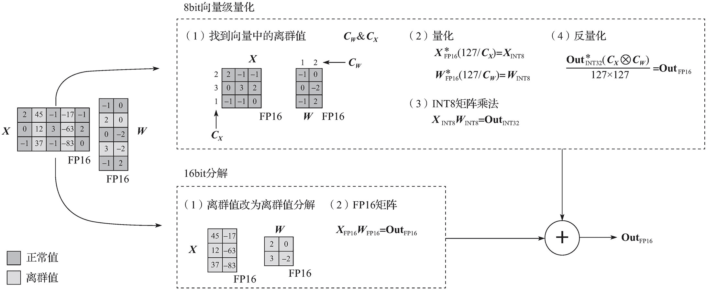
因混合精度存在，反量化也产生额外开销。伪代码如下：

Python

#输入: 浮点权重矩阵 W （形式为 [out_dim, in_dim]），激活矩阵 X （形式为 [batch_size, in_dim]），异常值阈值 τ

#输出: 量化后的 INT8 权重 W_quant，混合精度计算结果 Y（形式为[batch_size, out_dim]）

def LLM_INT8（W, X, τ=6.0）:

 #1.检测激活中的异常值通道（Outlier Channels）

 outlier_mask = detect_outlier_channels（X, τ） # [in_dim], True 表示异常通道

#2. 两路分流：离群走 FP16，其余走 INT8

整体思路是先按离群掩码把权重和激活切成两支，高风险的通道维持半精度，剩下的通道全部量化到 INT8 再做计算。下面给出拆分与合并的参考实现。

  W_fp16 = W[:, outlier_mask]             #异常通道权重（保留 FP16）

  W_int8 = W[:, ～outlier_mask]            #非异常通道权重（量化 INT8）

  X_fp16 = X[:, outlier_mask]             #异常通道激活（保留 FP16）

  X_int8 = X[:, ～outlier_mask]            #非异常通道激活（量化 INT8）

  #3.对非异常部分执行 INT8 矩阵乘法

  W_quant, s_w, z_w = quantize_int8（W_int8）     #权重量化

  X_quant, s_x, z_x = quantize_int8（X_int8）     #激活量化

  Y_int8 = int8_matmul（W_quant, X_quant）      #INT8 矩阵乘法

  Y_int32 = dequantize（Y_int8, s_w, s_x, z_w, z_x）  #反量化为 INT32

  #4.对异常部分执行 FP16 矩阵乘法

  Y_fp16 = fp16_matmul（W_fp16, X_fp16）       #FP16 矩阵乘法

  #5.合并两部分结果

  Y = combine_results（Y_int32, Y_fp16, outlier_mask）#按通道位置合并

  return W_quant, Y

def detect_outlier_channels（X, τ）:

  #检测异常通道：绝对值最大值超过阈值的输入通道

  max_vals = max（abs（X）, axis=0）         #[in_dim]

  return max_vals > τ                  #异常通道掩码

def quantize_int8（matrix）:

  #对称 INT8 量化（范围[-127, 127]，排除-128）

  max_val = max（abs（matrix））

  scale = max_val / 127.0

  quantized = round（matrix / scale）         #量化到 INT8

  return quantized, scale, 0             #零点 z=0（对称量化）

def dequantize（Y_int8, s_w, s_x, z_w, z_x）:

  #反量化：Y = （Y_int8 * s_w * s_x） + 偏置项（对称量化可忽略零点）

  return Y_int8.astype（float32） * （s_w * s_x）

推理反量化的伪代码如下：

Python

#输入:
# - INT8 矩阵乘法结果 Y_int8 （形式为 [batch_size, out_dim], 数据类型为 int8）
# - FP16 矩阵乘法结果 Y_fp16 （形式为 [batch_size, out_dim], 数据类型为 float16）
# -权重量化参数 s_w （形式为 [out_dim, 1]）
# -激活量化参数 s_x （形式为 [1, in_dim_non_outlier]）
# -异常通道掩码 outlier_mask （形式为 [in_dim]）
#输出: 反量化后的最终输出 Y （形式为 [batch_size, out_dim], 数据类型为 float32）

def dequantize_and_merge（Y_int8, Y_fp16, s_w, s_x, outlier_mask）:

  #1.反量化 INT8 结果为 INT32（实际推理中，INT8 矩阵乘法结果直接存储在 INT32 累加器中）

  Y_int32 = Y_int8.astype（int32）    #转换为 INT32（防止溢出）

  #2.计算反量化缩放因子（逐输出通道×逐输入非异常通道）
  #注意：s_w 的形式为 [out_dim, 1], s_x 的形式为 [1, in_dim_non_outlier]
  #广播乘法得到缩放因子矩阵，形式为 [out_dim, in_dim_non_outlier]

  scale_matrix = s_w * s_x

  #3.对 INT32 结果应用反量化（转换为浮点数）

  Y_dequant = Y_int32.astype（float32） * scale_matrix.sum（axis=1）  #按输出通道求和

  #4.合并 FP16 异常通道结果与反量化后的 INT8 结果
  #根据 outlier_mask 确定每个输入通道的位置

  Y_combined = combine_with_outliers（Y_dequant, Y_fp16, outlier_mask）

  return Y_combined

def combine_with_outliers（Y_dequant,Y_fp16, outlier_mask）:

  #初始化全精度输出矩阵（与原始 FP32 计算形式相同）

  batch_size, out_dim = Y_dequant.shape

  in_dim = len（outlier_mask）

  Y_combined = zeros（（batch_size, out_dim）, dtype=float32）

  #分离异常通道与非异常通道的索引

  outlier_indices = where（outlier_mask）[0]  #异常通道位置（列索引）

  normal_indices = where（～outlier_mask）[0]  #非异常通道位置

  #将反量化结果填充到非异常通道位置

  Y_combined[:, normal_indices] = Y_dequant

  #将 FP16 结果填充到异常通道位置（转换为 FP32）

  Y_combined[:, outlier_indices] = Y_fp16.astype（float32）

  return Y_combined

LLM.INT8 的落地可概括为两步。

先做离群筛选。以校准集为依据，找出激活幅值异常的输入维度，这类维度对最终输出影响较大。

再做混合精度处理。
●触及离群值的模块例如自注意力保持 FP16；
●其余模块统一压缩为 8 位整数；
●推理时把 8 位结果临时解量化回 FP16 再参与累加。

得失。
●收益：在测试集上精度几乎无损，显存约减半。
●代价：多了离群检测环节，混合精度会拖慢推理吞吐。

**4.5.2 AWQ**

AWQ 即 Activation-aware Weight Quantization，激活感知权重量化，由 MIT 等团队提出。如图 4-4 所示，AWQ 的核心是通过统计激活分布来定位关键权重，先放大再统一量化，从而在低位量化下把重要权重的误差压到最低。相比直接保留部分高精度权重，它通过按通道自适应缩放实现硬件友好的量化。**[图][4][-][4][A][W][Q][原][理][图][4][-][4][（][续][）]**


实践中大模型权重里约有 1% 是离群值，若把这部分留在 FP16，困惑度能从 43.2 降到 13.0，但混合格式不利于硬件。AWQ 在图 4-4c 的做法是用 per-channel 放大保护这 1% 的离群，以此降低量化误差。

AWQ 实现的伪代码如下。

Python

#输入: 浮点权重矩阵 W （形式为 [out_channels, in_channels]),
#  激活值统计 A （形式为[batch_size, in_channels]),
#  量化比特数 b，搜索迭代次数 T
#输出: 量化权重矩阵 W_quant, 缩放因子 s （按通道）

def AWQ（W, A, b, T）:
  #1.分析激活分布：计算每个输入通道的"显著性"（激活幅值均值）
  channel_significance = compute_Activation_significance（A）  #[in_channels]
  #2.按通道生成缩放因子 s，放大显著通道的权重（保护重要区域）
  s = search_optimal_scales（W, A, channel_significance, T）  #[in_channels]
  #3.应用缩放因子到权重（W_scaled = W * s），再进行量化
  W_scaled = W * s                       #缩放后的权重
  W_quant, s_quant, z_quant = quantize_per_channel（W_scaled, b）
  #4.将缩放因子 s 吸收到量化参数中（关键！推理时无需额外计算）
  s_final = s_quant / s                     #合并缩放因子
  return W_quant, s_final, z_quant

# ---关键子函数 ---

def search_optimal_scales（W, A, significance, T）:
  #目标：找到最优的按通道缩放因子 s，使得量化后的权重误差最小
  s = ones_like（significance）                  #初始化为 1（不缩放）
  for t in 0 to T-1:
    #通过校准数据计算权重误差对输出的影响
    output_error = compute_quant_error_impact（W, A, s）   #前向传播量化误差
    #根据显著性更新缩放因子（放大重要通道的 s）
    s = update_scales（s, significance, output_error）    #梯度下降/启发式搜索
  return s

def quantize_per_channel（W, b）:
  #按通道量化：每个输出通道独立计算量化参数
  scales = []
  zeros = []
  W_quant = zeros_like（W）
  for out_ch in 0 to W.shape[0]-1:
    #标准线性量化（可对称或非对称）
    w = W[out_ch, :]
    scale = （max（w） - min（w）） / （2**b - 1）
    zero_point = round（-min（w） / scale）
    W_quant[out_ch, :] = round（w / scale + zero_point）
    scales.append（scale）
    zeros.append（zero_point）
  return W_quant, scales, zeros

实现要点。

1. 显著性评估
用各输入通道激活绝对值的均值衡量重要程度，channel_significance = mean（abs(A）, axis=0）。激活越强，对应权重越需被保护。

2. 缩放搜索
借助校准数据迭代求最优按通道缩放 s，最小化缩放后权重的量化失真。数学上 W×s 等价于 A/s，把量化压力从关键区转移。

3. 因子融合
量化后把 s 合并进量化参数，推理阶段不产生额外开销。例如 Y = （W_quant * s_final） @ X 可融入 LayerNorm。

权衡。
●优点：精度损失往往小于 1%，对 4bit 很友好。
●不足：依赖校准数据调参，预处理耗时增加。

**4.5.3 GPTQ**

GPTQ（Gradient-based Post-training Quantization）是面向大模型的基于梯度的训练后量化方法。核心是用二阶梯度信息逐层优化权重量化误差，减小整体输出扰动，并按权重重要性分块量化，后量化的块用来补偿先量化的误差。速度、精度与兼容性兼备，是当前推理量化常见方案，但二阶导计算容易导致对校准集过拟合。

GPTQ 实现的伪代码如下。

Python

#输入: 浮点权重矩阵 W （形式为[m, n]），量化比特数 b，校准数据集 D，块大小 B
#输出: 量化权重矩阵 W_quant （形式为[m, n]），缩放因子 s，零点 z

def GPTQ（W, b, D, B）:
  #初始化参数
  H = compute_hessian_approximation（D） #通过校准数据近似 Hessian 矩阵（二阶导数信息）
  W_quant = W.copy（）          #初始化量化后的权重矩阵
  m, n = W.shape
  #逐列处理权重矩阵（按列重要性排序）
  for j in 0 to n-1:
    #1.选择当前列对应的权重块
    W_j = W_quant[:, j]              #当前待量化的列
    W_not_quant = W_quant[:, j+1:]         #未量化的剩余列
    #2.计算量化误差的 Hessian 逆矩阵（关键步骤）
    H_jj = H[j, j]                  #Hessian 矩阵的对角块
    H_j_not = H[j, j+1:]              #Hessian 矩阵的非对角块
    H_inv = inverse（H_jj - H_j_not @ H[j+1:, j+1:].inv（） @ H_j_not.T）
    #3.计算当前列的量化误差
    quant_error = quantize（W_j, b） - W_j     #量化误差 = 量化后权重 - 原始权重
    #4.通过 Hessian 逆更新未量化列的权重（补偿量化误差）
    delta = H_inv * quant_error          #二阶梯度补偿
    W_not_quant += delta              #更新未量化权重以抵消当前列误差
    #5.应用量化到当前列
    W_quant[:, j] = quantize（W_j, b）       #对当前列执行量化
  #6.最终调整（可选）
  W_quant = adjust_for_Activation_range（W_quant, D）#根据激活值动态范围调整缩放因子
  return W_quant, s, z

def quantize（w, b）:
  #标准线性量化：将浮点权重映射到 b-bit 整数
  scale = （max（w） - min（w）） / （2^b - 1）
  zero_point = round（-min（w） / scale）
  w_quant = round（w / scale + zero_point）
  return w_quant * scale - zero_point * scale    #反量化后的值

关键流程。

1. 目标设定
GPTQ 希望量化前后在相同 X 下输出尽量接近，比如 W、  分别为量化前后权重，X 为激活。
损失计算如下：


2. Hessian 近似
用校准数据前向结果对损失求二阶导，得到 Hessian 近似。Hessian 反映权重敏感度，指导误差补偿。

3. 逐列量化
按列顺序处理，量化一列后立即用剩余列的权重补偿误差。顺序常按 L2 范数排序。

4. 误差传播
量化误差通过 delta = H_inv * quant_error 传到未量化列。借助 Hessian 逆的二阶信息最小化整体损失。

5. 范围微调
依据激活实际分布调整缩放因子 s 与零点 z，避免饱和。常用贪心策略为每块挑选最优量化参数。

GPTQ 支持 2~4 位极低位量化，显存可压到 75% 以下，但 Hessian 计算开销大，量化耗时较长。

3 种量化方法对比如表 4-1 所示。**[表][4][-][1][3][种][量][化][方][法][对][比]**


总体来看，LLM.INT8 适合追求快速上线的场景。AWQ 适合显存敏感的低比特任务，如边缘设备。GPTQ 在极致压缩下表现最好，但计算成本更高。

**第五章 大语言模型分布式训练基础知识**

大模型突破单卡瓶颈：从通信原语到并行范式

Transformer 成为主流后，大语言模型的参数规模增速远超摩尔定律，单张 GPU 已无法容纳完整权重。以 DeepSeek V3 为例，参数约 6500 亿，BF16 加载约需 1300 GB 显存，远高于现役量产卡的上限。

训练时显存被模型权重、梯度、优化器状态、中间激活、碎片以及运行时环境共同占据。预训练放大 batch_size 会显著抬高激活缓存，促使语言模型极易进入分布式场景。推理侧受模型体量与单卡算力限制同样需多卡协同，分离式推理是近期出现的一种更具灵活性的加速做法。

本章从通信原语与并行策略两个维度梳理大语言模型分布式的基础框架。

### 5.1 通信原语
在并行与分布式计算中，节点间数据交换的模式决定整体效率。下面介绍几类典型通信模式并给出形式化表达。

**5.1.1 Reduce**

Reduce 是把多设备上的数据按约简规则合并到单一设备。图 5-1 展示了 Reduce 的工作原理，把 Device0 至 Device3 上的矩阵按图中加号归约到 Device0。**[图][5][-][1]** **[R][e][d][u][c][e][操][作][原][理]**


设存在 n 个节点，每个节点持有向量 v[i]，Reduce 可写成


其中 ⊕ 代表求和、求最大值等约简操作。

Reduce 过程中除根节点外的设备需把本地数据送往目标节点，常用根节点作为汇聚点。若设备数为 n，单设备数据量为 m，则

通信量=（*n*-1）×*m*

要点如下。

●根节点之外每张卡发出 m 维数据到根节点，m 为数据维度。
●参与发送的设备数为 n-1 个。

**5.1.2 Broadcast**

Broadcast 是把根节点的数据复制分发到全部节点。图 5-2 说明 Broadcast 的原理，把 Device0 上的向量拷贝至所有设备。**[图][5][-][2]** **[B][r][o][a][d][c][a][s][t][操][作][原][理]**


设根节点持有向量 v，Broadcast 可表述为

v → v 被广播到所有节点

执行时根节点向其余节点推送数据。若设备数为 n，单设备数据量 m，则

通信量=（*n*-1）×*m*

要点如下。

●根节点向每个非根节点发送 m 维数据。
●需要接收的节点共 n-1 个。

**5.1.3 Gather**

Gather 把各节点数据原样汇聚到一处，不做合并。如图 5-3 所示，Gather 指把 Device0 到 Device3 上的矩阵收集到同一 Device，目标上的参数总量等于各设备之和。**[图][5][-][3]** **[G][a][r][t][h][e][r][操][作][原][理]**


设 m 个节点，每个节点有一个向量 v[i]，Gather 可表示为


Gather 中各节点把本地数据发送到目标节点，通常为根节点，则

通信量=（*n*-1）×*m*

要点如下。

●非根节点各自向根节点发送 n 单位数据。
●需要发送的节点数为 m-1 个。

**5.1.4 Scatter**

如图 5-4 所示，Scatter 把 Device0 上的数据拆分后分发到 Device0 至 Device3，Scatter 是 Gather 的逆过程。**[图][5][-][4]** **[S][c][a][t][t][e][r][操][作][原][理]**


设根节点持有数据矩阵 v，Scatter 可表示为


Scatter 中根节点把数据下发给其余所有节点，则

通信量=（*n*-1）×*m*

要点如下。

●根节点向每个非根节点发送 m 维数据。
●接收方共 n-1 个。

**5.1.5 All-Reduce**

如图 5-5 所示，All-Reduce 先把 Device0 到 Device3 的数据按某种操作聚合，再把结果广播回全部节点。**[图][5][-][5]** **[A][l][l][-][R][e][d][u][c][e][操][作][原][理]**


设 n 个节点，每个节点有一个向量 v[i]，All-Reduce 可表示为


All-Reduce 中每张卡既要发出本地数据也要收回全局归约结果。采用树形或环形算法时，则

通信量=2×（*n*-1）×*m*

要点如下。

●各节点均有发送与接收动作。
●总体通信约为一次 Reduce 的两倍。

**5.1.6 All-Gather**

如图 5-6 所示，All-Gather 把 Device0 到 Device3 的数据收集到所有节点，最终每张卡都拥有完整数据。**[图][5][-][6]** **[A][l][l][-][G][a][t][h][e][r][操][作][原][理]**


设 n 个节点，每个节点有一个向量 v[i]，All-Gather 可表示为


All-Gather 中每张卡需向其他所有卡发送自身数据并接收对方数据，则

通信量=（*n*-1）×*m*×*n*

要点如下。

●每张卡向 n-1 张卡发送 m 维数据。
●每张卡接收 (n-1)×m 维数据。

### 5.2 数据并行
数据并行将样本切分到多卡执行相同计算，如图 5-7 所示。各卡保存一致的权重副本，数据集被拆成若干微批次分发。计算后借助 All-Reduce 等机制汇总梯度，保持副本同步。该方式提升吞吐并支撑超大模型与数据，常见于视觉与 NLP。**[图][5][-][7]** **[数][据][并][行]**


如图 5-7 所示，数据并行即在 GPU0 和 GPU1 上保存相同权重，将 BATCH_DATA 分为微批次 mirco_batch0、mirco_batch1 分别传入不同卡进行计算。各微批次前向结束后将各卡上的梯度做一次 All-Reduce，保证各卡权重始终相同。

数据并行步骤如下。

**1.定义权重矩阵和输入矩阵**

假设有一个权重矩阵 W 和一个输入矩阵 x，具体如下：


**2.输入矩阵拆分**


x[1]是矩阵 x 的第一列。

x[2]是矩阵 x 的第二列。

**3.并行计算**


**4.结果合并**


**5.结果验证**


### 5.3 张量并行
注意：本章皆采用 y = w * x 这种计算方法，这种计算方法偏理论推导，如果某些框架采用 y = x * w 这种计算方法，张量并行的行并行和列并行的所有结论需要颠倒。

如图 5-8 所示，张量并行把权重矩阵等张量拆分到多卡并行计算，用于加速大规模模型训练与推理。核心思想是把大张量按行或列拆成子张量分到不同卡，各卡处理部分数据后通过通信机制如 All-Reduce 合并。**[图][5][-][8]** **[张][量][并][行]**


**5.3.1 张量并行——行并行**

**1.定义权重矩阵和输入向量**

假设我们有一个权重矩阵 W 和一个输入矩阵 x，具体如下：


**2.权重矩阵拆分**

将矩阵 W 按行拆分为两个子矩阵 W[1] 和 W[2]，分别分配到两个设备上：


●W[1]是矩阵 W 的前两行。

●W[2]是矩阵 W 的后两行。


**3.结果验证**


**5.3.2 张量并行——列并行**

**1.定义权重矩阵和输入矩阵**

假设原始权重矩阵 W 和输入矩阵 x 如下：


**2.权重矩阵与输入矩阵的拆分**

行并行需将权重矩阵按列拆分，同时输入矩阵按对应维度切分。

权重矩阵 W 的拆分：按列拆分为 W[1]（前两列）和 W[2]（第三列）：


输入矩阵 x 的拆分：与权重矩阵拆分对齐，按列拆分为 x[1]（前两行）和 x[2]（第三行）：


**3.结果验证**


**5.3.3 行并行与列并行的差别**

从上文可看出，列并行和行并行有区别，列并行中最终结果由 y[1] 和 y[2] 进行 Gather 操作所得，行并行中最后结果由 y[1] 和 y[2] 进行 Reduce 操作所得。该差别使并行后的激活函数对行并行更敏感。

**1.列并行的非线性激活函数**

act_function（y）!=act_function（y[1]+y[2]）

**2.行并行的非线性激活函数**

act_function（y）=act_function（[y[1]，y[2]]）

由于列并行在前向和反向都需要通信聚合结果与梯度，而行并行仅在反向时聚合梯度，故行并行通信成本更低。

因 MLP 层含两个线性层且中间有非线性激活，通常第一个线性层用行并行，第二个线性层用列并行。MiniCPM 在 VLLM 中的张量并行适配代码如下：

class MiniCPMMLP（nn.Module）:

def __init__（

self,

hidden_size: int,

intermediate_size: int,

hidden_act: str,

hidden_act_param: float,

quant_config: Optional[QuantizationConfig] = None,

） -> None:

super（）.__init__（）

self.gate_up_proj = MergedColumnParallelLinear（

hidden_size, [intermediate_size] * 2,

bias=False,

quant_config=quant_config） #列并行（本书中的行并行）

self.down_proj = RowParallelLinear（intermediate_size,

hidden_size,

bias=False,

quant_config=quant_config） #行并行（本书中的列并行）

if hidden_act == "silu":

self.act_fn = SiluAndMul（）

elif hidden_act == "fatrelu":

self.act_fn = FatreluAndMul（threshold=hidden_act_param）

else:

raise ValueError（f"Unsupported activation: {hidden_act}. ""Only silu and fatrelu are supported for now."）

def forward（self, x）:

gate_up, _ = self.gate_up_proj（x）

x = self.act_fn（gate_up）

x, _ = self.down_proj（x）

return x

综上所述，张量并行中的行并行和列并行对比如表 5-1 所示。**[表][5][-][1]** **[张][量][并][行][中][的][行][并][行][和][列][并][行][对][比]**


### 5.4 流水线并行
流水线并行把整体计算切成多个连续阶段分到不同卡依次执行。每张卡只负责其中一个阶段，数据像流水线一样流经各卡。

图 5-9 中每个颜色代表不同的卡，F 代表前向传播，B 代表反向传播，某个数据批次在第一个设备的第一个模型层前向传播后将结果传递到第二个设备上的第二个模型层，依此类推。当前向传播完成后，从最后一个模型层进行反向传播更新参数，再将梯度传递到上一个层的设备上进行反向传播。**[图][5][-][9]** **[朴][素][流][水][线][并][行]**


流水线并行的最大缺点是存在气泡，气泡可从图 5-9 的空白部分看到，所有空白占整个流水线面积的比值为气泡比。朴素流水线并行的气泡比为：


其中，K 表示流水线的深度，即图 5-9 中 F[0] 或者 B[0] 的数量。

为降低气泡占比，后续出现 GPipe 方案。其核心思想是将 Batch 切分成多个 micro_batch，降低等待时间。如图 5-10 所示，深蓝色为前向传播，绿色为反向传播，GPipe 流水线的气泡比为


其中，K 为流水线深度，M 为微批次的数量。**[图][5][-][1][0]** **[G][P][i][p][e][流][水][线]**


### 5.5 序列并行
序列并行用于加速深度学习模型尤其是 Transformer 模型的训练，面向长序列输入。由于 Transformer 空间复杂度随序列长度平方增长，切分序列可降低显存需求。其思路是将输入序列按长度维度拆成多个子序列分发到不同卡并行计算，减少单卡显存并提升效率。

如图 5-11 所示，对于注意力层来说，输入是一个[S（Sequence）,B（Batch_size）,D（dim）]的向量，将其按照 S 维度切分成 m 个 Chunk 并分别计算 Q、K、V，再将 Chunk 分配到不同设备上进行 Attention Score 计算。由于单向注意力的存在，靠后的 Chunk 需要获得靠前 Chunk 的 K、V 值，这部分需要进行额外的通信。**[图][5][-][1][1]** **[序][列][并][行]**


MLP 阶段需要把注意力子层产出的各 Chunk 表示按设备映射分发到相应的算力单元完成变换，变换结束后的中间特征随即送入下一层注意力继续计算。

### **5.6** **“专家”并行**

专家并行是面向超大模型训练的分布式排布策略，在混合专家 MoE 体系里应用最广泛。其基本思路是把模型中若干专家子网拆分到不同的 GPU、TPU 等设备上，让分布式资源共同承担训练与推理的压力。

在分布式推理与训练场景中，MoE 最容易暴露的短板是负载失衡与通信膨胀。受稀疏激活机制影响，只有让每个专家独占一台设备，才能把单卡的实际有效 Batch 大小放大。

从全局看，若各专家承接的 Token 数量差距过大，不同设备的忙闲程度就会分化，不仅拖慢整体吞吐，还会造成快卡等待慢卡的同步瓶颈。

MoE 的另一痛点是 Dispatch 与 Combine 都是全到全通信，会导致数据搬运量急剧增加，因此必须让计算与通信在时间上重叠来掩盖开销。

# **第二部分**

# **DeepSeek 核心技术透视**

当大模型研发进入效率优先的阶段，DeepSeek 以一系列原创突破重新定义了语言模型的技术路径。第二部分将系统拆解其架构设计与工程实践，展示其如何在参数效率、训练成本与推理性能构成的“不可能三角”中实现颠覆性平衡。

从底座重构到算力协同，DeepSeek 的演进始终围绕智能本质展开。传统大模型以堆砌参数的粗放方式为主流，而 DeepSeek 的 MoE 组织化范式则走向精细化——把总规模 6710 亿参数的巨型模型解构成 256 个专科专家与 1 个共享专家协同工作的动态网络，单次推理仅激活约 370 亿参数，在保持顶尖效果的同时把计算能耗压到传统方案的八分之一。这种细粒度的专家划分相当于为系统注入了术业专攻的基因，使得万亿参数量级的模型也能在单机环境下流畅运行。

在训练方法上，DeepSeek 提出的认知蒸馏策略跳出了传统强化学习的路径依赖。借助 R1-Zero 冷启动，模型在纯数学与代码数据中自发涌现出逻辑推理能力，随后经历监督微调、强化学习、数据反哺、人机融合四个阶段的混合锻造，最终在 GSM8K 数学评测上达到 97.3% 的准确率，具备商用水平。这种从零自证的成长路径大幅降低了对标注数据的需求，也让 AI 认知的演化呈现出类人的阶段性特征。

工程层面，DeepSeek 的进步体现为对算力本质的再思考。Fire-Flyer AI-HPC 架构采用 PCIe 与 NVLINK 混合互联，使万卡集群的通信成本降至传统方案的十分之一；无辅助损失的负载均衡摒弃繁琐的梯度补偿，依靠动态偏置调节实现专家的智能调度；MLA 注意力配合 FP8 混合精度，让长文本推理的显存需求从 48GB 骤降至 2.3GB。上述系统级优化形成的效率飞轮，使得 DeepSeek V3 以 557 万美元的训练花费即可达到 GPT-4 的基准水平。

当行业仍陷于算力内卷时，DeepSeek 用实践表明：真正的智能革新不在于参数的无限膨胀，而在于对计算资源的极致利用。其开源生态与模块化设计正推动研发从封闭竞争走向开放协作——开发者可借助知识蒸馏把万亿级能力迁移到边缘侧，也可基于共享专家网络快速搭建垂类模型。这场源于架构创新的浪潮，最终指向人工智能民主化的愿景。

后续章节将以代码级粒度拆解上述技术的落地细节，从 MoE 路由矩阵的数学证明到分布式训练的通信压缩手段，带你完整经历这场 AI 效率革命的关键节点。

## **第六章 DeepSeek 模型架构拆解**

DeepSeek 在 Transformer 基础上做了两项关键改进：一是将 MLP 层替换为 MoE，二是引入多头潜注意力 Multi-head Latent Attention，MLA。MoE 与 MLA 的共同目标是在不损失模型表现的前提下显著提升训练与推理效率。

DeepSeek V3 架构如图 6-1 所示，核心组成包括 MoE 与 MLA。**[图][6][-][1][D][e][e][p][S][e][e][k][V][3][架][构]**[（来自 DeepSeek V3 技术报告）]


图中 Concatenate 操作表示将 和 两个向量进行堆叠操作，Apply RoPE 操作代表将***h****[t]*矩阵转换为带有 RoPE 的***K***矩阵。

本章将系统阐述 MoE 与 MLA 的设计思路。首先从代码实现与计算量、原理层面介绍 MoE，并解释门控单元、专家并行等概念；随后梳理从 MHA 到 GQA 再到 MLA 的演进路径、注意力结构及 KV-cache 使用方法；接着解析 BPE 与 BBPE 分词器的核心机制及其对分词质量的影响；最后从多模态视角介绍 DeepSeek VL2，并说明 MiniCPM-V 如何处理超清图像输入以避免细节丢失。

### **6.1 MoE 架构**

**6.1.1 MoE 的基本原理**

Transformer 的 MLP 由多层线性变换构成，导致计算复杂度达到 *O*（hidden_size²）。为此 DeepSeek 用 MoE 取代 MLP，本质是用若干参数更小的并行 MLP 替代单一大型 MLP，且前向传播时只激活其中一部分。**[图][6][-][2][M][o][E][与][M][L][P][架][构][示][意][图]**


如图 6-2 所示，MoE 由多个参数规模较小的并行 MLP 构成，输入***X***经 Dispatch 分发后会同时送入共享专家和 Top *k* 个路由专家进行加权投票，最终聚合得到输出。

**1.MoE 架构的宏观原理**

1）MoE 由若干并行 MLP 组成，每个 MLP 被视作一个“专家”。
2）相较于传统 Transformer，每个专家的参数规模大幅缩小。
3）专家分为共享专家与路由专家，共享专家对全部输入***X***始终参与计算，路由专家仅挑选 Top *K* 个激活。
4）Top *K* 专家由门控网络计算权重后接收输入***X***。
5）所有激活专家的结果按权重聚合，该步骤在代码中由 MoE_infer 函数完成，后文会重点展开。
6）将第 5 步的聚合结果与共享专家的输出相加，作为 MoE 的最终输出。

**2.伪代码**

MoE 实现伪代码如下:

Python

#DeepSeek V3 代码节选（有修改）

class DeepSeekV3MoE（nn.Module）:

 """
 MoE 模块核心实现，包含“分布式专家”计算与“共享专家”机制
 核心流程：输入→门控路由→“分布式专家”计算→结果聚合→“共享专家”增强→输出
 """

 def __init__（self, config）:
 super().__init__()
 self.config = config
 self.num_experts_per_tok = config.num_experts_per_tok #每个 Token 使用的“专家”数
 #“分布式专家”初始化 ---------------------------------------------------
 if hasattr（config, "ep_size"） and config.ep_size > 1:#模型并行场景
 self.ep_size = config.ep_size #“专家”并行设备数
 self.experts_per_rank = config.n_routed_experts // config.ep_size
 self.ep_rank = dist.get_rank（） #当前设备编号
 #“分布式专家”分配：每个设备仅初始化自己负责的“专家”
 self.experts = nn.ModuleList（[
 DeepSeekV3MLP（config, ...）
 if 属于当前设备
 else None
 for i in range（config.n_routed_experts）
 ]） #这里只有“路由专家”
 else: #单设备模式
 self.ep_size = 1
 self.experts = nn.ModuleList(
 [
 DeepSeekV3MLP(
 config, ...
 )
 for i in range（config.n_routed_experts）
 ]
 ) #所有“路由专家”在同一设备
 self.gate =MoEGate（config） #门控网络
 #“共享专家”机制（增强通用特征处理）
 if config.n_shared_experts:
 self.shared_experts =DeepSeekV3MLP（...） #大容量“共享专家”
 def forward（self, hidden_states）:
 """前向传播流程"""
 identity = hidden_states #原始输入形式为 [B, L, D]
 #门控计算 ----------------------------------------------------------
 Top K_idx, Top K_Weight = self.gate（hidden_states） #[B*L, top_k], [B*L, top_k]
 #推理专用路径 ------------------------------------------------------
 if not self.training:
 #将输入展平为二维 [B*L, D]
 x = hidden_states.view（-1, hidden_states.size（-1））
 #“分布式专家”计算 [B*L, D] → [B*L, D]
 y = self.MoE_infer（x, Top K_idx, Top K_Weight）.view（*orig_shape）
 #“共享专家”增强 -----------------------------------------------------
 if self.config.n_shared_experts:
 y+= self.shared_experts（identity） #y 的形式为[B, L, D] + [B, L, D]
 return y #y 的形式为[B, L, D]
 @torch.no_grad（）
 defMoE_infer（self, x, Top K_ids, Top K_Weight）:
 """
 分布式推理核心逻辑：
 1.统计各“专家”分配的 Token 数量
 2.根据“专家”分布进行跨设备通信
 3.“专家”并行计算
 4.结果聚合与还原
 """
 #统计每个“专家”需要处理的 Token 数 ----------------------------------------
 cnts =Top K_ids.new_zeros（（x.size（0）, len（self.experts））） #[B*L, E]
 cnts.scatter_（1,Top K_ids, 1） #设置对应位置的计数
 tokens_per_expert = cnts.sum（dim=0） #[E]为每个“专家”处理的 Token 数
 #数据重排序（提高计算效率） ------------------------------------------
 idxs =Top K_ids.view（-1）.argsort（） #按“专家”ID 排序 [B*L*top_k]
 sorted_tokens = x[idxs // Top K_ids.size（1）] #sorted_tokens 的形式为[总 Token 数, D]
 #分布式通信阶段（模型并行关键） ---------------------------------------
 if self.ep_size > 1:
 #该分支见下文，此处省略
 #“专家”并行计算 -----------------------------------------------------
 outputs = []
 start_idx = 0
 for i, num_tokens in enumerate（Tokens_per_expert.cpu（）.numpy（））:
 #i 代表第几个“专家”
 if num_tokens == 0: continue
 expert = self.experts[i + self.ep_rank*self.experts_per_rank] #获取本地专家
 expert_out = expert（sorted_tokens[start_idx:start_idx+num_tokens]）
 #expert_out 的形式为[num_tokens, D]
 outputs.append（expert_out）
 start_idx += num_tokens
 #结果聚合 ---------------------------------------------------------
 outs = torch.cat（outputs, dim=0） #outs 的形式为 [总 Token 数, D]
 #分布式结果还原 ---------------------------------------------------
 if self.ep_size > 1:
 #逆 all_to_all 操作恢复原始设备分布
 new_x = torch.empty_like（outs）
 new_x[gatherd_idxs] = outs #还原索引顺序
 gathered_tokens = ... #重新聚合各设备结果
 #最终加权求和 -----------------------------------------------------
 final_out = new_x.view（*Top K_ids.shape, -1） #[B*L, top_k, D]
 .mul_（Top K_Weight.unsqueeze（-1）） #乘权重后的形式为 [B*L, top_k, D]
 .sum（dim=1） #加权求和的形式为 [B*L, D]
 return final_out #final_out 的形式为 [B*L, D]

**3.MoE_infer 函数**

1）依据门控输出获取 Top *K* 个专家及其对应的权重。
2）根据门控结果统计每个专家需要处理的 Token 数量，并保存到一维向量 Tokens_per_expert。
3）构建 sorted_Tokens。sorted_Tokens 是把各专家对应的 Token hidden 向量按顺序拼接成的二维矩阵，示例如下：
[*h*[11]，*h*[13]，*h*[18]，*h*[21]，*h*[24]，*h*[25]…，*h**[n]*[2]，*h**[n]*[4]，*h**[n]*[8]]
其中，*h**[i][j]* 表示第 *i* 个专家对应的第 *j* 个 Token 的 hidden 向量。
4）遍历全部专家，取出专家 *E**[i]*。
5）在 sorted_Tokens 中抽取专家 *E**[i]* 所需的所有向量，例如[*h**[i]*[1]，*h**[i]*[3]，*h**[i]*[8]]。
6）把步骤 1 的权重带入专家 *E**[i]* 并行计算得到 expert_out，形状为[num_Tokens, *D*]。该步骤使每个专家可同时处理多条 Token，提升吞吐。
7）将中间结果存入 outputs。
8）按专家维度对 outputs 依据权重做加权求和，得到最终输出。

**4.“专家”并行**

“专家”并行的伪代码如下:

DeepSeek V3 架构要点：稀疏专家与压缩注意力

当 ep_size 大于 1 时，跨设备的数据调配会被触发。整体可以概括为先统计各卡的负载，再交换统计量，接着完成数据搬运，最后更新本地计数，为后续计算做准备。具体实现如下。

Python
if self.ep_size > 1:

  ##########################################################
  #步骤 1：统计“专家”分配信息（按 ep_size 进程分组）
  ##########################################################
  #将每个“专家”需要计算的 Token 数按 ep_size 进程分组，统计各进程需处理的 Token 总量
  tokens_per_ep_rank = tokens_per_expert.view（self.ep_size, -1）.sum（dim=1）
  #创建空张量，用于跨进程交换统计信息
  tokens_per_expert_group = Tokens_per_expert.new_empty（tokens_per_expert.shape[0]）
  #使用 all_to_all_single 通信交换各进程的“专家”分配统计量
  dist.all_to_all_single（tokens_per_expert_group, tokens_per_expert）
  ##########################################################
  #步骤 2：跨进程分发输入数据
  ##########################################################
  #计算每个进程将接收的数据块大小（基于交换后的统计信息）
  output_splits = (
    tokens_per_expert_group.view（self.ep_size, -1）
    .sum（1）
    .cpu（）
    .numpy（）
    .tolist（）
  ）
  #创建接收缓冲区，尺寸为所有进程发送数据的总和
  gathered_tokens = sorted_tokens.new_empty(
    tokens_per_expert_group.sum（dim=0）.cpu（）.item（），
    sorted_tokens.shape[1]
  ）
  #获取本地要发送给其他进程的数据块划分方案
  input_split_sizes =tokens_per_ep_rank.cpu（）.numpy（）.tolist（）
  #执行 all_to_all 通信：发送本地分块数据，接收其他进程数据
  dist.all_to_all(
    list（gathered_tokens.split（output_splits）），
    list（sorted_tokens.split（input_split_sizes）），
  ）
  ##########################################################
  #步骤 3：按专家 ID 重组数据
  ##########################################################
  #统计跨进程后的每个本地“专家”应处理的 Token 总数
  tokens_per_expert_post_gather = tokens_per_expert

先把每个专家的 Token 计数按 ep_size 合并求和，再用 all_to_all_single 把各 rank 的统计量互换；随后依据互换后的统计结果算出收发切片长度，准备好接收区后通过 all_to_all 完成跨卡搬运；最后更新本地专家的计数，为后续的专家计算做准备。

5.MoEGate

门控模块的截取片段如下。

Python
#DeepSeek V3 MoEGate 函数节选（有修改）
class MoEGate（nn.Module）:
  def __init__（self, config）:
    super（）.__init__（）
    #初始化 MoE 门控参数
    self.config = config
    self.top_k = config.num_experts_per_tok     #每个 Token 选择的前 k 个专家
    self.n_routed_experts = config.n_routed_experts #参与路由的总“专家”数
    self.routed_scaling_factor = config.routed_scaling_factor     #权重缩放因子
    self.scoring_func = config.scoring_func     #得分计算函数（如 sigmoid）
    self.seq_aux = config.seq_aux          #是否使用序列级辅助损失
    self.Top K_method = config.Top K_method     #“专家”选择策略（当前实现为 noaux_tc）
    self.n_group = config.n_group          #“专家”分组数
    self.Top K_group = config.Top K_group      #每组选择的“专家”数
    #参数初始化相关
    self.norm_Top K_prob = config.norm_Top K_prob  #是否归一化 Top K 权重
    self.gating_dim = config.hidden_size       #门控层输入维度
    self.Weight = nn.Parameter（torch.empty（（self.n_routed_experts, self.gating_dim）））
    if self.Top K_method == "noaux_tc":       #推理专用的分数修正策略
      self.e_score_correction_bias = nn.Parameter（torch.empty（（self.n_routed_experts）））
    self.reset_parameters（）
  def reset_parameters（self）:
    #Kaiming 均匀初始化权重
    init.kaiming_uniform_（self.Weight, a=math.sqrt（5））
  def forward（self, hidden_states）:
    bsz, seq_len, h = hidden_states.shape
    #计算“专家”得分 ----------------------------------------------------------
    hidden_states = hidden_states.view（-1, h） #展平为二维张量 [batch*seq_len, hidden]
    logits = F.linear（hidden_states.float（）,self.Weight.float（））
                           #[n_Tokens, n_experts]
    #激活函数处理得分
    if self.scoring_func == "sigmoid":
      scores = logits.sigmoid（）       #转换为概率
    else:
      raise NotImplementedError（f"Unsupported scoring function: {self.scoring_func}"）
    #Top K 专家选择策略 ------------------------------------------------------
    if self.Top K_method == "noaux_tc":
      assert not self.training         #该策略仅用于推理
      #分组选择策略
      scores_for_choice = scores + self.e_score_correction_bias.unsqueeze（0）
      #按组聚合得分：每组取前 2 个“专家”得分求和
      group_scores = scores_for_choice.view（-1, self.n_group, self.n_routed_experts
      //self.n_group）.Top K（2, dim=-1）[0].sum（dim=-1）
      #选择得分最高的 Top K_group 组
      group_idx = torch.Top K（group_scores, k=self.Top K_group, dim=-1）[1]
      group_mask = torch.zeros_like（group_scores）.scatter（1, group_idx, 1）
      #生成“专家”选择掩码
      score_mask = group_mask.unsqueeze（-1）.expand（-1, -1, self.n_routed_experts
      //self.n_group）.reshape（-1, self.n_routed_experts）
      tmp_scores = scores_for_choice.masked_fill（～score_mask.bool（）, 0.0）
      #从选中的组中选择 Top K 个专家
      _,Top K_idx = torch.Top K（tmp_scores, k=self.top_k, sorted=False）
      Top K_Weight = scores.gather（1, Top K_idx）
    #权重后处理 -----------------------------------------------------------
    if self.norm_Top K_prob and self.top_k > 1:          #权重归一化
      Top K_Weight = Top K_Weight / （Top K_Weight.sum（dim=-1, keepdim=True） + 1e-20）
      Top K_Weight = Top K_Weight * self.routed_scaling_factor #应用缩放因子
      return Top K_idx, Top K_Weight              #返回专家索引和权重

从实现角度看，模块大致包含两类操作。首先用可学习的中心参数对隐状态做线性映射得到每个 token 与各路由单元的匹配度，推理阶段若采用 noaux_tc 方式，会先把全部路由单元划分为若干组，基于修正后的分数在组内取前两名求和得到组分，选择分数最高的若干组后再在这些组内挑出最终的前 K 个单元，并保留原始匹配分。其次对挑选出的 K 个权重进行归一化并乘以缩放系数，作为输出。

V3 单个专家内部的 MLP 结构如下。

Python
#DeepSeekV3MLP 函数节选（有修改）
class DeepSeekV3MLP（nn.Module）:
  def __init__（self, config, hidden_size=None, intermediate_size=None）:
    super（）.__init__（）
    self.config = config
    #设置隐藏层大小，如果未提供 hidden_size，则使用 config 中的默认值
    self.hidden_size = config.hidden_size if hidden_size is None else hidden_size
    #设置中间层大小，如果未提供 intermediate_size，则使用 config 中的默认值
    self.intermediate_size = (
      config.intermediate_size if intermediate_size is None else intermediate_size
    ）
    #定义门控投影层（gate_proj），用于将输入映射到“专家”选择的门控信号
    self.gate_proj = nn.Linear（self.hidden_size, self.intermediate_size, bias=False）
    #定义上投影层（up_proj），用于将输入映射到“专家”的中间表示
    self.up_proj = nn.Linear（self.hidden_size, self.intermediate_size, bias=False）
    #定义下投影层（down_proj），用于将“专家”的输出映射回原始隐藏层大小
    self.down_proj = nn.Linear（self.intermediate_size, self.hidden_size, bias=False）
    #激活函数（根据 config 中的配置选择）
    self.act_fn = ACT2FN[config.hidden_act]
  def forward（self, x）:
    #前向传播过程
    #1.通过 gate_proj 计算门控信号，然后应用激活函数
    #2.通过 up_proj 计算“专家”的中间表示
    #3.将门控信号与“专家”的中间表示相乘，实现“专家”输出的加权组合
    #4.通过 down_proj 将加权后的“专家”输出映射回原始隐藏层大小
    down_proj = self.down_proj（self.act_fn（self.gate_proj（x）） * self.up_proj（x））
    return down_proj

该单元先由 gate_proj 产生门控信号并激活，再由 up_proj 产生中间特征，两者逐元素相乘后经 down_proj 回投到原始隐藏维度。

6.1.2 MoE 架构下计算量下降的分析

稀疏激活让 MoE 的实际算力开销大幅下降。

1.MLP 架构下的计算量
设密集 MLP 含两层线性，中间宽度为 hidden_size 的 2.5 倍：
● 输入维度：[*h*]
● 第一层：[*h*,2.5*h* ]
● 第二层：[2.5*h* ,*h*]
单 Token 的 FLOPs 为
计算量[MLP]=*h*×*h*×2.5*h*+*h*×2.5*h*×*h*=5*h*³

2.MoE 架构下的计算量
在相同参数规模下，设专家总数为 *n*，每次激活 *k* 个，总参数仍为 5*h*²。单个专家的宽度被压缩为 *h*/*n*^(1/2)：
● 输入：[*h*/*n*^(1/2)]
● 第一层：[*h*/*n*^(1/2),2.5*h*/*n*^(1/2)]
● 第二层：[2.5*h*/*n*^(1/2),*h*/*n*^(1/2)]
单专家对单 Token 的 FLOPs 为


3.MoE 和 MLP 架构下的计算量对比

下降主要来自两方面。专家数 *n* 增大但每次只激活 *k* 个，计算被大幅剪枝；同时每个专家的输入维度降到 *h*/*n*^(1/2)，矩阵乘法成本随之降低。因为 *k*<<*n*，因此  远小于 1，整体算力显著下降。需要注意的是，训练总成本还受通信和稀疏调度影响，MoE 的通信开销较大，实际训练成本的降低并不完全等于算力下降。

6.2 MLA 架构

自 Transformer 提出后，注意力机制持续被改造，2022 年后在保持效果的前提下降低 KV-cache 占用成为热点。图 6-3 所示为注意力机制演进路线。**[图][6][-][3][注][意][力][机][制][演][进][路][线]**[（来自 DeepSeek V3 技术报告）]

MHA 已在前文介绍。GQA 把注意力头划分为 N 组，Q 保持头数不变，每组共享一套 K、V，KV-cache 降为 MHA 的 1/N。MQA 更进一步令 N=1，所有头共用同一 K、V，缓存大幅减小但性能损失明显。MLA 的思路是对 K、V 做低秩压缩，在减少缓存的同时不损失效果。
不同注意力机制对比如表 6-1 所示。**[表][6][-][1][不][同][注][意][力][机][制][对][比][（][续][）]**


从 MHA 到 MLA：注意力压缩的演进路径

为便于对照，下文采用统一记号：*n*[h] 表示一个 Transformer Block 内 MHA 的头数，*d*[h] 表示单头的内部维度，*l* 表示 Block 的堆叠数，*n*[g] 表示 GQA 的组数，*d*[c] 表示 MLA 中低秩矩阵的宽度， 对应 MLA 在使用 RoPE 时的维度。

**6.2.1 MHA**

图 6-4 呈现了 MHA 的实现脉络。**[图][6][-][4][M][H][A][实][现][原][理]**


实现可拆为四个阶段：

1）用 *W^Q*、*W^K*、*W^V* 三个线性映射对输入 *X* 做投影得到 *Q*、*K*、*V*，对应图 6-4 第 4 步的含义。代码实现如下：

Python

query = self.project_q（hidden_q）   #query 的形式为[b,l,H]

key = self.project_k（hidden_kv）    #key 的形式为[b,l,H]

value =self.project_v（hidden_kv）   #value 的形式为[b,l,H]

2）对 *Q*、*K*、*V* 的最后一维做分头，把形状从 [*b*,*l*,*H*] 转变为 [*b*,*l*,num_head,*h*]，也是图 6-4 第 4 步的操作。代码实现如下：

Python

query = query.view（batch_size, len_q, self.num_heads, self.dim_head）.permute（0, 2, 1, 3）

key =key.view（batch_size, len_k, self.num_heads, self.dim_head）.permute（0, 2, 1, 3）

value = value.view（batch_size, len_k, self.num_heads, self.dim_head）.permute（0, 2, 1, 3）

3）完成注意力打分，图 6-4 未显式给出，公式为：


代码实现如下：

Python

#计算 Q*K^T，并且加上绝对位置编码

score = torch.matmul（query, key.transpose（-1, -2）） / math.sqrt（self.dim_head）

score = score + position_bias

#加上上三角为负无穷大的 attention_mask 矩阵，这也是单向注意力的由来

score = torch.masked_fill（

  score,

  attention_mask.view（batch_size, 1, len_q, len_k） == torch.tensor（False）,

  torch.scalar_tensor（float（"-inf"）,Device=score.Device, dtype=score.dtype）,

）

#Softmax 计算

score = self.Softmax（score）

#对于一个 Batch 内的长短不一的样本需要进行 pad 操作，pad 操作后文本长度相同，但是 pad 操作增加的文本不应该将 pad 的位置注意力归零

score = torch.masked_fill（

  score,

  attention_mask.view（batch_size,1, len_q, len_k） == torch.tensor（False）,

  torch.scalar_tensor（0,Device=score.Device, dtype=score.dtype）,

）

#计算 score*v 的结果，其中 socre=Softmax（q*kT）

#（batch_size, num_heads, len_q, len_k） @ （batch_size, num_heads, len_k, dim_head） -> （batch_size, num_heads, len_q, dim_head）

score = torch.matmul（score, value）

4）执行图 6-4 第 5 步的合并与输出投影，代码如下：

Python

#将多头汇聚成单头

score = score.view（batch_size, self.num_heads, len_q, self.dim_head）.permute（0, 2, 1, 3）

score =score.contiguous（）.view（batch_size, len_q, self.num_heads * self.dim_head）

#*W*^o 矩阵和 score 矩阵相乘，作为最终输出

score = self.attention_out（score）

代码与图示存在两处不一致。

1）投影权重的组织方式不同。

图 6-4 第 3、4 步中，*X* 先与第 *i* 个头的 、 、  做投影，得到第 *i* 头的 *q*[i]、*k*[i]、*v*[i]。

代码里只有一份 *W^Q* 即 self.project_q，先把 *X* 统一投影成全部头的 *q* 再切分得到 *q*[i]。换句话说，图示是先切分权重再投影，代码是先统一投影再切分。

2）图 6-4 第 4 步到第 5 步之间缺少注意力计算，图中 *Z* 实际应由下式求得：


**6.2.2 GQA**

**1.MHA 和 GQA 的差异**

MHA 与 GQA 在 *Q*、*K*、*V* 构造上的对比见图 6-5。MHA 里 *Q*、*K*、*V* 的数量都等于 num_heads。GQA 中 *Q* 的数量仍为 num_heads，而把 num_heads 均分为若干组，组内所有头共用同一个 *K* 与 *V*。**[图][6][-][5][M][H][A][和][G][Q][A][的]*****[Q]*****[、]*****[K]*****[、]*****[V]*****[对][比]**


**2.GQA 的优势**

1）参数与计算开销均下降。

GQA 削减了 *K* 与 *V* 的参数量，以 *K* 为例，*V* 同理。

单头 *K*[i] 形状为 [*l*,*h*] 时，多头拼接后 MHA 的 *K* 为 [*l*,num_heads*h]，GQA 的 *K* 为 [*l*,num_groups*h*]。

num_heads = num_groups * N，N 为组内头数，可知 num_heads > num_groups，故 num_heads*h > num_groups*h。又因 *K* = *X* *W^K*，所以 MHA 的 *W^K* 维度 [hidden_size,num_heads*h] 高于 GQA 的 [hidden_size,num_groups*h]。于是 GQA 能降低参数量与计算量。

2）KV-cache 占用下降。

KV-cache 的核心是用空间换时间的历史 *K*、*V* 缓存。

由上可知 GQA 的 *K*、*V* 形状为 [*l*,num_groups*h]，相比 MHA 的 [*l*,num_heads*h]，总参数降到 1/*N*，KV-cache 也降到 1/*N*，对推理很关键。

**3.GQA 的计算流程**

流程如图 6-6。

GQA 中每组头共享一个 *K* 与 *V*，于是

*d*[Q]=n_group×*d*[K]

*d*[Q]=n_group×*d*[V]


其中 *d*[Q] 为 *Q* 的输出维，*d*[K] 为 *K* 的输出维，n_head 为头数，groups 为分组数，n_group 为每组头数。**[图][6][-][6][G][Q][A][计][算][流][程][示][意][图]**


**4.GQA 的代码实现**

1）先投影得到 *Q*、*K*、*V*：

Python

query_states = self.q_proj（hidden_states）

key_states = self.k_proj（hidden_states）

value_states = self.v_proj（hidden_states）

2）按 num_heads 切分 *Q*，按 num_groups 即 num_key_value_heads 切分 *K*、*V*：

Python

query_states =query_states.view（bsz, q_len, self.num_heads, self.head_dim）.

 transpose（1, 2）

key_states = key_states.view（bsz, q_len, self.num_key_value_heads, self.head_dim）.

 transpose（1, 2）

value_states = value_states.view（bsz, q_len, self.num_key_value_heads, self.head_dim）.

 transpose（1, 2）

3）为 *Q*、*K* 加入 RoPE 位置信息：

Python

cos, sin = self.rotary_emb（value_states, seq_len=kv_seq_len）

query_states, key_states = apply_rotary_pos_emb（query_states, key_states, cos,

   sin, position_ids）

4）若存在 KV-cache past_key_value，则更新：

Python

if past_key_value is not None:

  cache_kwargs = {"sin": sin, "cos": cos}

  key_states, value_states = past_key_value.update（key_states, value_states,

  self.layer_idx, cache_kwargs）

5）把 *K*、*V* 重复 *N* 次即 num_key_value_groups 次，使其与 *Q* 形状对齐，因为 *K*、*V* 组内共享而 *Q* 不共享：

Python

key_states = repeat_kv（key_states, self.num_key_value_groups）

value_states = repeat_kv（value_states, self.num_key_value_groups）

6）注意力计算：

Python

attn_output = torch.nn.functional.scaled_dot_product_attention（

  query_states,

  key_states,

  value_states,

  attn_mask=attention_mask,

  dropout_p=self.attention_dropout if self.training else 0.0,

  is_causal=self.is_causal and attention_mask is None and q_len > 1,

）

7）多头合并后经 *O* 投影得到最终结果：

Python

attn_output =attn_output.transpose（1, 2）.contiguous（）

attn_output = attn_output.reshape（bsz, q_len, self.hidden_size）

attn_output = self.o_proj（attn_output）

**6.2.3 MLA**

相较 GQA，MLA 在保持 KV-cache 节省的同时性能更好。流程如图 6-7。**[图][6][-][7][M][L][A][的][计][算][流][程][示][意][图][（][不][考][虑][R][o][P][E][）]**


图 6-7 中 low_rank<<*H*，low_rank 为低秩矩阵 *C* 的输出维，使得 *K*、*V* 进入 *W^K* 与 *W^V* 前先降维。推理时 *K*、*V* 需缓存，降低其维度可减少显存。

**1.MLA 和 GQA 的差异**

1）MLA 不对 *K*、*V* 做 Repeat，能力提升。

GQA 组内头共享 *K*、*V*，计算时需 Repeat，使 *K* 从 [*l*,num_groups*h] 升至 [*l*,num_heads*h]：

Python

#GQA 的多头 k、v 获取是通过复制同组的 k、v 实现的

key_states = repeat_kv（key_states, self.num_key_value_groups）

value_states = repeat_kv（value_states, self.num_key_value_groups）

实验表明 GQA 的复制会削弱表现，故 MLA 旨在兼得 GQA 的小缓存与 MHA 的非重复 *K*、*V*。图 6-7 中 MLA 执行的是 Split。

2）KV-cache 保存对象不同。

●GQA 保存 Repeat 之前的 *K*、*V*。
●MLA 保存图 6-7 中的低秩矩阵 *C*。

因 MLA 的 *K*、*V* 不重复无法共享，若直接缓存 *K*、*V*，KV-cache 将与 MHA 持平，比 GQA 大 N_groups 倍。MLA 缓存 *C*，推理时用 *C* 与 *W^K*、*W^V* 相乘恢复 *K*、*V*。*C* 占显存少，额外计算有限，因而显存更低、吞吐更高。

**2.MLA 无法直接适应 RoPE**

（1）维度压缩冲突

设原始头维 *d*[head]=128，压缩后 *d[C]*=64，标准 RoPE 作用于完整头维，二者存在冲突。

低秩投影可写为

*K*[rec]=*W*[up]·*C*

*C*=*W*[down]·*h*

其中，


表示降维矩阵，把隐藏特征映射到低维潜在空间。


表示升维矩阵，把潜在变量映射回头维空间。


表示潜在变量，即压缩后的特征。


该标记用来表征模型输入的隐藏层特征。

二、把标准 RoPE 直接搬过去用

在压缩后的 ***K***[rec] 上强行套用 RoPE，写法可以概括为：


其中


指重构完成的键向量。


指用于给位置信息编码的旋转位置矩阵。

三、出现的问题

***W***[up] 虽然是升维用的低秩投影，但秩并没有提升，始终被限制在 *d*[C]=64 的范围内； 则是满秩的旋转矩阵，秩达到 *d*[head]=128。于是 RoPE 的旋转只能在低秩子空间内生效，覆盖不到完整的 *d*[head] 维度，位置表达因此被压缩。

四、解决思路

做法是把 ***C*** 向量尾段单独保留，不再经过 ***W***^K、***W***^V 的二次投影。保留下来的这段 ***C*** 与查询 ***Q*** 仍能走原生 RoPE，从而恢复完整的位置编码能力。

五、MLA 的实现片段

Python

#节选自 DeepSeek V3

class DeepSeekV3Attention（nn.Module）:

  """支持 KV-cache 的多头注意力模块（含 LoRA 适配和 RoPE）"""

  def __init__（self, config:DeepSeekV3Config, layer_idx: Optional[int] = None）:

    super（）.__init__（）

    #关键参数初始化

    self.layer_idx = layer_idx           #必须指定层级索引，以用于缓存管理

    self.num_heads = config.num_attention_heads  #注意力头数

    self.v_head_dim = config.v_head_dim      #值向量维度

    #KV 联合投影（内存优化设计）

    self.kv_a_proj_with_mqa = ...#合并键值的低秩投影 [hidden_size, kv_lora_rank + RoPE_dim]

    self.kv_b_proj = ...#键值分离投影矩阵形式为 [kv_lora_rank, head_dim*（k_dim + v_dim）]

    #RoPE 初始化

    self._init_RoPE（）              #根据配置初始化旋转位置编码

    #KV-cache 相关参数

    self.is_causal = True             #保证自回归特性

  def forward（self, hidden_states, ..., past_key_value=None, use_cache=False）:

    bsz, q_len, _ = hidden_states.size（）  #输入矩阵形式为 [batch, seq_len, hidden]

    #投影计算（含 LoRA 优化）----------------------------------------------

    #查询向量分解为位置相关和无关部分

    q_nope, q_pe = torch.split（q, [nope_dim,RoPE_dim], dim=-1） #[bsz, heads, q_len, dim]

    #键值联合投影（内存优化）

    compressed_kv, k_pe = torch.split（..., [kv_lora_rank,RoPE_dim]）

    k_nope, value_states = torch.split（kv, [nope_dim, v_dim]） #[bsz, heads, q_len, dim]

    #KV-cache 处理 ----------------------------------------------------

    kv_seq_len = value_states.shape[-2]

    if past_key_value is not None:

      #合并历史缓存长度（自回归生成时逐步增长）

      kv_seq_len += past_key_value.get_usable_length（kv_seq_len, self.layer_idx）

    #RoPE 应用

    cos, sin = self.rotary_emb（value_states, seq_len=kv_seq_len）     #动态生成旋转矩阵

    q_pe, k_pe = apply_rotary_pos_emb（q_pe, k_pe, cos, sin, position_ids）#应用旋转矩阵

    #构建完整键值对（拼接位置编码部分）

    key_states = cat（[k_nope, k_pe], dim=-1） #[bsz, heads, q_len, k_dim]

    #KV-cache 更新机制 -------------------------------------------------

    if past_key_value is not None:

      #将当前计算的键值追加到缓存（实现自回归的关键）

      key_states, value_states = past_key_value.update（

        key_states, value_states,

        self.layer_idx,

        {"sin": sin, "cos": cos}      #保存旋转参数，以用于后续位置编码

      ）

      #更新后 key_states 形式为 [bsz, heads, cache_len + q_len, dim]

      #value_states 形式同步更新

    #注意力计算（含缓存处理）--------------------------------------------

    attn_Weights = （q @ k.transpose（-2, -1）） * self.Softmax_scale

      #attn_weights 的形式为 [bsz, heads, q_len, cache_len+q_len]

    #注意力掩码处理（确保自回归性）

    attn_Weights += attention_mask

    #归一化与输出计算

    attn_output = （attn_Weights @ value_states）

      #attn_output 的形式为 [bsz, heads, q_len, v_dim]

    #输出投影

    attn_output = self.o_proj（attn_output） #attn_output 的形式为 [bsz, q_len, hidden]

    return attn_output, attn_Weights, past_key_value

### 6.3 分词器设计

大模型里常用的子词切分方案主要有 BPE 与 BBPE，两者的实现差别比较大。下面聚焦 BPE 来展开。

**6.3.1 BPE**

**1. BPE 的基本思路**

BPE 最早是数据压缩手段，后来被引入 NLP 做子词切分。核心做法是通过反复合并高频字节对来扩充词表。具体可分为：

● 起步：把文本里的每个字符当成独立符号，例如把数万个基础汉字都作为初始词元，并统计频次。
● 迭代合并：每轮挑出出现次数最多的相邻符号对，合并成新符号，同时更新词表与频次。
● 终止：达到预设词表规模或合并轮数后结束。

这样既能缓解未登录词问题，也能在词表大小与模型效果间取得平衡。

**2. BPE 的伪代码**

Python

def BPE（text, vocab_size）:

  #初始化词汇表

  vocab = {char: freq for char, freq in count_characters（text）}

  while len（vocab） < vocab_size:

    #统计所有相邻符号对的出现频率

    pairs = get_most_frequent_pair（vocab）

    #如果没有更多的符号对可以合并，退出循环，停止增加词表个数

    if not pairs:

      break

    #合并出现最频繁的符号对

    new_vocab = merge_pair（vocab, pairs[0]）

    #更新词汇表

    vocab = new_vocab

  return vocab

def count_characters（text）:

  #统计每个字符出现的频率

  return Counter（text）

def get_most_frequent_pair（vocab）:

  #统计所有相邻符号对出现的频率

  pairs = {}

  for word, freq in vocab.items（）:

    symbols = word.split（）

    for i in range（len（symbols） - 1）:

      pair = （symbols[i], symbols[i+1]）

      pairs[pair] = pairs.get（pair, 0） + freq

  #返回出现频率最高的符号对

  return sorted（pairs, key=pairs.get, reverse=True）

def merge_pair（vocab, pair）:

  #合并符号对

  new_vocab = {}

  for word, freq in vocab.items（）:

    new_word = word.replace（' '.join（pair）, ''.join（pair））

    new_vocab[new_word] = freq

  return new_vocab

**3. BPE 的运行示例**

以 "low lower newest widest" 为例，流程如下。

（1）原文

"low lower newest widest"

（2）初始词表，字符级

Plain Text

l: 2, o: 2, w: 2, : 3, e: 3, r: 1, n: 1, s: 2, t: 2, d: 1, i: 1

（3）合并过程

1）第一次合并：最频繁对是（'l','o'），出现 2 次，合并后：

Plain Text

lo: 2, w: 2, :3, e: 3, r: 1, n: 1, s: 2, t: 2, d: 1, i: 1

2）第二次合并：最频繁对是（'lo','w'），出现 2 次，合并后：

Plain Text

low: 2, : 3, e: 3, r: 1, n: 1, s: 2, t: 2, d: 1, i: 1

3）第三次合并：最频繁对是（'e','s'），出现 2 次，合并后：

Plain Text

low: 2, : 3, es: 2, t:2, r: 1, n: 1, d: 1, i: 1

4）第四次合并：最频繁对是（'es','t'），出现 2 次，合并后：

Plain Text

low: 2, : 3, est: 2, r: 1, n: 1, d: 1, i: 1

5）最终词表：

Plain Text

low, , est, r, n, d, i

**4. BPE 分词器的训练实现**

下面是一套基于字符操作的训练实现：

Python

from collections import defaultdict, Counter

class BPETokenizer:

  def __init__（self, vocab_size=1000）:

    self.vocab_size = vocab_size            #目标词汇表大小

    self.vocab = defaultdict（int）           #初始化词汇表

    self.merges = []                  #存储合并的符号对

  def train（self, text）:

    #初始化词汇表，统计每个字符的出现频率

    self.vocab = Counter（text.split（））

    #迭代合并符号对，直到词汇表达到目标大小

    while len（self.vocab） < self.vocab_size:

      #统计所有相邻符号对的出现频率

      pairs = self.get_pairs（）

      if not pairs:

        break                    #如果没有可合并的符号对，停止送代

      #找到出现最频繁的符号对

      most_frequent_pair = max（pairs, key=pairs.get）

      #合并符号对，并更新词汇表

      self.merge_pair（most_frequent_pair）

      #记录合并的符号对

      self.merges.append（most_frequent_pair）

 def get_pairs（self）:

    #统计所有相邻符号对的出现频率

    pairs = defaultdict（int）

    for word, freq in self.vocab.items（）:

      symbols = word.split（）            #将单词拆分为符号

      for i in range（len（symbols） - 1）:

        pair = （symbols[i], symbols[i+1]）     #获取相邻符号对

        pairs[pair] += freq             #更新符号对的出现频率

    return pairs

  def merge_pair（self, pair）:

    #合并符号对，更新词汇表

    new_vocab = defaultdict（int）

    for word, freq in self.vocab.items（）:

      #将符号对合并为一个新 Token

      new_word = word.replace（' '.join（pair）, ''.join（pair））

      new_vocab[new_word] += freq           #更新新词汇表

    self.vocab = new_vocab

  def Tokenize（self, text）:

    #将输入文本分词为子词符号

    words = text.split（）

    Tokens = []

    for word in words:

      symbols = list（word）             #将单词拆分为字符

      #应用所有合并规则

      for pair in self.merges:

        symbols = self.apply_merge（symbols, pair）

      Tokens.extend（symbols）            #将符号加入结果列表

    return Tokens

  def apply_merge（self, symbols, pair）:

    #应用合并规则到符号列表

    new_symbols = []

    i = 0

    while i < len（symbols）:

      #如果当前符号和下一个符号匹配合并规则

      if i < len（symbols） - 1 and （symbols[i], symbols[i+1]） == pair:

        new_symbols.append（''.join（pair））    #合并符号对

        i += 2                   #跳过下一个符号

      else:

        new_symbols.append（symbols[i]）      #保留当前符号

        i += 1

    return new_symbols

#示例使用

text = "low lower newest widest"

Tokenizer = BPETokenizer（vocab_size=10）          #初始化 BPE 分词器

Tokenizer.train（text）                   #训练分词器

print（"Tokenized result:", Tokenizer.Tokenize（"lowest"））#分词示例

**5. 运行结果示例**

（1）训练后词表：

Plain Text

low, est, r, n, d, i

（2）分词结果：

SQL

Tokenized result: ['l', 'o', 'w', 'e', 's', 't']

**6.3.2 字节级合并的分词思路**

1. 设计动机与优势

DeepSeek V3 采用的切分方案为 BBPE，是 BPE 族在字节层面的变体。区别在于不以字符为操作单位，而是把整段文本视为 UTF-8 字节流来处理，因而能够无差别覆盖各种编码与语种。具体收益可归纳为三点。

● 语种覆盖广：字节是存储的最小颗粒，任一字符都能被拆解为字节序列。
● 规则统一：不需要为不同语种制定专属切分规则，直接在字节层面操作即可。
● 词表复用：生成的词表可在多语种与多任务间共享。

整体思路与 BPE 接近，仅把操作粒度换成了字节：
● 起步：把文本编码为字节序列，每个字节作为初始符号进入词表。
● 迭代：每轮挑选共现次数最高的相邻字节二元组，合并为新符号并同步更新词表与统计。
● 终止：词表规模达到预设上限或不可再合并时停止。

2. 伪代码实现

BBPE 算法的伪代码如下：

Python

def BBPE（text, vocab_size）:

  #将文本编码为字节序列

  text_bytes = text.encode（'utf-8'）

  #初始化词汇表

  vocab = {bytes（[b]）: freq for b, freq in count_bytes（text_bytes）}

  while len（vocab） < vocab_size:

    #统计所有相邻字节对的出现频率

    pairs = get_most_frequent_pair（vocab）

    #如果没有更多的字节对可以合并，停止迭代

    if not pairs:

      break

    #合并出现最频繁的字节对

    new_vocab = merge_pair（vocab, pairs[0]）

    #更新词汇表

    vocab = new_vocab

  return vocab

def count_bytes（text_bytes）:

  #统计每个字节的出现频率

  return Counter（[bytes（[b]） for b in text_bytes]）

def get_most_frequent_pair（vocab）:

  #统计所有相邻字节对的出现频率

  pairs = {}

  for word, freq in vocab.items（）:

    symbols = list（word）         #将字节序列拆分为单个字节

    for i in range（len（symbols） - 1）:

      pair = （symbols[i], symbols[i+1]） #获取相邻字节对

      pairs[pair] = pairs.get（pair, 0） + freq

  #返回出现频率最高的字节对

  return sorted（pairs, key=pairs.get, reverse=True）

def merge_pair（vocab, pair）:

  #合并字节对

  new_vocab = {}

  for word, freq in vocab.items（）:

    #将字节对合并为一个新字节序列

    new_word = b''.join（[word[:i], bytes（pair）, word[i+2:]]） if pair in word else word

    new_vocab[new_word] = freq

  return new_vocab

3. 合并示例演示

以一段英文展示合并演进。

（1）文本

"low lower newest widest"

（2）初始字节级表，字符对应的字节码

Plain Text

l: [108], o:[111], w: [119], : [32], e: [101], r: [114], n: [110], s: [115], t: [116],

  d: [100], i: [105]

（3）合并过程

1）**第一次合并：**出现次数最多的字节二元组为（[108], [111]）（出现 2 次）。合并后的词表：

Plain Text

[108, 111]: 2, [119]: 2, [32]: 3, [101]: 3, [114]: 1, [110]: 1, [115]: 2, [116]: 2, [100]: 1,

  [105]: 1

2）**第二次合并：**出现次数最多的字节二元组为（[108,111], [119]）（出现 2 次）。合并后的词表：

Plain Text

[108, 111, 119]: 2, [32]: 3, [101]: 3, [114]: 1, [110]: 1, [115]: 2, [116]: 2, [100]: 1,

  [105]: 1

3）**第三次合并：**出现次数最多的字节二元组为（[101], [115]）（出现 2 次）。合并后的词表：

Plain Text

[108, 111, 119]: 2, [32]: 3,[101, 115]: 2, [116]: 2, [114]: 1, [110]: 1, [100]: 1, [105]: 1

4）**第四次合并：**出现次数最多的字节二元组为（[101,115],[116]）（出现 2 次）。合并后的词表：

Plain Text

[108, 111, 119]: 2, [32]: 3, [101, 115, 116]: 2, [114]: 1, [110]: 1, [100]: 1, [105]: 1

5）**最终词表：**

Plain Text

[108, 111, 119],[32], [101, 115, 116], [114], [110], [100], [105]

4. 训练代码示例

以下是 BBPE 切分器的训练代码，基于字节操作：

Python

from collections import defaultdict, Counter

class BBPETokenizer:

  def __init__（self, vocab_size=1000）:

    self.vocab_size = vocab_size

    self.vocab = Counter（）

    self.merges = [] #存储合并的字节对

  def train（self, text）:

    #将文本编码为字节序列，并初始化词汇表

    text_bytes = text.encode（"utf-8"）

    self.vocab = Counter（[bytes（[b]） for b in text_bytes]）

    #迭代合并字节对

    while len（self.vocab） < self.vocab_size:

      pairs = self.get_pairs（）

      if not pairs:

        break

      #合并出现最频繁的字节对

      most_frequent = max（pairs, key=pairs.get）

      self.merge_pair（most_frequent）

      self.merges.append（most_frequent）

  def get_pairs（self）:

    pairs = defaultdict（int）

    for Token, freq in self.vocab.items（）:

      for i in range（len（Token）-1）:

        pair = （Token[i], Token[i+1]）

        pairs[pair] += freq

    return pairs

  def merge_pair（self, pair）:

    new_vocab = defaultdict（int）

    forToken, freq in self.vocab.items（）:

      i = 0

      new_Token = b""

      while i < len（Token）:

        if i < len（Token）-1 and （Token[i], Token[i+1]） == pair:

          new_Token += bytes（pair）

          i += 2

        else:

          new_Token += bytes（[Token[i]]）

          i += 1

      new_vocab[new_Token] += freq

    self.vocab = new_vocab

  def Tokenize（self, text）:

    text_bytes = text.encode（"utf-8"）

    Tokens = [bytes（[b]） for b in text_bytes]

    #应用所有合并规则

    for pair in self.merges:

      Tokens = self.apply_merge（Tokens, pair）

    return Tokens

  def apply_merge（self,Tokens, pair）:

    new_Tokens = []

    i = 0

    while i < len（Tokens）:

      if i < len（Tokens）-1 and （Tokens[i][0], Tokens[i+1][0]） == pair:

         new_Tokens.append（b"".join（[Tokens[i], Tokens[i+1]]））

        i += 2

      else:

        new_Tokens.append（Tokens[i]）

        i += 1

    return new_Tokens

#示例

text = "low lower newest widest"

Tokenizer = BBPETokenizer（vocab_size=20）

Tokenizer.train（text）

print（"Tokenized 'lowest':", Tokenizer.Tokenize（"lowest"））

5. 运行结果展示

**输入文本：**"low lower newest widest"

**训练后的词表：**

Plain Text

[108, 111, 119], [32], [101, 115, 116], [114], [110], [100], [105]

**切分结果：**

Plain Text

Tokenized 'lowest': [b'low', b'est']

**6.3.3 切分方式对效果的影响**

切分组件直接决定模型的表征、训练开销与最终表现。

1. 词表规模

● 词表越大，需学习的嵌入参数越多，显存与算力压力上升。
● 词表过小易产生未登录词，稀有词或新词难以被有效建模。

2. 输入序列长度

● 切分粒度越细如字符或字节，序列变长，计算成本增加。
● 切分粒度越粗如词级，序列变短，但可能损失对复杂形态的表达。

3. 泛化能力

● 字符或字节级切分借助子单元共享，能更好地处理 OOV 与形态变化，例如 running→run+ning。
● 词级切分在低频词上的泛化明显不足。

4. 多语言适配

字节级切分如 BBPE 天生适配多语场景，而字符级方案往往需要为每种语言单独制定规则。

**6.4 DeepSeek VL2 多模态结构概览**

DeepSeek VL2 是 DeepSeek 系列中支持图文交互的多模态大模型，输入图像、输出文本。其结构如图 6-8 所示，和主流多模态模型一致，由视觉编码器、跨模态适配层、大语言模型组成。**[图][6][-][8][D][e][e][p][S][e][e][k][V][L][2][模][型][的][结][构]**[（来自 DeepSeek VL2 技术报告）]


先把图像编码成特征向量，经跨模态适配层映射到大语言模型的特征空间，随后将视觉特征与文本 Token 拼接送入大语言模型，使模型同时拥有图像与文本信息后给出回复。

当前多模态体系里，视觉编码器和语言模型多为预训练件，比如 MiniCPM-V 用 Qwen2-7B 做语言、SigLIP 做视觉；DeepSeek VL2 的视觉编码器为 SigLIP-SO400M-384，语言模型为 DeepSeek V2。两者已在大规模数据上成熟，多模态大模型的关键在于跨模态对齐。

**6.4.1 跨模态对齐的含义**

跨模态对齐是指把不同模态的数据在语义或特征空间中对齐，让信息能够相互关联，是多模态 AI 的核心技术之一。不同模型采用的对齐方式各有差异，主要取决于跨模态适配层。据了解，主流适配层有两种。

1）MLP 投影层，一个或多个线性层做映射，比如 Qwen VL2。
2）注意力结构，比如 MiniCPM-V。

**6.4.2 高清图像的处理策略**

多模态大模型常面临高清输入难题。预训练视觉模型如 ViT、SigLIP 通常在 224×224 等低分辨率上训练，直接把 1024×1024 的高清图压缩会丢失细节，导致 OCR 等任务失效。

图 6-9 展示了在将图像特征融合到大语言模型之前的处理逻辑。**[图][6][-][9][图][像][特][征][融][合][到][大][语][言][模][型][之][前][的][处][理][逻][辑]**


DeepSeek VL2 采用自适应切图方案，具体流程如下。

**1. 输入高分辨率图像**

输入图像大小为（*H*,*W*），其中*H*为高度，*W*为宽度。

**2. 定义候选分辨率集合 CR**

候选分辨率集合定义：

CR={（*m*·384,*n*·384）*m*∈*N*,*n*∈*N*,1≤*m*,1≤*n*,*m*·*n*≤9}

其中，*m*∶*n*表示纵横比，*m*和*n*为正整数。

**3. 计算填充区域**

对于输入图像分辨率为（*H*,*W*），计算将其调整到每个候选分辨率（*m*·384,*n*·384）所需的填充区域。

填充区域的计算公式：

填充区域=（*m*·384-*H*）×（*n*·384-*W*）

**4. 选择填充最小分辨率**

选择最小的候选填充区域，从而获得填充最小分辨率（*m**[i]*×384,*n**[i]*×384），其中*m**[i]*和*n**[i]*是对应的最优参数。

**5. 调整图像大小**

将输入图像调整为选定的分辨率（*m**[i]*×384,*n**[i]*×384），并填充必要的区域。

**6. 划分图像为图块**

将调整大小后的图像划分为局部图块（*m**[i]*×*n**[i]*个分辨率为 384×384 的图块）、全局缩略图块（1 个缩略图块，是整个图像的缩小版本，用于补充全局信息）。

**7. 使用 SigLIP-SO400M-384 处理图块**

将划分后的（1+*m**[i]*×*n**[i]*）个图块输入 SigLIP-SO400M-384 视觉编码器。

**8. 生成视觉嵌入向量**

对于每个分辨率为 384×384 的图块，SigLIP-SO400M-384 输出一个 1152 维的嵌入向量。最终得到（1+*m**[i]*×*n**[i]*）个 1152 维的嵌入向量。

**9. 将视觉嵌入向量进行平铺**

将上述处理的（1+*m**[i]*×*n**[i]*）个向量进行平铺（Flatten 操作），其中 1 表示缩略图平铺在最前方，*m**[i]*×*n**[i]*表示按照图像二维形式切图编码获得的向量，Flatten 操作将按行拼接。

**10. 汇总嵌入向量并输入跨模态适配层**

将所有图块的嵌入向量按顺序汇总，形成最终的视觉表示。

将获得的视觉表示输入跨模态适配层。

## **第七章 MoE 架构负载均衡技术详解**

在 MoE 架构中，负载均衡是决定模型训练与推理效率的核心因素。随着模型规模突破万亿参数，如何让数千个“专家”协同工作，避免计算资源的浪费与通信瓶颈，成为 AI 工程领域的“圣杯问题”。

DeepSeek V3 通过全局无损失负载均衡、序列间负载均衡损失函数、卡间与节点通信优化三大创新，实现了 90%“专家”利用率、5.76 倍推理加速，让稀疏计算的潜力得以极致释放。本章将首先介绍负载均衡的意义和 DeepSeek 负载均衡的实现，深入剖析 MoE 架构负载均衡的核心技术，揭示 DeepSeek 如何通过算法与工程的协同设计，让万亿参数模型在有限算力下高效运行。

### 7.1 负载均衡的核心价值与关键难点

**7.1.1 多卡协同负载均衡**

**1.问题背景**
在分布式训练与推理中，单张 GPU/NPU 是最底层的执行单元。多卡协同工作时，卡间必须交互。若算力、数据分布或任务划分不一致，就会让部分卡先跑完而部分卡滞后，整体进度被最慢的卡牵制，这就是卡间负载不均。

**2.不均带来的后果**
●整体速度被拖累：分布式系统以最慢卡为准，快卡要等慢卡同步，出现典型的木桶效应。
●算力空闲浪费：进度快的卡被迫等待，计算资源被闲置。
●通信开销放大：同步频率因等待增加，卡间通信负担更重。

**3.改善思路**
（1）动态任务分配
1）思路：依据各卡实时负载实时调整分工。
2）做法：持续监控卡的计算负载与通信延迟，对重载卡削减任务，对轻载卡追加任务。
3）优点：适应性强，能应对算力抖动。
4）局限：任务迁移本身会产生额外通信成本。

（2）数据并行优化
1）思路：在数据并行下让数据更均匀地摊到各卡。
2）做法：采用更细粒度分片如 Micro-batching，例如总批次1000、并行度10时每卡约100，可按算力微调每卡数据量以缓解压力。
3）优点：实现简单，适合大规模数据并行。
4）局限：对卡间算力差异敏感，难以完全消除不均。

（3）模型并行优化
1）思路：将模型不同部分放到不同卡上执行。
2）做法：按算力把不同层分配给不同卡，计算密集层给高性能卡，并结合流水线并行减少等待。
3）优点：降低显存与通信压力，利于超大模型训练。
4）局限：工程复杂，通信仍较重。

（4）硬件层面优化
1）思路：从硬件上缩小卡间差异。
2）做法：统一硬件型号保证同质化，优化互联带宽如 NVLink、RDMA，避免快卡等慢卡。
3）优点：从根上降低不均概率。
4）局限：成本高、灵活性差。

**4.评估维度**
●设备利用率：各卡算力使用是否均衡。
●通信开销：卡间延迟是否下降，带宽占用是否降低。
●任务完成时长：整体耗时是否明显缩短。
●模型收敛性：异步场景下是否仍能稳定收敛。

卡间负载均衡是分布式训练推理的要害，直接决定性能与资源效率。结合动态调度、数据并行、模型并行、硬件同构等方式，并借助监控指标持续调优，才能稳定提升系统表现。

**7.1.2 多节点间负载均衡**

**1.问题背景**
节点是高于设备的计算集合，通常一个节点含多张卡。节点间通信比卡间慢，负载均衡更关键。主要矛盾体现在：
●通信瓶颈：节点间数据传输慢，部分节点空等。
●负载倾斜：任务分配或节点性能差异导致部分节点过载、部分空闲。
●资源浪费：倾斜与瓶颈共同导致算力浪费。

**2.不均衡的影响**
●进度受限：高负载或高延迟节点成为瓶颈。
●算力浪费：轻载节点闲置。
●通信成本上升：同步交换增加开销，效率下降。

**3.解决手段**
（1）动态任务分配
1）思路：依据节点实时负载与网络延迟动态调度。
2）做法：部署轻量采集代理，采集 CPU/GPU 利用率、内存、I/O、网络延迟等，存入时序库分析；决策层可用阈值规则或强化学习，执行层实现检查点与状态迁移，容器环境可结合 Kubernetes 调度扩展。
3）优点：能适应性能波动与网络抖动。
4）局限：迁移会带来额外通信。

（2）数据分片优化
1）思路：让每个节点处理的量与复杂度保持均衡。
2）做法：基础可用一致性哈希保证均匀与扩展；进阶需考虑局部性与热点，可融合范围分片、哈希分片等。机器学习训练可让每个 GPU 获相似特征分布的批次。
3）优点：易落地，适合大规模数据并行。
4）局限：对输入分布敏感，难以完全消除倾斜。

（3）通信优化
1）思路：减少通信量与优化模式。
2）做法：协议层选 NCCL/MPI；算法层做梯度压缩、稀疏通信；拓扑上优选环形通信；参数服务器可异步通信；RDMA 环境下优化内存注册与零拷贝。
3）优点：显著降通信开销。
4）局限：实现复杂，可能增加计算负担。

（4）硬件优化
1）思路：统一配置与升级网络。
2）做法：同型号同批次 GPU/CPU，高速 IB/以太网加 RDMA，NVMe SSD 与并行文件系统，必要时用智能网卡卸载通信，超大规模集群优化跨机架拓扑。
3）优点：从基础设施根治瓶颈。
4）局限：投入大、灵活性低。

**4.评估维度**
●节点利用率：各节点算力是否均衡。
●通信开销：延迟是否下降，带宽是否更合理。
●任务完成时间：整体耗时是否缩短。
●资源利用率：算力与网络是否被充分使用。

节点间负载均衡直接影响分布式训练效率，需按任务与环境选择动态调度、分片、通信与硬件组合方案，并以监控指标持续迭代。

**7.1.3 MoE专家负载均衡**

**1.问题背景**
MoE 将模型拆分为多个专家，各自处理部分输入。输入分布不均会让部分专家过载、部分空闲。除效率外还带来：
●训练效果分化：过载专家训练不足，空闲专家易过拟合。
●资源利用低：单卡内多专家不均导致算力浪费。

**2.不均衡影响**
●进度受限：过载专家成瓶颈。
●算力浪费：空闲专家闲置。
●效果不一致：不同专家能力差异拉大模型鲁棒性。
●卡内效率下降：单卡多专家调度失衡。

**3.解决办法**
（1）动态专家任务分配
1）思路：根据输入分布与专家负载动态分派。
2）做法：引入辅助损失惩罚选中概率方差或利用率损失，引导均匀分配；实时监控队列长度、处理时长、利用率，按阈值或事件触发调整分配。
3）优点：适应输入变化。
4）局限：动态调整增加计算通信开销。

（2）数据分片优化
1）思路：让输入均匀落到各专家。
2）做法：用哈希把特征映射到专家，文本可用文本哈希，图像可用颜色直方图/纹理哈希；可周期更新哈希或按负载调参。也可采用范围分片、分层分片、K-D树分片、球形K-means分片等组合。
3）优点：实现简单，适合大规模并行。
4）局限：对数据分布敏感。

（3）专家容量调整
1）思路：按负载动态改变专家容量。
2）做法：监控处理速度与占用，接近上限时扩容，如增参数或副本；负载低时缩容。可用 Top k 选择限制每次只激活负载较低的k个专家，k可动态调整。
3）优点：有效防过载。
4）局限：容量变化可能影响表达能力。

（4）异步训练
1）思路：专家可不同步更新参数。
2）做法：参数服务器统一聚合梯度，或去中心化点对点更新；配合梯度压缩与稀疏更新降低通信。
3）优点：减少等待，提升利用率。
4）局限：可能影响收敛稳定性。

（5）卡内负载均衡
1）思路：优化单卡内多专家的调度。
2）做法：轮询或优先级调度，按任务复杂度/重要性分配；实时监控卡内专家使用率与处理时长，动态迁移任务以均衡。
3）优点：提升单卡效率，减少浪费。
4）局限：调度实现复杂，开销增加。

（6）专家训练效果均衡
1）思路：平衡各专家的数据分布。
2）做法：对低负载专家做数据增强提升多样性；对高负载专家加 L1/L2、Dropout 等正则防过拟合。
3）优点：提升性能与鲁棒性。
4）局限：增加训练时间与计算。

**4.评估指标**
●专家利用率：各专家算力是否均衡。
●通信开销：专家间延迟与带宽是否优化。
●任务完成时间：整体耗时是否下降。
●模型收敛性：异步下是否稳定。
●模型性能：指标是否提升。
●卡内资源利用率：单卡多专家是否充分使用。

专家负载均衡是 MoE 训练的关键，需结合动态分配、分片、容量、异步、卡内调度与效果均衡手段，并以监控指标持续优化。

### 7.2 DeepSeek V3负载均衡实践

**7.2.1 全局无损负载均衡**
该方法源自 DeepSeek V3，通过统计训练过程中各专家的使用频率来平衡负载。

MoE 用亲和度 s[i][,][t] 表示第 i 个专家对第 t 个 Token 的影响，作为投票权重。亲和度直接决定负载，且可修改而不改变投票权重。计算公式如下：


其中：
s[i][,][t] 表示第 i 个专家与第 t 个 Token 的亲和度。
b[i] 表示对第 i 个专家使用的偏置，用于调节使用率高低。
g[i][,][t] 表示加入偏置后的亲和度。
K[r] 表示选取的 Top k 值。
N[r] 表示共享专家的总数。

每个 Token 与所有专家计算出的 s[i][,][t] 都加上偏置 b[i]。b[i] 由历史统计的使用率决定：使用率高则 b[i] 下调，使用率低则 b[i] 上调。得到 g[i][,][t] 后选取前 k 个最大的作为实际使用专家，从而实现全局无损负载均衡。

**7.2.2 序列间负载均衡**
在大规模并行推理中，不同请求的序列长度与计算复杂度差异会造成 GPU 分配不均，导致瓶颈与浪费。失衡主要来自：
（1）序列长度差异导致计算负载失衡

**大模型训练里的负载与精度平衡手册**

预填阶段和解码阶段，样本的 Token 规模差异很大。长序列会把自注意力算力和 KV 缓存占用拉高，短序列则让网络分发占比失衡拖慢整体吞吐。应对思路是对序列做再平衡，把超长序列切成若干细粒度微批 Micro-Batch，再按需动态投放到不同 GPU，使每张卡的注意力和消息发送压力保持一致。

MoE 结构天生偏科。受参数分布或任务偏向影响，部分专家会被大量 Token 聚集，造成跨卡算力失衡。体系里加入了专家并行均衡器，实时调节 Token 到专家的路由，把各 GPU 接收的最大分发量压下来，避免热点导致的推理延迟。

上述做法来自 V3 技术报告，属于损失函数式的均衡手段，可用于序列间的专家负载平衡。下面是 V3 的序列间均衡损失：


其中：

*s**[i][,][t]*表示第*i*个“专家”和第*t*个 Token 的亲和度， 表示第*i*个“专家”和第*t*个 Token 的相对亲和度。

*K**[r]*表示选取的 Top *k*值。

*N**[r]*表示一共有多少个“共享专家”。

下面以图 7-1 为例对上述公式进行讲解。**[图][7][-][1]** **[序][列][间][负][载][均][衡][损][失][计][算][原][理]**


1）根据第六章 MoEGate 函数计算出的亲和度*s**[i][,][t]*代表第*i*个专家和第*t*个 Token 之间的亲和度。

2）*s**[i][,][t]*在“专家”维度上归一化的 代表该“专家”对第*t*个 Token 的亲和度占所有“专家”对第*t*个 Token 的亲和度的百分比。

3）将*s**[i][,][t]*在文本维度上求平均得到的每个“专家”的*P**[i]*代表该文本序列对第*i*个“专家”的平均亲和度。

4）*f**[i]*代表对于每个“专家”来说，平均一个序列进入 Top *k*的频率。


5）最终用于平衡各“专家”之间的负载。


从上文分析中可知，*P**[i]*可以理解为频率，*f**[i]*可以理解为亲和度的值，且*P**[i]*与*f**[i]*正相关。这很容易联想到信息熵，其中*P*（*x**[i]*）和 log*P*（*x**[i]*）正相关。不难证明，当*P*（*x**[i]*）最平均时，熵值最小。因此，反向传播导致∑*P**[i]**f**[i]*减少时，将导致*f**[i]*更加均衡，也就是平衡负载。

负载均衡后的 MoE 复杂度计算方法如下。

注意，*g**[i][,][t]*=*s**[i][,][t]*+*b**[i][,][t]*仅用于判断使用哪些“专家”，但不作为“专家”的投票权重。以表 7-1 为例进行说明，按照*g**[i][,][t]*的大小选择前*k*个“专家”，输出结果用*s**[i][,][t]*作为投票权重。**[表][7][-][1]** **[增][加][负][载][均][衡][系][数][后][的][计][算]**


1）选择前*k*个“专家”，公式如下：

*g**[i][,][t]*=*s**[i][,][t]*+*b**[i][,][t]*

Top *k*（*g*·,*t*,*k*）={*i*|*g**[i][,][t]*是前*k*大的值}

2）归一化亲和度权重，对选中的前*k*个“专家”的亲和度*s**[i][,][t]*进行归一化：


3）加权求和。使用归一化后的权重*W**[i][,][t]*对专家输出***y****[i]*进行加权求和，得到最终输出：


**7.2.3 节点与卡间的通信负载均衡**

**1.报告原文**

与 DeepSeek V2 使用的设备限制路由一样，DeepSeek V3 也使用限制路由机制来限制训练期间的通信成本。简而言之，该策略确保每个 Token 最多会被发送到*M*个节点，这些节点是根据分布在每个节点上的“专家”的最高*K**[r]*/*M*亲和力分数之和来选择的。在此约束下，DeepSeek V3 的 MoE 训练框架几乎可以实现完全的计算-通信重叠。

为确保 Dualpipe 有足够的计算性能，我们定制了高效的跨节点全对全通信内核（包括调度和组合），以节省用于通信的 SM 数量。内核的实现、MoE 门控算法以及集群的网络拓扑应协同设计。具体来说，在集群中，跨节点 GPU 通过 IB 技术完全互联，节点内通信通过 NVLink 技术处理。NVLink 提供 160GB/s 的带宽，大约是 IB（50GB/s）的 3.2 倍。为了有效利用 IB 和 NVLink 的不同带宽，我们限制每个 Token 最多分发到 4 个节点，从而减少 IB 流量。对于每个 Token，当其路由决策确定后，它将通过 IB 首先传输到目标节点上具有相同节点索引的 GPU。一旦到达目标节点，我们将努力确保它通过 NVLink 即时转发到托管其目标“专家”的特定 GPU，而不会被随后到达的 Token 阻塞。在这种方式下，通过 IB 和 NVLink 的通信完全重叠，每个 Token 可以高效地选择每个节点平均托管约 3.2 位“专家”，而不会产生额外的通信开销。这意味着，尽管 DeepSeek V3 在实际中只选择了 8 位“路由专家”，但它可以将这个数字扩展到最多 13（4 个节点，每个节点平均托管约 3.2 位“专家”），同时保持相同的通信成本。总体而言，在这种通信策略下，只需要 20 个 SM 就可以充分利用 IB 和 NVLink 的带宽。

**2.解读**

卡间与节点间的通信负载均衡的核心在于，节点内的 NVLink 通信和节点间的 IB 通信速度差异巨大，因此应该限制节点间的通信，这也对应第六章 MoE 架构解读中提到的“专家”分组，每组“专家”放在一个节点中，最终限制每个 Token 分发到前 K_group 个节点上，在这 K_group 个节点上找到前 K_expert 个专家，其中 K_expert>K_group。

另外，因为卡间通信速度约是节点间通信速度的 3.2 倍，为了不让卡间通信浪费，需要卡间通信量是节点间通信量的 3.2 倍左右。所以，选择 4 个节点推理时，每个 Token 理论上可以选择 12.8 个“专家”，此时卡间通信与卡内通信将达到平衡。

### **7.3 DeepSeek V2 的负载均衡**

**7.3.1 设备级负载均衡**

为了提高设备的利用效率，设备级负载均衡技术尤为重要，其损失计算如下：


解释如下。


1）将所有的“专家”分为*D*组,每组占用一个设备（显卡）。

2） 代表平均每个文本序列与第*i*个“专家”的亲和度。

3） 代表第*j*个组内所有“专家”的亲和度总和。

4） 代表第*j*个组内每个“专家”被选上（被选中前*k*）的平均频率。


5）表示最终用于平衡设备负载的损失函数，因为 和 都是设备级的，因此损失值越小，设备负载越平衡。

**7.3.2 “专家”级负载均衡**

本节“专家”级负载均衡与 7.3.1 节中的负载均衡基本一致，这里不再赘述。“专家”级负载均衡损失计算如下：


**7.3.3 通信负载均衡**

为了保证 Token 能够比较平均地分发到不同的节点上，DeepSeek V2 在最终的损失函数上加上了节点间的通信平衡 Loss。通信负载均衡损失计算如下：


解释如下。


1）将所有的“专家”分为*D*组,每组占用一个设备（显卡）。

2）根据前文所述，每个 Token 最多发送到*M*个设备（显卡）上。

3）*P**[j]*代表平均每个文本序列与第*j*个“专家”的亲和度。

4） 代表第*i*个组内所有专家的亲和度总和。

5） 代表第*j*个设备被选上（被选中前*k*）的平均频率。


6）表示最终用于平衡设备负载的损失函数，因为 和 都是设备级的，因此损失值越小，设备负载越平衡。

## **第八章 DeepSeek V3 在基础设施层的优化**

在大语言模型的训练中，算力成本与模型规模呈指数级增长。如何让千亿参数模型在有限硬件资源下高效训练，成为 AI 工程领域的核心挑战。DeepSeek V3 通过混合精度训练、流水线并行、分块量化策略三大基础设施创新，实现了训练成本降低 90%、通信效率提升 5.76 倍的突破性进展，让万亿参数模型的训练从实验室走向工业化落地。

本章将深入解析 DeepSeek V3 如何在基础设施层重构大模型训练的底层逻辑。

●**混合精度训练：**全球首个实现 FP8 计算-通信-存储全栈优化的框架，在 Tensor Core 与 CUDA Core 间动态调度精度，兼顾速度与稳定性。

●**Dualpipe：**通过对称模型切分与双向微批次流水线，实现计算-通信 100%重叠，将传统流水线的气泡占比降至趋近于零。

●**分块量化计算：**创新性采用矩阵分块量化与高精度累加策略，解决 FP8 训练的数值溢出难题，使 GEMM 运算误差降低至 0.2%以下。

### **8.1 混合精度训练**

**8.1.1 为什么要进行混合精度训练**

混合精度训练是一种在深度学习模型训练过程中同时使用不同数值精度（如 FP32 和 FP16）的技术。具体来说，它通过将部分计算（如矩阵乘法、卷积等）在较低精度（如 FP16）下执行，而将其他关键操作（如梯度累加、权重更新等）保持在较高精度（如 FP32）下执行。这种技术能够显著减少内存占用和计算开销，同时保持模型的训练精度和稳定性。

混合精度训练的主要目的是在深度学习模型训练过程中实现性能与效率的平衡。下面是进行混合精度训练的主要原因。

**1.减少内存占用**

使用 FP16 或 BF16 代替 FP32 可以将内存占用减少一半，从而允许训练更大的模型或使用更大的批量。这对于显存有限的硬件（如 GPU）尤为重要。

**2.提升计算速度**

低精度（如 FP16）计算在硬件上的执行速度通常比高精度（如 FP32）计算快得多。现代 GPU（如 NVIDIA 的 Tensor Core）对低精度计算有专门的优化，能够显著加速训练过程。

**3.降低通信开销**

在分布式训练中，低精度（如 FP16）数据的传输量更小，能够减少节点间的通信带宽需求，从而加快训练速度。

**4.保持模型精度**

模型的某些操作需要保持高精度，否则容易导致梯度消失、模型收敛慢等问题。通过将关键操作（如梯度累加和权重更新）保持在较高精度 FP32 下执行，能够避免低精度计算带来的数值不稳定问题，确保模型的最终精度不受影响。

**5.节能与成本效益**

低精度计算消耗的能源更少，能够降低训练成本，同时减少对环境的影响。

**8.1.2 传统的混合精度训练框架**

DeepSeek V3 的混合精度训练框架与传统混合精度训练框架有所不同，传统的混合精度训练框架如图 8-1 所示。**[图][8][-][1][传][统][的][混][合][精][度][训][练][框][架]**


首先，模型的前向传播都采用 FP16 精度，这是因为前向传播过程并不会产生高精度的小数。

其次，模型的反向传播主要目的在于计算激活量梯度和模型参数梯度，在该过程中仍然使用 FP16 可以获得较好的精度保持。

最后，模型的参数更新使用 FP32 精度，这是因为

***W***[1]=***W***[0]+*α**gradient

其中，***W***[0]、***W***[1]分别为更新前后的模型参数，*α*为设置的学习率，gradient 为梯度。由于*α*和 gradient 都有较多的尾数位，因此***W***[1]和***W***[0]在模型更新时为了保证精度，使用 FP32。

在目前的主流硬件支持 FP8 的计算之前，多数混合精度训练指的是 FP16 与 FP32 的混合或者是 BF16 和 BF32 的混合，其中仅在模型参数更新时使用更高精度的 FP32，这是因为本质上模型参数更新在优化器中进行。优化器简单来说可理解为执行以下操作：

***W***[1]=***W***[0]+*Δ****w***=***W***[0]+d***w*****x*

其中，***W***[1]和***W***[0]分别为更新前后的模型权重，d***w***为模型梯度。

如果使用如 Adam 之类的二阶优化器，则


其中，*η*表示学习率。

    表示数值稳定性常数。

Adam 的动量***m****[t]*和二阶矩估计***v****[t]*是指数移动平均值，随着训练步数增加，这些累积值可能变得极小或极大。使用低精度计算时，可能出现数值溢出问题，因此采用高精度计算，保持数值稳定。

**8.1.3 DeepSeek V3 的混合精度训练**

DeepSeek V3 是目前已知公开第一个使用 FP8 混合精度进行训练的大模型。该混合精度兼顾了精度与速度，并且整个过程存在 3 种不同的模型精度。下面以一篇报告进行解读说明。

**1.报告原文**

首先，为了加速模型训练，大多数核心计算内核，即 GEMM 操作，都以 FP8 精度实现。这些 GEMM 操作接受 FP8 精度的张量作为输入，并以 BF16 或 FP32 精度生成输出。在图 8-2 中，与线性运算符相关的 3 个 GEMM 操作[即 Fprop（前向传播）、Dgrad（激活反向传播）和 Wgrad（权重向后传播）]都以 FP8 精度执行。与原来的 BF16 相比，这种设计理论上将计算速度提高了一倍。此外，FP8 Wgrad GEMM 允许将激活值以 FP8 精度存储，以便在向后传递中使用。这大大减少了内存消耗。

尽管 FP8 格式具有效率优势，但由于某些运算符对低精度计算敏感，因此仍然需要更高的精度。此外，一些低成本的操作还可以使用高精度，而总体训练成本的开销可以忽略不计。经过仔细调查，我们对以下组件保持原始精度（例如 BF16 或 FP32），包括嵌入模块、输出头、MoE 门控模块、归一化运算符和注意力运算符。这些组件高精度定向保留确保了 DeepSeek V3 的稳定训练动态。为了进一步保证数值稳定性，我们以更高的精度存储主权重、权重梯度和优化器状态。虽然这些高精度组件会产生一些内存开销，但在我们的分布式训练系统中，可以通过跨多个 DP 等级的高效分片来最大限度地减少影响。

**2.解读**

（1）什么是 GEMM

GEMM（General Matrix to Matrix Multiplication，通用矩阵乘法）是线性代数中的基本运算，用于实现两个矩阵相乘。在深度学习和科学计算中，GEMM 是核心操作之一，其本质是通过矩阵乘法将输入数据与权重结合，生成输出矩阵。


GEMM 的数学表达式为***C***=***A***×***B***，其中***A***是*m*×*n*矩阵，***B***是*n*×*p*矩阵，结果***C***是*m*×*p*矩阵。每个元素*c**[i][j]*通过行-列点积计算，则

在深度学习中，全连接层和卷积层（通过 im2col 方法转换为矩阵乘法）均依赖 GEMM 实现。

GEMM 的优化直接影响计算效率，硬件（如 GPU）会针对大规模矩阵乘法进行专门加速，例如 NVIDIA 的 cuDNN 库可通过 GEMM 实现卷积操作的高效计算。

（2）为什么 FP8 计算理论上优于 FP16 计算

FP8 相比 FP16 在理论上的优势主要体现在以下几方面。

●**内存与带宽需求减半：**FP8 的数值仅需 8 位存储，相比 FP16 节省 50%的内存占用。例如，微软的 FP8-LM 框架在训练 GPT-175B 时，内存占用减少 42%，通信开销降低 63%。

# DeepSeek V3 训练提速拆解：FP8 与 Dualpipe 如何配合

**算力侧的收益**
FP8 采用更窄的存储宽度，单个计算单元在同一时钟周期内可处理更多的数值。搭载 FP8 Tensor Core 的 NVIDIA Hopper GPU 同时间内能完成接近双倍的乘加，理论吞吐可接近翻倍。

**注意：** 真正的加速会受到量化失真与硬件落地细节的限制，理论潜力必须结合工程实现来权衡。

**以低精度为主时仍需高精度的部位**
在以 FP8 为主的低精度训练里，下列环节仍然保留 FP32 或 BF16 等高精度：

● **注意力机制：** 注意力权重计算包含指数运算，对数值区间极度敏感，低精度容易出现上溢或下溢，高精度才能维持数值稳定。
● **方差与均值统计：** 归一化依赖全局统计量的累加，精度不足会累积误差，影响收敛。
● **路由决策：** MoE 的门控函数需要精准判断 Token 分配，精度下降易导致误路由，拖累整体性能。
● **权重更新：** 参数更新对舍入误差敏感，尤其 Adam 的二阶矩估计基本依赖 FP32 级别精度。

DeepSeek V3 的混合精度训练框架如图 8-2 所示。**[图][8][-][2][D][e][e][p][S][e][e][k][V][3][的][混][合][精][度][训][练][框][架]**[（来自 DeepSeek V3 技术报告）]


从图中可见，Fprop、Dgrad、Wgrad 的加法路径均使用 FP32，累加实质上保持 FP32 精度。混合路径需要在 FP8 与 FP32 之间配合，涉及 FP8 到 FP32 的反量化。图 8-2 中出现两份 Weight：Master Weight 留在优化器中供梯度修正，精度为 FP32；用于前向反向计算的 Weight 走计算路径。Optimizer State 包含一阶动量与二阶动量，均以 FP16 保存。

Fprop、Dgrad、Wgrad 的关系可归纳为：

Output=Input*Weight

Input*dW=Input*Gradient=>OutputGradient=Input*WeightGradinte

dInput*Weight=dOutput=>InputGradient*Weight=OutputGradient

### **8.2 Dualpipe**

大模型训练耗时主要来自计算与通信。MoE 训练需要先把激活与权重搬入设备再进行计算，分布式场景下搬运占比很高，而计算量与通信量基本固定。让通信与计算相互重叠成为提升效率的关键。通信与计算重叠的原理如图 8-3 所示。**[图][8][-][3][通][信][与][计][算][重][叠][的][原][理]**


训练计算可拆为前向推演、反向推导、参数更新三段，对应图 8-4 中的 F、B、W。**[图][8][-][4][前][向][传][播][、][反][向][传][播][、][权][重][更][新]**


在 MoE 中，每个 Token 会被派发到 Top k 个专家，派发称为 Dispatch，专家计算后汇总称为 Combine，两者均为 All to All，可能涉及任意两设备间交换，如图 8-5 所示。

**1.Dualpipe 微观讲解**

DeepSeek V3 的 Dualpipe 核心是同一张卡上让两个不同微批次流水线并行：一个批次做前向，另一个做反向；一个批次进行 I/O 通信时，另一个批次进行数值计算。

Dualpipe 前向顺序如图 8-6 所示。

MoE 层前向循环包含 4 步。
1）Attention 输出经 Dispatch 分发到各专家。
2）MLP 层完成前向计算。
3）前向结果经 Combine 送往下一 Attention 层。
4）在 Attention 层完成聚合。

Dualpipe 中 MoE 层的反向流程如图 8-7 所示。
1）在更新权重的同时进行通信分发。**[图][8][-][5][M][o][E][中][的][D][i][s][p][a][t][c][h][和][C][o][m][b][i][n][e][流][程][图][8][-][6][D][u][a][l][p][i][p][e][前][向][传][播][顺][序]**[（来自 DeepSeek V3 技术报告）]**[图][8][-][7][D][u][a][l][p][i][p][e][中][M][o][E][层][的][反][向][传][播][顺][序]**[（来自 DeepSeek V3 技术报告）]


2）通信分发后在 Attention 层做梯度计算。
3）把该 Attention 层梯度汇聚到上一层 MoE 的同时更新当前 Attention 层权重。
4）在上一层 MoE 执行反向推导。

DeepSeek V3 模型按前向顺序划分为 Layer0 至 Layer7 共 8 层，如图 8-8 所示。**[图][8][-][8][D][e][e][p][S][e][e][k][V][3][模][型][切][分]**


当存在 8 个 Device 时，两个模型实例对称切分到不同设备，具体方式见表 8-1。**[表][8][-][1][D][u][a][l][p][i][p][e][模][型][层][切][分][（][续][）]**


**2.Dualpipe 宏观讲解**

如图 8-9 所示，横轴为时间，纵轴为不同 Device，纵向是对称的。图中数字代表微批次，黄色小块为前向推演 1 个时间单位，绿色长块为含梯度计算与参数更新的反向推导 2 个时间单位，绿色小块为梯度计算 1 个时间单位，蓝色小块为仅参数更新 1 个时间单位，黄色加绿色长块为前向加反向共 3 个时间单位。**[图][8][-][9][D][u][a][l][p][i][p][e][宏][观][示][意][图]**


把图 8-9 中框出的蓝色区域放大可得前向与反向重叠实例，如图 8-10 所示。**[图][8][-][1][0][前][向][和][反][向][传][播][重][叠][实][例]**


该图表示批次 4 在 Device4 的 Layer4 上做前向的同时，批次 10 在同一设备 Layer3 上做反向，完全对应先前的通信与计算重叠思路。正因如此，前向与反向可在一块设备上交替进行，通信耗时被计算耗时掩盖。

流水线并行存在气泡缺陷，即因流水线设计导致某些时刻设备空闲，降低利用率。图 8-11 和图 8-12 展示了 1F1B、ZF1B 流水线，其中灰色与白色空隙即为气泡。**[图][8][-][1][1][1][F][1][B][流][水][线][并][行][图][8][-][1][2][Z][F][1][B][流][水][线][并][行]**


衡量流水线的一个核心指标是气泡占比，即气泡时间占整体的比例。不同流水线效率对比见表 8-2。**[表][8][-][2][不][同][流][水][线][并][行][效][率][对][比]**


可明显看出气泡占比 Dualpipe<ZF1B<1F1B，说明 Dualpipe 提升了训练效率。

### **8.3 分块量化计算**

**8.3.1 Tensor Core 的 FP8 数值溢出**

**1.FP8（E4M3）加法计算流程**
假设 FP8 格式为 1 位符号 + 4 位指数 + 3 位尾数，寄存器仅 8 位，计算两个 FP8 数相加。

操作数 A：0 1001 110
操作数 B：0 1000 101

（1）对齐指数位
① 比较指数大小，取较大者。
② 将指数较小的操作数尾数右移对齐。
③ 右移位数为指数差。

A 指数为 1001 即 9，B 指数为 1000 即 8。将 B 尾数右移 1 位，得 0 1001 010.1。

（2）尾数相加
① 对齐后尾数相加。
② 若产生进位需调整指数。

A 尾数 110，即 1.110。B 尾数 010.1，即 0.101。相加得 1.110+0.101=10.011。

（3）规格化结果
① 若尾数超出表示范围则右移尾数并增指数。
② 若尾数不足则左移尾数并减指数。

10.011 超出范围，右移 1 位，尾数为 1.0011，指数增至 1010 即 10。

（4）舍入处理
① 按舍入模式处理。
② 舍入后可能再次调整。

尾数 1.0011 舍入到 3 位尾数得 1.010。

（5）返回结果
组合符号、指数、尾数得最终 FP8。

最终结果为 0 1010 010。

**2.数值溢出**
由上述舍入步骤可知，当加法结果超过 Tensor Core 可表示的最大位数时，会产生舍入误差，形成数值溢出。

 

依据 2.4 节矩阵计算基础可知，矩阵 C 的每个元素需进行 10000 次乘加，易引发数值溢出与截断误差。当前 Tensor Core 累积精度仅约 14 位，训练中易损失精度。DeepSeek 实验表明，以 K=4096 的两个随机矩阵做 GEMM 时，Tensor Core 有限累积精度导致最大相对误差接近 2%。为此采用转移到 CUDA Core 的方案提升精度。CUDA Core 支持 FP32 高精度计算。

**8.3.2 DeepSeek V3 的分块量化计算原理**

**1.DeepSeek V3 的量化**
DeepSeek V3 同时使用 Tensor Core 与 CUDA Core 做分块量化计算，避免 Tensor Core 上 FP8 的数值溢出。量化与累积精度增强如图 8-13 所示。**[图][8][-][1][3][D][e][e][p][S][e][e][k][V][3][量][化][和][增][加][累][积][精][度][运][算]**[（来自 DeepSeek V3 技术报告）]


如图 8-13a，Activation 采用在线 pertoken-perchanel 量化，对每个 [1,Nc] 向量量化。Weight 采用 per-tile 量化，tile 形状为 [Nc,Nc]，块内共享一组量化参数 scale 与 zero。scale 为反量化时的放大系数，zero 为中心值。

因 Activation 分块为 [1,Nc]、Weight 分块为 [Nc,Nc]，量化后的两类数据可先相乘后反量化，降低计算量。

**2.FP8 的累积精度溢出问题解决**
技术报告详述了量化与 FP8 Tensor Core 精度损失的解决思路。上文已提到 DeepSeek V3 的量化方案与将 FP8 结果搬到 CUDA Core 避免精度损失的方案。

但在 8.1 节混合精度训练中已知，Bias 精度为 FP32，Tensor Core 的矩阵乘法累加 MMA 结果需与 Bias 对齐，即 FP8 操作后需反量化到 FP32，以同时解决三件事。

1）缓解 Tensor Core FP8 精度丢失。
2）Tensor Core 中 FP8 MMA 前进行量化。
3）FP8 MMA 后反量化到 FP32 并与 Bias 相加。

（1）矩阵计算
图 8-14 显示 MMA 通常是 Activation 与 Weight 的矩阵乘，输出 Output 矩阵。A[1] 为 Activation 第一行，W[1] 与 W[2] 分别为 Activation 第一列与第二列，Output 中 1 位置应为 A[1] 与 W[1] 相乘。**[图][8][-][1][4][矩][阵][计][算]**


（2）矩阵分块计算
矩阵分块计算如图 8-15 所示。**[图][8][-][1][5][矩][阵][分][块][计][算]**


由图可知，A[1] 可拆为 [a1,a2,a3,a4] 四个相同行向量，[W1,W2] 合并后拆为 w1、w2、w3、w4，最终 Output 不变。分块时需保证 a1 列数等于 w1 行数。图 8-15 中标黄操作在 Tensor Core 执行。公式：

o1 = a1×w1 + a2×w2 + a3×w3 + a4×w4

请注意以上的分块存在：


（3）矩阵分块后的量化计算
为解决 FP8 量化、FP32 反量化及 Tensor Core 数值溢出，在分块基础上进行量化，如图 8-16。**[图][8][-][1][6][矩][阵][分][块][后][的][量][化][计][算]**


注意图 8-16 中标黄为 Tensor Core 操作，标绿为 CUDA Core 操作。

1）先按图 8-16 分块。
2）对分块的 a1、a2、a3、a4 量化得 q_a1、q_a2、q_a3、q_a4 及量化因子 q1、q2、q3、q4，满足：
a[i] = q_a[i] * q[i]
3）对分块的 w1、w2、w3、w4 量化，得 q_w1、q_w2、q_w3、q_w4 及量化因子 Q1、Q2、Q3、Q4，存在：

***w****[i]*=***q***_***w****[i]***Q**[i]*

4）按图 8-16 的分块方式做量化后得到 ***q***_output，举例说明 ***q***_***o***[1] 的求法：

***q***_***o***[1]=***q***_***a***[1]×***q***_*w*[1]+***q***_***a***[2]×***q***_*w*[2]+***q***_***a***[3]×***q***_*w*[3]+***q***_***a***[4]×***q***_*w*[4]

此时图 8-16 的分块乘法已处于量化域

***q***_***o***[1]!=***o***[1]

5）把前面的关系合并起来：


*q**[i]* 与 *Q**[i]* 都是标量，不是矩阵，所以可以交换数乘顺序：

***o***[1]=*q*[1]**Q*[1]****q***_***a***[1]×***q***_*w*[1]+*q*[2]**Q*[2]****q***_***a***[2]×***q***_*w*[2]+*q*[3]**Q*[3]****q***_***a***[3]×***q***_*w*[3]+*q*[4]**Q*[4]****q***_***a***[4]****q***_*w*[4]

6）到这里 FP8 量化计算以及回流到 FP32 的问题已经闭环，FP8 在累加时的上溢风险却仍在。

解决上溢的做法是把每个小块的乘法例如***q***_***a***[2]×***q***_*w*[2]交给 Tensor Core 去跑，分块缩小后即便在 Tensor Core 里运算也很难溢出。反量化的标量点乘放在 CUDA Core 执行，对应图 8-16 的绿色区域。反量化之后的累加在高精度的 CUDA Core 中完成，进一步压住溢出。

（4）伪代码

防止精度下溢伪代码如下：

Python

防止精度下溢伪代码

def MMA_Mixed_Precision（A_FP8, W_FP8, scal_A, scal_W, NC=128）:

  """

  使用混合精度（FP8 + FP32）进行矩阵乘法累加（MMA）操作

  参数：

  - A_FP8: 形式为 [M, K] 的 FP8 激活值矩阵

  - W_FP8: 形式为 [K, N] 的 FP8 权重矩阵

  - scal_A: A_FP8 的量化缩放因子，形式为 [M, K // NC]

  - scal_W: W_FP8 的量化缩放因子，形式为 [K // NC, N]

  - NC:量化分组大小，默认为 128。

  返回：

  - final_answer:高精度的 FP32 结果矩阵，形式为 [M, N]

  """

  import numpy as np

  #获取输入矩阵的形式

  M, K = A_FP8.shape

  K, N = W_FP8.shape

  #初始化最终结果矩阵

  final_answer = np.zeros（（M, N）, dtype=np.float32）

  #遍历 A 的行

  for i in range（M）:                #遍历 A 的每一行

    #遍历 W 的列，以 NC 为步长

    for j in range（0, N, NC）:          #遍历 W 的每一列，每次处理 NC 列

      #初始化累加器，形式为 [1, NC]

      D_fp32 = np.zeros（（1, NC）, dtype=np.float32）

      #遍历内部维度 K，以 NC 为步长

      for k in range（0, K, NC）:

        #提取 A 的当前块，形式为 [1, NC]

        A_block = A_FP8[i, k:k+NC]       #A_block 形式为 [1, NC]

        #提取 W 的当前块，形式为 [NC, NC]

        W_block = W_FP8[k:k+NC, j:j+NC]    #形式为 [NC, NC]

        #在 Tensor Core 上使用 FP8 计算矩阵乘法

        C_FP8 = np.dot（A_block, W_block）   #形式为 [1, NC]

        #提取对应的缩放因子

        scale_A = scal_A[i, k // NC]      #A 的缩放因子

        scale_W = scal_W[k // NC, j:j+NC]   #W 的缩放因子，形式为 [1, NC]

        #在 CUDA Core 中进行反量化

        D_fp32 += scale_A * scale_W * C_FP8  #累加到 D_fp32

      #将累加结果存储到最终答案矩阵

      final_answer[i, j:j+NC] = D_fp32

  #返回最终结果

  return final_answer

**3.Tensor Core 和 CUDA Core**

Tensor Core 与 CUDA Core 是 NVIDIA GPU 里的两类算力单元，用法差异很大。

（1）CUDA Core 的特点

●偏向高精度：主力是 FP32、FP64 的标准浮点运算。
●数值更可靠：对科学仿真这类精度敏感的任务，FP32/FP64 能提供更稳的数值保真。
●通用性强：除高精度外也能跑整数与 FP16 等低精度，强项仍是高精度域。

（2）Tensor Core 的特点

●为混合精度而生：专攻深度学习矩阵运算，典型就是 FP16 输入、FP32 累加。
●精度相对受限：先用低精度做乘法再用 FP32 累加，深度学习够用但不及 CUDA Core 的纯高精度。
●以吞吐换精度：牺牲一点数值精度来换取大规模矩阵运算的速度。

（3）精度对比小结

●CUDA Core：以 FP32、FP64 为主，适合对保真度要求高的场景。
●Tensor Core：以 FP16 混合精度为主，速度更快，适合对精度容忍度较高的深度学习场景。

## **第九章 数据为王：从语料到质效**

大模型里，语料品质决定天花板，处理策略决定训练效率。DeepSeek 通过多轮数据治理，把 14.8T 原始语料提炼成信息密度提升约 3 倍的高质训练集，这套方法论已成行业参考。

本章先讲预训练语料工程，再讲 SFT 语料的搭建与处理，重点展开 RLHF 的数据演进，最后补充 DeepSeek Math 的处理思路。

### **9.1 预训练语料工程**

预训练阶段的语料获取与加工是关键。优质语料能明显拉升模型表现，劣质语料则容易让训练崩掉或退化。核心链路如下。

**9.1.1 预训练语料的常规处理链路**

通常包含以下环节。

（1）语料采集
1）从公开库、爬虫、合作方等多渠道汇聚原始文本。
2）保证来源多元、覆盖面广，匹配模型未来可能面对的场景。

（2）噪声清洗
1）剔除乱码、重复、无关内容、人名等干扰。
2）补全缺失值、修正异常值。

（3）去重
用 SimHash、MinHash 等手段把重复内容筛掉，防止过拟合。

（4）品质评估
借助人工审校或自动工具检验准确性与一致性。

（5）格式归一
转为模型可读的格式，如 json、TFRecord 等。

（6）分集
拆成训练集、验证集、测试集，用于训练与评测。

**9.1.2 常用去重技术**

少量重复对语言模型伤害极大。常见做法有：

●**SimHash：**把文本映射成定长二进制向量，用汉明距离判断相似，适合海量文本。
●**MinHash：**基于集合相似度做去重，适合中等规模。
●**Bloom Filter：**一种概率结构，能快速判断是否已出现，适合内存受限的大规模场景。
●**Deduplication via Clustering：**先用 K-Means 等聚类，再组内剔重，适合按类别差异化处理。
●**Exact Matching：**精确字符串匹配，适合小规模或对精度要求极高的场景。

**9.1.3 品质保障要点**

1.清洗
1）去掉乱码、重复、无关内容等噪声。
2）处理缺失与异常。

2.标注
人工或自动化标注，保证准确一致。

3.校验
1）用统计或规则检查分布与完整性。
2）抽样人工复核。

4.多样性
来源多元，覆盖目标场景。

5.迭代更新
定期刷新，保持时效与相关性。

**9.1.4 语料常用存储形态**

1.文本类
txt 每行一条样本，简洁易存，适合起步阶段的通用语料。大规模时可压缩为 zst。
json 用键值对组织，每个样本是一个对象，扩展性强，可记录来源、领域、语言、采集时间、质量分、许可等元信息。

2.序列化类
TFRecord 是 TensorFlow 主推的二进制格式，体积小、并行读取快，常用于 CV、NLP、语音、推荐。
HDF5 支持层次化多维存储，可容纳数组、表格、图像等，适合复杂科学数据与多模态。

3.多模态类
融合文本、图像、音频等，需用跨模态索引如 modality_links 建立关联。例如图像字幕任务用 json 记录图像路径与描述，通过索引关联，广泛用于标注、视频理解、跨模态检索。

**9.1.5 DeepSeek 预训练语料的演进**

DeepSeek 系列在语料处理上持续优化。

1.DeepSeek V1 的做法
目标是提升丰富度与多样性。流程分去重、过滤、重混三步，使用 BBPE 分词。

（1）去重
采用跨语料库全局去重，对 Common Crawl 的 91 个分片全局去重比单片去重多剔除约 4 倍重复。

（2）过滤
剔除低质内容，提升信息密度。

（3）重混
调整不平衡问题，增加代表性不足的语料，补充多样性。

（4）分词器
基于 Hugging Face Tokenizer 实现 BBPE。预分词避免不同字符类 Token 合并，数字拆成单字符。词表含 100000 个常规 Token 加 15 个特殊 Token，实际规模 102400。

2.DeepSeek V2 的做法
（1）语料库
构建 8.1T Token 的高质量多源语料库，中文占比与质量明显提升。
（2）监督微调语料
收集 150 万条对话，覆盖数学、代码、写作、推理、安全等。

3.DeepSeek V3 的做法
（1）语料优化
提高数学与编程样本占比，多语言覆盖从英中扩展到更多语言。
（2）处理管线改进
在保持多样性的同时降低冗余，引入文档打包提升完整性，训练时未使用跨样本注意力掩码。
（3）规模
14.8 万亿 Token，品质与多样性进一步提升。

### **9.2 SFT 语料的搭建与处理**

SFT 语料直接决定微调效果。

**9.2.1 SFT 语料的格式与内容要求**

1.格式
JSON 示例：
{"instruction": "You are ahelpful assistant",
input: "请解释什么是人工智能。",
output: "人工智能是模拟人类智能的计算机系统，能够执行诸如学习、推理和问题解决等任务。"}
instruction 是任务指令，input 为可选上下文，output 为期望输出。

2.内容
●任务多样：问答、翻译、摘要等。
●语言多样：支持多语。
●标注高质：指令与输出需准确。

**9.2.2 基于教师模型的数据蒸馏**

用强教师模型如 GPT-4 生成 SFT 语料的步骤：任务定义、输入构造、输出生成、质量筛选、人工校验。

优点：能快速产出大量高质量语料，降低标注成本，可迭代。
缺点：依赖强教师模型，存在分布偏差，难以做大批量细粒度修改。

**9.2.3 构建 SFT 语料的原则**

1）任务多样
2）语料质量
3）语言多样
4）分布均衡
5）规模充足

### **9.3 RLHF 数据演进**

RLHF 通过人类反馈优化模型行为，广泛用于对话与内容生成。

**9.3.1 RLHF 的作用与流程**

1.作用
1）提升生成质量。
2）确保输出安全性与合规性。

RLHF 与 DeepSeek 训练方法全景解读

3）帮助模型在面对复杂指令和较长上下文时提升理解与执行能力。

**2.流程**
RLHF 的运行可以拆分为五个递进环节。

1）**基座预训练：** 依托海量公开语料先训练出通用基础模型，GPT 家族即为典型。
2）**监督微调 SFT：** 借助高质量人工标注样本对基座进行精调，使其初步具备任务执行能力。
3）**奖励模型构建：** 收集人类对模型输出的主观反馈，例如打分、排序，用以训练奖励模型。
4）**强化学习优化：** 以奖励模型的信号为引导，对基座模型进行强化学习，让输出更贴近人类偏好。
5）**迭代再优化：** 循环上述步骤，持续推动模型整体表现。

**9.3.2 RLHF 数据的格式与构建**

**1.格式**
RLHF 使用的数据大致分为两类。

（1）评分数据
评分数据示例：
JSON
{"prompt": "请解释什么是人工智能。",
response: "人工智能是模拟人类智能的计算机系统。",
rating: 4.5}
● prompt 为输入指令。
● response 为模型生成内容。
● rating 为人类给出的主观评分。

（2）排序数据
排序数据示例：
JSON
{"prompt": "请写一篇关于气候变化的短文。",
responses: ["气候变化是地球气候系统的长期变化。","气候变化主要由人类活动引起，如燃烧化石燃料。"],
ranking: [1, 0]}
● prompt 为指令。
● responses 为同一指令下多条模型产出。
● ranking 为人工偏好排序。

（3）奖励模型训练数据
转换后的训练样本示例：
JSON
{"prompt": "请解释什么是人工智能。",
response: "人工智能是模拟人类智能的计算机系统。",
reward: 4.5}
● prompt 代表用户向大模型提出的提问。
● response 为模型回复。
● reward 为基于人类反馈计算的奖励值。

**2.构建**
RLHF 数据搭建流程如下。

1）**数据采集：** 通过人工标注或众包平台获取人类反馈，兼顾多样性与覆盖面。
2）**数据清洗：** 去除噪声，例如不一致评分、重复记录。
3）**数据标注：** 对模型输出进行打分或排序，保证反馈准确一致。
4）**数据拆分：** 将样本划分为训练集、验证集、测试集，用于奖励模型训练与评估。

### **9.4 DeepSeek Math 的数据处理**

**9.4.1 初始数据准备**

（1）种子语料选择
首选 OpenWebMath 作为高质量数学文本的起点。

（2）分类模型训练
● 采用 FastText 进行网页分类。
● 训练集构成：正样本 50 万条，来自 OpenWebMath 随机抽取；负样本 50 万条，来自 Common Crawl 随机抽取的非数学页面。
● 参数配置：向量维度 256，学习率 0.1，词 n-gram 最大长度 3，最小词频 3，训练轮次 3。

（3）分类模型应用
利用训练好的分类器筛选优质数学网页并爬取内容。

**9.4.2 数据预处理与召回**

1）**去重处理：** 对 Common Crawl 原始数据执行 URL 去重与近重复剔除。
2）**数学网页筛选：** 用训练好的 FastText 模型对去重后数据打分，按分数排序保留前 4000 万 Token 的高质量数学内容。

**9.4.3 迭代优化**

**1.首轮迭代问题**
初始正样本多样性不足，导致大量数学页面未被召回。

**2.改进策略**

（1）域级分析
● 按域拆分 Common Crawl，域指共享相同基础 URL 的页面集合。
● 统计各域被召回数学页面的占比，筛选占比大于 10% 的域，例如 mathoverflow.net。

（2）人工标注与扩展
● 人工标注数学相关域内的具体 URL，例如 mathoverflow.net/questions。
● 爬取相关链接中未收录页面，扩充种子语料。

（3）模型更新
基于扩充后的种子数据重新训练 FastText，提升召回能力。

**9.4.4 基准污染过滤**

1）**过滤目的：** 避免训练集混入评测基准如 GSM8K、MATH、CMATH、AGIEval 的题目或答案。
2）**过滤规则：** 长文本匹配，移除包含与基准完全匹配的 10-gram 子串的网页；短文本匹配，对长度小于 10-gram 但不小于 3-gram 的基准文本，采用精确匹配过滤。

**9.4.5 关键结果与收敛判断**

**1.最终数据规模**
● 来源网页：3550 万个数学网页。
● 总标记量：1200 亿个 Token。

**2.终止条件**
第 4 轮迭代时新增数据占比不足 2%，判定收集已收敛，停止爬取。

**9.4.6 SFT 数据构建**

**1.数据集概况**

1）**目标：** 构建覆盖英语、中文，多领域、多推理形式的数学指令微调集。
2）**总体规模：** 77.6 万个训练样本，涵盖 CoT、PoT 与工具集成推理形式的解法。
3）**混合训练策略：** 融合多种解法形式，增强模型对复杂数学问题的泛化能力。

**2.英文数学数据集构建**

（1）数据来源
1）**GSM8K：** 小学至初中题目，补充工具集成推理标注。
2）**MATH：** 高中至竞赛题目，补充 PoT 与 CoT 解法。
3）**MathInstruct 子集：** 覆盖代数、几何等领域的多样化问题。
4）**Lila-OOD 训练集：** 整合 CoT 与 PoT 标注的开放域数学问题。

（2）标注工作
1）**工具标注：** 对原问题重新标注工具集成推理步骤，如调用计算器、公式推导。
2）**领域覆盖：** 代数、概率论、数论、微积分、几何等核心分支。

**3.中文数学数据集构建**

（1）数据来源
● **中国 K-12 数学题库：** 覆盖 76 个子主题，如线性方程、三角函数、立体几何。

（2）标注策略
● **教育适配：** 解法遵循中国数学课程标准，强调逻辑严谨与步骤清晰。
● **跨年级覆盖：** 包含小学至高中的代表性题目，难度层次分明。

**4.数据质量控制与统计**

（1）验证与过滤
● **人工审核：** 随机抽取 5% 样本，核验解法正确性与格式一致性。
● **自动去重：** 基于问题文本语义相似度，利用 BERT 嵌入加余弦相似度去除重复样本。

（2）数据统计
DeepSeek Math 数据统计如表 9-1 所示**[表][9][-][1][D][e][e][p][S][e][e][k][M][a][t][h][数][据][统][计]**


（3）覆盖复杂性
● **难度分布：** 基础题 40%、中等题 35%、高阶题 25%。
● **工具依赖：** 约 15% 的问题需调用外部工具，如计算器、几何绘图软件。

## **第十章 DeepSeek 的训练逻辑**

大模型三大支柱为数据、算法、算力。常规路径为预训练 -> 监督微调 -> 基于人类反馈的强化学习。本章聚焦训练方法，介绍 DeepSeek 的创新与特殊技巧。

### **10.1 DeepSeek V3 的训练逻辑**

**10.1.1 FIM**
FIM 即 Fill-in-Middle，用于代码生成或文本补全，核心是在已有上下文基础上补全中间缺失部分，常用于代码补全工具或文本生成模型。方式是通过前缀 Prefix 和后缀 Suffix 预测中间 Middle，从而得到完整代码或文本。该技术在 DeepSeek V3 和 DeepSeek Coder 中被采用。实践表明 FIM 不会影响 NTP 任务效果，反而提升训练多样性和模型鲁棒性。DeepSeek V3 预训练中约 10% 数据被转为 FIM 任务。

FIM 的实现思路如下。
（1）输入格式
输入拆分为三部分：前缀、中间缺失部分、后缀。
代码补全示例：
Plain Text
prefix: "def add（a, b）:\n "
middle: "c = a + b"
suffix: "return c"
（2）模型训练
训练时把序列重排为 prefix + suffix + middle，让模型依据前缀和后缀预测中间。示例如下：
Plain Text
<|fim_begin|>def add（a, b）:\n <|fim_hole|>return c<|fim_end|>c = a + b<|eos_token|>.

**10.1.2 MTP**

**1.Meta 的 MTP 任务**
主流大模型从预训练到 SFT 多采用 NTP，即用前 N 个 Token 预测第 N+1 个 Token。Meta 论文《Better & Faster Large Language Models via Multi-Token Prediction》提出多令牌预测 MTP。思路是在共享主干后并行多个 Lm_head 做预测，Lm_head1 预测第 N+1 Token、Lm_head2 预测第 N+2 Token，依此类推，共 4 个头，各自产生 Loss，最终 Loss 为四头 Loss 的加权和，如图 10-1 所示。**[图][1][0][-][1][M][e][t][a][的][M][T][P][方][法]**


**2.传统 NTP 方法的局限**
NTP 存在以下不足。
● **低效：** 需要海量训练数据才能达到理想性能。
● **局部性：** 易陷入局部模式，难以捕捉长距离依赖与全局语义。
● **推理慢：** 推理时需逐 Token 生成，速度受限。

**3.Skip-gram 的基本原理**
DeepSeek 采用的 MTP 核心思想与 Word2Vec 时代的 Skip-gram 相似，都是通过多 Token 预测获取更多监督信号。Skip-gram 用于学习词向量，其思想是用目标词预测上下文，从而捕捉语义关系。

Skip-gram 实现原理如下。
（1）目标与上下文
以目标词为中心预测上下文。例如句子“I love natural language processing”中，目标词为 natural，上下文可为 love 和 language。
（2）模型结构
● **输入层：** 目标词用 One-hot 编码表示。
● **隐藏层：** 把 One-hot 映射到低维词向量空间，权重矩阵每行对应一个词向量。
● **输出层：** 通过另一权重矩阵把隐藏层输出映射为 [Length，Embedding_size] 形式，再经 Softmax 计算每个词作为上下文的概率。其中 Length 为文本长度，Embedding_size 为嵌入维度。
（3）训练过程
用反向传播和梯度下降优化参数，最小化预测误差。目标函数通常为负对数似然：

其中, P（w[c]|w[t]）是在目标词 w[t] 下上下文词 w[c] 的概率。

**4.DeepSeek V3 的 MTP 原理**
与 Meta 方案不同，DeepSeek V3 的 MTP 不仅增加分类头，还为每个分类头额外加一个小型 Transformer Block。

DeepSeek V3 的 MTP 结构如图 10-2 所示。
● 预测下一个 Token 的主网络有多层 Transformer Block，其他 Lm_head 各自只有一层 Transformer Block。
● 各嵌入层和 Lm_head 权重共享。
● 预测第 N+1 Token 的主网络输出会传给预测第 N+2 Token 的 MTP 模块 1，以此类推。**[图][1][0][-][2][D][e][e][p][S][e][e][k][V][3][的][M][T][P][结][构]**


主模型原理如下。
1）把输入语句分词得到 t[1], t[2], …, t[n]，t[i] 表示第 i 个 Token。
2）把 t[1] ~ t[n] 输入主模型执行 NTP 任务。
3）把 t[1] ~ t[n] 从主模型最后一层 Transformer Block 输出的向量输入下一个 MTP 分支。

MTP 模块原理如下。
1）把 t[1] ~ t[n] 右移一位得到 t[2] ~ t[n]，经嵌入层得到向量 [h[2], h[3], …, h[n]]。
2）将上一个网络得到的向量 [h[2], h[3], …, h[n]] 与 [e[2], e[3], …, e[n]] 在最后一维堆叠。e[i] 表示第 i 个 Token 在 Embedding 层输出的嵌入向量。
3）堆叠后的向量在 MTP 副网络前向传播后预测下一个 Token，相对于主网络即预测后两个 Token。
4）MTP 副网络仅含一个 Transformer Block，其输出再传入下一个 MTP 副网络。

**5.MTP 训练应用**
MTP 训练伪代码如下：
Python
import torch
import torch.nn as nn
class RMSNorm（nn.Module）:
 def __init__（self, dim: int, eps: float = 1e-8）:
 """RMSNorm 层，替代 LayerNorm 的轻量级归一化方案"""
 super（）.__init__（）
 self.eps = eps
 self.Weight = nn.Parameter（torch.ones（dim）） #可学习的缩放参数
 def _norm（self, x: torch.Tensor）:
 """核心归一化逻辑：按最后一维计算均方根"""
 return x * torch.rsqrt（x.pow（2）.mean（-1, keepdim=True） + self.eps）
 def forward（self, x: torch.Tensor）:
 """支持混合精度训练的正向传播"""
 return self.Weight * self._norm（x.float（））.type_as（x）
class ShareEmbedding（nn.Module）:
 """共享的词嵌入层（同时用于输入和输出投影）"""
 def __init__（self, config）:
 super().__init__()
 self.embed_Tokens = nn.Embedding（config.vocab_size, config.hidden_size）
 def forward（self, input_ids）:
 """将 Token ids 转换为嵌入向量"""
 return self.embed_Tokens（input_ids）
class ShareOutputHead（nn.Module）:
 """共享的语言模型头（与嵌入层权重绑定的输出层）"""
 def __init__（self, config）:
 super().__init__()
 self.lm_head = nn.Linear（config.hidden_size, config.vocab_size）
 def forward（self,Transformer_hidden）:
 """将隐藏状态投影到词汇表空间"""
 return self.lm_head（Transformer_hidden）
class TransformerBlock（nn.Module）:
 """基础 Transformer Block（包含 MLA 和 MoE 层）"""
 def __init__（self, config）:
 super().__init__()
 self.mla = MLA（config） #多头线性注意力层
 self.MoE = MoE（config） #混合专家层
 self.pre_RMSNorm = RMSNorm（config） #前归一化
 self.post_RMSNorm = RMSNorm（config） #后归一化
 def forward（self, input_hidden）:
 """残差连接的双路径结构"""

DeepSeek-V3 架构拆解：从 MTP 到投机解码

基础块的信息流先做前置标准化，再进入注意力路径，随后做后置标准化，输出与原始隐藏态做第一次残差相加进入专家路由，专家输出再与该中间结果做第二次残差后返回。整体保持了稳定传递与信息累积的思路。

多词预测单元是这次设计的亮点。模块内部准备了处理历史上下文的右侧标准化器和处理未来线索的左侧标准化器，再配一个特征融合的 Transformer 以及降维投影。推理时先对上一层输出做归一化，再把截断后的词嵌入取出来，二者沿特征维度拼接，通过线性层压缩后送入 Transformer 得到面向多步预测的隐藏表示。

整体模型同时承载常规预测与多步预测。共享的词嵌入与输出头被复用，损失函数使用忽略 pad 的交叉熵。常规栈由若干 Transformer 块堆叠，多词预测栈由若干同结构块组成，额外保存一组多任务权重 alpha_list 控制不同深度的贡献。

前向分为两条线。主线把输入先做嵌入，经过常规栈后通过输出头得到 logits，标签做一次右移构成常规下一个词监督，计算出主损失。副线从主线末态出发逐层进入多词预测块，每次构造一个从序列前端逐步截短的输入 id，用补 pad 保持长度不变，送入 MTP 单元得到预测，再经输出头得到 logits，对应的监督标签也是右移后的截短序列，损失按 alpha 加权累加到主损失上。

6.MTP 的推理应用

有了多词预测能力，部署时有两种取舍：仅用主干做自回归的下一个词生成，MTP 仅在训练阶段提供额外信号；或者直接利用 MTP 做并行多词生成。后者属于投机解码范式，流程可拆为四步。

第一步是草拟。把已确认的 N 个词丢给草稿模型，让它一次性产出 M 个后续词并记录每个词的草稿概率 p(x)，共执行 M 次前向。示意 N=10，M=5
user：你晚上吃的是什么东西？
assistant：吃的是蛋糕
吃： 0.6
的： 0.8
是： 0.3
蛋： 0.5
糕： 0.8

第二步是校验。将已确认前缀与草拟的 M 个词拼接后一次性喂给大模型，只做一次前向，得到每个位置的验证概率 q(x)。示意
大模型：input：你晚上吃的是什么东西？output：吃的是蛋糕
吃： 0.7
的： 0.5
是： 0.3
蛋： 0.6
糕： 0.8

第三步是并行验证。一次前向即可覆盖全部草稿，若草稿长度为 γ，大模型会给出 γ+1 个位置的分布，据此算出每个候选词的接受概率。

每个候选 Token 的接受概率计算：

随机抽样值小于该概率就保留该词，否则拒绝并终止后续校验。

第四步是拒绝后的修正。一旦某词被拒，大模型基于已接受的前缀重新生成一个词替代，并丢弃其后所有草稿。举例草稿 A,B,C，若 B 被拒，则在 A 基础上生成 B'，最终输出为 A,B'，C 被丢弃。理论上可证明投机解码的最终分布与大模型直接自回归等价。

10.1.3 超参数设计

整体规模方面，Transformer 层数 61，隐藏维度 7168，所有可学习参数以标准差 0.006 的正态分布初始化。

注意力相关配置：
● 头数 n[h] 为 128。
● 单头维度 d[h] 为 128。
● 键值压缩维度 d[c] 为 512。
● 查询压缩维度  为 1536。
● 解耦查询与键的单头维度  为 64。

MoE 部配置：
● 除前 3 层外其余前馈层全部换成 MoE。
● 每层 MoE 含 1 个共享专家和 256 个路由专家。
● 路由专家的中间隐藏维度为 2048。
● 单词激活 8 个专家。
● 单词最多分到 4 个节点。
● 多词预测深度 D 为 1，即每个词同时监督下一个词及其后一个词。

总参数约 6710 亿，单次前向激活约 370 亿。

10.1.4 SFT 数据构建

模型效果很大程度上依赖 SFT 数据质量。DeepSeek V3 的 SFT 数据生成流程如图 10-3 所示。
核心步骤概括如下：

1）搭建指令微调集合，兼顾数量和质量。
2）蒸馏 DeepSeek R1 即 R1 Lite 得到长 CoT 推理集并清洗，保证准确率与格式。
3）对每个 problem 生成两种实例构成 D[COT-NORM]。一是 <problem，原始回复>，原始回复由 DeepSeek V2.5 蒸馏得到简短答案；二是 <system prompt，problem，R1 response>，R1 response 为长 CoT 答案，system prompt 包含反思与校验指引。
4）用 D[COT-NORM] 对 DeepSeek V3-Base 做两轮微调，学习率余弦衰减从 5×10^(-6) 降到 1×10^(-6)，序列由多段文本打包，不同段间用 Attention Mask 隔离。
5）模型同时学会简短回复和长 CoT 模式，高温采样时可在不输入 system prompt 的情况下输出融合两种风格的回复，暂记为 response[Short-cot]。
6）对第 4 步模型用第 5 步采样策略做强化学习，奖励偏好融合两种风格的输出，保留稳定的 Short-cot 能力。
7）用奖励模型为强化学习生成的 response[Short-cot] 打分，低分样本拒绝采样，高分样本保留进 SFT 集。

10.1.5 强化学习

在强化学习视角下，语言模型生成的序列等价于动作序列，每个词 w[t] 对应动作 a[t]，状态转移 s[t]→s[t]+1 应伴随奖励 r[t]。目标是最大化长期奖励期望。若每个动作都有即时反馈，奖励密度更高，策略 π[θ] 更易泛化。理想上可建过程奖励模型 PRM，但逐词标注成本高、状态空间庞大、计算开销重，工程落地困难，因此结果奖励模型 ORM 仍具实用价值。

奖励构建分三种情形。

1）有严格标准答案的任务
可规则校验的问题采用规则奖励。例如数学题要求固定格式输出答案，直接校验正确性；LeetCode 题可借助编译器与测试用例反馈。环境只能给出结果正确性反馈，对过程无信号。

2）有标准答案但表达不严格的任务
如询问相对论提出者，答案可以是爱因斯坦、阿尔伯特·爱因斯坦或 Albert Einstein。用奖励模型对问题、模型输出、标准答案三者做一致性评估得到奖励。

3）无标准答案任务
采用《Constitutional AI: Harmlessness from AI Feedback》思路获取奖励，如图 10-4 所示。该方法的关键在于训练可泛化的偏好模型 PM。
SFT 阶段的具体操作如下。

1）对未做 RLHF 的模型输入红队攻击 prompt[red]，诱导其输出有害内容 responce[bad]。
2）建立对齐优化规则库，遍历规则库得到 rule*[i]*：把 responce[bad] 与 rule*[i]* 输入模型，要求模型基于规则批判并优化 responce[bad]，输出优化后的版本。

从偏好对齐到推理模型训练全拆解

第二阶段收敛之后，质量较差的 responce[bad] 得到优化并升级为 responce[good]，随后模型便在由 responce[good] 构成的集合上执行监督微调。

RLHF 在工程上的落地流程可概括为以下五步。

1）以完成监督微调的模型为起点，对一批 prompt[red] 进行多次采样，产出多组不同的 responce[red]。
2）把同一条 prompt[red] 与其对应的多个 responce[red] 组合成多选题样式。
3）依据对齐优化的规则，判定多选题中的最优选项，从而构建偏好数据集。
4）在偏好数据上训练 PM，即偏好模型。训练起点需使用 DeepSeek V3 的检查点。
5）借助已训练好的 PM，对监督微调后的模型开展基于人类反馈的强化学习。

### 10.2 开源推理模型 R1 与 R1-Zero 的训练逻辑
DeepSeek 公开的推理系列主要包含 DeepSeek R1 与 DeepSeek R1-Zero，二者在效果与训练思路上存在明显差异。R1-Zero 未经过监督微调，语言混杂与幻觉现象更为突出；R1 则引入了少量 Long-cot 数据进行训练。

推理模型是面向复杂推理任务设计的生成式大模型。相较传统语言模型，它除生成文本外，还能通过多步推导解决需要逻辑拆解、数学演算或专业知识的问题。核心在于能够显式输出中间推理步骤，模拟人类的思维链 Chain-of-Thought，进而提升难题求解的准确率与可解释性。

#### 10.2.1 推理模型的关键特质

**1. 分步推理能力**
模型不会直接给出结论，而是先产出中间环节，例如数学推导或逻辑分析，再汇总答案。以数学题为例，它会先展示计算过程，而非仅输出结果。

**2. 思维链机制**
CoT 是推理模型的关键技术，通过慢思考的方式促使模型逐步展开中间推理，显著提高复杂任务的解决质量。

**3. 专业场景优势**
在数学、编程、逻辑谜题等重推理领域表现突出。例如 DeepSeek R1 在研究生难度数学题目上的表现，已能超过 OpenAI 的 o1 模型。

#### 10.2.2 R1 的构建路径
以结果为导向的强化学习是 R1 高性能与高关注度的核心。图 10-5 反映了在 AIME 测试集上，强化学习迭代次数与准确率的变化，迭代越多准确率提升越明显；图 10-6 则显示随着迭代推进，回复长度也在持续增长。**[图][1][0][-][5][强][化][学][习][迭][代][步][数][与][准][确][率][的][关][系]**[（来自 DeepSeek R1 技术报告）]**[图][1][0][-][6][迭][代][步][数][与][回][复][长][度][的][关][系]**[（来自 DeepSeek R1 技术报告）]


具体流程见图 10-7 所示。

1）先做预训练，得到 DeepSeek V3-base 基座。
2）用少量 Long-cot 数据对 V3-base 进行监督微调，得到 SFT 模型 1。
3）对 SFT 模型 1 做强化学习，得到强化学习模型。
4）对强化学习模型进行拒绝采样，收集部分蒸馏数据 A。
5）将蒸馏数据 A 与 DeepSeek V3 的 SFT 数据混合，在 DeepSeek V3 检查点上继续训练，得到 SFT 模型 2。
6）为兼顾有用性、无害性和多场景泛化，对 SFT 模型 2 执行基于人类反馈的强化学习，最终得到 R1 模型。
7）循环迭代第 2～6 步。**[图][1][0][-][7][D][e][e][p][S][e][e][k][R][1][的][训][练][流][程]**


#### 10.2.3 R1 的奖励设计与取舍
R1 的奖励体系包含两类：格式奖励和结果奖励。

R1 使用基于结果的 GRPO 算法做强化学习，需要从输出文本中按规则抽取结果，因此对输出格式有明确要求，提示词会给出规范。格式匹配成功则获得奖励。输出模板如下：

SQL

A conversation between User and Assistant. The user asks a question, and the Assistant

  solves it.

The assistant first thinks about the reasoning process in the mind and then provides the user

with the answer. The reasoning process and answer are enclosed within <think> </think> and

<answer> </answer> tags, respectively, i.e., <think> reasoning process here </think>

<answer> answer here </answer>. User: prompt. Assistant:

R1 未采用 PRM，主要基于以下考量。

1）过程奖励难以精准评估，易出现 Reward Hack。
2）数学推理、代码生成等任务答案明确，直接以最终结果作为奖励更可靠。
3）奖励粒度难以控制，难以界定是句子级、Token 级还是 CoT 级。
4）过程标注成本高，泛化难度大。

R1 不使用蒙特卡洛搜索树的原因为状态空间过于庞大，例如 Long-cot 上限设为 10000，中文词表约 30000，状态空间可达 30000¹⁰⁰⁰⁰，且难以训练出泛化良好并能估计状态价值的评估模型。

#### 10.2.4 Open-R1 的奖励实践
Open-R1 是基于 DeepSeek R1 技术报告复现的 GitHub 项目，下面说明其奖励获取方式，各奖励可灵活组合使用。

1）根据结果是否与标准答案一致进行奖励（基础奖励）：

Python

def accuracy_reward（completions, solution, **kwargs）:

  #正确得 1，不正确得 0

  """奖励函数，用于检查模型的输出是否与标准答案一致。"""

  #从 completion 中提取模型生成的内容

  contents = [completion[0]["content"] for completion in completions]

  #初始化奖励列表

  rewards = []

  #遍历每个生成的内容和对应的标准答案

  for content, sol in zip（contents, solution）:

    #解析标准答案，提取其中的 LaTeX 表达式

    gold_parsed = parse（

      sol,

      extraction_mode="first_match",         #使用"first_match"模式提取

      extraction_config=[LatexExtractionConfig（）], #使用 LaTeX 表达式提取配置）

    #如果标准答案解析成功

    if len（gold_parsed） != 0:

      #解析模型生成的内容，提取其中的 LaTeX 表达式

      answer_parsed = parse（

        content,

        extraction_config=[

          LatexExtractionConfig（

            normalization_config=NormalizationConfig（

              nits=False,           #不处理 nits

              malformed_operators=False,   #不处理错误的运算符

              basic_latex=True,        #处理基本的 LaTeX 表达式

              equations=True,         #处理方程

              boxed="all",          #处理所有 boxed 表达式

              units=True,           #处理单位

            ）,

            #优先匹配 boxed 表达式

            boxed_match_priority=0,

            try_extract_without_anchor=False,  #不尝试在没有锚点的情况下提取

          ）

        ]

        extraction_mode="first_match",       #使用"first_match"模式提取）

      #如果模型生成的内容与标准答案一致，奖励 1；否则，奖励 0

      try:

        reward = float（verify（answer_parsed, gold_parsed））

      except Exception as e:

        #如果验证失败，打印错误信息并奖励 0

        print（f"verify failed: {e}, answer: {answer_parsed},

          gold: {gold_parsed}"）

        reward = 0.0

    else:

      #如果标准答案无法解析，奖励 1 并跳过该示例

      reward = 1.0

      print（"Failed to parse gold solution: ", sol）

    #将奖励添加到奖励列表中

    rewards.append（reward）

  #返回奖励列表

  return rewards

2）使用正则表达式对格式是否匹配进行奖励：

Python

def format_reward（completions, **kwargs）:

  #格式奖励，如果格式能匹配，则奖励 1；否则，奖励 0

  """奖励函数，用于检查模型的输出是否符合指定的格式要求：

    推理过程必须包含在<think>和</think>标签中，

    最终答案必须包含在<answer>和</answer>标签中。"""

  #定义正则表达式模式，用于匹配指定的格式

  pattern = r"^<think>\\n.*?\\n</think>\\n<answer>\\n.*?\\n</answer>$"

  #从 completions 中提取模型生成的内容

  completion_contents = [completion[0]["content"] for completion in completions]

  #对每个生成的内容，检查是否匹配指定的格式

  matches = [re.match（pattern, content, re.DOTALL | re.MULTILINE） for content in

    completion_contents]

  #如果匹配成功，奖励 1；否则，奖励 0

  return [1.0 if match else 0.0 for match in matches]

3）格式奖励，匹配输出中"<think>\\n"、"\\n</think>\\n"、"\\n<answer>\\n"和"\\n</answer>"的个数是否都为 1，可以结合上一个格式奖励，这种奖励方式的粒度更细：

Python

def tag_count_reward（completions, **kwargs） -> list[float]:

  #这是一个思维链的格式奖励

  """奖励函数，用于检查模型生成的内容中是否包含正确数量的`<think>`和`<answer>`标签。这些标签

    与`format_reward（）`函数中的格式要求相关

  """

  def count_tags（text: str） -> float:

    #初始化计数器

    count = 0.0

    #检查是否包含一个`<think>\\n`标签

    if text.count（"<think>\\n"） == 1:

      count += 0.25

    #检查是否包含一个`\\n</think>\\n`标签

    if text.count（"\\n</think>\\n"） == 1:

      count += 0.25

    #检查是否包含一个`\\n<answer>\\n`标签

    if text.count（"\\n<answer>\\n"） == 1:

      count += 0.25

    #检查是否包含一个`\\n</answer>`标签

    if text.count（"\\n</answer>"） == 1:

      count += 0.25

    #返回总分数

    return count

  #从 completions 中提取模型生成的内容

  contents = [completion[0]["content"] for completion in completions]

  #对每个生成的内容，计算标签的分数

  return [count_tags（c） for c in contents]

4）思维链奖励，但是为了控制输出长度，仅对前三步推理进行奖励：

Python

def reasoning_steps_reward（completions, kwargs）:

  #这是另外一个思维链的奖励，最多奖励三步推理

  """奖励函数，用于检查模型生成的内容是否包含清晰的逐步推理过程

  正则表达式模式：

    Step \\d+: 匹配 "Step 1:", "Step 2:" 等

    ^\\d+\\.: 匹配行首的数字列表，如"1.", "2." 等

    \\n-: 匹配带连字符的列表项

    \\n\\*: 匹配带星号的列表项

    First,|Second,|Next,|Finally, ：匹配过渡词（如"First,", "Second," 等）

  """

  #定义正则表达式模式，用于匹配逐步推理的标记

  pattern = r"（Step \\d+:|^\\d+\\.|\\n-|\\n\\*|First,|Second,|Next,|Finally,）"

  #提取模型生成的内容

  completion_contents =[completion[0]["content"] for completion in completions]

  #对每个生成的内容，计算匹配到的逐步推理标记的数量

  matches = [len（re.findall（pattern, content）） for content in completion_contents]

  #鼓励至少三步推理，最多奖励三步

  #如果匹配到的标记数量超过 3，奖励为 1.0；否则，按比例奖励

  return [min（1.0, count / 3） for count in matches]

5）长度奖励，在 Open-R1 的强化学习过程中，输出结果长度会越来越长，其中长度的奖励设置如下：

Python

def len_reward（completions: list[Dict[str, str]], solution: list[str], **kwargs） ->

  float:

  #长度奖励

  """计算基于长度的奖励，以鼓励简洁的回答并避免过度冗长

  参考 Kimi 1.5 技术报告: https://arxiv.org/abs/2501.12599

  参数:

    completions:模型生成的内容列表，每个元素是一个字典，包含生成的内容

    solution:标准答案列表，每个元素是一个字符串形式的答案

  返回值:

    返回一个奖励列表，其中：

    -对于正确答案：奖励 = 0.5 - （len - min_len）/（max_len - min_len）

    -对于错误答案：奖励 = min（0, 0.5 - （len - min_len）/（max_len - min_len））

  """

  #提取模型生成的内容

  contents = [completion[0]["content"] for completion in completions]

  #首先检查答案的正确性

  correctness = []

  for content, sol in zip（contents, solution）:

    #解析标准答案，提取其中的 LaTeX 表达式

    gold_parsed = parse（

      sol,

      extraction_mode="first_match",         #使用"first_match"模式提取

      extraction_config=[LatexExtractionConfig（）], #使用 LaTeX 表达式提取配置）

    #如果标准答案无法解析，跳过该示例并视为正确

    if len（gold_parsed） == 0:

DeepSeek 奖励设计与推理优化拆解

线性长度奖励片段
      correctness.append（True）           #视为正确，以避免惩罚

      print（"Failed to parse gold solution: ", sol）

      continue

    #解析模型生成的内容，提取其中的 LaTeX 表达式

    answer_parsed = parse（

      content,

      extraction_config=[

        LatexExtractionConfig（

          normalization_config=NormalizationConfig（

            nits=False,             #不处理 nits

            malformed_operators=False,     #不处理错误的运算符

            basic_latex=True,          #处理基本的 LaTeX 表达式

            equations=True,           #处理方程

            boxed=True,             #处理 boxed 表达式

            units=True,             #处理单位

          ）,

          boxed_match_priority=0,         #优先匹配 boxed 表达式

          try_extract_without_anchor=False,    #不尝试在没有锚点的情况下提取

      ]

      extraction_mode="first_match",         #使用"first_match"模式提取）

    #验证模型生成的内容是否与标准答案一致

    correctness.append（verify（answer_parsed, gold_parsed））

  #计算每个生成内容的长度

  lengths = [len（content） for content in contents]

  min_len = min（lengths）                #最小长度

  max_len = max（lengths）                #最大长度

  #如果所有生成内容的长度相同，返回 0 奖励

  if max_len == min_len:

    return [0.0] * len（completions）

  #计算奖励

  rewards = []

  for length, is_correct in zip（lengths, correctness）:

    #计算线性插值

    lambda_val = 0.5 - （length - min_len） / （max_len - min_len）

    #根据答案正确性调整奖励

    if is_correct:

      reward = lambda_val               #正确答案的奖励

    else:

      reward = min（0, lambda_val）          #错误答案的奖励

    rewards.append（float（reward））

  return rewards

6）余弦调度实现正确性与长度的联合缩放，余弦在 0 到 π 上为上凸，长度越长惩罚增量越小

Python

def get_cosine_scaled_reward（

  min_value_wrong: float = -1.0,  #错误答案的最小奖励值，默认为-1.0

  max_value_wrong: float = -0.5,  #错误答案的最大奖励值，默认为-0.5

  min_value_correct: float = 0.5, #正确答案的最小奖励值，默认为 0.5

  max_value_correct: float = 1.0, #正确答案的最大奖励值，默认为 1.0

  max_len: int = 1000,       #计算奖励缩放的最大长度，默认为 1000

）

  def cosine_scaled_reward（completions, solution, **kwargs）:

    """基于生成内容长度，使用余弦调度进行缩放的奖励函数

  更短的正确解答会获得更高的奖励，而更长的不正确解答会受到较少的惩罚

    参数:

      completions:模型生成的答案列表

      solution:正确答案列表

    参数说明:

      min_value_wrong:错误答案的最小奖励值

      max_value_wrong:错误答案的最大奖励值

      min_value_correct:正确答案的最小奖励值

      max_value_correct:正确答案的最大奖励值

      max_len:用于缩放的最大长度

    """

    #从 completions 中提取内容文本

    contents = [completion[0]["content"] for completion in completions]

    rewards = []

    for content, sol in zip（contents, solution）:

      #解析正确的解决方案

      gold_parsed = parse（sol, extraction_mode="first_match", extraction_config=

        [LatexExtractionConfig（）]）

      if len（gold_parsed） == 0:

        rewards.append（1.0）#对于无法解析的示例跳过

        print（"Failed to parse gold solution: ", sol）

        continue

      #解析模型生成的内容

      answer_parsed = parse（

        content,

        extraction_config=[

          LatexExtractionConfig（

            normalization_config=NormalizationConfig（

              nits=False,

              malformed_operators=False,

              basic_latex=True,

              equations=True,

              boxed=True,

              units=True,

            ）,

            boxed_match_priority=0,

            try_extract_without_anchor=False,

          ）

        ],

        extraction_mode="first_match", ）

      #验证模型生成的答案是否正确

      is_correct = verify（answer_parsed, gold_parsed）

      gen_len = len（content）

      #根据长度应用余弦缩放

      progress = gen_len / max_len       #计算进度比例

      cosine = math.cos（progress * math.pi） #计算余弦值

      #根据答案是否正确，选择对应的最小最大奖励值

      if is_correct:

        min_value = min_value_correct

        max_value = max_value_correct

      else:

        #对于错误答案，交换最小和最大奖励值

        min_value = max_value_wrong

        max_value = min_value_wrong

      #根据余弦值插值计算最终奖励

      reward = min_value + 0.5 * （max_value - min_value） * （1.0 + cosine）

      rewards.append（float（reward））

    return rewards

  return cosine_scaled_reward

10.2.5 DeepSeek R1-Zero 为什么跳过 SFT
业界通行的 LLM 建造路线是先做大规模预训练，再进行监督微调，最后用人类反馈强化学习。R1-Zero 在打造推理模型时直接省掉了 SFT，这一做法成为亮点。

预训练耗掉了绝大多数算力和语料。SFT 主要用来让模型学会对话，RLHF 用来对齐人类偏好。对推理类模型而言，长 CoT 数据很难人工合成且成本极高，直接在长 CoT 上做强化学习更现实。

更关键的阻力是泛化语料做完 SFT 再做强化学习容易收敛不良。GRPO 与 PPO 的目标里都带有如下正则：

 

初期该项衡量的是旧策略在状态 s[t] 下产生动作 a[t] 的概率。对未用长 CoT 数据做过 SFT 的模型，该概率通常高于纯预训练模型，正则项被放大，训练更慢。

10.2.6 DeepSeek R1 为什么需要进行少量 Long-cot 数据的监督微调
R1 采用 GRPO，属于具备在线探索特性的强化学习，收敛效果很大程度上取决于起点与优化目标的距离。目标是提升长 CoT 能力，若完全不做长 CoT 的 SFT，起点与目标相距过远。

因此先用少量人工标注的长 CoT 做一次 SFT，相当于把模型先拉到离目标较近的次优区域，后续强化学习更容易推进。同时这类标注数据能有效压制 R1-Zero 出现的不可读和语言混乱问题。

10.3 DeepSeek VL2 的训练逻辑
VL2 的训练被拆成三个阶段，各自聚焦不同目标，最终形成强大的视觉语言理解与生成能力。

10.3.1 初始阶段：视觉-语言对齐
目标是让视觉表征和语言表征初步关联，使基座大模型能够初步解读视觉输入。
方法上用图文配对数据训练时冻结语言模型主体，仅训练视觉编码器和视觉语言适配器。适配器是随机初始化的，先单独训练能找到更合理的映射位置。本阶段只在文本位置计算自回归损失，突出视觉理解。
结果是视觉编码器能把图像转为大模型可用的特征，完成初步对齐。

10.3.2 预训练阶段：多模态联合学习
目标是发展全面的视觉语言协同能力，扩大多模态理解范畴。
方法是用大规模图文数据端到端训练，解冻全部参数包括视觉编码器与适配器。训练量约 8000 亿个图文标记，覆盖多种视觉语言任务。
结果是模型能够捕捉图像与文本间的复杂关联，并生成贴合图像内容的自然语言描述。

10.3.3 微调阶段：指令跟踪和对话能力增强
目标是强化指令跟随与对话表现，让模型更好理解并执行用户指令。
方法是用内部视觉语言数据做监督微调，全参数优化，仅对答案和特殊标记监督，屏蔽系统与用户提示。并将多模态数据与纯文本对话数据混合，提升对话理解。
结果是模型能按指令给出更精准自然的回复，在表格图表文档图形理解、视觉推理、语言理解等任务上表现突出。

分阶段利用不同数据与算力，实现了 VL2 在各类视觉语言任务上的优异表现。

第十一章 DeepSeek 的推理及优化
推理侧的吞吐量与时延决定可用性与商业价值。DeepSeek V3/R1 通过大规模跨节点专家并行、计算通信重叠、动态负载均衡三大手段，实现了极高的效率，重新定义了万亿参数模型的实时响应。

11.1 DeepSeek 推理阶段的报告原文
V3/R1 推理的优化目标是更大吞吐、更低时延。核心手段是跨节点专家并行 EP。EP 能把全局 Batch 放大，提升 GPU 矩阵乘法效率；同时把专家分散到不同卡，每卡只需处理少量专家，访存压力下降，时延降低。

使用 EP 也带来复杂性：
使用 EP 会引入跨节点传输，需要设计流程让传输与计算并行进行。
EP 天然涉及数据并行，不同数据并行组间需要负载均衡。
因此要解决如何用 EP 放大 Batch、如何压缩传输耗时、如何做负载均衡。

1.大规模跨节点专家并行
V3/R1 的专家数量很大，每层 256 个专家仅激活 8 个。高度稀疏决定了必须采用很大的全局样本批次，才能为每个专家提供足够样本，实现更高吞吐更低时延。这需要大规模跨节点专家并行。

多机多卡专家并行策略：
Prefill：32 路路由专家并行、32 路 MLA 并行、共享专家 32 路数据并行。一个部署单元用 4 个节点，32 个冗余路由专家，每卡 9 个路由专家 + 1 个共享专家。
Decode：144 路路由专家并行、144 路 MLA 并行、共享专家 144 路数据并行。一个部署单元用 14 个节点，32 个冗余路由专家，每卡 2 个路由专家 + 1 个共享专家。

2.计算通信重叠
多机多卡专家并行会带来较大通信开销，采用双 Batch 重叠来掩盖通信，提高整体吞吐。

Prefill 阶段的计算通信重叠
如图 11-1 所示，两个 Batch 的计算与通信交错进行，一个 Batch 在算的同时可掩盖另一个 Batch 的通信。 [图][1][1][-][1][P][r][e][f][i][l][l][阶][段][的][双][B][a][t][c][h][计][算][和][通][信][重][叠]（来自 DeepSeek 的知乎官方报告）


图 11-1 中浅色与深色代表两条流水线，即 Dualpipe 的两个分支：深色分支 A 与浅色分支 B。深色 MLP 计算指路由专家的计算，Shared 代表共享专家的计算。两条流水线并行用于掩盖通信时间。单条流水线顺序为：Attention 层计算→MoE 层分发 Dispatch 通信→MLP 层路由专家计算→MoE 层汇聚 Combine 通信→Shared 层共享专家计算。

将 H100 的 132 个共享内存划分为 24 个用于通信、108 个用于计算，流程如下。
1）在分支 A 执行 MoE 层汇聚的同时执行分支 A 的 Attention 层计算与分支 B 的 MoE 层专家计算。
2）在分支 A 完成 Attention 层计算后开始分发通信，同时分支 B 完成 Attention 层计算。
3）在分支 A 完成分发通信后继续路由专家计算，同时分支 B 开始 MoE 层分发通信。

Decode 阶段的计算通信重叠
在分支 A 完成 MoE 层路由专家计算后，开始分支 B 的路由专家计算。Decode 各环节耗时差异较大，为此把 Attention 层计算拆成两段，共形成 5 阶段流水线来实现计算与通信的重叠。

# 双管并行掩藏传输

图 11-2 用浅深两色区分 DualPipe 的两条流程，深色对应 A 分支，浅色对应 B 分支。图中标注的 ATTN-0 仅指 QK^T 之前的矩阵相乘环节，ATTN-1 则包含了 QK^T 起始的完整 Attention 计算。**[图][1][1][-][2][D][e][c][o][d][e][阶][段][的][双][B][a][t][c][h][计][算][和][通][信][重][叠]**[（来自 DeepSeek 的知乎官方报告）]


Prefill 与 Decode 在调度思路上相似，图 11-2 仍以两路流水线协同推进，目的都是把数据搬运的时间隐藏在计算之中。单一路径的执行次序为：ATTN-0 计算、ATTN-1 计算、MoE 分发环节的搬运、MLP 路由专家的运算、MoE 汇聚环节的搬运、Shared 共享专家的运算。

把 H100 上 132 个共享存储单元全部用于算力的编排如下。

1）A 路在做 MoE 分发搬运的同时，A 路的共享专家运算与 B 路的 ATTN-0 运算并行展开。
2）A 路单独完成路由专家的运算。
3）B 路的汇聚搬运尚未启动前，先把 B 路的 ATTN-1 算完。
4）B 路进行分发搬运的同时，B 路的共享专家运算与 A 路的 ATTN-0 运算一起推进。
5）B 路随后完成路由专家的运算。
6）B 路进行汇聚搬运的同时，A 路的 ATTN-1 在执行。

**3.动态负载均衡**

大规模数据并行叠加专家并行的情况下，若某张卡的算力或带宽成为短板，会拖慢整体进度，其他卡空闲等待也会拉低利用率。需要让每张卡的算力与搬运负载尽量趋同。

（1）Prefill 阶段的均衡
● 关键矛盾：不同数据并行实例的请求条数与长度不均，导致 Core-attention 量和分发搬运量出现差异。
● 优化方向：让各卡的 Core-attention 工作量相近，流入的 Token 总量相近，分发搬运量相近，避免长尾卡成为瓶颈。

（2）解码阶段的均衡
● 关键矛盾：实例间请求数与长度不同，导致 Core-attention 量随 KV-cache 占用变化，分发搬运量也变化。
● 优化方向：各卡 KV-cache 占用趋于一致以平衡 Core-attention 负载，请求数趋于一致以平衡分发搬运负载。

（3）专家负载均衡器
● 关键矛盾：MoE 模型存在先天的热点专家，造成卡间专家算力不均。
● 优化方向：使单卡专家算力趋同，等价于压低所有卡中分发搬运量的峰值。

### **11.2 推理阶段的综合解读**

**1.采取 PD 分离技术**
PD 分离是将 Prefill 与 Decode 放在不同硬件、不同策略上运行。Prefill 属计算密集、仅需一次并行，为提效率要放大 BatchSize，一个 DeepSeek 部署单元的 Prefill 占用 4 个节点。Decode 属访存密集，应优先 I/O，BatchSize 需缩小，可选用高带宽低算力的设备，一个 Decode 单元共计使用 14 个节点。

**2.“专家”并行推理**
大模型推理中 Decode 耗时占比高。采用专家并行可减轻单卡访存压力，同时扩大单个专家并行处理的 Token 规模。

**3.张量并行数比较小**
从分布式训练经验看，张量并行的通信开销高于流水线与数据并行，TP<8 即可在一卡内完成。对 MoE 每个专家 TP=1，因专家参数量大幅下降，单卡即可完成计算。

**4.设置“冗余专家”**
冗余专家即热点专家，目的在于降低搬运。极端示例：设备 A 的专家 a 负载 100%，所有 Token 都需送往 a，设备 B 有专家 b。某 Token 同时需要 a 与 b 计算，则需分发到 A、B。若把热点专家 a 复制到 B 作为冗余，该 Token 只需送往 A，减少一次搬运。

### **11.3 Prefill 阶段的推理设计及优化**

**1.硬件部署与并行策略**
● 最小部署单元：4 节点共 32 张 GPU，单节点 8 卡，支持 EP 与 DP 结合的多维计算。
● 注意力计算层：采用 TP4、序列并行、DP8 分布式，小规模 TP 降低通信开销，序列并行优化长序列。
● MoE 层专家并行：EP32，每卡承载 8 个共享专家和 1 个冗余专家，共 32 个冗余专家动态分配，保证专家获得足够批大小。
● 浅层优化：前 3 层密集 MLP 使用 TP1，进一步降低通信。

**2.路由机制设计**
● 动态冗余路由：基于在线统计的 Token 处理量、GPU 利用率，每 10 分钟探测一次热点专家并复制冗余实例，通过节点内 GPU 间专家重排实现均衡。
● 专家分配策略：每卡除 8 个共享专家外再托管 1 个冗余专家，用冗余覆盖热点，避免跨节点搬运增加。
● 全局路由探索：研究动态激活策略，如每卡托管 16 个共享专家每次仅激活 9 个，结合 Prefill 计算余量实时优化路由。

**3.通信架构设计**
● 分层通信协议：跨节点经 InfiniBand 传输 Token，节点内经 NVLink 低延迟转发，实现 MoE 层 All-to-all 高效执行。
● 计算-通信重叠：并行处理两个微批次，将注意力计算与 MoE 分发/汇聚搬运交错，隐藏延迟。
● 量化通信优化：MoE 激活值以 FP8 传输，结合 IB 直连减少数据量，提升带宽利用率，需与训练量化兼容。

**4.冗余策略与容错机制**
● 动态冗余调整：依据实时监控的专家负载如 Token 分配数、显存占用，每 10 分钟调整冗余专家集合并重排物理位置。
● 容错设计：冗余专家覆盖热点模块，单 GPU 故障时可快速切换至备用专家，保证服务连续。
● 内存优化：探索专家参数的 FP8 混合精度存储，权衡冗余专家的显存占用与精度。

**5.性能优化**
● 通信瓶颈优化：跨节点 All-to-all 延迟占比高，可优化 IB 调度，引入 IBGDA 技术绕过 CPU，直接 GPU 内存交换数据。
● 负载不均衡优化：动态路由易因专家热度差异产生长尾，可引入轻量贪心算法如 Top K 剪枝或预编译路由表，降低实时计算开销。
● 内存带宽限制优化：微批次小时专家计算受显存带宽限制，可采用块稀疏矩阵乘法如 MegaBlocks 方案优化访问模式。

### **11.4 Decode 阶段的推理设计及优化**

**1.硬件部署与并行策略**
● 最小部署单元：40 节点共 320 张 GPU，单节点 8 卡，支持大规模并行。
● 注意力计算层：TP4、序列并行、DP80 分布式部署，多维切分提升效率。
● MoE 专家并行：EP320，每卡独立托管 1 个专家，共 320 个，其中 64 卡固定托管 64 个冗余专家与共享专家，其余 256 卡动态分配领域专家。

**2.路由机制设计**
● 强制路由规则：共享专家作为热点，在 Token 级路由时必选，其余专家从动态池选取。
● 负载均衡：基于历史负载统计定期调整冗余专家组规模，因每卡仅承载 1 个专家，无需重排物理位置。
● 动态冗余探索：研究全局最优路由算法，需与分发搬运内核融合以减少调度开销，如通过稀疏化计算或硬件加速优化决策。

**3.通信架构设计**
● 低延迟调度：经 IB 网络多对多直连传输，实现多对多通信，避免传统协议栈开销。
● IBGDA 技术增强：利用 NVIDIA IBGDA 绕过 CPU，直接 GPU 内存交换数据，降低端到端延迟并提升带宽利用率。
● 计算-通信重叠：异步执行微批次的注意力计算与 MoE 层搬运，隐藏延迟。

**4.冗余策略与容错机制**
● 静态冗余配置：依据实时监控的专家负载如 Token 处理量、GPU 利用率，动态调整冗余专家数量，应对热点。
● 专家动态激活：探索仅激活部分专家如每次推理在 16 个本地专家中激活 9 个的轻量化策略，优化内存访问模式如 FP8 混合精度存储。
● 容错设计：冗余专家覆盖关键功能模块，确保单 GPU 故障时服务不中断。

**5.性能优化**
● 内存优化：解码阶段 Token 批小通常≤256，专家计算受内存带宽而非算力限制，可采用稀疏存储或 FP8 量化降低内存占用。
● 动态路由复杂度优化：全局最优路由需实时计算分配，可能引入额外延迟。可设计轻量贪心算法如 Top K 剪枝或预编译路由表，用局部最优替代全局最优，降低计算复杂度。

* * *

1. 相关论文可见 https://arxiv.org/abs/2208.07339。↩︎