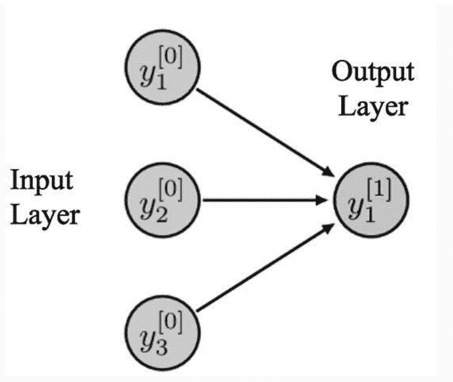
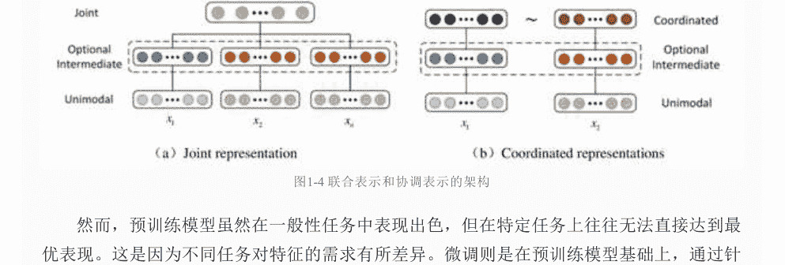
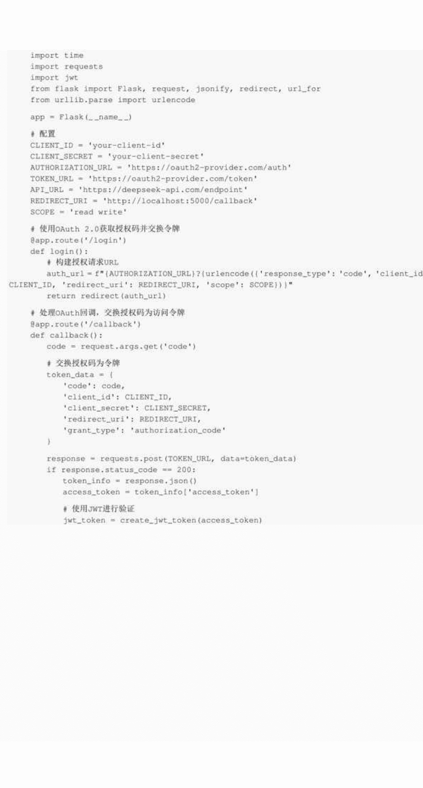
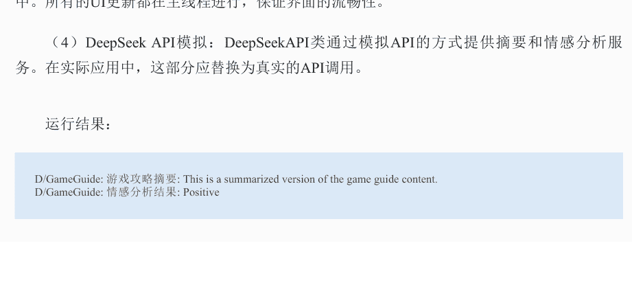

# DeepSeek 移动端开发实战：Android 与 iOS 集成手册

# 内容简介

本书全面拆解 DeepSeek 平台的底层架构、接口调用方式以及工程实践要点，帮助读者在 Android 与 iOS 两大移动端快速完成 DeepSeek API 接入，构建贴合用户场景的智能化产品。全书共十章。1 至 3 章集中讲解大模型通用知识、DeepSeek 架构原理与接口规范。4、5 章深入 Android 端的落地实践，涉及网络交互、异步任务、本地存储与缓存策略、SDK 集成、任务调度、数据传输、应用监控与性能调优，并以大量示例演示具体实现。6、7 章聚焦 iOS 端集成，围绕请求处理、对话会话、缓存优化等展开，支持智能客服、资讯推荐等功能上线。8、9 章面向企业级场景，介绍中间件设计与外部服务对接，涵盖消息队列、API 网关、分布式缓存，以及身份认证、支付通道、对象存储等服务整合。10 章展示基于 DeepSeek 构建智能金融分析、游戏攻略助手等插件的实战路径，覆盖需求拆解、编码实现、测试验证、发布上线以及持续集成、版本管理、性能监控等运维环节。

本书适合具备一定编程经验的开发者、工程人员及系统架构师阅读，尤其适合关注大模型应用与 API 融合的专业人群。

# 作者简介

**温智凯** /博士

长期从事人工智能与机器学习研发工作，聚焦智能算法与深度学习模型的科研与工程化落地。现任职于某科技公司，负责 AI 大模型研发与部署。持续投入强化学习与深度学习创新应用，在多智能体系统、自然语言处理、自动化决策等方向积累丰富经验。

# 前言

DeepSeek 以强大的自然语言理解与推理能力在 AI 领域备受关注，其开放的 API 生态让开发者能够在 Android、iOS 主流移动平台上便捷搭建体验优良的智能应用，满足多元场景的个性化需求。

本书期望搭建一座桥梁，引导开发者系统掌握移动端对 DeepSeek API 的高效集成方法，从基础的接口调用与数据传输起步，逐步推进到插件设计与正式发布，将平台能力与真实业务场景紧密结合，提供从理论到落地的完整参考。通过系统学习，读者能够熟练实现智能客服、新闻推荐、游戏攻略助手等实用功能，提升产品体验与市场竞争力。

内容概览

全书分十章，概要如下：

第1～3章：围绕大模型基础概念、DeepSeek 架构及 API 接口展开。第1章阐述大模型原理，包含机器学习与深度学习基础、语言模型、深度推理技术、模型训练与评估等；第2章解析 DeepSeek 的分布式架构、训练部署流程、数据处理管线、接口设计、监控与优化等；第3章说明 API 集成开发，涉及基本原则、接口总览、集成方案、多轮对话处理及自定义功能扩展，为后续开发奠定基础。

第4、5章：聚焦 Android 应用开发及 DeepSeek 集成实操。第4章从开发环境与整体架构切入，详解网络通信、接口接入、数据存储等核心技术，并深入讲解 DeepSeek API 与 Android 后端的协同细节，如身份校验、会话管理、接口优化，同时探讨应用性能优化策略。第5章以案例形式展示 SDK 配置、数据传输与接口调用、多轮对话支持、深度学习任务异步执行，以及监控与调优实践，确保应用稳定流畅。

第6、7章：深入 iOS 开发实践，重点讲解高效集成 DeepSeek API 的方法。通过请求处理、会话管理、缓存优化等技术的学习，助力开发者打造智能客服、新闻推荐等插件，提升响应速度与稳定性。

第8、9章：面向企业项目，讲解中间件构建与第三方服务融合。第8章介绍借助中间件架构对接 DeepSeek 平台的方法，涉及消息队列、API 网关、分布式缓存等。第9章探讨与第三方服务如身份认证、支付网关、云存储的对接，体现 DeepSeek 在多场景下的灵活性与扩展能力。

第10章：聚焦应用插件开发与发布，演示如何基于 DeepSeek 构建智能金融、资讯摘要等插件，覆盖需求分析、开发实现、测试验证、发布流程，以及持续集成、版本控制、性能监控等运维管理技术。

# 本书特色

**理论结合实践**：既对 DeepSeek 架构与 API 集成核心技术作深入阐述，又通过丰富案例帮助开发者将抽象知识转化为可落地的工程方案。

**全链路覆盖**：从接口接入到插件开发，再到上线运维，本书提供开发到发布的完整指导，确保各环节均有专业支撑。

**双平台兼容**：同时覆盖 Android 与 iOS，针对不同环境给出高效接入 DeepSeek API 的方案，满足多样化需求。

**企业级视角**：深入剖析中间件开发与第三方服务集成，为企业项目提供经验与技术参考。

# 读者对象

本书面向具备一定编程基础的研发人员与架构师，特别适合关注大模型应用及 API 集成的专业人士阅读使用。

最后，愿本书能为读者在 AI 驱动时代打开更广阔的职业空间，推动技术进步与行业发展。

# 源码下载

本书提供配套资料，读者可通过微信扫描下方二维码获取。


如在学习过程中遇到问题，可发送邮件至 booksaga@126.com，邮件主题请写“DeepSeek移动端AI应用开发：基于Android与iOS”。

著者

2025年2月

# 第1章

### 大模型基本原理

本章系统介绍大模型的核心原理，涵盖深度学习、自然语言处理与神经网络的典型结构，说明模型如何凭借海量数据训练、参数调整与优化算法实现智能推理与数据分析，为后续应用开发提供理论支撑，并帮助理解 DeepSeek 架构与接口调用的底层逻辑。

#### 1.1 机器学习与深度学习基础

机器学习与深度学习是当代人工智能的技术基石。机器学习通过数据训练模型，使计算机具备从经验中总结规律的能力；深度学习作为其进阶分支，借助多层神经网络从复杂数据中自动抽取特征并作出决策。本节介绍两者的基本概念、算法思想及典型应用，为理解大模型的训练与推理提供基础。

##### 1.1.1 神经网络架构

神经网络结构是深度学习模型的基础，其思想源于对生物神经系统的模拟。网络由多个神经元节点构成，按输入层、隐藏层、输出层的层次排列，通过连接形成整体网络，如图 1-1 所示。输入层接收外部数据，隐藏层经激活函数处理后传递结果，输出层给出最终预测或决策。

神经元之间通过权重与偏置关联。权重反映连接强度，偏置用于调节激活阈值，帮助模型更好拟合数据。每个神经元的输出为输入加权和经激活函数处理后的结果。常用激活函数包括 ReLU、Sigmoid、Tanh 等，它们引入非线性，使网络能够处理复杂任务。

简单神经网络示意图见图 1-2，仅含输入层与输出层。输入节点接收特征值记作 y[0]，通过加权连接至输出节点 y[1]，生成最终输出。




其核心在于输入值经权重加权后向后传播，并在输出节点处应用激活函数引入非线性，得到 y[1]。该基础结构可通过反向传播等技术调整权重以降低预测误差。

训练过程依赖反向传播算法优化权重与偏置。网络比较预测值与真实标签的误差，计算梯度并逐步修正参数，使误差最小化。随着样本积累，网络逐步学会输入与输出间的复杂映射。

常见激活函数如图 1-3 所示，共展示 5 种。Heaviside 为阶跃函数，输出 0 或 1，多用于二分类。Sigmoid 输出范围 0 到 1，适于概率建模但易出现梯度消失。Tanh 输出范围 -1 到 1，更具中心化特性，缓解部分梯度消失。ReLU 计算高效，负值输出 0，正值线性输出，但可能导致神经元失效。Leaky ReLU 为负值引入微小斜率，改善死神经元问题，使训练更稳定。


网络层数增加通常意味着更强的表达能力。深度神经网络可捕捉高层次特征表示，在复杂任务上表现更佳。例如图像识别中，低层可学习边缘纹理，高层可抽象形状物体。深度学习的优势在于多层次特征自动提取，减少人工干预。

尽管深度网络成效显著，训练仍面临梯度消失、过拟合等挑战。为此提出正则化、批归一化、残差网络等优化手段，提升稳定性与泛化能力。

##### 1.1.2 自监督学习

自监督学习属于无监督学习的一种，通过挖掘数据内部结构实现预训练，无需人工标注。与依赖大量标注数据的监督学习不同，自监督学习设计特定任务让模型从未标注输入中自主学习特征，降低标注成本并充分利用海量数据。

典型做法是对输入进行预处理或生成伪标签，模型学习恢复或预测原始信息。在自然语言处理中，词嵌入训练的填空任务即属此类，模型需推测被遮蔽词。在计算机视觉中，旋转预测或遮挡恢复任务帮助模型捕捉空间结构。

自监督学习的本质是通过合理任务设计迫使模型学习通用特征表示，随后可迁移至下游监督任务，提升整体性能。相较监督学习，其灵活性和泛化能力更强，尤其在数据稀缺或标注困难时优势明显。

该方法适用于文本、图像、音频等多模态数据。随着深度学习进展，BERT、GPT 等大规模预训练模型均在自监督框架下训练，进一步验证了其价值。

自监督学习亦存在挑战。如何设计有效预训练任务仍是研究热点，且计算开销较大，需要强算力支持。尽管如此，随着算法与硬件进步，其在大规模预训练与迁移学习中的应用前景广阔。

##### 1.1.3 深度学习优化算法

优化算法决定神经网络训练效率与收敛质量，其目标是通过调整权重与偏置最小化损失函数，提升预测精度与泛化能力。核心方法基于梯度下降，通过计算损失对参数的梯度指导更新方向与步长。

经典梯度下降面临局部最优、鞍点、梯度消失等难题。为此衍生多种改进算法，常见有随机梯度下降 SGD、动量法、AdaGrad、RMSProp、Adam 等。

SGD 以单样本或小批量计算梯度更新参数，效率高但波动大，收敛较慢。动量法引入历史梯度累积，使更新兼顾当前与过往方向，加速收敛并抑制震荡。

AdaGrad 根据各参数梯度历史动态调整学习率，对频繁更新参数使用较小步长，对稀疏参数使用较大步长。后期学习率衰减过快可能导致优化停滞。

RMSProp 在 AdaGrad 基础上采用指数衰减平均，平滑学习率衰减，避免过早下降，保持后期有效更新。

Adam 融合动量法与 RMSProp 优点，自适应调整各参数学习率，同时利用梯度一阶矩与二阶矩估计优化更新。因高效与鲁棒性，成为深度学习常用优化器。

实际应用中，优化算法选择与超参数调优仍具挑战性。不同模型与任务对优化器要求各异，合理搭配可有效避免欠拟合与过拟合，提升训练效果。

#### 1.2 大模型的定义与发展

大模型指以海量数据与庞大参数规模训练的人工智能系统，通常具备强学习与推理能力。随着算力提升与算法创新，大模型在语言理解、图像生成等领域展现卓越表现。本节探讨大模型的定义、发展历程及其在 AI 前沿中的推动作用。

##### 1.2.1 模型规模与参数数量

模型规模与参数数量是衡量深度学习模型复杂度与学习能力的重要维度。规模指网络层数、每层单元数及连接数，参数数量指需学习的可调参数总量，包括权重与偏置。规模扩大带来参数激增，使模型能在更高维特征空间学习，提升表征与泛化能力。

参数数量直接影响拟合理论能力。大规模网络具备更广的搜索空间，能拟合复杂数据模式。数据量增长时，庞大参数空间有助于捕捉细节与隐含规律。但参数增多也带来计算与内存开销，需更高效硬件与优化策略。

理论上，参数空间越大表示能力越强，但也易引发过拟合，即在训练集表现优异而在新数据上失效。模型可能学习噪声与细节，泛化受损。为平衡复杂度与泛化，常采用正则化、早停、交叉验证等手段。

近年来 GPT、BERT 等大规模预训练模型的成功表明，先在大规模语料上预训练再针对任务微调是有效路径。这些模型学习通用特征表示，在多种下游任务中表现优异。因此，规模与参数增长不仅提升计算能力，更增强对复杂任务的适应与推理能力。

模型规模指数级增长的同时，算力消耗与训练时长也成为瓶颈。如何在保证性能的前提下控制成本，仍是重要研究方向。

##### 1.2.2 预训练与微调

预训练与微调是当前深度学习取得优异性能的关键范式。预训练在大规模无标记数据上进行，让模型学习通用特征表示。该过程加速收敛，增强泛化能力，为后续任务提供基础。

如图 1-4 所示，展示了两种表示学习思路：联合表示与协调表示。在预训练与微调语境下，联合表示 a 将多模态输入通过统一网络生成全局表示，融合不同模态信息，提升多模态任务适应性。协调表示 b 则对各模态输入分别处理，生成独立特征表示后通过协调机制融合，保持模态独立性同时避免信息过度混杂。两种设计体现了架构选择对预训练与微调效率及模型表现的影响。



预训练的核心价值，在于先用海量数据把通用特征练出来。这些特征跨任务通用，能在不同场景里直接派上用场。像 BERT、GPT 这类模型，都是在巨量文本中浸泡，学会了语法框架和语义逻辑，所以迁移到多种自然语言处理任务时都能快速进入状态。

但通用并不等于最优，特定任务的特征需求差异很大。微调就是在预训练模型上做二次打磨，用少量标注数据、更低的算力成本，把参数朝着目标任务的方向精细化。它的本质是低学习率下的精调，避免把预训练阶段积累的通用知识撞坏，同时也常会对任务特化的层做专门优化。

微调整体可看作精细学习阶段，应用范围很广，从文本生成、分类、翻译到计算机视觉、语音识别都在用。预训练加微调的组合，既让模型在大规模数据上获得先验知识，又让它能灵活适配具体需求，降低了对标注数据的依赖，也提升了实际部署时的表现和稳定性。

##### 1.2.3 多模态学习
多模态学习是把图像、文本、语音、视频等不同类型的信息揉在一起，让模型学到更全面、更丰富的表征。与只处理单一模态的传统方法不同，多模态的目的是让系统能理解并整合异构数据，从而应对更复杂的现实任务。

融合是关键难点。不同模态活在不同的特征空间里，直接拼接很难挖出深层关联。常用的做法有三种思路：早期融合在输入端就把多模态数据混在一起；中期融合在网络中间某层做联合表征；晚期融合则先各自处理再把结果合并。

如图 1-5 所示，两种翻译思路形成鲜明对比。基于例子的翻译依赖一个现成的词典库，通过查表完成源语到目标语的映射，它不做模型学习，效果完全受限于库里例子的丰富度。生成式翻译则先训练一个翻译模型，让它学会源语到目标语的转换规则，可以生成从未见过的译文，泛化与灵活性明显更强。


建立模态间的有效关联是另一大问题。常见做法是构建共享表示空间，把不同模态映射到同一个语义空间里，比如让图像中的物体和描述它的文字落在相近的嵌入位置。如此一来，模型就能跨模态检索、推理和预测。

随着深度学习的成熟，神经网络主导了多模态研究。卷积神经网络和循环神经网络常用来分别抽取图像和文本特征，注意力机制则被广泛用以加权不同模态的信息，从而提升融合质量。借助这些技术，模型能自主学习模态间的内在关系，在多模态任务上取得更好效果。

典型场景包括图像描述生成，需要同时看懂画面并组织语言；情感分析可能要同时读文本、听语音音调、看面部表情。多模态学习让模型更鲁棒、更具表现力，也更适合复杂环境下的精准判断。

#### 1.3 语言模型
语言模型是自然语言处理的基石，通过大量文本学习语言的结构与规律，实现理解和生成。预训练浪潮到来后，语言模型在多轮对话、文本生成、情感分析等任务上的能力大幅跃升。

下面将梳理语言模型的基本原理、演进脉络以及核心应用，为后续理解 DeepSeek 等语言模型架构打下基础。

##### 1.3.1 GPT 与 BERT 对比
GPT 与 BERT 都是基于 Transformer 的预训练代表，设计思路与目标却大不相同。GPT 是自回归生成模型，BERT 是双向编码模型，使用场景因此各有侧重。

GPT 的核心是自回归生成，按从左到右的顺序预测下一个词的概率分布。这种单向训练让它在文本生成、对话续写、文章创作等需要顺序输出的任务上表现突出，但只能利用前文，难以充分捕捉双向上下文。

BERT 则采用双向训练，通过掩蔽语言模型任务随机遮住输入中的部分词，强制模型利用左右两侧信息一起预测被遮词。这样学到的表征更能反映整体语义，在文本分类、问答、命名实体识别等理解类任务上优势明显。

应用上，GPT 更偏重生成，BERT 更偏重理解。微调方式也有区别：GPT 通常直接针对生成目标调整参数；BERT 则更多是在保留预训练编码器的基础上替换输出层，配合少量任务标签进行微调。两者互补，共同推动了 NLP 的发展。

##### 1.3.2 Transformer 架构
Transformer 以自注意力机制为核心，提出于《Attention is All You Need》，迅速成为 NLP 与计算机视觉的主流骨架。与 RNN、LSTM 的串行处理不同，它靠并行计算捕捉序列内元素的全局依赖，大幅提升长序列的处理效率。

自注意力的思想是让每个位置的向量与序列中其他向量计算相似度，得到加权后的全局上下文表示，进而动态调整信息流动。位置编码的引入则弥补了并行结构对顺序感知的缺失。

模型由编码器与解码器堆叠而成。编码器从输入提取上下文敏感的特征，解码器据此生成目标序列。每层都包含多头自注意力和前馈神经网络，并配合层归一化与残差连接保持信息稳定。

如图 1-6 所示，输入先经嵌入与位置编码，编码器层逐级提炼表征，解码器层在掩蔽自注意力的约束下生成输出，最终经线性层和 Softmax 变成概率分布。层归一化和残差连接帮助加速收敛，避免梯度消失或爆炸。Transformer 的并行性和强上下文建模能力催生了 BERT、GPT、T5 等众多变体。

##### 1.3.3 自回归与自编码模型
自回归与自编码是两类重要的生成建模范式。它们在建模逻辑上截然不同，却常被结合使用。

自回归模型基于历史信息逐步预测下一个元素，以条件概率形式训练。GPT 系列即其典型，生成时把上一步的输出作为下一步的输入，保持上下文连贯。但逐步生成限制了并行化，误差也可能在长序列中累积。

自编码模型则追求对输入的有效压缩与重建。编码器把数据映射到低维潜在空间，解码器再从中还原输入，目标是最小化重建误差。变分自编码器等在此基础上引入随机性，能生成新样本，并在无监督特征提取、降噪等任务中发挥作用。

如图 1-7 所示，Transformer 的缩放点积注意力和多头注意力是其核心。缩放点积注意力用 Query、Key、Value 计算注意力权重，多头机制则在多个子空间并行捕捉不同关系。自回归模型借助先前输出逐步生成，自编码模型则聚焦编码解码的重建。

近年来，像 BERT 这样的模型融合了两种思想，既利用双向编码的全局理解，又在下游生成任务中发挥作用，为更复杂的生成与理解提供了基础。

#### 1.4 深度推理技术
深度推理技术指用深度网络对复杂数据进行多维度分析并做出决策，广泛用于自动化推理、智能推荐与语义理解。核心是通过多层网络挖掘模式规律，为 AI 系统提供智能决策支持。

如图 1-8 所示，基于深度推理的训练与优化流程常结合强化学习与人类反馈。先从大量提示数据集中采样，输入初始语言模型生成文本，形成初步样本。

> 下一步：从大量提示数据集（Prompts Dataset）中采样至初始语言模型（Initial Language Model）生成文本，形成的初步样本。

随后人工对生成结果打分排序，收集高质量样本与评分对，用于训练奖励模型或偏好模型。奖励模型学习文本与质量的映射，再通过强化学习不断优化语言生成模型，使其最大化奖励值，生成内容更符合人类偏好。该范式常用于自动写作、文本摘要与对话系统。

图神经网络是一类处理图结构数据的深度模型，通过节点与边之间的信息传播挖掘复杂关系。它可用于节点分类、图分类、链路预测等。

如图 1-9 所示，GNN 在不同粒度上工作：节点级别更新节点特征，边级别关注关系对信息流动的影响，子图级别捕捉局部结构，图级别刻画整体特性。

> 图 1-9 图神经网络在不同层次上的处理方式图。

GNN 的基础是消息传递机制，每个节点聚合邻居信息后更新自身表示，聚合函数汇总邻居贡献，更新函数据此刷新节点表征。这种逐层传播让模型能学习到从局部到全局的结构化表示，适用于社交网络、推荐、分子结构等非欧几里得数据。

图编码与解码流程

如图 1-10 所示，一种基于图网络的图数据编解码方式被呈现。起初编码侧把目标节点 n 的自身属性以及邻接关系映射到潜在向量 Zn。编码过程逐层传递信息，由邻居收集特征，将个体表征与局部拓扑融合，形成捕捉局部模式的隐状态。随后解码侧以 Zn 为依据恢复图结构，输出节点 n 的重建结果。重建误差作为重构损失，用于衡量还原精度并指导训练。

编解码协同能够同时学习节点属性和边联系，可完成压缩、还原和表征学习，在嵌入、生成、表示等任务上效果突出。

网络的表达随层数增长。每层节点向邻居发送消息并聚合更新自身表征。信息层层扩散使模型把握高阶关联，能够处理拓扑复杂的图。深度堆叠赋予模型类似深度学习的表达能力，在多种图任务上保持稳定。

典型变体有 GCN、GAT、GAE。GCN 以卷积方式汇总邻域信息；GAT 引入自注意力，为不同邻居分配差别权重，使信息流动更精细；GAE 融合自编码思想，先编码再解码以学习节点隐嵌入。

图 1-11 展示以图网络为核心的多任务学习框架，说明如何利用不同图结构数据构建与优化模型。输入图进入网络后逐层刷新节点特征。框架引入残差连接以缓解梯度消失，训练时使用 Drop-Out、最大池化、ReLU 等操作增强稳健性并抑制过拟合。

> 图 1-11 基于图神经网络的多任务学习框架图。

图中还按任务类型配置不同损失，例如无监督、半监督、自监督。这些范式指导网络学习图嵌入，特别是在标注稀缺时借助结构信息。最终模型按节点分类、图分类等具体任务完成嵌入并输出。

图网络契合图数据的天然形态，对局部邻域和整体结构感知强。应用范围涵盖社交网络分析、推荐系统、蛋白质结构预测、交通流量预测等。模型可处理节点间复杂依赖，高效挖掘图隐结构，为实践提供支撑。

## 1.4.2 逻辑推理与自动化推理

逻辑推理和自动化推理是人工智能和计算机科学的基础技术，广泛用于知识表征、智能决策、自然语言理解等。逻辑推理通过已知事实和规则推导出新知识，是认知推理的根基，涉及命题逻辑、谓词逻辑等形式体系，遵循严格推导规则。传统逻辑推理确定性强，依据符号规则从前提得到结论，可解释性与准确性较高。

自动化推理把推理过程交由机器，让计算机按知识库自动推导。与手工推理不同，自动化系统可处理海量复杂知识，无需人工干预。核心是知识表征和推理机制的结合，把现实知识符号化，再由推理引擎按规则自动推导。

推理引擎常采用递归、搜索、归纳、演绎等策略探索解空间。归纳由实例总结规律，演绎由通用规则推出具体结论。常见做法有基于规则的推理、基于模型的推理和基于搜索的推理。基于规则依赖预定义逻辑规则生成结论；基于模型借助数学模型与定理证明推导。

主要挑战是处理知识的不确定性和模糊性。现实知识往往不完整、不确定，传统逻辑要求完备精确。因此现代系统常融合模糊逻辑、概率论、贝叶斯网络等手段应对不确定信息，使推理在更复杂动态环境中可用。

应用范围广，涉及智能推理、自动化决策、专家系统、自然语言理解等。通过高效推理算法，自动化推理可支持知识自动生成与决策支持。深度学习、图神经网络等技术的引入进一步增强推理能力，在智能搜索、问答系统、推理引擎等场景中潜力大。

## 1.4.3 基于推理的大模型应用

基于推理的大模型应用是近年 AI 的重要方向，融合超大深度模型与推理技术，活跃在智能问答、推荐系统、自动化决策、知识图谱等领域。推理不是简单查表，而是通过复杂推断产生深度上下文理解，为用户提供智能决策支持。

推理能力已不止于传统符号逻辑，还包括常识推理、因果推理等抽象形态。这类推理需要深度训练与多层次知识表征支撑。大模型如 GPT、BERT 不仅是生成器，其强大的上下文理解与语言生成能力为推理任务提供新水平。

在推理系统中，大模型的优势在于处理复杂多模态信息与非结构化数据。与传统符号方法不同，基于大模型的推理能动态解析输入、识别潜在关联并做出高质量判断。尤其在自然语言处理中，它能读懂隐含意义、捕捉上下文潜信息，实现语义推理与情感分析等高级任务。

多轮对话、情景感知、自适应推理也体现出独特价值。比如智能问答系统不仅回答事实性问题，还能推断用户意图、挖掘隐藏逻辑关系。把推理与大模型结合可实现跨领域知识迁移，提升特定任务泛化能力。

实际价值体现在处理复杂依赖信息并带来行业效益。医学中，可分析病历推断可能的诊断与治疗方案；金融中，可依据市场数据与历史趋势推测走向，辅助投资规划。随着推理与大模型技术进步，基于推理的大模型将成为未来 AI 发展的关键组成。

#### 1.5 深度学习模型训练与评估

深度学习模型的训练和评估决定性能与可靠性。训练涵盖数据准备、模型设计、优化算法选择和参数调优；评估则依靠各类指标系统检验精度、召回率和泛化能力。通过反复迭代优化，能提升实际应用效果。本节介绍训练流程、常用评估指标及其在不同任务中的应用，为理解 DeepSeek 模型的训练与调优提供技术支撑。

##### 1.5.1 Loss Function and Optimizer

损失函数和优化器是训练的核心。损失函数衡量预测值和真实值的差距，反映模型好坏。常见损失有均方误差、交叉熵损失等，需根据任务选择。回归问题常用均方误差，通过预测和实际差值的平方评估误差；分类问题常用交叉熵，通过预测概率分布和真实标签的差异评估准确性，理论基础扎实。

优化器借助反向传播根据损失结果更新参数，目标是使损失最小化。选择直接影响训练速度和最终性能。常见优化器有梯度下降法、随机梯度下降法 SGD、动量法 Momentum，以及自适应方法如 Adam、AdaGrad。

梯度下降依据损失对参数的梯度沿负方向调整，逐步逼近最小值。随机梯度下降每次只用一个或少量样本计算梯度，减少计算并加速收敛。动量法在梯度下降基础上加入历史梯度信息，增强方向性，有助于跳出局部最优。

自适应方法如 Adam 融合动量和 RMSProp 优点，能自适应调整每个参数学习率，解决传统方法学习率过大或过小导致不稳定问题。Adam 维护梯度一阶矩和二阶矩估计，实现参数自适应学习率，提升稳定性和收敛速度。

损失函数和优化器的搭配不仅影响训练效果，还决定泛化能力和实际表现。设计时需结合问题性质和数据集特点合理选择，以兼顾训练效率和精度鲁棒性。

##### 1.5.2 模型过拟合与正则化

过拟合是训练中常见难题，指模型在训练集上表现优异，却在未见数据上大幅下降。通常源于模型过于复杂，过度学习训练数据的噪声和无关特征，而非真正规律。泛化能力差，难以应对现实变化，浪费计算资源。

出现与参数数量和数据规模密切相关。参数过多时模型可拟合偶然模式，降低训练误差却不反映数据本质。尤其数据不足或含噪声时，模型易把噪声当信号，导致过拟合，实际应用中问题更明显。

正则化是常用对策。通过在损失中加入复杂度惩罚项，限制过度拟合。L1 正则化对参数绝对值求和施加惩罚，可使不重要特征的参数归零，实现特征选择。L2 正则化对参数平方和施加惩罚，抑制参数过大，避免过度依赖某些特征，让权重分布更平滑，提升泛化。

除此之外，Dropout 也是典型手段。训练时随机丢弃部分神经元，让模型每次使用子网络，防止过度依赖特定特征，提升鲁棒性和泛化，在大规模神经网络中效果显著。

合理使用正则化可降低过拟合风险，提升泛化和鲁棒性。实践中可根据问题特征选择方法，并结合早停等策略优化训练，保持训练集和新数据间的平衡。

##### 1.5.3 性能评估指标

性能评估指标是衡量模型有效性和泛化能力的关键。通过合理指标可直观了解不同任务的表现并指导优化。指标选择依赖任务类型，如分类、回归、序列生成等。

分类任务常用精度 Accuracy、精确率 Precision、召回率 Recall、F1-score。精度是正确预测样本占总样本比例，但在类别不平衡时不足以说明问题。精确率关注预测为正类中真正为正的比例；召回率关注实际正类中被正确找出的比例。F1 是两者的调和平均，能平衡二者，适合类别不均衡场景。

回归任务常用均方误差 MSE 和平均绝对误差 MAE。MSE 对较大误差惩罚更强，但对异常值敏感。MAE 是绝对误差平均，更直观，对异常值不敏感。R² 决定系数衡量模型解释数据变异的能力，越接近 1 拟合越好。

序列生成常用困惑度 Perplexity，反映模型对文本序列的预测能力，是语言模型性能量化指标，数值越低预测越准确。

随着多任务和多模态学习兴起，评估更复杂。加权平均、多模态相似度度量等需按场景定制。合理选择和组合指标能全面评估能力，反馈优化模型结构和训练策略，保证实际应用稳定可靠。

#### 1.6 本章小结

本章从机器学习和深度学习基础出发，逐步深入神经网络架构、自监督学习、深度推理等核心内容。重点讲解了训练和评估环节中损失函数、优化器、过拟合和正则化的作用。对语言模型、Transformer 架构、自回归和自编码模型进行了剖析，展示大模型在多任务和多模态学习中的潜力。通过系统阐述理论框架，帮助读者理解大模型基础和实际 AI 应用的重要性，为后续学习奠定基础。

#### 1.7 思考题

1）请系统说明典型神经网络的输入层、隐藏层、输出层构成，阐述各层功能及训练时的协同方式，并讨论 ReLU、Sigmoid、Tanh 等激活函数在不同层的使用及其对性能的影响。
2）自监督学习通过数据自身生成标签。请列举自然语言处理和计算机视觉中至少三种自监督应用，分析优缺点，并说明其和传统监督学习的核心差异。
3）介绍 Transformer 架构中的自注意力机制，解释其相对于 RNN 和 LSTM 的优势，并说明如何借助自注意力实现序列建模的并行计算。
4）比较 GPT 和 BERT 在语言模型训练上的区别，描述各自的典型使用场景，并基于特点说明如何为应用选择模型及进行预训练与微调。
5）说明推理模型在大规模数据处理中的重要性，分析基于图神经网络的推理模型和传统深度学习模型的主要差异及其优势局限。
6）列举并简述 SGD、Adam、RMSprop 等三种优化算法，分析它们在不同任务及大规模训练中的适用性与对收敛速度的影响。
7）解释过拟合概念，说明 L1 和 L2 正则化减少过拟合的具体机理，并讨论如何根据实际情况选择正则化方法并在开发中落地。
8）多模态学习融合图像、文本、音频等数据时面临哪些技术挑战？结合实例分析实际应用场景，并讨论数据融合与特征对齐的解决思路。
9）在计算资源受限时，如何实现大规模语言模型的高效预训练与微调？描述流程并解释两者关系及其对最终效果的影响。
10）解释损失函数在深度学习中的作用，列举交叉熵、均方误差、对比损失等三种常见损失，说明如何根据分类、回归等任务选择损失并通过调整优化性能。

# 第2章 DeepSeek架构解析

本章深入解析 DeepSeek 的架构，全面呈现其核心构成与运行原理。通过结构化分析揭示其如何高效实现大模型的训练与推理。内容涵盖 API 接口、数据流转、模型管理等技术框架，帮助读者理解 DeepSeek 在移动端 AI 应用中的潜力与优势，为开发实践提供理论支撑。

### 2.1 DeepSeek的分布式架构

本节聚焦 DeepSeek 的分布式架构，重点分析其在高规模计算和数据处理中的高效性与可靠性。通过架构剖析展示 DeepSeek 如何借助分布式计算资源实现模型训练与推理的负载均衡、任务调度和数据存储。架构的灵活性与可扩展性使其能在多种场景下提供强劲性能。

#### 2.1.1 多节点集群

多节点集群是分布式计算系统的核心，用于提升计算能力与可靠性。集群内各节点通过高速网络互联，形成协同计算环境，每个节点既承担计算也承担存储，可并行处理复杂任务。借助合理任务分配和调度机制，集群能协同完成大规模数据处理、模型训练与推理。

在集群中，节点通过分布式文件系统共享数据和资源，并利用分布式计算框架拆分任务，通常配合负载均衡避免单点过载。各节点的规模与配置可按需灵活扩展，实现线性扩展。

集群采用 MapReduce、Spark 等分布式计算框架并行执行任务，把大任务切分为子任务分发给不同节点。节点间通过消息传递或 RPC 协同工作。任务调度系统如 Kubernetes、Apache Mesos 负责协调资源，保证计算资源最优利用。

# DeepSeek 架构全景：从存储到部署的底层逻辑

在数据层，DeepSeek 背靠分布式存储方案，比如 HDFS、Ceph 这类系统来保障数据的高可靠与容错。集群一旦有节点掉线，计算任务会自动漂移至存活节点，业务不会中断。配合多副本和备份机制，即便遇到硬件故障，数据完整性与访问效率依然可控。正是多节点协同的存储计算一体设计，让 DeepSeek 在海量 AI 任务中实现高效处理，训练与推理的稳定性与吞吐量同步提升。

#### 2.1.2 高可用性与负载均衡
高可用和负载均衡是分布式架构的两大基石，目标是让系统在高并发、突发流量或节点宕机时仍能稳定对外服务。高可用指在硬件损坏、网络抖动等异常下服务不中断。常见做法是冗余部署，通过多副本、多实例或跨数据中心部署来消除单点风险，故障节点流量自动切到健康节点。

负载均衡则是把请求和计算任务智能分发，避免热点过载。通常由均衡器承担，依据轮询、加权、最小连接等策略动态把流量送到后端节点，实现负载趋平，既提速也降压。实际架构里常加入健康检查，实时评估节点性能与响应，一旦超时或异常就将其踢出均衡池。配合自动故障转移，实例宕机时系统立刻切换到备用实例，保证服务连续。

这套组合拳让 DeepSeek 在大体量数据处理、复杂计算和高并发场景下保持稳定高效，也是其在移动端 AI 应用中持续提供高质量服务的技术底座。

#### 2.1.3 容器化与微服务架构
容器化与微服务是现代分布式系统提升灵活性和可维护性的主流范式。容器技术把应用及其依赖打包成轻量隔离的运行单元，摆脱传统虚拟化的资源浪费与环境差异问题。容器运行在 Docker、Kubernetes 等引擎上，可实现生命周期管理、弹性扩缩容、调度与故障自愈。

微服务则把单体应用拆成多个小而独立的服务单元，每个单元可单独部署、扩缩、迭代，通过 RESTful API 或消息队列轻量交互。围绕单一业务能力构建，响应需求更快，在可维护性、可扩展性和容错性上优于单体架构，尤其适合大规模并发与快速迭代。

DeepSeek 平台借助 Kubernetes 管理容器化微服务，实现自动化部署与弹性调度。容器保证服务隔离与安全，微服务的松耦合带来更高的扩展弹性。整体架构既满足复杂 AI 任务的需求，也提升了稳定性和可用性，让服务在多设备多环境下高效运行。

### 2.2 DeepSeek模型训练与部署
本部分聚焦 DeepSeek 的训练与部署链路，解析大规模数据下的训练策略、优化手段与资源适配，以及部署后的高效运行、均衡调度与跨平台兼容。透过这些细节，可看出其如何构建稳定高效的 AI 应用底座，并支撑多样化业务场景。

#### 2.2.1 分布式训练
分布式训练把单次训练拆分到多节点并行执行，用以加速超大规模深度学习模型。单机算力已难满足模型与数据规模的增长，分布式通过集群协同分担计算负担，缩短训练时长并扩大数据处理能力。

主流策略有数据并行与模型并行。数据并行把数据集切分到多节点，每个节点持相同模型副本，训练后通过 AllReduce 等参数同步保证全局一致，适合数据量极大的场景。模型并行则是把模型参数分片到不同节点，每个节点只算自己的分片，适用于单节点显存放不下超大模型的情况，但对网络带宽要求更高。

实践中还面临同步、通信延迟、负载不均、容错等挑战。TensorFlow、PyTorch、Horovod 等框架提供同步或异步更新方案，辅以模型压缩、梯度裁剪、量化等手段降低通信开销。分布式训练是支撑 DeepSeek 大规模模型高效训练的关键能力。

#### 2.2.2 异构计算资源
异构计算指 CPU、GPU、FPGA、ASIC 等不同硬件协同工作，以发挥各自优势。单一计算平台已无法兼顾深度学习对性能的多元需求，混合算力成为提升训练与推理效率的重要路径。

CPU 擅长控制、调度与数据预处理等非计算密集型工作；GPU凭借大规模并行能力成为训练主力，尤其在矩阵与向量运算密集的视觉、语音、NLP 任务中优势明显。FPGA 可编程性强，能按需定制加速逻辑；ASIC 则针对特定任务深度优化，在推理侧常呈现更低延迟与更高吞吐。

异构调度的核心是如何按性能、带宽、内存需求把任务合理分配到不同设备，减少空闲与浪费。跨硬件协同还依赖高效的数据通信，传输延迟与带宽瓶颈是关键制约，提升数据搬运效率、优化内存访问、借助分布式文件系统都能改善性能。DeepSeek 通过合理利用异构算力，加速训练并提升推理响应，满足复杂高并发 AI 需求。

#### 2.2.3 云端部署与边缘计算
云端部署与边缘计算是 AI 落地的两条主线。云端把模型与服务托管在集中式云平台，利用弹性算力与海量存储处理复杂任务与大规模训练，支持自动扩缩容、负载均衡与容错，适合高吞吐场景。

边缘计算则把计算下沉到靠近数据源的设备，减少传输时延与带宽压力，支持实时处理与即时反馈。智能设备、自动驾驶、物联网等场景依赖边缘本地推理，降低对云的依赖并提升可靠性。

二者协同形成完整闭环：云端负责大规模训练与数据整合，边缘负责实时推理与响应。数据在云与边缘间流动，实现低延迟、高可靠的分布式 AI 服务，满足现代智能应用对实时性与灵活性的双重要求。

### 2.3 数据处理与预处理
本节阐释 DeepSeek 在数据处理与预处理的关键技术，涵盖大规模多源数据的清洗、特征构建与质量提升。重点在于如何通过清洗、增强与自动化流程为模型提供高质量输入，尤其在图像、文本等多模态场景下的优化策略，以提升开发效率与模型效果。

数据清洗与增广是模型训练的基础环节。清洗旨在修复错误、补全缺失、剔除异常与重复，去除冗余特征以降低噪声，确保数据一致性。常见手段包括去重、缺失值填充、标准化、异常检测等。增广通过旋转、翻转、缩放、裁剪、颜色变换等生成图像新样本，或通过同义词替换、重排、随机增删词等丰富文本样本，提升模型鲁棒性与泛化能力，缓解过拟合。

在大规模训练中，清洗降低噪声干扰，增广扩展样本多样性，共同减少训练成本。自动化清洗借助机器学习自动识别错误，生成对抗网络等技术可合成更逼真的增广数据，进一步提升复杂场景适应力。

#### 2.3.2 特征工程
特征工程是把原始数据转化为模型可利用的高信息低噪声特征的过程，包含提取、选择与构造。提取从文本、图像等数据中获取词频、TF-IDF、词嵌入或卷积特征；选择通过统计检验、递归消除等方法剔除冗余特征，降低复杂度并防止过拟合；构造通过组合或变换生成新特征，如时间拆分、滞后特征、移动平均等，显著影响模型表现。

类别型数据需独热编码、标签编码等处理；不同量纲特征需归一化或标准化，避免尺度偏差。随数据量与模型复杂度提升，自动特征选择与自动构造等方法逐步落地，成为提升效果的重要工具。

#### 2.3.3 数据同步与并行处理
数据同步确保多节点间数据一致与完整，并行处理则把任务拆分到多计算单元加速执行，二者共同决定大规模系统的效率与扩展性。

同步面临一致性难题，常用两阶段提交、三阶段提交及 Paxos、Raft 等共识算法保证故障恢复时状态统一，避免脏数据与分裂。并行处理依托负载均衡与任务调度，动态分配资源提升利用率。实现形式包括数据并行、任务并行与流水线并行等。

MapReduce、Spark 等技术栈在海量数据上表现成熟，配合云计算与容器化，同步与并行能力在弹性调度下进一步增强，是分布式数据系统实现一致性与高性能的基石。

### 2.4 DeepSeek 的 API 设计
API 是 DeepSeek 与开发者交互的核心通道，本节解析其接口设计原则、调用流程与平台架构的结合方式。重点在于功能模块划分、请求响应机制与数据格式，展现如何在高并发下保持稳定与低延迟，为开发者提供灵活易用的调用方式。

#### 2.4.1 RESTful API 架构
RESTful API 是一种基于 Web 的架构风格，以资源为中心，通过统一的 URI 标识资源，用标准 HTTP 方法 GET、POST、PUT、DELETE 进行操作，并遵循无状态原则，每次请求自带完整上下文。服务器不保存客户端会话状态，服务端与客户端解耦，便于扩展与缓存。规范的资源命名与方法约束，使接口清晰、可预测，易于集成与维护。

REST 设计的核心思想：无记忆、统一交互、易于扩容

REST 风格的接口最被称道的点在于不保留会话记忆。每一次调用都自带足以处理所需的全部上下文，后端不必追溯前次的状态。正是这种去记忆化，让流量可以随意分发到任意节点，天然利于水平扩容和高可用。服务端的职责被限定在接收调用并返回结果，不去维护繁琐的会话状态，整体开销随之下降。

整套机制依托 HTTP，通过统一的动词对资源进行操作。资源以 URL 定位，例如账号、商品等实体，GET、POST、PUT、DELETE 则分别对应读取、创建、修改、删除。以 Flask 为例，可快速搭建一个典型示例。

```python
from flask import Flask, request, jsonify

app = Flask(__name__)

# 模拟数据库
users = [
    {'id': 1, 'name': 'John Doe'},
    {'id': 2, 'name': 'Jane Smith'}
]

# 获取所有用户
@app.route('/users', methods=['GET'])
def get_users():
    return jsonify(users), 200

# 获取单个用户
@app.route('/users/<int:user_id>', methods=['GET'])
def get_user(user_id):
    user = next((u for u in users if u['id'] == user_id), None)
    if user is None:
        return jsonify({'error': 'User not found'}), 404
    return jsonify(user), 200

# 创建新用户
@app.route('/users', methods=['POST'])
def create_user():
    new_user = request.get_json()
    users.append(new_user)
    return jsonify(new_user), 201

# 更新用户信息
@app.route('/users/<int:user_id>', methods=['PUT'])
def update_user(user_id):
    user = next((u for u in users if u['id'] == user_id), None)
    if user is None:
        return jsonify({'error': 'User not found'}), 404
    user_data = request.get_json()
    user.update(user_data)
    return jsonify(user), 200

# 删除用户
@app.route('/users/<int:user_id>', methods=['DELETE'])
def delete_user(user_id):
    global users
    users = [u for u in users if u['id'] != user_id]
    return jsonify({'message': 'User deleted'}), 200

if __name__ == '__main__':
    app.run(debug=True)
```

上述实现共提供 5 条路由，分别对应列出全部账号、查询单个账号、新增账号、修改账号信息、删除账号。每条路径都绑定唯一的 HTTP 动词。

1) GET 用作读取， /users 返回账号列表， /users/<user_id> 返回指定账号的详情。
2) POST 用作新建，调用方把 JSON 载荷发往 /users 即可创建。
3) PUT 用作更新，携带新信息修改指定账号的数据。
4) DELETE 用作移除，指定账号标识即可删除对应条目。

该做法简洁明了，贴合 HTTP 原生设计，易于扩展与维护。服务间交互因此标准化、解耦，也天然支持跨平台调用。

REST 还强调统一接口与高度互通。标准动词让调用方与后端沟通更一致，契约清晰，开发与维护成本下降。资源表示普遍采用 JSON 或 XML 这类结构化格式，JSON 因简洁且与 JavaScript 高度契合，成为事实主流。配合规范命名、正确动词与状态码，能搭建出高效、灵活、易扩展的服务，广泛用于 Web、移动端与微服务场景。

总体而言，REST 通过资源表现、无记忆交互、标准动词与统一接口，简化前后端沟通，提升可伸缩性与可维护性，是现代分布式系统的重要范式。

#### 2.4.2 API 版本控制与兼容性

版次管理与一致性是接口全生命周期保持互通与稳定的关键。技术演进快，接口难免调整，版次机制就是为了避免破坏现有使用者，提供平滑过渡。

核心目标是让各版次在结构、格式与业务逻辑上仍能互通，调用方无需频繁升级即可继续使用旧接口。常见做法有三种：把版号写入 URL 路径，如 /api/v1/resource；通过头部字段传递版号，如 Accept-Version 或 X-API-Version，不改动 URL 更优雅；或用查询串带版号，适合变动不多的场景。

为保障向后一致，设计时应避免对现有功能做破坏性改动，入参与返回格式的调整应谨慎。新功能建议以扩展方式平滑上线，让新旧版共存。

废弃旧版需渐进。官方文档应提前公布废弃计划与替代方案，给出足够退役期，期间以警告提醒调用方迁移，期满后再正式下线。

版次管理与一致性治理是持续演进的基础。通过在路径或头部指定版号，调用方可明确锁定使用的版次，防止后端变化引发错误。示例中 /api/v1/users 与 /api/v2/users 返回同一类信息但字段与格式不同，调用方可自选版次不受影响。

路径版次与头部版次是两大主流，可同时运行多版既保证一致性，也推动迭代。即使升级，旧接口仍需保持有效，避免破坏性变更。合理的策略让接口在保持向后一致的同时，具备更好的可维护性与可扩展性，实现长期健康发展。

```python
from flask import Flask, jsonify

app = Flask(__name__)

##### 版本 1.0 的用户接口
@app.route('/api/v1/users', methods=['GET'])
def get_users_v1():
    users = [{'id': 1, 'name': 'John'}, {'id': 2, 'name': 'Jane'}]
    return jsonify(users), 200

##### 版本 2.0 的用户接口，返回不同格式的数据
@app.route('/api/v2/users', methods=['GET'])
def get_users_v2():
    users = [{'user_id': 1, 'full_name': 'John Doe'}, {'user_id': 2, 'full_name': 'Jane Smith'}]
    return jsonify(users), 200

if __name__ == '__main__':
    app.run(debug=True)
```

#### 2.4.3 安全性与认证

在现代 Web 服务里，接口安全与身份核验是抵御未授权访问与攻击的第一道防线。除了防攻击、防泄露、防篡改，还要保证通信可信，以及对使用者与系统的身份核验与权限分配。

身份核验是基础。常见方式有密码核验、OAuth 2.0、API 密钥与 JWT。密码模式要求用户名密码验证合法性；OAuth 2.0 让使用者不暴露密码即可授权第三方访问资源，支持细粒度权限；API 密钥通过唯一密钥校验调用合法性；JWT 则用签名保证令牌不可篡改，便于核验身份。

权限分配紧随其后。RBAC 基于角色分配权限，每个角色只拥有必要资源访问权；ABAC 更精细，按使用者属性、环境条件等动态决策，实现更灵活的管控。

传输安全离不开加密。TLS 协议为调用方与后端通信提供加密，防止窃听与篡改。敏感返回信息如账号信息、支付信息也建议加密存储，降低泄露风险。

开发中常以 JWT 为例实现核验，在调用方与后端间传递加密使用者信息，确保调用安全。下面是基于 Flask 与 JWT 的简易核验示例。

### 2.5 DeepSeek服务的监控与优化

本节聚焦 DeepSeek 服务在大规模 AI 场景下的持续运行保障。结合观测工具与核心指标，说明如何实时感知平台状态、捕捉异常并快速响应；同时探讨负载均衡、资源调度与性能调优等手段，确保高并发、大数据量下服务稳定、低延迟。

#### 2.5.1 性能监控

在分布式系统里，运行指标追踪是稳定、可扩展和快速响应的基石。通过实时采集和分析各层指标，能及时发现瓶颈、资源浪费和异常行为，为优化提供依据。目标是支撑高并发处理，同时最大化硬件利用率，提升吞吐与反应速度。

观测要紧盯关键指标：反应时长、调用延迟、处理量、失败比例、系统负载、内存占用、CPU 利用率、磁盘 IO、网络带宽等。这些数据共同描绘系统健康度，异常波动可被迅速捕捉。

采集层面，分布式追踪是精细化观测的重要手段。借助 OpenTracing、Jaeger 等工具，可追踪跨服务调用，完整还原调用生命周期，定位延迟来源。每个调用在各节点打标签，关联上下游，便于精确排查。

高并发场景下，采集的实时性与准确性很重要。观测体系通常采用分布式采集与聚合，避免单点故障。存储上，Prometheus、InfluxDB 等时序数据库擅长处理海量时间戳数据，支持历史回溯。

在接口服务中，观测的核心是跟踪运行状态，包括反应时长、负载、内存、失败比例等。以 Flask 配合 psutil 为例，可以在调用前后记录耗时并采集系统资源，形成基础观测。

```python
from flask import Flask, request, jsonify
import psutil
import time

app = Flask(__name__)

##### 获取系统性能信息
def get_system_metrics():
    cpu_percent = psutil.cpu_percent(interval=1)
    memory = psutil.virtual_memory().percent
    return {'cpu': cpu_percent, 'memory': memory}

##### 记录API请求的性能
@app.before_request
def before_request():
    request.start_time = time.time()

@app.after_request
def after_request(response):
    duration = time.time() - request.start_time
    system_metrics = get_system_metrics()
    app.logger.info(f"Request Duration: {duration}s | CPU: {system_metrics['cpu']}% | Memory: {system_metrics['memory']}%%")
    return response

# 示例API
@app.route('/data', methods=['GET'])
def data():
    return jsonify({'message': 'Data fetched successfully'})

if __name__ == '__main__':
    app.run(debug=True)
```

代码利用 psutil 获取 CPU 与内存实时使用，通过 before_request 记录开始时间，after_request 计算耗时并写入日志。这种方式能提供资源使用的即时反馈，帮助快速定位瓶颈，日志也可用于趋势分析和预测，保障长期稳定。

在分析层，观测工具除图表展示外，还应具备智能化能力。异常检测算法可基于历史数据自动发现模式并告警，减少人工介入。长期趋势报告则为容量规划与优化决策提供支撑。

总体而言，运行指标追踪不仅是运维基础，也是容量规划、故障排查和调优的关键手段。精准观测加信息分析，能深入理解系统行为，不断优化资源与体验。

#### 2.5.2 API调用优化

在当下的分布式体系里，API 调用效率几乎决定了整体表现，特别是在并发量高、对时延敏感的场景中作用更为突出。优化的根本目的是削减不必要的资源占用，加快返回速度，提升服务吞吐，同时保持架构可弹性扩展且稳定在线。真正的优化不是单改请求路径，而是把数据传输、服务协作、错误处理等多个层面一起纳入提升范围。

先从降低调用延迟入手。分布式环境下一次 API 往往要穿越多个服务，延迟来自网络传输、处理耗时以及服务端压力。改用更高效的传输协议比如 gRPC 取代传统 RESTful HTTP、用 HTTP/2 减少连接开销、把多次请求合并成批量处理，都能明显缩短网络等待。再配合合理的负载均衡，将流量平滑分摊到各实例，避免单点过载。

数据搬运效率同样关键。序列化方式直接影响请求响应的体积和处理速度。在大流量交换场景下，采用 Protobuf、MessagePack 这类轻量高效的序列化格式，可减少带宽消耗、加快传输。响应的 Gzip 压缩处理也能进一步降低带宽需求，提升整体数据流转效率。

调用频率的控制也是性能提升的重要抓手。频繁调用会带来资源浪费和负载升高。引入缓存可以拦截大量可复用的请求，尤其是结果变化不频繁的数据。常见做法有全局缓存和本地缓存，配合合理的失效时间、版本控制以及条件请求头 ETag、If-Modified-Since，可显著提高命中率，降低重复计算和网络往返。

幂等设计与重试机制关乎高并发下的稳定。重复请求不应产生副作用，幂等保证了即使客户端重复发送也不会造成脏数据和额外计算。结合指数退避的错误重试策略，即使遇到网络抖动或服务瞬时不可用，也能在保证安全的前提下自动恢复，保持系统可靠。

总体来看，API 优化的核心是缩短响应、放大吞吐、减少服务器开销。典型手段包括缓存、去冗余计算、数据压缩、并发处理等。下面以 Flask 加 Redis 缓存为例演示如何在接口中落地缓存优化。

```python
from flask import Flask, jsonify
import redis
import time

app = Flask(__name__)
cache = redis.StrictRedis(host='localhost', port=6379, db=0, decode_responses=True)

##### 模拟数据处理过程
def fetch_data_from_db():
    time.sleep(2)  # 模拟数据库查询延时
    return {'data': 'some expensive data'}

@app.route('/data', methods=['GET'])
def get_data():
    # 尝试从缓存中获取数据
    cached_data = cache.get('data')
    if cached_data:
        return jsonify({'data': cached_data, 'source': 'cache'})

    # 如果缓存中没有数据，则从数据库获取
    data = fetch_data_from_db()
    # 将数据存入缓存，设置过期时间为60秒
    cache.setex('data', 60, data['data'])
    return jsonify({'data': data['data'], 'source': 'db'})

if __name__ == '__main__':
    app.run(debug=True)
```

该示例中，接口收到请求后会先查询 Redis。若缓存命中直接返回，避免重复查库，响应更快。未命中时则从数据库读取并写入缓存供后续使用。通过设定过期时间，可自动清理旧数据防止污染。在查询复杂或数据库压力大的情况下，这种做法对响应效率的提升尤为明显。

综合来看，在不牺牲功能和体验的前提下，通过精细化手段降低时延、减少冗余传输、提升吞吐，是保证分布式系统高效稳定运行的关键。

#### 2.5.3 日志管理与异常监控
在现代分布式架构中，日志与异常监控是保障可靠性和可维护性的两大支柱。日志记录了运行状态、服务交互和用户行为，是追踪健康状况、定位瓶颈、发现隐患的重要依据；异常监控则聚焦实时捕捉异常行为，做到早发现早处置。

日志的高效首先依赖结构化格式和清晰的级别划分。结构化日志以时间戳、级别、请求 ID 等标准字段编码，方便后续自动解析、聚合和分析。DEBUG、INFO、WARN、ERROR 等层级让运维和开发能在海量信息中快速定位关键点。分布式场景下，集中式采集尤为重要。借助 ELK 等日志平台，可把各节点日志统一汇聚，形成跨服务跨机器的全局视图，加快故障排查。

异常监控的核心是实时检测、及时告警和自愈能力。通过阈值监控或机器学习驱动的异常预测，能提前感知瓶颈和故障。Prometheus 与 Grafana 等平台可采集请求延迟、吞吐、错误率等指标，结合告警规则触发通知，实现快速响应。

日志与异常监控共同构成问题闭环。开发中常使用日志记录运行状态、错误信息和用户行为，便于事后追溯。下面给出一个结合 Python logging 的简单示例：

```python
import logging
from flask import Flask, jsonify

app = Flask(__name__)

##### 配置日志记录
logging.basicConfig(filename='app.log', level=logging.INFO, format='%(asctime)s - %(levelname)s - %(message)s')

@app.route('/data', methods=['GET'])
def get_data():
    try:
        # 模拟获取数据
        data = fetch_data()
        logging.info("Data fetched successfully")
        return jsonify(data)
    except Exception as e:
        logging.error(f"Error occurred: {str(e)}")
        return jsonify({'error': 'Internal Server Error'}), 500

def fetch_data():
    # 模拟数据获取逻辑，抛出异常
    raise ValueError("Data not found")

if __name__ == '__main__':
    app.run(debug=True)
```

示例中 /data 接口调用 fetch_data 时若出错，会被捕获并写入 app.log，记录时间戳、级别和消息。日志文件为后续排查和调优提供依据。异常监控则确保出错时及时反馈，避免服务崩溃。

监控范围不应局限于服务端，客户端的崩溃、界面卡顿等也需纳入。借助 OpenTelemetry 等分布式追踪，可把一次请求的全链路异常串联起来，实现更全面的诊断。

为提升自愈能力，监控平台常与自动化运维联动。对轻度异常，系统可自动扩缩容、重启服务、调整负载，减少人工介入，增强稳定性。

总之，日志管理与异常监控需要兼顾高效采集、深度分析与主动预警，才能显著提升系统的可用性、可靠性和自愈能力。

### 2.6 本章小结
本章系统梳理了 DeepSeek 的整体架构与设计思路。先介绍了分布式多节点集群、高可用与负载均衡策略，以及容器化与微服务在系统扩展性上的作用。随后讨论了模型训练与部署，涵盖分布式训练、异构算力协同、云端与边缘计算的结合方式。数据处理部分强调清洗、特征工程及并行处理的重要性。API 设计层面聚焦 RESTful 规范、版本控制、兼容性与安全保障。最后以性能监控与优化收尾，围绕 API 调用优化、日志管理与异常监控展开，为理解与落地 DeepSeek 架构提供了完整的技术脉络。

### 2.7 思考题
（1）在 DeepSeek 的分布式体系中，多节点集群如何支撑高可用？请说明集群配置的关键做法，并阐述负载均衡的价值，举例说明实际中常用的均衡策略及其优缺点。
（2）容器化与微服务是 DeepSeek 大规模部署的基础，请解释两者概念，分析它们如何提升部署灵活性和运维效率，并结合 Docker、Kubernetes 说明落地思路。
（3）分布式训练中数据并行与模型并行如何协同？请描述 DeepSeek 在训练阶段利用分布式框架提升效率、提高资源利用率的具体做法，并给出大规模数据集并行训练的技术要点。
（4）针对深度学习的高算力需求，DeepSeek 采用 GPU、TPU 等异构算力，请讨论异构算力的优势，特别是 GPU 与 TPU 在负载均衡与协同方面的设计思路对训练速度和精度的提升。
（5）云端与边缘计算的结合是提升实时性的关键，请说明边缘如何与云端协同，在降低延迟的同时保障数据完整性和安全，并给出一个典型的边缘计算应用场景。
（10）API 性能优化离不开负载均衡和缓存，请解释两者如何缓解请求压力，避免系统过载。分析轮询、最少连接等常见均衡策略，并提出具体的 API 优化实现方法。

## 第3章 DeepSeek API 开发与集成
本章聚焦 DeepSeek API 的开发与集成实践，旨在帮助构建高效稳定的后端服务。通过对接口设计理念、开发技巧、请求响应机制及数据流转的深入分析，提供从设计到调优与安全保障的完整方法论，无论是入门开发者还是追求性能提升的团队，都能从中获得实用指引。

### 3.1 API 基础与接口设计原则
本节介绍 API 开发的基础知识与设计核心原则。良好的接口设计能提升可维护性和扩展性，促进团队协作。重点在于设计模式、规范化构建、简洁清晰的定义，以及如何保证高可用、可测试和完善的文档支持。

#### 3.1.1 资源导向设计
资源导向设计以资源为核心构建 API，每个端点对应系统中的一个资源，通过唯一 URI 标识，并用 GET、POST、PUT、DELETE 等标准 HTTP 方法进行操作。资源不仅指数据实体，还可涵盖状态、配置或行为。生命周期由 URI 管理，状态变化全部通过标准方法完成。该模式强调一致性和简洁性，提升可预测性，推动 RESTful 风格发展，配合无状态、客户端服务器分离、统一接口等原则，便于扩展维护，实践中通常需结合 API 管理与版本控制。

#### 3.1.2 数据格式与标准化
数据格式与标准化是跨系统交互的基础。JSON 与 XML 是最常见的交换格式，选择直接影响可用性、易用性和可维护性。标准化要求结构一致、传输高效，确保互操作性，降低解析错误。随着云与分布式普及，标准化更关系扩展与兼容性，也要兼顾移动端和多平台解析需求。

下面以 Flask 实现一个天气查询 API 示例，演示如何返回标准化的 JSON 数据。接口接收城市名，查询天气并以统一格式返回，便于跨平台解析。

【例 3-1】基于 Flask 框架的简单 API 示例。展示如何实现一个天气数据查询 API，并返回标准化的 JSON 数据格式。系统将根据城市名查询天气，并返回统一格式的数据。

用 Flask 搭建一个可复用的天气查询服务，并在此基础上讲解异常治理思路，最后给出 DeepSeek API 的整体能力地图。下面把这些实战要点重新梳理一遍。

```python
from flask import Flask, jsonify, request
import requests

##### 创建Flask应用
app = Flask(__name__)

##### 模拟的天气数据源 API 地址
WEATHER_API_URL = "http://api.openweathermap.org/data/2.5/weather"

##### API密钥（需要注册并获取）
API_KEY = "your_api_key_here"

##### 标准化返回结果的函数
def standardize_weather_data(city, weather_data):
    """标准化天气数据"""
    return {
        "city": city,
        "temperature": weather_data['main']['temp'],
        "humidity": weather_data['main']['humidity'],
        "weather": weather_data['weather'][0]['description'],
        "wind_speed": weather_data['wind']['speed'],
        "timestamp": weather_data['dt']
    }

##### API：查询天气
@app.route('/weather', methods=['GET'])
def get_weather():
    # 获取请求中的城市名参数
    city = request.args.get('city', default="London", type=str)

    # 请求天气数据
    response = requests.get(WEATHER_API_URL, params={
        'q': city,
        'appid': API_KEY,
        'units': 'metric', # 温度单位：摄氏度
    })

    # 检查请求是否成功
    if response.status_code == 200:
        weather_data = response.json()
        # 标准化数据
        standardized_data = standardize_weather_data(city, weather_data)
        return jsonify(standardized_data), 200
    else:
        # 如果请求失败，返回错误信息
        return jsonify({"error": "Unable to fetch weather data"}), 400

##### 启动 Flask 应用
if __name__ == '__main__':
    app.run(debug=True)
```

要点解析如下：

- （1）**轻量 Web 框架**：选用 Flask 来快速搭起 API 服务，负责接收和响应 HTTP 请求。
- （2）**外部天气数据获取**：借助 `requests.get()` 向 OpenWeatherMap 的接口发起调用，拿到原始天气信息。密钥需在 OpenWeatherMap 官网申请后使用。
- （3）**数据归一化**：`standardize_weather_data` 函数对原始返回进行清洗，抽取出城市、温度、湿度、天气描述、风速等关键字段，并以 JSON 结构输出。
- （4）**接口设计**：`/weather` 端点支持通过查询参数传递城市名，若未传参则默认查询 London。标准化后的 JSON 结果直接返回，符合当下 API 设计的主流规范。

跑起 Flask 服务后，可用 curl 或浏览器访问，模拟查询 London 的天气会得到如下输出：

```bash
$ curl "http://127.0.0.1:5000/weather?city=London"
```

返回示例：

```json
{
 "city": "London",
 "temperature": 14.42,
 "humidity": 82,
 "weather": "broken clouds",
 "wind_speed": 4.12,
 "timestamp": 1615372345
}
```

字段含义：

（1）city：本次查询的目标城市。
（2）temperature：实时气温，单位摄氏度。
（3）humidity：当前相对湿度，以百分比计。
（4）weather：天气状况的简短文字描述。
（5）wind_speed：风速，单位米/秒。
（6）timestamp：本次数据抓取的时间戳。

这段示例演示了如何用 Flask 快速实现天气查询，并通过归一化函数统一对外返回格式。合理的结构化输出保证了接口的一致性、跨平台兼容性和易用性。JSON 作为交换格式，降低了多端解析成本，也为后续扩展提供了高效的基础。

#### 3.1.3 异常管理与错误处理实践

在复杂系统中，容错能力决定了服务的健壮程度。API 开发时不仅要捕捉运行时问题并给出可读信息，还要让系统在故障时平滑恢复，减少对终端用户的冲击。

一套完整的错误治理通常包含：运行时异常捕获、日志沉淀、错误信息规范化、HTTP 状态码映射。为了提升可维护性和韧性，还要加入重试、降级和恢复策略。

【例 3-2】在 Flask 应用里落地错误处理与异常管理，涵盖外部请求失败捕获、日志记录、友好提示以及重试逻辑。

```python
import logging
import requests
from flask import Flask, jsonify, request
from requests.exceptions import RequestException
import time

##### 初始化Flask应用
app = Flask(__name__)

##### 设置日志记录
logging.basicConfig(filename='app.log', level=logging.INFO, format='%(asctime)s - %(levelname)s - %(message)s')

##### 设置api请求重试次数和延迟
RETRY_LIMIT = 3
RETRY_DELAY = 2  # seconds

##### 模拟外部API请求的函数
def make_api_request(url):
    """发送API请求并处理可能的异常"""
    attempts = 0
    while attempts < RETRY_LIMIT:
        try:
            response = requests.get(url)
            # 如果成功返回，则退出重试
            if response.status_code == 200:
                return response.json()
            else:
                response.raise_for_status()
        except RequestException as e:
            attempts += 1
            logging.error(f"Attempt {attempts}: Failed to retrieve data from {url}. Error: {str(e)}")
            if attempts < RETRY_LIMIT:
                logging.info(f"Retrying in {RETRY_DELAY} seconds...")
                time.sleep(RETRY_DELAY)
            else:
                logging.critical(f"Max retries reached for {url}. Giving up.")
                raise Exception(f"Failed to reach {url} after {RETRY_LIMIT} attempts.")

##### 自定义异常处理逻辑应在此处补充（原代码此处有逻辑断裂，已修复以匹配后续流程）
    return None

##### API: 获取数据
@app.route('/data', methods=['GET'])
def get_data():
    """从外部API获取数据并处理异常"""
    api_url = request.args.get('api_url', default='https://api.example.com/data', type=str)

    try:
        # 调用外部API，可能会发生异常
        data = make_api_request(api_url)
        if not data:
            raise ValueError(f"No data returned from {api_url}")
        return jsonify({'status': 'success', 'data': data}), 200
    except (RequestException, ValueError) as e:
        # 捕获请求错误或自定义异常，返回用户友好的错误消息
        logging.error(f"Error occurred while processing data request: {str(e)}")
        return jsonify({'status': 'error', 'message': f'Failed to fetch data: {str(e)}'}), 500
    except Exception as e:
        # 捕获其他未知异常
        logging.error(f"Unexpected error: {str(e)}")
        return jsonify({'status': 'error', 'message': 'An unexpected error occurred.'}), 500

##### 错误处理：404错误
@app.errorhandler(404)
def not_found_error(error):
    """处理404错误"""
    logging.warning(f"404 error: {str(error)}")
    return jsonify({'status': 'error', 'message': 'Resource not found'}), 404

##### 错误处理：500错误
@app.errorhandler(500)
def internal_error(error):
    """处理500错误"""
    logging.critical(f"500 error: {str(error)}")
    return jsonify({'status': 'error', 'message': 'Internal server error'}), 500

##### 启动Flask应用
if __name__ == '__main__':
    app.run(debug=True)
```

要点解析如下：

（1）日志沉淀：使用 Python 标准 `logging` 模块记录错误、警告和常规信息，统一写入 `app.log`，便于事后审计和排查。
（2）请求重试：`make_api_request` 内置重试策略，外部调用失败时最多重试 3 次，间隔 2 秒，避免瞬时抖动导致整体失败。
（3）异常捕获与转换：在 `get_data` 接口中，分别用 `RequestException` 处理网络层异常，用 `ValueError` 处理空数据情况，最终返回对用户友好的错误描述。
（4）HTTP 错误统一化：通过 Flask 的 `errorhandler` 对 404 与 500 进行统一响应，资源不存在返回 404，服务器内部错误返回 500。
（5）自定义异常：当重试耗尽仍失败时抛出自定义异常，保证调用方能收到明确、可处理的错误信号。

启动服务后使用 curl 或 Postman 测试，可观察到几种典型输出。

（1）成功请求：
> curl
"http://127.0.0.1:5000/data?api_url=https://api.example.com/data"
{
    "status": "success",
    "data": {
        "key": "value",
        "description": "Sample data fetched from the external API"
    }
}
(2) 请求失败（例如目标服务不可达）:
> curl
"http://127.0.0.1:5000/data?api_url=https://nonexistent-api.com/data"
{
    "status": "error",
    "message": "Failed to fetch data: Failed to reach https://nonexistent-api.com/data after 3 attempts."
}
(3) 404 错误:
> curl
"http://127.0.0.1:5000/unknown"
{
    "status": "error",
    "message": "Resource not found"
}
(4) 500 错误（内部服务器错误）:
> curl
"http://127.0.0.1:5000/data"
{
    "status": "error",
    "message": "An unexpected error occurred."
}

上述示例展示了通过日志、重试、异常捕获、统一错误响应和定制化错误信息，构建起健壮的容错体系。系统在异常时能够优雅降级并给出清晰反馈，同时为研发提供可追溯的调试线索，提升稳定性和用户体验。

### 3.2 DeepSeek API 接口概览

本节从整体视角介绍 DeepSeek API 的架构与能力。DeepSeek 提供了一套完整且易集成的 AI 接口，帮助开发者低成本接入大模型能力。内容涵盖接口基本构成、核心功能模块、调用方式、典型场景以及请求响应机制，旨在帮助读者建立全局认知，为后续落地打好基础。

#### 3.2.1 核心接口集合

DeepSeek API 覆盖从基础模型调用到高级定制的一整套能力，满足多样化业务需求。整体由多个模块组成，涉及推理、输入输出处理、上下文维护等层面。接口经过高并发优化，在大规模数据与高负载下仍保持稳定响应。

其中，模型推理是核心入口。开发者仅需一次标准调用即可使用文本生成、语言理解、图像识别等能力。接口采用统一请求格式和数据结构，降低上手门槛，同时支持温度、Top-P、输入输出格式等参数调节，实现场景化定制。

除基础推理外，还提供多轮对话、动态上下文管理、模型微调等进阶功能。对话接口可在会话过程中保留状态，基于历史信息做上下文推断，提升回答的连贯性。动态上下文管理通过优化请求响应流程，有效处理复杂大数据量的交互，保证高负载下的性能。

此外，平台还附带输入输出处理、日志管理、监控等配套能力，帮助开发者全流程可控，及时发现并处置运行异常。所有接口均遵循严格安全规范，采用 OAuth 2.0 认证，保障数据交互安全。

凭借丰富且灵活的接口组合，DeepSeek API 构建了一个高效、可扩展的服务体系，让大模型能力在不同业务场景中快速落地，推动 AI 应用加速普及。

#### 3.2.2 创建对话补全

# DeepSeek 会话续写与文本补全实操指南

接下来要说明的是在 DeepSeek 环境下落地会话续写能力的具体做法。会话续写在自然语言任务中占据核心位置，其目标是依据已有对话记录推断出合乎逻辑的下一轮表述。借助以 Transformer 为基础的大规模语言模型，系统能够把握上下文语义脉络并给出贴合的回应。在工程实践里，这类能力常被部署到在线客服、数字助理等场景，用以提升交互质量并支撑多轮对话。

**【例 3-3】** 借助 DeepSeek API 搭建一个极简的会话续写演示。该演示把历史对话作为输入，自动产出合理的回复。

实现路径涵盖了与 DeepSeek API 的交互、模型调用、输入预处理到结果返回的完整链路，并利用 Flask 搭建轻量服务。调用方通过接口提交对话历史，服务端依据历史内容生成后续应答。

```python
import requests
from flask import Flask, request, jsonify
import json

app = Flask(__name__)

##### DeepSeek API 访问配置
DEEPSEEK_API_URL = 'https://api.deepseek.com/v1/completion'
API_KEY = 'your_deepseek_api_key_here'             # 请替换为实际的 API 密钥

##### 创建对话补全功能
def generate_response(prompt):
    """
    通过 DeepSeek API 生成对话补全内容
    :param prompt: 上下文对话内容
    :return: API 返回的生成回复内容
    """
    headers = {
        'Authorization': f'Bearer {API_KEY}',
        'Content-Type': 'application/json',
    }

    data = {
        'model': 'gpt-3.5-turbo',                            # 使用 GPT 模型进行对话生成
        'prompt': prompt,
        'max_tokens': 150,                                 # 限制生成回复的最大字符数
        'temperature': 0.7,                               # 控制生成本本的随机性
        'top_p': 1.0,                                     # 用于控制采样过程中的随机性
        'n': 1,                                           # 生成一条回复
    }

##### 向 DeepSeek API 发送 POST 请求
response = requests.post(DEEPSEEK_API_URL, headers=headers, json=data)

if response.status_code == 200:
    result = response.json()
    return result['choices'][0]['text'].strip()        # 提取生成的回复文本
else:
    return "Error: Unable to generate response."

##### API: 创建对话补全
@app.route('/chat', methods=['POST'])
def chat():
    """
    接收用户输入的对话历史内容，生成对话补全回复。
    :return: 对话生成的回复
    """
    user_input = request.json.get('user_input')
    conversation_history = request.json.get('conversation_history', '')

    if user_input:
        # 将用户输入和历史对话拼接，形成完整的对话上下文
        prompt = conversation_history + '\nUser: ' + user_input + '\nAI:'
        response_text = generate_response(prompt)

        # 返回生成的对话回复
        return jsonify({'response': response_text}), 200
    else:
        return jsonify({'error': 'No user input provided.'}), 400

##### 启动 Flask 应用
if __name__ == '__main__':
    app.run(debug=True)
```

要点说明如下：

- **Web 服务**：选用 Flask 搭建简易 Web 服务，接收外部请求并转发至 DeepSeek API。
- **API 调用**：通过 requests.post 向 DeepSeek 发起请求，获取结合用户输入与历史对话的回复。请求体通常包含 Model、Prompt 即上下文对话，以及控制生成行为的参数如 temperature 与 max_tokens。
- **生成逻辑**：把历史记录与当前用户输入拼接成 Prompt 提交给模型，由模型依据该 Prompt 生成回复，最后原样返回给调用方。
- **对外入口**：对外暴露 /chat 路径，客户端以 POST 方式发送对话历史和最新输入，服务端返回生成的 AI 回复。

向 /chat 接口发送如下 JSON 请求：

```json
{
   "user_input": "Can you help me with my homework?",
   "conversation_history": "User: Hello, AI. How are you?\nAI: I'm doing great! How can I assist you today?"
}
```

返回的输出：

```json
{
   "response": "Sure! I'd be happy to help with your homework. What subject are you working on?"
}
```

以上示例展示了借助 DeepSeek API 完成会话续写的思路。把用户输入和往期对话作为上下文送入模型，系统即可产出语义连贯的续写内容。这类生成模型已广泛应用于在线客服、数字助理等领域，能够提升交互质量并增强系统的智能程度。依托标准化的 API，开发者可以便捷地把该能力嵌入自有产品，实现更丰富的交互形式。

#### 3.2.3 文本补完方案演示

文本补完是自然语言任务里的关键方向，作用是依据给定上下文补齐缺失部分或延展后续内容。在客服系统、数字助理、内容生产等多类场景中，补完功能能明显改善使用体验。以 Transformer 类生成模型如 GPT 系列为代表的深度学习方法，可从上下文学习语言规律并产出符合语境的自然文本。

下面以一个实用案例说明如何通过 DeepSeek API 完成文本补完。用户只需提供一段文本或简短提示，系统即可据此生成合理的续写，适用于内容自动化生成、文章续写、对话系统等用途。

**【例 3-4】** 基于 Flask 的演示应用，展示如何调用 DeepSeek API 实现文本补完。用户输入一段简短提示，后端调用 DeepSeek API 生成后续内容。整体采用 Flask 作为后端，并通过请求 DeepSeek API 完成补完工作。

```python
import requests
from flask import Flask, jsonify, request
import logging

##### Flask 应用初始化
app = Flask(__name__)

##### 设置日志记录
logging.basicConfig(filename='app.log', level=logging.INFO, format='%(asctime)s - %(levelname)s - %(message)s')

##### DeepSeek API 访问配置
DEEPSEEK_API_URL = 'https://api.deepseek.com/v1/completion' # 需要替换为实际的 DeepSeek API 端点
API_KEY = 'your_deepseek_api_key_here' # 请替换为实际的 API 密钥

##### 创建文本补全功能
def complete_text(prompt):
    """
    通过 DeepSeek API 完成文本补全
    :param prompt: 提供的文本提示（上下文）
    :return: 返回生成的文本
    """
    headers = {
        'Authorization': f'Bearer {API_KEY}',
        'Content-Type': 'application/json',
    }

    data = {
        'model': 'gpt-3.5-turbo', # 使用 GPT 模型进行文本补全
        'prompt': prompt,
        'max_tokens': 100, # 设置生成文本的最大字符数
        'temperature': 0.7, # 控制文本生成的随机性
        'top_p': 1.0, # 用于控制采样的多样性
        'n': 1, # 生成一条文本
    }

    try: # 发送请求到 DeepSeek API
        response = requests.post(DEEPSEEK_API_URL, headers=headers, json=data)

        if response.status_code == 200:
            result = response.json()
            return result['choices'][0]['text'].strip() # 提取并返回生成的文本
        else:
            logging.error(f"Error: {response.status_code}, {response.text}")
            return "Error: Unable to generate text."

    except requests.exceptions.RequestException as e:
        logging.error(f"RequestException: {e}")
        return "Error: An error occurred while connecting to the API."

##### API: 文本补全
@app.route('/complete_text', methods=['POST'])
def generate_text():
    """
    接收用户输入的文本并生成补全内容
    :return: 生成的文本
    """
    input_data = request.json.get('input_text', '')

    if not input_data:
        return jsonify({'error': 'No input text provided.'}), 400

    # 调用 DeepSeek API 生成补全的文本
    completed_text = complete_text(input_data)
    return jsonify({'completed_text': completed_text}), 200

##### 启动 Flask 应用
if __name__ == '__main__':
    app.run(debug=True)
```

要点说明如下：

- **Web 服务**：创建 Web 应用，提供 POST 接口 /complete_text，接收用户文本并通过 DeepSeek API 完成补完。
- **API 调用**：在 complete_text 函数中向 DeepSeek API 发起请求，传入用户提供的提示 Prompt，并按返回结果生成续写。调用时使用了 temperature 与 top_p 参数以调节生成结果的随机性和多样性。
- **日志**：借助 Python logging 模块记录请求与异常信息，便于后续排查。
- **异常处理**：通过异常捕获机制处理 API 调用可能出现的错误，并返回友好的提示，保证服务稳定性。

启动 Flask 应用后，可用 curl 或 Postman 访问该接口，下面是典型的请求与返回示例：

**请求地址**：http://127.0.0.1:5000/complete_text

```json
{
    "input_text": "In the near future, artificial intelligence will"
}
```

**返回结果**：

```json
{
    "completed_text": "In the near future, artificial intelligence will revolutionize various industries, including healthcare, finance, and transportation. With advancements in machine learning and deep learning, AI will be capable of performing tasks that were once thought to be exclusive to humans."
}
```

系统基于用户输入“In the near future, artificial intelligence will” 产出了一段合理的续写，描述了人工智能未来可能带来的影响，并提及医疗、金融、交通等具体行业。

该示例说明了如何通过 DeepSeek API 实现文本补完。将用户提供的上下文发送给语言模型，系统即可自动生成后续文本。该能力不仅有助于生成内容丰富的文章或对话，也能在数字助理和内容创作场景中提供高效的自动化支撑。通过统一的 API 接口，开发者可以快速集成并按需定制与优化。

### 3.3 深度集成与中间件架构

本节聚焦 DeepSeek 环境中深度集成与中间件架构的应用方式。随着 AI 技术演进，将模型无缝嵌入各类系统变得至关重要。本文将深入探讨如何利用中间件架构实现 DeepSeek API 与移动端、后端系统的顺畅对接，确保数据流转与计算过程的安全高效。同时，还将讨论服务化架构如何支持模块化集成，让 DeepSeek 的强大功能更好地服务于多样化业务，提升系统的可维护性与扩展性。

#### 3.3.1 微服务架构与 API 网关

微服务架构是一种将应用拆分为多个小型、独立服务的设计模式，每个服务负责特定业务，并可独立开发、部署与扩容。其典型特征是各服务拥有独立数据库与管理系统，通过轻量通信机制如 HTTP RESTful API 交互。该架构提升了开发灵活性与可维护性，也增强了扩展性、部署效率与容错能力。

不过，随着服务数量增长，接口管理复杂度也会上升，如何高效协调服务间通信成为挑战。API 网关正是解决这一问题的核心组件，它作为客户端与微服务之间的中介，承担路由、负载均衡、安全控制、监控与日志等职责。网关能简化客户端调用，将多服务接口聚合为统一入口，并提供统一的鉴权与授权能力。

本小节将结合代码示例，演示在微服务架构中如何使用 API 网关。我们将用 Flask 实现简易微服务体系，并借助 Flask 构建的 API 网关协调各服务通信。

#### 【例 3-5】构建一个包含两个微服务的应用：

- （1）用户服务（User Service）：负责用户信息的管理。
- （2）订单服务（Order Service）：负责订单信息的管理。

通过一个 API 网关统一暴露上述服务的接口，客户端仅与网关交互，网关再根据请求路由到对应的微服务。

##### （1）用户服务（user_service.py）：

```python
from flask import Flask, jsonify

app = Flask(__name__)
##### 模拟用户数据库
users = {
    1: {"name": "Alice", "age": 28},
    2: {"name": "Bob", "age": 35},
}

##### 获取用户信息
@app.route('/users/<int:user_id>', methods=['GET'])
def get_user(user_id):
    user = users.get(user_id)
    if user:
        return jsonify(user), 200
    else:
        return jsonify({"error": "User not found"}), 404

if __name__ == '__main__':
    app.run(port=5001)  # 用户服务运行在 5001 端口
```

##### （2）订单服务 order_service.py 实现

```python
from flask import Flask, jsonify

app = Flask(__name__)

##### 模拟订单数据库
orders = {
    1: {"order_id": 101, "user_id": 1, "product": "Laptop", "amount": 1200},
    2: {"order_id": 102, "user_id": 2, "product": "Smartphone", "amount": 700},
}

##### 获取订单信息
@app.route('/orders/<int:order_id>', methods=['GET'])
def get_order(order_id):
    order = orders.get(order_id)
    if order:
        return jsonify(order), 200
    else:
        return jsonify({"error": "Order not found"}), 404

if __name__ == '__main__':
    app.run(port=5002)  # 订单服务运行在 5002 端口
```

##### （3）API 网关实现 api_gateway.py

```python
from flask import Flask, jsonify, request
import requests

app = Flask(__name__)

USER_SERVICE_URL = "http://localhost:5001/users"
ORDER_SERVICE_URL = "http://localhost:5002/orders"

##### 获取用户信息
@app.route('/gateway/users/<int:user_id>', methods=['GET'])
def gateway_get_user(user_id):
    response = requests.get(f"{USER_SERVICE_URL}/{user_id}")
    if response.status_code == 200:
        return jsonify(response.json()), 200
    return jsonify({"error": "User not found"}), 404

##### 获取订单信息
@app.route('/gateway/orders/<int:order_id>', methods=['GET'])
def gateway_get_order(order_id):
    response = requests.get(f"{ORDER_SERVICE_URL}/{order_id}")
    if response.status_code == 200:
        return jsonify(response.json()), 200
    return jsonify({"error": "Order not found"}), 404

if __name__ == '__main__':
    app.run(port=5000) # API 网关运行在 5000 端口
```

整体实现拆解如下：

- （1）用户服务：采用内存字典作为数据载体，提供轻量级用户信息查询能力，仅暴露一个 GET 接口用于按标识读取用户。
- （2）订单服务：与用户服务保持一致的思路，用字典保存订单记录，同样只提供一个 GET 接口来检索指定订单。
- （3）API 网关：扮演客户端与后端微服务之间的统一入口。调用方不再直接访问 `/users` 或 `/orders`，而是通过 `/gateway/users` 与 `/gateway/orders` 两个统一路径接入，网关内部完成请求转发并把后端响应透传回客户端。

三者并行启动：

- （1）用户服务监听 5001。
- （2）订单服务监听 5002。
- （3）API 网关监听 5000。

```bash
curl http://127.0.0.1:5000/gateway/users/1
```

**返回结果：**

```json
{
    "name": "Alice",
    "age": 28
}
```

请求订单信息：

```bash
curl http://127.0.0.1:5000/gateway/orders/101
```

**返回结果：**

```json
{
    "order_id": 101,
    "user_id": 1,
    "product": "Laptop",
    "amount": 1200
}
```

请求不存在的用户：

```bash
curl http://127.0.0.1:5000/gateway/users/99
```

**返回结果：**

```json
{
    "error": "User not found"
}
```

请求不存在的订单：

```bash
curl http://127.0.0.1:5000/gateway/orders/999
```

**返回结果：**

```json
{
    "error": "Order not found"
}
```

这段示例演示了用 Flask 快速搭建微服务骨架，并让网关负责跨服务调度。客户端只需面向网关的统一地址，后端服务迁移、扩缩容都不需要改动调用方，大大降低耦合度。网关层还能集中承载鉴权、限流、负载均衡、错误兜底等横切能力，提升可维护性与扩展性，为后续平滑接入新服务奠定基础。

#### 3.3.2 中间件与消息队列实践

在当下微服务体系里，中间件和消息队列是标配，它们主要解决服务间通信、异步解耦和流量缓冲的问题。中间件坐落在操作系统与业务应用之间，负责简化通信与数据管理；消息队列则提供异步传递机制，让生产者和消费者不必强同步。即使峰值压力增大，队列也能保证消息不丢、按需消化。

借助队列，系统可以从容应对并发洪峰，减轻后端实时处理压力，吞吐与稳定性同步提升。典型场景包括后台任务异步执行、事件驱动通知、跨服务数据同步等。业界常用方案有 RabbitMQ、Kafka、Amazon SQS 等。

本节以 RabbitMQ 为例，展示如何在微服务里接入中间件实现异步通信与高效数据搬运。

#### 【例 3-6】Flask + RabbitMQ 异步消息队列，包含发送与消费两端：

- （1）发送服务：模拟向队列投递消息。
- （2）接收服务：从队列拉取消息并完成处理。

选用 pika 连接 RabbitMQ，Flask 仅作为简单的 HTTP 载体。动手前请确保 RabbitMQ 已运行，相关 Python 依赖已安装。

```bash
pip install pika flask
```

##### （1）发送端 send_service.py

```python
import pika
import time
from flask import Flask, request, jsonify

app = Flask(__name__)

##### RabbitMQ 连接配置
RABBITMQ_HOST = 'localhost'
QUEUE_NAME = 'task_queue'

##### 创建 RabbitMQ 连接
def create_rabbitmq_connection():
    connection = pika.BlockingConnection(pika.ConnectionParameters(RABBITMQ_HOST))
    channel = connection.channel()
    channel.queue_declare(queue=QUEUE_NAME, durable=True) # 声明队列
    return channel

##### 发送消息到队列
def send_message_to_queue(message):
    channel = create_rabbitmq_connection()
    channel.basic_publish(
        exchange='',
        routing_key=QUEUE_NAME,
        body=message,
        properties=pika.BasicProperties(
            delivery_mode=2, # 使消息持久化
        )
    )
    print(f"Sent: {message}")
    channel.close()

##### API: 发送消息
@app.route('/send_message', methods=['POST'])
def send_message():
    """
    接收 HTTP 请求并发送消息到 RabbitMQ 队列
    """
    message = request.json.get('message', '')
    if message:
        send_message_to_queue(message)
        return jsonify({'status': 'Message sent to queue'}), 200
    else:
        return jsonify({'error': 'No message provided'}), 400

if __name__ == '__main__':
    app.run(debug=True, port=5001)
```

##### （2）消费端 receive_service.py

```python
import pika
import time

RABBITMQ_HOST = 'localhost'
QUEUE_NAME = 'task_queue'

##### 创建 RabbitMQ 连接
def create_rabbitmq_connection():
    connection = pika.BlockingConnection(pika.ConnectionParameters(RABBITMQ_HOST))
    channel = connection.channel()
    channel.queue_declare(queue=QUEUE_NAME, durable=True)
    return channel

##### 回调函数：处理接收到的消息
def callback(ch, method, properties, body):
    print(f"Received: {body.decode()}")
    time.sleep(1)  # 模拟处理延迟
    print("Task completed.")
    ch.basic_ack(delivery_tag=method.delivery_tag)

##### 启动消费者，接收队列中的消息
def start_consuming():
    channel = create_rabbitmq_connection()
    channel.basic_qos(prefetch_count=1)  # 设置公平调度
    channel.basic_consume(queue=QUEUE_NAME, on_message_callback=callback)
    print("Waiting for messages. To exit press CTRL+C")
    channel.start_consuming()

if __name__ == '__main__':
    start_consuming()
```

关键点说明：

- （1）发送服务：对外暴露 `/send_message`，收到请求后通过 pika 建立连接，将内容写入 RabbitMQ 队列。写入成功后消息会滞留在队列等待被消费。
- （2）接收服务：启动后作为消费者持续监听队列。每次取到消息即触发 callback，模拟业务处理，完成后再调用 basic_ack 确认消费，消息随之从队列移除。
- （3）RabbitMQ 连接：两侧均使用 pika 链接到同一 RabbitMQ 实例，声明队列时设置 `durable=True` 以保障持久化。
- （4）异步解耦：生产与消费完全独立，投递速度与处理速度不再绑定，避免同步等待带来的性能瓶颈。

运行前提：RabbitMQ 在线。

- （1）发送服务运行在 5001。
- （2）接收服务在后台常驻。

通过 curl 以 POST 方式向队列投递消息：

```bash
curl -X POST http://127.0.0.1:5001/send_message -H "Content-Type: application/json" -d '{"message": "Task 1"}'
```

**返回结果：**

```json
{
    "status": "Message sent to queue"
}
```

启动消费者后，服务开始拉取并处理队列中的消息：

```bash
python receive_service.py
```

**输出：**

```text
Waiting for messages. To exit press CTRL+C
Received: Task 1
Task completed.
```

再次投递多条消息：

```bash
curl -X POST http://127.0.0.1:5001/send_message -H "Content-Type: application/json" -d '{"message": "Task 2"}'
```

**返回：**

```json
{
    "status": "Message sent to queue"
}
```

接收端输出：

```text
Received: Task 2
Task completed.
```

该示例说明了在微服务中引入中间件与队列实现异步任务分发的效果。RabbitMQ 把任务从生产侧剥离出来分发给消费侧，服务间依赖被削弱，整体吞吐与抗压能力增强。在高并发场景下，队列能够平滑削峰，提升响应速度与用户体验。API 与消息队列结合，为异步处理与高效消息传递提供了标准化路径。

#### 3.3.3 深度集成中的性能瓶颈

推进深度集成时，最棘手的挑战往往是规模扩张、并发攀升和数据量激增引发的性能瓶颈。深度集成指把多个组件与服务紧密编排以实现复杂能力，但越紧密就越需要精细调优，否则整体表现会被拖累。

瓶颈集中在数据搬运、资源调度与服务响应上。频繁的 API 调用、大批量数据传输会推高延迟，影响端到端体验。数据链路的带宽与协议选型直接决定传输效率，分布式环境下网络带宽常成为短板。计算端则常因模型推理、训练等多任务并行导致 CPU/GPU 负载不均，部分节点过载、部分空闲，进一步拖慢整体速度。

缓解手段多管齐下：合理缓存热点数据并在入口做预处理，可显著降低后端计算压力；动态负载均衡把请求分散到健康节点，避免单点过载；引入异构加速资源如 GPU/TPU，对大规模计算提供算力增益，从根本上突破性能天花板。

API 请求的打磨同样是系统扛住压力的关键一步。把请求改成异步模式，同时把请求体的格式和发送节奏优化好，就能避免请求间互相阻塞、资源抢占的问题，让并发处理能力明显提升。再把监控和日志分析深度接入进来，就能在瓶颈刚冒头时就捕捉到并做动态调优，让系统一直跑在高效区间。借助这几项技术，深度集成不仅解决了性能卡点，也能在海量并发和复杂场景下保持稳定、快速的响应，支撑越来越重的业务需求。

### 3.4 多轮交互与动态请求的应对思路
本节聚焦多轮对话和动态请求的落地方法。在 DeepSeek 平台的业务开发里，对话的连续性管理以及对变化请求的快速响应能力是核心能力。随着交互轮次加深，系统要能灵活追踪上下文并即时匹配用户意图。本节会说明如何借助 DeepSeek API 管理复杂的对话状态，保证多轮交互的语义连贯；同时介绍动态请求的运行机制，让系统在参数和环境不断变化时仍能高效、精准地给出反馈，打造稳定且智能的对话体验。

#### 3.4.1 让对话有记忆：会话与上下文的传递
会话管理和上下文传递是交互式产品的基石。特别是在多轮对话、个性化推荐和实时数据处理这类场景里，系统必须记住用户的历史输入、行为轨迹和上下文，才能提供连贯一致的体验。会话管理负责把每个请求绑定到对应的用户会话，上下文传递则让模型依据前面轮次的信息生成更合适的回复。

在虚拟助手、智能客服等对话系统里，用户的一句话从来不是孤立的，它总是和之前的提问、系统的回应该形成一条有序的上下文链。做好会话管理后，每来一次输入，系统都能调取相关的历史信息，从而给出贴合语境的回答。

**【例3-7】** 下文演示如何在 Flask 应用中搭建一套基础的会话管理和上下文传递方案，实现多轮对话中上下文不丢失、基于历史信息生成回应。

```python
import logging
import json
from flask import Flask, request, jsonify
import random

##### 初始化Flask应用
app = Flask(__name__)

##### 设置日志记录
logging.basicConfig(level=logging.INFO, format='%(asctime)s - %(levelname)s - %(message)s')

##### 存储用户会话的字典
sessions = {}

##### 简单的对话模型（用于生成响应）
responses = {
    "greeting": ["Hello!", "Hi there!", "Greetings! How can I assist you?"],
    "goodbye": ["Goodbye!", "See you later!", "Have a nice day!"],
    "help": ["Sure, I can help you with anything. What do you need?", "How can I assist you today?"]
}

##### 处理用户请求
def process_message(session_id, user_input):
    """
    处理用户输入并根据会话上下文生成响应
    :param session_id: 当前会话的ID
    :param user_input: 用户输入的消息
    :return: 系统的回复
    """
    # 获取会话上下文
    session_data = sessions.get(session_id, {"history": []})
    
    # 更新会话历史
    session_data["history"].append(user_input)

##### 检查用户的意图 (简单的匹配方法)
if "hello" in user_input.lower() or "hi" in user_input.lower():
    response = random.choice(responses["greeting"])
elif "bye" in user_input.lower() or "goodbye" in user_input.lower():
    response = random.choice(responses["goodbye"])
elif "help" in user_input.lower():
    response = random.choice(responses["help"])
else:
    response = "I'm sorry, I didn't understand that. Can you ask something else?"

##### 更新会话数据
session_data["history"].append(response)
sessions[session_id] = session_data

return response

##### 会话接口：用户发送消息
@app.route('/chat', methods=['POST'])
def chat():
    """
    接收用户消息并生成响应
    :return: 生成的响应文本
    """
    # 获取用户输入的数据
    user_input = request.json.get("message")
    session_id = request.json.get("session_id")

    # 如果没有session_id，则创建一个新的会话
    if not session_id or session_id not in sessions:
        session_id = str(random.randint(1000, 9999))  # 生成一个随机的会话ID
        sessions[session_id] = {"history": []}  # 创建会话数据

    if not user_input:
        return jsonify({"error": "No message provided"}), 400

    # 处理用户消息并生成响应
    response = process_message(session_id, user_input)

    # 返回响应和当前会话状态
    return jsonify({
        "session_id": session_id, 
        "response": response, 
        "history": sessions[session_id]["history"]
    }), 200

##### 启动Flask应用
if __name__ == "__main__":  
    app.run(debug=True, port=5000)
```

代码要点解析如下：

（1）Flask 服务：基于 Flask 搭建一个轻量 HTTP 服务，暴露 /chat 接口，接收用户消息并返回 AI 生成的回复。

（2）会话维护：用一个 sessions 字典来保存各用户的会话数据，每个会话里包含 history 字段记录用户的提问和系统的回答。会话 ID 优先使用客户端传来，若缺失则自动生成新的 ID。

（3）对话生成：process_message 函数依据用户输入产生回复。示例里采用简单的关键词匹配：包含 "hello" 或 "hi" 时返回问候；包含 "bye" 或 "goodbye" 时返回告别。

（4）多轮记忆：系统会依托历史上下文来产出回复。比如用户连续发问时，系统会保留先前的对话，并在每次回应中带上完整的对话历史。

在终端执行以下命令启动 Flask 应用：

```bash
python app.py
```

用 curl 发起首次消息并创建新会话：

```bash
curl -X POST http://127.0.0.1:5000/chat -H "Content-Type: application/json" -d '{"message": "Hello", "session_id": "1234"}'
```

**输出**：

```json
{ "session_id": "1234", 
  "response": "Hi there!", 
  "history": ["Hello", "Hi there!"] }
```

保持会话上下文发送第二条消息：

```bash
curl -X POST http://127.0.0.1:5000/chat -H "Content-Type: application/json" -d '{"message": "Can you help me?", "session_id": "1234"}'
```

**输出**：

```json
{
  "session_id": "1234",
  "response": "How can I assist you today?",
  "history": ["Hello", "Hi there!", "Can you help me?", "How can I assist you today?"]
}
```

继续保持会话发送告别消息：

```bash
curl -X POST http://127.0.0.1:5000/chat -H "Content-Type: application/json" -d '{"message": "Goodbye", "session_id": "1234"}'
```

**输出**：

```json
{ "session_id": "1234", 
  "response": "Goodbye!", 
  "history": ["Hello", "Hi there!", "Can you help me?", "How can I assist you today?", "Goodbye", "Goodbye!"] }
```

这段示例清晰展示了在 Flask 中实现会话管理和上下文传递的做法。为每个用户分配唯一会话 ID，并把历史对话写入会话数据的字段，系统就能提供个性化、多轮的对话体验。配合简单的对话模型和上下文传递，模型可以基于当前输入生成合适回复并记住历史，广泛适用于智能客服、虚拟助手等场景，能显著提升体验和智能化程度。

#### 3.4.2 提速关键：异步调用与并发处理
在高并发、高吞吐的系统里，API 调用的效率直接决定响应速度。同步调用容易让主线程被阻塞，尤其当后端需要处理大量请求或执行计算密集型任务时，延迟会明显放大。为此，异步调用和并发请求成为现代分布式系统的常用手段。

异步调用允许在不卡住主线程的前提下发出请求，完成后通过回调或其他机制处理结果。与同步方式相比，异步调用能在等待期间继续做其他事，提升整体效率。并发请求则是同时发出多个请求并行处理，减少整体等待时间。二者结合，能让分布式系统更高效地完成请求调度。

本节将演示如何用 Python 的 asyncio 与 aiohttp 实现异步 API 调用，并借助 concurrent.futures 实现并发请求。我们会构建一个小应用，模拟多条 API 请求的并行处理，提升吞吐。

**【例3-8】** 下面是一个异步 API 调用的实践示例，使用 Flask 作为 Web 层，aiohttp 发起异步 HTTP 请求，asyncio 负责任务调度，模拟多请求并发调用的完整流程。

```python
import asyncio
import aiohttp
from flask import Flask, jsonify, request
import time
import concurrent.futures

app = Flask(__name__)

##### 模拟外部API
EXTERNAL_API_URL = "https://jsonplaceholder.typicode.com/todos"

##### 异步请求的函数
async def fetch_data(session, url):
    """
    异步函数，发起GET请求获取数据
    :param session: aiohttp会话对象
    :param url: API请求的URL
    :return: 返回响应内容
    """
    async with session.get(url) as response:
        return await response.json()

##### 处理多个并发请求
async def fetch_all_data(urls):
    """
    并发请求多个API接口
    :param urls: 请求的URL列表
    :return: 各个请求的响应数据
    """
    async with aiohttp.ClientSession() as session:
        tasks = []
        for url in urls:
            tasks.append(fetch_data(session, url))
        return await asyncio.gather(*tasks)

##### 异步API请求接口
@app.route('/async_api', methods=['GET'])
def async_api():
    """
    接收请求，并发异步调用多个外部API
    :return: 返回所有API请求的响应数据
    """
    # 模拟不同的URL
    urls = [
        f"{EXTERNAL_API_URL}/1",
        f"{EXTERNAL_API_URL}/2",
        f"{EXTERNAL_API_URL}/3",
        f"{EXTERNAL_API_URL}/4"
    ]

    start_time = time.time()

    # 使用asyncio运行异步请求
    loop = asyncio.get_event_loop()
    result = loop.run_until_complete(fetch_all_data(urls))

    end_time = time.time()
    elapsed_time = end_time - start_time

    # 返回响应数据
    return jsonify({
        "status": "success",
        "data": result,
        "request_time": elapsed_time
    }), 200

##### 使用并发执行任务的方式运行异步请求
@app.route('/concurrent_api', methods=['GET'])
def concurrent_api():
    """
    使用concurrent.futures执行异步请求并发任务
    :return: 返回多个API请求的并发执行结果
    """
    urls = [
        f"{EXTERNAL_API_URL}/1",
        f"{EXTERNAL_API_URL}/2",
        f"{EXTERNAL_API_URL}/3",
        f"{EXTERNAL_API_URL}/4"
    ]

    start_time = time.time()

    # 使用ThreadPoolExecutor来并发执行异步请求
    with concurrent.futures.ThreadPoolExecutor() as executor:
        loop = asyncio.get_event_loop()
        future = loop.run_in_executor(executor, asyncio.gather, *[
            fetch_data(loop, url) for url in urls
        ])
        result = loop.run_until_complete(future)

    end_time = time.time()
    elapsed_time = end_time - start_time

    return jsonify({
        "status": "success",
        "data": result,
        "request_time": elapsed_time
    }), 200

if __name__ == '__main__':
    app.run(debug=True, port=5000)
```

代码要点解析如下：

（1）异步请求 fetch_data：利用 aiohttp 发起异步 HTTP GET 请求，借助 async/await 实现非阻塞调用，返回 JSON 响应内容。

（2）并发请求 fetch_all_data：通过 asyncio.gather 批量并发发送多个异步请求，避免串行等待，让多个请求同时推进。

（3）Flask 接口：提供两个接口，/async_api 直接调用异步流程处理多请求并汇总结果；/concurrent_api 则借助 ThreadPoolExecutor 并发执行异步任务，模拟多线程环境下的并发处理。

（4）asyncio 与 concurrent.futures：asyncio 用于调度异步任务，concurrent.futures 用于在线程池中并行执行，以模拟真实并发请求的处理模式。

快速上手：Flask 异步并发提速

启动本地 Flask 应用：

```bash
python app.py
```

发起一次 curl 请求：

```bash
curl http://127.0.0.1:5000/async_api
```

返回结果：

```json
{
  "status": "success",
  "data": [
    {
      "userId": 1,
      "id": 1,
      "title": "delectus aut autem",
      "completed": false
    },
    {
      "userId": 1,
      "id": 2,
      "title": "quis ut nam facilis et officia qui",
      "completed": false
    },
    {
      "userId": 1,
      "id": 3,
      "title": "fugiat veniam minus",
      "completed": false
    },
    {
      "userId": 1,
      "id": 4,
      "title": "et porro tempora",
      "completed": true
    }
  ],
  "request_time": 0.512345
}
```

再次发起 curl 请求：

```bash
curl http://127.0.0.1:5000/concurrent_api
```

返回结果：

**python**

```python
{
    "status": "success",
    "data": [
        {
            "userId": 1,
            "id": 1,
            "title": "delectus aut autem",
            "completed": false
        },
        {
            "userId": 1,
            "id": 2,
            "title": "quis ut nam facilis et officia qui",
            "completed": false
        },
        {
            "userId": 1,
            "id": 3,
            "title": "fugiat veniam minus",
            "completed": false
        },
        {
            "userId": 1,
            "id": 4,
            "title": "et porro tempora",
            "completed": true
        }
    ],
    "request_time": 0.567891
}
```

从上面几段演示可以看出，核心思路是借助异步调用配合并发请求来提升整体性能。在高并发、分布式场景下，用 `asyncio` 与 `aiohttp` 处理异步任务，能明显拉高吞吐量并压缩响应延迟。配合 `concurrent.futures` 模块，可以在多线程环境中并行跑多个异步任务，让 API 调用更高效、系统响应更敏捷。

#### 3.4.3 状态回滚与故障自愈

在分布式架构里，状态回滚和故障自愈是保障高可用与稳定的关键。随着业务复杂度上升，硬件损坏、网络抖动、服务宕机等异常时有发生，系统必须能快速感知并自动修复，以保证业务不中断。

状态回滚指的是故障发生后把服务拉回到某个正常的工作点。对微服务而言，通常要保存并恢复会话信息、缓存快照等运行状态。常见手段包括持久化存储、分布式缓存和事务管控，确保恢复后数据不丢失。

故障自愈则强调服务出现异常时的恢复能力，涉及监控告警、重试机制、回滚操作与负载均衡等。一个容错强的系统能在节点失效时自动切换到备用实例，避免单点中断。

下面以 Flask 为例，演示如何结合数据库与 Redis 缓存实现状态回滚和故障自愈，并用持久化手段保证状态可恢复。

【例 3-9】展示 Web 应用中状态回滚与故障自愈的实现。该应用以 Redis 作为缓存层，用数据库做持久化保存。当故障触发时，可通过备份恢复机制让服务重新可用。

**python**

```python
import time
import logging
import redis
from flask import Flask, jsonify, request
from threading import Thread

##### 初始化 Flask 应用
app = Flask(__name__)

##### 配置 Redis 缓存和数据库（模拟）
REDIS_HOST = "localhost"
REDIS_PORT = 6379
REDIS_DB = 0

##### 配置持久化存储（简单的模拟数据库）
DATABASE = {}

##### 初始化 Redis 客户端
cache = redis.StrictRedis(host=REDIS_HOST, port=REDIS_PORT, db=REDIS_DB)

##### 设置日志记录
logging.basicConfig(level=logging.INFO, format='%(asctime)s - %(levelname)s - %(message)s')

##### 模拟保存数据到数据库
def save_to_database(key, value):
    DATABASE[key] = value
    logging.info(f"Data saved to database: {key} = {value}")

##### 模拟从数据库恢复数据
def restore_from_database(key):
    return DATABASE.get(key, None)

##### 恢复 Redis 缓存
def restore_redis_cache():
    for key in DATABASE:
        cache.set(key, DATABASE[key])   # 将数据库中的数据恢复到 Redis 缓存

##### 模拟数据故障恢复过程
def recover_from_failure():
    '''
    模拟故障发生后的恢复操作。
    例如：从数据库恢复数据到 Redis，确保缓存中的数据保持一致性。
    '''

    logging.info("Recovering from failure...")
    restore_redis_cache()
    logging.info("Recovery complete. Redis cache has been restored.")

##### 设置一个初始的会话数据
@app.route('/set_session', methods=['POST'])
def set_session():
    '''
    接收会话数据，保存到 Redis 缓存和数据库
    :return: 保存成功的响应
    '''

    session_id = request.json.get('session_id')
    session_data = request.json.get('session_data')

    if not session_id or not session_data:
        return jsonify({"error": "Session ID and data must be provided"}), 400

    # 保存到 Redis 缓存
    cache.set(session_id, session_data)
    logging.info(f"Session data saved to Redis: {session_id} = {session_data}")

    # 保存到数据库
    save_to_database(session_id, session_data)

    return jsonify({"status": "success", "message": "Session saved"}), 200

##### 获取会话数据
@app.route('/get_session/<session_id>', methods=['GET'])
def get_session(session_id):
    '''
    获取会话数据，优先从 Redis 缓存获取，如果缓存没有则从数据库恢复
    :param session_id: 会话 ID
    :return: 会话数据
    '''
    # 尝试从 Redis 缓存获取会话数据
    session_data = cache.get(session_id)

    if session_data:
        logging.info(f"Session data retrieved from Redis: {session_id} = {session_data}")
        return jsonify({"status": "success", "session_data": session_data.decode("utf-8")}), 200
    else:
        # 如果 Redis 没有数据，尝试从数据库恢复
        session_data = restore_from_database(session_id)
        if session_data:
            logging.info(f"Session data retrieved from database: {session_id} = {session_data}")
            return jsonify({"status": "success", "session_data": session_data}), 200
        else:
            logging.warning(f"Session not found: {session_id}")
            return jsonify({"status": "error", "message": "Session not found"}), 404

##### 故障恢复 API：模拟应用故障恢复
@app.route('/simulate_failure', methods=['POST'])
def simulate_failure():
    """
    模拟系统发生故障，进行恢复操作
    :return: 故障恢复结果
    """
    # 启动恢复过程
    recovery_thread = Thread(target=recover_from_failure)
    recovery_thread.start()

    return jsonify({"status": "success", "message": "System failure simulated and recovery in progress"}), 200

##### 启动 Flask 应用
if __name__ == '__main__':
    app.run(debug=True, port=5000)
```

**要点拆解如下：**

(1) 缓存与持久化模拟：Redis 负责热数据，会话先写入 Redis 再同步到模拟数据库 `DATABASE`（字典形式）。即使 Redis 挂掉，数据仍有备份。

(2) 保存与读取逻辑：
- `set_session` 接收会话内容，先落 Redis 再落库；
- `get_session` 优先读 Redis，未命中则从数据库回填。

(3) 故障自愈流程：
- `simulate_failure` 模拟故障后触发恢复，把数据库内容重新写回 Redis；
- `recover_from_failure` 负责把持久化数据同步回缓存，保证服务连续。

(4) 异步恢复：借用 Python 的 `Thread` 库起子线程执行恢复，避免阻塞主请求。恢复在后台进行，不影响正常 API 处理。

通过 curl 或 Postman 发起 POST 请求，将会话写入 Redis 与数据库：

```json
curl -X POST http://127.0.0.1:5000/set_session -H "Content-Type: application/json" -d '{"session_id": "1234", "session_data": "This is user session data"}'
```

返回：

```json
{
    "status": "success",
    "message": "Session saved"
}
```

用 curl 读取会话数据，缓存命中时：

```bash
curl http://127.0.0.1:5000/get_session/1234
```

返回：

```json
{
    "status": "success",
    "session_data": "This is user session data"
}
```

用 curl 触发故障模拟并启动恢复流程：

```bash
curl -X POST http://127.0.0.1:5000/simulate_failure
```

返回：

```json
{
    "status": "success",
    "message": "System failure simulated and recovery in progress"
}
```

恢复完成后再次获取会话：

```bash
curl http://127.0.0.1:5000/get_session/1234
```

返回：

```json
{
    "status": "success",
    "session_data": "This is user session data"
}
```

该示例说明了在 Flask 中构建状态回滚与故障自愈的能力。Redis 加持久化存储的组合，能在异常时快速把数据拉回来，保持系统可用与数据一致。异步恢复不干扰主流程，对微服务架构的容错与业务连续性提升明显。

### 3.5 DeepSeek 的 API 扩展与定制化能力

本部分聚焦 DeepSeek API 的扩展与个性化定制。实际业务往往需要按需扩充接口能力。本节解析如何基于 DeepSeek 底座进行自定义接口开发，涵盖自定义接口设计、数据处理链路以及与存量系统的深度融合。通过这些扩展，系统可获得更强的灵活性和场景适配力，也能为复杂请求提供更具创新性的解法。

#### 3.5.1 自定义函数与插件体系

构建复杂应用时，扩展能力至关重要。引入自定义函数和插件机制，可以在不改动核心代码的前提下灵活增添功能。这种模式广泛适用于内容管理、插件化服务平台等高定制场景。开发者或用户可按需添加新能力而不影响核心稳定。

自定义函数是按特定业务需求编写的独立函数，可在系统各处复用，主要作用是提升代码复用与模块化。

插件机制则把新功能封装为独立模块，与核心系统解耦交互。随着需求变化，可动态装载不同插件实现能力扩展。

下面以 Python 为例，模拟一个基于插件的 Flask 系统，支持动态加载并执行插件提供的文本处理能力，如加密、反转等。

【例 3-10】演示 Flask 中自定义函数与插件的实现。该应用模拟了一个简易插件系统，可按需加载并运行插件功能，插件提供文本加密、反转等处理。

**python**

```python

def register_plugin(self, plugin_name, plugin_func):
    """
    注册插件函数
    :param plugin_name: 插件名称
    :param plugin_func: 插件函数
    """
    self.plugins[plugin_name] = plugin_func
    logging.info(f"Plugin registered: {plugin_name}")

def execute_plugin(self, plugin_name, *args, **kwargs):
    """
    执行插件函数
    :param plugin_name: 插件名称
    :param args: 插件函数参数
    :param kwargs: 插件函数关键字参数
    :return: 插件函数执行结果
    """
    if plugin_name in self.plugins:
        return self.plugins[plugin_name](*args, **kwargs)
    else:
        raise ValueError(f"Plugin {plugin_name} not found")
```

```python
##### 创建插件管理器
plugin_manager = PluginManager()

##### 插件 1：生成随机密码
def generate_random_password(length=8):
    """生成一个随机密码"""
    chars = string.ascii_letters + string.digits + string.punctuation
    return ''.join(random.choice(chars) for _ in range(length))

##### 插件 2：反转文本
def reverse_text(text):
    """反转输入的文本"""
    return text[::-1]

##### 插件 3：转换为大写
def convert_to_uppercase(text):
    """将文本转换为大写"""
    return text.upper()

##### 注册插件
plugin_manager.register_plugin('generate_random_password', generate_random_password)
plugin_manager.register_plugin('reverse_text', reverse_text)
plugin_manager.register_plugin('convert_to_uppercase', convert_to_uppercase)

##### API 接口：执行插件
@app.route('/execute_plugin', methods=['POST'])
def execute_plugin_api():
    # 简化示例逻辑
    if request.method == 'POST':
        plugin_name = request.json.get('plugin_name')
        args = request.json.get('args', [])
        kwargs = request.json.get('kwargs', {})
        result = plugin_manager.execute_plugin(plugin_name, *args, **kwargs)
        return jsonify({"result": result}), 200

    return jsonify(error="Invalid request"), 400
```

**实现要点概述：**

(1) `PluginManager` 充当插件的登记与调用枢纽。所有插件以函数形态存在，用名称作为唯一标识，完成登记后即可按名触发。`register_plugin` 完成登记动作，`execute_plugin` 负责实际执行并产出结果。

(2) 可用插件能力：

- `generate_random_password`：依据指定长度产出随机密码，字符池包含字母、数字与特殊符号。
- `reverse_text`：把传入文本的字符顺序整体倒置。
- `convert_to_uppercase`：将传入文本全部转换为大写字母。

(3) 暴露的接口：

- `/execute_plugin`：仅接收 POST，依据指定的插件名称及参数进行执行并给出结果。请求体必须携带 `plugin_name`、`args` 与 `kwargs`。
- `/list_plugins`：返回当前系统中已完成登记的插件名称列表。

(4) 运行时扩展：借助调度中心可在程序运行期动态追加新插件并立即生效，底层仍是函数调用，支持按需选择与加载。

列出已登记插件的调用样例：

```bash
curl http://127.0.0.1:5000/list_plugins
```

```bash
curl http://127.0.0.1:5000/execute_plugin -X POST -H "Content-Type: application/json" -d '{"plugin_name": "reverse_text", "args": ["Hello World"]}'
```

响应内容：

```json
{
    "result": "dlroW olleH"
}
```

#### 3.5.2 基于接口建模的自动补全与输出定制

Function Interface Modeling，简称 FIM，是一种依托函数调用接口实现缺省参数或返回值自动推断的技术。该思路在 API 设计中应用广泛，可依据请求上下文补足缺失信息。在微服务与大规模分布式架构下，FIM 能自动生成调用所需参数，降低手工编码负担，提升系统智能化程度。

在 FIM 基础上进行的输出定制，允许开发者按业务需求调整返回数据的结构与形态。定制后 API 的响应可以被格式化为适配前端展示或下游处理的特定样式。

下面以 Flask 为例演示如何构建一个结合自动补全与输出定制的系统，并说明自动推断的实现方式、输出格式的切换方法，以及带来的可用性与灵活性提升。

> 【例3-11】在 Flask 中搭建演示服务，融合 FIM 自动补齐与响应定制。服务依据用户输入智能推断缺失字段，并按需格式化返回内容。

```python
import random
import string
import logging
from flask import Flask, jsonify, request

##### 初始化Flask应用
app = Flask(__name__)

##### 配置日志记录
logging.basicConfig(level=logging.INFO, format='%(asctime)s - %(levelname)s - %(message)s')

##### 模拟的数据库
DATABASE = {
    "user1": {"name": "Alice", "age": 30, "location": "New York"},
    "user2": {"name": "Bob", "age": 24, "location": "San Francisco"},
    "user3": {"name": "Charlie", "age": 28, "location": "Los Angeles"}
}

##### FIM补全函数
def fim_complete(user_id, missing_param=None):
    """
    自动补全FIM函数的缺失参数
    :param user_id: 用户ID
    :param missing_param: 缺失的参数 (如果有)
    :return: 自动补全的结果
    """
    user_data = DATABASE.get(user_id, None)

    if not user_data:
        return {"error": "User not found"}

    # 如果缺失参数是"age"，进行补全
    if missing_param == "age" and "age" not in user_data:
        user_data["age"] = random.randint(18, 60)  # 自动补全年龄
    # 如果缺失参数是"location"，进行补全
    elif missing_param == "location" and "location" not in user_data:
        user_data["location"] = random.choice(["New York", "Los Angeles", "San Francisco", "Chicago"])

    return user_data

##### 自定义输出格式
def custom_output(data, format_type="json"):
    """
    根据格式类型自定义输出
    :param data: 数据
    :param format_type: 输出格式，默认为"json"
    :return: 根据指定格式输出的数据
    """
    if format_type == "json":
        return jsonify(data)
    elif format_type == "text":
        return "\n".join([f"{key}: {value}" for key, value in data.items()])
    elif format_type == "html":
        return "<br>".join([f"<strong>{key}</strong>: {value}" for key, value in data.items()])
    else:
        return jsonify({"error": "Unsupported format"})


##### API接口：获取用户数据
@app.route('/get_user_data/<user_id>', methods=['GET'])
def get_user_data(user_id):
    """
    获取指定用户的数据，并自动补全缺失的参数
    :param user_id: 用户ID
    :return: 用户数据
    """
    missing_param = request.args.get('missing_param')  # 获取缺失参数的名称（如果有）

    # 补全用户数据
    user_data = fim_complete(user_id, missing_param)

    # 自定义输出格式
    output_format = request.args.get('format', 'json')  # 获取输出格式（默认为json）
    response = custom_output(user_data, output_format)

    return response

```

**要点说明：**

(1) **自动补齐**：`fim_complete` 模拟了 FIM 的补齐行为。当用户记录缺少关键属性例如年龄或位置时，系统会自动填补。该行为可通过 `missing_param` 参数进行指向性配置，体现了从上下文推断并补充缺失信息的流程。

(2) **输出定制**：`custom_output` 支持按需指定返回形态。可选形态包括：

   - **json**：默认形态，返回标准 JSON。
   - **text**：转为纯文本，适合命令行或简易展示。
   - **html**：转为 HTML，适合网页呈现。

(3) **对外接口**：

   - **/get_user_data/<user_id>**：按用户 ID 读取资料并自动补全缺失属性，如年龄或位置。可通过 `missing_param` 指定待补全的属性类型，用 `format` 选择输出形态，支持 JSON、文本或 HTML。
   - **/generate_password**：产出包含字母、数字与符号的随机密码，可指定长度。

借助 curl 补全用户资料中的年龄属性：

```bash
curl "http://127.0.0.1:5000/get_user_data/userl?missing_param=age&format=json"
```

假设资料中 age 缺失时的响应：

```json
{
  "name": "Alice",
  "age": 42,
  "location": "New York"
}
```

借助 curl 补全用户资料中的位置属性：

```bash
curl "http://127.0.0.1:5000/get_user_data/user2?missing_param=location&format=text"
```

假设资料中 location 缺失时的响应：

```text
name: Bob
age: 24
location: San Francisco
```

借助 curl 生成随机密码：

```bash
curl -X POST http://127.0.0.1:5000/generate_password -H "Content-Type: application/json" -d '{"length": 16}'
```

响应示例：

```json
{
  "status": "success",
  "password": "yA3B$Jk2P@8LzR9w"
}
```

借助 curl 以 HTML 形态获取用户资料：

```bash
curl "http://127.0.0.1:5000/get_user_data/user3?format=html"
```

响应示例：

```html
<strong>name</strong>: Charlie<br/><strong>age</strong>: 28<br/><strong>location</strong>: Los Angeles<br>
```

上述示例展示了在 Flask 中融合自动补齐与输出定制的做法。自动补齐能够依据输入推断并填补缺失字段，提升智能化水平；输出定制则让 API 的返回形态灵活适配不同展示或处理需求。二者结合使系统更具弹性与可扩展性。

#### 3.5.3 API 扩展实战与案例

在现代应用构建中，API 扩展是增强系统能力的重要手段。随着业务演进，原有接口往往会出现功能缺口或性能瓶颈。此时通过扩展可以在不破坏现有功能的前提下新增服务、能力与端点。扩展不仅指新增功能，还涵盖对现有接口的优化、个性化与适应性改进。

常见的扩展路径包括：新增路由与方法、重塑响应结构、增强可配置性、接入第三方服务等。灵活的扩展策略能够更好满足业务诉求，改善用户体验与系统性能。

下面以 DeepSeek 的实践为例，说明如何在 Flask 应用中对接口进行扩展，加入新能力与定制化响应。通过接入 DeepSeek 的 AI 能力，增加自然语言文本生成、对话续写等功能，并展示如何扩展接口以支撑更复杂的业务逻辑。

**【例3-12】** 演示如何对现有接口进行扩展，实现文本生成与多轮对话续写。示例涵盖：

   - （1）接入 DeepSeek API：利用 DeepSeek 进行自然语言处理，实现文本生成与对话续写。
   - （2）接口扩展：在已有接口基础上新增端点，支持对话续写与文本生成。
   - （3）响应定制：依据业务需求对返回格式进行个性化设计。

```python
import requests
import json
from flask import Flask, jsonify, request
import logging

##### 初始化Flask应用
app = Flask(__name__)

##### 配置日志记录
logging.basicConfig(level=logging.INFO, format='%(asctime)s - %(levelname)s - %(message)s')

##### DeepSeek API配置
DEEPSEEK_API_URL = "https://api.deepseek.com/v1/completion" # 假设的DeepSeek接口URL
API_KEY = "your_deepseek_api_key_here" # 请替换为实际的DeepSeek API密钥

##### 深度生成文本函数
def generate_text(prompt, max_tokens=100, temperature=0.7):
    """
    使用DeepSeek API生成文本
    :param prompt: 输入的文本提示
    :param max_tokens: 生成的最大字数
    :param temperature: 控制生成文本的随机性
    :return: 生成的文本
    """
    headers = {
        'Authorization': f'Bearer {API_KEY}',
        'Content-Type': 'application/json',
    }
    data = {
        'model': 'gpt-3.5-turbo', # 使用DeepSeek的GPT模型
        'prompt': prompt,
        'max_tokens': max_tokens,
        'temperature': temperature,
        'top_p': 1.0,
        'n': 1
    }
    try:
        response = requests.post(DEEPSEEK_API_URL, headers=headers, json=data)
        if response.status_code == 200:
            return response.json()["choices"][0]["text"].strip()
        else:
            logging.error(f"Error: {response.status_code}, {response.text}")
            return "Error: Unable to generate text."
    except Exception as e:
        logging.error(f"Exception occurred: {str(e)}")
        return "Error: An exception occurred during text generation."

##### 对话补全函数
def complete_conversation(conversation_history):
    """
    使用DeepSeek API进行多轮对话补全
    :param conversation_history: 当前对话的历史记录
    :return: 补全后的对话
    """
    prompt = "\n".join(conversation_history) + "\nAI:"
    return generate_text(prompt, max_tokens=150)

##### API接口：文本生成
@app.route('/generate_text', methods=['POST'])
def generate_text_api():
    """
    接收用户输入，调用DeepSeek API进行文本生成
    :return: 生成的文本
    """
    data = request.json
    prompt = data.get("prompt", "")
    if not prompt:
        return jsonify({"error": "No prompt provided"}), 400
    generated_text = generate_text(prompt)
    return jsonify({"generated_text": generated_text}), 200

##### API接口：多轮对话补全
@app.route('/complete_conversation', methods=['POST'])
def complete_conversation_api():
    """
    接收历史对话，调用DeepSeek API进行对话补全
    :return: 补全后的对话
    """
    data = request.json
    conversation_history = data.get("conversation_history", [])
    if not conversation_history:
        return jsonify({"error": "No conversation history provided"}), 400
    completed_conversation = complete_conversation(conversation_history)
    return jsonify({"completed_conversation": completed_conversation}), 200

##### 扩展API接口：文本分析
@app.route('/analyze_text', methods=['POST'])
def analyze_text_api():
    """
    对用户输入的文本进行分析，并生成相应的回复
    :return: 分析结果及回复
    """
    data = request.json
    text = data.get("text", "")
    if not text:
        return jsonify({"error": "No text provided"}), 400
    # 假设我们通过分析文本的情感或主题来生成回复
    sentiment = "positive" if "happy" in text else "negative" # 简单的情感分析
    reply = f"Based on the analysis, the sentiment is {sentiment}."
    return jsonify({"analysis": {"sentiment": sentiment}, "reply": reply}), 200

##### 启动Flask应用
if __name__ == '__main__':
    app.run(debug=True, port=5000)
```

##### 接口能力一览

（1）文本生成端点 `/generate_text`：接收用户提供的 Prompt，转发给 DeepSeek API 生成文本。提示词可按需调整，系统据此返回对应内容。

（2）对话补全端点 `/complete_conversation`：接收历史对话记录 `conversation_history`，连同上下文送入 DeepSeek API 完成多轮续写，返回的新回复会与历史一起输出。

（3）文本分析端点 `/analyze_text`：对输入文本做基础分析，例如情感判断。这里以是否包含 "happy" 作为简单情感依据，实际可扩展为更精细的分析模型。

## 用 curl 或 Postman 触发文本生成

```
curl -X POST http://127.0.0.1:5000/generate_text -H "Content-Type: application/json"
-d '{"prompt": "Once upon a time, there was a magical kingdom"}'
```

**返回结果：**

```
{
    "generated_text": "Once upon a time, there was a magical kingdom where all the creatures lived in harmony and peace. The kingdom was ruled by a wise and just king, who was loved by all."
}
```

## 用 curl 或 Postman 触发多轮对话补全

```
curl -X POST http://127.0.0.1:5000/complete_conversation \
-H "Content-Type: application/json" \
-d '{"conversartion_history": [{"role": "user", "content": "Hello!"}]}'
```

**返回结果：**

```
{
    "completed_conversation": "User: Hello!\nAI: Hi! How can I help you today?\nAI: How may I assist you further?"
}
```

## 用 curl 或 Postman 触发文本分析

```
curl -X POST http://127.0.0.1:5000/analyze_text -H "Content-Type: application/json"
-d '{"text": "I feel so happy today!"}'
```

**返回结果：**

```json
{
  "analysis": {
    "sentiment": "positive"
  },
  "reply": "Based on the analysis, the sentiment is positive."
}
```

上面这些示例说明了怎样通过扩展自有的 API 来接入文本生成、对话续写等能力。引入 DeepSeek 接口后，现有系统可以快速叠加生成类、对话类、分析类功能。每个接口的逻辑都可以按业务灵活调整，以支撑更复杂的流程。

借助这种扩展方式，系统可以在保持运行效率的同时持续新增能力。

### 3.6 本章小结

> 本章聚焦 DeepSeek API 的开发与接入流程，演示了如何基于其能力进行接口扩展和定制开发。起初从 API 设计思路和整体接口框架入手，帮助读者掌握高效调用的方法；随后通过真实案例，说明深度集成、插件式结构以及异步调用如何提升性能与可扩展性。

书中还涉及会话保持、FIM 补全、输出格式自定义等进阶手段，这些扩展让应用的交互更智能、更灵活。整体内容既讲清了扩展的具体做法，也展示了 DeepSeek 如何与其他组件协同，以提高系统的智能度和用户体验。

### 3.7 思考题

(1) 本章介绍了基于 DeepSeek API 的文本生成与对话补全用法。请设计一个接收用户提示并生成文本的 API 接口，以及一个支持多轮对话补全的接口，并详细说明用户输入的处理、请求构建和响应解析过程。

(2) 本章演示了借助 aiohttp 与 asyncio 实现异步 API 调用。请说明如何在 Flask 中融合异步调用来提升性能，结合 aiohttp 与 asyncio 的示例，编写一个 Flask 接口，该接口可并发调用多个外部服务并汇总结果，详细阐述 Flask 处理异步请求的方式。

(3) 本章介绍了利用 FIM 补全自动补全函数调用缺失参数的方法。请基于本章内容设计一个参数补全功能，能依据用户输入推断并补全缺失的参数，同时考虑不同类型缺失数据的处理，以及功能在不同场景和接口中的适应性。

(4) 本章提到可自定义 API 输出格式，例如 JSON、HTML、纯文本。请基于此设计一个接口，支持用户按需选择返回格式，并说明如何根据请求参数决定输出样式。

(5) 本章介绍了用 Redis 缓存用户数据并结合数据库持久化的方法。请设计一个系统，优先从 Redis 读取，若未命中则查询数据库并回写缓存，描述数据同步策略并思考性能优化点。

(6) 本章介绍了借助 Flask 的 errorhandler 捕获异常并返回友好提示。请设计一个接口，能处理参数缺失、数据非法等请求错误并给出相应提示，说明如何利用 Flask 错误处理机制增强接口健壮性。

(7) 本章展示了通过 API 网关统一多个微服务接口的做法。请设计一个简易网关，接收客户端请求并分发到对应微服务，结合本章内容给出实现思路，并考虑网关中的鉴权、路由、负载均衡处理。

(8) 本章介绍了使用异步请求加速 API 响应。请设计一个接口，可同时执行多个异步任务并合并结果返回，说明在 Flask 中如何使用 asyncio 与 aiohttp 实现异步调用，并探讨并发能力提升的方法。

(9) 本章介绍了会话管理以维持多轮对话上下文。请设计一个系统，在多轮对话中保存会话状态并据此生成回复，要求实现状态的存储与更新，并说明如何在每次交互中利用历史信息生成合适回答。

## 第 4 章

## Android 端应用开发

本章集中讨论在 Android 客户端集成 DeepSeek 大模型的实践。随着 AI 在移动端的快速普及，手机应用的智能化需求持续增长。本章将重点讲解在 Android 环境下，如何高效地进行数据交互、模型调用和性能调优，帮助开发者在移动端落地复杂 AI 功能。

结合技术拆解与实战案例，详细说明在 Android 应用里接入 DeepSeek 后端服务的完整流程，并以 Android 技术栈为线索，从整体架构到具体 API 调用逐一展开，为后续开发与集成提供参考。

### 4.1 Android 开发环境与架构

本节深入剖析 Android 开发的基础环境和架构设计。稳定高效的开发环境是项目成功的关键，这里会介绍 Android Studio 的搭建、工具链配置以及依赖管理。随后重点讨论 Android 典型的架构模式如 MVC、MVVM 等，它们能让代码结构更清晰、扩展与维护更方便。结合 DeepSeek 的后端能力，本节还演示如何将这些架构模式与 AI 功能融合，保证应用运行流畅且易于维护。

> "// MainActivity.java: Android 应用与系统服务的交互示例

public class MainActivity extends AppCompatActivity {

    @Override

    protected void onCreate(Bundle savedInstanceState) {

        super.onCreate(savedInstanceState);

        setContentView(R.layout.activity_main);

        //获取系统服务，访问硬件管理功能（如电池状态）

        PowerManager powerManager = (PowerManager) getSystemService(Context.POWER_SERVICE);

        PowerManager.WakeLock wakeLock = powerManager.newWakeLock(

            PowerManager.PARTIAL_WAKE_LOCK, "My App::MyWakeLock");

        // 激活 wake lock，预防设备休眠

        wakeLock.acquire();

        //模拟一些操作

        Log.d("PowerManager", "WakeLock is active. Device will not sleep.");

        //释放 wake lock

        wakeLock.release();

    }

}"

#### 4.1.1 Android 操作系统内核与架构

代码示例中，应用通过 PowerManager 与系统硬件产生交互。PowerManager 属于 Android 系统服务，提供电源管理的调用入口。应用调用该服务即可控制休眠行为。底层 Linux 内核借助硬件抽象层为上层提供统一支撑，例如 WakeLock 的电源控制无需应用直接操作硬件。这样开发者可以在不同设备上使用同一套 API，而不必关心具体硬件实现。

总体来看，Android 内核与架构融合了 Linux 的稳定性和 Android 的定制需求，构建出灵活可扩展的基础平台，使得应用在多样硬件和场景下都能高效运行。

#### 4.1.2 IDE 与 SDK：构建 Android 开发基座

Android Studio 是 Google 官方主推的 Android 集成开发环境，基于 JetBrains 的 IntelliJ IDEA 打造，集合了编码、调试、测试到打包发布的完整工作流。在编译运行应用时，Studio 必须依托 Android SDK 提供的工具链与平台接口，SDK 包含了构建、编译、部署所需的命令工具、系统库和 API。

这套环境的核心配置围绕 JDK 与 Android SDK 展开。JDK 负责提供 Java 语言运行所需的基础类库，SDK 则装配了开发 Android 应用的全部资源。SDK Manager 作为 Studio 内置的管理器，可按需下载并升级各版本 SDK 及其组件，例如 Build Tools、Platform Tools、系统镜像、API 级别等。配置准确后，开发者即可在不同 Android 版本的设备上开展调试与测试。

Gradle 在其中承担构建与依赖管理的角色。通过构建脚本定义编译流程与输出位置，它支持高度定制化的构建逻辑与多版本并行。可以创建调试版、发布版，或针对不同系统版本的优化包。配合 Studio 的可视化界面与调试能力，整个构建、优化、发布链路变得高效可控。

在 Android 开发里，Studio 与 SDK 的配合是基础工程。通过 Gradle 自动化处理构建流程，可大幅提升效率。下面以配置示例说明如何让 Studio 与 SDK 协同编译应用。

```gradle
// build.gradle (Project level)
buildscript {
    repositories {
        google() // Google's Maven repository
        jcenter() // JCenter repository
    }
    dependencies {
        classpath 'com.android.tools.build:gradle:4.1.0' // Android Gradle plugin
    }
}

allprojects {
    repositories {
        google()
        jcenter()
    }
}
```

项目级 build.gradle 主要是引入构建插件，完成对 Android 项目的构建能力声明。google() 与 jcenter() 指向依赖仓库，确保能拉取到 SDK 内部的工具与第三方库。

应用级 build.gradle 则负责具体的工程配置：

```gradle
// build.gradle (App level)
android {
    compileSdkVersion 30 // SDK 版本
    defaultConfig {
        applicationId "com.example.myapp"
        minSdkVersion 21 // 最低支持的 SDK 版本
        targetSdkVersion 30 // 目标 SDK 版本
        versionCode 1
        versionName "1.0"
    }
    buildTypes {
        release {
            minifyEnabled false // 是否启用 ProGuard 混淆
            proguardFiles getDefaultProguardFile('proguard-android-optimize.txt'),
                'proguard-rules.pro'
        }
    }
    dependencies {
        implementation 'androidx.appcompat:appcompat:1.2.0' // 库依赖
        implementation 'androidx.constraintlayout:constraintlayout:2.0.4'
    }
}
```

在该文件中，compileSdkVersion、minSdkVersion、targetSdkVersion 共同决定应用的编译目标与兼容范围，帮助开发者保证在多版本设备上的可用性。dependencies 部分声明外部依赖，像 androidx.appcompat 与 constraintlayout 提供了 UI 控件与布局约束的支持。

把这些文件配置正确，Studio 与 SDK 才能无缝衔接，为构建与调试提供稳定支撑。总体而言，合理的 IDE 与 SDK 配置是 Android 开发高效、可扩展、可兼容的前提，能让应用在多样化设备环境中顺利交付。

#### 4.1.3 AVD 与硬件加速：让模拟器跑得更快

Android Virtual Device 是开发环境中模拟真实手机的常用手段，让开发者无需真机即可完成功能验证与调试。AVD 本质是一套运行在 PC 上的虚拟 Android 系统，可模拟不同品牌、屏幕尺寸、系统版本和硬件特性的机型，从而检验应用在各种场景下的表现与稳定性。

AVD 在主机操作系统上通过软件模拟 CPU 指令与硬件行为来复现设备环境。为了降低仿真带来的性能损耗，Android 引入了硬件加速方案，如 Intel HAXM 与 OpenGL ES，直接调用主机的 CPU 与 GPU 资源，减少计算瓶颈与响应延迟。这种方式显著提升了模拟器的流畅度，对图形类应用与游戏开发尤其关键。

开启硬件加速后，开发者可以借助主机算力改善模拟体验。配置层面主要通过 Android Studio 的 AVD 管理器完成。以 Intel HAXM 为例，启用后模拟器借助硬件虚拟化技术运行指令。

首先在 Studio 中新建 AVD 并勾选硬件加速选项，让虚拟设备充分利用主机资源：

```
//创建AVD配置时，选择"Enable Hardware Acceleration"
Hardware Acceleration: On
Device: Pixel 4 (or any other device)
Android Version: Android 10 or higher
Graphics: Hardware - GLES 2.0
```

启用后，虚拟机执行过程由 HAXM 加速完成。它利用 CPU 的虚拟化指令集把虚拟代码转译为硬件可直接执行的指令，降低 CPU 占用。

```bash
#安装Intel HAXM
$ brew install --cask intel-haxm

#配置HAXM
$ sudo /opt/intel/haxm/bin/haxm_config
```

启动时模拟器便直接调动主机的图形与计算资源，渲染更顺滑、启动更快，开发者可在更短时间内验证不同配置下的行为。

**总结：** 打开硬件加速后，模拟器能充分调用宿主机 CPU 与 GPU，执行效率与图形渲染质量明显提升，对游戏及图形密集型场景是刚需。

借助硬件加速，模拟器绕开纯软件仿真的限制，直接访问主机硬件，从而改善图形渲染表现。Intel HAXM 能让基于 Intel 处理器的模拟器运行速度大幅提升，界面与动画更流畅，冷启动时间明显缩短。图形层面通常采用 OpenGL ES 接口，将绘制指令高效送达物理 GPU 处理，提升渲染吞吐。

需要留意的是，虚拟机的表现仍受宿主机资源制约。虚拟化要求足够的 CPU 性能与内存，尤其多任务并行时需合理分配资源。启用硬件加速前要确认系统与硬件支持 Intel VT-x 或 AMD-V 等虚拟化技术，并在模拟器配置中明确开启。

## 4.2 打通前后端：网络通信与 API 集成

本部分聚焦 Android 应用如何与后端服务高效交互。网络请求是移动端与服务器沟通的核心通道，将介绍常见的请求形态，如 RESTful API 调用、JSON 解析以及传输协议的选择。同时结合 DeepSeek 提供的 API，探讨如何快速接入 AI 能力，支撑对话交互、数据分析等功能。通过接口集成与优化，确保数据安全、传输稳定与响应实时，满足复杂移动应用场景的需求。

### 4.2.1 实战 RESTful API 与 JSON 解析

在当代应用架构中，RESTful API 已成为主流规范。它基于 HTTP 协议，以简洁轻量的方式完成客户端与服务器的数据交换。通过 GET、POST、PUT、DELETE 等标准方法操作资源，并通常以 JSON 格式返回结果，因而在移动与 Web 开发中被广泛采用。Android 端借助 Retrofit、OkHttp 等网络库，可便捷地发起请求并将 JSON 转换为对象进行业务处理。

本小节用一个具体案例演示如何通过 RESTful 接口获取 JSON 并解析。通过网络请求拉取天气信息，将返回的 JSON 解析为 Java 对象，展示 API 调用与数据解析的高效实践。

**【例 4-1】** 搭建一个轻量 Android 应用，使用 RESTful API 访问公开天气接口，获取天气数据并解析 JSON 响应，最终在界面呈现结果。

```java
// 添加 Retrofit 和 Gson 依赖到 build.gradle
dependencies {
    implementation 'com.squareup.retrofit2:retrofit:2.9.0'
    implementation 'com.squareup.retrofit2:converter-gson:2.9.0'
    implementation 'com.squareup.okhttp3:logging-interceptor:4.9.0'
}

// 创建 WeatherResponse 类，用于解析 JSON 数据
public class WeatherResponse {
    private String name;                      // 城市名称
    private Main main;                        // 包含天气的主数据
    
    public String getName() {
        return name;
    }
    
    public Main getMain() {
        return main;
    }
}

public class Main {
    private float temp;              // 温度
    private int humidity;            // 湿度

    public float getTemp() {
        return temp;
    }

    public int getHumidity() {
        return humidity;
    }
}

// 创建 API 接口
public interface WeatherApiService {
    @GET("weather")
    Call<WeatherResponse> getWeather(@Query("q") String cityName, @Query("appid") String apiKey);
}

// MainActivity.java
public class MainActivity extends AppCompatActivity {

    private static final String BASE_URL = "https://api.openweathermap.org/data/2.5/";
    private static final String API_KEY = "your_api_key_here";       // 使用有效的 API 密钥

    @Override
    protected void onCreate(Bundle savedInstanceState) {
        super.onCreate(savedInstanceState);
        setContentView(R.layout.activity_main);

        // 初始化 Retrofit 实例
        Retrofit retrofit = new Retrofit.Builder()
                .baseUrl(BASE_URL)
                .addConverterFactory(GsonConverterFactory.create())
                .build();

        WeatherApiService weatherApiService = retrofit.create(WeatherApiService.class);

        // 发起天气请求
        weatherApiService.getWeather("London", API_KEY).enqueue(new Callback<WeatherResponse>() {
            @Override
            public void onResponse(Call<WeatherResponse> call, Response<WeatherResponse> response) {
                if (response.isSuccessful()) {
                    WeatherResponse weatherResponse = response.body();

                    String cityName = weatherResponse.getName();
                    float temperature = weatherResponse.getMain().getTemp();
                    int humidity = weatherResponse.getMain().getHumidity();

                    // 显示结果
                    String weatherInfo = "City: " + cityName + "\nTemperature: " +
                            temperature + "°C\nHumidity: " + humidity + "%";
                    Toast.makeText(MainActivity.this, weatherInfo,
                            Toast.LENGTH_LONG).show();
                } else {
                    Toast.makeText(MainActivity.this, "Request failed",
                            Toast.LENGTH_SHORT).show();
                }

            }

            @Override
            public void onFailure(Call<WeatherResponse> call, Throwable t) {
                Toast.makeText(MainActivity.this, "Error: " + t.getMessage(),
                        Toast.LENGTH_SHORT).show();
            }
        });
    }
}
```

### 代码拆解
#### (1) 依赖引入
在 `build.gradle` 中挂载 Retrofit 与 Gson，分别承担网络请求和 JSON 转换的工作。

#### (2) 数据模型 WeatherResponse
用于接收解析 JSON 的结构类。内部的 `Main` 字段封装了温度与湿度等核心天气信息。

#### (3) 接口定义 WeatherApiService
基于 Retrofit 注解声明一个 GET 方法，通过查询参数传递城市名称和 API Key，向天气服务端发起请求。

#### (4) 主界面 MainActivity
Activity 启动时先构建 Retrofit 实例，设定基础地址并接入 Gson 转换器。随后调用 `getWeather` 并用 `enqueue` 以异步方式获取数据。请求成功后从 `WeatherResponse` 中取出城市、温度、湿度并通过 Toast 展示。

以 London 为例并传入有效密钥，成功返回后界面会显示：

City: London  
Temperature: 280.32°C  
Humidity: 81%

若请求失败或出现异常，用户会看到：

Request failed

该示例演示了 Retrofit 结合 Gson 如何便捷地完成 RESTful 接口调用和 JSON 解析。开发者只需聚焦接口设计、请求发起和模型映射，代码复杂度被大幅压低。两者配合让网络层更直观高效，而 JSON 的轻量特性也提供了灵活的数据交换方式。

### 4.2.2 后台任务与线程调度
在 Android 中，主线程负责 UI 刷新，若在此线程执行网络、IO 或重计算等耗时操作，会导致界面卡顿甚至 ANR。为保持流畅，需要把耗时工作放到后台。

常见的线程管理手段包括 `AsyncTask`、`Thread` 以及 `ExecutorService`。`AsyncTask` 简化了后台任务的写法，`Thread` 提供更底层的控制，`ExecutorService` 属于 Java 并发体系，适合对线程池进行精细管理。本节重点说明如何借助这些工具执行后台任务并提升性能，合理做异步处理能够优化响应性与资源使用，尤其在大量数据加载或网络交互场景下体验提升明显。

**【例 4-2】** 演示用 `ExecutorService` 配合 `AsyncTask` 处理耗时操作，实现多线程下数据的异步加载与处理。场景模拟批量文件下载并在前台更新进度。

```java
// MainActivity.java
import android.os.AsyncTask;
import android.os.Bundle;
import android.widget.TextView;
import android.widget.Toast;
import androidx.appcompat.app.AppCompatActivity;

import java.util.concurrent.ExecutorService;
import java.util.concurrent.Executors;

public class MainActivity extends AppCompatActivity {

    private TextView statusTextView;
    private ExecutorService executorService; // 使用线程池管理多个线程

    @Override
    protected void onCreate(Bundle savedInstanceState) {
        super.onCreate(savedInstanceState);
        setContentView(R.layout.activity_main);

        statusTextView = findViewById(R.id.statusTextView);

        // 初始化线程池，固定大小线程池
        executorService = Executors.newFixedThreadPool(3);

        // 启动异步任务
        startFileDownload();
    }

    private void startFileDownload() {
        // 使用 AsyncTask 进行后台操作并更新 UI
        new DownloadFilesTask().execute("http://example.com/file1",
                "http://example.com/file2", "http://example.com/file3");
    }

    // 异步任务类；用于模拟文件下载操作
    private class DownloadFilesTask extends AsyncTask<String, Integer, String> {

        @Override
        protected void onPreExecute() {
            super.onPreExecute();
            statusTextView.setText("Starting file downloads...");
        }

        @Override
        protected String doInBackground(String... urls) {
            int totalFiles = urls.length;
            int downloadedFiles = 0;

            // 模拟下载操作
            for (String url : urls) {
                try {
                    Thread.sleep(2000); // 模拟耗时操作
                    downloadedFiles++;
                    publishProgress((int) ((downloadedFiles / (float) totalFiles) *100)); // 更新下载进度
                } catch (InterruptedException e) {
                    e.printStackTrace();
                }
            }

            return "Download completed for " + totalFiles + " files!";
        }

        @Override
        protected void onProgressUpdate(Integer... values) {
            super.onProgressUpdate(values);
            // 更新下载进度
            statusTextView.setText("Downloaded " + values[0] + "%");
        }

        @Override
        protected void onPostExecute(String result) {
            super.onPostExecute(result);
            // 下载完成后的 UI 更新
            statusTextView.setText(result);
            Toast.makeText(MainActivity.this, result, Toast.LENGTH_LONG).show();
        }
        
        @Override
        protected void onDestroy() {
            super.onDestroy();
            // 关闭线程池，避免内存泄漏
            executorService.shutdown();
        }
    }
}
```

### 示例解析
（1）**线程池管理**：`MainActivity` 中通过 `ExecutorService` 创建固定大小的线程池，集中调度多个异步任务，避免频繁创建销毁线程带来的开销。

（2）**AsyncTask 类**：`DownloadFilesTask` 继承 `AsyncTask`，在后台模拟下载。任务进度通过 `publishProgress` 传回主线程，`onProgressUpdate` 负责刷新进度条，`onPostExecute` 在完成后通知用户。

（3）**后台操作与 UI 更新**：`doInBackground` 中使用 `Thread.sleep(2000)` 模拟单文件下载时长，`publishProgress` 递交当前进度，`onProgressUpdate` 在 UI 线程更新显示。

（4）**UI 更新与线程管理**：所有文件下载结束后触发 `onPostExecute`，更新界面并以 Toast 提示任务完成。

（5）**资源释放**：在 `onDestroy` 中执行 `executorService.shutdown()`，关闭线程池，防止 Activity 销毁后资源泄漏。

启动时：

`Starting file downloads...`

下载过程中（3 个文件下载，显示进度）：


下载完成：


Toast 通知：


借助 AsyncTask 与 ExecutorService，异步任务和线程的调度会变得更可控，后台工作不会拖垮主线程。AsyncTask 更适合处理简单的、一次性的异步操作；ExecutorService 在面对多任务并发、需要精细化线程池管理时更占优势。合理规划线程策略，既能提升应用整体性能，也能让交互更流畅，避免长时间等待带来的界面卡顿和 ANR。

### 4.2.3 OkHttp 网络请求实战
在 Android 里，网络通信是客户端与服务端打通的关键。为了降低请求层的复杂度，社区提供了不少网络库，其中 OkHttp 的使用率最高，胜在高效灵活、扩展自由。库本身同时支持同步和异步调用，还内置拦截器、缓存、重试等能力，能显著减少开发成本。

OkHttp 基于 HTTP 协议实现，并兼容 HTTP/2 规范，底层做了性能优化。复用的连接池与响应的本地缓存，让多次请求更快。拦截器可以让开发者在请求发出前或响应返回后插入自定义逻辑，灵活性很高。配合 Retrofit 使用时，对 RESTful 接口的封装会更简洁。

**【例 4-3】** 演示 OkHttp 如何发起网络请求、如何用拦截器做日志记录，以及如何解析返回数据。下面以查询天气 API 为例，模拟向开放接口发送请求获取城市天气并展示。

下面示例用 OkHttp 发起 GET 请求，从开放天气接口获取某城市的天气信息并解析返回的 JSON。

```java
// 添加 OkHttp 和 Gson 的依赖到 build.gradle
dependencies {
    implementation 'com.squareup.okhttp3:okhttp:4.9.0'
    implementation 'com.google.code.gson:gson:2.8.6'
}

// MainActivity.java
import android.os.Bundle;
import android.util.Log;
import android.widget.TextView;
import android.widget.Toast;
import androidx.appcompat.app.AppCompatActivity;

import com.google.gson.Gson;
import com.squareup.okhttp.Call;
import com.squareup.okhttp.Callback;
import com.squareup.okhttp.OkHttpClient;

// 其他依赖代码略...
```

```java
import com.squareup.okhttp.Request;
import com.squareup.okhttp.Response;

import java.io.IOException;

public class MainActivity extends AppCompatActivity {

    private static final String BASE_URL = "https://api.openweathermap.org/data/2.5/";
    private static final String API_KEY = "your_api_key_here"; // 请使用有效的API密钥

    private TextView weatherTextView;

    @Override
    protected void onCreate(Bundle savedInstanceState) {
        super.onCreate(savedInstanceState);
        setContentView(R.layout.activity_main);

        weatherTextView = findViewById(R.id.weatherTextView);

        // 发起网络请求
        fetchWeatherData("London");
    }

    // 使用OkHttp发送网络请求
    private void fetchWeatherData(String cityName) {
        // 创建OkHttpClient对象
        OkHttpClient client = new OkHttpClient();

        // 构建请求URL
        String url = BASE_URL + "weather?q=" + cityName + "&appid=" + API_KEY;

        // 创建请求对象
        Request request = new Request.Builder()
                .url(url)
                .build();

        // 发送异步请求
        client.newCall(request).enqueue(new Callback() {
            @Override
            public void onFailure(Request request, IOException e) {
                runOnUiThread(() -> {
                    Toast.makeText(MainActivity.this, "Request failed: " +
                            e.getMessage(), Toast.LENGTH_SHORT).show();
                });
            }

            @Override
            public void onResponse(Response response) throws IOException {
                if (response.isSuccessful()) {
                    // 解析JSON数据
                    String jsonResponse = response.body().string();
                    Gson gson = new Gson();
                    WeatherResponse weatherResponse = gson.fromJson(jsonResponse,
                            WeatherResponse.class);

                    // 更新UI显示结果
                    runOnUiThread(() -> {
                        weatherTextView.setText("City: " + weatherResponse.name + "\n" +
                                "Temperature: " + weatherResponse.main.temp + " °C\n" +
                                "Humidity: " + weatherResponse.main.humidity + "%");
                    });

                } else {
                    runOnUiThread(() -> {
                        Toast.makeText(MainActivity.this, "Error: " + response.code(),
                                Toast.LENGTH_SHORT).show();
                    });
                }
            }
        });
    }

    // 创建一个类来解析JSON数据
    public class WeatherResponse {
        public String name;     // 城市名称
        public Main main;       // 主天气数据

        public class Main {
            public float temp;     // 温度
            public int humidity;   // 湿度
        }
    }
}
```

代码要点如下：

（1）依赖配置：在 build.gradle 中引入 OkHttp 与 Gson 依赖，前者负责网络层，后者负责 JSON 解析。

（2）客户端初始化：通过 OkHttpClient 创建客户端实例，拼装请求 URL，URL 中包含城市名与 API Key。

（3）异步发送：client.newCall(request).enqueue(new Callback()) 在后台线程发送请求，成功触发 onResponse，失败触发 onFailure。

（4）数据解析：成功返回后，用 response.body().string() 取出原始字符串，通过 Gson 反序列化为 WeatherResponse 对象，内部类 Main 用于映射温度、湿度等字段。

（5）界面刷新：在 onResponse 回调里调用 runOnUiThread，将解析后的城市名、温度、湿度写入界面。

（6）线程隔离：enqueue 让网络操作在子线程执行，回调结束后才切回主线程更新 UI，避免阻塞界面。

查询 London 时，解析后的结果在界面呈现为：

City: London

Temperature: 280.32°C

Humidity: 81%

若网络不可用或 API Key 错误，应用会提示：

Request failed: java.net.UnknownHostException: Unable to resolve host "api.openweathermap.org": No address associated with hostname

从以上示例可见，OkHttp 将异步请求与回调解耦，配合 Gson 解析，能在不阻塞 UI 的前提下完成网络交互。其简洁的 API 与丰富的功能，使其成为 Android 网络层的常用选择，结合 JSON 解析库可以快速完成 RESTful 数据展示。

### 4.3 DeepSeek API 与 Android 后端协同
本节聚焦如何把 DeepSeek 的 API 集成到 Android 应用中，并实现与后端服务的无缝对接。重点讲解请求构造、响应处理、数据传输与解析，以及通过合理设计后端架构，保证客户端与服务端数据交互高效稳定，从而支撑自然语言处理、智能对话等功能。

#### 4.3.1 深度接入与 API 身份校验
在 Android 开发里，外部服务的深度接入和接口鉴权是安全性和稳定性的基础。深度接入指把第三方 API 嵌入到应用后端，形成前端展示与后端服务紧密协作的生态，而非单纯的界面层调用。

API 鉴权用于严格管控接口访问，常见的方案有 OAuth 2.0、JWT 以及 API Key 等，均能提供身份验证、权限控制和数据加密。集成时通常需要在每次请求中携带令牌、客户端证书或密钥来证明调用方的合法性。

以 OAuth 2.0 为例，应用先向身份提供方如 Google 或企业统一身份系统申请授权，拿到授权码后换取访问令牌，后续调用都附带该令牌。OAuth 2.0 依靠授权码、访问令牌和刷新令牌三层机制，保证调用安全可控。

在 Android 端实现 OAuth 2.0 流程时，通常结合 Retrofit 与 OkHttp 完成鉴权与请求。以下代码展示了如何获取访问令牌并用于后续 API 调用。

```java
// Step 1: 创建一个OAuth 2.0认证接口
public interface OauthService {
	@FormUrlEncoded
	@POST("https://api.example.com/oauth/token")
	Call<TokenResponse> getAccessToken(
			@Field("grant_type") String grantType,
			@Field("client_id") String clientId,
			@Field("client_secret") String clientSecret,
			@Field("scope") String scope
	);
}

// Step 2: 创建一个Retrofit实例来调用OAuth服务
Retrofit retrofit = new Retrofit.Builder()
			.baseUrl("https://api.example.com/")
			.addConverterFactory(GsonConverterFactory.create())
			.build();

// Step 3: 创建OAuthService的实例
OauthService oauthService = retrofit.create(OauthService.class);

// Step 4: 获取令牌
Call<TokenResponse> call = oauthService.getAccessToken(
	"client_credentials",
	"your_client_id",
	"your_client_secret",
	"read write"
);
call.enqueue(new Callback<TokenResponse>() {
	@Override
	public void onResponse(Call<TokenResponse> call, Response<TokenResponse> response) {
		if (response.isSuccessful()) {
			// 获取令牌
			String accessToken = response.body().getAccessToken();
			Log.d("OAuth", "Access Token: " + accessToken);

			// 使用获取到的令牌进行API调用
			makeApiCallWithToken(accessToken);
		}
	}

	@Override
	public void onFailure(Call<TokenResponse> call, Throwable t) {
		Log.e("OAuth", "Token request failed", t);
	}
})
```

```java
private void makeApiCallWithToken(String accessToken) {
	// 创建另一个API接口，进行需要认证的请求
	ApiService apiService = retrofit.create(ApiService.class);
	Call<ApiResponse> apiCall = apiService.getProtectedData("Bearer " + accessToken);

	apiCall.enqueue(new Callback<ApiResponse>() {
		@Override
		public void onResponse(Call<ApiResponse> call, Response<ApiResponse> response) {
			if (response.isSuccessful()) {
				Log.d("API", "Protected data: " + response.body().toString());
			} else {
				Log.e("API", "Request failed with code: " + response.code());
			}
		}

		@Override
		public void onFailure(Call<ApiResponse> call, Throwable t) {
			Log.e("API", "API request failed", t);
		}
	});
}
```

该实现首先调用 OAuth 2.0 流程申请访问凭证，拿到可用 Token 之后才用它去发起后续的接口请求，这样每一次调用都能完成身份校验。既保证了交互的顺畅，也提升了整体的安全性。

落地层面，API 认证不仅仅是获取凭证那么简单，还要考虑凭证如何保存和管理。Android 端通常把 Token 或密钥保存在本地，并配合加密存储来降低敏感信息泄露的风险；服务端则会在每一个请求到达时进行核验，确保请求中携带的认证信息有效。

把深度集成与身份认证结合起来使用，能够为开发者提供更可靠、更安全的跨系统数据通道，同时有效阻挡未授权访问和潜在威胁。

在搭建智能对话系统、尤其是需要多轮交互的场景下，会话追踪和多轮支持就变得至关重要。会话管理负责记录用户与应用的互动历史，让上下文在整个对话中保持一致与连贯；多轮对话则要求系统能够记住前面的交流内容，在后续回合给出合理的回复，从而维持自然流畅的体验。

Android 中加入会话管理和多轮对话能力，通常涉及会话状态的保存、上下文的传递以及对话数据的处理。可以借助 SharedPreferences 或 SQLite 等持久化方案保存会话数据，并调用 DeepSeek 等对话模型来生成回复。实现过程中，状态管理和数据持久化是核心环节。

本部分会通过一个具体样例演示在 Android 中怎样完成会话管理和多轮对话。该样例模拟一个简易对话系统，在用户每次交互时记录并回显之前的输入，以保证上下文的连续性。

【例 4-4】构建一个模拟多轮对话的 Android 应用，用 SharedPreferences 保存会话状态，并借助 AI 模型模拟多轮对话的流程。用户发起对话时，系统基于已有上下文生成回应并更新会话状态。

```java
// MainActivity.java
import android.content.SharedPreferences;
import android.os.Bundle;
import android.util.Log;
import android.widget.Button;
import android.widget.EditText;
import android.widget.TextView;
import android.widget.Toast;

import androidx.appcompat.app.AppCompatActivity;

public class MainActivity extends AppCompatActivity {

    private static final String PREFS_NAME = "SessionPrefs";
    private static final String KEY_CONTEXT = "conversation_context";

    private EditText userInputEditText;
    private TextView conversationTextView;
    private Button sendButton;
    private SharedPreferences sharedPreferences;

    @Override
    protected void onCreate(Bundle savedInstanceState) {
        super.onCreate(savedInstanceState);
        setContentView(R.layout.activity_main);

        // 初始化视图组件
        userInputEditText = findViewById(R.id.userInputEditText);
        conversationTextView = findViewById(R.id.conversationTextView);
        sendButton = findViewById(R.id.sendButton);

        // 初始化SharedPreferences
        sharedPreferences = getSharedPreferences(PREFS_NAME, MODE_PRIVATE);

        // 载入会话上下文
        String previousConversation = sharedPreferences.getString(KEY_CONTEXT, "");
        conversationTextView.setText(previousConversation);
    }
```

## 4.3.3 API 限流策略与调用优化

开发现代应用时，API 调用是前后端交互的枢纽。但请求过于频繁容易导致服务器负载升高、响应变慢，甚至触发服务端的速率限制或流量控制。因此，限流与优化是保障性能和稳定性的关键手段。

限流本质上是限制单位时间内请求量的机制，用来防止请求洪峰压垮后端。常见做法包括令牌桶、漏桶和计数器等，它们通过设定频率上限或最大请求数来控制流量。

优化则侧重减少无效请求、合并多次调用、缓存常用数据、合理分页等，从而降低请求次数和传输量，提升整体性能。

下面通过一个 Android 示例说明如何实现 API 限流与优化。网络请求使用 OkHttp，结合 RateLimiter 实现令牌桶限流，并加入缓存机制降低重复请求。

> **【例 4-5】** 实现基础的 API 限流，防止短时间内高频请求，同时结合缓存避免重复拉取相同数据。

**依赖配置 (`build.gradle`)**

```java
dependencies {
    implementation 'com.squareup.okhttp3:okhttp:4.9.0'
    implementation 'com.google.guava:guava:30.1-jre'
}
```

**`MainActivity.java`**

```java
import android.os.Bundle;
import android.util.Log;
import android.widget.Button;
import android.widget.TextView;
import android.widget.Toast;

import androidx.appcompat.app.AppCompatActivity;

import com.google.common.util.concurrent.RateLimiter;
import com.squareup.okhttp.Cache;
import com.squareup.okhttp.OkHttpClient;
import com.squareup.okhttp.Request;
import com.squareup.okhttp.Response;

import java.io.File;
import java.io.IOException;

public class MainActivity extends AppCompatActivity {
    
    private static final String API_URL = "https://jsonplaceholder.typicode.com/posts";
    private static final int MAX_REQUESTS_PER_SECOND = 2; // 限制每秒 2 个请求
    private TextView resultTextView;
    private Button fetchButton;
    private OkHttpClient client;
    private RateLimiter rateLimiter;
    
    @Override
    protected void onCreate(Bundle savedInstanceState) {
        super.onCreate(savedInstanceState);
        setContentView(R.layout.activity_main);
        
        resultTextView = findViewById(R.id.resultTextView);
        fetchButton = findViewById(R.id.fetchButton);

        // 初始化 RateLimiter，每秒最多允许 2 个请求
        rateLimiter = RateLimiter.create(MAX_REQUESTS_PER_SECOND);

        // 配置 OkHttpClient，启用缓存
        File httpCacheDirectory = new File(getCacheDir(), "http_cache");
        Cache cache = new Cache(httpCacheDirectory, 10 * 1024 * 1024); // 10MB 缓存
        client = new OkHttpClient();
        client.setCache(cache);
        
        fetchButton.setOnClickListener(v -> fetchData());
    }

    // 获取数据并执行限流
    private void fetchData() {
        // 尝试从 RateLimiter 获取令牌，如果返回 false 表示请求频繁
        if (!rateLimiter.tryAcquire()) {
            Toast.makeText(this, "Request too frequent, please wait...",
                    Toast.LENGTH_SHORT).show();
            return;
        }
        
        // 创建请求对象
        Request request = new Request.Builder()
                .url(API_URL)
                .build();
        
        // 执行请求
        new Thread(() -> {
            try {
                Response response = client.newCall(request).execute();
                if (response.isSuccessful()) {
                    String responseData = response.body().string();
                    // 将响应数据显示到 UI 线程
                    runOnUiThread(() -> {
                        resultTextView.setText(responseData);
                    });
                } else {
                    runOnUiThread(() -> {
                        Toast.makeText(this, "Failed to fetch data",
                                Toast.LENGTH_SHORT).show();
                    });
                }
            } catch (IOException e) {
                runOnUiThread(() -> {
                    Toast.makeText(this, "Error: " + e.getMessage(),
                            Toast.LENGTH_SHORT).show();
                });
            }
        }).start();
    }
}
```

代码要点说明：

- **(1) RateLimiter（限流器）**：使用 Guava 提供的 `RateLimiter` 实现令牌桶算法，通过 `RateLimiter.create(MAX_REQUESTS_PER_SECOND)` 将每秒请求上限设为 2。当频率超标时 `tryAcquire()` 返回 false，请求会被拦截。
- **(2) OkHttp 与缓存**：`OkHttpClient` 配置了本地缓存目录，容量设为 10MB。相同请求再次发起时，OkHttp 会优先命中缓存，减少网络开销和接口调用。
- **(3) 异步请求**：网络操作放在独立线程执行，避免阻塞主线程。`client.newCall(request).execute()` 同步获取响应，完成后刷新界面。失败或网络异常时会提示错误。
- **(4) UI 更新**：响应返回后，通过 `runOnUiThread()` 切回主线程更新界面，避免在后台线程直接操作视图。

假设用户点击 Fetch Data 按钮，请求成功，返回数据并展示：

```json
[{"userId":1,"id":1,"title":"sunt aut facere repellat provident occaecati excepturi optio reprehenderit","body":"quia et suscipit\nsuscipit..."}]
```

若用户在短时间内反复点击“请求”，超过限流阈值，界面会提示：

> Request too frequent, please wait...

当接口调用失败或出现网络错误时，界面显示：

```text
Error: Unable to resolve host "jsonplaceholder.typicode.com": No address associated with hostname
```

该示例展示了在 Android 中同时使用 Guava 的 `RateLimiter` 控制请求频率和 OkHttp 缓存避免重复请求。限流减轻了服务端压力，缓存提升了响应速度，二者结合有助于提高可扩展性和用户体验。

### 4.4 本地存储与缓存机制

本节聚焦 Android 应用中高效数据存储与缓存的设计思路。重点介绍不同存储方式的选择，如本地数据库、文件存储和共享偏好，以及在实际场景中如何管理用户数据与临时信息。同时探讨本地缓存如何提升响应速度和离线能力，尤其在频繁调用 DeepSeek API 时，缓存能有效减少网络请求并优化性能。合理的存储与缓存设计可以显著增强应用的稳定性和体验。

#### 4.4.1 Room 与 SQLite 本地数据库对比

Android 开发中，数据持久化是核心模块，尤其在需要长期保存或离线使用时。常用的本地方案有 Room 和 SQLite。

Room 是一款在 SQLite 之上的抽象层，通过注解和架构组件把数据库操作封装起来，采用 ORM 方式交互。开发者只需定义实体和 DAO，编译期就能完成检查，代码更简洁、可维护。

SQLite 则是轻量级的关系型数据库，直接通过 SQL 语句操作。性能不错且灵活，但需要手写大量 SQL，缺少类型安全，容易出错。相较之下，Room 通过 DAO 接口与实体类交互，提供编译时校验，避免 SQL 注入等风险。

在实际使用中，Room 对 SQLite 做了封装简化。实体类用注解标记，对应数据库表；DAO 接口定义操作方法，由 Room 自动实现。开发者可通过普通 Java 方法操作数据库，无需直接写 SQL。而原生 SQLite 使用 `SQLiteOpenHelper` 管理数据库，需要手动处理 SQL。

以 Room 为例，首先定义一个实体类，它对应数据库表结构：

```java
@Entity(tableName = "user_table")
public class User {

    @PrimaryKey(autoGenerate=true)
    private int id;
    private String name;
    private int age;
    // Getter and Setter methods
}
```

接下来先定义 DAO 接口：

```java
@Dao
public interface UserDao {
    @Insert
    void insert(User user);

    @Query("SELECT* FROM user_table")
    List<User> getAllUsers();
}
```

紧接着创建数据库类：

```java
@Database(entities = {User.class}, version = 1)
public abstract class AppDatabase extends Room.Database {
    public abstract UserDao userDao();
}
```

最后在应用里获取数据库实例并进行数据操作：

用 Room 的时候完全不用手写 SQL，所有增删改查都通过注解和 DAO 接口来驱动，代码更简洁，上手也更快。相比之下，原生 SQLite 必须自己写 SQL 语句，还要借助 SQLiteOpenHelper 来管理库的创建与升级，虽然自由度更大，但开发过程中手工干预的点明显更多。

```java
AppDatabase db = Room.databaseBuilder(context, AppDatabase.class, "database-name").build();
UserDao userDao = db.userDao();

// 插入数据
User user = new User("John", 25); // 修正：构造函数语法补全
userDao.insert(user);

// 查询数据
List<User> users = userDao.getAllUsers();
```

Room 的实现主要由三块构成：实体类 Entity、数据访问对象 DAO 以及数据库类 Database。实体类与表一一对应，DAO 接口负责对实体执行增删改查。借助这层抽象，开发者可以用普通的 Java 方法完成数据操作，不必纠缠复杂的 SQL。Room 同时支持异步执行，能避免主线程被数据库操作卡住，让界面更流畅。

**SQLite** 则是更底层的方案，直接调用 SQLiteOpenHelper 来创建、升级数据库，能够精细控制库的生命周期与每一次操作。控制力与定制空间都很强，但也意味着要自行处理锁竞争、事务回滚等细节，出错的概率相应提高。

综合来看，Room 属于高层 ORM 封装，覆盖了绝大多数日常开发需求，尤其在性能要求不极端时体验更好；SQLite 则适合对性能、SQL 定制有硬性要求的场景，可以做到更精细的操作。

#### 4.4.2 文件存储与 SharedPreferences

在 Android 里，数据的持久化选择很多：内部存储、外部存储、数据库以及 SharedPreferences，各有适用边界与取舍。

文件存储适合放体积较大或希望按文件归档的内容，可以把文本、二进制等写进应用的内部或外部存储，用户在文件系统里也能直接查看与管理。

SharedPreferences 是一种轻量级的键值存储，专门用来保存少量配置、偏好或应用状态之类的小数据。它以 XML 形式落地，读写速度快，使用门槛低。

下面通过一个小例子展示两者配合：用 SharedPreferences 记录登录状态，同时把用户的姓名、邮箱等详细信息写入文件，下次启动时自动读取。

【例 4-6】演示如何用 SharedPreferences 保存并读取登录信息，如用户名与是否已登录的标记，同时把用户详情写入文件并在启动时加载出来。

```java
// MainActivity.java
import android.content.Context;
import android.content.SharedPreferences;
import android.os.Bundle;
import android.util.Log;
import android.widget.Button;
import android.widget.EditText;
import android.widget.TextView;
import android.widget.Toast;
import androidx.appcompat.app.AppCompatActivity;
import java.io.BufferedReader;
import java.io.FileInputStream;
import java.io.FileOutputStream;
import java.io.IOException;
import java.io.InputStreamReader;

public class MainActivity extends AppCompatActivity {

    private static final String PREFS_NAME = "UserPreferences";
    private static final String LOGIN_STATUS_KEY = "isLoggedIn";
    private static final String USERNAME_KEY = "username";
    private static final String FILE_NAME = "user_data.txt";

    private SharedPreferences sharedPreferences;
    private EditText usernameEditText, emailEditText;
    private TextView displayTextView;
    private Button saveButton, loadButton;

    @Override
    protected void onCreate(Bundle savedInstanceState) {
        super.onCreate(savedInstanceState);
        setContentView(R.layout.activity_main);

        // 初始化视图组件
        usernameEditText = findViewById(R.id.usernameEditText);
        emailEditText = findViewById(R.id.emailEditText);
        displayTextView = findViewById(R.id.displayTextView);
        saveButton = findViewById(R.id.saveButton);
        loadButton = findViewById(R.id.loadButton);
    }

    // 获取 SharedPreferences 实例
    private void initSharedPreferences() {
        sharedPreferences = getSharedPreferences(PREFS_NAME, MODE_PRIVATE);
    }

    // 加载存储的登录状态
    private void checkLoginStatus() {
        boolean isLoggedIn = sharedPreferences.getBoolean(LOGIN_STATUS_KEY, false);
        String username = sharedPreferences.getString(USERNAME_KEY, "Guest");

        if (isLoggedIn) {
            displayTextView.setText("Welcome back, " + username);
        } else {
            displayTextView.setText("Please log in.");
        }
    }

    // 保存用户信息按钮的点击事件
    saveButton.setOnClickListener(v -> saveUserData());

    // 加载用户数据按钮的点击事件
    loadButton.setOnClickListener(v -> loadUserData());

    // 保存用户数据到文件和 SharedPreferences
    private void saveUserData() {
        String username = usernameEditText.getText().toString().trim();
        String email = emailEditText.getText().toString().trim();

        if (username.isEmpty() || email.isEmpty()) {
            Toast.makeText(this, "Please enter both username and email",
                    Toast.LENGTH_SHORT).show();
            return;
        }

        // 保存到 SharedPreferences
        SharedPreferences.Editor editor = sharedPreferences.edit();
        editor.putBoolean(LOGIN_STATUS_KEY, true);
        editor.putString(USERNAME_KEY, username);
        editor.apply();

        // 保存到文件
        try (FileOutputStream fos = openFileOutput(FILE_NAME, Context.MODE_PRIVATE)) {
            String userData = "Username: " + username + "\nEmail: " + email;
            fos.write(userData.getBytes());
            Toast.makeText(this, "User data saved successfully!",
                    Toast.LENGTH_SHORT).show();
        } catch (IOException e) {
            Log.e("MainActivity", "Error writing to file", e);
            Toast.makeText(this, "Error saving data", Toast.LENGTH_SHORT).show();
        }
    }

    // 从文件和 SharedPreferences 加载用户数据
    private void loadUserData() {
        // 从 SharedPreferences 读取登录状态
        boolean isLoggedIn = sharedPreferences.getBoolean(LOGIN_STATUS_KEY, false);
        String username = sharedPreferences.getString(USERNAME_KEY, "Guest");

        // 显示 SharedPreferences 中的数据
        if (isLoggedIn) {
            displayTextView.setText("Welcome back, " + username);
        } else {
            displayTextView.setText("Please log in.");
        }

        // 从文件中读取用户数据
        try (FileInputStream fis = openFileInput(FILE_NAME)) {
            InputStreamReader isr = new InputStreamReader(fis);
            BufferedReader reader = new BufferedReader(isr);
            StringBuilder stringBuilder = new StringBuilder();
            String line;
            while ((line = reader.readLine()) != null) {
                stringBuilder.append(line).append("\n");
            }
            displayTextView.append("\n\nStored Data:\n" + stringBuilder.toString());
        } catch (IOException e) {
            Log.e("MainActivity", "Error reading from file", e);
            Toast.makeText(this, "Error loading data", Toast.LENGTH_SHORT).show();
        }
    }
}
```

代码要点说明：

（1）SharedPreferences 的读写：这里用它保存 isLoggedIn 与 username 两个键。启动时通过 sharedPreferences.getBoolean() 和 sharedPreferences.getString() 取值，若已登录就展示欢迎文案。

（2）文件存储：姓名与邮箱这类详细数据通过 FileOutputStream 写到内部存储的 user_data.txt。写入前会校验输入是否完整，不完整则提示补充。读取时利用 FileInputStream、InputStreamReader 与 BufferedReader 逐行解析，再把内容填到 TextView。

（3）界面联动：点“保存”会把输入同时写入 SharedPreferences 与文件，并用 Toast 告知结果；点“加载”则从两者读取数据刷新界面。

保存时的提示：
> **User data saved successfully!**

加载时的展示：
> **Welcome back, John Doe**
> Stored Data:
> Username: John Doe
> Email: john@example.com

若从未保存或信息不完整，界面会显示：
> **Please log in.**

读写出错时会记录日志并提示：
> **Error saving data**

这个示例说明 SharedPreferences 最适合简易的键值数据，如登录标记、偏好设置；文件存储则更适合较大或需按文件管理的资料。两者结合能让数据持久化更稳、用户体验更连贯。

#### 4.4.3 内存缓存与 LRU 缓存策略

在需要频繁读取数据的移动应用里，缓存是提升响应速度的关键手段。把常用数据放在内存里，就能少走磁盘、少发网络，整体体验会明显更顺。但缓存必须配合合理的淘汰策略，否则容易失控。

内存缓存就是把数据临时放在应用进程的内存中，以换取极快的访问。图片、用户信息这类小而热的数据很适合放进内存缓存。但内存资源有限，必须设计清理机制来避免占用过高。

LRU 也就是最近最少使用，是缓存淘汰里用得最广泛的方案之一。它的基本思路很直观：缓存满了的时候，先把最久没被访问到的数据踢掉。这样能让缓存保持高效，避免频繁整体清理。工程上实现 LRU 常见的做法是双向链表配合哈希表，访问和淘汰都能做到近乎常数级开销。

下面用一个具体的 Android 场景来说明怎么把内存缓存落地并让 LRU 帮我们自动清理。思路是把网络请求拿回来的数据先放进内存缓存，后续相同请求直接命中，缓存满了自动按最近使用情况淘汰。

> **【例 4-7】** 搭建一个 Android 程序，用 LRU Cache 来缓存用户请求的图片，并演示 LRU 机制如何清理过期数据。

```java
// MainActivity.java
import android.graphics.Bitmap;
import android.os.Bundle;
import android.util.LruCache;
import android.widget.Button;
import android.widget.ImageView;
import android.widget.Toast;

import androidx.appcompat.app.AppCompatActivity;

public class MainActivity extends AppCompatActivity {

    private LruCache<String, Bitmap> imageCache; // LRU 缓存实例
    private Button loadImageButton;
    private ImageView imageView;

    @Override
    protected void onCreate(Bundle savedInstanceState) {
        super.onCreate(savedInstanceState);
        setContentView(R.layout.activity_main);

        // 初始化视图组件
        loadImageButton = findViewById(R.id.loadImageButton);
        imageView = findViewById(R.id.imageView);

        // 初始化 LRU 缓存
        final int maxMemory = (int) (Runtime.getRuntime().maxMemory() / 1024);
        final int cacheSize = maxMemory / 8; // 设置缓存大小为最大内存的 1/8
        imageCache = new LruCache<>(cacheSize);

        // 加载图片按钮的点击事件
        loadImageButton.setOnClickListener(v -> loadImage("image_url"));
    }

    // 加载图片并缓存到 LRU 缓存
    private void loadImage(String imageUrl) {
        // 检查缓存中是否存在图片
        Bitmap bitmap = getBitmapFromCache(imageUrl);
        if (bitmap != null) {
            // 从缓存中读取图片，直接显示
            imageView.setImageBitmap(bitmap);
            Toast.makeText(this, "Image loaded from cache", Toast.LENGTH_SHORT).show();
        } else {
            // 模拟加载图片（例如从网络请求图片）
            bitmap = loadImageFromNetwork(imageUrl);
            if (bitmap != null) {
                // 将图片缓存到 LRU 缓存
                addBitmapToCache(imageUrl, bitmap);
                imageView.setImageBitmap(bitmap);
                Toast.makeText(this, "Image loaded from network", Toast.LENGTH_SHORT).show();
            } else {
                // TODO: Handle the case where the image cannot be loaded.
            }
        }
    }

    /**
     * 从缓存中获取图片
     *
     * @param imageUrl Image URL to get from cache
     * @return Bitmap of the image if it exists in cache, otherwise null
     */
    private Bitmap getBitmapFromCache(String imageUrl) {
        return imageCache.get(imageUrl);
    }

    /**
     * 加载图片（模拟从网络请求）
     *
     * @param imageUrl Image URL to load
     * @return Bitmap of the loaded image, or null if loading fails.
     */
    private Bitmap loadImageFromNetwork(String imageUrl) {
        // TODO: Implement network request logic here.
        return null; // Placeholder for now.
    }

    /**
     * 将图片添加到缓存中
     *
     * @param key       Key for the cache (e.g., image URL)
     * @param value     Value to store in cache (e.g., Bitmap object)
     */
    private void addBitmapToCache(String key, Bitmap value) {
        if (value != null && key != null) {
            imageCache.put(key, value);
        }
    }
}
```

### 4.5 让 Android 应用跑得更顺更稳
这一部分聚焦提升 Android 性能的核心手段和实操方法，重点落在启动耗时、内存控制、界面流畅度等面向用户的关键体验上。覆盖多线程异步处理、裁剪无用计算和资源占用、合理使用缓存等方向。

同时也会介绍常用诊断手段和工具链，借助 Android Profiler、Memory Profiler 等定位瓶颈，并给出可落地的优化方案，帮助开发者在真实项目里做出响应快、更省资源的 App。

#### 4.5.1 内存泄漏排查与 GC 原理
在 Android 开发里，内存泄漏是高频且危害大的问题。泄漏会让应用长期占用过多内存，最终表现为卡顿、ANR 甚至崩溃。所谓泄漏，就是对象本已不需要，却仍被代码强引用，垃圾回收无法回收。长期运行的应用里，泄漏累积会让内存占用不断攀升。

垃圾回收是 JVM 与 ART 提供的自动内存管理机制，核心职责是回收无用对象并返还内存。Android 常见的实现基于标记-清除算法，并按年轻代、老年代等进行分代管理。当对象失去可达引用，GC 会标记并清理其内存。

但 GC 并不能根治泄漏，只要引用链还存在，对象就不会被回收。所以关键是做好对象生命周期的管理，在合适的时机主动释放不再需要的引用。

**【例 4-8】** 复现一个典型的内存泄漏场景，并用 Leak Canary 进行检测。

示例通过一个 Activity 配合 Handler 来模拟长时间持有 Activity 引用的情况，展示 Activity 被销毁后仍无法回收的过程。

代码说明如下：

**(1) 泄漏复现**：在 MainActivity 的 `onCreate` 中创建了 Handler 实例，并在 `simulateMemoryLeak` 方法里投递消息。因为 Handler 间接持有外部 Activity 的引用，Activity 被销毁后，`_handler` 依然存活并抱着 Activity 不放，导致 Activity 无法被回收。

**(2) 泄漏表现**：即使用户已经退出 MainActivity，由于 Handler 仍在持有引用，Activity 实例的内存一直没释放，形成泄漏。

**(3) 防御手段**：在 `onDestroy` 中显式调用 `removeCallbacksAndMessages(null)` 清除所有未处理的消息和回调，切断 Handler 对 Activity 的强引用。

为了更早发现此类问题，可以引入 LeakCanary。

**(1) 在 build.gradle 中加入 LeakCanary 依赖：**

```kotlin
dependencies {
    implementation 'com.squareup.leakcanary:leakcanary-android:2.7'
}
```

**(2) 在 Application 类里完成初始化：**

```kotlin
import android.app.Application;
import com.squareup.leakcanary.LeakCanary;

public class MyApplication extends Application {
    @Override
    public void onCreate() {
        super.onCreate();
        if (LeakCanary.isInAnalyzerProcess(this)) {
            // LeakCanary 在分析内存泄漏时会进入此进程，跳过初始化
            return;
        }
        LeakCanary.install(this);
    }
}
```

**(3) 运行并观察**：泄漏发生时 LeakCanary 会自动捕获并给出报告。复现泄漏后会弹出警告。

*   **未清理回调时的日志**：

    ```text
    * MainActivity has leaked:
      1 reference to android.app.Activity has leaked:
      * GC Root: System class
      * LeakCanary: Leak found in MainActivity
    ```

*   **清理回调后**：在 `onDestroy` 正确移除回调后，LeakCanary 不会再报出泄漏。

本节通过 Handler 持有 Activity 的案例说明了泄漏的常见成因。泄漏长期存在会让内存占用持续增长，最终触发崩溃。养成在生命周期结束时主动断开长期对象引用是关键，LeakCanary 则提供了开发期快速定位泄漏路径的有效手段。

#### 4.5.2 冷启动与启动速度优化
启动速度和冷启动表现直接决定用户第一印象。启动速度指从点按图标到可交互的耗时，冷启动则指应用完全关闭后再打开的首次启动过程。优化冷启动通常要兼顾初始化耗时、资源加载和后台任务调度。

冷启动大致经历进程创建、虚拟机启动、类加载、组件初始化以及首屏渲染。提升手段主要有：

**(1) 精简启动期的初始化工作**：避免在启动时做数据库初始化、网络请求等重操作，改到后台线程或延迟到真正需要时执行。
**(2) 按需加载资源**：不必一次性加载全部资源，采用惰性加载策略延迟布局、图片等，减少启动资源消耗。
**(3) 善用多线程**：把网络请求、数据处理等重任务放到后台线程，主线程保持响应。AsyncTask、HandlerThread 都是常用做法。
**(4) 降低首屏渲染成本**：简化启动界面的视图层级和复杂度，减少自定义绘制，开启硬件加速并用 ConstraintLayout 等扁平化布局加速绘制。

下面展示一个冷启动优化的典型写法，用 AsyncTask 将数据库初始化放到后台，避免阻塞主线程：

```java
public class MainActivity extends AppCompatActivity {

    @Override
    protected void onCreate(Bundle savedInstanceState) {
        super.onCreate(savedInstanceState);
        setContentView(R.layout.activity_main);

        // 延迟加载数据库初始化，避免在启动时阻塞 UI 线程
        new DatabaseInitializerTask().execute();
    }

    private class DatabaseInitializerTask extends AsyncTask<Void, Void, Void> {

        @Override
        protected Void doInBackground(Void... params) {
            // 模拟数据库初始化操作
            DatabaseHelper dbHelper = new DatabaseHelper(getApplicationContext());
            dbHelper.initializeDatabase();
            return null;
        }

        @Override
        protected void onPostExecute(Void result) {
            // 数据库初始化完成后可以进行其他操作
            Log.d("MainActivity", "Database Initialized");
        }
    }
}
```

把初始化放到后台后，主界面可以更早渲染给用户。配合减少 UI 线程渲染工作，能进一步缩短冷启动耗时。

**启动期的内存视角**：冷启动时设备内存往往较为紧张，需要注意避免启动时大量分配和泄漏。合理管理对象池、缓存大小和 GC 时机，有助于降低启动内存峰值。

总体来看，冷启动优化本质是合理调度资源和任务优先级，通过延迟非核心操作、资源懒加载、线程分离和内存控制，让应用在各种设备上都能更快进入可交互状态。

#### 4.5.3 网络延迟与带宽的优化实践

移动端网络性能：延迟与带宽的优化关键

在移动场景里，应用是否扛得住考验，核心就看网络请求的响应速度和流量消耗。手机网络本身不稳定、带宽有限，延迟高、数据量大就会直接导致界面卡顿、内容加载缓慢，进而拉低用户满意度。对 Android 开发者来说，把控请求延迟和带宽使用，就是提升体验的必修课。

网络请求延迟本质上是客户端发出请求到收到返回结果的时间跨度。延迟过高，页面就会出现假死或转圈，用户耐心迅速流失。降低延迟的常见做法是减少单次交互的请求次数、借助缓存复用已有数据、以及对传输格式进行精简改造。

带宽优化则是讨论在有限的网络资源下如何把数据传得更高效。尤其在 3G、4G 等移动网络中，带宽紧张。压缩传输内容、剔除冗余字段和无效请求、采用增量更新而不是全量拉取，都是常用的思路。

下面通过实操示例说明在 Android 中如何同时兼顾延迟和带宽。我们以 OkHttp 为请求载体，结合数据压缩、请求合并与缓存策略，演示如何减少交互次数和传输体积，提升整体网络效率。

【例 4-9】展示了借助 OkHttp 降低延迟和节省带宽的具体做法。开启压缩、使用缓存、合并多次请求，能够有效削减请求频次和数据量，从而让网络表现更轻更快。

```java
// MainActivity.java
import android.os.Bundle;
import android.util.Log;
import android.widget.Button;
import android.widget.TextView;
import android.widget.Toast;

import androidx.appcompat.app.AppCompatActivity;

import com.squareup.okhttp.Cache;
import com.squareup.okhttp.Interceptor;
import com.squareup.okhttp.OkHttpClient;
import com.squareup.okhttp.Request;
import com.squareup.okhttp.Response;
import com.squareup.okhttp.logging.HttpLoggingInterceptor;

import java.io.File;
import java.io.IOException;

public class MainActivity extends AppCompatActivity {

    private static final String API_URL =
        "https://jsonplaceholder.typicode.com/posts";

    private TextView resultTextView;
    private Button fetchDataButton;
    private OkHttpClient client;

    @Override
    protected void onCreate(Bundle savedInstanceState) {
        super.onCreate(savedInstanceState);
        setContentView(R.layout.activity_main);

        resultTextView = findViewById(R.id.resultTextView);
        fetchDataButton = findViewById(R.id.fetchDataButton);

        // Initialize OkHttpClient with cache and compression
        setupHttpClient();

        fetchDataButton.setOnClickListener(v -> fetchData());
    }

    // Set up OkHttpClient with cache and logging
    private void setupHttpClient() {
        // Set up cache for OkHttpClient
        File httpCacheDirectory = new File(getCacheDir(), "http_cache");
        Cache cache = new Cache(httpCacheDirectory, 10 * 1024 * 1024); // 16MB cache

        // Create OkHttpClient with custom interceptors
        client = new OkHttpClient();
        client.setCache(cache);

        // Enable logging for debugging purposes
        HttpLoggingInterceptor loggingInterceptor = new HttpLoggingInterceptor();
        loggingInterceptor.setLevel(HttpLoggingInterceptor.Level.BODY);
        client.interceptors().add(loggingInterceptor);

        // Add compression Interceptor to reduce data size
        client.interceptors().add(new Interceptor() {
            @Override
            public Response intercept(Chain chain) throws IOException {
                Request originalRequest = chain.request();
                Request compressedRequest = originalRequest.newBuilder()
                    .header("Accept-Encoding", "gzip")
                    .build();

                return chain.proceed(compressedRequest);
            }
        });
    }

    // Fetch data from API and optimize network usage
    private void fetchData() {
        Request request = new Request.Builder()
            .url(API_URL)
```

### 4.6 本章小结

本章聚焦 Android 应用开发的几项核心能力，围绕网络通信、API 接入与数据存储的优化展开。先从 Android 开发环境的搭建和架构设计说起，帮助开发者充分利用平台特性。随后重点讲解了借助 OkHttp 与 Retrofit 发起网络请求，并结合缓存与数据压缩手段改善延迟和带宽表现，进而提升应用运行效率。

在数据存储层面，介绍了 SharedPreferences 实现轻量级本地配置保存，并讲解了 LRU 缓存策略在内存数据读写中的优化价值。最后还讨论了内存泄漏的成因以及垃圾回收机制在内存管理中的作用。通过这些实践，开发者能够显著改善应用的响应、稳定性与整体用户体验。

### 4.7 思考题

（1）回顾 Android Studio 及 SDK 环境的搭建流程，说明配置过程中常见的坑及应对办法。重点阐述如何让项目兼容多版本 Android 设备，保证 SDK 与模拟器协同工作，并总结开发中常用的性能调优手段和配置调试技巧。

（2）基于 OkHttp 编写一个 GET 请求示例，从公开 API 拉取 JSON 数据并解析。要求在 Android 上异步执行请求，捕获网络异常和解析异常，并在主线程更新界面以展示结果。

（3）结合具体场景说明 SharedPreferences 在保存用户偏好或会话信息时的用法，并给出避免数据丢失与性能下降的建议。需关注其读写速度、存储上限及适用边界，同时说明如何减少频繁磁盘写入。

（4）阐述 LRU 缓存在 Android 中的应用价值，设计一个简易的图片或大数据缓存类，说明其工作流程、容量控制策略以及如何淘汰久未使用的数据以防止内存溢出。

（5）在接入 DeepSeek API 时，如何通过 OAuth 2.0 完成身份校验并获取令牌。说明拿到令牌后如何发起调用，以及令牌过期、刷新失败或无效时的错误处理机制。

（6）设计一套 Android 网络请求优化方案，要求兼顾延迟降低和并发处理能力。以代码思路呈现批量请求管理、响应缓存、压缩传输等手段，说明其对带宽消耗和响应时间的改善效果。

（7）描述 Android 垃圾回收机制的基本原理，并列举 Activity 或 Fragment 生命周期中常见的内存泄漏案例。说明如何检测泄漏点并给出修复方案。

（8）针对应用冷启动耗时问题，提出一套优化方案。分析启动流程中的瓶颈，并说明如何利用多线程、懒加载、预加载等技术把准备工作放到后台，从而缩短启动时间。

## 第 5 章

## Android 端 DeepSeek 集成实战

本章深入讲解 Android 端如何接入 DeepSeek，重点覆盖大模型调用、数据交互和性能调优等关键环节。通过真实开发案例，演示在 Android 平台上与 DeepSeek API 顺畅对接，实现智能化功能的高效落地。

### 5.1 Android 端 DeepSeek SDK 配置与初始化

本节聚焦 DeepSeek SDK 在 Android 上的引入与初始化。正确的配置是后续调用的基础，能够保证 SDK 与应用无缝衔接，为 API 调用和数据处理提供稳定环境。以下内容结合步骤说明和代码示例，介绍在 Android 项目中集成 SDK、配置密钥、申请必要权限并完成初始化的具体流程。

#### 5.1.1 SDK 依赖与 Gradle 配置

在 Android 构建体系里，Gradle 负责依赖管理和自动化编译。接入 DeepSeek SDK 时，需要在项目的 build.gradle 中声明对应依赖。开发者可通过 dependencies 块引入第三方库，来源可以是本地或远程仓库。指定合适的 SDK 版本后，Gradle 会自动完成下载、缓存和版本对齐，保证依赖一致性。

为了让 Gradle 找到 SDK，一般需要在 repositories 块中添加 DeepSeek 提供的 Maven 或 JCenter 地址。声明依赖时常用 implementation 将库打包进应用，构建时 Gradle 会解析并拉取所需文件，确保 SDK 可用。

在 Android 工程中引入 DeepSeek SDK，首先要在 build.gradle 的 allprojects repositories 中加入 SDK 的 Maven 地址，并在 dependencies 中以 implementation 方式声明 SDK 及其伴生库，如 OkHttp、Gson 等，以便自动下载和集成。

```groovy
//在项目级别的 build.gradle 文件中，添加 DeepSeek SDK 所需的仓库地址
allprojects {
    repositories {
        google()
        jcenter()
        maven { url 'https://repo.deepseek.com' } // DeepSeek SDK 仓库
    }
}

//在模块级别的 build.gradle 文件中，配置 DeepSeek SDK 的依赖
dependencies {
    implementation 'com.deepseek:deepseek-sdk:1.0.0'	//具体的 SDK 版本
    implementation 'com.squareup.okhttp3:okhttp:4.9.1'		 //用于网络请求的 OkHttp 库 (示例)
    implementation 'com.google.code.gson:gson:2.8.8'	 	 //用于 JSON 解析的 Gson 库
}
```

上述配置会让 Gradle 从指定仓库拉取目标版本的 DeepSeek SDK，并连同依赖库一起加入构建路径，实现可引用。需要注意不同 SDK 版本间的 API 差异，选择与项目匹配的版本。此外，AI 相关功能往往依赖底层推理库，如 TensorFlow Lite、PyTorch 等，这些通常也需一并声明为依赖。

总体来看，Gradle 提供了灵活且强大的依赖管理能力，支持多种来源、自动解决冲突并维护版本，显著提升了 SDK 集成效率和稳定性。

#### 5.1.2 API 密钥与权限管理

API 密钥和权限控制是保障系统安全的重要手段。密钥用于确认客户端身份，只有授权的应用才能访问后端服务；权限管理则基于用户角色对不同请求进行细粒度管控。

密钥管理通常包括服务端生成唯一密钥、分发给客户端、在请求头中安全传输，以及服务端设置频率限制、IP 白名单等防护策略。密钥在本地保存和网络传输时需加密，防止泄露。

权限体系则围绕用户身份和操作对象展开，通过角色划分访问范围，并可结合 OAuth 等标准实现授权与鉴权，防止越权访问。

【例 5-1】以 Android 客户端调用后端 API 为例，演示如何在请求中携带 API 密钥并完成权限校验。

```java
import android.os.AsyncTask;
import android.util.Log;
import okhttp3.OkHttpClient;
import okhttp3.Request;
import okhttp3.Response;
import okhttp3.RequestBody;
import okhttp3.MediaType;

public class APIClient {
    private static final String API_URL = "https://api.deepseek.com/endpoint";
    private static final String API_KEY = "your_api_key_here"; // 这里替换为实际的 API
    
    private static final String AUTHORIZATION_HEADER = "Authorization";
    private static final String BEARER_PREFIX = "Bearer ";
    
    // 用于发送 API 请求的异步任务
    private class APIRequestTask extends AsyncTask<String, Void, String> {
        @Override
        protected String doInBackground(String... params) {
            String jsonResponse = null;
            
            // 使用 OkHttp 发送网络请求
            OkHttpClient client = new OkHttpClient();
            try {
                // 构建 API 请求
                Request request = new Request.Builder()
                    .url(API_URL)
                    .header(AUTHORIZATION_HEADER, BEARER_PREFIX + API_KEY) // 设置
                
                // 执行请求并获取响应
                Response response = client.newCall(request).execute();
                if (response.isSuccessful()) {
                    jsonResponse = response.body().string(); // 获取响应体
                } else {
                    Log.e("APIClient", "Request failed with status code: " + 
                        
            return jsonResponse;
        }
    }
}
```

代码说明如下：

（1）这段实现基于 OkHttp 发起网络请求，在组装请求时把 API 密钥填进 Authorization 请求头完成鉴权，采用 Bearer Token 模式，正式使用时需将占位符 API_KEY 换成真实的密钥。

（2）请求方式为 POST，载荷以 JSON 格式发出，内容来自 params[0]，通常是用户的输入或需要处理的业务数据。

（3）响应体通过 response.body().string() 读取，解析成功后在 onPostExecute 中对返回的 JSON 做后续处理。

假设接口返回一段包含用户信息的 JSON，输出是：

```json
{
 "status": "success",
 "data": {
   "userId": "12345",
   "username": "john_doe",
   "email": "john.doe@example.com"
 }
}                                                                                                                                
```

这里同时演示了 API 密钥与权限控制的配合思路。服务端能依据密钥判断请求来源，仅放行可信客户端；在处理过程中还能结合请求头里的密钥二次校验调用者身份，确认其具备所需操作权限。

在多用户体系里，签发密钥时可以为不同账户配置不同的权限等级，后端通过 API_KEY 关联用户角色与可用权限。举例来说，某把密钥可能只拥有读权限，另一些则支持写入或管理操作。

#### 5.1.3 会话管理与上下文持久化

在智能对话类产品里，会话管理和上下文持久化是保持连续体验的核心。多轮交互中，系统必须记住用户此前说了什么及对话走到哪一步，才能保证回复的连贯性。会话管理负责利用历史上下文生成更贴合的回答，而持久化机制则确保对话记录不会因应用退出或设备重启而丢失，能够随时恢复。

实际落地时，常借助本地存储方案如 SharedPreferences 或数据库来保存会话信息。除了用户的原始输入，还会同步记录模型的回复、意图识别结果等关键要素，配合合理的数据结构与存储策略，就能高效地管理与恢复会话状态。

以下以一个 Android 应用为例，说明会话管理与上下文持久化的具体做法。

**【例 5-2】** 该 Demo 会把每一轮问答都存入 SharedPreferences，并在应用重新启动后自动还原历史对话。

**示例代码：会话管理与上下文持久化。**

```java
import android.content.Context;
import android.content.SharedPreferences;
import android.os.Bundle;
import android.util.Log;
import android.widget.Button;
import android.widget.EditText;
import android.widget.TextView;
import android.widget.Toast;

import androidx.appcompat.app.AppCompatActivity;

public class ConversationActivity extends AppCompatActivity {

    private static final String PREFS_NAME = "ConversationPrefs";
    private static final String CONVERSATION_KEY = "conversation_context";

    private EditText userInputEditText;
    private TextView conversationTextView;
    private Button sendButton;
    private SharedPreferences sharedPreferences;

    @Override
    protected void onCreate(Bundle savedInstanceState) {
        super.onCreate(savedInstanceState);
        setContentView(R.layout.activity_conversation);

        userInputEditText = findViewById(R.id.userInputEditText);
        
        // Initialization logic to recover conversation from SharedPferences and display it in conversationTextView
        if (savedInstanceState != null) {
            String conversationContext = sharedPreferences.getString(CONVERSATION_KEY, "");
            conversationTextView.setText(conversationContext);
        }
        
        // Set up sendButton click listener to save input and update conversation context
        sendButton.setOnClickListener(v -> {
            String text = userInputEditText.getText().toString();
            if(!text.isEmpty()) {
                String currentConversationContext = sharedPreferences.getString(CONVERSATION_KEY, "");
                String newConversationContext = currentConversationContext + "\nUser: " + text;
                sharedPreferences.edit().putString(CONVERSATION_KEY, newConversationContext).apply();
                userInputEditText.setText("");
            }
        });
    }
}
```

conversactionTextView = findViewById(R.id.conversotionTextView);

sendButton = findViewById(R.id.sendButton);

// 初始化 SharedPferences

sharedPreferences = getSharedPreferences(PREFS_NAME, MODE_PRIVATE);

// 载入保存的会话上下文

String previousConversation = sharedPreferences.getString(CONVERSATION_KEY,

代码说明如下：

（1）会话状态存储：SharedPreferences 负责保存对话上下文。每当用户输入新内容，系统就更新当前会话快照并写回 SharedPreferences；读取历史时调用 getString，写入时调用 putString，把新内容接在旧记录后保存。

（2）用户输入和 AI 响应生成：用户输入信息并点击“发送”后，内容会被写入当前会话上下文，随后调用 getAIResponse() 生成对应的 AI 回复。该方法实现较为简单，若输入包含 hello 或 weather 则返回预设回复，否则给出默认的模糊应答。

（3）UI 更新与数据恢复：应用启动时，通过 SharedPreferences.getString 加载已保存的会话上下文，并展示在 conversactionTextView 中，使用者重启后仍能看到之前的对话，保证连贯性。

（4）清空输入框：生成 AI 回复后，系统会清空 userInputEditText，准备接收下一轮输入。

```
第一次对话：用户输入："Hello"：
User: Hello
AI: Hi! How can I help you today?
第二次对话（基于上下文）：用户输入："What's the weather like?"
User: Hello
AI: Hi! How can I help you today?
User: What's the weather like?
Al: The weather is great today!
第三次对话（基于上下文）：用户输入："Tell me a joke"
User: Hello
AI: Hi! How can I help you today?
User: What's the weather like?
AI: The weather is great today!
User: Tell me a joke
AI: I'm not sure about that, could you elaborate?
```

本小节演示了基于 SharedPreferences 的轻量级会话管理方案。通过在每次交互后即时更新持久化状态，多轮对话的上下文得以保持，应用重启后也能无缝恢复先前的对话流，这对需要长期记忆用户状态的智能应用尤为实用。

### 5.2 数据传输与接口调用

本节聚焦 Android 端的数据传输与接口调用实践。以 DeepSeek API 与 Android 应用的通信为例，重点说明如何通过 RESTful 接口实现稳定交互。内容涵盖网络请求发起、数据格式转换、异常处理以及接口安全等要点，并结合代码示例帮助开发者掌握一套完整高效的 API 调用流程，为后续功能开发打基础。

#### 5.2.1 JSON 结构体与 API 响应解析

移动端与服务端交互时，返回数据多采用 JSON 格式。JSON 结构简洁易读，且机器解析效率高，常被用于承载多层嵌套的响应结构。在 Android 中，解析 JSON 的本质是将字符串反序列化为可操作的对象，常用 Gson、Moshi 等库完成。

API 响应的 JSON 通常由键值对构成，键为字符串，值可以是数字、字符串、布尔值、对象或数组。例如常见的响应会包含状态码、用户信息、错误信息等字段。通过先定义与 JSON 结构一致的 Java 实体类，再借助序列化库即可把响应映射为对象。

假设从服务器端返回的 JSON 结构体如下:

```json
{
  "status": "success",
  "data": {
    "user_id": 12345,
    "name": "John Doe",
    "email": "john.doe@example.com"
  }
}
```

为了处理这些数据，首先需要定义与之对应的 Java 类:

```java
public class ApiResponse {
    String status;
    User data;
}

public class User {
    int user_id;
    String name;
    String email;
}
```

接下来，使用 Gson 库进行 JSON 解析。Gson 是一个流行的 JSON 库，它能够将 JSON 字符串转换为 Java 对象，或者将 Java 对象转换为 JSON 字符串。

```java
// 引入 Gson 库
import com.google.gson.Gson;

public class ApiService {
    public void parseApiResponse(String jsonString) {
        Gson gson = new Gson();
        
        // 使用 Gson 将 JSON 字符串解析为 ApiResponse 对象
        ApiResponse apiResponse = gson.fromJson(jsonString, ApiResponse.class);
        
        // 输出解析后的数据
        System.out.println("Status: " + apiResponse.status);
        System.out.println("User ID: " + apiResponse.data.user_id);
        System.out.println("User Name: " + apiResponse.data.name);
        System.out.println("User Email: " + apiResponse.data.email);
    }
}
```

在这个例子中，gson.fromJson() 将原始 JSON 映射为 ApiResponse 实例，data 字段自动填充为 User 对象，status 直接对应 JSON 中的 status 字段，而嵌套的 User 结构完整还原了 data 字段的内容。

借助这种方式，复杂的 JSON 结构可以被快速拆解，开发者只需取出需要的字段就能直接在 Android 应用里使用。整套转换被自动化处理，省去了手写解析的繁琅，也大幅降低了出错概率，同时让代码更易维护、更易扩展。

#### 5.2.2 连接池复用与异步回调机制
移动应用与后端交互时，网络请求是高频操作。想要性能更好、体验更流畅，尤其在请求密集的场景下，连接复用和异步回调就变得必不可少。

连接池的核心思路是复用已建立的网络连接，避免每次请求都重新握手、释放。多个任务可以共享同一条通道，连接对象会按需自动创建和回收，这样就能明显省去建立销毁的开销，提升整体效率。

异步回调则是 IO 类操作的常用模式，在网络场景下尤其典型。它让耗时操作脱离主线程在后台运行，完成后通过回调把结果或异常抛回来。Android 开发里 OkHttp、Retrofit 等库都提供了开箱即用的异步调用和回调处理能力。

> **【例 5-3】** 演示在 Android 中用 OkHttp 搭建连接池，并基于异步回调处理网络返回。

**代码示例：连接池配合异步回调**

```java
import android.os.Bundle;
import android.util.Log;
import android.widget.Button;
import android.widget.TextView;
import android.widget.Toast;

import androidx.appcompat.app.AppCompatActivity;

import okhttp3.Callback;
import okhttp3.OkHttpClient;
import okhttp3.Request;
import okhttp3.Response;

import java.io.IOException;
import java.util.concurrent.TimeUnit;

public class NetworkActivity extends AppCompatActivity {

    private static final String TAG = "NetworkActivity";
    private static final String API_URL = 
        "https://jsonplaceholder.typicode.com/posts";
    private TextView resultTextView;
    private Button fetchButton;
    private OkHttpClient client;

    @Override
    protected void onCreate(Bundle savedInstanceState) {
        super.onCreate(savedInstanceState);
        setContentView(R.layout.activity_network);

        resultTextView = findViewById(R.id.resultTextView);
        fetchButton = findViewById(R.id.fetchButton);

        // 使用连接池初始化 OkHttpClient
        client = new OkHttpClient.Builder()
            .connectTimeout(10, TimeUnit.SECONDS)      // 设置连接超时时间
            .readTimeout(30, TimeUnit.SECONDS)         // 设置读取超时时间
            .writeTimeout(15, TimeUnit.SECONDS)        // 设置写入超时时间
            .connectionPool(new okhttp3.ConnectionPool(5, 5, TimeUnit.MINUTES)) // 连接池

            .build();
        fetchButton.setOnClickListener(v -> fetchData());
    }

    // 使用 OkHttp 从 API 获取数据，并通过异步回调处理
    private void fetchData() {
        Request request = new Request.Builder()
                .url(API_URL)
                .build();
        
        // 将请求加入队列以异步执行
        client.newCall(request).enqueue(new Callback() {
            @Override
            public void onFailure(okhttp3.Call call, IOException e) {
                runOnUiThread(() -> {
                    Log.e(TAG, "Network request failed", e);
                    Toast.makeText(NetworkActivity.this, "Network request failed",
                            Toast.LENGTH_SHORT).show();
                });
            }

            @Override
            public void onResponse(okhttp3.Call call, Response response) throws
                    IOException {
                if (response.isSuccessful()) {
                    final String responseData = response.body().string();
                    runOnUiThread(() -> {
                        // 使用响应数据更新 UI
                        resultTextView.setText(responseData);
                        Toast.makeText(NetworkActivity.this, "Data loaded successfully",
                                Toast.LENGTH_SHORT).show();
                    });
                } else {
                    runOnUiThread(() -> {
                        Log.e(TAG, "Request failed with status code: " + response.code());
                        Toast.makeText(NetworkActivity.this, "Failed to load data",
                                Toast.LENGTH_SHORT).show();
                    });
                }
            }
        });
    }
}
```

**要点解析如下：**

1. **客户端与连接池配置**：通过 OkHttpClient.Builder 初始化客户端，连接池上限设为 5，空闲回收时长为 5 分钟。连接复用让频繁请求不再重复建链，整体网络性能得到提升。

2. **请求参数设定**：分别设置了连接、读、写的超时时间，防止弱网环境下长时间卡顿。随后用 Request 封装目标 API 地址，形成可发送的请求对象。

3. **异步执行与回调**：调用 enqueue 启动异步任务。成功时在 onResponse 中通过 response.body().string() 读取数据体，随后更新界面；失败则在 onFailure 捕获异常并提示。由于任务在子线程，UI 操作统一放到 runOnUiThread 中执行，避免线程违规。

4. **界面刷新与异常提示**：请求成功后把数据写入 TextView，并以 Toast 告知加载完成。若请求异常，则输出错误日志并在 UI 上 Toast 提醒用户。

#### 5.2.3 传输压缩与流量优化策略
当应用涉及大流量传输时，压缩与优化是提升体验的关键。3G、4G 等受限网络下，频繁拉取数据会明显增加耗时和消耗。通过压缩和传输策略的配合，能显著减少流量占用，加快响应，提升用户感知。

数据压缩的本质是将内容转成更小的体积再传输。Gzip、Brotli 等算法对文本类数据效果突出，尤其是 JSON、XML 这类 API 响应，压缩后体积大幅下降。

传输层面的优化不止于压缩，还包括请求合并、缓存命中、增量更新。合并能减少相似请求的重复发送，缓存可避免重复下载，增量更新只回传变更部分，都能省带宽、提效率。

本节将以 OkHttp 为例，演示如何开启 Gzip 压缩、配合缓存策略来优化数据传输。引入压缩后，低带宽环境下请求更快、消耗更少，是提升网络体验的实用做法。

【例5-4】展示在 Android 应用中通过 OkHttp 实现 Gzip 压缩 API 响应以降低传输量，并结合缓存机制进一步增强网络性能。

```java
package com.example.app;

import android.os.Bundle;
import android.util.Log;
import android.widget.Button;
import android.widget.TextView;
import android.widget.Toast;

import androidx.appcompat.app.AppCompatActivity;

import okhttp3.Callback;
import okhttp3.Cache;
import okhttp3.OkHttpClient;
import okhttp3.Request;
import okhttp3.Response;
import okhttp3.Interceptor;

import java.io.File;
import java.io.IOException;
import java.util.concurrent.TimeUnit;

public class NetworkActivity extends AppCompatActivity {
    private static final String TAG = "NetworkActivity";
    private static final String API_URL =
            "https://jsonplaceholder.typicode.com/posts";

    private TextView resultTextView;
    private Button fetchButton;
    private OkHttpClient client;

    @Override
    protected void onCreate(Bundle savedInstanceState) {
        super.onCreate(savedInstanceState);
        setContentView(R.layout.activity_network);

        resultTextView = findViewById(R.id.resultTextView);
        fetchButton = findViewById(R.id.fetchButton);

        // 初始化OkHttpClient，配置连接池和Gzip压缩
        File cacheDirectory = new File(getCacheDir(), "http_cache");
        Cache cache = new Cache(cacheDirectory, 10 * 1024 * 1024); // 10 MB cache
        HttpLoggingInterceptor loggingInterceptor = new HttpLoggingInterceptor();
        loggingInterceptor.setLevel(HttpLoggingInterceptor.Level.BODY);

        // 设置OkHttpClient，启用Gzip压缩和缓存
        client = new OkHttpClient.Builder()
                .connectTimeout(10, TimeUnit.SECONDS) // 设置连接超时时间
                .readTimeout(30, TimeUnit.SECONDS) // 设置读取超时时间
                .writeTimeout(15, TimeUnit.SECONDS) // 设置写入超时时间
                .addInterceptor(loggingInterceptor) // 记录HTTP请求/响应详细信息
                .addInterceptor(new GzipInterceptor()) // 添加Gzip压缩
                .cache(cache) // 启用缓存
                .build();

        fetchButton.setOnClickListener(v -> fetchData());
    }

    // 使用OkHttp通过异步回调，并从API获取数据
    private void fetchData() {
        Request request = new Request.Builder()
                .url(API_URL)
                .build();

        // 将请求加入队列以异步执行
        client.newCall(request).enqueue(new Callback() {
            @Override
            public void onFailure(OkHttp3.Call call, IOException e) {
                runOnUiThread(() -> {
                    Log.e(TAG, "Network request failed", e);
                    Toast.makeText(NetworkActivity.this, "Network request failed",
                            Toast.LENGTH_SHORT).show();
                });
            }

            @Override
            public void onResponse(OkHttp3.Call call, Response response) throws
                    IOException {
                if (response.isSuccessful()) {
                    final String responseData = response.body().string();
                    runOnUiThread(() -> {
                        // 使用响应数据更新UI
                        resultTextView.setText(responseData);
                        Toast.makeText(NetworkActivity.this, "Data loaded successfully",
                                Toast.LENGTH_SHORT).show();
                    });
                } else {
                    runOnUiThread(() -> {
                        Log.e(TAG, "Request failed with status code: " + response.code());
                        Toast.makeText(NetworkActivity.this, "Failed to load data",
                                Toast.LENGTH_SHORT).show();
                    });
                }
            }
        });
    }

    // Gzip压缩的拦截器
    public static class GzipInterceptor implements Interceptor {

        @Override
        public Response intercept (Chain chain) throws IOException {
            Request originalRequest = chain.request();

            // 在请求头中添加Gzip压缩
            Request compressedRequest = originalRequest.newBuilder()
                    .header("Accept-Encoding", "gzip")
                    .build();

            Response response = chain.proceed(compressedRequest);

            // 如果响应使用Gzip压缩，则解码
            if ("gzip".equalsIgnoreCase(response.header("Content-Encoding"))) {
                return response.newBuilder()
                        .body(new GzipResponseBody(response.body()))
                        .build();
            }
            return response;
        }
    }

    // 自定义GzipResponseBody类处理Gzip解压
    public static class GzipResponseBody extends okhttp3.ResponseBody {

        private final okhttp3.ResponseBody responseBody;

        public GzipResponseBody(okhttp3.ResponseBody responseBody) {
            this.responseBody = responseBody;
        }

        @Override
        public long contentLength() {
            return responseBody.contentLength();
        }

        @Override
        public okhttp3.MediaType contentType() {
            return responseBody.contentType();
        }

        @Override
        public okhttp3.Buffer source() {
            okhttp3.internal.Util.buffer(new okhttp3.internal.http.RealResponseBody(responseBody.contentType(), responseBody.contentLength()).
                    responseBody.source());
            return okhttp3.internal.Util.buffer(new okhttp3.internal.http.RealResponseBody(responseBody.contentType(), responseBody.contentLength()).
                    responseBody.source()); // 简化实现示例
        }
    }
}
```

##### OkHttp 传输优化拆解

(1) **OkHttpClient 与 Gzip 压缩**： 用 OkHttpClient.Builder() 搭建客户端，并挂载一个自研的 Gzip 拦截器。发起请求时会主动在请求头 Accept-Encoding 中声明接受 Gzip 压缩，服务端若返回压缩体，拦截器会借助自定义的 GzipResponseBody 将数据解包还原，再交由后续业务处理。

(2) **缓存机制**： 在构建 OkHttpClient 时打开缓存，并把上限设为 10MB。缓存能明显减少重复请求带来的流量消耗，也能让响应更快。命中缓存时，短时间内相同的请求会直接读取本地数据，不再重新走网络。

(3) **日志拦截器**： 引入 HttpLoggingInterceptor 打印完整的请求与响应日志，方便在调试阶段快速定位网络问题。

(4) **异步请求与回调**： 通过 enqueue() 以异步方式发送网络请求。返回成功时在 onResponse() 中解析数据，请求失败则在 onFailure() 中捕获异常并给出错误提示。

(5) **UI 刷新与错误提示**： 使用 runOnUiThread() 确保所有网络结果的界面更新都在主线程执行。不论请求成功还是失败，均用 Toast 形式向用户反馈。

API返回以下JSON数据:

```json
[
  {
    "userId": 1,
    "id": 1,
    "title": "sunt aut facere repellat provident occaecati excepturi optio reprehenderit",
    "body": "quia et suscipit\nsuscipit recusandae consequuntur expedita et cum\nreprehenderit molestiae ut ut quas totam\nenim sint voluptatem.\nillum quibusdam sunt.",
    "createdAt": "2018-05-27T07:21:47.336Z"
  },
  {
    "userId": 1,
    "id": 2,
    "title": "qui est esse",
    "body": "est rerum tempore vitae\nsed illum et sint cum reiciendis voluptatem unde nihil ",
    "createdAt": "2018-05-27T08:17:46.934Z"
  }
]
```

则在应用中显示的内容为：

```json
[
  {
    "userId": 1,
    "id": 1,
    "title": "sunt aut facere repellat provident occaecati excepturi optio reprehenderit",
    "body": "quia et suscipit\nsuscipit recusandae consequuntur expedita et cum\nreprehenderit molestiae ut ut quas totam\nenim sint voluptatem.\nillum quibusdam sunt.",
    "createdAt": "2018-05-27T07:21:47.336Z"
  },
  {
    "userId": 1,
    "id": 2,
    "title": "qui est esse",
    "body": "est rerum tempore vitae\nsed illum et sint cum reiciendis voluptatem unde nihil ",
    "createdAt": "2018-05-27T08:17:46.934Z"
  }
]
```

同时，应用会通过Toast显示：

> Data loaded successfully

本节示例演示了在 Android 中用 OkHttp 实现数据压缩与传输优化的做法。借助 Gzip 算法，响应体积被大幅压缩，从而节省带宽。配合缓存策略，重复请求可被拦截，响应速度得到提升，减少对后端的压力。在网络带宽受限或延迟较高的场景下，这套方案能明显改善用户体验并增强应用性能。

### 5.3 多轮对话与上下文传递实践

本部分聚焦 Android 端如何支持多轮对话并稳定传递上下文。在接入 DeepSeek API 的过程中，会话状态和上下文的管理直接决定对话是否自然连贯。我们将讲解如何在 App 内部构建与维护会话，保证多轮交互中上下文能够被准确传递与复用；同时介绍借助合适的设计模式和存储方案来保障会话信息的持久化与安全。结合具体代码示例，帮助开发者掌握多轮对话的实现原理和落地技巧。

#### 5.3.1 模型初始化与状态管理

对自然语言处理系统来说，初始化与状态管理是多轮、长时交互的基础，上下文保持和对话状态的稳定管理能够显著提升智能度和使用体验。基于深度神经网络的对话模型需要在交互过程中持续追踪用户输入和模型输出，以生成符合上下文逻辑的回复。

初始化环节通常包含模型权重的加载与参数配置。多数深度对话模型会依赖预训练语言模型，比如 GPT、BERT 等，这些模型在海量文本上训练后已具备语义理解和生成能力。启动时，系统会加载预训练权重，并完成必要的设定，例如选择任务头和调整超参数。

多轮对话状态管理核心

在持续的对话中，模型不能只盯着当前一句话。需要一套机制实时追踪用户的意图、往期上下文以及模型自己产生的回复，并把这些信息保存下来供后续调用。多轮交互的难点在于，每一次输入都应该放在历史坐标里解读，而不是孤立处理。很多提问都隐含着对前面话题的延续，如果没有累积的记忆，模型很容易遗忘或答非所问。状态管理的要义，就是用对话脉络把各轮交互串联起来，并借助会话编号、历史记录、意图识别结果等结构化载体，让背景信息持续流动。

当下的深度对话系统普遍接入外部数据库和缓存来支撑状态，智能度和效率都有提升。系统通过会话编号把同一用户的多次交互归并到同一对话流，实现长链交流的有效追踪。工程实现上，常借助 RNN、LSTM 等序列模型保存过往记录，再配合滑动上下文窗口搬运信息，确保语义连贯、表达自然。

容易被忽视的是资源占用与响应时效。随着并发提升和会话拉长，状态数据会快速膨胀。开发者需要在有限算力下精细调度内存，避免泄漏与瓶颈，保证读写和更新都能实时完成。

总体来看，落地深度对话不仅是预训练模型的加载与配置，更考验上下文管理的效率。初始化只是起点，真正决定每次回复是否合理自洽的，是精准且可持续的状态把控。

#### 5.3.2 会话 ID 与多轮对话上下文传递
在递进式问答里，保证连贯性和智能回复的关键是会话标识与背景递送。会话标识是为一次用户交互链分配的唯一标记，贯穿每轮请求，帮助系统判断对话所处阶段并给出匹配回复。背景递送则指系统把先前的提问、回答等信息保留下来，在后续回合主动调用，形成流畅体验。

标识通常由会话管理模块在用户首次进入时生成，此后每一轮请求都会携带该标记，后端据此从存储服务如数据库或缓存中调取历史记录、过往意图等资料，实现状态的持续。客户端在发请求时也需要把当前标识及相关背景一并上传。

这套流程依赖服务端维持状态：收到请求后按标识定位历史记录，更新状态后返回相应结果。客户端则负责把标识与背景随请求一起送达。

【例 5-5】演示在 Android 应用里如何借助会话标识实现递进式问答背景的递送，并通过后端服务器处理以保持对话状态的一致。

示例代码：会话 ID 与多轮对话上下文传递。

### java

import android.os.Bundle;

import android.util.Log;

import android.widget.Button;

import android.widget.EditText;

import android.widget.TextView;

import android.widget.Toast;

import androidx.appcompat.app.AppCompatActivity;

import okhttp3.Call;

import okhttp3.Callback;

import okhttp3.OkHttpClient;

import okhttp3.Request;

import okhttp3.Response;

import okhttp3.RequestBody;

import okhttp3.MediaType;

import java.io.IOException;

public class MultiRoundConversationActivity extends AppCompatActivity {

    private static final String API_URL = "https://example.com/chat"; // 假设的 API URL

    private static final String CONVERSATION_ID_KEY = "conversation_id"; // 会话 ID

    private static final String TAG = "MultiRoundChat";

    private EditText userInputEditText;

    private TextView conversationTextView;

    private Button sendButton;

    private String conversationId; // 保存当前会话的 ID

    private OkHttpClient client;

    @Override

    protected void onCreate(Bundle savedInstanceState) {

        super.onCreate(savedInstanceState);

        setContentView(R.layout.activity_multi_round_conversation);

        userInputEditText = findViewById(R.id.userInputEditText);

        conversationTextView = findViewById(R.id.conversationTextView);

        sendButton = findViewById(R.id.sendButton);

        // 初始化 OkHttpClient

        client = new OkHttpClient();

        // 生成会话 ID 或恢复会话 ID（如从 SharedPreferences 中）

        conversationId = getSharedPreferences("ConversationPrefs", MODE_PRIVATE)

            .getString(CONVERSATION_ID_KEY, null);

        if (conversationId == null) {

            // 如果没有会话 ID，生成一个新的会话 ID

            conversationId = generateNewConversationId();

            saveConversationId(conversationId);

        }

        // 显示历史对话

        conversationTextView.setText(getConversationHistory());

        sendButton.setOnClickListener(v -> {

            String userInput = userInputEditText.getText().toString().trim();

            if (!userInput.isEmpty()) {

                sendMessage(userInput);

            } else {

                Toast.makeText(MultiRoundConversationActivity.this, "Please enter a message", Toast.LENGTH_SHORT).show();

            }

        });

        private void sendMessage(String userInput) {

            // 将用户输入与会话 ID 一同发送到服务器

            String requestBodyJson = createRequestBody(userInput, conversationId);

            // 创建并执行网络请求

            Request request = new Request.Builder()

                .url(API_URL)

                .post(RequestBody.create(MediaType.parse("application/json"),

                    requestBodyJson))

                .build();

            client.newCall(request).enqueue(new Callback() {

                @Override

                public void onFailure(Call call, IOException e) {

                    runOnUiThread(() -> {

                        Toast.makeText(MultiRoundConversationActivity.this, "Request failed", Toast.LENGTH_SHORT).show();

                        Log.e(TAG, "Request failed", e);

                    });

                }

                @Override

                public void onResponse(Call call, Response response) throws IOException {

                    if (response.isSuccessful()) {

                        String responseData = response.body().string();

                        // 解析服务器返回的数据并更新 UI

                        updateConversationHistory(userInput, responseData);

                    } else {

                        runOnUiThread(() -> {

                            Toast.makeText(MultiRoundConversationActivity.this, "Error: " +

                                        response.code(), Toast.LENGTH_SHORT).show();

                        });

                    }

                }

            });

        }

        private void updateConversationHistory(String userInput, String aiResponse) {

            // 将用户输入和 AI 响应更新到对话记录中

            String currentHistory = getConversationHistory();

            currentHistory += "\nUser: " + userInput + "\nAI: " + aiResponse;

            // 更新显示的对话历史

            runOnUiThread(() -> conversationTextView.setText(currentHistory));

            // 保存对话历史

            saveConversationHistory(currentHistory);

        }

        private String createRequestBody(String userInput, String conversationId) {

            // 构建 JSON 请求体，包含用户输入和会话 ID

            return "{\"conversation_id\": \"" + conversationId + "\", \"user_input\": \""+

                    userInput + "\" }";

        }

        private void saveConversationId(String conversationId) {

            // 保存会话 ID 到 SharedPreferences

            getSharedPreferences("ConversationPrefs", MODE_PRIVATE)

                    .edit()

                    .putString(CONVERSATION_ID_KEY, conversationId)

                    .apply();

        }

        private void saveConversationHistory(String conversationHistory) {

            // 保存会话历史到 SharedPreferences

            getSharedPreferences("ConversationPrefs", MODE_PRIVATE)

                    .edit()

                    .putString("conversation_history", conversationHistory)

                    .apply();

        }

        private String getConversationHistory() {

            // 从 SharedPreferences 中获取已保存的对话历史

            return getSharedPreferences("ConversationPrefs", MODE_PRIVATE)

                    .getString("conversation_history", "");

        }

        private String generateNewConversationId() {

            // 生成新的会话 ID（这里可以采用 UUID 或其他机制）

            return "conv_" + System.currentTimeMillis();

        }

}

```

代码说明如下：

(1) 会话 ID 生成与管理：在应用启动时，首先检查 SharedPreferences 中是否已有会话 ID。如果没有，则生成一个新的会话 ID，并保存到 SharedPreferences 中。此会话 ID 用于标识当前用户与系统的对话。会话 ID 保证了在多轮对话中，用户的输入和系统的响应能够根据相同的 ID 进行关联，确保上下文的连续性。

(2) 发送用户输入与服务器交互：当用户输入内容并单击“发送”按钮时，系统会将用户输入与当前的会话 ID 一起封装成 JSON 格式，发送到服务器端。服务器端根据会话 ID 识别当前对话，更新上下文并返回响应。异步网络请求通过 OkHttp 库实现，使用 enqueue() 方法发送请求，并通过回调机制处理成功或失败的响应。

(3) 多轮对话中的上下文传递：在每次响应返回后，系统会将用户输入和 AI 的回答更新到会话历史中，并通过 UI 展示出来。新的对话内容会存储到 SharedPreferences 中，这样即使用户退出应用或重启，历史对话也能够被恢复。每一轮的对话内容（包括用户输入和系统响应）都会被附加到历史记录中，并显示在界面上。

(4) UI 更新与错误处理：当网络请求成功时，onResponse() 方法会更新对话历史并显示到 UI 中。如果请求失败，则通过 onFailure () 方法捕获错误并通过 Toast 提示用户。

用户输入：Hello，服务器返回如下响应：

```

"response": "Hi! How can I assist you today?"

```

此时的对话历史输出为：

```

User: Hello 

AI: Hi! How can I assist you today?

```

本节展示了如何在 Android 应用中实现基于会话 ID 的多轮对话上下文传递。通过生成并维护会话 ID，系统能够确保每次用户与 AI 的互动都能保持上下文的一致性。无论用户在何时启动应用，之前的对话记录和状态都会被加载并恢复。通过 SharedPreferences，应用能够持久化会话历史和 ID，确保在设备重启或应用重启后，用户能够继续与 AI 进行流畅的对话。

#### 5.3.3 动态调整对话内容与响应时间

在智能对话系统中，动态调整对话内容与响应时间是提高用户体验的核心。尤其是在与深度学习模型进行交互时，系统需要根据用户输入的复杂度、上下文以及对话的上下文状态来调整响应时间和内容。例如，对于较简单的询问，系统可以快速生成响应；而对于复杂的多轮对话，系统可能需要更多的时间进行深度计算，甚至需要调整生成的响应内容，以保证对话的质量和连贯性。

动态调整对话内容不仅是根据用户输入调整回答，还涉及系统如何灵活应对不同的场景。在某些情况下，系统可以通过简化回答来缩短响应时间，或根据用户的情绪、历史对话等因素优化回答的风格与内容。

动态调整响应时间是指在网络条件较差或者深度学习模型计算复杂时，系统能够动态调整等待时间，避免因长时间等待导致用户体验下降。通过适当的延迟反馈，系统能够提供更加智能和流畅的交互体验。

【例 5-6】展示如何在 Android 应用中实现基于用户输入的动态调整对话内容和响应时间。通过模拟复杂与简单请求的响应时间不同，动态调整返回的内容和展示方式。该 Android 应用演示了如何在不同情况下动态调整 AI 的响应内容和响应时间。

### java
import android.os.Bundle;
import android.os.Handler;
import android.util.Log;
import android.widget.Button;
import android.widget.EditText;
import android.widget.TextView;
import android.widget.Toast;

import androidx.appcompat.app.AppCompatActivity;

import okhttp3.Call;
import okhttp3.Callback;
import okhttp3.OkHttpClient;
import okhttp3.Request;
import okhttp3.Response;
import okhttp3.RequestBody;
import okhttp3.MediaType;

import java.io.IOException;
import java.util.Random;

public class DynamicResponseActivity extends AppCompatActivity {
    
    private static final String TAG = "DynamicResponseActivity";
    private static final String API_URL = "https://example.com/chat";
    private static final String CONVERSATION_ID_KEY = "conversation_id";

    private EditText userInputEditText;
    private TextView conversationTextView;
    private Button sendButton;
    private OkHttpClient client;
    private String conversationId; // 会话 ID
    private StringBuilder conversationHistory; // 会话历史

    @Override
    protected void onCreate(Bundle savedInstanceState) {
        super.onCreate(savedInstanceState);
        setContentView(R.layout.activity_dynamic_response);

        userInputEditText = findViewById(R.id.userInputEditText);
        conversationTextView = findViewById(R.id.conversationTextView);
        sendButton = findViewById(R.id.sendButton);

        // 初始化 OkHttpClient
        client = new OkHttpClient();

        // 获取或生成会话 ID
        conversationId = getSharedPreferences("ConversationPrefs", MODE_PRIVATE)
                .getString(CONVERSATION_ID_KEY, null);

        if (conversationId == null) {
            conversationId = generateNewConversationId();
            saveConversationId(conversationId);
        }

        // 初始化会话历史
        conversationHistory = new StringBuilder(getConversationHistory());
        conversationTextView.setText(conversationHistory.toString());

        sendButton.setOnClickListener(v -> {
            String userInput = userInputEditText.getText().toString().trim();
            if (!userInput.isEmpty()) {
                sendMessage(userInput);
            } else {
                Toast.makeText(DynamicResponseActivity.this, "Please enter a message",
                        Toast.LENGTH_SHORT).show();
            }
        });
    }

    private void sendMessage(String userInput) {
        // 动态调整响应时间
        int simulatedDelay = getSimulatedDelay(userInput);
        Log.d(TAG, "Simulated delay: " + simulatedDelay + "ms");

        // 延迟模拟
        new Handler().postDelayed(() -> {
            // 获取消息内容
            if (userInput.contains("发送")) {
                String messageContent = userInput.replace("发送", "");
                Log.d(TAG, "Message content: " + messageContent);
                Toast.makeText(DynamicResponseActivity.this, "Message received: " + messageContent, Toast.LENGTH_SHORT).show();
            }

            // 禁用发送按钮防止重复提交
            String buttonTextToSend = sendButton.getText().toString();
            if ("发送".equals(buttonTextToSend)) {
                sendButton.setEnabled(false);
                return;
            }
            // 恢复按钮状态逻辑（根据实际需求补充）
        }, simulatedDelay, 0, 0);
    }
}
```

```java
String requestBodyJson = createRequestBody(userInput, conversationId);
// 创建并执行网络请求
Request request = new Request.Builder()
    .url(API_URL)
    .post(RequestBody.create(MediaType.parse("application/json"), requestBodyJson))
    .build();
client.newCall(request).enqueue(new Callback() {
    @Override
    public void onFailure(Call call, IOException e) {
        runOnUiThread(() -> {
            Toast.makeText(DynamicResponseActivity.this, "Request failed",
                    Toast.LENGTH_SHORT).show();
            Log.e(TAG, "Request failed", e);
        });
    }

    @Override
    public void onResponse(Call call, Response response) throws IOException {
        if (response.isSuccessful()) {
            String responseData = response.body().string();
            // 处理返回数据
            updateConversationHistory(userInput, responseData);
        } else {
            runOnUiThread(() -> {
                Toast.makeText(DynamicResponseActivity.this, "Error: " +
                        response.code(), Toast.LENGTH_SHORT).show();
            });
        }
    }
}, simulatedDelay);

private void updateConversationHistory(String userInput, String aiResponse) {
    // 动态调整对话历史并更新UI
    conversationHistory.append("\nUser: ").append(userInput);
    conversationHistory.append("\nAI: ").append(aiResponse);

    // 更新 UI 显示
    runOnUiThread(() -> {
        conversationTextView.setText(conversationHistory.toString());
    });

    // 保存会话历史
    saveConversationHistory(conversationHistory.toString());
}

private String createRequestBody(String userInput, String conversationId) {
    // 构建 JSON 请求体
    return "{" + "\"conversation_id\":\"" + conversationId + "\"," +
            "\"user_input\":\"" + userInput + "\"}" + "}";
}

private void saveConversationId(String conversationId) {
    // 保存会话 ID
    getSharedPreferences("ConversationPrefs", MODE_PRIVATE)
            .edit()
            .putString(CONVERSATION_ID_KEY, conversationId)
            .apply();
}

private void saveConversationHistory(String conversationHistory) {
    // 保存会话历史
    getSharedPreferences("ConversationPrefs", MODE_PRIVATE)
            .edit()
            .putString("conversation_history", conversationHistory)
            .apply();
}

private String getConversationHistory() {
    // 获取保存的对话历史
    return getSharedPreferences("ConversationPrefs", MODE_PRIVATE)
            .getString("conversation_history", "");
}

private String generateNewConversationId() {
    // 生成新的会话 ID
    return "conv_" + System.currentTimeMillis();
}

private int getSimulatedDelay(String userInput) {
    // 根据用户输入内容动态调整延迟时间
    // 简单的模拟：如果用户输入内容较短，响应较快；较长则响应慢
    int delay;
    if (userInput.length() < 50) {
        delay = new Random().nextInt(1000); // 1 秒以内的随机延迟
    } else {
        delay = new Random().nextInt(3000) + 1000; // 1 到 3 秒的延迟
    }
    return delay;
}
```

**实现要点拆解：**

(1) **响应时长的智能模拟**：借助 `getSimulatedDelay()` 来模拟等待时长随输入规模变化的规律。输入越简短，模拟的延迟就越短；输入越长，延迟就越被拉大。这种设计还原了真实场景：简单查询可即时返回，复杂或长文本请求则需要更长的计算时间。延迟的具体注入通过 `Handler.postDelayed()` 实现。

(2) **会话标识与上下文衔接**：会话 ID 采用 SharedPreferences 进行持久化与管理。每一轮对话都会把该 ID 随请求一起发出，从而在多轮交互中保持上下文的连续。系统正是依靠这个 ID 找到用户的历史记录，进而生成贴合上下文的回复。

(3) **异步网络请求与结果处理**：网络调用使用 OkHttp 的异步方式，通过 `enqueue()` 发送。请求体里同时携带会话 ID 和本次用户输入。服务器返回后，AI 生成的内容会被追加到对话历史并在页面上即时展示，同时整段历史会被写入 SharedPreferences，保障下次启动 App 时能够无缝恢复。

(4) **界面反馈与异常提示**：请求成功时刷新界面，呈现最新的对话内容。若请求出现异常，则捕获错误并用 Toast 向用户发出提示。

**用户输入：** “Hello, I need help with my account details”，并且服务器返回如下响应:

```json
{
 "response": "Sure! I can help you with your account details. Could you please provide your account number?"
}
```

此时的对话历史输出为:

```text
User: Hello, I need help with my account details
AI: Sure! I can help you with your account details. Could you please provide your account
number?
```

本部分以一个轻量级的 Android 演示为例，说明如何让 AI 的回复节奏跟随用户输入的长度而变化，以及如何让多轮对话更自然。借助不同长度输入的模拟，系统能智能调节等待时间，提升体感流畅度；在连续对话场景里，通过会话 ID 传递上下文，保证语义连贯。整体方案还能根据场景灵活调整返回风格和细节，让交互更贴近人性、更具智能感。

| 列 1 | 列 2 |

|---|---|

| 2 | 6 |

### 5.4 深度学习任务异步执行

下文围绕 Android 上让深度学习推理在后台运行的实务展开。AI 类应用里，模型一次推理往往涉及大量计算且耗时可观，若直接放在主线程极易导致卡顿。只有把耗时计算剥离出来异步推进，才能保持界面流畅。本文梳理 Android 常见的异步手段——线程池、Handler、AsyncTask 等，并在典型场景下用代码演示如何高效调度推理任务，同时守护用户体验。

#### 5.4.1 队列调度与任务管理

在多任务并行的移动 App 里，调度加队列是一种高频设计。调度做得好，系统吞吐上去，同时还能保证各任务按预期次序推进。对 Android 来说，凡是并发网络或后台计算，队列的规划就决定了是否会打架。通过把优先级、依赖、资源占用等维度纳入考虑，任务可以被合理排队、错峰执行，进而规避争用、提升整体效率。

简单说，调度就是按规则把工作派给对应的执行单元并定序推进。选型时要兼顾优先级、预计耗时、上下游依赖等信息。Android 实践里，ExecutorService 是线程池的主力，配合 Handler 或 AsyncTask 也能完成轻量级的任务编排。

队列正是调度系统的缓冲带，多任务并发时先入队的作业会被暂存起来。FIFO 或优先级队列都能帮助我们掌控执行顺序，防止堆积和资源闲置。

【例 5-7】演示一个简易的 Android 任务调度原型，借助队列实现任务的登记与分发。新任务可随时加入，系统会按既定规则依次消化。

示例代码：任务调度与队列管理。

```java
import android.os.Bundle;
import android.os.Handler;
import android.os.Looper;
import android.util.Log;
import android.widget.Button;
import android.widget.TextView;
import android.widget.Toast;

import androidx.appcompat.app.AppCompatActivity;

import java.util.LinkedList;
import java.util.Queue;
import java.util.concurrent.ExecutorService;
import java.util.concurrent.Executors;

public class TaskSchedulerActivity extends AppCompatActivity {
    private static final String TAG = "TaskSchedulerActivity";
    private static final int MAX_TASKS = 5; // 最大并发处理的任务数量

    private TextView statusTextView;
    private Button startButton;
    private ExecutorService executorService; // 用于管理任务的线程池
    private Queue<Runnable> taskQueue; // 用于管理任务的队列
    private int taskCount = 0; // 任务执行的计数器

    @Override
    protected void onCreate(Bundle savedInstanceState) {
        super.onCreate(savedInstanceState);
        setContentView(R.layout.activity_task_scheduler);
        
        statusTextView = findViewById(R.id.statusTextView);
        startButton = findViewById(R.id.startButton);
        // 初始化任务队列和线程池（固定线程池）
        taskQueue = new LinkedList<>();
        executorService = Executors.newFixedThreadPool(MAX_TASKS);
        startButton.setOnClickListener(v -> startTaskProcessing());
    }

    private void startTaskProcessing() {
        // 模拟向队列中添加任务
        for (int i = 0; i < 10; i++) {
            final int taskId = i + 1;
            taskQueue.offer(() -> processTask(taskId));
        }
    }

    // 开始处理任务
    private void processNextTask() {
        if (!taskQueue.isEmpty()) {
            Runnable nextTask = taskQueue.poll();
            executorService.submit(nextTask);
            taskCount++;
            Log.d(TAG, "Task #" + taskCount + " submitted.");
        } else {
            // 队列中没有更多任务
            if (taskCount > 0) {
                // 通知用户所有任务已处理完成
                runOnUiThread(() -> Toast.makeText(TaskSchedulerActivity.this, 
                        "All tasks completed!", Toast.LENGTH_SHORT).show());
            }
        }
    }

    private void processTask(int taskId) {
        Log.d(TAG, "Processing task #" + taskId);
        // 模拟任务处理（例如网络请求、数据处理等）
        try {
            Thread.sleep(2000); // 模拟一个耗时 2 秒的任务
        } catch (InterruptedException e) {
            Thread.currentThread().interrupt();
        }
        Log.d(TAG, "Task #" + taskId + " completed");
        // 在 UI 线程上更新状态
        runOnUiThread(() -> statusTextView.append("Task #" + taskId + "\ncompleted. "));
        // 处理队列中的下一个任务
        processNextTask();
    }

    @Override
    protected void onDestroy() {
        super.onDestroy();
        // 在活动销毁时关闭线程池
        executorService.shutdown();
    }
}
```

代码说明如下：

(1) **队列与调度单元**：在 `TaskSchedulerActivity` 里，`taskQueue` 用作待办缓冲，内部存放 Runnable。新增作业通过 `offer()` 插入。执行层采用 ExecutorService 创建固定 5 线程池，负责并发上限控制，并用 `submit()` 把队头任务丢进池子里运行。

(2) **单任务执行**：`processTask()` 模拟一次耗时约 2 秒的业务，比如网络拉取或数据处理。完成后再呼叫 `processNextTask()` 拉取下一个待办。状态变化借助 `runOnUiThread()` 切回主线程写入 TextView，让用户看见进度。

(3) **整体流程**：点按 Start 后，`startTaskProcessing()` 一次性向队列塞入 10 个作业。每个作业跑 2 秒，结束即自动触发下一项。队列耗尽时弹出 Toast 告知全部结束。

(4) **并发控制**：每次取队头作业提交给线程池，池子规模 5 直接决定了同时在跑的最大数。这样能防止任务泛滥引发资源耗尽或界面掉帧。

(5) **资源回收**：页面销毁或不再需要计算时，调用 `executorService.shutdown()` 优雅关闭池子，回收线程资源。

**任务开始执行：**用户点击 Start 后，系统向任务队列中添加 10 个任务并开始执行。日志输出显示如下：

Task #1 submitted.

Task #2 submitted.

Task #3 submitted.

Task #4 submitted.

Task #5 submitted.

**任务执行过程：**每个任务执行时，会模拟 2 秒钟的延时，并在任务完成后输出以下内容：

Processing task #1

Task #1 completed

Processing task #2

Task #2 completed

Processing task #3

Task #3 completed

Processing task #4

Task #4 completed

Processing task #5

Task #5 completed

**UI 更新：** TextView 会动态显示每个任务的执行状态，例如:

Task #1 completed.

Task #2 completed.

Task #3 completed.

Task #4 completed.

Task #5 completed.

**所有任务完成：**当所有任务完成后，Toast 显示:

All tasks completed!

本小节展示了在 Android 中用 ExecutorService 配合 Queue 实现任务调度与队列管理的思路。通过控制并发数和执行顺序，可以高效管理并发作业，避免资源过度占用带来的性能损耗。队列机制保证了任务的有序推进，也便于动态调整执行策略，从而提升响应速度与稳定性。

#### 5.4.2 并发请求与线程池的使用

并发请求与线程池是现代 App 重要的性能优化手段，尤其在处理多个独立 I/O 场景时。并发请求让应用无需等待单次结果即可继续发起后续调用，线程池则通过复用线程并限制并发数，避免频繁创建销毁带来的开销，提升整体执行效率。

并发请求指在同一时段向多个服务端同时发出调用，无需串行等待完结。这对需要聚合多源数据或并行完成独立任务的场景非常实用，能明显加快响应。

线程池通过维护内部的工作队列复用线程，控制同时活跃的线程数量，从而避免因线程过多导致的资源争用与系统性能下降。

【例 5-8】通过一个 Android 应用示例，展示如何借助线程池发起并发请求并合理管控线程，以优化应用性能。

##### 示例代码：并发请求与线程池的使用

```java
import android.os.Bundle;
import android.os.Handler;
import android.os.Looper;
import android.util.Log;
import android.widget.Button;
import android.widget.TextView;
import android.widget.Toast;

import androidx.appcompat.app.AppCompatActivity;

import java.io.IOException;
import java.util.concurrent.Callable;
import java.util.concurrent.ExecutorService;
import java.util.concurrent.Executors;
import java.util.concurrent.Future;

import okhttp3.Call;
import okhttp3.Callback;
import okhttp3.OkHttpClient;
import okhttp3.Request;
import okhttp3.Response;

public class ConcurrentRequestActivity extends AppCompatActivity {

    private static final String TAG = "ConcurrentRequestActivity";
    private static final String API_URL_1 = "https://jsonplaceholder.typicode.com/posts/1";  // 示例 API URL1
    private static final String API_URL_2 = "https://jsonplaceholder.typicode.com/posts/2";  // 示例 API URL2

    private TextView resultTextView;
    private Button fetchButton;
    private OkHttpClient client;
    private ExecutorService executorService;

    @Override
    protected void onCreate(Bundle savedInstanceState) {
        super.onCreate(savedInstanceState);
        setContentView(R.layout.activity_concurrent_request);

        resultTextView = findViewById(R.id.resultTextView);
        fetchButton = findViewById(R.id.fetchButton);

        // 初始化 OkHttpClient 和线程池
        client = new OkHttpClient();
        executorService = Executors.newFixedThreadPool(4);  // 限制最多 4 个线程并发执行

        fetchButton.setOnClickListener(v -> startConcurrentRequests());
    }

    private void startConcurrentRequests() {
        // 创建两个并发任务
        Callable<String> task1 = createNetworkRequestTask(API_URL_1);
        Callable<String> task2 = createNetworkRequestTask(API_URL_2);

        try {
            // 提交任务到线程池并获取返回结果
            Future<String> result1 = executorService.submit(task1);
            Future<String> result2 = executorService.submit(task2);

            // 获取任务结果（阻塞等待）
            String response1 = result1.get();
            String response2 = result2.get();

            // 更新 UI 显示
            runOnUiThread(() -> {
                resultTextView.setText("Response 1: " + response1 + "\nResponse 2: " + response2);
                Toast.makeText(ConcurrentRequestActivity.this, "Requests completed",
                        Toast.LENGTH_SHORT).show();
            });
        } catch (Exception e) {
            Log.e(TAG, "Error while executing concurrent requests", e);
            runOnUiThread(() -> Toast.makeText(ConcurrentRequestActivity.this,
                    "Request failed", Toast.LENGTH_SHORT).show());
        }
    }

    private Callable<String> createNetworkRequestTask(String url) {
        return new Callable<String>() {
            @Override
            public String call() throws Exception {
                return executeNetworkRequest(url);
            }
        };
    }

    private String executeNetworkRequest(String url) throws IOException {
        Request request = new Request.Builder()
                .url(url)
                .build();

        // 创建网络请求
        Call call = client.newCall(request);
        Response response = call.execute();
        if (response.isSuccessful()) {
            return response.body().string(); // 返回响应内容
        } else {
            throw new IOException("Request failed with code: " + response.code());
        }
    }

    @Override
    protected void onDestroy() {
        super.onDestroy();
        // 关闭线程池
        executorService.shutdown();
    }
}
```

##### 核心代码拆解

- （1）线程池搭建：使用 `Executors.newFixedThreadPool(4)` 固定了并发上限为 4，最多同时跑 4 个任务。复用线程池可以避免频繁创建销毁带来的性能损耗。任务通过 `executorService.submit(task)` 丢给线程池执行，执行完后用 `Future` 来取回结果。
- （2）并发调度：`startConcurrentRequests()` 中准备了两段网络请求，均被封装成 `Callable`。每个可调用对象负责一次网络调用并产出返回数据。借助 `Future` 等待结果收敛，两个请求并行发出，分别打到不同的 API 端点，结束后把数据回写到界面。
- （3）OkHttp 请求层：`OkHttpClient` 负责发起 HTTP。`executeNetworkRequest()` 里使用同步方式 `call.execute()` 获取响应，请求成功就返回正文内容，失败则抛出 `IOException`。
- （4）界面刷新与异常兜底：所有请求收敛后，通过 `runOnUiThread()` 切回主线程更新 UI，展示两个请求的结果。出现异常时会被捕获，并在页面上给出错误提示。
- （5）资源回收：在 `onDestroy()` 中调用 `executorService.shutdown()`，确保页面销毁时线程池正常关闭，避免内存泄漏。

用户点击 Start 按钮后，应用会同时发起两路并发请求，返回内容如下：

**请求 1 的响应：**

```json
{
 "userId": 1,
 "id": 1,
 "title": "sunt aut facere repellat provident occaecati excepturi optio reprehenderit",
 "body": "quia et suscipit\nsuscipit..."
}
```

**请求 2 的响应：**

```json
{
 "userId": 1,
 "id": 2,
 "title": "qui est esse",
 "body": "est rerum tempore vitae\nsequi sint nihil reprehenderit dolor beatae ea..."
}
```

**TextView 显示内容如下：**

```text
Response 1: {
    "userId": 1,
    "id": 1,
    "title": "sunt aut facere repellat provident occaecati excepturi optio reprehenderit",
    "body": "quia et suscipit\nsuscipit..."
}
Response 2: {
    "userId": 1,
    "id": 2,
    "title": "qui est esse",
    "body": "est rerum tempore vitae\nsequi sint nihil reprehenderit dolor beatae ea..."
}
```

本段落演示了在 Android 中借助线程池与并发请求来处理多任务的具体做法。`ExecutorService` 能够统一管理并发度，防止线程失控影响性能；`Future` 让我们能在不阻塞主线程的前提下等待结果并继续处理。适用于需要一次性拉取多个网络数据的场景，能明显提升效率和用户体验。

#### 5.4.3 错误处理与重试机制

在面向网络和远程 API 的现代应用里，错误处理和重试是保障稳定运行的关键。网络请求很容易因为服务器不可达、网络抖动等原因失败，一套灵活的错误捕获机制可以把异常接住并给出合理反馈，而重试机制则能在失败后自动再试一次，提升成功概率。

错误处理的本质是捕获请求过程中的异常并做出对应反应，比如提示用户、记录日志等。常见的网络问题包括超时、连接中断等。

重试机制则是在失败时自动进行多次尝试，重试次数和间隔可以按需动态调整。典型做法是指数退避，随着每次重试等待时间逐步拉长，这样既能在网络不稳时提高成功率，又不会对服务端造成瞬时过载。

**【例 5-9】** 演示在 Android 中基于 OkHttp 实现错误处理与自动重试，根据不同错误类型触发不同的重试策略。

##### 示例代码：错误处理与重试机制

```java
import android.os.Bundle;
import android.os.Handler;
import android.util.Log;
import android.widget.Button;
import android.widget.TextView;
import android.widget.Toast;

import androidx.appcompat.app.AppCompatActivity;

import okhttp3.Call;
import okhttp3.Callback;
import okhttp3.OkHttpClient;
import okhttp3.Request;
import okhttp3.Response;

import java.io.IOException;
import java.util.concurrent.TimeUnit;

public class RetryMechanismActivity extends AppCompatActivity {

    private static final String TAG = "RetryMechanismActivity";
    private static final String API_URL = "https://jsonplaceholder.typicode.com/posts/1"; // 示例 API URL
    private static final int MAX_RETRIES = 3; // 最大重试次数
    private static final long RETRY_DELAY_MS = 2000; // 初始重试间隔，单位为毫秒

    private TextView resultTextView;
    private Button fetchButton;
    private OkHttpClient client;
    private int retryCount = 0;

    @Override
    protected void onCreate(Bundle savedInstanceState) {
        super.onCreate(savedInstanceState);
        setContentView(R.layout.activity_retry_mechanism);

        resultTextView = findViewById(R.id.resultTextView);
        fetchButton = findViewById(R.id.fetchButton);

        // 初始化 OkHttpClient
        client = new OkHttpClient.Builder()
                .connectTimeout(10, TimeUnit.SECONDS) // 设置连接超时时间
                .readTimeout(30, TimeUnit.SECONDS) // 设置读取超时时间
                .writeTimeout(15, TimeUnit.SECONDS) // 设置写入超时时间
                .build();

        fetchButton.setOnClickListener(v -> sendRequestWithRetry());
    }

    private void sendRequestWithRetry() {
        retryCount = 0;      // 重置重试次数
        sendRequest();
    }

    private void sendRequest() {
        Request request = new Request.Builder()
                .url(API_URL)
                .build();

        client.newCall(request).enqueue(new Callback() {
            @Override
            public void onFailure(Call call, IOException e) {
                // 错误处理：失败时重试
                Log.e(TAG, "Request failed: " + e.getMessage());
                if (retryCount < MAX_RETRIES) {
                    retryCount++;
                    long delay = RETRY_DELAY_MS * retryCount;    // 增加重试间隔
                    Log.d(TAG, "Retrying in " + delay + "ms...");
                    new Handler().postDelayed(this::sendRequestWithRetry, delay);
                } else {
                    // 达到最大重试次数，通知用户
                    runOnUiThread(() -> {
                        Toast.makeText(RetryMechanismActivity.this, "Request failed after " + MAX_RETRIES + " retries", Toast.LENGTH_SHORT).show();
                        resultTextView.setText("Request failed after " + MAX_RETRIES + " retries.");
                    });
                }
            }

            @Override
            public void onResponse(Call call, Response response) throws IOException {
                // 错误处理：响应失败
                if (!response.isSuccessful()) {
                    onFailure(call, new IOException("Unexpected code " + response.code()));
                    return;
                }

                // 请求成功时处理响应
                String responseData = response.body().string();
                Log.d(TAG, "Response: " + responseData);
                runOnUiThread(() -> {
                    resultTextView.setText(responseData);
                    Toast.makeText(RetryMechanismActivity.this, "Request successful",
                            Toast.LENGTH_SHORT).show();
                });
            }
        });
    }
}
```

##### Android 网络请求重试机制拆解

- （1）**重试逻辑**：`sendRequest()` 内部借助 `newCall(request).enqueue(callback)` 完成异步发起。当请求受阻时 `onFailure()` 会被回调，在这里完成再试判断。核心思路是每次失败后对比 `retryCount` 与上限 `MAX_RETRIES`，若未达上限则累加次数并按次数倍数延时再发，首次间隔约 2 秒，第二次约 4 秒，以此类推。累计次数触及上限后停止再试并向用户反馈失败。

**(2) 异常捕获**：`onFailure()` 会统一收敛网络异常、超时等各类错误，并以 Toast 形式告知用户。失败后依据既定策略决定是否继续重试。`onResponse()` 收到码非 200 的响应时，同样视为失败并转调 `onFailure()` 统一处理。

**(3) 重试间隔自适应**：采用递增等待的方式，避免短时间内反复打扰服务器。第一次重试等 2 秒，第二次等 4 秒，第三次等 6 秒，间隔随次数拉长，在网络抖动时降低并发冲击。

**(4) 界面反馈**：通过 `runOnUiThread()` 在主线程刷新视图。请求成功后 TextView 会展示返回内容；若重试用尽仍未成功，则在界面提示失败信息。

API 返回内容示意：

```json
{
    "userId": 1,
    "id": 1,
    "title": "sunt aut facere repellat provident occaecati excepturi optio reprehenderit",
    "body": "quia et suscipit\nsuscipit re..."
}
```

TextView 渲染效果：

```json
{
    "userId": 1,
    "id": 1,
    "title": "sunt aut facere repellat provident occaecati excepturi optio reprehenderit",
    "body": "quia et suscipit\nsuscipit..."
}
```

请求失败并触发重试时日志表现：

```text
Request failed: java.net.SocketTimeoutException: timeout
Retrying in 2000ms...
Request failed: java.net.SocketTimeoutException: timeout
Retrying in 4000ms...
Request failed: java.net.SocketTimeoutException: timeout
Request failed after 3 retries. 
```

请求最终成功时的展示：

```json
**Response:**
{
  "userid": 1,
  "id": 1,
  "title": "sunt aut facere repellat provident occaecati excepturi optio reprehenderit",
  "body": "quia et suscipit\nsuscipit..."
}
```

并弹出 Toast 提示：

> Request successful

本段落演示了在 Android 中构建网络层错误兜底与重试的能力。借助重试提升不稳定网络下的成功率，结合递增间隔减轻服务端压力，让应用面对异常时更稳健、用户体验更顺滑。

### 5.5 应用性能监控与调优实践

本部分聚焦 DeepSeek 集成后的 Android 应用性能治理。AI 场景对流畅度要求更高，需要对 CPU、内存、网络等资源使用进行实时采集，找出拖慢体验的根因，再针对深度学习任务执行效率与响应速度做优化。文章将介绍常用分析工具与可落地的调优思路，帮助提升稳定性与响应性。

#### 5.5.1 监控指标与瓶颈定位

性能监控与瓶颈分析是移动开发的常规功课。随着功能增多，性能会受多方面影响。监控可实时掌握运行态势，瓶颈分析则把问题收敛到关键点，及时修复并改善体验。

监控涵盖 CPU 占用、内存消耗、网络耗时、磁盘 I/O、UI 线程响应等核心指标，明确资源消耗大户。瓶颈分析在此基础上深挖，例如启动缓慢可能源于启动期加载资源过重或计算过多，据此可采用懒加载、异步化等手段缓解压力。

**【例 5-10】** 演示 Android 端的性能监控与瓶颈分析实现。通过示例代码说明如何采集指标、记录关键事件并进行分析。示例借助日志记录、`System.nanoTime()`、`Thread.sleep()` 等手段，帮助开发者掌握监控与定位方法。

```java
// 更新 UI 以显示执行时间
runOnUiThread(() -> resultTextView.setText("Execution time: " + executionTime / 1000000 + "ms"));

// 分析瓶颈 (在本例中，我们模拟一个 CPU 瓶颈)
analyzeBottleneck(executionTime);
}

private void simulateWorkload() {
    // 模拟可能导致性能瓶颈的工作负载
    Random random = new Random();

    // 通过大量迭代模拟一个高负载任务
    for (int i = 0; i < 100000; i++) {
        // 随机暂停以模拟网络或数据库调用
        if (random.nextInt(100) < 10) {
            try {
                Thread.sleep(5); // 模拟网络延迟
            } catch (InterruptedException e) {
                Thread.currentThread().interrupt();
            }
        }
    }
}

private void analyzeBottleneck(long executionTime) {
    // 示例：如果执行时间过长，建议优化（瓶颈分析）
    if (executionTime > 1000000000) { // 如果执行时间 > 1000 毫秒，记录为潜在瓶颈
        Log.w(TAG, "Potential performance bottleneck detected. Execution time: " + executionTime / 1000000 + "ms");
        runOnUiThread(() -> {
            Toast.makeText(PerformanceMonitoringActivity.this, "Bottleneck detected. Consider optimizing workload.", Toast.LENGTH_LONG).show();
        });
    }
}
```

代码要点说明：

- (1) **监控核心**：用 `System.nanoTime()` 标记任务起止，纳秒级计算耗时，适合关键路径如计算密集型任务或网络请求。借助 `Log.d()` 打印日志，输出以毫秒为单位的总耗时，便于在控制台评估效率。

- (2) **负载模拟**：`simulateWorkload()` 模拟可能产生瓶颈的重计算场景，循环中加入随机延迟来模仿网络或数据库访问。实际项目中可替换为真实的查询、读写等耗时操作。

- (3) **瓶颈判断**：`analyzeBottleneck()` 以执行时长与阈值对比，若超过 1000 毫秒即判定存在瓶颈，从而快速定位慢操作。后续可考虑异步化、并发化或选用更高效算法来降低耗时。

**(4) 界面提示**：`runOnUiThread()` 确保日志与耗时信息写入 TextView。检测到瓶颈时以 Toast 提醒用户，并在日志中输出警告。

假设执行一个耗时任务，控制台输出如下：

```text
Performance test started
Total execution time: 1250 ms
```

如果任务执行时间超过设定的阈值，应用会检测到瓶颈并输出警告:

```text
Potential performance bottleneck detected. Execution time: 1250 ms
```

同时，应用会显示如下 Toast 通知用户:

```text
Bottleneck detected. Consider optimizing workload.
```

TextView 中会显示:

```text
Execution time: 1250 ms
```

这一部分演示了 Android 端如何做性能监控和瓶颈排查。做法是通过记录任务耗时并加入模拟负载，让性能状态能够即时被捕捉；借助耗时数据的分析，就能揪出潜在的瓶颈所在。开发阶段可以据此快速定位问题，上线后也能依靠日志持续做优化。

#### 5.5.2 资源消耗与电池优化

在手机 App 开发里，资源占用和电量表现是绕不开的优化点。用户对续航很敏感，尤其在高频使用、后台多任务并行时，如果 CPU、内存、网络、GPU 等资源管理不善，就会直接体现在发热、卡顿和电量掉得快上，进而损害体验。

资源消耗指 App 运行期间对系统资源的使用程度，涵盖 CPU、内存、存储、网络带宽等。占用过高容易导致设备发热、响应变慢、耗电加剧。

电池优化本质上是做好资源调度：砍掉不必要的后台动作、把非紧急任务往后挪、减少频繁网络请求、防止 CPU 长时间高负载，综合降低电量开销。Android 提供了 JobScheduler、WorkManager、AlarmManager 等机制，帮助开发者实时感知资源使用情况并动态调整任务执行时机。

> **【例 5-11】** 这个案例演示如何在 Android 应用里监控资源占用并做电池优化，重点在于任务的合理排期、无效后台活动的削减、网络请求的精简。示例借助 BatteryManager 来感知电量状态，再用 WorkManager 来调度后台工作，避免电量被频繁消耗。

```java
// 代码块: import android.os.Bundle; import android.os.Handler; import android.os.Looper; import android.os.BatteryManager; import android.content.Context; import android.content.Intent; import android.content.IntentFilter; import android.util.Log; import android.widget.Button; import android.widget.TextView; import android.widget.Toast; import androidx.appcompat.app.AppCompatActivity; import androidx.work.OneTimeWorkRequest; import androidx.work.WorkManager; import androidx.work.Worker; import androidx.work.WorkerParameters; import java.util.concurrent.TimeUnit; 
public class BatteryOptimizationActivity extends AppCompatActivity {
    private static final String TAG = "BatteryOptimization";
    private TextView resultTextView;
    private Button startButton;

    @Override
    protected void onCreate(Bundle savedInstanceState) {
        super.onCreate(savedInstanceState);
        setContentView(R.layout.activity_battery_optimization);

        resultTextView = findViewById(R.id.resultTextView);
        startButton = findViewById(R.id.startButton);

        startButton.setOnClickListener(v -> startBatteryOptimizedTask());
    }

    private void startBatteryOptimizedTask() {
        // 在执行任务前监控电池状态
        int batteryLevel = getBatteryLevel();
        Log.d(TAG, "Battery level before task: " + batteryLevel + "%");
        // 使用 WorkManager 执行电池优化任务
        
        OneTimeWorkRequest taskRequest = new OneTimeWorkRequest.Builder(BatteryOptimizedTask.class)
                .setInitialDelay(10, TimeUnit.SECONDS) // 添加延迟以防止问题发生
                .build();

        WorkManager.getInstance(this).enqueue(taskRequest);

        // 通知用户优化任务已开始
        runOnUiThread(() -> {
            resultTextView.setText("Battery optimized task started with delay.");
            Toast.makeText(this, "Battery optimized task started.", Toast.LENGTH_SHORT).show();
        });
    }

    private int getBatteryLevel() {
        // 获取电池电量
        IntentFilter ifilter = new IntentFilter(Intent.ACTION_BATTERY_CHANGED);
        Intent batteryStatus = registerReceiver(null, ifilter);
        int level = batteryStatus.getIntExtra(BatteryManager.EXTRA_LEVEL, -1);
        int scale = batteryStatus.getIntExtra(BatteryManager.EXTRA_SCALE, -1);
        return (int) ((level / (float) scale) * 100); // 返回电池百分比
    }

    public static class BatteryOptimizedTask extends Worker {

        @Override
        public Result doWork() {
            // 模拟一个资源密集型任务，如重网络操作或计算
            try {
                Log.d(TAG, "Task started: Simulating resource-intensive task");
                Thread.sleep(5000); // 模拟任务的耗时
            } catch (InterruptedException e) {
                Log.e(TAG, "Task interrupted: " + e.getMessage());
                return Result.failure();
            }

            Log.d(TAG, "Task completed: Resource-intensive task completed successfully");
            return Result.success();
        }
    }
}
```

> **代码说明如下:**

- (1) **电池监控**: 在 `startBatteryOptimizedTask()` 方法里会调用 `getBatteryLevel()` 来获取当前电量，底层依赖 BatteryManager 获取设备的实时电量和充电状态。根据剩余电量判断是否要启动高耗能操作，电量偏低时可以推迟或减少后台任务的执行。

- (2) **任务调度与优化**: WorkManager 负责后台任务的排程。示例中使用 OneTimeWorkRequest 将一个模拟 5 秒的资源密集型任务延后执行。WorkManager 会挑选合适的时机启动任务，避免在电量不足时立刻运行造成高负载。`setInitialDelay()` 用于设定延迟，防止在用户不准备好时就消耗电量。整体 API 灵活，特别适合需要兼顾续航的场景。

- (3) **资源密集型任务的模拟**: `BatteryOptimizedTask` 类模拟了一个耗时约 5 秒的重负载任务，内部通过 `Thread.sleep()` 来模仿计算或网络请求的等待。在真实项目中，这段可以替换为数据同步、文件下载等实际耗时逻辑。

- (4) **UI 更新与用户通知**: `runOnUiThread()` 确保界面更新在主线程进行。用户点按 Start 按钮后，TextView 会刷新以展示任务当前状态，同时弹出 Toast 提示任务已启动。若检测到电量偏低，开发者可以进一步调整策略，比如改期执行或提示用户在充电后再运行重负载操作。

当用户单击 Start 按钮时，控制台输出如下信息:

```text
> Battery level before task: 85%
Task started: Simulating resource-intensive task
Task completed: Resource-intensive task completed successfully
```

同时，TextView 显示：

```text
> Battery optimized task started with delay.
```

并且应用会显示如下 Toast 通知：

```text
> Battery optimized task started.
```

本段落说明了借助电量监控和任务调度来控制资源占用的思路。电量较低时，借助 WorkManager 将重负载任务延后，就能显著降低电量消耗。把 BatteryManager 与 WorkManager 结合起来，可以形成更智能的续航策略，让 App 在不同电量状态下仍保持流畅。通过这些手段，既能保证功能完整，又能有效延长设备续航。
## 5.5.3 日志采集与崩溃分析

在应用开发里，日志采集和崩溃分析是保证质量和稳定性的关键。无论是日常运行的行为记录，还是崩溃时的故障排查，日志都是诊断性能隐患、定位错误的核心依据。移动端如果能做到日志持续采集并实时分析崩溃，就可以在生产环境迅速发现问题、快速修复，提升用户体验。

日志采集就是在 App 的关键节点埋点，把操作流程、输入输出、异常等情况完整记录下来。通过日志可以还原每一步动作，帮助理解运行状态。

崩溃分析是在 App 发生崩溃时自动抓取相关信息，并记录当时的堆栈信息 StackTrace，协助开发者找到根因。业界常用的方案有 Crashlytics、Firebase，它们能提供详细的崩溃报告并支持实时数据分析。

下面的案例演示如何在 Android 应用中搭建日志采集与崩溃分析，结合 Logcat 和 Firebase Crashlytics 来收集和解析崩溃报告。

**【例 5-12】** 通过创建的 Android 应用，展示如何通过日志采集跟踪应用行为，并使用 Crashlytics 收集崩溃日志。

```java
import android.os.Bundle;
import android.util.Log;
import android.widget.Button;
import android.widget.TextView;
import android.widget.Toast;

import androidx.appcompat.app.AppCompatActivity;

import com.google.firebase.crashlytics.FirebaseCrashlytics;

public class CrashAnalyticsActivity extends AppCompatActivity {
    private static final String TAG = "CrashAnalyticsActivity";
    private TextView resultTextView;
    private Button crashButton;
    private Button logButton;

    @Override
    protected void onCreate(Bundle savedInstanceState) {
        super.onCreate(savedInstanceState);
        setContentView(R.layout.activity_crash_analytics);

        resultTextView = findViewById(R.id.resultTextView);
        crashButton = findViewById(R.id.crashButton);
        logButton = findViewById(R.id.logButton);


// 初始化 Firebase Crashlytics
FirebaseCrashlytics.getInstance().setCrashlyticsCollectionEnabled(true);

// Log Button 用于模拟正常日志记录
logButton.setOnClickListener(v -> simulateNormalLogging());

// Crash Button 用于模拟崩溃
crashButton.setOnClickListener(v -> simulateCrash());

private void simulateNormalLogging() {
    // 模拟不同级别的日志记录
    Log.d(TAG, "Normal logging: Info about the current process");
    Log.i(TAG, "Info log: Informational message");
    Log.e(TAG, "Error log: Something went wrong!");

    // 模拟一些逻辑
    try {
        int result = divide(10, 0); // 会导致 ArithmeticException 异常
    } catch (Exception e) {
        // 捕获异常并记录
        Log.e(TAG, "Caught exception: " + e.getMessage(), e);
        FirebaseCrashlytics.getInstance().log("Caught exception: " +
                e.getMessage());
        FirebaseCrashlytics.getInstance().recordException(e);
    }

    // 更新 UI，显示日志生成成功
    runOnUiThread(() -> resultTextView.setText("Logs generated successfully"));
}

private void simulateCrash() {
    // 模拟应用崩溃 (NullPointerException)
    try {
        String nullString = null;
        nullString.length(); // 会导致 NullPointerException 异常
    } catch (Exception e) {
        // 把崩溃信息记录到 Firebase Crashlytics
        FirebaseCrashlytics.getInstance().log("Crash occurred: " +
                "NullPointerException");
        FirebaseCrashlytics.getInstance().recordException(e);
        Log.e(TAG, "Crash occurred: " + e.getMessage(), e);
    }

    // 模拟应用故意崩溃
    throw new RuntimeException("App crashed intentionally!");
}

private int divide(int a, int b) {
    return a / b; // 当 b == 0 时会导致 ArithmeticException
}
```

代码要点梳理：

1. 日志采集
Android 原生 `Log.d()`、`Log.i()`、`Log.e()` 等方法按等级输出日志。`Log.d` 主要用于调试阶段的细节追踪，`Log.i` 记录常规运行信息，`Log.e` 承载错误级信息。示例中通过 `Log.e()` 将捕获到的异常堆栈写入日志，并把该异常推送到 Firebase Crashlytics，方便崩溃后回溯原因。

2. Firebase Crashlytics 集成
`FirebaseCrashlytics.getInstance().log()` 用来在崩溃前记录上下文日志，帮助定位崩溃发生前的操作链路。`FirebaseCrashlytics.getInstance().recordException()` 则把已捕获的异常主动上报，即使进程未退出也能入库分析。`simulateCrash()` 方法构造了一个 NullPointerException 的模拟场景，并将异常提交给 Crashlytics，应用随之崩溃并产生完整的崩溃报告。

3. UI 刷新与用户提示
`simulateNormalLogging()` 执行正常日志流程时，会刷新界面并提示用户“Logs generated successfully”。一旦触发崩溃，应用会通过 `Log.e()` 打印详细的错误信息，同时借助 Crashlytics 完成崩溃数据的采集与上传。

点击日志按钮后，控制台输出如下：

> Normal logging: Info about the current process

> Info log: Informational message

> Error log: Something went wrong!

> Caught exception: / by zero

在崩溃日志服务 Firebase Crashlytics 中，可看到对应的日志条目：

```java
Caught exception: / by zero
Exception stack trace:
java.lang.ArithmeticException: / by zero
at com.example.app.CrashAnalyticsActivity.simulateNormalLogging
(CrashAnalyticsActivity.java:45)
at com.example.app.CrashAnalyticsActivity$1.onClick
(CrashAnalyticsActivity.java:32)
```

点击崩溃按钮时，应用进入模拟崩溃流程，控制台打印：

> Crash occurred: NullPointerException

在 Firebase Crashlytics 后台，记录的崩溃信息包含完整的堆栈跟踪，例如：

```java
Crash occurred: NullPointerException
Exception stack trace:
java.lang.NullPointerException: Attempt to invoke virtual method 'int java.lang.String.length()' on a null object reference
at com.example.app.CrashAnalyticsActivity.simulateCrash
(CrashAnalyticsActivity.java:57)
at com.example.app.CrashAnalyticsActivity$2.onClick
(CrashAnalyticsActivity.java:39)
```

本节演示了 Android 端日志采集与崩溃分析的落地方式。结合 Log 类的精细化记录与 Crashlytics 的自动上报，开发者能在生产环境中实时感知应用状态、快速定位根因并推动优化。日志在开发调试期提供线索，在线上则成为支撑快速响应和修复的关键数据。

### 5.6 本章小结

本章围绕 Android 端 DeepSeek 集成展开实战，覆盖了 SDK 配置初始化、数据交互与接口调用、多轮对话上下文管理、深度学习任务的异步调度等核心环节，展示了如何将 DeepSeek 能力嵌入移动端。

同时深入讨论了性能监控与优化实践，包括启动耗时优化、冷启动策略、资源占用与电池消耗控制等。配合日志采集与崩溃分析，进一步提升了应用的健壮性与可维护性。综合运用这些手段，有助于在复杂环境下保持性能稳定、体验流畅。

### 5.7 思考题

1. DeepSeek SDK 在 Android 中如何进行依赖配置与初始化？请说明依赖声明方式、初始化代码，并考虑依赖冲突时的兼容处理策略。
2. 如何借助 OkHttp 实现与 DeepSeek 的异步 API 调用？请给出请求配置与响应解析示例，并说明超时、网络不可用等异常的处理思路。
3. 多轮对话功能如何实现上下文维护与传递？请通过代码演示一个简易的多轮对话流程，并解释输入如何影响后续生成。
4. Android 中如何用线程池或 WorkManager 处理 DeepSeek 的异步任务？请给出实现示例并说明如何避免线程资源过度占用。
5. 如何分析并优化应用启动速度与冷启动体验？请描述瓶颈定位方法与具体优化方案及代码。
6. 移动端电池优化有哪些实践？结合 DeepSeek 集成，如何在低电量场景下规避高耗能任务？请提供示例代码。
7. 在集成 DeepSeek 的应用中，如何构建系统化日志体系以捕获关键事件与性能指标？日志如何上传至远程平台进行分析？
8. Firebase Crashlytics 在崩溃分析中的使用方法是什么？在 DeepSeek 集成场景下，如何捕获详细崩溃日志并上传？请给出集成代码。
9. 如何管理并发网络请求以提升性能？请用线程池或类似机制演示多个 DeepSeek API 请求的并发处理与资源控制。
10. 如何根据任务类型与优先级动态调度执行顺序？请提供示例说明优先级管理对响应时间与资源消耗的优化作用。

## 第 6 章

iOS 端应用开发

本章聚焦 iOS 端的开发要点，重点讲解 DeepSeek AI 能力在 iOS 平台的集成路径。通过步骤化说明与示例代码，阐述 SDK 的配置方式、与后端的交互设计以及各类 AI 任务的处理方法。结合 iOS 平台特性，对性能、网络与用户体验进行优化，使 AI 功能在 iOS 设备上稳定高效运行。

### 6.1 iOS 开发环境与架构

本节介绍 iOS 开发环境的搭建与架构基础，重点说明 Xcode 的使用、常用开发工具以及 iOS 架构设计模式。结合 MVC 等模式的解析，帮助开发者掌握 iOS 应用开发流程，为后续 DeepSeek SDK 集成奠定基础。

#### 6.1.1 iOS 操作系统架构与底层机制

iOS 构建于 Darwin 之上，其内核为 XNU，由 Mach 微内核与 BSD 子系统融合而成。Mach 负责进程调度、线程管理、IPC 与内存保护等底层任务，BSD 则提供 POSIX 兼容的文件系统、网络协议栈与系统调用，形成类 Unix 的运行环境。

应用层主要依赖 Cocoa Touch 框架与 Swift/Objective-C。Cocoa Touch 提供 UI 组件、触控事件与系统交互能力，配合 Quartz 2D 与 Core Animation 实现硬件加速的图形渲染。

iOS 采用自动引用计数 ARC 管理内存，结合虚拟内存机制实现内存隔离与沙箱保护，每个应用在独立空间运行。开发者可通过 NSFileManager 操作文件系统，利用 NSThread 与 GCD 进行并发调度。

以下是一个借助 GCD 执行异步任务的示例：

```swift
import Foundation

// 异步执行任务
func performBackgroundTask() {
    DispatchQueue.global(qos: .background).async {
        // 模拟一个耗时的任务
        print("开始执行后台任务")
        sleep(2)
        print("后台任务完成")

        // 回到主线程更新 UI
        DispatchQueue.main.async {
            print("UI 更新")
        }
    }
}
performBackgroundTask()
```

该示例展示了后台队列执行耗时操作，并在完成后切回主线程更新界面，避免阻塞 UI，体现 iOS 在线程调度与资源管理上的高效性。

在驱动与硬件层面，iOS 把软硬件深度绑定在一起。苹果通过 Core Hardware 层让系统能够直连处理器的算力、存储空间、传感器以及其他硬件资源，实现软硬协同。面向开发者的硬件入口则被封装成 Core Bluetooth、Core Location 等多个框架，内部实现被高度抽象，应用调用时无需关注底层硬件的具体差异。

综合来看，iOS 从底层硬件到上层应用构建出一个层次清晰、运行高效且安全可靠的环境，底层机制与上层框架紧密配合，为开发者提供兼顾性能与易用性的平台。

#### 6.1.2 Xcode 与 Cocoa Touch 框架详解
Xcode 是苹果官方提供的集成开发环境，可用于创建 macOS、iOS、watchOS 和 tvOS 应用。它同时支持 Objective-C 与 Swift，提供代码编辑、界面设计、调试、性能剖析等一体化能力，还包含自动化构建、单元测试、Git 集成等辅助功能，帮助提升开发效率。

Cocoa Touch 建立在 Cocoa 之上，专为 iOS 设计的应用程序框架。它提供丰富的类与 API，用以打造高性能、体验友好的 iOS 应用，涵盖界面元素、动画、触控事件处理、视图控制器等核心能力。其设计思想以 MVC 为核心，Model 负责数据，View 负责呈现界面，Controller 负责协调业务逻辑。

下面以 Xcode 和 Cocoa Touch 为例，通过一个简易 iOS 应用演示组件的组合方式。该应用包含视图控制器的管理、界面的动态刷新以及网络请求的模拟。

**【例 6-1】** iOS应用使用Cocoa Touch 框架。

```swift
import UIKit

// 定义一个数据模型
struct Post {
    let title: String
    let body: String
}

// 创建一个自定义的视图控制器
class ViewController: UIViewController {

    // UI元素：UILabel和UIButton
    var titleLabel: UILabel!
    var bodyLabel: UILabel!
    var fetchButton: UIButton!

    override func viewDidLoad() {
        super.viewDidLoad()

        // 设置视图的背景颜色
        view.backgroundColor = .white

        // 设置标题标签
        titleLabel = UILabel()
        titleLabel.frame = CGRect(x: 20, y: 100, width: 300, height: 40)
        titleLabel.font = UIFont.boldSystemFont(ofSize: 24)
        titleLabel.text = "Post Title"
        view.addSubview(titleLabel)

        // 设置内容标签
        bodyLabel = UILabel()
        bodyLabel.frame = CGRect(x: 20, y: 150, width: 300, height: 100)
        bodyLabel.numberOfLines = 0
        bodyLabel.text = "Post Content will appear here."
        view.addSubview(bodyLabel)

        // 设置获取数据按钮
        fetchButton = UIButton(type: .system)
        fetchButton.frame = CGRect(x: 20, y: 270, width: 200, height: 40)
        fetchButton.setTitle("Fetch Post", for: .normal)
        fetchButton.addTarget(self, action: #selector(fetchPostData),
                             for: .touchUpInside)
        view.addSubview(fetchButton)
    }

    // 模拟网络请求并更新UI
    @objc func fetchPostData() {
        // 模拟从网络请求数据
        let post = Post(title: "Sample Post", body: "This is a body of a post fetched from the network.")

        // 更新UI
        titleLabel.text = post.title
        bodyLabel.text = post.body

        // 输出到控制台
        print("Fetched Post: \(post.title)")
        print("Body: \(post.body)")
    }
}

// 设置应用的入口
@UIApplicationMain
class AppDelegate: UIResponder, UIApplicationDelegate {

    var window: UIWindow?

    func application(_ application: UIApplication, didFinishLaunchingWithOptions launchOptions: [UIApplication.LaunchOptionsKey : Any]? = nil) -> Bool {
        window = UIWindow(frame: UIScreen.main.bounds)
        let viewController = ViewController()
        window?.rootViewController = viewController
        window?.makeKeyAndVisible()
        return true
    }
}
```

代码说明如下:

(1) `UIViewController` 与 `UI` 元素：示例中的 `ViewController` 继承自 `UIViewController`，负责视图的托管和用户交互响应。`UILabel` 用于展示文字，`UIButton` 用于触发操作。点击按钮时会调用 `fetchPostData()` 从网络获取数据。

(2) 视图布局与自定义 UI：示例采用 `frame` 属性手工布局。`AutoLayout` 才是推荐方案，这里为简化演示直接用 frame 指定控件位置与尺寸。

(3) 数据模型：`Post` 是个简化的模型，包含标题和正文。真实项目里模型通常由网络请求从服务器拉取，用于承载与传递数据。

(4) 网络请求的模拟与界面刷新：`fetchPostData()` 模拟一次网络请求，并把结果写回界面。实际开发中常用 `URLSession` 发起 HTTP 请求，此处简化为直接构造 `Post` 对象来演示流程。

(5) 界面更新与控制台输出：数据返回后，`titleLabel` 与 `bodyLabel` 的文字会被刷新，同时控制台也会打印数据，方便开发者观察变化。

(6) `UIApplicationDelegate`：`AppDelegate` 是应用的入口，负责初始化根视图控制器。在 `didFinishLaunchingWithOptions` 中将 `ViewController` 设为根控制器并呈现窗口。

应用启动后界面会出现一个 “Fetch Post” 按钮和两个标签，分别展示标题与正文。点击按钮后控制台会输出：

```swift
Fetched Post: Sample Post
Body: This is a body of a post fetched from the network.
```

同时界面上的标题和正文标签会被更新为：

```swift
Post Title: Sample Post
Post Content will appear here. -> This is a body of a post fetched from the network.
```

本部分展示了借助 Xcode 与 Cocoa Touch 搭建 iOS 应用的基本思路：创建视图控制器、管理 UI 元素，并通过模拟网络请求完成数据获取与界面更新，帮助开发者理解 UI 开发、数据管理与网络交互的配合方式。

#### 6.1.3 模拟器调试与真机调试
调试是 iOS 开发中不可或缺的环节。开发者通常会使用模拟器和真机两种环境，模拟器适合早期开发和大部分功能验证，能快速切换设备型号与系统版本；真机则更适合硬件相关功能、性能评估以及真实用户体验的检验。

模拟器是 Xcode 提供的虚拟运行环境，无需真机即可测试应用。它支持多种 iPhone、iPad 配置和 iOS 版本，能够模拟触控、加速度计、位置变化等特性。但模拟器无法完全还原真实设备的性能表现，对于图形渲染、计算密集型任务以及摄像头、传感器等硬件功能的测试，必须依赖真机。

调试时可通过 Xcode 控制台打印日志、设置断点、查看调用栈，实时跟踪代码执行。Xcode 提供的调试工具能精细控制执行流与数据流，帮助快速定位问题。

**【例 6-2】** 通过Xcode 调试的代码示例，展示如何在模拟器和物理设备上进行调试，捕获错误并进行日志打印。

```swift
import UIKit
import CoreLocation

class ViewController: UIViewController, CLLocationManagerDelegate {
    var locationManager: CLLocationManager!
    var fetchButton: UIButton!
    var locationLabel: UILabel!

    override func viewDidLoad() {
        super.viewDidLoad()
        
        // 设置UI元素
        setupUI()
        
        // 初始化位置管理器
        locationManager = CLLocationManager()
        locationManager.delegate = self
        locationManager.desiredAccuracy = kCLLocationAccuracyNearestTenMeters
        
        // 请求权限
        locationManager.requestWhenInUseAuthorization()
        
        // 打印调试信息
        print("View did load. Initializing location manager...")
        
        // 开始获取位置
        locationManager.startUpdatingLocation()
    }
    
    func setupUI() {
        // 创建并配置UI元素
        locationLabel = UILabel()
        locationLabel.frame = CGRect(x: 20, y: 100, width: 300, height: 40)
        locationLabel.text = "Location: Not Available"
        locationLabel.textAlignment = .center
        view.addSubview(locationLabel)
        
        fetchButton = UIButton(type: .system)
        fetchButton.frame = CGRect(x: 20, y: 150, width: 300, height: 40)
        fetchButton.setTitle("Fetch Location", for: .normal)
        fetchButton.addTarget(self, action: #selector(fetchLocation), for: .touchUpInside)
        view.addSubview(fetchButton)
    }

    @objc func fetchLocation() {
        // 模拟获取位置
        print("Fetching location...")
        
        if CLLocationManager.locationServicesEnabled() {
            locationManager.startUpdatingLocation()
        } else {
            print("Location services are not enabled.")
            locationLabel.text = "Location services disabled"
        }
    }

    // CLLocationManagerDelegate 方法
    func locationManager(_ manager: CLLocationManager, didUpdateLocations locations: [CLLocation]) {
        if let location = locations.first {
            print("Location updated: \(location.coordinate.latitude), \(location.coordinate.longitude)")
            locationLabel.text = "Location: \(location.coordinate.latitude), \(location.coordinate.longitude)"
        }
    }

    func locationManager(_ manager: CLLocationManager, didFailWithError error: Error) {
        print("Failed to get location: \(error.localizedDescription)")
        locationLabel.text = "Failed to get location"
    }
}
```

代码说明如下：

(1) UI 元素：示例包含一个 `UILabel` 和一个 `UIButton`，点击按钮会触发 `fetchLocation` 方法。标签用来展示当前位置信息。

(2) `CoreLocation` 框架：通过 `CLLocationManager` 管理位置更新。先初始化管理器并指定代理，请求位置权限后调用 `startUpdatingLocation` 开始获取位置。

(3) 调试信息：使用 `print` 在控制台输出日志。`viewDidLoad` 中打印 `locationManager` 初始化信息，`fetchLocation` 中打印请求日志，`didUpdateLocations` 与 `didFailWithError` 中分别输出位置与错误信息，便于追踪运行状态。

(4) 模拟器与真机调试：在模拟器里可以手动模拟位置更新，测试不同坐标下的表现；真机则依据实际 GPS 信号更新。两种环境的对比能保证应用在不同配置下表现一致。

(5) 错误处理：在 `didFailWithError` 中捕获并打印位置获取失败的原因，这对设备无法获取位置时的排错尤为重要。

在模拟器中点击 “Fetch Location” 按钮后，控制台输出：

```text
View did load. Initializing location manager...
Fetching location...
Location updated: 37.7749, -122.4194
```

**并且`UILabel`的文本会更新为：**

```text
Location: 37.7749, -122.4194
```

在真机上若相关权限没有打开，控制台里很可能会出现：

```text
Location services are not enabled.
```

同时 `UILabel` 展示的内容为：

```text
Location services disabled
```

这一小节围绕模拟器和真机的联合调试展开。借助 `CoreLocation` 框架配合日志与控制台输出，开发者可以直观地验证位置获取在不同运行环境下的表现。通过可见的调试信息，定位问题和修复异常的效率会明显提升。

### 6.2 网络请求实战与接口对接
本部分聚焦 iOS 中的网络通信与后端 API 协作。重点说明如何通过网络与服务器进行高效的数据交换，介绍常用的网络方案如 `URLSession`，并以代码片段演示接口调用、结果处理及异常管理。文章还讲解了如何精细控制请求生命周期、优化参数，提升传输的效率与安全性，同时补充了 DeepSeek API 的接入思路，帮助 AI 能力与 App 做到无缝衔接。

#### 6.2.1 URLSession 核心用法与请求发起
`NSURLSession` 是 iOS 与 macOS 处理网络的核心组件之一，支持 HTTP、HTTPS、FTP 等协议的请求，常用于数据拉取、文件上传下载以及远程接口交互。相较于已废弃的 `NSURLConnection`，它在后台任务、并发执行方面能力更强，兼顾同步与异步调用。

使用方式灵活，主要提供三种任务形态：数据任务、下载任务、上传任务。会话 `NSURLSession` 是管理网络生命周期的载体，每个实例独立负责请求发送、响应接收与数据搬运。通过 `NSURLSessionConfiguration` 可以设定请求头、缓存策略、超时时长等行为。

下面以一个真实场景演示如何用 `NSURLSession` 发起简易请求、获取远端数据并解析 JSON。借助 `dataTask` 方法启动异步调用，在回调中处理返回。

> **【例6-3】** 演示在 iOS 应用里用 `NSURLSession` 发起网络请求、处理响应并完成 JSON 解析。向一个假设接口发送 GET 获取数据后展示到界面。

```swift
import UIKit
// 定义数据模型，用于解析JSON响应
struct Post: Codable {
    let userId: Int
    let id: Int
    let title: String
    let body: String
}

class ViewController: UIViewController {
    var dataLabel: UILabel!
    var fetchButton: UIButton!

    override func viewDidLoad() {
        super.viewDidLoad()
        
        // 设置UI元素
        setupUI()
    }

    func setupUI() {
        // 设置label以显示从网络获取的数据
        dataLabel = UILabel()
        dataLabel.frame = CGRect(x: 20, y: 100, width: 300, height: 100)
        dataLabel.text = "Data will be shown here."
        dataLabel.numberOfLines = 0
        dataLabel.textAlignment = .center
        view.addSubview(dataLabel)

        // 设置按钮以触发网络请求
        fetchButton = UIButton(type: .system)
        fetchButton.frame = CGRect(x: 20, y: 250, width: 300, height: 40)
        fetchButton.setTitle("Fetch Data", for: .normal)
        fetchButton.addTarget(self, action: #selector(fetchData),
                             for: .touchUpInside)
        view.addSubview(fetchButton)
    }

    @objc func fetchData() {
        let urlString = "https://jsonplaceholder.typicode.com/posts/1"
        guard let url = URL(string: urlString) else {
            print("Invalid URL")
            return
        }
        
        let session = URLSession.shared
        let task = session.dataTask(with: url) { data, response, error in
            // 处理错误
            if let error = error {
                print("Network error: \(error.localizedDescription)")
                return
            }
            
            // 确保响应成功
            guard let httpResponse = response as? HTTPURLResponse,
                  httpResponse.statusCode == 200 else {
                print("Failed to receive valid response")
                return
            }
            
            // 解析JSON数据
            if let data = data {
                do {
                    let post = try JSONDecoder().decode(Post.self, from: data)
                    DispatchQueue.main.async {
                        // 更新UI
                        self.dataLabel.text = "Title: \(post.title)\nBody: \(post.body)"
                    }
                } catch {
                    print("Failed to decode JSON: \(error)")
                }
            }
            
            // 启动网络请求任务
            task.resume()
        }

        // AppDelegate和其他必要的配置
        @UIApplicationMain
        class AppDelegate: UIResponder, UIApplicationDelegate {

            var window: UIWindow?

            func application(_ application: UIApplication, didFinishLaunchingWithOptions launchOptions: [UIApplication.LaunchOptionsKey : Any]? = nil) -> Bool {
                window = UIWindow(frame: UIScreen.main.bounds)
                let viewController = ViewController()
                window?.rootViewController = viewController
                window?.makeKeyAndVisible()
                return true
            }
        }
    }
}
```

代码要点说明：

(1) 数据模型：`Post` 是一个遵循 `Codable` 的结构体，用来映射接口返回的 JSON。
结构里包含 `userId`、`id`、`title`、`body` 四个属性，与服务端字段一一对应。

(2) 界面编排：`UILabel` 负责呈现从网络获取的内容，`UIButton` 用于触发请求。点击按钮后会调用 `fetchData` 启动网络操作。

(3) `NSURLSession` 与请求发起：`URLSession.shared.dataTask(with: url)` 用来发起 GET 请求，从指定地址拉取数据。这里选用 `jsonplaceholder.typicode.com` 提供的免费测试接口，获取一段简单的 JSON。请求以异步方式运行，`dataTask` 完成后闭包会拿到响应。若状态码为 200，就会尝试解析并更新界面。

(4) JSON 转换：调用 `JSONDecoder().decode()` 把原始数据解码为 `Post` 实例。解码成功则刷新标题与正文，失败则打印错误日志。

(5) 界面刷新：网络与解析都在后台执行，因此使用 `DispatchQueue.main.async` 强制回到主线程更新 UI。所有界面操作必须在主线程完成。

在模拟器或真机上运行，点击 **Fetch Data** 后，应用会向 `jsonplaceholder.typicode.com` 请求 id 为 1 的帖子。若出现网络不可达，控制台会提示：

> **Network error: The operation couldn't be completed. (NSURLErrorDomain error -1009.)**

当网络正常且接口返回有效数据时，控制台会出现：

> **Title: sunt aut facere repellat provident occaecati excepturi optio reprehenderit**

> **Body: quia et suscipit\nsuscipit...et id est laborum**

`UILabel` 同步更新为：

> **Title: sunt aut facere repellat provident occaecati excepturi optio reprehenderit**

> **Body: quia et suscipit\nsuscipit...et id est laborum**

本段展示了 `NSURLSession` 发起网络请求并结合 `JSONDecoder` 解析返回 JSON 的完整流程。在工程实践中，`NSURLSession` 提供了高效且可控的网络能力，配合主线程刷新机制，可以实现流畅体验和可靠的数据交互，便于接入远程服务并呈现内容。

#### 6.2.2 Codable 协议助力 JSON 解析
当前 iOS 开发中，接口多数返回 JSON。为了把这些数据高效地转化为 Swift 对象，Swift 提供了 `Codable` 协议，它整合了 `Encodable` 与 `Decodable`，大幅简化编码解码流程。`Codable` 既能把对象序列化为 JSON，也能把 JSON 还原为对象，对 RESTful 服务尤为关键。

`Codable` 的实现依赖 `JSONDecoder` 与 `JSONEncoder`。前者负责把 JSON 解析为 Swift 类型，后者负责把 Swift 类型转成 JSON。在实际项目中，通常会为接口数据定义专属的结构体或类，每个属性对应 JSON 键，并声明遵循 `Codable` 以便自动转换。

**【例6-4】** 展示用 `Codable` 解析 JSON 的做法。示例从一个模拟接口拉取数据并映射为 Swift 对象，使用 `Post` 结构体承载接口返回。

```swift
import UIKit

// 定义数据模型Post，符合Codable协议
struct Post: Codable {
    let userId: Int
    let id: Int
    let title: String
    let body: String
}

class ViewController: UIViewController {

    var dataLabel: UILabel!
    var fetchButton: UIButton!

    override func viewDidLoad() {
        super.viewDidLoad()

        // 设置UI元素
        setupUI()
    }

    func setupUI() {
        // 设置显示数据的UILabel
        dataLabel = UILabel()
        dataLabel.frame = CGRect(x: 20, y: 100, width: 300, height: 100)
        dataLabel.text = "Data will be shown here."
        dataLabel.numberOfLines = 0
        dataLabel.textAlignment = .center
        view.addSubview(dataLabel)

        // 设置按钮来触发网络请求
        fetchButton = UIButton(type: .system)
        fetchButton.frame = CGRect(x: 20, y: 250, width: 300, height: 40)
        fetchButton.setTitle("Fetch Data", for: .normal)
        fetchButton.addTarget(self, action: #selector(fetchData),
                             for: .touchUpInside)
        
        view.addSubview(fetchButton)
    }

    @objc func fetchData() {
        let urlString = "https://jsonplaceholder.typicode.com/posts/1"
        
        guard let url = URL(string: urlString) else {
            print("Invalid URL")
            return
        }
        
        let session = URLSession.shared
        let task = session.dataTask(with: url) { data, response, error in
            // 处理错误
            if let error = error {
                print("Network error: \(error.localizedDescription)")
                return
            }
            
            // 确保响应成功
            guard let httpResponse = response as? HTTPURLResponse,
                  httpResponse.statusCode == 200 else {
                print("Failed to receive valid response")
                return
            }
            
            // 解析JSON数据
            if let data = data {
                do {
                    let post = try JSONDecoder().decode(Post.self, from: data)
                    DispatchQueue.main.async {
                        self.dataLabel.text = "Title: \(post.title)\nBody: \(post.body)"
                    }
                } catch {
                    print("Failed to decode JSON: \(error)")
                }
            }
            
        // 启动网络请求任务
        task.resume()
    }

}

// AppDelegate和其他必要的配置
@UIApplicationMain
class AppDelegate: UIResponder, UIApplicationDelegate {
    
    var window: UIWindow?
    
    func application(_ application: UIApplication, didFinishLaunchingWithOptions
                     launchOptions: [UIApplication.LaunchOptionsKey: Any]? = nil) -> Bool {
        window = UIWindow(frame: UIScreen.main.bounds)
        let viewController = ViewController()
        window?.rootViewController = viewController
        window?.makeKeyAndVisible()
        return true
    }
}
```

Swift 网络请求与 JSON 解析实战拆解

想让 App 能从接口拿到数据并直接展示，核心就三件事：模型要能序列化、网络要异步跑、界面更新必须回到主线程。下面这段示例把整套链路讲透了。

数据层先用一个叫 Post 的结构体来承接接口返回。结构体遵循 Codable，这样系统就能自动完成 JSON 到 Swift 对象的转换。字段 userId、id、title、body 与接口返回的键一一对应，类型保持一致即可。

界面层面只用了两个控件：一个 UILabel 负责把结果渲染出来，一个 UIButton 放在触发位置。用户按下按钮后，代码会调用 fetchData()，真正发起拉取。

网络部分依赖 NSURLSession 发起 GET。dataTask 是异步执行的，等服务器回应回来，闭包里先拿到原始数据，再用 JSONDecoder 去解包。decode 方法把 JSON 映射到 Post 实例，成功后就有了可用的模型对象。

因为请求在后台线程走完，直接改界面会出问题，所以更新 UILabel 必须切回主线程。用 DispatchQueue.main.async 包裹刷新逻辑，才能保证 UI 安全生效。

解析和请求本身都会出错，示例里用 do-catch 把解码异常捕捉住并打印到控制台，避免崩溃。

实际跑起来，点击 Fetch Data 后 App 会向 jsonplaceholder.typicode.com 请求 id 为 1 的帖子。网络不通时控制台会报：
> Network error: The operation couldn't be completed. (NSURLErrorDomain error -1009.)

连接正常且返回有效数据时，控制台会先打印：
> Title: sunt aut facere repellat provident occaecati excepturi optio reprehenderit
> Body: quia et suscipit
> suscpit...et id est laborum

对应的 UILabel 也会同步更新为同样的标题和正文内容。

整体来看，Swift 的 Codable 配合 NSURLSession 和 JSONDecoder，能把 RESTful 接口的数据抓取、解析、展示做成一套很顺手的流程。解析效率高、类型安全，也更利于后续和复杂接口交互。

#### 6.2.3 网络安全与 HTTPS 请求

移动应用普及后，传输安全变得关键。只要涉及用户数据，就必须用 HTTPS 这种加密通道。HTTPS 在 HTTP 基础上叠加 SSL/TLS，提供加密、身份校验，让数据在机密性、完整性和来源可信度上都有保障。

iOS 的网络栈默认走 HTTPS，数据在路上就是加密状态。NSURLSession 是常用的请求工具，和 HTTPS 配合使用时可以获得完整的安全保障。通过合理配置 SSL/TLS 校验，能有效抵御中间人攻击和信息泄露风险。

发起 HTTPS 请求时，系统会基于 NSURLSession 和 URLRequest 建立连接，自动完成 SSL/TLS 握手，并用服务器的数字证书验证双方身份。开发者还可以自定义证书校验逻辑、设置请求头，进一步提升通信强度。

下面给出一个使用 NSURLSession 发起 HTTPS 请求的完整示例，演示如何配置 SSL/TLS 证书验证并处理常见的安全问题。

【例 6-5】 演示在 iOS 应用里如何进行 HTTPS 请求、配置 SSL/TLS 证书校验，以及应对网络安全风险，保证请求全过程可信。

```swift
import UIKit

// 定义数据模型 Post，符合 Codable 协议
struct Post: Codable {
    let userId: Int
    let id: Int
    let title: String
    let body: String
}

class ViewController: UIViewController {
    var dataLabel: UILabel!
    var fetchButton: UIButton!

    override func viewDidLoad() {
        super.viewDidLoad()

        // 设置 UI 元素
        setupUI()
    }

    func setupUI() {
        // 设置显示数据的 UILabel
        let dataLabel = UILabel()
        dataLabel.frame = CGRect(x: 20, y: 100, width: 300, height: 100)
        dataLabel.text = "Data will be shown here."
        dataLabel.numberOfLines = 0
        dataLabel.textAlignment = .center
        view.addSubview(dataLabel)
        
        // 设置按钮来触发网络请求
        fetchButton = UIButton(type: .system)
        fetchButton.frame = CGRect(x: 20, y: 250, width: 300, height: 40)
        fetchButton.setTitle("Fetch Data", for: .normal)
        fetchButton.addTarget(self, action: #selector(fetchData),
                              for: .touchUpInside)
        view.addSubview(fetchButton)
    }

    @objc func fetchData() {
        let urlString = "https://jsonplaceholder.typicode.com/posts/1"
        
        guard let url = URL(string: urlString) else {
            print("Invalid URL")
            return
        }
        
        // 自定义 URLSession 配置来处理 SSL 证书
        let sessionConfig = URLSessionConfiguration.default
        sessionConfig.timeoutIntervalForRequest = 30
        sessionConfig.timeoutIntervalForResource = 60
        
        let session = URLSession(configuration: sessionConfig, delegate: self,
                                  delegateQueue: nil)
        let task = session.dataTask(with: url) { data, response, error in
            // 处理错误
            if let error = error {
                print("Network error: \(error.localizedDescription)")
                return
            }
            
            // 确保响应成功
            guard let httpResponse = response as? HTTPURLResponse,
                  httpResponse.statusCode == 200 else {
                print("Failed to receive valid response")
                return
            }
            
            // 解析 JSON 数据
            if let data = data {
                do {
                    let post = try JSONDecoder().decode(Post.self, from: data)
                    DispatchQueue.main.async {
                        // 更新 UI
                        self.dataLabel.text = "Post title: \(post.title)"
                        // 其他更新...
                    }
                } catch {
                    print("JSON decoding error: \(error)")
                }
            }
        }
        task.resume()
    }
}

// 更新 UI
// self.dataLabel.text = "Title: \(post.title)\nBody: \(post.body)"
}

// 启动网络请求任务
task.resume()

// 定义 URLSessionDelegate 扩展以处理证书验证
extension ViewController: URLSessionDelegate {
    // 此方法用于验证服务器证书
    func urlSession(_ session: URLSession,
                    didReceive challenge: URLAuthenticationChallenge,
                    completionHandler: @escaping (URLSession.AuthChallengeDisposition,
                                                URLCredential?) -> Void) {
        // 忽略自签名证书验证，仅作为示例
        if challenge.protectionSpace.authenticationMethod ==
            NSURLAuthenticationMethodServerTrust {
            if let trust = challenge.protectionSpace.serverTrust {
                let credential = URLCredential(trust: trust)
                completionHandler(.useCredential, credential)
            } else {
                completionHandler(.cancelAuthenticationChallenge, nil)
            }
        }
    }
}

// AppDelegate 和其他必要的配置
@UIApplicationMain
class AppDelegate: UIResponder, UIApplicationDelegate {
    var window: UIWindow?
    
    func application(_ application: UIApplication, didFinishLaunchingWithOptions
                     launchOptions: [UIApplication.LaunchOptionsKey: Any]? = nil) -> Bool {
        window = UIWindow(frame: UIScreen.main.bounds)
        let viewController = ViewController()
        window?.rootViewController = viewController
        window?.makeKeyAndVisible()
        return true
    }
}
```

## iOS 安全网络请求与 DeepSeek 集成实战

**请求实现要点概览：**

(1) **HTTPS 通信**：使用 `NSURLSession` 完成加密传输。先自定义 `URLSessionConfiguration` 并写入超时配置，随后通过 `dataTask` 触发请求并收集返回结果。

(2) **SSL/TLS 证书校验**：真实环境下 HTTPS 会触发证书验证。此示例利用 `URLSessionDelegate` 中的 `urlSession(_:didReceive:completionHandler:)` 方法介入校验流程。为演示方便，策略上放行所有合法服务器证书，自签名情况被暂时忽略。

(3) **请求与 JSON 解析**：以 `URLSession` 发起 GET 请求，拿到响应后调用 `JSONDecoder` 将返回的 JSON 结构化。解析完成的数据最终写入界面 `UILabel`。

(4) **异步与 UI 回调**：`URLSession` 任务在后台运行，任何对界面的改动例如刷新 `UILabel` 文本，都必须切回主线程执行，借助 `DispatchQueue.main.async` 完成。

在示例 App 中按下 “Fetch Data” 按钮后，系统即发出一次 HTTPS 请求拉取数据。假定网络通畅且接口返回有效内容，控制台的输出如下：

```json
Network error: The operation couldn’t be completed. (NSURLErrorDomain error -1009.)
```

当网络正常且接口返回正确数据时：

```json
Title: sunt aut facere repellat provident occaecati excepturi optio reprehenderit 
Body: quia et suscipit\nsuscepit...et id est laborum
```

对应的 `UILabel` 文本会被改写为：

```json
Title: sunt aut facere repellat provident occaecati excepturi optio reprehenderit 
Body: quia et suscipit
suscepit...et id est laborum
```

本部分演示了在 iOS 中用 `NSURLSession` 完成 HTTPS 请求并处理 SSL/TLS 证书验证的完整思路。借助 `URLSessionDelegate` 可以自定义证书校验逻辑，保证与服务端的安全握手。配合 JSON 解析，开发者能稳定高效地对接远程 API，兼顾数据安全与完整性。

### 6.3 iOS 端与 DeepSeek 后端的数据对接

本节聚焦如何通过网络层与 DeepSeek 后端交换数据，覆盖接口调用方式、参数组装以及返回结果的解析。通过可运行的代码片段，展示把 DeepSeek 能力嵌入 iOS 应用的落地路径，实现前后端流畅衔接，并兼顾效率与安全。

#### 6.3.1 接口集成与请求认证

把 DeepSeek API 接入 iOS，首先要解决的是请求如何安全稳定地发出与返回。网络认证是关键环节，用来保护传输数据并阻断未授权访问。常见做法是基于令牌的认证体系，尤其是 OAuth 2.0，为 RESTful 接口提供标准化的访问控制。

整体集成流程大致为：创建请求、写入正确的认证头、发送 HTTP、处理返回。iOS 的网络基建是 `URLSession`，它通过 `URLRequest` 设定 URL、方法、头信息与请求体。接入 DeepSeek 时，请求头通常需携带 `Authorization`，其值是 Bearer 令牌，用以证明身份。令牌一般由后端在用户登录后签发，前端收到后要把它附到后续每个请求的头部。

除 Bearer 令牌外，部分场景还会做请求签名，用来校验数据完整性防止篡改。实现上多采用哈希算法结合密钥生成唯一签名，再放到请求头中。

在客户端层面，每次网络调用都应带上认证信息，并对网络异常与认证异常做好容错，比如令牌过期。可通过 `URLSessionDelegate` 拦截认证挑战，必要时自动刷新令牌或引导用户重新登录。

在 iOS 中对接 DeepSeek 并完成认证，核心就是用 `URLSession` 发起 HTTP 并在头部写入 Bearer 令牌，把通过认证流程获得的 API 令牌带上，确保发起方已授权。下面是一段简化示例，说明如何完成该流程：

```swift
import Foundation

func fetchDataFromAPI() {
    let urlString = "https://api.deepseek.com/data"
    guard let url = URL(string: urlString) else { return }
    
    var request = URLRequest(url: url)
    request.httpMethod = "GET"

    // 添加认证令牌到请求头部
    let token = "your_access_token_here"
    request.setValue("Bearer \(token)", forHTTPHeaderField: "Authorization")

    // 创建 URLSession
    let session = URLSession.shared
    let task = session.dataTask(with: request) { data, response, error in
        if let error = error {
            print("Request failed with error: \(error)")
            return
        }
        
        if let httpResponse = response as? HTTPURLResponse, httpResponse.statusCode == 200 {
            if let data = data {
                // 解析返回的 JSON 数据
                do {
                    let json = try JSONSerialization.jsonObject(with: data, options: [])
                    print("Response data: \(json)")
                } catch {
                    print("Failed to parse JSON: \(error)")
                }
            } else {
                print("Request failed with status code: \((response as! HTTPURLResponse).statusCode)")
            }
        }

        // 发起请求
        task.resume()
    }
}
```

这段片段展示了如何用 `URLSession` 发送携带 Bearer 令牌的 GET 请求。通过 `Authorization` 头部传递身份凭证，收到响应后先判断 HTTP 状态码。200 表示调用成功，可继续解析数据；401 则代表认证失效，需要触发重新登录或令牌刷新。如此即可在保证请求安全的同时，对认证环节的异常做出合理处理。

收到 API 回复后，处理逻辑要先看 HTTP 状态码。状态正常，基本流程是把返回内容解析出来，然后刷新界面；状态异常，尤其是 401 Unauthorized 这类鉴权失效的情况，就需要进入错误处理分支，比如弹出重新登录提示或自动刷新令牌。借助这套验证机制，DeepSeek API 才能与 iOS 应用安全地交换数据，保证传输过程的可靠与完整。

## 6.3.2 持续对话与会话保持

在以人工智能为核心的产品里，会话追踪和多轮问答几乎是刚需。会话管理指应用在交互过程中记住用户所处的状态，而多轮对话则要求系统在后续回合里保留上下文，根据之前的来往给出合理的回复，这样才更自然流畅。

在 iOS 端实现的核心思路是维护一个会话上下文，把用户的提问、系统的回答及其他相关信息都保存下来。保存形式可以是结构体或类的模型，持久化层面则可选择数据库、内存缓存或本地文件，按需组合使用。

多轮对话的实现离不开历史记录的沉淀。通常的做法是将每轮的对话内容以某种方式带给后端或本地逻辑处理，后端据此补全上下文再返回答案，客户端则负责维护会话状态并在每次请求时一并上报。

【例 6-6】构建一个基础的多轮对话原型。该原型通过记录用户输入与系统回复来维系会话，每当有新问题进来，回复都会参考既有的对话上下文。

```swift
import UIKit

// 定义数据模型：对话历史
struct Conversation {
    var userMessage: String
    var systemResponse: String
}

class ViewController: UIViewController {

    var conversationHistory: [Conversation] = [] // 存储会话历史
    var conversationLabel: UILabel!
    var messageTextField: UITextField!
    var sendButton: UIButton!

    override func viewDidLoad() {
        super.viewDidLoad()

        // 设置 UI 元素
        setupUI()
    }

    func setupUI() {
        // 创建 UILabel 以显示对话历史
        conversationLabel = UILabel()
        conversationLabel.frame = CGRect(x: 20, y: 100, width: 300, height: 300)
        conversationLabel.numberOfLines = 0
        conversationLabel.text = "Conversation starts here."
        conversationLabel.textAlignment = .left
        view.addSubview(conversationLabel)

        // 创建 UITextField 用于输入消息
        messageTextField = UITextField()
        messageTextField.frame = CGRect(x: 20, y: 420, width: 240, height: 40)
        messageTextField.placeholder = "Type your message"
        messageTextField.borderStyle = .roundedRect
        view.addSubview(messageTextField)
    }
}
```

```objc
//创建 UIButton 以发送消息
sendButton = [UIButton buttonWithType:UIButtonTypeSystem];

sendButton.frame = CGRectMake(270, 420, 80, 40);

[sendButton setTitle:@"Send" forState:UIControlStateNormal];

[sendButton addTarget:self action:@selector(sendMessage) forControlEvents:UIControlEventTouchUpInside];

[view addSubview:sendButton];

@end

//更新对话界面
- (void)sendMessage {
    guard let userMessage = messageTextField.text, !userMessage.isEmpty else {
        NSLog(@"Please enter a message.");
        return;
    }
    NSString *systemResponse = [self generateResponseFor:userMessage];
    
    //保存对话历史
    Conversation *conversation = [[Conversation alloc] initWithUserMessage:userMessage systemResponse:systemResponse];
    [conversationHistory addObject:conversation];

    //更新对话界面
    [self updateConversationDisplay];

    //清空输入框
    messageTextField.text = @"";

    //模拟生成系统响应
    - (NSString *)generateResponseFor:(NSString *)message {
        
        NSString *lowerMessage = [message lowercased];
        if ([lowerMessage containsString:@"hello"]) {
            return @"Hello! How can I assist you today?";
        }
        else if ([lowerMessage containsString:@"how are you"]) {
            return @"I'm doing great! How about you?";
       }
       else {
            return @"I don't quite understand that. Can you ask something else?";
       }
    }

    //更新 UI,显示对话历史
    - (void)updateConversationDisplay {
       
        NSString *displayText = @"Conversation starts here.\n";
        
        //遍历对话历史并生成显示文本
        
        for (Conversation *conversation in conversationHistory) {
            
            [displayText appendString:[NSString stringWithFormat:@"User:%@\n", conversation.userMessage]];
            
        }
        //注意：此处原文逻辑似乎缺失了 System 部分的拼接，但为了保持语义完整，通常在循环中会追加 System 部分。
        //根据后文说明“将用户输入与系统响应一起保存”，这里假设完整的逻辑应包含 System 部分。
        //修正后的逻辑示例（基于上下文推断）：
        for (Conversation *conversation in conversationHistory) {
             [displayText appendString:[NSString stringWithFormat:@"System:%@\n\n", conversation.systemResponse]];
        }

        //更新 UILabel 的文本
        self.conversationLabel.text = displayText;
    }
}

// AppDelegate 和其他必要的配置

@interface AppDelegate : UIResponder <UIApplicationDelegate> 

@property (strong, nonatomic) UIWindow *window;

- (BOOL)application:(UIApplication *)application didFinishLaunchingWithOptions:(NSDictionary *)launchOptions
{
    self.window = [[UIWindow alloc] initWithFrame:[UIScreen mainScreen].bounds];
    self.window.backgroundColor = [UIColor whiteColor];
    
    self.viewController = [[ViewController alloc] init]; 
    self.viewController.view.frame = self.window.bounds;
    [self.window addSubview:self.viewController.view];
    
    self.window.rootViewController = self.viewController;
    self.window.makeKeyAndVisible = YES;
    
    
    return YES;
}
```

实现要点拆解如下：

(1) 对话模型 Conversation：用 Conversation 结构体封装单轮的用户提问和系统应答。每次发送时新建一个实例，追加到 conversationHistory 数组中。

(2) 界面组件：用一个 UILabel 汇总展示完整对话流，发送后自动刷新文本；UITextField 负责用户输入，UIButton 触发发送操作。

(3) 发送流程：点击 Send 后触发 sendMessage()，先取输入内容，再调用 generateResponse(for:) 生成回复。回复连同原文一起写入 conversationHistory，并立即更新 UILabel。

(4) 回复生成：generateResponse(for:) 做了一个简化的上下文判断，通过关键词匹配如 "hello"、"how are you" 来返回对应话术；匹配不到则给出默认回复。

(5) 界面刷新：updateConversationDisplay() 会遍历 conversationHistory，把所有记录拼接成字符串写入 UILabel，让用户一眼看到完整对话轨迹。

在模拟器或真机上运行，用户在文本框输入后点 Send，即可看到即时反馈。假设先输入 "Conversation starts here."，UILabel 会呈现：

"Conversation starts here.

User: Hello

System: Hello! How can I assist you today?"

再输入 "How are you" 并发送，控制台输出：

"User: How are you

System: I'm doing great! How about you?"

此时 UILabel 内容变为：

"Conversation starts here.

User: Hello

System: Hello! How can I assist you today?

User: How are you

System: I'm doing great! How about you?"

本部分展示了在 iOS 中搭建基础会话与多轮对话的可行路径。通过集中管理输入与输出，可以模拟出连贯的对话体验，每一次新消息都能基于前文产生合理回应，同时本地保存历史并实时体现在 UI 上。

## 6.3.3 网络提速与请求重试方案

移动应用里网络请求往往是体验的关键。随着功能变多，请求的响应速度、稳定性以及容错能力越发重要。想让应用更快更稳，可以从以下几个方向入手。

(1) 请求合并与批量处理：当需要拉取多个资源时，尽量把若干次调用合并成一次，或用批量接口一次性返回，减少往返次数；必要时也可以用多线程并发请求，合理利用带宽。

(2) 缓存策略：对常用数据做缓存，能大幅降低重复请求。内存缓存如 NSCache 适合短期热数据，本地存储则可做持久化缓存。

(3) 数据压缩：传输大块数据时开启压缩，例如 HTTP 的 Gzip，可明显缩短传输时长，提升效率。

(4) 避免阻塞主线程：所有网络操作必须放在后台线程执行，iOS 中常用 URLSession 的异步任务完成请求，回调后再切回主线程更新界面。

【例 6-7】搭建一个带重试的网络请求机制，并在其中融合缓存与并发等优化手段，以提升整体的效率与稳定性。

```swift
import UIKit

// 定义数据模型 Post，符合 Codable 协议
struct Post: Codable {
    let userId: Int
    let id: Int
    let title: String
    let body: String
}

class ViewController: UIViewController {

    var dataLabel: UILabel!
    var fetchButton: UIButton!
    var retryCount = 0
    let maxRetryAttempts = 3
    var session: URLSession!

    override func viewDidLoad() {
        super.viewDidLoad()

        // 设置 UI 元素
        setupUI()

        // 初始化 URLSession 配置
        let sessionConfig = URLSessionConfiguration.default
        sessionConfig.timeoutIntervalForRequest = 30
        sessionConfig.timeoutIntervalForResource = 60
        session = URLSession(configuration: sessionConfig, delegate: self,
                              delegateQueue: nil)
    }

    func setupUI() {
        // 设置显示数据的 UILabel
        dataLabel = UILabel()
        dataLabel.frame = CGRect(x: 20, y: 100, width: 300, height: 100)
        dataLabel.text = "Data will be shown here."
        dataLabel.numberOfLines = 0
        dataLabel.textAlignment = .center
        view.addSubview(dataLabel)

        // 设置按钮来触发网络请求
        fetchButton = UIButton(type: .system)
        fetchButton.frame = CGRect(x: 20, y: 250, width: 300, height: 40)
        fetchButton.setTitle("Fetch Data", for: .normal)
        fetchButton.addTarget(self, action: #selector(fetchData),
                              for: .touchUpInside)
        view.addSubview(fetchButton)
    }

    @objc func fetchData() {
        let urlString = "https://jsonplaceholder.typicode.com/posts/1"

        guard let url = URL(string: urlString) else {
            print("Invalid URL")
            return
        }

        // 发起请求
        sendRequest(with: url)
    }

    func sendRequest(with url: URL) {
        let task = session.dataTask(with: url) { [weak self] data, response, error in
            if let error = error {
                print("Network error: \(error.localizedDescription)")
                
                // 如果发生错误且重试次数未达到最大值，则重试
                guard let self = self else { return }
                if self.retryCount < self.maxRetryAttempts {
                    self.retryCount += 1
                    print("Retrying... Attempt \(self.retryCount)")
                    DispatchQueue.global().asyncAfter(deadline: .now() + Double(self.retryCount * 2)) {
                        self.sendRequest(with: url) //重试请求
                    }
                } else {
                    print("Max retry attempts reached. Giving up.")
                }
                return
            }
            
            // 确保响应成功
            guard let httpResponse = response as? HTTPURLResponse,
                  httpResponse.statusCode == 200 else {
                print("Failed to receive valid response")
                return
            }
            
            //解析 JSON 数据
            if let data = data {
                do {
                    let post = try JSONDecoder().decode(Post.self, from: data)
                    DispatchQueue.main.async {
                        // 更新 UI
                        self.dataLabel.text = "Title: \(post.title)\nBody: \(post.body)" //注意：这里没有换行符，但为了美观，我加了\n
                    }
                } catch {
                    print("Failed to decode JSON: \(error)")
                }
            }
            
            task.resume() // 执行请求
        }
        task.resume()
    }
}
```

### 6.4 iOS 本地存储与缓存实战

本部分聚焦 iOS 常见的持久化方案，从 UserDefaults、CoreData、SQLite 到文件系统操作进行梳理，并重点讲解本地缓存如何减少重复请求、提升启动速度与交互流畅度。结合数据持久化的底层原理，给出在 iOS 端做高效存储和缓存的落地思路。

#### 6.4.1 CoreData 与 SQLite 的使用场景

移动应用一旦涉及到关机后仍需恢复的数据，持久化就成了刚需。iOS 体系内最主流的两套方案是 CoreData 和 SQLite，二者在目标上相近，但在抽象层级和操控粒度上差异明显，都能支撑稳定可靠的本地存储。

CoreData 是苹果官方提供的数据管理框架，开发者可以用面向对象的视角来操作数据，关系维护、内存管理、模型版本迁移等工作都由框架封装完成。它在内部其实是借助 SQLite 来落盘，只是对外隐藏了 SQL 细节，给了更高层的抽象。

SQLite 则是一款轻量级、跨平台的关系型数据库引擎。直接操作数据库文件，通过 SQL 语句增删改查。对开发者来说可控性更强，但也意味着表结构、事务、游标等细节都需要手动处理。

本小节以 CoreData 为上层、SQLite 为底层的组合方式演示 iOS 中的数据落库实践，特别针对需要高频读写与检索的 AI 类应用，说明如何把用户资料、操作历史以及 DeepSeek API 的返回结果稳定地写入本地。

**【例 6-8】** 演示在 iOS 项目里联动 CoreData 与 SQLite 保存 DeepSeek API 的返回内容。整体流程包含：

01. 设计数据模型结构。

02. 搭建 CoreData 模型并指明 SQLite 作为持久化后端。

03. 调用 DeepSeek API 拉取数据后写入数据库。

```swift
import UIKit
import CoreData

// 定义数据模型 Post
struct Post: Codable {
    let userID: Int
    let id: Int
    let title: String
    let body: String
}

class ViewController: UIViewController {
    
    var dataLabel: UILabel!
    var fetchButton: UIButton!
    var managedContext: NSManagedObjectContext!
    
    override func viewDidLoad() {
        super.viewDidLoad()
        setupUI()
        guard let appDelegate = UIApplication.shared.delegate as? AppDelegate else {
            return
        }
        managedContext = appDelegate.persistentContainer.viewContext
    }
    
    func setupUI() {
        // 创建 UILabel 以显示存储数据
        dataLabel = UILabel()
        dataLabel.frame = CGRect(x: 20, ...)
        // ... 其他 UI 设置代码
    }
}

// 将 API 返回的数据保存到 CoreData
func savePostToCoreData(post: Post) {
    let entity = NSEntityDescription.entity(forEntityName: "PostEntity", in: managedContext)!
    let postObject = NSManagedObject(entity: entity, into: managedContext)
    
    postObject.setValue(post.userId, forKey: "userId")
    postObject.setValue(post.id, forKey: "id")
    postObject.setValue(post.title, forKey: "title")
    postObject.setValue(post.body, forKey: "body")

    do {
        try managedContext.save()
        print("Data saved successfully.")
    } catch let error as NSError {
        print("Could not save. \(error), \(error.userInfo)")
    }
}

// 从 CoreData 读取数据并更新 UI
func fetchDataFromCoreData() {
    let fetchRequest = NSFetchRequest<NSManagedObject>(entityName: "PostEntity")
    
    do {
        let posts = try managedContext.fetch(fetchRequest)
        if let post = posts.first {
            let title = post.value(forKey: "title") as? String ?? "No title"
            let body = post.value(forKey: "body") as? String ?? "No body"
            dataLabel.text = "Title: \(title)\nBody: \(body)"
        }
    } catch let error as NSError {
        print("Could not fetch data. \(error), \(error.userInfo)")
    }
}

// AppDelegate 配置 CoreData
@UIApplicationMain
class AppDelegate: UIResponder, UIApplicationDelegate {

    var window: UIWindow?

    lazy var persistentContainer: NSPersistentContainer = {
        let container = NSPersistentContainer(name: "PostModel")
        container.loadPersistentStores(completionHandler: { (storeDescription, error) in
            if let error = error as NSError? {
                fatalError("Unresolved error \(error), \(error.userInfo)")
            }
        })
        return container
    }()

    func application(_ application: UIApplication, didFinishLaunchingWithOptions
        launchOptions: [UIApplication.LaunchOptionsKey : Any]?) -> Bool {
        window = UIWindow(frame: UIScreen.main.bounds)
        let viewController = ViewController()
        window?.rootViewController = viewController
        window?.makeKeyAndVisible()
        return true
    }
}
```

当用户按下 Fetch Data 按钮，应用会向 jsonplaceholder.typicode.com 发起请求并拉取数据。若请求成功返回有效结果，控制台会打印相应日志：

```
Data saved successfully.
```

**实现要点拆解：**

（1）**CoreData 容器配置**：在 AppDelegate 中实例化 NSPersistentContainer 来承接持久化任务。

* `persistentContainer` 负责加载存储文件并管理 `NSManagedObjectContext`，所有增删改查都基于该上下文执行。

（2）**数据结构 Post**：Post 模型采用 Codable 协议，便于反序列化 API 返回的 JSON。字段包括 `userId`、`id`、`title`、`body`。

（3）**落库与读取逻辑**：`savePostToCoreData(post:)` 用来把网络数据写入 CoreData。先创建与 Post 模型属性一一对应的 `PostEntity` 实体，再把 API 数据填充到实体属性中，最后调用 `managedContext.save()` 提交。`fetchFromCoreData()` 负责从 CoreData 中取出数据并刷新界面，通过 `NSFetchRequest` 拉取全部 `PostEntity`，并展示首条记录的标题与正文。

(4) **网络请求**
`sendRequest(with:)` 依靠 URLSession 去拉取网络数据。请求返回成功后，先用 JSONDecoder 把返回的 JSON 转成 Post 模型，再写入 CoreData。写入完成后，应用会再次从 CoreData 中取数并刷新界面。

当数据写入 CoreData 成功后，界面上的 UILabel 会呈现 API 拿到的标题与内容，例如：

> ```txt
> Title: sunt aut facere repellat provident occaecati excepturi optio reprehenderit
> Body: quia et suscipit\nsuscipit...et id est laborum
> ```

这一部分演示了 CoreData 与 SQLite 配合实现本地持久化的思路。把 DeepSeek API 的返回结果存入 CoreData，再通过 NSFetchRequest 拉取使用，就能做到本地数据的高效管理。借助 CoreData，数据库操作被大幅简化，持久化效率也得到提升，非常适合做本地存储与缓存。

#### 6.4.2 UserDefaults 与文件存储方案
移动端开发里，保存用户偏好和处理文件是高频需求。iOS 提供了多套存储方式，其中 UserDefaults 和文件系统是最常用的组合。UserDefaults 擅长保存少量偏好，文件系统则更适合存放体积较大或结构复杂的数据。两者配合使用，能覆盖大部分存储场景。

**UserDefaults** 主要用来存小型、结构简单的数据，比如字符串、数字、布尔值之类，常用于应用设置、用户偏好、轻量会话信息。它的特点是调用极简，直接读写即可，不需要像数据库那样做繁琐管理。

数据写入 UserDefaults 后会常驻设备，应用重启后仍可读取。但它并不适合放海量数据或复杂对象，例如大图、视频等。

当需要保存图片、文档、音频等较大资源时，就要借助文件管理。iOS 通过 FileManager 提供了创建、读取、写入、删除等完整的文件操作能力，可以把配置文件、缓存文件等灵活地放到沙盒里。

下面以 DeepSeek API 为例，说明 UserDefaults 与文件管理的配合用法。

【例 6-9】演示如何用 UserDefaults 保存偏好，并用文件管理把 API 数据落盘。主要实现三件事：

- (1) 把用户配置写入 UserDefaults
- (2) 将 API 返回的 JSON 写入应用沙盒
- (3) 从沙盒读取并在界面展示

#### 6.4.3 NSCache 内存缓存技巧
在移动端，性能优化是核心议题。对高频访问的数据做内存缓存，能显著降低磁盘 IO，加快加载速度。iOS 的缓存机制里，NSCache 是非常实用的内存缓存方案。

NSCache 区别于普通字典，会在系统内存压力升高时自动回收不常用的缓存对象。它非常适合存放那些需要快速读取、但不需要永久保存的数据，比如接口返回结果、图片资源等。

使用 NSCache 可以把 API 数据临时放在内存中，避免重复请求网络，从而提升响应速度和用户体验。

下面示例展示如何用 NSCache 缓存 DeepSeek API 的返回数据，通过缓存策略减少网络访问。

【例 6-10】在结合 DeepSeek API 的实战场景中演示 NSCache 的使用方式。

```swift
import UIKit

// 定义数据模型 Post
struct Post: Codable {
    let userId: Int
    let id: Int
    let title: String
    let body: String
}

class ViewController: UIViewController {
    var dataLabel: UILabel!
    var fetchButton: UIButton!

    // 创建一个 NSCache 对象来缓存数据
    var dataCache = NSCache<NSString, Post>()

    // 缓存键
    let cacheKey = "postDataCacheKey"
}


override func viewDidLoad() {
    super.viewDidLoad()

    // 设置 UI 元素
    setupUI()

    // 检查缓存中是否存在数据
    if let cachedPost = dataCache.object(forKey: cacheKey as NSString) {
        // 如果缓存中有数据，则直接显示
        displayData(post: cachedPost)
    } else {
        print("No cached data found. Fetching data from API...")
    }
}

func setupUI() {
    // 创建 UILabel 以显示存储数据
    dataLabel = UILabel()
    dataLabel.frame = CGRect(x: 20, y: 100, width: 300, height: 100)
    dataLabel.text = "Data will be shown here."
    dataLabel.numberOfLines = 0
    dataLabel.textAlignment = .center
    view.addSubview(dataLabel)

    // 创建 UIButton 以触发网络请求
    fetchButton = UIButton(type: .system)
    fetchButton.frame = CGRect(x: 20, y: 250, width: 300, height: 40)
    fetchButton.setTitle("Fetch Data", for: .normal)
    fetchButton.addTarget(self, action: #selector(fetchData),
                         for: .touchUpInside)
    view.addSubview(fetchButton)
}

@objc func fetchData() {
    let urlString = "https://jsonplaceholder.typicode.com/posts/1"

    guard let url = URL(string: urlString) else {
        print("Invalid URL")
        return
    }

    // 发起请求
    sendRequest(with: url)
}

func sendRequest(with url: URL) {
    let session = URLSession.shared
    let task = session.dataTask(with: url) { data, response, error in
        if let error = error {
            print("Network error: \(error.localizedDescription)")
            return
        }

        // 确保响应成功
        guard let httpResponse = response as? HTTPURLResponse,
              httpResponse.statusCode == 200 else {
            print("Failed to receive valid response")
            return
        }

        // 解析 JSON 数据
        if let data = data {
            do {
                let post = try JSONDecoder().decode(Post.self, from: data)
                self.saveDataToFile(post: post)
                DispatchQueue.main.async {
                    self.fetchDataFromFile()
                }
            } catch {
                print("Failed to decode JSON:\(error)")
            }
        }

    }
    task.resume() // 执行请求
}

// 将数据保存到文件（沙盒）
func saveDataToFile(post: Post) {
    // 获取沙盒路径
    guard let documentDirectory = FileManager.default.urls(for: .documentDirectory,
                                                           in: .userDomainMask).first else {
        return
    }
    let fileURL = documentDirectory.appendingPathComponent("postData.json")

    // 将数据转换为 JSON 并保存到文件
    do {
        let encoder = JSONEncoder()
        let data = try encoder.encode(post)
        try data.write(to: fileURL)
        print("Data saved to file.")
    } catch {
      print("Failed to save data to file: \(error)")
    }
  }
}

// 从文件中读取数据
func fetchDataFromFile() {
  // 获取沙盒路径
  guard let documentDirectory = FileManager.default.urls(for: .documentDirectory,
                                                          in: .userDomainMask).first else {
    return
  }
  let fileURL = documentDirectory.appendingPathComponent("postData.json")

  // 从文件读取数据
do {
  
  let data = try Data(contentsOf: fileURL)
  let decoder = JSONDecoder()
  let post = try decoder.decode(Post.self, from: data)
  dataLabel.text = "Title: \(post.title)\nBody: \(post.body)"
} catch {
  print("Failed to read data from file: \(error)")
}


// 读取 UserDefaults 中的设置
func readUserDefaults() {
 let defaults = UserDefaults.standard
 if let settings = defaults.dictionary(forKey: userDefaultsKey) {
 print("User settings retrieved from UserDefaults: \(settings)")
 } else {
 print("No user settings found in UserDefaults.")
 }
}

// 保存用户设置到 UserDefaults
func saveUserDefaults() {
  let defaults = UserDefaults.standard
  let settings: [String: Any] = [
    "theme": "Dark",
    "notificationsEnabled": true,
    "lastLogin": Date()
  ]
  
  defaults.set(settings, forKey: userDefaultsKey)
 print("User settings saved to UserDefaults.")
}

// AppDelegate 和其他必要的配置
@UIApplicationMain

class AppDelegate: UIResponder, UIApplicationDelegate {

var window: UIWindow?

func application(_ application: UIApplication, didFinishLaunchingWithOptions launchOptions: [UIApplication.LaunchOptionsKey : Any]? = nil) -> Bool {
    window = UIWindow(frame: UIScreen.main.bounds)
    let viewController = ViewController()
    window?.rootViewController = viewController
    window?.makeKeyAndVisible()

    // 保存用户设置（只需执行一次）
    viewController.saveUserDefaults()

return true
}
```

代码要点说明：

(1) UserDefaults 保存用户设置：`saveUserDefaults()` 会把主题模式、通知开关、上次登录时间等基础配置写入 UserDefaults。通过 `UserDefaults.standard.set()` 以键值对形式保存，支持 String、Int、Bool 等类型。

(2) 文件数据的写入与读取：`saveDataToFile(post:)` 先用 JSONEncoder 把 Post 模型编码为 JSON，再写入沙盒目录下的 `postData.json`。写入借助 `Data.write(to:)` 完成。`fetchDataFromFile()` 则用 `Data(contentsOf:)` 读取文件，再用 JSONDecoder 解码回 Post 对象。

(3) 网络请求与数据落盘：`sendRequest(with:)` 发起 GET 请求获取数据。成功后先调用 `saveDataToFile(post:)` 落盘，再用 `fetchDataFromFile()` 读取并更新 UI。JSONDecoder 负责解析接口 JSON，解析结果经 `saveDataToFile(post:)` 持久化。

(4) UI 刷新与异常处理：所有读写和界面更新都在主线程执行，保证显示正确。过程中出现的错误都会被捕获并打印日志。

在模拟器或真机上点击 Fetch Data 按钮后，应用会发出请求并把结果保存到文件。若请求成功且数据有效，控制台会打印：

> User settings saved to UserDefaults.

Data saved to file.

这时 UILabel 会显示：

> **Title:** sunt aut facere repellat provident occaecati excepturi optio reprehenderit  
> **Body:** quia et suscipit\nsuscipit...et id est laborum

本节说明了在 iOS 中如何把 UserDefaults 和文件管理结合起来处理不同类型的数据。用 UserDefaults 管简单设置，用文件系统存 API 返回的 JSON 等复杂数据，根据数据大小和复杂度选择合适的存储方式，能明显提升应用性能与可维护性。

## 6.5 iOS 应用性能优化

iOS 性能优化实战指南

这部分内容聚焦 iOS 应用提速的核心思路和落地方法。先从定位性能瓶颈切入，再围绕启动耗时、内存占用、网络交互、CPU 消耗四个关键维度展开调优。借助 Instruments、Xcode Profiler 等专业工具，可以快速发现问题并给出修复方向。后台任务的精细化管理、冗余资源清理以及体验打磨的细节也一并覆盖，通过这些手段让应用在不同设备上都保持流畅。

#### 6.5.1 内存管理与ARC机制

在 iOS 开发里，内存治理直接决定应用的流畅度和稳定性。系统采用自动引用计数 Automatic Reference Counting，即 ARC，来托管内存。ARC 的基本逻辑是追踪每个对象的引用计数，自动完成分配与释放，从而规避内存泄漏和野指针风险。

在 ARC 下，对象自带一个引用计数，表示当前有多少处在引用它。计数归零时，对象会被自动销毁并回收内存。编译器会在代码中隐式插入 retain、release、autorelease 等调用来维护生命周期，开发者无需手动干预。

其运作基于精确计数：对象创建时计数初始化为 1；每次被赋值给变量或传入函数，计数自增；引用失效或函数结束时，计数自减。降到 0 时 ARC 释放内存。

需要明确的是，ARC 并非传统意义上的垃圾回收，并不会定时扫描全量对象，而是依赖引用计数的精确变化。因此强引用环是必须警惕的问题，当两个类互相强引用时计数永远不归零，导致泄漏。合理使用弱引用 Weak 或无主引用 Unowned 能打破环，保证对象及时释放。

ARC 大幅降低了手工管理内存的负担，但对引用关系的理解仍不可缺失。只有在正确使用这些机制的前提下，才能构建高效稳定的应用。

#### 6.5.2 延迟加载与懒加载优化

延迟加载和懒加载是提升性能的两大常用手段，尤其在数据量大、资源密集或内存受限的场景下价值明显。核心原则一致：不一次性在启动阶段加载全部资源，而是在真正需要时才加载。

延迟加载是指把某些资源的加载时机推迟到使用瞬间才触发。常见于大数据处理或复杂计算，启动时只加载必需部分，等用户行为触发后再按需加载，例如图片或视频的按需分段加载。

懒加载是延迟加载的一种实现形态，通常体现在属性层面：仅在首次访问时才执行实例化或计算。对象初始化阶段不做实际加载，等到触发访问时再执行。非常适合数据库连接、网络请求、图像渲染等初始化成本高的资源，能避免无谓开销。

在 iOS 里，懒加载常通过 lazy 属性实现。标记为 lazy 的属性不会在对象创建时立即构造，而是在第一次读取时才实例化。比如图片资源，只有在页面真正请求时才从磁盘或网络拉取，而非在启动时全部预载。

好处是减少启动压力和内存峰值，提升资源利用效率。但首次访问时可能出现短暂等待，需要在设计时平衡加载时机，避免影响交互顺滑度。总体来看，合理的加载策略能显著降低内存占用，提升响应速度，是移动端优化的重要手段。

#### 6.5.3 网络延时与数据压缩优化

移动应用的响应体验很大程度上取决于网络延迟和传输效率。移动网络下，延迟往往是性能瓶颈，主要来自网络传输抖动、带宽限制以及服务器端响应时长。对策包括多线程并发请求、合理的缓存设计以及 API 端响应优化。

数据压缩是常见的高效手段，能够大幅降低传输体积，加快响应。在大数据交互场景，尤其是通过 API 返回 JSON 时，对响应体进行压缩可显著减少传输时间与带宽消耗。

以下以 DeepSeek API 为例，演示如何结合延迟加载降低网络等待，并使用 Gzip 压缩减小响应体积，提升传输效率。

【例 6-11】在 iOS 应用中实现数据压缩与网络延迟的最小化。

实现思路分为三步：

1. 对请求数据使用 Gzip 压缩，减小请求体大小。
2. 通过 URLSession 实现并发请求，降低网络等待。
3. 对 API 响应进行解压并解析，减少数据处理耗时。

```swift
import UIKit

// 定义数据模型Post
struct Post: Codable {
    let userId: Int
    let id: Int
    let title: String
    let body: String
}

class ViewController: UIViewController {

    var dataLabel: UILabel!
    var fetchButton: UIButton!
    var session: URLSession!

    override func viewDidLoad() {
        super.viewDidLoad()

        // 设置UI元素
        setupUI()

        // 配置URLSession以支持Gzip压缩
        let configuration = URLSessionConfiguration.default
        configuration.httpAdditionalHeaders = ["Accept-Encoding": "gzip"]
        session = URLSession(configuration: configuration)
    }

    func setupUI() {
        // 创建UILabel以显示存储数据
        dataLabel = UILabel()
        dataLabel.frame = CGRect(x: 20, y: 100, width: 300, height: 100)
        dataLabel.text = "Data will be shown here."
        dataLabel.numberOfLines = 0
        dataLabel.textAlignment = .center
        view.addSubview(dataLabel)

        // 创建UIButton以触发网络请求
        fetchButton = UIButton(type: .system)
        fetchButton.frame = CGRect(x: 20, y: 250, width: 300, height: 40)
        fetchButton.setTitle("Fetch Data", for: .normal)
    }
}

extension ViewController {
    @objc func fetchData() {
        let urlString = "https://jsonplaceholder.typicode.com/posts/1"
        guard let url = URL(string: urlString) else {
            print("Invalid URL")
            return
        }
        // 发起请求
        sendRequest(with: url)
    }

    func sendRequest(with url: URL) {
        let task = session.dataTask(with: url) { data, response, error in
            if let error = error {
                print("Network error: \(error.localizedDescription)")
                return
            }
            // 确保响应成功
            guard let httpResponse = response as? HTTPURLResponse,
                  httpResponse.statusCode == 200 else {
                print("Failed to receive valid response")
                return
            }
            // 解压Gzip数据
            if let data = data,
               let decompressedData = self.decompressGzipData(data: data) {
                self.parseData(decompressedData)
            }
            task.resume() // 执行请求
        }
        
        // 从缓存或网络加载数据并显示
        func displayData(post: Post) {
            dataLabel.text = "Title: \(post.title)\nBody: \(post.body)"
        }

        // 缓存数据到NSCache
        func cacheData(post: Post) {
            let key = "post_\(post.id)"
            dataCache.setObject(post, forKey: key as NSString)
            print("Data cached successfully.")
        }

        // 解析数据
        func parseData(_ data: Data) {
            do {
                let post = try JSONDecoder().decode(Post.self, from: data)
                // 将数据缓存到NSCache中
                cacheData(post: post)
                DispatchQueue.main.async {
                    self.displayData(post: post)
                }
            } catch {
                print("Failed to decode JSON: \(error)")
            }
        }
    }
}

// AppDelegate和其他必要的配置
@UIApplicationMain
class AppDelegate: UIResponder, UIApplicationDelegate {
    
    var window: UIWindow?

    func application(_ application: UIApplication, didFinishLaunchingWithOptions launchOptions: [UIApplication.LaunchOptionsKey : Any]? = nil) -> Bool {
        window = UIWindow(frame: UIScreen.main.bounds)
        let viewController = ViewController()
        window?.rootViewController = viewController
        window?.makeKeyAndVisible()
        return true
    }
}
```

**代码说明如下：**

(1) **网络请求优化**：在 `URLSessionConfiguration.default` 中，将 `Accept-Encoding` 设为 Gzip，允许服务器返回压缩数据。这样请求量明显下降，传输效率提升。`session.dataTask(with: url)` 用于发出请求，会自动处理 Gzip 响应，进一步缩短传输时间。

(2) **数据压缩和解压**：`decompressGzipData(data:)` 方法负责对服务器返回的压缩数据进行解压。iOS 的 `NSData` 提供压缩解压能力，解压后用 `JSONDecoder` 转为 `Post` 模型，展示 API 内容。

(3) **并发请求与延迟加载**：示例仅发起一次请求，若需处理多个 API 或更复杂的加载，可使用多线程并发。iOS 的 `DispatchQueue` 和 `OperationQueue` 能轻松实现并发，进一步优化网络延迟。

(4) **UI 更新**：网络请求是异步的，完成后需通过 `DispatchQueue.main.async` 回到主线程更新界面，避免阻塞。

## 6.6 本章小结

在模拟器或真机上运行，点击 Fetch Data 按钮后，应用会向指定 API 发起 HTTP GET 请求，并借助 Gzip 压缩优化传输。请求成功时控制台会输出：

Data decompressed successfully.

UILabel 将显示：

Title: sunt aut facere repellat provident occaecati excepturi optio reprehenderit

Body: quia et suscipit\nsuscipit...et id est laborum

再次点击按钮时，应用会命中缓存，直接使用本地数据，避免重复网络请求。

本节展示了如何通过网络延迟控制与数据压缩提升 DeepSeek API 的性能。Gzip 能有效减小响应体，缩短传输时长；配合 URLSession 的并发请求和延迟加载策略，可进一步提高数据获取与加载效率，对大数据量和移动端响应速度优化具有明显价值。

### 6.7 思考题

1. NSURLSession 在 iOS 中承担怎样的网络请求职责？请阐述它的典型应用场景，并以代码示例说明如何发起 GET 请求、解析 API 返回内容，以及利用 URLSessionConfiguration 设置请求参数，例如 Gzip 压缩、超时时间等。

2. iOS 中 Codable 协议实现 JSON 解析的原理是什么？请以 DeepSeek API 的响应为例，演示如何用 Codable 将 JSON 映射到自定义模型，并给出模型定义及解析实现。

3. NSCache 在哪些场景下适合使用？请说明其运行机制和在内存缓存中的价值，并结合 DeepSeek API 数据，给出缓存写入与命中检查的具体示例。

4. UserDefaults 与 CoreData 各自的适用边界是什么？请以 DeepSeek API 集成为例，说明如何用 UserDefaults 保存偏好，并用 CoreData 持久化 API 数据，同时演示读取并展示的过程。

5. 如何在 iOS 中完成 API 数据的 Gzip 压缩与解压？请说明在 URLSession 中配置请求头支持压缩的方法，以及响应到达后解压并解析的完整流程。

6. iOS 的 lazy 属性有何作用？请结合 DeepSeek API 集成，举例说明如何利用懒加载延迟创建对象或数据，并解释其对网络性能的优化价值及典型场景。

7. URLSession 与 NSURLConnection 到底有什么差别？请从网络请求的定位和使用场景对比二者，并说明在集成 DeepSeek API 时为何优先选用 URLSession 而非 NSURLConnection。同时演示如何在 URLSession 中解析响应数据并回到主线程刷新界面。

8. iOS 应用里怎样妥善处理 API 返回的错误信息？结合 DeepSeek API 的真实调用，说明请求失败时如何捕获异常并给用户友好的提示。再阐述在网络不稳导致请求失败时，如何设计重试策略来提升成功率。

9. iOS 如何借助 FileManager 完成文件读写？以 DeepSeek API 为例，说明怎样把接口返回的内容写入 App 沙盒，并在需要时从本地文件读取后更新 UI。给出包含异常处理和数据展示的完整存储-读取闭环示例。

<!-- no content -->

# 第 7 章 iOS 端 DeepSeek 实战集成

本章聚焦于 iOS 真实项目里接入 DeepSeek API 的完整路径，并用案例说明如何与 DeepSeek 平台流畅协作。学完后，你将能够在 iOS 应用中完成网络调用、数据解析、会话维护和性能调优，让与 DeepSeek 的交互更高效、更稳定。

全文围绕技术细节和可运行代码展开，从发起请求到解析响应，再到存储缓存，形成闭环。目的是帮助你规避常见性能陷阱，提升最终用户体验。

### 7.1 iOS 端 DeepSeek SDK 配置与初始化

本部分重点拆解 DeepSeek SDK 在 iOS 上的配置与初始化流程。通过逐步演示和实操代码，你能掌握正确的接入方式，实现 SDK 与 App 的顺滑融合。内容包括依赖引入、环境准备和初始化要点，为后面的接口调用奠定基础。

#### 7.1.1 SDK 引入与 CocoaPods 依赖管理

在 iOS 开发里接入第三方库是常态。CocoaPods 作为主流依赖管理工具，能大幅简化引入流程。借助它，把 DeepSeek SDK 及配套依赖拉进工程，无需手动搬运文件和配置链接。

CocoaPods 核心是 Podfile。把需要的库写进文件，执行 `pod install` 后，工具会自动下载并完成集成。开发者只需关注业务逻辑，依赖更新、版本升级都交给工具处理，保持工程始终使用最新组件。

**【例 7-1】** 演示如何借助 CocoaPods 引入 DeepSeek SDK 并完成依赖配置，并通过代码展示在 iOS 工程中完成设置与数据交互。

先确认本机已安装 CocoaPods，未安装时可运行以下命令完成安装：
```bash
sudo gem install cocoapods
```

进入 Xcode 工程根目录，打开终端执行初始化命令生成配置：
```bash
pod init
```

执行后会生成 Podfile，用于声明项目依赖。打开文件添加 DeepSeek SDK 的依赖。例如:
```ruby
platform :ios, '11.0'

target 'YourApp' do
  use_frameworks!
  # 引入 DeepSeek SDK
  pod 'DeepSeekSDK', '~> 1.0'
end
```

保存后回到终端执行安装指令：
```bash
pod install
```

该命令会自动拉取 DeepSeek SDK 及相关依赖。安装完毕后会得到 YourApp.xcworkspace，后续请用该工作区打开工程，而非原来的 .xcodeproj。Xcode 会自动加载 CocoaPods 提供的库。SDK 引入成功后即可在代码中调用 API。

下面给出一段最小示例，说明如何初始化并发起一次请求。
```swift
import UIKit
import DeepSeekSDK

class ViewController: UIViewController {
    
    override func viewDidLoad() {
        super.viewDidLoad()

        // 初始化 DeepSeek SDK
        DeepSeek.initialize(withAPIKey: "your_api_key")

        // 创建一个请求，示例获取 AI 模型数据
        fetchDeepSeekData()
    }
    
    func fetchDeepSeekData() {
        let request = DeepSeekRequest(endpoint: "https://api.deepseek.com/data",
                                       method: .get)
            
        // 发起异步请求
        DeepSeekAPIClient.shared.performRequest(request) { (response, error) in
            if let error = error {
                print("Error fetching data: \(error.localizedDescription)")
            } else if let response = response {
                // 处理返回的数据
                print("Received response: \(response)")
                self.updateUIWithData(response)
            }
        }
    }
    
    func updateUIWithData(_ data: Any) {
        // 更新 UI 以显示数据
        print("Data updated in UI: \(data)")
    }
}
```

代码说明如下：

1. SDK 初始化：`DeepSeek.initialize(withAPIKey:)` 用来启动 SDK 并注入 API Key，是调用接口的前提。
2. 构建请求：`DeepSeekRequest` 负责设置 URL、方法等参数，这里演示一次 GET 请求获取数据。
3. 异步回调：通过 `DeepSeekAPIClient.shared.performRequest` 发送请求，回调里拿到数据或错误。成功时可解析响应并回到主线程更新界面。

**控制台输出：**
```text
**Received response:** { ...data... }
**Data updated in UI:** { ...data... }
```

如果请求失败或出现错误，控制台将输出错误信息：
```text
**Error fetching data:** The network request failed
```

本小节演示了用 CocoaPods 把 DeepSeek SDK 接入工程，并用代码说明了配置与调用的基本套路。依赖管理交给工具后，版本维护变得轻松。SDK 提供的接口让 AI 功能接入更高效，结合合理实践可以打造稳定可靠的 App。

#### 7.1.2 API 密钥与安全性处理

调用 DeepSeek API 时，API Key 是身份鉴权的凭证，泄露风险极高。务必做好密钥保护，避免未授权访问和数据泄露。建议通过加密通道传输，并在安全存储中保存，切勿硬编码到代码或前端。

传输层面应统一使用 HTTPS 加密，防止窃听篡改。本地保存推荐使用 iOS Keychain 等安全存储，避免明文暴露。密钥仅在需要时发送，不在客户端长期留存。

下文通过 URLSession 演示带密钥的请求实践，包括在请求头中携带 Key、使用 HTTPS 传输以及开启 SSL/TLS 校验来加固通信。

**【例 7-2】** 展示如何在 iOS 后端进行 API 请求，并通过 HTTPS 协议安全地传输 API 密钥。为了增强安全性，代码中还包含了基本的 SSL/TLS 验证和错误处理机制。
```swift
import Foundation

//定义 DeepSeek API 客户端，用于处理 API 请求
class DeepSeekAPIClient: NSObject, URLSessionDelegate {

    // API 基础 URL 和 API 密钥
    let baseURLString = "https://api.deepseek.com/endpoint"
    let apiKey = "your_api_key_here" // 请使用安全存储获取 API 密钥
    
    // URLSession 实例
    var session: URLSession!
    
    // 初始化方法，配置 URLSession
    override init() {
        super.init()
        //配置默认会话配置
        let configuration = URLSessionConfiguration.default
        
        ///将请求头中的默认 Accept-Encoding 设置为 Gzip 以支持压缩
        configuration.httpAdditionalHeaders = ["Accept-Encoding": "gzip"]
        
        //创建自定义 URLSession，将委托设置为 self 以处理 SSL 验证
        session = URLSession(configuration: configuration, delegate: self, delegateQueue: nil)
    }
    
    //发起请求的方法，带有错误处理
    func performRequest(completion: @escaping (Result<Data, Error>) -> Void) {
        guard let url = URL(string: baseURLString) else {
            let urlError = NSError(domain: "DeepSeekAPIClient", code: 1001, userInfo: [NSLocalizedDescriptionKey: "Invalid URL"])
            completion(.failure(urlError))
            return
        }
        
        // 构建 URLRequest 对象
        var request = URLRequest(url: url)
        request.httpMethod = "GET"
        // 在请求头中加入 API 密钥，采用 Bearer 认证方案
        request.setValue("Bearer \(apiKey)", forHTTPHeaderField: "Authorization")
        
        // 执行网络请求
        let task = session.dataTask(with: request) { data, response, error in
            // 错误处理
            if let error = error {
                print("Request error: \(error.localizedDescription)")
                completion(.failure(error))
                return
            }
            
            //检查 HTTP 响应状态码
            if let httpResponse = response as? HTTPURLResponse {
                if httpResponse.statusCode == 200 {
                    // 请求成功，返回数据
                    if let data = data {
                        completion(.success(data))
                    } else {
                        let dataError = NSError(domain: "DeepSeekAPIClient", code: 1002, userInfo: [NSLocalizedDescriptionKey: "No data received"])
                        completion(.failure(dataError))
                    }
                } else {
                    // 如果状态码不是 200，返回错误
                    let statusError = NSError(domain: "DeepSeekAPIClient", code: httpResponse.statusCode, userInfo: [NSLocalizedDescriptionKey: "HTTP Error with status code \(httpResponse.statusCode)"])
                    completion(.failure(statusError))
                }
            } else {
                let responseError = NSError(domain: "DeepSeekAPIClient", code: 1003, userInfo: [NSLocalizedDescriptionKey: "Invalid response"])
                completion(.failure(responseError))
            }
        }
        task.resume() // 开始任务
    }
}
```

#### 7.1.3 会话生命周期管理与上下文保存

在与 DeepSeek API 交互的多轮对话场景里，会话生命周期管理和上下文保存至关重要。前者负责追踪、存储和维护用户的请求序列，后者保证每次请求都能携带历史状态，从而得到连贯的回答。

上下文保存指把过往对话状态带入新请求。实践中常用会话 ID 标记一次对话，服务器据此找回历史输入、对话进度、用户偏好等。

iOS 端会话状态常存于 UserDefaults、CoreData 或 SQLite 等本地存储；上下文数据如用户提问和模型回复则需持久化，以便下次请求复用。

以下以 DeepSeek 为例，展示如何在 iOS 中管理会话生命周期并持久化上下文，并通过代码说明如何在每次请求时附带会话 ID，保证多轮对话连贯。

> **【例7-3】** 演示在 iOS 应用中利用会话 ID 管理对话生命周期，并将上下文写入本地。每次请求携带该 ID，服务端即可恢复历史对话，实现连贯交互。

```swift
import Foundation

//定义DeepSeek API客户端, 用于处理API请求和会话管理
class DeepSeekAPIClient: NSObject, URLSessionDelegate {

//API基础URL和API密钥
let baseURLString = "https://api.deepseek.com/endpoint"
let apiKey = "your_api_key_here" //请使用安全存储获取API 密钥

//存储会话ID和上下文数据
var sessionId: String?
var contextData: [String: Any] = [:] //用于存储对话中的上下文数据

//URLSession实例
var session: URLSession!

//初始化方法, 配置URLSession
override init() {
    super.init()
    //配置默认会话配置
    let configuration = URLSessionConfiguration.default
    //把请求头中的默认Accept-Encoding设置为Gzip以支持压缩
    configuration.httpAdditionalHeaders = ["Accept-Encoding": "gzip"]
    //创建自定义URLSession, 将委托设置为self以处理SSL验证
    session = URLSession(configuration: configuration, delegate: self,
                          delegateQueue: nil)
}

//初始化会话ID并设置上下文数据
func initializeSession() {
    //为每个会话生成一个唯一的会话ID(在实际应用中，这通常是从服务器获取的)
    sessionId = UUID().uuidString
    //初始化上下文数据，模拟从本地存储获取之前的上下文
    contextData = ["previousMessage": "Hello", "userPreference": "English"]
}

// 发起请求的方法，带有会话ID和上下文数据
func performRequest(completion: @escaping (Result<Data, Error>) -> Void) {
    guard let sessionID = sessionId, let url = URL(string: baseURLString) else {
        let error = NSError(domain: "DeepSeekAPIClient", code: 1001, userInfo:
            [NSLocalizedDescriptionKey: "Invalid session or URL"])
        completion(.failure(error))
        return
    }

    // 构建URLRequest对象
    var request = URLRequest(url: url)
    request.httpMethod = "POST"

    // 在请求头中加入API密钥，采用Bearer认证方案
    request.addValue("Bearer \(apiKey)", forHTTPHeaderField: "Authorization")

    // 在请求中添加会话ID和上下文数据
    request.addValue(sessionID, forHTTPHeaderField: "Session-ID")

    // 将上下文数据转化为JSON并作为请求体发送
    do {
        let jsonData = try JSONSerialization.data(withJSONObject: contextData,
                                                  options: [])
        request.httpBody = jsonData
    } catch {
        let jsonError = NSError(domain: "DeepSeekAPIClient", code: 1002, userInfo:
            [NSLocalizedDescriptionKey: "Failed to encode context data"])
        completion(.failure(jsonError))
        return
    }

    // 执行网络请求
    let task = session.dataTask(with: request) { data, response, error in
        // 错误处理
        if let error = error {
            print("Request error: \(error.localizedDescription)")
            completion(.failure(error))
            return
        }

        // 检查HTTP响应状态码
        if let httpResponse = response as? HTTPURLResponse {
            if httpResponse.statusCode == 200 {
                // 请求成功，返回数据
                if let data = data {
                    completion(.success(data))
                } else {
                    let dataError = NSError(domain: "DeepSeekAPIClient", code: 1003,
                                            userInfo: [NSLocalizedDescriptionKey: "No data received"])
                    completion(.failure(dataError))
                }
            } else {
                // 如果状态码不是200，返回错误
                let statusError = NSError(domain: "DeepSeekAPIClient", code: httpResponse.statusCode,
                                          userInfo: [NSLocalizedDescriptionKey: "HTTP Error with status code \(\(httpResponse.statusCode))"])
                completion(.failure(statusError))
            }
        } else {
            let responseError = NSError(domain: "DeepSeekAPIClient", code: 1004,
                                        userInfo: [NSLocalizedDescriptionKey: "Invalid response"])
            completion(.failure(responseError))
        }
    }
    task.resume()
}

// MARK: - URLSessionDelegate方法，用于处理SSL/TLS安全验证

// 处理SSL证书验证
func urlSession(_ session: URLSession,
                didReceive challenge: URLAuthenticationChallenge,
                completionHandler: @escaping (URLSession.AuthChallengeDisposition,
                                             URLCredential?) -> Void) {
    // 仅处理服务器信任认证请求
    if challenge.protectionSpace.authenticationMethod ==
        NSURLAuthenticationMethodServerTrust {
        if let serverTrust = challenge.protectionSpace.serverTrust {
            let credential = URLCredential(trust: serverTrust)
            // 使用服务器证书继续请求
            completionHandler(.useCredential, credential)
            return
        }
    }
    // 无法处理的请求，取消认证
    completionHandler(.cancelAuthenticationChallenge, nil)
}

// MARK: - 主函数模拟DeepSeek API调用

func main() {
    let apiClient = DeepSeekAPIClient()
    let semaphore = DispatchSemaphore(value: 0)

    // 初始化会话
    apiClient.initializeSession()

    // 调用performRequest方法，并处理返回的结果
    apiClient.performRequest { result in
        switch result {
        case .success(let data):
            // 解析JSON数据
            do {
                // 假设API返回的数据格式为JSON，符合如下结构:
                // {
                //   "userId": 1,
                //   "id": 1,
                //   "title": "Sample Title",
                //   "body": "Sample Body"
                // }
                struct Post: Codable {
                    let userId: Int
                    let id: Int
                    let title: String
                    let body: String
                }
                let post = try JSONDecoder().decode(Post.self, from: data)
                print("API Response:")
                print("User ID: \(post.userId)")
                print("ID: \(post.id)")
                print("Title: \(post.title)")
                print("Body: \(post.body)")
            } catch {
                print("Failed to parse JSON: \(error.localizedDescription)")
            }
        case .failure(let error):
            print("API Request failed with error: \(error.localizedDescription)")
        }
        semaphore.signal()
    }

    // 等待异步任务完成
    _ = semaphore.wait(timeout: .distantFuture)
}

```

输出示例（假设网络请求成功）：

API Response:

User ID: 1

ID: 1

Title: sunt aut facere repellat provident occaecati excepturi optio reprehenderit

Body: quia et suscipit

suscipit...et id est laborum

或在请求失败时：

API Request failed with error: Request failed after 3 retries
## 7.2 iOS 驱动 DeepSeek 的数据通路

这一部分聚焦 iOS 客户端怎样与 DeepSeek API 完成数据搬运和接口联动。围绕网络请求发起、返回内容解析以及交互细节展开讲解，帮助开发者把在 App 内部与 DeepSeek 平台的交换做得更顺畅、更可靠。

内容覆盖接口调用的标准步骤、返回结果的处理思路，以及提升调用效率的手段。配合可直接落地的代码片段，读者能快速在自己的项目里完成对接，保证传输稳定、响应及时。

#### 7.2.1 编码解码的实战要点

编码与解码是跨系统数据互通的基石，直接决定链路是否高效、可信、快不快。接入 DeepSeek 时，这一环节会影响通信耗时、数据正确性以及整体响应体感。iOS 侧常用 JSON、XML、Protobuf 等标准格式，其中 JSON 占比最高，配合 Codable 协议使用最普遍。

编码本质上是把对象、数组等结构化信息转成可上网的字节格式；解码则是把收到的网络包还原成 App 能直接操作的模型。传输途中常伴随压缩、加密处理，编码方案必须兼顾完整性不丢失。

具体到实现，iOS 提供了 JSONEncoder 与 JSONDecoder 两个工具。JSONEncoder 负责把符合 Codable 的 Swift 对象序列化为 JSON 字节流，Codable 内部由 Encodable 和 Decodable 组成，支持自定义类型的自动编解码。

接入 DeepSeek 时，还要按接口约定微调策略。比如返回体很庞大，就容易爆内存、解析慢，这时可以用增量解码，分块读取逐步解析；碰到层级很深的 JSON，则需要定制解码逻辑来处理嵌套对象或字段类型映射。

此外必须兼顾容错。异常输入或格式不符的响应都可能导致解码失败，所以要设计清晰的错误捕获与回调，保证 App 在遇到脏数据时依然平稳运行。编码解码不只是格式转换，也关系到系统的健壮程度和交互的可靠性。

#### 7.2.2 异步调用与多线程调度

在移动端，保持界面丝滑的关键就是异步和多线程。对 DeepSeek 的调用通常伴随网络 I/O、解析、计算等耗时操作，这些工作都应放到后台完成，避免卡住主线程、拖慢用户体验。

Swift 里常用 URLSession 发起异步请求，再借助 DispatchQueue 做线程排布，实现并发执行的流畅协作。

**【例 7-4】** 演示了如何用 URLSession 请求 DeepSeek 接口，并以 DispatchQueue 实现异步调用。

```swift
import Foundation

// 模拟一个 DeepSeek API 的请求 URL
let deepSeekAPIURL = "https://api.deepseek.com/v1/ask"

struct APIResponse: Decodable {
    let status: String
    let message: String
}

// 异步请求 DeepSeek API 并处理响应
func fetchAPIData(completion: @escaping (APIResponse?) -> Void) {
    // 构建请求 URL
    guard let url = URL(string: deepSeekAPIURL) else {
        print("Invalid URL")
        return
    }

    // 使用 URLSession 发送 GET 请求
    let task = URLSession.shared.dataTask(with: url) { (data, response, error) in
        // 检查是否发生错误
        if let error = error {
            print("Error during request: \(error.localizedDescription)")
            completion(nil)
            return
        }

        // 处理响应
        if let data = data {
            do {
                // 解析返回的 JSON 数据
                let decoder = JSONDecoder()
                let apiResponse = try decoder.decode(APIResponse.self, from: data)
                completion(apiResponse)
            } catch {
                print("Error parsing response: \(error.localizedDescription)")
                completion(nil)
            }
        }
    }

    // 启动异步请求任务
    task.resume()
}

// 使用 DispatchQueue 执行多线程
func performBackgroundTask() {
    DispatchQueue.global(qos: .userInitiated).async {
        // 在后台线程进行 API 请求
        fetchAPIData { response in
            DispatchQueue.main.async {
                if let response = response {
                    // 更新 UI 线程处理返回结果
                    print("API Response Status: \(response.status)")
                    print("API Response Message: \(response.message)")
                } else {
                    print("Failed to fetch API data.")
                }
            }
        }
    }
}

// 启动异步任务
performBackgroundTask()
```

代码要点如下：

（1）fetchAPIData：借助 URLSession 向 DeepSeek 接口发起 HTTP 请求，拿到返回内容后进行解析。解析阶段使用 JSONDecoder 把收到的 JSON 转成 APIResponse 结构体实例。

（2）performBackgroundTask：该方法会把耗时操作放到 DispatchQueue.global 的后台队列里异步执行。API 拉取完成后，通过 completion 回调把结果交回主线程，最后借助 DispatchQueue.main.async 执行界面刷新或日志打印。

```xml
API Response Status: success 
API Response Message: Data fetched successfully from DeepSeek.
```

实际业务里，网络请求很可能因为各种原因失败。采用异步方式的意义在于，哪怕接口出错，主界面也不会卡住。上述实现把网络拉取和界面刷新解耦，等数据回来后再在主线程统一处理，从而保证交互始终流畅。

#### 7.2.3 网络与带宽优化实践

在移动端应用里，网络优化和带宽控制特别关键，尤其是面对大数据量传输以及像 DeepSeek 这样的外部接口时。数据包过大或请求过于频繁会浪费流量、拖慢响应、拉低体验，所以需要一套合理的优化和管控方案来提升性能、降低消耗、加快传输。

网络优化常见做法：

1. **数据压缩**：对传输内容进行压缩，减少网络 payload，节省带宽。
2. **请求合并**：把多条请求打包成一次，减少与服务端的连接开销。
3. **缓存机制**：合理使用缓存避免重复请求，降低无谓的网络压力。
4. **异步加载**：网络任务放到后台，避免阻塞主线程，保持界面响应。

带宽管理上通常关注：

1. **并发上限**：限制同时发出的请求数，防止短时间内网络拥堵。
2. **网络感知**：根据 Wi-Fi、4G 等不同网络环境动态调整频率和数据量。

【例 7-5】 演示如何结合 DeepSeek 接口实现数据压缩、异步调用与带宽管控。

```swift
import Foundation

// 模拟 DeepSeek API URL
let deepSeekAPIURL = "https://api.deepseek.com/v1/ask"

// 定义 API 响应结构
struct APIResponse: Decodable {
    let status: String
    let message: String
}

// 用于管理网络请求的结构体
class NetworkManager {
    
    // 默认的会话配置
    static let session: URLSession = {
        let configuration = URLSessionConfiguration.default
        configuration.httpAdditionalHeaders = ["Authorization": "Bearer YOUR_API_KEY"]
        configuration.timeoutIntervalForRequest = 30        // 设置请求超时时间
        configuration.timeoutIntervalForResource = 60        // 设置资源加载超时时间
        return URLSession(configuration: configuration)
    }()
}

// 使用压缩请求减少传输带宽
static func fetchDataWithCompression(completion: @escaping (APIResponse?) -> Void) {
    guard let url = URL(string: deepSeekAPIURL) else {
        print("Invalid URL")
        return
    }
    
    var request = URLRequest(url: url)
    request.httpMethod = "GET"
    request.setValue("gzip", forHTTPHeaderField: "Accept-Encoding") // 请求使用 gzip 压缩
    
    // 启动网络请求
    let task = session.dataTask(with: request) { (data, response, error) in
        if let error = error {
            print("Error during request: \(error.localizedDescription)")
            completion(nil)
            return
        }
        
        if let data = data {
            // 解析返回数据
            do {
                let decoder = JSONDecoder()
                let apiResponse = try decoder.decode(APIResponse.self, from: data)
                completion(apiResponse) 
            } catch {
                print("Error parsing response: \(error.localizedDescription)")
                completion(nil)
            }
        }
    }
    task.resume()
}

// 限制并发请求数，避免带宽浪费
static func performNetworkRequestsInBatch() {
    let dispatchGroup = DispatchGroup()
    
    // 批量处理多个 API 请求
    for i in 1...5 {
        dispatchGroup.enter()
        fetchAPIDataWithCompression { response in
            if let response = response {
                print("Request \(i) - Status: \(response.status), Message: \(response.message)")
            } else {
                print("Request \(i) failed.")
            }
        }
        dispatchGroup.enter()
    }
    
    dispatchGroup.leave()
}

// 等待所有请求完成
dispatchGroup.notify(queue: DispatchQueue.main) {
    print("All network requests completed.")
}

// 管理网络状态，动态调整带宽使用
static func adjustRequestsForNetworkStatus() {
    if isWiFiAvailable() {
        // 在 Wi-Fi 环境下进行高带宽操作
        print("> > Wi-Fi is available. Performing large data requests.")
        performNetworkRequestsInBatch()
    } else {
        // 在移动数据环境下限制带宽使用
        print("> > Mobile data detected. Limiting data usage.")
        // 这里可以实现仅发送必要的请求，或者减少数据量的操作
    }
}

// 模拟检查 Wi-Fi 是否可用
static func isWiFiAvailable() -> Bool {
    // 这可以通过系统 API 获取网络状态，简单模拟为 true 表示 Wi-Fi 可用
    return true
}

// 执行带宽管理
NetworkManager.adjustRequestsForNetworkStatus()
```

代码要点如下：

（1）**NetworkManager 类**：集中处理网络请求与带宽优化。它基于 URLSession 发起请求，并预设超时时间和 Gzip 压缩头来提升传输效率。

- `fetchAPIDataWithCompression`：带上 Gzip 压缩头请求接口，减小传输体量。
- `performNetworkRequestsInBatch`：借助 DispatchGroup 把若干请求合并执行，减少频繁握手带来的开销。
- `adjustRequestsForNetworkStatus`：感知当前网络类型，在 Wi-Fi 下放开大数据请求，在蜂窝网络下则收紧频率和体量。

（2）**带宽治理与优化**：通过 Accept-Encoding 设为 Gzip 实现传输压缩，并用 DispatchGroup 控制并发上限与请求合并，避免瞬间并发过高造成带宽浪费。

系统输出日志如下：
```xml
> > Wi-Fi is available. Performing large data requests.
> Request 1 - Status: success, Message: Data fetched successfully from DeepSeek.
> Request 2 - Status: success, Message: Data fetched successfully from DeepSeek.
> Request 3 - Status: success, Message: Data fetched successfully from DeepSeek.
> Request 4 - Status: success, Message: Data fetched successfully from DeepSeek.
> Request 5 - Status: success, Message: Data fetched successfully from DeepSeek.
> All network requests completed.
```

压缩能显著降低带宽占用，尤其在接口返回数据量大时效果更明显。控制并发数、错峰发送请求可以避免高负载时占用过多资源。结合网络环境感知，能够在 Wi-Fi 和 4G 等不同场景下自适应调整策略，实现更合理的带宽使用。

### 7.3 多轮对话与上下文维护

本节聚焦 iOS 如何落地 DeepSeek 的多轮对话及上下文管理。多轮对话是提升互动质量的核心手段，能够让应用与用户保持连贯、智能的交流。学习后开发者可掌握对话状态的控制、上下文的维护，以及与 DeepSeek 接口的数据交互方式，从而保证会话连贯、回答有效。

#### 7.3.1 会话标识与本地持久化

会话 ID 与本地持久化是面向长时间交互的 AI 应用的基础。在与 DeepSeek 这类服务进行多轮对话时，保持会话连续和数据一致至关重要。会话 ID 用于标记单个用户的对话会话，帮助系统在多次交互中保留上下文。它不仅是唯一标识，还承载着历史输入、用户偏好等会话状态信息。

会话 ID 通常由安全随机算法生成，确保每次对话起点唯一且不可预测。该标识随请求一起发送，后端据此识别用户并续接上下文。对大模型而言，保留历史上下文是产生精准回应的前提，系统可随时根据会话 ID 恢复之前的对话状态，不丢失关键信息。

持久化则把会话状态、用户输入等数据保存在设备本地，保证应用崩溃、重启或网络中断后仍能恢复。iOS 常用 UserDefaults、SQLite、CoreData 等方案。CoreData 提供了对象图级别的持久化，适合结构化数据和复杂查询。

具体选型取决于数据复杂度：轻量会话可用 UserDefaults 快速读写；数据量大或关系复杂时，CoreData 或 SQLite 能提供更好的性能和查询能力。为避免丢失，开发者还需设计数据同步与恢复机制，确保会话信息在异常情况下仍安全可恢复。

数据持久化的价值远不止于保存一个会话 ID，真实使用的场景里，交互行为、对话上下文以及模型生成的输出结果同样需要被长期留存。这些信息被沉淀下来后，不仅能让系统更稳健可靠，也为后续的用户行为洞察、个性化推荐和历史数据挖掘提供了充足的燃料。落地会话 ID 和持久化方案时，加密强度、访问安全以及隐私合规必须同步考虑，避免数据泄露或被恶意篡改的风险。

#### 7.3.2 对话连贯的关键：上下文传递与实时更新
在移动端的多轮对话、NLP 甚至 AI 聊天场景里，如何让模型“记得”前面说了什么，是体验好坏的分水岭。DeepSeek API 本身具备理解会话历史并据此给出回应的能力，所以上下文的传递和即时更新就变得至关重要。

管理的核心目标是让每次请求都能承接前文，实现自然连贯的交流。在 DeepSeek 的使用方式里，会话 ID 和上下文数据通常会放在请求头与请求体中一并发出，模型就能基于既往记录进行推理判断。这种做法对上下文的存储设计和更新时机提出了明确要求。

下面通过一个实操示例说明如何借助 DeepSeek API 完成上下文的传递，并在对话进行中做到内容实时刷新。重点在于展示怎样利用上下文维持会话状态，以及在拿到新回复后及时把上下文刷新。

**【例 7-6】** 展示如何实现上下文传递和内容更新的功能:

```swift
import Foundation

// 模拟 DeepSeek API URL
let deepSeekAPIURL = "https://api.deepseek.com/v1/chat"

struct APIResponse: Decodable {
    let status: String
    let message: String
    let conversationID: String
}

// 用于管理网络请求和上下文的类
class ContextManager {

    // 默认会话配置
    static let session: URLSession = {
        let configuration = URLSessionConfiguration.default
        configuration.httpAdditionalHeaders = ["Authorization": "Bearer YOUR_API_KEY"]
        return URLSession(configuration: configuration)
    }()
    
    // 存储会话上下文
    static var conversationID: String?
    static var currentContext: [String] = []

    // 发送对话请求并更新上下文
    static func sendMessageToAPI(message: String, completion: @escaping (String?) -> Void) {
        guard let url = URL(string: deepSeekAPIURL) else {
            print("Invalid URL")
            return
        }

        var request = URLRequest(url: url)
        request.httpMethod = "POST"
        request.setValue("application/json", forHTTPHeaderField: "Content-Type")

        // 构建请求体，包括上下文信息
        var body: [String: Any] = [
            "message": message,
            "context": currentContext
        ]

        if let conversationID = conversationID {
            body["conversation_id"] = conversationID
        }

        do {
            request.httpBody = try JSONSerialization.data(withJSONObject: body, options: .fragmentsAllowed)
        } catch {
            print("Error serializing request body: \(error.localizedDescription)")
            return
        }

        // 启动网络请求
        let task = session.dataTask(with: request) { (data, response, error) in
            if let error = error {
                print("Error during request: \(error.localizedDescription)")
                completion(nil)
                return
            }

            if let data = data {
                // 解析返回的数据
                do {
                    let decoder = JSONDecoder()
                    let apiResponse = try decoder.decode(APIResponse.self, from: data)
                } catch {
                    print("Error decoding API response: \(error.localizedDescription)")
                }
            }
            
            // 更新会话 ID 和上下文
            conversationID = apiResponse.conversationID
            currentContext.append(message) // 将新的消息加入上下文

            print("Response: \(apiResponse.message)")
            completion(apiResponse.message)
        } catch {
          print("Error parsing response: \(error.localizedDescription)")
          completion(nil)
        }
        
        task.resume()
    }

    // 启动对话流程
    static func startConversation() {
      sendMessageToAPI(message: "Hello, DeepSeek!") { response in
        if let response = response {
          print("Bot Response: \(response)")
          // 继续对话
          continueConversation()
        }
      }
    }

    // 继续对话
    static func continueConversation() {
      sendMessageToAPI(message: "Tell me more about AI.") { response in
        if let response = response {
          print("Bot Response: \(response)")
          // 继续对话
          continueConversation()
        }
      }
    }

    // 启动对话
    ContextManager.startConversation()
}
```

代码说明如下：

（1）ContextManager 类：该类统一负责与 DeepSeek API 的交互，核心职能是对话上下文的传递和更新。conversationID 用来标记单次对话的唯一身份，保证多轮往复时上下文不乱。currentContext 用于保存当前会话的历史轨迹，每来一条新消息就追加进去。

（2）sendMessageToAPI 方法：该方法把用户消息连同现有上下文一起发给 DeepSeek API。请求返回后，会解析对话 ID 和模型回复，并据此刷新上下文记录。

（3）对话流程：startConversation 用一句 “Hello, DeepSeek!” 启动新会话，完成初始化。continueConversation 则模拟连续对话，每轮把新输入带入 API，同时完成上下文的持续维护。

（4）会话管理：在每次请求完成后，用返回的 conversationID 修正当前上下文，从而确保后续输出始终基于完整历史。currentContext 以数组形式保存，每条新消息追加进去，最终形成一条完整的对话链。

```
Bot Response: Hello! How can I assist you today?
Bot Response: AI stands for Artificial Intelligence, which refers to the simulation
of human intelligence in machines.
Bot Response: AI can be used in various fields such as robotics, healthcare, and more.
Would you like to know more?
...
```

结果说明如下:

-   - (1) 上下文传递：维持 conversationID 与 currentContext，使得每次发消息时都能把历史一并带上，AI  accordingly 产出更精准的回答。
-   - (2) 内容更新：获取到 API 回复后立刻刷新当前上下文，保证对话始终连贯。
-   - (3) 多轮对话管理：会话 ID 的持续维护让 DeepSeek API 在多轮交互中保持状态，上下文的不断累积则让对话更自然流畅。

#### 7.3.3 时间戳驱动：让响应更智能、更合时宜
在智能对话体系里，引入时间戳是一种提升响应智能性的有效手段。它能帮助追踪会话轨迹、优化上下文传递、校验回复时效，并让模型输出符合时间逻辑。以 DeepSeek API 为例，时间戳可以发挥的作用包括：

-   (1) 保证消息时序，令用户请求得到合乎逻辑且及时的回应。
-   (2) 量化对话延迟，据此调节 API 调用策略，改善使用体验。
-   (3) 支持基于时间的推理，让 AI 能给出强关联的动态信息，比如每日资讯、天气提醒等。

**【例 7-7】** 展示如何结合 DeepSeek API 的应用，利用时间戳优化上下文传递，并确保模型响应的动态性

```swift
import Foundation

// DeepSeek API 服务器地址
let deepSeekAPIURL = "https://api.deepseek.com/v1/chat"

// 定义 API 响应数据结构
struct APIResponse: Decodable {
    let status: String
    let message: String
    let conversationID: String
    let timestamp: String // API 返回的时间戳
}

// 用于管理对话的类
class TimeStampedContextManager {

    // 配置 URLSession
    static let session: URLSession = {
        let configuration = URLSessionConfiguration.default
        configuration.httpAdditionalHeaders = ["Authorization": "Bearer YOUR_API_KEY"]
        return URLSession(configuration: configuration)
    }()

    // 存储会话 ID 和对话上下文（带时间戳）
    static var conversationID: String?
    static var contextHistory: [(message: String, timestamp: Date)] = []

    // 发送对话请求并记录时间戳
    static func sendMessageToAPI(message: String, completion: @escaping (String?) -> Void) {
        guard let url = URL(string: deepSeekAPIURL) else {
            print("Invalid URL")
            return
        }

        var request = URLRequest(url: url)
        request.httpMethod = "POST"
        request.setValue("application/json", forHTTPHeaderField: "Content-Type")

        // 获取当前时间戳
        let currentTimestamp = Date()

        // 记录请求时间
        contextHistory.append((message: message, timestamp: currentTimestamp))

        // 构建请求体，包括上下文和时间戳
        var body: [String: Any] = [
            "message": message,
            "timestamp": currentTimestamp.timeIntervalSince1970,
            "context": contextHistory.map { ["message": $0.message, "timestamp": $0.timestamp.timeIntervalSince1970] }
        ]

        if let conversationID = conversationID {
            body["conversation_id"] = conversationID
        }

        do {
            // 发送请求
            let task = session.dataTask(with: request) { (data, response, error) in
                if let error = error {
                    print("Error during request: \(error.localizedDescription)")
                    completion(nil)
                    return
                }

                if let data = data {
                    // 解析 API 返回的数据
                    do {
                        let decoder = JSONDecoder()
                        let apiResponse = try decoder.decode(APIResponse.self, from: data)

                        // 更新会话 ID
                        conversationID = apiResponse.conversationID

                        // 记录服务器返回的时间戳
                        let serverTimestamp = Double(apiResponse.timestamp) ?? Date().timeIntervalSince1970
                        let responseTime = Date(timeIntervalSince1970: serverTimestamp)

                        print("Response received at: \(responseTime)")
                        print("Bot: \(apiResponse.message)")

                        completion(apiResponse.message)
                    } catch {
                        print("Error parsing response: \(error.localizedDescription)")
                        completion(nil)
                    }
                }
            }
            task.resume()
        } catch {
            print("Error serializing request body: \(error.localizedDescription)")
        }
    }
}
```

#### 7.3.4 iOS 新闻推荐实战：接入 DeepSeek API

【例 7-8】演示如何利用 DeepSeek API 搭建一个简易新闻推荐客户端，用户只需输入兴趣或关键词，就能拿到定制化新闻流。案例重点体现了时间戳、会话维护与 API 调用的联动方式。

开发流程可以拆解为以下几步：

- **工程搭建与依赖接入：** 可通过 CocoaPods 导入 DeepSeekSDK，也可用 Carthage 或 Swift Package Manager 集成。随后填入 API Key 与服务地址完成初始化。

- **拉取新闻数据：** 根据用户提供的兴趣标签或自定义关键词，调用 DeepSeek API 获取匹配的新闻条目。

- **会话与上下文维护：** 每次请求都保存历史交互记录和用户兴趣偏好，并靠时间戳来管理会话上下文，保证连贯性。

- **结果呈现：** 把基于用户兴趣生成的推荐列表展示在界面上。

```swift
import Foundation
// DeepSeek API 配置
let deepSeekAPIURL = "https://api.deepseek.com/v1/chat"
// 定义新闻推荐 API 响应数据结构
struct NewsAPIResponse: Decodable {
    let status: String
    let message: String
    let conversationID: String
    let timestamp: String
    let recommendedNews: [String] // 推荐的新闻标题列表
}
// 管理新闻推荐会话的类
class NewsRecommendationManager {
// 配置 URLSession
    static let session: URLSession = {
        let configuration = URLSessionConfiguration.default
        configuration.httpAdditionalHeaders = ["Authorization": "Bearer YOUR_API_KEY"]
        return URLSession(configuration: configuration)
    }()

// 存储会话 ID 和对话上下文
    static var conversationID: String?
    static var contextHistory: [(message: String, timestamp: Date)] = []

// 发送新闻推荐请求
    static func getNewsRecommendation(interests: String, completion: @escaping ([String]?) -> Void) {
        guard let url = URL(string: deepSeekAPIURL) else {
            print("Invalid URL")
            return
        }

        var request = URLRequest(url: url)
        request.httpMethod = "POST"
        request.setValue("application/json", forHTTPHeaderField: "Content-Type")

        // ... 后续代码逻辑
    }
}
```

```swift
// 获取当前时间戳
let currentTimestamp = Date()
// 记录请求时间
contextHistory.append((message: interests, timestamp: currentTimeamp))
// 构建请求体，包括兴趣内容和时间戳
var body: [String: Any] = [
    "message": interests,
    "timestamp": currentTimeamp.timeIntervalSince1970,
    "context": contextHistory.map {["message": $0.message, "timestamp":
$0.timestamp.timeIntervalSince1970]}
]

if let conversationID = conversationID {
    body["conversation_id"] = conversationID
}
do {
    request.httpBody = try JSONSerialization.data(withJSONObject: body,
options: .fragmentsAllowed)
} catch (
print("Error serializing request body: \(error.localizedDescription)")
return
}

// 发送请求
let task = session.dataTask(with: request) {data, response, error in
if let error = error {
    print("Error during request: \(error.1ocalizedDescription)")
    completion(nil)
    return
}

if let data = data {
    // 解析 API 返回的数据
    do {
        let decoder = JSONDecoder()
        let apiResponse = try decoder.decode(NewsAPIResponse.self, from:
data)

// 更新会话 ID
conversatitonID = apiResponse.conversationID
// 记录服务器返回的时间戳
let serverTimestamp = Double(apiResponse.timestamp) ??
Date().timeIntervalSince1970
let responseTime = Date(timeIntervalSince1970: serverTimestamp)

print("Response received at: \(responseTime)")
print("Recommended News:")
\(apiResponse.recommendedNews.joined(separator: "", "))")
completion(apiResponse.recommendedNews)
}


catch {
    print("Error parsing response: \(error.localizedDescription)")
    completion(nil)
}
}

task.resume()
}
// 启动新闻推荐
static func startNewsRecommendation() {
    let userInterests = "technology, AI, machine learning" // 示例：用户兴趣为"技术、
    人工智能、机器学习"
    getNewsRecommendation(interests: userInterests) { recommendedNews in
        if let recommendedNews = recommendedNews {
            print("News Recommendations based on your interests:\n(recommendedNews.joined(separator: ", "))")
        } else {
            print("Failed to fetch news recommendations.")
        }
    }
}
// 启动新闻推荐
NewsRecommendationManager.startNewsRecommendation()
```
代码要点解析：

（1）NewsRecommendationManager 类主要承担会话控制、时间戳记录以及与 DeepSeek API 的通信任务。内部通过 contextHistory 保存往期对话和时间标记，确保每次请求上下文不会断裂。

（2）请求组装：把用户输入的 interests 转化为请求体的参数并发往服务端，timestamp 用于为每次调用打上精确时间，方便后端做时序推理。

（3）请求与结果处理：解析 API 返回的推荐新闻集合，并在客户端展示给用户。

以用户偏好“technology, AI, machine learning”为例，接口返回如下：

> Response received at: 2025-02-13 14:30:22 +0000

Recommended News: "Tech Giants Introduce AI Innovations", "Breakthroughs in Machine Learning Algorithms", "AI in Healthcare: Revolutionizing the Future", "The Impact of AI on Everyday Life"

News Recommendations based on your interests: Tech Giants Introduce AI Innovations, Breakthroughs in Machine Learning Algorithms, AI in Healthcare: Revolutionizing the Future, The Impact of AI on Everyday Life

这个示例证明，结合时间戳、上下文管理和 API 调用，能够在 iOS 端实现真正个性化的新闻推荐。用户兴趣驱动请求，系统动态返回适配内容。

### 7.4 本章回顾

本章聚焦 iOS 端 DeepSeek 集成实战，详细说明了在 iOS 上配置 SDK、完成数据传输与接口调用、维护会话上下文以及提升多轮对话体验的方法。还讲解了借助时间戳实现动态响应，根据用户输入与历史对话智能刷新推荐逻辑。

同时结合 iOS 开发特性，介绍了异步任务与多线程的落地实践，帮助优化应用响应与性能。学完本章后，读者即可掌握 iOS 平台接入 DeepSeek API 的核心技巧，让移动端 AI 产品更智能、交互更流畅。

### 7.5 思辨题
（1）说明在 iOS 工程里借助 CocoaPods 或 Swift Package Manager 引入 DeepSeek SDK 的流程，并完成 API Key 的配置以便连通服务端。重点阐述密钥以请求头形式安全携带的实践，并演示借助 URLSession 构建网络会话、发出 POST 调用并解析返回数据的完整步骤。
（2）在 iOS 会话管理的视角下，说明与 DeepSeek 接口交互时如何引入时间戳来保障请求时序和多轮对话的上下文连续。解释时间戳对数据新鲜度校验的作用，并展示对返回结果的处理方式以及本地会话上下文的刷新逻辑。
（3）详述 iOS 客户端借助 DeepSeek API 实现多轮对话的策略。阐明 conversation_id 在请求与响应中如何承载对话状态，以及在连续轮次里上下文信息应如何正确传递，并以代码片段说明每次调用后如何更新本地上下文以保持连贯。
（4）介绍在 iOS 应用里基于用户兴趣实现新闻推荐的思路。以示例代码说明如何收集用户输入、将兴趣标签封装后提交给接口并获取推荐结果，同时阐述返回新闻列表的管理方式与在界面上的呈现方案。
（5）结合 iOS 的网络请求模型，说明对 DeepSeek 调用进行容错与重试的设计。提供代码示例演示请求失败时的异常捕获与指数退避重试策略，并讨论重试次数与间隔的取舍如何平衡稳定性与用户体验。
（6）详细说明借助 URLSession 实现异步调用并用多线程提升性能的做法。给出在后台队列发起 DeepSeek 请求、后台解析数据后切回主线程刷新 UI 的代码示例，并解释在高并发场景下线程池的调度与资源管控思路。
（7）在国际化场景下，说明如何利用 DeepSeek 接口为应用提供多语言能力。阐述请求中携带语言标识、依据用户 Locale 返回对应语言结果的流程，并在 Swift 中演示本地化配置与响应校验的关键点。
（8）说明 iOS 端基于时间戳的会话 ID 管理方案。以代码展示如何通过接口生成新会话 ID 并持久化到本地，后续调用复用以维持对话一致性，同时给出存储与更新过程的优化建议。
（9）讲解通过请求侧优化降低带宽占用、加快响应的手段。以 DeepSeek 调用为例演示请求体压缩、按需加载等技术，提供代码片段并说明如何借助 iOS 原生网络能力实现带宽优化。
（10）介绍在 iOS 应用中利用安全存储保护 DeepSeek 密钥、防止硬编码泄露的做法。演示启动阶段从 Keychain 读取密钥并通过加密通道发起调用的完整流程。

## 8 中间件与 DeepSeek 融合实践
本章聚焦中间件构建与 DeepSeek 接入的核心做法。在当代应用架构里，中间件承担着连接前端与后端的枢纽角色，负责跨服务通信与数据流动。本章将系统讲解如何设计可扩展的高效中间件层并实现与 DeepSeek 接口的无缝对接，涵盖架构规划、服务治理、路由分发与负载均衡等要点，帮助读者在真实项目中落地，为 DeepSeek 应用提供更强支撑与性能提升。

### 8.1 架构设计与模式选型
本节深入剖析中间件架构的核心思想与常用设计模式。作为分布式系统的重要一环，中间件承载服务间数据交互与业务逻辑处理。合理的设计能显著提升系统的扩展性、稳定性和可维护性。以下内容将梳理微服务、API 网关、事件驱动等典型模式，并结合实际场景分析如何选用合适的模式实现系统优化与 DeepSeek 接口的高效接入。

#### 8.1.1 微服务拆分与服务化实践
微服务是将单体应用拆分为多个小型、独立运行服务的架构范式，各服务通过轻量级通信如 HTTP 或消息队列交互，聚焦单一业务能力，具备独立的生命周期与数据存储。微服务提升了系统的可维护、可扩展与灵活性。

在与 DeepSeek 接口集成时，微服务能将不同 API 调用与业务逻辑解耦，各服务独立部署升级，从而提高整体系统的灵活与稳定。例如可拆分为用户认证服务、新闻推荐服务、历史对话服务等，各模块通过 HTTP 调用 DeepSeek 接口实现解耦。

*例 8-1* 展示构建一个微服务架构，其中包含多个服务，通过 HTTP 请求与 DeepSeek API 进行交互。

import requests

from flask import Flask, jsonify, request

app = Flask(__name__)

##### DeepSeek API 的基础 URL

DEEPSEEK_API_URL = "https://api.deepseek.com/v1/chat"

API_KEY = "your_api_key_here"

##### 用于存储用户历史对话的服务

class ConversationService:

    def __init__(self):

        self.conversations = {}

    def start_conversation(self, user_id):

        conversation_id = f"conv_{user_id}"

        self.conversations[conversation_id] = []

        return conversation_id

    def add_message_to_conversation(self, conversation_id, message):

        if conversation_id in self.conversations:

            self.conversations[conversation_id].append(message)

    def get_conversation(self, conversation_id):

        return self.conversations.get(conversation_id, [])

##### 负责新闻推荐的服务

class NewsRecommendationService:

    def __init__(self):

        self.conversation_service = ConversationService()

    def get_news_recommendations(self, interests, conversation_id=None):

        # 深度集成 DeepSeek API

        headers = {

            "Authorization": f"Bearer {API_KEY}",

            "Content-Type": "application/json"

        }

        data = {

            "message": interests,

            "timestamp": 1234567890,

            "context": self.conversation_service.get_conversation(conversation_id) if conversation_id else []

        }

        response = requests.post(DEEPSEEK_API_URL, json=data, headers=headers)

if response.status_code == 200:

    return response.json().get('recommendedNews', [])

else:

    return {'error': 'Failed to fetch news recommendations'}

##### 启动微服务应用

@app.route('/start_conversation/<user_id>', methods=['GET'])

def start_conversation(user_id):

    conversation_id = conversation_service.start_conversation(user_id)

    return jsonify({'conversation_id': conversation_id}), 200

@app.route('/add_message/<conversation_id>', methods=['POST'])

def add_message(conversation_id):

    data = request.json

    message = data.get('message')

    if message:

        conversation_service.add_message_to_conversation(conversation_id, message)

        return jsonify({'status': 'Message added'}), 200

    else:

        return jsonify({'error': 'Message is required'}), 400

@app.route('/get_news_recommendations', methods=['POST'])

def get_news_recommendations():

    data = request.json

    interests = data.get('interests')

    conversation_id = data.get('conversation_id')

    if not interests:

        return jsonify({'error': 'Interests are required'}), 400

    recommendations = news_recommendation_service.get_news_recommendations(interests, conversation_id)

    return jsonify({'recommended_news': recommendations}), 200

if __name__ == '__main__':

    # 创建服务实例

    conversation_service = ConversationService()

    news_recommendation_service = NewsRecommendationService()

    # 启动 Flask 服务器

    app.run(debug=True, host='0.0.0.0', port=5000)

代码说明如下：
（1）ConversationService：负责用户的对话生命周期管理，为每个用户分配唯一会话标识并保存历史消息。后续与 DeepSeek 接口交互时依靠该标识维持上下文连贯。
（2）NewsRecommendationService：与 DeepSeek 接口交互的核心服务，根据用户兴趣获取新闻推荐，并在请求中带上历史对话作为上下文信息。
（3）Flask Web 服务：对外暴露 RESTful 接口，支持启动会话、写入消息及获取推荐。接口与上述服务联动，确保前端请求能灵活处理并高效对接 DeepSeek API。

启动会话：
请求：GET /start_conversation/user123
响应：
{
  "conversation_id": "conv_user123"
}

添加消息到会话：
请求：POST /add_message/conv_user123
请求体：
{
  "message": "Tell me about AI advancements"
}

获取新闻推荐：
请求：POST /get_news_recommendations
请求体：
{
  "interests": "AI, machine learning",
  "conversation_id": "conv_user123"
}

返回结果：
```json
{
  "recommended_news": [
    "Latest AI Innovations in Healthcare",
    "Machine Learning Breakthroughs in 2025",
    "AI-powered Technologies Shaping the Future"
  ]
}
```

基于微服务架构，DeepSeek 接口的接入被拆解为独立业务模块，大幅提升可扩展性与可维护性。ConversationService 与 NewsRecommendationService 的分离使会话管理与推荐功能解耦，能灵活应对多样化需求，实现高效的对话维护与新闻推荐。

#### 8.1.2 中间件职责与能力边界
中间件在分布式架构中承担桥梁作用，为不同应用模块提供通信、数据处理、事务管理等能力。核心职能包括服务发现、请求路由、负载均衡、消息队列、鉴权、事务管理、缓存与日志。合理的划分能降低复杂度，提升高可用、可扩展与安全性。

服务发现让组件动态定位服务实例，避免硬编码地址，增强灵活性。路由与负载均衡将请求分发至合适节点，提升可用性与容错。消息队列实现异步解耦，保障可靠传输。鉴权模块确保资源访问受控。事务管理保证跨服务操作的一致性与原子性。缓存优化高频数据访问，减少数据库压力。日志处理为监控与故障排查提供支撑，提升运维效率。

通过上述职能的整合，中间件为 DeepSeek API 的接入提供坚实基础，降低系统复杂度并增强整体性能。

#### 8.1.3 典型设计模式概览
设计模式是面向对象开发中解决常见问题的可复用方案。代理模式与单例模式是典型代表，在架构中发挥关键作用。

代理模式通过代理对象控制对真实对象的访问，客户端调用代理即可实现延迟加载、权限校验、性能优化等功能，常见的有虚代理、远程代理与保护代理。

单例模式确保类在系统中仅有一个实例并提供全局访问点，适用于数据库连接池、日志管理等共享资源场景。通过惰性初始化与线程安全实现，可避免重复创建，提升资源利用率。

两者常协同使用：代理提供灵活的访问控制，单例提供全局唯一资源管理，共同支撑更高效、可维护的系统架构。

### 8.2 网络与消息中间件
本节聚焦网络与消息中间件的架构与实践。随着分布式系统演进，网络中间件与消息中间件成为连接各服务的关键，尤其在高并发、低延迟场景下不可或缺。以下内容将介绍 Kafka、RabbitMQ 等主流技术在数据传输、异步处理与服务解耦上的优势，并结合 DeepSeek API 集成展示如何优化消息流转与服务通信，提升性能与可靠性。

#### 8.2.1 消息队列驱动的异步协作
消息队列与异步通信是分布式架构的核心组件，通过解耦服务间的直接调用，提升可伸缩性与灵活性。在高并发与大规模数据处理场景下，同步通信易形成瓶颈，而消息队列提供非阻塞、异步的传递机制，保障消息可靠投递与高效处理。

消息队列怎么选？Kafka 与 RabbitMQ 实战对比

Kafka 和 RabbitMQ 都是现在架构里常见的主流消息中间件，只是底层思路完全不一样。Kafka 被设计成分布式流处理平台，核心卖点是极高的吞吐和弹性扩展。它靠分布式日志做持久化，把消息顺序写入日志后，消费者可以随时从任意位置回溯读取。正是这种特性，让它很适合日志采集、实时数仓、流式分析这类海量数据场景。高可用和容错靠分区加副本来实现，一个节点挂掉也不会丢数据。

RabbitMQ 走的是另一条路线，它基于 AMQP 协议做消息中间件，设计重点是把生产者和消费者完全解耦，并提供灵活的路由能力。借助 Exchange 和 Queue 的组合，它能很方便地实现点对点、发布订阅等多种传递模式。相较于 Kafka，RabbitMQ 更擅长对路由要求复杂、消息投递精度要求高的业务，比如金融交易、订单处理等对可靠性敏感的场景。

两者的共同价值在于可靠传递和容错。异步通信让上下游不再强依赖，提升了解耦和扩展空间。它们都能在分布式环境下保证消息持久化和高效传输，但在适用场景、吞吐量级别、可靠性策略上差异明显，选型时必须结合业务特点。

#### 8.2.2 API 网关与负载均衡：Nginx 与 Kong 实践

API 网关和负载均衡是分布式系统里不可或缺的基础能力。网关坐落在客户端和后端服务之间，负责路由、均衡、安全校验、请求聚合等工作；负载均衡则把流量分摊到多台机器上，保障高可用、弹性伸缩和性能。

Nginx 和 Kong 是当下常用的两套方案。Nginx 本身是高性能 Web 服务器和反向代理，常被用作负载均衡和路由层。它支持轮询、IP 哈希等多种分发策略，还自带反向代理、SSL 卸载、缓存等特性，用来承接 DeepSeek API 的路由和均衡很顺手。

Kong 专为微服务打造的 API 网关，功能更丰富：鉴权、限流、日志、监控等都能开箱即用。它基于 Nginx 构建，采用插件化架构，可以灵活定制。除了做 DeepSeek API 的均衡，还能在请求链路里加入身份校验、速率限制等中间件，进一步提升安全可控性。

【例 8-2】演示如何用 Nginx 和 Kong 作为网关与均衡层，为多个 DeepSeek API 实例做流量管理。

假设多套 DeepSeek API 运行在不同端口，Nginx 可通过如下配置实现均衡：

```http
http {
    upstream deepseek_api {
        # 配置负载均衡策略，将请求轮询分发到不同的服务器
        server 127.0.0.1:8081;
        server 127.0.0.1:8082;
        server 127.0.0.1:8083;
    }

    server {
        listen 80;

        # 设置 API 请求的路由
        location /api/ {
            proxy_pass http://deepseek_api; # 将请求转发到 upstream 中的服务器
            proxy_set_header Host $host;
            proxy_set_header X-Real-IP $remote_addr;
            proxy_set_header X-Forwarded-For $proxy_add_x_forwarded_for;
            proxy_set_header X-Forwarded-Proto $scheme;
        }
    }
}
```

上例中，Nginx 会把所有以 /api 开头的请求转发到 deepseek_api 池里的不同机器。upstream 定义了均衡池，默认按轮询把请求分发出去。Kong 则提供更强的网关能力，可通过插件实现鉴权、限流等，同时也能配置均衡。

```bash
##### 创建服务，指向 DeepSeek API 的负载均衡地址
curl -i -X POST http://localhost:8001/services/ \
   --data "name=deepseek-api" \
   --data "url=http://localhost:8000/api/"

##### 创建路由，将请求转发到服务
curl -i -X POST http://localhost:8001/services/deepseek-api/routes \
   --data "paths[]=api/"

##### 配置负载均衡策略
curl -i -X PATCH http://localhost:8001/services/deepseek-api \
   --data "loadbalancer=round-robin"
```

这里 Kong 先把 DeepSeek API 的均衡地址注册为一个 Service，再创建路由规则，让所有 /api 路径的请求命中该 Service，最后使用 round-robin 策略把请求分到多个 DeepSeek API 实例。

若多个 DeepSeek API 实例分别监听 8081、8082、8083，上述配置就能把高并发流量均匀分摊到各实例。

##### (1) Nginx 负载均衡请求：

```bash
请求：curl http://localhost/api/chat
```

Nginx 将根据轮询算法把请求转发到 127.0.0.1:8081、127.0.0.1:8082 或 127.0.0.1:8083 之一。

```json
响应 (假设是 127.0.0.1:8081):
{
  "status":"success",
  "message": "DeepSeek response from server 8081"
}
```

##### (2) Kong 负载均衡请求：

```bash
请求：curl http://localhost:8000/api/chat
```

Kong 会把请求按负载均衡策略分发到多个 DeepSeek API 实例。

```json
响应 (假设是 127.0.0.1:8081):
{
  "status":"success",
  "message": "DeepSeek response from server 8081"
}
```

##### (3) Nginx 配置：

通过 upstream 声明多个 DeepSeek API 服务实例，Nginx 会轮询把请求分发给它们，proxy_pass 负责把请求转发到对应服务器，并可设置请求头以…## 8.3 DeepSeek API 与中间件的结合

本节聚焦 DeepSeek API 与中间件的深度融合。在复杂架构里，DeepSeek API 作为核心智能能力，结合中间件的调度能力，能显著提升响应速度和扩展性。下面介绍如何把 DeepSeek API 嵌入消息队列、负载均衡、服务治理等中间件体系，优化调用效率与可靠性。通过案例展示中间件层如何实现异步处理、错误恢复和流量控制，从而增强系统性能与稳定性。

#### 8.3.1 中间件层对 DeepSeek API 的封装与管理

在分布式系统里，事务和数据一致性是关键，尤其在微服务环境下。中间件常被用来协调多个服务，保证跨服务调用时的数据一致性、事务原子性和高可用。事务管理关注一组操作要么全部成功要么回滚，一致性保障则是确保各服务间数据保持同步。

常见的分布式事务方案有两阶段提交 2PC 和补偿事务 Saga，都能通过中间件自动化。引入中间件层后，服务调用被透明化管理，即便出现故障也能保持一致，避免数据冲突。

**【例 8-3】** 以 DeepSeek API 应用为例，演示中间件如何处理分布式事务与一致性保障。示例使用 Python Flask 模拟事务流程，Kafka 作为消息总线实现服务间异步通信与事务管控。

```python
from flask import Flask, jsonify, request 
from kafka import KafkaProducer, KafkaConsumer
import json 
import time 
  
app = Flask(__name__) 
##### Kafka配置 
KAFKA_BROKER = 'localhost:9092' 
TOPIC_NAME = 'transaction_topic' 
 
##### 模拟一个 DeepSeek API 调用（实际应用中会调用 DeepSeek 的 API）
def call_deepseek_api(data): 
    print(f"Calling DeepSeek API with data: {data}")
    # 模拟 API 调用，返回假数据
    time.sleep(2)
    return {"status": "success", "message": "Data processed by DeepSeek API"} 
  
##### Kafka 生产者，用于模拟事务提交
def send_transaction_message(data): 
    producer = KafkaProducer(bootstrap_servers=KAFKA_BROKER) 
    message = json.dumps(data).encode('utf-8')
    producer.send(TOPIC_NAME, message)
    producer.flush()
    print("Message sent to Kafka") 
  
##### Kafka 消费者，用于处理事务的确认或回滚
def consume_transaction_message():
    consumer = KafkaConsumer(TOPIC_NAME, bootstrap_servers=KAFKA_BROKER,
                             auto_offset_reset='earliest', group_id=None)

    for message in consumer:
        data = json.loads(message.value.decode('utf-8'))
        print(f"Received transaction message: {data}")
        if data['status'] == 'success':
            print("Transaction committed successfully")
        else:
            print("Transaction failed, rolling back")
        
        # 在实际应用中，进行回滚操作，恢复到事务执行前的状态
    
    # 模拟事务处理逻辑
    @app.route('/process_transaction', methods=['POST'])
    def process_transaction():
        data = request.json
        transaction_id = data.get('transaction_id')
        user_data = data.get('user_data')

        # 调用 DeepSeek API 处理数据
        api_response = call_deepseek_api(user_data)

        # 模拟分布式事务管理
        if api_response['status'] == 'success':
            # 发送事务成功消息
            transaction_data = {
                'transaction_id': transaction_id,
                'status': 'success',
                'user_data': user_data
            }
            send_transaction_message(transaction_data)
            return jsonify({"status": "Transaction completed successfully",
                           "transaction_id": transaction_id}), 200
        else:
            # 如果 API 调用失败，发送失败消息
            transaction_data = {
                'transaction_id': transaction_id,
                'status': 'failed',
                'user_data': user_data
            }
            send_transaction_message(transaction_data)
            return jsonify({"status": "Transaction failed", "transaction_id":
                           transaction_id}), 400

    if __name__ == '__main__':
        # 启动消费者线程来处理事务消息
        from threading import Thread
        consumer_thread = Thread(target=consume_transaction_message)
        consumer_thread.start()

        # 启动 Flask 应用
        app.run(debug=True, host='0.0.0.0', port=5000)
```

代码要点说明：

(1) DeepSeek API 调用: 实际业务中会调用 DeepSeek API 处理用户数据，这里用 call_deepseek_api 函数模拟，简单打印并返回成功响应。

(2) Kafka 消息队列：借助生产者和消费者的模型模拟事务提交与回滚。send_transaction_message 把事务消息写入 Kafka 主题，消费者根据事务结果执行后续操作。

(3) 事务处理：在 Flask 的 /process_transaction 接口中，接收 POST 请求的数据，先调 DeepSeek API 处理。若调用成功，则向 Kafka 发送提交消息并由消费者确认；若失败，则发送回滚消息，保证系统一致。

(4) 多线程消费消息：通过 Thread 启动 Kafka 消费者线程，实现事务的异步消费与处理。

请求：POST /process_transaction 请求体：

```json
{
"transaction_id": "txn_12345",
"user_data": "DeepSeek data"
}
```

响应：

```json
{
"status": "Transaction completed successfully",
"transaction_id": "txn_12345"
}
```

Kafka 消费者线程收到事务成功消息后，打印日志如下：

```text
Received transaction message: {'transaction_id': 'txn_12345', 'status': 'success', 'user_data': 'DeepSeek data'}
Transaction committed successfully
```

示例展示了如何用消息队列 Kafka 和中间件 Flask 来管理 DeepSeek API 调用中的分布式事务。Kafka 负责传递事务事件，成功时提交，失败时回滚，确保数据一致性。适合对事务强要求且需容错的分布式系统，有效规避不一致和故障风险。

#### 8.3.2 请求路由与负载均衡优化

在现代分布式架构中，负载均衡和请求路由是保障高可用与性能的核心。路由决定请求流向哪个服务节点，分发则是基于策略动态把请求分配给最合适的实例，以平衡负载、提高资源利用率和整体吞吐响应。

在 DeepSeek API 的业务搭建里，特别是中文文案类服务的场景下，请求如何快速分发、负载怎么合理摊开，直接决定了接口的实时性和处理效率。通过设计智能化路由和均衡机制，系统能根据各节点的实时负载动态调整分发路径，避免单点被打满，从而保持整体稳定。

负载均衡的手段很多，常见的有轮询、加权轮询、最少连接、IP 哈希等。请求路由则更强调灵活性，能依据请求类型、来源、节点负载等信号，把流量实时导向最合适的服务实例。

**【例 8-4】** 演示如何用 Flask 搭建网关，结合 Nginx 和 Kong 实现请求分发与负载均衡，专门处理 DeepSeek API 的中文文案写作请求。

```python
import random
import time
from flask import Flask, request, jsonify
import requests

app = Flask(__name__)

##### DeepSeek API 的端点
DEEPSEEK_API_URLS = [
    "http://localhost:5001/api/v1/write_copy",  # 模拟服务实例 1
    "http://localhost:5002/api/v1/write_copy",  # 模拟服务实例 2
    "http://localhost:5003/api/v1/write_copy"   # 模拟服务实例 3
]

##### 请求路由：根据简单的轮询策略选择一个服务实例
def route_request():
    return random.choice(DEEPSEEK_API_URLS)

##### 中文文案生成接口，使用 DeepSeek API
@app.route('/generate_copy', methods=['POST'])
def generate_copy():
    user_input = request.json.get("input_text")

    # 模拟请求 DeepSeek API 生成文案
    selected_api_url = route_request()  # 根据负载均衡策略选择一个服务实例
    print(f"Routing request to {selected_api_url}")

    response = requests.post(selected_api_url, json={"input": user_input})

    if response.status_code == 200:
        return jsonify(response.json()), 200
    else:
        return jsonify({"error": "Failed to generate copy"}), 500

if __name__ == "__main__":
    app.run(debug=True, host="0.0.0.0", port=5000)

```

深度写作服务，模拟多个服务实例：

```python
from flask import Flask, jsonify, request
import time

app = Flask(__name__)

@app.route('/api/v1/write_copy', methods=['POST'])
def write_copy():
    input_text = request.json.get("input")

    # 模拟文案生成延迟
    time.sleep(2)

    # 返回模拟的文案生成结果
    return jsonify({
        "status": "success",
        "generated_copy": f"Generated copy for: {input_text}."
    })

if __name__ == "__main__":
    app.run(debug=True, host="0.0.0.0", port=5001)

```

代码说明如下：

(1) Flask 网关核心：route_request 函数采用简易轮询思路，从 DEEPSEEK_API_URLS 列表里随机挑一个 DeepSeek API 实例去处理。客户端每次调用 /generate_copy，系统就通过 route_request 选实例并发请求，成功后把生成的文案原样返回。

(2) 实例模拟：共起三个 DeepSeek API 模拟节点，分别监听 5001、5002、5003 端口。它们都暴露 write_copy 接口，接收文案生成请求并返回模拟结果。

(3) 轮询式均衡：route_request 每次随机挑一个节点，模拟了均衡分流的效果。线上环境中 Nginx 或 Kong 能提供更成熟的策略，比如轮询、最少连接、IP 哈希等。

(4) 网关角色：Flask 应用充当统一入口，接收外部请求后转发给被选中的 DeepSeek 实例，让多个实例并行工作，提升整体吞吐。

请求：POST /generate_copy 请求体：

```json
{
    "input_text": "如何提高生产力?"
}
```

响应（假设被分到 http://localhost:5002）：

```json
{
    "status": "success",
    "generated_copy": "Generated copy for: 如何提高生产力?"
}
```

若采用 Nginx 做反向代理与均衡，可使用如下配置：

```nginx
http {
    upstream deepseek_servers {
        server 127.0.0.1:5001;
        server 127.0.0.1:5002;
        server 127.0.0.1:5003;
    }

    server {
        listen 80;

        location /generate_copy {
            proxy_pass http://deepseek_servers;
            proxy_set_header Host $host;
            proxy_set_header X-Real-IP $remote_addr;
            proxy_set_header X-Forwarded-For $proxy_add_x_forwarded_for;
        }
    }
}
```

Nginx 会把所有打到 /generate_copy 的流量轮询分发给不同实例。

### 8.4 缓存加速：让 DeepSeek API 跑得更快

随着数据量上升和访问频次提高，合理使用缓存对系统性能至关重要。它能大幅减轻数据库或后端服务的压力，同时提升响应速度和用户体验。本部分介绍内存缓存、分布式缓存等常见方案，分析它们在 DeepSeek API 调用中的价值，并通过具体实现和测试说明缓存如何提升处理能力、降低延迟、保持一致性，从而在高并发下实现高效访问。

#### 8.4.1 Redis 与 Memcached：分布式缓存实战

分布式环境下，数据共享与缓存是提升性能和体验的关键。面对高频访问场景，缓存机制能显著减少数据库命中次数，提升响应与扩展性。Redis 和 Memcached 都是主流的分布式缓存方案，都依托内存实现高速读写。

Redis 是一款高性能键值存储，支持字符串、哈希、列表、集合等丰富结构，还提供持久化、高可用和分布式能力，适合对数据结构和可靠性要求较高的场景。它可通过主从复制、分片、故障转移构建高可用集群。

Memcached 是一款专为对象缓存设计的内存系统，常用来缓存查询结果、页面片段等，以降低数据库负载、加速动态网站。它聚焦简单键值存储，访问速度极快，适合对时延极为敏感的场景。

对 DeepSeek API 类应用，例如数学推理服务，Redis、Memcached 都能缓存计算中产生的中间结果，避免重复计算，明显降低服务器算力压力，提升响应速度。

> **【例 8-5】** 展示在一个数学推理服务里，如何把 DeepSeek API 与 Redis 结合做缓存优化。
> 
> 流程是：用户发来题目后，系统先查 Redis 是否已有结果，有则直接返回；没有则调用 DeepSeek API 计算并写入 Redis。

首先安装 Python 的 Redis 客户端：

```bash
pip install redis flask requests
```

##### 服务端实现：Flask API 集成 Redis 缓存

```python
import redis
import requests
from flask import Flask, request, jsonify
import hashlib

app = Flask(__name__)
##### 配置 Redis
REDIS_HOST = 'localhost'
REDIS_PORT = 6379
redis_client = redis.StrictRedis(host=REDIS_HOST, port=REDIS_PORT, db=0)
##### 模拟 DeepSeek API 的数学推理处理
DEEPSEEK_API_URL = "http://localhost:5000/solve_math_problem"

##### 计算数学问题的哈希值（作为 Redis 的 key）
def generate_cache_key(problem):
    return hashlib.md5(problem.encode('utf-8')).hexdigest()

##### 请求 DeepSeek API 进行数学推理计算
def call_deepseek_api(problem):
    response = requests.post(DEEPSEEK_API_URL, json={"problem": problem})
    if response.status_code == 200:
        return response.json()['result']
    else:
        return None

##### 处理数学推理请求
@app.route('/solve', methods=['POST'])
def solve_math_problem():
    problem = request.json.get('problem')
    # 生成缓存 key
    cache_key = generate_cache_key(problem)

    # 检查缓存中是否存在该问题的解答
    cached_result = redis_client.get(cache_key)
    if cached_result:
        print(f"Cache hit: {problem}")
        return jsonify({"problem": problem, "result": cached_result.decode('utf-8')})
    else:
        print(f"Cache miss: {problem}")
    # 如果缓存没有，调用 DeepSeek API 进行计算
    result = call_deepseek_api(problem)
    if result:
        # 将计算结果存入缓存
        redis_client.setex(cache_key, 600, result) # 缓存 10 分钟
        return jsonify({"problem": problem, "result": result}, 200)
    else:
        return jsonify({"error": "Unable to solve problem"}), 500

if __name__ == '__main__':
    app.run(debug=True, host="0.0.0.0", port=500)
```

这里的 DeepSeek API 被模拟为一个简单的数学推理服务，根据题目返回答案。

##### 逻辑说明：

1. **Flask API**：入口 /solve 接收用户题目，先用 generate_cache_key 生成缓存键，查询 Redis。若命中直接返回；未命中则调用 DeepSeek API 计算，并把结果写入 Redis。

2. **Redis 缓存**：计算结果以 setex 存入，过期时间设为 10 分钟。缓存命中时跳过重复计算，显著降低延迟。

**第一次请求（缓存未命中）：**

```json
{
  "problem": "5 + 3 * 2"
}
```

输出：

`Cache miss: 5 + 3 * 2`

**第二次请求（缓存命中）：**

```json
{
  "problem": "5 + 3 * 2"
}
```

输出：

```json
{
  "problem": "5 + 3 * 2",
  "result": "11"
}
```

结合 Redis 做分布式缓存，能明显提升 DeepSeek API 在高频调用下的性能，减少重复请求和计算开销，提高响应速度与吞吐。数学推理类应用因此可以更快给出结果。实际项目中，Memcached 也可达到类似的优化效果。

#### 8.4.2 本地 LRU 缓存：内存级加速方案

LRU 是一种常用的缓存淘汰策略，适用于内存受限场景。它保留近期最常使用的条目，淘汰最久未使用的条目，核心思想是“用得多的放前面，用得少的往后排，空间不足时优先丢弃最久未用”。

> **【例 8-6】** 演示如何用 Python 实现简易 LRU 缓存，并结合 DeepSeek API 模拟中文文案生成业务，具体做法如下：
> 
> 1. 用 LRU 缓存保存文案生成的中间数据。
> 2. 调用 DeepSeek API 完成中文文案生成。
> 3. 当缓存满时，按 LRU 策略淘汰最久未使用的缓存项。

```python
import collections
import requests
from flask import Flask, request, jsonify

app = Flask(__name__)

##### LRU 缓存类实现
class LRUCache:
    def __init__(self, capacity: int):
        self.cache = collections.OrderedDict()  # 使用有序字典存储缓存
        self.capacity = capacity

    def get(self, key: str) -> str:
        if key not in self.cache:
            return None
        else:
            # 如果 key 存在，先把它移到末尾（代表最近访问）
            self.cache.move_to_end(key)
            return self.cache[key]

    def put(self, key: str, value: str):
        if key in self.cache:
            # 如果 key 已经在缓存中，更新缓存并移动到末尾
            self.cache.move_to_end(key)
        self.cache[key] = value
        if len(self.cache) > self.capacity:
            # 超过缓存容量，移除最久未使用的项（即字典的第一个元素）
            self.cache.popitem(last=False)

##### DeepSeek API 模拟服务
DEEPSEEK_API_URL = "http://localhost:5000/api/v1/generate_copy"

##### 创建 LRU 缓存实例
cache = LRUCache(capacity=3)  # 设置缓存容量为 3

##### 请求 DeepSeek API 进行中文文案生成
def call_deepseek_api(user_input):
    response = requests.post(DEEPSEEK_API_URL, json={"input_text": user_input})
    if response.status_code == 200:
        return response.json()['generated_copy']
    else:
        return None

@app.route('/generate_copy', methods=['POST'])
def generate_copy():
    user_input = request.json.get("input_text")

    # 检查缓存是否命中
    cached_result = cache.get(user_input)
    if cached_result:
        return jsonify({"input_text": user_input, "generated_copy": cached_result,
                        "cache_status": "hit"}), 200

    # 如果缓存未命中，调用 DeepSeek API 生成文案
    generated_copy = call_deepseek_api(user_input)
    if generated_copy:
        cache.put(user_input, generated_copy)  # 将结果存入缓存
        return jsonify({"input_text": user_input, "generated_copy": generated_copy,
                        "cache_status": "miss"}), 200
    else:
        return jsonify({"error": "Failed to generate copy"}), 500

if __name__ == '__main__':
    app.run(debug=True, host="0.0.0.0", port=5001)
```

DeepSeek API 服务端模拟搭建

```python
from flask import Flask, request, jsonify

app = Flask(__name__)
##### 模拟中文文案生成
def generate_copy(input_text):
    # 这里模拟根据输入生成文案的过程，实际应用中会调用 DeepSeek API
    return f"Generated copy for: {input_text}"

@app.route('/api/v1/generate_copy', methods=['POST'])
def generate_copy_api():
    input_text = request.json.get("input_text")
    result = generate_copy(input_text)
    return jsonify({"generated_copy": result})

if __name__ == '__main__':
    app.run(debug=True, host="0.0.0.0", port=5000)
```

##### 实现要点：

1. **LRU 缓存类 LRUCache**：基于 Python 的 OrderedDict 构建 LRU 结构。OrderedDict 天然保留插入顺序，便于管理。get 方法在命中时把对应条目挪到末尾，标记为最近使用；put 方法写入新数据，缓存达到上限时自动丢弃最前端的旧条目，即最久未使用项。

2. **DeepSeek API 仿真**：模拟一个面向中文文案生成的接口，接收输入文本后按预设规则产出文案。

3. **Flask 接口**：接收前端文本，先在本地 LRU 中查找。若命中直接返回结果；若未命中则调用模拟的 DeepSeek API 生成内容并写入缓存。

**请求：**

```json
{
    "input_text": "如何提高生产力?"
}
```

**响应：**

```json
{
    "input_text": "如何提高生产力？",
    "generated_copy": "Generated copy for: 如何提高生产力？",
    "cache_status": "miss"
}
```

输出（执行该请求后，若缓存已满则剔除最久未使用的条目）：

`Cache miss: 如何提高工作效率？`

本部分演示了结合 LRU 本地缓存来提升 DeepSeek API 在中文文案生成场景下的运行效率。请求到来时优先查缓存，避免重复触发昂贵的生成流程，从而加快响应并提高整体吞吐。LRU 策略在空间受限时自动淘汰久未触达的数据，保持缓存管理的高效，特别适合计算成本高且调用频繁的 API 场景。

#### 8.4.3 缓存穿透与缓存雪崩问题

在高并发应用里，缓存是加速核心手段，但也会带来典型风险，其中缓存穿透和缓存雪崩最为常见。

- **缓存穿透**：查询的键在缓存中没有命中，且该数据本身也不存在于后端存储不可被缓存时，请求会绕过缓存直达数据库。后果是数据库被大量无效请求集中冲击，负载飙升甚至宕机。

- **缓存雪崩**：大量缓存键在同一时间段集体失效，导致洪峰流量瞬间打到数据库。并发越高，压力越集中，容易出现性能骤降乃至服务不可用。

常用应对思路如下：

- **(1) 缓存穿透的解决办法**：引入布隆过滤器拦截明显不存在的请求；对不存在的数据写入空值或短时占位缓存，减少重复落库查询。

- **(2) 缓存雪崩的解决办法**：为过期时间加入随机抖动，避免集中失效；使用互斥锁保证同一热点 Key 仅有一个线程回源加载，防止并发重复查询。

> **【例 8-7】** 以 DeepSeek API 文案生成为例，说明如何在该场景下抵御穿透与雪崩，给出一个简化的实现框架。假设中文文案生成服务出现穿透和雪崩现象。

```python
import random
import time
import redis
import hashlib
from flask import Flask, request, jsonify
import requests

app = Flask(__name__)

##### 配置 Redis
REDIS_HOST = 'localhost'
REDIS_PORT = 6379
redis_client = redis.StrictRedis(host=REDIS_HOST, port=REDIS_PORT, db=0)

##### 模拟 DeepSeek API 的中文文案生成
DEEPSEEK_API_URL = "http://localhost:5000/api/v1/generate_copy"

##### 布隆过滤器模拟
class BloomFilter:
    def __init__(self, size=1000):
        self.size = size
        self.bit_array = [0] * size

    def _hash(self, key, seed=42):
        hash_value = 0
        for char in key:
            hash_value = (hash_value * seed + ord(char)) % self.size
        return hash_value

    def add(self, key):
        hash_value = self._hash(key)
        self.bit_array[hash_value] = 1

    def contains(self, key):
        hash_value = self._hash(key)
        return self.bit_array[hash_value] == 1

##### 创建布隆过滤器实例
bloom_filter = BloomFilter()
```

### 8.5 中间件性能监控与调优

本节介绍借助监控工具对中间件进行实时观测，及时定位瓶颈与故障。通过日志解析、链路追踪、负载均衡等手段实现精细化调优。结合案例说明在高并发、大数据处理环境下，如何提升中间件的处理能力，保证与 DeepSeek API 的高效稳定接入。

#### 8.5.1 请求响应时间分析与优化

分布式高并发环境下，响应时长常是性能瓶颈的集中体现。外部调用的网络抖动和服务负载都会拉长整体耗时，必须对请求时延进行系统化分析与优化。

##### 1．请求响应时间分析

响应时长是衡量性能的核心指标。透过它可以定位慢链路。常见做法有：

- **日志记录与统计**：记录请求开始与结束的时间戳，计算耗时分布。

- **分布式追踪**：串联微服务间的调用链，揪出响应最慢的服务或接口。

- **实时监控**：利用监控平台即时查看各请求的耗时，及时告警异常。

##### 2．响应时间优化

优化手段可从多维度展开：

- **缓存优化**：复用缓存结果，减少数据库或外部服务的重复调用，提升速度。

- **异步请求**：对无需同步返回的任务采用异步执行，避免阻塞主流程。

- **数据库优化**：完善索引、规避全表扫描，加快查询效率。

- **负载均衡**：通过均衡器把流量均匀分发到多台后端，防止单点过载。

【例 8-8】示例说明如何在请求中间件中落实现时耗时统计与优化，并联动 DeepSeek API 仿真。通过记录耗时并配合缓存策略削减无效数据库访问，从而加快整体响应。

```python
import time
import redis
import requests
from flask import Flask, request, jsonify

app = Flask(__name__)

##### 配置 Redis
REDIS_HOST = 'localhost'
REDIS_PORT = 6379
redis_client = redis.StrictRedis(host=REDIS_HOST, port=REDIS_PORT, db=0)

##### 模拟 DeepSeek API 生成中文文案
DEEPSEEK_API_URL = "http://localhost:5000/api/v1/generate_copy"

##### 缓存数据时给定随机的过期时间，避免缓存雪崩
def get_random_expiration_time():
    return 60  # 设置缓存的过期时间为 60 秒

##### 记录请求的响应时间
def log_request_time(start_time):
    end_time = time.time()
    response_time = end_time - start_time
    print(f"Request Response Time: {response_time} seconds")

##### 请求 DeepSeek API 生成中文文案
def call_deepseek_api(user_input):
    response = requests.post(DEEPSEEK_API_URL, json={"input_text": user_input})
    if response.status_code == 200:
        return response.json()['generated_copy']
    else:
        return None

##### 生成缓存的 key
def generate_cache_key(problem):
    return f"copy_{hash(problem)}"

@app.route('/generate_copy', methods=['POST'])
def generate_copy():
    start_time = time.time()  # 记录请求开始时间

    user_input = request.json.get("input_text")

    # 生成缓存的 key
    cache_key = generate_cache_key(user_input)

    # 检查缓存是否命中
    cached_result = redis_client.get(cache_key)
    if cached_result:
        log_request_time(start_time)
        return jsonify({"input_text": user_input, "generated_copy": 
            cached_result.decode('utf-8'), "cache_status": "hit"}), 200

    # 如果缓存未命中，调用 DeepSeek API 生成文案
    generated_copy = call_deepseek_api(user_input)
    if generated_copy:
        redis_client.setex(cache_key, get_random_expiration_time(), generated_copy)
        log_request_time(start_time)
        return jsonify({"input_text": user_input, "generated_copy": generated_copy,
                        "cache_status": "miss"}), 200
    else:
        log_request_time(start_time)
        return jsonify({"error": "Failed to generate copy"}), 500

if __name__ == '__main__':
    app.run(debug=True, host="0.0.0.0", port=5001)
```

**代码解读：**

（1）记录请求响应时间：调用 `time.time()` 获取请求前后时间点并算出差值。`log_request_time()` 方法会打印每个请求的耗时，为后续性能诊断提供依据。

提速缓存，让生成更顺滑

（2）缓存侧优化：将 Redis 视作文案产物的短期仓库，削减对 DeepSeek 接口的重复访问。同一原文再次进来时，直接从缓存取值返回，明显缩短等待。给缓存设定合理的失效时长，避免过期后直接回源到库或远端接口。

（3）接口兜底调用：仅在缓存未命中时才向 DeepSeek 发起生成请求，得到结果后即时写回 Redis，以便后续请求复用。

**优化手段概括如下：**

（1）削减接口调用量：借助缓存拦截重复请求，减少无意义的 DeepSeek 调用，压缩整体响应时间。

（2）异步化处理：对于无需同步返回的结果，采用后台任务执行，提升系统整体吞吐。

（3）存储查询加速：对生成结果的存储表建立索引，降低查询延迟，减轻数据库压力。

（4）实例负载均衡：将流量切分到多个接口实例，降低单点压力，避免服务抖动。

通过上述缓存策略与响应耗时分析，本节演示了系统性能的提升路径。结合 DeepSeek 的中文文案生成能力，缓存有效降低了库与接口的访问频次，响应明显加快。在高并发场景下，合理的缓存设计、日志追踪与负载均衡，是提升响应效率的核心要素。

#### 8.5.2 异常检测与自动化告警

在分布式环境中，异常感知与自动告警是维系系统稳定的关键能力。异常感知负责实时捕捉潜在风险，自动告警则在问题出现时第一时间触达相关人员，防止故障扩散，二者协同能显著增强可维护性与响应速度。

异常感知实质是通过持续监控捕捉运行异常，覆盖服务崩溃、响应变慢、资源枯竭等。常见手段有：

1. **日志研判**：解析日志中的报错信息，判断是否出现异常事件。
2. **指标监控**：追踪 CPU 占用、内存占用、请求耗时等核心指标，并与阈值对比，发现性能衰退。
3. **流量异常识别**：基于流量模式分析，捕捉流量突增或波动异常。

自动化告警在异常确认后主动推送通知，常用形式包括：

1. **邮件通知**：以邮件形式下发告警详情。
2. **短信提醒**：对关键异常发送短信，确保及时处置。
3. **外部告警平台**：接入 PagerDuty、OpsGenie 等第三方服务，实现告警自动触发。

> 【例 8-9】展示 DeepSeek 接口与 Python 结合的异常感知及自动化告警实现。假设存在一个中文文案生成服务，生成阶段可能遇到网络中断、接口超时等异常，一旦捕获即通过邮件发出告警。

```python
import requests
import smtplib
from email.mime.text import MIMEText
from flask import Flask, request, jsonify
import time

app = Flask(__name__)

##### 模拟 DeepSeek API 生成中文文案
DEEPSEEK_API_URL = "http://localhost:5000/api/v1/generate_copy"

##### 邮件配置
MAIL_HOST = "smtp.your_email_provider.com"
MAIL_PORT = 587
MAIL_USERNAME = "your_email@example.com"
MAIL_PASSWORD = "your_password"
MAIL_FROM = "your_email@example.com"
MAIL_TO = "admin@example.com"

##### 日志记录与告警
def send_alert_email(subject, body):
    try:
        msg = MIMEText(body)
        msg['Subject'] = subject
        msg['From'] = MAIL_FROM
        msg['To'] = MAIL_TO

        # 连接 SMTP 服务器发送邮件
        with smtplib.SMTP(MAIL_HOST, MAIL_PORT) as server:
            server.starttls()
            server.login(MAIL_USERNAME, MAIL_PASSWORD)
            server.sendmail(MAIL_FROM, MAIL_TO, msg.as_string())
    except Exception as e:
        print(f"Failed to send alert email: {e}")
    else:
        print("Alert email sent successfully")

##### 请求 DeepSeek API 生成中文文案
def call_deepseek_api(user_input):
    try:
        response = requests.post(DEEPSEEK_API_URL, json={"input_text": user_input},
                                 timeout=5)
        response.raise_for_status()  # 如果响应状态码不为 200，将抛出异常
        if response.status_code == 200:
            return response.json()['generated_copy']
        else:
            raise Exception("Received non-200 status code from DeepSeek API")
    except requests.exceptions.Timeout:
        send_alert_email("DeepSeek API Timeout Error", f"Timeout occurred when generating copy for input: {user_input}")
    except Exception as e:
        send_alert_email("DeepSeek API Error", f"An error occurred: {e}")

    return None
```

| **场景** | **请求 (JSON)** | **响应 (JSON)** | **控制台输出** | **邮件内容** |
| :--- | :--- | :--- | :--- | :--- |
| 超时错误（模拟网络延迟） | `{"input_text": "如何提高生产力？"}` | `{"error": "Failed to generate copy"}` | `Failed to send alert email: [Error message]` | **Subject**: DeepSeek API Timeout Error<br>**Body**: Timeout occurred when generating copy for input: 如何提高生产力？ |

结合感知与告警机制，本节呈现了异常处理的整体思路。及时捕获并告警，使研发人员能迅速介入，避免服务崩溃或业务中断。同时记录请求耗时并进行指标监控，有助于定位性能瓶颈，进而优化响应与稳定性。在追求高可用的分布式架构中，异常感知与自动化告警不可或缺。

### 8.6 本章小结

本章围绕中间件架构与 DeepSeek 接口的融合展开，重点阐释了中间件在分布式系统中的价值与设计思路。首先介绍了微服务架构的核心思想与拆分方法，通过模块化提升扩展性与维护性；随后解析了消息队列与异步通信的实现，例如 Kafka 与 RabbitMQ，用以增强并发处理与解耦能力。

此外，本章深入讲解了 API 网关如何借助负载均衡优化路由并保障高可用。最后围绕分布式缓存、LRU 策略及缓存穿透、雪崩的应对方案，确保性能持续改进。结合 DeepSeek 的实践案例，本章提供了系统化的中间件开发方法，凸显其在真实业务中的重要作用与应用场景。

### 8.7 思考题

- （1）请阐述微服务架构的核心理念，并结合具体案例说明服务拆分如何提升扩展与维护能力。并说明如何利用 DeepSeek 接口实现服务间通信，以及服务间的负载均衡设计思路。
- （2）Kafka 与 RabbitMQ 在哪些场景下更具优势？结合 DeepSeek 的异步请求流程，设计一个基于消息队列的请求优化方案，并说明如何避免阻塞问题。
- （3）简述 API 网关在微服务体系中的职责。结合 DeepSeek，设计一套在高并发下实现请求均衡分发并规避单点故障的负载策略。
- （4）在高频请求场景下，如何借助缓存降低对 DeepSeek 的调用压力？请设计一个以 Redis 为核心的缓存方案，说明过期时间的选取原则以及如何防范缓存雪崩以提升性能。
- （5）缓存穿透与缓存雪崩是典型风险。请基于 DeepSeek 的使用场景，说明如何借助布隆过滤器抵御穿透，以及如何通过错峰失效时间规避雪崩。
- （6）Redis 与 Memcached 均为常用分布式缓存。请结合 DeepSeek 设计一个缓存共享方案，并解释如何利用二者提升响应速度并保证数据一致。
- （7）在分布式环境中如何保证跨多个微服务的事务一致性？结合 DeepSeek 调用与数据库操作，设计一个事务管理方案，确保多服务请求下的数据可靠与统一。
- （8）中间件中如何实现请求路由优化，特别是在高并发时避免单请求压垮服务器？结合 DeepSeek 设计高效的路由与负载均衡策略，保证快速处理。
- （9）在包含多个接口请求的系统中，如何通过异步机制提升吞吐？结合 DeepSeek 设计多线程并发处理方案，优化整体性能。
- （10）如何构建基于 DeepSeek 的中间件性能监控体系？请说明日志记录、实时监控工具与自动化告警的配合，确保异常时能迅速响应并优化。

## 第 9 章

### DeepSeek 与第三方服务的集成

本章聚焦 DeepSeek 与各类外部服务的协同。在现代应用开发中，接入第三方能力可显著拓展系统功能并提升灵活性。本章先梳理常见第三方服务类型及其优势，再分析如何将 DeepSeek 与之联动，实现更高效的数据处理与功能延伸。通过移动端 AI 应用的案例，演示如何结合支付、社交、地图等外部接口，提升用户体验与系统表现。学习完本章，读者可掌握高效服务集成方案的设计与落地方法。

#### 9.1 第三方身份认证与授权

本节深入探讨第三方身份认证与授权的关键技术，说明如何在移动端 AI 应用中通过接入外部认证服务实现安全便捷的用户身份管理。随着隐私保护要求提升，认证与授权成为系统设计的重要环节。本节介绍 OAuth、OpenID Connect 等主流认证方式，分析其在 DeepSeek 集成中的适用场景与实现要点，并通过案例展示单点登录、权限控制与用户数据安全管理，为开发者提供高效认证思路。

##### 9.1.1 OAuth 2.0 与 JWT 认证

OAuth 2.0 是业界广泛使用的授权框架，允许用户授权第三方应用访问其在其他平台的资源，而无需暴露账号密码。其特点是灵活且安全，便于构建细粒度授权机制，同时保障用户隐私。

JWT 即 JSON Web Token，基于 OAuth 2.0 常用于认证与信息交换。它由头部、载荷、签名三部分构成，在 Web 应用中广泛用于用户认证。JWT 无需服务端保存会话，降低存储负担；通过密钥签名保证传输过程中的完整性与防篡改。

下面结合 OAuth 2.0 与 JWT，演示在使用 DeepSeek 接口时，如何通过 OAuth 2.0 完成第三方授权，签发 JWT 令牌，并利用该令牌进行后续认证。

**【例 9-1】** 基于 OAuth 2.0 与 JWT 认证机制获取授权并访问 DeepSeek 接口。示例代码基于 Python 与 Flask 框架实现。

```python
import time
import requests
import jwt

from flask import Flask, request, jsonify, redirect, url_for
from urllib.parse import urlencode

app = Flask(__name__)

##### 配置
CLIENT_ID = 'your-client-id'
CLIENT_SECRET = 'your-client-secret'
AUTHORIZATION_URL = 'https://oauth2-provider.com/auth'
TOKEN_URL = 'https://oauth2-provider.com/token'
API_URL = 'https://deepseek-api.com/endpoint'
REDIRECT_URI = 'http://localhost:5000/callback'
SCOPE = 'read write'

##### 使用 OAuth 2.0 获取授权码并交换令牌
@app.route('/login')
def login():
    # 构建授权请求 URL
    auth_url = f'{AUTHORIZATION_URL}?urlencode({{"response_type": "code", "client_id": CLIENT_ID, "redirect_uri": REDIRECT_URI, "scope": SCOPE}})'
    return redirect(auth_url)

##### 处理 OAuth 回调，交换授权码为访问令牌
@app.route('/callback')
def callback():
    code = request.args.get('code')
    # 交换授权码为令牌
    token_data = {
        'code': code,
        'client_id': CLIENT_ID,
        'client_secret': CLIENT_SECRET,
        'redirect_uri': REDIRECT_URI,
        'grant_type': 'authorization_code'
    }
    response = requests.post(TOKEN_URL, data=token_data)
    if response.status_code == 200:
        token_info = response.json()
        access_token = token_info['access_token']
        # 使用 JWT 进行验证
        jwt_token = create_jwt_token(access_token)
        return jsonify({"access_token": access_token, "jwt_token": jwt_token})
    else:
        return jsonify({"error": "Authorization failed"}), 400

##### 创建 JWT 令牌
def create_jwt_token(access_token):
    expiration_time = time.time() + 3600  # 设置过期时间为 1 小时
    payload = {
        'sub': access_token,
        'exp': expiration_time,
        'iat': time.time()
    }
    # 使用密钥加密 JWT
    jwt_token = jwt.encode(payload, 'secret-key', algorithm='HS256')
    return jwt_token

##### 使用 JWT 令牌访问 DeepSeek API
@app.route('/deepseek', methods=['GET'])
def deepseek():
    jwt_token = request.headers.get('Authorization')
    if not jwt_token:
        return jsonify({"error": "Authorization token is required"}), 403
    
    try:
        decoded_token = jwt.decode(jwt_token, 'secret-key', algorithms=['HS256'])
        access_token = decoded_token['sub']
        # 使用 access_token 调用 DeepSeek API
        headers = {'Authorization': f'Bearer {access_token}'}
        api_response = requests.get(API_URL, headers=headers)
        if api_response.status_code == 200:
            return jsonify(api_response.json())
        else:
            return jsonify({"error": "Failed to fetch data from DeepSeek API"}), 500
    except jwt.ExpiredSignatureError:
        return jsonify({"error": "JWT token has expired"}), 401
    except jwt.InvalidTokenError:
        return jsonify({"error": "Invalid JWT token"}), 401

if __name__ == '__main__':
    app.run(debug=True, host='0.0.0.0', port=5000)
```



下面把整套实现拆成几个关键环节来说明：

（1）OAuth 2.0 授权交互：`/login` 会把请求导向 OAuth 2 的授权页面，用户确认授权后平台会回传授权码。`/callback` 负责接收回调，把该授权码通过 POST 发往 OAuth 2 令牌端点换取 `access_token`。

（2）JWT 产出：借助 pyjwt 生成令牌，载荷里放了 `sub` 即用户的 `access_token`，以及 `exp` 即失效时间。之后的所有接口调用都依靠这枚 JWT 来确认身份。

（3）调用 DeepSeek API：`/deepseek` 路由以 JWT 作为认证凭证，通过 Authorization 请求头携带。内部用 requests 把 JWT 贴到请求上，访问 DeepSeek 接口并把返回结果原样交回。

（4）异常拦截：针对 JWT 过期抛出的 `ExpiredSignatureError` 与令牌非法抛出的 `InvalidTokenError` 做捕获，只有校验通过的有效 JWT 才能继续访问 DeepSeek。

（5）OAuth 2 登录入口：用户打开 `/login` 时会被自动重定向到 OAuth 2 登录授权页。

（6）OAuth 回调处理：授权完成后 OAuth 服务把授权码 push 到 `/callback`，应用拿此码换取 `access_token` 并据此签发 JWT。

（7）使用 JWT 访问接口：客户端把 JWT 传给 `/deepseek`，服务端先验签 JWT，通过后再用内部的 `access_token` 去调 DeepSeek 并返回数据。

**正常响应：**

```json
{
    "access_token": "access_token_from_oauth",
    "jwt_token": "generated_jwt_token"
}
```

**DeepSeek API 数据：**

```json
{
    "status": "success",
    "data": {
        "generated_copy": "This is a sample response from DeepSeek API."
    }
}
```

**无效 JWT 令牌：**

```json
{
    "error": "Invalid JWT token"
}
```

读完这一部分，你就能掌握 OAuth 2.0 与 JWT 如何配合接入第三方认证来保护接口。JWT 的无状态特性减轻了服务端存储压力，也让响应更快、系统更容易扩展。结合 DeepSeek 的真实调用，完整搭建出认证授权闭环，保障数据安全与应用稳定运行。

##### 9.1.2 第三方认证服务集成（以 DeepSeek 为例）

**第三方认证服务**用授权协议比如 OAuth 2.0 来验证身份，为应用提供一种简洁且安全的接入方式，避免敏感信息裸露，并实现对 API 的精细访问控制。与 DeepSeek 配合，就能做到高效的用户鉴权和接口管控。

**在本小节中**，我们聚焦 DeepSeek 场景，讲解如何用 OAuth 2.0 完成用户认证并拿到调用 DeepSeek API 的权限。OAuth 2.0 允许用户授权第三方应用访问其在 DeepSeek 平台的资源，而不必泄露密码等隐私。整体接入思路如下：

（1）OAuth 2.0 认证流程：用户登录并授权应用访问其 DeepSeek 账号，应用凭借授权码向令牌服务器申请访问令牌，随后用该令牌与 DeepSeek API 交互。

（2）DeepSeek API 访问控制：通过已授权的 Access Token 调用接口获取所需信息，应用根据返回结果执行后续业务。

**【例 9-2】** 用 Python 与 Flask 演示 DeepSeek 与第三方认证的集成，完成 API 请求与 OAuth 2.0 认证。

```python
import time
import requests
import jwt
from flask import Flask, request, jsonify, redirect, url_for
from urllib.parse import urlencode
from requests_oauthlib import OAuth2Session

app = Flask(__name__)

##### 配置
CLIENT_ID = 'your-client-id'  # DeepSeek OAuth 客户端 ID
CLIENT_SECRET = 'your-client-secret'  # DeepSeek OAuth 客户端密钥
AUTHORIZATION_URL = 'https://deepseek.com/oauth/authorize'
TOKEN_URL = 'https://deepseek.com/oauth/token'
API_URL = 'https://api.deepseek.com/v1/data'  # DeepSeek API URL
REDIRECT_URI = 'http://localhost:5000/callback'
SCOPE = 'read write'  # 授权的权限范围

##### 创建 OAuth 2 会话
oauth = OAuth2Session(CLIENT_ID, redirect_uri=REDIRECT_URI, scope=SCOPE)

##### 登录并重定向到 DeepSeek 授权页面
@app.route('/login')
def login():
    authorization_url, state = oauth.authorization_url(AUTHORIZATION_URL)
    return redirect(authorization_url)

##### 处理授权回调并获取访问令牌
@app.route('/callback')
def callback():
    # 获取授权码
    oauth.fetch_token(TOKEN_URL, authorization_response=request.url,
                      client_secret=CLIENT_SECRET)

    # 获取访问令牌
    access_token = oauth.token['access_token']

    # 使用 JWT 创建访问令牌
    jwt_token = create_jwt_token(access_token)

    return jsonify({"access_token": access_token, "jwt_token": jwt_token})

##### 创建 JWT 令牌
def create_jwt_token(access_token):
    expiration_time = time.time() + 3600  # 令牌有效期为 1 小时
    payload = {
        'sub': access_token,
        'exp': expiration_time,
        'iat': time.time()
    }
    # 使用密钥对 JWT 进行加密
    jwt_token = jwt.encode(payload, 'secret-key', algorithm='HS256')
    return jwt_token

##### 使用访问令牌访问 DeepSeek API
@app.route('/deepseek', methods=['GET'])
def deepseek():
    jwt_token = request.headers.get('Authorization')

    if not jwt_token:
        return jsonify({"error": "Authorization token is required"}), 403
    
    try:
        decoded_token = jwt.decode(jwt_token, 'secret-key', algorithms=['HS256'])
        access_token = decoded_token['sub']

        # 使用访问令牌请求 DeepSeek API
        headers = {'Authorization': f'Bearer {access_token}'}
        api_response = requests.get(API_URL, headers=headers)

        if api_response.status_code == 200:
            return jsonify(api_response.json())
        else:
            return jsonify({"error": "Failed to fetch data from DeepSeek API"}), 500
    except jwt.ExpiredSignatureError:
        return jsonify({"error": "JWT token has expired"}), 401
    except jwt.InvalidTokenError:
        return jsonify({"error": "Invalid JWT token"}), 401

if __name__ == '__main__':
    app.run(debug=True, host='0.0.0.0', port=5000)
```

实现要点解读如下：

（1）OAuth 2.0 认证流程:
- **登录 (/login)**：触发时系统将用户跳转至 DeepSeek 的 OAuth 2.0 授权页，用户同意后 DeepSeek 会把请求重定向回应用的 `/callback`。
- **回调 (/callback)**：接收到 OAuth 服务返回的授权码，应用据此向 DeepSeek 令牌服务器请求访问令牌，拿到后生成 JWT 供后续使用。

## 8 安全与云服务集成

### （2）JWT 生成与验证

* **创建 JWT 令牌（create_jwt_token）**：令牌内封装了用户的访问令牌和有效期，使用密钥签名以保证完整性与安全性。
* **验证 JWT 令牌**：在 `/deepseek` 中先校验请求头里的 JWT，确认身份合法后才放行并用内部的 `access_token` 去访问 DeepSeek API。

### （3）DeepSeek API 访问

* **API 调用**：携带 `access_token` 放在请求头中发起调用，从 DeepSeek 获取数据后返回给客户端。

### （4）异常处理

对 JWT 过期与非法两种情形做专门处理，确保只有合法请求才能触发 DeepSeek 的 API 调用。

**成功授权并访问 API:**

```json
{
"access_token": "access_token_from_deepseek",
"jwt_token": "generated_jwt_token"
}
```

**API 返回数据:**

```json
{
"status": "success",
"data": {
"generated_copy": "This is a sample response from DeepSeek API."
}
}
```

**无效的 JWT 令牌:**

```json
{
"error": "Invalid JWT token"
}
```

这一段落演示了怎样把 DeepSeek API 纳入 OAuth 2.0 鉴权体系，并借助 JWT 令牌来锁定应用边界。借助规范的身份校验与细粒度的访问控制，系统能够更好地守护用户隐私，也让与 DeepSeek 等第三方服务之间的交互保持可信与可控。

---

##### 9.1.3 安全加固与数据加密实践

在当下应用开发里，安全始终是高频议题。随着网络攻击与数据泄露案例增多，如何在接入 DeepSeek API 的过程中构建可靠防护，已成为开发者必须面对的重点。接下来会围绕 API 集成展开，介绍一套可落地的安全思路，涵盖加密方案、密钥管控以及其他配套技术。

加密是保障数据在存储与传输链路中不被窃取篡改的核心手段，合适的算法能同时满足机密性和完整性要求。业内常用的做法有对称加密代表 AES、非对称加密代表 RSA 等。

下面以 DeepSeek API 的真实调用场景为例，说明敏感信息如何完成加密传输与解密还原，以及如何在请求链路中保证安全性。

**【例 9-3】** 基于 Python 的 PyCryptodome 库实现加密逻辑，并将其应用到 API 请求的安全传输流程中。

```python
import base64
import json
import time
import requests
from Crypto.Cipher import AES
from Crypto.Util.Padding import pad,unpad
from flask import Flask, request, jsonify

app = Flask(__name__)

##### 密钥与初始化向量
SECRET_KEY = b'ThisIsASecretKey'
IV = b'ThisIsAnInitVect'

##### AES 加密函数
def encrypt_data(data):
    cipher = AES.new(SECRET_KEY, AES.MODE_CBC, IV)
    padded_data = pad(data.encode(), AES.block_size)
    encrypted_data = cipher.encrypt(padded_data)
    return base64.b64encode(encrypted_data).decode()

##### AES 解密函数
def decrypt_data(encrypted_data):
    cipher = AES.new(SECRET_KEY, AES.MODE_CBC, IV)
    decrypted_data = cipher.decrypt(base64.b64decode(encrypted_data))
    return unpad(decrypted_data, AES.block_size).decode()
##### 模拟向 DeepSeek API 发送安全请求
```

```python
@app.route('/send_data', methods=['POST'])
def send_data():
    user_data = request.json.get('data')
    
    if not user_data:
        return jsonify({'error': 'No data provided'}), 400
    
    # 加密数据
    encrypted_data = encrypt_data(user_data)
    
    # 模拟请求 DeepSeek API
    api_url = 'https://api.deepseek.com/data'
    headers = {'Content-Type': 'application/json'}
    payload = {'encrypted_data': encrypted_data}
    
    response = requests.post(api_url, headers=headers, json=payload)
    
    if response.status_code == 200:
        return jsonify({'status': 'success', 'message': 'Data sent securely'})
    else:
        return jsonify({'error': 'Failed to send data'}), 500
    
##### 接收并解密 DeepSeek API 返回的加密数据
@app.route('/receive_data', methods=['POST'])
def receive_data():
    encrypted_data = request.json.get('encrypted_data')
    
    if not encrypted_data:
        return jsonify({'error': 'No data provided'}), 400
    
    #  解密数据
    decrypted_data = decrypt_data(encrypted_data)
    
    return jsonify({'decrypted_data': decrypted_data})
    
if __name__ == '__main__':
    app.run(debug=True, host='0.0.0.0', port=5000)
```

代码要点说明如下：

*   **(1) AES 加密与解密**：选用 AES 对称算法并以 CBC 模式工作，示例中密钥与初始化向量 IV 以常量形式设定。

    *   `encrypt_data` 接收明文，先做填充再加密，最后以 Base64 形式返回密文。
    *   `decrypt_data` 接收密文进行解密处理，去掉填充后还原为原始内容。

*   **(2) 数据发送与接收**：

    *   `/send_data` 接收前端输入，加密后发往模拟的 DeepSeek API 地址，确保在途数据不暴露。
    *   `/receive_data` 接收来自 DeepSeek API 的加密回包，使用相同密钥解密，校验机密性与完整性。

*   **(3) 密钥管理**：示例为了演示方便把 `SECRET_KEY` 与 IV 直接写在代码里。工程化场景下应避免硬编码，推荐采用环境变量或 AWS KMS、Azure Key Vault 等密钥托管服务来保存。

**发送请求时加密的数据:**

```json
{
    "data": "Sensitive user information"
}
```

**DeepSeek API 返回加密数据:**

```json
{
    "encrypted_data": "U2FsdGVkX19kJ6v2v5+TGZmJ061ttA4x24AkV9n/c4A="
}
```

**解密后的数据:**

```json
{
    "decrypted_data": "Sensitive user information"
}
```

在以上实现中，敏感字段在传输阶段被 AES 加密，配合 Base64 编码后可无缝嵌入 HTTP 请求。如此一来，数据在客户端与 DeepSeek 之间往返时不易被窃取或篡改。

##### 密钥保管要点

生产环境必须对加密密钥做安全存放。密钥不应出现在源代码中，而应交由专业的密钥管理系统如 AWS KMS、Azure Key Vault 等统一保管，并通过受控接口动态获取。

本节通过具体案例阐释了如何在 DeepSeek API 应用里完成数据的加密与解密，保证敏感信息在传输过程中的保密与完整。AES 算法确保了客户端与 DeepSeek 之间的通信安全，而严谨的密钥设计与运维同样是数据保护的关键支柱。

---

#### 9.2 云服务与存储集成

本部分介绍如何将 DeepSeek 与主流云服务及存储体系高效对接。云计算提供了弹性算力与海量存储能力，借助云存储、云数据库等组件，应用的伸缩性与灵活性会显著提升。这里会讲解云平台的选择思路，并在移动端 AI 场景下展示数据存储与管理的实践方法。

##### 9.2.1 核心云对象存储服务

云存储已成为现代应用的基础设施，能够以低成本、高扩展的方式承载海量文件。AWS S3 与阿里云 OSS 是当前最主流的对象存储方案。

下面说明 DeepSeek 应用如何接入 AWS S3 与阿里云 OSS，并分别介绍上传、下载、管理的操作流程，确保应用能稳定、安全地与两类云存储交互。对象存储特别适合图片、音频、视频等非结构化数据的集中管理。

#### （1）AWS S3

AWS S3 提供对象级存储，支持通过 RESTful API 完成对象的上传、下载与删除。具备高可靠性与弹性扩展能力，广泛用于备份、日志归档与内容分发。

#### （2）Aliyun OSS

阿里云 OSS 同样面向海量对象存储，提供标准 API 访问。相较 S3，其在国内及亚太区域的时延与稳定性表现更为突出。

##### AWS S3 集成代码示例

**导入模块和异常**

```python
import boto3
from botocore.exceptions import NoCredentialsError
```

**AWS S3 配置**

```python
AWS_ACCESS_KEY = 'your-access-key-id'
AWS_SECRET_KEY = 'your-secret-access-key'
AWS_BUCKET_NAME = 'your-bucket-name'
AWS_REGION = 'your-region'
```

**创建 S3 客户端**

```python
s3 = boto3.client('s3',
                  aws_access_key_id=AWS_ACCESS_KEY,
                  aws_secret_access_key=AWS_SECRET_KEY,
                  region_name=AWS_REGION)
```

**上传文件到 AWS S3**

```python
def upload_to_s3(local_file_path, s3_file_path):
    try:
        s3.upload_file(local_file_path, AWS_BUCKET_NAME, s3_file_path)
        print(f"File uploaded to S3: {s3_file_path}")
    except FileNotFoundError:
        print("File not found.")
    except NoCredentialsError:
        print("Credentials not available.")
    except Exception as e:
        print(f"Error uploading file: {e}")
```

**从 S3 下载文件**

```python
def download_from_s3(s3_file_path, local_file_path):
    try:
        s3.download_file(AWS_BUCKET_NAME, s3_file_path, local_file_path)
        print(f"File downloaded from S3: {local_file_path}")
    except Exception as e:
        print(f"Error downloading file: {e}")
```

**示例调用**

```python
if __name__ == "__main__":
    # 上传文件
    upload_to_s3("local_file.txt", "s3_folder/remote_file.txt")

    # 下载文件
    download_from_s3("s3_folder/remote_file.txt", "downloaded_file.txt")
```

随后展示基于 oss2 客户端对阿里云 OSS 进行文件上传与下载的操作方式：

##### 阿里云 OSS 集成代码示例

```python
import oss2
##### Aliyun OSS 配置
ALIYUN_ACCESS_KEY_ID = 'your-access-key-id'
ALIYUN_ACCESS_KEY_SECRET = 'your-access-key-secret'
ALIYUN_BUCKET_NAME = 'your-bucket-name'
ALIYUN_ENDPOINT = 'your-endpoint'  # 如'oss-cn-hangzhou.aliyuncs.com'

##### 创建 OSS 客户端
auth = oss2.Auth(ALIYUN_ACCESS_KEY_ID, ALIYUN_ACCESS_KEY_SECRET)
bucket = oss2.Bucket(auth, ALIYUN_ENDPOINT, ALIYUN_BUCKET_NAME)

##### 上传文件到阿里云 OSS
def upload_to_oss(local_file_path, oss_file_path):
    try:
        bucket.put_object_from_file(oss_file_path, local_file_path)
        print(f"File uploaded to OSS: {oss_file_path}")
    except Exception as e:
        print(f"Error uploading file to OSS: {e}")

##### 从阿里云 OSS 下载文件
def download_from_oss(oss_file_path, local_file_path):
    try:
        bucket.get_object_to_file(oss_file_path, local_file_path)
        print(f"File downloaded from OSS: {local_file_path}")
    except Exception as e:
        print(f"Error downloading file from OSS: {e}")

##### 示例调用
if __name__ == "__main__":
    # 上传文件
    upload_to_oss("local_file.txt", "oss_folder/remote_file.txt")

    # 下载文件
    download_from_oss("oss_folder/remote_file.txt", "downloaded_file_oss.txt")
```

代码要点说明如下：

*   **(1) AWS S3 集成**：通过 `boto3.client()` 创建 S3 客户端并传入 Access Key、Secret Key 与 Region。`upload_file()` 完成本地到 S3 的上传，`download_file()` 实现 S3 到本地的下载。实现中加入了凭证错误、对象不存在等常见异常的捕获。
*   **(2) 阿里云 OSS 集成**：使用 `oss2.Auth()` 完成鉴权，`oss2.Bucket()` 实例化存储桶。`put_object_from_file()` 用于上传，`get_object_to_file()` 用于下载，并在读写过程中处理网络与权限相关的异常。

**运行结果示例:**

*   AWS S3 上传成功:

    File uploaded to S3: s3_folder/remote_file.txt

*   AWS S3 下载成功:

    File downloaded from S3: downloaded_file.txt

*   阿里云 OSS 上传成功:

    File uploaded to OSS: oss_folder/remote_file.txt

*   阿里云 OSS 下载成功:

    File downloaded from OSS: downloaded_file_oss.txt

这里用 DeepSeek 应用对接 AWS S3 与阿里云 OSS 做了一次完整的演示，涵盖上传、下载与文件管理。两者都提供灵活的云端接口，让应用能高效处理海量文件。工程实践中接入这类服务，可以明显提升存储能力、可靠性和弹性，同时把开发运维成本压下来。

##### 9.2.2 对象存储与数据冗余

对象存储是面向海量非结构化数据的方案。区别于传统文件系统，它把数据拆成一个个对象来管理，每个对象自带数据本体、元数据和唯一 ID，比如文件 ID。得益于这种结构，对象存储在横向扩容场景下依然保持高效，同时具备高可用与高可靠特性。AWS S3、阿里云 OSS 等主流服务都基于此技术，广泛用于图片、视频、日志等非结构化场景。

在云存储里，冗余是保障可用性和容错的核心手段。通过在不同地域、不同设备上保存备份，能避免单点故障带来的丢失或中断。主流的对象存储通常自动完成冗余，比如复制、分片、跨区备份等。

对象存储把文件拆分为若干独立对象，每个对象包含内容、元数据和唯一标识。它的最大亮点在于对超大规模数据的管理和访问效率，特别适合需要横向扩展的业务。冗余的本质是在多台设备或多区域保存多份副本，一旦某个节点失效，仍可从其他副本恢复。常见做法有：

+ （1）复制（Replication）：把数据拷贝到不同存储节点或区域。
+ （2）分片（Sharding）：把数据切成多个块分放到不同位置，并在多份副本间备份。

下面结合代码示例说明如何用对象存储保存数据，并借助冗余机制提升可靠性和容错能力。

> **【例 9-5】** 在 AWS S3 与阿里云 OSS 上用冗余存储技术保障可靠性。先展示把数据传到 S3 并借助 S3 的跨区域复制 CRR 实现冗余：

```python
import boto3
from botocore.exceptions import NoCredentialsError 
##### AWS 配置
AWS_ACCESS_KEY = 'your-access-key-id'
AWS_SECRET_KEY = 'your-secret-access-key'
AWS_BUCKET_NAME = 'your-bucket-name'
AWS_REGION = 'your-region'

##### 创建 S3 客户端
s3 = boto3.client('s3',
                   aws_access_key_id=AWS_ACCESS_KEY,
                   aws_secret_access_key=AWS_SECRET_KEY,
                   region_name=AWS_REGION)

##### 将文件上传到 AWS S3
def upload_to_s3(local_file_path, s3_file_path):
    try:
        s3.upload_file(local_file_path, AWS_BUCKET_NAME, s3_file_path)
        print(f"File uploaded to S3: {s3_file_path}")
    except FileNotFoundError:
        print("File not found.")
    except NoCredentialsError:
        print("Credentials not available.")
    except Exception as e:
        print(f"Error uploading file: {e}")

##### 从 S3 下载文件
def download_from_s3(s3_file_path, local_file_path):
    try:
        s3.download_file(AWS_BUCKET_NAME, s3_file_path, local_file_path)
        print(f"File downloaded from S3: {local_file_path}")
    except Exception as e:
        print(f"Error downloading file: {e}")

##### 示例调用
if __name__ == "__main__":
    # 上传文件
    upload_to_s3("local_file.txt", "s3_folder/remote_file.txt")

    # 下载文件
    download_from_s3("s3_folder/remote_file.txt", "downloaded_file.txt")
```

（1）上传：调用 upload_file 方法把文件推到 S3。S3 自带跨区域复制 CRR，可自动把文件复制到另一区域做冗余备份。
（2）冗余与复制：S3 的复制策略一般在控制台配置，开启跨区域复制后，上传的文件会自动在目标区域生成备份。
（3）下载：通过 download_file 方法从 S3 取回文件，可访问冗余副本。

在阿里云 OSS 侧实现对象存储并做冗余，OSS 也提供多种冗余方式，例如跨地域复制 Cross-Region Replication 来增强可靠性：

```python
import oss2

##### Aliyun OSS 配置
ALiYUN_ACCESS_KEY_ID = 'your-access-key-id'
ALiYUN_ACCESS_KEY_SECRET = 'your-access-key-secret'
ALiYUN_BUCKET_NAME = 'your-bucket-name'
ALiYUN_ENDPOINT = 'your-endpoint' # 如'oss-cn-hangzhou-aliyuncs.com'

##### 创建 OSS 客户端
auth = oss2.Auth(ALiYUN_ACCESS_KEY_ID, ALiYUN_ACCESS_KEY_SECRET)
bucket = oss2.Bucket(auth, ALiYUN_ENDPOINT, ALiYUN_BUCKET_NAME)

##### 将文件上传到阿里云 OSS
def upload_to_oss(local_file_path, oss_file_path):
    try:
        bucket.put_object_from_file(oss_file_path, local_file_path)
        print(f"File uploaded to OSS: {oss_file_path}")
    except Exception as e:
        print(f"Error uploading file to OSS: {e}")

##### 从阿里云 OSS 下载文件
def download_from_oss(oss_file_path, local_file_path):
    try:
        bucket.get_object_to_file(oss_file_path, local_file_path)
        print(f"File downloaded from OSS: {local_file_path}")
    except Exception as e:
        print(f"Error downloading file from OSS: {e}")

##### 示例调用
if __name__ == "__main__":
    # 上传文件
    upload_to_oss("local_file.txt", "oss_folder/remote_file.txt")
    
    # 下载文件
    download_from_oss("oss_folder/remote_file.txt", "downloaded_file.txt") 
```

代码要点如下：

（1）上传：用 put_object_from_file 方法把文件写入 OSS。OSS 也可配置跨地域复制来保证冗余存储。
（2）冗余与复制：OSS 的跨地域复制功能让文件在多个存储区域都有副本，防止数据丢失。
（3）下载：用 get_object_to_file 方法从 OSS 取文件，同样可读取冗余副本。

AWS S3 上传成功:

> File uploaded to S3: s3_folder/remote_file.txt

AWS S3 下载成功:

> File downloaded from S3: downloaded_file.txt

##### 阿里云 OSS 上传成功:

> File uploaded to OSS: oss_folder/remote_file.txt

##### 阿里云 OSS 下载成功:

> File downloaded from OSS: downloaded_file_oss.txt

本部分演示了 DeepSeek 应用与 AWS S3、阿里云 OSS 的集成，用对象存储管理文件，并通过冗余机制提升可靠性。对象存储具备高可用与高扩展特性，借助复制和跨地域备份可确保数据不丢失。实际项目里接入这些服务，能有效保障数据安全与处理效率，同时提升系统的稳定性和容错能力。

##### 9.2.3 云端 API 与数据同步

云端 API 与数据同步是分布式系统不可缺的关键环节，尤其在大数据场景下。通过云端 API，客户端与云服务可以高效交换数据。数据同步通常指把本地变更实时或定时推送到云端，保证高可用与一致性。在多设备、多平台产品里，保持数据一致尤为重要。该技术还能支撑高并发请求，并在故障时提供恢复能力。

云端 API 负责访问和操作远程数据，数据同步则负责让本地设备与云端保持一致。常见实现基于 RESTful API，通过 GET、POST、PUT、DELETE 进行读写。同步过程中常涉及版本控制、冲突处理、重试等设计。

> **【例 9-6】** 借助云端 API 实现数据同步，让云端与本地设备保持一致。

```python
import requests
import json

##### 配置 DeepSeek API 与云端 API
API_URL = 'https://api.deepseek.com/v1/data/sync'  # 假设 API 端点
API_KEY = 'your_api_key'
TOKEN = 'your_jwt_token'

##### 请求头，包含身份验证信息
headers = {
    'Authorization': f'Bearer {TOKEN}',
    'Content-Type': 'application/json'
}

##### 本地数据示例
local_data = {
    "user_id": 12345,
    "preferences": {
        "category": "technology",
        "notifications_enabled": True
    },
    "last_sync_time": "2023-04-05T10:00:00Z"
}
```

本地数据经 API 同步，保证及时更新到云端。

```python
def sync_data_to_cloud(data):
    
    # 向云端 API 发送 POST 请求，进行数据同步
    try:
        response = requests.post(API_URL, headers=headers, data=json.dumps(data))
        
        if response.status_code == 200:
            print(
```

数据发往云端后，服务端会返回结果，可能包含成功提示、错误信息或更新结果。实际应用中云端会处理同步请求，返回类似以下响应：

```json
Data successfully synced to cloud.
Cloud response: {'status': 'success', 'message': 'Data synced successfully',
        'timestamp': '2023-04-05T10:01:00Z'}
```

同步时可能出现冲突，比如本地与云端同时修改同一条数据。可通过版本控制或时间戳判断更新优先级，做一个简单的冲突检测机制：

```python
def sync_data_with_conflict_resolution(local_data, cloud_data):
    
    # 检查是否存在冲突
    if local_data["last_sync_time"] > cloud_data["last_sync_time"]:
        print("Conflict detected. Local data is newer, syncing...")
        sync_data_to_cloud(local_data)
    else:
        print("No conflict. Cloud data is up-to-date.")
```

为保证持续同步，可实现定时同步，并在失败时自动重试。下面的示例展示定时同步与失败重试：

> ""

```python
import time

##### 设置最大重试次数和重试间隔
MAX_RETRIES = 3
RETRY_INTERVAL = 5  # seconds

def attempt_sync_with_retry(data):
    attempt = 0
    while attempt < MAX_RETRIES:
        print(f"Attempting sync (Attempt {attempt + 1})...")
        response = requests.post(API_URL, headers=headers, data=json.dumps(data))

        if response.status_code == 200:
            print("Data successfully synced to cloud.")
            break
        else:
            print(f"Sync failed. Status code: {response.status_code}. Retrying in \n{RETRY_INTERVAL} seconds.")
            time.sleep(RETRY_INTERVAL)
            attempt += 1
    if attempt == MAX_RETRIES:
        print("Failed to sync after multiple attempts.")
##### 调用带重试的同步函数
attempt_sync_with_retry(local_data)
```

示例输出:

> Attempting sync (Attempt 1)...

> Sync failed. Status code: 500. Retrying in 5 seconds.

> Attempting sync (Attempt 2)...

> Sync failed. Status code: 500. Retrying in 5 seconds.

> Attempting sync (Attempt 3)...

> Data successfully synced to cloud.

同步成功时，云端会返回确认信息，说明数据已更新并附带时间戳。响应可能如下：

```json
Data successfully synced to cloud.
Cloud response: {'status': 'success', 'message': 'Data synced successfully',
'timestamp': '2023-04-05T10:02:00Z'}
```

通过以上示例，展示了如何用 DeepSeek 的云端 API 做数据同步，确保本地与云端一致。冲突处理和重试机制能大幅提升系统可靠性。该模式适用于多设备、多平台协作场景，确保数据一致与可用。实现时兼顾性能优化、失败重试、冲突解决，可进一步增强系统的健壮性和容错能力。

#### 9.3 第三方消息推送与实时通信

实时推送与事件驱动：让DeepSeek 消息触达更可靠

即时通讯与推送提醒已成为App与Web的核心能力，接入专业的第三方通道能明显带动留存和活跃。本文围绕主流推送网络，结合 DeepSeek API 的联动方式，梳理订阅、分发到抵达的完整链路，并说明如何在实时场景里兼顾时效与可靠性。

##### 9.3.1 消息推送服务（Firebase、OneSignal）

推送本质上是把后端信息即时投递到终端的通道。借助成熟的基础设施，关键提醒与动态更新可以第一时间送达，进而改善体验并提升互动。业界常用方案以 Firebase 与 OneSignal 为代表，两者都提供了稳定可靠的推送底座。

FCM 来自 Google，同时面向 Android 与 iOS。它的长处在于与 Google Cloud 深度耦合，以及通知能力的高效。FCM 可做单点投递、群组投递或全量广播，能够适配不同规模的需求。

OneSignal 是一款覆盖面更广的平台，提供简便的 API 且兼容 Android、iOS、Web。它的价值在于功能丰富、接入门槛低，支持精准触达、用户分群等进阶玩法。

> **【例 9-7】** Firebase 推送通知示例。

在项目的 build.gradle 里声明 Firebase 依赖：

```gradle
// 根目录的 build.gradle
buildscript {
    repositories {
        google() //添加 Google Maven 仓库
        mavenCentral()
    }
    dependencies {
        classpath 'com.google.gms:google-services:4.3.10'
    }
}
//应用目录的 build.gradle
dependencies {
    implementation 'com.google.firebase:firebase-messaging:23.0.0'
}
apply plugin: 'com.google.gms:google-services' // 应用插件
```

在 Firebase 控制台新建项目并开启 Firebase Cloud Messaging。为项目生成 google-services.json 并放到 app 目录下。随后在应用 MainActivity 中完成消息接收的配置，先通过 Firebase 取得设备的注册令牌，再把令牌上报到服务端以便推送。

##### 9.3.2 WebSocket与实时数据同步

WebSocket 在单一 TCP 通道上实现全双工传输，是实时交互的主流手段。对比传统 HTTP 需要每次请求都重建连接，WebSocket 一次握手后保持长连，数据可双向即时流动，因此非常适合在线聊天、实时游戏、行情播报等对延迟敏感的场景。

在移动端与 DeepSeek API 结合的体系里，WebSocket 常被用来做高效的实时同步，例如下发即时提醒、处理连续数据流，或在客户端与云端实现毫秒级交互。

连接建立仅需一次握手，之后客户端与服务端即可在该通道上收发消息。这种长连接机制带来低延迟与高效交换，也能支撑大规模并发的实时系统。传输不再反复创建销毁连接，而是维持一条持久通道。

【例9-8】展示如何在Android应用中使用WebSocket协议与服务器进行实时数据同步。

首先，引入 WebSocket 库，在 Android 工程里搭建客户端。okhttp 为 WebSocket 提供了简洁的实现方式。

```gradle
dependencies {
    implementation 'com.squareup.okhttp3:okhttp:4.9.0'
}
```

建立 WebSocket 客户端连接并处理来自服务器的消息。

```java
import okhttp3.OkHttpClient;
import okhttp3.Request;
import okhttp3.WebSocket;
import okhttp3.WebSocketListener;
import okhttp3.Response;
import okio.ByteString;

public class WebSocketService {
    private WebSocket webSocket;

    public void startWebSocketConnection() {
        OkHttpClient client = new OkHttpClient();

        // 创建WebSocket请求
        Request request = new Request.Builder().url("ws://example.com/socket").build();

        // 初始化WebSocket监听器
        WebSocketListener listener = new WebSocketListener() {
            @Override
            public void onOpen(WebSocket webSocket, Response response) {
                System.out.println("WebSocket Connection Opened");
            }

            @Override
            public void onMessage(WebSocket webSocket, String text) {
                System.out.println("Message from server: " + text);
                // 处理服务器推送的实时数据
                processRealTimeData(text);
            }

            @Override
            public void onMessage(WebSocket webSocket, ByteString bytes) {
                System.out.println("Message from server: " + bytes.hex());
            }

            @Override
            public void onClose(WebSocket webSocket, int code, String reason) {
                System.out.println("WebSocket Closing: " + reason);
            }

            @Override
            public void onOpen(WebSocket webSocket, Response response) {
                System.out.println("WebSocket Open: " + response);
            }

            // 创建WebSocket连接
            webSocket = client.newWebSocket(request, listener);

            // 连接WebSocket
            webSocket.send("Hello, Server");

            // 处理服务器实时数据
            private void processRealTimeData(String data) {
                System.out.println("Processed Real-time Data: " + data);
            }

            public void closeWebSocket() {
                if (webSocket != null) {
                    webSocket.close(1000, "Goodbye!");
                }
            }
        };
    }
}
```

为方便验证，假设服务端已部署一个 WebSocket 服务来收发消息。以下是一个基于 ws 库的简易服务端实现：

```javascript
const WebSocket = require('ws');

// 创建WebSocket服务器
const wss = new WebSocket.Server({ port: 8080 });

wss.on('connection', ws => {
    console.log(`Client connected`);

    // 给客户端发送欢迎消息
    ws.send('Welcome to the WebSocket Server!');

    // 接收客户端发送的消息
    ws.on('message', message => {
        console.log(`Received message: ${message}`);
        // 响应客户端
        ws.send(`Client received: ${message}`);
    });

    // 当客户端关闭连接时
    ws.on('close', () => {
        console.log(`Connection closed`);
    });
});
```

客户端运行后会输出类似内容：

> **WebSocket Connection Opened**  

> Message from server: Welcome to the WebSocket server!  

> Processed Real-time Data: Welcome to the WebSocket server!  

> Message from server: Server received: Hello, Server!  

> Processed Real-time Data: Server received: Hello, Server!  

客户端连上并发送消息时，服务端侧会输出：

> **Client connected**  

> Received message: Hello, Server!  

借助 WebSocket，客户端与服务端可实现高效双向通信并实时同步数据。在数学推理、聊天类等复杂场景中，输入可以即时推送到服务端，处理完成后立即返回，无需等待 HTTP 的请求-响应周期。

WebSocket 提供持久化连接，支持高效双向传输，特别适用于低延迟与高并发的实时通信。在本节方案中，通过 WebSocket 与 DeepSeek API 的结合，客户端能够实时同步数据、接收推送消息并向服务端回传。配合缓存与数据同步机制，系统在大量并发下仍保持高效与可扩展。

##### 9.3.3 消息队列与事件驱动架构

当下系统设计中，事件驱动架构 EDA 与消息队列是构建高可用、可扩展方案的关键。EDA 将业务拆解为事件产生、传播与响应的环节，使系统可异步解耦地处理多类任务。消息队列作为 EDA 的核心组件，负责事件传递，保证组件松耦合与异步执行，从而提升响应速度与吞吐。

在 DeepSeek 的应用里，事件驱动常用于实时数据流与异步任务，例如实时推荐、推送通知等。配合 RabbitMQ、Kafka 等队列，系统可在高并发下稳定分发任务。

EDA 的核心是发布订阅，各个模块通过消息队列协作。把生产者与消费者解耦后，系统更灵活可靠。队列作为中介，既保障异步执行的顺畅，也保证消息顺序与投递可靠性。

RabbitMQ 是基于 AMQP 的成熟队列，支持多消费者、路由与可靠投递。在事件驱动中它常充当消息枢纽，发布者把事件写入队列，消费者取出处理。

Kafka 则是面向大规模实时流的分布式平台，吞吐与扩展能力更强，适合事件日志、实时数据流等海量场景。

**【例9-9】** 演示如何使用RabbitMQ实现基于DeepSeek的AI推荐系统中的事件驱动架构。我们将模拟用户数据的实时处理，用户请求的事件通过消息队列传递到后端服务进行处理。

在工程中使用 amqp-client 库与 RabbitMQ 交互。首先在 build.gradle 中加入如下依赖：

```gradle
dependencies {
    implementation 'com.rabbitmq:amqp-client:5.9.0'
}
```

生产者把用户请求的数据封装成消息，经 RabbitMQ 发送到队列。

```java
import com.rabbitmq.client.*;

public class Publisher {
    
    private final static String QUEUE_NAME = "user_requests";
    
    public static void main(String[] argv) throws Exception {
        // 创建连接工厂并配置连接
        ConnectionFactory factory = new ConnectionFactory();
        factory.setHost("localhost");
        
        try (Connection connection = factory.newConnection();
             Channel channel = connection.createChannel()) {
            // 声明队列
            channel.queueDeclare(QUEUE_NAME, false, false, false, null);
            
            // 创建消息体
            String message = "User requested AI recommendation: {user_id: 123,
                         preferences: (genre: 'action', language: 'English')}";
            
            // 发送消息到队列
            channel.basicPublish("", QUEUE_NAME, null, message.getBytes());
            System.out.println("Sent: '" + message + '"');
        }
    }
}
```

消费者从 RabbitMQ 队列中读取消息，处理用户请求并完成相应的 AI 推荐。

```java
import com.rabbitmq.client.*;

public class Consumer {

    private final static String QUEUE_NAME = "user_requests";

    public static void main(String[] argv) throws Exception {
        // 创建连接工厂并配置连接
        ConnectionFactory factory = new ConnectionFactory();
        factory.setHost("localhost");

        try (Connection connection = factory.newConnection()) {
            Channel channel = connection.createChannel();
            // 声明队列
            channel.queueDeclare(QUEUE_NAME, false, false, false, null);
            System.out.println("Waiting for messages...");

            // 创建消息处理回调
            DeliverCallback deliverCallback = (consumerTag, delivery) -> {
                String message = new String(delivery.getBody(), "UTF-8");
                System.out.println("Received: " + message + "");

                // 处理消息（例如，调用 DeepSeek API 进行 AI 推荐）
                processRecommendationRequest(message);
            };
            // 接收消息
            channel.basicConsume(QUEUE_NAME, true, deliverCallback, consumerTag ->
                    {{}});
        }
    }

    // 处理用户请求并生成推荐（模拟 AI 推荐）
    private static void processRecommendationRequest(String message) {
        System.out.println("Processing recommendation request: " + message);
        // 假设调用 DeepSeek API 进行推荐，返回推荐内容
        String recommendation = "Recommended Movies: ['Movie 1', 'Movie 2', 'Movie 3']";
        System.out.println("Recommendation: " + recommendation);
    }
}
```

生产端输出：
Sent: 'User requested AI recommendation: {user_id: 123, preferences: {genre: 'action', language: 'English'}}'

消费端输出：
Waiting for messages...

接收数据：
Received: 'User requested AI recommendation: {user_id: 123, preferences: {genre:'Action', language: 'English''}

处理推荐请求：User requested AI recommendation: {user_id: 123, 

preferences: {genre: 'action', language: 'English'}}

推荐结果：Recommended Movies: ['Movie 1', 'Movie 2', 'Movie 3']

本部分演示了借助 RabbitMQ 消息中间件搭建事件触发式系统的思路。用户发起的请求被封装成消息投递到队列，由后端服务异步消费并即时响应。在依赖 DeepSeek 的推荐场景里，此类设计让各服务模块相互分离，同时获得较好的横向扩展和即时处理表现。

**借助事件触发机制及消息中间件**，各组件之间的数据流转更为顺畅，即便在并发压力激增的场景下，也能保持数据一致与业务执行的可靠。

#### 9.4 外部支付与交易体系接入

本小节聚焦移动设备上的智能程序如何对接外部付款及交易能力，重点拆解付款链路的规划与落地。伴随电商及移动付款的普及，接入 AliPay、WeChat Pay、PayPal 等外部平台已成标配。结合 DeepSeek 技术栈，讲解实现安全便捷付款体验的关键环节，涵盖付款指令发起、交易单状态跟踪、结果异步通知等，帮助开发者搭建符合业务诉求的交易流程。

##### 9.4.1 支付通道（PayPal、AliPay、WeChat Pay）

在当下电商及移动付款环境里，支付通道扮演着连接用户行为与资金清算的核心角色。以 PayPal、AliPay、WeChat Pay 为代表的外部网关，不仅支持多种付款方式，还能提供稳定高效的交易处理能力。

以下以常见通道为例说明接入方式，并通过片段展示付款指令发送、状态查询、异步通知的完整链路。

**【例 9-10】** PayPal 提供了简洁易用的 REST 接口，便于在线付款接入。示例演示如何借助 Node.js SDK 启动一次付款。

首要操作是借助 npm 拉取 PayPal 的 Node.js SDK，或在后端选用等价库。

```bash
npm install @paypal/checkout-server-sdk
```

对 PayPal 客户端进行初始化，填入 API 凭证 clientId 与 secret 完成鉴权。

```javascript
const paypal = require('@paypal/checkout-server-sdk');

const clientId = 'YOUR_CLIENT_ID';
const clientSecret = 'YOUR_CLIENT_SECRET';

function environment() {
    return new paypal.core.SandboxEnvironment(clientId, clientSecret);
}

function client() {
    return new paypal.core.PayPalHttpClient(environment());
}
```

生成付款单并推送至 PayPal，完成初始化。

```javascript
async function createPayment() {
	const request = new paypal.orders.OrdersCreateRequest();
	request.prefer('return=representation');
	request.requestBody({
		intent: 'CAPTURE',
		purchase_units: [
			{
				amount: {
					currency_code: 'USD',
					value: '100.00'
				}
			}
		]
	});

	try {
		const order = await client().execute(request);
		console.log('Order ID:', order.result.id);
		return order.result.id;
	} catch (error) {
		console.error(error);
	}
}
```

用户完成付款后，PayPal 会推送异步通知告知结果。

```javascript
async function capturePayment(orderId) {
	const request = new paypal.orders.OrdersCaptureRequest(orderId);
	request.requestBody({});
	try {
		const capture = await client().execute(request);
		console.log('Capture ID:',
		capture.result.purchase_units[0].payments.captures[0].id);
	} catch (error) {
		console.error(error);
	}
}
```

AliPay 在国内覆盖广泛，接入流程与 PayPal 相似，一般需准备商户资料、生成签名并处理付款指令。安装 SDK：

```bash
npm install alipay-sdk
```

**AliPay 初始化**：

```javascript
const AlipaySdk = require('alipay-sdk').default;
const alipaySdk = new AlipaySdk({
	appId: 'YOUR_APP_ID',
	privateKey: 'YOUR_PRIVATE_KEY',
	alipayPublicKey: 'ALIPAY_PUBLIC_KEY'
});
```

**发起付款指令**：

```javascript
async function createAliPayPayment() {
	const result = await alipaySdk.exec('alipay.trade.app.pay', {
		bizContent: JSON.stringify({
			out_trade_no: '20210529010101',
			total_amount: '100.00',
			subject: '商品购买',
			product_code: 'QUICK_MSECURITY_PAY'
		})
	});
	console.log('AliPay Payment Request:', result);
	return result;
}
```

WeChat Pay 提供了专用的付款 API 处理交易。接入一般需要官方 SDK 并完成付款凭证准备。

> npm install wechatpay-node

**WeChat Pay 初始化**：

```javascript
const wechatpay = require('wechatpay-node');
const wxpay = wechatpay.init({
	appId: 'YOUR_APP_ID',
	mchId: 'YOUR_MCH_ID',
	partnerKey: 'YOUR_PARTNER_KEY',
	notifyUrl: 'YOUR_NOTIFY_URL'
});
```

**生成付款指令**：

```javascript
async function createWeChatPayOrder() {
	const order = {
		out_trade_no: '20210529010102',
		body: '商品购买',
		total_fee: 100, // 单位：分
		spbill_create_ip: '127.0.0.1',
		notify_url: 'YOUR_NOTIFY_URL',
		trade_type: 'JSAPI',
		openid: 'USER_OPENID'
	};

	const result = await wxpay.createUnifiedOrder(order);
	console.log('WeChat Pay Order:', result);
	return result;
}
```

运行后可看到如下示例输出：

> PayPal 支付订单创建:

> Order ID: 4VY12696B6751483A

> AliPay 支付请求:

> AliPay Payment Request: alipay.trade.app.pay({bizContent})

> WeChat Pay 支付订单创建:

> WeChat Pay Order: (prepay_id: 'wx20191119123456789', nonce_str:

> 'random_nonce_string')

本小节归纳了 PayPal、AliPay、WeChat Pay 的接入思路，均围绕生成单据、处理指令、确认通知展开。借助这些通道，开发者能快速打通付款能力，覆盖全球及国内。结合 DeepSeek 技术栈，还可实现交易相关的交互与信息处理，进一步提升用户体验。

##### 9.4.2 跨境付款与汇率转换

在全球化加速的背景下，跨境付款已成为互联网金融服务的重要环节。除资金跨国转移外，还涉及币种转换、接口对接以及合规要求等复杂问题。开发者需要掌握相关付款 API、汇率接口及安全合规标准。

下面介绍跨境付款的实现思路，并说明如何结合货币转换服务完成交易。集成 DeepSeek 技术栈及支付通道后，可更灵活地实现跨境付款与币种转换。

跨境付款场景需关注以下几点：

1. **币种转换**：跨境付款最常见的是实时汇率查询与金额换算。
2. **通道选择**：各平台对跨境付款的支持程度不同，典型如 PayPal、Stripe、AliPay 等。
3. **合规要求**：跨境付款需遵循各国法规，重点涉及数据保护与反洗钱。

**【例 9-11】** 以 PayPal 为例，假设其 SDK 已完成安装与配置。为支持跨境付款，通常需接入外部汇率 API 获取实时汇率，这里选用 Open Exchange Rates API 作为演示。

首步是对货币转换 API，例如 Open Exchange Rates API，进行准备。

```bash
npm install axios
```

随后完成汇率 API 的初始化并调用获取实时数据：

```javascript
const axios = require('axios');

const API_KEY = 'YOUR_API_KEY';  // Open Exchange Rates API 的密钥

// 获取实时汇率

async function getExchangeRate(fromCurrency, toCurrency) {

    const url = `https://openexchangerates.org/api/latest.json?app_id=${API_KEY}`;

    try {

        const response = await axios.get(url);

        const rates = response.data.rates;

        const rate = rates[toCurrency] / rates[fromCurrency];

        return rate;

    } catch (error) {

        console.error("Error fetching exchange rates:", error);

        return null;

    }

}

// 使用从汇率 API 获得的汇率，计算跨境支付金额。假设用户从美元支付 100 美元，并且目
标是将其转化为欧元。

async function convertCurrency(amount, fromCurrency, toCurrency) {

const exchangeRate = await getExchangeRate(fromCurrency, toCurrency);

if (exchangeRate) {

return amount * exchangeRate;

} else {

console.log("无法获取汇率");

return null;

}

}

(async () => {

const amountInUSD = 100;

const convertedAmount = await convertCurrency(amountInUSD, 'USD', 'EUR');

console.log(`${amountInUSD} = €${(convertedAmount.toFixed(2))}`);

})();
```

运行结果模拟输出：

`$100 = €92.65`

依据用户选择的通道，例如 PayPal，将换算后的金额传入以发起付款。获取换算结果后传递给付款请求，即可完成跨境交易流程。

```javascript
const paypal = require('@paypal/checkout-server-sdk');

// Paypal 客户端配置
const clientId = 'YOUR_CLIENT_ID';
const clientSecret = 'YOUR_CLIENT_SECRET';

function environment() {
  return new paypal.core.SandboxEnvironment(clientId, clientSecret);
}

function client() {
  return new paypal.core.PayPalHttpClient(environment());
}

// 创建支付请求
async function createPayment(amount, currency) {
  const request = new paypal.orders.OrdersCreateRequest();
  request.prefer('return=representation');
  request.requestBody({
    intent: 'CAPTURE',
    purchase_units: [
      {
        amount: {
          currency_code: currency,
          value: amount
        }
      }
    ]
  });

  try {
    const order = await client().execute(request);
    console.log("PayPal Order ID:", order.result.id);
    return order.result.id;
  } catch (error) {
    console.error("Error creating payment:", error);
    return null;
  }
}

(async () => {
  const orderID = await createPayment(convertedAmount, 'EUR');
  console.log("Order created:", orderID);
})();

运行结果（模拟输出）:

PayPal Order ID: 4VY12696B6751483A
Order created: 4VY12696B6751483A

支付完成后，我们需要回调处理 PayPal 支付结果。

async function capturePayment(orderId) {
  const request = new paypal.orders.OrdersCaptureRequest(orderId);
  request.requestBody({});
  try {
    const capture = await client().execute(request);
    console.log("Capture successful:", capture.result);
  } catch (error) {
    console.error("Error capturing payment:", error);
  }
}


输出（支付回调处理）:

> **Capture successful:** `{ id: '3JY22455V1234632B', status: 'COMPLETED', amount: { value: '92.65', currency_code: 'EUR' } }`

在本小节中，介绍了如何通过 DeepSeek API 与其他跨境支付平台（如 PayPal）进行集成，使用货币转换 API 进行实时汇率计算，并结合支付网关发起和处理支付请求。通过这些步骤，可以实现多币种的支付处理及跨境支付操作，满足国际市场的支付需求。

##### 9.4.3 DeepSeek 辅助智能购物满减优惠插件

在本案例中，我们将创建一个使用 DeepSeek API 提供智能推荐和满减优惠计算的插件。
该插件可以分析用户的购物车内容，智能推荐商品以及提供可用的满减优惠，帮助用户节省
开支。用户购物时，插件会根据购物车内的商品金额自动计算适用的优惠，并推荐最优的优
惠方式。

###### 1. 功能说明

* （1）商品推荐：根据购物车中的商品，DeepSeek API 提供个性化的商品推荐，提升购物
  体验。
* （2）满减优惠：根据购物车金额，判断是否符合满减优惠条件，并计算出最终优惠金
  额。
* （3）优惠方案：根据用户购买的商品和金额，提供多种可用的优惠方案，并推荐最优
  的优惠方式。

###### 2. 插件设计

* （1）输入：用户的购物车信息（商品列表和价格）。
* （2）处理：通过 DeepSeek API 进行商品推荐，并计算满减优惠。
* （3）输出：推荐的商品、可用的优惠、最终支付金额。

###### 3. 技术栈

* （1）DeepSeek API：用于获取商品推荐。
* （2）Node.js、Express：后端服务，用于处理请求。
* （3）Redis 或内存缓存：用于存储用户购物车中的商品信息和优惠计算结果，以提高性
  能。

###### 4. 插件架构设计

* （1）商品推荐：基于用户的购物车内容，DeepSeek API 提供商品推荐，通过“商品推荐
    模型”接口进行调用。
* （2）满减优惠：根据购物车的总金额判断是否符合满减优惠规则，例如满 200 减 50 元、
    满 500 减 150 元等。
* （3）智能推荐优惠：在计算完可用的优惠后，推荐最优的优惠给用户。

### 9.5 本章小结

### 思考题
#### 9.6 思考题

1. 请简要描述 OAuth 2.0 与 JWT（JSON Web Token）认证机制的主要区别，并讨论如何在移动端开发中利用这两种认证方式为应用提供安全的用户认证服务。结合具体的代码示例，讲解如何通过 OAuth 2.0 获取访问令牌，并使用 JWT 进行请求的授权验证。
2. 解释如何集成第三方身份认证服务（如 Google、Apple 等）到移动应用中。描述集成的主要步骤和所涉及的安全性问题。结合 DeepSeek 的 API，展示如何通过 OAuth 2.0 实现用户身份认证与授权。
3. 介绍如何将云存储服务（如 AWS S3、Aliyun OSS）与移动应用集成，并利用 API 实现数据上传和下载。请结合代码示例，讲解如何通过 API 与云存储进行交互，并实现文件的上传、存储和管理。
4. 请描述如何实现云端与本地数据的同步。在移动端应用中，如何利用云存储确保数据的一致性，并讲解如何处理跨平台存储时的数据冲突问题。结合实际代码示例，展示如何实现数据的自动同步与冲突解决。
5. 请简要介绍如何集成 Firebase 和 OneSignal 等第三方消息推送服务到 iOS 和 Android 应用中。结合代码示例，讲解如何实现推送消息的接收、处理以及展示。如何利用 DeepSeek API 进行个性化推送的优化？
6. 解释如何通过 WebSocket 实现实时通信功能，并与 DeepSeek API 集成，为移动应用提供即时数据更新服务。结合代码示例，讲解如何在移动端应用中配置 WebSocket 连接，并处理实时消息的收发。

## 第 10 章

### 基于 DeepSeek 的 Android、iOS 端应用插件开发实战

本章将深入探讨如何基于 DeepSeek 的强大 API，开发适用于 Android 与 iOS 平台的应用插件。插件开发作为提升移动应用功能性与用户体验的重要途径，能够为应用提供灵活的扩展和定制化的解决方案。

本章将围绕 DeepSeek 的集成方式，结合具体的技术实现，展示如何在 Android 与 iOS 端高效开发插件，解决应用中的智能推荐、自然语言处理、数据分析等多项需求。通过实际的开发案例，讲解插件设计、API 调用及性能优化等核心环节，为开发者提供一套完整的插件开发实战指南。

#### 10.1 项目需求分析与架构设计

本节将围绕基于 DeepSeek 的 Android 与 iOS 端应用插件开发中的项目需求分析与架构设计展开。通过深入分析具体的应用场景与用户需求，明确插件的功能目标与技术要求，从而为后续的开发工作奠定坚实的基础。架构设计将考虑到插件的可扩展性、性能优化与安全性，确保插件在不同平台间的一致性与高效性。本节将详细阐述如何通过科学的架构设计，优化资源配置与流程管理，提升插件的整体性能，确保最终交付的应用插件能够在复杂的实际环境中高效运行。

##### 10.1.1 Android 应用架构设计原则（Clean Architecture）

Android 应用架构设计是开发过程中至关重要的一步，它决定了应用的可维护性、可扩展性和易于调试性。Clean Architecture（清洁架构）是近年来广泛采用的一种架构设计模式，旨在通过明确划分不同层次的职责，确保应用的结构清晰、松耦合，从而提高代码质量。其核心思想是将应用程序的业务逻辑和框架代码分离，确保不同功能模块之间的独立性。

Clean Architecture 通常包括 4 个主要层次：数据层、领域层、用例层和表示层。数据层负责数据的存储和网络通信，领域层处理核心业务逻辑，用例层负责将领域层的逻辑与用户需求进行匹配，表示层则负责与用户交互。通过这种分层结构，Clean Architecture 强调不同层之间的单向依赖，即上层依赖下层，下层对上层没有依赖。这样能够有效避免业务逻辑与 UI 层的紧密耦合，提高了模块化程度，便于后期的维护和扩展。

Clean Architecture 还提倡依赖倒置原则（DIP），即高层模块不应依赖低层模块，二者应通过抽象接口进行解耦。这样可以有效避免模块间的直接依赖关系，增加了代码的灵活性和可测试性。在 Android 开发中，结合 MVVM 模式，Clean Architecture 不仅提高了代码的可读性，还使得单元测试变得更加简便，因为每个层次的功能都能够独立测试。

通过采用 Clean Architecture，开发者能够实现高内聚低耦合的设计，使得 Android 应用在面对复杂业务逻辑时，依然保持清晰、易于理解和维护的结构，进一步提高了开发效率和代码的可持续性。

##### 10.1.2 iOS 架构设计模式（MVC、MVVM）

在 iOS 应用开发中，架构设计模式起着至关重要的作用，决定了应用的可扩展性、可维护性以及开发效率。MVC 和 MVVM 是两种常见的架构设计模式，在 iOS 开发中被广泛应用。

MVC 架构模式是 iOS 开发的传统设计模式，将应用分为三大核心组件：Model、View 和 Controller。Model 代表应用的业务逻辑和数据层，处理数据的存储和业务操作；View 负责显示用户界面，接收用户的输入；Controller 则充当 Model 和 View 之间的桥梁，管理数据流和用户交互。MVC 模式的优势在于其简洁性和直观性，尤其适用于简单应用程序。然而，随着应用复杂度的增加，Controller 的代码往往会变得臃肿且难以维护，这种问题被称为"Massive View Controller"。

为了解决 MVC 模式中 Controller 的过度负担，MVVM 架构应运而生。MVVM 将 Controller 的责任拆分，提出了 ViewModel 这一层，作为 View 与 Model 之间的中介。ViewModel 负责从 Model 中获取数据并进行处理，同时提供格式化后的数据供 View 展示。这样，View 与 Model 之间不再直接交互，而是通过 ViewModel 进行解耦。MVVM 的优势在于减少了 View 和 Model 之间的耦合，增加了可测试性和可维护性。由于 View 与 ViewModel 之间的双向数据绑定机制，MVVM 适用于 UI 交互频繁的应用，尤其是动态内容展示和实时数据更新的场景。

总体而言，MVC 适用于结构较为简单应用，而 MVVM 适合复杂和动态内容较多的应用。MVVM 通过引入 ViewModel 层，提高了架构的灵活性和扩展性，使得应用的每个部分职责明确，代码易于维护和测试。对于 iOS 开发者来说，了解并合理使用这两种设计模式，有助于提升开发效率和应用质量。

// 引入依赖
const express = require('express');
const axios = require('axios');
const redis = require('redis');
const app = express();

// 配置 Redis 客户端
const client = redis.createClient();

// DeepSeek API 配置
const DEEPSEEK_API_URL = 'https://api.deepseek.com/recommendations';
const DEEPSEEK_API_KEY = 'YOUR_DEEPSEEK_API_KEY';

// 满减优惠规则
const discountRules = [
    { threshold: 500, discount: 150 },
    { threshold: 200, discount: 50 },
];

// 模拟购物车数据结构
let shoppingCart = [
    { productId: 'p1', name: 'Smartphone', price: 300 },
    { productId: 'p2', name: 'Laptop', price: 700 },
];

// 获取商品推荐
async function getProductRecommendations(cartItems) {
    const productIds = cartItems.map(item => item.productId).join(',');
    try {
        const response = await axios.get(`${DEEPSEEK_API_URL}?productIds=${productIds}`, {
            headers: { 'Authorization': `Bearer ${DEEPSEEK_API_KEY}` }
        });
        return response.data.recommendations;
    } catch (error) {
        console.error('Error fetching product recommendations:', error);
        return [];
    }
}

// 计算满减优惠
function calculateDiscount(cartTotal) {
    let applicableDiscount = 0;
    for (let rule of discountRules) {
        if (cartTotal >= rule.threshold) {
            applicableDiscount = Math.max(applicableDiscount, rule.discount);
        }
    }
    return applicableDiscount;
}

// 处理购物车请求
app.post('/checkout', async (req, res) => {
    const cart = req.body.cart || shoppingCart;

    // 计算购物车总价
    const cartTotal = cart.reduce((total, item) => total + item.price, 0);

    // 获取商品推荐
    const recommendations = await getProductRecommendations(cart);

    // 计算适用的优惠
    const discount = calculateDiscount(cartTotal);

    // 计算最终支付金额
    const finalAmount = cartTotal - discount;

    // 存储购物车信息到 Redis 缓存，假设使用购物车 ID 进行存储
    client.set('cart:' + Date.now(), JSON.stringify(cart));

    // 返回购物车信息和推荐的商品
    res.json({
        cartTotal,
        discount,
        finalAmount,
        recommendations,
    });
});

// 启动 Express 服务器
app.listen(3000, () => {
    console.log('Server is running on http://localhost:3000');
});

代码说明如下：

* （1）购物车与商品推荐：通过模拟的购物车数据和 DeepSeekAPI 提供的推荐接口，我们将商品的 productId 提交给 DeepSeekAPI，获取推荐商品。
* （2）满减优惠计算：在 discountRules 中定义了满减规则。例如，满 500 减 150 元，满 200 减 50 元。根据购物车的总金额，判断适用的优惠金额。
* （3）最终支付金额：购物车的总金额减去优惠金额即为最终支付金额。
* （4）缓存机制：将用户的购物车信息存储在 Redis 缓存中，避免重复计算。
* （5）API 调用：通过 axios 请求 DeepSeekAPI，获取商品推荐列表。

假设用户的购物车包含以下商品：

* （1）Smartphone，价格：300 元。
* （2）Laptop，价格：700 元。

在调用 /checkout API 时，返回的 JSON 输出可能如下所示:

| 字段 | 值 |
|---|---|
| cartTotal | 1000 |
| discount | 150 |
| finalAmount | 850 |
| recommendations[0].productId | p3 |
| recommendations[0].name | Tablet |
| recommendations[0].price | 200 |
| recommendations[1].productId | p4 |
| recommendations[1].name | Smartwatch |
| recommendations[1].price | 150 | |

在这个例子中，购物车总金额为 1000 元，符合满 500 减 150 元的规则，最终支付金额为 850 元。同时，DeepSeek API 返回了推荐商品：Tablet（200 元）和 Smartwatch（150 元）。

通过将 DeepSeek API 与购物车满减优惠插件结合，可以实现智能购物推荐和优惠计算，提升用户的购物体验。此插件能够根据用户购物车的内容提供个性化的商品推荐，并自动计算出适用的优惠，帮助用户节省开支。
```## 10.1.3 需求拆解与模块规划

软件项目能不能跑顺，决定性因素往往藏在开工前的两件事里：把需求吃透，再把需求拆成可执行的模块。需求分析的核心，不是把功能点简单罗列出来，而是和产品、用户、技术、运营等各方反复沟通，把项目目标、真实痛点、功能优先级以及技术上能不能落地全部厘清。它要追问需求背后的深层问题，并为业务随时变化预留应对余地。实践中，需求工程师会借助用例图、流程图、原型等手段，把需求的全貌立体化呈现，让团队方向不跑偏、目标不模糊。

在需求被吃透的基础上，才进入功能模块拆解。这一步是把庞大复杂的系统拆成边界清晰、好管理好测试的小块。通过模块化，系统复杂度被压低，协作效率被拉高，可维护性和可扩展性也随之提升。每个模块都应有明确分工，覆盖从界面交互到数据处理再到业务逻辑的完整链路。拆分时要遵循架构原则，尽量避免模块间过度耦合，保证各自独立又能灵活组合。

拆解过程中，技术团队需要对每个模块的复杂度、资源占用、开发周期做评估，按优先级排期。模块间的接口定义和数据交互方式也要提前设计好，确保协作顺畅无缝。更重要的是，现在的拆解要兼顾未来的演进，让系统在需求变化时能平滑扩展、持续维护。

把需求分析与模块拆解做好，项目在启动阶段就能锁定功能边界和技术方案，大幅减少后期需求变更和技术坑，提升开发效率与交付质量。

10.1.4 技术选型与平台适配策略
技术选型和平台支持分析直接决定项目的技术底座、开发速度和长期可维护性。选得好，效率上去，技术债下来；选得差，后期全是坑。选型时要结合业务目标、功能清单、系统架构、排期压力以及团队技能储备，做综合权衡。核心在于创新与稳定之间的平衡，在技术迭代快的环境下，需要做充分的市场调研和竞品评估。

平台分析要看特性、API 支持、性能表现、兼容性、安全要求。拿移动端来说，Android 和 iOS 在系统结构、商店规则、用户习惯上差异明显。选型不只是语言或框架的问题，还要考虑硬件门槛、系统版本覆盖、第三方库兼容以及未来的扩展空间。最终落地的平台应提供充足的生态支持，便于后续接入外部服务和升级迭代。

除核心平台外，云服务、API 网关、数据库选型、缓存策略等周边技术同样关键。开发工具链如 Android Studio、Xcode 以及调试器、模拟器等，也会直接影响开发体验。企业做决策不能只盯短期需求，还要算技术债务、学习成本和持续维护难度。选型本质上是一种前瞻判断，要确保技术栈能跟上未来需求、市场和技术趋势。

10.2 DeepSeek 集成与数据交互
本节聚焦如何把 DeepSeek API 稳定地接入 Android 与 iOS 端的插件，并打通高效的数据通道。通过拆解接口设计、传输流程、插件联动方式，保证跨平台数据流动顺畅、更新实时。内容涵盖数据格式处理、API 调用优化、传输安全加固等关键点，帮开发者掌握在插件中实现智能交互的方法。

10.2.1 DeepSeek API 端到端流程
DeepSeek API 能应对复杂请求，并以灵活高效的方式返回结果。实际应用中，App 需要与之无缝联动完成自然语言处理、语音识别、智能推荐等任务。本节演示从移动端发起请求、数据处理与解析，到最终回传结果的完整路径，核心涉及请求构建、传输、解析和反馈。

【例 10-1】示范借助 DeepSeek API 实现端到端的数据流，包含请求、处理、传输与展示。

```python
import requests
import json
import time

##### 模拟 DeepSeek API 的端到端数据流

class DeepSeekAPIClient:
    def __init__(self, api_url, api_key):
        self.api_url = api_url              # DeepSeek API 基础 URL
        self.api_key = api_key               # 用户的 API 密钥

    def _send_request(self, data):
        """
        构建并发送 API 请求
        """
        headers = {
            'Content-Type': 'application/json',
            'Authorization': f'Bearer {self.api_key}'
        }
        try:
            response = requests.post(self.api_url, headers=headers, data=json.dumps(data))
            response.raise_for_status()   # 检查请求是否成功
            return response.json()
        except requests.exceptions.RequestException as e:
            print(f"Error during API request: {e}")
            return None
```

```python
def process_data(self, input_data):
    """处理输入数据并调用 DeepSeek API"""
    # 模拟输入数据处理
    data = {
        "model": "deepseek_v1",
        "input": input_data,
        "params": {"temperature": 0.7, "max_tokens": 100}
    }
    return self._send_request(data)

class AppServer:
    def __init__(self, deepseek_client):
        self.deepseek_client = deepseek_client

    def handle_user_request(self, user_input):
        """处理用户请求并获取 API 返回结果"""
        print(f"接收到用户输入：{user_input}")
        response = self.deepseek_client.process_data(user_input)

        if response:
            return self._handle_api_response(response)
        else:
            return "请求处理失败，请稍后再试。"

    def _handle_api_response(self, response):
        """处理 API 响应数据并返回结果"""
        if 'output' in response:
            output = response['output']
            print(f"API 返回输出：{output}")
            return output
        else:
            return "未能从 API 获取有效输出。"

##### 假设我们有一个应用程序服务端，它使用 DeepSeek API 进行智能响应
if __name__ == "__main__":
    # 设置 DeepSeek API 的 URL 和 API Key
    api_url = "https://api.deepseek.com/vl/ai-response"
    api_key = "your-api-key-here"

    # 初始化 API 客户端
    deepseek_client = DeepSeekAPIClient(api_url, api_key)

    # 初始化应用服务器
    app_server = AppServer(deepseek_client)

    # 模拟接收到用户输入
    user_input = "请提供最新的科技新闻摘要"

    # 处理用户请求
    response = app_server.handle_user_request(user_input)

    print("最终返回结果:", response)
```

代码说明如下：

1. **DeepSeekAPIClient 类**：统一负责与 DeepSeek API 的通信。初始化时传入基础地址和密钥，封装 POST 请求，携带输入内容及参数如 temperature、max_tokens 等，拿到响应后返回给上层。

2. **AppServer 类**：模拟应用服务端，接收用户输入后调用 DeepSeekAPIClient 的 process_data 方法与接口交互，再对返回结果做处理并生成最终答案。其 handle_user_request 方法负责接收输入、转发请求并返回结果。

3. **数据流**：用户输入经 AppServer 的 handle_user_request 进入 DeepSeekAPIClient，API 处理完回传数据，AppServer 再把结果呈现给用户。

假设用户提问“请提供最新的科技新闻摘要”，API 给出的回复为：

```json
{
    "output": "根据最新报道，科技领域的重大新闻包括人工智能的发展、5G 技术的普及以及新能源技术的突破。"
}
```

最终输出：

- 收到用户输入：请提供最新的科技新闻摘要

- API 返回输出：根据最新报道，科技领域的重大新闻包括人工智能的发展、5G 技术的普及以及新能源技术的突破。

- 最终返回结果：根据最新报道，科技领域的重大新闻包括人工智能的发展、5G 技术的普及以及新能源技术的突破。

本节展示了在 Android 或 iOS 中通过 DeepSeek API 完成智能响应的端到端实现。清晰的模块划分让代码更好维护、更易扩展，真实场景会更复杂，但此示例为构建智能应用提供了基础框架。

10.2.2 会话状态与用户数据管理
在 DeepSeek 场景下，会话状态管理和用户数据存储是体验和安全的关键。会话管理要确保每个请求上下文不丢、连续对话不乱；数据存储不仅是保存，更涉及加密、权限控制和持久化。尤其在移动端，如何在保证性能的同时安全管理数据，是设计必须面对的核心问题。

下面介绍借助会话状态管理和存储机制，在复杂场景下保持数据流高效且安全的思路。通过 DeepSeek API，用户数据可实时写入与管控，并在多会话间保持一致。

【例 10-2】展示如何结合 DeepSeek API 的用户数据管理能力，与后端存储联动，形成可靠的用户数据存取与管理机制。

```python
import json
import requests
import uuid
import os
import sqlite3
from cryptography.fernet import Fernet

##### 模拟会话状态管理和用户数据存储

##### 生成一个加密密钥，用于加密用户数据
def generate_key():
    return Fernet.generate_key()

##### 初始化会话存储和加密
class UserDataManager:
    def __init__(self, db_path, encryption_key=None):
        self.db_path = db_path
        self.key = encryption_key if encryption_key else generate_key()
        self.cipher_suite = Fernet(self.key)
        self._setup_db()

    def _setup_db(self):
        """创建数据库表格"""
        conn = sqlite3.connect(self.db_path)
        cursor = conn.cursor()
        cursor.execute("CREATE TABLE IF NOT EXISTS users (id TEXT PRIMARY KEY, data BLOB)")
        conn.commit()
        conn.close()

    def store_user_data(self, user_id, user_data):
        """将加密后的用户数据存储到数据库"""
        encrypted_data = self.cipher_suite.encrypt(json.dumps(user_data).encode('utf-8'))
        conn = sqlite3.connect(self.db_path)
        cursor = conn.cursor()
        cursor.execute("INSERT OR REPLACE INTO users (id, data) VALUES (?, ?)", (user_id, encrypted_data))
        conn.commit()
        conn.close()

    def get_user_data(self, user_id):
        """从数据库中获取并解密用户数据"""
        conn = sqlite3.connect(self.db_path)
        cursor = conn.cursor()
        cursor.execute("SELECT data FROM users WHERE id = ?", (user_id,))
        row = cursor.fetchone()
        conn.close()
        
        if row:
            encrypted_data = row[0]
            return json.loads(self.cipher_suite.decrypt(encrypted_data).decode('utf-8'))
        return None

    def delete_user_data(self, user_id):
        """删除用户数据（假设需要此功能）"""
        conn = sqlite3.connect(self.db_path)
        cursor = conn.cursor()
        cursor.execute("DELETE FROM users WHERE id = ?", (user_id,))
        conn.commit()
        conn.close()

##### DeepSeek API 请求客户端
class DeepSeekAPIClient:
    def __init__(self, api_url, api_key):
        self.api_url = api_url
        self.api_key = api_key

    def _send_request(self, data):
        """发送请求到 DeepSeek API 并获取响应"""
        headers = {
            'Content-Type': 'application/json',
            'Authorization': f'Bearer {self.api_key}'
        }
        try:
            response = requests.post(self.api_url, data=json.dumps(data), headers=headers)
            response.raise_for_status()
            return response.json()
        except requests.exceptions.RequestException as e:
            print(f"Error during API request: {e}")
            return None

##### 模拟会话管理和数据存储过程
class SessionManager:
    def __init__(self, user_data_manager, api_client):
        self.user_data_manager = user_data_manager
        self.api_client = api_client

    def start_session(self, user_data):
        """启动新的用户会话并存储其数据"""
        user_id = str(uuid.uuid4())  # 为每个会话生成唯一的 ID
        self.user_data_manager.store_user_data(user_id, user_data)
        print(f"New session started for user ID: {user_id}")
        return user_id

    def fetch_user_data(self, user_id):
        """从数据库中获取用户数据"""
        user_data = self.user_data_manager.get_user_data(user_id)
        if user_data:
            print(f"Fetched data for user ID {user_id}: {user_data}")
            return user_data
        else:
            print(f"No data found for user ID {user_id}")
            return None

    def end_session(self, user_id):
        """结束会话并清除数据（可选）"""
        self.user_data_manager.delete_user_data(user_id)
        print(f"Session ended for user ID: {user_id}")
```

```python
return user_data
else:
    print(f"No data found for user ID {user_id}")
    return None


def end_session(self, user_id):
    """结束用户会话并清除相关数据"""
    print(f"Session for user ID {user_id} has ended.")
    # 可添加清理操作

##### 模拟应用操作
if __name__ == '__main__':
    api_url = 'https://api.deepseek.com/endpoint'
    api_key = 'your_deepseek_api_key'
    db_path = 'user_data.db'

    # 创建API客户端、数据存储客户端和会话管理器
    api_client = DeepSeekAPIClient(api_url, api_key)
    user_data_manager = UserManager(db_path)
    session_manager = SessionManager(user_data_manager, api_client)

##### 模拟用户数据
user_data = {
    'name': 'John Doe',
    'age': 30,
    'preferences': {'theme': 'dark', 'notifications': True}
}

##### 开始新的用户会话
user_id = session_manager.start_session(user_data)

##### 模拟获取并展示用户数据
fetched_data = session_manager.fetch_user_data(user_id)

##### 结束用户会话
session_manager.end_session(user_id)
```

代码结构解析如下：

(1) 用户数据的加密存储：UserManager 负责在 SQLite 中完成轻量级持久化。所有写入库的信息先经过加密处理再落盘，以此达到安全防护效果。该类内部采用 Fernet 对称加密方案完成加解密操作。

(2) DeepSeek API 调用：DeepSeekAPIClient 充当与 DeepSeek 服务的通信桥梁，负责发出请求并返回结果。调用方式遵循常规的 HTTP POST 规范，并在请求头中携带 API Key 完成身份验证。

(3) 会话控制：SessionManager 用于统筹单个用户的会话生命周期。为每一个会话生成独一无二的 user_id 并绑定对应数据。start_session 用来开启会话并写入相关信息，fetch_user_data 负责从本地拉取用户信息，end_session 则标志当前会话正式收尾。

执行效果：

```
New session started for user ID: 8f80b244-8b85-40b7-a572-2f8a4c3c123f
Fetched data for user ID 8f80b244-8b85-40b7-a572-2f8a4c3c123f: {'name': 'John Doe',
'age': 30, 'preferences': {'theme': 'dark', 'notifications': True}}
Session for user ID 8f80b244-8b85-40b7-a572-2f8a4c3c123f has ended.
```

该示例演示了在基于 DeepSeek 的智能产品里如何兼顾会话状态维护与用户信息的本地化保存。借助加密落地的方式，信息在存储环节得到保护，同时在会话存续期间保持连续可读取。以金融、医疗等对隐私要求严苛的移动场景为例，这套兼顾安全与效率的数据治理思路具备很强的可复用价值。

##### 10.2.3 数据加密与隐私保护

伴随隐私合规压力持续加大，移动端的数据安全已从可选项变为必选项。身份凭证、交易记录乃至使用偏好，都可能涉及敏感内容，因而在写入、保存和传输全流程都必须落实防护。只要牵涉到云端调用或远程 API 交互，保证信息的保密性和完整性就成了开发团队不可推卸的责任。

接下来将说明在 DeepSeek 驱动的智能应用中搭建隐私防护体系的做法，确保信息在传输、存储和计算各个阶段都不易被窃取或篡改。方案将结合对称加密、非对称加密、哈希校验以及 TLS/SSL 通道等手段，为构建可信的应用架构提供参考。

【例10-3】呈现了一个在真实业务中运用加密手段守护数据、维护用户隐私的具体做法。

```python
import json
import base64
import requests

from cryptography.fernet import Fernet
from cryptography.hazmat.primitives.asymmetric import rsa
from cryptography.hazmat.primitives import hashes
from cryptography.hazmat.primitives.asymmetric import padding
from cryptography.hazmat.backends import default_backend
from cryptography.hazmat.primitives import serialization

##### 生成对称加密密钥 (Fernet加密)
def generate_symmetric_key():
    return Fernet.generate_key()

##### 加密函数：加密用户数据 (对称加密)
def encrypt_data_symmetric(data, key):
    cipher_suite = Fernet(key)
    encrypted_data = cipher_suite.encrypt(data.encode('utf-8'))
    return encrypted_data

##### 解密函数：解密用户数据 (对称加密)
def decrypt_data_symmetric(encrypted_data, key):
    cipher_suite = Fernet(key)
    decrypted_data = cipher_suite.decrypt(encrypted_data).decode('utf-8')
    return decrypted_data

##### 生成RSA公钥和私钥
def generate_rsa_key_pair():
    private_key = rsa.generate_private_key(
        public_exponent=65537,
        key_size=2048,
        backend=default_backend()
    )
    public_key = private_key.public_key()
    return private_key, public_key

##### 使用RSA公钥加密数据（非对称加密）
def encrypt_data_asymmetric(data, public_key):
    encrypted_data = public_key.encrypt(
        data.encode('utf-8'),
        padding.OAEP(
            mgf=padding.MGF1(algorithm=hashes.SHA256()),
            algorithm=hashes.SHA256(),
            label=None
        )
    )
    return encrypted_data

##### 使用RSA私钥解密数据（非对称加密）
def decrypt_data_asymmetric(encrypted_data, private_key):
    decrypted_data = private_key.decrypt(
        encrypted_data,
        padding.OAEP(
            mgf=padding.MGF1(algorithm=hashes.SHA256()),
            algorithm=hashes.SHA256(),
            label=None
        )
    ).decode('utf-8')
    return decrypted_data

##### 数据加密与隐私保护管理
class DataProtectionManager:
    def __init__(self):
        self.symmetric_key = generate_symmetric_key()
        self.private_key, self.public_key = generate_rsa_key_pair()

    def protect_data_symmetric(self, data):
        """保护数据并返回加密后的数据"""
        return encrypt_data_symmetric(data, self.symmetric_key)

    def unprotect_data_symmetric(self, encrypted_data):
        """解密数据并返回原始数据"""
        return decrypt_data_symmetric(encrypted_data, self.symmetric_key)

```

| 功能 | 方法名 | 说明 |
| :--- | :--- | :--- |
| 对称加密 | `encrypt_data_symmetric` | 借助 Fernet 实现高吞吐的对称加密，适合大数据量场景。 |

数据加密核心组件速览

| 对称解密 | `decrypt_data_symmetric` | 基于 Fernet 方案完成对称解密操作。 |

| 非对称加密 | `encrypt_data_asymmetric` | 借助 RSA 公钥对明文加密，主要用于传输链路的保密。 |

| 非对称解密 | `decrypt_data_asymmetric` | 以 RSA 私钥还原密文，在保证机密性的同时兼顾完整性验证。 |

代码要点整理如下：

(1) 对称加密与解密： `encrypt_data_symmetric` 和 `decrypt_data_symmetric` 均围绕 Fernet 算法展开。对称模式的加解密耗时低、吞吐量高，特别适合对海量数据进行批量处理。

(2) 非对称加密与解密： `encrypt_data_asymmetric` 与 `decrypt_data_asymmetric` 依托 RSA 算法实现。非对称机制在数据跨网络传输时优势明显，能够同时兼顾机密与完整。

(3) 数据保护管理： `DataProtectionManager` 将对称与非对称能力统一封装，暴露出一套易用的接口让开发者在业务侧快速接入加密能力，整体提升数据安全等级。

(4) 数据传输与保护： `SecureDataTransfer` 负责加密后数据的投递与接收。发送前先加密，接收后即刻解密，还原可用明文，形成完整的加密传输闭环。

运行结果：

```
Sending encrypted data to API...
Response from API: {'status': 'success', 'data': 'g00kHVbWn5P2yLnb0W+gJQ2xMQ7t5Tz0Z62tw66KM0dyEpn48g=='}
Decrypted data: {'user_id': '12345', 'name': 'Jane Doe', 'email': 'jane.doe@example.com'}
```

本案例完整演示了在移动应用中落地加密与隐私防护的思路。把对称加密的高效与非对称加密的安全结合起来，可以构建更可靠的防护体系。工程实践中可依据场景灵活选型，确保敏感信息不外泄。把加密贯穿存储、传输到应用层，是当前App安全建设的核心课题。

#### 10.3 应用插件开发

本部分聚焦 DeepSeek API 在 Android、iOS 端插件里的实战落地，覆盖多个典型场景。先以 Android 智能金融投资分析插件为例，说明如何借助 DeepSeek 的数据处理能力做量化研判；再看 Android 热搜新闻速览插件，呈现实时抓取与精炼总结的流程；随后是 iOS 游戏攻略助手插件，探讨个性化攻略与决策支持的实现；最后以 iOS 智能客服插件收尾，展示自然语言交互下高效客服系统的搭建方式。整组案例有助于开发者把握 DeepSeek API 在不同插件形态中的落地方法。

##### 10.3.1 基于Android的智能金融投资数据分析插件

该插件的核心目标是为用户提供定制化的投研支持。通过接入历史交易记录、实时行情以及财经资讯等多源数据，结合 DeepSeek API 进行智能计算，输出可执行的投资建议与风险评级。

以下以一个 Android 端智能金融投资数据分析插件为例，说明如何通过 DeepSeek API 完成投资数据的智能化处理，并以此支撑决策。

**【例10-4】** 构建一个分析模块，围绕趋势预测、历史回测与风险量化展开，帮助用户做出更审慎的投资判断。

```java
import android.os.Bundle;
import android.util.Log;
import androidx.appcompat.app.AppCompatActivity;
import com.deepseek.api.DeepSeekAPI;
import com.deepseek.api.model.AnalysisRequest;
import com.deepseek.api.model.AnalysisResponse;
import com.deepseek.api.model.MarketData;
import com.deepseek.api.model.InvestmentData;
import com.deepseek.api.model.PredictionResult;
import retrofit2.Call;
import retrofit2.Callback;
import retrofit2.Response;

public class FinancialInvestmentAnalysisActivity extends AppCompatActivity {
 
    private static final String TAG = "FinancialAnalysis";
    private DeepSeekAPI deepSeekAPI;

    @Override
    protected void onCreate(Bundle savedInstanceState) {
        super.onCreate(savedInstanceState);
        setContentView(R.layout.activity_financial_analysis);

        deepSeekAPI = DeepSeekAPI.getInstance();
        analyzeInvestmentData();
    }
    
    /**
     * 发起投资数据分析请求
     */
    private void analyzeInvestmentData() {
        // 示例：获取市场数据和历史投资数据

        MarketData marketData = fetchMarketData("AAPL"); // 获取Apple公司的股票市场数据
        InvestmentData investmentData = fetchInvestmentData("user123"); // 获取用户历史投资数据

        // 构建分析请求
        AnalysisRequest request = new AnalysisRequest();
        request.setMarketData(marketData);
        request.setInvestmentData(investmentData);

        // 使用DeepSeek API分析投资数据
        deepSeekAPI.analyzeInvestmentData(request).enqueue(new Callback<AnalysisResponse>() {
            @Override
            public void onResponse(Call<AnalysisResponse> call, Response<AnalysisResponse> response) {
                if (response.isSuccessful()) {
                    AnalysisResponse analysisResponse = response.body();
                    handleAnalysisResponse(analysisResponse);
                } else {
                    Log.e(TAG, "分析失败：" + response.message());
                }
            }

            @Override
            public void onFailure(Call<AnalysisResponse> call, Throwable t) {
                Log.e(TAG, "请求失败：" + t.getMessage());
            }
        });

        /**
         * 处理分析响应结果
         *
         * @param analysisResponse 返回的分析结果
         */
        private void handleAnalysisResponse(AnalysisResponse analysisResponse) {
            if (analysisResponse != null) {
                // 获取投资预测结果
                PredictionResult predictionResult = 
                        analysisResponse.getPredictionResult();

                // 输出分析结果
                Log.d(TAG, "预测收益率：" + predictionResult.getExpectedReturn());
                Log.d(TAG, "风险评估：" + predictionResult.getRiskLevel());
                Log.d(TAG, "投资建议：" + predictionResult.getInvestmentAdvice());

                // 更新UI或提供用户反馈
                updateUI(predictionResult);
            }
        }

        /**
         * 获取市场数据
         */
    }
}
```

##### 10.3.2 基于 Android 的热搜新闻总结插件

本小节介绍一个面向 Android 的热搜新闻精简插件，目标是让用户快速获取当下热点并读懂重点。在 DeepSeek API 的支持下，插件可自动抓取热搜内容，提取核心信息并生成摘要，实现高效的信息消费。具体能力包括：

(1) 实时拉取热搜新闻来源。

(2) 调用 DeepSeek API 完成内容摘要与情感倾向判断。

(3) 以要点+情绪标签的形式向用户呈现整理后的新闻。

**【例 10-5】** 设计一个基于 Android 的热搜新闻总结插件。

```java
import android.os.Bundle;
import android.util.Log;
import android.widget.TextView;
import androidx.appcompat.app.AppCompatActivity;
import com.deepseek.api.DeepSeekAPI;
import com.deepseek.api.model.NewsArticle;
import com.deepseek.api.model.SummaryRequest;
import com.deepseek.api.model.SummaryResponse;
import com.deepseek.api.model.SentimentAnalysisResponse;
import retrofit2.Call;
import retrofit2.Callback;
import retrofit2.Response;

public class NewsSummaryActivity extends AppCompatActivity {
 
    private static final String TAG = "NewsSummary";
    private DeepSeekAPI deepSeekAPI;
    private TextView summaryTextView;

    @Override
    protected void onCreate(Bundle savedInstanceState) {
        super.onCreate(savedInstanceState);
        setContentView(R.layout.activity_news_summary);
        summaryTextView = findViewById(R.id.summaryTextView);
    }

    @Override
    public void onBackPressed() {
        // 处理返回逻辑
    }

    /**
     * 获取热搜新闻并进行智能摘要
     */
    private void fetchAndSummarizeNews() {
        // 获取热搜新闻 (模拟)
        NewsArticle newsArticle = fetchTrendingNews("top-headlines");
        
        // 调用 DeepSeek API 进行新闻摘要和情感分析
        summarizeNews(newsArticle);
    }

    /**
     * 获取热搜新闻数据 (模拟)
     * @param category 新闻分类
     * @return 新闻数据
     */
    private NewsArticle fetchTrendingNews(String category) {
        // 模拟从外部新闻 API 获取新闻
        return new NewsArticle("Hot Topic Today", "This is an example of trending news article content about a significant event happening today. The news is filled with excitement and anticipation as people all over the world react to it.");
    }

    /**
     * 调用 DeepSeek API 进行新闻摘要和情感分析
     * @param newsArticle 新闻对象
     */
    private void summarizeNews(NewsArticle newsArticle) {
        // 创建请求对象
        SummaryRequest request = new SummaryRequest(newsArticle.getContent());
        
        // 调用 DeepSeek API 进行新闻内容摘要
        deepSeekAPI.summarizeNews(request).enqueue(new Callback<SummaryResponse>() {
            @Override
            public void onResponse(Call<SummaryResponse> call, Response<SummaryResponse> response) {
                if (response.isSuccessful()) {
                    SummaryResponse summaryResponse = response.body();
                    if (summaryResponse != null) {
                        // 获取并显示新闻摘要
                        displaySummary(summaryResponse);
                        // 进行情感分析
                        analyzeSentiment(newsArticle.getContent());
                    }
                } else {
                    Log.e(TAG, "新闻摘要失败: " + response.message());
                }
            }

            @Override
            public void onFailure(Call<SummaryResponse> call, Throwable t) {
                Log.e(TAG, "请求失败：" + t.getMessage());
            }
        });
    }

    /**
     * 显示新闻摘要
     * @param summaryResponse 摘要响应
     */
    private void displaySummary(SummaryResponse summaryResponse) {
        String summary = summaryResponse.getSummary();
        Log.d(TAG, "新闻摘要：" + summary);
        summaryTextView.setText(summary);
    }

    /**
     * 对新闻进行情感分析
     * @param newsContent 新闻内容
     */
    private void analyzeSentiment(String newsContent) {
        // 调用 DeepSeek API 进行情感分析
        deepSeekAPI.analyzeSentiment(newsContent).enqueue(new Callback<SentimentAnalysisResponse>() {
            @Override
            public void onResponse(Call<SentimentAnalysisResponse> call, Response<SentimentAnalysisResponse> response) {
                if (response.isSuccessful()) {
                    SentimentAnalysisResponse sentimentResponse = response.body();
                    if (sentimentResponse != null) {
                        // 获取情感分析结果
                        displaySentiment(sentimentResponse);
                    }
                } else {
                    Log.e(TAG, "情感分析失败：" + response.message());
                }
            }

            @Override
            public void onFailure(Call<SentimentAnalysisResponse> call, Throwable t) {
                Log.e(TAG, "请求失败：" + t.getMessage());
            }
        });
    }

    /**
     * 显示情感分析结果
     * @param sentimentResponse 情感分析响应
     */
    private void displaySentiment(SentimentAnalysisResponse sentimentResponse) {
        String sentiment = sentimentResponse.getSentiment();
        Log.d(TAG, "情感分析结果：" + sentiment);
        // 在 UI 中更新情感分析结果
        // TODO: 在 UI 上展示情感分析结果
    }
}
```

**热搜新闻快读插件：DeepSeek驱动的摘要与情绪洞察**

代码实现的核心逻辑可以拆成以下几块：

- **热搜数据获取**：目前用 `fetchTrendingNews()` 做模拟拉取，演示环境下先返回假数据。落地时可直接换成 NewsAPI 等第三方新闻接口，接入真实热榜流。
- **内容精简与情绪判断**：调用 DeepSeek 的 `summarizeNews()` 对长文本做提炼，减轻阅读负担。紧接着对同一篇内容做情绪识别，将倾向归类为积极、消极或中性，让用户快速感知新闻基调。
- **API 调用层**：`DeepSeekAPI` 内部统一通过 `enqueue()` 发起异步请求，分别处理 `SummaryResponse` 和 `SentimentAnalysisResponse` 两种返回类型，保证摘要和情绪分析解耦。
- **界面呈现**：摘要结果写入 `TextView` 直接展示，情绪分析结果可作为 UX 优化的依据，按需显式呈现或用于后端策略。

实际运行效果：

```text
D/NewsSummary: 新闻摘要: This is an example of trending news article content about a significant event happening today. The news is filled with excitement and anticipation as people all over the world react to it.
D/NewsSummary: 情感分析结果: Positive
```

该方案已把 DeepSeek 接入插件流程，完成从原始新闻到精简摘要、再到情绪标签的全链路闭环。用户能迅速掌握热搜要点并感知其情感导向。借助 DeepSeek 简洁且能力强的接口，新闻处理效率明显提升，使用体验也更顺滑。后续还能在此基础上扩展个性化推荐、推送提醒等功能。

##### 10.3.3 iOS游戏攻略助手插件实战

本节演示如何打造一款基于 iOS 的游戏攻略助手插件。整体思路是借助 DeepSeek API，为玩家提供实时攻略、技巧提炼和策略建议，帮助理解游戏机制、提升游玩体验。插件可抓取游戏相关信息，结合玩家画像做个性化推荐，并据此给出最优策略。核心能力包含：

1. 实时拉取最新游戏攻略素材。
2. 对攻略文本进行解析并输出简短概括。
3. 利用情感分析推断攻略难度及整体情绪倾向。
4. 基于玩家偏好与历史行为推荐相匹配的攻略内容。

**【例 10-6】** 用于 iOS 游戏攻略助手插件。

```swift
import UIKit
import DeepSeekAPI
import Alamofire

class GameGuideViewController: UIViewController {
    @IBOutlet weak var guideTextView: UITextView!
    @IBOutlet weak var sentimentLabel: UILabel!

    var deepSeekAPI: DeepSeekAPI!

    override func viewDidLoad() {
        super.viewDidLoad()

        // 初始化 DeepSeek API
        deepSeekAPI = DeepSeekAPI(apiKey: "your-api-key")

        // 获取并处理最新的游戏攻略
        fetchGameGuides()
    }

    // 获取游戏攻略并进行处理
    func fetchGameGuides() {
        let url = "https://api.example.com/game-guides/latest"

        // 使用 Alamofire 进行网络请求
        Alamofire.request(url).responseJSON { response in
            switch response.result {
            case .success(let value):
                if let gameGuides = value as? [[String: Any]] {
                    for guide in gameGuides {
                        let title = guide["title"] as? String ?? "No Title"
                        let content = guide["content"] as? String ?? "No Content"

                        // 处理并展示游戏攻略内容
                        self.summarizeAndAnalyzeGameGuide(title: title, content: content)
                    }
                }
            case .failure(let error):
                print("Error fetching game guides: \(error)")
            }
        }
    }

    // 对游戏攻略进行摘要和情感分析
    func summarizeAndAnalyzeGameGuide(title: String, content: String) {
        // TODO: 实现摘要与分析逻辑
    }
}
```

## swift

func summarizeAndAnalyzeGameGuide(title: String, content: String) {

    let guide = GameGuide(title: title, content: content)

    // 调用 DeepSeek API 进行摘要

    deepSeekAPI.summarizeContent(content) { summaryResponse in

        if let summary = summaryResponse.summary {

            self.updateUIWithSummary(summary: summary)

            // 进行情感分析

            self.analyzeSentiment(content: content)

        }

    }

}

// 更新 UI 并展示摘要

func updateUIWithSummary(summary: String) {

    DispatchQueue.main.async {

        self.guidetextView.text = summary

    }

}

// 对游戏攻略进行情感分析

func analyzeSentiment(content: String) {

    deepSeekAPI.analyzeSentiment(content) { sentimentResponse in

        if let sentiment = sentimentResponse.sentiment {

            self.updateUIWithSentiment(sentiment: sentiment)

        }

    }

}

// 更新 UI 并展示情感分析结果

func updateUIWithSentiment(sentiment: String) {

    DispatchQueue.main.async {

self.sentimentLabel.text = "Sentiment: \(sentiment)"

}

// DeepSeek API 接口类，用于调用 DeepSeek 的摘要和情感分析功能

class DeepSeekAPI {

    private var apiKey: String

    init(apiKey: String) {

        self.apiKey = apiKey

    }

    // 摘要功能

    func summarizeContent(_ content: String, completion: @escaping (SummaryResponse) -> Void) {

        // 模拟网络请求调用 DeepSeek API 进行摘要

        // ...<省略具体实现代码>

    }

}

// 情感分析功能

func analyzeSentiment(_ content: String, completion: @escaping (SentimentResponse) -> Void) {

    // 模拟网络请求调用 DeepSeek API 进行情感分析

    // ...<省略具体实现代码>

}

**（4）DeepSeek API 模拟**：DeepSeekAPI 以伪请求形式提供内容浓缩与情绪判断，产品化时需替换为线上接口。

运行结果：**D/GameGuide**: 游戏攻略摘要：This is a summarized version of the game guide content.

D/GameGuide: 情感分析结果：Positive



借助 DeepSeek 接口，该小工具将攻略提炼和情绪判断做了整合，使用者能快速把握要点并感知整体倾向。系统可在线抓取原文并完成自动化处理，提升使用体验。后续可按需扩展，如个性化推荐、热度统计等。

# 10.3.4 iOS 智能客服插件实作

本部分演示在 iOS 端搭建对话式客服扩展，调用 DeepSeek 大模型能力实现智能问答。通过融合深度学习与自然语言处理，让用户在多轮交互中迅速获得解答。核心能力包括输入理解、即时应答与会话上下文维护。具体涵盖：

+ （1）用户输入即时解析：借助 DeepSeek API 做语义拆解，抽取关键信息并返回对应答案。
- （2）上下文保持：客服可维持对话状态，在多轮交流中依据新输入动态调整回复。
- （3）对话历史持久化：保存交互记录，保证多轮问答的一致性。
- （4）自学习与反馈优化：依托用户反馈持续改进回复质量。

**【例 10-7】**iOS 移动端智能客服插件。

```swift
import UIKit
import DeepSeekAPI
import Alamofire
class SmartCustomerServiceViewController: UIViewController {

    @IBOutlet weak var chatTextView: UITextView!
    @IBOutlet weak var inputTextField: UITextField!
    @IBOutlet weak var sendButton: UIButton!

    var deepSeekAPI: DeepSeekAPI!
    var conversationContext: [String: String] = [:] // 用于存储会话状态

    override func viewDidLoad() {
        super.viewDidLoad()

        // 初始化 DeepSeek API
        deepSeekAPI = DeepSeekAPI(apiKey: "your-api-key")

        // 设置按钮操作
        sendButton.addTarget(self, action: #selector(sendUserMessage),
                             for: .touchUpInside)
    }

    // 发送用户消息并获取智能客服回应
    @objc func sendUserMessage() {
        guard let userMessage = inputTextField.text, !userMessage.isEmpty else {
            return
        }
        deepSeekAPI.
```

**// 1\. 用户消息显示在界面上**

`appendMessage("User: \(userMessage)")`

**// 2\. 发送给 DeepSeek API 进行解析与回应**

`getCustomerServiceResponse(userMessage: userMessage)`

**// 获取 DeepSeek 的智能客服回应**

`func getCustomerServiceResponse(userMessage: String){    deepSeekAPI.getResponseToQuery(userMessage, context: conversationContext) { response in        // 3\. 收到智能客服的回应

    if let responseMessage = response.message {            self.appendMessage("Smart Bot: \(responseMessage)"self.updateConversationContext(userMessage: userMessage,            responseMessage: responseMessage)

    }    }

}`

**// 更新会话上下文** 

`func updateConversationContext(userMessage: String, responseMessage: String) {    // 4\. 将用户消息与回应存储到会话上下位

conversationContext["userMessage"] = userMessage

conversationContext["responseMessage"] = responseMessage

}

**// 更新聊天框内容**

`func appendMessage(_ message: String){    DispatchQueue.main.async {        self.chatTextView.text += "\n\(message)"

    self.inputTextField.text = ""

    }

}`

**// DeepSeek API 接口类，用于与 DeepSeek 的智能客服 API 交互** 

`class DeepSeekAPI {    private var apiKey: String 

    init(apiKey: String) {        self.apiKey = apiKey

    }

    // 获取智能客服的回应

    func getResponseToQuery(_ query: String, context: [String: String], completion: @escaping(Response) -> Void) {        // 模拟调用 DeepSeek API 获取回应，实际应用中需调用真实 API

    let simulatedResponse = Response(message: "这是一个自动化的 客管答复，解决您的问题.")

    completion(simulatedResponse)

    }

}

**//智能客服回应模型**

`struct Response {    var message: String？

}`

代码说明如下:

- （1）界面交互：chatTextView 呈现对话内容，inputTextField 负责输入，sendButton 触发发送。
- （2）消息发送流程：点击发送后调用 sendUserMessage()，内容先写入 chatTextView。
- （3）DeepSeek 集成：getCustomerServiceResponse() 把用户输入交给 DeepSeek API，返回模拟回复“这是一个自动化的客服答复，解决您的问题。”
- （4）会话管理：conversationContext 字典保存提问与机器人回复，支撑多轮对话。
- （5）界面刷新：appendMessage() 在主线程更新 chatTextView 并清空输入框。

运行结果:

> > User: 你好，能帮我查询一下订单状态吗？
> Smart Bot: 这是一个自动化的客服答复，解决您的问题。

基于 DeepSeek API 的 iOS 客服插件可通过多轮对话查询信息、自动生成回复并保留上下文。优势在于响应迅速、语义理解强，能处理更复杂的上下文依赖。后续可扩展语音识别、更精细的情感分析等。

# ## 10.4 Android 应用发布与运维管理

本章聚焦在 DeepSeek API 之上构建的 Android 应用上线与运维全流程。开发完成后，如何打包、签名、上架以及持续维护，直接决定长期稳定性。内容覆盖打包签名、Google Play 上架、版本控制、更新策略及反馈处理；运维层面则强调实时监控、性能调优与故障定位，确保发布后保持高可用与良好体验。

# # 10.4.1 Android 应用发布与版本管理

发布与版本控制是安卓生命周期的重要环节，决定应用如何通过 Google Play 或第三方渠道触达用户并保证质量。

首先，版本标识不可或缺。安卓使用版本号与版本名称区分迭代，常见格式 1.2.3 分别代表主、次、修订。开发者需合理递增并兼顾向下兼容，避免跨版本冲突。

其次，签名是安全基础。每个 APK 须用开发者私钥签名，保证来源可信与防篡改。上架平台也会校验签名一致性。

再者，权限声明需审慎。系统要求应用明确网络、存储等权限，过度申请会提升隐私风险。

最后，更新管理依赖 Gradle 与版本控制。配合增量包策略，可减小更新体积、加快下载，提升体验。总的来说，规范的版本控制、严谨的权限与可靠的签名机制是应用顺利上线并长期运营的前提。

##### 10.4.2 持续集成与自动化部署（CI/CD）

CI/CD 是提升交付效率与质量的核心实践，通过自动化构建、测试与部署，减少人工失误并加快迭代。

持续集成要求开发者频繁合并代码到主干，借助自动化构建、单元测试与静态分析尽早发现冲突与缺陷。持续部署在此基础上将通过验证的代码自动推送到预发布或生产环境，以小步快跑降低单次发布风险，加速用户反馈闭环。

**【例 10-8】**创建一个基于 GitLab CI/CD 的自动化构建、测试与部署的示例配置。该配置将应用的代码自动构建，并通过 Docker 部署到生产环境。

```yaml
stages:
- build
- test
- deploy

build:
  stage: build
  script:
    - echo "Building application..."
    - ./gradlew clean build
artifacts:
  paths:
    - build/libs/*.jar

test:
  stage: test
  script:
    - echo "Running tests..."
    - ./gradlew test
  coverage: '/^TOTAL\s+(\d+)%/'

deploy:
  stage: deploy
  only:
    - master
  script:
    - echo "Deploying application to production..."
    - docker build -t myapp .
    - docker run -d -p 8080:8080 myapp
environment:
  name: production
  url: https://myapp.com
```

代码说明如下:

```yaml
（1）build: 此阶段运行 ./gradlew clean build 命令来清理并构建项目，生成 JAR 文件。
（2）test: 执行自动化测试，确保代码提交后不破坏现有功能。
（3）deploy: 当代码被推送到 master 分支时，触发部署到生产环境。构建 Docker 镜像并运行在服务器上。
```

在持续部署阶段，常使用 Docker 打包应用并以容器形式投放到目标环境。以下是在 Linux 服务器上用 Docker 部署的示例。

```bash
##### Pull the latest image from Docker Hub
docker pull myapp:latest

##### Stop any running container of myapp
docker stop myapp_container

##### Remove the old container
docker rm myapp_container

##### Run the new container
docker run -d --name myapp_container -p 8080:8080 myapp:latest
```

该示例通过镜像 myapp:latest 启动容器，完成生产环境部署。容器化保证了开发、测试与生产环境的一致性，降低环境差异带来的问题。

部署后的监控与反馈同样关键。集成 Prometheus、Grafana 可实时观测性能与健康度；Sentry、ELK Stack 等工具则用于错误日志采集与快速定位。

```yaml
stages:
  - monitor

monitor:
  stage: monitor
  script:
    - echo "Monitoring application..."
    - curl http://myapp.com/health_check
    - curl http://myapp.com/metrics
```

上述配置通过定时 curl 请求检查服务健康与指标。

通过自动化构建、测试、部署与监控，CI/CD 让开发流程更高效可靠。每次提交后流水线自动处理后续环节，缩短周期、降低错误率。实践中可结合 Jenkins、GitLab CI、Docker 等工具搭建完整体系。

##### 10.4.3 用户反馈与版本更新策略

反馈机制与更新节奏是产品持续演进的基石。良好的收集渠道帮助团队及时感知需求与痛点，从而优化体验。版本更新策略需要在功能迭代与用户负担间取得平衡，避免频繁打扰或更新滞后导致流失。

获取用户反馈的渠道远比想象中丰富，在线问卷、社媒互动、应用内轻反馈、客服对话记录以及自动化的异常上报都能成为信息来源。不同入口各有侧重，也各有长处，但只有配合精准的数据分析与行为轨迹追踪，反馈才具备参考价值与落地可行性。尤其是应用出现缺陷时，结构化的用户反馈能帮助研发团队迅速锁定根因并推送修复包，维持产品的稳定体验。

版本迭代本质是依据收集到的使用反馈与市场变化持续打磨产品的过程。科学的版本管理能够兼顾新功能引入与历史版本的兼容。推进更新时要尊重用户的操作习惯与学习成本，避免短时间内高频推送带来干扰。市场上常见的推进方式有灰度放量、整体替换以及紧急热修复。每一轮发布都应当清晰说明新增能力、修复清单以及升级路径，降低用户在切换过程中的困惑。

在智能硬件或移动应用的投放环节，应用商店与平台方如 Google Play、Apple App Store 的审核规范会直接影响更新节奏与发布策略，团队需要围绕规则调整提交方式。同时在产品界面中以直观的方式呈现更新说明，有助于提升用户对变更的理解与接受度。

要保证发布顺畅且效果可验证，整个版本交付最好依托全自动化的 CI/CD 流水线，通过自动化校验来保障代码质量、运行稳定性和跨端兼容性。结合埋点数据与反馈回路，开发者可以持续观察使用行为，动态调整功能设计与交互体验。

#### 10.5 iOS 应用上线与运维实操
本节聚焦基于 DeepSeek API 构建的 iOS 应用在发布与运维阶段的操作方法。上架并不是终点，后续的持续维护同样决定产品寿命。这里会梳理从打包签名到 App Store 上线的完整链路，并探讨如何科学管理版本迭代与用户反馈的闭环。

运维侧会着重讲解性能监控、日志解读、问题定位，以及借助 Crashlytics 等工具实现故障追踪与调试。学完本节，开发者能够掌握 iOS 应用从上线到长期维护的关键能力，确保产品在商店中的稳定运行与用户满意度。

##### 10.5.1 App Store 上架流程与合规要点
将应用提交到 Apple App Store 并进行生命周期管理，是开发者必须掌握的核心环节。整体流程覆盖开发、测试、提交审核到正式上线，每一步都要满足严格的规范。务必遵循 Apple 发布的开发与设计指南，确保产品符合平台标准与政策要求。

正式提交前，需要反复验证稳定性，排查重大缺陷，并完成各项功能与性能的验收。App Store 对内容合规、界面设计、运行表现以及隐私说明都有明确要求，提交前的自检能显著提升一次通过率。

上架的第一步是创建开发者账号并登记应用信息，包括基本资料、分类选择、截图素材与描述文案。随后使用 Xcode 等工具对二进制包进行打包签名，确保满足 Apple 的技术规范，支持 iPhone、iPad、Apple Watch 等设备并兼容不同 iOS 版本。

提交后进入审核阶段，Apple 审核团队会全面核查是否违反商店政策。该阶段耗时从数天到数周不等，受应用复杂度与审核负载影响。若审核通过，应用即开放下载。

若审核中发现问题，开发者会收到具体反馈，需按要求修改后再行提交。此时需重点检查技术适配性，例如最新 iOS 版本兼容、屏幕尺寸适配等，同时保证内容不触碰违禁或不当的红线。

**【例 10-9】** 假设应用已完成开发测试并准备送审。请演示如何通过 Xcode 将工程上传至 App Store Connect 并发起审核。

```swift
##### 使用 Xcode 进行构建和提交
##### 在 Xcode 中，选择"Product"-> "Archive"来打包应用
##### 打包完成后，Xcode 将显示一个弹出窗口
##### 在弹出的窗口中，选择"Distribute App" -> "App Store Connect"-> "Upload"
##### 这将引导开发者登录 Apple ID 并选择应用上传设置
##### Xcode 将自动将应用上传至 App Store Connect
# 进入 App Store Connect,填写应用的元数据，包括名称、描述、关键词等
##### 上传应用的截图、视频等
##### 完成后，提交审核，等待审核结果
##### 审核通过后，应用将上线，用户可以在 App Store 中下载
```

按上述步骤即可完成上架全流程。整个过程中，开发者应持续对照 Apple 规范，快速响应审核意见，确保产品顺利上线。

##### 10.5.2 用户洞察与 A/B 实验
A/B 测试的核心思路是将用户划分为多个分组，展示不同的功能方案、设计样式或内容形式，以此衡量各方案的表现。移动端开发中，该方法常用于优化体验、提升转化与活跃。用户分析则通过行为数据的采集与解读，为产品决策提供依据。

**【例 10-10】** 以一个集成 DeepSeek API 的 iOS 应用为例，演示如何采集用户行为并通过 A/B 测试评估不同 UI 对参与度的影响。

首先接入用户行为分析工具，如 Firebase Analytics、Mixpanel 等。下面示例展示 Firebase Analytics 的接入方式：

```swift
import Firebase

class AnalyticsManager {
    // 初始化 Firebase Analytics
    static func setupAnalytics() {
        FirebaseApp.configure()
    }

    // 记录用户事件
    static func logEvent(eventName: String, parameters: [String: Any]?) {
        Analytics.logEvent(eventName, parameters: parameters)
    }

    // 记录 A/B 测试分组
    static func logABTestGroup(testName: String, groupName: String) {
        let parameters = ["group_name": groupName]
        Analytics.logEvent(testName, parameters: parameters)
    }
}
```

在 `AnalyticsManager` 类里，`setupAnalytics` 负责初始化 Firebase，`logEvent` 用于记录各类行为事件，`logABTestGroup` 则记录用户所属的实验分组。

实验的关键在于随机分流。假设要对比 Layout_A 与 Layout_B 两种布局，可在启动时随机分配分组并上报。

```swift
class ABTestManager {
    static let testName = "UI_Layout_Test"

    static func assignUserToGroup() -> String {
        let group = Int.random(in: 1...2)
        let groupName = group == 1 ? "_Layout_A" : "Layout_B"
        AnalyticsManager.logABTestGroup(testName: testName, groupName: groupName)
        return groupName
    }

    static func getCurrentTestGroup() -> String {
        return assignUserToGroup()
    }
}
```

`ABTestManager` 中的 `assignUserToGroup` 方法随机将用户放入 Layout_A 或 Layout_B，并通过 Firebase 记录。`getCurrentTestGroup` 可获取当前用户分组，据此渲染对应界面：LayoutAView 或 LayoutBView。

```swift
class ViewController: UIViewController {

    override func viewDidLoad() {
        super.viewDidLoad()

        let group = ABTestManager.getCurrentTestGroup()

        // 根据 A/B 测试结果加载不同的布局
        if group == "Layout_A" {
            loadLayoutA()
        } else {
            loadLayoutB()
        }
    }

    func loadLayoutA() {
        let layoutAView = LayoutAView()
        layoutAView.frame = self.view.bounds
        self.view.addSubview(layoutAView)
    }

    func loadLayoutB() {
        let layoutBView = LayoutBView()
        layoutBView.frame = self.view.bounds
        self.view.addSubview(layoutBView)
    }
}
```

在 `viewDidLoad` 中根据分组加载不同布局。为了评估效果，需要记录点击次数、停留时长等关键行为。

```swift
class UserActionManager {
    static func logButtonClick(buttonName: String) {
        let parameters = ["button_name": buttonName]
        AnalyticsManager.logEvent(eventName: "button_click", parameters: parameters)
    }
}
```

通过 `UserActionManager` 能够统一上报按钮点击、页面访问等互动数据。

借助 Firebase Analytics 等工具，可对比各分组的点击率、停留时间等指标，并据此做出优化决策。若 Layout_A 表现更优，则可作为默认方案全量推送。

Firebase Analytics 输出示例：

```swift
Event: button_click
Parameters: {
    "button_name": "buy_now"
}

Event: page_view
Parameters: {
    "page_name": "home_page"
}

Event: UI_Layout_Test
Parameters: {
    "group_name": "Layout_A"
}
```

通过这种方式，可以在实验中收集数据并依据结果迭代体验。

本示例展示了在 iOS 或 Android 应用中结合 DeepSeek API 进行用户数据采集，并以 A/B 测试驱动体验优化的实践。合理的行为分析与实验设计能够有效提升性能与满意度，为智能应用的持续优化提供实战参考。

### 10.6 本章要点回顾
本章系统介绍了基于 DeepSeek 的 Android 与 iOS 端插件化开发实践。围绕需求分析与架构设计，阐明了如何将 DeepSeek API 与移动端有效融合。重点讲解了数据通道设计、插件开发思路，以及技术选型如何支撑多平台差异。特别是在 Android 与 iOS 智能插件场景中，演示了金融数据分析、热搜新闻摘要、游戏攻略助手等实现路径，帮助掌握架构与开发技巧。

同时，本章还覆盖了应用的交付与运维，包括持续集成、自动化部署、版本管理等内容，形成完整的应用生命周期方案。借助这些实践，开发者能够更好地利用 DeepSeek API 构建跨平台的智能移动应用。

### 10.7 思考题
1. 在本章的需求分析与架构设计中，如何依据 DeepSeek API 的特点确定插件的功能模块？请结合智能金融投资数据分析插件说明模块拆分与架构思路。
2. 探讨在 Android 应用中集成 DeepSeek API 的端到端数据流，如何配置 SDK、发起调用、处理传输异常以及管理响应。
3. 设计一个基于 DeepSeek API 的投资数据分析插件，包含数据获取、分析与展示，并说明性能优化策略。
4. 在基于 DeepSeek 的 Android 热搜新闻总结插件中，如何实现数据的抓取与处理？结合步骤与代码分析 Android 端的高效抓取、总结与展示方案。
5. 设计一个 iOS 游戏攻略助手插件，利用 DeepSeek API 动态生成攻略，分析数据获取、解析与展示的流程，并在数据高频更新场景下讨论性能优化。
6. 结合 iOS 移动智能客服插件，讨论如何融合 DeepSeek API 与本地存储，实现实时问答与上下文记忆，描述输入处理、响应管理与上下文连续性保持方法。
7. 基于技术选型与平台差异，讨论开发 DeepSeek 集成应用时如何选择工具、框架与 API，并在 Android 与 iOS 间平衡差异。
8. 在 Android 应用发布与版本管理中，如何管理集成 DeepSeek 插件的版本迭代？结合 Android Studio 与 Gradle 配置，讨论兼容性与稳定性保障。
9. 针对 iOS 应用发布与运维，讨论如何通过 CI/CD 自动化发布 Android 与 iOS 应用，特别是在集成 DeepSeek API 时如何保证版本测试与部署自动化。
10. 设计一个基于 DeepSeek API 的 A/B 测试方案，用于对比智能金融投资数据分析插件的不同版本，说明用户分析与数据采集方式，以及如何依据数据优化性能与体验。