# DeepSeek营销：用AI撬动增长新范式

## 作者简介

### 庞文英

传播学与管理学硕士，現任中国商务广告协会数字营销研究专家、中国移动集团新媒体营销顾问、虎啸奖数字营销评审。受邀担任人民日报经济网、中国产业经济信息网等主流媒体顾问，多年参与高校及政府培训体系搭建，聚焦营销传播人才实战转化。深耕搜索营销算法二十余年，长期聚焦SEO与网络舆情公关，近年集中研究智能传播与生成引擎优化GEO的融合实践。曾为中金国际、汇仁、蓝月亮、链家、TCL、雀巢、唯品会等百余家头部企业输出智能传播与舆情管理方案，连续11年主导小仙炖品牌SEO+GEO实操，助力其成为行业标杆；长期负责国内一线金融企业舆情管理，多次帮助企业平稳度过重大舆情。

## 内容简介

本书以DeepSeek驱动的智能营销为核心，帮助企业找到下一阶段的增长路径。全书分为上下中三篇。上篇围绕营销新武器、思维升级、玩转DeepSeek展开，解析AI营销底层逻辑、营销人的认知演进与DeepSeek基础操作；中篇聚焦六大实战场景，涵盖精准用户洞察、投放效率优化、数据驱动决策等可直接落地的打法；下篇则落到行业方法层面，覆盖电商零售、B2B、本地生活等细分赛道。

书中兼顾理论与实操，既有DeepSeek在不同场景、不同行业的案例拆解，也有多种可复制的方法论，面向营销决策者、数字营销从业者及媒体从业者，重塑营销思维、掌握前沿工具，推动业绩增长。

## 前言

科技浪潮正全面重塑商业版图，营销也在其中被深度改写。从大模型爆发到规模化应用，AI正改写营销规则。AI营销行业体量快速扩张，进入加速期，已成为企业实现跃迁的关键推手。

AI营销的兴起源于个性化、人性化需求的集中释放，也是对传统营销困境的直接回应。过去营销人被海量数据与繁复流程拖住，传统模式普遍存在用户洞察不清、内容生产低效、投放粗放、数据解读滞后、跨渠道协同混乱等痛点。AI以强技术优势推动营销全链路数字化智能化，带来效率与效果的质变。

在此背景下，DeepSeek进一步放大了AI营销的势能。它在响应速度、判断精度与规模化能力上对传统玩法形成明显降维，成为企业探索智能营销的重要抓手。

本书意在帮助企业与营销人把握AI营销变革的节奏。第一，它系统梳理AI营销的底层逻辑与前沿趋势，建立对AI如何重构营销规则的深刻认知。第二，围绕DeepSeek这一核心工具，拆解其在营销各环节的具体应用，提供可操作的方法与技巧。第三，针对不同行业给出个性化解决方案，助力企业在各自赛道实现差异化竞争与突破式增长。

在理论之外，本书重视落地，详述DeepSeek营销的实操思路，让读者清晰看到从理论到行动的转化路径及常见问题。同时紧跟行业动态，解读DeepSeek营销的新趋势与新变化，掌握一手前沿信息。

随着DeepSeek能力持续进化，其在营销中的边界将不断拓展，不仅会改变全链路运作方式，也会推动业务模式与服务形态变革。在大势之下，企业唯有主动拥抱DeepSeek，将其深度融入营销体系，才能捕捉新商业机会，以更高效的模式提升营销效能。

# 上篇 AI营销新纪元——从入门到上瘾

## 第1章 营销新武器：AI如何让效率倍增

信息过载的当下，营销已非简单的声量覆盖。传统方式耗时耗力且难以精准触达，AI的出现改变了游戏。AI能迅速处理海量信息、精准捕捉用户需求，高效完成内容生成、广告投放等任务。从人工逐条筛数到秒级输出结果，从经验驱动到数据驱动决策，营销效率因此实现跃升。在此态势下，AI成为营销人必备的核心武器。

本章拆解AI营销的底层逻辑与DeepSeek带来的变革，帮助从业者看清趋势机遇与挑战，为迎接智能营销时代做好准备。

### 1.1 案例开场：AI助力广告公司ROI大幅跃升

工具革新一直是效率与竞争力升级的引擎，AI则为这一革新注入新动能。某中型广告公司借助AI完成了一次漂亮的逆转，广告投资回报率实现显著提升，在业内引发关注。

此前，该公司与多数传统广告机构一样困于多重难题。策略制定依赖人工搜集数据，团队需耗费数周在数据库、调研报告与社媒平台中手动整理信息，过程低效且易受主观偏差影响，导致洞察不准、策略失焦。创意生产基本靠团队经验与灵感，文案与画面缺乏数据支撑，投放后反响平平，客户满意度偏低。渠道选择也多基于过往经验或跟风，缺少对平台用户匹配度与效果的深度分析，曝光虽有，转化甚微，预算浪费严重。

管理层意识到不革新则难以存续，决定引入AI重塑流程。

在数据环节，公司部署了一套AI分析工具，可在极短时间内抓取并整合海量来源的信息，从社媒评论到行业报告均能快速获取并进行深度挖掘。通过算法模型，系统精准识别目标用户的兴趣、消费习惯与潜在需求，为策略制定提供坚实依据。

在创意环节，公司使用基于AI的创意辅助工具。依托前期画像与趋势数据，系统可自动生成多样化创意方案，涵盖文案、图片与视频脚本。例如针对年轻群体输出活泼潮流风格，对商务人群输出专业克制风格。工具还能模拟不同渠道下的表现，帮助团队快速筛选潜力方向，再由人工优化完善，实现人机协同，显著提升创意质量与吸引力。

在投放与优化环节，AI投放系统实时监测各渠道的流量、活跃度与转化指标，并据此动态调整策略，同时分析用户行为判断最优投放组合与内容形式。

例如某社媒平台上视频广告互动率高、图文关注度低，系统便自动提高视频投放配比并优化内容形式以提升参与。

经过一段实践，公司成效明显。以一家美妆品牌项目为例，引入AI前该品牌广告ROI长期徘徊在1:2左右，投1元回2元。应用AI重塑策略后数月内ROI攀升至1:5，品牌知名度与市场份额同步提升，销量快速增长，客户续签长期合作。

案例充分显示AI在提升广告效果上的潜力。借助数据驱动的洞察、智能创意与动态投放优化，公司从低效人工模式转向智能高效的现代化运营，精准触达用户、提升内容吸引力、投放更优渠道，实现效果最大化与回报率提升。这不仅为客户创造更大价值，也为自身赢得竞争优势。

从该案例可见，AI通过精准洞察、智能生成与动态优化重构营销价值链，让投放从撒网式转向精准式，大幅拉升ROI。对企业而言，善用AI关乎效率提升，更关乎数字化浪潮中的生存与发展。AI驱动的营销变革已全面展开，主动拥抱技术创新才能抢占先机。

### 1.2 传统互联网营销四大痛点 VS AI营销的降维打击

在信息爆发时代，营销规则已然改变。传统互联网营销弊端日益凸显，而AI营销以技术优势形成降维打击。以下从四个维度对比。

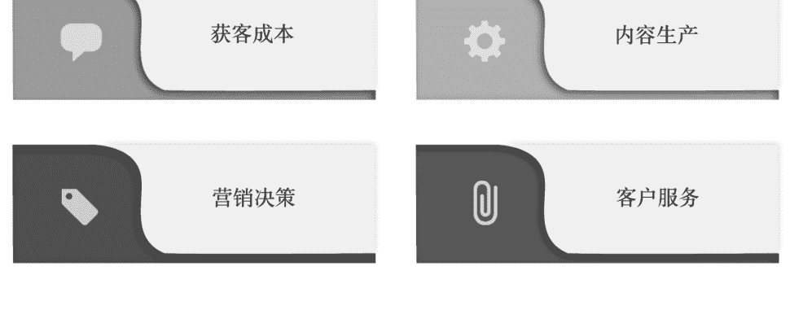
#### 1. 获客成本
传统模式依赖搜索引擎竞价与信息流投放获客，竞争加剧导致关键词与广告位争夺白热化，单次点击成本攀升而转化未见同步提升。AI营销则通过智能算法与数据建模精准锁定高转化人群，减少无效曝光。基于历史数据识别高潜用户，结合预算预测模型科学分配资源，让每一笔投入都聚焦高价值人群。

#### 2. 内容生产
传统内容生产受制于人工规模瓶颈。以电商为例，新品上线需详情页、短视频脚本、社媒推文等多元素材，团队制作一套标准化内容往往需数天，多SKU或多语言场景下成本与周期进一步放大。AI营销重塑生产范式，生成式工具可依据产品参数批量产出风格多样的文案，视觉工具可实时生成场景图。内容生产从人工创作转向智能化快速生产，实现规模化输出。

#### 3. 营销决策
传统场景下数据处理慢、用户行为预判偏差，决策滞后难以快速响应市场。用户画像更新慢导致投放策略脱节，错失黄金窗口。AI营销通过实时抓取与智能分析构建动态决策体系。例如大促期间实时追踪分区域、分年龄段的加购波动，预判品类趋势，及时调整库存与推广策略。决策节点从事后复盘前移至行为发生前。

#### 4. 客户服务
传统客服面临咨询量激增、人工响应慢、模板化回复无法洞察深层需求等问题，满意度与转化承压。AI客服基于深度学习理解自然语言背后的情绪与意图，可给出专业解答并推动转化。例如用户咨询护肤过敏，系统不仅科普知识，还主动推送敏感肌护理指南并推荐相关产品，实现服务到转化的闭环。

总体来看，AI营销正针对传统痛点实现精准打击。企业只有充分认识其价值并积极拥抱，才能在竞争中保持优势。

### 1.3 AI营销的三大底层逻辑：速度、精度、规模效应

AI营销之所以快速重塑格局，核心在于速度、精度与规模效应三者的协同。

#### 1. 速度
注意力稀缺的时代，谁更快触达谁更占先机。AI提供极致响应。传统策略从分析到执行需数周数月，AI可秒级完成数据采集、分析与决策。程序化投放系统能在用户打开页面的瞬间完成匹配与展示。动态优化同样显著，AI实时监测点击率、转化率并自动替换低效创意，无需人工干预。即时反馈即时优化的闭环让活动始终保持最佳状态。内容生产也被加速，借助自然语言与图像生成，企业可在短时间内批量产出社媒文案、广告素材与个性化邮件。

#### 2. 精度
营销的本质是把正确信息在正确时间送达正确的人。AI以数据与机器学习实现前所未有的精准。整合浏览、购买、社交等多维度数据构建精细画像并预测个体偏好。例如电商平台不仅推荐可能喜欢的商品，还在浏览未下单时推送优惠券提升转化。场景化适配同样重要，AI识别用户所处场景后调整内容形式，通勤时推送短视频，夜间则展示长图文。动态个性化打破静态分组，系统根据近期搜索行为实时调整标签，如频繁搜索健身器材即推送相关产品。这种动态调整让信息始终契合需求。

生成式AI的爆发也在改变信息获取方式。传统搜索依赖关键词匹配，而大模型驱动的生成式引擎可直接理解意图并生成个性化答案，推动GEO兴起。GEO的核心是让以DeepSeek为代表的AI搜索引擎更精准识别与推荐品牌内容。与SEO不同，它强调语义理解、知识关联与生成质量。例如用户询问夏季护肤方案时，AI会综合功效、评价与专业分析生成结构化建议。品牌需优化知识图谱、强化内容权威性，使信息被AI准确抓取与推荐，建立产品与场景的清晰关联并以行业报告、专家解读提升可信度。

#### 3. 规模效应
有效营销需以可控成本最大化触达。传统方式扩大规模意味着人力与资金线性增长，而AI让边际成本递减。程序化广告可同时管理数百万次展示并确保精准匹配，传统团队无法比拟。内容生成同样受益，生成式AI可在数小时内为数千款商品生成统一风格的高质量描述。自动化工具如聊天机器人与智能客服可7×24小时服务海量用户，实现近乎零边际成本的互动。未来信息入口的竞争将从流量分发转向认知塑造。一旦品牌内容被AI搜索引擎深度采纳，便可通过每次交互零成本触达用户，实现指数级传播。构建GEO能力者将在AI驱动的信息生态中占据制高点。

### 1.4 风险预警：关于AI营销的五大认知陷阱

AI被视为营销万能钥匙的观念盛行，但盲目依赖技术而忽视底层逻辑易致误区。以下为五大认知陷阱，值得警惕。

#### 1. 陷阱一：认为引入AI后人工经验不再重要

智能营销避坑指南：先认清这五大误区

不少团队把大模型当成一键托管的黑箱，认为接入后营销就能自转。某服装品牌上线AI选品系统后直接撤掉选品组，结果系统推出的款式与市场节奏严重错位。问题的根源在于模型本质上是数据推演工具，脱离行业经验把关很容易滑向数据偏差。比如它只盯历史销量，就会漏掉时尚潮流的快速拐点；它生成的广告文案若缺人文视角，往往难以引发情感共鸣。

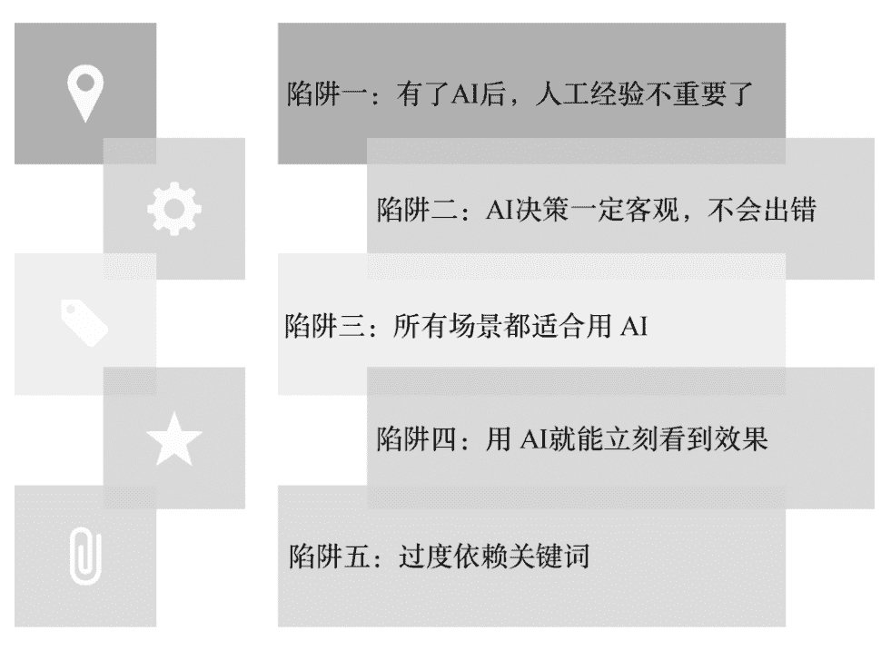

图1-2 关于AI营销的五大认知陷阱

机器与人是互补关系。选品可以先让模型从海量用户行为里筛出潜力品类，再由资深买手结合行业趋势做二次甄选；文案方面，AI负责起草初稿，广告团队再做人性化润色才能上线。只有把算力的分析能力与人的洞察、创意结合，才能发挥最大价值。

#### 2. 陷阱二：AI决策一定客观，不会出错

不少企业迷信模型的公平性，却忽略了算法本身也会带偏。训练数据有偏，上线的系统在实战中就容易作出错误判断。生成内容也可能踩线，客服场景里不当回复更易引发舆情。

模型输出本质是对历史数据的复盘。数据有偏、设计不完善，结果必然失真。因此要建立人工复核闭环，对策略建议和产出内容做二次校验，并设置风险预警阈值，及时拦截异常决策或内容。

#### 3. 陷阱三：所有场景都适合用AI

为赶潮流，有些公司把AI硬塞进全部营销节点。现实是，并非每个工作都能自动化，尤其是需要深度共情和复杂创意的环节，仍需人主导。

是否适合上AI，关键看场景是否具备可量化的数据和可定义规则。投放优化、分群管理、销量预测这类重数据任务，AI效率更高。而品牌故事、危机沟通等重情感的工作，暂时难被替代。企业要按业务特性划清使用边界。

#### 4. 陷阱四：用AI就能立刻看到效果

部分公司对AI抱有速成幻想，几周不见明显变化就放弃。实际上模型的价值需要时间验证，尤其在长期运营里。要经历数据沉淀、参数调优、效果回测才能稳定。

某家电企业的实践很有参考价值：AI投放初期表现平平，团队持续迭代算法和策略，三个月后点击率才明显抬升。这提示要建立科学评估体系，同时看短期波动和长期增长，保持耐心。

#### 5. 陷阱五：过度依赖关键词

进入AI搜索时代，仍有团队死守堆词排名。传统SEO靠词频位置取胜，而现在AI搜索引擎能理解用户搜索背后的真实意图，不是简单匹配。单做关键词优化，即便排名上升，流量也难转化。

AI搜索还能基于大数据画像洞察习惯与偏好，让结果更个性化。过度依赖关键词会错失长尾需求和语义关联，难以覆盖多元场景，最终掉队。

企业应跳出关键词框架，用GEO搭建语义网络，以用户意图为核心构建内容生态。通过行为数据挖掘长尾需求，生产多模态强场景内容，提升权威度，让品牌成为AI搜索的可信源，从堆词转向意图匹配。

企业如何规避认知误区

核心是树立理性使用观。

第一，明确定位。AI是决策助手，不是替代者。数据处理是强项，行业经验、创意灵感、情感洞察仍靠人。

第二，建立复核。模型输出可能带偏，必须人工审校策略和内容，及时纠偏降风险。

第三，划清边界。优先用于数据密集、重复度高的环节，如投放优化、分群管理；涉及深度情感沟通的场景，仍以人工为主。

第四，保持耐心。AI需要数据积累和调优，企业应从长期价值视角评估，而非盯短期波动。

树立这些思维，才能让AI真正融入营销，实现持续增长。

### 1.5 大模型对决：DeepSeek与ChatGPT，营销人怎么选

大模型已成为内容生产、用户洞察和策略优化的基础设施。DeepSeek和ChatGPT是当前最受关注的两大生成系统，各有侧重。

ChatGPT依托OpenAI的技术积累，在自然语言理解、多轮对话和创意生成上表现突出。对营销人主要有三点优势。

- 1 文案产出更顺畅。可快速生成广告、社媒帖文、邮件等，语气风格可变，适配不同品牌调性。
- 2 多语种能力强。全球投放时可直接产出英文、西班牙语等内容，降低本地化成本。
- 3 创意启发足。擅长头脑风暴，提供口号、活动点子等灵感。

但落地短板明显。长文本处理偏弱，面对复杂报告或深度内容易遗漏、逻辑断层；行业理解深度不足，对金融、医疗等专业术语和合规要求把握有限。

DeepSeek更偏向营销垂直场景，优势集中。

首先，能实时整合数据，策略更准。支持联网检索，可抓取最新行业报告、社媒热点和竞品动向。例如策划618大促时，能实时拆解小红书、抖音的爆款趋势，快速调整主推品类，提升点击，如图1-3所示。

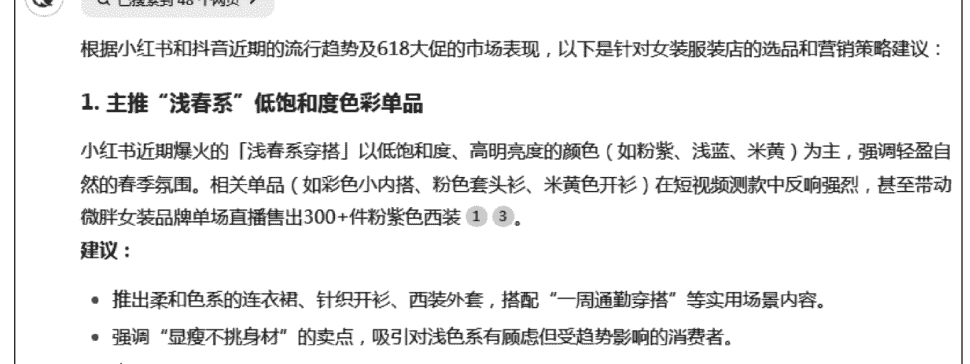

图1-3 DeepSeek联网检索给出的选品与营销建议

其次，长文本和复杂分析是强项。可完整解读市场研究、用户调研并输出结构化洞察。上传长篇消费者行为报告，就能提炼核心结论、对比人群偏好，反哺投放决策。

再次，商业营销语料更丰富。对SEO、程序化广告、转化率提升等场景理解深入，能给出可落地的方案。例如能读懂小红书推荐机制，给出高互动笔记的创作方向，如图1-4所示。

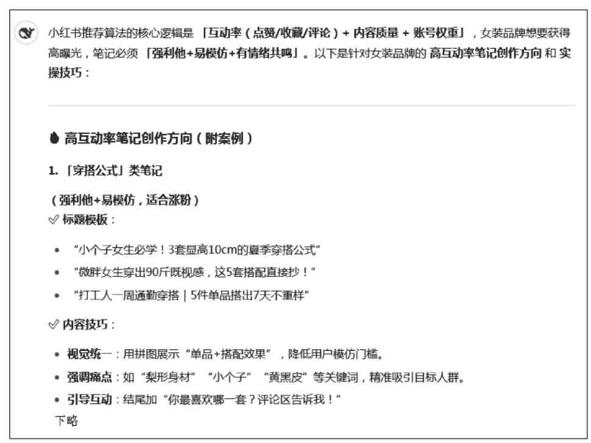

图1-4 DeepSeek结合小红书推荐算法给出的笔记实操技巧

最后，对中文语义及小红书、抖音、淘宝等本土平台规则的理解远超ChatGPT。生成的笔记、短视频脚本更符合平台偏好，并能规避常见违规风险，保障合规运营。

如果要更精准的洞察、更专业的受众内容和更完整的营销方案，DeepSeek目前更贴合营销人的工作需求。可根据实际场景灵活使用，让它成为提升效率和效果的得力助手。

### 1.6 终极拷问：DeepSeek来了，你准备好了吗

2025年初，一汽-大众旗下大众品牌新媒体AI内容运营数字化平台接入DeepSeek，正式迈向智能化营销。接入后平台在计算、推理和泛化能力上显著提升，数据分析更精准，产出更贴合用户偏好的高质量素材，内容生产效率、更新频率和质量均超出行业均值。

这并非个例。越来越多企业已把DeepSeek纳入核心流程，用于数据分析、创意生产和策略优化。不会用的人正面临职业生存压力。

从基础技能看，DeepSeek可融合多源数据做实时用户建模，快速生成多模态创意，并动态调整投放策略。相比之下，传统营销人在洞察深度、创意效率和策略响应速度上明显落后。

职业发展上，不会用的营销人可能触及天花板。薪资方面，AI营销岗位普遍高于传统岗位且增速更快。未来基础营销岗位会持续萎缩，AI营销相关岗位将持续扩张。

整体来看，DeepSeek融合已成大势，营销形态将迎来新阶段，如图1-5所示。

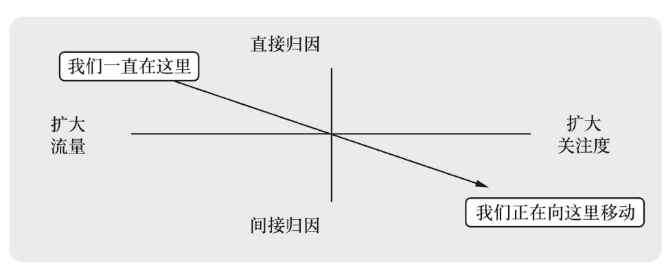

图1-5 营销演进趋势

营销人需要扩大关注点而非扩大流量。重复性工作将被自动化，留出更多创作时间。关键是学习新技能。

未来DeepSeek将渗透更多营销场景，工作环境将被深刻改写。要想获得更好发展，必须完成从工具使用者到AI协同者的转型。

具体如何准备？可分三阶段进阶。

第一阶段 工具适应。掌握DeepSeek基础功能，如数据采集分析、基础创意生成，建立协同工作流。错过则可能丧失晋升机会。

第二阶段 能力重构。构建战略思维与AI应用的复合能力，参与工具定制化开发。否则薪资差距拉大，竞争力下滑。

第三阶段 价值跃迁。向AI营销生态构建者发展，主导人机协同模式创新。若停滞，将面临天花板甚至被淘汰。

只有主动顺应趋势，重构能力，营销人才不被浪潮淘汰。

## 第2章 营销思维升级：从执行者到AI指挥官

AI重塑营销生态，DeepSeek正颠覆传统工作方式。营销人若想抢占先机，思维转型势在必行。既要善用AI处理海量数据、生成创意，又要坚守人工洞察与策略把控的核心优势，以“AI指挥官”姿态把技术转化为商业价值。

### 2.1 开篇案例：某营销团队用DeepSeek节省80%重复劳动

在快消品市场，某新锐饮料品牌营销团队长期陷入效率困境。每月需完成数十场促销策划、数百条社媒文案，还要优化电商详情页、分析用户评论，旺季时全员加班仍难以保证时效与质量。

转折点在2025年初，面对新品上市压力，团队首次引入DeepSeek。

以低糖电解质水推广为例，传统流程需耗数天手工调研竞品价格、包装、宣传策略并结合问卷数据形成报告。使用DeepSeek后，输入“低糖电解质水 竞品分析”指令，即可短时间整合全网数据，拆解市场格局，包括品牌、公司、产品特性、价格带、目标人群等，如表2-1所示。

表2-1 DeepSeek生成的低糖电解质水主要品牌市场表现对比

| 主要品牌 | 所属公司 | 核心产品特性 | 价格带（元/瓶） | 目标人群 |
| :--- | :--- | :--- | :--- | :--- |
| 外星人 | 元气森林 | 0糖0脂，多种口味 | 3～8 | Z世代，年轻白领 |
| 宝矿力水特 | 大冢制药 | 专业运动配方 | 3～12 | 运动爱好者 |
| 东鹏补水啦 | 东鹏饮料 | 高性价比，电解质含量高 | 4～6 | 大众消费者 |
| 海之言 | 统一企业 | 等渗配方 | 4～7 | 家庭消费者 |
| 尖叫 | 农夫山泉 | 专业等渗技术 | 5～8 | 运动人群 |

创意产出环节效率大幅提升。过去一条抖音脚本需3轮头脑风暴、2次修改，耗时2-3天。引入DeepSeek后，输入目标人群、卖点、风格等参数，即可快速生成多个创意方向的分镜脚本和执行要点，如图2-1所示。

# 视频脚本

时长：15秒

主题：极限挑战-零负担补给

BGM：高燃电子音乐（鼓点强烈，节奏渐强）

# 镜头1（0-3秒）

画面：

- 烈日下，主角（年轻运动系男女）攀岩至岩壁顶端，汗水飞溅特写

- 镜头急速下拉至岩底，运动水壶孤零零立在滚烫岩石上

字幕：💧 体力透支？补水滞后？

# 镜头2（4-6秒）

画面：

- 主角凌空跃下（慢动作），落地瞬间抓起水壶一饮而尽

- 液体入喉特写：晶莹蓝色液体带冰霜质感

音效：“咕咚”吞咽声 + 冰裂声

字幕：⚡ 闪电补水！0糖0脂狂飙！

# 镜头3（7-10秒）

画面：

- 实验室场景快切：

  ▶ 试管滴入电解质液体→电流传导特效（呲啦！）

  ▶ 成分表爆炸动画：**0糖**/0脂/钠钾镁离子粒子飞溅

- 主角暴冲过终点线，肌肉线条汗水晶莹

字幕：🔬 科学配比电解质 → 秒速渗透细胞！

# 镜头4（11-13秒）

画面：

- 主角与好友击掌大笑，空瓶精准投入回收箱（“砰”！）

- 产品全景定格：瓶身“0糖0脂”标签高亮闪烁

字幕：🚫 拒绝糖分绑架！运动自由无负担！

# 镜头5（14-15秒）

画面：

- 黑底泼墨式溅出产品Slogan

标语：#超导电解质

画外音（年轻活力女声）：

“极限不停歇——补水，就要快准狠！”

# 执行细则

图2-1 DeepSeek生成的抖音推广视频脚本

数据处理方面，DeepSeek彻底改变节奏。过去每月需4-5天手工整理电商销售数据和评论。现在通过API对接电商平台，可自动获取销量、销售额、评价等信息，并整合生成数据视图和报告，效率大幅提升。

三个月后，文案撰写、数据整理等重复工作节省80%工时，相当于减少4个全职岗位。原负责基础数据处理的员工经培训后转型为AI策略分析师，专注解读分析结果，制定精准策略。

DeepSeek极大释放了团队生产力。重复工作交给AI，团队聚焦策略规划、内容筛选审核和二次创作。

案例生动展现了DeepSeek的赋能作用。它不仅是效率工具，更是思维转型的催化剂，倒逼营销人从任务执行者转变为“AI指挥官”，实现营销全面升级。

### 2.2 了解自己——营销人AI能力图谱

DeepSeek革新工作模式，倒逼能力迭代。要成为优秀的AI指挥官，首先要清晰认知自身AI能力，构建系统图谱，如图2-2所示。

#### 1. 认知升维

在AI营销浪潮下，需要实现认知升维，建立GEO思维。GEO思维要求打破传统SEO局限，转向内容生态建设，以用户真实意图为导向，把品牌内容打造成可信信息源。结合用户搜索场景，借助AI批量生成兼具专业性与可读性的多模态内容，并通过权威媒体合作获取背书提升可信度。建立GEO思维能让品牌自然融入AI交互决策链路，从被动等流量转向主动占据推荐入口。

#### 2. 基础操作能力

熟练掌握DeepSeek界面操作、指令输入规则，能快速准确传达需求，是高效工作的基础。

DeepSeek提供三大核心模式，满足不同需求，如图2-3所示。

图2-3 DeepSeek三大核心模式

1. 基础模型：适用于日常问答、文本生成和简单任务，响应快速，适合即时交流和信息查询。
2. 深度思考：针对复杂问题或逻辑推理，该模型会进行更深入的分析，提供更严谨、详细的解答，适合学术研究或专业场景。
3. 联网搜索：可实时检索最新网络信息，确保答案的时效性，适用于新闻追踪、实时数据查询等需求。

用好 DeepSeek：营销人的能力升级与实战打法

营销岗位可以根据实际工作场景，在操作界面挑选合适的任务模式开展工作。

正式下指令之前，要先搞明白DeepSeek的提示词怎么用。提示词就是用户输入给模型的文本，用来触发响应并引导生成。掌握提示词的用法，就像图2-4里提到的那些技巧一样，能显著提升输出质量。

在技巧熟练后，就能给出更精准的指令。比如要求：“围绕25到35岁的城市女性，写一篇约500字的防晒霜推广文案，核心卖点是养肤级防晒，用闺蜜安利的口吻，配3个使用场景，结尾引导点击购买链接”。指令越具体，模型给出的结果就越贴合预期，如图2-5所示。

另外，还要熟悉一些常用快捷指令，如表2-2所示。

/续写 —— 回答被截断时自动接上
/简化 —— 把复杂内容转成通俗易懂的表达
/示例 —— 要求模型展示真实案例
/步骤 —— 让模型按步骤拆解操作流程
/检查 —— 帮助发现文档里的错误

例如输入“请解释场景化营销，然后／简化”，会得到简明版说明；输入“／步骤如何借助手机拍摄产品照片”，就能拿到详细的分步指导。

#### 3. 数据洞察与解读力
DeepSeek能输出大量数据和分析，营销人要做的不是照搬，而是读懂背后的逻辑与趋势。比如分析某款电子产品的用户评论，模型可能统计出各功能的提及频次和情感倾向，接下来要思考这些数据背后用户需求在怎样变化，对产品迭代和营销方向有什么启示。

还要具备交叉验证的习惯，把模型的分析结果与第三方调研、内部销售等渠道数据对照，判断可靠度。

最后要学会把数据可视化，用图表、图形把复杂信息呈现出来，方便团队沟通。

#### 4. 战略判断力
面对模型给出的海量结论和建议，营销人必须站在企业战略层面筛选价值。比如模型可能建议开拓某个新兴市场，但是否采纳要结合资源情况、品牌定位和竞争格局综合评估。

同时要会做风险预判。推广新渠道时，模型建议很美好，但实际可能面临用户接受度低、运营成本抬高等问题，需要提前制定应对方案。

还要有整合创新的能力，把模型提供的素材和自身的创意、经验结合起来，形成差异化策略，避免同质化。

#### 5. 创新内容力
基于模型生成的基础内容，营销人要注入用户情感洞察和故事感。模型能产出逻辑清晰、卖点明确的家电文案，而营销人可以加入家庭生活场景、真实使用体验，让内容更有感染力。

跨界融合能力也很重要，把游戏、动漫等元素与传统营销结合，更容易抓住年轻群体。

#### 6. 人机分工协作力
要明确人与模型各自的优势。创意发散阶段，模型负责提供大量方向和素材，营销人负责筛选、优化和二次创作。数据分析阶段，模型负责采集、整理和初步计算，营销人负责深度解读并做出决策。

协作中要及时反馈问题。比如发现模型在专业术语使用上不准确，就要即时纠正，让输出质量持续提升。

构建完整的人机能力图谱，是营销人思维进化的必经之路。只有不断强化这些能力，才能真正成为AI指挥官。

### 2.3 DeepSeek辅助决策，营销人主导策略
DeepSeek性能强、效率高，已经成为营销团队的重要助手。但它不是万能的，策略层面仍需经验丰富的营销人把控。因此“模型负责辅助，营销人把握方向”的工作流逐渐成型。

整体逻辑可拆分为数据挖掘、创意生成、策略制定、动态优化四个环节。

数据挖掘阶段，模型可从搜索引擎、电商、社交媒体抓取海量信息并清洗整合，提炼市场洞察。例如准备推出智能穿戴新品，只需指令“收集近一年智能穿戴市场用户需求变化、竞品功能创新、行业技术突破等”，模型就能快速汇总并初步分析，如图2-6所示。

模型能识别出诸如慢性病管理成为核心需求、情绪检测和睡眠分析关注度上升等趋势，并梳理主要竞品的功能和技术创新，为决策提供及时情报。

创意生成阶段，模型结合前期结论和历史案例，能快速产出多样化创意，从广告文案到海报、活动策划和话题营销，并模拟传播效果附带数据指标，供评估可行性。

但模型输出不能直接使用。策略制定阶段，营销人要基于品牌战略、市场趋势和用户情感，对创意进行筛选优化，剔除与品牌调性不符的方案，将合适创意整合成完整策略，明确目标人群、渠道、节奏和资源分配。

在具体任务中，可把模型融入流程。例如结合DeepSeek和Kimi制作PPT，如图2-7所示。

先用DeepSeek生成大纲，指令要明确主题、结构、受众、页数和格式要求。生成并保存大纲后，登录Kimi，输入需求并粘贴大纲，一键生成PPT并选择模板和风格，再做个性化编辑。具体步骤见图2-8。

营销人登录DeepSeek输入“请帮我生成一份关于DeepSeek科普报告的PPT大纲”，模型会给出结构化框架，如图2-9所示。

随后登录Kimi，点击左侧“Kimi+”，进入“PPT助手”，把大纲粘贴进去即可生成初稿，如图2-11所示。

最后稍作调整就能下载使用。这种新流程大幅提升决策效率，未来会持续演进。

### 2.4 可靠性三步验证法
DeepSeek的输出并非百分百可信，营销人需要建立验证机制，如图2-12所示。

#### 1. 逻辑合理性验证
先看内在逻辑是否通顺。比如模型建议冬季主推透气轻薄跑鞋，却忽略保暖防滑需求，就存在明显漏洞。再如社交媒体文案主题不突出、衔接混乱，传递效果也会大打折扣。要从市场规律、用户心理和产品特性出发，审视逻辑架构是否经得起推敲。

#### 2. 数据准确性验证
核查数据来源和分析方法。比如模型显示某化妆品品牌在年轻女性市场占有率达60%，远超竞品，就应与权威报告、第三方调研和内部销售数据对比，偏差大时需复核。对于销量增长200%这类预测，也要结合市场饱和度、技术突破和政策环境综合判断。

#### 3. 专业度与适用性验证
用专业知识评估内容是否达标。比如智能家居文案错误解释变频原理，或用未经验证的概念夸大节能效果，就会误导用户。从适用性看，为高端品牌推荐大众电商平台低价促销，就与品牌定位和目标客户不匹配。需要结合品牌调性和受众特征优化调整。

三步验证能有效筛除错误信息，为策略提供可靠依据。

### 2.5 AI有边界，如何防止过度依赖
DeepSeek在营销领域能力很强，但也存在局限，过度依赖会带来风险。

模型基于已有数据和算法运行，数据质量和算法偏差会直接影响结果。市场趋势预测若缺少小众新兴市场样本，就可能出现片面判断。创意方面，模型能拼凑节日元素，却难以像人一样基于情感洞察和文化理解引发深层共鸣。

决策层面，模型难以兼顾品牌长期战略、企业文化、社会舆论等难以量化的因素。曾有个品牌问模型新品策略，模型基于数据建议激进低价抢占份额，而营销总监认为这会损害高端形象，最终选择稳健定价。过度依赖模型决策，可能伤害长期发展。

长期依赖也会削弱自身能力。数据敏感度、解读力和创新思维会逐渐退化，营销人容易沦为操作员。

避免过度依赖的关键是提升专业素养，把模型当辅助工具。先自行分析数据、构思创意，再用模型查漏补缺。重要决策要组织团队研讨，结合模型结果、专业判断和一线反馈综合权衡。

AI是强有力的变革助手，但不是万能的。认清边界、合理使用，才能在AI浪潮中稳健前行。

### 2.6 实战演练：用模型快速产出一份竞品分析报告
竞品分析是策略制定的基础，模型能凭借信息整合能力快速生成报告。以智能投影仪为例，操作步骤如图2-13所示。

#### 1. 明确分析目标与范围
先确定要做什么。某新品牌营销人员设定目标：了解近一年主流竞品的产品特点、价格策略、渠道、口碑和GEO打法，找到自身机会点。范围限定为近一年上市、价格2000至5000元的智能投影仪，聚焦极米、坚果、当贝、小明等品牌。

#### 2. 设计精准指令
指令要简洁明确，包含关键要素。输入：“请分析近一年价格2000-5000元的智能投影仪，重点看极米、坚果、当贝、小明投影的核心功能如亮度、分辨率、智能系统，价格区间，线上线下渠道，社交媒体活动，以及电商和社交平台的用户评价，同时分析各品牌GEO策略，生成详细竞品分析报告”。

#### 3. 数据收集与初步分析
收到指令后，模型会从电商抓取产品参数、价格、销量、评价，从社交媒体收集营销内容和互动，从行业报告获取市场动态。随后清洗分类，按产品、价格、渠道、口碑等维度整理。

#### 4. 深度分析与报告生成
模型运用分析模型进行深度挖掘。功能对比会用图表展示亮度、分辨率等差异；渠道梳理投入效果；用户口碑通过自然语言处理做情感分析和主题提取，总结正面评价和槽点。最终整合成包含市场概述、品牌功能对比、价格分布、渠道分布、社媒活动、用户评价、竞争总结与趋势建议的报告，如图2-14所示。

同时报告会给出GEO策略，例如极米构建家庭影院知识图谱，在知乎、B站投放专业评测内容，被ChatGPT等AI工具高频引用，如图2-15所示。

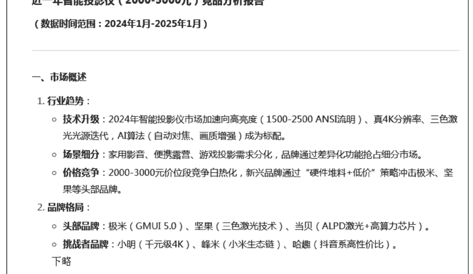

图2-14 DeepSeek根据指令生成的竞品分析报告

- GEO策略：

    - 构建「家庭影院」知识图谱，在知乎、B站投放专业评测内容（被ChatGPT等AI工具高频引用）

图2-15 极米的GEO策略

#### 七、竞争总结与趋势建议

1. 技术方向：

    - 光源技术：三色激光（坚果）与ALPD激光（当贝）竞争加剧，需解决散斑和成本问题。

    - 智能化：AI语音助手（如远场语音）和跨设备互联（米家/华为生态）成标配。

2. 市场机会：

    - 游戏投影：当贝X5 Pro已占先机，极米需强化HDMI 2.1和低延迟技术。

    - 便携场景：小明V5系列可拓展露营配件（如户外电源套装）。

图2-16 报告给出的竞争总结与趋势建议

#### 5. 人工审核与优化
模型生成后要人工复核逻辑、数据是否准确，有无遗漏。一旦发现问题及时反馈修正。再结合自身行业经验和品牌定位，对总结和建议进行优化，提升针对性和可操作性。

#### 6. 报告应用与后续跟踪

审校优化完毕后，竞品研判就能进入执行环节。营销团队可依据结论调整产品规划方向、重塑定价体系、设计更具穿透力的投放与活动。市场与对手都在快速变化，团队需要保持持续跟踪的节奏，定期用 DeepSeek 刷新素材并更新文档，让策略始终与实际情势保持同频，守住竞争优势。

依托前面梳理的六步流程，营销人完全可以借助 DeepSeek 产出一份扎实的竞品分析，并把分析成果转化为工作成效，为个人业绩和品牌成长提供支撑。

# 第3章 DeepSeek营销速通指南

在营销提速的背景下，AI工具的使用效率往往决定品牌能否实现突围。DeepSeek兼具生成与分析能力，已经成为营销团队常用的提效利器。掌握其使用方法已成为提升工作效能的必修课。本章从落地视角梳理核心功能与操作要点，为后续用其写文案、做数据分析奠定基础。

## 3.1 案例拆解：手机品牌如何用DeepSeek产出10万+文案

2025年第二季度，国内一家中高端手机品牌在新旗舰推广期陷入困境。原先的宣传稿主打“骁龙8 Gen3芯片”“2亿像素主摄”等参数标签，点击转化率连2%都不到。与此同时，竞品以“AI原生体验”“情感化交互”等概念迅速抢占声量。

面对用户与对手的双重压力，品牌引入DeepSeek重塑文案。首要动作是让系统对用户评论、社交舆情、竞品动向进行数据扫描，迅速定位到原文案的三大症结。

- (1) 感知错位：评论里消费者高频提到的是操作流畅度感受，而文案大量堆砌硬件参数。
- (2) 情感缺位：社交平台上“手机摄影治愈感”的讨论累计超百万次，文案并未触达这一情绪需求。
- (3) 场景脱节：Z世代偏爱游戏直播、Vlog拍摄等具体场景，文案里却缺少场景化描述。

这些问题暴露出传统创作的通病：只讲功能，难以建立情感连接。而DeepSeek能够抓取电商平台、社交媒体、科技垂直论坛的海量评论，通过情感判别模型提炼真实需求。比如针对年轻用户夜间拍摄的痛点，系统总结出“夜宵打卡不翻车”“深夜自拍自带柔光”等可感知的场景表达，把冰冷的参数转化为可体验的价值。基于Transformer的深度语义理解，品牌得以跳出参数罗列的思路，在产品功能与生活场景之间建立精准的语义关联。

过去文案多依赖个人经验，而DeepSeek能在数分钟甚至数秒内完成初稿输出。营销人员可通过参数设定指定人群、场景、情绪等维度，系统依据海量预训练文本生成符合语境的内容。

实际操作中，团队给出的指令是：为25～35岁都市女性撰写小红书种草文案，突出AI人像算法。要求使用“原生感”等关键词，围绕咖啡馆、公园的日常拍照场景，语气亲切自然，结尾引导互动。系统随即输出了示例内容。

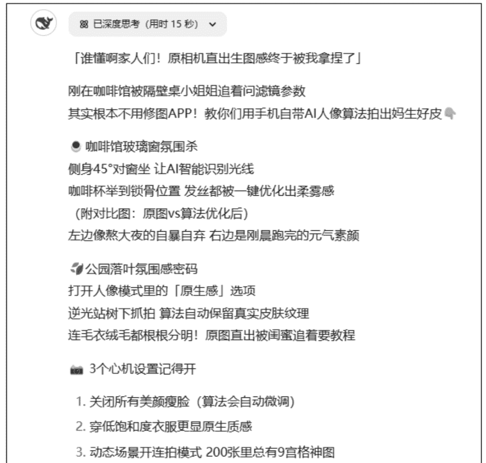
图3-1 DeepSeek生成的种草文案示例

系统还能根据平台特性自动切换风格：为抖音生成节奏紧凑、带话题钩子的口播脚本，如“三招用新手机拍出电影感，最后一招颠覆认知”；为微博话题营销写具备裂变潜力的传播话术，结合热点打造“当手机影像遇见××电影美学”的跨圈内容。系统甚至可以模拟KOL的语言习惯，让官方声量和达人私域定位高度契合。

爆款不是一次写完的。营销人员对生成稿不满意时，可以指令优化，优化范围不仅是文字，还包括传播节奏的智能调整。

在新品预热期，DeepSeek会先推送悬念式文案挑起好奇，如“当手机屏幕突破边界，会发生什么？”临近发布会时逐步释放技术细节，并配合“拆机图+核心参数”可视化呈现；发布会后切换为用户证言模式，生成“上手三天真实体验”等内容，形成“悬念—解密—共鸣”的传播闭环。每一步调整都基于历史传播数据的学习，避免人工决策滞后。

借助DeepSeek深度介入，品牌文案传播实现指数级增长。小红书上“AI人像算法”“懒人拍照技巧”等话题累计阅读上千万，互动破百万，转化率提升45%，首销日销量即突破千台。

该案例说明，DeepSeek正在改写文案创作的效率公式：用AI生成能力把单位时间内的有效信息传递效率推向新高度。当AI能捕捉用户未明说的需求，用不同平台的语言风格高效表达，并在传播中持续加码时，爆款文案就从偶然灵感变成了可预期的产出。这也重塑了品牌与用户对话的底层逻辑：每一次触达都成为了解用户、贴近用户、服务用户的深度交互。

## 3.2 核心能力概览：长文处理、多轮对话与数据解读

在品牌营销实操中，DeepSeek的长文本分析、多轮对话、数据解读等能力能显著提升工作质量，帮助企业更精准把握市场动向，制定有效策略。

长文本分析可处理海量文本。营销日常积累大量材料，如用户评价、调研报告、竞品文案。DeepSeek能迅速扫描数万条评论，通过情感分析判断满意、中立或不满倾向，并提取高频关键词，揭示用户核心关注点，如某项功能好用与否、售后体验是否到位。分析竞品文案时，系统可识别宣传重点、风格特征和传播效果较好的内容，为优化自有文案提供灵感。

多轮对话让交互更灵活。营销是不断探索完善的过程，DeepSeek支持逐步细化需求。例如策划促销活动时，团队先给出大致方向“面向年轻消费者做促销”，系统给出初步思路；随后补充活动形式、预算、渠道等约束，系统据此优化方案；经过数轮沟通，最终形成可执行的完整方案。多轮交互确保结果贴合预期。

数据解读在决策中至关重要。DeepSeek可对销售、社交媒体等数据做深层分析。销售数据方面，除呈现不同区域、时间段的走势外，还能结合市场趋势和消费行为预测未来走向，为生产与库存提供依据。社交数据方面，系统分析点赞、评论、分享等互动指标，评估活动传播效果，找出高互动内容类型和最佳发布时间，优化后续投放。

除以上能力外，系统还具备创意灵感生成、文案优化等实用功能。熟练掌握并灵活应用，才能最大化DeepSeek价值，实现营销目标。

## 3.3 工作环境优化：营销人专属AI配置方案

在数字化浪潮下，AI已成为提升营销效率与效果的关键。DeepSeek可从多维度助力营销人优化工作环境，在激烈竞争中抢占先机。

DeepSeek如何帮助营销人营造专属AI环境，具体策略如图3-2所示。

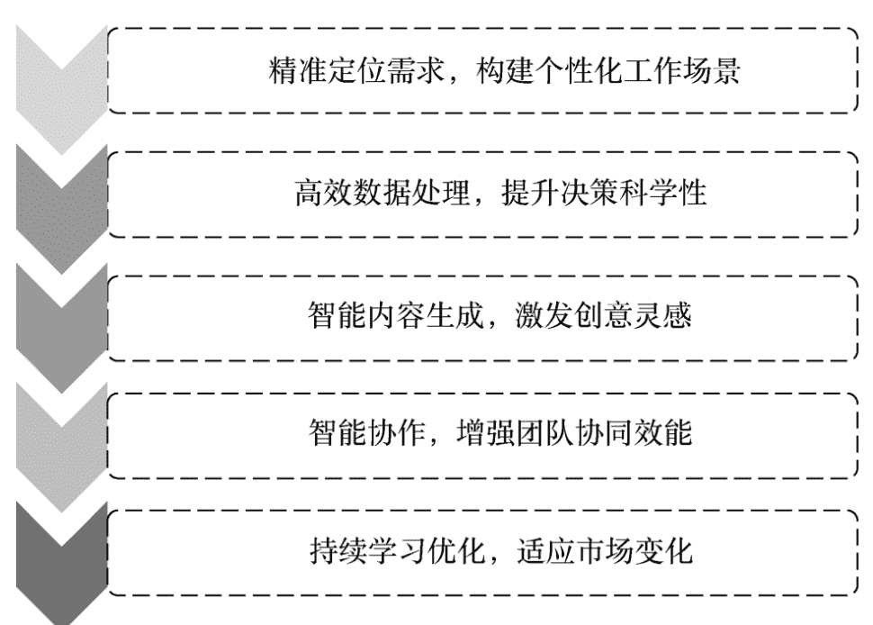
图3-2 DeepSeek助力营销人员优化自己AI工作环境的策略

### 1. 按需搭建场景，打造个性化工作台
营销目标和场景差异很大，DeepSeek依托数据分析能力可为不同需求搭建个性化环境。内容创作者可集成关键词分析、热点追踪、创意生成，打造高效策划台；用户运营者则可用画像建模、行为预测、个性化触达建议构建精准营销支持环境。由“人找工具”转向“工具适配人”，提升专业性与针对性。

### 2. 数据整合处理，提升决策科学性
数据是智能营销的基石。DeepSeek能融合社交媒体、电商、线下门店等多源数据，打破信息孤岛。经清洗、分类、分析后，提取购买偏好、行为模式等关键信息，帮助团队清晰洞察市场，降低决策风险。

### 3. 智能内容生产，激发创意灵感
内容营销的核心在于持续输出。DeepSeek可基于目标和受众生成符合品牌调性且贴合热点的广告文案、社媒帖子等素材。营销人员在此基础上微调即可快速成稿。系统还能拆解经典案例的结构与风格，为创意提供参考，提高产出效率。

### 4. 协同作业，增强团队效能
营销强依赖团队配合。DeepSeek支持信息实时共享与同步，成员随时掌握进展。其任务分配、进度跟踪、沟通协作等功能明确职责，提升协作效率。如策划活动时，团队可共用方案、交流创意、快速解决问题，确保顺利推进。

### 5. 自主学习优化，保持策略前沿
DeepSeek具备自我学习能力，会实时关注行业动态并更新知识库与模型，让营销人接触前沿方法。根据使用反馈和工作成效，系统可进行个性化优化，提供更贴合需求的服务。

从需求定位到数据处理，从内容生成到协同协作，再到持续优化，DeepSeek为营销人提供全链路支持。充分发挥其优势，才能在数字化营销中占领先机。

## 3.4 跨平台集成：接入企业微信、钉钉、飞书

日常营销离不开团队协作与信息沟通。企业微信、钉钉、飞书是主流办公协作平台，将DeepSeek接入其中，可在熟悉环境中使用其能力，实现跨平台作战，提升效率。

企业微信是内外部沟通枢纽。接入时先登录DeepSeek管理后台，进入“应用接入”选择企业微信入口，按提示获取授权码和配置信息。随后在企业微信管理后台的“应用与小程序”中新建应用，填入配置信息并完成授权。配置成功后，员工可在聊天侧边栏或工作台直接调用DeepSeek，例如与客户沟通时即时生成产品介绍、解答疑问。

钉钉接入流程同样简便。先在DeepSeek后台获取授权信息，登录钉钉管理后台，如图3-3所示。

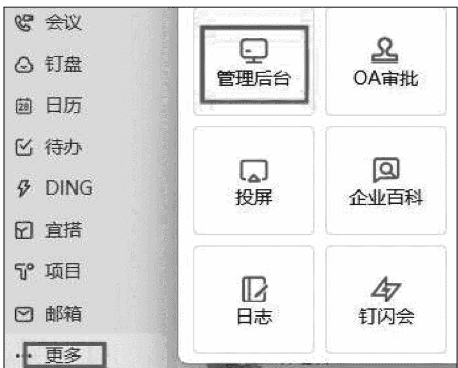
图3-3 钉钉管理后台

在“应用开发”模块创建自定义应用，如图3-4与图3-5所示。管理员填入配置参数并设置权限。接入后，员工在群聊讨论方案或与客户一对一沟通时，都能便捷使用创意搜索、数据分析等功能。

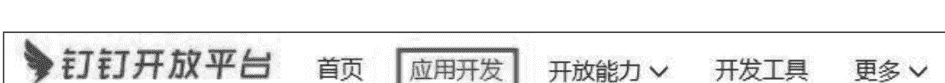
图3-4 钉钉管理后台的“应用开发”

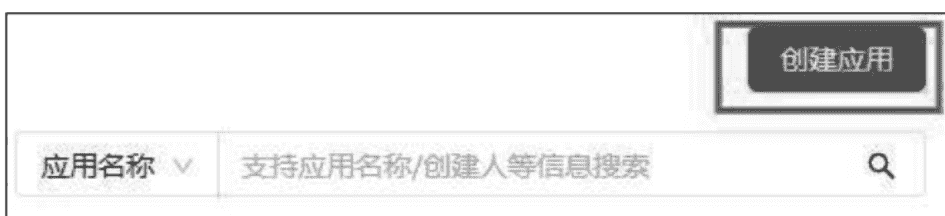
图3-5 创建自定义应用

飞书作为高效协作平台，与DeepSeek结合同样便利。获取接入凭证后，在飞书开放平台创建应用并配置权限与事件订阅，实现深度集成。员工在文档编辑、日程管理、即时通信等场景均可无缝调用DeepSeek，如撰写营销报告时直接接入数据分析结果并插入文档，提升说服力。

跨平台集成减少了应用切换成本，团队可共享生成内容和分析结果，便于讨论与迭代，让营销流程更顺畅，为数字化营销创造新可能。

## 3.5 实战演练：网页版DeepSeek生成品牌宣传稿

为帮助营销人掌握实际操作，下面以网页版DeepSeek撰写品牌宣传稿为例进行演练。假设一家高端宠物用品品牌希望借助DeepSeek产出宣传稿，目标是吸引宠物爱好者，突出高品质、安全性和独特设计。

第一步，打开浏览器进入DeepSeek官网，首页点击“开始对话”进入交互界面。

第二步，在输入框给出详细指令：为热爱宠物、追求高品质生活的宠物主人撰写高端宠物用品品牌宣传稿。需重点强调产品采用天然环保材料、对宠物健康无害；突出独特设计，如人性化功能和时尚外观；风格温馨亲切，能引起情感共鸣，激发购买欲望，结尾引导访问官网。指令需表达清晰、需求明确。

第三步，点击发送，系统开始处理，短暂等待后生成初稿，如图3-6所示。

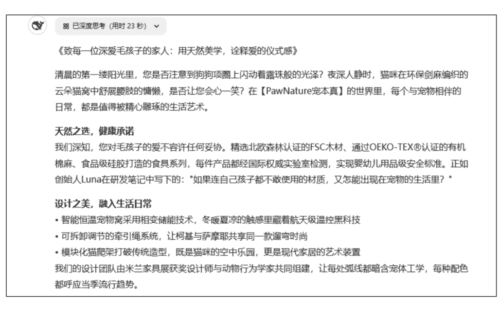
图3-6 DeepSeek生成的宣传稿节选示例

第四步，如对初稿不满意，可通过多轮对话优化。例如补充“增加宠物窝可调节温度功能和牵引绳防滑设计的详细描述”，系统会据此修改完善，输出更丰富的内容，如图3-7所示。

> **天然之选，健康承诺**

我们深知，您对毛孩子的爱不容许任何妥协。精选北欧森林认证的FSC木材、通过OEKO-TEX®认证的有机棉麻、食品级硅胶打造的食具系列，每件产品都经国际权威实验室检测，实现婴幼儿用品级安全标准。正如创始人Luna在研发笔记中写下的：“如果连自己孩子都不敢使用的材质，又怎能出现在宠物的生活里？”

**设计之美，融入生活日常**

- **智能四季宠物窝**：搭载专利生物传感温控系统，5℃至35℃智能调节，严寒中自动释放蓄热粒子锁住温暖，酷暑时启动仿生汗腺散热技术。内衬采用可拆卸凝胶凉感垫与羊绒级保暖罩，一键切换四季模式，让短鼻猫犬告别呼吸闷热，让雪橇犬种找回雪地酣睡的踏实。

- **防滑安全牵引绳**：手柄内嵌3D蜂巢硅胶防滑层，雨天遛狗也能紧握如初；双芯反光纤维编织绳体搭配军用级自锁扣，即使柴犬暴冲、边牧急转，也能瞬间缓冲30%冲击力。特别设计的360°旋转牵引头，让宠物自由探索时不绕线、不卡顿，您与毛孩的每一步都优雅从容。

- **模块化猫爬架**打破传统造型，既是猫咪的空中乐园，更是现代家居的艺术装置。

我们的设计团队由米兰家具展获奖设计师与动物行为学家共同组建，让每处弧线都暗含宠体工学，每种配色都呼应当季流行趋势。

图3-7 优化后的宣传稿节选示例

此外，可先用长文本分析功能收集竞品宣传资料，分析其重点和用户反馈，融入创作中，使稿件更具针对性。通过实战，营销人可熟练掌握操作技巧，快速产出高质量宣传内容，为品牌推广提供支持。

# 中篇 DeepSeek营销场景实战——六大场景即学即用

## 第4章 精准洞察用户：DeepSeek化身读心专家

在数字化营销中，精准把握用户需求是品牌立足的关键。DeepSeek凭借强大的数据处理与分析能力，能深入挖掘用户行为与心理，成为洞察用户的“读心专家”。从挖掘隐性需求到预测趋势，从量化情绪波动到监测舆情风险，DeepSeek为品牌搭建全方位用户洞察体系，助力精准触达、提升营销效能，重塑品牌与用户互动模式。

### 4.1 案例开篇：美妆品牌借助DeepSeek分析评论，挖掘隐藏需求

在美妆市场竞争激烈的情况下，把握用户真实需求是突围的核心。某美妆品牌借助DeepSeek从海量用户评论中挖掘隐性需求，实现产品与市场需求的精准对接。

提亮精华遇冷，数据挖掘找出口

某国货美妆新上架一款以提亮为主卖点的精华，上市后市场回声未达预期。市场团队希望借 DeepSeek 把消费者真实感受理清，把藏在评价里的隐性诉求找出来，进而对配方与传播作升级。为此先从天猫、京东、种草社区与品牌官网抓取大量点评，确保覆盖面足够宽，随后进行基础清理。

整理后的数据交由 DeepSeek 做深度拆解。先做情绪分层，正负中三类拆开。结果显示部分人群认可提亮效果，但负面声音同样突出。如“用完脸有点刺，不知是否自己不合适”这类留言，直指刺激感，且情绪偏负。

再提炼高频词汇，除提亮外，“效果”“脆弱”“气味”出现频率也很高。归类后发现过敏与气味相关吐槽集中。有人说“我肌肤脆弱，上了脸便发红”，也有人嫌“味道怪，有点刺鼻”。说明温和度与香型存在短板，是品牌方此前未充分重视的隐性点。

为弄清关联，团队让工具做关联挖掘。发现过敏与配方、使用时机相关。场景上，季节交替时脆弱肌使用者出现不适的概率更高。这意味着除了要把成分调得更温和，还得针对换季等特殊情境为脆弱肌人群提供使用建议或做配方微调。

据此品牌启动改进。研发降低易致敏成分，加入马齿苋提取物与神经酰胺，提升舒缓力。传播端面向脆弱肌重写文案，突出温和、适配脆弱肌卖点，如图4-1所示。同时用工具产出换季护肤专题，为这类人群提供实用指南。

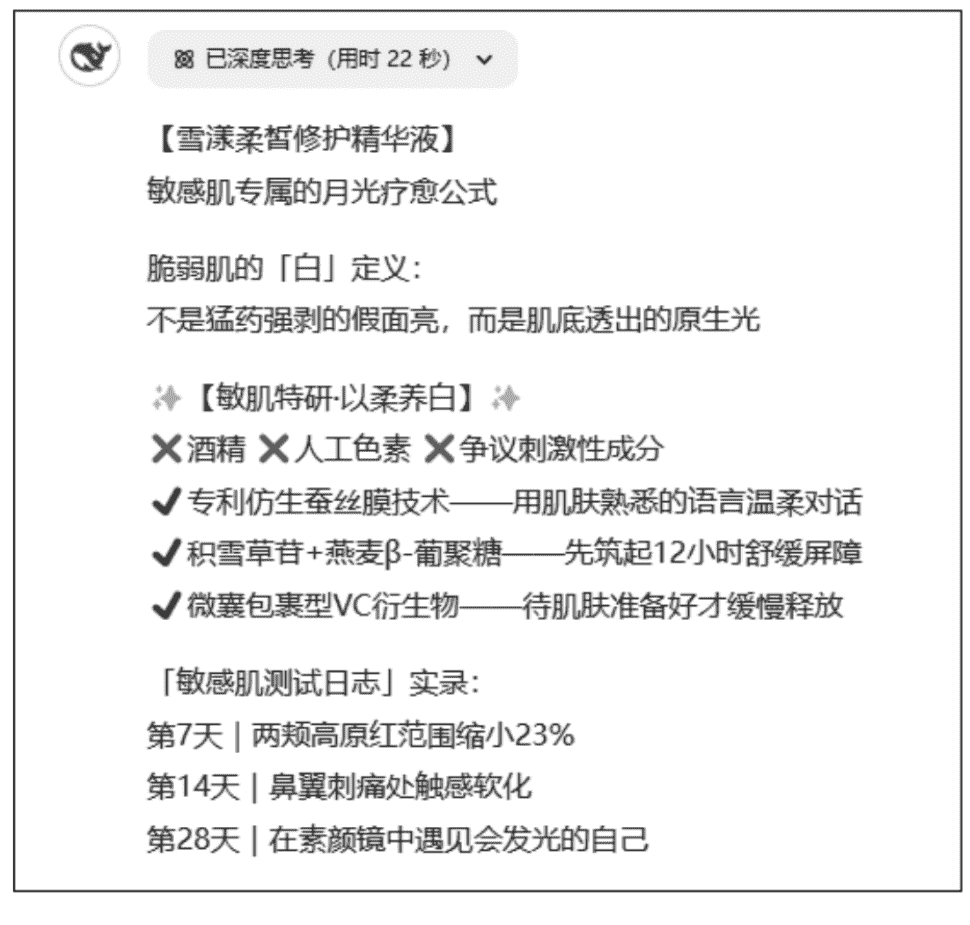
投放改进版并配合新传播后，团队持续追踪评论动态。负评在减少，好评在增加，尤其表扬温和度的声音多了，说明调整起效。但团队并未止步，继续用工具追踪需求变化，及时校准研产与传播方向，保持竞争力。

整体来看，该品牌靠这套方法挖出隐藏诉求，完成单品与传播的升级。整个过程让数据解读更直观，决策更可靠，也让分析优化更有条理、可落地。

### 4.2 海量反馈三步速析法
留言是改进单品、优化服务、制定传播的重要参考。面对海量信息，如何快速抓到有价值的部分？DeepSeek 能提供一套高效解法，三步完成大数据的梳理。

步骤一，明确分析意图。不同意图决定关注点。比如新品刚上市想知道接受度，意图可设为“评估［商品名］功能与使用感受的满意度并找出改进点”。若某类商品销量下滑，意图就应聚焦“弄清用户为何不再买［商品名］，明确潜在需求”。意图清晰才不会迷路。

步骤二，设计精准指令。需明确对象、来源和目标。通用模板可写成：“请对［品牌／商品］在［平台，如电商、社交媒体］上的用户评价进行梳理，重点看对［具体维度，如功能、体验、售后］的评价，提取高频词，判断情绪是满意、中立还是不满，并找出未被满足的需求。”

以智能音箱为例，若想了解音质与语音交互看法，可这样写：“请分析 [品牌] 智能音箱在天猫、京东及微博、抖音上的用户评价，重点看音质表现、语音识别准确度、唤醒灵敏度等互动功能的反馈，提炼高频词，判断情绪并找出未满足需求。”指令越细，结果越贴合。

步骤三，获取并解读结果。把指令交给 DeepSeek 后，能很快拿到输出，通常包含高频词表、情绪分布、具体问题与潜在需求。

比如音箱反馈分析里，可能出现“音质浑”“唤醒困难”“功能单一”等高频词，情绪以不满为主。解读后能看到音质与语音交互不足，用户希望增加实用功能。基于此可针对性改良、优化传播，比如强化音质研发、升级语音系统，并在宣传中突出改进点，提升满意度与竞争力。

掌握这三步，就能高效处理海量留言，让用户声音变成品牌成长的动力，在竞争中抢先机。

### 4.3 一键画像：性别、兴趣、消费习惯自动抓取
反馈分析后，可借助 DeepSeek 自动生成精准画像。传统画像建模耗时耗力且准度有限，而 DeepSeek 能迅速从海量数据中抽取关键信息，生成全面画像，帮助深入理解用户，实现精准触达。

画像生成的核心是多维度数据的整合。DeepSeek 能汇总用户在社交媒体、电商、品牌官网留下的痕迹，包括发帖内容、关注账号、购买记录、浏览页等。这些碎片信息经算法处理后变成清晰标签。

性别判断并非只看填写资料，而是综合语言风格、关注话题、购买品类推断。比如用户常看美妆教程、买女装且语气细腻，更偏向女性；若关注体育赛事、买数码且语气简练硬朗，则更偏向男性。

兴趣爱好的提取也很精准。社交平台上的点赞、评论、分享，以及关注的博主和话题，都可作为依据。若用户频繁点赞健身内容、关注健身博主、分享运动心得，系统会标记健身兴趣。电商端，搜索与购买品类也能反映偏好，如多次买摄影器材的用户大概率对摄影感兴趣。

消费习惯是画像的重要维度。可从购买频次、金额、价格带、支付偏好等挖掘，判断是高频小额还是低频大额，是重性价比还是重品质。比如某用户每月多次买低价日用且爱用券，则属于注重性价比的高频小额群体。

在此基础上，结合知识图谱赋能，还能读懂用户的“潜台词”。通过挖掘语义关联，可理解未明示的需求与意图。如用户搜索“适合户外鞋子”，可推断其可能有徒步、登山等潜在需求，进而延伸到户外服饰装备兴趣，从而完善画像，为精准营销提供支撑。

画像生成后可用在多个环节。研发阶段据此了解目标人群需求与偏好，开发更贴合市场的单品；投放时可精确定位人群，选择合适渠道与内容形式，提升转化；客服端则可提供个性化服务，提升满意度与忠诚度。

比如某运动品牌通过画像发现核心用户以年轻男性为主，热爱户外，注重功能与时尚感，消费能力较强。据此设计上增加功能面料与潮流款，投放聚焦户外运动 App 与社媒，客服提供专属会员福利与个性化推荐，最终销量与品牌影响力显著提升。

自动画像为品牌深入了解用户提供了有效工具，有助于更好满足需求、提升营销效果，在激烈竞争中脱颖而出。

### 4.4 行为路径拆解与流失预警
品牌要持续发展，既要拉新也要留存。了解用户行为路径、预测流失成为关键。DeepSeek 在这两方面提供了有效方案。

从首次接触到下单再到复购，用户会在多渠道留下行为数据。DeepSeek 可整合官网、电商等渠道数据，包括页面浏览、点击偏好、加购与购买记录，经清洗与结构化后绘制详细行为路径图。

比如在某电商平台，品牌发现部分用户看完某款电子产品后会看评价，再对比竞品，最后放弃购买。深入分析发现，这些用户在评价中关注续航相关的负面反馈，且竞品续航更优。路径分析让营销人员明确单品续航短板，为改进与策略调整提供依据。

深入分析路径还能发现购物阻碍。比如某线上服装品牌发现大量用户在提交订单页放弃。调查后发现支付流程繁琐，需多次跳转验证。优化支付流程后，订单转化率显著提升。

除路径分析外，还能利用算法模型预测流失。先分析历史流失用户的行为数据，总结共性特征，如登录频次下降、购买间隔拉长、对促销不敏感等，再把这些特征应用到现有用户，评估每个人的流失概率。

以某视频平台为例，工具监测到部分用户近期观看时长减少、登录频次下降，且对新剧和会员专属活动兴趣不高。据此预测流失风险较高并及时预警。营销人员随即推送个性化内容推荐与专属优惠券，成功挽留不少潜在流失用户。

流失预测不仅帮助品牌提前挽留，也为优化客户管理提供参考。可按风险等级划分用户，制定差异化策略。对高风险用户加强沟通与关怀，对低风险用户则进一步提升体验促进复购。

在路径拆解与流失预警上，DeepSeek 有明显优势，有助于品牌及时发现问题、提前应对，提升满意度与忠诚度，在市场竞争中占据有利位置。

### 4.5 情绪雷达：量化波动
用户情绪深刻影响口碑与市场表现。一句夸赞可能带来新客，一次吐槽也可能引发连锁负面。借助 DeepSeek，可实时捕捉网络评论，量化情绪波动，读懂真实感受。

营销人员用 DeepSeek 量化用户情绪波动的具体措施，如图4-2所示。

#### 1. 实时监测，捕捉动态
DeepSeek 可实时监控社交媒体、电商评论、论坛帖子等平台上与品牌相关的言论。无论是微博上的简短评价，还是论坛里的长篇反馈，都能快速识别其中情绪。

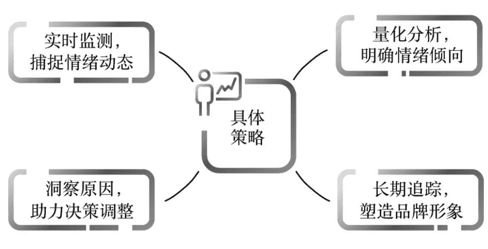
比如某快餐品牌推出新口味汉堡，团队借助 DeepSeek 监测各大社交平台和外卖平台评价。初期不少用户发“期待”“好吃”等关键词，情绪偏积极。随着时间推移，部分用户提到“味道太咸”“价格偏高”，负面情绪逐渐增多，及时捕捉到变化趋势，为营销敲响警钟。

#### 2. 量化分析，明确倾向
发现情绪还不够，还能进行量化分析。通过自然语言处理将文字分为积极、消极、中立三种倾向，并计算各自占比。

以上述快餐品牌为例，分析显示新品推出一周内积极评价占比高、消极占比低。两周后，随着负面反馈增加，积极占比下降，消极占比上升。不同倾向的占比波动让营销人员直观了解用户整体态度及情绪变化程度。

#### 3. 洞察原因，助力决策
量化只是第一步，更重要的是洞察情绪背后的原因。通过提取负面评论关键词并分析含义，可找出引发不满的具体因素。

针对汉堡负面情绪增多，DeepSeek 进一步分析发现不满主要集中在“口味过重”和“性价比低”。品牌随即调整：一方面改良口味推出减盐版，另一方面推出套餐优惠提升性价比。同时营销人员利用 DeepSeek 生成回应文案，在社交媒体上感谢反馈并告知改进措施，有效缓解负面情绪。

#### 4. 长期追踪，塑造形象
除短期波动外，还能长期追踪情绪变化。通过分析不同时段情绪演变，可了解品牌在用户心中的形象变化，发现建设过程中的优点与不足。

若一段时间内积极情绪持续上升，说明营销与产品改进效果良好；反之若消极情绪不断累积，则需全面审视产品、服务与营销方式并及时调整。

通过实时监测、量化分析、洞察原因和长期追踪，品牌能更好地理解用户需求，及时调整策略，与用户建立更紧密的情感连接，在竞争中赢得认可与信赖。

### 4.6 需求演进预测：生成用户需求变化路径
市场环境变化，用户需求也在演进。能否精准预测需求演进路径，直接关系到品牌竞争力与可持续发展。DeepSeek 借助预测模型，帮助品牌提前洞悉变化，为研发与营销提供科学依据。

构建模型的基础是海量数据的收集与整合。DeepSeek 可广泛收集用户各渠道数据。电商平台上的购买记录、浏览历史、搜索关键词记录消费偏好；社交媒体上的发帖内容、话题参与、关注账号类型反映兴趣与价值取向；行业动态、政策变化、技术创新等宏观数据也是重要来源。

比如近年来健康养生理念深入人心，社交媒体上健康饮食、运动健身话题热度攀升，电商平台健康食品、运动器材的搜索与购买量同步增长，这些信号均被及时捕捉。

收集到数据后，DeepSeek 运用先进算法对数据进行深度挖掘，从中寻找规律与趋势。通过分析历史购买行为变化，可发现需求发展轨迹。如用户购买普通零食频率下降而低糖低脂健康零食购买次数增多，可判断健康食品需求在上升。

同时，还会考虑外部环境对需求的影响。例如新能源汽车技术突破续航大幅提升且政府出台购车补贴，会综合信息预测消费者对新能源汽车需求可能显著增长，并进一步分析其对性能、配置等提出更高要求。

基于深度分析，可生成详细准确的需求变化趋势，清晰展示未来一段时间内需求可能发生的变化，包括方向、强度及时间节点。品牌拿到这份“需求演进蓝图”后，可在多个方面做针对性布局。

在产品研发上，可提前规划新品研发方向与功能特性。某手机厂商借助预测发现，随着短视频创作与直播兴起，用户对拍摄功能需求增长，尤其对视频防抖、夜景拍摄、美颜效果期待更高。于是加大摄像头技术投入推出超强拍摄新品上市即获热捧。

在营销策略上，需求预测模型同样关键。可根据趋势调整宣传重点与推广渠道。若预测某类产品在年轻群体需求将快速增长，就可把营销资源投向抖音、小红书等年轻人聚集平台，采用符合其口味的内容与方式。同时模型还能合理安排上市时间与促销活动，提升效果与资源利用效率。

此外，基于需求预测，品牌可进一步推进 GEO 优化，通过低频内容动态更新实现长效触达。例如基于用户行为数据预测需求变化，将行业白皮书、深度教程等低频高价值内容模块化拆解，通过 AI 生成动态摘要、问答对或场景化片段，适配搜索引擎即时答案需求。

需求预测模型为品牌提供了强大支持，帮助在复杂多变市场中准确把握需求演进路径，实现从被动适应到主动引领的转变。在数字化智能化背景下，善用这一功能将成为品牌脱颖而出的关键。

### 4.7 AI督察——DeepSeek监控舆情并预警

网络信息的流动几乎是瞬间的，一条负面话题能在数小时内完成裂变，对品牌形象造成难以修复的损伤。把舆情的追踪、识别和处置前置，已成为品牌营销与管理中的常规动作。借助 DeepSeek 的技术底座，品牌可以获得一套智能巡检能力，实现全链路的口碑监测与风险告警，帮助企业在复杂的线上环境中稳住声誉。

在监测层面，DeepSeek 会持续对社交媒体、新闻站点、论坛社区、电商评论区等渠道进行巡检，迅速捕捉与品牌相关的各类声量。用户的点赞与投诉、媒体报道、行业议论，全部落在它的观测范围内。

采集之后会进入深度拆解。系统通过情感倾向判断，区分文本是正向支持、负向反对还是中性客观；再借助关键词抽取与语义理解，梳理出内容的核心要点与传播焦点。以某品牌负面声量抬头为例，系统能够快速归纳问题集中在产品品质、售后跟进薄弱等维度，并统计相关信息的覆盖面与扩散速率，让品牌对事件的严重程度形成清晰判断。

预警是监控的关键环节。一旦捕捉到重要信号，尤其是可能引发负面影响的苗头，DeepSeek 会立刻发出告警。告警形式可为邮件、短信或站内推送，确保负责人第一时间掌握动态。比如某品牌被曝出产品质量问题，相关话题在社交平台快速发酵时，告警即时触发，团队能够迅速介入。

收到告警后，营销团队可结合具体情况制定应对方案。对负面舆情，及时回应、厘清事实、解决用户诉求，能把负面影响压到最低。比如某餐饮品牌被顾客投诉食品安全问题，告警发出后团队马上核查，向顾客致歉并给予补偿，同时以官方渠道公布调查结果与整改措施，舆论得以平息。对正向声量，则可加大投放，进一步提升知名度与美誉度。

DeepSeek 还能对舆情走势进行前瞻研判，结合历史数据与当前动态，评估事件是否会持续发酵及可能产生的后果，帮助团队提前布局、制定更长周期的口碑管理计划。比如当系统判断某次营销活动存在争议风险时，团队可提前调整方案，避免负面发生。

作为智能哨兵，DeepSeek 在品牌口碑监测与风险预警上发挥了重要作用，帮助团队实时把握网络动态、及早发现潜在危机，为维护声誉、提升形象提供有力支撑，让品牌在多变的环境中保持稳健。

### 4.8 实操演练：用DeepSeek预判下一个爆款单品
打造爆款是各品牌的共同诉求。DeepSeek 的数据分析与前瞻能力，能帮助品牌把握市场走向，挖掘潜在机会。下面以某运动品牌推出新款运动鞋为例，展示预判爆款的完整流程。

第一步，明确需求，下达指令。
该品牌希望推出贴合市场、具备爆款潜力的新款运动鞋。营销人员打开 DeepSeek，在交互界面输入详细要求：“分析当前运动鞋市场的消费趋势，重点关注功能偏好如缓震、透气、防滑等，设计风格如复古、潮流、简约等，以及价格区间偏好。同时分析近一年爆款运动鞋的成功原因，包括产品特性、营销打法、投放渠道等，预测未来数月可能受欢迎的类型，并给出研发与营销建议。”指令明确了分析边界、关注要点和期望输出，确保分析贴合品牌需求。

第二步，深度分析，获取结果。
DeepSeek 迅速启动，从电商销售数据、社交讨论、运动论坛用户反馈、行业报告等多源抓取海量信息。经算法处理后形成详细分析报告，如图4-3所示。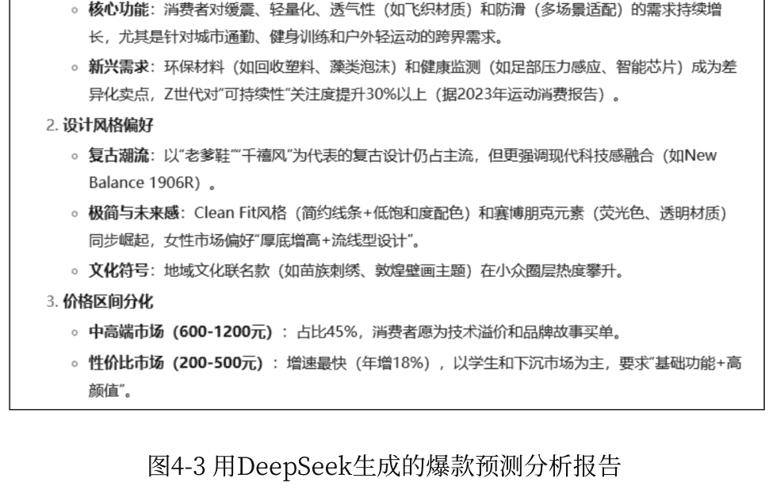

在消费趋势方面，DeepSeek 指出消费者对功能需求日益细化，对缓震、透气性、防滑等性能关注度提升；设计上，复古潮流与科技感融合的款式更受年轻群体青睐；价格上，高性价比产品的需求明显增长。

对于爆款成因，DeepSeek 总结为：具备创新科技且能直观展示原理的产品更容易吸引注意；明星代言、KOL 种草结合短视频传播效果最佳；限量发售、联名合作等策略能有效提升热度。

基于以上结论，DeepSeek 判断未来数月，搭载新型缓震科技、采用复古潮流的设计且价格亲民的运动鞋，有较大概率成为爆款。

第三步，优化策略，打造爆款。
依据分析结果，品牌迅速行动。研发上与专业科研团队合作，开发新型缓震材料，并融入复古潮流元素进行外观设计；营销上邀请当红运动明星代言，联合知名潮流博主进行产品种草；投放渠道聚焦抖音、小红书等短视频与社交平台，制作创意视频突出性能与设计亮点。

同时，团队利用 DeepSeek 进一步精炼宣传文案。输入指令：“为新款运动鞋撰写宣传文案，突出新型缓震科技和复古潮流设计，面向18～35岁年轻人群，风格要时尚有活力，能激发购买欲。”DeepSeek 产出文案后，如图4-4所示。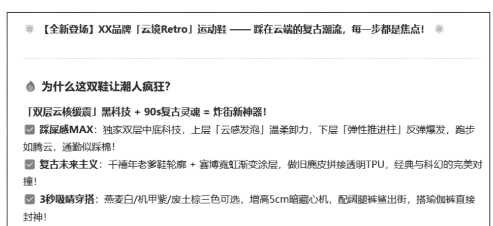 营销人员据此调整完善，确保卖点传达精准。

上市后，新款运动鞋迅速获得关注，社交媒体话题热度持续攀升，销量稳步增长，成功成为爆款。

这次演练表明，借助 DeepSeek 可以深入洞察市场趋势与用户需求，为研发与营销提供科学依据。熟练应用，品牌能更轻松打造爆款，获得更大市场份额。

## 第5章 内容批量化生产：告别手工撰稿的效率困境
在人工智能重塑营销的当下，内容产出效率与质量已成为制胜关键。面对海量内容需求，传统创作耗时费力，而 DeepSeek 以智能技术重构生产链条。本章从创意生成、爆款公式拆解、风格迁移、人性化生成等多角度讲解如何批量生产优质营销内容，帮助营销人员突破创作瓶颈，实现高效输出与精准传播。

### 5.1 案例拆解：零食品牌借助DeepSeek快速批量产出小红书文案
零食行业竞争激烈，小红书已成为触达年轻女性用户的核心阵地。平台上零食笔记发布量庞大，但爆款率不高。根源在于传统内容生产存在三大瓶颈：

- (1) 效率低：人工撰写需经历选题、创作、排版等环节，单篇耗时2～3小时，难以满足日均20余篇投放需求。
- (2) 数据滞后：依赖人工分析爆款规律，从数据收集到方案调整周期长达7～15天。
- (3) 成本高：专业团队月均人力成本数万元，中小企业难以承担。

为打破瓶颈，某零食品牌要求营销人员用 DeepSeek 进行批量化内容生产。以标题创作为例，营销人员输入“生成10个关于控糖零食的爆款标题，要求包含数字量化、痛点解决、情绪词”的指令后，DeepSeek 在1分钟内产出10个标题，并给出设计逻辑，包括人群精准定位、情绪对冲、危机感营造等，如图5-1所示。

在文案生成阶段，营销人员输入“模拟30岁职场女性口吻，撰写低卡零食原味鸡胸肉丸测评文案，要求包含实验室检测数据、打卡记录”的指令，DeepSeek 自动产出：“每天下午3点饿到心慌？这款原味鸡胸肉丸救了我的命！高蛋白配方抗饿4小时，5种口味换着吃，微波炉加热10秒解锁流心口感。实验室检测显示GI（血糖生成指数）值仅为23，30天实测体重下降4.2kg！私心给姐妹一个建议：每月允许两次‘作弊日’，减肥才能持久。”

以下是10个符合要求的控糖零食爆款标题，每个标题均包含数字量化、痛点解决和情绪词：

1. 【血糖0负担】5款低GI零食清单！解馋不怕胖的甜蜜救赎

2. 打工人必备！8种办公室控糖小零嘴，加班不怕血糖坐过山车

3. 戒糖失败者福音！3分钟自制6种无糖零食，好吃到忘记奶茶

4. 孕期控糖别emo！10款安全零食清单，让幸福感和血糖都稳得住

5. 学生党狂喜！9.9元搞定7天低糖零食包，图书馆抗饿不犯困

6. 夜宵党必存！5款深夜0罪恶零食，放肆吃不怕血糖“蹦迪”

7. 暴击糖瘾！6种控糖黑科技零食，比奶茶更上头的健康多巴胺

8. 出差党救星！12种便携控糖零食塞满行李箱，机场候机不破戒

9. 抗糖逆袭30天！8款零食轮流吃，皮肤透亮度+2个level

10. 揪出隐形血糖刺客！10大“伪健康”零食避雷指南+替代方案

标题设计逻辑：

1. 人群精准定位（打工人/学生党/孕妇等）

2. 量化价值可视化（数量/价格/时间/效果）

3. 痛点场景化（加班/熬夜/出行等）

4. 情绪对冲（救赎/狂喜/福音/逆袭）

5. 危机感营造（刺客/避雷/过山车）

图5-1 用DeepSeek生成的标题

为提升互动率，营销人员输入“设计3个开放式问题引导用户评论”的指令，DeepSeek 产出“你试过微波炉加热鸡胸肉丸吗？哪种口味最惊艳？“如果出新口味，你希望是什么？”“和××品牌相比，这款零食的包装设计要做哪些改进？”将问题加入文案后，评论区互动量显著提升，并触发小红书推荐机制，曝光量提升数倍。

在鸡胸肉丸上市推广中，团队通过 DeepSeek 实现从0到1的爆款突破：首小时投放20个垂类KOC账号，预算仅500元，点赞量达5268，收藏量超3000，官方账号涨粉5129个。同时发起“控糖挑战”话题活动，最终带动月销售额突破10万元。

此次成功让品牌看到 DeepSeek 的潜力，营销部门全方位接入以重构内容生成模式。目前借助 DeepSeek，多数营销人员可实现日产文案超百条，热点响应速度缩短至2小时，自然搜索流量增长超200%。

实践中发现，情绪价值锚点式指令生成的内容质量更高。例如“自从吃了它，老公以为我偷偷健身了”“同事追着要链接”等表述，情感共鸣大幅提升。DeepSeek 还能实时监控小红书等平台算法变化，及时调整关键词密度，如用“低GI零食”替代“健康零食”，显著提升搜索排名。

该案例充分展示了 DeepSeek 在内容生成方面的价值。需要明确的是，DeepSeek 的目标并非替代人类创意，而是放大创意价值，提供一条技术驱动、高效迭代的突围路径。

### 5.2 选题策划：DeepSeek如何打通创意全链路
选题决定内容传播效果。传统营销多依赖经验直觉，而 DeepSeek 为营销人员打造了从需求挖掘到选题矩阵生成的全链路智能系统。

#### 1. 挖掘需求，精准定位选题方向
DeepSeek 凭借强大的数据整合与分析能力，深入挖掘用户与市场需求。它整合10余种数据源，如社交媒体UGC、电商搜索日志、客服对话记录、竞品评论区等，建立包含300多个维度的用户需求图谱。例如某零食品牌营销人员输入“挖掘25～35岁女性零食消费痛点”指令后，DeepSeek 可输出结构化需求矩阵，如表5-1所示。

表5-1 25～35岁女性零食消费痛点

| 需求维度 | 具体痛点描述 | 关联场景 | 情绪关键词 |
| :--- | :--- | :--- | :--- |
| 功能需求 | “抗饿但怕胖”“担心添加剂”“开袋后易受潮”… | 办公室/通勤/追剧 | 焦虑、矛盾、安全 |
| 情感需求 | “独处时的治愈感”“社交分享的仪式感”… | 下午茶/闺蜜聚会 | 温暖、归属感、炫耀 |
| 场景需求 | “单手可操作的小包装”“适合拍照的高颜值”… | 健身房/露营/办公桌 | 便捷、精致、打卡 |

DeepSeek 还能分析电商平台零食销售数据，包括品类、口味、包装规格的销售趋势及用户评价，从中发现尚未被满足的需求。例如用户评论提到“找不到适合健身后吃的零食，既补充能量又不会长胖”，即可衍生选题“健身后必吃的低卡高能量零食推荐”。

此外，DeepSeek 可对用户搜索行为进行分析，了解不同时段、场景下的关键词变化。例如节假日前夕，“节日零食礼盒”“送礼零食推荐”搜索频率上升，营销人员可提前策划“春节送礼必备！高颜值零食礼盒大揭秘”“情人节甜蜜暴击，这些零食礼盒让爱意满满”等选题。

#### 2. 实时追踪热点趋势，借势打造爆款选题
热点是获取流量的重要契机，但具有随机性和时效性，靠人工难以快速捕捉。DeepSeek 可对新闻资讯、社交媒体热门话题、短视频平台热门内容进行实时扫描，第一时间发现潜在热点，并分析其传播趋势、受众画像及与品牌的关联性。

例如某热门影视剧播出时，DeepSeek 可监测到剧中零食相关内容引发讨论，随后分析热度走势与用户画像，提供“get同款！剧中主角都爱的零食大揭秘”“追剧零食新选择：跟着剧中主角吃准没错”等贴合热点的选题建议。

针对季节性热点，如夏季消暑清凉、冬季保暖进补，DeepSeek 能提前预测热度变化，结合品牌定位策划相应选题。例如夏季为饮料品牌策划“夏日消暑饮料测评：哪一款能让你瞬间清凉”，冬季为火锅底料品牌策划“冬日暖心必备！美味火锅底料推荐”“寒冷天气，一顿火锅和这些底料更配哦”，增强季节共鸣。

#### 3. 分析竞品动态，实现选题差异化
了解竞品动态是策划差异化选题的关键。DeepSeek 可收集竞品在各平台发布的内容，分析其选题方向、内容形式、传播效果，为营销人员提供竞争情报。若发现竞品近期聚焦新品口味而忽略健康属性宣传，便可策划“健康与美味兼得：这款零食完胜竞品的秘密”“拒绝单一，这款零食在健康上更胜一筹”等突出优势的选题。

同时，DeepSeek 还能分析竞品内容传播数据，如阅读量、点赞数、评论数，了解哪些选题受欢迎、哪些效果不佳。基于此借鉴成功经验、规避失败方向。例如发现竞品“零食盲盒”选题关注度高，可进一步创新策划“升级版零食盲盒：惊喜加倍，美味不停”“揭秘零食盲盒背后的隐藏美味”，实现超越。

#### 4. 快速生成创意选题，激发无限创作灵感
整合需求、热点、竞品信息后，DeepSeek 运用自然语言处理与生成技术，为营销人员生成丰富多样的选题。可根据品牌定位、产品特点、营销目标等指令，从不同角度、风格生成方案。

例如针对主打年轻时尚的零食品牌，输入“生成吸引年轻消费者的零食营销选题，突出潮流、个性元素”指令，DeepSeek 会生成“潮人必备零食清单：让你成为朋友圈的焦点”“解锁零食新吃法，潮玩零食的个性打开方式”“零食界的时尚单品，你入手了吗”等选题，既符合调性又满足用户追求时尚个性的心理。

DeepSeek 还具备选题优化功能。营销人员可将初步选题反馈，系统会提出修改建议，如增加情感共鸣、调整角度等。例如“美味零食推荐”经优化后变为“深夜emo时刻，这些零食治愈你的心”，情感元素增强，更易引发共鸣。

### 5.3 爆款公式拆解：标题正文标签一键成型
“每天憋内容5小时，写标题30分钟，结果阅读量只有两位数”——这是很多营销人的真实写照。抖音、快手、今日头条等平台的AI算法可在0.3秒内决定内容浏览量与传播效果。

对百万级浏览量的内容进行拆解，可发现其核心公式为：吸睛标题+优质正文+精准标签。如今用 DeepSeek 创作符合此公式的内容，从构思到生成只需不到1分钟。

#### 1. 用DeepSeek生成吸睛标题
传统标题套路已失效。三段式标题如“熬夜危害大！这3招拯救你！速看！”，点击率下降；震惊体标题如“天啊，某明星竟在片场吃这个”，举报量飙升。智能时代应采用三感法则：悬念感、权威感、冲突感。用 DeepSeek 生成此类标题，从构思到产出仅需十几秒。

第一感，悬念感——吊足胃口。技巧是隐藏关键信息+抛出反常识结论。人类大脑对未完成事件的记忆留存率更高，悬念能激发点击欲望。

借助 DeepSeek 设计悬念型标题，可使用指令：“生成5个关于人工智能写作的悬念型标题，要求隐藏解决方案并暗示颠覆性结论。”输入后，DeepSeek 可生成符合要求的标题，如图5-2所示。

悬念感设计原理：

1. 制造认知冲突；

2. 植入时间压迫感（如第37天、2030年等）；

3. 用禁忌暗示（如封锁、警告、消失等）；

以下是5个符合要求的悬念型标题，暗藏颠覆性结论同时保持神秘感：

1. 《人类作家集体沉默的第37天：一个正在吞噬文字行业的「隐形写手」》

   （暗示行业剧变但隐藏人工智能解决方案）

2. 《百万文案人不知道的真相：你80%的原创内容早已被「它」预判》

   （制造认知冲突，暗示人工智能的预判能力）

3. 《深夜收到神秘警告：继续用传统写作方式等于慢性职业自杀》

   （制造危机感，隐藏人工智能替代方案）

4. 《这个被封锁7次的写作黑箱，正在批量生产「诺贝尔文学级」文本》

   （用矛盾修辞暗示人工智能突破性能力）

5. 《2030年最后一位人类作家消失前，留下了这份颠覆认知的手稿》

   （预言式悬念指向根本性变革）

图5-2 DeepSeek产出的悬念式标题范例

#### 2. 让DeepSeek产出可阅读的正文
借助DeepSeek对高互动素材的语义拆解，可以归纳出一条四段落叙事主线：先点出共情点引发认同，再给出可操作的方法，随后用情境描写提升代入感，最后落到明确的转化引导。

##### (1) 共情切入
做法：请模型统计用户评论里的高频表达，转化为“你是不是也……”式的提问开头。比如某美妆号开头被改写为“每次上妆就卡粉浮粉？很可能忽略了这3个关键细节……”。

##### (2) 方法呈现
做法：沿着“产品特性→使用情境→效果对比”三步，让模型输出用户操作指南。

##### (3) 情境代入
做法：植入用户旅程节点，例如“通勤路上→午间补妆→下班约会”，帮助读者形成画面感。

##### (4) 转化引导
做法：自动生成带时效福利的文案并附上跳转链接。

情境设定：一位健身房推广者需要在公众号发布科普，指令为：撰写一篇名为《白领健身翻盘：3个工位动作告别亚健康》的推文，用亲历口吻讲述工作繁忙抽不出时间锻炼的困境，点出没空、见效慢、难以坚持等痛点，通过3个工位动作改善身体状况，给出前后数据对比，结尾加入“分享健身体会好礼”活动。
DeepSeek的产出示例如图5-5所示。

# 白领健身翻盘：3个工位动作远离亚健康
——从“过劳肥”到“活力王”，个人蜕变记录

## 一、职场人的隐形痛点：为何总在无效锻炼
作者自述为互联网公司项目经理，长期996：早餐靠咖啡续命、午餐在工位解决、下班腰酸背痛，久坐加宵夜体重升到75公斤。办过健身房年卡、安排过晨跑，都因没时间、见效慢、坚持不住而放弃。去年体检出现警报，颈椎曲度变直、体脂率32%，才下决心做碎片化自救。

## 二、逆袭工具箱：3个不离工位的黄金动作
### 动作一：椅子深蹲 激活下肢 助燃脂
要点：每小时起身一次，双脚与肩同宽，臀部后坐至椅沿不接触，保持核心收紧。每组15次，每天5组。个人数据：3个月大腿围减4cm，爬楼不喘。

### 动作二：颈椎米字操 告别肩颈酸痛
要点：头部在空中书写“米”字，每笔停留3秒，重点拉伸斜方肌和胸锁乳突肌。每日20组。改变：头晕手麻消失，伏案时长从1小时延至2.5小时。

### 动作三：隐形平板支撑 雕刻核心
要点：双肘撑桌身体成直线，收腹坚持30秒，进阶可单腿交替抬起。每日累计5分钟。效果：腰围88cm降至82cm，久坐腰痛频率降70%。

## 三、科学解释：这3个动作为何有效
1. 时间成本低：单次≤2分钟，契合碎片运动；
2. 精准打靶：对应职场TOP3问题——下肢循环差、肩颈劳损、核心松弛；
3. 数据可量化：配合手环监测，每日额外消耗200-300大卡，约等于慢跑30分钟。

## 四、逆袭成果：从亚健康到办公室健身达人
体态：体重-8kg，体脂率降至24%，抽屉里的膏药彻底闲置；
效率：专注力提升40%，项目交付周期缩短15%；
心态：获同事称“移动安利机”，带动部门成立碎片健身联盟。

## 五、粉丝福利：分享“工位逆袭故事”赢千元健康礼包
即日起至2025年4月30日，评论区分享职场健康困扰、动作体验并@一位想一起改变的同事。
奖项：人气王点赞前三获价值800元智能体脂秤+筋膜枪；励志奖随机10名获办公室健身套装。
私藏Tips：设微习惯闹钟每50分钟运动2分钟；桌面打卡表完成一周奖励无糖奶茶；3-5人监督群未打卡发红包。
结语：健康不是等有空再做的事。起身深蹲一次、转动颈部一圈、收紧腹部十秒，改变就藏在下一个两分钟里。即刻开始，身体会回馈惊喜！ ✍
图5-5 DeepSeek生成的正文示例

初稿可直接使用，也可把夸张表述换成更理性的表达，并检查逻辑、信息准确性和语言流畅度。加入个人真实感受和小故事，共鸣会更强。

#### 3. 让DeepSeek提炼精准标签
平台算法推荐建议采用“核心词+长尾词+热点词”三维组合，如表5-2。也可以让DeepSeek直接从自生成正文中提取标签，通常符合三维思路。

表5-2 三维标签组合示例
| 平台 | 核心词侧重 | 长尾词指向 | 热点词来源 |
|---|---|---|---|
| 小红书 | 人群属性 | 场景化需求 | 品牌合作话题 |
| 抖音 | 产品功能 | 痛点解决方案 | 挑战话题 |
| 公众号 | 行业关键词 | 价值主张 | 节日热点 |

为丰富度更高，可用四维组合“品类词+场景词+情感词+热点词”，如表5-3。DeepSeek会提示同类词的查找路径。

表5-3 四维标签组合示例
| 标签类型 | DeepSeek智能推荐来源 | 应用场景示例 |
|---|---|---|
| 品类词 | 行业热搜词库，如“早C晚A”“通勤穿搭” | 敏感肌护肤、空气炸锅食谱 |
| 场景词 | 用户行为数据，如搜索/收藏/购买路径 | 学生党平价、职场妈妈必备 |
| 情感词 | 评论情绪分析，如焦虑/向往/成就感 | 治愈系家居、拒绝容貌焦虑 |
| 热点词 | 实时爬取平台热搜榜 | 春日野餐季、世界杯球迷装 |

进阶功能包括：标签权重分析自动标注核心流量词与长尾搭配比例；竞品对标一键抓取爆文标签规律；算法适配按平台推荐机制调整组合。
把DeepSeek当助手，掌握“吸睛标题+优质正文+精准标签”公式，可从普通营销者跃升为爆款制造机。

### 5.4 风格迁移术：快速模仿KOL的行文风格
研究显示用户对KOL内容的信任度高于品牌官方，其中“独特表达风格”是持续关注的核心。风格已成穿透力更强的商业资产。
DeepSeek实现路径如图5-6所示。

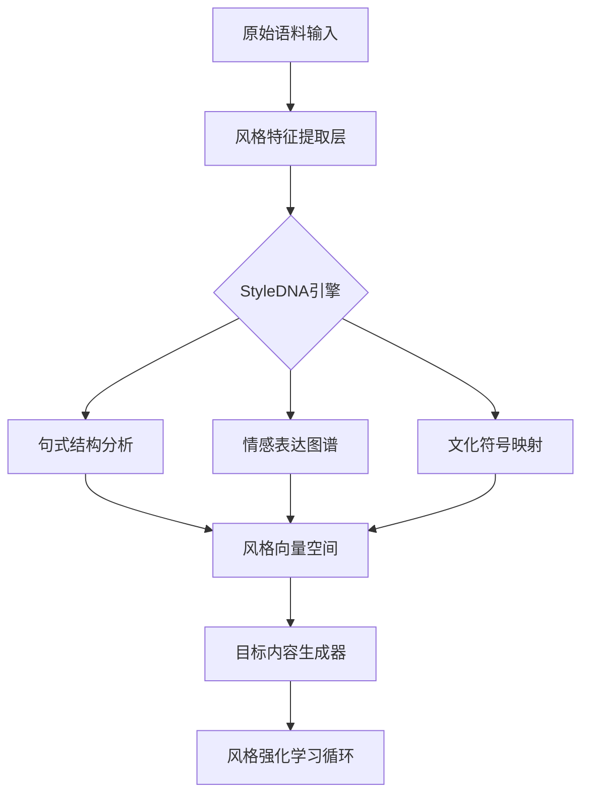
图5-6 DeepSeek技术实现路径
1. 72维度风格解析：覆盖词汇密度、情感极性、隐喻偏好等隐性特征。
2. 实时迁移学习：单篇300字样本即可提取风格指纹，精度超91%。
3. 跨模态风格捕捉：同步分析文本/图文/视频的语言韵律与视觉符号关联。
4. 语境感知补偿：保留行业术语、地域方言等专业特征。

五步实操：
第一步，目标锁定，定位KOL行文风格，如表5-4。
表5-4 定位KOL行文风格
| 维度 | 分析指标 | DeepSeek工具 |
|---|---|---|
| 语言特质 | 句式复杂度/口语化指数 | 风格雷达图，支持多KOL对比 |
| 情感表达 | 积极/消极词汇配比 | 情感光谱分析仪 |
| 文化符号 | 热点引用频率/亚文化标签密度 | 符号关联图谱 |
| 交互特征 | 粉丝互动句式/高赞回复模式 | 对话流模拟器 |

第二步，数据喂养，形成风格基因库。
（1）优质样本选择：20-30篇代表内容，兼顾爆款与常规。
（2）特征强化训练：用/preset_style指令聚焦核心特征。
（3）干扰项过滤：用/clean_noise去除广告植入等非风格元素。

第三步，风格迁移。
（1）基础克隆：/mimic_style input=@KOL样本 output=营销文案。
（2）风格杂交：/blend_styles style1=@科技博主 style2=@搞笑博主ratio=6：4。
（3）动态进化：/evolve_style base=@原风格 trend=2024Q3流行语。

第四步，人工调整。
（1）品牌安全检测：核查价值观一致性；
（2）爆款元素注入：手动加入平台流量密码标签；
（3）差异化设计：句式结构制造5%-10%差异。

第五步，双重评估，如表5-5。
表5-5 双重评估体系
| 评估维度 | 机器指标 | 人工指标 |
|---|---|---|
| 风格相似度 | Jaccard系数≥0.82 | 目标KOL粉丝盲测通过率≥74% |
| 内容质量 | 语法错误率≤0.3% | 品牌信息植入自然度≥8.1分 |
| 传播潜力 | 平台热度预测值≥B级 | 编辑推荐可能性≥65% |

案例：国货彩妆品牌需30天内搭建6类风格达人矩阵。传统方式需签约40+位KOL，预算超200万。DeepSeek模式提取@化妆师张宇专业型、@深夜徐老师情感型等头部达人风格后按五步执行。效果对比表5-6。
表5-6 效果数据对比
| 指标 | 传统模式 | DeepSeek模式 |
|---|---|---|
| 内容生产成本 | 380元/篇 | 47元/篇 |
| 爆款率（赞藏≥1w） | 12% | 29% |
| 用户认知 | “多个达人” | “统一品牌人格” |
| 冷启动周期 | 14天 | 3天 |

风险提示：需守住著作权底线，避免复制具体文案。守住边界即可实现“千面营销”，兼顾风格复制与品牌独特性。

### 5.5 让DeepSeek写出人性化内容的三个技巧
核心挑战从生产内容转向生成有温度、能共情的内容，需营销人员干预：情感化指令设计、用户数据解码、内容动态校准。

1. 情感化指令设计
（1）场景颗粒度细化：避免笼统指令，改写为“模拟28岁互联网女工程师加班场景，下午3点抗饿零食选择，要求出现键盘敲击声、咖啡机噪声等环境细节”。
（2）角色画像具体化：如“95后职场新人，租房生活，月末转账父母后预算紧张，爱看B站省钱攻略”，生成的内容更易共鸣。
（3）植入文化符号与社交货币：将亚文化语言、流行梗、圈层黑话转为指令关键词。
（4）五感化指令：加入视觉/听觉/嗅觉/味觉/触觉细节，如“描述撕开包装的嘶啦声、咀嚼的咔吱脆感、巧克力融化黏度”。

2. 用户数据解码
（1）多源数据清洗与情感化转化：把调研、行为数据、竞品评论转为情感标签。如减脂零食搜索上涨，不仅关注低卡高蛋白，更挖掘减肥焦虑、身材羞耻等动机。
（2）按用户决策旅程设计情感触发指令：
认知：共鸣式痛点，如“周一早晨闹钟比老板更残忍”带出提神咖啡场景；
考虑：强调解决方案人性化细节，如客服温暖回复与质检报告安心感；
购买：强化即时满足，如拆快递剪刀声、气泡膜贴心设计；
复购：聚焦长期陪伴与身份认同，如坚持30天后朋友称赞状态好。
（3）动态画像更新：定期导入最新反馈，实时调整指令，如结合“拒绝无效加班”情绪，突出零食快速补能、让加班更有尊严。

3. 内容动态校准与优化
（1）A/B测试加入情感维度：比较成分参数版与加入“凌晨三点被猫咪踩醒，看到碗里剩粮觉得被需要”版，后者情感共鸣更高。
（2）评论区反哺：评论出现“太广告化”时，输入指令增加30%个人体验细节、减少20%参数描述，加入“我一开始也不信”等真实心理，降低软文感。
（3）工作流：DeepSeek初稿→人工情感润色→数据反馈优化。聚焦情感内核、身份标签是否清晰、是否击中痛点。

### 5.6 内容库——DeepSeek自动归档并复用素材
素材无序堆积导致重复创作、资源浪费。DeepSeek提供智能解决方案。

1. 素材自动归档
（1）多模态识别：文本分析主题、关键词、情感倾向；图片识别产品、场景、色彩风格；视频音频提取关键帧、字幕、关键词与情感基调，实现精准分类。
（2）元数据标注：覆盖基本信息、业务属性、效果数据，便于评估价值。
（3）自定义归档规则：按产品系列、活动类型、时间周期等构建层级，如服装品牌按季节款式性别归档，零食品牌按类别口味场景分类。

2. 高效素材复用
（1）智能检索：支持关键词、标签、语义检索，并基于使用习惯推荐历史相似成功案例。
（2）模块化拆解：文案拆标题、正文段落；图片拆元素、色彩；视频拆镜头、转场，可重组生成新素材。
（3）跨平台适配：自动调整尺寸、分辨率、色彩模式，并优化内容表现以匹配平台受众偏好。

把素材交给 DeepSeek 做自动归档和二次复用，效率提升是立即可感的，但要真正跑通，必须先拿到高层的共识。素材要从资料变成资产，需要高层拍板把建设纳入品牌战略，并亲自牵头搭建素材库，推动跨部门协同。执行层面，营销团队要先统一标签规则，避免同一素材出现多重标签或歧义。若条件允许，单独设立数据标注小组来做质控会更稳。

展望下一步，模型对素材的理解与拆解会更深，能给出更贴合业务场景的复用建议。随着可训练素材体量扩大，DeepSeek 还会自主提炼创意点子和优化思路，帮创作整体提档。

### 5.7 突破批量生产带来的内容同质化
当越来越多的品牌用 DeepSeek 做规模化生产，同质化会悄然变成影响传播效果的隐形杀手。文案套路雷同、视觉风格趋同、卖点反复堆砌，容易让用户审美疲劳，也稀释品牌辨识度。关键在于把工具从单纯的内容生产机，转变为孵化品牌个性的伙伴。

#### 1. 搭建私有语料体系
同质化的根源是模型大量调用高度相似的公开语料。品牌可以采用私有化部署，把模型放在本地运行，并用自有素材做微调，让产出更具辨识度。

在此基础上，建议构建三层专有语料架构，让模型真正学会品牌的说话方式。

- （1）品牌基石层。植入品牌特有的价值主张，如绿色消费、国潮美学；专业产品术语，如冷萃工艺、微囊包埋技术；真实用户证言，如场景化对话与评价片段。
- （2）按购买旅程切分场景。认知阶段侧重痛点描摹，如“熬夜后的第二天疲惫感”；考虑阶段突出解法，如“3分钟快速补妆技巧”；下单阶段给出行动指令，如“点击领取限时优惠”；复购阶段强化情感联结，如“成为精致生活里的日常陪伴”。通过颗粒化描述，避免“好吃不贵”“性价比高”等泛化表达。
- （3）持续收录用户反馈。把评论区里出现的仪式感、被治愈等情绪热词，以及搜索栏中孕期控糖零食、乳糖不耐受友好等长尾诉求，实时补充进语料。让生成内容始终贴合真实消费语境，具备画面感。

#### 2. 设计精细化指令
指令越笼统，输出越模板化。要获得差异化结果，就需要对指令做拆解。

（1）基础信息：明确产出对象、载体与具体场景。例如，“为 25 到 35 岁职场女性创作抖音短视频脚本，主推新款低卡零食，场景设定在办公室快速充饥，前 3 秒必须出现撕开包装的声音”。

（2）风格限制：限定情感基调与表达规则，例如“采用温暖治愈语气，不使用感叹号，至少加入 3 个具体动作描写，如捏一捏蓬松的口感”。

（3）文化符号：植入品牌调性元素，例如国潮品牌可要求“使用敦煌色系描述”“用古诗词比喻质感”，规避通用视觉语言。

#### 3. 算法调优激活创意
模型默认倾向保守表达，而营销需要亮点。可通过少样本学习激活创意，例如提供少量优质范例让模型学习新风格。同时建立简易检测机制，比对产出内容与竞品的重复率。若重复率偏高，可指令切换叙事视角，逼出差异化表达。

#### 4. 人机协同把控质量
DeepSeek 是执行者，营销人员是决策者。在校准阶段，可明确反同质化原则，例如“禁用行业 Top10 高频词”“至少 10% 内容尝试全新表达”“强制更换叙事角度”。在限制泛滥词汇并要求创意发挥后，模型才能产出更有辨识度的文案。

若产出内容仍显重复，可追加创意指令，例如“加入品牌 IP 形象的互动对话”“以电影台词口吻描述”。最终阶段，营销人员可对输出进行二次加工，叠加品牌 LOGO 水印等，进一步强化独特性。当每条内容都带有鲜明的品牌个性标签，同质化问题自然被化解，品牌也能在智能营销时代建立核心竞争力。

### 5.8 实战拆解：DeepSeek 助力产出抖音爆款脚本
在短视频投放中，抖音用户对新鲜感与趣味性的要求很高，脚本创作压力较大。DeepSeek 可以快速产出符合平台调性的脚本。先要清楚抖音脚本的关键要素，通常包括镜头、景别、运镜、台词、时长、音乐等。例如美妆类推广，可能从特写展示产品外观切入，配合“这款粉底液质地超水润”的口播，采用推镜拉近细节，控制在 15 到 30 秒，搭配轻快音乐营造种草氛围。只有明确这些要素，才能更精准地与模型沟通。

借助 DeepSeek 生成抖音脚本的流程如图5-7所示。

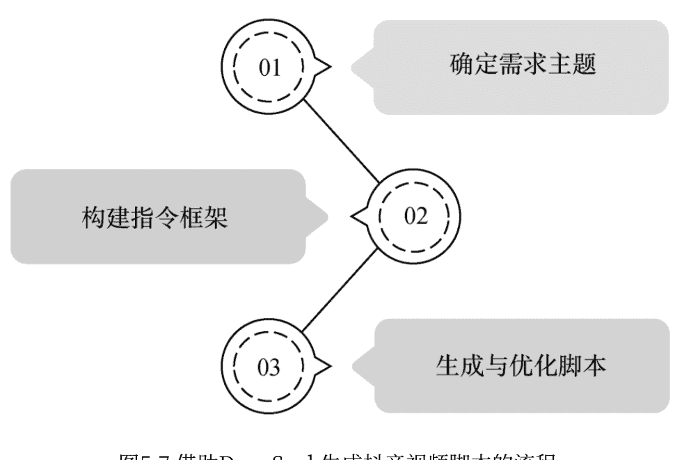

#### 1. 确定需求主题
以运动品牌新款跑鞋为例，主题可定为“性能与时尚兼备”，目标人群为热爱运动、追求潮流的年轻人。将这些核心信息整理成简洁的需求描述，是沟通的基础。

#### 2. 构建指令框架
指令要清晰具体，可采用“场景+产品+需求”结构，例如“创作一个年轻人于城市街头跑步，展现新款跑鞋透气轻便的性能，同时突出时尚外观，适配抖音传播的短视频脚本”。可进一步补充要求，如“开头用快节奏剪辑抓注意力”“结尾加入购买引导话术”，让输出更符合营销目标。

#### 3. 生成与优化脚本
基于详细指令，DeepSeek 可输出完整脚本，如图5-8所示。拿到初稿后，需结合拍摄条件和平台热趋势进行优化。例如当下对比测评类内容火热，可加入新旧款在重量、透气性上的对比画面与台词。若镜头时长不合理，则调整分配。同时可在脚本中预设互动点，引导留言、点赞与分享。DeepSeek 也能按互动需求对脚本进行优化，提升视频互动性，如图5-9所示。

# 《城市疾风计划》——XX跑鞋抖音短视频脚本

时长：30秒

音乐：电子混音版《Born to Run》前奏加重低音鼓点

画幅：竖屏9:16

目标人群：18-30岁都市运动爱好者、潮流青年

## 【脚本分镜】

### 0:00-0:03 开场暴击（快剪3连）

- 镜头1（0.5s）：城市天际线俯拍，朝阳刺破云层（升格慢动作）
- 镜头2（0.5s）：主角潮流穿搭青年脚部特写，系紧跑鞋旋钮（“咔嗒”机械声效）
- 镜头3（0.5s）：跑鞋侧面LOGO流光特效（粒子消散转场）
- 字幕炸裂：“当新鞋遇上早八人，开启暴风模式！”

### 0:04-0:12 产品性能可视化

- 镜头4（2s）：
    - 主角冲刺穿过晨雾街道（跟拍稳定器镜头）
    - 慢动作特写：鞋面透气网眼随步伐张合（叠加气流动画）
    - 动态标注：“3D呼吸网 | 每步200+透气孔全开”

图5-8 DeepSeek根据指令输出的抖音视频脚本

### 0:23-0:27 转化催化剂（互动升级）

- 镜头9（2s）：
    - 跑鞋分镜复制出5种悬浮配色（冰川蓝/岩浆橙/极光紫/暗夜黑/霓虹粉）
    - 全屏选择题弹幕：“你Pick哪款？双击锁定心仪色！”
    - 技术实现：抖音贴纸功能触发「点击变色」特效
- 镜头10（2s）：
    - 手机屏幕特写：AR试穿界面根据点赞量实时变化热门配色
    - 悬念提示：“Top1配色将成下季主打色！”

图5-9 在脚本中设置互动点

优化完成后即可拍摄发布，并分析播放量、点赞率、评论数等数据。若引流转化不理想，可把问题反馈给DeepSeek，调整指令重新生成，不断迭代内容。

## 第6章 广告投放优化：DeepSeek 助你把每一分钱用在刀刃上

广告预算和商业目标直接挂钩。传统投放常出现关键词浪费、受众定位模糊等问题。DeepSeek 可贯穿广告语生成到效果监控的全流程，帮助降本增效。

### 6.1 案例回放：淘宝服饰商家靠 DeepSeek 实现关键词逆转
一家主营潮流服饰的淘宝商家每月花费数万元做关键词竞价，但因选词缺乏依据，预算大量消耗在竞争激烈、转化低的宽泛词上，投入产出比持续走低。

商家决定借助 DeepSeek 优化。首先梳理近半年投放数据，包括点击量、转化率、平均点击成本、投入产出比等，并通过第三方插件批量抓取竞品的引流词与成交词。

将数据上传后，DeepSeek 基于自然语言处理与机器学习进行筛选，锁定高潜力词。针对潮流服饰，挖掘出“ins风夏季薄款衬衫”“复古港味高腰牛仔裤”“小个子显高连衣裙”等长尾词。这些词竞争相对小，更精准匹配细分人群，例如“小个子显高连衣裙”精准触达追求显高效果的娇小女性，转化率高于泛词“连衣裙”。

随后将长尾词与原有词整合，按潜力与竞争程度分配初始预算并设定不同出价策略，为每个词组创建独立创意，提升相关性得分与质量分。

小范围测试投放后收集点击与转化数据用于评估。三个月持续优化后，点击率与转化率明显提升，吸引到一批精准客户，粉丝数与复购率显著增长，从亏损转为盈利。

### 6.2 高转化广告语的智能生成
广告能否抓住滑动的手指，决定于文案质量。传统人工创作耗时且难精准匹配市场需求。DeepSeek 整合品牌调性、核心卖点、受众画像、行业趋势、竞品策略等多维度信息产出广告语。

例如针对主打长效续航的智能手表，模型会提取“7天超长续航”“低功耗芯片”等卖点，结合年轻职场人士与运动爱好者对便捷与科技感的偏好，以及市场实用主义趋势，构建生成基础。

训练于大量优质广告、社交热梗、用户评论后，模型能快速产出情感共鸣型、利益驱动型、悬念引导型等多种文案，如“告别电量焦虑！7天超长续航，陪你探索无界”“什么手表能一周不充电？答案在这里”。

为确保转化，分组对比实验不可或缺。DeepSeek 可提供测试模板，如表6-1所示。

表6-1 A/B测试模板

| 测试分组 | 广告语类型与内容 | 投放渠道 | 投放时间 | 目标受众 | 预算分配 |
| :--- | :--- | :--- | :--- | :--- | :--- |
| A组 | 情感共鸣型 “下班后需要一点治愈，这款护眼灯给你温暖陪伴” | 抖音、微信朋友圈 | 周一至周五 18:00—22:00 | 25～35岁职场人士，关注科技数码 | 总预算 40% |
| B组 | 悬念引导型 “办公桌还缺一款神器？点开看看答案” | 抖音、微信朋友圈 | 周一至周五 18:00—22:00 | 25～35岁职场人士，关注科技数码 | 总预算 40% |
| C组 | 对照组（原广告） “××护眼台灯，今日特惠8折” | 抖音、微信朋友圈 | 周一至周五 18:00—22:00 | 25～35岁职场人士，关注科技数码 | 总预算 20% |

投放中实时监测指标，对比各组表现快速定位最优文案。随着数据积累，DeepSeek 会持续学习用户反馈，动态优化生成策略，对表现好的风格加强产出，并把高频高转化关键词纳入生成逻辑。

### 6.3 精准瞄准人群：DeepSeek 驱动受众定位
投放若无法触达目标人群，预算就只是在浪费。传统定位依赖有限标签与经验，难以捕捉复杂需求。DeepSeek 可整合自有交易、会员数据与第三方平台行为数据、地理、消费能力、兴趣偏好等信息，构建立体画像。

例如高端宠物食品品牌，可收集用户购买宠物用品历史、论坛浏览行为、社交媒体互动等信息；再通过聚类分析划分相似群体，利用预测模型评估购买概率。模型识别出25到35岁、经济实力较好、初次养宠且关注健康营养的精细化养宠新手群体，并据此制定投放策略。

DeepSeek 还能挖掘潜在人群，通过相似性算法找到与高价值用户行为相近但尚未触达的人群。例如健身器材品牌，除传统健身爱好者外，还发现因工作压力大关注居家健身、寻求减重的年轻上班族，针对该群体投放小型便捷器械广告，打开了新市场。

在母婴电商领域，某平台借助 DeepSeek 深度挖掘用户行为，识别出孕期囤货妈妈与0到3岁宝宝精细化喂养妈妈两大核心群体。

孕期囤货妈妈多处于孕中晚期，搜索待产包清单、新生儿必备、产后护理等内容，并高频收藏加购，呈现强囤货需求。

0到3岁宝宝精细化喂养妈妈则聚焦辅食添加指南、有机奶粉评测、营养食谱等，购买高频出现婴儿米粉、果泥，并重点关注成分说明与安全认证。

针对差异化需求，平台对孕期囤货妈妈推送待产包组合广告，突出一站式购齐、科学分装、限时囤货优惠；对喂养妈妈定向投放有机辅食广告，强调欧盟有机认证、无添加、分段营养等卖点，并配合宝宝爱吃、助力肠道健康、营养师推荐等内容，直击安全与营养诉求。

在晚间投放窗口的洞察里，DeepSeek 对两类核心妈妈用户的活跃数据做了拆解，发现她们的高峰都集中在20点到22点。白天的工作与家务结束后，这段时间进入个人休闲期，注意力更集中，浏览和挑选母婴商品的意愿明显提升。平台据此把投放资源向该时段倾斜，实现更精准的人群触达。优化后点击与转化同步改善，在广告花费不增加的前提下销售回报得到明显放大，也印证了精准人群定位带来的商业价值。

### 6.4 预算分配：DeepSeek模拟最优投放方案

预算如何拆分，决定了最终的产出水平。传统做法多依赖经验与粗放操作，热门渠道被反复加码，潜力渠道被忽略，资金常浪费在低效曝光上。DeepSeek 依托数据整合与仿真能力，结合科学建模与动态调优，为品牌量身定制真正花在刀刃上的组合，让每一笔投入都发挥最大价值。

系统能够把品牌过往投放记录、公开行业数据以及目标人群在各渠道的活跃时段与偏好差异聚合成多维数据底座。

在此基础上搭建数学模型与仿真算法，利用机器学习预测不同分配比例下的效果。可依据投放目标设定多种假设情境。针对快消品促销，即可模拟出不同组合，如图6-1和图6-2所示。

#### 方案一：效果导向型——精准转化优先

**预算分配比例**

- 电商平台广告（天猫/京东站内推广）：40%
- 社交媒体精准投放（抖音信息流+微信朋友圈）：35%
- 搜索引擎竞价（品牌词/促销关键词）：15%
- 应急预留金（实时调价）：10%

**核心策略**

1. 电商流量收割：在促销前3天集中投放“满减”“限时秒杀”等商品卡广告，结合平台算法实时竞价，重点锁定高转化人群，如30天内加购未付款用户。
2. 社交裂变设计：投放抖音挑战赛形式的内容，如“开箱测评大赛”，撬动UGC，安排5%预算用于KOC佣金激励，放大自然流量。
3. 搜索拦截防御：投放竞品相关关键词，防止用户在比价过程中流失。

**优劣势对比**

- ✓ 优势：ROI可量化，通常能做到1:5以上，适合短期冲量。
- ✗ 劣势：对品牌心智建设帮助有限，流量成本随竞争加剧快速攀升。

**适用场景**：新品首发、双11/618大促冲榜、库存清仓。

图6-1 预算分配方案一

#### 方案二：品效协同型——长效曝光+即时转化

**预算分配比例**

- 短视频内容营销（抖音/快手达人合作）：30%
- 信息流广告（腾讯优量汇+穿山甲）：25%
- LBS区域定向（商圈周边朋友圈广告）：20%
- 电商效果广告：15%
- 舆情监测与公关预算：10%

**核心策略**

1. 内容种草蓄水：提前15天与中腰部达人合作剧情类短视频，例如“办公室零食解压神器”，软性植入促销信息，引导用户收藏。
2. 线上线下联动：在商超3公里范围内投放“扫码领券”广告，并同步线下物料二维码，实现O2O引流。
3. 口碑防御体系：预留预算进行舆情监测，一旦负面评价超过阈值即启动SEO压制与好评引导。

**优劣势对比**

- ✔ 优势：品牌认知与销售转化兼顾，能有效抵御竞品截流。
- ✖ 劣势：执行链路复杂，需要跨部门协同。

**适用场景**：节日礼盒推广、区域爆品打造、竞品密集狙击期。

图6-2 预算分配方案二

在复杂场景下，系统还能帮助破解预算难题。以多产品组合推广为例，会分析不同产品的受众重叠度、销售周期与利润空间，为每个产品匹配差异化预算；在跨区域投放时，则结合各地消费能力与竞争激烈程度，动态调整区域占比。

某连锁餐饮品牌欲进军西南某三线城市，当地人口超300万，年轻客群占比达60%，但餐饮竞争激烈，已有多家知名品牌入驻。品牌携手DeepSeek寻求科学渗透方案。

DeepSeek深度挖掘目标城市消费数据，整合统计局消费报告与第三方餐饮洞察，发现本地消费者偏好高性价比特色美食，且习惯通过美团、大众点评等本地生活平台，以及抖音、小红书获取就餐建议。

同时，系统分析竞品投放策略，发现多数品牌过度投放搜索广告导致竞价成本飙升，而本地生活平台与社交媒体KOL合作仍有较大空隙。

基于分析结果与品牌目标，输出的分配建议为：60%预算投向本地生活服务平台，与100位本地美食博主、生活达人合作，推出“新店开业5折”“打卡赠菜”等专属活动，并在平台首页做精准投放；30%预算投向抖音、小红书，发起“寻找城市美食新地标”话题挑战，鼓励用户晒单；10%预算保留给搜索引擎，聚焦品牌词与高转化长尾词。

投放期间持续监控渠道表现，发现小红书互动率低于预期。品牌随即把预算向互动与转化更高的抖音倾斜，加大KOL合作与视频内容优化。约30天后，新市场客流超出预期，线上订单大幅增长，品牌知名度迅速提升，成功站稳脚跟。

依托数据深挖与精准分配，品牌在新市场快速找到突破口，避免浪费，实现高效推广。未来智能预算能力将持续赋能更多品牌在竞争中突围。

### 6.5 跨渠道归因：破解“最后点击”迷思

传统评估多依赖“最后点击”归因，把全部转化功劳归于成交前的最后一个触点。操作简单却忽略了其他渠道在决策链路中的作用，容易误判投放价值。实际上用户决策往往跨渠道、多触点叠加形成。

DeepSeek为跨渠道归因提供更科学的方案。系统具备多源数据融合能力，除基础的点击、展示、转化数据外，还能串联用户在不同渠道的浏览轨迹、停留时长、互动行为。例如用户可能先在社交媒体看到产品推荐，再去搜索引擎查评测，最后在电商下单。系统把这些分散行为串成完整链路，还原从认知到购买的全旅程。

在数据融合后，系统运用机器学习与复杂模型深度解析行为，不再局限于最后触点，而是量化每个触点在不同阶段的贡献。基于历史数据学习，识别各渠道在转化路径中的作用模式。

随着营销场景复杂化，结构化数据已不够用。系统引入多模态数据，把图像、视频、音频等非结构化内容纳入分析。社交媒体的短视频、直播互动能直观反映用户情感共鸣与认知程度。通过智能解析多模态数据，可构建立体用户画像，从行为归因升级为认知归因，捕捉从信息触达到决策的深层心理驱动。

系统还能按行业、产品、目标动态调整渠道归因权重。高客单价、决策周期长的品类如房产、汽车，需要多次多渠道接触，早期传播渠道权重会被提高；而低客单价、冲动型品类如零食、日用品，则更看重促成即时转化的渠道。这种动态权重更贴合真实消费逻辑。

以某服装品牌为例，其广告同时投社交媒体、搜索引擎、时尚资讯网站。按最后点击模型，大部分功劳归于电商平台广告。但通过跨渠道归因分析显示，社交媒体广告虽未直接带来成交，却显著提升品牌认知与好感，为后续转化奠基；搜索引擎关键词广告则在意向形成后发挥关键引导作用。基于此，品牌增加社交与搜索预算，在总预算不变前提下转化率明显提升。

持续监测用户行为，系统还能预测渠道未来转化潜力，帮助品牌提前布局。当某新兴社交平台活跃度与转化率快速上升时，会提示加大投入抢占先机。

整体来看，系统打破最后点击局限，更全面评估渠道价值，既优化预算分配，又为科学营销决策提供数据支撑，实现降本增效。

### 6.6 DeepSeek如何实现异常流量识别与反作弊

异常流量与作弊如同暗处的黑洞，吞噬预算、干扰效果评估。没有有效监测，虚假点击和展示会让大量资金付诸东流。系统构建起一套抵御异常流量的防火墙，保障投放真实与有效。

第一步是搭建全量数据采集体系。接入广告平台与第三方监测工具，采集投放基础数据，并细化到落地页的滚动深度、点击热图、停留时长等操作细节。丰富样本库为后续识别提供基础。

在数据基础上，训练异常流量识别模型。通过历史数据学习正常与异常行为差异：正常用户点击有时间间隔与规律，作弊流量常出现短时高频点击；正常浏览路径逻辑清晰，异常操作则跳跃、不连贯。模型持续优化，提升识别准确性与适应性。

系统还具备多维度关联分析能力。单个行为之外，会交叉比对设备信息、地理位置、网络环境。例如多个不同IP但同一设备型号、同一网络且操作时间高度一致，就极可能判定为作弊。同时结合行业均值与历史表现横向纵向对比，点击率远高于行业但转化极低的广告也会被标记排查。

此外，系统具备动态学习与自我进化能力。随着作弊手法升级，能够实时捕捉新型异常模式，自动更新模型与规则库，并把新案例纳入训练，不断提升防御能力。

通过全量采集、算法建模、多维关联与动态学习，实现异常流量的精准识别与高效拦截，帮助品牌避免预算浪费，确保投放效果真实可靠。

### 6.7 实战演练：用DeepSeek设计牛奶广告投放方案

某乳制品品牌推出全新儿童成长奶，目标为期90天线上销售额破1000万元。营销团队借助DeepSeek优化全流程投放，全力冲刺目标。

#### 1. 前期市场调研与受众分析

启动初期，团队向系统输入“乳制品市场”“儿童牛奶”等关键词，快速获取海量信息。系统自动整合多渠道资料生成市场分析报告，涵盖当前热门品类趋势如功能化升级、IP联名等，如图6-3所示，并对竞品营销活动、定价、用户评价进行全面拆解，其中以表格形式呈现不同品牌竞争策略对比，如表6-2所示。

##### 二、热门品类趋势分析

###### 1. 功能化升级
- 脑发育：添加DHA、核桃粉（如伊利QQ星“原生DHA”系列）。
- 护眼：叶黄素、维生素A（蒙牛未来星“睛彩配方”）。
- 肠道健康：益生菌、膳食纤维（君乐宝小小鲁班“诠维爱”）。

###### 2. 清洁标签与健康化
- 减糖：低糖/无蔗糖配方成主流（光明“莫斯利安儿童酸奶”含糖量降低30%）。
- 有机认证：高端线主打有机奶源（如圣牧有机儿童奶，溢价达30%）。

###### 3. IP联名与趣味包装
- 动画IP：与《熊出没》《超级飞侠》等联名（蒙牛未来星×奥特曼）。
- 互动设计：瓶盖拼图、盲盒赠品（伊利QQ星“星球瓶”）。

###### 4. 场景细分
- 学生早餐奶：强化蛋白质与钙（如新希望学生高钙奶）。
- 睡前奶：添加助眠成分（如燕塘“晚安奶”含GABA）。

……

图6-3 热门品类趋势分析

表6-2 不同品牌儿童牛奶的竞争营销策略对比
| 品牌 | 核心卖点 | 营销活动 | 渠道布局 |
| :--- | :--- | :--- | :--- |
| 伊利QQ星 | 原生DHA、A2奶源 | 抖音亲子挑战赛、KOL科普短视频 | 商超+电商 |
| 蒙牛未来星 | 双原生益生元、叶黄素 | 奥特曼IP联名、线下亲子嘉年华 | 全渠道覆盖，下沉市场铺货 |
| 君乐宝小小鲁班 | 36种营养元素 | 教育机构合作、营养专家背书 | 重点布局母婴店及社区团购 |
| 光明优加儿童奶 | 钙含量高、无添加 | 小红书素人种草、校园公益计划 | 华东地区重点，拓展线上营销 |

在调研基础上，核心受众锁定为25～40岁、第一梯队和第二梯队城市的父母。系统进一步挖掘行为特征：他们习惯晚间浏览母婴类App，周末活跃于社交平台，对孩子健康成长话题高度关注，乐于分享与收藏育儿经验和好物推荐。

#### 2. 关键词筛选与广告素材设计

关键词环节，团队输入产品卖点后获得包含“儿童牛奶推荐”“适合儿童的成长牛奶”等主词及大量长尾词的清单，并附带搜索量与竞争度数据，便于判断投入价值。结合推广阶段与预算，优先选择搜索量适中、竞争偏小的词组。

素材设计上，团队把受众画像与关键词需求交给系统。系统建议采用亲子互动的温馨家庭场景，突出饮用后孩子的活力表现；文案强调专业认证、科学配方及对成长的助力。团队制作多版素材后，用系统提供的A/B测试模拟受众反馈，最终确定最优视觉与文案组合。

#### 3. 制定广告投放策略

参考系统的平台分析报告，结合受众活跃习惯，确定微信朋友圈、抖音、小红书、母婴类App为主要投放阵地。预算分配方案为：抖音短视频广告40%，微信朋友圈广告30%，小红书种草笔记20%，母婴类App开屏广告10%。

投放时段上，系统建议工作日晚上7—10点重点投放微信朋友圈与抖音，周末全天提升小红书与母婴App的曝光频率，确保广告出现在注意力最集中的窗口。

#### 4. 投放过程的监控与优化

上线后实时监控指标，发现抖音短视频点击率未达预期。系统从素材吸引力、投放时段、受众匹配度进行排查，结论为部分视频前3秒不够抓眼，用户快速划走。团队据此更换更具冲击力的开场画面并重新测试，点击率显著回升。

#### 5. 投放效果评估

三个月后复盘，系统生成的报告显示线上销售额大幅增长并超额完成目标，社交媒体曝光量与话题讨论度同步提升。深入分析表明，系统筛选的关键词带来高质量流量，优化后的素材有效提升点击与转化。

## 第7章 私域流量运营：从粗放群发到精准触达

在DeepSeek赋能下，私域运营正从粗放的群发模式转向精细化触达。传统打法难以满足用户个性化需求，提升转化率的关键在于精细运营。借助DeepSeek的数据分析与智能洞察，品牌能深入理解用户行为偏好，实现内容精准投放。本章将围绕用户生命周期价值预测、自动化SOP、社群运营等，展示系统在私域各环节的效能，助力品牌高效盘活流量。

### 7.1 开篇案例：某连锁酒店用DeepSeek定制短信，引爆复购

酒店行业竞争加剧下，某连锁酒店品牌私域运营陷入瓶颈：会员短信打开率低、季度复购下滑，模板化促销难以触动用户。引入系统后，品牌通过数据驱动的定制化短信策略，实现私域复购逆势增长，为行业提供精准营销新范式。

借助DeepSeek的数据分析能力，运营团队把数十万条会员订单与用户评论纳入模型进行细化梳理，迅速锁定两类核心人群的未满足需求。常出差的商务人群更在意商圈可达度、房内静谧度等场景体验，期待差旅定制权益，例如写字楼周边餐饮抵扣、弹性早餐安排等，而过往文案基本只谈价格折扣，导致供给与需求错位；带娃出行的家庭则高度关注儿童设施配套与周边游玩攻略，酒店此前从未主动呈现，这部分转化机会因此流失。

语义关联挖掘进一步捕捉到更隐蔽的信号：商务侧对停车便利、早餐供应时段有潜在关注，家庭侧对周末主题房、亲子互动项目表现出明显偏好，这些发现为后续分群运营提供了依据。

基于洞察，团队让DeepSeek为不同人群产出差异化短信。对高频出差商务用户，推送差旅关怀类文案（如图7-1所示），用高效入住方案传递“我们懂你”的感知；对出差频率较低的人群，则依据浏览轨迹触发场景唤醒（如图7-2所示），把潜在需求激活。

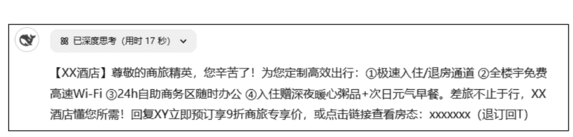

图7-1 针对高频商务客群生成的短信

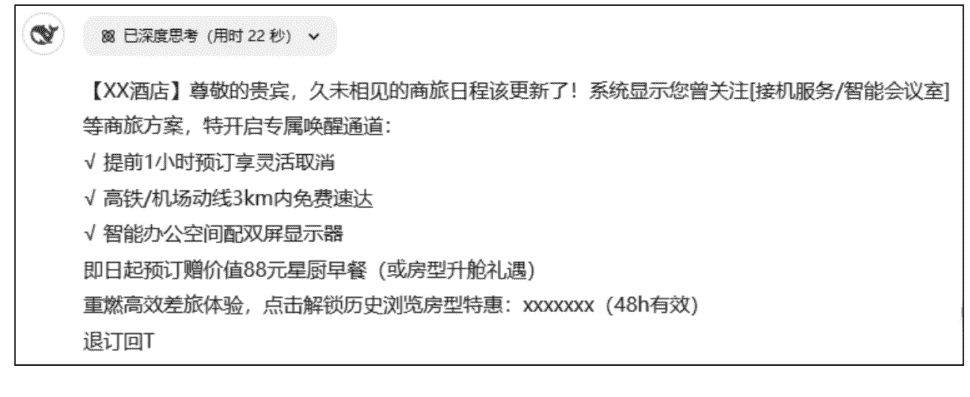

图7-2 针对低频商务客群生成的短信

家庭侧的打法同样分层。借助DeepSeek产出亲子体验类素材（如图7-3所示），用具象化权益直击决策要点；对有亲子消费记录的家庭，发送成长回溯类信息（如图7-4所示），以回忆拉动情感共鸣，进一步稳固品牌关联。

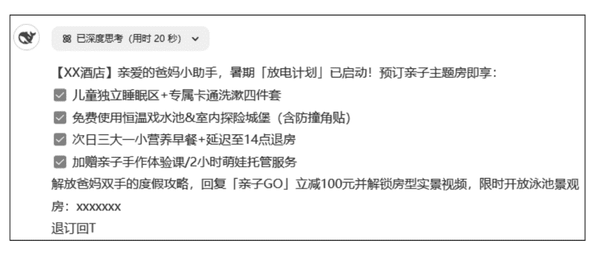

图7-3 针对家庭客群生成的短信

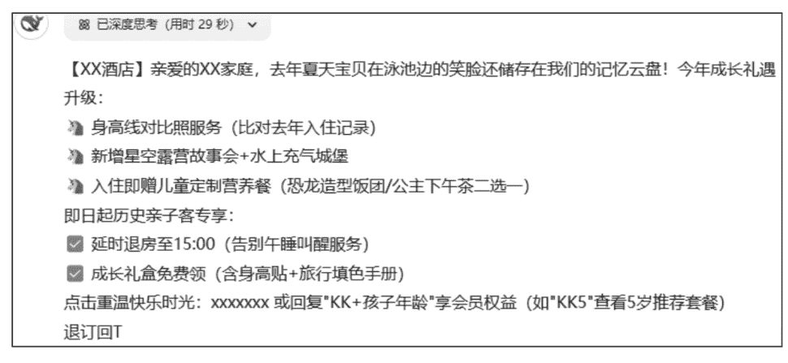

图7-4 针对历史亲子客群生成的短信

实时追踪核心指标后，分层触达的效果十分明显。商务短信打开率、家庭关注度均高于行业均值，亲子套餐转化也明显优于普折。依托数据反馈，策略持续微调：商务端简化了行程单核验流程，提升操作流畅度；家庭端新增“生日月亲子房免费升级”“家庭纪念日专属礼遇”等长效权益，拉长复购周期，触达效能不断提升。

两个月实践后，私域表现明显向好，会员整体复购大幅抬升。精准触达取代无效群发，营销短信总量下降的同时，私域交易额逆势上扬，实现降本提效。

该案例表明，读懂需求并做针对性沟通，是在存量市场里挖掘增量的关键路径，也为品牌私域的精准化、智能化转型提供了可复制的方向。

### 7.2 私域用户生命周期价值（LTV）预测

在私域运营中，用户生命周期价值已成资源分配的重要依据。过去很多品牌以短期转化论成败，忽视长期价值挖掘，导致投入浪费与用户流失。借助DeepSeek，品牌能够从流量收割转向价值深耕，构建可持续增长的私域体系。

传统预估方式多依赖历史消费统计与经验判断，局限明显：一是难以还原行为背后的复杂逻辑，二是缺少对未来趋势的前瞻判断，难以应对市场与需求的快速变化。DeepSeek以深度学习与大数据建模打破局限。它能融合多维信息，对行为模式、消费习惯、兴趣偏好进行深度拆解，构建细致的用户画像，为价值判断提供坚实底座。

私域场景里，每一次点击、浏览、互动，乃至停留时长、评论内容都蕴含信息。DeepSeek通过多触点连通，实时采集并整合分散在各渠道、各场景的数据，形成动态化用户库。无论是品牌小程序的购买记录，还是社群里的发言频次与内容，都被完整记录并纳入分析。

数据整合后，机器学习算法会对海量信息深挖，识别隐藏的规律与模式。例如，发现某些用户在购买特定品类后会在固定周期内复购关联品；另一些用户参与特定活动后活跃度显著提升。基于这些规律，系统可推演用户未来行为轨迹，并评估其在生命周期内的价值贡献。

同时，模型也会纳入外部变量。市场环境波动、竞争对手动作、社会热点事件等都会影响消费决策。系统实时监测外部数据并将其引入预测模型，使结果更贴近实际。

精准的价值预判为运营带来多重价值。首先是资源分配，品牌可按预估数值高低匹配投入。对数值靠前的用户加大人力、物力、财力投入，提供定制服务和限定权益，增强粘性与忠诚度；对数值偏低的用户则采取激活打法，挖掘潜能、提升频次和客单。其次是产品服务优化，通过对比不同人群需求差异，明确高价值用户偏好的品类与服务短板，有针对性地做研发与升级，提升满意度。最后是留存与召回，预判可提前识别流失风险用户。例如，活跃度下滑的高价值用户，可通过个性化推送和专属关怀重新激活；已流失用户则可依据历史数据制定精准召回方案，提高召回成功率。

在该模型助力下，生命周期价值预判从模糊估算变为数据驱动的判断，为私域运营提供清晰指引，让资源使用更高效、用户价值挖掘更彻底。

### 7.3 自动化SOP：用户分层+个性化文案生成

过去私域里最常见的操作是无差别的群发。大量不相关信息让用户选择退群，打开率与转化率持续走低。粗放运营不仅浪费资源，还消耗信任。进入DeepSeek加持时代，自动化标准作业流程成为破局关键，通过精准分层与智能写文，为精细化运营提供支撑。

DeepSeek为自动化SOP提供两大核心能力。首先是精准分层。私域池内用户的需求、支付能力、行为偏好差异巨大，单一维度分类已无法满足精细运营。DeepSeek可整合基础属性、消费行为、互动数据等多源信息，实现精细分层。

以电商私域为例，除了年龄、性别、地域等基础信息，系统还会深挖历史购买品类、客单价、复购频率、加购收藏行为，以及社群发言次数、参与活动类型等。通过聚类算法，用户可被划分为高价值VIP、潜力增长、活跃低消、低频沉默等多个层级，甚至细分出母婴高频囤货人群、美妆尝鲜人群等更细颗粒。

分层完成后，第二大能力——个性化文案生成开始发挥作用。传统群发因缺乏针对性难以共鸣，而DeepSeek基于分层洞察，结合自然语言处理，可按人群特征、需求与场景自动生成适配文案。

对高价值VIP用户，文案会突出定制服务与稀缺权益，如“尊贵的××会员，限量新品已为您预留专属购买通道，点击即可优先体验”；对潜力增长用户，则侧重引导尝新与提频，如“根据您的购物偏好，为您推荐这款口碑爆款，首次购买立享8折优惠”。在节日营销中，系统还能结合节日氛围，为不同人群生成差异化的祝福与促销文案，让用户感受到被看见。

当新用户进入私域，DeepSeek会自动采集初始数据并做初步分层，随即推送迎新文案与引导信息。随着用户互动增多，系统持续更新画像、动态调整层级，并即时更换更匹配的文案。这一自动化、智能化的流程大幅减少人工干预，提升响应速度，让私域运营更敏捷。

### 7.4 社群运营：让DeepSeek帮你自动回复常见问题

在社群这个核心阵地，客服响应效率直接决定用户体验。人工回复重复性问题占据大量时间，真正用于深度挖掘需求的精力被挤压。引入DeepSeek后，可搭建智能自动回复体系，既提升效率，也释放运营压力。

落地前，社群服务普遍存在三大瓶颈。
- （1）应答滞后。高峰期每分钟产生数十条咨询，人工平均响应时长较长，用户因等待超时转向竞品。
- （2）信息碎片化。不同客服对同一问题的表述可能不一致，导致用户对品牌专业度产生疑虑。
- （3）需求错配。客服难以即时调取用户购买历史与偏好，难以实现精准营销。

这些矛盾本质是标准化服务与个性化需求的冲突，而基于DeepSeek的智能回复系统正好提供了破局方案。

系统通过自然语言处理抓取历史客服对话、产品说明书、FAQ等数据源，构建海量词条的知识库。在此基础上，系统能对用户提问给出个性化回答。

回复同时，系统可对接用户分层标签。例如，美妆社群中被标注“高价值用户+敏感肌”的成员询问“精华液是否含酒精”，系统不仅给出成分说明，还会追加“已为您备注专属护肤顾问，24小时内将为您定制敏感肌护理方案”这类增值信息。基础解答叠加增值服务，有效提升高价值用户的满意度和复购。

另外，系统支持自然多轮对话，能处理复杂咨询。比如“如何申请退换货”，系统会自动拆解为“确认订单信息—指导拍照上传—推送物流地址—跟踪处理进度”，通过拟人化对话逐层引导，减少人工介入并提高解决率。

DeepSeek加持的智能回复系统有三大典型应用场景，可全面提升社群服务效率，如图7-5所示。

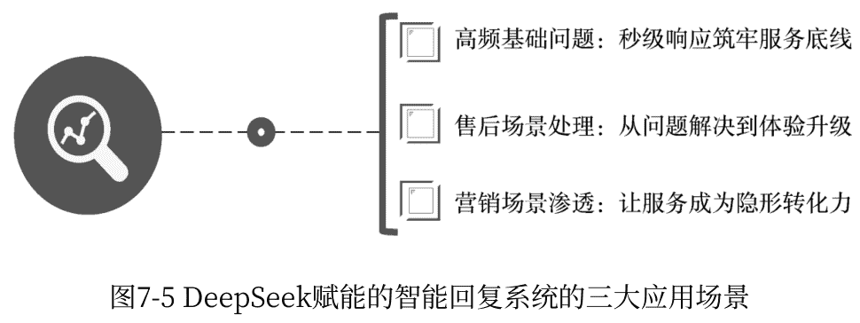
图7-5 DeepSeek赋能的智能回复系统的三大应用场景

#### 1. 高频基础问题：秒级响应筑牢服务底线
针对发货时间、优惠券使用、售后流程等高频问题，系统实现“关键词触发—语义解析—精准应答”的毫秒级响应。用户深夜询问物流进度，系统可即时调取物流数据并给出预计送达时间，显著缩短等待焦虑。

#### 2. 售后场景处理：从问题解决到体验升级
在退换货、质量投诉等敏感场景，系统通过“情绪识别+流程引导”双机制化解矛盾。用户发送“衣服有色差，要求退货”时，系统识别色差、退货关键词并迅速回复“非常抱歉给您带来不好的体验，请您拍摄一张色差对比照片，我们会优先为您安排顺丰上门取件，退货邮费由品牌承担”。同时系统标记该用户为“需重点安抚”，触发人工跟进。处理周期缩短，客诉转化率提升。

#### 3. 营销场景渗透：让服务成为隐形转化力
系统可将产品卖点自然植入回复，实现服务与营销融合。用户咨询“防晒霜适合什么肤质”时，系统给出专业建议后顺势追问肤质，并追加“针对您的混合型肤质，我们的水感防晒乳特别添加了玻尿酸保湿成分，点击社群专属链接可领取试用装，下单即赠防晒冰袖”。咨询即转化，效率显著提升。

在智能回复能力加持下，系统还能预判需求。通过行为数据分析，提前识别潜在问题：用户多次浏览详情页未下单，系统主动推送“检测到您关注的面霜即将缺货，是否需要为您预留？”；会员生日临近，自动触发“专属生日礼券已发放，点击领取”。服务前置，让社群从信息接收端转变为价值创造中心。

在系统分担标准化重复工作的同时，运营人员可更专注于情感连接与创意互动，与系统共同构建高效且有温度的私域服务生态。

### 7.5 沉默用户唤醒：DeepSeek生成挽回话术

社群里的沉默用户往往蕴藏巨大价值。部分人因信息过载选择潜水，部分人因需求未被满足而逐渐疏离。传统群发唤醒效果有限，借助DeepSeek产出挽回话术，能让沉默用户重新活跃。

唤醒第一步是精准识别。可建立沉默用户判定体系，例如30天内未发言、未点击链接、未参与活动的用户被标记为沉默，并结合其历史消费与浏览行为做深层分析。

某美妆品牌社群有5000人，其中约800人处于沉默状态。细分发现，有人曾是高价值客户，购买过高端护肤套装，近半年却零消费；有人是新人，领取优惠券后便无动静；还有人经常浏览产品页却从不互动。基于此，团队将沉默人群分为“高端护肤弃用者”“新人券沉默者”“页面浏览潜水员”三类，为精准唤醒做准备。

识别分类后，DeepSeek开始生成差异化挽回话术。

针对“高端护肤弃用者”，系统分析过往购买与浏览偏好，生成唤回话术，如图7-6所示，既唤醒品牌记忆，又提供精准福利。

> “亲爱的[用户昵称]，您是我们尊贵的VIP客户！我们留意到您曾选购的[具体产品名]已推出全新升级版，特别为您保留首发体验资格。现在下单可享专属8折+肌肤顾问1v1服务（价值299元）。您的肌肤近况如何？专属顾问[姓名]随时待命为您定制护理方案，点击预约：【短链接】”

图7-6 DeepSeek针对“高端护肤弃用者”生成挽回话术

针对“新人券沉默者”，话术以降低决策门槛为核心，如图7-7所示，通过紧迫感与叠加优惠促成首次下单。

> “Hi [昵称]！您的新人专属福利正在倒计时~我们发现您账户中还有1张未使用的[券名称]，特别为您叠加10元无门槛券！现在购任意正装产品即可获赠[明星单品旅行装]，戳这里马上兑换：【短链接】。有任何选品问题欢迎随时@小美顾问哦~”

图7-7 DeepSeek针对“新人券沉默者”生成挽回话术

针对“页面浏览潜水员”，系统根据浏览记录推荐相关内容，如图7-8所示，用精准推荐吸引互动。

> “[昵称]同学，您关注的[浏览过的产品类目]有重大更新啦！根据您的浏览偏好，我们特别推荐这三款人气单品：【产品A】+【产品B】组合立减150元，独家社群福利加赠[定制化妆包]。现在点击解锁隐藏优惠：【短链接】。悄悄说：今晚8点前下单还能抢限量试用套装哦~”

图7-8 DeepSeek针对“页面浏览潜水员”生成挽回话术

话术生成后，通过私信、群公告、短信等多渠道触达，互动率明显提升，不少沉默用户完成复购。

需要强调的是，唤醒不是一次性动作。每轮唤醒后都应复盘打开率、点击率、回复情感倾向及后续消费行为，若效果未达预期，可借助DeepSeek调整策略，例如增加成分解读、使用心得等内容，提升唤醒成功率。

随着数据积累，DeepSeek对沉默用户的预测与干预能力将更强，有望提前预判用户沉默节点并进行前置干预，把流失扼杀在萌芽，让沉默用户转化为活跃乃至忠实用户，为持续发展注入动力。

### 7.6 忠实用户关怀：DeepSeek设计粉丝关怀方案

在私域运营中，忠实用户是品牌的坚实后盾，也是口碑传播的核心。传统“一刀切”关怀难以满足高价值忠实用户的多元需求。借助DeepSeek制定精细化关怀方案，能进一步拉近品牌与用户的情感距离。

某咖啡品牌通过消费行为、互动偏好、社交属性等多维度数据分析，绘制出忠实用户立体画像。分析显示，这类用户平均每月消费4～6次，偏爱限量款咖啡豆；在社群中常分享制作心得，话题参与度远高于普通用户；社交挖掘发现，部分用户活跃于小红书、微博等平台，发布品牌内容，具有较强影响力。

基于此，品牌为每位忠实用户打上专属标签，如“限量款收藏达人”“社群意见领袖”“咖啡文化传播者”，并构建兴趣图谱，记录其对产地、烘焙度、器具等维度的偏好，为关怀方案设计提供指引。

在充分准备后，借助DeepSeek为忠实用户打造个性化关怀方案，如图7-9所示。

图7-9 个性化的关怀方案

#### 1. 专属福利，彰显尊贵身份

对核心用户群体而言，物质层面的回馈早已超越基础奖励，更成为身份的象征。该企业借助DeepSeek对高价值人群进行画像拆解，为不同画像设计差异化礼遇。对痴迷收藏限量款的玩家，在新品期推送单人购买通道，并给予优先抢购权限，同时附赠限定饮品容器；对常在社区发声的意见领袖，则按期寄送新品试饮装，邀请其参与品鉴并授予高额积分；对深耕咖啡文化的传播者，则提供联名周边以及线下咖啡沙龙的VIP席位。这些细分礼遇让核心人群感受到被看见，也进一步稳固了与企业的连接。

#### 2. 情感触达，让企业更有温度
物质激励之外，情感层面的陪伴同样关键。企业基于DeepSeek搭建了智能对话体系，从社区发帖中捕捉情绪倾向与潜在诉求，进而生成个性化的互动方案。

当系统识别到用户在社区里表达对某款咖啡的喜爱，就会主动发出暖心私信：“感谢您对 [咖啡名称] 的喜爱！您的认可让我们倍感温暖，特意为您准备了同款咖啡买一赠一的专属礼遇，期待与您分享更多美味！” 在生日、纪念日等特殊节点，智能对话也会自动生成定制化祝福，并搭配专属折扣码或小礼物，让用户真切体会到企业的贴心。

#### 3. 共创价值，提升参与意愿
老用户对企业往往有深厚感情，也希望参与到发展进程中。企业利用DeepSeek从用户中挑选出对咖啡品质有独到判断的核心人群，组建“共创顾问团”，定期征集新品灵感，对被采纳的建议给予可观奖励与署名权。这种深度共创让用户获得成就感，也为企业带来宝贵创意资源，形成双向收益。

通过上述组合关怀，企业积累了大量核心人群，回购水平得到显著提升，口碑传播也带来新客增长。在持续激励下，忠实人群成为企业长期发展的关键动力。

### 7.7 实战演练：激活休眠账户的 DeepSeek 应用方案
注册用户是私域运营的核心资产，随着时间推移，部分人群会进入休眠，活跃度与消费意愿明显下降。利用DeepSeek可以搭建一套科学高效的唤醒体系，让休眠用户重回活跃。

以下以某运动服饰企业为例，该企业通过API方式在云端接入DeepSeek的智能能力。

第一步，数据汇聚与分层，精准锁定休眠人群。
DeepSeek整合了线上商城订单、线下门店流水、社群互动记录、App使用行为等多源信息，筛选出“半年内无消费且三个月内未参与社区活动”的休眠群体，并细分为三类：第一类是潜在回购型，历史频次与客单较高，近期因竞品或需求变化暂时沉寂；第二类是互动缺失型，近期未下单但仍会浏览商品页，对企业保持关注；第三类是高流失风险型，长期未消费且已关闭消息推送。系统为每类打上专属标签并生成画像，为后续策略提供依据。

第二步，个性化唤醒，直击需求痛点。
针对潜在回购型，DeepSeek结合过往偏好生成定制礼遇。例如曾多次购买跑步系列的休眠用户，智能对话会推送：“亲爱的[用户昵称]，您最爱的跑步系列产品上新啦！为您预留了专属8折折扣码，还有机会赢取限定版跑步背包，点击链接即可查看详情。”同时搭配训练知识与赛事资讯，点燃运动热情。

针对互动缺失型，DeepSeek设计了低门槛趣味玩法，如在社群发起“运动穿搭挑战赛”“运动打卡挑战赛”，自动生成邀请：“[用户昵称]，快来展示你的运动时尚态度！参与穿搭挑战赛，就有机会获得企业定制运动水壶，还有专业造型师为你点评哦！”通过轻互动逐步重建情感连接。

针对高流失风险型，DeepSeek深入分析消费轨迹与流失原因，为人工客服提供沟通指引：“您好，[用户昵称]，发现您最近很少关注我们了，是对我们的产品或服务有什么意见吗？为了感谢您一直以来的支持，我们为您准备了一份特别的回归礼包，期待您再次选择我们。”真诚对话配合专属礼包，可挽回部分用户。

第三步，效果监测与动态优化，持续提升效能。
执行期间实时跟踪信息打开率、活动参与率、折扣码使用率、回购转化率等指标，并由DeepSeek诊断策略失效原因并给出优化建议。例如某批折扣码使用率偏低，分析归因为门槛过高，建议下调门槛后重新推送，使用率明显提升。企业还对成功激活的用户进行后续行为追踪，将回购周期与客单变化回传给DeepSeek，形成长期运营参考。

90天实践后，该企业唤醒了30%的休眠用户，回购比例提升20%。案例证明，DeepSeek通过精准洞察、个性化打法与持续迭代，能深度挖掘私域用户价值。

# 第8章 用通俗语言获取关键数据洞察
市场瞬息万变，数据驱动已成营销基本盘。但从海量信息中提炼价值并不容易。DeepSeek以自然语言交互帮助企业快速获取关键洞察，让决策更直观。

## 8.1 案例拆解：潮牌如何用DeepSeek找出滞销根因
某知名服饰潮牌在2025年首季推出30款卫衣，其中12款首月销量未达预期40%，库存积压严重。过去需跨部门小组耗时两周排查，结论往往滞后。企业尝试用DeepSeek解决问题。

营销人员上传三个月卫衣的款式、销售、价格、用户评价等数据，并提问：“为什么我们最近推出的几款街头风卫衣销量不佳？”

DeepSeek整合企业数据与行业流行趋势后指出：设计上，近三个月社交媒体潮流关键词显示消费者偏好简约、复古，传统街头元素吸引力下降，而企业仍延续旧有街头风格；定价上，对比竞品，该企业卫衣普遍偏高且缺乏促销支撑；渠道上，投放集中在短视频信息流，忽略小红书、微博等长尾平台，曝光局限于小众圈层。

- 极简解构崛起：无Logo、不对称剪裁、可拆卸部件流行，体现“少即是多”。
- 复古未来融合：Y2K风格演进，出现透明PVC拼接、金属反光面料、低像素印花+AR互动等组合。
- 传统街头元素退潮：大Logo、夸张涂鸦声量下降，需规避同质化风险。

图8-1 DeepSeek给出的卫衣潮流分析

基于结论，企业对滞销款降价并通过直播带货、社群拼团限时促销；新品开发加强趋势监控，提取用户偏好的色彩图案面料；营销聚焦抖音、小红书，与中腰部KOL合作精准种草。

30天后滞销库存消化率达70%，资金回笼，新品反响良好。

## 8.2 全网数据自动采集，让洞察一步到位
信息时代的挑战是数据过载。DeepSeek可实现全网智能抓取，快速全面获取关键信息。

某美妆企业计划推出精华液，需了解市面成分、功效、价格与消费者痛点。过去需人工采集电商数据并爬取社交评论，耗时数周且覆盖不足。

使用DeepSeek后，营销人员指令：“采集近一年淘宝、京东、拼多多销量前十精华液的品牌、名称、价格、核心成分、主打功效、评价数与评分；同时抓取小红书、微博、抖音关于精华液的热门话题、讨论内容、高赞笔记与评论，重点关注使用痛点、期望功效与品牌推荐。”

DeepSeek启动自动化采集，利用爬虫与智能识别精准提取并结构化整理。

图8-2 电商平台精华液销量Top10分析呈现前十产品如可复美胶原棒次抛精华、润百颜玻尿酸次抛精华、夸迪悬油次抛精华等；图8-3 社交媒体热门话题显示小红书#早C晚A精华搭配、#次抛精华测评、#敏感肌修护精华，抖音#精华液抗皱挑战等。

洞察显示，除保湿美白外，抗初老与屏障修复关注度大幅提升。企业据此锁定抗初老、修复屏障为核心功效，并规划“肌肤检测+定制精华液”服务模式，新品上市后广受好评。

## 8.3 用自然语言提问，直接拿到分析结果
数据分析常被技术壁垒限制。DeepSeek以自然语言分析打破限制，让营销人员直接提问即得结果。

母婴企业营销王某需把握不同年龄段宝妈对新兴产品的潜在需求，并了解纸尿裤、奶粉、婴儿车等核心品类的组合购买模式。

他将过去6个月多维度销售数据上传并提问：“按25-30岁、31-35岁、36岁以上划分，结合核心都市、次级都市圈及下沉市场与高、中、低消费能力，找出各细分群体消费金额最高的两类产品及最常搭配的商品组合；同时分析智能哄睡设备、可监测健康指标婴儿穿戴设备等新兴产品的搜索热度、浏览时长与加购意向。”

DeepSeek快速完成整理并给出可视化报告。表8-1显示25-30岁核心都市高消费群更偏好高端有机奶粉、智能婴儿车，常搭配进口辅食；中消费群偏爱高性价比入门纸尿裤与基础配方奶粉，常搭配湿巾与基础床品。

基于洞察，王某设计分层策略：核心都市高消费年轻宝妈在高端线下门店举办智能婴儿车与进口辅食联合体验并精准投放广告；中低消费群推出电商“纸尿裤+湿巾”组合套餐并在社交媒体进行性价比种草。

追问中，王某发现31-35岁次级都市圈中消费宝妈对婴儿健康穿戴设备加购意向偏低。他再次提问原因，DeepSeek调取评论、竞品与行业报告得出结论：价格超预算、功能宣传不清晰、对实际效果存疑。随后优化详情页突出性价比与使用场景，并推出限时折扣与分享有礼，关注度与加购率显著提升。

活动结束后企业销售额大幅增长，新品线获得良好反馈。自然语言数据分析让决策更敏捷、更普惠。

让模型真正理解业务，关键在于先把原始记录变成机器可读的标签体系。拿母婴类目做例子，上数时把商品名归到品类维度，成交时刻归到时间维度，客群年龄归到区间维度。归类完成后，业务同事用口语提问“最近一季度不同年龄段宝妈买得最火的产品变化”，模型就能直接定位字段给出趋势，而不是在杂乱文本里盲搜。

关系型数据同理。像商品关联销售这类链路，用图谱把关联关系整理清楚，DeepSeek 在解读逻辑与回答追问时都会更顺畅、更准确。

## 8.4 一键输出数据报告：趋势、结论与建议

过去做报告要手工采集、清洗、建模，既耗时又带主观偏差。借助 DeepSeek，整套流程可压缩为一次自然语言指令，成为决策加速器。

一家新锐智能家居商家推出语音定时窗帘，上市约三个月后销量远低于预期，社交声量也弱。市场部把电商销售与用户评价导入系统，要求梳理京东、天猫、苏宁的销量、销售额、评价分布，汇总抖音、小红书、微博的讨论量、热度与情绪倾向，并与同类畅销品对比，最后给出拉动销量和影响力的方案。

模型很快生成全景报告：
1）评价里反复提到安装步骤繁琐，且与部分智能音箱兼容性不佳。
2）社交话题多集中在官方账号的内容，用户自发讨论稀少，外溢有限。
3）竞品并不只讲参数，而是用场景化内容呈现窗帘与全屋智能联动的理想生活，引发共鸣，而本品牌内容偏向参数罗列。

对策建议：简化安装路径并随货附赠易懂安装短片；与主流音箱厂商展开技术合作解决兼容问题，并在宣传中突出优化后的使用感受；邀约家居垂类 KOL 拍摄产品融入日常生活的短视频在抖音、小红书投放，并发起“智能生活新体验”话题鼓励用户晒场景，提升曝光与参与。

采纳后次月销量回升，自发讨论明显增长，口碑与市场影响力得到改善。一条指令把洞察转化为行动，是快变市场抢先机的关键。

## 8.5 先推演再执行，降低试错成本

定价、促销、投放每一步都影响结果，DeepSeek 的模拟能力可以帮助品牌预演不同决策的后果。

一家知名运动品牌计划夏季推出透气轻量化跑鞋，营销打法难以抉择：
- 方案一：签约顶流明星做线上广告，主打高端；
- 方案二：联合健身达人做线下体验，以高性价比抓大众；
- 方案三：聚焦社媒种草，由关键意见消费者口碑传播，主打年轻潮流。

品牌把品牌资料、产品信息、消费者画像、预算等上传，让模型分别推演三种打法的效果。

推演显示：方案一能拉升知名度，但明星费用高企，利润增幅有限，且价格压力会削弱年轻人购买意愿；方案二能有效提升大众购买意愿，市场份额有望扩张，但对高端形象加成弱；方案三在年轻潮流人群中转化与互动预期最佳，成本相对可控。

综合长期战略与短期目标，品牌以方案三为核心，融合方案二元素，推出“线上 KOC 种草+线下快闪体验店”组合。

线上筛选数百位运动、潮流垂类 KOC 试穿并产出真实内容，短视频图文在社媒引发热议；线下在潮流商圈开设快闪店，设置趣味跑步挑战和跑鞋科技展示区，吸引到店体验。

投放后，新鞋在年轻群体销量同比增 60%，社媒互动破千万次，品牌在潮流运动赛道站稳脚跟。消费者反馈 KOC 推荐与线下体验结合更真实可信，信任度提升。同时活动沉淀的大量反馈为后续研发和策略优化提供素材。用模拟先看路，决策更稳。

## 8.6 BI 与 DeepSeek 协同：给中台加上追问能力

商业智能平台擅长把分散数据汇总成看板报表，但交互门槛高、深度分析弱，复杂问题常需 IT 介入。DeepSeek 补足自然语言交互和深度挖掘能力，形成协同工作流。

某 3C 数码品牌全球渠道复杂，平台每日处理电商、门店、售后等多源数据，能输出销售额、库存周转、地域分布等基础指标。但市场部想深挖“如何为不同年龄层设计差异化推广”“新品未达预期深层原因是什么”等问题，超出常规分析能力。

品牌引入 DeepSeek 对接 BI。平台作为数据枢纽，通过标准接口与 DeepSeek 连通。日常指标仍在看板查看，遇到复杂需求时，业务人员直接用自然语言提问，例如“结合平台近半年销售、用户年龄分布和社媒评论，分析不同年龄层对手机功能偏好及购买决策因素”。

DeepSeek 自动从平台调取数据，并补充全网趋势和竞品动态进行语义分析：18-25 岁更在意拍照像素和外观设计，易受网红推荐影响；26-35 岁职场人群更看重续航和办公软件兼容性；35 岁以上更关注价格和售后。

结论回写平台并可视化。进一步追问“针对年轻群体拍照偏好，竞品有哪些优势功能”，模型对比后指出某竞品的 AI 人像追焦在社媒获高赞，建议下一代产品加入并作为卖点。

基于洞察的策略：
- 年轻群体推出“拍照达人挑战赛”，联动抖音、小红书，邀请百位 10 万粉以上 KOL 发起创意摄影视频，奖品含新机和摄影器材，并在执行中加入剧情任务、组队 PK 提升吸引力；
- 职场人群推出“手机高效办公 7 日实战营”，围绕日程管理、移动会议、文档协作做场景化课程，搭配时间管理工具包和快捷键手册；
- 价格与售后敏感群体推出以旧换新，并基于 DeepSeek 对售后反馈的分析优化流程。依据竞品补贴政策制定更具竞争力的标准，用平台购买历史筛选潜在用户做精准短信触达。

三个月后整体销售额提升，各线产品销量均明显增长。平台保证数据稳定，DeepSeek 提供深度洞察与自然交互，协同实现从数据到行动的闭环。

## 8.7 竞品情报实战：全网抓取一站完成

宠物经济火热，某新宠物食品品牌准备推出主打关节养护、肠胃调理的功能性狗粮，需要先摸清市场。

营销人员在 DeepSeek 中指令：抓取近半年渴望、皇家、比瑞吉等国内外知名品牌的功能性狗粮产品信息，包括品名、核心功能、主要成分、规格、价格区间、适用犬种与年龄；同时抓取淘宝、京东、拼多多用户评价与销量，小红书、抖音、微博的讨论热度、热门话题与 KOL 推广内容，总结优势、用户痛点和营销打法。

### 一、功能性狗粮产品对比
#### 1. 渴望 Orijen
产品：Orijen 红肉十种肉狗粮
核心：高蛋白增肌、无谷低敏
成分：85% 动物成分牛肉猪肉三文鱼等+15% 果蔬菠菜苹果等
规格：2kg/6kg/11.4kg
价格：200~1000 元
适用：全犬种全阶段

#### 2. 皇家 Royal Canin
产品：皇家成犬泌尿道处方粮
核心：预防尿结石缓解膀胱炎
成分：低磷低镁配方+蔓越莓提取物
规格：2kg/8kg
价格：100~300 元
适用：成年犬泌尿健康问题

产品：皇家小型犬幼犬粮 A3 通用粮
核心：易消化促进幼犬发育
成分：鸡肉粉、糙米、甜菜纤维
规格：8kg
价格：300~500 元
适用：2~12 月龄幼犬

#### 3. 比瑞吉 BRJ
产品：比瑞吉元气鸭鸭狗粮
核心：低脂高蛋白护肠含 5 种益生元
成分：71% 鸭肉+鸭肝冻干+益生元低聚果糖等
规格：1.5kg/6kg
价格：100~400 元
适用：全犬种成犬

产品：比瑞吉幼犬粮
核心：提升幼犬免疫力含中草药成分
成分：深海鱼肉+枸杞+野菊花
规格：1.5kg/3kg
价格：80~200 元
适用：幼犬

综合来看，渴望走高端高蛋白无谷路线；皇家深耕处方健康；比瑞吉以益生元加中草药做差异化，受众广泛。

### 表 8-2 竞品优势、用户痛点与营销策略
品牌 | 产品优势 | 用户痛点 | 营销打法
渴望 | 高蛋白无谷 | 价格高部分犬不适应 | 强调生物适配高端定位
皇家 | 科学配方针对性健康管理 | 适口性争议处方需兽医建议 | 联合宠物医院专业背书
比瑞吉 | 中草药+益生元创新 | 部分用户质疑草药功效 | 社媒 KOL 实测推广

洞察显示，高端功能粮价格敏感度高，消费者更在意成分安全与透明度。营销趋势是 KOL 实测和话题营销为主流。

品牌据此定位新品为中等价位“全面营养+关节养护”，采用天然食材，添加高含量硫酸软骨素和氨基葡萄糖，包装上详细标注成分来源和检测报告。营销上与宠物医生、行为专家合作在抖音小红书做专业科普；开展免费试吃加反馈有奖活动撬动尝试。通过一次全网抓取即获得研发定价推广的依据。

# 第9章 全渠道营销协同：打赢这场AI内容战役

当用户的注意力被抖音的短视频、微信的朋友圈／公众号、淘宝的直播、小红书的种草笔记等切割成碎片时，品牌如何在保持统一调性的同时实现跨平台精准触达？本章将从实战视角分析 DeepSeek 如何破解全渠道营销的三大核心难题：内容生产的多而不精、渠道分发的散而不焦、资源配置的粗而不细，并通过真实案例讲解 DeepSeek 如何像数字营销指挥官般统筹全局。

## 9.1 跨平台调性统一实战：茶饮品牌的 AI 内容中枢

小红书重视觉美学，抖音重场景体验，公众号偏品牌故事叙述，多数用户多平台获取信息，内容既要合规又要统一人格，成为品牌痛点。

传统内容生产成本高、易失焦。头部品牌需维护多平台且各自定制，人力占比高；人工创作易在精致感、网感、严谨性、二次元梗之间摇摆，导致品牌稀释和认知混乱。

某茶饮品牌借助 DeepSeek 重构底层逻辑，打造贯穿全域的一致叙事。

传统做法要么机械搬运造成水土不服，要么过度迎合丧失品牌个性。DeepSeek 通过迁移学习实时抓取各平台热点与用户偏好。例如小红书出现“多巴胺穿搭”潮流时，模型数秒内把原有产品文案优化为“多巴胺奶茶与夏日撞色”的视觉化表达，同时保留“东方茶学”品牌内核。形变神不变，使其在抖音挑战赛期间获得百万曝光，UGC 与官方内容风格适配度达 89%。

模型还具备动态激活机制，基于平台用户数据自动调整。微博上会强化热点关联和话题性，把产品与“春天第一杯奶茶”等热搜绑定，生成短平快高关注内容；B 站则偏重硬核拆解，用 3D 渲染模拟茶叶发酵过程做知识科普视频。

落地流程为品牌基因解码与数字化建模：提取 LOGO、包装、门店视觉元素，建立含上百个可复用模块的素材库，如水墨晕染、赛博青渐变；分析历史文案提炼高频词如自然、治愈和句式，训练出符合品牌风格的语言模型；将核心理念转化为可量化标签体系，实现批量生成仍保持统一人格。

不同平台的用户阅读习惯和沟通语境相差很大，因而品牌往往需要做针对性改写。小红书侧重种草，文案里常会嵌入成分拆解、开箱体验之类的热词；抖音依托算法推流，则把重点放在开场三秒的视觉冲击上。用户分层也会影响表达，比如给通勤人群做办公室饮品指南，给大学生做宿舍奶茶简易教程。

生产侧已普遍走向人机协作。标准化环节约八成由DeepSeek完成，涵盖参数解读、初稿撰写、素材剪辑等重复性作业；剩下两成涉及创意策划、情绪共鸣点提炼等主观工作，由营销团队把控。这样既保证了产出效率与稳定性，也保留了品牌的人文温度与灵感。

## 9.2 一稿多端：跨平台内容批量生产与适配

品牌要在抖音、小红书、微博、知乎等多线同步发声时，纯人工创作容易被效率低、调性散、触达不准困住。DeepSeek依托风格动态迁移与端到端数据回路，为这一难题提供了系统解法。

平台特性被拆解成情绪颗粒度乘以信息密度。小红书偏向八成共情加两成干货，知乎则偏向三成权威、五成数据、两成争议。有了这一量化框架，系统能依据各平台的用户行为实时生成文本，无需反复人工校准。

跨平台适配的核心是混合专家网络与多模态对齐的配合。百亿级参数的模型把任务交给可动态激活的子网络：处理朋友圈长图文时优先调用擅长情感叙事与视觉美学的专家；生成抖音脚本时激活节奏把控与热点追踪模块；小红书场景则由侧重场景叙事与视觉符号设计的网络主导输出。这种分治策略加快了响应速度，并让图文、视频、H5互动共享同一语义向量。

以“自然之美”新品为例，解析后可同步产出朋友圈九宫格美学解读、小红书带表情与话题的种草文案、抖音15秒成分展示短片、B站科普长视频大纲，实现一稿多形。

执行层面，DeepSeek通过API与浏览器插件搭建自动化流程。只需输入核心观点并选择多渠道分发模式，数分钟内即可完成：为微博生成带话题的140字精华并配三图；为知乎输出5000字深度解析并嵌入可视化图表；为抖音设计含反转与热门BGM的15秒脚本；甚至把行业白皮书转为公众号互动图文与小众平台定制内容。工业化创作让团队抽身重复劳动，聚焦IP定位与粉丝运营。

更深层的变化是数据驱动的闭环。实时监测点击率、完播率、情感倾向与二次传播路径，形成动态反馈。朋友圈长图互动低于预期时，系统会自动语义诊断：关键词密度不足则强化卖点，视觉吸引力弱则调整配色与构图。生成-测试-迭代的闭环让跨平台认知更统一，内容从策划到上线压缩到小时级，爆款生命周期也更长。

技术正向认知前沿延伸。深度思考功能可通过全网语义场分析提前6-8个月预判文化趋势。某饮料品牌借助情绪疗愈需求预警，在研发期就构建面向失眠人群、加班族、学生群的内容体系，等竞品跟进时已形成壁垒。

未来人机互动将更深入。AI Agent可实时解析用户地理与情绪状态动态调整风格，多模态生成将从适配走向场景重构，通过AR/VR构建虚拟空间，用户可参与虚拟游戏并获得数字藏品，沉浸感大幅提升用户黏性。

在营销里，技术价值不仅是提效，更在于重塑品牌与用户的连接。技术深度融入创意后，跨平台内容不再是简单形式转换，而是品牌价值的动态载体，数字营销正从单向传播进化为共创共生。

## 9.3 内容分发智能选台

平台碎片化与用户注意力粉尘化，让精准投放变得困难。人工决策易陷入经验陷阱，过度依赖过去经验而忽视变化，盲目追热点反割裂调性。某美妆品牌曾把实验室成分讲解视频投到抖音娱乐区，被搞笑内容淹没，十万级制作费仅换来0.7%转化。

当团队犹豫内容该投向抖音算法池、微信私域还是其他平台时，DeepSeek已能深度解析内容，自动给出分发建议，从形态适配、画像分析到传播节奏优化形成全链路智能决策闭环，颠覆传统试错模式。

构建了内容-平台-用户三维映射模型，如图9-1所示。

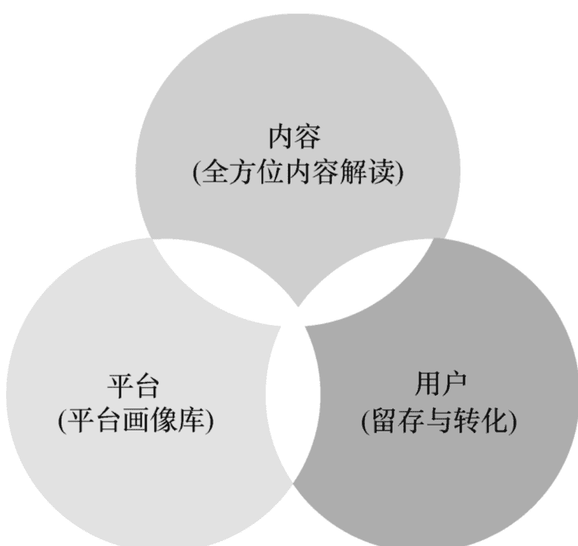

多模态语义理解可把图文、视频、直播脚本解构为多维特征向量。向量不仅含显性关键词与视觉元素，还能捕捉情感倾向、叙事节奏、文化隐喻等潜信息。例如一篇碳中和科普，人工可能只看到环保、技术标签，系统能识别出未来感叙事占比62%、情感唤起强度B+等深层特征，为适配提供依据。

基于持续扫描建立动态平台画像库，每个平台描述维度超200项，含用户日均时长、内容偏好等显性指标，也含算法推荐倾向、亚文化圈层活跃度等隐性特征。小红书轻知识爆发时，系统可在24小时内捕捉算法权重变化并自动调整策略。

依托混合专家与强化学习，系统实时计算内容与生态的最优匹配路径。决策不是简单分类，而是动态权重调节：知识密度高的内容优先推知乎、B站，并自动生成章节标记与互动问答；情绪感染力强的素材定向抖音、快手，并同步优化节奏与BGM适配。某家电品牌实测显示适配精准度提升80%以上，停留时长翻倍，转化率明显提高。

系统还构建营销数字孪生，通过追踪10万+品牌投放数据模拟不同策略反馈，形成预测性决策。新品推广时不仅推荐当前最优组合，还能预测未来3个月舆情演变：若豆瓣小组话题热度上升，便自动生成分阶段策略，先知乎建专业背书，再小红书场景种草，最后抖音发起挑战赛引爆销量。

预测能力在舆情应对中更突出。2025年某车企遭遇安全质疑，危机响应模块10分钟内完成全网语义扫描，锁定32个高影响力讨论场域，并生成差异化回应：在虎扑发布技术长图，微博用KOL口碑证言，抖音以工厂探访视频重塑信任，正向率大幅回升。

系统不是替代思考，而是把时间还给真正重要的问题——让技术赋能人性而非让人性臣服技术。当平台推荐从经验博弈变为科学决策，带来的不仅是效率革命更是营销本质回归。未来赢家是善用AI洞察本质、用人性温度锚定价值的品牌。

## 9.4 资源投放从经验走向数据

不少CMO抱怨预算吃紧，决策偏差导致支出沉没。DeepSeek打造资源导航系统，能精准定位高价值战场并实时优化投入节奏，让每一分预算都撬动用户认知。

传统分配存在三大问题。数据过载导致决策瘫痪，营销人员日均处理多平台指标，人脑难以承载多维动态博弈；模式依赖产生创新盲区，某快消巨头连续三年60%预算投入电商大促，却错失小红书带来的规模流量与曝光；长短期目标冲突，效果广告与品牌内容营销常在资源争夺中陷入零和。

头部企业资源消耗于低效渠道，中小企业试错成本更高。根本是人力决策难以跳出经验茧房，市场变化速度一旦超过人脑处理极限，再资深的老手也会用旧地图找新大陆。

DeepSeek可构建动态价值评估-资源弹性分配-效果实时校准的三位一体系统，推动从经验驱动向数据驱动跃迁。

### 1. 动态价值评估
融合文本、图像、视频、用户行为日志等多源数据，构建立体评估体系。除转化率外，还引入认知资产沉淀、心智占领强度、生态协同效应等隐性指标。评估小红书种草笔记时，不仅算点击转化，还会量化情感唤起指数、文化符号渗透率对品牌资产的长期增益。某美妆品牌发现明星单品在抖音即时ROI虽高于B站，但后者用户二创带来持续三个月的长尾流量，最终将B站预算从8%提至22%。

### 2. 资源弹性分配
基于强化学习与博弈论模型模拟不同分配策略的市场响应并自动生成方案。核心创新是资源流动性系数，检测到平台指数级增长信号时，可动态抽调其他渠道冗余预算实施闪电战。Meta发布VR新品期间，某3C品牌系统捕捉到知乎VR话题24小时暴涨300%，立即把知乎资源从5%调至35%，并自动生成20篇技术解析、策划8场AMA直播，抢占份额。

### 3. 效果实时校准
连接DSP、CRM、舆情监测等多源数据后，系统每15分钟更新一次分配权重。高频迭代赋予策略环境适应性。某车企新车上市遭遇竞品截流，系统监测到对方抖音信息流加码后12分钟内完成：百度SEM预算降7%转投懂车帝垂类内容；暂停朋友圈品牌广告倾斜车友群KOC培育；同步生成35条反击话术供销售使用。最终首月占有率超预期。

系统带来战略级认知升级。隐性机会市场捕捉方面，语义场分析可识别尚未商业化的潜在需求。某宠物食品品牌分析豆瓣科学养宠小组10万+帖子，发现用户对宠物情绪健康关注高，遂削减传统功效宣传，转与动物行为学专家合作输出专业内容，在知乎、播客建立品类标准，开辟20亿细分市场。

资源效能链式反应方面，某奢侈品牌原计划单独投放618电商广告，系统基于历史数据建议线下快闪+小红书打卡+抖音开箱，将20%线上预算转为线下体验，引导用户自发生产内容再经AI优化分发，单店获客成本降60%以上，UGC带来上百万次额外曝光。

营销资产指数增值方面，知识图谱将每次投放数据转化为可复用战略资产。某母婴品牌三年积累20万条用户咨询，经整理形成育儿焦虑图谱，指导生产缓解不同阶段焦虑的文章，使单篇内容生命周期大幅延长。

使用时需注意：每个决策应可追溯至原始数据节点，避免算法黑箱；防止资源过度集中导致预算失衡；保留人工干预权限，避免推荐逻辑僵化。

## 9.5 多渠道营销AI知识库搭建

多渠道营销是扩大触达与提升影响力的关键，但数据割裂、管理效率低严重制约效果。跨渠道数据无法整合，不仅浪费资源，还会错失用户旅程的关键决策点。

DeepSeek凭借强数据处理与分析能力，可构建多渠道营销AI知识库，助团队打破困境实现精准营销。某教育机构暑期招生瓶颈时，系统自动识别知乎问答与微信私域社群协同缺失，生成2000条定制素材，转化率提升68%。某奢侈品牌在巴黎时装周期间，利用知识库实时反馈动态调整Instagram、抖音海外版、线下快闪店三端策略，品牌声量同比大幅增长。

构建流程如图9-2所示。

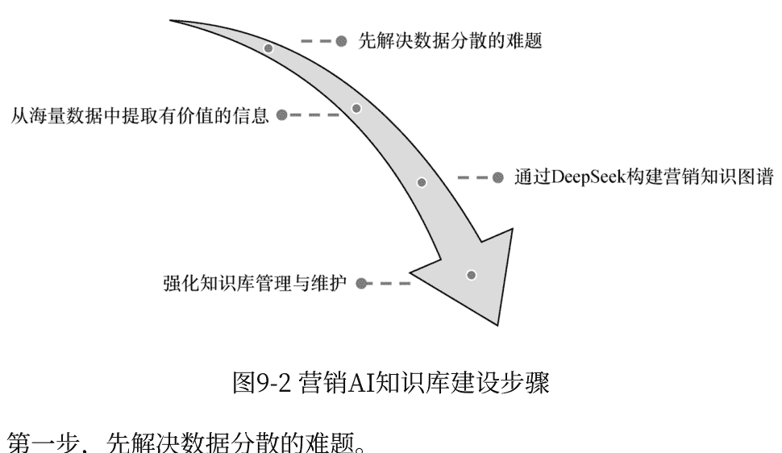

第一步解决数据分散。营销数据分布于电商、社交、线下门店、邮件营销等渠道。系统拥有丰富接口，可无缝对接实时抓取结构化与非结构化数据，包括电商销售与评价、社交互动与话题、线下客流与交易记录。采集后智能清洗算法自动筛选优化，去除重复错误，统一格式规范标准，确保入库数据真实完整。

第二步从海量数据中提取价值。自然语言处理与数据分析在此关键。用户评论、社交帖子、客服聊天记录等文本，系统可理解语义与情感，通过情感分析判断满意、中立或不满，精准提取关注重点与潜在需求。某手机品牌借助系统梳理用户对拍照、续航、流畅度的具体反馈与期望，据此迭代产品。

对销售、行为等结构化数据，系统用统计学与机器学习深度挖掘，分析购买历史、浏览行为、消费金额等描绘详细用户画像，呈现年龄、性别、地域、消费习惯、兴趣爱好等特征，还能基于历史数据预测销售趋势、市场需求变化、偏好转移，助团队提前布局。

第三步构建营销知识图谱。知识图谱以可视化方式呈现产品、用户、渠道、品牌等实体及其关系，清晰展示各渠道销售表现、各群体偏好、品牌竞争态势等。系统可发现潜在联系并自动更新完善。新品推出时可快速查阅同类产品各渠道表现、用户反馈与竞争格局，制定更科学方案；市场推广时可借助图谱了解用户各渠道活跃时间与行为习惯，优化广告投放。

第四步强化知识库管理与维护。数据持续积累，需建立审核流程确保入库数据有价值；开发版本管理系统记录更新历史便于追溯；定期清理优化删除过时数据提升运行效率；加强安全管理，采用加密、访问控制、备份恢复等措施防止泄露。

充分发挥价值离不开团队支持。需开展系统培训让员工掌握从知识库获取数据并解决问题的方法；建立跨部门协作机制打破壁垒促进信息共享；员工共同参与建设与应用，才能真正提升品牌整体营销能力。

## 9.6 调性巡检AI守护品牌一致性

从社交图文到线下门店视觉，从产品包装到客服话术，品牌调性贯穿所有触点，是塑造认知的关键。通常包括语言风格、视觉规范、价值主张三个维度。

一致性需渗透每个触点：抖音短视频画面色调应与官网首页统一；客服处理售后时话语语气需契合品牌年轻化定位；促销文案在强调优惠的同时要避免偏离高端质感。

传统管理存在三大痛点。人手审核效率低下，某快消集团数据显示单条内容人工调性审核平均耗时8分钟，日均新增2000多条内容需庞大团队，成本高昂。主观判断标准模糊，品牌调性多为定性表述如传递温暖感，不同审核人员理解差异导致同类内容出现部分通过、部分驳回。某美妆品牌因小红书种草文案活泼度判定分歧，导致新品上线延误三天。

**声量各行其是，品牌质感被拉扯**

在全渠道投放时，图文、短视频、音频等多种形态的内容往往各自为政，缺乏统一的调性把控口径。某家做3C的企业，线下发布会的视觉主打极简科技感，而同期在社交媒体投放的短片却用了流行向的背景音乐，两种气质直接冲突，用户感受出现断层，品牌好感随之下滑。

DeepSeek 可以把品牌一致性校验变成自动化闭环，其整体搭建思路如下。

### 1. 多模态语义解析
要让模型读懂品牌气质，先把品牌手册里的文字表述、视觉规范文档、过往的优质案例转成可计算的知识资产，形成气质知识库。
- （1）语言维度：借助自然语言处理抽取品牌专属词表、句式偏好、情感基调。
- （2）视觉维度：借助计算机视觉拆解视觉要素，沉淀主色RGB、字体库、构图规则等特征向量。
- （3）价值维度：借助知识图谱把品牌核心主张与具体内容元素关联起来。

新内容上线时，系统会自动抽取文本词向量、图像视觉特征、视频音频频谱，与知识库里的气质模型做匹配。某运动品牌在投放新品片时，DeepSeek 识别到画面里出现了规范里不允许的霓虹灯光效，该品牌一直以自然光为主，系统立刻发出预警并定位到具体帧，审核效率比人工快约5倍。

### 2. 动态权重匹配
不同触点的气质敏感度不一样，DeepSeek 借助渠道权重模型做差异化校验。
- （1）高敏感触点如官网、品牌旗舰店，要求严格对齐全部气质要素，语言风格偏离阈值即触发红警。
- （2）中等敏感触点如社交媒体、短视频平台，允许适度创意发挥，视觉规范匹配度需≥80%，语言需保留核心气质关键词。
- （3）低敏感触点如促销页、工具类H5，重点看价值主张是否统一，语言可随场景调整，例如促销文案更强调利益点，但必须带入品牌核心价值词。

### 3. 跨时空连贯性追踪
品牌气质具有时间延续性，DeepSeek 可与历史内容库比对。
- （1）纵向追踪：对比近12个月内容的气质偏移。某白酒品牌2024年中秋文案被判定传统节日元素占比同比下降，且缺少品牌标志性的“家国情怀”等关键词，系统建议补充以强化记忆点。
- （2）横向关联：监测同一时期多渠道的协同度。某美妆品牌在抖音直播中使用的促销话术被评为过度娱乐化，和同期微信公众号发布的专业成分解析文章出现气质冲突，系统生成跨渠道对比报告供营销侧快速调整脚本。

要把气质自动校验落地，通常要走三步。

第一阶段，夯实数据与标注底座。
- （1）全域数据采集：接入近3至5年的品牌内容资产，包括广告片、详情页、客服对话、线下物料等，建议总量不少于10万条作为初始训练集。
- （2）专家知识注入：组织品牌管理、文案、设计专家对内容进行气质标注，形成初始标注体系。
- （3）模型训练优化：采用半监督学习，让模型在人工标注和海量未标注数据中同步学习气质特征。
某轻奢女装品牌把历年的宣传册、官网内容、线下陈列图导入系统，构建了优雅、简约、高级感三维气质模型，解决了不同设计师视觉表达分歧，新品视觉方案通过率从65%提升至91%。

第二阶段，全渠道内容自动化巡检。
- （1）创作实时监控：在内容工具内植入API，编辑输入关键词时即时提示合规性。某快消品牌编辑撰写微博时输入“甩卖”，系统立刻提示和品牌品质生活气质冲突，建议改为“限时特惠”。
- （2）批量巡检：对已发布内容定期扫描。某连锁餐饮品牌每周自动扫描美团、大众点评、抖音的门店图片，发现23家门店菜单未使用标准字体，及时通知整改，避免视觉碎片化。
- （3）危机预警：当内容气质偏离度超阈值且传播量快速增长时，系统向营销人员推送红色预警并附带影响范围和补救建议。

第三阶段，气质管理的动态进化。
- （1）用户反馈闭环：把评论中“广告太生硬、不似以往风格”等反馈自动回流至知识库，指导模型调整。
- （2）跨部门协同优化：打通市场、设计、客服数据。某零售品牌发现客服话术亲和力低于品牌标准后，联动市场部更新培训手册，3个月内客户满意度提升9%。

DeepSeek 带来的底层变化：
- 由结果把关转向过程赋能，传统审核只看成品是否达标，DeepSeek 在创作阶段提供实时气质建议，实现边写边合规。
- 由经验驱动转向智能沉淀，品牌气质被沉淀为可复用的数字资产。用户偏好成分党内容时，系统可提升专业术语权重，让气质和用户期待同步进化。

当内容即品牌时，DeepSeek 正成为捍卫品牌灵魂的智能卫士，把分散的触点凝聚成统一认知，让每次传播都成为价值的累加。

## 9.7 实战：AI驱动的618大促全案
电商年度大考“618”前，某头部家电品牌营销专员李某反复修改方案仍不被认可，陷入焦虑。借助 DeepSeek 后，他完成了从洞察到落地的全流程策划。

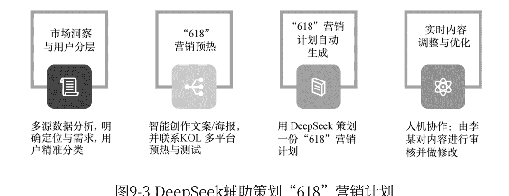

### 1. 市场洞察和用户分层
他借助 DeepSeek 采集社交媒体和电商平台多渠道数据，识别到2024年“618”健康电器、智能家居品类呈现爆发式增长，并分析竞品打法以找到差异化定位。
基于 RFM 和情感倾向分析，用户被划分为：
- 高价值忠诚用户：约占15%，贡献超60%营收，需以专属福利提升复购；
- 潜力增长用户：约占30%，需个性化推荐加速转化；
- 沉默用户：约占40%，需唤醒活动激活；
- 流失用户：约占15%，需分析原因并制定挽回策略。

### 2. “618”营销预热
他让 DeepSeek 产出适配不同平台气质的文案，创作五十余套海报创意，并敲定5位 KOL 合作带动自然触达。在抖音、小红书小范围测试后，根据数据反馈调整素材和投放配额。

### 3. “618”营销计划自动生成
指令示例：“我是一名家电品牌营销专员，正在为淘宝‘618’大促备战，期望得到清晰、实用且极具针对性和差异化的‘618’营销计划，目标用户为28～35岁一线都市白领和25～30岁下沉区域新婚家庭。”

# 家电品牌618整合营销方案

## 一、项目背景和目标拆解
### （一）目标用户深度画像
一线都市白领核心诉求为智能便捷45%、健康品质30%，场景为加班后高效家务、周末精致生活，决策因子为生态联动，客单承受800～3000元。
下沉区域新婚家庭核心诉求为性价比50%、空间适配35%，场景为婚房家电采购、亲友高频使用，决策因子为本地售后服务，客单核心区间500～1500元。

### （二）核心营销目标
销售目标：淘宝“618”GMV 目标1500万元，新客占比≥40%。效率目标：支付转化率提升至4.5%，获客成本控制在75元内。品牌目标：目标人群认知度提升25%，NPS 达48分。

## 二、产品策略：双人群定制化组合
一线都市白领专属：智能健康套装客单2500～4000元，含智能变频空调、除菌嵌入式洗碗机、空气净化器，主打远程联动和数据化说服；精致生活单品客单800～1500元，如迷你复古冰箱、无线手持吸尘器。
下沉区域新婚家庭：高性价比基础套装客单1200～2500元，含定频空调、波轮洗衣机、基础净水器，叠加以旧换新和乡镇补贴；空间大师单品客单500～1000元，如嵌入式微波炉、双开门小冰箱。

## 三、内容策略：双场景精准触达
淘宝站内详情页对白领和下沉用户做差异化首屏和卖点呈现，直播分白领专场和新婚家庭专场。站外小红书侧重白领种草，抖音侧重下沉剧情和补贴计算器工具视频。

## 四、促销活动：双阶梯优惠体系
白领权益包括套购阶梯和以旧换新升级；下沉福利包括低价秒杀、满减叠加以及9.9元锁定测量配送安装权益，并设计裂变机制。

## 五、渠道策略：全域流量收割
站内通过关键词包和出价策略拦截搜索，推荐流量渗透；站外通过微信小程序裂变、社群运营及县域线下联动。

## 六、执行节奏：三步运营
预热期5月20日至5月31日做预售蓄水和内容种草；爆发期6月1日至6月20日做节点冲刺和动态优化；长尾期6月21日至6月30日做返场收割和用户沉淀。

## 七、风险控制和资源保障
风险预案覆盖库存不足、直播政策解读错误、竞品降价冲击。人力15人专项小组，预算800万元。

## 八、效果评估和复盘
监控流量、转化、成本、品牌指标，分人群设定阈值。每日晨会复盘和节点深度复盘沉淀模板和话术至企业知识库。

#### 4. 实时内容调整和优化

实时追踪社交平台的热度风向，敏锐捕捉用户情绪的细微波动。李某注意到“价格焦虑”话题出现明显升温，便把低价与高性价比组合纳入618投放策略，要求直播团队和淘宝客服同步对外强调相关卖点，并在产品功能介绍中做柔性植入。若DeepSeek生成的618方案与品牌定位冲突，或不符合淘宝营销规范，他会立刻进行修正。

在生成式AI重塑商业逻辑的阶段，李某把握住DeepSeek带来的技术红利，将其深度嵌入营销全流程，实现以数据为依托的精准决策与持续优化，最终在618竞争中取得突出表现。展望未来，随着技术迭代，618将不再只是单纯的促销狂欢，而是检验品牌智能化能力与技术实力的综合较量。

# 下篇 DeepSeek营销行业宝典——5大行业N种玩法

## 第10章 电商零售：从选品到客服的AI全链路

过去选品方案需要团队反复讨论数天，如今DeepSeek可以在半小时内输出包含市场洞察、竞品拆解、爆款预判的完整报告；过去直播完全依赖主播临场发挥，现在可以做到脚本实时推送；即便是容易引发投诉的退换环节，也能提前识别风险并自动触发挽留机制。

DeepSeek让电商零售从摸索试探走向全链路可视化。本章拆解其在零售领域的渗透方式：生成直击用户痛点的商品文案，搭建动态选品模型，为主播定制直播稿，承接高频客服咨询；在跨境场景下，还能跨越语言障碍，用目标市场熟悉的表达方式呈现中国制造。这既是效率的跃迁，也是人、AI与商业关系的重新定义。

### 10.1 开篇案例：某淘宝商家用DeepSeek写产品描述

杭州余杭一处电商产业园里，主营家居用品的淘宝店主陈某正在查看618预售数据，转化率比预期低了12个百分点。更棘手的是，团队耗费两周打磨的文案在不同渠道表现分化明显：小红书笔记互动尚可，淘宝详情页跳出率却超过60%。

抱着验证心态，她接入DeepSeek API，先以爆款“竹语系列”做试验，该系列包括窗帘、桌布、抱枕等十余个SKU。

传统写法多围绕环保、自然、国风展开，场景代入不足。团队第一次使用时先设计提示词：以新中式家居美学为核心，结合当代都市人的生活痛点撰写竹语系列描述，要求涵盖材质工艺的诗意表达、多场景使用示例、情感共鸣点及文化内涵延展。指令既明确框架，又保留创作空间。

输入后约一分钟，系统生成约800字的说明。以窗帘为例，文本写道：清晨第一缕光透过竹纤维滤入，光斑像水墨画卷铺开，每根竹丝经过72小时自然晾晒，既保持韧性又释放负氧离子，让身处钢筋水泥的人也能感受到竹林气息。内容将物理属性与沉浸场景结合。

另一热销餐桌，原文仅列“北美白橡木加亚克力桌腿”。模型则写成：晨光斜穿亚克力桌腿22度切面，在橡木纹理上投下几何光影，这张桌子就成了早餐的艺术展。加厚5厘米台面恰好承托办公时手肘，灵感迸发也被木质温柔支撑。改写后该品加购率翻倍。

为验证效果，团队挑选3款做AB对照。A组沿用传统文案，B组使用模型生成。B组点击率提升60%，转化率提升40%，其中一款竹制抱枕转化率从1.5%升至4.7%，销售额增长两倍。

背后是智能优化机制在运作。系统会依据用户浏览与购买行为自动调整关键词权重。对偏好ins风、网红同款的年轻女性增加相关表述，对注重品质的用户则强化工艺传承、母婴级环保认证等信息。

技术成熟后，团队尝试更复杂场景。开发屏风时，模型不仅提供层峦叠嶂、流水潺潺等视觉化描述，还基于故宫文物数据库给出图案的历史依据。最终产品在淘宝好评率达98%，并被本地杂志评为年度创新设计。

当下大量店铺用AI优化文案，人力成本大幅下降，但也带来新挑战。内容同质化加剧，陈某通过建立专属文化语料库，把品牌理念与设计哲学注入训练数据，有效避免千篇一律。伦理法律风险也凸显，生成内容的版权归属存疑，因此她聘请法务顾问，在内容中加入原创标识并建立审核机制，确保合规。

陈某的经历只是电商智能化转型的缩影。在这波浪潮里，能把技术与业务深度融合的店铺更具优势。正如她总结：AI不是替代，而是创意放大器。当算法遇见家居美学，数据读懂用户需求，传统运营模式正在被改写，而这一切才刚刚开始。

### 10.2 智能选品：生成市场分析报告+调查竞品+预测爆款

电商从流量争夺转向留量运营，选品已成为决定生死的核心能力。传统模式存在三大短板：人工分析多停留在销量、评价等公开表层，难以读懂真实需求；市场变化快，人工调研常需数周数月。2025年3月某母婴品牌借助DeepSeek提前两周预判恐龙主题育儿用品走红，而传统团队还在准备展会样品；红海竞争激烈，人工很难精准切入蓝海。

生成式AI正重塑选品链路。

#### 1. 智能数据分析：让数据自己发声
DeepSeek擅长处理非结构化信息，如社交评论、行业报告、测评文章。营销人员上传行业调研PDF，系统可自动抽取产品类型、用户评价、高频问题、功能诉求等，为选品提供依据。

#### 2. 多维标签生成：读懂深层需求
不同于蓝牙、防水等硬件标签，DeepSeek构建的语义标签更抽象，如缓解父母焦虑、解决碎片场景需求。某品牌通过分析社媒数据，提前38天捕捉到“气味记忆”话题爆发，推出香味手环成为爆款。选品从“什么好卖就做什么”跃升到“未来18个月会流行什么”。

#### 3. 深度语义匹配：动态优化策略
系统把用户需求标签与供应链资源匹配，生成可执行推荐。某DTC品牌借助DeepSeek分析Reddit“极简生活”板块热词，发现模块化可拆卸家具潜力，上线首月ROI达到500%。

操作层面，市场分析、竞品调查、爆款预测都能实现数据驱动。

市场分析上，DeepSeek抓取多国搜索波动、社媒话题热度和行业报告构建需求图。以露营装备为例，可聚类出轻量化徒步、家庭露营套装、宠物户外用品等细分赛道，并标注竞争饱和度与增长潜力。某跨境电商借此捕捉到海外“宠物瑜伽”标签热度，推出定制宠物用品首月销量破万。

竞品调查上，传统分析局限于价格销量，DeepSeek通过逆向工程抓取详情页隐藏参数，如主图点击热区、QA关键词密度，并用对抗生成网络模拟优化。例如针对小红书二手奢侈品账号，监测10个头部账号笔记关键词，对比主推品类、价位和互动率，辅助调整库存款与定价，将Gucci Jackie从1.2万元调至1.18万元并突出日本同期售价。

爆款预测上，模型融合边缘计算、物联网与区块链溯源。例如通过工厂IoT实时监测产能波动，结合物流时效动态调整优先级；用区块链计算碳足迹匹配环保偏好。深圳某跨境电商预测智能美妆镜需求爆发，备货2000件14分钟售罄。备货周期从30天压缩到72小时，库存周转提升25%以上。

DeepSeek不仅是技术进步，更是商业逻辑的重构。传统选品靠运气赌爆款，现在靠算力算爆款。踩坑率从50%降到10%以下，中标率从20%提升到70%以上。本质是把分散的洞察、孤立的数据、滞后的决策整合成动态智能生态。

对从业者而言，问题已不是要不要用AI，而是如何让AI更懂自己的业务。只有把选品感觉升级为算法直觉，才能命中消费者尚未说出的需求。

### 10.3 直播带货：设计直播脚本+智能提词+话术优化

直播前3秒留存直接决定转化效率。主播既要把控黄金话术，又要应对突发状况，人工策划难以为继。

DeepSeek重构直播流程，形成预判-执行-进化的闭环。

#### 1. 智能脚本设计：从经验到数据
动态热点捕捉上，系统实时抓取微博、抖音热搜，通过Transformer生成贴合热点的脚本框架。例如露营经济爆发期，为户外品牌生成《星空露营装备清单》主题脚本，带动点击大幅增长。

个性化场景设计上，可基于用户画像生成差异化脚本，并根据历史数据构建“话术强度-观众反馈-转化率”关联模型。通过LSTM模拟观众注意力曲线，自动安排高潮点：开播30秒埋悬念钩子，每5分钟设价格刺激点，结尾触发稀缺性话术。

跨平台自适应上，系统分析抖音、淘宝、TikTok规则差异，预埋平台特色：抖音偏剧情冲突，淘宝重参数可视化，跨境需文化符号转译。

#### 2. 智能提词系统：从机械播报到智能交互
语音文字同步映射实现实时解析主播话术并动态调整提词。某食品主播临时增加食材溯源环节，工作人员即时生成提词，提升互动并避免事故。

观众情绪实时响应上，结合弹幕关键词和停留时长优化提词优先级。某美妆间捕捉到“敏感肌”高频词，即时推送“无添加成分”提词，增强信任。

上下文感知语义网络下，讲解功能时自动关联可视化场景素材，答疑时调取FAQ与售后政策，互动热度下降时推送促单话术包，形成需求识别-内容匹配-行动引导闭环。

三级风险过滤机制包含正则拦截违禁词、BERT识别隐性违规表述、接入监管政策动态库，实时标注风险并给出合规表达建议。

#### 3. 话术优化：从模仿到算法进化
情感化表达生成如“深夜追剧零食”等沉浸式话术。实时AB测试通过弹幕关键词与转化数据淘汰低效话术，某食品间将限时折扣话术改为家庭分享装，转化提升。

多语言适配支持多种方言与外语自然生成，为不同区域主播提供话术。跨周期知识沉淀让每场数据转化为优化依据，提炼出早间偏权威、夜间偏娱乐等规律，并构建垂直领域知识库，实现经验复用。

DeepSeek的赋能是在重构人-货-场关系。基础任务被接管后，主播可回归情感连接、场景构建和价值传递。这不是替代人类，而是放大创造力，重建有温度的链接。

### 10.4 智能客服：让AI处理80%的常见问题

客服重要性日益凸显，大量咨询集中在账号注册、价格查询、订单状态、退换货政策等重复性问题。人工模式效率低、响应慢、成本高。

DeepSeek提供创新解法。

#### 1. 常见问题的自动化高效处理
快速识别与标准回复上，系统瞬间判断问题类别并从知识库调取模板。用户咨询退货流程时，可在数秒内给出申请步骤、时效、地址和注意事项，远快于人工检索。

多轮对话连贯解答上，模型记住上下文。用户先问电子产品如何开机，再追问网络设置，系统能准确识别型号并给出针对性步骤，对话自然流畅。

#### 2. 智能辅助复杂问题处理
政策法规与业务知识即时获取上，系统将企业文档、产品手册结构化存储。客服输入用户问题即可检索到政策解读、业务逻辑和计算方法，避免手动翻阅。

基于数据的预测与引导上，通过挖掘历史咨询数据预测常见问题，主动推送FAQ，减少用户等待。

一家淘宝女装店上线 DeepSeek 对话分析后，很快摸清了用户在聊什么：约四分之一的咨询都卡在尺码该怎么选上。这个发现直接指向了详情页尺码说明的优化空间，也让增加智能尺码推荐成为当务之急。除此之外，平台还能捕捉语气、用词背后的情绪波动，判断服务是否让人满意。举例来说，某类回复发出后满意度明显偏低，客服就能据此调整话术。

在日常答疑中，DeepSeek 会持续推送类似案例的处理办法和相关知识链接，帮助一线更快给出答案。它还会把整个团队协作解决问题的全过程完整留存，沉淀为可复用的经验库，供新人学习、老手复盘，整体解决效能因此不断提升。

当用户体验成为竞争主战场，服务能力就等于核心竞争力。DeepSeek 在客服场景里的实践说明，一旦技术真正嵌入服务链路，重复性的常见问题处理就不再是纯体力劳动，而是洞察需求、反哺产品设计、抬升品牌价值的关键入口。

### 10.5 用DeepSeek提前预判退货并圈住客户
用户退货不仅要承担物流成本，还会伤口碑、损信任。传统做法多是等退货发生后再补救，在节奏快的市场里已很难满足需求。

DeepSeek 用数据和机器学习给出了新的思路，整体流程可拆解为：先汇集产品、用户、购买、物流、评价等多源数据，整合为统一的数据集；再做特征工程，从原始信息里提炼出对退货影响显著的因子；随后挑选模型进行训练，实践中常用决策树、随机森林、支持向量机、神经网络等，也会出现多元线性回归、逻辑回归或深度学习方案。模型以历史退货记录为样本，通过交叉验证、网格搜索调参，并结合市场与消费行为的变化动态修正。

训练好的模型能为每笔订单给出退货概率，并划分为四级风险预警：
- 安全级（P<0.1）：维持常规售后保障
- 关注级（0.1≤P<0.3）：自动触发智能客服关怀
- 预警级（0.3≤P<0.5）：启动定制化挽留方案
- 高危级（P≥0.5）：优先人工介入处理
同时会结合退货原因、客户行为、供应链风险、产品生命周期等多维度进行量化评估。

一旦识别到高风险订单，就要立刻行动：
1. 精准推送信息。针对用户对功能不了解等原因，生成个性化提示，例如推送专属操作视频并告知24小时客服待命。
2. 主动沟通关怀。客服通过电话、短信或即时工具询问使用感受和遇到的问题，用真诚和专业让用户感受到重视。
3. 延长售后期限。主动延长质保或退换货时间，降低用户顾虑。
4. 免费增值服务。按品类提供清洗教程、软件升级、在线技术支持等附加价值。
5. 引导换货而非退货。对尺寸、颜色等需求差异，用购买历史和偏好推荐更合适的款式并承担换货运费。
6. 针对性优惠补偿。依据消费金额和风险程度发放优惠券，比如满200减50，有效期30天，刺激复购。

若用户只是轻微不满，系统会建议协商部分退款或赠送小礼品来抚平心理落差。整体上，DeepSeek 把事后灭火变成了“预测—决策—应对”的主动服务闭环，这套打法正从头部电商向全零售蔓延，成为数字化标配。

### 10.6 DeepSeek重塑跨境电商出海获客路径
全球化加速下，跨境电商已是万亿美元级赛道，东南亚、中东等新兴市场增速尤其亮眼。但竞争加剧、需求分化、文化差异让精准获客成为难题。

DeepSeek 在这一块提供了新的抓手。搜索引擎端，它会深度分析目标市场的搜索习惯，筛出高价值关键词并给出布局建议，结合GEO策略把关键词合理植入标题和商品描述，提升跨境平台排名。例如想了解东南亚高性价比智能穿戴，相关商品就能进入推荐榜前列，提高曝光和转化。

社交媒体端，平台会依据不同渠道的用户画像和行为制定内容和投放计划。Facebook 上，系统发现特定时段用户偏爱生活、故事类内容，就生成服装搭配故事、时尚小贴士并在高峰时段发布。Instagram 则侧重图文短视频，紧跟热点给出视觉创意和拍摄指导。TikTok 上，拆解热门视频的创意、节奏和话题，产出挑战式展示或生活场景植入脚本。

内容本地化同样关键。DeepSeek 能理解产品特性和使用场景，结合当地语言习惯和文化背景产出符合 GEO 规范的多语言文案。比如智能手表英文描述会融入“smart health tracking”“long-lasting battery life for all-day use”等当下热词，同时贴合英语国家的搜索偏好；其他语言版本也会兼顾文化差异和表达风格。

某 3C 跨境商家先用 GEO 做关键词研究和优化，排名明显提升；再按国家定制内容，德国侧重严谨工艺和高品质，法国突出时尚设计与浪漫调性；投放渠道也差异化，德国主攻 Google Ads 和专业 3C 电商平台，法国则加大 Facebook 与 Instagram 投放。落地前，团队对员工进行 GEO 全面培训，或邀请专家演示；同时鼓励一线在实操中不断探索新场景，总结经验提升效率。

### 10.7 实战复盘：DeepSeek如何打造一场千万元级爆款直播
2025 年3月，某 3C 品牌借助 DeepSeek 完成一场智能手表新品直播，单日销售额创纪录。下面拆解其从0到1的打法。

第一阶段 直播前准备
1. 目标拆解与竞品扫描。团队在 DeepSeek 上建档，输入推广目标后自动生成三维拆解。用户目标为25-35岁都市白领占45%、运动爱好者30%、科技尝鲜者25%。数据目标为直播间转化率≥3%、GMV破千万、新增粉丝超1万。系统抓取近30天竞品直播发现普遍技术讲解晦涩、女性互动不足，为差异化提供依据。
2. 用户画像深度解构。需求热力图显示续航焦虑、操作便捷性、穿搭适配是前三大痛点。决策因子排序为第三方检测报告权重35%>真实用户证言28%>限时赠品22%>主播人设15%。核心活跃时段为20:00—22:30。
3. 智能选品与组合。基于三维选品模型构建矩阵：引流款为基础款智能手环99元秒杀限量500件，低价引流效率提升约40%；主推款为星环Pro智能手表1299元套餐，竞品同价位转化最佳；搭配款为磁吸快充底座买手表加购99元原价199元，关联购买率预测65%；形象款为限量版太空礼盒2999元附赠航天联名周边，覆盖高净值用户约12%。爆款潜力评分显示搭配款痛点匹配度92分，最终备货提升后实际关联购买率超50%。

第二阶段 方案生成
1. 脚本精准定制。系统30分钟内输出脚本，团队二次创作。时段划分：20:00-20:30流量破冰，以明星开箱、福袋抽奖为主，配合虚拟弹幕预热，埋点在线人数与互动率；20:30-21:30产品种草，工程师拆解电池、用户Vlog，3D投影演示芯片架构，埋点停留时长；21:30-22:30转化攻坚，阶梯价促销、限量秒杀，库存预警自动触发，埋点下单转化率与客单价；22:30-24:00长尾收割，虚拟主播接力、次日福利预告，声纹克隆无缝衔接，埋点夜间留存率。话术包含痛点唤醒、信任构建、促单转化三大模块，并动态展示调研数据、权威报告、库存计数。
2. 全域引流。内容引流自动生成三类短视频模板做A/B测试：痛点共鸣、福利驱动、人设种草。私域激活按新用户、沉睡用户、高价值用户分层推送个性化邀请。跨界联动通过算法匹配运动App、职场KOL、科技媒体导入约300万精准流量，其中运动App导流转化率达4.2%。

第三阶段 实战执行
1. 动态调优。流量承接上，在线人数低于预期80%时自动触发视觉、利益、内容三重钩子：背景切红、限时加赠横幅、福袋频次从15分钟/次提至8分钟/次并升级奖品、切换引流款秒杀。转化攻坚按用户分层调整话术：价格敏感型强调保价、30天无理由并展示竞品价差；品质导向型连线第三方检测机构展示暴力测试；社交分享型推出分享得券。
2. 人机协同。真人休息时段由虚拟主播接力，保持语言风格和肢体动作，承接23:00-1:00流量。实时话术辅助中，当“老人能用吗”提问频次>5次/分钟，系统推送长辈模式演示视频链接，主播一键播放，响应从10秒压缩至1.5秒。

第四阶段 复盘
直播结束2小时内完成三维度复盘。用户洞察层：女性用户占比从35%提升至48%，得益于职场健康管理场景；主推款转化率4.8%远超行业均值2.5%，搭配款关联购买率71%，客单价提升35%；限量秒杀释放过快导致21:00-21:15流量真空，下次建议阶梯释放。技术应用层：虚拟主播时段贡献GMV约18%，智能话术提升问题响应效率60%；200+互动标签、30+场景转化数据、10+话术优化方案入库形成直播知识库；基于“表带材质不透气”高频反馈，研发两周内推出透气款，预售破千件。随后团队在平台上直接生成双11预案，形成可复制迭代的增长体系。

第11章 B2B线索挖掘与培育的智能化升级
数字化浪潮下，B2B 企业面临客户需求复杂、竞争激烈的新局面，快速挖线索、精准养客户、提升成交率成为关键。DeepSeek 在 B2B 场景的应用正帮助企业破局。

### 11.1 案例：SaaS服务商靠DeepSeek把成交率翻倍
一家国内领先的 HR 管理系统服务商，产品覆盖招聘、绩效、薪酬等全场景，注册企业超10万家，但付费转化长期徘徊在15%。销售日均处理数百条线索，却难以识别高价值客户，市场活动 ROI 低，成交周期被拉长。

2025 年初引入 DeepSeek 后，系统整合官网、CRM、客服等多源数据，完成近三年交互记录的结构化。行为轨迹分析揭示决策信号：企业客户两周内连续查阅薪酬模块说明文档超5次，采购概率提升近4.8倍；下载白皮书后7天内未咨询，流失风险高达90%。线索评分体系随之重构，优质线索识别准确率大幅提升。

在培育环节，自然语言处理实时解析官网、邮件、在线咨询中的提问关键词，自动生成个性化内容。某制造业集团多次提及跨地区考勤，系统触发多分支机构管理案例视频并推送同行业 ROI 报告。沟通策略也随情绪波动动态调整：价格敏感时优先推荐阶梯付费，技术疑虑时自动安排技术顾问介入，响应更快、培育周期更短。

销售赋能方面，线索清单从无序列表变为带指导的销售信息，含客户近期关注功能、核心痛点、甚至议价阶段可能提出的异议。销售可提前准备方案，月度成交客户数因此提升。整体上，DeepSeek 让 B2B 从经验驱动转向数据驱动，实现高效挖掘与精准培育。

部署模型约60天后，这家公司的经营指标出现明显拐点。线索向订单的推进更顺畅，签约周期明显缩短，单月成交额直接翻倍。尤以单价20万元以上的大客为主，因为系统能精准筛出真实购买意图的买家，该层级收入占比大幅抬升。于是“精准掘客—快速成交—持续增值”的闭环开始自转。

这个案例点出模型驱动企业对企业营销升级的本质。模型不只是提效工具，更是重塑商业逻辑的基础设施。它把分散的数据打通，产出决策建议，并在客户全生命周期各触点提供支撑，让企业从经验驱动转向数据驱动。当多数同行仍为线索质量焦虑时，率先上线的公司已能借助该能力优化线索、拉升成交率，在红海中实现超车。

### 11.2 报告速读与痛点穿透
在企业对企业场景中，白皮书与行业报告是建立专业权威、触达决策层的重要载体。可在信息过载的当下，企业普遍陷入双重困境：市场部耗费数月打磨的百页报告，实际阅读完成度极低，核心观点被冗长文本掩盖；销售团队则在海量资料中难以迅速锁定决策链关键角色。投入巨大，回 report低。

某全球工业设备制造商的探索颇具代表性。该公司技术团队每年产出数十份白皮书，转化一直偏低，随后引入该模型。

把沉淀的数百份技术白皮书、行业分析报告导入系统。模型从中筛出数百项核心技术参数与数十个趋势预测节点，并构建起“设备能效—政策法规—供应链成本”的关联图谱。

与此同时，系统按指令对文件进行梳理并自动产出摘要，在保留重点的同时把复杂技术路径转译为商业语言。在东南亚某智慧港口项目中，客户阅读模型生成的摘要后，发现企业早在两年前就预判了技术走向并展开探索，于是将其列入供应商名单，也因此带来更多买家。

更深层的变化发生在痛点解析层面。传统销售依赖问卷或访谈，买家往往表述不清真实困扰。模型通过跨源数据分析，建立起“显性需求—隐性痛点—决策障碍”的三层解析框架，帮助企业看清需求本质。

例如，某买家在公开招标文件中强调设备故障率要低于0.5%，系统却从其公开数据中解析出核心痛点是设备停机造成的碳配额损失远超采购成本。基于此，企业在提案中不再堆砌参数，转而聚焦预防性维护如何避免碳交易亏损，最终成功中标。

这种智能洞察正在重塑内容生产逻辑。接入模型后，白皮书创作流程发生根本变化。系统可监测行业政策变化、技术专利、事故案例等数据流，自动生成包含热点、痛点与解法的框架。最新一期白皮书中，模型不仅预测了技术演进趋势，还通过分析买家邮件高频词汇，把老旧设备改造的数据孤岛问题设为核心章节。这份在模型辅助下完成的报告下载量大幅提升，且不少下载者进入销售漏斗。

季度左右后，市场体系完成蜕变。白皮书转化表现较此前明显提升，单个线索获取成本显著下降。

通过对海量专业文档的智能解构和对买家多维数据的穿透解析，模型既能识别表层需求，也能揭示深层痛点。这不仅是效率革命，更是从根本上重构企业对企业营销逻辑的认知升级。当算法能读懂行业报告重点并透视招标文件背后的真实需求时，企业在专业对话中就能始终快人一步。

### 11.3 智能触达：冷邮件与领英文案自动化
在企业对企业领域，用冷邮件和领英消息触达潜在买家是开拓市场的重要手段。传统方式却常陷入粗放低效：每月投放大量邮件，内容多是产品功能罗列，缺乏针对性，打开率和回复率都极低；领英上的合作邀约因同质化严重难以引起兴趣，大量商机在无效沟通中流失。

该模型的应用带来了突破。它依托强大的数据分析与自然语言处理能力，能深度洞察潜在买家需求与痛点，从而产出更具针对性和吸引力的内容。企业把目标客户的基础信息、行业属性、过往业务动态等输入系统，模型会迅速构建客户画像，结合行业趋势、竞品动态为其量身定制沟通策略。

一家深耕企业数字化转型解决方案的服务商就是典型。该公司想拓展金融行业客户，模型分析发现某地方性商业银行近期发布了数字化升级招标公告，并在行业论坛多次提到核心系统迁移效率低的问题。

基于此，系统产出的冷邮件以助力银行核心系统高效迁移、降低迁移风险为主题，开篇直击痛点，随后介绍企业在金融行业的成功案例，以及方案如何实现数据零丢失、业务零中断。邮件发出后，银行迅速回复表达进一步沟通意愿。

在领英消息撰写上，模型同样展现出强创作力。该服务商瞄准一家大型车企的 CIO，系统深入分析发现对方近期在行业研讨会上谈及提升生产车间数字化管理效率，且领英动态频繁关注工业互联网。

于是生成的领英消息以探讨汽车制造数字化车间升级路径为切入点，分享行业领先案例，并巧妙点出自身方案在优化生产流程、提升设备互联方面的独特价值。这种高度针对性的沟通获得 CIO 回复，为后续合作奠定基础。

此外，模型还具备智能优化能力。它能根据邮件打开率、回复率、链接点击行为等数据评估内容优劣，并自动调整后续消息的撰写策略。

在模型助力下，该服务商的冷邮件回复率大幅提升，领英消息带来的有效商机也实现增长，三个月内与多家不同行业大型企业签署数字化转型合作协议。

借助模型智能撰写冷邮件和领英消息，企业对企业公司可摆脱低效获客，从被动推销转向主动吸引，让每一次触达都成为建立信任、挖掘需求的有效沟通，为高效线索挖掘与培育奠定基础。

### 11.4 精细化运营：客户分级与成交预测
企业对企业精细化运营是众多企业的追求目标，借助模型进行客户分级与成交预测，可有效突破增长瓶颈。以下三大要点值得关注，如图11-1所示。

#### 1. 数据整合
开展客户分级与成交预测的首要任务是构建坚实的数据基础。企业对企业场景下客户数据分散于 CRM、ERP、官网后台等，还涉及社交媒体、行业报告等外部信息。企业需搭建统一数据中台，对交易记录、网站行为、沟通内容等进行清洗标准化。

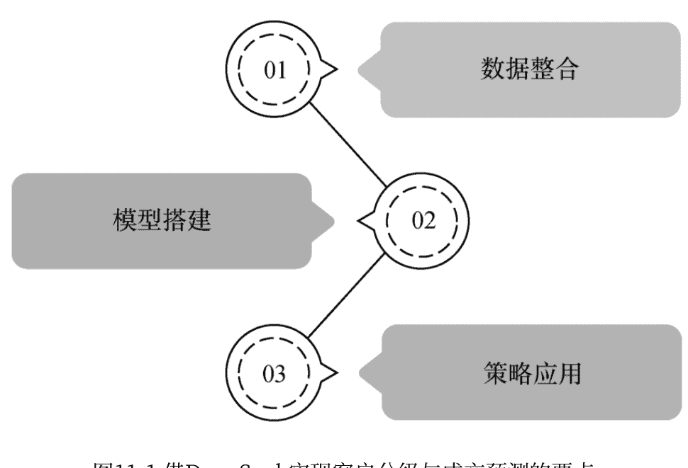

在此过程中，可利用模型把销售沟通记录、客户反馈等非结构化文本转化为可量化的分析指标，让每条客户信息都能成为后续分析的有效素材。

#### 2. 模型搭建
有了优质数据后，可基于模型搭建定制化客户分析模型。分级环节可将客户参与度指标、企业属性等多维度信息整合，利用模型的聚类算法把客户划分为战略级、重点级、培育级和观察级。成交预测方面，需深度挖掘历史成交数据，筛选出首触到成交周期、需求沟通深度等关键特征，用机器学习训练模型并通过交叉验证不断优化，确保预测准确率。

#### 3. 策略应用
模型构建后关键在于把分析结果转化为业务策略。对战略级客户，应组建专属服务团队，提供 VIP 通道，推动长期战略合作；重点级客户可通过定制化促销刺激复购；培育级客户借助内容营销和产品体验活动逐步建立信任；观察级客户则通过自动化邮件保持基础沟通，等待需求释放。

同时，针对不同成交概率的客户需调整跟进策略：高概率客户由资深销售加速推进签约，中概率客户通过案例分享和产品演示消除决策顾虑，低概率客户转入培育池持续互动。

从数据整合到模型构建再到策略执行，模型可助力企业对企业公司打造完整的精细化运营闭环。

某工业设备制造企业在拓展市场时面临客户管理难题。拥有数千潜在客户分散在 CRM 和官网后台，以往筛选分类粗放，销售常忽视高潜力客户，反而耗费精力在低价值客户上，转化率长期低下。

引入模型后，企业整合各渠道销售数据并对接系统，借助模型用海量数据训练客户分析模型与成交预测模型，为精细化运营提供指导。

实践中，某新能源企业客户被判定为重点级且成交概率高达 90%，企业迅速组建由技术专家、销售总监组成的专项团队，针对其新建生产线需求定制含智能监控系统的一体化方案，最终签约。对培育级客户，企业借助模型生成营销内容定期推送方案与案例，长期培育后不少客户提出采购需求。

在模型加持下的精细化运营使该企业客户转化率大幅提升，在激烈竞争中实现新增长。

### 11.5 合同模板自动生成与智能审核
在企业对企业场景中，合同既是交易法律保障，也是运营效率体现。传统模式下法务需耗费大量时间起草审核条款，业务团队常因模板不统一、条款错漏导致谈判周期拉长，甚至因法律风险造成经济损失。

模型通过融合自然语言处理、知识图谱与机器学习，可帮助企业构建合同全生命周期智能管理方案，实现模板自动生成、条款合规智能审核、风险条款动态预警等核心功能，为降本增效提供技术支撑。

对海量法律文本和行业标准合同库进行深度学习后，模型能够识别不同业务场景下的合同特征。例如工业设备采购场景可嵌入质量验收标准、知识产权归属、违约责任等模块化条款；技术服务合作场景则关注保密协议、交付周期、验收流程等核心内容。

借助语义理解技术，模型可动态分析客户需求文档中的关键信息，如交付时间、付款方式，自动匹配最优合同框架生成定制化初稿，大幅压缩起草时间。

在审核环节，模型可构建多维风险识别模型，对比企业历史合同库、行业纠纷案例库及现行法律法规，对文本进行多维度扫描，包括条款冲突、权利义务不对等、法律术语偏差等潜在问题。例如采购合同约定货到付款却未明确验收标准时，系统会标注风险并给出修正建议。模型还具备动态学习能力，可基于新型业务和新法律纠纷自动更新风险知识库，形成持续优化的防控机制。

某大型数控机床制造商长期受困于合同管理。其产品涵盖 20 余个细分品类，客户涉及汽车、航空、电子等行业，每份销售合同需按行业特性、设备型号、服务要求深度定制。销售使用 Word 模板手工修改常出现技术参数遗漏、付款条款与交付节点不匹配等问题，法务每月需处理超 200 份合同修订，平均签约周期长达 45 天。

引入模型后，企业完成三大基础建设：一是将历史 3 万份合同导入构建知识库；二是梳理出 38 种标准业务场景及对应模板；三是对接 ERP 中的客户数据、产品参数库。通过数据连通与模型训练，实现合同自动生成与审核。

具体业务中，销售在 CRM 录入某汽车零部件厂商采购需求后，模型自动触发生成流程：识别客户所属汽车制造行业并调取特有质保条款；从产品库提取设备技术参数生成规格说明书；依据“30% 预付款+60% 交货付款+10% 验收付款”商务条件自动计算各阶段节点并设置逾期违约金条款。

初稿生成后法务启用智能审核校验，若发现缺失条款会立即补充标注。审核后法务仍会进行人工复核以规避细节风险，保证合规性。

运行一段时间后，企业合同起草效率提升十余倍，签约周期缩短至 10 个工作日，在提升签约效率的同时节省大量成本。

### 11.6 客户续约风险预警与应对策略
在企业对企业生命周期管理中，客户续约率波动难以避免。许多流失客户在到期前已出现明显风险信号，传统管理下销售常因信息滞后、分析维度单一错失干预窗口。企业可将模型应用于续约风险预警，建立智能预警体系。

模型赋能的续约风险预警系统建立在三层数据融合之上。第一层是结构化业务数据，涵盖合同金额、服务使用频率、付款准时率等量化指标；第二层是非结构化交互数据，包括邮件往来、会议纪要、客服工单等文本信息；第三层是外部环境数据，包括客户所在行业政策变化、市场竞争态势、供应链波动等宏观要素。

系统基于底层模型解构客户行为模式，分析历史交互数据捕捉决策周期中的隐性规律。同时对沟通文本进行情感分析，当邮件出现重新评估供应商、考虑成本优化等表述时，系统会立即提升风险权重并预警。多模态分析使系统能够提前预测流失风险，为企业争取反应时间。

基于预警，系统会给出相应应对策略：低风险客户自动触发个性化关怀计划并发送定制行业分析报告；中风险客户建议启动深度需求调研并调整服务方案；高风险客户则调取历史服务记录、决策链画像等数据，给出多触点挽救路线图，有效提升挽回率。

某工业机器人服务商曾因核心客户续约率大幅下滑陷入困境，流失与服务响应滞后、续约策略缺乏数据支撑密切相关。

随后引入模型并整合海量业务数据训练模型，建立续约风险预警系统。系统在预警中将某汽车零部件企业标记为高风险。数据回溯显示，该客户工厂机器人日均工作时长从 18 小时降至 9 小时，设备维护工单响应时间从 2.1 小时延长至 3.8 小时，同时其沟通中曾表示想重新评估供应商。

基于洞察，系统生成应对方案：针对客户产品线升级，有针对性升级机器人功能以满足新生产场景；派出资深工程师驻场，将故障响应时间压缩至 1.5 小时。

及时关注需求变化并推进方案后，服务商成功增强客户信任，合约到期后客户续签 5 年合作。

在预警系统助力下，该服务商 1 个月内成功挽回 5 个客户，续约率大幅回升，避免了巨额损失。

### 11.7 营销蓝海：在 DeepSeek 中做 GEO
模型的爆发为企业带来营销新蓝海。企业由被动营销转向主动营销，可通过优化生成结果提升营销效果。研究模型的生成逻辑与方式，主动提供可被引用的内容，能提升品牌与产品在模型中的曝光。

企业该如何做 GEO？

需摒弃传统 GEO 依赖关键词匹配的思维。模型不靠关键词检索，而是分析上下文理解用户意图。不同用户会用不同表述表达相同意图，如“客户取消软件合作我该怎么办？”与“为什么客户会停止软件付费，我该如何应对？”意图一致，模型会识别并据此生成回答。

因此，模型中的 GEO 不是关键词优化，而是要创建满足用户查询意图的内容。

在制定具体方案前，需先厘清核心问题。

- (1) 如何让模型搜索到你的内容？模型具备强大抓取能力，能抓取纯文本、读懂图片文字、直接理解图片、读取视频字幕与口播。因此确保内容以多种形式呈现且易于搜索是关键。
- (2) 如何让模型在回答时引用你的内容？即便被搜索到也不代表一定被引用。企业需通过优化内容质量、相关性与可信度提高被引用的概率，提升内容的独特性、价值性、相关性和权威性，才能增加优先推荐机会。

模型中做 GEO 的核心在于打造高质量内容，提升被推荐概率。做好 GEO 优化，构建完善的内容资产体系，以下五大战略维度值得关注，如图11-2所示。

#### 1. 品牌知识图谱资产：DeepSeek 识别品牌的“身份证”
该战略核心在于让模型知道“品牌是谁、有什么、厉害之处”。基础层需展示官网结构化数据、产品参数、权威背书，让系统识别品牌；信任层需展示专利证书、行业排名等，让系统了解权威性。此外在差异化策略上，可将专利摘要简化为一句话技术标签，如“算法能耗降低40%”，突出品牌差异。

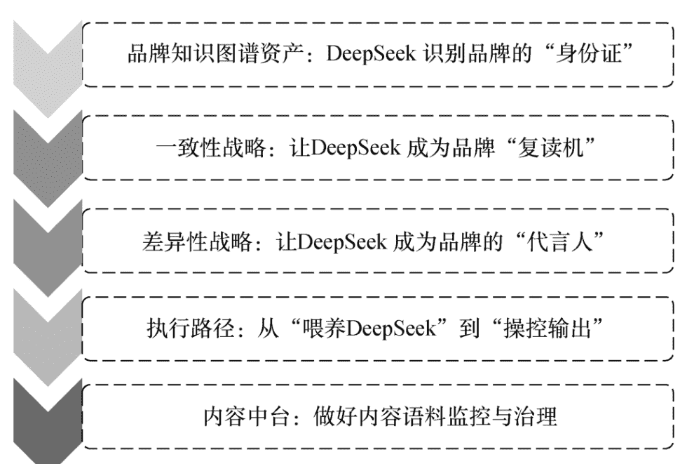

#### 2. 一致性战略：让 DeepSeek 成为品牌“复读机”
品牌认知稳定来自统一表达且不自相矛盾，需做好三方面统一。
- 1. 纵向统一：官网、产品手册、行业白皮书的数据必须完全一致。

建立可信的品牌语料，先从话术的一致性入手

要让模型对品牌形成稳定认知，必须先统一表达口径。全站范围采用同一套专业定义，比如坚持用“××自研动态优化机制”来描述核心能力，而不是使用“智能手段”“AI技术”等宽泛表述。纵向层面要为品牌设定统一的沟通调性和用词习惯。需要警惕的是，DeepSeek会对前后文进行一致性校验，一旦出现自相矛盾，相关内容的排序权重往往会被压低。

#### 3. 差异化战略：让DeepSeek主动为品牌站台
区别化是摆脱信息同质化的关键，辨识度越高，模型越可能将其作为首选答案。企业可从三条路径塑造独特性。

- 1. 数据独占性：对外披露独家场景数据，例如“高原环境下设备保持持续稳定运行”。
- 2. 极端场景绑定：提前植入痛点解法，例如“-30℃工况下设备不出现宕机”。
- 3. 情感区隔：强化品牌价值观，例如选用环保材质的工艺主张。

#### 4. 执行路径：从“喂养DeepSeek”到“操控输出”
把内容运营视作对模型的投喂工程，按阶段推进。

表11-1 从“喂养DeepSeek”到“操控输出”的执行过程

| 阶段 | 目标 | 操作 |
| :--- | :--- | :--- |
| 内容搭建期 1～2个月 | 搭建结构化内容底座 | 规范官网、参数表、资质文件，以JSON-LD与Markdown形式供给模型 |
| 场景抢占期 3～6个月 | 占据核心问答入口 | 开展竞品对比、功能问答、搭建关键词触发库 |
| 心智占领阶段 6个月以上 | 成为行业代表品牌 | 发布白皮书、行业趋势报告，让DeepSeek以品牌观点解读趋势 |

#### 5. 内容中台：做好语料监控与治理
核心是通过内容中台实现模型友好的语料治理，让对外话术具备统一管控。企业要做好发布监控、语料清洗与版本管理，保持信息口径一致。

### 11.8 如何用GEO方式把品牌植入搜索结果
让品牌在DeepSeek里获得更多曝光是多数企业的诉求。不少人关心如何通过GEO干预搜索结果，实际可操作的空间很大。

举例，当用户在DeepSeek提问“推荐一些好用的蓝牙耳机”，系统给出的结构化答案如图11-3、图11-4所示。

#### 🎧一、全能旗舰型（预算500元以上）
1. **索尼 WF-1000XM5**
   - 亮点：旗舰级降噪，搭载全新V2芯片与6麦克风阵列，LDAC高清解码，中高频通透，蓝牙5.3支持双设备，续航约36小时 ③ ④。
   - 适合人群：追求极致降噪与音质的安卓用户，配合索尼手机体验更佳。

2. **三星 Galaxy Buds2 Pro**
   - 亮点：24-bit高保真音质，AKG调校均衡，三频饱满，人体工学佩戴轻盈，三星设备间无缝切换 ① ⑥。
   - 适合人群：三星手机用户，重视音质与生态联动。

3. **苹果 AirPods Pro 2**
   - 亮点：主动降噪顶级，空间音频加头部追踪，苹果生态开盖即连，通透模式自然 ③ ⑥。
   - 适合人群：iPhone/iPad用户，优先生态体验。

图11-3 DeepSeek给出的全能旗舰型耳机推荐

#### 🎧三、高性价比入门款（预算200元内）
1. **西圣Olite2（开放式耳机）**
   - 亮点：百元价位罕见支持蓝牙5.4，60ms超低延迟，16mm聚能动圈声场开阔，续航18小时，佩戴稳固 ② ⑨。
2. **华为FreeBuds SE2**
   - 亮点：半入耳仅3.8g，40小时长续航，通话降噪实用，日常轻度使用友好 ② ⑧。
3. **QCY T13**
   - 亮点：百元内均衡选择，半入耳舒适，基础音质稳定，适合备用入门 ⑩。

图11-4 DeepSeek给出的高性价比入门款耳机推荐

DeepSeek会依据提问侧重点与预算，筛选出不同价位的代表机型。

根据实践可梳理其生成逻辑。回答问题时，DeepSeek会检索约50个网页，从中提取关键信息整合答案，如图11-5所示。

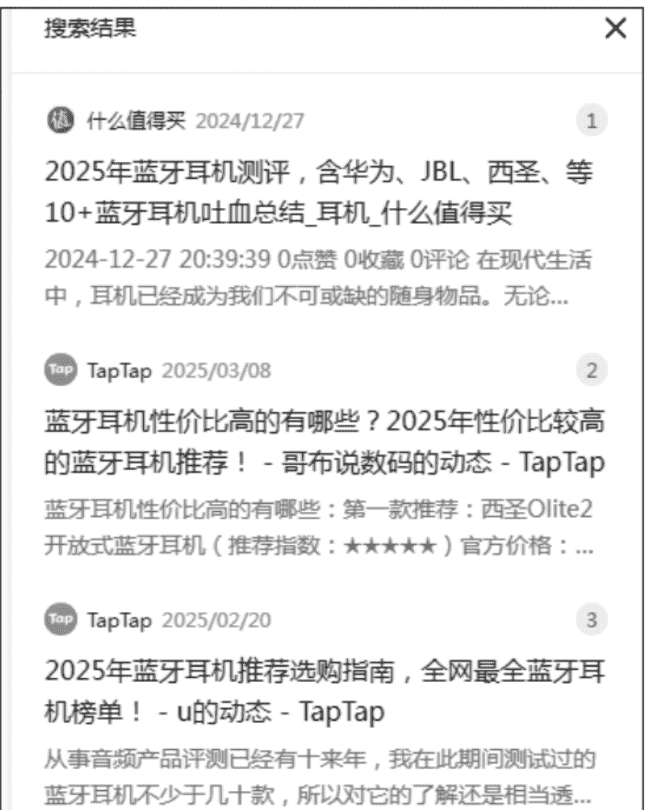

图11-5 DeepSeek生成结果的搜索网页

为何前三篇被视为主参考？从思考过程可见，如图11-6所示。

在检索结果里包含大量2025年最新的耳机推荐。先看高端旗舰：
西圣AVA2 Pro ① ⑤被多源推荐，约200元左右，性能对标千元机，4重PSNE降噪，13mm高动态双声环单元，单耳3.2克，蓝牙5.3，延迟65ms，续航30小时。三星Buds2 Pro ①适合音质党，24-bit传输，人体工学设计，风洞技术降低耳压。索尼WF-1000XM5 ③ ④是降噪标杆，V2芯片加6麦克风，蓝牙5.3多点连接，续航36小时。AirPods Pro 2 ③ ⑥最适配苹果生态，降噪强，通透好，设备间无缝切换。

再看中端均衡：
南卡OE MIX ③ ④ ⑥为开放式代表，单耳6.7g，声波保真98.6%，蓝牙5.4，延迟极低，续航8+16小时。华为FreeBuds Pro 3 ④用超感知原声双单元，智慧动态降噪3.0，多设备连接。Redmi Buds 5 Pro ②售价399元，降噪52dB，支持LHDC 5.0，低延迟59ms，续航38小时。

入门实用：
西圣Olite2 ②开放式仅189元，单耳7g，蓝牙5.4，延迟60ms，续航18小时。华为FreeBuds SE2 ②售价109元，半入耳3.8g，蓝牙5.3，续航40小时。QCY T13 ⑩不足百元，半入耳轻巧，适合日常。

图11-6 DeepSeek的思考过程

思考记录里前三篇文章出现频次很高。点开可见，这三篇内容丰富，涵盖西圣AVA2 Pro、南卡OE MIX等机型，并解析技术、性能及满足需求。清晰的内容影响了判断。

三篇文章共同点：发布时间近，尤其是第二、三篇；篇幅长、论述深入；对用户与市场需求有解读并给出明确判断；主题与蓝牙耳机高度相关。

由此可总结：近期发布、观点鲜明、论述完整、相关度高的内容，更容易被DeepSeek采纳。并非一定要出自官方或大V，也不需要高阅读量，专业且相关即可。

这为GEO植入提供了参考：多平台布局、持续输出价值。

1）主流平台如抖音、今日头条，创作长篇高质量内容，优化账号运营与标签，提升曝光与被引概率。
2）垂直领域如摄影、财经、健康，在专业网站发布观点鲜明的深度内容，建立权威，吸引引用。
3）参与知乎、CSDN等知识社区问答，提供价值方案，通过社区传播扩大影响。
同时，近期内容抓取概率更高，企业需保持持续更新。

### 11.9 实战演练：用DeepSeek做一本白皮书
在DeepSeek加持下，B2B营销可把品牌知识资产转化为生产力，决策逻辑从采购工具转向获取持续进化的认知能力。

DeepSeek智能营销与传统B2B营销对比如表11-3所示。

#### 表11-3 传统B2B营销与DeepSeek智能营销的对比

| 项目 | 传统B2B营销 | DeepSeek智能营销 |
| :--- | :--- | :--- |
| 客户洞察 | CRM数据分析 | AI实时扫描200多个行业知识库预测需求 |
| 内容生产 | 人工制作白皮书 | AI生成“千人千面”技术方案 |
| 触达方式 | 邮件/电话轰炸 | 智能知识助手主动推送行业痛点解决方案 |

以《B2B制造企业营销策略盘点》为例演示。以“我们想做主题为《B2B制造企业营销策略盘点》的白皮书，框架结构应该是怎样的”为指令，DeepSeek可给出封面与摘要、目录、正文框架、附录等，如图11-7、图11-8所示。

一、封面与摘要
1. 封面
   - 标题、公司LOGO、日期、版权
   - 视觉：工业风元素
2. 摘要
   - 300～500字概括营销痛点、策略亮点、价值主张

图11-7 DeepSeek生成的白皮书封面与摘要

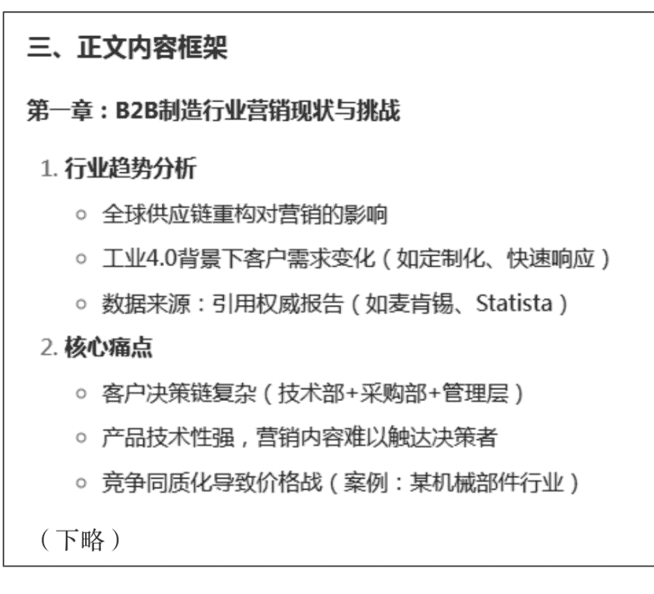

图11-8 DeepSeek生成的白皮书正文内容框架

生成内容可能过长、可读性不足，可通过优化指令引导调整。框架确定后，团队内部讨论并制作思维导图，再让DeepSeek按思维导图生成翔实内容，要求表格呈现对比。

输出初稿后，需核验科学性与数据准确性，并按品牌调性做语言统一，提升专业度与一致性。

## 第12章 本地生活：小预算也能玩转DeepSeek营销
本地生活商家普遍预算有限，DeepSeek让低成本营销成为可能。从促销海报设计到库存管理、定价与客流预测，AI都能提供助力。

### 12.1 开篇案例：奶茶店用DeepSeek设计促销海报，转化率翻倍
杭州某奶茶店老板林某过去把海报外包，单张成本上百元且转化一般。尝试用DeepSeek辅助后效率大增。

他先明确目标与人群：面向学生和上班族推新口味奶茶，限时折扣。DeepSeek迅速给出三版指令方案。

方案A 赛博打卡风格
视觉：荧光粉背景，奶茶悬浮于数据流，麻薯拉丝用动态光效。
文案：爆浆预警！朋友圈下一个爆款在此。

方案B 校园福利风格
视觉：黑板涂鸦风，课表里藏“第二杯半价”。
文案：下课铃响，麻薯在等你解锁9.9元快乐。

方案C 职场治愈风格
视觉：写字楼背景，奶茶旁放解压玩具，蒸汽模糊屏幕。
文案：下午三点，让一杯奶茶治愈你的KPI焦虑。

将指令输入Sora生成多张海报后，他选了现代简约、色彩鲜艳的粉蓝主调，突出新口味标识。随后优化排版，把限时折扣文字放大并用醒目黄色置于左上角。

上线后周边反响强烈，转化率倍增，客流明显提升，海报也加深了品牌印象。AI赋能让小店实现大品牌级效果，突破销售纪录。

### 12.2 DeepSeek辅助社区团购的智能选品与库存管理
社区团购面临选品滞销与库存失衡两大难题，DeepSeek可有效解决。

#### 1. 智能选品
DeepSeek可通过三类数据构建用户画像。
1）社交数据：分析微信群高频词如“低糖”“宝宝辅食”，捕捉表情包偏好。上海某社区高频出现“控糖”，推荐零卡糖糕点，首日售罄率95%。
2）消费行为数据：分析历史订单品类组合与价格敏感度，如满减参与度高于直接降价。
3）环境变量：预判天气影响，暴雨前速食需求激增；结合人口结构，年轻租客区宵夜需求更高。

选品策略可动态生成，输入社区位置、居民年龄中位数、复购率等关键词，即可输出带置信区间的销量预测。
还可设计“引流款+利润款+服务款+节假日款”组合：引流款鸡蛋低价提升开团率；利润款定制预制菜毛利率40%；服务款代收快递增强粘性；节假日款小份年夜饭套餐解决留守青年需求。

#### 2. 库存管理
1）结合历史销售、季节、节假日、促销与市场趋势建立需求预测模型。例如夏季前预测某品牌冰棒需求上升，提前备货。
2）处理滞销品。对三天内动销率低于30%的酸奶，DeepSeek可自动生成促销方案：酸奶+麦片套餐降价20%；社群定向券；捐赠积分兑换提升美誉度。
3）按用户地理分布、订单密度与交通状况优化各站点库存分配，优先将热销品投放到订单密集站点，缩短配送时间并降低物流成本。

实践推动社区商业走向“需求即时感知—供给精准触达—情感持续连接”的智慧生态。

### 12.3 AI定价：DeepSeek让本地生活服务定价更简单
过去定价多靠经验。某家政中心坦言常“拍脑袋”，以市场均价为基准上下浮10%～15%，忽略获客成本与客户生命周期价值等隐性成本。

DeepSeek构建智能定价模型，从需求、成本、竞争三维度实现精准实时定价。

#### 1. 需求分析
可分析用户评价构建服务价值语义网络。以美发为例，识别头皮护理、染后固色、造型保持等维度并计算价格敏感系数。
例如为新开理发店定价时，发现周边3公里居民对氨基酸洗护需求强且价格不敏感，建议高于市场均价，实际转化率提升超5%。

本地生活定价与运营的DeepSeek新打法

DeepSeek能够把区域属性和消费人群拆解成可量化的价格接受度图谱，帮助门店在留住客流与守住利润之间找到平衡点。以某城外卖餐饮为例，系统判断核心商圈以白领为主，对价位容忍度较高，更在意配送时效和菜品品质，这类区域的定价可以适度抬升；城郊结合部的社区以普通家庭为主，价格敏感度明显，选择更偏向高性价比，商家在这里必须把亲民作为首要考量。

#### 2. 成本推演
成本端的波动也能被实时捕捉。DeepSeek可对接供应商报价、租金流水、人力成本库等多源数据进行推演。以一家家政公司为例，保洁员工资上调5%，模型会从三个维度拆解影响：不同服务类型的成本传导弹性，深层保洁人力占比约65%，日常保洁约40%；不同区域客群的价格承受边界，高新区大约能接受10%的涨幅，老城区上限在5%左右；竞争对手的历史反应，同业在成本上行时平均调价幅度为8%。

基于此，系统给出差异化传导方案：客群偏高端的高新区，深层保洁单价上调8%，并同步赠送家电保养服务以强化价值感知；价格敏感的老城区则维持原价，通过把服务时长压缩10%、优化派单路线让交通成本降低约3%来消化涨幅。这种精细的成本疏导，使公司在人力成本上行周期里利润率不降反升。

#### 3. 竞争情况预测
对手的价格动作也能被提前量化。DeepSeek可抓取并分析五十余个本地生活平台的价盘信息，构建动态竞争模型。某奶茶店发现3公里范围内多家同行同时推出“奶茶买一送一”，系统测算该品类的价格弹性系数为-1.8，即价格下调10%销量会提升约18%，并评估了门店的成本承受空间，原料成本占比35%，毛利可容纳的最大折扣约15%。据此设计出阶梯式对抗策略。

1. 基础款奶茶保持原价，推出第二杯半价，实际折扣12.5%，落在毛利安全区间。
2. 爆款产品不降价，改赠定制杯套，单客增成本0.8元，品牌感知提升约30%。
3. 外卖渠道设置“满50减10”门槛，带动客单价提升约20%。

该策略落地后，门店订单量增长25%，客单价提升18%，效果明显优于单纯跟价。

总体来看，DeepSeek让中小商户也能获得与连锁巨头同量级的定价能力。它正在重塑价格作为市场信号的内涵——价格不再只是成本叠加或竞争工具，而是连接供给与需求价值认知的桥梁，这也是其对本地生活服务领域最深刻的改变之一。

### 12.4 门店客流量预测与智能排班
本地生活竞争愈发精细化，客流预判的准确性与排班的合理性直接决定运营成败。有了DeepSeek，这两项难题都能得到有效解决。

#### 1. DeepSeek赋能客流量预测
门店积累的历史客流数据记录了不同日期、时段的到访量，蕴含着明显的时间周期规律，如工作日与周末、节假日与平日的差异。销售数据与客流高度相关，特定单品的销售高峰往往对应客流高峰，DeepSeek通过分析销售数据即可挖掘二者之间的内在联系。

与此同时，外部环境变量也能被纳入判断。比如盛夏高温会推高冷饮店客流，暴雨天气会让室外步行街门店客流锐减；周边道路施工、公交线路调整等交通因素也会改变到店意愿与路径。社交媒体的讨论热度、话题趋势也能被读取，帮助门店提前感知市场动向与需求变化，从而辅助客流预测。

#### 2. DeepSeek优化排班设计
依托客流预测结果，DeepSeek可为商家制定动态灵活的员工排班。以餐厅为例，中午12点至下午2点为用餐高峰，系统建议在此窗口期配备充足的厨师、服务员与收银员，保证服务及时高效；在客流低谷则建议适度减员，避免人力浪费。

排班还兼顾员工技能与个人偏好进行个性化匹配。不同员工擅长不同岗位，有的擅长前台接待、服务热情，有的在后台操作经验丰富，厨师的菜品制作熟练度、收银员对支付系统的掌握程度也各有差异。DeepSeek依据技能标签将员工安排到最能发挥优势的时段与岗位。

员工的工作偏好也被纳入考量，部分人偏好早班以便下班后陪伴家人，部分人愿意上晚班。排班时在满足运营需求的前提下，尽量贴合个人意愿。

某大型超市曾因排班失误导致高峰时段人手严重不足，顾客找货难、结账排队长，低谷时段员工闲置。把问题输入DeepSeek后，系统给出科学排班：在客流大时段、区域增配导购与收银，并合理安排补货人员保证陈列丰满；按业务能力与经验分配岗位，熟悉食品知识的员工安排在食品区，擅长生鲜处理的员工负责生鲜区，提升专业度与效率；低谷时段则灵活调岗安排盘点、货架整理等工作。

实施后超市运营效率提升，顾客满意度从70%升至85%，同时通过合理调配节省了大量人力开支。其他商家可借鉴此做法，利用DeepSeek推动本地生活向数字化、智能化迈进。

### 12.5 低成本创意：生成营销主题+策划促销活动
在本地生活领域，营销主题与促销活动的创意至关重要，却常让商家耗费大量精力且效果不佳。DeepSeek为商家提供了高效低成本的创意解法。

在主题挖掘方面，商家可借助DeepSeek获得新颖方向。例如母亲节来临，某花店输入指令“为花店策划母亲节独特营销主题，目标吸引不同年龄子女购买，突出情感传递”。DeepSeek基于流行趋势与消费者情感需求，给出主题“时光里的花语——把爱藏在每一朵绽放里”。该主题以时光为主线串联不同年龄子女与母亲的共同记忆，用鲜花传递跨越世代的情感共鸣，如图12-1所示。

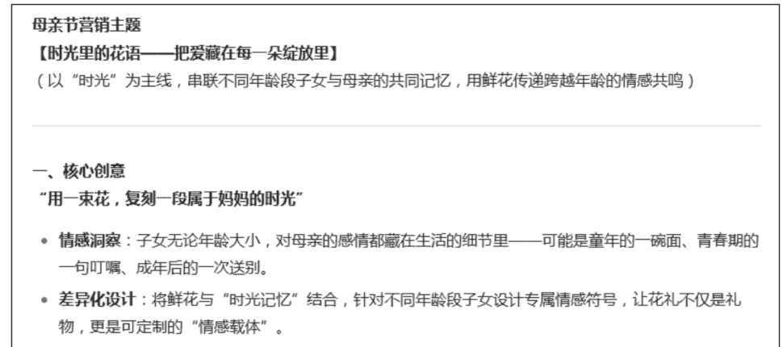

除主题外，DeepSeek还针对18～25岁、26～45岁、45岁以上人群分别给出差异化花束方案，既契合审美偏好，又能以合适方式传递情感。

促销策划方面同样高效。例如某社区小型中餐厅希望以有限预算提升周末客流，吸引家庭聚餐。向DeepSeek提出“为社区小型中餐厅策划周末促销活动，预算有限，要吸引家庭聚餐群体”后，系统给出完整方案，如图12-2所示。

# 社区中餐厅周末家庭促销活动方案

主题：【家的味道，周末“食”光机】

（以“复刻童年记忆+亲子互动”为核心，打造高性价比家庭情感体验场景）

## 一、低成本引流设计

### 1. “妈妈的味道”盲选套餐

套餐设计：

- 28元怀旧套餐：红烧肉+番茄炒蛋+清炒时蔬（分量适合2大1小），附赠搪瓷杯装绿豆汤。

- 彩蛋服务：随机抽取“记忆彩蛋”——如“免费加量80年代铝饭盒装米饭”“送麦乳精味布丁”。

传播话术：“吃一口回到小时候的餐桌，带爸妈来找回忆盲盒！”

### 2. 家庭任务卡集章计划

执行方式：

- 进店即发“童年游戏任务卡”（跳格子/翻花绳图示），完成指定动作（如孩子喂爸妈吃一口菜）可盖章。

- 集满3章兑换老式水果糖罐或“拍立得全家福”1张（成本控制：用手机拍照后P成复古胶片效果打印）。

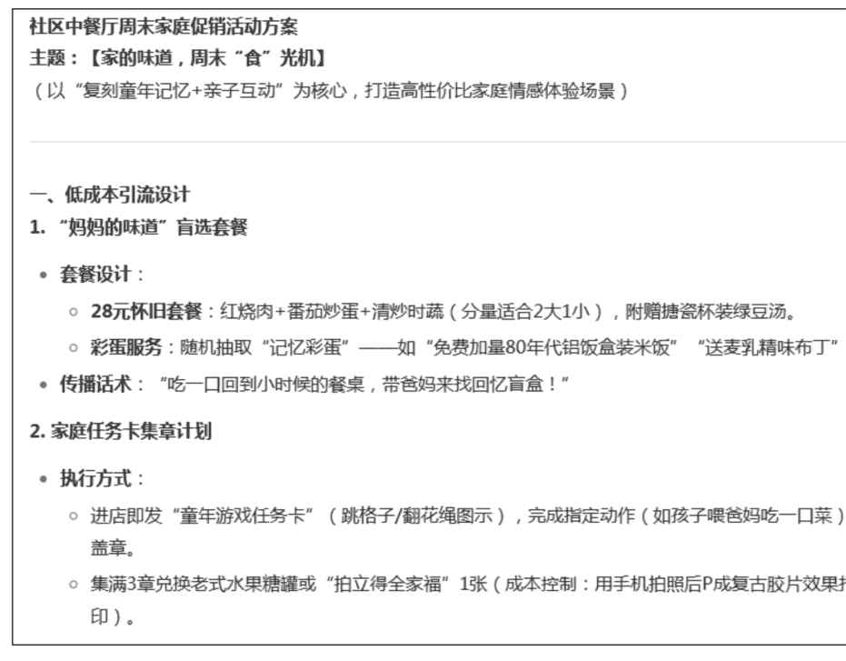

促销方案为招牌菜设置了优惠价，并加入互动环节，既控制成本，又通过亲子互动提升趣味性，吸引家庭客群到店。

在策划阶段，DeepSeek还能协助制定执行细节，从宣传文案撰写、投放渠道选择，到现场布置建议、人员安排均提供指导。针对上述餐厅的周末活动，系统会给出适合社交媒体发布的宣传文案，并建议投放本地生活服务平台、社区业主群等渠道。场景布置方面，建议摆放可爱复古的儿童装饰，营造温馨的就餐氛围。

总之，DeepSeek让本地生活商家以更低成本获取独具特色的营销主题，并策划出更具吸引力的促销活动，实现更好的营销效果。

### 12.6 本地生活商家的DeepSeek营销避坑指南
许多本地生活商家在竞争弱势、预算有限的情况下，可借助DeepSeek实现低成本高效益的突破。但使用时也需规避常见陷阱，以充分发挥其优势。

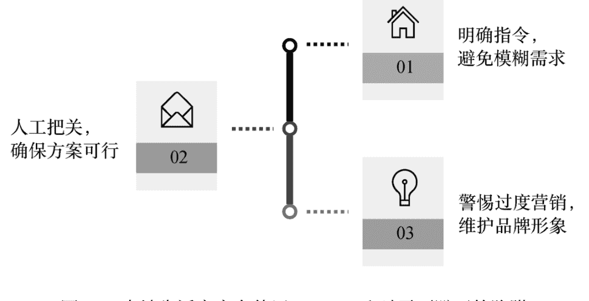

#### 1. 明确指令，避免模糊需求
部分商家经验不足，向DeepSeek提问过于笼统，如“提高店铺销售额的方法”“帮我策划一个营销方案”。缺乏背景信息，系统难以给出针对性强的可行方案。

正确做法是在提问前提供详细的背景资料与明确的问题描述。例如服装店想分析销量不佳，需要提供近几个月的销售数据，包括各款式销量、顾客年龄性别分布等，再给出明确指令：“请根据以上数据，分析店铺销量不佳的原因，并给出提升销售额的具体策略。”

精准的指令能让DeepSeek基于丰富数据进行深度分析，输出更贴合实际的解决方案。

#### 2. 人工把关，确保方案可行
DeepSeek基于算法与数据模型运行，虽信息处理能力强，但在复杂商业环境下对特殊情况的灵活判断有限，可能给出不切实际的营销方案。

因此，商家获得方案后必须人工审核，从成本核算、市场可行性、品牌形象契合度等多维度评估，对细节进行调整完善，确保活动能吸引消费者并实现预期效果。

#### 3. 警惕过度营销，维护品牌形象
在DeepSeek助力下，商家可轻松生成大量创意内容，部分商家容易陷入过度营销陷阱，频繁推送促销信息、举办活动，导致客户反感，对品牌产生负面印象。

制定营销计划时应结合品牌定位与客户特点，合理控制营销频率与力度。例如主打高品质慢生活的咖啡馆，不适合频繁推出低价促销。可借助DeepSeek策划咖啡文化、艺术鉴赏相关的主题活动，以适当频率传递品牌价值，在吸引新客的同时维护老客好感，实现长期稳健发展。

只要规避上述陷阱，充分发挥DeepSeek优势，商家就能以低预算实现更好的营销效果。

### 12.7 实战演练：餐饮店如何用DeepSeek做会员生日营销
在激烈竞争中，会员生日营销是餐饮店提升顾客粘性与复购率的重要手段。DeepSeek为餐饮店实现高效低成本的生日营销提供了有力支撑。

首先整理会员数据，包括姓名、年龄、联系方式、消费记录等。以一家主打川菜的中型餐厅为例，拥有数千会员后，将数据整理成规范表格上传DeepSeek，输入指令：“分析会员消费数据，按消费金额和频率将会员分层，找出高频高消费、高频低消费、低频高消费、低频低消费等不同类型会员，并分别列出生日信息。”系统可快速处理并输出清晰的分层结果与生日汇总，为精准营销奠定基础。

依据分层结果，为不同会员定制个性化生日方案。

对于高频高消费的优质会员，输入指令：“为高频高消费会员设计生日营销方案，突出尊贵感和专属体验，预算相对充足，目标是进一步提升忠诚度和消费金额。”DeepSeek给出建议，如图12-4所示。

## 一、核心策略：专属身份体系构建

### 黑钻会员俱乐部深度运营

- 设立“黑钻生日俱乐部”专属身份（限定前5%消费层级会员）

- 定制鎏金磁吸实体卡+动态电子勋章（实时显示消费成就）

- 生日月自动激活「黑钻通道」服务优先权

- 会员日历区同步功能（跨国会员自动匹配最佳时区祝福）

## 二、全周期体验设计

### ｜生日前15天

- **神秘邀约函**：门店经理手写火漆印章信函+AR邀请函（扫码预览3D场景）

- **主厨咨询**：视频会议沟通忌口偏好，定制含分子料理/食材溯源故事的菜单

- **管家预接触**：增加香氛偏好测试、礼服尺码采集（用于定制围裙/餐垫）

### ｜生日当天

- **到店仪式**：

  - 专属停车位LED欢迎屏+红毯侍者列队

  - 智能餐盘NFC祝福+全息投影场景餐桌

  - 声控氛围灯光系统+「五感档案」背景音乐还原

- **沉浸体验**：

  - 气味定制装置实时释放偏好香型

  - 声纹激活祝福投影（生物识别技术）

### ｜离店延续

- **记忆封装**：

  - 微缩场景模型（还原当日餐桌）

  - 亚克力食材基因纪念牌（当餐食用食材DNA封存）

对于高频低消费会员，输入指令：“为高频低消费会员策划生日营销活动，以鼓励他们提升单次消费金额为目标，预算适中。”系统给出方案，如图12-5所示。

## 一、策略核心：阶梯式奖励触发机制

### 1. 生日消费闯关计划

设置三级消费目标（参考该会员历史客单价的1.5～3倍），例如：

- 青铜任务：消费满128元 → 解锁免费招牌甜品

- 白银任务：消费满228元 → 获赠主厨特调饮品+30元现金券

- 黄金任务：消费满388元 → 激活「生日宴套餐」权益（次年免费双人餐）

### 2. 动态定价彩蛋

- 生日当天首次扫码点单时，随机出现「生日折扣骰子」小游戏

- 根据骰子点数获得对应折扣（如掷出3点享83折，最高掷出6点享66折）

## 二、场景化体验设计

### ｜到店前（3天）

- 悬念预告：发送「生日宝藏地图」H5，展示当日可解锁的隐藏福利（需到店消费后点亮）

- 倒计时提醒：消费金额每提升50元，提前解锁1条主厨语音祝福

### ｜到店时

- 视觉刺激：餐桌投影实时显示「进度条」（当前消费/目标额度）

- 即时反馈：每达到一个消费阶梯，触发灯光特效+服务生集体生日歌快闪

### ｜离店后

- 成就认证：生成「生日消费勇士」电子勋章，附带优惠梯度说明

对于低频高消费会员，指令为：“为低频高消费会员制订生日营销计划，重点在于提高他们的消费频率，预算有限。”系统生成方案，如图12-6所示。

## 一、核心策略：时间线渗透+触点捆绑

### 1. 生日季概念延伸

- 将会员生日月升级为「生日季」（生日前1周至后2周）

- 设置3个关键消费节点：生日前备宴→生日正宴→生日回味宴

### 2. 触点绑定设计

- 将生日福利与后续消费场景强关联（如：“生日蛋糕券需分3次领取”）

- 植入「未完待续」仪式感（如：生日宴预留一道未上菜品，需下次到店解锁）

## 二、低成本高粘性体验设计

### ｜生日前7天

- 悬念礼盒：寄送含「碎片化权益」的实体礼盒（需分次到店拼合）

  - 礼盒内含：

    - 1/3生日蛋糕兑换券（需消费1次激活）

    - 定制餐盘碎片（集齐3片可兑换全套）

    - 手写谜题信（谜底为下次到店暗号）

### ｜生日当天

- 消费预言：

  - 用餐时提供「塔罗牌式消费建议卡」，预测未来3个月适宜消费场景（如：“10月17日宜品新菜，解锁专属运势套餐”）

  - 现场拍摄微电影预告片（30秒剧情片段，完整版需下次到店观看）

### ｜生日后14天

- 记忆唤醒：

  - 赠送「时光胶片」老照片滤镜券（需到店扫描餐桌二维码激活）

  - 发送食材保鲜度提醒（如：“您生日宴所用的黑松露将在7天后风味下降，建议本周内到店体验新做法”）

对于低频低消费会员，指令为：“为低频低消费会员设计生日营销活动，旨在激活他们的消费热情，预算较低。”系统给出方案。

## 一、核心策略：游戏化任务解锁

### 1. 生日寻宝三部曲

- STEP 1 激活任务：生日当月任意消费即解锁“宝藏地图”

- STEP 2 探索任务：每消费1次点亮1个地图区域（共5区）

- STEP 3 终极奖励：点亮全部区域获赠“神秘宝箱”（含次年生日特权种子）

### 2. 时间魔法设计

- 生日优惠券采用“时间衰减”机制：

  - 第1周使用享6折 → 每周递减10%折扣力度

  - 最后1周转为“社交复活券”（邀请朋友消费可恢复初始折扣）

## 二、轻投入制造高互动生日

### 暖场·生日前五天
- 智能星座海报：读取用户姓名首字母，套用星座风格模板生成专属图，画面内置三只逐个开启的礼盒动画，期待感层层递增。
- 碎片式剧透：短信分批推送祝福暗号，例如“今日暗号：☆”，到店出示兑换一枚扭蛋币。

### 到店·生日当天
- 桌面沙漏投影：餐桌上方投射沙漏画面，动态呈现当日优惠档位，时间越近力度越大。
- 擦拭显影刮卡：赠送“生日特权刮卡”，用餐具摩擦即可显形，最低兜底5元抵扣。
- 好友拼图裂变：消费后自动生成双人拼图券，必须由好友补齐剩余拼块才能使用。

### 延续·离店后
- AI诗意回廊：离店后72小时推送由AI撰写的短诗，融入本次点餐细节，帮助体验余韵保留。

方案敲定后，商家可委托DeepSeek输出对外文案。以服务高频高消会员的生日项目为例，可输入指引：“为餐厅针对高价值会员的生日专场撰写一篇公众号推文与一条朋友圈文案，突出尊贵感与专属权益。”

DeepSeek会迅速产出吸睛内容。

公众号参考稿：“VIP会员您好，生日当天［餐厅名字］已为您安排一场私享庆生。景观包房、定制菜单、管家级服务，细节全部匹配非凡体验。”

朋友圈参考稿：“身份与体验匹配，生日值得不一样。［餐厅名字］为你定制专属庆生瞬间，详情点击查看。”

这些素材可投放到官方公众号及朋友圈，实现精准触达。

执行层面，员工需对照DeepSeek提供的会员画像与落地方案提前准备：为预约客户预留指定包间、备齐个性菜单、清点礼品与抵扣券。到店后严格执行服务动线，确保生日用餐品质。

活动收官后，汇总消费金额、满意度评价等数据，再交由DeepSeek复盘。平台会给出可执行的改进建议，例如下调参与门槛、为不同等级会员定向发放差异化代金券等，为下一轮生日营销持续优化。

## 第13章 教育培训：以DeepSeek驱动招生增长

知识付费市场持续扩张，教培机构同质化加剧，传统招生效率差、转化弱、留存难。DeepSeek凭借数据分析、自然语言处理与智能预测能力，为教培行业提供全流程升级思路，既能精准触达潜在人群，也能覆盖招生、教学、服务，提升体验与收益。

### 13.1 从试听到付费：某机构借助AI加速转化

一家深耕互联网运营、数据分析等新兴职业技能培训的成人教育机构，课程紧跟行业，但试听付费转化长期停在12%左右，获客成本高、转化效率低成为瓶颈。引入DeepSeek后，转化链路明显改善。

过去依靠问卷与电话获取需求，信息滞后且片面。现在DeepSeek整合官网浏览轨迹与沟通记录做画像并推送匹配课。例如系统发现某用户反复查看直播运营进阶课，并参与社群话题“如何打造爆款带货直播间”，判定为寻求职业晋升的电商从业者，随后推送含头部案例拆解、直播运营工具实操的试听课，匹配度显著提升。

邀约阶段，DeepSeek基于历史对话与行业优质语料搭建职业规划、课程价值、行业前景的话术库，驱动官网智能客服。客服可实时捕捉对方关键词与情绪倾向，生成应答。例如面对“课程能否落地工作”的疑问，系统回复：“课程由业内运营专家联合研发，直播间投放策略已助力千余名学员薪资提升30%以上，下周三有专家直播，需要预留席位吗？”并附往届学员薪资对比表，说服力增强，邀约成功率提高。

为改善试听完课率，DeepSeek将内容与工作场景结合。以数据分析实战课为例，设计“模拟电商公司销售数据分析”虚拟项目，要求学员用Excel、Python完成清洗、可视化、趋势预测。学习过程中系统推送分步指南与助教一对一答疑链接，沉浸式体验使完课率大幅提升。

试听结束后，学员管理系统自动生成职业成长报告，包含能力评估、发展建议、个性化课程推荐，通过邮件短信推送。系统还依据试听表现制定差异化转化策略：实操强理论弱者推“理论加实战”进阶套餐；进度慢者推“基础强化加导师陪跑”专属优惠。精准推送提升付费转化，机构从引流到成交的全链路被打通，业绩明显增长。

### 13.2 智能招生：话术库+课程包装+学员运营

传统招生难以支撑精细化运营。DeepSeek可通过话术库、课程包装、学员管理三模块构建完整方案。

#### 1. 话术库搭建，高转化沟通体系
面向招生场景，DeepSeek学习历史沟通语料与行业数据，搭建全场景话术库。提炼出“痛点挖掘—价值塑造—信任建立—促单转化”的标准化模型，结合用户特征生成回答。例如用户询问“课程能否提升工作效率”，系统调取本地学员记录回答：“课程采用企业实战案例，去年学员平均任务执行效率提升30%，本期时间管理进阶营剩余两个企业内训名额，可预约试听，需要对接顾问吗？”并推送效率对比图表。

#### 2. 课程包装，塑造差异化优势
课程同质化严重，DeepSeek通过大数据分析提炼核心卖点，实现场景化包装。某编程机构，系统分析学员数据，提炼出“零基础四个月掌握Python并入职互联网公司”的真实案例，结合项目实战生成含学员成长故事、作品展示、企业背书的宣传视频。投放官网与短视频平台后，广告点击与咨询量明显上升。

#### 3. 学员管理，提升运营精细化
智能学员管理系统整合报名、学习、续费全流程数据，构建学员画像，实时监测学习进度、课堂表现、作业完成度。发现懈怠或知识短板时自动预警并推送定制学习方案，实现从人工经验到数据决策的转变。

### 13.3 爆款内容炼成记：把知识点变成社交货币

单纯输出知识点难以引发传播。DeepSeek可帮助机构把内容转化为学员自愿分享的社交货币，实现裂变增长。

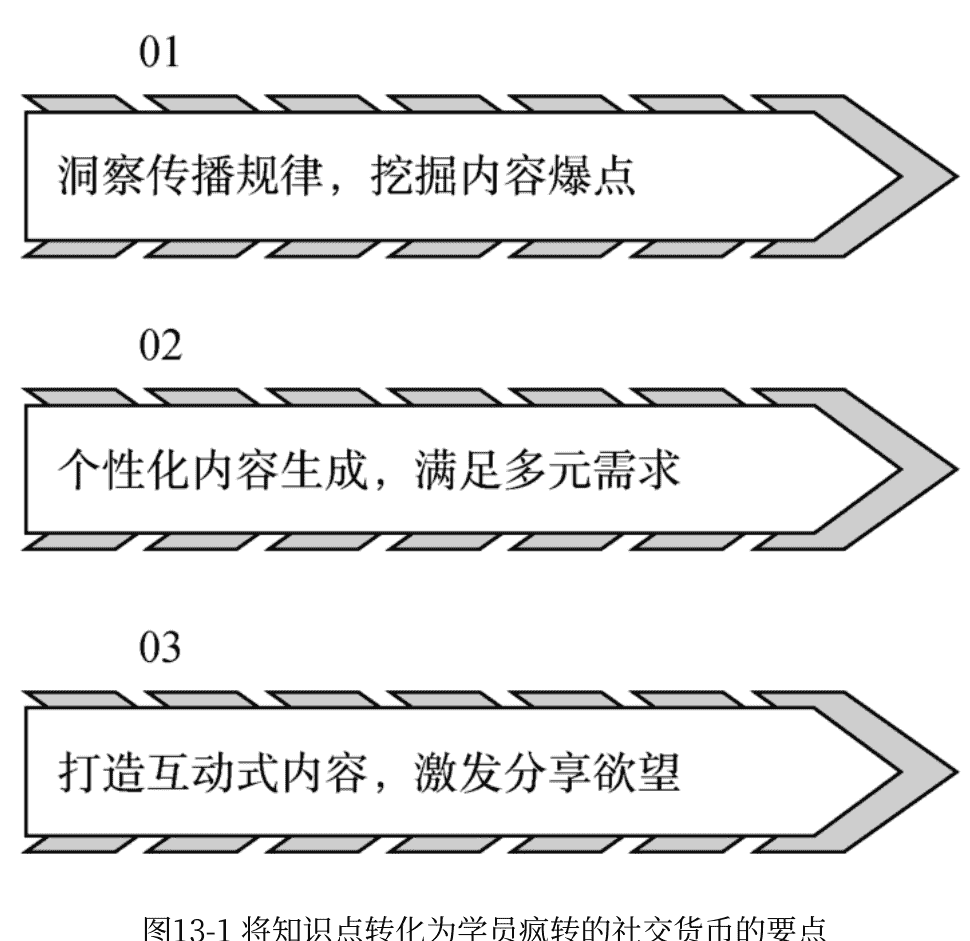
#### 1. 洞察传播规律，挖掘内容爆点
DeepSeek分析各平台用户偏好与传播规律。短视频平台偏好轻松有趣节奏快的画面，图文社区偏好干货型内容。提炼传播公式如“知识加情感共鸣”“知识加热点”“知识加趣味故事”。某财经机构监测到“个人理财规划”热度攀升，结合经济热点打造《月薪5000如何理财》系列脚本，把复杂理财拆解为通俗案例，融入年轻人消费储蓄场景，再以动画呈现，引发大量关注与分享，带来数千咨询。

#### 2. 定制内容生成，满足多元需求
基于学员画像自动生成内容。备考公务员的学员逻辑推理薄弱且关注职场成长，系统生成《公务员考试逻辑推理必杀技：职场思维的巧妙运用》，将知识点与职场沟通结合，学员更愿分享到朋友圈微信群。

#### 3. 打造互动式内容，激发分享欲
打破单向输出，设计问答、测试、模拟挑战等互动。某语言机构上线“1分钟口语挑战”小程序，完成挑战后自动生成含学习成果、进步指数、排名的专属海报。仪式感强的海报激发社交分享，上线一个月参与超10万，课程报名翻倍。若传播效果不佳，可把内容、数据、反馈上传DeepSeek，由其分析原因并给出优化建议，持续迭代爆款。

### 13.4 用DeepSeek为学员设计定制学习路线

个性化学习是提升竞争力的关键。DeepSeek可全程支持路线设计。

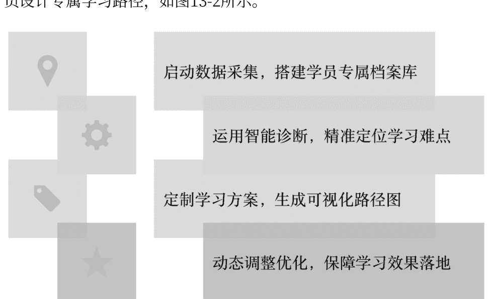
#### 1. 启动数据采集，搭建学员专属档案库
通过入学测试、学习意向问卷、职业背景调查采集基础数据。UI培训中，问卷收集软件基础、审美偏好及电商UI、游戏UI等职业目标。对接学习管理系统后，实时同步课堂互动、作业、成绩，形成多维度动态档案。

#### 2. 运用智能诊断，精准定位学习难点
系统拆解课程知识点并分析数据。某英语机构接入后，雅思课程被拆分为听力场景应对、写作逻辑等数十个点，分析显示70%学员共性薄弱在学术类听力长对话，部分学员小作文数据图表描述存在短板，据此调整课程重点与单独辅导资源。

#### 3. 定制学习方案，生成可视化路线图
基于诊断结果规划路线。例如新媒体运营零基础学员方案为“理论认知7天→文案实战14天→平台运营21天→项目整合14天”，细化到每日任务、核心目标、学习资源与预计完成时间，嵌入学员App随时追踪。

#### 4. 动态调整优化，保障学习效果落地
学习中监测行为数据，连续3天未交作业自动预警并推送干预建议给老师；知识点理解困难时推送精讲视频与助教答疑。定期生成学习效果追踪报告，对比路线与掌握情况，及时优化后续安排，实现粗放教学到精细化服务的转型。

### 13.5 学习效果预测模型：动态掌握学员状态

传统评估依赖主观评价和阶段考核，反馈滞后。DeepSeek可构建学习效果预测模型，实现数据驱动的智能分析。

某连锁少儿美术机构运营8年，40余家校区，服务超万名学员。过去仅凭课堂观察和期末成绩评价，难以发现部分学员因技法弱或兴趣转移而流失。引入DeepSeek后，建立私有数据对接与训练的预测模型，实现数字化教学管理。

模型整合出勤率、工具熟练度、教师评价、家长反馈等多维数据。例如某学员水彩风景课连续三周构图松散、色彩单一，课堂提问减少，家长反馈兴趣降低，经语义分析转化为标签输入模型。模型生成成长报告并触发预警，建议每周两次单独技法特训并加入趣味速写游戏，一个月后兴趣与评分回升。

机构层面，模型对比各校区发现某三线城市校区创意分普遍偏低，原因是主题创作环节占比不足。调整课程增加故事场景绘画与自由命题创作后，60天内创意评分与续费率均提升。数据驱动的预测帮助机构降低流失、提升满意度。

### 13.6 续费预警系统：提前识别低高意愿学员

学员续费关乎质量与长期营收。传统管理靠人工判断，往往被动应对。DeepSeek可建立续费预警系统，实现早发现、早干预、早转化。

某成人艺术连锁机构开设油画、书法、古筝等课程，年服务超5000人。过去因跟进不及时流失大量学员，高意愿学员服务不足、低意愿学员转化成本高，续费率走低。接入系统后模式改变。

系统打通学习管理系统与CRM，自动抓取学习行为、消费、反馈数据，用机器学习构建续费预测模型，提炼课程匹配度、学习投入度、服务满意度等关键因素，建立“行为特征—续费概率”关联。

应用中，系统将学员划分为高、中、低意愿三级并给出策略。高意愿学员如书法表现优异且多次咨询进阶课，自动触发专属优惠与名师单独邀约；低意愿学员如油画进度滞后并表示压力大，建议先安排免费补课重建信心，再由客服以学习成果展示切入引导，减轻抗拒。精准分层使续费管理从经验驱动转向科学决策。

除个案跟进外，平台具备整体研判与策略迭代能力。把各科目的续费表现做横向对比后，发现古筝班中续费意愿偏弱的学员占比明显高出其他项目。进一步拆解判定为教学进阶衔接出现断层。机构随即重塑课程架构，延长基础段课时，并推出“古筝入门打卡挑战”活动，该科目的续费水平随之回升。同时平台参与销售投入的再分配，建议团队把重点放在意愿较高的群体上，续费转化效率得到明显提升。

数周落地验证后，校区整体续费水平持续走高，单个学员的续费成本反而下降，市场竞争力明显增强。

### 13.7 实战演练：DeepSeek 助力暑期招生筹划

暑期是少儿美术培训的招生高峰期。市场同质化严重，如何精准触达家长和孩子，成为机构的痛点。依托 DeepSeek 的数据挖掘与智能生成能力，能够搭建科学高效的暑期招生体系。

以一家少儿美术连锁机构为例，其在 DeepSeek 支持下完成暑期招生方案的设计，取得不错成效。

#### 1. 跨源数据洞察 精准锁定招生人群
面对全国化招生布局，机构对各区域市场进行深度剖析。系统整合了近三年区域招生记录、当地人口普查信息、教育支出统计，以及社媒平台的海量讨论。分析结果相当详尽。

洞察显示，一线、二线城市的家长更看重课程的国际视野和升学衔接价值，地级市与县域家长则对性价比和趣味性更敏感。例如在一线、二线城市，家长对少儿美术相关知名赛事的关注度很高；而在下沉市场，“暑期美术集训营团购优惠”的话题热度飙升。基于这些判断，DeepSeek 为不同分校制定了差异化招生策略，精准圈定目标家长。

#### 2. 内容自动化生产 打造吸睛传播矩阵
机构让 DeepSeek 产出多样化的投放素材。针对关注艺术赛事的一线、二线城市市场，生成“暑期国际艺术大师班：直通国际少儿绘画大赛”的推广文案，并结合往届学员获奖案例与外教团队介绍，制作成系列短视频；面向重性价比的下沉市场，推出“拼团优惠，暑期创意美术欢乐学”的促销方案，搭配学员趣味作品合集和课程成果海报。

在投放层面，DeepSeek 依据各平台用户画像规划分发策略。例如在种草社区以“孩子的第一幅获奖作品诞生记”为主题发布图文笔记，吸引年轻家长；在短视频平台则利用算法推荐，向目标区域推送趣味课程体验短视频，实现精准触达。

#### 3. 智能对话系统 提升咨询转化效率
机构在官网和官方账号部署了 DeepSeek 驱动的智能客服，实现全天候即时响应。基于自然语言处理，对话系统不仅可以解答常见问题，还会根据家长咨询进行深度追问，挖掘潜在需求。比如家长问到课程内容时，系统会进一步了解孩子年龄、绘画基础，再给出最匹配的课程推荐。

#### 4. 效果动态监测 实时迭代投放方案
招生期间，机构对各渠道数据进行实时追踪并交由 DeepSeek 解读。例如某一核心城市分校的线下体验课预约量低于预期，DeepSeek 迅速溯源，发现宣传文案未突出体验课的师资优势。随后系统重新生成强调名师指导的版本，效果随之改善。

## 第14章 医疗健康：在合规前提下实现AI增长

医疗健康关乎生命安全与福祉，监管严格、专业门槛高。在数字化浪潮下，如何在合规框架内实现创新增长，是医疗机构的核心课题。DeepSeek 可从内容生产到诊疗辅助，从患者管理到知识赋能，构建全方位的AI解决方案，助力行业实现合规、可持续发展。

### 14.1 案例导入：口腔专科借科普实现稳定获客
华南某口腔专科医院创建初期虽汇聚资深专家和先进设备，但因品牌知名度低、患者认知不足，来院就诊者寥寥。

DeepSeek 进入视野后，医院决定以专业合规的口腔科普内容提升品牌并吸引患者。

首先，DeepSeek 对当地口腔医疗市场进行调研，梳理不同年龄与需求患者的关注点。随后结合医院特色项目如数字化种植牙、隐形正畸、儿童口腔早期干预，制定了完整的科普规划，内容覆盖日常清洁方法到复杂口腔疾病的成因与治疗。

创作阶段，DeepSeek 整合全球前沿研究成果、临床经验和权威指南，生成科学权威的科普内容，并用自然语言处理把专业术语转为通俗表达，例如将“骨结合”解释为“种植体与骨骼慢慢长在一起”。

在视觉层面，DeepSeek 输出标准化脚本和分镜建议。种植牙科普视频梳理为“术前检查—种植体植入—愈合期观察—牙冠安装”四步并标注关键解剖结构，动画团队据此建模并结合显微手术实拍素材制作3D演示。成片经种植科专家与医疗广告合规专员双重审核，确保与临床操作规范一致。

同时，DeepSeek 按平台偏好生成多种风格内容：官方账号产出深度科普文章满足中老年需求；短视频平台则打造趣味短视频和图文吸引年轻人。

持续输出后，医院知名度逐步提升。八周内，线上咨询量激增200%，月均门诊量突破千人，成功在本地市场站稳脚跟。

### 14.2 合规创作指南：在红线内生产健康内容
医疗内容传播既是知识科普，也关乎公众权益。医疗广告和健康科普必须真实可靠，杜绝虚假宣传、夸大疗效和误导表述，这是底线。

在合规框架内创新，DeepSeek 可基于法规理解生成合规且具创意的素材。

选题阶段，依托庞大的医疗法规数据库，DeepSeek 自动识别违规风险。例如涉及“根治糖尿病”“特效抗癌药”等敏感表述时，系统会提示“目前糖尿病尚不能完全根治，但可通过科学手段有效控制”，并引导调整方向。选题建议上，系统结合热点话题与搜索趋势，推荐如糖尿病日常管理、癌症早筛流程等既合规又有传播价值的主题。

创作阶段，DeepSeek 整合权威医学文献、临床指南与诊疗共识保证专业准确，同时用自然语言处理规避绝对化用语和保证性承诺。如撰写降压药科普时，不使用“可彻底治愈高血压”，而客观表述为“在医师指导下规范用药，可有效控制血压水平，降低并发症风险”。系统还能按需求生成公众号文章、小红书文案、抖音脚本，并对营销人员的创意进行延展。

内容完成后仍需专业合规团队人工审核，确认准确性与广告法规符合性。

### 14.3 智能助理：影像解读与诊疗辅助
影像诊断是临床决策的重要依据，传统模式下海量影像导致医师负担过重。DeepSeek 可化身智能助理减轻压力。

影像分析方面，通过深度学习大量标注影像数据构建识别模型，能快速捕捉细微特征。例如肺部CT分析中，可定位结节肿块，解析大小、形态、密度等参数并自动生成初步报告，提升效率，帮助医师及时发现病变。

诊疗辅助是另一亮点。医师需综合症状、病史、检查结果等多维信息，面对疑难病症信息量庞大。可将全球权威文献、临床指南、经典病例及脱敏私有数据用于训练辅助模型。医师输入患者信息后，系统能深度分析并从知识图谱匹配相似病例与诊疗方案，提供诊断建议。

例如患者出现发热、关节疼痛、皮疹，系统分析检查数据后给出风湿性疾病、感染性疾病等方向，并附鉴别要点、推荐检查及循证治疗依据，辅助医师做出更科学判断。

### 14.4 全天候智能分诊：AI分流常规咨询
及时准确的咨询与分诊是有效治疗的前提。传统模式存在成本高、时段受限、准确性不均等问题，尤其夜间节假日难以及时响应。引入 DeepSeek 可打造全天候智能分诊系统，快速处理常规咨询。

系统基于自然语言处理与机器学习构建，内置疾病症状、诊断标准、治疗方案等知识库。患者用自然语言描述咳嗽、发热、胸闷等症状时，系统结合年龄、性别、病史进行深度分析。如腹痛患者，系统会追问疼痛位置、发作时间、伴随症状，判断是否胃肠道、泌尿系统或其他问题。

分诊时依据病情紧急程度与科室分类推荐就诊方式，同时提供就诊前准备提示，如是否空腹、需携带病历等。

某综合医院日均门诊超5000人次，高峰期分诊拥堵、夜间急诊压力大。部署智能分诊后，患者输入“咳嗽一周伴发热38.5℃”，系统识别关键信息并补充询问“是否呼吸困难”“是否接触过发热者”，判断为呼吸道感染，推荐呼吸内科并附注意事项。

上线三个月后，约80%的常规咨询由系统承接，人工分诊压力大幅下降，平均等待时间明显缩短。

### 14.5 电子病历的智能生成与管理
电子病历是医疗信息核心载体，其完整性、准确性与规范性直接影响诊疗质量。传统电子病历录入繁琐、整合困难、安全管理复杂。DeepSeek 提供智能生成与管理方案。

智能化系统通过数据采集与整合实现信息自动化处理。就诊过程中自动对接挂号、检查检验、药房系统，实时抓取基本信息、症状描述、报告、用药记录。例如CT完成后自动获取影像报告；医师开方后立即同步用药信息，避免手工重复录入与错误。

管理平台支持多维度检索，医师输入姓名、病历号、诊断名称即可调取资料。借助数据分析与知识图谱，可深度挖掘病历，自动关联相似病例并推荐方案。如为糖尿病患者制定方案时，平台推送同类案例、最新指南与用药建议。

平台采用加密算法全流程保护数据，设置岗位权限杜绝越权操作。电子病历符合国家法规要求，支持电子签名与时间戳，确保法律效力。

某院本地化部署 DeepSeek 并集成电子病历，推出临床智能助手与智慧管理助手。临床助手依据既往记录与主诉，按书写规范生成标准化病历并反馈质量问题；智慧管理助手对接运营数据与制度知识库，为医务人员提供便捷信息获取，提升决策效率。

### 14.6 知识图谱问答：医生即用即取
医学知识体系庞大且持续更新，传统查阅耗时。DeepSeek 可基于数据采集与自然语言理解生成能力，构建医疗知识图谱与问答系统，为医师提供随取随用的知识库。

构建过程需从权威书籍、期刊、指南、电子病历中采集数据，经自然语言处理解析结构化，提取疾病名称、症状、药物、检查项目等并建立关系，如疾病—症状、疾病—治疗方法。系统会结合新知识与临床经验持续优化，确保准确权威。

基于图谱搭建的问答系统能快速理解医师提问，在图谱中精准检索相关节点与路径，生成全面答案。例如面对复杂病症不确定最佳方案，医师输入表现与检查结果，系统整合诊断标准、疗效对比、药物适用人群与不良反应等信息，提供详细参考。

系统节省医师时间，提供前沿信息，帮助医师紧跟发展步伐，提升诊疗效率与质量。

### 14.7 全流程嵌入：提升医疗服务体验
服务质量直接关系就医体验。传统流程痛点包括信息收集不全、沟通效率低、随访不及时。DeepSeek 通过本地化部署与业务流程集成，融入服务全流程。

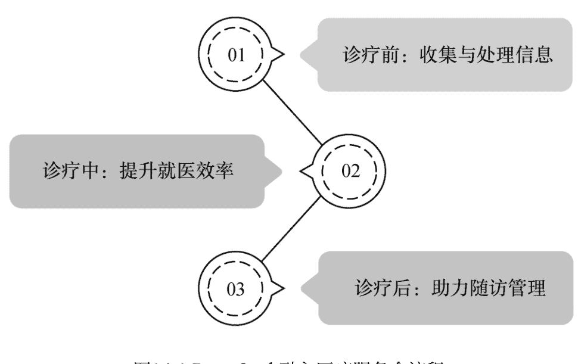

#### 1. 就诊前：信息采集与预处理
准备阶段 DeepSeek 可高效完成患者信息收集与预处理。通过自然语言处理分析患者在线填写的症状描述、过往病史，自动提取关键内容生成结构化报告。医院 App、微信小程序接入后，患者填写病情时系统快速识别核心症状、发病时长、用药历史，形成清晰报告供医师预判。同时基于基础信息智能推荐科室与医师，避免选错耽误就诊。

#### 2. 就诊中：提速诊疗环节

进入问诊阶段后，医生在系统内录入患者的基础信息，就能瞬间调取完整的健康档案，病史、用药史、过敏史等关键信息一目了然，对患者的整体健康状况迅速形成判断。与此同时，DeepSeek 可调用影像解读、辅助诊断等工具参与问诊，提升诊疗的准确性和效率。电子病历实现自动生成与智能归档，让医生把更多精力留给医患沟通和病情研判，诊疗流程因此变得更顺畅、就医体验也随之提升。

#### 3. 诊后随访更智能
诊疗完成并不意味着服务结束，患后的持续跟进同样重要。医疗机构可以依托 DeepSeek 搭建智能随访体系。系统会结合诊疗信息和个体方案，自动制定个性化随访计划，并以短信、App 推送等形式提醒患者复诊或自行监测。随访期间，平台会汇集康复进度、用药反馈等数据，一旦发现异常即刻回传给医生，便于及时安排提前复诊或调整方案。

这套体系还能对积累的随访数据进行深度分析，为机构优化诊疗策略和服务流程提供依据。比如数据分析显示某类疾病在现有方案下的恢复周期偏长，机构便可据此针对性改进治疗路径，进而提高整体疗效。

把 DeepSeek 融入就医全链路，既能缓解传统医疗服务的痛点，也为机构提升服务品质、推动可持续发展注入动能，让医疗健康行业向更智能、更高效的方向迈进。

### 14.8 实战拆解：零违规线上健康科普怎么做
线上科普既是提高公众健康素养的渠道，也是塑造医疗机构专业形象的窗口。如何在内容严谨合规的前提下实现有效传播，DeepSeek 给出了全流程的打法。以下以一家口腔专科医院围绕“儿童口腔健康”开展的线上科普为例，还原一次从策划到复盘的零违规操作路径，如图14-2所示。

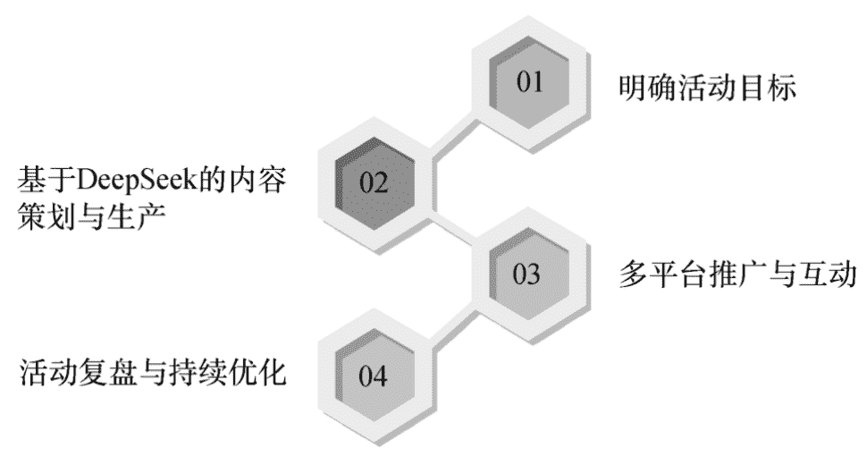

#### 1. 先定目标
该院通过此次科普希望强化家长对儿童口腔健康的关注度，同时带动儿童齿科业务的认知与咨询。

#### 2. 用 DeepSeek 做内容策划与生产
选题阶段，团队借助 DeepSeek 梳理近期家长关心的儿童口腔热点，融合专家建议，最终锁定乳牙护理常见误区、窝沟封闭的价值、儿童早期矫正时机等兼具实用性与话题性的方向。

在创作环节，DeepSeek 基于权威资料把专业内容转化为大众易懂的图文与短视频脚本。团队在指令中明确了合规边界，禁止出现“最佳”“根治”等绝对化表述，不作疗效承诺，内容仅限科普教育。例如在制作“儿童刷牙七步法”脚本时，系统自动规避夸张说法，以中性口吻说明规范刷牙对预防龋齿的意义。

初稿完成后，由医学专家团队与广告合规专员联合审校，确保知识点准确、表述符合医疗广告法规。

#### 3. 分平台投放与互动
DeepSeek 依据各平台用户特征制定分发策略：微信公众号发布深度科普长文并配漫画图解；抖音、快手投放15至30秒的趣味短视频；微博发起“儿童护牙小课堂”话题，邀请口腔专家在线答疑。

互动设计同样谨慎。抽奖礼品选用儿童口腔护理礼包，不与诊疗服务挂钩；在线问答仅提供科普性建议，并明确提示“具体诊疗方案需面诊确认”。

#### 4. 数据复盘与持续优化
活动收官后，团队对参与量、传播量、互动指标进行多维度复盘。数据显示，关于儿童换牙期的内容点击表现最佳，而窝沟封闭科普视频的完播率偏低。据此，后续内容侧重增加换牙期主题，并对视频节奏与讲解方式进行优化。同时完成全流程合规复盘，未发现违规环节，并将数据沉淀为下次策划的参考。

本次活动累计触达超10万人次，儿童齿科咨询量增长200%，并在市场监管部门专项检查中顺利通过。DeepSeek 让内容既合规又具备传播力，为医疗机构开展线上营销提供了可复制的范式。