# DeepSeek财税实战手册

## 前言

决定成败的从来不是工具本身，而是谁更早学会驾驭工具。

当下行业正处在剧烈分化的节点，狄更斯笔下“最好与最坏并存”的判断，正好用来形容财税现状。智能浪潮一边打开前所未有的机会窗口，一边也在加速淘汰固守旧法的从业者。

财税工作长期被庞大的数据体量和繁复的法规体系裹挟。过去靠手工录入、反复核对、人工判断，既消耗精力又容易失误。如今以自然语言理解为代表的技术已经进入日常作业，顺势而为、因需而变的能力变得关键，工作方式正在被重塑。

对财税人而言，DeepSeek可视作转型的核心装备。借助它，能在错综复杂的条文中快速定位要点，摆脱盲目翻找的困境。在分析与决策环节，其计算能力与可视化呈现能够产出高价值洞见，成为企业战略的重要参考。晋升加薪由此从遥远的期望，变为职业进阶的自然结果。

本书聚焦 DeepSeek 在财税场景的十类高频用法，从资料整理到条款检索，从审计配合到风险预警逐项拆解。它不是概念性的技术介绍，而是一本可直接落地的操作指引，帮助财税人实现与 AI 的协同，在变局中拓展职业空间。拥抱智能、掌握 DeepSeek，你便能把握行业走向，成为趋势的引领者。

## 第一章 DeepSeek政策检索专家：实现精准定位

在高度数字化的环境里，财税人员每天面对的信息量巨大，能否又快又准拿到可用依据，直接决定工作效率。

### 第一节 三阶校准法

#### 一、初筛

DeepSeek 依托自然语言处理，能够把口语化提问拆解为检索要素。例如提问“查一下近三年企业所得税有哪些优惠”，系统会提取“近三年”“企业所得税”“优惠”等要素，解析意图并匹配相关内容。

> 企业所得税近三年优惠政策检索案例 [1]

据检索结果，近三年执行期内的企业所得税优惠大致可按类型与主体归纳如下。

[1] 需要注意的是，即使是同一个问题，AI 每次给出的答案也可能有差异。本书中 AI 的答案仅代表笔者写作时咨询 AI 得到的答案。

**小微企业相关优惠**

+ ◆ 小微企业税率优惠
对符合条件的小微企业，应纳税所得额上限300万元、从业人数上限300人、资产总额上限5000万元，按应纳税所得额的25%折算后适用20%税率，政策延续至2027年12月31日。

**区域性优惠政策**

+ ◆ 西部地区鼓励类产业企业
2021年1月1日至2030年12月31日，设在西部地区的鼓励类产业企业，如节能环保、技术创新、绿色可持续发展类企业，减按15%税率征收企业所得税。
+ ◆ 海南自由贸易港企业
2020年1月1日至2027年12月31日，注册在海南自贸港并实质性运营的鼓励类产业企业，如旅游业、现代服务业、高新技术产业，减按15%税率征收企业所得税。新购置500万元以下固定资产可一次性税前扣除。
+ ◆ 特定合作区优惠
深圳河套深港科技创新合作区、前海深港合作区、横琴粤澳合作区等特定区域的鼓励类产业企业，减按15%税率征收企业所得税。

**支持科技创新与研发的优惠**

+ ◆ 研发费用加计扣除
一般企业：研发费用未形成无形资产的，按实际发生额100%加计扣除；形成无形资产的，按200%摊销。
集成电路和工业母机企业：2023年1月1日至2027年12月31日，研发费用加计扣除比例提升至120%费用化或220%资本化。
+ ◆ 高新技术企业
高新技术企业减按15%税率征收企业所得税，资格期满当年暂按15%预缴，未通过重新认定的需补缴税款。
+ ◆ 创业投资企业税收抵免
公司制或合伙制创投企业投资于初创科技型企业满2年的，可按投资额的70%抵扣应纳税所得额，不足部分可结转以后年度。

**环保与公益性政策**

+ ◆ 污染防治第三方企业
符合条件的污染防治企业，如环保设施运营企业，减按15%税率征收企业所得税，执行至2027年年底。
+ ◆ 扶贫与公益捐赠
企业用于目标脱贫地区的扶贫捐赠支出可据实扣除，政策延长至2025年年底。

**设备投资与折旧优惠**

+ ◆ 设备、器具一次性扣除
2024年1月1日至2027年12月31日，企业新购单位价值500万元以下的设备、器具，允许一次性计入当期成本费用税前扣除。

**吸引外资与再投资政策**

+ ◆ 递延纳税政策
境外投资者将境内利润直接再投资的，暂免征收预提所得税。2024年外商在华再投资金额达1622.8亿元，同比增长15%。

**其他专项优惠**

+ ◆ 文化事业单位转制
2027年年底前，经营性文化事业单位转制为企业可享受5年免征企业所得税。
+ ◆ 残疾人就业
支付给残疾职工的工资可100%加计扣除。
+ ◆ 小额贷款公司
农户小额贷款利息收入的90%计入收入总额。

以上优惠综合了全国与区域层面，覆盖小微、科技、环保、外资等多个方向，具体适用条件需对照政策原文。完整条款可查阅国家税务总局或财政部相关公告。

DeepSeek 的内部推演如下。

> 需要为用户查找过去三年，即2022—2024年的企业所得税优惠政策。用户说的“过去三年”可能指2022—2024，但今天日期是2025年2月25日，需确认时间口径。根据检索结果，大部分政策的落地期在2023—2027年，尤其2024年发布较多。接下来从结果中提取相关优惠。

先看网页1，国家税务总局发布的2024年减税降费数据，提到支持科技创新和制造业发展的安排，包括研发费用加计扣除、集成电路和工业母机企业的相关抵减，规模超过2.6万亿元，属于结构性减税，可归入科技制造支持。

网页2和网页10详细列出2024年的企业所得税优惠，包括小微税率优惠、西部地区15%税率、海南自贸港政策、研发加计扣除比例提升以及创投抵免等。尤其是小微企业按应纳税所得额25%折算后适用20%税率延续至2027年，是重点。

网页3和网页6提到设备器具一次性扣除政策，单价500万元以下可一次性计入成本，对企业现金流有利。同时污染防治第三方企业按15%税率减税，也是重要的环保类优惠。

网页5提到深圳河套合作区15%税率及地方园区扶持，可能属于地方性安排，需确认适用范围。用户更关注全国性安排，故列为次要。

网页7、8、9讨论递延纳税，特别是外商再投资递延，2024年数据增长明显，属于引资安排。海南自贸港政策已延续至2027年，纳入近三年覆盖范围。

网页4和网页10重复了小微、西部、海南等内容，需合并去重。网页3还提到高新技术企业、技术先进型服务企业15%税率，以及研发费用100%或120%加计扣除。

综合后，按小微、特定区域、科技研发、环保、外资等类别整理。注意执行时间是否覆盖近三年。例如海南原政策2024年底到期，但已延续至2027年，故纳入。

部分政策虽在2023年发布，但执行期覆盖近三年。如研发费用加计扣除2023年提高比例，执行至2027年，也属近期优惠。创投抵免在多处提及，需包含。

最后核查遗漏，如网页2提到的退役士兵和重点群体就业税收扣减，属于间接优惠，设备扣除、污染防治企业、文化事业单位转制等也需涵盖。

#### 二、核实验证流程

##### 1. 明确检索内容

使用 DeepSeek 进行财税信息检索时，表述越清晰越好。例如查询企业所得税优惠政策时，精准使用“过去三年”“企业所得税”“优惠政策”等关键词，能显著提升结果的针对性和相关性，有助于快速获取所需信息。

##### 2. 整理纠错

DeepSeek 给出的答案并非绝对正确。它通过在海量网页中基于关键词搜索和筛选生成结果，过程中可能存在源信息错误或理解偏差，尤其在专业财税领域，更需要人工整理与纠错。

###### （1）排查引用资料

以本案例为例，DeepSeek 回答前提示将引用44篇网页资料作为参考（如图1-1所示），可以对这些资料的来源进行抽查。


在 DeepSeek 呈现的每一条政策后面都有资料来源标识，灰色小圆点悬停可查看网址信息。如图1-2所示的这条政策发布于2024年9月4日，距检索日期较近，且来源为政府官网，可靠度较高。此时可点击小圆点进一步查看详情。

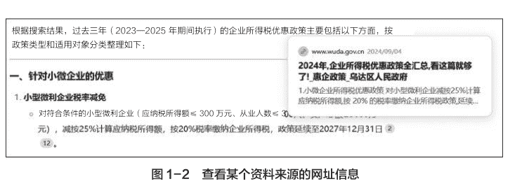

操作后即可跳转至原始网页（如图1-3所示）。


###### （2）使用多个 AI 工具相互验证

若无时间逐一核查，可用多个 AI 平台相互印证。例如用豆包 [1] 提问同样问题，得到的答案如下。

> 过去三年企业所得税优惠政策盘点
过去三年国家出台了大量优惠，降低税负、鼓励创新与特定产业。下面梳理主要内容。

> 一、小微企业优惠政策
小微企业对经济贡献大，近三年给予较多支持。按《财政部 税务总局关于进一步支持小微企业和个体工商户发展有关税费政策的公告》（2023年第12号），2023年1月1日至2027年12月31日，小微企业年应纳税所得额不超过100万元的部分，减按25%计入应纳税所得额，按20%税率缴纳企业所得税。年应纳税所得额超过100万元但不超过300万元的部分，减按25%计入应纳税所得额，按20%税率缴纳企业所得税。

小微企业需满足：从事国家非限制和禁止行业；年度应纳税所得额不超过300万元；从业人数不超过300人；资产总额不超过5000万元。如一家小型服装加工厂年赚200万元、员工150人、资产总额2500万元，符合条件即可享受优惠。计算时100万元内部分按25%折算为25万元，100-200万元部分同理25万元，两部分按20%税率缴税共10万元，无优惠则税负更高。

[1] 豆包是字节跳动公司基于云雀模型开发的 AI 智能体。

> 二、研发费用加计扣除政策
为鼓励研发，国家出台加计扣除政策。2023年1月1日至2027年12月31日，集成电路企业和工业母机企业开展研发活动中实际发生的研发费用，未形成无形资产计入当期损益的，在据实扣除基础上按实际发生额120%税前扣除；形成无形资产的，按无形资产成本220%税前摊销。

对一般企业，未形成无形资产的研发费用自2023年1月1日起按实际发生额100%加计扣除；形成无形资产的按无形资产成本200%税前摊销。如一家科技公司投入500万元研发，除全额扣除外还可加计扣除500万元。若形成无形资产分10年摊销，每年除正常摊销外还可多摊销相当于成本100%的金额，大幅降低税负。

> 三、特定地区与产业优惠政策
+ ◆ 西部地区企业所得税优惠
2021年1月1日至2030年12月31日，设在西部地区的鼓励类产业企业减按15%税率征收企业所得税。鼓励类包括节能环保、技术创新、绿色可持续发展等。如西部某风力发电企业属鼓励类，税率15%，较正常25%节省税费。
+ ◆ 海南自贸港企业所得税优惠
2020年1月1日至2024年12月31日期间，注册在海南自由贸易港并实质性运营的鼓励类产业企业减按15%征收企业所得税，有助于吸引企业入驻。如海南自贸港生物医药企业符合标准可享受15%优惠税率。

> 四、其他优惠政策
+ ◆ “三免三减半”政策
从事符合条件的环境保护、节能节水项目和国家重点扶持公共基础设施项目的企业，自取得首笔生产经营收入所属纳税年度起，第1至3年免征企业所得税，第4至6年减半征收。如污水处理项目企业前三年免税，后三年半税。
◆ 企业所得税减计收入政策
金融机构农户小额贷款利息收入，计算应纳税所得额时按90%计入收入总额。小额贷款指单笔且农户贷款余额总额在10万元及以下。该优惠延续至2027年12月31日。
保险公司为种植业、养殖业提供保险业务取得的保费收入，计算应纳税所得额时按90%计入收入总额，优惠延续至2027年12月31日。
经省级地方金融监督管理部门批准成立的小额贷款公司取得的农户小额贷款利息收入，计算应纳税所得额时按90%计入收入总额。
企业综合利用资源生产符合国家产业政策产品的收入，可在计算应纳税所得额时减计收入。自2021年1月1日起，企业以《资源综合利用企业所得税优惠目录（2021年版）》规定的资源为主要原材料生产符合标准产品的收入，减按90%计入收入总额。
企业投资者持有2024—2027年发行的铁路债券取得的利息收入，减半征收企业所得税。

这些优惠覆盖不同类型、规模企业及地区和产业，对发展、结构调整和创新驱动有重要作用。企业需了解政策，判断是否可享受，用足用好政策减轻税负。

对比处理步骤如下。

第一步，对相同部分予以采信。多个 AI 平台结果一致时，可信度较高。

第二步，对矛盾部分予以验证。如 DeepSeek 中海南自贸港优惠延续至2027年，豆包中为2024年。经查询，《财政部 税务总局关于延续实施海南自由贸易港企业所得税优惠政策的通知（财税〔2025〕3号）》将原财税〔2020〕31号文件规定的税收优惠执行期限延长至2027年12月31日，应以 DeepSeek 为准。

第三步，对缺失部分互相补充。如豆包提到的“三免三减半”政策，DeepSeek 并未提及，可能因该政策并非近三年发布。从中可发现，如需改进关键词，可增加“近三年优惠包括不是在过去三年发布但过去三年适用的政策”。

###### （3）反向询问

在 AI 工具搜索框输入：查一下过去三年企业所得税失效或过期的优惠政策。

## ｜反向询问 DeepSeek 回复｜

据搜索结果，过去三年（2022—2024年）内失效或过期的企业所得税优惠主要包括以下几类，按类型和失效时间整理如下。

## 一、小规模主体优惠调整及到期
- ◆ 2022 年小规模主体低税率优惠到期
2022 年底前，对年应纳税所得额不超过100万元的小规模主体，实际税负为2.5%。该政策在2023年调整，2023—2024年，年应纳税所得额不超过100万元部分税率升至5%，优惠力度降低。
失效依据：原政策到期后未延续原有低税率，实际税负提高。
- ◆ 2024 年年底小规模主体分段优惠到期
2023—2024年度执行的优惠规定，年应纳税所得额超过100万元但不超过300万元的部分按25%计入应纳税所得额，按20%税率缴纳。该政策于2024年年底到期，后续是否延续尚不确定。

## 二、区域性安排调整
- ◆ 海南自贸港企业所得税优惠原到期时间

税惠期限调整与延续情况梳理

海南自由贸易港对鼓励类产业适用的15%企业所得税优惠，原文件规定的截止日为2024年12月31日。2025年政策表述已把有效期延展至2027年年底。换句话说，2024年末的原到期安排已失效，该项优惠本身仍在持续执行。

## 三、特定行业或领域政策终止

- ◆ 特定经营者税收优惠被清理
自2024年8月1日起《公平竞争审查条例》正式施行，未经国务院批准的税费优惠不得继续执行。此前依赖地方税收洼地和财政补贴维系的特定主体，尤其是部分大型企业，享有的优惠已终止，监管导向转向维护市场公平。

- ◆ 扶贫捐赠据实扣除期限变化
企业对目标脱贫地区开展的扶贫捐赠可据实税前扣除的安排，原本定于2022年底到期，后续延至2025年底。2022年的原到期节点已失去效力，扣除事项仍可继续适用。

## 四、征管政策废止

- ◆ 小微企业征管公告被替换
国家税务总局2022年第5号公告关于小微企业优惠征管的有关规定，自2023年1月1日起废止，由2023年第6号公告接替，预缴申报方式与资格判定标准随之调整。

## 五、其他专项政策调整

- ◆ 境外机构投资境内债市免税安排
对境外机构投资境内债券市场取得利息暂免企业所得税的过渡政策，原到期日为2025年底，2024年内未发布调整，截至目前该安排依然有效。

## | 总结 |

> 上述调整主要体现小微优惠阶段性收紧、区域性政策到期后的衔接，以及公平竞争导向下对特殊优惠的清理。需注意，部分优惠虽取消了原到期日，但经延期后仍在运行，如海南自贸港。查阅具体文件依据或执行细节可参考财政部、国家税务总局公告。

基于以上梳理可以更清晰地回顾近三年的优惠变化，小微企业相关优惠并非一成不变，2022年的做法与2023至2024年存在差异。同时也可以看出，针对海南自贸港的政策变动，不同AI检索工具给出的结论并不完全一致。

## 三、使用 DeepSeek 检索功能的要点梳理

使用DeepSeek检索时，提问的精准度与核实意识决定结果质量，善用关键词并明确需求有助于命中目标，检索后还需进行三步校验来判断完整性与准确性。

初次检索：输入财税类关键词时要提炼核心要素。例如查询优惠时，应标明年份如“2023年”、行业范围如“软件行业”、税种如“企业所得税”。要素越具体，定位越精准。

核实验证：结合检索页面的引用来源，借助多款AI工具交叉验证，并采用反向提问的方式检验逻辑一致性。

动态检索：当结果过多或不够理想时，无需重新发起搜索，可直接在结果页补充限定条件。例如从“企业所得税税收优惠政策”细化为“适用于小微企业的企业所得税税收优惠政策”，系统会即时收窄范围。

### 第二节 精准检索关键词

掌握验证步骤后，还需优化提问词。诸如“过去三年企业所得税的优惠政策”这类表述过于宽泛。下面通过两个典型情境说明如何改进。

#### 一、场景：新出台税收政策的理解与应用

假设税务总局发布了新能源汽车企业的新优惠，某制造企业的税务专员希望了解政策内容、适用范围和申报方式。若直接问“最新新能源汽车企业税收优惠政策解读”，得到的回答通常比较概括。

> 据公开信息，2024至2025年新能源汽车企业的优惠主要集中在车辆购置税、车船税减免以及区域性所得税优惠，部分优惠延续到2027年。下面从企业角度做简要解读。

## 一、车辆购置税减免安排

##### 1. 免征与减半分段实施
2024年1月1日至2025年12月31日：符合技术要求的新能源汽车可免征车辆购置税，每辆乘用车免税额上限3万元。
2026年1月1日至2027年12月31日：车辆购置税减按50%征收，每辆乘用车减税额上限1.5万元。
适用范围涵盖乘用车、客车、货车，额度限制仅针对乘用车。

##### 2. 换电模式的特殊计税
对于采用换电模式的车辆，若企业将车身与动力电池分开核算并分别开具发票，购置税计税基数以不含电池的车价为依据，有助于降低税负。

#### 二、车船税优惠
免征对象包括纯电动商用车、插电式混合动力汽车、燃料电池商用车；纯电动乘用车和燃料电池乘用车本身不在车船税征收范围。
车型需纳入《享受车船税减免优惠的节约能源使用新能源汽车车型目录》，并通过专项检测，企业须确保技术合规。

#### 三、区域性企业所得税优惠
1. 海南自由贸易港
在海南自贸港注册并实质运营的新能源汽车企业，如制造、关键零部件研发、充电设施建设等业务收入占比超过60%，可按15%的税率缴纳企业所得税，有效期至2027年底。
2. 横琴深合区与前海合作区
鼓励类产业目录包含新能源汽车研发、智能汽车技术等，符合条件的企业同样适用15%的企业所得税税率。

#### 四、其他扶持措施
1. 财政与研发支持
中央财政对充电基础设施建设给予奖励，地方可用于运营补贴，例如上海按充电量给予度电补贴。研发费用符合条件可加计扣除，但需注意与财政补贴的税务处理边界。
2. 以旧换新叠加
参与汽车以旧换新的企业可获额外财政补贴，如报废旧车并购买新能源乘用车最高可获2万元补贴。

#### 五、执行要点与风险提示
1. 合规要求
购置税减免以机动车销售统一发票开具日期为适用时点，车辆须在《减免车辆购置税的新能源汽车车型目录》内。
享受区域性所得税优惠需满足实质性运营条件，避免因资质不符产生风险。
##### 2. 财政补贴税务处理
2020年后与销售收入挂钩的财政补贴需缴纳增值税，否则可免税。企业所得税层面，专项用途补贴需单独核算方可作为不征税收入，否则应计入应税收入。

## | 总结 |

> 新能源汽车税惠呈现多维度、分阶段、区域差异化的特点。建议企业结合自身业务布局、车型选择和研发投入统筹税务规划，同时关注工信部车型目录更新及地方细则。操作层面可咨询税务机关或专业顾问以确保合规。

若将提问优化为：“假设你是一名新能源汽车制造企业的税务专员，需要获取最新新能源汽车企业税收优惠的解读。请提供新政策原文及文号，明确可享受优惠的企业类型及适用条件，详细说明申报流程，并分享过往成功申报案例。”DeepSeek 的回答会更具操作性。

## ｜最新的新能源汽车企业税收优惠政策解读｜

## 一、政策原文及文号
- 1. 《关于延续和优化新能源汽车车辆购置税减免政策的公告》（财政部 税务总局 工业和信息化部公告2023年第10号）
2024年1月1日至2025年12月31日新能源汽车免征车辆购置税，每辆乘用车免税额不超过3万元；2026年1月1日至2027年12月31日减半征收，每辆乘用车减税额不超过1.5万元。换电模式下，若车身与电池分别核算开票，计税价格以不含电池的车身价为准。
2. 《工业和信息化部 财政部 税务总局关于调整减免车辆购置税新能源汽车产品技术要求的公告》（2023年第32号）更新了整车能耗、续驶里程、电池能量密度等技术指标，并新增低温续航衰减率不超过35%和换电模式标准。
3. 企业所得税优惠
海南、横琴、前海等特殊区域企业，若主营鼓励类产业且收入占比超60%，可减按15%税率缴纳企业所得税。

## 二、享受优惠的企业条件
1. 购置税减免条件
车型须在《减免车辆购置税的新能源汽车车型目录》内，动力电池不得为铅酸电池，续航、能耗需达标，如低温续航衰减率≤35%。换电模式要求车身与电池分开核算并开票，并提供换电服务保障证明。
2. 车船税减免条件
车型需列入《享受车船税减免优惠的节约能源使用新能源汽车车型目录》，并通过专项检测。
3. 企业所得税优惠条件
主营业务为鼓励类产业如新能源汽车制造，收入占比≥60%，且实际管理机构设在当地。

## 三、申报操作流程
（一）购置税减免申报
线上操作登录国家税务总局或地方电子税务局，进入车辆购置税申报模块，录入车架号、发票金额等信息，系统自动校验目录及减免标识，下载电子完税证明。
企业需确保信息与目录一致，做好标识标注，避免虚假信息风险。
### （二）企业所得税优惠申请
向地方税务机关提交主营业务证明、收入占比核算表等材料，申请15%优惠税率。

## 四、以往成功案例
- 1. 某机电设备公司在税务管家辅导下，享受研发费用加计扣除及区域性优惠，拓展新能源动力电池检测业务。
- 2. 海南自贸港某新能源汽车制造企业，因主营业务符合鼓励类目录且收入占比达标，企业所得税税率降至15%。
- 3. 咸阳汽车产业园由税务部门设立代办点，辅导企业完成购置税减免申报，消费者通过国务院客户端申请以旧换新补贴。

## 五、关键注意事项
- 1. 技术合规：定期核查车型是否符合最新技术要求，避免因指标调整导致目录失效。
- 2. 资料留存：保留换电模式分开发票、电池质保协议等文件以备核查。
- 3. 区域差异：海南、横琴等地的企业所得税优惠需结合当地目录动态调整申报策略。

## | 总结 |

> 政策呈现多维度、分阶段、区域差异化的特征，建议结合业务布局、车型与研发投入综合规划税务，同时关注车型目录及地方细则变化，具体操作可咨询税务机关或专业顾问。

对比两个答案可见，更具体的问题能获得更完善、可落地的回复。第二种回答不仅解读政策，还给出了原文文号、享受条件、申报流程和案例，更利于实际执行。

#### 二、场景：复杂税收法规的综合查询

某集团业务跨行业、跨区域。税务团队在年度筹划时需考虑不同地区行业的差异。若在 DeepSeek 输入：“对比西部地区高新技术企业和东部沿海地区传统制造业企业税收法规，并给出税务筹划建议。”会得到如下对比。

以下是西部高新技术企业与东部沿海传统制造业企业在税收法规上的对比及筹划建议。

## 一、税收法规对比
表 1 税收法规对比

| 政策类别 | 西部地区高新技术企业 | 东部沿海传统制造业企业 |
| :--- | :--- | :--- |
| 企业所得税优惠 | 1. 15%优惠税率：符合《西部地区鼓励类产业目录》的企业减按15%征收。<br>2. 研发费用加计扣除：费用化按100%加计，资本化按200%摊销。 | 1. 一般税率25%，符合条件的先进制造业可享受增值税进项税额加计抵减5%。<br>2. 研发费用加计扣除同样适用，但传统制造业投入相对较低。 |
| 增值税优惠 | 无特殊区域性增值税优惠，高新技术企业可享受增值税即征即退等。 | 1. 先进制造业可享受增值税进项税额加计5%抵减。<br>2. 部分传统制造业可适用出口退税。 |
| 区域性政策 | 1. 高新技术15%税率与西部大开发15%税率不能叠加。<br>2. 海南、横琴等特殊区域另有15%税率。 | 部分经济特区如深圳前海对先进制造业有税收返还或地方补贴。 |
| 其他优惠 | 1. 亏损结转年限延长至10年。<br>2. 设备购置可一次性税前扣除或加速折旧。 | 1. 设备购置一次性扣除政策适用。<br>2. 地方性财政补贴较多，需符合产业导向。 |

## 二、税务筹划建议
- 1. 针对西部高新技术企业
a. 政策组合利用
虽不能叠加高新技术与西部大开发优惠，可通过优化业务结构如拆分研发与生产主体分别适用不同政策。关注成渝双城经济圈等试点。
b. 最大化研发加计扣除
争取将技术购入费用纳入加计扣除范围，合理划分研发阶段确保费用归集合规。
c. 利用亏损结转
延长亏损结转至10年，适合前期研发投入大、盈利周期长的企业。
- 2. 针对东部沿海传统制造业
a. 转型升级
向先进制造业转型争取增值税加计抵减5%和所得税优惠，通过技术改造申请高新技术企业认定享受15%税率。
b. 优化增值税管理
增加进项税抵扣，获取专用发票，利用出口退税降低税负。
c. 利用地方政策
入驻优惠园区享受地方财政返还，申请技术改造基金、绿色制造补贴等专项资金。

## 三、风险与合规提示
- 1. 资质认定
高新技术企业需保持知识产权、研发费用占比等指标合规。西部企业需符合《西部地区鼓励类产业目录》动态调整要求。
- 2. 政策衔接
关注政策到期时间如西部大开发优惠至2030年，提前规划。避免依赖地方税收洼地，防范《公平竞争审查条例》实施后的清理风险。
###### 3. 税务合规
区分财政补贴税务处理，与收入挂钩的补贴需缴增值税。避免滥用优惠，确保业务实质与税收优惠相匹配。

## 总结
> 西部高新技术企业可依托区域税率优惠和研发支持，东部传统制造业需通过转型或地方补贴降税。建议结合发展阶段和区域政策动态调整策略，同时重视合规与政策衔接风险。具体可参考财政部、国家税务总局《我国支持制造业发展主要税费优惠政策指引》。

若将提问优化为：“某大型集团业务涉及多行业多地区，税务团队做年度筹划需考虑地区行业差异。例如西部有高新技术子公司，东部沿海有传统制造业子公司。请对比不同地区税收法规差异，给出合法合理的税务筹划建议，要求可落地、可实操，最好附案例。”DeepSeek 的回答会更具体。

##### 一、西部地区与东部沿海地区税收法规差异对比
1. 企业所得税优惠
(1) 西部地区
高新技术企业可享受15%企业所得税税率；从事《西部地区鼓励类产业目录（2025年本）》中新增29类产业如电子信息、资源精深加工等，可叠加享受15%税率。例如达刚控股部分子公司已享受该优惠。
案例：某西部高新技术子公司同时符合高企和西部大开发政策，税率由25%降至15%，税负节省约40%。
(2) 东部沿海地区
传统制造业通常适用25%税率，若属于“先进制造业”（如智能制造、绿色技术），可享受增值税进项税额加计抵减5%的政策。
部分自贸区如海南对鼓励类产业企业减按15%征收企业所得税。
2. 增值税政策差异
(1) 西部地区
无特殊区域性增值税优惠，但可通过高新技术企业资质享受研发费用加计扣除（如职工教育经费按8%税前扣除）。
(2) 东部沿海地区
小规模纳税人优惠：增值税起征点以下企业免征增值税，税率由3%降至1%。
离岛免税政策：海南等地的企业销售免税商品可免征增值税和消费税。
###### 3. 其他政策差异
社保费用：西部地区对病残津贴和失业保险参保有额外支持政策。
地方性奖励：西部地区政府可能对高企提供最高数十万元的资金奖励。

##### 二、税务筹划建议与实操案例
建议1：合理利用地区性所得税优惠
（1）西部地区子公司
确保业务符合《西部地区鼓励类产业目录》，例如将电子信息、装备制造等核心业务占比提升至60%以上。
案例：某西部子公司通过调整业务结构，新增资源精深加工业务，成功适用15%税率，年节税约500万元。
（2）东部子公司
若属于传统制造业，可申请“先进制造业”资质，享受增值税加计抵减5%，降低现金流压力。
建议2：优化增值税管理
（1）东部传统制造业
拆分业务为小规模纳税人（如成立个体工商户），将年开票额控制在450万元以内，综合税负仅2.7%。

区域税筹组合打法：实战案例拆解

沿海某制造型企业通过在税收园区注册个体户，将一批难以取得发票的支出业务做外部分流，当年增值税及附加税的节省额大约在120万元左右。

（2）西部区位的高新企业
可利用研发费用加计扣除机制，例如职工教育经费按8%比例税前扣除，来压缩应税所得基数。

###### 建议 3：关联交易与利润安排
研发布局思路：把附加值高、技术含量高的研发环节集中在西部适用15%税率的地区，生产制造部分保留在东部，通过合规的内部定价把利润导向低税区。
案例：某集团将研发职能迁至西部子公司，制造职能仍由东部子公司承担，以知识产权授权费方式调拨利润，集团整体税负下降约8%。

###### 建议 4：合规与风控要点
- 高新资质维护：高新技术产品收入占比须稳定在60%以上，避免人为拔高收入导致税务稽查。
- 跨区业务拆分：同一业务不能在多地重复享受优惠，必须满足实质性经营要求，例如海南自贸港的相关规定。

## 总结
> 结合各地政策差异，企业可考虑以下组合思路。

1. 西部地区：聚焦高新技术及鼓励类产业，叠加高新企业认定与西部大开发税收优惠。
2. 东部地区：借助小规模纳税人减免以及先进制造业加计抵减政策，降低增值税压力。
3. 全局统筹：通过关联交易优化利润归集，同时坚守合规底线，防范税务风险。

参考案例：某大型集团让西部子公司承接研发业务享受15%税率，东部子公司使用增值税加计抵减，整体税负下降12%，单年节约税费超过2000万元。

把两份回答对照来看，第二份明显更具落地性与可操作性，第一份偏理论。因为第二份给出了可落地的路径和真实案例，DeepSeek 才会给出更贴近实际的回应。

需要提醒的是，本文仅用此问题说明AI回答表现的差异，不展开专业讨论。涉及专业性很强的问题，不建议仅依赖AI咨询。本文提及的税务筹划思路在合规性上存在争议，业务拆分、个体户操作等细节也缺乏深入展开，盲目使用可能演变为偷税漏税。遇到复杂专业问题应咨询专业人士，切勿轻信AI输出。本文仅用于分析AI在不同场景下的回答表现。

#### 三、DeepSeek 精准检索提示词提炼
如何向DeepSeek输入更精准的检索指令？

第一步，明确场景。相比宽泛提问，采用案例式提问效果更好。可将自身处境清晰描述，帮助模型理解需求。上述两例显示，先说明身份与场景，模型更容易代入情境、把握意图。

第二步，细化需求。把DeepSeek当作好友求助时，信息越具体得到的帮助越精准。以聚会筹备为例，不要只说“帮我办个聚会”，而应说“周末想在家办5人左右小型聚会，预算500元以内，请推荐活动和餐食”。需求越具体，沟通效率越高。把问题拆解后，得到的答案也更细化、可执行。

第三步，告知要求。需求是你内心的想法，要求是你表达给对方的标准。以聚会为例，要求就是预算、人数、活动和餐食推荐等。在“复杂税收法规综合查询”场景中，需明确告知需要“合法合理”、“可落地可实操、最好附案例”这些要求，明确要求后输出质量才会提升。

为便于记忆精准检索三步法，整理口诀如下：

> 想要DeepSeek更给力，先把使用场景讲明白。泛泛提问不如举案例，身份背景也要说清楚。
> 需求细化别慌张，找朋友帮忙来对照。把问题拆开慢慢讲，答案具体才有妙方。
> 要求表达要敞亮，需求之外另开腔。合法实操配案例，明确告知才能远航。
> 初次检索要挑剔，政策年份务必记。行业范围不能丢，税种名称要清晰。
> 来源核验不可抛，AI之间要对照。反向提问补漏洞，全面确认保精准。
> 动态检索很灵活，问题不清可微调。范围缩小更聚焦，精准结果自然有。

在财税领域，DeepSeek凭借精准检索能力，为财税人员提供快速准确的数据查询与分析工具。查阅税收法规时效率大幅提升，有助于应对复杂工作，提升决策可靠性。

## 第二章 DeepSeek 数据指挥官：赋能智能数据整理

### 第一节 快速导入财税数据
财税流程中，数据采集与导入是最基础也最关键的一步。DeepSeek以兼容性强、处理效率高的特点，为财税人员提供多渠道便捷导入方式。

#### 一、数据源清洗
以常用的Excel为例，导入前需先清洗。以用友、金蝶等主流财务软件为例，DeepSeek可直接导入导出文件。以用友为例，可在系统中按规范格式，如Excel格式，导出总账、明细账、日记账、记账凭证等，随后在DeepSeek导入界面选择文件路径即可完成导入，操作简便且保证完整准确，大幅节省手工录入成本。

上传前务必打开Excel检查。若存在合并单元格、首行信息不清等情况，导出时会报错。

例如，如图2-1所示的表格首行格式有误，无法顺利导出。


调整为如图2-2所示格式后即可正常导出。


此外，Excel中若存在表格主体外的冗余内容，也需清理。该类冗余经财务软件导出后可能呈现如图2-3形式。

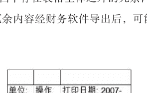
这些内容是否保留？以智谱清言[1]为例，保留后软件虽可读取并生成图表，但图表数据会出现偏差。

> [1] 智谱清言由清华校友设立的北京智谱华章科技有限公司推出，于2023年8月31日正式上线，在图表能力方面较为优秀。

保留冗余内容时，智谱清言输出如图2-4。

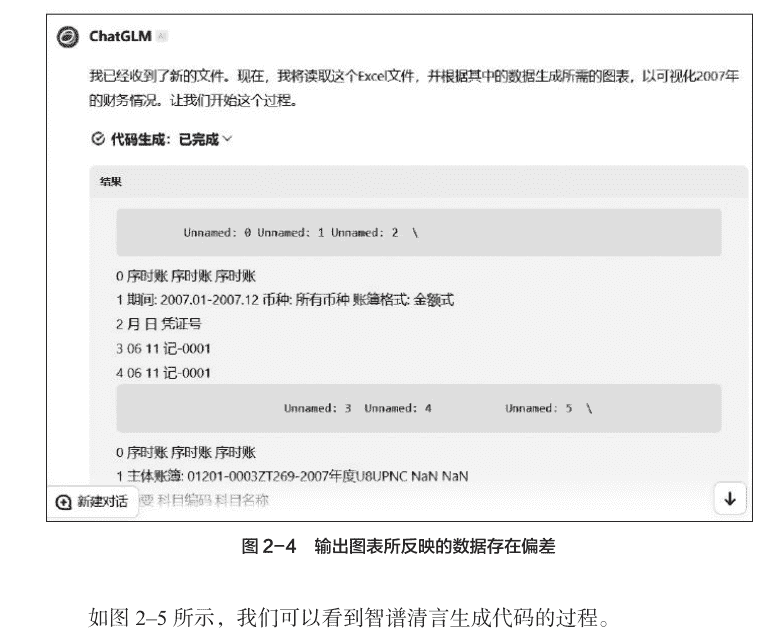
图2-4输出图表数据存在偏差

如图2-5所示，可看到智谱清言生成代码过程。

Excel文件已成功读取，并且我们现在有了一个DataFrame。从DataFrame的前几行来看，我们可以看到表格的标题和列名不清晰，数据从第四行开始。

为了创建图表，我需要做以下几步：

1. 清理标题行，并设置正确的列名。

2. 删除不需要的行，例如那些包含描述或空数据的行。

3. 分析数据，提取有关收入、支出和其他关键财务指标的信息。

4. 使用提取的数据生成图表。

首先，我将设置正确的列名，并删除不需要的行。然后，我将开始创建图表。让我们开始这个过程。

代码生成：已完成

结果

| 月 | 日 | 凭证号 | 摘要 | 科目编码 | 科目名称 | 辅助项 | 币种 |

|---|---|---|---|---|---|---|---|

| 0 | 06 | 11 | 记-0001 | 取现备用 | 100101 | 人民币 | NaN | 人民币 |

| 1 | 06 | 11 | 记-0001 | 取现备用 | 1002010201 | 蜀都支行920101040012141 | NaN | 人民币 |

| 2 | 06 | 11 | 记-0002 | 付银行手续费 | 660301 | 银行手续费 | NaN | 人民币 |

| 3 | 06 | 11 | 记-0002 | 付银行手续费 | 1002010301 | 四支行51001446408051502612 | NaN | 人民币 |

| 4 | 06 | 11 | 记-0002 | 付银行手续费 | 100101 | 人民币 | NaN | 人民币 |

图2-5智谱清言生成代码的过程

到如图2-6所示步骤，可看到智谱清言输出的图表。

如图2-7所示，数据出现问题时，智谱清言能自动修正。

现在我们已经清理了DataFrame，并设置了正确的列名。接下来，我将开始创建图表来展示2007年的财务情况。

为了生成图表，我将采取以下步骤：

1. 提取和汇总全年的收入和支出数据。

2. 创建一个双轴柱状图来展示收入和支出对比。

3. 提取开发成本相关的数据，并创建一个环形图来展示开发成本的构成。

4. 汇总各部门的费用，并创建一个堆叠柱状图来展示各部门费用占总费用的比例。

首先，我将生成收入与支出对比分析的双轴柱状图。为此，我需要确定哪些列代表收入和支出，并计算它们各自的总额。由于借方和贷方列可能代表交易的方向，我将基于这些列来计算收入和支出。让我们开始。

代码生成：已完成


图2-6智谱清言输出的图表

生成双轴柱状图时出现错误，因月份数据类型不正确，月份应为字符串而非整数。

我将修复问题，确保月份以字符串形式表示，并再次尝试生成图表。让我们进行修正。

代码生成：已完成

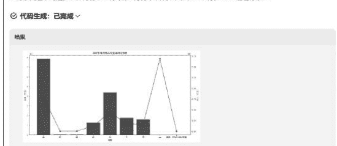
现在成功生成2007年每月收入与支出对比的双轴柱状图。接下来将根据数据生成开发成本构成环形图。

首先，确定与开发成本相关的科目编码并计算总和，然后创建环形图展示开发总支出的比例。继续进行。

图2-7智谱清言会自动修正数据错误

此时会发现，因表外数据未剔除，导致12月后多出数据，需去掉冗余。

另外，若导出数据的科目名称不够清晰，也会导致错误。因此清洗数据源、确保准确是第一步。

#### 二、导入方式
DeepSeek网页界面右下角有回形针图标（如图2-8）。直接点击会提示“联网搜索不支持上传文件”。正确操作是先点击“联网搜索”按钮，使其变为灰色关闭联网搜索，再点回形针即可上传。


手机App中没有回形针，取而代之的是“+”号（如图2-9）。


图2-9DeepSeek手机App界面中的“+”号标识

点击“+”后可看到拍照识文字、图片识文字、文件三种模式。


图2-10拍照识文字、图片识文字、文件三种模式

了解上传文件操作后，探究如何将Excel数据导入DeepSeek。

Excel是财税工作中常用存储工具，常记录费用报销明细、资产折旧表等。DeepSeek支持多种Excel格式导入。打开数据导入窗口选择对应文件，系统会自动识别表格结构并按财税特点智能分类导入。例如费用明细表，系统可准确识别日期、费用项目、金额等关键信息并导入对应财务科目。

#### 三、导入过程中常见问题及解决办法
##### 1. 数据格式不兼容
老旧财务软件导出的数据格式可能与DeepSeek不兼容。可使用格式转换工具先转成Excel等常见格式再导入。例如特定软件的独有格式，可先通过软件自带导出功能转为Excel。

##### 2. 数据量过大导致导入缓慢或失败
导入大量数据时系统可能因资源不足而缓慢或失败。可分批导入，将大文件拆成多个小文件逐次导入。

例如，如图2-11所示，文件[1]已上传，但系统提示文件太多太大，需删减后发送。

> [1]为避免隐私泄露又保证可检验，笔者使用了较早年份某公司真实财务数据。

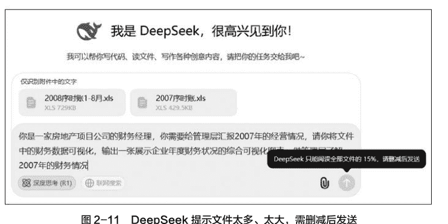
删减一个文件后，右下角发送按钮颜色改变，可正常发送指令（如图2-12）。

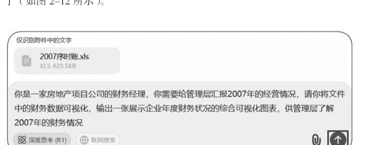
##### 3. 数据权限及隐私问题
出于安全与隐私考虑，不建议导入含私密信息的文件。

总体而言，利用DeepSeek快速导入财税数据，可将原本耗费在录入环节的时间转投数据分析与决策支持，大幅提升工作效率与质量。

### 第二节 财务数据可视化
大数据时代，海量财税数据若仅以表格呈现，难以快速洞察关键信息与趋势。将其转化为直观图表，能为工作注入活力，帮助更高效分析与决策。

#### 一、丰富多样的可视化图表类型
##### 1. 柱状图与条形图
适用于比较不同财务指标数值大小。
例如分析企业各季度营业收入，柱状图可清晰展示各季度高低差异，柱高直观反映收入。条形图在展示管理费用、销售费用、财务费用等对比时实用，水平条形便于一眼看出占比与差异，快速识别主要支出。

##### 2. 折线图
擅长展示数据随时间变化趋势。以年度利润变化为例，多年净利润以折线连接，可清晰呈现增长或下降趋势，便于判断盈利走向、分析波动原因并预测未来，为战略决策提供依据。

##### 3. 饼图
用于展示各部分在总体中的比例。在分析成本结构时，如原材料、人工、制造费用占比，饼图以扇形区域直观呈现，便于迅速掌握成本构成，确定控制重点。

##### 4. 散点图
用于研究两个财务变量关系。如销售额与广告投入关系，以销售额为纵坐标、广告投入为横坐标，每个点代表一期数据。观察点分布可判断是否存在关联，如正相关，为市场推广策略提供数据支持。

#### 二、可视化操作流程
##### 1. 选择数据源
在DeepSeek界面中，首先指定用于生成图表的已清洗财务数据源，来源可为已导入的财务软件数据、税务系统数据或Excel表等，以确定分析范围。

##### 2. 确定可视化图表类型
根据数据特点和目的，从图表类型库中选择合适类型。如比较产品销售额选柱状图，展示资产负债结构选饼图。点击对应图标即可选定。

##### 3. 配置图表参数
选定类型后需配置标题、坐标轴标签、数据系列等。如柱状图需设定横坐标代表的财务项目、纵坐标数值含义，并为各系列命名，确保图表准确传达信息。

需要注意，DeepSeek本身不能直接生成可视化图表，主要以文本交互提供服务。可选择以下三种实现路径。

##### 1. DeepSeek+ 其他 AI 工具
由DeepSeek给出图表思路，复制给其他AI工具如智谱清言，由其完成绘制。

##### 2. 直接使用其他 AI 工具
直接使用智谱清言等专业图表AI工具完成可视化。

##### 3. DeepSeek+Mermaid
通过DeepSeek生成Mermaid代码，再用Mermaid网站获取专业图表。

有人可能疑惑，既然DeepSeek不能直接出图，为何还要介绍？原因有二。一是数据可视化是未来分析大趋势，财务人员普遍缺乏技能且学习成本高，借助AI是快速突破的最佳方式，正如“淘汰你的不是AI，是比你更会用AI的人”。学会可视化后沟通协调能力大幅提升。二是DeepSeek出色的推理能力在图表过程中优势独特，且能生成代码，结合其他工具即可一键出图。

让财务数据会说话：可视化落地全解析

后文会用三种组合方式的真实案例演示绘图流程，并把各自的优劣展开说明。

#### 三、可视化带来的显著优势

##### 1. 提升数据洞察效率
表格能承载大量信息，但阅读成本偏高。图形化后财务信息变得一目了然。财税同事可在很短时间内抓住要点。比如一张覆盖全年经营的综合视图，可以同时呈现营收、成本、利润、资产负债等多个维度，异常点和走势变化立刻显现，洞察速度得到明显提升。

##### 2. 增强决策支持能力
图形化的财务成果为管理层提供了更直观的参考依据。图示帮助经营者更透彻地理解业务状况，判断也更稳健。例如在编制下一年度预算时，管理者可以对照往年图形化结果，分析各项费用的增速与占比，再合理确定额度，实现资源优化配置。

##### 3. 促进团队沟通与协作
财税内部以及与其它部门协作时，图示能消除因理解差异带来的障碍。不同岗位对财务数据的敏感度不同，直观图示让大家都能快速读懂经营与财务现状，促进信息共享。以与销售团队讨论业绩与成本关系为例，展示相关图示后，财税人员能更清楚地说明成本管控对利润的拉动，双方可共同探讨提升业绩、优化成本的思路。

借助 DeepSeek 在财务数据间接图形化方面的能力，财税人员能把繁杂枯燥的明细转化为有价值的信息，为财务管理与决策提供更高效、更精准的支持。

#### 四、场景：决策支持可视化

前面已经导入了 2007 年序时账，接下来便要输入指令。如前文所述，提示词要包含“场景”“需求”“要求”三个部分，因此指令不应该是简单的“使财务数据可视化”。正确的指令构建方式为：首先明确场景，即表述为“你是一家房地产项目公司的财务经理，需要给管理层汇报 2007 年的经营情况”；然后阐述需求“请将文件中的财务数据进行可视化处理”，再细化要求“输出形式不限于比如输出一些柱状图、饼图，供管理层了解 2007 年的财务情况”。DeepSeek 的深度思考如下。

> 好的，我需要帮助用户将 2007 年的财务数据可视化，以便他们向管理层汇报经营情况。首先，我需要仔细理解用户提供的 Excel 文件内容。文件是一个序时账，包含多个月的交易记录，每笔交易都有日期、凭证号、摘要、科目编码、科目名称、辅助项、币种、借方、本币、贷方等信息。
> 
> 用户希望将这些数据转化为可视化的图表，如柱状图、饼图等，供管理层了解 2007 年的财务情况。我的第一个挑战是如何从这些详细的数据中提取关键财务指标和分类数据。可能需要关注以下几个方面。
> 
> 1. 收入与支出总览：全年各个月份的收入和支出趋势。
> 2. 主要支出类别：例如审计费、银行手续费、咨询费等，了解哪些支出占比较大。
> 3. 项目成本分布：不同项目（如“A”）的成本分配情况。
> 4. 现金流量分析：现金的流入和流出情况，特别是银行账户的变动。
> 5. 利润与损益：期间损益结转情况，全年利润的构成。
> 
> 接下来，我需要确定如何从表格中提取这些数据。例如，可以通过筛选“科目名称”来分类不同的收入和支出项目。例如，“利息收入”“银行手续费”“审计费”等。对于项目成本，可能需要关注“项目管理档案：A”相关的记录。
> 
> 在可视化方面，柱状图适合展示时间序列数据，比如各个月份的收入和支出对比。饼图适合展示各类别在总支出或总收入中的占比。折线图可以显示趋势，如现金流的变化。
> 
> 然而，用户提供的 Excel 表格数据非常庞大，手动处理可能会耗费大量时间。因此，可能需要借助 Excel 的数据透视表或图表功能，或者使用 Python 的 Pandas 和 Matplotlib 库进行数据处理和可视化。如果用户不具备编程能力，Excel 的内置工具可能更合适。
> 
> 另外，需要注意数据的准确性。例如，检查借方和贷方的金额是否正确，是否存在重复记录或异常值。例如，有些交易可能有“作废”标记，需要排除这些无效记录。
> 
> 最后，生成的图表需要简洁明了，突出重点，便于管理层快速理解财务状况。可能需要附上简短的文字说明，解释图表的主要发现和建议。
> 
> 在实施过程中，可能会遇到以下问题。
> 
> 数据清洗：需要处理缺失值或错误数据。
> 分类标准：如何合理分类不同的财务科目。
> 图表选择：如何选择最合适的图表类型来呈现不同的财务指标。
> 
> 通过逐步解决这些问题，可以生成有效的财务可视化报告，帮助管理层做出决策。

这段 DeepSeek 的思考逻辑颇为清晰。它从理解数据、明确需求、提取关键数据，到选择工具、保障数据准确及应对潜在问题，全面且细致地规划了将财务数据可视化的流程。

DeepSeek 的回答如下。

以下是基于 2007 年序时账数据的可视化分析，供管理层参考。

##### 1. 全年收入与支出趋势（柱状图）


横轴：月份（1—12 月）。

纵轴：金额（万元）。

关键观察：

- 收入主要集中在 6 月、9 月和 12 月（如投资款、利息收入、工程款回收）；

- 支出在 6 月、9 月、10 月达到峰值（设计费、工程预付款、咨询费）；

- 全年净现金流波动较大，需关注大额支出节点的资金安排。

##### 2. 主要支出类别占比（饼图）


主要支出类别如下。

- 设计规划费（36%）：设计公司费用。

- 工程款（28%）：市政工程、景观绿化等预付费用。

- 咨询费（15%）：审计、法律、管理咨询等。

- 银行手续费（5%）：频繁转账和外汇交易导致。

- 其他（16%）：低值易耗品、差旅费、行政费用等。

建议：优化设计合同付款节奏，降低集中支付压力。

##### 3. A 项目成本分布（堆叠柱状图）


成本构成如下。

- 规划设计（45%）：景观设计、市政规划、效果图制作。

- 工程施工（30%）：高尔夫草圃、拆除工程、装修工程。

- 间接费用（15%）：办公、差旅、通信等。

- 税费（10%）：印花税、土地使用税。

关键问题：设计费占比较高，建议加强设计阶段的成本控制。

##### 4. 现金流量分析（折线图）


- 流入：投资款（936 万元）、利息收入（约 2.2 万元）、工程回款（518 万元）。

- 流出：设计费（累计超 2000 万元）、工程预付款（约 459 万元）、税费（28.5 万元）。

- 净现金流：全年净流出约 1200 万元，依赖股东注资（两大股东累计转入超 5000 万元）。

##### 5. 利润构成（条形图）


收入来源：

- 利息收入（-2246 元，负值冲减费用）；

- 工程款回收（518 万元）。

主要费用：设计费（513 万元）、咨询费（150 万元）、银行手续费（约 2 万元）。

净利润：全年亏损约 328 万元（需结合完整损益表确认）。

##### 总结与建议

1. 资金管理：大额设计费和工程预付款导致现金流紧张，建议分阶段支付或争取更有利的账期。

2. 成本优化：设计费占比过高，需引入比价机制；严控低效行政开支。

3. 税务筹划：印花税和土地使用税合计占比 10%，建议与税务部门沟通优惠政策。

4. 项目进度：A 项目投入集中，需加快销售回款以平衡现金流。

如需具体数据或调整分析维度，可进一步提取明细！

可以看到，DeepSeek 不仅给出了图表建议，还针对资金管理、成本优化、税务筹划和项目进度四个方面给出了管理改进建议，其推理能力十分优秀。然而，它无法直接生成图表，因此，需要运用此前提到的两种基于 DeepSeek 的路径来生成图表。

DeepSeek 的思路非常清晰，它省去了人工思考过程，直接告诉我们下一步应生成什么样的图表，实际上是简化了操作流程中“确定可视化图表类型”和“配置图表参数”这两个步骤。

我们首先试一下 DeepSeek 能否直接生成图表。

借助 DeepSeek 生成附带样式的 HTML 代码，随后通过截图或在线转换为 PNG 格式。生成代码后在 DeepSeek 代码区右下角点击“运行 HTML”进行预览并截图。

在上述对话基础上，我向 DeepSeek 发出进一步指令：请用 HTML 格式。

此时，DeepSeek 的回答给出了具体代码（如图 2-13 所示）。

在这一长串代码的末端，出现了“运行 HTML”的按钮（如图 2-14 所示）。

点击后的页面如图 2-15 所示。我们会发现 DeepSeek 生成的图表并不能满足我们对可视化的要求，因此我们一般不使用 DeepSeek 直接生成图表。

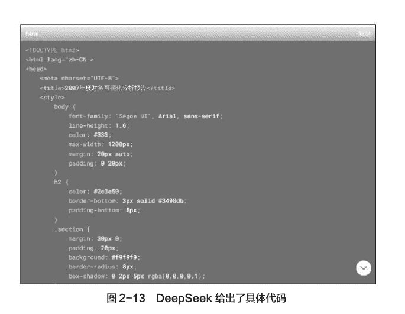

图 2-13 DeepSeek 给出了具体代码

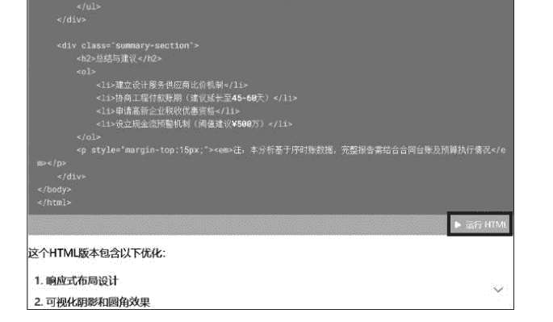

图 2-14 代码末端出现“运行 HTML”按钮

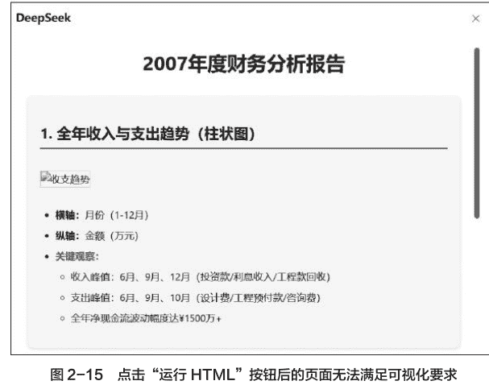

图 2-15 点击“运行 HTML”按钮后的页面无法满足可视化要求

综上所述，仅依靠 DeepSeek 自身无法直接生成图表，需借助第三方工具方能实现图表生成。接下来，我们对比分析 DeepSeek 结合其他 AI 工具与直接使用其他 AI 工具在实际操作中的异同之处。

##### 1. DeepSeek+ 其他 AI 工具

具体操作流程：DeepSeek 生成图表思路，然后将 DeepSeek 的思路复制给其他 AI 工具（以智谱清言为例），由智谱清言完成图表绘制。

操作时，复制此前 DeepSeek 的回答内容，向智谱清言发出“根据以下思路生成图表”的指令。

智谱清言可以直接在对话框出图，方便快捷易操作。但需要注意的是，我们看到 DeepSeek 给出第一张图（如图 2-16a 所示）时，并没有提供具体数据。这是因为我们没有给智谱清言发文件，只是复制了 DeepSeek 的文字。因此，智谱清言生成的这张图不能使用，它是基于 DeepSeek 的定性描述自行编造的。而根据 DeepSeek 的回答，第二张图（如图 2-16b 所示）和第三张图（如图 2-16c 所示）是包含具体数据的，因此这两张图可以使用。在使用 AI 工具生成图表时，应注意图表数据是否为 AI 自行编造的。

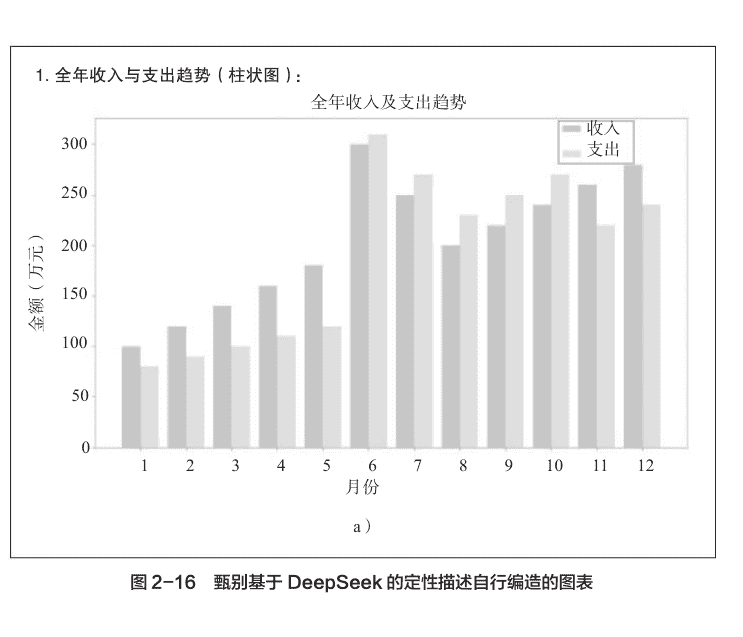

2. 主要支出类别占比（饼图）：

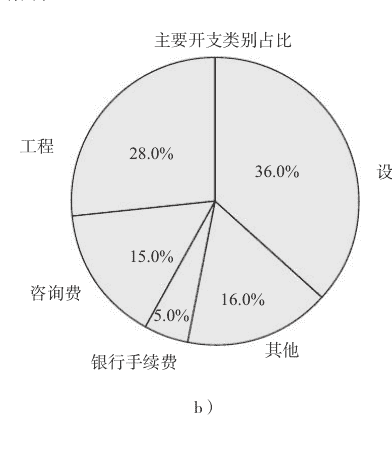

b）

3. A 项目成本分布（堆叠柱状图）：

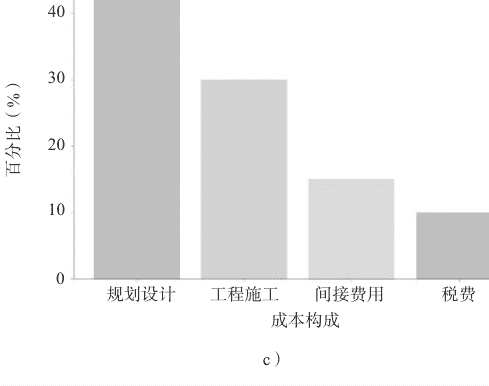

c）

图 2-16 甄别基于 DeepSeek 的定性描述自行编造的图表（续）

若想保存智谱清言生成的图表，直接在图片上点击鼠标右键，选择“将图像另存为”即可（如图 2-17 所示）。需要注意的是，有时 DeepSeek 给出的答案中有占位符，在这种情况下，智谱清言也难以顺利输出图表。这充分表明，DeepSeek 的数据输出环节以及最初的数据源清洗工作极为关键，直接影响后续图表生成的质量与可用性。

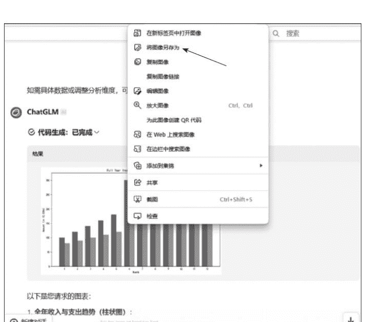

若仔细回想刚刚 DeepSeek 的回答，我们就会发现，如图 2-18 所示的现金流量分析（折线图）也是由智谱清言自行编造的没有数据支撑的图表。那么，我们是如何得出这个结论的呢？

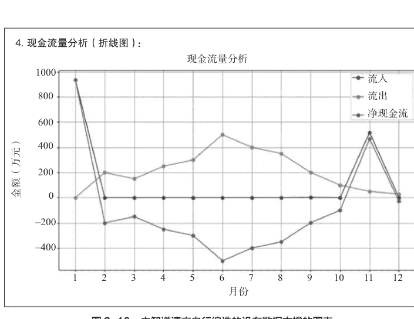

图 2-18 由智谱清言自行编造的没有数据支撑的图表

我们回顾一下 DeepSeek 之前针对这一部分的回答。

##### 4. 现金流量分析（折线图）

> [现金流量分析]

- 流入：投资款（936 万元）、利息收入（约 2.2 万元）、工程回款（518 万元）。

- 流出：设计费（累计超 2000 万元）、工程预付款（约 459 万元）、税费（28.5 万元）。

- 净现金流：全年净流出约 1200 万元，依赖股东注资（两大股东累计转入超 5000 万元）。

DeepSeek 的回答并未给出每个月的现金流，所以如图 2-18 所示的现金流量分析（折线图）是智谱清言自行编造的图表，不可使用。

若仔细分析 DeepSeek 的回答，我们会发现如图 2-19 所示的利润构成（条形图）也不具有意义。原因在于，实际利润是负数，且在 DeepSeek 的文字表述中，并未明确说明利润是由哪些具体项目构成的。

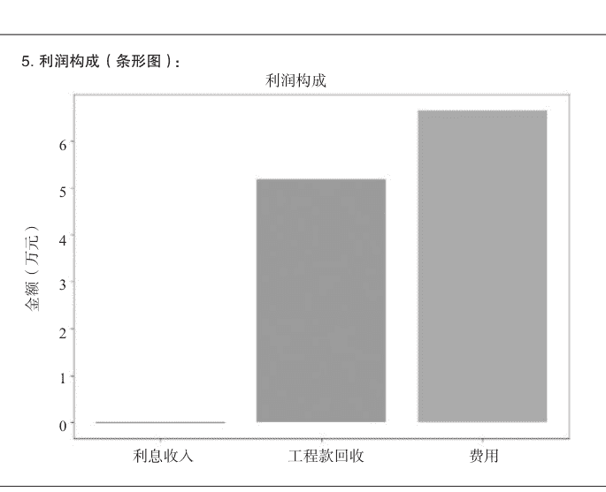

我们回顾一下 DeepSeek 之前针对这一部分给出的回答。

##### 5. 利润构成（条形图）


收入来源：

- 利息收入（-2246 元，负值冲减费用）；

- 工程款回收（518 万元）。

主要费用：设计费（513 万元）、咨询费（150 万元）、银行手续费（约 2 万元）。

净利润：全年亏损约 328 万元（需结合完整损益表确认）。

DeepSeek 与智谱清言协作输出图表的过程如上，经过人工分析与改进，我们可以得到向管理层汇报的图表。比如，在分析过程中，我们发现原有的堆叠柱状图并不适合展示项目成本构成，此时可以要求改为饼图。同时，我们注意到有 3 个图表是由 AI 自行编造的，其内容不实、缺乏实际意义（这再次印证了在实际应用中，单纯依赖 AI 容易出现错误且分析不够深入，只有基于企业实际情况深入思考，将 AI 与人工分析相结合，才能真正发挥人工智能的优势）。

比如，笔者可能会补充向智谱清言提问：“绘制饼图以展示成本构成，具体如下。规划设计（45%）：景观设计、市政规划、效果图制作。工程施工（30%）：高尔夫草圃、拆除工程、装修工程。间接费用（15%）：办公、差旅、通信等。税费（10%）：印花税、土地使用税。关键问题：设计费占比较高，建议加强设计阶段的成本控制。”

通过这一指令，智谱清言输出了符合要求的饼图（如图 2-20 所示），以此替代原有的第三张图。

##### 2. 直接使用其他 AI 工具

笔者尝试直接使用智谱清言完成财务数据的可视化过程。

在智谱清言网页端的左下角，将鼠标悬停在文件夹按钮上（不点击），此时可以看到智谱清言支持上传多种类型的文件，且在文件数量方面也有一定优势（如图 2-21 所示）。点击该文件夹按钮后，我们还是上传 2007 年序时账文件，采用和 DeepSeek 中相同的提示词（如图 2-22 所示）。

图 2-21 支持上传多种类型的文件

图 2-22 上传文件并填写提示词

点击上传后，智谱清言会询问“是否开启云同步”（如图 2-23 所示），这一步的选择主要取决于未来对话是否还要引用该文件中的数据。

图 2-23 智谱清言询问“是否开启云同步”

需要注意的是，智谱清言当前的 xlrd库不支持读取 xls格式的文件。因此，在上传前，需要先将 xls 格式的文件转换为 xlsx 格式的文件。若只是直接更改文件后缀名，虽然该文件可以在 Excel 中打开，但智谱清言无法正确读取。正确的转换方式为：双击打开 Excel 文件，然后点击左上角的“文件”选项，选择“另存为”，在下方格式选项中选择 xlsx 格式进行保存。完成格式转换后，智谱清言便可以顺利读取了。不过，即便智谱清言可以正常输出图表（如图 2-24 所示），但我们会发现该图表并没有实际分析意义。

智谱清言对借贷双方的总额进行了求和计算。但凡学过会计的读者都知道，会计记账遵循“有借必有贷，借贷必相等”的原则，所以这种求和分析毫无意义，只是在验证是否存在数据差错而已。

综上所述，我们虽然可以直接使用智谱清言输出图表，但因为 DeepSeek 的推理能力胜于其他大模型，所以如果直接使用智谱清言输出图表，建议明确图表类型和图表参数，这样才更容易得到理想结果。

#### 五、场景：非财务人员协作可视化

在这个场景中，我们使用第三种路径来生成图表，即 DeepSeek+Mermaid。具体操作流程为：由 DeepSeek 生成 Mermaid 代码，再使用 Mermaid 网站来获取各类专业图表。

我们发出的指令为：你是一家房地产项目公司的财务经理，需要与销售部门讨论业绩与成本的关系。根据提供的账套数据，请展示相关的可视化图表（需求），清晰地向销售团队解释成本控制对利润的影响，并共同探讨提升业绩和优化成本的策略（要求）。使用 Mermaid 语法生成。

DeepSeek 的深度思考如下。

> 好的，我需要帮助用户根据账套数据，生成可视化图表，以便财务经理与销售部门讨论业绩与成本的关系，并解释成本控制对利润的影响。用户还要求共同探讨提升业绩和优化成本策略。
> 
> 可能的步骤：
> [1] 识别关键成本与收入项目：确定哪些成本与销售活动直接相关（如广告费、销售佣金）或间接相关（如设计费、工程款）。
> 
> 2. 时间轴分析：将成本和销售收入按时间分布对比，观察季节性变化或项目阶段的支出。
> 
> 3. 成本效益分析：计算不同成本项目的投入产出比，比如每元广告费带来的销售收入。
> 
> 4. 利润结构分解：展示各项成本占收入的比例，突出成本控制对利润的影响。
> 
> 可能的图表类型：

成本利润拆解，四种可视化视角

堆叠柱状图把月度营收与各类成本层叠呈现，能一眼看出成本结构占比。散点或气泡图将不同成本项与销售额放在同一坐标系里，方便分辨投入产出高低。折线图擅长比对成本增速和收入增速的分化。瀑布图从营业收入起步，依次递减至净利润，清晰展示每项成本对利润的拉动或拖累。

落地前的自我检查
成本是否拆细到能够直接对应销售动作，财务表述是否已换成销售人员易懂的语言，有无需要单独说明的异常支出，例如大额设计费的集中支付。

使用前的核对要点
序时账中销售收入是否明确记账，除利息收入外是否存在其他收入类别；成本分类是否准确，开发支出与销售费用能否有效区分；若销售数据缺口较大，可结合项目进度等外部线索做合理推算，比如按预售节奏估算收入；同时要明确销售业绩口径，如签约额、回款率，并与对应成本建立关联；图表需清晰标注并配以简短解读，帮销售理解成本管控如何转化为利润提升。

DeepSeek 在图 2-25 中的示例演示。

```
mermaid
pie showData
    title 销售费用构成对利润率的影响
    "广告宣传费（投入产出比1:8）" : 150
    "销售佣金（投入产出比1:15）" : 42
    "示范包装费（投入产出比1:5）" : 68
    "其他费用（投入产出比1:3）" : 25
```
**可视化策略说明：**

1. **成本结构树状图：**

   * 显示土地成本占开发成本62%（5.07亿/8.17亿）

   * 广告费占销售费用78%，但产出比最高（1:8）

   * 设计费支付集中在3-11月，与项目进度强相关

2. **销售-成本节奏甘特图：**

c）

图 2-25 DeepSeek 使用 Mermaid 语法生成的回答

点击图 2-25a、b、c 右上角的复制按钮，会显示复制成功。然后，打开 Mermaid 网页，将刚刚复制的代码粘贴在网页左边的黑色区域。

观察后发现，第一张图虽然呈现了费用占比，却不够理想。此时可以向模型提问：“第一张图表达的核心是什么？用树状图呈现是否合适？”反问模型是定位问题的好办法。

第二张图呈现效果很好，时间轴把现金流入和流出的节奏对比得很清楚。需要大图时点击右上角导出即可。

导出后能更清晰看到：3 月开始产生成本，5 月启动广告投放，6 月支付土地款的同时首期开盘，9 月二期加推，12 月开展年终促销。这些节点对现金流的影响非财务人员也能直观理解。

第三张图是饼图，展示销售费用构成对利润率的影响。分析显示广告宣传费投入产出比为 1：8，投入占比并非最高，但在饼图中对利润贡献超过一半。销售佣金的投入产出比最高，每投入 1 元佣金可带来 15 元利润，说明加大渠道拓展力度更有价值。甚至可以从示范包装费和其他费用中腾出部分预算用于佣金，因后两项的投入产出效率较低。

回到 DeepSeek 界面，模型除了给出代码，还提供了分析。核心结论如下。

成本结构树状图
土地成本占开发成本 62%，约 5.07 亿元/8.17 亿元；广告费占销售费用 78%，但产出比最高为 1：8；设计费支付集中在 3 月至 11 月，与项目进度高度相关。

销售成本节奏甘特图
6 月支付土地款后立即开盘，资金周转效率高；广告费持续投入支撑 9 月、12 月的关键销售节点；设计费支付早于销售回款，付款节奏有优化空间。

费用效益饼图
销售佣金投入产出比最优，每 1 元佣金带来 15 元收入；示范包装费效率待提升，建议改用数字化展示；其他费用如差旅、招待费存在优化空间。

协同优化建议
动态成本调配：把广告费向高转化渠道倾斜，减少平面广告，增加数字营销；建立设计费支付与预售进度挂钩机制，例如达到 30% 去化再支付下一阶段。
销售费用重构：采用阶梯式佣金，如 5% 基础奖励加 3% 超额奖励；示范区包装改用 VR，预计可降低 60% 实体搭建成本。
税务协同：把部分设计费 875 万元计入土地增值税加计扣除；利用开发间接费归集规则合理分摊利息支出。
数据监控：建立周度费效比仪表盘，监控费用投入、到访、签约转化等关键数据；设置成本预警阈值，单项目设计费超预算 15% 时自动预警。

DeepSeek 还用 Mermaid 语法生成了改进建议的可视化。

```
mermaid
flowchart LR
    销售目标 --> 成本预算
    成本预算 --> 动态监控
    动态监控 --> 费效分析
    费效分析 --> 策略调整
    策略调整 --> 利润提升
    style 利润提升 fill:#4CAF50,stroke:#388E3C
```
该可视化体系在实际案例中帮助某项目销售费用率从 12.7% 降至 9.3%，设计变更成本减少 28%，销售去化周期缩短 45 天。建议每月召开销售财务联席会议，共同解读数据并迭代策略。

这段代码可生成简易改进流程图，便于 PPT 展示。

#### 六、DeepSeek 智能数据整理要点梳理

本章聚焦 DeepSeek 在财税工作中智能整理数据的应用，涵盖快速导入财税数据和财务数据可视化两大板块。

智能数据整理如何操作
第一步是数据源清洗。文件格式、大小、Excel 内部的表头表尾整理都很关键，没有清洗，后续工作难以展开。
第二步是数据导入。可能遇到格式不兼容、数据量过大、权限隐私问题，可通过格式转换、分批导入解决。
第三步是财务数据可视化。流程包括选择数据源、确定图表类型、配置参数生成图表，并可按需调整。可视化能提升洞察效率、增强决策支持、促进团队沟通。操作上有三种路径：DeepSeek 结合其他 AI 工具如智谱清言、单独使用其他 AI 工具、DeepSeek 搭配 Mermaid 使用。

记忆口诀
整理数据先清洗，表头表尾要梳理；导入数据注意格式，分批处理不拥挤；可视化时工具多，Mermaid 清言都可试；掌握方法效率高，工作顺畅更自如。

通过决策支持可视化和非财务人员协作可视化两个场景，演示了如何针对性进行财务数据可视化分析，为财税人员提供更高效的决策支持工具。

需要提醒的是，AI 工具在数据整理过程中可能出现编造数据的情况，需要仔细甄别。尽管存在编造风险，使用方法本身仍有价值，应择善而从、趋利避害，让 AI 真正赋能数据整理。

# 第三章
# DeepSeek 财务分析师：多工具协同高效分析

### 第一节
关键指标一键生成

在财税数据处理中，快速精准获取关键财务指标是高效分析的基础。DeepSeek 依托先进算法，为财税人员提供一键生成关键指标的功能，大幅提升分析效率与准确性。

#### 一、涵盖的关键指标类型

##### 1. 盈利能力指标
可以一键生成净利润率、毛利率、净资产收益率等。以净利润率为例，通过主营业务收入和净利润的快速抓取与计算，反映每 1 元收入带来的净利润水平，有助于判断盈利质量。

##### 2. 偿债能力指标
短期偿债的流动比率、速动比率，长期偿债的资产负债率、利息保障倍数均可生成。以资产负债率为例，整合负债总额与资产总额得出负债占比，评估债务风险。

##### 3. 运营能力指标
存货周转率、应收账款周转率、总资产周转率等用于衡量资产运营效率。根据存货、应收款、资产数据快速计算，例如零售行业存货周转率可反映库存管理与销售效率。

#### 二、操作流程

##### 1. 数据导入
将整理好的报表、序时账等按数据格式要求导入。

##### 2. 定制指标需求
根据分析目标明确所需指标，例如关注短期偿债就选择流动比率、速动比率；评估整体运营效率则选择总资产周转率等。可灵活设定计算期间、数据来源等参数。

#### 三、生成财务分析报告

为对比不同行业，以某跨境电商上市公司年报为例，将年报上传后给出指令：“作为 A 股投资者，想了解该公司的财务状况，请涵盖盈利、偿债、运营等指标，并提供可视化图表，要求内容完整严谨。”

模型的深度思考显示其能准确识别资产负债表、利润表、现金流量表，并明确计算公式与趋势分析思路。

DeepSeek 的回答如下。

# 上市公司财务分析报告

##### 一、盈利能力分析

###### 1. 核心指标
营业收入：2023 年达 1750.72 亿元，同比增长 22.85%。
净利润：归母净利润 161.49 亿元，同比增长 41.22%。
毛利率：43.5%，同比提升。
净利率：9.2%，同比提升。
净资产收益率：21.88%，同比提升 4.07 个百分点。

###### 2. 趋势与原因
净利润增速快于收入增速，源于销售费用率下降和投资收益变化。扣非净利润同比增长 71.88%，主业盈利能力增强。

###### 3. 可视化图表

（注：横轴为年份，纵轴为金额，柱状图显示营业收入，折线图显示净利润增长率。）

##### 二、偿债能力分析

###### 1. 核心指标
流动比率：2.68，高于 2022 年的 3.27，流动性有所下降但仍健康。
速动比率：1.98，同比略有下降。
资产负债率：36.1%，同比上升但仍在安全范围。

###### 2. 趋势与风险
负债总额增长 44.8%，主要因短期借款和应付账款上升。长期借款稳定，租赁负债增加。

###### 3. 可视化图表

（注：柱状图对比 2022 年与 2023 年的流动比率、速动比率和资产负债率。）

##### 三、运营能力分析

###### 1. 核心指标
应收账款周转率：12.7 次/年，同比提升。
存货周转率：5.1 次/年，同比下降，需关注库存积压。
总资产周转率：1.53，效率保持稳定。

###### 2. 现金流分析
经营活动现金流净额 142.99 亿元，与净利润匹配度较高。投资活动现金流净流出 44.51 亿元。筹资活动现金流净流出 61.32 亿元。

###### 3. 可视化图表


（说明：下图以折线呈现应收账款周转率与存货周转率的变动。）

##### 四、总结与建议

###### 1. 优势：
- 盈利能力保持向上趋势，净资产收益率与净利润率在行业中处于领先区间；
- 经营性现金流充裕，内生造血功能稳健。

###### 2. 风险：
- 存货周转效率下滑，供应链端亟需精细化管控；
- 负债总额持续扩张，短期偿付压力值得警惕。

###### 3. 投资建议：
- 短期侧重观察库存去化节奏与费用投放情况；
- 长期可凭高ROE与稳健现金流把握成长性，宜持有或逢低增持。

注：结论基于已调整口径数据，图表建议以Excel等工具按实际数自行生成。

DeepSeek前文给出的财务指标与解读非常全面，却信息密度过高。下一步把关键结论做成图表，参考第二章做法，向智谱清言下达指令：依据既有文字与数据产出可视化结果，严禁杜撰数值，并结合模型易出现的偏差优化提示。

首版产出即图3-1显示营收上升，但净利润增长率曲线却大幅回落。核对DeepSeek的源数据可发现，2022年的净利润增长率并未给出，只有2023年的单点，根本无法连成折线。可以确定该曲线是模型自行臆造。提示词优化并非万能，必须人工复核。此时可追加指令：将第一张图中的净利润增长率改为净利润。

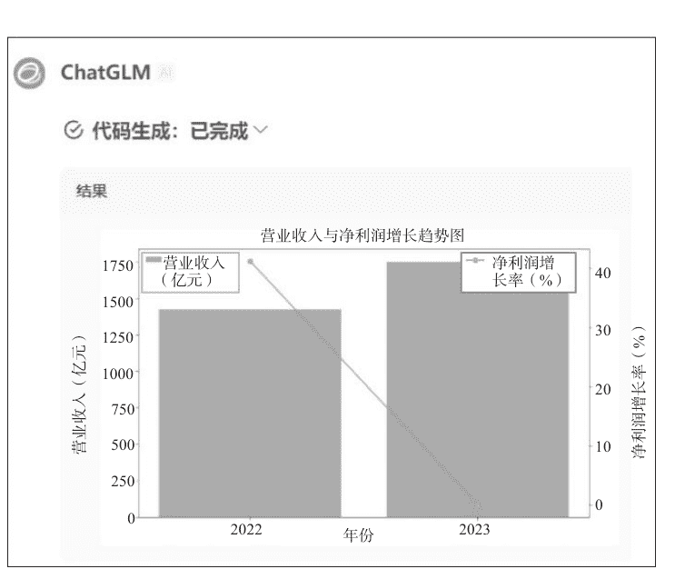

追加说明后重绘的图3-2才具备参考意义，结合DeepSeek的文字即可形成初步汇报材料。

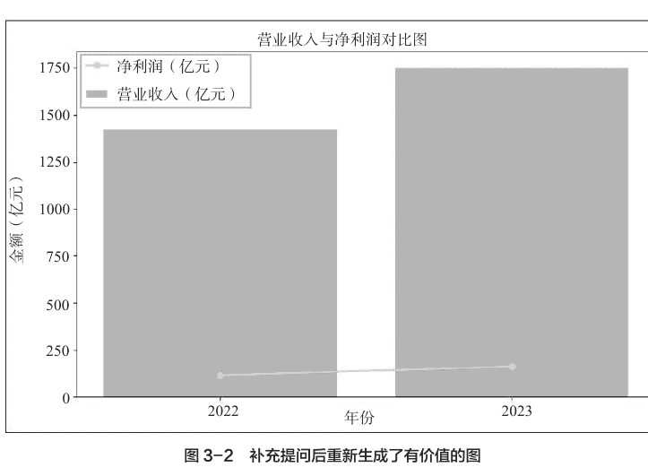

图3-2 补充提问后重新生成了有价值的图

智谱清言生成的第二张图是2022年与2023年的流动比率、速动比率与资产负债率对比图即图3-3，同样需要与DeepSeek此前结论对照核验。

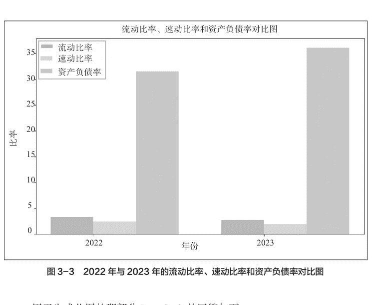

图3-3 2022年与2023年的流动比率、速动比率和资产负债率对比图

用于生成该图的DeepSeek回复如下。

###### 1. 核心指标

- 流动比率：
  流动比率 = $\frac{917.50}{342.12} = 2.68 \quad (2023 \text{年})$
  较2022年的3.27有所回落，流动性仍属健康。

- 速动比率：
  速动比率 = $\frac{917.50-241.13}{342.12} = 1.98 \quad (2023 \text{年})$
  同比小幅下滑，2022年为2.44。

- 资产负债率：
  资产负债率 = $\frac{461.54}{1277.67} \times 100\% = 36.1\% \quad (2023 \text{年})$
  同比抬升，2022年为31.5%，仍处安全区间。

###### 2. 趋势与风险

- 负债总额增长44.8%，2023年461.54亿元，2022年318.80亿元，主因短期借款增加，2023年26.98亿元，2022年15.90亿元，以及应付账款增加，2023年115.93亿元，2022年72.91亿元。
- 非流动负债中长期借款保持稳定在61.07亿元，租赁负债上升，2023年6.92亿元，2022年4.80亿元。

###### 3. 可视化图表


（注：柱状图用于对比2022年与2023年的流动比率、速动比率和资产负债率。）

如图3-4所示，若要返回之前会话，可在智谱清言界面左下角找到历史对话入口。大多数AI平台都支持恢复历史会话。

98 ————— DeepSeek 财税一本通

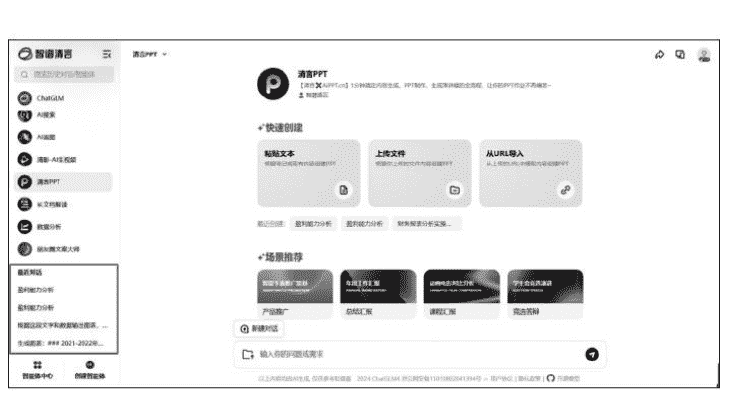

图3-4 左下角找回历史对话

回到历史对话后，可看到智谱清言输出的第三张图，即应收账款与存货周转率趋势图即图3-5。

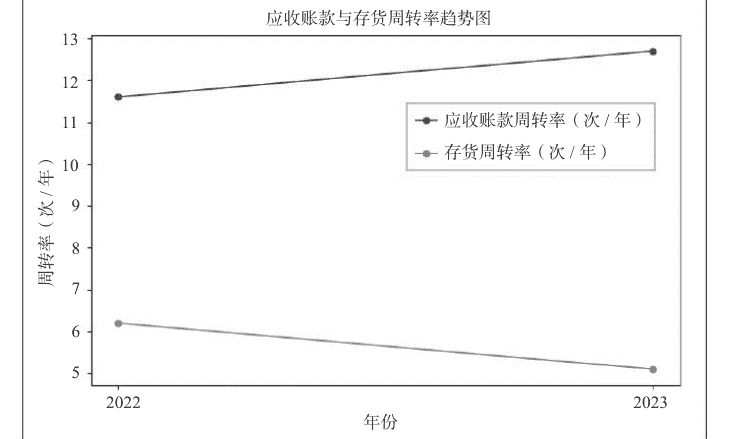

图3-5 应收账款与存货周转率趋势图

用于生成该图的DeepSeek回复如下。

###### 运营能力分析

####### 核心指标

- 应收账款周转率：
  应收账款周转率 = $\frac{1750.72}{(152.78+122.24)/2} = 12.7$ 次/年 (2023年)
  同比提升，2022年为11.6次/年。

- 存货周转率：
  存货周转率 = $\frac{988.53}{(241.13+147.98)/2} = 5.1$ 次/年 (2023年)
  同比下降，2022年为6.2次/年，需关注库存积压风险。

- 总资产周转率：
  总资产周转率 = $\frac{1750.72}{(1277.67+1013.19)/2} = 1.53$ 次/年 (2023年)
  效率保持稳定。

对照表述会发现图中未体现总资产周转率，因为DeepSeek未给出2022年该指标，无法作图。可先让DeepSeek补算2022年总资产周转率，再把数值提供给智谱清言，要求其在第三张图上补上总资产周转率折线。

DeepSeek提供的2022年总资产周转率计算过程如下。

###### 2022年总资产周转率计算过程

1. 公式
   总资产周转率 = $\frac{营业收入}{平均总资产} = \frac{营业收入}{\frac{期初总资产 + 期末总资产}{2}}$

2. 数据抽取
   - 2022年营业收入（调整后）：1425.05亿元，来源于工作表1。
   - 2021年末总资产（调整后）：847.47亿元。
   - 2022年末总资产（调整后）：1013.26亿元。

3. 计算平均总资产
   平均总资产 = $\frac{847.47 + 1013.26}{2} = 930.37$亿元

4. 计算总资产周转率
   总资产周转率 = $\frac{1425.05}{930.37} \approx 1.53$ 次 / 年

结论：
2022年总资产周转率为 **1.53 次 / 年**，公司每1元总资产约创造1.53元收入，资产运营效率较高，且与2023年的1.53次/年持平。

多数AI模型在同一会话里存在记忆上限，随着轮次增加会遗忘前期内容。如何判断是否遗忘？例如在向智谱清言补充2022年总资产周转率后，图表虽已绘制，但在文字说明中即图3-6却写道：“请注意，应收账款周转率和存货周转率的数据是假设的，仅用于示例。”这说明模型已遗忘此前提供的数据，需重新补充。

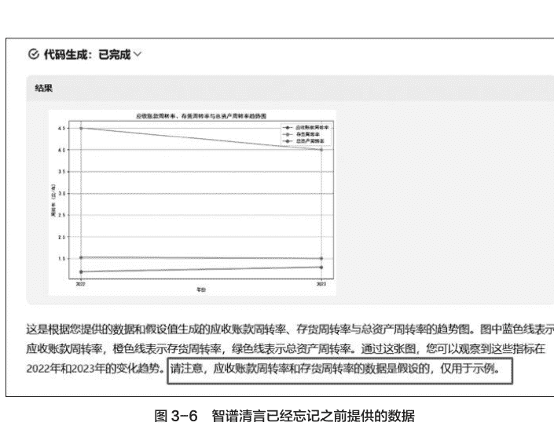

图3-6 智谱清言已经忘记之前提供的数据

补充数据后，智谱清言重新绘制了应收账款周转率、存货周转率与总资产周转率趋势图即图3-7，该图即可使用。

借助DeepSeek完成核心财务指标的一键生成后，财务人员便拥有了剖析企业财务状况的有力抓手。在此基础上，DeepSeek还能进一步产出全面且具决策价值的深度财务分析报告，为管理层提供高水准支持。

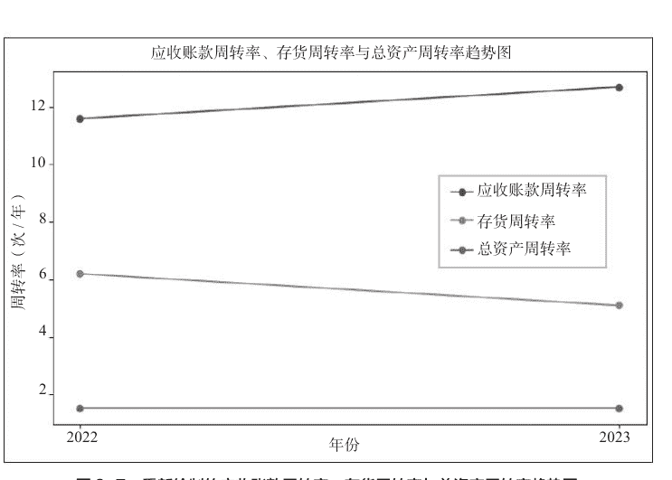

图3-7 重新绘制的应收账款周转率、存货周转率与总资产周转率趋势图

### 第二节 多模型协同打造多元财务分析报告

#### 一、以智谱清言生成PPT

延续“跨境电商上市公司年度财务报表分析”场景，可将图文素材提供给智谱清言的“清言PPT”智能体即图3-8。

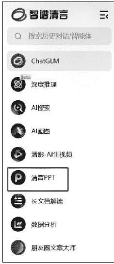

图3-8 “清言PPT”智能体

如图3-9所示，在左下角点开文件夹图标，把刚绘制好的图表上传。

随后在文本框粘贴此前DeepSeek的回复即图3-10。

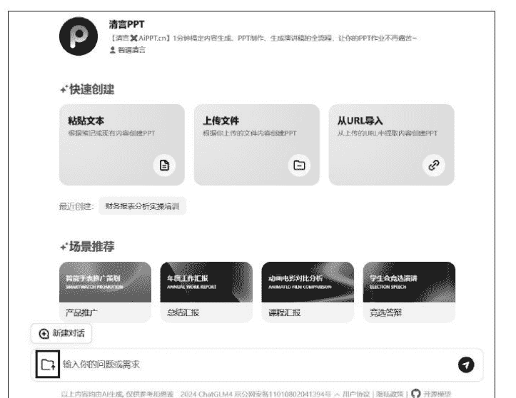

图3-9 上传刚刚绘制的图表

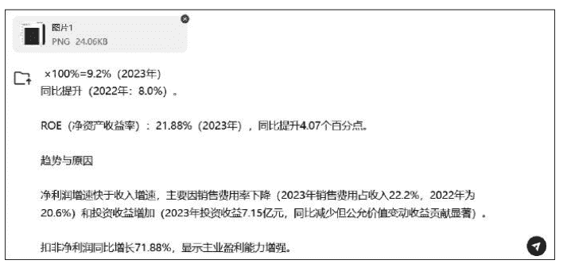

图3-10 在文本框粘贴此前DeepSeek的回答

如图3-11所示，智谱清言会依据接收内容输出提纲，可对提纲进行修改。修改完毕后点右上角的“生成PPT”按钮。

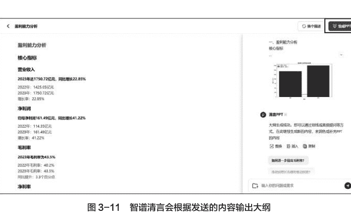

图3-11 智谱清言会根据发送的内容输出大纲

如图3-12所示，可挑选一套合适的PPT模板。

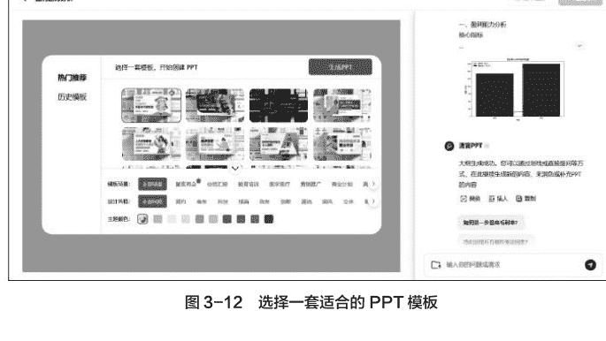

图3-12 选择一套适合的PPT模板

如图3-13所示，智谱清言可依据用户设定的模板场景、设计风格与主题色进行模板推荐。

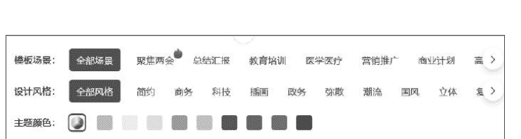

图3-13 根据模板场景、设计风格和主题颜色推荐PPT模版

选定模板后，点右上角的“生成PPT”按钮即图3-14。该过程需等待片刻。

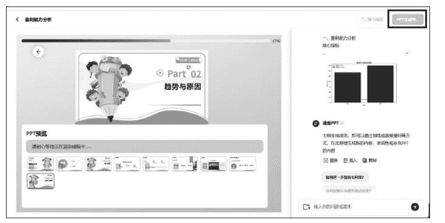

图3-14 选择模板后，点击“生成PPT”按钮

PPT制作完成后页面会提示“PPT制作已完成”。此时可点下方“去编辑”在线修改，也可点右上角“下载PPT”后本地编辑即图3-15。目前多数平台的PPT生成功能需会员权限，如WPS的AI生成PPT也需开通会员，截至2025年3月17日，接入DeepSeek-R1深度思考模型的WPS灵犀网页版生成PPT时无需会员。

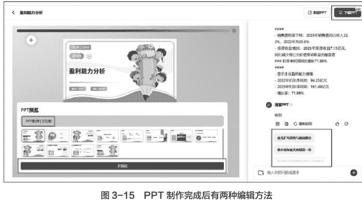

图3-15 PPT制作完成后有两种编辑方法

若对生成结果不满意，可点左下角方框区域查看每张PPT大图，也可在右侧文本框提出改进意见即图3-16。例如笔者发现每页内容过少，发出指令：每页内容太少，看起来不精美，把所有内容集中在一页即可，随后智谱清言给出了新的内容建议。

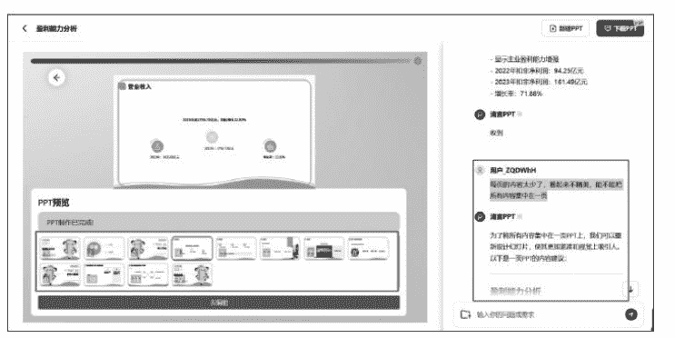

图3-16 进一步查看并改进PPT的方法

#### 二、DeepSeek输出深度总结与建议

若需要Word版的深入分析，可回看DeepSeek给出的全面总结，具体如下。

##### 总结与建议

**优势**

- 盈利能力持续提升，净资产收益率和净利润率均处于行业较高水平。
- 现金流健康，经营活动造血能力强。

**风险**

- 存货周转率下降，需优化供应链管理。
- 负债规模扩大，需关注短期偿债压力。

**投资建议**

- 短期：关注库存去化进度和销售费用控制。
- 长期：依托高净资产收益率和现金流优势，具备持续增长潜力，建议持有或逢低增持。

由此可见，场景设定会影响结论。若作为财务总监关注内部风险，DeepSeek的建议会不同。例如补充提问：如果你是这家公司的财务总监，你认为公司面临的风险和解决方案是什么？

DeepSeek的深度思考如下。

> 需要先回顾已有财务数据，评估公司整体状况。从既往分析可知：1.存货周转率下降，2023年从2022年的6.2次/年降至5.1次/年，可能存在库存积压；2.负债规模扩大，2023年负债总额增长44.8%，短期借款与应付账款增幅明显；3.流动比率与速动比率下降，流动比率从3.27降至2.68，速动比率从2.44降至1.98，短期偿债能力减弱；4.投资活动现金流净流出增加，2023年净流出44.51亿元，主要用于购建长期资产；5.筹资活动现金流净流出，2023年净流出61.32亿元，主要因偿债与分红。作为财务总监，需从中识别主要风险并提出对策，风险包括库存管理不善、债务压力上升、现金流管理风险、盈利质量对非经常性收益的依赖等。需逐项分析并给出可行方案，确保建议切实可行并符合公司战略，同时验证数据准确性与假设合理性，兼顾行业与市场环境。

DeepSeek的回复如下。

## ｜作为财务总监的风险分析与解决方案｜

## 一、主要风险识别

### 1. 库存积压风险

- 表现：2023年存货周转率从6.2次/年降至5.1次/年，库存金额达241.13亿元，同比增长62.9%。
- 影响：占用流动资金，增加仓储成本，可能引发存货减值。

### 2. 短期偿债压力上升

- 表现：流动比率从3.27降至2.68，速动比率从2.44降至1.98；短期借款增长70%，2023年26.98亿元，2022年15.90亿元。
- 影响：市场恶化或现金流波动时可能出现流动性危机。

### 3. 债务结构失衡

- 表现：负债总额增长44.8%，2023年461.54亿元，2022年318.80亿元，其中应付账款增长59%，2023年115.93亿元，2022年72.91亿元。
- 影响：短期负债占比高推升财务成本，增加再融资压力。

### 4. 投资活动现金流出过大

- 表现：2023年投资活动净流出44.51亿元，同比收窄，但累计投资支付达313亿元，主要用于非核心资产扩张。
- 影响：可能分散资源，降低主业投入效率。

### 5. 盈利质量依赖非经常性收益

- 表现：2023年公允价值变动收益18.35亿元，占净利润11.4%。
- 影响：市场波动导致投资收益下滑时，利润稳定性受损。

## 二、针对性解决方案

### 1. 优化库存管理

措施：
实施动态库存监控，根据销售预测调整采购计划；
对滞销品开展促销或折价处理，加速周转；
与供应商协商准时制供货，减少原材料囤积。
目标：2024年存货周转率提升至5.5次/年以上。

### 2. 调整债务结构与融资策略

措施：
将部分短期借款置换为长期低息债券，如发行5年期公司债；
延长应付账款账期，与核心供应商签订战略合作；
利用经营性现金流优势，提前偿还高利率债务。
目标：2024年流动比率恢复至2.8以上，财务费用率降低0.5个百分点。

### 3. 强化现金流管理

措施：
建立现金流压力测试模型，预留至少3个月营运资金缓冲，约200亿元；
限制非战略性投资，优先保障主业研发与产能升级；
优化股利分配政策，留存更多利润用于偿债与再投资。
目标：2024年自由现金流净额同比提升15%。

### 4. 提升盈利质量与可持续性

措施：
加强主业盈利能力，将销售费用率从22.2%压缩至20%以内；
控制金融资产投资规模，限制非主业衍生品交易；
推动高毛利产品线扩张，进一步提升毛利率。
目标：2024年扣非净利润占比从79.5%提升至85%以上。

## 三、长期战略建议

### 1. 数字化转型

引入AI驱动的财务预测系统，实时监控库存、现金流及偿债指标；
通过区块链技术优化供应链金融，降低应付账款融资成本。

### 2. ESG整合

将ESG指标纳入财务决策，如发行绿色债券替换高碳负债，提升融资优势。

### 3. 全球化风险管理

对冲外汇与大宗商品价格波动风险，如利用远期合约锁定原材料成本。

## 四、预期成效

短期1年内：流动性压力缓解，库存周转回升，财务成本下降。
中期2—3年：债务结构优化，主业盈利稳定性增强，净资产收益率维持在20%以上。
长期5年：成为行业现金流管理标杆，具备抗周期波动能力。

## ｜ 总结 ｜

分析质量由场景设定决定

精细化运营配合债务重构与战略聚焦，能够帮助企业在可控风险下实现长期增长。财务负责人需要定期把关键指标的进展通报董事会，并根据市场变化快速调整对策。

由此可见，提问时设定的业务背景、输出目标和具体要求，会直接影响财务分析的结论和呈现方式。

换一个前提，可以这样提问：假设你是资深证券研究员，需要为该公司撰写一份篇幅超过两千字的财务分析报告，并覆盖以下要点。

- **指标穿透解读**：避免单纯罗列数字，要对指标进行深度拆解。以净利率为例，除呈现数值外，还应与行业平均及公司历史进行横向纵向对比。若当期净利率低于行业均值，需探查背后成因，例如成本失控、定价不合理或市占率下滑等，帮助管理层看清行业位置与盈利趋势。
- **财务全景呈现**：立体展示资产、负债和所有者权益。资产端要说明各构成变化逻辑，如固定资产增减是否契合扩张计划，存货规模是否合理。负债端要评估债务结构，包括短长期债务占比与到期分布，以判断偿债压力和债务风险。权益端要分析变动来源，如留存利润或股东增资的影响。
- **现金流拆解**：现金流是企业造血功能，需重点剖析。既要列出经营、投资、筹资三类活动的净现金流，也要评估质量。通过经营现金流与净利润对比验证盈利含金量，若经营现金长期低于净利润，可能反映应收回收困难或存货积压，需发出预警。同时要做前瞻推演，为资金规划提供依据。
- **风险评估与预警**：基于各项指标识别财务风险，如流动性风险、偿债风险、盈利风险。当资产负债率偏高且流动比率走弱时应及时预警，并提出针对性应对方案，帮助企业提前防范。

模型对该提问的内部推演大致如下。

> 用户希望以资先证券研究员身份，结合Excel数据、既往对话和搜索结果，撰写超两千字的深度报告，涵盖指标解读、全景呈现、现金流与风险预警。先回顾工作表1至4的营收、净利润、总资产、负债等核心数据，并把此前计算的总资产周转率与风险判断整合进来。随后借助搜索结果中关于总资产周转率口径与意义的说明，为指标解释提供理论支撑。指标部分将公司指标与行业均值对照，分析净利润增长来自成本控制还是收入驱动，并引用销售费用率变化等。全景部分结合工作表2的流动与非流动资产变动研判配置合理性，结合短期借款、应付账款增长及流动比率、速动比率变化评估偿债能力。现金流部分利用工作表4分析三类现金流净额，重点对比经营现金流与净利润，例如2023年经营现金净额142.99亿元、净利润161.49亿元，计算净现比并评估回收质量。风险预警部分识别流动性、偿债、盈利风险，如流动比率下滑、短期债务上升、存货周转放缓等，并引用先前提出的优化库存、调整债务结构等对策。整体保持结构清晰、数据支撑充分。

模型输出如下。

## ｜××公司2023年度财务深度画像｜
基于2022—2023年财务数据及行业对标

## 一、核心指标深度拆解

##### 1. 盈利能力
- 2023年归母净利率9.2%，即161.49亿元/1750.72亿元，较上年提升1.2个百分点，2022年为8.0%，高于行业均值8.5%。驱动主要来自成本管控与非经常性收益。
- 成本端：营业成本占收入比例由2022年61.3%降至56.5%，即988.53亿元/1750.72亿元。
- 非经常性贡献：公允价值变动收益18.35亿元，占净利润11.4%，波动性需警惕。
- 净资产收益率2023年21.88%，同比提高4.07个百分点，显著高于行业均值18%，股东回报能力强劲。

### 2. 运营效率
- 总资产周转率2023年1.53次/年，即1750.72亿元/1145.43亿元，与2022年持平，但低于行业均值1.8次/年，资产扩张未完全转化为营收。
- 存货周转率由2022年6.2次/年降至5.1次/年，存货规模大幅增加62.9%至241.13亿元，库存积压风险上升。

### 3. 偿债能力
- 流动比率由3.27降至2.68，速动比率由2.44降至1.98，短期偿债压力加大，但仍高于行业警戒线流动比率<2。
- 资产负债率由31.5%升至36.1%，主要受应付账款增长59%即115.93亿元驱动，债务结构偏短期，需改善长期融资。

## 二、财务状况全景呈现

### 1. 资产结构
- 2023年流动资产合计917.50亿元，占总资产71.8%，同比提升11.2%，主要来自货币资金206.53亿元与存货241.13亿元的增长。
- 非流动资产中长期股权投资51.71亿元和递延所得税资产36.79亿元占比提升，反映战略投资与税务优化增强。

### 2. 负债与权益
- 债务结构：短期借款增长70%至26.98亿元，应付账款增长59%至115.93亿元，短期偿债压力显现；长期借款稳定在61.07亿元，租赁负债增加44%至6.92亿元。
- 所有者权益：归母净资产799.99亿元，同比增长16.9%，主要由未分配利润433.22亿元积累驱动，留存盈利能力较强。

## 三、现金流分析

### 1. 现金流质量
- 经营活动现金流：2023年净额142.99亿元，与净利润匹配度较高，净现比0.88，但应收账款周转率仅12.7次/年，需警惕赊销放宽。
- 投资活动现金流：净流出44.51亿元，同比收窄，主要投向非流动资产313亿元，需评估回报效率。
- 筹资活动现金流：净流出61.32亿元，因偿还债务43.83亿元与分红53.83亿元，体现主动降杠杆意图。

### 2. 流动性展望
- 货币资金206.53亿元可覆盖短期借款26.98亿元约7.6倍，短期流动性缓冲充足。
- 若存货周转持续恶化，预计2024年经营现金流可能减少约20亿元。

## 四、风险评估与预警

### 1. 主要风险
- 流动性风险：流动比率降至2.68，若应收回款放缓或存货滞销，可能出现资金链紧张。
- 偿债风险：短期债务占比升至73.8%，即342.12亿元/461.54亿元，2024年到期压力较大。
- 盈利波动风险：非经常性收益占比11.4%，金融市场波动下净利润或下滑10%—15%。

### 2. 对策建议
- 短期：加速库存去化，目标2024年存货周转回升至5.5次/年以上；发行5年期公司债置换高息短期借款，降低财务费用率0.5个百分点。
- 长期：推进数字化转型，引入智能库存系统提升运营效率；优化产品结构，将高毛利产品占比由43.5%提升至45%。

## 五、行业对标与战略建议

### 1. 行业对比
- 总资产周转率1.53次/年低于行业均值1.8次/年，资产使用效率待提升。
- 净资产收益率21.88%高于行业均值18%，股东回报领先，但盈利质量需保持。

### 2. 战略建议
- 聚焦主业，收缩非核心投资，70%资本开支投向研发与产能升级。
- ESG融合，发行绿色债券置换高碳负债，降低融资成本并提升品牌价值。

结论：××公司盈利与现金流管理表现良好，但存货堆积与短期债务压力需重点关注。建议通过债务结构优化、库存精细化管理与主业聚焦，巩固行业领先并增强抗风险能力。

数据来源：公司财务报表2022—2023年、行业研究、图表分析。
注：以上分析基于公开数据及假设，具体决策需结合管理层补充信息。

若对分析深度仍不满意，可进一步明确需求。例如笔者追加提问：请用杜邦分析体系深化解读。

模型的深化推演如下。

> 需以杜邦体系拆解净资产收益率，核心公式为净利率乘以总资产周转率再乘以权益乘数，深入解释盈利、周转与杠杆的贡献。首先确认净资产收益率计算口径，2023年归母净利润161.49亿元除以归母净资产799.99亿元约为20.19%，报告中21.88%可能采用平均净资产。分解后净利率约9.22%，总资产周转率1.53次/年，权益乘数1.54。计算验证21.7%与报表口径基本一致。随后分析三要素变化与行业对比。净利率由2022年8.0%提升至2023年9.22%，受益于成本下降与投资收益，但非经常性收益可持续性存疑。总资产周转率稳定但低于行业均值1.8次/年，受存货与应收拖累。权益乘数由2022年约1.48升至2023年1.54，杠杆温和抬升但仍可控。最后据此提出提升周转、优化盈利质量与调整杠杆结构的改进方向。

模型输出如下。

## ｜××公司杜邦分析解读 2023年度｜

## 一、杜邦核心公式
净资产收益率 = 净利润率 × 总资产周转率 × 权益乘数

## 二、2023年分解

### 1. 净利润率
净利润率 = 归母净利润 / 营业收入 = 161.49亿元 / 1750.72亿元 = 9.22%
驱动：营业成本率下降至56.5%，公允价值变动收益18.35亿元占净利润11.4%。风险点在于非经常性收益占比偏高。

### 2. 总资产周转率
总资产周转率 = 营业收入 / 平均总资产 = 1750.72亿元 / ((1277.67+1013.26)/2) = 1.53次/年
行业对比低于1.8次/年。瓶颈为存货周转率由6.2降至5.1，应收账款周转12.7次虽改善但依赖赊销。

### 3. 权益乘数
权益乘数 = 平均总资产 / 平均所有者权益 = 1145.47亿元 / ((799.99+684.33)/2) = 1.54
财务杠杆同比微升，2022年约1.48，负债扩大但风险可控。短期债务占比73.8%，需优化长期融资比例。

### 4. 综合结果
净资产收益率 = 9.22% × 1.53 × 1.54 = 21.7%，与报表21.88%基本一致。

## 三、趋势与对标
表 1 2022—2023年杜邦关键指标趋势及行业对标

| 指标 | 2023年 | 2022年 | 行业均值 | 结论 |
| :--- | :--- | :--- | :--- | :--- |
| 净利润率 | 9.22% | 8.0% | 8.5% | 盈利领先但依赖非经常性收益 |
| 总资产周转率 | 1.53次/年 | 1.53次/年 | 1.80次/年 | 资产效率不足拖累ROE提升 |
| 权益乘数 | 1.54 | 1.48 | 1.60 | 杠杆温和债务结构需优化 |
| 净资产收益率 | 21.7% | 18.1% | 16.3% | 股东回报显著优于行业 |

## 四、问题与改进
1. 提升总资产周转率
- 短期：加速存货去化，目标2024年存货周转回升至5.5次/年，减少库存约30亿元；收紧应收政策，周转提升至13.5次/年以上。
- 长期：数字化转型，引入智能驱动供应链系统；优化固定资产，淘汰低效产能。

2. 优化盈利质量
- 降低非经常性收益依赖，扣非净利润占比由79.5%提升至85%；
- 聚焦高毛利产品，毛利率由43.5%提升至45%。

3. 调整杠杆结构
- 发行5年期公司债置换高息短期借款，短期债务占比降至60%以下；
- 延长应付账期，与核心供应商签战略合作。

## 五、风险预警
- 总资产周转持续低于行业均值，ROE或回落至20%以下。
- 短期债务集中到期，财务费用率可能上升0.3—0.5个百分点。
- 非经常性收益缩水，净利润或减少10%—15%。

总结：通过杜邦拆解可知，ROE提升主要靠净利润率改善，总资产周转停滞成为瓶颈。未来需以精细化运营提升效率、优化债务结构、强化盈利质量，来巩固领先地位并实现可持续发展。

注：数据基于2022—2023年报表及行业研究，具体策略需结合管理层决策。

#### 三、WPS生成PPT

WPS内置智能助手可基于文档或大纲生成演示文稿，支持单页或多页输出，还可生成配图或润色稿，相关高级功能需会员开通。仅就单页PPT生成而言，WPS相较智谱清言操作更便捷，无需下载插件，直接在文档内完成，选择也更丰富。

如图3-17所示，点击WPS AI中的“AI生成PPT”入口。

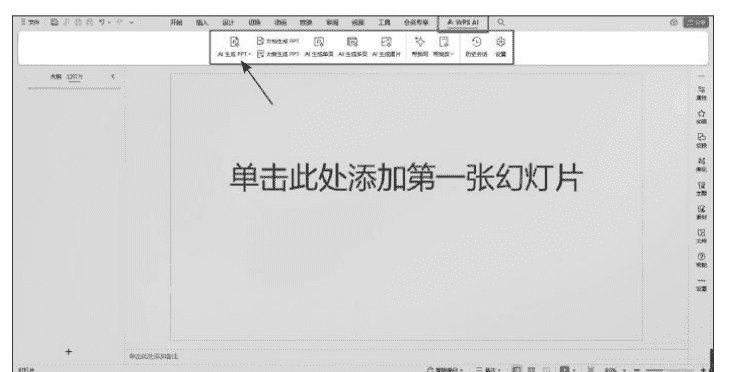

如图3-18所示，生成方式有三种：输入内容、上传文档、粘贴大纲。笔者因模型提供的是具体内容而非大纲，且字数较多，WPS输入内容上限1500字，而上传文档可支持至20000字，故将内容复制到Word保存后上传。


如图3-19所示，PPT配图来源可选图库配图、智能生成图片与智能模式。

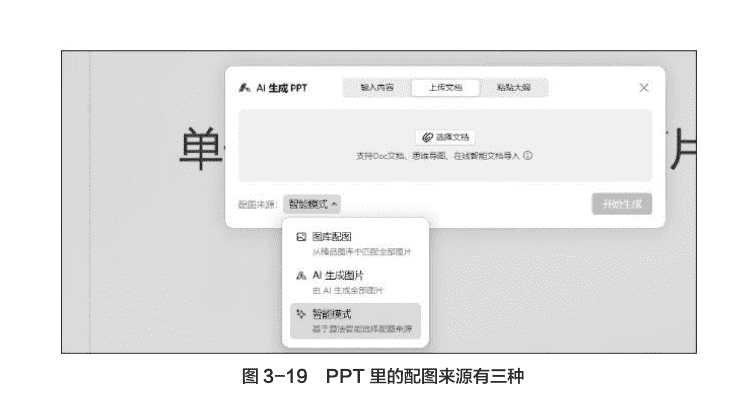
图 3-19 PPT配图来源三种分类
上传材料后系统弹出润色与原样保留的选择，本次操作选用智能润色。
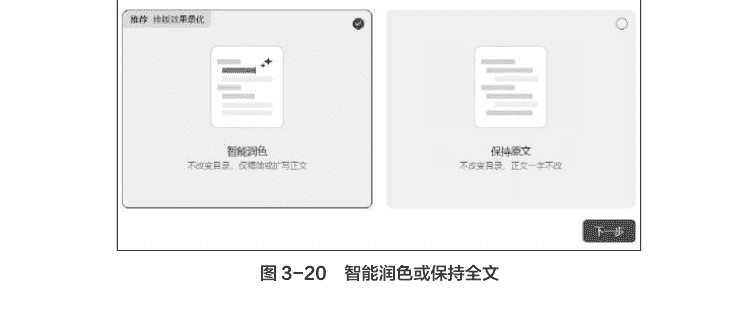
图 3-20 润色或保留原文的切换
点按下一步，WPS AI 自动产出幻灯片概要，如图 3-21 所示，概要支持手动编辑。
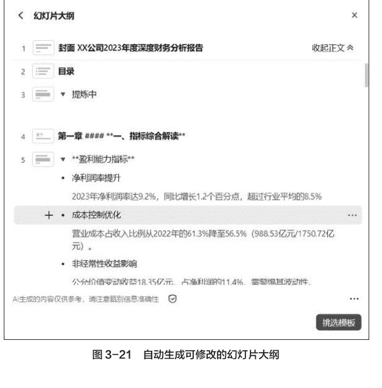
图 3-21 可修改的自动生成大纲
接着进入模板选择界面，如图 3-22 所示，确定模板后点击右下角创建幻灯片即可。PPT 生成完毕，可打开浏览并修改各页内容，如图 3-23 所示。
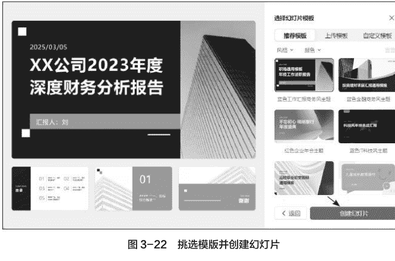
图 3-22 模板挑选与生成操作
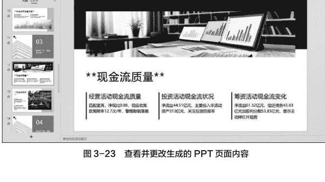
图 3-23 生成稿的预览与编辑

#### 四、财务分析提效路径与价值
整体而言，高效开展财务分析可以概括成怎样的推进路线？

##### 1. 具体步骤
第一步，把财务数据导入工具，并明确期望输出的分析指标。若未事先指定，模型通常会自动给出盈利、偿债、周转等常规指标，先行计算。
第二步，对指标进行可视化呈现。这一环节在前章已有介绍，本章作再次应用。
第三步，形成分析成果。以跨境电商上市公司年度报表分析为例，文中演示了如何借助各类 AI 工具一键制作演示文稿，也演示了直接让模型输出文字版分析报告的方式。

为帮助记忆指标自动化与报告自动输出的要点，整理成口诀：
> 财务分析先导入，指标不清用常见。
盈利偿债再周转，初算结果供调整。
指标别只堆数字，图表呈现更直观。
最后报告要落地，AI 生成 PPT 快。
文字报告也可行，DeepSeek 直接就能写。

##### 2. 对经营决策的关键作用
（1）战略决策支撑
系统化的财务分析为企业制定战略提供依据。管理层可借此洞察自身优劣势及行业竞争态势，制定更符合实际的发展方向。例如分析显示某业务盈利强劲且市场地位突出，可考虑加大投入推动扩张；反之，若某业务长期亏损前景不明，则可考虑收缩或退出。
（2）预算与资源配置优化
依托深度分析，企业能更审慎编制预算并优化资源投放。报告中的预测与趋势判断，帮助管理层合理设定营收目标、成本管控目标和资金需求。结合各业务线和项目的财务表现，可优先将资源投向回报更高的领域，提升整体使用效率。
（3）风险预警与危机应对
报告中的评估与预警，能让企业及早捕捉潜在财务风险并提前准备应对方案。面对市场波动或宏观环境变化，企业可迅速反应，采取有效措施避免财务危机。例如预警提示流动性紧张时，管理层可提前安排融资、调整资金结构，保障资金链安全。

# 第四章
## DeepSeek 税务导航：申报优化指引

### 第一节
## 风险指标如何设定
在税务环境多变的情况下，企业很容易暴露合规风险。DeepSeek 借助科学的风险指标设定，帮助企业搭建税务风险预警机制，提前识别问题、及时处置，保障稳健经营。

#### 一、场景：税务风险指标预警分析
在 DeepSeek 中延续第三章的最近一次对话，可以继续追问：“请对该公司做税务风险预警，重点覆盖税负率与发票风险。”由于是延续提问，无需重新设定场景，再设场景容易被模型误判为新会话。

在看模型回复前，先厘清两个核心指标。
税负率指标：税负率是衡量企业税负水平的指针。增值税税负率等于当期应缴增值税额除以当期应税销售额。以某制造企业为例，若其增值税税负长期低于同业均值，可能暗示进项抵扣异常或收入确认滞后。企业所得税税负率反映一段时期内企业所得税负担，若盈利上升而税负率大幅下降，可能存在费用列支不实。
发票风险指标：发票是税务管理的核心凭证。开具异常率可用作废发票加红字发票除以总开具量计算，若比例偏高，可能存在随意开票或虚开发票嫌疑。取得异常率关注取得发票的合规性，如抬头错误、内容与业务不符等。频繁取得与主营业务无关的发票，可能涉及虚增成本，带来税务风险。

DeepSeek 的内部推演如下。
> 需要为用户提供该公司的税务风险预警，聚焦税负率与发票风险。先从税负率入手，测算增值税税负率和企业所得税税负率并与行业均值对比。增值税税负率是应纳增值税除以应税销售收入，需确认收入口径是否需要调整。企业所得税税负率是所得税费用除以利润总额，需核查利润与税负变化是否一致。发票风险涉及开具异常率和取得异常率。报表中没有直接发票数据，可通过应收账款周转、存货周转等间接推断，并关注税务附注中的争议或调整事项。主要难点是数据缺失，增值税和企业所得税的具体金额需从附注提取，若附注缺失需做假设估算。行业均值获取也存在难度，需基于公开信息合理假设。所有假设需明确说明，建议实际操作时参考详细税务资料。最终以清晰结构呈现指标测算、行业对比、风险点及改进建议。

针对税负率的分析，DeepSeek 的回答如下。
##### 一、税负率指标分析
###### 1. 增值税税负率
增值税税负率 = \frac{\text{当期应纳增值税}}{\text{应税销售收入}} \times 100\%
- ◆ 数据提取
  - 应税销售收入 近似值：营业收入 1750.72 亿元，假设全部应税。
  - 当期应纳增值税：按利润表税金及附加中增值税部分估算，2023 年税金及附加 9720.90 万元，假设增值税占比 60%，约为 5832.54 万元。
- ◆ 计算结果：
  增值税税负率 = \frac{0.5833 \text{ 亿元}}{1750.72 \text{ 亿元}} \times 100\% \approx 0.033\%
- ◆ 行业对比：制造业增值税税负率行业均值约 2%—3%，公司税负率明显偏低。
- ◆ 风险点
  - 进项税额抵扣异常：可能存在虚开或不合规进项发票，如大额关联交易或异常供应商。
  - 收入确认延迟：收入未及时申报，或通过账期调节应税收入。

###### 2. 企业所得税税负率
企业所得税税负率 = \frac{企业所得税费用}{利润总额} \times 100\%
- ◆ 数据提取
  - 利润总额：2023 年 181.25 亿元。
  - 所得税费用：2023 年 11.86 亿元。
- ◆ 计算结果：
  企业所得税税负率 = \frac{11.86}{181.25} \times 100\% \approx 6.54\%
- ◆ 行业对比：制造业企业所得税税负率行业均值约 15%—20%，公司税负率明显偏低。
- ◆ 风险点
  - 成本费用列支不实：可能存在虚增成本或滥用税收优惠。
  - 关联交易转移利润：通过关联方交易将利润转至低税率主体。

需要说明的是，年度报表中并无增值税数据，上述增值税税负率系假设增值税占税金及附加 60% 估算而来，数据不准确，若无年报更详细信息不可采信。
企业所得税税负率采用所得税费用除以利润总额，该口径与税务局通常以全年实缴企业所得税为分子的方法不一致。若报表中提供当期所得税费用且无欠缴缓缴，采用当期所得税费用计算更能反映实际风险。
假设该公司所得税费用全部为当期所得税费用，即递延所得税为 0，则对比仍有问题，因跨境电商行业不等同于制造业。可补充提问：该企业为跨境电商，非制造业，请重新分析企业所得税税负率。

DeepSeek 的回答如下，计算过程与前文一致，此处略。
##### 二、行业对标与修正分析
###### 1. 跨境电商行业税负率特征
- ◆ 税收优惠政策：跨境电商企业可能享受
  - 高新技术企业税率 15%；
  - 区域性优惠如自贸区、综试区减免；
  - 研发费用加计扣除最高 100%。
- ◆ 跨境利润转移：通过境外子公司或关联交易将利润转移至低税率国家或地区，如新加坡。
- ◆ 行业均值参考：公开数据显示跨境电商行业企业所得税税负率通常为 8%—12%，低于传统制造业的 15%—20%。
###### 2. 修正后对标结论
- 公司税负率：6.54%。
- 行业均值：8%—12%。
- 风险判断：税负率仍明显低于行业均值，需进一步排查风险。

##### 三、潜在税务风险分析
###### 1. 成本费用列支不实
- 表现：
  跨境电商常以虚拟服务费、境外仓储费等名义虚增成本；
  研发费用 141.39 亿元，占收入 8.1%，若归集不合规，可能滥用加计扣除。
- 影响：虚增成本导致应纳税所得额下降，税负率被人为压低。
###### 2. 跨境利润转移
- 表现：
  长期股权投资 51.71 亿元中若涉及境外低税率主体；
  关联交易定价不合理，如向境外子公司支付高额特许权使用费。
- 影响：通过转让定价转移利润。
###### 3. 税收优惠滥用
- 表现：
  若享受高新技术企业税率 15%，需满足研发费用占比≥3%、科技人员占比≥10%等条件；
- 影响：资质不达标仍享受优惠，可能面临补税与处罚。

##### 四、风险验证与应对建议
###### 1. 数据验证
- 成本真实性核查：
  对单笔超 500 万元的平台服务费、物流费进行穿透式审计，核验合同、发票与资金流一致性；
  抽查研发项目立项报告与费用归集凭证，确保符合《高新技术企业认定管理办法》。
- 跨境交易合规性：
  提供转让定价文档，证明关联交易定价符合独立交易原则；
  核查境外子公司实际功能与利润分配是否匹配。
###### 2. 应对建议
- 短期行动：
  对异常成本费用自查调整，补缴税款及滞纳金；
  向税务机关提交《跨境交易定价说明报告》，降低稽查风险。
- 长期策略：
  建立税务合规管理体系，引入第三方定期审计；
  优化全球税务架构，通过合法途径降低税负，如申请税收协定优惠。

##### 五、修正后风险等级评估
修正后的风险等级评估表如表 1 所示。
表 1 修正后的风险等级评估表
| 风险类型 | 风险等级 | 依据 |
| :--- | :--- | :--- |
| 成本费用虚增 | 高危（★★★） | 税负率 6.54% 显著低于行业均值 8%—12%，隐含虚增成本或滥用加计扣除 |
| 跨境利润转移 | 中危（★★☆） | 长期股权投资涉及境外主体，需验证转让定价合规性 |
| 税收优惠合规性 | 中危（★★☆） | 研发费用占比 8.1% 高于政策门槛，但需确保归集真实性 |

## 总结
> 尽管跨境电商行业税负率普遍低于制造业，但 × × 公司 6.54% 的税负率仍显著低于行业均值 8%—12%，核心风险集中于成本列支真实性与跨境交易定价合理性。建议优先对大额成本费用采取穿透式审计，并完善跨境税务文档，以规避补税及行政处罚风险。
以上税务风险分析可供参考。可见在跨境电商行业，公司税负率虽偏低，但偏低幅度较制造业对比更为明显，且可能存在递延所得税，风险有所下降。

针对发票风险指标的分析，DeepSeek 的回答如下。
#### 发票风险指标分析
##### 发票开具异常率
发票开具异常率 = \frac{作废发票数 + 红字发票数}{总开具发票数} \times 100\%
- ◆ 数据推断 基于财务报表的间接指标：
  - 应收账款周转率：2023 年 12.7 次/年，同比提升，但若收入增长与应收账款增速不匹配，2023 年应收账款 152.78 亿元，2022 年 122.24 亿元，可能存在通过虚开发票提前确认收入。
  - 存货异常增长：存货同比增长 62.9%，达 241.13 亿元，若与开票量不匹配，可能涉及虚开采购发票套取资金。
- ◆ 风险点：
  - 虚开发票嫌疑：若存货与应付账款同步异常增长，应付账款 115.93 亿元，同比增长 59%，可能涉及虚假交易虚增成本。

在发票风险分析中，报表并无发票直接数据，但 DeepSeek 凭借强大推理能力，基于应收账款周转率与收入增长的匹配度、存货增长率与开票量增长率的匹配度进行了分析，但未给出结论，仅提示风险疑点。基于此，可补充提问：在发票风险部分，你提到应收账款周转率增长与收入增长的匹配情况，以及存货增长率与开票量增长率的匹配情况，但未给出是否匹配的结论，能否计算收入增长率和开票量增长率，假设开票量与收入一致即所有收入均为增值税应税收入，以此判断与对应指标增长是否匹配，并得出能否消除风险疑点的结论。

DeepSeek 的深度思考如下。
> 用户要求计算收入增长率和开票量增长率并判断匹配性以评估发票异常风险。首先需明确数据来源，用户提供 2023 年与 2022 年营业收入、应收账款、存货等数据，但无开票量具体数值，需合理假设。开票量定义上，用户提出假设所有收入均为增值税应税收入，可将营业收入视为开票量近似值，但需注意营业收入通常为不含税收入，需调整。需分别计算营业收入增长率和开票量增长率并比较差异，若趋势一致则可能匹配，若差异显著则暗示风险。步骤：提取 2023、2022 年营业收入；假设不含税收入需转含税，需假设增值税税率，如 13%；计算两项增长率；对比差异；结合应收账款和存货数据分析风险。可能问题：增值税税率不确定，不同行业税率不同；存货增长与开票量关系需结合采购生产周期与应付账款等分析。假设：所有收入为应税收入；增值税税率假设合理；开票量等于含税收入。初步计算：假设税率 13%，2023 年含税收入≈1750.72×1.13≈1978.31 亿元，2022 年≈1425.05×1.13≈1610.31 亿元。收入增长率≈22.85%，开票量增长率≈22.85%，显示一致。但应收账款增长率≈25.0% 高于收入增长率，存货增长率≈62.9% 远高于收入增长率，可能暗示收入确认提前或虚开采购发票。需补充验证应付账款增长率与现金流购买商品支付的现金是否匹配。最终判断：开票量与收入增长匹配，但应收账款和存货异常增长仍无法完全消除风险疑点。

该思考包含三个假设：所有收入均为应税收入；增值税税率假设合理；开票量等于含税收入。需结合企业实际情况判断合理性，若不合理可补充提问要求修正。如跨境电商企业增值税税率很可能为 0，则增值税税率假设合理需修正。

DeepSeek 的回答如下。
1. 应收账款增长率
$\frac{152.78-122.24}{122.24} \times 100\% \approx 25.0\%$ （显著高于收入增长率）

财务波动背后的票据合规风险简析

关键信号：营收同比上行22.85%，同期客户应收款同期扩张25.0%，增速倒挂往往暗示信用条件被放宽或提前确认收入来做大销售额。

库存扩张测算
(241.13-147.98)/147.98×100%≈62.9%，明显快于营收增速
风险提示：库存增速约为营收增速的2.75倍，需警惕通过虚开采购单据人为放大成本的可能性。

供应商欠款增速测算
(115.93-72.91)/72.91×100%≈59.0%，走势与库存高度同步
风险提示：欠款与库存同时异常攀升，可能暗示编造采购链条、虚开进项发票等操作。

单看首个信号，营收22.85%与应收25.0%的差距不大，可暂不列为重点。但库存增速远超营收，以及欠款随库存同步大幅抬升，则值得高度关注。继续看后续研判。

##### 一、总体研判

###### 1. 表面一致结论
开票数量增幅与营收增幅基本一致，均在22.85%左右，表面口径未见矛盾。

###### 2. 疑点并未完全排除
客户应收款增速快于营收增速：可能利用赊销手段虚增营收，需核查销售合同真实性及回款路径。
库存与供应商欠款同步异常增长：库存周转已降至5.1次/年，若缺乏合理业务扩张解释，易联想到虚开发票套取资金。

###### 3. 仍需进一步核查
采购现金流匹配性：2023年“购买商品支付的现金”1009.40亿元，同比增23.5%，2022年为817.36亿元，与供应商欠款增幅59%难以对应，暗示部分采购款未真实支付，可能存在虚假交易。
库存构成分析：需拆解原材料、在产品、产成品结构，若产成品占比过高且滞销，则进一步佐证虚开嫌疑。

各类风险等级及处理建议见表1。
表1 各类风险的等级和应对措施

| 风险类型 | 风险等级 | 应对措施 |
| :--- | :--- | :--- |
| 营收确认真实性 | 中危（★★☆） | 抽查大额销售合同、物流单据及回款记录，验证营收真实性 |
| 采购交易虚开发票 | 高危（★★★） | 对前十大供应商资质采取“穿透式”审计，核查采购订单、入库单与发票一致性 |
| 库存积压与成本虚增 | 高危（★★★） | 对滞销库存进行减值测试，并追溯采购发票的真实性 |

最终结论：
开票量增速与营收增速在表象上吻合，但客户应收款、库存及供应商欠款的异常变动仍不足以完全消除疑虑。建议优先对采购链条和库存实施穿透式审计，并向税务机关提供完整交易链资料以自证合规。

补充提问的结论至此结束。下面是关于发票风险分析的第二部分输出。

##### 二、取得发票异常率

###### 1. 数据观察
其他应付款项：2023年其他应付款37.73亿元，若其中混杂大量与经营无关的往来款，可能用于接受虚开发票冲抵成本。
研发费用与进项税匹配度：2023年研发费用141.39亿元，若进项税抵扣比例异常，例如大量非技术类票据，则易被稽查关注。

###### 2. 风险点
不合规发票入账：如取得“咨询服务费”“广告费”等大类发票，但缺乏实际业务支撑。

至此往往需要人工进一步排查取得发票的合规性，模型仍给出以下排查方向。

##### 三、其他税务风险线索

###### 1. 税收优惠依赖
若企业享受高新技术企业15%优惠税率，需复核研发费用占营收比重。2023年研发费用占营收比例为8.1%，远高于高新技术企业门槛3%，此前分析称“接近门槛”并不准确，8%与3%差距明显，故该项风险基本不存在。

###### 2. 跨境交易风险
长期股权投资51.71亿元中若涉及跨境关联交易，如向低税率地区转移利润，可能触发转让定价调查。

###### 3. 税务争议披露
财务报表附注未披露重大税务争议，但若存在未披露的税务稽查或补税事项，则构成隐性风险。

补充了高新技术优惠数据合规性、跨境关联交易以及未披露税务稽查等线索。需注意“研发费用占营收8.1%接近高新技术企业门槛3%”的说法缺乏准确性，实际差异较大，不构成实质风险。

##### 四、风险等级评定
风险等级评定如表2所示。
表2 风险等级评估表

| 风险类型 | 风险等级 | 依据 |
| :--- | :--- | :--- |
| 增值税税负率异常 | 高危（★★★） | 税负率0.033%远低于行业均值2%—3%，存在虚抵进项或营收隐匿嫌疑 |
| 企业所得税税负率低 | 高危（★★★） | 税负率6.54%显著低于行业均值15%—20%，可能涉及成本虚增或利润转移 |
| 发票开具异常 | 中危（★★☆） | 客户应收款与库存增速异常，隐含虚开发票风险 |
| 税收优惠合规性 | 中危（★★☆） | 研发费用占比接近政策红线，若数据不实可能丧失优惠资质 |

上述初步评定仍需人工复核，例如增值税税负率计算过程可靠性不足，企业所得税税负率的行业均值依据不足，发票开具异常和税收优惠合规情况也有待核实。

##### 五、应对建议

###### 1. 增值税风险应对
- 立即行动：
  - 全面梳理进项发票来源，排查无真实物流支撑的虚假或不合规发票；
  - 复核营收确认时点，确保纳税义务发生时间与会计准则一致。
- 长期策略：
  - 引入税务管理系统，对进销项匹配及税负波动实现自动化监控。

###### 2. 企业所得税风险应对
- 成本真实性核查：
  - 对单笔超500万元的费用支出实施穿透式审计，验证业务真实性；
  - 关联交易定价需提供转让定价文档，确保符合独立交易原则。
- 优惠政策复核：
  - 确保研发费用归集符合《高新技术企业认定管理办法》，留存备查资料。

###### 3. 发票管理优化
- 内部管控：
  - 建立发票全生命周期管理，自动识别作废、红字及异常抬头发票；
  - 对供应商实施黑白名单管理，限制与高风险企业交易。
- 外部合规：
  - 定期向税务机关报送《发票使用情况自查报告》，降低稽查概率。

###### 4. 跨境交易合规
聘请第三方机构对跨境关联交易进行转让定价评估，确保符合OECD及我国税务机关要求。

以上分析较为宽泛，仅供参考。

#### 二、场景：发票数据分析
分析发票风险时，财务报表并非最合适的数据来源。现以一段进项台账为例，指令为：你是该公司税务经理，请分析发票风险指标。

发票风险指标简述：开具异常率可通过作废发票、红字发票占总开具量的比例衡量，比例过高可能暗示随意或虚开发票。取得异常率关注发票合规性，如抬头错误、内容与业务不符等，企业频繁取得与主营无关的发票可能涉及虚增费用。

鉴于提供的数据不含开具信息，回复如下。

# 发票风险分析报告

##### 一、发票开具异常率分析
统计期内所有发票的“发票状态”及“管理状态”均为“正常”，未见作废或红字记录。
结论：发票开具异常率为0%，暂无异常开具风险。

##### 二、发票取得异常率分析

###### 1. 发票内容与业务相关性
- 合规供应商：多数供应商为建筑、工程、材料类，与房地产建筑行业相关性高，符合经营范围。
- 潜在异常供应商：部分发票来自电子产品、日用品贸易类企业，需核查采购内容是否与主营业务直接相关，避免虚增成本。

###### 2. 发票抬头与税率合规性
- 发票抬头：所有发票纳税人识别号一致，未见抬头错误。
- 税率合规：增值税专用发票税率主要为3%、6%、9%、13%，符合税法，未见异常低税率或计算错误。

###### 3. 特殊项目风险
通行费电子发票税率约3%，符合政策。高额发票集中度方面，单笔超900万元的大额发票需结合合同与业务实质核查真实性。

##### 三、风险等级评估
- 低风险：开票流程规范，无作废或红字发票。
- 中风险：部分贸易类供应商发票需补充采购合同、物流单据等佐证，以排除虚开发票可能。

##### 四、改进建议
- 强化供应商资质审查，对非主营业务相关供应商重点核查，确保业务实质与发票一致。
- 定期抽查高额发票，建立专项审核机制，留存合同、付款凭证及验收文件。
- 加强税率动态监控，确保适用准确，避免税率错误引发争议。

该模型具备基础的发票风险排查能力。

### 第二节 申报流程指引
准确及时完成税务申报是税务合规的关键。该模型可提供申报流程指引。

#### 一、场景：跨境电商集团税务指引
指令示例：我是一家跨境电商集团税务总监，出口业务遍布全国，希望为全国子公司提供统一的增值税与企业所得税申报指引。增值税部分从专票和普票开具与认证开始，涵盖税控系统操作、税率选择、销售额统计、进项税计算与核对要点，指导登录电子税务局填写主表及附表。企业所得税从年度报表编制入手，梳理收入成本费用确认原则，介绍申报表填写流程及纳税调整项目填报依据，要求超过3000字且贴合行业实际，可操作性强。

深度思考如下。
> 国内大语言模型语料来源以国内为主，故能理解“说人话”等口语化表达。

回答如下。
# 跨境电商集团全国子公司税务申报统一指引
（增值税及企业所得税篇）
全文约3500字，贴合跨境电商实际操作，通俗易懂

##### 一、增值税申报全流程操作指引

###### 1. 发票开具与认证管理
####### （1）增值税专用发票与普通发票的开具规范
- 适用场景
  - 专用发票：境内采购、服务购买等可抵扣进项场景。
  - 普通发票：小额零星采购、免税业务、个人消费等不可抵扣场景。
- 开票操作步骤
  - 登录税控软件，选择发票类型，填写购买方信息、货物服务名称、税率、金额。
  - 出口货物税率选0%，备注栏注明出口业务及报关单号。
  - 打印要求清晰，不得压线错格。
- 关键提示：跨境电商出口需在备注栏注明“跨境电商出口”及海关报关单号。

####### （2）进项发票认证与抵扣
- 登录增值税发票综合服务平台，勾选认证，申请统计并确认签名。
- 认证期限为开具后360天内，作废或红冲发票需及时处理。

###### 2. 销售额统计与进项税额计算
- 出口销售额按离岸价计算，与报关单、物流单据一致。
- 内销销售额按含税价换算为不含税价。
- 可抵扣进项税=专用发票税额+海关进口增值税缴款书税额+通行费电子发票税额。
- 用于免税项目的进项需做进项转出。

###### 3. 增值税申报表填写
- 登录电子税务局，选择申报入口。
- 主表第1栏填写内销应税销售额，第7栏填写免抵退出口销售额，第12栏填写进项税额，第14栏填写进项税额转出。
- 附表一按税率分项填写销售额，附表二逐行填报进项数据。
- 校验通过后提交申报。

##### 二、企业所得税申报全流程操作指引

###### 1. 年度财务报表编制要点
- 收入确认按权责发生制，以客户收货或平台结算日为准。
- 多币种收入按交易日汇率折算，年末按期末汇率调整汇兑损益。
- 成本归集包括采购价、关税、到岸前物流费；平台佣金、广告费凭发票入账；国际物流需取得合规运输发票。
- 境外仓储费需代扣代缴增值税6%和企业所得税10%，取得完税凭证后税前扣除。

###### 2. 企业所得税年度申报表填写
- 主表汇总收入、成本、利润总额、应纳税所得额及税款。
- 附表包括纳税调整项目明细表、资产折旧摊销纳税调整明细表、境外所得税收抵免明细表。
- 业务招待费、职工福利费等需按规定进行纳税调整。

指引内容覆盖发票开具、认证、申报表填报及跨境电商特殊处理，形成可操作的标准流程。

# 跨境电商财税指引复盘：修正偏差、规避风险与重构框架

## 第一部分 原版要点梳理

商务接待开支在税前列支时的上限取实际发生额的六成与营业额万分之五两者中的较低者。

- 推算案例：当年营业额1亿元，接待花费100万元。按六成算为60万元，按万分之五算为50万元，最终可列支50万元，剩余50万元须调增应纳税所得额。
- 员工福利支出填列位置为《企业所得税年度纳税申报表》A105000附表第14行，列支上限为工资总额的14%，超出部分调增。

跨境税收优惠适用范围
- 取得高新技术企业认定书的，可适用15%的优惠税率。
- 跨境电商平台自建IT系统的研发投入，可享受100%加计扣除。

线上税务平台报送路径
1. 登录入口：线上税务大厅→我要办税→企业所得税申报入口。
2. 表格填报：
   下载《企业所得税年度纳税申报表A类》模板，离线填写后上传。
   逐表核对主表与附表的勾稽，例如主表应纳税所得额应等于会计利润经纳税调整后的结果。
3. 提交缴款：
   点击申报后系统生成应缴金额，选择缴款方式，常见为三方协议自动扣款。

跨境电商税务管理的特别提示
1. 出口退税：当期申报完成后，需及时在网上税务大厅发起退税申请，报关单、物流凭证、发票等资料须齐全。
2. 关联交易：境内子公司与境外关联方的交易须遵循独立交易原则，合同、定价分析资料需留存备查。
3. 税务稽查关注点
   关注重点：出口业务真实性是否存疑、成本费用凭证是否合规。
   应对做法：建立跨境业务台账，定期将物流与资金支付凭证交叉核对。

一句话总结
> “发票分类开，进项逐笔核；收入据实报，调整莫遗漏；跨境留痕迹，风险自然降。”

注：具体操作需结合各子公司所在地税务机关要求灵活调整。

## 第二部分 上版明显偏差

其一，发票打印的描述已过时。原文提到用针式打印机、避免压线错格，如今已全面推行全电发票，可直接A4纸打印入账，对已实现电子化归档的企业甚至无需打印。

其二，发票认证期限的表述已失效。开具后360天内认证、逾期不可抵扣的规定已取消，这体现了AI在专业领域易混淆历史政策与现行政策的短板。

其三，境外仓储费与境外佣金的代扣代缴表述不准确。是否需要代扣增值税、公司所得税或个人所得税，需依据合同主体、服务发生地及税收协定具体判断，不能一概而论。

此外，跨境电商两大特殊机制，即境外仓离境即征即退和免税商品退运，在原回答中均未涉及，专业深度不足。

操作细节层面仍存在多处可商榷之处，不再逐条列出。若不希望填充专业内容，可直接要求模型仅输出框架。

## 第三部分 用户反馈与模型调整

用户作为税务总监，需为全国子公司制定统一且可操作、篇幅超3000字的申报指引，要求贴合跨境电商实务，用通俗语言表达。先前回复因技术细节过多显得冗长，用户随即要求仅输出框架、不填充专业内容。

模型据此调整方向，由详尽步骤转向结构化大纲，覆盖流转税与公司所得税核心模块，并在跨境场景中加入出口退税、多币种等要素，以简明条目呈现，便于后续填充。

DeepSeek 的输出如下。

# 跨境电商税务申报统一指引框架

## 一、流转税申报指引
1. 发票管理
- 发票类型选择：专用发票或普通发票。
- 开票规范：必填项、税率选择逻辑。
- 出口业务特殊要求：备注栏填写、零税率适用。
2. 系统操作流程
- 税控系统登录与开票路径。
- 进项发票勾选认证操作路径。
3. 数据统计与核对
- 销售额分类统计：内销、出口。
- 可抵扣进项税额计算与异常处理。
4. 申报表填写
- 网上税务大厅入口导航。
- 主表、附表关键栏次说明。
- 数据校验与提交。

## 二、公司所得税申报指引
### 1. 财务报表基础
- 跨境多币种收入确认规则。
- 成本费用归集：采购、物流、平台费用。
### 2. 申报表结构解析
- 主表与附表关联关系。
- 纳税调整项目清单：接待费、福利费等。
### 3. 申报操作步骤
- 网上税务大厅填报路径。
- 离线模板使用与数据导入。

## 三、跨境电商特殊场景
### 1. 出口退税衔接
- 退税申请流程与单证要求。
- 与流转税申报数据联动。
### 2. 跨境税务风险提示
- 常见稽查重点：业务真实性、凭证合规性。
- 应对建议：台账管理、资料留存。

## 四、附则
1. 术语解释：离岸价、进项转出等。
2. 各地税务差异处理。
3. 更新与修订机制。

注：此框架仅明确模块划分，具体内容需结合企业实际业务补充。

## 第四部分 进项清单生成记账凭证场景

指令示例：能否根据进项发票清单生成会计凭证？

模型可给出标准化分录模板，实际应用需根据业务实质调整科目。

# 会计凭证生成示例

##### 1. 采购原材料、工程服务
金额10万元，税额9000元，税率9%。
- 借：原材料/工程施工 100000
- 借：应交税费-应交增值税 进项税额 9000
- 贷：应付账款-供应商A 109000

##### 2. 采购设备、办公用品
金额5万元，税额6500元，税率13%。
- 借：固定资产及管理费用 50000
- 借：应交税费-应交增值税 进项税额 6500
- 贷：银行存款/应付账款 56500

##### 3. 通行费支出
金额1000元，税额30元，税率3%。
- 借：销售费用/运输费 1000
- 借：应交税费-应交增值税 进项税额 30
- 贷：库存现金/银行存款 1030

凭证生成原则：科目匹配、税率区分、附件留存。批量生成建议使用财务软件导入并设置自动匹配规则。

## 第五部分 DeepSeek 在申报关键场景的多元价值

税务风险预警分析：挖掘财务数据，提前提示潜在税务风险。
发票数据分析：解析发票信息，梳理业务脉络。
税务指引生成：基于经营情况生成贴合企业的申报指引。
发票转凭证：实现自动化转换，提升效率。

## 第五章 DeepSeek 未来规划师：助力财务预测

### 第一节 基于历史数据的预测

#### 一、具体预测场景应用
##### 1. 收入预测
结合过往新品市场表现与当前需求趋势，预测新品各阶段收入，并综合现有产品份额变化与价格调整预测整体收入。

##### 2. 成本预测
研究历史成本数据，结合原材料价格波动、供需关系与行业走势预测采购成本；结合薪酬政策与劳动力市场预测人工成本。

##### 3. 现金流预测
基于回款周期、付款周期、投资与筹资活动，预测未来现金流入流出，确保资金链稳定。

#### 二、场景：决策支持可视化
指令：汇报2021—2022经营情况，将财务数据可视化，并以此为依据制定2023—2024年度财务预算并可视化，同时分析费用增长趋势与占比，合理确定预算并优化资源配置。

DeepSeek 的输出如下。

# 2021—2022年经营情况可视化与分析

核心财务指标趋势：
- 营业收入：2021年8261万元 → 2022年8974万元，增长8.6%。
- 净利润：2021年149.8万元 → 2022年-48.7万元，受成本上升影响。
- 费用增长：
  管理费用215.8万元 → 393.7万元，增长82.4%。
  财务费用116.9万元 → 155.6万元，增长33.1%。

图表展示收入、净利润及费用占比变化，为预算制定提供依据。

**2023-2024 年度财务规划与图表解读**

依托历史经营数据与业务发展方向，形成以下预算框架及可视化呈现。

**一、收入与盈利测算**

1. 主营业务收入
2023 年测算值 9,800 万元，预计同比上行 9.2%。
2024 年测算值 10,700 万元，预计同比仍为 9.2%，基于市场平稳的假设。

2. 净利目标
2023 年目标 150 万元，完成由亏转盈，抓手为成本优化。
2024 年目标 300 万元，驱动在于运营效能提高。

**二、费用安排与优化建议**

1. 管理开支
2023 年预算 420 万元，增速约 6.6%，严格压控行政性支出。
2024 年预算 450 万元，增速约 7.1%。

2. 财务开支
2023 年预算 160 万元，与贷款结构优化后基本持平。
2024 年预算 165 万元，属温和抬升。

3. 研发投入 新增科目
2023 年安排 50 万元，用以支撑技术创新。
2024 年安排 80 万元，占比提升至 0.75%。

4. 图表
- 堆叠柱状：2023-2024 两年费用构成，涵盖管理、财务、研发三类。
- 饼状：2024 年费用占比分布。

**三、费用演进与资源投放优化**

1. 管理开支
2022 年增速高达 82.4%，需复核差旅、外包等非必要项。2023 年预算占比降至 4.3%，2022 年为 4.4%，通过数字化手段降低行政成本。

2. 财务开支
优化融资结构争取低息资金，2024 年预算增速控制在 3.1% 以内。

3. 研发投入
新增安排服务于技术升级，着眼长期竞争力，2024 年占比目标 0.75%。

4. 可视化示例
① 趋势图：2021-2024 年营收与净利走向，并标出扭亏节点。
② 瀑布图：2023 年费用预算拆分，体现管理费用压缩与研发新增投入。
③ 雷达图：2024 年费用结构与行业标杆对比。

说明：上述数据建立在历史走势与合理假定之上，建议结合季度滚动预算动态调整。

将 DeepSeek 的输出复制到智谱清言，指令为生成图表。智谱清言首张输出如图 5-1 所示。

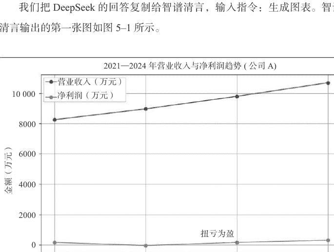

图 5-1 2021—2024 年营业收入与净利润趋势图

图 5-1 呈现公司 A 2021 至 2024 年营收与净利变化，可明显看出 2023 年有望实现由亏转盈。智谱清言第二张输出如图 5-2 所示。

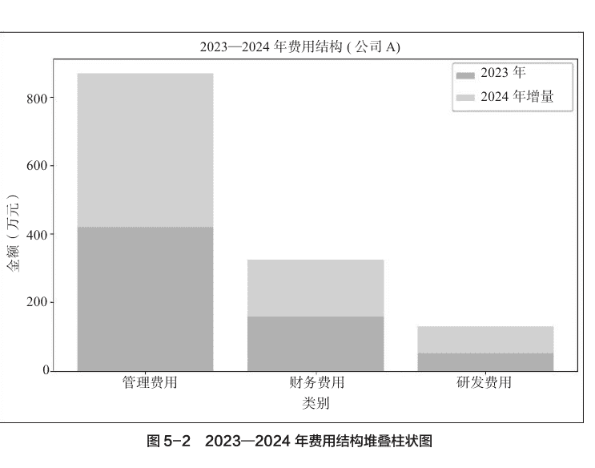

**图 5-2  2023—2024 年费用结构堆叠柱状图**

图 5-2 展示公司 A 2023 年与 2024 年管理费用、财务费用、研发费用的结构演变。第三张输出如图 5-3 所示。

图 5-3 反映公司 A 2024 年各费用类别占比，包含管理、财务、研发及其他。

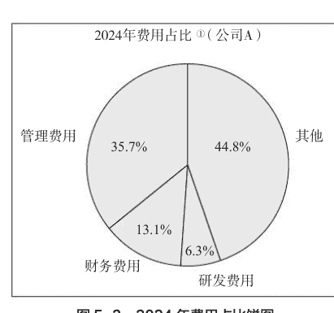

图 5-3 2024 年费用占比饼图

① 图中各费用占比均经过四舍五入处理，因此百分比总和较 100.0% 略有偏差。——编者注

#### 三、场景：坏账准备预计

向 DeepSeek 提交 2018 年 12 月坏账计提表，指令为以总账会计身份推演 2019 年坏账走势。

DeepSeek 深度思考要点：
先核对多张工作表的坏账数据与公式，厘清合并终稿调整后、母公司、其他应收款汇总、账龄明细等口径。梳理期末余额、计提比例、历史转回核销情况，关注账龄分布、风险类别与关联方余额，结合信用政策与市场环境研判，并核对跨表引用的准确性。

DeepSeek 回复要点：

**1. 历史数据复盘**
- 结构特征
单项重大应收款 >200 万元在合并终稿调整后占比突出，需重点跟踪大客户偿付能力。账龄组合中 5 年以上计提比例为 100% 但金额有限；1 年以内应收款占比超 80%，账龄拉长风险需警惕。合并范围内关联方计提比例偏低但规模大，母公司层面临关联方余额达 15.4 亿元，需关注资金链稳定。
- 变动特征
2018 年末坏账准备总额 1.18 亿元，按账龄组合计提为主要来源。历史核销额偏低，账龄明细中存在账龄超 5 年的长期挂账，需关注潜在损失。

**2. 2019 年走势推演**
- 风险点
经济下行可能削弱客户付款能力，导致 1 年以内款项账龄后移。单项重大客户集中度高，前五名合计约 70%，单一客户违约或引发重大损失。关联方应收款规模大、计提低，集团内资金紧张时或需追加计提。
- 预测结果
保守情形下，若信用政策与经济环境不变，2019 年坏账准备预计增长 10%-15%，约 1.30-1.35 亿元，增量主要来自账龄组合尤其是 1-2 年账龄比例上升。压力情形下，若行业风险加剧或关联方回款受阻，准备金可能跃升至 1.5-1.8 亿元。

**3. 管理建议**
强化 1 年以内应收款催收，避免向 1-2 年迁移。依据行业风险动态调高 1-2 年账龄计提比例，如由 10% 提升至 15%。定期评估合并范围内关联方偿债能力，必要时调整计提政策。优化客户结构，分散前五大客户依赖，降低集中度风险。

结论：2019 年坏账风险总体可控，但需警惕宏观波动与关联方资金压力，建议通过动态监控与策略调整持续优化管理。

#### 四、场景：亏损走势预计

提供近年亏损与递延所得税表，要求以总账会计身份预测未来亏损及递延所得税走向。

DeepSeek 深度思考要点：
先核对表格中各年亏损额与递延所得税计算关系，确认亏损乘以 25% 的公式及合计逻辑，验证 C8/0.25 与 B8 的一致性，指出符号呈现问题。结合亏损结转期限规定，分析各年度亏损的可抵扣有效期。基于历史亏损逐年收窄的趋势，评估未来盈利可能与递延所得税资产可实现性。

DeepSeek 回答要点：
表格显示 2012-2016 年亏损额与对应递延所得税的对应关系，合计口径自洽但递延所得税以负数列示不符合会计惯例，建议用绝对值列示为资产。企业所得税亏损结转最长 5 年，例如 2012 年亏损至 2017 年失效，需逐年匹配可抵扣额度。

从 2012 年约 -1.02 亿元到 2016 年约 -0.16 亿元，亏损整体收窄，若 2017 年后逐步盈利，可利用剩余可抵扣亏损抵减应纳税所得额，递延所得税资产将逐步转回。若持续亏损或盈利不足抵扣，递延所得税资产可实现性存疑，需计提减值。

建议：校正报表符号，跟踪各年亏损有效期，对无法利用的递延所得税资产及时冲销，并在报表中充分披露重大估计不确定性。

从一次递延所得税推演看 DeepSeek 的推理成长线

先说结论，DeepSeek 在这次思考里的表现相当亮眼。第一步它主动做数据校验，读懂表格里每个数字的含义；第二步它做符号校验，凭借会计逻辑推断亏损出现的负号很可能是表达上的失误，这一点值得点赞。随后给出的推理链条也很完整：

历史累计未弥补亏损呈现收窄态势，2012 年约 -1.01 亿元，2013 年约 -0.86 亿元，2014 年约 -0.20 亿元，2015 年约 -0.24 亿元，2016 年约 -0.16 亿元。整体看 2014 至 2016 年虽有小幅波动，但下降趋势明确，可能意味着亏损在收敛，企业未来盈利的概率在提升。若 2017 年起实现盈利，就能启用此前形成的递延所得税资产来抵扣应纳税所得额，从而降低当期税负。

紧接着它补充了抵扣期限的限制。2012 年的亏损到 2017 年已超过 5 年可结转窗口，即便当年盈利也无法使用，只能抵扣 2013 年及以后的部分。需要逐年核算剩余可抵扣额度，并结合盈利预测来评估递延所得税资产的可用性。

它还点出持续亏损的隐忧。若企业始终无法盈利，就无法满足递延所得税资产的确认条件，资产可能被冲减，递延所得税费用上升，最终侵蚀净利润。

这套思路很扎实。下面是它在该逻辑下给出的初版回答。

递延所得税核查与走势推演

一、数据校验与调整建议
1. 符号问题
表格中 C 列递延所得税计算结果为负数，与递延所得税资产应列示为正数的会计规范冲突。建议把公式改为 =ABS（B3）*0.25，确保金额始终为正。
2. 数据一致性验证
累计亏损额 B8 为 249 390 084.44 元，对应递延所得税合计 C8 为 62 347 521.11 元。反向校验 C8/0.25 = B8，逻辑自洽，无需修正。
历史趋势如表1。
表1 历史趋势分析表
| 年份 | 累计亏损 万元 | 亏损同比变化 | 递延所得税 万元 |
| 2012 | 10179.61 | — | 2544.90 |
| 2013 | 8684.40 | 收窄 14.7% | 2171.10 |
| 2014 | 2023.52 | 收窄 76.7% | 505.88 |
| 2015 | 2425.34 | 扩大 19.9% | 606.33 |
| 2016 | 1626.13 | 收窄 33.0% | 406.53 |
3. 趋势小结
整体呈收窄，2015 年短暂反弹后，2016 年亏损降至近五年低点。

二、未来走势预测
1. 关键假设
预计 2017 年扭亏为盈 500 万元，之后每年增长 10%。税法亏损结转年限为 5 年，到期亏损需核销。
2. 资产核销与利用
2012 年亏损在 2017 年到期，未使用部分需冲销，对应递延所得税资产 2544.90 万元。2013-2016 年亏损可在 2018-2021 年抵扣。若 2017 年盈利 500 万元，可抵扣当年亏损，减少所得税费用 125 万元，即 500 万元 × 25%。
3. 走势判断
短期 2017-2020 年，递延所得税资产逐步消耗，年均减少约 1200 万元。长期 2021 年后，若盈利持续，资产清零，所得税回归正常水平。

三、风险提示
1. 减值风险。若盈利未达预期，无法实现的递延所得税资产需计提减值，直接影响净利润。
2. 到期核销。2017 年起逐年有过期亏损，导致递延所得税资产被动减少。
3. 披露要求。需要在报表中披露递延所得税资产的可实现性及关键假设。

四、结论
资产未来走向取决于盈利修复能力。乐观情景下资产逐步消耗，降低税负；悲观情景下持续亏损需冲减资产，增加费用。

五、建议
1. 修正递延所得税计算逻辑，统一符号。
2. 定期复核盈利预测与亏损核销进度，动态调整账面价值。
3. 加强与税务部门沟通，确保合规。

初版验证过程没问题，但随后的追问暴露了两个明显问题。其一，提供表格中的亏损是累计未弥补亏损，而非当年亏损。累计额的逐年减少实际意味着当年盈利在弥补历史亏损，这点被误读为当年亏损收窄。其二，预测假设过于主观。直接设定 2017 年盈利 500 万元且年增 10%，缺乏历史依据。此外，实际应用时还需核实企业是否享受亏损结转年限延长的税收优惠。

基于反馈提出的两个纠错点：表格亏损为累计口径，收窄等于盈利；预测应基于历史实际盈利亏损推演，而非随意假设。

DeepSeek 在修正思考中重新梳理：
1. 厘清累计亏损与当年盈利的关系。累计额下降的差额即当年盈利。例如 2012 年累计 -101 796 137.16 元，2013 年 -86 844 003.82 元，说明 2013 年盈利约 1495 万元。2014 年累计 -20 235 229.17 元，意味着 2014 年盈利约 6660 万元。
2. 重新设计分析步骤：确认计算口径与符号，基于累计额变化测算各年实际盈利并判断波动，基于历史盈利采用统计方法预测未来，结合五年的结转规则推演递延所得税资产变化，最后给出风险与管理建议。并提醒易错点：累计与当年混淆、预测方法主观化、税法适用错误。

修正后的回答

递延所得税修正分析与未来推演

一、数据修正与验证
1. 累计未弥补亏损性质澄清
B 列为截至年末的累计未弥补亏损总额。亏损额减少即为当年盈利弥补历史亏损。2013 年累计减少 14 952 133.34 元，说明当年盈利 1495 万元。2014 年盈利约 6660 万元，2015 年累计扩大，出现亏损，2016 年盈利约 859 万元。
2. 递延所得税计算修正
递延所得税资产应为正数，修正公式为 =ABS（B3）*0.25，结果见表1。
表1 递延所得税计算修正表
| 年份 | 累计未弥补亏损 元 | 递延所得税资产 元 |
| 2012 | 101 796 137.16 | 25 449 034.29 |
| 2013 | 86 844 003.82 | 21 711 000.96 |
| 2014 | 20 235 229.17 | 5 058 807.29 |
| 2015 | 24 253 368.64 | 6 063 342.16 |
| 2016 | 16 261 345.65 | 4 065 336.41 |
历史盈利弥补情况见表2。
表2 历史盈利与亏损弥补分析
| 年份 | 累计未弥补亏损 万元 | 当年实际盈利 万元 | 盈利同比增长率 |
| 2012 | 10179.61 |  |  |
| 2013 | 8684.40 | +1495.21 |  |
| 2014 | 2023.52 | +6660.88 | +345.6% |
| 2015 | 2425.34 | -421.82 亏损扩大 | -106.3% |
| 2016 | 1626.13 | +859.20 | +303.8% |
3. 关键发现
盈利波动大，2014 年大幅增长后 2015 年出现亏损，2016 年恢复。2015 年亏损需核实是否为一次性因素。

二、基于历史数据的未来趋势预测
1. 盈利预测方法
采用加权移动平均，赋予 2014-2016 年更高权重，合计占比 70%。将 2015 年亏损视为非经常性波动，剔除出模型。预测结果见表3。
表3 未来盈利预测
| 年份 | 预测盈利 万元 | 依据 |
| 2017 | +1200.00 | 基于 2014、2016 年盈利均值保守估计 |
| 2018 | +1500.00 | 盈利逐步恢复 |
| 2019 | +1800.00 | 延续增长态势 |
2. 资产核销与利用
亏损结转期限 5 年，到期未使用部分冲销递延所得税资产。
3. 关键时点
2012 年亏损 2017 年到期，需核销递延所得税资产 2544.90 万元；2013 年亏损 2018 年到期，核销 2171.10 万元，以此类推。
递延所得税资产变动见表4。
表4 递延所得税资产变化
| 年份 | 期初余额 万元 | 核销过期亏损 万元 | 当期利用 万元 | 期末余额 万元 |
| 2017 | 6234.75 | 2544.90 | 300.00 | 3389.85 |
| 2018 | 3389.85 | 2171.10 | 375.00 | 843.75 |
| 2019 | 843.75 | 505.88 | 450.00 | -112.13 |
| 2020 | 0.00 | 606.33 | — | 0.00 |
2019 年期末为负，需冲销超额部分并计提减值损失 112.13 万元。

三、风险与建议
1. 核心风险
盈利预测乐观，若实际低于预期，递延所得税资产无法充分利用，需减值。2015 年亏损原因不明，需排查是否系统性风险。
2. 管理建议
动态监控盈利进度与资产可实现性；优先核销临期亏损，降低减值压力；在报表中清晰披露核销逻辑与关键假设。

四、结论
资产消耗速度取决于盈利稳定性。中性情景下预计 2020 年资产清零，所得税恢复正常；悲观情景下盈利不足将导致提前减值，影响净利润。

五、修正要点
明确累计亏损与当年盈利的对应关系，避免趋势误判；以历史数据为基础进行客观预测，减少主观假设。

预测结果评估与调整

这套修正后的分析更可靠，采用加权移动平均并剔除异常值，逻辑更为自洽。它也明确提示核心风险：盈利预测过乐观会引发减值，2015 年亏损原因需要深挖。结论同样区分中性与悲观情景。

不过，模型仍有优化空间。若 2015 年亏损并非一次性事件，而是经营性波动，则剔除异常值的假设就不成立，需要重新校准预测参数。总体而言，DeepSeek 在数据处理与趋势推演上展现出很强能力，但最终判断仍需人工结合市场变化、政策调整和行业竞争等外部变量进行复核与修正，避免盲目依赖历史模型。

第二节 财务规划建议

在房地产项目成本预算的场景下，管理层希望提升项目利润率。基于提供的成本构成，优化方向可以聚焦在以下几块。

直接成本层面，外立面和精装标准偏高。高层外墙采用 5% 干挂石材、5% 仿石材、90% 真石漆，精装标准 1500 元/平方米，都有压缩空间。可适当降低干挂石材比例，提升真石漆占比，或选用性价比更高的仿石材替代，在保证品质感的前提下压降材料费用。

营销设施建设费用虽未超标，仍可优化。售楼部与示范区设计可简化，利用现有结构改造，减少地下建设面积。下沉景观 1300 元/平方米的预算，可探索本地植物、低维护铺装等更经济的方案。

费用评估层面，销管费用低于区域标准已有所优化，但仍可通过流程再造、集中采购、减少行政冗余等方式进一步降本。融资费用方面，外部融资 541 万元、内部计息 1719 万元，可考虑延长贷款期限、寻找低利率渠道，并加快销售回款以减少资金占用。

配建道路与公建存在预估不足风险，配建道路按 1500 元/平方米估算，后期方案变动可能推高成本。建议尽早锁定方案，与相关部门沟通明确标准，避免变更带来的额外支出。

整体思路是，基于历史数据做客观预测，同时保持对异常波动的审慎判断，并结合市场与政策变化动态调整财务规划。

项目盈利提升实操指南

在当前预算测算中，部分隐性支出未被纳入，例如地表土方处置、历史立面保留、青苗补偿等。这类费用务必在开工前安排现场核查与专项评估，把预算口径校准清楚，防止后期超支。

另有海绵城市配套、充电桩建设、公建化改造等政策性要求也未计入现行测算，属于未来可能推升成本的变量。管理层宜提前将这些要求写入财务预案，或与主管部门协商争取政策扶持与资金补贴，以分摊压力。

同时建议建立动态成本管控体系，按时复盘项目花费，及时识别超支环节并纠偏，确保管控举措真正落地。

总体来看，推动利润率上行的财务规划要围绕主材成本改善、营销开支细化、融资结构优化、配套费用锁定以及不可预见费用防范等多维度展开，在可执行步骤配合质量保障的前提下实现增效。

财务规划报告：利润提升路径图

一、降本增效的关键举措
1. 直接成本优化
（1）建材与装饰标准调优
外墙选材：高层外墙干挂石材占比从5%下调到3%，仿石材由5%提升至7%，真石漆维持90%。改用国产仿石材，单价下浮约15%，预计可节约约200万。
精装标准：由1500元/㎡降到1350元/㎡，通过主材选型优化并削减非必要装饰，预计节约约1035万，按总建筑面积69004.08㎡×150元测算。
首层大堂装修：由3000元/㎡调整为2500元/㎡，硬装简化、软装占比提升，预估节约约50万。
（2）示范区与售楼部优化
地下售楼部面积由400㎡压缩至300㎡，采用模块化装配方案以降低地下施工成本，预计节约约80万。
下沉景观单价由1300元/㎡降至1000元/㎡，减少硬质铺装改用低成本植被，预计节约约90万，按300㎡×300元计算。

2. 销售与管理开支管控
销售费用由2458万压减至2200万，通过投放渠道优化并减少线下活动频次，节约258万。
管理费用由1166万降至1000万，减少差旅及行政支出，节约166万。
景观咨询费由333万降至250万，利用内部团队替代部分外包服务，节约83万。
物业维修费由266万调整为200万，经谈判延长保修期以降低前期投入，节约66万。

3. 融资成本优化
贷款期限延长：将部分短期借款置换为中长期贷款，利率下降0.5%，预计年利息减少约85万。
回款管理强化：把销售回款周期压缩到2个月，减少资金占用与内部计息需求，预估节约约200万。

4. 配套与公建费用锁定
配套道路：与设计方前置确认方案，如简化管网设计，将单价由1500元/㎡降至1300元/㎡，节约约110万，基数5545.04㎡×200元。
配套公建：以清水交付标准签约，避免后期装修追加，预计节约约500万，按12880㎡×400元计算。

二、风险管控与或有费用预防
地表土方：委托第三方精测并制定清运计划，明确费用上限以防超支。
古建立面与海绵城市
高层取消古建立面要求，经技术部门确认，可节约约600万，按总造价6000万×10%测算。
海绵城市设施采用可获政府补贴的技术方案如雨水花园，分摊成本约300万。
青苗补偿：与地方政府签署书面确认，明确无补偿义务以规避纠纷。

三、动态成本监控机制
月度成本分析会：财务、工程、采购协同审查支出，对超支科目即时调整。
集中采购：对真石漆、铝合金等大宗材料实施集团集采，单价下探5%—8%。
设计变更管控：所有变更须经成本部门评估，严防预算外突破。

四、预期收益测算
预期节约金额见附表1。
附表1 预计节约金额
优化项 节约金额
建材与装修调优 1375
示范区优化 170
销管费用压缩 424
融资成本优化 285
配建成本锁定 610
风险预防措施 900
合计 3764

利润率变化：
原目标成本35539万，优化后降至31775万，降幅10.6%。
按销售均价20000元/㎡、总收入138008万即69004.08㎡×20000元/㎡测算，毛利率由74.3%提升至77.0%。

五、执行计划
阶段一 1—3个月：完成建材供应商谈判、示范区方案调整、融资结构优化。
阶段二 4—6个月：落实配套方案锁定、集采合同签署、动态监控体系搭建。
阶段三 7—12个月：持续追踪成本执行情况，每季度汇报优化成效并动态调整策略。

结论：通过主材标准优化、费用精细化管控、融资成本下降及风险前置管理，项目利润率可提升2.7个百分点，总成本节约3764万，可操作性强。建议管理层即刻启动上述举措，并建立跨部门协作机制保障落地。

上述财务规划具一定主观性，未必完全适配每个实际项目，但其思路方向对财务与管理团队仍具参考价值。

二、DeepSeek助力财务前瞻的思路与技巧

DeepSeek如何支撑财务预测

首要任务是明确预测用途如融资需求或利润目标，并界定时间范围，最好精确到未来几年或数月，结果更精准。
数据汇聚层面，整合历史财务数据、市场数据、行业报告及管理层假设。
明确场景、需求与方法，若能指明具体模型如回归分析、移动平均、指数平滑，并提供背景假设如“本地市场小幅回暖”“经济偏弱”“客户回款放缓”等，预测会更贴合实际。

财务预测常用方法及适用场景

1. 定性预测方法
专家研判法
方法：依托行业专家、管理层或顾问的主观判断与经验洞察进行推断。
适用场景：新业务、新兴市场或重大政策变动初期。
优缺点：灵活但主观性强，需与其他方法交叉验证。
德尔菲法
方法：匿名多轮征询专家意见逐步收敛共识。
适用场景：长期战略或复杂不确定环境下的预测，如技术变革与政策风险。
示例：预测未来五年新能源政策对现金流的影响。

2. 定量预测方法
历史数据外推法
方法：基于历史收入、成本、利润等数据的均值或增长率推演未来。
适用场景：业务稳定、市场波动小的成熟企业。
优缺点：简便迅速，但易忽略外部变量。
趋势分析法
方法：利用时间序列模型如移动平均、指数平滑识别长期趋势、季节性或周期性。
适用场景：零售销售额预测、季节性现金流管理。
工具：Excel趋势线、ARIMA模型。
销售百分比法
方法：假定资产负债表项目如存货、应收账款与销售额保持固定比例，推算资金需求。
适用场景：初创或快速扩张期企业的资金预测。
回归分析法
方法：构建因变量如利润与自变量如广告投入、GDP增速的统计关系模型。
适用场景：多因素驱动的复杂预测，如房地产成本与土地价、利率的关联。

3. 高级预测技术
蒙特卡罗模拟
方法：通过概率分布模拟数千种情景，计算净现值、内部收益率等指标的分布区间。
适用场景：项目投资回报不确定性的风险评估。
情景分析
方法：设定乐观、中性、悲观三种情景分别预测财务结果。
适用场景：宏观波动或供应链中断的预案制定。
示例：原材料价格上涨10%对毛利率的影响。

4. 方法选择建议
初创企业：销售百分比法结合专家研判法，快速估算资金缺口。
成熟企业：趋势分析法加回归分析法，结合情景分析应对波动。
高风险项目：蒙特卡罗模拟加敏感性分析，量化风险敞口。
总体财务预测应量体裁衣，结合企业阶段、数据质量与外部环境选型并持续迭代以提升精度。

附 录

DeepSeek财税关键应用场景汇总

一、政策精准检索案例
场景：企业跨境支付咨询
需求：查询2024年对外支付特许权使用费的税务政策。
要求：列明代扣代缴税种、税率、申报期限，并附政策原文及电子税务局操作路径。
场景：制造业税务筹划
需求：检索长三角先进制造业增值税留抵退税政策。
要求：对比三省一市差异，说明适用条件与申报材料清单。
场景：高新技术企业认定
需求：获取研发费用加计扣除政策执行口径。
要求：包含费用归集范围、备查资料清单及常见稽查风险点。

二、智能数据整理案例
场景：上市公司年报分析
需求：将20家同行近三年财务比率整理为对比表。
要求：含毛利率、资产负债率、净资产收益率，标注异常值并生成趋势图。
场景：税务稽查应对
需求：分类统计近五年增值税进项发票数据。
要求：按供应商地区、发票类型、金额区间分组，识别高风险凭证并导出明细。
场景：预算编制支持
需求：整合销售、采购、费用模块历史数据。
要求：自动匹配会计科目，生成结构化数据库并标注数据缺口。

三、高效财务分析案例
场景：并购尽职调查
需求：分析目标公司报表潜在风险。
要求：重点检查关联交易占比、应收账款账龄、现金流与净利润偏离度。
场景：成本管控优化
需求：拆解制造企业生产成本结构。
要求：区分固定与变动成本，对比行业标杆，提出三项降本建议。
场景：银行贷款申请
需求：生成企业偿债能力专项分析报告。
要求：含流动比率、利息保障倍数、自由现金流测算及压力测试。

四、税务风险预警案例
场景：电商企业税务合规
需求：扫描直播带货收入申报风险。
要求：识别个人主播个税代扣漏洞、增值税开票不合规及整改方案。
场景：跨国关联交易
需求：评估跨境服务费定价合理性。
要求：运用可比非受控价格法，提供转让定价文档要点。
场景：发票管理审计
需求：排查进项发票异常线索。
要求：标记“三流不一致”发票，列出作废率超标供应商名单及应对策略。

五、财务预测规划案例
场景：初创企业融资规划
需求：预测未来三年现金流缺口。
要求：按乐观、中性、悲观情景提出股权债权融资比例建议。
场景：固定资产更新决策
需求：测算设备购置与租赁的税负差异。
要求：考虑折旧抵税、租金抵扣及残值，输出五年现金流对比表。
场景：税收优惠叠加应用
需求：模拟研发费用加计扣除与小微优惠组合效果。
要求：列示不同利润区间的节税额，并提示政策冲突风险。

六、其他高频案例
场景：IPO财务合规整改
需求：对研发费用资本化问题进行诊断。
要求：对照科创板审核标准提出费用重分类调整方案。
场景：税务行政复议
需求：准备土地增值税清算争议申辩材料。
要求：梳理成本分摊依据，并附司法判例与税务答复口径。
场景：出口退税申报
需求：生成出口报关单与进项发票匹配表。
要求：自动标记换汇成本异常与超期未申报单据。
场景：股权激励设计
需求：测算限制性股票个人所得税税负。
要求：按解锁时点计算应纳税所得额，并提供分期缴税筹划路径。

七、指令设计要点
场景明确：须限定行业、业务阶段和具体问题。
需求具体：说明输出形式如报告、表格或公式，并明确对比维度。
要求细化：包含数据来源说明、分析深度要求和风险提示等级等约束。
合规导向：强制关联最新政策条文并标注地方执行差异。

财税人员DeepSeek十大高效应用指南

DeepSeek政策检索：三步验证更精准；精准检索关键词
DeepSeek数据整理：快速导入财税数据；财务数据可视化
DeepSeek财务分析：关键指标一键生成；多种AI工具生成财务分析报告
DeepSeek税务分析：风险指标设定；税务申报流程指引
DeepSeek财务预测：历史数据预测；财务规划建议

人民邮电出版社
思维盒子
分类建议：DeepSeek财税
人民邮电出版社网址：www.ptpress.com.cn
ISBN 978-7-115-66911-7
定价：69.80元