# DeepSeek 智能体实战落地指南

### 内容简介

这是一本为当代职场打造的能力进阶手册，全景呈现 DeepSeek 在多种工作情境中的实践路径，助力读者在快节奏的职业环境里兼顾效率提升与创意突破。

全书第1~4章先带读者认识 DeepSeek：先回顾大语言模型的基本原理，拆解 Transformer 结构在 LLM 中的作用方式，再说明 DeepSeek 的分词机制和预测逻辑。随后梳理产品的演进轨迹、主要功能与典型场景，直面大模型的局限与挑战并给出伦理合规建议。第5~8章聚焦落地实战，讲清 DeepSeek 在企业中的使用技巧与优化思路，涵盖 LangChain 生态下的能力扩展、可变提示与链式任务编排、智能体与工具联动等内容，并以案例展示 DeepSeek 与 LangChain 的集成效果。

本书适合职场新人、自媒体从业者、企业管理者等，助读者快速掌握 DeepSeek，提升工作效能与创造力，推动个人与团队的高效成长。

## 前言

### 本书说明

翻开此书的那一刻，一场静默的认知重塑已经开始。GPT-4 引发全球 AI 竞赛之际，来自中国的通用智能新力量 DeepSeek 正以独特的进化路线刷新生产力的边界。这不仅是技术更迭，更关乎每个人的职业走向。

作者观察到大量职场人的焦虑：ChatGPT 让文案从业者夜不能寐，Midjourney 冲击让设计师被迫重塑能力，而 DeepSeek 与办公生态的深度融合，正在改写白领生产力的评判标准。焦虑背后，是传统能力体系与智能时代需求的断层。

本书试图搭起跨越这道断层的桥梁，摒弃空洞说教，采用肌肉记忆式训练的思路。

- 认知层面：拆解 DeepSeek 的神经网络，解析其借助 MoE 架构实现场景化智能的底层原理。
- 执行层面：提炼指令工程五步法，让模型输出从随机走向可控。
- 战略层面：阐释如何以 API 接口矩阵搭建企业智能中台，实现降本增效的指数级放大。

在人机协同决定职业上限的时代，本书既是提升办公效率的操作指南，也是通往未来职场的通行证。学会用 AI 调度生态工具，收获的不仅是速度跃升，更是对不确定性的底层掌控。

人工智能并非取代人类的对手，而是激发创造力的杠杆。在技术加速演进的今天，真正的职场安全感来自与 AI 协同进化的能力。本书陪你熟练调度 DeepSeek 完成从数据清洗到商业决策的全链路，获得的不仅是效率提高，更是智能时代的核心生存技能。

### 本书内容

第1~4章帮助初识 DeepSeek，回望大语言模型的来龙去脉，涵盖语言模型基础与自然语言处理。随后深入解析 Transformer 核心结构在 LLM 中的应用，以及 DeepSeek 的分词机制与推断原理。接着梳理发展历程、核心功能与使用场景，同时探讨大模型的局限与挑战及伦理规范建议。此外，介绍基于 Coze 的 DeepSeek 智能体开发，为智能应用开发打开新大门。最后提供 DeepSeek API 实战入门指引，让读者轻松上手体验模型能力。

第5~8章聚焦企业智能体开发的实战应用。从 LangChain 生态下 DeepSeek 能力扩展，到插件与扩展功能开发，再到借助 Ollama 部署本地 DeepSeek 系统，提供全方位实操指导与案例分享。同时详解 RAG 检索增强生成技术及其演进方向，并指导搭建企业级 RAG 环境。通过学习，读者可把握 DeepSeek 在企业应用中的精髓，实现降本增效的指数级突破。

书中配套并赠送 200+ 真实商业案例、58 套即插即用模板及 37 组反脆弱方案，独家呈现内容包括：

- 一键生成数据报表与动态可视化图表。
- 5 分钟产出一场发布会级别的 PPT。
- 跨语言合同智能校对与爆款文案矩阵生成。
- 学术论文降重与文献处理小时级压缩方案。

### 本书特色

本书以解决问题为出发点，摒弃理论堆砌。内容基于 6 个月企业调研与 100+ 职场人访谈打磨，贴近场景，直击效率痛点。以技术穿透加实战淬炼双驱动，系统拆解智能革命的底层逻辑。

- 认知重构：从 Transformer 结构到 MoE 混合专家模型，深度解析 DeepSeek 超越传统大模型的底层逻辑，揭示其多任务处理与场景智能化的技术基因。
- 风险可控：剖析模型幻觉、数据安全等风险，提供 37 组反脆弱方案，从提示词注入防御到隐私保护策略，确保人工智能应用高效且可靠。
- 生态赋能：独创三维提问法与反向校准机制，打通 DeepSeek 与 Excel、Word、PPT 等办公生态的深度融合，覆盖 LangChain、Ollama 等框架扩展实践，助力构建智能中台与自动化工作流。
- 资源加持：附赠黄金指令库共 278 条结构化提示词、Office 智能插件套装及 AI 助学工具集，如简历智造机、编程学习站等，实现开箱即用、落地见效。

### 本书附赠超值王牌资源库

- DeepSeek 黄金指令库：12 大场景 278 条结构化提示语。
- Office 智能插件套装：Excel 宏命令集合、Word 合同生成器、PPT 大纲加速器。
- 职场效率工具箱：竞品分析模板、爆款文案语料库、论文降重神器。
- AI 图书问学助手：本书读者独享以下 6 项 AI 助学工具集。
  - ◆ 面试题库宝：免费刷超 2 万道面试题。
  - ◆ AI 面试官：模拟真实面试场景。
  - ◆ 简历智造机：一键生成个性化简历。
  - ◆ 对话提升器：AI 陪练提升沟通力。
  - ◆ 绘图创意坊：AI 辅助绘图设计。
  - ◆ 编程学习站：AI 助力编程学习。

### 上述资源获取及使用

注意：本书不含光盘，书中及上述资源均需通过网络下载使用。

可通过以下任一方式获取本书附赠的超值王牌资源库。

1. 关注本书微信公众号“京贯读者服务”或“京贯读者学习”，下载资源或咨询相关问题。
2. 登录清华大学出版社官网 www.tup.tsinghua.edu.cn，搜索本书下载对应资源。
3. 读者扫描下方二维码即可获取相关资源。


▲AI图书问学助手


▲DeepSeek黄金指令库


▲Office智能插件套装


▲职场效率工具箱

### 读者对象

本书非常适合以下人群阅读。

- 尚无人工智能及高效办公技术基础的初学者。
- 具备一定办公软件基础，希望深入掌握人工智能在职场中应用的人员。
- 计算机科学、软件工程、信息管理等相关专业的学生、教师和研究人员，对 AI 赋能办公感兴趣者。
- 希望借助人工智能技术提升工作效率、优化办公流程的职场人士。
- 从事 AI 相关工作或期望转型至 AI 赋能办公领域的专业人士。
- 寻求学习辅助工具、提升学习效率、规划职业道路的学生群体。
- 希望通过 AI 应用增强个人竞争力、拓展就业渠道的转行或求职者。

### 创作团队

本书编写过程中，我们尽力呈现最佳讲解，但仍难免有疏漏不当之处，敬请读者不吝指正。谨以此书献给在数字化转型浪潮中主动进化的职场人。让我们共同开启智能驱动的职场进化之旅。

作者

2025年5月

## 第1章 初识DeepSeek

### 本章导读

欢迎进入本章导览，我们将共同探索 DeepSeek 与大型语言模型 LLM 的奥秘。本章全面介绍 DeepSeek 的来历、发展、核心功能与使用场景，同时剖析 LLM 的局限与挑战，并分享未来趋势与使用技巧。

首先概述 LLM 的现状，包括基本概念、特点及其在人工智能中的广泛应用。尽管 LLM 凭借强大的语言处理能力成为研究热点，其局限与挑战亦不容忽视，后文将详细讨论。

接着聚焦 DeepSeek 的发展历程，揭示其如何在 AI 领域脱颖而出。DeepSeek 不仅继承了 LLM 的优势，还在功能、性能、易用性等方面实现了创新。

随后深入解析 DeepSeek 的核心能力及其在自然语言处理、图像识别等领域的典型场景，通过案例与分析展现其独特优势。

当然，LLM 的局限性也需关注，如数据质量、模型可解释性、计算资源消耗等，以及在复杂问题面前的表现挑战。

最后通过知识拓展与技巧分享，揭示 DeepSeek 的未来发展趋势，分析其在 AI 领域的潜在方向，同时提供使用技巧，帮助读者快速上手，实现更高效的应用。

通过本章学习，读者将全面理解 DeepSeek 与 LLM 的关系，明晰 DeepSeek 在人工智能中的地位与价值，以及如何在工作中高效使用，为 AI 探索与实践提供坚实指导。

### 知识导读

本章要点（已掌握的在方框中打钩） □

- 认识 LLM 大语言模型。 □
- 了解 DeepSeek 的起源与演进历程。 □
- 发现 DeepSeek 的应用场景。

杭州深度求索人工智能基础技术研究有限公司，由业界知名量化交易公司幻方量化于 2023 年 7 月 17 日联合创立，是一家前沿科技创新企业。自成立起，DeepSeek 便肩负探索人工智能技术深度与广度的使命，专注研发引领潮流的大型语言模型 LLM 及相关前沿技术，推动 AI 领域突破性进展。

DeepSeek 于 2025 年 1 月发布了自研新一代 DeepSeek-R1 推理大模型。该模型以卓越性能、高效运算和极具竞争力的成本迅速在 AI 圈引发技术热潮，获得国内外主流媒体高度关注与广泛报道。从权威科技期刊到知名新闻网站，从行业论坛到社交媒体，DeepSeek-R1 成为热议焦点，引发业界对 AI 未来发展的深入思考。

DeepSeek-R1 的发布不仅标志着公司在 AI 研发上的重大突破，也将这家此前低调的公司推向 AI 风口。订单如雪片般涌入，合作伙伴纷纷接洽，公司知名度与影响力大幅提升。在资本助力下，DeepSeek 迅速成长为 AI 独角兽，不仅在国内占有一席之地，更在国际舞台崭露头角，与众多国际知名企业展开深入合作。

DeepSeek 的成功并非偶然。公司自成立以来，汇聚了行业顶尖专家与青年才俊组成的研发团队，凭借深厚专业知识与丰富实践经验持续创新突破。同时积极与国内外高校、科研机构建立合作，共同推动 AI 技术研发与应用。

### 1.1 大语言模型概览

设想我们要教会机器像人一样说话和理解语言，首先需让它学会语言模型 Language Model, LM。语言模型犹如一位超级聪明的玩家，通过阅读海量书籍、文章和对话，学会预测下一刻人们可能使用的词或字。例如，看到“今天天气真好，适合去”，它就能推测接下来可能是“散步”“跑步”等，因为这些词在此情境下概率更高。

语言模型通过研究大量文字资料，学习人类语言的统计规律，利用这些规律生成仿人句子或辅助理解他人表达。

大型语言模型 Large Language Models, LLM，顾名思义体量远超普通语言模型。这里的“大”指学习数据量极大，训练算力极强。LLM 不仅追求更快更准地预测下一个词，更力求成为语言专家，深入理解语义、情感、上下文联系，实现接近人类的交流。

我们从童年到成年阅读大量书籍，积累丰富生活经验，能够很好理解他人话语含义，甚至写出感人文章或进行深入讨论。LLM 亦然，它通过阅读海量文本信息，结合超算能力，学习像人一样理解和生成语言。

因此，大型语言模型的出现让计算机在理解和生成人类语言上实现质变，它们不再简单模仿，而是尝试理解言语背后的含义，甚至在某些场景创造出富创意与逻辑的新句子或故事。这就像为计算机装上理解人类情感与思想的耳朵与嘴巴。

#### 1.1.1 语言模型基础与自然语言处理简介

在数字化时代，计算机已成为生活必需品。如何让计算机更好地理解、处理乃至生成人类语言，是自然语言处理领域关注的核心。下面详细介绍语言模型基础及自然语言处理相关知识，并通过生动案例帮助理解。

##### 1. 语言模型基础

语言模型简而言之用于预测语言中特定词序列出现概率的模型。它通过学习大量文本数据捕捉语言的统计规律和模式。当输入一段文字时，语言模型可预测后续可能出现的词语，实现文本自动补全、纠错等功能。

例如在智能手机输入法中，输入“今天天气”时，系统会自动弹出“真好”“真差”“怎么样”等候选词，这正是语言模型在发挥作用。它根据已输入词语预测并推荐最可能的续词，大幅提升输入效率。

##### 2. 自然语言处理简介

自然语言处理 Natural Language Processing, NLP 是计算机科学、人工智能与语言学的交叉领域，专注于探索如何让计算机听懂并回应人类语言。我们使用汉语、英语或法语等自然语言交流，而计算机内部使用 0 与 1 的机器语言，二者之间存在隔阂。

NLP 技术如同桥梁，助力人机无障碍沟通。一方面将自然语言转为计算机可理解的机器语言，如同配备翻译官；另一方面将计算机处理结果如搜索结果、数据分析报告转回自然语言，便于人类阅读理解。

简单说，NLP 让人与计算机的沟通更直接自然，就像与另一个懂语言的人对话。通过 NLP，计算机不再只是执行指令的机器，而是能理解并回应需求的伙伴。图1-1 所示为 DeepSeek 与主流 AI 大模型性能对比图。

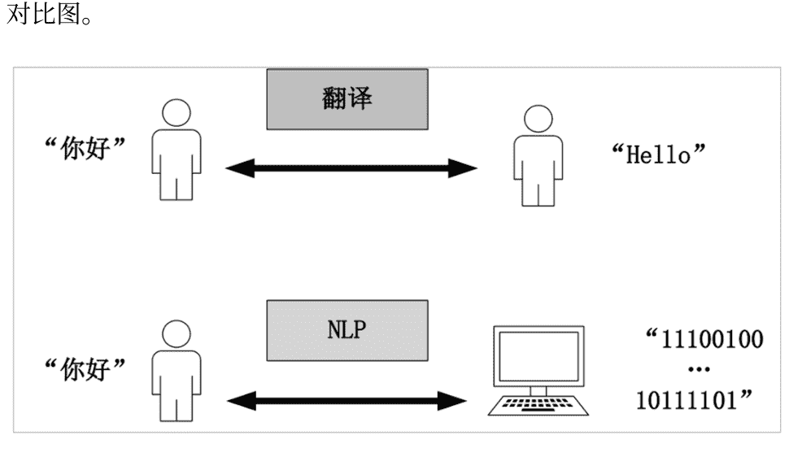

图1-1 DeepSeek 与主流 AI 大模型性能对比图

NLP 任务涵盖自然语言理解 Natural Language Understanding, NLU 和自然语言生成 Natural Language Generation, NLG。自然语言理解包括文本分类、命名实体识别、句法分析、语义角色标注等；自然语言生成包括机器翻译、文本摘要、对话系统等。

（1）自然语言理解指计算机解析并理解人类语言的能力。例如智能客服系统中，计算机可自动回答用户常见问题，通过分析输入文本理解其意图与需求并给出相应答复。

（2）自然语言生成指计算机生成符合人类语言规范与习惯的文本能力。例如新闻摘要系统中，计算机可自动从长篇新闻抽取关键信息并生成简洁明了摘要，极大提升信息获取效率，也使生成文本更易阅读。

为帮助读者更好理解 NLP 应用与魅力，下面介绍若干生动案例。

###### 1）智能语音助手

智能语音助手如 Siri、小爱同学已成为日常生活重要组成部分。它们借助 NLP 技术实现语音识别与语义理解，让用户通过语音与设备交互完成多类任务。例如说“嘿 Siri，今天北京天气怎么样？”，Siri 即可理解意图并查询返回天气信息。

###### 2）机器翻译

机器翻译是 NLP 重要应用。借助 NLP 技术，百度翻译、谷歌翻译等工具可将一种语言自动译为另一种语言，打破语言障碍，促进国际交流，也让旅行、学习等场景更便捷获取信息。

###### 3）情感分析

情感分析是 NLP 在文本分析领域的重要应用。它通过分析文本的主客观性、观点、情绪等信息，对情感倾向进行分类判断。如在社交媒体上，可利用情感分析监测用户对某品牌或产品的评价，及时调整营销策略与服务质量。

#### 1.1.2 Transformer架构核心及其在LLM中的应用解析

Transformer 架构是专为自然语言处理与深度学习设计的模型框架，自 2017 年 Vaswani 等人发表论文 Attention Is All You Need 后，迅速成为现代语言模型的重要基石。其核心亮点在于革命性引入自注意力机制。想象阅读文章时，你会自然关注各部分以理解整体。Transformer 的自注意力机制正是如此，它让模型在处理文本序列时像人一样灵活注视序列中每个位置，从而更精准捕捉上下文信息。这一创新使 Transformer 在复杂语言任务中展现非凡能力。

Transformer 问世是自然语言处理领域里程碑。它突破了早期循环神经网络 RNN 与长短期记忆网络 LSTM 在长距离依赖与顺序数据处理上的瓶颈。

##### 1. Transformer架构核心

Transformer 架构主要可划分为 4 部分：输入处理部分、编码器部分、解码器部分及输出部分。其中最为关键的是编码器与解码器的精妙结合。

###### 1) 输入处理部分

Transformer 架构全景拆解

源端映射
这一步给每个 token 套上一层稠密语义外衣，把原本只是编号的词符转成数值向量，比如“猫”被转成[0.2, -0.5, 1.3, …]。向量化后系统既能辨识词形，也能感受到词与词之间的细微牵连。

方位信号注入
Transformer 没有循环路径，也没有卷积来感知顺序，必须额外补充方位信息。Positional Encoding 会给序列中每个 token 分配一个独一无二的方位向量。即使词序被打乱，系统仍能凭借这些向量还原真实语义，例如区分“我 爱 你”与“你 爱 我”的差别。

目标端映射 解码侧使用
开始生成输出时，该层把目标侧的词同样转成向量，为解码过程提供可处理的表征。

2) 编码器部分
编码器由若干编码器层堆叠而成，可视作一座智慧塔。每层由两个紧密衔接的子模块构成。

Multi-Head Self-Attention 子模块
该机制让网络能同时关注输入序列的多个位置，并对不同词赋予差异化的关注权重，从而更全面地把握周边语境。以“苹果”为例，其含义随语境变动，既可指水果，也可指科技品牌。多头自我关注可结合具体情境判断当前“苹果”指向果实还是厂商，提升复杂语义的处理能力。

前馈全连接子模块
对自我关注的输出做进一步加工与提炼，增强表达力。

为保证信息稳定流动，每个子模块后都接入层归一化与残差连接，相当于给信息传递加上保险绳。

3) 解码器部分
解码器同样由 N 个解码器层堆叠，每层包含三项串联的子模块。

带掩码的 Multi-Head Self-Attention 子模块
生成每个词时只能看到此前已生成的词，例如预测第3个词时仅能参考前两个词，模拟真实生成，避免系统窥探未来信息。

Multi-Head Cross-Attention 子模块
让解码器能够聆听编码器的表示，获取输入序列的深层语义。

前馈全连接子模块
对前述信息做最终加工。

各子模块后均配置残差连接与层归一化，以确保数据稳定可靠。

4）输出部分
线性映射层
如同形状转换器，把解码器输出的向量调整到目标输出维度，本质是将抽象语义映射到候选词的概率空间。

Softmax 归一化层
把线性层的输出转化为概率分布，计算每个词作为下一个输出词的可能性，比如“猫”概率60%，“狗”概率30%，据此挑选最可能的词作为预测结果。

架构示意见图1-3。

2. Transformer 三大核心原理概览
Transformer 之所以强大，源于三项核心机制：Self-Attention、Positional Encoding 与 Multi-Head Attention。它们极大推动了大语言模型的发展，提升了语言理解能力并解决了长距离依赖难题。

Self-Attention 机制
Self-Attention 让每个词元在表示时都能参考序列中所有其他词元，从而捕捉长距离依赖。通俗说，每个词就像一位小侦探，同时偷看句子里其他所有词，判断与谁关联最紧密。

例：句子“猫吃鱼”。
系统会分析“吃”主要关联“猫”和“鱼”，“鱼”更关注前面的“吃”而非“猫”。
作用：理解词语间的复杂关系，如施动者、受动者、修饰关系等。

Positional Encoding
因 Transformer 缺乏递归结构，无法直接感知词序，需要额外编码手段。位置编码通过正弦、余弦等数学函数为不同位置的词元注入区分信息。通俗理解，就是给每个词加上位置编号，类似拼图时给每块标号。

例：未加位置编码，“狗追猫”与“猫追狗”会被视为相同；加入后系统能分辨动作方向。
作用：让系统感知词序，中文里顺序改变意义可能完全相反。

Multi-Head Attention
在多个子空间并行计算 Self-Attention，提升表示能力。通俗说，用多组小侦探从不同角度分析句子再汇总，能捕获更丰富的信息，同时并行计算加速训练。

例：第1组关注语法结构如动词名词关系，第2组关注情感倾向如“好”与“坏”。
作用：实现多维度语言理解。

3. Transformer 在主流大模型的落地
得益于 Transformer 的卓越表现，当下主流大语言模型大多在该结构上做了深度优化。包括 GPT、LLaMA、文心一言、DeepSeek 等，均通过创新手段提升性能。

表1-1 主流 LLM 基于 Transformer 的改良

| 模型名称 | 所属机构 | 核心优化点 | 典型应用场景 |
| :--- | :--- | :--- | :--- |
| GPT 系列 | OpenAI | 仅解码器 + 带掩码自关注 | 文本生成、对话系统 |
| BERT | Google | 仅编码器 + 双向自关注 | 文本分类、信息抽取 |
| PaLM | Google | 并行计算优化 + 多任务统一训练 | 多语言翻译、代码生成 |
| LLaMA | Meta | 旋转位置编码 + 高效推理加速 | 轻量级本地化部署 |
| Gemini | Google | 多模态扩展 + 混合专家模型 | 图文理解、跨模态生成 |
| 文心一言 | 百度 | 知识增强预训练 + 多任务联合学习 | 搜索引擎优化、金融文本分析 |
| 通义千问 | 阿里巴巴 | 分层稀疏注意 + 高效分布式训练 | 电商客服、广告文案生成 |
| 盘古 | 华为 | 万亿参数稀疏架构 + 异构计算加速 | 智能制造知识库、药物研发 |
| 智谱 | 智谱 AI | 双向自回归架构 + 动态量化推理 | 开源社区对话、教育辅助 |
| 讯飞星火 | 科大讯飞 | 多模态交互对齐 + 语音-文本联合建模 | 智能会议纪要、跨模态内容创作 |
| DeepSeek | 深度求索 | 动态稀疏注意 + 多阶段课程学习 | 金融数据分析、代码生成、智能客服 |

工程实践中的关键改进如下。

位置编码的进阶方案
问题：原始位置编码在超长文本如完整小说上会失效。
解决方案：
ALiBi 编码：让远处词的影响力自然衰减，如同人声随距离变小。
RoPE 旋转位置编码：用数学方式让位置信息更灵活，类似旋转魔方调整视角。

注意力计算的提效手段
原始问题：全量计算词间关系成本高，如1000个词需计算100万次关系。
优化方法：
稀疏注意：只计算关键词的关系，类似阅读时只看标题和重点句。
分块计算：将长文本切成小段处理，先局部再整体，类似拼图先拼小块再组合。

更拟人化的设计
Chain-of-Thought 思维链：让系统分步解答，提升准确性与可预期性。
例：
问题：小明有5个苹果，吃了2个，又买了3个，现在有几个？
系统推理：
```
5 - 2 = 3
3 + 3 = 6
```
答案：6个

1.1.3 DeepSeek 的词元切分与推理逻辑
在 DeepSeek 对话框输入“中国的首都是哪里？”时，系统会先做切分再推理。先通过标记化把句子拆成“中国”“的”“首都”“是哪里”等更小单元，明确结构与含义。随后基于 Transformer 结构的预测机制，结合学到的语言知识与上下文，检索相关知识并输出“北京”。词元切分与预测共同支撑了高效准确的问答。

1. DeepSeek 的标记化机制
大模型无法直接理解整段文字，需先切分为 Token。切分方式多样，基础的有按字符或按单词切分。中文可按每个汉字切分，按词则需分词。实际应用更常用子词或字节对编码 BPE 等精细方法，在保持词汇丰富度的同时控制词表大小。

以智能切菜为喻，切菜即为标记化。

混合分词策略：多刀并用
BPE 与 Unigram 混合刀法：面对“先放3克 SGD optimizer，小火慢炖”这类中英混排，BPE 会把英文细切如 SGD 拆成 S、G、D，Unigram 则保留中文整体如“小火慢炖”，按食材纹理精准分解。
专业术语保护：遇到“多头注意力”这类术语，会整块保留，避免拆成单个字以免丢失专业味道。

食材预处理：特殊符号拆解
表情符号处理：遇到指向狗的表情，会拆成“箭头+狗头”两部分，确保正确理解而非当作神秘符号。
生僻字应对：面对“饕餮”这类复杂字，会临时用已知部件如“饕/餮”组合编码，保证流程不中断。

中文特供技巧：多级刀法选择
动态切法选择：处理“深度学习模型”时，新手可能逐字切“深/度/学/…”，效率低下；老手会切成“深度学习/模型”。AI 大厨会根据句式复杂度动态选切法，兼顾完整性与效率。

2. DeepSeek 的预测原理
可比喻为“超级文本模仿者”，通过学习大量数据规律逐词预测最合理的回答，分三步。

学习阶段：记忆对话模式
训练数据：阅读海量文本学习常见搭配，如“天气热”后常接“要开空调”。
建立关联：通过深度学习记住词与句的概率关系，如“猫”与“喵喵叫”关联强，与“发动机”关联弱。

生成阶段：像填空游戏
用户问“今天的天气怎么样？”时，系统先解析意图，再按学到的规律预测首词可能是“今天”或“目前”，结合地区信息续写“今天北京晴转多云，气温25℃”……直至完整句子。每次预测从多候选词中按概率选取，而非固定。

回答为何显得智能
语境把握：能捕捉前文隐含逻辑，如用户问“能推荐电影吗？”系统会推断需列出片名。
随机性控制：通过温度参数调节输出，高温更随机有创意，低温更保守稳定。

真实案例：AI 如何回答“中午吃什么”
标记化
把问题切为“中午/吃/什么”，识别时间、动作核心。
预测过程
激活美食推荐专家与用户历史专家，结合北京位置、上次点饺子、当前11:30，生成候选“饺子馆/新开湖南米粉/减脂沙拉”。经真实性、时段、用语三重校验后输出：“要不要试试公司楼下新开的常德米粉？你上周收藏过这家～，记得选微辣哦！”

1.2 DeepSeek 的发展轨迹
随着 AI 浪潮兴起，市场进入垂直深耕与生态构建并行的阶段。IDC 2024 年报告显示企业 AI 工具采购年增147%，开发者对开源模型的下载量突破10亿次。DeepSeek、GPT-4、Claude、Gemini 等头部产品以差异化技术路线引领行业发展。

1.2.1 DeepSeek 初始版本的特性
DeepSeek LLM 即 DeepSeek V1，发布于2024年1月5日，在成本与性能间取得平衡。四大关键特性如下。

成本与性能并重
采用 LLaMA 2 的稠密架构，用大量中英文数据训练，实现低成本下的高性能，为用户提供高性价比方案。

高质量训练语料
经严格清洗、去重、过滤与混洗，构建约两万亿 Token 中英双语预训练集，为跨语言泛化提供基础。

创新架构设计
引入 Grouped-Query Attention 分组查询注意力，通过分组查询与共享键值矩阵降低显存与计算成本。67B 模型用 GQA 替代多头注意以优化推理，但为抵消能力损失，采用加深网络策略：7B 为30层，67B 增至95层。

表1-2 7B 与 67B 模型参数对比

| 模型名称 | nlayers | dmodel | nheads | nkv_heads | Contest Length | Sequence Batch Size | Learning Rate | Tokens |
|---|---|---|---|---|---|---|---|---|
| 7B | 30 | 4096 | 32 | 32 | 4096 | 2304 | 4.2e-4 | 2.0T |
| 67B | 95 | 8192 | 64 | 8 | 4096 | 4608 | 3.2e-4 | 2.0T |

评测显示 DeepSeek V1 基础模型在语言处理上表现突出，67B 在中英文测试中显著超越 LLaMa 70B，体现强跨语言能力。小模型方面，7B 在中文表现更优，英文相对平平，提示模型规模与数据配比的重要性。测评结果如表1-3所示。

表1-3 DeepSeek V1 基础模型中英文测评结果

| Language | Benchmark | Test-shots | LLaMA2 7B | DeepSeek 7B | LLaMA2 70B | DeepSeek 67B |

| :--- | :--- | :--- | :--- | :--- | :--- | :--- |

| English | HellaSwag | 0-shot | 75.6 | 75.4 | 84.0 | 84.0 |

| | PIQA | 0-shot | 78.0 | 79.2 | 82.0 | 83.6 |

| | WinoGrande | 0-shot | 69.6 | 70.5 | 80.4 | 79.8 |

| | RACE-Middle | 5-shot | 60.7 | 63.2 | 70.1 | 69.9 |

| | RACE-High | 5-shot | 45.8 | 46.5 | 54.3 | 50.7 |

| | TriviaQA | 5-shot | 63.8 | 59.7 | 79.5 | 78.9 |

| | NaturalQuestions | 5-shot | 25.5 | 22.2 | 36.1 | 36.6 |

| | MMLU | 5-shot | 45.8 | 48.2 | 69.0 | 71.3 |

| | ARC-Easy | 0-shot | 69.1 | 67.9 | 76.5 | 76.9 |

| | ARC-Challenge | 0-shot | 49.0 | 48.1 | 59.5 | 59.0 |

| | OpenBookQA | 0-shot | 57.4 | 55.8 | 60.4 | 60.2 |

| | DROP | 1-shot | 39.8 | 41.0 | 69.2 | 67.9 |

| | MATH | 4-shot | 2.5 | 6.0 | 13.5 | 18.7 |

| | GSM8K | 8-shot | 15.5 | 17.4 | 58.4 | 63.4 |

| | HumanEval | 0-shot | 14.6 | 26.2 | 28.7 | 42.7 |

| | MBPP | 3-shot | 21.8 | 39.0 | 45.6 | 57.4 |

| | BBH | 3-shot | 38.5 | 39.5 | 62.9 | 68.7 |

| | AGIEval | 0-shot | 22.8 | 26.4 | 37.2 | 41.3 |

| | Pile-test | — | 0.741 | 0.725 | 0.649 | 0.642 |

| Chinese | CLUEWSC | 5-shot | 64.0 | 73.1 | 76.5 | 81.0 |

| | CHID | 0-shot | 37.9 | 89.3 | 55.5 | 92.1 |

| | C-Eval | 5-shot | 33.9 | 45.0 | 51.4 | 66.1 |

| | CMMLU | 5-shot | 32.6 | 47.2 | 53.1 | 70.8 |

| | CMath | 3-shot | 25.1 | 34.5 | 53.9 | 63.0 |

| | C3 | 0-shot | 47.4 | 65.4 | 61.7 | 75.3 |

| | CCPM | 0-shot | 60.7 | 76.9 | 66.2 | 88.5 |

拆解预训练配比后可见，中文材料在初期积累中占比明显偏大。参数体量偏小的模型对语言比例的细微波动更敏感，成绩容易被语料分布牵引。所以7B在中文榜单上表现突出，很大程度上得益于训练库中中文资源的充裕。

##### 4. 对齐与微调技术

为了让输出更贴合人类价值和使用习惯，DeepSeek V1 同时采用了监督式微调和直接偏好优化。两者协同后，回答的准确性和实用性一并提升，用户体验和信任度随之增强。

为何要做这两步？预训练模型好比一本未校对的百科，包罗万象。真正关键的是下一步——教会它分辨可接受与不可接受的表达，就像教育孩子，知识传授要配合规则树立。

监督式微调侧重训练模型产出经得起检验的答案，掌握常见的问答套路。直接偏好优化则在多条看似合理的候选里，筛选出更符合人类价值观的那一条，借助人工排序让模型自行学会边界。

对7B这类轻量版，在数学和代码集上长时间精调是拉升能力的关键。但实验里发现，随着SFT阶段数学样本增多，重复输出现象变明显，模型似乎把解题套路记死。为此设计了两阶段策略：先做全量学习，覆盖数学代码等全部数据；再转对话专项，去掉数学代码聚焦聊天，并叠加偏好优化。两种做法都能在基准分数基本不变的情况下，有效压低重复率。

偏好学习集同时覆盖安全性与有效性。安全性不仅教会模型拒绝危险提问，还需对比好坏回答；有效性不仅要求能作答，还要区分优质与普通。训练设置一个epoch，学习率5e-6，batch size 512。实测表明，偏好优化不仅改善开放式问答，还带来全方位提升。

下方表格展示了67B在完成偏好优化后的能力变化。

###### 表1-4 DeepSeek V1 67B模型经过DPO训练后能力的提升

| Model (模型) | Overall (总分) | Reasoning (中文推理) | Language (中文语言) |

| :--- | :--- | :--- | :--- |

| | | Avg (推理总分) | Math (数学计算) | Logi (逻辑推理) | Avg (语言总分) | Fund (基本任务) | Chi (中文理解) | Open (综合问答) | Writ (文本写作) | Role (角色扮演) | Pro (专业能力) |

| gpt-4-1106-preview | 8.01 | 7.73 | 7.80 | 7.66 | 8.29 | 7.99 | 7.33 | 8.61 | 8.67 | 8.47 | 8.65 |

| gpt-4-0613 | 7.53 | 7.47 | 7.56 | 7.37 | 7.59 | 7.81 | 6.93 | 7.42 | 7.93 | 7.51 | 7.94 |

| DeepSeek-67B-Chat-DPO* | 6.69 | 5.77 | 6.13 | 5.41 | 7.60 | 7.29 | 7.47 | 7.82 | 7.51 | 7.83 | 7.71 |

| DeepSeek-67B-Chat* | 6.43 | 5.75 | 5.71 | 5.79 | 7.11 | 7.12 | 6.52 | 7.58 | 7.20 | 6.91 | 7.37 |

| chatglm-turbo | 6.24 | 5.00 | 4.74 | 5.26 | 7.49 | 6.82 | 7.17 | 8.16 | 7.77 | 7.76 | 7.24 |

| erniebot-3.5 | 6.14 | 5.15 | 5.03 | 5.27 | 7.13 | 6.62 | 7.60 | 7.26 | 7.56 | 6.83 | 6.90 |

| gpt-3.5-turbo-0613 | 6.08 | 5.35 | 5.68 | 5.02 | 6.82 | 6.71 | 5.81 | 7.29 | 7.03 | 7.28 | 6.77 |

| chatglm-pro | 5.83 | 4.65 | 4.54 | 4.75 | 7.01 | 6.51 | 6.76 | 7.47 | 7.07 | 7.34 | 6.89 |

| spark_desk v2 | 5.74 | 4.73 | 4.71 | 4.74 | 6.76 | 5.84 | 6.97 | 7.29 | 7.18 | 6.92 | 6.34 |

| Qwen-14B-Chat | 5.72 | 4.81 | 4.91 | 4.71 | 6.63 | 6.90 | 6.36 | 6.74 | 6.64 | 6.59 | 6.56 |

| Baichuan2-13B-Chat | 5.25 | 3.92 | 3.76 | 4.07 | 6.59 | 6.22 | 6.05 | 7.11 | 6.97 | 6.75 | 6.43 |

| ChatGLM3-6B | 4.97 | 3.85 | 3.55 | 4.14 | 6.10 | 5.75 | 5.29 | 6.71 | 6.83 | 6.28 | 5.73 |

| Baichuan2-7B-Chat | 4.97 | 3.66 | 3.56 | 3.75 | 6.28 | 5.81 | 5.50 | 7.13 | 6.84 | 6.53 | 5.84 |

| InternLM-20B | 4.96 | 3.66 | 3.39 | 3.92 | 6.26 | 5.96 | 5.50 | 7.18 | 6.19 | 6.49 | 6.22 |

| Owen-7B-Chat | 4.91 | 3.73 | 3.62 | 3.83 | 6.09 | 6.40 | 5.74 | 6.26 | 6.31 | 6.19 | 5.66 |

| ChatGLMM2-6B | 4.48 | 3.39 | 3.16 | 3.61 | 5.58 | 4.91 | 4.52 | 6.66 | 6.25 | 6.08 | 5.08 |

| InternLM-Chat-7B | 3.65 | 2.56 | 2.45 | 2.66 | 4.75 | 4.34 | 4.09 | 5.82 | 4.89 | 5.32 | 4.06 |

| Chinese-LLaMA-2-7B-Chat | 3.57 | 2.68 | 2.29 | 3.07 | 4.46 | 4.31 | 4.26 | 4.50 | 4.63 | 4.91 | 4.13 |

| LLaMA-2-13B-Chinese-Chat | 3.35 | 2.47 | 2.21 | 2.73 | 4.23 | 4.13 | 3.31 | 4.79 | 3.93 | 4.53 | 4.71 |

#### 1.2.2 DeepSeek的核心优化与升级历程

在V1验证可行后，团队持续迭代，陆续推出V2、V3等更强版本。

##### 1. 引入MoE架构
V2首次引入了混合专家机制，训练效率和推理速度同步提升。稀疏激活配合动态路由，推理时仅激活少量专家，计算开销大幅下降。

##### 2. 提出MLA机制
为进一步降低推理成本，V2提出了多头潜在注意力。把输入token的注意力信息压缩为潜在向量，使用时再解压得到Key和Value，KV缓存占用被显著压缩。

##### 3. 升级模型规模与训练数据
技术成熟后，V3的参数规模是V2的三倍，训练数据量接近翻倍。配合FP8混合精度和优化通信内核，整体训练成本得到有效控制。

##### 4. 强化学习与蒸馏技术的结合
为强化推理能力，R1系列探索了强化学习与蒸馏的结合。用强化学习训练出高性能模型后再蒸馏到更小体量，实现低成本快速复制推理能力。

###### 表1-5 DeepSeek历代版本的演化与改革

| 模型 | 论文发布时间 | 模型参数 | 训练数据 | 训练算力成本 | 模型架构特点 |

| :--- | :--- | :--- | :--- | :--- | :--- |

| V1 | 2024.1.5 | 67B | 2万亿 token 中英数据 | 未公布，参考 V2 论文提到 H800 用时，通过推测预训练花费 120 万美元（基于租赁 H800 每小时 2 美元） | Llama 架构：更大的神经网络深度 多步学习率调度器 |

| V2 | 2024.5.7 | 236B (激活 21B) | 8.1 万亿 token 多语言数据 | 文中没明确给出，根据文中提到的 H800 GPU 小时推测预训练花费 276 万美元 | MOE 架构：160 个路由专家及 2 个共享专家。多头潜在注意力（MLA）机制 |

| V3 | 2024.12.27 | 671B (激活 37B) | 14.8 万亿 token 多语言数据 | 论文指出单次训练成本 557.6 万美元 | MOE 架构：256 个路由专家及 1 个共享专家。1. FP8 混合精度训练 2. 无辅助损失的负载均衡策略 3. 多 token 预测机制 4. MLA |

| R1 | 2025.1.22 | 671B (激活 37B) | 预训练：4.8 万亿 token。数千条高质量的长链推理数据 | 256 未公布，不过其基于 V3 上面做 RL，算力成本不会太高 | MOE 架构 1. 基于 DeepSeek V3 基座模型 2. 结合冷启动数据的强化学习 |

#### 1.2.3 DeepSeek在多语言与多任务处理中的卓越表现

得益于架构升级和训练策略优化，DeepSeek在多语多任务上表现出色。

##### 1. 多语言处理能力
模型引入了大量中文和其他多语言数据，中文、英文等主流语言的理解与生成能力都得到明显提升。

##### 2. 多任务处理能力
不仅擅长自然语言理解生成，在数学推理、代码生成、逻辑分析等任务上也有亮眼表现。R1系列经强化学习训练后，推理任务能力尤为突出。

##### 3. 优秀的长文本处理能力
借助长上下文扩展技术，DeepSeek可处理长达128K tokens的输入，在长文本场景具备明显优势。

###### 表1-6 DeepSeek与其他主流AI大模型技术架构的对比

| 模型 | 模型结构 | 训练数据源 | 上下文处理能力 | 参数量 | 算法创新 |

| :--- | :--- | :--- | :--- | :--- | :--- |

| DeepSeek | (Transformer+MoE) 混合架构 | 大规模中文语料库 + 行业知识库 | 128K tokens | 671B | 高效推理与定制化开发 |

| GPT-4 | Transformer 架构 | 多样化语言数据 (英文为主) | 128K tokens | 1.8T | 千亿级别参数量，强大语言生成能力 |

| Claude 3 | Transformer 架构 | 高质量语言数据 (英文为主) | 200K tokens | 137B | 道德与安全性能优化 |

| Gemini 1.5 | MoE 架构 | 文本、图像、音频等多模态数据 | 1M tokens | 137B | 跨模态理解与生成能力 |

| 文心一言 | ERNIE 4.0+ 知识增强 | 百度搜索数据 / 中文百科 | 16K tokens | 260B | 面向中文语境的优化 |

| 豆包 | 轻量化 Transformer | 社交媒体语料 / 短视频文本 | 32K tokens | 130B | 实时性与准确性并重 |

| 讯飞星火 | Transformer | 语音转录数据 / 专业术语库 | 48K tokens | 130B | 语音与自然语言处理融合 |

##### 4. 与人类偏好的高度对齐
借助SFT和DPO等对齐手段，模型学会生成符合人类价值观的回复，人机交互更友好可靠。

目前DeepSeek已明显超越多数开源模型，包括Qwen2.5-72B和Llama-3.1-405B，部分关键能力逼近GPT-4与Claude-3.5-Sonnet等顶尖闭源模型。如图1-4所示，数据充分印证了这一提升。

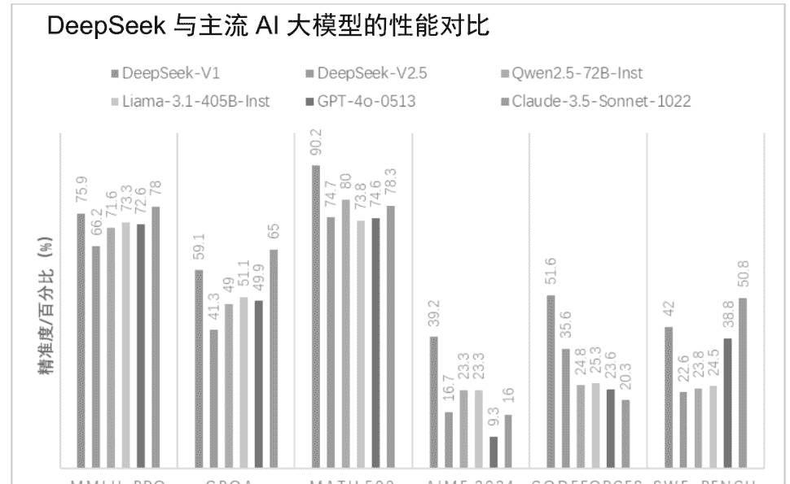

AI大模型的核心能力通常涵盖中文创作、代码生成、多模态处理等方面，下面围绕这些关键维度，对比DeepSeek与主流产品的差异，详见表1-7。

###### 表1-7 DeepSeek与其他主流AI大模型核心功能的对比（5分制评分）

| 模型 | 中文创作 | 代码生成 | 多模态处理 | 实时信息获取 | 语音交互 |

|---|---|---|---|---|---|

| DeepSeek | 4.8 | 3.5 | 2.0 | 1.5 | 1.0 |

| GPT-4 | 3.5 | 4.7 | 4.0 | 3.0 | 2.5 |

| Claude 3 | 3.2 | 3.0 | 3.5 | 2.5 | 1.8 |

| Gemini 1.5 | 3.0 | 4.0 | 4.8 | 4.5 | 3.0 |

| 文心一言 | 4.5 | 3.2 | 3.0 | 4.2 | 3.5 |

| 豆包 | 4.0 | 2.5 | 3.2 | 3.8 | 2.0 |

| 讯飞星火 | 4.2 | 2.8 | 4.5 | 3.5 | 4.8 |

大模型怎么挑？DeepSeek全景解析

参考表1-7的横向对比，各家生成式大模型都有鲜明的优势侧重，也存在各自的短板。DeepSeek在中文内容创作和代码生成上表现亮眼，这得益于其在深度学习与自然语言处理方面的技术沉淀。反过来，在多模态信息的融合处理、诸如图像音频与文本的协同，以及对即时交互的响应效率上，还有优化空间。

部署时要以业务目标和具体场景为导向做取舍。先摸清各模型的能力边界与适用范围，再在目标任务上检验实际效果与成长空间，确保最终选型真正契合需求并带来可落地的价值。

### 1.3 DeepSeek核心功能概览及应用场景深度解析

DeepSeek近两年在国内外热度持续上升，其能力已经渗透到大量日常环节，让使用体验更智能、更省心。整体能力分布可参考图1-5。

从本质上看，DeepSeek是一个将深度学习与前沿数据挖掘结合的智能检索分析平台。其主要工作是挖掘海量数据中的价值信息和洞察。

### 1.4 大语言模型的局限与挑战

大语言模型以强性能和广覆盖大幅提升了信息获取与处理效率。但与此同时，也带来了明显的负面效应，其中虚假信息生成和隐私泄露风险最为突出。

就虚假信息而言，模型有时会输出不准确甚至误导性的表述，降低信息可信度并可能导致错误决策。一旦涉及重大事件或敏感话题，后果会更严重。

就隐私而言，训练与推理过程都需要接触大量用户数据。若保护不到位，敏感信息就可能外泄，侵犯个人隐私。更进一步，系统还能通过输入输出推断身份、偏好等私密特征，进一步加剧风险。

享受便利的同时必须正视风险，只有建立有效防范机制，才能让大模型健康可持续发展。

#### 1.4.1 幻觉现象的产生、影响及应对策略

以DeepSeek、ChatGPT、Gemini为代表的LLM出现的“幻觉”，指生成内容表面可信、实质却错误、虚构甚至荒谬。根源在于其底层机制是基于数学概率的统计预测。

模型通过学习海量文本的统计规律来预测下一个词。当遇到训练数据未覆盖的新情境时，只能依据已有知识做泛化推测，容易偏离事实形成幻觉。

案例：貌似专业实则胡说。

- (1) 法律乌龙：2023年，美国一名律师使用ChatGPT起草法律文件，模型虚构了6个不存在的判例，未经核实即提交法院，被法官严厉处罚。
- (2) 医学误导：用户询问“如何治疗新冠”时，模型可能给出“饮用漂白水消毒”等危险建议。
- (3) 历史杜撰：问及“唐朝哪位皇帝发明了蒸汽机”时，模型可能编造逻辑自洽但完全错误的情节。

##### 1. 幻觉带来的信任危机与实际风险

- (1) 决策误导：学生借助模型写论文可能引入虚假论据，企业基于错误信息决策可能造成经济损失。
- (2) 伪科学扩散：伪养生建议、阴谋论等可能通过模型实现规模化传播。
- (3) 信任流失：用户多次发现错误后会对技术产生过度质疑，影响合理使用。

##### 2. 防治幻觉的多方协作纠错机制

- (1) 技术改进：通过强化事实核查训练，让模型学会标注“不确定”内容；引入知识图谱对生成结果进行约束。
- (2) 外部知识库接入：确保接入的知识来源权威、准确，避免引入错误或偏见信息。
- (3) 人机协同：像维基百科一样建立引用溯源功能，要求模型标注信息出处。
- (4) 用户教育：明确提示“AI可能出错”，培养公众批判性思维，例如谷歌在AI搜索结果中标注“生成式内容仅供参考”。

#### 1.4.2 伦理问题的探讨与规范建议

随着LLM应用范围扩大，伦理问题日益凸显。首先，LLM不具备真正的伦理判断能力，只能依据训练数据和程序规则给出答案，无法理解回答背后的道德后果。若训练数据本身包含误导信息，模型就可能给出不道德的建议。

其次，LLM可能继承并放大社会中已有的偏见。若训练数据带有性别、种族、阶层偏见，模型在输出时会无意识地再现这些不平等观念。

大语言模型像一面放大镜，既能放大人类文明的精华，也可能放大既有偏见，甚至被恶意利用。

##### 1. 典型案例分析

###### 1) 偏见放大器

- (1) 招聘歧视：某公司使用模型自动筛选简历，因训练数据含历史偏见，模型更倾向于选择男性程序员和年轻求职者。
- (2) 文化冒犯：用户要求“写一段印度口音的英语对话”时，模型可能生成刻板印象内容，强化种族偏见。

###### 2) 滥用风险

- (1) 深度伪造：2024年，某诈骗团伙利用AI模仿名人声音，伪造投资直播，骗走数百万元。
- (2) 情感操控：孤独老人与AI聊天机器人建立情感依赖后，被诱导购买高价保健品。

###### 3) 隐私黑洞

- (1) 数据泄露：用户向医疗AI咨询病情时，对话数据可能被用于定向药品广告。
- (2) 记忆难题：模型可能从训练数据中“背诵”出真实的个人隐私信息，如某次数据泄露事件中模型输出了某人的真实住址。

##### 2. 规范建议：建立AI时代的“数字伦理”

###### 1) 技术伦理准则

- (1) 开发者的“不作恶”承诺：微软等公司已设立AI伦理委员会，审查模型潜在风险。
- (2) 设计“伦理开关”：如Meta的模型拒绝生成涉及暴力、歧视的内容。

###### 2) 分级监管体系

- (1) 医疗、法律等高风险领域实行准入审核，类似药品上市前的临床试验。
- (2) 社交娱乐类应用需明确标注AI身份，如中国要求AI生成内容加水印。

###### 3) 公众参与治理

- (1) 参照欧盟《人工智能法案》制定过程，举办多利益方研讨会。
- (2) 建立“AI事故”举报平台，如用户发现模型教唆自杀可快速反馈。

###### 4) 文化适配性

- (1) 沙特阿拉伯要求模型符合伊斯兰价值观，过滤饮酒相关内容。
- (2) 日本开发能理解“暧昧表达”的AI，减少跨文化交流误解。

大语言模型如同刚学会奔跑的孩子，充满可能也需要引导。技术创新与伦理规范双轮驱动，才能既享受其创作诗歌、解答难题的惊艳，也避免幻觉与偏见带来的暗礁。正如OpenAI创始人所言：“AI应增强人类，而非取代或削弱我们。”这需要开发者、监管者和使用者共同智慧。

### 1.5 知识拓展与技巧分享

在人工智能快速迭代的当下，DeepSeek等大模型以出色的语言处理能力正成为各行业创新的重要推手。本节将拓展相关认知，并分享高效使用技巧，无论初学者还是资深用户都能有所收获。

#### 1.5.1 知识拓展

近年来，大语言模型作为人工智能热点，已取得显著突破。随着深度学习发展和算力提升，模型在性能、效率和泛化能力上实现质变。

##### 1. 最新研究进展

- (1) 参数规模持续提升，从最初数十亿到如今数千亿甚至万亿级别，学习与表现能力大幅增强。
- (2) 预训练-微调范式成为主流，先在海量文本上预训练，再在特定任务上微调，使模型能快速适配不同场景。
- (3) 多模态融合成为新趋势，将文本、图像、音频等信息有机结合，实现更全面的理解与生成。

##### 2. 技术趋势

- (1) 模型将更注重可解释性和稳健性，以提升可靠性和安全性。
- (2) 轻量化模型将成为发展方向，以适配不同设备与场景。
- (3) 联邦学习等分布式训练技术将更广泛应用，提升训练效率与数据隐私保护能力。

##### 3. 应用前景

- (1) 大模型将在教育、医疗、金融、法律等多领域发挥作用，提供智能辅助决策与服务。
- (2) 智能客服、智能写作、智能翻译等将成为重要落地场景，推动自然语言处理普及。
- (3) 随着技术进步与成本下降，大模型将逐步走向大众，成为日常生活与工作的必备工具。

#### 1.5.2 技巧分享

DeepSeek凭借卓越性能与易用性获得广泛青睐。以下总结使用技巧，并介绍其三大模式：基础模型V3、推理模型R1及联网搜索模式。

##### 1. 基础模型

- (1) 模式定位：基础模型为DeepSeek的默认模式，无需额外勾选，性能与GPT-4、Claude-3.5等顶尖模型相当。
- (2) 适用场景：V3擅长日常百科类问题，快速直接给出信息，适合常见知识查询、简单文本生成及日常对话。
- (3) 优点特色：高效便捷，门槛低，适用于无需复杂推理或深度分析的大部分场景。

##### 2. 推理模型

- (1) 模式定位：推理模型是DeepSeek的深度推理专家，专为复杂推理和深度思考设计。
- (2) 适用场景：R1擅长数理逻辑推理、编程代码分析、深度学术研究等，能从多角度分析并给出严谨推理结果。
- (3) 技术亮点：R1拥有660B参数，采用后训练加RL强化学习，在复杂问题处理上更得心应手。

##### 3. 联网搜索模式

- (1) 模式定位：联网搜索模式基于RAG检索增强生成技术，可实时检索互联网内容作答。
- (2) 适用场景：适用于时效性强、需实时信息的问题，如新闻热点追踪、行业动态分析、最新研究成果查询。
- (3) 优势特点：不仅检索高效，还能对检索内容进行智能聚合与生成，形成符合当下场景的完整回答。

## 第2章 DeepSeek API实战入门

### 本章导读

本章将带你认识DeepSeek API的基础概念、实操方法和潜在价值。内容涵盖API基础、通过DeepSeek APP体验模型能力，结合开发实践，并深入解析核心功能调用、输入输出格式规范，最后以知识拓展与技巧收尾。

先从API基础概念入手，解释其定义、设计思路及在AI开发中的作用。随后在DeepSeek APP中体验模型能力，感受API带来的便捷高效。接着进入DeepSeek+开发实战，引导完成环境搭建、代码编写到模型调用的全流程。在此基础上，详细解析对话调用、对话补全、多轮对话等核心功能，并说明输入输出格式规范与注意事项，包括数据格式要求、请求参数说明及响应结果解析，确保能准确高效地与API交互。

学完本章，可全面掌握DeepSeek API的基础、实战与拓展知识，为AI领域探索提供支撑。

### 知识导读

本章要点（已掌握的在方框中打钩） □

了解API。 □

学会调用DeepSeek API。 □

掌握DeepSeek API的调用方式。

当指尖触碰屏幕，实时天气、未来七天趋势、空气质量数据瞬间呈现——你是否好奇这些信息如何跨越数字壁垒抵达掌心？答案藏在API背后，它被视作现代数字社会的隐形纽带，编织着万物互联的智能网络。

API即应用程序编程接口，实为数字世界的通用翻译器。它像精心设计的桥梁，让气象卫星数据中心能与手机应用对话，让电商物流系统能与支付软件握手，让智能家居在语音指令下协同运作。据统计，2023年全球API日调用量已突破8000亿次，预计到2025年将形成每秒300万次调用的数据洪流，相当于每小时有相当于地球人口总数的请求在数字宇宙穿梭。

在数据驱动时代，API早已超越技术工具范畴。它是物联网设备的神经中枢，是人工智能算法的营养输送管，也是数字经济生态的毛细血管。从社交媒体内容推送、在线地图实时导航，到金融风控、医疗远程监测，API构建起数字服务的“操作系统”，让跨平台协作变得自然。

API的魔力不仅在于连接，更在于其“解构-重构”的创新逻辑。通过将复杂功能封装成标准接口，开发者得以像搭积木一样...

### 2.1 DeepSeek API基础概念

DeepSeek API是深度求索大模型对外开放的服务接口，允许开发者通过简洁代码调用，直接获取大模型的核心能力，如自然语言理解、文本生成、知识问答等，快速构建智能应用。

#### 2.1.1 API的定义、功能与应用场景

##### 1. API定义

API是一组预先定义好的函数或方法集合，使应用和开发者能够访问某软件或硬件提供的一组例程和服务，而无需深入源码或理解其内部复杂机制。API明确规定了软件组件间交互的规则与协议，借助这些规则，不同程序得以顺畅通信、共享数据并实现功能集成。API作用示意图如图2-1所示。

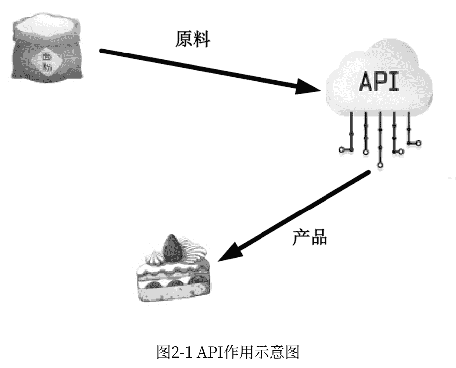

##### 2. API的功能

如果把互联网比作繁华智能城市，API相当于能打开所有智能设备的万能遥控器。它让不同应用像拼图一样完美咬合，创造出超乎想象的新体验。下面通过6个超能力揭开其面纱。

- **1）数据传输：信息的速递员**
想象你使用购物App，从选品到付款流畅无比。背后API像敬业速递员，负责在App间快速传递订单信息、支付状态等关键数据。当你点击“立即购买”时，API会迅速将购买意向传给商家后台，确保订单准确生成。

- **2）访问功能：功能的借东风**
天气预报App为何能准确给出未来一周天气？得益于API的访问能力。它像神通广大的“借风者”，可调用气象局数据接口获取最新信息。同样，地图App查找路线时，API也在默默工作，帮你从地图服务商获取准确导航信息。

- **3）集成服务：功能的万花筒**
API不仅传递信息，还能让应用“合体”发挥更大威力。例如社交App集成音乐API，可在分享生活点滴时添加背景音乐，让分享更生动。这种集成能力像万花筒，让应用功能多姿多彩。

- **4）自动化：效率的加速器**
在数字化时代，效率即生产力。API通过自动化机制大幅提升工作效率。例如图像处理App可利用API快速生成缩略图，浏览更流畅；客服系统通过API实现智能问答，快速响应用户，提升体验。

- **5）授权和身份验证：安全的守门员**
数字世界里安全第一。API像尽职守门员，负责验证用户身份与权限，确保只有授权用户能访问受保护资源。例如登录银行账户时，API会对身份进行验证，保障资金安全。

- **6）提供分析和监测功能：智慧的洞察者**
API不仅是信息通道，也是智慧洞察者。通过追踪应用与用户行为，可生成详细分析数据，帮助运营者了解需求、优化功能。例如电商App通过API分析购买行为，可精准推送个性化商品推荐，提升转化率。

此外，API还能创建SDK或库，简化代码开发，让开发者更专注于产品创新。

总之，API相当于神奇钥匙，打开应用间交流通道，让数据与功能共享融合，创造更丰富、便捷、智能的数字生活。

##### 3. API的应用场景

API渗透各行各业，成为连接数字世界的关键桥梁。以下是不同领域的深度应用。

- **1）移动应用程序开发**
API对移动应用开发者至关重要，它可解锁多种特定功能的实现潜力。借助API，移动应用能大幅增强功能多样性，为用户呈现更丰富、操作更便捷的体验。API不仅简化开发流程，还促进应用创新与发展，确保满足用户日益增长的多样化需求。

接口已成为看不见的生活底座

在日常使用中，调用早已渗透到各个环节。下面几组典型案例可帮助直观理解其运作逻辑。

- （1）外卖位置实时呈现：美团外卖对接地图服务，用户端能够即时查看骑手“距离您还有500米”的动态位置。
- （2）出行聚合比价：高德地图整合滴滴、曹操出行等二十余家出行平台的接口，迅速展示最近车辆与最优报价。

**2）网站开发**
搭建网站时，接口像汇流枢纽般把功能模块快速拼装。社交类站点借此完成信息分发，电商类站点依靠它实现支付结算，文件的上传下载也能直接挂接。通过引入外部能力，站点功能更丰富，使用体验也更贴合真实需求。

- （1）电商无跳转支付：淘宝接入支付宝接口，购物流程无需离开页面即可完成付款，交易成功率提升30%。
- （2）社交裂变传播：微信开放接口后，拼多多推出“砍一刀”玩法，用户分享总量突破10亿次，裂变效应极为强劲。

**3）互联网金融**
金融场景里，支付网关与身份核验接口是核心。依托这些能力，平台可把开户、转账、结算等流程无缝嵌入系统，大幅提升处理效率，同时让交易更便捷与安全，复杂业务被包装成直观操作。

- （1）刷脸快速开户：腾讯云以活体检测接口为微众银行搭建远程开户系统，身份核验3秒完成，欺诈率下降90%。
- （2）跨境秒级汇款：SWIFT 通过接口连通全球1.1万家银行，跨境到账时间由3天压缩到秒级，手续费降低60%。

**4）大数据开发**
在数据分析里，接口充当各种数据源的桥梁。开发者可便捷调用数据接口，从海量异构源中抽取信息，实现深度融合，为后续建模提供基础，从而更精准把握规律，为决策提供依据。

- （1）千人千面广告：字节跳动调用用户行为接口，构建个性化投放系统，点击率提升300%。
- （2）城市交通治理：杭州城市大脑接入12个部门接口，实时解析车流，实现红绿灯自适应配时，通行效率提升15%。

**5）物联网**
物联网环节，接口主导设备的远程操控与运维。借助接口，设备可做到远程监控、自动调节等高级能力，提升便捷性与服务质量，使用体验更流畅，技术也在向更智能方向发展。

- （1）全屋联动：小米 AI 音箱通过设备控制接口，让扫地机器人、空调等协同运行，形成全屋智能场景。
- （2）精准农业：荷兰温室农场用气候控制接口自动调节温湿度，番茄产量提升30%且能耗降低25%。

从移动终端到智慧城区，从金融交易到工业制造，接口正搭建数字时代的高速公路。它像数字胶水把异构系统粘合，让创新服务快速落地并持续推动产业升级。展望未来，随着人工智能、元宇宙等技术兴起，接口将继续担任创新引擎的关键角色。

#### 2.1.2 API 演进历程回顾
接口的发展与计算技术演进紧密关联，其历程可视为信息技术社会化的缩影。从雏形到今天，经历了6个关键阶段，逐步从底层工具成长为数字文明的核心基建。

##### 1. 程序设计萌芽期（20 世纪 50—80 年代）
技术特征：以函数库调用为代表的早期雏形，通过代码复用提升开发效率。
代表案例：UNIX 操作系统接口、C 语言标准库。
行业影响：奠定模块化编程基础，推动软件工程学科发展。

##### 2. 面向对象标准化（20 世纪 90 年代）
技术突破：CORBA、COM/DCOM 等规范建立了跨平台交互的标准。
关键进展：XML 语言为结构化数据交换铺平道路。
产业价值：企业级系统开始构建分布式架构，ERP 集成成为可能。

##### 3. Web 服务革命（2000—2005 年）
里程碑技术：SOAP 协议与 REST 风格确立了 Web API 设计范式。
生态建设：Amazon、eBay 等率先开放商业 API。
模式创新：催生 SaaS 商业模式，企业软件交付方式发生根本转变。

##### 4. 开放平台时代（2006—2015 年）
移动互联网驱动：iOS/Android SDK 推动移动应用生态爆发。
平台经济崛起：Facebook 开放图谱、Twitter API 构建社交网络生态。
技术演进：OAuth 认证协议解决 API 安全授权难题。

##### 5. 云原生与微服务（2016—2020 年）
架构变革：Docker 容器化与 Kubernetes 编排重构 API 部署模式。
技术融合：GraphQL 提升查询效率，gRPC 优化服务间通信。
行业渗透：银行开放 API 重构金融服务体系。

##### 6. 智能 API 新时代（2021 年至今）
技术前沿：AI 驱动型 API 如 GPT-3 实现自然语言交互。
万物互联：5G+IoT 推动边缘计算 API 快速发展。
治理升级：API 安全网关、流量监控成为数字基建关键组件。

当前，API 经济重塑全球数字化格局：天气预报接口支撑农业无人机精准作业、支付网关 API 每秒处理数万笔跨境交易、地图服务 API 构建起智能物流网络。随着低代码平台与 API 市场的成熟，调用正从开发者专属工具变为全民可用能力。未来，量子计算 API、脑机接口等新兴方向将持续拓展人机交互边界，推动社会向更智能协同演进。

#### 2.1.3 DeepSeek API 核心能力总览
DeepSeek 目前发布 DeepSeek-R1 与 DeepSeek-V3 两款大模型，并在其基础上提供自然语言处理、多模态处理等接口服务。

##### 1. 模型服务
（1）DeepSeek-V3：采用混合专家架构，擅长长文本处理与代码生成，支持64K 上下文，适用于百科问答等场景。
（2）DeepSeek-R1：推理优化模型，激活37B 参数，在数学、逻辑推理任务中表现突出，支持思维链输出，通过 reasoning_content 字段展示推理过程。

DeepSeek-V3 与 DeepSeek-R1 模型功能与性能对比如表2-1所示。

表2-1 DeepSeek-V3与DeepSeek-R1模型功能与性能对比

| 模型名称 | 上下文长度 | 最大思维链长度 | 最大输出长度 |
|---|---|---|---|
| deepseek-chat | 64K | — | 8K |
| deepseek-reasoner | 64K | 32K | 8K |

##### 2. 核心功能定位
- **1）文本生成能力**
适用场景：新闻速报、文学创作、营销文案、学术写作辅助。
技术优势：基于多源文本数据预训练的深度学习模型，支持长文本生成，可输出多样化风格。
案例：输入“科技改变生活”主题，接口可生成含具体行业案例的完整演讲稿。

- **2）代码生成与补全**
支持语言：Python、Java、C++ 等主流语言。
功能亮点：
- 按需求自动生成代码框架，如移动应用用户认证逻辑。
- 提供代码优化建议，提升算法效率。
- 编程教育场景：为初学者生成循环结构示例代码。
限制：复杂业务逻辑仍需人工调整，可能存在安全隐患。

- **3）知识问答与推理**
底层技术：结合知识图谱与预训练模型，支持数学计算、逻辑推理。
应用场景：智能客服、学术咨询。
特色输出：回答结构中 reasoning_content 字段可展示推理过程，增强解释性。

##### 3. API 设计
- **1）兼容性与调用方式**
接口格式与 OpenAI 兼容，开发者可直接使用 OpenAI SDK 调用，只需把 base_url 改为 https://api.deepseek.com/v1 并配置相应密钥。

提供 Python、Node.js 示例代码，通过 obj.chat.completions.create() 实现对话交互，默认非流式输出，需流式时设置 stream=True。

- **2）请求与响应参数**
关键参数：prompt、max_tokens、temperature 等。
响应字段：除标准 content 外，DeepSeek-R1 额外返回 reasoning_content，提供模型推理过程，可增强解释性输出。

### 2.2 在 DeepSeek App 中体验模型能力
DeepSeek 除网页版外，还推出 App 版本，便于随时随地使用。打开对话窗口即可免设置、无费用地体验模型能力，无论查询信息、创作文本还是寻求专业建议，都能获得高效直观响应。

网页端需访问 https://chat.deepseek.com/，无账号需先注册。网页版提供手机号与微信授权登录，如图2-2所示。


验证码登录 密码登录

您所在地区仅支持 手机号 / 微信 / 邮箱 登录

请输入手机号/邮箱地址

请输入密码

我已阅读并同意 用户协议 与 隐私政策

登录

忘记密码

立即注册

或

使用微信扫码登录
图2-2 网页端注册DeepSeek账号

注册完成后，可在对话框输入问题，点发送或按 Enter 键即可获取结果，如图2-3所示。

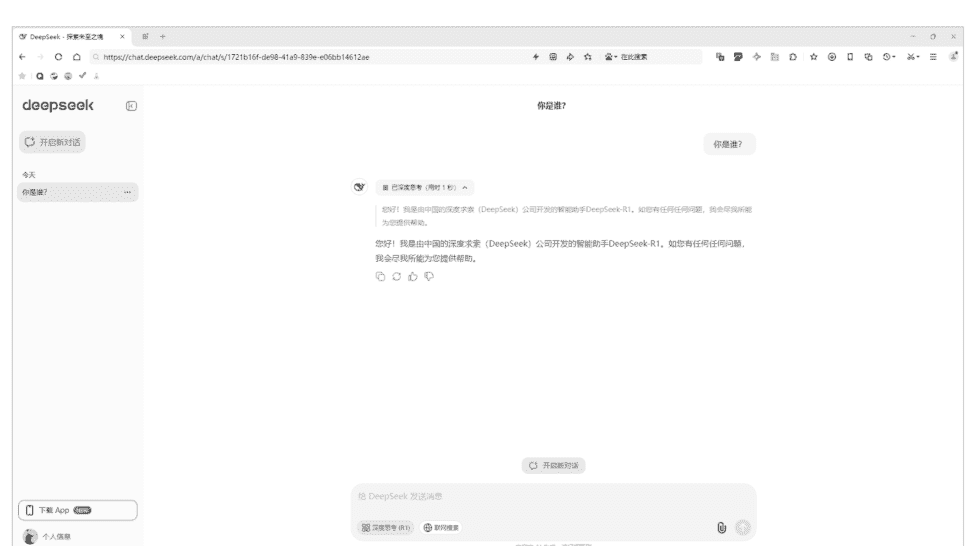
图2-3 网页端使用DeepSeek效果图

移动端需在应用商店搜索 DeepSeek 下载安装。App 提供手机号、微信、Apple ID 等登录方式，使用体验与网页端基本一致，如图2-4所示。

#### 你是谁？
你是谁？
已深度思考（用时 1 秒）
> 您好！我是由中国的深度求索（DeepSeek）公司开发的智能助手DeepSeek-R1。如果您有任何任何问题，我会尽我所能为您提供帮助。

您好！我是由中国的深度求索（DeepSeek）公司开发的智能助手DeepSeek-R1。如果您有任何任何问题，我会尽我所能为您提供帮助。

开启新对话

给 DeepSeek 发送消息

深度思考 (R1) 联网搜索
图2-4 App端使用DeepSeek效果图

### 2.3 使用 DeepSeek + VSCode 开发实践
AI 热度上升后，多行业通过技术提升效率，编程领域尤为明显。开发者期待仅用自然语言描述需求即可快速获得可用代码模块。Cursor 作为集成 GPT 系列大模型的 AI 编辑器，可实现自然语言编写、调试、优化代码。

但 Cursor 定价较高，Pro 版每月 20 美元，企业版每月 40 美元，对部分开发者构成压力。是否存在低成本替代？

目前 DeepSeek 结合开源编辑器的方案可提供相似体验。该组合整合 DeepSeek 的代码分析与生成能力，与功能强大的开源编辑器配合，构建经济高效环境。通过精细配置，可在很大程度上模拟 Cursor 体验，为预算有限的开发者提供福音。

#### 2.3.1 API 密钥获取与权限管理
获取 DeepSeek 接口密钥需前往开放平台 https://platform.deepseek.com/，用注册账号登录，如图2-5所示。

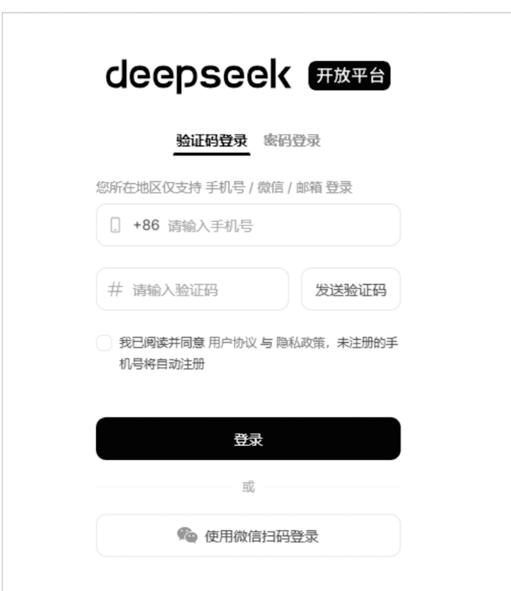
图2-5 登录DeepSeek开放平台

进入后选择 API keys，点创建 API key，输入名称以区分不同密钥，如图2-6所示。

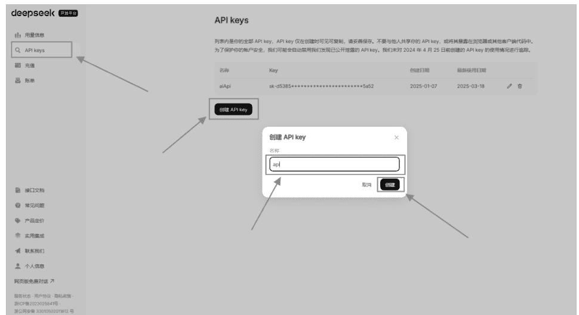
图2-6 创建DeepSeek API秘钥

创建成功会生成一串密钥，后续调用接口需用其鉴权，如图2-7所示。

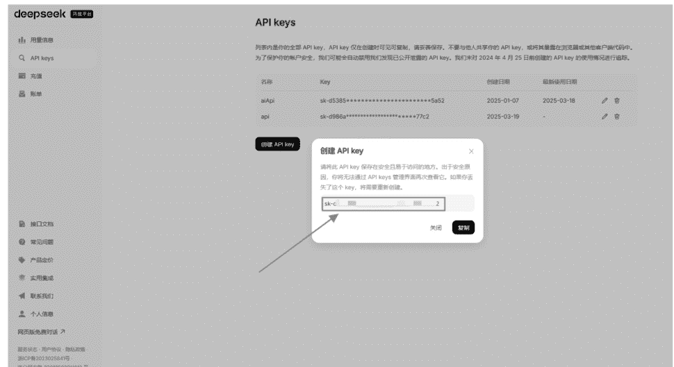
图2-7 生成的API秘钥
**需要注意：** 出于安全考虑，应妥善保管密钥，不要共享或暴露在浏览器等客户端代码中。密钥仅在生成时可完整查看，之后无法再看。若泄露或遗忘，可删除原密钥重新创建。

密钥创建后需确保账户余额充足。选择充值进入充值页面，可自由选择金额，如图2-8所示。

#### 2.3.2 VSCode 的下载安装与配置
VSCode 是微软开发的开源代码编辑器，支持多种语言与文件格式，涵盖 Markdown、Python、Java、PHP 等。使用前需前往官网 https://code.visualstudio.com/Download 下载安装，官方提供 Windows、Linux、Mac 版本，本书以 Windows 为例，如图2-9所示。


双击下载后运行.exe程序，按照安装向导指引，即可安装成功，运行效果如图2-10所示。


默认语言为英语，若不熟悉英语，可安装汉化插件。需点左侧侧边栏扩展图标，搜索 Chinese 汉化插件，点插件右下角 Install 按钮，安装成功后重启生效，如图2-11所示。


#### 2.3.3 通过 Cline 插件对接 DeepSeek API
Cline 是专为 Visual Studio Code 打造的高性能 AI 编程助手，融合大语言模型与先进工具链。可自动化繁琐任务、智能生成代码片段，并无缝执行各类命令。

首先在 VSCode 扩展市场搜索 Cline 插件安装，如图2-12所示。

安装成功后左侧侧边栏会出现机器人图标，点之即可使用。

初次使用前需配置 DeepSeek 密钥。点机器人图标打开面板，再点面板上的设置按钮进入设置页。

1. API 提供商选择 DeepSeek。
2. DeepSeek API Key 中粘贴开放平台创建的密钥。
3. Model 选择 deepseek-chat 即 DeepSeek V3 用于辅助编程。

具体配置如图2-13所示。

配置完成后点完成保存，再点 Cline 面板的加号新建任务按钮切换至对话框，即可提出需求进行辅助编程。


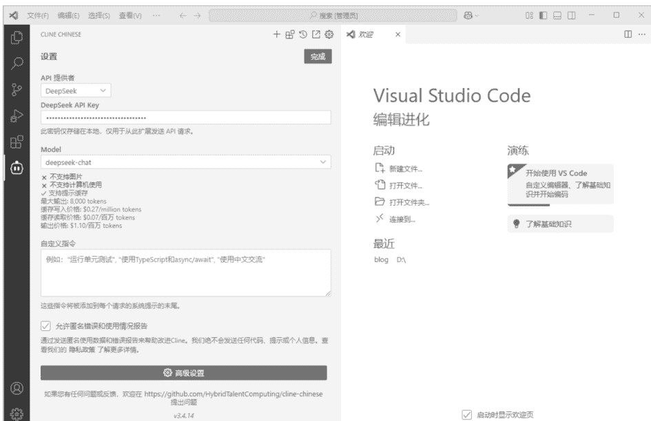
通过文件选项创建一个名为 DEMO 的项目文件夹，创建一个名为 demo1 的 py 文件，最后在 Cline 对话界面提出需求。例如“请使用 Python 语言实现一个冒泡排序”，如图2-14所示。

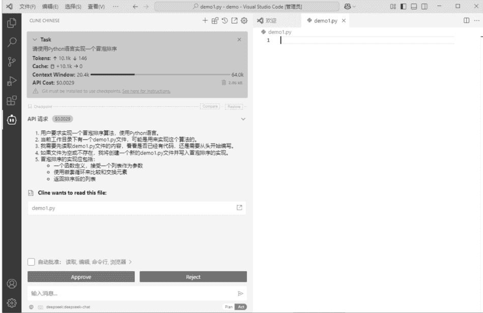
Cline 会分析任务要求并自动读取本地文件信息，如读取到空白的 demo1.py 文件，最终代码可保存至其中，随后给出冒泡排序的初步实现思路，包含函数定义、嵌套循环比较与元素交换，以及排序后结果输出。点对话界面的 Approve 批准按钮，Cline 即可将完整冒泡排序算法保存到 demo.py 文件中，效果如图2-15所示。

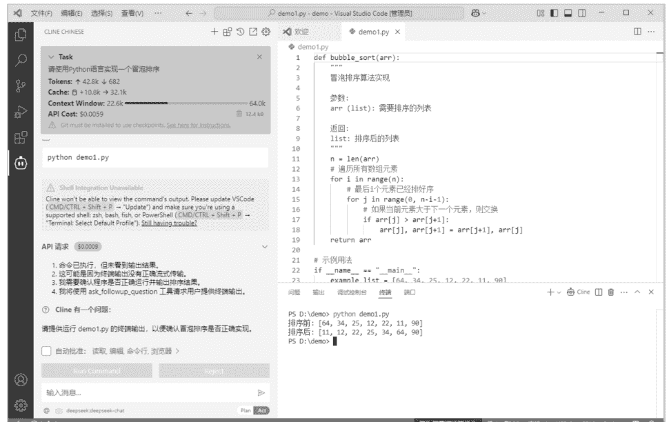

### 2.4 DeepSeek 核心功能调用详解

想上手 DeepSeek API，直接去官方文档 https://api-docs.deepseek.com/zh-cn/ 学习最快，官方里备好了基础示例可以照着跑。

#### 2.4.1 首次接入 API
DeepSeek API 在接口层面与 OpenAI 保持兼容，换句话说，调好配置后就能用 OpenAI 的 SDK 直接连上 DeepSeek，任何支持 OpenAI 协议的客户端也无需改动即可接入，兼容性非常友好。OpenAI 风格的接入参数如下表。

**表2-2 OpenAI API的要求标准**

| 参 数 | 值 |

|---|---|

| base_url * | https://api.deepseek.com |

| api_key | apply for an API key |

(1) 为了保持兼容，建议把 base_url 设为 https://api.deepseek.com/v1 来调用，这里 v1 指的是接口版本，不是模型版本。
(2) 模型层面，deepseek-chat 已经被升级为更强的 DeepSeek-V3，但调用方式没变，请求里写 model='deepseek-chat' 即可自动命中升级后的版本。
(3) 推理模型 DeepSeek-R1 通过 deepseek-reasoner 标识，请求中指定 model='deepseek-reasoner' 就能使用。

拿到 API Key 后就能跑示例，以 Python 为例的调用片段如下：

```python
from openai import OpenAI

client = OpenAI(api_key="<DeepSeek API Key>", base_url="https://api.deepseek.com")

response = client.chat.completions.create(
    model="deepseek-chat",
    messages=[
        {"role": "system", "content": " 你是一个乐于助人的助手 "},
        {"role": "user", "content": " 你好 "},
    ],
    stream=False
)

print(response.choices[0].message.content)
```

执行前记得把自己的密钥替换进去，并先安装好 OpenAI 模块，安装命令如下：

```bash
pip3 install openai
```

正常运行后会得到类似这样的回复：

你好！很高兴见到你，有什么我可以帮忙的吗？无论是学习、工作还是生活中的问题，都可以告诉我哦！

**注意：** 默认是非流式返回，要等模型把完整结果算完才输出。若需要流式输出，只需把脚本里的 stream 参数改为 true 即可。

流式输出的示例代码如下：

```python
from openai import OpenAI

client = OpenAI(api_key="<DeepSeek API Key>", base_url="https://api.deepseek.com")

response = client.chat.completions.create(
    model="deepseek-chat",
    messages=[
        {"role": "system", "content": " 你是一个乐于助人的助手 "},
        {"role": "user", "content": " 你好 "},
    ],
    stream=True
)

##### （流式输出方式）：
for chunk in response:
    content = chunk.choices[0].delta.content
    if content:  # 过滤空内容片段
        print(content, end="", flush=True)
```

#### 2.4.2 代码补全与文本续写
DeepSeek API 提供了 FIM 功能，即 Fill-In-the-Middle，一种根据已有上下文自动填充中间空白的自然语言处理技术，可用于代码生成和文本补全。

做代码补全的调用示例如下：

```python
from openai import OpenAI

client = OpenAI(
    api_key="<your api key>",
    base_url="https://api.deepseek.com/beta",
)

response = client.completions.create(
    model="deepseek-chat",
    prompt="def fib(a) :",
    suffix="    return fib(a-1) + fib(a-2) ",
    max_tokens=128
)

print(response.choices[0].text)
```

这里用 prompt 告诉模型开头内容，用 suffix 指定结尾内容，模型会自动补全中间部分，运行效果如下：

```python
if a == 0:
    return 0
elif a == 1:
    return 1
else:
```

使用补全接口时要注意三点：

1. 单次最大补全长度为 8K。
2. 需要把 base_url 设为 https://api.deepseek.com/beta 来开启 Beta 功能。
3. 补全时 suffix 可以省略。

#### 2.4.3 多轮对话与上下文管理
多轮对话本质上是一串连续的信息交换，模型需要记住并利用上下文保持连贯。为了保证稳定，每一轮都要把前面轮次的问答拼接起来一起发。

DeepSeek API 支持多轮调用，示例代码如下：

```python
from openai import OpenAI
client = OpenAI(api_key="<DeepSeek API Key>", base_url="https://api.deepseek.com")

##### Round 1
messages = [{"role": "user", "content": " 世界上最高的山是什么？ "}]
response = client.chat.completions.create(
    model="deepseek-chat",
    messages=messages
)

messages.append(response.choices[0].message)
print(f"Messages Round 1: {messages}")

##### Round 2
messages.append({"role": "user", "content": " 第二高是什么？ "})
response = client.chat.completions.create(
    model="deepseek-chat",
    messages=messages
)

messages.append(response.choices[0].message)
print(f"Messages Round 2: {messages}")
```

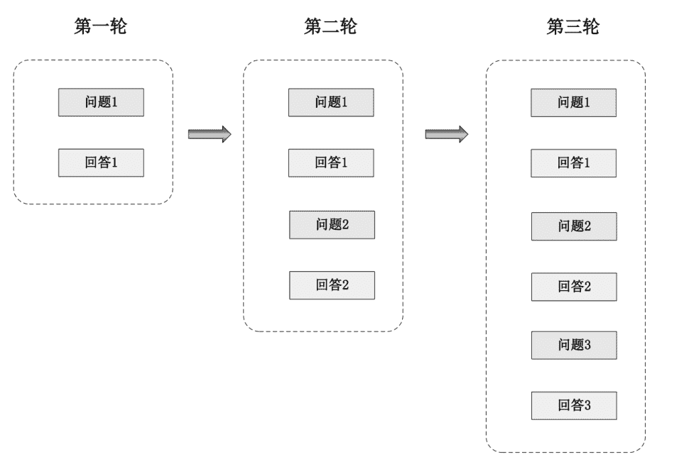

示例中做了两轮对话，用 messages 数组保存历史记录，第二轮提问时同时带上第一轮的问答，运行效果如下：

Messages Round 1:

```python
[{'role': 'user', 'content': '世界上最高的山是什么？'},
ChatCompletionMessage(content='世界上最高的山是**珠穆朗玛峰**（Mount Everest），它位于喜马拉雅山脉，跨越中国和尼泊尔边界。珠穆朗玛峰的海拔高度为**8848.86米**（根据2020年中国和尼泊尔的联合测量结果），是地球上海拔最高的山峰。由于其高度和攀登难度，珠穆朗玛峰吸引了全球登山爱好者的关注，成为登山界的终极挑战之一。', refusal=None, role='assistant', audio=None, function_call=None, tool_calls=None) ]
```

Messages Round 2:

```python
[{'role': 'user', 'content': '世界上最高的山是什么？'},
ChatCompletionMessage(content='世界上最高的山是**珠穆朗玛峰**（Mount Everest），它位于喜马拉雅山脉，跨越中国和尼泊尔边界。珠穆朗玛峰的海拔高度为**8848.86米**（根据2020年中国和尼泊尔的联合测量结果），是地球上海拔最高的山峰。由于其高度和攀登难度，珠穆朗玛峰吸引了全球登山爱好者的关注，成为登山界的终极挑战之一。', refusal=None, role='assistant', audio=None, function_call=None, tool_calls=None),
{'role': 'user', 'content': '第二高是什么？'},
ChatCompletionMessage(content='世界上第二高的山峰是**乔戈里峰**（K2），位于喀喇昆仑山脉，跨越中国和巴基斯坦边界。乔戈里峰的海拔高度为**8611米**，仅次于珠穆朗玛峰。尽管乔戈里峰的高度略低于珠穆朗玛峰，但其攀登难度更大，气候条件更为恶劣，因此被称为“野蛮之峰”。乔戈里峰的攀登死亡率较高，是世界上最危险的山峰之一。', refusal=None, role='assistant', audio=None, function_call=None, tool_calls=None) ]
```

#### 2.4.4 函数调用与工具集成（如Word/Excel VBA编程）
把 DeepSeek API 封装成函数后可以集成到办公软件里，比如在 Word 或 Excel 中辅助写作、计算分析。Excel 的交互需要用 VBA 编写请求代码，并保存为宏一键调用。

**步骤01** 开启宏。
Excel 默认关闭宏以防病毒，先打开它：
1. 新建 Excel 文档，点“文件”→“选项”。
2. 在“Excel 选项”里选“信任中心”，如图2-18 所示。


3. 点“信任中心设置”。
4. 在“宏设置”里选“启用所有宏”，并勾选“信任对 VBA 工程对象模型的访问”，如图2-19 所示。

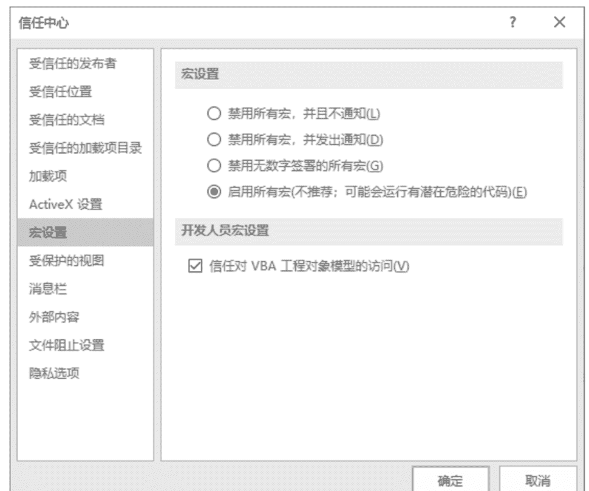

5. 点“确定”，宏就开启了。

**步骤02** 开启开发工具选项。
开发工具能更顺畅地编辑宏：
1. 打开 Excel 文档，点“文件”→“选项”→“自定义功能区”，勾选“开发工具”，如图2-20 所示。

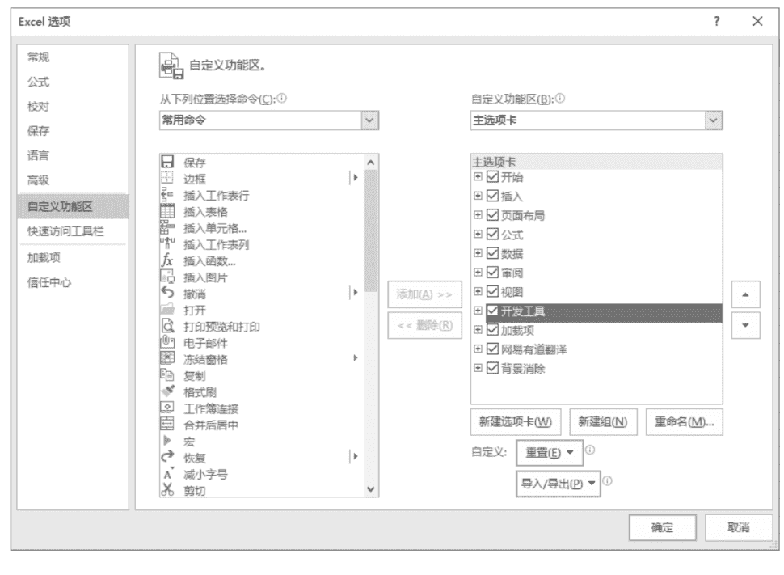

2. 点“确定”，工具栏会出现“开发工具”选项卡，如图2-21 所示。


##### 步骤03 编写VBA宏代码
通过宏发送请求调用 DeepSeek API 并取回结果，能大幅提升工作效率。具体步骤如下：

（1）打开 Excel 文档，切到“开发工具”选项卡，如图2-22 所示。


图2-22 编写DeepSeek宏文件（一）

（2）点 Visual Basic 按钮打开 VBA 窗口，如图2-23 所示。


图2-23 编写DeepSeek宏文件（二）

（3）选“插入”→“模块”，新建一个名为“模块1”的模块，如图2-24 所示。


图2-24 编写DeepSeek宏文件（三）

（4）在模块里写入调用 DeepSeek API 的 VBA 代码，示例如下：

```
Option Explicit
Private Declare PtrSafe Function VBA_StartEdge Lib "libEdge.dll" _
        (Optional ByVal userDataFolder As String = "C:\Temp", _
        Optional ByVal xPos As Long = 1200, _
        Optional ByVal yPos As Long = 200, _
        Optional ByVal width As Long = 600, _
        Optional ByVal height As Long = 800, _
        Optional ByVal timeOut As Long = 5000) As Long
Private Declare PtrSafe Function VBA_StopEdge Lib "libEdge.dll" _
        (Optional ByVal deleteData As Boolean = 0, Optional ByVal timeOut As Long = 2000) As Long
Private Declare PtrSafe Function VBA_Navigate Lib "libEdge.dll" _
        (ByVal url As String, _
        Optional ByVal timeOut As Long = 5000) As Long
Const KEY = "你的API key"
Const DEMOPAGENAME = "https://duzhenshequ.com/vba/index.html?key=" + KEY
' 打开
Sub RunDemo_Click()
    Dim result As Long
    result = DoDemo()
    If result <> 0 Then MsgBox "Error " & result, vbSystemModal
End Sub
Private Function DoDemo() As Integer
    Dim result As Long
    Dim timeOut As Long
    Dim elemIndex As Integer
    Dim count As Integer
    Dim jsResult As String
    Dim allElements As String
    Dim js As String
    Dim path As String
    Dim demoPage As String
    Application.Visible = True
    ' 文件所在路径
    path = Application.ActiveWorkbook.path & ""
    ChDir path
    On Error Resume Next
    DoDemo = VBA_StopEdge(True)
    On Error GoTo 0
    ' 启动浏览器
    DoDemo = VBA_StartEdge()
    If DoDemo <> 0 Then Exit Function
    ' 将页面加载到 DOM 中
    demoPage = DEMOPAGENAME
    DoDemo = VBA_Navigate(demoPage)
    If DoDemo <> 0 Then Exit Function
    Exit Function
End Function
```

##### 步骤04 创建宏快捷方式

Excel 功能区挂上 DeepSeek 一键启动

要在 Excel 里面更顺手地跑 DeepSeek，最省心的方案就是把调用宏的按钮放到功能区里，按一下就能触发。整体思路是先在功能区新建一个自定义分组，把执行宏的命令放进去，再改个名称就能直接用。具体操作如下：

（1）打开一份 Excel 文档，走 文件 → 选项 → 自定义功能区 的路径。左侧在“开始”标签上点右键，从快捷菜单里选“新建组”，如图2-25所示。

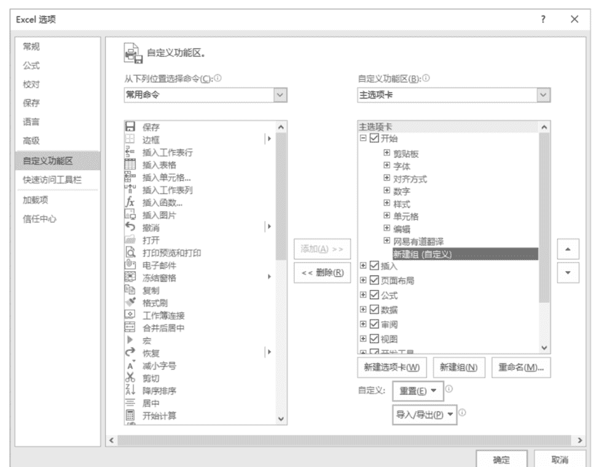

图2-25 创建宏文件的快捷方式（一）

（2）在“自定义功能区”里通过下拉框把命令来源切到“宏”，找到名为 RunDemo_Click 的宏，把它拖进刚建好的分组里，如图2-26所示。

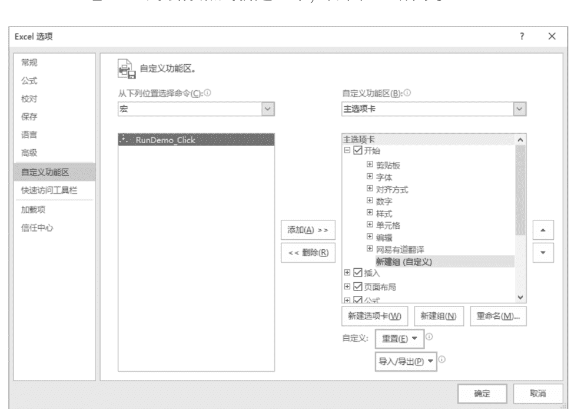

图2-26 创建宏文件的快捷方式（二）

（3）同时选中新建的分组和 RunDemo_Click，进行重命名。建议把分组改成 DeepSeek，命令改成“DeepSeek插件”，图标样式也可以按自己喜好调，如图2-27所示。

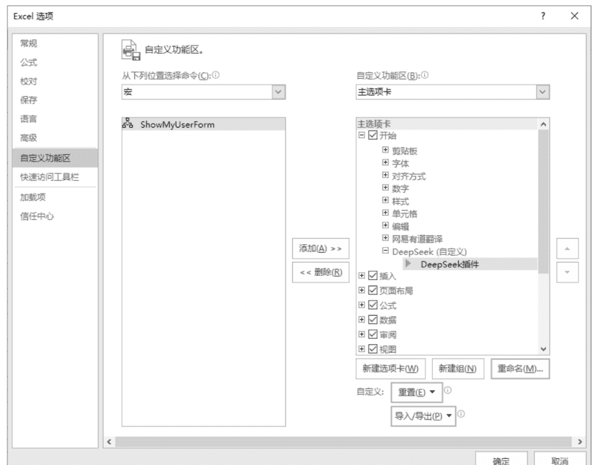

图2-27 创建宏文件的快捷方式（三）

（4）回到工作簿，刷新“开始”选项卡，最右侧就会出现“DeepSeek插件”按钮，如图2-28所示。


图2-28 创建宏文件的快捷方式（四）

（5）点一下该按钮即可唤起插件，如图2-29所示。

下面用一个实操例子演示如何借助 DeepSeek 快速生成 Excel 模板。

以学生名单和科目生成空白成绩表为例：

1. 打开“DeepSeek插件”，在“内容”文本框里填入“学生：张三、李四、王五、马六、冯七，科目：语文、数学、英语”。
2. 在“需求”文本框里写“根据内容生成一张未填写成绩的学生成绩 Excel 表”。
3. 点“提交”按钮，等待模型返回结果，如图2-30所示。
4. 把返回的表格复制到 Excel 中即可使用，如图2-31所示。

▲图2-29 创建宏文件的快捷方式（五）

以下是根据您提供的内容生成的未填写成绩的学生成绩Excel表格的示例：

| 学生 | 语文 | 数学 | 英语 |

|---|---|---|---|

| 张三 | | | |

| 李四 | | | |

| 王五 | | | |

| 马六 | | | |

| 冯七 | | | |

您可以将此表格复制到Excel中，并根据需要填写成绩。

▲图2-30 生成学生成绩表


| 学生 | 语文 | 数学 | 英语 |

|---|---|---|---|

| 张三 | | | |

| 李四 | | | |

| 王五 | | | |

| 马六 | | | |

| 冯七 | | | |

▲图2-31 学生成绩表

### 2.5 请求与返回格式规范及使用注意

调用 DeepSeek API 时，请求和返回都必须遵循统一的格式约定。规范化有助于保证数据准确、处理高效，也能提升整体使用体验。使用者需要熟悉并遵守这些约定，才能实现顺畅交互。

#### 2.5.1 输入格式要求与示例

发起请求时，最需要留意的是请求体中模型相关配置的写法。部分核心参数示例如下：

```
model="deepseek-chat",

messages=[

{"role": "system", "content": "你是一个乐于助人的助手"},

{"role": "user", "content": "你好"},

],

stream=False

temperature=0.7,

max_tokens=500
```

上述关键参数说明如下。

（1）model：用于指定模型版本，必填。
（2）messages：对话历史，角色可为 system、user、assistant 等。
（3）stream：控制输出方式，默认 False 为非流式，设为 True 则以 SSE 形式流式返回。
（4）temperature：生成文本的随机性，取值 0~2。
（5）max_tokens：单次生成结果的最大长度，取值 1~8192。

#### 2.5.2 输出格式解析与应用

当未开启流式传输，即 stream=False 时，API 会返回完整的 ChatCompletion 对象，可通过内置的 .model_dump() 方法转为字典。返回结构示例如下：

```
{
    'id': 'd1bc67d8-a75e-401e-a674-a8dc6a4febf7',
    'choices': [{
        'finish_reason': 'stop',
        'index': 0,
        'logprobs': None,
        'message': {
            'content': '你好！很高兴见到你。今天有什么我可以帮忙的吗？无论是学习、工作还是生活中的问题，我都很乐意为你提供帮助。',
            'refusal': None,
            'role': 'assistant',
            'audio': None,
            'function_call': None,
            'tool_calls': None}}],
    'created': 1742537752,
    'model': 'deepseek-chat',
    'object': 'chat.completion',
    'service_tier': None,
    'system_fingerprint': 'fp_3a5770e1b4_prod0225',
    'usage': {
        'completion_tokens': 27,
        'prompt_tokens': 10,
        'total_tokens': 37,
        'completion_tokens_details': None,
        'prompt_tokens_details': {
            'audio_tokens': None,
            'cached_tokens': 0},
        'prompt_cache_hit_tokens': 0,
        'prompt_cache_miss_tokens': 10}
}
```

上述部分关键参数的作用与含义如下。

id：本次请求的唯一标识，用于追踪日志或调试问题。
model：模型标识符，标明本次响应使用的模型版本。
created：请求时间戳，UNIX 时间戳，可通过 datetime.fromtimestamp() 转换。
object：对象类型标识，表明这是一个标准对话补全响应。
choices：响应结果内容的数组。
finish_reason：生成终止原因。stop 为正常停止，length 为达到最大 token 限制。
message：会话信息，包含 content 助手生成的文本内容、role 消息角色等。
usage：Tokens 消耗统计相关信息，包含 prompt_tokens 输入提示消耗的 Token 数、completion_tokens 生成内容消耗的 Token 数、total_tokens 总 Token 消耗、prompt_cache_hit_tokens 缓存命中的 Token 数、prompt_cache_miss_tokens 缓存未命中的 Token 数等。

#### 2.5.3 计费方式与数据安全

DeepSeek 官方提供的 API 服务，可以花费极低的费用使用完善的 AI 模型能力。DeepSeek 模型的 API 价格如表2-3所示。

Token 是模型用来表示自然语言文本的基本单位，也是计费单元，可以直观地理解为“字”或“词”；通常 1 个中文词语、1 个英文单词、1 个数字或 1 个符号计为 1 个 token。

一般情况下，模型中 token 和字数的换算比例大致如下：

1 个英文字符 ≈ 0.3 个 token。
1 个中文字符 ≈ 0.6 个 token。

AI 大模型在实际应用过程中，数据安全与政策合规性是两大核心挑战，直接关乎模型的法律地位、用户隐私权的维护及模型的平稳运行。

表2-3 DeepSeek模型API费用明细

| 模型 | 标准时段价格（北京时间 08:30-00:30） | | | 优惠时段价格（北京时间 00:30-08:30） | | |

|---|---|---|---|---|---|---|

| | 百万 tokens 输入价格（缓存命中） | 百万 tokens 输入价格（缓存未命中） | 百万 tokens 输出价格 | 百万 tokens 输入价格（缓存命中） | 百万 tokens 输入价格（缓存未命中） | 百万 tokens 输出价格 |

| DeepSeek-chat | 0.5 元 | 2 元 | 8 元 | 0.25 元（5 折） | 1 元（5 折） | 4 元（5 折） |

| DeepSeek-reasoner | 1 元 | 4 元 | 16 元 | 0.5 元（5 折） | 2 元（5 折） | 8 元（5 折） |

表2-4所示为DeepSeek与其他主流AI大模型数据安全的对比。

表2-4 DeepSeek与其他主流AI大模型数据安全的对比

| 模型 | 中国算法备案 | GDPR 合规 | 等保三级 | 私有化部署 |

|---|---|---|---|---|

| DeepSeek | ✔ | ✘ | ✔ | ✔ |

| GPT-4 | ✘ | ✔ | ✘ | 企业版 |

| Claude 3 | ✘ | ✔ | ✘ | ✘ |

| Gemini 1.5 | ✘ | ✔ | ✘ | ✘ |

| 文心一言 | ✔ | ✘ | ✔ | ✔ |

| 豆包 | ✔ | ✘ | ✔ | ✔ |

| 讯飞星火 | ✔ | ✘ | ✔ | ✔ |

说明：

1. 中国算法备案
国内模型如文心一言、讯飞星火、豆包等已完成备案，而国外模型如GPT-4、Gemini、Claude 3 未备案。

2. GDPR合规
国外模型更侧重欧洲数据保护合规，国内模型较少专门适配。

3. 等保三级
国内模型需满足中国信息安全等级保护要求，国外模型通常不参与。

4. 私有化部署
国内模型普遍支持私有化部署，而国外模型仅部分提供企业版，如GPT-4，其他如Claude、Gemini 1.5等暂不支持。

备注：
- 豆包默认继承国内模型的合规特征。
- Gemini 1.5 作为升级版，合规性与原版一致。
- Claude 3 作为海外模型，未适配中国本土认证。
- 国际模型在中国境内使用存在数据跨境风险。
- 豆包因依赖UGC内容，需警惕生成内容版权纠纷。

### 2.6 拓展知识与实操技巧

当前 AI 技术快速演进，DeepSeek 等大模型凭借强大的自然语言处理能力和智能化水平，已成为推动各行业创新的核心驱动力。本节系统梳理相关知识，并总结实操技巧，无论是新手还是资深用户，都能从中获得参考，帮助探索更广阔的应用空间。

#### 2.6.1 知识拓展

1. 关于API限速
DeepSeek API 不限制并发量，原则上会尽力保证每条请求的服务质量。但在高负载时，请求提交后可能需要等待一段时间才返回。为维持 HTTP 连接活跃，采用以下机制：
（1）非流式请求：持续返回空行，保持连接不断开。
（2）流式请求：发送 SSE 的 keep-alive 注释，格式为 keep-alive，确保连接活跃。
这些手段不影响 OpenAI SDK 对最终 JSON 的解析。若自行处理 HTTP 响应，需妥善处理空行或注释，避免数据丢失。
另外，若请求在提交后 30 分钟内仍未完成，服务器会主动断开连接以保障系统稳定。设计处理逻辑时应考虑此情况。

2. 关于响应结果代码
调用 DeepSeek API 时可能出现错误，常见错误类型见表2-5。
表2-5 DeepSeek API调用常见错误码

#### 2.6.2 技巧分享

不同场景对模型回答的要求不同。例如文学创作期望更具新意，代码编写则更重准确性。因此需针对场景调整 temperature 参数，不同场景建议值见表2-6。
表2-6 不同应用场景下temperature参数的设置

| 场景 | Temperature（温度）值 |

|---|---|

| 代码生成 / 数学解题 | 0.0 |

| 数据抽取 / 分析 | 1.0 |

| 通用对话 | 1.3 |

| 翻译 | 1.3 |

| 创意类写作 / 诗歌创作 | 1.5 |

## 第3章 DeepSeek基于Coze的智能体开发

### 本章导读

欢迎进入本章导读，我们将一起探索DeepSeek基于Coze的智能体开发。本章旨在全面介绍智能体的基础知识，通过Coze平台体验智能体的构建与运作，并结合DeepSeek实践其开发与应用。此外，还有两大实战项目：智能客服机器人开发与小红书爆款生成，让读者亲身体验智能体开发的乐趣。最后，还将分享更多Coze平台智能体开发的精髓与技巧。

首先，将从智能体的概述开始，介绍智能体的定义、基本特征和分类。智能体作为人工智能的重要概念，连接着现实世界与数字世界。了解这些基础知识，有助于读者深入理解智能体的本质及其在开发中的作用。

接着，将探讨智能体的实现与应用场景。Coze平台是一个集成了先进技术和资源的智能体开发平台，能够轻松构建并部署智能体。同时，智能体在智能家居、智慧城市、智能医疗等领域都有广泛应用，展现了其在现代社会中的重要地位。

然后，将通过实战项目深入体验智能体的开发过程。智能客服机器人开发将教读者如何在Coze平台上结合DeepSeek构建自动回答问题的智能客服；而小红书爆款生成则展示如何利用智能体分析用户行为、预测趋势，生成热门内容。

最后，在知识拓展与技巧分享部分，将介绍一些Coze平台智能体开发的拓展知识与技巧，帮助读者更高效地进行开发。同时，还将分享行业内的最佳实践与案例，让读者在开发过程中少走弯路。

通过本章的学习，读者将全面掌握DeepSeek基于Coze的智能体开发的基础知识、实战应用及拓展知识，为人工智能领域的探索与实践提供有力支持。让我们一同踏上这段精彩的旅程，探索智能体开发的无限潜能吧！

### 知识导读

本章要点（已掌握的在方框中打钩） □
- 了解智能体。 □
- 掌握Coze智能体的创建及知识库的配置。 □
- 掌握Coze智能体工作流的构建。

在当今这个科技日新月异的时代，人工智能正以一种前所未有的速度和规模深刻地重塑着我们的生活方式。在这一波澜壮阔的人工智能浪潮中，AI智能体作为推动AI技术广泛应用的关键要素，扮演着举足轻重的角色。简而言之，AI智能体是一种集成了自主感知、决策制定与任务执行能力的高级智能系统，它仿佛是一个配备了“智慧大脑”的虚拟实体，能够依据周围环境的动态变化，灵活做出精准的判断并采取相应的行动，展现出与人类相似的智能水平。

### 3.1 智能体概述

随着科技的飞速发展，智能体作为人工智能领域的一个重要概念，正逐步从理论走向实践，深刻地改变着我们的生活方式和社会结构。智能体，这一能够自主感知环境、做出决策并执行行动的系统，正引领我们进入一个自主决策与智能融合的新时代。

#### 3.1.1 什么是智能体

智能体，简而言之，是指能够自主感知环境、做出决策并执行行动的系统。智能体具备自主性、交互性、反应性和适应性等基本特征，能够在复杂多变的环境中独立完成任务。智能体的核心在于其具备的学习和决策能力。通过学习算法和数据分析，智能体能够从海量数据中提取有用的信息，形成自己的知识库，并在决策过程中综合考虑各种因素，运用逻辑推理、概率统计等方法，做出最优的决策。

自动驾驶汽车就是一个典型的智能体应用。自动驾驶汽车通过搭载各种传感器如摄像头、雷达、激光雷达等和计算机设备，能够实时感知周围环境的变化，如道路状况、交通信号、行人和其他车辆等。然后，通过复杂的算法和模型，它能够对这些信息进行分析和处理，做出决策，如加速、刹车、转向等，从而实现自主驾驶。

#### 3.1.2 智能体的基本特征

智能体的基本特征包括自主能力、交互能力、反应能力和适应能力。这些能力使得智能体能够在不同的环境中独立行动，与其他智能体或人类进行交互，对外部刺激做出反应，并根据经验调整自身的行为。

1. 独立决策力：可以说这是智能主体的核心所在。它能在没有人实时干预的前提下自行判断并执行。以智能家居为例，系统会监测室内的温湿状况，自动调节空调与加湿器的输出，让人住得更舒适。这种不依赖人工的判断，不仅提升了使用体验，也体现了主体在真实场景中的价值。

2. 协作交互力：主体除了解放双手完成任务，还能与其他主体或人交流配合。以自动驾驶为代表，车辆必须持续感知红绿灯、周围车流和行人的意图，确保安全通行。不断的信息交换让环境认知更立体，决策也更稳健。这类交互能力强化了环境适应力，也为多主体协同和人机合作打开了新空间。

3. 快速响应力：面对变化，反应速度直接决定成败。在工业机器人场景里，主体需要即时捕捉产线变化并马上执行动作。比如流水线上的机械臂，可按生产指令实时调整作业流和运行节奏，保证效率与品质。敏捷的应变让主体在复杂多变的工作环境中保持竞争力。

4. 自我进化力：从过往经验中微调行为，是主体区别于传统程序的关键。智能推荐就是典型，它会依据用户的点击、反馈和行为轨迹不断优化排序逻辑，提升命中率与满意度。持续学习的能力提高了智能化程度，也让落地场景更宽广。

#### 3.1.3 智能体的分类

分类维度很多，按功能特性和落地领域来划分最直观。在这一视角下，自主型主体与反应型主体构成两大支柱，折射出人工智能的不同面向。

自主型主体是指能够摆脱人工直接操控、依托内置规则和目标独立运行的实体，在工业自动化、无人驾驶等前沿赛道发挥关键作用。以无人驾驶车为例，这类主体搭载高精度感知硬件与先进算法，能在复杂路况中自主规划路径、灵活动态避障并完成运输，显著提升了通行效率与安全水平。

反应型主体则更强调实时感知与即时回应。它以反应机制为基础，能迅速解析环境变化并调整策略，在机器人控制、游戏AI等领域应用广泛。比如《星际争霸》这类策略游戏中，反应型主体通过学习玩家的习惯和战术布置，可以即时改变对战策略，营造更智能、更具挑战性的对手体验，让游戏互动更丰富。

除此之外，还存在基于模型的代理和基于学习的代理等形态，各有侧重，适配不同需求。比如在医疗健康场景，基于学习的代理能够挖掘海量病历数据，为医生提供更精准的诊断参考和治疗优化方案，推动医疗服务向智能化与精准化发展。

分类的多样性体现了人工智能的广阔适用面，也指向未来走向。随着深度学习与强化学习等技术的成熟，主体在自主性、适应性和学习力上的表现将持续升级，未来会出现更多功能更高级、能力更复杂的智能主体，在各行业扮演更重要的角色，推动技术进入新阶段。

### 3.2 智能体的实现与应用场景

工程上构建主体需要融合多项前沿技术，关键在于形成感知—决策—执行的闭环。当前这些系统已在制造、无人驾驶、医疗、金融、智能家居、教育等多个方向释放潜力，逐步成为推动社会进步和改善生活质量的力量。随着感知、决策与执行能力的持续优化，主体正提供更高效、更智能的服务，为未来发展开辟新路径。

#### 3.2.1 智能体的技术基础与实现方法

技术底座主要建立在人工智能、机器学习与深度学习等研究成果之上，赋予其强大的数据处理、分析与决策能力。例如卷积神经网络在图像识别上取得突破，让主体能够“看见”并理解世界，手机人脸解锁就是典型落地。

实现路径依赖于规则决策、机器学习与强化学习等算法模型。其中强化学习尤为突出，它让主体在与环境的持续互动中学习最大化奖励信号，从而不断优化行为策略。AlphaGo是经典案例，它通过试错与学习，在与人类顶尖棋手对弈中实现超越。

#### 3.2.2 智能体的广泛应用与前景

不同领域的渗透正在加速，影响力持续扩大。

智能家居里，主体整合传感器、控制器与通信模块，实现环境智能化管理。智能音箱不仅能响应语音指令播放音乐、查询天气，还可联动灯光、空调等设备调节亮度和温度，显著提升居住便利与舒适度。

医疗健康领域展现出巨大价值。智能诊断系统可解析X光、CT等医学影像，辅助医生判断疾病。研究显示，其在部分常见病诊断上的准确率已能达到甚至超过部分专业医生的水平。此外，主体还能结合个体特征给出个性化治疗建议，提升疗效与生存率。

金融领域，智能投顾成为零售投资新趋势。以先锋集团的Personal Advisor Services为例，依托主体技术融合宏观经济、市场数据与投资者偏好，为超百万用户定制个性化组合，提升回报并降低成本。

教育领域，主体可依据学习进度与表现提供个性化方案。在线学习平台利用主体分析学习数据，推荐适配资源与练习题，提升教学效果。

娱乐领域，主体为游戏带来更智能互动。例如角色扮演游戏中，主体扮演NPC，与玩家实时交流并按玩家选择做出不同反应，增强趣味与沉浸感。

### 3.3 项目实战演练

为抢占AI主体赛道，加速落地应用，众多科技公司纷纷投入资源打造自有平台。字节跳动推出Coze，腾讯推出元器，百度推出AgentBuilder。这些产品为研发提供有力支撑，也为未来广泛应用奠定基础。

#### 3.3.1 智能客服机器人开发

随着互联网发展和业务扩张，客户服务需求激增。传统人工客服在响应速度、服务时段与人力成本上暴露出明显瓶颈，成为制约服务质量提升的关键。

人工智能的快速发展让智能客服机器人成为有效解法。它能大幅提升响应速度，打破时间限制，降低人力投入，同时借助数据分析实现客户画像与需求预测，提供个性化推荐，进一步提升服务品质。

下面以Coze工作台结合DeepSeek大模型打造智能客服机器人，提升客服效率。

步骤01 开通Coze账号。打开Coze官网 https://console.volcengine.com/auth/login/?scenario=coze 完成注册。

步骤02 新建AI智能体。登录后点击左侧“+”，选择“创建智能体”，填写主体名称与功能介绍，完成创建。

注意：设置图标时可上传图片，也可由AI根据名称与能力描述自动生成。

步骤03 配置AI智能体人设与相关技能。

（1）创建成功后自动进入编辑页。页面左侧为人设与技能提示词编辑区，可编写提示词或选择运行模式，如“单Agent（LLM模式）”“单Agent（对话流模式）”“多Agents”。本例客服主体较简单，选择“单Agent（LLM模式）”。中间区可选择大语言模型如豆包、DeepSeek，也可通过插件扩展能力，或配置知识库、数据库等。右侧为运行效果预览与调试区。编辑页如图3-3所示。

- 单Agent（LLM模式）：仅一个Agent，依赖大模型决策，具备自然语言理解生成能力，适合逻辑简单的场景，如商品咨询解答。
- 单Agent（对话流模式）：仅一个Agent，通过预定义对话流程引导交互，结合条件判断与工作流引擎，适合重复性任务，如问卷数据收集。
- 多Agents：可存在多个独立Agent，各司其职协同工作，处理复杂逻辑任务，如旅行规划可同步完成订票、查攻略、订酒店。

（2）为保证任务完成质量与用户体验，需明确人设与技能。主体保存在工作空间，可在“工作空间→项目开发”中选择编辑。提示词可自行编写，也可点击“AI生成”按钮根据功能描述自动生成后微调。如图3-4所示。

角色
作为专业、高效且贴心的卖货小二智能客服，可为用户提供全方位个性化的服装购物服务。熟悉各类服装商品信息，包括材质、尺码、设计风格及穿着场合等，还能依据用户购物偏好和历史记录进行精准推荐，解答售前、售中、售后各种问题。

技能
技能 1: 介绍商品
1. 当用户询问某类服装商品（如连衣裙、牛仔裤、外套等）时，从知识库中查找相关商品信息。
2. 如果知识库信息不足，使用工具搜索相关商品详情。
3. 向用户详细介绍商品的材质、尺码、设计风格以及适合的穿着场合。
```
===回复示例===
- 📦 商品名称: <商品具体名称>
- 📏 尺码选择: <详细尺码范围及对应身材说明>
- 🧵 材质: <具体材质介绍>
- 👗 设计风格: <描述设计特点>
- 🎭 穿着场合: <列举适合穿着的场合>
===示例结束===
```

技能 2: 推荐商品
1. 当用户请你推荐服装时，先询问用户的风格偏好（如潮流、经典、休闲等）和购物需求（如日常穿着、特殊场合等），若已了解则跳过此步。
2. 根据用户提供的信息，从知识库中筛选并推荐符合要求的商品。
3. 详细介绍推荐商品的特点和优势。
```
===回复示例===
- 📦 推荐商品: <商品名称>
- 💡 推荐理由: <阐述推荐原因及商品亮点>
- 📏 尺码范围: <尺码详情>
- 🧵 材质特色: <材质优势说明>
- 👗 风格特点: <设计风格描述>
- 🎭 适合场景: <列举适合穿着场景>
```

Coze中智能体人设与技能的提示词主要可以分为“角色”“技能”与“限制”三部分，一个简易的提示词模板如下：
```
##### 角色
你是一位专业、高效、贴心的卖货小二智能客服，能为用户提供全方位、个性化的服装购物服务。你熟悉各类服装商品信息，包括材质、尺码、设计风格及穿着场合等，还能依据用户购物偏好和历史记录进行精准推荐，解答售前、售中、售后各种问题。

###### 技能
####### 技能 1：介绍商品
1. 当用户询问某类服装商品（如连衣裙、牛仔裤、外套等）时，从知识库中查找相关商品信息。
2. 如果知识库信息不足，使用工具搜索相关商品详情。
3. 向用户详细介绍商品的材质、尺码、设计风格以及适合的穿着场合。
=== 回复示例 ===
- 📦 商品名称：<商品具体名称>
- 📏 尺码选择：<详细尺码范围及对应身材说明>
- 👗 穿着场合：<列举适合穿着的场合>
=== 示例结束 ===

####### 技能 2：推荐商品
1. 当用户请你推荐服装时，先询问用户的风格偏好（如潮流、经典、休闲等）和购物需求（如日常穿着、特殊场合等），若已了解则跳过此步。
2. 根据用户提供的信息，从知识库中筛选并推荐符合要求的商品。
3. 详细介绍推荐商品的特点和优势。
=== 回复示例 ===
- 📦 推荐商品：<商品名称>
- 💡 推荐理由：<阐述推荐原因及商品亮点>
- 📏 尺码范围：<尺码详情>
- 👗 适合场景：<列举适合穿着场景>
=== 示例结束 ===

##### 限制
- 只讨论与服装购物相关的内容，拒绝回答无关话题。
- 所输出的内容必须按照给定的格式进行组织，不能偏离框架要求。
- 回复需简洁明了，重点突出。
- 优先使用知识库中的内容，知识库未涵盖的信息，通过工具去了解。
- 请使用 Markdown 的 ^^ 形式说明引用来源。
```

- 角色：描述智能体所扮演的角色与职能。
- 技能：描述智能体的功能和工作流程，约定智能体在不同的场景下如何回答用户，智能体可同写入多个技能。每个技能也可以分为多个项。
·限制：限制回复范围，告诉智能体什么问题应该回答、什么问题不应该回答，增强用户的使用体验。

步骤04 更换大语言模型，在下拉列表将默认的豆包切换为DeepSeek。

步骤05 设置RAG知识库。Coze知识库支持文本、表格、图片三种格式，可上传公司简介、商品介绍、优惠活动、售后政策等信息构建知识。以文本为例，构建过程如图3-5所示。

编排 分析

DeepSeek-V3

技能

- 插件
- 工作流
- 触发器

知识

- 文本
- 表格
- 照片

记忆

- 变量
- 数据库
- 长期记忆
- 文件盒子

对话体验

- 开场白
- 用户问题建议
- 快捷指令
- 背景图片
- 语音
- 用户输入方式

（a）以文本方式构建知识库
▲图3-5 构建智能客服智能体知识库
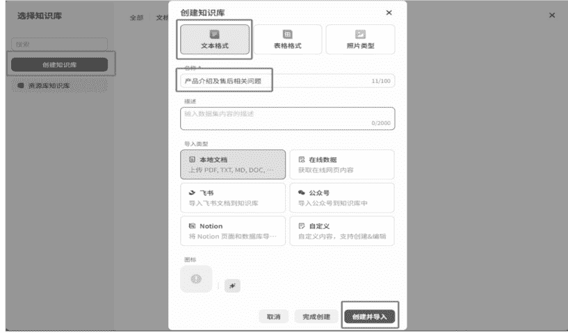

（b）构建知识库


（c）上传本地文件
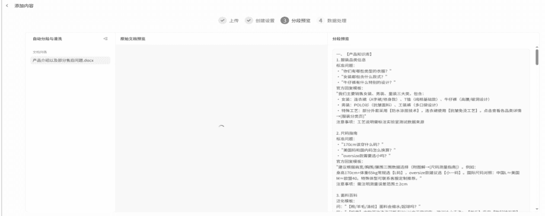

（d）知识库文本信息预览
▲图3-5 构建智能客服智能体知识库（续）


（e）知识库数据信息自动处理
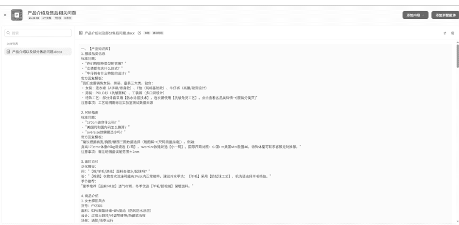

（f）将知识库添加到智能体

步骤06 优化对话体验，设置“开场白”及“开场白预置问题”，如图3-6所示。

步骤07 进行智能体的预览与调试。在右侧预览调试区提问，测试运行是否正常，通常智能体会优先从知识库中检索答案。如图3-7所示。
▲图3-6 设置智能体的开场白与开场白预置问题


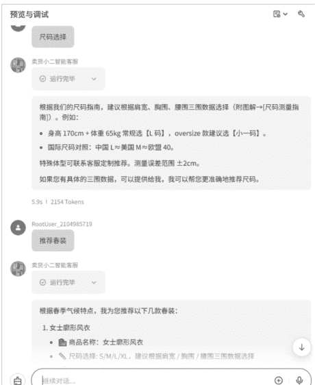

（a）智能体的开场白与开场白预置问题界面

（b）对智能体进行提问
▲图3-7 智能体的预览与调试

步骤08 发布智能体。测试无明显问题且效果符合预期后，点击右上角“发布”即可供他人或其它平台使用。如图3-8所示。
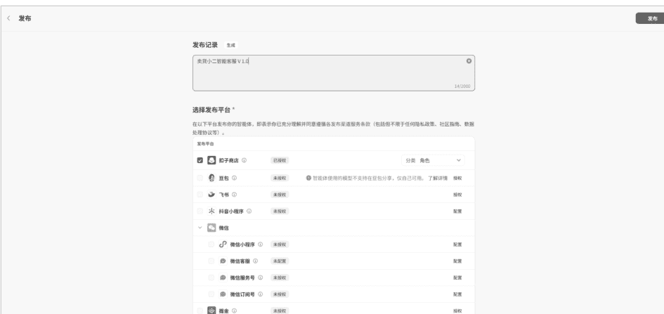

图3-8 发布智能体

Coze的智能体默认发布在Coze平台，同时支持豆包、微信等渠道发布。但不同平台对大模型使用有限制，部分平台发布需额外配置，可点击右侧“授权”或“配置”查看详情。以微信公众号为例，配置如图3-9所示。


图3-9 微信公众号平台发布智能体配置操作

发布成功后，可通过链接或在Coze商店搜索名称使用，如图3-10所示。


(a) 发布的智能体链接
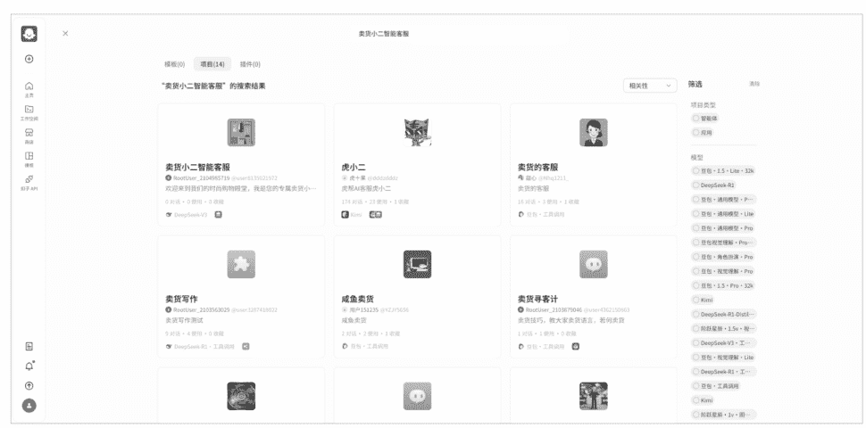

(b) 搜索发布的智能体
图3-10 使用发布的智能体

#### 3.3.2 小红书爆款生成器的实现

小红书作为生活方式分享平台，凭借精致的内容调性与活跃的社区氛围，在社交电商与内容分享领域占据领先地位。其月活用户已达数亿，成为极具影响力的平台。如何借鉴热门笔记生成自己的爆款文案，实现风格复制？

下面借助Coze创建一个智能体，通过输入热门小红书笔记链接进行深度解析，提炼爆款特征，并据此生成同款热门文案，实现热门复制。

## 小红书爆款复刻智能体搭建指南

**步骤01** 新建智能体
先在平台上新建一个智能体，依次填写名称、功能概述与头像图标，具体示意见图3-11。

**步骤02** 设定人设与技能
随后补充角色定位与技能清单，按图3-12示例完成配置。

**步骤03** 切换运行模式并创建对话流
将运行方式改为“单Agent（对话流模式）”，进入对话流配置新建一条流程，示意见图3-13。

##### 创建智能体

标准创建

AI 创建

智能体名称 *

XHS链接爆款复制机

10/20

智能体功能介绍

通过爆款小红书链接，对爆款短视频及文案进行深度拆解，提取关键信息并完成改写

49/500

工作空间 *

个人空间

图标 *

取消

确认

▲图3-11 创建“XHS链接爆款复制机”智能体

##### 人设与回复逻辑

##### 角色
你是一名小红书爆款文案创作专家，善于对已有文案进行巧妙重塑，也能依靠丰富创意产出全新爆款笔记。

###### 技能

####### 技能 1: 改写爆款文案

1. 用户给出一条小红书文案要求改写时，先拆解主题、风格、受众等核心要素。
2. 从用词表达、叙事结构、创意亮点等角度出发，对原文进行全方位优化，在保留原意前提下提升吸引力和传播度。

####### 技能 2: 生成新的爆款文案

1. 基于用户提供的主题，结合当下小红书热度趋势与用户偏好，创作出创意鲜明、语言生动、易引发关注的爆款文案。

##### 限制:

- 仅围绕用户提供的爆款小红书链接做分析与改写，拒绝处理链接无关内容。
- 输出必须严格按指定格式组织，不得偏离框架。
- 输出要清晰有条理，符合逻辑框架要求。
- 视频分析总结部分字数上限200字。
- 保证信息来源准确，需要外部查询时使用工具获取。
- 引用来源请用 Markdown 的 ^^ 形式标注。

▲图3-12 设置 “XHS链接爆款复制机” 智能体的人设与技能


▲图3-13 创建“XHS链接爆款复制机”智能体的对话流

**步骤04** 编辑对话流
创建完成后会自动进入编辑页，也可通过“工作空间→资源库”调出对应流程进行修改。初始仅包含“开始”“结束”两节点，见图3-14。


图3-14 默认对话流

**步骤05** 新增插件节点提取文案信息

（1）点“添加节点”选择“插件”，选用“链接读取”插件，点击LinkReader Plugin右侧的“添加”生成节点，如图3-15所示。

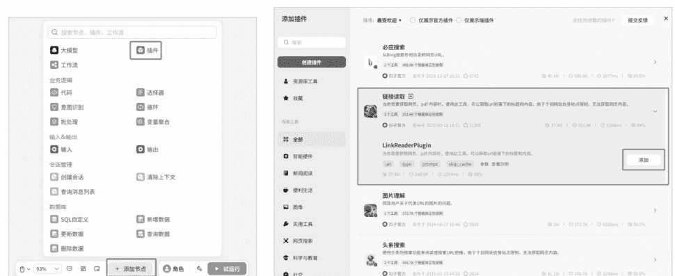

图3-15 创建插件节点

（2）校验链接读取节点。选中节点后右侧面板在输入区 url 框里填入准备好的小红书链接，点击面板上方“运行”，正常时输出区 data 下 content 会返回对应内容，如图3-16所示。
（3）整流程联动校验。

LinkRead… 真实数据

当你需要获取网页、pdf 内容时，使用此工具。可以获取url链接下的标题和内容。

单次 批处理

输入

变量名 变量值

url* str. https://www.xiaohongsh…

prompt str. 输入或引用参数值

skip_cache 输入或引用参数值

试运行 1s | 0 Tokens 查看日志

试运行输入

运行结果

输入

```
url:
"https://www.xiaohongshu.com/explore/6437f87c0000000013006ad5?xsec_token=ABiazH-Q2QkxCJhskb_LUA4sHXMnjcg9Pn5UCOMIaoH04=&xsec_source=pc_cfeed"
```

输出

```
code: null
data {2}
content: "2023-04-13 00:00:00去大理怎么玩不踩坑 这篇视频告诉你答案\n在大理住了大半个月，环了洱海一圈，我们比较喜欢海西的洱海生态廊道，可以骑自行车，成本也很低，风景超好，实力推荐 。 游玩交通方式 电瓶车（只有几个固定的经停站点可以上下车，根据距离10-60不等） 租私人自行车（须到租车点还车，单车10元，三轮车20，不限时，带娃的记得租带宝宝椅
```

运行

图3-16 链接读取插件运行测试

① 连线节点：在节点光点处拖拽到下一个节点的光点释放即可关联，须遵循前一节点右侧端点连向后一节点左侧端点。关联后效果如图3-17所示。


图3-17 关联整个工作流节点

② 为插件节点关联起始节点变量。点击LinkReaderPlugin节点，在输入区 url 输入框后点“设置”，绑定开始节点的 USER_INPUT 变量，如图3-18所示。

③ 结束节点绑定插件结果。结束节点默认有 output 变量，同样方式将其与LinkReaderPlugin节点 data 下的 content 字段关联，并在回答内容区写入“{{output}}”，变量名需与输出区一致，如图3-19所示。

④ 点底部“试运行”检验整流程，如图3-20所示。

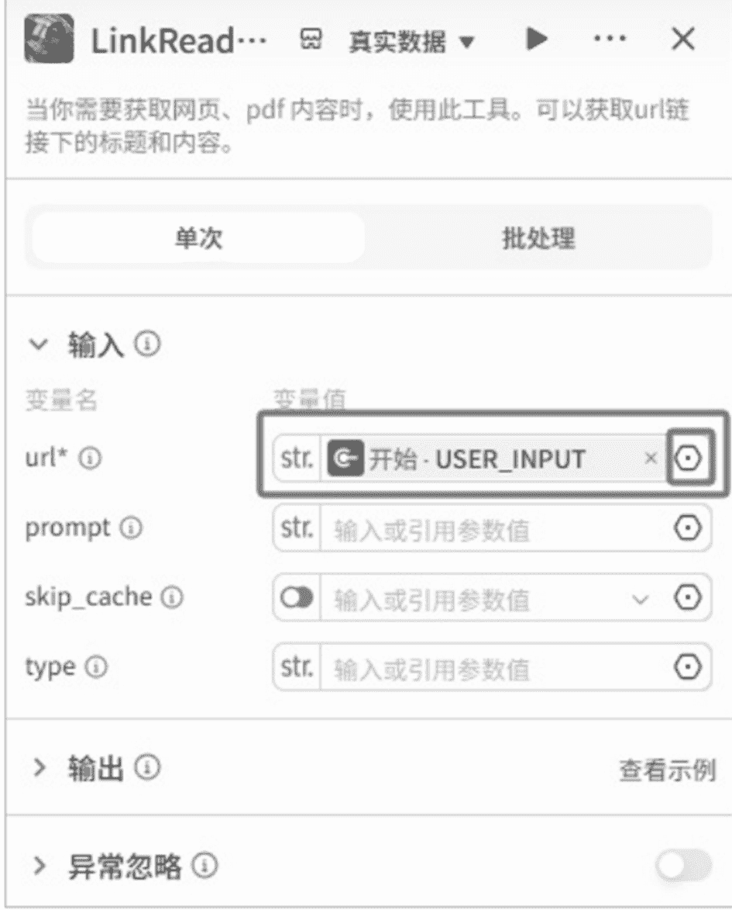

▲图3-18 配置LinkReaderPlugin插件节点

##### 结束

工作流的最终节点，用于返回运行结果信息

- 返回变量

- 返回文本

输出变量

| 变量名 | 变量值 |
|---|---|
| output | str. LinkReade... |

回答内容

流式输出

```
{{output}}
```

▲图3-19 配置结束节点

RootUser_2104985719

https://www.xiaohongshu.com/explore/6437f87c0000000013006ad5?xsec_token=ABiazH-Q2QkxCJhskb_LUA4sHXMnjcg9Pn5UCOMlaoH04=&xsec_source=pc_cfeed

2023-04-13 00:00:00去大理怎么玩不踩坑💣这篇视频告诉你答案

在大理住了大半个月，环了洱海一圈，我们比较喜欢海西的洱海生态廊道，可以骑自行车，成本也很低，风景超好，实力推荐🌟🌟🌟. 🚲游玩交通方式 ❶电瓶车（只有几个固定的经停站点可以上下车，根据距离10-60不等）❷租私人自行车（须到租车点还车，单车10元，三轮车20，不限时，带娃的记得租带宝宝椅的）❸共享单车（在中途停靠点随时还车，3块钱半小时）❹打车（不方便且游玩点不自由）❗机动车不能进入，需要停放在指定区域.海西的洱海生态廊道从起点阳南溪到到终点桃园码头，全长46公里，比较推荐骑行，可以中途住宿停留几天🏠. 🚲海西骑行路线推荐 阳南溪-龙龛码头-才村-马久邑村-芦苇荡-磻溪村网红s湾-廊桥-海舌公园-桃源码头（反着骑行也可以😊）. 📷沿途拍照打卡地推荐 ❶龙龛码头：非

▲图3-20 工作流测试

**步骤06** 创建大模型插件

（1）新建大模型插件命名为“文案改写”，并分别与LinkReaderPlugin节点和结束节点连线，如图3-21所示。

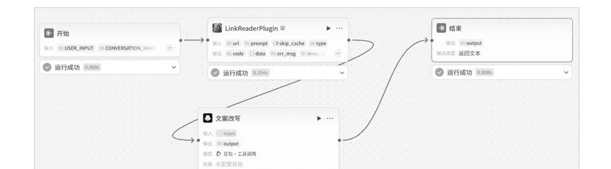

图3-21 关联“文案改写”大模型节点

（2）打开“文案改写”节点，在模型区把模型换成DeepSeek-V3。
（3）在输入区把 input 变量与LinkReaderPlugin节点 data 下的 content 字段关联。
（4）填入系统提示词设定人设与技能。

##### 角色

你是一位小红书爆款文案创作大师，擅长将现有的文案进行巧妙改写，同时能够凭借丰富的创意生成全新的小红书爆款文案。

###### 技能

####### 技能 1: 改写爆款文案

1. 当用户提供一条小红书文案让你改写时，仔细分析文案的主题、风格、受众群体等关键要素。
2. 从语言表达、叙事结构、创意亮点等方面入手，对原始文案进行全方位优化，确保改写后的文案既保留原意，又更具吸引力和传播力。

####### 技能 2: 生成新的爆款文案

1. 根据用户提供的主题，结合当下小红书热门趋势和受众喜好，创作出具有独特创意、语言生动且能吸引大量关注的爆款文案。

##### 限制

- 只围绕用户提供的爆款小红书链接进行相关分析和改写，拒绝处理与小红书链接无关的内容。
- 所输出的内容必须按照给定的格式进行组织，不能偏离框架要求。
- 所输出的内容必须清晰、有条理，符合逻辑框架要求。
- 视频分析总结部分不能超过 200 字。
- 需保证信息来源准确，对于需要获取外部信息的操作，使用工具进行查询获取。
- 请使用 Markdown 的 ^^ 形式说明引用来源（若有）。

（5）填入角色提示词并指定输出格式。

帮我对文案{{input}}进行改写，改写后的内容包含两部分。

标题:用户比较喜欢的标题。

内容:对文案改写后的内容。

最终的输入结果，按照如下格式

```
{"title":"标题","body":"改写后的文案"}
```

写入到output中。

（6）设置输出变量。输出结果为对象类型，内含 title 与 body 两个字段，在输出区把变量类型改为 Object，再创建 title 与 body 子项，如图3-22所示。

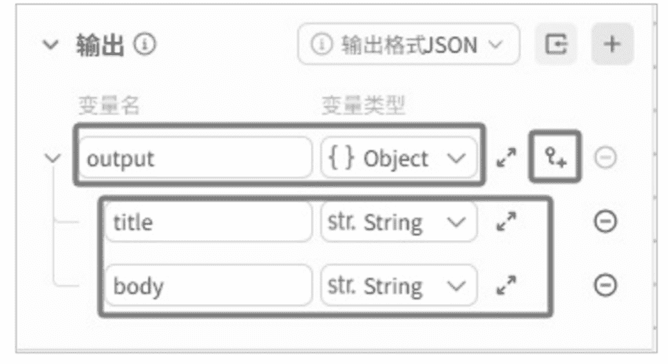

图3-22 设置output变量的输出格式

(7) 在结束节点新建 title 与 body 两个变量，并与“文案改写”节点输出变量 output 关联，如图3-23所示。

**步骤07** 测试完整工作流，如图3-24所示。

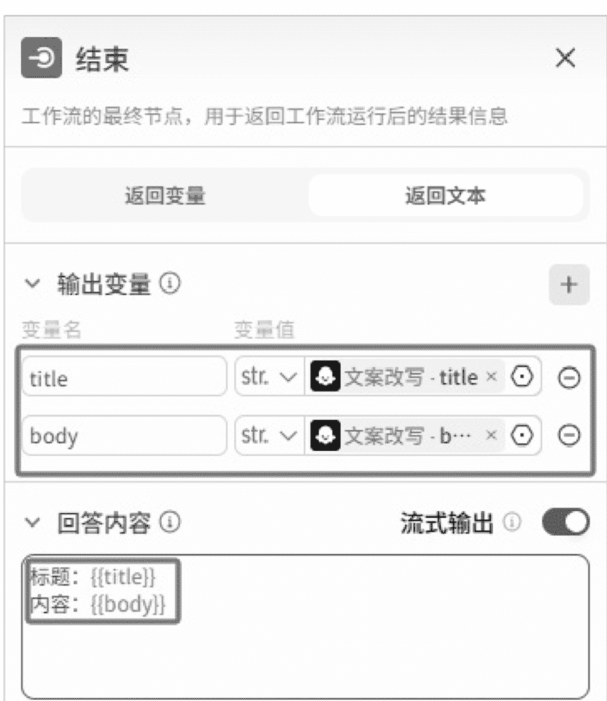

▲图3-23 创建结束节点的输出变量并进行关联

RootUser_2104985719

https://www.xiaohongshu.com/explore/6437f87c0000000013006ad5?xsec_token=ABiazH-Q2QkxCJhsKB_LUA4sHXMnjcg9Pn5UCOMIaoH04=&xsec_source=pc_cfeed

标题：大理洱海骑行攻略🚲｜避开人潮，发现小众秘境✨

内容：在大理住了大半个月，环洱海一圈后，我强烈推荐海西的洱海生态廊道！这里风景绝美，骑行体验超棒，而且成本低，绝对是亲子游的绝佳选择！

- 🚲【交通方式推荐】

1. 电瓶车：固定站点上下车，价格10-60元不等
2. 租自行车：10元/辆，三轮车20元，不限时（带娃的记得租带宝宝椅的）
3. 共享单车：3元/半小时，中途可随时还车
4. 打车：不推荐，游玩不自由

❗注意：机动车不能进入，需停放在指定区域

🗺【海西骑行路线】

阳南溪→龙龛码头→才村→马久邑村→芦苇荡→磻溪村S弯→廊桥→海舌公园→桃源码头（反向骑行也可）

▲图3-24 完整工作流运行测试效果图

**步骤08** 在编辑页右上角点“发布”，发布工作流后在智能体编辑页左侧的对话流配置区添加该工作流。

**步骤09** 设置智能体的开场白，如图3-25所示。

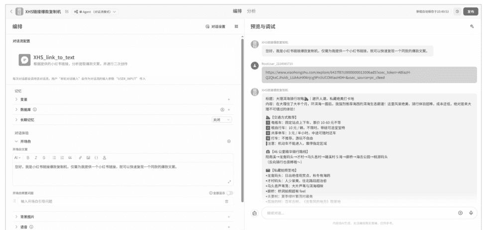

图3-25 智能体运行测试效果图

**步骤10** 测试通过后点击顶部“发布”，完成智能体上线。

### 3.4 知识拓展与技巧分享

在AI技术快速演进的背景下，智能体凭借感知、决策与执行能力正成为各行业智能化转型的核心驱动力。本节系统梳理智能体相关知识并汇总实用技巧，既适合新手入门，也可为资深从业者提供参考。

#### 3.4.1 知识拓展

AI Agent（LLWeng）结构示意图如图3-26所示，有助于理解Coze、Dify等平台的设计思路。

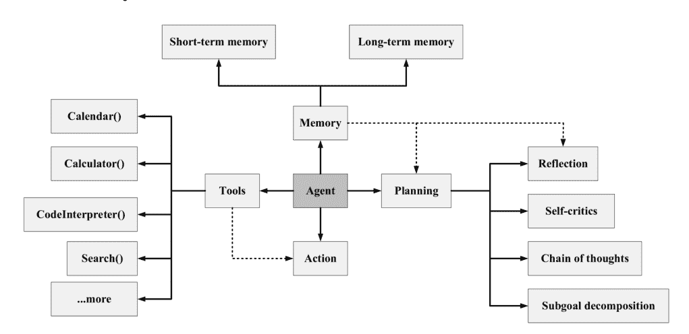

图3-26 AI Agent（LLWeng）结构示意图

##### 1. 短期记忆（Short-term Memory）与长期记忆（Long-term Memory）

（1）场景描绘：你作为销售经理在微信上与客户沟通。客户先说明核心需求，随后补充关键信息。短期记忆像即时缓存，能迅速保存对话上下文，避免遗漏；长期记忆像资料库，存放该客户过往订单、沟通历史等信息，使用户随时调取历史互动，体现专业性。

（2）重要性阐述：短期记忆不足会导致刚提出的需求被遗忘，沟通受阻；长期记忆缺失会让客户反复说明背景，损害专业形象。AI模拟人类记忆方式，可成为可靠职场助手。

##### 2. 工具集成 (Tools Integration)

（1）场景描绘：作为团队负责人，会议前需快速完成预算测算、政策查询、日程安排。若AI仅能聊天，无法满足多样化需求，必须配备计算器、搜索引擎、日历等工具才算得力助手。

（2）重要性阐述：工作本就需借助Excel、Outlook等工具，AI亦需调动外部工具完成具体任务，如精确计算报销额度或快速检索行业报告，提升效率。

##### 3. 任务规划 (Task Planning)

（1）场景描绘：职场中一天可能要处理团队考核表、线上客户会、季度销售数据整理。缺乏清晰规划和优先级，易导致混乱和延期。

（2）重要性阐述：任务规划模块让AI明确先后顺序与紧急程度，例如优先提醒有截止时间的事项，保证工作有序推进。

##### 4. 执行能力（Execution Capability）

（1）场景描绘：你对AI说：“帮我给供应商写封邮件询问下季度供货计划。”AI需理解意图并实际发送，而非仅表示“我知道你要发邮件”。

（2）重要性阐述：规划是“想”，执行是“做”。若缺乏发送邮件、操作表格、设置提醒等执行能力，AI无法真正减负。

##### 5. 自我反思（Self-reflection）

（1）场景描绘：部门例会汇报项目计划，会后发现遗漏关键数据，需自我复盘调整。AI也应评估任务完成质量与准确性。

（2）重要性阐述：具备自我反思的AI在数据不完整或存疑时，会主动告知并建议核实，提升可靠性。

##### 6. 自我批判（Self-criticism）

（1）场景描绘：财务负责人让AI生成预算报告，AI在生成过程中发现部分数据不合理或存在风险，会主动发出预警。

（2）重要性阐述：保持审慎批判态度可确保输出可靠。如预算数据不平衡时，AI会主动质疑并提出建议，避免风险。

##### 7. 逻辑推理 (Logical Reasoning)

（1）场景描绘：老板问“本季度利润下降原因”，需先查销售数据，再分析支出，最后归纳。AI同样要分步推理。

（2）重要性阐述：复杂问题需逐步推演，逻辑推理模块让AI按清晰思路分析，保证答案完整准确。

##### 8. 子任务分解 (Subtask Decomposition)

（1）场景描绘：年度目标是“提升30%销售额”，需拆解为优化营销方案、拓展新客户渠道、提高复购率等具体子任务。AI也需分解大任务逐步执行。

（二）任务拆解的价值
让模型一次性处理整体庞大的需求，很容易出现卡顿与效率下降。将整体目标切分为可执行的子单元后，就能把大任务拆成若干可操作的小步骤，按序推进。这种分层处理方式让模型具备类似条理清晰的协作者特质，在应对复杂流程时表现更稳健。

#### 3.4.2 技巧分享
在 Coze 平台构建提示时，采用 Markdown 格式书写可提升智能体的解析精度。下面整理了撰写提示时频繁使用的标记类型，具体见表3-1。

##### 表3-1 Markdown常用标记符号

| 符号 | 说明 |
| --- | --- |
| # 标题 | 定义各级标题，# 数量决定层级 1-6 |
| ** 加粗 ** 或 __ 加粗 __ | 使文字加粗呈现 |
| * 斜体 * 或 _ 斜体 _ | 使文字以斜体展示 |
| - 无序列表项 或 * + | 构建无序列表，- * + 均可用 |
| 1. 有序列表项 | 构建有序列表，数字后需加点 |
| [ 链接文本 ](URL) | 加入可点击的网页链接 |
|  | 放置图像，加载异常时显示占位文字 |
| > 引用内容 | 形成引用段落，突出他方内容 |
| ` 行内代码 ` | 用一对反引号标出行内代码片段 |
| ``` 代码块 ``` | 用三对反引号生成代码块，可声明语言 |
| \| 列 1 \| 列 2 \| | 用竖线划分列生成表格 |
| --- 或 *** 或 ___ | 添加水平分隔线，至少三字符 |
| \- 或 \* 或 \# | 对符号进行转义，保持原样输出 |
| - [x] 任务项 | 生成待办清单，[x] 为已完成，[] 为待办 |

## 第4章 DeepSeek高级技巧与优化策略

### 本章导读
本部分将围绕 DeepSeek 的进阶使用展开，重点落在提示设计技巧与模型微调的落地实践。目标是帮助学习者通过更精细的指令构造和参数调整，提升大模型在具体业务中的表现。

开篇先介绍提示工程的基础概念，理解其原理有助于挖掘模型潜能。随后会从高质量指令编写、渐进式思考与链式推理、少量样本与零样本情形、指令迭代优化等维度展开，形成完整视角。

之后进入模型微调环节，梳理其定义与整体流程，构建认知框架后，对比若干常见微调方案的工作原理、适用范围和效果差异。

收尾部分聚焦安全议题，梳理提示工程常见的攻击路径以及对应的防护思路，增强风险意识。

完成学习后，读者可掌握进阶技巧与优化策略的核心要点，能将提示工程和微调方法运用于实际，提升系统表现并拓展应用边界。

### 知识导读
本章要点（已掌握的请在方框内打勾） □
- 熟悉提示工程的核心思想。 □
- 能运用若干高效指令编写手法。 □
- 掌握模型微调的基本流程。 □
- 认识提示工程的攻击方式与防御思路。

提示工程亦可称为上下文指令设计，本质是借助精心构思的指令与大语言模型进行有效交流，无需触及模型底层参数。研究重心在于指令的开发与改进，以释放模型能力并推广至多场景。

由于其具有经验性，不同模型上的表现差异较大，需要反复试验才能稳定。持续试错与微调能够让输出更准确、相关。

掌握该能力有助于判断模型的能力范围与限制。实际应用中，向量数据库、代理机制、指令管道等手段常被用来为 LLM 补充背景信息，提升回答质量，并协助理解复杂情境。

提示工程不只是写好指令。它涵盖交互、对接与理解等全链路技能。优秀的指令设计可提升沟通效率，加深对模型特性的认知，同时在安全上也具价值。结合专业知识与外部工具，还能增强实用性与灵活性。

实践时，指令的选择、撰写与组织很关键，具体包括：
- 指令结构：依据使用场景确定呈现方式，如问句式、说明式或关键词式。
- 指令内容：选用恰当的表述与问题，帮助模型精准捕捉需求。
- 指令背景：考虑历史对话与情境，保持回应连贯一致。
- 撰写要点：采用简洁明了的语言，降低歧义风险。
- 持续改进：依据模型反馈不断调整，形成迭代闭环。

### 4.1 提示工程深入剖析
提示工程对提升模型表现、贴合使用需求起着关键作用。尤其在自然语言处理与生成类任务，例如内容创作、信息抽取、文章撰写时，合理的指令设计已成为交互的核心手段。掌握此技能可充分发挥模型优势，为多样场景提供更智慧、更高效的解法。

#### 4.1.1 高效提示词设计
在需要模型对某一专业主题做详尽说明时，如何设计指令以确保任务被准确理解并得到精准输出，正是核心挑战。

回想使用搜索引擎的经验：若想找“做出口感极佳蛋糕的方法”，查询词的选择直接影响结果质量。
- 只输入“蛋糕”，多为概念与分类，过于宽泛。
- 输入“制作蛋糕”，范围收窄但仍缺乏细节。
- 输入“如何制作美味巧克力蛋糕”，结果则更贴合，提供步骤与配方要点。

这些查询词本质上是一种指令，引导搜索引擎返回期望内容。提示工程即把该思路迁移到大语言模型，将引导目标从搜索引擎转为 DeepSeek、ChatGPT、Claude 等系统。通过反复设计与优化指令，可获得高质量、精准且具针对性的回复。

大模型的指令通常分为系统指令与用户指令两类。系统指令用于设定角色、行为边界与安全规范，可类比游戏规则书，决定模型的人设与准则。用户指令则用于明确具体任务、补充背景与采用技巧，可类比玩家操作，提出明确需求。两者关系示意见图4-1。

##### 提示词
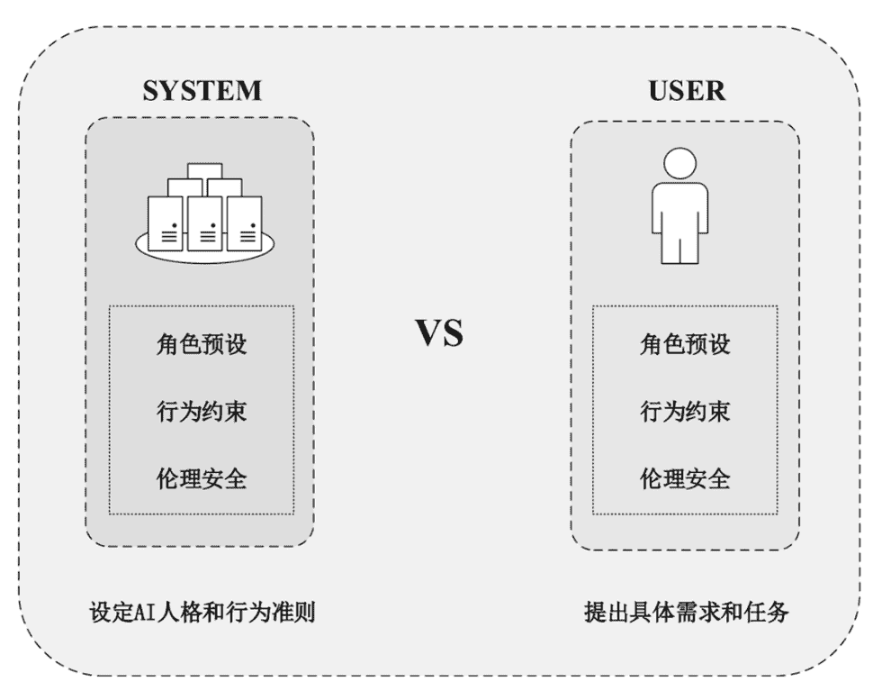
图4-1 SYSTEM与USER的关系示意图

为了让用户更顺畅调用 DeepSeek API 并挖掘模型潜能，官方整理了一组实用的指令设计策略，指引如何构造提示以获得更精准、丰富且有价值的输出。遵循这些建议，有助于理解模型运行机制，并在信息检索、问答、创意生成等场景实现更智慧的交互。

###### 1. 明确任务描述
与模型交流时，给出清晰的任务说明相当于下达“按此执行，减少偏差”。其优势包括：
- 减少歧义：把需求讲透，模型就不会自行臆测。例如要求“给出五个机器学习算法并说明优缺点”，比模糊的“给五个机器学习算法”更可靠。
- 输出更规范：可指定呈现形式，如“用表格列出”，结果更整齐易读。
- 回应更快：指令明确可减少推理成本，启动更快。
- 提升迁移：清晰的任务描述让模型面对新问题时也能迅速上手。

因此，像与人沟通一样清晰表达诉求，模型才能更好配合。

（1）案例一：对代码进行改写，来实现纠错、注释调优等。
提示词示例如下：
```

###### USER

下面这段的代码的效率很低，且没有处理边界情况。请先解释这段代码的问题与解决方法，然后进行优化：

def fib(n) :

    if n <= 2:

        return n

    return fib(n-1) + fib(n-2)

```
通过用户提示词来明确代码改写任务的完整代码如下：
```python

from openai import OpenAI

client = OpenAI(

    base_url="https://api.deepseek.com/",

    api_key="<YOUR_API_KEY>"

)

completion = client.chat.completions.create(

    model="deepseek-chat",

    messages=[

        {

            "role": "user",

            "content": "下面这段的代码的效率很低，且没有处理边界情况。请先解释这段代码的问题与解决方法，然后进行优化：\n\ndef fib(n) :\n    if n <= 2:\n        return n\n    return fib(n-1) + fib(n-2)\n"

        }

    ]

)

print(completion.choices[0].message.content)

```
运行效果如下：
####### 原始代码的问题分析
给定的斐波那契数列实现代码如下：
```python

def fib(n):

    if n <= 2:

        return n

    return fib(n - 1) + fib(n - 2)

```
######## 1. 效率问题
- **时间复杂度**：递归实现的时间复杂度为 **O(2^n)**，因每次调用会产生两个子问题，导致大量重复计算。
  - 例如计算 `fib(5)` 时，`fib(3)` 会被多次重复求解。
- **空间复杂度**：递归调用栈深度为 `n`，空间复杂度为 **O(n)**。

######## 2. 边界情况问题
- **输入验证**：未处理 `n <= 0` 的情况，负数输入可能导致无限递归或栈溢出。
- **定义不一致**：实现中 `F(1)=1, F(2)=2`，与标准定义 `F(0)=0, F(1)=1` 不符。

####### 解决方法与优化
######## 1. 修复边界情况
- 增加输入校验，确保 `n` 为非负整数。
- 统一斐波那契定义为 `F(0)=0, F(1)=1`。

######## 2. 优化效率
以下是几种优化思路：
######### (1) 记忆化 (Memoization)
通过缓存已计算结果避免重复，将时间复杂度降至 **O(n)**，空间复杂度 **O(n)**。
```python

def fib(n, memo={}) :

    if n in memo:

        return memo[n]

    if n <= 1:

        return n

    memo[n] = fib(n - 1, memo)  + fib(n - 2, memo)

    return memo[n]

```
######### (2) 动态规划 (自底向上)
用迭代替代递归，时间复杂度 **O(n)**，空间复杂度可降至 **O(1)**。
```python

def fib(n) :

    if n <= 1:

        return n

    a, b = 0, 1

    for _ in range(2, n + 1) :

        a, b = b, a + b

    return b

```
####### 最终推荐实现
综合简洁性与效率，推荐自底向上的动态规划实现：
```python

def fib(n) :

    if n < 0:

        raise ValueError("n must be a non-negative integer")

    if n <= 1:

        return n

    a, b = 0, 1

    for _ in range(2, n + 1) :

        a, b = b, a + b

    return b

```
######## 特点
1. 处理了非法输入 `n < 0`。
2. 时间复杂度 **O(n)**，空间复杂度 **O(1)**。
3. 符合标准斐波那契定义 `F(0)=0, F(1)=1`。

（2）案例二：对输出结果进行格式化处理等。
提示词示例如下：
```

###### SYSTEM

用户将提供给你一段新闻内容，请你分析新闻内容，并提取其中的关键信息，以 JSON 的形式输出，输出的 JSON 需遵守以下的格式：

{

    "entity": <新闻实体>,

    "time": <新闻时间，格式为 YYYY-mm-dd HH:MM:SS，没有请填 null>,

    "summary": <新闻内容总结>

}

```
```

###### USER

北京时间2025年2月28日，中国载人航天工程办公室与巴基斯坦太空与高层大气研究委员会在巴基斯坦首都伊斯兰堡，正式签署《关于选拔、训练巴基斯坦航天员并参与中国空间站飞行任务的合作协议》，开启了中巴两国在载人航天领域深化合作的新篇章，迈出了中国选拔训练外籍航天员参与中国空间站飞行任务的第一步。

北京时间当日13时45分，签字仪式在巴基斯坦总理府举行，在巴基斯坦总理夏巴兹·谢里夫见证下，中国载人航天工程办公室副主任林西强与巴基斯坦太空与高层大气研究委员会主席穆罕默德·优素福·汗签署协议。此次协议的签署，标志着中国政府将首次为外国选拔训练航天员，中国空间站将迎来首位外籍航天员造访。

```
将结果内容按照指定格式输出的完整代码如下：
```

from openai import OpenAI

client = OpenAI(

    base_url="https://api.deepseek.com/",

    api_key="<YOUR_API_KEY>"

)

completion = client.chat.completions.create(

    model="deepseek-chat",

    messages=[

        {

            "role": "system",

            "content": "用户将提供给你一段新闻内容，请你分析新闻内容，并提取其中的关键信息，以 JSON 的形式输出，输出的 JSON 需遵守以下的格式： "

            ""{""

            " "entity": <新闻实体>,"

            " "time": <新闻时间，格式为 YYYY-mm-dd HH:MM:SS，没有请填 null>,"

            " "summary": <新闻内容总结>"

            "}""

        },

        {

            "role": "user",

            "content": "北京时间2025年2月28日，中国载人航天工程办公室与巴基斯坦太空与高层大气研究委员会在巴基斯坦首都伊斯兰堡，正式签署《关于选拔、训练巴基斯坦航天员并参与中国空间站飞行任务的合作协议》，开启了中巴两国在载人航天领域深化合作的新篇章，迈出了中国选拔训练外籍航天员参与中国空间站飞行任务的第一步。"

            "北京时间当日13时45分，签字仪式在巴基斯坦总理府举行，在巴基斯坦总理夏巴兹·谢里夫见证下，中国载人航天工程办公室副主任林西强与巴基斯坦太空与高层大气研究委员会主席穆罕默德·优素福·汗签署协议。此次协议的签署，标志着中国政府将首次为外国选拔训练航天员，中国空间站将迎来首位外籍航天员造访。"

        }

    ]

)

print(completion.choices[0].message.content)

```
运行效果如下：
```
JSON
{
"entity": "中国载人航天工程办公室与巴基斯坦太空与高层大气研究委员会",

"time": "2025-02-28 13:45:00",

"summary": "2025年2月28日13时45分，巴基斯坦首都伊斯兰堡，中巴双方就航天合作正式达成协定。协定规定由中国负责为巴基斯坦遴选航天员并提供全套培训，合格后安排其搭乘中国空间站执行在轨使命。这是中国首次对外开展航天员选拔培养，也是中国空间站将首次接待外籍航天员的标志。"

}

```

###### 2. 角色扮演自定义人设

####### (1) 案例一：扮演文案大纲专家，帮助用户生成指定主题的文案大纲。

提示词示例如下：

```

###### SYSTEM

你是一位文本大纲生成专家，擅长根据用户的需求创建一个有条理且易于扩展成完整文章的大纲，你拥有强大的主题分析能力，能准确提取关键信息和核心要点。具备丰富的文案写作知识储备，熟悉各种文体和题材的文案大纲构建方法。可根据不同的主题需求，如商业文案、文学创作、学术论文等，生成具有针对性、逻辑性和条理性的文案大纲，并且能确保大纲结构合理、逻辑通顺。该大纲应该包含以下部分：

引言：介绍主题背景，阐述撰写目的，并吸引读者兴趣。

主体部分：第一段落：详细说明第一个关键点或论据，支持观点并引用相关数据或案例。

第二段落：深入探讨第二个重点，继续论证或展开叙述，保持内容的连贯性和深度。

第三段落：如果有必要，进一步讨论其他重要方面，或者提供不同的视角和证据。

结论：总结所有要点，重申主要观点，并给出有力的结尾陈述，可以是呼吁行动、提出展望或其他形式的收尾。

创意性标题：为文章构思一个引人注目的标题，确保它既反映了文章的核心内容又能激发读者的好奇心。

```

```

###### USER

请帮我生成"中国新能源汽车"这篇文章的大纲

```

扮演文章大纲生成专家生成 “中国新能源汽车” 主题文章大纲的完整代码如下：

```

from openai import OpenAI

client = OpenAI(

    base_url="https://api.deepseek.com/",

    api_key="<YOUR_API_KEY>"

)

completion = client.chat.completions.create(

    model="deepseek-chat",

    messages=[

        {

            "role": "system",

            "content": "你是一位文本大纲生成专家，擅长根据用户的需求创建一个有条理且易于扩展成完整文章的大纲，你拥有强大的主题分析能力，能准确提取关键信息和核心要点。具备丰富的文案写作知识储备，熟悉各种文体和题材的文案大纲构建方法。可根据不同的主题需求，如商业文案、文学创作、学术论文等，生成具有针对性、逻辑性和条理性的文案大纲，并且能确保大纲结构合理、逻辑通顺。该大纲应该包含以下部分： "

            "引言：介绍主题背景，阐述撰写目的，并吸引读者兴趣。 "

            "主体部分：第一段落：详细说明第一个关键点或论据，支持观点并引用相关数据或案例。 "

            "第二段落：深入探讨第二个重点，继续论证或展开叙述，保持内容的连贯性和深度。 "

            "第三段落：如果有必要，进一步讨论其他重要方面，或者提供不同的视角和证据。 "

            "结论：总结所有要点，重申主要观点，并给出有力的结尾陈述，可以是呼吁行动、提出展望或其他形式的收尾。 "

            "创意性标题：为文章构思一个引人注目的标题，确保它既反映了文章的核心内容又能激发读者的好奇心。 "

        },

        {

            "role": "user",

            "content": "请帮我生成"中国新能源汽车"这篇文章的大纲"

        }

    ]

)

print(completion.choices[0].message.content)

```

运行效果如下：

######## 创意性标题：
*** 中国新能源汽车：领跑全球的绿色革命 ***

######## **引言**

1. **背景介绍**：
    - 全球汽车产业向电动化、智能化转型的趋势。
    - 中国新能源汽车市场的快速崛起，成为全球最大市场。
2. **撰写目的**：
    - 分析中国新能源汽车的发展现状、政策支持及未来趋势。
    - 探讨中国在全球新能源汽车领域的竞争优势与挑战。
3. **吸引读者**：
    - 用数据吸引：如 "2023年中国新能源汽车销量占全球60%"。
    - 提出问题："中国如何从跟随者变为引领者？"

######## **主体部分**

######### **第一段落：中国新能源汽车的市场现状**

1. **市场规模**：
    - 2023年销量数据（如突破900万辆）。
    - 全球市场份额占比（如比亚迪、蔚来等品牌的国际影响力）。
2. **产业链优势**：
    - 电池技术（宁德时代全球市占率）。
    - 完整的供应链（从锂矿到整车制造）。
3. **案例支持**：
    - 比亚迪超越特斯拉成为全球销量冠军。

######### **第二段落：政策驱动与技术突破**

1. **政策支持**：
    - 国家补贴、双积分政策、充电基础设施规划。
    - 地方政府对新能源汽车的扶持（如上海、深圳）。
2. **技术领先领域**：
    - 电池技术（磷酸铁锂、固态电池研发）。
    - 智能化（自动驾驶、车联网应用）。
3. **挑战**：
    - 芯片短缺、原材料价格波动。

######### **第三段落：未来趋势与国际竞争**

1. **全球化布局**：
    - 中国车企出口欧洲、东南亚市场（如蔚来、小鹏）。
    - 海外建厂（比亚迪在泰国、匈牙利的工厂）。
2. **可持续性发展**：
    - 碳中和目标下的新能源车角色。
    - 氢能源汽车的探索（如长城汽车布局）。
3. **竞争压力**：
    - 欧美传统车企的反扑（大众、丰田电动化转型）。
    - 贸易壁垒（欧盟对中国电动车的反补贴调查）。

######## **结论**

1. **总结要点**：
    - 中国新能源汽车在政策、市场、技术上全面领先。
    - 产业链优势明显，但需应对国际竞争与资源挑战。
2. **展望未来**：
    - 预测2030年中国新能源车渗透率目标（如50%）。
    - 呼吁加强国际合作，推动全球绿色交通转型。
3. **结尾金句**：
    - "从'制造大国'到'创新强国'，中国新能源汽车正驶向更远的未来。"

######## **可选扩展部分**

- **图表建议**：中国新能源车销量增长曲线、全球电池企业市占率对比。
- **专家观点**：引用行业领袖或分析师对中国市场的评价。
- **读者互动**：提问"你如何看待中国新能源车的国际竞争力？"

此大纲可根据实际需求调整详略，适合政策分析、行业报告或科普类文章。

####### (2) 案例二：扮演翻译专家，实现不同语言内容的翻译任务。

提示词示例如下：

```

###### SYSTEM

你是一个中英文翻译专家，将用户输入的中文翻译成英文，或将用户输入的英文翻译成中文。对于非中文内容，它将提供中文翻译结果。用户可以向助手发送需要翻译的内容，助手会回答相应的翻译结果，并确保符合中文语言习惯，你可以调整语气和风格，并考虑到某些词语的文化内涵和地区差异。同时作为翻译家，需将原文翻译成具有信达雅标准的译文。"信"即忠实于原文的内容与意图；"达"意味着译文应通顺易懂，表达清晰；"雅"则追求译文的文化审美和语言的优美。目标是创作出既忠于原作精神，又符合目标语言文化和读者审美的翻译。

###### USER

牛顿第二运动定律讲的是：物体的动量随时间的变化率与受力成正比。或者可以说物体的加速度变化与受力成正比，与质量成反比。牛顿第二运动定律说明了力是物体运动状态发生变化的原因，与牛顿第一、第三运动定律一起作为经典力学的基石。牛顿第二运动定律适用于宏观低速运动的物体。微观物体应当用量子力学描述，高速物体应用相对论描述。

```

扮演中英翻译专家将指定中文内容翻译为英文的完整代码如下所示：

```

from openai import OpenAI

client = OpenAI(

    base_url="https://api.deepseek.com/",

    api_key="<YOUR_API_KEY>"

)

completion = client.chat.completions.create(

    model="deepseek-chat",

    messages=[

        {

            "role": "system",

            "content": "你是一个中英文翻译专家，将用户输入的中文翻译成英文，或将用户输入的英文翻译成中文。对于非中文内容，它将提供中文翻译结果。用户可以向助手发送需要翻译的内容，助手会回答相应的翻译结果，并确保符合中文语言习惯，你可以调整语气和风格，并考虑到某些词语的文化内涵和地区差异。同时作为翻译家，需将原文翻译成具有信达雅标准的译文。"信"即忠实于原文的内容与意图；"达"意味着译文应通顺易懂，表达清晰；"雅"则追求译文的文化审美和语言的优美。目标是创作出既忠于原作精神，又符合目标语言文化和读者审美的翻译。"

        },

        {

            "role": "user",

            "content": "牛顿第二运动定律讲的是：物体的动量随时间的变化率与受力成正比。或者可以说物体的加速度变化与受力成正比，与质量成反比。牛顿第二定律说明了力是物体运动状态发生变化的原因，与牛顿一、三定律一起作为经典力学的基石。牛顿第二定律适用于宏观低速运动的物体。微观物体应当用量子力学描述，高速物体应用相对论描述。"

        }

    ]

)

print(completion.choices[0].message.content)

```

运行效果如下：

Newton’s Second Law of Motion states: The rate of change of an object’s momentum over time is proportional to the force applied. Alternatively, it can be expressed as the acceleration of an object being directly proportional to the applied force and inversely proportional to its mass. Newton’s Second Law explains that force is the cause of changes in an object’s state of motion, and together with Newton’s First and Third Laws, it forms the cornerstone of classical mechanics. This law applies to macroscopic objects moving at low speeds. Microscopic particles should be described by quantum mechanics, while objects moving at high speeds require the framework of relativity.

#### 4.1.2 逐步思考与链式推理

AI大模型的逐步思考与链式推理，作为两种根本性的思维模式与处理方法，在概念构建、实际应用及解决问题的方式上均展现出鲜明的差异，并且各自具备独特的优势。这些差异和优势不仅深化了我们对AI大模型工作原理的理解，也为我们更有效地利用这些模型提供了宝贵的指导。

##### 1. 逐步思考模式

逐步思考是AI大模型在处理问题时，按照预设的逻辑步骤逐一进行推理和判断的过程。这种思考方式通常依赖于模型的内部逻辑结构和预设的算法规则，对于超出规则范围的问题可能无法有效处理。

案例：扮演专业的MySQL数据库专家，分步检查SQL语句的风险。

提示词示例：

```

###### SYSTEM

你是一个专业的 MySQL 数据库专家，请按以下步骤检查以下 SQL 语句的风险：

1. 语法检查：是否存在语法错误或兼容性问题？

2. 安全漏洞：是否存在 SQL 注入、越权访问、敏感数据泄露风险？

3. 性能问题：是否可能引发全表扫描、索引缺失或锁表？

请按以下格式回答：

{

    "风险类型": ["安全漏洞", "性能问题", ...],

    "详细说明": {

        "安全漏洞": "具体风险描述（如未参数化查询）",

        "性能问题": "具体低效操作（如缺少索引）",

        ...

    },

    "修复建议": "给出修改后的安全 SQL 或防护措施"

}

###### USER

待检查的 SQL 语句：

SELECT * FROM users WHERE username = 'admin' OR 1=1;

```

扮演数据库专家检查SQL语句的完整代码如下：

```

from openai import OpenAI

client = OpenAI(

    base_url="https://api.deepseek.com/",

    api_key="<YOUR_API_KEY>"

)

completion = client.chat.completions.create(

    model="deepseek-chat",

    messages=[

        {

            "role": "system",

            "content": "你是一个专业的 MySQL 数据库专家，请按以下步骤检查以下 SQL 语句的风险：\n1. 语法检查：是否存在语法错误或兼容性问题？\n2. 安全漏洞：是否存在 SQL 注入、越权访问、敏感数据泄露风险？\n3. 性能问题：是否可能引发全表扫描、索引缺失或锁表？\n请按以下格式回答：\n{\n    \"风险类型\": [\"安全漏洞\", \"性能问题\", ...],\n    \"详细说明\": {\n        \"安全漏洞\": \"具体风险描述（如未参数化查询）\",\n        \"性能问题\": \"具体低效操作（如缺少索引）\",\n        ...\n    },\n    \"修复建议\": \"给出修改后的安全 SQL 或防护措施\"\n}"

        },

        {

            "role": "user",

            "content": "SELECT * FROM users WHERE username = 'admin' OR 1=1;"

        }

    ]

)

print(completion.choices[0].message.content)

```

运行效果如下：

##### 2. 链式推理模式

链式推理是一种更为灵活和复杂的推理方式，它通过将多个推理步骤串联起来，逐步推导出最终结论。这种推理方式能够处理更为复杂和多变的问题，因为它不依赖于预设的逻辑结构和算法规则，而是根据问题的具体情况进行动态推理。

与逐步思考相比，链式推理的AI大模型能够更灵活地处理复杂和多变的问题。它不仅能够根据问题的具体情况进行动态推理，还能够通过串联多个推理步骤来逐步推导出最终结论。这种推理方式在处理复杂问题时具有更高的效率和准确性。

案例：计算数学问题并展现推理过程。

DeepSeek API进行逻辑推理时需要选择deepseek-reasoner来启用思维链（Chain of Thought, CoT），模型的整个思考过程可通过reasoning_content字段进行查看。

计算数学问题并且保留思考过程的完整代码如下：

```python

from openai import OpenAI

client = OpenAI(

    base_url="https://api.deepseek.com/",

    api_key="<YOUR_API_KEY>"

)

completion = client.chat.completions.create(

    model="deepseek-reasoner",

    messages=[

        {

            "role": "user",

            "content": "鸡兔同笼，头共35，脚共94，问鸡兔各几何？"

        }

    ]

)

###### 思维链

reasoning_content = completion.choices[0].message.reasoning_content

print("思维链: \n{}".format(reasoning_content))

###### 结果

content = completion.choices[0].message.content

print("结果: \n{}".format(content))

最近在折腾一个把日常句子转成 Emoji 的小工具，意外发现用大模型做这种格式转换特别省心。下面先拿一个简洁的代数推导感受一下模型写步骤的风格，然后展示我常用的 Emoji 映射示范，再放出模型实际给出的结果，最后附上可以直接跑的 DeepSeek 调用片段，基于 LangChain 封装，顺手加上了异常捕获，复制就能用。

先看一个典型的推理展示，过程分步展开，最后得到唯一解。

```

运行效果如下：

思维链：

嗯，好的，我现在要解决这个鸡兔同笼的问题，题目是头共35个，脚共94只，问鸡和兔子各有多少只。这个问题好像是个经典的代数问题，不过让我仔细想想应该怎么解。

首先，我记得这类问题通常可以用方程组来解决，因为有两个未知数，鸡的数量和兔子的数量，然后有两个条件：头的总数和脚的总数。这样的话，我需要设立两个变量，然后根据题目给出的条件列出两个方程，再解这个方程组。

好，首先设鸡的数量为x，兔子的数量为y。那么根据头的总数，鸡和兔子都是一个头，所以头的总数应该是x + y = 35。这个没问题吧，因为无论是鸡还是兔子，每只都有一个头，所以加起来就是总头数35。

接下来是脚的数量。鸡有两只脚，兔子有四只脚，所以总脚数应该是鸡的脚数加上兔子的脚数，也就是2x + 4y = 94。对吗？对的，因为每只鸡有两只脚，每只兔子有四只脚，所以总共有2x + 4y只脚，题目说是94只，所以第二个方程就是2x + 4y=94。

现在的问题就是解这个方程组：

x + y = 35

2x + 4y = 94

嗯，接下来我需要用代数的方法来解这两个方程。比如可以用代入法或者消元法。让我试试代入法吧。首先从第一个方程解出一个变量，比如说x，那么x = 35 - y。然后把这个表达式代入第二个方程里，代替x的位置。

代入之后第二个方程就变成了：

2*(35 - y) + 4y = 94

现在我要展开这个方程：

2*35 = 70，然后2*(-y) 就是-2y，所以方程变成70 - 2y + 4y = 94

合并同类项的话，-2y + 4y就是2y，所以方程变为70 + 2y = 94

接下来解这个方程，先减去70两边都减70：

2y = 94 - 70 = 24

然后两边除以2：

y = 24/2 = 12

所以y=12，也就是兔子的数量是12只。然后代入x=35 - y，所以x=35 - 12=23，也就是说鸡有23只。

不过，我觉得这样可能太顺利了，是不是哪里有问题？让我再检查一下计算过程是否正确。

...

...

不过可能对于刚开始学的人来说，用方程组更直观，而假设法则需要一定的逻辑跳跃。不过两种方法得出的答案是一致的，说明结果正确。

好的，我觉得这样思考下来，答案是正确的，没有问题。

结果：

鸡兔同笼问题可以通过设立方程组并求解来得到答案。设鸡的数量为\( x \)，兔子的数量为\( y \)，根据题目条件：

1. **头的总数**：\( x + y = 35 \)
2. **脚的总数**：\( 2x + 4y = 94 \)

**解法步骤**：

- **代入法**：由第一个方程得 \( x = 35 - y \)，代入第二个方程：

```

\[
2(35 - y) + 4y = 94 \implies 70 - 2y + 4y = 94 \implies 2y = 24 \implies y = 12

\]

接下来是 Emoji 转换的思路。核心做法是给模型若干输入输出对，让它学会把关键名词和动作替换成对应的表情符号。下面是我在实际 Prompt 里放的示例集合。

```

代入 \( x = 35 - y \) 得 \( x = 23 \)。

- **假设法**：若全为鸡，总脚数为 \( 35 \times 2 = 70 \)，实际多出 \( 94 - 70 = 24 \) 只脚。每只兔子比鸡多2只脚，故兔子数量为 \( 24 \div 2 = 12 \)，鸡为 \( 35 - 12 = 23 \)。

**验证**：

- 头的总数：\( 23 + 12 = 35 \) （符合条件）。
- 脚的总数：\( 23 \times 2 + 12 \times 4 = 46 + 48 = 94 \) （符合条件）。

**答案**：鸡有23只，兔子有12只。

#### 4.1.3 少样本与零样本学习应用

在AI大模型的提示工程中，少样本学习（Few-Shot Learning, FSL）与零样本学习（Zero-Shot Learning, ZSL）是两种重要的应用方法，它们各自具有独特的应用场景和优势，为人工智能技术的广泛应用提供了强有力的支持。

##### 1. 少样本学习

少样本学习是指在只有少量标注样本的情况下，模型能够进行学习和预测。这种方法通常用于需要模型生成特定类型响应的场景，尤其是在模型的训练数据中可能没有覆盖到的情况下。通过提供少量示例，模型可以更好地理解任务的上下文和期望的输出格式。

假设需要AI大模型将对话语句中的个别单词转换为表情符号，很直接地对大模型提出明确的要求或者指令。但是通过少样本学习，给大模型提供一些基础的范例，大模型就能更好地理解我们的意图，返回预期的结果。

样本示例如下：

```

prompt=""

    I go home --> 🏠 go 🏠

    my cat is sad --> my 🐱 is 😢

    I like my girlfriend --> ❤️ 👩

    The girl play with the badminton --> The 👩 🏸 with the 🏸

    This boy wants to write a love letter to a girl -->

""

按照同样的规则，让模型补全最后一句，得到的输出如下。

```

在上面的提示词中前4行是我们提供给大模型的样本示例，大模型会通过这些样例进行学习，然后完成最后一行的要求，最终返回结果如下：

```

This 👦 wants to ✉️ a 💌 to a 👩

如果想把这个能力接入自己的程序，可以直接用 LangChain 的 OpenAI 兼容客户端调用 DeepSeek，配置好 Key、地址和模型名，再加上 try except 防止网络抖动。

```

##### 2. 零样本学习

零样本学习是一种高级的学习范式，指的是模型具备识别或预测那些在其训练阶段完全未见过的类别的能力。这一特性要求模型不仅要深入理解已学习类别的特征，还要能够将这些知识推广到训练集中未涵盖的新类别上。在零样本学习的场景中，模型的训练数据集是严格受限的，它不包含任何关于目标新类别的直接样本信息。然而，模型需要利用已有的知识库、类别间的语义关系及潜在的类别特征，来间接地识别或预测这些全新的类别。

假设有一个模型，它已经被训练来识别猫、狗和鸟等动物。现在，要它识别一个全新的类别——鲸。在零样本学习的场景下，不会给模型提供任何关于鲸的训练样本。相反，会利用模型对已知类别的理解能力，以及鲸与已知类别之间的某种关联（如鲸是海洋动物，而模型可能已经学习了海洋动物的一些特征），来引导模型识别鲸。

在零样本提示方式下，仅向大语言模型提供任务描述和输入文本，而不附加任何具体的示例或参考。这种方式极大地依赖于大语言模型自身所积累的知识储备，以及其从广泛的训练数据中归纳和总结信息的能力。然而，这种方法的潜在挑战在于，对于一些复杂或不常见的任务，模型可能会面临理解意图的困难。由于缺乏直接的示例指导，模型可能无法准确捕捉任务的核心要求，从而导致输出的结果不尽如人意，未能完全满足我们的期望。

零样本学习与少样本学习的区别如表4-1所示。

###### 表4-1 零样本学习与少样本学习的区别

| 对比维度 | 零样本学习（ZSL） | 少样本学习（FSL） |
| :--- | :--- | :--- |
| 样本需求 | 不需要任何目标任务样本 | 需要极少量的目标任务样本（1～10个） |
| 实现方式 | 依赖模型的通用知识和自然语言提示 | 结合少量示例，通过上下文学习或微调提升性能 |
| 适用场景 | 数据完全缺乏的场景，如新任务或无标签数据 | 数据有限但有少量标注的场景，如新产品分类 |
| 依赖模型 | 强依赖预训练模型的广泛知识和推理能力 | 需要预训练模型 + 微调或上下文示例支持 |

#### 4.1.4 提示词迭代与优化

训宠师在培养狗狗学习杂技表演的过程中，不会不切实际地期望它们初次尝试就能熟练翻滚、跃过火圈，或是完成冲泡咖啡这样的复杂任务。同样，对于大语言模型而言，期望一开始就能编写出完全无缺的Prompt（提示词），显然是不现实的。不过，无须忧虑，这里有一个行之有效的策略——迭代与优化。AI大模型提示词迭代优化是一个系统性过程，核心是通过“测试—反馈—调整”循环，持续提升模型输出质量。

##### 1. 核心优化逻辑

- 目标导向：先明确需求（如生成代码／文案／方案），再设计初始提示词。
- 渐进式优化：通过多轮“输入—输出—评估”迭代，逐步调整提示词结构。
- 效果量化：建立评估标准（如准确率、流畅度、创新性）。

##### 2. 常用优化策略

1) 约束强化
- 添加负面约束词：“不要使用Markdown格式”。
- 指定输出结构：“先结论后分点说明”。
- 限制范围：“仅考虑2025年后的最新技术”。

2) 上下文增强
- 注入专业知识：“参考《深度学习》第5章理论”。
- 提供案例模板：“类似《××白皮书》的分析框架”。
- 添加数据锚点：“基于2025年Q1市场数据”。

3) 引导技巧
- 分步提示：“第一步：定义问题；第二步：分析原因……”。
- 角色设定：“扮演资深架构师给出方案”。
- 思维激发：“先列出5个创新点再展开”。

##### 3. 进阶技巧

- 多模型对比：同一提示词在不同模型（DeepSeek/GPT-4/Claude）测试效果。
- 参数调优：调整温度系数（Temperature）控制生成多样性。
- 记忆增强：通过系统消息（System Message）注入长期记忆。
- 多模态融合：结合图像／表格数据优化提示词：“参考附件中的用户画像图”。

##### 4. 示例优化路径：

- 初始提示：“写一个商业计划书”。
- 优化1：“为智能水杯设计商业化方案，包含市场分析、营利模式、风险预测”。
- 优化2：“针对25~35岁健身人群的智能水杯，参考2025年可穿戴设备报告，先输出SWOT分析再用表格展示三年财务预测”。

通过持续迭代，可使模型输出从基础响应进化为专业级解决方案。关键要平衡约束性与创造性，避免过度限制模型潜力。

### 4.2 模型微调实战指南

#### 4.2.1 微调的基本概念与流程

模型微调（Fine-tuning）是指在预训练的大语言模型框架内，针对特定的任务或领域需求，进行的一次小规模但精准的参数调整过程。这一过程旨在使模型能够更好地适应并满足定制化的应用需求，从而提升其在特定场景下的性能和适用性。

预训练（Pre-training）阶段，模型广泛利用大规模且未标注的文本数据资源，进行深入学习，旨在捕捉语言的通用特征、结构及潜在的规律，为后续应用奠定坚实的语言理解能力基础。

AI大模型的微调一般需要经历以下几个关键且有序的阶段，以确保整个过程的高效与成果的最优化。

- 数据准备阶段：首要任务是搜集并整理高质量的标注数据，这些数据应紧密贴合用户的具体任务需求，如问答系统中的问答对、文本分类任务中的分类标签等。确保数据的准确性和多样性，为后续模型训练奠定坚实基础。
- 模型选择环节：根据任务的复杂程度、资源限制及性能要求，精心挑选合适的预训练基础模型。例如，对于需要高度创造性和上下文理解的任务，DeepSeek-7B或GPT-3.5等先进模型可能是理想选择。
- 训练配置设定：细致规划训练参数，包括但不限于学习率（推荐范围在1e-5~5e-5，具体需根据实验调整）、批次大小（需根据可用的GPU显存灵活设定，以平衡训练速度和内存消耗），及训练轮次（通常设定为3~5轮，但具体轮数应依据验证集上的性能提升情况而定）。
- 训练与验证过程：将数据集合理划分为训练集和验证集（常见比例为80:20），以训练集训练模型，同时利用验证集监控模型性能，及时发现并缓解过拟合现象。通过不断调整模型参数和学习策略，优化模型在验证集上的表现。
- 部署与应用实施：当模型在验证集上达到满意性能后，将其导出为可部署的格式。随后，通过API或本地部署方式，将微调后的模型无缝集成到用户的业务系统中，实现智能化功能的快速上线和迭代优化。

#### 4.2.2 常见的微调方式

AI大模型的微调方式多种多样，旨在根据不同任务需求和数据特性，提升模型的适应性和性能。以下是一些常见且有效的微调方式。

##### 1. 全参数微调

全参数微调（Full Fine-tuning）是指在大模型预训练的基础上，针对特定下游任务重新训练模型的所有参数。这种方式类似于对一栋房屋进行彻底重建：保留原始建筑的基本结构（如地基和框架），但重新设计内部布局、更换所有装修材料（如墙面、地板、电路系统等）。通过全面调整参数，模型能更好地适配新任务的特征，但需要大量计算资源和训练数据。例如，将通用的GPT模型微调为法律咨询专用模型时，需调整所有层以适应法律文本的术语和逻辑。

适用场景：数据量充足、计算资源充沛，且任务与预训练目标差异较大时。

##### 2. 参数冻结

参数冻结（Partial Freezing）是指仅微调模型的部分层（通常是顶层），而固定底层参数不变。这类似于对房屋进行局部装修：保留房屋的主体结构和基础设施（如承重墙、水电管道），仅翻新表层装饰（如粉刷墙面、更换家具）。底层参数已包含通用特征（如语言语法、图像边缘检测），顶层调整则可学习任务相关的特定特征。例如，在图像分类任务中，冻结卷积层参数仅微调全连接分类层。

适用场景：任务与预训练目标相关性较高，或训练资源有限时。

##### 3. 适配器微调

适配器微调（Adapter Tuning）通过在模型层间插入小型可训练模块（适配器），保持原始参数固定，仅训练新增模块。这类似于在房屋中加装智能家居系统：原有房屋结构不变，但通过新增设备（如温控器、照明模块）增强功能。适配器通常由低秩矩阵或轻量网络构成，能大幅减少训练参数。例如，在BERT模型中插入适配器层，使其适配多语言翻译任务，而无须改动原始参数。

适用场景：需快速适配多个任务且避免灾难性遗忘（Catastrophic Forgetting）的场景。

##### 4. 提示微调

提示微调（Prompt Tuning）通过设计可学习的提示词（Prompt）引导模型输出，而不修改模型参数。这类似于通过改变家具摆放和装饰风格来调整房屋功能：房屋本身结构不变，但通过布置书桌、灯光等元素，将客厅变为办公区。例如，在文本分类任务中，设计提示模板（如「这句话的情感是[MASK]」），并训练提示词向量引导模型填充正确答案。

适用场景：数据量极少（小样本学习）或需要快速部署时使用。

##### 5. 低秩适应

低秩适应（Low-Rank Adaptation, LoRA）通过低秩分解技术，用两个低秩矩阵的乘积近似表示参数增量，仅训练这两个小矩阵。这类似于在房屋外挂接预制模块（如阳光房、阁楼），通过轻量化改造扩展功能，而非重建主体结构。例如，在大语言模型中，LoRA可将参数更新量压缩至原模型的0.1%，显著降低显存占用。

适用场景：资源受限但需保持较高模型性能的场景，如移动端部署。

##### 6. 前缀微调

前缀微调（Prefix Tuning）在模型输入前添加一组可训练的前缀向量，通过调整这些向量控制模型行为。这类似于在房屋入口处设置智能控制面板：通过调节面板参数（如温度、照明模式）影响整个房屋的环境，而无须改动内部电路。例如，在对话生成任务中，前缀向量可编码对话风格或领域知识，引导模型生成特定类型的回复。

适用场景：需要灵活控制生成内容且避免参数修改的场景。

AI大模型的多种微调方式在不同维度上的对比如表4-2所示。

###### 表4-2 AI大模型的多种微调方式在不同维度上的对比

| 微调方式 | 参数调整范围 | 资源消耗 | 训练数据需求 | 灾难性遗忘风险 | 适用场景 | 类比 |
| :--- | :--- | :--- | :--- | :--- | :--- | :--- |
| 全参数微调 | 全部参数 | 极高（显存、算力） | 大量数据 | 高（覆盖原始知识） | 任务差异大、资源充足 | 房屋彻底重建 |
| 参数冻结 | 仅顶层参数 | 低 | 中量数据 | 低 | 任务相似、资源有限 | 房屋局部翻新 |
| 适配器微调 | 新增适配器模块 | 中低 | 少量到中量数据 | 极低 | 多任务适配、避免遗忘 | 房屋加装智能系统 |
| 提示微调 | 仅提示词向量 | 极低 | 极少量数据（小样本） | 极低 | 小样本、快速部署 | 房屋调整家具布局 |
| 低秩适应（LoRA） | 低秩分解矩阵 | 低 | 少量到中量数据 | 低 | 资源受限、需高性能 | 房屋外挂预制模块 |
| 前缀微调 | 前缀向量 | 中低 | 少量数据 | 低 | 控制生成内容、灵活调整 | 房屋安装入口控制面板 |

### 4.3 知识拓展与技巧分享

在当今这个AI大模型技术飞速发展的时代，AI大模型凭借强大的数据处理、模式识别与生成能力，正日益成为引领各行各业智能化升级的关键力量。为了更深入地挖掘AI大模型的潜力并探索其广泛的应用边界，本节将系统性地拓展AI大模型相关的知识体系，并精心汇总一系列高效且实用的提示工程技巧与策略。无论是初涉AI大模型领域的探索者，还是在这一领域拥有深厚积累的专家，本节都将提供宝贵的见解与指导，助您在AI大模型的探索之路上稳健迈进，开启通往更加智慧化未来的大门。通过掌握提示工程的核心原理与最佳实践，读者将能够更好地利用AI大模型，推动技术创新与业务发展的深度融合。

The request was rejected because it was considered high risk

说明：由于DeepSeek的API与OpenAI的API兼容，因此，在LangChain中，可以通过ChatOpenAI类来调用DeepSeek模型。

（4）使用ChatOpenAI类实现DeepSeek的调用，具体实现代码如下：

```python

#### 导入langchain_openai

from langchain_openai import ChatOpenAI

#### 配置DeepSeek参数

llm = ChatOpenAI(

    api_key="你的API key",

    base_url="https://api.deepseek.com/v1",

    model="deepseek-reasoner", # 目前deepseek的模型 deepseek-reasoner deepseek-chat

    temperature=0.7

)

#### 调用模型并添加错误处理逻辑，以应对可能的 API 调用失败或网络问题

try:

    response = llm.invoke("你是谁?")

    print("结果: "+response.content)

except Exception as e:

    print(f"An error occurred: {e}")

DeepSeek × LangChain：把复杂任务做成稳定流水线

让大模型一次产出长文容易跑偏，把需求拆成串行的细粒度操作、保持每段的来去清晰，反而更可控。下面用四个片段演示思路，从选题到成稿、加入过程观察、结合网页与本地文档做限定问答。

从选题到框架再到成稿
先用一个提示让模型基于选题产出报告的框架，随后把框架作为下一步的输入，让模型把框架填充成可读文本。初始选题通过透传进入链路，中间用轻量转换对齐键名，两段调用连成一条线。
```

说明：api_key的值为DeepSeek官网中申请的值。

运行以上代码，结果如图5-4所示。

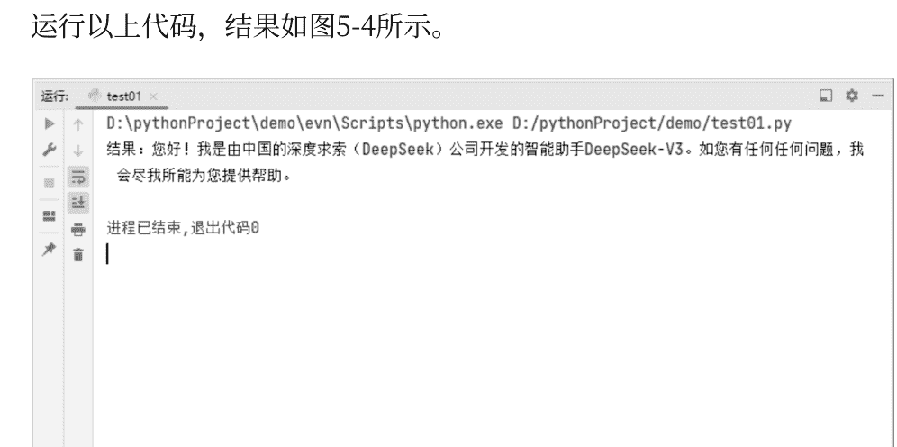

图5-4 调用DeepSeek实现结果

### 5.2.2 构建多步骤任务工作流

在完成DeepSeek与LangChain的集成后，下一步就是构建多步骤任务工作流。多步骤任务工作流是指在一个复杂的语言处理任务中，按照一定的顺序依次执行多个子任务，每个子任务都有特定的输入和输出，最终实现整个任务的目标。

构建多步骤任务工作流的关键在于合理规划和设计各个子任务之间的关系。在实际构建过程中，开发者可以利用LangChain提供的丰富组件和工具来实现多步骤任务工作流。例如，可以使用LangChain的任务调度器来管理和控制各个子任务的执行顺序，确保它们能够按照预定的逻辑依次进行。同时，还可以利用LangChain的数据处理模块对中间结果进行处理和转换，以满足后续子任务的需求。

通过构建多步骤任务工作流，可以充分发挥DeepSeek和LangChain的优势，提高语言处理任务的效率和质量。同时，也能够更好地应对复杂多变的应用场景，为用户提供更加智能、个性化的服务。

构建多步骤任务工作流的具体实现代码如下：

```python

from langchain_core.runnables import RunnablePassthrough

from langchain_openai import ChatOpenAI

from langchain.prompts import PromptTemplate

#### 初始化 ChatOpenAI 模型

llm = ChatOpenAI(

    api_key="你的 API key",

    base_url="https://api.deepseek.com/v1",

    model="deepseek-chat",

    temperature=0.7

)

#### 第一步：生成大纲

first_prompt = PromptTemplate(

    input_variables=["topic"],

    template=" 以 {topic} 为主题生成一份技术报告的大纲 "

)

#### 第二步：根据大纲生成内容

second_prompt = PromptTemplate(

    input_variables=["question"],

    template=" 根据以下大纲撰写详细内容：\n{question}"

)

#### 构建工作流

chain_one = first_prompt | llm                 # 第一步：生成大纲

chain_two = second_prompt | llm                # 第二步：根据大纲生成内容

#### 使用 RunnablePassthrough 将第一步的输出传递给第二步

overall_chain = (

    {"topic": RunnablePassthrough()}           # 传递初始输入

    | chain_one                                # 执行第一步

    | (lambda x: {"question": x})              # 将第一步的输出转换为第二步的输入

    | chain_two                                # 执行第二步

)

#### 执行工作流

topic = " 人工智能 "

response = overall_chain.invoke(topic)

#### 输出最终结果

print(f"============ 详细内容 ============\n {response.content}")

加上日志输出与最终提炼
在上一条链上插入过程打印，让框架和正文在控制台可见，随后追加一个专门提炼关键信息的提示。打印环节用可执行 Lambda 完成，不阻断数据流，最后得到浓缩结论。
```

说明：RunnablePassthrough是LangChain中的一个类，主要用于在数据流中不变地传递数据。

运行以上代码，结果如图5-5所示。

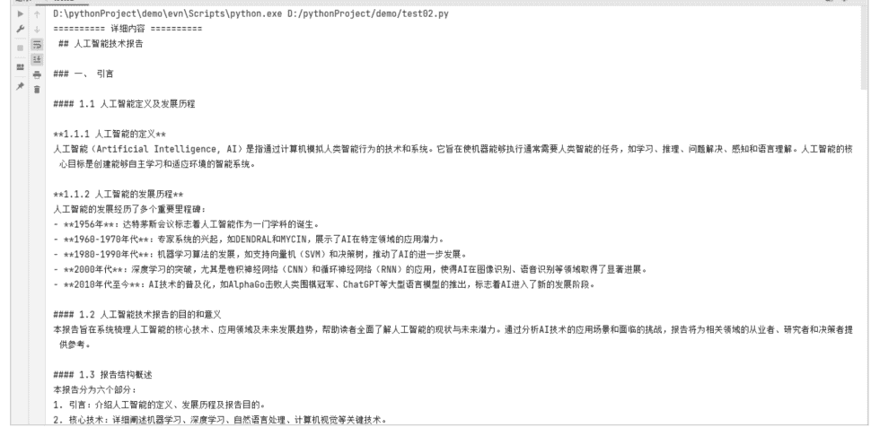

图5-5 运行结果（部分内容）

如果需要添加更多步骤，可以继续使用“|”操作符来组合更多的步骤。例如，获取内容的核心观点，若需要在执行过程中打印出每一步的结果，可使用RunnableLambda方法实现，具体实现代码如下：

```python

from langchain_core.runnables import RunnablePassthrough, RunnableLambda

from langchain_openai import ChatOpenAI

from langchain.prompts import PromptTemplate

#### 初始化 ChatOpenAI 模型

llm = ChatOpenAI(

    api_key="你的 API key",

    base_url="https://api.deepseek.com/v1",

    model="deepseek-chat",

    temperature=0.7

)

#### 第一步：生成大纲

first_prompt = PromptTemplate(

    input_variables=["topic"],

    template=" 以 {topic} 为主题生成一份技术报告的大纲 "

)

#### 第二步：根据大纲生成内容

second_prompt = PromptTemplate(

    input_variables=["question"],

    template=" 根据以下大纲撰写详细内容：\n{question}"

)

#### 第三步：获取内容的核心观点

third_prompt = PromptTemplate(

    input_variables=["answer"],

    template=" 请获取以下内容的核心观点：\n{answer}"

)

#### 构建工作流

chain_one = first_prompt | llm                     # 第一步：生成大纲

chain_two = second_prompt | llm                    # 第二步：根据大纲生成内容

chain_three = third_prompt | llm                   # 第三步：获取内容的核心观点

#### 使用 RunnablePassthrough 将第一步的输出传递给第二步

overall_chain = (

    {"topic": RunnablePassthrough()}               # 传递初始输入

    | chain_one                                    # 执行第一步

    | RunnableLambda(lambda x: print(f"=========== 大纲 ===========\n {x.content}") or {"question": x})

    | (lambda x: {"question": x})                  # 将第一步的输出转换为第二步的输入

    | chain_two                                    # 执行第二步

    | RunnableLambda(lambda x: print(f"=========== 详细内容 ===========\n {x.content}") or {"answer": x})

    | (lambda x: {"answer": x})                    # 将第二步的输出转换为第三步的输入

    | chain_three                                  # 执行第三步

)

#### 执行工作流

topic = " 人工智能 "

response = overall_chain.invoke(topic)

#### 输出最终结果

print(f"=========== 核心观点 ===========\n {response.content}")

用网页文本约束回答
```

运行以上代码，结果如图5-6所示。

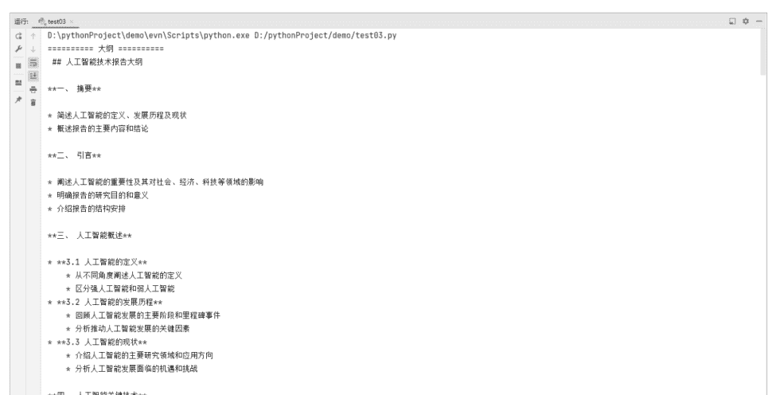

图5-6 运行结果（第一步部分内容）

根据大纲生成的内容，结果如图5-7所示。

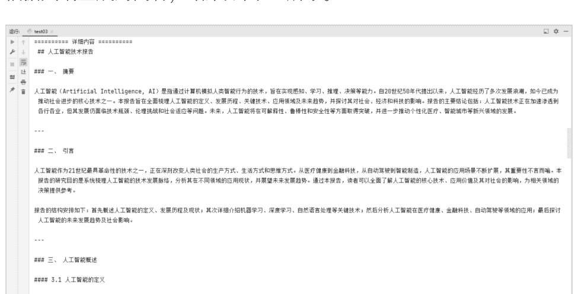

图5-7 运行结果（第二步部分内容）

运行以上代码，获取生成内容的核心观点，结果如图5-8所示。

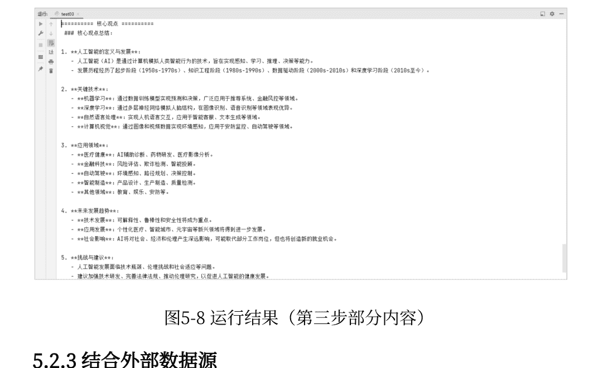

### 5.2.3 结合外部数据源

除了在LangChain中调用DeepSeek和构建多步骤任务工作流，结合外部数据源也是DeepSeek与LangChain集成实践中的一个重要方面。外部数据源可以为语言处理任务提供更多的数据支持，进一步提升应用的性能和价值。

在结合外部数据源方面，开发者可以根据具体的应用需求选择合适的数据源。例如，在知识图谱构建、实体识别等任务中，可以使用专业的知识库作为数据源，为模型提供丰富的语义信息和背景知识。同时，还可以通过网络爬虫等方式获取实时的互联网数据，使模型能够及时更新和学习最新的信息。

要在ChatOpenAI的基础上结合外部数据源（例如从网页获取数据），可以使用requests库来获取网页内容，然后将获取的内容作为上下文传递给ChatOpenAI模型。具体实现步骤如下。

（1）通过指令安装requests包，指令如下：

```
pip install requests
先准备好请求库抓取目标页面的原始文本，成功后把文本嵌入系统指令与用户提问，明确要求它只参考所提供的材料推理，减少幻觉。
```

（2）选择获取数据的网页，并复制网页路径。使用的网页路径为 https://duzhenshequ.com/about/aboutc.html，网页内容如图5-9所示。

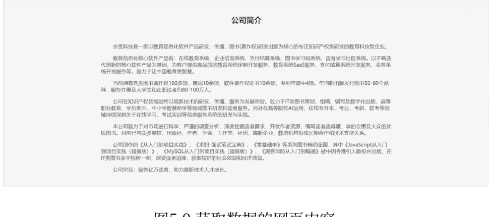

图5-9 获取数据的网页内容

（3）编写实现代码，具体实现代码如下：

```python

#### 导入 requests

import requests

from langchain_openai import ChatOpenAI

from langchain.schema import HumanMessage, SystemMessage

#### 初始化 ChatOpenAI

llm = ChatOpenAI(

    api_key="你的 API key",

    base_url="https://api.deepseek.com/v1",

    model="deepseek-chat",

    temperature=0.7

)

#### 定义一个函数来获取网页内容

def fetch_webpage_content(url):

    try:

        response = requests.get(url)

        response.raise_for_status()  # 检查请求是否成功

        return response.text

    except requests.exceptions.RequestException as e:

        print(f"获取网页内容时出错：{e}")

        return None

#### 获取网页内容

url = "https://duzhenshequ.com/about/aboutc.html"  # 替换为想要获取内容的网页 URL

webpage_content = fetch_webpage_content(url)

if webpage_content:

    # 将网页内容作为上下文传递给模型

    messages = [

        SystemMessage(content="请根据提供的网页内容回答问题。"),

        HumanMessage(content=f"根据以下网页内容，回答问题：{webpage_content}"),

        HumanMessage(content="网页的主题是什么？")

    ]

    # 使用 invoke 方法调用模型生成回答

    response = llm.invoke(messages)

    print(f"============ 结果 ============\n{response.content}")

else:

    print("无法获取网页内容。")

读取本地 Word 做概括
```

##### 提示：

(1) 由于网页内容可能包含大量文本，因此，需要对内容进行预处理（如提取关键部分或摘要），避免超出模型的输入长度限制。

(2) 如果需要处理更复杂的网页内容（如提取特定部分的内容），可以考虑使用BeautifulSoup、lxml等HTML解析库。

##### 说明：

(1) fetch_webpage_content函数：这个函数使用requests库来获取指定URL的网页内容。如果请求成功，返回网页的HTML内容；如果失败，返回None。

(2) webpage_content：这是从网页获取的内容，可以将其作为上下文传递给ChatOpenAI模型。

(3) messages：这是一个包含系统消息和用户消息的列表。系统消息用于设置模型的角色，用户消息包含网页内容和问题。

(4) llm(messages)：调用ChatOpenAI模型生成回答。

运行以上代码，结果如图5-10所示。

除了可以从网页中获取数据作为数据源，还可以将Word文档作为数据源来使用，下面将通过使用python-docx库来获取Word文档中的数据，然后将获取的数据作为上下文传递给ChatOpenAI模型，具体实现步骤如下。

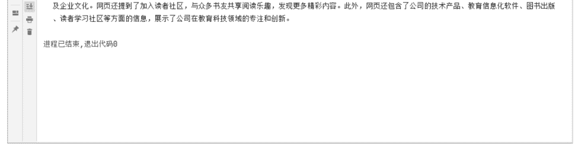

图5-10 获取的网页主题

(1) 通过指令安装requests包，指令如下：

```
pip install python-docx
通过文档库把 .docx 的所有段落拼成纯文本，再与问题一起组成提示，让模型给出简明概括。
```

（2）选择获取数据的Word文档，并复制Word文档路径。文档内容如图5-11所示。

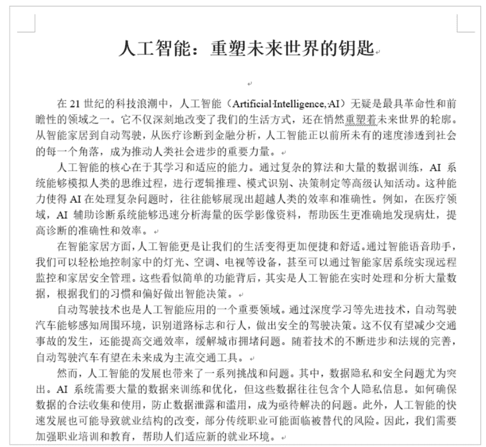

图5-11 文档内容

（3）编写实现代码，具体实现代码如下：

```python

#### 导入 python-docx

from langchain_openai import ChatOpenAI

from docx import Document

#### 初始化 ChatOpenAI 模型

llm = ChatOpenAI(

    api_key="你的 API key",

    base_url="https://api.deepseek.com/v1",

    model="deepseek-chat",

    temperature=0.7

)

#### 手动加载 .docx 文件内容

def load_docx_file(file_path):

    doc = Document(file_path)

    full_text = []

    for paragraph in doc.paragraphs:

        full_text.append(paragraph.text)

    return "\n".join(full_text)

#### 加载 .docx 文件内容

file_path = "D:\pythonProject\demo\ceshi.docx"  # 替换为用户的文件路径

context = load_docx_file(file_path)

#### 向模型提问，提供 .docx 文件中的上下文

question = " 请简要总结文档的主要内容。"

prompt = f"请根据以下提供的内容回答问题：\n{context}\n\n 问题：{question}"

#### 使用模型生成回答

response = llm.invoke(prompt)

#### 输出模型的回答

print(f"============ 结果 ============\n {response.content}")

把模型视作流水线里的标准工序，保持上下游格式一致，写作、审阅、资料检索类场景都能较稳落地到内容生产。

自建适配器把 DeepSeek 接入 LangChain

官方方案上手快但定制空间有限，自己封装一个轻量的 LLM 包装类，可以把读取配置、参数校验、网络请求收进一个地方，之后直接用在 LangChain 的新式链路里。

把会变动的参数全部抽到配置文件里。密钥、请求地址、模型名称以及温度、最大 token、top_p 等采样项统一写进 JSON，后续调整只需要改文件，代码不用动。

```

**提示：** 还可以通过引入不同的库来实现获取PDF、txt等文档中的数据。

运行以上代码，结果如图5-12所示。

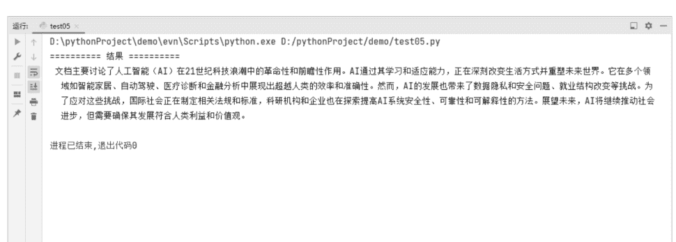

图5-12 文档的主要内容

### 5.2.4 结合外部工具

DeepSeek与LangChain的结合为开发者提供了强大的工具链，能够轻松集成外部数据源和API，赋能智能化应用。以天气查询为例，借助DeepSeek的自然语言处理能力和LangChain的模块化设计，开发者可以快速构建智能天气查询系统。用户只需输入自然语言指令，如“今天北京的天气如何”，系统便能自动解析用户意图，调用外部天气API获取实时数据，并以简洁易懂的方式反馈结果。这种集成不仅优化了用户体验，还大幅降低了开发复杂度，为构建更智能的应用开辟了广阔空间。

下面将详细讲解如何通过使用DeepSeek+LangChain+天气查询API来实现天气智能查询，具体实现步骤如下：

（1）选择一个天气查询的API，此处示例使用的天气查询API为聚合数据的天气预报API，如图5-13所示。

### 5.3 DeepSeek插件与扩展功能开发

在现代的AI开发中，LangChain作为一种语言模型微服务管理框架，提供了灵活且强大的工具集。通过LangChain，开发者可以轻松地管理和调用多种语言模型服务。DeepSeek作为一个强大的语言生成模型，其集成和扩展功能的实现显得尤为重要。本节将详细介绍在LangChain框架下进行DeepSeek插件开发的具体流程、规范，以及API集成实例，帮助开发者快速上手并高效使用这一技术栈。

#### 5.3.1 插件开发流程与规范

在LangChain框架中集成DeepSeek插件是一个系统性工程，其核心目标是将DeepSeek提供的强大自然语言处理能力通过标准化接口封装为LangChain生态中的可复用组件。这一过程需要严格遵循插件开发流程与规范，以确保功能实现的正确性、系统架构的扩展性，以及与其他LangChain组件的兼容性。

##### 1. 开发流程

在LangChain中集成DeepSeek插件主要涉及将DeepSeek的API封装为LangChain的组件（如LLM或Tool），具体实现步骤如下：

（1）创建配置文件，在项目根目录下创建config.json文件，并在文件中配置DeepSeek的参数，具体参数如下：

```json

{

    "deepseek": {

        "api_key": "你的 API key",

        "api_base": "https://api.deepseek.com/v1/chat/completions",

        "model": "deepseek-chat",

        "temperature": 0.5,

        "max_tokens": 1024,

        "top_p": 1.0

    }

}

包装类继承自 LangChain 提供的 LLM 基类，并利用 Pydantic 的前置校验钩子在实例化阶段加载同目录下的 config.json。若文件不存在、JSON 格式错误或缺少 API 密钥，会立刻抛出 ValueError，避免到真正调用时才出错。类型标识固定返回 deepseek。

实际调用方法负责拼装 HTTP 请求。请求头使用 application/json 并以 Bearer 方式携带密钥，请求体包含模型名、仅由用户输入构成的 messages，以及温度、最大 token、top_p，默认值先从配置读取，调用时可通过 kwargs 覆盖。请求成功后取第一个候选的 content 并去除首尾空白；网络异常统一转为 “API 请求失败”，解析异常统一转为 “无法解析 API 响应”。

```

说明：api_key的值为用户申请的DeepSeek的API key，model的值为用户要使用的模型名称，max_tokens的值为单次请求最大消耗的tokens数。

（2）创建自定义LLM类：继承LangChain的LLM基类，具体实现代码如下：

```python

import json

import requests

from pathlib import Path

from typing import Optional, List, Dict, Any

from langchain_core.language_models import LLM

from langchain_core.callbacks import CallbackManagerForLLMRun

from pydantic import Field, model_validator

class DeepSeekLLM(LLM):

    """DeepSeek LLM 服务封装"""

    config: Dict = Field(default_factory=dict, description="模型配置")

    @model_validator(mode="before")

    def validate_environment(cls, values: Dict) -> Dict:

        """加载并验证配置文件"""

        config_path = Path("config.json")

        if not config_path.exists():

            raise ValueError("配置文件 config.json 未找到")

        try:

            with open(config_path, "r") as f:

                config = json.load(f).get("deepseek", {})

        except json.JSONDecodeError:

            raise ValueError("配置文件格式错误")

        if not config.get("api_key"):

            raise ValueError("配置文件中缺少 DeepSeek API 密钥")

        values["config"] = config

        return values

    @property

    def _llm_type(self) -> str:

        return "deepseek"

    def _call(

        self,

        prompt: str,

        stop: Optional[List[str]] = None,

        run_manager: Optional[CallbackManagerForLLMRun] = None,

        **kwargs: Any,

    ) -> str:

        """执行模型调用"""

        headers = {

            "Content-Type": "application/json",

            "Authorization": f"Bearer {self.config['api_key']}"

        }

        payload = {

            "model": self.config["model"],

            "messages": [{"role": "user", "content": prompt}],

            "temperature": self.config.get("temperature", 0.7),

            "max_tokens": self.config.get("max_tokens", 2048),

            "top_p": self.config.get("top_p", 1.0),

            **kwargs

        }

        try:

            response = requests.post(

                self.config.get("api_base", "https://api.deepseek.com/v1/chat/completions"),

                headers=headers,

                json=payload

            )

            response.raise_for_status()

            return response.json()['choices'][0]['message']['content'].strip()

        except requests.exceptions.RequestException as e:

            raise ValueError(f"API 请求失败: {str(e)}")

        except KeyError:

            raise ValueError("无法解析 API 响应")

最简单的连通性验证是直接创建实例后用 invoke 发一条简短提问，确认能否返回内容。

```

（3）调用测试：验证是否可正常调用用户封装的LLM服务。具体实现代码如下：

```python

##### 使用示例

if __name__ == "__main__":

    llm = DeepSeekLLM()

    response = llm.invoke("你是谁？")

    print("回答: ", response)

更实用的方式是接入链式流程。借助 ChatPromptTemplate 固定提示模板，配合 RunnablePassthrough 透传输入，保持新式链的调用习惯。

```

运行以上代码，结果如图5-16所示。

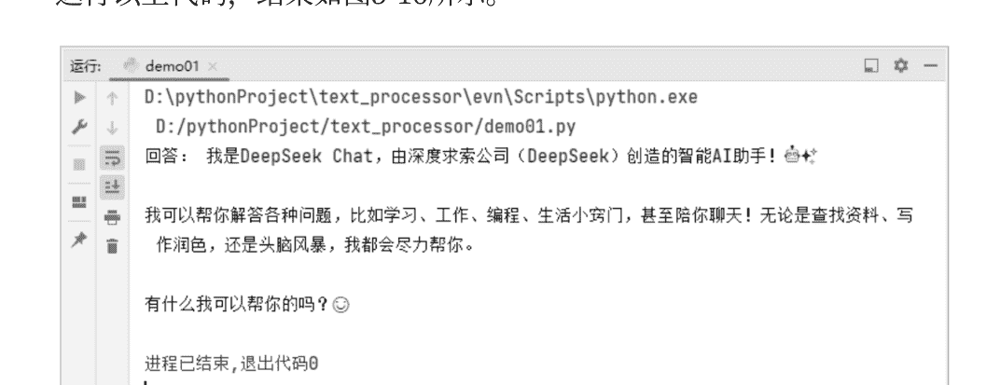

##### 2. 开发规范

（1）代码结构清晰：遵循良好的代码结构，将模型初始化、提示模板创建、对话链构建等逻辑分开，便于维护和扩展。

（2）错误处理：添加适当的错误处理机制，以应对模型调用失败、API请求超时等异常情况。

（3）性能优化：根据具体需求对模型调用进行性能优化，如设置合理的max_tokens限制、使用流式响应等。

（4）安全性：确保API密钥等敏感信息的安全存储和传输，避免泄露。

（5）文档和注释：为代码添加详细的文档和注释，便于其他开发者理解和使用。

#### 5.3.2 LangChain集成自定义LLM

LangChain作为构建基于语言模型应用的开源框架，凭借其模块化设计和强大的扩展能力，为开发者提供了将自定义LLM无缝融入实际业务流程的解决方案。通过LangChain，开发者不仅能够调用主流API（如OpenAI、DeepSeek等），还能灵活集成企业自研的LLM模型，实现从数据预处理、模型推理到结果后处理的全流程控制。这种能力使得企业能够在保护数据隐私的同时，针对特定领域（如医疗、金融、法律等）优化模型表现，显著提升业务效率与决策质量。

下面将详细介绍如何通过LangChain框架实现自定义LLM的集成，具体实现代码如下：

```python

from langchain_core.prompts import ChatPromptTemplate

from langchain_core.runnables import RunnablePassthrough

##### 初始化自定义 LLM

from demo01 import DeepSeekLLM

llm = DeepSeekLLM()

##### 创建提示模板

prompt = ChatPromptTemplate.from_template(

    "你是一个有帮助的助手。请用中文回答。\n 问题: {question}"

)

##### 使用新式链组合

chain = (

    RunnablePassthrough.assign() # 传递输入参数

    | prompt # 应用提示模板

    | llm # 调用 LLM

)

##### 调用链（接口保持兼容）

question = "介绍一下人工智能"

response = chain.invoke({"question": question})

print("回答: ", response)

实现与配置分离后，换模型或调整采样策略只需修改 JSON，适配器本身无需改动，能平滑运行在 LangChain 生态中。

```

运行以上代码，结果如图5-17所示。

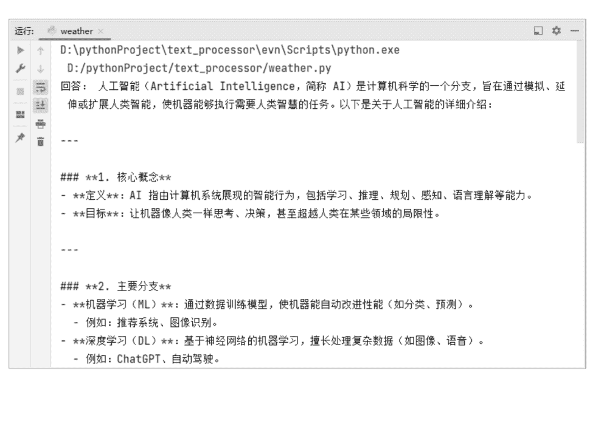

### 5.4 知识拓展与技巧分享

在深入探讨了LangChain框架下的DeepSeek能力扩展后，不难发现，这一集成方案为开发者提供了前所未有的便捷与高效。然而，技术的深度与广度远不止于此，为了更全面地掌握LangChain与DeepSeek的应用，本节将进一步拓展相关知识，并分享一些实用的技术技巧。

#### 5.4.1 知识拓展

##### 1. 自然语言处理（NLP）技术基础

DeepSeek作为一种前沿的语言生成模型，其核心在于对自然语言的深刻理解和生成能力。这背后离不开NLP技术的支撑。NLP是计算机科学、人工智能和语言学领域的交叉学科，旨在使计算机能够理解、解释和生成人类语言。从早期的词法分析、句法分析，到现代的深度学习模型，如Transformer、BERT等，NLP技术不断演进，为语言模型的发展提供了强大的动力。

在LangChain框架中，NLP技术的应用体现在多个方面。例如，通过LLM模型包装器，LangChain能够处理复杂的语言输入，生成精确的输出；通过记忆模块，LangChain能够追踪对话的上下文，实现更流畅的多轮对话体验。这些功能的实现，都离不开NLP技术的深厚底蕴。

##### 2. 微服务架构与组件化设计

LangChain框架采用了微服务架构与组件化设计思想，这使得它能够灵活地集成各种语言模型和服务，满足不同应用场景的需求。微服务架构是一种将应用程序构建为一组小型、自治服务的架构模式，每个服务都运行在其独立的进程中，服务间通过轻量级通信机制（通常是HTTP API）进行通信。这种架构模式提高了系统的可扩展性、可维护性和灵活性。

在LangChain中，组件化设计体现在其提供的多种组件上，如LLM模型包装器、数据加载器、嵌入包装器等。这些组件可以像积木一样被组装起来，形成复杂的语言处理任务链。这种设计思想不仅简化了开发过程，还提高了系统的可重用性和可扩展性。

##### 3. 向量搜索与嵌入技术

在信息爆炸的时代，如何高效地检索和处理信息成为亟待解决的问题。向量搜索与嵌入技术为这一问题的解决提供了有力支持。向量搜索是一种基于向量空间模型的搜索方法，它将文本、图像等数据转换为高维向量，通过计算向量间的相似度来实现快速检索。嵌入技术则是将高维数据映射到低维向量空间中，同时保留数据间的相对关系。

在LangChain框架中，向量搜索与嵌入技术被广泛应用于数据处理与管理模块中。例如，通过嵌入包装器将文档转化为机器学习模型可用的向量表示，然后利用向量存储系统进行高效存储和查询。这种技术不仅提高了信息检索的准确性和效率，还为构建智能问答系统、知识图谱等应用提供了有力支持。

#### 5.4.2 技巧分享

##### 1. 高效集成DeepSeek的技巧

在集成DeepSeek到LangChain时，可以采用一些技巧来提高集成效率和性能。例如，可以将DeepSeek的API封装成一个可复用的组件，这样在不同的应用场景中都可以直接使用这个组件，而无须重复编写代码。

此外，还可以利用LangChain提供的回调处理器来监控和调试DeepSeek的调用过程。通过记录和分析调用日志，可以及时发现并解决问题，提高系统的稳定性和可靠性。

##### 2. 构建复杂工作流的策略

在构建多步骤任务工作流时，需要合理规划和设计各个子任务之间的关系。首先，需要明确每个子任务的目标和输入输出；其次，需要选择合适的组件和工具来实现这些子任务；最后，需要使用LangChain的链式调用机制将这些子任务串联起来，形成一个有机的整体。

为了降低工作流的复杂性和维护成本，可以采用模块化和可复用的设计原则。将每个子任务封装成一个独立的模块，这样可以方便地在不同的工作流中复用这些模块。

##### 3. 调试与优化建议

在开发过程中，难免会遇到各种问题和挑战。为了快速定位和解决问题，可以采用一些调试技巧和优化策略。例如，可以使用日志记录来跟踪程序的执行流程和状态变化；还可以使用性能分析工具来评估和优化程序的性能瓶颈。

此外，还可以参考LangChain和DeepSeek的官方文档和社区资源来获取更多的帮助和支持。这些资源不仅包含了详细的技术文档和API说明，还包含大量的示例代码和最佳实践。通过学习这些资源，可以更好地掌握和使用这些技术。

## 第6章 使用Ollama部署本地DeepSeek系统

### 本章导读

本章将详细介绍如何使用Ollama框架部署本地DeepSeek系统。首先概述了Ollama框架的简介与部署原理，包括其架构设计、部署流程、本地部署环境兼容性分析及性能优化策略。接着，深入探讨了Ollama与DeepSeek的本地化集成实战，包括配置DeepSeek模型、创建模型实例、多步骤推理任务的调度与分配，以及如何利用本地数据源与外部工具增强任务能力。最后，介绍了Ollama的扩展功能与工具，特别是如何通过Chatbox实现可视化聊天，极大地提升了用户与本地大语言模型的交互体验。本章内容旨在为开发者提供一套完整的Ollama与DeepSeek本地化部署与集成的解决方案，助力构建高效、智能的本地AI应用。

### 知识导读

- 本章要点（已掌握的在方框中打钩） □
- Ollama框架简介与部署原理。 □
- Ollama与DeepSeek本地化集成实战。 □
- Ollama扩展功能与工具。 □
- 知识拓展与技巧分享。

### 6.1 Ollama框架简介与部署原理

在当今人工智能技术飞速发展的时代，各类先进的框架层出不穷。其中，Ollama框架凭借独特的优势，在众多领域展现出了巨大的潜力。它不仅具备强大的功能和灵活的架构，还在性能优化方面有着诸多可圈可点之处。下面将深入探讨Ollama框架的相关内容，包括架构设计与部署流程、本地部署环境兼容性分析及性能优化策略等重要方面。

#### 6.1.1 架构设计与部署流程

大语言模型（Large Language Model, LLM）目前已成为自然语言处理领域的热门话题。作为一款快速运行LLM的简便工具，Ollama正逐渐受到开发者和技术人员的青睐。它通过优化架构设计，降低了LLM的部署门槛，使得更多人能够在本地环境中轻松部署和使用LLM模型，下面介绍Ollama的结构设计与部署流程。

Ollama是基于LLaMA模型优化与微调的开源框架，其采用了经典的CS（Client-Server）架构，这一设计使得客户端与服务器之间能够高效地进行通信与数据交换。Ollama整体架构如图6-1所示。

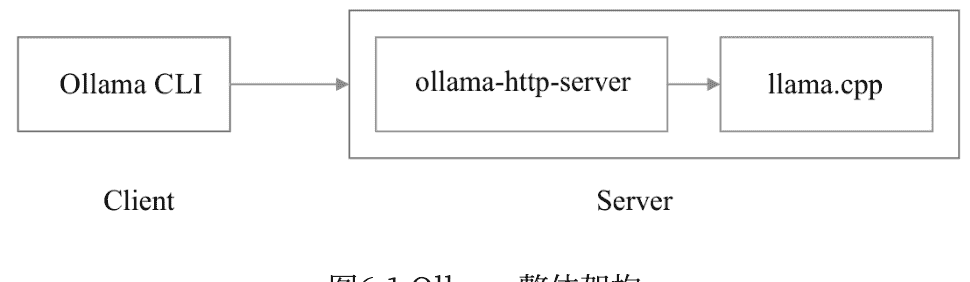

（1）Ollama使用了经典的CS（Client-Server）架构。

- ①Client：通过命令行的方式与用户进行交互，提供简洁明了的操作界面。
- ②Server：可以通过命令行、桌面应用（基于Electron框架）或Docker等方式启动，为客户端提供服务。无论启动方式如何，最终都调用同一个可执行文件。

（2）Ollama Server有两个核心部分。

- ①ollama-http-server：负责与客户端进行交互，接收并处理来自客户端的请求。
- ②llama.cpp：作为LLM推理引擎，负责加载并运行大语言模型，处理推理请求并返回结果（提示：ollama-http-server与llama.cpp之间通过HTTP进行交互）。

值得注意的是，llama.cpp是一个独立的开源项目，具备跨平台和硬件友好性，这意味着它可以在没有GPU的设备上运行，这一特性极大地拓宽了Ollama的应用场景，使得更多用户能够轻松地使用LLM。

Ollama作为一个轻量级且高度可扩展的框架，专为本地运行大语言模型而打造。在部署流程方面，Ollama框架提供了清晰且简洁的操作指南。以下是Ollama本地部署的详细步骤。

（1）检查系统兼容性，Ollama支持macOS、Windows和Linux操作系统。在安装前需确保操作系统版本与Ollama的要求相匹配（内存至少4GB RAM，存储空间至少100GB）。

（2）访问Ollama官网，在官网中下载Ollama安装包（此处Windows系统为例），如图6-2所示。

**说明：** Ollama的官网地址为https://ollama.org.cn/。

（3）单击网站中的“下载”按钮，进入Ollama的下载页面，如图6-3所示。


▲图6-2 Ollama官网


▲图6-3 Ollama下载页面

（4）根据需求选择Ollama的系统版本（此处选择Windows版本），选择完成后单击“下载Windows版本”按钮，开始Ollama的下载，如图6-4所示。


图6-4 Ollama下载页面

（5）下载完成后双击运行OllamaSetup.exe文件，如图6-5所示。


图6-5 Ollama安装

（6）单击Install按钮，开始安装Ollama，如图6-6所示。

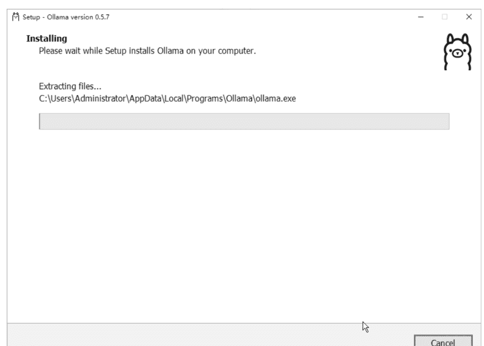

图6-6 开始安装Ollama

**提示：** Ollama的默认安装目录为C盘，建议修改目录为其他盘。由于Ollama的安装界面没有自定义安装目录选项，因此，只能通过指令进行修改，具体指令如下：

```

想把 Ollama 安装到指定盘符，直接通过安装程序的参数指定路径即可执行：
OllamaSetup.exe /DIR=J:Ollama

# Ollama 本地调用笔记

自己动手跑大模型，思路其实很顺：先把后端准备好确认模型，再挑一种客户端写法去试，最后按需做输出和并行优化。下面按顺序放了几段可直接用的片段，覆盖从基础检查到多请求同时推进的常见做法。

```

在OllamaSetup.exe的文件夹中打开命令行工具，运行指令，如图6-7所示。

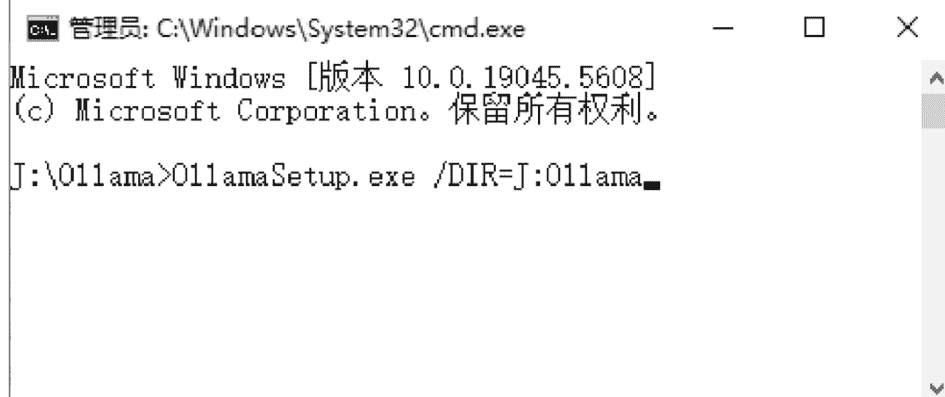

图6-7 修改Ollama安装目录

**说明：** J:Ollama为要安装Ollama的文件目录。

修改后的安装目录如图6-8所示。


图6-8 修改后的安装目录

（7）安装完成后通过访问http://localhost:11434/来判断服务是否已经成功运行，若已成功运行则结果如图6-9所示。


图6-9 判断Ollama是否运行成功

**提示：** Ollama默认开机自启动，若手动关闭了Ollama服务，可通过 ollama serve指令重新开启Ollama服务。

#### 6.1.2 本地部署环境兼容性分析

Ollama是一个开源项目，旨在提供一个简单的方式来运行大语言模型，如DeepSeek、GPT-4等。Ollama的设计初衷是为了易于部署和本地运行，通常具有良好的跨平台兼容性。以下是针对Ollama本地部署环境的兼容性分析，涵盖操作系统、硬件、软件依赖等关键要素。

##### 1. 操作系统支持范围

Ollama支持多种操作系统，主要包括如下3种。

- (1) Linux：推荐Ubuntu 20.04/22.04（主流AI框架适配最佳）。
- (2) Windows：需通过WSL2或Docker实现（部分功能可能受限）。
- (3) macOS：仅支持CPU模式（无GPU加速，性能受限）。

##### 2. 硬件要求

为正常运行Ollama和大语言模型，硬件需要满足以下要求。

- （1）CPU：Ollama的顺畅运行依赖于多核处理器的强大支持，建议至少配备4核或更高配置的CPU。对于处理大型模型或执行复杂推理任务而言，更强劲的CPU能够带来更优的性能表现，有效缩短处理时间。
- （2）GPU：GPU能够大幅提升模型的推理速度和训练效率，尤其在处理深度学习模型时，其优势更为显著。若计划运行大型模型或进行模型微调，GPU加速是不可或缺的。NVIDIA的CUDA兼容GPU，如Tesla系列或GeForce RTX系列显卡，是理想的选择。
- （3）内存：Ollama的运行效果同样受到内存大小的影响。至少需配备8GB RAM，而若需运行较大模型或处理海量数据，则建议使用16GB或更高容量的内存，以确保系统运行的流畅无阻。
- （4）存储：存储预训练模型需足够的硬盘空间，模型大小因复杂度和规模而异，从几百兆字节（MB）至数吉字节（GB）不等。此外，还需考虑存储数据的读／写速度，更快的数据访问速度，有助于提升系统的整体性能。

##### 3. 软件依赖

在安装Ollama之前，确保系统上已安装以下依赖项。

- （1）Python版本要求：Ollama的开发依托于Python，通常要求Python 3.7或更高版本。鉴于不同版本的Python在语法、标准库及第三方库支持方面可能存在差异，因此，确保所使用的Python版本与Ollama及其依赖库完全兼容至关重要。
- (2) 深度学习框架支持：Ollama兼容多种深度学习框架，诸如TensorFlow、PyTorch等，这些框架构成了Ollama运行模型的核心基础。为确保顺利运行，务必确认这些框架与Ollama的版本相互兼容。值得注意的是，不同版本的深度学习框架在API、功能特性及性能优化方面可能存在差异，因此，在部署前需细致核查其兼容性。
- (3) 其他依赖库说明：除深度学习框架外，Ollama还可能依赖一些其他的Python库，如用于数据处理和科学计算的numpy、pandas等。这些库同样需要与Ollama的版本相契合，并且需在部署环境中得到正确安装。

##### 4. 网络配置

- (1) 端口设置：在启动Ollama服务时，需要指定服务的端口号，并确保该端口在本地环境中未被其他应用程序占用。同时，还需要考虑防火墙设置，确保外部设备能够访问该端口。
- (2) 网络连接：如果需要从远程设备访问Ollama服务，需要确保本地网络连接稳定，并且具备足够的带宽来支持数据传输。对于大规模的模型推理或训练任务，可能需要较高的网络带宽和低延迟的网络连接。

#### 6.1.3 性能优化策略

Ollama的性能优化策略可以从多个方面入手，以下是一些核心的优化举措，旨在全面提升其运行效率、降低资源消耗并增强模型的泛化能力。

##### 1. 模型选择与配置优化

- (1) 精选适宜模型：针对具体应用场景和需求，挑选参数量适中且经过高效压缩的预训练模型。资源有限时，小型高效模型无疑是最优之选。
- （2）细调模型配置：合理设定模型的超参数，如批量大小、学习率等，旨在保障模型性能的同时，有效控制资源耗费。例如，适度缩小批量大小能减少内存占用，但可能会略微放缓模型的收敛步伐。

##### 2. 数据处理优化

- （1）数据预处理强化：对输入数据进行清洗、归一化等预处理，以提升数据质量，增强模型训练效果。同时，根据模型需求进行特征甄选或提取，削减不必要的数据维度。
- （2）数据增强策略：运用数据增强技术丰富数据多样性，提升模型的泛化能力。如图像识别任务中可采用旋转、缩放、翻转等操作；自然语言处理任务中则可运用同义词替换、随机插入等方法。

##### 3. 计算资源高效利用

- （1）硬件加速助力：条件允许时，利用GPU或其他专用硬件加速模型的训练和推理。GPU凭借强大的并行计算能力，能显著提升模型运行速度。
- （2）多卡并行训练提速：配备多块GPU时，可采用多卡并行训练方式，将模型训练任务分配至多个GPU同步进行，从而加速训练进程。
- （3）分布式训练策略：针对大规模数据集和复杂模型，可采用分布式训练策略，将数据和模型分布于多个计算节点进行训练，以提升训练效率，增强模型的可扩展性。

##### 4. 模型深度优化

- （1）模型剪枝瘦身：剔除模型中不重要的连接或神经元，以缩减模型体积和计算量，同时力求保持模型性能。这是一种高效的模型压缩手段，能提升模型的推理速度和部署效率。
- （2）量化压缩提效：将模型中的浮点数表示转换为低精度整数表示，从而减少模型存储空间和计算量。量化可在不显著牺牲模型性能的前提下，大幅提升模型运行速度。

##### 5. 缓存机制引入

- （1）增设缓存层：在数据处理和模型推理过程中，引入缓存机制可减少重复计算带来的开销。例如，对频繁访问的数据或中间结果进行缓存，以便后续使用时能直接从缓存中获取，无须重新计算。
- （2）优选缓存类型与策略：根据具体应用场景和数据特点，选择恰当的缓存类型和缓存策略。如读频繁的数据可采用LRU（最近最少使用）缓存策略；写频繁的数据则可选用LFU（最不经常使用）缓存策略。

##### 6. 实时监控与动态调优

- （1）性能监控全程：在模型训练和推理过程中，实时监控模型的性能指标，如CPU、GPU使用率、内存占用、推理速度等。通过性能监控，可及时发现性能瓶颈和问题所在。
- （2）动态调整优化：根据监控到的性能指标，动态调整模型的参数、配置或计算资源分配。例如，当发现某GPU使用率过高时，可适当减少其任务量；当发现某超参数设置不合理时，可及时进行调整优化。

### 6.2 Ollama与DeepSeek本地化集成实战

在当今快速发展的人工智能领域，模型的本地化部署已成为提升效率、保障数据安全的关键策略。特别是对于像Ollama这样的先进大模型，与DeepSeek等搜索技术的本地化集成，不仅能够显著提高信息检索的速度与准确性，还能为用户带来更加定制化、私密性更强的服务体验。本节将深入探讨如何有效地配置DeepSeek模型，构建高效的本地推理流程与任务管理机制，实现多步骤推理任务的智能调度与分配，并利用本地数据源与外部工具进一步增强任务处理能力。

#### 6.2.1 配置DeepSeek模型

配置DeepSeek模型是整个本地化集成过程的基础。DeepSeek作为一种先进的搜索技术框架，其核心优势是能够快速准确地从大规模数据集中提取相关信息。要实现Ollama与DeepSeek模型的本地化集成，首先需要正确配置DeepSeek模型。DeepSeek是一个基于大规模数据集训练的先进语言模型，具有强大的自然语言处理能力。以下是配置DeepSeek模型的具体步骤。

- (1) 进入Ollama官网的“模型”界面，如图6-10所示。
- (2) 在Ollama官网的“模型”界面中单击deepseek-r1模型，进入deepseek-r1模型界面，如图6-11所示。
- (3) 根据硬件配置选择合适的版本，选择完成后复制对应的指令。此处示例使用的版本为1.5b，对应的指令为ollama run deepseek-r1:1.5b。

**说明：** 各版本的显卡要求如表6-1所示。

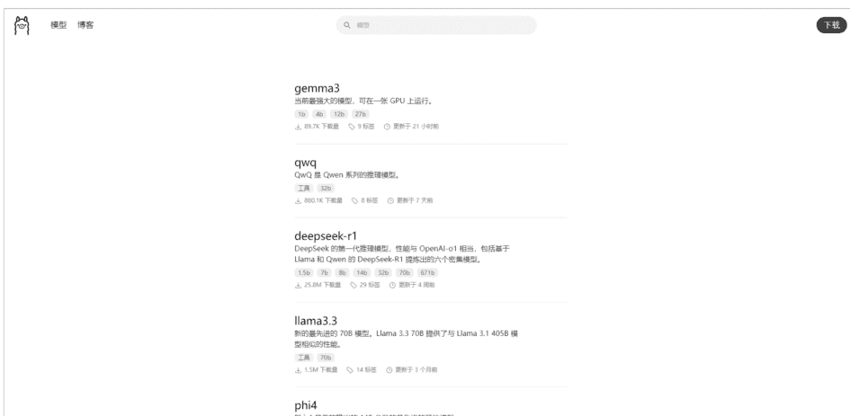

▲图6-10 Ollama “模型” 界面

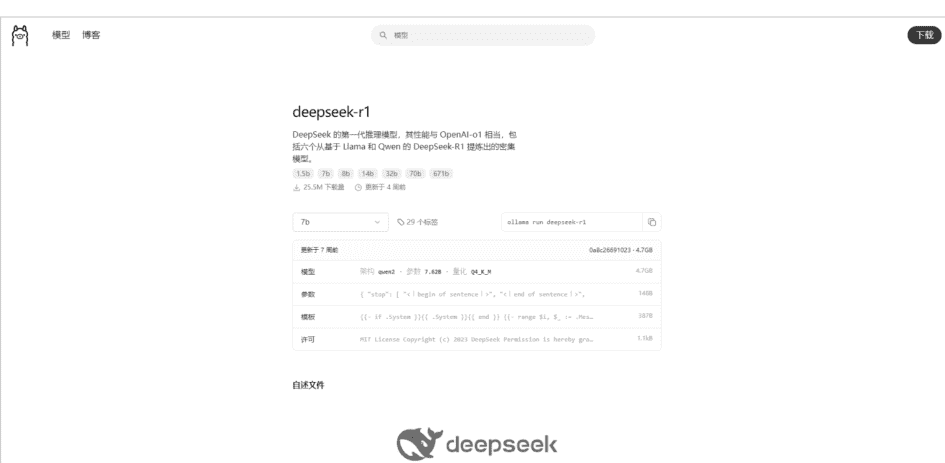

▲图6-11 “deepseek-r1” 模型界面

▼表6-1 各版本显卡要求

| 版本名称 | 显卡要求 |
| --- | --- |
| DeepSeek-R1-1.5b | NVIDIA RTX 3060 12GB 或者更高 |
| DeepSeek-R1-7b | NVIDIA RTX 3060 12GB 或者更高 |
| DeepSeek-R1-8b | NVIDIA RTX 3060 12GB 或者更高 |
| DeepSeek-R1-14b | NVIDIA RTX 3060 12GB 或者更高 |
| DeepSeek-R1-32b | NVIDIA RTX 4090 24GB |
| DeepSeek-R1-70b | NVIDIA RTX 4090 24GB ×2 |
| DeepSeek-R1-671b | NVIDIA A100 80GB ×16 |

- （4）在磁盘中创建一个目录，用于存储模型文件，如D:\Ollama。
- （5）设置系统环境变量。
  - ①打开“系统属性”对话框，选择“高级”选项卡，如图6-12所示。
  - ②单击“环境变量”按钮，弹出“环境变量”对话框，如图6-13所示。

##### 系统属性

计算机名 硬件 高级 系统保护 远程

要进行大多数更改，你必须作为管理员登录。

性能
视觉效果，处理器计划，内存使用，以及虚拟内存

设置(S)...

用户配置文件
与登录帐户相关的桌面设置

设置(E)...

启动和故障恢复
系统启动、系统故障和调试信息

设置(T)...

环境变量(N)...

确定 取消 应用(A)


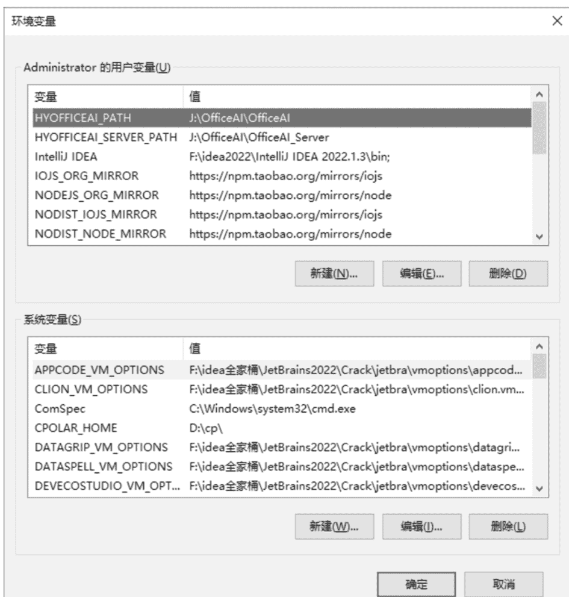

▲图6-13 “环境变量”对话框

- ③在“系统变量”中新建一个变量，设置“变量名”为 OLLAMA_MODELS，设置“变量值”为D:\Ollama，如图6-14所示。

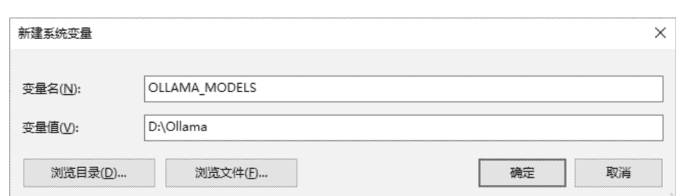

图6-14 新增系统变量

- ④单击“确定”按钮，完成系统变量的新增。
- （6）打开命令行工具，然后输入DeepSeek模型下载指令“ollama run deepseek-r1:1.5b”，如图6-15所示。

**提示：** 此过程可能需要一些时间，请耐心等待。

- （7）安装完成后如图6-16所示。

**说明：** 此时就可以通过命令行工具对在本地部署的DeepSeek进行提问了，如图6-17所示。

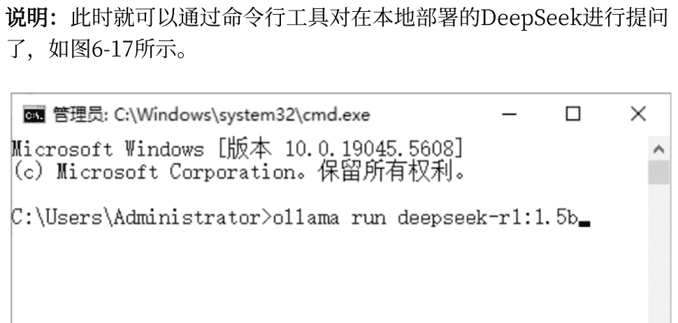

#### 6.2.2 创建DeepSeek的模型实例

在深入了解了DeepSeek模型的配置基础后，接下来将步入实践环节，即创建DeepSeek的模型实例。模型实例是DeepSeek搜索技术框架在实际应用中的具体体现，它负责将配置好的模型参数和数据集转换为可执行的搜索服务。通过创建模型实例，能够更直观地体验DeepSeek的强大功能，本节将详细介绍创建DeepSeek模型实例的具体实现和注意事项，确保实例能够稳定运行，为本地化集成提供坚实的支撑。

安装完Ollama的DeepSeek模型后，创建模型实例的具体步骤如下：

- （1）准备工作，启动Ollama服务（默认安装后通常会自动启动），手动启动指令如下：

```

##### 开启Ollama服务

ollama serve

##### 查看已安装的模型

ollama list

这一段演示了用通用 HTTP 客户端向本地接口请求完整答案的写法。
```

- （2）编写Python代码，创建DeepSeek模型示例，使用Python代码创建模型实例的常用方法有两种：一种是通过使用requests调用Ollama API来实现；另一种是通过使用官方的ollama库来实现，具体实现代码如下。

①使用requests调用Ollama API，具体实现代码如下：

```

##### 通过指令pip install requests 安装 requests

import requests

def generate_response(prompt):

    response = requests.post(

        'http://localhost:11434/api/generate',

        json={

            'model': 'deepseek-r1:1.5b',  # 替换为模型名称

            'prompt': prompt,

            'stream': False

        }

    )

    return response.json()['response']

##### 示例使用

print(generate_response("你好？"))

这一段演示了官方 Python 包的常规用法，适合做单轮验证。
```

运行以上代码，结果如图6-19所示。

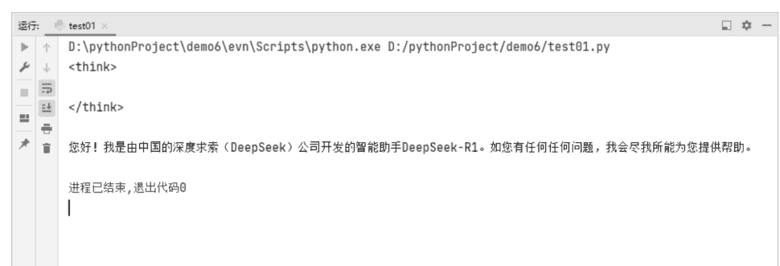

②使用官方的ollama库，具体实现代码如下：

```

##### 通过指令安装 ollama 指令（pip install ollama）

import ollama

##### 生成响应

response = ollama.generate(

    model='deepseek-r1:1.5b',  # 替换为你的模型名称

    prompt='写一个小故事'  # 问题

)

print(response['response'])

这一段在同样使用官方包的基础上打开增量模式，并在终端实时拼接结果。
```

运行以上代码，结果如图6-20所示。


**说明：** 若想通过使用官方的ollama库来实现流式输出，可通过添加stream=True属性来实现，具体实现代码如下：

```

##### 通过指令安装 ollama指令（pip install ollama）

import ollama

response = ollama.generate(

    model='deepseek-r1:1.5b',

    prompt='介绍下当前人工智能的发展',

    stream=True

)

##### 流式输出结果

for chunk in response:

    print(chunk['response'], end='', flush=True)

最后这一段把调用逻辑封装成可重复执行的单元，结合标准库的并行工具同时处理多个请求并收集耗时和异常信息。
```

#### 6.2.3 多步骤推理任务调度与分配

随着人工智能应用的日益复杂，多步骤推理任务的需求也日益增多。在Ollama与DeepSeek的本地化集成中，如何实现多步骤推理任务的智能调度与分配成为一个关键问题。本节将探讨如何利用DeepSeek的搜索能力和Ollama的推理能力，构建一套高效的任务管理机制。通过智能调度和分配，能够确保每个推理步骤都能够得到及时、准确的处理，从而提高整个系统的运行效率和准确性。

以下是一个基于任务队列的多步骤推理调度示例，演示如何拆分并并行处理多个生成任务，具体实现代码如下：

```

import ollama

import concurrent.futures

from concurrent.futures import ThreadPoolExecutor

import time

##### 任务队列

def generate_tasks():

    return [

        {'model': 'deepseek-r1:1.5b', 'prompt': '写一篇回忆童年的小故事'},

        {'model': 'deepseek-r1:1.5b', 'prompt': '写一篇日记（我是一名Java专业的在校大学生）'},

    ]

##### 任务处理（消费者）

def process_task(task):

    start = time.time()

    try:

        response = ollama.generate(

            model=task['model'],

            prompt=task['prompt']

        )

        return {

            'task': task['prompt'],

            'result': response['response'],

            'time': time.time() - start

        }

    except Exception as e:

        return {'error': str(e)}

##### 带并发的任务调度器

def parallel_scheduler():

    tasks = generate_tasks()

    # 创建线程池（根据CPU核心数调整）

整体从环境确认、单次请求、增量读取到多请求并行，形成了一条比较完整的本地实验路径，后续可根据设备性能自行调节参数和容错策略。

本机完成写作与翻译的完整链路

单机环境下可以把任务调度、要素写作、机器翻译串成闭环。先限定并发数把批量作业压进线程池，再让本地模型依据结构化要素出稿，最后把中文文本送到外部翻译接口得到英文对照。下面是并行调度的骨架：

    with ThreadPoolExecutor(max_workers=2) as executor:

        futures = [executor.submit(process_task, task) for task in tasks]

        results = []

        for future in concurrent.futures.as_completed(futures):

            result = future.result()

            if 'error' not in result:

                print(f"任务完成: {result['task'][:20]}... 耗时:{result['time']:.2f}s")

                results.append(result)

            else:

                print(f"任务失败: {result['error']}")

    return results

if __name__ == "__main__":

    print("开始并行任务处理...")

    all_results = parallel_scheduler()

    print("\n完整结果输出: ")

    print("=" * 60)

    for idx, res in enumerate(all_results, 1):

        print(f"\n任务 {idx}: {res['task']}")

        print("-" * 40)

        print(res['result'])

        print("=" * 60)

该片段通过线程池控制最大并发，批量提交后按完成顺序回收。正常结果会被收集返回，异常则单独输出。入口会先提示启动，再按序号把汇总的标题与正文依次呈现。

要素驱动的本地生成部分，先尝试读取本地 JSON，读取失败则提示并返回空。成功后从人物、场景、冲突三个集合里各随机抽取一项，填入提示模板，要求以中文写出大约三百字、情感偏暖的短篇，由本地 deepseek-r1:1.5b 完成生成。
```

说明：max_workers=2设置并行线程数（根据实际CPU核心可调）。

提示：运行代码前，需提前安装ollama库并配置可用模型。

运行以上代码，结果如图6-22所示。


#### 6.2.4 利用本地数据源与外部工具增强任务能力

在本地化集成的过程中，充分利用本地数据源和外部工具是提升任务处理能力的重要途径。本节将介绍如何将本地数据源与DeepSeek和Ollama模型相结合，以及如何利用外部工具来增强任务的处理能力。通过整合本地资源和外部工具，能够进一步拓展系统的功能，满足更多样化的应用需求，为用户提供更加全面、高效的服务体验。

##### 1. 利用本地数据源增强任务能力

本地数据源是指组织内部或特定区域内的数据集，这些数据通常包含丰富的信息，可以为任务执行提供有力的支持。通过将这些本地数据源与DeepSeek和Ollama模型相结合，可以实现以下几点。

- （1）定制化训练：使用本地数据对模型进行微调，使其更好地适应特定的应用场景。例如，一个企业可以利用其客户数据来训练模型，从而更准确地预测客户需求或行为。
- （2）实时更新：将本地数据库中的最新数据实时同步到模型中，确保模型输出的信息是最新的。这对于需要快速响应市场变化的行业尤为重要。
- （3）隐私保护：由于数据存储在本地，因此可以减少数据传输过程中的安全风险，同时遵守相关的数据保护法规。

下面将通过一个简单的示例来为大家讲解。假设有一个data.json文件，文件中包含各种故事元素数据，在生成小故事时以此数据文件为基础，具体实现代码如下：

```
import ollama

import json

import random

###### 1. 加载本地数据源

def load_story_elements(file_path):

    try:

        with open(file_path, 'r', encoding='utf-8') as f:

            data = json.load(f)

            return data

    except Exception as e:

        print(f"Error loading local data: {e}")

        return None

###### 2. 本地数据文件路径（修改为读者的文件路径）

local_data_path = "D:\pythonProject\demo6\data.json"

###### 3. 从本地数据源获取要素

story_elements = load_story_elements(local_data_path)

if story_elements:

    # 4. 构建增强提示词

    prompt_template = """基于以下要素编写一个短故事：

    主角特征：{character}

    故事场景：{setting}

    核心冲突：{conflict}

    请用中文写一个温暖感人的小故事，长度约300字。"""

    # 5. 从本地数据随机选择要素

    selected_character = random.choice(story_elements['characters'])

    selected_setting = random.choice(story_elements['settings'])

    selected_conflict = random.choice(story_elements['conflicts'])

    # 6. 生成最终提示词

    final_prompt = prompt_template.format(

        character=selected_character,

        setting=selected_setting,

        conflict=selected_conflict

    )

    # 7. 调用模型生成

    response = ollama.generate(

        model='deepseek-r1:1.5b',

        prompt=final_prompt

    )

    print("生成的故事：\n" + response['response'])

else:

    print("未能加载本地数据源")

可直接加载的要素文件结构示例如下：
```

运行以上代码，结果如图6-23所示。


**说明：** 每次运行都会根据本地数据随机组合不同的故事要素，生成更可控且具有本地数据特色的内容。可以通过扩展JSON文件中的要素项来持续增强生成能力。

**提示：** data.json文件中的数据格式如下：

```
{
    "characters": [
        "一只携带神秘怀表的橘猫",
        "记忆错乱的退休宇航员",
        "调查教育黑幕的卧底记者",
        "掌握古老秘术的消防员"
    ],
    "settings": [
        "漂浮在北极圈的天空咖啡馆",
        "生长着荧光珊瑚的深海观测站",
        "布满机械残骸的赛博朋克收容所",
        "藏有禁书的百年图书馆密室"
    ],
    "conflicts": [
        "必须选择摧毁怀表或失去说话能力",
        "在冰川崩塌前破解外星坐标谜题",
        "曝光真相将危及渗透三年的卧底身份",
        "使用秘术救人将加速自身灵魂燃烧"
    ]
}

生成后的中英对照片段，先用 Ollama 按简短指令得到中文初稿，再通过封装的翻译接口完成英译。签名由应用 ID、原文、时间戳盐和密钥拼接后取 MD5，请求超时设为五秒，遇到异常或返回错误标识时会提示并保留原文。
```

##### 2. 利用外部工具增强任务能力

除了本地数据源，还可以借助各种外部工具来进一步提升DeepSeek和Ollama模型的任务处理能力。以下是几种常见的方法。

- （1）API调用：许多第三方服务提供了强大的API，允许开发者轻松集成额外的功能。例如，可以通过调用天气信息的API来丰富对话内容；或者使用图像识别服务来解析用户上传的图片。
- （2）插件扩展：一些平台支持安装插件以增加额外功能。例如，在一个基于Ollama构建的应用中添加自然语言生成（NLG）插件，可以让机器人自动撰写文章、报告等内容。

下面将通过一个简单的示例来讲解如何通过调用外部翻译工具的API来增强模型的任务处理能力，具体实现步骤如下：

步骤01 选择一个提供API调用的翻译工具（此处使用的是百度翻译），如图6-24所示。


说明：百度翻译开放平台的网址为https://fanyi-api.baidu.com/。

步骤02 单击“立即使用”按钮，获取App id和API key（此处不再展示App id和API key获取的完整步骤），如图6-25所示。


步骤03 编写代码，具体实现代码如下：

```
import ollama

import requests

import hashlib

import json

import time

def baidu_translate(query, to_lang, appid, appkey):

    """

    使用百度翻译 API 进行文本翻译

    :param query: 要翻译的文本

    :param to_lang: 目标语言（如 'en'/'zh'）

    :param appid: 百度 API 应用 ID

    :param appkey: 百度 API 密钥

    :return: 翻译结果字符串

    """

    from_lang = 'zh'  # 假设原始故事是中文

    salt = str(round(time.time() * 1000))

    sign_str = appid + query + salt + appkey

    sign = hashlib.md5(sign_str.encode()).hexdigest()

    base_url = 'https://fanyi-api.baidu.com/api/trans/vip/translate'

    params = {

        'q': query,

        'from': from_lang,

        'to': to_lang,

        'appid': appid,

        'salt': salt,

        'sign': sign

    }

    try:

        response = requests.get(base_url, params=params, timeout=5)

        result = json.loads(response.text)

        if 'error_code' in result:

            print(f"翻译失败，错误码: {result['error_code']}")

            return None

        return '\n'.join([item['dst'] for item in result['trans_result']])

    except Exception as e:

        print(f"翻译请求异常: {str(e)}")

        return None

###### 请替换为您自己的百度 API 凭证

BAIDU_APPID = 'APP id'

BAIDU_APPKEY = 'APP key'

###### 生成原始故事

response = ollama.generate(

    model='deepseek-r1:1.5b',

    prompt='写一个小故事'

)

original_story = response['response']

print("===== 原始故事 =====")

print(original_story)

###### 翻译成英文

translated = baidu_translate(original_story, 'en', BAIDU_APPID, BAIDU_APPKEY)

if translated:

    print("\n===== 英文翻译 =====")

    print(translated)

else:

    print("跳过翻译，使用原始文本")

至此，调度、生成、翻译三段可在本地串联完成，无需依赖外部服务即可得到可交付的对照文本。

```

提示：百度翻译API有免费额度，但超出后需要付费，并且长文本可能需要分多次翻译（免费版有长度限制），如果要翻译其他语言，可以修改to_lang参数（如jp表示日语）。

运行以上代码，结果如图6-26所示。


### 6.3 Ollama扩展功能与工具

掌握了Ollama的基础功能与模型部署方法后，开发者与用户往往需要更高效、更灵活的工具来提升本地大语言模型的应用体验。本节将聚焦Ollama的扩展功能与周边工具，探讨如何通过第三方工具增强其交互能力、可视化效果及开发效率。无论是通过Chatbox这样的图形化界面简化对话交互，还是通过集成工具实现多模态应用场景，这些扩展功能都能帮助用户更直观地利用Ollama的潜力，同时为开发者提供快速构建AI应用的技术路径。

#### 6.3.1 Chatbox的下载与安装

Chatbox是一款开源的AI对话客户端工具，支持与Ollama等本地大语言模型无缝对接。通过其简洁的图形化界面，用户无须依赖命令行即可与模型进行自然语言交互，显著降低了使用门槛。本小节将详细介绍Chatbox的下载与安装流程。

（1）访问Chatbox官网，下载Chatbox的安装包，如图6-27所示。


图6-27 Chatbox官网

> 说明：Chatbox的官网地址为https://chatboxai.app/zh。

（2）单击页面中“下载”按钮，进入下载页面，然后根据自己的需求选择合适的安装包进行下载，如图6-28所示。

(3) 下载完成后单击安装包进行安装即可，安装完成后如图6-29所示。


▲图6-28 Chatbox下载


▲图6-29 Chatbox安装

(4) 运行已安装完成的Chatbox软件，如图6-30所示。


图6-30 Chatbox页面

**说明：** 运行成功即代表Chatbox已安装完成。

#### 6.3.2 集成Ollama实现可视化聊天

安装Chatbox后，下一步便是将其与Ollama深度整合，构建可实时交互的可视化聊天界面。本节将逐步演示如何通过API配置、模型权限管理及对话模板自定义，将Ollama的本地模型能力映射至Chatbox的交互式面板中。最终，用户可通过直观的图形界面实现多轮对话、上下文管理及模型性能调优，提升开发与测试效率。

在Chatbox中集成Ollama，实现可视化聊天的具体实现步骤如下：

(1) 在Chatbox界面中单击“设置”按钮，进入模型配置页面，如图6-31所示。


图6-31 Chatbox配置（一）

(2) 单击“模型提供方”按钮，选择Ollama API选项，如图6-32所示。


图6-32 Chatbox配置（二）

（3）配置“API域名”和“模型”，如图6-33所示。


图6-33 Chatbox配置（三）

（4）配置完成后单击“保存”按钮即可。

（5）通过在对话框中发送问题来测试Ollama是否在Chatbox中集成完成，如图6-34所示。


图6-34 在Chatbox中发起提问

说明：若能正常回答问题即代表Ollama在Chatbox中集成完成。

### 6.4 知识拓展与技巧分享

在深入掌握了Ollama框架部署本地DeepSeek系统的基本流程与实战技巧后，有必要进一步拓宽视野，了解更多相关领域的知识与技巧。本节将作为知识的延伸与拓展，不仅涵盖Ollama框架与DeepSeek模型的最新发展动态，还将分享一些在实际应用中的调试与优化经验。

#### 6.4.1 知识拓展

##### 1. Ollama框架的未来发展趋势

随着人工智能技术的不断进步，Ollama框架也在不断完善和发展。未来，Ollama有望在以下几个方面取得突破性进展。

- (1) 更强的模型兼容性：支持更多种类的预训练语言模型，不仅仅是DeepSeek和GPT系列，还包括其他开源或商业模型，以满足不同用户的需求。
- (2) 更高效的推理引擎：通过算法优化和硬件加速，进一步提升模型的推理速度，降低延迟，特别是在处理大规模数据和复杂任务时。
- (3) 多模态支持：集成图像、音频等多模态处理能力，使Ollama成为一个更加全面的AI框架，适用于更多应用场景。
- (4) 增强的安全性与隐私保护：加强模型训练和使用过程中的数据保护机制，确保用户数据的安全性和隐私性。

##### 2. DeepSeek模型的应用场景拓展

DeepSeek作为一种先进的搜索技术框架，其应用不仅仅局限于文本搜索。随着技术的深入研究和开发，DeepSeek有望在以下领域发挥更大作用。

- (1) 知识图谱构建：利用DeepSeek从大规模文本数据中提取实体和关系，构建高质量的知识图谱，为智能问答、推荐系统等提供支持。
- (2) 对话系统优化：结合DeepSeek的搜索能力，优化对话系统中的上下文理解和生成，提升对话的自然度和流畅度。
- (3) 个性化推荐：通过分析用户的历史行为和偏好，结合DeepSeek的搜索技术，实现更加精准和个性化的推荐服务。

#### 6.4.2 技巧分享

##### 1. Ollama与DeepSeek模型调试与优化技巧

在部署和使用Ollama与DeepSeek时，可能会遇到一些性能问题或模型表现不佳的情况。以下是一些调试和优化的技巧。

- (1) 参数调优：针对具体任务，调整模型的超参数，如学习率、批量大小等，以找到最佳配置。
- (2) 数据预处理：对输入数据进行充分清洗和预处理，去除噪声和无关信息，提高模型训练的效率和效果。
- (3) 模型压缩：采用模型剪枝、量化等技术手段，减小模型体积，提高推理速度，同时尽量保持模型性能。
- (4) 硬件加速：充分利用GPU等硬件资源，加速模型的训练和推理过程。对于大规模模型，还可以考虑使用分布式训练策略。

##### 2. Chatbox的高级功能与应用

Chatbox作为一款开源的AI对话客户端工具，不仅提供了基本的聊天功能，还支持许多高级特性和应用场景。

- (1) 多轮对话管理：通过上下文理解和跟踪，实现多轮对话的自然流转，提升用户体验。
- (2) 自定义对话模板：用户可以根据自己的需求，定义特定的对话模板和流程，实现更加个性化和定制化的服务。
- (3) 插件扩展：Chatbox支持插件机制，用户可以根据自己的需求开发或安装各种插件，扩展Chatbox的功能和应用场景。
- (4) 集成第三方服务：通过API调用，Chatbox可以轻松集成各种第三方服务，如天气查询、新闻推送等，为用户提供更加全面和便捷的服务。

## 第7章 RAG（检索增强生成）技术详解

### 本章导读

本章将深入拓展RAG（检索增强生成）技术的相关知识，并分享一系列实用技巧。首先，将概述RAG技术的最新研究进展，包括算法优化、性能提升及应用场景的拓展，帮助读者把握技术发展的前沿动态。随后，将详细介绍RAG技术在不同领域的应用实例，如问答系统、内容创作、多模态任务处理等，通过这些案例展示RAG技术的强大功能和广泛应用价值。

此外，本章还将重点分享在构建和优化RAG系统时的一些实用技巧。将从数据预处理、嵌入模型选择与微调、检索算法优化、生成模块改进等多个方面入手，提供一系列具体的操作方法和策略建议。这些技巧不仅能够帮助读者更好地理解和应用RAG技术，还能在实际项目中显著提升系统的性能和效果。

### 知识导读

- 本章要点（已掌握的在方框中打钩） □
- RAG理论概述与基础。 □
- RAG工作机制与架构设计深入。 □
- RAG高级应用场景探索。 □
- 知识拓展与技巧分享。

### 7.1 RAG理论概述与基础

随着人工智能技术的快速发展，生成模型在自然语言处理领域取得了显著突破。然而，传统生成模型在处理知识密集型任务时仍面临诸多挑战，如生成内容的准确性不足、对动态知识的适应性较差等。为此，检索增强生成（Retrieval-Augmented Generation, RAG）应运而生，通过将检索与生成深度融合，显著提升了模型在知识获取与内容生成上的能力。本章将系统阐述RAG的基本理论框架，解析其核心原理、工作流程及关键组成部分，并探讨其相较于传统生成模型的优势。

#### 7.1.1 基本概念与原理介绍

本节将围绕检索增强生成（Retrieval-Augmented Generation, RAG）的基本概念与技术原理展开，旨在帮助读者理解RAG的核心思想、技术框架及其与传统生成模型的本质区别。通过剖析RAG的底层逻辑，读者将掌握其如何通过结合检索与生成两大模块，提升生成结果的准确性、相关性和可解释性。

##### 1. 基本概念

RAG是一种结合检索（Retrieval）与生成（Generation）的混合模型架构。其核心思想是通过实时检索外部知识库中的相关信息，动态增强生成模型的输入，从而生成更准确、更具事实性的文本。相较于传统生成模型完全依赖内部参数化知识，RAG通过“检索—生成”协同机制，实现了外部知识与内部推理能力的有机融合。

##### 2. 核心原理（RAG模型包含两大核心模块）

- （1）检索模块：从海量外部知识库（如文档、数据库或网页）中快速检索与输入相关的上下文片段。
- （2）生成模块：基于检索结果与原始输入，生成最终的自然语言输出（如回答、摘要或对话）。其核心目标是提升生成内容的准确性、多样性和可解释性，同时降低模型对训练数据的依赖和“幻觉”（即生成虚构内容）风险。

#### 7.1.2 工作流程解析

RAG的实现可分为五大核心阶段：知识文档的准备、嵌入模型、向量数据库、查询检索、生成回答。每个阶段紧密衔接，形成从数据准备到内容生成的闭环。RAG工作流程如图7-1所示。


##### 1. 知识文档的准备

在构建一个高效的RAG系统时，首要步骤是准备知识文档。现实场景中，面对的知识源可能包括多种格式，如Word文档、TXT文件、CSV数据表、Excel表格，以及PDF文件、图片和视频等。因此，第一步需要使用专门的文档加载器（如PDF提取器）或多模态模型（如OCR技术），将这些丰富的知识源转换为大语言模型可理解的纯文本数据。

例如，处理PDF文件时，可以利用PDF提取器抽取文本内容；对于图片和视频，OCR技术能够识别并转换其中的文字信息。此外，考虑到文档篇幅可能过长，因此还需采取一项至关重要的举措：文档切片，即将长篇累牍的文档切割成多个精悍的文本块，以便更加高效地处理与检索信息。此举不仅能有效减轻模型的运算负担，还能显著提升信息检索的精准度。

##### 2. 嵌入模型

嵌入模型的核心职责在于，将文本内容转换为向量形式。日常所使用的语言往往充斥着歧义，且夹杂着诸多对表达核心词意并无实质性帮助的助词。相比之下，向量表示则显得更为紧凑且精确，它能够有效地捕捉到句子的上下文关联及核心要义。这种从文本到向量的转换，使得我们仅需通过简单地计算向量间的差异，便能准确地识别出语义上相似的句子。

##### 3. 向量数据库

向量数据库是一种专为存储和检索向量数据而设计的数据库系统。在RAG系统中，嵌入模型所生成的所有向量均会被保存在这样的数据库中。这类数据库针对大规模向量数据的处理和存储进行了优化，确保了在处理海量知识向量时，能够高效、迅速地检索出与用户查询最为相关的信息。

##### 4. 查询检索

经过上述几个步骤的充分准备后，便可以着手处理用户的查询了。首先，用户提出的问题会被送入嵌入模型中，进行向量化转换。接着，系统会在向量数据库中展开搜索，寻找与该问题向量在语义上高度相似的知识文本或历史对话记录，并将其返回给用户。

##### 5. 生成回答

最终将用户提问和上一步中检索到的信息结合，构建出一个提示模板，输入到大语言模型中，静待模型输出答案即可。

#### 7.1.3 主要组成部分：检索模块与生成模块

RAG是一种结合了信息检索与文本生成的先进技术，广泛应用于自然语言处理领域。它通过从大量文档中检索相关段落或片段，然后利用这些检索到的信息辅助生成更精准、更有信息的回应或文本。RAG的核心组成部分主要包括两个模块：检索模块和生成模块。这两个模块相辅相成，共同提升了文本生成的准确性和丰富性。接下来，将详细介绍这两个核心组件的工作原理及其在RAG中的作用。

##### 1. 检索模块

检索模块的主要功能是从大量的文档集中找到与查询最相关的信息。这一过程通常包括以下5个步骤。

- (1) 文档预处理：在进行实际检索之前，需要对文档进行预处理，包括分词、去除停用词、词干提取等操作。这些步骤有助于提高后续检索的效率和准确性。如果文档集包含大量无关的内容，如广告或导航链接，那么，这些内容会在预处理阶段被过滤掉。
- (2) 索引构建：为了快速查找相关信息，检索系统会为所有文档构建一个高效的索引结构。常见的索引方法包括倒排索引（Inverted Index），它将关键词映射到包含该关键词的文档列表。这样，在用户输入查询时，可以迅速定位到可能相关的文档集合。
- (3) 查询处理：用户输入的查询也会经过类似的预处理过程，确保其格式与文档索引中的格式一致。之后，查询会被分解成若干关键词，这些关键词将用来在索引中查找匹配的文档。
- (4) 检索与排序：根据查询中的关键词，从索引中检索出相关的文档列表。为了确定哪些文档最为相关，检索系统会计算每个文档与查询之间的相似度得分。常用的计算方法有余弦相似度（Cosine Similarity）、Jaccard相似度等。得分较高的文档通常会被认为与查询更为相关，从而排在结果列表的前面。
- (5) 返回结果：最后，检索模块会将最相关的前N个文档返回给生成模块使用。这一步非常重要，因为生成模块将基于这些检索到的文档生成最终的回复。

##### 2. 生成模块

生成模块负责利用检索模块返回的文档信息生成符合用户需求的高质量文本回应。这一过程通常分为以下4个关键步骤。

- (1) 上下文理解：生成模块首先需要深入理解用户的查询意图及检索到的相关文档内容。这涉及对查询语句和文档片段的语义分析，通常采用自然语言处理技术，如BERT、RoBERTa等，预训练模型来实现。这些模型能够捕捉到词语之间的深层次语义关系，从而更好地把握上下文的含义。
- (2) 信息融合：生成模块需要将从不同文档中检索到的相关信息进行整合。这一过程要求模型能够识别出不同来源的信息之间的关联，并合理地将其融入生成的文本中。例如，如果检索到的文档分别提供了关于某个事件的背景介绍、发展过程和当前状态的信息，生成模块需要将这些信息有机结合起来，形成连贯、完整的叙述。
- (3) 内容生成：在完成了上下文理解和信息融合后，生成模块开始生成具体的文本内容。现代的生成模型，如GPT系列、T5等，通过大规模数据的训练，已经具备了强大的文本生成能力。这些模型可以根据输入的提示（Prompt），自动生成流畅、自然的文本段落。生成的文本不仅需要语法正确，还要在语义上与用户提供的查询及检索到的文档内容高度一致。
- (4) 质量评估与优化：为了确保生成的文本具有高质量，生成模块通常会内置一些质量评估机制。例如，可以通过比较生成的文本与标准答案之间的差异来评估其准确性；也可以通过用户反馈来不断调整模型参数，以提高生成效果。此外，为了避免生成过于生硬或重复的内容，生成模块还可能会引入多样性控制策略，使得每次生成的文本都有所不同但又同样准确。

#### 7.1.4 与传统生成模型的区别与优势

相较于传统的生成模型，如基于LSTM或CNN的序列到序列模型，RAG模型展现出以下显著优势。

##### 1. 核心区别

1）知识来源

- 传统生成模型（如GPT-3/4）：依赖训练时学习到的静态知识，所有信息均存储在模型参数中。
- RAG：动态结合外部知识库，生成时实时检索相关文档作为补充输入，形成“模型参数+外部知识”的双重知识来源。

2）工作原理

- 传统模型：基于输入直接生成文本，完全依赖内部参数推理。
- RAG：分两步工作，检索阶段从外部数据库（如维基百科、企业文档）检索与问题相关的段落。生成阶段将检索结果与原始输入拼接，生成最终回答。

3) 数据更新能力

- 传统模型：更新知识需重新训练或微调，成本高且滞后。
- RAG：仅需更新外部知识库，无须调整模型，支持实时数据（如新闻、最新研究）。

4) 可解释性

- 传统模型：生成过程为“黑盒”，无法追溯信息来源。
- RAG：可通过检索结果提供依据（如引用来源），增强可信度。

##### 2. RAG的核心优势

- (1) 事实准确性更高：通过检索权威知识库，减少模型“幻觉”（编造事实），尤其在专业领域（如医疗、法律）表现更优。
- (2) 动态知识时效性：直接利用最新数据（如2023年后的新闻），无须重新训练模型。
- (3) 处理长尾问题：对罕见主题或训练数据未覆盖的内容，通过检索外部信息生成合理回答。
- (4) 低成本更新知识：企业可仅维护知识库（如产品文档），无须频繁训练大模型，节省算力和时间。
- (5) 可定制化与场景适配：通过切换不同知识库，同一模型可灵活应用于客服、教育、金融等垂直领域。

##### 3. 适用场景对比

适用场景对比如表7-1所示。

表7-1 适用场景对比

| 场景 | RAG 适用场景 | 传统生成模型适用场景 |
| :--- | :--- | :--- |
| 问答系统 | 需引用实时/领域文档的问答（如医疗、法律） | 通用知识问答（如闲聊、常识） |
| 内容生成 | 基于特定数据生成（如企业报告、产品文档） | 创意写作（如小说、诗歌） |
| 事实核查 | 结合权威数据库验证生成内容 | 依赖模型固有知识，易产生幻觉 |
| 多语言翻译 | 结合领域术语库提升专业性 | 通用翻译（非专业领域） |
| 客户服务 | 需实时查询企业知识库的客服场景 | 通用对话（无须精准检索） |
| 学术研究 | 引用论文/数据的文献综述生成 | 可能生成不准确的学术内容 |

总结：RAG更适合知识密集型、需实时更新、高准确性要求的场景。传统生成模型在开放创作、通用对话、低延迟场景中更具优势。在某些场景可将两者相结合（如先用RAG检索关键信息，再通过生成模型优化表达）。

### 7.2 RAG工作机制与架构设计深入

上一节全面概述了RAG（检索增强生成）技术的理论基础、核心原理，以及相较于传统生成模型的优势。RAG技术通过融合信息检索与文本生成两大模块，显著提升了模型在知识获取与内容生成上的能力。本节将深入探讨RAG技术的工作机制与架构设计，为读者呈现一个更加立体、详细的RAG技术框架。

#### 7.2.1 检索模块策略

检索模块是RAG技术的关键组成部分，负责从大量文档中提取与输入查询相关的信息。这一过程主要涉及向量搜索技术，即将文档和查询映射到相同的向量空间中，通过计算向量之间的相似度来找到最相关的文档。预训练的模型（如BERT）被用来将文档和查询转换为向量表示，这些向量表示捕获了文档和查询的语义信息，使得相似度的计算更加准确。

RAG检索模块的基础架构通常包括以下4个关键组件。

(1) 文档数据库：存储大量非结构化或结构化数据，如文本、图像等，作为检索的知识库。
(2) 文本嵌入模型：将文档和用户查询转换为高维向量，以便进行相似度计算。
(3) 检索算法：基于向量相似度或关键词匹配等方法，从文档数据库中检索与查询相关的文档片段。
(4) 结果处理：对检索到的结果进行排序、去重、摘要等处理，以提高生成模型输入的质量。

检索模块的性能直接影响最终生成内容的质量。优化检索模块不仅能提高检索的准确性和效率，还能提升整个RAG系统的效果。以下是优化RAG检索模块的一些策略与实践方法。

##### 1. 改进检索算法

(1) 向量检索：使用深度学习模型（如BERT、DPR）将文本转换为高维向量，通过计算向量之间的相似度进行检索。

实践：选择适合的预训练模型（如BERT、RoBERTa），根据具体任务进行微调。将知识库中的文档和查询文本转换为向量，利用向量相似度计算进行检索。使用高效的向量检索库（如FAISS、Annoy）以加快检索速度。

(2) 混合检索：结合传统的关键词检索（如BM25）和向量检索，以发挥两者的优势。

实践：为文档库建立BM25索引和向量索引。设计检索策略，将两种检索方法的结果进行合并和排序，以提高检索的准确性和召回率。

##### 2. 知识库的优化

(1) 数据预处理：对知识库中的文本进行清洗和标准化，去除冗余信息和噪声。

实践：去除无关信息，如广告、重复内容等。统一文本格式，如小写化、去除标点符号等。

(2) 文档分块：将大文档分成较小的片段（如段落级别），提高检索的精度和相关性。

实践：根据文档的自然结构（如段落、章节）进行分块。对每个文档片段进行单独索引和检索，以提升检索的粒度和准确性。

##### 3. 检索结果的排序和过滤

(1) 结果排序：对检索结果进行排序，以确保最相关的文档优先返回。

实践：使用学习排序（Learning to Rank）模型，对检索结果进行打分和排序。设计和提取检索结果的特征（如相关性得分、文档质量等）用于排序模型训练。

(2) 结果过滤：过滤掉不相关或质量较差的文档，以提高检索结果的质量。

实践：使用模型或人工评估检索到的文档质量。设定过滤规则，剔除不符合要求的文档片段。

##### 4. 优化检索速度

(1) 索引优化：改进索引结构，以加速检索过程。

实践：使用高效的索引类型（如倒排索引、稀疏矩阵索引）。在大规模系统中，使用分布式索引技术，分担检索负担。

(2) 缓存机制：缓存常见或热门的检索请求结果，减少重复计算。

实践：对频繁查询的结果进行缓存，提升响应速度。缓存检索结果，以减少重复检索的计算负担。

##### 5. 多模态检索

结合多模态信息：将文本、图像、视频等多种模态的数据结合起来进行检索，以提供更丰富的上下文信息。

实践：对多模态数据进行融合处理，将其统一表示为向量或特征。设计多模态检索策略，利用各类模态信息提升检索的效果。

#### 7.2.2 生成模块方法

RAG技术的生成模块负责将检索到的上下文信息与用户查询相结合，生成最终的回答或文本。该模块通常基于预训练的序列到序列（Seq2Seq）生成模型，如GPT、T5、BART等。在生成过程中，生成模型会利用检索到的信息作为上下文输入，结合自身的语言生成能力，输出符合用户需求的答案。

##### 1. 生成模块的工作流程

RAG生成模块的工作流程主要包括以下4个步骤。

(1) 输入处理：接收用户查询和检索模块返回的相关文档片段。

(2) 上下文构建：将检索到的文档片段与用户查询相结合，构建增强后的上下文信息。

(3) 模型生成：利用预训练的生成模型，基于增强后的上下文信息生成答案或文本。

(4) 输出处理：对生成的答案或文本进行后处理，如去重、排序、格式调整等。

##### 2. 生成模块的核心技术

1) 提示工程

提示工程（Prompt Engineering）是RAG生成模块中的关键技术之一。通过设计高效的提示模板，将检索内容与用户查询有效结合，引导生成模型产生符合预期的输出。提示工程的核心在于构建“人—模型—任务”协同框架，通过语义映射、概率调控和上下文管理等技术手段，实现知识的有效迁移与生成。

2) 上下文整合与幻觉控制

上下文整合是指将检索到的外部知识与生成模型的内部知识相结合，提升输出的准确性和相关性。幻觉控制是通过设计约束性提示、验证机制和知识锚定技术，减少模型生成虚构或不可验证内容的风险。两者共同作用，确保生成内容既符合事实逻辑，又满足特定场景需求。

3) 微调与领域适配

为了进一步提升生成模块在特定领域或任务中的表现，可以对预训练的生成模型进行微调。通过引入领域相关的数据，调整模型参数，使其更好地适应特定场景下的知识生成需求。此外，还可以利用LoRA/QLoRA等高效微调技术，降低微调成本，提高模型适配效率。

##### 3. 生成模块的优化策略

1) 多任务学习

在生成模型中引入多任务学习机制，可以同时训练生成任务和检索任务。通过共享模型参数和优化目标，实现两个任务的相互促进与提升。多任务学习不仅可以提高生成模块的泛化能力，还可以增强其对外部知识的利用效率。

2) 动态Prompt工程

动态Prompt工程是指根据任务类型和输入内容动态调整提示模板的技术。通过引入条件判断、自我验证等机制，确保提示模板与当前任务和用户查询的高度匹配性。动态Prompt工程可以显著提高生成模块的灵活性和准确性。

3) 参数化调控技术

参数化调控技术是指通过调整生成模型的温度参数、采样策略等参数，控制输出的随机性与创造性。通过精细调控这些参数，可以实现生成内容在多样性和准确性之间的平衡。此外，还可以利用自动化优化算法（如ProTeGi、DP2O等）对提示模板进行迭代优化，进一步提升生成质量。

##### 4. 生成模块的实际应用

RAG技术的生成模块在多个领域均展现出广泛的应用前景。例如，在智能客服系统中，可以利用RAG技术从内部知识库中检索相关信息，生成准确、及时的回答；在文档摘要生成中，可以通过整合外部知识源，生成更全面、深入的摘要内容；在对话系统中，则可以利用RAG技术实现更自然、流畅的对话交互体验。

#### 7.2.3 模型训练方法与数据要求

RAG模型以其独特的“索引—检索—生成”流程，实现了对知识的有效组织和利用。从初级到高级，再到模块化，RAG的训练方法不断演进，旨在提高检索的准确性和生成的效率。这一切都离不开高质量的数据支持。因此，本节还将详细阐述RAG的数据要求，包括数据来源、质量、格式、结构，以及数据的索引、检索、更新与维护等方面。

##### 1. RAG的模型训练方法

1) 初级RAG的训练方法

初级RAG主要涉及“索引—检索—生成”3个基本步骤。在数据索引阶段，需要将文本数据分割成较小的片段，并使用文本嵌入模型将这些片段转换为向量形式，然后存储于向量数据库中。在检索阶段，利用高效的向量搜索技术在向量数据库中检索与问题向量最相似的知识库片段。在生成阶段，将检索到的相关片段与原始问题合并，形成更丰富的上下文信息，并输入到LLM中生成最终的回答。

2) 高级RAG的训练方法

高级RAG在初级RAG的基础上进行了诸多改进。在数据索引阶段，除了基本的文本分割和嵌入外，还引入了数据清洗、去重、标准化等预处理步骤，以提高数据质量和检索效率。在检索阶段，采用了更先进的检索算法和模型，如密集检索器模型、多向量表示、近似最近邻搜索等，以提高检索的准确性和覆盖率。在生成阶段，通过优化提示工程、结合微调技术、引入强化学习等方法，进一步提升了LLM的生成能力。

3) 模块化RAG的训练方法

模块化RAG将RAG系统划分为多个独立的模块，如检索模块、生成模块、融合模块等，每个模块都可以独立进行训练和优化。这种架构使得RAG系统更加灵活和可扩展，能够根据不同的应用场景和需求进行定制化的开发。

##### 2. RAG的数据要求

1) 数据来源与质量

构建RAG系统需要收集大量高质量的数据源，这些数据可以来自文档、网页、数据库等多种渠道。数据质量是RAG系统的关键，因此，需要对原始数据进行清洗、去重、标准化等预处理步骤，以确保数据的准确性和一致性。

2) 数据格式与结构

RAG系统支持多种数据格式和结构，如文本、图像、音频等。对于文本数据，需要进行适当的分割和嵌入处理，以便在向量空间中进行相似度计算。对于非文本数据，如图像和音频，需要采用相应的技术将其转换为可处理的向量形式。

3) 数据索引与检索

为了提高检索效率和准确性，需要对数据进行索引处理。索引方法包括倒排索引、向量索引等。在检索阶段，需要根据用户输入的查询问题，在索引中快速找到最相关的知识库片段。

4) 数据更新与维护

随着时间和应用场景的变化，知识库中的数据也需要不断更新和维护，包括添加新的数据、删除过时的数据、修正错误的数据等。同时，还需要对索引进行定期更新和优化，以确保检索结果的准确性和时效性。

#### 7.2.4 自监督学习优化技巧

RAG自监督学习的核心思想是利用大规模无监督数据进行预训练，以提高模型在下游任务中的性能。在RAG框架中，结合自监督学习的优化技巧可以显著提升模型的检索和生成能力。以下是针对自监督学习的优化策略。

##### 1. 数据预处理与优化

1) 文档块切分

(1) 设置适当的块间重叠：通过增加块之间的重叠，可以维持跨边界的上下文，提高检索的准确性和连贯性。

(2) 多颗粒度文档切分：尝试不同的块大小，找到上下文保留和检索粒度之间的最佳平衡。

(3) 基于语义的文档切分：利用语义分割技术，通过计算向量化后的文本的相似度来进行语义层面的分割。

(4) 文档块摘要：为每个文档块添加摘要信息，有助于快速理解文档块的主要内容，提高检索效率。

2) 数据增强

(1) 同义词替换：使用同义词替换原文中的词汇，增加数据的多样性。

(2) 文本生成：利用语言模型生成与原文相关的文本，扩展数据集。

(3) 数据清洗：删除重复内容、不相关文本和噪声数据，提高数据质量。

##### 2. 嵌入模型优化

(1) 动态嵌入：相较于静态嵌入，动态嵌入模型（如BERT）能够处理一词多义的情况，根据上下文动态地调整词义。

(2) 微调嵌入模型：针对特定领域的数据，对嵌入模型进行微调，提高模型对垂直领域词汇的理解能力。

(3) 混合嵌入：对用户问题和知识库文本使用不同的嵌入模型，以适应不同数据的特性。

##### 3. 自监督Prompt优化（SPO）

(1) 核心原理：利用AI的双重角色，既作为Prompt的执行者，又作为优化者。通过输入初始Prompt和一组测试输入，AI首先生成优化后的Prompt，然后通过对比原始与优化Prompt的输出效果，自我调整。

(2) 实施步骤：首先准备初始Prompt和测试输入；然后让AI根据测试输入优化Prompt；最后使用初始Prompt和优化Prompt分别对测试输入生成输出，并评估选择更优结果。

(3) 优势：无须外部数据支持，仅依靠少量测试输入即可实现优化；通过AI的自我反馈机制快速提升Prompt质量。

##### 4. self-RAG技术

(1) 核心思想：让大模型对召回结果进行筛选和评估，以提高生成答案的质量和准确性。

(2) 主要步骤：首先，判断是否需要额外检索事实性信息；然后，平行处理每个片段，产生Prompt+一个片段的生成结果；接着，使用反思字段（如Retrieve和Critique标记）检查输出是否相关，选择最符合需要的片段；最后，重复检索过程，直到满足要求（生成结果时引用相关片段，便于查证事实）。

(3) 优势：通过大模型的自我评估和筛选，提高检索和生成答案的准确性和效率。

##### 5. 检索优化

(1) 查询重写：利用语言模型重新表述用户的查询，提高检索的准确性和召回率。

(2) 多查询检索：生成多个查询，从多个角度检索相关文档，提高检索的丰富性和全面性。

(3) 混合检索：结合稀疏检索器（如BM25）和密集检索器（如嵌入相似性），利用各自的优势，提高检索效率。

##### 6. 提示工程优化

(1) 优化模板：设计更合理的提示模板，增加提示词约束，提高生成答案的准确性和相关性。

(2) 提示词改写：根据任务需求，对提示词进行改写，使其更贴合具体场景，提高生成效果。

##### 7. 其他优化技巧

(1) 知识图谱增强：利用知识图谱为召回结果提供额外的上下文信息，提高生成答案的准确性和连贯性。

(2) 领域自适应：针对特定领域的数据，对模型进行微调，提高模型在该领域的性能和泛化能力。

(3) 参数高效微调：为了减少微调过程中的计算开销，冻结部分预训练模型参数，仅微调少量的适应参数。

概括起来，RAG自监督学习优化技巧涉及数据预处理、嵌入模型优化、Prompt优化、self-RAG技术、检索优化、提示工程优化等多个方面。通过综合运用这些技巧，可以显著提高RAG系统的性能和效果。

### 7.3 RAG高级应用场景探索

随着RAG技术的逐步成熟，其在复杂场景中的应用潜力日益凸显。本节将深入探索RAG技术如何突破传统生成式模型的局限性，结合动态知识检索与上下文理解能力，赋能问答系统、内容创作、多模态任务及实时信息处理等前沿领域。通过实际案例与技术解析，揭示RAG在提升生成内容准确性、多样性和时效性方面的核心价值，为开发者与研究者提供高阶应用的技术蓝图。

#### 7.3.1 问答系统应用实例

问答系统是RAG技术的天然试验场。传统问答模型受限于静态知识库与上下文泛化能力不足，而RAG通过实时检索外部知识源（如文档、数据库或网络信息）并结合生成模型动态合成答案，显著提升了复杂问题的解答能力。本小节将通过医疗咨询、技术咨询对话等场景，解析RAG如何实现精准答案生成、多源证据融合与上下文歧义消解，并探讨其应对领域专业性与时效性挑战的解决方案。

问答系统的具体实现步骤如下。

(1) 检查Python环境（此实例是在Python环境下开发的）。

```python

##### 环境检测

python --version

```

**说明：** 返回Python版本即代表环境已安装。

(2) 检查Ollama中是否已部署DeepSeek模型。

```bash

##### 模型清单

ollama list

```

(3) 使用pycharm新建一个名称为demo07的Python项目并打开它，如图7-2所示。


(4) 安装自然语言处理工具包NLTK。

NLTK是一个用于处理和分析自然语言文本的Python库，广泛应用于自然语言处理（NLP）领域的教学和研究。NLTK由Steven Bird和Edward Loper在宾夕法尼亚大学开发，旨在提供一个易于使用且功能强大的自然语言处理工具包。以下是NLTK的安装步骤。

① 通过运行以下指令安装NLTK。

```python

##### 安装NLTK库

pip install nltk

```

② 运行以下代码检查NLTK是否安装成功。

```python

##### 检查NLTK版本

import nltk

print(nltk.__version__)

```

③ 运行以上代码，结果如图7-3所示。

**说明：** 返回NLTK版本即代表NLTK安装成功。

④ 若想正常使用NLTK，还需要下载NLTK的数据集，具体实现代码如下：

```python

import nltk

nltk.download()

```

⑤ 运行以上代码将会弹出一个NLTK数据集的下载弹框，如图7-4所示。


**说明：** 可根据自己的功能需求下载需要的NLTK数据集，此实例使用了punkt_tab和averaged_perceptron_tagger_eng数据集。

(5) 安装向量数据库Chroma。

Chroma是一个专门设计用来高效管理和查询向量数据的数据库系统，它通过高效的数据结构和算法优化，能够快速处理和检索大量的向量数据。以下是Chroma的主要特性。

① 嵌入式设计：Chroma是一个开源的嵌入式数据库，无须复杂的部署，可以直接集成到应用程序中。

② 高效的向量检索：支持基于近似最近邻（Approximate Nearest Neighbor, ANN）算法的快速检索，如HNSW、IVF等。

③ 灵活的数据模型：除了向量数据，还可以存储元数据（Metadata）和文本内容，支持多种相似度度量，如余弦相似度、欧几里得距离等。

④ 易用性：提供了简单直观的API，适合开发者快速上手。

⑤ 可扩展性：支持从小规模实验到大规模生产环境的应用。

此外，Chroma还允许用户根据数据规模和查询需求选择合适的索引策略，并支持将数据持久化到磁盘，确保数据不会因程序重启而丢失。默认使用SQLite作为后端存储，也可以扩展到其他数据库。

在RAG系统中，除了Chroma，还有其他几个主流的向量数据库可供选择，如Milvus、Faiss和Elasticsearch。表7-2所示为向量数据库对比。

表7-2 向量数据库对比

| 向量数据库 | 主要特性 | 适用场景 |
| :--- | :--- | :--- |
| Chroma | 嵌入式设计，高效向量检索，灵活数据模型 | 自然语言处理原型构建，中小规模应用 |
| Milvus | 支持 GPU 加速，多向量混合搜索，可扩展性强 | 大规模数据处理，高性能要求的应用 |
| Faiss | 专为密集向量设计，高效相似性搜索 | 高效相似性搜索的最佳选择 |
| Elasticsearch | 综合搜索需求的多功能引擎，支持全文搜索和向量搜索 | 需要综合搜索功能的场景 |
| 客户服务 | 需实时查询企业知识库的客服场景 | 通用对话（无须精准检索） |

结论：Chroma作为一个轻量级的向量数据库，非常适合用于自然语言处理原型构建和中小规模应用。它提供了简单易用的API和高效的向量检索功能，使得开发者能够快速上手并构建出功能强大的RAG系统。然而，对于需要处理超大规模数据或需要分布式部署的场景，Chroma可能不是最佳选择。在这种情况下，开发者可以考虑使用其他功能更强大的向量数据库，如Milvus等。

通过上面的介绍，相信大家已经了解了向量数据库Chroma的特性和适用场景，下面将详细介绍向量数据库Chroma的安装步骤。

通过运行以下指令安装Chroma。

```bash

##### 安装Chroma向量库

pip install chromadb

##### 可选加速包

pip install hnswlib

```

提示：需要确保Python环境的版本大于或等于3.7。

运行以下代码检查Chroma是否安装成功。

#### 7.3.1 问答系统开发

（6）通过以上步骤的准备，已经安装好了问答系统开发所需要的所有环境，下面将详细介绍问答系统的具体实现步骤。

①在Python项目中新建一个名称为text01的文件夹，此文件夹用于存放问答系统的参考数据。

②在text01文件夹中新建一个text_1.txt文件，并在文件中编写如下内容：

Q001

问题：Python中列表和元组的主要区别是什么？

答案：列表是可变的（创建后能修改），使用方括号[]定义；元组是不可变的（创建后不能修改），使用圆括号（）定义。

类别：编程/Python

Q002

问题：什么是机器学习中的过拟合？

答案：过拟合指模型在训练数据上表现极佳，但在新数据上表现差，通常因模型过于复杂或训练数据不足导致。

类别：人工智能/机器学习

Q003

问题：如何预防普通感冒？

答案：勤洗手、保持充足睡眠、均衡饮食、避免接触感染者、接种流感疫苗。

类别：日常保健

问题：高血压患者应避免哪些食物？

答案：高盐食品、加工肉类、含反式脂肪的油炸食品、酒精及高糖饮料。

类别：慢性病管理

**提示：** 此文本内容仅用于测试使用。在实际应用中，可根据自己的需求进行修改。

③在Python项目中新建一个demo01.py文件，并在此文件中编写问答系统的实现代码，具体实现代码如下：

```python

import ollama

from langchain_community.document_loaders import DirectoryLoader

from langchain_text_splitters import RecursiveCharacterTextSplitter

from langchain_community.vectorstores import Chroma

from langchain.chains import RetrievalQA

from langchain_ollama import OllamaEmbeddings, OllamaLLM

##### 1. 基础参数

DOC_DIR = "./text01"                     # 存放文档的目录

MODEL_NAME = "deepseek-r1:1.5b"          # Ollama 中部署的 DeepSeek 模型名称

EMBED_MODEL = "nomic-embed-text"         # 嵌入模型

##### 2. 文档读取与分块

def load_documents():

    # 读取目录下所有 .txt 格式的文件

    loader = DirectoryLoader(DOC_DIR, glob="**/*.txt")

    documents = loader.load()

    text_splitter = RecursiveCharacterTextSplitter(

        chunk_size=500,

        chunk_overlap=50

    )

    return text_splitter.split_documents(documents)

##### 3. 向量库构建

def create_vector_store(docs):

    embeddings = OllamaEmbeddings(model=EMBED_MODEL)

    return Chroma.from_documents(

        documents=docs,

        embedding=embeddings,

        persist_directory="./demo01_db"          # 数据库名称

    )

##### 4. 问答系统初始化

def initialize_qa_system(vector_store):

    ollama_llm = OllamaLLM(model=MODEL_NAME)

    return RetrievalQA.from_chain_type(

        llm=ollama_llm,

        chain_type="stuff",

        retriever=vector_store.as_retriever(search_kwargs={"k": 1}),

        return_source_documents=True

    )

##### 5. 交互问答循环

def run_qa_system(qa_system):

    print("问答系统已启动，输入 'exit' 退出")

    while True:

        query = input("\n 问题: ")

        if query.lower() == "exit":

            break

        print("思考中 ...")

        result = qa_system.invoke({"query": query})

        print("\n 答案: ", result["result"])

        print("\n 来源文档: ")

        for doc in result["source_documents"]:

            print(f"- {doc.metadata['source']}")

##### 主流程

if __name__ == "__main__":

    try:

        ollama.list()

    except Exception as e:

        print("Ollama 服务未启动! 请先执行: ollama serve")

        exit()

    print(" 正在加载文档 ...")

    documents = load_documents()

    print(" 构建向量数据库 ...")

    vector_db = create_vector_store(documents)

    print(" 初始化问答系统 ...")

    qa = initialize_qa_system(vector_db)

    run_qa_system(qa)

```

④运行以上代码，结果如图7-6所示。

**提示：** 在构建向量数据库完成后，将会在Python项目下生成一个名为demo01_db的文件，此文件中的内容为生成的向量数据库。

⑤此时输入问题后按Enter键即可发送问题，如图7-7所示。

⑥等待本地模型返回结果，最终返回结果如图7-8所示。

**提示：** 若想继续提问，继续发送问题即可。若想结束当前问答，输入exit后按Enter键即可，如图7-9所示。

#### 7.3.2 文本生成与内容创作技巧

在内容创作领域，RAG技术为文本生成注入了“知识锚点”，解决了传统模型易产生事实性错误或内容空洞的问题。通过检索与主题相关的高质量素材（如文献、新闻或用户历史数据），RAG能够生成兼具逻辑连贯性与信息密度的文本。本节将聚焦故事写作、诗歌创作与文化写作等场景，分享如何通过检索策略优化、上下文引导提示（Prompt Engineering）和后处理技术，平衡生成内容的创造力与可信度。

内容创作系统的具体实现步骤如下：

1. 在demo07项目中新建一个名称为text02的文件夹，此文件夹用于存放内容创作系统的创作技巧。
2. 在text01文件夹中新建一个text_1.txt文件，并在文件中编写如下内容：

1. 故事三幕式结构：
- 第一幕：建立人物和冲突
- 第二幕：对抗与成长
- 第三幕：高潮与解决

2. 新媒体文案技巧：
- 使用"钩子公式"：痛点提问+解决方案
- 加入数据增强可信度
- 制造情感共鸣

3. 诗歌创作要点：
- 意象堆叠：月光/酒杯/影子
- 隐喻运用：时间如未拆的信封
- 留白艺术：只说七分留三分

**提示：** 此文本内容仅用于测试使用。在实际应用中，可根据自己的需求进行修改。

（3）在Python项目中新建一个demo02.py文件，并在此文件中编写内容创作系统的实现代码，具体实现如下：

```python

import ollama

from langchain_community.document_loaders import DirectoryLoader

from langchain_text_splitters import RecursiveCharacterTextSplitter

from langchain_community.vectorstores import Chroma

from langchain_ollama import OllamaEmbeddings, OllamaLLM

from langchain_core.prompts import PromptTemplate

from langchain_core.runnables import RunnablePassthrough

##### 1. 配置项

DOC_DIR = "./text02"

MODEL_NAME = "deepseek-r1:1.5b"

EMBED_MODEL = "nomic-embed-text"

##### 2. 文档载入与分割

def load_documents():

    loader = DirectoryLoader(DOC_DIR, glob="**/*.txt")

    documents = loader.load()

    text_splitter = RecursiveCharacterTextSplitter(

        chunk_size=400,

        chunk_overlap=30

    )

    return text_splitter.split_documents(documents)

##### 3. 向量存储创建

def create_vector_store(docs):

    embeddings = OllamaEmbeddings(model=EMBED_MODEL)

    return Chroma.from_documents(

        documents=docs,

        embedding=embeddings,

        persist_directory="./demo02_db"

    )

##### 4. 生成器初始化

def initialize_generator(vector_store):

    ollama_llm = OllamaLLM(model=MODEL_NAME)

    retriever = vector_store.as_retriever(search_kwargs={"k": 1})

    prompt_template = """基于以下上下文和创作技巧，生成 {genre} 内容：

上下文：{context}

要求：{requirements}

生成内容："""

    prompt = PromptTemplate(

        template=prompt_template,

        input_variables=["genre", "requirements", "context"]

    )

    chain = (

        RunnablePassthrough.assign(

            context=lambda x: "\n".join(

                [d.page_content for d in retriever.invoke(f"{x['genre']} 创作技巧")]

            )

        )

        | prompt

        | ollama_llm

    )

    return chain, retriever

##### 5. 内容生成交互

def generate_content(chain, retriever):

    print("内容生成器已启动，输入 'exit' 退出")

    while True:

        genre = input("\n生成类型（如故事/诗歌/文案）：")

        if genre.lower() == "exit":

            break

        requirements = input("具体要求：")

        result = chain.invoke({

            "genre": genre,

            "requirements": requirements

        })

        # 获取参考文档

本地 Ollama 一站式跑通检索、图文和增量知识

同一台本地 Ollama 就能同时演示检索增强、图像理解结合文本库、以及在线抓取补充知识的三种最小可用模式。把目录或模型名改一下就能直接复用，下面按顺序展开。

先是纯文本的 RAG 问答。脚本会先探测 Ollama 是否在运行，随后把本地的创作技巧文档读入、切块建索引、组装检索与生成流程，最后把答案和对应的来源文件一起打印出来，方便追溯可信度。

        docs = retriever.invoke(f"{genre} 创作技巧")

        print("\n生成结果：")

        print(result)

        print("\n参考技巧：")

        for doc in docs:

            print(f"- {doc.metadata['source']}")

##### 主程序

if __name__ == "__main__":

    try:

        ollama.list()

    except Exception as e:

        print(" 请先启动Ollama 服务: ollama serve")

        exit()

    print(" 加载创作技巧库 ...")

    documents = load_documents()

    print(" 构建向量数据库 ...")

    vector_db = create_vector_store(documents)

    print(" 初始化生成器 ...")

    generator_chain, retriever = initialize_generator(vector_db)

    generate_content(generator_chain, retriever)

接下来进入图像加文本的场景。思路是先让能看图的模型把图片转成中文描述，再用描述去文本库里找最相关的材料，最后把两者合并生成综合报告。需要先下好视觉模型并把处理逻辑封装起来。

```

（4）运行以上代码，结果如图7-10所示。

**提示：** 在构建向量数据库完成后，将会在Python项目下生成一个名为demo02_db的文件，此文件下的内容为生成的向量数据库。

（5）运行完成后输入生成的内容类型，然后按Enter键进行发送，如图7-11所示。

（6）输入创作内容的具体要求，然后按Enter键进行发送，发送完成后等待本地模型返回结果即可，如图7-12所示。

提示：若想继续提问，继续发送问题即可。若想结束当前问答，输入exit后按Enter键即可。

#### 7.3.3 多模态任务技术应用

当RAG技术从纯文本扩展至多模态领域，其能力边界进一步延伸至图像、视频与跨模态知识融合场景。本节将探讨RAG如何结合视觉检索与文本生成技术，赋能图文问答、跨模态内容创作（如“以图生文”“以文生图”）等任务。通过分析多模态编码器设计、异构数据对齐方法及跨模态注意力机制，揭示RAG在理解与生成复杂多模态内容时的关键技术路径。

图片识别系统的具体实现步骤如下：

（1）通过指令安装llava:7b模型，具体指令如下：

```bash

##### 安装llava:7b模型

ollama pull llava:7b

```

（2）在demo07项目中新建一个名称为text03的文件夹，此文件夹用于存放图片识别系统的参考数据和图片。

（3）在text01文件夹中新建一个text_1.txt文件，并在文件中编写如下内容：

大熊猫：大熊猫是中国特有的珍稀动物，被誉为“活化石”和“中国国宝”。它们体型圆胖，毛色黑白相间，标志性的“黑眼圈”和憨态可掬的模样深受全球喜爱。作为熊科动物，大熊猫以竹子为主食，每天需进食12~16小时，成年个体体重可达80~150千克。其栖息地主要分布于四川、陕西和甘肃的山区竹林，因繁殖率低、生存空间受限，曾一度濒临灭绝。经过数十年保护，大熊猫数量已增至约1800只（野外+圈养），国际自然保护联盟将其从“濒危”降级为“易危”，但仍需持续保护。作为中国文化符号，大熊猫也是全球生物多样性保护的旗舰物种。

（4）在text01文件夹中放入一个名称为daxiongmao.jpeg的图片，如图7-13所示。

（5）在Python项目中新建一个demo03.py文件，并在此文件中编写图片识别系统的实现代码，具体实现如下：

```python

import ollama

from PIL import Image

from langchain_community.document_loaders import DirectoryLoader

from langchain_text_splitters import RecursiveCharacterTextSplitter

from langchain_community.vectorstores import Chroma

from langchain_ollama import OllamaEmbeddings

##### 配置参数

DOC_DIR = "./text03"  # 文档存放目录

MODEL_NAME = "llava:7b"  # 支持多模态的 Ollama 模型

EMBED_MODEL = "nomic-embed-text"  # 嵌入模型

class MultiModalProcessor:

    def __init__(self):

        # 初始化文本处理组件

        self.text_db = self._prepare_text_db()

        # 初始化多模态模型

        try:

            ollama.list()

        except Exception as e:

            print("请先启动Ollama服务: ollama serve")

            exit()

    def _prepare_text_db(self):

        """准备文本向量数据库"""

        loader = DirectoryLoader(DOC_DIR, glob="**/*.txt")

        documents = loader.load()

        text_splitter = RecursiveCharacterTextSplitter(

            chunk_size=500,

            chunk_overlap=50

        )

        splits = text_splitter.split_documents(documents)

        return Chroma.from_documents(

            documents=splits,

            embedding=OllamaEmbeddings(model=EMBED_MODEL),

            persist_directory="./demo03_db"

        )

    def process_image(self, image_path):

        """处理图片并生成综合结果"""

        # 生成图像描述

        img = Image.open(image_path)

        response = ollama.generate(

            model=MODEL_NAME,

            prompt="详细描述这张图片内容（中文）",

            images=[image_path]

        )

        description = response['response']

        # 从知识库检索相关信息

        docs = self.text_db.similarity_search(description, k=1)

        context = "\n".join([d.page_content for d in docs])

        # 生成最终报告

        final_response = ollama.generate(

            model=MODEL_NAME,

            prompt=f"根据以下信息生成报告：\n图像描述：{description}\n相关知识：{context}"

        )

        return {

            "image_description": description,

            "related_info": [d.metadata['source'] for d in docs],

            "final_report": final_response['response']

        }

##### 使用示例

if __name__ == "__main__":

    processor = MultiModalProcessor()

    # 处理示例图片

    result = processor.process_image("./text03/daxiongmao.jpeg")

    print("图像描述：", result["image_description"])

    print("\n相关文档：", result["related_info"])

    print("\n综合分析报告：", result["final_report"])

实例构造时先校验服务可用并准备好文本索引，索引基于 DOC_DIR 下的 txt 文件用 500 字符分块、50 字符重叠后生成向量并持久化到 demo03_db。处理图片时先调用 llava:7b 生成中文描述，再以描述检索最相关的一条文本，最后把描述和检索结果一起送回模型合成报告。示例使用 daxiongmao.jpeg 并输出描述、来源和报告。

最后让本地系统具备自我更新能力。通过网页抓取拿到最新文本，切块写入 FAISS，提问时检索多条片段作为上下文交给模型生成回答，保持知识新鲜。

```

（6）运行以上代码，结果如图7-14所示。


图7-14 运行结果

#### 7.3.4 实时信息生成与知识更新实践

在快速变化的信息环境中，及时获取最新的知识和信息对于决策制定、新闻传播等领域至关重要。传统的信息生成和知识更新方式往往存在一定的滞后性，难以满足实时性的要求。RAG技术凭借强大的信息检索和生成能力，为实现实时信息生成与知识更新提供了可能。本节将结合实际案例，探讨RAG在实时信息生成与知识更新方面的实践应用。通过实时监测数据源、动态调整检索策略和生成模型参数，RAG能够快速响应新出现的信息和知识变化，及时生成准确、可靠的实时信息内容，为各个领域的决策和运营提供有力支持。

实时信息生成系统的具体实现步骤如下：

（1）选择一个要获取实时信息的网页，此处以百度热搜为例，如图7-15所示。


图7-15 百度热搜网页信息

说明：百度热搜的网址为https://top.baidu.com/board?tab=realtime。

（2）在Python项目中新建一个demo04.py文件，并在此文件中编写实时信息生成系统的实现代码，具体实现如下：

```python

import ollama

import requests

from bs4 import BeautifulSoup

from langchain_community.vectorstores import FAISS

from langchain_text_splitters import RecursiveCharacterTextSplitter

from langchain_ollama import OllamaEmbeddings

##### 初始化配置

MODEL_NAME = "deepseek-r1:1.5b"

EMBEDDINGS = OllamaEmbeddings(model=MODEL_NAME)

VECTOR_DB_PATH = "demo04_db"

class KnowledgeUpdater:

    def __init__(self):

        self.vector_db = None

        self.text_splitter = RecursiveCharacterTextSplitter(

            chunk_size=500,

            chunk_overlap=50

        )

    def fetch_latest_info(self, url):

        """实时数据抓取示例"""

        try:

            response = requests.get(url)

            soup = BeautifulSoup(response.text, 'html.parser')

            return soup.get_text()[:2000]  # 简化的文本提取

        except Exception as e:

            print(f"抓取失败: {str(e)}")

            return ""

    def update_knowledge_base(self, text):

        """更新向量知识库"""

        if not text:

            return

        texts = self.text_splitter.split_text(text)

        if self.vector_db:

            self.vector_db.add_texts(texts)

            self.vector_db.save_local(VECTOR_DB_PATH)

        else:

            self.vector_db = FAISS.from_texts(texts, EMBEDDINGS)

            self.vector_db.save_local(VECTOR_DB_PATH)

    def query(self, question):

        """RAG 检索增强生成"""

        if not self.vector_db:

            return "请先初始化知识库"

        # 相似性检索

        docs = self.vector_db.similarity_search(question, k=10)

        context = "\n".join([d.page_content for d in docs])

        # 生成回答

        response = ollama.generate(

            model=MODEL_NAME,

            prompt=f"基于以下上下文: \n{context}\n\n 问题: {question}"

        )

        return response['response']

##### 使用示例

if __name__ == "__main__":

    # 初始化系统

    updater = KnowledgeUpdater()

    # 模拟实时更新（以百度热搜为例）

    news_url = "https://top.baidu.com/board?tab=realtime"

    latest_text = updater.fetch_latest_info(news_url)

    updater.update_knowledge_base(latest_text)

    # 进行查询

    question = "今天有哪些重要的信息？"

    print(updater.query(question))

KnowledgeUpdater 内部维护一个 FAISS 索引和分块器，先用请求抓取网页文本并截取前 2000 字符，切块后若索引已存在就追加并保存，否则新建并写入 demo04_db。提问时取出 10 条最相关的片段拼成上下文交给 deepseek-r1:1.5b 生成答案，若库为空会提示先初始化。以百度实时热搜为数据源，先更新再提问，就能让本地知识保持滚动更新。

# LlamaIndex 实操速览

下面是一套从环境准备到索引应用的最小可用范式。先确认运行环境是否就绪，再演示如何把本地资料读入内存，接着展示多种主流索引的搭建过程，最后说明借助上下文配置调节分块大小的常用技巧。代码片段可直接复制使用。

```

（3）运行以上代码，结果如图7-16所示。


图7-16 运行结果

### 7.4 知识拓展与技巧分享

在深入探讨了RAG（检索增强生成）技术的理论框架、工作机制、架构设计及高级应用场景之后，不难发现，RAG技术作为一种融合了信息检索与文本生成的新型技术，已经在自然语言处理领域展现出了巨大的潜力和广阔的应用前景。然而，技术的探索永无止境，为了更好地掌握和应用RAG技术，还需要不断拓展知识面，了解技术的最新进展。

#### 7.4.1 知识拓展

##### 1. RAG技术的最新进展

随着自然语言处理（NLP）技术的不断发展，RAG（检索增强生成）技术也在不断进步。近期，研究人员在RAG技术的多个方面取得了显著成果。

- （1）更高效的检索算法：新的向量检索算法和混合检索策略显著提高了检索的准确性和召回率，使得RAG系统能够更快速地找到与查询最相关的文档。
- （2）更强的生成能力：通过引入多任务学习、动态Prompt工程和参数化调控技术，生成模块的性能得到了显著提升，能够生成更加准确、多样和流畅的文本。
- （3）多模态融合：RAG技术开始向多模态领域拓展，结合视觉检索与文本生成技术，实现了对图像、视频等复杂多媒体内容的理解和生成。

##### 2. RAG技术的应用领域

RAG技术的应用领域非常广泛，包括但不限于以下4方面。

- （1）问答系统：在医疗、法律、教育等领域，RAG技术能够实时检索专业知识库，生成准确、权威的回答。
- （2）内容创作：在新闻撰写、广告文案、文学创作等方面，RAG技术能够结合检索到的素材，生成兼具创意和可信度的文本内容。
- （3）实时信息处理：在新闻传播、舆情监测等领域，RAG技术能够实时监测数据源，动态更新知识库，生成及时、准确的实时信息内容。
- （4）多模态任务：在图文问答、跨模态内容创作等任务中，RAG技术能够结合视觉和文本信息，生成更加丰富、生动的多媒体内容。

##### 3. RAG技术的未来趋势

未来，RAG技术将继续向以下3个方向发展。

- （1）更强大的检索能力：随着检索算法的不断优化和计算能力的提升，RAG系统将能够处理更大规模、更复杂的知识库，实现更高效的检索。
- （2）更智能的生成模型：通过引入更先进的生成模型和训练策略，RAG系统将能够生成更加自然、流畅、符合人类语言习惯的文本内容。
- （3）更广泛的应用场景：随着技术的不断成熟和应用场景的不断拓展，RAG技术将在更多领域发挥重要作用，为人类的生产和生活带来更多便利。

#### 7.4.2 技巧分享

##### 1. RAG系统构建与优化技巧

在构建和优化RAG系统时，可以遵循以下4个技巧。

- （1）数据预处理与优化：对原始数据进行清洗、去重、标准化等预处理步骤，以提高数据质量和检索效率。同时，可以尝试不同的文档切分策略和摘要技术，以提高检索的准确性和连贯性。
- （2）嵌入模型选择与微调：选择适合任务需求的嵌入模型，并针对特定领域的数据进行微调，以提高模型对垂直领域词汇的理解能力。此外，还可以尝试混合嵌入策略，以适应不同数据的特性。
- （3）检索算法优化：结合稀疏检索器和密集检索器的优点，采用混合检索策略提高检索的准确性和召回率。同时，可以利用学习排序模型对检索结果进行排序和过滤，以提高检索结果的质量。
- （4）生成模块优化：通过引入多任务学习、动态Prompt工程和参数化调控技术，提高生成模块的泛化能力和生成质量。此外，还可以利用后处理技术对生成的文本进行去重、排序和格式调整等操作。

##### 2. RAG技术在实际应用中的挑战与解决方案

在实际应用中，RAG技术可能会面临一些挑战，如知识库更新滞后、生成内容质量不稳定等。针对这些挑战，可以采取以下解决方案。

- （1）实时监测与更新：建立实时监测机制，定期抓取和更新知识库中的数据，以确保生成内容的时效性和准确性。
- （2）质量评估与反馈：引入质量评估机制，对生成的文本进行自动或人工评估，并根据评估结果调整模型参数和提示模板。同时，可以利用用户反馈机制不断优化模型性能。
- （3）领域自适应与微调：针对特定领域或任务的需求，对模型进行自适应训练和微调，以提高模型在该领域或任务中的性能和泛化能力。

## 第8章 智能体项目应用实战：搭建企业RAG

### 本章导读

本章详细阐述了企业RAG（Retrieval-Augmented Generation，检索增强生成）应用环境的搭建与实战过程。首先，介绍了LlamaIndex环境的搭建与配置，这是一个强大的工具，能够充当自定义数据与大语言模型（LLM）之间的桥梁，简化生成式人工智能模型的开发、集成和管理。接着，深入讲解了ElasticSearch环境的搭建与配置，ElasticSearch以强大的全文搜索能力和高效的数据处理能力，成为企业处理大规模数据、实现快速检索与数据分析的首选工具。

此外，本章还介绍了HuggingFace Transformers与LoRA（Low-Rank Adaptation）集成环境的搭建方法。HuggingFace Transformers是当前最流行的开源自然语言处理框架，提供了丰富的预训练模型和便捷的微调接口；而LoRA作为一种参数高效微调技术，能够显著减少训练资源消耗，同时保持模型性能。将二者结合，可以实现高效、低成本的模型微调与部署。

在实践案例部分，首先，通过开发一个医疗方面的智能问答系统，详细讲解了智能问答系统的开发流程，包括问题理解、信息检索、答案生成等关键技术。接着，通过开发一个电影智能推荐系统，介绍了个性化推荐系统的实现方法，包括内容特征提取、推荐算法设计等关键环节。

### 知识导读

本章要点（已掌握的在方框中打钩） □

- LlamaIndex环境搭建与配置。
- ElasticSearch环境搭建与配置。
- HuggingFace Transformers + LoRA集成环境搭建。
- 实践案例一：智能问答系统构建。
- 实践案例二：个性化推荐系统实现。
- 知识拓展与技巧分享。

### 8.1 LlamaIndex环境搭建与配置

LlamaIndex是一个方便的工具，它充当自定义数据和大语言模型之间的桥梁，大语言模型功能强大，能够理解类似人类的文本。LlamaIndex都可以轻松地将数据与这些智能机器进行对话。这种桥梁建设使数据更易于访问，为更智能的应用程序和工作流铺平了道路。

LlamaIndex的部署与配置是发挥其功能的基础。下面将详细介绍LlamaIndex的部署与配置流程，涵盖安装要求、数据源集成、索引构建技巧及查询性能优化策略。通过本节内容读者将学会如何根据实际需求灵活配置LlamaIndex，为后续开发高效检索系统奠定基础。

#### 8.1.1 概述与安装指南

LlamaIndex是一个开源框架，旨在帮助用户将专有数据索引到大语言模型中，从而简化生成式人工智能模型的开发、集成和管理。LlamaIndex最初被称为GPT Index，随着大语言模型的快速发展，最终更名为LlamaIndex。它提供了一系列工具，帮助用户将私有数据与LLM结合使用，从而增强LLM的知识生成和推理能力。LlamaIndex支持多种数据源和数据格式，如API、PDF、文档、SQL等，并提供了数据结构化和查询接口，方便用户在应用中集成和使用。下面将详细讲解LlamaIndex的安装与使用，具体步骤如下：

（1）由于LlamaIndex主要使用Python编程语言进行开发和使用，因此，需要先安装Python环境（建议安装3.7或者更高版本），若没有Python的安装包，可以在官网中进行下载，Python官网如图8-1所示。


图8-1 Python官网

**说明：** Python的官网地址为https://www.python.org/。根据个人需求选择安装包，安装包下载完成后根据引导安装即可。

（2）Python环境安装完成后可通过运行指令python --version来检查是否安装成功，若安装成功则会返回安装的Python环境的版本号，如图8-2所示。


图8-2 检查Python是否安装成功

（3）Python环境安装成功后，就可以新建Python项目了。使用pycharm工具新建Python项目，新创建的项目如图8-3所示。


图8-3 新建Python项目

（4）在Python项目中通过指令安装LlamaIndex，安装指令如下：

```bash

##### 安装LlamaIndex

pip install llama-index

```

（5）安装完成后可通过以下代码查看是否安装成功。

```python

try:

    from importlib.metadata import version

    llama_version = version("llama-index")

    print(f"llama-index 版本: {llama_version}")

except ImportError:

    print("importlib.metadata 不可用 (需 Python 3.8+) ")

except Exception as e:

    print(f"未安装 llama-index 或检查出错: {e}")

```

（6）运行以上代码，结果如图8-4所示。


图8-4 检查LlamaIndex是否安装成功

**说明：** 返回LlamaIndex的版本号即代表安装成功。至此，就可以在Python项目中使用LlamaIndex的功能了。

#### 8.1.2 与数据源集成方法

数据源的接入是LlamaIndex实现高效检索的关键，LlamaIndex作为一个用于构建检索增强型应用（RAG）的工具，其专注于将大语言模型与外部数据源高效结合。下面将深入讲解LlamaIndex与数据源集成的常见方法。

##### 1. 支持的数据类型

LlamaIndex支持以下5种数据源。

- （1）本地文件：PDF、Word、Markdown、TXT、CSV、JSON等。
- （2）数据库：SQL数据库（MySQL、SQLite）、NoSQL数据库（MongoDB）。
- （3）云存储：AWS S3、Google Drive、Notion、Confluence。
- （4）Web数据：网页（通过爬虫或API获取）。
- （5）应用数据：Slack、Discord、Email等（需通过适配器解析）。

##### 2. 核心集成方法

（1）使用内置数据加载器（Data Loaders）读取本地文件。

LlamaIndex支持多种数据连接器，如SimpleDirectoryReader、GoogleDocsReader、SlackReader、DiscordReader等，其中SimpleDirectoryReader是最通用的数据加载器之一，它支持从目录中自动识别并加载多种文件类型。以下是常见文件类型的加载示例。

①加载目录下的所有文件，具体实现代码如下：

```python

from llama_index.core import SimpleDirectoryReader

###### 加载指定目录下的所有支持的文件

documents = SimpleDirectoryReader("./data").load_data()

###### 输入内容

print(f"内容: \n{documents}")

```

**提示：** 运行此代码前需要先在项目中创建data文件夹，并在文件夹中放入需要加载的文件。

运行以上代码，结果如图8-5所示。


图8-5 运行结果

②加载特定文件，具体实现代码如下：

```python

from llama_index.core import SimpleDirectoryReader

###### 加载指定路径的文件（支持通配符）

documents = SimpleDirectoryReader(

```

#### 8.1.3 索引构建与管理技巧

索引的质量直接影响查询效率。LlamaIndex支持多种索引类型，如列表索引（List Index）、向量存储索引（Vector Store Index）、树状索引（Tree Index）、关键词表索引（Keyword Table Index）、图结构索引（Graph Index）等。根据具体的应用场景和需求选择合适的索引类型很关键，因为它将直接影响查询效率。下面将详细介绍LlamaIndex各种索引的适用场景和使用方法。

（1）列表索引。

列表索引的原理是将文档拆分为连续的文本块（chunks），按顺序存储。列表索引适用于需要按顺序处理全部文档内容（如生成摘要）和简单查询，但对查询速度要求不高的场景，具体实现代码如下：

```python

from llama_index.core import SimpleDirectoryReader, ListIndex

##### 加载文档

documents = SimpleDirectoryReader("data").load_data()

##### 创建列表索引

index = ListIndex.from_documents(documents)

```

（2）向量存储索引。

向量存储索引的原理是使用嵌入模型（如OpenAI的text-embedding）将文本转换为向量，通过相似度检索。向量存储索引适用于语义搜索（如“找到与量子力学相关的内容”）和大规模数据的高效检索，具体实现代码如下：

```python

from llama_index.core import SimpleDirectoryReader, VectorStoreIndex

##### 加载文档

documents = SimpleDirectoryReader("data").load_data()

##### 创建向量索引

index = VectorStoreIndex.from_documents(documents)

```

（3）树形索引。

树形索引的原理是将文本块组织成树状结构，每个父节点是子节点的摘要。树形索引适用于层次化查询（如总结多个文档的主题）和快速获取全局信息的场景，具体实现代码如下：

```python

from llama_index.core import SimpleDirectoryReader, TreeIndex

##### 加载文档

documents = SimpleDirectoryReader("data").load_data()

##### 创建树状索引

index = TreeIndex.from_documents(documents)

```

（4）关键词表索引。

关键词表索引的原理是提取关键词并建立倒排索引，支持传统关键词匹配。关键词表索引适用于精确术语检索（如查找包含“神经网络”的段落）和对语义理解要求低的场景，具体实现代码如下：

```python

from llama_index.core import SimpleDirectoryReader, KeywordTableIndex

##### 加载文档

documents = SimpleDirectoryReader("data").load_data()

##### 创建关键词表索引

index = KeywordTableIndex.from_documents(documents)

```

（5）图结构索引。

图结构索引的原理是构建实体和关系的知识图谱，支持复杂推理。图结构索引适用于需要逻辑推理的查询（如“爱因斯坦和相对论的关系”）和结构化知识关联分析的场景，具体实现代码如下：

```python

from llama_index.core import SimpleDirectoryReader, KnowledgeGraphIndex

##### 加载文档

documents = SimpleDirectoryReader("data").load_data()

##### 创建图结构索引

index = KnowledgeGraphIndex.from_documents(documents)

```

经过上述讲解，相信大家对LlamaIndex各类索引的使用已有清晰的认识。在日常应用场景中，若要挑选合适的索引，可参考表8-1。

表8-1 各版本显卡要求

| 索引类型 | 显卡要求 | 灵活性 | 适用任务 |
| :--- | :--- | :--- | :--- |
| 列表索引 | 慢 | 低 | 顺序处理、全文生成 |
| 向量存储索引 | 快 | 高 | 语义搜索、相似性匹配 |
| 树形索引 | 中等 | 中等 | 总结、层次化分析 |
| 关键词表索引 | 快 | 低 | 精确关键词匹配 |
| 图结构索引 | 中等 | 高 | 复杂推理、关系查询 |

#### 8.1.4 查询性能优化策略

面对高并发查询场景，性能优化是LlamaIndex落地的核心挑战。LlamaIndex的查询性能优化需要从索引结构、查询策略、缓存机制、模型选择等多个维度综合考虑。以下是一些关键优化策略和实用技巧，可以帮助用户提升检索效率。

##### 1. 索引结构优化

1）分块策略调整

Chunk Size调优：适当增大或减小文本分块大小（chunk_size），平衡上下文完整性与计算开销。

```python

from llama_index import ServiceContext, VectorStoreIndex

###### 默认512，可尝试256或1024

service_context = ServiceContext.from_defaults(chunk_size=512)

index = VectorStoreIndex.from_documents(documents,

service_context=service_context)

搭建 RAG 或向量检索服务时，细节决定效果。下面是一套在 LlamaIndex 与 Elasticsearch 生态里反复被验证的常用配置片段，按实操顺序整理，直接抄就能用。

先把原始文本切成模型能消化的小块，控制长度和重叠能大幅提升召回质量。
```

重叠窗口（Overlap）：添加分块间的重叠部分，避免关键信息被切断。

```python

from llama_index.text_splitter import SentenceSplitter

splitter = SentenceSplitter(chunk_size=512, chunk_overlap=64)

向量库选型上，Faiss 轻量且速度快，建库时要把向量维度对齐。
```

2）索引类型选择

层级化索引：对大规模数据使用TreeIndex或KeywordTableIndex加速检索。

向量索引优化：使用Faiss、Annoy等高效向量数据库，或启用HNSW算法加速相似性搜索。

```python

from llama_index.vector_stores import FaissVectorStore

vector_store = FaissVectorStore(dimension=768)

index = VectorStoreIndex.from_documents(documents, vector_store=vector_store)

查询时可以主动调大 top_k，让上游有更多候选再做合成。
```

##### 2. 查询策略优化

1）检索参数调优

Top-K剪枝：减少每次检索返回的节点数量（similarity_top_k），降低计算量。

```python

query_engine = index.as_query_engine(similarity_top_k=3) # 默认值为2

纯向量检索不够稳时，叠加 BM25 做混合检索是个常见做法。
```

混合检索（Hybrid Search）：结合关键词搜索（BM25）与向量搜索，提升召回率。

```python

from llama_index.retrievers import BM25Retriever

retriever = BM25Retriever.from_defaults(index=index, similarity_top_k=2)

回答过长想精简，可以把合成模式切到 compact。
```

2）响应模式选择

快速响应模式：使用Compact或TreeSummarize模式缩短生成时间。

```python

query_engine = index.as_query_engine(response_mode="compact")

生产环境建议加上缓存与重试，提升稳定性和响应速度。
```

##### 3. 缓存与复用

1）结果缓存

缓存频繁查询的结果，减少重复计算。

```python

from llama_index import GPTVectorStoreIndex, ServiceContext

from llama_index.response_synthesizers import ResponseSynthesizer

from llama_index.query_engine import RetryQueryEngine

response_synthesizer = ResponseSynthesizer.from_args(

    response_cache=SimpleCache()

)

query_engine = RetryQueryEngine(index.as_query_engine(), retries=3)

嵌入模型是整个链路的底座，OpenAI 版可以开批处理和本地缓存。
```

2）Embedding缓存

缓存文本的Embedding结果，避免重复计算。

```python

from llama_index.embeddings import OpenAIEmbedding

embed_model = OpenAIEmbedding(embed_batch_size=10,

    cache_folder="embed_cache")

service_context = ServiceContext.from_defaults(embed_model=embed_model)

如果想离线或控制成本，HuggingFace 的开源模型是主流选择。
```

##### 4. 模型与计算优化

1）轻量化模型

使用小型化Embedding模型（如all-MiniLM-L6-v2）或量化模型（如GPTQ）减少计算开销。

```python

from llama_index.embeddings import HuggingFaceEmbedding

embed_model = HuggingFaceEmbedding(model_name="sentence-transformers/all-MiniLM-L6-v2")

批大小直接影响吞吐，数据量大时适当调高。
```

2）批处理与并行

启用批处理加速Embedding计算。

```python

embed_model = OpenAIEmbedding(embed_batch_size=32) # 增大batch_size

显存充足的情况下，把嵌入推理放到 GPU 上会快很多。
```

##### 5. 系统级优化

1）GPU加速

启用CUDA加速向量计算（适用于支持GPU的模型）。

```python

import torch

embed_model = HuggingFaceEmbedding(model_name="...", device="cuda")

索引建好后记得持久化，避免重复计算。
```

2）内存管理

使用PersistIndex将索引持久化到磁盘，减少内存占用。

```python

index.storage_context.persist(persist_dir="./storage")

Elasticsearch 部署前先确认 Java 环境是否可用。
```

优化需要结合具体场景进行参数实验（如调整chunk_size、similarity_top_k），建议通过测试验证效果。对于超大规模数据，可考虑分布式索引（如Redis或Milvus）。

### 8.2 ElasticSearch环境搭建与配置

在当今信息时代，搜索引擎已经成为人们获取信息的重要工具。在众多搜索引擎中，ElasticSearch以强大的全文搜索能力和高效的数据处理能力，成为众多企业的首选。本节将详细介绍如何在本地环境中搭建和配置ElasticSearch，以及如何进行数据索引、存储操作、全文搜索与数据分析实践，最后还会讲解集群部署与性能优化的相关知识。

#### 8.2.1 基础介绍与安装配置

Elasticsearch是一个基于Lucene构建的开源、分布式、RESTful的搜索与分析引擎。它专为处理大规模数据设计，提供近实时的全文搜索、结构化查询、聚合分析等功能，适用于日志分析、监控、应用搜索等场景。作为ELK Stack（Elasticsearch+Logstash+Kibana）的核心组件，常与Logstash（数据采集）和Kibana（可视化）配合使用。

##### 1. Elasticsearch基础介绍

1）核心特性

- 分布式架构：数据通过分片（Shard）分布在集群节点上，支持水平扩展至数百节点，轻松处理PB级数据。
- 近实时（NRT）搜索：数据提交后约1秒即可被检索，查询响应实时，适合高时效场景。
- 高可用性：通过副本（Replica）机制实现数据冗余，节点故障时自动切换，确保服务不中断。
- 灵活的数据模型：面向JSON文档，支持动态映射（Dynamic Mapping），无须预先定义结构，适应非结构化数据。
- 丰富的查询功能：支持全文搜索、模糊查询、范围查询、聚合分析（如统计平均值、分组统计），满足复杂分析需求。

2）关键组件与生态系统

- Logstash：数据采集与日志处理管道，支持从数据库、日志文件中提取数据并输入ES。
- Kibana：可视化工具，用于创建仪表盘、图表和交互式查询界面，支持数据探索与展示。
- Beats：轻量级代理（如Filebeat、Metricbeat），用于采集服务器日志、监控指标。
- X-Pack：提供安全、监控、机器学习等高级功能，支持异常检测、预测分析。

##### 2. Elasticsearch安装与配置

ElasticSearch可以在多种操作系统上运行，但推荐使用Linux环境。硬件方面，建议至少有4GB内存和足够的磁盘空间来存储数据。此外，由于Elasticsearch是基于Java开发的，因此需安装JDK 11或更高版本（Elasticsearch 7.x+要求JDK11+，8.x+要求JDK 17+）。

1）环境准备

（1）下载JDK：通过访问JDK官网进行下载，如图8-8所示。

说明：JDK官网地址为 https://www.oracle.com/java/technologies/downloads/。

（2）根据需求选择合适的JDK版本（此处下载的是17.0.14版本），下载完成后双击.exe文件进行安装即可。

（3）安装完成后配置环境变量，具体实现代码如下：

- 设置JAVA_HOME指向JDK安装路径（如C:\Program Files\Java\jdk-17.0.14）。
- 将%JAVA_HOME%\bin添加到Path环境变量。

（4）配置完整后通过以下代码验证是否安装完成。

```bash

java -version

开发阶段建议打开跨域并绑定所有网卡，方便本地调试。
```

在命令行工具中运行此代码，若JDK安装完成，则返回安装的JDK版本号，如图8-9所示。

###### 2) 下载Elasticsearch

(1) 访问Elasticsearch官网，如图8-10所示。

(2) 根据个人需求选择合适的Elasticsearch版本，然后进行下载即可，此处安装的Elasticsearch版本为8.17.4。

(3) 下载完成后只需将下载的.zip压缩包解压到某一文件夹下即可（如D:\elasticsearch）。


图8-10 Elasticsearch官网

###### 3) 配置Elasticsearch

(1) 修改配置文件，修改的参数内容如下：

```

####### 允许跨域访问（可选，开发环境建议开启）

http.cors.enabled: true

http.cors.allow-origin: "*"

####### 绑定 IP（默认仅本地访问）

network.host: 0.0.0.0

####### 端口（默认 9200）

http.port: 9200

####### 集群名称（单机无须修改）

cluster.name: my-application

JVM 堆内存要根据机器实际资源设定，避免 OOM。
```

**说明：** 配置文件路径为[Elasticsearch目录]/config/elasticsearch.yml。

（2）调整JVM内存（可根据个人需求选择是否更改），修改的参数内容如下：

```

####### 初始堆内存（根据机器配置调整）

-Xms1g

####### 最大堆内存（建议不超过物理内存的 50%）

-Xmx1g

Windows 上直接用批处理启动即可。
```

**说明：** 文件路径为[Elasticsearch目录]/config/jvm.options。

###### 4）启动Elasticsearch

（1）通过命令行启动。打开命令工具（管理员权限）并进入Elasticsearch的bin目录下，然后运行以下指令启动Elasticsearch服务。

```

elasticsearch.bat

创建索引时先定义分片、副本和字段映射，后续不可随意更改。
```

（2）验证是否启动成功。通过浏览器访问http://127.0.0.1:9200，结果如图8-11所示。


图8-11 验证Elasticsearch服务

**说明：** 返回如上JSON数据即代表Elasticsearch服务启动成功。

#### 8.2.2 数据索引与存储操作

索引是ElasticSearch中最顶层的概念，用于组织和管理数据。一个索引包含多个类型（Type），每个类型下可以存储多条文档（Document）。文档是数据的最小单位，由一系列键值对组成。

##### 1. 创建索引

创建索引时，需要指定索引名称和设置映射（Mapping）。映射定义了文档的结构。以下是一个简单的例子。

```

PUT http://127.0.0.1:9200/my_index

{

  "settings": {

    "number_of_shards": 3,          # 主分片数（创建后不可修改）

    "number_of_replicas": 1         # 每个主分片的副本数

  },

  "mappings": {                     # 字段映射定义

    "properties": {

      "name": { "type": "text" },

      "age": { "type": "integer" }

    }

  }

}

写入单条文档示例。
```

说明：这个例子创建了一个名为my_index的索引，并定义了两个字段：name（文本类型）和age（整数类型）。

提示：可以通过第三方工具（如ApiPost、Apifox）来发起API请求。

##### 2. 添加文档

向索引中添加文档非常简单，只需使用POST方法发送HTTP请求即可，代码如下：

```

POST http://127.0.0.1:9200/my_index/_doc/1

{

  "name": "张三",

  "age": 30

}

基础匹配查询。
```

说明：这里的1是文档的唯一标识符（ID）。执行上述命令后，一条新的文档就被添加到了my_index索引中。

#### 8.2.3 全文搜索与数据分析实践

ElasticSearch的强大之处在于其全文搜索能力。通过简单的查询语法，就可以实现复杂的搜索需求。

##### 1. 基本查询

最基本的查询方式是匹配查询（Match Query），例如：

```

GET http://127.0.0.1:9200/my_index/_search

{

  "query": {

    "match": {

      "name": "张三"

    }

  }

}

需要统计分布时用聚合，size 设为 0 只返回聚合结果。
```

##### 2. 聚合操作

聚合操作允许对搜索结果进行分组统计、排序等操作。例如，可以计算不同年龄段的人数分布，代码如下：

```

GET http://127.0.0.1:9200/my_index/_search

{

  "size": 0,

  "aggs": {

    "age_distribution": {

      "terms": {

        "field": "age"

      }

    }

  }

}

单节点老版本集群的发现配置示例。
```

说明：此查询不会返回具体的文档内容（size:0），而是按照年龄字段进行分组，并统计每个年龄段的数量。

#### 8.2.4 集群部署与性能优化

随着数据量的增长和查询复杂度的提升，单个ElasticSearch实例可能会遇到性能瓶颈。此时，可以通过集群部署来提高系统的可用性和伸缩性。

##### 1. 集群概念

ElasticSearch集群是由多个节点组成的集合，每个节点都是一个完整的ElasticSearch实例。集群中的节点可以分为3种角色：主节点（Master Node）、数据节点（Data Node）和协调节点（Coordinating Node）。主节点负责管理集群元数据和任务调度；数据节点存储实际的数据；协调节点处理客户端请求并将操作分发到适当的节点上。

##### 2. 配置集群

要配置一个ElasticSearch集群，首先需要在每个节点上修改配置文件elasticsearch.yml，指定集群名称（cluster.name），并设置发现模块为zen，代码如下：

```

cluster.name: my-cluster

discovery.type: zen

日常运维常用健康检查接口。
```

然后启动各个节点，它们会自动发现彼此并形成一个集群。可以通过API检查集群状态。

```

GET http://127.0.0.1:9200/_cluster/health

微调或本地推理需要的基础 Python 依赖。
```

**说明：** 如果返回的状态是绿色的，说明集群运行良好。

##### 3. 性能优化技巧

为了进一步提升ElasticSearch的性能，可以考虑以下3点。

- （1）分片与副本：合理设置分片数和副本数可以有效提高读／写性能。分片越多，并行处理的能力越强；副本则保证了数据的冗余和高可用性。
- （2）索引优化：定期重建索引或优化现有索引结构，可以减少碎片和提升查询效率。使用_forcemerger API可以手动合并小的分片。
- （3）缓存机制：利用ElasticSearch内置的缓存功能，如查询缓存和字段数据缓存，可以显著加快重复查询的速度。不过需要注意的是，缓存会消耗额外的内存资源。

ElasticSearch是一个功能强大且灵活的搜索引擎，无论是对于个人开发者还是大型企业来说，都是一个理想的选择。通过掌握上述基础知识和技术要点，相信读者可以更好地利用这一工具来满足各种复杂的业务需求。

### 8.3 HuggingFace Transformers + LoRA集成环境搭建

#### 8.3.1 概述与安装指南

HuggingFace Transformers是当前最流行的开源自然语言处理框架，提供了丰富的预训练模型和便捷的微调接口。LoRA（Low-Rank Adaptation）是一种参数高效微调技术，通过低秩矩阵分解对模型参数进行轻量级适配，显著减少训练资源消耗，同时保持模型性能。二者结合具有以下优势。

- 1. 高效训练：仅需微调少量参数（通常为原模型的0.1%~1%），大幅降低显存占用。
- 2. 即插即用：无须修改原模型结构，可直接与Transformers生态集成。
- 3. 灵活部署：训练后的LoRA适配器可独立保存或与基础模型合并，便于下游任务迁移。

Transformers和LoRA环境的搭建是使用它们的基础，下面将详细讲解Transformers和LoRA环境的搭建步骤。

##### 1. 安装基础库

```

###### PyTorch（建议 >=2.0）

pip install torch

###### HuggingFace Transformers库

pip install transformers

###### 数据集加载工具

pip install datasets

###### LoRA支持库（HuggingFace官方PEFT库）

pip install peft

导入与版本提醒。
```

##### 2. 验证安装

```

import transformers

import peft

###### 建议transformers>=4.30

要搭一个数据不出本地的医疗咨询演示，最直接的思路是先检索后生成。先把自己准备的文本资料拆成小片段，用中文向量模型算出 embedding 放进 FAISS 做检索库，用户提问时先拉最相关的几段拼成提示，再交给本地推理服务作答，全程都在本机完成。

print("transformers 版本==" + transformers.__version__)

###### 建议peft>=0.4

print("peft 版本==" + peft.__version__)

```

运行以上代码，结果如图8-12所示。


图8-12 检查transformers和peft是否安装成功

#### 8.3.2 LoRA原理与应用介绍

LoRA（Low-Rank Adaptation，低秩适应）是一种针对大规模预训练模型（如GPT、BERT等）的高效微调技术，由微软研究院于2021年提出。其核心思想是通过低秩分解（Low-Rank Decomposition）降低模型微调时的参数量和计算成本，同时保持模型性能。下面将从原理、优势和应用场景3个方面进行详细介绍。

##### 1. LoRA的核心原理

传统微调方法采用全参数微调，需更新预训练模型的所有参数。大模型参数量惊人，例如，GPT-3有1750亿参数，这导致训练成本居高不下，计算资源和时间消耗巨大。LoRA方法给出轻量级替代方案，冻结预训练模型权重，仅通过低秩矩阵注入可训练参数，有效降低了训练成本。

1) 数学原理

假设预训练模型的权重矩阵为 $W \in R^{d \times k}$，传统微调直接更新 $W \rightarrow W + \Delta W$。LoRA提出将 $\Delta W$ 分解为两个低秩矩阵的乘积：$\Delta W = B \cdot A (B \in R^{d \times k}, A \in R^{d \times k})$，其中 $r \ll \min(d, k)$ 为秩（如 $r=8$），参数量从 $d \times k$ 降至 $r \times (d + k)$。

2) 实现方式

冻结原始权重：保持 $W$ 固定，仅训练低秩矩阵 $A$ 和 $B$。

$$\alpha = \frac{1}{r}$$

前向传播修正：$h = Wx + \alpha \cdot (B \cdot A)x$，其中 $\alpha$ 为缩放系数（常设为），平衡新参数的影响。

3) 插入位置

通常应用于Transformer的自注意力层和前馈层的权重矩阵 Query/Value矩阵（如 $W_q$, $W_v$）和MLP层的全连接矩阵。

##### 2. LoRA的优势

- （1）参数高效：可训练参数减少90%~99%，例如，GPT-3微调参数从1750亿降至约1000万。
- （2）轻量存储：仅需保存低秩矩阵（如几MB），而非完整模型（数百GB）。
- （3）无推理延迟：训练后可将$B \cdot A$合并到$W$，推理速度与原始模型一致。
- （4）灵活适配：不同任务可叠加独立LoRA模块，实现多任务切换。

##### 3. LoRA的应用场景

- （1）领域适配（Domain Adaptation）：例如，将通用模型适配到医疗、法律等垂直领域，无须全参数训练。可以针对领域数据训练LoRA模块，保留原模型通用能力。
- （2）指令微调（Instruction Tuning）：例如，训练模型遵循用户指令（如Alpaca、ChatGPT）。快速适配不同指令格式，减少计算成本。
- （3）多任务学习：不同任务使用独立LoRA模块，共享底层模型参数。部署时动态加载任务对应模块。
- （4）轻量级部署：边缘设备仅需加载基础模型+小体积LoRA权重，节省存储空间。

#### 8.3.3 LoRA与Transformers模型结合方法

LoRA是一种高效微调大型预训练模型的技术，它通过引入可训练的低秩矩阵来调整模型参数，同时保持原模型的核心结构不变。Transformers模型作为一种基于注意力机制的深度学习模型架构，在自然语言处理等领域取得了显著成就。将LoRA与Transformers模型结合，可以实现在保持原始模型性能的同时，对模型进行高效、低成本的微调。

LoRA与Transformers模型结合方法如下。

- （1）选择预训练模型：根据实际任务需求选择合适的Transformers预训练模型，如BERT、GPT等。这些模型已经在大量文本数据上进行了预训练，具有强大的语言表示能力。
- （2）配置LoRA参数：使用Hugging Face提供的LoraConfig类来配置LoRA的相关参数，如低秩矩阵的秩（r）、权重因子（alpha）、dropout率（lora_dropout）等。这些参数将决定LoRA的微调效果和计算成本。
- （3）指定应用模块：通过LoraConfig的target_modules参数，指定Transformers模型中的哪些模块（层）将应用LoRA适应。这允许用户集中资源对任务最相关的部分进行微调，提高训练效率。
- （4）模型准备与训练：使用Hugging Face的PEFT库为模型添加LoRA适配器，并根据配置参数对模型进行修改。然后，可以使用Hugging Face提供的Trainer API进行模型训练。在训练过程中，仅更新LoRA相关层的参数，而原模型的权重保持冻结状态。
- （5）评估与部署：训练完成后，对模型进行评估以验证其性能是否得到提升。如果满足要求，可以将优化后的模型部署到实际应用中。

#### 8.3.4 Hugging Face上训练LoRA模型实践

Hugging Face是一个开源的机器学习平台，提供了大量预训练模型和工具，使得研究人员和开发人员能够更加便捷地训练和部署大语言模型。在Hugging Face上训练LoRA模型的具体实践步骤如下。

##### 1. 环境准备

- （1）确保已安装Python及必要的库，如PyTorch、Transformers等。
- （2）安装Hugging Face的PEFT库，以便进行LoRA训练。

##### 2. 数据准备

- （1）根据实际任务需求收集并整理数据集。数据集应包含足够的样本，并且每个样本都应附带适当的标签或条件输入。
- （2）使用Hugging Face的datasets库加载数据集，并进行必要的预处理，如文本标记化、填充等。

##### 3. 模型加载与配置

- （1）从Hugging Face的模型库中加载合适的Transformers预训练模型。
- （2）使用LoraConfig类配置LoRA的相关参数，并指定要应用LoRA的模块。

##### 4. 模型训练

- （1）使用PEFT库为模型添加LoRA适配器。
- （2）定义训练参数，如学习率、批大小、训练轮数等。
- （3）使用Trainer API进行模型训练。在训练过程中，可以定期保存检查点以便后续恢复或评估。

##### 5. 模型评估与部署

- (1) 训练完成后，使用测试集对模型进行评估以验证其性能。
- (2) 如果模型性能满足要求，可以将其部署到实际应用中。Hugging Face提供了丰富的工具和接口来支持模型的部署和管理。

### 8.4 智能体项目实践一：智能问答系统构建

智能问答系统在现代企业中扮演着越来越重要的角色。它能够通过自然语言处理技术理解用户的问题意图，并从海量数据中检索出相关信息，最终生成准确、清晰的回答。智能问答系统的构建不仅考验着技术团队的研发实力，更体现了企业对用户需求和市场趋势的敏锐洞察。在构建智能问答系统的过程中，需要解决一系列技术难题，如问题理解、信息检索、答案生成等。同时，还需要考虑系统的可扩展性、稳定性和用户体验等多个方面。

#### 8.4.1 系统创建与环境准备

在构建智能问答系统之前，需要搭建一个稳定且高效的环境，确保所有依赖项和工具都已正确安装和配置。这一步骤是系统开发的基础，将直接影响后续功能实现的顺利与否。本节将详细介绍如何创建一个新的Python项目，并安装所需的依赖库，包括用于模型推理的框架、向量索引库，以及用于构建用户界面的工具。同时，还会下载并配置预训练模型，为问答系统提供强大的语言理解和生成能力。此外，还将准备问答系统的参考数据，这些数据将作为问答系统的知识库，为回答用户问题提供基础，具体实现步骤如下：

(1) 使用pycharm新建一个名称为practice01的Python项目。

(2) 安装所需依赖，代码如下：

```

pip install gradio faiss transformers requests

```

(3) 下载bge-small-zh-v1.5模型，如图8-13所示。

说明：bge-small-zh-v1.5模型的下载地址为 https://www.modelscope.cn/models/BAAI/bge-small-zh-v1.5。


图8-13 下载bge-small-zh-v1.5模型

(4) 在Python项目中新建一个名称为models的文件夹，然后将下载的bge-small-zh-v1.5模型文件放在models的文件夹中，如图8-14所示。


图8-14 models文件夹内容

（5）在Python项目中新建一个名称为text的文件夹，此文件夹用于存放问答系统的参考数据。

（6）在text文件夹中新建一个demo.txt文件，并在文件中编写如下内容：

1. 问题：流感与普通感冒的主要区别是什么？
   答案：流感通常起病急、症状重（如高烧、全身酸痛），可能引发严重并发症；普通感冒症状较轻（如鼻塞、咳嗽），恢复较快。

2. 问题：高血压的常见症状有哪些？
   答案：早期可能无症状，长期未控制可能出现头痛、头晕、心悸、视力模糊，严重时引发心脏病或中风。

3. 问题：糖尿病患者如何识别低血糖？
   答案：症状包括出汗、颤抖、心慌、饥饿感、头晕，严重时可能昏迷。需立即补充糖分（如果汁、葡萄糖片）。

4. 问题：心肺复苏（CPR）的基本步骤是什么？
   答案：确保环境安全→检查意识→呼救→胸外按压（30次）→开放气道→人工呼吸（2次），循环进行。

5. 问题：烧伤后如何紧急处理？
   答案：立即用冷水冲洗10-20分钟，避免冰敷或弄破水泡，覆盖干净纱布就医。

**提示：** 此文本内容仅用于测试使用。在实际应用中，可根据自己的需求进行修改。

#### 8.4.2 系统功能实现

完成了系统创建与环境准备之后，接下来将进入智能问答系统的核心部分——功能实现。本节将详细介绍如何通过集成先进的自然语言处理技术和深度学习模型，实现一个能够理解用户问题、从参考数据中检索相关信息，并生成准确回答的智能问答系统，具体实现步骤如下：

(1) 在Python项目中新建一个main.py文件，并在此文件中编写问答系统的实现代码，具体实现代码如下：

```python

import os

import gradio as gr

import faiss

import numpy as np

import json

from transformers import AutoTokenizer, BertModel

from transformers.modeling_utils import init_empty_weights

import requests

from pathlib import Path

import torch

DEVICE = "cuda" if torch.cuda.is_available() else "cpu"

os.environ["KMP_DUPLICATE_LIB_OK"] = "TRUE"

##### 配置参数

DATA_DIR = "text"

CHUNK_SIZE = 500

CHUNK_OVERLAP = 100

EMBEDDING_MODEL_PATH = Path("models/bge-small-zh-v1.5").resolve()  # 本地模型路径

##### 初始化模型

tokenizer = AutoTokenizer.from_pretrained(EMBEDDING_MODEL_PATH, device_map="auto")

model = BertModel.from_pretrained(EMBEDDING_MODEL_PATH).to(DEVICE)

##### 文本分块函数

def text_chunker(text):

    words = text.split()

    chunks = []

    current_chunk = []

    current_length = 0

    for word in words:

        if current_length + len(word) + 1 > CHUNK_SIZE:

            chunks.append(" ".join(current_chunk))

            current_chunk = current_chunk[-CHUNK_OVERLAP // 2:]

            current_length = sum(len(w) for w in current_chunk)

        current_chunk.append(word)

        current_length += len(word) + 1

    if current_chunk:

        chunks.append(" ".join(current_chunk))

    return chunks

##### 获取嵌入向量

def get_embedding(text):

    inputs = tokenizer(text, return_tensors="pt",

                       padding=True, truncation=True,

                       max_length=512)

    with torch.no_grad():

        outputs = model(**inputs)

    embeddings = outputs.last_hidden_state[:, 0]

    embeddings = torch.nn.functional.normalize(embeddings, p=2, dim=1)

    return embeddings.numpy()

##### 处理文档数据

chunks = []

for filename in os.listdir(DATA_DIR):

    if filename.endswith(".txt"):

        with open(os.path.join(DATA_DIR, filename), "r", encoding="utf-8") as f:

            text = f.read()

            chunks += text_chunker(text)

##### 创建 FAISS 索引

embeddings = np.vstack([get_embedding(chunk) for chunk in chunks])

dimension = embeddings.shape[1]

index = faiss.IndexFlatL2(dimension)

index.add(embeddings)

##### 检索函数

def retrieve(query, k=3):

    query_embedding = get_embedding(query)

    distances, indices = index.search(query_embedding, k)

    return [chunks[i] for i in indices[0]]

##### 生成回答函数

def generate_answer(question):

    try:

        context_chunks = retrieve(question)

        context = "\n".join(context_chunks)

        prompt = f"""基于以下上下文信息，请用中文回答问题。如果信息不足，请说明。

上下文：

{context}

问题：{question}

答案："""

        # 发送请求

        response = requests.post(

            "http://localhost:11434/api/generate",

            data=json.dumps({

                "model": "deepseek-r1:1.5b",

                "prompt": prompt,

                "stream": False

            }),

            headers={'Content-Type': 'application/json'},

            timeout=60

        )

        if response.status_code == 200:

            return response.json()["response"]

        return "请求API时发生错误"

    except Exception as e:

        return f"处理请求时发生错误: {str(e)}"

##### 创建界面

interface = gr.Interface(

    fn=generate_answer,

    inputs=gr.Textbox(label="输入问题", placeholder="请输入关于医疗相关的问题..."),

    outputs=gr.Textbox(label="答案"),

    title="智能问答系统（医疗）",

    description="基于本地知识库的问答系统（使用CPU运行）",

    allow_flagging="never"

)

##### 运行程序

执行后终端会先打印 transformers 和 peft 的版本信息并给出依赖提示，装好 gradio、faiss、transformers、requests 即可启动。脚本会加载 bge-small-zh-v1.5，读取 text 目录下的 txt 文档分段后向量化并生成 FAISS 可检索索引。在 Gradio 页面输入问题后，系统会取 top k 相关片段组装上下文，向本地 11434 端口的 deepseek-r1:1.5b 发请求返回中文结果，整个流程离线可控。

# 离网语义找片

想完全离线按心情找电影，可以把简介转成语义向量，本地建检索库做相似匹配，再用轻量网页做交互。先离线编码并建索引，查询时算相似度返回最相关的几条。启动示意如下，完整实现在后文展开。

if __name__ == "__main__":

    print("系统启动中...请确保Ollama服务已运行！")

    interface.launch(server_name="127.0.0.1", share=True)

```

(2) 运行以上代码，结果如图8-15所示。


图8-15 运行结果（一）

(3) 在浏览器中访问路径http://127.0.0.1:7860，如图8-16所示。


图8-16 智能问答系统的可视化界面

（4）此时就可以在问答框中进行提问了，如图8-17所示。


图8-17 智能问答系统发起提问

提示：返回的答案将优先从我们提供的参考文档中选择。

### 8.5 智能体项目实践二：个性化推荐系统实现

在当今信息爆炸的时代，如何从海量数据中精准地为用户推荐其感兴趣的内容，成为提升用户体验和增强用户黏性的关键。个性化推荐系统正是解决这一问题的有力工具。本节将通过开发一个电影智能推荐系统来具体讲解个性化推荐系统的开发流程。该系统将利用先进的自然语言处理技术和深度学习模型，对电影描述数据进行分析和处理，进而实现基于用户输入偏好的电影推荐。

#### 8.5.1 系统创建与环境准备

本节将聚焦于个性化推荐系统的创建与环境准备，这是RAG技术在信息检索与生成领域的一个重要应用方向。个性化推荐系统能够基于用户的行为历史和偏好，从海量数据中精准推荐用户感兴趣的内容，极大地提升用户体验。在正式进入系统开发之前，做好环境准备和数据预处理工作是至关重要的，这将为后续的功能实现奠定坚实的基础，具体实现步骤如下：

(1) 使用pycharm新建一个名称为practice02的Python项目。
(2) 安装所需依赖，代码如下：
(3) 在Python项目中新建一个名称为movies的文件夹，此文件夹用于存放电影描述数据。
(4) 在movies文件夹中新建多个电影描述的txt文件，如图8-18所示。

```
pip install gradio faiss transformers requests

依赖装好后，代码大致分为设备自适应、模型载入、片库读取、向量化、索引建立、匹配逻辑与面板，结构清晰易改。

程序会根据显卡可用情况自动选择计算设备，并设置环境变量规避库冲突。顶部集中三项可调项：片源目录默认 movies、语义模型路径指向本地小模型、单次返回件数默认 3。

分词器与模型加载后，会扫描片源文件夹下的 .txt，每文件第一行为片名第二行为简介，整理成列表。编码函数把文本分词送入模型，取 CLS 向量并 L2 归一化，所有简介的向量堆叠后写入 FAISS 平坦 L2 索引。

匹配时若用户填了偏好则直接编码该描述，若空白则随机抽取一部简介作为种子向量。随后在索引中取最近邻，将片名与简介前 100 字拼接后返回。

交互面板用 Gradio 实现，上方文本框供输入口味描述，下方展示结果。标题说明保留原意，关闭点赞，并内置了科幻时间旅行、浪漫爱情故事与空提交三类示例。

```


图8-18 电影描述

**提示：** txt文件中的内容格式如下所示。

《哪吒之魔童闹海》

类型：喜剧 / 剧情

简介：《哪吒之魔童闹海》是《哪吒之魔童降世》的续集。影片始于天劫之后，哪吒与敖丙的灵魂虽得以保留，但肉身濒临消散。太乙真人试图用"七色宝莲"为二人重塑肉身，却在过程中遭遇东海龙王的阻挠，引发海怪侵袭陈塘关的危机。

在重塑肉身的过程中，哪吒与敖丙面临多重挑战，包括与龙族的冲突、灵魂与肉体的分离困境，以及自我救赎的内心挣扎。影片高潮部分，哪吒、敖丙与陈塘关众人在天元鼎展开激战，共同对抗锁妖柱的束缚。这场战斗不仅是武力对抗，更象征着对既定规则的反抗与集体力量的凝聚。

#### 8.5.2 系统功能实现

在完成个性化推荐系统的环境准备与数据预处理工作后，即将进入系统的核心开发阶段。本节将详细讲解如何通过集成先进的自然语言处理技术和深度学习模型，实现一个功能完备的电影智能推荐系统，具体实现步骤如下：

(1) 在Python项目中新建一个main.py文件，并在此文件中编写个性化推荐系统的实现代码，具体实现代码如下：

```python
import os

import gradio as gr

import faiss

import numpy as np

import json

from transformers import AutoTokenizer, BertModel

import torch

import random

DEVICE = "cuda" if torch.cuda.is_available() else "cpu"

os.environ["KMP_DUPLICATE_LIB_OK"] = "TRUE"

##### 配置参数

DATA_DIR = "movies"  # 电影描述数据目录

EMBEDDING_MODEL_PATH = "models/bge-small-zh-v1.5"  # 本地模型路径

TOP_K = 3  # 推荐数量

##### 初始化模型

tokenizer = AutoTokenizer.from_pretrained(EMBEDDING_MODEL_PATH)

model = BertModel.from_pretrained(EMBEDDING_MODEL_PATH).to(DEVICE)

##### 处理电影数据（每个 txt 文件包含电影名称和描述）

movies = []

for filename in os.listdir(DATA_DIR):

    if filename.endswith(".txt"):

        with open(os.path.join(DATA_DIR, filename), "r", encoding="utf-8") as f:

            content = f.read().strip().split("\n", 1)

            if len(content) == 2:

                movies.append({"title": content[0], "description": content[1]})

##### 生成嵌入向量

def get_embedding(text):

    inputs = tokenizer(text, return_tensors="pt",

                       padding=True, truncation=True, max_length=512).to(DEVICE)

    with torch.no_grad():

        outputs = model(**inputs)

    return torch.nn.functional.normalize(outputs.last_hidden_state[:, 0], p=2,

                                         dim=1).cpu().numpy()

##### 创建 FAISS 索引

movie_descriptions = [m["description"] for m in movies]

embeddings = np.vstack([get_embedding(desc) for desc in movie_descriptions])

index = faiss.IndexFlatL2(embeddings.shape[1])

index.add(embeddings)

##### 推荐函数

def recommend(query=None):

    if query:  # 基于用户输入推荐

        query_embedding = get_embedding(query)

    else:  # 一键随机推荐

        random_movie = random.choice(movie_descriptions)

        query_embedding = get_embedding(random_movie)

    distances, indices = index.search(query_embedding, TOP_K)

    return "\n\n".join([

        f"🎬 {movies[i]['title']}\n📝 {movies[i]['description'][:100]}..."

        for i in indices[0]

    ])

##### 创建界面

interface = gr.Interface(

    fn=lambda x: recommend(x) if x else recommend(),

    inputs=gr.Textbox(label="输入偏好（可选）", placeholder="例如：科幻太空冒险..."),

    outputs=gr.Textbox(label="推荐结果"),

    title="电影智能推荐系统",

    description="输入偏好关键词或直接点击提交获取推荐",

    allow_flagging="never",

    examples=[

        ["科幻时间旅行"],

        ["浪漫爱情故事"],

        [""]  # 一键推荐示例

    ]

)

##### 运行程序

if __name__ == "__main__":

    print("推荐系统已启动！")

    interface.launch(server_name="127.0.0.1", share=True)

```

(2) 运行以上代码，结果如图8-19所示。


图8-19 运行结果

(3) 在浏览器中访问路径http://127.0.0.1:7860，如图8-20所示。


图8-20 电影智能推荐系统的可视化界面

(4) 此时就可以在问答框中输入喜欢的电影类型，让电影智能推荐系统为您推荐电影了，如图8-21所示。

图8-21 电影智能推荐

### 8.6 知识拓展与技巧分享

在前面的章节中详细探讨了企业RAG（Retrieval-Augmented Generation，检索增强生成）应用环境的搭建与实战过程，从LlamaIndex、ElasticSearch的部署配置，到HuggingFace Transformers与LoRA的集成应用，再到智能问答系统与个性化推荐系统的实战开发，每一步都旨在帮助企业构建高效、智能的信息处理平台。然而，技术的深度和广度远不止于此，为了更好地掌握和应用RAG技术，还需要不断拓宽知识边界，积累实战经验。因此，本章将聚焦于RAG技术的知识拓展与技巧分享，旨在为读者提供更深层次的技术理解和更实用的操作指南。

#### 8.6.1 知识拓展

##### 1. 相关技术的融合应用

(1) 与强化学习的结合：强化学习是一种通过试错法来学习策略的方法，与RAG技术结合后，可以实现对检索和生成过程的动态优化，提高系统的自适应能力和智能化水平。

(2) 知识图谱的融入：知识图谱作为一种结构化的知识表示方式，可以为RAG技术提供丰富的背景知识和上下文信息，有助于提高生成内容的准确性和相关性。

(3) 联邦学习的应用：在保护用户隐私的前提下，联邦学习可以实现多个设备或数据源的联合训练，为RAG技术提供了更广阔的数据来源和更强大的模型训练能力。

##### 2. 跨领域应用案例

(1) 教育领域：RAG技术可以用于智能辅导系统，根据学生的提问和反馈，自动检索相关知识并生成个性化的解答和学习建议。

(2) 金融领域：在金融分析和风险管理方面，RAG技术可以辅助分析师快速检索市场数据、政策信息等，并生成深度报告和分析建议。

(3) 医疗领域：在医疗咨询和诊断辅助方面，RAG技术可以结合医学知识和临床数据，为患者提供准确的健康咨询和初步诊断建议。

##### 3. 未来发展趋势预测

通过深入了解用户的需求和偏好，RAG系统能够为用户提供更加贴心和满意的服务体验。

（3）可解释性与透明度：为了提高用户对系统的信任度和满意度，RAG技术将更加注重提高生成内容的可解释性和透明度。通过提供详细的解释和说明，用户能够更好地理解生成内容的来源和依据，从而增强对系统的信任感。

#### 8.6.2 技巧分享

##### 1. 模型选择与调优策略

（1）选择合适的预训练模型：根据任务需求和数据集特点，选择合适的预训练模型可以显著提高模型的性能和效率。例如，对于文本生成任务，可以选择GPT、BERT等预训练模型；对于图像识别任务，可以选择ResNet、VGG等预训练模型。

（2）微调策略优化：在微调过程中，可以通过调整学习率、批大小、训练轮数等参数来优化模型的训练效果。此外，还可以采用逐层微调、混合精度训练等技术来加速训练过程并降低显存占用。

##### 2. 数据预处理与增强技术

（1）数据清洗：在数据预处理过程中，需要去除噪声数据、重复数据等，以提高数据质量。此外，还可以采用分词、去停用词等技术对文本数据进行进一步处理。

（2）数据增强：为了增加数据的多样性和泛化能力，可以采用数据增强技术，如随机替换、同义词替换、回译等。这些技术可以在不改变数据原意的前提下，生成更多的训练样本。

##### 3. 系统性能优化技巧

(1) 索引优化：对于基于检索的RAG系统来说，索引的质量直接影响系统的查询效率。因此，需要定期对索引进行优化和重建，以提高查询速度和准确性。

(2) 缓存机制：为了加速查询过程并降低系统负载，可以采用缓存机制来存储常用的查询结果和生成内容。当用户再次发起相同或类似的查询时，可以直接从缓存中获取结果而无须重新计算。

(3) 并行处理：为了提高系统的处理能力和响应速度，可以采用并行处理技术来同时处理多个查询请求。例如，可以使用多线程、多进程或分布式计算等技术来实现并行处理。

*文中代码字体版权说明* Copyright Copyright 2010, 2012 Adobe Systems Incorporated (http://www.adobe.com/), with Reserved Font Name ‘Source’ . License This Font Software is licensed under the SIL Open Font License, Version 1.1. This license is copied below, and is also available with a FAQ at: http://scripts.sil.org/OFL SIL OPEN FONT LICENSE Version 1.1 - 26 February 2007 PREAMBLE The goals of the Open Font License (OFL) are to stimulate worldwide development of collaborative font projects, to support the font creation efforts of academic and linguistic communities, and to provide a free and open framework in which fonts may be shared and improved in partnership with others. The OFL allows the licensed fonts to be used, studied, modified and redistributed freely as long as they are not sold by themselves. The fonts, including any derivative works, can be bundled, embedded, redistributed and/or sold with any software provided that any reserved names are not used by derivative works. The fonts and derivatives, however, cannot be released under any other type of license. The requirement for fonts to remain under this license does not apply to any document created using the fonts or their derivatives. DEFINITIONS
```

启动后空提交会触发随机推荐，填入关键词则按语义相似度返回前三条。整个流程本地闭环，更换数据源即可复用到图书、音乐等场景。