# DeepSeek 职场跃迁实战手册

## 图书概览
全书以真实的工作流为线索展开，覆盖表格数据整理、文档撰写、演示文稿制作、职场沟通与公文起草，乃至商业推广、短视频及新媒体内容生产等常见场景，每一环节都嵌入了 DeepSeek 的最新应用方式。配合大量实操案例与分步演示，帮助读者在真实任务中掌握快速调用的方法，有效解决各类办公难题。

书中还专门探讨了 DeepSeek 与其他智能产品的协同，例如思维导图自动生成、专业图表绘制、视频剪辑辅助等，提供更丰富的办公组合思路。这些做法既能提升执行效率，也能激发创意，让职业路径更加顺畅。

对职场新人而言本书便于迅速入门，也适合资深从业者优化效能、项目管控与专业技能，同样可帮助自媒体与网络创作者借助智能工具产出高质量内容扩大影响力，亦可作为企业管理者提升团队运作效率的参考。阅读后读者能够充分释放 DeepSeek 的核心能力，开辟高效办公的新方向，在竞争中占据主动。

## 开篇导语

### 出版缘由
翻开本书时，一场关于能力的静默重塑已经开始。在 GPT-4 引爆全球竞赛的背景下，诞生于中国的通用智能新力量 DeepSeek，正以独特的进化路径改写生产力边界。这不仅是技术层面的更新，更关乎每一个人的职业未来走向。

作者见过大量精英的焦虑：ChatGPT 的出现让文字工作者感到寝食不安，Midjourney 的冲击迫使设计师重构工作方式，而 DeepSeek 与办公生态的深度融合，正在重新定义办公室生产力的价值坐标。焦虑之下，是传统能力体系与智能时代需求之间的断层。

本书的定位是搭建一座跨越断层的桥梁。我们摒弃空洞的说教，采用类似肌肉记忆的反复实操训练设计。

- 感知层面：带你拆解 DeepSeek 的神经网络，理解其依托混合专家架构达成场景化智能的底层原理。
- 执行层面：提炼提示词工程五步法，让模型输出从偶然走向可控。
- 战略层面：揭示如何借助 API 网络构建企业级智能中枢，实现降本增效的指数级提升。

在人机协同能力决定职业上限的时代，本书既是提升效率的工具书，也是通往未来职场的入场券。当你学会用智能调度生态工具时，获得的不仅是效率跃升，更是驾驭不确定性的底层思维。

人工智能不是替代人类的对手，而是激发创造力的支点。在技术迭代加速的当下，真正的职业安全感来自与智能协同进化的能力。本书带你游刃有余地调度 DeepSeek 完成从数据清洗到商业决策的全流程，收获的不仅是效率提升，更是智能时代的核心生存能力。

### 章节脉络
第 1、2 章解析 DeepSeek 的技术基因与提问技巧，帮助你跳脱机械问答，掌握对齐模型思维的沟通心法。

第 3~5 章详解 DeepSeek 在 Excel、Word、PPT 中的深度整合，包含动态图表自动生成、合同模板秒级输出、演示文稿快速生成等硬核技能。

第 6~8 章直击职场文书、商业文案、新媒体创作的痛点，提供智能辅助写作、跨文化交流、爆款内容生产等场景化方案。

第 9 章探索 DeepSeek 与 XMind、Mermaid、蝉镜等工具的协同生态，实现从文本到视觉、从思维导图到短视频的全链路赋能。

书中收录并赠送 200 余个真实商业案例、58 套即插即用模板及 37 组反脆弱方案，独家呈现：

- 快速生成数据报表与动态可视化图表。
- 5 分钟打造产品发布会级别演示稿。
- 跨语言合同智能校对与爆款文案矩阵生成。

### 核心亮点
本书以解决问题为第一视角，历经 6 个月企业调研与 100 余位职场人访谈打磨，扎根场景，破除效率迷思。以技术穿透加实战淬炼双引擎驱动，系统解构智能革命底层逻辑。

- 感知升级：深度剖析 DeepSeek 的 AGI 进化图谱，解密其超越 ChatGPT 的混合专家架构与商业化密码。
- 效率跃迁：自创三维提问法与反向校准机制，集成 Excel、Word、PPT 全栈方案，实现工作效能三倍提升。
- 场景突破：覆盖法律合同、学术论文、营销文案等 18 类高价值场景，提炼输入处理输出的黄金创作范式。
- 生态协同：解锁与 XMind、Mermaid 等 20 多款生产力工具的联动策略，打造个人智能职场工作流。

### 配套资源
扫码即可获取。

- DeepSeek 黄金指令库：12 大场景 278 条结构化提示词。
- Office 智能插件套装：Excel 宏命令合集、Word 合同生成器、PPT 大纲加速器。
- 职场效率工具箱：竞品分析模板、爆款文案语料库、论文降重神器。
- AI 图书问学助手：读者专享 6 项智能助学工具。
◆ 面试题库宝：免费刷 2 万余道面试题。
◆ AI 面试官：模拟真实面试场景。
◆ 简历智造机：快速生成个性化简历。
◆ 对话提升器：智能陪练提升沟通力。
◆ 绘图创意坊：智能辅助绘图设计。
◆ 编程学习站：智能助力编程学习。

▲DeepSeek 黄金指令库

▲Office 智能插件套装

▲职场效率工具箱

▲AI 图书问学助手

### 适合人群
适合对象包括：

- 零人工智能基础、零高效办公经验的初学者。
- 已会用办公软件、想深入了解人工智能在职场应用的人员。
- 计算机科学、软件工程、信息管理等专业学生、教师、研究人员，对智能赋能办公感兴趣者。
- 希望用智能技术提升效率、优化办公流程的职场人士。
- 从事或计划转型至智能赋能办公领域的专业人士。
- 需要学习辅助工具、提高效率、规划职业道路的学生群体。
- 希望增强竞争力、拓宽就业渠道的转行或求职者。

编者尽力呈现最佳讲解，难免疏漏，敬请读者指正。

# 第一章

# DeepSeek 入门与核心掌握

**本章总览**
本章引领读者进入 DeepSeek 探索之旅，提供全面深入认知。从起源与演进开始，揭示其在人工智能浪潮中脱颖而出并成长为行业佼佼者的历程；随后与其它智能应用进行详尽对比，凸显 DeepSeek 在功能、性能、易用性上的显著特点。接着聚焦核心功能概览与应用场景解析，通过生动案例明确其潜在价值。为助力快速上手，提供高效使用秘籍，指导读者在项目中实现更顺畅应用。最后展望未来，探讨 DeepSeek 与人工智能融合创新的趋势，激发对智能未来的想象。

学完本章，你将对 DeepSeek 有系统认知，明确其在人工智能领域的位置与价值，并在实际工作中高效使用，为人工智能探索与实践奠定理论与实操基础。

**学习导航**
本章要点（掌握后打钩）
❏ 了解 DeepSeek 的起源与演进历程。
❏ 认识 DeepSeek 与其它大模型的区别。
❏ 发现 DeepSeek 的应用场景。

自人工智能诞生以来，人类便渴望打造真正智能机器。从专家系统、图像识别到机器学习、深度学习，技术不断从简到繁、从单一到多元。伴随大数据、云计算与算法突破，人工智能走出实验室进入市场，成为推动社会智能化的关键力量。

近年人工智能爆发式增长。谷歌、微软、亚马逊、IBM 等凭借数据与算法积累稳居领先；OpenAI、DeepMind 等新锐凭借创新理念脱颖而出。BERT、GPT 等自然语言代表，ResNet、EfficientNet 等图像识别专家，各领风骚，便利生活。

在这片竞争中，后起之秀 DeepSeek 凭借技术实力与成本控制声名鹊起。其大模型性能已追平甚至在部分维度超越世界顶级模型，如图 1-1 所示。新架构显著提升速度与精度，实现跨模态、跨语言深度交互，打破既有局限。

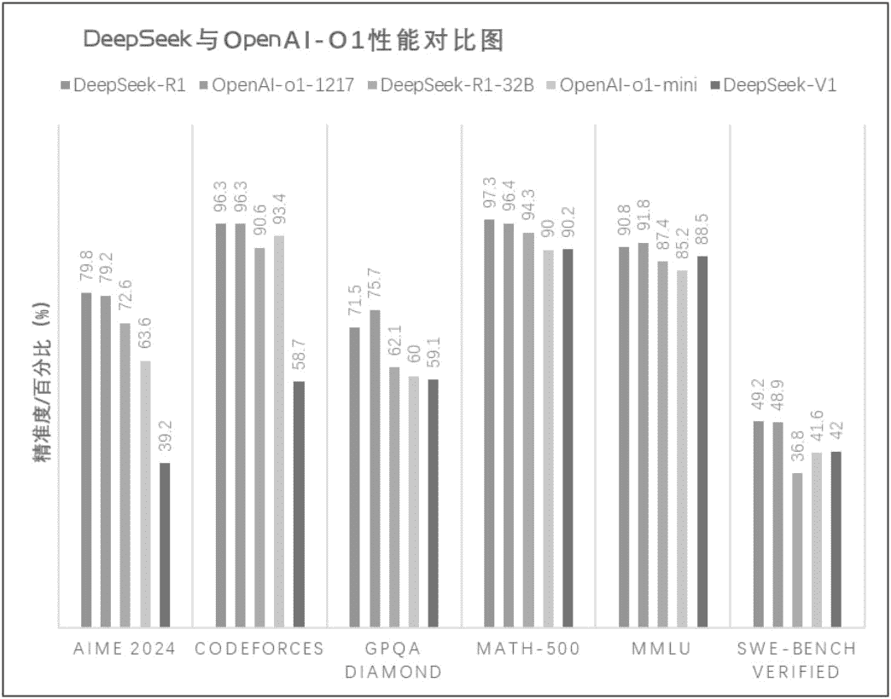

图 1-1 DeepSeek 与 OpenAI-o1 性能对比图

成本层面，DeepSeek 同样突出，远低于竞争对手与行业均值，如图 1-2 所示，以更具竞争力价格提供优质服务，赢得市场认可。

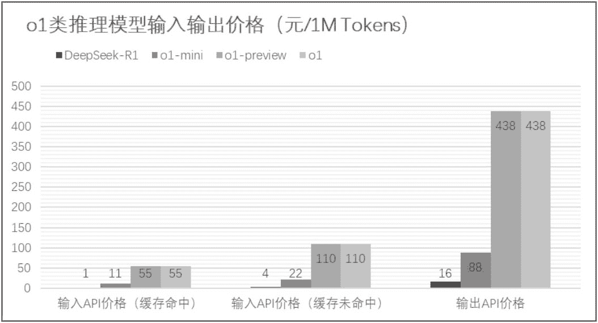

图 1-2 DeepSeek 与 OpenAI-o1 API 价格对比图

2025 年 1 月，DeepSeek 以技术创新掀起风暴，宣布研发全新模型架构，在大幅提升速度与精度的同时实现跨模态、跨语言深度理解交互。此突破不仅标志理解与模拟人类智能取得进展，也为多领域应用开辟新可能。

消息迅速引发业界轰动，不仅技术突破，更抢占市场先机。随着新模型推广，其市场份额持续攀升，逐步成为新领军企业，也引发对人工智能未来走向的深入讨论。专家认为该突破将极大推动医疗、教育、金融、智能制造等领域的深度应用，带来变革与效益。

更难得的是，DeepSeek 并未将成果束之高阁，而是开放部分核心技术与模型供全球开发者共享，彰显开放精神，为全球人工智能发展注入活力。

可以预见，随着这一引爆点的出现，人工智能领域将迎来更繁荣多元创新的未来。DeepSeek 将以卓越技术与开放精神引领潮流，为人类智能化转型贡献智慧。同时也将激励更多机构投入研发，共同推动全球人工智能蓬勃发展。

## 1.1 DeepSeek 起源与演进回顾

### 1.1.1 起源：理想与现实的碰撞
DeepSeek 诞生于 2023 年科技创新高峰期，是国内顶尖人工智能研究机构深度求索 DeepSeek Inc. 智慧结晶，也是团队历经 3 年潜心研发的通用人工智能领域明珠。名字寓意深度探索，象征以深度学习技术挖掘人工智能无限可能，像一艘驶向宇宙深处的星际飞船，承载对人工智能未来的无限憧憬。

其诞生源于对行业痛点的洞察。ChatGPT 等大模型虽强，但在数学推理、代码生成等专业领域仍有短板。DeepSeek 团队决心以技术创新打破局限，推动人工智能向更高层次发展。创始团队由顶尖人工智能科学家与工程师组成，核心成员来自清华大学、微软亚洲研究院等知名机构，拥有丰富大模型研发经验，共同开启传奇旅程。

### 1.1.2 演进轨迹：从起步到行业黑马
DeepSeek 的发展是一部充满挑战与突破的史诗，可分为 5 个阶段：

1. 起源：量化巨头的科技新篇

DeepSeek 诞生于量化投资机构幻方量化成功后向人工智能科技的延伸。幻方的资金与技术为初期发展奠定基础。梁文锋及其团队凭借行业经验与前瞻视野，迅速确立技术路线与市场定位。

2. 早期突破：开源代码大模型发布

2023 年 11 月 2 日，首个开源代码大模型 DeepSeekCoder 发布，支持多语言代码生成、调试与数据分析。2023 年 11 月 29 日，DeepSeek LLM 面世，670 亿参数支持多自然语言任务，展现深厚积累。

3. 技术飞跃：MoE 架构与全开源策略

2024 年 1 月，DeepSeek LLM 用 2 万亿字符双语数据集预训练，性能超越 LLaMA-2。5 月，DeepSeek V2 采用 Mixture-of-Experts 架构，显著降低推理成本，引发价格战。12 月，DeepSeek V3 发布，成为全球首个全开源 MoE 模型，以高性能低成本广受关注。

4. 市场崛起：打破垄断与全球竞争

开源策略与高性能模型迅速吸引全球关注，打破美国在人工智能领域的垄断。低价策略使其在国内外市场快速崛起，成为与 OpenAI 等国际巨头竞争的重要力量。

5. 最新动态：全球合作与平台接入

2025 年 1 月 31 日，DeepSeek R1 上线 NVIDIA NIM 平台，并被亚马逊、微软等接入。2 月 5 日，R1、V3、Coder 系列上线国家超算互联网平台，进一步巩固全球领先地位。

总体来看，DeepSeek 从量化巨头的科技延伸，到开源代码模型发布，再到技术飞跃与市场崛起，始终坚守技术创新与市场洞察。未来将继续秉持开源开放理念，为全球人工智能发展贡献智慧。

### 1.1.3 前瞻展望：通往通用智能的路
展望未来，DeepSeek 将深耕通用人工智能，致力于多模态能力突破、个性化智能助手、硬件协同创新与伦理安全体系建设。技术进步与场景拓展将为人类智能化转型贡献更多力量。

教育领域，智能解题助手不仅给出答案，还可分步讲解错题；个性化学习功能可自动生成针对性练习，提升效率。

软件开发领域，代码自动生成功能让程序员更高效，输入自然语言需求即可输出可运行代码；智能调试定位错误并给出修改建议，减少调试时间。

科研创新、金融服务等领域也展现强劲能力。材料科学中帮助发现新型半导体材料；生物医药中加速药物分子筛选，效率提升 40 倍；金融服务中实现复杂模型自动化构建，实时监控市场数据并生成投资策略建议。

对初学者而言，DeepSeek 的历程是宝贵启示。掌握 Python、线性代数、概率统计等基础，从微调开源模型入手，结合企业资源与工具进行实验，都是有效路径。随着技术快速发展，垂直领域应用开发等方向也提供创业与发展机会。

DeepSeek 的起源与演进见证了人工智能的飞速发展与广泛应用。在充满机遇与挑战的时代，期待其创造更多惊艳成果。

## 1.2 DeepSeek 与其他智能应用：深度对比与剖析
人工智能浪潮下，市面上涌现众多模型，市场进入垂直化深耕加生态化构建双轨竞争时代。据 IDC 2024 年报告，企业人工智能工具采购量年增长率达 147%，彰显迫切需求。开发者社区对开源模型的热情同样高涨，下载量突破 10 亿次，推动技术普及与创新。

在此背景下，DeepSeek、GPT-4、Claude、Gemini 等头部产品凭借独特技术路线与商业策略引领行业。它们在技术各有千秋，商业探索也呈现多样化。

九视角透视 头部AI的竞争全景

要更清晰地理解当前领军智能产品的真实水准与后续走向，本书从九个关键维度展开系统性对照：技术能力、应用场景、用户体验、数据安全、开放程度、生态体系构建、商业化模式、创新能力以及市场影响力。通过逐层拆解，呈现行业全貌，揭示各家的异同与战略布局。

### 1.2.1 底座架构差异

DeepSeek 与其他主流基础模型在模型结构、训练语料来源、上下文承载长度和参数配置上存在明显分野，汇总见表 1-1，表中部分信息截止至 2024 年。

表 1-1 DeepSeek 与其他主流 AI 大模型技术架构的对比

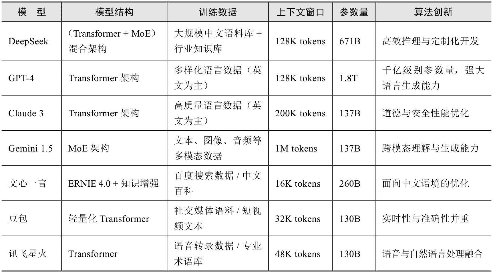

实测数据显示，DeepSeek 的表现已超过多数开源方案，例如 Qwen2.5-72B 和 Llama-3.1-405B。更值得关注的是，在若干关键指标上已逼近 GPT-4、Claude-3.5-Sonnet 等顶尖闭源产品的水平，图 1-3 对此提供了支撑。

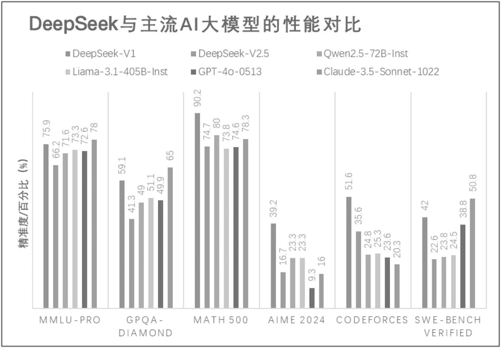

图 1-3 DeepSeek 与主流 AI 大模型性能对比图

### 1.2.2 核心功能与场景适配

大模型的核心能力主要集中在文本生成、代码推理与多模态处理。下面围绕这三点，对 DeepSeek 与主流产品进行差异化梳理，具体见表 1-2。

表 1-2 DeepSeek 与其他主流 AI 大模型核心功能的对比 5 分制评分

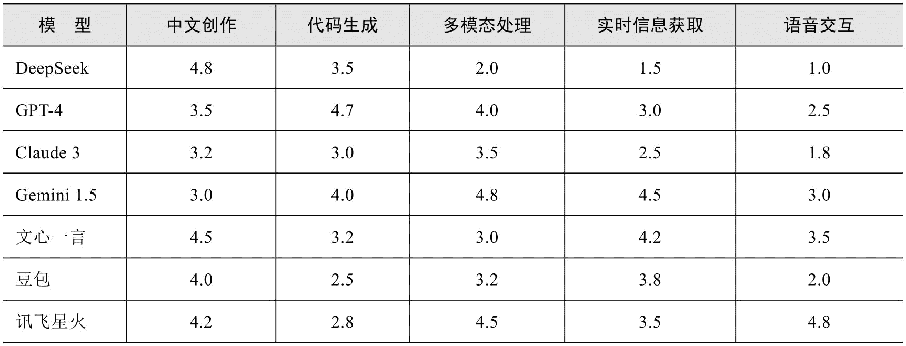

从表 1-2 可见，各家各有所长也各有局限。DeepSeek 在中文内容创作与代码产出上尤为突出，深度学习与自然语言处理的积累处于领先位置。相对而言，在图像、音频与文本的联合处理，以及实时交互响应方面仍有提升空间。

落地选型应先结合业务诉求与具体使用场景，明确各家的核心特长，再评估在目标任务上的实际表现，才能实现价值最大化。

典型落地案例

1. DeepSeek
·医疗健康：美年健康所属的血糖管理智能体“糖豆”接入了 DeepSeek，基于客户实时血糖等数据进行深度挖掘，输出个性化健康管理方案，用于糖尿病、脂肪肝等慢性病的预防与管理。华鹊景的 Wisebot C 系列认知康复机器人也依托 DeepSeek 的学习与分析能力，实时捕捉使用者认知状态与行为模式，生成高精度评估报告并定制训练内容。
·养老服务：上海市发布的《推进养老科技创新发展行动方案 2024—2027》提出强化技术攻关与服务平台建设，推广智能仿生机器宠物、陪伴机器人等。DeepSeek 可为“AI+服务”提供有力支撑。

2. ChatGPT
·游戏开发：设计师 Ammaar Reshi 在不足 20 分钟内借助 GPT-4 完成贪吃蛇游戏源码；波兰开发者 Felix Bade 在 GPT-4 辅助下 2.5 小时内做出 WebGL 版高速彩色游戏。
·PPT 制作：TOME App 将 GPT-4 集成到产品中，能在数秒内把撰写好的文档转为幻灯片。

3. Claude 3
·票证与车牌识别：凭借自然语言处理与跨模态学习能力，内置优化的 OCR 模块，可处理多种字体、尺寸、角度与复杂背景。在机场、银行、政务等场景能快速读取身份证、护照等信息；接入智能交通系统后可实时抓拍并识别车牌。

4. Gemini 1.5
·图像精细描述：不仅识别物体，还能深入理解画面并输出可定制长度、语气与风格的描述，适用于质检与市场调研。
·长文档理解：可处理千页以上 PDF，利用视觉能力校准表格、解读多栏排版、理解图表手写文本等，可从大量财报中抽取数据生成表格图表。
·现实世界文档理解：可处理收据、标签、告示牌、便条、白板草图等非电子文档，结构化提取关键信息。

5. 文心一言
·智慧医疗教育：天佑星河团队打造的智慧医疗教育系统用文心大模型模拟病患，帮助医学生锻炼诊断、沟通与临床思维。
·家庭故事讲述者：利用 AI 声音定制睡前故事或教育内容，让孩子听到熟悉的声音。
·节日祝福语音定制：可生成带个人风格的节日语音祝福发送亲友。

6. 豆包
·商品销售：领克汽车与火山引擎合作，基于豆包推出 SalesCopilot，接入直营销售系统，为顾问提供实时数据分析、客户行为预测、客户对练与个性化销售策略建议。
·视频生成：豆包视频生成大模型于 2024 年发布，用于电商直播商品展示与宣传视频制作。
·陪伴应用：可用于电商直播虚拟主播或智能助手，实现实时互动咨询。

7. 讯飞星火
·政务服务：黄山市推出“AI+政务问答”，依托讯飞星火能力实现实时权威信息问答，具备输入联想、逻辑推理、追问、意图识别等功能，有效缓解传统政务问答“问而不答”的问题。
·文旅宣传：第七届数字中国建设峰会上亮相的利川文旅大模型，基于讯飞星火与本地算力与数据打造，覆盖吃住行游购娱全场景，也为政务热线提供技术参考。

### 1.2.3 受众画像与变现路径

因功能差异，各模型吸引了不同需求的用户，形成清晰的核心人群。表 1-3 统计了主流模型的用户定位。

表 1-3 主流 AI 大模型的用户定位统计

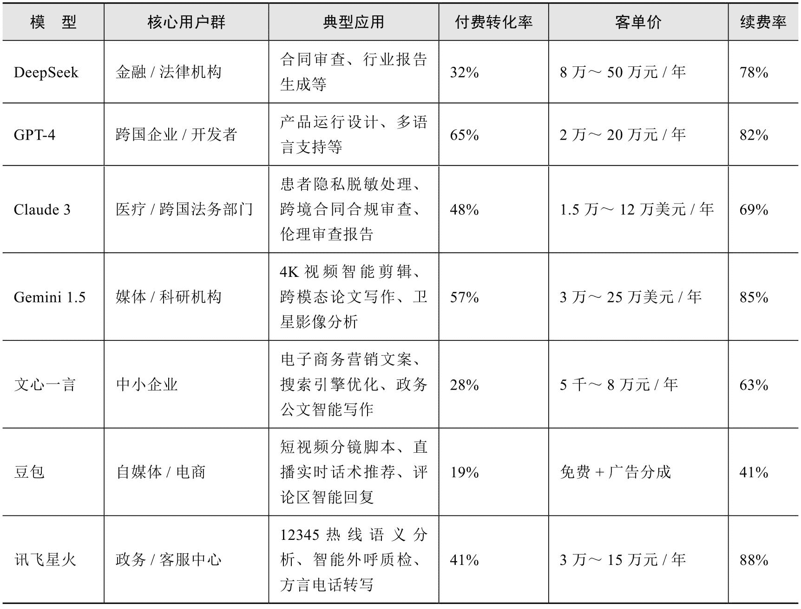

数据注解：
1）付费转化率以注册后 30 天内完成首单支付的企业用户为基准，豆包按创作者广告收益超 500 元计。
2）典型场景延伸：Claude 3 在医疗场景隐私保护符合 HIPAA 标准，处理速度达 200 页/分钟；Gemini 1.5 支持 8K 视频实时分析，时延控制在 300ms 以内。
3）价格策略：国际工具多采用 token 阶梯计价，国内工具多用场景模块订阅制。
4）续费驱动：DeepSeek 行业知识库季度更新率达 92%；讯飞星火方言支持覆盖中国 34 种地方语言。

### 1.2.4 合规与安全对比

数据安全与合规是应用的两大核心风险。表 1-4 对比了主流模型的安全表现。

表 1-4 DeepSeek 与其他主流大模型数据安全的对比

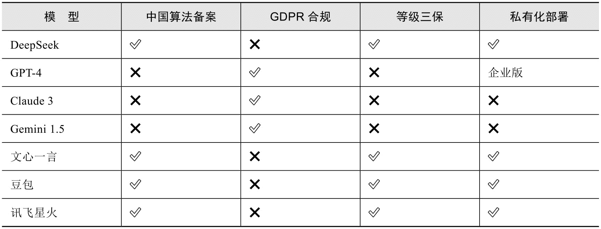

说明：
1）中国算法备案：文心一言、讯飞星火、豆包等国内模型通常已完成备案，GPT-4、Gemini 1.5、Claude 3 等国外模型未备案。
2）GDPR 合规：国外模型更侧重欧洲数据保护合规，国内模型较少专门适配。
3）等保三级：国内模型需满足信息安全等级保护要求，国外模型通常不参与。
4）私有化部署：国内模型普遍支持私有化部署，国外模型仅部分提供企业版，Claude 3、Gemini 1.5 等暂不支持。

备注：
·豆包继承国内模型的合规特征。
·Gemini 1.5 合规性与原版一致。
·Claude 3 未适配中国本土认证。
·国际模型在境内使用存在数据跨境风险。
·豆包因依赖 UGC 内容，需关注生成内容版权纠纷。

### 1.2.5 走向预测与挑选指南

DeepSeek 的走红让生成式模型成为焦点。技术仍在快速迭代，机遇与挑战并存。

1. 未来发展趋势
1）技术融合与多模态交互
模型将强化多模态整合，融合文本、图像、语音、视频实现更精准决策；强化学习、知识计算、符号推理等新路线将持续探索。
2）商业化应用深化
技术成熟与市场扩大推动模型向专业化定制服务转型，企业更注重行业数据深度挖掘，推动落地。
3）开源化与生态共建
通用基础模型进一步开源，降低门槛，促进国产软件生态与全球技术交流。
4）成本优化与规模化部署
多家厂商下调价格提升普及度；本地化部署、公有云 API、边缘计算等多种接入方式成为主流。

多模态竞争下，Gemini 计划推出“视频生成即服务”；讯飞星火全力研发“3D 虚拟人交互”。轻量化方面，豆包拟推出手机端 1B 参数模型，体积小、流畅、延迟低于 500ms。合规方面，DeepSeek 正积极申请欧盟 AI 法案认证，为欧洲拓展奠基。

2. 选型策略
1）DeepSeek
适用场景：推理、逻辑思考、数理计算、代码生成，适合深度问答、自主 Agent、智能推荐等复杂任务。优势为开源可微调、蒸馏、定制，降低开发成本。
2）GPT-4
适用场景：复杂文本生成、对话系统、摘要等。优势为技术成熟、稳定，适合金融、教育、医疗等对稳定与质量要求高的领域。
3）Claude 3
适用场景：推理、数学、编码、多语言理解与视觉，适合跨语言交流、智能客服、图像识别等。优势为生成具备个性与创造性且注重 AI 安全。
4）Gemini 1.5
适用场景：对速度要求高的实时翻译、智能问答、新闻摘要。优势为反应快，提供 Flash 等版本满足不同需求。
5）文心一言
适用场景：面向中文用户的问答、文本生成、情感分析。优势为集成多项 AI 技术，中文语料丰富。
6）豆包与讯飞星火
豆包更偏轻量化、小型化，适配移动应用与资源受限场景。讯飞星火在语音识别与自然语言处理上占优，适合智能家居、车载语音助手等语音交互场景。

3. 选型建议
明确应用场景、评估性能与稳定性、权衡成本预算、关注技术路线与生态兼容。

AI 大模型选型决策树：
是否需要中文长文本处理？
├─ 是 → DeepSeek/文心一言
└─ 否 → 是否需要多模态？
├─ 是 → Gemini/讯飞星火
└─ 否 → 是否需要最高创造力？
├─ 是 → GPT-4
└─ 否 → Claude 合规优先

总体来看，国内以 DeepSeek、文心一言、讯飞星火为领军，掌控专业文本、通用智能、语音交互等高地；国际模型在部分能力上仍领先，但本土化合规面临挑战。建议企业采用混合架构：核心业务用国产模型，创新场景接入 GPT-4/Gemini API 等国际模型。

## 1.3 DeepSeek 能力全景与落地解析

DeepSeek 是当前备受关注的生成式模型，其能力已深度渗透日常生活。DeepSeek 能力图谱如图 1-4 所示。

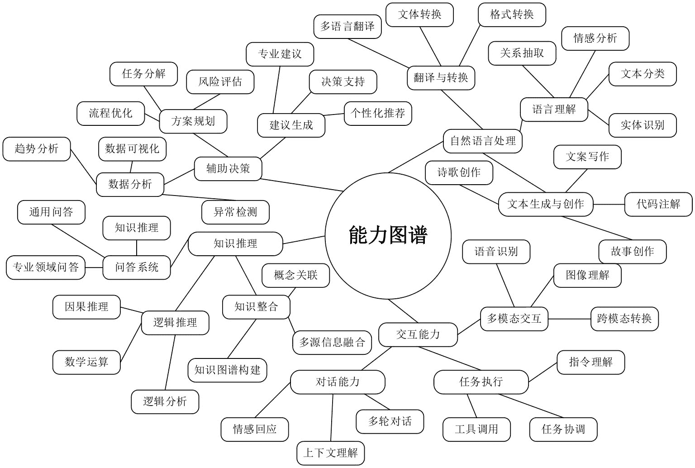

图 1-4 DeepSeek 能力图谱

DeepSeek 结合深度学习与数据挖掘，从海量数据中提炼价值信息，为用户提供定制化决策支持。不同于传统关键词搜索，它能理解数据含义与关联，实现更智能的检索与分析。核心功能主要体现在：

1. 自然语言处理
·多语言理解与生成：支持中英文及主流语言的文本分析、摘要、翻译、问答，具备上下文感知。
·意图识别与情感分析：可精准识别客服投诉分类等用户需求，并进行舆情情感监控。
·复杂推理与逻辑处理：支持数学计算、代码生成、知识问答等多步推理任务。

2. 多模态交互能力
·图文结合处理：支持图像描述生成、图文问答，如电商商品图转文案、医疗报告分析。
·语音交互：集成语音识别与语音合成，适配智能硬件、语音助手等场景。

**3. 垂直适配与轻量落地**

· 行业微调：通过 Fine-tuning 可把基座快速迁移到金融、医疗、法律等专业赛道的实际需求。
· 边缘运行：使用剪枝、量化等压缩手段减小模型体积与算力占用，适配算力受限的本地或边缘终端。

**4. 训练提效与推理提速**

· 协同训练：支持千亿级参数规模的分布式联合训练，降低整体算力成本。
· 低时延在线响应：依托模型优化与硬件配合，在高并发场景下实现毫秒级对话反馈，如智能客服。

**5. 检索增强的知识能力**

· 动态检索：接入企业私有知识库，提升问答的准确度与时效性，如内部知识管理系统。
· 实时融合：可对接外部 API 或数据库，使模型知识滚动更新，如金融行情研判。

**6. 统一接口与开发生态**

· 标准接入：提供统一 API，便于快速嵌入现有企业系统。
· 开放工具：对外开放 DeepSeek-R1 等训练框架，降低开发者使用门槛。

DeepSeek 的核心价值在于将原本耗时耗力的复杂工作流拆解加速。无论是数据分析、信息查找、决策辅助还是问题求解，都可以依托深度神经网络与数据挖掘技术给出精准高效的产出，帮助用户在快节奏环境中更从容应对。

典型应用概览：

**1. 企业服务**
· 自动化客服：结合多轮对话管理、意图识别与知识库联动，实现全天候无人值守服务，可覆盖 80% 以上的常见咨询，涉及电商售后、产品咨询、服务申请等，提升满意度与效率。
· 文档自动化：自动抽取合同要点并生成报告，律所场景中可从合同抓取关键信息后迅速产出法律文书、财务分析、市场报告等，节省整理时间。

**2. 内容创作与营销**
· 个性化产出：依托大数据与用户画像自动生成广告文案、社媒推文、邮件营销素材。电商促销时输入主题、目标人群、预算即可获得活动形式、宣传口号及微博话题、短视频推广策略，并按产品特性生成针对性文案。
· 多模态素材：结合图像、语音识别等技术，自动生成图文、短视频、音频组合物料，为旅游推广、新品发布、品牌传播提供丰富物料。
· 旅行规划：快速整合旅游信息，按目的地、出行时间、个人偏好生成路线、交通、景点、美食、住宿等详尽攻略。

**3. 科研与教育**
· 文献梳理：快速提炼论文核心结论，辅助综述工作，在生物医药、材料、信息技术等领域的新药研发与前沿探索中发挥作用。
· 个性化教学：基于学习行为与成绩数据分析薄弱环节，生成针对性方案，如为历史教学检索资料并生成趣味故事，增强理解。

**4. 金融与风控**
· 自动化报告：实时解析财报、市场动态、宏观指标，自动产出投资建议摘要、风险评估报告、趋势预测。
· 风险预警：融合舆情、历史交易、用户行为等多源数据，利用机器学习识别信用卡欺诈、网络钓鱼、异常交易等，提升预警准确性与及时性。

**5. 医疗健康**
· 辅助诊断：基于深度网络与医学知识库，结合症状、病史、检查结果提供初步诊断建议与治疗方案参考，如罕见病筛查、慢性病管理。
· 病历结构化：运用自然语言处理与光学字符识别，将非结构化病历转为标准化数据库格式，便于查阅与决策。

**6. 工业与物联网**
· 设备故障排查：通过自然语言处理与知识图谱识别用户描述的异常现象，快速给出维修方案与排查流程，降低停机成本。
· 多模态监控：整合传感器、视频、声音等多维数据，进行异常预警与故障预测，保障生产安全与高效。

## 1.4 部署方式与入门指引

DeepSeek 凭借强劲性能与广泛场景获得关注，提供多种灵活使用路径。

**1. 本地化部署**
1）适用对象
· 具备技术团队与算力支持的企业或个人。
· 对数据安全与隐私要求极高的行业，如金融、医疗。
· 需要深度定制或优化的高级用户。
2）特点
· 数据与模型完全自控。
· 数据不出本地，满足高安全诉求。
· 需强 GPU/TPU 支持，部署成本较高。
· 维护优化难度大，需专业团队。

同时提供满血版 671B 参数模型，以及 1.5B、7B、8B、14B、32B 等蒸馏版本。以最小的 1.5B 为例，仅需约 1.1GB 内存或显存即可在个人电脑运行。本地运行效果如图 1-5 所示。

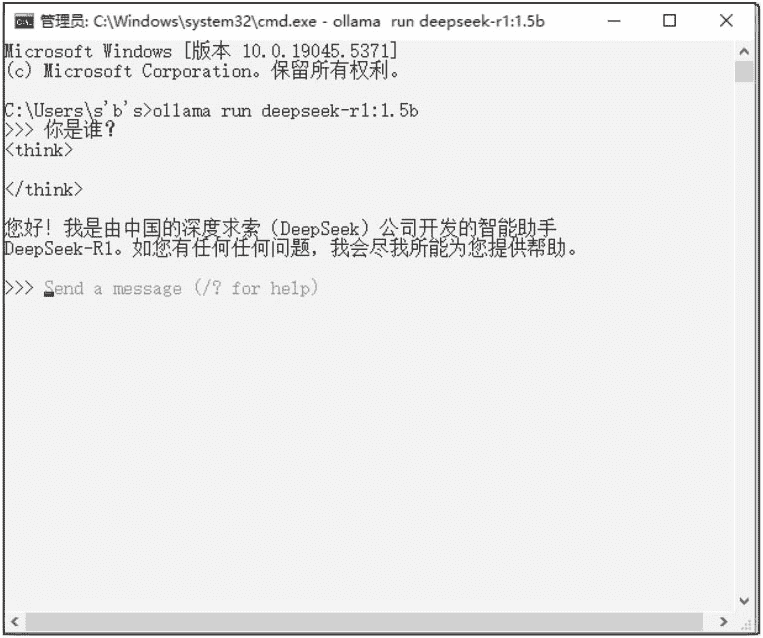
图 1-5 DeepSeek-R1-1.5b 蒸馏版本本地运行效果图

1.5B 版本硬件门槛极低，体验相对有限。若需更完善体验需选用参数更大的版本，硬件需求同步提升。满血 671B 对内存显存需求高达 404GB，本地部署硬件费用超 2000 万元，对普通用户成本极高。

**2. 云端部署**
1）适用对象
· 中小企业、初创团队或个人开发者。
· 需要弹性扩缩算力的用户。
· 对安全有要求但可接受云服务商保障的用户。
2）特点
· 资源弹性扩展，按需调整。
· 无需自购维护高性能设备，降低硬件成本。
· 按用量付费，成本可控。
· 依赖网络，延迟可能影响实时性。
· 数据存于云端，部分企业存在安全顾虑。

若无力承担高配硬件费用，又需较强性能，可租用阿里云、华为云、腾讯云等资源进行云端部署，以较低费用获得更强算力。

**3. 直接使用 API**
1）适用对象
· 希望快速集成功能的开发者或企业。
· 轻量级应用开发者，如智能助手、文本生成、智能问答。
· 希望按调用量付费、严格控制成本的用户。
2）特点
· 即开即用，上手门槛低。
· 灵活性有限，难以深度定制。
· 调用速率与费用存在限制。
· 适合快速验证产品原型。

若对数据安全与私有化无硬性要求，且预算有限，可使用官方 API 服务。DeepSeek 模型 API 费用明细如表 1-5 所示。

表 1-5 DeepSeek 模型的 API 费用明细

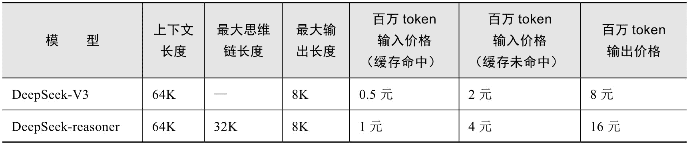
token 是模型处理自然语言的基本计费单元，可理解为“字”或“词”；1 个中文词语、1 个英文单词、1 个数字或符号通常计为 1 token。

换算比例大致为：
· 1 个英文字符≈0.3 token
· 1 个中文字符≈0.6 token

使用前需前往 DeepSeek 开放平台 https://platform.deepseek.com/sign_in 注册账号并充值，后续章节将详细介绍调用方式。

**4. 网页版与 App 版**
1）适用对象
· 个人用户或小型团队。
· 追求快速便捷使用的用户。
· 有移动办公需求的用户。
2）特点
· 无需安装配置，使用便捷。
· 功能相对基础，适合快速查询与对话。
· 网页版免下载，App 支持离线使用但功能受限。
· 适合个人或快速验证需求。

提供网页与 App 双入口。用户打开对话窗口即可直接使用，无需额外设置或费用，适用于信息查询、文本创作与专业建议等场景。

网页端访问 https://chat.deepseek.com/，在对话框输入问题后发送即可获得结果，如图 1-6 所示。

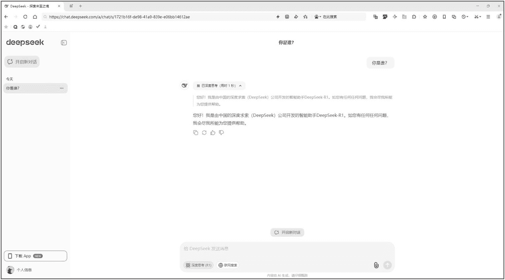
图 1-6 网页端使用 DeepSeek 效果图

移动端可在应用商店搜索 DeepSeek 下载安装，通过手机号、微信、Apple ID 登录，使用方式与网页端基本一致，如图 1-7 所示。

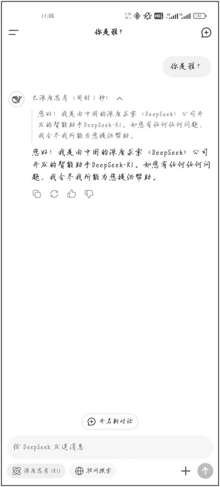
图 1-7 App 端使用 DeepSeek 效果图

## 1.5 未来展望：融合创新与协同发展

人工智能正以指数级速度重塑生产与生活。DeepSeek 将以技术突破、场景落地、伦理安全与生态共建为支柱，推动 AI 更智能、普及、可信。

**1. 技术突破：迈向通用智能**
多模态融合与深度认知：突破单一模态限制，构建文本、图像、语音、视频跨模态理解与生成体系，模拟感知—推理—决策闭环，实现情境化智能。例如融合医学影像与病史生成诊断建议。
自主智能体规模化：从工具向协作伙伴演进，研发具备长期记忆与复杂任务拆解能力的智能体，在工业场景中实时分析产线数据并动态调整维护策略。
高效架构与绿色计算：探索模型压缩、动态稀疏、分布式训练等技术，降低算力需求，打造低算力高性能模型，推动普惠部署。

**2. 场景创新：垂直深耕与横向扩展**
垂直专家系统：融合领域知识与推理能力，打造医疗、教育、科研等专家系统。如教育领域推出个性化学习路径规划，按认知特征动态生成课程。
C 端无感融入：开发隐形 AI 助手，如智能家居能耗优化、行为预测日程管理等，实现服务无感渗透。
科研协同创新：构建科研大模型平台，提供文献挖掘、假设生成、实验模拟支持，加速生物制药等领域的药物筛选与研发。

**3. 伦理与安全：构建可信基础**
价值观对齐框架：在人类反馈强化学习基础上引入伦理学、社会学知识，建立红队测试—风险评级—动态熔断机制，保障稳定安全。
数据隐私保护：推广联邦学习、同态加密等技术，实现可用不可见。探索区块链确权体系，保障数据贡献者权益。
对抗攻击防御：构建输入检测、模型鲁棒增强、输出过滤的三层防御，尤其在金融、政务等高敏感场景达到高安全标准。

**4. 生态共建：开放协作新范式**
开源社区赋能：开放核心中间层 API 与模块化工具链，降低长尾场景定制门槛。设立开发者共创基金支持公益导向应用。
产学研融合：与高校、科研机构共建实验室，聚焦神经符号系统、脑机接口等前沿研究，通过产业需求清单加速成果转化。
全球化治理参与：牵头制定技术标准与规范，参与联合国等国际组织伦理框架讨论，推动包容可持续的全球治理。

DeepSeek 的演进是技术向善的实践。通过持续创新与场景拓展，致力于让 AI 成为普惠的生产力工具，同时夯实人机共生的伦理基石。未来在具身智能、量子计算等技术推动下，有望成为连接数字智能与人类文明的重要桥梁。

# 第二章
# DeepSeek 提问策略与精准优化实践

本章概述
本章将带读者深入理解 DeepSeek 在提示词运用与优化策略上的价值，提供一套实用方法论。从提示词的基本用法入手，揭示如何通过巧妙提问引导模型产出更精准、更具创意的答案，实现效率与创意双提升。

随后聚焦优化技巧，解析如何对初始答案进行迭代打磨，逐步逼近理想结果。内容涵盖语法调整、语义细化到创意激发与逻辑梳理，帮助读者在实际应用中灵活掌握。

为增强理论结合实践，本章引入实战案例——借助 DeepSeek 结合其他 AI 工具完成毛坯房装修效果图设计。展示如何先用 DeepSeek 生成设计思路与元素，再借助专业工具细化渲染，最终呈现满意方案，让读者直观感受其在设计效率与创意质量上的潜力。

学完本章，读者将全面把握 DeepSeek 的提问艺术与优化策略，明确认识其在提升工作效率与创意产出方面的独特价值。

知识导读
本章要点
❏ 了解 AI 大模型的提示词概念。
❏ 掌握提示词优化技巧。
❏ 在实战案例中按需优化提示词。

当下 AI 在图像创作、文字处理、智能助手等领域展现出强大潜力。但许多用户在使用时会感到失望：模型有时给出冗长空洞的正确废话，甚至胡言乱语。

根源在于模型理解受限于训练数据与算法框架，尚未达到人类水平的独立思考能力。若问题模糊或背景不足，易产生误导性推理，输出空洞。模型基于统计学习与模式匹配，文本虽通顺但可能逻辑不通或脱离现实，缺乏人类常识，导致结论不合理。

以图像为例，当前修图绘图 App 在细节与纹理处理上仍有提升空间，且易出现不符合事实的臆造。

文心一言绘画时的效果如图 2-1 所示。

图 2-1 文心一言造出六根手指的手部特写

在文字类 AI 工具上，DeepSeek、文言一心这类大模型已经广受欢迎，搜资料、写周报都能派上用场。可实际用起来，你会发现它们经常一本正经地输出一大堆废话，或者张口就来捏造信息，直接拉低使用体验。

AI 在某些场景确实能打，但它的短板也很明显。清醒点看，AI 本质上只是个工具，能发挥多大作用完全看你怎么用。掌握好提问的方法，结合模型的特点去用，才能真正把效率拉起来。

## 2.1 问到点上的方法论

能不能一针见血地问问题，是人跟人沟通高效的前提，也是跟 AI 协作的关键。AI 的工作逻辑很简单，它听你说话再帮你干活。说得清楚、指向明确，它才能快而准地完成任务。提问时把核心点出来，答案才靠谱，体验才顺畅。简单说，对 AI 直说要什么，就是最省时保质的打法。

### 2.1.1 把需求讲透 别留模糊空间

**1. 破除读心术幻想**

很多人用大模型查资料、做创意时，习惯性高估模型的理解力，觉得它能自动捕捉提问里隐晦的语境和没说出口的需求。这种想法既把技术想得太神，也低估了人类语言的复杂性。

事实上，哪怕是 DeepSeek、GPT-4 这类模型，在自然语言处理上很强，也受限于训练数据和算法本身。遇到歧义、表述含糊、依赖特定文化背景或个人经验的问题时，它们就很难像人一样get到真实意图。所以提问不具体、范围不界定，模型给的也往往是泛泛而谈，甚至跑偏。

想用好，就要学会更清晰地表达。用明确具体的措辞，少用模棱两可的说法，必要时补上背景信息，点出关注重点。同时要对模型能力有合理预期，这才是提升体验的基础。

案例：做淘宝母婴用品的运营，想提升店铺知名度和转化率，该怎么让 AI 帮忙？

模糊提问：“如何提高电商的转化率？”

问题在哪：

（1）不够具体。没指平台、品类、目标人群，模型只能给通用建议，用不上。
（2）没时间限制。没给节点，策略缺乏时效，无法立刻执行。
（3）没预算约束。不提预算，模型可能给出高成本方案，不现实。
（4）没评估标准。没说转化率要从多少提到多少，建议无法量化验证。

采用这种模糊方式，AI 回复会像这样。

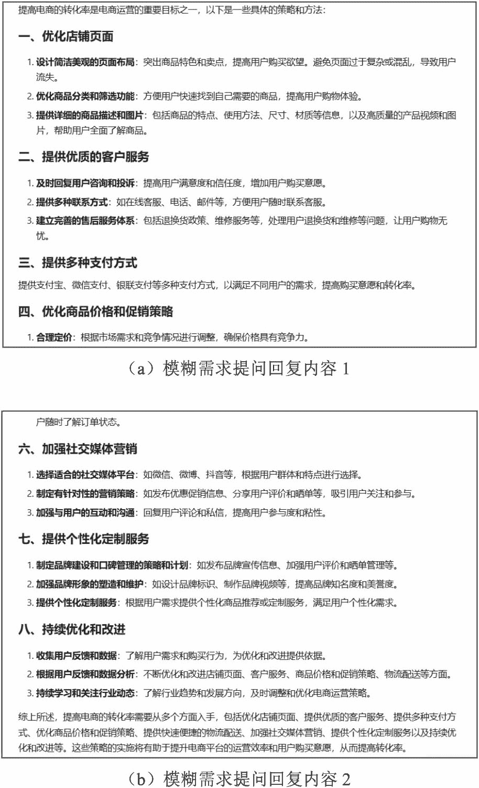

图 2-2 “文心一言”对模糊需求提问方式的回复结果

要效果更好，就要把提示词补全。电商推广类提问可以按【平台】+【商品品类】+【目标要求】+【用户群体】+【预算金额】来组装。

优化后的提问框架：

“如何通过优化特定电商平台（如淘宝/京东）上的某类商品（如母婴用品）详情页，在接下来的一个月内将转化率从当前水平（如 1.2%）提升至目标水平（如 2.5%），目标用户为特定群体（如 90 后宝妈），且预算不超过一定金额（如 5 万元）？”

结合具体案例，明确版提问是：

“如何通过优化淘宝母婴用品详情页，在 3 周内将转化率从 1.2%提升至 2.5%？目标用户为 90 后宝妈，预算 5 万元。”回复结果如图 2-3 所示。

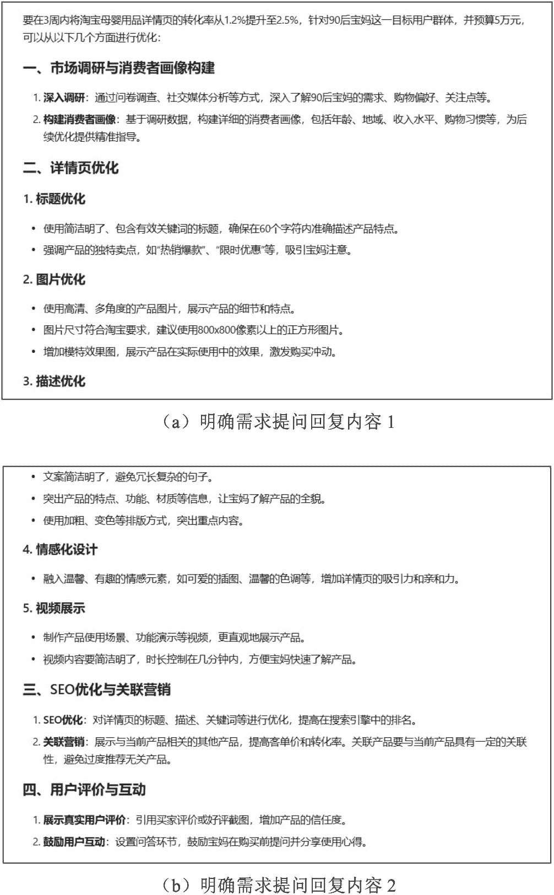

▲图 2-3 “文心一言”对明确需求提问方式的回复结果

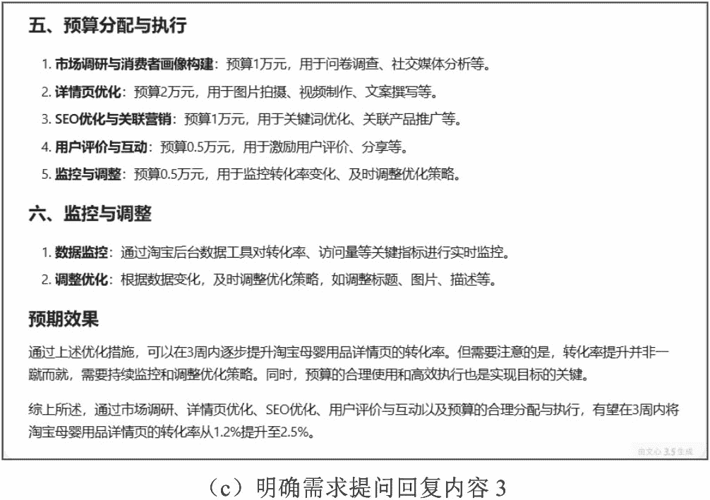

▲图 2-3 “文心一言”对明确需求提问方式的回复结果（续）

延伸技巧：用“数据+场景”公式，比如，“如何用 Python 的 Pandas 库，在 30 分钟内清洗 10 万条包含缺失值和重复项的销售数据？”

**2. 别再问开放式问题**

开放式问题最容易得到空洞回答，因为它涉及主观判断和多种可能性，模型很难猜准你的偏好，自然就不够准。

提问时尽量用封闭式问题，答案范围可控，模型输出才更符合预期。

案例：一位做短视频的自媒体人，想提升剪辑效率，加快发布节奏，增加互动和播放量，该怎么问 AI？

开放式提问：“短视频剪辑如何加速？”

缺陷：

（1）太宽泛。没说平台、内容类型、受众，模型只能给大而空的技巧。
（2）缺技术细节。没提剪辑软件、配置、格式，分不清你能不能用。
（3）没时间目标和量化指标。没有截止时间和期望效果，难以判断成败。

这类开放问题的回复如图 2-4 所示。

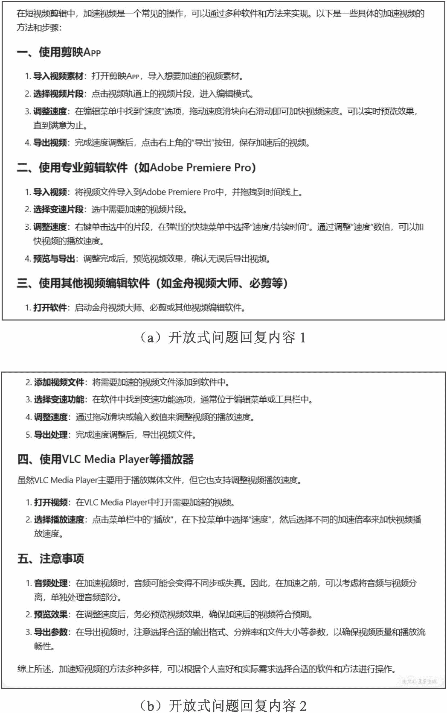

图 2-4 “文心一言”对开放式问题的回复结果

把问题改成封闭式：

“作为一个使用 Adobe Premiere Pro 的中级剪辑师，我如何在不牺牲视频质量的前提下，利用现有配置（Intel 12 代酷睿 i5 CPU、16GB 内存）加速 4K 短视频的剪辑过程，以便将原本 4 小时的剪辑时间缩短至 2 小时？”回复结果如图 2-5 所示。

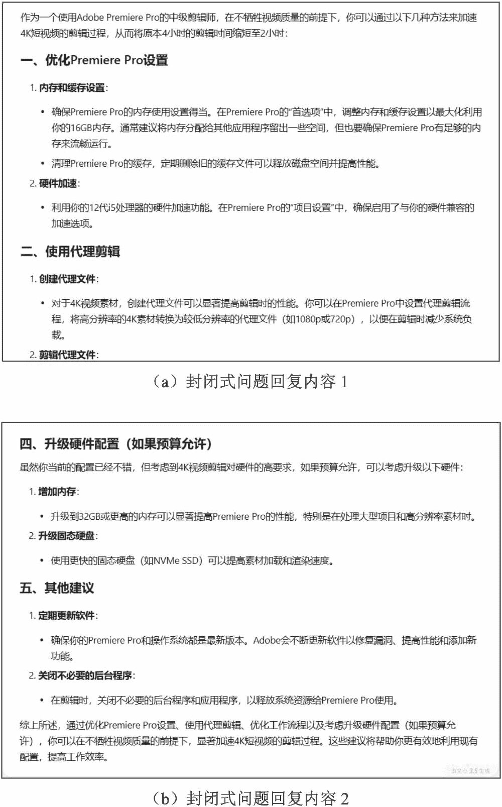

图 2-5 “文心一言”对封闭式问题的回复结果

### 2.1.2 把大问题拆小 从混沌到清晰

向大模型丢一个笼统的大问题，基本拿不到好结果。更好的做法是把宏大议题拆成一串具体的小问题。模型能分步深入，每步处理的信息块更小，答案更准、更全，过程也更透明可控。

**1. 步骤分解法**

把复杂任务拆成递进的子任务，让执行更清晰。

案例：写一篇环保文章。

1）子任务 1：问题识别
列出当下主要的环保问题，如空气污染、水污染、土壤污染、资源浪费，为文章搭骨架。
2）子任务 2：成因分析
对每个问题深挖原因，比如空气污染来自工业排放和汽车尾气，资源浪费源于过度消费等，揭示本质。
3）子任务 3：提出解决方案
基于成因给出对策，如推广可再生能源、推行循环经济、完善环保法规，要求可行且有新意。
4）子任务 4：意义总结
总结环保对社会、经济、生态的积极影响，点出行动的紧迫性，提升读者参与感。

**2. 要素分解法**

适合多维度设计类问题，按关键要素拆开分析更全面。

案例：设计一款新手机。

1）子任务 1：定位目标用户
明确是年轻人、商务人士还是游戏爱好者，决定设计方向。
2）子任务 2：定义核心功能
根据用户需求锁定重点，如续航、影像、性能等。
3）子任务 3：竞品分析
调研同类产品优劣，为设计提供灵感和改进点。
4）子任务 4：用户反馈整合
通过问卷、访谈收集期望，把真实需求融进设计。

**3. 分类提问法**

把综合问题按类别拆成平行子问题，实现系统覆盖。

案例：优化共享单车推广策略。

1）子任务 1：问题列举
先盘点痛点：乱停放、车辆损坏、维护成本高。
2）子任务 2：提出解决方案
针对每个痛点给方案，如乱停放用电子围栏引导，维护成本高用动态调度。
3）子任务 3：方案评估
做成本效益和可行性评估，挑出最优组合。

在拆分问题时，结构化指令模板能大幅提效。常用的是 CTDRF 模型，如图 2-6 所示。

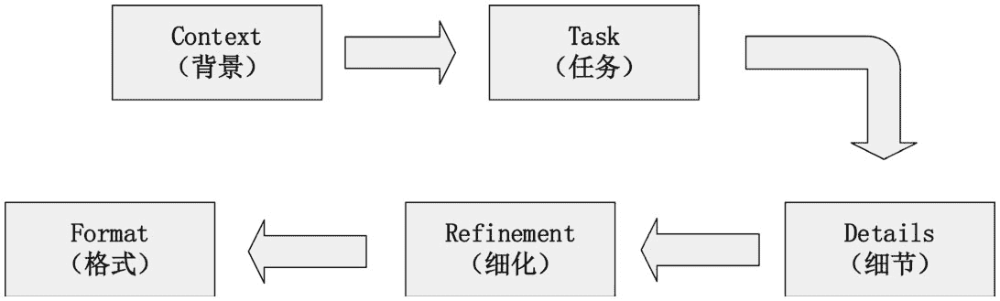

图 2-6 CTDRF 模型结构图

CTDRF 格式：

（1）Context（背景）：说明情境或受众特征。例如，“针对 25～35 岁追求高效育儿与生活品质的职场妈妈，设计一款可融入日常的育儿辅助产品”。
（2）Task（任务）：定义明确目标。例如，“开发一套 10 个育儿相关趣味物理小实验，通过亲子互动传授知识、增进关系”。
（3）Details（细节）：提供关键信息。例如，“实验涵盖力学、光学、声学，每个实验附步骤、安全提示、原理解析，适合家长陪同完成”。
（4）Refinement（细化）：进一步要求。例如，“材料日常易得安全，设计有趣激发好奇，含亲子互动环节”。
（5）Format（格式）：指定呈现方式。例如，“图文教程，每个含名称、材料、步骤、原理、互动建议、安全提示”。

### 2.1.3 选对模型 问对方式

主流大模型按推理能力可分推理模型和通用模型。

推理模型是在大语言模型基础上融合强化学习、神经符号推理等技术，擅长逻辑分析、数学计算、代码解析等高阶认知任务。

通用模型更侧重语言生成、上下文理解和基础 NLP，能生成流畅内容，适合日常对话、创作、检索。

表 2-1 推理模型与通用模型的对比

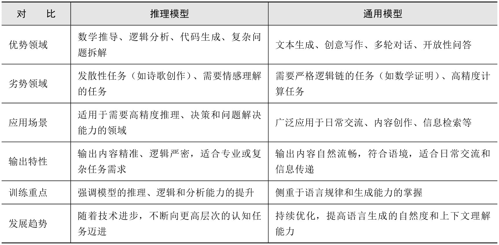

两者在提问提示的设计上也有差异。

推理模型提示语特点：

·明确且简洁。直接说目标和核心需求即可，模型自带推理能力，不需要长篇解释。
·推理过程自动化。无需手把手拆解步骤，过度干预反而限制模型发挥。

通用模型提示语特点：

·需要逐步引导。模型不一定内置领域推理逻辑，可用思维链 CoT 等方式引导其展开。
·需要补偿短板。复杂任务时提示要更细致，给示例、模板、分步要求，帮助模型理解。

例如，对 DeepSeek 这类推理模型，简洁提问更有效：“请为 20 左右的大学生设计一个‘红色文化之旅’PPT 框架，要求有教育意义且有吸引力。”

用通用模型时，提示要更结构化：“你是一位专业的 PPT 策划师，擅长按需求定制演示文稿。我手上有‘红色文化之旅’的基础资料，目标受众是 20 岁左右大学生。请基于这些，详细规划一个既有教育目的又能吸引年轻观众的 PPT 框架，包括引言、主体展开、互动环节和总结等。”

用好 AI 的核心是认清每种模型的优势与局限，别盲目追热度，要按需求选。

使用注意事项：

（1）模型选择策略。
·任务导向。数学、逻辑选推理模型；创意、泛知识覆盖选通用模型。
·定制化需求。考虑数据敏感性、实时性、领域专业性等因素。

（2）提示语设计艺术。
·推理模型：追求简洁明了，直接给结果指令，如“请计算……”。
·通用模型：结构化表达，必要时补背景和情境框架，如“在……背景下，讨论……的可能性”。

（3）避免常见误区。
·别用启发式或角色扮演过度引导推理模型，会偏离逻辑路径。
·别无条件信任通用模型，尤其在复杂推理和精确计算上，建议拆步验证每一步结果，确保准确可靠。

用好大模型，关键点其实就四条：先吃透它的工作方式，把任务和能力对上，把指令打磨到位，始终保持审慎的怀疑。避开常见坑之后，不管选哪款模型，都能把效率和满意度拉到更高水平。

## **2.2** DeepSeek 提问实战全攻略

DeepSeek 近期热度很高，推理表现和落地场景都让人印象深刻。对很多人来说，它就是在快节奏的日常里把琐事变简单、把工作效率提上来的得力帮手。想发挥最大价值，重点不在堆功能，而在对话方式，靠更精细的提示词设计，让生活与工作都更顺畅。

### **2.2.1** 提示词核心拆解

一份好的提示词相当于和 DeepSeek 对话的通行证，能让模型更快捕捉意图，返回更贴近预期的建议。无论是排程、任务梳理，还是找灵感、学新知，只要提示词写得巧，DeepSeek 就能成为日常和职场的可靠伙伴。

研究 DeepSeek 的使用，本质上是研究人机协同的技巧，通过持续打磨提示词，让这套先进系统真正成为提升生活品质的引擎。

**1. 什么是提示词**

Prompt 就是使用者交给 AI 的指引信息，用来引导模型按特定要求生成内容或完成任务。简单讲，它是我们与 AI 沟通的语言基础，形式可以是简短提问、详细说明，也可以是复杂任务描述。提示词在人与模型之间的作用如图 2-7 所示。

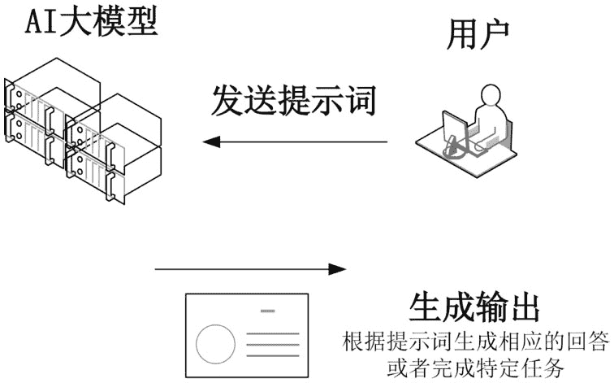

图 2-7 提示词在用户与 AI 大模型之间的作用

一个完整提示通常包含四个部分：

· 指令 Instruction：提示的核心，直接告知模型需要做什么，是行动信号。
· 背景 Context：提供任务发生的场景和必要信息，帮助模型更精准把握重点，在复杂任务中尤其关键。
· 输入 Input：用户提供的原始数据或问题，模型据此执行并产出结果。例如，“输入：成年人如何缓解焦虑”。
· 输出 Output：对期望结果的形式或格式的指引，让结果更符合预期。例如，“请按问题分析、解决方案的格式呈现”。

提示词的组成要素如图 2-8 所示。

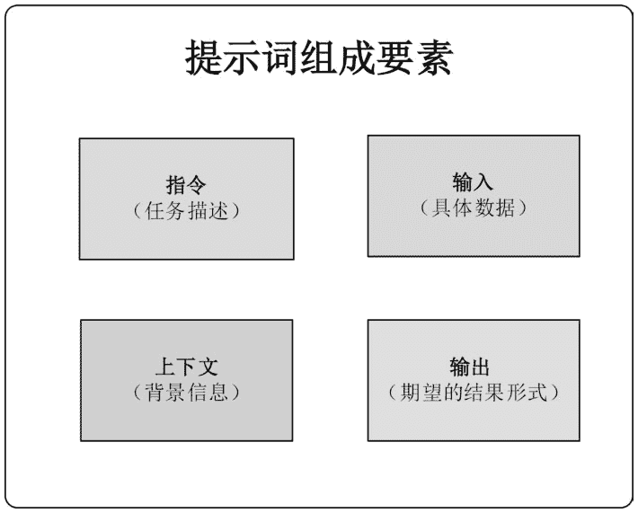

图 2-8 提示词的组成要素

**2. 提示词的类型**

分类方法很多，常见就有以下五类：

1）任务导向型 Task-Oriented
指向明确的任务或目标，引导模型完成具体操作或产出。
例如：“请把这段产品说明改写成简洁的营销文案。”

2）开放式 Open-Ended
不设固定答案，允许自由发挥。
例如：“分享一次让你印象深刻的旅程。”

3）指令式 Imperative
以动词开头，直接下达命令。
例如：“计算 124 与 337 的和。”

4）示例驱动型 Example-Driven
通过给示例帮助模型理解要求。
例如：“按下面格式填写：姓名 李明，年龄 28 岁。”

5）角色设定型 Role-Playing
指定角色或情境，让模型按身份作答。
例如：“假设你是客服主管，请回复用户的投诉邮件。”

更进阶的技巧还包括：

1）思维链 Chain-of-Thought
用逐步推理引导模型拆解问题，提升准确性和可解释性。
例如：“先列出关键点，再一步步给出解答。”

2）少量示例学习 Few-Shot 提示
只给少量示范，就能让模型学习规律并泛化到新任务。
例如：“根据下面三组问答，推断下一个问题的答案。”

**3. 提示词的基本元素分类**

按功能可分为三类。

（1）信息类元素。为模型提供生成内容的基础信息：
主题：界定内容的中心思想。
背景：补充场景信息，让内容更贴合实际。
数据：提供事实、数字等支撑性素材。

（2）结构类元素。决定内容的组织和呈现：
结构：定义整体框架和段落安排。
格式：规定排版、视觉呈现方式。
风格：体现语言特点，如正式、幽默、亲切等。

（3）控制类元素。对生成过程进行管理和引导：
生成控制：设定条件、限制或优先级。
调整机制：支持生成中实时监控和反馈。
验证与校验：设定规则确保准确性和合规性。

提示词的基本元素分类如表 2-2 所示。

表 2-2 提示词的基本元素分类

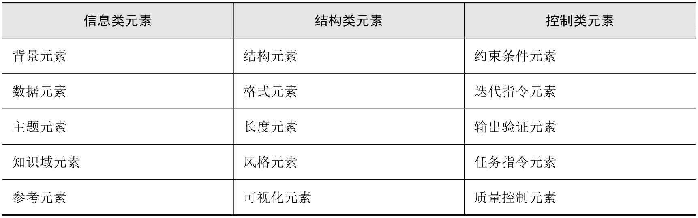

信息、结构、控制三类要素共同构成提示词框架，为内容生成提供系统指引。要素之间会产生协同效应，主要体现在：

· 互补增强效应：不同要素组合能弥补各自短板，产生 1+1>2 的效果。
· 级联激活机制：某个要素被触发会连锁带动相关要素，加速生成并形成正反馈。
· 冲突调和策略：看似矛盾的要素经巧妙安排能激发出创意，提升深度与广度。
· 涌现属性原理：特定组合会产生单个要素不具备的新特性，带来创新价值。

提示词元素的不同组合矩阵如表 2-3 所示。

表 2-3 提示词元素的不同组合矩阵

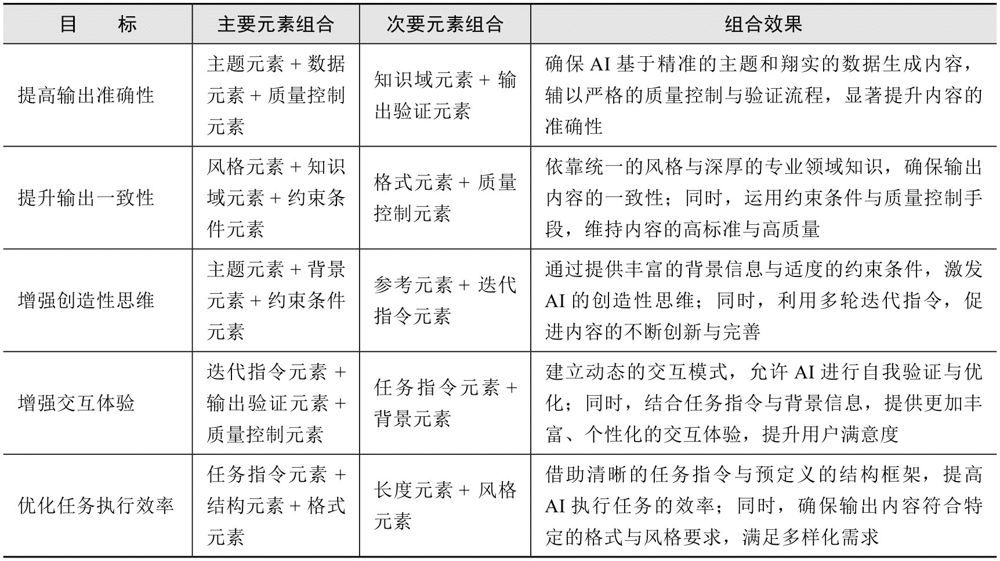

### 2.2.2 提问三原则：精准、简洁、明确

设计提示词时，精准、简洁、明确是三大基石，能帮助模型精准捕捉意图并给出高质量回复，如图 2-9 所示。

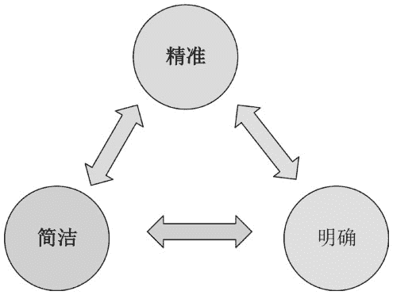

图 2-9 提示词三要素

**1. 精准描述问题**

1）技巧 1：明确需求和目的
直说目标，避免模糊表述。
场景：几乎所有提问，尤其需要具体解法时。
反向案例：“怎么提高工作效率？” 偏宽泛。
正向案例：“我是一名开发者，每天写大量代码。希望未来两个月内通过时间管理和编码技巧，把代码编写效率提升 30%，有什么具体方法？”

2）技巧 2：使用结构化描述
分点或分步说明问题。
场景：有多项要求时。
反向案例：“我想办婚礼。” 过于笼统。
正向案例：“我筹备户外婚礼，想要温馨浪漫。需求如下：场地有花园湖泊；宾客约 100 人；风格白粉为主融入自然元素；预算 5 万元内。”

3）技巧 3：提供问题背景
补充上下文帮助理解真实需求。
场景：复杂问题。
反向案例：“我想学新技能。” 缺背景。
正向案例：“我是市场营销专业的大学生，想毕业后做数据分析。已有 Python 基础，每天可学 2 小时，请推荐适合我的数据分析技能。”

4）技巧 4：使用具体数字或案例
用量化信息替代抽象描述。
场景：需要量化时。
反向案例：“我想改善饮食习惯。” 信息不足。
正向案例：“我身高 175 厘米体重 75 千克，想三个月内减 10 千克。请设计含三餐加加餐的饮食计划，并推荐锻炼项目。”

5）技巧 5：提出单一问题
一次只聚焦一个核心点。
场景：多任务场景。
反向案例：“怎么做披萨？顺便说下在家怎么锻炼？” 混杂。
正向案例：“请给出披萨的详细做法含材料和烘焙时间。——追问——另外请推荐适合初学者的居家健身计划。”

**2. 引导深入思考**

1）技巧 1：扮演指定角色
让 AI 以特定身份作答。
场景：需要专业建议。
反向案例：“股票怎么投资？”
正向案例：“请以拥有十年经验的金融分析师身份，基于当前市场为新手制定投资策略，含领域和风控。”

2）技巧 2：进行假设提问
设定虚拟场景激发深度分析。
场景：风险预判、推演。
反向案例：“我该如何规划职业？”
正向案例：“假设未来三年我要转行 AI，目前基础薄弱，请给出学习路径、实践项目和职业发展建议。”

3）技巧 3：进行比较分析
要求对比优劣辅助决策。
场景：选择决策。
反向案例：“买苹果还是安卓？”
正向案例：“预算 5000 元，请对比苹果和安卓在性能、拍照、续航、系统稳定性的差异并给出推荐理由。”

4）技巧 4：考虑多维度因素
综合多变量作答。
场景：复杂决策。
反向案例：“选什么专业？”
正向案例：“我对计算机科学和经济学都感兴趣，请从就业前景、学习难度、个人匹配度分析优劣并建议。”

5）技巧 5：给出多种方案
让 AI 提供多角度思路。
场景：创意、决策参考。
反向案例：“周末带家人旅游去哪好？”
正向案例：“周末亲子游，希望有自然风光和历史文化，请推荐三种不同类型的目的地并简述特色。”

**3. 控制输出质量**

1）技巧 1：指定输出格式
限定结构或格式。
场景：信息整理、可视化。
反向案例：“推荐几本好书。”
正向案例：“推荐 5 本时间管理书籍，按书名、作者、出版社、内容概述格式输出。”

2）技巧 2：列出主要答案
要求分点概括核心结论。
场景：要点总结。
反向案例：“如何有效管理时间？”
正向案例：“列出时间管理的五个关键步骤，每步用‘行动+效果’格式，如制订计划——明确每日目标。”

3）技巧 3：设定语言风格
控制用词难度和语气。
场景：面向特定人群。
反向案例：“解释量子力学。”
正向案例：“用通俗语言向我解释量子力学基本概念，能用生活例子说明。”

4）技巧 4：输出具体案例
要求结合实例解释抽象概念。
场景：理解理论。
反向案例：“什么是黑天鹅事件？”
正向案例：“以股市崩盘为例解释黑天鹅事件的定义、特点及对投资者的影响。”

5）技巧 5：明确输出限制
限定字数、数量或范围。
场景：需要简洁答案。
反向案例：“告诉我怎样烤牛排。”
正向案例：“请用三步说明烤牛排关键要点，每步不超过 50 字。”

遵循精准简洁明确三大原则，能大幅提升沟通效率，让大模型快速抓住核心需求并生成高质量答案。

### 2.2.3 七项提问绝技，助你轻松掌握

实际使用中，很多人感觉自己的 DeepSeek 不如别人智能，根源往往在提问方式上。为此总结了七个实战技巧，让 DeepSeek 更懂你。

**1. 真诚提问，摒弃模板**
核心：DeepSeek 推理能力强，理解复杂问题更有优势。用真诚、自然的表达替代刻板模板，把它当成有智慧的朋友交流。
案例：
· 模板化：“请写一篇介绍人工智能发展趋势的 1000 字文章。”
· 真诚版：“我正在准备 AI 主题演讲，对部分技术趋势不太熟，能否用简洁明了的语言介绍当前热门技术及未来方向，并配上实际案例？”

**2. 强制说人话，让模型更接地气**
用法：当回答太专业时，直接说“说人话”或“说得简单点”，模型会自动简化。
适用场景：
· 学术论文：“这篇论文太深了，能用大白话再讲一遍吗？”
· 法律条款：“这个条款太复杂，能举几个生活例子吗？”

**3. 善用通用句式，明确复杂需求**
句式：“我要做××，给××用，希望达到××效果，但担心××问题。”
场景：需求复杂时快速对齐目标。
案例：“我要为公司年会设计抽奖程序，用于技术部门年会。希望界面简洁，能支持 500 人同时在线，确保顺利。但担心现场故障或老板临时改规则，请给备用方案和技术支持建议。”

**4. 反向洗脑，激发自我优化**
口诀：“把答案复盘 10 轮再给我最终版。”
原理：要求反复校验逻辑和表达，能激发自我优化。
适合：商业计划书、合同条款、争议话题分析。
案例：“我正在写公司发展商业计划书，很重要。请把答案复盘 10 轮，确保逻辑严密、表述清晰，再给最终版。”

**5. 模仿大师，定制化输出**

**风格模仿操控法**

核心做法是通过喂给模型明确的参考文本，并下达清晰的指令，让模型复刻指定风格或语气进行创作。

## 案例：
·投喂鲁迅散文：“我很欣赏鲁迅先生的写作风格，能否借用这种笔触，写一篇针对于当下社会现象的评论？”
·投喂脱口秀片段：“我喜欢这位脱口秀主持人的说话方式，能否模仿他的腔调，吐槽一下职场加班现象？”

关键点：为模型提供清晰的风格锚点，比如辛辣、幽默、严肃、温情等，复刻效果会立刻显现。

**6. 负反馈激活法，逼出更强输出**

触发方式：用直接的批评或对比来刺激模型，倒逼它提升质量。

## 案例：
·直接点评：“这篇文案太平庸了，重新来！要更犀利、更扎心一点。”
·对比施压：“这个回答远不如之前的水平，是不是没认真思考？”

原理：负面反馈会促使模型自我加压，产出质量更优的内容。但要注意指令要针对内容，避免人身攻击式的表达。

**7. 深度复盘模式，应对高风险决策**

加码指令：
·基础版：“请加入批判性思考，给出更深入的分析。”
·进阶版：“请至少推演 100 次再作答，把所有潜在风险和漏洞都列出来。”

适用场景：投资分析、合同条款等高风险建议时，模型会主动标明不确定性并给出备选方案。

实际使用时，提问技巧不建议死守一种套路，应灵活组合多种策略。例如，先以真诚的态度抛出问题，再要求模型对多轮对话进行复盘，最后请它用通俗语言概括核心结论。

同时要警惕过度优化。日常沟通或简单需求时，不必追求极致打磨，应根据实际需求选择合适的技巧，避免浪费算力。保持提问简洁高效，才能提升沟通体验。

## 2.3 逆向思维：让答案更准的隐形武器

在追求设计创新的过程中，挖掘反向思维是一种打破常规、激发新意的有效路径。这种思路鼓励我们从非常规角度切入，重新审视问题，从而获得出乎意料的解法。以下对创新设计策略做进一步梳理和完善。

**1. 反向任务设定**

在创新设计里，可以有意设定逆向任务，引导模型从相反方向处理问题。核心是通过提示词的设计，让模型探索与传统方案截然不同的路径。比如，常规任务是设计一款极致性能的跑车，逆向任务就可以是设计一款兼顾环保、节能且易维护的城市通勤车。这种反向引导能帮助模型跳出固有框架，产出更多元、更具创意的方案。

为了让逆向任务更有效，提示词需要足够精准且富有启发性。既要明确传达反向思考的方向，又要激发模型的想象力。例如使用“反向思考，挖掘设计的另一面”“从不可能中找可能，颠覆传统”等引导语，让模型深入探索逆向设计的空间。

**2. 打破固有思维定式**

预设思维模式是创新的最大阻碍。要打破这些固有框架，就需要敢于质疑既有理念，挑战常规设定。在策略上，就是把常规任务拆解重组，促使模型生成更具挑战性的内容。

具体操作上，可以把设计任务放到全新的陌生环境中去考量。比如，要求模型设计一款适用于极端气候的户外装备，或是一款针对老年、残障人士等特殊人群的智能设备。这种设定能激发模型在复杂问题上的创新能力，产出更实用、更有温度的方案。

另外，可引入跨学科知识来拓宽视野。把艺术、心理学、社会学等领域的理论融入设计，能在跨界融合中点燃新的灵感。跨学科的方式不仅增加设计的深度和广度，也能为传统领域带来突破。

总体来看，挖掘反向思维并践行创新设计策略，是提升设计品质的重要途径。通过设定逆向任务和挑战预设思维，能让模型从非常规角度切入，产出更丰富、更有创意和人文关怀的方案，有助于打破局限，为设计领域注入新活力。

## 2.4 实战拆解：高频提问场景的优化案例

在掌握提示词原理后，用一个贴近实操的案例来演示提示词在真实场景中的威力，以及如何精细优化。

案例目标：借助 DeepSeek 配合其他 AI 工具，完成毛坯房的室内装修。

明确需求：要做毛坯房室内装修，需要先拿到可用于 AI 绘图的室内装修关键词文案。

**步骤 01** 向 DeepSeek 提问，索取“室内装修 AI 绘图描述文案模板”，如图 2-10。

DeepSeek 会基于提问进行深度思考，并给出优化建议，比如补充装修风格、家具陈设等信息。参考建议后可优化提示，例如，“我准备给一套毛坯房做装修，需要一段可用于 AI 绘画工具生成的描述文案。请结合当下流行的装修风格，给出 5 段不同风格的关键词描述，要求客厅出现沙发、绿植、餐桌、地毯、灯具等元素。”

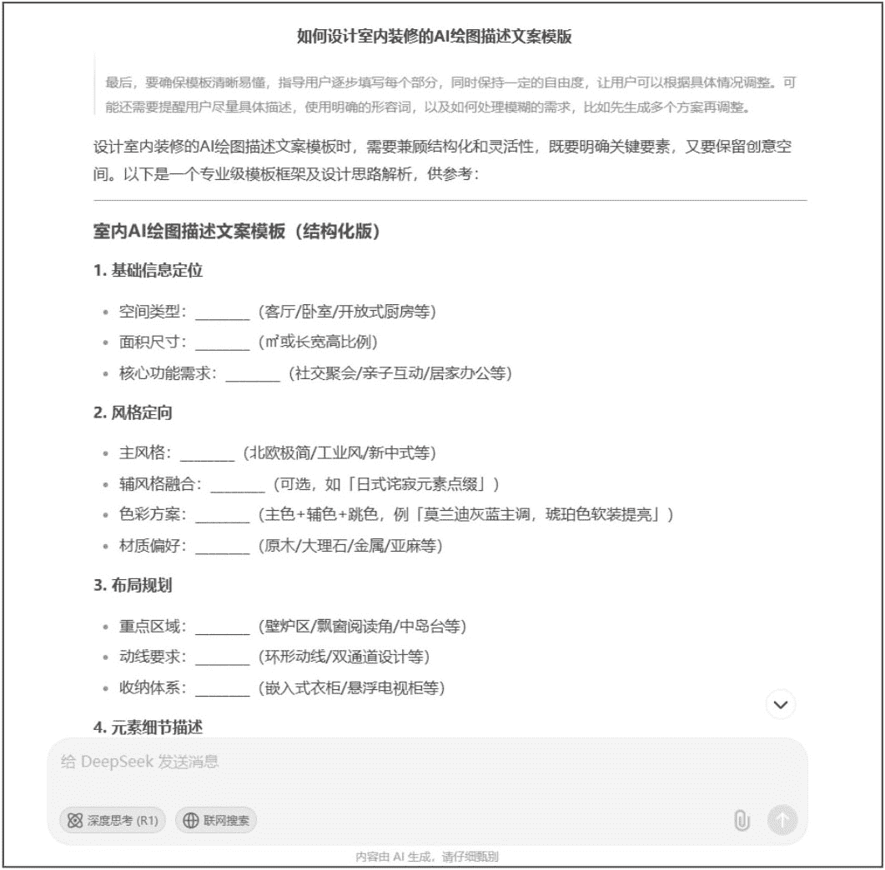

图 2-10 DeepSeek 针对绘图模板给出的优化建议

**步骤 02** 用优化后的提示再次询问 DeepSeek，获取毛坯房装修的绘画描述模板，如图 2-11。

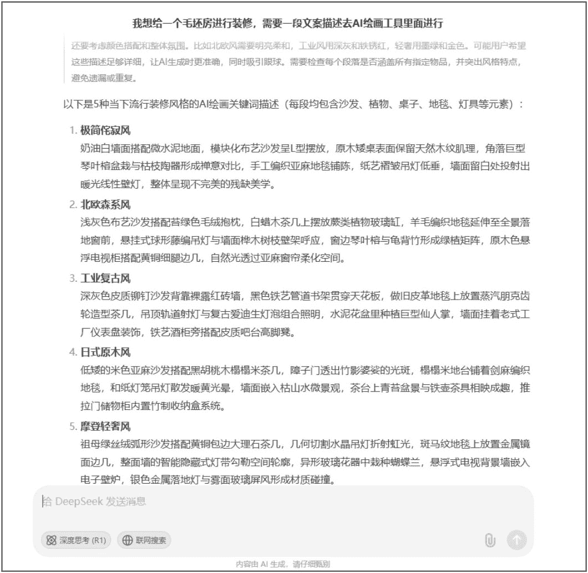

图 2-11 DeepSeek 产出的多风格 AI 绘图模板

DeepSeek 能生成多种风格的模板，但本身不支持图像绘制。若要看到装修效果，还需借助第三方 AI 绘画工具，如神采 AI（https://www.ishencai.com/）等。

**步骤 03** 从模板中挑选合适的描述文案，本文选用“极简侘寂风”模板，并准备一张毛坯房实拍图，如图 2-12。

图 2-12 装修前的毛坯房效果图

**步骤 04** 在神采 AI 注册登录，新用户可获 10 金币体验额度，单张绘制消耗 0.1 金币。进入“空房间装修”功能，如图 2-13。

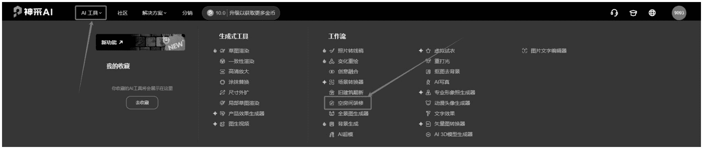

图 2-13 进入空房间装修入口

**步骤 05** 在功能页上传毛坯照片、粘贴绘画模板文字，并选择需要软装的区域。可使用魔棒工具大面积选区，对边角细节则切换画笔工具精细涂抹，然后点击“开始生成”，如图 2-14。

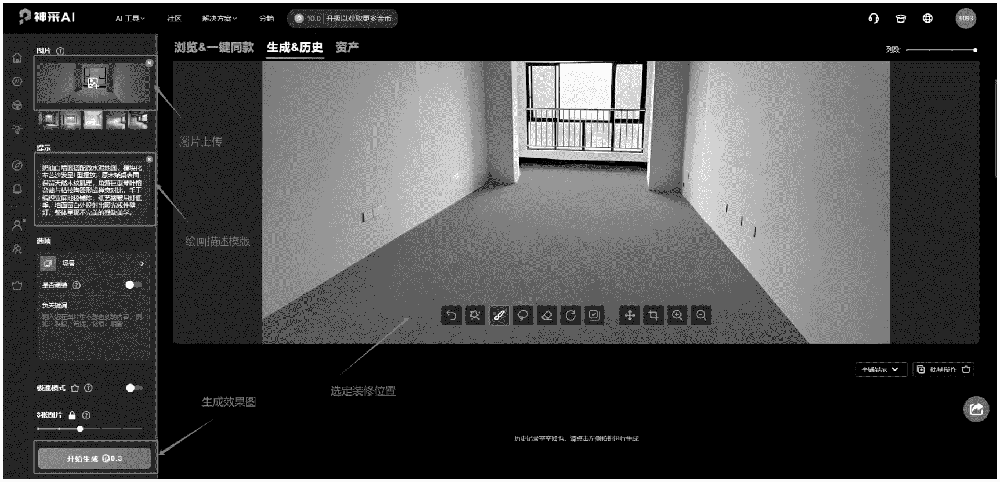

图 2-14 绘图前的设置操作

**步骤 06** 生成装修效果图需要一定时间，请耐心等待，如图 2-15。

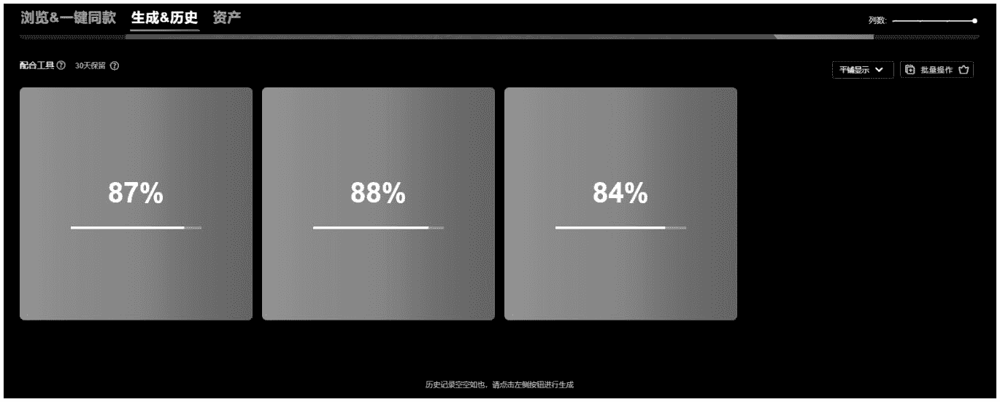

图 2-15 等待效果图生成中

进度条完成后即可查看 AI 根据模板生成的装修效果，如图 2-16。

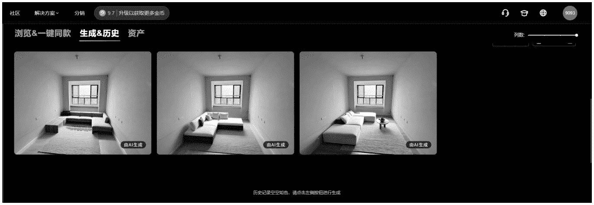

图 2-16 AI 生成的装修效果图

# 第三章

# DeepSeek 与 Excel 协同实战全攻略

**本章概述**

本章深入剖析 DeepSeek 与 Excel 结合的数据处理能力，通过步骤清晰的实操案例帮助读者掌握高效的数据分析和自动化流程。我们将从获取 DeepSeek 的 APIkey 开始，这是建立连接的第一步；随后讲解如何在 Excel 中启用宏与开发工具，为自动化打基础。

掌握基础配置后，将演示如何编写 DeepSeek 宏文件，并创建快捷方式简化操作。接着通过实战展示 AI 如何赋能表格工作：包括一键生成 Excel 样表、一键完成全勤奖与绩效统计、快速打造动态销售数据可视化图表。最后针对公式报错和数据格式冲突等常见问题，提供实用应对思路。通过学习，读者能实现数据处理的智能化、自动化，大幅提升工作效率和决策质量。

**知识导读**

本章要点（已掌握请打勾）
❏DeepSeek + Excel：集成路径全解析
❏实战案例：一键生成 Excel 样表
❏实战案例：全勤奖金与绩效统计一键完成
❏实战案例：动态销售数据可视化图表快速搭建
❏高效技巧：公式调试与数据格式冲突处理策略

## 3.1 DeepSeek 嵌入 Excel 的完整路径

Excel 是 Microsoft Office 套件中的数据记录、计算、分析与可视化工具。DeepSeek 作为 AI 模型，与 Excel 结合会产生怎样的化学反应？本节讲解如何在 Excel 中集成 DeepSeek。

### 3.1.1 获取 DeepSeek 的 API key

API key 是调用 DeepSeek API 的身份凭证，由一串唯一字符组成，用于验证用户身份。

在每次 API 请求中必须携带 API key，系统才会接受文本任务并返回模型生成的结果。API key 的发放与管理机制确保了接口的可用性和安全性，防止被盗用。

获取流程如下：

**步骤 01** 登录 DeepSeek 官网，完成账号注册与登录，如图 3-1。

图 3-1 DeepSeek 官网首页

**说明：**官网地址为 https://www.deepseek.com/。

**步骤 02** 点击官网右上角的“API 开放平台”进入开放平台，如图 3-2。

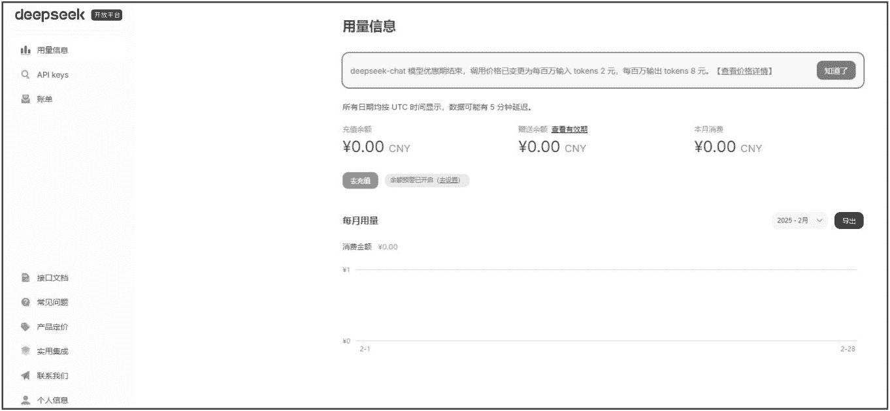

图 3-2 DeepSeek 开放平台入口

**提示：**该 API key 需付费使用，调用前请先充值并阅读价格说明。

**步骤 03** 在开放平台点击“API keys”菜单，进入密钥管理页，如图 3-3。

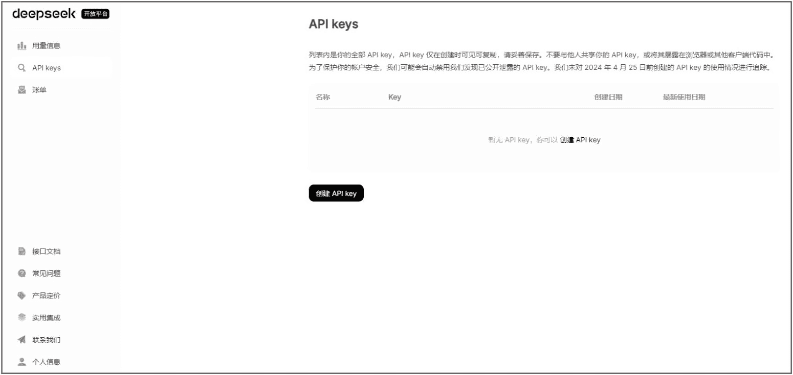

图 3-3 API keys 管理页面

**步骤 04** 点击“创建 API key”按钮，在弹框中填写密钥名称，如图 3-4。

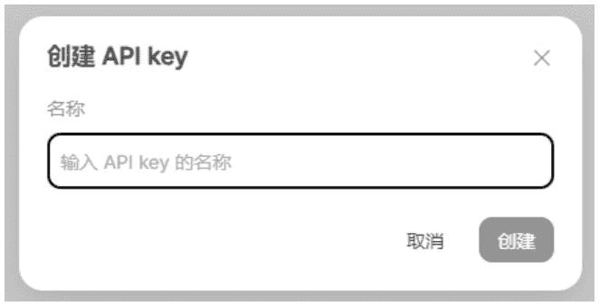

图 3-4 创建 API key

**步骤 05** 点击“创建”完成创建，密钥列表会显示新 key，如图 3-5。

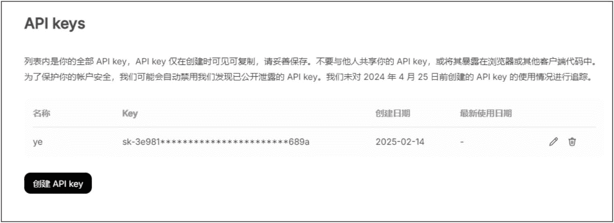

图 3-5 API keys 列表

**提示：**请妥善保管密钥，若遗失或泄露请及时删除，避免损失。

### 3.1.2 开启 Excel 的宏

宏基于 VBA 编程语言，可录制并复用 Excel 操作序列。通过 VBA 可以编写发送 API 请求的代码，实现与 DeepSeek 的交互。

因安全原因 Excel 默认关闭宏，开启步骤如下：

**步骤 01** 新建 Excel 文档，切换到“文件”选项卡，如图 3-6。

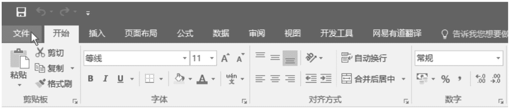

图 3-6 开启宏第一步

**步骤 02** 点击“选项”按钮。

**步骤 03** 在弹出的对话框中选择“信任中心”选项，如图 3-8。

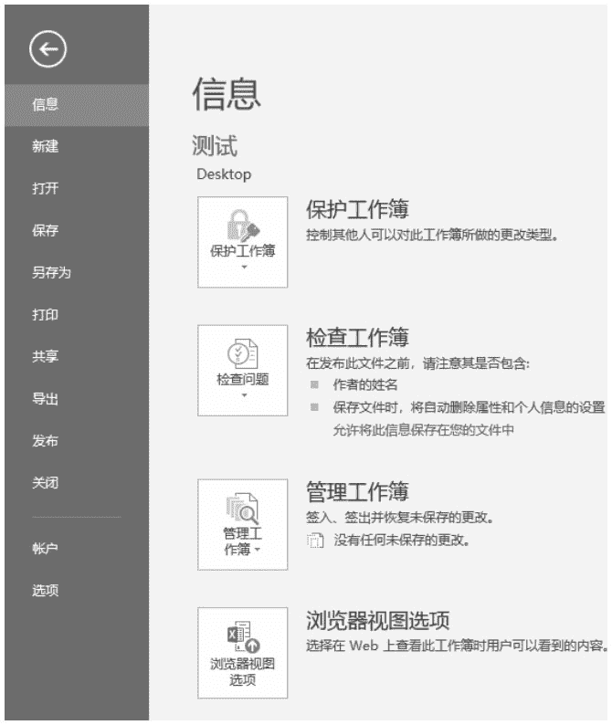

▲图 3-7 开启宏第二步

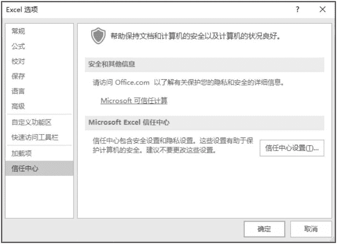

▲图 3-8 开启宏第三步

**步骤 04** 点击“信任中心设置”按钮。

**步骤 05** 在新对话框中选择“宏设置”选项。

**步骤 06** 勾选“启用所有宏”并同时勾选“信任对 VBA 工程对象模型的访问”，如图 3-10。

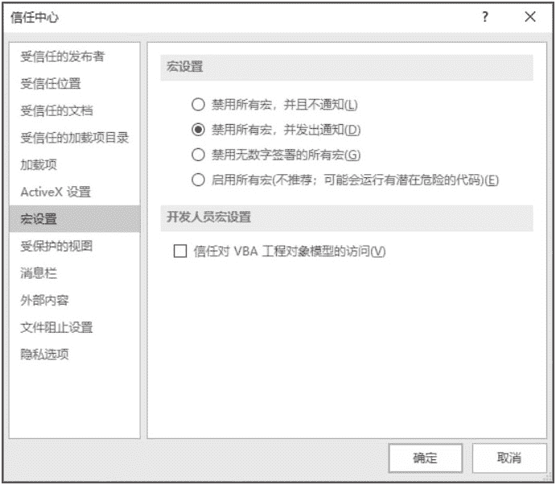

▲图 3-9 开启宏第四步

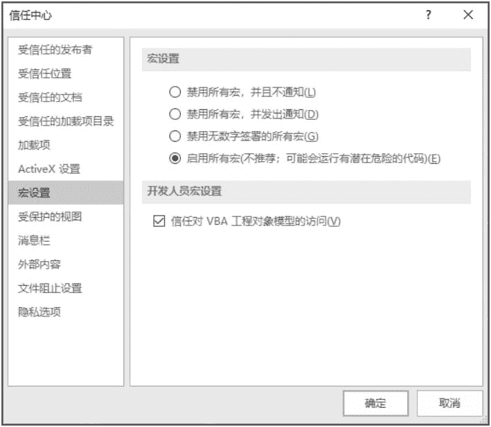

▲图 3-10 开启宏第五步

**步骤 07** 点击“确定”，Excel 宏功能开启成功。

### 3.1.3 开启 Excel 的开发工具

开发工具提供宏的访问与编辑入口，开启后可更高效地编写宏文件。

**步骤 01** 打开 Excel，执行“文件→选项→自定义功能区”。

**步骤 02** 在自定义功能区列表中勾选“开发工具”，如图 3-12。

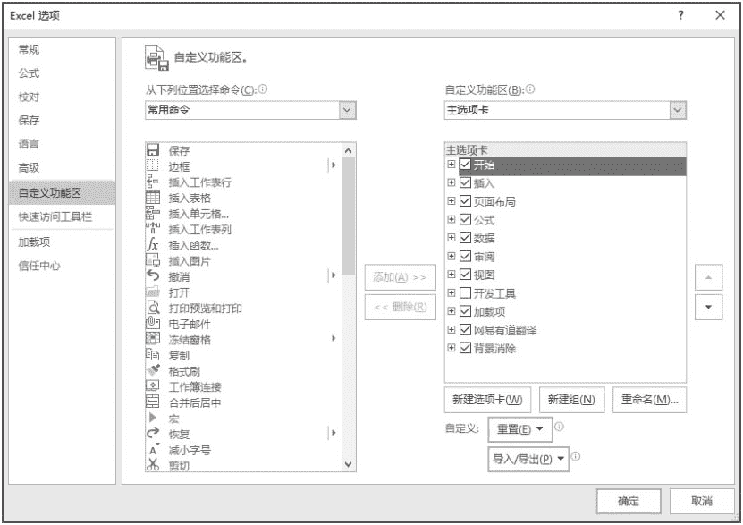

▲图 3-11 开启开发工具第一步

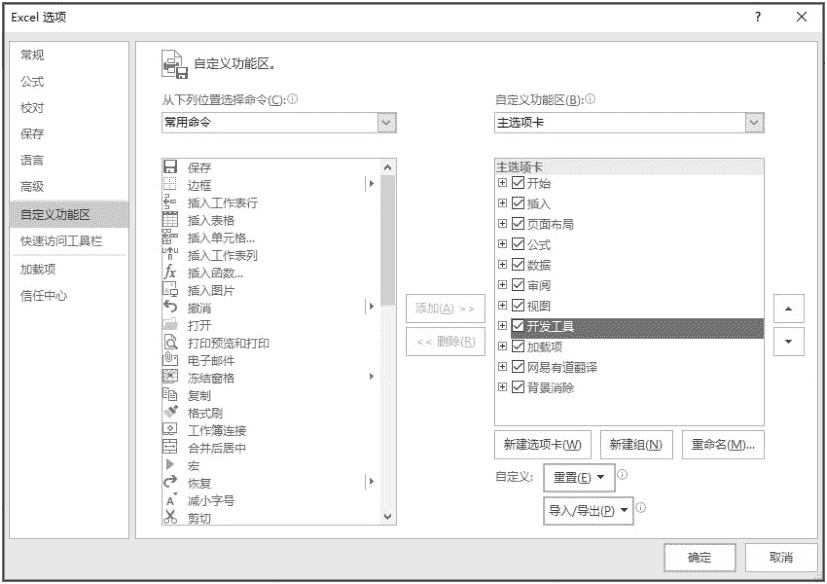

▲图 3-12 开启开发工具第二步

**步骤 03** 点击“确定”，工具栏会出现“开发工具”选项卡，如图 3-13。

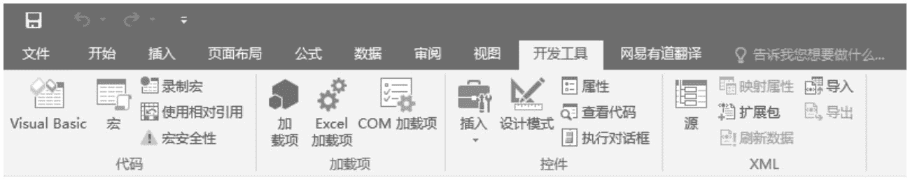

图 3-13 开发工具已开启

### 3.1.4 编写 DeepSeek 宏文件

通过宏文件可直接调用 DeepSeek 模型生成内容，无需在官网操作，大幅提升效率。宏的核心是通过 VBA 发送 API 请求并获取返回结果。

**步骤 01** 打开 Excel，切换到“开发工具”选项卡，如图 3-14。

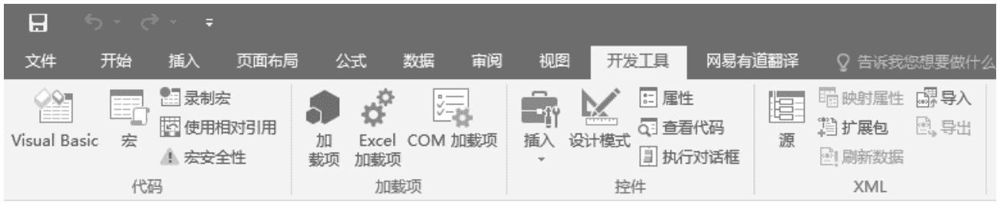

图 3-14 编写宏文件第一步

**步骤 02** 点击 Visual Basic 按钮打开 VBA 窗口。

**步骤 03** 执行“插入→模块”命令，新建名为“模块 1”的模块，如图 3-16。

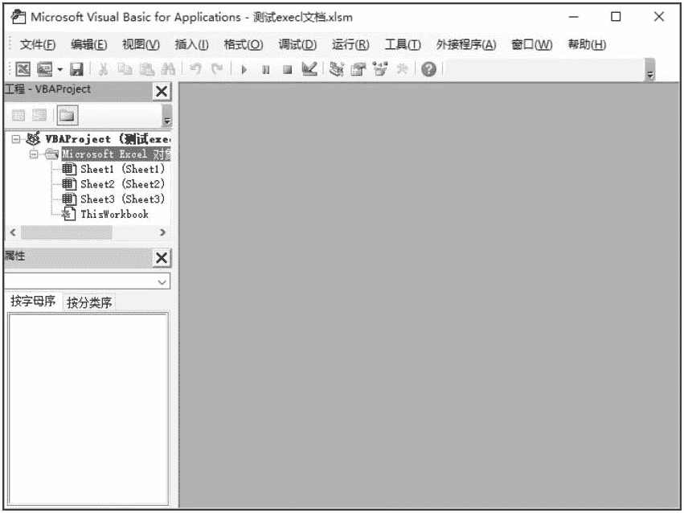

▲图 3-15 编写宏文件第二步

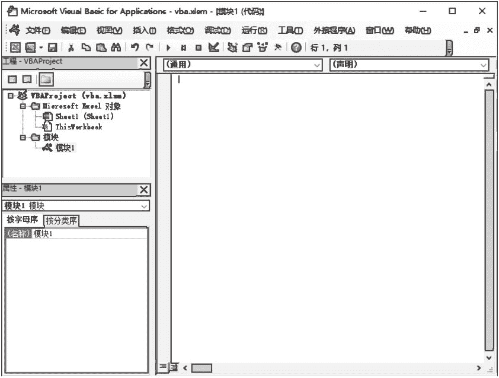

▲图 3-16 编写宏文件第三步

**步骤 04** 在模块中编写 VBA 代码以调用 DeepSeek API，具体代码如下：

**说明：**其中 KEY 的值即为 3.1.1 小节申请的 API key。

**步骤 05** 保存文件，DeepSeek 宏文件编写完成。

### 3.1.5 创建宏文件的快捷方式

为方便调用，可将宏添加到 Excel 快捷工具栏，一键触发。

**步骤 01** 打开 Excel，执行“文件→选项→自定义功能区”，如图 3-17。

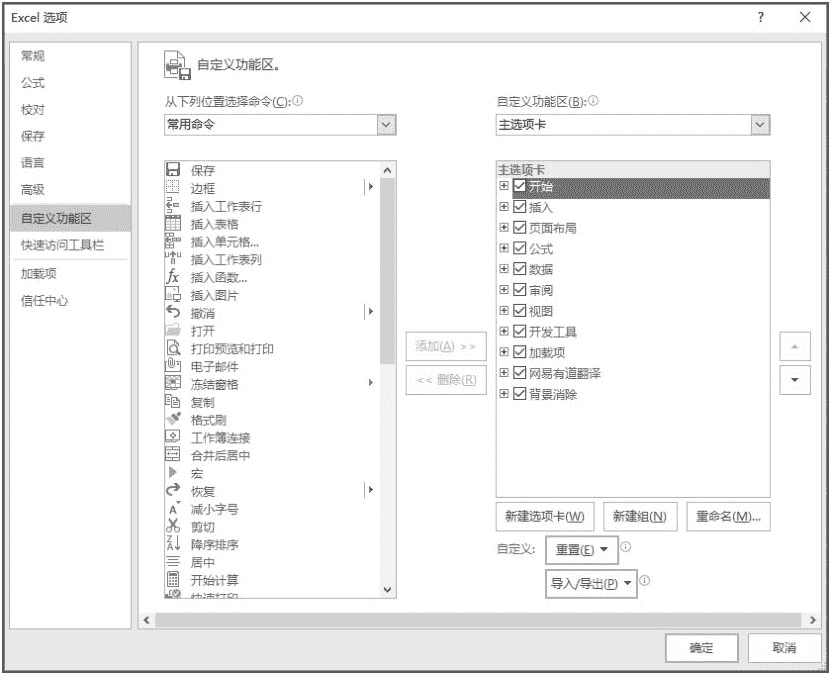

▲图 3-17 创建快捷方式第一步

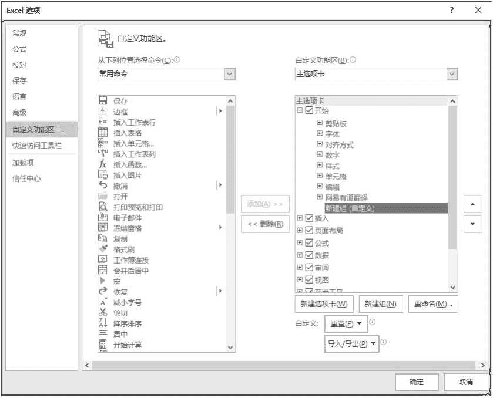

▲图 3-18 创建快捷方式第二步

**步骤 03** 在“从下列位置选择命令”下拉框中选择“宏”，将 RunDemo_Click 宏添加到新组。

**步骤 04** 重命名新组为 DeepSeek，宏名称改为“DeepSeek 插件”，可同时调整图标样式。

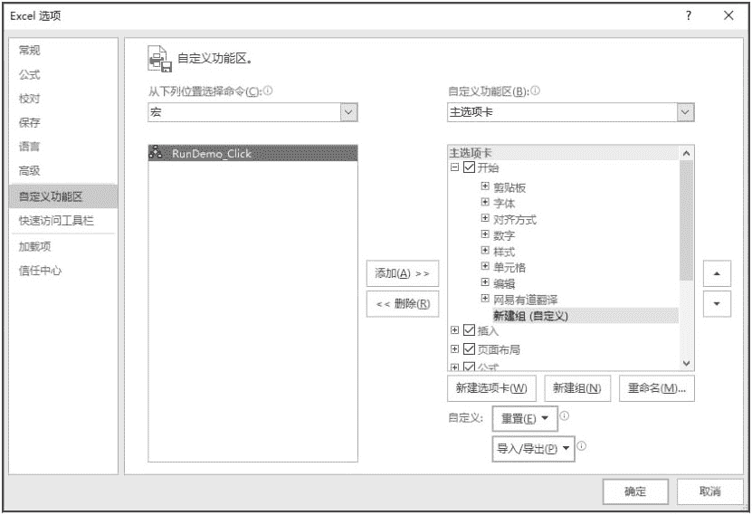

▲图 3-19 创建宏文件的快捷方式（三）

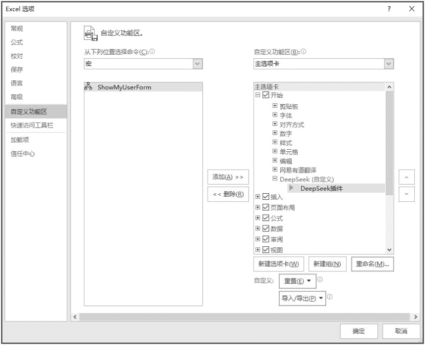

▲图 3-20 创建宏文件的快捷方式（四）

第5步 回到 Excel 主页检查功能区，能够在“开始”标签最右端看到新出现的 DeepSeek 按钮，如图 3-21 所示。

图 3-21 创建宏文件的快捷方式（五）

第6步 点开该 DeepSeek 按钮即可进入使用界面，如图 3-22 所示。

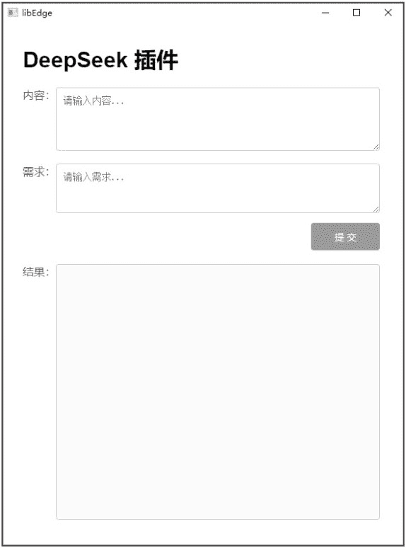

图 3-22 创建宏文件的快捷方式（六）

## **3.2 一键建表：DeepSeek 快速生成成绩样表**

数据时代下 Excel 虽然强大，但对普通用户来说上手门槛不低。DeepSeek 提供了样表自动生成的入口，能让非专业用户也能迅速进入状态。下面以学生成绩表为例演示全过程。

按姓名和科目自动生成一张空白成绩单，流程如下：

操作一 启动 DeepSeek 工具，在“内容”框填入“学生：张三、李四、王五、马六、冯七，科目：语文、数学、英语”。

操作二 在“需求”框填入“依据以上信息生成一张未填成绩的学生成绩 Excel 表”。

操作三 点击“提交”，等待系统返回草稿，结果见图 3-23。

操作四 将返回的成绩表复制进 Excel 工作簿，效果如图 3-24。

操作五 按个人喜好美化表格，例如补充标题行、加框线等，优化后如图 3-25。

▲图 3-23 生成学生成绩表

▲图 3-24 学生成绩表

▲图 3-25 美化的学生成绩表

## **3.3 考勤绩效一键统计实操**

日常办公中，考勤表既要记录出勤，也要汇总绩效。本节演示如何借助 DeepSeek 快速完成这两类统计，把繁琐的数据处理变得顺畅。

### **3.3.1 出勤天数自动汇总**

核算每人出勤天数是人力管理的核心，为薪酬和考核提供依据。以下演示如何联动 DeepSeek 与 Excel 高效完成该计算。

操作一 打开一份 Excel 考勤表，本例表格仅作演示，如图 3-26。

操作二 复制表格中与出勤计算相关的数据，随后打开 DeepSeek 工具。

操作三 把复制内容粘贴到工具的“内容”框。

操作四 在“需求”框输入“统计每个人的出勤天数”。

操作五 点击“提交”获取结果，返回内容见图 3-27。

▲图 3-26 Excel 考勤表

▲图 3-27 DeepSeek 的返回结果

操作六 将计算好的出勤天数粘贴回考勤表，如图 3-28。

图 3-28 Excel 考勤表

### **3.3.2 满勤情况快速判断**

不少企业设有满勤奖励，是否满勤的判定直接影响奖金发放。下面介绍如何用 DeepSeek 迅速判断满勤。

操作一 复制用于判断满勤的数据，粘贴到 DeepSeek 的“内容”框。

操作二 在“需求”框填写“判断每人是否满勤”。

操作三 点击“提交”等待回复，结果如图 3-29。

图 3-29 计算是否满勤（一）

操作四 把判定结果复制回考勤表，如图 3-30。

图 3-30 计算是否满勤（二）

### **3.3.3 绩效总分自动累加**

绩效总分是评价工作表现的重要依据。借助 DeepSeek 可迅速汇总每位员工的分数，为管理决策提供支持。

操作一 复制考勤表中用于绩效汇总的数据，粘贴到“内容”框。

操作二 在“需求”框输入“计算绩效总和”。

操作三 点击“提交”获取返回，结果如图 3-31。

图 3-31 计算绩效总和（一）

操作四 将汇总结果复制回考勤表，如图 3-32。

图 3-32 计算绩效总和（二）

## **3.4 销售数据动态可视化搭建**

信息密集的今天，可视化已成为分析与决策的关键。面对快速变化的销售数据，静态图表已不够用。本节说明如何结合 DeepSeek 与 Excel 构建灵动的可视化图表。

### **3.4.1 销售金额快速核算**

在做图表前需先算清手机、平板等产品的销售额，下面介绍用自封装的 DeepSeek 工具完成总额核算的步骤：

图 3-33 Excel 销售表

操作一 打开 Excel 销售表，本例数据仅作演示，如图 3-33。

操作二 复制用于计算金额的数据，粘贴到 DeepSeek 的“内容”框。

操作三 在“需求”框输入“统计销售金额”。

操作四 点击“提交”等待返回，结果如图 3-34。

操作五 将计算结果复制回表格，如图 3-35。

▲图 3-34 计算销售金额（一）

▲图 3-35 计算销售金额（二）

### **3.4.2 图表生成实操**

依托 DeepSeek 的智能能力和 Excel 的图表功能，可把枯燥数据转为柱状、折线、饼图等直观形式。下面是协同生成高质量图表的操作：

操作一 打开 DeepSeek，将销售表数据复制到“内容”框。

操作二 在“需求”框填写“基于以上数据生成一个柱状图”。

操作三 点击“提交”获取回复，结果如图 3-36。

图 3-36 生成可视化图表（一）

说明：DeepSeek 无法直接绘制柱状图，这里返回的是制作步骤。

结果：

操作四 按返回的方法即可迅速生成销售表的柱状图，如图 3-37。

图 3-37 生成可视化图表（二）

## **3.5 公式排错与格式冲突应对技巧**

在数据驱动的环境中，Excel 仍是核心工具。但使用 DeepSeek 生成公式和数据时，公式错误与格式冲突不可避免，会影响分析精度与效率。本节讲解常见问题的快速处理思路。

### **3.5.1 DeepSeek 助力公式调试**

DeepSeek 具备智能化排错能力，能更高效地定位并修复 Excel 公式错误。相较传统方式自动化程度更高，可大幅节省时间。

在编写公式时，DeepSeek 会基于上下文给出提示。例如输入函数名时，会列出参数说明，方便快速完成；若函数或参数使用不当，也会及时提醒。下面用两个案例说明。

案例一：查询求和函数用法。

操作一 打开 DeepSeek，在“内容”框输入“求和函数”。

操作二 在“需求”框输入“请说明 Excel 求和函数的用法”。

操作三 点击“提交”等待回复，结果如图 3-38。

图 3-38 获取函数和其使用方法

结果：

案例二：错误函数纠正。

操作一 打开 DeepSeek，在“内容”框输入“=COUNAA(A1:E1)”。

操作二 在“需求”框输入“这个函数是否正确”。

操作三 点击“提交”等待回复，结果如图 3-39。

图 3-39 错误函数纠正

结果：

### **3.5.2 格式冲突的解决思路**

处理 Excel 数据时，格式冲突很常见，不同格式会导致计算偏差、排序混乱。复制 DeepSeek 生成的数据时也易出现，需采取以下对策：

**1. 统一格式规范**

尽量保持数据一致，录入时遵循统一标准，例如日期格式统一、数值小数位统一，可减少因不一致带来的错误。

**2. 类型转换**

必要时对数据类型进行转换，以满足特定需求，如文本型数字转数值型、日期型转文本型等。Excel 提供了多种转换函数，如 TEXT、VALUE、DATE，可按需选用。

说明：

1）TEXT 函数

用途：将数值转为文本并按指定格式显示，可把数字、日期等按特定文本格式呈现。

语法：TEXT(value,format_text)。value 为数值、结果或单元格引用；format_text 为带引号的显示格式。

示例：A1 为 1234.56789，=TEXT(A1,"0.00") 返回“1234.57”；=TEXT(A1,"￥#,##0.00") 返回“￥1,234.57”。

2）VALUE 函数

用途：将文本格式的数字转为数值，便于数学运算。

语法：VALUE(text)。text 为待转换的文本或引用。

示例：B3 为文本“￥1,24.56”，在 F3 输入=VALUE(B2) 可转为数值 124.56。

3）DATE 函数

用途：通过年、月、日构造日期，是 Excel 常用日期处理函数。

语法：DATE(year,month,day)。year 为 1900-9999，month 为 1-12，day 为 1-31。

示例：=DATE(2024,1,15) 返回 2024 年 1 月 15 日；=DATE(YEAR(TODAY()),1,1) 返回本年第一天。

**3. 核查数据完整性**

分析前先检查数据是否完整，缺失或错误数据会影响结果。可利用 Excel 筛选或条件格式查找异常并修正。

# **第四章**

# **DeepSeek 赋能 Word 智能文档创作新篇**

**本章概述**

在快节奏的信息时代，AI 正深刻改变工作与生活方式。特别在自然语言处理领域，AI 已从文本分析、内容推荐发展到文档生成、翻译校对等高级功能。在此背景下，DeepSeek 与 Word 的深度融合标志着办公自动化的重要进步，也为用户带来前所未有的便捷体验。这种融合提升了办公效率，为法律、科研、商务等各领域带来革命性变化。

本章通过多個实战案例，揭示如何利用 DeepSeek 与 Word 的深度结合解决实际工作问题。

**知识导读**

本章要点（已掌握的在方框中打钩）

❏DeepSeek 与 Word 完美融合之道揭秘。

❏实战案例：法律合同模板自动生成实战。

❏实战案例：学术论文写作效率大幅提升。

❏实战案例：多语言合同快速翻译与精准校对实战。

❏实战案例：DeepSeek 助力短文续写与修改。

❏高效密码：格式错乱与术语一致性保障策略。

## **4.1 Word 与 DeepSeek 融合解析**

随着 AI 快速发展，智能文档创作成为现代办公趋势。DeepSeek 作为先进 AI 助手，与 Word 的深度整合为用户开启高效精准的写作新篇。两者结合不仅体现在文本输入编辑，更在于理解用户意图并提供针对性建议，实现智能化文档处理。

DeepSeek 借助自然语言处理能力，可解析指令并迅速响应。无论撰写商务计划、法律文件还是学术论文，只需输入关键词或主题，即可快速生成高质量初稿，且支持多语言环境，大幅提升跨国协作效率。

DeepSeek 还具备强大数据分析能力，能从海量信息中提取关键点，帮助用户构建逻辑严密、论据充分的文档内容，在处理复杂项目时尤为重要。

### **4.1.1 Word 中无缝调用 DeepSeek**

DeepSeek 与 Word 界面无缝集成，显著提升操作便捷性。用户无需在软件间切换，即可在 Word 中直接调用 DeepSeek 功能，节省时间并降低学习成本，无论新手还是资深用户都能快速上手。

下面介绍如何在 Word 中集成 DeepSeek。

操作一 获取 DeepSeek 的 API key（详见 3.1.1 节）。

操作二 开启 Excel 的宏（详见 3.1.2 节）。

操作三 开启 Excel 的开发工具（详见 3.1.3 节）。

操作四 编写 DeepSeek 宏文件（参考 3.1.4 节）。

（1）点击“开发工具”选项中的 Visual Basic 按钮，打开 VBA 窗口。

（2）执行“插入→模块”命令，插入一个名为“模块 1”的模块。

（3）在“模块 1”中编写 VBA 代码以调用 DeepSeek 的 API，具体代码如下：

**DeepSeek 赋能 Word 全流程**

**说明：** KEY 对应你在 DeepSeek 平台申请到的 API Key。

（4）保存完毕，宏文件编写任务结束。

步骤 05 建立宏文件快捷方式，具体操作参见 3.1.5 节。

### 4.1.2 Word 文档的深度理解能力升级

DeepSeek 的核心价值在于强大的自然语言理解与生成能力。基于深度学习模型与大规模语料训练，它能让 Word 迅速抓住文本要点，帮助用户更省心地审阅与编辑；同时结合上下文给出更合适的用词与表达建议，避免重复与生硬，提升专业感与可读性。

下面通过两组实操呈现效果。

示例一：借助 DeepSeek 提取文章要点。

步骤 01 复制待提取的原文，随后打开已封装的 DeepSeek 扩展，如图 4-1 所示。

步骤 02 将复制的原文粘贴到扩展的「内容」文本框。

步骤 03 在「需求」文本框填写「获取文章中的关键信息」。

步骤 04 点按「提交」按钮，等待返回，结果如图 4-2 所示。

▲图 4-1 使用 DeepSeek 扩展

▲图 4-2 使用扩展提取文章关键信息

文章内容：

     在人工智能的浩瀚星空中，DeepSeek 犹如一颗璀璨的新星，正以其独特的光芒照亮技术前行的道路。作为

一家创新型科技公司，自 2023 年 7 月 17 日成立以来，DeepSeek 便以开发先进的大语言模型和相关技术为己

任，致力于推动人工智能技术的发展和应用。

     DeepSeek 的核心产品是其大型语言模型（LLM），这一模型不仅具有强大的文本生成能力，还能在多种任务

上展现出卓越的性能。从文本创作到自然语言理解，从代码生成到数学问题解答，DeepSeek 的 LLM 都表现出了

令人瞩目的实力。这使得它在内容创作、客户服务、教育、研究以及软件开发等多个领域都有着广泛的应用前景。

     除了 LLM 之外，DeepSeek 还推出了多款专用模型，如 DeepSeek Coder、DeepSeek-VL 等，这些模型

针对特定任务进行了优化，进一步提升了其在相应领域的表现。同时，DeepSeek 注重开源技术的应用，将其模型

和训练细节公开发布，允许开发者和研究者自由使用、修改和共享技术，从而促进了合作并加速了 AI 社区的创新。

     值得一提的是，DeepSeek 的成功并非偶然。其背后有着强大的硬件支持和战略眼光。由知名量化资管巨头

幻方量化孕育而生，DeepSeek 拥有得天独厚的硬件资源和技术支持。此外，公司创始人梁文峰凭借其在金融领域

的深厚底蕴和对 AI 技术的敏锐洞察，为 DeepSeek 的发展奠定了坚实的基础。

### 需求：

获取文章中的关键信息

获取的关键信息：

示例二：借助 DeepSeek 润色文章。

步骤 01 复制需润色的原文，打开 DeepSeek 扩展。

步骤 02 把复制的内容粘贴到扩展的「内容」文本框。

步骤 03 在「需求」文本框输入「美化文章内容」。

步骤 04 点击「提交」按钮，等待返回，结果如图 4-3 所示。

图 4-3 使用扩展美化文章内容

文章内容：

     在人工智能的浩瀚星空中，DeepSeek 犹如一颗璀璨的新星，以其卓越的技术实力和广泛的应用前景，引

领着行业的新一轮变革。作为杭州深度求索人工智能基础技术研究有限公司精心打造的开源人工智能工具库，

DeepSeek 不仅承载着技术创新的光辉，更寄托着对未来智能社会的无限憧憬。

### 需求：

美化文章内容

美化后的文章内容：

## 4.2 实战案例：法律合同模板自动化生成

法律文书起草要求精确且耗时，手工操作易出错。借助 DeepSeek 可实现模板的自动产出。用户只需提供合同类型如租赁、销售等以及特殊要求，系统便据此生成初稿；随后调用内置法条库对条款进行校验，确保符合现行法规。最终得到一份完整合规的文档。

该流程大幅降低人工成本，减少人为疏漏，且模板会动态更新，随政策变化自动调整。下面以房屋租赁为例说明。

### 4.2.1 快速生成房屋租赁法律合同模板

操作较为简便。用户在「需求」框输入「生成一份房屋租赁法律合同模板」即可启动，这是保证输出准确的前提。提交后，系统依据法条库与算法自动生成符合现行法规的租赁合同模板，通常数分钟完成，效率远超手工。

具体流程如下：

步骤 01 打开 DeepSeek 扩展，在「需求」文本框输入「生成一份房屋租赁法律合同模板」。

步骤 02 点击「提交」按钮，等待生成结果，结果如图 4-4 所示。

步骤 03 将返回结果复制到 Word 文件中，如图 4-5 所示。

▲图 4-4 生成房屋租赁法律合同模板

▲图 4-5 房屋租赁法律合同模板片段

至此，房屋租赁法律合同模板已生成。

### 4.2.2 补充合同内容

基础模板已较为完善，但具体租赁情形各有差异，可能需要增补条款，例如增加房屋维修责任约定。

补充流程如下：

步骤 01 复制已生成的「房屋租赁法律合同模板」内容，打开 DeepSeek 扩展。

步骤 02 将内容粘贴到扩展的「内容」文本框。

步骤 03 在「需求」文本框输入「添加房屋维修责任的条款」。

步骤 04 点击「提交」按钮，等待重新生成条款，结果如图 4-6 所示。

步骤 05 将新生成的维修责任条款复制到「房屋租赁法律合同模板」中，如图 4-7 所示。

▲图 4-6 添加房屋维修责任条款

▲图 4-7 房屋维修责任条款片段

至此，补充工作完成。

### 4.2.3 修改合同内容

实际使用中常需对已有合同进行调整，无论是双方协商变更，还是法规更新导致条款失效，DeepSeek 都能便捷修改。例如修改房屋使用要求。

修改流程如下：

步骤 01 复制已生成的「房屋租赁法律合同模板」内容，打开 DeepSeek 扩展。

步骤 02 将内容粘贴到扩展的「内容」文本框。

步骤 03 在「需求」文本框输入「修改房屋租赁合同中房屋使用要求的内容」。

步骤 04 点击「提交」按钮，等待重新生成内容，结果如图 4-8 所示。

步骤 05 将重新生成的房屋使用要求复制回「房屋租赁法律合同模板」中，如图 4-9 所示。

▲图 4-8 修改合同内容

▲图 4-9 修改后的房屋使用要求片段

至此，房屋使用要求的修改完成。

## 4.3 实战案例：学术论文写作效率提升

撰写高质量论文是科研核心任务，也是耗时挑战大的环节。DeepSeek 可智能辅助科研人员完成写作，从观点提炼到资料收集再到结构组织，每一步都更高效精准。

### 4.3.1 基于研究主题生成核心观点

传统写作常需从零思考核心论点。DeepSeek 可分析海量文献与数据，快速提炼主题的核心观点，节省时间并保证新颖准确。例如输入「AI 智能在代码开发中的应用」，系统能迅速把握领域进展并提出有研究价值的观点。

图 4-10 基于研究主题生成核心观点

操作流程如下：

步骤 01 打开 DeepSeek 扩展，在「内容」文本框输入「AI 智能在代码开发中的应用」。

步骤 02 在「需求」文本框输入「请根据研究主题生成核心观点」。

步骤 03 点击「提交」按钮，等待生成结果，结果如图 4-10 所示。

内容：

AI 智能在代码开发中的应用

### 需求：

请根据研究主题生成核心观点

生成的核心观点：

### 4.3.2 基于核心观点生成论文大纲

明确核心观点后，下一步是构建结构。DeepSeek 可依据提炼的观点自动生成论文大纲，帮助以清晰条理的方式组织内容，确保各部分围绕核心展开。

操作流程如下：

步骤 01 复制生成的核心观点，打开 DeepSeek 扩展。

步骤 02 将内容粘贴到扩展的「内容」文本框。

步骤 03 在「需求」文本框输入「请根据核心观点生成论文大纲」。

步骤 04 点击「提交」按钮，等待生成大纲，结果如图 4-11 所示。

步骤 05 将生成的大纲复制到 Word 文件中，如图 4-12 所示。

▲图 4-11 生成论文大纲与章节目录一

▲图 4-12 生成论文大纲与章节目录二

### 4.3.3 检索相关领域的最新研究成果

文献综述需要全面把握最新进展。DeepSeek 可检索并分析相关领域的最新成果，提供文献和数据支持。无论查找经典文献还是追踪研究动态，都能快速给出结果。

图 4-13 生成论文大纲与章节目录三

操作流程如下：

步骤 01 打开 DeepSeek 扩展，在「需求」文本框输入「AI 智能在代码开发领域的相关文献和最新研究成果」。

步骤 02 点击「提交」按钮，等待返回结果，结果如图 4-13 所示。

### 需求：

AI 智能在代码开发领域的相关文献和最新研究成果

AI 智能在代码开发领域的相关文献和最新研究成果：

## 4.4 实战案例：多语言合同翻译与校对

在全球化背景下，跨国交易频繁，文档语言转换成为刚需。DeepSeek 在此领域表现突出，用户选中待译内容并指定目标语言，即可获得流畅译文。

除翻译外，系统还提供校对服务，对目标语言进行二次检查，标注歧义或不准确之处供修改。即使非母语者也能安心签署国际合同，避免语言误解。

### 4.4.1 多语合同即时翻译

全球化浪潮中语言差异常成为沟通障碍。一份紧急国际合同因语言问题延误，DeepSeek 的多语言快速翻译可即时解决。只需几次点击，法律条款或商业细节都能跨越语言障碍转为自然流畅的外文，加速决策并抢占市场先机。

图 4-14 翻译内容为中文

操作流程如下：

步骤 01 复制需要翻译的内容，打开 DeepSeek 扩展。

步骤 02 将内容粘贴到扩展的「内容」文本框。

步骤 03 在「需求」文本框输入「请翻译这段文字为中文」。

步骤 04 点击「提交」按钮，等待返回结果，结果如图 4-14 所示。

内容：

     Introduction to Renewable Energy Sources

     Renewable energy sources have become increasingly important in the global

quest for sustainable development. As the world grapples with the challenges of

climate change, depletion of fossil fuels, and environmental degradation, there has

never been a greater need for clean, efficient, and sustainable energy solutions.

This document provides an overview of the various types of renewable energy

sources, their bene fi ts, and their potential impact on the future.

### 需求：

请翻译这段文字为中文

翻译后的内容：

### 4.4.2 精准校对，安心签署国际合约

翻译准确性决定合同效力。DeepSeek 除提供快速翻译外，还配备详尽校对服务。借助先进语言处理技术，系统能深入分析语境、语法和文化差异，精准标出可能引发误解的表述。非母语使用者也能在辅助下自信审阅并签署国际合同，规避语言风险，从初稿到终版全程把关。

操作流程如下：

步骤 01 复制需要校对的中英文内容，打开 DeepSeek 扩展。

步骤 02 将内容粘贴到扩展的「内容」文本框。

步骤 03 在「需求」文本框输入「请校对中英文的含义是否一致」。

步骤 04 点击「提交」按钮，等待返回结果，结果如图 4-15 所示。

图 4-15 校对中英文含义是否一致

内容：

     In view of the provisions of the "Contract Law of the People’s Republic of

China" and other relevant laws and regulations, and based on the principles of

双方以自愿、平等、公平、诚实信用的立场为前提，经充分商议，厘清了服务提供环节中各自的权责并形成一致意见。下述条款经双方共同确认，供彼此执行。

参照《中华人民共和国民法典》及相关法律法规，双方本着自愿、平等、公平、诚实信用的原则，经过充分协商，对服务过程中各自的权利与义务达成共识，现共同确认以下内容。

### 需求：
核验中英文表述的语义是否对应

结果：

## **4.5** 让文档排版与用词都统一的实操方法

在 DeepSeek 配合 Word 实际使用的场景里，保持页面整洁与用语规范往往是首要难题。编辑过程中，版式混乱与术语分歧反复出现，不只影响视觉观感，更会从根本上削弱信息传递的准确性与专业度。

### **4.5.1** 排版错乱的诊断与处理思路

页面混乱是 Word 编辑中十分常见的问题，通常源于模板设置不当、样式使用错误或跨文档复制粘贴。后果表现为标题、列表、字号、段距等要素不一致，使整份文档显得杂乱。针对这一情况，可采用以下两种常用做法：

**1. 统一调用样式与格式刷**
Word 的样式本质上是预设好的字符与段落格式组合。通过统一使用，可以确保同类元素风格一致，例如标题、正文、引用各自设定后批量套用。格式刷则能快速对齐排版，选中已排好版的文本点击格式刷，再涂抹到待调整区域即可实现版式统一，如图 4-16 所示。

图 4-16 格式刷的使用示例

**2. 一键清除格式回退默认**
从网页或其他文件粘贴内容时，常会带入原格式导致混乱。此时可借助清除格式功能，还原为 Word 默认样式。选中目标文本，在“开始”选项卡中点击“清除所有格式”按钮，如图 4-17 所示，即可去除多余排版。

图 4-17 清除所有样式

### **4.5.2** 术语统一的维护思路

撰写专业文档或学术论文时，术语的稳定性是保障读者理解、提升可信度与专业性的关键纽带。若同一概念在不同段落以不同说法出现，会让读者产生认知偏差，也会削弱文章的权威性与流畅度。

**1. 搭建术语表**
术语表是保持表述稳定的基础设施。可在文档开头或附录中建立术语表，收录核心词汇的定义、缩写、同义表达等信息。写作时以此为依据选用表述。还可借助 Word 的书签或超链接，将术语表条目与正文对应位置关联，便于检索与修订。

**2. 人工复核与校正**
生成内容后，运用 Word 的“查找和替换”功能排查术语使用情况，对不一致之处统一替换。

**3. 使用专业术语管理软件**
采用 SDL MultiTerm、MemoQ 等专业术语管理软件进行一致性校验。将术语库与 Word 集成，可在编辑时实时提示术语使用是否规范。

# **第五章**
# **PPT 智能演示的升级打法**

**本章概述**

在信息过载的时代，高效精准传递信息尤为关键。PPT 作为职场沟通的核心载体，其制作效率与呈现效果直接决定信息价值。传统制作流程耗时耗力，内容组织与视觉设计常让人头疼。DeepSeek 以强大的 AI 能力将智能化与自动化融入 PPT 全流程，帮助用户轻松产出专业演示。

本章将深入探讨 DeepSeek 如何提升 PPT 智能演示水平。

（1）剖析 DeepSeek 在 PPT 制作上的差异化优势，说明 AI 如何简化流程、提速增效。
（2）掌握从架构到文案的快速生成方法，利用 DeepSeek 迅速搭建逻辑清晰、内容精炼的演示稿。
（3）探索 DeepSeek 与 Kimi 的协同效应，实现 PPT 的极速成型，把创意即时转化为演示。
（4）了解 DeepSeek 赋能 WPS，实现 PPT 一站式制作的无缝办公体验。
（5）通过精选实战案例学习在真实场景中的应用，打造记忆点强的演示。
（6）解决内容冗余、视觉风格不统一等常见痛点，掌握制作简洁专业的实用策略。

让我们开启 PPT 智能演示的新阶段，用 DeepSeek 释放创造力，轻松产出令人惊艳的演示文稿。

**知识导读**

本章要点（已掌握请打钩）

❏DeepSeek 在 PPT 制作中的优势解读。
❏由结构到文本的 PPT 内容快速生成技巧。
❏DeepSeek + Kimi 实现 PPT 快速成型。
❏DeepSeek 助力 WPS 实现 PPT 一站式制作。
❏实战案例精选。
❏高效密码：内容精简与视觉风格统一策略。

## **5.1** DeepSeek 做 PPT 的独特价值

在数字化环境下，智能工具是提升效率的关键。DeepSeek 作为领先 AI 工具，在 PPT 领域呈现出明显优势，主要体现在两方面。

**1. 高效的内容生成与优化**

自动生成大纲：根据用户输入的主题或关键词，迅速输出逻辑清晰、结构合理的 PPT 框架，大幅节省构思时间。

文本优化：对输入文案进行润色，使表达更简洁专业，提升正式展示的适配度。

多语言支持：对需要多语版本的用户，DeepSeek 可完成文本生成与翻译，快速适配不同语言需求。

**2. 无缝对接其他 PPT 制作工具**

DeepSeek 本身不直接导出 PPT 文件，但可与众多制作工具无缝衔接。例如将生成的大纲与内容模块导入 Kimi、Mindshow 等在线平台，利用其一键生成功能快速完成整份演示。衔接方式提升效率，也让制作更灵活便捷。

## **5.2** 从结构到文本的 PPT 内容速成指南

一份优质演示不仅需要好看，更需要内容清晰条理。DeepSeek 为用户提供高效路径，从整体架构到具体表述均可快速完成。

### **5.2.1** 快速生成 PPT 框架

DeepSeek 可基于用户提供的主题与核心观点自动产出合理框架，明确各部分的主题与顺序，如封面、目录、正文、总结展望等。用户只需在此基础上填充完善，避免在结构构思上耗费过多精力。

以下以环保主题 PPT 为例说明具体操作：

**步骤 01** 在 DeepSeek 对话框中输入“以环保为主题生成一个 PPT 大纲”。
**步骤 02** 点按发送，等待返回结果，结果如图 5-1 所示。
**步骤 03** 如需调整，可将生成的大纲复制到 Word 中按需修改。

图 5-1 生成 PPT 大纲（部分内容）

### **5.2.2** 基于框架生成正文

在文本创作上，DeepSeek 表现突出。依据主题与关键词自动撰写详实准确的内容，涵盖概念解释、数据分析、案例说明等，并可根据受众与场景调整语气与风格。

**步骤 01** 在对话框中输入“根据 PPT 大纲生成 PPT 内容，结果以 Markdown 形式输出”。若大纲已修改，需将修改后内容一并发送。
**步骤 02** 等待返回结果，结果如图 5-2 所示。

图 5-2 根据 PPT 大纲生成内容（部分内容）

**说明：**Markdown 是一种轻量级标记语言，采用易读的纯文本格式，通过 #、*、- 等符号标记标题、列表、链接、图片等，常以 .md 为扩展名。

## **5.3** DeepSeek 搭配 Kimi：实现 PPT 的快速生成

5.2 节介绍了用 DeepSeek 生成大纲与内容的方法。DeepSeek 暂不支持直接一键成稿 PPT，但结合 Kimi 即可快速转化。本节说明二者协同的工作方式。

### **5.3.1** Kimi 的功能与使用方式

Kimi 是可快速生成 PPT 的智能工具，提供一键成稿功能。用户输入主题或上传素材，Kimi 自动生成条理清晰的大纲，再选模板点按生成，数分钟即可获得专业演示。

使用方法如下：

**步骤 01** 通过网址或百度搜索进入 Kimi 官网，如图 5-3 所示。

图 5-3 Kimi 官网

**说明：**Kimi 官网网址为 https://kimi.moonshot.cn/。

**步骤 02** 点按左侧“登录”按钮，通过手机号或微信登录，如图 5-4 所示。

图 5-4 Kimi 登录

**步骤 03** 点按左侧“PPT 助手”按钮即可进入制作界面，如图 5-5 所示。

图 5-5 PPT 助手

**说明：**目前 Kimi 也支持大纲与内容的一键生成。

### **5.3.2** 用 Kimi 快速完成 PPT 制作

Kimi 提供十万余款模板，支持按使用场景、设计风格、主题色等多条件筛选。生成后提供在线编辑，可修改大纲、更换模板、插入元素。

基于 5.2 节的 DeepSeek 产出，转化流程如下：

**步骤 01** 复制 DeepSeek 输出的 Markdown 格式内容。
**步骤 02** 将内容发送给 Kimi 的 PPT 助手。
**步骤 03** 等待助手整理数据结构，结果如图 5-6 所示。
**步骤 04** 点按“一键生成 PPT”，在弹出模板列表中按需选择，如图 5-7 所示。

▲图 5-6 PPT 内容

▲图 5-7 PPT 模板

**步骤 05** 选定模板后点按“生成 PPT”，等待生成，如图 5-8 所示。

图 5-8 PPT 生成

**步骤 06** AI 能力仍有局限，生成后可点按“去编辑”进行个性化调整，如图 5-9 所示。

图 5-9 PPT 编辑

**提示：**若模板不满意，可点按页面左侧“模板替换”更换。

**步骤 07** 以首页为例，按需修改主讲人姓名与制作日期，修改后效果如图 5-10 所示。
**步骤 08** 修改完成后点按“下载”，可选 PPT、图片、PDF 三种格式，如图 5-11 所示。

▲图 5-10 修改后的 PPT 内容

▲图 5-11 PPT 下载

**步骤 09** 至此，环保主题 PPT 制作完成。可通过 Office 打开文档查看，如图 5-12 所示。

图 5-12 最终保存的 PPT 文档

## **5.4** DeepSeek 联合 WPS 实现 PPT 一站式制作

DeepSeek 与 WPS 办公软件深度融合，为用户提供极致的 PPT 制作体验。无需在多工具间切换，即可在 WPS 中完成从内容创作到演示制作的全流程，提升效率。DeepSeek 以自然语言处理能力应对复杂文字任务，WPS 以文档处理能力服务各类办公场景，二者对接后用户可直接在 WPS 中调用 DeepSeek 功能，轻松制作专业 PPT。

### **5.4.1** WPS 灵犀的功能与使用

WPS 灵犀是 WPS 办公软件与 DeepSeek 深度融合的产物，整合自然语言处理与文档处理能力，提供一站式 PPT 制作方案。用户无需切换工具，在 WPS 内部即可完成创作与制作，显著提升体验。

通过网址或百度搜索访问 WPS 灵犀官网，如图 5-13 所示。

**说明：**WPS 灵犀官网网址为 https://lingxi.wps.cn/。

图 5-13 WPS 灵犀官网

**提示：**当前使用方式有两种：网页端直接使用，或在 WPS 办公软件中调用。

### **5.4.2** WPS 灵犀一键生成 PPT 框架

WPS 灵犀依托 DeepSeek 的 AI 能力，提供大纲与内容生成体验。用户在 WPS 中输入主题或关键词，系统即刻分析需求并输出结构清晰、内容丰富的 PPT 大纲，按逻辑与重要性排序，确保呈现专业易懂。

无需手动搜集资料，节省大量时间，让用户更专注于设计与呈现。

以爱护水资源主题为例，操作步骤如下：

**步骤 01** 访问 WPS 灵犀官网。
**步骤 02** 点按左侧 AI PPT 按钮进入制作页，如图 5-14 所示。

图 5-14 WPS 灵犀 PPT 制作

**步骤 03** 在文本框输入“以爱护水资源为主题生成一个 PPT 大纲”。
**步骤 04** 等待返回结果，结果如图 5-15 所示。
**步骤 05** 大纲生成后，系统会提供模板与修改建议供选择，如图 5-16 所示。

▲图 5-15 生成的 PPT 大纲

▲图 5-16 PPT 模板和修改建议

**步骤 06** 若决定采纳 WPS 灵犀给出的“补充水资源保护成功案例”提示，只需点下该按钮，系统便会即时重排并输出更新后的提纲，示例见图 5-17。

图 5-17 重新生成的 PPT 大纲

### **5.4.3 以模板赋能快速成稿**

框架与文案敲定后，WPS 灵犀提供了海量现成版式，可让成品更显专业与美感。使用者可按自身偏好在模版库中筛选，覆盖的风格与使用场景很广，商务汇报、学术陈述、项目展示等需求都能匹配到合适样式。

选定版式后即可迅速拼装演示。灵犀的模版视觉上大气，同时兼顾可读性与画面层次，呈现时更易给听众留下深刻印象。

下面说明经由 WPS 灵犀挑选模版并生成演示文稿的具体做法。

**步骤 01** 在模版库中选中心仪样式后，点击底部的“生成 PPT”按钮，如图 5-18 所示。

图 5-18 选择 PPT 模板

**步骤 02** 稍作等待，WPS 灵犀会自动完成制作，结果见图 5-19。

图 5-19 PPT 生成

### **5.4.4 个性化定制与落地实操**

DeepSeek 输出的文案未必完美无缺，生成演示后可按实际需要灵活调整内容与版式。WPS 灵犀还支持上传个人模版并对已有模版做深度定制，例如调整配色、字型、布局等，满足高度个性化的办公需求。

**1. 文案微调**

DeepSeek 生成的段落常有缺漏，需人工补全。以首页为例，需补加副标题并更正汇报人姓名，具体操作如下：

**步骤 01** 点击“单击此处添加副标题内容”，在弹出的文本框中输入“水，生命之源”，如图 5-20 所示。

**步骤 02** 点击“汇报人：WPS”，在文本框中把汇报人改为“叶璃”，如图 5-21 所示。

▲图 5-20 添加副标题内容

▲图 5-21 修改汇报人姓名

**2. 版式自定**

灵犀自带模版使用率较高，若想做出差异化，可按需自定，具体步骤如下：

**步骤 01** 单击“格式”按钮，展开当前幻灯片的版式列表，如图 5-22 所示。

**步骤 02** 将鼠标悬停在版式上方，点击“新建”按钮，如图 5-23 所示。

▲图 5-22 自定义模板（一）

▲图 5-23 自定义模板（二）

**步骤 03** 点击“新建”后会产生一个空白版式，可按需编辑其元素，如图 5-24 所示。

**步骤 04** 切到“背景”选项卡，按喜好设定幻灯片底色，如图 5-25 所示。

**3. 模版切换与导入**

生成完成后，可通过“模板”选项卡更换皮肤。若官方模版不够个性，也可导入自制模版，具体步骤如下：

**步骤 01** 选择“模板”选项卡，查看可选模版列表，如图 5-26 所示。

▲图 5-24 自定义模板（三）

▲图 5-25 自定义模板（四）

**步骤 02** 点击想更换的模版，进入详情页后点“应用模板”即可生效，如图 5-27 所示。

**步骤 03** 点击“上传模板”按钮，把个人 PPT 模版导入系统，如图 5-28 所示。

▲图 5-26 PPT 模板列表

▲图 5-27 PPT 模板详情

▲图 5-28 PPT 模板上传

**说明：**建议自整理的模版比例为 16:9，并包含封面、目录、章节、正文、结束 5 个页面。

## **5.5 实战案例精选**

前 4 节已分别介绍了如何用 DeepSeek 生成提纲与正文，以及借助 Kimi 和 WPS 灵犀快速成图。下面用一个实战案例演示如何结合 DeepSeek 与 Mindshow 完成“草莓手机发布会”演示文稿的制作。

### **5.5.1 5 分钟打造产品发布会 PPT 实战**

制作“草莓手机发布会”演示，首先需用 DeepSeek 生成提纲与内容。DeepSeek 能快速梳理发布会逻辑，输入关键词如“草莓手机发布会”“产品亮点”“技术突破”“用户体验”“价格与发售”“未来展望”，即可得到结构清晰的框架。

（1）基于关键词生成提纲与内容，具体步骤如下：

**步骤 01** 在 DeepSeek 对话框中输入“制作一个草莓手机发布会的 PPT，主要包括产品亮点、技术突破、用户体验、价格与发售信息和未来展望，结果以 Markdown 格式返回”。

**步骤 02** 点击发送，等待返回结果，结果如图 5-29 所示。

（2）生成提纲后，可对各部分关键词进一步展开。例如在“产品亮点”中补充音箱、指纹等细节描述，这样既能快速获得完整框架，又能保证专业性与逻辑性，具体步骤如下：

**步骤 01** 在对话中输入“在产品亮点中补充音箱、指纹的具体描述，结果以 Markdown 格式返回”。

**步骤 02** 点击发送，等待返回结果，结果如图 5-30 所示。

▲图 5-29 PPT 内容

▲图 5-30 重新生成的 PPT 内容

至此，“草莓手机发布会”文案已完成。如不满意可重新生成或手工编辑。

### **5.5.2 DeepSeek 联合 Mindshow：年终总结新玩法**

Mindshow 是一款易用的思维可视化工具，可将复杂信息结构化呈现。其界面直观、功能完备，支持 PPT、思维导图、流程图等多种输出，并支持多人实时协作。

下面说明如何把 DeepSeek 生成的内容导入 Mindshow 制作 PPT：

**步骤 01** 通过官网或搜索引擎访问 Mindshow 官网，如图 5-31 所示。

图 5-31 Mindshow 官网

**说明：**官网地址为 https://www.mindshow.fun/。

**步骤 02** 点击“Markdown 转 PPT”按钮，如图 5-32 所示。

图 5-32 PPT 生成助手

**提示：**需先登录，无账号请注册后登录。

**步骤 03** 点击“导入生成 PPT”按钮，如图 5-33 所示。

图 5-33 导入生成 PPT

**步骤 04** 将 DeepSeek 生成的 Markdown 内容复制粘贴到输入框，点击“导入创建”，如图 5-34 所示。

图 5-34 通过 Markdown 格式的内容生成 PPT

**步骤 05** 等待系统转换完成，结果如图 5-35 所示。

图 5-35 生成的 PPT

**步骤 06** 按需选择模版，可对首页标题、副标题、演讲者、演讲时间等进行修改，如图 5-36 所示。

图 5-36 PPT 内容修改

**步骤 07** 修改完毕后点击“下载”即可导出文件，如图 5-37 所示。

图 5-37 PPT 下载

### **5.5.3 个性化设计实战演练**

Mindshow 除提供现成模版外，还支持智能布局切换。点击后系统会自动重组页面元素并推荐最佳版式，文字、图片、图表和多媒体均可灵活调整。平台同时支持私有模版导入，用户可按需求上传自定义皮肤。

智能布局与私有模版导入的操作如下：

**步骤 01** 选择“布局”选项卡，按需挑选页面布局，如图 5-38 所示。

图 5-38 PPT 页面布局

**步骤 02** 选择“自定义模板”选项卡，进入创建页面，如图 5-39 所示。

图 5-39 私有模板创建（一）

**步骤 03** 点击“创建自定义模板”按钮开始制作专属模版，如图 5-40 所示。

图 5-40 私有模板创建（二）

**说明：**模版可手动编辑，也可通过导入方式创建。

## **5.6 高效密码：内容冗余与视觉风格统一策略**

在商业场景中 PPT 是传递信息与促成决策的关键载体。但在使用 DeepSeek 等 AI 工具时，常出现内容堆砌与视觉不统一的问题。下面从成因出发给出针对性解法。

### **5.6.1 内容冗余问题的解决策略**

**1. 精准提炼要点**

冗余多表现为文字过量、信息堆积。需先梳理演讲主线，明确核心论点。如市场分析类演示，不应堆砌报告原文，而应提炼趋势、竞争态势、目标客群特征等关键信息。用简洁语言呈现，每页只表达一个核心观点，便于观众抓住重点。

**2. 合理组织结构**

好的结构应有开端、主体与收尾。开篇点明主题与目的，主体逐点展开并配数据或案例，结尾作总结。每部分内部保持逻辑连贯，信息流畅。

**3. 多用图表与图像**

减少文字的同时增加可视化元素，可大幅提升传达效率。例如用柱状图展示销售变化、用流程图阐释工作机制，直观易懂，降低阅读负担。

**4. 避免重复与啰嗦**

编辑时剔除重复表述与多余描述，已在前页出现的概念无需重复；避免长句与生僻词，简洁直白更易打动听众。

### **5.6.2 视觉风格统一策略**

**1. 选择一致的主题模板**

视觉统一是专业感的基础。WPS 灵犀、Kimi 等均提供预设主题，选定后全稿保持背景色、字体、字号等一致，增强品牌一致性。

**2. 统一色彩搭配**

色彩影响观感。选定主色调与辅色贯穿全篇，如以企业 LOGO 色为主，再辅以搭配色。注意对比度与亮度，确保文字与背景清晰可读。

**3. 保持版式布局一致**

每页遵循相同排版规则：标题位置、文本排列、图片尺寸与位置统一，整体更整洁有序，便于快速定位信息。

**4. 注重细节处理**

图标风格、按钮设计、动画效果等细节需与主题相符且不过度花哨，细节决定整体体验。

**5. 测试与反馈**

初稿完成后多次预览并邀请同事审阅，重点关注清晰度、逻辑与视觉吸引力，根据反馈迭代优化至最佳状态。

综合运用上述方法，可有效解决 AI 生成 PPT 的冗余与风格不统一问题。优秀的演示既是信息载体，也是沟通桥梁，站在受众角度思考，才能打造有深度也有温度的作品。

# **第六章**

# **职场沟通与文书撰写的高效秘诀**

**本章概述**

本章将剖析职场沟通与文书撰写的核心价值，并揭示 DeepSeek 在该领域的革新应用与实战技巧。旨在帮助职场人士提升表达与写作能力。

首先探讨沟通与文书的重要性，结合理论与案例说明精准表达与专业文书对工作效率及职业形象的提升作用。

随后介绍 DeepSeek 在职场文书创作中的新应用，演示如何借助其生成准确、流畅、有说服力的职场文档。

为强化实操，本章提供 DeepSeek 优化职场邮件与通知的实战攻略，通过案例展示迭代优化过程，使表达更符合规范、信息传递更高效。

另设计 3 个实战项目：AI 辅助简历撰写、会议纪要提炼、跨文化商务邮件优化。读者可学会利用 DeepSeek 生成个性化简历、提炼会议要点、调整邮件语气以适配不同场景。

学完本章，读者将更清晰地认识沟通与文书的价值，掌握 DeepSeek 在提质增效方面的优势，并在实际工作中高效应用。

**知识导读**

本章要点（已掌握的在方框中打钩）

❏了解职场沟通与文书写作的核心价值。

❏DeepSeek 在职场文书创作中的革新应用。

❏学习 DeepSeek 在邮件撰写与处理的优化技巧。

❏掌握 DeepSeek 辅助编写简历。

❏掌握 DeepSeek 提炼会议要点。

截至 2025 年，人工智能正以前所未有的速度发展，重塑工作方式。据《2025 AI 工具全景图》统计，AI 助手普及率已达 70%。在这一趋势下，DeepSeek 凭借强大的自然语言处理能力与丰富的场景化方案，成为职场人士的得力助手。

与此同时，职场环境持续变化，传统模式难以支撑高强度快节奏的工作。如何高效完成任务、提升个人生产力，已成为普遍关注的核心议题。

当前办公场景里，一批难以摆脱的卡点始终存在。海量资讯把真正有价值的材料淹没；待办事项层层堆叠让人难以锁定重点；对时间把控不足容易陷入无效忙碌；灵感枯竭则让内容产出长期停滞。

从实际操作看，不少执行者每天都要高频重复撰写报表、制作演示稿、润色文案等例行工作，这类任务消耗精力，且因高度重复容易产生倦怠。随着内容生产需求持续攀升，如何在短时间内产出高质量文章，已成为自媒体创作者、学术研究者等群体共同的难题。

因此借助智能工具系统化缓解上述痛点、提升作业效能并激发创造力，已成为从业者共同探索的方向。这既关乎个人职业成长，也决定整体工作环境能否迈向更高效、更智慧的路径。

## **6.1 工作沟通与文档撰写的核心价值洞察**

交流素养与书面表达在组织运转中相互支撑，共同构成高效运转的基石。有效交流不仅限于面对面口头对话，也涵盖文字往来。无论是同事协作、向上级汇报，还是与客户对接，良好的沟通都能提升配合度，加快推进节奏，规避误解与冲突，维护工作环境的稳定。

书面写作是沟通的重要载体。通过精心组织文字，可把工作中的具体问题、个人见解和建设性建议以清晰准确的方式呈现，确保内容在流转中不走样、被充分理解。例如撰写工作报告、商务邮件或策划方案时，需要借助条理分明的逻辑、恰当的用词与语气，让观点精准触及读者并促成行动。

### **6.1.1 工作沟通的核心价值**

在多元化的工作环境中，沟通素养被视为基本能力，对不同年龄段的从业者都很关键，尤其对中年职场人而言更需灵活运用。随着工作场景日益复杂，沟通对象从日常同事到管理者再到外部伙伴，清晰高效的对话已成为推动进程、提升整体效能的关键驱动力。

**1. 资讯流转与互动维度**

工作交流既是资讯流通的润滑剂，也是放大效能的工具，其意义远超单纯交换内容。它能借助结构化表达、完善的反馈机制和文化渗透，把零散碎片的内容整合为团队可执行的统一共识。

1）确保资讯精准完整
降低偏差：采用双向对话、书面确认等方式，保持内容在传递链条中的完整度，减少理解差异带来的执行偏差。
结构化呈现：使用标准化模板如工作报告、会议纪要来规范内容形态，降低歧义，提升可读性。

2）提升流转速度
要点快速同步：通过会议、邮件等渠道集中传递目标、进度等关键内容，减少重复沟通，节约成本。
跨部门协同优化：借助即时通讯和项目管理平台，实现多团队实时共享，加速决策，压缩周期。

3）促进复杂资讯的整合协调
跨职能协同：在项目中通过对话整合技术、市场、财务等专业知识，形成一致行动策略。
化解分歧达成共识：主动沟通暴露需求差异，通过协商机制达成一致，避免资讯不对称引发的矛盾。

4）强化反馈与持续改进
建立动态调整机制：定期汇报、复盘会收集执行反馈，及时调整策略，确保目标落地。
知识沉淀：把会议结论、经验分享系统记录为文档，构建可追溯的知识库，促进传承与创新。

5）推动文化与价值观内化
隐性传递：在日常互动中通过语言风格、行为示范潜移默化传递企业文化与协作规范，增强凝聚力与归属感。

不同沟通方式在职场中对信息传递的影响如表 6-1 所示。

表 6-1 不同沟通方式在职场中对信息传递的影响

**2. 建立良好人际关系维度**

沟通不仅关乎资讯，更关乎关系维护。通过积极互动，职场人能增进理解与信任，营造和谐氛围，提升团队凝聚力与战斗力。

1）提升效能与凝聚力
资讯准确传递确保目标统一，明确分工与进度同步减少重复劳动。
良好的沟通氛围增强归属感，降低因人际问题导致的离职风险。

2）强化职业形象与影响力
清晰汇报、适时发言等技巧塑造专业形象，提升话语权。
展现同理心与协作意愿，更易获得支持，形成正向互动。

3）降低管理成本与风险
良好关系减少沟通不畅引发的内部冲突，预期沟通降低执行摩擦。
面对外部压力时，稳固的内部沟通能快速形成共识，提升应急处理能力。

职场沟通在人际关系方面的影响如表 6-2 所示。

表 6-2 职场沟通在人际关系方面的影响

**3. 提升作业效能维度**

高效沟通显著减少误解与冲突，增强协作默契，从而整体提效。清晰的沟通让成员快速理解任务要求，合理配置资源，确保按时高质量交付。

1）任务分配与协调
有效沟通使成员明确各自职责，实现高效分工与协调。
帮助各方了解项目进展与工作依赖，避免重复与资源浪费。

2）问题解决与决策制定
出现问题时，通过沟通及时定位、分析并协作求解。
资讯共享与意见交流助力决策者做出更全面理性的判断。

3）优化工作流程
沟通能暴露流程瓶颈与问题，提出改进建议。
持续优化减少浪费与延误，提升效率与质量。

4）提高工作质量
沟通确保任务理解与执行准确，减少错误遗漏。
资讯共享与协作促进创新改进，提升整体水平。职场沟通对工作效率的影响如表 6-3 所示。

表 6-3 职场沟通对工作效率的影响

### **6.1.2 文档写作的关键性**

文书在生活与工作中均发挥关键作用，既是资讯传递工具，也是梳理思路、记录内容、存档备查的手段。

在日常中，文书是跨越时空的桥梁，传递情感、观点与生活记录。家书拉近距离，旅行日志见证成长，即便购物清单与日程安排也能帮助高效管理生活。

在工作场景中，文书作用更突出。它是企业沟通、团队协作、项目管理的基石。翔实清晰的报告与提案能迅速传递资讯、推动决策。商务信函、合同协议等规范行为、明确权益，提升企业形象。文书还承载企业历史、经验与创新成果，为长远发展提供文化支持。

**1. 职场文书是资讯工具**

职场文书作为资讯交流媒介，承担重要职能。它们不仅传递指令、进展、数据分析等关键内容，也承载企业文化、价值观与团队沟通氛围。一份结构清晰、表述准确的文书能被快速理解并转化为行动，推动工作高效推进。

作用主要体现在以下 7 个方面：

1）梳理思维与表达
文书是整理复杂资讯与逻辑、清晰阐述想法的利器。项目管理中撰写计划书、周报、进度表，可精准设定目标、合理分工并实时跟进，提升协作效率。

2）资讯记录与存档
文书是资讯载体，可精确记录会议纪要、实验数据、工作总结，确保资讯保存并便于后续检索、回顾与知识传承。

3）资讯精确传递
文书是正式沟通渠道，无论个人书信还是企业文件，均能以书面形式保证准确性与正式性，降低口头沟通的遗漏与误解风险。

4）工作梳理与推进
计划书、周报、进度表等使团队对目标、任务与进度有清晰认知，是推动项目顺利进行的重要支撑。

5）沟通桥梁
通过邮件、报告、备忘录等形式，文书能系统传达意图与观点，促进相互理解与协作，实现跨时空高效沟通。

6）法律证据与备案
合同、协议、法律文件等以书面形式明确各方权责，为纠纷解决提供依据，保障合法权益。

7）表彰与激励
文书承载表彰功能，企业以书信、荣誉证书激励员工，学校以奖状、奖学金鼓励学生，既是对成就的认可，也能提振士气。

信息传递方式对执行效率的影响如表 6-4 所示。

表 6-4 信息传递方式对执行效率的影响

**2. 公文写作的应用范围**

公文写作是职场文书的重要形式，广泛应用于政府、企事业、社会团体等。其规范严谨、正式权威，确保资讯可追溯。

典型应用包括：

·政府机构：发布政策法规与公告通知，保障公民权益。
·企事业单位：制定规章制度与项目管理计划，提升运营效率。
·社会团体：组织会议活动，发布倡议书、募捐公告，增强社会影响力。

文书写作在不同领域中的应用如表 6-5 所示。

表 6-5 文书写作在不同领域中的应用

**3. 文书质量对职业发展的牵引**

文书质量不仅关乎传递效率，更直接影响职业轨迹。优秀文书能体现逻辑、表达与专业素养，为职业发展加分。

1）体现个人能力与专业水平
体制内工作中，文书是日常任务，质量直接反映文字功底与综合能力。高质量文书有助于获得上级认可与信任。

2）影响工作效率与质量
文书质量与速度直接影响机关单位的运行效率。高质量文书保障政策落实与工作开展，低质量文书易导致混乱与低效。

3）决定晋升机会
许多工作成果需以文书形式汇报，撰写质量影响上级对工作表现的评价，进而影响晋升可能性。

4）展示组织形象
公文写作既是资讯传递与决策执行的工具，也是对外展示形象的窗口。掌握公文技能有助于提升竞争力，为晋升打基础。

文书写作质量对于个人职业发展的影响如表 6-6 所示。

表 6-6 文书写作质量对于个人职业发展的影响

## **6.2 DeepSeek 在职场文档创作中的革新实践**

在职场中，快速准确地撰写各类文书是必备技能。面对繁琐的报告、复杂的项目计划、规范的公文及精炼的会议纪要，如何兼顾速度与精度是普遍难题。DeepSeek 身为热门生成式模型，以强劲智能与便捷体验，为职场文书创作带来革新性实践。

### **6.2.1 工作报告与项目计划高效撰写技巧**

提示词设计的关键在于三要素：精准、简洁、明确。唯有如此模型才能准确捕捉意图并输出高质量内容。

**1. 工作报告撰写技巧与 DeepSeek 的配合**

1）结构化逻辑：快速搭建框架
技巧：金字塔原理，先结论后论证再支撑。
DeepSeek 应用：
指令示例：
“依据金字塔原理为《2023 年三季度市场部工作总结》拟定提纲，涵盖业绩复盘、问题剖析、下季度规划三大板块，每板块列出三条支撑论点。”
输出结果：

案例：“某零售企业省区经理借助此功能，数据准备时间缩短 60%，汇报内容更容易获得总部青睐，有利于获得总部的资源倾斜。”

2）语言优化：平衡专业性与可读性
技巧：避免冗余，使用动词驱动句式，如“推动”“优化”“突破”。
DeepSeek 应用：
原文：
“本季度我们尝试多项举措，包括扩大线上投放及开展直播带货，销售额最终实现了一定增长。”
优化指令：
“把下面这段改写成正式的工作报告表述，突出行动与成果。[粘贴原文]”
输出结果：

案例：“某电商运营新人使用此功能，快速掌握业务话术体系，汇报表述专业度显著提升。”

3）风险预警：AI 辅助问题诊断
技巧：客观呈现问题并导向解决方案。
DeepSeek 应用：
指令示例：
“当前项目推迟两周，原因在于供应商交货延期与测试环境配置问题。请以‘风险-应对’结构润色，保持专业但不过度消极。”
输出结果：

案例：“某 IT 项目经理运用此模板，既能客观反馈问题，又能展现掌控力，可以凭借此优势申请到一些额外资源支持。”

**2. 项目计划撰写技巧与 DeepSeek 的配合**

1）明确项目目标和范围
技巧：运用 SMART 原则设定目标，确保具体、可衡量、可实现、相关且有时限。
DeepSeek 应用：
指令示例：
“利用 DeepSeek 的行业分析与市场预测功能，为‘××项目’识别目标市场的规模、增长率、竞争格局等关键信息，并基于这些信息，推荐设定更具针对性和实际可行性的项目目标。同时，若可能，识别项目关键路径，并推荐 3 种压缩周期的方法（并行、快速跟进、范围调整），评估每种方案的风险系数。”
输出结果：

2）详细的任务拆解
技巧：使用工作分解结构 WBS 将目标拆解为可执行小任务，并明确责任人与截止时间。
DeepSeek 应用：
操作流程：
输入：“为‘智能客服系统升级项目’创建 WBS，包含需求分析、开发测试、上线部署三阶段，分解到子任务级别。”
追加指令：“检查任务粒度是否符合‘单人 80 小时可完成’标准，对超标任务二次拆分。”
输出亮点：

案例：“某金融科技公司 PMO 运用此功能，WBS 编制时间从 3 天缩短至 4 小时，任务溢出风险降低 65%。”

3）合理的资源规划
技巧：依据项目需求规划人力、预算、工具等资源，确保有效利用。
DeepSeek 应用：
操作流程：
输入：“为‘新项目资源规划’进行分析，结合历史项目数据与当前项目需求。”
追加指令：“预测项目所需的人力资源数量、技能构成及预算规模，并提供资源优化建议。”
输出亮点：

案例：“某大型 IT 企业采用 DeepSeek 进行资源规划，通过其精准预测与建议，项目资源利用率提升了 30%，同时预算节约了 15%。”

### **6.2.2 公文写作与会议纪要精炼秘诀揭秘**

**1. 核心原则**

1）公文铁律
（1）金字塔结构：先提结论，再列依据，最后补充背景，便于快速抓住要点。公文撰写的金字塔结构示意图如图 6-1 所示。
（2）5W2H 要素：明确 Who、What、When、Where、Why、How、How much 七要素，构成资讯完整框架。公文撰写的 5W2H 要素示意图如图 6-2 所示。

▲图 6-1 公文撰写的金字塔结构示意图

▲图 6-2 公文撰写的 5W2H 要素示意图
（3）三不原则：不抒情、不推测、不模糊表述，确保清晰准确避免歧义。公文撰写的“三不原则”示意图如图 6-3 所示。

图 6-3 公文撰写的“三不原则”示意图

2）会议纪要精髓
（1）黄金三角：突出决策事项、行动计划、争议焦点三要素。会议纪要的“黄金三角”示意图如图 6-4 所示。
（2）倒金字塔法则：先呈现核心决议，再概述讨论要点，最后补充背景信息，便于快速把握会议要点。会议纪要的“倒金字塔”法则示意图如图 6-5 所示。

会议纪要提效写作与智能协作实操

▲图 6-4 会议纪要的“黄金三角”示意图

▲图 6-5 会议纪要的“倒金字塔”法则示意图

三、借助执行动词锁定责任
纪要里要多用“审批、责成、确认”这类能落地的用词，把责任主体、具体事项说清楚，提升文件的可执行性与推动力。

以项目推进为例的示范写法：

会议纪要：

项目名称：××项目推进会

会议时间：2023 年××月××日

核心决议：

·决策事项：经讨论，确定由技术部在 9 月 30 日前完成测试环境搭建。

行动计划：

·技术部：具体实施测试环境搭建，保证按期交付。

·市场部：须于 8 月 15 日前补齐用户画像数据，用于支撑搭建工作。

争议焦点：

·运维外包预算额度尚未形成一致意见，需另行专项研讨。

背景信息：会上各部门围绕进展、问题及对策展开深入交流，最终形成上述决议与计划。

把金字塔结构、5W2H 要素、三不原则、黄金三角、倒金字塔以及动词驱动等方法组合起来，纪要会更条理、更准确，为后续落地提供依据。

二、智能协作思路
一）输入优化公式
[背景说明]+[核心诉求]+[格式要求]+[禁忌事项]
示例：请把 30 分钟的会议录音转成纪要，需突出技术部 Q3 系统升级的实施方案，过滤掉市场部预算争议，采用「决议-责任部门-时间节点」结构。

二）迭代指令模板
首轮：提炼要点，原始材料→要素清单。
次轮：结构重组，要素→逻辑框架。
末轮：公文润色，口语转书面语+术语统一。

三）智能校验指令
合规核查：核对文中引用的 2023 年《××管理办法》条款是否准确。
矛盾检查：比对时间节点与上周会议决议是否有冲突。
敏感词筛查：按涉密分级表过滤不宜公开信息。

三、实操模板库
一）通知类公文
【紧急/重要】关于××工作的通知
背景简述 鉴于... 现要求：
一、工作内容
二、责任分工
三、进度要求
四、联系方式

二）会议纪要
××项目推进会（2023.××.××）
【决议事项】
1. 技术部牵头于 9 月 30 日前完成测试环境搭建
【待办清单】
市场部补充用户画像数据，截止 8 月 15 日
【争议备忘】
运维外包预算额度暂无共识，拟专项讨论

四、风险管控
一）工具使用边界
·涉密内容须脱敏，用[数据删除]替代具体数值。
·正式发文的政策表述必须人工核对原文。
·签批流程不可自动化，需保留手写签名。

二）质量核查清单
·格式完整性：文号、签发人、抄送单位是否齐全。
·数据一致性：百分比、日期、金额跨文档是否统一。
·权限匹配：密级标识与传阅范围是否对应。

以“AI 起草+人工策略调整+智能复核”为闭环，可将基础文书效率提升约 60%，同时确保关键决策信息精准传递。建议搭建个性化指令库，为不同文种预设标准化模板。

### 6.3 DeepSeek 在职场邮件与通知场景的应用方案
DeepSeek 对办公沟通有较强理解，能提供定制化的邮件与通知管理方案。
撰写层面可快速给出规范、易修改的模板，帮助高效产出符合行业标准的邮件；具备润色能力，通过精准措辞与语气调校提升阅读体验；同时支持多语种互译，打破语言壁垒。

一、邮件撰写优化技巧
一）一键调取模板
场景：项目进展汇报需频繁发送，手写费时易错。
做法：调用指令词库，输入“@项目进展汇报”即可调取预设模板，填入具体数据即可。

二）智能润色
场景：项目延期说明担心表达不够委婉。
做法：将草稿喂给 DeepSeek，使用“润色项目延期说明邮件”指令，系统会优化表述并补充数据支撑。

三）多语翻译
场景：向海外伙伴发信存在语言障碍。
做法：使用实时多语翻译，输入中文后选择目标语种，输出语法准确的译文。

二、邮件处理优化
一）自动归类整理
场景：日收邮件量大，手动归类耗时。
做法：借助深度训练与分析能力，自动识别工作邮件、广告邮件等，实现精准归纳。

二）关键信息抽取
场景：收到多任务邮件需手动整理。
做法：把邮件内容输入 DeepSeek，自动抽取待办、截止时间、责任人等，整理成表格或清单。

三）提醒与跟进
场景：担心重要邮件未获回复。
做法：采用目标导向提示框架，在邮件中设定回复时限，并关联钉钉、飞书等工具自动派单与DDL提醒。

三、通知撰写与处理优化
一）快速成型模板
场景：公司政策调整通知无从下笔。
做法：调用行业模板库，选择政策调整类模板，按实际情况填充即可。

二）内容智能优化
场景：员工培训通知担心不够清晰。
做法：将初稿输入 DeepSeek，自动检查语法、用词不清或遗漏，并给出改进建议。

### 6.4 实战案例精选
在快速变化的环境下，DeepSeek 以应用潜力推动效率提升。掌握并善用该工具对提效与提升竞争力意义重大。

#### 6.4.1 AI 助力简历与面试准备全流程
就业市场竞争激烈，优质简历与充分准备是关键。

一、DeepSeek 辅助撰写简历
对应届毕业生而言，简历是敲门砖。借助 DeepSeek 可快速打造亮眼简历。

步骤 01 打开 DeepSeek 官网，将个人信息发送，让其生成简历模板，可指定输出形式如 HTML。提示词示例：“我叫×××，毕业于××××大学，专业计算机科学与技术。在校期间参与××竞赛获国家奖学金。曾在××公司从事 Java 后端开发。请生成一份简历并给出 HTML 版本，要求视觉简洁，一页纸。”如图 6-6 所示。

步骤 02 选择深度思考模式发送后，DeepSeek 会完成简历撰写并给出优化建议，生成内容如图 6-7 所示。

▲图 6-6 简历生成模板

▲图 6-7 DeepSeek 生成简历模板的思考过程

生成的简历 HTML 片段如下：

DeepSeek 生成的 HTML 窗口如图 6-8 所示。

步骤 03 可点击代码框下方“运行 HTML”查看效果，如图 6-9 所示。

▲图 6-8 DeepSeek 生成的 HTML 窗口

▲图 6-9 HTML 格式的简历模板运行效果图

步骤 04 对简历进行优化。如工作经历较少，可让 DeepSeek 补充实习经历。
优化指令：“实习经历较少，请再补充完善几段实习经历。”如图 6-10 所示。

图 6-10 优化简历内容

优化后会按需求补充新的工作经历，如图 6-11 所示。

步骤 05 下载简历。
复制代码框中的 HTML 片段，如图 6-12 所示。
在桌面新建文本文档，粘贴后保存，扩展名改为.html，双击用浏览器打开，如图 6-13 所示。

▲图 6-11 补充的工作经历

▲图 6-12 复制 HTML 格式的代码

▲图 6-13 在浏览器中打开 HTML 格式的简历

在打开页面中右击选择“打印”或按 Ctrl+P，将 HTML 简历保存为 PDF，如图 6-14 所示。

图 6-14 将 HTML 格式的简历保存为 PDF 格式

二、DeepSeek 辅助面试
简历完成后进入面试准备，可按专业背景与求职方向定制计划。

步骤 01 将制作好的简历以文件形式上传给 DeepSeek，如图 6-15 所示。

步骤 02 生成自我介绍。
提示词：“请根据我的简历信息，生成一段 3-5 分钟的个人介绍。”
输出示例：

生成的自我介绍如图 6-16 所示。

▲图 6-15 上传简历文件

▲图 6-16 生成个人介绍

步骤 03 生成高频面试题。
提示词：“我要面试 Java 后端开发岗位，请结合简历与岗位需求，生成 10 道高频面试笔试题。”
输出示例：

#### 6.4.2 会议纪要自动提炼与分发实战
会议是工作常态，整理纪要耗时费力。AI 可自动化完成，减轻负担。

本次虚拟会议主题为“哪吒 2 爆火后的联动与营销”。参会人员：
·哪吒，由市场部经理扮演。
·敖丙，由品牌合作部经理扮演。
·李靖，由 CEO 扮演。
·殷夫人，由公关部经理扮演。
·饺子导演，特邀嘉宾。
·市场营销团队核心成员。

步骤 01 将会议录音转文字，可借助讯飞文书、飞书妙记等。以讯飞文书为例，访问 https://gw.iflydocs.com/，如图 6-17 所示。

图 6-17 讯飞文书页面

步骤 02 登录后新用户可免费获两小时录音转文字时长。点击“录音智记→上传录音”，上传文件后转换完成保存至 Word，如图 6-18 所示。

图 6-18 上传音频文件

步骤 03 用 DeepSeek 分析转换后的文字，生成纪要。
提示词：“请分析上面的文字内容，帮我整理出一份完整清晰的会议纪要。”如图 6-19 所示。

图 6-19 DeepSeek 生成会议纪要

输出示例：

#### 6.4.3 跨文化商务邮件优化实战
全球化下商务邮件是沟通桥梁，语言差异易致误解。

案例目标：作为外贸联络人，需向德国客户克劳斯发送邮件，提醒其周五前签署合同。
优化前：
“Hi Klaus, We need the contract signed by Friday. Thanks.”
提示词：“作为外贸联络人，我需用英文向德国客户克劳斯发送邮件，目的礼貌且明确告知本周五前签署合同。要求正式友好、明确截止日期、提供协助、表达感谢并检查语法。”
编写界面如图 6-20 所示。

图 6-20 DeepSeek 生成跨文化邮件

输出示例：

# 第七章
# 营销文案与品牌传播实战指南
本章概述
本章将剖析商业营销文案创作精髓与策略，并展示 DeepSeek 在品牌传播中的创新应用与实战技巧。目标是为读者提供高效方法论，帮助营销人员在激烈竞争中创作出更具创意、更能打动受众的文案，提升品牌影响力。
首先解读营销文案的重要性，强调精准定位、创意表达与情感共鸣对吸引受众、促进转化的作用，并结合品牌定位、市场趋势与消费者心理讲解营销策略。
其次介绍 DeepSeek 在品牌传播中的革新用法，说明其如何生成契合品牌、触达受众的文案，提升传播效率与效果。
再深入实操，探讨 DeepSeek 在市场趋势分析中的价值，以及社交媒体与品牌传播的融合策略。
最后设计 3 个实战项目：节日促销文案生成、AI 辅助竞品分析、直播带货话术创作，帮助读者学会利用 DeepSeek 提升文案创意与工作效率。
通过本章学习，读者将理解营销文案与品牌传播的价值，把握 DeepSeek 的优势，掌握高效应用方法，实现营销与传播的跃升。

**课程速览**

本课要点（已掌握的在方框中打钩）

❏ 理清 promotion copy 打磨的核心逻辑
❏ 看清 AI 对 brand 声量带来的创新作用
❏ 学会用 AI 快速产出节庆促销爆款文
❏ 学会用 AI 解读竞品研报的方法
❏ 学会用 AI 写直播带货话术的技巧

当前竞争环境白热化且更迭极快，promotion copy 与 brand 曝光已成为公司突围的关键抓手。好的稿子要把商品价值讲透，也要用细腻笔触敲开用户心门点燃购买欲。brand 塑造像雕一件作品，需要反复打磨细节，调性才沉淀下来，认知与美誉才能持续累积，在动荡竞争中撑起护城河。

因此公司要把 copy 创作与投放规划摆在核心位置。创作端要持续探索新角度，让稿子像磁铁一样牵住眼球留下记忆。投放端要兼顾策略性与前瞻性，借多平台多渠道把主张高效送达潜在人群。同时保持对市场动向与用户需求的敏锐，让稿件与策略保持弹性，与市场同频、与用户贴近。唯有如此，才能在激烈竞争中站稳脚跟实现长期发展。

## **7.1** **promotion copy 创作的关键要义与拆解思路**

promotion copy 是商品与人群之间的桥梁，精髓在于定位精准、共情到位、创意出彩的有机统一。首先要深入研判目标群体，把握痛点与偏好，据此制定可落地的投放方案，让信息直达人心。其次要用情感化表达细腻描摹，触碰用户内心柔软处，建立 brand 与个人的情感连结。最后创意是稿子的灵魂，用独特视角观察世界，用新颖叙述方式呈现故事，使文稿在信息洪流里脱颖而出。

### **7.1.1** **创作要义**

**1. 聚焦人群，制定定向方案**

创作第一步是锚定群体。要深入了解目标人群的需求、偏好、痛点与消费习惯，据此设计针对性投放方案。

案例解析：
A 高阶 skincare 商号的主力人群是追求品质生活、重视肌肤保养的女性。商号围绕“高端、品质、专业”做内容，通过拆解受众的肌肤困扰如干燥、细纹、暗沉等，提出对应解决方案，并在稿子里突出差异化卖点和专业背书，例如前沿科技、天然成分、皮肤科医生推荐等，有效建立关注与信任。

**2. 共情拉近，建立情感连结**

情感是 copy 的关键驱动力。运用富有温度的语言描绘用户生活场景和情感诉求，能有效触动内心，拉近 brand 与用户的距离。

案例解析：
一家 coffee 品牌并未直接强调风味与品质，而是从“陪伴”切入讲故事。稿子写出忙碌工作后，一杯热咖啡如何成为放松身心、享受片刻宁静的伙伴。这种情感化表达让用户感受到品牌的温度，产生共鸣，从而提升品牌好感。

**3. 创意突围，用新视角出圈**

在信息过载的时代，创意决定能否被看见。用差异化视角和新颖叙述方式，才能让 copy 在众多内容中出圈。

案例解析：
某 apparel 商号新品发布时摒弃传统走秀，采用多条创意短视频展示不同身份、性格的人穿着该系列的多样风格。视频既呈现款式，更通过人物小故事传递 brand 价值观和时尚态度，有效引发关注并激发购买冲动。

**4. 策略融合，定位共情创意合一**

三要素并非割裂，而是相互支撑。唯有把精准定位、情感共鸣与创意表达结合，才能做出既匹配用户需求、又能打动人心且独具创意的 copy。

案例解析：
一家 smart home 商号推广智能音箱时，先通过调研锁定科技爱好者和追求便捷的年轻家庭，再围绕“便捷、智能、提升生活品质”主题创作 copy 和短视频。内容里既详解语音控制、音乐播放、智能互联等功能，也用情感化案例描绘早晨唤醒、夜晚营造氛围等场景，并采用儿童视角动画等新颖形式，获得更广泛关注。

### **7.1.2** **策略深度拆解**

**1. 差异化打法**
在红海市场，差异化是突围关键。copy 需凸显 brand 独特卖点，和竞品形成区隔。
· 突出创新点：聚焦新技术、新材料、新功能，让用户感知品牌的领先性。例如某手机 brand 主推折叠屏技术，迅速吸引科技人群注意。
· 强调服务特色：服务也是差异点。copy 可讲述定制化服务、快速响应等体验，提升购买意愿。
· 传递 brand 理念：理念是 brand 灵魂。copy 要深挖 brand 价值观与文化内涵，引发情感认同。

**2. 情感营销打法**
情感是决策助推器。情感化语言能建立深厚连结。
· 传递正能量：融入励志故事、温情瞬间，激发积极情绪。例如某运动 brand 讲述普通跑者坚持改变人生的真实故事，引发共鸣。
· 展现关怀与温暖：体现 brand 对用户的用心，增强归属感。例如某母婴 brand 强调“给宝宝最温柔的呵护”，打动父母。
· 引发共鸣：挖掘与生活相关的场景和故事。例如以“一杯咖啡，一段回忆”为主题，勾起用户对美好时光的怀念。

**3. 互动营销打法**
社交和数字时代，互动是传播放大器。copy 需引导参与，提升曝光。
· 设置话题与提问：用热门话题或提问激发参与。例如发起“#我的时尚态度#”挑战，邀请用户晒穿搭观点。
· 发起挑战活动：设计有趣易上手任务，鼓励用户尝试并分享。例如“#30天健身挑战#”提升曝光与粘性。
· 引导评论与分享：巧妙呼吁用户留言、转发，扩大传播面。例如美食 brand 邀请用户分享吃法和搭配建议，带动讨论。

## **7.2** **AI 在 brand 声量中的革新实战**

DeepSeek 等 AI 工具正深度赋能 promotion copy 和 brand 投放，既提升效率与个性化程度，也优化效果与策略。借助 DeepSeek，brand 能更高效建立情感连结，提升形象与认知，实现传播最大化。

### **7.2.1** **创意广告 copy 生成与优化实操手册**

**1. 产品推广稿**
模板示例：
“请为[产品名称]撰写一篇推广稿，要求突出其[核心卖点]，并吸引[目标受众]注意。稿件风格需符合[风格要求]。”
案例说明：
为新型智能音箱推广，可指令：
“请为‘智能音乐精灵’音箱撰写推广稿，要求突出高清音质、智能语音助手和便携设计，吸引年轻音乐爱好者。风格要时尚活泼。”
DeepSeek 可能会生成如下文案：

**2. 活动宣传稿**
模板示例：
“请为[活动名称]撰写宣传稿，要求介绍[活动内容]，激发[目标受众]参与热情。稿件需包含[号召行动]。”
案例说明：
为线上音乐会宣传，可指令：
“请为‘云端音乐盛宴’线上音乐会撰写宣传稿，介绍精彩节目、明星阵容和互动环节，激发音乐爱好者参与，需包含‘立即抢票’号召。”
DeepSeek 可能会生成如下文案：

**3. brand 故事稿**
模板示例：
“请为[brand 名称]撰写 brand 故事稿，要求讲述[brand 起源]、[brand 理念]和[brand 成就]。稿件需体现[brand 特色]，引发读者共鸣。”
案例说明：
为环保家居 brand 撰写故事，可指令：
“请为‘绿色家园’撰写 brand 故事，讲述起源、环保理念及在环保家居领域的成就，需体现对环保的执着追求，引发共鸣。”
DeepSeek 可能会生成如下文案：

**4. 社交媒体互动稿**
模板示例：
“请为[社交媒体平台]撰写互动稿，围绕[话题]展开，激发[目标受众]参与讨论。稿件需包含[互动问题]或[话题标签]。”
案例说明：
微博“健康生活”互动，可指令：
“请为微博撰写关于‘健康生活’的互动稿，激发年轻人关注与讨论，需含‘#健康生活打卡#’标签和互动问题。”
DeepSeek 可能会生成如下文案：

DeepSeek 凭借强大的自然语言能力，能精准捕捉不同场景的营销要点，产出高度定制且富创意的内容，无论是产品推广、活动宣传、brand 叙事还是社交互动，都能为营销添彩。

### **7.2.2** **产品描述吸引力提升技巧实战**

**1. 突出产品核心卖点**
模板示例：
“请为[产品名称]撰写一段产品描述，要求突出其核心卖点[卖点1]、[卖点2]、[卖点3]，并吸引[目标受众]注意。描述需简洁明了。”
案例说明：
为高端智能手环撰写描述，可指令：
“请为‘智能健康守护者 X9’手环写描述，突出全天候心率监测、精准睡眠分析、两周续航，吸引健康意识强的消费者，语言简洁易懂。”
DeepSeek 可能会生成如下文案：

**2. 营造场景化体验**
模板示例：
“请为[产品名称]构思一段场景化描述，要求将产品融入[具体场景]，展现使用效果和便捷性。描述需有画面感，激发购买欲。”
案例说明：
便携咖啡机场景描述，可指令：
“请为‘旅行咖啡大师’便携咖啡机构思场景化描述，融入旅行场景，展现旅途中轻松享用好咖啡的便捷，需富有画面感。”
DeepSeek 可能会生成如下文案：

**3. 强调用户评价与口碑**
模板示例：
“请为[产品名称]撰写一段含用户评价和口碑的描述，要求引用[具体用户评价]或[权威机构认证]，增强可信度。描述必须真实可信，避免夸大。”
案例说明：
新款护肤品描述，可指令：
“请为‘青春之泉’护肤品写一段含用户评价和口碑的描述，引用真实使用感受和权威认证，增强可信度，避免夸大。”
DeepSeek 可能会生成如下文案：

## **7.3** **AI 在市场趋势分析报告中的妙用实战**

**1. 实时追踪市场动态**
DeepSeek 能实时抓取市场规模、增速、竞争格局等数据，为平台提供及时准确的情报，助力快速响应。
案例：某电商平台借助 DeepSeek 监测智能家居市场，发现市场持续扩容、增速高于传统家电，新兴 brand 涌现、老牌加速转型。平台据此加大智能家居品类引入与推广，抓住机遇。

**2. 深度洞察消费者需求**
通过学习和挖掘购买历史、浏览行为、社交评论等数据，DeepSeek 能揭示需求与偏好变化，为产品线优化提供依据。
案例：时尚电商平台利用 DeepSeek 分析用户行为，发现年轻人更看重个性与时尚，中老年更重视舒适与品质。平台据此推出差异化产品线并优化推荐算法，提升满意度与转化。

**3. 全面监控竞争对手**
DeepSeek 可全方位追踪竞品市场数据、产品、价格与渠道，帮助平台了解优劣势，制定针对策略。
案例：在线教育平台用 DeepSeek 监控竞品，发现某家推出小学生编程课反响良好。平台迅速推出同类课程并加大社媒与搜索投放，同时借数据校准定价，保持竞争力。

**4. 预测市场趋势**
基于历史数据与当前动向，DeepSeek 可推演未来方向，为前瞻布局提供决策支持。
案例：新能源车企用 DeepSeek 预测未来几年市场持续高增长，续航、充电便利性、智能化配置需求提升。企业据此加大电池、充电、智能化研发投入，提前布局并优化生产销售策略，赢得先机。

## **7.4** **社交媒体内容创作与 brand 投放深度融合策略解析**

社交媒体内容和 brand 投放的深度整合，是强化影响力、深化用户连接的核心驱动力。需在平台特性下保持内容吸引力和参与度，构建活跃社群。

**1. brand 定位与受众洞察的深化**
· 精准 brand 定位：明确核心价值、个性与差异化优势，确保内容与投放围绕中心展开。
· 深度受众分析：借助大数据和 AI 深入剖析兴趣、行为与情感需求，为个性化创作提供依据。
案例：星巴克以“第三空间”定位自己为家与办公室之外的休闲社交场所，深入洞察年轻白领和咖啡爱好者对品质生活和社交的需求，社交内容围绕咖啡文化、生活方式展开，获得大量关注。

**2. 内容创新与 brand 叙事的融合**
· 多元化内容形式：结合图文、视频、直播、互动游戏等打造创意体验。
· brand 故事化：讲述 brand 背后的故事、价值观与社会责任，构建情感共鸣。
· 热点与趋势结合：紧跟时事与流行文化，巧妙植入 brand 元素，提升时效与话题性。
案例：可口可乐“Share a Coke”在瓶身印制名字并通过社交平台发起分享活动，创造了大量 UGC，激发参与与分享，提升曝光与互动。

**3. 社交媒体功能的最大化利用**
· 精准广告投放：利用平台广告系统实现基于用户画像的触达，提升效率与 ROI。
· 社群管理与互动：运营 brand 社群，通过内容更新、活动组织保持黏性。
· 数据分析与优化：持续监测内容表现与用户行为，及时调整策略优化投放效果。
案例：华为 P 系列手机与书店跨界，通过拍摄夜景换咖啡的活动，在微博、微信等渠道广泛宣传，利用社交传播优势显著提升 brand 知名度。

**4. 达人合作策略再进化**

· 人选筛选要精准：锁定调性契合、号召力强、粉丝画像与品牌重合度高的 KOL/网红，以确保内容可信且传播有效。
· 合作形态要多元：尝试直播带货、联合新品、线下沉浸体验等更具新意的玩法，提升曝光的同时深化用户体感。

案例：完美日记与 KOL/网红的协同。
完美日记联动多位美妆圈的意见领袖与达人，不仅完成产品种草，还邀请其参与品牌活动与直播带货，形成全链路声量。借由创作者搭建与消费者的沟通桥梁，收集使用反馈持续优化产品与服务，进一步拉近品牌与用户距离。

**5. 用户反馈与互动机制加码**

· 响应要即时：组建快速响应小组，对评论、私信等用户声音做到第一时间回复，彰显专业与温度。
· 鼓励共创内容：对用户生成内容 UGC 进行激励与奖励，通过挑战赛、话题讨论等形式点燃参与热情，强化品牌与用户的互动。

案例：小米社区的互动实践。
小米打造了小米社区，为用户提供交流、分享与反馈的场域。品牌会定期在社区内发布新品资讯、技术教程与用户故事，并积极回应建议与意见。这种互动既增强用户归属感，也为品牌提供宝贵洞察。

**6. 个性化服务与场景定制**

· 推荐引擎智能化：依托 AI 模型解析用户历史行为，实现内容与商品的精准推送，提升使用体验。
· 会员权益有吸引力：构建会员体系，提供专属折扣、优先体验等特权，增加粘性与忠诚度。

案例：亚马逊个性化推荐。
亚马逊运用成熟的 AI 模型，结合浏览历史与购买记录，为用户推送定制化商品。以此提升体验，同时推动购买意愿与复购。

## **7.5** **实战案例精选**

当下 DeepSeek 作为备受关注的大模型，正以可观的应用空间引领技术和效率的变革。熟练掌握并善用该工具，对提高工作效率和个人能力具有重要意义。接下来通过真实案例拆解该模型如何帮助用户快速达成目标，在竞争中提升个人竞争力。

### **7.5.1** **节日促销文案秒出实战**

身为营销从业者，清楚爆款文案的分量。借助 DeepSeek 这类智能助手，可精准拆解目标客群，一键产出契合节日氛围的爆款文案，有效提升品牌认知与销量，让活动更高效。

案例背景：某主营巧克力的商家希望在情人节期间开展营销，并针对追求浪漫氛围的年轻情侣制定宣传文案。

**步骤 01** 用户画像分析，输入“情人节套餐”“年轻情侣”“巧克力”等关键词进行人群拆解。
提示词：“请根据‘情人节套餐’‘巧克力’‘年轻情侣’等关键词进行用户画像分析。”见图 7-1。

图 7-1 DeepSeek 根据关键词进行用户画像分析

输出内容示例：

该模型能综合人口属性、消费习惯、心理价值观及投放建议等维度，给出立体画像。掌握画像后，文案就能更有针对性。

**步骤 02** 基于画像生成多风格宣传文案。
提示词：“请基于用户画像，生成几条不同风格的具有针对性的促销文案，主要卖点是‘巧克力’。”见图 7-2。

▲图 7-2 DeepSeek 基于用户画像生成不同风格的营销文案

该模型可按需求灵活切换创作逻辑，结合画像产出风格各异的文案。
· 用情感共鸣叠加社交激励：通过“晒照领奖”“朋友圈定位”等机制刺激分享欲。
· 降低决策压力：以“急救包”“作业模板”等话术减轻心理负担。
· 体验增值：捆绑拍摄券、调香服务等差异化服务，弱化纯商品属性。
· 精准狙击圈层：用 IP 联名、Z 世代黑话切入垂直群体。

**步骤 03** 将文案转为图片便于多平台分发。
提示词：“保持促销文案的内容不变，把上面的几个促销文案内容以卡片的形式用 HTML 格式输出，卡片文字要清晰，配色布局要美观、吸引人。要完整输出所有促销文案卡片的 html 代码，每张卡片内容要完整。并在每张卡片增加下载按钮，单击按钮以 png 格式将卡片保存到本地，保存的卡片上不要有下载按钮。”见图 7-3。
然后 DeepSeek 会按需求生成对应 HTML 代码，见图 7-4。

▲图 7-3 将促销文案以卡片形式使用 HTML 格式输出

▲图 7-4 促销文案 HTML 格式的代码窗口
在代码窗口点击“运行 HTML”即可预览效果，见图 7-5。
点击文案上方的“保存图片”按钮，可将卡片以 PNG 形式保存到本地，以首张卡片为例，见图 7-6。

▲图 7-5 促销文案 HTML 格式的运行效果

▲图 7-6 PNG 格式的促销文案卡片

### **7.5.2** **AI 辅助竞品分析报告实战**

竞品分析是营销策划的核心环节，有助于洞察对手产品、定价与推广策略，为自身策略制定提供依据。通过分析可掌握行业竞争者的优势、差异、价格与推广方式，明确自身定位与机会点，发现对手短板与市场空白，从而优化产品、调整价格与创新推广。

以新能源赛道为例，小米 SU7 与特斯拉 Model 3 是焦点车型。如何用 DeepSeek 快速输出竞品分析报告？

**步骤 01** 收集小米 SU7 与特斯拉 Model 3 的相关资料。
提示词：“请收集小米 SU7 与特斯拉 Model 3 两款新能源车型的详细资料，可以从详细技术参数、官方发布信息、用户信息，以及专业测评报告等方面进行搜索。”见图 7-7。
开启联网搜索可获得更全面准确的数据。
见图 7-8，搜索结果包含基础配置、性能指标、续航、充电效率等关键信息，构成报告基础。

▲图 7-7 搜索两款车型的详细资料

▲图 7-8 小米 SU7 与特斯拉 Model 3 信息搜索结果

**步骤 02** 基于检索信息深度分析差异。
提示词：“请基于检索出的信息，对小米 SU7 与特斯拉 Model 3 两款车型进行深度分析。可以从技术创新、智能化配置、驾驶体验、用户评价等角度进行深入具体的分析。最后结合当前新能源汽车的整体发展趋势、政策导向等因素，对小米 SU7 与特斯拉 Model 3 的未来市场表现进行预测。”见图 7-9。

图 7-9 对小米 SU7 与特斯拉 Model 3 进行深度分析
DeepSeek 将按要求完成全面分析与市场预测，输出结果见图 7-10。

图 7-10 小米 SU7 与特斯拉 Model 3 的综合对比与市场预测

**步骤 03** 应用专业分析模型。
提示词：“请使用 SWOT 与 REST 分析模型对这两个竞品进行分析。”见图 7-11。

图 7-11 使用专业分析模型对竞品进行分析
输出结果见图 7-12。

**步骤 04** 生成竞品分析报告。
提示词：“请总结上述内容，为小米 SU7 与特斯拉 Model 3 生成一篇竞品分析报告。要求格式规范、语句通顺、结构清晰、条例清晰、内容全面、立场客观。”见图 7-13。

▲图 7-12 SWOT 与 REST 的竞品分析结果

▲图 7-13 基于搜索信息与分析结果生成竞品分析报告
输出内容示例：

**步骤 05** 反思与校核报告。
提示词：“请对生成的竞品分析报告进行反思，并检查内容是否存在错误。使生成的竞品分析报告更加准确与完善。”见图 7-14。

图 7-14 对生成的报告进行反思与调整

### **7.5.3** **直播带货话术轻松生成实战**

直播带货已成为电商营销的关键方式。互联网普及与消费习惯变化推动商家与主播涌入直播平台，通过直观展示与推荐激发购买欲。该模式突破传统电商限制，提升转化率。

AI 发展深刻影响直播带货，其中话术生成的应用尤为突出，大幅缩短准备时间。AI 数字人带来革命性变化，可实现 24 小时不间断直播，降低人力成本，并能按品牌调性与受众偏好个性化定制形象与言行，满足多元需求。AI 优化了流程效率，也丰富了观众体验，推动行业蓬勃发展。

案例：作为服装行业新人主播，如何借助 DeepSeek 设计话术提升效果与收益？

**步骤 01** 询问话术设计方法。
提示词：“我是一名直播新手，我应该如何设计一套直播话术，提高直播效果？”见图 7-15。
输出结果见图 7-16。

▲图 7-15 对 AI 提问如何设计直播话术

▲图 7-16 直播话术设计要求
DeepSeek 会给出话术设计建议。

**步骤 02** 补充信息细化话术，可用【行业】+【商品类型】+【商品风格】+【目标用户群】+【价格区间】公式。
提示词：“我叫卖货小二，主要销售服装与鞋子一类的商品，风格主要偏向于大学生等年轻群体，商品质量有保障、价格亲民，价位段从几十元到 500 元左右。”见图 7-17。
DeepSeek 将据此生成更具针对性的话术，输出结果见图 7-18。

▲图 7-17 完善直播话术信息

▲图 7-18 生成具有针对性的直播话术

**步骤 03** 按喜爱的带货风格定制。
提示词：“我比较喜欢董宇辉老师的直播风格，能够参照他的直播风格为我设计相应的直播话术吗？”见图 7-19。
DeepSeek 会按大师风格调整话术，输出结果见图 7-20。

图 7-19 借鉴大师的直播风格

**步骤 04** 生成话术模板便于复用。
提示词：“请根据我上面提供的信息，生成一个直播话术生成模版，方便我未来的直播话术生成需要。”见图 7-21。

▲图 7-20 大师风格定制化的直播话术

▲图 7-21 直播话术提示词
输出内容示例：

模板使用说明如下。
（1）提前准备。
· 建立“文化素材库”金句/电影/书籍/历史故事。
· 收集“学生痛点库”体测、答辩、实习、约会等场景。
（2）开播前填空。
· 按商品挑选 2～3 个核心要素如“文学+价格对比+校园梗”。
· 组合成完整话术链并标注语气词如激动/温柔/悬念。
（3）灵活切换。
· 流量高时增加知识互动。
· 流量低时聚焦价格优势+紧迫感。
直播模板话术要素速配表如表 7-1 所示。
表 7-1 话术要素速配表

# **第八章**
# **新媒体内容创作与传播策略全解析**

**本章概述**

本章深度解析新媒体内容创作动态与传播策略，并展示 DeepSeek 在新媒体写作中的革新应用。

首先梳理新媒体内容创作现状与发展方向，强调紧跟趋势、创新思维与用户洞察。随后介绍 DeepSeek 如何凭借算法与数据分析为创作者提供灵感、优化结构与提升质量，实现精准分发与高效传播。

再探讨 DeepSeek 在社交媒体写作中的实战技巧，帮助创作者在平台中脱颖而出。同时剖析创作面临的挑战，如同质化与注意力分散，并通过案例说明如何用 DeepSeek 等工具应对。

为巩固学习，设置 3 个实战项目：小红书爆文生成、短视频脚本自动生成、微信公众号爆文创作。

完成学习后，读者将全面把握新媒体创作价值，掌握 DeepSeek 的优势与方法，提升文案创意与效率，无论是新媒体从业者、营销人员还是品牌管理者，都能获得适配的实战技巧与策略，实现创作与传播跃升。

**知识导读**

本章要点已掌握请打钩
❏ 了解新媒体内容创作的动态趋势
❏ 认识 DeepSeek 在新媒体文章创作中的革新应用
❏ 学习 DeepSeek 如何快速生成小红书爆款文案
❏ 掌握 DeepSeek 短视频脚本生成的技巧
❏ 掌握 DeepSeek 创作微信公众号爆文的技巧

新媒体以数字技术为依托，通过网络、移动通信、卫星等渠道，利用电脑、手机、智能电视等终端向用户提供信息与服务的传播形态，正重塑信息获取与社交互动方式。它如同一股强劲浪潮，引领信息爆炸与交互无界的新时代。

在新媒体浪潮下，信息传播速度与覆盖面史无前例。无论国际要闻还是街头琐事，都能迅速触达全球。同时，呈现形式极大丰富，从图文到音视频、直播再到互动游戏，多元内容满足多样需求。

更重要的是，新媒体打破传统单向传播，实现用户与媒体双向互动。用户不仅获取信息，还能发表观点、分享经验、参与讨论，形成活跃社区。高度互动增强参与感与归属感，也推动内容不断创新。

然而信息量激增带来筛选难题。此时 DeepSeek 等 AI 工具的出现为新媒体发展注入活力，产生深远影响。

## **8.1** **新媒体内容创作的动态趋势全面概览**

新媒体生产格局的三条新主线

当下信息生产正在完成结构性迁移，呈现形态演进、供给细化、工具赋能三条并行轨道，不仅改写了作品的外观，也改写了制作流程与受众的阅读习惯。

**1. 影像碎片化与互动体验并行领先**
智能终端普及与网络提速让短内容成为注意力入口核心。2024 年短视频类应用日均停留约 2.5 小时，吸引力突出。与此同时可交互 H5 点击率同比上升约四成，表明受众对参与式沉浸的需求在提升。
某美妆品牌将 AR 试妆与教学短片打包投放，先以即时试妆制造沉浸，随后以教学短片加深使用认知，最终停留时长增长六成。该案例显示影像碎片与沉浸互动对体验优化和品牌粘性的推动作用。

**2. 垂类供给向精细化方向放量**
信息过载背景下，受众更偏好专业细分的内容。教育、健康、科技等垂直板块阅读量年增 35%，反映出市场对高质深度供给的渴求。受众希望获取能即时解决问题并长期提升认知与生活品质的专业输出。
例如某健康号构建“医生问答+场景化食谱”矩阵，既满足健康求知需求，又提供可落地的饮食方案，粉丝转化提升四分之一。此例说明垂直精细化生产已成为新媒体生产的重要方向。

**3. 智能助手深度嵌入创作链路**
技术演进带来生产范式迁移。2024 年全球近七成生产者已使用智能助手辅助选题与数据洞察，渗透度与影响均在加速。
此类助手能迅速捕捉舆情热点、描摹受众偏好并给出写作与编辑建议，大幅提升效率与质感。更深层的价值在于推动流程自动化与智能化升级，并激发创作者灵感。在智能支持下，创作者能更快感知市场微变化与需求细差别，产出更贴近受众期待的作品，为行业持续注入活力。

## **8.2** **DeepSeek 驱动新媒体稿件创作的创新实践**

DeepSeek 在新媒体稿件生产中承担关键角色。它既能按受众画像与渠道特性产出多样化且高度个性化的文章，确保每一篇都能精准触达读者、提升吸引力与阅读体验；也能借助数据分析与优化功能，帮助创作者把握偏好、持续打磨内容，实现跨渠道精准分发。引入此类智能工具大幅压缩了创作成本与周期，提升了传播效率与影响力。

**1. 个性化内容生成：精准匹配用户需求场景**

案例概述：
某旅游平台面向北上广深年轻白领，打造专属的「周末探店攻略」，结合城市特色输出差异化、有吸引力的探店指南。

指令示例：
“请为上海静安寺周边的咖啡店生成 3 条小红书文案，特别强调精品手冲咖啡、ins 风格装修以及宠物友好的特性。文案中需融入‘魔都探店’‘打工人的精神补给站’等热门标签，并采用慵懒治愈的语气风格。”

DeepSeek 生成结果示例片段如下：

革新价值：
通过地域特质、受众画像与渠道调性的三维建模，实现内容的高精度适配。自动植入 SEO 关键词配合情感化场景描写，让文案更具吸引力，有助于显著拉升点击。

**2. 数据驱动型创作：实时热点捕捉场景**

案例概述：
某教育品牌在高考季发起「志愿填报」话题营销，结合各省分数线变动与高考热点，生产能引发家长共鸣的讨论内容。

指令示例：
“请生成 10 条知乎问答标题，结合‘新高考选科’‘人工智能专业前景’等热点话题，采用‘劝退体’风格，以引发家长们的关注和讨论。”

DeepSeek 生成结果示例片段如下：

革新价值：
DeepSeek 可快速抓取百度指数、微博热搜等 300 多个信源，并通过 LDA 主题模型自动抽取热点关键词进行组合，使创作响应速度比人工快约 12 倍。

**3. 跨平台内容矩阵：一键多形态适配场景**

案例概述：
某美妆品牌在新品发布会期间，需要同步产出适配微信公众号、抖音、微博的多形态内容，全方位呈现新品“24 小时持妆黑科技”的核心卖点。

指令示例：
“请以‘24 小时持妆黑科技’为核心，生成以下内容：
微信公众号推文（1500 字，科技感+成分党风格）
抖音脚本（30 秒，达人暴躁测评形式）
微博话题#底妆卷王来了#的 5 条 UGC 引导文案”

DeepSeek 生成结果示例片段如下：

革新价值：
DeepSeek 能把同一信息拆解为“专业解读”“娱乐化表达”“碎片化传播”等多种形态，自动适配图文、视频、互动文案等不同渠道，满足多元受众需求。

## **8.3** **DeepSeek 在社交媒体写作中的落地实践**

**1. 热点借势文案生成**
基于实时热搜词库，DeepSeek 可自动产出紧贴热点的选题建议，并兼顾受众兴趣，确保内容迅速吸睛。创作者只需设定关键词和偏好，即可批量获得高质量选题，大幅缩短选题周期。

案例分享：冬奥会期间“冰雪运动安全指南”系列推文。
冬奥期间，某体育自媒体借助 DeepSeek 预判热点并结合实时热搜，推出“冰雪运动安全指南”系列。内容涵盖技巧与安全须知，因选题紧贴热点且实用性强，互动率与点击率均实现快速提升。

**2. 多平台差异化适配**
针对各渠道的用户特性与内容规范，DeepSeek 可把同一主题自动拆解为不同格式与风格，实现多渠道协同分发。

案例分享：同一内容的多平台发布。
某科技自媒体发布新品评测时，利用 DeepSeek 将内容拆解为微博短图文（100 字+九宫格）、微信公众号长文（3000 字+数据图表）及抖音口播脚本（30 秒）。差异化适配提升了曝光，并触达了不同渠道用户。

**3. 互动话术优化**
DeepSeek 能深度解析评论情绪，识别正面、负面或中性倾向，建立情感分析模型后生成匹配回复模板，提升互动质量与受众满意度。

案例分享：针对负面评论的共情+解决方案话术模板。
某电商自媒体运营中，DeepSeek 快速判断每条评论情绪并生成回复。对正面评论回复：“感谢您的认可和支持！我们会继续努力，为您带来更多优质产品。”对负面评论回复：“非常抱歉给您带来了不好的体验！我们会立即调查并解决问题，同时赠送您一张优惠券作为补偿。”情感化互动增强了受众满意度与品牌忠诚度。

## **8.4** **新媒体创作痛点及应对思路拆解**
在信息爆炸的时代，创作者既迎来了机遇，也面临挑战。数字化提供了丰富素材与传播渠道，但信息过载与同质化让突围变得困难。

**1. 内容创意匮乏**
挑战描述：竞争加剧导致创意稀缺，持续输出新颖内容难度上升。
应对策略：拆解爆款机制提炼创意元素，主动参与渠道挑战与话题，借势趋势创作；同时加强同行交流，共享灵感。
案例：抖音上大量创作者通过参与舞蹈、模仿等热门挑战吸引关注，激发灵感并获得展示机会。

**2. 技术操作复杂**
挑战描述：拍摄、剪辑、特效等环节要求一定技术积累，部分创作者受制于工具能力。
应对策略：系统学习基础摄影与剪辑软件，提升实操能力；善用渠道自带编辑工具与教程快速上手。
案例：B 站众多 UP 主自学 Premiere、After Effects 后制作出高质视频，掌握特效与调色等进阶技巧。

**3. 受众反馈压力**
挑战描述：直接面对点赞与差评，负面评论易打击创作动力。
应对策略：保持积极心态，提取建设性意见迭代内容；加强与受众互动，提升粘性。
案例：微博博主通过积极回复评论、倾听粉丝建议，不断调整内容方向，获得良好粉丝关系。

**4. 版权问题困扰**
挑战描述：不当使用他人素材易引发法律风险与声誉损失。
应对策略：增强版权意识，依法合规使用素材，优先选择授权或正版素材库；同时维护自身作品权益。
案例：抖音创作者因使用未授权音乐遭遇纠纷后，渠道提供的正版音乐库成为合规选择。

当前竞争已从单纯流量争夺转向用户价值争夺。核心公式可概括为：成功=差异度×触达效率×信任密度。建议采用“721 精细化运营法则”：

·70% 精力深耕内容：内容是建立信任与忠诚的基础，需聚焦策划、创作与优化，精准回应受众痛点，提供独特价值。
·20% 精力研究渠道机制与算法：深入理解渠道规则与推荐逻辑，优化触达效率，抓住新功能与趋势。
·10% 精力探索变现与商业合作：在内容与受众基础稳固后，通过广告、代言、订阅、带货等形式探索变现，保持与内容定位一致，避免过度商业化。

721 法则需随市场、需求与政策动态迭代，保持洞察力与试错能力，才能在用户价值竞争中持续构建 IP 价值。

## **8.5** **精选实战案例剖析**

### **8.5.1** **小红书爆款文案的生成方法**
小红书依托“安利”“种草”文化，聚集大量追求潮流与精致生活的年轻用户，具备高消费意愿与强社区粘性。创作者可精准触达目标人群，将影响力转化为商业价值。核心在于实现文案的快速批量生产。

**1. 快速生成小红书爆款文案**

步骤 01 使用 DeepSeek 进行文案选题。例如从动漫、时尚、美妆、科技等领域筛选近期爆火题材，跟随热点。

提示词：“请分别从‘动漫’‘游戏’‘科技’等领域分别筛选出 1～5 条最近一段时间的热点内容，以表格形式进行展示，并且表格中需要包含内容概括的标题。”如图 8-1 所示。

输入结果如图 8-2 所示。

▲图 8-1 DeepSeek 根据关键词进行用户画像分析

▲图 8-2 不同领域最近的热点内容

若结果不满意，可进一步追问：“请给我提供最近一段时间爆火的十部动漫。”

步骤 02 采用【热点内容】+【魔法指令】公式快速生成爆文。
提示词：
请结合"哪吒 2 破百亿"为话题，生成一篇小红书爆文。
你是一个小红书营销专家，需要基于文本生成一篇完整的小红书爆款热文，结构和要求是：
标题：要求简洁明了、富有吸引力，能在瞬间抓住读者眼球，激发他们的好奇心或共鸣。可以运用夸张、
疑问、悬念等手法，比如 "不看后悔！[具体领域] 的惊天秘密""[具体场景] 必备，你知道是什么吗？" ，并
附上一些 emoji 增强视觉冲击力
正文：即小红书帖子的正文内容，
话题词：紧跟当下热门趋势，选择与内容紧密相关的话题。比如分享美食，就带上 #美食分享 #热门美食
#美食探店  等；如果是时尚穿搭，就用 #时尚穿搭 #今日穿搭 #穿搭灵感  等。同时，也可以加上一些通用热
门话题，像 #小红书爆款 #爱用物分享  等，提高帖子的曝光度。
使用效果如图 8-3 所示。

图 8-3 【热点内容】+【魔法指令】生成小红书爆文

输出内容示例如下：

DeepSeek 在生成爆款文案的同时，还会给出文案的爆款公式解析。
·标题悬念+数据冲击：用“100 亿”制造震撼，结合疑问句引发好奇。
·情绪共鸣+身份代入：以“老粉”视角拉近距离，强化情怀价值。
·亮点拆解+专业术语：用“粒子渲染”“AI 实时渲染”提升内容可信度。
·互动裂变+福利刺激：通过提问和抽奖撬动评论区活跃度。

步骤 03 生成文案封面，方便发布。
提示词：“根据上面的文案，帮我生成一个小红书封面，可以添加适当的背景进行美化，以卡片的形式用 HTML 格式输出，并在卡片上增加下载按钮，单击按钮以 PNG 格式将卡片保存到本地，保存的卡片上不要有下载按钮。要求符合小红书平台的图文要求规则和风格，还有小红书平台的用户审美。”如图 8-4 所示。

图 8-4 生成小红书封面
在 DeepSeek 生成的 HTML 代码窗口上单击“运行 HTML”按钮，即可看到封面图效果，如图 8-5 所示。

步骤 04 下载小红书封面图。
单击“立即保存封面”按钮，可将封面图保存至本地，生成的封面图遵循小红书平台的 3:4 比例要求，如图 8-6 所示。

▲图 8-5 封面图 HTML 代码运行效果图

▲图 8-6 生成的小红书封面图

**2. 批量生成小红书爆款文案**
对小红书博主而言，快速批量产出爆款文案是核心能力，能有效提升产能，在激烈竞争中抢占受众注意力，积累粉丝与品牌影响力。

用一个顺手的执行面板把内容生产变成流水线，是批量创作的关键。飞书多维表格内置了 DeepSeek 调用通道，能把选题自动跑成任务链，对自媒体来说非常友好。

步骤 01 先访问飞书多维表格官网 https://www.feishu.cn/product/base，完成注册登录，首批新用户可获 100 万 tokens 调用额度，如图 8-7 所示。

图 8-7 飞书多维表格官网页面

步骤 02 登入后点击“新建多维表格”，系统立即生成空白表格，如图 8-8 所示。

图 8-8 新建多维表格

新表的默认布局如图 8-9 所示。

图 8-9 默认多维表格

步骤 03 进入表格后做精简，只保留最左侧一列并改名为“选题”。列的增删改名可在列头右键呼出菜单操作，如图 8-10 所示。

▲图 8-10 处理默认表格

▲图 8-10 处理默认表格（续）

步骤 04 在“选题”列先填入示例主题，比如“哪吒 2 破百亿”，随后在表格右侧点“+”新增一列并挂载 DeepSeek 机器人，如图 8-11 所示。

图 8-11 新增一列设置 DeepSeek 机器人

步骤 05 选择模型后会弹出配置窗口，将指令关联源指向第一列“选题”，并在“自定义要求”里粘贴小红书专用的魔法指令，如图 8-12 所示。

图 8-12 配置 DeepSeek 机器人

步骤 06 再新建一列命名为“正文”，用来抽取模型输出的正文段落，如图 8-13 所示。

图 8-13 新建“正文”列并提取正文内容

同理可继续追加“标题”“关键词”“互动内容”等维度。双击单元格即可查看完整信息，如图 8-14 所示。

图 8-14 查看单元格的完整信息

步骤 07 批量生产由此启动，只需不断在“选题”列补充主题，AI 便会自动完成后续文案生成，如图 8-15 所示。

图 8-15 批量生成小红书文案

### 8.5.2 短视频脚本快速生成实战

短视频已是内容分发的主战场，创意与效率直接决定留存。创作者能否迅速产出高质量脚本，是保持竞争力的核心。借助 DeepSeek 写脚本，能为内容生产开辟一条高效通道。

步骤 01 以 DeepSeek 快速搭框架，以旅游打卡为例，推荐结构：目的地开场介绍 + N 个打卡点及细节 + N 个必吃美食及描述 + 总结感言。示例提示词：“我是一个旅游博主，想做一期武汉旅游视频，请生成脚本，要求列出武汉 5 个最佳打卡地并描述，再列出 5 道必吃美食，最后加一段总结。”如图 8-16 所示。

图 8-16 借助 DeepSeek 创建短时频脚本

输出示例：

步骤 02 DeepSeek 仅负责文字，需要配合剪辑工具成片。这里以剪映 PC 版为例，使用逻辑与移动端相近，先前往官网下载 Windows 安装包。

步骤 03 安装完成后打开剪映，选择“图文成片”功能。

▲图 8-17 剪映官网安装包下载页面

▲图 8-18 选择“图文成片”功能

随后在弹出的界面点“自由编辑文案”，把 DeepSeek 生成的脚本粘贴进去即可自动生成短视频，如图 8-19 所示。

图 8-19 通过视频脚本生成短视频

最终视频效果如图 8-20 所示。

图 8-20 最终生成的短视频

### 8.5.3 10 分钟搞定微信公众号爆文实战

信息过载的当下，内容生产压力很大。公众号作者需要兼顾深度与吸引力，借助 DeepSeek 这类 AI 工具写爆文已成趋势。

案例：公众号作者如何用 DeepSeek 高效产出爆款推文？

步骤 01 先让 DeepSeek 锁定选题，提升分发概率。可使用公式：【关键词 1：职场焦虑】+【关键词 2：副业赚钱】+【关键词 3：认知提升】×【标题类型 1：痛点共鸣型】+【标题类型 2：悬念反转型】+【标题类型 3：数字量化型】+【情绪词：恐怖/惊人/偷偷/揭秘】。

提示词：“请根据关键词副业赚钱、认知提升、职场焦虑，生成 30 个公众号爆款标题，要求包含痛点共鸣型、数字量化型、悬念反转型，并加入情绪词偷偷、揭秘、恐怖、惊人。”使用效果如图 8-21 所示。

输出结果如图 8-22 所示。

▲图 8-21 微信公众号爆款推文选题

▲图 8-22 爆款推文标题生成结果效果图

生成标题时可参考表 8-1 的要素设置。

表 8-1 微信公众号爆款推文核心要素分析

步骤 02 从生成的标题中挑选一条，基于标题填充框架快速出初稿。

提示词：“请以《同事天天摸鱼却升职加薪？揭秘他偷偷提升认知的惊人手段》为题写一篇公众号文章，要求结构为痛点引入+3 个认知误区+3 个破解方法+金句总结，风格口语化、犀利吐槽、代入感强，并加入职场/情感/搞钱的真实场景。”使用效果如图 8-23 所示。

输出结果如图 8-24 所示。

▲图 8-23 基于推文标题进行框架填充

▲图 8-24 进行推文内容框架填充的效果图

步骤 03 人设叠加，增强温度与共鸣。

提示词：“请在初稿基础上，把内容改成 95 后职场人口吻，加入自黑吐槽、热门梗、情绪化表达和具体场景。”如图 8-25 所示。

图 8-25 对推文内容进行人设叠加

输出示例：

# 第九章

# DeepSeek 与智能工具协同实战

本章概述

信息量激增的今天，快速整理并转化为直观的可视化表格变得很重要。DeepSeek 的能力早已超出纯文本范畴。本章将聚焦 DeepSeek 与其他工具的组合，展示如何通过协同提升效率与创造力。

知识导读

本章要点（已掌握的在方框中打钩）

❏DeepSeek + XMind：生成思维导图。
❏DeepSeek + Mermaid：生成专业图表。
❏DeepSeek +蝉镜：实现视频的快速制作。
❏高效密码。

## 9.1 DeepSeek + XMind：生成思维导图

信息爆炸下，如何快速归纳和记忆知识是普遍难题。思维导图以可视化方式构建知识体系，XMind 是主流软件，结合 DeepSeek 能高效产出导图内容。

### 9.1.1 XMind 是什么，如何使用

XMind 是一款专业思维导图软件，界面直观、跨平台，广泛用于知识管理、项目规划和团队协作。优势包括：

（1）用户体验：极简交互与丰富模板库，上手快。
（2）功能扩展：支持主题样式、布局自定义，可导出 PDF、Office 等十余种格式。
（3）协同办公：云端同步，多终端实时互通，支持远程协作与移动灵感捕捉。

使用方式有本地安装和官网在线两种。下面介绍在线使用流程。

步骤 01 通过网址或搜索进入 XMind 官网，如图 9-1 所示。

图 9-1 XMind 官网

说明：官网地址为 https://xmind.cn/。

步骤 02 点击右上角用户图标登录，如图 9-2 所示。

图 9-2 XMind 登录注册

提示：已有账号直接登录，无账号需先注册。

步骤 03 登录后切换到“在线导图”标签，进入制作页面，如图 9-3 所示。

图 9-3 在线导图

步骤 04 点击“新建导图”进入创建页，如图 9-4 所示。

图 9-4 新建导图

步骤 05 点击“空文件”新建空白导图，如图 9-5 所示。

图 9-5 思维导图

至此导图已创建，也可在新建时选用模板。

### 9.1.2 DeepSeek 生成思维导图内容

DeepSeek 可根据关键词智能生成文章、报告等素材，为导图提供文本基础。生成方式有三类。

（1）设定主题自动生成：

步骤 01 在 DeepSeek 输入框输入“生成一个市场营销的思维导图，结果以 Markdown 形式返回”。
步骤 02 提交后等待返回，结果如图 9-6 所示。

图 9-6 思维导图内容（一）

（2）提供具体内容让模型生成结构：

步骤 01 输入“请根据以下内容生成一个思维导图，结果以 Markdown 形式返回”并粘贴主题时间管理相关的层级内容。
步骤 02 提交后获得结构化结果，如图 9-7 所示。

图 9-7 思维导图内容（二）

（3）上传文件解析生成：

步骤 01 上传 TXT、DOCX、XLSX 等文件，输入“请根据文件内容生成思维导图，结果以 Markdown 形式返回”。示例文件内容为个人成长规划相关。
提示：支持 TXT、DOCX、XLSX 等格式。
步骤 02 提交后得到结果，如图 9-8 所示。

图 9-8 思维导图内容（三）

### 9.1.3 使用 XMind 生成思维导图

有了 DeepSeek 提供的 Markdown 内容，可导入 XMind 快速成图。

步骤 01 在 XMind 新建空白导图，如图 9-9 所示。
步骤 02 点击左上角菜单，选择“导入文件”，如图 9-10 所示。
步骤 03 在弹框中点加号导入文件，如图 9-11 所示。

提示：目前支持 Xmind、Markdown、OPML、TextBundle、Word DOCX 等格式。

▲图 9-9 新建思维导图

▲图 9-10 思维导图导入（一）

▲图 9-11 思维导图导入（二）

步骤 04 新建 .md 文件，将 9.1.2 节生成的 Markdown 内容复制进去，如图 9-12 所示。
步骤 05 将 Markdown 文件导入 XMind，如图 9-13 所示。

提示：导入位置可选“创建新思维导图”或“在当前画布导入”，此处选新建。

▲图 9-12 思维导图内容

▲图 9-13 思维导图导入（三）

步骤 06 点击“导入”按钮，即可生成思维导图，结果如图 9-14 所示。

图 9-14 生成的思维导图

### 9.1.4 实例：快速生成小学数学思维导图

学完前三节，大家应该已经能熟练用 DeepSeek 和 XMind 协同做思维导图了。接下来就用一个生活化场景演示，如何把这套组合迁移到日常，快速产出一张清晰的导图。

用小学数学知识体系做导图的实操路径如下：

第一步 把小学数学整体架构整理成文字，交给 DeepSeek 进行梳理，输入示例见：

第二步 等待 DeepSeek 给出 Markdown 语法的整理结果，具体内容在：

第三步 把上述 Markdown 语法保存为 .md 文档。

第四步 启动 XMind，导入该 .md 文档，软件会自动生成对应的思维导图，效果对照图 9-15。

图 9-15 小学数学思维导图

## 9.2 DeepSeek 配合 Mermaid 产出专业图表
数字化环境下，可视化表达已成信息传递的关键。无论是商务汇报、学术展示还是日常沟通，一张直观的图示都能大幅提升传递效率和准确度。对非设计背景的人来说，做一张美观专业的图有门槛。本节介绍 DeepSeek 协作 Mermaid 的组合，让专业图表制作变得高效便捷。

### 9.2.1 Mermaid 概览与入门方法
Mermaid 是一款基于 JavaScript 实现的绘图引擎，支持以文本形式创建流程图、时序图、甘特图、类图等多种图形。它把图表维护转化为文本维护，便于与文档同步，是项目管理和技术写作的得力工具。

使用门槛很低。只要在支持 Mermaid 的编辑器里撰写符合语法的文本，包含图表类型、节点及关系，就能实时预览。常用环境包括 Mermaid Live Editor、各类 Markdown 编辑器、Typora 等，同时可接入 GitHub、GitLab、VS Code 等工具。

具体操作：

第一步 通过浏览器搜索打开 Mermaid 官方站点，对应入口见图 9-16。

图 9-16 Mermaid 官方站点

说明：示范站点为中文镜像 https://mermaid.nodejs.cn/，英文原站是 https://mermaid.js.org/，按需选用。

第二步 点击页面右上角的“在线编辑器”入口，进入编辑界面，见图 9-17。

图 9-17 Mermaid 在线编辑器

至此可自行编写代码绘制图表。但对不熟悉代码的办公人士，如何让 Mermaid 按需出图？下一节会揭晓。

### 9.2.2 借助 DeepSeek 产出 Mermaid 语法
DeepSeek 本身不能直接绘图，但可以依据描述生成符合 Mermaid 语法的文本，间接实现绘图。用户只需说明所需图表类型和内容，即可获得可用语法。

例如想做网站登录与退出的流程图，可以这样提问：

基于下方描述，用 Mermaid 语法输出流程图

流程描述：
1.用户访问网站。
2.系统检查用户是否已登录。
  如果已登录，直接进入主页。
  如果未登录，跳转到登录页面。
3.用户在登录页面输入用户名和密码。
4.系统验证用户信息。
  如果验证成功，进入主页。
  如果验证失败，显示错误信息并返回登录页面。
5.用户在主页可以选择浏览内容或退出登录。
6.如果用户选择退出登录，系统清除会话并返回登录页面。

提交后 DeepSeek 会给出一段 Mermaid 格式文本，见：

这样一份可用流程图源文本就准备好了。

### 9.2.3 将语法文本渲染为图形
有了 DeepSeek 产出的语法，下一步就是把它变成图形。

第一步 打开 Mermaid 网页编辑器，将 9.2.2 节的语法文本粘贴到输入区，编辑器会即时渲染出图形，见图 9-18。

图 9-18 Mermaid 生成的图形

第二步 需要保存时，在“操作”面板选择导出格式下载。

第三步 导出后得到的文件如图 9-20 所示。

▲图 9-19 Mermaid 图表导出

▲图 9-20 导出后的 Mermaid 图表

### 9.2.4 实操：生成行政处罚流程图
掌握基本方法后，下面用一个真实案例演示如何迅速产出专业流程图。

生成行政处罚流程图的路径如下：

第一步 把行政处罚的文字流程交给 DeepSeek，内容如下：

基于下面描述，用 Mermaid 语法生成流程图

行政处罚过程描述
1.案件发现
  监管人员在日常检查、举报、投诉或其他途径中发现可能的违法行为。
2.案件立案
  确认违法行为存在且属于管辖范围后，进行案件立案，记录案件基本信息。
3.调查取证
  指派执法人员对案件进行调查，收集证据，包括现场勘查、询问当事人、调取相关文件等。
4.案件审查
  执法部门对收集到的证据进行审查，确认违法事实是否成立，以及违法行为的性质和情节。
5.告知权利
  向当事人告知拟作出的行政处罚决定及其事实、理由、依据，并告知当事人有权进行陈述和申辩。
6.陈述申辩
  当事人在规定时间内提出陈述和申辩意见，执法部门应当认真听取并记录。
7.作出决定
  执法部门根据调查结果和当事人的陈述申辩意见，作出行政处罚决定，包括处罚种类和幅度。
8.送达决定
  将行政处罚决定书送达当事人，告知其复议、诉讼的权利和期限。
9.执行处罚
  当事人按照行政处罚决定书的要求履行处罚决定，如缴纳罚款、改正违法行为等。
10.结案归档
  案件执行完毕后，进行结案处理，并将案件材料归档保存。

第二步 等待 DeepSeek 给出 Mermaid 格式结果，见：

说明：代码中的 LR 表示横向布局，若要改成纵向，只需把 LR 换成 TD。

第三步 把生成的流程图代码复制到 Mermaid 网页编辑器，即可生成流程图，见图 9-21。

图 9-21 生成的行政处罚流程图

第四步 点击页面左下角的“操作”选项，导出流程图，见图 9-22。

图 9-22 导出的行政处罚流程图

## 9.3 DeepSeek 结合 蝉镜 快速制作视频
短视频已成主流内容形态，高效产出高质量视频的需求越来越大。DeepSeek 负责智能撰稿，蝉镜负责快速成片，两者结合大幅降低了制作门槛和耗时。

### 9.3.1 蝉镜简介与操作流程
蝉镜是一款在线视频制作平台，界面简洁，适合零基础创作者。核心优势是丰富的模板库和强大的自定义能力，用户可从模板出发，通过拖拽文字、图片、视频素材快速拼装，一键导出高清成品，直接分发到各大社交平台。

使用流程如下：

第一步 在浏览器搜索并进入蝉镜官网，见图 9-23。
说明：官网地址为 https://www.chanjing.cc//。
第二步 点击右上角“登录/注册”完成账号登录，见图 9-24。

▲图 9-23 蝉镜——官网

▲图 9-24 蝉镜——登录页

第三步 登录后进入首页，见图 9-25。

图 9-25 蝉镜——首页

第四步 在左侧选择“创建视频”，在弹窗中选择视频比例，见图 9-26。

图 9-26 新建视频

第五步 点击“立即创建”生成空白模板，见图 9-27。

图 9-27 新建的视频模板

之后即可根据需要更换数字人、配音、背景等，定制专属内容。

### 9.3.2 用 DeepSeek 产出视频文案
如果说蝉镜是视觉呈现工具，DeepSeek 就是背后的文案大脑。它能根据主题快速输出结构清晰、语言流畅的视频脚本，适配产品介绍、教学讲解、营销推广等多种场景。

使用方式很直接：在 DeepSeek 中输入关键词或主题，系统会给出多个文案方案，可按风格挑选并微调，确保与视频调性一致。

操作步骤：

第一步 向 DeepSeek 发送请求：“帮我写一段介绍中国传统节日中秋节的文案”。

第二步 等待返回结果，结果如图 9-28 所示。

图 9-28 生成的视频文案

### 9.3.3 借助蝉镜把文案变视频
结合 DeepSeek 的文案，蝉镜可以把文字快速转化为视觉成品。整体流程如下：

第一步 登录蝉镜官网，进入视频模板库，见图 9-29。
第二步 挑选合适的模板，点击“立即使用”，见图 9-30。

▲图 9-29 视频模板库

▲图 9-30 选择使用的模板

第三步 进入模板编辑页，见图 9-31。

图 9-31 使用模板

第四步 修改模板中的示例文字，例如把“允许一切发生我允许任何事情发生”改为“中秋节最具温情与诗意的节日之一”，修改后见图 9-32。

图 9-32 修改视频模板

第五步 将原有文案替换为 DeepSeek 生成的内容，见图 9-33。
提示：可自行选择音色，并控制字幕的显示与隐藏。
第六步 点击“生成并试听”，预览效果。
第七步 点击右上角“生成视频”，完成后可在“我的视频”中查看，见图 9-34。

▲图 9-33 修改视频文案内容

▲图 9-34 我的视频

### 9.3.4 实例：两分钟完成防火宣传视频
下面演示一个从零到成品的快速案例。

第一步 向 DeepSeek 请求：“帮我写一段关于预防火灾的文案”。

第二步 等待返回文案，结果如图 9-35 所示。
第三步 进入蝉镜官网，登录后打开模板库，选择合适模板并应用，见图 9-36。

图 9-35 生成预防火灾文案

▲图 9-36 修改视频模板

第四步 按需求调整模板内容，修改后的效果如图 9-37 所示。
第五步 用 DeepSeek 的文案替换原有文案。
第六步 点击“生成并试听”进行预览。

▲图 9-37 修改后的视频模板

第七步 点击右上角“生成视频”，等待渲染完成。成品如图 9-38 所示。

图 9-38 生成的视频

第八步 如需保存，点击下载按钮即可。

## 9.4 常见问题与解决思路
前几节介绍了 DeepSeek 与 XMind、Mermaid、蝉镜的组合用法，实际使用中可能遇到以下问题：

**1. DeepSeek + XMind：导图生成**
常见困扰：导图逻辑不清，节点关联模糊。
应对思路：先明确主题与分支，提示 DeepSeek 先输出大纲，再在 XMind 中手动调整层级。

常见困扰：导图过繁或过简，影响使用。
应对思路：根据实际需求控制节点数量，可请 DeepSeek 给出建议，再自行增删。

常见困扰：风格单一，缺乏个性。
应对思路：XMind 提供多种模板和样式，可更换配色、字体，或手动美化。

**2. DeepSeek + Mermaid：图表生成**
常见困扰：图表类型用错。
应对思路：提问时明确指定所需图表类型，让 DeepSeek 匹配相应语法。

常见困扰：信息过密或过稀，表达不清。
应对思路：调整节点大小、颜色、线条等视觉要素，必要时请 DeepSeek 提供简化建议。

常见困扰：Mermaid 语法文本报错无法渲染。
应对思路：请 DeepSeek 检查并修正语法错误，也可手动对照官方文档调整。

**3. DeepSeek + 蝉镜：视频制作**
常见困扰：蝉镜编辑功能有限，难以满足高阶需求。
应对思路：复杂剪辑可先用专业软件处理，再导入蝉镜发布。

常见困扰：输出格式不兼容部分平台。
应对思路：提前确认目标平台的格式要求，或导出后做格式转换。

# 适配后再导出

多渠道投发时，成片能否顺畅打开、稳定播放，核心在于导出参数是否遵循了对应渠道的技术规范。先把不同渠道对封装、编码、分辨率和码率的允许区间整理清楚，再结合具体的投放用途去微调设置，就能大幅降低因规格不匹配导致的文件无法识别、缓冲卡顿或画质损失，也避免反复返工浪费时间。

*文中代码字体版权说明 ^(¹)

* * *

1.  1.  Copyright Copyright 2010, 2012 Adobe Systems Incorporated (http://www.adobe.com/), with Reserved Font Name ‘Source’. License This Font Software is licensed under the SIL Open Font License, Version 1.1. This license is copied below, and is also available with a FAQ at: http://scripts.sil.org/OFL SIL OPEN FONT LICENSE Version 1.1 - 26 February 2007 PREAMBLE The goals of the Open Font License (OFL) are to stimulate worldwide development of collaborative font projects, to support the font creation efforts of academic and linguistic communities, and to provide a free and open framework in which fonts may be shared and improved in partnership with others. The OFL allows the licensed fonts to be used, studied, modified and redistributed freely as long as they are not sold by themselves. The fonts, including any derivative works, can be bundled, embedded, redistributed and/or sold with any software provided that any reserved names are not used by derivative works. The fonts and derivatives, however, cannot be released under any other type of license. The requirement for fonts to remain under this license does not apply to any document created using the fonts or their derivatives. DEFINITIONS "Font Software" refers to the set of files released by the Copyright Holder(s) under this license and clearly marked as such. This may include source files, build scripts and documentation. "Reserved Font Name" refers to any names specified as such after the copyright statement(s). "Original Version" refers to the collection of Font Software components as distributed by the Copyright Holder(s). "Modified Version" refers to any derivative made by adding to, deleting, or substituting — in part or in whole — any of the components of the Original Version, by changing formats or by porting the Font Software to a new environment. "Author" refers to any designer, engineer, programmer, technical writer or other person who contributed to the Font Software. PERMISSION & CONDITIONS Permission is hereby granted, free of charge, to any person obtaining a copy of the Font Software, to use, study, copy, merge, embed, modify, redistribute, and sell modified and unmodified copies of the Font Software, subject to the following conditions: 1) Neither the Font Software nor any of its individual components, in Original or Modified Versions, may be sold by itself. 2) Original or Modified Versions of the Font Software may be bundled, redistributed and/or sold with any software, provided that each copy contains the above copyright notice and this license. These can be included either as stand-alone text files, human-readable headers or in the appropriate machine-readable metadata fields within text or binary files as long as those fields can be easily viewed by the user. 3) No Modified Version of the Font Software may use the Reserved Font Name(s) unless explicit written permission is granted by the corresponding Copyright Holder. This restriction only applies to the primary font name as presented to the users. 4) The name(s) of the Copyright Holder(s) or the Author(s) of the Font Software shall not be used to promote, endorse or advertise any Modified Version, except to acknowledge the contribution(s) of the Copyright Holder(s) and the Author(s) or with their explicit written permission. 5) The Font Software, modified or unmodified, in part or in whole, must be distributed entirely under this license, and must not be distributed under any other license. The requirement for fonts to remain under this license does not apply to any document created using the Font Software. TERMINATION This license becomes null and void if any of the above conditions are not met. DISCLAIMER THE FONT SOFTWARE IS PROVIDED "AS IS", WITHOUT WARRANTY OF ANY KIND, EXPRESS OR IMPLIED, INCLUDING BUT NOT LIMITED TO ANY WARRANTIES OF MERCHANTABILITY, FITNESS FOR A PARTICULAR PURPOSE AND NONINFRINGEMENT OF COPYRIGHT, PATENT, TRADEMARK, OR OTHER RIGHT. IN NO EVENT SHALL THE COPYRIGHT HOLDER BE LIABLE FOR ANY CLAIM, DAMAGES OR OTHER LIABILITY, INCLUDING ANY GENERAL, SPECIAL, INDIRECT, INCIDENTAL, OR CONSEQUENTIAL DAMAGES, WHETHER IN AN ACTION OF CONTRACT, TORT OR OTHERWISE, ARISING FROM, OUT OF THE USE OR INABILITY TO USE THE FONT SOFTWARE OR FROM OTHER DEALINGS IN THE FONT SOFTWARE.↩︎