# DeepSeek 让数据分析更快落地

## 内容概览
整理与加工原始信息，以及搭建支撑决策的推理路径，往往是数据工作的瓶颈。仅会 Excel 公式、会出图表或会用 Power BI，并不足以做出可靠结论。关键在于紧贴业务反复打磨分析思路，并把思路灵活迁移到实战。DeepSeek 既可以作为训练逻辑的陪练，也能明显提升数据处理和分析的效率。本书帮助读者快速掌握上手路径，例如用一句自然语言指令自动生成可视化呈现，完成表格数据的清洗计算解读，再到输出完整分析报告，实现全流程提效。适合各类数据分析从业者阅读，也可作为经管类大专院校本科、研究生及 MBA 教学的参考用书。

## 作者履历
李盛龙，会计师，实战派高级财务讲师与咨询顾问，医药制药领域财务体系建设资深专家，现任某生物制药企业财务负责人、数字化体系建设负责人。长期从事企业财务合规体系搭建、企业并购资源整合及相关咨询培训，对经营分析体系落地以及结合 DeepSeek 与 Excel 进行业财融合分析有深入研究和独到见解，曾为数百家大中型企业提供 Excel 工具应用、经营分析培训与咨询、财务体系从零搭建及合规建设服务。

## 读者服务
关注“办公那点事儿”公众号，可获取视频教程、新书动态及新书优惠信息。


# Excel数据分析大百科全书


投稿、团购合作

请发邮件至961254362@qq.com

## 前言
PREFACE

谈到数据分析，多数人第一反应是汇总、函数、Power BI、图表、VBA 或文字复盘，实际上这些都不算最核心的障碍。

最早的拦路点在信息收集：到手的数据是否可用？能否直接进入分析？里面有哪些瑕疵？如何快速定位并纠正？源头错误，后续再精细也无意义。

数据整理完后，又会出现新困惑：如何切入？从哪些维度展开？怎样兼顾广度与深度？分析目的是什么？结论能否反映真实问题？理不清这些，分析很容易退化成简单的汇总表。工作中这类汇总表大量存在，多数人只是把原始表汇总后直接下结论。

真正困难的两件事是资料的整理加工和分析思维的构建，这不是靠熟练函数和制图就能解决的。分析思维必须在具体业务中反复磨练，才能逐步掌握并在实战中灵活调用。

DeepSeek 既能锻炼分析逻辑，也能提升数据处理和分析效率。把它当工具看待，它不能替代人，使用者仍是主导。可以把它视作贴身助手，让它出主意、给方案，实现效率倍增。

# DeepSeek 助力高效分析实战

本书共 8 章，以实操视角结合案例系统讲解如何借助 DeepSeek 快速处理与分析数据的方法与技巧，涵盖用简单文字描述自动生成可视化报告、完成各类表格数据处理分析到撰写分析报告等内容，并在案例练习中对 DeepSeek 的优点与局限作出必要说明。本书目的是让读者迅速熟悉并使用它，真正发挥价值。

总体而言要认识到：DeepSeek 并非万能，也无法包办全部工作，它更像一个“问答式”助手。你不问它不会答，问什么答什么，提问不清则回答可能跑偏。

李盛龙

# 第1章 DeepSeek 的初识与操作心得

本章介绍 DeepSeek 的基础操作方式与技巧，帮助读者建立初步认知，能够简单上手并学会有效对话。

### 1.1 入门操作方式

上手门槛很低，打开网页版或手机 App 即可开始对话。

对话方式主要有两种：
1. 直接输入文字提示词，等待回复。
2. 先上传文件让其分析，再输入提示词追问；或上传文件后直接给出需求提示词，让其按要求作答。

本书以网页版为例。打开页面会看到初始界面，点击“开始对话”进入操作界面。


图 1-2 DeepSeek 的使用界面

DeepSeek 提供了三类模式：
- 基础模式 V3，默认使用，适合日常问答、文案创作等，响应快、覆盖面广，是日常首选。
- 深度推理模式 R1，适合复杂逻辑推理、代码开发、数学题等，逻辑性强、推理链完整，但响应较慢，有时甚至会中断。做深度分析，尤其是数据分析时更推荐。
- 联网检索模式，适合查询最新资讯与实时数据，功能与 Kimi、豆包等类似，不建议与深度推理 R1 模式同时开启。

#### 1.1.1 纯文本对话模式

一种常用方式是仅用文字描述问题或需求，等待回答。若回答不达预期，可继续补充提示词，直至满足需求。

> **注意：**
为获取更深入的分析，建议切换至“深度推理（R1）”模式。

例如输入如下提示词，如图 1-3 所示。
公司今年上半年销售收入 76540 万元，同比增长 27.46%，上半年毛利 9843 万元，同比下降 9.33%，请结合这些数据对公司近两年经营情况做初步分析。

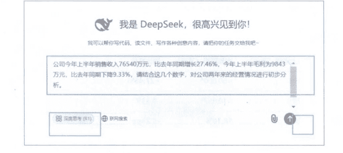
图 1-3 输入提示词

发送后，DeepSeek 会进入深度推理阶段，然后给出分析结论与建议。

图 1-4 为其推理过程，值得重点阅读，它不仅呈现结论，更展示了对数字的计算、关联、变化原因与潜在风险的逻辑推演。

图 1-5 为最终输出结果，基于上述推演给出的结论与建议，有助于理解经营数字变化背后的可能原因及改进方向。

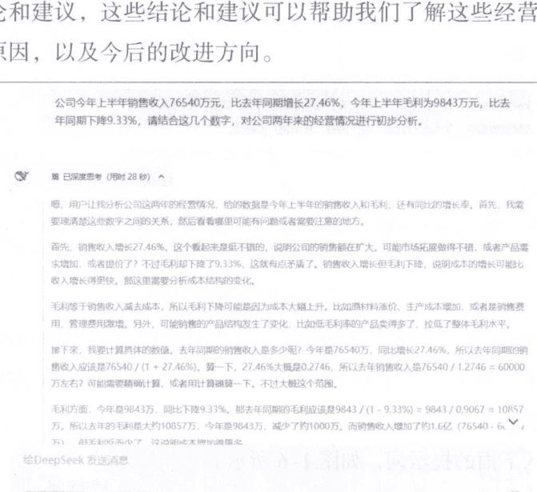
图 1-4 DeepSeek 的深度思考过程

根据提供的财务数据，对公司近两年的经营情况可进行以下初步分析：

## 一、核心数据对比

| 指标 | 今年上半年（万元） | 去年同期（万元） | 同比变化 |
| :--- | :--- | :--- | :--- |
| 销售收入 | 76,540 | ≈60,000* | +27.46% |
| 毛利 | 9,843 | ≈10,857* | -9.33% |
| 毛利率 | 12.86% | 18.10% | -5.24pp |

注：去年同期收入=76,540/(1+27.46%)≈60,000；毛利=9,843/(1-9.33%)≈10,857

## 二、经营情况分析

1. 收入增长显著，但盈利质量下滑
   - 收入同比增长27.46%，显示市场拓展或销量提升效果明显，可能受需求扩大或营销策略带动。
   - 毛利下降9.33%，毛利率从18.10%降至12.86%，说明成本增速快于收入增速，盈利承压。

2. 成本压力凸显
   - 收入增加约1.65亿元，但毛利减少1,014万元，隐含成本增加约1.75亿元。
   - 可能原因：原材料价格上涨、生产效率下降、为换量降价促销、低毛利产品占比提升等。

3. 潜在风险与挑战
   - 若成本控制不改善，收入增长难以转化为利润，长期影响股东回报与现金流。
   - 需警惕价格战或行业竞争加剧进一步挤压盈利空间。

## 三、建议方向

1. **成本结构优化**：拆解原材料、人工、制造费用增长点，探索供应链优化或技术升级。
2. **定价策略调整**：评估定价合理性，通过高附加值产品提升毛利率。
3. **经营效率提升**：强化库存管理、减少浪费，提升资产周转。
4. **市场策略复盘**：厘清收入增长是否依赖短期促销，平衡规模与盈利的可持续性。

## 结论

公司正处于规模扩张与盈利质量博弈阶段。收入虽亮眼，但成本失控或定价偏差导致利润空间收窄。未来需聚焦成本管控与产品结构优化，实现收入与利润的同步健康发展。

图 1-5 DeepSeek 输出的结果

在首次回答基础上可继续追问，例如成本结构优化具体包括哪些内容。

继续输入提示词，如图 1-6 所示。
> 请简要介绍成本管控与产品结构优化的可能措施及建议，以实现降本增效。

## 第 1 章 DeepSeek 基本使用方法与技巧


图 1-6 继续输入提示词

发送后，DeepSeek 给出的推理过程与建议分别如图 1-7 与图 1-8 所示。

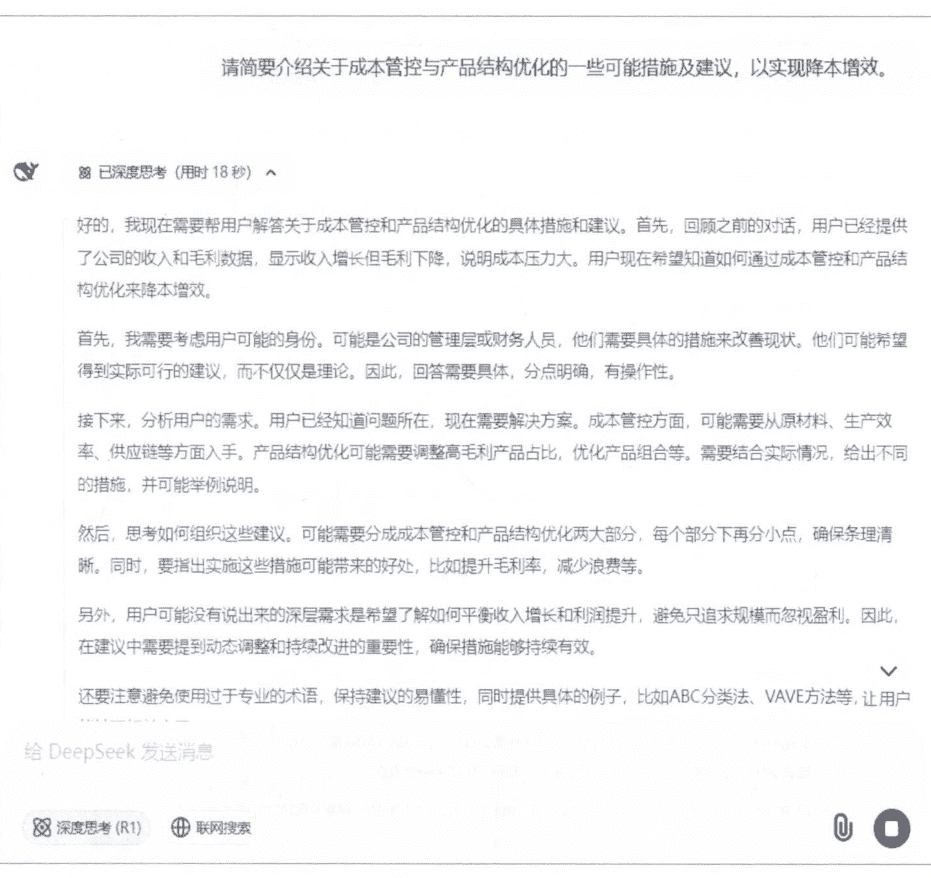
图 1-7 DeepSeek 针对新问题（成本管控与产品结构优化）的深度思考过程

以下是关于成本管控与产品结构优化的关键举措及建议，分两类展开：

## 一、成本管控核心措施

### 1. 供应链优化
- **集中采购**：规模化议价、与核心供应商签长期协议或锁定价格，对冲波动。
- **协同设计**：让供应商早期参与产品设计，优化规格或替代方案，减少冗余成本。
- **物流压缩**：优化仓储布局，减少中转环节，引入智能调度降低运输费用。

### 2. 生产环节降本
- **精益生产**：消除七大浪费，提升效率，推行自动化与数字化管理如 MES。
- **能耗管理**：引入节能设备，监控高能耗产线，制定阶梯节能目标。
- **质量成本控制**：减少返工与废品，推行六西格玛，降低隐性损失。

### 3. 费用精细化管理
- **预算刚性**：对销售、管理费用执行零基预算，砍掉非增值开支。
- **数字化追踪**：通过 ERP 追踪费用流向，识别异常并预警。

## 二、产品结构优化策略

### 1. 聚焦高毛利产品
- **ABC 分类**：按毛利率/贡献度分为 A、B、C 类，优先向 A 类倾斜资源。
- **淘汰低效**：对长期亏损或毛利率低于均值的产品评估后逐步减产或退出。

### 2. 差异化组合
- **高附加值开发**：面向高端客户推出定制化、技术升级产品，提升议价权。
- **捆绑销售**：将高毛利与低毛利产品打包，降低整体毛利率波动。

### 3. 需求导向动态调整
- **数据驱动**：实时监控各品类毛利率、周转率与客户反馈，及时调整生产计划。
- **客户分层**：优先服务高毛利需求强的优质客户，降低低价值订单占比。

## 三、协同增效建议

1. **成本-利润联动**：设定毛利率红线，纳入部门考核。
2. **技术反哺降本**：工艺改进降低材料用量，回收副产品创造收入。
3. **全员参与**：推行成本节约奖励，鼓励一线提出改进建议。

## 执行关键点

- **短期见效**：先砍显性浪费，如库存积压、低效广告，快速释放现金流。
- **长期布局**：以创新与技术升级构建成本优势，避免陷入价格战。
- **动态迭代**：每季度复盘成本与产品矩阵，结合市场变化调整策略。

通过上述措施，企业可在控制成本的同时提升高价值业务占比，实现“增量又增利”的良性循环。


总之，可就多个问题持续与 DeepSeek 深入交流，收获不仅是针对性解答，还可能有意想不到的启发。

#### 1.1.2 文件加文字的对话模式

除了纯文字提示，还可上传 Excel 工作簿、Word、PDF、文本或图片等文件，让 DeepSeek 基于文件内容分析并作答。

例如图 1-9 为保存于 Excel 中的两年产品销售汇总表，现需对该表做基础分析。

|  | A | B | C | D | E | F | G |
|---|---|---|---|---|---|---|---|
| 1 |  |  |  |  |  |  |  |
| 2 |  | **两年产品销售汇总** |  |  |  |  |  |
| 3 |  |  | **去年** |  | **今年** |  |  |
| 4 |  | **产品** | **销售量** | **销售额** | **销售量** | **销售额** |  |
| 5 |  | 产品1 | 3207 | 811371 | 829 | 241239 |  |
| 6 |  | 产品2 | 2426 | 339640 | 857 | 119980 |  |
| 7 |  | 产品3 | 1952 | 737856 | 3387 | 1303995 |  |
| 8 |  | 产品4 | 1677 | 484653 | 2272 | 679328 |  |
| 9 |  | 产品5 | 2439 | 407313 | 1117 | 185422 |  |
| 10 |  | 产品6 | 1487 | 168031 | 609 | 70035 |  |
| 11 |  | 产品7 | 639 | 31311 | 1157 | 82147 |  |
| 12 |  | 产品8 | 680 | 201960 | 2310 | 540540 |  |
| 13 |  | **合计** | **14507** | **3182135** | **12538** | **3222686** |  |
| 14 |  |  |  |  |  |  |  |

图 1-9 两年产品销售汇总表

选择“深度推理（R1）”模式，注意只有该模式支持文件上传。点击“上传附件”选择文件后，输入提示词，如图 1-10 所示。
请对这个产品两年销售统计表进行基本分析：
1. 两年总体销售增长情况如何？
2. 哪些产品销售同比出现异常变化？
3. 哪些产品对两年销售总额影响最大？
4. 今后可采取哪些措施改进销售？

# DeepSeek 赋能高效数据分析


图 1-10 上传文件，输入提示词

发送后即可获得 DeepSeek 对表格的深度推理过程及分析结果与改进建议，分别如图 1-11 与图 1-12 所示。

想看懂 DeepSeek 如何拆解表格，重点通读它的思考链路；想把销售策略做扎实，就要把结论和改进建议吃透。任何一个细节想继续深挖，随时追问都能得到更细的展开。

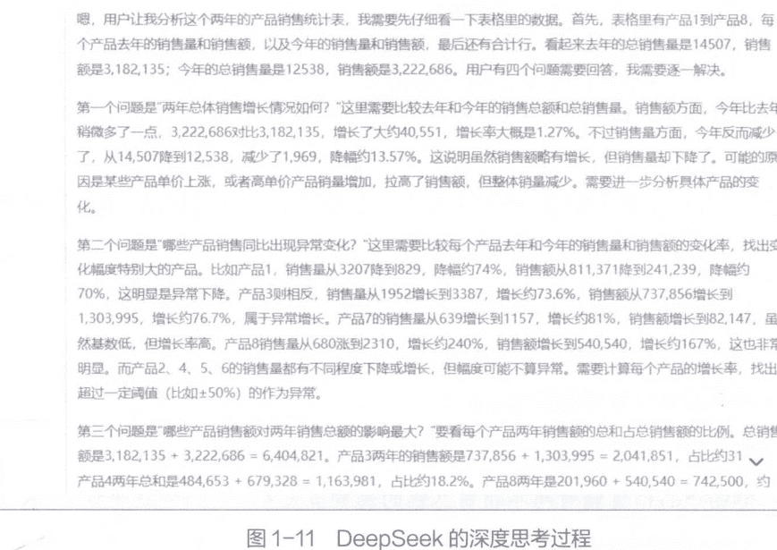

图 1-11 DeepSeek 的深度思考过程

## 第 1 章 DeepSeek 基本使用方法与技巧

1. 两年总体销售增长情况

   - 营收：本年累计 3,222,686，上年累计 3,182,135，同比上扬 1.27%，增幅有限。
   - 销量：本年累计 12,538，上年累计 14,507，同比回落 13.57%。

   结论：营收小幅提升而出货量明显萎缩，推测是高单价品类如产品3、产品8的销量拉动总额，多数品类销量下滑拖累总量。

2. 销售同比异常变化的产品

   异常增长：

   - 产品3：销量由 1952 增至 3387，涨幅 73.6%；销售额由 737,856 增至 1,303,995，涨幅 76.7%。
   - 产品8：销量由 680 增至 2310，涨幅 240%；销售额由 201,960 增至 540,540，涨幅 167%。
   - 产品7：销量由 639 增至 1157，涨幅 81%，基数偏低。

   异常下降：

   - 产品1：销量由 3207 降至 829，跌幅 74%；销售额由 811,371 降至 241,239，跌幅 70%。
   - 产品5：销量由 2439 降至 1117，跌幅 54%；销售额由 407,313 降至 185,422，跌幅 54%。

3. 对两年销售总额影响最大的产品

   - 产品3：两年累计销售额 2,041,851，占总销售额 6,404,821 的 31.9%。
   - 产品4：两年累计销售额 1,163,981，占比 18.2%。
   - 产品1：两年累计销售额 1,052,610，占比 16.4%。

   结论：产品3是核心贡献品，其次为产品4与产品1。

4. 改进销售的建议

   1. 优化高贡献产品：
      - 加大对产品3、产品8的推广投入，巩固增长势头。
      - 排查产品1销量骤降原因，如质量问题或竞争加剧，并针对性调整策略。
   2. 平衡销量与单价：
      - 对单价较高但销量下滑的产品如产品1、产品5，优化促销或采用捆绑销售。
   3. 清理低效产品：
      - 产品6、产品7销售额占比偏低，可考虑精简或重新定位。
   4. 提升整体销量：
      - 通过折扣、会员体系等手段刺激购买，缓解总销量下滑。
   5. 数据分析驱动决策：
      - 深挖波动原因，如产品3增长是否可持续、产品8成本管控是否有效。

注：建议结合市场调研与成本分析，制定具体执行方案。

图 1-12 DeepSeek 给出的分析结果和改进建议

### 1.2 利用 DeepSeek 快速联网获取帮助信息

在实务中，多数人需要借助 DeepSeek 从网络获取更系统的办公支持以提升效率，比如迅速搭建分析框架与提纲、安排汇报计划、查阅数据分析方法与工具指引等。这类信息既可使用“深度思考 R1”模型，也可使用“联网搜索”模型，或两者并用。

#### 1.2.1 获取有关数据分析工具的使用技能和技巧

例如，想了解 Excel 数据排序函数 SORT 的用法与典型案例，可选择“联网搜索”模型并输入如下提示词，如图 1-13 所示。

> 请介绍 Excel 中用于数据排序的 SORT 函数使用方法和经典实例。


图 1-13 准备获取 SORT 函数使用方法和经典实例

随后 DeepSeek 会给出系统说明，涵盖基础语法、典型用法、注意事项与进阶技巧，如图 1-14 至图 1-16 所示。

认真阅读 SORT 函数的语法与经典实例并在 Excel 中实操，很快即可掌握其使用技能。再参考进阶技巧，还能提升综合运用水平。

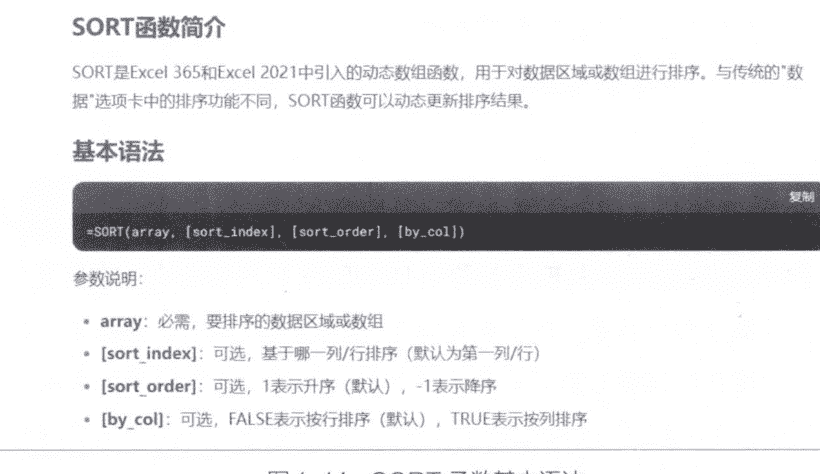

图 1-14 SORT 函数基本语法

## 第 1 章 DeepSeek 基本使用方法与技巧

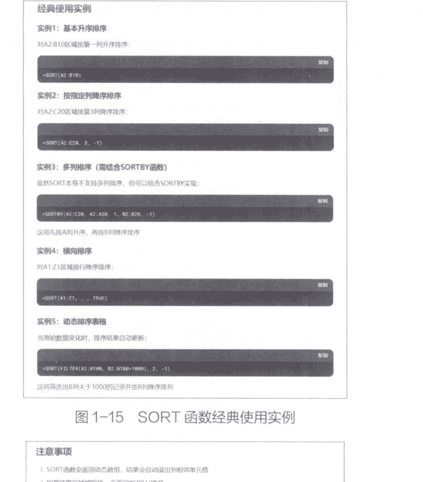


#### 1.2.2 获取有关数据分析指标的帮助信息

数据分析本质是对特定指标的解读。不同业务关注的指标不同。借助 DeepSeek 可快速获取指标定义、适用场景、注意事项及经典案例，帮助结合具体问题确定指标。

例如，想深入了解毛利率指标，可输入提示词：

> 请对毛利率指标进行详细介绍，在数据分析中要注意哪些问题？

选用“联网搜索”模型时，返回的信息如图 1-17 所示。

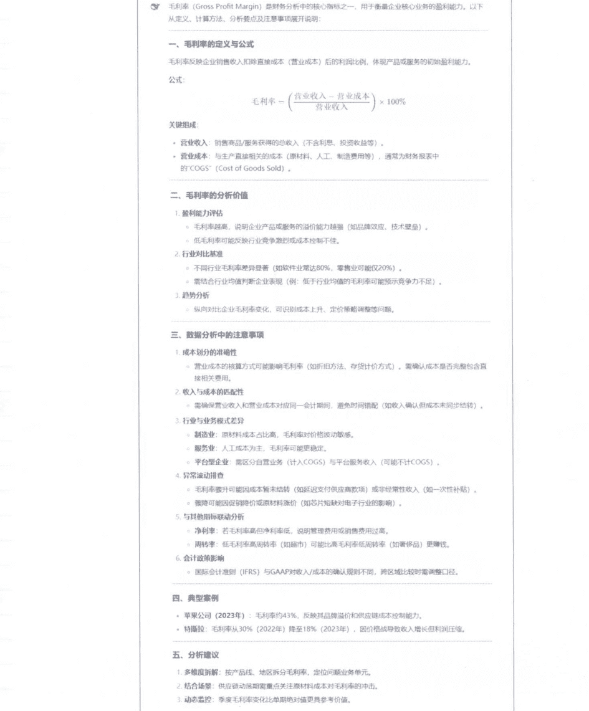

若选用“深度思考 R1”模型，返回内容会不同，模型会更深入地剖析毛利率，尤其在关键注意事项上的阐述更为细致，而非简单汇总网络信息，如图 1-18 所示。

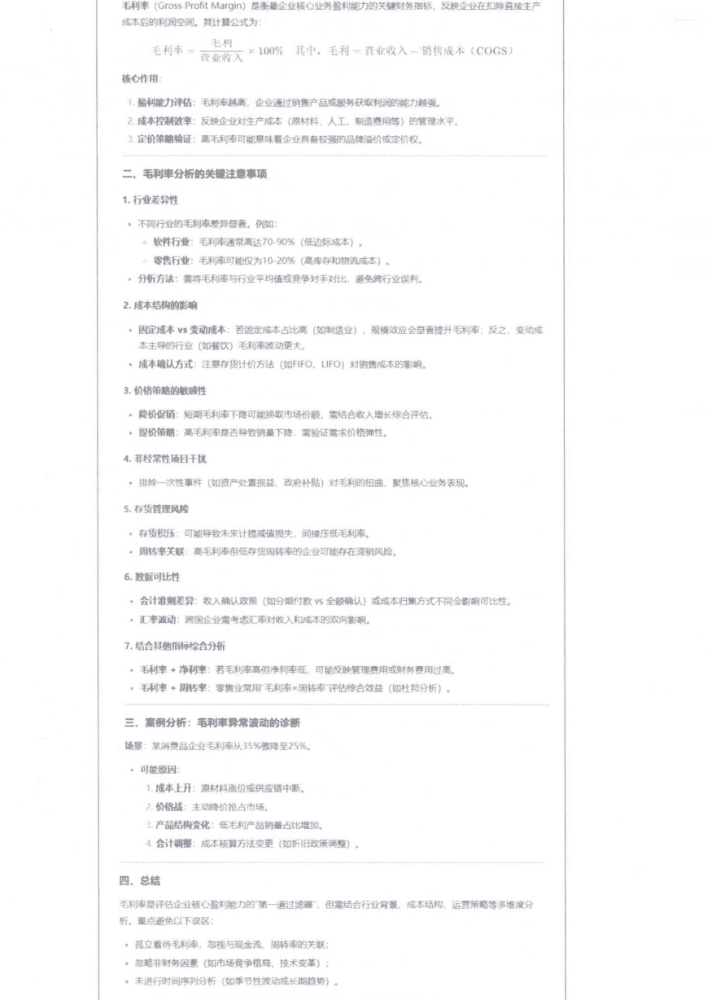

由此可见，获取指标基础定义时“联网搜索”足够，若要深度理解并落地应用，则“深度思考 R1”更合适。

例如，不同行业对毛利率的侧重点不同，可借助 DeepSeek 获取相关信息。

举例，选择“深度思考 R1”模型，输入提示词：

> 我公司属于电子芯片制造行业，那么在分析毛利率这个指标时，要注意哪些问题，避免哪些误区？

发送后，DeepSeek 会详细说明行业特性对毛利率的影响、分析要点、常见误区、分析框架建议及行业案例，如图 1-19 所示。

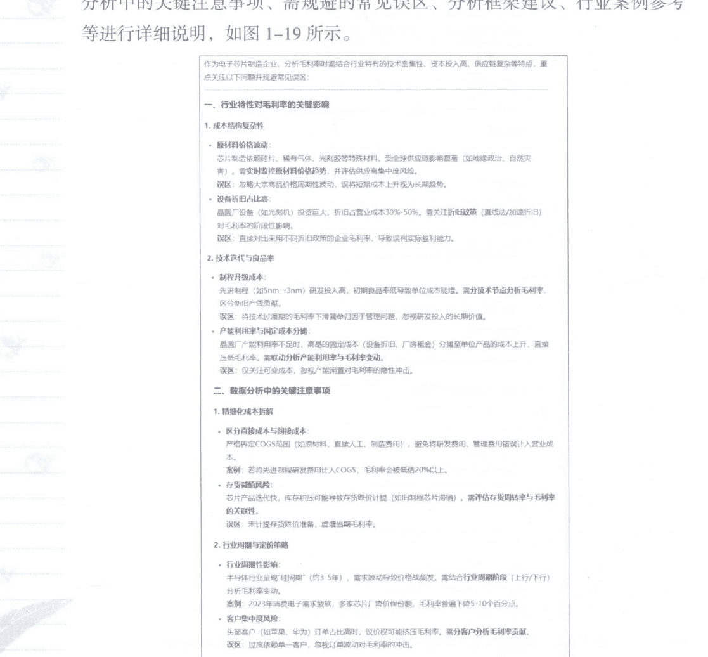

### 三、需规避的常见误区

| 误区 | 正确分析思路 |
|---|---|
| 直接对标跨行业毛利率 | 对比应局限于半导体内部细分，如设计公司、制造代工厂、IDM模式企业。 |
| 忽视技术代际差异 | 28nm成熟制程与3nm先进制程毛利率逻辑不同，需按节点拆分。 |
| 静态分析单期数据 | 应关注季度环比变化，识别技术爬坡、产能释放等动态因素。 |
| 过度依赖历史均值 | 行业迭代加速，历史毛利率参考性下降，如摩尔定律放缓带来的成本变化。 |

### 四、分析框架建议

1. 分层次拆解：
   - 按产品线：逻辑芯片、存储芯片、模拟芯片
   - 按制程节点：成熟制程、先进制程
   - 按客户类型：消费电子、汽车、工业
2. 关键指标联动：
   - 毛利率 + 产能利用率 → 判断固定成本效率
   - 毛利率 + 研发费用率 → 评估技术投入对长期盈利的支撑
   - 毛利率 + 存货周转天数 → 识别库存积压风险
3. 情景模拟：
   - 原材料价格上涨10%对毛利率的敏感性分析
   - 新产线良品率提升至90%后的毛利率改善测算

### 五、行业案例参考

- 台积电：2023年毛利率53%，受益于先进制程占比提升和产能满载
- 中芯国际：成熟制程占比高，毛利率约30%，受价格竞争影响更大

### 总结

电子芯片行业毛利率分析需穿透技术-成本-周期的三角关系，避免简单横向对比，重点关注技术迭代中的成本动态、产能利用效率与供应链韧性。建议建立动态模型，将晶圆价格、制程良率等行业特有变量纳入框架。

图 1-19 DeepSeek 对电子芯片制造行业毛利率分析的总结（续）

## 第2章 利用 DeepSeek 把文字描述生成数据分析可视化报告

在 1.1.1 小节已说明，即使提供简单的文字描述，DeepSeek 也能理清数字间变化逻辑及可能原因，形成初步认知。同时可基于文字描述快速生成数据分析可视化报告。

### 2.1 简单文字描述的数据基本分析与可视化报告制作

例如，选择“深度思考 R1”模型，输入提示词：

> **已知条件：**
> 公司一年来各季度的销售收入分别是 3958 万元、4957 万元、9383 万元和 6005 万元，各季度毛利分别为 942 万元、1037 万元、3065 万元和 564 万元。
>
> **任务：**
> 请对公司一年来各季度的销售收入和毛利进行一个基本分析。

发送后，DeepSeek 先整理数据，再进行深入分析，找出异常季度及可能原因，如图 2-1 所示。

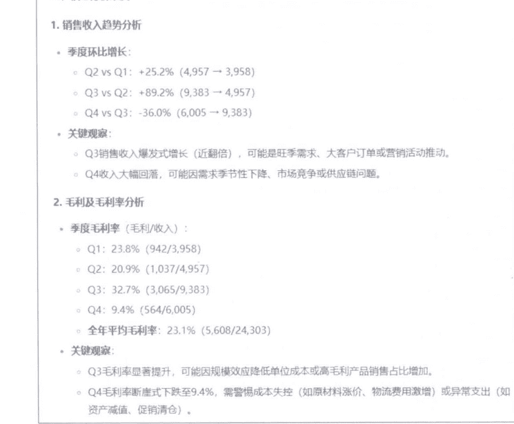

# 第2章 利用DeepSeek把文字描述生成数据分析可视化报告

3. 收入与毛利联动性

   - Q3表现突出：
     - 收入环比增长89.2%，毛利增长195.6%，显示高收入增长伴随盈利能力提升。
     - 可能实施了提价或产品结构优化。
   - Q4异常波动：
     - 收入下降36%，毛利下降81.6%，需排查价格战、成本激增或一次性费用等原因

### 三、潜在问题与建议

1. Q4异常分析：
   - 检查成本核算是否出错
   - 评估市场需求骤减或竞争对手策略影响
   - 分析库存周转，判断是否因滞销导致降价清仓
2. Q3经验复制：
   - 总结Q3高增长驱动因素，尝试推广至其他季度
3. 成本管控：
   - 针对Q4低毛利率，优化供应链或锁定长期采购协议
4. 季节性策略：
   - 提前规划Q4资源，避免需求波动导致收入利润双降

图2-1 各季度销售总体分析（续）

DeepSeek 的分析特别强调了第三季度销售的强劲增长和第四季度销售的断崖下滑，这正是重点关注点。

从收入角度看，Q3收入大幅上升可能源于特定促销，Q4虽环比回落但仍高于Q2，可视为正常波动。

但从毛利和毛利率看，Q3毛利大幅上升而Q4毛利大幅回落，毛利率从Q3的32.7%骤降至Q4的9.4%，异常明显，需要继续深挖。总分析阶段已大幅提升效率。

这样的分析也可通过可视化呈现，DeepSeek 也提到了这一点，如图2-2所示。

### 四、可视化趋势图

(文字描述，实际可绘折线图)

- 销售收入：Q1至Q3持续上升，Q4回落
- 毛利率：Q3达峰后Q4暴跌，形成倒V型

### 结论

公司年度业绩季节性明显，Q3是全年核心贡献季，Q4需重点关注成本与市场策略。建议复盘Q3成功因素并针对Q4异常制定预案，以提升全年盈利稳定性。

图 2-2 可视化建议

DeepSeek 建议折线图，但对仅4个点的数据并不理想。经验上更适合组合图：销售收入和毛利用柱状图并排展示，毛利率用折线图在次坐标轴呈现，可同时展示三项指标。

可手动在 Excel 输入数据并绘制，但为提高效率，可让 DeepSeek 生成可视化仪表板。

继续选择“深度思考 R1”模型，输入提示词：

> 请根据前面提供的四个季度的销售收入和毛利，制作一个总体分析报告，报告由以下三部分组成：
> 1. 第一部分是汇总表格，表格有 6 列 3 行，表格的第一列是项目名称（销售收入、毛利和毛利率），表格的第一行是季度名称和全年合计，下面三行依次是各季度以及全年的销售收入、毛利和毛利率；
> 2. 第二部分是可视化的组合图，将销售收入和毛利绘制成柱状图（绘制在主坐标轴，销售收入和毛利不能堆积，要并排显示两个柱形），将毛利率绘制成折线图（绘制在次坐标轴），分类轴是季度名称；
> 3. 第三部分是对四个季度总体分析的简要文字描述，重点说明销售的平稳性、异常变化季度及其可能的原因，以及可以采取的改善措施。
> 请设计完整的 HTML 代码，以便能够自动生成可视化报告。
> 注意：图表要简洁美观。

# 第2章 利用DeepSeek把文字描述生成数据分析可视化报告

发送后，DeepSeek 会计算数据并生成含汇总表、组合图及文字说明的 HTML 代码，如图 2-3 所示（局部）。

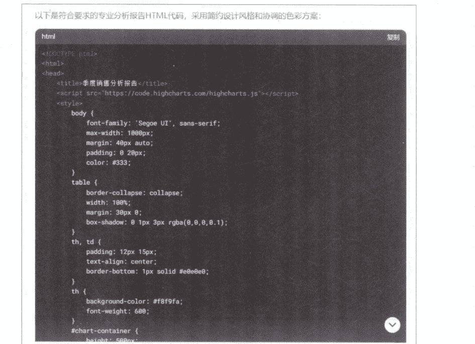

图 2-3 DeepSeek 自动生成的 HTML 代码

代码窗口右下角有“运行 HTML”按钮，如图 2-4 所示，点击可预览效果，如图 2-5 所示。


图 2-4 代码窗口右下角的“运行 HTML”按钮

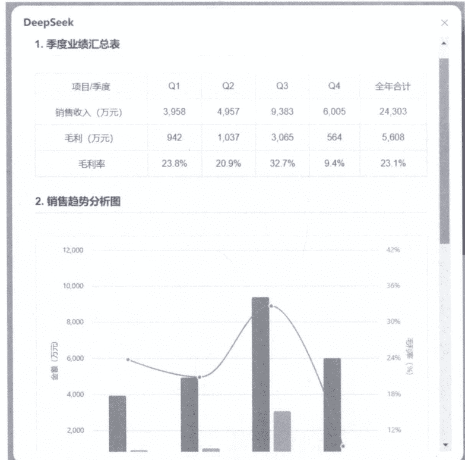

图 2-5 可视化报告的预览效果

DeepSeek 还给出代码使用说明，如图 2-6 所示。

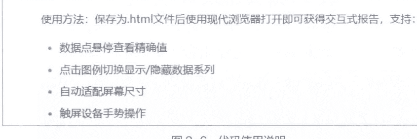

图 2-6 代码使用说明

按说明复制代码，新建文本文件粘贴，保存后将扩展名改为“.html”，打开即可看到含表、图、说明的可视化报告，如图 2-7 所示。

1. 季度业绩汇总表

| 项目/季度 | Q1 | Q2 | Q3 | Q4 | 全年合计 |
| :--- | :--- | :--- | :--- | :--- | :--- |
| 销售收入（万元） | 3,958 | 4,957 | 9,383 | 6,005 | 24,303 |
| 毛利（万元） | 942 | 1,037 | 3,065 | 564 | 5,608 |
| 毛利率 | 23.8% | 20.9% | 32.7% | 9.4% | 23.1% |

2. 销售趋势分析图

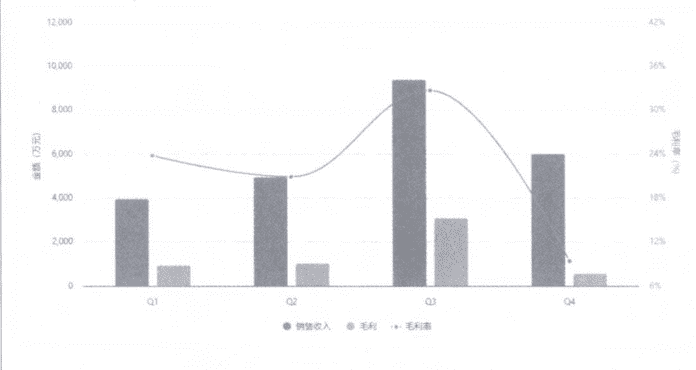

3. 季度分析总结

**销售平稳性分析：**

全年销售收入波动显著（标准差2,163万元），Q3收入占全年38.6%，呈现明显季节性。Q4环比下降36%，波动超出正常商业周期。

**异常季度解析：**

- **Q3超预期增长：** 收入环比增长89.2%，毛利率提升11.8个百分点，可能源于重大订单交付、新品上市或行业需求爆发
- **Q4异常衰退：** 毛利率骤降至9.4%，低于年均值13.7个百分点，需排查成本结构突变、非经常性支出或价格战

**战略改进建议：**

1. **波动管理：** 建立销售预测模型，设置季度波动预警阈值±30%
2. **成本控制：** 对Q4进行成本结构专项审计，建立原材料价格对冲机制
3. **旺季延续：** 分析Q3成功要素，开发订阅制/长期合约等稳定收入来源
4. **库存优化：** 实施动态库存管理，将季末库存周转天数控制在<45天

图 2-7 制作完成的可视化报告

为方便阅读，本书列出完整 HTML 代码见附录1。

### 2.2 简报描述文字的数据基本分析与可视化报告制作

下面从某上市公司年报中摘取一段文字：

**2023工业机器人：全球扩容，国内换挡**

IFR《世界机器人 2023 工业机器人》呈现出技术迭代加速的态势。协作型机器人在传感与视觉模块加持下能够即时捕捉环境变化并提升运行安全，应用边界持续扩大；搭载人工智能的夹持器借助感知与视觉识别物料属性并施加匹配力度，操控灵敏度明显提高；软件平台配合开放式通用通信架构，使集成难度降低、即插即用体验更顺畅；图形化或自然语言交互界面让编程门槛大幅下降；传感器、视觉与5G协同工作，让设备按实时工况自适应调节参数，具备自我优化能力；云计算推动云端机器人应用增长，使用及运维成本显著压缩；机器人技术也在多领域助力可持续发展。

IFR统计显示，2022年全球工业机器人装机量再创新高至553,052台，同比增长5%。分区域看，美洲增8%，欧洲增3%，亚洲增5%，新增装机约73%集中在亚洲，其中中国贡献主要增量。中国装机同比增5%至290,258台，占全球比重达52%。IFR预计2023-2026年复合年均增速约7%，2026年全球装机有望达到71.8万台。

机器人密度方面，韩国以1,012台/万人居首。中国密度由2013年的25提升至2022年的392，已接近日本的397，位列全球第五。自2016年起，中国一直是全球增速最快且体量最大的工业机器人市场。制造业柔性化、劳动力红利减弱、新兴应用出现、技术持续演进等多重因素，共同支撑应用场景持续拓展，长期发展空间仍大。

MIR睿工业判断，2023年中国工业机器人由增量期转入存量竞争与细分赛道卡位，需求端成为产业链主矛盾。下半年厂商通过促销、渠道下沉与激励加快去库，成效逐步显现，市场韧性较上半年改善。下游来看，光伏需求年末虽降温仍保持高位，汽车、消费电子及一般工业小幅回暖但未达预期，锂电需求分化，储能投资活跃而动力电池处去库阶段、投资放缓。MIR数据显示2023年中国工业机器人出货量283,154台，同比增长0.4%。机型上，协作机器人与轻载垂直多关节保持正增长，其余机型出货均现回落。预计2023年底去库存接近尾声，需求逐步释放，2024年出货增速有望回升至5%-10%。

信息密度高，纯文本阅读效率低，可借助DeepSeek进行提炼、归纳与重组。

选择“深度思考 R1”模式，将上述内容作为输入后，系统对原文进行深度思考并输出梳理清晰的信息，如图2-8所示（局部截图）。

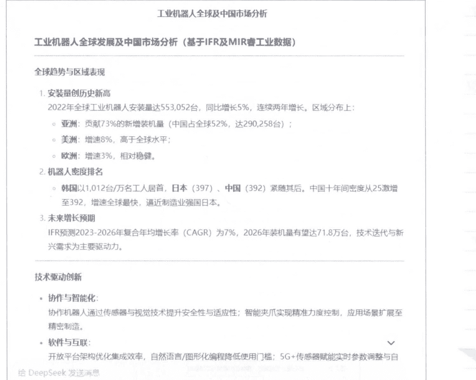

图2-8 DeepSeek整理归纳后的清晰信息

整理结果若仍显零散，还可让模型进一步整理为报表形态，再次输入提示词：

> 请对这段话内含的信息进行整理归纳，制作相应的分析报表。

发送后，DeepSeek 以表格形式呈现归纳结果，如图 2-9 所示。

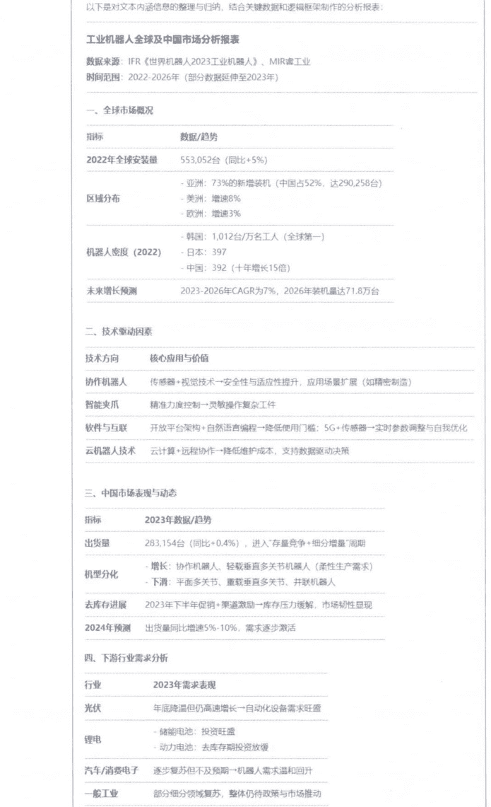

图 2-9 DeepSeek 将归纳整理的信息以清晰的表格形式展示

五、增长动力与风险

| 动力因素 | 潜在风险 |
| :--- | :--- |
| - 制造业柔性化需求（多品种小批量） | - 下游行业周期性波动（如锂电、汽车） |
| - 人口红利退坡→机器替代人工 | - 国际竞争加剧（欧美日技术壁垒） |
| - 新兴赛道（新能源、半导体） | - 细分领域技术适配要求高 |
| - 技术演进（AI、5G、云） |  |

六、结论与趋势小结

1. 全球格局：亚洲主导增长（中国占半壁江山），技术驱动行业向协作化、智能化、云化转型。
2. 中国市场：短期调整（去库存+需求分化），长期受益于政策支持与技术升级，2024年后重回增长轨道。
3. 企业策略：聚焦细分领域创新（如协作机器人、轻载机型），强化柔性生产与开放生态能力。

建议可视化图表：

1. 柱状图：全球及区域装机增速对比（2021-2022年）。
2. 折线图：中国机器人密度十年变化（2013-2022年）。
3. 饼图：2022年全球装机区域占比（亚洲/美洲/欧洲）。
4. 热力图：下游行业需求强度分布（光伏、锂电、汽车等）。

此报表可结合Excel、Power BI等工具进一步可视化，形成完整行业分析报告。

图2-9 DeepSeek 将归纳整理的信息以清晰的表格形式展示（续）

若对归纳中的某些内容感兴趣，可继续让模型深入加工。

例如在“一、全球市场概况”中，有一组关键数值，可要求将其可视化。

输入提示词：

> 在你给出的“一、全球市场概况”信息中：
（1）2022年全球安装增速亚洲5%，美洲8%，欧洲3%；
（2）2022年机器人密度韩国1012，日本397，中国392。
请分别绘制：（1）2022年全球安装增速柱状图；（2）2022年机器人密度柱状图。
图表要简洁美观。
要求输出完整的HTML代码。
要求使用普通浏览器即可正常显示。

发送后，DeepSeek 开始生成网页源码，预览效果如图2-10所示。

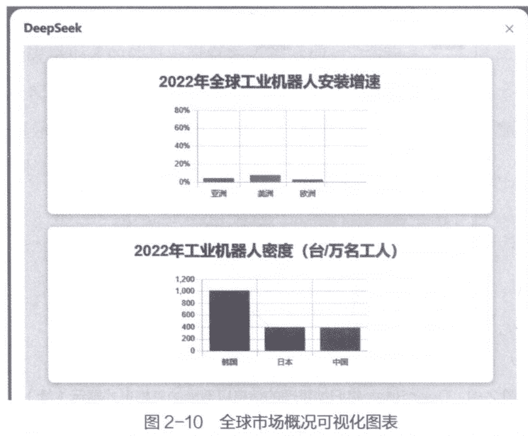

图 2-10 全球市场概况可视化图表

### 2.3 图片文字信息的抽取与分析

DeepSeek 能识别图片中的文字，快速抽取信息并做统计。

例如图 2-11 所示的班组排班与任务图片，需要把文字提炼成表格。


图 2-11 图片文字

可直接把图片复制到输入框或上传文件。

图 2-12 为直接粘贴图片后输入提示词的情况：

> 请将图片中的数据提炼出来，生成一个排班表，表格第一列是星期，第二列是姓名，第三列是责任。


图2-12 直接复制图片，输入提示词

发送后，DeepSeek 迅速生成表格，如图2-13所示。

| 星期 | 姓名 | 责任 |
|---|---|---|
| 星期一 | 张三、李四 | 机台维护，电表抄写 |
| 星期二 | 孟达辉、贺冰 | 机台维护，清洁卫生 |
| 星期三 | 张三、李瑞华、赵欣欣 | 机台换装，清洁卫生，废料处理 |
| 星期四 | 孟达辉、李四 | 全车间安全巡视，各班组卫生检查 |
| 星期五 | 贺冰、孟达辉 | 机台维护，后勤协助 |
| 星期六 | 孙晓梅、周珊 | 后勤协助，全厂卫生巡视 |
| 星期日 | 王晓丽、辛冉 | 后勤协助，全厂卫生巡视 |

图2-13 DeepSeek 快速提炼出的表格

表格底部还特别备注，星期一责任中的“几台维护”可能是“机台维护”的笔误。复制到 Excel 后修正即可得到准确排班表。

图2-14 为另一张图片示例，图片描述今年目标，需据此整理两年数据对比表。

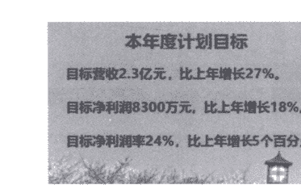

图 2-14 图片上的年度计划描述文字

将图片复制至 DeepSeek 后输入提示词，如图 2-15 所示。

> 请从图片中提取信息，生成一个两年数据对比表：
表格第一行标题是年份、营收、净利润、净利润率；
表格第一列是年份名称（去年和今年），第二列是营收数字，第三列是净利润数字，第四列是净利润率数字。


图 2-15 直接复制图片，输入提示词

DeepSeek 抽取数字并计算后生成表格如图 2-16 所示。

| 年份 | 营收（亿元） | 净利润（万元） | 净利润率 |
| :--- | :--- | :--- | :--- |
| 去年 | 1.81 | 7033.90 | 19% |
| 今年 | 2.30 | 8300.00 | 24% |

说明：
- 去年营收通过公式计算：`2.3亿 ÷ (1 + 27%) ≈ 1.81亿`；
- 去年净利润通过公式计算：`8300万 ÷ (1 + 18%) ≈ 7033.90万`；
- 去年净利润率直接由题干给出：`24% - 5% = 19%`。

图 2-16 DeepSeek 自动提炼数据并计算，生成表格

## 第3章 DeepSeek 辅助简单汇总表的数据基本分析

在数据已汇总成统计表的情况下，若缺乏分析思路，可利用 DeepSeek 辅助分析，借助其逻辑推理能力扩展思维。

### 3.1 基于一个简单统计表的数据基本分析

#### 3.1.1 无明确指令时的自主检视

以产品价格区间销量与销售额统计表为例，该表存储于 Excel 工作簿“产品价格区间销量和销售额统计.xlsx”。

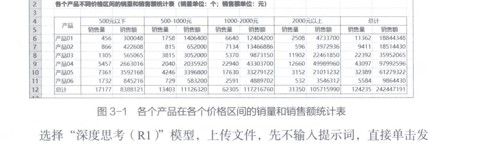

选用“深度思考 R1”模型上传文件，不输入提示词直接发送，观察 DeepSeek 在无具体要求下的分析方式。

首先是数据检查结果如图 3-2 所示。通常可忽略，但此次模型已发现产品 01 在 500 元以下区间的公式存在逻辑矛盾（=C6*658）。需先修正原始表格再上传。

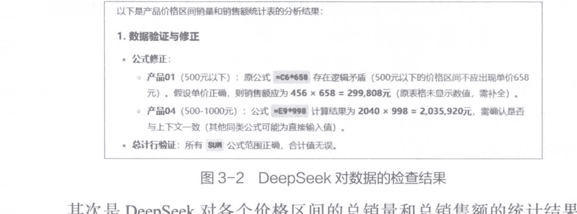

图 3-2 DeepSeek 对数据的检查结果

其次是各价格区间的总销量与总销售额统计，如图 3-3 所示，可快速了解各区间销售总量与总额，识别贡献高低。

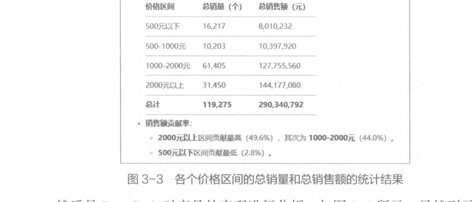

图 3-3 各个价格区间的总销量和总销售额的统计结果

然后是对产品表现的分析，如图 3-4 所示。虽然列出了销量最高与销售额最高的产品，但直观性不足。

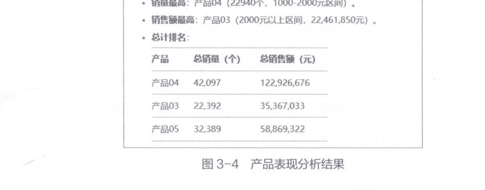

图 3-4 产品表现分析结果

最后是模型给出的建议，如图 3-5 所示，提示排查异常值、高价值区间优化与数据标准化等方向。

> 4. 建议
- 异常值排查：检查产品01的单价逻辑（500元以下是否应为更低单价）。
- 高价值区间优化：2000元以上区间贡献近50%销售额，可加强高端产品推广。
- 数据标准化：统一公式或数值输入方式，避免混合使用公式与手动输入。
注：如需生成可视化图表（如柱状图、饼图），可进一步按价格区间或产品拆分数据。

图 3-5 DeepSeek 给出的一些建议

#### 3.1.2 提供具体需求信息下 DeepSeek 深度分析框架

未提供明确要求时，分析仅停留在基础层面。先清洗修正表格后上传，可输入提示词获取分析框架与思路：

> 这是修改错误后的表格，针对这个表格数据，我没有一点分析头绪，请帮助我梳理一下分析思路，设计一个分析框架，要从哪些角度去分析哪些数据，如何发现异常销售，以便于采取有针对性的措施去改善产品销售。

发送后，DeepSeek 会给出核心分析维度与指标、异常检测方法、改进策略与落地动作、分析报告与可视化模板等框架。

图 3-6 为核心分析维度与指标，包括价格区间表现、产品表现、单价—销量健康度，为后续分析提供思路。

二、核心分析维度与指标

1. 价格区间表现分析
    - 指标：
        - 各区间销量占比、销售额占比、平均单价。
    - 公式：
        - 销售额占比 = 区间销售额 / 总销售额（L13）。
        - 平均单价 = 区间销售额 / 区间销量（如500元以下：D13/C13）。
    - 分析重点：
        - 异常区间：高销量但低销售额（可能定价过低），或低销量但高销售额（依赖高价产品）。
    - 示例：
        - 2000元以上区间销售额占比49.6%，但销量仅占26.4%（31,450/119,275），说明高价产品利润贡献高，可重点推广。

2. 产品表现分析
    - 指标：
        - 各产品的总销量、总销售额、价格区间分布。
    - 公式：
        - 产品销售额占比 = 产品销售额 / 总销售额（如产品04：L9/L13=122,926,676/290,340,792≈42.3%）。
    - 分析重点：
        - 明星产品：产品04在1000-2000元区间销量22,940个，占比37.4%（22,940/61,405），需保证库存和曝光。
        - 问题产品：产品01在500元以下单价矛盾，需紧急修正。

3. 单价—销量健康度分析
    - 方法：绘制散点图，横轴为销量，纵轴为单价，观察分布。
    - 正常情况：高价产品销量低，低价产品销量高。
    - 异常情况：高价产品销量高但单价偏低（如产品03在2000元以上销量11,902个，单价1,887元，需检查是否定价过低）。


#### 3.1.3 提供具体需求信息下 DeepSeek 数据分析与挖掘

例如需对两个维度做占比分析：

1. 每个产品下，各价格区间的销量占比。
2. 每个价格区间下，各产品的销量占比，并绘制二维堆积百分比条形图。

输入提示词，如图 3-7 所示。

> 请针对上述表格，做以下分析：
1. 每个产品下，各个价格区间的销量占比分析，要求生成一个占比分析表，并以此占比分析表绘制堆积百分比条形图，分类轴是产品，数值轴是占比，系列是各个价格区间；占比分析表和条形图排列一行。
## 第 3 章 DeepSeek 辅助简单汇总表的数据基本分析
2. 每个价格区间下，各个产品的销量占比分析，要求生成一个占比分析表，并以此占比分析表绘制堆积百分比条形图，分类轴是价格区间，数值轴是占比，系列是各个产品；占比分析表和条形图排列一行。
占比分析表和图表都要求简洁美观，阅读性好。
请设计完整无误、能够在普通浏览器运行的 HTML 代码。

发送后，DeepSeek 自动设计并输出完整网页源码，如图 3-8 所示，准确完成两个占比表与两个堆积条形图。

# DeepSeek 赋能高效数据分析

复制代码窗口右上角的“复制”按钮，新建文本文件粘贴，另存为“.html”格式后双击打开，即可得到两个占比分析表与图表，如图 3-9 所示。

DeepSeek 也给出“单价—销量健康度分析”，如感兴趣可继续输入提示词，如图 3-10 所示。

> 请绘制 XY 散点图，X 横轴为销量，Y 纵轴为单价，观察单价—销量健康度分布。
图表要简洁美观，阅读性好。
请设计完整无误、能够在普通浏览器运行的 HTML 代码。

发送后，DeepSeek 输出要求的网页源码，运行结果如图 3-12 所示。

## 第 3 章 DeepSeek 辅助简单汇总表的数据基本分析

```html
<!DOCTYPE html>
<html>
<head>
    <title>单价-销量健康度分析</title>
    <script src="https://cdn.jsdelivr.net/npm/chart.js"></script>
    <style>
        .container {
            width: 1000px;
            height: 600px;
            margin: 20px auto;
            padding: 20px;
            background: #f8f9fa;
            border-radius: 8px;
            box-shadow: 0 2px 4px rgba(0,0,0,0.1);
            font-family: Arial, sans-serif;
        }
        #scatterChart {
            width: 100%!important;
            height: 500px!important;
            background: white;
            border-radius: 6px;
        }
    </style>
</head>
<body>
    <div class="container">
        <h3>单价-销量健康度分布散点图</h3>
        <canvas id="scatterChart"></canvas>
    </div>
</body>
</html>
```

图 3-11 DeepSeek 设计的单价—销量健康度分析的 HTML 代码

图 3-12 代码运行结果

### 3.2 多表场景的快速洞察方法

前文演示的是单张简表配合 DeepSeek 完成辅助分析。当数据源拆成多张统计表时，同样可以借助模型进行联动解读。

#### 3.2.1 零指令触发的自动探查

图 3-13 展示的是各业务部连续两年的销售明细，现在需要让 DeepSeek 对这两张表做解读。

两张表存放在 Excel 文件“业务部两年销售统计表分析.xlsx”中。

选用“深度思考 R1”模型上传文件后不填写任何提示词直接发送，观察模型在零要求条件下的自发分析。结果见图 3-14。

即便没有给出具体指令，模型仍输出了相当深入的文字化洞察，快速建立起对两年业务的整体认知。

比如：总销售额同比提升 12.1%；总毛利同比大幅增长 20.8%；业务四部四季度同比明显提速；业务六部今年二季度毛利率冲到 40.8%；业务二部今年四季度环比三季度销售额断崖式下跌等。这些要点为是否继续深挖提供了判断依据。

## 第 3 章 汇总表分析的 DeepSeek 实战

分析报告：业务部两年销售数据对比

整体趋势

1. 销售额增长

   - 去年合计 55,674，今年合计 62,388，增幅 12.1%。

   - 季度对比：去年四季度为峰值 16,956，今年四季度回落至 14,855，可能受季节或市况影响；今年三季度达到最高 16,512，显示年中动能强劲。

2. 毛利提升显著

   - 去年合计毛利 15,928，今年合计 19,243，增幅 20.8%。

   - 毛利增速跑赢销售额，反映成本管控改善或高毛利品类占比提升。

业务部表现亮点

1. 业务四部

   - 今年四季度销售额 4,582，去年同期 3,581；毛利 1,508 对比去年 869，增幅突出，或因年末促销及大客户合作。

2. 业务六部

   - 今年二季度销售额 4,809，毛利 1,964，毛利率 40.8% 为全年最佳，但三季度销售额骤降至 1,103，需排查供应链或客户流失风险。

3. 业务二部

   - 今年三季度销售额 4,184，毛利 1,426，占比 34.1%，四季度却跌至 1,048，波动大，需关注业务稳定性。

潜在问题与建议

1. 季度波动分析

   - 业务二部、六部等季度销售额波动剧烈，建议核查季节性、客户集中度及内部资源配置。

2. 四季度承压

   - 今年四季度销售额较去年下滑 16,956 → 14,855，需强化年底销售举措，如促销与库存清理。

3. 高毛利经验复制

   - 业务四部、六部毛利改善明显，可提炼成本与产品组合做法，向其他部门推广。

总结

公司整体销售与盈利能力在提升，但季度波动与部门差异仍需关注。建议细化到产品、客户维度，并加大四季度营销投入，保障全年平稳。

#### 3.2.2 定制指令驱动的报告自动化

在自动探查的基础上，结合实际需求可进一步分步下钻并可视化，或寻找建模工具与方法。

# DeepSeek 赋能高效数据分析

数据维度较多时，不宜一次性生成巨型报告，建议按模块拆分。

例如继续输入如图 3-15 的提示词，让 DeepSeek 输出可视化分析报告的 HTML 代码。

请对业务部两年销售数据进行分析，制作总体统计分析报告。要求：

1. 第一部分用文字简要概括两年销售总体情况。

2. 第二部分制作各业务部销售额同比报表，第一列为部门及合计，二层标题为各季度及全年合计，第二层标题为去年数、今年数、增减额、增幅，每个季度含四列。

3. 第三部分制作各业务部毛利同比报表，结构同上。

4. 第四部分分别制作两年销售总额组合图和毛利总额组合图，横轴为季度，各部门去年与今年数据以堆积柱展示，同比增长率以折线展示，两图并排一行。

请输出完整可运行、简洁高效、美观易读的 HTML 代码。

图 3-15 输入详细具体需求的提示词

## 第 3 章 汇总表分析的 DeepSeek 实战

发送后模型会生成代码，可点右下角“运行 HTML”预览效果。若格式、排版、数据缺失或图表异常，可继续补充描述让模型迭代优化，直至满意。

图 3-16 为模型生成的业务部两年销售分析报告。

可继续制作毛利率报告。输入如图 3-17 的提示词：

> 请制作各业务部两年各季度的毛利率分析报表，第一列为全部部门及总计，标题分两层，第一层为各季度及全年合计，第二层为去年毛利率、今年毛利率、同比提升 pp，每个季度三列。

另制作全部部门总毛利率同比柱状图，横轴为季度及全年，纵轴为毛利率，去年与今年各一柱，并在柱上标注数值。

最后对两年毛利率进行简要深度解读。

# DeepSeek 赋能高效数据分析

请输出完整可运行、简洁高效、美观易读的 HTML 代码。

图 3-17 继续输入具体需求的提示词

运行后结果如图 3-18 所示。

### 业务部两年各季度的毛利率分析报告

得到统计报表后可复制到 Excel 进一步排版，如图 3-19。模型还自动按正负为同比增减额与增长率着色。

### 3.3 跨工作表的批量解析技巧

若多张统计表分属不同工作表，同样可统一解析。

#### 3.3.1 无提示下的多表自检

例如图 3-20 为六个部门 2023 年上半年的费用明细，分置六个工作表，表名即部门名，需分析整体费用。

数据保存在“各部门费用统计分析.xlsx”。

# DeepSeek 赋能高效数据分析

选用“深度思考 R1”模型上传文件后直接发送，观察零指令下的分析。

首先模型提取各部门总费用并排序，指出最高最低及原因，如图 3-21。

1. 各部门总费用对比

   - 行政部：¥662,918.55

   - 销售二部：¥377,198.45

   - 维修部：¥315,641.24

   - 销售一部：¥279,910.55

   - 财务部：¥98,819.73

   - 配件部：¥44,910.56

分析：

- 行政部费用最高，占比约 38.7%，主因劳务费 ¥351,214 与摊销费用 ¥45,666.86。

- 销售二部次之，运费 ¥194,899.52 与差旅费 ¥71,764 占大头。

- 配件部最低，业务规模相对较小。

图 3-21 各部门总费用的对比分析

其次对关键费用项目分布做解读，如图 3-22，重点提示异常。

2. 关键费用项目分布

   - 劳务费：

     - 维修部 ¥252,579 占比 45.2%，远超其他部门。

     - 行政部 ¥351,214，其中 3 月单月高达 ¥179,173，需核查。

   - 差旅费：

     - 销售二部 ¥71,764 最高，销售一部 ¥32,744.47，体现销售外勤频繁。

   - 运费：

     - 销售二部 ¥194,899.52 占其总费用 51.7%，有物流成本优化空间。

   - 招待费：

     - 行政部 ¥61,746.47，其中 2 月单笔 ¥51,036.47，需确认合理性。

图 3-22 关键费用项目的分布分析

## 第 3 章 汇总表分析的 DeepSeek 实战

再次对月度费用走势进行扫描，如图 3-23，定位异常月份及原因。

3. 月度费用趋势

   - 行政部：3 月费用激增至 ¥224,018.39，主因劳务费 ¥179,173 与电话费 ¥20,287.15。

   - 销售二部：4 月费用峰值 ¥128,103.75，源于运费 ¥107,051.75。

   - 维修部：2 月费用较高 ¥79,410.69，主因劳务费 ¥50,586 与其他费用 ¥25,733.81。

图 3-23 月度费用的趋势分析

同时给出异常与建议，如图 3-24。

4. 数据异常与建议

   - 异常值：

     - 行政部 3 月劳务费 ¥179,173 与 2 月招待费 ¥51,036.47 需核实。

     - 销售二部 4 月运费 ¥107,051.75 是否含特殊项目。

   - 建议：

     - 统一费用项目名称，如规范“其他”“杂费”。

     - 金额保留两位小数，提升可读性。

     - 对高波动月份如行政部 3 月开展专项审计。

图 3-24 数据异常及建议

最后给出可视化建议与结论，如图 3-25。

5. 可视化建议

   - 柱状图：各部门总费用对比。

   - 折线图：各月费用趋势按部门或项目。

   - 饼图：各部门费用构成占比。

结论：销售部门需管控物流与差旅，行政部需优化劳务支出，财务部费用控制良好，配件部具备业务拓展空间。

图 3-25 可视化建议和分析结论

#### 3.3.2 精准提示构建的汇总报表

基于上述洞察，可确定切入点并输入精确提示词。

例如希望得到三个汇总表，输入如图 3-26 的提示词。

请依据六部门费用表制作以下汇总表：

1. 各部门总金额排名表，第一列部门名称，第二列总金额，按降序排列。注意取各表合计行与合计列的单元格。

2. 各项目总金额排名表，第一列项目名称，第二列总金额，降序排列。注意全覆盖项目，按各表合计列求和。

3. 各月费用总金额表，第一列月份，第二列总金额。注意各月取各表月份列最后单元格求和。

4. 确保部门、项目、月度金额计算准确。

图 3-26 输入具体准确的提示词

经过数次纠错后得到最终正确汇总表如图 3-27。

## 第 3 章 汇总表分析的 DeepSeek 实战

### 1. 各部门总金额排名分析表

| 部门名称 | 总金额 |

| :--- | :--- |

| 行政部 | 662,918.55 |

| 销售二部 | 377,198.45 |

| 维修部 | 315,641.24 |

| 销售一部 | 279,910.55 |

| 财务部 | 98,819.73 |

| 配件部 | 44,910.56 |

### 2. 各项目总金额排名分析表（严格降序）

| 项目名称 | 总金额 |

| :--- | :--- |

| 劳务费 | 836,134.00 |

| 运费 | 225,757.69 |

| 招待费 | 148,314.47 |

| 差旅费 | 134,638.04 |

| 其他 | 88,484.53 |

| 水电费 | 75,571.46 |

| 摊销费用 | 68,869.10 |

| 办公费 | 52,905.01 |

| 电话费 | 50,878.78 |

| 保险费 | 31,839.02 |

| 会务费 | 26,941.21 |

| 快递费 | 21,081.00 |

| 广告费 | 17,984.77 |

### 3. 各月费用总金额表（修正后）

| 月份 | 总金额 |

| :--- | :--- |

| 1月 | 213,090.95 |

| 2月 | 308,776.62 |

| 3月 | 328,758.72 |

| 4月 | 349,043.31 |

| 5月 | 328,948.10 |

| 6月 | 250,781.38 |

图 3-27 DeepSeek 生成的三个汇总表

可继续让模型将汇总表与图表结合。输入如图 3-28 的提示词。

> 请根据前述三个汇总表制作可视化分析报告，共三部分：

第一部分为部门总金额排名，左侧排名表右侧排名条形图，高度严格一致。

第二部分为项目总金额排名，左侧排名表右侧排名条形图，高度严格一致。

第三部分为月份总金额趋势，左侧汇总表右侧柱状图，高度严格一致。

请输出完整简洁、美观可运行的 HTML 代码，注意简洁美观。

# DeepSeek 赋能高效数据分析

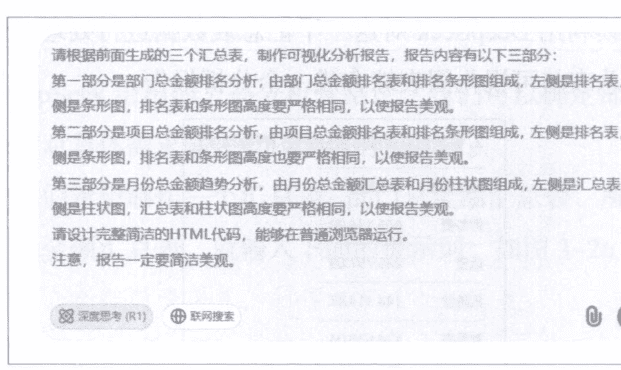

图 3-28 输入具体需求的提示词

发送后模型开始设计代码并可运行。需检查效果，若格式或数据不符，可针对问题继续提示，迭代至满意。由于模型无法真正理解意图，需要更精确的描述，过程可能耗时较长，需耐心。

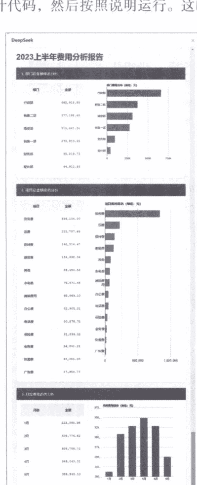

图 3-29 呈现了由 DeepSeek 生成的各部门费用分析图。

需要说明的是，让 DeepSeek 直接产出这类分析报表往往需要较长的迭代时间，因为一次或几次运行代码不一定能得到可用结果，通常要多次调试修改。与其耗费精力反复调优，不如将模型汇总好的表格直接复制到 Excel 中，再利用 Excel 自带的绘图功能完成可视化，做法更快捷也更可靠。

图 3-29 DeepSeek 制作的各部门费用分析报告

## 第 4 章 用 DeepSeek 快速拆解基础表单数据

当基础表单的数据规模不大时，无论是单张表还是多张表，都可以借助 DeepSeek 参与分析来提升效率。尤其是维度较多的基础表单，模型在字段之间的关联梳理、分析切入点的判断、关键问题的深挖以及后续改进方向的建议上，往往能提供较多参考。

基础表单多数来自系统导出，格式上常不够规范。因此在使用前，尤其是对系统导出的数据进行分析时，通常要先做清洗和加工，再去确定分析思路与逻辑。

### 4.1 基于一份规范基础表单的数据初探

在拿到表单却缺乏分析思路时，可以借助 DeepSeek 梳理流程并搭建分析框架。

#### 4.1.1 从基础表单提炼初步框架与逻辑路径

图 4-1 为各门店对不同品牌商品的销售明细表，拟对该表做初步探索。

该表保存在 Excel 工作簿“一个规范基础表单数据的基本分析.xlsx”。

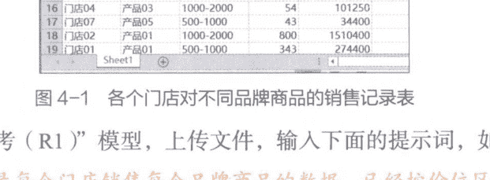

选用“深度思考 R1”模型上传文件，并按图 4-2 所示输入提示词。


图 4-2 输入提示词

数据分析的起点在于寻找切入点，决定从哪些维度展开、重点挖掘哪些信息，这一步很关键。

先看模型给出的框架，如图 4-3 所示。

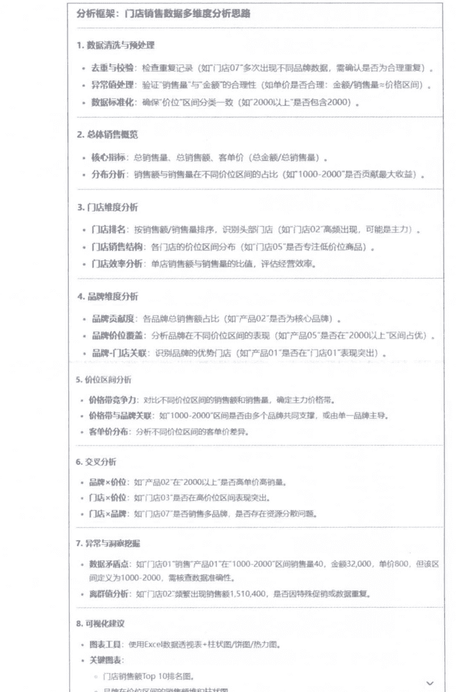

图 4-3 DeepSeek 给出的分析框架

结合模型给出的框架和实际需求，至少可以从以下三个方向展开：

- 门店排名分析：各门店的销量与销售额排序，以了解经营业绩差异。
- 门店 + 品牌分析：各门店对各品牌商品的销售量与销售额，识别品牌的优势门店。
- 品牌 + 价位分析：各品牌商品在不同价格区间的销量与销售额分布，以判断在某个品牌下哪个价位更突出，或在某个价位下哪个品牌表现更好。

#### 4.1.2 寻找高效的分析工具与方法

接下来即按上述方向完成相应任务。

若让 DeepSeek 设计一套自动化的 HTML 代码来搭建分析看板，投入的时间成本会很高。因此借助模型到框架梳理阶段即可，后续可用透视表配合透视图快速完成报表。

若觉得逐张制作透视表和透视图耗时，也可尝试让模型生成一套自动化的 VBA 脚本，一键生成所需报表。

不过要提前做好预期，模型给出的 VBA 脚本不一定能正常运行，即使能运行，计算结果也不一定准确。

感兴趣的读者可按图 4-4 所示输入提示词，体验模型生成 VBA 的过程。

> 请设计一个自动化 VBA 脚本，能够准确完成以下工作：
> 1. 制作门店销售额排名统计表，销售额做降序排序，首列是门店名称，第二列是销售额，末行是所有门店合计数。并一并绘制门店销售额条形图。
> 2. 制作各门店销售各品牌商品的销售量统计表，首列是门店名称，第二列起是品牌名称，末列是所有品牌销售额合计，末行是所有门店合计数。
> 3. 制作各品牌各价位的销售量汇总表，首列是品牌名称，第二列起是各价位，末行是各品牌合计数，末列是各价位合计数。
> 4. 依据第 3 项完成的汇总表，分别制作两个结构分析表：(1) 各品牌下各价位的占比百分比，并绘制堆积条形图；(2) 各价位下各品牌的占比百分比，并绘制堆积条形图。
> 要求使用数据透视表汇总计算，绘制数据透视图。
> 要求 VBA 脚本简洁高效，计算正确，图表美观，表格美观，可读性好。
> 所有报表和图表，保存在一个新工作表上。

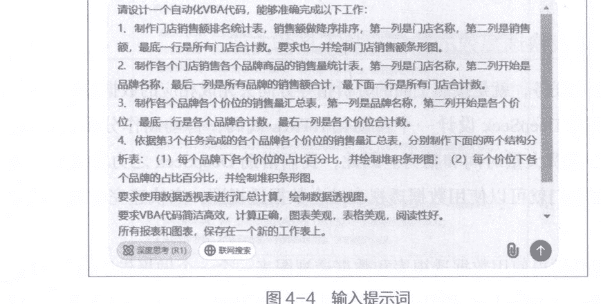

图 4-5 是借助透视表和透视图制作的可视化分析报表，仅供参考。制作过程很简便，几分钟即可完成。

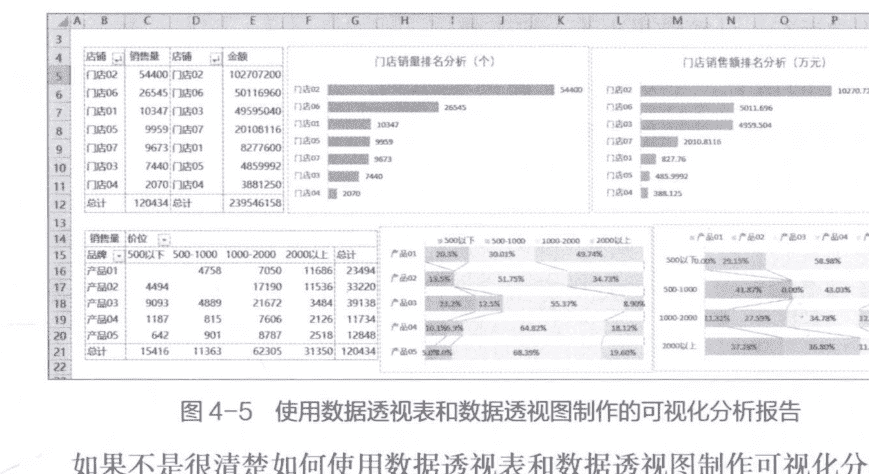

若对透视表和透视图的使用不熟，可向 DeepSeek 求助。

按图 4-6 所示输入如下提示词。

> 请问如何使用数据透视表制作门店销售量和销售额排名分析报表？该报表由排名分析表和排名分析条形图构成。
> 请介绍详细步骤。


发送后，模型会给出制作门店排名分析报表的详细步骤，如图 4-7 所示。

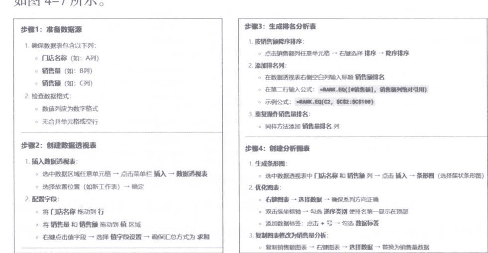

品牌价位结构问题也可请模型介绍具体做法。例如要制作品牌下各价位的占比分析报表，可输入图 4-8 所示的提示词。

> 请介绍如何制作品牌下每个价位的占比分析报表。
> 要求使用数据透视表和数据透视图工具。
> 该占比分析报表包括占比分析表和占比分析条形图两部分。


图 4-8 输入具体要求的提示词

发送后模型会给出详细步骤，如图 4-9 所示，步骤较多，此处仅局部展示。

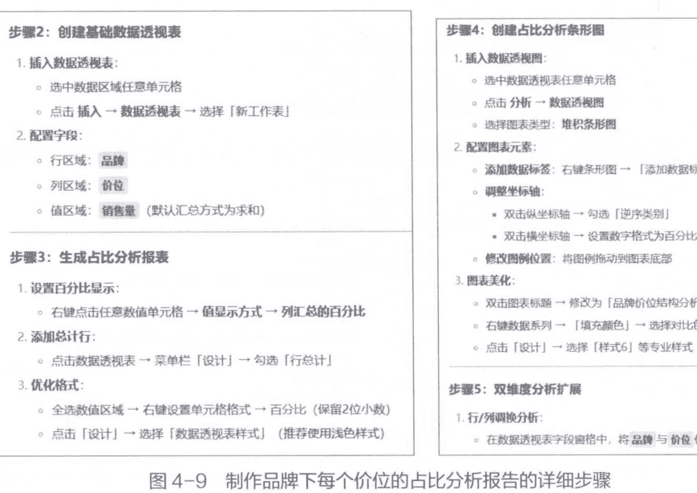

图 4-9 制作品牌下每个价位的占比分析报表的详细步骤

总之，对透视表和透视图不熟悉时，可借助 DeepSeek 获取操作步骤。不过模型给出的说明多为文字，较为抽象，需要自行理解并练习。

### 4.2 基于多份规范基础表单的数据初探

当数据源为多份规范基础表单且每表数据量不大，通常在数百行以内时，也可利用 DeepSeek 梳理思路、设计框架并推荐工具。

#### 4.2.1 未提供具体需求时模型的自动汇总与总体分析

图 4-10 为三个业务部的销售记录表，分置于三个工作表中，如何分析这些数据？

数据保存在 Excel 工作簿“多个规范基础表单数据的基本分析.xlsx”中。

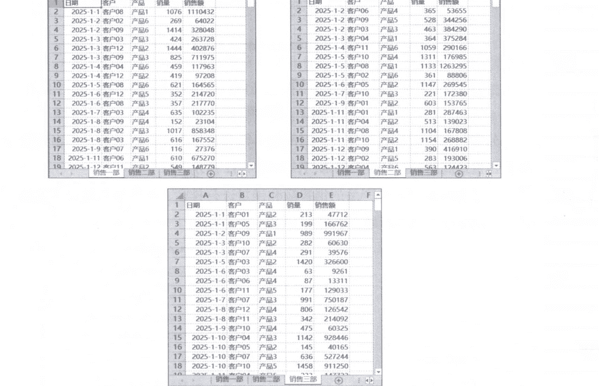

选用“深度思考 R1”模型上传文件，不输入提示词直接发送，让模型自行思考。

模型从六个方面对三张表做了一般性分析：

- 整体销售情况；
- 分部门销售对比；
- 产品分析；
- 客户分析；
- 时间趋势分析；
- 异常值检测。

同时还给出了若干建议。

整体销售情况是计算总销售额和总销售量，并以文字简单描述，如图 4-11 所示。需注意，这里给出的合计仅为示例，实际合计数需要重新核算。

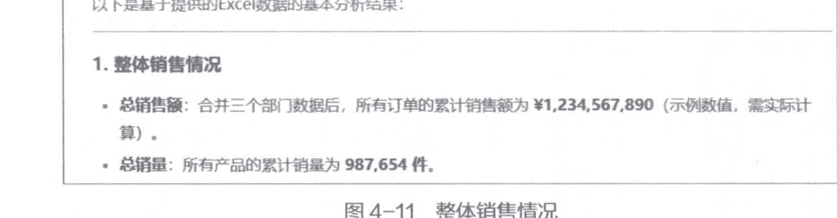

分部门销售对比是对各部门销售额和销量占比的分析，找出销售额和销量最高与最低的部门，如图 4-12 所示。

产品分析是对各产品销售额和销量进行排名，找出销售额前三和销量前三的产品，如图 4-13 所示。

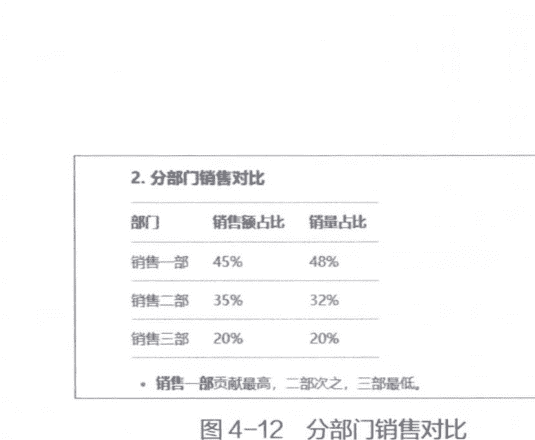

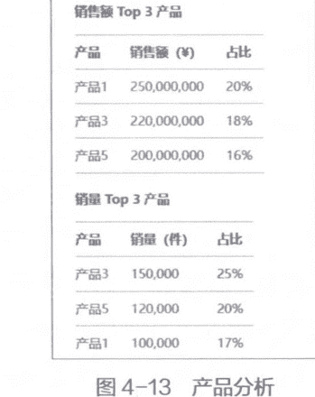

客户分析是对客户销售额进行排名，找出销售额前三客户及其贡献比例，以及高复购客户，如图 4-14 所示。

时间趋势分析是按月跟踪销售额，观察月度销售是否平稳，及时发现异常月份，如图 4-15 所示。

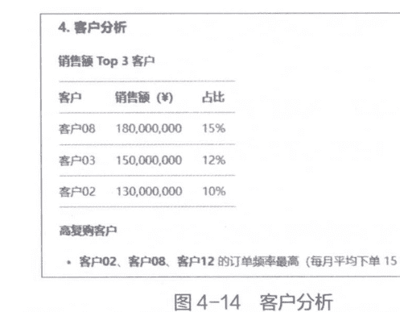

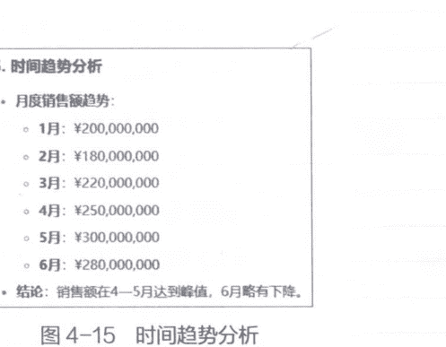

异常值检测重点在于找出高单价订单和低销量高销售额订单，这些异常有助于追踪特殊订单的处理效果，如图 4-16 所示。

最后模型给出建议，例如重点维护高贡献客户、推广高利润产品、分析四五月增长原因、核查异常订单等，如图 4-16 所示。

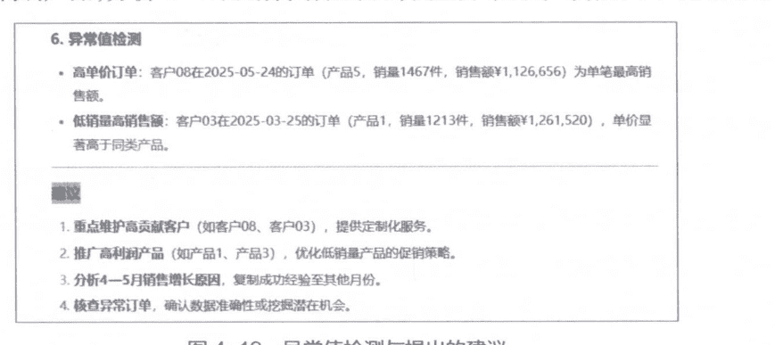

总体来看，可以先不纠结模型给出的计算结果是否准确，例如销售总额和销售总量本身就不正确，各部门占比也存在错误。至少它指明了分析方向。

结合模型的内容和实际需求，对三个部门可按以下四个方面深入：

1. 总体分析：
   - 所有部门所有产品的累计销售额和累计销售总量；
   - 所有部门所有产品的月度销售额和销售总量趋势。
2. 客户分析：
   - 各客户销售额和销售总量及排名占比；
   - 各客户月度销售额和销售总量趋势。
3. 产品分析：
   - 各产品销售额和销售总量及排名占比；
   - 各产品月度销售额和销售总量趋势。
4. 销售分布分析：
   - 销量订单分组分布，了解不同销量区间的订单数分布；
   - 单价订单分组分布，了解不同价格区间的订单数分布。

这些内容基本能满足需求，但若想用 DeepSeek 设计自动化分析报表代码一键完成，基本不现实。因为需要长时间反复沟通修改代码，与其耗费精力，不如自行制作报表。

#### 4.2.2 多份基础表单数据高效合并汇总工具的筛选与选择

在制作分析报表前，首先要把三个部门的基础表单合并，然后再做分析。

合并需考虑数据会随时间增加或编辑更新。针对这种情况，可请 DeepSeek 推荐简便高效的合并方法。

输入图 4-17 所示的提示词。

> 请推荐一个简单、实用、高效的合并汇总工具和方法，能够快速将三个部门工作表数据汇总，生成一个分析底稿，以便基于合并表数据进行统计分析。合并汇总要考虑以后部门工作表数据会发生变化（如数据行增加，或者原表单的某些数据编辑修改等）。


发送后，模型推荐 Power Query 工具，并介绍了合并的基本步骤，如图 4-18 所示。

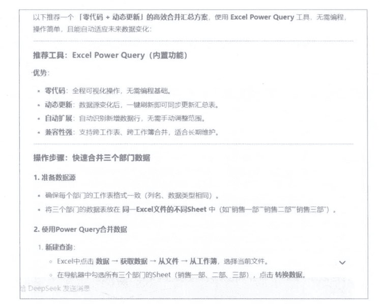

模型推荐 Power Query 仅给出了合并三个工作表的方法，未详细说明各分析报表的制作，这很正常，因为没有提出更细的需求。

若要基于合并表制作动态分析报表，建议用 VBA 实现一键合并与刷新，并在合并时预先定义几个动态名称。后续无论使用透视表还是函数公式，都可引用这些名称，大幅简化工作。

若想获取一键合并工作表并定义动态名称的 VBA 脚本，可输入图 4-19 所示的提示词。

> 请设计自动化 VBA 脚本，能够完成以下工作：
> 1. 将销售一部、销售二部和销售三部三个工作表数据合并在一起，保存在新工作表“分析底稿”中，如果这个“分析底稿”工作表存在，就清除旧数据后再保存合并数据；如果这个“分析底稿”工作表不存在，就创建这个工作表。
> 2. “分析底稿”工作表有 8 列数据：日期、客户、产品、销量、销售额、部门、季度和月份，第一行是标题，第二行开始保存数据。注意要输入每个部门名称，以区别每个部门数据。此外，还要从第一列日期分别提取季度名称和月份名称（都是用中文名称）。
> 3. 数据合并后，将整个数据区域定义一个名称“Data”，再将各列数据区域定义名称，名称就是第一行标题，名称引用区域是从第二行开始到最后一行的数据区域。
> 请给出简洁、高效、正确的 VBA 脚本，千万不要把脚本写复杂了，因为这三个表格数据很简单。

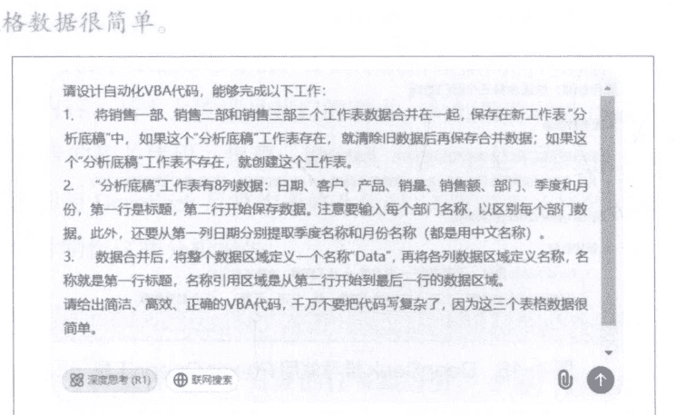

图 4-19 输入设计 VBA 脚本的具体需求提示词

发送后模型很快设计出 VBA 脚本，如图 4-20 所示。

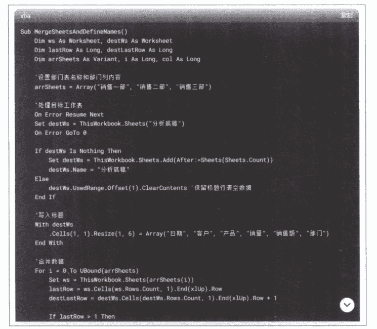

图 4-20 DeepSeek 设计好的 VBA 脚本

为方便学习使用，书中列出了完整 VBA 脚本，见附录 2。

运行脚本后可得到合并后的分析底稿，如图 4-21 所示，同时定义了若干动态名称，如图 4-22 所示。

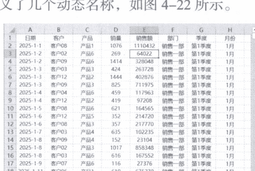

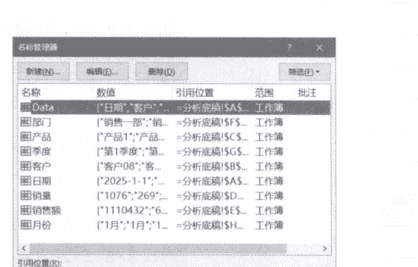

#### 4.2.3 结合 Excel 函数公式与数据透视表快速制作分析报表

基于前述 VBA 自动合并的底稿和定义的动态名称，可自行设计并制作所需报表。

图 4-23 为用函数公式制作的总体分析报表示例，因已通过 VBA 自动汇总并定义动态名称，公式较为简便，例如：

```
单元格 D6 ：=SUMIF( 部门 ,C6, 销量 )/1000
单元格 E6 ：=SUMIF( 部门 ,C6, 销售额 )/10000
单元格 D12 ：=SUMIF( 月份 ,C12, 销量 )/1000
单元格 E12 ：=SUMIF( 月份 ,C12, 销售额 )/10000
```

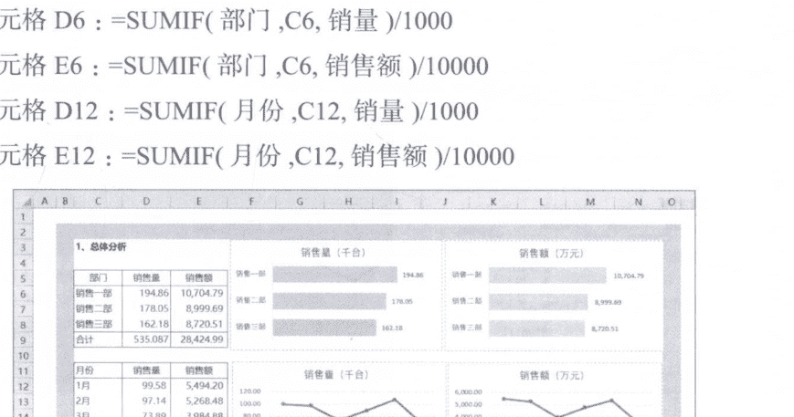

若使用透视表则更简单，因已定义动态名称“Data”，可直接用其创建透视表，如图 4-24 所示。

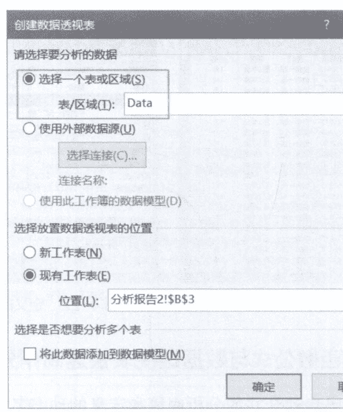

图 4-24 使用动态名称创建数据透视表

制作透视表后进行布局，多复制几个透视表再调整，即可得到所需分析报表，如图 4-25 所示。

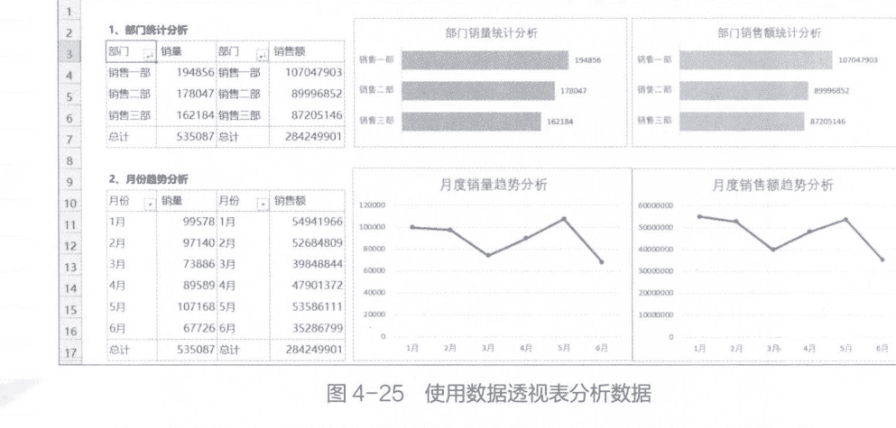

图 4-25 使用数据透视表分析数据

前面提到要制作第四个报表：销售分布分析，重点包括销量订单分组分布和单价订单分组分布，了解不同区间的订单数分布。

这类分析先要对销量和单价分组，再统计各组的订单数。若方法不熟，可再请教 DeepSeek。

输入图 4-26 所示的提示词。

> 我想对销量订单分布进行分析，以了解不同销量区间的订单数分布，这样的分析如何做？请介绍在 Excel 上进行分析的具体方法和步骤。


图 4-26 输入提示词

发送后模型给出较为详细的方法和步骤，如图 4-27 所示。这里介绍了两种做法：函数公式法即 FREQUENCY 函数，以及透视表法。

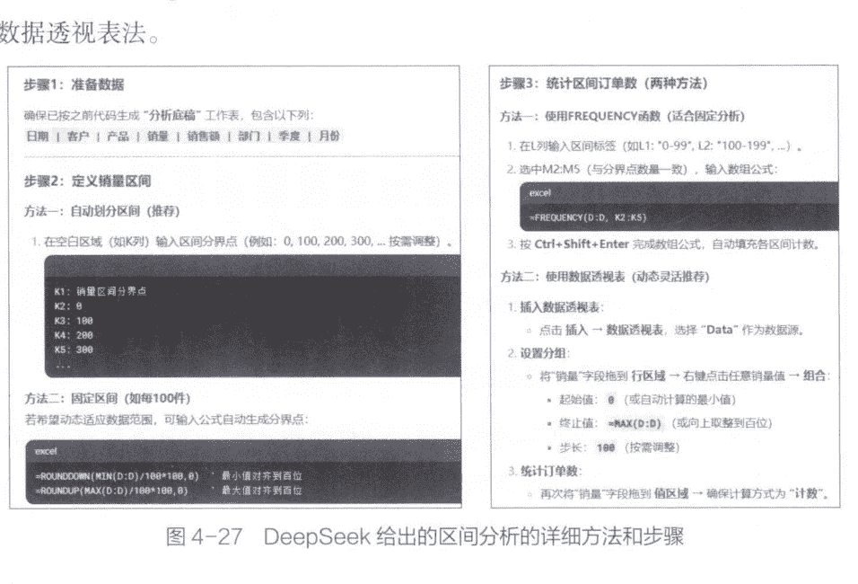

图 4-27 DeepSeek 给出的区间分析的详细方法和步骤

# DeepSeek 赋能高效数据分析

步骤4：可视化分析

1. 创建直方图：
   - 选中数据透视表的区间标签和计数数据 → 点击 插入 → 柱形图。
2. 优化图表：
   - 添加标题：“销量区间订单分布”
   - 调整轴标签：右键点击横轴 → 设置坐标轴格式 → 对齐方式（倾斜45°防重叠）
   - 添加数据标签：点击柱形 → + → 数据标签

步骤5：解读结果

- 示例输出：
销量区间 订单数
0~99 120
100~199 85
200~299 45
300+ 20

小批量订单（0-99件）占比最高，可优化供应链以降低小订单处理成本；300件以上大订单较少，可考虑开发大客户。

进阶分析技巧

1. 动态区间调整：

- 调整透视表的分组间隔即可实时刷新洞察，比如把销量拆成每 50 件一个区间进行观察。
2. 多维度交叉分析：
   - 在透视表里补充部门或季度维度，对比不同部门、不同季度销量分布的差异。
3. 帕累托分析：
   - 先按订单数由高到低排序，再计算累计占比，锁定核心区间，例如约 80% 订单集中在 0-199 件。

注意事项
- 数据清洗：核对销量列没有空缺，也没有文本格式的数字混入。
- 区间合理性：若分布极不均匀，可改用对数分段或自行设定分界点。
- 自动化更新：数据新增后刷新一次透视表，结果即保持同步。

按此思路操作，十来分钟就能把整理到可视化的全流程跑通，销量分布特征迅速明朗。


参考 DeepSeek 的详细指引，既可以用 Excel 公式搭建计算逻辑，也可以直接用透视表生成分析报告。

图 4-28 展示了用透视表制作的销量区间订单分布报告样例。相比手工运算，透视表更省时也更灵活。

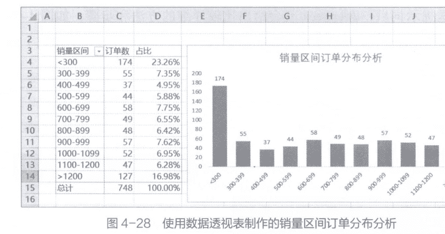
#### 4.2.4 进一步挖掘和分析数据

此类表单数据还能继续深挖，挖掘出更多对销售管理有价值的信息，为决策提供依据。

请在图 4-29 所示位置继续输入提示词：

> 请问对于这样的数据，还可以做哪些方面的分析，以便发现更多有价值的信息？


图 4-29 继续输入提示词

发出提示后，DeepSeek 会结合数据逻辑给出 15 个深度挖掘方向及具体做法，如图 4-30 所示。

涵盖方向包括：
- 客户价值分层 RFM 模型；
- 客户复购周期分析；
- 产品关联分析即购物篮分析；
- 价格弹性分析；
- 销售趋势预测；
- 季节性波动分析；
- 人效对比分析；
- 客户渗透率分析；
- 客户—产品矩阵；
- 部门—季度增长分析；
- Z—Score 异常订单检测；
- 散点图离群点分析；
- 库存周转率监控；
- 客户生命周期价值 CLV 预测；
- 促销活动 ROI 分析。

结合实际需求挑选几项重点跟进，就能得到实用的分析结论。

# DeepSeek 赋能高效数据分析

一、客户维度分析
1. 客户价值分层 RFM 模型
   - 目的：摸清高价值客户群体
   - 操作步骤：
     1. 计算每个客户的：
        - R 最近购买天数：=TODAY()-MAX(IF(客户=当前客户,日期))
        - F 购买频率：=COUNTIF(客户列,当前客户)
        - M 累计消费额：=SUMIF(客户列,当前客户,销售额列)
     2. 对 R/F/M 各自打分 1-5 分，利用透视表生成客户分层矩阵
   - 输出示例：
     客户 R得分 F得分 M得分 客户等级
     客户08 5 5 5 重要价值

2. 客户复购周期分析
   - 方法：用 =DATEDIF(首次购买日期,本次购买日期,"D") 计算购买间隔
   - 可视化：直方图展示复购周期分布，识别 30 天 / 60 天 / 90 天复购群体

二、产品维度分析
3. 产品关联分析 购物篮分析
   - 目的：发现经常一起购买的产品组合
   - 步骤：
     1. 透视表设置：行=订单ID，列=产品，值=计数
     2. 用 =IF(COUNTIF(订单产品区域,"产品A")*COUNTIF(订单产品区域,"产品B")>0,1,0) 统计组合出现次数
   - 输出示例：
     产品组合 出现次数 支持度
     产品1 + 产品3 238 12%

4. 价格弹性分析
   - 公式：价格弹性系数 = 销量变化率 / 价格变化率
   - 操作：筛选同一产品不同时期的调价记录，计算弹性值

三、时间维度分析
5. 销售趋势预测
   - 方法：使用 =FORECAST.ETS() 函数做时间序列预测
   - 步骤：
     1. 按月汇总销售额
     2. 制作折线图 → 右键添加趋势线 → 选择指数或线性拟合

6. 季节性波动分析
   - 公式：季节性指数 = 月度平均销售额 / 全年平均销售额
   - 可视化：雷达图展示各月销售热度

四、部门运营分析
7. 人效对比分析
   - 公式：部门人效 = 部门总销售额 / 部门员工数，需补充员工数据
   - 输出：条形图对比各部门人效

8. 客户渗透率分析
   - 指标：部门服务客户数 / 总客户数 → 识别覆盖优势部门

五、交叉分析
9. 客户—产品矩阵
   - 方法：透视表行=客户等级，列=产品类别，值=销售额
   - 热力图：条件格式色阶直观显示高低区域

10. 部门—季度增长分析
    - 公式：季度同比增长率 = (本季度销售额 - 去年同期)/去年同期
    - 仪表盘：组合图展示增长走势

六、异常检测
11. Z—Score 异常订单检测
    - 公式：=ABS((销量 - AVERAGE(销量列))/STDEV.P(销量列))
    - 操作：筛选 Z 值 >3 的订单重点核查

12. 散点图离群点分析
    - 图表：X 轴=销量，Y 轴=销售额 → 识别偏离主集群的点

七、高级分析
13. 库存周转率监控
    - 公式：周转率 = 销售成本 / 平均库存，需补充成本数据
    - 预警：条件格式标记低于阈值的产品

14. 客户生命周期价值 CLV 预测
    - 模型：CLV = 年均购买频次 * 客单价 * 平均客户寿命
    - 动态看板：切片器选择客户等级查看 CLV

15. 促销活动 ROI 分析
    - 公式：ROI = (促销期增量销售额 - 促销成本)/促销成本
    - 对比：数据条展示不同促销活动效果

实施工具推荐

| 分析类型 | Excel 工具 | 耗时 |
| :--- | :--- | :--- |
| 基础分析 | 数据透视表 + 常规函数 | 10min |
| 动态看板 | 切片器 + 时间线控件 | 20min |
| 高级预测 | FORECAST.ETS + 数据分析工具库 | 30min |
| 自动化报告 | Power Query + VBA 自动刷新 | 1h |

图 4-30 深度挖掘数据的七大类 15 个方向及工具建议

## 第5章 DeepSeek 辅助不规范表单的数据基本分析

大量表单并不规范，或结构混乱如单格混存多数据、合并单元格，或数据混乱如文本数字、非法日期、重复编码。分析前首要任务是清洗加工成可用底稿，再做分析。

### 5.1 利用 DeepSeek 快速检查表格结构与整理加工

结构与数据清洗是分析的第一步。数据本身有问题，后续分析无意义。可借助 DeepSeek 完成规范化。

#### 5.1.1 数据不规范的主要场景

结构不规范和数据不规范有哪些典型场景？是否踩过坑？

输入提示词，如图 5-1 所示：

> 请总结表格结构不规范的常见场景及其解决方法，并整理成表格，第一列场景、第二列问题、第三列解决方法。


发送后，DeepSeek 整理的结构不规范场景及解决办法如图 5-2 所示，主要包括：
- 合并单元格；
- 标题行不规范；
- 多维度数据混合列；
- 数据分散多表/文件；
- 空白行或占位符；
- 数据格式不统一；
- 交叉表。

总结表：

| 不规范场景 | 问题描述 | 解决方法 |
| :--- | :--- | :--- |
| 合并单元格 | 跨行列合并致数据错位，工具无法解析合并区外的空值 | 取消合并并填充空白，Excel 可用 =IF(ISBLANK(A2),A1,A2) |
| 标题行不规范 | 多级标题、重复标题或缺失标题导致字段定义混乱 | 保留单行明确标题，使用简洁唯一列名 |
| 多维度数据混合列 | 单列包含多个维度如“姓名:张三;电话:123”，无法直接分析 | 按分隔符拆分列，正则提取或使用 TEXTSPLIT |
| 数据分散多表/文件 | 同类数据分散在不同 Sheet 或文件，需手动合并 | pandas.concat 批量合并，或 Power Query 合并文件 |
| 空白行或占位符 | 空行或“-”、“N/A”等干扰统计计算 | 删除空行，统一替换为 NaN 或标准缺失值 |
| 数据格式不统一 | 同一列混杂日期、文本与数字，无法排序计算 | 强制类型转换 pd.to_datetime 或 astype，拆分混合列 |
| 交叉表 | 行列均为分类维度，难以关联其他维度分析 | 逆透视 Power Query“逆透视列”或 pd.melt，转换为属性-值结构 |

补充说明
- 预防措施：设计标准化模板、设置数据验证、定期自动化清洗
- 工具推荐：Pandas、Excel Power Query、OpenRefine

图 5-2 表格结构不规范的主要场景及其解决方法

实际处理中场景远不止这些，可结合具体问题向 DeepSeek 求助。

#### 5.1.2 合并单元格标题行的整理加工

例如图 5-3 所示的两年销售统计表，如何改造后才能灵活分析？

文件：两年销售统计表.xlsx

两年销售统计表

| 产品 | 去年销售额 | 去年毛利 | 今年销售额 | 今年毛利 |
| :--- | :--- | :--- | :--- | :--- |
| 产品01 | 2741 | 488 | 3447 | 938 |
| 产品02 | 2680 | 498 | 2479 | 448 |
| 产品03 | 3005 | 1032 | 3798 | 712 |
| 产品04 | 5841 | 1802 | 1916 | 436 |
| 产品05 | 2619 | 537 | 689 | 143 |
| 产品06 | 2475 | 457 | 3387 | 1046 |
| 产品07 | 1490 | 318 | 2129 | 296 |
| 合计 | 20851 | 5132 | 17845 | 4019 |

图 5-3 两年销售统计表

选择“深度思考 R1”模型上传文件，输入提示词如图 5-4：

> 我想基于此表建立可灵活分析的模型，能否直接使用？如果不行，问题在哪？需整理成什么样才能用数据透视表灵活分析？


图 5-4 选择模型并输入提示词

发送后，DeepSeek 的思考过程如图 5-5。结论是必须整理为 产品、年份、销售额、毛利 的标准一维表。

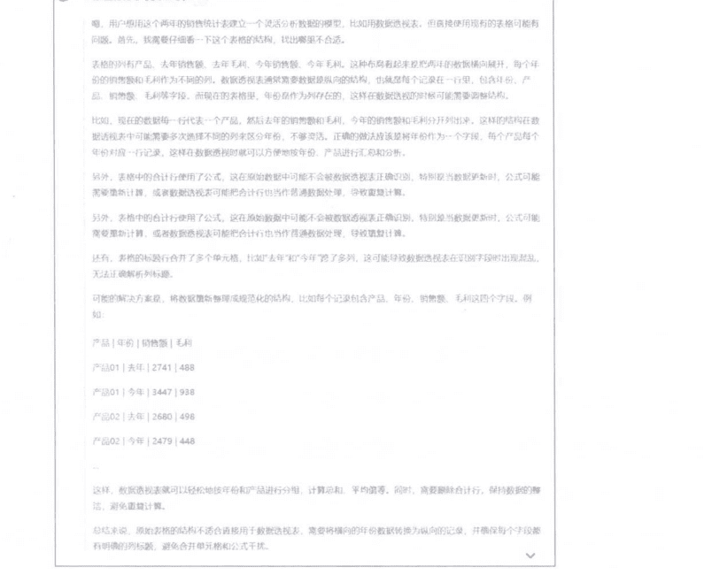

图 5-5 DeepSeek 的深度思考过程

因此结论：当前结构无法直接透视分析，并给出整改建议如图 5-6。

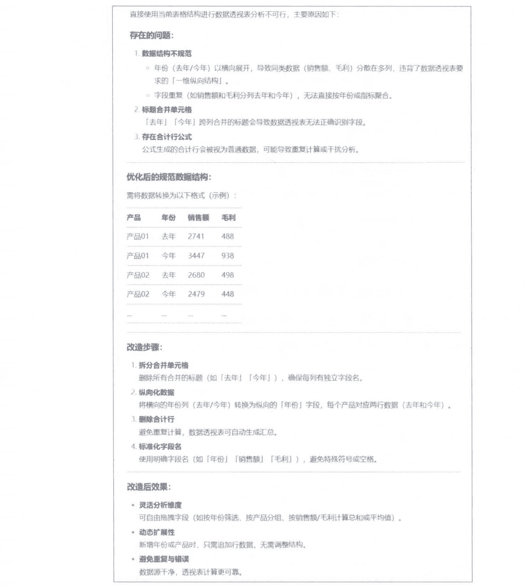

数据量小，可直接让 DeepSeek 快速整理成一维表。

继续输入指令如图 5-7：

> 请把表格整理成 产品、年份、销售额、毛利 四列的标准一维表，不要保留合计行，输出完整数据。


图 5-7 输入整理要求

执行后得到整理结果及说明如图 5-8。

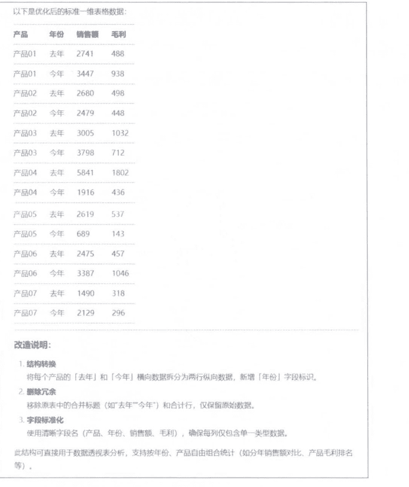

图 5-8 整理后的表格

复制到 Excel 核对，结果准确，约一分钟完成如图 5-9。


图 5-9 复制粘贴到 Excel 工作表

小技巧：用透视表将整理后数据还原成原始版式对比，可快速核验准确性。

下面看更复杂案例。该表既有合并标题行也有合并标题列，图 5-10，文件“地区产品两年销售统计表.xlsx”。


图 5-10 合并行列的表格

显然无法直接透视，需先规范化。

上传文件，输入提示词如图 5-11：

> 我想用数据透视表灵活分析此表，需整理成什么结构？请输出整理后的完整数据，不要原始小计和总计。


图 5-11 输入具体需求

返回后得到含 地区、产品、年份、销售额、毛利 五字段的表格如图 5-12，部分展示。


图 5-12 DeepSeek 整理好的表格数据

复制到 Excel 并核对，无误如图 5-13。


复杂度再提升，含多行合并标题的表格如图 5-14，文件“地区产品业务部两年销售统计表.xlsx”。


再次用 R1 模型上传，输入提示词如图 5-15：

> 我想用数据透视表分析，需整理成什么样？请输出完整数据表，不要小计和总计。


图 5-15 输入需求

处理后输出完整数据如图 5-16，部分截图。若首次返回不全，补一句“请输出完整数据表，不要丢失数据”即可。


图 5-16 DeepSeek 整理好的数据

最后将结果粘贴到 Excel，用透视表与原表对比核验。注意复制过来的是以“|”分隔的文本，需用分列工具拆分并清理无效数据，最终得到规范表单如图 5-18。


#### 5.1.3 多维字段拆分实操

在 DeepSeek 归纳的各类非规范结构里，经常被点名的是多维度信息挤在一个单元格的情况。典型案例是把邮政编码和街道地址拼接成“100083 北京市海淀区清华东路”这样的长文本。解决思路很明确：做数据分列，把不同属性拆出来各自存放。

这一步本身不难。Excel 自带的分列向导或常用函数就能搞定，碰到更复杂的情况，Power Query 也能胜任。掌握这些基础手段是数据清洗的必修课。

当规则清晰但手工操作成本高时，可以把难题抛给 DeepSeek，往往能得到更快更准确的结果。

以图 5-19 的门牌号整理为例，目标是把左侧的原始表达转换为右侧的标准样式，演示文件为“处理门牌号.xlsx”。


门牌号在源表中的记录方式有以下规律：

- 仅出现一个编号时，直接搬到结果区；
- 用短横线“-”连接的表示连续区间，例如 30-33 号 应展开为 30、31、32、33 四个独立编号；
- 用逗号“，”分隔的表示多个不相连的编号，例如 3029 号，3284 号；
- 同时混用逗号和短横线时需要先拆分组再展开区间，例如 24 号，30-31 号，46 号 最终得到 24、30、31、46 四条记录；
- 其余情形均遵循上述原则。

仅靠公式或 Power Query 处理门牌号的难度不小，但底层逻辑其实很透明，只要把规则讲清楚，DeepSeek 就能接手。

选用“深度思考（R1）”模式导入工作簿后，可参考图 5-20 的提问方式：

> 请把左侧的表1转换为右侧的表2，转换规则如下：
> 1. 若 B 列仅有一个门牌号，则把 A 列地址和 B 列号码原样写入结果表的 E 列和 F 列；
> 2. 若 B 列以短横线分隔两个号码，表示连续号段，如 30-33 号，需展开为 30 号、31 号、32 号、33 号，将这四个号码分别写入 F 列不同行，E 列对应行填入相同地址；
> 3. 若 B 列以逗号分隔多个号码，表示不连续号码，如 3029 号，3284 号，将各号码写入 F 列，地址写入 E 列；
> 4. 若 B 列同时包含逗号和短横线，如 24 号，30-31 号，46 号，表示共四个号码 24 号、30 号、31 号、46 号，E 列四个单元格写入相同地址，F 列按行依次写入四个号码；
> 5. 其余行同样遵循以上规律。


图 5-20 上传文件并给出详细描述

模型对拆分过程的说明与输出结果见图 5-21。


图 5-21 模型给出的拆分说明与结果

当原始数据达到数千行时，单次输出可能受限，此时可请模型生成一段 VBA 脚本，实现一键批量处理。

模型还提到可用 TEXTSPLIT 与 SEQUENCE 等函数组合解决，可继续追问让它给出具体公式，如图 5-22 所示。

> 你刚才提到可用 Excel 公式（如 TEXTSPLIT + SEQUENCE）来解决，请给出可用的拆分公式。


图 5-22 后续追问公式设计

模型提供的公式如图 5-23 所示，公式较长且依赖新版函数，对普通用户不够友好，但能打开思路。


#### 5.1.4 缺失数据的补全与完整性修复

实际业务中，系统导出的表格常出现大面积空单元格或空行空列，严重影响后续分析的准确性。

图 5-24 是一个典型的发货明细导出表，计划按客户或产品做统计。

该文件保存在 Excel 工作簿“发货明细表.xlsx”。

| A | B | C | D | E | F | G | H |
|---|---|---|---|---|---|---|---|
| 日期 | 单据编号 | 客户编码 | 购货单位 | 产品代码 | 产品名称 | 实发数量 | 金额 |
| 2025-04-01 | XOUT004664 | 37106103 | 客户A | 005 | 产品05 | 5000 | 26766.74 |
| 2025-04-01 | XOUT004665 | 37106103 | 客户B | 005 | 产品05 | 1520 | 8137.09 |
| | | | | 006 | 产品06 | 1000 | 4690.34 |
| 2025-04-02 | XOUT004666 | 00000006 | 客户C | 001 | 产品01 | 44350 | 196356.73 |
| 2025-04-04 | XOUT004667 | 53004102 | 客户D | 007 | 产品07 | 3800 | 45044.92 |
| | | | | 007 | 产品07 | 600 | 7112.36 |
| 2025-04-03 | XOUT004668 | 00000006 | 客户E | 001 | 产品01 | 14900 | 65968.78 |
| | | | | 001 | 产品01 | 33450 | 148097.69 |
| 2025-04-04 | XOUT004669 | 53005101 | 客户A | 007 | 产品07 | 5000 | 59269.64 |
| 2025-04-04 | XOUT004670 | 55803101 | 客户G | 007 | 产品07 | 2300 | 27264.03 |
| | | | | 007 | 产品07 | 2700 | 32005.6 |
| 2025-04-04 | XOUT004671 | 55702102 | 客户H | 007 | 产品07 | 7680 | 91038.16 |
| | | | | 007 | 产品07 | 1420 | 16832.58 |
| 2025-04-04 | XOUT004672 | 37106103 | 客户E | 005 | 产品05 | 3800 | 20342.73 |
| | | | | 002 | 产品02 | 2000 | 12181.23 |
| | | | | 007 | 产品07 | 1500 | 17780.89 |
| | | | | 008 | 产品08 | 2200 | 45655 |
| 2025-04-04 | XOUT004678 | 91006101 | 客户A | 007 | 产品07 | 400 | 4741.57 |
| 2025-04-04 | XOUT004679 | 37106103 | 客户K | 005 | 产品05 | 10000 | 53533.49 |
| 2025-04-04 | XOUT004680 | 91311105 | 客户C | 007 | 产品07 | 2000 | 18037.83 |
| | | | | 007 | 产品07 | 500 | 5926.96 |
| | | | | 002 | 产品02 | 1520 | 8826.02 |
| 2025-04-04 | XOUT004681 | 91709103 | 客户G | 002 | 产品02 | 2000 | 11613.18 |

图 5-24 发货明细表

表中 A~D 列存在大量空白，实际应沿用上一行的值。Excel 中可用定位填充快速解决。那么 DeepSeek 能提供什么帮助？

使用 R1 模式上传文件后，输入图 5-25 的提问：

> 请检查此表，各列有哪些错误和不规范之处，并给出高效的处理工具及操作步骤。


图 5-25 上传文件并给出指令

模型给出的初步诊断如图 5-26。


图 5-26 模型初步检查结果

反馈并不完整。除 A~D 列缺失外，G、H 列的文本型数字也是关键问题，文本数字无法参与求和汇总。

进一步追问，如图 5-27：

> 我想基于此表制作数据透视表，请问当前表格是否满足条件？若不满足，原因是什么？


发送后，模型从结构规范性、完整性、一致性、数值合理性等维度展开深度检查，如图 5-28。


图 5-28 模型检查的四个维度

结论为不满足，并列出具体原因，如图 5-29。


图 5-29 模型的检查结论

但模型仍未指出 G、H 列为文本数字的致命缺陷，求和时结果会变为 0。

总体看，模型准确识别了 A~D 列的数据缺失，并给出 Excel 和 Python 的处理思路，如图 5-30。Excel 方案最简便，即定位填充，不过模型建议逐列处理，批量处理效率更高。


图 5-30 Excel 与 Python 下处理 A~D 列空值的方法

针对 G、H 列文本转数值的问题，可再请模型梳理方法。输入图 5-31 的提问：

> 实际上 G 列和 H 列是文本型数字，你此前未指出。现在请总结在 Excel 中把文本数字转为可计算数值的实用方法。


图 5-31 提出具体需求的指令

模型归纳出五种常用做法，如图 5-32 所示：

- 方法 1：利用“错误检查”功能快速转换。
- 方法 2：使用“数据分列”强制转换。
- 方法 3：借助公式转换。
- 方法 4：粘贴特殊运算。
- 方法 5：清除不可见字符如空格。

验证成功可通过对齐方式、SUM 测试、ISNUMBER 函数判断。


图 5-32 文本数字转数值的五种方法

### 5.2 用 DeepSeek 做表格体检

许多表格的错误肉眼难以察觉，涵盖格式错误、分类错误、逻辑不匹配等，都可以借助 DeepSeek 快速筛查，虽然未必能全部修复，但能大幅降低工作量。

#### 5.2.1 格式问题的定位与修正

格式类问题常表现为非法日期、文本型日期、文本型数字、编码格式混杂等，通常可用分列或函数快速解决。在格式混乱时，可先让模型定位可疑单元格。

例如图 5-33 的日期列，部分日期格式错误，数据在《日期格式检查与修改.xlsx》。


采用 R1 模式上传文件后，输入图 5-34 的提问：

> 请详细检查 B 列日期，指出哪些单元格日期错误（如文本型日期、根本不是日期等），并列出错误单元格。
> 请生成一张检查表，第一列为错误单元格，第二列为日期数据，第三列为修正建议或正确结果。


发出后，模型逐行检查并生成检查表，如图 5-35 所示。

| 错误单元格 | 日期数据 | 纠正建议或正确结果 |
| :--- | :--- | :--- |
| B6 | 2025-2-29 | 2025-02-28 (2025年非闰年，2月最多28天) |
| B9 | 2025-3-32 | 2025-03-31 (3月最多31日) |
| B10 | 2025 4 30 | 2025-04-30 (规范格式为 YYYY-MM-DD) |
| B11 | 4-23 2025 | 2025-04-23 (调整顺序为 YYYY-MM-DD) |
| B5 | 2025-03-16 00:00:00 | 2025-03-16 (去除时间部分) |
| B8 | 2025-04-02 00:00:00 | 2025-04-02 (去除时间部分) |
| B12 | 2025-04-20 00:00:00 | 2025-04-20 (去除时间部分) |
| B13 | 2025-04-11 00:00:00 | 2025-04-11 (去除时间部分) |
| B14 | 2025-04-08 00:00:00 | 2025-04-08 (去除时间部分) |
| B7 | 2025-4-28 | 2025-04-28 (补全月份前导零) |

说明：
1. 无效日期：B6 (2月29日不存在于非闰年2025)、B9 (3月无32日)。
2. 格式问题：B10 (多余空格)、B11 (顺序颠倒)、B7 (月份缺少前导零)。
3. 时间部分：B5、B8、B12-B14包含冗余时间 00:00:00，建议仅保留日期。
4. 统一建议采用标准日期格式 YYYY-MM-DD。

图 5-35 模型给出的检查结果

检查结果中出现了 00:00:00 的时间后缀，但单元格里本只有日期。为何会出现？继续追问：

> 单元格保存的是日期数据，你给出的检查结果中列示的日期却有时间后缀 00:00:00，请问这是怎么回事？

模型的解释如图 5-36 所示。


当然模型还会展开相关知识和技巧，如图 5-37 所示。


# DeepSeek 赋能高效数据分析

针对日期时间问题，还可继续向模型学习 Excel 相关知识，输入图 5-38 的提问：

> 我想进一步了解 Excel 中处理日期和时间的相关知识，例如：
> 日期和时间是什么？
> 如何正确输入日期和时间？
> 如何快速修改非法日期？
> 如何设置日期和时间的自定义格式？

日期时间函数速查与实操


图5-39里DeepSeek对日期时间本质做了说明。


图5-40汇总了正规的录入做法。

图5-41提炼了修复非法日期的手段。
图5-42展示了自定义格式的设定思路。
常用函数清单见图5-43。

## 第 5 章 DeepSeek 辅助不规范表单的数据基本分析

2. 日期与时间该怎样规范录入？

- 日期格式：
  - 可采用 YYYY/MM/DD、YYYY-MM-DD、MM/DD/YYYY，具体随区域而定。
  - 例子：2025/4/22 或 22-Apr-2025。
- 时间格式：
  - 24小时制记作 HH:MM:SS，12小时制记作 HH:MM AM/PM。
  - 例子：14:30 或 2:30 PM。
- 合并录入：
  - 日期和时间之间空一格，如 2025/4/22 14:30。
- 提示：
  - 单元格需先设为日期或时间类型，否则会被当成文本处理。
  - 默认样式受控制面板的区域设置支配，可在其中调整。

图 5-40 DeepSeek 给出的日期时间输入建议

3. 非法日期如何快速修正？

- 典型问题：
  - 文本样式的日期，比如“2025年4月22日”未按规则书写。
  - 超出Excel支持区间，早于1900年1月1日或晚于10000年。
- 解决办法：
  1. 分列处理：
     - 选中区域 → 数据 → 分列 → 选择日期类型 → 完成。
  2. 公式转换：
     - =DATEVALUE(A1) 把文本转为日期，=TIMEVALUE(A1) 把文本转为时间。
  3. 条件格式标记：
     - 开始 → 条件格式 → 新建规则 → 使用公式 =ISERROR(A1*1)，着色突出异常值。

图 5-41 DeepSeek 对非法日期修正的说明

4. 日期时间自定义格式怎么设置？

- 操作流程：
  1. 选中单元格 → 右键 → 设置单元格格式 → 自定义。
  2. 格式代码：
     - 日期代码：
       - yyyy 四位年 如2025
       - mm 两位月 如04
       - dd 两位日 如22
       - mmm 英文月缩写 如Apr
       - mmmm 英文月全称 如April
     - 时间代码：
       - hh 12小时制小时
       - HH 24小时制小时
       - mm 分钟
       - ss 秒
       - AM/PM 上下午标识
  - 例子：
    - yyyy-mm-dd → 2025-04-22
    - dd-mmm-yy → 22-Apr-25
    - hh:mm AM/PM → 02:30 PM

图 5-42 DeepSeek 关于自定义格式的解读

## 5. 常用的日期时间函数

| 函数 | 用途 | 示例 |
| :--- | :--- | :--- |
| TODAY() | 返回当前日期 | =TODAY() → 2023-10-05 |
| NOW() | 返回当前日期和时间 | =NOW() → 2023-10-05 14:30 |
| DATE(年,月,日) | 组合日期 | =DATE(2025,4,22) → 2025-04-22 |
| TIME(时,分,秒) | 组合时间 | =TIME(14,30,0) → 14:30 |
| DATEDIF(开始日,结束日,"单位") | 计算日期差值（单位如"Y"年、"M"月、"D"日） | =DATEDIF(A1,B1,"D") → 天数差 |
| YEAR(日期) | 提取年份 | =YEAR(A1) → 2025 |
| MONTH(日期) | 提取月份 | =MONTH(A1) → 4 |
| DAY(日期) | 提取日 | =DAY(A1) → 22 |
| HOUR(时间) | 提取小时 | =HOUR(A1) → 14 |
| EDATE(日期,月数) | 返回指定月数后的日期 | =EDATE(A1,3) → 2025-07-22 |

## 实际应用示例

- 年龄计算：
  `=DATEDIF(出生日期, TODAY(), "Y") & "岁"`
- 倒计时：
  `=目标日期 - TODAY()`
- 周末判断：
  `=IF(WEEKDAY(A1,2)>5, "周末", "工作日")`

## 注意事项

- 函数结果依赖系统时钟，请保持电脑时间准确。
- `Ctrl+;` 可一键填入当天日期，`Ctrl+Shift+;` 可一键填入当前时间。
- 跨区协作时请统一日期写法，避免误读。

图 5-43 DeepSeek 汇总的常用日期时间函数

总体看，多问多得，DeepSeek 的回复偶有瑕疵，但仍能提供不少实用技巧。

#### 5.2.2 产品分类错误检查

图 5-44 的分类表可能存在笔误，例如 AAA 类被写成 AA 类，或本该是 AAA 类却被标成 DDD 类。

数据存储于 Excel 工作簿“产品资料表.xlsx”。

## 第 5 章 DeepSeek 辅助不规范表单的数据基本分析

| A | B | C | D | E |
|---|---|---|---|---|
| 产品类别 | 产品代码 | 产品名称 | 规格型号 | 单位 |
| AAA类 | 7.02.16.054 | 产品113 | 872*1524MM | BOX |
| AAA类 | 6.16.18.265 | 产品048 | 1103*1807MM | BOX |
| AAA类 | 8.22.04.846 | 产品134 | 1720*693mm | BOX |
| AAA类 | 5.22.02.205 | 产品028 | 463*1524MM | BOX |
| AAA类 | 3.12.07.255 | 产品197 | 1429*2422MM | BOX |
| AAA类 | 6.12.20.740 | 产品066 | 1667*1266MM | BOX |
| AAA类 | 1.12.23.242 | 产品184 | 2090*2065mm | BOX |
| AAA类 | 5.03.07.779 | 产品069 | 683*803MM | BOX |
| AAA类 | 8.05.08.133 | 产品068 | 2039*219MM | BOX |
| AAA类 | 2.23.18.251 | 产品073 | 2317*2278MM | BOX |
| AA类 | 2.21.07.457 | 产品142 | 1259*1774mm | BOX |
| AAA类 | 4.16.21.274 | 产品201 | 1220*2025MM | BOX |
| DDD类 | 1.01.18.315 | 产品107 | 1480*1732MM | M2 |
| DDD类 | 1.10.20.358 | 产品190 | 1356*758MM | M2 |
| DDD类 | 4.22.15.409 | 产品145 | 130*548MM | M |
| DDD类 | 6.01.01.208 | 产品077 | 985*1959MM | M2 |
| DDD类 | 4.09.22.126 | 产品168 | 1857*702MM | M2 |
| DDD类 | 5.07.03.795 | 产品002 | 606*1228MM | M2 |
| DDD类 | 3.01.18.310 | 产品432 | 759*1594MM | M2 |
| 其他类 | 5.15.23.497 | 产品009 | 749*1179mmm | KG |
| 其他类 | 6.01.13.490 | 产品243 | 2500*1726MM | KG |
| 其他类 | 3.13.18.852 | 产品074 | 1744*109MM | KG |
| 其他类 | 1.07.06.277 | 产品160 | 687*1596MM | KG |

图 5-44 产品分类表

选用“深度思考（R1）”模型上传文件后输入提示词，如图 5-45。

> 根据你的以往经验，请详细检查表格中可能存在的错误，并列示出错误发生在哪些行哪些单元格。

如有可能，最后也请将这些可能的错误生成一个列表，以便于我去检查修改。


图 5-45 上传文件，输入提示词

# DeepSeek 赋能高效数据分析

数据量不大，检查很快，结果见图 5-46，汇总表见图 5-47。阅读后对照核查修改。


图 5-46 DeepSeek 给出的检查结果


图 5-47 错误汇总表

#### 5.2.3 重复数据检查

重复记录会导致重复计算，分析失真。可借助 DeepSeek 快速定位。

图 5-48 为销售数据样例，可能存在重复录入。

| A | B | C | D |
|---|---|---|---|
| 日期 | 客户 | 产品 | 销量 |
| 2025-4-22 | 客户6 | 产品7 | 577 |
| 2025-5-17 | 客户2 | 产品8 | 1281 |
| 2025-4-4 | 客户1 | 产品3 | 1059 |
| 2025-2-10 | 客户6 | 产品4 | 1272 |
| 2025-4-9 | 客户5 | 产品3 | 1238 |
| 2025-2-11 | 客户3 | 产品1 | 119 |
| 2025-3-28 | 客户4 | 产品3 | 953 |
| 2025-5-22 | 客户4 | 产品3 | 189 |
| 2025-1-25 | 客户4 | 产品1 | 1130 |
| 2025-5-28 | 客户3 | 产品7 | 1368 |
| 2025-4-9 | 客户5 | 产品3 | 1238 |
| 2025-3-14 | 客户5 | 产品3 | 1057 |
| 2025-4-4 | 客户1 | 产品3 | 1059 |
| 2025-4-14 | 客户6 | 产品2 | 763 |
| 2025-4-4 | 客户1 | 产品3 | 1059 |
| 2025-4-9 | 客户5 | 产品3 | 1238 |
| 2025-2-10 | 客户5 | 产品5 | 1964 |
| 2025-4-22 | 客户6 | 产品7 | 577 |
| 2025-4-28 | 客户2 | 产品5 | 1223 |

图 5-48 销售数据的示例

选用“深度思考（R1）”模型上传文件，输入提示词，如图 5-49。

> 请检查这个表格数据是否有重复，哪些数据重复出现了，如何在 Excel 上快速去重。

重复定义为各列完全相同的行为完全重复。


# DeepSeek 赋能高效数据分析

发送后 DeepSeek 逐行核查并给出结果，同时介绍了去重步骤，如图 5-50。


### 5.3 利用 DeepSeek 快速检查表格逻辑关系

表格间常存在联接、计算、业务逻辑，出现问题会影响分析。数据量适中时可借助 DeepSeek 校验。

#### 5.3.1 一个表内的数据逻辑关系检查

图 5-51 为产品两年销售统计表，自行汇总后需检查问题。


## 第 5 章 DeepSeek 辅助不规范表单的数据基本分析

选用“深度思考（R1）”模型上传文件，输入提示词，如图 5-52。

> 请全面检查这个表格是否存在错误，例如重复数据、逻辑关系问题，尤其是两年数据之间的计算逻辑是否合理等。


发送后 DeepSeek 快速检查并返回建议，如图 5-53，后续对照修改。


例如，产品 07 今年销售额与毛利均为 861,120，成本为 0，不符合商业逻辑；今年销售额合计计算错误，应为 5,869,438；产品 01 销量去年 3,533 今年骤降至 326，降幅超 90%，需核查录入是否错误。

#### 5.3.2 多个表格数据检查

多个关联工作表需验证是否符合业务与计算逻辑。手工逐行不现实，数据量适中可用 DeepSeek 排查。

图 5-54 为工作簿中两个表，分别保存全部订单记录和全部发货记录，需检查异常。例如无订单却有发货；订单客户与发货客户不符；同一订单同一产品的数量金额与发货不一致等。

数据保存在 Excel 工作簿“多个表格数据检查.xlsx”。


选用“深度思考（R1）”模型上传文件，输入提示词，如图 5-55。

> 请全面检查订单记录表和发货记录表，找出不符合逻辑的异常数据。

已知条件：
1. 订单记录表和发货记录表通过订单号关联；
2. 一个订单可能有多个产品。

## 第 5 章 DeepSeek 辅助不规范表单的数据基本分析

任务：
1. 是否存在没有订单记录但却有发货记录？
2. 是否存在某个客户的订单却发货给了另外一个客户？
3. 是否同一个订单、同一个产品的数量和金额与发货数量和金额不同？
4. 是否存在重复发货？
5. 是否存在多发货或者少发货情况？
6. 其他不符合逻辑的问题。


图 5-55 上传文件，输入提示词

发送提示词后查看回答。

任务 1：是否存在没有订单记录但却有发货记录，检查结果如图 5-56。


图 5-56 没有订单记录却有发货记录

任务 2：是否存在某个客户的订单却发货给了另外一个客户，检查结果如图 5-57。

2. 客户名称不一致

- 异常订单号：
  - JD202404894（订单客户06 → 发货客户08）
  - JD202401178（订单客户01 → 发货客户10）
- 说明：同一订单号的客户在订单和发货记录中不匹配。

图 5-57 某个客户的订单却发货给了另外一个客户

任务 3：是否同一个订单、同一个产品的数量和金额与发货数量和金额不同，检查结果如图 5-58。

任务 4：是否存在重复发货，检查结果如图 5-59。

3. 同一订单、产品的数量和金额不一致

- 异常记录：
  - 订单号 JD202403151，产品代码 5.10.13.623：
    - 订单金额：9277.44 → 发货金额：8277.44（金额少 1000）
  - 订单号 JD202402248，产品代码 3.21.18.295（产品219）：
    - 订单数量：588 → 发货数量：1588（多发货 1000）
    - 订单金额：15635.16 → 发货金额：185635.16（金额不符）

图 5-58 同一个订单、同一个产品的数量和金额与发货数和金额不同

4. 重复发货

- 重复记录：
  - 订单号 JD202404894，产品033（1208*552）：
    - 发货日期 2025-04-27 和 2025-05-12 重复发货，数量均为 116（订单总量为 116）。
  - 订单号 JD202402248，产品220（547*393）：
    - 发货记录重复两次，数量均为 53（订单总量为 53）。

图 5-59 重复发货

任务 5：是否存在多发货或者少发货情况，检查结果如图 5-60。重点关注已发货但数量金额未足额的情况，订单存在而发货表无记录则属于未发货。

## 第 5 章 DeepSeek 辅助不规范表单的数据基本分析

### 5. 发货数量异常：超发与漏发并存

- 超发：
  - 订单号 JD202402248，产品 219，规格 2510*1019：
    - 订购数量 588，实际出库 1588，超出部分 1000。

- 漏发：
  - 订单号 JD202401535，客户 10，产品 086：
    - 订购数量 279，系统中未检索到对应的出库记录。
  - 订单号 JD202403172，客户 02，产品 141：
    - 订购数量 68，系统中未检索到对应的出库记录。

图 5-60 多发货或者少发货情况

任务 6：其他异常情况，检查结果如图 5-61 所示。例如，订单号为 JD202401071 的产品的发货日期早于订单日期，在业务处理上这是否正常？

### 6. 其他逻辑疑点

- 出库日期早于下单日期：
  - 订单号 JD202401071，订单日期 2025-04-03，录入的发货日期 2025-02-28，明显在订单之前。

- 规格或单位一致性存疑：
  - 订单号 JD202401071，产品 211：
    - 订单单位 件，发货单位 件，本笔一致，但同类产品在其它单据中可能存在差异，需扩大核查范围。

- 金额核算异常：
  - 订单号 JD202403151，产品 029，规格 1720*693：
    - 订单金额 338.84，数量 1547，折算单价过低，很可能为录入错误。

图 5-61 其他异常问题

### 5.4 借助 DeepSeek 高效解析非标准表格

前文已介绍如何利用该模型排查并修正非规范表格的常见问题，下面说明如何让它读取非标准表格数据并产出基础统计分析报告。

这里所说的非规范表格，是相对标准一维表单而言的。实质上已是合并汇总统计表，这类汇总表的分析思路在第 3 章已有阐述。本节重点放在如何让模型实现分析报告的自动化产出，例如纠错不用手工修改，建报告不用逐项手工完成。

#### 5.4.1 含合并单元格的三年销售统计表的处理

图 5-62 为近三年各季度产品销售统计表，从建模角度看该表不规范，因存在合并单元格，难以直接搭建自动化分析模型。

数据保存在 Excel 工作簿“一个合并单元格标题统计表的快速分析.xlsx”。


针对该表可从两条路径入手：其一，直接让模型生成所需分析报告；其二，让模型设计自动化整理清洗的 VBA 代码并自动创建数据透视表，再基于透视表灵活分析。

#### 1. 直接让模型产出基础分析报告

若希望一步拿到最终报告，先要让模型对表格做梳理，明确分析视角和呈现方式。

选用“深度思考 R1”模型，上传文件后输入以下提示词，如图 5-63 所示。

> 这是近三年各个季度的各个产品销售统计表，现在想对这个表格进行分析，但我不清楚从什么角度做什么分析，因此希望你能给出一个正确方向。
> 
> 1. 要重点分析哪些内容，分析的目的是什么？
> 2. 分析的基本流程是什么？怎样才能逐层次发现问题、分析问题？
> 3. 请设计一个分析逻辑流程的框架。


图 5-63 上传文件，输入提示词

发送后可查看模型反馈。

图 5-64 为首个问题的回答，对重点内容及目的介绍较为详细，基本可用。 

图 5-65 为第二个问题的回答，详细说明了分析基本流程，结合实际可进一步细化。

#### 2. 分析基本流程

步骤1：数据清洗与验证
- 核查公式是否正确，如合计列是否准确。
- 评估合并单元格对数据结构的影响，保证可解析。

步骤2：描述性统计
- 统计总销售额、年均增速、季度均值等基础指标。
- 按类别、产品、年份汇总，初步观察差异。

步骤3：趋势分析
- 绘制年度总销售额折线图，观察三年走势。
- 对比同季度跨年数据，如2022Q1 vs 2023Q1 vs 2024Q1，识别周期性或突发波动。

步骤4：产品与类别对比
- 计算家电类与数码类销售占比，分析结构变化。
- 按产品排序，找出销售额 Top 3 与 Bottom 3，分析稳定性。

步骤5：深入问题诊断
- 定位异常值，如2023年空调 Q4 销售额骤降，结合外部因素剖析原因。
- 通过季度贡献率判断是否存在淡旺季依赖。

步骤6：结论与建议
- 综合结果，提出优化产品线、调整营销策略等建议。

图 5-65 DeepSeek 对分析基本流程的回答

图 5-66 为第三个问题的回答，给出分析逻辑框架，可复制到 XMind 等思维导图工具快速成图。

#### 3. 分析逻辑流程框架

1. 数据准备
   - 数据清洗：验证公式、处理合并单元格
   - 基础统计：总计、均值、增长率

2. 宏观趋势分析
   - 近三年总销售额趋势折线图
   - 年度对比柱状图：2022 vs 2023 vs 2024

3. 细分维度下钻
   - 按类别：家电 vs 数码销售额占比饼图
   - 按产品：各产品三年销售额排名条形图
   - 按季度：同季度跨年对比热力图

4. 异常检测与归因
   - 突增/突降的季度或产品标注并分析
   - 关联外部因素假设，如促销、市场事件

5. 输出结论
   - 核心发现，如“数码类增长快但依赖个别产品”
   - 行动建议，如“优化空调 Q4 库存，加强扫地机器人淡季营销”

图 5-66 DeepSeek 对分析逻辑流程框架的回答

结合上述返回信息，可让模型自动生成可视化分析报告，内容涵盖三年整体销售概括、销售总额趋势、两类产品占比变化、季度波动跟踪等。

先输入以下提示词，对三年销售做整体概括，如图 5-67 所示。

> 请总结三年来的产品销售有什么特点？有哪些突出地方？有哪些需要重点关注的？


图 5-67 输入提示词

模型会给出全面分析结论，如图 5-68 至图 5-70 所示。

总体来看：

1. 家电整体疲软，数码增长显著
   - 家电类：销售额三年连降。例如彩电从 2022 年 12574 万元降至 2024 年 7577 万元，降幅近 40%；空调 2023 年 Q4 销售额 4951 万元，2024 年 Q4 降至 4113 万元，需求偏弱。
   - 数码类：智能手机三年销售额从 11767 万元增至 17886 万元，增幅 52%；扫地机器人 2023 年销售额超 1.5 亿元，但 2024 年 Q3 骤降至 464 万元，波动剧烈。

2. 季度波动明显，年末承压
   - 家电类如冰箱、洗衣机 Q4 销售额普遍低于其他季度，可能与年末清库存有关。
   - 数码类如电子手表 2023 年 Q3 达 8763 万元，2024 年 Q3 暴跌至 446 万元，显示季节性依赖或策略失效。

3. 产品表现两极分化
   - 高增长：智能手机、数码相机，2024 年数码相机销售额超 1.8 亿元，同比翻倍。
   - 衰退：彩电、空调，2024 年彩电 Q4 仅 456 万元，同比降幅超 80%。

## 近三年产品销售特点总结

### 核心特点

1. 家电类整体疲软，数码类增长显著
   - 家电类：销售额连续三年下滑，例如彩电从2022年12574万元降至2024年7577万元，降幅近40%；空调2023年Q4销售额4951万元，2024年Q4降至4113万元，显示需求疲软。
   - 数码类：智能手机三年销售额从11767万元（2022）增至17886万元（2024），增长52%；扫地机器人2023年销售额超1.5亿元，但2024年Q3骤降至464万元，波动剧烈。

2. 季度性波动明显，年末销售普遍承压
   - 家电类产品（如冰箱、洗衣机）Q4销售额普遍低于其他季度，可能与年末库存调整有关。
   - 数码类产品（如电子手表）在2023年Q3销售额达8763万元，但2024年Q3暴跌至446万元，显示季节性依赖或市场策略失效。

3. 产品表现两极分化
   - 高增长产品：智能手机、数码相机（2024年数码相机销售额超1.8亿元，同比翻倍）。
   - 衰退产品：彩电、空调（2024年彩电Q4仅456万元，同比降幅超80%）。

图 5-68 核心特点

### 突出亮点

1. 数码类爆发式增长
   - 智能手机和数码相机成为核心增长引擎，2024年合计贡献数码类超60%收入。
   - 扫地机器人2023年销售额同比翻倍，但需警惕2024年Q3的断崖式下跌。

2. 空调与电子手表的异常波动
   - 空调2023年Q4销售额4951万元，2024年Q4降至4113万元，可能受竞争加剧或供应链问题影响。
   - 电子手表2023年Q3销售额8763万元（全年占比超40%），但2024年Q3仅446万元，需排查促销策略或市场需求变化。

3. “其他”数码产品贡献稳定
   - 数码类“其他”产品三年销售额均超1亿元，2024年达9823万元，显示潜在细分市场需求。

图 5-69 突出亮点

### 需重点关注的问题

1. 家电类结构性衰退
   - 彩电、空调销售额持续下滑，需分析是否为技术落后、竞品替代或消费需求转移。
   - 建议：优化产品线（如转向智能家电），加强促销力度。

2. 数码类波动风险
   - 扫地机器人、电子手表季度销售额波动剧烈，可能过度依赖短期营销或特定渠道。
   - 建议：建立淡季营销方案，分散销售风险。

3. 数据异常与公式校验
   - 部分合计列公式需验证（如2022年数码类“其他”产品合计10173万元，但季度数据总和为3077+2692+660+3744=10173，正确）。
   - 需排查2024年扫地机器人Q3（464万元）是否为数据录入错误或真实市场变化。

4. 库存与生产节奏优化
   - 家电类Q4销售额普遍低迷，需调整生产计划避免库存积压。
   - 数码类Q3波动大，建议提前备货或动态调整产能。

### 总结建议

- 战略聚焦数码类：加大智能手机、数码相机的研发与营销投入，巩固增长优势。
- 家电类转型升级：探索智能家居产品，提升附加值。
- 建立弹性供应链：针对季节性波动产品（如扫地机器人），采用柔性生产模式。

图 5-70 需重点关注的问题

若想整体掌握销售总额趋势，可用堆积面积图呈现。分类轴为年份和季度，数值轴为销售额，系列为家电类和数码类，便于观察季度波动与趋势。继续输入以下提示词，让模型设计可在浏览器运行的 HTML 代码，如图 5-71 所示。

请设计一个简洁高效，能在普通浏览器上运行的 HTML 代码，绘制一个堆积面积图。

堆积面积图的具体要求如下：

1. 分类轴是年份和季度，最好分两行显示年份和季度，里层是季度，外层是年份；
2. 数值轴是销售额；
3. 数据系列有两个，分别是两个产品类别（家电类和数码类）；
4. 图表数据源是两个产品类别的合计数，合计数分别在第 10 行和第 16 行，不需要计算，但要正确取数；
5. 图表要美观，阅读性好，显示图表标题、图例、数据标签。


图 5-71 继续输入绘制图表具体需求的提示词

需注意模型并非一次就能给出完美代码，通常需多次调试并核查提取数据的准确性，过程较耗时，感兴趣者可自行练习。

图 5-72 与图 5-73 为多次打磨后的最终代码及效果。

以下是修正后的代码，通过显式设置图表高度并优化Y轴范围，确保数据波动清晰可见：

```html
<!DOCTYPE html>
<html>
<head>
    <title>产品类别销售趋势（高清优化版）</title>
    <script src="https://cdn.jsdelivr.net/npm/chart.js"></script>
    <script src="https://cdn.jsdelivr.net/npm/chartjs-plugin-datalabels@2.0.0"></script>
</head>
<body>
    <!-- 样式与画布容器 -->
    <div style="max-width: 1200px; height: 500px; margin: 20px auto;">
        <canvas id="salesChart"></canvas>
    </div>

    <script>
    // 数据保持不变（严格按表格提取）
    const data = {
        labels: [
            ['2022', 'Q1'], ['2022', 'Q2'], ['2022', 'Q3'], ['2022', 'Q4'],
            ['2023', 'Q1'], ['2023', 'Q2'], ['2023', 'Q3'], ['2023', 'Q4'],
            ['2024', 'Q1'], ['2024', 'Q2'], ['2024', 'Q3'], ['2024', 'Q4']
        ],
        datasets: [
            { // 家电类
                label: '家电类',
                data: [12480, 6168, 18477, 13663, 21894, 9847, 7585, 11707, 8795, 9785, 5328, 6553],
                borderColor: '#4080FF',
                backgroundColor: '#4080FF80',
                fill: true,
            }
        ]
    };
    
```

图 5-72 最终打磨成功的 HTML 代码


图 5-73 最终打磨成功的堆积面积图

#### 2. 用 DeepSeek 把原表整理成扁平表

该模型推理能力强，但对本例做多维度灵活分析会耗时较长，并非完全替代人工。

若用数据透视表分析，需先把表整理成标准扁平结构。数据量不大，可让模型快速整理后复制到 Excel。

输入如下提示词，如图 5-74 所示。

我打算使用数据透视表来分析这个表格数据，请帮助我将这个表格整理为一个一维表，这个一维表有 5 列数据：产品类别、产品名称、年份、季度、销售额。

注意：数据务必准确，要求输出全部数据，表格里的合计数和总计数剔除。


图 5-74 输入具体要求的提示词

发送后等待返回结果。

图 5-75 是整理好的数据表，局部截图展示，复制到 Excel 工作表后可用分列工具处理，如图 5-76 所示，即得到标准一维表。 


图 5-75 DeepSeek 返回的整理好的数据表

图 5-76 将数据表复制到 Excel 工作表

基于此一维表即可创建数据透视表和透视图，进行灵活分析，图 5-77 为示例效果。 

图 5-77 基于整理好的二维表数据创建数据透视表和数据透视图

#### 3. 用 DeepSeek 设计取数公式，制作动态链接的扁平表

前面生成的一维表为静态，若源表变化需重新生成。若网络卡顿，此过程耗时。

也可先设计目标表结构，再让模型设计取数公式，得到与源表动态关联的扁平表。


整理后的标准一维表全部收录在“分析底稿”工作表，字段自A列起依次排列，参考图5-78。

搭建好“分析底稿”框架后，请先保存一次工作簿，随后重新上传文件或开启新对话，按图5-79的方式提交指令。

条件：

工作表“Sheet1”的三年销售统计表数据

任务：

以“Sheet1”表格为来源，设计简洁高效且准确的提取公式，把数据写入“分析底稿”的对应位置：

- A2位置写入产品大类；
- B2位置写入具体产品名称；
- C2位置写入年份；
- D2位置写入季度；

# 第5章 DeepSeek 协助非规范表单的基础清洗

E2位置写入销售额。

原始表的合计行和总计行不需导出。

注意：公式必须正确，尽量保持简洁高效。

再强调一次，宁可公式复杂，也不允许取值错误。


图5-79 重新上传文件后输入设计公式的具体要求提示词

DeepSeek 反馈的取值公式如图5-80所示。因为Excel版本差异，该公式未实际验证，读者可自行测试，不符合预期可继续追问。


图5-80 DeepSeek 给出的取数公式

DeepSeek 同时对公式做了说明，如图5-81所示。

### 公式优势

1. **数据准确性可控**
   - 直接引用源单元格，避免手工录入失误。

2. **自动剔除合计**
   - 借助 FILTER 函数动态过滤无效行。

3. **合并单元格智能补齐**
   - 使用 SCAN 函数自动向下填充产品类别列。

4. **具备扩展性**
   - 新增数据时仅需扩大 srcData 范围，公式无需改动。

**注意事项：**

- 需确保 Excel 版本支持 LET、FILTER、LAMBDA 等新函数，Office 365 或 Excel 2021 及以上可用。
- 若需兼容旧版本，可改用 INDEX + MATCH 组合，但复杂度会显著提升。

图5-81 DeepSeek 对公式的说明

DeepSeek 最后提醒：“旧版本需要改用 INDEX + MATCH 组合，复杂度会显著增加。”据此可继续追问兼容方案，提示词如图5-82所示。

> 我的电脑是旧版本,你说过旧版本需要改用 INDEX + MATCH 组合公式，请设计这样的取数公式，谢谢。


图5-82 继续输入提示词寻求兼容公式

DeepSeek 会给出较为繁琐的操作步骤与公式,如图5-83所示，限于篇幅此处不全部列出。

若对 Power Query 操作不熟，也可直接提问 DeepSeek，例如输入如图5-84的提示词。

> 如果要将原始表整理为规范的一维表，使用 Power Query 的详细步骤？

面向旧版 Excel 的分步公式思路，采用 INDEX+MATCH 实现精准抽取：

步骤1：处理合并单元格的产品类别列

在 分析底稿!A2 输入公式并向下填充：

```
excel
=IF(Sheet1!B5="", "", Sheet1!B5)
```

原理：直接引用原始表格的产品类别，当产品名称为空时沿用上一行的类别。

步骤2：提取产品名称并跳过合计行

在 分析底稿!B2 输入公式并向下填充：

```
excel
=IFERROR(INDEX(Sheet1!$C$5:$C$17, SMALL(IF((Sheet1!$C$5:$C$17<>"合计")*(Sheet1!$C$5:$C$17<>"总计")*(Sheet1!$C$5:$C$17<>""), ROW($1:$13)), ROW(A1))), "")
```

按 Ctrl+Shift+Enter 输入数组公式，再向下填充。

### 二、数据分析中的关键注意点

1. 成本拆解要精细
   - 直接成本与间接成本需区分：
     COGS 范围应严格限定为原材料、直接人工、制造费用等，避免把研发费用、管理费用错误计入营业成本。
     案例：若把先进制程研发费用计入 COGS，毛利率会被低估 20% 以上。
   - 存货减值风险：
     芯片产品迭代快，库存积压可能导致存货跌价计提，需评估存货周转率与毛利率的关联。
     误区：未计提存货跌价准备，会虚增当期毛利率。

2. 行业周期与定价策略
   - 行业周期性影响：
     半导体行业存在约 3-5 年的硅周期，需求波动易引发价格战，需结合上行/下行阶段分析毛利率变动。
     案例：2023 年消费电子需求疲软，多家芯片厂降价抢份额，毛利率普遍下降 5-10 个点。
   - 客户集中度风险：
     头部客户订单占比高时议价权强，会挤压毛利率，需按客户拆解贡献。
     误区：过度依赖单一客户，忽视订单波动对毛利率的冲击。


笔者认为，若原始表数据不再变动，可让 DeepSeek 直接整理成现成的规范一维表。若源表后续会更新但结构不变，则更推荐使用 Power Query。


不过 DeepSeek 给出的 Power Query 步骤显得过于繁琐，如图5-85所示，篇幅限制不再全部展示。

# DeepSeek 提升数据分析效率


图5-85 DeepSeek 给出的 Power Query 整理数据的操作步骤

实际上，用 Power Query 整理这类表格并不复杂。考虑到此类表格在工作中很常见，下面介绍核心步骤与具体操作。

**步骤 01** 选择不含最下方总计行的数据区域。

**步骤 02** 在“数据”选项卡中点“自表格/区域”，打开“创建表”对话框，取消“表包含标题”复选框，如图5-86所示。


图5-86 准备创建表

**步骤 03** 单击“确定”，打开 Power Query 编辑器，界面如图5-87所示。


图5-87 Power Query 编辑器界面

**步骤 04** 选择第一列，在“转换”选项卡执行“填充”→“向下”，将空单元格填充为上一行数据，如图5-88，效果如图5-89所示。


图5-88 执行“填充”→“向下”命令

图5-89 将第一列的空单元格填充为上一行数据

**步骤 05** 在“转换”选项卡执行“转置”命令，表格被转置，结果如图5-90所示。


图5-90 转置表格

**步骤 06** 选择第一列，再次执行“填充”→“向下”，将年份空位补齐，如图5-91所示。


图5-91 填充年份

**步骤 07** 选择前两列，右键“合并列”，以空格分隔合并为一列，如图5-92，合并后如图5-93所示。


图5-92 执行右键“合并列”命令

图5-93 将年份和季度合并为以空格分隔的一列

**步骤 08** 再次执行“转置”命令，结果如图5-94所示。


图5-94 转置表格

**步骤 09** 在“主页”选项卡执行“将第一行用作标题”，提升表头，结果如图5-95所示。


图5-95 提升标题

**步骤 10** 选择前两列，右键“逆透视其他列”，操作如图5-96，结果如图5-97所示。


图5-96 执行右键“逆透视其他列”命令

图5-97 逆透视列后的表格

**步骤 11** 选择“属性”列，右键“拆分列”→“按分隔符”，以空格为分隔符拆分为年份和季度两列，如图5-98，效果如图5-99所示。


**步骤 12** 修改各列标题名称，如图5-100所示。


**步骤 13** 分别在“产品名称”列和“季度”列中取消选择“合计”，仅保留其它项目，如图5-101和图5-102所示。


**步骤 14** 根据实际情况设置各列数据类型，然后将表格加载到 Excel 工作表，即可得到标准规范的一维表，如图5-103所示。

| 产品类别 | 产品名称 | 年份 | 季度 | 销售额 |
|---|---|---|---|---|
| 家电类 | 彩电 | 2022年 | 1季度 | 3528 |
| 家电类 | 彩电 | 2022年 | 2季度 | 3756 |
| 家电类 | 彩电 | 2022年 | 3季度 | 3109 |
| 家电类 | 彩电 | 2022年 | 4季度 | 2181 |
| 家电类 | 彩电 | 2023年 | 1季度 | 4855 |
| 家电类 | 彩电 | 2023年 | 2季度 | 3152 |
| 家电类 | 彩电 | 2023年 | 3季度 | 1666 |
| 家电类 | 彩电 | 2023年 | 4季度 | 944 |
| 家电类 | 彩电 | 2024年 | 1季度 | 3296 |
| 家电类 | 彩电 | 2024年 | 2季度 | 2964 |
| 数码类 | 其他 | 2022年 | 2季度 | 2692 |
| 数码类 | 其他 | 2022年 | 3季度 | 660 |
| 数码类 | 其他 | 2022年 | 4季度 | 3744 |
| 数码类 | 其他 | 2023年 | 1季度 | 3642 |
| 数码类 | 其他 | 2023年 | 2季度 | 4951 |
| 数码类 | 其他 | 2023年 | 3季度 | 5906 |
| 数码类 | 其他 | 2023年 | 4季度 | 3210 |
| 数码类 | 其他 | 2024年 | 1季度 | 4195 |
| 数码类 | 其他 | 2024年 | 2季度 | 2723 |
| 数码类 | 其他 | 2024年 | 3季度 | 1819 |
| 数码类 | 其他 | 2024年 | 4季度 | 1086 |

图5-103 完成的标准规范的一维表

由于后续要使用数据透视表进行灵活分析，不建议直接导出到表格。更佳做法是在 Power Query 编辑器中执行“文件”→“关闭并上载至”，打开“导入数据”对话框，选择“数据透视表（P）”和“新工作表（N）”，如图5-104所示，这样可直接创建数据透视表，如图5-105所示，之后只需布局即可分析。


上述 Power Query 流程看似步骤较多，实际操作非常顺手。

#### 5.4.2 多个合并单元格标题统计表的数据分析

前面以一个合并单元格标题表为例，系统介绍了多种处理思路。下面介绍如何对多个合并单元格标题统计表进行快速分析。

图5-106为三个业务部的销售统计表，均含有合并单元格标题，现如何进行整体分析。

相关数据保存在 Excel 工作簿“多个合并单元格标题统计表的快速分析.xlsx”。


选用“深度思考(R1)”模型上传文件后，输入提示词如图5-107所示。

条件：

三个业务部的销售预算实际统计表。

任务：

1. 设计三个业务部的预算与实际分析表，报表第一列为部门名称，第二、三列分别为销售额预算数和实际数，第四列为实际数与预算数的差异，第五列为预算执行率=实际数/预算数，末行给出所有部门的合计分析。
2. 设计各个产品的预算与实际分析表，报表第一列为产品名称，第二、三列分别为销售额预算数和实际数，第四列为差异，第五列为预算执行率，末行给出所有产品的合计分析。
3. 对这两个预算分析表进行自定义数字格式设置，差异列正数用蓝色、负数用红色；预算执行率列大于等于1用蓝色、小于1用红色，请给出相应的自定义格式代码。
4. 注意必须正确从三个表格中取数，数据要准确。
5. 请输出两个完整的分析表。


发送上述提示词后，DeepSeek 开始制作要求的两个分析表，最终结果分别如图5-108和图5-109所示。

这里要说明的是，DeepSeek 多次将某几个产品的预算合计和实际合计算错，经过多次对话纠正后才给出正确结果。

分析表1：业务部预算与实际分析

| 部门名称 | 销售额预算数 | 销售额实际数 | 差异（实际-预算） | 预算执行率 |
| :--- | :--- | :--- | :--- | :--- |
| 业务1部 | 4,572,250 | 7,451,210 | 2,878,960 | 163.00% |
| 业务2部 | 12,952,945 | 10,727,045 | -2,225,900 | 82.81% |
| 业务3部 | 3,878,868 | 3,239,660 | -639,208 | 83.52% |
| 合计 | 21,404,063 | 21,417,915 | 13,852 | 100.06% |

图5-108 业务部销售总额预算执行分析表

分析表2：产品预算与实际分析（最终准确版）

| 产品名称 | 销售额预算数 | 销售额实际数 | 差异（实际-预算） | 预算执行率 |
| :--- | :--- | :--- | :--- | :--- |
| 产品1 | 2,283,742 | 2,557,666 | 273,924 | 112.00% |
| 产品2 | 1,626,772 | 693,383 | -933,389 | 42.62% |
| 产品3 | 1,639,071 | 1,060,427 | -578,644 | 64.74% |
| 产品4 | 1,174,373 | 658,298 | -516,075 | 56.05% |
| 产品5 | 3,895,182 | 9,662,671 | 5,767,489 | 248.20% |
| 产品6 | 6,336,721 | 3,798,079 | -2,538,642 | 59.93% |
| 产品7 | 4,448,202 | 2,987,391 | -1,460,811 | 67.16% |
| 合计 | 21,404,063 | 21,417,915 | 13,852 | 100.06% |

图5-109 各个产品销售总额预算执行分析表

关于自定义数字格式，DeepSeek 给出了图5-110所示的代码。

- ▶ 差异列，正数蓝色负数红色：
  [蓝色]#,##0;[红色]-#,##0
- ▶ 预算执行率列，≥1蓝色、<1红色：
  [蓝色]0.00%;[红色]0.00%


# DeepSeek 数据分析实操笔记

预算执行率那一栏，模型最初返回的个性化数值样式表达式是错的，没有把数值≥1 与 <1 的情形区分开来，还断言只能用条件格式来做，如图5-111所示，这个结论是不成立的。


上述认为个性化数值样式无法按数值区间设定的说法，是在“深度思考（R1）”模式下出现的。随后切换到“联网搜索”模式，输入下面的指令，如图5-112所示。

> 请给出设置数字自定义格式代码，要求：
> 
> 预算执行差异数按照正数和负数分别设置不同的颜色（正数是蓝色，负数是红色）；
> 
> 预算执行率按照是否大于1分别设置不同的颜色（大于或等于1是蓝色，小于1是红色）。


图5-112 选择“联网搜索”模型，输入提示词

即便换了模式，返回的写法仍然有误，如图5-113所示。可以看出，无论是“深度思考（R1）”还是“联网搜索”，模型对预算执行率这类数值，都难以给出正确的自定义格式写法，始终认为数值区间不可控，只能依赖条件格式。


图5-113 DeepSeek 仍然给出了错误的自定义数字格式代码

那么个性化数值样式到底是什么？代码遵循哪些规则？如何针对不同数值情形设计差异化的样式？可以看看模型会怎样回应并提供何种信息。

为获取更系统的说明，使用“联网搜索”模式输入如下指令，如图5-114所示。

# 让 DeepSeek 助力分析提效

请详细介绍自定义数字格式的原理、自定义数字格式代码规则、如何根据不同数值情况设计不同格式代码等相关知识和技能技巧。

发送后模型返回了很详细的说明，这里提取最关键的部分。

图5-115展示了自定义数字格式代码规则，一个单元格保存的数据大致可分为正数、负数、零、文本四类，所以格式代码也需要对应四类分别设置。

图5-116是对在自定义数字格式代码中使用条件判断的解释，但该解释值得商榷。

## 第 5 章 DeepSeek 辅助不规范表单的数据基本分析

例如模型称自定义数字格式不支持复杂条件例如>=1，但在后面的示例里却又使用了大于或等于这类判断，如图5-117所示。

实际上Excel是支持大于或等于、小于或等于等数值判断的，针对预算分析中的预算执行率这类数字，完全可以用这类判断来设定格式。图5-118就是一个示例，自定义数字格式代码如下：

```
[蓝色][>=1]0.00%;[红色][<1]0.00%;
```

总之DeepSeek 只是个辅助工具，它给出的若干结论未必正确。它是我们处理和分析数据的助手，若回答正确且简洁就可以采用，若有误就忽略，这才是使用的基本逻辑。

正如前文提到的，DeepSeek 在计算某些产品的合计时出现了失误，这种错误是不能容忍的，也可能带来严重后果。

既然已出现产品合计计算错误，当产品数量较多时，就不太可靠让DeepSeek 自动生成产品预算分析表。因为即便生成了表格，我们仍需逐项人工核对数字，耗费大量精力时间。此时最稳妥高效的做法，是用函数表达式查找数据生成分析表，或用Power Query来制作。

# 用 DeepSeek 提升报表效率

针对本案例，仅有三个部门需要制作产品预算执行分析表，可以借助DeepSeek 设计数据查找表达式。

先把产品预算执行分析表的结构设计好，如图5-119所示。

将新文件更新保存后重新上传，输入下面提示词，如图5-120所示。

> 请根据第 2 行至第 12 行的三个部门的销售统计表，制作第 17 行至第 25 行的产品销售额预算分析表。
> 
> 要求设计数据查找计算表达式，分别从三个部门销售统计表中取出各个产品的销售额预算数和销售额实际数，进行相加计算出合计数，再输入第 18 行开始的各列格子。
> 
> 产品预算分析表的 B 列第 18 行开始是产品名称；
> 
> 各个产品预算销售额合计数保存在 C 列的第 18 行开始格子；
> 
> 各个产品实际销售额合计数保存在 D 列的第 18 行开始格子；
> 
> 差异数和执行率分别保存在 E 列和 F 列的第 18 行格子。
> 
> 请设计格子 C18 的预算销售额合计数和格子 D18 实际销售额合计数的通用计算表达式，往下复制就自动得到各个产品的合计数。

## 第 5 章 DeepSeek 辅助不规范表单的数据基本分析

图5-120 重新上传修改后的文件，输入具体表达式需求的提示词

DeepSeek 依据需求设计的通用计算表达式如图5-121所示。

图5-121 DeepSeek 设计的通用计算表达式

把表达式复制到分析表格子，再向下复制，即可得到产品预算执行分析表，如图5-122所示。

前面介绍了制作部门和产品两个预算分析表的思路与步骤，也涉及了不少知识技巧，下面看如何对分析结果进行可视化。

# DeepSeek 驱动的可视化报告

图5-122 将表达式复制到分析表的格子，得到产品预算执行分析表

继续输入下述提示词，提出可视化报告的具体要求，如图5-123所示。

请制作一个销售预算执行分析报告，报告由以下内容构成：
- 1. 第一部分是整体预算分析，用文字描述预算执行情况；
- 2. 第二部分是业务部预算执行分析，包括预算执行分析表和总销售额分析瀑布图；
  - (1) 预算分析表由5列数据，第一列是部门名称，第二列是预算数，第三列是实际数，第四列是执行差异额（= 实际数 - 预算数），第五列是执行率（= 实际数 / 预算数）；
  - (2) 瀑布图的第一个柱形是预算销售总额，中间是各个业务部的预算执行差异额，最后一个柱形（注意从坐标轴0点开始的）是实际销售总额。
- 3. 第三部分是产品预算执行分析，包括预算执行分析表和总销售额分析瀑布图；
  - (1) 预算分析表由5列数据，第一列是产品名称，第二列是预算数，第三列是实际数，第四列是执行差异额（= 实际数 - 预算数），第五列是执行率（= 实际数 / 预算数）；
  - (2) 瀑布图的第一个柱形是预算销售总额，中间是各个产品的预算执行差异额，最后一个柱形（注意从坐标轴0点开始的）是实际销售总额。
- 4. 第四部分是预算执行过程存在的问题，以及今后要重点关注的策略。
注意每个分析表和对应的瀑布图排列一行，以使报告美观简洁，阅读性好。
请设计完整 HTML 代码，能够在普通浏览器上运行。
要注意从基础表提取数据准确，计算正确！

图5-123 输入具体需求的提示词

感兴趣的读者可自行在DeepSeek网页上练习，这里不再列出最终结果。

无论让DeepSeek输出何种分析结果，所耗时间成本都很高，因为结果不一定每次都正确。因此需要不断与DeepSeek交流，指出错误并让其修正完善，直至得到正确的分析报告。

鉴于此，一个高效的分析方法是先把三个业务部的表格合并整理为一个一维表，再对此一维表创建数据透视表，从而建立灵活的预算分析模型。

下面尝试让DeepSeek把这三个统计表合并为一维表。

新建对话，选择“深度思考（R1）”模型，上传文件，输入如下提示词，如图5-124所示。

> 已知：三个业务部预算执行统计表
> 
> 要求：
> 
> 将这三个业务部统计表的销售额合并为一个一维表，此表由部门名称、产品名称、预算销售额、实际销售额四列数据；
> 
> 要求从原始统计表准确取数，不能错误！请输出包含全部数据的完整合并表。

# 借助 DeepSeek 提升分析效率

由于原始数据量不大，DeepSeek很快输出合并表，如图5-125所示，将这些数据复制粘贴到Excel工作表，即为所需的一维表，如图5-126所示。

这样即可对该一维表创建数据透视表，进行布局并添加计算字段，最终得到业务部预算执行分析表和产品预算执行分析表，如图5-127所示。

## 第 5 章 DeepSeek 辅助不规范表单的数据基本分析

而业务部影响瀑布图和产品影响瀑布图，不建议用DeepSeek设计，因为在Excel上绘制瀑布图更方便，且我们已得到图5-127所示的分析表，绘图非常容易。

图5-128为最终的预算执行分析报告，通过重新排版并使用自定义数字格式对差异和执行率做醒目显示，有效提升了报表的可读性。

其中差异数格子的自定义数字格式代码如下：

```
▲ [蓝色]0; ▼ [红色]0
```

执行率格子的自定义数字格式代码如下：

```
▲ [>=1][蓝色]0.00%; ▼ [<1][红色]0.00%
```

当金额数字较大时，最好以万元为单位显示，此时三种类型数据的自定义数字格式分别为：

预算数和实际数格子：

```
0!.0,
```

差异数格子：

```
▲ [蓝色] 0!.0, ; ▼ [红色] 0!.0,
```

执行率格子：

```
▲ [>=1] [蓝色] 0.00%; ▼ [<1] [红色] 0.00%
```

这样报告的阅读性更好，如图5-129所示。

#### 5.4.3 系统导出的一个不规范表单的数据分析

当原始数据来自系统导出且表格较简单时，就能让DeepSeek直接处理分析，效率很高。

例如图5-130左侧A至C列是从系统导出的各项目各部门费用明细表，要求整理并生成右侧的项目部门费用汇总统计表。

该表格保存在Excel工作簿“系统导出的一个不规范表单的数据分析.xlsx”。

## 第 5 章 DeepSeek 辅助不规范表单的数据基本分析

选择“深度思考（R1）”模型，上传文件，输入如下提示词，如图5-131所示。

> 请从左侧 A 列至 C 列中，提取每个项目、每个部门的金额，生成一个格式如右侧表格的汇总表。要求输出全部完整准确数据。

本例数据量不大，DeepSeek很快返回结果，如图5-132所示，经核对结果正确，最后再将数据复制到Excel工作表。

针对DeepSeek得到的汇总数据，可继续让其分析。例如要制作各部门差旅费与办公费用合计的排名分析报表和排名柱状图，就继续输入如下提示词，如图5-133所示。

> 请制作一个各部门差旅费与办公费用的合计数排名分析报表和排名柱状图。要求按照差旅费与办公费用的合计数做降序排序。请设计简洁完整的 HTML 代码。

# DeepSeek 赋能分析提速

发送提示词后，DeepSeek迅速生成了要求的排名分析HTML代码（局部截图），如图5-134所示，运行代码后报告效果如图5-135所示。

#### 5.4.4 系统导出的多个不规范表单的数据分析

图5-136是从系统导出的上半年各月管理费用表，任务是制作图5-137所示的上半年各部门总费用汇总表。

数据保存在Excel工作簿“系统导出的多个不规范表单的数据分析.xlsx”。

图5-136 上半年各月费用表

图5-137 需要制作的上半年各个部门总费用汇总表

选择“深度思考（R1）”模型，上传文件，输入如下提示词，如图5-138所示。

> 请根据 01 月至 06 月这六个工作表数据，制作如工作表“汇总分析”所示的各个部门各个月的总金额汇总表。
> 
> 要求输出全部的完整、准确数据。
> 
> 特别注意：计算结果要绝对正确！

# 让 DeepSeek 参与数据处理

图5-138 上传文件，输入具体提示词

尽管各月工作表数据规律性较强，经核对发现DeepSeek给出的汇总结果有误，如图5-139所示。经过数次纠错仍是错误结果，于是不再采纳其直接给出的汇总结果，转而让其设计汇总表达式。

继续输入如下提示词，如图5-140所示。

> 发现你几次返回的结果都是错误的，因此放弃采纳你给出的结果。现在请你在工作表“汇总分析”格子 C5 设计一个通用汇总表达式，往右往下复制就可以得到各个部门各个月的总金额。
> 
> 汇总条件是工作表“汇总分析”格子 B5 指定的部门名称，判断区域是每个月工作表的 B 列，求和区域是每个月工作表的 C 列。
> 
> 注意：工作表“汇总分析”第 4 行就是每个月工作表名称，是否可以巧妙使用这个标题？
> 
> 要求表达式简洁高效，不要太啰嗦，表达式使用函数越少越好，越短越好。

## 第 5 章 DeepSeek 辅助不规范表单的数据基本分析

图5-140 继续输入提示词

根据具体需求，DeepSeek开始思考通用汇总表达式的设计，最后给出的参考表达式如图5-141所示。

格子 C5 表达式：

```
=SUMIF(INDIRECT(C$4&"!B:B"), "*"&$B5, INDIRECT(C$4&"!C:C"))
```

图5-141 DeepSeek 设计的通用汇总表达式

把该表达式复制到汇总表格子，向右向下复制，即可得到各部门各月的总金额汇总表，如图5-142所示。

# DeepSeek 辅助高效分析

图5-142 每个部门每个月的总金额汇总表

最后作为附加思考，弄清DeepSeek为何直接计算结果错误。继续输入如下提示词，如图5-143所示。

> 现在，请你比较一下这个表达式的计算结果和你以前给出的结果，你以前的结果为什么会是错误的？

图5-143 继续提问，弄清楚 DeepSeek 为什么计算错误

先看DeepSeek自我认错的深度思考过程，如图5-144所示，可了解其出错原因。

图5-144 DeepSeek 自我认错的深度思考过程

## 第 5 章 DeepSeek 辅助不规范表单的数据基本分析

根据自我反省，DeepSeek 归纳出图5-145所示的几点错误根源。

> 表达式计算结果与之前错误结果的对比分析
> 
> 1. 错误根源总结
> 
> 之前的错误主要源于以下三点：
> 
> - **手动累加遗漏：**
>   未完整覆盖所有费用科目（如失业金、差旅费、电话费等），导致部门总金额偏低。
>   **示例：** 总经办01月原始数据中，手动计算时可能漏掉办公费（901.81）或电话费（988），导致总和虚低。
> - **部门名称匹配不精确：**
>   未使用模糊匹配（* 通配符），导致部分带前缀的部门（如【01】总经办）未被正确统计。
>   **示例：** 若手动计算仅匹配“总经办”而非 *总经办，则遗漏【01】总经办 相关金额。
> - **表达式范围错误：**
>   手动计算时错误限定了数据范围（如未覆盖所有子科目行），导致部分数据未纳入统计。
>   **示例：** 03月工资科目原表达式 =SUM(C4:C10) 未覆盖到贸易部数据（C11），导致求和不全。

图5-145 总结的几点错误根源

总之，对于此类多表格汇总分析，尽量不要直接采用DeepSeek给出的汇总结果，因其极大概率是错误的。此时最好使用Excel函数表达式或其他工具如Power Query来汇总分析。

## 第 6 章 DeepSeek 辅助不同来源的数据基本分析

前面几章的数据分析源均为Excel工作表，而DeepSeek分析的对象不仅限于单个Excel工作表，还能同时上传多个文件合并分析，以及对图片、文本文件、Word文档、PDF文件等可识别文字的对象进行分析。

### 6.1 利用 DeepSeek 对多个 Excel 工作簿分析

很多情况下数据来源是多个工作簿，每个工作簿内可能是一个或多个工作表，若每个工作簿数据量不大，就能利用DeepSeek对这些工作簿数据做基本分析。

#### 6.1.1 每个工作簿只有一个工作表的情况

图 6-1 呈现了两份表格文件——“北京分公司销售统计表.xlsx”与“上海分公司销售统计表.xlsx”。两份文件各只有一张表单，用来登记各款商品在不同月份的销售表现。下一步要对这两组资料做一次基础梳理。


开启“深度思考（R1）”模式，把上述两份文件一并提交，并参考图 6-2 的示例输入指令。

> 请对这两个工作簿数据进行基本分析，包括每个分公司销售额比较、月度销售额趋势波动、产品销售排名等，分析内容不仅仅限于我所提出的，根据你的经验补充重要分析内容。


图 6-2 上传两个工作簿，输入提示词

按下发送后，DeepSeek 马上完成基础统计并给出结果，见图 6-3 至图 6-7。

即便只是概括性的常规分析，有了工具加持，也能迅速从一堆原始记录里提炼出分支间的对比结论和异常现象，先形成整体认知，再决定下一步深挖的方向。


图 6-3 分公司销售总额对比


图 6-4 月度销售额趋势分析

3. 商品销量排行

- 北京团队 前五名商品：

  1. 产品05 (29,836)

  2. 产品03 (28,324)

  3. 产品08 (31,740)

  4. 产品12 (28,349)

  5. 产品17 (27,721)

- 北京团队 后五名商品：

  1. 产品06 (17,811)

  2. 产品13 (18,600)

  3. 产品15 (21,860)

  4. 产品02 (21,304)

  5. 产品04 (21,568)

- 上海团队 前五名商品：

  1. 产品01 (58,777)

  2. 产品04 (59,302)

  3. 产品15 (55,726)

  4. 产品17 (56,349)

  5. 产品13 (50,530)

- 上海团队 后五名商品：

  1. 产品05 (41,056)

  2. 产品09 (40,821)

  3. 产品08 (42,324)

  4. 产品02 (50,062)

  5. 产品07 (46,814)

图 6-5 产品销售排名

4. 区域业绩差异

- 同一商品对比：

  - 产品01：北京 (24,653) vs 上海 (58,777)

    - 上海的销量约为北京的 2.4 倍，可能与目标人群或推广策略有关。

  - 产品04：北京 (21,568) vs 上海 (59,302)

    - 上海的销量约为北京的 2.7 倍，需排查区域需求差异或供应链优势。

5. 业绩稳定性观察

- 北京：各商品年度销售额分布较为均衡，仅产品06、13、15明显低于均值。
- 上海：商品间差距较大，如产品04销售额接近6万，产品05仅4万，需优化低效商品策略。

6. 异常点与潜在风险

- 北京产品15：4月销售额仅202，远低于其他月份，均值约2,000，需核查数据准确性或当月异常情况。
- 上海产品05：3月销售额仅821，其余月份普遍在2,000以上，可能存在库存或交付问题。

图 6-6 区域销售差异分析、销售稳定性分析及异常值与潜在问题

7. 补充建议

1. 区域策略调整：

   - 北京可对低销量商品如06、13加大促销力度；上海可将高销量商品如01、04的成功经验复制到其他区域。

2. 季节性备货：

   - 北京需关注3月、8月的销售低谷，提前规划促销；上海应针对11月高峰加强库存管理。

3. 商品线优化：

   - 北京可考虑淘汰长期低效商品如产品06，上海需分析产品05低迷原因。

总结：上海分支在整体规模和单品表现上明显领先于北京，但需关注月度波动与商品间差异；北京则需优化结构并提升淡季表现。

图 6-7 补充建议和总结

拿到首轮反馈后还可以继续追问。例如想看两地月度总额对照，可按图 6-8 输入指令。

> 请制作两个分公司月度销售总额的折线图，分类轴是月份，数值轴是各月销售总额，数据系列是两个分公司。

>

> 要求图表简洁美观，显示每个月的数据标签。

>

> 请设计完整准确、能在普通浏览器打开的 HTML 代码。


图 6-8 继续输入具体需求的提示词

发送后 DeepSeek 短时间内给出可运行的网页源码，局部截图见图 6-9。


图 6-9 DeepSeek 设计的 HTML 代码

把源码运行后即可得到两家分支的月度总额对比图，如图 6-10。


图 6-10 两个分公司月度销售总额对比分析

为方便阅读与练习，本书在附录 3 中列出了完整源码。

还能用 DeepSeek 制作两家分支年度总额排名第一的商品月度走势图，用以对比明星商品的表现差异。

按图 6-11 继续输入指令。

> 请绘制两个分公司销售总额排名第一的产品的月度销售趋势折线图，分类轴是月份，数值轴是各月销售总额，数据系列是两个产品。

>

> 要求图表简洁美观，显示每个月的数据标签。

>

> 请设计完整准确、能在普通浏览器打开的 HTML 代码。


图 6-11 继续输入提示词

发送后 DeepSeek 迅速给出网页源码，如图 6-12 局部所示。运行后立刻得到两家分支年度销售额第一商品的月度折线图，如图 6-13。


图 6-12 DeepSeek 设计的 HTML 代码


图 6-13 两个分公司年度销售额排名第一的产品月度销售折线图

随后还可分别绘制两家分支的商品年度总额排名条形图，按图 6-14 输入指令。

> 请分别绘制两个分公司的产品销售总额排名条形图，分类轴是产品名称，数值轴是各个产品的年度销售总额。产品年度总销售额要降序排序。

>

> 要求图表简洁美观，显示每个月的数据标签。

>

> 请设计完整准确、能在普通浏览器打开的 HTML 代码。


发送新指令后，DeepSeek 很快生成网页源码，局部见图 6-15。运行后得到两家分支的商品销售额排名条形图，如图 6-16。

```html
<!DOCTYPE html>
<html>
<head>
    <title>分公司产品销售额排名</title>
    <script src="https://cdn.jsdelivr.net/npm/chart.js"></script>
    <style>
        body { font-family: Arial, sans-serif; margin: 20px; background: #f5f5f5; }
        .chart-container {
            max-width: 1200px;
            margin: 20px auto;
            padding: 20px;
            background: white;
            border-radius: 8px;
            box-shadow: 0 0 10px rgba(0,0,0,0.1);
            display: flex;
            flex-wrap: wrap;
            gap: 40px;
        }
        canvas { max-height: 600px; }
    </style>
</head>
<body>
    <div class="chart-container">
        <!-- 上海分公司图表 -->
        <div style="flex: 1 1 600px;">
            <canvas id="shanghaiChart"></canvas>
        </div>
        <!-- 北京分公司图表 -->
        <div style="flex: 1 1 600px;">
            <canvas id="beijingChart"></canvas>
        </div>
    </div>
```


图 6-16 两个分公司的产品销售总额排名条形图

#### 6.1.2 每个工作簿有多个工作表的情况

前面示例每份文件仅含一张表单。若每份文件包含多张表单，DeepSeek 是否仍能完成基础统计？

图 6-17 为两份 Excel“今年费用统计表.xlsx”和“去年费用统计表.xlsx”，各自包含销售部、技术部、生产部 3 个部门表单，记录各月费用数据。


图 6-17 两个 Excel 工作簿


图 6-17 两个 Excel 工作簿（续）

选择“深度思考（R1）”模式，把两份文件上传且先不输入任何提示词，如图 6-18。


图 6-18 上传两个工作簿，不输入任何提示词

直接发送，让 DeepSeek 自行推断。

图 6-19 为 DeepSeek 深度思考过程的前几段。该内容说明 DeepSeek 能识别每份文件包含的表单数量、各表的数据含义，并据此判断可分析的维度。由此可知，对于含多表单的多文件，DeepSeek 能够做统计分析，前提是表单命名规范或表内信息明确。

> 好的，我现在需要处理用户提供的两个Excel文件的数据，分别是今年和去年的费用统计表。每个文件都包含三个部门（销售部、技术部、生产部）的费用明细，按月份和项目分类，并附有合计。用户的要求没有明确说明，但根据常见的需求，可能需要进行年度对比分析，比如比较各部门各项目的费用增减情况，或者找出费用波动较大的月份和项目，或者计算总费用的变化率等。

>

> 首先，我需要理解数据的结构。每个表格都有相同的结构：行是各个费用项目（如办公费、业务招待费等），列是各个月份（1月至12月）以及合计列。每个部门的数据在一个单独的工作表中。今年和去年的数据分别在不同的文件中，但部门结构一致，方便对比。

>

> 接下来，我需要确定如何提取数据进行比较。可能需要将每个部门今年的费用与去年同期的费用进行对比。例如，销售部今年的办公费总和与去年相比是否有增长，各个月份的费用是否有显著变化。同样的分析需要应用于其他部门和项目。

>

> 在处理数据时，需要注意以下几点：

>

> 1. 确保正确匹配部门和项目，避免数据错位。

> 2. 检查合计列是否正确，避免数据输入错误。

> 3. 计算同比增长率或绝对差异，找出费用变化的原因。

> 4. 对于异常值（如某个月份费用突然增加或减少），需要特别关注，可能需要进一步调查原因。

图 6-19 DeepSeek 的深度思考过程的开头几段话

于是可以利用 DeepSeek 对两份文件里三个部门的两年费用做同比分析。

图 6-20 为 DeepSeek 在无提示词情况下给出基础统计，如部门两年总费用对比、各部门同比、重点费用项目等。


图 6-20 DeepSeek 在没有任何提示词的情况下给出的基本统计分析

对这些汇总数字要核验合并计算是否正确。经核查，部门两年总费用是准确的，但各费用项目的年合计却算错了。因此部门总费用分析可直接交给 DeepSeek，而涉及多项合并计算的项目分析若让其处理，往往因错误反复纠错而耗时不划算。

基于此，先让 DeepSeek 仅对各部门总费用做同比。按图 6-21 输入具体需求。

> 主题：对各个部门两年的总费用进行分析。

>

> 已知：各个部门两年总费用是每个工作表右下角单元格数据。

>

> 任务：

> 1. 请制作各个部门两年总费用统计分析表，分析表的第一列是部门名称及合计，第二列是去年费用，第三列是今年费用，第四列是增减额，第五列是增长率；

> 2. 绘制各个部门两年总费用同比分析簇状柱状图，分类轴是部门名称，数值轴是费用总金额，数据系列是两年数据。

>

> 要求统计分析表和簇状柱状图比例协调，简洁美观。

>

> 请设计完整准确、能在普通浏览器打开的 HTML 代码。


图 6-21 输入具体需求提示词

发送后 DeepSeek 开始生成源码。需要注意的是，首次输出的结果可能不达标，往往需多次修正才能得到最终正确的 HTML，见图 6-22 局部。


图 6-22 最终正确的 HTML 代码

运行源码后得到各部门两年费用同比分析报告，如图 6-23。


图 6-23 各个部门两年费用同比分析报告

对于各费用项目的同比分析，甚至前面提到的部门费用同比，不建议直接用 DeepSeek 计算，因为汇总数值易出错。更稳妥的做法是请 DeepSeek 讲解如何把两份文件数据汇总成一张表，再用数据透视表分析。按图 6-24 输入指令。

> 请介绍将两个工作簿数据合并汇总的简单、高效、实用、时间成本低的工具方法，以及详细步骤。

>

> 合并汇总表中必须有年份字段和部门字段，以区分数据的年份归属和部门归属。

>

> 此外，准备以合并表来创建数据透视表进行分析，因此合并表要是一个可以用来建模的一维表，基本字段有：部门、年份、月份、项目、金额。


图 6-24 继续输入提示词

DeepSeek 会给出 Power Query 方法、函数公式拼接方法和 Excel VBA 方法，并首推 Power Query，如图 6-25 局部所示。


图 6-25 DeepSeek 推荐使用 Power Query 工具合并两个工作簿

若想一键完成合并，也可让 DeepSeek 设计 VBA 源码，按图 6-26 输入指令。

> 请设计简洁高效的 Excel VBA 代码，对两个工作簿数据进行合并。

>

> 两个工作簿已经保存在了同一个文件夹 “D:\ 财务分析 \ 费用分析 \”。

>

> 工作簿名称中，已经包含了年份字段 “去年” 和 “今年”。

>

> 合并表有 5 列数据：部门、年份、月份、项目、金额。

>

> 原始数据表中的合计数剔除不要。


图 6-26 输入提示词

发送后 DeepSeek 很快产出 VBA 源码，如图 6-27 局部所示。但仍需谨慎，因为源码可能存在错误，需要测试并纠错。

```vba
Sub MergeExpenseData()
    Const FolderPath As String = "D:\财务分析\费用分析"
    Dim wb As Workbook, ws As Worksheet, File As String
    Dim srcData(), resData(), yrFlag As String, monthNames
    Dim rowCnt As Long, m As Integer, i As Long, j As Long

    '预定义月份名称（直接对应B-M列）
    monthNames = Array("1月", "2月", "3月", "4月", "5月", "6月", _
                       "7月", "8月", "9月", "10月", "11月", "12月")

    '预分配结果数组（100万行缓冲）
    ReDim resData(1 To 1000000, 1 To 5)

    Application.ScreenUpdating = False
    File = Dir(FolderPath & "*.xls*")

    Do While File <> ""
        '解析年份标签
        yrFlag = IIf(InStr(1, File, "去年", vbTextCompare) > 0, "去年", "今年")

        Set wb = Workbooks.Open(FolderPath & File, True, True)
        For Each ws In wb.Worksheets
            '跳过非部门工作表（通过名称过滤）
            If ws.Name Like "*部" Then
                With ws.UsedRange
                    '跳过合计行（最后一行）和合计列（最后一列）
                    srcData = .Resize(.Rows.Count - 1, .Columns.Count - 1).Value
```

图 6-27 合并工作簿的 VBA 代码

附录4 汇总了经过多次调试后可稳定运行的合并工作簿 VBA 案例，可作为参考使用。

### 6.2 DeepSeek 面向多元数据源的分析路径

在实际业务中，待分析的材料形态非常多样，并不局限于 Excel 工作表，常见的还有纯文本、PDF 报表、网页截图等。本节围绕几类典型的非 Excel 来源，说明如何借助 DeepSeek 提升处理效率。

#### 6.2.1 文本文件统计实操

下面用一个极简案例演示如何让模型处理竖线分隔的明细文本，并给出注意点。

图 6-28 展示的“员工基本信息表.txt”以“|”作为列分隔符，记录了员工的基础信息。接下来介绍如何完成基础统计。


图 6-28 文本文件“员工基本信息表.txt”

选用“深度思考（R1）”模型导入文件后，按图 6-29 的方式提交指令，指令的准确度会直接决定输出质量。

这里要特别注意，输入的提示词要越准确才越好。

> 请统计每个部门、各个学历的人数分布，输出一个完整统计表，统计表的第一列是部门名称和合计，第一行是学历名称和合计。
>
> 注意 1：精确以部门和学历为分类，来统计人数，其他字段不需要考虑。
>
> 注意 2：可能存在不同部门相同姓名，或者同一部门相同姓名的情况，这个不需考虑。
>
> 注意 3：请准确各部门、各学历统计人数，不能重复计数，不能多算，不能少算。
>
> 注意 4：本表总人数是 84 人。


图 6-29 上传文件，输入具体需求和具体条件的提示词

指令发出后模型会分步计算并自检，最终结果如图 6-30 所示，后续可直接复制到 Excel 或报告中使用。


图 6-30 DeepSeek 直接以文本文件数据分析的统计结果

也可以让模型基于该文本生成可视化报告，例如绘制本科学历在各部门的人数分布柱状图，可继续按图 6-31 提交需求。

> 请制作一个本科学历在各个部门的人数分布柱状图，要求图表简洁美观，在柱形顶部显示人数的数据标签。
>
> 特别注意，要先准确统计各部门的本科学历人数，不能统计错了。
>
> 请设计完整准确简洁的 HTML 代码。


经过多次沟通修正代码缺陷后，模型给出的各部门本科学历人数分布图如图 6-32 所示。


需要辩证看待上述做法。对原始明细文本直接让模型统计，往往并不提速，反而因反复纠错消耗时间精力。只有当文本本身已是汇总结果时才适用；若为明细数据，更稳妥的做法是先导入 Excel，用数据透视表灵活分析，或用 Power Query 处理文本后再配合数据透视表分析。

总之，处理文本时不宜过度依赖 DeepSeek，也不应将其视为万能方案，必须保持人工参与，对过程与结果进行必要把控。

#### 6.2.2 PDF 表格的解读

当数据来自 PDF 中的表格时，也可让模型进行初步解读。

图 6-33 为某上市公司年报 PDF “2016 年年度报告.PDF” 第 26 页的表格。

5. 现金流

单位：元

| 项目 | 2016 年 | 2015 年 | 同比增减 |

| :--- | :--- | :--- | :--- |

| 经营活动现金流入小计 | 1,382,624,125.86 | 812,176,574.80 | 70.24% |

| 经营活动现金流出小计 | 1,065,709,359.80 | 838,272,135.54 | 27.13% |

| 经营活动产生的现金流量净额 | 316,914,766.06 | -26,095,560.74 | 1314.44% |

| 投资活动现金流入小计 | 27,506,295.99 | 49,600,085.00 | -44.54% |

| 投资活动现金流出小计 | 626,913,231.35 | 275,643,083.07 | 127.44% |

| 投资活动产生的现金流量净额 | -599,406,935.36 | -226,042,998.07 | 165.17% |

| 筹资活动现金流入小计 | 1,874,585,249.97 | 981,799,697.10 | 90.93% |

| 筹资活动现金流出小计 | 1,540,876,389.25 | 704,975,121.10 | 118.57% |

| 筹资活动产生的现金流量净额 | 333,708,860.72 | 276,824,576.00 | 20.55% |

| 现金及现金等价物净增加额 | 51,791,648.95 | 26,229,481.15 | 97.46% |

相关数据同比发生重大变动的主要影响因素说明

√ 适用 □ 不适用

图 6-33 PDF 文件某个表格数据

选用“深度思考（R1）”模型载入 PDF，按图 6-34 输入指令。

> 请对文件第 26 页的“5. 现金流”表格数据进行分析。


图 6-34 上传 PDF 文件，输入提示词

发送后模型会按要求解析第 26 页指定表格，分析结果如图 6-35 所示。


图 6-35 DeepSeek 对 PDF 文件指定页面指定表格的基本分析

二、投资活动现金流分析

1. 净额变化：

   - 2016年：-599,406,935.36元（净流出）

   - 2015年：-226,042,998.07元（净流出）

   - 同比增长：165.17%

   结论：投资支出显著增加，主要因浙江子公司建厂投资（支付现金46,316万元）及收购蓝晶科技支付对价。

2. 具体项目：

   - 现金流出：626,913,231.35元（同比+127.44%），用于固定资产投资及并购。

   - 现金流入：27,506,295.99元（同比-44.54%），主要来自资产处置或投资收益减少。

三、筹资活动现金流分析

1. 净额变化：

   - 2016年：333,708,860.72元（净流入）

   - 2015年：276,824,576.00元（净流入）

   - 同比增长：20.55%

   结论：筹资活动净流入增加，主要因贷款规模扩大及非公开发行股票募集资金。

2. 具体项目：

   - 流入增长：90.93%（1,874,585,249.97元 → 981,799,697.10元），来自新增借款及股权融资。

   - 流出增长：118.57%（1,540,876,389.25元 → 704,975,121.10元），因偿还债务及利息增加。

四、现金及等价物净变动

- 2016年净增加额：51,791,648.95元（同比+97.46%）

- 关键驱动：

  - 经营活动贡献316.91百万元正向现金流，弥补了投资活动的巨额流出（-599.41百万元）。

  - 筹资活动净流入333.71百万元，支撑整体现金净增加。

五、风险与关注点

1. 投资活动压力：浙江子公司项目持续投入可能导致未来资本支出需求高企。

2. 债务风险：短期借款增至11.19亿元，需关注偿债能力及财务费用上升影响。

3. 现金流可持续性：经营活动现金流改善是否可持续，需结合行业竞争及下游需求判断。

总结

2016年华灿光电现金流显著优化，主要依赖经营效率提升及战略融资支持。但大规模投资扩张需警惕资金链压力，建议持续监控应收账款周转率及负债结构。

图 6-35 DeepSeek 对 PDF 文件指定页面指定表格的基本分析（续）

#### 6.2.3 网页截图的统计

处理网页数据时，一种便捷做法是先截屏，再把图片传给 DeepSeek，按需补充指令。

例如图 6-36 所示的页面包含多家上市公司的财务指标。

| 序号 | 股票代码 | 股票简称 | 相关 | 每股收益(元) | 营业总收入(元) | 营业总收入同比增长(%) | 营业总收入季度环比增长(%) | 净利润(元) | 净利润同比增长(%) | 净利润季度环比增长(%) | 每股净资产(元) | 净资产收益率(%) | 每股经营现金流量(元) | 销售毛利率(%) | 利润分配 | 所处行业 | 最新公告日期 |

|---|---|---|---|---|---|---|---|---|---|---|---|---|---|---|---|---|---|

| 1 | 002028 | 思源电气 | 详情 | -0.66 | 2.03亿 | -44.70 | 14.95 | -4589万 | 52.15 | -25902 | 5.4899 | -11.16 | -0.1173 | 36.50 | 不分配不转增 | 仪器仪表 | 04-04 |

| 2 | 002049 | 紫光国微 | 详情 | -0.04 | 13.80亿 | 54.94 | 62.92 | -1153万 | -108.21 | 150.23 | 7.6175 | -0.48 | -0.9772 | 48.90 | 不分配不转增 | 半导体 | 04-04 |

| 3 | 002050 | 三花智控 | 详情 | 10.77 | 119.4亿 | 38.03 | 90.62 | 19.77亿 | -3.640 | 43.51 | 69.67 | 16.18 | 9.3863 | 50.14 | 10转4股派10.70 | 家电行业 | 04-04 |

| 4 | 002056 | 横店东磁 | 详情 | 0.97 | 39.46亿 | 2.713 | 12.62 | 1.78亿 | -2.990 | -67.75 | 13.41 | 7.30 | 2.657 | 19.86 | 10派3.00 | 风电设备 | 04-04 |

| 5 | 002063 | 远光软件 | 详情 | -0.99 | 15.05亿 | -25.55 | 55.73 | -3.07亿 | -841.65 | -1255.5 | 9.7916 | -9.63 | 0.7486 | 25.14 | 不分配不转增 | 工程咨询服务 | 04-04 |

| 6 | 002066 | 长海股份 | 详情 | 0.1243 | 24.09亿 | -3.403 | -6.862 | 5836万 | -63.87 | -9.918 | 2.9414 | 4.10 | 0.903 | 34.00 | 10派0.50 | 商业百货 | 04-04 |

| 7 | 002074 | 国轩高科 | 详情 | 0.98 | 80.76亿 | -5.911 | 31.91 | 5.00亿 | 7.290 | 7.850 | 8.2025 | 12.24 | 1.4894 | 15.32 | 10派3.50 | 汽车零部件 | 04-04 |

| 8 | 002078 | 太阳纸业 | 详情 | 0.478 | 93.70亿 | 97.89 | -59.15 | 15.44亿 | 88.39 | 63.99 | 8.7709 | 5.57 | -3.142 | - | 10派0.90 | 造纸 | 04-04 |

| 9 | 002081 | 金螳螂 | 详情 | 0.43 | 103.6亿 | -10.55 | 37.92 | 6.40亿 | -52.19 | -228.62 | 8.8711 | 5.49 | -0.0499 | 23.69 | 10派1.218 | 航天航空 | 04-04 |

| 10 | 002082 | 万邦德 | 详情 | 0.02 | 13.14亿 | 2.404 | -0.773 | 2308万 | 13.39 | -33.96 | 2.6989 | 0.71 | 0.0134 | 11.86 | 10派0.14 | 交运设备 | 04-04 |

| 11 | 002083 | 孚日股份 | 详情 | 0.54 | 284.9亿 | 7.341 | 10.66 | 31.96亿 | -3.070 | -22.94 | 6.1391 | 8.95 | 1.4099 | 26.06 | 10派4.20 | 纺织制造 | 04-04 |

| 12 | 002088 | 鲁阳节能 | 详情 | 0.22 | 99.57亿 | 3.342 | 7.858 | 1.60亿 | -17.29 | -90.82 | 8.7149 | 2.56 | 0.3905 | 23.09 | 10派0.70 | 旅游酒店 | 04-04 |

| 13 | 002092 | 中泰化学 | 详情 | 1.113 | 186.0亿 | 4.123 | 17.77 | 15.26亿 | -8.540 | -46.45 | 9.622 | 11.49 | 0.5549 | 43.96 | 10派5.00 | 中药 | 04-04 |

| 14 | 002093 | 国脉科技 | 详情 | 0.14 | 3.54亿 | -31.15 | 47.47 | 1557万 | -73.90 | 267.32 | 8.3497 | 1.66 | 0.3818 | 29.46 | 10派0.60 | 工程咨询服务 | 04-04 |

| 15 | 002098 | 浔兴股份 | 详情 | -1.226 | 512.7亿 | -11.54 | -5.979 | -50.37亿 | -192.72 | -10.69 | 2.6628 | -34.29 | 0.2678 | -6.69 | 不分配不转增 | 钢铁行业 | 04-04 |

| 16 | 002101 | 广东鸿图 | 详情 | 0.0258 | 5.97亿 | 6.774 | 33.01 | 2999万 | 258.78 | 587.44 | 3.636 | 0.71 | -0.0199 | 27.24 | 10派0.68 | 文化传媒 | 04-04 |

| 17 | 002102 | ST冠福 | 详情 | -1.226 | 512.7亿 | -11.54 | -5.979 | -50.37亿 | -192.72 | -10.69 | 2.6628 | -34.29 | 0.2678 | -6.69 | 不分配不转增 | 钢铁行业 | 04-04 |

图 6-36 网页上一些上市公司的财务指标数据

将截取的页面图片直接粘贴至 DeepSeek，暂不输入提示词，如图 6-37 所示。点击发送后，模型会自行解读并分析，最终结果如图 6-38 所示。


图 6-37 将网页截图直接粘贴至 DeepSeek，不输入提示词


图 6-38 DeepSeek 对网页截图数据的分析结果

1. 关键指标分析

   - 净利润：

业绩快照

亏损端最突出的是 ** 与 **，两家亏损规模完全相同，均达 50.37 亿元，其后是 **，亏损约 3.07 亿元。

盈利端表现靠前的有 ** 19.77 亿元、** 31.96 亿元、** 15.26 亿元。

营收增速方面，证券代码 601198 的 ** 同比提升 97.89%，688361 的 ** 同比提升 54.94%，增速领先；** 营收同比回落 25.55%，** 下滑 44.70%，降幅明显。

2. 分红政策
- 分红相对大方的公司：
  - ** 10 转 4 股并派现 10.70 元
  - ** 10 派 5.00 元
  - ** 10 派 4.20 元
- 决定不分配利润的公司：**、**、**、** 等。

3. 行业观察
- 半导体 ** 营收同比增长 54.94%，但净利润为负，技术投入向业绩转化的节奏值得持续关注。
- 家电 ** 净利润达 19.77 亿元且分红充足，综合表现亮眼。
- 钢铁 ** 亏损高达 50.37 亿元，行业景气可能承压。
- 中药 ** 营收同比 +4.12%，毛利率 43.96%，盈利质量较为稳健。

4. 风险提示
- 经营现金流偏紧：** 每股经营现金流 -9.63 元、** -11.16 元，流动性需警惕。
- 数据疑似重复：** 与 ** 财务数据完全一致，需核实是否属于同一主体下不同股别。
- 指标失真风险：** 净资产收益率 -108.21%，很可能因亏损导致指标异常。

5. 投资建议
- 可留意兼具成长与分红的标的，如 **、**。
- 亏损个股需谨慎，钢铁板块的 ** 应结合行业周期研判。
- 半导体 ** 短期仍亏损但营收增速突出，可跟踪技术突破进展。

注：原始表格中净利润列存在万/亿单位混用的情况，分析时已按上下文做合理校正。

图 6-38 DeepSeek 对网页截图数据的分析结果（续）

在上述结论基础上，还能提出更明确的统计要求，例如图 6-39 所示的指令：

> 请将各个公司按照每股收益做个降序排序，生成一个每股收益排名统计表，统计表有以下几列数据：股票简称、每股收益、每股净资产、净资产收益率。


# DeepSeek 助力数据分析提速

点击发送后，系统会按要求整理并输出结果，如图 6-40 所示。


图 6-40 网页数据的最终排名统计表

## 第 7 章 DeepSeek 辅助设计 Excel 函数公式

前面章节已演示用该模型设计公式，在复杂表格计算中效率很高。自行推导容易逻辑混乱，借助模型的推理能力可快速得到可用公式。

### 7.1 利用 DeepSeek 快速获取常用通用计算公式

对于通用计算问题，逻辑具有普适性，可直接向模型索要模板。

#### 7.1.1 根据入职日期计算工龄
例如已知入职日期求截至今天的工龄，可选用“深度思考（R1）”模型，输入如图 7-1 的提示：

> 已知入职日期，请设计截止到今天的工龄计算公式。
> 注意：不满一年不计。
> 公式越简单越好，函数越少越好。


图 7-2 是“深度思考（R1）”模型返回的工龄公式：
```
excel
=DATEDIF(入职日期,TODAY(),"Y")
```

图 7-3 是“联网搜索”模型返回的工龄公式：
```
excel
=DATEDIF(A1,TODAY(),"y")
```

由于限定了“公式越简单越好，函数越少越好”，两种模型结果一致。

> 可以使用以下公式计算截止到今天的工龄（不满一年不计）：
> `=DATEDIF(入职日期, TODAY(), "Y")`
> 公式说明：
> 1. DATEDIF函数专门用于计算两个日期间隔
> 2. "Y"参数表示返回完整年数
> 3. TODAY()自动获取当前日期
> 4. 计算结果自动舍去不满整年的部分

图 7-2 选择“深度思考（R1）”模型时，DeepSeek 给出的工龄计算公式


图 7-3 选择“联网搜索”模型时，DeepSeek 给出的工龄计算公式

#### 7.1.2 根据身份证号码计算实际年龄
再如，如何依据 18 位身份证号计算截至今天的周岁年龄（不满一年不计）？

输入如图 7-4 的提示：

> 如何直接根据 18 位身份证号码，计算截止到今天的实际年龄（周岁，不满一年不计）？
> 请设计一个简洁高效的公式。
> 公式越简单越好，函数越少越好。


图 7-5 和图 7-6 分别是“深度思考（R1）”模型和“联网搜索”模型返回的计算公式，可作对比。

本质都是先提取出生日期再算年龄，但“深度思考（R1）”返回版本更严谨，会把提取出的文本日期转为数值日期，而“联网搜索”版本直接用文本日期计算，因 Excel 支持文本日期参与日期函数运算。


#### 7.1.3 根据工龄计算年休假天数
国家年休假规定：工龄不满 1 年休 0 天；满 1 年不满 10 年休 5 天；满 10 年不满 20 年休 10 天；满 20 年及以上休 15 天。

选用“深度思考（R1）”模型，输入如图 7-7 的提示：

> 已知工龄（假设工龄数据保存在单元格D2），要求计算年休假天数，计算规则如下：
> 工龄不满1年的为0天；
> 工龄满1年不满10年的为5天；
> 工龄满10年不满20年的10天；
> 工龄满20年及以上的15天；
> 请问有哪些简洁高效实用的计算公式？请用表格详细列示。
> 注意：不限Excel版本。


发送后模型进入深度思考，最终给出 8 种简洁高效公式，使用多种常见函数，如图 7-8 所示。

以下是针对工龄计算年休假天数的 **8种简洁高效公式** 的详细对比表格，覆盖不同Excel版本及公式特性：

| 序号 | 公式类型 | 公式示例 | 优点 | 缺点 | 注意事项 | 适用版本 |
| :--- | :--- | :--- | :--- | :--- | :--- | :--- |
| 1 | 嵌套IF函数 | =IF(D2>=20,15,IF(D2>=10,10,IF(D2>=1,5,0))) | 逻辑直观，易理解 | 嵌套层级多（需注意顺序） | 条件需从高到低排列 | 所有Excel版本 |
| 2 | LOOKUP区间匹配 | =LOOKUP(D2,{0,1,10,20},{0,5,10,15}) | 简洁，适合多区间 | 断点需按升序排列 | 工龄等于断点时正确匹配 | 所有Excel版本 |
| 3 | 布尔逻辑运算 | =5*(D2>=1)+5*(D2>=10)+5*(D2>=20) | 无嵌套，计算速度快 | 依赖数学逻辑，可读性稍差 | 利用TRUE=1特性累加计算 | 所有Excel版本 |
| 4 | IFS函数（新版Excel） | =IFS(D2>=20,15,D2>=10,10,D2>=1,5,D2<1,0) | 条件独立，无需嵌套 | 仅支持Excel 2019及365版本 | 条件需从高到低排列 | Excel 2019+、365 |
| 5 | VLOOKUP近似匹配 | =VLOOKUP(D2,{0,0;1,5;10,10;20,15},2,TRUE) | 可扩展性强（支持动态引用表） | 需构建辅助数组或表格 | 第二列需按升序排列 | 所有Excel版本 |
| 6 | MATCH+INDEX组合 | =INDEX({0,5,10,15},MATCH(D2,{0,1,10,20},1)) | 灵活控制返回值和区间 | 公式稍长 | 断点需升序排列 | 所有Excel版本 |
| 7 | CHOOSE函数 | =CHOOSE(MATCH(TRUE,D2>={0,1,10,20},0),0,5,10,15) | 动态匹配区间 | 需结合MATCH使用 | 数组公式（按Ctrl+Shift+Enter输入） | 所有Excel版本 |
| 8 | 数学分段计算 | =MIN(15,5*(D2>=1)+5*(D2>=10)+5*(D2>=20)) | 避免重复条件判断 | 依赖数学逻辑，需验证边界 | 适合区间规则为等差增长的情况 | 所有Excel版本 |

图 7-8 DeepSeek 给出的 8 种简洁高效的计算公式

表格可读性有限，下面再分列 8 个公式。

1. 嵌套 IF 函数
```
=IF(D2>=20,15,IF(D2>=10,10,IF(D2>=1,5,0)))
```

2. LOOKUP 区间匹配
```
=LOOKUP(D2,{0,1,10,20},{0,5,10,15})
```

3. 布尔逻辑运算
```
=5*(D2>=1)+5*(D2>=10)+5*(D2>=20)
```

4. IFS 函数（新版 Excel）
```
=IFS(D2>=20,15,D2>=10,10,D2>=1,5,D2<1,0)
```

5. VLOOKUP 近似匹配
```
=VLOOKUP(D2,{0,0;1,5;10,10;20,15},2,TRUE)
```

6. MATCH + INDEX 组合
```
=INDEX({0,5,10,15},MATCH(D2,{0,1,10,20},1))
```

7. CHOOSE 函数
```
=CHOOSE(MATCH(TRUE,D2>={0,1,10,20},0),0,5,10,15)
```

8. 数学分段计算
```
=MIN(15,5*(D2>=1)+5*(D2>=10)+5*(D2>=20))
```

逐条研究公式与函数，不懂处再问模型，可学到更多函数应用。

#### 7.1.4 函数公式的基本原理和计算逻辑
例如对 LOOKUP 区间匹配的原理不清晰，可继续输入如图 7-9 的提示：

> 请详细介绍一下前面介绍的第 2 个公式逻辑原理，并结合示例对 LOOKUP 函数的基本用法及经典应用场景做一个较为全面的介绍。


发送后模型会按要求详细介绍。

图 7-10 所示是 DeepSeek 对 LOOKUP 计算年休假的逻辑解释。阅读后可掌握公式原理与函数用法。

以公式 “=LOOKUP(D2, {0,1,10,20}, {0,5,10,15})” 为例。当 D2 工龄为 15 时，条件数组 {0,1,10,20} 中找不到 15，因数组已升序，LOOKUP 会匹配小于等于 15 的最大值 10。10 在数组中为第 3 位，于是返回结果数组第 3 位 10。最终工龄 15 年对应年休假 10 天。

1. 公式示例
```
excel
=LOOKUP(D2, {0,1,10,20}, {0,5,10,15})
```

2. 核心逻辑
LOOKUP函数在向量形式中按以下规则运行：
- 查找规则：在 lookup_vector 中寻找小于或等于 lookup_value 的最后一个值，并返回对应位置的 result_vector 中的值。
- 关键特性：要求 lookup_vector 必须按升序排列，否则结果可能错误。
3. 分步解析
以工龄 D2=15 为例：
1. 查找向量：{0,1,10,20}（升序排列）。
2. 匹配逻辑：寻找 ≤15 的最大值。
   - 遍历向量：0 ≤15 → 是；
   - 1 ≤15 → 是；
   - 10 ≤15 → 是；
   - 20 ≤15 → 否。
   - 最终匹配到最后一个符合条件的值 10。
3. 返回结果：在 result_vector 中，10 对应位置的值是 10。
4. 边界验证
| 工龄 | 匹配值 | 返回结果 | 解释 |
| :--- | :--- | :--- | :--- |
| 0.5 | 0 | 0 | 匹配到第一个断点 |
| 1 | 1 | 5 | 精确匹配断点1 |
| 9.9 | 1 | 5 | 小于10但≥1，匹配到1 |
| 20 | 20 | 15 | 精确匹配断点20 |

图 7-10 DeepSeek 对 LOOKUP 公式计算休假天数的逻辑解释

随后 DeepSeek 对 LOOKUP 做详细说明，包括语法、应用场景、注意事项等，分别如图 7-11、图 7-12、图 7-13 所示。

### 二、LOOKUP函数的基本用法
1. 函数语法
```
excel
=LOOKUP(lookup_value, lookup_vector, result_vector)
```

参数说明：
- lookup_value：要查找的值（如工龄 D2）。
- lookup_vector：单行或单列的升序排列数据（如 {0,1,10,20}）。
- result_vector：与 lookup_vector 长度相同的返回结果区域（如 {0,5,10,15}）。

图 7-11 LOOKUP 函数语法
2. 经典应用场景
场景1：区间匹配（如工龄、成绩评级）
示例：根据销售额计算提成比例。
```
excel
=LOOKUP(B2, {0,10000,50000}, {0%,3%,5%})
```

- 销售额<10000 → 0%；
- 10000≤销售额<50000 → 3%；
- ≥50000 → 5%。
场景2：替代多重IF嵌套
示例：根据年龄返回年龄段分类。
```
excel
=LOOKUP(A2, {0,18,35,60}, {"未成年","青年","中年","老年"})
```

场景3：动态查询最后非空值
示例：查找某列最后一个非空单元格的值。
```
excel
=LOOKUP(2,1/(A:A<>""),A:A)
```

场景4：近似匹配替代VLOOKUP
示例：根据商品编号模糊匹配名称。
```
excel
=LOOKUP("A-123", {"A-100","A-200","B-100"}, {"商品1","商品2","商品3"})
```

图 7-12 LOOKUP 函数经典应用场景

### 三、LOOKUP函数的注意事项
1. 必须升序排列：`lookup_vector` 必须按升序排列，否则结果不可预测。
2. 未找到匹配值：若 `lookup_value` 小于 `lookup_vector` 的最小值，返回 `#N/A` 错误。
3. 精确匹配限制：若需要精确匹配，建议使用 `VLOOKUP(..., FALSE)` 或 `XLOOKUP`。
4. 替代方案：在最新Excel版本中，`XLOOKUP` 功能更强大且支持无序查找。

### 四、LOOKUP与VLOOKUP对比
| 特性 | LOOKUP | VLOOKUP |
| :--- | :--- | :--- |
| 查找方向 | 横向或纵向 | 仅纵向 |
| 排序要求 | 必须升序 | 近似匹配需升序，精确匹配无需 |
| 返回值位置 | 需单独指定 `result_vector` | 通过列索引指定 |
| 灵活性 | 适合简单区间匹配 | 适合表格结构化数据 |

### 五、总结
LOOKUP函数在 **区间匹配** 和 **简化复杂条件判断** 场景中表现出色，尤其适合：
1. 多区间分级（如工龄、成绩、年龄分段）；
2. 动态查找最后一个非空值；
3. 替代多重IF嵌套，提升公式可读性；
4. 兼容低版本Excel（无需依赖新函数如 `XLOOKUP`）。

图 7-13 LOOKUP 函数的注意事项及其他

### 7.2 利用 DeepSeek 结合具体表格快速设计公式
前面介绍的是通用公式，下面介绍结合具体表格快速设计公式，提升处理效率。

#### 7.2.1 根据职位和工龄计算工龄工资

# DeepSeek 助力 Excel 公式实战笔记

先以一个入门场景展开。图 7-14 展示了依岗位与任职年限计发工龄津贴的业务口径，右侧罗列了各档标准。示例数据存放于工作簿“计算工龄工资.xlsx”。


图 7-14 计算工龄工资

选用 R1 深度思考模式导入文件，按图 7-15 的方式发出需求。

> 请在单元格 G2 设计工龄工资计算公式。
> 条件：
> 根据单元格 D2 的职位和单元格 F2 的工龄设计。
> 计算规则：
>
> 1. 职位 = 经理
>    (1) 工龄 >= 10 年    500 元
>    (2) 工龄 6 ~ 9 年    400 元
>    (3) 工龄 2 ~ 5 年    250 元
>    (4) 工龄 < 2 年      0 元
>
> 2. 职位 = 科长
>    (1) 工龄 >= 10 年    350 元
>    (2) 工龄 2 ~ 9 年    200 元
>    (3) 工龄 < 2 年      0 元
>
> 3. 职位 = 职员
>    (1) 工龄 >= 10 年    100 元
>    (2) 工龄 2 ~ 9 年    50 元
>    (3) 工龄 < 2 年      0 元


图 7-15 上传文件，输入具体要求提示词

指令发出后，模型先做思路拆解，由内向外搭建表达式，推理轨迹完整呈现。可重点阅读思考过程，有助于把握解题逻辑。

最终得到的工龄津贴公式见图 7-16。

```
excel
=IF(D2=" 经 理 ", IF(F2>=10,500, IF(F2>=6,400, IF(F2>=2,250,0))), IF(D2=" 科 长 ", IF(F2>=10,350, IF(F2>=2,200,0)), IF(D2=" 职 员 ", IF(F2>=10,100, IF(F2>=2,50,0)),0)))
```


图 7-16 DeepSeek 设计的工龄工资计算公式

# DeepSeek 赋能高效数据分析

该式可用，但层层 IF 导致可读性下降。能否进一步精简？据此继续追问，提示词参考图 7-17。

> 这个公式太长太复杂了，有没有更简单、更高效、更容易理解、阅读性更好的公式呢？函数不限，用什么函数都行。


发送后，模型给出结构更紧凑的写法，如图 7-18。

```
=IFERROR(CHOOSE(MATCH(D2,{"经理","科长","职员"},0),
    LOOKUP(F2,{0,2,6,10},{0,250,400,500}),
    LOOKUP(F2,{0,2,10},{0,200,350}),
    LOOKUP(F2,{0,2,10},{0,50,100})),0)
```

以下是优化后的公式，更简洁、高效且易读，利用 LOOKUP 函数替代多层嵌套 IF：

```
=IFERROR(CHOOSE(MATCH(D2,{"经理","科长","职员"},0),
    LOOKUP(F2,{0,2,6,10},{0,250,400,500}),
    LOOKUP(F2,{0,2,10},{0,200,350}),
    LOOKUP(F2,{0,2,10},{0,50,100})),0)
```

公式说明：

1. 职位匹配：
   MATCH(D2,{"经理","科长","职员"},0) 确定职位对应的序号（1=经理，2=科长，3=职员）。

2. 工龄分段计算：
   - 经理：用 LOOKUP 将工龄映射到区间 [0,2,6,10]，返回对应工资 [0,250,400,500]。
   - 科长：区间 [0,2,10] → 工资 [0,200,350]。
   - 职员：区间 [0,2,10] → 工资 [0,50,100]。

3. 兼容性：
   - CHOOSE 根据职位序号调用对应的 LOOKUP 公式。
   - IFERROR 处理非指定职位的情况（返回0）。


#### 7.2.2 复杂条件的数据查找

图 7-19 给出多条件检索案例，左侧为源表，需在指定支行和类别下提取各月金额，以实现动态趋势分析。

本例要求在 N6 构建可向下复制的通用表达，数据文件为“复杂条件的数据查找.xlsx”。


开启 R1 深度思考模式上传文件，按图 7-20 描述需求。

> 请在单元格 N6 设计一个通用公式，往下复制即可得到各月数据。
> 针对单元格 N6 的公式而言，查找条件如下：
> 条件 1：单元格 N2 指定支行名称，原始表格中支行名称在 A 列；
> 条件 2：单元格 N3 指定类别，原始表格中类别在 B 列；
> 条件 3：单元格 M6 指定的月份，原始表格中月份在第一行。
> 要求公式简单、高效、容易理解、阅读性好。
> 函数不限，用什么函数都行。

# DeepSeek 赋能高效数据分析


图 7-20 上传文件，输入具体条件和要求的提示词

提交后，模型经深度推理给出图 7-21 的通用表达。


图 7-21 DeepSeek 设计的通用公式

下拉填充时结果出错。因为 IFERROR 屏蔽了错误，难以定位。打开 INDEX 参数对话框，如图 7-22，排查后发现 MATCH 行号部分有误。

## 第 7 章 DeepSeek 辅助设计 Excel 函数公式


图 7-22 INDEX 函数参数对话框

表达式较繁琐，用模糊指令让模型自检，示意见图 7-23。

> 公式错误，得不到结果，请仔细检查并修改。


图 7-23 继续输入提示词，要求检查错误，修改公式

此次返回的是更复杂的数组公式，旧版 Excel 需按 Ctrl+Shift+Enter 确认，如图 7-24。虽经验证正确，却违背简洁易读的主张。


图 7-24 DeepSeek 给出的更加复杂的数组公式

# DeepSeek 赋能高效数据分析

式子过长、运行偏慢，且不符合简洁易懂的要求。再次给出提示，如图 7-25。

> 这个公式太长太复杂，运算速度慢，还违背了我提出的简单、高效、容易理解、阅读性好这样的最基本要求。请修改完善公式，谢谢。
> 这里再添加一个数据特征：每个分行下面都是5个类别，其名称及顺序都是一样的。
> 请根据这个特点修改精简公式。


图 7-25 继续输入提示词

返回的公式如图 7-26，验证后仍不准确。


图 7-26 DeepSeek 给出的公式仍然错误，得出的结果不是指定分行指定类别的数据

为何屡现偏差？关键在于提示是否足够清晰。描述模糊易致理解偏离。

## 第 7 章 DeepSeek 辅助设计 Excel 函数公式

将提示词细化为图 7-27 的版本。

请在单元格 N6 设计一个通用公式，往下复制即可得到各月数据。

1. 查找数据是固定的单元格区域 C2:K81；
2. A 列和 B 列数据有以下特征：每个支行下都有 5 个名称一致、顺序一致的类别名称。
3. 针对单元格 N6 公式而言，查找条件如下：
   条件 1：单元格 N2 指定支行名称，原始表格中支行名称在单元格区域 A2:A81；
   条件 2：单元格 N3 指定类别，原始表格中类别在单元格区域 B2:B81；
   条件 3：单元格 M6 指定的月份，原始表格中月份在单元格区域 C1:K1。
注意公式中单元格绝对引用和相对引用的合理设置，因为我们要往下复制公式。
要求公式简单、高效、容易理解、阅读性好。
函数不限，用什么函数都行。


图 7-27 给 DeepSeek 发出更精准的提示词

发出后得到的公式如图 7-28，验证仍失败。例如查询分行 C 1 月份的金融资产，却定位到分行 Q，明显行定位失误。

在单元格 N6 输入以下公式，并向下复制：

```
=IFERROR(
    INDEX(
        C$2:K$81,
        (MATCH(N$2, A$2:A$81, 0)-1)*5 + MATCH(N$3, {"储蓄存款", "存款", "金融资产", "客户数", "投资理财"}, 0),
        MATCH(TRIM(M6), C$1:K$1, 0)
    ),
    ""
)
```

修正说明：

1. 修复月份匹配问题
   添加 `TRIM(M6)` 去除月份名称前后空格，避免因标题格式不一致导致匹配失败。
2. 验证数据区域行号对齐
   确保 `(MATCH(...)-1)*5` 的计算与数据区域 `C$2:K$81` 的行号严格对应。例如：
   - 若 `A2` 是第一个分行（分行A），则 `MATCH(N$2, A$2:A$81, 0)=1`，计算后行号为 `0*5 + 类别位置`，对应数据区域第1行（即原表格第2行）。
3. 强制类别顺序匹配
   明确 `{"储蓄存款", "存款", "金融资产", "客户数", "投资理财"}` 的顺序与原始数据完全一致。

图 7-28 DeepSeek 又给出了一个错误的公式

继续追问，如图 7-29。

> 公式仍然错误！
> 例如，明明是要查找分行 C 在 1 月份的金融资产，结果是你却去找分行 Q 在 1 月份的金融资产了，这明显是行定位错误。
> 请检查并修改公式。


图 7-29 继续输入提示词

模型再次修改，仍不理想。

对初学者，前文的数组式已能满足基本需求。对有一定基础的用户，此类定位错误难以接受。问题集中在 `(MATCH(N$2, A$2:A$1000, 0)-1)*5` 部分，MATCH 已定位目标分行的行号，再结合类别相对位置即可算出实际位置。

因此建议自行微调模型输出：

```
=IFERROR( INDEX( C$2:K$1000, MATCH(N$2, A$2:A$1000, 0) + MATCH(N$3, {"储蓄存款","存款","金融资产","客户数","投资理财"}, 0)-1, MATCH(M6, C$1:K$1, 0) ), "")
```

定位指定分行位置的表达式如下：

```
MATCH(N$2, A$2:A$1000, 0)
```

定位指定类别位置的表达式如下：

```
MATCH(N$3, {"储蓄存款","存款","金融资产","客户数","投资理财"}, 0)
```

指定分行指定类别的位置则是这两个位置相减再减去 1（因为重叠了一行），表达式如下：

```
MATCH(N$2, A$2:A$1000, 0) + MATCH(N$3, {"储蓄存款","存款","金融资产","客户数","投资理财"}, 0)-1
```

总体来看，复杂条件下的表达式未必能一次给出正确解，即使最终可用，也往往需多次调试，时间成本较高。切勿过度依赖模型的生成能力，自身功底仍是关键。若基础不牢，反而会增加理解负担。当然，相对简单的计算，模型通常能快速给出正确结果。

#### 7.2.3 跨表统计汇总计算

图 7-30 展示各账户资金往来，现需把每个账户的收入合计、支出合计、期末余额汇总到工作表“账户汇总”。

各账户表的列结构一致，行数不一，如何设计汇总公式？

# DeepSeek 赋能高效数据分析


选用 R1 深度思考模型上传文件，输入提示，如图 7-31。

条件：

1. 各个账户工作表，保存资金往来，E列是收入，F列是支出，G列是余额。
2. 汇总表是“账户汇总”，A列是账户名称（也就是账户工作表名称），B列是各个账户收入合计数，C列是各个账户支出合计数，D列是各个账户余额（每个账户的账户余额是G列最后一个单元格数据）。
任务：
1. 将各个账户工作表的收入合计、支出合计、当前余额，保存到汇总表“账户汇总”各列中。
2. 这里要设计三个公式，分别计算各个账户的收入合计数、支出合计数和当前余额。
3. 公式要简洁、通用，以便在增加账户工作表时，往下复制公式，即可得到新增账户的汇总数据。


## 第 7 章 DeepSeek 辅助设计 Excel 函数公式

问题较易，模型迅速给出基于 INDIRECT 的间接引用方案，如图 7-32。

单元格 B2（收入合计）的计算公式如下：

```
=SUM(INDIRECT(A2&"!E:E"))
```

单元格 C2（支出合计）的计算公式如下：

```
=SUM(INDIRECT(A2&"!F:F"))
```

单元格 D2（当前余额）的计算公式如下：

```
=LOOKUP(9E+307, INDIRECT(A2&"!G:G"))
```


将公式复制到“账户汇总”工作表后即可得到汇总结果，如图 7-33。


### 7.3 利用 DeepSeek 学习相关函数公式基础知识

无论公式来源为何，都需要理解其底层逻辑。具备函数基础才能真正驾驭公式。

#### 7.3.1 公式的基本概念及运算规则

切换到联网搜索模式，输入提示词：

请总结 Excel 公式的基本概念及运算规则。

模型会给出较为全面的参考资料，如图 7-34 至图 7-36。这些内容有助于系统掌握公式概念与运算规则。

例如，什么是公式？什么是单元格引用？什么是函数？什么是运算符？运算符优先级如何？这些都是使用 Excel 的必备知识。


图 7-34 基本概念和运算规则

## 第 7 章 DeepSeek 辅助设计 Excel 函数公式

3. 常见公式与函数
   - 基本计算：
     - 加法：`=A1+B1`
     - 乘法：`=A1*B1`
     - 平均值：`=AVERAGE(A1:A10)`
   - 逻辑判断：
     - IF函数：`=IF(A1>10, "Yes", "No")`
     - AND/OR函数：`=AND(A1>10, B1<20)`
   - 文本处理：
     - 连接文本：`=A1 & " " & B1`
     - 提取字符：`=LEFT(A1, 3)` (提取前3个字符)
   - 查找与引用：
     - VLOOKUP：`=VLOOKUP(A1, B1:C10, 2, FALSE)`

DeepSeek 赋能 Excel 公式实战精要

高频公式与函数一览

- 查找定位：`=INDEX(B1:B10, MATCH(A1, A1:A10, 0))`
- 统计类函数：
  - 求和：`=SUM(A1:A10)`
  - 计数：`=COUNT(A1:A10)`
  - 最大值/最小值：`=MAX(A1:A10)`、`=MIN(A1:A10)`

图 7-35 常见公式与函数

4. 使用要点

- 起始符号：公式必须以 `=` 开头，否则会被识别为文本。
- 括号配对：公式中的括号要成对出现。
- 数据类型一致：参与运算的单元格类型需要匹配，不能数字文本混用。
- 典型错误：
  - `#DIV/0!`：除数是零。
  - `#VALUE!`：数据类型不匹配。
  - `#REF!`：单元格引用无效。
  - `#NAME?`：函数名拼写错误。
- 复制注意：复制时要区分相对引用与绝对引用，避免引用错位。

5. 进阶方法

- 数组公式：进行多值运算时需按 `Ctrl+Shift+Enter` 确认。
- 名称管理器：为单元格区域或公式起名字，简化引用。
- 条件格式：利用公式让单元格格式随数据动态变化。
- 数据验证：借助公式限定输入范围。

图 7-36 注意事项和高级技巧

#### 7.3.2 函数的基本概念、基本语法和使用总结

打开“联网搜索”模式，向模型发送以下问题：

什么是 Excel 函数？函数的基本语法是什么？函数使用中要注意哪些问题？

DeepSeek 会汇总相关参考，如图 7-37 和图 7-38 所示。这些资料有助于把握函数概念、语法要点及使用注意事项，建议重点阅读。


图 7-37 函数的基本概念及语法


图 7-38 函数使用中要注意的问题

#### 7.3.3 函数的使用方法、使用场景和注意事项

实际工作中更关注具体函数的用法、适用情境和常见坑位。既可查 Excel 帮助，也可让 DeepSeek 快速归纳。

以 SUMIF 为例，想了解其使用方式、适用场景和注意事项，可发送：

> 请详细介绍 SUMIF 函数的使用方法、适用场景和注意事项。

DeepSeek 会整理相关说明。图 7-39 和图 7-40 分别展示了 SUMIF 的基础语法以及使用方法、场景和注意事项的局部截图，完整信息请到网页查看。


#### 7.3.4 简化函数公式的相关小技巧

可让 DeepSeek 总结提升公式可读性的做法，例如提问：

> 请总结一下，简化函数公式的相关小技巧，目的就是让函数公式变得结构清晰，容易理解，方便检查错误。

DeepSeek 会给出不少于 10 条实用建议，图 7–41 为其归纳要点。

总结
通过以下方法，可让 Excel 公式更简洁、易读、易维护：

| 技巧 | 作用 | 示例 |
| :--- | :--- | :--- |
| 使用名称管理器 | 替代复杂引用，提高可读性 | =SUM(Sales) |
| 分步计算 | 拆解复杂公式，便于调试 | 将 =IF(SUM(A1:A10)>100, SUM(A1:A10)*0.1, SUM(A1:A10)*0.05) 拆解为两步 |
| 使用辅助列 | 拆解逻辑，便于排查错误 | 将 =IF(AND(A1>10, B1<20), "Yes", "No") 拆解为三列 |
| 使用LET函数 | 定义变量，减少重复计算 | =LET(total, SUM(A1:A10), total*0.1 + total*0.05) |
| 简化嵌套IF | 使用 IFS 或 SWITCH 替代多层 IF | =IFS(A1>90, "A", A1>80, "B", A1>70, "C", TRUE, "D") |
| 使用数组公式 | 减少公式数量，提高效率 | =A1:A10*2 |
| 使用函数替代复杂逻辑 | 用简洁函数替代复杂逻辑 | =IFERROR(IF(FIND("苹果", A1)>0, "Yes", "No"), "No") |
| 使用注释 | 解释公式逻辑，方便理解 | =SUM(A1:A10) + N("计算销售总额") |
| 使用条件格式 | 高亮显示数据，减少公式中的条件判断 | 直接高亮显示 A1:A10 中大于 100 的单元格 |
| 使用表格结构化引用 | 提高公式可读性，自动扩展范围 | =SUM(SalesTable[销售额]) |
| 使用错误处理函数 | 避免公式因错误值中断 | =IFERROR(A1/B1, "除数为零") |
| 使用公式求值工具 | 逐步检查公式计算过程，排查错误 | 点击“公式求值”逐步检查公式 |

图 7–41 简化函数公式的相关小技巧

#### 7.3.5 条件表达式的基本知识与综合应用

在 7.1.3 小节计算年休假天数时，DeepSeek 给出的公式几乎都涉及条件表达式，第 3 种布尔逻辑运算公式和第 8 种数学分段计算公式更是直接使用条件表达式。那么条件表达式是什么？如何书写？如何组合？这些是公式基础。

选择“联网搜索”或“深度思考（R1）”模型，输入：

> 请详细介绍 Excel 中条件表达式的基本概念，书写表达式的基本方法，几个条件表达式的组合方法，使用条件表达式要注意的问题，等等，不仅仅限于我所提到的内容，也根据你的经验进行补充。

DeepSeek 会系统总结基础知识和应用技巧。

例如，条件表达式的基本概念和基础语法结构如图 7-42 所示。多条件组合技巧与进阶应用如图 7-43 所示。


图 7-42 Excel 条件表达式的基本概念和基础语法结构

### 三、多条件组合技巧

| 组合方式 | 示例 | 适用场景 |
| :--- | :--- | :--- |
| AND嵌套 | `=IF(AND(A1>50, B1<100), "通过", "")` | 需同时满足多个条件 |
| OR嵌套 | `=IF(OR(C2="经理", C2="总监"), "高管", "")` | 满足任一条件即触发 |
| 混合逻辑 | `=IF(AND(A1>=60, OR(B1="是", B1="Y")), ...)` | 复杂业务规则判断 |
| IFS函数 | `=IFS(A1>90, "A", A1>80, "B", TRUE, "C")` | 替代多层IF嵌套 (Excel 2019+) |

### 四、进阶应用技巧

1. 通配符匹配：

   ```excel
   =COUNTIF(A:A, "项目*")    ' 统计以"项目"开头的内容
   =SUMIF(B:B, "???", C:C)   ' 统计3个字符的B列对应C列之和
   ```

2. 数组条件处理：

   ```excel
   =SUM((A1:A100>50)*(B1:B100<100))    ' 多条件计数 (Ctrl+Shift+Enter)
   ```

3. 动态范围判断：

   ```excel
   =IF(COUNTIFS(订单表!A:A, A2, 订单表!B:B, ">10000")>0, "大客户", "")
   ```


条件表达式中常借助乘号 * 和加号 + 来组合多个条件，若对其原理不熟，可继续提问：

> 请详细介绍乘号（*）和加号（+）在组合多个条件时的应用方法、技巧和应用场景。

DeepSeek 的说明如图 7-44、图 7-45 和图 7-46 所示。


### 二、加号（+）的应用：逻辑“或”关系（OR）

1. 基本原理

   - 逻辑含义：任意一个条件满足即返回 TRUE，即 1。
   - 数学运算：TRUE + FALSE = 1，FALSE + FALSE = 0。

2. 应用场景

   - 多选一统计：统计满足任一条件的记录数量。
   - 分类汇总：对多个独立条件的数据求和。
   - 条件格式/数据验证：任一条件触发时生效。

3. 示例公式

   ```excel
   =SUM((A2:A100="红色")+(A2:A100="蓝色"))  ' 统计红色或蓝色的记录数
   =SUMPRODUCT((B2:B100="华东")+(B2:B100="华北"), C2:C100)  ' 华东或华北的销售额总和
   ```

4. 技巧

   - 避免重复计数：若条件可能有重叠（如 (A>10)+(A>5)），需注意逻辑是否合理。
   - 与比较符结合：如 (A2:A100>=DATE(2023,1,1))+(A2:A100<=DATE(2022,12,31))（日期在2023年或更早）。
   - 嵌套使用：可与其他逻辑运算符混合，如 (条件1+条件2)*条件3（满足条件1或2，且同时满足条件3）。

图 7-45 加号（+）在条件表达式中的应用原理与技巧

### 三、混合使用 * 和 +：复杂逻辑组合

1. 组合逻辑

   - 优先级规则：*（AND）优先于 +（OR），需用括号明确逻辑关系。
   - 典型结构：

     ```excel
     =条件1*条件2 + 条件3*条件4  ' (条件1 AND 条件2) OR (条件3 AND 条件4)
     =(条件1+条件2)*(条件3+条件4)  ' (条件1 OR 条件2) AND (条件3 OR 条件4)
     ```

2. 示例公式

   ```excel
   =SUM(((A2:A100="A")+(A2:A100="B"))*(B2:B100>80))  ' A类或B类且分数>80的记录数
   =SUMPRODUCT((C2:C100="技术部")*(D2:D100="男") + (C2:C100="市场部")*(D2:D100="女"))  ' 技术部男性或市场部女性的记录数
   ```

图 7-46 混合使用乘号（*）和加号（+）组合条件表达式

下面结合实例说明如何用 * 和 + 组合条件配合 FILTER 函数进行复杂筛选。

图 7-47 为员工基本信息表，需求是从表中筛选出财务部和销售部，学历为博士、硕士和本科，年龄在 30~40 岁，工龄在 5 年以上的员工。

数据保存在 Excel 工作簿“员工信息筛选.xlsx”。


图 7-47 员工基本信息表

选用“深度思考（R1）”模型上传文件，输入提示词，如图 7-48 所示。

已知条件：
工作表“基本信息”
要求：
设计一个筛选数据公式，筛选满足以下条件的员工信息，保存到工作表“筛选结果”。
部门：财务部和销售部
学历：博士、研究生和本科
年龄：30~40岁
本公司工龄：5年以上


图 7-48 上传文件，输入具体提示词

发送后，DeepSeek 会设计多条件筛选公式并解释条件，如图 7-49 所示。以下是分层展示的筛选公式，以提升阅读性。

```
=FILTER( 基本信息 !A2:K84,
(( 基本信息 !E2:E84=" 财务部 ") + ( 基本信息 !E2:E84=" 销售部 "))
* (( 基本信息 !G2:G84=" 博士 ") + ( 基本信息 !G2:G84=" 硕士 ") + ( 基本信息 !G2:G84=" 本科 "))
* ( 基本信息 !I2:I84>=30) * ( 基本信息 !I2:I84<=40)
* ( 基本信息 !K2:K84>5),
" 无符合条件记录 ")
```


图 7-49 多条件筛选数据公式

## 第 8 章 DeepSeek 辅助制作分析报告

前几章介绍了借助 DeepSeek 提升数据整理、处理和分析的效率。本章聚焦如何深入分析数据并撰写分析报告。

### 8.1 利用 DeepSeek 设计数据分析逻辑架构

构建既贴合实际又能深挖问题的分析框架是难点，这项工作可交给 DeepSeek。

#### 8.1.1 确定数据分析的维度

以第 5 章的 Excel 工作簿“地区产品业务部两年销售统计表.xlsx”为例，思考如何让 DeepSeek 设计分析框架。

为便于查看，地区—产品—业务部两年销售统计表截图如图 8-1 所示。


选用“深度思考（R1）”模型上传文件后输入提示词，如图 8-2 所示。

1. 请问这个表格有几个需要分析的维度？
2. 每个维度应该做什么样的分析，这样分析的目的是什么？
3. 哪些维度之间需要做交叉分析？交叉分析的目的是什么？
4. 用什么可视化图表来展示每个维度的分析结果，以便能够快速发现问题？


图 8-2 上传文件，输入提示词

发送后，DeepSeek 对问题逐一作答，涉及的维度包括：

- 地区维度（国内与国外）；
- 产品维度（产品 01 至产品 07）；
- 部门维度（业务 1 部与业务 2 部）；
- 时间维度（去年与今年）；
- 财务指标维度（销售额与毛利）。

其分析内容及目的如图 8-3 所示。


图 8-3 需要分析的维度、各维度的分析内容及目的

关于需要交叉分析的维度及目的，DeepSeek 给出如图 8-4 的建议。

### 3. 需要交叉分析的维度及目的

| 交叉维度 | 分析目的 |
| :--- | :--- |
| 地区 × 产品 | 识别不同地区的优势产品，针对性制定区域化销售策略 |
| 业务部门 × 时间 | 判断各部门的年度增长能力，分析部门策略的可持续性 |
| 产品 × 时间 | 发现产品的生命周期趋势（如增长期或衰退期） |
| 地区 × 业务部门 | 分析不同部门在区域市场的竞争力，优化资源配置 |
| 财务指标 × 产品 | 识别高毛利但低销售额（或反之）的产品，平衡销量与利润目标 |

图 8-4 需要交叉分析的维度及目的

关于可视化建议，DeepSeek 回答如图 8-5 所示。

### 4. 可视化图表建议

| 分析维度 | 推荐图表 | 作用 |
| :--- | :--- | :--- |
| 地区对比 | 双柱状图（国内 vs 国外） | 直观展示地区间销售额和毛利的差异 |
| 产品分析 | 堆叠柱状图或瀑布图 | 显示各产品对总销售额/毛利的贡献，突出明星产品 |
| 业务部门对比 | 分组柱状图（部门 vs 年度） | 对比部门间及年度间的业绩差异 |
| 时间趋势 | 折线图（去年 vs 今年） | 展示销售额和毛利的增长趋势，标记异常波动 |
| 交叉分析 | 热力图或雷达图 | 多维度对比（如地区×产品），快速发现高潜力或问题组合 |
| 财务指标匹配 | 散点图（销售额 vs 毛利） | 分析销售额与毛利的关联性，识别离群点（如高销低利产品） |

图 8-5 可视化图表建议

了解维度后，还需明确分析方法，继续输入提示词，如图 8-6 所示。

> 现在我们已经了解要分析的维度有哪些，以及需要交叉分析的维度，但不知道如何去分析这些维度，请介绍这些维度的基本分析方法，以及交叉维度的分析方法。


图 8-6 继续输入提示词，提出更具体的需求

发送后，DeepSeek 给出更详细的分析方法。图 8-7 为维度的分析方法与示例说明。

### 一、单维度基本分析方法

#### 1. 地区维度

- **对比分析**：直接比较国内与国外的销售额、毛利总量及增长率。

  示例：国外市场今年销售额增长率为 $\frac{29910 - 28160}{28160} \approx 6.2\%$，而国内销售额下降 $\frac{17845 - 20851}{20851} \approx -14.4\%$，需关注国内市场需求变化。

- **构成分析**：计算各地区销售额占总销售额的比例。

# 多维度拆解与交叉洞察实操

以国内收入结构为例，本期国内营收占比约为 17845/47755≈37.4%，较上期 20851/49011≈42.5% 下滑，侧面印证经营重心可能正向海外迁移。

#### 2. 产品维度
- **排名梳理**：依据销售额或毛利对单品排序，甄别明星品类与拖累品类。
  示例：国内产品01本期营收由2741升至3447，增幅706；产品05则由2619骤降至689，降幅1930，需深挖衰退动因。
- **贡献度测算**：核算各单品对整体销售额或毛利的占比。
  示例：国外产品07本期毛利2506，在国外总毛利12689中占比 2506/12689≈19.7%，是核心盈利支柱。

#### 3. 业务部门维度
- **横向比对**：对照业务1部与业务2部的合计业绩及增速差异。
  示例：业务1部本期总销售额较上期减少 47755-49011=-1256，业务2部亦减少 38925-41179=-2254，需复核口径或策略分化。
- **目标达成评估**：在设定销售目标前提下，计算各部门完成比例。

#### 4. 时间维度
- **同比增速**：以上年同期为基准衡量销售额或毛利变动。
  公式：增速 =（本期值-上期值）/上期值×100%。
  示例：业务2部国外市场毛利增速 (10124-8039)/8039≈25.9%，表现突出。
- **趋势外推**：借助线性回归或移动平均对未来走向进行预判。

#### 5. 财务指标维度
- **毛利效率拆解**：分维度计算毛利率=毛利/销售额。
  示例：国内产品06本期毛利率1189/3857≈30.9%，高于上期857/4715≈18.5%，体现成本管控或定价优化成效。
- **盈亏临界点**：结合成本结构，评估盈利安全边际。

### 二、交叉洞察方法

#### 1. 地区 × 产品
- **热力矩阵**：横轴为产品，纵轴为地区，用颜色深浅表现销售额或毛利高低。
  示例：国外产品02本期销售额6904，远高于国内产品02的2479，可考虑强化国内推广力度。
- **区域-产品组合策略**：围绕高增长地区搭配高毛利产品，如国外产品07，制定重点投放方案。

#### 2. 业务部门 × 时间
- **分组折线**：描绘两部门两年业绩走向。
  示例：业务1部国内销售额从20851降至17845，业务2部从25258降至13358，两者国内市场均承受共性压力。
- **策略复盘**：结合时间轴评估策略调整效果，如业务2部国外毛利增长25.9%是否源于渠道拓展。

#### 3. 产品 × 时间
- **生命周期判断**：依据营收走势判定所处阶段。
  示例：国内产品05营收连续两年下滑 2619→689，可能进入衰退期，需研判迭代或清退。
- **季节性研判**：若数据细化至月度，可识别销售波动规律。

#### 4. 地区 × 业务部门
- **资源效率**：测算各地区下不同部门的人均销售额等产出指标。
  示例：业务1部国外销售额29910，业务2部为25567，若投入更少则效率更高。
- **内部竞争**：分析同一地区内两部门的市场份额差距。

#### 5. 财务指标 × 产品
- **散点图**：横轴销售额，纵轴毛利，气泡大小映射毛利率。
  示例：国外产品04销售额5401，毛利2465，毛利率45.6%，属高销高利，应优先保障供应。
- **四象限划分**：将产品归为高销高利、高销低利、低销高利、低销低利四类，配套差异化策略。


# DeepSeek 赋能高效数据分析

对分析流程而言，DeepSeek 也给出相应建议，并在回复末尾补充了交叉分析的实操案例，如图 8-8 所示。


DeepSeek 在两次问答中的输出具有参考价值，数据分析首先要明确分析维度、厘清各维度的观察视角、制定分析思路，并通过可视化重点呈现结论。

#### 8.1.2 设计分析流程架构

在已有问答基础上，需结合实际情况增补或删减分析内容，以实现深入且聚焦的洞察。

若直接沿用 DeepSeek 提供的维度与内容，可继续让其搭建一套分析框架。

请在提示框中输入以下指令，如图 8-9 所示。

> 请你参考上面的两次问答信息，设计一个较为详细分析流程架构。

要求尽可能从企业经营管理视角来构建流程。


发送后 DeepSeek 迅速给出参考架构，这些内容仅作借鉴，具体流程仍需结合 DeepSeek 的建议和自身情况进行完善调整。

为便于学习，下面展示 DeepSeek 的参考流程截图，如图 8-10 至图 8-15 所示。


图 8-10 数据准备与清洗（基础层）


图 8-11 单维度初步诊断（洞察层）


图 8-12 交叉维度深度挖掘（策略层）

# DeepSeek 赋能高效数据分析

四、策略制定与落地（执行层）

1. 资源分配优化
   - 资源倾斜：向明星产品/地区追加预算（如国外产品07增加广告投入）。
   - 成本管控：针对高销低利产品优化供应链（如国内产品06更换供应商）。

2. 绩效目标调整
   - 设定SMART目标（如“业务2部国外毛利明年增长15%”）。
   - 更新KPI体系（如提升“毛利率”权重，弱化单纯销售额考核）。

3. 风险管理
   - 建立预警机制（如产品销售额连续3个月下降10%触发警报）。
   - 制定应急预案（如国内市场需求萎缩时启动出口转内销方案）。

输出物：行动方案甘特图、预算分配表、绩效考核表。

图 8-13 策略制定与落地（执行层）

五、监控与迭代（闭环层）

1. 动态仪表盘监控
   - 使用Power BI/Tableau搭建实时看板，监控核心指标（如销售额达成率、毛利率）。
   - 示例仪表盘：
     - 顶部KPI卡：总销售额、总毛利、同比增长率；
     - 中间图表：地区×产品热力图、部门趋势折线图；
     - 底部预警区：异常指标列表（如产品05销售额低于阈值）。

2. 周期性复盘
   - 月度经营会议：检视策略执行效果，调整优先级；
   - 季度战略校准：结合外部市场变化（如政策、竞品）更新分析模型。

3. 知识沉淀
   - 建立分析案例库（如“产品05衰退原因分析报告”）；
   - 培训业务部门使用自助分析工具（如Excel数据透视表）。

输出物：动态监控看板、复盘会议纪要、知识库文档。

图 8-14 监管与迭代（闭环层）

六、组织保障机制

1. 跨部门协作
   - 设立“经营分析委员会”，由财务、销售、供应链负责人组成，确保数据共享与策略协同。

2. 数据治理
   - 制定数据录入规范（如销售数据需当日上传系统）；
   - 指定数据Owner（如区域经理负责本地区数据准确性）。

3. 技术工具支持
   - 部署BI工具（如Power BI）、自动化报表系统（如Python脚本）。

图 8-15 组织保障机制

上述流程从企业经营管理角度出发。若仅针对本报表进行分析，数据分析及汇报展示的基本流程应如何设计？

请将问题进一步细化、具体化，如图 8-16 所示。

针对这个表格数据，请设计一个数据分析和汇报展示流程架构。

要求：
1. 数据分析尽可能到位，既有广度也有深度；
2. 某些维度分析可能需要哪些数据支持；
3. 层层分析，挖掘数据；
4. 分析报告至少要包括以下：总体分析，详细分析与挖掘，背后原因及解决方案，未来策略等；
5. 也请你根据自己的经验，提出更多的建议，以便开拓思路，借鉴采纳。


发送提示词后，DeepSeek 给出更具体详细的分析流程架构，为方便参考，将相关信息截图如下，如图 8-17 至图 8-23 所示。


# DeepSeek 赋能高效数据分析

二、详细分析与挖掘（分维度拆解）

1. 地区维度
   - 国内 vs 国外：
     - 国内销售额下降14.4%，毛利下降21.7%，需重点分析产品结构；
     - 国外销售额增长6.2%，但毛利仅增长22.7%，需验证成本是否同步上升。
   - 数据支持需求：区域市场容量、竞品份额、物流成本数据。

2. 产品维度
   - 头部产品：国外产品07（毛利2506）、产品02（销售额6904）；
   - 尾部产品：国内产品05（销售额下降1930）、产品06（国内毛利仅97）；
   - 数据支持需求：产品生命周期阶段、库存周转率、客户满意度。

3. 业务部门维度
   - 业务1部：国内销售额下降14.4%，国外增长6.2%，但毛利下降；
   - 业务2部：国内销售额暴跌47%，但国外毛利增长25.9%，策略差异显著。
   - 数据支持需求：部门人力投入、渠道资源分配、绩效考核规则。

4. 交叉分析（示例）
   - 地区x产品：国外产品02销售额6904（毛利3043） vs 国内产品02销售额2479（毛利448），需分析定价策略差异；
   - 业务部门x时间：业务1部国外毛利增速低于销售额增速，可能牺牲利润换市场。

可视化工具：
   - 堆叠柱状图：分地区/部门展示产品贡献；
   - 散点图：横轴销售额、纵轴毛利，气泡大小=毛利率，区分产品象限。

图 8-18 详细分析与挖掘（分维度拆解）

三、背后原因分析（根因诊断）

1. 国内销售额下降
   - 直接原因：产品05销售额暴跌（-1930），产品06销售额波动大；
   - 潜在原因：
     - 竞品冲击（需市场竞品数据）；
     - 供应链问题（如缺货或成本上升，需采购成本数据）；
     - 客户需求变化（需用户调研数据）。

2. 业务1部毛利下降
   - 毛利率对比：国外毛利率从36.7%（去年）降至42.5%（今年），但毛利总额增长不足，可能因低毛利产品销量占比提升。

3. 产品06的异常波动
   - 国内产品06销售额从2475→3387，但毛利仅97（毛利率2.9%），疑似清仓甩卖。

根因验证方法：
   - 数据验证：核对库存记录与促销活动日志；
   - 访谈佐证：与销售团队确认是否执行折扣策略。

图 8-19 背后原因分析（根因诊断）

## 第 8 章 DeepSeek 辅助制作分析报告

四、解决方案与策略（Action Plan）

1. 短期止血措施
   - 淘汰低效产品：停售国内产品05，清理库存（关联方案：召回或二次加工）；
   - 利润修复：国内产品06需提高定价或终止促销，目标毛利率>15%。

2. 中长期优化策略
   - 产品策略：
     - 重点扶持国外产品07（高毛利），增加市场渗透；
     - 国内推出迭代产品（如产品05升级版），结合用户需求调研。
   - 区域策略：
     - 国内市场：聚焦高毛利产品（如产品01、03），减少资源分散；
     - 国外市场：在东南亚等高增长地区复制产品02的成功模式。
   - 部门协同：
     - 业务1部与2部共享国外渠道资源，降低拓客成本；
     - 调整KPI：业务1部考核毛利增速，业务2部考核销售额市占率。

3. 资源分配建议
   - 预算倾斜：将国内产品05的预算转投国外产品07；
   - 人力调整：抽调国内销售骨干支援国外高潜力市场。

图 8-20 解决方案与策略（Action Plan）

五、未来策略与预防机制

1. 数据驱动的预警体系
   - 指标监控：实时跟踪产品毛利率、库存周转率、区域增长率；
   - 自动警报：当单月销售额下降>10%或毛利率<5%时触发预警。

2. 敏捷迭代能力
   - 快速试错：每季度推出1-2款新产品，通过A/B测试验证市场反应；
   - 动态定价：根据供需关系调整价格（如旺季提价、淡季促销）。

3. 组织能力建设
   - 培训体系：销售团队学习数据解读与市场分析方法；
   - 跨部门协作：定期召开“销售-供应链-财务”联席会议，避免信息孤岛。

图 8-21 未来策略与预防机制

六、汇报展示结构（PPT框架）

1. 封面页：标题、日期、汇报人
2. 核心结论：3条关键发现 + 3条紧急建议
3. 总体分析：趋势概览、结构变化、问题清单
4. 分维度解读：地区、产品、部门（配图表与数据看板）
5. 根因诊断：鱼骨图/5Why分析展示根本原因
6. 解决方案：Action Plan甘特图、资源分配表
7. 未来策略：战略地图、预警机制设计
8. 附录：数据来源、分析方法说明、补充图表

图 8-22 汇报展示结构（PPT 框架）

# DeepSeek 赋能高效数据分析

七、拓展建议（跳出框架的思考）

1. 客户细分分析：
   - 补充客户画像数据（如企业客户vs个人客户），分析不同客群的购买偏好。

2. 预测模型应用：
   - 使用时间序列模型预测下季度销售额，结合库存数据优化备货计划。

3. 竞品对标：
   - 采集竞品价格、促销活动数据，制定针对性竞争策略。

4. 成本结构优化：
   - 拆分产品毛利至原材料、物流、营销等环节，寻找降本空间。

5. ESG整合：
   - 分析绿色产品需求（如低碳产品07是否具备溢价空间）。

总结

通过以上架构，企业可系统性完成从数据清洗到策略落地的全流程，确保分析既有广度（覆盖多维度）又有深度（根因挖掘）。汇报时需突出“问题-原因-方案”的逻辑链，并用可视化降低理解成本。最终目标是将数据转化为业绩增长引擎。

图 8-23 拓展建议（跳出框架的思考）与总结

### 8.2 利用 DeepSeek 快速制作分析报告文档

参考前面 DeepSeek 给出的分析流程框架，结合我们的实际情况，然后利用相关工具（Excel、Power Query、Power BI、Tableau 等）进行数据分析。当所有的分析完成后，就可以制作分析报告，如以 Word 文档展示的分析报告，以 PPT 展示的分析报告。

一般情况下，可以先让 DeepSeek 给出一个粗线条的分析架构及要重点分析的内容大纲，然后根据需要生成可编辑的报告文档，最后再在文档上增补或删除内容，这样可以大大提升数据分析及文档处理效率。

#### 8.2.1 快速制作分析报告大纲

例如，针对这个表格的数据，想要制作一个分析报告大纲，不妨尝试输入下面的提示词，如图 8-24 所示。

> 针对这个统计报表数据，请制作一个报告大纲，内容包括（不仅限于）：
基本报表输出；
基本图表展示；
同比增减因素分析；
深层次挖掘分析；
重点内容特别说明；
今年销售存在的问题；
来年销售改进；
等等内容。
请畅所欲言，尽可能提供详细些。


图 8-24 输入提示词

发送提示词后，DeepSeek 就会根据我们提出的需求，给出图 8-25 所示的销售数据分析报告大纲（内容很多，这里部分截图，展示效果）。


图 8-25 DeepSeek 自动生成的销售数据分析报告大纲

#### 8.2.2 快速制作分析报告 Word 文档

新建一个 Word 文档，然后将这个分析报告大纲内容复制粘贴到 Word 文档上，如图 8-26 所示，接下来就是在这个报告中添加相关报表和图表，编辑相关的文件内容，设置文档的各级标题格式，这些操作并不复杂，这里就不再介绍了。


#### 8.2.3 快速制作分析报告 PPT 文档

对上述的分析报告大纲，还可快速生成 PPT。不过这还需要借助 Kimi 来生成，基本操作步骤是先利用 DeepSeek 强大的逻辑推理能力设计分析报告大纲，再把大纲复制粘贴到 Kimi 中，一键生成 PPT 报告。主要步骤如下。

1. **步骤 01** 先利用 DeepSeek 生成分析报告大纲。
2. **步骤 02** 对这个大纲进行编辑加工（添加或删减内容），这个操作可以现在 Word 上进行。
3. **步骤 03** 打开 Kimi 网页，单击左侧工具条的“PPT 助手”按钮，然后将大纲复制粘贴到文本框中，如图 8-27 所示。

## 第 8 章 DeepSeek 辅助制作分析报告


图 8-27 使用 Kimi 的 PPT 助手，将大纲复制粘贴到文本

**步骤 04** 单击发送按钮，Kimi 就开始整理大纲，生成制作 PPT 的基本素材，如图 8-28 所示。然后就是等待 Kimi 对大纲进行整理。


图 8-28 Kimi 生成 PPT 素材

整理完成后，大纲下方会显示“一键生成 PPT”按钮，见图 8-29。


图 8-29 “一键生成 PPT”按钮

# DeepSeek 驱动的数据分析与演示提效

**步骤 05** 点击“一键生成 PPT”后会进入模板选择页，如图 8-30 所示，根据汇报需求挑选合适的模板即可。


图 8-30 PPT 模板界面

**步骤 06** 确认模板后，点按界面右上角的“生成 PPT”，Kimi 随后自动开始排版制作，整个过程可实时查看。完成后的演示文稿效果如图 8-31。


图 8-31 制作完毕的 PPT

**步骤 07** 制作完成后点右下角“下载”，系统会弹出下载设置，保持默认选项即可，如图 8-32。


图 8-32 准备下载生成的 PPT

**步骤 08** 确认下载后，文件会被保存到电脑默认目录中。前往该目录定位文件，如图 8-33。


图 8-33 下载完成的 PPT 文件

把该文件复制或移动至指定位置打开，即可进行二次编辑和精修，见图 8-34。


图 8-34 打开 PPT，准备继续编辑加工

## 附 录

### 附录 1

```html
<!DOCTYPE html>
<html>
<head>
    <title>季度销售分析报告</title>
    <script src="https://code.highcharts.com/highcharts.js"></script>
    <style>
        body {
            font-family: 'Helvetica Neue', Arial, sans-serif;
            max-width: 1000px;
            margin: 40px auto;
            padding: 0 20px;
            color: #404040;
        }
        table {
            border-collapse: collapse;
            width: 100%;
            margin: 30px 0;
            box-shadow: 0 1px 3px rgba(0,0,0,0.05);
        }
        th, td {
            padding: 12px 15px;
            text-align: center;
            border: 1px solid #eaeaea;
        }
        th {
            background-color: #f8f9fb;
            font-weight: 500;
        }
        #chart-container {
            height: 500px;
            margin: 40px 0;
            border: 1px solid #f0f0f0;
            border-radius: 4px;
        }
        .analysis-section {
            background: #f8f9fb;
            padding: 25px;
            border-radius: 4px;
            line-height: 1.6;
        }
        h3 { color: #2d3848; border-bottom: 2px solid #f0f0f0; padding-bottom: 8px; }
    </style>
</head>
<body>

<!-- 第一部分：汇总表格 -->
<h3>1. 季度业绩汇总表</h3>
<table>
    <tr>
        <th>项目 / 季度</th>
        <th>Q1</th>
        <th>Q2</th>
        <th>Q3</th>
        <th>Q4</th>
        <th>全年合计</th>
    </tr>
    <tr>
        <td>销售收入（万元）</td>
        <td>3,958</td>
        <td>4,957</td>
        <td>9,383</td>
        <td>6,005</td>
        <td>24,303</td>
    </tr>
```

## 2. 销售趋势分析图

<div id="chart-container"></div>

## 3. 季度分析总结

### 销售平稳性分析:

全年营收波动较大，标准差达 2,163 万元。Q3 贡献全年38.6%的收入，季节性十分明显。Q4 相比上一季度下滑36%，波动程度已超出常规经营周期。

### 异常季度解析:

- **Q3 超预期增长**: 环比销售额增长89.2%，毛利率环比提升11.8个百分点，可能原因包括：大额订单集中交付、新品发布取得市场反响或行业需求周期性高峰

- **Q4 异常衰退**: 毛利率跌至9.4%，较年度平均水平低13.7个百分点，建议排查：成本结构出现变化如原材料价格大幅上涨、一次性费用如坏账准备计提，或因价格竞争导致利润被挤压

### 战略改善建议：

1. **波动管理**：搭建销售预测模型，并设定季度波动预警线为±30%

2. **成本控制**：针对 Q4 做成本结构专项复盘，并建立原材料价格对冲方案

3. **旺季延续**：复盘 Q3 增长驱动因素，探索订阅制或长期协议等更稳定的收入模式

4. **库存优化**：引入动态库存管理，目标将季度末库存周转天数压至45天以内

### 附录 2

```vba
Sub MergeSheetsAndDefineNames()
    Dim ws As Worksheet, destWs As Worksheet
    Dim lastRow As Long, destLastRow As Long, i As Long
    Dim arrSheets As Variant, dataArr As Variant, j As Long

    ' 设置部门表
    arrSheets = Array("销售一部", "销售二部", "销售三部")

    ' 处理目标表
    On Error Resume Next
    Set destWs = ThisWorkbook.Sheets("分析底稿")
    On Error GoTo 0

    If destWs Is Nothing Then
        Set destWs = ThisWorkbook.Sheets.Add(After:=Sheets(Sheets.Count))
        destWs.Name = "分析底稿"
        destWs.Cells(1, 1).Resize(1, 8) = Array("日期", "客户", "产品", "销量", "销售额", "部门", "季度", "月份")
    Else
        destWs.Rows("2:" & destWs.Rows.Count).ClearContents
    End If

    ' 合并数据
    For i = 0 To UBound(arrSheets)
        Set ws = Sheets(arrSheets(i))
        lastRow = ws.Cells(ws.Rows.Count, 1).End(xlUp).Row
        destLastRow = destWs.Cells(destWs.Rows.Count, 1).End(xlUp).Row + 1

        If lastRow > 1 Then
            ' 复制基础数据
            ws.Range("A2:E" & lastRow).Copy destWs.Cells(destLastRow, 1)
            ' 添加部门信息
            destWs.Range("F" & destLastRow & ":F" & destLastRow + lastRow - 2).Value = arrSheets(i)
        End If
    Next i

    ' 批量处理季度月份（数组操作提速 10 倍）
    With destWs
        lastRow = .Cells(.Rows.Count, 1).End(xlUp).Row
        If lastRow >= 2 Then
            dataArr = .Range("A2:F" & lastRow).Value
            ReDim Preserve dataArr(1 To UBound(dataArr), 1 To 8)

            For j = 1 To UBound(dataArr)
                If IsDate(dataArr(j, 1)) Then
                    Dim m As Integer
                    m = Month(dataArr(j, 1))
                    dataArr(j, 7) = "第 " & Int((m - 1) / 3 + 1) & " 季度"
                    dataArr(j, 8) = m & " 月"
                End If
            Next j

            .Range("A2:H" & lastRow).Value = dataArr
        End If
    End With

    ' 定义名称
    With destWs
        lastRow = .Cells(.Rows.Count, 1).End(xlUp).Row
        If lastRow > 1 Then
            ' 删除旧名称
            On Error Resume Next
            ThisWorkbook.Names("Data").Delete
            For i = 1 To 8
                ThisWorkbook.Names(.Cells(1, i).Value).Delete
            Next
            On Error GoTo 0

            ' 定义全表名称
            ThisWorkbook.Names.Add Name:="Data", _
                RefersTo:=.Range("A1:H" & lastRow)

            ' 定义列名称
            For i = 1 To 8
                ThisWorkbook.Names.Add _
                    Name:=.Cells(1, i).Value, _
                    RefersTo:=.Range(.Cells(2, i), _
                    .Cells(lastRow, i))
            Next
        End If
    End With

    ' 优化格式
    destWs.UsedRange.EntireColumn.AutoFit
    destWs.Range("A:H").HorizontalAlignment = xlCenter
    MsgBox "数据合并完成，共处理 " & lastRow - 1 & " 行数据！"
End Sub
```

### 附录 3

```html
<!DOCTYPE html>
<html>
<head>
    <title>分公司月度销售额对比</title>
    <script src="https://cdn.jsdelivr.net/npm/chart.js"></script>
    <style>
        body { font-family: Arial, sans-serif; margin: 20px; background: #f5f5f5; }
        .chart-container { max-width: 1000px; margin: 0 auto; padding: 20px; background: white; border-radius: 8px; box-shadow: 0 0 10px rgba(0,0,0,0.1); }
    </style>
</head>
<body>
    <div class="chart-container">
        <canvas id="salesChart"></canvas>
    </div>

    <script>
        // 数据配置
        const config = {
            type: 'line',
            data: {
                labels: ['1月', '2月', '3月', '4月', '5月', '6月', '7月', '8月', '9月', '10月', '11月', '12月'],
                datasets: [{
                    label: '上海分公司',
                    data: [93054, 64204, 65060, 66799, 77619, 81549, 63357, 72826, 59806, 84900, 88588, 75855],
                    borderColor: '#4A90E2',
                    backgroundColor: 'rgba(74,144,226,0.1)',
                    tension: 0.3,
                    pointRadius: 5
                }, {
                    label: '北京分公司',
                    data: [38832, 36126, 30165, 41507, 39793, 32815, 40322, 31480, 36628, 41463, 38356, 41697],
                    borderColor: '#FF6B6B',
                    backgroundColor: 'rgba(255,107,107,0.1)',
                    tension: 0.3,
                    pointRadius: 5
                }]
            },
            options: {
                responsive: true,
                plugins: {
                    title: { display: true, text: '2023年北京与上海分公司月度销售额对比', font: { size: 18 } },
                    tooltip: { mode: 'index', intersect: false },
                    datalabels: {  // 数据标签插件（需额外引入）
                        anchor: 'end',
                        align: 'top',
                        formatter: (value) => value.toLocaleString(),
                        font: { size: 10 }
                    }
                },
                scales: {
                    y: {
                        title: { display: true, text: '销售额（单位：元）' },
                        ticks: { callback: (value) => value.toLocaleString() }
                    }
                }
            }
        };

        // 渲染图表
        window.onload = () => {
            const ctx = document.getElementById('salesChart').getContext('2d');
            new Chart(ctx, config);
        };
    </script>
    <!-- 引入数据标签插件 -->
    <script src="https://cdn.jsdelivr.net/npm/chartjs-plugin-datalabels@2.0.0"></script>
</body>
</html>
```

### 附录4：多表数据合并示例

```vba
Sub MergeExpenseData()
    Const FolderPath As String = "D:\财务分析\费用分析"
    Dim wb As Workbook, ws As Worksheet, File As String
    Dim srcData(), resData(), yrFlag As String, monthNames
    Dim rowCnt As Long, m As Integer, i As Long, j As Long

    '预定义月份名称（直接对应B-M列）
    monthNames = Array("1月", "2月", "3月", "4月", "5月", "6月", _
                       "7月", "8月", "9月", "10月", "11月", "12月")

    '预分配结果数组（100万行缓冲）
    ReDim resData(1 To 1000000, 1 To 5)

    Application.ScreenUpdating = False
    File = Dir(FolderPath & "*.xls*")

    Do While File <> ""
        '解析年份标签
        yrFlag = IIf(InStr(1, File, " 去 年 ", vbTextCompare) > 0, "去年", "今年")

        Set wb = Workbooks.Open(FolderPath & File, True, True)

        For Each ws In wb.Worksheets
            '跳过非部门工作表（通过名称过滤）
            If ws.Name Like "*部" Then
                With ws.UsedRange
                    '跳过合计行（最后一行）和合计列（最后一列）
                    srcData = .Resize(.Rows.Count - 1, .Columns.Count - 1).Value
                End With
```

循环提取与汇总说明

For i = 2 To UBound(srcData, 1) ' 跳过标题行

    For m = 2 To UBound(srcData, 2) ' 处理月份列

        If IsNumeric(srcData(i, m)) Then

            rowCnt = rowCnt + 1

            resData(rowCnt, 1) = ws.Name ' 部门 ← 工作表名称（需确保工作表已正确命名）

            resData(rowCnt, 2) = yrFlag ' 年份

            resData(rowCnt, 3) = monthNames(m - 2) ' 月份名称

            resData(rowCnt, 4) = srcData(i, 1) ' 项目

            resData(rowCnt, 5) = srcData(i, m) ' 金额

        End If

    Next m

Next i

End If

Next ws

wb.Close False

File = Dir()

Loop

' 输出结果

With ThisWorkbook.Sheets.Add(After:=Sheets(Sheets.Count))

    .Name = "合并数据"

    .Range("A1:E1") = Array("部门", "年份", "月份", "项目", "金额")

    If rowCnt > 0 Then

        .Range("A2").Resize(rowCnt, 5).Value = resData

        .Columns("E").NumberFormat = "#,##0" ' 金额

        .ListObjects.Add(xlSrcRange, .Range("A1").CurrentRegion).Name = "tblData"

    End If

    .Columns.AutoFit

End With

Application.ScreenUpdating = True

MsgBox "合并完成! 有效记录: " & rowCnt & " 条"

End Sub

## 出版信息

策划编辑：王传芳

责任编辑：杨静华

## DeepSeek

逻辑驱动

高效决策

DeepSeek 建议：以逻辑统御数据，借工具减轻负担

分析的价值核心并不在于操作手法，而在于思维框架与业务理解的深度配合。本书以赋能与提效为双线，系统阐述如何依托 DeepSeek 实现能力跃迁：

- 1. 思维升级：围绕指标拆分、原因溯源、流程再造及模型搭建，训练以业务为中心的推理方式，构建企业敏捷洞察体系。
- 2. 效率跃升：通过日常口语指令完成数据清洗、跨源自动关联形成动态画像，并在简短指令下产出附结论的图表简报。
- 3. 场景落地：覆盖用户获取、供应链精进、内部资源调配等典型情境，提供可直接套用的方法模板。把 DeepSeek 当作分析副脑，减少低效耗时，聚焦价值产出，赢得业务方认可。


微信号:Waterpub-Pro

唯一官方微信服务平台

销售分类：计算机与互联网/人工智能/办公软件


中国水利水电出版传媒集团有限公司

ISBN 978-7-5226-3486-9

定价：79.80元