# DeepSeek 入门实战手册

# 内容简介
本书得到人工智能应用圈多位头部创造者的联名推荐，执笔者均为长期深耕大模型落地的实战专家，文中观点与案例都基于一手验证，是一本帮助读者认知并真正用起 DeepSeek 的参考书。

全书共十章，搭建从认知到落地的完整路径。开篇拆解产品的核心特质，随后手把手演示账号开设、界面熟悉与版本差异。第三至第八章分别聚焦写作辅助、企业日常办公、数据洞察、自媒体生产、数字人营销与教学创新，说明智能化手段如何提升效能、重塑内容流程、赋能教学并推动行业变革。第九章给出企业级私有化部署思路。第十章展望未来走向，涉及技术演进、生态建设、全球化布局、伦理议题以及对工作生活的深远影响。

# 作者简介

于君泽
花名右军，曾任蚂蚁集团资深技术专家，公众号“技术琐话”主理人，全网粉丝超20万，私域付费用户逾5000人。曾参与《深入分布式缓存》《程序员的三门课》《性能之道：分布式系统全栈性能优化》等书的策划与撰写，译著有《持续架构实践：敏捷和DevOps时代下的软件架构》《整洁架构之道》等。现任商业教练，聚焦企业数字化、人工智能咨询培训与个人IP打造。

刘家松
北京理工大学硕士，前金融服务公司CTO，拥有15年互联网与大数据从业经验。擅长业务中台与数据中台搭建，精通微服务、云服务及实时数仓架构。在人工智能企业培训与业务融合方面经验丰富，主导的AI风控系统查准率与查全率均超过88%，推动业务创新与增长。

廖兵
人工智能新质生产力战略导师、企业AI转型实战专家、连续创业者。曾任电子科技大学人工智能研究所副所长，具备22年技术研发管理经验，专长智能应用与开发。现以DeepSeek及国产大模型为抓手，助力企业与个人实现数字化、智能化升级。

张栋
曾任华为售前专家，腾讯认证工程师、工信部AI智能体工程师及IT解决方案专家。曾在中兴协力工作，参与三网融合等项目。出版《四十二道菜：通过炒菜了解大数据》，擅长用通俗方式讲解复杂技术。

周丽霞
无界生长上海科技服务有限公司联合创始人，聚焦智能工具提效实践。发表200余篇原创工具应用文章，获得广泛传播，致力于帮助读者建立系统化知识体系并落地。

# 前言

当下人工智能已深度渗透日常生活。语音助手、自动驾驶、在线客服、智能医疗等场景随处可见，DeepSeek凭借强功能与宽场景成为全球关注焦点。

## 为什么写作本书
DeepSeek面世后凭高效智能迅速走红，学生、教师、职场人士乃至家庭用户都从中获益。但使用过程中困惑也不少：如何更好利用它提升学习与工作效率？怎样借助它完成高质量创作？私有化部署如何保障隐私与数据安全？

作为长期追踪人工智能发展的从业者，我目睹DeepSeek在数月内成长为足以改变世界的力量。能力虽强，但不少人仍感到陌生，难以发挥全部价值。本书希望帮助更多人了解DeepSeek，掌握用法，将其融入生活与工作，提升效率、激发创造力。

## 本书读者对象
- 学生和教师：学生可用于学习辅助、论文撰写、备考并激发兴趣；教师可生成课件、搭建课程大纲、获取个性化教学建议，实现因材施教。
- 职场人士：金融、医疗、科技等各行各业均可作为数据分析、报告撰写、创意策划与项目管理的助手。
- 科技爱好者：对大模型原理与应用场景感兴趣的读者，可通过本书获得系统介绍与案例解析。
- 普通家庭用户：可用于家庭事务管理、健康建议、日程安排及亲子陪伴，让生活更便捷有趣。

## 本书特色
### 1. 通俗易懂
规避晦涩术语，用简洁直白的语言讲解功能与用法，初学者也能轻松阅读。

### 2. 实用性强
在介绍基础功能之外，结合大量实操案例，展示不同场景下的使用方法，帮助快速上手解决问题。

### 3. 内容前沿
既覆盖当前功能与应用，也深入智能办公、智能教育、智能绘画、智能视频、数字人等前沿方向。

## 如何阅读本书
第1章带你了解DeepSeek的来历与发展，并用通俗语言解读技术优势、特点与机遇。
第2章讲解账号注册与基础设置、界面使用、各版本差异对比，并提供提示词框架与示例，帮助新手掌握操作。
第3章介绍如何借助DeepSeek进行文章创作，包括主题挖掘、结构搭建、内容生成、文章优化，以及制作高质量内容卡片，提升写作效率与质量。
第4章探讨DeepSeek重塑企业办公的方式，以及任务管理与文档处理的实践，提升工作与管理效能。
第5章以真实案例演示数据分析应用，如个人收支分析、装修方案优化，帮助更好管理财务与决策。
第6章介绍DeepSeek与海绵音乐、剪映、可灵AI等工具的结合，为自媒体创作者提供从创意到生成的全流程支持。
第7章探讨DeepSeek在数字人营销中的运用，助力个人与企业实现数字人营销，提升品牌影响力与用户互动。
第8章详解教育领域应用，包括儿童绘本故事生成、个性化学习辅导、教学课程与课件设计，提升教学效果与学习体验。
第9章说明DeepSeek私有化部署流程，在保障数据安全前提下释放企业应用潜力。
第10章展望未来，讨论技术演进、用户生态、全球化布局、伦理挑战、行业应用及对未来生活的影响。

## 勘误与支持
阅读过程中如发现问题，或想加入读者群获取案例资料、参与后续分享与讨论，可通过以下方式联系：
- 微信号：jianghu10002或jiasong。
- 邮箱：5581012@qq.com或569918221@qq.com。

添加微信请备注“DeepSeek读者”，以便快速通过。你的反馈十分重要，期待共同交流。

## 致谢
撰写本书充满挑战与收获，离不开团队协作与多方支持。感谢并肩写作的朋友们加班加点、反复讨论，感谢所有给予鼓励的人。希望本书成为读者认识与应用DeepSeek的桥梁，为技术传播贡献力量。

于君泽

# 第1章 初识DeepSeek
2025年春节期间，DeepSeek引发全民热议。这家由幻方量化于2023年7月创立的人工智能品牌，凭借技术突破与创新能力迅速获得全球关注。不仅在发展速度上创造纪录，也在技术路径、应用模式与产业影响层面带来启示，成为中国人工智能走向世界的代表力量。

媒体热议其以低成本训练实现接近OpenAI GPT-4o的性能，以及令人惊艳的“深度思考”模式，其技术原理如何？本章从大模型专业视角解读DeepSeek的技术优势与特点，并从互联网产品角度分析其带来的新机遇。

## 1.1 认识 DeepSeek 的三个核心标签
若要用最简标签概括，可以归纳为：国产人工智能领军者、具备类思考呈现的能力、技术落地的实干派。

### 1.1.1 国产人工智能的领军者：本土成长的世界级技术
在全球科技竞争中，DeepSeek作为中国代表于2023年崛起。不同于依赖海外技术的路径，其完全基于自主研发的深度学习框架，推出的DeepSeek-R1模型在数学推理与代码生成等核心能力上超越GPT-4，体现国产技术的突破。

例如询问“如何用Python实现斐波那契数列”，它不但给出标准代码，还提醒递归效率问题；面对“小明有5个苹果，每天吃掉一半加1个，几天吃完”这类问题，其解题步骤比许多人工讲解更清晰。这种既专业又贴近实际的表现，成为国产人工智能弯道超车的标志。

关键节点回顾：
2023年7月，团队于杭州成立，开启探索。
2023年11月2日，首个开源代码大模型DeepSeekCoder发布，支持多语言代码生成、调试与数据分析。
2023年11月29日，通用大模型DeepSeekLLM发布，参数规模达670亿，包含7B与67B的Base及Chat版本。
2024年5月7日，第二代开源混合专家模型DeepSeek-V2发布，总参数2360亿，推理成本降至每百万Token1元人民币。
2024年12月26日，DeepSeek-V3发布，总参数6710亿，采用MoE架构与FP8混合精度训练，训练成本557.6万美元，在学术圈引发热议。
2025年1月底，推理模型DeepSeek-R1发布，性能与OpenAI GPT-4持平并宣布开源，迅速登上全球舆论焦点。

### 1.1.2 让推理看得见：从黑箱到透明化
DeepSeek-R1的革新在于展示思考过程。不同于传统模型直接给出答案，它将内部活动拆解为可读步骤，让用户既获得结果，也学会系统思考，成为具备思维教育功能的系统。

当询问“为什么全球变暖会导致极端天气增加？”时，它会展开推理：先界定概念，再给出海水蒸发加速与降雨强度提升的逻辑链，并标注北极冰盖融化对洋流影响仍存学术争议。

这种技术即思维链Chain-of-Thought，让模型先列出解题步骤再得出结论，提升逻辑性与可信度。

以数学题为例：“小明有一些苹果，先给了小红一半，然后自己吃了3个，最后剩下5个，问最初有多少个？”
DeepSeek会逐步推理：设初始为x，分给小红后剩余x/2，再吃3个得x/2-3=5，解得x=16。代入验证：16分一半剩8，吃3剩5，成立。逆向推算同样得到16。

如此，DeepSeek不但提供答案，还呈现完整推理链，提升透明度与可验证性。用户可沿着步骤检验结果，也能借此学习更严谨的思维方式。

### 1.1.3 算力友好型方案：落地派的做法
算力长期制约人工智能普及。DeepSeek通过高效架构设计与算法优化，显著降低模型对算力的需求。

采用稀疏注意力机制与MoE等技术，在处理海量数据时兼顾精度与效率，大幅减少计算资源消耗，推动人工智能向更广泛场景落地。

DeepSeek-V3的参数规模仅为GPT-4的十分之一，却能拉平到接近八成的表现水平。更关键的是，其内部启用了教师-学生式知识传递机制，把万亿量级的模型经验压缩迁移到百亿量级，知识保留率高达98.7%，在提升整体效能的同时也让训练更高效。

训练阶段DeepSeek采用了FP8混合精度方案，相当于把搬运笨重行李箱的方式换成轻便收纳包。传统大模型训练里，数据信息像塞满行李的物品，体积庞大、移动和存放都费劲。FP8则像一套智能收纳系统，能把冗余信息梳理压缩，只保留核心要素。收纳包虽小，关键内容一件不落，存储更省心、计算更灵活，从而明显加快训练速度并降低算力消耗。

这些技术叠加让DeepSeek在保持能力的条件下大幅减少计算开销，对顶级硬件的依赖也随之下降。意义何在？以ChatGPT为参照，其运行所需的算力通常需要七八个投资约30亿美元的数据中心才能支撑，这样的门槛对绝大多数企业和个人而言难以承受。

相比之下DeepSeek显得更亲民，即便参数体量在数百亿级别，对算力的渴求远低于ChatGPT，甚至小规格版本在搭载独立显卡的工作站台式机上就能本地运行。

算力门槛下降直接让私有化变得可及。过去企业自建私有模型往往要准备数百万元起步的资金投入，如今借助DeepSeek类低算力方案，几十万元即可启动私有化部署，门槛被拉低了一个量级。这意味着在新一轮AI浪潮中，国内企业能更轻松地实现模型本地化，借此成为驱动自身转型的核心动力。

这里不免有人会问，官网就能免费使用，为什么还要私有化部署？设想DeepSeek嵌入企业内部后，它就像一位全天候的智慧参谋，随时出谋划策。无论是提效、流程优化，还是产品创新与市场拓展，都能带来超出预期的价值。

汽车制造商借助昇腾一体机完成私有化后，用DeepSeek做AI质检，单条线检测效率提升5倍，不良品检出率从92%跃升至99.6%，人工成本下降、质量与效率双升。某券商研究所引入后，行业报告产出速度提升5倍，可用数据覆盖非结构化舆情，分析师角色从信息搜集转向策略制定。九方智投控股部署DeepSeek-R1后，其智能投顾数字人“九哥”和对话助手“九方灵犀”的投资知识查询能力提升28%，宏观与个股分析能力提升70%。四维图新的自动驾驶AI Infra团队将DeepSeek私有化到火山云，算法开发效率提升33%。制造、医疗、金融、政务等领域，都能借助它提升效率、优化服务、保障数据安全，成为智能化转型的关键工具。随着赋能深化，越来越多的中国企业将在新质生产力浪潮中加速前行。

DeepSeek的崛起从默默无闻到全球关注，也印证了中国AI技术正在加速登台。

## 1.2 DeepSeek的技术优势与特点

DeepSeek在AI圈名气很大，但具体厉害在何处并不为所有人所知。接下来从技术层面拆解，用更易懂的方式呈现其创新点。

### 1.2.1 内置多个行业专家

想象一个容纳200多位跨领域顶尖专家的超大会议室，有数学家、作家、医学、法律、旅游规划等各路人才。如今你想做一次数学主题的亲子游，把所有人一起叫来讨论会非常混乱且浪费资源。

DeepSeek的做法是先让一位总览专家快速判断需要哪些专业力量，再按需调度对应的专家分别思考。类似大型汽车4S店的故障受理流程：车辆进店先由故障预检员初步排查，根据车型、症状、问题类型分派给不同维修技师；DeepSeek也让问题先经过综合预判，再路由给合适的专业“技师”协同分析。

也可以类比医院分诊台。患者众多病情各异，先由护士初步询问、判断，再分流到对应科室。DeepSeek内部的“共享专家”扮演分诊角色，每个问题都会先经过它预审，后续专家在此基础上协作。共享专家负责统一初筛，后续上场的“路由专家”则像各科医生，只在特定条件下被激活。路由专家即领域专家，确保不同类型问题被专业力量精准处理，又兼顾速度与准确性。

### 1.2.2 独特的学习方法

过去的很多大模型沿用“填鸭式”训练，像让学生死记硬背海量题目，算力充足时“大力出奇迹”，但灵活性受限。GPT-4训练动用数万顶级GPU，成本约1亿美元；Claude 3.5 Sonnet也用了上万块顶级GPU，成本约6000万美元，硬件依赖极高。

DeepSeek开辟了不同的学习路径：先打基础夯实常识，再集中攻克挑出来的“难题集”，针对模型薄弱点反复练习。这样既巩固基础，又通过实战提升泛化能力。

这一过程融合了强化学习RL与监督微调SFT。基础教学像老师讲解握笔、构图等绘画要领，强化学习则像课后自主练习并根据反馈调整。训练人员预设奖励与惩罚规则，如画面构图协调、色彩合理即奖励，比例失调、色彩怪异即惩罚。模型在尝试中不断调整参数与策略，不依赖海量显式指导也能摸索出更优解。不断试错后，模型对任务的适应性与智能化水平持续提升。

## 1.3 AI技术发展下的DeepSeek机遇

在AI高速演进的背景下，DeepSeek正为个人成长、企业创新和社会进步创造新空间，从思维提升到工作革新，从生活优化到职业转型，人机协作进入新阶段。

### 1.3.1 提升思维能力

DeepSeek不仅给出答案，还能展示思考路径与逻辑过程，像一位可视化的思考伙伴。面对复杂问题时，能看到AI如何逐步分析、推理、收敛，这本身就是一次学习。

对学生而言，阅读AI的推理过程如同与智者对话，有助于启发思路、培养系统性思维。数学解题可呈现完整推导，编程学习可展示优化思路，商业决策可提供多维度分析框架。知其然更知其所以然，正培养新一代创新人才。

### 1.3.2 轻松解决工作问题

DeepSeek还是一个能直接上手解决难题的助手。其“专家团队”可围绕问题自主展开思考，用户无需掌握复杂提问技巧，只需描述需求即可获得方案。

在繁忙工作中，棘手任务往往让人卡壳。有了DeepSeek，处理琐碎事务或解决业务难题变得更顺畅，工作效率与成功概率同步提升。金融领域可做风险评估与投资研判，法律领域可辅助案例检索与文书起草，医疗领域可辅助诊断与方案制定。跨领域的专业支持正在重塑知识工作边界。

### 1.3.3 助力日常生活

在生活场景里，DeepSeek也能化身贴心管家。家庭财务规划、子女教育、夫妻关系维护等烦恼，都能得到量身定制的建议。

它可以制定个性化健身计划、推荐均衡食谱、提供家庭教育指导，甚至协助家庭财务规划，把日常琐事变得更从容。

### 1.3.4 推动AI学习与培训

DeepSeek的普及也在带动学习热潮。据《人民日报》报道，已有2.5亿人开始接触AI学习并推动办公赋能。随着技术成熟，AI学习者规模将持续扩大，对培训与教学的需求会爆发式增长，为希望把握趋势的人创造新机会。

同时正催生全新教育生态，在线平台、职业培训、企业内训纷纷嵌入DeepSeek技术，开发创新教学模式。AI赋能的终身学习体系正在重塑人才培养方式。

### 1.3.5 创造职业转型与就业机会

企业对懂DeepSeek与AI的人才需求日益迫切。工业和信息化部推出的AI新技能证书为人才培养与认证提供支撑，招聘市场出现AI应用、开发、运维等新岗位，薪资与前景均具吸引力。

掌握相关能力的个人可借此完成职业转型。机遇不仅限于技术岗，AI产品经理、AI训练师、AI伦理专家等新兴角色正在出现，传统岗位也在AI赋能下演进，如AI辅助设计师、智能营销专家。职业生态的变革正在打开前所未有的就业图景。

# 第2章 DeepSeek快速上手

本章介绍账号注册、界面使用与版本区分，帮助快速入门。

## 2.1 账号注册与基本设置

### 2.1.1 注册与登录

以下以PC端为例说明操作。注册网址为www.deepseek.com或ai.com，先打开网页再进行注册。

1. 验证码快捷登录

验证码快捷登录较为便捷，具体登录界面如图2-1所示。

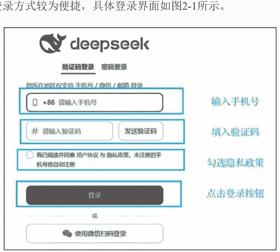

2. 账号密码登录（已注册过账号）

账号密码登录界面如图2-2所示。点击眼睛图标可显示明文密码，忘记密码可点“忘记密码”进入手机验证重置流程。

#### 3. 微信扫码登录

微信扫码登录无需手机号注册，直接扫码即可。操作步骤如下：

1）点击“使用微信扫码登录”。

2）用微信扫码登录，如图2-3所示。

### 2.1.2 App安装

手机端使用更便捷，随时随地操作。安装方式如下。

#### 1. 从应用商店安装

1）打开对应品牌的应用商店，点击顶部搜索框。

2）输入“DeepSeek”后点击搜索。

3）进入应用详情页。

4）确认官方认证标识为蓝色鲸鱼图标。

5）点击“安装”，等待完成即可使用，流程参考图2-4。

#### 2. 通过访问网址安装

1）在手机浏览器输入下载链接：https://download.deepseek.com/app。

2）跳转后按手机品牌选择应用商店渠道下载，或直接下载apk自行安装，示意见图2-5。

## 2.2 初次使用界面导航与功能探索

### 2.2.1 PC端对话界面

PC端主要功能包括：开启新对话、历史对话记录、下载App入口、个人信息、编辑对话消息、文件上传、消息发送、选择R1模型、联网搜索。界面示意如图2-6。

各功能说明：

1）开启新对话：点击后创建全新对话窗口。

2）历史对话记录：存储过往会话，点击可继续。

3）下载App：进入下载页，弹出二维码扫码下载。

4）个人信息：展示与管理账号信息。

5）编辑对话消息：输入内容与AI交互。

6）文件上传按钮：上传文件后对话。

7）消息发送按钮：发送输入内容启动对话。

8）选择R1模型：DeepSeek-R1基于Transformer架构并采用混合专家MoE技术，可按需调用子模型处理，既保质量又提效率。开启后对话更智能。

9）联网搜索：启用后实时检索网络信息。

开启R1模型后，提问前会先展示深度思考过程，随后再给出回答，如图2-7所示。

### 2.2.2 App端对话界面

App端主要功能包括：历史对话、新对话、拍照识文字/图片识文字、上传文件。界面如图2-8所示。

1）历史对话：查看往期记录。

2）新对话：跳转至新建会话页。

3）拍照识文字/图片识文字：拍摄或上传图片自动识别文字。

4）上传文件：上传后可继续对话，模型基于文件内容生成回复，如图2-8所示。

## 2.3 各个版本的使用与对比

DeepSeek的不同版本在模型规模、硬件需求、性能表现及适用场景上差异明显，具体说明如下。

### 2.3.1 满血版

完整版，常被叫做满血版，指的是DeepSeek-R1或V3未做任何裁剪的原厂大模型。以R1为例，其参数规模达到671B，B即Billion，约合6710亿个参数，体量属于超大规模语言模型。这一版本基于DeepSeek自研的底层架构，比如DeepSeek-V3，从头训练而成，没有经过压缩或简化，推理能力与知识储备都保持完整。在复杂逻辑推演、代码编写、超长文本理解等硬核任务上，表现能与ChatGPT等顶尖模型相近，但对算力要求极高。

落地环境必须依赖专业级服务器，比如华为DS版FusionCube A3000这类训推一体机，内存门槛在1TB以上，显存合计要达到640GB以上。典型落地场景集中在政务、金融、医疗等对精度容错率极低的领域，尤其是在数据隐私必须本地化、私有化部署时，满血版是首选。

### 2.3.2 蒸馏版
蒸馏版是借助知识蒸馏技术做过压缩的轻量分支，参数区间在1.5B到70B之间，体量通常只有满血版的十分之一甚至更低。压缩后依然保留核心能力，更适合个人在自己的电脑或手机上做轻量部署，也很适配快速搭原型、以低成本验证AI效果的场景。

硬件门槛相对友好。本地运行32B规模的蒸馏模型，一般需要24GB显存的Nvidia显卡；70B版本则对显存要求更高。手机端则可尝试1.5B级别的版本，比如通过MNN-LLM框架即可流畅调用。

### 2.3.3 量化版
量化版是对模型权重和激活值进行精度压缩后的产物。把原来FP32的高精度数据类型转成FP4、INT8等低精度格式，能显著减小存储体积、降低显存占用。

部署上可借助Ollama、LM Studio等工具实现自适应安装。量化后推理速度会有所提升，但长文本生成和逻辑连贯性会小幅下降。这一版本主要面向开发者做功能测试，或是资源受限的小团队和个人创作者。消费级显卡如RTX 4060Ti就能跑8B量级的量化模型，也兼容AMD/Nvidia显卡甚至CPU推理。

### 2.3.4 对比与选择建议
从参数规模、硬件门槛、任务能力、典型应用四个维度看，三类版本差异明显，如表2-1所示。

表2-1 DeepSeek满血版、蒸馏版、量化版对比

| 维度 | 满血版 | 蒸馏版 | 量化版 |
| :--- | :--- | :--- | :--- |
| 参数规模 | 671B（最大） | 1.5B ~ 70B | 1.5B ~ 70B |
| 硬件门槛 | 专业服务器（1TB内存+双H100卡） | 中高端显卡（24GB以上显存） | 低端显卡/CPU（8GB显存） |
| 任务能力 | 复杂推理、专业领域 | 通用文本生成、简单问答 | 基础问答、快速测试 |
| 典型应用 | 企业级私有部署、高精度需求 | 个人开发者、轻量级应用 | 资源有限环境、原型开发 |

版本选择建议可按身份划分。

#### 1. 企业版本选择
1）满血版：当业务涉及高难度推理，例如金融机构做风险预测、科研机构做专业领域模拟，对模型精度与响应速度有极致要求时，满血版更合适。企业通常已具备1TB内存加双H100卡的专业算力，能支撑671B参数的私有化运行，保障核心业务的高精度和数据安全，维持专业领域的竞争优势。
2）蒸馏版：若业务以通用文本处理为主，比如内容团队写文案、电商平台做客服自动回复等轻量场景，且已有24GB以上显存的中高端显卡，蒸馏版性价比更高。它能满足日常的文本生成与简单问答需求，同时把硬件采购和运维成本压到合理区间。

#### 2. 个人版本选择
个人开发者若主要做通用文本创作，如写小说、写博客，或做日常知识查询，且电脑配备24GB以上显存的中高端显卡，蒸馏版是更合适的选择。参数与推理速度平衡，个人电脑即可流畅运行，用较低成本实现高效创作与信息获取。
如果手头只有低端显卡或CPU，需求也仅限基础问答，比如语法校对、概念快速验证，量化版更实际。虽然量化会影响部分推理表现，但在低硬件门槛下仍能提供基础的语言模型能力，满足有限场景下的使用。

## 2.4 提示词技巧

### 1. 认识提示词
（1）什么是提示词
提示词Prompt是用户与DeepSeek对话的指令语言。可以理解为你发给模型的任务说明，比如输入“写一首关于春天的诗”，这句话就是提示词。模型据此结合自身知识库和语言逻辑，生成符合主题的诗歌。
（2）提示词的作用
提示词的质量直接决定输出的精准度。清晰明确的提示词像一把精准的钥匙，能帮助模型快速抓住意图。提示词相当于人与模型之间的桥梁，把抽象模糊的想法转化为模型可执行的语言指令。只有高质量的提示词，才能让模型抓住需求核心，给出准确相关的回答。

### 2. 构建有效提示词的原则
构建有效提示词主要有三点：明确目标、简洁具体、提供上下文。

（1）明确目标
下指令前先明确任务类型，是文本生成、数据分析还是提供建议。例如“写一篇科技文章”和“解释一个科学概念”，二者在输出形式与深度上完全不同。前者重创作性与逻辑趣味，后者重准确性与条理性。

（2）简洁且具体
模糊表达会导致模型迷路。比如“给我写点东西”太笼统，模型无法判断内容类型、主题和长度。更清晰的说法是“写一篇800字左右关于环保主题的演讲稿”，明确了文体、主题和篇幅，模型就能稳定命中预期。

为体现差异，可对比具体与非具体提示词的输出。
具体的提示词：写一篇800字左右的关于环保主题的演讲稿。
模型会生成结构完整、层层递进的演讲稿，标题为《守护地球家园，从敬畏生命开始》，围绕北极熊啃食塑料的故事切入，引用塑料垃圾年产量、野生动物消失率等数据，并结合历史教训与正面案例，最后落到个体行动号召，整体饱满且符合演讲传播规律。
非具体的提示词：写一篇关于环保主题的内容。
模型则给出发散性文章《极地来信：当冰川化作人类文明的镜子》，从冰芯微塑料、太平洋垃圾带、污染物富集效应等角度展开，内容宏大但结构松散，缺乏明确指向，信息密度高却不够聚焦。

（3）提供上下文信息（可选）
交流时补充背景信息和目标受众，能显著提升结果价值。
1）背景信息的重要性
复杂任务下，前情铺垫很关键。例如写“时间管理的技巧”，补充“文章用于线下给大学生分享”后，模型会在深度、风格、引用规范上做针对性调整。
无背景提示词：写一篇关于时间管理的技巧的文章。
输出偏通用管理方法，标题为《时间管理的本质，是投资决策的艺术》，从时间资产量化、反脆弱系统、时间组合策略等角度展开，语言偏职场专业。
有背景提示词：写一篇关于时间管理的技巧的文章，这篇文章是为了在线下给大学生分享，要写得轻松愉快一些。
输出风格明显转向校园语境，标题为《当代大学生的时间管理秘籍》，用奶茶珍珠、APP防沉迷、番茄钟黑化版等年轻人熟悉的比喻，内容更亲切易懂。

2）目标受众明确
不同受众对理解能力和兴趣点的要求不同。比如科普“雪是怎样形成的”，面向小学生和大学生的表述方式、深度和举例会完全不同。明确受众能让模型自动匹配语言难度与关注点。

# 受众定位如何重塑模型表达

下面用同一主题“雪是如何形成的”，对比带明确读者画像的指令与未指定读者的指令在 DeepSeek 上的呈现差异。

**带读者画像的指令：请为小学生写一篇科普短文，主题是雪是如何形成的。**

模型返回内容：

# 雪花小探案·儿童版

小朋友们可以摊开手心接住一片雪花瞧瞧，这枚六角小冰晶其实是从三千米高空出发的一场奇妙旅行。今天我们就模仿“雪花侦探”，一起破解冬天的秘密吧！

第一步：太阳的蒸发池

妈妈煮面时冒出的白气，就是雪花的雏形。太阳把江河湖海的水变成看不见的水蒸气，这些调皮的小精灵搭着热气流往上飘，越飘越高，最后钻进比冰箱冷冻室更冷的云层，气温通常要到零下十五度左右。

第二步：云中水晶工坊

在像棉花糖的云里，水蒸气冷得发抖，抓住空气中的小灰尘也就是凝结核。就像搭积木一样，它们先长成六边形的小冰晶，再伸出“小胳膊”形成分支，有的像星星，有的像针尖，每一片都不相同。

科学小实验

向玻璃杯哈气，看杯壁上凝结的水珠，这就是水蒸气遇冷的微型演示。

雪花形状对照

- 零下五度左右：薄片状，像小飞碟。
- 零下十五度左右：六棱柱，像铅笔芯。
- 零下二十度左右：像蕨类那样复杂的形态。

雪为什么是白色的

单片雪花其实是透明的。大量冰晶一起反射日光，才呈现出亮闪闪的银白色，就像把透明玻璃珠堆成一座小山也会发亮。

南极的巨型雪怪

南极的雪花最宽能长到三十八厘米。因为那里的空气很干净，冰晶可以慢慢生长好几天，就像安静写作业时字迹更工整一样。

下次下雪时，记得戴深色手套接雪花观察。如果雪花落地就化了，说明地面温度在零度以上；如果能堆雪人，说明从云到地表都处于冻结状态。

现在大家都是“雪花小博士”了，把发现分享给更多伙伴，让大家一起做冬天的小观察员！

**未指定读者的指令：请写一篇科普短文，主题是雪是如何形成的。**

模型返回内容：

# 雪花：天空写下的六行诗

在零下十度的云层里，一粒直径仅零点零一毫米的尘埃正发生奇妙变化。凝结核表面，水分子以极快频率碰撞、凝结、重组，最终编织出自然界最精巧的几何奇迹——雪花。这看似简单的过程，实则蕴含大气科学的精细规律。

## 一、冰晶诞生的密码

云中温度降到零下五度以下，水蒸气不再走常规液化路径，而是直接在凝结核表面结晶。这种相变需要特定条件：相对湿度要达到冰面过饱和，水分子更倾向形成有序晶体而非无序液态。不同温度决定雏形——零下二度形成片状，零下五度出现柱状，零下十五度孕育星状结晶。

凝结核的多样性让形态更加丰富。火山灰、黏土矿物甚至细菌都能成为结晶起点。日本学者中村丰在云室实验中发现，直径零点一微米的碳酸钙颗粒能催化出最完美的六角棱柱，而含机物的气溶胶更易形成复杂枝状结构。

## 二、雪花生长的艺术

冰晶在云中下坠，像在参加形态舞会。穿过不同温湿度的云层时，六个棱角因扩散作用出现差异生长。水分子在棱角处的沉积速度比平面快五到七倍，这种马兰戈尼效应让枝状分叉以微米级速度延伸。美国物理学家利伯布莱特用高速摄影发现，单片雪花在生长过程中可能经历二十次以上形态转变。

温度梯度与湿度的配合造就了形态图谱。在零下十二度到零下十六度的黄金区间，相对湿度每提升百分之五，枝状结晶的分叉次数就增加一级。最复杂的枝状雪花纪录拥有十二级分叉，其形成需要持续三小时的稳定生长环境。

## 三、雪花飘落的旅程

离开母云后，雪花开始与大气博弈。直径五毫米的雪花终端速度约为每秒两米，相当于人慢走的速度。下坠过程中会经历复杂相变：穿过逆温层时表面可能融化成过冷水膜；遇到上升气流时又会重新冻结形成霰粒内核。这种反复相变造就了“霰雪”的特殊降水形态。

在电子显微镜下，每片雪花都是记录大气运动的天然硬盘。生长纹层如同树木年轮，忠实记载穿越云层时的温度波动。现代气象学家通过分析积雪晶体，能反演出整场降雪过程中高空大气的热力学演变。雪花最终落地时，不仅带来冬天的诗意，也在实验室里继续讲述天空的故事。

## 提示词优化的几条思路

多轮对话引导修正
初稿提示词往往达不到理想效果，需要敢于变换表述。比如想让模型写环保文章，初稿可能是“写一篇关于环保的文章”，若不够深入，可改为“写一篇关于塑料污染对海洋生态影响的文章，重点写微塑料的危害和应对方案”。根据模型反馈针对性调整，加入“请详细阐述……”“请从专业视角分析……”等指令，可获得更符合需求的文本。

格式指令
使用“请按照……格式”“请以……形式呈现”等指令，能帮助模型产出特定格式的内容。例如，“请按新闻报道格式写人工智能在医疗领域的应用”“请用对话形式解释量子物理的基本原理”。

重点突出指令
希望内容突出某部分时，可用“重点突出……”“请强调……”等指令。例如，“写人工智能在教育领域的应用，重点突出个性化学习的优势”“写气候变化文章，强调应对的紧迫性”。

记录有效提示词
把能引导出高质量内容的提示词保存下来，形成个人提示词库，日后可快速调用，提高效率。

交流与学习
与其他使用者交流编写经验，学习成功案例，能不断丰富技巧，提升交互效果。

通过以上方法，可以更好地发挥 DeepSeek 的能力，提升对话效率和质量，使其更好地服务工作与学习。

# CHAPTER3
## 第3章
# DeepSeek助力高质量写作

在信息爆炸的时代，优质内容能迅速抓住眼球。但写出让人眼前一亮的文章并不容易。有时灵感枯竭，对着空白屏幕发呆；有时文章快写完却总觉得不完美；有时配图也差一点意思……这些困扰几乎每个创作者都遇到过。

本章探讨 DeepSeek 如何助力高质量写作。从主题挖掘、结构搭建、内容生成，到文章优化和配图生成，都可以借助 DeepSeek 实现。

接下来一起进入 DeepSeek 的世界，看看它如何让创作变得轻松。

## 3.1 文章创作：主题挖掘、结构搭建与内容生成

本节介绍 DeepSeek 在文章创作中如何辅助主题挖掘、结构搭建与内容生成。

### 3.1.1 为什么AI可以辅助写作

简单说，AI 助力写作就是用 AI 参与文章写作的各个环节。AI 如同一个超级智能的“笔杆子”，学习了大量文字知识，掌握语法、词汇和表达方式，按设定要求产出新闻、文案、小说等。

AI 助力写作的优势主要体现在：

1. 庞大的知识库
AI 像一个无尽的智能资料库，学习了文学、新闻、学术研究等大量文本。由此掌握丰富词汇、语句构建技巧和逻辑组织能力。

2. 快速生成文本
AI 处理信息速度极快，收到主题或关键信息后能迅速生成大段连贯文本。如写商业文案时，给出产品卖点和目标受众，AI 即可快速生成条理清晰、重点突出的宣传文案，大幅提升效率。

3. 精准理解语义
AI 具备强大的语义分析和逻辑识别能力，能准确理解输入含义，发现语法错误和逻辑漏洞并修正。还能按作者设定的风格如正式、幽默等调整生成内容，确保符合预期。

4. 提供创作灵感
作者缺乏灵感时，AI 可提供新颖创意构思，帮助突破思维局限。例如构思小说情节时，AI 能根据背景和人物设定提供多种独特发展方案，激发灵感。

5. 持续学习升级
AI 能不断学习进化，随着新知识加入，助力写作能力也在提升。通过分析用户反馈，持续优化算法，逐步提高生成质量。

### 3.1.2 主题挖掘

拿到主题后，创作者常因找角度而卡壳。此时 DeepSeek 就能派上用场。比如写城市环保主题，自己想不出角度，求助 AI 后会得到对比过去与现在的环境状况、讲述普通人践行环保的故事或聚焦环保新技术应用等思路，写作便更顺畅。

主题挖掘分为干货类和热点类。下面分别说明 DeepSeek 的辅助方法。

#### 1.干货类主题挖掘

人们喜欢收藏“干货”，本质上是应对信息焦虑的快捷方式。

##### （1）大脑的快乐按钮
点击“收藏”时大脑会分泌多巴胺，像囤零食一样让人愉悦。比如看到“三天学会PS”的标题，人们还没看内容就觉得赚到知识。

##### （2）知识投资心态
人们会像存钱一样存知识，总想着“现在用不上，以后肯定有用”。这就像老人习惯攒塑料袋，攒得越多越安心。

##### （3）对抗焦虑的盾牌
在信息爆炸时代，点击“收藏”就像按下暂停键，能暂时缓解“别人懂我不懂”的恐慌。

接下来深入解析用 DeepSeek 挖掘干货类主题的方法。以下是提示词框架和案例。

提示词框架：
我是一个【方向】的写作者，我的受众是【受众】，需要写一些关于【主题】的内容。帮我列出【主题】下可以写的50个干货内容选题。

案例：
我是一个【育儿方向】的写作者，我的受众是【0～3岁孩子的新手父母】，需要写一些关于【新手妈妈需要知道的10个知识】的内容。帮我列出【新手妈妈需要知道的10个知识】下可以写的50个干货内容选题。

DeepSeek的输出：
为0～3岁新手父母策划的50个实用选题，涵盖喂养、健康、安全、早教等关键领域，分为喂养与营养、健康与护理、睡眠与作息、早期发展、安全与急救、心理与家庭六大类。例如母乳喂养常见误区、奶粉冲泡攻略、辅食添加信号、发烧应急处理、疫苗反应对照、湿疹护理、睡眠倒退应对、感统训练游戏、家庭安全隐患排查、产后抑郁自测等，整体兼顾痛点、形式创新、科学背书、代际差异和工具赋能。

内容设计逻辑：
1. 痛点精准：针对呛奶、睡眠倒退等高频焦虑场景
2. 形式创新：结合图解、清单、实验数据增强可信度
3. 科学背书：引用WHO喂养指南、AAP安全建议等权威来源
4. 代际差异：加入现代育儿与传统观念的冲突解决方案
5. 工具赋能：提供自查表、计算公式等实用工具

建议采用“问题场景+科学原理+行动清单”的三段式结构，配合短视频、信息图等多形态内容矩阵传播。

在上述案例中，DeepSeek 围绕给定主题生成了50个干货类选题。用户每次使用时，只需修改提示词框架中的主题、受众和方向，DeepSeek 便可针对新主题生成50个干货类选题。

#### 2.热点类主题挖掘

人们追热点的三大原因。

（1）快速获取重点信息
热点像“信息筛子”，帮助从海量资讯里快速抓住重点。比如社会新闻，看几条热搜就能了解大家在讨论什么。

（2）社交刚需
热点是“社交硬通货”，聊天没话题时一句“你听说×××了吗？”就能破冰。分享热点能刷存在感，讨论八卦能拉近关系。

（3）情绪共鸣
热点常带有强烈情感，搞笑段子让人开心，灾难新闻引发同情。参与讨论既满足好奇心，也释放情绪。

接下来解析用 DeepSeek 挖掘热点类主题的方式。以下是提示词框架和案例。

提示词框架：
我是一个【方向】的写作者，目标受众是【受众】，最近【某个事件】是热点。请你结合我的写作方向和目标受众，思考热点事件如何与我的方向结合，列出我可以写的50个选题。

案例：
我是一个【亲子方向】的写作者，目标受众是【0～3岁的新手父母】，最近【×××回归】是热点。请你结合我的写作方向和目标受众，思考热点事件如何与我的方向结合，列出我可以写的50个选题。

DeepSeek的输出：
为0～3岁新手父母设计的50个结合“×××回归”热点的亲子选题，涵盖传统文化、自然教育、家庭互动、成长启蒙等维度，兼具实用性和情感共鸣。包括传统文化与亲子启蒙、自然教育与家庭互动、慢生活与育儿理念、健康养育与文化传承、情感联结与社会价值五大方向。例如用植物染视频带宝宝认识自然色彩、用传统竹编玩具培养精细动作、家庭迷你菜园激发好奇心、慢节奏育儿哲学对抗焦虑、传统节日亲子互动等选题。

- 49. 以××ד紫气东来”衣柜为切口，谈家居空间的文化意蕴设计
- 50. 新手父母如何自我成长：透过×××三年沉淀看育儿焦虑的舒缓路径

##### 选题延展方向

- 1. 呈现形式：可搭配短视频栏目如“1分钟学非遗早教”、制作传统玩具的图解步骤、邀请非遗传承人谈育儿的访谈等多样化载体。
- 2. 深度结合：从×××视频中提取具体画面，例如漆器制作、缫丝流程等，转化为可落地的亲子互动方案。
- 3. 地域联动：整理各地非遗体验馆、传统文化亲子工作坊等线下资源清单供参考。
- 4. 实用工具：附上“家庭非遗早教工具包”清单，涵盖植物染料、安全竹材等物料的获取渠道。

把传统文化拆解成可感知、可操作的养育实践，既能借上热点流量，也能为新手父母输出兼具文化厚度与实操价值的育儿指南。

以上案例里，DeepSeek围绕设定主题批量产出50个热点选题。使用者只需在提示词框架里替换主题、受众和事件，模型就能针对新方向再生成50条选题。

### 3.1.3 文章骨架搭建

写文章时思路混乱、顺序不清是常见困扰。这时AI可充当结构助手，它熟知多种常用框架。写议论文就给“提出问题-剖析问题-给出对策”的路子；写记叙文就按“起因-经过-结果”排列。依据写作目的与主题，AI先把骨架搭好，相当于建房先有蓝图，后续填充内容就会顺畅。

下面详细说明常见结构类型及借助DeepSeek搭建结构的方法。

#### 1.常见文章结构

常见结构有金字塔结构、并列清单式结构、STAR结构、三幕式叙事结构、SCQA结构、PREP结构。

##### （1）金字塔结构

在表达中，金字塔结构像垒积木，先把最核心的结论置顶，再用理由和例证层层托起，让人一眼抓住重点，越往下越清晰。例如说服老板开发健身App，可这样安排：

**塔尖结论：** “建议为上班族打造一款健身App，填补市场空白。” 一句话点明立场。

**中层论据：**
论据1：上班族久坐普遍，超七成有健身需求但时间碎片。
论据2：现有竞品操作繁复，“10分钟高效训练”供给不足。

**底层论证：**
数据：引用《xx报告》指出60%用户愿为短时课程付费。
案例：对比Keep与FitnessAI的用户差评，凸显简化操作的需求。

##### （2）并列式/清单式结构

围绕一个主题罗列若干同等重要的观点或案例，各点独立又共同支撑主题，用段落、连接词或序号依次呈现。

特点如下。

- 上手容易：对新手友好，不必构思复杂逻辑，只需围绕主题罗列相关点逐一展开，如“如何保持好心情”可写“多运动”“听音乐”“与朋友交流”。
- 观点独立且均衡：各点内容不重叠，篇幅与详略保持一致。如写“养宠物的好处”，“陪伴”“责任感”“乐趣”三点论述量大致相当，显得平衡。

##### （3）STAR结构

- Situation情景：事件发生的背景。如公司要进入新市场，该市场竞争激烈。
- Task任务：在此背景下需达成的目标。如半年内产品占有率达10%。
- Action行动：为完成任务采取的具体措施。如做市场调研、分析竞品、调整功能、策划推广。
- Result结果：最终取得的成效。如占有率达12%，销售额提升。

##### （4）三幕式故事叙述结构

1）开端
- 背景交代：交代时间地点环境。如《哈利·波特》首章写哈利在德思礼家的压抑生活。
- 人物塑造：呈现主角特质。如《简·爱》开篇体现简·爱自尊倔强。
- 冲突引入：制造矛盾。如《泰坦尼克号》中杰克与露丝因阶层产生张力。

2）发展
- 矛盾升级：冲突加剧。如《骆驼祥子》中祥子买车被劫、被迫结婚，矛盾深化。
- 行动与阻碍：主角行动受阻。如《当幸福来敲门》中克里斯实习无收入且竞争激烈。

3）结局
- 高潮：矛盾集中爆发。如《复仇者联盟4》终战。
- 冲突收束：矛盾得以处理。如《西游记》师徒取经成功。
- 主题升华：深化意蕴。如《阿甘正传》结尾送儿子上学升华人生思考。

##### （5）SCQA结构

- Situation情境：描述背景或现状的客观事实。如“近五年国内智能手机市场持续增长，消费者对性能和拍照要求提高。”
- Complication冲突：指出情境中出现的矛盾或挑战。如“近期竞争白热化，各品牌推出高性价比产品，我司份额受压。”
- Question疑问：从冲突引出核心问题。如“如何在激烈竞争中提升竞争力、夺回份额？”
- Answer回答：给出对策或观点。如“加大研发投入推出创新拍照产品，同时优化营销精准触达目标客群。”

##### （6）PREP结构

PREP是清晰表达的常用逻辑，含观点、原因、例证、重申观点四步。

- P Point观点：核心要表达的内容。
- R Reason原因：支撑观点的依据。
- E Example例子：具体事例增强说服力。
- P Point重申：再次点题加深印象。

以“运动对健康重要”为例：
观点：运动对健康至关重要。
原因：能增强心肺、提升免疫、改善身材与精神。
例子：朋友小李曾体弱疲惫，后坚持跑步健身后少生病、精力充沛、工作效率提高。
重申：因此养成规律运动习惯很有必要。

#### 2.DeepSeek辅助结构搭建

上文已梳理常见结构。若已明确适用类型，可让DeepSeek生成对应大纲；若不确定，也可让模型直接规划。

结构已明确时可用以下提示词框架：
我是一个【方向】的写作者，目标受众是【受众】，我要写主题为【主题】的文章。帮我列一个【文章结构】格式的大纲。

案例：
我是一个【AI方向】的写作者，目标受众是【想学习AI的初级学习者】，我要写主题是【AI会改变我们未来的行为模式】的文章。帮我列一个【金字塔】格式的大纲。

DeepSeek的输出示例为按金字塔设计的初级学习者大纲，依次给出核心论点、个人行为影响、社会协作重塑、伦理习惯演变等二级论据，并以技术驱动原理和行动建议收尾，符合先总后分、从浅入深的认知规律。

结构未明确时可用框架：
我是一个【方向】的写作者，目标受众是【受众】，我要写主题为【主题】的文章。帮我列一个大纲。

以AI改变行为模式为例，输出包含引言、当下行为密码改写、未来演变预测、AI时代生存法则、结语等模块，并建议加入“行为实验室”小贴士、生活化类比、可视化锚点等增强可读性。

### 3.1.4 内容填充

选题与框架确定后，AI即可展开内容生成。它会按既定方向填充段落，如同完成填空题。以旅游景点为例，AI能给出地理位置、特色景观、游玩项目等基础描述，作者再补充个人体验、本地小众美食并润色即可成文。

#### 1.写标题

##### （1）标题的3个关键层面

信息过载下标题作用突出。
从读者看，标题是筛选入口。精准吸睛的标题帮助读者快速定位需求，如健身爱好者会被“高效计划，30天塑形”吸引。
从创作者看，标题是作品代言，浓缩核心观点与表达意图，能更准确传达内容价值。
从传播看，标题是传播放大器。社交媒体上高传播内容往往具备强感染力的标题，能触发分享。

##### （2）好标题的4个特点

1）抓眼球
- 制造悬念：用疑问或省略引发好奇，如《人类真由猿进化？最新研究或颠覆认知》。
- 用数字：数字具象直观，如“10个提效小技巧，让工作事半功倍”。
- 借热点：结合流行文化元素，如“《狂飙》背后的法律常识你了解多少？”

2）准确清晰
- 点明主题：一眼知晓内容，如“如何挑选适合自己的运动方式”。
- 涵盖关键信息：把核心要素放进标题，如“2024年全球经济趋势预测与分析”。

3）简洁明了
- 字数适中：一般20字内，快速传递要点。
- 句式简单：避免复杂结构，如“学会三招，轻松处理人际关系”。

4）引发共鸣
- 贴合需求：直击痛点，如“职场新人如何缓解工作压力”。
- 触发情感：用情感词触动内心，如“母爱，是世间最伟大的力量”。

##### （3）使用DeepSeek辅助写标题的4个步骤

1）梳理内容提炼主题。
2）向DeepSeek提问，列出主题及标题要求。
3）获取多条生成标题。
4）筛选优化：评估吸引力、简洁度、契合度；结合受众年龄、职业、兴趣调整语言风格与切入点。

提示词框架：
请你帮我优化标题，要求：【要求】。我的标题是：【标题】

案例：要求制造悬念、引发共鸣，标题为“奶粉冲泡全攻略：水温、比例、储存避坑指南”。
优化示例包括《冲错全毁！90%家长忽略的奶粉三大禁忌》《当心！这3个冲泡动作在偷走宝宝营养》等，优化逻辑为数据具象化、制造危机感、身份代入、利益驱动。

#### 2.写开头

文章开头承担多重功能。

（1）激发阅读兴趣

从开头到结尾：用 DeepSeek 把一篇文章搭起来

开头的工作远不止“写几句话”。一个有力的开篇能决定读者是否愿意继续往下看。它主要承担五方面作用。

1. 抓住注意力
开头像投钩，越快越准越好。读者在信息流里停留的时间很短，第一句就要制造好奇。比如写深海探秘，开篇点出海底藏着一座梦幻王国，自带光的鱼群、像树一样生长的珊瑚，还有大量未知谜团，读者就会忍不住想知道下面还有哪些奇观。

2. 点明主题
开头要给读者一张导航图，明确这篇文章要聊什么。写英语学习时，可以先说英语是全球通用工具，和生活、职业发展紧密相关，然后提出“究竟该怎么学好”这个核心问题，主题就立刻清晰了。

3. 定下基调
前几句会奠定整篇文章的情绪色彩。讲悲伤往事时，用“雨天阴沉，乌云压得很低，仿佛要吞没整个世界”会制造压抑氛围；写轻松游记时，用“阳光明媚的周末，我们兴奋地出发去郊外”则传递出愉快松弛的感觉。

4. 埋好伏笔
好的开头会为后文铺路。写悬疑故事时，先提示“这个小镇看似寻常，最近却接连出现怪事”，读者就会带着疑问往下找线索，阅读体验更连贯、有悬念。

5. 建立连接
让读者觉得文章跟自己有关，共鸣感才会起来。写健康饮食时，用“每个人都希望自己和家人健健康康，饮食是关键”这样的说法，就把内容和读者的生活需求挂钩了，更愿意读下去。

接下来是把这些原则交给 DeepSeek 来落地，先从写开头开始。

一、没有大纲时怎么让 DeepSeek 写开头

提示词框架
请帮我写一个开头，【要求】可选。主题是：【主题】。

使用示例
请帮我写一个开头，要求：吸引注意、为后文埋伏笔。主题是：AI 会改变我们未来的行为模式。

模型给出的示范
它先用一个清晨的智能家居片段切入，让人有代入感：光线刚透过窗帘，智能枕头已提前十五分钟调好温度，翻身时咖啡机开始研磨，腕戴设备正用脑波数据计算当天的最优通勤路线。随后点出这类“贴心服务”正像温水煮青蛙一样重塑行为底层逻辑，并引用神经科学的扫描数据说明当代人决策神经元的激活速度在十年间下降了约三成，说明有一种隐形力量在接管选择。接着把话题从起床、约会延伸到道德判断，提示这场静默的行为革命已超出科幻想象。整体用上场景化描写、可量化的数据冲击、温水煮青蛙和隐形操盘手等隐喻，以及重塑、接管、编织等主动动词，既制造张力也为后续谈算法驯化、认知外包等内容预留空间。

设计解析要点
场景代入让读者在日常中感受 AI 的渗透；数据佐证把抽象概念落地；隐喻制造认知紧张；悬念从具体干预推向价值层面；动词的选择强化了变革的主动性。

二、有大纲时怎么让 DeepSeek 写开头

提示词框架
请帮我写一个开头，要求：【要求】。我的大纲是【大纲】。

使用示例
要求：吸引注意、为后文埋伏笔。大纲围绕“AI 将重塑人类未来行为模式”，分个人行为影响、协作方式重构、伦理习惯演变、底层技术原理、行动指南五层展开。

模型给出的示范
早上七点，智能手环在浅睡期轻震，床头灯随光线自动调亮，咖啡机开始研磨前一天配送的云南小粒咖啡——看似普通的早晨，背后暗含二十多次算法决策。通勤优化、资讯排序、会议协调、健身计划都在无形中被调度。AlphaGo 战胜李世石让人惊叹，ChatGPT 通过图灵测试让人警惕，而真正的颠覆却藏在抬手看表的下意识动作里，藏在购物车自动补货的惯性选择里，藏在对着空气说“调暗灯光”的自然反应里。这场由硅基智能发起的重构正在重新定义何以为人。

三、结尾写作的七个功能

1. 概括内容
把全文要点收拢，让读者快速回溯核心信息。比如介绍动物习性后总结“不同动物用各自方式适应自然以求生存繁衍”。

2. 强化主题
再次点题，让主张更扎根。比如谈环保时强调“保护环境是每个人的责任，关乎人类未来”。

3. 引发思考
抛出问题或留白，促进行动思考。比如谈 AI 时问“在便利与挑战并存的时代，人该如何把握自己的未来”。

4. 升华情感
把情绪拔高到精神层面。故乡文可以收束到“故乡是精神家园，承载过去与未来，随时相伴”。

5. 呼应开头
首尾照应让结构更完整。开头说“我一直想看大海”，结尾说“大海的浩瀚印在心里，梦想已实现”。

6. 提出展望
对未来做合理推演，给人希望。科技创新结尾可写“随着进步，更多成果将让世界更美好”。

7. 推荐行动
把认知转化为具体行为。健康饮食文可呼吁“从今天起坚持运动、合理饮食，为健康负责”。

用 DeepSeek 写结尾的办法

提示词框架
请帮我写一个文章结尾，要求：【要求】，主题是【主题】，前面内容是【上文内容】。

使用示例
要求：强化主题、引发思考、建议行动。主题是高效时间管理：5 个让生活更从容的诀窍。上文包含番茄工作法、每日三件核心事、时间块规划、手机勿扰、完成奖励等五条方法。

模型给出的示范
深夜电子钟跳动时，“时间不够用”的焦虑常让人窒息。本文的五条做法像五把钥匙，不仅提升效率，更让生命恢复弹性。番茄钟训练专注的节奏感，核心任务清单斩断杂务迷雾，彩色时间块在日程里建起秩序，数字结界守护心流，星星贴纸则把坚持变成荣誉。
真正的从容不是和时间赛跑，而是让时间成为盟友。划掉第三件核心任务时，你是在对生活主权做郑重声明；那些被填满的 48 个时间格子，何尝不是写给未来的情书。明天清晨先用红笔圈出三件“生命刻度”，从一个 25 分钟的专注结界开始，让每次铃声都成为告别散漫的号角。当第一颗银色星星亮起，你会明白高效人生是无数被温柔驯服的当下连成的星轨。让这些时间密码开启你的下一章从容吧。

四、用 DeepSeek 写初稿

提示词框架
我的读者是【受众】，我的大纲是：【大纲】，请据此写一篇初稿。要求：【要求】。

使用示例
读者是想学时间管理的人。大纲是番茄工作法、每日三项核心任务、时间块规划、手机勿扰、完成奖励五法。要求通俗易懂、结构清晰。

模型给出的示范
标题可定为告别手忙脚乱，5 个零门槛时间管理法。先点出常见痛点：待办清单很长却只做低价值事。方法一把时间切成水果块，25 分钟专注加 5 分钟放松，循环四次后休息更久。方法二每天只吃三只青蛙，睡前写下必须完成的三个具体事，完成即划掉。方法三用时间块拼图，给深度工作、沟通、充电各配时段。方法四给手机戴口罩，飞行模式、锁抽屉、强制锁屏等物理隔离干扰。方法五用集星星游戏奖励自己，完成任务贴星星，坚持就有实质回馈。最后提醒先从一件小事开始，今晚就写下明日的三只青蛙。

五、文章优化：文案润色

润色的必要性
表达更清晰，初稿常有逻辑跳跃；吸引力更强，丰富词汇让文章更好读；信息更精准，避免歧义；风格更统一，匹配受众和场景。

常用润色指令
语法纠错、冗余删减、细节补充、风格统一、衔接强化、金句提炼、情感调节、文体转换、修辞增添、跨媒介改写等。给模型文案和具体要求，它就能在保留原意的前提下把表达打磨得更顺、更有传播力。

把开头、结尾、初稿和润色串起来，就能用 DeepSeek 快速完成一篇结构完整、读起来顺畅的自媒体文章。

番茄钟实战要点

把计时器调成25分钟进入全神投入的状态，铃声响起就立刻停手并强制小憩5分钟。刷短视频不算休息，起身喝水、拉伸放松颈肩才是正解。

为何管用：人的高度专注时限大约只有四分之一小时。短促冲刺后马上补充能量，和那种坐三小时却心思游移的低效模式相比，实测效率往往能提升数倍。

入门小贴士
- 连续完成四个周期后，可把下一次休整延长到15到20分钟，让大脑彻底回血。
- 计时工具建议用 Forest 或系统自带计时，不要用社交类 App 来计，避免被信息流带走注意力。

第二招：每天只啃三只青蛙——少而精

### 3.2.2 SEO优化

搜索引擎优化是一套成体系的打法，通过精细调整网站内容与结构，让页面更契合搜索规则，从而在自然结果里占据前位，获取免费流量。

说人话就是让内容更容易被陌生人白嫖搜到。比如你开了一家手工水饺店，没做优化店铺就藏在胡同深处，只有熟客才找得到。做了优化后，把招牌改成“北京最好吃的手工鲜肉水饺”，把店面信息整理清楚让地图能定位，再请美食博主做外链背书，这时用户搜“北京手工水饺”，你的店就有机会排前三。

#### 1. SEO优化策略

1）通用内容优化思路如下。
- 优先做长尾需求词：围绕细分场景挖掘长尾，如“微信搜索优化技巧”，竞争小且更精准。
- 语义扩展：借助工具判断搜索意图，补充同义词和问句词，如“如何提升知乎回答排名”。
- 自然铺排：标题、首段、小标题、结尾合理安放主词，密度保持在2%到3%，别堆砌。

2）提升质量与结构的方法如下。
- 原创与洞察并重：提供独家数据、案例拆解或行业观察，如“微信搜索算法更新趋势解读”。
- 结构化呈现：多用 H2/H3、小标题、分点、加粗要点，提升可读性和抓取效率。
- 持续更新维护：定期回炉旧文，补充微信、知乎等平台的新规则与时效信息。

3）跨平台联动，搭建内容矩阵。把微信长文拆成知乎问答或专栏，把知乎高赞回答整合成微信专题，形成互导。

4）外部导流设计。比如在知乎回答里合规放置微信号二维码，在微信推文中回链至知乎回答。

#### 2. 微信公众号SEO优化

微信端搜索优化，指让号内文章在搜一搜里获得更高曝光与更好排名。

##### 为什么要做微信SEO？
- 扩大触达：微信用户体量大，优化后文章更容易被看见。
- 精准获客：通过特定关键词进来的读者对主题已有兴趣，转化率更高。

##### 操作路径
1）核心词挖掘
- 在微信搜一搜输入目标词，参考下拉提示挑选有搜索量的词。若词未出现通常需求不足。
- 观察头部文章用的词与打法，借鉴参考。

2）账号名称优化
- 名称最好带领域词，如“xx 美食”“xx 说 AI”。
- 风口项目或细分赛道越早注册越占先机。

3）账号简介优化：简介同样影响搜索权重，嵌入专业领域词更容易被检索到。

4）菜单栏优化
- 自定义菜单能让用户快速了解账号能提供什么服务。
- 搜一搜会根据用户意图，推荐匹配的菜单项或账号特性。

5）标题优化：标题要吸睛且包含主关键词，用户第一眼就决定是否点开。

6）正文优化：开头集中出现主关键词，提升密度与覆盖面；适度加入长尾词与同义词，拓宽匹配范围。

### 3.2.3 DeepSeek辅助SEO优化实例

以下以微信号 SEO 为例，说明 DeepSeek 如何给出可落地的优化建议。

#### 1. 公众号名称SEO优化

Prompt 模板：
我是一个【方向】的创作者，目前账号名称是【账号名称】，请从微信搜索优化角度再给出10个名称建议。

案例：
我是一个【亲子】方向的创作者，目前账号名称是【xx妈妈育儿】，请从微信搜索优化角度再给出10个账号名称。

DeepSeek 给出的建议兼顾关键词布局与用户搜索习惯。示例名称包括 xx 妈妈育儿指南、宝妈成长手记 xx、亲子成长研究所 xx、智慧父母养成记、育儿知识宝库 xx、家庭教养研究院、xx 妈妈的育儿日记、科学育儿方法论、亲子时光管理家、新手妈妈成长营 xx。

优化要点：
1. 高频核心词前置，如育儿、亲子、妈妈。
2. 长尾词延伸，如指南、方法论、研究院，提升权重。
3. 场景词增强关联，如成长、时光、家庭。
4. 价值词提升点击，如智慧、科学、管理。
5. 保留品牌标识 xx 增强辨识。
6. 名称长度控制在6到8字，适配移动端。

#### 2. 公众号简介SEO优化

Prompt 模板：
我是一个【方向】的创作者，目前账号简介是【账号简介】，请从微信搜索优化角度帮我优化一下。

案例：
我是一个【亲子方向】的创作者，目前账号简介是【关注××妈妈，带你解锁育儿路上的各种知识】，请从微信搜索优化角度帮我优化一下。

DeepSeek 给出的结果提供三类方向。

专业版示例强调权威背书与0～6岁科学育儿干货库，并用育儿难题解决方案、亲子沟通秘籍覆盖高频词，配合福利诱饵提升转化。

场景痛点版以深夜哄睡崩溃、挑食大战等共鸣开场，承诺辅食食谱、情绪管理、早教游戏等具体内容，并以用户见证数据增强说服。

情感价值版突出不做完美妈妈只做快乐妈妈的情感诉求，结合儿童心理专家背书与不焦虑育儿圈的差异化定位。

组合建议保留个人 IP，简介中轮换使用育儿干货、早教游戏、情绪管理等长尾词，每月更新数字与福利，保持新鲜，并在文末添加育儿经验、科学育儿等话题标签。

#### 3. 公众号菜单栏SEO优化

Prompt 模板：
我是一个【方向】的创作者，目前菜单栏包括【菜单栏】，请从微信搜索优化角度帮我优化一下菜单栏。

案例：亲子方向，现有菜单联系我、育儿知识。

DeepSeek 给出的方案围绕关键词布局、搜索习惯、内容导航与转化设计。

一级菜单示例：育儿干货大全，下设0～3岁早教指南、入园入学攻略、亲子沟通秘籍；免费资源领取，下设绘本清单 PDF、早教游戏视频、辅食食谱大全；妈妈交流基地，下设加我领课程、宝妈互助社群、专家在线答疑。

优化逻辑包括每个菜单嵌入2到3个热搜词，内容从宽泛拆分为具体场景，资源领取设置关注后下载等阶梯门槛提升粘性，并在专家答疑处展示资质强化信任。

数据建议每周查看后台菜单分析，对点击低于5%的入口进行 A/B 测试，并根据季节增设亲子游攻略等临时入口。

#### 4. 公众号文章标题SEO优化

Prompt 模板：
我是一个【方向】的创作者，目前文章标题是【文章标题】，请从微信搜索角度优化一下标题。

案例：亲子方向，标题为2岁宝宝喂养建议。

DeepSeek 给出的思路为前置高频词、增加长尾词、强化数字提示、加入场景痛点词。

备选标题示例：2岁宝宝喂养指南，儿科医生总结的5大营养关键+30天食谱；2岁宝宝不爱吃饭怎么办？3个科学喂养诀窍+每日餐单示例；2岁宝宝营养全攻略|避开8大喂养误区的黄金喂养法附食谱等。

技巧包括加入地域词、强调结果导向、使用季节词、制造冲突场景、增加权威背书。

## 3.3 辅助制作高质量内容卡片

写作时常遇到配图与文字气质不搭的问题，图文难以形成互补。本节介绍借助 DeepSeek 制作高质量配图的方法。

内容卡片是将重点提炼并以卡片形式呈现的载体，通过结构化排版清晰罗列要点，帮助用户快速获取信息。

利用 DeepSeek 可快速生成卡片的网页源码文件，节省制作时间，尤其适合并列式结构，能直观呈现平行信息。

Prompt 模板：
我要写一篇关于【主题】的文章，以下是内容：【内容】请把以上内容用 HTML 形式输出。
要求：符合【平台】知识卡片风格；【配色风格】；文字清晰；布局有呼吸感疏密有致；包含可爱图标用色丰富；完整输出可运行的 HTML 源文件不省略重复代码；提供 PNG/JPEG 下载按钮，下载的图片完整且无按钮。

案例：主题时间管理，内容为番茄工作法每日3个核心任务时间块规划表手机勿扰模式完成奖励小星星，要求同上。

```html
<!DOCTYPE html>
<html lang="zh-CN">
<head>
    <meta charset="UTF-8">
    <title>时间管理知识卡片</title>
    <link rel="stylesheet" href="https://cdnjs.cloudflare.com/ajax/libs/font-awesome/6.0.0/css/all.min.css">
    <style>
        body {
            background: #f0f7ff;
            display: flex;
            justify-content: center;
            align-items: center;
            min-height: 100vh;
            margin: 0;
            font-family: '微软雅黑', sans-serif;
        }

        .card {
            background: white;
            border-radius: 20px;
            padding: 30px;
            width: 500px;
            box-shadow: 0 8px 20px rgba(143, 168, 191, 0.2);
            position: relative;
        }

        .title {
            color: #2c3e50;
            text-align: center;
            font-size: 24px;
            margin-bottom: 25px;
            font-weight: bold;
        }

        .list {
            list-style: none;
            padding: 0;
            margin: 0;
        }

        .list-item {
            display: flex;
            align-items: center;
            margin: 18px 0;
            padding: 12px;
            background: #f8faff;
            border-radius: 12px;
        }

        .icon {
            font-size: 24px;
            width: 40px;
            height: 40px;
            border-radius: 50%;
            display: flex;
            align-items: center;
            justify-content: center;
            margin-right: 15px;
        }

        .text {
            color: #34495e;
            font-size: 16px;
            line-height: 1.6;
        }

        .download-btn {
            background: #6c5ce7;
            color: white;
            border: none;
            padding: 12px 24px;
            border-radius: 8px;
            font-size: 16px;
            cursor: pointer;
            display: block;
            margin: 25px auto 0;
            transition: 0.3s;
        }

        .download-btn:hover {
            background: #5b4bc4;
        }
    </style>
</head>
<body>
    <div class="card">
        <div class="title">时间管理知识卡片</div>
        <ul class="list">
            <li class="list-item">
                <div class="icon" style="background: #e8f5e9; color: #4caf50;"><i class="fas fa-clock"></i></div>
                <div class="text">番茄工作法（25分钟专注+5分钟休息）</div>
            </li>
            <li class="list-item">
                <div class="icon" style="background: #e3f2fd; color: #2196f3;"><i class="fas fa-list-check"></i></div>
                <div class="text">每日列出3个核心任务</div>
            </li>
            <li class="list-item">
                <div class="icon" style="background: #fff3e0; color: #ff9800;"><i class="fas fa-calendar-alt"></i></div>
                <div class="text">使用时间块规划表</div>
            </li>
            <li class="list-item">
                <div class="icon" style="background: #fce4ec; color: #e91e63;"><i class="fas fa-mobile-alt"></i></div>
                <div class="text">设置手机勿扰模式</div>
            </li>
            <li class="list-item">
                <div class="icon" style="background: #f3e5f5; color: #9c27b0;"><i class="fas fa-star"></i></div>
                <div class="text">完成奖励自己小星星</div>
            </li>
        </ul>
        <button class="download-btn" onclick="downloadCard()">下载卡片</button>
    </div>

    <script>
        function downloadCard() {
            // 此处为简化示例，实际需使用html2canvas等库实现截图下载
            alert('下载功能需要集成html2canvas库才能实现。');
        }
    </script>
</body>
</html>
```

## 图标配色指南

```css
.icon-1 { background: #ff7675; color: white; }
.icon-2 { background: #74b9ff; color: white; }
.icon-3 { background: #55efc4; color: white; }
.icon-4 { background: #a55eea; color: white; }
.icon-5 { background: #ffd700; color: white; }
</style>
</head>
<body>
    <div class="card" id="captureCard">
        <h1 class="title">⏰时间管理指南</h1>
        <ul class="list">
            <li class="list-item">
                <div class="icon icon-1"><i class="fas fa-clock"></i></div>
                <div class="text">番茄工作法 (25分钟专注+5分钟休息)</div>
            </li>
            <li class="list-item">
                <div class="icon icon-2"><i class="fas fa-tasks"></i></div>
                <div class="text">每日列出3个核心任务</div>
            </li>
            <li class="list-item">
                <div class="icon icon-3"><i class="fas fa-calendar-alt"></i></div>
                <div class="text">使用时间块规划表</div>
            </li>
            <li class="list-item">
                <div class="icon icon-4"><i class="fas fa-mobile-alt"></i></div>
                <div class="text">设置手机勿扰模式</div>
            </li>
            <li class="list-item">
                <div class="icon icon-5"><i class="fas fa-star"></i></div>
                <div class="text">完成奖励自己小星星</div>
            </li>
        </ul>
        <button class="download-btn" onclick="downloadCard()">
            保存知识卡片
        </button>
    </div>

    <script src="https://html2canvas.hertzen.com/dist/html2canvas.min.js"></script>
    <script>
        function downloadCard() {
            const card = document.getElementById('captureCard');
            const btn = document.querySelector('.download-btn');

            // 隐藏下载按钮
            btn.style.display = 'none';

            html2canvas(card).then(canvas => {
                const link = document.createElement('a');
                link.download = 'time-management-card.png';
                link.href = canvas.toDataURL();
                link.click();

                // 恢复下载按钮
                btn.style.display = 'block';
            });
        }
    </script>
</body>
</html>
```

DeepSeek生成完内容后，在页面里点一下“运行HTML”（见图3-1），页面就会即时把结果渲染成HTML形式。

```javascript
link.click();
btn.style.display = originalDisplay; // 恢复按钮
}).catch(err => {
    console.error('生成图片失败:', err);
    btn.style.display = originalDisplay;
});
}
</script>
</body>
</html>
```


图3-1 DeepSeek输出HTML内容后单击“运行HTML”选项

完成上一步后，再点击“保存知识卡片”，即可把对应的图片保存到本地，操作示意如图3-2所示。

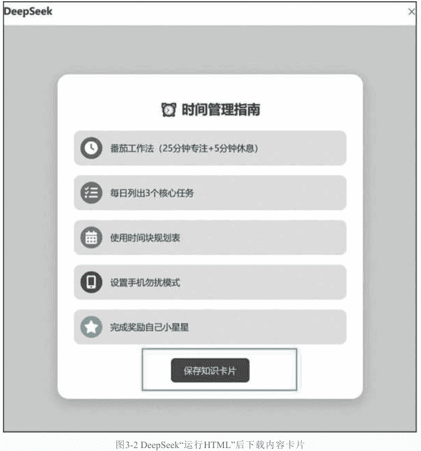

图3-2 DeepSeek“运行HTML”后下载内容卡片

按此流程操作，能迅速得到与正文高度贴合的知识卡片。精致卡片让图文融合度更高，阅读体验和传播效果都会随之提升。

# CHAPTER4 第4章 重塑企业办公

本章先梳理人工智能正在如何改变办公形态，再结合DeepSeek说明任务安排与文件处理的实操思路。

## 4.1 AI重塑企业办公的核心维度

在合规前提下，人工智能正不断拓宽传统办公的效能上限。涵盖资料撰写、合同模板自动生成、知识产权跟踪、招聘与面试等多个环节，系统先帮助企业把规则做对，再通过改造协作方式、决策链路和资源配置，让效率真正提升。下面归纳其主要作用面。

### 1. 提升工作效率
- 流程自动跑：重复性工作比如录入数据、归档资料、归类邮件可以交给模型处理，降低人工干预，加快整体节奏。
- 智能协作伙伴：像DeepSeek、飞书里的智能助手这类工具，能迅速检索资料、起草报表、排程会议，帮员工省下大量时间。
- 决策提速：借助分析模块，系统可处理大量数据并输出图表，为管理层提供清晰依据。

### 2. 优化沟通与协作
- 会议智能支持：自动转写发言、整理纪要并提炼要点，让会议更高效。
- 跨语沟通：即时翻译功能消除语言隔阂，帮助全球团队顺畅配合。
- 个性化建议：依据使用习惯和任务需求，系统会推荐契合的协作手段或素材。

### 3. 数据驱动决策
- 洞察与预判：从庞大数据中挖掘可用信息，辅助判断市场走向和客户偏好，进而合理调配资源。
- 定向推送：结合工作内容向个人推送学习材料、工具或方法，促进能力成长。
- 异常提醒：持续监控业务指标，一旦出现偏离即发出警报，降低运行风险。

### 4. 优化运营
- 人力支出下降：自动化手段减少对基础岗位的依赖，带来成本节约。
- 资源使用更合理：分析使用数据助力企业精细化调配，减少闲置浪费。
- 成效提升：任务周期缩短，时间成本随之下降。

### 5. 创新工作方式
- 自动撰写：依需求自动产出文件、汇报、邮件，减少手动写作负担。
- 智能体执行：智能体能模拟人工处理客服、技术支持等复杂场景。
- 远程协作：智能排程与协作平台让异地办公更流畅。

### 6. 个性化与智能化体验
- 定制流程：依据习惯和偏好为每人打造专属的工作路径与工具组合。
- 自适应学习：按学习进度推送匹配的课程，提升专业能力。
- 体验改善：分析反馈意见，助力优化办公氛围与企业文化，提高满意度。

### 7. 推动企业数字化转型
- 基础设施升级：推动ERP、CRM等系统向智能化演进。
- 打破信息孤岛：实现跨部门、跨平台的数据互通与共享。
- 业务创新：依托智能客服、个性化推荐等能力，探索新的服务形态。

随着技术持续成熟，办公形态会愈加智能、敏捷。接下来结合实务场景，说明如何借助该模型优化流程与任务。

## 4.2 利用DeepSeek搭配飞书进行任务管理

本案例共三阶段：先用模型生成项目规划，再完成飞书账号注册，最后依据规划在飞书中建立多维表格并跟踪执行。

### 4.2.1 用DeepSeek生成项目计划

打开DeepSeek，输入以下提示词：

我是一名项目经理，请生成一个项目管理模板文件，请以Excel格式输出。已知涉及内容包括重要紧急、重要不紧急、紧急不重要和不紧急不重要四类任务。

DeepSeek的输出：

模型给出的示例为面向四象限管理的Excel表，具备分类、进度跟进和自动提醒功能。

| 任务类型 | 任务名称 | 优先级 | 状态 | 负责人 | 开始日期 | 截止日期 | 进度 | 备注 |

| :--- | :--- | :--- | :--- | :--- | :--- | :--- | :--- | :--- |

项目计划表：从 Excel 到飞书迁移全攻略

| 重要紧急 | 完成年度财务报告 | P0 | 进行中 | 张三 | 2024/11/1 | 2025/11/1 | 30% | 需财务部配合 |
| 重要紧急 | 系统安全漏洞修复 | P0 | 待开始 | 李四 | — | 2024/12/1 | 0% | 紧急响应任务 |
| 重要不紧急 | 优化供应链管理 | P1 | 规划中 | 王五 | 2025/1/1 | 2025/6/30 | 10% | 需进行供应商调研 |
| 紧急不重要 | 客户满意度调查 | P2 | 进行中 | 赵六 | 2024/11/1 | 2024/11/30 | 60% | 第三方执行 |
| 不紧急不重要 | 办公室绿植维护 | P3 | 已完成 | 行政部 | 2024/1/1 | 2024/12/31 | 100% | 年度常规任务 |

模板配置要点

把上表复制到 Excel 工作表，再按需开启以下功能。

1. 条件格式自动着色
- 优先级配色：P0 设为红色、P1 设为橙色、P2 设为蓝色、P3 设为灰色。
- 状态配色：进行中 设为黄色、已完成 设为绿色、延期 设为红色。

2. 数据验证下拉菜单
- 任务类型：["重要紧急", "重要不紧急", "紧急不重要", "不紧急不重要"]
- 优先级：["P0", "P1", "P2", "P3"]
- 状态：["待开始", "进行中", "已延期", "已完成"]

3. 自动提醒公式设置，在备注列右侧新增一列

```
=IF（AND（状态="进行中", TODAY()>截止日期），"!延期", IF（AND（状态="进行中", 截止日期-TODAY()<=7），"本周截止", ""））
```

4. 统计看板，建议置于表头上方

| 任务类型 | 总任务数 | 完成率 | 平均进度 |
| --- | --- | --- | --- |
| 重要紧急 | 2 | 0% | 15% |
| 重要不紧急 | 1 | 0% | 10% |
| 紧急不重要 | 1 | 0% | 60% |
| 不紧急不重要 | 1 | 100% | 100% |

5. 进度条可视化
选中进度列→条件格式→数据条→挑选渐变色。

将 DeepSeek 产出的表格拷贝进 Excel 并保存，文件名为“项目计划V0.1”。

### 4.2.2 飞书账号注册步骤

进入下一步前请先完成飞书账号注册。访问官网 https://www.feishu.cn/ 按流程操作，具体如下。

1. 打开飞书官网或下载客户端，PC、手机、网页均可使用。
2. 点击页面右上角的“免费使用”或“注册”。
3. 填写账号信息：输入手机号或邮箱，点击“获取验证码”，填入收到的短信或邮件验证码。
4. 设置登录密码，需包含字母与数字，长度 8～20 位。
5. 完善个人资料：填写姓名，可后续修改；选择所在地区，如中国大陆。
6. 阅读并同意《服务协议》和《隐私政策》，点击“注册”。

注册成功后即可使用基础功能。

### 4.2.3 在飞书创建多维表格任务

登录后选择“飞书网页版”，如图4-1所示。

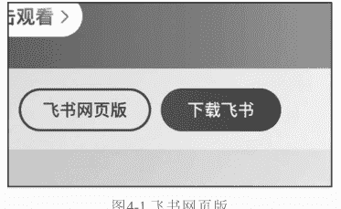

页面跳转后左侧布局如图4-2所示。

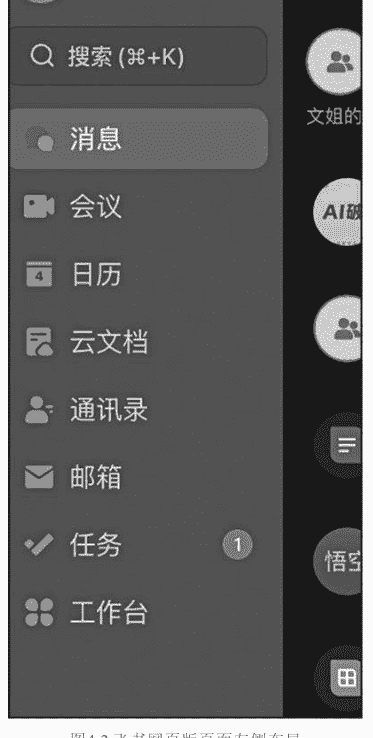

随后可用飞书处理任务，先以新建多维表格为例。在图4-2界面中选择“飞书云文档”，界面如图4-3所示。

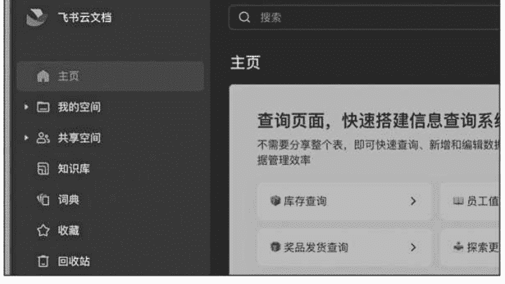

在“飞书云文档”界面打开“新建”菜单，找到“多维表格”选项，如图4-4所示。

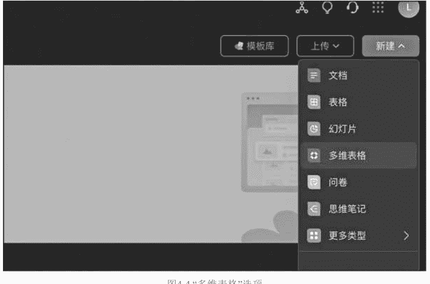

点击“多维表格”后点击“新建多维表格”，如图4-5所示。

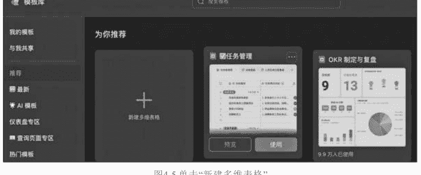

点左侧菜单“导入Excel”，如图4-6所示。此时选择文件，即 4.2.1 节保存的 Excel 文件“项目计划V0.1”。

如图4-7所示，项目计划已进入多维表格管理。可继续编辑任务，并使用数据“仪表盘”。

在“任务管理”区域左下方选择“仪表盘”，即可打开数据看板组件。看板包含折线图、排行榜、饼图等工具，如图4-8所示。

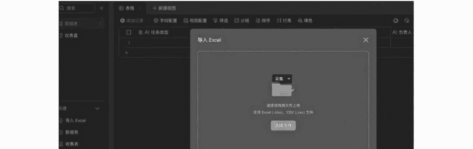

图4-6 导入Excel

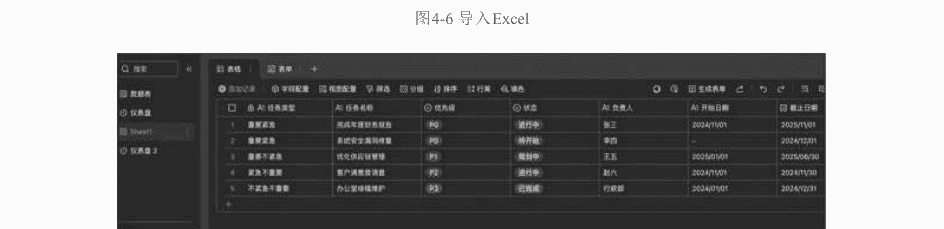

图4-7 项目计划页面

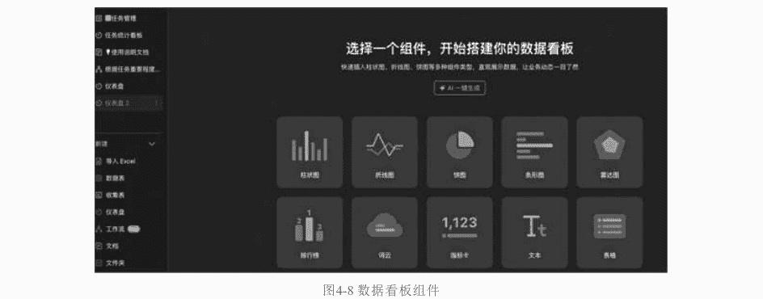

图4-8 数据看板组件

以饼图为例说明用法。如图4-9所示，可按扇区分组，选择按某列数据生成。

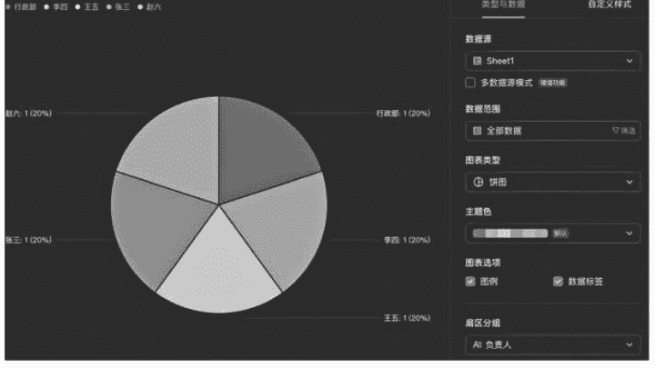

图4-9 生成饼图

## 4.3 用 DeepSeek 智能生成合同

先看一份合同起草案例。科技公司创始人老张希望起草一份劳动合同，符合《劳动合同法》，并保留员工离职后启动竞业限制的权利。

本着全流程覆盖的思路，笔者记录了操作过程。

案例：生成一份公司劳动合同，要求合法合规且兼顾企业利益。

在 DeepSeek 中提问“最新《劳动合同法》关于竞业限制的条款”，即可获得法条依据。

相关解读如下。

法律依据

1. 《劳动合同法》第二十三条
    用人单位与劳动者可以在劳动合同中约定保守用人单位的商业秘密和与知识产权相关的保密事项。
    经济补偿：对负有保密义务的劳动者，用人单位应在竞业限制期限内按月给予经济补偿。
    违约金：劳动者违反竞业限制约定的，应当按约定向用人单位支付违约金。

2. 《劳动合同法》第二十四条
    适用人员：竞业限制的人员限于用人单位的高级管理人员、高级技术人员和其他负有保密义务的人员。
    限制范围：不得与本单位生产或经营同类产品、从事同类业务的有竞争关系的其他单位就业，或自己开业生产、经营同类产品或业务。
    期限限制：竞业限制期限不得超过2年。

3. 《最高人民法院关于审理劳动争议案件适用法律问题的解释（一）》[2]（2020年）
    明确用人单位未支付经济补偿满3个月，劳动者可请求解除竞业限制约定（第三十八条）。
    在竞业限制期限内，若用人单位要求解除协议，劳动者可额外主张3个月的补偿金（第三十九条）。

……

DeepSeek 还归纳了要点与注意项。

1. 关键要点
    1. 协议必须以书面形式约定。
    2. 竞业限制需通过劳动合同或单独协议明确，口头约定无效。
    3. 补偿标准：
        - 法律未规定具体数额，通常为劳动者离职前12个月平均工资的30%～50%，视各地司法实践而定。
        - 若未约定补偿标准但劳动者已履行义务，可要求用人单位按劳动合同解除前12个月平均工资的30%支付（《劳动争议司法解释（一）》第三十六条）。
    4. 违约责任：
        - 劳动者违反竞业限制需支付违约金，金额需合理，过高可请求法院调整。
        - 用人单位未支付补偿金的，劳动者可解除协议并要求赔偿损失。

2. 注意事项
    - 竞业限制不得扩大至普通员工，仅适用于特定涉密岗位。
    - 竞业限制协议中未约定经济补偿的，劳动者履行义务后仍有权要求补偿。
    - 用人单位单方解除竞业限制协议，需额外支付劳动者3个月补偿金。

再向 DeepSeek 提问“最新《劳动合同法》关于试用期的条款”，即可获取依据。

截取部分回答，依据为2025年最新规定。

根据最新《劳动合同法》及相关司法解释，试用期的规定可归纳如下。

1. 试用期期限
    依据劳动合同期限确定上限：
    - 3个月≤合同期限<1年：试用期不得超过1个月。
    - 1年≤合同期限<3年：试用期不得超过2个月。
    - 合同期限≥3年或无固定期限：试用期不得超过6个月。

2. 例外情形
    以完成一定任务为期限的劳动合同，或合同期限不满3个月的，不得约定试用期。

3. 试用期次数限制
    同一用人单位与同一劳动者只能约定一次试用期，调岗或续签也不能重复约定。

继续输入：
基于以上两次对话的法律依据，生成技术岗位劳动合同模板，需包含薪酬结构、知识产权归属、违约责任，合同类型为固定期限，试用期为6个月。

因篇幅限制，仅展示部分内容。

### 第一条 合同期限与试用期

#### 1.1 合同类型
固定期限劳动合同，自________年________月________日起至________年________月________日止，总计________年。
法律依据：《劳动合同法》第十三条，固定期限合同需明确起止时间。
实操要点：试用期6个月仅适用于合同期限≥3年的情形，否则条款无效。

#### 1.2 试用期
自________年________月________日至________年________月________日，共计6个月。
法律依据：《劳动合同法》第十九条，合同期限≥3年可约定最长6个月试用期。
......

### 第五条 保密与竞业限制

#### 5.1 保密义务
乙方需对甲方的技术秘密、客户数据等保密，离职后仍负有保密责任，无期限限制。

#### 5.2 竞业限制（可选条款）
若乙方为核心技术人员，离职后2年内不得入职竞争企业或自营同类业务。
经济补偿：离职后按月支付，标准为离职前12个月平均工资的________%。
法律依据：《劳动合同法》第二十三、二十四条，竞业限制需书面约定且支付补偿。

可对合同内容进行详细评审修改。例如前面法条可知合同分固定期限和无固定期限，笔者期望用固定期限合同，如第五条“保密与竞业限制”中有描述：
若乙方为核心技术人员，离职后2年内不得入职竞争企业或自营同类业务。
经济补偿：离职后按月支付，标准为离职前12个月平均工资的________%。

一般可修改为禁止入职某几家竞争对手，而不限于此。补偿标准也可按公司情况设定，但需遵守法律。

笔者将合同文本导出到 WPS，使用 WPS 灵犀“合同审查”功能检查。在 WPS 中搜索关键词“AI”，先找到“WPS合同”功能，支持免费试用，如图4-10所示。

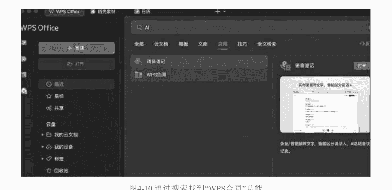

若未安装“WPS合同”功能，系统会提示安装。安装后打开操作界面，打开“智能审查”并上传文件，如图4-11所示。

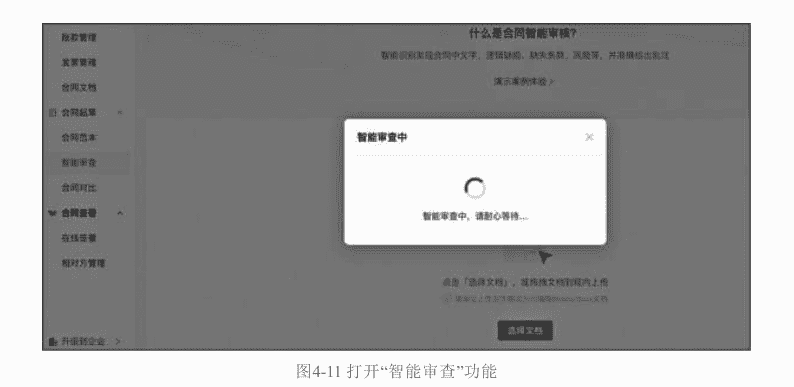

“WPS合同”审查给出近20项专业建议，如图4-12所示。建议以批注形式附在 WPS 文件中，并支持下载修改。

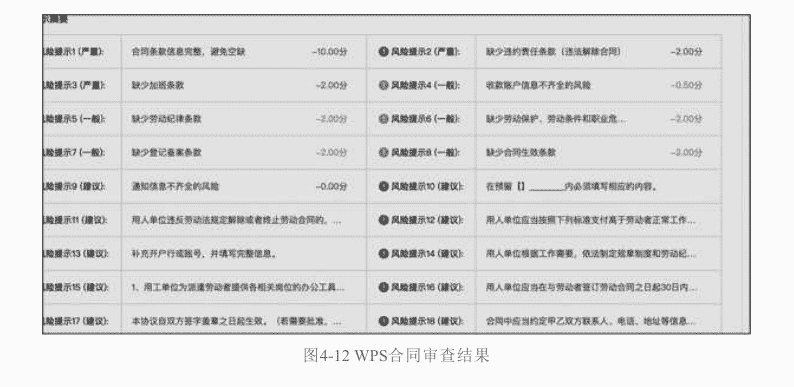

## CHAPTER5
第5章
用 DeepSeek 做数据分析

工作和生活中难以离开数据分析。下面几个场景是否引起共鸣。

**场景1：** 小军是职场白领，在淘宝和拼多多购物，线下消费扫码支付。工资发到银行卡，与妻子日常转账用微信。他在支付宝和微信能看到每月消费记录，也可自定义标签。但如何将支付宝、微信、银行卡的收支整合统计？夫妻间转账频繁，从家庭整体收入看并不增加收入，这部分数据若被统计会不会影响真实性？

**场景2：** 清晨7点，北京朝阳区的王芳打开手机，收到 DeepSeek 自动推送的《家庭月度消费报告》：上月奶茶支出超标148%，建议本周尝试自制饮品。

**场景3：** 义乌小商品店主李强收到库存预警——圣诞主题围巾应增加补货量。预测依据是过去三年12月销量增长曲线与天气数据交叉分析。

这些场景都是普通人正在经历的日常。当数据分析从 IT 部门专属技能变为全民工具，一场静默的认知革命已到来。本章通过真实案例，揭示普通人如何用 DeepSeek 实现“数据平权”。

### 5.1 个人收支分析实操

继续看小军的例子，他的需求有两点：一是将支付宝、微信、银行卡收支整合；二是剥离家庭成员间相互转账，单独分析。

在没有 DeepSeek 等大模型前，实现这两个需求需花费约10万元找专业 IT 团队开发系统。比如设计综合财务管理应用，通过接入支付宝、微信和银行卡 API 实现数据自动同步汇总。小军便可在一个平台查看所有账户收支，无需逐个登录查询。

第二个场景需求需要在应用中额外增加转账记录筛选功能。通过设置特定标签或分类，将家庭成员间转账单独标记。统计分析时即可排除这部分数据，得到更准确的家庭收支状况。

有了 DeepSeek 后，如何实现这些需求呢？

#### 5.1.1 多平台账单导出实操

首先需从支付宝、微信和招商银行 App 导出数据。支付宝和微信是10亿用户级的国民支付应用，安装与基础介绍不再展开。

1. 支付宝消费记录下载步骤
- 1）打开支付宝 App。
- 2）点击右下角“我的”按钮，如图5-1所示。

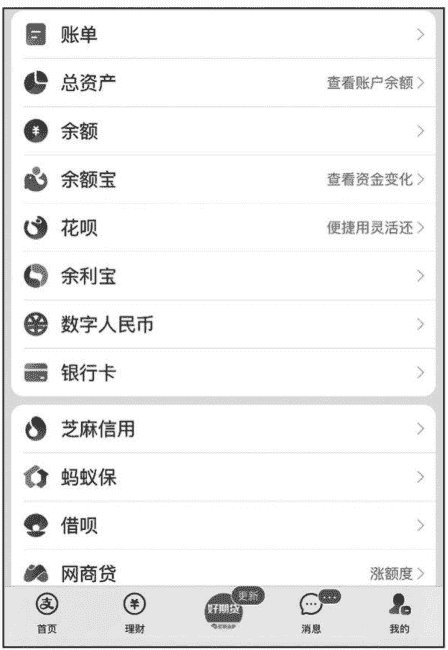

- 3）在图5-1页面找到“账单”选项并进入。
- 4）在“账单”页面，点击右上角“...”按钮，如图5-2所示。
- 5）在悬浮页点击“开具交易流水证明”按钮，如图5-3所示。

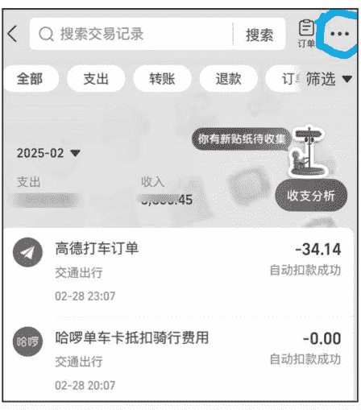

图5-2 单击右上角的“...”按钮

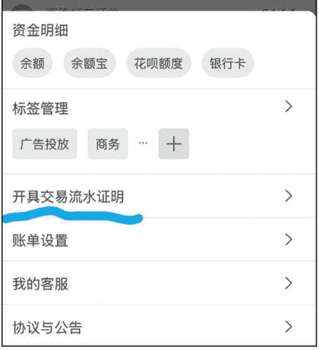

图5-3 单击“开具交易流水证明”按钮

- 6）选择申请用途为“用于个人对账”，点击“申请”，如图5-4所示。


图5-4 选择申请用途

- 7）选择交易流水范围，本案例为1个月。选择交易类型“全部交易”，时间范围“自定义”，开始时间“2025-02-01”，结束时间“2025-02-28”，点击“下一步”，如图5-5所示。

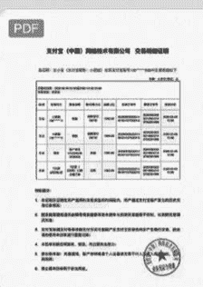

图5-5 选择交易流水范围

- 8）输入邮箱地址并点击“发送”按钮，交易流水文件会发到邮箱，如图5-6所示。

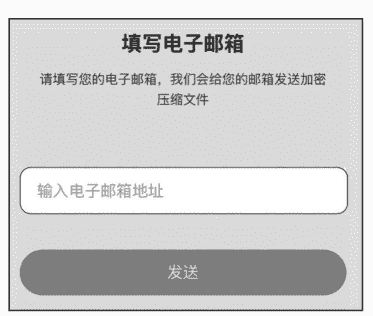

图5-6 填写电子邮箱地址

- 9）该文件会被加密，密码会在支付宝 App 通知。点击下方菜单栏“消息”按钮，如图5-7所示。


图5-7 单击“消息”按钮

- 10）找到“消息盒子”入口，点击“消息盒子”选项，如图5-8所示。


图5-8 “消息盒子”功能入口

- 11）点击后看到“服务消息”和“支付消息”。在“服务消息”下找到“我的账单”，可查到对应密码，如图5-9所示。


图5-9 查找对应的密码

2. 微信消费记录下载步骤
- 1）打开微信 App，点击右下角“我”按钮，如图5-10所示。

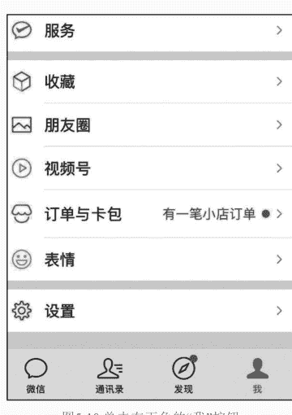

- 2）选择页面中的“服务”选项，如图5-11所示。


- 3）在“服务”页面找到“钱包”入口，如图5-12所示。


- 4）进入“钱包”页面，再点击右上角“账单”按钮，如图5-13所示。


图5-13 “账单”按钮

- 5）在“账单”页面点击右上角“常见问题”按钮，如图5-14所示。


图5-14 “常见问题”按钮

- 6）找到“常用工具”模块中的“下载账单”服务入口，如图5-15所示，进入账单下载服务页面。

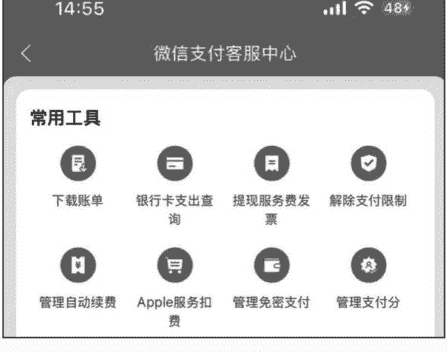

图5-15 “下载账单”入口

- 7）选择账单下载用途为“用于个人对账”，如图5-16所示。

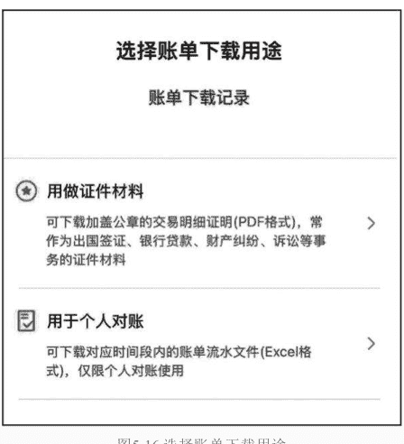

账单导出收尾分两步走。

第8步 调整筛选范围。示例里把“交易类型”固定为“全部”，“账单时间”改为“自定义时间”，开始日期设为2025年2月1日，结束日期设为2025年2月28日，然后按下“下一步”，见图5-17。

第9步 填写接收邮箱。在指定输入区填入邮箱地址并确认，微信系统会自动把账单推送到该邮箱，见图5-18。

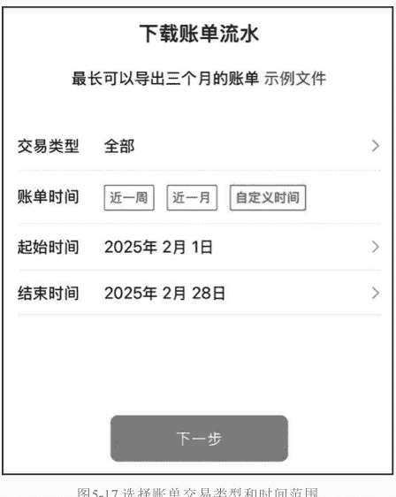

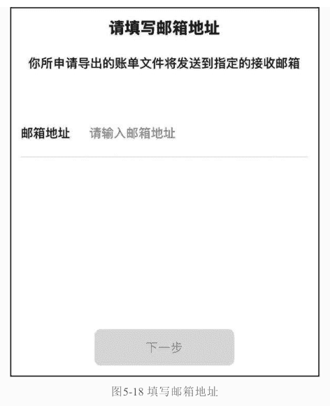

流水明细导出到此完成，下一步进入数据清洗与合并阶段。

最初设想是让DeepSeek直接把支付宝流水和微信支付流水做标准化处理后合并分析。实际在DeepSeek官网以及接入百度平台的DeepSeek-R1上试用后发现，面对数百条记录的表格，模型的处理能力有限，于是调整策略。

新的处理思路分三步：

- 1）支付宝流水中，交易对手相同且收支类别相同的记录先做一次预合并，把约400条降到数十条，便于后续处理。
- 2）微信支付流水采用同类预合并方式。
- 3）将两份预处理后的文件合起来做联合分析。

### 5.1.2 对数据进行合并

通过可调用DeepSeek的百度AI搜索 https://chat.baidu.com ，咨询Excel里按“交易对象与收支类别一致”汇总金额的具体方法。

操作步骤如下。

- 1）把记录支付宝流水的Excel文件做截屏，图片上传给DeepSeek让其先理解表结构。图5-19中的上传附件图标支持多文件批量上传。

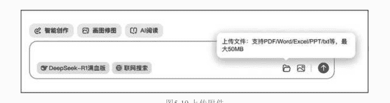

- 2）目标是让模型给出Excel合并的操作指引。流水条目上百，完全可以按交易对手和收支分类汇总。图片上传后提出需求，提示词如下：

> 请理解这个支付宝流水文件，给出Excel如何按条件合并数据的步骤。合并的条件是“交易对方和收/支分类均一致”。

模型给出的思路基本正确，具体内容为：

为提取文件内容并对交易对方相同且收支类型一致的金额做求和，可用Excel函数实现。步骤如下：

- 1. 数据整理：先把图片里的文字整理成Excel表格，确保每列都有明确标题，如“交易时间”“交易分类”“交易对方”“商品说明”“收/支”“金额”“收/付款方式”等。
- 2. 增加辅助列，用来拼接“交易对方”和“收/支”类型作为唯一标识。假设辅助列名为“唯一标识”，在首行输入公式“=B2 & C2”，其中B列为交易对方，C列为收/支，向下填充。
- 3. 用SUMIF或SUMIFS求和：
    - （1）在新列或新工作表中列出所有唯一的“交易对方”和“收/支”组合，对每个组合用SUMIF或SUMIFS求和汇总金额。假设唯一标识列表在G列，从G2开始，金额列在F列。
    - （2）在H2输入公式“=SUMIFS（F:F，D:D，G2）”，假设辅助列“唯一标识”在D列。用SUMIFS可多条件求和，若版本不支持可用SUMIF配合数组或辅助列。
    - （3）向下填充以计算全部组合的金额合计。
- 4. 导出为CSV格式：
    - （1）选中包含唯一标识和汇总金额的区域。
    - （2）点击“文件”→“另存为”。
    - （3）选择CSV逗号分隔值类型并保存。

- 3）按上述建议操作。首先在当前工作表Sheet1里新建一列命名为“唯一标识”。本次需求是同时满足交易对手和收支类型相等，用“=C2 & E2”即可实现，然后向下填充覆盖所有行。操作如图5-20所示。

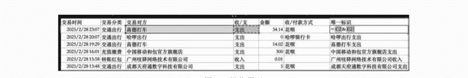

- 4）新建工作表Sheet2，罗列所有唯一的“交易对象”与“收/支”组合。具体做法如下。
    - ① 如图5-21所示，选中H列，用快捷键Ctrl+C复制。
    - ② 在粘贴菜单中选择“值”命令，如图5-21所示。


- 5）在工作表Sheet2中粘贴，如图5-22所示。

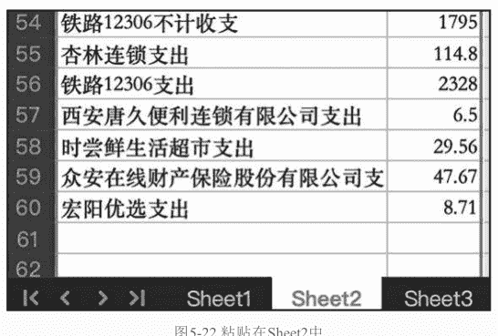

- 6）去重。选中对应数据列，在菜单栏选择“数据”→“重复项”→“删除重复项”，如图5-23所示。

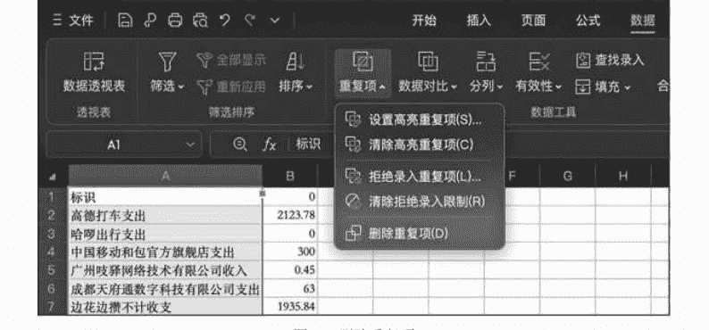

- 7）在Sheet2的第二列输入公式“=SUMIFS（Sheet1!F:F，Sheet1!H:H，A:A）”，如图5-24所示。其中Sheet1!F:F对应金额列，Sheet1!H:H对应唯一标识列，A:A为去重后的标识列。

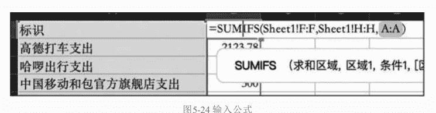

至此，支付宝流水的准备工作完成。微信流水可用相同思路处理。

### 5.1.3 分析收支数据

- 1）把处理好的支付宝和微信流水复制到一个新Excel文件并上传到DeepSeek，如图5-25所示。


- 2）此时可做多维度分析，比如按收入和支出合计，并按业务种类分类拆解，如图5-26所示。


- 3）为进一步完善分析，向DeepSeek提问。提示词如下：

> 请逐行计算总收入和总支出，注意将“不计收支类型”记录为支出，但金额低于100的项不用输出。列出：收入一共有多少项，合计金额为多少，分类收入金额为多少；支出一共有多少项，合计金额为多少，分类支出金额为多少。

- 4）模型输出示例如下：

核心结论：

收入高度集中：生活服务类占总收入95.3%，头部收入来源（xx1、xx2、xx3）占总额的86.2%。

支出结构清晰：

食品与餐饮类占比46.7%（以饿了么为主），出行类占比32.2%（高德打车）。

大额支出（≥100元）仅7项，但覆盖全部支出金额。

数据有效性：过滤后收入项占原始数据的6.2%，但覆盖总金额的99.2%；支出项占原始数据的7.8%，覆盖总支出的100%。

另外，也可用WPS自带的AI分析能力。具体做法是在WPS中打开合并后的Excel文件，点击菜单栏右上方的“AI数据分析”，即可与WPS AI对话。

可让AI按需处理，例如“按照收入和支出，对数据进行分类统计”或“请列出收入的Top 10”，如图5-27和图5-28所示。

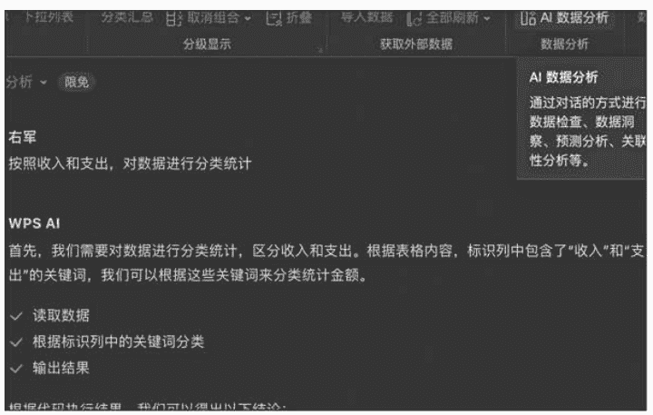

图5-27 按照收入和支出，对数据进行分类统计

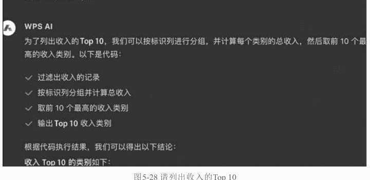

图5-28 请列出收入的Top 10

## 5.2 分析装修方案

DeepSeek-R1在决策判断上具备较强能力。多数家庭装修要么全包给公司，要么自行协调各施工队，报价单比对耗时较多。有了DeepSeek后效率明显提升。

继续使用百度集成的DeepSeek版本 https://chat.baidu.com，本案例选取了两家公司的装修报价单。先用图片上传功能上传“装修报价单1”，让DeepSeek提取文字，如图5-29所示。

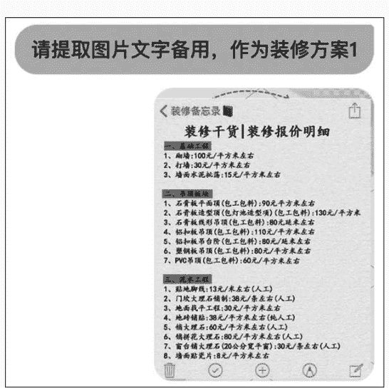

DeepSeek迅速提取出装修报价单1的内容：

### 装修报价单1

#### 一、基础工程

- 1. 砌墙：100元/平方米左右
- 2. 打墙：30元/平方米左右
- 3. 墙面水泥批荡：15元/平方米左右

#### 二、吊顶板块

#### 三、泥水工程

- 1.贴地脚线：13元/米左右（人工）
- 2.门槛大理石铺制：38元/条左右（人工）
- 3.地面找平工程：30元/平方米左右
- 4.地砖铺贴：38元/平方米左右（纯人工）
- 5.铺大理石：60元/平方米左右（人工）
- 6.铺拼花大理石：80元/平方米左右（人工）
- 7.窗台铺大理石（20公分宽平窗）：30元/条左右（人工）
- 8.墙面贴瓷片：8元/平方米左右

同法上传“装修报价单2”，DeepSeek也给出了结果。装修报价单2如图5-30所示。

提取内容如下：

### 装修报价单2

#### 一、基础拆改

- 1.拆除墙体：45～58元/m²
- 2.拆除地板：5～10元/m²
- 3.新建墙体：150～200元/m²
- 4.垃圾清理：10～35元/m²
- 5.泥子铲除：10～18元/m²

#### 二、水电改造

- 1.强电：25元/延米
- 2.弱电：35元/延米
- 3.电改造：30～35元/m
- 4.水改造：30～45元/m
- 5.下水安装：60元/米
- 6.电线：100～280元/卷

#### 三、泥瓦

- 1.地砖铺贴：40～70元/m²
- 2.墙砖铺贴：40～60元/m²
- 3.地面找平：30～45元/m²
- 4.防水涂刷：75～90元/m²

#### 四、油漆

- 1.乳胶漆：200～450元/L
- 2.乳胶漆调色：200元/项
- 3.乳胶漆涂刷：10～16元/m²
- 4.色漆超出增加费：200元/种

#### 五、吊顶

- 1.石膏板造型顶：160元/m²
- 2.天花板石膏阴角线：68元/m²
- 3.铝扣板吊顶：10元/m²
- 4.石膏板平面顶：90元/m²
- 5.钢塑板吊顶：90元/m²（注：此处原图“mm²”应为笔误，更正为“m²”）

#### 六、橱柜

- 1.衣柜柜体：560元/m
- 2.鞋柜柜体：560元/m
- 3.实体橱柜：2200～4100元/延米
- 4.吸塑橱柜：1100～1800元/延米
- 5.双饰面橱柜：900～1600元/延米

#### 七、其他费用

- 1.贴墙纸：25元/m²
- 2.油工小料包：200元7次左右
- 3.暗管开槽+封槽：30元/m（注：此处有两项均为“暗管开槽+封槽”，但费用相同，故合并列出）
- 4.开关插座：8～30元/个
- 5.防水防潮工程：40元/m²
- 6.炭渣回填：190～210元/m³（注：此处原图“m”应为笔误，更正为“m³”）
- 7.陶粒回填：280～300元/m³（注：此处原图无单位，应为笔误，更正为“m³”）
- 8.门槛石铺贴：55～85元/m
- 9.贴地脚线：13元/m
- 10.砖踢线：15元/m（人工）

注意，DeepSeek提取的顺序和结构与原图有差异，例如“防水防潮工程”在图中属水电项，被识别为其他费用。因此需要加入检查逻辑的提示词，以保证文字准确性和结构顺序。

于是重新上传装修报价单2，并修正提示词：

请对图片的文字进行识别和提取，记录为装修报价单2，请注意文字较多，请完全按照原图顺序识别，比如水电改造9项，泥瓦12项。

这次的回答令人满意，DeepSeek对重复数据进行了识别和处理，例如“弱电：35元/延米”在水电和泥瓦部分重复出现。反馈如下：

### 装修报价单2

#### 一、基础拆改

- 1.拆除墙体：45～58元/m²
- 2.拆除地板：5～10元/m²
- 3.新建墙体：150～200元/m²
- 4.垃圾清理：10～35元/m²
- 5.泥子铲除：10～18元/m²

#### 二、水电改造

- 1.强电：25元/延米
- 2.弱电：35元/延米
- 3.电改造：30～35元/m
- 4.水改造：30～45元/m
- 5.下水安装：60元/m
- 6.电线：100～280元/卷
- 7.开关插座：8～30元/个
- 8.防水防潮工程：40元/m²
- 9.暗管开槽+封槽：30元/m²

> （注：此处“暗管开槽+封槽：30元/m”在原图中出现两次，分别在水电改造和油漆部分，根据原图顺序，此处仅记录一次于水电改造部分）

#### 三、泥瓦

- 1.地砖铺贴：40～70元/m²
- 2.墙砖铺贴：40～60元/m²
- 3.地面找平：30～45元/m²
- 4.防水涂刷：75～90元/m²
- 5.炭渣回填：190～210元/m³
- 6.陶粒回填：280～300元/m³
- 7.PVC：60元/m²
- 8.门槛石铺贴：55～85元/m
- 9.贴地脚线：13元/m
- 10.砖踢线：15元/m（人工）
- 11.水泥：40元/袋
- 12.沙子：200元/方

（注：原图中“弱电：35元/延米”在泥瓦部分重复出现，但根据原图顺序和常理判断，此应为笔误或复制粘贴错误，故在泥瓦部分不再重复记录）

#### 四、油漆

- 1.乳胶漆：200～450元/L
- 2.乳胶漆调色：200元/项
- 3.乳胶漆涂刷：10～16元/m²
- 4.墙体扇灰：8元/m²
- 5.色漆超出增加费：200元/种

#### 五、吊顶

- 1.石膏板造型顶：160元/m²
- 2.天花板石膏阴角线：68元/m²
- 3.铝扣板吊顶：10元/m²
- 4.石膏板平面顶：90元/m²
- 5.钢塑板吊顶：90元/m²（注：原文中“mm²”应为笔误，更正为“m²”）

#### 六、橱柜

- 1.衣柜柜体：560元/m
- 2.鞋柜柜体：560元/m
- 3.实体橱柜：2200～4100元/延米
- 4.吸塑橱柜：1100～1800元/延米
- 5.油烟：2000～4000元
- 6.双饰面橱柜：900～1600元/延米

（注：原图中未明确列出橱柜部分的第六项，但根据整体结构和内容推断，此处应已完整记录橱柜部分信息）

对于包含近百项且一行两项的复杂单据，DeepSeek仍有不准确之处，例如“PVC：60元/m²”应属吊顶项。因此对DeepSeek输出结果的核验环节必不可少。

经人工调整后的内容为：

### 装修报价单2

#### 一、基础拆改

- 1.拆除墙体：45～58元/m²
- 2.拆除地板：5～10元/m²
- 3.新建墙体：150～200元/m²
- 4.垃圾清理：10～35元/m²
- 5.泥子铲除：10～18元/m²

#### 二、水电改造

- 1.强电：25元/延米
- 2.弱电：35元/延米
- 3.电改造：30～35元/m
- 4.水改造：30～45元/m
- 5.下水安装：60元/m
- 6.电线：100～280元/卷
- 7.开关插座：8～30元/个
- 8.防水防潮工程：40元/m²
- 9.暗管开槽+封槽：30元/m

（注：此处“暗管开槽+封槽：30元/m”在原图中出现两次，分别在水电改造和油漆部分，根据原图顺序，此处仅记录一次于水电改造部分）

#### 三、泥瓦

- 1.地砖铺贴：40～70元/m²
- 2.墙砖铺贴：40～60元/m²
- 3.地面找平：30～45元/m²
- 4.防水涂刷：75～90元/m²
- 5.炭渣回填：190～210元/m³
- 6.陶粒回填：280～300元/m³
- 7.门槛石铺贴：55～85元/m
- 8.贴地脚线：13元/m
- 9.砖踢线：15元/m（人工）
- 10.水泥：40元/袋
- 11.沙子：200元/方

（注：原图中“弱电：35元/延米”在泥瓦部分重复出现，此应为笔误或复制粘贴错误，故在泥瓦部分不再重复记录）

#### 四、油漆

- 1.乳胶漆：200～450元/L
- 2.乳胶漆调色：200元/项
- 3.乳胶漆涂刷：10～16元/m²
- 4.墙体扇灰：8元/m²
- 5.色漆超出增加费：200元/种
- 6.墙面冲筋：18元/m
- 7.贴墙纸：25元/m
- 8.油工小料包：200元7次左右

#### 五、吊顶

- 1.石膏板造型顶：160元/m²
- 2.天花板石膏阴角线：68元/m²
- 3.铝扣板吊顶：10元/m²
- 4.石膏板平面顶：90元/m²
- 5.钢塑板吊顶：90元/m²（注：原图中“mm²”应为笔误，更正为“m²”）
- 6.PVC：60元/m²

#### 六、橱柜

- 1.衣柜柜体：560元/m
- 2.鞋柜柜体：560元/m
- 3.实体橱柜：2200～4100元/延米
- 4.吸塑橱柜：1100～1800元/延米
- 5.油烟：2000～4000元
- 6.双饰面橱柜：900～1600元/延米

下一步是让DeepSeek对两份装修方案进行比对。复制两份报价单并在前增加提示词：

> 我家要进行装修，有2家公司进行了装修报价，请帮我比较一下。

两份家装报价单，DeepSeek 的拆解思路

先看 DeepSeek 对业主拿到的两份清单的整体判断，从价差、服务覆盖面、潜在风险三方面梳理，并给出选择建议。

报价差距拆解
基础工程类
砌墙项目，A方报100元/m²，仅指砌筑人工；B方新建墙体报150～200元/m²，推测已把辅材计入。拆除环节，A方打墙30元/m²，B方拆除墙体45～58元/m²，价差可能来自是否含清运。墙面处理口径不一，A方水泥批荡15元/m²，B方泥子铲除10～18元/m²，实际工序需对齐。

吊顶工程类
石膏板平顶两家均为90元/m²，且均为包工包料，定价一致。铝扣板吊顶A方110元/m²包工包料，B方仅10元/m²包工包料，明显偏离正常水平，需核对单位或是否漏项。PVC吊顶双方均为60元/m²。

泥水工程类
地砖铺贴A方38元/m²纯人工，B方40～70元/m²大概率含主材，范围更宽但单价波动大。墙面贴瓷片A方8元/m²纯人工，B方40～60元/m²含料。地面找平A方30元/m²，B方30～45元/m²，区间更宽。

其他重点差异
水电改造只有B方细化，例如强电25元/延米，A方未列项。油漆类B方涵盖乳胶漆、墙纸等，A方未提及。定制柜体仅B方提供，衣柜柜体560元/m，实木橱柜2200～4100元/延米。

服务覆盖面对比
基础拆改：A方可做砌墙、打墙、墙面批荡；B方含拆除、新建及垃圾清运。
水电改造：A方未提及；B方涵盖强电、弱电、防水等约九项。
吊顶：A方七项，涉及多种材料；B方六项，存在重复需核对。
泥水：A方八项以人工为主；B方十一项含材料及回填。
油漆：A方未涉及；B方九项含基层处理。
橱柜定制：A方未涉及；B方六项含衣柜、橱柜。

综合判断
总体来看，B方的服务体系更完整，尤其在水电、涂装、定制柜体具备一站式交付能力，适合需要全流程托管的业主；A方集中在基础拆改、吊顶与基础泥水，更适合局部改造。

疑点与风险提示
B方报价中，水电改造与油漆部分均出现暗管开槽加封槽，似乎存在重复填写。铝扣板吊顶报价仅10元/m²，远低于市场常态，很可能单位写错。材料边界表述不清，A方泥水多标注纯人工，B方未明确人工与材料范围，后期易产生增项。

选型建议
倾向B方时，需满足全屋改造需求，且对材料品质有明确约定，如防水涂刷75～90元/m²，同时对低价项做真实性复核。倾向A方时，适用于仅做基础拆改、吊顶与简单泥水，预算有限且不改水电，可自行采购瓷砖、乳胶漆等主材。

通用提醒
要求两家把包工包料的具体品牌与工艺标准写清，重点核查B方异常低价是否存在漏项或单位错误，并比对合同中的增项条款。

有过装修经验的人会认可这种分析的专业度，比如精准识别A方泥水为纯人工、B方材料未说明，并建议把材料品牌与工艺标准落实到合同。同样的数据分析思路在人事、销售、财务场景同样适用，HR可用DeepSeek做员工数据分析，销售可做订单趋势研判，财务可用它核查资产负债表与现金流量表的合理性。AI不会完全替代人，但掌握DeepSeek等工具能显著提升效率。

# CHAPTER6
第6章
DeepSeek助力新媒体内容生产

DeepSeek正成为短视频创作的重要推手，改变了生产边界。它与海绵音乐联动提供智能配乐方案，与剪映配合能把图文稿在十几分钟内完成成片，与可灵AI协同则进一步提升AI视频质感。这些组合缓解了素材匮乏与同质化问题，也催生了人机协同创作、创意策划等新形态。创作者既是导演也是模型训练师，通过提示词把个人风格注入模型，高效产出有辨识度的爆款。

## 6.1 DeepSeek联动海绵音乐打造智能音乐

音乐创作正被智能技术重塑，海绵音乐作为字节体系的AI音乐平台，以强大的生成能力为创作者提供高效、个性化的体验。平台本身已有AI创作功能，能把灵感快速变为完整作品。本节先由DeepSeek完成歌词，再用海绵音乐配曲，兼具普适性和协同价值。DeepSeek也可搭配Suno等工具实现更丰富的效果。

### 6.1.1 智能音乐的定义、特性和使用场景

科技与艺术交融的当下，音乐创作迎来深刻变化。以下从定义、优劣势与应用展开。

#### 1.智能音乐的定义
智能音乐是借助人工智能完成创作的音乐形态。它通过学习海量曲库，掌握不同风格与情绪的表达方式，再按创作者指令生成旋律、歌词与编曲。只需输入“温暖的流行曲”或“复古风格的歌词”，AI即可快速产出。可简单理解为一位智能作曲助手，按需求迅速给出作品。

#### 2.智能音乐的优势与局限
优势方面：生成效率高，可短时间内输出旋律、和弦、歌词；可个性化定制，按主题、风格、情绪生成；能提供灵感，突破创作瓶颈；门槛低，非专业人士也能上手；可智能匹配歌词与旋律，减少找素材时间。
局限方面：情感深度与艺术性仍不及人手创作；面对复杂或独特需求时灵活性不足；生成效果高度依赖输入质量，描述不清易失准；版权归属与原创性争议需谨慎处理。

#### 3.智能音乐的应用
影视配乐、游戏音乐、短视频背景音乐、音乐教学、个人情感表达等场景均可使用。

### 6.1.2 DeepSeek完成创意歌词
当前创作者正探索人机协同模式，以下以青春校园为例演示从灵感到成片的流程。

#### 1.前期准备
注册并登录DeepSeek官方平台或App；注册海绵音乐账号，打开 https://www.haimian.com 登录。

#### 2.明确主题与风格
示例主题为青春校园，唤起对学生时代的回忆。
主题设定：青春校园，表达对美好时光的珍惜和对未来的憧憬。
关键要素：教室、操场、图书馆、毕业照、课桌、纸飞机等。

#### 3.创作歌词
在DeepSeek输入：
我想创作一首关于“青春校园”的歌曲，唤起校园回忆。歌词融入教室、操场、图书馆等场景，表达珍惜与憧憬。曲风从国风、嘻哈、流行、摇滚、民谣、R&B、朋克、电子、爵士、雷鬼、DJ中选一。结构按前奏、主歌、副歌、桥段、副歌、间奏、主歌、尾奏组合。只输出歌名、曲风和歌词。

DeepSeek返回示例：
歌名：《纸飞机与课桌诗》
曲风：民谣
（前奏）
（主歌A）
粉笔末在晨光里跳舞
投影仪投出时光的刻度
橡皮擦改错了答案
却擦不去你马尾辫的弧度
操场蝉鸣穿过铁网锈斑
汽水瓶折射七色光斑
图书馆的旧书签
夹着那年未说出口的早安
（副歌）
我们数着钟摆的摇晃
把心事折成纸鹤的形状
黑板报褪色的高考倒计时
在毕业照里长出翅膀
（桥段）
教导主任没收的小说还在流浪
值日表上名字被风刮向远方
梧桐叶又落满长廊
这次没人再嫌打扫太忙
（副歌）
我们数着钟摆的摇晃
把心事折成纸鹤的形状
黑板报褪色的高考倒计时
在毕业照里长出翅膀
（间奏）
（主歌B）
校服背面签名的油墨香
随单车铃声飘过奶茶坊
月考卷折的纸船
还停泊在雨季涨潮的池塘

### 6.1.3 海绵音乐生成歌曲
歌词完成后，三步即可成曲：导入歌词、设置参数、生成音乐。

#### 1.自定义写词
进入海绵音乐主界面点“创作”，选“自定义写词”，粘贴DeepSeek歌词，如需润色可点右下角“AI写词”。创作界面如图6-1所示。

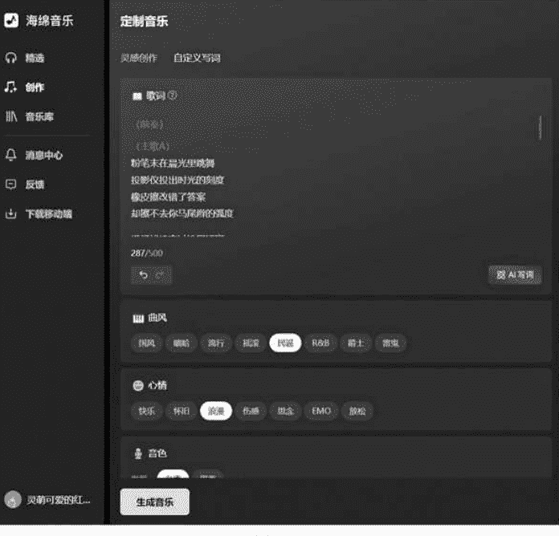

图6-1 海绵音乐的创作界面

#### 2.设置参数
根据歌词设置：曲风如民谣；心情如浪漫；音色如女声、温暖等。

#### 3.生成音乐
点“生成音乐”，作品保存在“创作历史”，系统会为同一歌词生成三版不同编曲供挑选。创作历史界面如图6-2所示。

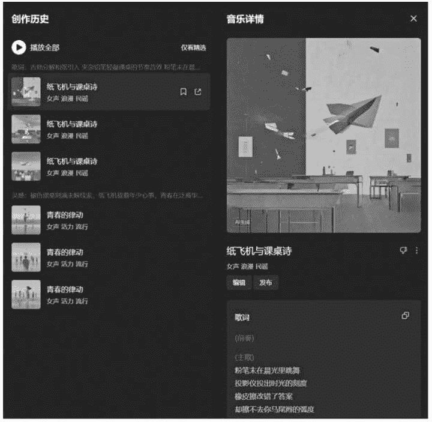

#### 4.保存视频
试听后点“下载视频”，即可导出带滚动歌词的视频，画面为静态图配音频。效果如图6-3所示。

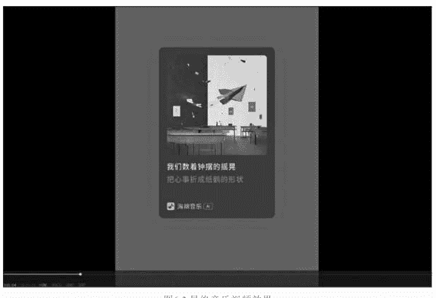

图6-3 最终音乐视频效果

## 6.2 DeepSeek结合剪映生成图文视频
在快节奏的内容时代，DeepSeek与剪映的组合为图文视频提供高效方案。本节介绍如何用DeepSeek生成创意文案，再用剪映“图文成片”快速产出内容。

### 6.2.1 图文视频的定义、特点与应用

#### 1.图文视频的定义
图文视频是文字、图片与动态效果结合的多媒体形式，像动态PPT。比如把校园操场图配上“毕业季的篮球赛”文字，加转场和音乐。核心是图片加文字的动态表达，传递信息更直观。

#### 2.优势与局限
优势：生成高效，输文字即可自动匹配图、字幕、配乐；操作简单；可高度定制；基础免费；智能匹配素材。
局限：自动配图相关性有限；定制自由度不及手工剪辑；效果依赖文案质量。

#### 3.应用场景
知识科普、故事讲述、产品介绍、旅游攻略、社交媒体短视频等。

### 6.2.2 DeepSeek生成创意文案
DeepSeek的推理与对话能力使其能精准把握需求，生成细节丰富、结构清晰的文案，比剪映自带智能写文案更具深度和匹配度。

#### 1.前期准备
注册登录DeepSeek；下载安装剪映PC版，官网 https://www.capcut.cn 下载。

#### 2.明确主题与风格
示例主题为旅游攻略，城市选深圳，利于图文成片匹配场景图。
主题：深圳旅游攻略
关键要素：现代化、改革开放、自然生态、科技感

#### 3.创作文案
在DeepSeek输入：
> 写一篇深圳旅游特色景点介绍。语言风格轻松、生动、有吸引力。关键要素现代化、改革开放、自然生态、科技感。要求选五个标志性景点，突出独特魅力。结构：开场约50字，景点介绍各约100字，结尾约50字。

DeepSeek示例输出：
作为中国最具活力的创新之都，深圳不仅承载着改革开放的先锋精神，更以多元化的文旅体验吸引全球游客。以下五大特色景点将带您感受这座城市的独特魅力：

作为深港文化发源地，这座始建于东晋的古城墙内藏着1700年岭南文明密码。漫步青石板路，可触摸明代新安衙署遗址，在东莞会馆探秘清代商帮文化，现代艺术展馆与非遗工坊的穿插设计，让历史与现代展开跨时空对话。夜幕下的灯光秀以古城墙为幕布，演绎《深圳故事》数字光影剧，堪称文化活化典范。

由旧花卉市场蜕变的主题街区，将北欧建筑美学融入城市肌理。标志性风车与运河构成明信片级景观，梵高主题咖啡馆提供艺术下午茶，每周举办的鲜花拍卖会让游客体验荷兰式交易乐趣。特别推荐植物盲盒体验馆，游客可亲手培育来自五大洲的稀有花卉种子。

深圳文旅打卡地标速览

工业遗存被改造为艺术聚落，集装箱改造的画廊与钢铁装置碰撞出硬核工业质感。每月首个周六，T街创意市集汇聚两百多位独立设计师，从赛博朋克饰品到AI生成绘画，集中呈现深圳的创新底色。OCT-LOFT国际壁画节留下的巨幅墙绘，如今已是年轻人群体追捧的打卡坐标。

19.5公里的滨海生态长廊划分为三大景观段，礁石区可近距离观察潮间带生物，悬挑式玻璃观景台距海面约三十米，帆船基地开设OP级帆船教学。最吸睛的是夜光跑道，路面铺设蓄光材料，入夜后宛如星河倾泻入海，周边智能运动驿站可实时读取体能数据。

邓小平雕像广场是俯瞰CBD天际线的最佳点位，每周三晚市民交响演出与无人机编队表演交相辉映，形成沉浸式艺术场域。广场东南侧的城市记忆馆以AR技术复原深圳乡村变迁，山脚下的关山月美术馆常态化展出数字水墨，将传统笔墨转化为当代表达。

这五处空间共同拼合出深圳文旅的立体图景，兼具历史纵深与未来想象、自然馈赠与人文创造，每一处都承载着城市进化的密码。借助原文链接可解锁更多玩法，开启专属的特区探索之旅。

### 6.2.3 剪映一键图文成片

依赖DeepSeek产出创意文案后，可用剪映“图文成片”功能自动为文字匹配网络图片并转化为动态视频，实现文案到成片的智能跳跃。

#### 1. 导入文案
打开剪映进入“图文成片”入口，页面示意见图6-4所示。


#### 2. 生成视频
切换至“自由编辑文案”模式，将DeepSeek生成的创意文本粘贴到输入框后点按“生成视频”。界面参考如图6-5。

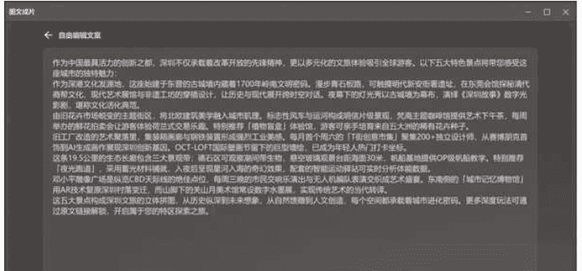

#### 3. 剪辑优化
通常半分钟左右即可出片，系统会自动匹配配图、背景音乐、配音与字幕。自动成片仍需人工精修，具体要点如下。

- 1）素材替换：排查匹配度低或相关性弱的图片并替换，以提升真实感与专业度。
- 2）特效添加：为文字与画面增添动态效果，如关键帧缩放、淡入淡出等，增强视觉冲击。
- 3）音乐调整：从剪映音乐库挑选更契合内容的背景音，强化氛围。

图文成片的最终呈现如图6-6。


图6-6 图文成片效果示例

## 6.3 DeepSeek+可灵AI：AI视频创作提效

短视频爆发期，AI制片凭借高效率与可定制性迅速崛起，成为内容生产的新主流。它既能快速响应大量创作需求，也能以智能化手段突破传统制作限制。DeepSeek结合可灵AI，正是这一趋势的典型方案，二者依托智能脚本与高质量图视频制作，为创作者提供端到端支持，让繁琐流程变得简捷。

### 6.3.1 用DeepSeek做分镜脚本

分镜脚本是视频的骨架，决定节奏、画面与情绪。凭借强大的自然语言能力，DeepSeek可快速输出精准的分镜方案，只需简短需求描述，即可获得包含场景、时长、画面说明与旁白的详细结果。必要时还能优化画面描述，使其更适配图像与视频生成的语法规范。

#### 1. 前期准备工作

- 1）注册并登录DeepSeek官网或App。
- 2）安装剪映软件，具体流程前文已说明。
- 3）注册可灵AI账号：打开可灵AI官网（https://klingai.kuaishou.com），点击“注册”按钮，按提示填写注册信息。注册完成后登录账号。

#### 2. 明确主题和风格

本示例以“王家卫风格的视频短片”作为演示，用以展示DeepSeek与可灵AI在视频创作领域的强大功能和广泛应用。同时，王家卫导演的作品风格独特、情感丰富且易于识别，特别适合借鉴学习。

- 1）主题设定：18岁女孩摄影写真，风格为复古港风，灵感来源于王家卫电影《重庆森林》。
- 2）核心元素：复古港风、霓虹灯光、潮湿氛围、孤独感、电影胶片质感。以上元素非常适合表现一种怀旧且深情的氛围。

#### 3. 创作脚本需求描述

打开DeepSeek官网，进入文本生成模块（开始对话），输入需求：

生成一个20秒的短片脚本，主题为18岁女孩摄影写真，复古港风，王家卫电影《重庆森林》风格，包含4个场景，每个场景5秒，输出为表格形式，包含场景、时间、画面描述和旁白文案。

DeepSeek会生成表格，用户可以根据自己的需求和创意对输出内容进行调整，最终效果示例见表6-1。

表6-1 DeepSeek生成表格

| 场景 | 时间 | 画面描述 | 旁白文案 |
| --- | --- | --- | --- |
| 场景一 | 0～5s | 18岁少女，蓬松黑卷发，哑光红唇，身着丝绒吊带裙，置身于霓虹灯笼罩的老香港街道。背景有旋转风扇和玻璃窗倒影，青绿色调荧光灯光，35mm胶片颗粒，浅景深，动态模糊，王家卫电影风格 | 你知道吗？在这个城市的角落，每个人都在寻找属于自己的出口 |
| 场景二 | 5～10s | 18岁少女穿酒红色挂脖连衣裙站在霓虹招牌下，侧身回眸，湿发贴着脸颊，红色指甲油与霓虹光斑交织。深夜香港街头，霓虹灯牌“重庆大厦”中英文字样，雨水在玻璃上形成光晕，便利店暖光透过雨帘。高对比度红蓝调，镜头涂抹凡士林的朦胧柔焦效果，雨滴动态模糊处理。 | 我也是。有时候，我会在深夜的街头迷失 |
| 场景三 | 10～15s | 少女穿黑色垫肩西装与喇叭裤，在老式电梯金属镜面间摆弄口红，镜面多重反射延伸空间，加入轻微镜头眩光，青绿色调荧光灯光，35mm胶片颗粒，浅景深，动态模糊，王家卫电影风格 | 看着那些闪烁的霓虹，像是在寻找一个答案 |
| 场景四 | 15～20s | 卷发少女在暴雨中奔跑，透明雨衣下露出格纹连衣裙，躲进老式红色电话亭，面部特写呈现睫毛上的雨滴与霓虹反光；强环境光比，雨水在玻璃上形成扭曲光纹，青绿色调荧光灯光，35mm胶片颗粒，浅景深，动态模糊，王家卫电影风格 | 也许，爱情就像一场梦，醒来后，只剩下回忆的轮廓 |

### 6.3.2 可灵AI制作静态图

生成视频前，需先通过可灵AI为每个场景产出静态图像。登录可灵AI账号后进入“AI图片”模块，依据DeepSeek给出的画面描述输入详细提示词。参数设置时依据发布平台选择合适比例，例如PC端建议16:9，视频号或抖音等移动端建议9:16或3:4，为后续动效制作奠定基础。

#### 1. 场景一：霓虹街道

将DeepSeek生成的场景一的画面描述输入可灵AI的文生图模块中：

18岁少女，蓬松黑卷发，哑光红唇，身着丝绒吊带裙，置身于霓虹灯笼罩的老香港街道。背景有旋转风扇和玻璃窗倒影，青绿色调荧光灯光，35mm胶片颗粒，浅景深，动态模糊，王家卫电影风格。

点击“生成”按钮，等待图片生成。生成图片如图6-7所示。


#### 2. 场景二：深夜街道

将DeepSeek生成的场景二的画面描述输入可灵AI的文生图模块中：

18岁少女穿酒红色挂脖连衣裙站在霓虹招牌下，侧身回眸，湿发贴着脸颊，红色指甲油与霓虹光斑交织。深夜香港街头，霓虹灯牌“重庆大厦”中英文字样，雨水在玻璃上形成光晕，便利店暖光透过雨帘。高对比度红蓝调，镜头涂抹凡士林的朦胧柔焦效果，雨滴动态模糊处理。

点击“生成”按钮，等待图片生成。生成图片如图6-8所示。

#### 3. 场景三：老式电梯

将DeepSeek生成的场景三的画面描述输入可灵AI的文生图模块中：

少女穿黑色垫肩西装与喇叭裤，在老式电梯金属镜面间摆弄口红，镜面多重反射延伸空间，加入轻微镜头眩光，青绿色调荧光灯光，35mm胶片颗粒，浅景深，动态模糊，王家卫电影风格。

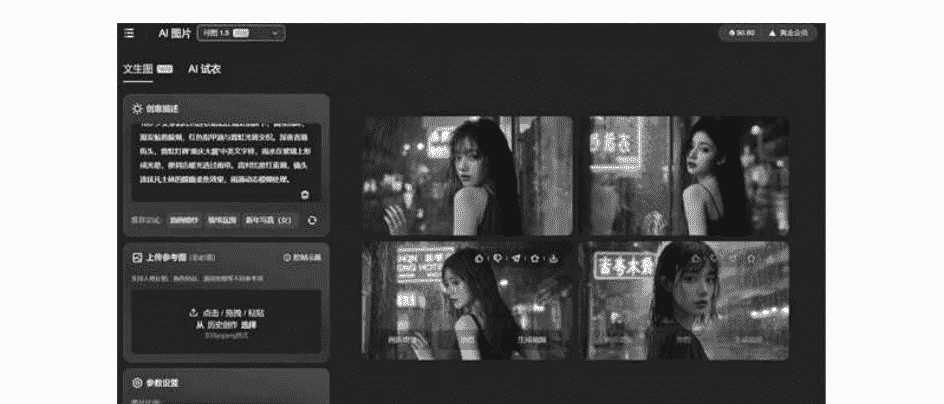

图6-8 场景二的图片制作界面

点击“生成”按钮，等待图片生成。生成图片如图6-9所示。


图6-9 场景三的图片制作界面

#### 4. 场景四：暴雨电话亭

将DeepSeek生成的场景四的画面描述输入可灵AI的文生图模块中：

卷发少女在暴雨中奔跑，透明雨衣下露出格纹连衣裙，躲进老式红色电话亭，面部特写呈现睫毛上的雨滴与霓虹反光；强环境光比，雨水在玻璃上形成扭曲光纹，青绿色调荧光灯光，35mm胶片颗粒，浅景深，动态模糊，王家卫电影风格。

点击“生成”按钮，等待图片生成。生成图片如图6-10所示。


图6-10 场景四的图片制作界面

### 6.3.3 可灵AI实现图生视频

接下来将静态图像转化为动态视频。在可灵AI主页依次选择“AI视频”—“图生视频”—“首尾帧”，并上传下载的静态图作为首帧。上传后为每个场景输入详细的图生视频提示词，这些描述同样可由DeepSeek生成。例如在表格生成后继续追问：

基于以上表格，为每一个场景生成动态描述，使其画面动态效果更丰富，更符合《重庆森林》风格。

#### 1. 场景一：霓虹街道

将DeepSeek生成的场景一的动态描述输入可灵AI的图生视频模块中：

镜头缓慢拉近，聚焦在女生的双眼，捕捉她眼中的复杂情感，仿佛能感受到她的内心世界。配上一段低沉而略带回响的音乐，如钢琴或萨克斯风，营造出王家卫电影中那种孤独、怀旧又深情的氛围。整体画面色调偏暗，带有复古的暖黄色调，仿佛时间在这里凝固。

点击“生成”按钮，等待视频生成。生成场景一的视频，如图6-11所示。


#### 2. 场景二：深夜街道

将DeepSeek生成的场景二的动态描述输入可灵AI的图生视频模块中：

慢速横移镜头+轻微手持晃动效果，霓虹光斑在玻璃上缓慢滑动。雨滴下落速度0.8x，双层巴士驶过时加入动态运动模糊（强度0.6）。0～3秒：人物转头只留下背影；3～5秒：霓虹招牌渐显红色溢出光晕。

点击“生成”按钮，等待视频生成。生成场景二的视频，如图6-12所示。

#### 3. 场景三：老式电梯

将DeepSeek生成的场景三的动态描述输入可灵AI的图生视频模块中：

电梯间灯光闪烁，光线暗淡，女生轻轻眨眼，缓缓放下手臂。

这里可以根据需求精简提示词，同时加入运镜效果。选择提示词右边的“灵感词库”功能，进一步选择并调整运镜效果。

点击“生成”按钮，等待视频生成。生成场景三的视频，如图6-13所示。

#### 4. 场景四：暴雨电话亭

将DeepSeek生成的场景四的动态描述输入可灵AI的图生视频模块中：

雨滴撞击电话亭玻璃的慢镜头、地面积水涟漪扩散、潮湿发梢滴水特写；穿插4:3画幅比例的老式DV录像片段，加入磁带卡顿式帧冻结，王家卫风格。

点击“生成”按钮，等待视频生成。生成场景四的视频，如图6-14所示。


图6-12 生成场景二的视频


图6-13 生成场景三的视频


图6-14 生成场景四的视频

### 6.3.4 剪映后期精修

视频创作的最后环节是剪辑，通过剪映可将零散分镜整合为完整故事，让画面、声音与情感融合。调整顺序、添加旁白与音乐、增添特效并调色，能使成片更生动专业，精准传达创作者意图。

#### 1. 导入视频片段

打开剪映，点击“新建项目”，选择“素材”标签下的“导入”功能，将前面由可灵AI生成的四个视频片段依次导入剪映的时间轴。按照脚本的顺序排列，确保每个片段的时长为5秒，总时长为20秒。剪映的素材导入界面如图6-15所示。

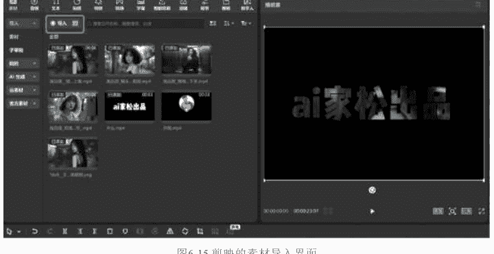

图6-15 剪映的素材导入界面

#### 2. 添加旁白和字幕

根据DeepSeek生成的旁白文案，使用手机或麦克风录制旁白音频。录制完成后，将旁白音频文件导入剪映，并将其拖动到对应视频片段的轨道上。或者，直接使用剪映的配音库。本案例就使用了剪映的配音功能。最后调整旁白音频的音量，确保清晰且不刺耳。剪映的配音界面如图6-16所示。

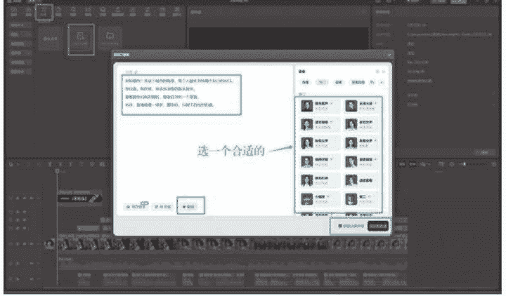

图6-16 剪映的配音界面

#### 3. 添加背景音乐

在剪映的音乐库中选择符合《重庆森林》风格的背景音乐，如低沉的钢琴曲或萨克斯风音乐。如果剪映自带的音乐库中没有合适的曲目，则可以点击“本地音乐”，导入自己准备的音乐文件。将音乐轨道的音量适当调低，以突出旁白，同时营造出王家卫电影中那种孤独、怀旧又深情的氛围。剪映的音乐库界面如图6-17所示。

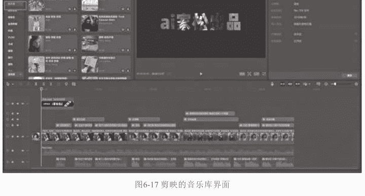

图6-17 剪映的音乐库界面

#### 4. 添加特效或转场效果

为了使视频片段之间的过渡更加自然流畅，可以使用“转场”功能，选择合适的转场效果（如淡入淡出、渐变模糊等）添加到相邻片段之间。注意避免使用过于花哨的转场效果，以免破坏整体的复古港风氛围。对于一些关键画面（如霓虹灯闪烁、光影交错等），可以使用“特效”功能添加光晕、动态模糊等效果，增强画面的视觉冲击力。剪映的特效选择界面如图6-18所示。


图6-18 剪映的特效选择界面

#### 5. 调整画面色彩和光效

在剪映中点击“滤镜”功能，选择一款偏暗、带有复古暖黄色调的滤镜，增强画面的整体氛围。如果需要进一步调整色彩，则可以点击“调色”功能，对亮度、对比度、饱和度等参数进行微调，使画面更加符合王家卫电影的风格。

例如，如果使用可灵AI生成的视频的整体亮度过高，可以添加“情绪电影”的滤镜，使整体效果更突出，如图6-19所示。


图6-19 剪映的滤镜选择界面

#### 6. 检查和优化

播放整个视频，仔细检查画面、旁白、字幕和音乐之间的同步情况。如果发现问题，及时调整各个轨道的内容，确保每个场景的画面、声音和字幕都能完美配合，传达出一致的情感和氛围。

#### 7. 导出成片

完成所有编辑后，点击“导出”按钮。根据需要选择合适的分辨率（如1080p）和格式（如MP4）。等待导出完成后，即可在手机或PC上查看最终的AI视频。

# 第7章 DeepSeek赋能数字人营销

在数字化浪潮中，DeepSeek与数字人技术的结合正在重塑内容创作与营销的格局。DeepSeek作为强大的AI工具，能够快速生成高质量文案、脚本和数字人形象描述，极大地简化了视频创作流程。通过与剪映、可灵AI等平台的深度整合，创作者可以轻松实现从创意构思到数字人视频生成的全流程自动化。

本章将深入探讨“DeepSeek+数字人”的创新应用。数字人视频凭借高效、低成本和高度定制化的特性，正在引领营销新趋势，并广泛应用于产品介绍、客户服务、品牌推广和教育培训等场景。同时，本章将分析数字人技术的类型，了解如何选择适合的工具来创建数字人形象。此外，本章还会提供从目标设定到长效运营的数字人视频创作最佳实践指南，帮助企业和个人创作者高效利用DeepSeek实现数字人视频的快速生成与优化。

## 7.1 数字人视频与营销应用

### 7.1.1 五大优势引领数字人视频营销

数字人视频是一种创新的营销工具，它利用数字人来完成产品介绍、品牌推广或知识分享。这些数字人可以根据企业或个人创作者的需求定制形象、声音和性格，能够24小时不间断地工作。与传统的真人视频相比，数字人视频不仅更高效，还能显著降低制作成本。

DeepSeek在这一过程中发挥了关键作用。它能够快速生成高质量的文案和数字人形象描述提示词，帮助创作者快速创建数字人视频。例如，创作者可以通过DeepSeek生成的文案，结合数字人平台快速生成视频内容。这种结合不仅提升了内容生产的效率，还降低了创作门槛，让商家和个人都能轻松制作出吸引眼球的数字人视频。

#### 1. 高效的内容生成

数字人视频能够根据预设的脚本进行精准呈现，确保视频的流畅性和专业性。创作者可以提前准备好脚本，数字人则能够高效地完成表演，无须担心真人表演中的失误或反复拍摄。此外，DeepSeek能够快速生成高质量的文案，让视频内容丰富多样。这种高效的内容生成与呈现方式，提升了制作效率，大大缩短了从创意到成品的时间周期。

#### 2. 高度定制化

数字人可以根据企业的品牌形象或个人创作者进行定制，无论是活泼可爱的卡通形象，还是专业严肃的商务形象，都可以轻松实现。创作者可以根据目标受众的特点设计数字人的外观、声音和性格。例如，面向年轻人的品牌可以设计一个活泼可爱的数字人形象，而面向高端科技的品牌则可以设计一个专业严肃的数字人形象。

#### 3. 成本效益显著

与真人主播相比，数字人无须支付高额工资、奖金，也无须租赁场地或采购设备。数字人视频的制作成本远低于传统视频，同时还能保证高质量的输出。这使得数字人视频成为中小企业、初创企业以及个人创作者的理想选择，实现在有限的预算内制作出高质量的营销内容。

#### 4. 多语言支持

DeepSeek支持多种语言的文案生成，让数字人可以进行多语言讲解，这为拓展国际市场提供了极大的便利。创作者可以通过数字人视频轻松跨越语言障碍，向不同国家和地区的观众传递品牌信息和产品特点。

#### 5. 持续优化与更新

虚拟影像上线后能够快速迭代，这是其最明显的优势。制作团队可以依据实时反馈和受众偏好，随时改写脚本、调整人设细节。持续优化的机制让内容始终贴合市场节奏，避免审美疲劳，保持新鲜与吸引力。

### 7.1.2 数字人视频的应用场景
制作效率高、成本可控、定制自由度大，虚拟影像已经在多个领域展开应用。通过虚拟形象做商品讲解、用户支持、品牌传播和教学辅导，为内容生产打开了新思路。下面梳理数字营销里最常见的四类落地方向。

#### 1. 产品介绍
虚拟主播在推介环节很有优势。数字人能把功能要点讲透，甚至完成现场演示。像数码品牌发布新机型，就可以用虚拟形象逐条展示拍摄、续航、性能等卖点。信息传递统一准确，还省下真人拍摄的人力与时间成本。
对比传统真人演示，数字人可连续工作，不会疲劳出错，还能按品类和人群定制人设风格，既专业又吸睛。比如经营环保家居用品的网店店主，可打造亲和力强的虚拟形象来诠释品牌理念，详细介绍环保材质和设计亮点，用生动演示让用户直观感知产品价值。

#### 2. 客户服务
数字人可以充当虚拟客服，全天候解答疑问、提供即时支持。这种方式既提升体验，也优化了企业的人力配置。24小时在线确保用户随时获得帮助，无论是产品咨询还是售后问题，都能给出高效准确的回复。
例如电商可借助数字人视频提供产品咨询和售后说明。数字人能依据预设脚本回答常见问题，还可通过互动功能解决个性化需求。这种不间断服务不仅提高满意度，也增强用户对品牌或个人创作者的信任与认同。个人创作者也能把数字人当作虚拟助手，为粉丝答疑，提升互动体验。

#### 3. 品牌推广
数字人不仅是高效营销工具，也能塑造品牌形象。通过精细设计的虚拟形象和高质量视频，企业能更好地传递品牌价值观和专业度。这种一致性有助于建立信任，增强消费者忠诚度。个人创作者也能借此提升个人品牌可信度与吸引力。
数字人视频能轻松把品牌信息触达目标人群，可出现在社交媒体广告、品牌宣传片等多种场景。高度定制的内容更易抓住注意力，强化品牌独特性。此外，个人创作者也能用数字人形象打造个人IP，例如生活方式博主通过数字人分享日常经验，扩大受众范围，提升影响力。

#### 4. 教育培训
数字人可用于讲解课程内容，甚至开展互动教学。在线教育平台能用数字人老师讲解数学、英语等学科，并通过动画和互动提升学习体验。
例如儿童教育机构可开设线上绘本阅读课，安排数字人担任讲解老师。数字人能用生动语言和丰富表情讲述故事，并通过提问引导思考，极大提升学习兴趣与参与度。此形式节省师资成本，还能按学生需求提供个性化体验，提升学习效果。知识博主也能用数字人讲解专业知识，为观众提供更丰富的学习体验。

### 7.1.3 数字人视频核心评估指标
要精准衡量数字人营销成效，需从多维度设定量化指标并结合业务目标综合分析。无论企业还是个人创作者，以下六大核心指标能全面评估效果，助力策略优化。

#### 1. 用户互动率
- **定义**：以播放量、点赞量、评论量、分享量及收藏量综合体现。
- **意义**：体现受众对内容的兴趣与参与热情，是判断吸引力与活跃度的关键。高互动说明内容成功引发关注与行动。
- **优化方向**：对比不同文案语气或形象设定，保留互动表现最佳的版本。

#### 2. 转化率
- **定义**：观看视频后完成目标行为如下单、私信、加好友的占比。
- **意义**：直接反映营销效率与收益，是评估效果的关键。高转化表明内容说服力强，能推动用户行动。
- **优化方向**：在视频中植入明确的行动号召，如限时优惠、专属链接或评论领取资料。

#### 3. 内容传播广度
- **定义**：衡量视频在不同媒体上的覆盖范围及话题热度。
- **意义**：反映内容的吸引力与影响力，评估是否能突破原有圈层实现更广曝光。
- **优化方向**：策划具有争议性或情感共鸣的话题，激发用户自发传播。

#### 4. 用户留存率
- **定义**：持续关注品牌账号或个人创作者的受众占比。
- **意义**：反映忠诚度与粘性，是衡量长期价值的重要指标。高留存意味着持续认可，有助于建立稳定受众。
- **优化方向**：制定内容更新计划，保持长期互动。

#### 5. 成本效益比
- **定义**：投入成本如工具订阅费、制作时间与产出收益如销售额、粉丝增长的比值。
- **意义**：衡量经济性与投入产出效率，是评估可持续性与盈利能力的重要指标。
- **优化方向**：选用性价比高的工具组合，如DeepSeek配合可灵AI，降低边际成本。

#### 6. 品牌认知度
- **定义**：受众对品牌内涵与价值的认识与理解程度。
- **意义**：衡量影响力与长期价值，高认知有助于提升信任、好感与忠诚，进而推动品牌价值增长。
- **优化方向**：强化数字人形象与创作者价值观的一致性，如设计专属虚拟形象，利用AI工具快速产出个性化内容，提升传播力。

## 7.2 数字人形象创建与视频生成
本节聚焦国内主流的数字人创作平台，尤其是剪映和可灵AI，结合DeepSeek的强大语言能力，从技术类型、赋能方式和实操层面深入剖析，帮助创作者快速掌握形象与视频创作要点，高效制作高质量且具吸引力的数字人内容。

### 7.2.1 数字人技术类型
需要先明确背景：尽管数字人技术应用广泛，但在短视频和口播创作上落地成熟，而在直播领域仍面临限制和风险。例如部分平台对数字人直播存在技术限制，因内容单一、互动不足，易被判定为低质内容而封禁权限。此外还存在虚假信息、欺诈、隐私和数据安全风险，可能引发用户体验下降和法律纠纷。因此直播应用仍需谨慎，避免误导性宣传。

目前市面上的技术主要分为三大类：数字人模板、定制数字人以及个人视频对口型，各有特点，适用于不同需求。

#### 1. 数字人模板
数字人模板是基于预设形象和功能的解决方案。平台提供多套设计好的虚拟形象供直接选用，风格多样如职场风、卡通风、科技风，适配不同场景。例如教育领域可作为虚拟讲师，销售领域可作为虚拟主播。优点是操作简单、成本低，适合快速产出；缺点是个性化不足。

#### 2. 定制数字人
定制数字人个性化程度更高。用户可上传照片或视频，通过AI生成与自身或特定人物相似的虚拟形象。不仅外观可高度还原，还能通过语音合成模拟特定声音。适合需要独特品牌形象或个人特色的场景，如企业代言人、虚拟客服或个人自媒体。虽然制作成本和难度相对较高，但能提供更真实的用户体验。

#### 3. 个人视频对口型
这并非直接生成数字人，而是结合静态图像与语音生成的方案。用户只需上传一张照片，系统通过AI让人物“动”起来，并根据输入文本生成自然口型和表情。特别适合不想露脸的创作者，或需快速生成视频的场景。例如知识博主制作讲解视频，企业生成产品介绍。优点是操作简便、生成快、性价比高，是数字人的平替方案。

**表7-1 国内部分数字人平台对比**

| 平台名称 | 技术类型 | 主要特点 | 适用场景 | 费用（包含高级功能） |
| :--- | :--- | :--- | :--- | :--- |
| 剪映 | 数字人模板、个人视频对口型 | 操作简便，与剪映视频编辑深度整合，提供多种模板和口型同步功能。 | 短视频创作、口播内容、产品介绍。 | 基础功能免费，高级模板或功能需订阅。 |
| 可灵AI | 数字人模板、定制数字人 | 提供高质量的数字人形象生成与视频合成，支持动态描述输入。 | 高质量视频生成、品牌宣传、定制化内容。 | 按使用量或订阅制收费。 |
| （其他平台） | （根据实际情况填写） | （根据实际情况填写） | （根据实际情况填写） | （根据实际情况填写） |

### 7.2.2 DeepSeek如何赋能数字人平台
在数字人内容创作中，DeepSeek凭借强大的语言生成能力，为创作者提供高效高质量的解决方案。尤其与可灵AI视频生成能力配合时，能显著提升创作效率和表现力。通过撰写精准的画面描述提示词和口播文案，DeepSeek可帮助创作者从创意到成片全流程提速。

#### 1. DeepSeek产出数字人描述提示词
DeepSeek能为不同场景撰写数字人描述提示词，快速锁定风格与细节。例如输入：“我是一名30岁电商带货男主播，想用可灵AI做一段电商风带货口播视频，帮我产出相关文生视频提示词。”系统会输出类似：“一位30岁男性，身着时尚商务装，站在明亮直播间，表情自然动作流畅，光线柔和，整体氛围专业。”科技风描述可为“未来感十足的数字人，背景为充满科技元素的虚拟场景，动作流畅充满科技感”。这些提示词可直接用于可灵AI生成。

#### 2. DeepSeek产出口播文案
DeepSeek在口播文案撰写上表现突出，可按场景需求产出吸引人内容。例如输入：“我要在抖音推广一款蓝牙耳机，请帮我产出不同风格的30秒产品推广口播文案，突出时尚、舒适、音质、续航和价格优惠。”系统会提供多条备选文案，并支持惊喜揭秘型、反转剧情型等多种框架。例如：“每天我们无意间丢弃的东西，竟有惊人秘密！你知道吗？那些看似无用的咖啡渣，其实是天然除臭剂和肥料（引入）。快来看看咖啡渣还能做什么，你绝对想不到（揭秘）！如果你有更多这样的小秘密，留言分享吧（呼吁行动）！”

### 7.2.3 DeepSeek结合剪映数字人平台实操
DeepSeek与剪映数字人平台配合为创作者带来全新模式。DeepSeek可快速撰写精准口播文案，并提供多样风格和创意方向，导入剪映后即可快速制作。从创意到输出流程更顺畅，大幅提升速度并降低难度。

#### 1. 准备工作
打开剪映官网，点击立即下载安装剪映专业版。

#### 2. 启动功能
点击“开始创作”→选择“数字人”。剪映数字人选择页面如图7-1所示。


#### 3. 选形象
剪映数字人平台支持形象定制，也提供多种免费形象且会定期更新。推荐模板包括：
- 1）历史解说：适合知识分享。
- 2）运动健身：适合运动类内容。
- 3）高端销售：适合产品介绍和商务场景。

#### 4. 配音
选定形象后点击“下一步”进入配音环节。可上传自录音频，也可通过“输入文案”结合“音色”功能实现。如图7-2所示。借助DeepSeek撰写精准口播文案，可覆盖多种风格。例如产出的蓝牙耳机电商口播文案：
朋友们，今天给大家推荐一款超酷的蓝牙耳机！时尚设计佩戴舒适，音质出色，高清单元带来沉浸体验。续航超长，单充10小时，配充电盒可达30小时，连接稳定瞬间配对，降噪效果一流，隔绝外界噪音。时尚、舒适、音质好、续航长，这款耳机是你生活中的最佳选择，快来抢购吧！
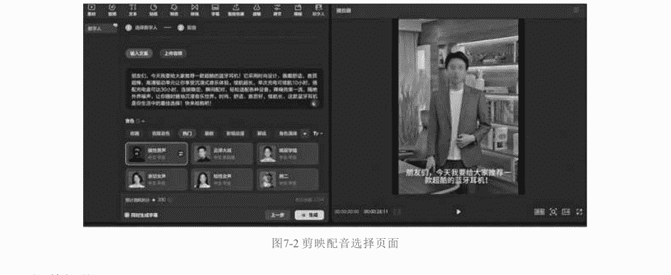

#### 5. 调整细节
细节调整是提升质量的关键：
- 1）背景：点击“背景”选项，选择纯色或虚拟场景。
- 2）字幕：勾选“同时生成字幕”，方便观众理解。
- 3）语速：生成视频后选择视频并点击“变速”调节整体语速。
- 4）转场：适度增加分镜头，如产品介绍、背景说明，并在切换处加入转场效果。

#### 6. 导出视频
完成制作后点击“导出”进入设置页面，建议配置：
- 1）分辨率：1080P。
- 2）编码：H.264。
- 3）格式：MP4。
- 4）帧率：30FPS。

### 7.2.4 DeepSeek结合可灵AI数字人平台实操
可灵AI功能丰富、风格多样，可通过文字生成数字人形象，也可将人物图片转为动态视频，支持光影移动、白云飘动等多种场景特效，表现力更强，风格从古风到科技风均可覆盖。
DeepSeek可精准产出适用于可灵AI的提示词，确定内容与风格后输入可灵AI生成动态视频，再利用“对口型”功能完成整体创作，提升效率并降低成本。

#### 1. 准备工作
登录可灵AI官网，点击“图生视频”按钮。

#### 2. 选择图片
在“图生视频”功能中点击“首尾帧”按钮上传个人形象图片。建议正面半身照，光线均匀避免阴影遮挡五官，穿纯色衣物，背景简洁。高质量图片能显著提升生成效果。

#### 3. 参数设置
在“图片创意描述”中可使用DeepSeek产出动态创意描述，例如“微微抬起右手，抬手自然流畅，头部微微自然转动”。参数设置中生成模式选“高品质”，生成时长选“5s”，生成数量选“1条”，设置完成后点击“立即生成”。如需更长时间，可生成多段5s视频后剪辑拼接，灵活控制成本与内容。
参数设置页面如图7-3所示。

图7-3 参数设置页面

#### 4. 对口型
若效果不理想，可通过DeepSeek优化提示词增加细节后重新生成。满意后点击功能菜单中的“对口型”，或在视频左下方点击“对口型”按钮，调整口型与配音精准匹配，提升自然度与专业性。

#### 5. 配音
可灵AI配音灵活便捷。可选择“上传本地配音”导入自录音频，也可使用“文本朗读”功能输入文案自动生成配音。建议用DeepSeek产出高质量文案并选择合适音色以匹配风格。配音完成后点击“确定”或“保存”即可同步。
“文本朗读”页面参数设置如图7-4所示。
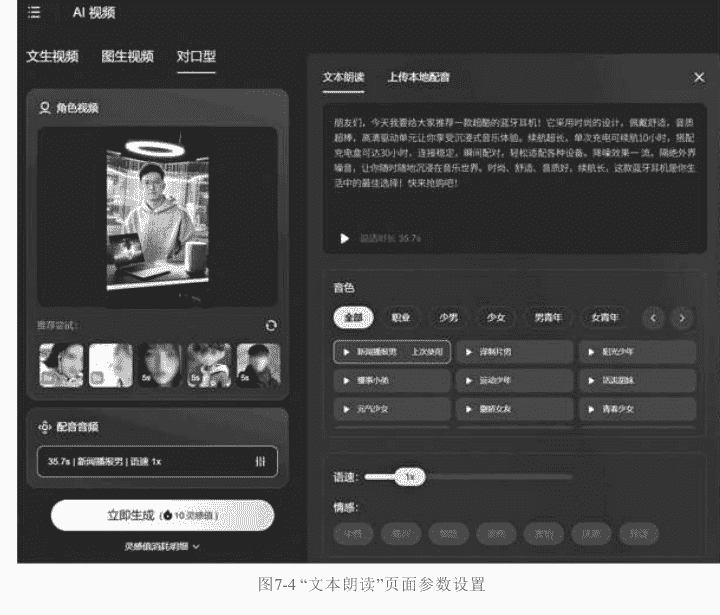
图7-4 “文本朗读”页面参数设置

#### 6. 导出视频
设置完成后点击“立即生成”开始创作，耗时视复杂度而定。生成成功后点击“无水印下载”保存到本地，建议检查动作、口型与配音同步效果，如需优化可返回编辑页面调整提示词或参数后重新生成。

## 7.3 数字人营销的最佳实践
随着数字人技术快速发展，越来越多的企业和创作者开始尝试应用于营销和内容创作。如何高效利用数字人视频实现营销目标，是许多初学者面临的挑战。本节结合DeepSeek的技术优势，从明确目标、内容规划、技术落地、风险管控和长效运营五个方面提供完整实践指南。

### 7.3.1 明确目标

投身数字人视频创作，先把方向想清楚

进入虚拟视频赛道，起步最关键的是把创作意图理清。虚拟主播现在能做品牌宣发、商品讲解、客服陪伴、教学辅导等，应用面很广。创作者要结合自身用途，先定一个明确、能量化的目标，再往下走才不跑偏。

#### 1. 锁定营销诉求
虚拟视频的营销价值大致分三层：提升认知、促进互动、推动转化。

- 1）提升认知：用虚拟形象传递品牌调性和核心价值，让目标人群更熟知、更有好感。虚拟形象可以保持高度统一且个性化地与用户沟通，形成记忆点。
例如某智能家居品牌可打造一个兼具现代简约线条与科技感的主播，着简约居家服，置身未来感智能客厅，演示设备操作便捷与温馨氛围。这样既能彰显技术领先，又传递产品能融入日常、提升幸福感和便捷感的理念。
- 2）促进互动：互动是放大视频效果的重要手段。通过问答、投票、抽奖等环节，能明显拉高参与度和互动表现。
例如在片中设置提问，引导观众在评论区留言，就能点燃参与热情，拉近与品牌的距离。再配合限时挑战、互动小游戏等，进一步增强黏性。
- 3）推动转化：清晰的行动指引是营销落地的核心，通过明确的CTA引导用户完成购买、注册、咨询等行为。
例如在画面与视觉提示中植入明确指引，增强行动意愿。再引导用户注册会员、预约体验，可增加触点，为后续转化创造机会。

#### 2. 用可执行标准拆解战略目标
为确保目标可达且可度量，建议用具体、可度量、可达成、相关、有时限的五项评价体系来拆解。

- 1）具体：把品牌在年轻女性群体中的知名度作为提升重点。
- 2）可度量：以社媒互动率与品牌搜索量作为观察指标。
- 3）可达成：设定合理数值，比如互动率提升30%。
- 4）相关：营销目标须与品牌整体战略保持一致。
- 5）有时限：明确时间节点，例如3个月内完成。

### 7.3.2 内容策划与执行
内容是虚拟视频的灵魂。好看的作品既需要有创意的文案，也需要贴合品牌调性的虚拟形象。规划可分为两步。

#### 1. 文案撰写
结合DeepSeek的AI写作能力，可建立标准化的“三步写法”流程。

- 1）痛点点燃：用疑问或反问切入用户需求，引发共鸣，例如“为什么你的皮肤总是缺水？”
- 2）价值展开：用特性、优点、好处、佐证四要素展开说明。例如：“这款防晒霜具备SPF50+防晒指数与轻薄易吸收乳液质地，相比普通防晒提供更强紫外线防护且不油腻，能让用户户外活动更安心、降低晒伤老化风险，同时带来清爽体验，其12小时长效效果曾获‘最佳防晒产品奖’。”
- 3）行动指令：给出明确指令，如限时优惠、专属福利，例如：“扫码领取专属福利！”

#### 2. 形象设计
形象决定质感，设计时遵循三原则。

- 1）统一性：形象要与品牌整体风格统一。对高端科技品牌，可设计金属质感虚拟人，传递科技与专业。
- 2）适配性：形象需适配多平台展示。竖版视频展示上半身，横版可增加场景化背景。
- 3）文化敏感：在跨国投放时，利用DeepSeek多语言生成避开宗教、手势等禁忌。例如在中东地区避免可能被视为不敬的手势。

### 7.3.3 技术落地路径
技术是落地的关键，选好工具、顺畅流程才能高效产出。

#### 1. 搭建工具矩阵
完整矩阵分创意层、制作层、优化层。

- 1）创意层：用DeepSeek完成脚本生成、关键词提取、多语言翻译。
- 2）制作层：借助剪映或可灵AI等虚拟人平台快速生成视频，平台提供丰富模板与定制选项，初学者也能上手。
- 3）优化层：通过各平台数据分析工具监测观众注意力分布，优化内容。例如依据停留时长调整重点段落。

#### 2. 智能迭代机制
用DeepSeek自动生成内容变体，建立A/B测试模型，投放多版本对比效果。

- 1）变量控制：同一脚本生成不同情绪版本，如兴奋型、专业型、幽默型，测试哪种更受欢迎。
- 2）数据反馈：依据完播率、互动率等指标自动优化策略。例如幽默风格互动更高，后续可倾斜该风格。
- 3）动态更新：结合平台热点与节日，定期更新虚拟人服饰、场景等视觉元素，保持新鲜感。

### 7.3.4 风险管控
创作与投放中，风控不可缺位。

#### 1. 合规性核查
- 1）版权风险：确保文案创意符合平台原创要求，避免抄袭。建议用版权检测工具或人工审核确认原创与合法。
- 2）伦理红线：建立关键词过滤库，规避争议词汇。可先用DeepSeek整理常见违规表述如“治愈率100%”“根治”“永不复发”“国家级秘方”等，保存为本地文档，生成文案时作为附件自动过滤。
- 3）数据安全：处理用户数据时采用加密或匿名化，避免泄露，保障隐私。

#### 2. 风控执行措施
定期评估风险，及时处置与调整。

- 1）内容审核：发布前对照平台规则与法律法规复核。
- 2）用户反馈：密切关注反馈，及时调整策略。
- 3）用户教育：通过内容引导用户正确使用产品，减少误解与争议。

### 7.3.5 长效运营
虚拟视频的价值在于长期品牌建设与用户积累。

#### 1. 制定运营日历
分阶段运营可最大化IP效果。

- 1）导入期0～3个月：目标快速吸睛。内容简洁明了，时长15～30秒，更新频率提高，加深形象认知。
- 2）成长期4～6个月：提升趣味与连贯性。可制作系列内容，如“虚拟人的一天”“虚拟人在实验室的趣事”，用连续故事增强黏性。
- 3）成熟期7～12个月：扩大影响力。可与影响力博主或知名品牌合作，如虚拟人与真人博主同框，或联合推出活动，实现粉丝互导。

#### 2. 持续优化与创新
保持竞争力需不断迭代。

- 1）热门借鉴：定期关注行业热门虚拟人IP，拆解其视觉风格或互动方式的成功要素，弥补自身不足。
- 2）竞品对比：分析竞争对手IP的内容策略与用户反馈，明确优势劣势。若竞品动画精良则优化技术，若互动更强则增加参与环节。
- 3）元素迁移：从短视频、影视、动漫等成功形式中提取音乐、舞蹈、流行语、叙事手法等有效元素，融入虚拟视频，提升时代感与观赏性。

# 第8章 DeepSeek赋能教育

DeepSeek在教育领域的落地正引发创新浪潮。本章介绍其如何赋能教育。

依托先进的内容生成与图像处理能力，DeepSeek打破传统创作限制，为儿童绘本个性化制作打开空间。无论梦幻童话还是寓教于乐科普，都能按主题、情节、年龄段自动生成创意且具教育价值的内容。绘本色彩鲜艳、形象生动，能精准抓住孩子兴趣，激发阅读与想象，为儿童教育注入活力。

其强大的数据分析能力也支撑个性化学习。通过深度学习与大数据，可精准识别学习状态，智能推荐匹配认知水平、兴趣偏好与进度的资源与练习，提升效率，让学习更愉悦。

同时，DeepSeek为教师提供智能化课件制作工具，方便整合优质资源，生成结构清晰、内容丰富、互动性强的多媒体课件，减轻备课压力，实现动态调优，为数字化转型提供动力。

## 8.1 用DeepSeek制作儿童绘本

儿童绘本深受市场欢迎，能激发想象、传递知识、培养阅读兴趣。

传统制作需创作者具备绘画、文案、排版等专业能力，门槛高，且周期长、成本高、风格单一，难以满足多样化需求。

DeepSeek带来了变革。其技术优势解决了传统难题：降低门槛、支持个性化故事与绘画、缩短周期、支持多风格创作，并可结合AI绘图工具生成高质量插画，提升视觉效果。用DeepSeek生成绘本主要包括方案设计、插图提示词设计、插图绘制等环节。

### 8.1.1 生成儿童绘本故事

DeepSeek内容创作能力强，对3～8岁儿童故事能精准把握喜好，提供有趣且有教育意义的框架与建议。

例如安全知识类可设计《过家家中的安全小卫士》，小明与伙伴玩过家家，通过切菜、给宝宝洗澡等场景融入用刀安全、水温检查等常识。

礼仪类可构思《小熊的礼貌日》，展现小熊从不懂礼貌到有礼貌的变化，鼓励日常使用礼貌用语。

自然知识类可创作《小蚂蚁的奇妙旅程》，小蚂蚁探险遇见昆虫植物并学习光合作用，激发好奇心。

亲子互动类可尝试《亲子共读的快乐时光》，展现亲子共读的温馨，促进亲子关系。

操作上，进入DeepSeek官网，在对话框输入“请为我编写5个儿童绘本故事”。若已有想法，可补充主角、梗概、适用年龄等要求。点击“深度思考R1”发送指令。

输出的五个故事大纲示例：

1. 《小兔子的彩虹雨靴》主题勇敢尝试新事物。小兔子怕下雨怕耳朵淋湿，奶奶送彩虹雨靴，鼓励它出门。它遇到打蘑菇伞的小刺猬一起踩水坑，发现雨天也可有趣。教育意义：面对恐惧时尝试可能有惊喜。

2. 《谁偷了蜂蜜罐？》主题团队合作与分享。小熊蜂蜜罐不见，怀疑狐狸，后见狐狸帮松鼠修屋顶，再见蜜蜂抬空罐装新蜜。大家一起做蜂蜜蛋糕分享给森林。教育意义：误会需沟通，分享加倍快乐。

3. 《蒲公英的旅行》主题生命与成长。蒲公英怕被风吹走，蝴蝶鼓励它飞。种子飘过山川河流，在绿草地安家，第二年开出花海。

可见DeepSeek在思考时展现系统化分析，从受众心理、叙事结构、情节设置、角色塑造等多维度考量，确保绘本有趣且具教育意义。生成的框架精准贴合3～8岁认知特点，将教育目标巧妙融入叙事。

### 8.1.2 生成绘本分镜脚本和旁白

从生成的故事中挑选合适的版本后，再用DeepSeek对情节进行细化扩写，并自动生成匹配的分镜画面与旁白文本，形成完整视听脚本。

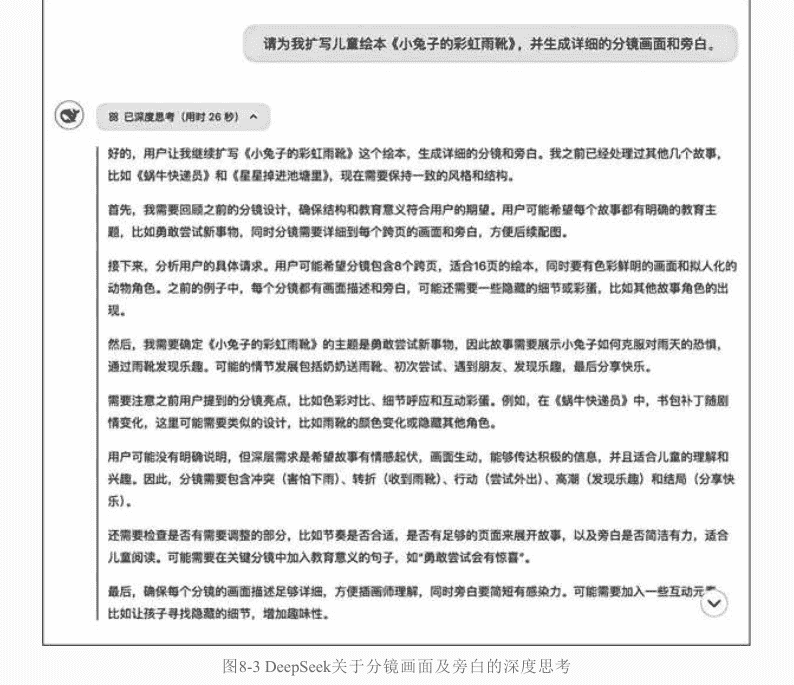

DeepSeek分镜画面及旁白的输出，如图8-4所示。

#### 分镜1：封面/扉页

画面：

- 阴雨绵绵的森林，小兔子蜷缩在蘑菇下，耳朵裹着绷带（象征怕淋湿）。

- 画面右侧一道彩虹光穿透乌云，照亮地上闪亮的彩虹雨靴（红黄蓝三色条纹+云朵鞋跟）。

- 标题用立体泡泡字体：《小兔子的彩虹雨靴》。

旁白：

> （扉页题词）

“害怕下雨的小兔子，遇见了一双会魔法的靴子……”

#### 分镜2：雨天的烦恼

画面：

- 小兔子躲在树洞里，耳朵用树叶包扎，眼巴巴看着窗外玩耍的小动物：

  - 鸭子戴泳镜跳水坑

- 雨点落在荷叶上，青蛙正将它们当成鼓槌敲出清脆的节奏
- 远处一位撑伞的奶奶缓缓走来，怀里抱着用彩虹包裹起来的东西

旁白：
> “哗啦啦——
小兔子最怕下雨，
耳朵湿漉漉容易着凉！
不过奶奶说：
‘雨天里藏着一个秘密。’”


到这里整体的叙事框架已经搭建完成，详细的大纲和分镜说明也整理齐全。这些内容为后续作画提供了明确的指引，能让每一页都精准地传递情节走向，创作也因此更流畅高效。

### 8.1.3 绘制图片

接下来进入配图的制作环节。以 DeepSeek 产出的分镜说明为依据，参照其中对每一幅画面的细致描述，借助另一款 AI 工具进行自动绘图。

这是绘本创作里非常关键的一环，即用人工智能完成插图的生成。可以选用国产工具即梦，它既有网页版也有手机 App，使用很方便。官网地址是：https://jimeng.jianying.com/。

登录后点开“图片生成”，把 DeepSeek 的画面描述填入。模型建议选用目前最新的“图片2.1”，绘本常用的画幅比例有 3:2、4:3 或 1:1，尺寸保持默认即可，点击“立即生成”，系统会一次性给出 4 张不同风格的预览，如图8-5所示。

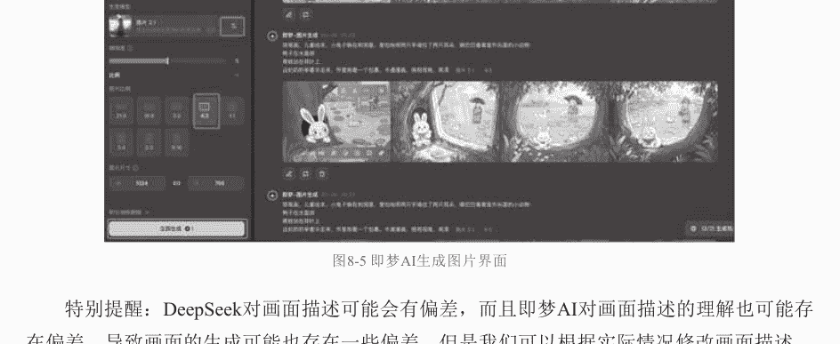

要注意，DeepSeek 书写的画面描述有时会出现偏差，即梦对文字的理解也可能跑偏，导致成品不够理想。遇到这种情况可以手动润色描述，或对同一描述让即梦多试几次。我们常把这种反复生成的过程叫做“抽卡”，同一个提示会得到不同的结果，通过不断抽卡挑选最满意的画面。即梦生成的示例见图8-6所示。


图8-6 即梦AI图片生成示例

若在即梦里找到合适的画面，点击“HD”即可获得高清版本，如图8-7所示。

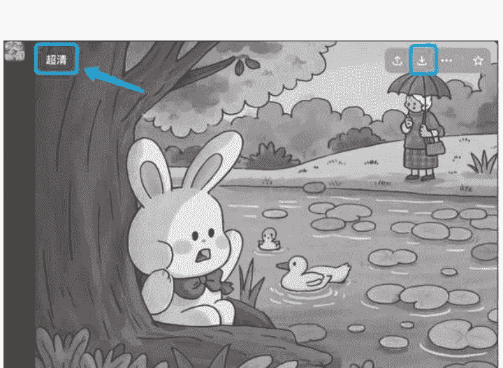

图8-7 即梦AI超清图片示例

这张最满意的图片要妥善保存，后续做绘本插图或改成短视频时都是重要素材。

要让配图既快又好，可以延续之前的思路：先让 DeepSeek 精准捕捉画面细节并写出细致描述，再用即梦的图像生成能力快速产出高质量图片。

### 8.1.4 图文结合，生成绘本

现在已经有了儿童绘本的两大要素——精致配图与完整故事。借助一款功能强大、操作简便的图文排版工具，把文字和图片快速融合，就能做出好看又有内容的绘本。比如用专业排版软件，把故事按情节分段，根据每段情绪与场景挑选合适的字形、字号和色彩来突出重点；再把生成的配图放到对应文字旁，调整大小与位置使其协调；最后为每页加上页码、标题和点缀，得到一页既有情节又有插图的绘本页面，如图8-8所示。


按此方法完成每个情节的分页，再把所有页面整合，就成了一本完整的绘本故事书。

## 8.2 用DeepSeek进行个性化学习辅导

孩子的教育一直是家长和社会关注的焦点。为了提高成绩，很多家庭花高价报培训班，但投入与效果往往不匹配。

### 8.2.1 传统方式为何难以实现个性化辅导

个性化辅导是指依据学习者的认知水平、学习特点和知识基础等差异，制定专属计划，提供针对性的指导和资源支持，更贴合每个孩子的成长规律。

其优势在于：
- 能精准找出知识短板和学习障碍；
- 可随学习进度灵活调整内容和难度；
- 通过持续跟踪与反馈，及时修正策略；
- 有助于激发兴趣，建立学习信心。

传统机构难以做到真正个性化，主要受限于：
- 优秀师资不足，难以实现真正的一对一；
- 课程固定，调整空间小；
- 反馈滞后，难以即时响应需求；
- 个性化运营成本高，难以规模化。

借助 DeepSeek 这类智能教育平台，这些限制可以被打破，因为：
- 具备强大的知识理解与分析能力，能精准把握学习状态；
- 可依据学生反馈实时调整教学策略；
- 能提供丰富的学习资源和多样的解题思路；
- 7×24 小时在线，随时满足学习需求；
- 使用成本低，让更多家庭受益。

### 8.2.2 3步实现个性化学习辅导

下面说明如何通过 DeepSeek 为孩子提供更科学、更有效的个性化支持。

#### 1. 用DeepSeek进行学习诊断和评估

首先可让 DeepSeek 评估学生的知识水平。只需说明评估目标，例如“我是一名初二学生，请对我的数学进行评估”。系统会围绕目标自动生成测评题目，请学生作答后进行分析和总结，给出完整评估结果。

以初二数学为例，系统会通过提问了解学生对代数、几何、函数等核心内容的掌握情况，识别出诸如对函数理解不够深入等具体问题。基于诊断结果生成个性化学习画像，为后续辅导提供依据。

DeepSeek的完整思考过程如下：

嗯，要评估初二学生的数学水平，先要明确初二数学的范围。按国内课标，初二主要涵盖代数、几何、函数入门以及统计概率。代数涉及整式、分式、方程与不等式；几何包括三角形、全等、勾股定理和四边形；函数开始接触一次函数与正比例函数。

评估要通过题目来检测掌握情况。需要设计覆盖不同知识点的题目，难度适中。代数可考察解一元一次方程、不等式、二元一次方程组及分式运算；几何可考察全等判定、勾股定理应用、四边形性质；函数可考察图像绘制、斜率截距意义、实际问题建模；统计概率可考察平均数中位数众数及简单概率计算。

同时要关注逻辑推理和解题规范，几何证明是否写出已知求证，步骤是否严谨。还需检验应用题转化能力。

可设计的基础、中等、较难题目包括：
①解方程：3x -5=7。
②解不等式：2x +3≤11。
③因式分解：x² -5x +6。
④计算：（2/3）+（1/4）。
⑤直角三角形两直角边3和4，求斜边。
⑥根据条件证明两个三角形全等。
⑦一次函数y=2x -3，求x=4时的y值并描绘图像。
⑧盒子里5个红球3个蓝球，摸到红球的概率。

根据正确率、速度和解题方法判断掌握程度。基础题应快速正确，因式分解出错需加强；能正确使用勾股定理或全等判定说明几何较好；函数与概率则考察概念理解与计算能力。也要注意符号、通分、证明逻辑等常见步骤错误。

若大部分题目正确且步骤清晰，说明水平较高；部分错误需针对性强化；错误较多则需系统复习基础。

DeepSeek给出的完整方案如下：

##### 一、评估知识点范围
初二数学主要包括：
###### 1. 代数
①方程与不等式：解一元一次方程、不等式。
②分式运算：加减乘除。
③整式与因式分解：提公因式、十字相乘。
###### 2. 几何
①三角形：全等判定、勾股定理。
②四边形：平行四边形、矩形、菱形的性质与判定。
###### 3. 函数
一次函数：解析式、图像、斜率与截距。
###### 4. 统计与概率
①数据分析：平均数、中位数、众数。
②概率：简单事件概率。

##### 二、自测建议
###### 1. 基础题
①解方程：4（x - 2）= 3x + 5。
②计算：1/2 ÷ （3/4 - 1/2）。
③求直角三角形斜边：两直角边6和8。
###### 2. 中等题
①因式分解：x² - 4x + 3
②画一次函数y = 3x - 2，并求y=4时x值。
③从1～10中随机抽一个数，是质数的概率。
###### 3. 挑战题
①几何证明：已知△ABC中，D是AB中点，E是AC中点，证DE平行于BC且DE=1/2 BC。
②应用题：商店“满200减50”，原价x元，写出实际付款y与x关系。

##### 三、常见薄弱点及建议
①代数运算易错，如符号、分式通分。
建议每天练3～5道方程/分式，逐步自查。
②几何证明逻辑不清。
建议按“已知→求证→证明”书写，熟记判定条件。
③函数图像理解困难。
建议列表描点，观察斜率与截距影响。
④应用题转化弱。
建议划出关键数据，把文字转化为方程。

##### 四、学习资源推荐
①教材课后习题：人教版、北师大版初二数学。
②提升训练：《五年中考三年模拟》初二分册。
③在线工具：GeoGebra、Wolfram Alpha。

##### 五、后续计划
①每周聚焦1～2个专题。
②建立错题本，标注错误原因。
③每月做一套综合卷限时90分钟，分析进步与不足。

通过针对性练习与系统梳理，可精准定位水平并找到提升路径。

#### 2. 量身定制学习计划

完成诊断后，可把知识遗漏点和弱项告诉 DeepSeek，让它查漏补缺制定专属计划。

例如初三学生发现二次函数没学会，说“二次函数没掌握，请制定学习计划”。DeepSeek不会给出笼统框架，而是把知识点拆解为易懂模块，从函数基本概念入手建立认识，再引导探索二次函数图像特征，通过动态演示和互动练习观察开口方向、顶点坐标、对称轴等关键特征，最后应用于实际问题，并为每个模块设定学习时长与检查点。

下面是DeepSeek的完整思考过程：

用户是初中生，之前做过评估，现在指出二次函数是薄弱点。需要先判断具体困难点：概念不清、图像性质不懂、顶点式转换困难、求根方法不熟或应用题不会。

应提供结构化路径，从基础到深入。先确保理解一般式，图像形状、顶点、对称轴概念。随后讲解关键知识点：一般式到顶点式转换、求顶点坐标、对称轴、求根。可能在配方法、求根公式使用上出错，需详细解释并举例。

常见错误如顶点坐标符号混淆、公式使用漏负号。随后通过由易到难的典型例题练习，强调代入、分解因式、顶点式转换等要点。最后给出学习建议：制作图像卡片、每日练习特定题型、整理错题，保持鼓励态度。

DeepSeek给出的完整建议：

明白了！二次函数是初中难点，但系统梳理后完全可以掌握。下面是专项突破指南：

##### 一、二次函数核心知识框架
#### 1. 基础概念
①定义：形如 y = ax² + bx + c （a≠0）。
②图像：抛物线，开口方向由a决定：a>0向上，a<0向下。
③顶点坐标为 (-b/2a , 4ac-b²/4a)。
④对称轴：直线 x = -b/2a。
###### 2. 关键知识点分步突破
####### （1）一般式到顶点式
目标：把 y=ax²+bx+c 化为 y=a(x-h)²+k，明确顶点(h,k)。
方法：配方法。
步骤：提取二次项系数→配方→整理。
例题：将 y=2x²-4x+1化为顶点式。
解答：提取得 y=2(x²-2x)+1，配方 x²-2x=(x-1)²-1，得 y=2(x-1)²-1，顶点(1,-1)。
####### （2）与坐标轴交点
与y轴交点令x=0，得(0,c)；与x轴交点解方程 ax²+bx+c=0，Δ=b²-4ac决定交点个数。
例题：y=x²-2x-3与x轴交点。
解方程得(x-3)(x+1)=0，交点(3,0)、(-1,0)。

####### （3）图像特征与参数关联

1）开口程度与 |a| 的联系：|a| 数值越高，抛物线越收紧、越细；|a| 数值越低，曲线越舒展、越宽松。
2）平移规律：顶点式 y=a(x-h)²+k 本质上是对基准抛物线 y=ax² 先向右平移 h 再向上平移 k 的结果，符号方向要特别留意。

##### 二、二次函数常见盲区与易错点

###### 1. 容易混淆的细节
1）顶点横坐标公式：x = -b/(2a)，负号极易遗漏。
2）求根公式写法：分子为 -b ± √Δ，分母为 2a，常把分母写错。
3）建模时的定义域：把实际情境转化为函数模型时，常常忽略取值范围，比如长度不能为负数。

###### 2. 典型失误拆解
错例：计算 y = -x² + 4x 的顶点时，有人直接算 h = 4/2 =2，却忘了公式里的负号。正确做法 h = - 4/[2×(-1)] =2，最终顶点为 (2,4)。

##### 三、分层专项练习

###### 1. 基础组
1）把 y = x² -6x +5 化为顶点式，并说明开口方向、顶点坐标、对称轴。
2）求 y = -2x² +8x -5 在 y 轴上的截距。
3）草绘 y = x² -4x +3 的大致图，标出顶点与 x 轴交点。

###### 2. 提升组
1）已知抛物线顶点为 (1,-2) 且经过点 (3,6)，求解析式。
2）若二次函数图像的顶点落在第二象限，分析 a、b、c 的符号可能。

##### 四、复习建议
1）图形记忆：借助 GeoGebra 制作动态图，观察 a、b、c 变化时图像的响应。
2）每日练习：每天稳定完成 2 道不同类型的二次函数题目，例如解析式求解、最值应用等。
3）错题归纳：把因公式不熟或计算失误导致的错误记录下来，考前重点回顾。

DeepSeek 对二次函数的整理相当系统，既搭建了知识框架，又对每个要点做了讲解、示范与配套练习，还准备了由易到难的专项题单，最后给出贴心的学习方案，建议每日做两题并用错题本补强薄弱点。

#### 3. 用 DeepSeek 开展个性化巩固测验
完成针对性提升后，可继续让 DeepSeek 出具巩固测验，检验薄弱点是否真正掌握。提示语可以是：“二次函数我已经学完了，请按我的情况出巩固测试，确保我完全掌握”。后续输出可自行尝试。

这种个性化辅导显著提升学习效率，让知识更牢固，兴趣与自主学习能力同步增强，也大幅降低了优质教育资源的使用门槛。

另外作业批改也能实现自动化。把作业拍照上传，告知 DeepSeek“请批改”，它能识别文字、理解题意，判定正误并分析解题思路，给出改进建议。

## 8.3 用 DeepSeek 开展课程与讲义制作
备课时，大纲编写、目标设定、内容整合与 PPT 制作都十分耗时。教师需要吃透教材梳理知识点，同时思考如何生动呈现以提升参与度；随着教育理念与学生需求的变化，教学方案需要不断迭代，反复打磨会增加负担。

DeepSeek 能让课程设计与课件制作更高效、智能且个性化，释放教师精力，让其聚焦教学互动与创新。

### 8.3.1 确定教学议题
使用 DeepSeek 备课前，先明确主题。以“勾股定理”为例，要围绕定义、证明方法及实际应用制定清晰目标，帮助学生理解并会用。

### 8.3.2 构思教学大纲
主题确定后，可让 DeepSeek 展开生成。它能结合目标、结构与学生需求，输出科学且富有创意的教学大纲，涵盖核心知识与教学互动。

输入“生成一节课讲完勾股定理的教学大纲”，可得到如下示例：

**课程标题：探索勾股定理——直角三角形的秘密钥匙**

#### 教学目标
1）知识目标：理解勾股定理的数学表达与几何意义，掌握基本应用。
2）能力目标：能用勾股定理解决简单实际问题，培养数形结合思维。
3）情感目标：感受数学与生活的关联，激发对数学史的兴趣。

#### 课程大纲（40分钟）
##### 一、情境引入：从历史到生活（5分钟）
1）互动提问：如何不靠测量判断墙角是否为直角？
2）历史故事：古埃及结绳法 3-4-5、我国《周髀算经》“勾广三，股修四，径隅五”、毕达哥拉斯学派发现。

##### 二、定理探究：从观察到证明（15分钟）
1. 实验发现：给出多组直角三角形边长如 3-4-5、5-12-13，引导计算发现 a²+b²=c²。
2. 定理表述：文字与公式 a²+b²=c²。

##### 三、分层应用：从基础到拓展（15分钟）
1. 基础练习：已知两边求第三边，强调区分斜边与直角边。
2. 生活应用：长方体表面蚂蚁最短路径。
3. 逆向思考：给定三边判断是否为直角三角形，渗透逆定理。

##### 四、总结升华：知识网络构建（5分钟）
1）思维导图：勾股定理-直角三角形-边角关系-实际应用。
2）易错提醒：仅适用于直角三角形，注意平方与开方的顺序。

这种大纲以生活问题导入，结合历史文化激发兴趣，通过实验探究自主发现定理，再以分层练习巩固并拓展思维，最后用思维导图梳理网络并点出易错点，提升效率。

### 8.3.3 梳理教学知识点
下一步让 DeepSeek 提炼大纲中的知识点，为课件制作做准备。提示“帮我提炼出知识点有哪些”，系统会准确判断教师身份并输出结构化要点，涵盖定理表述、适用条件、已知两边求第三边、实际问题、两点距离公式、逆定理、勾股数生成规律、易错点等。

传统 PPT 制作需要从零收集素材、排版、配图配动画，耗时费力。AI 自动制作 PPT 后，可根据大纲与内容智能排版文字图表，按主题匹配风格，视觉与逻辑兼顾，教师可把精力放在教学设计与互动上。

先把大纲与知识点融合为 Markdown 输出，再交由 AI 转为演示文稿。

可提示“帮我把大纲和知识点的内容进行融合，并以 Markdown 的格式输出”。

## 勾股定理教学大纲与知识点全解

## 一、课程目标
1. 知识目标
    - 掌握勾股定理公式 a²+b²=c² 的表达与几何意义。
    - 理解几何拼图法与代数推导两种证明思路。
2. 能力目标
    - 能解决直角三角形三边计算，辨识勾股数并理解其规律。
3. 素养目标
    - 体会数学文化价值，培养空间建模思维。

## 二、教学流程与知识点融合
1. 情境引入（10分钟）
    （1）核心知识点
    - 定理表述：直角三角形中斜边平方等于两直角边平方和。
    - 历史背景：《周髀算经》与毕达哥拉斯学派。
    （2）教学活动
    - 问题导入：如何估测不可攀爬的旗杆高度？
    - 动态演示：直角三角形三边关系拆解。

2. 定理证明（15分钟）
    （1）核心知识点
    - 几何拼图法：4 个全等直角三角形加小正方形验证面积守恒。
    - 代数推导法：相似三角形面积比例推导。
    - 易错提醒：必须为直角三角形。
    （2）教学活动
    - 分组纸板拼图验证。
    - GeoGebra 动态展示面积重组。

3. 基础应用（15分钟）
    （1）核心知识点
    - 三边计算：已知两直角边求斜边，或已知斜边一直角边求另一直角边。
    - 实际问题：梯子滑动、矩形对角线等。
    - 易错点：单位统一、算术平方根取正。
    （2）分层练习
    - 基础：直角边 6 与 8，求斜边。
    - 提高：斜边 10，一腰 6，求另一腰。
    - 拓展：验证 7、24、25 是否为勾股数。

4. 总结拓展（10分钟）
    （1）核心知识点
    - 逆定理：a²+b²=c² 则为直角三角形。
    - 勾股数生成：a=m²-n²，b=2mn，c=m²+n²（m>n>0）。
    - 跨学科应用：数轴两点距离公式。
    （2）课后任务
    - 基础作业：3 道三边计算题。
    - 探究任务：设计家居高度测量方案并附示意图。

## 三、知识图谱（Mermaid可视化）
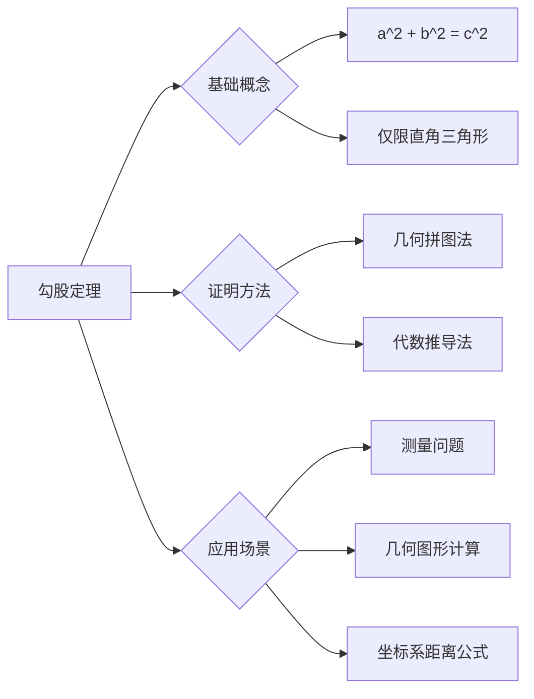
## 四、教学资源
| 资源类型 | 具体内容 |
|---|---|
| 动态工具 | GeoGebra 面积重组动画 |
| 文化素材 | 《周髀算经》“勾三股四弦五”原文与译文 |
| 习题库 | 按难度分级的 20 道练习题 |

## 五、易错点专项
1. 公式错位
    - 错误案例：把斜边 c 代入直角边位置。
    - 纠正方法：用颜色区分直角边与斜边。
2. 单位混淆
    - 典型错误：3米加4分米直接计算。
    - 纠正练习：单位换算专项。
3. 忽略非直角
    - 错误案例：在等腰三角形中误用定理。
    - 诊断方法：先验证是否为直角三角形。

设计说明：本方案采用“问题驱动-动手验证-分层训练”三阶段建构知识，关键概念突出显示。

接下来打开 KIMI 国产 AI 工具，先点击指定图标，再选择“PPT 助手”选项。
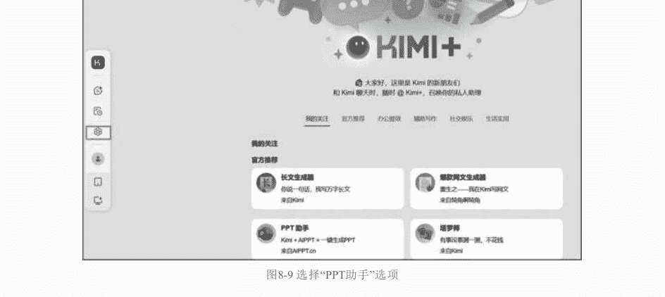
为确保 DeepSeek 产出的 Markdown 内容能顺利转为演示文稿，需把全部内容完整复制至对话框。复制完成后点击“一键生成 PPT”按钮，系统弹出模板选择界面，如简约商务风、清新淡雅风、活泼创意风等，按需选择。选定后点击“生成 PPT”，系统依据结构智能排版文字与图片，并按模板调整视觉要素，形成美观专业的课件。整个流程高效省时。
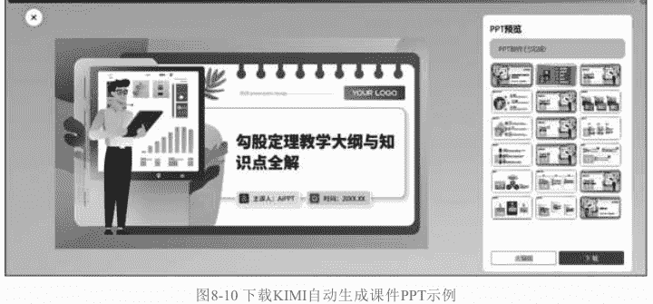
最后得到内容丰富、讲解有创意、排版精美的课件 PPT。DeepSeek 还可继续生成配套课后练习题，输入“请提供课后练习题”即可自动生成覆盖重点难点的选择、填空、简答与应用题，既巩固基础又激发思维。

从课程大纲到教学目标、内容整合到 PPT 制作，每一步都考验专业与创新能力，同时要跟随教育理念变化调整方案。

# CHAPTER 9
# 第9章 DeepSeek私有化部署

大模型技术正快速渗透到企业的日常运营里，为业务带来明显的效率增益。与此同时，企业也在思考一个现实问题：怎么在充分利用模型能力的同时，保证核心数据始终在自有边界内、可审计、可掌控。开源大模型DeepSeek的自建部署模式，提供了一种兼顾能力与安全的思路。接下来围绕落地思路、关键决策点和稳定运行，给出系统化的梳理，帮助团队把方案真正跑通。

## 9.1 本地私有化部署的动因与价值

在数字化转型中，企业一方面追求效率，另一方面必须守住合规与信息安全的底线。把原本依赖公有云的智能体搬进自有数据中心，就是DeepSeek本地化部署的核心做法。该方式兼顾可控性与灵活性，既能让敏感信息留在内部边界，也能按业务特点做针对性优化，为转型提供更精准的智能支撑。

### 9.1.1 本地化部署是什么

可以把DeepSeek视作一位多技能的智能协作伙伴，擅长撰写、编程、数据分析等任务。常见用法是部署在公有云，企业通过网络远程调用。当保密性、隐私要求或特殊业务场景成为刚需时，企业会倾向于把这项能力搬到内网，直接在受控环境里运行。

本质上，私有化部署是将模型从公网迁移到企业自管服务器的过程。类比组织行为，相当于把一位高绩效人才正式纳入公司：先搭建硬件工作环境，再配备软件工具，并确保其在内网持续可用。

迁移完成后，企业对运行环境拥有完全掌控，全部交互在内网闭环。像在家办公一样便捷且安全，既能隔离核心信息，又能基于实际业务对模型做定向优化，让智能体更贴合特定场景。

### 9.1.2 部署的核心收益

市场上已有公开入口可以直接调用DeepSeek，为什么还要投入自建？关键在于企业更看重使用便利，还是自主可控。

1. 信息隔离与合规保障
企业日常会产生大量核心资产：商业机密、客户个人信息与交易记录、研发技术资料与实验结果、财务报表、战略规划文件等。本地运行让数据处理与存储始终留在企业边界，避免跨境或外泄，从源头守护核心资产。好比讨论敏感议题需要隔音会议室，本地化部署相当于在内部搭建这样一个封闭空间，对话与数据流转均在此完成，不会扩散到外部。

2. 业务适配与持续优化
不同行业拥有各自的专业知识体系。金融涉及市场机制、产品定价、风控策略；工程涉及项目管理、结构原理、施工标准等。这些领域知识在通用预训练中的覆盖有限。本地化允许企业对模型进行微调与知识注入，调整回复风格、定制功能模块，让模型更懂业务。就像新员工需要岗位培训才能上手，医疗器械企业可让模型学习专业术语与行业规范，从而更准确地处理相关任务。

3. 响应稳定性与算力掌控
内网运行不依赖公网带宽，避免网络波动与延迟带来的不确定性，服务更稳定、响应更快。同时，企业可依据使用情况灵活调度算力，实现服务质量的持续优化。关键任务需要即时决策时，没人愿意等待网络拥堵。本地化相当于把远程员工调回办公室，省去通勤时间，随时待命。企业还能按需升级硬件，进一步提升处理能力，为长期发展提供技术底座。

## 9.2 落地实施的典型路径

在企业内部搭建DeepSeek智能工作站，本质是一项系统工程。可类比设立新部门：先选对人才即模型版本，再准备办公环境即硬件，随后完成入职即部署，最后进入上岗即运行。以下三个环节构成完整链路。

### 9.2.1 版本选择与硬件规划

模型选择应以业务需求、现有算力与应用场景为依据。建议先从轻量版本试水，待需求扩大后再逐步升级到更高性能版本。硬件环境是模型发挥的基础。不同级别的模型对计算资源要求不同，如同初级助理只需普通办公电脑，资深专家则需要专业设备。合理匹配硬件，既能保证性能释放，也能实现资源的最优利用。表9-1 所示为 DeepSeek 各版本硬件配置参考，实际部署时可结合自身条件适度调整。就像员工级别与办公设备匹配一样，选对硬件配置才能确保流畅运行并避免资源浪费。部署前务必评估现有硬件，选择最合适的模型版本。

表9-1 DeepSeek各个版本所需的硬件配置参考

| 模型名称 | 特点 | 比喻 | 适用场景 | 优势 | 最低配置 | 推荐配置 | 适用硬件 |
| :--- | :--- | :--- | :--- | :--- | :--- | :--- | :--- |
| DeepSeek-R1-1.5B | 轻量级模型，运行速度快，但推理能力有限 | 初级助理，快速处理简单日常工作 | 硬件配置有限的小型企业，基础问答，简单文案生成 | 部署简单，响应迅速，硬件要求低 | 8GB显存，16GB内存 | 16GB显存，32GB内存 | 入门级GPU，如RTX 3060 |
| DeepSeek-R1-7B | 平衡性能与资源消耗，适合中等复杂任务 | 经验丰富的专员，处理日常任务得心应手 | 中小型企业，多轮对话，代码补全等需求 | 性能与资源消耗平衡，部署门槛适中 | 16GB显存，32GB内存 | 24GB显存，64GB内存 | 中端GPU，如RTX 4070Ti |
| DeepSeek-R1-8B | 性能略强于7B，适合更高精度需求 | 资深专员，工作质量更有保障 | 对精度要求较高的中型企业 | 保持适中资源消耗的同时提供更好的输出质量 | 16GB显存，32GB内存 | 24GB显存，64GB内存 | 中端GPU，如RTX 4070Ti |
| DeepSeek-R1-14B | 高性能模型，擅长复杂任务 | 部门经理，能够处理复杂的专业问题 | 需要处理数学推理、代码生成等复杂任务的企业 | 强大的推理能力，高质量输出 | 24GB显存，48GB内存 | 32GB显存，96GB内存 | 高端GPU，如RTX 4090 |
| DeepSeek-R1-32B | 专业级模型，性能强大，适合高精度任务 | 专业领域的专家顾问，深度理解专业问题 | 需要处理法律文档分析等高精度任务的大型企业 | 专业领域理解深入，分析能力出色 | 32GB显存，64GB内存 | 48GB显存，128GB内存 | 专业级GPU，如A5000 |
| DeepSeek-R1-70B | 顶级模型，性能卓越，适合大规模计算和高复杂度任务 | 首席专家，能够处理最具挑战性的问题 | 需要进行大规模计算、复杂商业决策分析的大型企业 | 超强的分析和推理能力，最佳的输出质量 | 64GB显存，128GB内存 | 80GB显存，256GB内存 | 企业级GPU，如A100 |
| DeepSeek-R1-671B | 满血版，性能最强，适合超高精度需求 | 专家团队，能够解决最前沿的复杂问题 | 前沿科学研究，复杂推理任务的研究机构 | 最强大的计算能力，最精确的分析结果 | 512GB显存，1TB内存 | 768GB显存，2TB内存 | 多卡集群配置，如多张A100或H100 |

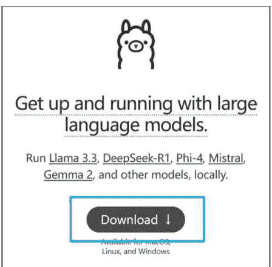
图9-1 Ollama官网
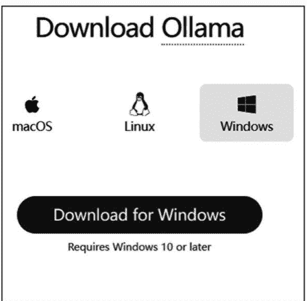
图9-2 选择对应的版本

硬件就绪后，可借助 Ollama 完成模型的本地迁移。Ollama 是一个开源本地大模型运行框架，目标是让非专业用户也能便捷地在本地下载、部署和管理大型语言模型，使用体验接近安装普通软件。它支持文本生成、翻译、代码编写、问答等多种任务，并可在 macOS、Linux、Windows 及 Docker 环境下运行。Ollama 将模型下载、安装、启动流程标准化，操作简化为一条命令行指令。用户可前往官网 https://ollama.com/ 下载客户端，按系统选择对应版本。以 Windows 为例，下载 OllamaSetup.exe 后双击即可自动安装。

图9-3 安装Ollama

安装完成后，可在 Windows 应用列表中找到 Ollama 并启动。

图9-4 运行Ollama

需要注意的是，Ollama 运行后不会弹出窗口，仅在 Windows 任务栏右下角显示图标。


### 9.2.3 模型启动与使用

模型下载完成即进入最后一步：本地启动。私有化运行完全依赖本地算力，即使断网也能正常使用，这正是安全与隐私的核心体现。在 Ollama 加持下，启动模型只需一条命令，例如 `ollama run deepseek-r1:8b`，其中的模型名称对应你已下载的版本。执行成功后会出现 `>>>` 提示，可直接输入问题进行交互，体验与网页版类似，只是交互界面从可视化输入框变为命令行输入。本地模型开始思考并给出回复时，说明本地化部署已生效。此时你可以像使用专属员工一样与模型交流，无需担心排队拥堵，也无需担忧隐私泄露。完成以上三步即可实现 DeepSeek 的本地私有化部署与运行。初期建议多做测试与调优，让模型逐步适应业务场景。同时保持与技术社区的互动，及时获取优化经验，让 AI 助手持续进化。

# 第10章 DeepSeek未来走向展望

随着人工智能技术的飞速发展，DeepSeek 等工具正逐步改变生产与生活方式。本章基于当前技术轨迹的合理推演，提供前瞻视角，而非确定性断言。这些预测同样适用于其他人工智能产品，反映了行业整体演进方向。无论是交互方式的深化、多模态感知的融合，还是成本优化带来的普惠，人工智能的演进已成共识。教育、医疗、金融等领域的赋能路径愈发清晰，这既是对技术潜力的审视，也是对人类智慧持续进化的信心。

## 10.1 未来可能的探索方向

DeepSeek 作为 2025 年全球范围内迅速崛起的人工智能公司，其发展轨迹不仅反映技术创新的突破，更折射出人工智能与普通人生活深度融合的趋势。结合当前公开信息和行业动态，以下从技术演进、用户生态、全球化布局、伦理挑战以及未来想象五个方面进行预测与分析。

### 10.1.1 技术演进：从好用到懂你

DeepSeek 的核心竞争力在于其对话友好性。与早期人工智能需要用户学习复杂指令不同，它通过自然语言交互大幅降低使用门槛，用户只需像聊天一样表达需求即可获得精准回应。这种无感化设计将成为其技术迭代的主线。

#### 1. 更智能的场景适配能力
当前的 DeepSeek 已能处理投资建议、节日祝福、职业规划等多样化需求，但其未来可能进一步预判用户意图。例如，当用户提到想换工作时，DeepSeek 不仅能推荐热门职业，还能结合用户过往聊天记录中的兴趣、技能短板，提供个性化的学习路径建议，甚至模拟面试场景。

#### 2. 多模态交互的深化
目前 DeepSeek 以文本交互为主，但结合技术的发展与趋势，未来可能整合语音、图像甚至虚拟现实交互。比如用户拍摄一张户型图，DeepSeek 即可生成装修方案并估算成本；或通过语音实时分析对话情绪，为心理咨询提供辅助。

#### 3. 成本控制驱动普惠化
DeepSeek 的 R1 模型是通过工程优化大幅降低模型运行成本。这种技术降本将推动人工智能服务从企业级向个人用户下沉。例如，未来 DeepSeek 可能会推出更多免费或低成本的订阅服务，让普通家庭也能享受到定制化教育、健康管理等服务。

### 10.1.2 用户生态：从工具到伙伴

DeepSeek 的爆发式增长证明了市场对平民化人工智能的强烈需求。其用户生态可能呈现以下演变。

#### 1. 垂直领域的深度渗透
未来 DeepSeek 在不同领域的深度结合与技术应用将会值得关注。例如在教育领域，可能会结合 DeepSeek 推出自适应学习系统，根据学生答题记录动态调整习题难度；在健康领域，结合可穿戴设备数据提供饮食运动建议。这种渗透不是替代专业服务，而是作为智能助手填补传统服务的空白。

#### 2. 社群化与人机共创
参考网民将 DeepSeek 用于生成春节祝福、应对亲戚催婚等趣味场景，未来可能形成用户自发的内容创作社区。例如开放人工智能技能商店，让用户分享定制化的对话模板，如考研复试模拟导师、旅行规划专家，甚至通过区块链技术实现知识产权的确权与交易。

#### 3. 银发族与下沉市场的突破
当前人工智能用户以年轻人为主，但 DeepSeek 的简易交互特别适合银发群体。例如开发方言识别功能，让人工智能帮助不会普通话的老年人通过语音了解慢性病用药情况；或与社区服务中心合作，在三、四线城市推广人工智能办事助手，满足政务咨询、法律科普等需求。

### 10.1.3 全球化布局：从博弈到平衡

DeepSeek 的国际影响力已引发多方关注，既登上多国下载榜首，又面临网络攻击、政策限制等挑战。这种矛盾将长期伴随其全球化进程。

#### 1. 地缘政治下的技术博弈
美国对 DeepSeek 的警惕可能促使更多国家建立人工智能技术壁垒。对此，DeepSeek 或采取技术开源加本地化合规策略：一方面通过开放部分模型代码争取开发者支持，另一方面与当地企业成立合资公司，满足数据本地化存储等监管要求。

#### 2. 文化适配的精细化运营

出海策略上，深势科技倾向统一底座配合本地微调的打法。东盟市场或将上线融合本土节庆的祝福互动，欧陆地区则要应对更严苛的个人数据监管，比如推出无痕聊天模式，记录在24小时内自动清除。整体框架搭配合地细节的做法，将左右海外扩张成败。

#### 3. 硬件联动 打开新场景
把能力装进终端，才能真正打开新使用面。往后该模型可能内置于智能手机、智能座舱等硬件。举例说在车机端，它能一次性完成语音订票、路线规划和景点讲解，把原本分散在多款App的功能串联起来，令驾乘感受更流畅。

### 10.1.4 伦理关口：创新红利与责任边界
随智能体普及程度提升，深势科技正站在关键分岔口。一边是技术创新带来的前所未有便利，另一边是信息安全、隐私数据、技术误用等伦理难题。要在加速前进的同时守住道德与社会底线，是未来发展必须回答的核心命题，这既是技术考验，也是价值观念检验。

#### 1. 信息安全与价值指引
用户询问投资建议、医疗诊断等敏感议题时，模型需要在有用性和风险规避之间取舍。可引入分级应对机制：常规咨询即时给出，高风险话题则提示建议咨询专业人士并留存操作日志。

#### 2. 隐私数据与算法透明
对话记录常牵涉个人隐私，使用边界要说清楚。参照欧盟GDPR倡导的知情同意原则，企业处理个人数据前需明确告知并取得授权。未来或推出数据护照功能，让用户自行决定哪些信息可用于训练，哪些必须加密存储。

#### 3. 防范滥用与防止数字鸿沟
深势科技以免费形式向公众开放，看似机会均等，但不同群体使用水平的差异以及智能体对不同技能劳动力的影响仍需关注。研究显示智能化发展可能加剧数字鸿沟，后续可通过更多培训课程或更易懂的使用说明来降低风险。

### 10.1.5 未来想象：从替代到赋能
深势科技的终极意义不在参数高低，而在于重塑人机协作方式。它不仅提升效率，更致力于激发人类创造力，从重复性工作中解放出来。同时探索情感陪伴边界，推动协作形态变革，让智能体成为伙伴而非单纯工具。这种以人为本的方向，才能实现技术与人的深度融合。

#### 1. 从“替代劳动力”到“增强创造力”
当前智能体多用在客服、文案等重复工作，演进方向更可能转向创意激发。比如作家输入故事梗概后，模型不仅能续写情节，还能分析读者情感曲线，建议高潮段落的最佳呈现方式，让人的创意更容易落地。

#### 2. 情感陪伴的伦理边界探索
已有用户把深势科技当作倾诉对象，未来交互可能更拟人化。但过度拟真可能导致沉迷虚拟关系。可设置防沉迷提醒，或在检测到用户持续情绪低落时主动推送心理咨询资源。

#### 3. 推动社会协作模式变革
当智能体能无缝协调多方需求时，可能催生新型协作形态。例如会议场景中，实时梳理各方观点、生成待办清单并分配任务；在社区治理里，整合居民意见并自动生成改造方案，提升公共决策效率。

## 10.2 DeepSeek打开行业新空间
随人工智能渗透加深，各行业都在被重塑。从教育量身定制学习到医疗人工智能辅助诊断，从金融智能风控到制造柔性生产，行业格局持续变化。职场也在悄然洗牌，旧岗位收缩，新岗位冒头。

### 10.2.1 医疗健康：辅助诊断与远程照护
在医疗领域，深势科技潜力巨大，有望带来革新。未来诊疗会更高效、更精准、更具针对性。医生可借助人工智能快速解析症状和检查报告，获得初步诊断建议；深度学习也可分析影像数据，更准确地定位病灶。远程医疗智能化让患者在家就能获得定制化健康管理，量身定制治疗方案逐步落地。

#### 1. 诊断加速与治疗更准
该模型有望加快诊断节奏并提升精度。通过解析症状描述和检查资料，快速给出初步诊断参考，缩短医生决策时间。比如白药集团就用类似技术优化药物研发，把传统需数年的靶点发现压缩到数周。影像数据的深度学习分析也能辅助医生更精准判读病灶，并通过大数据为医院提供风险评估和治疗建议。

#### 2. 远程医疗的智能化升级
远程场景下，可整合可穿戴设备数据如心率、血糖，为慢病患者提供日常管理方案。糖尿病患者上传饮食记录后，系统可即时评估血糖波动风险并调整食谱。智能化管理提升依从性，降低因恶化住院的风险，同时利用病历和症状分析为远程诊断提供支持。

#### 3. 量身定制诊疗走向普及
人工智能推动量身定制诊疗从概念落地。人工智能辅助诊断和远程医疗缓解资源紧张，让医生摆脱繁琐初筛，专注疑难症。该模型通过分析病历、基因信息和实时健康数据，为每位患者制定方案，降低误诊率。肿瘤患者可结合基因特征和临床表现获得更合适的药物组合，减少化疗副作用。整合电子病历、影像和实验结果，人工智能还能实时给出诊疗建议，优化流程。

### 10.2.2 金融行业：智能风控与生态重塑
在金融领域，深势科技正释放巨大能量，有望重塑风险控制、财富服务和基础设施。

#### 1. 风控升级与体验优化
未来聚焦风控和体验。银行可用人工智能实时分析交易行为，识别深夜大额转账等异常并拦截欺诈。例如江苏银行用类似技术做合同自动质检合规审查，错误率降了80%。大数据还能提供更精准的风险评估和信用评级，提升安全性同时降低人工成本，智能算法还能优化产品设计与推荐。

#### 2. 智能顾问与财富管理
智能理财顾问将迎来变革。用户输入“10万存款怎么理财”，系统结合市场走势和风险偏好生成量身定制组合，并随市场动态调整。接入全球金融实时数据后，可输出行情分析和投资策略，辅助决策。自然语言处理能力还能解答基础理财问题并逐步给出专业建议，降低理财门槛，推动服务普惠与智能化。

#### 3. 智能合约与生态互联
人工智能和区块链结合有望革新底层架构。动态智能合约系统可在供应链金融中实时分析物流、税务数据，自动触发应收账款确权和资金清算，缓解信息不对称导致的融资难题。深度融合后，个人资产配置可突破传统边界，在授权下人工智能依实时经济指标自动调配数字钱包中的存款、黄金、国债比例，实现全维度财富管理，形成自进化金融生态。

### 10.2.3 制造与建筑：全面智能化转型
制造与建筑正被智能化重塑。结合工业物联网，深势科技助力柔性生产、实时监控设备、优化流程、降本增效、提升质量，并推动按需生产，精准预测需求减少库存。

#### 1. 柔性生产与智能监控
连接工厂传感器后，人工智能可实时监控产线、预测设备故障并提前维护，减少停机。数据分析优化流程进一步降本。智能管理提升质量，物联网实现设备互联，生产效率更高。

#### 2. 建筑行业的智能化实践
建筑端也在加速。某央企建筑集团的云平台已接入DeepSeek-R1/V3全系列模型，强化智能服务，成本清单智能匹配提升测算效率，并上线人工智能知识智能问答，提升答案准确度。该模型可分析优秀设计案例，为建筑师提供灵感并生成多种初步方案，兼顾创新与可持续，同时快速评估优化，指出问题并给出改进建议，如通风系统优化提升室内空气质量。

#### 3. 按需生产模式推进
借助深势科技，制造迈向按需生产。依市场需求灵活排产，减少积压浪费。结合供应链系统精准预测需求，优化库存周转，降本增效。智能化提升产品一致性，增强竞争力，这是生产模式的深层变革。

### 10.2.4 职业变迁：哪些在消失，哪些在诞生
人工智能浪潮下职场剧变。传统角色被高效替代面临转行，新兴岗位需要人工智能工具驾驭能力和跨领域整合思维。

#### 1. 夕阳职业预警
基础翻译员：人工智能即时翻译准确率有望达95%，多语会议可直接生成纪要，仅剩高端专业领域需要人工。
传统记者：人工智能可自动写快讯，记者转做内容策展人，负责筛选编辑人工智能产出并策划深度报道。
基础会计：90%记账报税或被自动化取代，会计向财务分析等高阶岗位迁移。

#### 2. 新兴岗位图谱
创意与技术岗位被重塑。人工智能绘画、视频生成、人工智能编程工具普及，企业急需懂人工智能的人才。
人工智能绘画与设计专员：熟练使用人工智能绘画工具产出高质量设计，精通Prompt工程，能整合多模态设计系统，满足品牌与广告需求。
人工智能视频内容创作者：包括特效合成师、跨媒体叙事专家，利用人工智能实现从分镜到预览的全流程自动化。
人工智能编程辅助工程师：优化管理人工智能生成代码，懂工具使用，也具备代码优化调试能力。

## 10.3 DeepSeek重塑未来生活

### 10.3.1 社交进化：打破语言文化壁垒
未来社交中，深势科技搭配实时翻译设备，让跨国交流更轻松。

#### 1. 跨语言社交体验
支持多语实时翻译，社交媒体聊天或国际会议演讲都能即时互译，消除误解，促进文化互通。

#### 2. 虚拟社交空间互动
可赋能虚拟社交空间，用户以虚拟形象面对面交流，一起游戏、看电影或参加活动，在异地也能保持紧密联系。

#### 3. 文化理解的桥梁
智能分析能力可提供对方文化背景简介，减少文化误会，成为文化交流的连接器。

### 10.3.2 娱乐与互动：沉浸式体验
人工智能让娱乐更沉浸、更个性。

#### 1. 个性化娱乐内容
根据心情偏好生成音乐视频，压力大时推舒缓音乐，看片时推荐最合适片单，满足多元需求。

#### 2. 沉浸式娱乐体验
结合VR/AR，用户可进入虚拟游戏世界冒险，或在现实中叠加虚拟宠物装饰，实现虚实无缝切换。

### 10.3.3 智能家居：生活更便捷
未来几年，人工智能将深度嵌入家庭场景。

#### 1. 智能唤醒与减压咖啡
早上7点，睡眠监测床垫调节温湿度，脑机接口数据上传深势科技，检测到压力偏高后自动下单特调咖啡并播放舒缓音乐，无人机5分钟内送达窗边，香气与旋律开启一天。

#### 2. 数字分身与虚拟感官
上午10点参加新品发布会，无需出门，数字分身进入元宇宙，触觉手套让面料质感可感，深势科技全球比价筛选优质面料，选择后订单自动下达。

#### 3. 智能厨房与健康午餐
中午12点，系统根据库存和饮食偏好推荐蔬菜沙拉配烤鸡胸肉，智能厨房自动备料烹饪，同时推荐搭配饮品，保证营养均衡。

#### 4. 智能检测与定制营养剂
下午3点，生物传感器提示维生素缺乏，系统下单定制营养剂，3D打印药片几分钟成型并配送，服用后精力恢复，深势科技提醒后续安排。

#### 5. 云端瑜伽与智能投资
晚上8点，线上瑜伽课程按身体状态定制动作，舒展放松。同时，DAO社区投票投资数字时尚单品，深势科技完成NFT交易并将收益兑换为实体店消费券，随时使用。