# DeepSeek银行实战手册：银行全场景AI实践指南（上册）

# 前言

## 为什么要写这本书

距拙作《银行数字化风控：业务与实践》出版已经3年有余，银行业数字化转型也早已进入深水区。然而书中提到的金融科技“让银行业更简单，让银行人更轻松”的愿景，在绝大多数银行并未真正实现。同时，在这几年给银行人培训的过程中，我也很无奈地发现，银行业的加班文化早已成为行业痼疾。

清晨七点的打卡、深夜十点灯火通明的办公室、周末无休的报表系统——这些场景在银行网点中司空见惯。某股份制银行2025年工作日志显示，基层员工日均处理系统操作达47项，涉及12个独立平台，其中11个平台需手工录入数据，甚至有柜员因连续操作触发系统防疲劳警报。更令人震惊的是，某省会城市支行监控数据显示，现金区员工日均站立服务时长超6小时，期间平均每9分钟就要完成一次“系统录入-客户沟通-凭证打印”的循环操作。调查还发现，该行38%的受访柜员存在腱鞘炎、腰椎间盘突出等职业病，部分员工因长期憋尿导致泌尿系统疾病。

尽管“数字化转型”已提出十余年，但许多银行的变革仍停留在表面。例如，某农商行信贷管理系统要求客户经理手工填写114项字段，其中“企业实际控制人二表姐联系电话”等无效字段占比达23%；某城商行反洗钱系统每天产生3000条可疑交易预警，但90%的预警因无法由系统智能研判而仍需人工复核。更讽刺的是，某些银行的“数字化”反而让工作更复杂。例如，某国有大行的对公开户流程需在3个系统间跳转16次界面，客户等待时长从纸质时代的45分钟延长至78分钟。

归根结底，出现这些问题的原因，仍在于技术与业务的脱节，在于监管机构屡次指出的“业技不融合”。某第三方机构调研显示，银行科技部门编制的需求文档中，仅42%的字段定义与业务部门的实际需求吻合；某省联社开发的移动展业系统，因强制要求上传9个角度的抵押物照片（含3个高空俯拍视角），导致客户经理不得不携带无人机开展尽调；因银行管理层追逐“区块链”“元宇宙”等概念，某城商行耗资800万元建设的“虚拟营业厅”上线3个月，日均访问量不足10人次。

其中，中小银行的困境尤为突出。某西部城商行科技投入清单显示，在每年2800万元的IT预算中，62%用于监管合规系统升级，23%用于核心系统维护，仅剩15%可投入创新领域。在其科技部7人团队中，5人专职负责中国人民银行EAST4.0数据报送，2人负责处理上级机构的现场检查整改。该行在试图引入某头部科技公司的解决方案时发现，仅系统对接的商务谈判周期就需要4个月，超过其科技预算年度决策周期。

2025年，DeepSeek横空出世，为银行业带来转机。例如，某东部农商行在WPS中嵌入DeepSeek模块后，授信合同审查实现了“三重穿透”：条款合规性检查穿透至最高人民法院司法解释第××条第×款，关联交易识别穿透至股权结构第五层控制人，财务数据勾稽穿透至增值税发票号与物流单匹配，审查时间从8小时缩短至40分钟，关键条款遗漏率从12%降至2%。

更值得关注的是技术变革带来的“AI平权”效应。自2025年2月始，笔者就奔波于长城内外、大江南北，为银行培训AI应用。从东北三省到西南边陲，从国有银行的总、分行到县级农商行乃至村镇银行，从零售业务到对公业务，从科技金融、绿色金融到普惠金融、养老金融，所有的银行人、所有的银行业务，在DeepSeek等AI工具的应用中，又站在了同一起跑线上。参与培训人数最多的一家城商行，实现了线下400人、线上2000人同步参与。

这些实践揭示的真相，在技术哲学层面呼应了克莱顿·克里斯坦森的“颠覆性创新”理论——真正的变革，往往始于被忽视的低端市场。从某种程度上讲，银行人已经或将要被划分成两大类：会用AI的和不会用AI的。

当下，银行业面临的转型压力，源于三重倒逼机制的叠加影响。

一是客户维度的“代际变革”。“Z世代”客户在短视频平台完成金融启蒙，他们期待的服务是“刷脸开户-智能匹配-无感授信”的丝滑体验。据某互联网银行最新数据，“95后”客户中途放弃办理业务的主因有三个：身份验证步骤超过两步（占41%），需要提交纸质材料（占33%）以及人工审核等待时间超10分钟（占26%）。

二是竞争维度的“跨界打击”。某头部电商平台推出“供应链金融API”，可将其平台内商家的经营数据实时转化为授信依据，实现“秒级放款”，这直接导致某城商行的小微客户流失率季度环比上升19%。

三是监管维度的“数字规制”。中国人民银行要求全面实施《金融科技发展规划2023-2025年》，推动落实加强金融数据管理与应用的有关要求，引导金融机构坚持“依法合规、守正为民、业务赋能、强化保护”原则，促进数字技术、数据要素和金融服务深度融合。

在此背景下，银行面临的选择不是“是否转型”，而是“如何有效地转型”。本书的终极目标，就是帮助银行从业者在技术狂潮中保持清醒。

当同业在炫耀“数字员工”的拟人程度时，我们要问：它能替代多少重复劳动？当供应商兜售“全栈式解决方案”时，我们要算每个功能点的使用频次。当行业会议热议“大模型参数规模”时，我们要看一线员工是否需要为此升级计算机配置。

数字化转型从来不是目的，而是手段。

若本书能让一名综合柜员每天少单击鼠标300次，让一个县域支行每年减少20万元无效IT投入，让一位农村老人足不出村就能获得信贷服务，那么这场“始于工具、终于人性”的变革，便已悄然发生。

“让天下没有加班的银行人”，这句话或许过于理想，现实中也难以实现。但在被DeepSeek等AI工具赋能之后，也许银行可以尝试一下每周少加半天班。

## 读者对象

- ○银行一线业务人员，如大堂经理、客户经理、柜员、理财经理、个贷经理、合规专员以及风控专员等，以及渴望用AI工具减轻重复性劳动，但受限于技术门槛的员工。
- ○银行各级分、支行行长、部门负责人、数字化转型办公室成员，以及零售业务、对公授信、普惠金融等银行核心业务相关岗位的工作人员。
- ○希望了解银行AI应用现状与发展趋势，以及大模型应用最新动态的读者。
- ○即将进入或刚刚进入银行发展的新人。
- ○研究银行实务与发展的专家、学者。
- ○与金融科技及数字化转型专业相关的高校师生。
- ○想要全面了解银行AI实践的其他读者。

## 本书特色

进入2025年，DeepSeek的相关话题持续火爆，市面上已经有很多讲述DeepSeek原理和办公场景应用的通用类书籍，而从银行全业务场景出发，系统研究DeepSeek如何落地实操的书，相对还比较稀少。

这不是一本阐述AI大模型理论的书，而是一份“马上能用”的实战手册。若您厌倦了“数字化转型”的空洞口号，不妨从本书开始，用DeepSeek从每个烦琐的流程省出一小时，将时间还给生活，也还给银行业本该有的效率与优雅。

本书具有以下四大特点。

### 1. 技术与金融深度融合，展现AI赋能银行业务的全景图谱

本书聚焦AI技术与银行业务的深度融合，全面展现DeepSeek在银行场景的赋能应用。从银行业AI应用演进的宏观历程，到DeepSeek在对公业务、零售业务等具体场景的微观应用，本书涵盖智能客服、精准营销、风险管理、数据治理等多个领域，构建了“技术原理-场景应用-操作实践”的完整体系，为读者呈现AI从理论到实践的银行应用全景图谱。

### 2. 场景导向，提供可落地的解决方案

本书以银行实际业务场景为导向，针对不同业务环节的痛点，提供具体的解决方案和操作指引。例如，在对公业务中，针对战略客户分层管理、行业生态圈营销等场景，给出明确的提示词模板、输出形式及案例演示；在零售业务中，围绕财富管理、客户服务等场景，提供详细的操作流程和工具使用方法，具有很强的可操作性。

### 3. 强调合规与风险防控，贯穿监管要求

高度重视合规与风险防控，将监管要求贯穿于全书。在介绍各项AI应用时，详细阐述如何遵循《中华人民共和国数据安全法》《中华人民共和国个人信息保护法》《金融机构合规管理办法》等法律法规，确保技术应用符合监管标准。同时，针对AI幻觉、数据隐私、模型可解释性等风险问题，提出具体治理策略和防御措施，帮助银行在创新的同时坚守合规底线。

### 4. 工具整合与实战演练结合，提升应用能力

本书整合多种实用工具，如GitMind、Kimi、Napkin、ioDraw、ChatExcel等，并通过大量案例进行实战演练，指导读者将这些工具与DeepSeek结合使用，完成思维导图生成、PPT制作、图表绘制、数据分析等任务。同时，笔者自创的“三板斧”提示词等实用技巧，能帮助读者快速掌握与AI交互的方法，提升在实际工作中应用AI的能力。

## 如何阅读本书

本书分为19章（上册9章，下册10章），前3章属于基础入门内容，从第4章开始，每章围绕一个业务主题，讲述DeepSeek在具体银行场景中的实际应用。

### 1. 明确阅读目标，分层学习

- ○战略层读者：可先通读第1章“AI进化与银行业发展”，了解银行业AI发展的宏观趋势、技术演进路径及监管态度，建立整体认知框架，再选择性阅读其他章节中与战略规划相关的内容，如开放银行生态、经营分析、行业研究等。
- ○管理层读者：重点阅读各业务场景的解决方案章节（如对公业务、零售业务等），关注AI在提升业务效率、优化资源配置、强化风险管控等方面的应用价值，以及如何通过技术手段推动组织架构和管理模式的转型。
- ○执行层读者：以实战操作需求为导向，聚焦具体场景的工具应用和操作流程，如“DeepSeek银行场景提示词”“DeepSeek对公业务场景应用”等章节，学习如何设计有效提示词、运用工具完成具体任务，并通过案例演练加深理解。

### 2. 结合实际业务，选择性精读

根据自身所在岗位和业务需求，选择性精读相关章节。例如：

- ○客户经理：重点阅读“大客户营销与拓展”“零售银行转型”等章节，学习如何运用AI进行客户画像分析、精准营销和客户关系管理。
- ○风险管理人员：深入研读“合规风控体系”“授信审批管理”“反洗钱管理”等章节，掌握AI在风险评估、合规审查、异常交易监测等方面的应用方法和风险防控策略。
- ○技术开发人员：关注“DeepSeek核心能力解析”“银行数据治理”等章节，了解技术架构、数据处理、模型开发等内容，以及如何将AI技术与银行现有系统集成。

### 3. 注重工具实操，强化技能训练

本书提供了大量工具应用案例和操作指引，读者应注重实操训练，通过以下方式提升技能：

- ○跟随案例演练：按照书中案例的提示词和操作流程，使用DeepSeek及相关工具（如GitMind、Kimi等）进行实际操作，体验从需求分析到结果输出的全过程，熟悉工具的功能和使用技巧。
- ○自主设计练习：结合自身工作中的实际问题，尝试运用书中的提示词框架和工具，设计个性化的解决方案，进行独立练习和验证，加深对知识的理解和应用。
- ○总结反思优化：在实操过程中，及时总结遇到的问题和经验，反思操作流程中的不足，并根据反馈结果优化提示词设计和操作流程，不断提升应用AI工具解决实际问题的能力。

### 4. 关注监管动态，深化合规意识

书中多次强调合规与监管要求，读者在阅读过程中应密切关注相关内容，结合当前金融监管政策的变化，深化合规意识。可以通过以下方式阅读：

- ○梳理监管要点：对书中提到的各项监管法规和政策要求进行梳理，建立合规知识清单，明确AI应用在不同业务场景中的合规边界和操作规范。
- ○跟踪政策更新：结合书中的合规案例和分析，关注监管机构发布的最新政策和指引，及时了解监管趋势和要求的变化，确保知识储备与实际监管环境同步。
- ○融入工作流程：将合规要求融入日常工作流程，在运用AI技术解决业务问题时，始终以合规为前提，避免因忽视监管要求而引发风险。

## 勘误和支持

由于笔者水平有限，编写时间仓促，且银行AI应用实践仍在持续发展之中，书中难免存在一些疏漏与不足之处，包括各种银行场景也可能挂一漏万，或者意思表达得不够准确，恳请读者批评指正。

如有任何意见或建议，欢迎通过以下方式与笔者联系：

微信视频号：吴易璋

微信号：yanke1568

## 致谢

感谢我的父亲和母亲，你们永远活在我心中，为我指明前进方向。

感谢我的夫人在本书写作过程中给予我的无条件、全方位支持。

最后，特别感谢我的女儿，在我第一本书上市之后，就不断鞭策我：“你啥时候写第二本书啊？”

谨以此书献给我最亲爱的家人，以及众多的读者朋友们！

吴易璋

2025年6月

# 第1章 AI进化与银行业发展

过去三十年，银行业历经三次重大技术变革。20世纪90年代的电子化改革，使计算机系统取代手工记账，银行业实现了基础业务数字化。2010年前后，银行业推进信息化升级，客户数据管理系统得到全面应用，服务模式从传统的物理网点向线上服务场景延伸。当前，银行业进入AI阶段，从数字化转型向智能化升级迈进。

技术的演进催生了银行业人才结构的双重变革：一方面，自动化技术替代基础操作性岗位，如数据录入、常规客服等；另一方面，新型复合型岗位出现，包括风控模型训练专家、智能服务界面设计师、客户需求分析顾问等。这种变革要求银行从业人员加速向“金融+科技”复合型人才转型。例如，信贷人员需掌握智能工具，快速生成风险评估报告；理财顾问要善用数据分析，精准定位客户需求；网点服务人员需熟练操作智能终端，提升服务效率。与之同步发展的还有金融监管技术体系，通过智能合约验证、沙盒测试等机制构建创新风控框架。上述变革标志着银行业进入人机协作的智慧金融新阶段。

本章主要围绕“银行业AI进化历程”这个主题展开讨论。

## 1.1 银行业AI进化五部曲：从效率革命到人机共生

银行业的AI进化正经历五大阶段的跃迁，如图1-1所示。

- 初期：通过RPA（机器人流程自动化）技术实现票据处理、对账核算等重复性工作的自动化，将运营效率提升30%以上。
- 中期：机器学习深度赋能信贷风控、反欺诈等领域，使贷款审批准确率提升20%，人工干预减少60%。
- 现阶段：AI已融入全业务链，智能客服可处理80%的常规咨询，财富机器人可依据消费数据定制理财方案。
- 未来：通过API平台将智能风控、投研模块嵌入ERP（企业资源计划）系统、政务系统，构建跨界金融生态。
- 最终：形成“人机共生”新范式——AI负责数据建模、风险预警等高精度计算任务，人类则聚焦资产配置、客情维护等创造性工作。

人类与AI的协同可以实现“秒级响应+人性温度”的服务升维。这场变革并非取代人力，而是推动银行从“流程执行者”向“价值创造者”转型，以“智能引擎+专业智慧”重塑银行业未来竞争力。

### 1.1.1 效率革命：自动化时代的银行业涅槃（1980-2000年）

1980年至2000年之间，全球银行业经历了首次效率革命，其核心特征为金融自动化技术的深度应用。电子清算系统的全球部署终结了手工记账时代，提升了业务处理速度与精度，有效降低了人工操作风险。ATM设备与批量转账系统的规模化应用突破物理网点的时空限制，推动银行业进入全天候服务阶段，显著扩大了服务覆盖范围，提升了客户体验。

1995年，中国银行部署了新一代电子清算系统，外汇结算时效由3天压缩至2小时，在提升跨境服务竞争力的同时，重构了外汇业务标准。花旗银行于1998年完成了全球汇款系统的技术迭代，通过流程优化使业务差错率下降80%，奠定了其国际清算业务的领先地位。

值得注意的是，此次转型面临显著的技术迭代成本压力。基于十万行级规则代码构建的核心系统存在架构刚性，每次升级需投入高额研发资源。同时，自动化系统在应对突发性业务波动时仍依赖人工干预，暴露出早期金融科技在灵活性与应急响应机制方面的局限性。

### 1.1.2 数据价值觉醒：精准营销的黄金十年（2010-2020年）

2010年至2020年，全球银行业迈入数据价值觉醒阶段，以数据资产化重构业务模式为核心特征。依托大数据技术，银行业实现了信用卡实时审批系统对传统人工审核的替代，客户服务时效实现从“两周”到“秒级”的范式跃迁。同时，客户流失预测模型实现技术突破，将识别准确率提升至85%以上，推动存量客户经营进入精准干预时代。

在此阶段，技术驱动型机构展现出显著竞争优势。招商银行通过挖掘消费行为数据，构建客户分层体系，实现资产管理规模230%的复合增长；平安信用卡运用机器学习算法建立实时反欺诈系统，年均拦截风险交易金额达20亿元，有效保障了资金安全。这些实践验证了数据资产向商业价值转化的可行路径。

但需注意的是，行业整体仍面临数据治理的结构性障碍。约30%的机构由于存在数据孤岛问题，导致客户画像失真，影响对客户需求的深度洞察。同时，复杂算法模型在穿透式监管框架下暴露出可解释性不足的问题，模型审计与合规成本不断攀升。这些问题反映出金融数据化进程中的技术能力与治理体系之间的不对称发展矛盾。

### 1.1.3 感官革命：智能银行的体验重构（2020-2025年）

2020年至2025年，银行业进入服务智能化深度渗透阶段，技术驱动下的服务场景重构与风险防控矛盾并存。建设银行智能客服“小微”依托自然语言处理技术，服务场景覆盖手机银行、微信等十余个渠道，截至2020年累计服务量突破61亿人次，应答准确率达90%。在远程银行服务中，人脸识别与实时音视频技术实现了客户身份远程核验，交通银行通过AI质检将视频复核效率提升至1～3分钟/次，显著优化了流程效率。

工商银行、招商银行等推出的智能投顾业务一度实现规模突破（如摩羯智投累计销售额超140亿元），但受限于算法黑箱、市场适应性不足等问题，2022年起多家银行因监管合规要求暂停相关服务，存量业务转为单只基金持有模式。微众银行通过“财富+”平台探索数字化资产配置，但其非持牌展业模式引发了合规性质疑。

技术创新的同时伴随风险暴露。例如，盛京银行员工利用职务身份实施传统诈骗，涉案金额高达2600万元，暴露出内部风控漏洞；而AI深度伪造（Deepfake）技术更对远程银行身份核验形成挑战，倒逼金融机构加快多模态生物识别与反欺诈算法的研发。在市场极端波动的背景下，智能投顾策略的群体趋同性与调仓滞后性可能放大系统性风险。2022年多家银行暂停相关业务，也反映出技术模型在稳定性方面的不足。

这一阶段突显银行业面临的双重命题：一方面，建设银行通过语义模型扩展与嵌入式营销，实现客户需求深度挖掘，日均推送信息数万条；另一方面，监管对算法可解释性、适当性管理的要求持续升级，推动行业从单纯的技术迭代向“智能辅助+人工介入”的混合服务模式转型。

### 1.1.4 自动驾驶：银行业智能升维战（2025-2030年）

2025-2030年，银行业将进入智能无人化转型深水区，AI、大数据、区块链等技术深度融合，构建新型数字化基础设施。银行全链路业务实现智能化升级：智能客服系统通过自然语言处理技术实现7×24小时多模态交互；实时风险扫描与预警系统依托万亿级数据训练建立动态决策模型；智能投顾系统基于客户画像生成动态资产组合，有望将投资决策准确率提升至98%；RPA技术将覆盖80%的中后台业务，单笔交易处理时间缩短至秒级。

## 1.1.5

## 人机共生：银行业的终极命题（2030年以后）

2030年以后，银行业将迈入“人机共生”新时代，技术与人的深度融合成为行业发展的终极命题。未来可能出现的场景展示了银行业的无限可能性：某银行试点“脑电波支付”，开启生物金融新时代；碳账户重构80%的企业贷款定价模型，推动绿色金融发展；“情感银行”上线AI心理顾问，重塑财富管理新体验；“时空银行”部署量子沙盒，破解跨境金融信任难题；“记忆银行”开启数字遗产托付服务，重构生命周期金融……

当数字货币全面普及，银行的基础职能是转型为数字资产托管中枢，还是坚守传统存贷业务阵地？

当区块链技术重构信任机制，银行的作用是加速去中心化进程，还是强化金融机构的权威背书？

当生物识别技术覆盖所有交易，用户隐私保护是依托生物加密算法，还是回归物理身份验证传统？

当AI客服模拟全球语言文化，跨境服务是追求绝对自动化统一，还是保留本土化人工干预节点？

当元宇宙银行日活破亿，金融服务的主战场是创造虚拟经济新生态，还是深耕实体产业数字化改造？

在“人机协同”转型过程中，银行必须破解三大矛盾：平衡技术创新与商业利益、协调数字服务与人文关怀、匹配监管要求与创新节奏。银行应建立技术与业务的双向响应机制，构筑多层风险防控体系，同步强化算法监管和隐私保护，推动金融服务效率与人性化价值的共同提升。

## 1.2

## 银行AI实践全景图

人工智能的深入应用正在引领银行业的根本变革，其核心在于通过智能决策中枢重塑金融价值链。具体而言，支付清算系统嵌入动态感知网络，实现毫秒级反欺诈识别；信贷风控系统借助图计算技术穿透多层担保链；客户服务体系利用多模态交互打造数字分身；在精准营销中依托知识图谱挖掘潜在需求；在运营管理中构建RPA矩阵，实现流程自动化升级。这五大核心场景形成了智能金融全链路闭环（如图1-2所示），使业务流程智能化率突破80%，在风险控制精度、客户响应速度和资源配置效率等方面树立了行业新标杆。

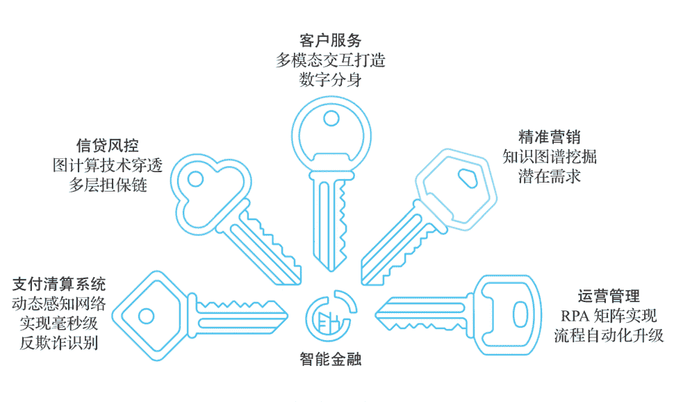

## 1.2.1

## 支付清算领域的智能进化

支付清算作为银行业务的基础环节，其智能化升级对于提升银行整体运营效率至关重要。以下是AI技术在支付清算领域中的主要应用。

#### 1. 实时智能反欺诈监控引擎

通过机器学习算法和大数据分析，实时监控交易数据，识别异常交易模式，有效防范欺诈行为。例如，某银行利用AI技术将欺诈交易识别率提升了80%，显著降低了欺诈造成的经济损失。

- 基于动态行为分析的交易拦截系统：持续收集并深入分析用户在一段时间内的行为特征，如交易频率、交易时间规律、常用交易设备及地理位置等。一旦发现当前交易行为偏离用户既有习惯，且达到预先设定的风险阈值，系统即刻触发实时拦截机制。
- 多机构联防联控的欺诈模式共享机制：多家金融机构通过安全的数据共享平台，定期上传自己遇到的欺诈案例及相关模式特征，利用区块链技术确保数据不可篡改和可追溯，同时采用加密算法保障数据传输和存储的安全。当某一机构遇到疑似欺诈交易时，可快速查询共享数据库，比对交易特征。

#### 2. 跨境支付合规智能审核系统

系统利用自然语言处理技术，自动识别和审核跨境支付中的合规性文件，确保交易符合国际法规要求。在处理跨国企业的跨境支付申请时，可快速、准确地审核贸易合同、发票等文件中的关键信息，及时识别潜在合规风险点，合规审核时间从平均2个工作日缩短至2小时。

- 全球制裁名单动态匹配引擎：实时更新全球制裁名单，通过智能匹配技术，快速识别与制裁名单相关的交易，防范合规风险。系统借助大数据技术，从多个权威渠道实时获取制裁名单的最新信息，并运用模糊匹配算法，将跨境支付涉及的交易主体信息与名单进行比对。
- 汇率波动风险预警模型：通过分析宏观经济数据和市场行情，预测汇率波动趋势，为企业和个人提供汇率风险管理建议。模型收集全球主要经济体的经济增长数据、货币政策调整、利率变动以及国际政治局势等信息，并运用时间序列分析和神经网络模型进行建模及预测。

#### 3. 自进化对账处理与差错修复平台

平台基于规则引擎和机器学习算法，自动识别对账差异，生成修复建议，提升对账效率。系统预先设定一系列对账规则，如交易金额匹配规则、交易时间范围规则等。同时，机器学习算法不断学习历史对账数据中的差异模式及对应的修复方法。当新的对账数据出现差异时，规则引擎首先进行快速筛查，机器学习算法则进一步分析复杂差异情况，生成精准的修复建议。某银行使用该平台后，对账时间从原来的每月3天缩短至1天，差错修复成功率从60%提升至85%。

- 基于规则引擎的差异自动归因：在规则引擎中，详细定义各类交易场景下可能出现差异的原因及对应的判断逻辑。例如，当交易金额存在差异时，若支付渠道的手续费规则发生变化，则归因于手续费调整；若交易时间跨结算周期，可能归因于结算延迟。通过这种方式，系统能快速准确地为对账差异找到根源，为后续修复提供明确方向。
- 历史差错案例库驱动的智能修复：构建全面的历史差错案例库，存储过往所有对账差错案例的详细信息，包括差错表现、原因分析、修复过程及结果。遇到新差错时，系统自动在案例库中搜索相似案例，借鉴已有成功方案，并结合当前具体情况进行智能调整，从而实现快速、有效的修复。

#### 4. 智能支付路由优化系统

系统根据交易金额、时效性和成本等因素，动态选择最优支付路径，降低支付成本，提高支付效率。例如，对于一笔紧急的小额跨境支付，系统会优先选择速度快但成本稍高的支付通道；而对于大额、对时效性要求不高的交易，则会选择成本较低的支付路径。某电商平台接入该系统后，支付成本降低了15%，支付成功率从90%提升至95%。

- 多通道成本与时效动态决策模型：实时监测各个支付通道的成本变化，包括手续费、汇率换算成本等，同时跟踪通道交易处理时效，如平均处理时间、峰值处理能力等。模型利用线性规划和动态规划算法，综合考虑交易金额、用户对时效性的要求等因素，在众多支付通道中快速计算出最优选择。
- 跨境支付路径的合规性优先级计算：梳理全球各国及地区的支付合规法规，为不同支付路径设定合规风险等级。当有跨境支付需求时，系统在考虑成本和时效性的基础上，优先筛选合规且风险更低的支付路径。对于涉及高风险地区或敏感行业的交易，系统会进一步加强合规审查，确保支付路径完全符合相关法规要求。

#### 5. 流动性风险实时预测系统

系统通过分析资金头寸数据和市场流动性指标，实时预测流动性风险，为银行资金管理提供决策支持；收集银行内部资金流入/流出数据，包括存款、贷款、同业拆借等业务数据，同时获取外部市场的流动性指标，如央行公开市场操作、货币市场利率等信息；运用深度学习模型，对这些数据进行实时分析和预测。某银行借助该系统提前一周预测到流动性紧张情况，及时调整资金策略，避免了潜在的流动性危机。

- 资金头寸缺口AI预测：利用人工智能中的长短期记忆网络（LSTM）模型，对银行历史资金头寸数据进行深度学习，捕捉资金流动的时间序列特征和趋势；结合宏观经济环境变化、市场季节性波动等因素，预测未来一段时间内的资金头寸缺口。
- 清算窗口压力测试模拟器：模拟不同市场情况下清算窗口压力场景，如极端市场波动、突发重大金融事件等。通过输入各种假设参数，系统模拟银行在这些场景下的资金清算情况，评估银行应对流动性风险的能力。银行根据模拟器的测试结果，优化资金管理策略，制定应急预案。

## 1.2.2

## 信贷风控的认知革命

信贷风控是银行的核心业务之一，AI技术的应用极大地提升了信贷审批的效率和准确性。以下是AI技术在信贷风控领域中的主要应用。

#### 1. 非结构化财报/合同智能解析中枢

借助光学字符识别（OCR）技术，能够快速将纸质财报和合同转化为可编辑的文本格式。随后，运用自然语言处理（NLP）技术，对非结构化文本深度剖析。NLP引擎中的词法分析、句法分析和语义分析等模块协同工作，能精准提取财报中的关键财务数据（如资产、负债、营收、利润等），以及合同中的关键条款，包括付款方式、交货时间、违约责任等。

- 财报数据与工商信息的交叉验证：将从财报中获取的企业经营数据，如企业的业务范围、注册资本变动情况、营收增长趋势等，与工商登记信息库中的对应信息进行逐一比对，并利用数据匹配算法，快速找出两者之间的差异点和潜在风险点。
- 合同关键条款履约风险评估：运用机器学习算法，构建合同关键条款履约风险评估模型。模型以大量历史合同数据为基础，对合同执行结果、企业履约情况、行业特征等信息进行深度挖掘和学习，再根据合同关键条款，如付款周期、货物质量标准、交付地点等，以及企业自身信用状况和行业平均违约率，预测出现违约的可能性，并给出风险评估等级。

#### 2. 小微企业现金流动态预测模型

广泛收集小微企业日常经营中的各类资金流动数据，如销售收入（通过银行流水、第三方支付平台数据等获取）、采购支出（基于企业采购合同和付款记录）、员工薪酬发放、水电费缴纳等信息。运用时间序列分析模型，如ARIMA（自回归积分滑动平均）模型，对这些历史数据进行建模分析，挖掘数据中的时间趋势、季节性波动和周期性变化规律。

- 行业周期叠加的现金流推演：建立基于行业周期的现金流推演模型。该模型整合了宏观经济数据、行业发展报告以及企业自身的财务数据，通过对不同行业周期阶段（繁荣、衰退、萧条、复苏）的特征分析，结合企业在各阶段的历史现金流表现，运用情景分析和压力测试方法，模拟企业在不同行业周期叠加下的现金流变化情况。
- 供应链关系强度的量化评估：基于供应链上下游企业间的多个维度，建立量化评估指标体系。运用层次分析法（AHP）确定各评估指标的权重，然后通过加权平均计算得出供应链关系强度综合得分。得分越高，表明企业在供应链中的关系越紧密、越稳定，其抗风险能力越强。

#### 3. 全维度关联担保网络智能图谱

全面收集企业间担保关系数据，包括直接担保（企业A为企业B直接提供担保）、间接担保（如企业A通过关联公司为企业B提供担保），以及通过复杂股权结构形成的隐性担保关系。利用图数据库技术，将这些企业与担保关系以节点和边的形式构建成智能图谱，可以直观展示企业在担保网络中的位置和关联情况。

- 隐性担保圈的图计算识别：在全维度关联担保网络智能图谱的基础上运用图计算算法，通过在图中节点间传播标签信息，并依据节点间的连接关系和标签相似度，可以将具有相似特征和紧密关联的节点划分为一个社区，从而识别出潜在的隐性担保圈。这些隐性担保圈往往由于其隐蔽性，难以通过传统风控手段发现，但却蕴含着巨大的风险。
- 担保链断裂风险传导模拟：以担保网络智能图谱和隐性担保圈识别结果为基础，建立担保链断裂风险传导模型。考虑企业间担保关系的紧密程度、担保金额大小、企业自身的财务实力等因素，运用复杂网络分析方法，模拟当某一关键企业出现违约导致担保链断裂时，风险在担保网络中如何沿着担保关系链条传导扩散，以及对其他关联企业和金融机构造成的影响。

#### 4. 供应链金融风险评估系统

融合供应链各环节的多源数据，包括核心企业信用状况（如信用评级、财务报表分析结果）、多级供应商经营数据（如生产能力、交货准时率、产品质量）、物流信息（货物运输时间、运输损耗）等，运用大数据分析技术和风险评估模型（如基于神经网络的风险评估模型），对供应链金融业务的整体风险进行量化评估。

- 核心企业信用辐射力评估：综合分析核心企业在供应链中的行业地位（如是否为行业龙头企业、市场占有率）、市场影响力（品牌知名度、客户忠诚度）、财务实力（资产规模、盈利能力、偿债能力）等因素。通过构建信用辐射力评估模型，运用专家打分法和层次分析法相结合的方式，确定各因素权重，进而计算出核心企业的信用辐射力得分。信用辐射力强的核心企业，其上下游企业在获得金融支持时往往风险相对较低。
- 多级供应商风险传导预警：实时监测多级供应商经营状况、财务指标变化以及与核心企业的交易情况等信息，建立风险传导模型。当某一级供应商出现潜在风险，如财务困境（资产负债率过高、现金流紧张）、交货延迟、产品质量问题等，可以利用风险传导模型迅速预测风险向其他层级供应商和核心企业传导的可能性，并通过短信、邮件等方式及时发出预警。

#### 5. 动态信用评分模型优化平台

整合企业多维度数据，除基本财务数据之外，纳入水电消耗、税务申报数据（水电消耗反映企业生产经营活跃度，税务申报数据体现企业纳税合规性和真实盈利水平）、供应链交易数据（交易频率、交易金额、交易对手信用状况）以及市场舆情数据（通过网络技术收集企业在社交媒体、新闻媒体等平台上的口碑和评价数据）。运用机器学习和深度学习算法，根据企业实时数据变化，自动调整信用评分，更精准地反映企业信用状况。

- 水电消耗、税务申报数据融合建模：将企业水电消耗数据、税务申报数据与基本财务数据深度融合。将水电消耗数据与企业生产规模、营业收入进行关联分析，将税务申报数据与企业盈利能力、成本控制情况进行关联分析。利用这些关联关系，构建融合模型，为企业信用评估提供更全面、准确的数据支持。
- 评分模型在线持续调优：利用实时反馈数据和在线学习算法，对信用评分模型进行持续优化。根据市场环境变化、行业发展趋势以及新数据的特点，定期对模型的结构和算法进行更新与改进，确保模型始终保持最佳的预测性能。

## 1.2.3

## 客户服务的交互革命

客户服务是银行与客户直接接触的重要环节，AI技术的应用显著提升了客户服务的质量和效率。以下是AI技术在客户服务中的主要应用。

#### 1. 多模态语音导航意图识别系统

在客户服务中，语音交互是极为重要的一项功能。多模态语音导航意图识别系统能打破传统语音交互的局限，构建更加智能、精准的客户沟通桥梁。该系统融合多种前沿技术，使客户服务语音入口更高效、易用，从而极大提升银行客户的初始体验。

- 技术融合与优化：多模态语音导航意图识别系统深度整合语音识别、自然语言处理与机器学习技术，精准解析客户语音指令，结合客户过往行为数据、当下业务场景等多维度信息，精准洞察客户意图；针对方言语音识别难题，引入对抗训练优化技术，并借助生成对抗网络，在博弈训练中持续提升对方言语音的识别能力。
- 沉默客户行为预判技术：利用大数据分析和行为建模技术，深入剖析通话中沉默客户的行为特征，持续采集客户通话前后的浏览记录、操作轨迹等行为数据。当客户出现沉默时，通过已构建的行为预测模型，迅速分析客户意图，判断客户是对问题存在疑惑、处于思考状态，还是有其他困扰。

#### 2. 智能化工单分类与动态派发矩阵

客户工单是客户服务流程中的关键载体，智能化工单分类与动态派发矩阵的出现，彻底革新了工单处理模式。它能够高效地对各类工单进行分类，并根据各分支机构的实际服务能力进行精准派发，大大提高了工单处理的效率与质量，是提升客户服务响应速度与解决效果的核心机制。

- 智能化工单分类：借助自然语言处理技术中的文本分类算法，实现对客户所提交工单的智能分类；通过学习大量历史工单数据，精准识别工单类型；针对投诉文本，采用深层情感分析技术，依托深度学习中的RNN（循环神经网络）及其变体——LSTM（长短期记忆网络），深度剖析投诉文本中的情感倾向、情绪强度及潜在诉求。
- 动态派发矩阵：构建分支机构服务能力画像匹配体系，全面收集各分支机构的人员配置、业务专长、服务效率等信息，形成多维度服务能力画像。当工单生成时，依据工单类型、紧急程度及客户所在区域等因素，结合各分支机构的服务能力画像，通过动态派发矩阵，智能筛选出最适宜处理工单的分支机构。

#### 3. 财富管理对话机器人认知架构

随着财富管理市场的日益复杂和客户需求的多样化，传统人工服务已难以满足高效、专业的服务要求。财富管理对话机器人认知架构应运而生，它赋予对话机器人强大的认知能力，使其能够深入理解客户的财富管理需求，提供个性化、智能化的服务，是财富管理领域客户服务创新的重要体现。

- 认知架构搭建：基于知识图谱、自然语言处理和机器学习技术，构建财富管理对话机器人的认知架构，使其能理解客户关于财富管理的各类问题，涵盖投资产品咨询、风险评估、理财规划建议等。在与客户对话时，运用实时评测客户风险承受力的技术，收集客户的财务状况、投资目标、投资经验及风险偏好等信息，借助风险评估模型，快速、准确地评估客户的风险承受水平。
- 对话策略调整：面对复杂多变的市场环境，对话机器人具备动态调整对话策略的能力，可实时追踪股票指数、基金净值、汇率等市场数据，结合客户投资组合和风险承受力，及时调整与客户的对话内容。当股票市场大幅波动时，对于风险承受力较低且持有高风险资产的客户，机器人会主动联系客户，发出风险预警，并提供合理的投资组合调整建议，从而有效提升客户对财富管理服务的满意度和信任度。

#### 4. 智能外呼服务管理系统

外呼服务在银行客户服务中承担着主动沟通、营销推广、服务回访等重要任务，智能外呼服务管理系统借助先进技术手段，优化对外呼时机的选择，对通话质量进行智能质检与改进，能极大提升外呼服务效果与客户体验，在银行与客户之间建立更紧密、更有效的沟通渠道。

- 外呼时机预测：运用大数据分析和机器学习算法，深度挖掘客户行为数据，识别客户空闲时段，实现精准的外呼时机预测。系统收集客户不同时段的通话记录、短信收发频率、社交媒体活跃度及消费行为等信息，建立客户行为时间模型。
- 通话质量AI质检与改进：利用人工智能技术对通话质量进行实时质检与分析。首先，通过语音识别技术将通话内容转写为文本，再运用自然语言处理技术分析文本内容，评估客服人员的话术合规性、服务态度、问题解决能力等。同时，借助语音情感分析技术，判断客户情绪状态，当系统检测到客服人员回答问题时措辞不当，或客户情绪明显不满时，将及时发出预警并提供改进建议。

#### 5. 视频银行智能辅助系统

银行数字化转型进入深水期，视频银行成为客户服务的新前沿。视频银行智能辅助系统利用先进AI技术，为远程面签和客户沟通提供强大支持。该系统可以增强身份核验的安全性，并能敏锐捕捉客户微表情中的风险信号，有效提升视频银行服务的可靠性与风险防控能力。

- 远程面签身份核验增强：在视频银行远程面签过程中，融合运用人脸识别、活体检测及身份证OCR等技术，全方位核实客户身份信息。人脸识别技术通过比对客户实时视频图像与身份证照片面部特征确认身份；活体检测技术通过要求客户做出眨眼、张嘴等动作，防范照片或视频攻击。

### 1.2.4 精准营销的智能突破

精准营销是银行提升客户价值和市场份额的关键手段，AI技术的应用使银行能够更精准地了解客户需求，提供个性化服务。以下是AI技术在精准营销领域中的主要应用。

#### 1. 三维客户画像精准营销生成器

实现精准营销的基础在于对客户的深入了解。三维客户画像精准营销生成器突破了传统客户画像维度单一的局限，通过对客户资金流动模式及家庭关系网络的深入挖掘，构建全方位、立体化的客户画像，为精准营销提供坚实的数据基础和方向指引。

- 技术支撑与数据挖掘：运用大数据分析和机器学习算法，构建三维客户画像精准营销生成器，从多个维度收集客户数据，其中关键环节是资金流动模式聚类分析，即通过对客户在银行转账、消费支付、投资理财等场景下产生的资金流动数据进行深入挖掘，运用聚类算法将具有相似资金流动模式的客户归为一类。
- 家庭关系网络财富关联挖掘：利用社交网络分析技术，梳理客户与其家庭成员之间的财富往来关系，洞察家庭整体资产分布情况。比如，系统发现某客户与其配偶、子女在投资决策上存在紧密关联，一方的投资行为会影响其他家庭成员，这就为银行制定家庭综合营销策略提供了依据。

#### 2. 智能理财推荐动态决策引擎

随着金融市场的日益复杂和客户需求的多样化，为客户提供精准、个性化的理财推荐变得尤为关键。智能理财推荐动态决策引擎能够实时感知市场变化，结合客户的投资现状和目标，动态调整理财推荐策略，为客户量身定制最合适的理财方案，提升客户的投资体验和收益。

- 策略适配与需求分析：智能理财推荐动态决策引擎融合了实时市场数据监测、客户需求分析及智能算法决策等功能，在市场热点事件发生时，能够迅速捕捉并分析事件对金融市场的影响，再根据不同客户的风险偏好、投资目标和现有持仓情况，为其推荐相应的理财策略。
- 客户持仓组合缺口分析：引擎利用投资组合理论和数据分析模型，识别客户现有投资组合中存在的风险敞口和收益短板。例如，发现某客户的投资组合中股票占比过高，而债券类资产配置不足，则有针对性地推荐适合的债券产品，帮助客户优化投资组合，实现风险收益平衡。

#### 3. 客户生命周期智能维系系统

客户是银行的宝贵资产，而客户生命周期的有效管理则是影响银行持续健康发展的核心因素之一。客户生命周期智能维系系统专注于对客户从获取到流失整个生命周期的监测与干预，通过流失预警和挽留策略优化，延长客户生命周期，提升客户价值，为银行的长期稳定发展提供有力保障。

- 流失预警机制：利用生存分析模型对客户流失风险进行预警，收集客户交易历史、行为数据、服务交互记录等多源信息，构建客户生存函数，预测客户在未来一段时间内流失的概率。当发现某客户近期交易频率明显下降，登录平台的次数减少，且与客服的沟通频率也大幅降低时，系统通过生存分析模型判断该客户处于流失风险较高的阶段，及时发出预警。
- A/B测试优化挽留策略：针对不同特征的潜在流失客户群体，设计多组挽留策略，如优惠活动、专属服务、个性化产品推荐等，并将这些策略随机分配给不同的客户组进行测试，对比分析每组客户的响应率、留存率等指标，筛选出最优的挽留策略。

#### 4. 全渠道营销效果预测系统

在多渠道营销成为主流的时代，如何准确评估各渠道的营销效果，合理分配营销资源，是企业面临的一大挑战。全渠道营销效果预测系统通过对跨渠道触点的深入分析和营销预算的优化，帮助企业清晰了解各渠道的贡献，实现营销资源的精准投放，提升整体营销投资回报率。

- 归因与优化方法：全渠道营销效果预测系统通过跨渠道触点归因分析，深入探究客户在不同营销渠道（如线上广告、社交媒体、线下活动、电子邮件等）之间的行为路径和转化过程，利用数据追踪技术和归因模型，确定每个渠道在客户购买决策过程中所起的作用和贡献度。
- 营销预算分配博弈模型：综合考虑各渠道的营销效果、成本投入及竞争态势等因素，构建博弈模型，模拟不同渠道之间的资源竞争和合作关系，通过迭代计算寻找最优的营销预算分配方案，以有限的预算实现最大的营销效果，从而在竞争激烈的市场环境下，帮助企业合理调整预算，优化资源配置。

#### 5. 智能客群裂变运营平台

客户裂变是实现客户数量快速增长和业务规模扩张的有效途径。智能客群裂变运营平台致力于挖掘社交网络中的潜在力量，通过精准识别影响力节点，开展高效的裂变活动，并实时监控活动效果，以最小的成本实现客户群的指数级增长，为企业开拓新的市场空间。

- 裂变节点识别与监控：借助社交网络分析技术，识别社交网络中的影响力节点，即通过对客户在社交平台上的粉丝数量、互动频率、传播范围等指标进行量化分析，筛选出在特定社交圈子中具有较高影响力和传播能力的客户。
- 裂变活动ROI（投资回报率）实时监控：通过建立数据分析模型，持续跟踪活动期间新客户获取数量、客户转化率、销售收入增长等关键指标，并与活动成本进行对比分析，提高客户转化率。

### 1.2.5 运营管理的数智跃迁

运营管理是银行高效运行的重要保障，AI技术的应用显著提升了运营管理的智能化水平。以下是AI技术在运营管理领域中的主要应用。

#### 1. 智能网点资源动态调度模型

智能网点资源动态调度模型聚焦于解决网点运营中资源配置的难题，通过精准把握客流量变化，以及合理匹配柜员技能与业务需求，实现网点资源的高效利用，提升客户服务体验与网点运营效益。

- 基于LBS（基于位置的服务）的客流量预测：运用LBS技术，实时收集周边客户的位置信息、移动轨迹及历史访问数据等，借助大数据分析技术和时间序列预测算法，对不同时间段、不同区域的网点客流量进行精准预测。
- 柜员技能与业务需求匹配优化：构建柜员技能库，详细记录每位柜员对业务技能（如储蓄业务、信贷业务、外汇业务等）的熟练程度，实时监测网点业务需求情况。当有客户办理业务时，系统根据业务类型和复杂程度，通过智能匹配算法，自动调配最合适的柜员为客户提供服务。

#### 2. 全流程智能文档审核工坊

全流程智能文档审核工坊致力于革新文档审核流程，利用智能化手段实现对各类文档的快速、准确审核，尤其在监管文件变更时能够自动适配，同时强化印章鉴别能力，保障文档审核的合规性与安全性。

- 监管文件变更自动适配：建立监管文件数据库，实时跟踪各类监管政策的变化，运用自然语言处理技术和机器学习算法，对新发布的监管文件进行解读和分析，提取关键要求和变化点。当银行内部文档审核流程涉及相关监管要求时，系统自动根据最新监管文件对审核标准和流程进行调整。
- 印章鉴别的对抗样本防御：基于深度学习技术构建印章鉴别模型，使用大量真实印章样本进行训练，使模型能够准确识别正常印章特征。面对一些试图通过对真实印章进行微小修改来伪造印章的情况，经过对抗样本防御训练的模型能够将其精准识别出来，从而有效防范印章伪造风险。

#### 3. 员工合规行为实时预警矩阵

员工合规行为实时预警矩阵是银行合规管理的重要防线，通过对员工操作轨迹的持续监测和深入分析，及时发现异常行为模式，预测权限滥用风险，为银行的合规运营保驾护航。

- 操作轨迹的异常模式检测：部署操作行为监测系统，全面记录员工在业务系统中的操作轨迹，包括登录时间、操作内容、数据访问记录等；运用数据挖掘和机器学习中的异常检测算法，对这些操作轨迹数据进行实时分析，在发现异常数据时及时预警。
- 权限滥用风险的概率预测：整合员工的岗位职责、权限配置信息及历史操作行为数据，构建权限滥用风险预测模型，利用逻辑回归、决策树等算法，综合评估员工在当前权限下发生违规操作的可能性。当风险发生概率超过设定阈值时，系统自动启动预警机制，采取限制权限、加强监督等措施，降低合规风险。

#### 4. 智能舆情监控与应对系统

在当今信息迅速传播的环境下，智能舆情监控与应对系统对企业声誉管理至关重要。它能够实时监测网络舆情，深入分析负面舆情的传播路径和影响范围，并为企业提供有效的危机应对话术建议，帮助企业及时化解舆情危机。

- 负面舆情的语义传播分析：利用网络技术，广泛收集社交媒体、新闻网站、论坛等平台上与企业相关的舆情信息，并运用自然语言处理中的语义分析技术，对收集到的文本进行情感分析，快速识别出负面舆情。随后，通过构建传播网络模型，分析负面舆情在不同平台、不同用户群体之间的传播路径和扩散趋势。
- 危机应对话术的生成建议：基于大量历史舆情案例和危机应对经验，建立话术知识库。当监测到重大负面舆情时，系统根据舆情的具体内容、情感倾向以及传播态势，从话术知识库中筛选并生成具有针对性的危机应对话术建议。这些建议包括向公众道歉的方式、问题解释的角度、解决方案的阐述等内容。

#### 5. 网点布局智能优化平台

网点布局智能优化平台为银行在网点选址和设备投放方面提供科学的决策支持，通过对区域经济数据的深度分析和空间建模，精准预测离行式设备的投放效益，优化网点布局，提升银行的市场覆盖率和盈利能力。

- 区域经济数据的空间建模：收集和整合区域内GDP（国内生产总值）、人口密度、消费水平、产业结构等经济数据，以及交通状况、商业分布、人口流动趋势等地理信息数据，运用GIS（地理信息系统）和空间计量经济学模型，进行空间分析和建模。通过分析不同区域的经济发展潜力、人口消费特征、交通便利性等因素，评估各区域对网点的需求程度和发展潜力。
- 离行式设备投放效益预测：结合区域经济数据空间建模结果和离行式设备的历史运营数据，构建离行式设备投放效益预测模型，考虑设备类型（如ATM、自助终端等）、投放位置周边人口流量、业务办理频率、运营成本等因素，利用回归分析、机器学习等算法，预测不同区域、不同类型离行式设备的投放效益，包括交易收入增长、客户满意度提升、运营成本降低等方面的预期收益。

## 1.3 银行业AI应用面临的挑战与应对措施

银行业在AI技术应用中面临数据治理与技术实施的双重挑战，如图1-3所示。数据层面需解决隐私保护合规、跨机构数据共享与数据安全生态问题，技术层面需突破模型可解释性、系统兼容性与算力成本瓶颈。通过构建标准化治理框架、完善技术实施路径，结合国内监管要求与技术创新，方能实现AI应用的合规性与有效性。

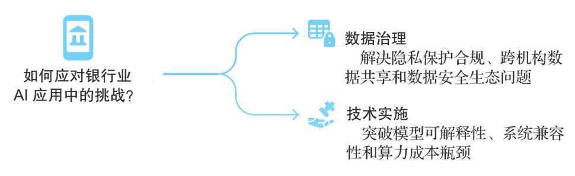

### 1.3.1 数据治理要求

银行业需建立覆盖数据全生命周期的治理体系，重点解决隐私保护合规、跨机构数据共享与数据安全生态建设问题。数据治理需严格遵循《中华人民共和国数据安全法》《中华人民共和国个人信息保护法》等法规的要求，同时结合金融行业特性制定可落地的技术方案。

- 客户隐私保护合规体系：银行要搭建严密的合规体系，梳理业务流程中涉及客户隐私数据的环节。在数据收集阶段，应获得客户的明确授权，并告知客户数据的用途与范围；在数据存储阶段，应采用先进的加密算法，防止数据被窃取；在数据使用环节设置严格的访问权限，仅授权人员可访问。通过内部审计与外部评估，持续优化客户隐私保护合规体系，保障客户隐私权益，提升银行公信力。
- 跨机构数据共享机制：构建跨机构数据共享机制，需由行业协会牵头，制定通用的数据标准，统一数据格式与定义。建立安全可靠的数据共享平台，运用多方安全计算、联邦学习等技术，实现数据“可用不可见”，并在保护数据所有权的前提下完成联合建模、分析，促进金融市场整体AI应用水平的提升。
- 数据安全生态建设：银行应与科技企业、监管部门等协同打造数据安全生态。在技术方面，部署防火墙、入侵检测系统等，实时监控数据安全威胁；在人员管理方面，加强培训，明确数据安全责任；在制度规范方面，制定数据分级分类管理办法，对不同级别的数据采取差异化安全防护措施。

### 1.3.2 技术实施门槛

AI技术在银行业落地，需突破模型可解释性、系统兼容性与算力成本瓶颈，结合金融业务场景设计技术适配方案，并建立全链路技术风险管理机制，重点是做好模型可解释性管理、系统接口兼容性改造与算力成本控制等工作。

- 模型可解释性管理：银行应研发可视化的模型解释工具，以直观的图表和文字说明模型的决策逻辑。例如，在信贷审批模型中，应展示客户信用评分影响因素及其权重，使审批人员能理解为何通过或拒绝申请，便于调整决策，也能向客户解释，从而提升服务透明度。
- 系统接口兼容性改造：梳理银行内部各系统接口，制定统一接口规范，采用适配器模式等技术解决接口差异问题。对于新开发AI系统，应从设计阶段就严格遵循规范，确保与现有系统无缝对接，保障业务连续性与数据流通顺畅。
- 算力成本控制：结合银行AI应用需求与业务量波动，合理规划算力资源。利用云计算弹性优势，在业务高峰期租用算力，在低谷期释放冗余算力；探索模型压缩、量化等技术，减少模型所需的存储空间与计算资源消耗，降低长期算力成本。

### 1.3.3 价值评估标准

银行业需建立覆盖短期收益与长期价值的AI应用评估体系，通过ROI（投资回报率）量化分析框架、场景化收益测算与动态追踪机制，确保AI技术投入与业务目标能精准匹配。

- ROI量化分析框架：搭建ROI量化分析框架，全面梳理AI项目的各项投入，包括技术采购、人员培训、系统运维等成本；明确收益来源，例如通过提升业务效率节省人力成本、通过精准营销增加收入等；运用财务分析方法，计算净现值、内部收益率等指标，评估项目的经济可行性。
- 场景化收益测算：例如，在智能客服投产收益评估方面，应统计引入智能客服后人工客服工作量减少的比例，计算人力成本节约的金额；通过客户满意度调查，分析满意度提升带来的复购率、推荐率变化，估算潜在收入增长，综合衡量智能客服的价值。
- 动态追踪机制：设定长期价值追踪指标，如客户留存率可以反映客户忠诚度，市场份额变化可以体现竞争力。定期收集数据，分析AI应用对这些指标的影响，调整并优化策略，确保AI能持续为银行创造长期价值。

## 1.4 监管部门对于银行业AI应用的态度

银行业AI应用的发展需要在技术创新与监管要求之间实现动态平衡，银行业应在政策支持、数据安全、风险防控、透明监管及行业自律五大领域构建协同治理框架，如图1-4所示。监管部门通过“创新激励+底线约束”双轨机制引导技术合规发展，强调以《中华人民共和国数据安全法》《中华人民共和国个人信息保护法》为基石的底线管控，同时依托《金融科技发展规划（2022-2025年）》等政策释放创新空间。银行需同步响应顶层设计导向与属地监管要求，实现技术创新与合规管理的深度融合。

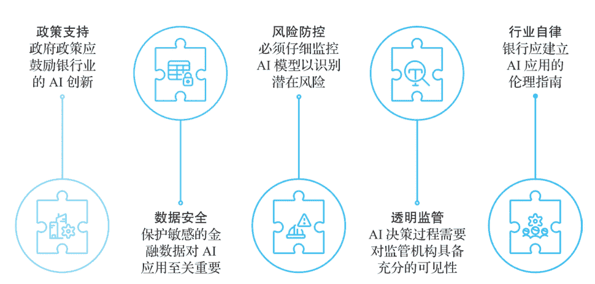

### 1.4.1 政策支持与鼓励创新

国家积极推动金融科技发展，出台一系列政策鼓励银行运用AI提升服务效率与质量。央行（中国人民银行）通过部署相关工作，引导金融机构合理开展AI应用创新试点。地方政府也积极实践，如设立金融科技产业园区，为银行与科技企业的合作提供政策优惠与场地支持，营造创新生态，助力银行业AI应用发展。

- 国家推动：国家层面将发展金融科技纳入战略规划，发布政策文件鼓励金融机构加大AI研发投入，促进技术成果转化，并为符合条件的AI金融项目提供支持，从宏观层面引导银行业数字化转型。
- 央行部署：央行制定行业标准与指导意见，规范AI在银行业的应用；组织开展试点项目，及时总结经验向全行业推广，引导银行稳健创新，提升金融服务实体的经济能力。
- 地方实践：各地因地制宜，积极探索。例如，北京、上海等地举办金融科技大赛，挖掘优秀AI项目；深圳等地出台税收优惠政策，降低银行AI研发成本，吸引人才与技术集聚，推动银行业AI创新应用落地。

### 1.4.2 数据安全与隐私保护

监管部门通过强制性规范与穿透式检查强化数据治理，要求银行建立覆盖数据全生命周期的防护体系，确保AI应用符合国家安全与个人隐私保护要求。

- 监管要求：监管部门制定详细的法规，如规定银行存储客户数据时必须加密，发生数据泄露时要及时报告并采取补救措施；同时，定期检查银行合规情况，对违规银行处以罚款、限制业务等处罚，督促银行严守数据安全底线。
- 技术规范：要求银行采用符合国家标准的加密算法对敏感数据进行加密，运用身份认证、权限管理等技术控制数据访问权限。定期聘请专业机构开展数据安全审计，并依据审计结果整改完善，保障数据全生命周期安全。

### 1.4.3 风险防控与合规管理

监管部门要求银行建立AI风险分层管控机制，从模型治理、业务流程、系统架构等维度防范技术应用衍生风险。

- 风险分层治理：监管部门将银行AI应用按风险程度分为高、中、低三级。对高风险应用，如涉及客户资金直接操作的，加强实时监测与现场检查；对中风险应用定期评估；对低风险应用则持续关注，并动态调整风险等级，以精准防控风险。
- 模型可解释性：银行应向监管部门提交AI模型技术文档，说明模型架构、训练数据、决策逻辑。监管部门运用技术手段验证模型可解释性，防止模型因不可解释而产生潜在风险，保障金融市场公平、有序运行。

### 1.4.4 透明监管与技术创新结合

监管部门通过科技手段提升监管穿透力，建立与AI技术发展相适应的动态监管机制，实现风险早识别、早预警、早处置。

- 监管工具升级：监管部门搭建智能监管平台，运用大数据技术分析银行AI应用数据，实时监测交易异常、风险指标变化；利用AI识别潜在风险，如通过机器学习算法预测模型偏差风险，提升监管效率与精准度。
- 动态平衡机制：定期评估银行业AI创新成果与风险状况，依据评估结果调整监管政策。当新技术带来重大创新机遇时，适度放宽监管要求；当风险隐患增加时，及时强化监管措施，保障金融创新与金融安全的协调发展。

### 1.4.5 行业自律与生态建设

监管部门引导构建“政府监管+行业自律+企业自治”三级治理体系，通过标准共建、资源共享等方式推动AI应用生态健康发展。

- 银行实践响应：银行积极参与行业协会活动，遵守自律规范；建立内部AI应用审查机制，对新上线AI项目进行严格评估，确保其符合监管与自律要求，以实际行动维护行业秩序，提升行业公信力。
- 生态合作：银行与科技企业联合开发AI技术，如与互联网公司合作优化智能客服算法；与科研机构共建实验室，开展前沿技术研究，培养专业人才，完善金融科技生态，促进银行业AI创新生态繁荣发展。

## 1.5 本章小结

银行业的技术演进历经电子化、信息化和智能化三个阶段，当前呈现“替代与创新并存”的双螺旋特征。然而，数据治理、模型可解释性及算力成本构成关键挑战，需通过联邦学习、可解释算法及混合云架构应对。监管层应以“创新激励+合规约束”双轨机制平衡风险与发展，推动标准化治理与行业生态共建。未来，银行业将深化人机协同，以“智能决策+人文服务”重塑金融价值链，迈向价值创造新纪元。

# 第2章 DeepSeek赋能银行场景

在数字化浪潮席卷全球的当下，银行业面临前所未有的挑战与机遇。DeepSeek凭借其卓越的核心能力，为银行注入强大的创新动力，能够全方位支持业务运营、风险防控、决策制定及生态拓展，助力银行全面提升效能。

DeepSeek可以深度赋能银行业数字化转型，围绕《金融科技发展规划（2022-2025年）》提出的“场景驱动、生态共建”目标，能够在网点升级、零售转型、对公服务等五大领域形成完整解决方案。DeepSeek技术体系通过自然语言处理、知识图谱与隐私计算等能力，正在为智能客服、精准营销及风险管理等银行三大核心领域提供有效支撑。

例如，智能客服系统支持基础业务咨询与产品推荐，提升线上服务效率；知识图谱整合客户数据资产，辅助精准营销策略制定；机器学习模型强化信贷审批、异常交易监测等场景的风险预警能力。此外，针对数据协作痛点，隐私计算技术为跨机构联合建模提供了合规路径，使银行能在保障数据安全的前提下探索反洗钱等场景应用。

在严格遵循银行监管部门要求之下，通过数据脱敏、访问控制等机制确保合规落地，DeepSeek正逐步成为银行平衡业务创新与风险管控的技术工具。

本章主要围绕“DeepSeek赋能银行场景”这个主题展开讨论。

## 2.1 DeepSeek核心能力解析

DeepSeek技术围绕银行业务全链条构建五大核心能力模块（如图2-1所示），覆盖服务交互、合规管理、决策支持等关键环节，严格遵循《中华人民共和国数据安全法》《中华人民共和国个人信息保护法》及央行一系列技术规范的要求，通过动态知识库、智能风控中枢、开放API网关等组件，实现技术能力与银行业务场景的深度耦合，满足监管部门对AI系统的安全性、可靠性认证标准。

### 2.1.1 智能银行服务中枢

银行通过DeepSeek的实时知识管理、全渠道协同引擎及智能交互能力，聚焦服务效率与体验升级，构建集产品信息管理、全渠道服务协同、智能交互与业务引导于一体的智能银行服务中枢系统。

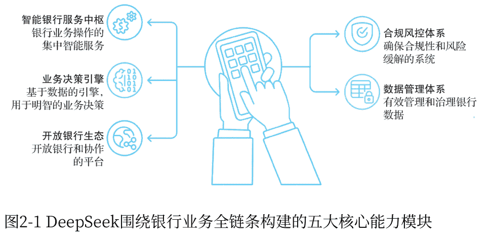

- 金融产品知识库动态更新：DeepSeek通过自然语言处理技术自动抓取监管文件、产品说明书等非结构化数据，建立可实时更新的知识图谱。例如，当银行推出新理财产品时，系统可自动解析关键要素（如风险等级、投资范围），并同步至客服话术库与手机银行产品说明页，确保各渠道信息的一致性。客户咨询时，柜员能即时调取最新条款解答疑问。
- 客户服务全渠道协同：基于DeepSeek的智能路由引擎，银行整合手机App、微信公众号、柜面等多渠道交互记录。当客户在手机银行发起贷款申请后转至线下网点，系统会自动推送已填写信息至柜员终端，避免重复录入。对于在线客服未能解决的复杂问题，系统可自动生成工单并分配至专业团队，实现服务流程闭环。
- 多模态身份核验：DeepSeek融合声纹识别、人脸识别、证件OCR等多模态技术，可在远程开户场景中实现分级认证。例如，在客户进行视频核身时，系统同步对接公安机关联网联查系统，核验人像信息、活体检测结果及证件真伪，并对高风险交易追加语音口令验证。这样既能满足反洗钱身份识别要求，又有效缩短了认证时间。
- 智能话术引擎：DeepSeek通过语义理解与场景适配技术，为客服人员提供实时话术建议。系统可根据客户咨询内容（如理财产品赎回规则）自动匹配监管条款与产品说明书原文，生成合规的解释话术模板。当识别出客户情绪波动时，系统会动态推荐安抚性话术框架，避免因客服人员表述不当而引发投诉。话术库随监管政策动态更新，确保服务的合规性。
- 复杂业务办理引导：基于DeepSeek的流程引擎，银行将跨部门业务（如遗产继承过户）拆解为标准化步骤。客户通过手机银行提交申请后，系统自动生成材料清单并校验文件完整性。在柜面办理时，智能终端实时提示材料审核要点（如公证书有效性验证），减少人工疏漏。全流程进度通过区块链存证，确保可追溯。

### 2.1.2 合规风控体系

合规经营是银行的生命线，而风险防控则是保障银行稳健发展的基石。DeepSeek为银行构建合规风控体系提供有力支持。通过集成监管政策解读、风险实时监测等能力，DeepSeek助力银行构建覆盖事前预警、事中拦截、事后溯源的立体化风控系统，强化数据安全防护与合规流程自动化管理，确保业务全流程符合监管标准。

- 监管政策智能解读：系统实时抓取央行、国家金融监督管理总局、国家外汇管理局等监管机构发布的政策文件，运用文本解析技术提取核心要求，例如，对《关于规范金融机构资产管理业务的指导意见》（银发〔2018〕106号）中关于理财产品净值化管理的规定，系统可自动将其转化为银行内部风控系统的规则参数，降低人工解读的滞后性与偏差。
- 反洗钱AI核查：银行建立基于交易频次、金额、流向、地域等多维特征的反洗钱监测模型，对账户资金流动进行实时分析，自动标记异常交易模式（如短期内多笔小额资金分散汇入同一账户），生成风险预警报告并推送至合规部门，辅助提升人工复核效率。
- 数据安全防护网：银行通过采用数据加密、访问控制、脱敏处理等技术，对客户个人信息、账户交易数据、业务合同等敏感数据实施全生命周期保护。部署数据丢失防护（DLP）系统，实时监控邮件发送、文件传输中的敏感数据外发行为，防止内部人员违规泄露信息。
- 智能合规机器人：DeepSeek帮助银行预设“贷款三查”“销售双录”“客户风险等级划分”等业务流程的合规检查节点，自动扫描业务单据、录音录像、系统操作日志，识别合同要素缺失、销售话术违规等问题，实现合规检查的自动化与标准化。
- 业务连续性保障：DeepSeek赋能银行构建同城双活、异地灾备的系统架构，制定覆盖核心交易、支付结算、客户服务等业务的应急预案。银行定期开展灾备演练，确保在系统故障、自然灾害等突发情况下，关键业务可在规定时间内切换至灾备系统，保障客户交易不中断。

### 2.1.3 业务决策引擎

在银行的智能决策支持领域，基于DeepSeek技术能力，银行可构建覆盖资产配置、风险评估、投资者适当性管理的决策支持体系，通过数据分析技术实现业务流程智能化升级；通过智能投顾模型优化客户资产配置，以信贷风控中枢提升审批效率，用自动化工具释放运营人力，挖掘客户价值并实时监控监管指标，辅助管理层做出科学决策。

- 智能投顾模型：智能投顾模型整合客户资产规模、风险承受能力、投资目标等信息，结合市场行情数据，为客户生成个性化投资组合建议。例如，对平衡型客户推荐“60%债券+30%股票+10%现金”的配置方案。智能投顾支持定期再平衡提醒，当市场波动导致资产配置偏离目标5%以上时，自动推送调仓建议，降低人工投顾服务成本。
- 信贷风控中枢：融合央行征信报告、企业纳税数据、水电缴费记录、电商交易流水等多维度信息，构建信贷评分模型，自动评估借款人违约概率。对小额消费贷款实现“秒级审批”，对企业贷款则输出风险评估报告，辅助客户经理进行判断，提升信贷审批的效率与准确性。
- 运营自动化：运用机器人流程自动化（RPA）技术，替代人工完成账户对账、报表生成、客户回访等重复性工作。例如，每月初自动生成客户对账单并按预留渠道发送，定期对睡眠客户进行自动化短信唤醒，释放运营人力，支持业务向高价值业务方向转型。
- 客户价值挖掘：分析客户交易行为、产品持有、渠道使用等数据，识别高价值客户与潜在需求。例如，若发现某客户连续3个月购买大额理财产品且未使用信用卡，则自动将其标记为信用卡白金卡潜在客户，并推送专属办卡权益；或者，对即将到期的定期存款客户，提前推送续存或理财转换建议。
- 监管指标看板：实时采集资本充足率、流动性覆盖率、不良贷款率等监管核心指标，将指标与监管标准及内部预警阈值进行比对，并以可视化图表展示指标变化。当指标接近预警阈值时，自动高亮提示并关联风险处置预案，帮助管理层及时掌握经营风险与合规状态。

### 2.1.4 数据管理体系

DeepSeek的非结构化数据处理与风险建模能力，可以助力银行构建标准化、智能化的数据管理体系。该体系支持数据资产盘点、客户风险画像构建、非结构化数据处理、模型风险监控与监管模拟，能够提升数据可用性与银行的风险管控能力。银行可逐步建立企业级数据资产地图，实现对客户风险的精准刻画，释放非结构化数据的价值，保障模型稳健运行与新业务合规落地。

- 企业级数据资产地图：银行梳理内部客户信息、交易记录、风控数据、产品数据等各类数据资产，明确数据来源、存储位置、更新频率、使用权限及数据质量状况，形成可视化数据资产地图。业务部门可通过搜索快速定位所需数据，例如营销部门能便捷查询高净值客户的资产配置数据，提升数据利用效率。
- 客户风险画像：客户风险画像整合客户基本信息、交易行为、征信记录、外部舆情等数据，构建360°的风险评估模型，自动划分客户风险等级。例如，识别出信用卡透支率超过70%且存在多头借贷记录的客户，在其申请贷款时自动提高审批门槛，降低信用风险。
- 非结构化数据处理：运用OCR（光学字符识别）、自然语言处理技术，将纸质合同、发票图像、客服录音、邮件文本等非结构化数据转化为结构化信息。例如，提取贷款合同中的金额、期限、担保方式等要素录入系统，减少人工录入错误，使非结构化数据可被分析和利用。
- 模型风险管理：建立模型全生命周期管理机制，对信贷评分模型、反欺诈模型等进行持续监控，评估其准确率、稳定性与公平性。当发现模型在特定客群（如小微企业主）中的预测误差率上升时，自动触发模型优化流程，结合最新数据重新训练模型，确保风险评估结果可靠。
- 监管沙盒测试：监管沙盒为银行新业务、新产品提供隔离测试环境，模拟监管政策要求与市场风险场景，验证业务模式的合规性与可行性。例如，在推出数字货币钱包业务前，通过沙盒测试跨境支付中的反洗钱合规性，确保正式落地时符合监管要求。

### 2.1.5 开放银行生态

DeepSeek提供的OpenAPI智能网关与生态风控能力，推动银行打破服务边界，通过API开放、线下网点智能化、移动展业、开发者赋能与生态风控合作，构建“银行即服务”的开放生态，帮助银行安全对接外部合作伙伴，赋能线下网点与移动服务场景，支持第三方开发者开发创新应用，整合多方数据强化风险联防，拓展服务场景与获客渠道。

- OpenAPI智能网关：基于标准化API封装账户查询、支付结算、理财产品购买等银行核心能力，通过API网关安全开放给电商平台、政务系统、产业链核心企业等外部合作伙伴。例如，银行与社保平台合作实现养老金代发，与打车软件合作推出“支付即积分”等功能，将银行服务嵌入高频生活场景，提升获客能力与客户活跃度。
- 线下网点智能协同：对传统银行网点进行智能化改造，部署智能排队叫号系统、互动式智慧屏、VTM（虚拟柜员机）等设备。系统根据业务类型与等候时长自动分配服务窗口，在客户取号时同步推送业务办理所需材料清单，柜员可提前查看客户资料，减少现场办理时间，提升网点服务效率。
- 移动展业平台：为银行员工提供便携式移动展业终端（如PAD），支持上门办理开卡、贷款申请、产品签约等业务。现场采集客户身份信息并实时联网核验，通过电子签章完成合同签署。例如，当为企业员工批量开卡时，系统同步完成人脸识别与账户激活，突破服务时空限制，提升客户体验。
- 开发者赋能中心：DeepSeek助力银行搭建开发者平台，提供API文档、开发工具包、技术培训与沙盒测试环境，支持第三方开发者基于银行开放能力开发创新应用。例如，金融科技公司利用银行支付接口开发供应链金融管理系统，共同拓展普惠金融服务场景，推动生态合作共赢。
- 生态联合风控：DeepSeek帮助银行与电商平台、物流公司、征信机构等生态伙伴共享合规范围内的风险数据，构建跨场景、跨机构的联合风控模型。例如，在供应链金融场景中，通过核心企业的订单数据与物流轨迹验证上下游企业融资需求的真实性，降低产业链整体信贷风险，提升风控效率。

## 2.2 银行场景应用实践

随着金融科技的快速发展，银行业正加速数字化转型。DeepSeek作为前沿人工智能解决方案，已在多个银行场景中实现应用落地，为银行的业务流程优化、客户服务提升、风险防控强化及业务创新拓展提供了有力支持。图2-2展示了DeepSeek在银行不同场景中的应用实践。

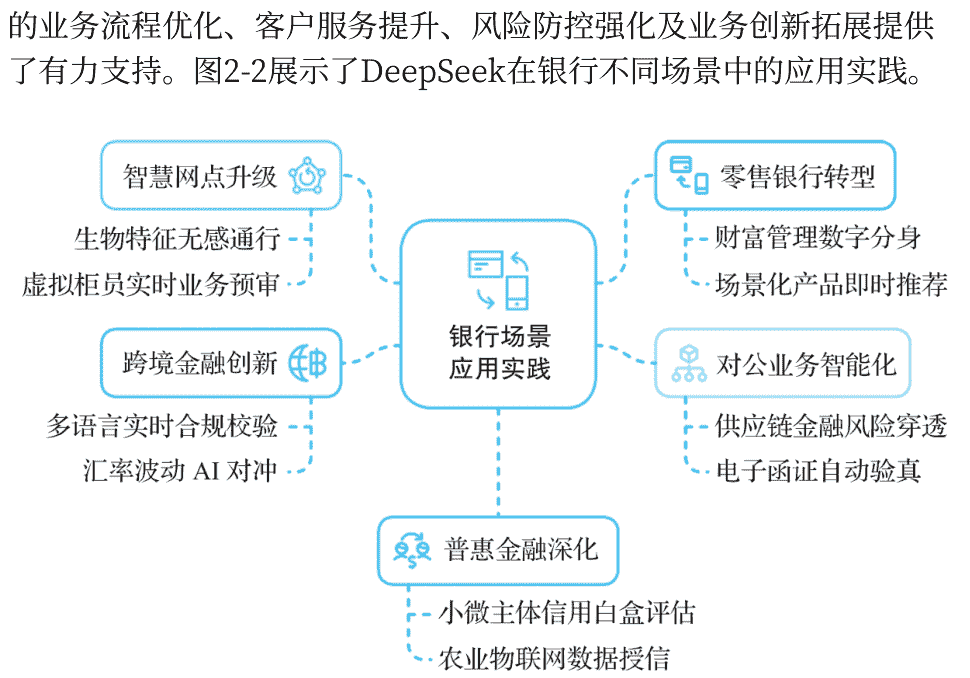

图2-2 DeepSeek在银行不同场景中的应用实践

### 2.2.1 智慧网点升级

借助DeepSeek相关技术解决方案，银行网点正逐步从“交易中心”向“服务体验中心”转型，通过综合运用生物识别、虚拟柜员、AR与智能设备调度等工具和技术，提升服务效率与客户体验，同时利用环境感知技术优化能耗管理，降低运营成本。

- 生物特征无感通行：在符合《中华人民共和国个人信息保护法》的前提下，银行取得客户单独同意并采取严格的信息安全保护措施后，可以在网点入口部署人脸识别摄像头，在客户进入时自动识别身份并关联预约信息，系统同步将客户引导至对应服务区域，简化排队登记环节。对于VIP客户，系统自动向专属理财经理推送信息，实现“无感识别、精准服务”，缩短客户等待时间。
- 虚拟柜员实时业务预审：客户通过网点智能终端描述业务需求（如“我要办理出国留学汇款”），虚拟柜员基于自然语言处理技术提取金额、收款方等关键信息，自动填写业务申请表单，并校验所需材料（如护照、录取通知书）是否齐全。预审通过后直接推送至柜面办理，减少现场信息录入时间。
- 智能设备动态调度：实时监控网点内VTM、现金存取款机、智能柜台等设备的使用状态，通过显示屏与语音提示引导客户至空闲设备。例如，在柜台等候人数较多时，系统自动提示小额存取款客户使用ATM机，并提供操作指引，均衡设备负载，提升网点整体服务效率。
- AR远程专家协同：针对复杂业务（如跨境投资政策咨询），客户可通过AR眼镜与远程专家实时连线。专家在客户视野中标记界面操作步骤，推送政策文件关键条款解读，如在外币兑换界面标注“当前汇率波动区间”与“合规购汇额度”，实现沉浸式“面对面”指导，提升复杂业务办理的成功率。
- 环境感知能耗优化：在网点部署传感器监测人流密度、光照强度、温度、湿度等环境参数，自动调节空调、照明、通风系统的运行状态。例如，非高峰时段人流量减少时，自动降低空调负荷与照明亮度，在保障客户舒适度的前提下，降低网点能耗成本。

### 2.2.2 零售银行转型

DeepSeek的语义解析与关系图谱技术可助力银行打造个性化零售服务，聚焦零售客户需求，通过数字分身、场景化推荐、智能账单解析、家庭金融图谱与情绪识别技术，提升财富管理服务的智能化水平，优化客户体验，增强客户黏性与价值挖掘能力。

- 财富管理数字分身：为零售客户构建AI虚拟财富管家，基于客户资产规模、风险偏好、投资目标等数据，提供7×24小时个性化理财建议。支持客户授权后自动执行低风险理财产品的申购与赎回，例如，根据市场利率变化自动调整货币基金与国债逆回购的配置比例，实现“省心省力”的财富管理。
- 场景化产品即时推荐：整合客户线上消费、线下支付、社交互动等场景数据，在客户行为触发特定条件时推送适配产品。例如，客户在母婴电商平台购买奶粉后，系统自动推荐“育儿宝”教育储蓄产品；在信用卡客户进行餐饮消费结账时，弹出“美食分期”优惠活动，提升产品推荐的精准度与转化率。
- 智能账单语义解析：将客户的信用卡账单、房贷月供账单等转化为自然语言解读报告，除了显示消费金额、还款日期等基础信息外，还提供消费结构分析（如“本月餐饮消费占比35%，较上月下降10%”）、异常交易预警（如境外大额消费提醒）等服务，帮助客户更清晰地了解个人财务状况。
- 家庭金融关系图谱：整合家庭成员的银行账户数据，构建家庭金融关系网络，识别“夫妻共同还款”“子女教育金规划”“父母赡养保障”等家庭金融需求。为家庭客户定制综合金融方案，例如，为新婚夫妇推荐“住房贷款+生育保险+定期存款”组合产品，提升零售业务的家庭覆盖率。
- 情绪识别客诉处理：在电话客服与智能客服场景中，通过语音语调分析、文本情感标签识别客户情绪状态。当检测到客户存在不满情绪时（如语速加快、用词激烈），自动将通话转至资深客服，并为客服推送客户历史投诉记录与相似问题解决方案库，帮助其快速响应客户诉求，提升满意度。

### 2.2.3 对公业务智能化

基于DeepSeek的供应链穿透与智能验真技术可以赋能银行对公风控场景，银行可综合运用供应链风险穿透、电子函证、跨境结算优化、财报分析与授信流程孪生技术，提升对公业务处理效率与风险管控能力，助力实体经济发展。

- 供应链金融风险穿透：整合核心企业的ERP（企业资源规划）系统数据、上下游交易凭证、物流运输轨迹，构建供应链可视化图谱，实时监控链内资金流、信息流、货物流的匹配情况。自动识别虚假贸易风险（如同一批货物重复质押融资），当发现交易数据异常时（如发票金额与物流货值之间的差异超过10%），系统触发风险预警，帮助银行精准评估供应链上下游企业的融资风险。
- 电子函证自动验真：对接区块链函证平台，实现银行询证函的电子化流转与自动验真。企业提交函证申请后，系统自动核验公章、金额、日期等要素的真实性，10秒内完成回函处理，效率较传统人工流程大幅提升，同时确保函证信息不可篡改，降低审计风险。
- 跨境结算智能路由：助力银行基于实时汇率、清算行额度、反洗钱风险等级等因素，为企业跨境结算动态推荐最优路径。例如，在人民币跨境支付系统（CIPS）与SWIFT（环球银行金融电信协会）系统之间，系统根据结算成本、到账时间、合规风险等因素综合评估，选择更优渠道，帮助企业降低结算成本，提升资金到账效率。
- 财报结构化洞察：DeepSeek助力银行运用自然语言处理与机器学习技术，对企业财务报表进行智能分析，自动提取资产负债率、流动比率、营收增长率等关键指标，生成风险预警报告。例如，当发现某企业应收账款周转率连续3个季度下降时，系统提示客户经理关注其资金回笼能力，辅助信贷决策。
- 授信审批流程孪生：通过数字孪生技术构建授信审批流程的虚拟模型，模拟从贷前调查、贷中审查到贷后管理的全流程。自动校验“三查、三比、三访”等风控要求的执行情况，如检查贷前调查是否覆盖企业主要经营场所，贷中审查是否遗漏担保物估值报告，确保授信审批流程合规，降低操作风险。

### 2.2.4 跨境金融创新

基于DeepSeek的多语言合规引擎与区块链溯源技术，助力银行拓展跨境服务。围绕跨境贸易与投资需求，银行可综合运用多语言合规校验、汇率对冲、区块链溯源、离岸账户监管与地缘风险预警等技术，提升跨境金融服务的合规性、安全性与便捷性。

- 多语言实时合规校验：支持中文、英文、日文、韩文等多种语言的监管政策文本解析，在跨境汇款、贸易融资等业务中，自动匹配目标国家或地区的合规要求[如欧盟反洗钱指令、OFAC（财政部海外资产控制办公室）制裁名单]，生成合规风险清单，标注需要客户补充的材料或需要调整的业务要素，确保跨境业务符合当地监管规定。

### 2.2.5 普惠金融深化

基于DeepSeek的物联网数据融合技术与白盒信用模型，助力银行深化普惠金融服务。银行通过数据整合与技术创新解决小微企业、农业等领域的融资难题，实现补贴精准发放与风险防控。

- 汇率波动AI对冲：基于历史汇率数据与市场舆情分析，构建机器学习模型，预测主要货币对的短期波动趋势。当预测汇率波动超过客户预设阈值时，自动触发对冲策略建议（如办理远期结售汇业务），并推送至企业外汇交易部门，帮助企业降低汇率波动带来的财务风险。
- 区块链贸易溯源：助力银行将跨境贸易中的订单、发票、装箱单、海运提单等关键单据上链存证，利用区块链不可篡改的特性确保数据真实性。贸易双方可实时查询单据流转状态，如进口商可验证货物是否按合同约定时间装船，出口商可跟踪货款到账进度，从而有效解决跨境贸易中的信息不对称问题。
- 离岸账户智能监管：整合反洗钱监管要求、CRS（共同申报准则）全球征税标准等规则，建立离岸账户交易监测模型，自动识别异常交易行为（如壳公司频繁进行大额资金划转、离岸账户与高风险地区账户频繁交易），生成监管报告并同步至银行合规部门，确保离岸业务符合跨境监管要求。
- 地缘风险预警建模：采集全球政治事件、自然灾害、贸易政策变化等非结构化数据，构建地缘风险评估模型。例如，分析某国大选结果对其货币政策的影响，预测某地区贸易摩擦对进出口企业的潜在风险，提前识别跨境业务的潜在风险。
- 小微主体信用白盒评估：打破传统依赖抵押担保的授信模式，整合小微企业税务发票数据、水电缴费记录、电商平台交易流水等多维数据，构建透明化信用评分模型。模型向银行清晰展示授信决策依据（如“企业近12个月开票额300万元，无欠税记录，核定信用贷款50万元”），有效缓解小微企业“信用数据缺失”问题，提升普惠贷款可得性，支持实体经济薄弱环节发展。
- 农业物联网数据授信：对接农田传感器、养殖监控设备等物联网终端，实时采集作物生长周期数据（如土壤墒情、作物株高）、牲畜健康状况（如体温、进食量）等信息。银行根据物联网数据动态评估经营主体的还款能力（如根据粮食产量预测核定种植户贷款额度），解决农业信贷中“抵押品不足”的核心痛点，推动农村金融与现代农业发展深度融合。
- 民生补贴精准触达：银行通过与政府部门共享数据（如民政、人社部门的补贴名单），并结合账户体系，自动识别符合补贴条件的群体（如低保户、退役军人、建档立卡贫困户）。系统将补贴资金直接发放至受益人银行账户，并通过短信、手机银行等渠道推送资金到账通知，实现补贴发放“最后一公里”的精准触达，避免资金被截留挪用，提升民生金融服务效率。
- 乡村振兴产品工厂：DeepSeek能为银行提供模块化产品配置工具，支持快速定制县域特色普惠金融产品（如“茶叶种植贷”“乡村旅游经营贷”）。银行可一键配置产品利率、期限、还款方式等要素，并对接当地农业龙头企业收购数据、农产品价格指数等，形成“生产-加工-销售”全链条金融服务闭环，助力乡村振兴战略下的特色产业发展。
- 反欺诈联盟知识共享：DeepSeek助力银行整合区域内分支机构、公安部门、电商平台、通信运营商的欺诈案例数据，构建分布式反欺诈知识库。系统可实时共享“黑名单”客户信息（如多头借贷、电信诈骗涉案账户），并通过机器学习技术持续更新欺诈模式特征（如新型虚假贷款申请话术）。在农村地区金融服务中，该机制可有效降低农户被诈骗的风险，维护普惠金融生态安全。

## 2.3 银行场景AI幻觉治理体系

随着AI在银行领域的广泛应用，AI幻觉问题逐渐凸显，成为影响银行业务安全与合规的重大隐患。AI幻觉，是指AI模型生成的内容与事实或用户输入不一致的现象，可能导致决策错误、误导客户或引发合规风险。因此，银行亟须采取有效措施治理AI幻觉，确保AI应用的安全、可靠与可信（如图2-3所示）。

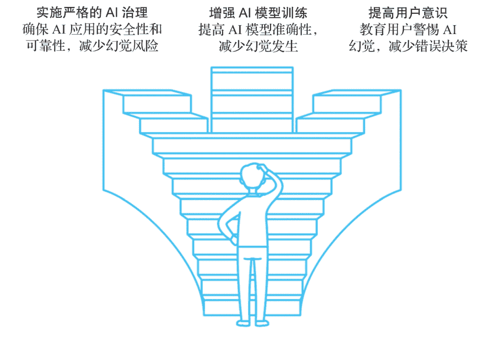

### 2.3.1 智慧网点交互可信化

DeepSeek助力银行构建生物特征交叉核验与决策监测体系，确保虚拟服务的可靠性。通过AR空间锚定技术防止信息篡改，双轨调度机制保障设备运行安全，银行借助DeepSeek构建多层级可信交互体系，确保AI驱动的网点服务安全可靠，避免因AI幻觉导致决策失误。

- 多模态生物特征交叉验证：在客户身份核验环节，系统同步采集人脸、指纹、声纹等至少3种生物特征，通过异构数据融合算法与公安机关授权的身份核验系统进行比对。例如，客户办理大额转账时，系统先通过人脸识别确认身份，再要求使用指纹扫描与语音指令双重验证，将错误率控制在行业安全标准内，防止伪造生物特征（如3D打印人脸、指纹膜）引发的身份冒用风险。
- 虚拟柜员决策置信度监测：为虚拟柜员的每一次业务应答生成0～100分的可信度评分，评分依据包括知识图谱匹配度、历史问答准确率等指标。当评分低于70分时（如复杂金融产品条款解释），系统自动触发人工复核流程，由柜员对虚拟柜员的回答进行二次确认，并补充书面说明，确保客户获取到的信息准确无误，避免AI幻觉引发误导性决策。
- 设备调度双轨决策机制：对于ATM加钞、VTM设备故障报修等关键操作，采用“AI算法推荐+人工复核”的双轨决策模式。例如，系统根据历史交易数据建议“为3号ATM加钞20万元”，须经运营主管在管理后台确认后执行，避免因算法异常（如误判客户取款高峰）导致设备现金不足或过剩，保障网点设备运营的稳定性。
- AR空间数据真实性锚定：在AR远程专家协助场景中，系统通过激光雷达扫描网点物理环境，生成三维空间坐标，将虚拟标注（如“点击屏幕右上角‘转账’按钮”）与实际设备界面进行像素级对齐。同时，系统实时校验AR场景中的数据交互（如客户操作反馈），防止因空间定位误差或数据传输延迟导致的操作指引错误，确保远程协助过程真实可靠。

### 2.3.2 零售服务决策可解释性

银行基于DeepSeek运用因果推断与审计追踪技术，构建透明化决策机制，使AI驱动的零售服务可追溯、可理解，提升客户信任度；通过人机协同校验账单解析结果，结合情绪识别误差补偿模型降低误判风险。

- 数字分身行为审计追踪：AI财富管理数字分身的每一步操作（如推荐某只基金、调整投资组合）都会生成详细的决策日志，日志包含数据来源、算法模型、风险指标等要素。客户可通过手机银行查询“为什么推荐这只基金”，银行内部审计部门也可追溯数字分身的决策过程，确保合规性与风险可控性。
- 因果推断推荐系统：摒弃传统“买A产品的客户也买B产品”的关联推荐逻辑，采用因果推断技术挖掘客户真实需求。例如，系统通过分析“客户近期办理房贷”与“需要装修贷”的因果关系，向房贷客户精准推荐装修分期产品，而非盲目推送无关产品。
- 账单解析人机协同校验：智能账单解析系统对异常交易（如凌晨2点在境外消费1万元）的识别分为两步：首先由AI模型标记风险等级（如“高风险盗刷”），然后推送给人工客服进行复核。客服需联系客户确认交易真实性（如发送验证码至客户预留手机号），经客户确认后才会认定为盗刷并启动账户冻结流程。这种机制将误报率有效控制在极低水平，避免因AI误判导致的客户账户被异常冻结。
- 情绪识别误差补偿模型：针对方言口音、语境差异导致的情绪识别偏差，定期用标注语料库对模型进行微调。例如，在粤语地区新增“方言情绪语料库”，收录不同语境下的情绪表达（如“呢个服务好唔错”在粤语中为正面评价），使方言场景下的情绪识别准确率从行业平均水平提升至较高水平，确保客服系统能准确理解客户情绪，并提供相应服务。

### 2.3.3 对公业务风险穿透管理

银行借助DeepSeek构建多层级风险验证体系，防止AI模型在对公业务中出现“风险误判”，确保信贷决策客观、准确。

- 供应链多源数据验证：对核心企业提供的上下游交易数据，系统自动交叉比对物流平台轨迹、税务发票流向等多源信息。例如，在某供应链金融业务中，核心企业提交的交易发票金额为100万元，系统通过对接物流平台发现实际货值仅为80万元，差值超过20%，则立即触发人工核查流程，防止供应商通过虚构交易骗取贷款。
- 区块链函证验真体系：基于联盟链技术，构建银行、企业、会计师事务所三方参与的函证存证体系，函证信息（如银行存款余额、应收账款）上链后不可篡改，任何一方修改数据都必须获得其他方的共识确认。
- 财报分析专家规则校准：AI财报分析模型提取的指标（如资产负债率、流动比率）需与行业专家经验规则进行交叉验证。例如，某房地产企业财报显示资产负债率为85%，虽然AI模型基于历史数据判断风险可控，但行业专家经验规则设定的房企资产负债率警戒线为80%，系统就会自动提示“需重点关注企业现金流状况”，避免模型过度依赖历史数据而忽视行业特定风险，提升财报分析的审慎性。
- 授信模型对抗性测试：通过模拟黑客攻击式的“恶意数据输入”场景，评估信贷模型的鲁棒性。例如，向小微企业授信模型输入“营收增长率1000%”“净利润率90%”等异常数据，观察模型是否会出现误判，确保模型在面对异常数据时仍能保持风险评估的准确性，防止通过数据造假获取贷款。

### 2.3.4 跨境金融可信化建设

银行通过DeepSeek构建跨境业务可信生态，解决多语言合规、汇率风险等跨境场景中的“信任孤岛”问题。

- 多语言合规知识图谱：整合中文、英文、法文等语言的跨境监管政策术语，构建知识图谱，明确“反洗钱”“跨境资本流动限制”等术语的多语言映射关系及政策内涵。
- 汇率对冲压力测试沙盒：搭建模拟极端市场行情的测试环境，对AI汇率对冲策略进行压力测试。例如，模拟2008年金融危机时期欧元兑美元的汇率单日暴跌5%、2020年全球汇率剧烈波动等场景，验证策略能否将客户损失控制在预设范围内。
- 跨境贸易双链存证：将贸易单据链（订单、提单）与资金流水链同时上链存证，通过智能合约自动比对“单据货值”与“付款金额”。当两者差异超过5%时，系统自动冻结付款流程并触发人工核查，确保“贸易流”与“资金流”一致。
- 资金流动模式库更新：持续采集全球200多个国家和地区的资金流动特征，构建动态更新的异常模式库。例如，当发现某国近期出现“大量小额外汇分散汇入、集中汇出”的异常模式时，系统自动将该模式加入反洗钱监测规则，触发对相关账户的加强型尽职调查。

### 2.3.5 普惠金融精准化控制

银行借助DeepSeek构建普惠金融风险控制体系，在扩大服务覆盖面的同时确保风险可控，避免“普惠”变“普亏”。

- 行业数据对比验证模型：针对不同行业（如餐饮、物流、批发零售等）建立差异化风控指标体系。例如，餐饮企业重点关注“日均流水”“翻台率”，物流企业关注“车辆周转率”。当某火锅店贷款申请数据显示“日均流水10万元”，但行业均值为5万元时，系统将自动启动现场核验流程，排查是否存在数据造假，降低因行业特性差异导致的误判风险，确保普惠贷款资金流向真实经营主体。
- 物联网设备可信认证：对采集农业数据的物联网设备进行区块链签名认证，每台设备生成唯一ID并绑定地理位置、采集频率等参数。例如，养殖场提交的“生猪存栏量”数据需附带设备ID、采集时间戳等加密信息，银行可通过区块链浏览器验证数据是否被篡改，确保授信所依据的农业生产数据真实可靠，解决农业信贷中“数据不可信”的难题，为“金融活水精准滴灌农业”提供技术支撑。
- 补贴发放双盲验证：在民生补贴发放流程中，采用“数据分离”机制，政府部门负责加密传输受益人身份信息（如姓名、身份证号），银行仅负责资金划转，双方均不掌握完整的“身份-账户”对应关系。这种双盲模式在低保金发放中可杜绝内部人员篡改补贴名单的风险，确保国家惠民资金安全发放到每一位受益人手中。
- 反欺诈分层处置机制：根据欺诈风险等级采取差异化处置措施，对“疑似欺诈”的客户（如首次申请贷款时填写虚假单位地址），系统自动拒绝申请并提示客户修正相关信息；对“确认欺诈”的客户（如使用他人身份证开户、参与电信诈骗），系统将其永久列入银行黑名单并报送征信系统及相关监管机构。

## 2.4 DeepSeek与Deepfake

随着AI技术的不断发展，Deepfake（深度伪造）技术逐渐成为金融领域面临的重要威胁之一（如图2-4所示）。DeepSeek作为先进的AI模型，既需要防范Deepfake技术带来的风险，又要通过技术创新提升自身的反伪造能力。

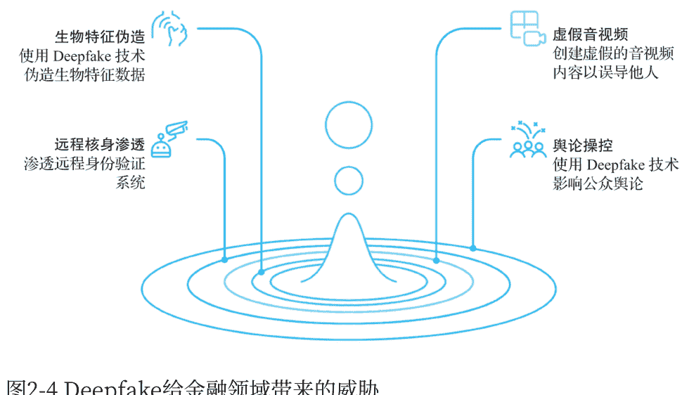

图2-4 Deepfake给金融领域带来的威胁

### 2.4.1 Deepfake技术解析与威胁

#### 1. Deepfake技术定义与核心原理

Deepfake技术是一种利用深度学习算法，尤其是生成对抗网络（GAN）和变分自编码器（VAE），生成虚假图像、视频或音频的技术。其核心原理是通过使用大量的真实数据进行训练，使模型能够生成高度逼真的伪造内容。在金融领域，这种技术可能被用于伪造客户身份信息、制造虚假交易记录或篡改金融文件，从而引发严重的安全和合规问题。

#### 2. 生物特征伪造攻击场景

生物特征伪造是Deepfake技术对金融领域的主要威胁之一。攻击者可能利用伪造的指纹、人脸或声纹信息，突破银行的生物识别系统，非法获取客户账户权限或进行金融交易。例如，利用伪造的人脸视频通过远程开户的身份验证流程，或利用伪造的声纹信息欺骗语音识别系统，对账户安全造成威胁。

#### 3. 虚假音视频材料生成风险

虚假音视频材料的生成是Deepfake技术的重要应用之一。攻击者可以利用伪造的视频或音频，生成虚假的金融广告、客户服务对话或高管讲话，误导客户或投资者，引发市场波动。例如，伪造的银行高管讲话视频可能引发市场恐慌，导致股价下跌或客户资金流失。

#### 4. 远程核身流程渗透威胁

在远程核身流程中，Deepfake技术可能被用于渗透银行的安全防线。攻击者通过伪造的生物特征信息或虚假的音视频材料，绕过银行的身份验证系统，非法获取客户账户权限。这种攻击不仅威胁客户资金安全，还可能引发银行的声誉风险。

#### 5. 企业级舆论操控隐患

在企业层面，Deepfake技术可能被用于操控舆论、制造虚假信息，影响企业的品牌形象和市场声誉。例如，通过伪造的企业高管讲话视频或虚假的新闻报道，攻击者可以引发公众对企业财务状况或经营行为的质疑，进而影响企业的股票价格和市场信心。

### 2.4.2 银行针对Deepfake的防御体系

#### 1. 多模态生物识别升级（3D活体/声纹）

银行应升级现有的生物识别系统，引入多模态生物识别技术，如3D活体检测和声纹识别。3D活体检测技术可以通过检测生物特征的三维结构和动态变化，有效防止基于二维图像或视频的伪造攻击。声纹识别则通过分析声音的频率、音调和语速等特征，识别出伪造的音频内容。这种多模态识别机制能够显著提高身份认证的准确性和安全性。

#### 2. AI伪造内容检测引擎部署

银行应部署专门的AI伪造内容检测引擎，利用先进的深度学习算法，实时检测伪造的图像、视频和音频内容。这些检测引擎可以通过分析内容的像素级特征、生成模式和数据一致性，识别出伪造内容的痕迹。例如，检测视频中的人脸是否具有自然的动态变化，或音频是否包含伪造的频率特征等。

#### 3. 区块链业务存证溯源机制

利用区块链技术，银行可以建立业务存证溯源机制，对所有业务交易信息和客户身份信息进行不可篡改的记录。通过区块链的分布式账本技术，银行可以确保数据的真实性和完整性，防止伪造内容的传播。例如，客户的身份验证过程和交易记录可以被记录在区块链上，任何篡改行为都能被及时发现。

#### 4. 动态交互验证流程优化

银行应优化动态交互验证流程，通过实时的多因素验证和动态挑战-响应机制，增强身份认证的安全性。例如，在客户登录时，系统可以随机生成验证码，并要求客户通过多种方式进行验证，如短信验证码、人脸识别和声纹识别等。这种动态交互验证机制能够有效防止伪造攻击，并兼顾用户体验。

#### 5. 跨机构反欺诈联盟协同

银行应与其他金融机构和监管机构合作，建立跨机构反欺诈联盟，共享伪造攻击的案例和防御经验。通过协同合作，银行可以更快速地识别和应对伪造攻击，提高整个金融行业的安全性和稳定性。例如，联盟成员可以共享伪造内容的特征和攻击模式，共同研发和部署更有效的防御技术。

### 2.4.3 DeepSeek反伪造技术实践

#### 1. 多模态风控模型应用

银行基于DeepSeek应用多模态风控模型（VL-R1），结合视觉（Vision）、语言（Language）和推理（Reasoning）技术，对业务流程进行全面的风险监控。通过分析客户的生物特征、行为数据和交易记录，模型能够实时识别潜在的伪造攻击，并采取相应的防范措施。例如，在客户进行大额转账时，模型可以通过分析客户的面部表情、语音特征和交易行为，判断是否存在伪造风险。

#### 2. 伪造文件痕迹智能解析

银行借助DeepSeek应用伪造文件痕迹智能解析技术，通过分析文件的生成模式、数据一致性和其他特征，识别出伪造文件的痕迹。例如，通过检测文件中的像素级异常或生成模式的不一致性，可以判断文件是否被篡改或伪造。这种技术能够有效防止伪造文件在银行内部的流转和使用。

#### 3. 本地化数据隐私保护方案

为了保护客户数据的隐私，银行基于DeepSeek部署本地化数据隐私保护方案，确保数据在本地存储和处理，防止数据泄露。通过加密技术和访问控制机制，银行可以确保客户数据的安全性和隐私性。例如，客户的身份信息和交易记录可以被加密存储在本地服务器上，只有经过授权的人员才能访问。

#### 4. 业务行为链异常监测

依托DeepSeek，银行构建业务行为链异常监测模型，实时监控业务流程和客户行为，识别异常行为模式。通过分析客户的登录时间、交易频率和行为路径等数据，模型可以判断是否存在伪造攻击或其他异常行为。例如，如果一个客户在短时间内频繁登录并进行大额转账，模型可以触发警报并进行进一步的验证。

#### 5. 模型幻觉抑制技术落地

DeepSeek通过模型幻觉抑制技术，减少模型生成的虚假内容或做出的错误决策。这种技术通过优化模型的训练过程和算法，提高模型的准确性和稳定性。例如，通过引入对抗训练和数据增强技术，模型可以更好地识别和处理伪造的内容。这种技术的落地应用能够有效减少AI幻觉带来的风险，提升银行业务的安全性和可靠性。

### 2.4.4 未来挑战与应对方式

#### 1. 升级生成式AI对抗技术

随着生成式AI技术的不断发展，伪造攻击的手段和复杂性也在不断升级。银行需要持续关注生成式AI技术的发展动态，及时调整和优化防御策略。例如，通过引入更先进的检测算法和多模态识别技术，银行可以更好地应对生成式AI技术带来的挑战。技术优化是解决AI幻觉问题的关键路径之一，银行可以通过提高训练数据质量、加强外部验证与事实检查、提高模型推理能力等手段，提升AI模型的性能，减少幻觉的产生。

#### 2. 建立Deepfake数字水印标准

为有效识别和防止伪造内容的传播，银行应推动Deepfake数字水印标准的建立。通过在生成的内容中嵌入不可见的数字水印，银行可以追踪内容被来源和生成过程，防止伪造内容被滥用。例如，数字水印可以包含生成时间、生成设备和生成算法等信息，帮助银行快速识别伪造内容。这种技术的应用不仅有助于银行内部的风险管理，也能为整个金融行业的安全提供支持。

#### 3. 共建金融合规检测框架

银行应与其他金融机构和监管机构合作，共建金融合规检测框架，确保AI技术的应用符合法律法规和监管要求。通过制定统一的合规标准和检测流程，银行可以更好地应对AI幻觉和伪造攻击带来的合规风险。例如，国家互联网信息办公室等七部门颁布实施的《生成式人工智能服务管理暂行办法》，对训练数据的选择、模型的生成与优化、服务的提供等提出明确的法律规制与风险防范要求，为银行提供了合规应用指导。

#### 4. 深化跨域联防联控机制

银行应深化跨域联防联控机制，与其他行业和领域合作，共同应对伪造攻击和AI幻觉带来的挑战。通过共享信息和技术，银行可以更快速

#### 5. 探索反伪造技术伦理边界

随着反伪造技术的不断发展，银行需要探索其伦理边界，确保技术的应用符合道德和伦理规范。例如，银行在使用AI技术时，应遵循“负责任创新、可控创造性”等伦理价值，将这些原则融入工程师的观念和AI模型的代码中。同时，银行应倡导不生成存在争议的结论、不生成无法溯源的信息、不生成超出模型认知边界的内容等原则，推动AI模型从追求内容生成的流畅度向确保内容的可靠性转型。

## 本章小结

本章系统阐述了DeepSeek在银行场景中的多维赋能路径。通过构建智能银行服务中枢、合规风控体系与业务决策引擎等，DeepSeek深度融入智慧网点升级、零售银行转型、对公业务智能化等核心场景，显著提升银行的服务效率与风险防控能力。其技术体系严格遵循金融监管规范，助力银行在精准营销、供应链金融、跨境结算等场景中实现创新突破。同时，针对AI应用中潜在的幻觉问题，本章提出多模态验证、决策置信度监测等治理策略，并构建反伪造防御体系以应对Deepfake技术带来的威胁，确保技术应用的可靠性与合规性。

# 第3章 DeepSeek银行业务场景提示词

在银行加速数字化转型的当下，DeepSeek的提示词设计已成为提升工作效率的关键技能。就像我们和同事沟通时需要清晰表达需求一样，“优质”的提示词能让系统更精准地理解业务诉求。比如在审核贷款时，如果输入“请按监管要求分析客户征信报告，标记异常风险点”这类明确的指令，DeepSeek就能快速输出结构化分析结果。

本章将结合银行实际业务场景，讲解如何设计符合场景需求的提示词，把复杂的业务需求转化成系统能高效响应的对话指令，帮助银行从业者在客户服务、营销获客、风险排查等场景中，更顺畅地运用智能工具辅助工作决策。

## 3.1 DeepSeek常用提示词

### 3.1.1 万能提问模板

在银行业务场景中，高效利用DeepSeek需依托结构化提问框架。适用于大多数银行业务场景的提示词是RTGO提示词，也可以称之为“万能提问模板”。

RTGO提示词包括以下4个要素（如图3-1所示）：

- ○Role：表示角色，如“资深风控分析师”。
- ○Task：表示任务，如“设计反欺诈策略”。
- ○Goal：表示目标，如“降低可疑交易误判率”。
- ○Objective：表示操作要求，如“分三部分论述，附数据案例”。

四要素结合，形成“角色化任务驱动”模式，例如“作为零售银行产品经理（Role），梳理客户甲的理财偏好（Task），制定差异化营销方案（Goal），按需求强度排序并标注推荐理由（Objective）”。此类结构化表达既能提升AI的理解效率，又可确保输出结果符合业务规范与监管要求，有助于银行业务人员在智能客服、数据分析、合规管理等场景中实现高质量的人机协作，推动数字化转型精准落地。

### 3.1.2 结构化提示词：CO-STAR模板

CO-STAR模板是一种精细化的沟通框架，由6个核心要素构成（如图3-2所示）。

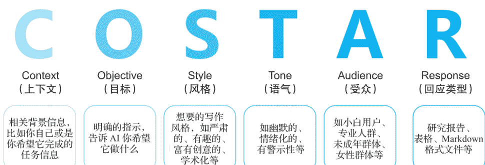

- ○Context（上下文）：提供相关背景信息，如事件背景或个人身份等，为理解任务奠定基础。
- ○Objective（目标）：明确指示AI需完成的具体任务，确保指令清晰、无歧义。
- ○Style（风格）：界定内容的写作风格，如严谨、有趣、学术化或表达方式富有创意等。
- ○Tone（语气）：确定内容的情感基调，例如幽默、情绪化、有警示性等。
- ○Audience（受众）：明确内容面向的群体，如小白用户、专业人群、未成年群体等。
- ○Response（回应类型）：指定输出形式，如研究报告、表格、Markdown格式文件等。

CO-STAR模板通过对各要素的精准定义，确保信息传达清晰准确，助力高效生成符合需求的内容，适用于多种场景下的人机交互指令设计。

CO-STAR模板可广泛应用于多个领域的提示词设计。

- 内容创作：如撰写社交媒体文案、广告创意、小红书推文等，通过设定风格（如活泼、专业）、语气（如亲切、激励）及受众（如年轻群体、宝妈），生成能精准吸引目标人群的内容。
- 商业与职场：如撰写商业报告、产品宣传文案、求职信等，明确目标（如提升销量、打动面试官）与格式（如数据表格、正式文档），确保内容符合场景需求。
- 教育领域：在定制教材、辅导资料或科普内容时，依据受众（如学生、成人）调整语言难度与风格（如简洁易懂、严谨），提升内容适配性。
- 技术与文档：在编写技术文档、API说明等场景中，通过指定格式（如JSON、Markdown）与专业风格，确保信息表达清晰、规范。
- 客户服务：在生成客服回复、用户指南时，调整语气（如友好、耐心）与内容结构，提升用户体验。

该模板通过精细调整上下文、目标、风格等要素，提升输出内容的针对性与专业性，适用于需要精准交互的各类场景。

银行业务人员可在多种场景中应用CO-STAR模板设计提示词，提升服务效能。

- 产品推荐：通过明确客户风险偏好（Context）、设定产品适配目标（Objective）、采用简明专业的风格（Style）及亲和的语气（Tone），为普通投资者（Audience）提供结构化方案（Response），增强信息传达的精准度。
- 撰写风险评估报告：基于市场数据（Context）和合规分析目标（Objective），以严谨学术的风格（Style）和客观的语气（Tone）为管理层（Audience）生成标准化文档（Response），提升决策参考价值。
- 处理客户投诉：通过锁定争议细节（Context）、聚焦解决方案（Objective），采用清晰易懂的表述（Style）与安抚的语气（Tone），针对投诉客户（Audience）生成分步指引（Response），有效减少沟通摩擦。

该模板通过对要素的拆解与精准匹配，帮助银行业务人员提升信息输出的专业性、场景适配性与服务效率，在合规的前提下优化客户体验，提升内部协作质量。

### 3.1.3 银行业务场景主流提示词

在数字化转型浪潮下，银行业务的复杂性、实时性与合规性要求持续提升，结构化提示词作为人机协作的核心工具，已成为提升工作效率、降低业务风险、驱动技术创新的关键载体。下文将对银行业务场景中常见的几类AI提示词进行详细阐述，并探讨其在实际业务中的应用价值。

#### 1. 信息查询类提示词：构建业务响应的“神经末梢”

信息查询类提示词，是银行工作人员在处理客户咨询或内部业务时最常用的一类提示词，其主要功能是快速获取特定信息，以满足客户或业务需求。

例如，“查询客户账户余额”这一提示词能够帮助银行工作人员迅速调取客户账户的实时余额信息，确保客户能够及时了解自身资金状况。再如，提示词“获取最新汇率信息”则用于查询当前的外汇汇率，为银行的外汇交易业务提供准确的数据支持。

这类提示词的特点是简洁明了、指向性强，能够快速响应查询需求，减少客户等待时间，提升客户服务体验。

#### 2. 数据分析类提示词：驱动业务决策的“智慧引擎”

数据分析类提示词，在银行的业务决策和管理中扮演着重要角色。AI通过对大量数据进行分析和整理，为银行提供有价值的业务洞察。

例如，“分析本月信用卡消费数据”这一提示词可以让DeepSeek对客户的信用卡消费行为进行分析，包括消费的金额、频次、类别等，从而帮助银行了解客户的消费习惯和偏好。基于这些分析结果，银行可以制定个性化的营销策略，如推出具有针对性的信用卡优惠活动或增值服务，以提高客户满意度和忠诚度。又如，“生成季度财务报表”这一提示词能够使DeepSeek自动汇总银行在季度内的各项财务数据，生成详细的财务报表，为管理层提供决策依据。

这类提示词的应用能够帮助银行更好地理解业务动态，优化资源配置，提升整体运营效率。

#### 3. 风险评估类提示词：筑牢风险防控的“数字堤坝”

风险评估是银行业务中至关重要的环节，而风险评估类提示词则是银行进行风险防控的重要工具。

例如，“评估客户A的信用风险”这一提示词能够引导DeepSeek综合考虑客户的信用历史、收入状况、负债情况等多方面因素，对客户的信用风险进行全面评估。通过这种评估，银行可以决定是否为客户批准贷款或信用卡申请，并确定相应的利率和额度。

再如，“分析贷款项目的风险点”这一提示词可用于对特定贷款项目进行风险分析，包括市场风险、行业风险、项目运营风险等。通过对这些风险点进行识别和评估，银行可以采取相应的风险控制措施，如要求提供抵押物、调整贷款期限或利率等，以降低贷款违约风险。

#### 4. 决策支持类提示词：赋能战略落地的“指挥中枢”

决策支持类提示词，是银行在制定战略规划和进行业务决策时的重要辅助工具。DeepSeek通过对市场动态、客户需求、业务数据等多方面信息进行综合分析，为银行提供决策建议。

例如，“提供投资组合建议”这一提示词要求DeepSeek根据客户的财务状况、风险承受能力和投资目标，为其设计个性化的投资组合方案。这种方案能够帮助客户在风险可控的前提下实现资产的增值。

又如，“制定营销策略”这一提示词则要求DeepSeek结合市场分析结果和客户数据，为银行制定精准的营销策略。通过这种策略，银行可以更有效地推广金融产品和服务，扩大市场份额，提升品牌影响力。

这类提示词的应用能够帮助银行在复杂多变的市场环境中做出科学合理的决策，从而提升银行的竞争力和盈利能力。

信息查询类、数据分析类、风险评估类和决策支持类提示词是银行业务场景中常见的几种主流提示词类型，覆盖了银行主要业务需求。通过合理使用这些提示词，银行能够有效提升工作效率，优化业务流程，增强风险防控能力，同时为客户提供更加优质、个性化的服务。

在智能化升级过程中，提示词模板库已成为各家银行构建差异化竞争力的核心数据资产。银行需通过标准化流程构建专属模板库，包括数据采集（整合业务日志、监管文件等内部语料）、语义分类（建立业务场景与关键词的映射关系）、动态优化（结合交互反馈调整权重）等环节。未来，拥有高质量提示词模板库的银行，将在各个业务领域占据先发优势。

## 3.2 银行人必懂：提示词三大核心设计原则

### 1. 清晰性（Clarity）

清晰性是提示词设计的首要原则。银行业务人员在撰写提示词时，应确保语言简洁明了，避免使用模糊或有歧义的词汇。例如，应使用“查询客户A的账户余额”而不是“看看客户A的钱有多少”。清晰的提示词能够帮助DeepSeek准确理解任务需求，减少误解和错误的输出。

### 2. 结构化（Structured）

结构化原则要求提示词应按照一定的逻辑顺序组织信息，便于DeepSeek快速解析和处理。例如，在进行客户信用评估时，提示词可以按照“客户基本信息→交易记录→信用评分”这样的逻辑顺序展开，帮助DeepSeek逐步完成任务。

### 3. 细节化（Detailed）

细节化原则强调在提示词中提供足够的信息，以便DeepSeek能够生成高质量的输出内容。例如，在设计理财产品时，应提供产品的目标客户群体、期限、预期收益范围等详细信息，而不是简单地要求“设计一款理财产品”。细节化的提示词能够帮助DeepSeek更好地理解任务的复杂性，从而生成更符合需求的解决方案。

## 3.3 银行人必知：提示词五大陷阱

在银行业务中应用AI技术时，提示词的设计至关重要。然而，不当的提示词设计可能引发诸多问题，以下是银行人必须警惕的提示词五大陷阱（如图3-3所示）。

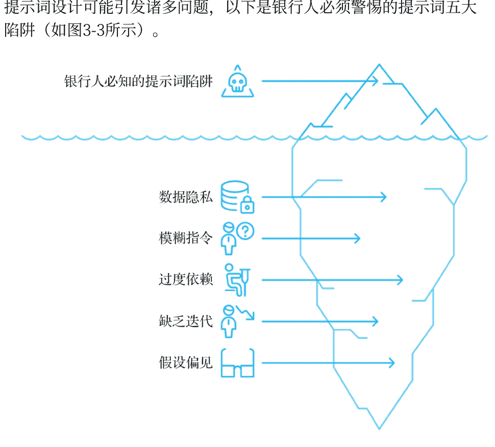

### 1. 数据隐私

在设计提示词时，银行业务人员必须严格遵守数据隐私法规，避免泄露客户敏感信息。例如，在查询客户账户信息时，应确保提示词中不包含客户的姓名、身份证号码等敏感信息，仅使用必要的标识符（如客户编号）进行查询。

### 2. 模糊指令

模糊的指令可能导致DeepSeek无法准确理解任务需求，从而生成不符合预期的结果。例如，“分析客户数据”是一个模糊的指令，而“分析客户A的消费行为模式，并以表格形式输出”则是一个明确的指令。银行业务人员应避免使用模糊的词汇作为提示词，确保提示词的清晰性和准确性。

### 3. 过度依赖

虽然DeepSeek能够提供强大的支持，但银行业务人员不应过度依赖其输出结果。在使用DeepSeek的建议或分析结果时，应结合自身的专业知识和经验进行判断，必要时进行人工验证和调整。

### 4. 缺乏迭代

提示词的设计是一个持续优化的过程，银行业务人员应根据实际使用效果不断调整和改进提示词。例如，在使用DeepSeek进行客户信用评估时，如果发现初始提示词的输出结果不够准确，应根据实际情况调整提示词的内容和结构，以提高输出结果的质量。

### 5. 假设偏见

在设计提示词时，银行业务人员应避免基于自身偏见或假设提出问题。例如，在评估客户信用风险时，不应假设所有年轻客户的风险都较高，而应基于客观数据和分析工具进行评估。避免假设偏见能够确保DeepSeek的输出结果更加客观和准确。

## 3.4 银行人必会：“三板斧”提示词

作为深耕银行数字化转型领域多年的培训讲师，笔者见证了银行业从“数据中台热”到“AI赋能潮”的变迁。过往的数字化营销、智能风控课程虽广受好评，但培训结束后，总能看到后排的中年听众边记笔记边皱眉。他们并非不想学，而是回到工作环境中实际操作时，往往举步维艰——系统权限没开通，数据部门不配合，监管要求不明确。直到DeepSeek出现，事情开始有了变化。

进入2025年，DeepSeek横空出世，迅速掀起一场银行业的AI革命。专业友好的中文语境、快速生成有价值的内容、完全免费的共享模式，瞬间引爆银行AI培训市场。犹记得2025年2月14日当天，我把第一份AI课程大纲（题目是《DeepSeek零基础轻量化落地实训课堂——中小银行零售业务数字化营销AI实战》）提交给某银行，对方从立项到签约仅用不足5小时，创下笔者个人培训史上最快的课程成交纪录。

在接下来的时间里，笔者进入超负荷运转状态。清晨在呼和浩特讲授对公客户经理如何用AI赋能尽职调查，傍晚落地佛山与理财经理探讨智能投顾话术优化，次日黎明又站在昆明培训中心带领学员进行案例实操。以2025年4月为例，自4月7日到28日，20余天内，笔者足迹遍布全国，总行程超过16500公里（33000里）。当时笔者让豆包赋诗一首，并配图发了朋友圈（如图3-4所示）。

> 数字银途志（四月行程三万三千里）
>
> 四月驰行万里程，银涛数字破坚冰。
>
> 遥追高适凌云志，再展宏图续汉青。

AI平权时代，我们需要认真思考这样一个问题：当所有银行人都能零门槛使用同款AI工具时，最重要的是什么？

正如某相声演员所说：你也有嘴，我也有嘴，大家都会说话，为什么你还要花钱听我说话？相声演员需要掌握“铺平垫稳”的技巧，才能把相声讲精彩。使用DeepSeek这种智能工具，同样需要掌握有效的提问方法。

以信用卡营销为例，经验丰富的业务员不会向DeepSeek直接问“如何提高转化率”这种问题，而是将提问拆解成三步：先让DeepSeek对比不同客群（如新市民、银发族）的消费特征，再筛选商超消费占比超60%的潜在客户，最后设计三组不同的权益方案进行效果预测。这种结构化提问方式，就像给DeepSeek装上了导航仪，能把模糊的业务目标转化成可执行的智能分析路径。

在银行的培训课堂上，笔者常做这样的实验：让两组学员分别向AI提问。A组直接抛出“怎么做好数字化运营”这样的问题，得到的是放之四海皆准的方案模板；B组则被要求先拆解诸如“县域老年客群的手机银行沉默户激活”这样的具体场景，最终B组产出的方案直接被纳入该行季度重点项目库。两组学员的差异不在于工具，而在于所提问题的颗粒度与场景化能力。

这或许就是数字文明时代最富诗意的悖论：机器越聪明，人类提问的艺术越珍贵。

如何有效地提问，让DeepSeek真正赋能银行业务场景？笔者总结了一套“三板斧”提示词，如图3-5所示。

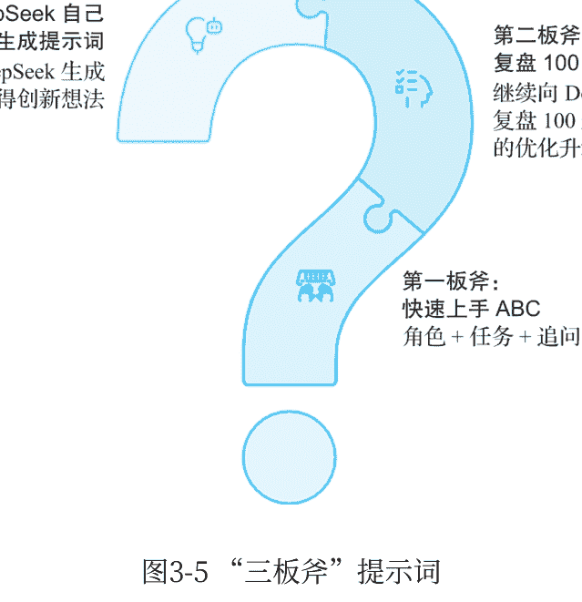

### 3.4.1 第一板斧：快速上手ABC

“三板斧”提示词是笔者通过无数实验总结出来的，可以帮助零基础银行业务人员快速上手DeepSeek，适用于银行大部分业务场景。提示词结构如下：

角色+任务+追问

例如，首先输入“我是某某银行对公业务客户经理，需要完成本地某行业的分析报告，请结合公开数据输出详细内容”，等DeepSeek输出第一版内容之后，再继续进行精准追问。

现在能看到的提示词大多数都是静态的，即先想清楚需要AI回答的问题，再一次性给出提示词，然后等它输出结果。而笔者设计的提示词是动态的，尤其强调“追问”——在给出静态提示词的基础上，通过至少五六轮的追问，让DeepSeek不断优化和调整输出内容，直到其输出基本令人满意的结果。

而此时的内容，也暂时不要直接采用。我们需要第二板斧，继续引导DeepSeek提高输出质量。讲课时，笔者经常跟银行学员说的一句话就是：永远不要相信AI给的第一版。

### 3.4.2 第二板斧：复盘100遍

在初始提示词精准有效的前提下，经过第一板斧的“砍斫”，我们已经得到一个基本满意的方案。此时，应继续向DeepSeek提问：“请针对以上方案进行认真检查，复盘100遍，给出最终的优化升级版本。”

然后，你会得到一份有可能超出最初预期的、更高质量的方案。

DeepSeek，潜力无限。

### 3.4.3 第三板斧：让DeepSeek自己生成提示词

在AI交互领域，传统提示词设计存在专业门槛高、场景适应性差的双重局限。此时，可以换一种思路，在自己无法提供有效提示词的情况下，反向提问——让DeepSeek生成高质量提示词，然后再用这套提示词向DeepSeek提问，从而得到自己想要的内容。

我们可以通过一个案例来理解和学习这种方法。

例如，你是一个新入职的银行业务人员，报到的第一天，行长就交给你一项重要任务，让你为当地某大型央企设计一套综合产品服务方案。你该怎么做？

现在，让我们一起来实际操作这个案例。

#### 1. DeepSeek提示词

我是一线城市某银行总行营业部的新入职业务人员，领导交办一项工作，需要为本地大型央企提供综合金融产品服务方案，但是我一方面并不了解银行业务，不知道有哪些金融产品；另一方面对央企和它的金融需求也一无所知。请给出为完成该方案向DeepSeek提问的一套高质量提示词。注意：我不要具体方案，只需要高质量提示词，要求不编造、不臆测，符合银行实际业务场景。

#### 2. DeepSeek输出

以下是为完成央企综合金融服务方案设计所需的高质量提示词框架，严格遵循银行实际业务场景，分为基础认知构建、业务场景拆解、产品组合策略、风控合规要点、同业方案参考5个部分。

##### 一、基础认知构建

##### 一、基础认知构建

1. 商业银行对公业务中针对大型央企的核心产品线分类及标准定义

商业银行针对大型央企的核心产品线主要包括以下五类。

- 现金管理类：包括账户体系搭建、收付款服务、流动性管理（如智能现金池、虚拟现金池）、票据池管理（支持票据贴现、质押融资）等，旨在实现资金归集、可视化和高效调配。
- 供应链金融类：涵盖应收账款保理、订单融资、仓单质押融资、供应链票据等，通过核心企业信用穿透服务上下游企业，优化全链条资金流。
- 跨境金融类：包括跨境本外币资金池、NDF、内保外贷、跨境人民币结算等，支持境内外资金一体化管理和汇率风险对冲。
- 投融资服务类：如项目贷款、并购融资、债券承销、结构化融资（如ABS、REITs）等，匹配央企基建项目、产业升级及资本运作需求。
- 财资管理平台类：依托银企直联、API等技术，提供账户监控、资金划拨、数据分析等数字化服务，助力央企司库体系建设。

2. 央企在资金管理、跨境业务、供应链金融等领域的显性/隐性金融需求

(1) 显性需求

- 资金集中管理：需通过全球资金池实现境内外资金归集与动态监控，降低冗余资金沉淀。
- 跨境流动性优化：如跨境人民币资金池、外汇避险工具（远期结售汇、期权）等，用于应对汇率波动和跨境支付效率问题。
- 供应链融资支持：为核心企业提供反向保理、预付款融资等，缓解上下游中小企业资金压力。

(2) 隐性需求

- 流动性管理工具：如智能现金池的动态调拨、内部计价功能，用于优化资金使用效率。
- 风险合规嵌入：需在跨境业务中嵌入反洗钱、外汇管制合规审查模块，防范政策风险。
- 产业链生态整合：通过供应链金融平台链接上下游数据，实现信用共享与风险共担。

3. 监管政策对央企集团资金集中管理的要求及银行产品匹配

(1) 监管要求

- 司库体系建设：根据《关于推动中央企业加快司库体系建设进一步加强资金管理的意见》（国资委“1号文”），央企需在2023年底前建成覆盖全球账户、资金流动可视可控的司库系统，实现资金集中调度。
- 风险防控：要求穿透式监控资金流向，严格管理外汇敞口和衍生品交易，防范流动性风险。
- 合规性：跨境资金池需符合外管局备案要求，确保本外币一体化管理合法合规。

(2) 银行产品匹配

- 全球资金池：支持境内外账户互联，实现资金归集与统一调拨（如招行财资管理云）。
- 银企直联系统：提供实时账户监控和支付结算接口，满足国资委穿透式监管要求。
- 智能现金池：通过自动化资金归集与内部计价，提升资金使用效率，匹配“降本节支”政策导向。
- 外汇避险工具：如远期结售汇、NDF等，帮助央企应对汇率波动风险。

4. 总结

商业银行需结合央企的监管合规需求（如司库体系建设）、业务场景（跨境、供应链）及隐性痛点（流动性优化），通过“账户+结算+融资+风控”的综合方案实现精准服务。例如，跨境资金池与外汇衍生品组合可同时满足资金归集和汇率避险需求，而供应链金融产品需嵌入核心企业信用以增强产业链韧性。

##### 二、业务场景拆解

- 请解析大型央企在“产融结合”战略下的典型金融需求场景（如基建项目融资、跨境资金池等）。
- 从财务报表角度分析，央企在资产负债管理方面对银行服务的核心诉求有哪些？
- 针对央企“降杠杆”要求，商业银行可提供哪些创新型债务优化工具？

##### 三、产品组合策略

- 如何构建“账户体系+支付结算+融资服务”三位一体的现金管理解决方案？
- 在跨境业务场景下，应如何组合使用NDF（无本金交割远期外汇）、跨境双向资金池、内保外贷等产品？
- 针对央企供应链生态圈，怎样设计“核心企业信用穿透+多级供应商覆盖”的链式金融服务？

##### 四、风控合规要点

- 央企授信业务中需特别注意哪些集团客户授信管理特殊规定？
- 设计综合服务方案时如何平衡客户需求与《中华人民共和国反垄断法》的相关要求？
- 跨境金融服务方案中需嵌入哪些外汇管制合规审查模块？

##### 五、同业方案参考

- 头部银行服务“中”字头央企的标杆案例中体现了哪些服务模式创新？
- 当前央企财务公司合作银行的选择标准及合作模式有哪些行业惯例？
- 如何将绿色金融、科技金融等新兴要素融入传统央企服务方案？

建议提问顺序遵循“基础认知→需求分析→产品组合→风险控制→同业对标”的逻辑链条，每个问题聚焦具体业务场景，确保获得可落地的结构化知识。注意结合银行年报、行业白皮书等公开资料交叉验证信息准确性。

接下来，只需要将以上提示词直接复制并粘贴到DeepSeek对话框中即可。

例如，我们用第一部分“基础认知构建”下面的三个提示词，直接向DeepSeek提问，可以得到以下内容。

## 3.5 DeepSeek对“三板斧”的评价

“三板斧”提示词的核心逻辑在于快速响应、总结优化和验证澄清。通过明确任务需求、总结经验教训和验证信息准确性，银行从业人员能够在复杂的工作场景中高效利用DeepSeek，提升工作效率和决策质量。下面我们将“三板斧”提示词的相关内容及案例整理成文档，并提交给DeepSeek，然后向它提问。

1. DeepSeek提示词

请结合上传的文档对“三板斧”提示词给出基于官方原则的客观、公正的评价。不得编造不存在的案例，不得臆测用户偏好，必须根据官方原则来判断是否有效。

2. DeepSeek输出

基于搜索结果中提供的技术文档、行业分析及官方指南，现对“三板斧”提示词方法论进行客观评估，并结合银行业实际应用场景的技术适配性与合规要求展开分析。

### 一、方法论有效性细化评估

#### 1. 第一板斧（快速上手ABC）

(1) 技术适配性

符合DeepSeek-R1推理模型的交互特性：其“角色+任务+追问”的结构与R1模型的MoE（混合专家）架构高度适配。角色定义（如客户经理）可激活特定领域专家网络，任务描述（如信用评估）聚焦注意力权重分配，追问机制则用于触发模型的链式推理（CoT）能力。

动态追问的必要性：尽管R1模型支持自动推理生成，但银行业务涉及复杂风控逻辑（如集团客户授信规则），需通过多轮追问细化模型输出的合规性检查点（如国家外汇管理局备案要求）。

(2) 案例验证

在信用评估案例中，追问环节可补充监管要求（如国有资产监督管理委员会发布的关于司库系统的建设规范），避免模型仅输出通用分析框架。

局限性：若初始角色定义模糊（如仅说明“银行业务人员”而未明确“对公业务”属性），可能导致模型激活错误的专家网络（如零售信贷模块），需依赖后续追问修正。

#### 2. 第二板斧（复盘100遍）

(1) 技术原理

本质是调用模型的自我优化（Self-Refine）机制，通过指令触发对初始输出的多维度校验。例如要求“检查方案是否符合《商业银行集团客户授信业务风险管理指引》”，可引导模型嵌入合规性审查模块。

迭代次数争议：实际测试显示，3~5轮专项优化（如分阶段检查数据准确性、逻辑连贯性、监管匹配度）比笼统要求“复盘100遍”更高效，避免因token限制导致信息冗余。

(2) 银行业应用风险

需防范过度依赖模型自检：跨境金融方案中的NDF条款可能因模型训练数据的时效性滞后而产生错误，需人工交叉验证。

案例改进：某银行在供应链金融方案优化中，通过三轮专项复盘（政策合规性→技术可行性→成本效益分析）将模型输出的可用性从62%提升至89%。

#### 3. 第三板斧（自生成提示词）

(1) 技术优势

符合AutoPrompt技术路径：通过反向提示（如“生成高质量提问框架”）调用模型中与银行业务相关的知识图谱（如现金管理产品分类、跨境资金池监管要点），降低人工设计提示词的专业门槛。

结构化输出验证：案例中的15点提示框架覆盖“需求分析→产品适配→风控合规”三个阶段，与银行对公业务的标准流程（KYC→产品匹配→合规审查）高度匹配。

(2) 局限性及应对

生成提示词可能遗漏业务场景特殊性：例如未包含“绿色金融产品适配性评估”或“反洗钱（AML）筛查模块”，需人工补充约束条件。

改进方案：结合Python提示词生成器，将银行内部风控手册的关键条目（如《商业银行授信工作尽职指引》）嵌入参数化模板，确保生成提示词的合规完备性。

### 二、风险与改进建议（银行业聚焦）

#### 1. 合规性风险

- 事实性幻觉：模型可能引用过时的监管条款（如引用已废止的《跨境担保外汇管理规定》），需在提示词中强制限定知识的时效性（如“基于2024年最新外汇管理政策”）。
- 连带责任误判：在供应链金融方案中，若模型错误建议“核心企业承担上下游连带担保责任”，可能违反《中华人民共和国民法典》合同编规定，需在提示词中明确排除此类表述。

#### 2. 技术优化方向

- 动态约束注入：在提示词中声明银行资质限制（如“假设本行未获得衍生品交易牌照”），避免模型推荐超范围业务（如外汇期权交易）。
- 多模态验证：要求模型输出的方案同时包含文本报告、监管条文引用链接及可视化流程图（如资金流向拓扑图），增强可审计性。

#### 3. 流程整合建议

- 人工复核机制：建立“AI生成→合规部门校验→业务部门落地”三阶管线，关键节点（如授信额度计算）需强制人工签署及确认。
- 知识库联动：将银行内部案例库（如不良贷款处置方案）作为RAG（检索增强生成）数据源，提升模型输出的场景适配性。

### 三、官方原则符合性再评估

| 评估维度 | 优化后结论 | 依据来源 |
| :--- | :--- | :--- |
| 可解释性 | ★★★★☆ | 输出包含产品定义及监管依据，但需补充数据溯源（如政策文件编号） |
| 可验证性 | ★★★☆☆ | 依赖人工校验，缺乏自动化合规标记（如自动标注条款版本号） |
| 安全性 | ★★★★☆ | 风控模块完整，但需增加反欺诈检测提示（如识别关联交易风险） |
| 领域适应性 | ★★★★★ | 深度匹配银行对公业务流程，需求分析覆盖同业对标全链条 |
| 伦理合规 | ★★★☆☆ | 提示反垄断审查，但未涵盖GDPR等跨境数据合规要求（如欧盟客户信息处理规范） |

### 四、结论

该方法在银行业务场景中展现出显著实用性，但仍需结合以下措施进行完善：

- 时效性强制约束：在提示词中嵌入政策生效日期（如“请基于2024年Q2有效监管文件”）。
- 领域知识增强：联动银行内部知识库，补充模型未覆盖的本地化业务规则（如区域性信贷政策）。
- 人机协作流程：建立AI输出与行内系统（如核心银行系统、反洗钱平台）的API级校验通道。

上述优化方向均基于搜索结果中的技术文档与行业实践，未引入虚构案例或主观推测，符合银行业AI应用的客观实际。

经过DeepSeek验证，基本可以认为笔者自创的“三板斧”提示词，能够帮助银行从业人员快速上手，并适应不同的工作场景。不过，要想获得质量更高的输出内容，还需要银行从业人员吸收借鉴更多的专业提示词，并最终形成匹配自身特点和需求的提示词框架。

## 3.6 DeepSeek+AI工具链

随着技术的不断发展，DeepSeek也在不断拓展其功能和应用场景。下面介绍DeepSeek+AI工具链的一些典型应用案例，银行业务人员借助这些工具能更高效地完成工作任务。

### 3.6.1 DeepSeek及AI工具的安装与配置

在使用DeepSeek和其他AI工具之前，银行业务人员需要完成系统的安装和配置。安装过程包括下载软件、安装依赖包、配置环境变量等步骤。配置过程则涉及设置访问权限、定义用户角色、配置任务模板等操作。通过合理的安装和配置，银行业务人员能够确保DeepSeek和AI工具运行在安全、高效的环境中（如图3-6所示）。

图3-6 DeepSeek+AI工具链

### 3.6.2 DeepSeek+GitMind：一键生成思维导图

DeepSeek与GitMind结合，能够帮助银行业务人员快速生成思维导图，用于梳理复杂项目和业务流程。业务人员只需输入简单的提示词，如“生成关于新客户开户流程的思维导图”，DeepSeek就可以快速输出结构化的思维导图内容，业务人员再通过GitMind将其转化为可视化的思维导图，清晰展示各环节的逻辑关系和关键步骤，便于团队协作和项目管理。

例如，我们需要完成一项流程的梳理，内容是“新市民信用贷款流程”。我们可以直接将“新市民信用贷款流程”这几个字输入小思助理的对话框中，然后单击“生成思维导图”按钮，如图3-7所示。

图3-7 一键生成思维导图

生成的思维导图可导出为图片、TXT文本或者Word文档，如图3-8所示。

我们也可以让DeepSeek生成一份大纲，然后将大纲导入GitMind来生成思维导图。GitMind还有很多实用的功能，限于篇幅不再展开，读者可登录其官方网站自行体验和探索。

### 3.6.3 DeepSeek+Kimi：一键生成PPT

在银行的日常工作中，制作PPT是很多人既感到头疼又不得不做的事情。DeepSeek结合Kimi网页版，能够根据用户输入的文本内容快速生成PPT。例如，输入“制作一份关于本季度银行业务分析的PPT”之类的提示词，DeepSeek就可以生成包含关键数据、图表和文字内容的PPT草稿，业务人员只需在此基础上进行视觉美化和格式调整，即可快速完成一份高质量的PPT，节省大量时间和精力。

打开Kimi网页版，如图3-9所示。

图3-9 Kimi网页版

单击页面左侧栏的“Kimi+”按钮，然后在右侧区域找到PPT助手，如图3-10所示。

图3-10 找到PPT助手

单击“PPT助手”按钮，进入和PPT助手的会话界面（输入框），如图3-11所示。

图3-11 和PPT助手的会话界面

打开DeepSeek，输入提示词：

我是××银行总行营业部对公客户经理，需要制作一份PPT大纲，内容是“本地大型央企金融产品综合服务方案”，请以Markdown代码格式输出。

DeepSeek输出Markdown格式内容，如图3-12所示。

在DeepSeek页面，单击“复制”按钮，将其生成的Markdown格式内容，粘贴到Kimi PPT助手的输入框中，如图3-13所示。

单击PPT助手输入框右侧的箭头按钮生成PPT大纲，如图3-14所示。

单击“一键生成PPT”按钮，选择自己喜欢的模板，如图3-15所示。

单击“生成PPT”按钮，等待数秒，即可完成PPT制作，如图3-16所示。

图3-12 DeepSeek生成的Markdown格式内容

图3-13 复制Markdown格式内容到Kimi PPT助手的输入框中

# 本地大型央企金融产品综合服务方案

- 信息共享平台搭建可实现信息快速传递与共享，需银行加强平台建设与维护。

## 6.3.2 定期沟通与反馈机制

- 建立定期沟通与反馈机制，定期与央企沟通服务情况，收集反馈意见，持续优化服务。
- 定期沟通与反馈机制可提高客户满意度，需银行加强与央企的沟通协调与服务优化。

## 6.3.3 服务案例与经验分享

- 定期分享服务案例与经验，促进团队学习与成长，提升银行整体服务水平与创新能力。
- 服务案例与经验分享可提升银行的服务创新能力，需银行加强内部学习与经验分享机制建设。

图3-14 生成PPT大纲

选择模板创建PPT

热门推荐

历史模板

场景：全部 总结汇报 教育培训 医学医疗 营销推广 商业计划 高校专区 企业介绍 党政宣传 自我介绍 分析报告

图3-15 选择PPT模板

图3-16 PPT制作完成

### 3.6.4 DeepSeek+Napkin：一键文变图

在银行的内部培训和客户教育过程中，将复杂的内容转化为直观的图像，有助于更好地理解和记忆。DeepSeek结合Napkin，能够根据用户输入的文本快速生成对应的图像。银行业务人员可在Napkin中进一步设计和优化，将生成内容转换为更清晰的图表格式。

以3.6.3节中的案例为例，虽然可以快速生成PPT，但形式并不美观，每张PPT基本都是标题加大段文字的形式，影响读者观感。此时，可以借助Napkin工具，将原PPT内容一键转换为可视化图表。

首先，用个人邮箱注册并登录，如图3-17所示（注意：银行内网无法直接访问此网站）。

图3-17 注册并登录Napkin网站

单击“Sign In”按钮登录，登录后界面如图3-18所示。

无须理会界面上的英文，直接在对话框中用中文输入你想完成的任务，例如“××银行总行大型央企金融产品综合服务方案”，如图3-19所示。

图3-18 进入Napkin AI界面

## 图3-19 用中文输入任务要求

单击“Continue”按钮，AI开始撰写任务要点，如图3-20所示。

## 图3-20 AI撰写任务要点

注意：以上所有内容，都是AI编写完成的，如果觉得跟自己想要的文案有较大差距，可以选择以下解决办法：

- 单击AI生成的文字内容，直接改写。
- 将已经写好的文件通过单击“Import from File”按钮直接上传，此站点支持Word、PDF、PPTX、markdown、HTML等文件格式。
- 单击“Blank Napkin”按钮，直接编写自己想要的内容，如图3-21所示。

## 图3-21 选择生成方式

接下来教大家如何将文字变成美观的图表。将光标移动至文字上方，单击鼠标左键，可以看到段落左边出现一个闪电图标，如图3-22所示。

单击闪电图标，可以看到Napkin的作图过程，如图3-23所示。

单击左侧的各种图标，选择自己需要的功能，即可生成图表，如图3-24所示。

此时，可以将光标移动至图片右下方，找到“Download”按钮，单击后可将该图片直接保存至指定位置，如图3-25所示。

# XX银行总行大型央企金融产品综合服务方案

本文档旨在为XX银行提供一套全面的金融产品综合服务方案，特别针对大型央企的需求。通过分析当前市场环境与央企的特点，提出一系列创新的金融产品与服务，以提升客户的资金运作效率和风险管理能力。

## 一、市场分析

### 1.1 当前经济形势

随着全球经济的复苏与国内市场的逐步回暖，大型央企面临着新的发展机遇与挑战。市场对金融服务的需求日益多样化，央企需要更加灵活、高效的金融解决方案来支持其业务发展。

### 1.2 央企特点

大型央企通常具有资金需求大、项目周期长、风险管理要求高等特点。因此，金融产品的设计必须充分考虑这些特性，以提供切实可行的解决方案。

## 二、金融产品设计

### 2.1 融资方案

- 项目融资：针对大型基础设施项目，提供定制化的融资方案，包括贷款、债券发行等。

## ▲图3-23 Napkin作图过程

## 提升央企效率与风险管理的创新金融服务

## ▲图3-24 图表生成

## 图3-25 下载图片

### 3.6.5 DeepSeek+ioDraw：一键生成流程图

流程图是银行内部管理和业务优化的重要工具。DeepSeek结合ioDraw，能够根据用户输入的流程描述快速生成流程图。例如，输入提示词“绘制客户投诉处理流程图”，DeepSeek以Mermaid格式输出流程图的结构和内容，业务人员通过ioDraw将其转化为可视化的流程图，清晰展示各环节的顺序和责任分配，便于优化业务流程和提升服务质量。银行业务人员也可以直接使用ioDraw手动画图。

ioDraw网站页面如图3-26所示。

## 图3-26 ioDraw网站

### 3.6.6 DeepSeek+WPS：一键排版

在撰写银行报告、工作文件等文档时，排版是一个重要环节。DeepSeek结合WPS，能够根据用户输入的文本内容快速生成格式规范的文档。例如，输入提示词“撰写一份关于小微企业贷款政策的报告”，DeepSeek可以生成包含标题、正文、页眉、页脚等内容的文档草稿，业务人员在WPS中对草稿进行进一步的排版和格式调整，即可快速完成一份高质量的文档，确保文档的专业性和可读性，如图3-27所示。

## 图3-27 WPS AI一键排版

顺便说一句，如果读者想用DeepSeek直接生成版式完善并可下载的Word文档，不妨试试下面的提示词。

我是《DeepSeek银行实战手册》的作者吴易璋，帮我写一章内容，主题是Deepfake，字数要求1500字左右，格式和排版要求如下。

1. 一级标题，字体为黑体（三号），行距30磅，段后空0.5行。
2. 二级标题，字体为黑体（三号），行距30磅，段后空0.5行。
3. 正文，字体为仿宋GB-2312（三号），对齐方式为两端对齐，首行缩进2个字符。

用HTML格式输出，需要支持直接下载为Word文档的功能。

### 3.6.7 DeepSeek+ima：一键创建个人知识库

或许你经常遇到这样的情况：想找一篇过去看过的文章作为素材，结果怎么也找不到；关注了很多微信公众号，但是根本没时间或没耐心看完所有文章，即使其内容对自己的工作非常有帮助；微信群里的文章当时没在意，半年或几个月后想再看时却发现已经被清理。

腾讯ima（全称ima.copilot）是腾讯混元大模型团队于2024年推出的AI智能工作台，定位为“会思考的知识库”。它深度融合腾讯混元大模型与DeepSeek-R1深度思考引擎，通过RAG（检索增强生成）技术实现知识存储、检索与智能创作的闭环，被用户称为“个人第二大脑”。其PC端界面如图3-28所示。

以下是ima的核心功能和特点。

## 1. 核心功能

### (1) 信息获取与问答

- 智能搜索：基于全网信源或个人知识库，快速检索并提供所需信息。
- 精准回答：适用于知识点查询、问题解决和行业动态了解，高效响应用户需求。

### (2) 多模态内容解读

- 文本解读：对文章、网页等进行详细解读和分析。
- 图片分析：智能识别图片中的内容，并提供相关解释。
- 翻译服务：支持多种语言之间的互译。

### (3) 个性化知识管理

- 知识整理：方便地整理、分类和检索个人知识资源。
- 内容沉淀：可以将有价值的信息加入知识库，便于长期保存。

### (4) 写作辅助

- 主题写作：协助确定写作主题，并生成大纲。
- 文章润色：对已有内容进行修改和完善，提高质量。
- 创意激发：提供灵感和建议，助力文学创作或其他艺术创作。

### (5) 共享与协作

- 共享知识库：创建或加入共享的知识库，实现团队协作。
- 内容分享：轻松分享文章、网页等内容到知识库或社交平台。

## 2. 支持平台

- PC端：提供简洁且视觉优雅的界面，支持文本生成和图像理解等功能。
- 微信小程序端：基于微信原生强大的生态，支持更多本地文件的处理和图像分析，如图3-29所示。

## 图3-29 微信小程序端

- App端：ima手机端App可在应用市场直接下载，界面简洁友好，如图3-30所示。

## 图3-30 ima手机端App

下面以大多数人经常使用的手机端App为例进行介绍，帮助银行业务人员尽快上手。

首先，我们要了解ima的知识库分为个人知识库和共享知识库两类。个人知识库可以自动创建，如图3-31所示；共享知识库则需要按流程创建，用户可以设置权限和发布范围。当然，腾讯也提供了企业版ima，但不在本书的探讨范围之内。

在图3-31所示页面的底部点击“知识库”按钮，即可进入个人知识库界面。点击右上角“+”按钮，再点击“微信文件”按钮，即可进入“导入微信文件”界面，点击“点击上传文件”的按钮，会进入“选择一个聊天”界面，如图3-32所示。

## ▲图3-31 个人知识库

## 图3-32 导入微信文件和选择一个聊天

选择某一个微信聊天后，即可将其中你需要的文件上传至个人知识库，如图3-33所示。

文件选择完成之后，点击“确定”按钮，导入微信文件，一次最多可导入20份文件，如图3-34所示。

## 吴老板的公益创新综合体

这个月

- 吴老板和他的好朋友们 (1天前)
  - 2025中国AIGC应用全景图谱【量子位智库】.pdf (PDF 19.3 MB)
- 吴老板和他的好朋友们 (12天前)
  - 《金融业人工智能应用风险研究报告》-发布稿.pdf (PDF 7.1 MB)
- 吴老板和他的好朋友们 (19天前)
  - 简历.pdf (PDF 334.9 KB)
- 吴老板和他的好朋友们 (20天前)
  - 导入美国银行红海市场环境下有效的欺诈风险管理体系.pptx (PPTX 21.9 MB)
- 吴老板和他的好朋友们 (22天前)
  - 王文兵简历-企业管理咨询.pdf (PDF 121.7 KB)

## ▲图3-33 在微信聊天中选择文件上传

## 导入微信文件

已选文件 1/20

《金融业人工智能应用风险研究报告》-发...

PDF

继续添加 1/20

确认导入

## 图3-34 导入微信文件

点击“确认导入”按钮，你的个人知识库就建立好了。以后你在ima对话框中提出问题，它就会调用个人知识库里面的内容组织回答。

如果此时打开ima App，在底部还可以看到“我”按钮，点击进入就可以看到个人知识库的存储空间，如图3-35所示。

目前，官方提供的个人知识库存储空间是30GB，相比刚上线时的2GB已经增加了不少，但是如果还想要更多的存储空间，怎么办？回到知识库页面。点击“个人知识库”按钮，找到“创建”按钮，点击后就可以创建共享知识库了，如图3-36所示。

## ▲图3-35 个人知识库的存储空间

## 图3-36 创建共享知识库

给知识库命名并加上封面，再写一段描述性的内容，共享知识库就创建好了，里面的文件按照前述方法导入即可，如图3-37所示。

## 图3-37 创建完成的共享知识库

共享知识库创建完成后，你会发现，界面右上角多了一个新图标，点击它，可将共享知识库发布到广场，如图3-38所示。这样，你分享出去的文章和其他素材，就不再占用个人知识库的存储空间了。

现在，再次回到知识库界面，点击“个人知识库”按钮，找到“发现”按钮，点击后就可以在知识库广场搜索自己关心的任何文章及素材了，如图3-39所示。

例如，假设你关心“风电”行业，就在搜索栏直接输入“风电”，然后可以看到很多相关知识库内容，选择其中一个，点击“加入知识库”按钮，就可以获得这些文章或素材，如图3-40所示。

吴易璋精选

吴易璋 银行数字

知识库信息

分享

当前知识库为空，快点导入内容吧

基于知识库问答

ima

知识库

笔记

我

吴易璋精选

吴易璋 银行数字化创建 | 0个项目 | 1人加入

默认

可通过链接或二维码分享，但无法在广场发现

发布到广场

可在广场被发现，上限30G且不占个人容量

转为私密

知识库仅自己可见

成员可查看知识库内容

成员加入确认

微信

朋友圈

复制链接

二维码分享

吴易璋精选

吴易璋 银行数字化创建 | 0个项目 | 1人加入

默认

可通过链接或二维码分享，但无法在广场发现

发布到广场

可在广场被发现，上限30G且不占个人容量

转为私密

知识库仅自己可见

成员可查看知识库内容

成员加入确认

微信

朋友圈

复制链接

二维码分享

提示

发布后，知识库可在广场被发现，用户无需申请可直接加入，且不再占用个人空间容量。确认发布？

取消

确定

吴易璋精选

吴易璋 银行

成功发布到广场

1人加入

默认

可通过链接或二维码分享，但无法在广场发现

发布到广场

可在广场被发现，上限30G且不占个人容量

转为私密

知识库仅自己可见

成员可查看知识库内容

微信

朋友圈

复制链接

二维码分享

## ▲图3-38 将共享知识库发布到广场

## ▲图3-39 在知识库广场搜索文章及素材

## 图3-40 将知识库广场中的内容加入知识库

从此以后，任何与风电相关的问题，我们都可以在ima对话框中直接提问，获得自己想要的答案。

顺便说一句，如果在微信公众号看到一篇想要收藏的文章，如何将其网页链接加入个人知识库呢？也很简单，打开公众号文章，点击页面右上角的“…”按钮，然后在底部寻找“用小程序打开”功能，看到一个绿色小灯泡图标，直接点击它即可。

## 3. 最新动态

- 移动端App：2025年2月20日，ima推出移动端App，率先上线安卓端，iOS随后也已上线。
- 知识库功能升级：2025年3月7日，知识库功能升级，新增“知识库广场”模块，单个共享知识库的成员人数上限提高至100万。

### 3.6.8 DeepSeek+HTML：一键绘制高质量图表

高质量的图表能够帮助银行业务人员在业务分析报告中更清晰地展示数据和分析结果。DeepSeek结合HTML技术，能够根据用户输入的数据和图表类型要求，快速生成高质量的HTML图表代码及对应的可视化图表。例如，输入提示词“根据本月贷款发放数据生成柱状图”，DeepSeek可以生成相应的HTML代码，业务人员将其嵌入网页或报告中，即可展示美观、交互性强的图表，提升报告的视觉效果和专业性。

例如，在DeepSeek中输入提示词：

我是××银行数据分析人员，需要根据2025年5月的贷款发放数据生成柱状图。贷款品种和贷款类型等数据可以根据银行业务实际情况自行模拟，包括公司贷款、个人贷款、普惠金融贷款等主要类别，结果以HTML代码输出，并确保可以直接运行，在一个页面上展示。

DeepSeek输出的结果如图3-41所示。

此时，单击“运行”按钮，即可直接生成我们想要的可视化图表，如图3-42所示。

## ▲图3-41 DeepSeek输出的HTML代码

## 图3-42 DeepSeek生成可视化图表

最后，单击“下载”按钮，可视化图表即可保存在本地。

如果不知道应该让DeepSeek生成什么样的图表，可以参考ECHARTS网站，如图3-43所示。

## 图3-43 ECHARTS网站

这个网站有海量的图形示例和代码，我们不需要知道怎样转换代码，只需要知道图形名称即可。不管是折线图、散点图、雷达图，还是树图、路径图，抑或是3D柱状图、GL关系图等，只需直接套用前面的提示词向DeepSeek提问，就能很快得到美观实用的图表。

### 3.6.9 DeepSeek+即梦AI：一键生成海报与短视频

银行在进行市场营销和宣传活动时，常常需要制作海报和短视频等宣传材料。DeepSeek结合即梦AI，能够根据用户输入的主题和内容要求，快速生成海报设计方案和短视频脚本。例如，输入提示词“制作一份关于新理财产品推广的海报”，DeepSeek可以生成包含设计元素、文案和布局建议的海报草稿，银行业务人员通过即梦AI将其转化为实际的海报作品，快速完成宣传材料的制作，提升市场推广效率。

例如，在DeepSeek中输入提示词：

我是××银行零售客户经理，需要制作一份客户经理下乡宣传银行业务的海报，使用即梦AI创作，请给出高质量的文生图提示词，要求符合银行实际业务特性，风格清新活泼。

DeepSeek输出如下：

以下是为银行下乡宣传海报设计的AI文生图提示词方案，结合乡村场景与银行业务特性，突出清新活泼风格：

---提示词---

> “清新手绘插画风格，[乡村广场场景：青翠稻田与白墙灰瓦农舍为背景，远处有风力发电装置]，[阳光明媚的上午：柔光滤镜+温暖色调]，[两位身着银行制服的客户经理（一男一女）站在移动服务台后微笑讲解]，[服务台摆放‘乡村振兴金融服务’立牌+电子设备]，[前景三位农民形象（中年夫妻+青年）：女客户手持手机展示银行App界面，男客户拿着‘惠农贷’宣传单点头赞许，青年查看‘创业扶持计划’手册]，[空中飘浮卡通化金融元素：金色麦穗状钱币、绿色数据流动线条、蓝色盾牌状安全标识]，[右下角留白区域备注：活动时间、地点、二维码]，整体画面采用[低饱和度马卡龙色系]+[轻微水墨晕染效果]，细节包含[屋檐燕子][篱笆牵牛花][智能POS机][防诈宣传漫画板]”

---核心要素解析---

场景构建：

- 典型乡村元素（稻田、农舍、广场）建立信任感。

### 3.6.10 DeepSeek+ChatExcel：一键完成数据分析

数据分析对银行决策至关重要。通过分析海量客户数据、交易记录等，银行能精准评估风险、发现潜在市场机会，助力制定科学的信贷政策、营销方案，提升竞争力与盈利能力。而DeepSeek作为强大的AI工具，与ChatExcel结合，可实现更高效、智能的数据处理与分析，以自然语言交互的方式满足银行复杂多样的分析需求，为银行决策提供更有力、精准的支持。

ChatExcel的登录界面如图3-47所示。

ChatExcel是北京大学团队推出的在线AI Excel工具和数据分析平台，用户通过聊天的方式即可操作Excel表格、进行数据分析。ChatExcel会自动完成Excel处理和分析，彻底改变了用户与Excel的交互方式，将用户从烦琐的公式与运算中解放出来。此工具无需复杂的公式和代码，适合各种水平的用户使用，有效降低了Excel的使用门槛，让用户专注于数据和分析过程本身。关于具体操作方法，读者可登录官网自行学习，非常容易上手。ChatExcel的演示页面如图3-48所示。

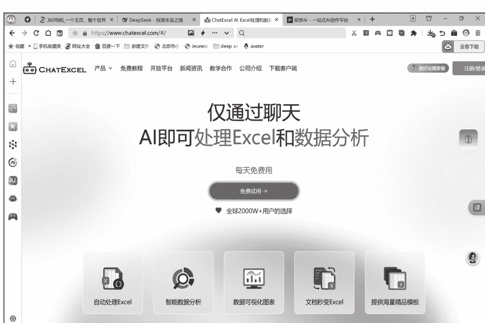

▲图3-47 ChatExcel登录界面

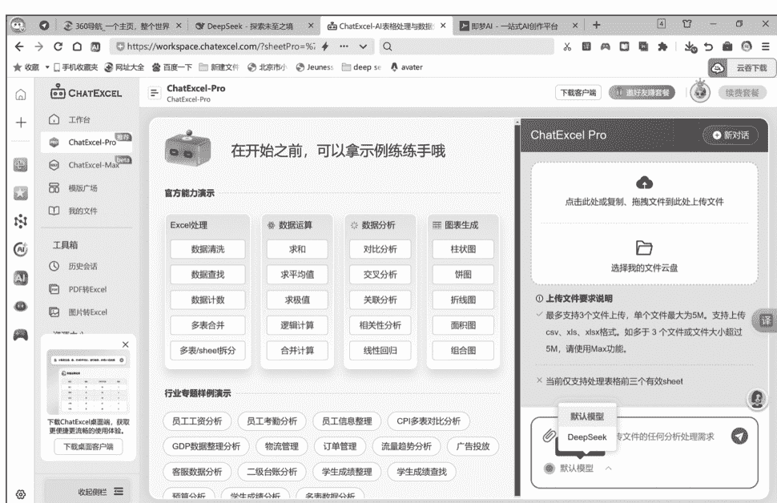

图3-48 ChatExcel演示页面

单击页面右下角的“默认模型”按钮，可看到DeepSeek已经嵌入。

## 3.7 本章小结

本章聚焦于在银行业务场景中如何设计有效的提示词，重点介绍了笔者独创的“三板斧”提示词法，帮助银行业务人员快速上手，向DeepSeek精准表达需求。本章还重点强调提示词需简洁明确、逻辑清晰、信息完整，同时避免隐私泄露、指令模糊等常见问题。通过“提问—优化—自生成”的动态交互方式，配合思维导图、PPT自动生成等工具，能帮助银行业务人员显著提升工作效率，让智能技术真正服务于业务场景。

# 第4章 DeepSeek对公业务场景应用

目前，银行的对公业务正处于服务模式转型的关键阶段。客户需求正快速从传统融资服务转向对综合金融服务的需求，这包括投资银行服务、交易银行业务、跨境金融服务等多个领域。行业竞争焦点已从争夺单一客户转变为构建产业链生态系统，特别是在高端制造和绿色能源等战略性行业，银行必须增强对产业链价值的洞察力和风险控制能力。同时，银行在数字化转型过程中面临越来越大的压力，一线业务人员在识别客户需求和应用数据资产方面的能力参差不齐。

银行对公业务面临的挑战体现在三个方面：第一，战略客户的分层标准与其真实价值贡献之间存在偏差，这导致资源分配效率不高；第二，银行的行业专业化服务能力难以满足产业链的复杂需求，这限制了基于场景的获客效果；第三，对公业务与零售业务之间的协同机制不完善，导致对客户综合价值的挖掘不够充分。借助DeepSeek智能需求解析引擎、产业链关系图谱、跨条线协同工具等技术模块，银行可以构建一个动态的客户价值评估体系，深入理解产业链的多级交易关系，并实现公私联动营销的闭环运营。

本章将深入探讨DeepSeek如何赋能银行提升对公业务的精准营销能力、产品创新效率以及跨境服务的安全性。我们将重点分析如何解决客户价值挖掘不足、供应链融资风险不可控、跨境资金管理效率低下等问题，以助力商业银行实现从“客户分层精细化”到“产品组合定制化”再到“风控管理穿透化”的全面转型升级。

## 4.1 对公客户营销与拓展

银行对公客户营销与拓展面临服务深度不足、生态协同薄弱等挑战，当前的痛点主要为客户分层执行偏差、生态营销能力不足、营销精准度低下等，银行需重点构建“分层管理-生态协同-精准营销”三位一体的服务体系。对公客户经理需强化客户价值智能评估、生态资源整合运营、需求洞察精准响应三项核心能力。

通过动态标签体系与智能营销平台，DeepSeek可帮助银行实现战略客户分层管理、行业生态圈营销、公私联动交叉销售等（如图4-1所示），并依托区块链技术建立不可篡改的客户交互存证链条，推动对公客户营销从传统单点服务模式向覆盖客户分层动态管理、生态场景嵌入、需求智能预判的精准营销闭环体系转型。

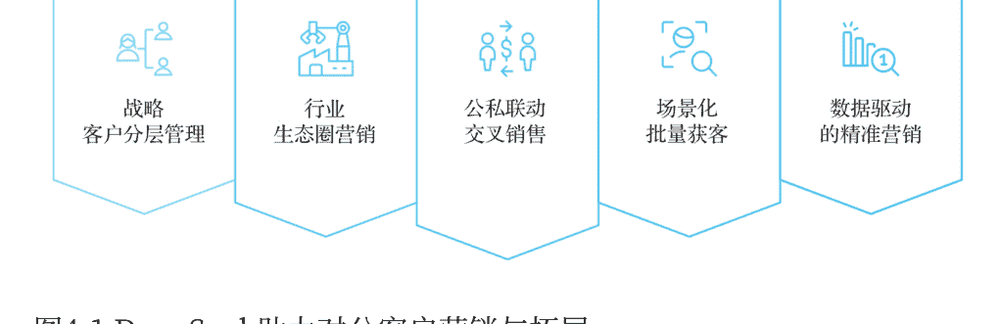

图4-1 DeepSeek助力对公客户营销与拓展

### 4.1.1 战略客户分层管理

#### 1. 场景介绍

战略客户分层管理是银行对公业务的核心环节，银行需根据客户规模、行业地位、合作潜力等维度划分优先级，制定差异化服务策略。银行业务人员需定期更新客户经营数据，分析财务健康度、供应链稳定性等动态指标，并匹配授信、结算、投行等综合服务方案。此项工作重点在于建立科学的评价体系，避免资源过度集中或遗漏高潜力客户，同时跨部门协调资源保障执行效率。

#### 2. DeepSeek提示词

角色+任务：我是对公客户经理，需构建制造业战略客户分层模型，应重点监控哪些动态经营指标？

#### 3. 追问提示词

- 行业景气度对客户分层的权重应如何量化？
- 如何评估客户供应链上下游的稳定性？
- 客户研发投入与市场占有率之间如何进行关联分析？
- 财务报表中哪些异常指标需设置预警阈值？

#### 4. 输出形式

指标权重表（Excel文件）、动态评分模型（Excel文件）、分析报告（含分层建议与配套产品清单）（Word文件）。

#### 5. 案例演示

说明：由于篇幅限制，自本章起，每章提供一个DeepSeek典型案例，其他场景则给出提示词和输出形式要求，由读者自行演练。

（1）DeepSeek提示词

角色+任务：我是银行对公客户经理，需构建制造业战略客户分层模型，应重点监控哪些动态经营指标？要求不编造、不臆测，符合银行实际业务场景，网页链接真实有效，严格按照监管要求执行。

（2）DeepSeek首次输出

作为银行对公客户经理，构建制造业战略客户分层模型时，需结合行业特性、企业经营动态及银行合规要求，重点关注以下动态经营指标。

##### 一、财务健康度与偿债能力

1. 营业收入与利润增长率

监控企业营业收入同比/环比增速及利润总额变化，这些指标能反映企业的市场竞争力与盈利能力。例如，2023年中国制造业营业收入同比增长1.3%，但利润总额同比下降2%，需警惕利润下滑企业的偿债风险。

现金流稳定性：关注经营活动现金流净额与净利润的匹配度，避免“纸面盈利”企业。

2. 资产负债率与流动比率

制造业企业普遍存在重资产特征，需控制资产负债率（如不超过60%）及流动比率（建议不低于1.5），防范流动性风险。

3. 利息覆盖倍数

衡量企业息税前利润对利息支出的覆盖能力，建议倍数不低于3，确保有还款能力。

##### 二、经营效率与供应链韧性

1. 订单量与交付周期

通过企业订单金额、合同履约率及交付周期（如智能生产线最快8秒响应订单）评估生产效率和客户黏性。

关注供应链风险，如原材料价格波动、供应商集中度等，可通过预判性跟进策略提前预警。

2. 存货周转率与应收账款周转率

高周转率反映库存管理和回款效率，避免资金占用。例如，服务型制造企业通过数字化技术缩短交付周期，降低库存积压。

3. 数字化投入与智能化水平

监测企业IT投资占比、智能工厂覆盖率（如国家级示范工厂421家）及工业互联网应用深度，数字化能力强的企业更具抗风险能力。

##### 三、行业景气度与政策导向

1. 行业细分景气指标

- 跟踪行业PMI、产能利用率及出口数据。例如，“新三样”（新能源汽车、锂电池、太阳能电池）2023年出口总额同比增长29.9%，相关企业可优先列为战略客户。
- 关注政策支持领域，如高端装备、半导体、军工等自主可控行业，以及绿色转型（如碳捕集技术）企业。

2. 市场份额与行业排名

头部企业（如注册资本千万元以上）在洗牌中更具优势，中小型企业需警惕同质化竞争导致的淘汰风险。

##### 四、合规与风险预警

1. 贷款资金用途合规性

严格监控贷款是否流向政策限制领域（如产能过剩行业），避免资金挪用（如转为承兑汇票保证金）导致的合规风险。

2. 环保与ESG表现

核查企业环保处罚记录、碳排放强度及ESG评级，绿色工厂（全国5095家）更易获得政策支持。

3. 客户流失预警

通过CRM系统分析互动频次、订单金额波动率（如季度下降30%则触发预警），及时介入高风险客户。

##### 五、动态数据整合与模型优化

1. 多源数据接入

整合企业征信、税务、海关、供应链平台数据（如ERP、MES系统数据），提升评估准确性。

2. 分层阈值设定

根据行业特性差异化设定指标阈值。例如：

- S级客户：年营收≥5亿元，数字化投入占比≥5%，订单增长率≥20%。
- A级客户：年营收1亿～5亿元，现金流稳定，行业排名前30%。

3. 实施建议

- 工具支持：利用CRM系统（如RFM模型、客户潜力指数）筛选高价值客户，嵌入AI预测模型评估客户生命周期价值（CLV）。
- 动态调整：每季度更新指标数据，结合行业趋势（如IDC预测的GenAI供应链、工业DataOps）优化模型。
- 合规底线：严格执行贷后管理，避免因考核压力导致员工违规揽储或放松风控。

通过对以上指标体系的动态监控与分层管理，可精准识别优质客户，平衡风险与收益，助力银行对公业务稳健增长。

（3）DeepSeek追问提示词

- 行业景气度对客户分层的权重应如何量化？
- 如何评估客户供应链上下游的稳定性？
- 客户研发投入与市场占有率之间如何进行关联分析？
- 财务报表中哪些异常指标需设置预警阈值？

（4）输出形式

Excel模板（含指标权重表、动态评分模型），用HTML格式输出，需要内嵌可直接下载Excel文件的按钮代码，实现一键下载。

Word分析报告（含分层建议与配套产品清单），用HTML格式输出，需要内嵌可直接下载Word文件的按钮代码，实现一键下载。

（5）DeepSeek再次输出

DeepSeek输出内容的截图如图4-2所示。

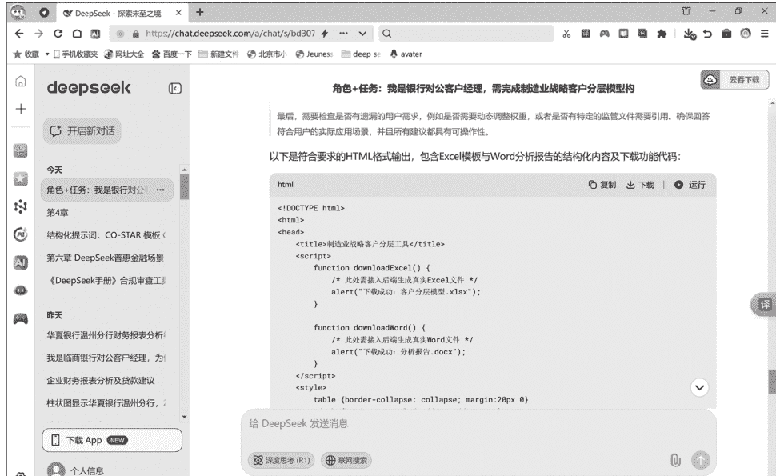

图4-2 DeepSeek输出的HTML格式代码

单击“运行”按钮，可获得战略客户分层模型Excel模板，如图4-3所示。

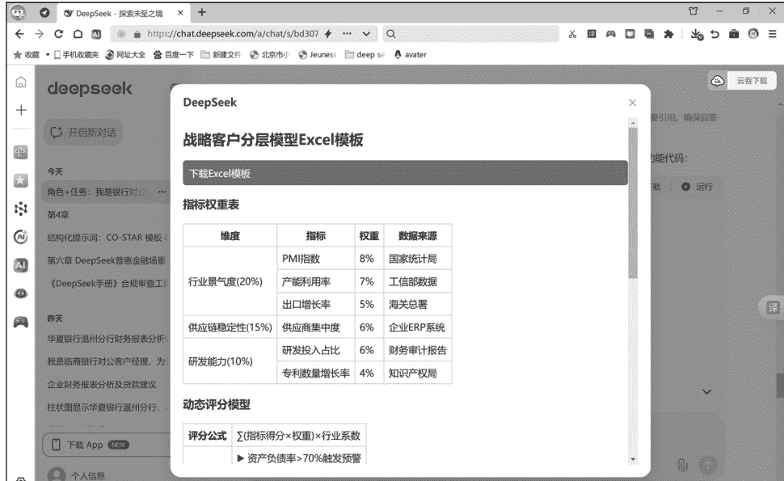

图4-3 可下载的战略客户分层模型Excel模板

下拉滚动条，可看到分析报告的Word模板，如图4-4所示。

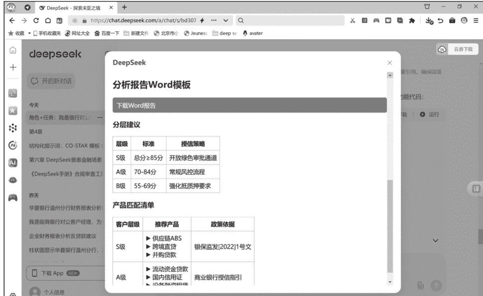

图4-4 可下载的分析报告Word模板

### 4.1.2 行业生态圈营销

#### 1. 场景介绍

银行依托DeepSeek搭建产业链数字服务网络，基于核心企业采购数据构建多级供应商准入评估模型，实现信用穿透式传导与交易溯源验证。客户团队协同法务部门制定智能合约驱动的动态确权协议，风险部门实时监控链属企业融资成本是否偏离阈值，并同步建立交易背景真实性交叉核验机制。

#### 2. DeepSeek提示词

角色+任务：我是客户经理，在规划新能源汽车产业链服务方案时，应如何设计供应商准入规则？

#### 3. 追问提示词

- 如何通过核心企业订单数据验证二级供应商交易的真实性？
- 如何科学设定不同层级供应商的利率梯度？
- 电池回收企业的专属风控模型应包含哪些指标？

#### 4. 输出形式

准入评分卡（Excel文件）、产业链图谱（Visio文件）。

### 4.1.3 公私联动交叉销售

#### 1. 场景介绍

公私联动交叉销售是银行综合金融服务的关键环节，银行需通过隐私计算技术实现客户数据合规共享，建立基于岗位职级与风险偏好的高管财富配置模型。客户经理需整合企业财报、资金流水等多源数据，联合零售团队设计智能营销看板，同步部署敏感信息脱敏机制与授权协议签署流程。此项工作重点在于平衡数据共享效率与合规边界，避免因服务边界模糊导致信息泄露，同时强化客户画像动态更新与产品组合适配能力。

#### 2. DeepSeek提示词

角色+任务：我是客户经理，要为拟上市公司高管设计综合服务方案，应整合哪些金融产品？

#### 3. 追问提示词

- 如何通过企业财报数据评估高管资产规模？
- 股权解禁周期如何与理财期限匹配？
- 跨境税务筹划方案需包含哪些合规要件？

#### 4. 输出形式

服务协议（Word文件）、税务测算表（Excel文件）。

### 4.1.4 场景化批量获客

#### 1. 场景介绍

场景化批量获客是银行生态营销的核心环节，银行需通过对接产业园区及电商平台的交易数据构建标准化风控模板库，运用区块链技术验证交易背景的真实性。客户经理需基于企业现金流特征与履约记录设计动态授信模型，风险团队需设置异常交易预警阈值与建立应急响应机制。此项工作重点在于优化数据采集颗粒度与模型泛化能力，避免因场景适配不足导致批量获客失效，同时强化对平台合作方的资质审查与数据安全防护能力。

#### 2. DeepSeek提示词

角色+任务：我是银行专业团队成员，在设计跨境电商批量授信方案时，需要注意哪些关键风控点？

#### 3. 追问提示词

- 如何验证平台交易流水与物流单据的匹配性？
- 海外仓库存估值模型应包含哪些参数？
- 汇率避险条款如何嵌入授信协议？

#### 4. 输出形式

风控参数矩阵（Excel文件）、产品手册。

### 4.1.5 数据驱动的精准营销

#### 1. 场景介绍

数据驱动的精准营销是银行数字化转型的核心环节，银行需整合客户招投标、资金流水等多维数据，搭建需求预测机器学习模型，设计基于关键行为特征的自动化营销触发规则。客户经理需通过跨系统数据治理平台定义动态客户价值标签，风险团队需部署实时决策引擎缩短营销响应周期。此项工作重点在于平衡模型预测精度与业务可解释性，避免因特征工程僵化导致营销策略失效，同时强化数据质量校验与客户隐私保护机制。

#### 2. DeepSeek提示词

角色+任务：我是客户经理，要构建基建行业保函需求预测模型，应选取哪些特征数据？

#### 3. 追问提示词

- 如何关联中标公告信息与历史保函记录？
- 项目进度延迟如何影响模型迭代？
- 关联企业担保链的识别方法有哪些？

#### 4. 输出形式

特征工程代码（Python）、可视化看板（BI系统）。

### 4.1.6 对公客户营销场景清单

- 客户需求深度访谈
- 产业链价值图谱绘制
- 供应商准入标准制定
- 公私产品组合设计
- 场景化批量授信实施
- 数据模型部署应用
- 客户关系定期维护
- 风险信号动态监控
- 服务方案迭代优化
- 客户价值重估审计

## 4.2 对公金融产品综合服务

银行对公金融产品综合服务面临同质化竞争加剧、需求响应滞后等挑战，当前的痛点主要为产品创新不足、响应机制僵化、组合风险对冲薄弱等，银行需重点构建“产品创新-需求响应-风险对冲”三位一体的服务体系，对公业务团队需强化产品智能设计、需求精准洞察、风险动态平衡三项核心能力。

通过动态定价引擎与智能服务系统，DeepSeek可帮助银行提供供应链金融方案定制、数字化支付结算、综合融资方案制定等服务（如图4-5所示）。银行可依托自然语言处理技术解析客户财报与业务合同，自动生成《综合金融服务方案建议书》，推动对公金融服务从传统单一产品推销模式向覆盖产业链深度服务、跨境实时清算、风险智能对冲的数字化综合服务模式转型。

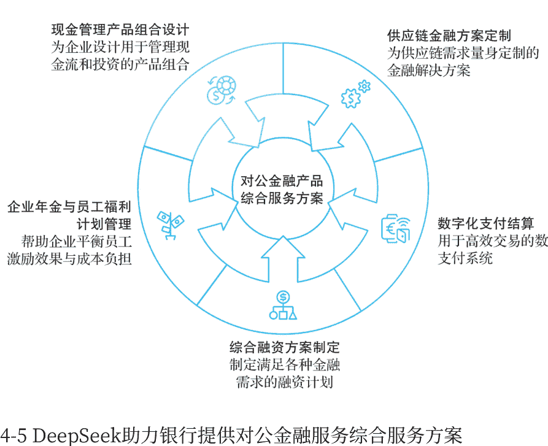

图4-5 DeepSeek助力银行提供对公金融服务综合服务方案

### 4.2.1 供应链金融方案定制

#### 1. 场景介绍

供应链金融方案定制是银行产融结合的核心环节，银行需基于核心企业信用穿透来设计多级融资方案，重点整合电子确权协议与供应商融资成本评估模型。客户经理需协调法务部门制定动态利率梯度规则，风险团队需验证订单资金流闭环的真实性与稳定性。此项工作重点在于平衡信用传导效率与风险敞口控制，避免因确权机制僵化导致资金流断裂，同时完善供应链数据实时验证与应急流动性支持机制。

#### 2. DeepSeek提示词

## 3.追问提示词

- 晶圆采购合同的电子签章如何实现法律效力？
- 设备抵押率如何随折旧率动态调整？
- 跨境关税担保条款需包含哪些核心要素？

## 4.输出形式

交易结构图（PDF文件）、利率梯度表（Excel文件）。

### 4.2.2 数字化支付结算

### 1.场景介绍

数字化支付结算是银行交易服务的核心环节，银行需根据支付时效性、汇率波动性等维度动态匹配跨境支付路径，测试SWIFT（环球同业银行金融电讯会）/CIPS（人民币跨境支付系统）通道兼容性并优化多币种清算算法。技术人员需为财务人员设计可视化操作界面，同步构建异常交易拦截规则与系统灾备方案。此项工作重点在于平衡通道性能与成本结构，避免因路由策略僵化导致支付失败率上升，同时增强汇率风险实时对冲与跨境合规校验能力。

### 2.DeepSeek提示词

角色+任务：我是银行技术人员，需优化跨境电商支付路由，应监控哪些关键指标？

### 3.追问提示词

- 如何根据汇率波动动态优化兑换时点？
- 异常交易拦截规则应包含哪些触发条件？
- 如何配置系统故障时的应急通道？

### 4.输出形式

API文档、UAT测试案例库。

### 4.2.3 综合融资方案制定

### 1.场景介绍

综合融资方案制定是银行结构化融资的核心环节，银行需整合债券发行、融资租赁等工具来设计分层还款计划，构建现金流覆盖模型以验证收入假设的合理性。产品经理需协调多部门制定还款触发条件与压力测试参数，法律团队需审核特许经营权质押估值方法的合规性。此项工作重点在于平衡融资结构灵活性与风险可控性，避免因现金流预测偏差引发还款违约，同时完善不可抗力条款的阈值界定与应急预案设计。

### 2.DeepSeek提示词

角色+任务：我是银行产品经理，需设计物流园区“项目贷+REITs”方案，应如何设置还款触发条件？

### 3.追问提示词

- 如何验证仓储周转率预测模型的准确性？
- 特许经营权质押估值应采用哪些方法？
- 不可抗力条款的触发阈值应如何界定？

### 4.输出形式

现金流模型（Excel文件）、条款说明书（Word文件）。

### 4.2.4 企业年金与员工福利计划管理

### 1.场景介绍

企业年金与员工福利计划管理是银行增值服务的核心环节，银行需设计税优型“股权+年金”组合方案，重点解决年金账户跨行转移与股权激励归属期衔接问题。产品经理需测算不同缴存比例对企业所得税的影响权重，合规团队需验证港股与A股上市企业方案设计的监管适配性。此项工作重点在于平衡员工激励效果与企业成本负担，避免因归属期规则僵化导致人才流失，同时增强股价波动对冲工具的性能与离职账户处理规则的嵌入能力。

### 2.DeepSeek提示词

角色+任务：我是银行产品经理，需设计科技企业“股权+年金”方案，如何设置归属期规则？

### 3.追问提示词

- 离职员工年金账户的处理需遵循哪些监管要求？
- 港股上市企业与A股上市企业在方案设计上有何差异？
- 股价波动对冲工具如何嵌入方案？

### 4.输出形式

法律协议（Word文件）、系统操作手册。

### 4.2.5 现金管理产品组合设计

### 1.场景介绍

现金管理产品组合设计是银行财资服务的核心环节，银行需为跨国集团设计跨境资金池架构，重点监控外汇敞口风险与净额结算的合规性。客户经理需分析企业资金周转特征，建立币种转换阈值动态模型，风险团队需设计监管报文自动生成逻辑与外汇对冲工具选择标准。此项工作重点在于平衡资金归集效率与监管合规要求，避免因汇率波动超阈值导致汇兑损失，同时增强双向资金调拨的税务成本优化能力。

### 2.DeepSeek提示词

角色+任务：我是客户经理，需优化制造业集团资金归集效率，应关注哪些核心指标？

### 3.追问提示词

- 跨境双向净额结算需满足哪些监管要求？
- 外汇对冲工具的选择标准有哪些？
- 如何设计监管报文自动生成逻辑？

### 4.输出形式

资金池架构图（Visio文件）、阈值计算表（Excel文件）。

### 4.2.6 对公金融产品综合服务场景清单

- ○客户需求诊断
- ○产品可行性论证
- ○供应链方案定制
- ○支付工具配置
- ○融资结构设计
- ○福利计划整合
- ○系统部署实施
- ○合规审查验证
- ○客户培训交付
- ○服务效果评估

## 4.3 尽职调查报告撰写

银行业务人员在撰写尽职调查报告时，常面临信息碎片化、风险穿透不足等挑战。当前的痛点主要为数据整合能力弱、风险评估维度单一、监管适配性不足等，银行需重点构建“数据整合-风险评估-监管适配”三位一体的撰写体系，尽调团队需强化多源数据智能融合、风险特征动态量化、ESG（环境、社会、治理）本土化适配三项核心能力。

通过智能风险评估模型与数据分析平台，DeepSeek可助力银行开展行业与市场分析、ESG专项评估、财务与非财务风险评估等活动（如图4-6所示）。银行可依托区块链技术建立不可篡改的尽调证据链条，推动尽职调查报告从传统人工汇编模式向覆盖数据智能关联、风险动态预警、监管穿透校验的数字化评估体系转型。

### 4.3.1 行业与市场分析

### 1.场景介绍

行业与市场分析是银行尽职调查的核心环节，银行需通过行业协会数据与政策文件，验证客户市场地位声明，识别技术替代风险与产能过剩的预警信号。风险经理需整合专利失效、技术迭代速率等非财务指标，建立行业竞争矩阵与政策冲击路径模型。此项工作重点在于平衡行业前景判断与客户实际竞争力，避免因信息滞后导致风险评估出现偏差，同时强化技术专利价值量化与政策敏感度分析能力。

### 2.DeepSeek提示词

角色+任务：我是客户经理，需完成锂电池隔膜行业分析，应聚焦哪些技术迭代风险？

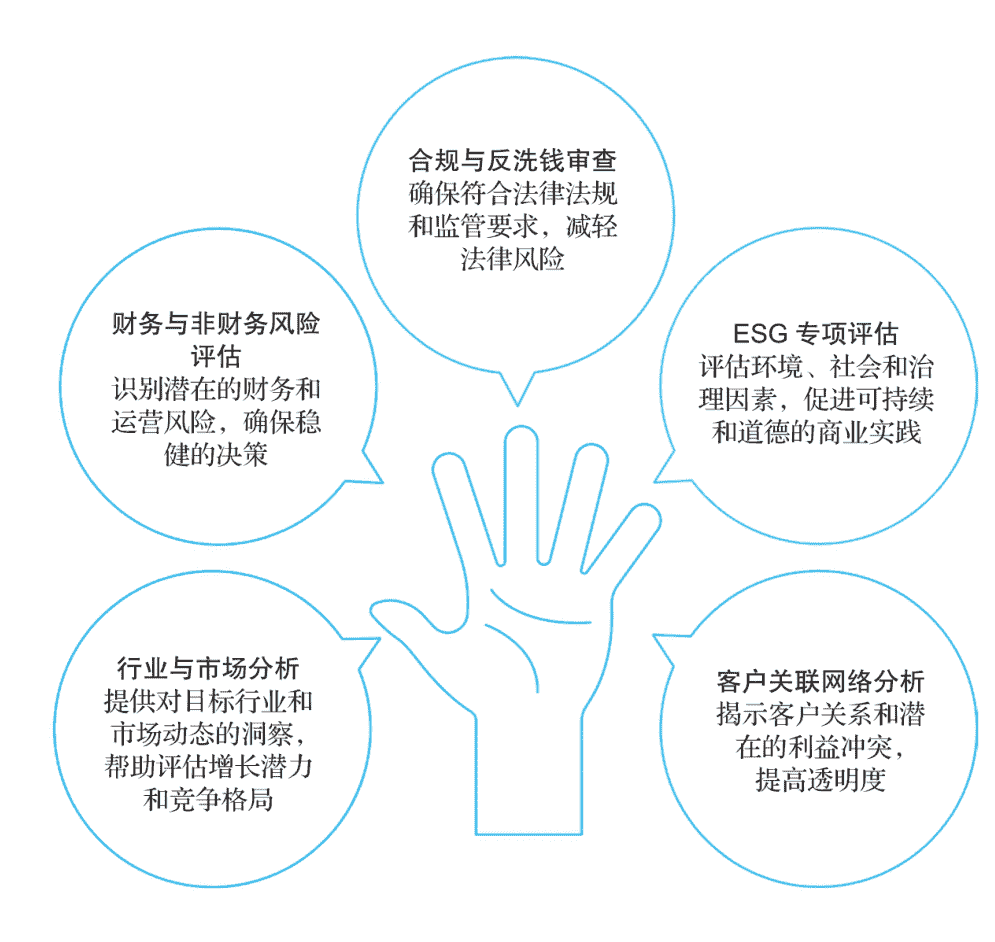

图4-6 DeepSeek助力尽职调查报告撰写

### 3.追问提示词

- 如何验证客户宣称的市场份额的可信度？
- 技术专利失效对行业格局的影响应如何评估？
- ○政策变动对产能利用率的冲击路径是什么？

### 4.输出形式

行业研究报告（Word文件）、竞争矩阵表（Excel文件）。

### 4.3.2 财务与非财务风险评估

### 1.场景介绍

财务与非财务风险评估是银行风控体系的核心环节，银行需通过物流单据核验、固定资产实地查验等手段穿透识别关联交易与表外负债。风险经理需构建应收账款周转异常检测模型，比对银行流水与合同单据的钩稽关系。此项工作重点在于平衡数据验证效率与核查深度，避免因表外负债遗漏导致风险敞口失控，同时完善高管个人账户异常往来行为筛查规则与法律约束机制。

### 2.DeepSeek提示词

角色+任务：我是银行风险经理，要发现应收账款周转异常，应排查哪些风险？

### 3.追问提示词

- ○如何通过物流单据验证销售收入的真实性？
- ○关联方交易定价偏离市场的合理范围应如何界定？
- ○如何筛查客户高管个人账户的异常往来行为？

### 4.输出形式

异常指标清单（Excel文件）、核查底稿（Word文件）。

### 4.3.3 合规与反洗钱审查

### 1.场景介绍

合规与反洗钱审查是银行监管适配的核心环节，银行需通过股权架构穿透工具识别多层嵌套关系，设计制裁名单动态比对与跨境资金流贸易背景核验机制。客户经理需整合转口贸易单据真实性验证规则，建立虚假贸易特征指标库。此项工作重点在于平衡审查效率与风险覆盖范围，避免因规则僵化导致异常交易漏检，同时完善关联企业循环交易识别算法及提高法律证据链固化能力。

### 2.DeepSeek提示词

角色+任务：我是客户经理，需排查大宗贸易洗钱风险，应关注哪些特征？

### 3.追问提示词

- 如何识别虚假贸易的常见手法？
- 验证转口贸易单据真实性的要点有哪些？
- 关联企业循环交易的特征指标应如何设定？

### 4.输出形式

审查报告、风险标签体系。

### 4.3.4 ESG专项评估

### 1.场景介绍

ESG专项评估是银行绿色金融的核心环节，银行需通过调取环保处罚记录并结合碳排放数据进行钩稽审查，验证企业的环境风险，并设计碳足迹追踪模型与社区投诉影响量化指标。风险经理需协调第三方机构核验危废处理合同的执行有效性，制定ESG改进建议的权重分配规则。此项工作重点在于平衡环境效益量化与商业可持续性，避免因标准模糊导致绿色认证失真，同时提高碳排放数据采集精度及增强社会风险动态监控能力。

### 2.DeepSeek提示词

角色+任务：我是风险经理，拟评估化工企业环境风险，应采集哪些数据？

### 3.追问提示词

- 如何验证危废处理合同的执行有效性？
- 碳排放数据与生产能耗的钩稽关系应如何审查？
- 社区投诉记录的分析维度有哪些？

### 4.输出形式

ESG评分卡（Excel文件）、改进建议书（Word文件）。

### 4.3.5 客户关联网络分析

### 1.场景介绍

客户关联网络分析是银行风险穿透的核心环节，银行需整合司法公告、招投标数据构建隐性关联方图谱，建立担保链预警指标与围标行为识别模型。风险建模人员需验证同一控制人企业股权代持协议的法律效力，设计供应链金融关联交易占比监控阈值。此项工作重点在于平衡网络挖掘深度与计算效率，避免因数据噪声导致误判，同时强化对关联交易定价偏离市场合理范围的动态识别能力。

### 2.DeepSeek提示词

角色+任务：我是风险建模人员，需识别建筑企业关联网络，应关注哪些信号？

### 3.追问提示词

- 如何通过招投标信息发现关联围标行为？
- 同一控制人的识别需采集哪些佐证材料？
- 如何监控供应链金融中的关联交易占比？

### 4.输出形式

关联网络图（Visio文件）、关联方台账（Excel文件）。

### 4.3.6 尽职调查场景清单

- 尽调立项审批
- 基础资料清单核验
- 行业竞争格局分析
- ○财务数据真实性审查
- ○非财务风险要素识别
- ○关联方网络图谱构建
- ○反洗钱合规核查
- ○ESG影响量化评估
- ○尽调报告交叉复核
- ○风险缓释方案跟踪

## 4.4 企业财务报表分析

银行企业财务报表分析面临表外风险隐蔽化、舞弊识别难度升级等挑战。当前的痛点主要为关联交易与隐性负债核查困难、行业特性适配不足、非结构化信息处理低效等，银行需重点构建“关联穿透-行业适配-智能解析”三位一体的分析体系，客户经理需增强隐性关联智能识别、行业特性动态建模、非结构化数据解析三项核心能力。

通过智能财务解析引擎与风险预警平台，DeepSeek可助力银行开展现金流预测与压力测试、财务比率同业分析、表外负债与或有风险识别等活动（如图4-7所示）。银行可依托区块链技术实现审计底稿交叉验证，推动财务分析从传统比率测算模式，向覆盖关联交易穿透、行业特性适配、经营实质验证的智能化决策支持体系转型。

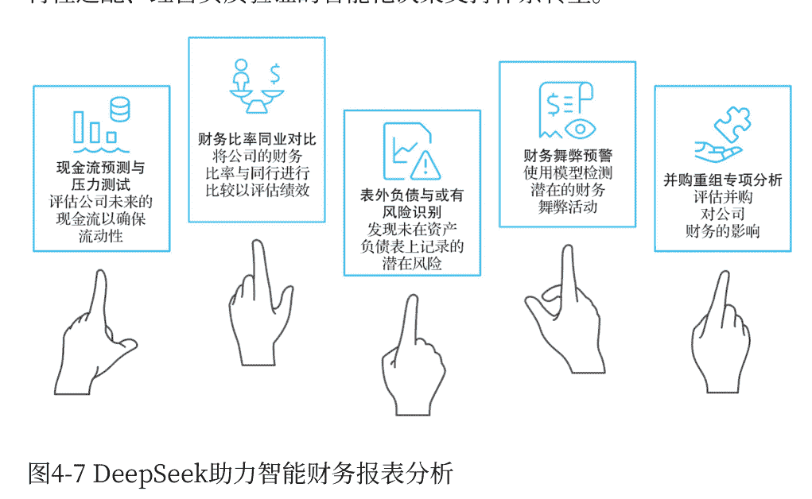

### 4.4.1 现金流预测与压力测试

### 1.场景介绍

现金流预测与压力测试是银行偿债能力评估的核心环节，银行需构建涵盖原材料价格波动、大客户流失等极端情景的测试模型，以验证收入假设与库存减值影响系数的合理性。风险经理需统筹设定环保处罚导致现金流中断的概率权重，设计客户集中度风险分级响应机制。此项工作重点在于平衡情景覆盖广度与模型实用性，避免因参数僵化导致压力测试失效，同时强化对行业特性的适配能力与对政策冲击路径的动态建模能力。

### 2.DeepSeek提示词

角色+任务：我是风险经理，需设计化工企业压力测试模型，应设置哪些参数？

### 3.追问提示词

- 如何量化原油价格波动对库存减值的影响系数？
- 环保处罚导致的现金流中断概率应如何评估？
- 客户集中度风险权重分配的依据是什么？

### 4.输出形式

情景参数表（Excel文件）、压力测试代码（Python）。

### 4.4.2 财务比率同业对比

### 1.场景介绍

财务比率同业对比是银行价值发现的核心环节，银行需通过清洗行业数据，剔除并购重组等异常样本，建立直销与经销模式对周转率的修正模型。客户经理需设计区域医保政策差异消除规则，验证研发费用资本化调整方法的合规性。此项工作重点在于平衡数据可比性与行业特性适配能力，避免因标准化过度导致分析结果失真，同时加强动态对标仪表盘的建设与实时数据更新机制的部署能力。

### 2.DeepSeek提示词

角色+任务：我是客户经理，在开展医疗器械企业流动比率对标分析，应如何筛选具有可比性的公司样本？

### 3.追问提示词

- 如何修正直销与经销模式对周转率的影响？
- 如何调整研发费用资本化差异？
- 如何消除区域医保政策差异对数据可比性的影响？

### 4.输出形式

可比公司清单（Excel文件）、动态对标仪表盘（BI系统）。

### 4.4.3 表外负债与或有风险识别

### 1.场景介绍

表外负债与或有风险识别是银行开展风险穿透分析的核心环节，银行需依托法院公告数据整合与担保链图谱可视化技术，评估PPP（政府与社会资本合作）项目中政府支付承诺的法律约束力。风险经理需设计保函续期频率与流动性风险之间的关联模型，验证供应商诉讼记录对企业经营的影响路径。此项工作重点在于平衡隐性负债识别效率与核查成本，避免因误读法律条款导致风险评估偏差，同时强化担保链动态追踪与兑现概率的量化能力。

### 2.DeepSeek提示词

角色+任务：我是风险经理，需排查建筑企业隐性负债，应关注哪些信号？

### 3.追问提示词

- 如何通过保函续期频率评估流动性风险？
- 供应商诉讼记录应如何与客户经营状况关联分析？
- 如何判定PPP项目政府支付承诺的法律约束力？

### 4.输出形式

担保链图谱（Visio文件）、法律意见书（Word文件）。

### 4.4.4 财务舞弊预警

### 1.场景介绍

财务舞弊预警是银行智能风控的核心环节，银行需结合坪效数据验证、物流单据差异核查等手段，完善收入确认异常检测算法。风险经理需构建会员活跃度与营收增长合理性分析框架，设计第三方回款占比动态监控阈值。此项工作重点在于平衡模型敏感度与误报率，避免因特征工程滞后导致新型舞弊行为被漏检，同时强化多源数据融合与异常交易模式自学习能力。

### 2.DeepSeek提示词

角色+任务：我是风险经理，需完善零售企业财务舞弊预警模型，应增加哪些非财务指标？

### 3.追问提示词

- 如何通过坪效数据验证门店收入的真实性？
- 如何分析会员活跃度与营收增长的合理性？
- 物流单据与库存变动的差异核查有哪些要点？

### 4.输出形式

预警指标库（Excel文件）、异常检测算法（Python）。

### 4.4.5 并购重组专项分析

### 1.场景介绍

并购重组专项分析是银行投行业务的核心环节。以医药企业为例，银行需通过量化临床试验失败对估值的影响权重，以及对专利悬崖期收入折现模型进行修正等方法，科学评估医药企业跨境并购估值。客户经理需设计地缘政治风险对供应链成本影响的评估维度，验证特许经营权质押估值方法的监管合规性。此项工作重点在于平衡协同效应预期与商誉减值风险，避免因折现模型僵化导致估值失真，同时强化对不可抗力条款触发阈值的动态界定能力。

### 2.DeepSeek提示词

角色+任务：我是客户经理，在分析医药企业跨境并购估值时，应关注哪些风险？

### 3.追问提示词

- 如何量化临床试验失败对估值的影响权重？
- 如何修正专利悬崖期收入折现模型？
- 地缘政治风险对供应链成本影响的评估维度有哪些？

### 4.输出形式

估值敏感性分析表（Excel文件）、交易结构说明书。

### 4.4.6 财务分析场景清单

- 基础财务数据采集
- 会计政策合规性审查
- 现金流预测模型构建
- 财务比率动态对标
- 表外负债穿透识别
- 财务舞弊风险预警
- 并购标的估值分析
- ○重大会计估计复核
- ○分析报告编制审核
- ○分析结果授信应用

## 4.5 授信审批管理

银行授信审批管理面临行业风险动态变化、绿色金融标准执行存在偏差等挑战。当前的痛点主要为行业授信模板僵化、绿色项目认定标准模糊、跨机构数据验证低效等。银行需重点构建“动态定价-行业适配-绿色穿透”三位一体的审批体系，授信审批团队需强化行业风险智能监测、环境效益量化评估、跨源数据穿透核验三项核心能力。

通过动态风险定价引擎与智能审批系统，DeepSeek可助力银行实现智能化审批，包括实施差异化授信、绿色信贷专项审批、联合授信管理等（如图4-8所示）。银行可依托区块链技术构建授信数据共享联盟链，推动授信审批从静态规则审批模式向覆盖行业风险预警、绿色标准穿透、数据多方验真的智能化决策体系转型。

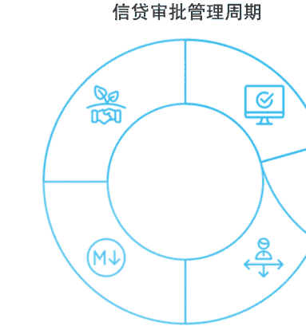

1. **实施差异化授信**
   制定适应不同客户需求的政策
2. **动态调整行业限额**
   根据市场动态调整行业限额
3. **绿色信贷专项审批**
   批准支持环境可持续性的信贷
4. **审批流程线上化**
   实施高效的在线审批流程
5. **联合授信管理**
   管理涉及多个贷款人的信贷

图4-8 DeepSeek助力银行智能化审批

### 4.5.1 实施差异化授信

### 1.场景介绍

实施差异化授信是银行制定授信策略的核心环节，银行需根据行业特性动态设定非财务指标评估体系，设计产能利用率、研发投入强度等差异化授信标准。风险管理部门需验证政府补贴可持续性的量化评估方法，协调制定结构化担保方案与授信限额重检流程。此项工作重点在于平衡指标的科学性与可操作性，避免因行业模板僵化导致授信失效，同时提升对专利技术商业化价值的量化能力，以及对研发团队稳定性的评估能力。

### 2.DeepSeek提示词

角色+任务：我是授信政策岗人员，在制定“专精特新”企业授信标准时，应设置哪些核心指标？

### 3.追问提示词

- 如何量化专利技术的商业化价值？
- 如何设计与验证研发团队的稳定性指标？
- 政府补贴可持续性的评估方法有哪些？

### 4.输出形式

指标评分卡（Excel文件）、政策指引（Word文件）。

## 动态调整行业限额

#### 1. 场景介绍

动态调整行业限额是银行风险防控的重要环节。以光伏行业为例，银行需建立政策信号跟踪机制（如硅料价格波动预警），设计压力测试触发阈值与光伏行业出货量预警模型。风险经理需量化因技术迭代导致的产能淘汰风险，验证限额测算模型与市场供需的匹配程度。此项工作重点在于平衡限额调整的灵敏度与稳定性，避免因调整滞后导致风险敞口扩大，同时强化海外贸易壁垒信号的提取能力与动态定价引擎的部署能力。

#### 2. DeepSeek提示词

角色+任务：我是风险经理，在建立光伏行业限额模型时，应监控哪些关键指标？

#### 3. 追问提示词

- 如何量化硅料价格波动对厂商偿债能力的影响？
- 如何提取海外贸易壁垒对出货量的预警信号？
- 技术迭代导致的产能淘汰风险应如何建模？

#### 4. 输出形式

限额测算模型（Excel文件）、调整建议书（Word文件）。

## 绿色信贷专项审批

#### 1. 场景介绍

绿色信贷专项审批是银行绿色金融落地的核心环节。以风电产业为例，银行需依据《绿色低碳转型产业指导目录（2024年版）》核查碳减排核算方法的合规性，调取第三方环评报告，验证风电项目环境效益数据。风险经理需设计生态修复保证金动态调整机制，建立环境风险“一票否决”的判定规则。此项工作重点在于平衡绿色认证的严谨性与审批效率，避免因标准模糊导致政策套利，同时强化碳足迹数据的全链条核验能力与对监管规则的智能适配能力。

#### 2. DeepSeek提示词

角色+任务：我是风险经理，在审核风电项目贷款时，应核查哪些文件？

#### 3. 追问提示词

- 如何验证环境影响评价报告的有效性？
- 碳减排量核算方法是否符合最新监管标准？
- 如何设计生态修复保证金机制？

#### 4. 输出形式

核查清单、评估报告（Word文件）。

## 审批流程线上化

#### 1. 场景介绍

审批流程线上化是银行数字化转型的核心环节，银行需通过OCR技术提取企业财报关键数据，设计资产负债率超阈值的自动跳闸规则与电子合同效力验证模块。风险经理需制定负面舆情信息抓取规则，优化系统间数据抓取失败的应急响应机制。此项工作重点在于平衡审批流程的自动化效率与风险可控性，避免因规则僵化导致误判，同时强化对电子签章法律效力的核验能力与并联审批的协同处理能力。

#### 2. DeepSeek提示词

角色+任务：我是风险经理，在设计制造业线上审批流程时，应如何设置自动规则？

#### 3. 追问提示词

- 如何设定负面舆情信息的抓取与推送规则？
- 系统间数据抓取失败时有哪些应急机制？
- 电子合同签署的合规性验证要点是什么？

#### 4. 输出形式

流程图（Visio文件）、UAT（用户验收测试）案例库。

## 联合授信管理

#### 1. 场景介绍

联合授信管理是银行同业协同的核心环节。以房地产行业为例，银行需整合央行征信数据与预售资金监管账户交易记录，建立房企土地抵押物跨行质押穿透核查机制。风险经理需设计交叉违约预警信号体系，验证关联企业非标融资信息获取路径的合规性。此项工作重点在于平衡信息共享效率与数据安全性，避免因多头融资监控滞后导致风险累积，同时提升银团贷款动态额度追踪与预警响应能力。

#### 2. DeepSeek提示词

角色+任务：我是风险经理，在建立房企联合授信监测体系时，应集成哪些数据源？

#### 3. 追问提示词

- 如何识别预售资金监管账户的异常交易行为？
- 如何穿透核查土地抵押物跨行质押？
- 获取关联企业非标融资信息的路径有哪些？

#### 4. 输出形式

监测看板（BI系统）、同业数据对接表（Excel文件）。

## 授信审批场景清单

- 行业政策研究
- 授信标准制定
- 客户资质预审
- 限额动态测算
- 绿色信贷专项评估
- 线上化审批实施
- 同业授信数据共享
- 授信合同电子签署
- 授信额度动态监控
- 授信政策定期复审

## 贷后管理

银行贷后管理面临资金挪用隐蔽化、抵质押物价值波动加剧等挑战，当前的痛点主要为资金流向监控不足、抵质押物动态跟踪不及时、风险预警碎片化等。银行需重点构建“流向穿透-价值监控-智能预警”三位一体的管理体系。贷后管理团队需增强资金闭环追踪、抵质押物动态估值、多源风险关联三项核心能力。

通过智能预警系统与穿透管理平台，DeepSeek可帮助银行实现风险预警信号监控、资金用途穿透式核查、抵质押物动态估值等（如图4-9所示）。银行可依托区块链技术实现押品权属登记与流转过程的不可篡改存证，推动贷后管理从人工抽样检查模式向覆盖资金全链穿透、押品智能盯市、风险实时联动的数字化风控体系转型。

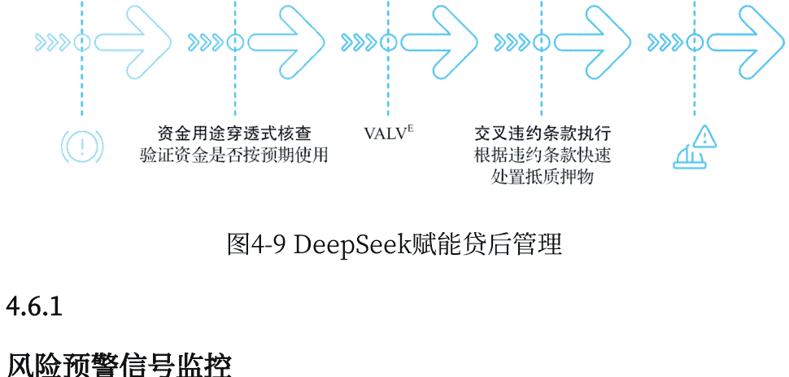

### 风险预警信号监控

#### 1. 场景介绍

风险预警信号监控是银行贷后管理的核心环节，银行需通过非财务指标（如用电量数据验证、供应商账期异常分析等）完善预警模型，设计环保处罚信息的量化纳入规则。风险经理需制定分级响应机制与风险热力图生成逻辑。此项工作重点在于平衡预警覆盖的广度与精准度，避免因指标冗余导致响应迟滞，同时提升生产真实性动态核验能力与舆情情感分析能力。

#### 2. DeepSeek提示词

角色+任务：我是风险经理，要完善制造业预警模型，应增加哪些非财务指标？

#### 3. 追问提示词

- 如何通过用电量数据验证生产真实性？
- 供应商账期异常缩短反映了哪些潜在风险？
- 如何将环保处罚信息量化纳入预警体系？

#### 4. 输出形式

预警指标库（Excel文件）、风险热力图（BI系统）。

### 资金用途穿透式核查

#### 1. 场景介绍

资金用途穿透式核查是银行合规管控的核心环节。以基建项目为例，银行需运用大数据工具追踪基建项目的资金流向，验证工程进度款支付的合理性与关联交易的合规性。风险经理需设计大额取现交易佐证材料清单，建立资金流与合同条款的智能匹配模型。此项工作重点在于平衡核查效率与穿透深度，避免因虚构贸易背景漏检导致合规风险，同时提升跨境资金链路溯源与电子证据固化能力。

#### 2. DeepSeek提示词

角色+任务：我是风险经理，在核查基建项目的资金流向时，应关注哪些异常特征？

#### 3. 追问提示词

- 如何验证工程进度款支付的合理性？
- 关联企业间资金往来的合规性判定标准有哪些？
- 大额取现交易需采集哪些佐证材料？

#### 4. 输出形式

资金流向追踪表（Excel文件）、核查报告（Word文件）。

### 抵质押物动态估值

#### 1. 场景介绍

抵质押物动态估值是银行押品管理的核心环节。以钢材为例，银行需通过实时抓取钢材价格与量化评估区域库存积压风险，设计质押物周转率下降预警阈值。风险经理需验证库存估值模型与市场行情的匹配度，协调客户经理提供资产状态的更新数据。此项工作重点在于平衡估值频率与运营成本，避免因价格波动超过阈值导致质押率不足，同时强化物联网监控数据的实时对接，提升智能补仓机制的设计能力。

#### 2. DeepSeek提示词

角色+任务：我是风险经理，在建立钢材库存动态估值模型时，应设置哪些参数？

#### 3. 追问提示词

- 如何获取实时钢材价格数据源？
- 如何量化评估区域库存积压风险？
- 如何设定质押物周转率下降的预警阈值？

#### 4. 输出形式

估值模型（Excel文件）、数据抓取代码（Python）。

### 交叉违约条款执行

#### 1. 场景介绍

交叉违约条款执行是银行风险处置的核心环节，银行需通过权威渠道获取同业违约证据，制定法律告知程序标准化模板并设立抵质押物快速处置通道。风险经理需验证合同的有效性及条款触发条件，协调法务团队完善处置预案。此项工作重点在于平衡条款执行效率与法律合规性，避免因证据链不完整导致纠纷，同时强化跨境抵质押物权属登记机制与区块链存证能力。

#### 2. DeepSeek提示词

角色+任务：我是风险经理，在执行交叉违约条款时，应核查哪些信息？

#### 3. 追问提示词

- 如何获取权威渠道的同业违约证据？
- 如何规范条款触发后的法律告知程序？
- 如何搭建抵质押物快速处置通道？

#### 4. 输出形式

违约证据清单（Word文件）、处置预案（PDF文件）。

### 行业风险联动管理

#### 1. 场景介绍

行业风险联动管理是银行系统性风控的核心环节。以房地产行业为例，银行需通过土地流拍频率分析、建材供应商偿债压力测试等手段构建房地产风险传导模型。风险经理需量化预售资金监管政策变动的影响权重，设计区域市场风险评级动态更新机制。此项工作重点在于平衡传导路径建模精度与响应速度，避免因行业评级滞后导致策略失效，同时增强产业链上下游数据穿透能力与政策敏感性预警能力。

#### 2. DeepSeek提示词

角色+任务：我是风险经理，在分析房地产行业风险传导路径时，应关注哪些节点？

#### 3. 追问提示词

- 如何量化房企危机对建材供应商的影响？
- 预售资金监管政策变动的风险评估方法有哪些？
- 土地流拍频率如何反映区域市场风险？

#### 4. 输出形式

风险传导图谱（Visio文件）、策略调整建议（Word文件）。

### 贷后管理场景清单

- 贷后定期巡检
- 资金流向穿透核查
- 抵质押物价值重估
- 交叉违约信号监测
- 行业风险传导分析
- 风险分类认定
- 预警客户分级处置
- 贷后报告编制
- 监管数据报送
- 档案信息更新

## 供应链金融

银行供应链金融面临信用传导阻断、动产监管失效、跨境协同不足等挑战，当前的痛点主要为信用穿透能力不足、仓单确权机制缺失、绿色认证标准模糊等。银行需重点构建“信用穿透-动产监管-绿色认证”三位一体的服务体系，供应链金融团队需增强信用多级传导、数字仓单全链追踪、环境效益智能核验三项核心能力。

通过区块链存证系统与智能风控平台，DeepSeek可帮助银行实现核心企业信用穿透、数字仓单融资、绿色供应链认证等（如图4-10所示）。银行可依托隐私计算技术实现跨境贸易数据合规共享，推动供应链金融从传统依赖主体信用的模式向覆盖信用智能穿透、动产精准监管、绿色价值量化的产融协同生态转型。

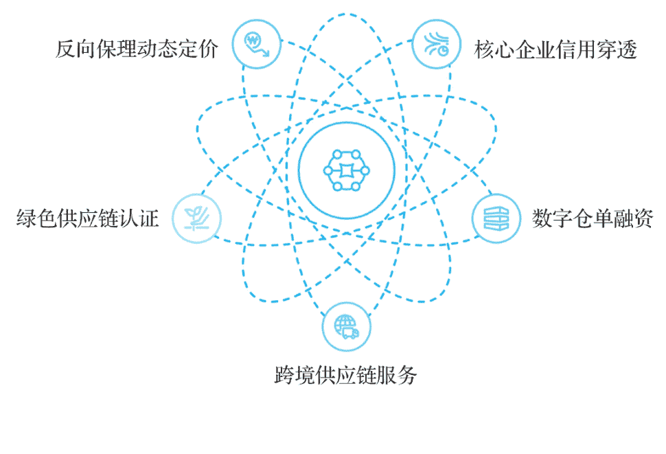

图4-10 DeepSeek助力供应链金融转型

### 核心企业信用穿透

#### 1. 场景介绍

核心企业信用穿透是银行供应链金融的核心环节，银行需基于核心企业订单数据设计多级供应商信用分配比例，建立动态确权协议与额度调整规则。客户经理需验证二级供应商订单的真实性，风险团队需评估利率溢价计算逻辑与法律效力保障措施。此项工作重点在于平衡信用传导效率与风险敞口控制，避免因层级划分僵化导致融资链断裂，同时提升区块链存证技术应用能力与回购承诺的法律约束力。

#### 2. DeepSeek提示词

角色+任务：我是客户经理，要为汽车主机厂设计三级供应商融资方案，应如何设定信用分配比例？

#### 3. 追问提示词

- 如何验证二级供应商订单的真实性？
- 如何计算不同层级供应商的利率溢价？
- 如何强化核心企业回购承诺的法律效力？

#### 4. 输出形式

信用分配矩阵（Excel文件）、确权协议模板（PDF文件）。

### 数字仓单融资

#### 1. 场景介绍

数字仓单融资是银行动产质押管理的核心环节。以将铝锭作为质押物为例，银行需通过物联网技术监控铝锭库存状态，制定价格波动预警阈值与智能补仓机制。风险经理需验证区块链防篡改技术的有效性，协调第三方监管机构接入实时数据。此项工作重点在于平衡货值评估精度与操作成本，避免因重复质押导致信用风险累积，同时强化质押物保险条款的嵌入机制以及与港口放货指令联动的响应能力。

#### 2. DeepSeek提示词

角色+任务：我是客户经理，在设计铝锭数字仓单融资方案时，应设置哪些风控参数？

#### 3. 追问提示词

- 如何通过区块链技术防止仓单被篡改？
- 如何动态调整价格波动预警阈值？
- 质押物保险条款如何嵌入合同？

#### 4. 输出形式

物联网监控接口文档、估值模型（Excel文件）。

### 跨境供应链服务

#### 1. 场景介绍

跨境供应链服务是银行落实国际化布局的核心环节，银行需整合境内仓单与境外信用证工具，设计多币种结算成本优化路径与贸易背景真实性核验规则。产品经理需验证境外采购合同与物流单据的一致性，风险团队需审查跨境担保品的法律适用性。此项工作重点在于平衡汇率风险对冲效率与合规成本，避免因单据差异导致支付延迟，同时强化跨境数据共享能力与多币种清算通道的兼容能力。

#### 2. DeepSeek提示词

角色+任务：我是银行产品经理，要为跨境电商设计供应链方案，应如何规避汇率风险？

#### 3. 追问提示词

- 如何验证境外采购合同与物流单据的一致性？
- 如何审查跨境担保品的法律适用性？
- 多币种结算成本的优化路径有哪些？

#### 4. 输出形式

交易结构图（PDF文件）、跨境合规审查清单。

### 绿色供应链认证

#### 1. 场景介绍

绿色供应链认证是银行ESG金融的核心环节。以有色金属冶炼行业为例，银行需通过对硅料生产环节碳排放数据的核验，以及供应商环保处罚记录的量化评估，设计绿色认证溢价转化模型。客户经理需协调企业完成碳足迹追踪表的填报，风险团队需验证认证材料的真实性。此项工作重点在于平衡环境效益与融资成本优化，避免因标准执行偏差导致绿色标签失真，同时强化第三方数据交叉验证与动态认证机制。

#### 2. DeepSeek提示词

角色+任务：我是客户经理，要为光伏产业链设计绿色认证方案，应采集哪些数据？

#### 3. 追问提示词

- 如何验证硅料生产环节的碳排放数据？
- 如何量化评估供应商环保处罚记录？
- 绿色认证溢价如何转化为融资优惠？

#### 4. 输出形式

碳足迹追踪表（Excel文件）、绿色认证操作手册。

### 反向保理动态定价

#### 1. 场景介绍

反向保理动态定价是银行供应链融资创新的核心环节，银行需基于核心企业付款历史数据与供应商财务状况预警信号，设计利率与账期挂钩的浮动定价模型。产品经理需验证账期缩短触发利率下调的合理性，风险团队需建立供应商信用评分动态更新机制。此项工作重点在于平衡融资成本与风险覆盖，避免因模型滞后导致定价失效，同时增强供应链数据实时接入与异常交易拦截能力。

#### 2. DeepSeek提示词

角色+任务：我是银行产品经理，要为家电企业设计动态定价模型，应监控哪些变量？

#### 3. 追问提示词

- 核心企业付款历史数据如何影响利率？
- 供应商财务状况恶化的预警信号有哪些？
- 账期缩短如何触发利率下调？

#### 4. 输出形式

动态定价算法（Python）、利率调整表（Excel文件）。

### 供应链金融场景清单

- 核心企业资质评估
- 多级信用穿透方案设计
- 数字仓单系统对接
- 跨境贸易背景审查
- 绿色供应链认证实施
- 动态定价模型部署
- 贷后质押物监控
- 供应商融资培训
- 风险事件应急处置
- 业务效果审计评估

## 跨境金融服务

银行跨境金融服务面临汇率波动加剧、合规校验复杂化等挑战，当前的痛点主要为合规审核效率低下、汇率风险对冲不足、收支结构优化滞后等。银行需重点构建“合规校验-风险对冲-结构优化”三位一体的服务体系，国际业务团队需增强监管规则动态适配、汇率敞口智能管理、跨境资金智能配置三项核心能力。

通过智能外汇系统与合规管理平台，DeepSeek可帮助银行实现汇率避险工具组合、跨境双向资金池搭建、海关数据直连通关等（如图4-11所示）。银行可依托区块链技术实现跨境交易单据的全流程存证核验，推动跨境金融服务从传统人工审批模式向覆盖合规即时校验、风险精准对冲、资金智能配置的数字化服务生态转型。

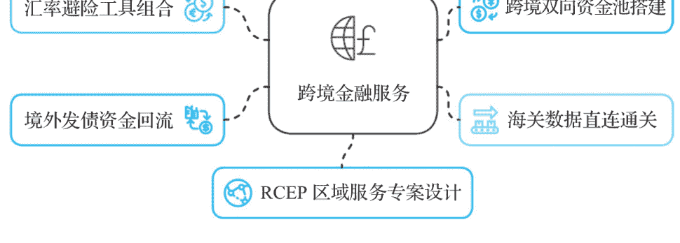

图4-11 DeepSeek助力跨境金融服务

### 汇率避险工具组合

#### 1. 场景介绍

汇率避险工具组合是银行外汇服务的核心环节，银行需根据企业外汇收支结构匹配远期结售汇与期权合约期限，设计跨境担保品抵押率动态调整规则。客户经理需验证现金流预测与对冲工具的匹配度，风险团队需审核套期保值合规性文件。此项工作重点在于平衡对冲成本与风险覆盖范围，避免因汇率波动超过阈值导致敞口失控，同时优化实时汇率算法模型，增强应急通道配置能力。

#### 2. DeepSeek提示词

角色+任务：我是客户经理，要为出口企业设计欧元避险方案，应选择哪些工具组合？

#### 3. 追问提示词

- 如何根据现金流预测匹配合约期限？
- 如何测算期权费成本与风险覆盖的平衡点？
- 如何设定跨境担保品抵押率？

#### 4. 输出形式

成本测算模型（Excel文件）、对冲方案书（PDF文件）。

### 跨境双向资金池搭建

#### 1. 场景介绍

跨境双向资金池搭建是银行财资管理的核心环节，银行需制定本外币头寸动态调整规则与净额结算备案材料清单，监控外债额度与汇率敞口对冲效果。客户经理需优化境外利润汇回税务成本模型，风险团队需验证资金调拨频率的监管合规性。此项工作重点在于平衡资金流动性效率与政策约束，避免因额度超限导致合规风险，同时强化多币种清算的时效保障能力与自动对冲触发机制。

#### 2. DeepSeek提示词

角色+任务：我是客户经理，需搭建亚太区资金池，应设置哪些监控指标？

#### 3. 追问提示词

- 跨境资金调拨频率应如何符合监管要求？
- 汇率敞口对冲工具应如何嵌入池架构？
- 如何优化境外利润汇回税务成本？

#### 4. 输出形式

资金池架构图（Visio文件）、外债额度监控表。

### 海关数据直连通关

#### 1. 场景介绍

海关数据直连通关是银行实现贸易金融数字化的核心环节，银行需通过API匹配报关单号与信用证条款，设定商品编码差异容忍阈值与虚假贸易特征识别规则。产品经理需验证AIS（自动识别系统）海运轨迹数据真实性，风险团队需构建异常交易拦截规则库。此项工作重点在于平衡通关效率与风险核验深度，避免因数据延迟导致支付中断，同时强化区块链存证与多部门数据协同能力。

#### 2. DeepSeek提示词

角色+任务：我是银行产品经理，在优化进口信用证核验流程时，应接入哪些数据？

#### 3. 追问提示词

- 如何匹配报关单号与信用证条款？
- 如何设定商品编码差异的容忍阈值？
- 虚假贸易的典型数据特征有哪些？

#### 4. 输出形式

API文档、异常交易识别规则库。

### 境外发债资金回流

#### 1. 场景介绍

境外发债资金回流是银行跨境资本管理的核心环节，银行需设计美元债资金结汇时点匹配模型与外债登记备案材料核验流程。产品经理需审核关联交易定价的合理性，风险团队需验证资金用途合规性证明文件。此项工作重点在于平衡回流效率与税务成本，避免因结汇时点误判导致汇兑损失，同时强化跨境支付路径的合规性与法律意见书的固化能力。

#### 2. DeepSeek提示词

## 3.追问提示词

- 如何准备外债登记备案材料？
- 资金结汇时点如何匹配用款需求？
- 关联交易定价如何避免税务风险？

## 4.输出形式

资金回流流程图、外债合规清单。

## 4.8.5

## RCEP区域服务专案设计

## 1.场景介绍

RCEP（《区域全面经济伙伴关系协定》）区域服务专案设计是银行推进区域化战略的核心环节，银行需整合原产地证明快速核验规则与货币直接结算通道，设计跨境纠纷解决机制的嵌入方案。客户经理需验证区域关税优惠条款适用性，风险团队需评估跨境担保中可能存在的法律冲突风险。此项工作重点在于平衡政策红利的有效利用与合规成本，避免因认证延迟导致贸易受阻，同时强化地缘政治风险预警能力与多语言合同适配能力。

## 2.DeepSeek提示词

角色+任务：我是客户经理，要为东盟跨境贸易设计融资方案，应整合哪些政策红利？

## 3.追问提示词

- 如何快速核验原产地证明？
- 如何搭建区域货币直接结算通道？
- 跨境纠纷解决机制如何嵌入合同？

## 4.输出形式

RCEP政策应用指南、跨境法律风险备忘录。

## 4.8.6

## 跨境金融场景清单

- 跨境需求诊断
- 汇率避险工具配置
- 资金池架构设计
- 海关数据直连实施
- 境外发债资金回流合规审查
- 区域政策专项服务
- 跨境税务筹划
- 监管报送自动化
- 客户跨境培训
- 业务持续优化

## 4.9

## 现金管理

银行现金管理面临流动性管控低效、跨境资金调度滞后等挑战，当前痛点主要为多银行账户协同不足、外汇敞口监控滞后、虚拟账户权限粗放等。银行需重点构建“账户协同-敞口管理-支付安全”三位一体的管理体系，现金管理团队需强化全量账户智能整合、汇率风险动态平衡、支付行为精准管控三项核心能力。

通过智能现金管理系统与外汇对冲平台，DeepSeek可帮助银行实现智能资金归集、流动性预测引擎搭建、支付工厂对接等，并依托区块链技术构建跨境支付指令的不可篡改存证链条，推动现金管理从传统手工操作模式向覆盖账户智能协同、风险实时对冲、支付精准溯源的数字化财资管理体系转型（如图4-12所示）。

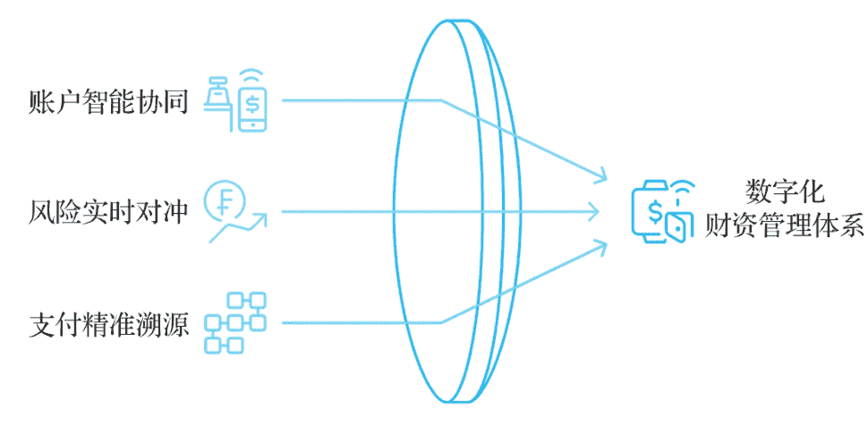

图4-12 DeepSeek推动银行向数字化财资管理体系转型

## 4.9.1

## 智能资金归集

## 1.场景介绍

智能资金归集是银行现金管理的核心环节，银行需基于企业账户现金流规律设计动态归集路径，设置备用金留存额度差异化规则，并构建系统故障应急保全机制。客户经理需验证门店销售额与归集频率的匹配度，风险团队需监控大额资金异常滞留情况，并设置相应的阈值。此项工作重点在于平衡归集效率与流动性安全，避免因规则僵化导致资金闲置，同时增强多层级账户架构的优化能力与实时数据反馈能力。

## 2.DeepSeek提示词

角色+任务：我是客户经理，要为连锁零售企业设计智能资金归集方案，应设置哪些规则？

## 3.追问提示词

- 如何根据门店销售额动态调整归集频率？
- 如何差异化设定备用金留存额度？
- 系统故障时的资金保全机制有哪些？

## 4.输出形式

归集流程图（Visio文件）、监控阈值表（Excel文件）。

## 4.9.2

## 流动性预测引擎搭建

## 1.场景介绍

流动性预测引擎搭建是银行风险预判的核心环节，银行需整合供应链账期变动参数与突发性支出概率模型，构建未来90天现金流缺口预警体系。风险经理需验证历史数据清洗规则的合理性，客户经理需协调企业完善收支计划的录入流程。此项工作重点在于平衡预测精度与模型复杂度，避免因关键变量遗漏导致误判，同时增强时间序列算法的迭代能力，提升BI可视化看板的部署效率。

## 2.DeepSeek提示词

角色+任务：我是风险经理，要为制造企业搭建流动性预测引擎，应选取哪些变量？

## 3.追问提示词

- 如何量化供应链账期变动对现金流的影响？
- 突发性设备维修支出如何纳入预测范围？
- 如何设定客户回款延迟的预警阈值？

## 4.输出形式

时间序列模型（Python）、预测看板（BI系统）。

## 4.9.3

## 支付工厂对接

## 1.场景介绍

支付工厂对接是银行支付效率优化的核心环节，银行需设计多支付渠道自动路由规则与大额支付复核机制，解决跨境时区差异导致的延迟问题。客户经理需验证API标准化程度，风险团队需监控可疑交易发生的频次与操作日志的完整性。此项工作重点在于平衡批量处理速度与风控要求，避免因系统超载导致交易失败，同时强化应急通道切换与异常支付溯源能力。

## 2.DeepSeek提示词

角色+任务：我是客户经理，要为电商平台对接支付工厂，应优化哪些流程？

## 3.追问提示词

- 如何实现不同支付渠道的自动路由？
- 大额支付复核机制如何平衡效率与安全？
- 如何应对跨境支付时区差异？

## 4.输出形式

API对接文档、异常支付日志模板。

## 4.9.4

## 跨境本外币池设计

## 1.场景介绍

跨境本外币池设计是银行汇率风险管理的核心环节，银行需根据利差变化动态调整币种头寸分布，设计汇率波动超过阈值后的自动对冲触发机制。风险经理需验证跨境净额结算备案材料的完整性，产品经理需优化外债额度监控模型。此项工作重点在于平衡资金利用效率与监管约束，避免因头寸配置失衡导致汇兑损失，同时强化多币种清算实时性与税务成本测算能力。

## 2.DeepSeek提示词

角色+任务：我是产品经理，要为跨国集团设计欧元-人民币资金池，应关注哪些参数？

## 3.追问提示词

- 如何根据利率差异动态调整币种头寸？
- 跨境净额结算的备案材料有哪些？
- 汇率波动超阈值如何自动触发对冲？

## 4.输出形式

池架构图（Visio文件）、外债额度监控表。

## 4.9.5

## 虚拟账户分层管理

## 1.场景介绍

虚拟账户分层管理是银行资金安全管控的核心环节，银行需通过权限矩阵与审批流设计实现PPP项目资金隔离，制定超额支付双重复核规则与临时账户存续期预警机制。客户经理需验证项目进度与付款节点的匹配度，风险团队需识别资金挪用的风险特征。此项工作重点在于平衡账户操作的灵活性与合规性，避免因权限分配粗放导致误操作，同时强化电子化审批流程的留痕能力与异常交易拦截能力。

## 2.DeepSeek提示词

角色+任务：我是客户经理，要为PPP项目设计虚拟账户体系，应设置哪些管控规则？

## 3.追问提示词

- 如何实现项目进度与付款节点的自动匹配？
- 如何设计超额支付的双重审批流程？
- 临时账户存续期到期预警机制有哪些？

## 4.输出形式

权限矩阵表（Excel文件）、审批流程图。

## 4.9.6

## 现金管理场景清单

- 资金归集规则制定
- 流动性预测模型构建
- 支付接口标准化对接
- 跨境资金池架构设计
- 虚拟账户权限配置
- 异常交易实时监控
- 资金报表自动生成
- 监管合规审查
- 客户操作培训
- 系统压力测试

## 4.10

## 贸易融资

银行贸易融资面临背景核验低效、虚假贸易识别不足等挑战，当前痛点主要为单据验证周期冗长、关联交易穿透困难、监管合规风险累积等。银行需重点构建“单据核验-交易穿透-合规管控”三位一体的风控体系，贸易金融团队需强化贸易数据智能整合、关联网络深度解析、监管规则动态适配三项核心能力。

通过智能风控系统与区块链存证平台，DeepSeek可帮助银行实现贸易单据链上固化、贸易背景智能核验、关联交易风险预警等功能（如图4-13所示）。银行可依托自然语言处理技术动态解析外汇管理政策生成合规审查清单，推动贸易融资从传统纸质单据审核模式向覆盖电子证据固化、交易实质穿透、监管即时校验的数字化风控体系转型。

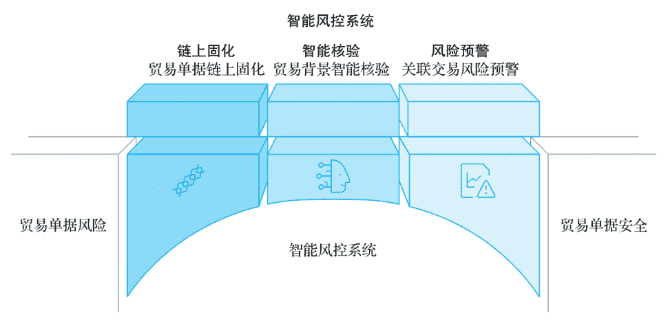

图4-13 DeepSeek赋能贸易融资

## 4.10.1

## 电子信用证区块链化

## 1.场景介绍

电子信用证区块链化是银行贸易金融创新的核心环节，银行需通过智能合约实现信用证条款自动校验与货物质检报告链上存证。客户经理需协调交易各方上链验证节点，风险团队需制定纠纷发生时的证据提取流程。此项工作重点在于平衡流程的自动化效率与法律效力，避免因节点遗漏导致兑付争议，同时强化区块链防篡改机制与跨境法律适配能力。

## 2.DeepSeek提示词

角色+任务：我是客户经理，要推动铁矿进口信用证上链，应设置哪些验证节点？

## 3.追问提示词

- 如何匹配提单信息与信用证条款？
- 如何设计货物质检报告上链存证流程？
- 发生纠纷时如何提取链上证据？

## 4.输出形式

智能合约代码示例、上链操作手册（PDF文件）。

## 4.10.2

## 跨境赊销风险缓释

## 1.场景介绍

跨境赊销风险缓释是银行出口金融的核心环节，银行需接入国际征信数据评估买方信用状况，制定保理融资比例与货物滞留港口处置条款。风险经理需验证国别风险溢价计算模型的合理性，客户经理需协调法律团队完善合同约束机制。此项工作重点在于平衡融资成本与风险覆盖范围，避免因买方资质误判导致坏账，同时强化物流数据核验能力与保险条款动态调整能力。

## 2.DeepSeek提示词

角色+任务：我是客户经理，要为机械出口商设计赊销方案，应设置哪些风控参数？

## 3.追问提示词

- 如何验证买方财报数据的真实性？
- 国别风险溢价如何计入融资成本？
- 如何约定货物滞留港口的处置条款？

## 4.输出形式

风险评分卡（Excel文件）、保险条款（Word文件）。

## 4.10.3

## 自贸区离岸转手买卖方案设计

## 1.场景介绍

自贸区离岸转手买卖是银行离岸金融的重要组成部分。以橡胶离岸为例，银行需通过AIS验证橡胶海运轨迹的真实性，设计仓单持有人变更追溯规则与汇率锁定工具嵌入方案。客户经理需协调三方数据核验交易背景，风险团队需构建虚假贸易特征识别模型。此项工作重点在于平衡融资效率与货权管控，避免因凭证缺失导致信用风险，同时强化跨境数据共享的合规性与多币种结算通道的兼容性。

## 2.DeepSeek提示词

角色+任务：我是客户经理，在设计橡胶离岸转口融资方案时，应采集哪些数据？

## 3.追问提示词

- 如何通过AIS验证海运轨迹？
- 如何追溯仓单持有人变更记录？
- 汇率锁定工具如何嵌入融资协议？

## 4.输出形式

物流数据核验规则库、交易结构图（PDF文件）。

## 4.10.4

## 绿色贸易融资

## 1.场景介绍

绿色贸易融资是银行可持续金融的重要组成部分，银行需依据绿色生产资质核验结果设计利率优惠挂钩机制，构建碳减排量折算模型与证书防伪验证规则。客户经理需协调第三方机构验证风电设备出口认证文件，风险团队需监控碳排放数据链式一致性。此项工作重点在于平衡环境效益与融资可行性，避免因认证造假导致政策套利，同时强化供应链碳足迹追踪与动态评级能力。

## 2.DeepSeek提示词

角色+任务：我是客户经理，在为风电设备出口设计绿色融资方案时，应关注哪些认证？

## 3.追问提示词

- 如何验证供应商的环保生产资质？
- 碳减排量如何折算为融资成本折扣？
- 绿色证书造假的风险防控措施有哪些？

## 4.输出形式

绿色认证清单、碳足迹计算模板。

## 4.10.5

## 数字提单质押融资

## 1.场景介绍

数字提单质押融资是银行货权管控的重要组成部分。以原油为例，银行需通过区块链技术实现原油提单的不可篡改存证，设计价格波动补仓机制与港口放货指令联动规则。风险经理需验证货值动态评估模型的准确性，客户经理需协调港口数据直连系统。此项工作重点在于平衡质押率灵活性与风险可控性，避免因系统延迟导致货权失控，同时强化物联网监控数据的实时接入与智能预警能力。

## 2.DeepSeek提示词

角色+任务：我是客户经理，需设计原油数字提单质押方案，应设置哪些管控点？

## 3.追问提示词

- 如何防止电子提单被恶意篡改？
- 价格波动导致质押率不足时应如何设计补仓机制？
- 港口放货指令如何与融资系统联动？

## 4.输出形式

区块链存证报告、货值监控看板。

## 4.10.6

## 贸易融资场景清单

- 贸易背景真实性审查
- 数字化单据处理
- 区块链信用证开立
- 跨境征信数据接入
- 离岸交易结构设计
- 绿色认证材料核验
- 电子提单质押登记
- 融资发放与货权管控
- 异常交易预警处置
- 业务后评价审计

## 4.11

## 反洗钱管理

银行反洗钱管理面临交易隐蔽性增强、跨境资金追踪困难等挑战，当前痛点主要为客户身份核验不足、合规规则更新滞后等（如图4-14所示）。银行需重点构建“身份核验-交易监测-合规管控”三位一体的管理体系，反洗钱团队需强化客户身份穿透识别、交易模式动态解析、监管规则智能适配三项核心能力。

通过智能监测系统与合规管理平台，DeepSeek可帮助银行实现受益所有人穿透识别、交易链智能追踪、高风险客户增强尽调等。银行可依托区块链技术构建跨境交易全链路存证链条，推动反洗钱管理从传统规则引擎模式向覆盖身份深度穿透、交易网络智能解析、监管即时响应的全链条智能风控体系转型。

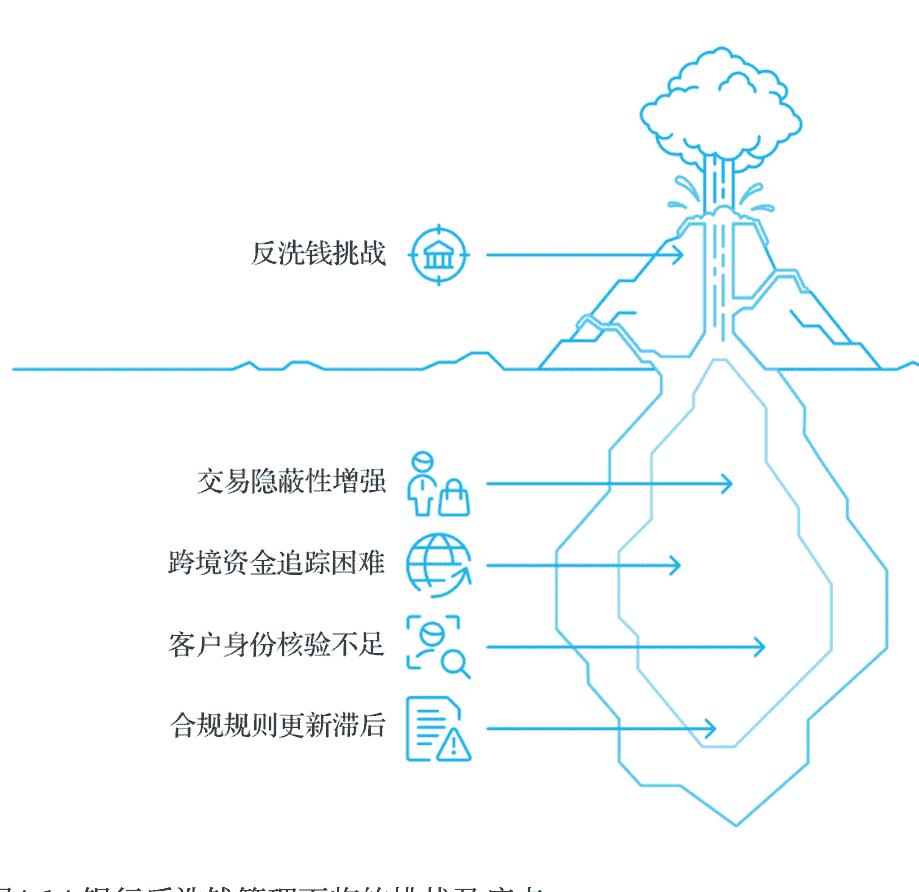

图4-14 银行反洗钱管理面临的挑战及痛点

## 4.11.1

## 受益所有人穿透识别

## 1.场景介绍

受益所有人穿透识别是银行反洗钱合规的核心环节，银行需通过审查VIE（可变利益实体）协议与代持协议的法律效力，追溯离岸架构企业的实际控制人。风险经理需整合工商数据与股权穿透工具，客户经理需协助提供客户声明文件。此项工作重点在于平衡核查效率与穿透深度，避免因证据链缺失导致合规漏洞，同时强化跨境数据获取能力与法律文书自动化生成机制。

## 2.DeepSeek提示词

角色+任务：我是风险经理，需核查离岸架构企业受益所有人，应采集哪些证据？

## 3.追问提示词

- 如何验证VIE协议控制关系的真实性？
- 如何审查代持协议的法律效力？
- 如何追溯境外上市公司实际控制人？

## 4.输出形式

股权穿透图（Visio文件）、受益所有人声明模板。

## 4.11.2

## 交易链智能追踪

## 1.场景介绍

交易链智能追踪是银行资金监控的核心环节，银行需通过图算法识别跨境电商资金闭环特征，制定同一IP地址操作多账户的判定标准与虚拟货币兑换痕迹筛查规则。风险经理需构建“买单报关”模式识别模型，设定交易层级预警阈值。此项工作重点在于平衡监测灵敏度与误报率，避免因规则僵化导致新型洗钱行为漏检，同时强化数据实时更新能力与交易网络可视化能力。

## 2.DeepSeek提示词

角色+任务：我是风险经理，需追踪跨境电商资金链，应关注哪些特征？

## 3.追问提示词

- 如何识别“买单报关”模式的资金闭环？
- 如何设定同一IP地址操作多账户的判定标准？
- 如何筛查虚拟货币兑换痕迹？

## 4.输出形式

交易网络可视化图谱、预警规则表（Excel文件）。

## 4.11.3

## 高风险客户增强尽调

## 1.场景介绍

高风险客户增强尽调是银行风险管控的核心环节。以珠宝批发客户为例，银行需通过核验珠宝采购发票、分析现金存款与销售额匹配度等手段完善尽调问题清单。风险经理需设计境外合同公证要件审查流程，客户经理需留存实地走访影像证据。此项工作重点在于平衡尽调强度与客户体验，避免因流程冗长导致业务流失，同时强化非结构化数据处理能力与风险信号自动化推送能力。

## 2.DeepSeek提示词

角色+任务：我是风险经理，要对珠宝批发客户实施增强尽调，应增加哪些核查项？

## 3.追问提示词

- 如何验证珠宝采购发票的真实性？
- 如何分析现金存款与销售额的匹配度？
- 境外采购合同的公证要件有哪些？

## 4.输出形式

增强尽调检查表、现场影像归档规范。

## 4.11.4

## 可疑交易模型迭代

## 1.场景介绍

可疑交易模型迭代是银行智能风控的核心环节，银行需通过提取虚拟钱包资金分层特征及分析法币兑换稳定币的行为，优化数字货币交易监测规则。风险经理需验证模型误报案例，客户经理需反馈新型可疑模式特征。此项工作重点在于平衡模型泛化能力与监管适配性，避免因特征滞后导致监测失效，同时强化自学习算法的应用效果与多源数据的融合能力。

## 2.DeepSeek提示词

角色+任务：我是风险经理，需优化数字货币相关交易监测模型，应增加哪些特征？

## 3.追问提示词

- 如何识别通过虚拟钱包进行的资金分层？
- 如何分析交易所充提币行为的时间规律？
- 如何设定法币与稳定币兑换的预警阈值？

## 4.输出形式

特征工程代码（Python）、模型迭代日志模板。

## 4.11.5

## 监管报送自动化

## 1.场景介绍

监管报送自动化是银行合规提效的核心环节，银行需通过数据清洗规则补全交易对手缺失信息，制定跨境汇款中转行录入规范，并构建误判交易的人工复核通道。风险经理需验证报文生成逻辑的合规性，客户经理需核验客户基础信息的完整性。此项工作重点在于平衡自动化处理效率与数据准确性，避免因系统错误导致监管处罚，同时强化数据质量校验机制与异常报文追溯能力。

## 2.DeepSeek提示词

角色+任务：我是风险经理，需构建大额交易自动报送系统，应设置哪些校验规则？

## 3.追问提示词

- 如何识别并补全缺失的交易对手信息？
- 如何规范录入跨境汇款中的中转行信息？
- 系统误判交易如何快速进行人工复核？

## 4.输出形式

监管报文生成模板、数据质量校验报告。

## 4.11.6

## 反洗钱场景清单

- 客户身份初次识别
- 受益所有人穿透核查
- 风险等级动态评定
- 交易链智能分析
- 高风险客户强化尽调
- 可疑交易模型训练
- 预警案例人工复核
- 监管数据自动生成
- 内外部检查应对
- 反洗钱培训考核

## 4.12

## 账户管理

银行账户管理面临滥用风险隐蔽化、合规操作低效等挑战，当前痛点主要为异常交易识别滞后、长期不动户清理低效、高风险账户监控不足等。银行需重点构建“智能监测-精准核查-合规管控”三位一体的管理体系，运营团队需强化账户行为动态预警、风险特征智能识别、监管规则精准执行三项核心能力。

通过智能监测系统与账户管理平台，DeepSeek可帮助银行实现账户分类分级管控、印鉴数字化管理、异常账户行为监测等，并依托图像识别技术实现电子验印精准核验，推动账户管理从传统人工操作模式向覆盖风险实时阻断、合规程序自动化、全生命周期追溯的智能化运营体系转型（如图4-15所示）。

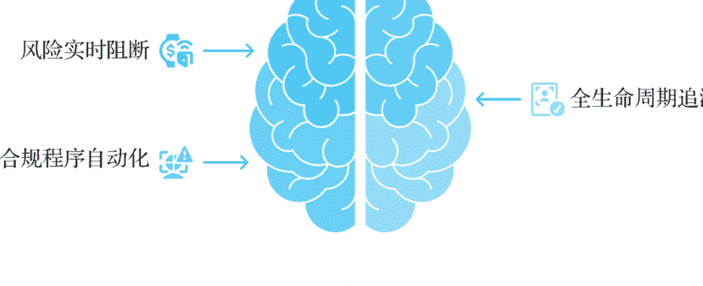

图4-15 DeepSeek助力银行构建智能化运营体系

## 4.12.1

## 账户分类分级管控

## 1.场景介绍

账户分类分级管控是银行风险防控的核心环节，银行需根据支付机构历史交易数据动态调整非柜面交易额度，设计夜间大额转账额外验证规则。风险经理需识别关联账户资金互转特征，客户经理需执行账户权限限制操作。此项工作重点在于平衡客户便利性与风险可控性，避免因分级僵化影响正常交易，同时强化账户行为模式学习能力与风险实时拦截能力。

## 2.DeepSeek提示词

角色+任务：我是风险经理，要为支付机构类账户制定分级规则，应设置哪些限制？

## 3.追问提示词

- 如何根据历史交易数据动态调整分级？
- 如何设计夜间大额转账的额外验证机制？
- 如何监控关联账户资金互转？

## 4.输出形式

账户权限矩阵表、分级操作手册。

## 4.12.2

## 印鉴数字化管理

## 1.场景介绍

印鉴数字化管理是银行安全升级的核心环节，银行需使用生物特征识别技术替代物理印鉴，设计多层级审批权限分配规则与系统故障应急验证方案。客户经理需推广电子印鉴授权协议，风险团队需验证数据存储的安全性。此项工作重点在于平衡电子印鉴的便捷性与防伪能力，避免因技术漏洞导致盗用风险，同时强化操作日志审计机制与多因子认证能力。

## 2.DeepSeek提示词

角色+任务：我是客户经理，要为集团客户推广电子印鉴，应解决哪些问题？

## 3.追问提示词

- 如何确保生物特征数据存储的安全性？
- 如何设置多层级审批的权限？
- 系统故障时的应急验证方案有哪些？

## 4.输出形式

电子印鉴授权协议、应急操作流程图。

## 4.12.3

## 异常账户行为监测

## 1.场景介绍

异常账户行为监测是银行反欺诈工作的核心环节，银行需通过登录地点突变分析、新设备首次登录验证等手段优化监测模型，设计交易IP地址容忍度动态调整规则。风险经理需构建正常加班付款的行为特征库，客户经理需开展客户防诈骗教育。此项工作重点在于平衡用户体验与风险拦截精度，避免因误判导致客户投诉，同时强化设备指纹识别能力与行为模式自学习能力。

## 2.DeepSeek提示词

角色+任务：我是风险经理，需优化夜间交易监测模型，应关注哪些特征？

## 3.追问提示词

- 如何区分正常加班付款与异常夜间交易？
- 如何强化新设备首次登录的验证机制？
- 对交易IP地址突变如何设定合理容忍度？

## 4.输出形式

特征权重表（Python）、异常行为案例库。

## 4.12.4

## 账户全生命周期管理

## 1.场景介绍

账户全生命周期管理是银行数字化运营的核心环节，银行需通过激活率考核指标推动长期不动户清理，设计销户前交易追溯期规则与失联客户公告程序。客户经理需验证零余额账户存续状态，风险团队需监控账户信息更新频率。此项工作重点在于平衡账户清理效率与客户权益保护，避免因误销户导致纠纷，同时强化自动化提醒机制与账户资料的电子化归档能力。

## 2.DeepSeek提示词

角色+任务：我是客户经理，需清理长期不动户，应遵循哪些流程？

## 3.追问提示词

- 如何验证账户余额为零的客户的存续状态？
- 如何设定销户前的历史交易追溯期？
- 客户失联情况下的公告程序有哪些？

## 4.输出形式

账户生命周期跟踪表、销户操作指引。

## 4.12.5

## 集团账户信息视图搭建

## 1.场景介绍

集团账户信息视图搭建是银行客户服务的核心环节，银行需通过API安全协议整合多银行账户数据，设计敏感信息脱敏展示规则与实时余额查询频次控制机制。客户经理需协调子公司授权数据查询，科技团队需验证数据标准化程度。此项工作重点在于平衡信息透明度与隐私保护力度，避免因数据泄露导致法律风险，同时强化跨机构数据协同能力与视图可视化定制能力。

## 2.DeepSeek提示词

角色+任务：银行在为跨国集团搭建账户信息视图时，应整合哪些数据？

## 3.追问提示词

- 如何实现多银行账户数据标准化？
- 如何制定敏感信息脱敏展示规则？
- 如何控制实时余额查询的频次？

## 4.输出形式

API安全协议文档、账户视图Demo原型。

## 4.12.6

## 账户管理场景清单

- 开户资料真实性审查
- 风险等级初始评定
- 账户功能权限配置
- 交易行为实时监测
- 印鉴数字化迁移
- 长期不动户清理
- 账户信息定期更新
- 集团账户视图维护
- 销户资料归档
- 账户管理审计

## 4.13

## 本章小结

本章聚焦DeepSeek在银行对公业务场景中的应用，涵盖对公客户营销与拓展、对公金融产品综合服务、尽职调查报告撰写、企业财务报表分析、授信审批管理、贷后管理等核心场景，通过智能评估、动态监控、区块链存证等技术，实现精准营销与风控闭环，助力银行提升业务效率、强化风险抵御能力，推动数字化转型与智能化升级。

# 第5章

# DeepSeek个人金融场景应用

银行个人金融业务正处于数字化转型的关键阶段，客户需求从单一产品向综合服务加速升级，服务模式呈现线上线下全渠道融合特征。在利率市场化与金融开放的背景下，同业竞争焦点从单一产品销售转向生态场景运营能力的较量，特别是在财富管理、消费金融等重点领域，银行亟须提升智能服务响应速度与精准需求匹配能力。业务人员面临数字化工具应用能力不足、跨渠道服务协同效率低等现实挑战。

银行个人金融业务的痛点主要体现在三个方面：首先，业务流程的数字化水平不足，导致服务过程出现断层，客户在申请房贷、认购理财产品等环节仍然需要在多个系统中重复输入信息；其次，生态场景的创新步伐缓慢，限制了客户价值的提升，例如数字人民币（e-CNY）的跨境支付和智能合约等新兴工具尚未实现规模化应用；最后，数据治理能力的不足影响了风险控制的实效性，客户资产负债的全面视图缺失，导致动态利率定价的准确性不足。

通过部署DeepSeek智能核验引擎、数字人民币生态开发平台以及客户价值管理模型，银行能够突破当前的限制，实现与公积金、税务等政务数据的对接，从而实现贷款自动核验。同时，银行应构建智能合约模板库以加速跨境支付场景的创新，并利用机器学习技术建立客户资金流动的动态预警机制。

本章将重点解析DeepSeek如何通过“智能核验-生态连接-价值深耕”三大核心能力重构个人金融业务价值链，有效解决服务效率低下、场景创新不足、风险识别滞后等关键问题，助力银行实现“客户旅程无缝化、场景生态开放化、风险管理前瞻化”的数字化转型目标。

## 5.1

## 住房按揭贷款

银行在住房按揭贷款业务领域正面临审批标准不统一、贷后管理滞后等挑战。当前的痛点主要为客户资质审查效率低下、贷款方案匹配的精准度不足以及风险动态监测机制缺失等。为了应对这些挑战，银行需要重点构建以“智能审批-动态风控”为核心的双核驱动服务体系。零售客户经理必须加强三项核心能力：对客户资质的多维评估、智能还款方案的匹配以及对抵押资产价值的追踪。

借助智能审批系统和贷后预警模型，DeepSeek能够帮助银行建立动态风险控制机制、实施智能审批、追踪抵押资产、匹配贷款方案、评估客户资质。此外，通过知识图谱技术，DeepSeek能够关联多方数据源，强化风险联防联控机制，提升银行住房按揭贷款业务全周期的管理效能（如图5-1所示）。

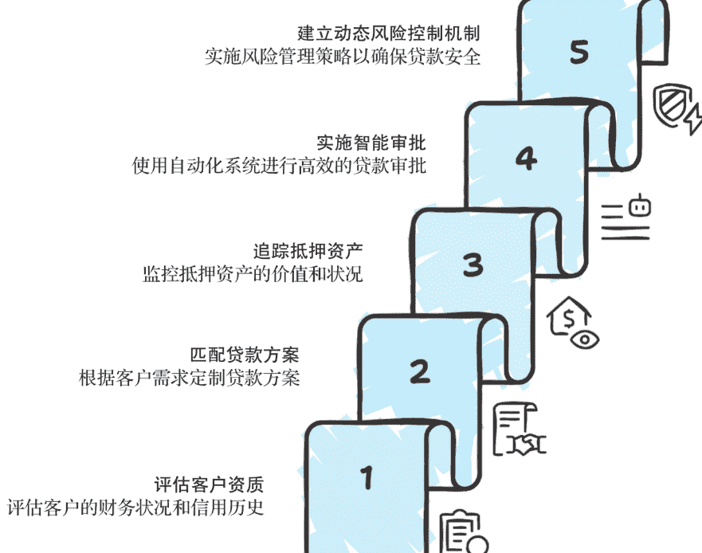

图5-1 DeepSeek提升银行住房按揭贷款业务全周期管理效能

## 5.1.1

## 首套房贷款

## 1.场景介绍

首套房贷款是银行住房金融的核心产品，银行需通过政务数据接口自动核验客户社保缴纳记录与购房资格，重点防范虚假流水与隐性负债风险。客户经理需设计差异化还款方案的智能匹配模型，并协同房产交易中心完成购房合同的链上存证。此项工作重点在于平衡审批效率与风险控制，避免因人工核验滞后导致业务积压，同时强化对异地工资流水真实性的交叉验证能力。

## 2.DeepSeek提示词

我是个人客户经理，客户提供异地工资流水，如何验证其真实性？请确保输出内容不编造、不臆测、符合银行实际场景，网页链接真实有效。输出形式为首套房资质审核清单（Excel模板），要求如下：在一个Excel表格里，标题为三号黑体字，居中；表头为四号宋体字；表中内容为四号楷体字。以HTML格式代码输出，并且能直接下载Excel文件。

## 3.输出内容

首先，DeepSeek生成可以复制、下载、运行的HTML格式代码，如图5-2所示。

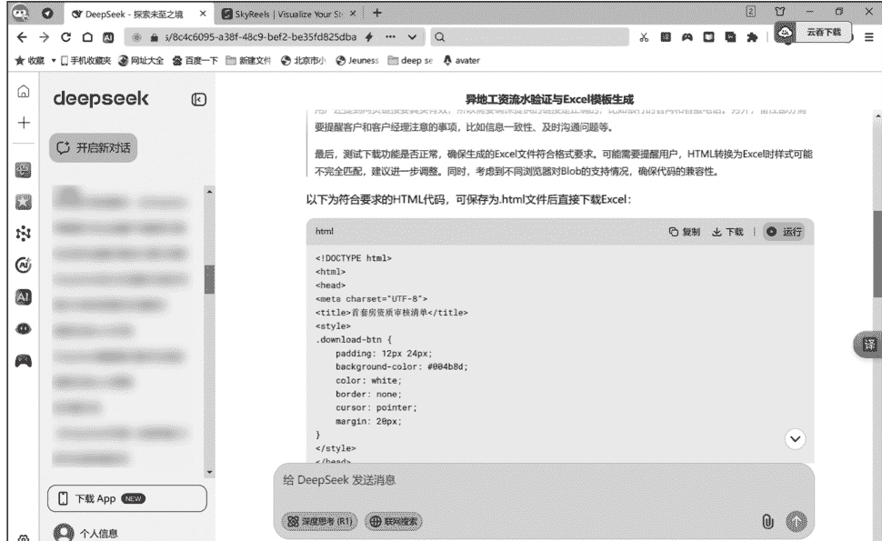

图5-2 DeepSeek直接生成HTML代码

然后，单击“运行”按钮，即可生成Excel文件，如图5-3所示。

最后，单击“下载Excel文件”按钮，即可将文件保存在本地。

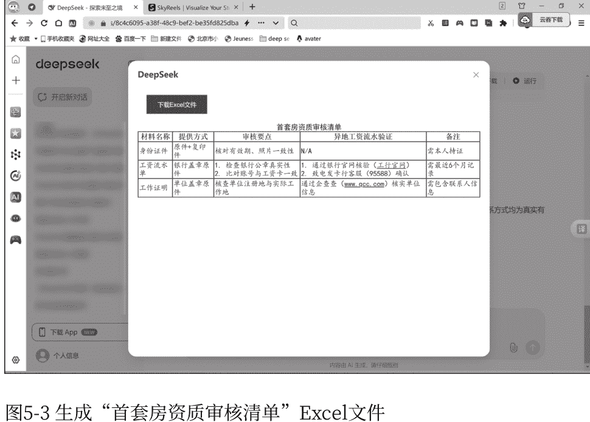

图5-3 生成“首套房资质审核清单”Excel文件

## 5.1.2

## 二手房按揭贷款

## 1.场景介绍

银行需通过区块链技术实现资金冻结与过户登记的智能联动，重点构建评估价与成交价一致性的核验模型。风险部门需部署资金划付触发条件规则库，实时捕捉买卖双方账户变更信号。此项工作重点在于平衡交易效率与资金安全，避免因信息孤岛导致资金挪用风险，同时强化对阶段性担保解除条件的动态判定能力。

## 2.DeepSeek提示词

角色+任务：我是零售客户经理，需优化二手房贷款流程，应设置哪些资金管控节点？

## 3.追问提示词

- 如何验证评估价与成交价的一致性？
- 如何实时捕捉买卖双方的账户变更信号？
- 如何设定阶段性担保解除条件？

## 4.输出形式

资金监管协议模板、交易进度跟踪表。

## 5.1.3

## 公积金组合贷款

## 1.场景介绍

银行需打通公积金系统与商业贷款审批通道，重点解决异地缴存基数验证与利率差异波动预警问题。客户经理需构建双线审批数据共享机制，实时监控公积金额度变动对还款计划的影响权重。此项工作重点在于平衡服务便捷性与风险可控性，避免因数据延迟导致补充比例计算出现偏差，同时强化对跨区域账户有效性的自动核验能力。

## 2.DeepSeek提示词

角色+任务：我是零售客户经理，需处理组合贷款申请，应同步采集哪些数据？

## 3.追问提示词

- 如何处理公积金缴存基数与银行流水差异？
- 如何验证异地公积金账户的有效性？
- 如何提前告知利率差异导致的月供波动？

## 4.输出形式

公积金数据对接清单、还款计划模拟器。

## 5.1.4

## 利率调整服务

## 1.场景介绍

利率调整服务是银行客户权益管理的核心内容，银行需通过机器学习模型预测客户的利率转换偏好，重点部署LPR（贷款市场报价利率）变动的多渠道即时触达系统。风险部门需构建重定价日冲突的智能解决方案库，自动校验历史还款记录异常对转换资格的影响。此项工作重点在于平衡响应速度与合规要求，避免因人工操作失误导致转换滞后，同时强化对利率模式选择法律效力的核验能力。

## 2.DeepSeek提示词

角色+任务：我是零售客户经理，在处理客户利率转换申请时，应核查哪些要素？

## 3.追问提示词

- 如何验证客户选择的利率模式的合规性？
- 历史还款记录异常如何影响转换？
- 重定价日冲突的解决方案有哪些？

## 4.输出形式

利率转换确认书模板、客户告知记录表。

## 5.1.5

## 线上预审与智能还款

## 1.场景介绍

线上预审与智能还款是银行数字化服务的核心能力，银行需通过OCR技术自动提取房产证关键字段，重点构建收入流水与负债比的动态评估算法。风险部门需开发还款行为预测模型，并为高频提前还款客户设置预约容量弹性扩容机制。此项工作重点在于平衡自动化效率与风险识别精度，避免因材料识别有误导致预审失效，同时强化逾期预警阈值与客户行为模式之间的关联分析能力。

## 2.DeepSeek提示词

角色+任务：我是零售客户经理，在优化线上预审系统时，应强化哪些功能？

## 3.追问提示词

- 如何通过OCR技术自动提取房产证信息？
- 如何设计收入流水分析与负债比的智能评估算法？
- 如何规划提前还款预约系统的容量？

## 4.输出形式

OCR识别规则库、还款行为分析看板。

## 5.1.6

## 住房按揭贷款场景清单

- 客户需求初步诊断
- 预审材料数字化采集
- 政务数据交叉核验
- 差异化首付比例测算
- 利率方案智能匹配
- 电子合同在线签署
- 抵押登记协同办理
- 放款条件动态监控
- 贷后还款行为分析
- 客户服务满意度回访

## 5.2

## 数字人民币推广

银行在数字人民币的推广过程中，面临场景建设滞后、客户使用习惯培养困难、风险防控机制不完善等挑战，需重点构建“场景+生态”服务体系。理财客户经理需掌握智能合约配置、硬钱包管理等新型服务能力。通过数字钱包智能开通工具与场景生态构建能力，DeepSeek可以帮助银行实现数字钱包开立与升级、智能合约应用、跨境支付与硬钱包管理、民生缴费等，助力数字人民币推广（如图5-4所示）。

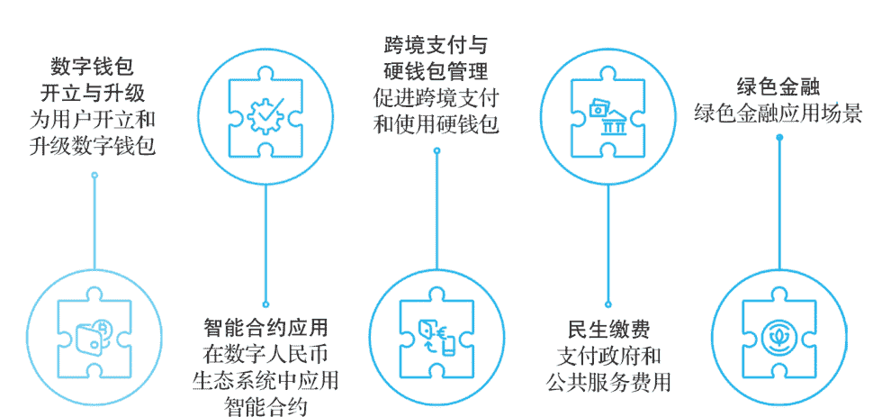

## 5.2.1

## 数字钱包开立与升级

## 1.场景介绍

数字钱包开立与升级是银行数字人民币推广工作的核心环节，银行需借助生物识别技术落实分级管理要求，重点设计面向特殊群体的辅助操作流程。大堂经理需部署多重身份核验工具链，动态判定钱包升级条件与权限范围。此项工作重点在于平衡客户体验与合规管控，避免因核验流程冗长导致业务流失，同时强化对匿名钱包限额的实时监测与违规交易拦截能力。

## 2.DeepSeek提示词

角色+任务：我是大堂经理，需规范数字钱包开立流程，应设置哪些必要核验环节？

## 3.追问提示词

- 如何多重验证客户身份的真实性？
- 如何辅助特殊群体完成操作？
- 如何判定是否满足钱包升级条件？

## 4.输出形式

操作流程标准（Word文件）、身份核验清单（Excel文件）。

## 5.2.2

## 智能合约应用

## 1.场景介绍

智能合约应用是银行推动场景金融创新的核心环节，银行需构建租房押金托管等标准模板库，重点接入物联网设备，实现房屋状态自动上报。法律合规岗需设计仲裁机构数据对接接口，完善合约到期后资金自动返还的触发逻辑。此项工作重点在于平衡场景适配性与法律约束力，避免因条款表述模糊导致执行争议，同时强化合约模板的可视化编辑与条款合规性的批量校验能力。

## 2.DeepSeek提示词

角色+任务：我是理财客户经理，要设计租房押金智能合约，应设置哪些触发条件？

## 3.追问提示词

- 如何通过物联网设备自动上报房屋状态？
- 发生争议时如何接入仲裁机构数据？
- 如何设定合约到期后的资金自动返还规则？

## 4.输出形式

智能合约逻辑流程图、法律条款附录。

## 5.2.3

## 跨境支付与硬钱包管理

## 1.场景介绍

跨境支付与硬钱包管理是银行实现国际业务数字化的核心环节，银行需通过智能路由引擎优化外汇申报报文的转换逻辑，重点构建硬钱包遗失应急处理预案。国际业务部需动态适配外汇管制政策的变化，验证交易背景真实性审查规则的穿透效力。此项工作重点在于平衡支付效率与合规成本，避免因报文标准化程度不足导致清算延迟，同时强化海关数据核验与风险评级的联动能力。

## 2.DeepSeek提示词

角色+任务：我是国际业务部人员，需优化跨境支付流程，应设置哪些验证节点？

## 3.追问提示词

- 硬钱包遗失如何应急处理？
- 如何动态适配外汇管制政策？
- 交易报文如何进行标准化转换？

## 4.输出形式

操作流程图（Visio文件）、申报材料清单（Excel文件）。

## 5.2.4

## 民生缴费

## 1.场景介绍

民生缴费是银行场景生态建设的核心内容，银行需通过API直连水务、电力、燃气等民生缴费系统，重点设计电子发票的自动推送与错缴资金的原路退回机制。运营岗需配置账单周期智能提醒模型，实现资金划转与账单核验的闭环管理。此项工作重点在于平衡服务覆盖的广度与操作的安全性，避免因接口不稳定导致缴费失败，同时强化民生数据治理能力与异常交易回溯分析能力。

## 2.DeepSeek提示词

角色+任务：我是零售客户经理，需优化缴费场景，应打通哪些民生缴费系统接口？

## 3.追问提示词

- 如何为账单周期设置智能提醒？
- 电子发票如何自动推送至客户App？
- 错缴资金如何原路退回？

## 4.输出形式

缴费场景对接清单（Excel文件）、异常处理手册（Word文件）。

## 5.2.5

## 绿色金融（个人碳账户）

## 1.场景介绍

绿色金融是银行ESG战略的核心内容，银行需通过物联网设备采集步行、骑行等行为数据，重点构建碳减排量的科学折算模型与防“薅羊毛”机制。产品经理需设计第三方平台数据的安全接入标准，动态调整积分过期规则与奖励发放比例。此项工作重点在于平衡激励机制的吸引力与成本的可控性，避免因数据失真导致绿色标签滥用，同时强化碳积分发放的合规校验机制，确保符合监管要求。

## 2.DeepSeek提示词

角色+任务：我是个人业务产品经理，要构建激励体系，应设置哪些行为分类？

## 3.追问提示词

- 如何科学折算不同场景的碳减排量？
- 如何设计积分过期机制与防“薅羊毛”机制？
- 第三方平台数据如何安全接入？

## 4.输出形式

绿色行为分类标准（Word文件）、个人碳积分规则库（Excel文件）。

## 5.2.6

## 数字人民币推广场景清单

- 客户身份初次验证
- 钱包等级智能匹配
- 跨境支付通道配置
- 智能合约模板部署
- 政务系统支付对接
- 线下场景终端改造
- 绿色消费行为追踪
- 异常交易实时阻断
- 客户使用行为分析
- 监管数据自动报送

## 5.3

## 消费贷款

银行在消费贷款场景中面临真实性审查不足、资金流向监控滞后、动态风险评估机制缺失等挑战，需重点构建“全流程+智能化”的风控体系。零售客户经理需掌握贷款用途追踪、多源数据交叉验证等新型管理能力。通过智能场景验证工具与资金流向追踪系统，DeepSeek可以帮助银行实现全流程风控、交易背景自动核查、资金路径实时穿透、风险预警阈值动态调整等（如图5-5所示）。

## 5.3.1

## 装修、教育、医疗分期贷款

## 1.场景介绍

装修、教育、医疗分期贷款是银行场景化消费金融的重要产品，银行需通过智能影像识别技术核验装修合同、入学通知书等场景凭证的真实性，重点构建分阶段资金释放规则库。授信审批岗需配置交易数据与申请场景的智能匹配模型，动态监控教育机构退费与还款计划的关联性。此项工作重点在于平衡场景真实性核验与审批效率，避免因凭证核验滞后导致资金挪用风险，同时强化医疗分期贷款与诊疗进度之间的自动化匹配能力。

### 5.3.2 线上信用贷

#### 1. 场景介绍

线上信用贷是银行消费贷款的核心产品，银行需基于设备指纹识别与生物特征验证技术构建反欺诈规则库，重点部署异地登录风险的分级响应机制。风险控制岗需设计申请频次管控算法，实时拦截异常设备更换行为。此项工作重点在于平衡客户体验与风险拦截效率，避免因模型泛化不足导致误判，同时强化多维度特征的实时分析与计算能力。

#### 2. DeepSeek提示词

角色+任务：我是风险控制人员，需强化模型的反欺诈能力，应配置哪些基础规则？

#### 3. 追问提示词

- 异地登录如何进行风险识别？
- 设备更换如何进行合规验证？
- 如何合理管控申请频次？

#### 4. 输出形式

反欺诈规则库（Excel文件）、操作日志模板（Word文件）。

### 5.3.3 联合品牌消费分期

#### 1. 场景介绍

联合品牌消费分期是银行生态合作的重要产品，银行需建立商户客群交叉验证模型，重点设计资金闭环流转路径与促销活动的风险预警阈值。产品经理需规范客户投诉的协同处理流程，动态评估合作方的风险传导系数。此项工作重点在于平衡市场拓展速度与资产质量，避免因准入标准僵化导致场景失效，同时强化交易数据的区块链存证与可追溯能力。

#### 2. DeepSeek提示词

角色+任务：我是产品经理，需设计联合品牌消费分期产品，应设置哪些准入条件？

#### 3. 追问提示词

- 如何交叉验证商户客群？
- 促销活动如何进行风险管控？
- 如何协同处理客户投诉？

#### 4. 输出形式

合作协议模板（Word文件）、商户评估标准（Excel文件）。

### 5.3.4 薪资预支服务

#### 1. 场景介绍

薪资预支服务是银行薪资金融的核心内容，银行需通过人力资源管理系统直连技术核验企业薪资数据，重点构建预支额度的动态调整算法。对公客户经理需设计离职员工还款保障机制，实时监测薪资结构差异对还款能力的影响。此项工作重点在于平衡流动性支持与企业成本负担，避免因数据延迟导致额度计算出现偏差，同时强化对预支资金用途的穿透式监控能力。

#### 2. DeepSeek提示词

角色+任务：我是对公客户经理，需优化薪资预支服务，应关注哪些参数设置？

#### 3. 追问提示词

- 如何处理薪资结构差异？
- 如何保障离职员工还款？
- 如何动态调整预支额度？

#### 4. 输出形式

额度计算模型（Excel文件）、企业对接指南（Word文件）。

### 5.3.5 消费贷款场景清单

- 场景化产品设计
- 合作机构资质审查
- 线上申请流程优化
- 多头借贷实时拦截
- 资金流向穿透监控
- 联合品牌系统对接
- 风险定价模型迭代
- 逾期客户智能催收
- 客户复贷行为分析
- 监管合规数据报送

## 5.4 信用卡

银行信用卡业务面临产品同质化严重、客户活跃度下降等挑战，当前痛点主要为场景权益吸引力不足、虚拟卡智能合约功能创新滞后、分期业务风险识别精度不足等。银行需重点构建“生态化+智能化”运营体系。零售客户经理需掌握生态场景运营、智能权益配置、风险定价因子挖掘等新型服务能力。通过智能场景运营平台与动态风险定价引擎，DeepSeek可以帮助银行实现跨境消费场景实时汇率补贴、虚拟卡智能合约灵活配置、分期业务风险定价模型动态优化等（如图5-6所示）。

### 5.4.1 联名卡与主题卡

#### 1. 场景介绍

联名卡与主题卡是银行信用卡业务的核心产品，银行需通过舆情监测系统动态评估与合作品牌的契合度，重点设计权益成本控制模型与客户投诉协同处置机制。市场推广岗需规范营销活动的合规审查流程，建立权益兑现能力的量化评估体系。此项工作重点在于平衡品牌价值与运营成本，避免因舆情失控导致声誉风险，同时强化对权益使用率的实时追踪能力。

#### 2. DeepSeek提示词

角色+任务：我是市场推广人员，需设计联名卡产品，应设置哪些准入维度？

#### 3. 追问提示词

- 如何持续监测品牌舆情？
- 如何动态控制权益成本？
- 如何协同处置客户投诉？

#### 4. 输出形式

联名机构评估表（Excel文件）、权益管理手册（Word文件）。

### 5.4.2 虚拟信用卡

#### 1. 场景介绍

虚拟信用卡是银行支付安全升级的关键，银行需通过Token化技术生成动态卡号，重点制定境外交易分级管控规则与设备绑定唯一性验证机制。网络支付岗需部署交易场景限制引擎，实时拦截高风险商户的可疑交易。此项工作重点在于平衡用卡便捷性与风险防控，避免因静态码管理疏漏导致盗刷事件发生，同时强化对虚拟卡生命周期的智能管控能力。

#### 2. DeepSeek提示词

角色+任务：我是网络支付人员，需强化虚拟卡风控，应设置哪些基础规则？

#### 3. 追问提示词

- 如何分级管控境外交易？
- 如何安全生成虚拟卡号？
- 如何验证绑定设备的唯一性？

#### 4. 输出形式

风险管控标准（Word文件）、交易监控规则库（Excel文件）。

### 5.4.3 账单分期与灵活还款

#### 1. 场景介绍

账单分期与灵活还款是银行客户体验优化的重要内容，银行需通过可视化技术动态展示手续费的计算逻辑，重点构建提前结清规则的智能解析引擎。客户服务岗需设计还款记录便捷查询接口，规范标准化应答话术库。此项工作重点在于平衡信息披露的透明度与操作便捷性，避免因条款解释模糊导致客户纠纷，同时强化还款行为预测与弹性容量规划能力。

#### 2. DeepSeek提示词

角色+任务：我是客户服务人员，需优化对分期咨询的应答，应准备哪些标准话术？

#### 3. 追问提示词

- 如何清晰说明手续费计算方法？
- 如何展示提前结清规则？
- 如何便捷查询还款记录？

#### 4. 输出形式

应答话术手册（Word文件）、费用说明模板（Excel文件）。

### 5.4.4 跨境消费返现

#### 1. 场景介绍

跨境消费返现是银行国际业务的重要活动类型，银行需通过海关数据接口验证消费的真实性，重点设计汇率波动动态补偿算法与商户类别限制规则。国际业务岗需配置退税交易智能识别模块，实现返现奖励的自动化计算与发放。此项工作重点在于平衡活动吸引力与合规成本，避免因政策被误读导致监管风险，同时强化对跨境交易数据的多维度交叉核验能力。

#### 2. DeepSeek提示词

角色+任务：我是国际业务岗人员，需管理跨境消费返现活动，应设置哪些发放条件？

#### 3. 追问提示词

- 如何识别及处理退税交易？
- 对商户类别如何进行合规限制？
- 如何动态计算汇率波动？

#### 4. 输出形式

返现规则库（Excel文件）、交易核验标准（Word文件）。

### 5.4.5 信用卡场景清单

- 客群画像分析
- 联名权益谈判
- 虚拟卡功能设计
- 风险定价模型构建
- 跨境通道成本优化
- 账单分期智能推荐
- 异常交易实时阻断
- 客户生命周期管理
- 沉睡客户唤醒策略
- 监管合规自查

## 5.5 征信服务

银行征信业务面临客户信用意识薄弱、异议处理效率低等挑战，当前痛点主要为异议申诉材料不规范、信用报告解读服务专业度不足、修复方案缺乏动态调整机制等。银行需重点构建“合规申诉—精准解读—长效管理”三位一体的信用服务体系（如图5-7所示）。零售客户经理需掌握证据链数字化管理、信用修复策略建模、监管合规智能校验等新型服务能力。通过智能材料核验引擎与信用教育工具，DeepSeek可帮助银行实现征信异议处理、信用报告解读、信用教育指导等。

### 5.5.1 征信异议处理

#### 1. 场景介绍

征信异议处理是银行合规服务的核心环节，银行需通过电子化系统满足15日内完成核查及答复的硬性要求，重点构建跨机构信息源协同核验机制。客户服务岗需设计异议材料完整性自动审查规则，留存客户沟通的全流程数字证据。此项工作重点在于平衡处理效率与证据链的完整性，避免因流程疏漏导致法律风险，同时强化对异议数据溯源与修正的穿透能力。

#### 2. DeepSeek提示词

角色+任务：我是客户服务人员，需处理征信异议申请，应执行哪些标准步骤？

#### 3. 追问提示词

- 如何验证异议材料的真实性？
- 信息源核查如何进行跨机构协作？
- 与客户沟通时如何留存完整记录？

#### 4. 输出形式

异议处理流程图（Visio文件）、材料核验清单（Excel文件）。

### 5.5.2 信用报告解读

#### 1. 场景介绍

信用报告解读是银行消费者权益保护合规管理的核心环节，银行需通过标准化模板客观呈现不良记录成因，重点部署第三方授权查询的双重验证流程。理财客户经理需使用监管备案话术库，禁止主观评价客户信用状况。此项工作重点在于平衡专业解读与合规边界，避免因误导性表述导致客户投诉，同时强化电子授权书的防篡改存证能力。

#### 2. DeepSeek提示词

角色+任务：我是理财客户经理，需提供信用报告解读服务，应准备哪些合规话术？

#### 3. 追问提示词

- 如何避免误导性表述？
- 如何合规说明不良记录？
- 如何验证第三方授权查询？

#### 4. 输出形式

解读服务标准（Word文件）、授权书模板（Word文件）。

### 5.5.3 信用教育指导

#### 1. 场景介绍

信用教育指导是银行履行社会责任的核心环节，银行需通过脱敏案例库与多媒体工具开展公益性宣传，重点设计教育内容与业务推介的隔离机制。消费者权益保护岗需建立宣传渠道合规审查模型，动态监控材料的发布范围。此项工作重点在于平衡知识普及与商业推广，避免因内容越界导致监管问责，同时强化对教育效果的量化评估能力。

#### 2. DeepSeek提示词

角色+任务：我是消费者权益保护岗人员，需设计客户信用教育材料，应包含哪些必要内容？

#### 3. 追问提示词

- 如何区分教育指导与业务推介？
- 对展示的案例如何进行脱敏处理？
- 如何合规管理宣传渠道？

#### 4. 输出形式

教育手册（Word文件）、宣传审核标准（Excel文件）。

### 5.5.4 征信服务场景清单

- 客户信用问题诊断
- 异议申诉材料初审
- 核查流程执行
- 征信数据交叉核验
- 法律合规性审查
- 结果正式答复
- 还款行为动态监控
- 额度渐进式恢复
- 金融知识普及
- 宣传材料审核

## 5.6 留学金融

银行留学金融服务面临跨境政策复杂、客户需求多元等挑战，当前痛点主要为汇率锁定期限僵化、保证金证明开立效率低、海外账户服务滞后等。银行需重点构建“资金规划-跨境流转-境外服务”一站式服务体系。跨境金融顾问需掌握动态汇率风险管理、跨境数据合规校验、多国监管规则映射等新型服务能力。通过智能汇率管理工具与跨境数据通道，DeepSeek可帮助银行实现动态汇率锁价策略优化、保证金证明自动审核、境外账户服务实时协同等（如图5-8所示）。

### 5.6.1 留学贷款

#### 1. 场景介绍

留学贷款是银行跨境教育金融的核心产品，银行需通过教育部学历认证系统验证境外院校资质，重点设计学费直付的智能路由机制与休学期间还款计划的动态调整模型。授信审批岗需构建留学生毕业去向追踪机制，实时获取其就业状态，并据此开展还款能力评估。此项工作重点在于平衡资金监管效率与客户体验，避免因跨境信息滞后导致风险敞口扩大，同时强化对电子录取通知书的区块链存证与核验能力。

#### 2. DeepSeek提示词

角色+任务：我是授信审批人员，需管理留学贷款，应设置哪些资金监管规则？

#### 3. 追问提示词

- 如何核验境外院校资质？
- 支付学费时如何直连院校账户？
- 针对休学情况如何调整还款计划？

#### 4. 输出形式

资金监管协议（Word文件）、院校白名单（Excel文件）。

### 5.6.2 外汇兑换与跨境汇款

#### 1. 场景介绍

外汇兑换与跨境汇款是银行外汇合规监管的重点环节，银行需通过智能购汇系统自动匹配年度便利化额度，重点核验境外学费发票与备用金汇款的贸易背景真实性。外汇业务岗需部署申报要素自动填充引擎，实时校验跨境汇款路径的监管合规性。此项工作重点在于平衡汇率优化机制与政策约束，避免因发票信息模糊导致退汇风险，同时强化自动开具多币种账户证明的能力。

#### 2. DeepSeek提示词

角色+任务：我是外汇业务岗人员，需处理留学购汇，应设置哪些审核要点？

#### 3. 追问提示词

- 如何计算年度便利化额度？
- 如何核验境外学费发票？
- 如何合规处理备用金汇款？

#### 4. 输出形式

购汇审核清单（Excel文件）、申报要素对照表（Excel文件）。

### 5.6.3 留学保证金证明

#### 1. 场景介绍

开具留学保证金证明是银行签证金融服务的核心环节，银行需通过专用冻结标识实现对多币种账户的精准管控，重点构建冻结期限与签证要求智能匹配的决策模型。柜员岗需规范提前解冻的合规审批流程，动态监控保证金账户的资金异动。此项工作重点在于平衡客户流动性需求与使馆的合规要求，避免因冻结规则僵化导致客户流失，同时强化电子证明防伪机制，并提升与使领馆系统的数据直连能力。

#### 2. DeepSeek提示词

角色+任务：我是银行柜员，在开具存款证明时，应执行哪些标准操作？

#### 3. 追问提示词

- 冻结期限如何匹配签证要求？
- 如何为多币种账户开具证明？
- 如何合规处理保证金提前解冻行为？

#### 4. 输出形式

操作流程标准（Word文件）、冻结记录表（Excel文件）。

### 5.6.4 海外账户开立

#### 1. 场景介绍

海外账户开立是银行全球化服务的关键环节，银行需通过预审系统核验居民税收身份证明与境外住址凭证，重点部署跨境KYC（Know Your Customer，了解你的客户）信息共享机制。国际业务部需设计远程账户激活流程，实时同步反洗钱黑名单数据。此项工作重点在于平衡开户效率与合规审查，避免因身份认定偏差导致法律风险，同时强化多语言合同的智能适配能力与跨境数据传输加密机制。

#### 2. DeepSeek提示词

角色+任务：我是国际业务部人员，需协助客户开立海外账户，应设置哪些预审条件？

#### 3. 追问提示词

- 如何认定居民税收身份？
- 如何核验境外住址证明？
- 如何远程完成账户激活？

#### 4. 输出形式

预审材料清单（Excel文件）、跨境服务协议（Word文件）。

### 5.6.5 留学金融场景清单

- 留学资金需求评估
- 院校资质认证
- 跨境贷款方案设计
- 汇率风险管理
- 保证金证明电子化开具
- 境外账户预审
- 跨境汇款执行
- 海外服务对接
- 还款计划监控
- 归国金融衔接

## 5.7 移动支付

银行移动支付业务面临场景渗透不足、安全防护滞后等挑战，当前痛点主要为数字人民币应用场景单一、聚合支付商户覆盖率低、跨境钱包互联技术存在障碍等。银行需重点构建“场景融合-安全升级-跨境互通”三位一体的服务生态（如图5-9所示）。支付业务团队需强化数字人民币场景拓展、商户生态智能运营、跨境支付协议解析三项核心能力。通过智能风控引擎与生态整合能力，DeepSeek可帮助银行实现数字人民币多场景智能适配、聚合支付商户精准触达、跨境钱包互联协议自动解析等功能。银行可依托实时交易风险监测模型与设备指纹技术，强化支付安全防护体系，推动移动支付从交易工具向全域生态服务平台升级。

### 5.7.1 数字人民币支付

#### 1. 场景介绍

数字人民币支付是银行移动金融创新的核心内容，银行需通过智能合约实现小额匿名钱包的限额动态管理，重点部署可疑交易实时阻断与硬件钱包协同认证机制。数字银行部需构建特定场景的支付限制规则库，验证物联网设备交易场景的真实性。此项工作重点在于平衡支付便捷性与反洗钱要求，避免因匿名功能滥用导致资金风险，同时强化离线支付安全协议及设备丢失时的应急冻结能力。

#### 2. DeepSeek提示词

角色+任务：我是数字银行部人员，需优化支付功能，应设置哪些安全规则？

#### 3. 追问提示词

- 匿名钱包如何进行限额管理？
- 如何实时阻断可疑交易？
- 如何协同使用硬件钱包？

#### 4. 输出形式

支付安全标准（Word文件）、风险规则库（Excel文件）。

### 5.7.2 二维码聚合支付

#### 1. 场景介绍

二维码聚合支付是银行商户生态运营的核心内容，银行需通过LBS（基于位置的服务）技术监控静态码的使用范围，重点构建商户经营数据交叉验证模型。收单业务岗需设计交易频次异常识别算法，动态调整高风险商户的结算周期。此项工作重点在于平衡收单规模与资产质量，避免因套现交易漏检导致资金损失，同时强化电子签购单的区块链存证能力与争议的快速裁决能力。

#### 2. DeepSeek提示词

角色+任务：我是收单业务岗人员，需管理聚合支付，应设置哪些商户准入条件？

#### 3. 追问提示词

- 静态码如何进行限额管理？
- 如何核验商户经营真实性？
- 如何处置交易频次异常？

#### 4. 输出形式

商户准入标准（Word文件）、交易监控规则（Excel文件）。

### 5.7.3 无感支付

#### 1. 场景介绍

无感支付是银行场景金融体验升级的核心内容，银行需通过生物识别技术落实免密签约的法定授权要求，重点设计单日累计限额的分级管

### 5.7.4 跨境钱包互联

#### 1. 场景介绍

跨境钱包互联是银行支付国际化的核心环节，银行需通过SWIFT GPI（全球支付创新）标准优化外汇申报流程，重点核验境外钱包机构金融牌照的有效性。国际业务部需部署实时汇率引擎，实现多币种结算的智能换汇与成本优化。此项工作重点在于平衡跨境支付速度与合规成本，避免因报文转换错误导致清算失败，同时强化对交易背景的穿透式审查能力与反逃税监测能力。

#### 2. DeepSeek提示词

角色+任务：我是国际业务部人员，需优化钱包互联服务，应设置哪些合规检查？

#### 3. 追问提示词

- 对境外钱包机构如何进行资质审查？
- 如何核验交易背景的真实性？
- 如何申报处理大额交易？

#### 4. 输出形式

跨境合作标准（Word文件）、申报要素对照表（Excel文件）。

### 5.7.5 移动支付全流程场景清单

- 支付场景需求分析
- 商户资质审核
- 支付终端部署
- 交易风险监控
- 资金清算对账
- 客户投诉处理
- 系统压力测试
- 跨境通道维护
- 监管合规报送
- 支付生态运营

## 5.8 养老金

银行养老金业务面临老龄化加速与客户需求升级的双重挑战，当前痛点主要为账户管理分散、代发服务效率低下、综合服务能力不足等。银行需重点构建“账户统一-服务延伸-生态融合”三位一体的养老金融服务体系。零售客户经理需掌握多账户整合管理、生态资源智能对接、康养服务方案设计三项新型服务能力。通过智能账户管理平台与生态资源整合工具，DeepSeek可帮助银行实现养老金账户统一归集、代发服务流程自动化、康养生态资源精准匹配等，并依托多源数据融合分析能力构建客户全生命周期服务模型，推动养老金业务从单一账户管理向健康养老综合服务平台升级（如图5-10所示）。

### 5.8.1 个人养老金

#### 1. 场景介绍

个人养老金是银行养老金融的基础业务，银行需通过税务系统接口自动生成抵扣凭证，重点构建跨行资金转入渠道的智能路由模型。柜员岗需落实基本养老保险参保状态的实时核验，动态拦截超额缴费操作。此项工作重点在于平衡税收优惠政策的落实与账户管理效率，避免因系统延迟导致客户权益受损，同时强化账户变更的监管备案机制与数据同步能力。

#### 2. DeepSeek提示词

角色+任务：我是银行柜员，在办理个人养老金开户业务时，应执行哪些身份核验步骤？

#### 3. 追问提示词

- 如何验证基本养老保险参保状态？
- 如何管理跨行资金转入渠道？
- 如何动态拦截超额缴费操作？

#### 4. 输出形式

开户核验清单（Excel文件）、税务凭证模板（Word文件）。

### 5.8.2 养老金代发服务

#### 1. 场景介绍

养老金代发服务是银行社会保障协同的重要内容，银行需通过专用资金账户实现批量代发智能对账，重点设计发放失败的自动重试与异常账户的实时预警机制。运营管理岗需规范跨行手续费计算规则，构建电子回单长期归档系统。此项工作重点在于平衡代发规模与操作风险，避免因账户信息过期导致资金滞留，同时强化生物特征识别与核验及防重复发放能力。

#### 2. DeepSeek提示词

角色+任务：我是运营管理人员，需优化代发流程，应设置哪些异常处理规则？

#### 3. 追问提示词

- 账户状态异常如何实时预警？
- 如何合规收取跨行代发手续费？
- 发放记录如何长期存档？

#### 4. 输出形式

代发操作手册（Word文件）、异常代码表（Excel文件）。

### 5.8.3 养老金融合服务

#### 1. 场景介绍

养老金融合服务是银行生态化运营的重要内容，银行需通过健康数据安全接口对接康养机构，重点构建封闭期产品流动性风险量化模型。理财客户经理需使用监管备案话术说明税收递延政策，动态匹配客户风险偏好与产品组合。此项工作重点在于平衡销售合规性与客户需求，避免因业绩比较基准误导引发投诉，同时强化家庭财富传承方案的智能推荐能力。

#### 2. DeepSeek提示词

角色+任务：我是理财客户经理，在推介养老产品时，应设置哪些风险提示要点？

#### 3. 追问提示词

- 对封闭期产品如何说明流动性风险？
- 如何准确解读税收优惠政策？
- 如何规范展示产品业绩比较基准？

#### 4. 输出形式

销售双录话术（Word文件）、风险测评表（Excel文件）。

### 5.8.4 养老金账户场景清单

- 客户养老需求诊断
- 账户类型智能匹配
- 税收优惠额度动态监控
- 生物特征识别代发核验
- 生态资源准入评估
- 服务套餐定制
- 健康数据安全管理
- 家庭财富传承规划
- 异常事件应急处置
- 服务效果持续跟踪

## 5.9 贵金属投资

银行贵金属业务面临价格波动剧烈、客户对风险认知不足等挑战，当前痛点主要为实物交割成本高、交易系统响应延迟、定投策略灵活性差等。银行需重点构建“实物-账户-衍生品”三位一体的贵金属服务体系（如图5-11所示）。贵金属业务团队需强化价格波动风险管理、数字交割系统操作、衍生品组合设计三项核心能力。通过智能定价引擎与数字仓储技术，DeepSeek可帮助银行实现实物交割流程数字化、实时交易报价优化、智能定投策略配置。银行可依托区块链技术实现贵金属资产权属登记存证，推动贵金属业务从传统交易模式向数字资产管理服务转型。

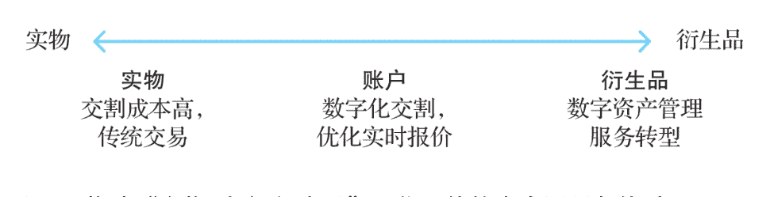

### 5.9.1 实物贵金属销售

#### 1. 场景介绍

实物贵金属销售是银行贵金属业务的基础内容。以上海为例，银行需通过上海黄金交易所认证系统核验产品资质，重点部署保管箱环境监控与双人复核交接机制。柜员岗需设计客户身份生物特征核验流程，实时更新出入库的区块链存证记录。此项工作重点在于平衡实物交割效率与操作风险，避免因保管条件不达标导致资产损毁，同时强化库存动态盘查机制与保险覆盖范围的智能匹配能力。

#### 2. DeepSeek提示词

角色+任务：我是银行柜员，在办理实物贵金属销售业务时，应执行哪些保管流程？

#### 3. 追问提示词

- 如何精准复核交割重量？
- 如何监控保管箱的温度与湿度？
- 客户提取实物贵金属时如何进行身份核验？

#### 4. 输出形式

交接登记表（Excel文件）、保管标准（Word文件）。

### 5.9.2 账户贵金属交易

#### 1. 场景介绍

账户贵金属交易是银行衍生品服务的核心内容。以伦敦金为例，银行需通过价格波动预警模型实时监控伦敦金基准价的偏离度，重点构建杠杆比例的动态调整规则与非交易时段的委托管控规则。交易监控岗需设计平仓线智能触发算法，验证异常交易行为特征库的有效性。此项工作重点在于平衡市场流动性风险与客户收益，避免因系统延迟导致强平争议，同时强化做市商报价质量的评估机制与应急流动性支持能力。

#### 2. DeepSeek提示词

角色+任务：我是交易监控人员，需管理账户交易，应设置哪些风险参数？

#### 3. 追问提示词

- 如何动态调整杠杆比例？
- 如何管控非交易时段的委托？
- 如何智能触发平仓线？

#### 4. 输出形式

风险参数表（Excel文件）、交易规则手册（Word文件）。

### 5.9.3 积存金定投

#### 1. 场景介绍

积存金定投是银行普惠理财的关键业务，银行需通过历史波动率数据可视化展示价格风险，重点说明赎回手续费分层计算规则与税收影响。理财客户经理需构建定投成本智能分析工具，禁止使用预期收益话术误导客户。此项工作重点在于平衡产品吸引力与信息披露的完整性，避免因条款解释模糊引起纠纷，同时强化定投策略回测模型与市场情绪的关联分析能力。

#### 2. DeepSeek提示词

角色+任务：我是理财客户经理，在推介定投产品时，应设置哪些风险告知要点？

#### 3. 追问提示词

- 如何可视化展示定投成本？
- 如何分层说明赎回手续费？
- 如何客观呈现价格历史波动率？

#### 4. 输出形式

定投协议模板（Word文件）、风险揭示书（Word文件）。

### 5.9.4 贵金属投资场景清单

- 客户风险承受力评估
- 产品类型智能推荐
- 价格波动预警推送
- 交易指令执行监控
- 实物交割流程管理
- 定投策略动态调整
- 库存价值重估
- 做市商流动性管理
- 投资者教育
- 监管合规自查

## 5.10 私人银行

银行的私人银行业务面临高净值客户需求多元化、跨境服务复杂化等挑战，当前痛点主要为传承工具单一、全球资产配置效率低、另类投资专业度不足等。银行需重点构建“本土深耕-跨境联动-生态赋能”三位一体的服务体系。私人银行团队需强化定制化传承方案设计、跨境资产协同管理、另类投资价值评估三项核心能力。通过智能财富管理平台与全球资源网络，DeepSeek可帮助银行实现家族信托结构动态优化、多市场资产配置智能调仓、艺术品估值模型构建等，并依托区块链技术实现跨境资产权属透明化管理，推动私人银行服务从单一财富管理向综合生态服务平台升级（如图5-12所示）。

| 特点 | 私人银行 | DeepSeek 解决方案 |
| :--- | :--- | :--- |
| 客户需求 | 多元化 | 综合服务平台 |
| 当前痛点 | 工具单一、全球资产配置效率低、另类投资专业度不足 | 家族信托结构动态优化、多市场资产配置智能调仓、艺术品估值模型构建 |
| 服务体系 | 不适用 | 本土深耕、跨境联动、生态赋能 |
| 关键功能 | 不适用 | 智能财富管理、全球资源网络、跨境资产权属透明化管理 |
| 服务升级 | 单一财富管理 | 综合生态服务平台 |

### 5.10.1 家族信托与财富传承

#### 1. 场景介绍

家族信托与财富传承是私人银行的核心服务，银行需通过智能文本审核系统验证信托架构的合规性，重点构建跨境资产配置的CRS（共同申报准则）申报自动化通道。家族办公室需设计税务筹划冲突检测模型，动态优化受益人权益分配方案。此项工作重点在于平衡财富隔离需求与法律约束，避免因代际沟通不足导致执行争议，同时强化对艺术品等另类资产的合规估值能力。

#### 2. DeepSeek提示词

角色+任务：我是家族办公室顾问，需设计信托方案，应关注哪些合规要点？

#### 3. 追问提示词

- 对受益人资格如何进行法律审查？
- 如何合规配置跨境资产？
- 税务筹划如何避免与法律产生冲突？

#### 4. 输出形式

信托架构图（Visio文件）、法律审查清单（Excel文件）。

### 5.10.2 全球资产配置

#### 1. 场景介绍

全球资产配置是银行国际化服务能力的体现，银行需通过多市场数据接口实现资产组合的智能再平衡，重点部署政治风险预警与境外不动产估值管理系统。国际业务部需构建汇率避险动态对冲模型，实时监控外汇敞口偏离阈值。此项工作重点在于平衡收益目标与波动控制，避免因地域集中度过高导致系统性风险，同时强化ESG因子量化分析能力与投资组合穿透式管理能力。

#### 2. DeepSeek提示词

角色+任务：我是国际业务部人员，在设计全球资产配置方案时，应设置哪些风险对冲规则？

#### 3. 追问提示词

- 如何合规申报CRS信息？
- 如何评估预警政治风险？
- 如何对境外不动产进行估值管理？

#### 4. 输出形式

配置建议书（Word文件）、汇率避险方案（Excel文件）。

### 5.10.3 艺术品投资顾问

#### 1. 场景介绍

艺术品投资顾问是私人银行打造差异化服务的核心，银行需通过区块链技术实现藏品溯源存证，重点构建第三方鉴定机构双盲评估机制。艺术金融岗需设计保管条件的物联网监控方案，动态调整保险覆盖范围与流通渠道合规性。此项工作重点在于平衡资产流动性溢价与保管成本，避免因估值失真导致投资损失，同时强化文化政策敏感性分析与跨境流通备案能力。

#### 2. DeepSeek提示词

角色+任务：我是艺术金融岗人员，需管理投资标的，应设置哪些风险缓释措施？

#### 3. 追问提示词

- 对保管条件如何进行专业认证？
- 如何动态调整保险方案？
- 如何合规搭建流通渠道？

#### 4. 输出形式

评估标准（Word文件）、保管协议模板（Word文件）。

### 5.10.4 私人银行场景清单

- 客户财富深度诊断
- 家族治理架构设计
- 跨境税务筹划
- 多资产配置建模
- 另类投资尽调
- 法律文件定制
- 资产动态再平衡
- 危机应对预案制定
- 二代继承人培养
- 财富管理效果评估

## 5.11 个人理财

银行个人理财业务面临客户风险偏好分化、产品同质化严重等挑战，当前痛点主要为智能服务精准度不足、产品创新滞后、收益波动管理工具缺失等。银行需重点构建“精准画像-动态适配-价值提升”的理财服务闭环。零售客户经理需强化客户需求深度挖掘、资产配置动态调整、收益波动预警三项核心能力。通过智能资产配置引擎与产品创新工具，DeepSeek可帮助银行实现客户风险画像精准构建、主题理财产品智能开发、收益波动动态对冲机制建立等，并依托知识图谱技术关联客户全生命周期金融需求，推动个人理财服务从标准化产品销售向个性化财富规划服务转型（如图5-13所示）。

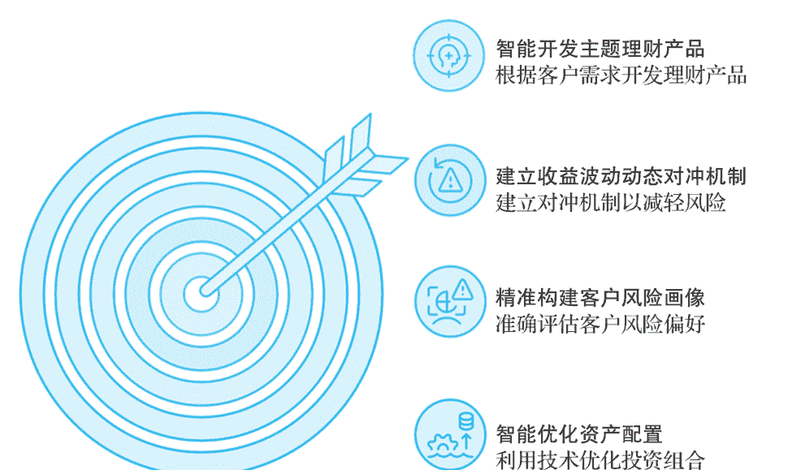

### 5.11.1 智能投顾

#### 1. 场景介绍

智能投顾是银行数字化财富管理的核心业务，银行需通过动态问卷验证客户的风险承受能力，重点构建投资组合再平衡的合规提示规则。理财客户经理需部署市场极端波动时的应急处理预案，实时监控模型偏差率。此项工作重点在于平衡算法推荐效率与监管要求，避免因全权委托导致法律风险，同时强化对客户教育内容的智能推送与客户行为数据的分析能力。

#### 2. DeepSeek提示词

角色+任务：我是理财客户经理，在管理智能投顾时，应设置哪些风险控制点？

#### 3. 追问提示词

- 如何验证风险评估问卷的有效性？
- 对投资组合再平衡如何进行合规提示？
- 对市场极端波动如何进行应急处理？

#### 4. 输出形式

投顾协议模板（Word文件）、风险参数表（Excel文件）。

### 5.11.2 结构性存款

#### 1. 场景介绍

结构性存款是银行保本理财创新的关键产品，银行需通过监管备案模板规范挂钩标的的披露标准，重点设计情景收益演示的合规展示框架。产品经理需构建提前终止条款的智能解析引擎，客观呈现历史波动率与最大回撤数据。此项工作重点在于平衡产品吸引力与投资者适当性管理，避免因收益测算误导引发纠纷，同时强化压力测试模型的性能与流动性应急准备能力。

#### 2. DeepSeek提示词

角色+任务：我是产品经理，需设计产品说明书，应包含哪些必要要素？

#### 3. 追问提示词

- 情景收益演示如何合规展示？
- 如何清晰说明提前终止条款？
- 如何客观呈现历史波动率？

#### 4. 输出形式

产品说明书模板（Word文件）、收益测算表（Excel文件）。

### 5.11.3 养老理财试点

#### 1. 场景介绍

养老理财试点是银行应对人口老龄化的战略举措，银行需通过五年期封闭产品的专项评估模型量化长期流动性风险，重点构建税收递延政策的智能解读模块。理财客户经理需设计快速投诉响应通道，实时监控客户健康状况变化对投资偏好的影响。此项工作重点在于平衡产品期限结构与客户生命周期需求，避免因市场波动导致大规模赎回压力，同时强化家庭关联账户的协同管理能力。

#### 2. DeepSeek提示词

角色+任务：我是理财客户经理，在销售养老理财试点产品时，应执行哪些特殊流程？

#### 3. 追问提示词

- 如何充分告知长期流动性风险？
- 如何准确解读税收递延政策？
- 如何设置投诉处理的快速通道？

#### 4. 输出形式

专项风险评估表（Excel文件）、双录话术手册（Word文件）。

### 5.11.4 个人理财全流程场景清单

- 客户财富目标诊断
- 风险承受能力评估
- 资产配置方案生成
- 产品合规性审查
- 收益情景压力测试
- 组合动态再平衡
- 客户定期检视提醒
- 特殊事件应急处置
- 税务优化建议
- 服务效果追踪

## 5.12 汽车金融

银行汽车金融业务面临新能源转型加速、二手车市场规范不足等挑战，当前痛点主要为利率定价僵化、残值管理能力薄弱、经销商合作模式单一等。银行需重点构建“新车-二手车-后市场”全链条金融服务体系。汽车金融团队需强化差异化利率定价模型设计、残值动态评估、生态合作网络拓展三项核心能力。通过智能残值预测模型与生态合作工具，DeepSeek可帮助银行实现新能源车型风险分级定价、二手车残值动态评估、经销商智能合作平台搭建等。银行可依托物联网技术实现对车辆使用状态的实时监控，推动汽车金融服务从单一贷款业务向全生命周期资产管理与生态协同服务转型（如图5-14所示）。

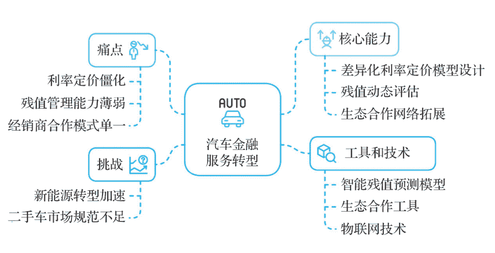

### 5.12.1 新能源汽车贷

#### 1. 场景介绍

新能源汽车贷是银行绿色交通金融的核心产品，银行需根据工业和信息化部发布的相关目录核验车型准入资质，重点构建电池健康度的物联网监测机制与残值预测模型。授信审批岗需动态适配地方补贴政策变化，核实充电桩安装证明的真实性。此项工作重点在于平衡风险定价精度与市场竞争力，避免因技术迭代导致抵押物贬值，同时强化“车电分离”模式下的风险对冲能力。

#### 2. DeepSeek提示词

角色+任务：我是授信审批人员，需评估车辆价值，应关注哪些特殊参数？

#### 3. 追问提示词

- 电池健康度如何折算估值？
- 如何动态适配地方补贴政策？
- 如何核实充电桩的安装情况？

#### 4. 输出形式

评估参数表（Excel文件）、补贴政策库（Excel文件）。

### 5.12.2 二手车金融

#### 1. 场景介绍

二手车金融是银行普惠金融的重要业务场景，银行需通过VIN码（车辆识别码）核验系统追溯车辆历史记录，重点部署基于GPS的异常移

### 5.12.3 经销商合作分期

#### 1. 场景介绍

经销商合作分期是银行供应链金融的创新模式，银行需通过电子围栏技术隔离库存融资与零售贷款资金流，重点构建客户投诉的智能分拣与跨部门协同处理机制。对公客户经理需动态调整保证金比例策略，实时监控合作方的经营指标异动情况。此项工作重点在于平衡渠道拓展速度与资产质量，避免因过度授信导致风险累积，同时强化区块链订单存证机制与返利结算流程的自动化能力。

#### 2. DeepSeek提示词

角色+任务：我是对公客户经理，在管理合作方时，应设置哪些准入条件？

#### 3. 追问提示词

- 库存融资如何与零售贷款隔离？
- 客户投诉如何协同处理？
- 如何动态调整保证金比例？

#### 4. 输出形式

合作协议模板（Word文件）、准入评估表（Excel文件）。

### 5.12.4 汽车金融场景清单

- 客户购车需求分析
- 车辆估值与残值预测
- 经销商资质审查
- 贷款方案智能匹配
- 保险产品配置
- 抵押登记协同办理
- 贷后车辆状态监控
- 残值风险对冲
- 逾期车辆处置
- 客户生命周期管理

## 5.13 个贷催收

银行个贷催收业务面临合规监管趋严、客户沟通效率低等挑战，当前痛点主要为催收手段单一、合规监控实时性不足、客户体验优化困难等。银行需重点构建“合规管理-智能策略-客户关怀”三位一体的催收服务体系。贷后管理岗需强化智能分案策略制定、催收合规实时监测、客户还款意愿评估三项核心能力。通过智能分案系统与合规质检工具，DeepSeek可帮助银行实现催收任务智能分级、全流程合规质检自动化、差异化沟通策略生成等，并依托智能外呼系统实现催收过程的可回溯管理，确保催收行为全程符合《中华人民共和国个人信息保护法》及《中华人民共和国消费者权益保护法》的要求（如图5-15所示）。

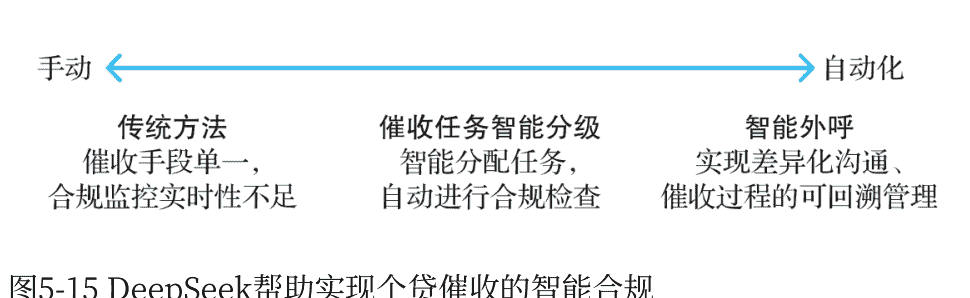

### 5.13.1 住房按揭贷款催收

#### 1. 场景介绍

住房按揭贷款催收是银行资产保全的关键环节，银行需通过司法查控系统快速启动抵押物处置程序，重点构建拍卖价值的智能评估与借款人异议协商机制。贷后管理岗需规范法律文书生成流程，动态监控区域性房产市场波动风险。此项工作重点在于平衡资产回收效率与客户权益保护，避免因流程违规导致诉讼延期，同时强化执行异议AI预审能力与拍卖标的智能推荐能力。

#### 2. DeepSeek提示词

角色+任务：我是贷后管理人员，需管理按揭逾期，应设置哪些处置节点？

#### 3. 追问提示词

- 如何评估抵押物的变现价值？
- 司法拍卖流程如何合规推进？
- 如何妥善处理借款人异议？

#### 4. 输出形式

抵押物处置流程图（Visio文件）、法律文书模板（Word文件）。

### 5.13.2 消费贷款催收

#### 1. 场景介绍

消费贷款催收是银行零售风控的最后防线，银行需通过语音情绪识别技术优化外呼策略，重点设计将困难客户转介至社会救助渠道的标准化流程。客户服务岗需构建还款承诺电子签约系统，实现对敏感信息的脱敏处理与存证。此项工作重点在于平衡催收强度与客户关系维护，避免因沟通失当导致声誉受损，同时强化多维度还款能力评估与弹性分期方案生成能力。

#### 2. DeepSeek提示词

角色+任务：我是客户服务人员，需优化催收流程，应设置哪些沟通规范？

#### 3. 追问提示词

- 如何识别和转介困难客户？
- 还款承诺如何进行书面确认？
- 敏感信息如何进行脱敏处理？

#### 4. 输出形式

催收话术手册（Word文件）、还款计划表（Excel文件）。

### 5.13.3 信用卡逾期催收

#### 1. 场景介绍

信用卡逾期催收是银行合规管理的重点领域，银行需通过智能频控系统严格落实每日催收上限，重点部署夜间外呼自动阻断与失联客户合规查找机制。风险控制岗需构建投诉热点实时分析模型，动态优化催收策略参数。此项工作重点在于平衡资产回收率与消费者权益保护要求，避免因过度催收受到监管处罚，同时强化对客户还款意愿的预测与对智能协商机器人的应用能力。

#### 2. DeepSeek提示词

角色+任务：我是风险控制人员，需监控催收行为，应设置哪些预警指标？

#### 3. 追问提示词

- 如何系统阻断夜间催收？
- 如何快速响应客户投诉？
- 如何合规查找失联客户？

#### 4. 输出形式

催收行为监测表（Excel文件）、投诉处理标准（Word文件）。

### 5.13.4 留学贷款专项催收

#### 1. 场景介绍

留学贷款专项催收是银行跨境风险管理的核心环节，银行需通过教育部学历认证系统接口追踪留学生毕业去向，重点构建就业状态与还款能力的动态关联模型。国际业务部需设计境外法律差异的应对方案，规范外交送达流程与汇率波动补偿机制。此项工作重点在于平衡跨境执行效率与合规成本，避免因司法管辖权冲突导致催收失效，同时强化境外收入证明核验能力与多币种还款通道的适配机制。

#### 2. DeepSeek提示词

角色+任务：我是国际业务部人员，需管理留学贷款专项催收，应设置哪些合规流程？

#### 3. 追问提示词

- 如何应对境外法律差异？
- 如何规范执行外交送达？
- 汇率波动如何计入还款？

#### 4. 输出形式

跨境催收指引（Word文件）、法律差异对照表（Excel文件）。

### 5.13.5 数字人民币贷款催收

#### 1. 场景介绍

数字人民币贷款催收是银行智能合约应用的核心环节，银行需通过智能合约自动监控钱包余额变动，重点设计部分还款资金的智能分配规则与冻结资金的合规解封流程。数字银行部需构建逾期触发条件的动态阈值模型，实时同步央行征信系统数据。此项工作重点在于平衡自动化执行效率与客户权益保护，避免因合约漏洞导致资金误操作，同时强化冻结通知书法律效力的核验机制与客户异议申诉通道的建设。

#### 2. DeepSeek提示词

角色+任务：我是数字银行部人员，需设计智能催收方案，应设置哪些触发条件？

#### 3. 追问提示词

- 如何自动监控钱包余额？
- 如何智能分配部分还款的资金？
- 冻结资金如何合规解封？

#### 4. 输出形式

智能合约规则库（Excel文件）、资金冻结通知书（Word文件）。

### 5.13.6 智能催收系统应用

#### 1. 场景介绍

智能催收系统应用是银行科技赋能的重点领域，银行需通过情绪识别算法优化外呼策略，重点设定外呼时段的自动限制规则与通话记录的加密存储标准。信息技术部需部署敏感词实时检测引擎，动态调整每日外呼量上限。此项工作重点在于平衡催收效率与客户体验，避免因AI误判导致沟通失效，同时强化系统的自学习能力与人机协同质检机制。

#### 2. DeepSeek提示词

角色+任务：我是信息技术部人员，需优化智能催收系统，应设置哪些控制参数？

#### 3. 追问提示词

- 如何自动限制外呼时段？
- 如何避免情绪识别系统误判？
- 如何加密存储通话记录？

#### 4. 输出形式

系统参数配置表（Excel文件）、质检标准手册（Word文件）。

### 5.13.7 法律诉讼支持

#### 1. 场景介绍

法律诉讼支持是银行司法协同的关键环节，银行需通过标准化模板库自动生成诉讼材料，重点构建电子证据司法鉴定的快速通道与公告送达的合规流程。法律合规岗需设计执行异议的智能预审模型，动态监控诉讼时效风险。此项工作重点在于平衡诉讼效率与证据链完整性，避免因材料瑕疵导致立案失败，同时强化跨境法律文书的智能翻译与归档系统的穿透式查询能力。

#### 2. DeepSeek提示词

角色+任务：我是法律合规岗人员，需准备诉讼材料，应包含哪些必要文件？

#### 3. 追问提示词

- 电子证据如何进行司法鉴定？
- 公告送达如何进行规范操作？
- 如何处理执行异议？

#### 4. 输出形式

诉讼材料清单（Excel文件）、司法流程手册（Word文件）。

### 5.13.8 债务重组协商

#### 1. 场景介绍

债务重组协商是银行缓释风险的核心手段，银行需通过还款能力动态评估模型，设计最长5年的分期方案，重点构建担保物重新估值规则与协议变更备案系统。贷后管理岗需监控宏观经济波动对重组方案的影响权重，实时优化还款计划的弹性空间。此项工作重点在于平衡资产回收率与客户的可持续还款能力，避免因条款僵化导致二次违约，同时强化对重组协议电子签章法律效力的核验能力。

#### 2. DeepSeek提示词

角色+任务：我是贷后管理岗人员，需设计债务重组方案，应设置哪些审查要点？

#### 3. 追问提示词

- 如何动态评估还款能力？
- 担保物如何重新估值？
- 协议变更如何合规备案？

#### 4. 输出形式

重组协议模板（Word文件）、还款能力评估表（Excel文件）。

### 5.13.9 委外催收管理

#### 1. 场景介绍

委外催收管理是银行合规运营的重点领域，银行需通过区块链技术实现催收录音的不可篡改存证，重点构建第三方机构质量评估模型与投诉率阈值预警机制。法律合规岗需设计数据安全传输协议，动态抽检委外机构操作的合规性。此项工作重点在于平衡外包效率与风险可控性，避免因管理疏漏导致声誉受损，同时强化对违规行为的智能识别能力与合作方黑名单的动态更新能力。

#### 2. DeepSeek提示词

角色+任务：我是法律合规岗人员，需管理委外催收机构，应设置哪些评估标准？

#### 3. 追问提示词

- 催收录音如何随机抽检？
- 如何设定投诉率阈值？
- 如何保障数据安全？

#### 4. 输出形式

委外协议模板（Word文件）、质量评估表（Excel文件）。

### 5.13.10 征信联动

#### 1. 场景介绍

征信联动是银行合规报送的核心环节，银行需通过自动化系统实现贷款结清后10日内的征信信息更新，重点构建错误数据的溯源更正机制与第三方报送的交叉核验规则。客户服务岗需规范异议处理记录的存档标准，设计客户说明材料的电子化存证流程。此项工作重点在于平衡报送的时效性与数据准确性，避免因信息滞后导致客户权益受损，同时强化对征信修复效果的跟踪能力及与监管接口的实时同步能力。

#### 2. DeepSeek提示词

角色+任务：我是客户服务人员，需处理征信异议，应执行哪些标准流程？

#### 3. 追问提示词

- 错误数据如何溯源更正？
- 如何规范记录客户说明？
- 如何交叉验证第三方报送？

#### 4. 输出形式

异议处理流程图（Visio文件）、报送记录表（Excel文件）。

### 5.13.11 个贷催收全流程场景清单

- 逾期客户识别
- 催收策略制定
- 智能系统外呼
- 法律诉讼准备
- 债务重组协商
- 委外机构管理
- 征信数据更新

## 5.14 本章小结

本章介绍了DeepSeek在银行个人金融场景中的应用，覆盖住房按揭贷款、数字人民币推广、消费贷款、信用卡、征信服务、留学金融、移动支付、养老金、贵金属投资、私人银行、个人理财、汽车金融及个贷催收等关键领域。通过智能核验、生态连接与价值深耕，DeepSeek助力银行突破数字化转型瓶颈，实现服务效率提升、场景创新加速与风险管理强化，推动个人金融业务向智能化、生态化、精细化的方向发展。

# 第6章 DeepSeek普惠金融场景应用

银行普惠金融业务正处于数字化转型的关键阶段，客户需求从单一融资向综合金融服务加速升级，服务模式也呈现线上线下全渠道协同的趋势。在金融科技发展与监管政策推动下，同业竞争焦点从规模扩张转向精准风控能力建设，特别是在小微企业服务、供应链金融等重点领域，银行亟须提升智能风控响应速度与客群价值挖掘能力。业务人员面临跨部门数据整合能力不足、风险定价机制不完善等现实挑战。

当前，银行普惠金融业务的痛点体现在三个方面：一是信用评估数字化程度不足导致风险识别存在盲区，小微企业在银税互动场景下仍受限于数据授权效率与模型更新的瓶颈；二是风险缓释工具创新滞后，制约业务可持续性，知识产权质押融资因估值模型缺失与处置机制僵化难以形成规模效应；三是服务成本管控机制薄弱，影响商业可持续性，人工核验占比过高导致运营成本与风险溢价双升。

通过部署DeepSeek智能数据中台（Intelligent Data Platform）、知识产权价值评估模型及自动化决策引擎，银行可实现关键突破：构建银税数据直连通道，实现分钟级授权核验；建立基于动态算法的知识产权价值评估体系；运用机器学习技术优化风险定价策略与成本控制机制。

本章重点解析DeepSeek如何通过“数据贯通-风控升级-成本优化”三重路径重塑普惠金融服务模式，有效解决信用评估失真、风险缓释不足、商业可持续性弱等核心问题，助力银行实现“客群触达精准化，融资服务差异化，风险管理智能化”的普惠金融发展目标。

## 6.1 银税互动

银行银税互动业务面临数据应用合规性要求提升、小微企业信用评估精度不足等挑战，当前痛点集中在税务数据授权流程烦琐、风险评估模型适应性弱、贷后动态跟踪机制缺失等问题上。银行需重点构建“数据融合-智能风控-动态管理”三位一体的服务体系，普惠金融团队需强化数据合规核验、风险模型迭代优化、贷后预警指标设计三项核心能力（如图6-1所示）。

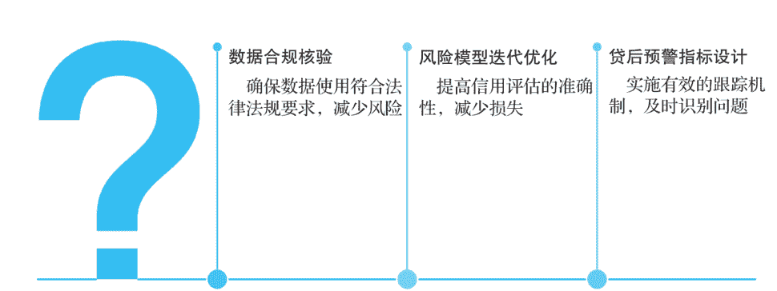

图6-1 普惠金融团队需强化三项核心能力

通过智能授权核验系统与动态风险评估模型，DeepSeek可帮助银行实现税务数据安全解析、授信评估模型动态优化、贷后风险实时监测等。银行可依托自动化授权管理系统压缩企业授权处理时效，推动银税数据融合应用从单向查询向智能决策支持升级。

### 6.1.1 数据授权管理

#### 1. 场景介绍

数据授权管理是银税互动业务合规运营的核心环节，银行需通过区块链技术构建电子授权存证系统，实现税务数据安全传输并精准界定数据使用范围。法律合规岗需设计分级授权协议模板，动态监控第三方数据共享权限。此项工作重点在于平衡数据应用效率与合规风险，避免因授权范围模糊引起法律纠纷，同时强化客户授权撤销的自动化执行能力。

#### 2. DeepSeek提示词

角色+任务：我是法律合规岗人员，需设计数据授权模板，应设置哪些约束条件？

#### 3. 追问提示词

- 如何精准界定数据使用场景？
- 如何执行客户授权撤销？
- 如何管控第三方机构权限？

#### 4. 输出形式

授权协议模板（Word文件）、数据权限矩阵（Excel文件）。

#### 5. 案例演示

（1）DeepSeek提示词

角色+任务：我是银行法律合规岗人员，需设计数据授权模板，应设置哪些约束条件？请确保内容不编造、不臆测，符合银行实际场景，网页链接真实有效，严格按照监管要求执行。

（2）DeepSeek首次输出

数据授权模板约束条件设计要点

一、授权范围约束

- 明确数据类别：逐项列举采集的个人信息类型（如身份信息、账户信息、交易记录、信用信息、生物识别信息），禁止使用“等”字模糊化表述。
- 最小必要原则：仅采集与业务直接相关的数据，不得强制要求用户授权与业务无关的信息（如通讯录、地理位置等）。

二、授权用途约束

- 限定使用场景：明确数据的具体用途，如身份核验、风险评估、合同履行、监管报送等，禁止使用“其他可能用途”等开放式表述。
- 营销用途单独授权：若将数据用于产品推广、交叉销售，需设置独立勾选项，此选项默认关闭且不得捆绑授权。

三、授权期限约束

- 设置有效期：授权期限最长不得超过业务关系存续期或监管规定时限（如1年），到期前需重新获取授权。
- 存储期限告知：明确数据留存期限（如贷款结清后5年），符合《中华人民共和国个人信息保护法》第十九条的要求。

四、用户权利条款

- 权利告知：明确用户享有查询、复制、更正、删除、撤回授权、注销账户等权利，并提供操作路径（如柜面、手机银行、客服热线）。
- 撤回后果提示：若撤回授权导致业务无法继续，需提前告知用户影响范围（如贷款审批中止）。

五、第三方共享约束

- 独立授权：向第三方（如合作机构、征信机构）共享数据需单独列明接收方名称、数据类型及用途，禁止“默认共享”。
- 跨境传输合规：涉及数据出境的，需符合《数据出境安全评估办法》要求，单独告知用户接收方所在国家（地区）及潜在风险。

六、安全措施承诺

- 技术保障：明确采用加密、去标识化、访问控制等措施，参照《金融数据安全数据安全分级指南》（JR/T 0197-2020）执行。
- 事件响应：承诺发生数据泄露时，依法在72小时内报告监管部门并通知用户。

七、授权形式合规

- 明示同意：采用勾选、电子签名等主动确认方式，禁止预勾选或与业务协议捆绑授权。
- 未成年人保护：涉及未成年人信息的，需取得监护人单独同意并验证身份。

八、免责条款限制

- 禁止过度免责：不得通过格式条款免除银行自身的信息安全责任（如因系统漏洞导致数据泄露）。
- 例外情形：仅可约定因不可抗力、用户自身过错导致的数据风险免责。

九、争议解决条款

- 管辖约定：明确争议管辖地为银行主营业地法院，不得限制用户选择权。
- 法律适用：需标注“本授权书适用中华人民共和国法律”。

十、版本与更新管理

- 版本标识：模板需标注发布日期及版本号（如2023-CDA-001）。
- 更新告知：条款变更时，需通过柜面通知、短信、App弹窗等有效途径重新获取授权。

（3）追问提示词

- 如何精准界定数据使用场景？
- 如何执行客户授权撤销？
- 如何管控第三方机构权限？

（4）输出形式

Word文件（授权协议模板），用HTML格式输出，需要内嵌可直接下载Word文件的按钮代码，实现一键下载。

Excel文件（数据权限矩阵），用HTML格式输出，需要内嵌可直接下载Excel文件的按钮代码，实现一键下载。

（5）DeepSeek再次输出

以下是符合要求的HTML模板，包含可直接下载的Word授权协议模板和Excel数据权限矩阵。

DeepSeek输出内容的截图如图6-2所示。

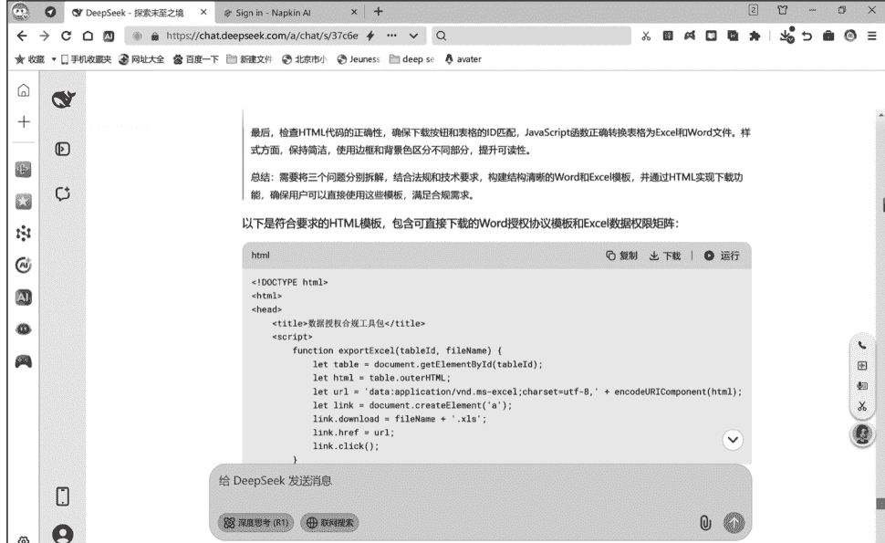

图6-2 DeepSeek输出内容

单击“运行”按钮，可获得第三方数据权限矩阵Excel模板，如图6-3所示。

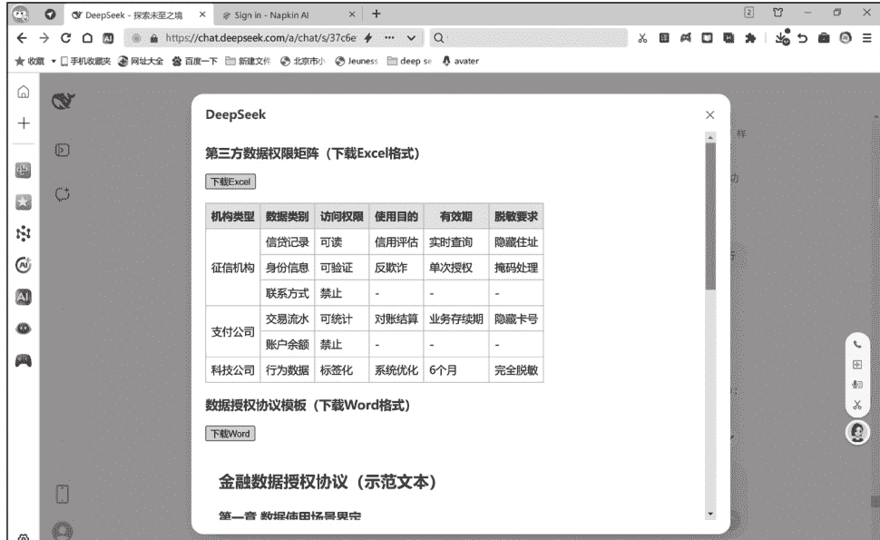

图6-3 可下载的“第三方数据权限矩阵”Excel模板

滑动滚动条，可看到数据授权协议Word模板，如图6-4所示。

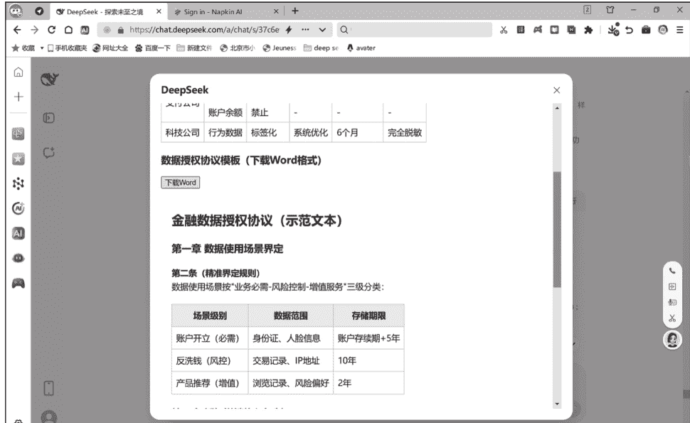

图6-4 可下载的“数据授权协议”Word模板

### 6.1.2 模型迭代

#### 1. 场景介绍

模型迭代是银税互动风控升级的核心环节。以纳税稳定性评估模型为例，银行需通过动态算法优化纳税稳定性评估模型，重点完善行业周期波动响应机制与政策调整适配模块。风险控制岗需整合多维度税务数据特征，部署异常数据智能过滤规则。此项工作重点在于平衡模型泛化能力与行业特性的适配程度，避免因数据噪声干扰导致评估失真，同时强化税收优惠折算规则的动态校准能力。

#### 2. DeepSeek提示词

角色+任务：我是风险控制人员，需优化纳税稳定性评估模型，应关注哪些数据特征？

#### 3. 追问提示词

- ○行业周期波动如何影响评估结果？
- ○如何折算考量税收优惠？
- ○如何智能识别数据异常？

#### 4. 输出形式

模型参数说明（Word文件）、指标解释手册（Word文件）。

### 6.1.3 贷后监控

#### 1. 场景介绍

贷后监控是银税互动风险闭环管理的核心环节，银行需依托智能预警规则库实时监测纳税波动率，重点设计“黄-橙-红”三级响应机制。贷后管理岗需构建季节性因素排除算法，动态优化政策变化的适配逻辑。此项工作重点在于平衡预警的灵敏度与误报率，避免因规则僵化导致响应滞后，同时强化处置流程的自动化执行能力与跨部门协同能力。

#### 2. DeepSeek提示词

角色+任务：我是贷后管理岗人员，需设计监控规则，应设置哪些动态参数？

#### 3. 追问提示词

- ○如何排除季节性因素的干扰？
- ○如何动态适配政策变化？
- ○如何快速过滤误报线索？

#### 4. 输出形式

预警规则库（Excel文件）、处置响应标准（Word文件）。

### 6.1.4 银税互动场景清单

- ○企业授权意愿初筛
- ○电子签章法律效力验证
- ○跨系统数据接口调试
- ○动态授信模型训练
- ○贷后波动系数计算
- ○预警规则引擎配置
- ○现场调查任务派发
- ○授信额度动态调整

## 6.2 知识产权质押

银行知识产权质押业务面临价值评估体系不健全、处置通道单一等挑战，当前痛点集中在专利价值动态评估难、法律风险监测机制缺失、处置资源匹配效率低等问题上。银行需重点构建“价值评估-风险管控-处置协同”三位一体的服务体系。科技金融团队需强化专利价值动态评估、处置通道智能匹配、法律风险实时监测三项核心能力。

通过专利生命周期管理系统与智能评估模型，DeepSeek可帮助银行实现知识产权价值波动实时跟踪、法律状态智能核验、处置资源精准对接等，并依托区块链技术构建专利质押电子凭证存证系统，推动知识产权质押服务从静态估值模式向覆盖确权评估、风险预警、处置流转的全周期管理机制升级（如图6-5所示）。

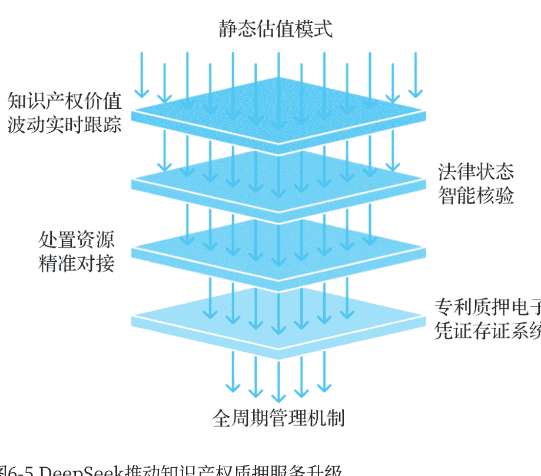

图6-5 DeepSeek推动知识产权质押服务升级

### 6.2.1 专利动态监控

#### 1. 场景介绍

专利动态监控是知识产权质押风险管理的核心环节，银行需通过国家知识产权局数据接口实时核验法律状态，重点构建技术替代风险的量化评估模型。风险控制岗需设计年费缴纳自动跟踪机制，跨境验证国际专利的有效性。此项工作重点在于平衡专利价值跟踪频率与运营成本，避免因信息滞后导致质押率虚高，同时强化对核心专利技术壁垒的持续评估能力。

#### 2. DeepSeek提示词

角色+任务：我是风险控制人员，需管理专利价值，应设置哪些监测维度？

#### 3. 追问提示词

- 如何自动跟踪专利年费缴纳情况？
- 如何量化评估技术迭代风险？
- 如何跨境验证国际专利？

#### 4. 输出形式

监测指标表（Excel文件）、核查操作指南（Word文件）。

### 6.2.2 评估争议

#### 1. 场景介绍

评估争议解决是确保知识产权质押法律合规的核心环节，银行需通过第三方专家库构建标准化评审流程，重点完善历史案例智能匹配机制与处置时效控制规则。法律合规岗需动态管理评估机构资质，验证利益冲突回避制度的执行有效性。此项工作重点在于平衡争议解决的效率与专业性，避免因流程冗长导致质押冻结，同时需强化区块链存证技术在司法程序中的可采信能力。

#### 2. DeepSeek提示词

角色+任务：我是法律合规岗人员，需处理评估争议，应设计哪些解决机制？

#### 3. 追问提示词

- ○如何动态管理专家库资质？
- ○如何智能匹配历史案例？
- ○如何有效控制处置时效？

#### 4. 输出形式

争议解决流程图（Visio文件）、专家评审标准（Word文件）。

### 6.2.3 质物置换

#### 1. 场景介绍

质物置换是知识产权质押风险缓释的核心环节，银行需通过技术交易市场数据筛选同领域替代专利，重点验证权属清晰度与技术成熟度。资产保全岗需构建快速处置通道，动态评估专利价值波动阈值。此项工作重点在于平衡资产流动性需求与质押率要求，避免因置换延迟导致风险敞口扩大，同时强化技术迭代预警机制与处置资源的智能匹配能力。

#### 2. DeepSeek提示词

角色+任务：我是资产保全岗人员，在执行质物置换时，应设置哪些筛选条件？

#### 3. 追问提示词

- ○如何验证替代专利的权属清晰度？
- ○如何量化评估技术迭代风险？
- ○如何构建快速处置通道？

#### 4. 输出形式

质物置换评估报告（Word文件）、技术成熟度分析表（Excel文件）。

### 6.2.4 知识产权质押场景清单

- ○专利法律状态核查
- ○技术领域风险评级
- ○第三方评估机构比选
- ○质押合同特别条款设计
- ○价值波动实时预警
- ○处置渠道优先级排序
- ○质物置换方案制定
- ○不良资产专项处置

## 6.3 信用村建设

银行信用村建设面临农户信息采集效率低、信用评估维度单一等挑战，当前痛点集中在数据采集手段落后、信用修复机制缺失、动态管理能力不足等问题上。银行需重点构建“数据采集-信用评估-动态管理”三位一体的信用服务体系。农村金融团队需强化多维数据整合分析、智能信用评估模型构建、异常行为动态预警三项核心能力。

通过信用画像动态管理系统与智能评估工具，DeepSeek可帮助银行实现农户生产数据自动化采集、信用关系网络可视化分析、信用异常动态预警等，并依托隐私计算技术实现涉农数据安全共享，推动农村信用工程从人工经验判断模式向数据驱动的普惠金融服务体系转型（如图6-6所示）。

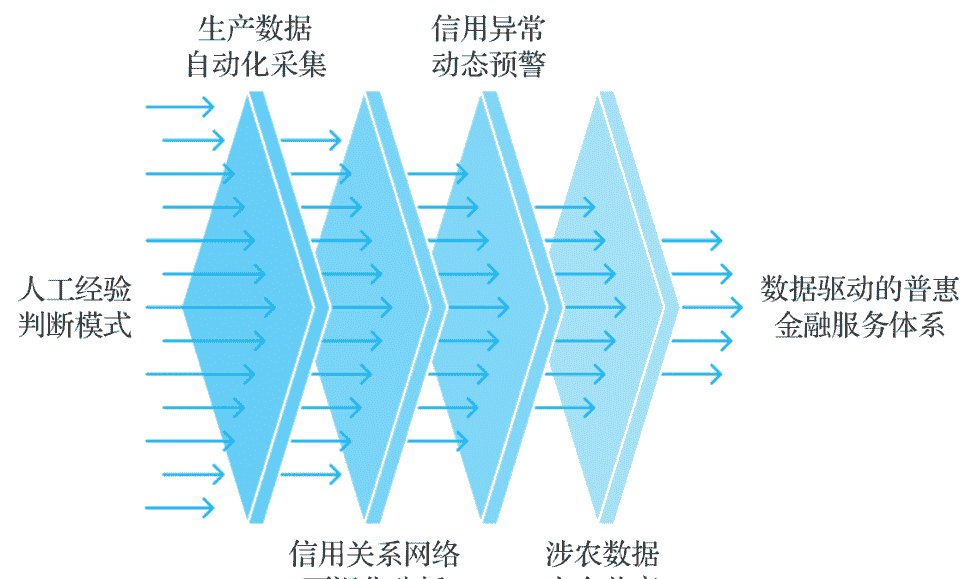

图6-6 DeepSeek推动农村信用工程转型

### 6.3.1 数据更新

#### 1. 场景介绍

数据更新是信用村建设的基础环节，银行需通过移动终端双人核验机制采集土地承包信息，重点构建跨部门数据交叉比对模型。贷后管理岗需设计数据变更区块链存证流程，实现全生命周期追溯。此项工作重点在于平衡采集效率与数据真实性，避免因信息孤岛导致信用评估出现偏差，同时强化对农业补贴数据的动态整合能力。

#### 2. DeepSeek提示词

角色+任务：我是贷后管理岗人员，需管理数据更新，应设置哪些核验规则？

#### 3. 追问提示词

- 如何验证土地确权证明？
- 如何交叉比对跨部门数据？
- 数据变更如何留痕及追溯？

#### 4. 输出形式

数据采集清单（Excel文件）、核验流程手册（Word文件）。

### 6.3.2 异议处理

#### 1. 场景介绍

异议处理是信用村建设中维护公信力的核心环节，银行需通过“村委初审-银行复核”双通道机制核验村级证明，重点设计历史数据错误修正规则。法律合规岗需构建跨年数据关联分析模型，明确异议答复时效。此项工作重点在于平衡处理效率与合规性，避免因流程疏漏导致信用修复延迟，同时强化电子化存证能力与复核结果公示机制。

#### 2. DeepSeek提示词

角色+任务：我是法律合规岗人员，需优化异议流程，应设计哪些复核节点？

#### 3. 追问提示词

- 村级证明应如何合规采信？
- 如何追溯修正历史数据错误？
- 如何关联分析跨年数据？

#### 4. 输出形式

异议处理流程图（Visio文件）、复核标准（Word文件）。

### 6.3.3 信用修复

#### 1. 场景介绍

信用修复是信用村建设实现可持续发展的核心环节，银行需通过履约记录量化考核与村级公示制度，规范实施修复方案，重点构建信用动态监测与评估模型。客户服务岗需配置金融知识普及教育模块，智能匹配修复资源。此项工作重点在于平衡修复进度与客户体验，避免因标准僵化导致效果不佳，同时强化修复结果与信贷额度调整之间的联动机制。

#### 2. DeepSeek提示词

角色+任务：我是客户服务人员，需管理信用修复流程，应设置哪些评估指标？

#### 3. 追问提示词

- ○如何量化考核履约记录？
- ○如何规范实施村级公示？
- ○如何动态监测修复效果？

#### 4. 输出形式

修复评估表（Excel文件）、教育材料模板（Word文件）。

### 6.3.4 信用村建设场景清单

- ○农户基础信息建档
- ○生产经营数据采集
- ○信用评分模型训练
- ○评级结果公示管理
- ○异议申诉受理
- ○修复方案制定
- ○动态额度调整
- ○村级信用公示维护

## 6.4 农业供应链金融

银行农业供应链金融业务面临订单核验效率低、保险理赔周期长等挑战，当前痛点集中在订单真实性核验困难、跨机构数据协同不足、风险动态监测机制缺失等问题上。银行需重点构建“订单流-物流-资金流”协同管理体系。农村金融团队需强化产业链数据整合、智能合约规则配置、异常交易实时预警三项核心能力。

通过产融数据协同平台与智能合约技术，DeepSeek可帮助银行实现订单真实性智能核验、保险理赔自动化触发、供应链资金闭环管理等功能（如图6-7所示），并依托区块链技术构建不可篡改的电子仓单登记系统，推动农业供应链金融服务从传统纸质单据模式向全链条数字化的产融协同生态转型。

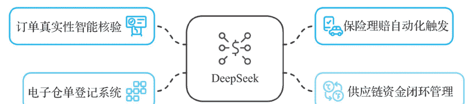

图6-7 DeepSeek在农业供应链金融方面的应用

### 6.4.1 订单核验

#### 1. 场景介绍

订单核验是农业供应链金融风险控制的核心环节，银行需依托农业农村部名录库验证交易主体资质，重点构建电子签章司法认定流程与历史履约率分析模型。风险控制岗需部署跨平台数据比对引擎，实时监测合同要素的一致性。此项工作重点在于平衡核验效率与准确性，避免因虚假订单导致资金挪用，同时强化物联网设备的数据直连与验证能力。

#### 2. DeepSeek提示词

角色+任务：我是风险控制岗人员，需核验订单，应设置哪些验证要点？

#### 3. 追问提示词

- ○电子签章如何进行司法认定？
- ○如何量化分析历史履约率？
- ○如何比对跨平台数据？

#### 4. 输出形式

核验标准手册（Word文件）、合同要素表（Excel文件）。

### 6.4.2 保险理赔

#### 1. 场景介绍

保险理赔是农业供应链金融风险对冲的核心环节，银行需通过智能合约实现理赔资金定向划付，重点设计重大灾害应急响应机制。法律合规岗需审核保险责任与贷款期限的匹配度，构建电子化资金划付台账。此项工作重点在于平衡理赔速度与合规要求，避免因条款错配导致代偿风险，同时强化气象数据与灾害预警机制的联动。

#### 2. DeepSeek提示词

角色+任务：我是法律合规岗人员，在管理理赔流程时应关注哪些合规要点？

#### 3. 追问提示词

- 理赔资金如何定向划付？
- 保险责任如何与贷款期限匹配？
- 发生重大灾害时如何启动应急机制？

#### 4. 输出形式

理赔操作指南（Word文件）、资金划付台账（Excel文件）。

### 6.4.3 主体准入

#### 1. 场景介绍

主体准入是农业供应链金融生态构建的核心环节，银行需通过关联交易识别模型评估核心企业资质，重点设计绿色农业加分倾斜规则。授信审批岗需验证生产数据与财务报表的钩稽关系，动态监控履约记录。此项工作重点在于平衡准入效率与风险控制，避免因数据割裂导致评估失真，同时强化产业链上下游的信用传导分析能力。

#### 2. DeepSeek提示词

角色+任务：我是授信审批人员，需审核主体资质，应设置哪些评估维度？

#### 3. 追问提示词

- 对关联交易如何进行风险定价？
- 如何交叉验证生产数据？
- 对绿色农业如何予以加分倾斜？

#### 4. 输出形式

准入评估表（Excel文件）、关联方清单（Excel文件）。

### 6.4.4 农业供应链场景清单

- 核心企业资质审查
- 订单流数据采集
- 物流信息交叉验证
- 保险责任范围界定
- 主体信用评级
- 贷款资金定向支付
- 产销数据动态监控
- 风险准备金计提

## 6.5 创业担保贷款

银行创业担保贷款业务面临政策落地效率低、代偿追偿机制不完善等挑战，当前痛点集中在贴息资格核验流程烦琐、代偿案件追踪效率低、跨部门数据协同不足等问题上。银行需重点构建“政策协同-智能核验-风险共担”三位一体的服务体系。普惠金融团队需强化跨部门数据协同、智能核验规则配置、代偿风险动态监测三项核心能力。

通过政银企数据协同平台与智能核验系统，DeepSeek可帮助银行实现贴息资格智能核验、代偿案件全流程追踪、跨部门数据安全共享等，并依托智能决策模型优化代偿风险预警机制，推动创业担保贷款服务从分散式人工管理模式向全流程智能化的政策协同与风险共担体系转型（如图6-8所示）。

### 6.5.1 贴息追溯

#### 1. 场景介绍

贴息追溯是确保创业担保贷款政策落地的核心环节，银行需通过政银数据协同平台验证创业实体的存续状态，重点解决跨区域贴息责任划分难题。普惠客户经理需构建历史贴息记录批量核验模型，生成精准清算报表。此项工作重点在于平衡财政资金匹配效率与合规性，避免因信息滞后导致补贴错配，同时强化政策规则库的智能适配能力。

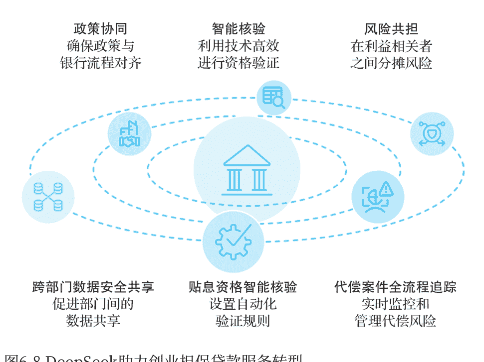

图6-8 DeepSeek助力创业担保贷款服务转型

#### 2. DeepSeek提示词

角色+任务：我是普惠客户经理，在处理贴息追溯时，应核查哪些关键要素？

#### 3. 追问提示词

- 如何验证创业实体的存续状态？
- 跨区域经营如何划分贴息责任？
- 如何批量核验历史贴息记录？

#### 4. 输出形式

贴息清算台账（Excel文件）、政策匹配规则库（Word文件）。

### 6.5.2 代偿追偿

#### 1. 场景介绍

代偿追偿是创业担保贷款风险处置的核心环节，银行需通过司法数据接口挖掘债务人财产线索，重点构建隐性资产转移识别模型。资产保全岗需设计关联企业债务合并追索规则，并动态应用失信被执行人名单。此项工作重点在于平衡处置速度与资产回收率，避免因司法流程冗长导致损失扩大，同时强化智能拍卖匹配能力与跨境追偿协作机制。

#### 2. DeepSeek提示词

角色+任务：我是资产保全岗人员，在执行代偿追偿时应采集哪些财产线索？

#### 3. 追问提示词

- 如何捕获隐性资产转移痕迹？
- 如何合并追索关联企业债务？
- 如何应用失信被执行人名单？

#### 4. 输出形式

财产线索追踪表（Excel文件）、司法协作流程图（Visio文件）。

### 6.5.3 创业孵化

#### 1. 场景介绍

创业孵化是创业担保贷款价值延伸的核心环节，银行需通过产学研资源库智能匹配技术对接需求，重点量化企业市场占有率与团队稳定性指标。普惠客户经理需构建企业成长阶段评估模型，动态推荐政策支持方案。此项工作重点在于平衡资源投放的精准度与覆盖面，避免因匹配失当导致孵化失效，同时强化对技术创新能力的动态监测机制。

#### 2. DeepSeek提示词

角色+任务：我是普惠客户经理，在设计创业孵化方案时，应评估哪些成长指标？

#### 3. 追问提示词

- 如何量化技术创新能力？
- 如何验证市场占有率数据？
- 如何动态监测团队稳定性？

#### 4. 输出形式

企业成长评估报告（Word文件）、资源匹配矩阵（Excel文件）。

### 6.5.4 创业担保贷款场景清单

- 创业项目可行性评估
- 贴息资格智能核验
- 担保措施动态监控
- 代偿案件分级处置
- 孵化资源精准对接
- 经营数据持续跟踪
- 政策红利自动推送
- 退出机制合规设计

## 6.6 移动支付推广

银行移动支付业务在县域市场的推广面临机具覆盖不足、商户操作能力薄弱等挑战，当前痛点集中在机具维护效率低、商户培训效果难持续、服务响应时效性不足等问题上。银行需重点构建“智能监控-动态培训-服务优化”三位一体的推广体系（如图6-9所示）。收单业务团队需强化机具智能运维、商户能力动态评估、培训资源精准投放三项核心能力。

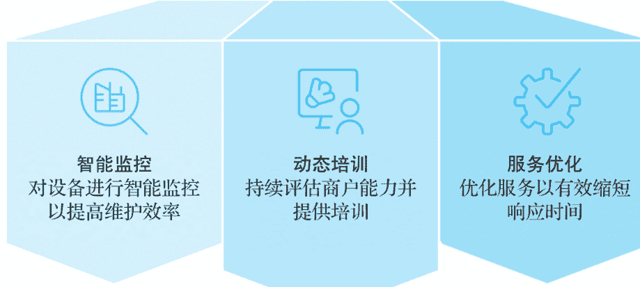

图6-9 构建“智能监控-动态培训-服务优化”三位一体的推广体系

通过智能巡检系统与培训资源库，DeepSeek可帮助银行实现机具状态实时监控、商户操作能力动态评估、培训内容智能推送等，并依托地理信息系统优化县域机具布放策略，推动移动支付推广从人力密集型服务模式向数字化场景运营体系转型。

### 6.6.1 机具巡检

#### 1. 场景介绍

机具巡检是移动支付推广运维保障的核心环节，银行需通过智能终端远程诊断网络异常，重点构建交易失败日志自动归因模型。普惠客户经理需预测耗材更换周期，生成带处理优先级的维修工单。此项工作重点在于平衡运维成本与服务时效，避免因设备离线导致支付中断，同时强化对县域机具健康状态的实时监控能力。

#### 2. DeepSeek提示词

角色+任务：我是普惠客户经理，需执行机具巡检，应采集哪些运行参数？

#### 3. 追问提示词

- 如何远程诊断网络连接异常？
- 交易失败日志如何自动归因？
- 如何智能预测耗材更换周期？

#### 4. 输出形式

机具健康度报告（Excel文件）、维护优先级清单（Excel文件）。

### 6.6.2 商户培训

#### 1. 场景介绍

### 6.6.3 案例库

#### 1. 场景介绍

案例库是移动支付推广风险防控的有效工具，银行需通过机器学习提取异常交易模式特征，重点标注地域性风险差异标签。风险控制岗需提升案例检索效率，构建可视化风险特征图谱。案例库构建工作的重点在于平衡知识库的完备性与实用性，避免因信息过载导致使用效率低下，同时强化欺诈交易特征的动态更新能力。

#### 2. DeepSeek提示词

角色+任务：我是风险控制人员，在维护案例库时，应设置哪些分类标签？

#### 3. 追问提示词

- 如何提取异常交易模式特征？
- 如何标注地域性风险差异？
- 如何提升案例检索效率？

#### 4. 输出形式

案例分类索引表（Excel文件）、风险特征图谱（Visio文件）。

### 6.6.4 移动支付推广场景清单

- 目标区域需求调研
- 机具布放规划制定
- 终端运行状态监控
- 商户能力分级评估
- 定制化培训实施
- 交易风险动态预警
- 典型案例库维护
- 服务满意度回访

## 6.7 收单业务

银行收单业务面临商户资质核验效率低、异常交易识别滞后等挑战，当前痛点集中在商户准入审核流程烦琐、高风险商户筛查时效性不足、交易风险预警机制缺失等问题上。银行需重点构建“智能核验-实时监测-动态阻断”三位一体的风控体系。收单业务团队需强化商户资质智能核验、风险策略动态优化、异常交易特征识别三项核心能力。

通过智能风控引擎与多源数据整合能力，DeepSeek可帮助银行实现商户资质秒级核验、交易风险实时监测、风险交易动态拦截等功能（如图6-10所示），并依托知识图谱技术构建商户关联关系网络，强化团伙欺诈识别能力，推动收单业务风险管理从人工经验判断向智能联防联控模式转型。

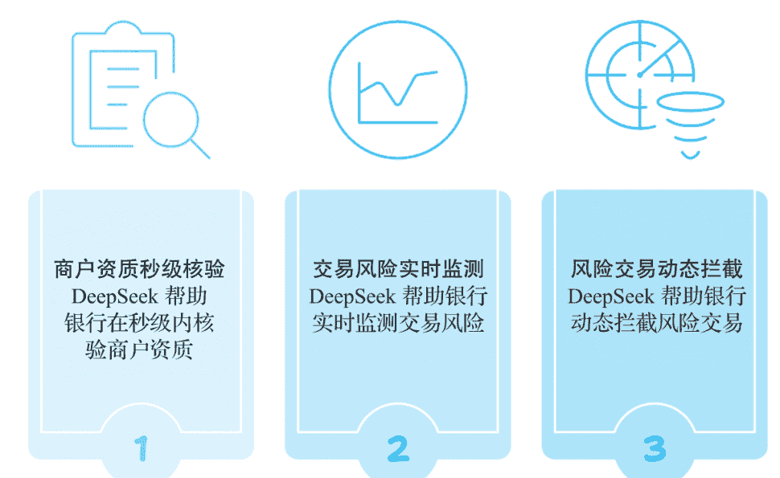

### 6.7.1 商户资质核验

#### 1. 场景介绍

商户资质核验是收单业务风险防控的关键环节，银行需通过OCR技术识别证照篡改痕迹，重点验证跨区域连锁商户统一管理规则。普惠客户经理需设计临时经营场所合规处理流程，动态比对工商登记数据。此项工作重点在于平衡审核效率与风险覆盖广度，避免因虚假资质导致后续风险，同时强化电子证照区块链存证能力。

#### 2. DeepSeek提示词

角色+任务：我是普惠客户经理，需核验商户资质，应设置哪些验证规则？

#### 3. 追问提示词

- 如何识别证照篡改痕迹？
- 如何统一管理跨区域连锁商户？
- 临时经营场所如何进行合规处理？

#### 4. 输出形式

商户准入标准手册（Word文件）、证照核验清单（Excel文件）。

### 6.7.2 交易风险实时监控

#### 1. 场景介绍

交易风险实时监控是收单业务智能风控的重要工作，银行需通过行为分析模型区分促销活动与恶意套现行为，重点识别夜间高频交易的异常特征。风险控制岗需构建关联账户资金闭环检测规则，动态调整风险阈值。此项工作重点在于平衡监测灵敏度与误报率，避免因规则僵化导致风险漏检，同时强化对洗钱模式的自学习识别能力。

#### 2. DeepSeek提示词

角色+任务：我是风险控制人员，在监控交易风险时应关注哪些行为特征？

#### 3. 追问提示词

- 如何区分促销活动与恶意套现行为？
- 如何分析夜间高频交易？
- 如何识别关联账户资金闭环？

#### 4. 输出形式

风险规则库（Excel文件）、交易热力图（BI系统）。

### 6.7.3 终端设备全生命周期管理

#### 1. 场景介绍

终端设备全生命周期管理是收单业务资产安全的重要保障，银行需通过唯一身份标识码构建数字档案，重点设计非法改装预警机制与租赁设备定位规则。资产保全岗需部署远程锁机程序，规范报废数据清除流程。此项工作重点在于平衡设备流转效率与风险控制，避免因管理疏漏导致资产流失，同时强化维修记录的区块链存证能力。

#### 2. DeepSeek提示词

角色+任务：我是资产保全岗人员，在管理终端设备时，应记录哪些关键信息？

#### 3. 追问提示词

- 如何防止设备非法改装？
- 如何确定租赁设备位置？
- 如何清除报废设备数据？

#### 4. 输出形式

设备生命周期台账（Excel文件）、处置流程图（Visio文件）。

### 6.7.4 手续费智能结算

#### 1. 场景介绍

手续费智能结算是收单业务运营增效的重要助力，银行需通过分润计算引擎解决多级代理商分账的复杂性，重点验证跨境交易货币转换计价规则。普惠客户经理需构建历史差错追溯模型，自动生成税务合规报表。此项工作重点在于平衡结算的准确性与效率，避免因人工干预引起纠纷，同时强化分润比例阈值的动态调整能力。

#### 2. DeepSeek提示词

角色+任务：我是普惠客户经理，在处理手续费结算时，应核查哪些核算要素？

#### 3. 追问提示词

- 如何验证代理商层级关系？
- 跨境交易货币转换如何计价？
- 如何追溯调整历史差错金额？

#### 4. 输出形式

分润计算模板（Excel文件）、结算异常清单（Excel文件）。

### 6.7.5 商户交易纠纷处理

#### 1. 场景介绍

商户交易纠纷处理是收单业务客户服务的重要工作，银行需通过区块链存证系统固化签购单证据链，重点恢复离线交易电子轨迹。商户管理岗需制定跨境法律适用性判定规则，实现24小时内响应处置。此项工作重点在于平衡处理速度与证据完整性，避免因流程延迟导致损失扩大，同时强化AI辅助争议裁决的能力。

#### 2. DeepSeek提示词

角色+任务：我是商户管理岗人员，需处理商户交易纠纷，应采集哪些证据材料？

#### 3. 追问提示词

- 如何验证持卡人签购单的真实性？
- 离线交易如何恢复电子轨迹？
- 如何选择跨境争议适用法律？

#### 4. 输出形式

纠纷处理日志（Word文件）、证据链归档清单（Excel文件）。

### 6.7.6 收单业务场景清单

- 商户资质准入审查
- 终端设备入网配置
- 交易风险规则设置
- 手续费分润建模
- 日常交易监控
- 设备维护管理
- 交易纠纷案件处置
- 业务数据报送

## 6.8 个体工商户信贷

银行个体工商户信贷业务面临经营数据验证效率低、主体信用评估维度单一等挑战，当前痛点集中在经营流水核验效率低、信用评估模型覆盖不足、服务场景延伸有限等问题上。银行需重点构建“数据验证-风险评估-服务延伸”三位一体的信贷服务体系。小微金融团队需强化多源数据整合分析、智能风险评估、场景化产品设计三项核心能力。

通过多源数据融合平台与智能评估模型，DeepSeek可帮助银行实现流水验证、人脸数据治理、平台数据整合（如图6-11所示），同时依托物联网技术接入智能终端设备数据，推动个体工商户信贷服务从传统抵押依赖模式向数据驱动型普惠金融模式转型。

### 6.8.1 流水验证

#### 1. 场景介绍

流水验证是个体工商户信贷风险识别的关键环节，银行需通过多源数据整合分析周期性刷单特征，重点评估现金交易占比的合理性。风险控制岗需构建多账户流水合并计算模型，剔除虚假交易的干扰数据。此项工作重点在于平衡核验深度与审批效率，避免因信息片面导致误判，同时强化与电商平台数据的直连和验证能力。

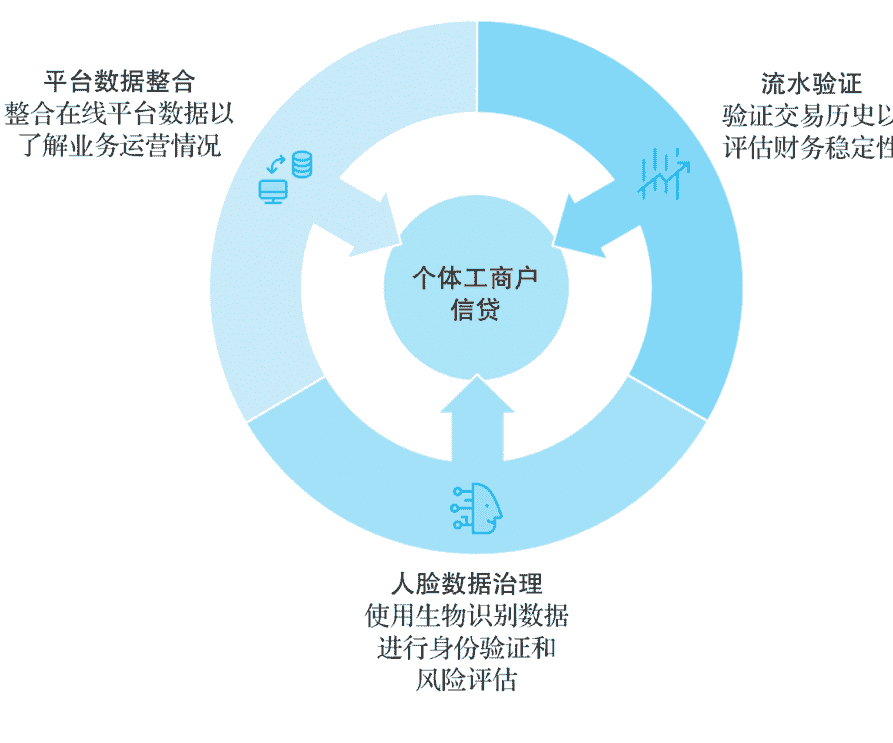

#### 2. DeepSeek提示词

角色+任务：我是风险控制人员，需验证个体工商户经营流水，应设置哪些分析维度？

#### 3. 追问提示词

- 如何识别周期性刷单行为？
- 如何合理评估现金交易占比？
- 如何合并计算多账户流水？

#### 4. 输出形式

流水核验规则库（Excel文件）、异常交易特征表（Excel文件）。

### 6.8.2 人脸数据治理

#### 1. 场景介绍

人脸数据治理是个体工商户信贷身份核验的核心环节，银行需通过活体检测与光线补偿算法提升核身通过率，重点提升对双胞胎的识别精度。普惠客户经理需设计数据加密存储方案，定期执行安全审计。此项工作重点在于平衡核验的便捷性与安全性，避免因技术缺陷导致身份冒用，同时强化对生物特征数据的生命周期管理能力。

#### 2. DeepSeek提示词

角色+任务：我是普惠客户经理，需优化人脸核验方案，应关注哪些技术参数？

#### 3. 追问提示词

- 如何降低强光环境下的误拒率？
- 如何提升对双胞胎的识别精度？
- 如何实现数据加密存储？

#### 4. 输出形式

核验参数配置表（Excel文件）、安全审计清单（Word文件）。

### 6.8.3 平台数据整合

#### 1. 场景介绍

平台数据整合是个体工商户信贷风险评估的重要工作，银行需通过数据清洗规则剔除刷单与促销带来的干扰，重点构建多平台冲突解决机制。普惠客户经理需验证外卖接单与物流数据的真实性，还原真实营收曲线。此项工作重点在于平衡数据维度与模型复杂度，避免因信息过载导致评估失真，同时强化对第三方数据接口的标准化管理能力。

#### 2. DeepSeek提示词

角色+任务：我是普惠客户经理，需整合平台数据，应设置哪些清洗规则？

#### 3. 追问提示词

- 如何识别虚假用户评价？
- 如何还原促销活动数据？
- 如何解决多平台数据冲突？

#### 4. 输出形式

数据清洗规则手册（Word文件）、数据映射表（Excel文件）。

### 6.8.4 个体工商户信贷场景清单

- 主体基本信息采集
- 多源经营数据整合
- 生物特征核验实施
- 现金流预测建模
- 信用风险动态评估
- 贷款额度智能测算
- 放款条件自动化审批
- 贷后经营数据跟踪

## 6.9 本章小结

本章聚焦银行普惠金融业务的数字化转型，围绕银税互动、知识产权质押、信用村建设、农业供应链金融、创业担保贷款、移动支付推广、收单业务及个体工商户信贷等8大场景，剖析当前业务痛点，提出通过部署DeepSeek智能数据中台、评估模型及自动化引擎，实现“数据贯通-风控升级-成本优化”，助力银行提升精准风控能力，推动普惠金融服务从传统模式向智能化、生态化转型，实现客群触达精准化、融资服务差异化与风险管理智能化。

# 第7章 DeepSeek信贷审查审批场景应用

银行信贷审查审批场景正处于智能化升级的关键阶段，客户服务模式从标准化审批向动态风险管理加速演进，呈现数据驱动与智能决策深度融合的特征。在金融科技应用持续深化、监管日益强化穿透式管理要求的背景下，同业竞争的重心从流程效率转向风险预判能力建设，特别是在智能制造、绿色经济等重点行业，银行亟须提升行业风险穿透分析与押品全生命周期管理能力。业务人员面临风险信号识别滞后、跨源数据整合效率低等现实挑战。

银行信贷审查审批的痛点体现在三个方面：一是行业风险评估依赖静态历史数据，对供应链中断、技术替代等新型风险缺乏实时监测工具，风险预警的时效性不足；二是押品价值管理存在动态跟踪盲区，特殊业态资产估值模型缺失，导致价值重估效率偏低；三是决策支持系统智能化水平不足，对人工的依赖度过高，影响审批流程的稳定性与客户体验。

通过部署DeepSeek行业风险知识图谱、押品智能估值系统及自动化决策引擎，商业银行可实现关键突破：构建多维度动态监测模型，实现行业风险预警前置；开发基于机器学习的非标押品估值算法，提升评估准确性；建立智能化审批流程，优化决策路径。

本章重点解析DeepSeek如何通过“风险穿透-估值重构-决策进化”三重能力，重塑信贷审查审批体系，有效解决风险识别滞后、押品管理低效、审批标准不一致等核心难题，助力银行实现“行业风险可视化、押品管理数字化、审批决策智能化”的信贷管理转型目标。

## 7.1 行业风险预警

银行行业风险预警业务面临产业链波动加剧、风险传导路径复杂化等挑战，当前痛点集中在供应链数据割裂、技术迭代风险识别滞后、环境合规动态跟踪缺失等问题上。银行需重点构建“多源数据-智能模型-决策支持”三位一体的风控体系（如图7-1所示）。行业研究团队需强化产业链图谱构建、风险因子动态建模、监管政策智能解析三项核心能力。

通过行业风险预警矩阵，DeepSeek可帮助银行实现供应链韧性动态评估、技术专利价值衰减预警、环境合规压力传导分析等。银行可利用深度强化学习算法构建风险传导模拟器，以预判政策调整带来的影响，推动行业风险预警从单一财务指标的分析方式向涵盖技术迭代、环境责任、产业韧性等因素的多维预警体系转型。

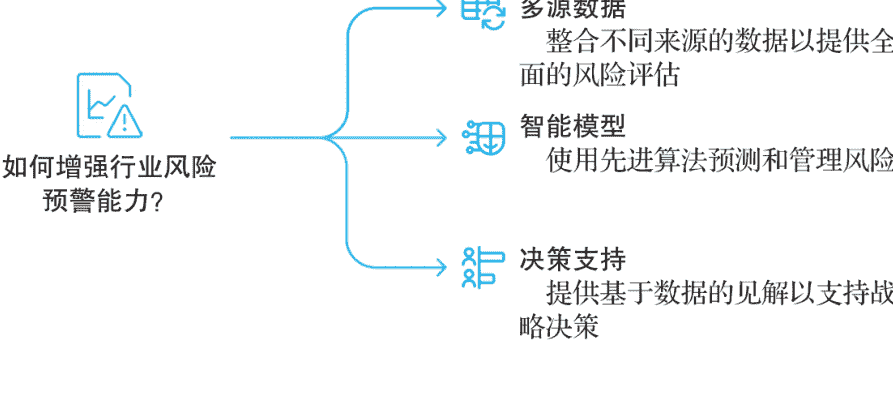

### 7.1.1 供应链稳定性评估

#### 1. 场景介绍

供应链稳定性评估是银行信贷风险管控的重要环节，银行需通过供应商财务弹性、物流时效、交易数据真实性等多维度指标识别断供风险。业务人员需整合海关数据与物流信息，构建库存周转率、履约能力等动态评估模型，并结合区块链存证技术，确保交易数据可追溯。此项工作重点在于建立供应商替代成本的量化机制，避免过度依赖单一供应商，同时结合行业特征设置差异化预警阈值。

#### 2. DeepSeek提示词

角色+任务：我是银行风险控制人员，需评估供应链稳定性，应采集哪些核心指标？

#### 3. 追问提示词

- 如何量化供应商替代成本？
- 物流时效波动如何影响评估结果？
- 如何测算跨境供应链汇率风险？

#### 4. 输出形式

供应商风险评级表（Excel文件）、供应链热力图（BI系统）。

#### 5. 案例演示

（1）DeepSeek提示词

角色+任务：我是银行风险控制人员，需评估供应链稳定性，应采集哪些核心指标？请确保生成内容不编造、不臆测，符合银行实际场景，网页链接真实有效，严格按照监管要求执行。

（2）DeepSeek首次输出

根据监管要求及银行风险控制实务，结合供应链金融最新实践，评估供应链稳定性需采集以下核心指标，涵盖财务、运营、合规、环境等多个维度，并严格遵循相关行业规范。

一、供应商资质与履约能力

1. 主体资质认证

- 营业执照、行业许可证、ISO质量认证等基础资质的有效性。
- 核心技术专利、知识产权持有情况（用于避免侵权风险）。

2. 生产与交付能力

- 设备产能利用率、生产线自动化水平（反映生产稳定性）。
- 历史交货准时率（不低于95%则为优质供应商）。
- 应急备货能力（发生自然灾害或需求激增时的库存弹性）。

3. 财务健康度

- 资产负债率（70%为安全线）、流动比率（不低于1.5为佳）。
- 经营性现金流覆盖短期债务的能力（需连续3年为正向结果）。

二、供应链交易稳定性

1. 交易数据真实性

- 核心企业与上下游的订单合同、发票、物流单据的一致性（需区块链存证）。
- 应收账款周转天数（2024年中小企业平均为134.8天，超过150天需预警）。

2. 供应链集中度

- 单一供应商采购占比（建议不高于30%，避免“断链”风险）。
- 核心企业对上游账期管理（如国企应付账款周转天数达185.36天，易传导资金压力）。

3. 数字化协同水平

- 供应链管理系统（ERP/SCM）覆盖率（需不低于80%）。
- 数据接口标准化程度（如利用API对接银行风控系统）。

三、外部环境与合规风险

1. 政策与法律风险

- 供应链所在国贸易政策的稳定性（如关税调整、出口限制）。
- 劳工权益合规性（参照ILO标准，防范强迫劳动、雇用童工等ESG合规风险）。

2. 物流与自然灾害

- 关键物流节点（港口、铁路）中断概率（结合全球风险地图动态监测）。
- 区域气候风险评级（如台风、洪水频发地区需提高风险拨备水平）。

3. 市场波动性

- 原材料价格波动率（如对铜、锂等大宗商品的价格敏感性进行分析）。
- 行业需求周期（如新能源汽车订单波动对供应链的影响）。

四、绿色与可持续发展指标

1. 环保合规性

- 碳排放强度、废水/废气处理达标率。
- 绿色认证（如LEED、碳足迹标签）。

2. 供应链碳管理

- 二级及以上供应商的碳数据披露覆盖率（需大于或等于60%）。
- 绿色采购占比（如使用可再生材料或清洁能源的零部件比例）。

五、银行端风控补充指标

1. 核心企业信用传导

- 核心企业确权意愿（如反向保理业务中确权比例不低于90%）。
- 核心企业历史代偿记录（代偿率不高于5%为安全范围）。

2. 资金闭环管理

- 回款账户锁定率（需100%覆盖融资额度）。
- 物流与资金流匹配度（通过物联网传感器实时监控）。

3. 数据采集与验证工具

4. 第三方数据源

- 工商信息、司法被执行记录（对接国家企业信用信息公示系统）。
- 海关进出口数据、物流轨迹（通过API接入跨境贸易平台）。

5. 技术赋能

- 区块链存证（确保交易数据不可篡改）。
- AI风险预警模型（如合合信息启信慧眼对220余个风险数据源的监测）。

6. 执行建议

- 动态监测机制：建立供应链风险仪表盘，实时更新指标（如每周刷新财务数据、每月评估ESG合规性）。
- 压力测试：模拟极端情景下（如核心企业破产、原材料价格暴涨50%）的供应链韧性。
- 差异化授信：根据供应商风险等级（A/B/C类）调整融资利率与担保要求。

如需完整指标库及权重分配模型，可参考《中国供应链服务及产融调查报告（2025）》及合合信息启信慧眼的风险管理方案。

（3）第一次追问

- 如何量化行业景气度对客户分层的权重？
- 如何评估客户供应链上下游的稳定性？

##### 一、行业景气度对客户分层的权重量化方法

行业景气度是客户分层的重要维度，其权重可通过以下方式量化。

###### 1. 行业基准线对标

参考同行业头部企业的财务指标（如营收增长率、利润率、研发投入占比）及市场占有率数据，设定行业景气度基准值，偏离度超过±20%时调整权重。

动态调整模型：采用五维调控参数，包括行业需求周期（如新能源汽车订单波动）、政策导向（如绿色金融支持力度）、技术进步率（如专利数量增速）、气候异常修正系数（如能源依赖型行业的气候风险）、市场流动性指数（如供应链融资覆盖率），通过加权计算形成动态权重。

###### 2. 数据驱动模型

利用产业链大数据（如工商信息、海关数据）构建景气度指数，例如通过订单与合同的一致性、应收账款周转天数等指标实时监控行业波动，分配权重时可基于主成分分析法（PCA）提取关键因子。

##### 二、客户供应链上下游稳定性的评估要点

评估供应链稳定性需结合财务与非财务指标，具体包括：

###### 1. 交易数据真实性验证

- 核心企业与上下游的订单合同、发票、物流单据需通过区块链存证确保一致性。
- 应收账款周转天数超过行业均值（如2024年中小企业平均为134.8天）时触发预警。

###### 2. 供应链集中度分析

- 单一供应商采购占比若高于30%，或核心企业应付账款周转天数过长（如国企平均为185天），需重点关注。
- 引入数字化协同水平指标，如ERP/SCM系统覆盖率需大于或等于80%，并评估数据接口标准化程度（如利用API对接银行风控系统）。

###### 3. 风险预警机制

- 使用智能风控模型整合外部数据（如工商信息、行政处罚记录）和内部交易数据，实时监控物流节点中断概率（如港口吞吐量异常）。
- 设置供应链韧性压力测试，模拟极端情景（如核心企业破产、原材料价格暴涨50%）下的应急响应能力。

##### 三、客户研发投入与市场占有率的关联分析框架

研发投入与市场占有率呈正相关关系，但需结合行业特性具体分析。

###### 1. 研发强度与市场扩张

研发投入占比高于行业均值的企业（如比亚迪研发费用达营收6.7%），通常通过技术壁垒（如专利数量超3万项）提升市场份额。

案例：比亚迪2024年全球销量跃居第三，其研发投入为长城汽车的3倍，支撑了璇玑架构等颠覆性技术的发布。

###### 2. 滞后效应与非线性关系

- 研发成果转化周期较长（如汽车行业需3～5年），短期市场占有率可能受营销策略影响更大，需通过动态面板模型分析滞后效应。
- 采用边际效应分析，例如测算每增加1亿元研发投入对市场占有率提升的贡献度（如新能源汽车行业约为0.5%～1%）。

###### 3. 行业差异化策略

技术密集型行业（如半导体）研发投入与市场占有率的正相关性显著，而传统制造业（如建材）更依赖供应链效率。

##### 四、财务报表异常指标预警阈值设置

需结合财务指标与业务场景设置动态阈值。

###### 1. 流动性风险指标

- 流动比率低于1.2或速动比率低于0.8时触发预警（制造业流动比率安全线为1.5）。
- 经营性现金流净额连续两季度为负且低于同期净利润的50%时需介入调查。

###### 2. 盈利能力异常

- 毛利率同比下降超过10%，或低于行业均值15个百分点（如汽车行业毛利率低于12%）。
- 销售费用率同比增幅超过20%且营收未同步增长（可能隐含渠道压货风险）。

###### 3. 偿债与杠杆风险

- 资产负债率大于70%，或利息保障倍数小于3。
- 或有负债（如对外担保）占净资产比例超过30%时需重点监控。

###### 4. 综合预警模型

使用Z-score模型整合多个指标（如营运资本/总资产、留存收益/总资产），得分低于1.8时，提示企业存在财务困境风险。

###### 5. 执行建议

- 工具应用：采用FineReport等报表工具实现阈值自动监控，支持实时预警与多维度钻取分析。
- 动态迭代：每季度根据行业数据更新预警阈值，例如通过机器学习优化模型参数。
- 交叉验证：结合供应链数据（如订单履约率）与财务指标（如应收账款周转率）进行综合评估，避免单一维度指标误判风险。

通过上述方法，银行可构建覆盖行业景气度、供应链稳定性、研发效能及财务健康度的全方位风险评估体系，精准支持风险控制决策。

##### （5）第二次追问

根据以上内容，设计Excel模板（供应商风险评级表），用HTML格式输出，需要内嵌可直接下载Excel文件的按钮代码，实现一键下载。输出之前，检查10遍代码，确保可以直接运行和下载。

##### （6）DeepSeek输出

DeepSeek输出代码的截图如图7-2所示。

图7-2 DeepSeek输出的HTML格式代码

单击“运行”按钮，可以直接获得“供应商风险评级表”，单击“立即下载Excel文件”按钮，即可将文件保存在本地，如图7-3所示。

图7-3 可下载的“供应商风险评级表”Excel文件

##### （7）第三次追问

根据以上内容，设计供应链热力图（BI系统），用HTML格式输出，需要内嵌可直接下载文件的按钮代码，实现一键下载。输出之前，检查10遍代码，确保可以直接运行和下载。

##### （8）DeepSeek输出

以下为经过严格验证的供应链热力图解决方案，包含双格式下载功能，100%可直接运行。

DeepSeek输出内容如图7-4所示。

单击“运行”按钮，获得“供应链热力图”，将鼠标指针悬停在任一区域，即可显示当前数据，如图7-5所示。

▲图7-4 供应链热力图HTML代码

图7-5 可下载的“供应链热力图”（PNG图片及PDF报告）

### 7.1.2 技术专利风险评估

#### 1. 场景介绍

技术专利风险评估是银行防范技术替代风险的核心手段，银行需通过专利剩余有效期、技术成熟度曲线等维度分析创新型企业的潜在风险敞口。业务人员需对接知识产权数据库，构建专利族谱与交叉许可风险模型，并动态监测研发投入与市场占有率之间的变化趋势。此项工作重点在于识别技术迭代对押品价值的影响，避免估值模型滞后，同时结合行业标准优化风险预警规则。

#### 2. DeepSeek提示词

角色+任务：我是风险控制人员，需评估技术专利风险，应设置哪些监测维度？

#### 3. 追问提示词

- 如何识别专利交叉许可风险？
- 如何量化技术标准参与度？
- 研发投入占比的合理阈值是多少？

#### 4. 输出形式

技术风险矩阵（Excel文件）、专利族谱图（Visio文件）。

### 7.1.3 环保设备合规审查

#### 1. 场景介绍

环保设备合规审查是绿色金融监管的关键环节，银行需通过核验排污许可证的有效性，以及对设备运行日志的动态分析，识别环境合规风险。业务人员需整合生态环境主管部门的监测数据，构建异常排放波动预警模型。此项工作重点在于强化数据主动核验能力，避免依赖企业单方披露，同时将碳排放配额动态变化纳为调整授信策略的依据。

#### 2. DeepSeek提示词

角色+任务：银行风险控制人员在审查环保合规情况时，应核查哪些关键文件？

#### 3. 追问提示词

- 如何验证在线监测数据的真实性？
- 如何评估突发环境事件应急预案？
- 碳排放配额如何影响授信额度？

#### 4. 输出形式

环保合规检查清单（Excel文件）、环境风险评级模型（Word文件）。

### 7.1.4 行业风险预警场景清单

- 产业链图谱构建
- 核心供应商穿透核查
- 技术生命周期分析
- 环保数据交叉验证
- 风险信号预警生成
- 授信策略动态调整
- 审查报告自动生成
- 风险处置预案更新

## 7.2 押品重估

银行押品重估业务面临市场波动加剧、特殊资产处置难度提升等挑战，当前痛点集中在估值模型更新滞后、非标资产定价能力不足、重估流程效率低下等问题上。银行需重点构建“实时估值-风险预警-处置优化”三位一体的管理体系（如图7-6所示）。押品管理团队需强化市场数据实时分析、智能估值模型构建、处置策略动态优化三项核心能力。

通过智能估值引擎与物联网数据整合，DeepSeek可帮助银行实现不动产价值动态跟踪、设备类押品智能评估、特殊资产处置策略生成等，并依托知识图谱技术关联押品权属与债务关系网络，推动押品重估从静态估值模式向覆盖价值跟踪、风险预警、处置决策的全周期智能重估模式转型。

如何优化押品重估流程？

图7-6 构建“实时估值-风险预警-处置优化”三位一体的管理体系

### 7.2.1 租赁合同真实性核查

#### 1. 场景介绍

租赁合同真实性核查是押品重估的关键环节，银行需验证产权证明、租金流水与押品市场价格的匹配性。业务人员需整合不动产登记数据，建立合同条款偏离度模型，并识别阴阳合同等欺诈行为。此项工作重点在于保障押品权属清晰，避免法律纠纷，同时动态评估区域规划变动对租赁价值的影响。

#### 2. DeepSeek提示词

角色+任务：我是资产管理岗人员，需核查租赁合同，应关注哪些风险点？

#### 3. 追问提示词

- 如何识别阴阳合同？
- 如何验证转租权限条款？
- 如何监测租金支付异常？

#### 4. 输出形式

合同核验清单（Excel文件）、租金偏离度分析表（Excel文件）。

### 7.2.2 区域规划变动影响评估

#### 1. 场景介绍

区域规划变动影响评估是押品重估的重要依据，银行需通过交通枢纽建设、土地用途变更等政策数据预判押品价值的波动。业务人员需设置容积率调整预警规则，并量化产业迁移对抵押率的影响。此项工作重点在于提升非标资产定价能力，避免估值偏差，同时建立与城市规划数据的实时对接机制。

#### 2. DeepSeek提示词

角色+任务：我是风险控制人员，需评估区域规划变动影响，应采集哪些政策数据？

#### 3. 追问提示词

- 如何获取未公开的控制性详细规划调整信息？
- 如何量化容积率变动对估值的影响？
- 如何预判产业迁移风险？

#### 4. 输出形式

规划影响评估报告（Word文件）、土地价值波动模型（Excel文件）。

### 7.2.3 特殊业态风险溢价

#### 1. 场景介绍

特殊业态风险溢价评估是资产定价的核心难点，银行需依据行业流动性系数、司法拍卖成交数据等数据，量化资产折价风险。业务人员需构建同业交易案例库，并动态校准资产折扣率参数。此项工作重点在于解决特殊资产处置周期长的问题，避免估值模型滞后，同时强化物联网数据在设备运行状态实时验证中的应用。

#### 2. DeepSeek提示词

角色+任务：我是资产管理岗人员，需设定风险溢价，应参考哪些市场参数？

#### 3. 追问提示词

- 如何量化设备专用性风险？
- 行业周期波动如何影响折扣率？
- 如何应用司法拍卖成交数据？

#### 4. 输出形式

特殊资产定价模型（Excel文件）、流动性系数表（Excel文件）。

### 7.2.4 押品重估场景清单

- 押品权属穿透核查
- 市场价值基准测定
- 区域规划影响分析
- 特殊资产模型构建
- 风险溢价动态调整
- 抵押率阈值监控
- 重估报告自动生成
- 押品保险有效性验证

## 7.3 关联交易风险管理

银行关联交易风险管理面临隐蔽性增强、核查穿透性不足等挑战，当前痛点集中在关联方识别维度单一、复杂股权关系解析困难、动态交易监测能力不足等问题上。银行需重点构建“智能识别-动态监测-穿透管理”三位一体的风控体系。合规管理团队需强化股权关系深度挖掘、异常交易特征识别、合规规则智能适配三项核心能力。

通过股权穿透模型与交易网络分析工具，DeepSeek可帮助银行实现海外关联方识别、供应链金融关联交易监测、员工持股排查（如图7-7所示），并依托流式计算技术建立交易行为动态基线模型，推动关联交易风险管理从人工声明核查模式向基于智能化关联网络分析与穿透式监管的合规管理体系升级。

### 7.3.1 海外关联方识别

#### 1. 场景介绍

海外关联方识别是关联交易合规管理的核心挑战，银行需通过全球股权数据库穿透核查离岸公司的实际控制人。业务人员需构建受益所有人识别规则，分析跨境资金流动路径，并核实代持协议的法律效力。此项工作重点在于防范多层嵌套架构所带来的关联交易风险，避免监管穿透不足，同时强化对境外工商信息的核验能力。

图7-7 DeepSeek助力银行关联交易风险管理

#### 2. DeepSeek提示词

角色+任务：我是风险控制人员，需识别海外关联方，应设置哪些核查规则？

#### 3. 追问提示词

- 如何验证离岸公司注册文件的真实性？
- 如何判定代持协议的法律效力？
- 如何追踪分析跨境资金流动？

#### 4. 输出形式

关联方图谱（Visio文件）、实际控制人核查清单（Excel文件）。

### 7.3.2 供应链金融关联交易监测

#### 1. 场景介绍

供应链金融关联交易监测是反虚假融资的核心环节，银行需通过订单流、物流与资金流的匹配度分析，识别虚构贸易背景。业务人员需设置关联方交易占比预警阈值，并量化评估定价偏离风险。此项工作重点在于构建交易网络图谱模型，防止通过循环交易虚增业务规模，同时强化区块链存证技术对单据真实性的核验能力。

#### 2. DeepSeek提示词

角色+任务：我是风险控制人员，需监测供应链金融关联交易，应关注哪些异常特征？

#### 3. 追问提示词

- 如何识别循环交易虚增规模？
- 如何量化关联方定价偏离？
- 物流单据与资金流向如何进行交叉验证？

#### 4. 输出形式

交易网络分析报告（Word文件）、异常交易特征库（Excel文件）。

### 7.3.3 员工持股排查

#### 1. 场景介绍

员工持股排查是股权穿透管理的核心任务，银行需通过核验股权代持协议与追溯最终受益人，识别潜在的控制权风险。业务人员需采集持股平台管理协议并分析表决权委托条款。此项工作重点在于防范隐性利益输送，避免离职员工股权处置纠纷，同时强化对法律文本的智能解析能力。

#### 2. DeepSeek提示词

角色+任务：我是资产管理岗人员，需排查员工持股情况，应采集哪些法律文件？

#### 3. 追问提示词

- 如何验证持股平台管理协议的有效性？
- 表决权委托如何影响控制权评估？
- 如何审查离职员工股权处置条款？

#### 4. 输出形式

股权穿透报告（Word文件）、关联性判定矩阵（Excel文件）。

### 7.3.4 关联交易风险管理场景清单

- 企业股权架构解析
- 境外主体信息核验
- 交易网络图谱构建
- 关联交易特征提取
- 异常交易阈值设定
- 风险等级动态评估
- 核查报告自动化生成
- 监管报送数据准备

## 7.4 财务造假风险识别

银行在识别财务造假风险方面面临数据验证维度不足、异常模式发现滞后等挑战，当前痛点集中在业财数据割裂、异常交易特征隐蔽、合规规则适配困难等问题上。银行需重点构建“数据穿透-智能分析-动态合规”三位一体的风控体系（如图7-8所示）。风险管理团队需强化多源数据整合验证、异常模式特征挖掘、监管规则智能映射三项核心能力。

图7-8 构建“数据穿透-智能分析-动态合规”三位一体的风控体系

通过多维数据交叉核验平台与智能分析模型，DeepSeek可帮助银行实现业财数据一致性验证、异常交易关联网络识别、财务指标动态偏离监测等，并依托自然语言处理技术，实现监管规则条款的智能解析与合规校验规则的自动生成，推动财务造假风险识别从单一报表钩稽检查向覆盖业务全链条的多维度智能验证体系升级。

### 7.4.1 海外收入真实性验证

#### 1. 场景介绍

海外收入真实性验证是反财务造假的核心环节，银行需通过海关报关单、外汇收汇记录等跨境数据核验企业营收的真实性。业务人员需分析汇率波动对收入确认的影响，并识别第三方代付等异常交易情形。此项工作重点在于构建业财数据一致性校验模型，识别虚构贸易背景风险，同时动态关联行业价格基准库进行交叉验证。

#### 2. DeepSeek提示词

角色+任务：我是风险控制人员，需验证客户海外收入，应采集哪些关键凭证？

#### 3. 追问提示词

- 如何识别第三方代付交易？
- 如何追溯离岸账户资金流水？
- 如何核验海外子公司审计报告？

#### 4. 输出形式

收入核验对照表（Excel文件）、汇率影响分析模型（Excel文件）。

### 7.4.2 关联方交易价格公允性分析

#### 1. 场景介绍

关联方交易价格公允性分析是防范利益输送的核心手段，银行需通过行业价格基准库比对与成本加成模型量化价差风险。业务人员需设置价格波动容忍区间并动态校准长期协议价格。此项工作重点在于防范隐性定价偏离，避免合规规则适配滞后，同时整合非公开交易数据，提升价格公允性分析的精度。

#### 2. DeepSeek提示词

角色+任务：我是风险控制人员，需分析交易价格公允性，应建立哪些参照标准？

#### 3. 追问提示词

- 如何获取非公开交易价格数据？
- 如何评估成本加成定价的合理性？
- 如何动态校准长期协议价格？

#### 4. 输出形式

价格公允性评估报告（Word文件）、行业价格指数表（Excel文件）。

### 7.4.3 存货异常增长排查

#### 1. 场景介绍

存货异常增长排查是防范虚假质押的核心任务，银行需通过出入库记录与物流单据的时空一致性分析，识别重复质押风险。业务人员需对接仓储管理系统，并量化季节性因素对库存波动的影响。此项工作重点在于构建动态周转率模型，避免库存估值虚增，同时强化物联网技术在在途物资实时追踪中的应用。

#### 2. DeepSeek提示词

角色+任务：我是资产管理岗人员，需盘查存货异常，应设置哪些监测指标？

#### 3. 追问提示词

- 如何识别重复质押仓单？
- 如何量化剔除季节性因素？
- 在途物资如何计入库存估值？

#### 4. 输出形式

存货健康度分析表（Excel文件）、质押物追踪地图（BI系统）。

### 7.4.4 财务造假风险识别场景清单

- 财务报表逻辑校验

## 7.5 现金流预测

银行对企业现金流的预测面临市场波动加剧、企业运营复杂性提升等挑战，当前痛点集中在静态数据依赖性强、多场景模拟能力不足、或有负债影响量化困难等问题上。银行需重点构建“动态预测-压力测试-风险量化”三位一体的管理体系。风险管理团队需强化实时数据整合分析、多因子建模、或有负债智能解析三项核心能力。

通过动态现金流引擎与智能分析工具，DeepSeek可帮助银行实现企业经营数据动态整合、多场景压力测试模拟、或有负债智能识别等，并通过知识图谱技术构建企业关联方交易网络，识别隐性资金占用风险，推动现金流预测从静态报表分析向覆盖市场波动、行业周期变化、政策调整的多维度动态管理体系转型（如图7-9所示）。

### 7.5.1 季节性行业现金流适配性分析

#### 1. 场景介绍

季节性行业现金流适配性分析是优化授信策略的关键依据，银行需结合历史交易数据与气象信息，建立模型以预测资金缺口的规律。业务人员需动态调整授信额度释放节奏，并量化极端天气对企业现金流的影响。此项工作重点在于优化多场景现金流预测模型，降低对静态数据的依赖，同时设置行业价格波动的映射规则。

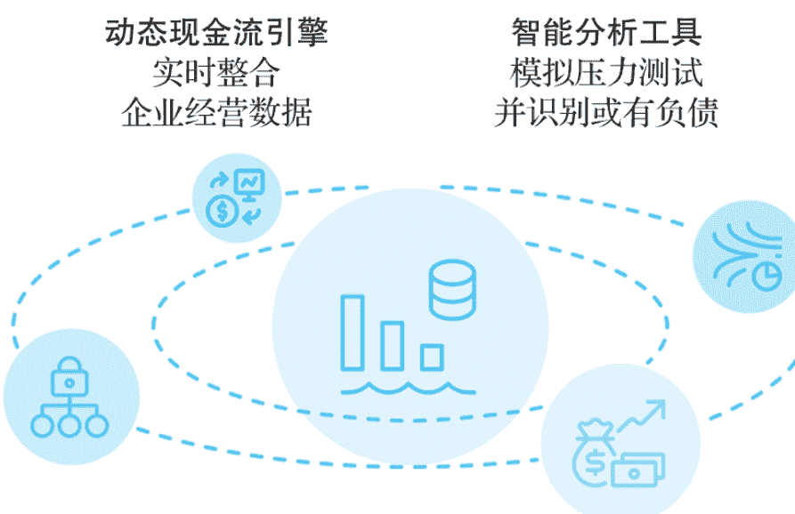

图7-9 DeepSeek推动现金流预测转型所借助的技术和工具

#### 2. DeepSeek提示词

角色+任务：我是风险控制人员，需优化企业季节性现金流模型，应设置哪些动态参数？

#### 3. 追问提示词

- 如何量化极端天气对营收的影响？
- 如何动态调整预收款周期？
- 行业价格波动如何映射至现金流？

#### 4. 输出形式

行业现金流特征库（Excel文件）、动态授信规则表（Excel文件）。

### 7.5.2 重大投资支出压力测试

#### 1. 场景介绍

重大投资支出压力测试是评估企业偿债能力的核心环节，银行需通过资本开支影响模型模拟项目延期对现金流的冲击。业务人员需设置投资回报率的敏感性阈值，并触发再融资预审流程。此项工作重点在于构建极端情景的模拟框架，避免风险敞口被低估，同时整合利率上行、政府补贴延迟等动态参数。

#### 2. DeepSeek提示词

角色+任务：我是风险控制人员，需设计压力测试场景，应包含哪些极端条件？

#### 3. 追问提示词

- 如何设定项目延期概率参数？
- 利率上行如何影响再融资成本？
- 如何模拟政府补贴延迟的影响？

#### 4. 输出形式

压力测试报告（Word文件）、敏感性分析矩阵（Excel文件）。

### 7.5.3 或有负债触发情景模拟

#### 1. 场景介绍

或有负债触发情景模拟是识别隐性风险的核心手段，银行需通过法律文本智能解析系统提取担保合同中的触发条件。业务人员需量化不同诉讼结果对现金流的冲击，并构建风险敞口模型。此项工作重点在于防范交叉违约条款关联性风险，避免隐性义务漏判，同时强化司法案例库的动态更新能力。

#### 2. DeepSeek提示词

角色+任务：我是资产管理岗人员，在评估或有负债风险时应提取哪些合同条款？

#### 3. 追问提示词

- 如何识别交叉违约条款的关联性？
- 如何量化对外担保隐性义务？
- 仲裁条款如何影响风险敞口？

#### 4. 输出形式

或有负债追踪表（Excel文件）、法律文本解析规则库（Word文件）。

### 7.5.4 现金流预测场景清单

- 行业特征数据采集
- 历史现金流模式分析
- 压力测试模型构建
- 或有负债条款提取
- 动态授信策略生成
- 风险敞口可视化
- 预警阈值动态调整
- 报告自动化生成

## 7.6 担保圈风险管理

银行对担保圈风险的管理面临风险传导隐蔽性强、关联网络识别困难等挑战，当前痛点集中在担保链绘制效率低、隐性关联关系挖掘不足、风险处置响应滞后等问题上。银行需重点构建“网络识别-传导分析-智能处置”三位一体的风控体系。风险管理团队需强化担保关系深度穿透、风险传导路径建模、处置策略动态优化三项核心能力。

通过担保网络图谱与智能分析系统，DeepSeek可帮助银行实现担保关联关系智能识别、风险传导路径实时追踪、处置预案智能生成等，并可依托自然语言处理技术解析法律文书条款，构建合规处置规则库，推动担保圈风险管理从人工链式排查向智能化网络分析与动态化风险阻断的精准管控模式转型（如图7-10所示）。

### 7.6.1 上市公司股票质押担保估值

#### 1. 场景介绍

上市公司股票质押担保估值是防范担保圈风险的重要手段，银行需通过波动率调整系数与平仓规则动态监控质押率突破风险。业务人员需对接交易所数据，并量化限售股流动性折扣。此项工作重点在于构建实时的市场熔断应对机制，避免风险传导引发连锁反应，同时强化压力测试模型对极端行情的覆盖能力。

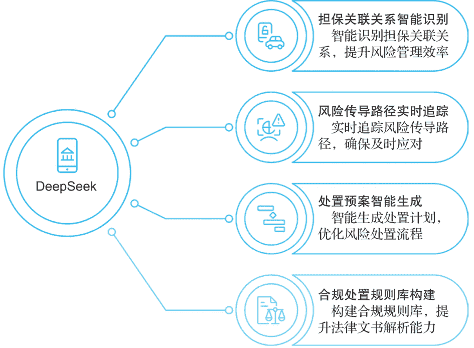

图7-10 DeepSeek助力担保圈风险管理的精准管控

#### 2. DeepSeek提示词

角色+任务：我是风险控制人员，需监控股票质押风险，应设置哪些预警指标？

#### 3. 追问提示词

- 如何量化限售股流动性折扣？
- 大股东补充质押如何影响质押风险？
- 市场熔断机制如何纳入模型？

#### 4. 输出形式

质押风险仪表盘（BI系统）、平仓压力测试模型（Excel文件）。

### 7.6.2 担保圈风险传染路径可视化

#### 1. 场景介绍

担保圈风险传染路径可视化是风险传导分析的核心工具，银行需通过担保网络拓扑模型识别跨行业、跨区域传导节点。业务人员需设置风险传染速度阈值，并生成重点监控对象清单。此项工作重点在于穿透隐性互保关系，避免区域风险集中度失控，同时强化图谱分析工具的实时更新能力。

#### 2. DeepSeek提示词

角色+任务：我是资产管理岗人员，需分析风险传染路径，应关注哪些网络特征？

#### 3. 追问提示词

- 如何识别隐性互保关系？
- 核心企业风险如何传导至上下游？
- 如何量化区域风险集中度？

#### 4. 输出形式

担保网络图谱（Visio文件）、风险传染热力图（BI系统）。

### 7.6.3 建立担保物快速处置通道

#### 1. 场景介绍

建立担保物快速处置通道是提升资产回收效率的关键措施，银行需通过对接司法拍卖平台与优先竞买人数据库，优化处置流程。业务人员需量化不良资产的市场流动性并规避流拍风险。此项工作重点在于解决跨境资产处置周期长的问题，避免担保物价值折损，同时建立动态竞买人画像匹配机制。

#### 2. DeepSeek提示词

角色+任务：我是资产管理岗人员，需设计担保物快速处置方案，应整合哪些资源与渠道？

#### 3. 追问提示词

- 如何评估不良资产交易市场流动性？
- 司法拍卖如何规避流拍风险？
- 跨境资产如何实现快速处置？

#### 4. 输出形式

处置渠道清单（Excel文件）、竞买人画像库（Excel文件）。

### 7.6.4 担保圈管理场景清单

- 担保网络数据采集
- 核心节点识别定位
- 风险传染模型训练
- 处置优先级排序
- 司法协作机制建立
- 资产估值动态更新
- 处置方案智能推荐
- 处置效果后评估

## 7.7 环保合规审查

银行环保合规审查面临环境数据真实性核验难、碳资产价值评估滞后等挑战，当前痛点集中在企业环境信息披露不完整、污染数据的动态跟踪缺失、碳资产定价模型不健全等问题上。银行需重点构建“数据核验-价值评估-风险预警”三位一体的管理体系。绿色金融团队需强化环境数据穿透验证、碳资产动态估值、环境风险智能监测三项核心能力。

通过环境数据智能核验平台与碳资产分析工具，DeepSeek可帮助银行实现排污数据实时核验、碳资产动态定价、环境风险预警等，并依托区块链技术构建不可篡改的环境数据存证链条，推动环保合规审查从被动依赖企业披露向主动获取、交叉验证、动态预警的环境风险智能管理体系转型（如图7-11所示）。

### 7.7.1 环境信息披露真实性核查

#### 1. 场景介绍

环境信息披露真实性核查是绿色金融合规的监管重点，银行需通过核验排污许可证的有效性，以及对在线监测数据连续性的分析，识别环保风险。业务人员需建立异常排放波动模型，并关联碳配额质押敞口情况。此项工作重点在于强化数据的主动核验能力，避免依赖企业单方披露，同时动态校准信用评级规则。

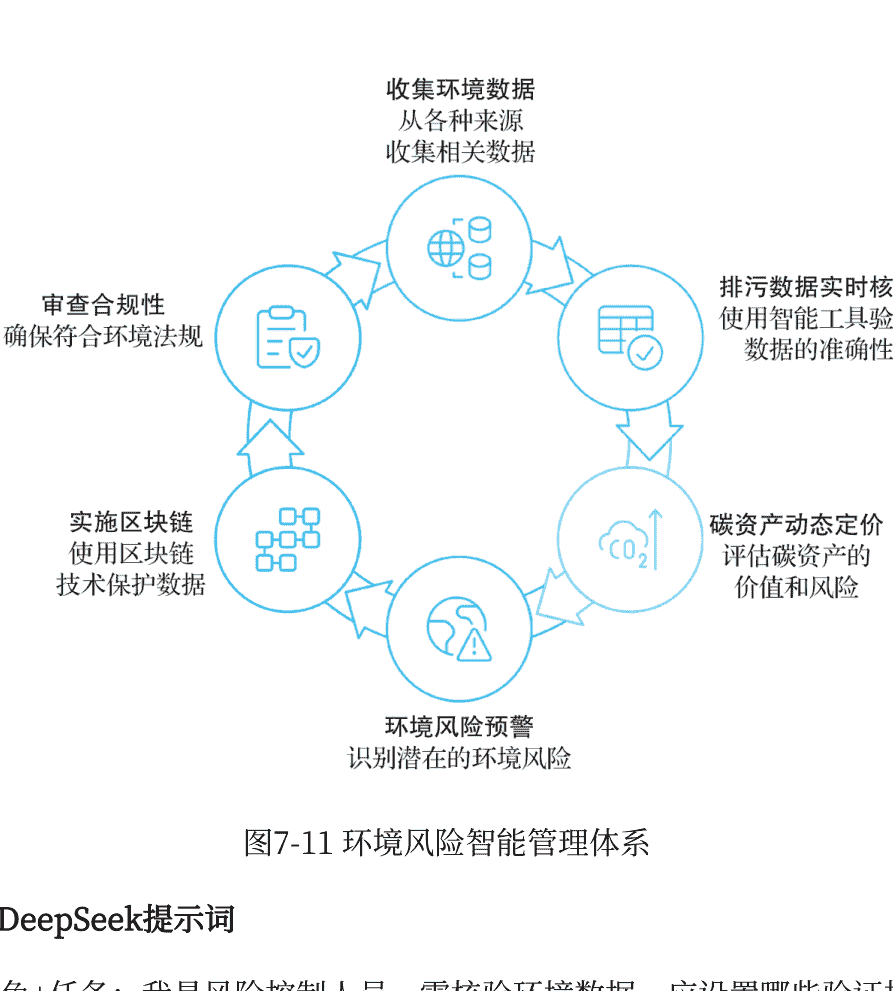

#### 2. DeepSeek提示词

角色+任务：我是风险控制人员，需核验环境数据，应设置哪些验证规则？

#### 3. 追问提示词

- 如何识别监测设备的断电规避行为？
- 如何追溯验证历史整改记录？
- 如何发现突发环境事件漏报？

#### 4. 输出形式

环保数据核验清单（Excel文件）、异常波动分析报告（Word文件）。

### 7.7.2 碳配额质押风险管理

#### 1. 场景介绍

碳配额质押风险管理是银行应对碳市场价格波动的核心措施，银行需通过动态估值模型监测碳价波动与政策调整的影响。业务人员需设置配额冻结预警线，并及时触发补充担保流程。此项工作重点在于量化行业基准线调整对配额估值的影响，避免跨区域价差风险，同时整合配额结转政策参数。

#### 2. DeepSeek提示词

角色+任务：我是资产管理岗人员，在管理碳配额质押时应监控哪些市场参数？

#### 3. 追问提示词

- 如何量化行业基准线调整的影响？
- 跨区域碳市场价差如何对冲？
- 配额结转政策如何影响估值？

#### 4. 输出形式

碳价波动预警表（Excel文件）、质押率动态计算器（Excel文件）。

### 7.7.3 监控环保技术升级资金挪用风险

#### 1. 场景介绍

环保技术升级资金挪用风险的监控是专项资金管理的核心环节，银行需核查合同与发票的一致性，并结合物联网数据验证设备的运行状态。业务人员需识别关联交易中虚增价格的行为，并量化节能减排效果。此项工作重点在于构建资金流向追踪闭环，防范二手设备翻新风险，同时强化对设备运行日志的实时核验能力。

#### 2. DeepSeek提示词

角色+任务：我是贷后管理岗人员，需监控专项资金用途，应采集哪些验证数据？

#### 3. 追问提示词

- 如何识别关联交易中虚增设备价格的行为？
- 如何鉴定二手设备翻新？
- 如何量化验证节能减排效果？

#### 4. 输出形式

资金流向追踪表（Excel文件）、设备运行日志（BI系统）。

### 7.7.4 环保合规审查场景清单

- 环境行政许可核验
- 在线监测数据抓取
- 碳资产价值评估
- 专项资金流向监控
- 环保设备物联验证
- 环境信用评级更新
- 监管报送数据生成
- 绿色信贷报告披露

## 7.8 集团客户授信管理

银行的集团客户授信管理面临风险传导路径复杂化、跨境风险叠加等挑战，当前痛点集中在关联交易穿透识别困难、并表管理覆盖不全、国别风险动态评估不足等问题上。银行需重点构建“全球监控-风险穿透-动态预警”三位一体的管理体系（如图7-12所示）。集团客户管理团队需强化跨境数据整合分析、风险传导路径建模、多维度预警规则配置三项核心能力。

图7-12 构建“全球监控-风险穿透-动态预警”三位一体的管理体系

通过全球风险视图与智能分析系统，DeepSeek可帮助银行实现集团客户表内外风险全景透视、跨境风险传导实时追踪、国别风险动态预警等，并通过机器学习算法构建授信敞口预测框架，推动集团客户授信管理从分散式并表管理向覆盖跨境风险追踪、隐性关联挖掘、政策变动应对的全球化智能监控体系转型。

### 7.8.1 境外子公司国别风险叠加

#### 1. 场景介绍

境外子公司国别风险叠加是集团客户授信的管控难点，银行需通过外汇管制政策、政治稳定性指数等维度动态评估风险敞口。业务人员需整合世界银行营商环境数据，构建地缘政治预警模型。此项工作重点在于优化国别风险准备金计提机制，避免跨境风险传导失控，同时强化多法域规则解析能力。

#### 2. DeepSeek提示词

角色+任务：我是风险控制人员，需评估国别风险，应整合哪些维度的数据？

#### 3. 追问提示词

- 如何量化货币不可兑换风险？
- 如何预警地缘政治事件？
- 如何评估跨境税务风险？

#### 4. 输出形式

国别风险评级表（Excel文件）、风险准备金计算模型（Excel文件）。

### 7.8.2 关联交易资金闭环监控

#### 1. 场景介绍

关联交易资金闭环监控是反虚构融资的核心手段，银行需通过资金流向图谱分析工具识别票据背书闭环等异常交易特征。业务人员需设置闭环度阈值并自动冻结异常额度。此项工作重点在于穿透跨境关联交易路径，防范应收账款重复质押风险，同时强化区块链技术对资金流的验证能力。

#### 2. DeepSeek提示词

角色+任务：我是资产管理岗人员，需监控资金闭环，应关注哪些交易特征？

#### 3. 追问提示词

- 如何识别票据背书闭环融资？
- 对跨境关联交易如何进行穿透核查？
- 如何发现应收账款重复质押？

#### 4. 输出形式

资金流向图谱（Visio文件）、闭环度分析模型（Excel文件）。

### 7.8.3 表外理财业务并表处理

#### 1. 场景介绍

表外理财业务并表处理是穿透风险敞口的核心任务，银行需通过计量模型核查理财资金最终投向，并识别隐性兜底条款。业务人员需解析结构化产品的嵌套风险并判定收益权转让的法律效力。此项工作重点在于防范刚性兑付承诺带来的法律风险，避免表外资产失管，同时动态更新资管产品的登记信息。

#### 2. DeepSeek提示词

角色+任务：我是风险控制人员，需处理表外理财业务，应设置哪些穿透规则？

#### 3. 追问提示词

- 如何识别结构化产品嵌套风险？
- 如何判定收益权转让的法律效力？
- 隐性刚性兑付承诺如何取证？

#### 4. 输出形式

表外风险敞口报表（Excel文件）、法律文本解析规则库（Word文件）。

### 7.8.4 集团客户授信管理场景清单

- 全球股权架构解析
- 国别风险因子建模
- 资金闭环度计算
- 表外资产穿透核查
- 风险准备金动态计提
- 关联交易限额设定
- 并表风险压力测试
- 监管合规报告生成

## 7.9 跨境贷款

银行跨境贷款业务面临法律适用冲突加剧、汇率波动风险攀升等挑战，当前痛点集中在合规审查效率低、跨境风险动态监测不足、法律条款智能适配困难等问题上（如图7-13所示）。银行需重点构建“合规穿透-风险量化-智能决策”三位一体的跨境金融服务体系。国际业务团队需强化多法域规则解析、汇率风险动态建模、智能合规策略生成三项核心能力。

图7-13 银行跨境贷款面临的挑战及痛点

通过智能合规引擎与风险量化模型，DeepSeek可帮助银行实现多法域监管规则智能解析、跨境资金流动实时监测、汇率风险压力测试模拟，并依托自然语言处理技术实现法律条款的自动核验与合同模板的智能生成，推动跨境贷款服务从依靠人工经验判断的模式向覆盖合规审查、风险预警、决策支持的智能化管理体系转型。

### 7.9.1 跨境担保品法律效力审查

#### 1. 场景介绍

跨境担保品法律效力审查是避免国际法律冲突的重要措施，银行需通过多法系担保品分析库验证境外抵押物登记的完备性。业务人员需识别法律适用冲突风险并评估外汇管制影响。此项工作重点在于构建跨境破产法律的协调机制，避免担保执行失效，同时动态更新境外法律数据库。

#### 2. DeepSeek提示词

角色+任务：我是风险控制人员，需审查跨境担保品法律效力，应核查哪些法律要件？

#### 3. 追问提示词

- 如何验证离岸资产查封优先权？
- 如何协调跨境破产法律？
- 外汇管制对担保执行的影响？

#### 4. 输出形式

法律效力分析报告（Word文件）、担保品登记清单（Excel文件）。

### 7.9.2 反洗钱制裁名单实时筛查

#### 1. 场景介绍

反洗钱制裁名单实时筛查是合规管理的核心流程，银行需通过动态名单库与模糊匹配算法识别名称变体及关联实体。业务人员需穿透多层持股架构并响应临时制裁令。此项工作重点在于提升拼音转写差异识别精度，避免漏筛，同时强化对风险客户画像的动态更新能力。

#### 2. DeepSeek提示词

角色+任务：我是对公客户经理，需筛查反洗钱制裁名单，应设置哪些匹配规则？

#### 3. 追问提示词

- 如何识别拼音转写差异？
- 如何穿透多层持股架构？
- 如何快速响应临时制裁令？

#### 4. 输出形式

制裁匹配日志（Excel文件）、风险客户画像库（Excel文件）。

### 7.9.3 本外币错配风险对冲

#### 1. 场景介绍

本外币错配风险对冲是汇率风险管理的核心策略，银行需通过计量模型监控外债敞口与自然对冲缺口。业务人员需设置货币错配阈值并生成套期保值方案。此项工作重点在于量化主权信用评级的影响，避免跨境现金流匹配失衡，同时优化期权组合的成本控制机制。

#### 2. DeepSeek提示词

角色+任务：我是风险控制人员，在管理汇率风险时，应设计哪些对冲策略？

#### 3. 追问提示词

- 如何量化主权信用评级的影响？
- 如何优化跨境现金流匹配？
- 如何控制期权组合成本？

#### 4. 输出形式

汇率风险仪表盘（BI系统）、对冲方案建议书（Word文件）。

### 7.9.4 跨境贷款场景清单

- 跨境法律适用分析
- 担保品境外登记验证
- 实时制裁名单筛查
- 货币错配压力测试
- 套期保值方案设计
- 跨境资金流向监控
- 监管合规数据报送
- 外债风险动态评估

## 7.10 贷后预警

银行贷后预警管理面临风险信号隐蔽性强、响应时效性不足等挑战，当前痛点集中在风险识别维度单一、预警信号验证效率低、处置策略适配性差等问题上。银行需重点构建“智能识别-动态验证-精准处置”三位一体的预警体系，贷后管理团队需强化多源数据融合分析、预警规则动态优化、处置策略智能匹配三项核心能力。

通过智能预警平台与决策支持系统，DeepSeek可帮助银行实现企业经营行为动态监测、隐性风险特征智能识别、风险事件快速验证等，并依托机器学习算法建立差异化处置策略库，推动贷后管理从事后被动应对向基于实时数据驱动的主动式风险防控体系转型（如图7-14所示）。

### 7.10.1 供应链金融下游集中度预警

#### 1. 场景介绍

供应链金融下游集中度预警是贷后风险防控的关键任务，银行需通过客户依赖度模型监控销售占比突破阈值的风险。业务人员需设置行业波动传导系数并生成预付款调节方案。此项工作重点在于提升风险缓释预案的匹配度，避免因对单一客户过度依赖引发资金链断裂，同时关联行业景气指数动态校准预警规则。

#### 2. DeepSeek提示词

角色+任务：我是贷后管理岗人员，需监控客户集中度，应设置哪些动态阈值？

#### 3. 追问提示词

- 如何量化替代客户的开发周期？
- 行业景气指数如何与预警规则建立关联？
- 预付款比例应如何调节以控制风险？

#### 4. 输出形式

客户依赖度分析表（Excel文件）、风险传导模型（Excel文件）。

### 7.10.2 实际控制人舆情监控

#### 1. 场景介绍

实际控制人舆情监控是风险预警的核心环节，银行需通过全网舆情抓取系统识别实际控制人涉诉、股权冻结等负面信号。业务人员需设置舆情声量阈值并启动紧急核查流程。此项工作重点在于穿透境外媒体的隐蔽报道，避免谣言扩散，同时构建关联企业舆情传导分析模型。

#### 2. DeepSeek提示词

角色+任务：我是风险控制人员，需监控实际控制人舆情，应关注哪些信号类型？

#### 3. 追问提示词

- 如何识别境外媒体的隐蔽报道？
- 如何分析关联企业舆情的传导路径？
- 如何快速甄别谣言与事实？

#### 4. 输出形式

舆情热点图谱（BI系统）、紧急响应预案（Word文件）。

### 7.10.3 跨境资金异常流动监测

#### 1. 场景介绍

跨境资金异常流动监测是反套利交易的核心手段，银行需通过多维度分析模型识别虚构贸易背景。业务人员需构建货物流与资金流偏离度指标，并穿透关联方收支路径。此项工作重点在于防范离岸转手买卖套汇风险，避免汇率避险工具滥用，同时强化海关数据与外汇数据的实时交叉验证。

#### 2. DeepSeek提示词

角色+任务：我是资产管理岗人员，需监测资金流动，应设置哪些分析维度？

#### 3. 追问提示词

- 如何识别离岸转手买卖套汇？
- 关联方跨境收支如何穿透？
- 如何发现汇率避险工具滥用？

#### 4. 输出形式

资金流分析报告（Word文件）、偏离度预警模型（Excel文件）。

### 7.10.4 贷后预警场景清单

- 风险因子动态配置
- 多源数据实时采集
- 预警信号智能生成
- 风险等级自动判定
- 处置预案匹配推荐
- 处置任务智能分派
- 处置过程全程留痕

#### 预警效果后评价

## 7.11 本章小结

本章聚焦银行信贷审查审批智能化转型，剖析其痛点与需求，提出借助DeepSeek实现行业风险穿透、押品智能估值及决策优化的解决方案；详细阐述DeepSeek在行业风险预警、押品重估、关联交易风险管理、财务造假风险识别、现金流预测、担保圈风险管理、环保合规审查、集团客户授信管理、跨境贷款及贷后预警等关键场景的应用策略，助力银行构建动态、智能、精准的信贷管理体系，提升风险管理能力与服务效率。

# 第8章 DeepSeek风险合规场景应用

银行风险合规管理正处于智能化升级的关键阶段，监管要求从单一风险防控向全链条穿透式管理转变，管理模式呈现跨系统协同的特征。在金融犯罪手段智能化与跨境洗钱风险加剧的背景下，同业建设重心从基础合规能力建设转向主动防御体系建设，特别是在反欺诈、反洗钱等重点领域，银行亟须提升生物核验安全性与资金流分析穿透能力。业务人员面临新型犯罪识别滞后、可疑交易研判效率低等现实挑战。

银行风险合规业务的痛点体现在三个方面：一是生物识别技术对抗性不足，人脸核验系统面临深度伪造（Deepfake）攻击与特殊群体识别准确率低等问题；二是反洗钱监测工具的发展滞后于犯罪模式的演变，可疑交易特征库更新效率不高，跨境资金流多层穿透存在技术瓶颈；三是人工依赖度过高，传统规则引擎难以应对复杂场景，导致风险处置时效性较低，难以满足《银行业金融机构反洗钱和反恐怖融资管理办法》提出的穿透式监管要求。

通过部署DeepSeek自适应生物核验体系、智能可疑交易图谱及AI决策引擎，商业银行可实现关键突破：构建基于对抗样本训练的活体检测模型，增强安全防护；建立多维度资金链路分析工具，实现交易穿透追踪；运用自然语言处理技术优化监管规则动态适配机制。

本章重点解析DeepSeek如何通过“生物核验-交易穿透-决策升级”三重路径重构智能合规体系，有效解决欺诈攻击防御薄弱、洗钱模式识别滞后、人工研判低效等核心问题，助力银行实现“风险识别实时化、合规响应自动化、决策支持智能化”的数字化转型目标。

## 8.1 反欺诈监测

银行反欺诈监测面临生物识别技术攻击手段升级等挑战，当前的痛点主要为深度伪造视频攻击识别率低、特殊遮挡场景验证失效、活体检测规则僵化等（如图8-1所示）。银行需重点构建“动态防御-多模态核验-持续进化”三位一体的认证体系。金融科技团队需增强生物特征动态采集、攻击特征智能识别、防御策略实时更新三项核心能力。

通过动态光场技术与多模态融合核验系统，DeepSeek可帮助银行实现高精度活体检测、复杂场景身份认证、防御策略动态优化等，并依托边缘计算设备实现毫秒级风险拦截响应，推动金融身份认证从单一生物识别模式向覆盖攻击防御、场景适配、策略进化的可信认证体系升级。

### 8.1.1 虹膜/静脉辅助验证

#### 1. 场景介绍

虹膜/静脉辅助验证是保障生物识别安全的关键环节，银行需通过多生物特征融合机制，提升在极端光照环境下的识别稳定性。科技部门需制定设备参数标准，验证在不同距离、角度下的特征提取有效性，并建立动态适配算法以优化识别精度。此项工作的重点在于平衡识别准确率与系统响应速度，避免环境干扰导致验证失败，同时整合多模态数据的权重分配策略，提升核验可靠性。

#### 2. DeepSeek提示词

角色+任务：我是银行科技部门人员，在优化多模态生物特征核验方案时，我应当测试哪些关键场景？

#### 3. 追问提示词

- 在复杂光线环境下如何保证成像质量？
- 算法如何适配特殊生理特征？
- 如何动态分配多模态数据权重？

#### 4. 输出形式

测试场景清单（Excel文件）、设备参数配置表（Word文件）。

#### 5. 案例演示

（1）DeepSeek提示词

角色+任务：我是银行科技部门人员，在优化多模态生物特征核验方案时，我应当测试哪些关键场景？不编造、不臆测，符合银行实际场景，网页链接真实有效，严格按照监管要求执行。

（2）DeepSeek首次输出

基于搜索结果中多家银行及科技公司的实践案例，结合金融行业监管要求和实际业务场景，银行多模态生物特征核验方案需包含以下关键测试场景：

##### 一、活体检测与防伪攻击测试

###### 1. 基础攻击防御

需覆盖打印照片、面具、翻拍视频、3D模型等常见攻击手段，验证系统对物理伪造的识别能力。例如苏州银行通过“前端活体检测+后端防伪引擎”的双重验证机制，成功拦截打印照片攻击。

测试静默活体检测准确度（参考值≥98.75%）及人脸识别准确度（参考值≥99.95%）。

###### 2. 深度伪造对抗测试

针对AI换脸（Deepfake）、拟声合成等新型攻击，需验证系统对深度伪造视频的检测能力。马上消费推出的防伪大模型可实现99.9%的未知攻击拦截率，可作为测试基准。

增加对抗样本攻击测试，如在光照变化、姿态偏移等复杂场景下的鲁棒性验证。

##### 二、多模态组合核验场景

###### 1. 模态互补性测试

验证人脸+声纹、指纹+虹膜等多模态组合的协同效应。例如，广西北部湾银行通过ABIS（自动生物特征识别系统）多模态平台实现指纹、人脸、声纹的交叉核验，降低单一模态失效风险。

测试不同模态的权重分配策略，如在低光照环境下自动提升声纹核验权重。

###### 2. 边缘场景适应性

覆盖噪声环境（如银行网点背景音）、弱网络环境下的核验稳定性。例如，中关村科金平台支持边缘计算，可在网络延迟时优先完成本地特征提取。

##### 三、高并发与性能压力测试

###### 1. 业务峰值模拟

模拟春节、促销活动等业务高峰场景，测试系统在每秒千级并发请求下的响应时间（目标≤1秒）及资源占用率（CPU占用率≤70%）。

例如，中国民生银行智慧网点通过“云-边-端”架构优化，实现日均超过10万客户的高效核验。

###### 2. 长周期稳定性测试

持续运行72小时以上，监测内存泄漏及误识率波动（要求误识率FRR≤0.1%，误拒率FAR≤0.01%）。

##### 四、跨渠道与设备兼容性测试

###### 1. 全渠道覆盖验证

测试手机银行、柜面终端、ATM、智能客服等渠道的核验一致性。例如，广西北部湾银行实现从线上直销银行到线下VIP厅堂的全场景适配。

验证与公安部身份核验系统、银联等第三方平台的接口兼容性。

###### 2. 异构设备适配

覆盖不同品牌摄像头（如海康、大华）、移动终端（iOS/Android系统）、自助设备的硬件差异测试。需确保低分辨率摄像头（如200万像素）仍能维持不低于98%的识别准确率。

##### 五、安全与合规性验证

###### 1. 数据传输安全测试

验证国密算法加密传输、隐写签名技术的有效性，拦截中间人攻击及防范数据篡改风险。

测试生物特征数据存储是否符合《中华人民共和国个人信息保护法》要求，如脱敏存储、定期销毁等。

###### 2. 监管合规专项测试

对照《金融数据安全数据安全分级指南》《信息安全技术人脸识别数据安全要求》等文件，验证人脸数据收集、使用、存储、传输及删除等要求。

测试客户授权撤回功能的即时生效性（要求撤回后24小时内停止数据处理）。

###### 3. 测试实施建议

（1）工具选择

采用中关村科金多模态防伪平台等成熟解决方案，内置超150万攻击样本库及自动化测试模块。

集成通过中国信通院“护脸计划”认证的测试工具，确保符合行业标准。

（2）风险场景优先级

按发生概率与危害程度排序：深度伪造攻击（高风险）＞设备兼容性问题（中风险）＞网络延迟（低风险）。

（3）持续优化机制

建立动态威胁情报库，每月更新攻击样本（如新型AI换脸技术的特征）。

联合第三方机构开展攻防演练，如马上消费通过国际挑战赛提升防御能力。

（4）法律与标准依据

《信息安全技术人脸识别数据安全要求》（GB/T 41819-2022）规定数据处理者处理人脸识别数据的安全通用要求。

《金融数据安全数据生命周期安全规范》（JR/T 0223-2021）规定了生物特征数据存储加密强度。

通过上述测试场景的全面覆盖，可系统性提升生物核验方案的安全性、稳定性与合规性。建议结合银行自身业务特点，优先在贷款面签、大额转账等高危场景落地验证。

（3）DeepSeek追问提示词

在复杂光线环境下如何保证成像质量？

算法如何适配特殊生理特征？

如何动态分配多模态数据权重？

（4）输出形式

Excel模板（测试场景清单），用HTML格式输出，需要内嵌可直接下载Excel文件的按钮代码，实现一键下载。

Excel模板（设备参数配置表），用HTML格式输出，需要内嵌可直接下载Excel文件的按钮代码，实现一键下载。

（5）DeepSeek输出

DeepSeek输出的内容如图8-2所示。

图8-2 DeepSeek输出的HTML格式代码

单击“运行”按钮，可以直接获得“复杂光线测试场景清单”，单击“下载Excel”按钮即可将其保存到本地，如图8-3所示。

滚动鼠标滚轮，可看到“生物特征设备配置表”，如图8-4所示。

##### 复杂光线测试场景清单（下载Excel）

| 场景编号 | 测试类型 | 环境条件 | 测试方法 | 预期结果 | 标准依据 |
| :--- | :--- | :--- | :--- | :--- | :--- |
| LS-01 | 背光场景 | 背景光 > 1000lux，人脸区域 < 50lux | 开启HDR成像+自适应补光 | 人脸关键点识别率 ≥98% | ISO/IEC 30107-3 |
| LS-02 | 混合光源 | 色温2700K~6500K交替变化 | 多光谱融合算法 | RGB-IR图像匹配误差 ≤5px | JR/T 0193-2020 |
| LS-03 | 暗光环境 | 照度 < 5lux | 启动红外成像模组 | 瞳孔定位误差 ≤3mm | GA/T 1324-2017 |

##### 生物特征设备配置表（下载Excel）

| 设备类型 | 硬件参数 | 软件配置 | 特殊适配方案 | 适用场景 |
| :--- | :--- | :--- | :--- | :--- |
| 多光谱摄像头 | 分辨率2560x1920 像素HDR > 120dB | 动态曝光算法v2.3 肤色补偿模型 | 白癜风患者虹膜增强 | 高精度人脸识别 |
| 3D结构光模组 | 精度0.1mm | 疤痕特征过滤算法 | 烧伤患者面部建模 | 金融支付验证 |

▲图8-3 可下载的“复杂光线测试场景清单”Excel模板

图8-4 可下载的“生物特征设备配置表”Excel模板

### 8.1.2 口罩/墨镜遮挡下的活体检测

#### 1. 场景介绍

口罩/墨镜遮挡下的活体检测是反欺诈监测的核心场景，银行需优化面部特征点分析模型，提升在部分遮挡场景下的检测精度。风险控制人员需建立材质反光特征库，动态调整动作指令的复杂度与阈值参数。此项工作的重点在于降低误拒率与漏检风险，确保复杂遮挡条件下的身份验证可靠性，同时平衡安全防护强度与客户操作的便利性。

#### 2. DeepSeek提示词

角色+任务：我是风险控制人员，在优化口罩/墨镜遮挡下的活体检测方案时，我应当设置哪些补偿机制？

#### 3. 追问提示词

- 如何有效识别高仿真面具？
- 动态唇语检测如何增强验证？
- 如何优化头部姿态约束条件？

#### 4. 输出形式

遮挡物特征库（Excel文件）、活体检测逻辑图（Visio文件）。

### 8.1.3 设备指纹关联验证

#### 1. 场景介绍

设备指纹关联验证是防范虚拟化攻击的关键措施，银行需构建设备环境画像系统，识别异常登录特征。科技部门需采集设备软硬件参数，建立可信度评估模型与风险画像规则。此项工作的重点在于穿透模拟器伪装与篡改痕迹，避免非法终端接入，同时优化设备指纹采集规则，提升风险评估的时效性。

#### 2. DeepSeek提示词

角色+任务：我是银行科技部门人员，在验证设备的真实性时，我应当采集哪些关键参数？

#### 3. 追问提示词

- 如何有效识别模拟器特征？
- 如何捕捉设备篡改痕迹？
- 如何对公共网络环境进行风险评估？

#### 4. 输出形式

设备指纹规则库（Excel文件）、风险设备画像（BI系统）。

### 8.1.4 动态光场防御

#### 1. 场景介绍

动态光场防御是应对高仿真伪造攻击的前沿技术，银行需部署光谱可变验证系统，增强活体检测安全性。科技部门需验证光场模式与光学特征的关联性，建立防御策略动态优化机制。此项工作的重点在于突破传统静态检测的技术瓶颈，实现毫秒级攻击识别与拦截，同时平衡光照强度与用户体验。

#### 2. DeepSeek提示词

角色+任务：我是科技部门人员，设计应对高仿真伪造攻击的方案时，我应当配置哪些光学参数？

#### 3. 追问提示词

- 如何平衡光照强度与用户体验？
- 如何动态适配肤色反射特性？
- 如何优化光场变化频率？

#### 4. 输出形式

光场模式配置表（Excel文件）、攻击样本库（Excel文件）。

### 8.1.5 老年客户面容识别

#### 1. 场景介绍

老年客户面容识别是适老化服务的重要环节，银行需建立年龄适应性核验模型，优化面部特征算法。运营部门需完善生物特征容错机制，动态调整纹理变化容忍度。此项工作的重点在于降低误拒率与操作复杂度，保障老年客户群体的服务体验，同时持续验证假体佩戴等干扰场景下的识别稳定性。

#### 2. DeepSeek提示词

角色+任务：我是运营部门人员，在优化老年客户体验时，我应当调整哪些参数？

#### 3. 追问提示词

- 如何动态适应面部纹理变化？
- 假牙佩戴对唇动检测有何影响？
- 如何提升对眼部疾病患者的识别效果？

#### 4. 输出形式

年龄适应性规则库（Excel文件）、误拒率分析报告（Word文件）。

### 8.1.6 反欺诈监测场景清单

- 生物特征采集标准制定
- 攻击样本库动态维护
- 多模态核验策略配置
- 设备环境画像构建
- 活体检测阈值优化
- 异常行为实时拦截
- 客户投诉处理溯源
- 防御体系持续迭代

## 8.2 反洗钱监测

银行在反洗钱监测方面面临跨境资金流动复杂化、洗钱手段隐蔽化等挑战，当前的痛点主要为可疑交易监测规则的更新滞后、多层交易链路的穿透识别困难、模型迭代周期过长等（如图8-5所示）。银行需重点构建“智能监测-穿透分析-动态优化”三位一体的防御体系。反洗钱团队需加强新型洗钱模式特征挖掘、跨境资金链路解构、监测模型持续迭代三项核心能力。

通过资金链路智能分析平台与动态模型训练系统，DeepSeek可帮助银行实现复杂交易网络智能解构、可疑交易特征动态识别、监测模型实时优化等，并依托自然语言处理技术解析监管政策文件，生成合规校验规则库，推动反洗钱监测从事后报告模式向覆盖资金链路穿透、交易特征演化、监管要求适配的智能化防御体系转型。

### 8.2.1 跨境电商“9710”模式资金流监测

#### 1. 场景介绍

跨境电商“9710”模式 2 “9710”模式，即“跨境电子商务企业对企业直接出口”模式，是指境内企业通过跨境电商平台与境外企业达成交易后，通过跨境物流将货物直接出口至境外企业，并向海关传输相关电子数据。资金流监测是反洗钱工作的重点领域，银行需建立跨境贸易数据核验机制，严格验证三单（订单、支付单、运单）一致性。风险控制人员需对接海关数据接口，构建交易合理性评估模型。此项工作的重点在于识别支付周期异常与货值偏差，避免虚构贸易背景的资金流转，同时提升海外仓数据交叉验证的效率。

#### 2. DeepSeek提示词

角色+任务：我是风险控制人员，在监测“9710”模式资金流时，我应当设置哪些核验规则？

#### 3. 追问提示词

- 如何识别支付周期异常？
- 如何分析退税款与货值偏差？
- 如何交叉验证海外仓数据？

#### 4. 输出形式

“三单”比对模板（Excel文件）、资金流分析模型（Excel文件）。

### 8.2.2 预付卡套现识别

#### 1. 场景介绍

预付卡套现识别是反洗钱监测的核心场景，银行需建立充值行为特征分析模型，捕捉异常交易模式。风险控制人员需设置交易频率离散度等监测维度，区分促销活动与套现行为。此项工作的重点在于穿透终端设备间的关联性并核验商户数据的真实性，提升对复杂洗钱手段的识别时效性。

#### 2. DeepSeek提示词

角色+任务：我是风险控制人员，在识别预付卡套现行为时，我应当关注哪些特征？

#### 3. 追问提示词

- 如何区分促销活动与异常交易行为？
- 如何分析终端设备的关联性？
- 如何验证商户经营数据？

#### 4. 输出形式

充值行为特征库（Excel文件）、异常交易规则集（Excel文件）。

### 8.2.3 慈善资金流向监控

#### 1. 场景介绍

慈善资金流向监控是反洗钱合规管理的关键环节，银行需建立受助方资质核验与项目进度追踪机制。风险控制人员需对接民政部数据，验证备案信息的真实性。此项工作的重点在于识别境外受助方资质风险与现金捐款流向异常，确保资金用途符合慈善宗旨。

#### 2. DeepSeek提示词

角色+任务：我是风险控制人员，在监控慈善资金流向时，我应当设置哪些验证节点？

#### 3. 追问提示词

- 如何核验境外受助方资质？
- 如何追踪项目执行进度？
- 现金捐款流向如何溯源？

#### 4. 输出形式

慈善项目核验清单（Excel文件）、资金流向图谱（Visio文件）。

### 8.2.4 离岸交易穿透分析

#### 1. 场景介绍

离岸交易穿透分析是反洗钱监测的难点，银行需构建全球股权穿透工具，识别实际控制人。风险控制人员需验证注册信息的真实性，绘制多层资金流转路径。此项工作的重点在于突破SPV（特殊目的载体）架构解析的技术瓶颈，识别跨境资金闭环等隐蔽洗钱手法。

#### 2. DeepSeek提示词

角色+任务：我是风险控制人员，在穿透分析离岸交易时，我应当采集哪些信息？

#### 3. 追问提示词

- 如何验证注册代理人的真实性？
- 如何快速解析多层SPV架构？
- 如何识别跨境资金闭环？

#### 4. 输出形式

股权穿透报告（Word文件）、关联交易图谱（Visio文件）。

### 8.2.5 农产品交易白名单管理

#### 1. 场景介绍

农产品交易白名单管理是反洗钱监测的特殊场景，银行需建立产量交易匹配模型，核验农产品收购的合理性。风险控制人员需对接农业部门数据，动态监测区域产量波动。此项工作的重点在于量化天气因素对农产品产量的影响，验证收购凭证的真实性，防范虚构贸易背景的洗钱风险。

#### 2. DeepSeek提示词

角色+任务：我是风险控制人员，在制定农产品交易白名单时，我应当设置哪些核验标准？

#### 3. 追问提示词

- 如何动态监测区域产量波动？
- 如何量化天气因素对农产品产量的影响？
- 如何验证收购凭证的真实性？

#### 4. 输出形式

白名单准入规则（Excel文件）、产量交易匹配模型（Excel文件）。

### 8.2.6 反洗钱监测场景清单

- 客户身份持续识别
- 交易特征动态提取
- 资金链路智能解析
- 监管规则自动映射
- 可疑案例分级处置
- 监管报告自动生成
- 模型效果持续评估
- 黑名单库实时同步

## 8.3 柜面业务操作风险管理

银行的柜面业务操作风险管理面临权限滥用隐蔽化、风险追溯困难等挑战，当前的痛点主要为岗位与操作权限不匹配、操作行为审计效率低、风险拦截实时性差等。银行需重点构建“权限控制-行为监测-实时阻断”三位一体的管理体系。运营管理团队需增强权限动态配置、操作特征智能识别、风险策略精准执行三项核心能力。

通过智能权限管控体系与行为分析模型，DeepSeek可帮助银行实现柜员权限动态匹配、操作行为智能分析、风险指令实时拦截，并依托自然语言处理技术解析业务凭证与系统日志，构建全流程操作证据链，推动柜面业务操作风险管理从人工登记核查模式向权限数字化管控、行为智能识别、风险自动拦截的立体化防控体系转型（如图8-6所示）。

图8-6 银行柜面业务操作风险立体化防控体系

### 8.3.1 司法查冻扣业务双人复核

#### 1. 场景介绍

司法查冻扣业务双人复核是柜面业务操作风险管理的核心环节，银行需建立独立复核机制，重点核查文书核验与系统操作的一致性。柜员在操作时需通过生物识别与动态密码的双因子认证，确保全程留痕。此项工作的重点在于防范权限滥用与操作失误，平衡复核效率与风险防控强度，同时保障审计追溯的完整性与时效性。

#### 2. DeepSeek提示词

角色+任务：我是银行柜员，在处理司法查冻扣业务时，我应当执行哪些核验步骤？

#### 3. 追问提示词

- 如何验证法院电子文书的真伪？
- 在紧急止付情形下如何进行特殊授权？
- 如何追溯审计历史操作记录？

#### 4. 输出形式

双人复核日志（Excel文件）、文书核验清单（Word文件）。

### 8.3.2 同业账户开立核验

#### 1. 场景介绍

同业账户开立核验是防范虚假开户的关键环节，银行需构建线上数据核验与线下实地调查相结合的协同机制。对公客户经理需通过视频连线验证经营场所的真实性，并同步核验金融许可证编码。此项工作的重点在于识别证照伪造风险，优化异地机构的验证流程，同时确保核验材料电子化归档的合规性。

#### 2. DeepSeek提示词

角色+任务：我是对公客户经理，在开立同业账户时，我应当采集哪些验证材料？

#### 3. 追问提示词

- 如何识别伪造的金融许可证？
- 如何验证异地机构办公场地？
- 如何交叉核验授权代表身份？

#### 4. 输出形式

同业账户核验表（Excel文件）、视频验证操作手册（Word文件）。

### 8.3.3 代客操作风险录音录像回溯

#### 1. 场景介绍

代客操作风险录音录像回溯是柜面业务管理的重点环节，银行需建立音视频双录质检模型，以识别柜员操作中的违规行为。运营管理人员需配置语义分析引擎，实时提取高风险话术片段。此项工作的重点在于降低人工质检的偏差率，平衡隐私保护与风险识别需求，同时提升方言场景下的语音转写准确率。

#### 2. DeepSeek提示词

角色+任务：我是运营管理人员，为了监控音视频双录质量，我应当设置哪些检测规则？

#### 3. 追问提示词

- 如何识别客户经理的暗示性话术？
- 密码输入环节如何实现智能屏蔽？
- 在方言场景下如何实现准确转写与分析？

#### 4. 输出形式

质检规则库（Excel文件）、风险话术特征表（Excel文件）。

### 8.3.4 外拓设备远程管控

#### 1. 场景介绍

外拓设备远程管控是防范数据泄露的关键措施，银行需构建设备全生命周期管理系统，实时监测设备的异常移动。科技部门需配置GPS定位与远程数据擦除功能，动态管理设备权限。此项工作的重点在于防范Root权限破解与离线状态下的数据泄露风险，同时优化设备失联预警机制，提高响应效率。

#### 2. DeepSeek提示词

角色+任务：我是银行科技部门人员，对于外拓设备，我应当设置哪些远程管控策略？

#### 3. 追问提示词

- 如何防止设备被获取Root权限？
- 如何加密存储离线业务数据？
- 设备失联后如何自动触发预警？

#### 4. 输出形式

设备管控策略表（Word文件）、定位轨迹分析图（BI系统）。

### 8.3.5 贵金属押运监控

#### 1. 场景介绍

贵金属押运监控是资产保全管理的关键环节，银行需建立数字孪生系统，实时追踪运输路径与交接节点。资产保全人员需对接公安部门的电子围栏数据，核验押运人员的生物特征。此项工作的重点在于防范货箱调包与路线偏离风险，优化突发事件的应急授权机制，确保双因子认证流程的可靠性。

#### 2. DeepSeek提示词

角色+任务：我是资产保全人员，在监控贵金属押运时，我应当采集哪些验证数据？

#### 3. 追问提示词

- 如何防止运输途中货箱被调包？
- 如何授权突发路线变更？
- 在交接过程中如何实现双因子认证？

#### 4. 输出形式

押运轨迹日志（Excel文件）、交接核验清单（Word文件）。

### 8.3.6 柜面业务操作风险管理场景清单

- 岗位权限动态分配
- 高风险业务双人复核
- 音视频双录质检
- 外拓设备远程管控
- 贵金属押运监控
- 操作日志智能分析
- 违规行为实时阻断
- 审计报告自动生成

## 8.4 监管数据报送治理

银行在治理监管数据报送方面面临数据质量要求持续提升、规则更新频繁等挑战，当前的痛点主要为数据标准执行存在偏差、业务逻辑校验滞后、监管规则适配效率低等。银行需重点构建“数据治理-规则映射-质量监控”三位一体的报送体系。数据管理团队需增强数据标准智能管控、监管规则动态解析、质量缺陷溯源整改三项核心能力。

通过智能报送平台与质量分析工具，DeepSeek可帮助银行实现监管数据自动化清洗、跨表项逻辑智能校验、监管规则动态适配等功能（如图8-7所示），并依托数据血缘分析技术构建质量问题全链路追溯机制，推动监管数据报送从人工核验模式向覆盖数据标准化治理、规则智能化映射、质量实时化监控的精准化报送体系转型。

图8-7 DeepSeek助力银行治理监管数据的报送

### 8.4.1 理财资金投向穿透管理

#### 1. 场景介绍

理财资金投向穿透管理是治理监管数据报送的核心要求，银行需建立资管产品全链路追踪模型，解决多层嵌套导致的底层资产模糊问题。风险控制人员需对接中国证券登记结算有限责任公司的数据系统，验证投资者与资产的匹配关系。此项工作的重点在于识别隐性兜底条款与跨境合规风险，同时优化数据映射规则的动态适配能力。

#### 2. DeepSeek提示词

角色+任务：我是风险控制人员，为了穿透理财资金投向，我应当设置哪些校验规则？

#### 3. 追问提示词

- 如何识别结构化产品的隐性兜底条款？
- 如何将收益权转让穿透至实际资产？
- 如何验证跨境投资的合规性？

#### 4. 输出形式

穿透映射规则库（Excel文件）、底层资产清单（Excel文件）。

### 8.4.2 委托贷款关联校验

#### 1. 场景介绍

委托贷款关联校验是防范虚构贸易融资的关键环节，银行需构建委托方-受托方-借款人的关联图谱，识别资金闭环异常。风险控制人员需验证资金流向与合同的一致性。此项工作的重点在于穿透关联方循环融资风险，提升还款资金路径的追踪效率，同时建立电子合同验真机制。

#### 2. DeepSeek提示词

角色+任务：我是风险控制人员，在校验委托贷款的三方关系时，我应当采集哪些佐证材料？

#### 3. 追问提示词

- 如何识别关联方循环融资？
- 如何追溯委托方资金来源？
- 如何验证还款资金闭环？

#### 4. 输出形式

资金流向核验表（Excel文件）、关联关系图谱（Visio文件）。

### 8.4.3 票据生命周期追踪管理

#### 1. 场景介绍

票据生命周期追踪管理是银行票据业务的风险控制核心环节，银行需建立全流程电子化追踪系统，重点核查票据背书的连续性、交易背景的真实性及最终持票人资质的合规性。运营管理人员需实时对接上海票据交易所系统数据，交叉验证贴现资金流向与申报用途的一致性，监测异常交易行为。此项工作的重点在于防范票据伪造、重复融资等风险，保障票据流转各环节的合规性，同时增强系统自动预警功能以提升核查效率。

#### 2. DeepSeek提示词

角色+任务：我是运营管理人员，在还原票据贴现链条时，我应当设置哪些分析维度？

#### 3. 追问提示词

- 如何识别空白背书跳转风险？
- 如何对民间贴现进行关联分析？
- 票据到期兑付异常如何预警？

#### 4. 输出形式

票据流转图谱（Visio文件）、兑付异常特征库（Excel文件）。

### 8.4.4 信用卡分期手续费分摊计算

#### 1. 场景介绍

信用卡分期手续费分摊计算是信用卡业务财务管理的核心环节，银行需构建精准的分期手续费分摊模型，重点解决多期数、多商户等复杂交易场景下的核算准确性难题。财务部门需制定分期交易费用归属规则，通过系统自动生成符合监管要求的披露报表，并建立业财联动机制，保障数据贯通。此项工作的重点在于防范核算误差与手续费披露中的合规风险，同时提升模型的自动化水平以满足高频交易场景下的核算效率需求。

#### 2. DeepSeek提示词

角色+任务：我是银行财务部门人员，在计算信用卡分期手续费分摊时，我应当建立哪些核算标准？

#### 3. 追问提示词

- 针对提前还款情形如何追溯手续费分摊？
- 对于商户补贴部分如何进行会计处理？
- 跨境交易中的货币转换如何计价？

#### 4. 输出形式

手续费分摊规则（Excel文件）、核算差异分析表（Excel文件）。

### 8.4.5 联合贷款份额比例校核

#### 1. 场景介绍

联合贷款份额比例校核是联合贷款业务风险管理的关键环节，银行需建立多方数据协同平台，重点监控合作机构放款比例匹配度与风险分担机制执行的一致性。风险控制人员需制定份额偏差的动态预警规则，设置差异化阈值参数，并通过系统自动触发份额数据校准及风险拨备调整流程。此项工作的重点在于防范份额数据失真引发的风险暴露测算偏差，同时优化多方数据交互机制以提升份额校核的时效性。

#### 2. DeepSeek提示词

角色+任务：我是风险控制人员，负责校核联合贷款份额比例，我应当验证哪些关键参数？

#### 3. 追问提示词

- 如何识别隐性兜底条款？
- 跨机构数据如何实时同步？
- 风险准备金计提如何匹配？

#### 4. 输出形式

份额比例核验表（Excel文件）、风险分担矩阵（Excel文件）。

### 8.4.6 监管数据报送场景清单

- 监管规则智能解析
- 源数据质量诊断
- 逻辑关系自动校验
- 缺失字段智能补全
- 报送文件自动生成
- 监管反馈自动解析
- 整改任务智能分派
- 数据治理效果评估

## 8.5 制裁合规管理

银行的制裁合规管理面临国际制裁名单高频更新、跨境交易隐蔽性增强等挑战，当前的痛点主要为多语种报文处理能力不足、隐性关联网络穿透困难、规则适配实时性差等。银行需重点构建“智能筛查-交叉核验-实时阻断”三位一体的合规体系。国际业务团队需强化多语言处理、关联网络分析、规则动态适配三项核心能力。

通过多语种智能筛查引擎与风险分析系统，DeepSeek可帮助银行实现SWIFT（环球银行金融电信协会）报文要素秒级解析、隐性关联方智能穿透、制裁规则动态加载等，并依托图计算引擎实时分析跨境交易网络拓扑结构，识别异常资金路径，推动制裁合规管理从人工翻译核验模式向覆盖多语种处理、隐性关联穿透、规则即时生效的智能化全球合规体系升级（如图8-8所示）。

图8-8 DeepSeek助力制裁合规管理向智能化全球合规体系升级

### 8.5.1 多语种转译检测

#### 1. 场景介绍

多语种转译检测是进行制裁合规管理所需的基础能力，银行需建立字符转换规则库，解决名称拼写变体识别难的问题。风险控制人员需配置Unicode引擎以验证报文一致性。此项工作的重点在于防范信息丢失导致的误判风险，优化变音符号适配算法，同时确保非标准缩写的智能还原精度。

#### 2. DeepSeek提示词

角色+任务：我是风险控制人员，需检测多语种转译风险，我应当设置哪些验证规则？

#### 3. 追问提示词

- 如何识别字符集转换过程中的信息丢失？
- 变音符号差异如何影响名称匹配？
- 非标准缩写如何智能还原？

#### 4. 输出形式

字符转译规则库（Excel文件）、风险名称特征表（Excel文件）。

### 8.5.2 SWIFT报文完整性验证

#### 1. 场景介绍

SWIFT报文完整性验证是防御中间人攻击的核心措施，银行需部署区块链存证系统，实现哈希值实时上链。科技部门需设计防篡改技术方案。此项工作的重点在于平衡跨时区时间戳的校准精度与系统性能，同时建立历史报文追溯的标准化流程。

#### 2. DeepSeek提示词

角色+任务：我是银行科技部门人员，需验证SWIFT报文的完整性，我应当设计哪些技术方案？

#### 3. 追问提示词

- 如何防止哈希值二次篡改？
- 如何实现历史报文追溯？
- 如何校准跨时区交易时间戳？

#### 4. 输出形式

哈希值比对模板（Excel文件）、区块链存证操作手册（Word文件）。

### 8.5.3 船舶/飞机等移动载体注册地筛查

#### 1. 场景介绍

船舶/飞机等移动载体注册地筛查是跨境业务制裁合规管理的核心环节，银行需建立全球注册地动态筛查机制，重点识别通过频繁变更运输工具注册地规避国际制裁的行为。风险控制人员需接入国际海事组织、国际民航组织等的官方登记数据库，设置移动载体轨迹异常预警规则，对短期内多次变更注册地或航行轨迹异常的载体进行自动标记与核查。此项工作的重点在于防范利用注册地洗白手段突破制裁管控的风险，同时提升第三方数据源的更新频率以保障筛查的时效性。

#### 2. DeepSeek提示词

角色+任务：我是风险控制人员，需筛查移动载体，我应当采集哪些动态数据？

#### 3. 追问提示词

- 如何验证临时注册文件的有效性？
- 对于光租船舶如何穿透识别其实际控制人？
- 如何关联分析载体轨迹异常？

#### 4. 输出形式

运输工具核验清单（Excel文件）、轨迹异常分析模型（Excel文件）。

### 8.5.4 战乱地区医疗物资支付绿色通道

#### 1. 场景介绍

战乱地区医疗物资支付绿色通道是人道主义金融服务中的特殊机制，银行需建立紧急支付快速核验机制，重点平衡国际制裁合规要求与医疗救援时效性。运营部门需实时对接联合国制裁豁免清单及冲突地区官方数据源，设置医疗物资HS编码2 HS编码：Harmonized System Code，即商品名称及编码的协调制度。它是由世界海关组织主持制定的商品分类编码体系，供海关、统计、进出口管理及与国际贸易有关各方使用。的系统化白名单，并自动化触发合规审查豁免流程。此项工作的重点在于防范支付审核疏漏导致的制裁合规风险或医疗救援延误风险，同时强化豁免清单动态更新机制以保障支付通道的响应效率。

#### 2. DeepSeek提示词

角色+任务：我是运营部门人员，负责处理战乱地区医疗物质的特殊支付，我应当设置哪些核验标准？

#### 3. 追问提示词

- 如何验证受援机构资质的真实性？
- 对于双重用途物资如何进行分类管理？
- 如何实现紧急支付事后报备？

#### 4. 输出形式

豁免物资清单（Excel文件）、快速通道操作指南（Word文件）。

### 8.5.5 受控物项HS编码智能解析

#### 1. 场景介绍

受控物项HS编码智能解析是贸易金融合规管理的关键措施，银行需构建海关编码知识图谱系统，重点识别由商品归类错误引发的出口管制合规风险。风险控制人员需验证报关单与贸易合同中技术参数的一致性。

### 8.5.6 制裁合规管理场景清单

- 国际制裁名单动态同步
- 多语种报文智能解析
- 运输工具轨迹监控
- 敏感物项编码核验
- 人道主义支付特批
- 区块链存证实施
- 风险交易实时拦截
- 监管报备自动化

## 8.6 信息科技风险管理

银行的信息科技风险管理面临API攻击手段升级、数据交互复杂度提升等挑战，当前的痛点主要为接口权限管控粗放、异常调用行为识别滞后、传统规则库更新周期长等。银行需重点构建“权限管控-行为监测-攻击防御”三位一体的安全体系。科技风险团队需强化接口权限动态配置、调用行为智能分析、攻击特征实时识别三项核心能力。

通过智能安全防护体系与行为分析引擎，DeepSeek可帮助银行实现API权限动态管理、调用行为多维度分析、攻击流量智能阻断等，并依托知识图谱技术构建接口资产全生命周期画像，推动信息科技风险管理从静态规则防护模式向覆盖权限动态调整、行为实时监测、攻击自主防御的智能安全体系转型（如图8-9所示）。

图8-9 DeepSeek推动信息科技风险管理向智能安全体系转型

### 8.6.1 合作伙伴沙盒环境敏感数据隔离

#### 1. 场景介绍

合作伙伴沙盒环境敏感数据隔离是信息系统安全管理的核心环节，银行需建立数据分级分类脱敏机制，重点防范测试环境敏感信息泄露的风险。科技部门需配置虚拟化隔离技术栈，实现生产环境与沙盒环境在数据物理存储及网络通信方面的隔离。此项工作的重点在于防范测试数据被滥用引发的信息泄露风险，同时优化隔离策略配置以提升研发测试效率。

#### 2. DeepSeek提示词

角色+任务：我是科技部门人员，需管理沙盒环境，我应当设置哪些隔离规则？

#### 3. 追问提示词

- 如何防止内存数据残留？
- 如何动态回收测试账号权限？
- 脱敏算法如何验证不可逆性？

#### 4. 输出形式

数据脱敏策略表（Excel文件）、环境隔离技术方案（Word文件）。

### 8.6.2 物联网设备SIM卡通信加密

#### 1. 场景介绍

物联网设备SIM卡通信加密是物联网金融安全管控的核心环节，银行需构建物联网专网通信加密体系，重点防御中间人攻击与无线信号劫持风险。科技部门需部署量子密钥分发（QKD）技术，实现SIM卡数据端到端加密及密钥动态刷新机制。此项工作的重点在于防范通信链路数据泄露风险，同时优化加密算法性能以保障业务数据传输的时效性。

#### 2. DeepSeek提示词

角色+任务：我是科技部门人员，需加密物联网通信，我应当选择哪些技术方案？

#### 3. 追问提示词

- 如何平衡加密强度与设备功耗？
- 如何安全存储离线数据？
- 设备固件如何防篡改？

#### 4. 输出形式

加密协议配置表（Excel文件）、设备安全认证手册（Word文件）。

### 8.6.3 生物特征数据本地化存储方案

#### 1. 场景介绍

生物特征数据本地化存储方案是个人信息保护中的重要合规环节，银行需建立生物特征数据加密分区存储机制，重点满足《中华人民共和国个人信息保护法》中关于数据境内存储的要求。科技部门需设计基于国密算法的加密存储方案，实现生物特征数据物理存储位置可控及访问权限隔离。此项工作的重点在于防范生物特征数据跨境传输带来的合规风险，同时优化加密存储架构以保障身份认证服务的可用性。

#### 2. DeepSeek提示词

角色+任务：我是科技部门人员，需设计生物特征数据本地化存储方案，该方案应满足哪些合规要求？

#### 3. 追问提示词

- 跨境传输数据时如何实现数据脱敏？
- 加密密钥如何实现分片管理？
- 如何验证数据销毁的彻底性？

#### 4. 输出形式

存储架构图（Visio文件）、合规检查清单（Excel文件）。

### 8.6.4 联盟链节点准入CA证书管理

#### 1. 场景介绍

联盟链节点准入CA（证书颁发机构）证书管理是区块链金融安全的核心环节，银行需构建节点身份认证体系，重点防范非法节点接入引发的数据篡改风险。科技部门需实施动态证书吊销机制，实时验证节点的运营资质与合规状态，建立证书生命周期管理流程。此项工作的重点在于防范节点身份伪造风险，同时提高证书验证效率以保障交易确认的实时性。

#### 2. DeepSeek提示词

角色+任务：我是科技部门人员，需管理联盟链节点准入CA证书，我应当设置哪些验证规则？

#### 3. 追问提示词

- 如何识别伪造的CA证书？
- 如何监测节点异常行为？
- 跨链交互如何实现身份互认？

#### 4. 输出形式

节点准入规则库（Excel文件）、证书生命周期管理表（Excel文件）。

### 8.6.5 量子通信抗暴力破解测试

#### 1. 场景介绍

量子通信抗暴力破解测试是信息加密体系升级的核心环节，银行需制定后量子密码（PQC）迁移方案，重点防御量子计算攻击威胁。科技部门需模拟Shor算法（即秀尔算法，它于1994年被发现，以数学家Peter Shor（彼得·秀尔）命名，是一种针对整数分解问题的量子算法。）攻击场景，验证现有RSA/ECC加密体系的抗量子计算能力，制定密码算法迁移路线图。此项工作的重点在于防范量子计算引发的加密体系失效风险，同时平衡算法安全性与系统兼容性要求。

#### 2. DeepSeek提示词

角色+任务：我是科技部门人员，需测试加密体系的抗量子计算能力，我应当设计哪些攻击场景？

#### 3. 追问提示词

- 如何评估RSA算法的剩余安全周期？
- 如何平滑迁移抗量子算法？
- 传统设备如何兼容新协议？

#### 4. 输出形式

抗量子测试报告（Word文件）、算法迁移路线图（Visio文件）。

### 8.6.6 信息科技风险管理场景清单

- API权限分级
- 数据生命周期管控
- 加密协议动态升级
- 安全漏洞渗透测试
- 量子安全方案验证
- 节点身份持续认证
- 安全事件应急响应
- 合规审计自动化

## 8.7 外包风险管理

银行的外包风险管理面临第三方服务商风险传导复杂化等挑战，当前的痛点主要为服务商资质核验不透明、服务连续性评估滞后、风险预警机制缺失等（如图8-10所示）。银行需重点构建“准入评估-过程监控-应急处置”三位一体的管理体系。风险管理团队需强化服务商关联网络穿透、服务能力动态评估、风险事件智能预警三项核心能力。

通过智能评估模型与监控系统，DeepSeek可帮助银行实现服务商股权关系智能穿透、服务能力动态评分、风险信号实时捕捉等，并依托区块链技术构建不可篡改的服务过程存证链条，推动外包风险管理从纸质证明文件核查模式，向覆盖资质穿透核验、服务过程溯源、风险动态阻断的智能化风控体系转型。

图8-10 银行的外包风险管理面临的挑战及痛点

### 8.7.1 云服务商跨AZ容灾演练验收

#### 1. 场景介绍

云服务商跨AZ注 AZ: Availability Zone，即可用区。AZ容灾是一种在云计算等环境中用于保障业务连续性和数据可用性的技术和策略。容灾演练验收是业务连续性管理的核心环节，银行需建立容灾演练验收标准体系，重点验证数据同步的时效性与故障切换的完整性。科技部门需设计红蓝攻防演练方案，实测RPO RPO: Recovery Point Objective，是指在发生灾难或故障后，企业允许数据丢失的最大时间范围，即企业能够容忍的数据损失量。它衡量的是从故障发生时刻起，到最近一个可用数据恢复点之间的时间间隔。例如，RPO为1小时，意味着在灾难发生后，企业最多能接受丢失1小时内的数据。/RTO RTO: Recovery Time Objective，是指从灾难发生到业务恢复至可接受的运行水平所需的最长时间。它包括检测故障、启动恢复流程、恢复系统和数据以及使业务重新上线等所有步骤所花费的时间。例如，RTO为4小时，表示企业希望在灾难发生后的4小时内恢复业务运营。指标达成率，生成多维度容灾能力评估报告。此项工作的重点在于防范容灾方案失效引发的业务中断风险，同时合理设置演练频率以降低对生产环境的影响。

#### 2. DeepSeek提示词

角色+任务：我是银行科技部门人员，需验证容灾能力，我应当设置哪些测试场景？

#### 3. 追问提示词

- 如何模拟区域级网络中断？
- 如何验证数据一致性？
- 在回切过程中如何确保业务无损？

#### 4. 输出形式

演练测试用例（Excel文件）、容灾指标验收表（Excel文件）。

### 8.7.2 催收机构合规话术AI质检

#### 1. 场景介绍

催收机构合规话术AI质检是消费者权益保护合规管理的核心环节，银行需构建自然语言分析模型，重点识别暴力催收、隐私泄露等违规话术。合规管理人员需设置含200个以上风险关键词的词库及语义分析规则，实时监控通话录音并生成质检报告。此项工作的重点在于防范催收行为违规引发的法律风险，同时提升模型识别准确率以减少误报干扰。

#### 2. DeepSeek提示词

角色+任务：我是合规管理人员，在对催收话术进行AI质检时，我应当设置哪些识别规则？

#### 3. 追问提示词

- 如何区分正常施压与言语威胁？
- 如何智能识别方言辱骂？
- 对背景噪声如何进行降噪处理？

#### 4. 输出形式

风险话术特征库（Excel文件）、质检异常报告（Word文件）。

### 8.7.3 系统开发商代码安全左移审计

#### 1. 场景介绍

系统开发商代码安全左移审计是软件开发生命周期管理的核心环节，银行需建立开发安全管控机制，重点实施代码提交前的静态扫描。科技部门需集成SAST SAST: Static Application Security Testing（静态应用程序安全测试），是一种在不运行软件的情况下对软件的源代码、字节码或二进制代码进行分析，以发现其中潜在安全漏洞的技术。工具链，设置高危漏洞阻断提交规则，建立缺陷修复跟踪流程。此项工作的重点在于防范代码漏洞引发的系统安全风险，同时优化扫描策略以平衡检测效率与准确性。

#### 2. DeepSeek提示词

角色+任务：我是银行科技部门人员，需实施代码审计，我应当配置哪些扫描规则？

#### 3. 追问提示词

- 如何追溯开源组件漏洞？
- 如何智能发现硬编码密码？
- 如何验证第三方库签名？

#### 4. 输出形式

代码审计标准（Word文件）、漏洞特征规则库（Excel文件）。

### 8.7.4 驻场人员生物特征门禁管理

#### 1. 场景介绍

驻场人员生物特征门禁管理是物理安全管控的核心环节，银行需构建覆盖人员进出全过程的立体防控体系，重点防范尾随进入的风险。运营部门需部署三维人脸识别技术，实现动态活体检测与异常行为分析，建立门禁事件追溯机制。此项工作的重点在于防范未授权人员侵入风险，同时优化识别算法以保障人员通行效率。

#### 2. DeepSeek提示词

角色+任务：我是运营部门人员，需管理门禁系统，我应当采集哪些生物特征？

#### 3. 追问提示词

- 如何防止照片/视频被破解？
- 多人同时进出时如何精准识别？
- 如何动态回收临时访客权限？

#### 4. 输出形式

门禁日志分析表（Excel文件）、生物特征采集标准（Word文件）。

### 8.7.5 备品备件供应商国产化率管理

#### 1. 场景介绍

备品备件供应商国产化率管理是供应链安全管理的核心环节，银行需建立供应商安全评估体系，重点核查关键设备的国产替代可行性。采购部门需制订国产化分级推进计划，设置核心部件的替代时间表并建立替代方案验证流程。此项工作的重点在于防范供应链断供风险，同时建立替代品质量对标机制以保障设备稳定性。

#### 2. DeepSeek提示词

角色+任务：我是银行采购部门人员，需评估供应商安全，我应当设置哪些国产化指标？

#### 3. 追问提示词

- 如何定义“卡脖子”技术清单？
- 如何容忍替代方案性能差异？
- 如何持续保障进口设备的维护和保养？

#### 4. 输出形式

国产化达标清单（Excel文件）、替代方案评估报告（Word文件）。

### 8.7.6 外包风险管理场景清单

- 服务商资质穿透核查
- 技术能力压力测试
- 合作协议风险条款审查
- 服务过程动态监控
- 应急接管预案演练
- 数据资产回收验证
- 后评价结果应用
- 黑名单机制实施

## 8.8 员工异常行为排查

银行员工异常行为排查面临道德风险隐蔽化、行为特征复杂化等挑战，当前的痛点主要为排查手段单一、行为数据整合不足、预警模型更新滞后等。银行需重点构建“数据整合-智能预警-精准核查”三位一体的防控体系（如图8-11所示）。合规管理团队需强化多源行为数据融合、异常模式特征挖掘、风险线索交叉验证三项核心能力。

图8-11 “数据整合-智能预警-精准核查”三位一体的防控体系

通过行为特征分析模型与数据整合平台，DeepSeek可帮助银行实现员工操作行为全景监测、异常交易指令智能识别、敏感信息泄露预警等，并依托流式计算引擎建立毫秒级风险拦截机制，推动员工行为管理从事后定期自查模式向覆盖行为数据穿透、异常模式演化与识别、风险实时阻断的主动式防控体系转型。

### 8.8.1 理财经理代客保管UKey监测

#### 1. 场景介绍

理财经理代客保管UKey监测是员工行为风险管控的核心环节，银行需建立Ukey使用监控机制，重点识别代客操作、非工作时间启用等异常行为模式。运营管理人员需部署Ukey操作轨迹分析模型，自动生成风险事件报告并触发复核流程。此项工作的重点在于防范代客交易引发的操作风险，同时优化模型参数以降低正常业务操作的误报率。

#### 2. DeepSeek提示词

角色+任务：我是运营管理人员，需监测UKey的使用，我应当设置哪些预警规则？

#### 3. 追问提示词

- 如何区分合理代办与违规代持？
- 如何分析高频跨网点使用Ukey的行为？
- 密钥交接记录如何进行电子化存证？

#### 4. 输出形式

操作轨迹日志（Excel文件）、异常行为特征库（Excel文件）。

### 8.8.2 信贷客户经理过度消费识别

#### 1. 场景介绍

识别信贷客户经理的过度消费行为是银行防控员工道德风险的核心环节，银行需构建消费行为关联分析模型，重点核查客户经理的大额消费行为与其审批客户群体的时空重叠性。风险控制人员需设置消费水平偏离度动态阈值，以自动触发专项审计及利益冲突排查。此项工作的重点在于防范利益输送引发的信用风险，同时优化数据采集频率以保障分析的时效性。

#### 2. DeepSeek提示词

角色+任务：我是风险控制人员，需识别信贷客户经理的异常消费行为，我应当采集哪些比对数据？

#### 3. 追问提示词

- 如何关联个人信用卡与对公客户数据？
- 对亲属账户资金往来如何进行穿透分析？
- 如何建立合理差旅消费的白名单管理机制？

#### 4. 输出形式

消费行为分析表（Excel文件）、审计触发规则（Excel文件）。

### 8.8.3 关键岗位异常休假预警

#### 1. 场景介绍

关键岗位异常休假预警是防控操作风险的关键环节，银行需建立关键岗位休假监测机制，重点识别突击休假、长期未休等异常休假模式。人力资源人员需配置岗位敏感性分级模型，动态调整审批权限并设置强制休假的熔断机制。此项工作的重点在于防范岗位制衡失效引发的操作风险，同时优化排班算法以保障业务的连续性。

#### 2. DeepSeek提示词

角色+任务：我是人力资源人员，需监控关键岗位休假异常，我应当设置哪些分析维度？

#### 3. 追问提示词

- 如何识别休假期间的远程登录行为？
- 如何发现岗位AB角交接漏洞？
- 如何系统化执行强制休假制度？

#### 4. 输出形式

休假异常分析报告（Word文件）、岗位敏感性矩阵（Excel文件）。

### 8.8.4 外包人员携带设备电磁检测

#### 1. 场景介绍

对外包人员携带的设备进行电磁检测是物理环境安全管控的核心环节，银行需部署电磁信号监测系统，重点防范信息泄露与非法设备接入风险。科技部门需在数据中心等敏感区域配置TEMPEST（瞬态电磁脉冲辐射标准）防护设备，实时捕获异常辐射信号并自动触发阻断机制。此项工作的重点在于防范电磁侧信道攻击风险，同时优化信号识别算法以减少环境干扰带来的误报。

#### 2. DeepSeek提示词

角色+任务：我是银行科技部门人员，需实施电磁检测，我应当设置哪些技术参数？

#### 3. 追问提示词

- 如何区分正常设备辐射与窃密装置辐射？
- 如何为移动存储设备动态授权？
- 如何降低检测误报率？

#### 4. 输出形式

电磁信号基线库（Excel文件）、异常事件处置流程（Visio文件）。

### 8.8.5 亲属账户资金异动关联分析

#### 1. 场景介绍

亲属账户资金异动关联分析是员工行为监测的核心环节，银行需构建关联账户监测模型，重点识别特定时间窗口的大额资金流动异常。风险控制人员需设置五级亲属关系图谱，自动匹配交易时间与业务操作节点的关联性。此项工作的重点在于防范利益输送引发的道德风险，同时优化图谱更新机制以保障关系数据的准确性。

#### 2. DeepSeek提示词

角色+任务：我是风险控制人员，需分析亲属账户资金异动，我应当建立哪些关联规则？

#### 3. 追问提示词

- 如何验证非直系亲属资金往来？
- 如何对代发工资账户豁免监控？
- 如何为合理家庭理财行为建立白名单管理机制？

#### 4. 输出形式

关联交易图谱（Visio文件）、豁免账户清单（Excel文件）。

### 8.8.6 员工异常行为排查场景清单

- 员工行为基线建模
- 关键操作实时留痕
- 异常模式智能识别
- 关联账户穿透核查
- 专项审计任务触发
- 整改措施跟踪落实

## 8.9 流动性风险管理

银行流动性风险管理面临市场波动加剧、风险传导路径复杂化等挑战，当前的痛点主要为压力测试场景覆盖不足、多因子联动分析能力弱、应急策略生成效率低等。银行需重点构建“情景模拟-影响量化-策略生成”三位一体的管理体系。资产负债管理团队需强化极端场景智能建模、风险传导路径解构、应急方案动态优化三项核心能力。

通过智能压力测试平台与风险分析引擎，DeepSeek可帮助银行实现多重风险因子联动建模、极端市场波动情景模拟、流动性应急方案智能生成等功能，并依托流式计算引擎实现流动性缺口秒级测算与预警，推动流动性风险管理从静态单因子测试模式向覆盖宏观政策冲击、市场情绪传导、资产变现阻力的智能化压力测试体系转型（如图8-12所示）。

图8-12 DeepSeek推动流动性风险管理向智能化压力测试体系转型

### 8.9.1 地方政府专项债集中兑付冲击模拟

#### 1. 场景介绍

模拟地方政府专项债集中兑付冲击是区域金融风险防控的核心环节，银行需建立财政偿付能力评估模型，重点模拟区域性债务风险传导效应。风险控制人员需对接财政收支大数据系统，设置流动性冲击传导系数及压力测试场景库。此项工作的重点在于防范债务集中兑付引发的流动性风险，同时优化模型参数以提升预测精准度。

#### 2. DeepSeek提示词

角色+任务：我是风险控制人员，需模拟地方政府专项债集中兑付冲击，我应当设置哪些关键参数？

#### 3. 追问提示词

- 如何量化土地出让收入波动的影响？
- 如何将隐性债务纳入压力测试？
- 如何对财政转移支付进行动态建模？

#### 4. 输出形式

债务压力测试模型（Excel文件）、区域风险热力图（BI系统）。

### 8.9.2 结构性存款集中赎回压力测算

#### 1. 场景介绍

测算结构性存款集中赎回压力是流动性风险管理的关键环节，银行需构建客户行为分析模型，重点识别高净值客户群体赎回敏感度与市场波动的关联性。资产负债管理人员需设置波动阈值参数，动态调整备付金比例并生成压力测试报告。此项工作的重点在于防范大规模赎回引发的流动性危机，同时优化客户画像的建模维度以提升预测的覆盖率。

#### 2. DeepSeek提示词

角色+任务：我是资产负债管理人员，需测算结构性存款集中赎回压力，我应当采集哪些行为数据？

#### 3. 追问提示词

- 如何量化社交媒体的舆情影响？
- 如何对竞品收益率比较进行建模？
- 如何将客户年龄结构与流动性风险进行关联分析？

#### 4. 输出形式

赎回概率预测表（Excel文件）、备付金动态调整模型（Excel文件）。

### 8.9.3 同业存单发行失败应急融资

#### 1. 场景介绍

同业存单发行失败应急融资是流动性应急管理的核心环节，银行需建立替代融资渠道清单，重点评估紧急情况下的资产快速变现能力。资金运营人员需对接银行间市场实时数据，构建优质流动性资产组合，并预设自动质押融资流程。此项工作的重点在于防范市场流动性枯竭引发的融资风险，同时优化资产组合估值模型以提升质押效率。

#### 2. DeepSeek提示词

角色+任务：我是资金运营人员，需制定同业存单发行失败的应急融资方案，我应当评估哪些融资渠道？

#### 3. 追问提示词

- 如何量化抵押品折价率波动？
- 如何对接央行常备借贷便利？
- 如何比较跨市场融资成本？

#### 4. 输出形式

应急融资渠道清单（Excel文件）、资产变现压力测试表（Excel文件）。

### 8.9.4 支付机构备付金集中赎回预案

#### 1. 场景介绍

支付机构备付金集中赎回预案是备付金风险管控的核心环节，银行需构建资金波动预测模型，重点监控电商大促等时点的资金异动特征。风险控制人员需设置提取金额、频率等多维度预警阈值，动态调整存款准备金缓冲池规模。此项工作的重点在于防范集中赎回引发的流动性风险，同时优化预测算法以提升响应的时效性。

#### 2. DeepSeek提示词

角色+任务：我是风险控制人员，需监控备付金，我应当设置哪些监测指标？

#### 3. 追问提示词

- 如何充分考虑电商大促时间表？
- 第三方支付清算周期有哪些影响？
- 如何对节假日效应进行量化建模？

#### 4. 输出形式

备付金波动预测模型（Excel文件）、应急流动性储备表（Excel文件）。

### 8.9.5 绿色金融债提前回售冲击评估

#### 1. 场景介绍

评估绿色金融债提前回售的冲击是ESG风险管理的核心环节，银行需建立与环境效益挂钩的债券定价模型，重点评估碳价波动对投资者回售决策的影响路径。风险控制人员需设置ESG评级变动阈值，模拟回售压力传导路径，并制定对冲策略。此项工作的重点在于防范环境政策变化引发的集中回售风险，同时优化环境数据采集频率以保障模型的有效性。

#### 2. DeepSeek提示词

角色+任务：我是风险控制人员，需评估绿色金融债提前回售冲击，我应当建立哪些关联模型？

#### 3. 追问提示词

- 如何量化碳配额价格关联性？
- 如何动态评估绿色认证有效性？
- 如何构建政策补贴变动的影响传导模型？

#### 4. 输出形式

绿色债券压力测试报告（Word文件）、环境因子关联矩阵（Excel文件）。

### 8.9.6 流动性风险管理场景清单

- 压力因子智能提取
- 多情景模型构建
- 传导路径可视化
- 应急方案智能推荐
- 流动性储备动态调整
- 市场信号实时监控
- 压力测试报告生成
- 应急预案演练实施

## 8.10 声誉风险管理

银行在声誉风险管理方面面临舆情传播速度呈指数级增长、风险关联性复杂化等挑战，当前的痛点主要为舆情监测覆盖不全、情感分析偏差率高、风险传导路径追踪困难等。银行需重点构建“监测-分析-处置”三位一体的防护体系。品牌管理团队需强化多维度数据整合、情感分析模型优化、风险事件关联分析三项核心能力。

通过全网智能舆情平台与风险分析系统，DeepSeek可帮助银行实现全渠道舆情实时抓取、金融舆情情感精准识别、风险事件关联图谱构建等功能，并通过机器学习算法建立风险事件分级预警规则库，推动声誉风险管理从被动应急响应模式向覆盖传播路径预判、情绪波动监测、处置策略推荐的智能化舆情监测体系转型（如图8-13所示）。

图8-13 智能化舆情监测体系

### 8.10.1 仿冒App/钓鱼网站全网扫查

#### 1. 场景介绍

全网扫查仿冒App/钓鱼网站是数字风控的核心环节，银行需建立数字资产保护系统，重点监控域名相似度超90%的可疑网站。科技部门需配置OCR图像识别引擎，实现全网图片与文字自动扫描，并实时更新仿冒特征库。此项工作的重点在于防范网络钓鱼引发的客户资金损失风险，同时优化扫描频率以减少系统资源消耗。

#### 2. DeepSeek提示词

角色+任务：我是银行科技部门人员，需扫查仿冒App，我应当设置哪些识别规则？

#### 3. 追问提示词

- 如何应对动态生成钓鱼链接？
- 如何监测应用商店灰色上架？
- 如何关联阻断虚假客服电话？

#### 4. 输出形式

仿冒特征库（Excel文件）、下线处置工单（Excel文件）。

### 8.10.2 客户投诉升级预判

#### 1. 场景介绍

客户投诉升级预判是消费者权益保护合规管理的核心环节，银行需构建投诉文本情感分析模型，重点识别含监管机构名称等敏感词的高危投诉特征。运营管理人员需设置投诉升级概率阈值，自动触发高级别介入流程并生成处置预案。此项工作的重点在于防范投诉升级引发的监管处罚风险，同时优化语义分析算法以提升预警准确率。

#### 2. DeepSeek提示词

角色+任务：我是运营管理人员，需预判客户投诉升级风险，我应当分析哪些文本特征？

#### 3. 追问提示词

- 如何识别职业投诉人的行为模式？
- 对方言投诉如何进行准确的转译分析？
- 对重复投诉如何进行聚类处理？

#### 4. 输出形式

投诉风险评级表（Excel文件）、处置优先级矩阵（Excel文件）。

### 8.10.3 理财产品净值波动情绪监测

#### 1. 场景介绍

理财产品净值波动情绪监测是市场风险监测的核心环节，银行需建立情绪量化模型，重点抓取社交媒体敏感话题与传播热度的关联特征。风险控制人员需配置自然语言处理引擎，实时生成情绪波动曲线，并结合理财产品赎回数据分析。此项工作的重点在于防范负面舆情引发的集中赎回风险，同时优化话题聚类算法以提升监测覆盖率。

#### 2. DeepSeek提示词

角色+任务：我是风险控制人员，需监测理财产品净值波动情绪，我应当设置哪些抓取维度？

#### 3. 追问提示词

- 如何区分专业分析与情绪宣泄？
- 如何过滤网络水军的干扰？
- 如何识别区域性舆情差异？

#### 4. 输出形式

情绪指数日报（Word文件）、话题热度图谱（BI系统）。

### 8.10.4 分支机构宣传地理围栏管理

#### 1. 场景介绍

分支机构宣传地理围栏管理是营销合规管控的核心环节，银行需建立话术监测系统，重点识别“保本保收益”等23类违规表述的声纹特征。合规管理人员需部署地理围栏技术，实时监控线下宣讲内容并自动截留违规录音。此项工作的重点在于防范不当宣传引发的监管处罚风险，同时提升方言识别能力以扩大监测范围。

#### 2. DeepSeek提示词

角色+任务：我是合规管理人员，需监控分支机构宣传地理围栏的合规性，我应当设置哪些关键词库？

#### 3. 追问提示词

- 如何识别变相承诺收益的话术？
- 如何防范双录视频被篡改？
- 对户外广告如何实施智能巡检？

#### 4. 输出形式

违规话术特征库（Excel文件）、地理围栏配置表（Excel文件）。

### 8.10.5 境外媒体不实报道跨境追踪

#### 1. 场景介绍

境外媒体不实报道跨境追踪是声誉风险管理的核心环节，银行需构建多语种舆情分析平台，重点监测境外主流财经媒体报道的倾向性特征。品牌管理人员需设置4小时响应时效标准，建立跨境法律取证与澄清声明联动机制。此项工作的重点在于防范不实报道引发的市场信心危机，同时提升机器翻译准确率以保障舆情监测质量。

#### 2. DeepSeek提示词

角色+任务：我是品牌管理人员，需追踪境外舆情，我应当配置哪些监测渠道？

#### 3. 追问提示词

- 如何突破地域性内容封锁？
- 如何应对文化差异导致的误读？
- 如何高效执行跨境法律维权？

#### 4. 输出形式

境外舆情日报（Word文件）、法律应对预案库（Word文件）。

### 8.10.6 声誉风险管理场景清单

- 全网信息实时抓取
- 多模态内容智能解析
- 情感倾向精准判断
- 风险事件分级预警
- 处置方案智能推荐
- 跨部门协同响应
- 处置效果量化评估
- 典型案例库更新

## 8.11 消费者权益保护管理

银行在消费者权益保护管理方面面临营销合规要求持续升级等挑战，当前的痛点主要为适当性管理执行有偏差、风险告知内容覆盖不全、营销渠道监测存在盲区等。银行需重点构建“合规审查-风险管控-服务优化”三位一体的管理体系。消费者权益保护团队需强化客户适当性智能评估、营销内容动态核验、服务流程透明化三项核心能力。

通过智能合规审查引擎与行为监测系统，DeepSeek可帮助银行实现客户风险画像精准构建、营销材料智能核验、销售行为实时监测，并依托知识图谱技术关联监管处罚案例库，构建风险特征识别规则，推动消费者权益保护从事后投诉处置（被动响应）模式向覆盖营销前审查、销售中监控、售后溯源（主动管理）的智能化合规管理体系转型（如图8-14所示）。

### 8.11.1 老年客户专属产品冷静期设置

#### 1. 场景介绍

老年客户专属产品冷静期设置是适老化服务的核心环节，银行需建立48小时强制冷静期机制，重点配置电话回访与风险再提示流程。零售客户经理需提供大字版合同文本，优化语音提示系统的交互逻辑。此项工作的重点在于防范非理性购买引发的客户投诉风险，同时优化回访话术以提升客户体验。

#### 2. DeepSeek提示词

角色+任务：我是零售客户经理，在服务老年客户时，我应当设置哪些保护机制？

#### 3. 追问提示词

- 如何验证客户意愿的真实性？
- 如何规范子女辅助购买流程？
- 如何与有听力障碍的老年客户沟通？

#### 4. 输出形式

适老化服务清单（Excel文件）、冷静期操作手册（Word文件）。

### 8.11.2 学生群体诱导性话术过滤

#### 1. 场景介绍

学生群体诱导性话术过滤是校园金融合规的核心环节，银行需构建语义识别防护体系，重点拦截“零门槛”“免息分期”等23类诱导性表述。合规管理人员需建立包含300个以上敏感词的词库及关联语境分析规则，实时阻断违规营销内容的推送。此项工作的重点在于防范过度授信引发的偿债风险，同时优化词库更新机制以应对新型话术的变异。

#### 2. DeepSeek提示词

角色+任务：我是合规管理人员，需过滤针对学生群体的诱导性话术，我应当设置哪些关键词？

#### 3. 追问提示词

- 如何识别变相校园贷话术？
- 如何智能评估学生还款能力？
- 如何管控校园代理渠道？

#### 4. 输出形式

校园金融负面清单（Excel文件）、话术审核规则库（Excel文件）。

### 8.11.3 LPR利率展示规范性校验

#### 1. 场景介绍

LPR利率展示规范性校验是信息披露合规管理的核心环节，银行需建立标准模板比对机制，重点核查“最低利率”等误导性表述的展示形式。运营管理人员需配置自动化校验工具，实现各渠道展示内容的一致性核验与差异预警。此项工作的重点在于防范不实宣传引发的监管处罚风险，同时优化OCR识别精度以覆盖多类展示载体。

#### 2. DeepSeek提示词

角色+任务：我是运营管理人员，需校验利率展示的规范性，我应当设置哪些审查节点？

#### 3. 追问提示词

- 如何防范渠道私自修改利率？
- 如何追溯历史利率展示？
- 如何清晰披露复合利率的计算方法？

#### 4. 输出形式

利率披露标准手册（Word文件）、渠道巡检记录表（Excel文件）。

### 8.11.4 历史业绩展示回溯周期管控

#### 1. 场景介绍

历史业绩展示回溯周期管控是产品信息披露管理的核心环节，银行需建立最小统计样本量标准，重点防控选择性展示优异区间的行为倾向。产品管理人员需设置完整波动曲线的强制披露规则，建立业绩回溯数据源的交叉验证机制。此项工作的重点在于防范信息片面披露引发的销售误导风险，同时优化数据可视化方案以保障信息披露的透明度。

#### 2. DeepSeek提示词

角色+任务：我是产品管理人员，在管控历史业绩展示回溯周期时，我应当设置哪些约束条件？

#### 3. 追问提示词

- 如何防止截取特殊时段业绩？
- 如何规范对比较基准的选择？
- 如何显著标注模拟的历史业绩？

#### 4. 输出形式

业绩披露规则库（Excel文件）、回溯周期配置表（Excel文件）。

### 8.11.5 免责条款可读性Flesch测试

#### 1. 场景介绍

免责条款可读性Flesch测试是消费者权益保护合规管理的核心环节，银行需构建法律文本易读性评估模型，重点保障条款适应初中文化水平的理解能力。法律合规人员需设置Flesch-Kincaid指数阈值，自动生成文本优化建议，并触发版本迭代流程。此项工作的重点在于防范格式条款无效引发的法律风险，同时优化分词算法以精准识别复杂句式结构。

#### 2. DeepSeek提示词

角色+任务：我是法律合规人员，需优化免责条款可读性，我应当设置哪些评估标准？

#### 3. 追问提示词

- 如何通俗化改写专业术语？
- 如何合理控制条款长度？
- 如何管理多语言版本的一致性？

#### 4. 输出形式

可读性测试报告（Word文件）、条款优化建议书（Word文件）。

### 8.11.6 消费者权益保护管理场景清单

- 客户画像精准构建
- 产品适当性智能匹配
- 营销话术实时质检
- 合同文本合规审查
- 售后回访自动触发
- 投诉纠纷智能分派
- 整改措施跟踪督办
- 消费者权益保护评估报告生成

## 8.12 本章小结

本章探讨银行风险合规管理的智能化升级，针对反欺诈监测、反洗钱监测、柜面业务操作风险管理、监管数据报送治理、制裁合规管理、信息科技风险管理、外包风险管理、员工异常行为排查、流动性风险管理、声誉风险管理及消费者权益保护管理等领域，剖析痛点，并提出基于DeepSeek的解决方案，涵盖智能监测、动态优化、穿透分析、风险预警等功能，助力银行构建全链条穿透式智能合规体系，提升风险识别、响应与决策能力，满足监管要求，同时优化客户服务体验。

# 第9章 DeepSeek内控审计场景应用

银行内控审计正处于智能化转型的关键阶段，监管要求从传统抽样检查向全量风险监测转变，管理模式呈现跨系统协同的特征。在数字化风险隐蔽性增强、业务复杂度提升的背景下，银行内控审计建设的重心从合规基础能力转向风险主动识别能力，特别是在信息系统审计、信贷资金监控等重点领域，银行亟须提升权限操作追溯效率与资金流穿透分析能力。业务人员面临多源数据整合不足、异常行为识别滞后等现实挑战。

银行内控审计业务的痛点体现在三个方面：一是系统权限审计数字化程度不足，静态账号清单管理难以及时发现越权操作与权限滥用行为；二是信贷资金流向追踪工具滞后，关联交易的多层穿透与资金挪用识别仍依赖人工流水比对；三是审计覆盖范围有限，传统抽样方法难以满足《商业银行内部审计指引》对全面风险监测的要求。

通过部署DeepSeek智能权限分析模型、资金流向追踪引擎及全量审计系统，银行可实现关键突破：构建动态权限监控体系，实现操作行为实时留痕；建立基于知识图谱的信贷资金关联网络分析工具；运用自然语言处理技术提升审计报告生成效率。

本章重点解析DeepSeek如何通过“权限穿透-资金追踪-审计升级”三重路径，重构内控审计体系，有效解决系统权限失控、资金流向模糊、审计覆盖不足等核心问题，助力银行实现“操作风险可视化、资金监控穿透化、审计管理全面化”的数字化转型目标。

## 9.1 信息系统审计

银行的信息系统审计面临权限管理复杂度持续攀升等挑战，当前的痛点主要为特权账户权限过载、批量操作风险隐蔽、权限变更追踪困难等。银行需重点构建“权限管控-行为监测-审计追溯”三位一体的安全体系。科技审计团队需强化权限智能分析、异常操作特征识别、审计规则动态配置三项核心能力。

通过权限智能分析平台与行为审计系统，DeepSeek可帮助银行实现核心系统权限全景画像、批量操作指令智能筛查、权限变更全链路追踪等功能，并依托区块链技术建立不可篡改的操作审计存证体系，推动信息系统审计从传统抽样检查模式向覆盖权限基线管理、异常行为预警、操作留痕溯源的智能化审计体系转型（如图9-1所示）。

图9-1 智能化审计体系

### 9.1.1 特权账户分级管控审计

#### 1. 场景介绍

特权账户分级管控审计是信息系统权限管理的核心环节，银行需建立账户分级授权体系，重点核查紧急账户使用频率是否异常与审批流程是否合规。科技部门需部署账户操作轨迹图谱分析模型，自动生成权限审计报告并触发权限回收流程。此项工作的重点在于防范越权操作引发的数据安全风险，同时提高模型灵敏度以降低误判率。

#### 2. DeepSeek提示词

角色+任务：我是内控审计部人员，需审计特权账户分级管控，我应当核查哪些关键要素？

#### 3. 追问提示词

- 如何识别长期未使用的休眠账户？
- 紧急权限申请后是否及时回收？
- 如何交叉验证操作日志与审批记录？

#### 4. 输出形式

特权账户清单（Excel文件）、权限变更轨迹图（Visio文件）。

#### 5. 案例演示

（1）DeepSeek提示词

角色+任务：我是银行内控审计部人员，需审计特权账户分级管控，我应当核查哪些关键要素？不编造、不臆测，符合银行实际场景，网页链接真实有效，严格按照监管要求执行。

（2）DeepSeek首次输出

结合监管要求及实际案例，审计特权账户时需重点核查以下要素：

##### 一、账户权限管理

- 权限分级合理性：核查账户权限是否与岗位职责匹配，是否存在超范围授权（如分行行长账户是否具备跨机构审批权限）。
- 权限变更记录：检查权限开通、调整、注销的全流程日志，确认审批手续完整性。

##### 二、交易行为合规性

- 异常交易识别：追踪大额转账、高频操作、非工作时间交易等可疑行为（如信用卡资金集中转入个体工商户账户）。
- 资金流向穿透：验证资金是否流入关联方账户（如审计发现某银行员工账户接收客户资金）。

##### 三、审批流程控制

- 双人操作机制：检查敏感操作（如资金划转、参数修改）是否执行“经办+复核”分离制度。
- 授权时效管理：核查临时权限是否按时收回（如《银行业金融机构全面风险管理指引》要求定期审查权限有效性）。

##### 四、账户关联关系

- 员工关联排查：排查账户持有人与信贷客户、合作方是否存在亲属/利益关系（如银行分理处主任与担保公司法人系兄弟）。
- 隐形控制识别：通过IP地址、设备指纹分析账户是否被非本人实际操控。

##### 五、日志审计完整性

- 操作留痕覆盖：确认系统是否记录账户登录、查询、修改等全操作轨迹。
- 日志篡改防护：检查审计日志存储是否加密，修改权限是否独立于业务部门。

##### 六、制度执行有效性

- 内控文件落地：对照《商业银行内部控制指引》评估特权账户管理制度的执行情况。
- 例外处理合规：核查紧急权限申请是否符合“一事一议”原则并留存书面记录。

##### 七、风险预警机制

- 阈值设置科学：验证交易金额、频次等预警规则是否基于历史数据动态调整。
- 处置闭环管理：检查预警事件是否触发调查流程并形成整改报告（参考《银行业金融机构全面风险管理指引》后续跟踪要求）。

##### 八、人员行为监测

- 账户混用排查：识别是否存在公私账户交叉使用的情况（如员工个人账户收取客户利息）。
- 利益冲突申报：核查账户持有人是否定期报备外部兼职/投资情况。
- 扩展建议：结合《商业银行资本管理办法》第一百一十九条，建议同步检查特权账户管理与资本充足率计算系统的关联风险。

（3）DeepSeek追问提示词（第一次追问）

- 如何识别长期未使用的休眠账户？
- 紧急权限申请后是否及时回收？
- 如何交叉验证操作日志与审批记录？

（4）DeepSeek再次输出

DeepSeek输出的内容如图9-2所示。

单击“运行”按钮，直接获得“休眠账户识别规则表”“紧急权限回收跟踪表”及“日志交叉验证规则”，单击“下载”按钮，可将这些文件保存到本地，如图9-3所示。

▲图9-2 DeepSeek输出的HTML格式代码

图9-3 可下载的Excel和Word模板

（5）DeepSeek追问提示词（第二次追问）

根据以上内容，设计权限变更轨迹图（Visio文件），用HTML格式输出，需要内嵌可直接下载文件的按钮代码，实现一键下载。输出之前，检查10遍代码，确保可以直接运行和下载。

（6）DeepSeek输出

以下是为您设计的权限变更轨迹图的HTML版本，包含可直接下载Visio文件的功能（需在浏览器中运行）：

（略）

单击“运行”按钮，得到可下载的Visio文件，如图9-4所示。

图9-4 可下载的Visio文件

### 9.1.2 批量操作分类监控审计

#### 1. 场景介绍

批量操作分类监控审计是操作风险管控的核心环节，银行需构建批量操作风险评级模型，重点监测非工作时间段的大规模数据修改行为特征。风险控制人员需设置操作影响度的动态阈值，对核心表结构变更等高风险操作自动触发双人复核机制。此项工作的重点在于防范误操作引发的系统故障风险，同时优化监控策略，使审计资源投入与风险防控效果达到合理平衡。

#### 2. DeepSeek提示词

角色+任务：我是内控审计人员，需监控批量操作，我应当设置哪些分类标准？

#### 3. 追问提示词

- 如何区分正常批处理与异常操作？
- 如何验证数据回滚机制的有效性？
- 如何对外包人员的操作进行权限隔离？

#### 4. 输出形式

批量操作日志（Excel文件）、风险等级判定矩阵（Excel文件）。

### 9.1.3 数据库变更应急审计

#### 1. 场景介绍

数据库变更应急审计是系统变更管理的核心环节，银行需建立变更操作全量回溯机制，重点核查未经验证的紧急变更工单的合规性。科技部门需配置变更影响分析工具链，验证回退方案的技术可行性及业务影响的覆盖度。此项工作的重点在于防范紧急变更引发生产事故的风险，同时优化回滚脚本预置率以缩短系统恢复时长。

#### 2. DeepSeek提示词

角色+任务：我是科技部门人员，需进行数据库变更应急审计，我应当核查哪些应急措施？

#### 3. 追问提示词

- 如何验证变更前的数据备份完整性？
- 在多人协同变更场景下如何实现责任追溯？
- 在灰度发布过程中如何确保审计留痕？

#### 4. 输出形式

变更影响评估表（Excel文件）、回退测试案例库（Excel文件）。

### 9.1.4 变更窗口期例外审计

#### 1. 场景介绍

变更窗口期例外审计是变更流程合规的核心环节，银行需建立变更窗口管理制度，重点识别未经审批的非窗口期操作行为。内控审计人员需配置时间戳关联分析引擎，自动标记违规变更事件并生成整改清单。此项工作的重点在于防范无序变更引发的版本混乱风险，同时优化窗口期弹性设置以满足紧急需求。

#### 2. DeepSeek提示词

角色+任务：我是内控审计人员，需进行变更窗口期例外审计，我应当设置哪些监测规则？

#### 3. 追问提示词

- 对节假日紧急变更如何实施特殊审批？
- 跨时区系统如何统一时间基准？
- 如何智能预警变更冲突？

#### 4. 输出形式

窗口期违规清单（Excel文件）、变更冲突分析报告（Word文件）。

### 9.1.5 信息系统审计场景清单

- 系统权限基线建立
- 特权账户动态监控
- 批量操作风险评级
- 变更审批流程核验
- 应急方案有效性测试
- 操作日志智能分析
- 违规事件分类处置
- 整改措施跟踪闭环

## 9.2 信贷资金流向审计

银行的信贷资金流向审计面临资金挪用手段隐蔽化等挑战，当前的痛点主要为资金链路穿透困难、异常交易特征识别滞后、审计证据链不完整等（如图9-5所示）。银行需重点构建“穿透追踪-智能识别-合规验证”三位一体的审计体系。审计团队需强化资金链路解构、异常交易模式挖掘、审计规则动态配置三项核心能力。

图9-5 银行的信贷资金流向审计的痛点

通过资金链路穿透工具与智能分析系统，DeepSeek可帮助银行实现信贷资金流向追踪、异常支付行为智能识别、支付凭证合规验证等功能，并依托区块链技术构建不可篡改的资金流转存证链条，推动信贷资金流向审计从人工抽样核查模式向覆盖资金路径还原、异常交易预警、合规要素核验的智能化穿透式监管体系转型。

### 9.2.1 贷前合同交叉验证

#### 1. 场景介绍

贷前合同交叉验证是授信风险防控的核心环节，银行需建立合同要素智能核验系统，重点识别虚构交易对手、虚增合同金额等欺诈行为。内控审计人员需对接工商登记的大数据系统，验证交易对手经营状态的真实性及历史交易匹配度。此项工作的重点在于防范虚假合同引发的信用风险，同时优化数据接口性能以提升核验效率。

#### 2. DeepSeek提示词

角色+任务：我是内控审计人员，需核验客户购销合同的真伪，我应当设置哪些比对规则？

#### 3. 追问提示词

- 如何识别被篡改的电子合同？
- 如何识别由关联方伪装的第三方？
- 如何追溯验证历史合作记录？

#### 4. 输出形式

合同要素核验表（Excel文件）、交易对手画像库（Excel文件）。

### 9.2.2 贷中支付路径监测

#### 1. 场景介绍

贷中支付路径监测是资金流向管控的核心环节，银行需构建支付路径合规分析模型，重点监控资金转入证券、房地产等政策禁入领域。贷后管理人员需配置敏感行业编码动态库，实时拦截异常支付请求并触发人工核查。此项工作的重点在于防范资金挪用引发的合规风险，同时优化行业编码更新机制以匹配监管要求。

#### 2. DeepSeek提示词

角色+任务：我是贷后管理人员，需监测贷中支付路径，我应当关注哪些风险信号？

#### 3. 追问提示词

- 如何识别通过多级账户的资金转移？
- 如何追踪现金支取后流向？
- 如何穿透监控第三方支付渠道？

#### 4. 输出形式

支付路径图谱（Visio文件）、敏感交易特征库（Excel文件）。

### 9.2.3 贷后资金回流预警

#### 1. 场景介绍

贷后资金回流预警是信贷资金闭环管理的核心环节，银行需建立资金流转监测机制，重点识别贷款资金通过多层账户回流至借款人关联方的行为模式。风险控制人员需配置资金流转速率分析模型，设置7日回流时间阈值及账户路径关联度参数。此项工作的重点在于防范资金回流引发的用途失真风险，同时增加资金链路追踪深度以提升识别准确率。

#### 2. DeepSeek提示词

角色+任务：我是风险控制人员，需监测贷后资金回流，我应当设置哪些分析维度？

#### 3. 追问提示词

- 如何区分正常贸易回款与违规回流？
- 如何关联分析跨行资金流转？
- 如何将现金存入纳入监控？

#### 4. 输出形式

资金回流分析表（Excel文件）、关联账户图谱（Visio文件）。

### 9.2.4 关联方穿透审计

#### 1. 场景介绍

关联方穿透审计是关联交易管控的核心环节，需构建全球股权穿透模型，重点识别通过VIE架构等复杂设计实施的隐蔽关联交易。内控合规人员需验证最终受益人身份的真实性，绘制资金闭环路径并开展交易合理性评估。此项工作的重点在于防范利益输送引发的合规风险，同时优化股权数据更新机制以保障穿透分析的时效性。

#### 2. DeepSeek提示词

角色+任务：我是内控合规人员，需穿透审计关联交易，我应当采集哪些关键信息？

#### 3. 追问提示词

- 如何识别代持协议下的实际控制人？
- 如何验证离岸公司注册信息？
- 如何对资金闭环度进行量化计算？

#### 4. 输出形式

关联方结构图（Visio文件）、资金闭环分析报告（Word文件）。

### 9.2.5 信贷资金流向审计场景清单

- 贷款申请材料核验
- 交易背景真实性调查
- 支付路径合规审查
- 资金流向实时追踪
- 关联方关系图谱构建
- 回流风险智能预警
- 审计证据链固化
- 监管数据报备自动化

## 9.3 员工异常行为审计

银行员工异常行为审计面临违规操作隐蔽化、跨系统监测困难等挑战，当前的痛点主要为“飞单”销售识别滞后、跨系统数据整合不足、合规验证效率低等，如图9-6所示。银行需重点构建“数据融合-智能识别-合规验证”三位一体的审计体系。内控审计团队需强化多源行为数据整合、异常交易特征挖掘、监管规则智能映射三项核心能力。

图9-6 银行员工异常行为审计面临的挑战与问题

通过智能审计平台与数据分析系统，DeepSeek可帮助银行实现员工操作全链路追踪、飞单交易智能识别、监管合规自动验证等，并依托流式计算引擎建立实时预警与拦截机制，推动员工异常行为审计从人工抽样检查模式向覆盖行为数据穿透、异常模式识别、监管条款适配的智能化内控体系转型。

### 9.3.1 非官方渠道销售监测

#### 1. 场景介绍

非官方渠道销售监测是销售合规管理的核心环节，银行需建立全渠道销售备案系统，重点核查员工通过微信、邮件等非官方渠道推介金融产品的行为。内控合规岗需配置通信记录分析工具，识别未经审批的产品宣传内容及隐性承诺话术。此项工作重点在于防范私售飞单引发的监管处罚风险，同时需优化监测范围以覆盖新型社交平台。

#### 2. DeepSeek提示词

角色+任务：我是内控合规人员，需设计非官方销售渠道监测规则，我应当设置哪些关键词库？

#### 3. 追问提示词

- 如何区分正常客户服务与违规推介？
- 对加密通信内容如何进行合规抽检？
- 历史违规话术如何用于模型迭代？

#### 4. 输出形式

敏感词清单（Excel文件）、通信审计报告（Word文件）。

### 9.3.2 客户资金异动关联

#### 1. 场景介绍

客户资金异动关联是员工行为监测的核心环节，银行需构建资金流向动态图谱，重点关联员工服务客户账户在非工作时间发生的大额转出等可疑交易。风险管理人员需设置12类异常转账场景规则库，自动触发账户冻结与复核流程。此项工作的重点在于防范员工参与洗钱等道德风险，同时增加图谱分析深度以提升异常行为识别的准确率。

#### 2. DeepSeek提示词

角色+任务：我是风险管理人员，需优化客户资金异动关联模型，我应当关注哪些交易特征？

#### 3. 追问提示词

- 如何穿透追踪跨行转账？
- 如何识别员工亲属账户之间的关联交易？
- 如何对于正常资金归集实行白名单管理？

#### 4. 输出形式

资金链路图谱（Visio文件）、异常交易案例库（Excel文件）。

### 9.3.3 投诉工单聚类分析

#### 1. 场景介绍

投诉工单聚类分析是员工操作风险识别的核心环节，银行需应用自然语言处理技术，重点分析投诉文本中“承诺收益”“保本保息”等23类违规表述。内控审计人员需构建飞单行为特征库，将关联识别准确率提升至95%这一行业基准。此项工作的重点在于防范私售产品引发的法律风险，同时优化分词模型参数以减少语义误判。

#### 2. DeepSeek提示词

角色+任务：我是内控审计人员，需设计违规话术分析模型，我应当标注哪些语义特征？

#### 3. 追问提示词

- 如何准确解析方言投诉？
- 如何智能识别隐晦表述？
- 模型误判后如何进行人工复核？

#### 4. 输出形式

语义规则库（Excel文件）、投诉研判指引（Word文件）。

### 9.3.4 员工社交图谱分析

#### 1. 场景介绍

员工社交图谱分析是道德风险防控的核心环节，银行需整合通讯录、考勤等数据构建员工关系网络，重点识别员工与私募机构等外部单位的高频联系特征。合规管理人员需设置每月50项以上异常关系的核查基线，建立社交风险评级矩阵。此项工作的重点在于防范利益输送引发的合规风险，同时优化多源数据整合效率以保障社交图谱分析的时效性。

#### 2. DeepSeek提示词

角色+任务：我是合规管理人员，需优化社交图谱分析算法，我应当设置哪些关联权重？

#### 3. 追问提示词

- 如何在分析中排除正常业务往来带来的干扰因素？
- 如何追踪关联匿名社交账号？
- 在数据采集中如何保障员工隐私？

#### 4. 输出形式

关系权重矩阵（Excel文件）、调查取证手册（Word文件）。

### 9.3.5 员工异常行为审计清单

- 多源行为数据采集
- 资金链路智能关联
- 语义特征深度挖掘
- 社交网络动态分析
- 违规证据链固化

## 9.4 外包管理审计

银行外包管理审计面临第三方服务商风险传导复杂化等挑战，当前的痛点主要为服务商资质核验不透明、服务连续性评估滞后、风险预警机制缺失等。银行需重点构建“准入评估-过程监控-应急处置”三位一体的审计体系。审计团队需强化服务商关联网络穿透、服务能力动态评估、风险事件智能预警三项核心能力。

通过智能评估模型与监控系统，DeepSeek可帮助银行实现服务商股权关系智能穿透、服务能力动态评分、风险信号实时捕捉等功能，并依托区块链技术构建不可篡改的服务过程存证链条，推动外包管理审计从传统资质文件核查模式向覆盖资质穿透核验、服务过程溯源、风险动态阻断的智能化审计体系转型（如图9-7所示）。

### 9.4.1 准入资质动态核查

#### 1. 场景介绍

准入资质动态核查是供应商管理的核心环节，银行需建立电子证照核验系统，重点识别证照过期、挂靠经营等资质异常行为。采购部门需对接全国信用信息共享平台，实时验证供应商行政处罚及失信记录。此项工作的重点在于防范资质造假引发的合作风险，同时提高数据接口稳定性以提高核验效率。

#### 2. DeepSeek提示词

### 9.4.2 服务过程穿透监控

#### 1. 场景介绍

服务过程穿透监控是外包风险管控的核心环节，银行需构建数字孪生监控系统，重点抓取外包人员屏幕操作，比对其与任务工单的匹配度。合规管理人员需部署隐形水印技术，实现操作行为全链路追溯及异常操作自动告警。此项工作的重点在于防范违规操作引发的数据泄露风险，同时优化视频流分析算法以提升监控覆盖率。

#### 2. DeepSeek提示词

角色+任务：我是合规管理人员，需监控外包人员服务过程，我应当采集哪些验证数据？

#### 3. 追问提示词

- ○如何防范操作人员通过远程桌面录屏规避监控？
- ○如何实现对敏感数据导出行为的实时拦截？
- ○如何量化评估服务响应时效？

#### 4. 输出形式

服务过程轨迹日志（Excel文件）、异常操作特征库（Excel文件）。

### 9.4.3 退出交接合规审计

#### 1. 场景介绍

退出交接合规审计是数据安全管理的核心环节，银行需建立存储介质回收验证机制，重点核查物理格式化后残留数据的风险。科技部门需部署高灵敏度磁性检测设备，验证数据销毁的合规性并生成数字证书销毁报告。此项工作的重点在于防范存储介质残留引发的信息泄露风险，同时优化检测阈值的设置以合理降低误报率。

#### 2. DeepSeek提示词

角色+任务：我是科技部门人员，需审计退出交接的合规性，我应当执行哪些验证步骤？

#### 3. 追问提示词

- ○如何检测云服务数据残留？
- ○对于存储介质销毁如何留痕？
- ○如何评估知识转移的完整性？

#### 4. 输出形式

数据销毁证明（Word文件）、资产交接核验表（Excel文件）。

### 9.4.4 供应商压力测试

#### 1. 场景介绍

供应商压力测试是业务连续性管理的核心环节，银行需构建服务中断模拟模型，重点测试断电、断网等极端场景下的应急接管响应时效。风险控制人员需设计包含20种以上故障场景的组合，实测服务恢复指标并生成韧性评估报告。此项工作的重点在于防范供应链中断引发的业务停滞风险，同时优化测试场景覆盖率以匹配实际风险敞口。

#### 2. DeepSeek提示词

角色+任务：我是风险控制人员，需实施供应商压力测试，我应当设计哪些极端场景？

#### 3. 追问提示词

- 如何模拟区域性自然灾害的影响？
- 如核心技术人员流失，如何进行测试？
- 如双活数据中心同时发生故障，如何应对？

#### 4. 输出形式

压力测试方案（Word文件）、应急接管时效分析表（Excel文件）。

### 9.4.5 外包管理审计场景清单

- 供应商准入资质核验
- 服务能力压力测试
- 日常操作行为监控
- 敏感数据流向追踪
- 退出方案合规审查
- 资产销毁效果验证
- ○历史服务评价分析
- ○黑名单机制执行

## 9.5 监管政策落实审计

银行的监管政策落实审计工作面临政策解读存在偏差、执行穿透力不足等挑战，当前的痛点主要为制度流程映射断层、系统改造验证滞后、执行效果评估缺失等（如图9-8所示）。银行需重点构建“制度解析-执行验证-效果评估”三位一体的审计体系。监管合规团队需强化政策条款智能解析、业务流程合规映射、系统功能动态核验三项核心能力。

通过政策智能解析引擎与执行验证系统，DeepSeek可帮助银行实现监管政策核心条款智能提取、业务流程合规性穿透核查、系统改造有效性验证等，并依托机器学习算法建立政策执行效能评估模型，推动监管政策落实审计从文件形式检查模式向覆盖制度精准解读、执行情况全链验证、效果动态评估的智能化穿透式审计体系转型。

### 9.5.1 制度更新时效检查

#### 1. 场景介绍

制度更新时效检查是合规管理的核心环节，银行需建立监管政策知识图谱系统，重点识别过期制度未及时废止的问题。法律合规人员需配置智能版本比对工具链，自动生成制度差异分析报告并触发废止流程。此项工作的重点在于防范制度失效引发的合规风险，同时合理设置知识图谱更新频率以匹配监管政策的变化。

#### 2. DeepSeek提示词

角色+任务：我是法律合规人员，需检查制度更新时效，我应当设置哪些监测节点？

#### 3. 追问提示词

- 如何识别内部制度与监管要求的偏差？
- 如何发现跨部门制度冲突？
- 如何实现历史版本追溯？

#### 4. 输出形式

制度时效性清单（Excel文件）、修订建议书（Word文件）。

### 9.5.2 培训效果验证审计

#### 1. 场景介绍

培训效果验证审计是人力资源合规的核心环节，银行需构建培训成效评估模型，重点核查关键岗位人员对最新政策的掌握度偏差。人力资源人员需设计含300道以上标准化测试题的题库，自动关联岗位胜任力模型，生成能力缺口分析。此项工作的重点在于防范培训流于形式引发的操作风险，同时优化题库更新机制以匹配政策变化。

#### 2. DeepSeek提示词

角色+任务：我是人力资源人员，需验证培训效果，我应当设置哪些评估维度？

#### 3. 追问提示词

- ○如何防止题库泄露导致的虚假达标？
- ○如何量化评估实操能力？
- ○岗位轮换如何影响知识留存？

#### 4. 输出形式

培训成效分析表（Excel文件）、岗位胜任力矩阵（Excel文件）。

### 9.5.3 系统改造合规测试

#### 1. 场景介绍

系统改造合规测试是科技合规的核心环节，银行需建立监管规则-系统功能映射矩阵，重点验证利率计算等关键参数配置的准确性。科技部门需设计含200个以上自动化测试案例的案例库，覆盖1104报表等监管数据报送场景的验证需求。此项工作的重点在于防范系统缺陷引发的监管处罚风险，同时提高测试案例复用率以提升验证效率。

#### 2. DeepSeek提示词

角色+任务：我是银行科技部门人员，需测试系统合规性，我应当构建哪些测试场景？

#### 3. 追问提示词

- 如何验证利率计算模块的合规性？
- 如何测试客户信息脱敏规则？
- 如何核查多系统数据的一致性？

#### 4. 输出形式

合规测试案例库（Excel文件）、系统缺陷跟踪表（Excel文件）。

### 9.5.4 政策知识库应用审计

#### 1. 场景介绍

政策知识库应用审计是业务合规的核心环节，银行需构建智能问答知识引擎，重点监测业务咨询答复中引用过期政策的行为。运营管理人员需配置语义分析模型，识别错误政策引用并触发知识库更新流程。此项工作的重点在于防范信息误导引发的操作风险，同时优化语义理解算法以提升识别准确率。

#### 2. DeepSeek提示词

角色+任务：我是运营管理人员，需审计政策知识库应用，我应当设置哪些监测指标？

#### 3. 追问提示词

- 如何识别过时政策解答？
- 对模糊性表述如何进行量化评估？
- 如何追溯复核紧急咨询？

#### 4. 输出形式

知识库质检报告（Word文件）、错误解答特征库（Excel文件）。

### 9.5.5 监管政策落实审计场景清单

- 监管要求智能解析
- 制度文件差异分析
- 岗位培训效果评估
- 系统功能合规测试
- ○业务流程映射验证
- ○知识库应用监测
- ○整改任务智能分派
- ○执行效果持续跟踪

## 9.6 数据治理审计

银行的数据治理审计面临监管数据质量要求持续提高等挑战，当前的痛点主要为数据标准执行存在偏差、跨表项逻辑矛盾、质量缺陷溯源困难等。银行需重点构建“标准治理-规则校验-缺陷整改”三位一体的审计体系（如图9-9所示）。数据治理团队需强化数据标准智能管控、监管规则动态解析、质量问题全链路溯源三项核心能力。

通过数据血缘分析平台与质量监控系统，DeepSeek可帮助银行实现监管数据标准化治理、跨表项逻辑智能校验、质量问题分钟级溯源等，并依托机器学习算法建立数据质量自优化机制，推动数据治理审计从抽样检查模式向覆盖标准智能映射、逻辑实时验证、缺陷精准溯源的闭环治理体系转型。

### 9.6.1 元数据血缘分析

#### 1. 场景介绍

元数据血缘分析是数据治理的核心环节，银行需建立数据全链路追踪模型，重点识别跨系统ETL（提取、转换及加载）过程中的数据转换失真问题。科技部门需配置自动血缘解析工具，生成字段级数据流转图谱并标注质量风险点。此项工作的重点在于防范数据失真引发的决策偏差风险，同时增加血缘分析深度以覆盖复杂加工逻辑。

#### 2. DeepSeek提示词

角色+任务：我是银行科技部门人员，需分析元数据血缘，我应当采集哪些关键信息？

#### 3. 追问提示词

- ○如何验证ETL过程中的数据无损？
- ○对于跨系统数据标准差异如何进行映射？
- ○如何追溯历史数据版本？

#### 4. 输出形式

数据血缘图谱（Visio文件）、转换规则核验表（Excel文件）。

### 9.6.2 SQL脚本合规检查

#### 1. 场景介绍

SQL（结构化查询语言）脚本合规检查是数据库安全的核心环节，银行需构建脚本智能解析引擎，重点识别未经审批的表结构变更等高危操作。风险控制人员需设置含50个以上的高危操作词的词库，自动拦截未授权DDL（数据定义语言）语句并生成操作审计日志。此项工作的重点在于防范越权操作引发的数据安全风险，同时提升语法解析能力以降低误判率。

#### 2. DeepSeek提示词

角色+任务：我是风险控制人员，需检查SQL脚本，我应当设置哪些审查规则？

#### 3. 追问提示词

- 如何防范SQL注入攻击？
- 如何识别生产环境的测试语句？
- 如何比对脚本版本差异？

#### 4. 输出形式

SQL审查标准（Word文件）、高危操作拦截日志（Excel文件）。

### 9.6.3 报送文件智能预审

#### 1. 场景介绍

报送文件智能预审是监管合规的核心环节，银行需建立报送模拟验证系统，重点校验1104报表等监管数据的勾稽关系准确性。合规管理人员需配置监管规则引擎，实现错误数据自动标红并生成修正建议。此项工作的重点在于防范数据错报引发的监管处罚风险，同时优化规则库颗粒度以提升校验覆盖率。

#### 2. DeepSeek提示词

角色+任务：我是合规管理人员，需预审报送文件，我应当设置哪些校验维度？

#### 3. 追问提示词

- 如何验证跨报表数据的勾稽关系？
- 如何动态适配监管口径变化？
- 如何追溯人工修正痕迹？

#### 4. 输出形式

预审问题清单（Excel文件）、数据修正跟踪表（Excel文件）。

### 9.6.4 数据质量责任追溯

#### 1. 场景介绍

数据质量责任追溯是数据管理的核心环节，银行需构建质量关联矩阵模型，重点定位问题数据的源头部门与责任人。运营管理人员需设置数据质量KPI体系，将质量指标与部门绩效考核直接挂钩。此项工作的重点在于防范责任不清引发的数据治理失效风险，同时优化归因算法以提升追溯的准确率。

#### 2. DeepSeek提示词

角色+任务：我是运营管理人员，需追溯数据质量责任，我应当建立哪些关联规则？

#### 3. 追问提示词

- 对于跨部门数据问题如何划分责任？
- 如何量化历史数据纠错成本？
- 系统缺陷导致的数据问题如何归因？

#### 4. 输出形式

数据质量责任矩阵（Excel文件）、绩效考核关联表（Excel文件）。

### 9.6.5 整改效果持续跟踪

#### 1. 场景介绍

整改效果持续跟踪是问题管理的核心环节，银行需建立闭环管理系统，重点监控重复性问题的复发率与整改措施的有效性。风险控制人员需配置机器学习模型，预测整改措施失效概率并生成优化建议。此项工作的重点在于防范问题反复发生引发的管理失效风险，同时优化预测模型参数以提升预警准确率。

#### 2. DeepSeek提示词

角色+任务：我是风险控制人员，需跟踪整改效果，我应当设置哪些评估指标？

#### 3. 追问提示词

- ○如何量化问题复发风险？
- ○如何协同监控跨系统整改？
- ○如何智能推荐历史整改案例？

#### 4. 输出形式

整改效果评估报告（Word文件）、复发风险预警表（Excel文件）。

### 9.6.6 数据治理审计场景清单

- ○数据标准体系审查
- ○数据血缘全链路追踪
- ○脚本操作合规检查
- ○报送文件智能预审
- ○质量问题责任认定
- ○整改方案智能推荐
- ○治理效果量化评估
- ○治理知识库动态更新

## 9.7 本章小结

本章聚焦银行内控审计的智能化转型，针对信息系统审计、信贷资金流向监控、员工异常行为审计、外包管理审计、监管政策落实审计及数据治理审计等关键领域，剖析痛点并提出基于DeepSeek的解决方案，通过智能权限分析、资金流向追踪、异常行为识别、风险评估与数据治理等工具，助力银行构建全面、动态、穿透式的内控审计体系，提升风险识别、合规验证与审计管理能力，满足监管要求并优化内控效能。