# DeepSeek赋能银行AI实战手册 上册

# 前言

## 写作缘起

时隔三年，拙作《银行数字化风控：业务与实践》重回视野，银行业数字化已潜入深水段。书里描绘的“科技让业务更轻、让从业者更松” 的愿景，在多数机构仍停留在纸面。这些年走访授课时，最让人无力的是加班习气已固化成常态。

七点签到、十点办公室仍亮灯、周末赶报表，在网点俯拾皆是。某股份行2025年的操作记录显示，一线员工人均日均系统操作约47次，横跨12套独立系统，其中国11套仍依赖手工录入，甚至出现连续操作触发防疲劳报警。某省会支行监控显示，现金区人员日均站立服务超6小时，平均每9分钟就要完成一次录入-沟通-出单的闭环。调研里，该行38%的柜员患有腱鞘炎、腰椎间盘突出等职业病，部分人因长期憋尿出现泌尿系统问题。

数字化口号喊了十多年，落地却多在表层。某农商行信贷系统要求客户经理手填114项，其中“企业实际控制人二表姐联系电话”这类无效项占比23%。某城商行反洗钱系统日均产出3000条可疑预警，九成因缺少自动研判仍靠人工复核。更讽刺的是，部分数字化反而添负担。某国有大行对公开户要在三套系统间切换16个界面，客户等待从纸质时代的45分钟拉长到78分钟。

症结仍是技术与业务脱节，监管反复提及的“业技不融合”。第三方调研显示，科技部门撰写的需求文档中，仅42%的字段定义与业务真实诉求一致。某省联社移动展业系统强制上传抵押物9个角度照片，其中3张需高空俯拍，客户经理被迫带无人机现场尽调。又如某城商行追逐区块链、元宇宙概念，花800万元建“虚拟营业厅”，上线三个月日均访问不足10人。

中小银行处境更紧。西部某城商行全年IT预算2800万元，62%用于监管合规系统升级，23%用于核心维护，创新只剩15%。科技部7人里，5人专职负责人民银行EAST4.0报送，2人处理上级现场检查整改。该行尝试引入头部科技方案，仅系统对接的商务谈判就耗时4个月，已超年度预算决策周期。

2025年DeepSeek出现带来转机。东部某农商行在WPS中接入DeepSeek模块后，授信合同审查实现三层穿透：条款合规性对照最高人民法院司法解释具体条文，关联交易识别追溯到股权结构第五层实际控制人，财务数据勾稽直达增值税发票号与物流单匹配。审查时间由8小时压缩至40分钟，关键条款遗漏率由12%降至2%。

更值得关注的是AI平权效应。自2025年2月起，我奔走长城内外，为各层级银行授课。从东北三省到西南边陲，从国有行总分行到县域农商行、村镇银行，从零售到对公，从科技金融、绿色金融到普惠、养老，所有业务线在DeepSeek等工具面前回到同一起跑线。参与规模最大的一家城商行，线下400人、线上2000人同步学习。

这些实践呼应了克莱顿·克里斯坦森的颠覆性创新理论，真正变革往往始于被忽视的低端市场。银行从业者正被划分为两类：会用大模型的，和不会用的。

当下转型压力来自三重倒逼叠加。

其一客户代际更迭。Z世代在短视频里完成金融启蒙，期待刷脸开户、智能匹配、无感授信的顺滑体验。某互联网银行数据显示，95后客户中途放弃办理的主因是身份验证超两步占41%，需提交纸质材料占33%，人工审核等待超10分钟占26%。

其二竞争跨界挤压。头部电商平台推出供应链金融API，可将平台商家经营数据实时转化为授信依据，实现秒级放款，直接导致某城商行小微客户流失率环比上升19%。

其三监管数字规制。人民银行要求全面落实《金融科技发展规划2023-2025年》，坚持依法合规、守正为民、业务赋能、强化保护原则，推动数字技术、数据要素与金融服务深度融合。

在此背景下，问题不是转不转型，而是如何有效转型。本书的终极目标，是帮助银行从业者在技术浪潮中保持清醒。

当同业炫耀数字员工拟人度时，我们要问它替代了多少重复劳动；当供应商兜售全栈方案时，我们要算每个功能点的使用频次；当行业热议大模型参数规模时，我们要看一线是否因此要升级电脑配置。

数字化转型从来不是目的，而是手段。

如果本书能让一名综合柜员每天少点300次鼠标，让一个县域支行每年省出20万元无效IT投入，让一位农村老人足不出村就能获得贷款，那么这场始于工具、终于人性的改变就算发生了。

“让天下没有加班的银行人”或许过于理想，难以实现。但经DeepSeek等模型赋能后，也许银行可以先尝试每周少加半天班。

## 读者对象

- ○ 一线业务人员，如大堂经理、客户经理、柜员、理财经理、个贷经理、合规及风控专员等，希望借助智能工具减轻重复劳动却受限于技术门槛的员工。
- ○ 各级分、支行行长、部门负责人、数字化转型办公室成员，以及零售、对公授信、普惠金融等核心业务岗位人员。
- ○ 关注银行智能化应用现状与趋势、大模型最新进展的读者。
- ○ 即将入行或刚入行的银行新人。
- ○ 研究银行实务与发展的专家学者。
- ○ 金融科技与数字化转型相关专业的高校师生。
- ○ 其他希望全面了解银行AI实践的读者。

## 本书特色

2025年以来DeepSeek持续走热，市场上不乏原理类与通用办公类书籍，但以银行全业务场景为切口、系统研究DeepSeek落地实操的著述仍属稀缺。

这不是一本讲大模型理论的书，而是一本可即刻上手的实战手册。厌倦空洞口号的读者，可从这里开始，用DeepSeek把每个繁琐流程省出一小时，把时间还给生活，也还给银行业本应有的效率与从容。

本书有四个鲜明特点。

### 1. 技术与金融深度耦合，呈现AI赋能全景

聚焦人工智能技术与银行业务的深度耦合，系统呈现DeepSeek在银行场景的赋能图谱。从智能化应用演进的宏观脉络，到对公、零售等具体场景的微观实践，覆盖智能客服、精准营销、风险管理、数据治理等领域，搭建起技术原理-场景应用-操作实践的完整链条，勾勒出人工智能由理论到落地在银行的全景。

### 2. 场景驱动，提供可落地解法

以真实业务场景为牵引，直面各环节痛点并给出具体解法。例如对公业务中的战略客户分层管理、行业生态圈营销等，给出明确提示词模板、输出样式及案例演示；零售业务中的财富管理、客户服务等，则提供详细操作路径与工具使用方法，可操作性强。

### 3. 合规与风险防控贯穿始终

高度重视合规与风险防控，将监管要求贯穿全书。介绍各项智能化应用时，均阐明如何遵循《数据安全法》《个人信息保护法》《金融机构合规管理办法》等法规，确保应用合规。同时针对模型幻觉、数据隐私、模型可解释性等风险，提出治理策略与防范措施，助银行在创新中守住底线。

### 4. 工具整合与实战演练结合，提升应用力

整合GitMind、Kimi、Napkin、ioDraw、ChatExcel等实用工具，并通过大量案例实战演练，指导读者将工具与DeepSeek结合，完成思维导图生成、PPT制作、图表绘制、数据分析等任务。笔者自创的“三板斧”提示词等技巧，也能帮助读者快速掌握与智能体高效交互的方法。

## 如何阅读本书

全书共19章，上册9章、下册10章。前3章为基础入门，第4章起每章围绕一个业务主题，讲DeepSeek在具体银行场景的真实应用。

### 1. 明确目标，分层学习

- ○ 战略层读者：先通读第1章“AI进化与银行业发展”，把握银行业智能化宏观趋势、技术路径与监管态度，再择读与战略规划相关的开放银行生态、经营分析、行业研究等内容。
- ○ 管理层读者：重点阅读各业务场景解决方案章节，关注智能化在提效、优化资源配置、强化风险管控中的价值，以及如何以技术推动组织与管理模式转型。
- ○ 执行层读者：以实战需求为导向，聚焦“DeepSeek银行场景提示词”“DeepSeek对公业务场景应用”等章节，学习设计有效提示词、运用工具完成具体任务，并通过案例加深理解。

### 2. 结合业务，选择性精读

依岗位与业务需求择读。例如：

- ○ 客户经理：重点阅读“大客户营销与拓展”“零售银行转型”等章节，学习人工智能在客户画像、精准营销、客户关系管理中的应用。
- ○ 风险管理人员：深入研读“合规风控体系”“授信审批管理”“反洗钱管理”等章节，掌握人工智能在风险评估、合规审查、异常交易监测中的应用与防控策略。
- ○ 技术开发人员：关注“DeepSeek核心能力解析”“银行数据治理”等章节，了解技术架构、数据处理、模型开发及与现有系统的集成方式。

### 3. 重视工具实操，强化技能训练

书中提供大量工具案例与操作指引，读者应注重实操：

- ○ 跟随案例演练：按书中提示词与操作流程，使用DeepSeek及相关工具进行真实操作，体验从需求分析到结果输出的全过程。
- ○ 自主设计练习：结合本职实际问题，运用书中提示词框架与工具设计个性化方案，进行独立验证。
- ○ 总结反思优化：实操中及时总结问题与经验，反思流程不足，根据反馈优化提示词与操作流程，持续提升解决实际问题的能力。

### 4. 关注监管动态，深化合规意识

书中多次强调合规要求，阅读时应结合金融监管最新政策，深化合规意识：

- ○ 梳理监管要点：对书中提及的法规政策进行归纳，建立合规清单，明确不同场景的合规边界与操作规范。
- ○ 跟踪政策更新：结合书中合规案例，关注监管机构最新指引，确保知识与监管环境同步。
- ○ 融入工作流程：将合规要求嵌入日常工作，以合规为前提使用人工智能技术，避免因忽视监管引发风险。

## 勘误和支持

笔者水平有限、撰写仓促，且银行智能化实践仍在快速演进，书中难免有疏漏、挂一漏万或表达不准之处，恳请读者批评指正。

如有意见建议，欢迎联系：

微信视频号：吴易璋

微信号：yanke1568

## 致谢

感谢父母，你们永远活在我心中，为我指明方向。

感谢妻子在写作期间给予的无条件、全方位支持。

特别感谢女儿，在我第一本书上市后就不断追问：“你啥时候写第二本书啊？”

谨以此书献给最亲爱的家人及所有读者朋友！

吴易璋

2025年6月

# 第1章 AI进化与银行业发展

过去三十年，银行业经历三次重大技术变革。20世纪90年代电子化使计算机取代手工记账，实现基础业务数字化。2010年前后信息化升级普及客户数据管理系统，服务从物理网点向线上延伸。如今银行业进入人工智能阶段，正从数字化向智能化跃升。

技术演进推动人才结构双重变化：一方面自动化替代数据录入、常规客服等基础操作岗；另一方面涌现风控模型训练专家、智能服务界面设计师、客户需求分析顾问等复合型岗位。从业者需加速向“金融+科技”转型，如信贷人员用智能工具快速生成风险评估报告，理财顾问借助数据分析精准定位需求，网点人员熟练操作智能终端提升效率。同期金融监管科技体系也在发展，通过智能合约验证、沙盒测试等构建创新风控框架，标志着人机协作的智慧金融新阶段到来。

本章围绕“银行业AI进化历程”展开。

## 1.1 银行业AI进化五部曲：从效率革命到人机共生

银行业人工智能进化正经历五大阶段跃迁。

- 初期：RPA实现票据处理、对账核算等重复工作自动化，运营效率提升30%以上。
- 中期：机器学习深度赋能信贷风控、反欺诈，贷款审批准确率提升20%，人工干预减少60%。
- 现阶段：人工智能融入全业务链，智能客服可处理80%常规咨询，财富机器人依消费数据定制理财方案。
- 未来：通过API平台将智能风控、投研模块嵌入ERP、政务系统，构建跨界金融生态。
- 最终：形成“人机共生”新范式——人工智能负责数据建模、风险预警等高精度计算，人类聚焦资产配置、客情维护等创造性工作。

人机协同实现“秒级响应+人性温度”的服务升级。这场变革不是取代人力，而是推动银行从“流程执行者”转向“价值创造者”，以“智能引擎+专业智慧”重塑竞争力。

### 1.1.1 效率革命：自动化时代的银行业涅槃 1980-2000年

1980至2000年间，全球银行业迎来首次效率革命，核心是金融自动化技术深度应用。电子清算系统全球部署终结手工记账，加快处理速度、提高精度、降低人工风险。ATM与批量转账系统规模化应用突破网点时空限制，推动全天候服务，扩大覆盖面、提升体验。

1995年，中国银行部署新一代电子清算系统，外汇结算时效由3天压缩至2小时，提升跨境竞争力并重构外汇业务标准。1998年花旗银行完成全球汇款系统技术迭代，流程优化使业务差错率下降80%，奠定国际清算领先地位。

转型也面临技术迭代成本压力。基于十万行级规则代码构建的核心系统架构刚性，升级需投入高额研发。同时，自动化系统应对突发业务波动仍依赖人工，暴露早期金融科技在灵活性与应急响应上的局限。

### 1.1.2 数据价值觉醒：精准营销的黄金十年 2010-2020年

2010至2020年，银行业迈入数据价值觉醒期，以数据资产化重构业务为核心。依托大数据，信用卡实时审批系统替代人工审核，服务时效从“两周”跃至“秒级”。客户流失预测模型准确率提升至85%以上，推动存量客户经营进入精准干预期。

技术驱动型机构优势明显。招商银行挖掘消费行为数据构建客户分层，实现资产管理规模复合增长230%；平安信用卡用机器学习建立实时反欺诈系统，年均拦截风险交易20亿元，有效保障资金安全。这些实践验证了数据向商业价值转化的可行性。

行业整体仍受数据治理结构性障碍制约。约30%机构因数据孤岛导致客户画像失真，影响需求洞察。同时，复杂算法在穿透式监管下可解释性不足，模型审计与合规成本攀升，反映出技术能力与治理体系发展不对称。

### 1.1.3 感官革命：智能银行的体验重构 2020-2025年

2020至2025年，银行业进入服务智能化深度渗透期，技术重构场景与风险并存。建设银行智能客服“小微”依托自然语言处理，覆盖手机银行、微信等十余渠道，截至2020年累计服务超61亿人次，应答准确率达90%。远程银行中，人脸识别与实时音视频实现远程身份核验，交通银行AI质检将视频复核效率提升至1-3分钟/次，显著优化流程。

工商银行、招商银行等推出的智能投顾一度规模突破，摩羯智投累计销售额超140亿元，但受算法黑箱、市场适应性不足影响，2022年起多家银行因合规要求暂停相关服务，存量业务转为单只基金持有。微众银行“财富+”平台探索数字化资产配置，但非持牌展业模式引发合规质疑。

创新之余风险暴露。盛京银行员工利用职务实施传统诈骗，涉案2600万元，暴露内部风控漏洞；AI深度伪造技术对远程银行身份核验构成挑战，倒逼多模态生物识别与反欺诈算法加速研发。市场极端波动下，智能投顾策略群体趋同与调仓滞后可能放大系统性风险。2022年多家银行暂停业务，也反映模型稳定性不足。

该阶段凸显双重命题：一方面建设银行通过语义模型扩展与嵌入式营销深度挖掘需求，日均推送信息数万条；另一方面监管对算法可解释性、适当性管理要求持续升级，推动行业从技术迭代向“智能辅助+人工介入”的混合服务模式转型。

### 1.1.4 自动驾驶：银行业智能升维战 2025-2030年

2025至2030年，银行业将进入智能无人化转型深水区，人工智能、大数据、区块链深度融合，构建新型数字化基础设施。业务全链路智能化升级：智能客服通过自然语言处理实现7×24小时多模态交互；实时风险扫描与预警系统依托万亿级数据训练建立动态决策模型；智能投顾基于客户画像生成动态资产组合，有望将投资决策准确率提升至98%；RPA将覆盖80%中后台业务，单笔交易处理时间缩短至秒级。

### 1.1.5

## 未来银行：人与智能共演的新图景

2030年之后，银行正滑向人与智能体深度交融的阶段，技术渗透和人的判断共同决定行业走向。可预见的演进画面勾勒出广阔空间：某家机构试行脑电波完成支付，拉开生物金融序幕；碳账户权重进入八成以上企业的贷款定价公式，推动绿色信贷；面向财富的情感银行把AI心理陪护纳入服务；面向跨境的时空银行搭建量子沙盒来化解信任难题；面向生命周期的记忆银行提供数字遗产托付，重写全周期服务定义。

数字货币普及后，机构要不要把自己变成数字资产托管枢纽，还是守住存贷本位？
区块链重塑信任后，是加速去中心化，还是强化机构背书？
生物识别覆盖全链路后，隐私靠生物加密，还是回到物理核验？
AI客服能模拟全球语言与文化后，跨境服务追求完全自动化，还是保留在地人工节点？
元宇宙银行日活过亿后，服务重心是培育虚拟经济，还是把实体数字化作为主战场？

在协作转型中，必须处理好三组张力：技术投入与商业回报的权衡、数字化效率与人文温度的平衡、合规要求与创新步速的匹配。银行需要建立技术侧与业务侧的双向沟通通道，搭建分层的风险防线，同时把算法治理与个人信息保护同步做实，让效率与人性价值一起提升。

## 1.2
## AI视角下的银行价值链重塑

智能技术的浸润正在改写银行业的运作逻辑，关键在于以智能决策中枢来重新编排价值链。支付清算嵌入动态感知能力，实现毫秒级欺诈拦截；信贷风险借助图计算打穿多层担保关系；客户触点依靠多模态交互打造数字分身；营销以知识图谱挖掘隐性需求；运营以RPA矩阵完成流程自动化。这五类场景构成闭环，如图1-2所示，流程智能化比例超过80%，在风控精度、响应时效与资源配置效能上树立新基准。

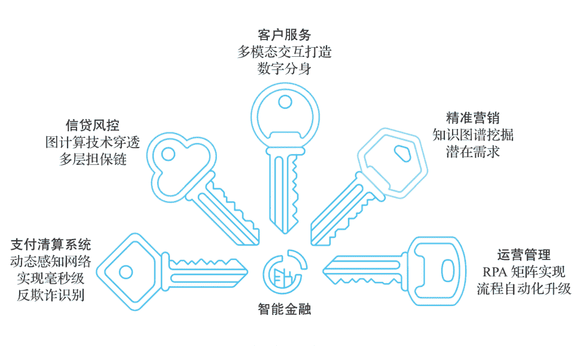
## 1.2.1
## 支付清算的智能进阶

支付清算是银行的基础，智能化水平直接牵动整体运行效率。AI在该领域的落地可归纳为以下几类。

#### 1. 实时欺诈感知引擎
借助机器学习与海量交易数据，对流水进行不间断监测，捕捉异常模式并阻断风险。某行上线后，欺诈识别能力提升约八成，经济损失明显收窄。
- 基于行为偏离的交易截断：持续积累用户一段时间的交易频次、时段习惯、常用终端与地理轨迹。一旦当下行为偏离既有画像且风险分超过阈值，系统立即触发拦截。
- 多机构联防的模式共享：多家机构通过安全沙箱定期上传欺诈案例与特征，区块链保证不可篡改与可追溯，加密保证传输存储安全，疑似交易可快速在共享库中比对。

#### 2. 跨境支付合规审查系统
系统调用自然语言处理自动读取并核验跨境支付的合规文件，确保符合国际规则。对跨国企业的合同、发票等关键材料，审核周期由平均两天压缩至两小时。
- 制裁名单实时匹配：持续更新全球制裁名单，通过模糊匹配快速识别交易主体相关性。多源数据供给结合大数据比对，降低合规盲区。
- 汇率波动预警模型：整合宏观经济、货币政策、利率走势与地缘动态，运用时序分析与神经网络预测汇率走向，为客户提供管理建议。

#### 3. 自进化对账与差错修复平台
结合规则引擎与机器学习自动发现对账差异并给出修复建议。预设金额、时间窗等规则，同时模型持续学习历史差异与修复路径。新差异先经规则快速筛查，再由算法处理复杂情形。某行使用后，对账时长由月均三天降至一天，修复成功率由六成提升至八成五。
- 规则引擎驱动的差异溯源：规则库内嵌各类场景差异成因与判定逻辑，如手续费规则变动归因通道费用，跨结算周期归因延迟，快速定位根因。
- 案例库驱动的智能修复：沉淀过往差错表现、成因、处置与结果的案例库，遇新问题时自动检索相似案例并结合当前上下文调整方案。

#### 4. 智能路由优化系统
依据金额、时效与成本动态选择最优通道。紧急小额跨境优先选择高速通道，大额低时效需求则择低成本路径。某电商接入后支付成本下降约15%，成功率由90%升至95%。
- 通道成本时效联合决策：实时追踪各通道手续费、汇兑成本与处理时效，结合线性规划与动态规划在金额与时效约束下快速求解最优解。
- 跨境路径合规优先评估：梳理各区域支付法规，为路径赋予风险等级。需求触发时在成本与时效之上优先筛选低风险合规路径，对高危地区或敏感行业加强复核。

#### 5. 流动性风险即时预测系统
融合内部头寸与外部市场流动性指标，实时推演流动性压力，为资金管理提供依据。某行提前一周预判紧张局面，及时调整策略避免风险。
- 头寸缺口预测：以长短期记忆网络学习历史头寸序列，捕捉时间特征与趋势，结合宏观与季节波动预测未来缺口。
- 清算窗口压力模拟：模拟极端波动或突发金融事件，对不同假设参数进行清算推演，评估应对能力并优化预案。

## 1.2.2
## 信贷风控的认知升级

信贷风控是核心，AI明显提升审批效率与精度。典型应用如下。

#### 1. 非结构化财报合同解析枢纽
OCR把纸质材料转为可编辑文本，NLP进行深度解析，词法句法语义模块协同提取财务关键指标与合同条款。
- 财报与工商信息交叉核验：将经营范围、注册资本变动、营收趋势等与工商库比对，算法标记差异与潜在风险。
- 合同履约风险评估：基于历史合同构建评估模型，综合付款周期、质量标准、交付地等条款与企业信用、行业违约率，输出违约概率与等级。

#### 2. 小微企业现金流预测模型
采集销售回款、采购支出、薪资发放、水电缴纳等资金流，ARIMA等时序模型挖掘趋势与季节性。
- 行业周期叠加推演：融合宏观数据、行业报告与企业财务，按繁荣、衰退、萧条、复苏各阶段模拟现金流变化。
- 供应链关系强度量化：以上下游多维度指标构建体系，用层次分析法确定权重加权打分，得分越高抗风险越强。

#### 3. 全维度担保网络图谱
收集直接、间接与股权隐性担保关系，以图数据库构建节点与连边，可视化网络位置与关联。
- 隐性担保圈识别：基于图计算传播标签，按连接与相似度聚类，揪出传统手段难发现的风险圈。
- 担保链断裂传导模拟：结合图谱与圈层识别，考虑关系紧密度、担保金额、企业实力，模拟关键主体违约后的风险扩散。

#### 4. 供应链金融风险评估
融合核心企业信用、供应商经营、物流等多源数据，神经网络模型量化整体风险。
- 核心企业辐射力评估：分析行业地位、市场影响、财务实力，用专家打分与层次分析法计算辐射分，辐射强则上下游风险更低。
- 多级供应商风险传导预警：实时监测经营、财务指标与交易情况，建立传导模型，出现财务困境、交货延迟等信号时及时预警。

#### 5. 动态信用评分优化平台
整合财务、水电消耗、税务申报、供应链交易、市场舆情等多维数据，机器学习与深度学习实时调参。
- 水电税务融合建模：关联水电消耗与生产规模、营收，税务数据与盈利与成本控制，提升评估全面性。
- 在线持续调优：依托实时反馈与在线学习，按市场与行业变化定期更新结构与算法，保持预测力。

## 1.2.3
## 客户服务的交互升级

客户服务是直接触点，AI显著提升质量与效率。主要形态如下。

#### 1. 多模态语音意图识别
融合语音识别、自然语言处理与机器学习，结合历史行为与业务场景洞察真实意图。对抗训练与生成对抗网络提升方言识别。
- 沉默客户行为预判：通过通话前后浏览与操作轨迹建模，判断沉默是疑惑、思考还是其他困扰。

#### 2. 工单智能分类与动态派发
NLP文本分类实现自动分拣，投诉文本用深度情感分析与RNN/LSTM解析情绪与诉求。
- 动态派发矩阵：为分支机构画像人员配置、专业、效率，依据工单类型、紧急度与客户区域智能匹配最合适团队。

#### 3. 财富管理对话机器人认知架构
基于知识图谱、NLP与机器学习构建认知层，覆盖产品咨询、风险评估、理财规划，并实时评估风险承受力。
- 对话策略动态调整：实时追踪指数、净值、汇率，结合组合与风险承受力调整话术，市场剧烈波动时主动预警并建议组合调整。

#### 4. 智能外呼管理系统
大数据与机器学习挖掘客户空闲时段，实现精准外呼时机预测。
- 通话质量AI质检：语音转写后用NLP评估话术合规、服务态度、问题解决，结合语音情感分析判断客户情绪，异常时预警并给改进建议。

#### 5. 视频银行智能助手
远程面签环节融合人脸识别、活体检测与身份证OCR增强核验，活体检测要求眨眼、张嘴等动作防范伪造。

### 1.2.4
## 精准营销的智能突破

精准营销依赖客户洞察，AI让画像更立体。核心工具为三维客户画像生成器，打破单一维度局限，通过资金流模式与家庭关系网络挖掘，构建全景画像，为营销提供数据基础与方向指引。

营销洞察驱动精细化运营

- 技术底座与数据深挖：借助海量信息解析与自适应学习模型搭建多维画像生成机制，从多视角汇聚行为数据，核心在于资金流向聚类。平台深度挖掘转账、支付、理财等场景产生的资金轨迹，把行为模式相近的群体归并，形成细分触达基础。
- 家庭网络财富关联挖掘：运用社群关系分析手段，梳理用户与家属间的资金往来脉络，还原家庭整体资产图景。例如系统识别到某用户配偶与子女在投资决策上高度联动，一方操作会牵动其他人，为制定家庭层面的综合方案提供依据。

#### 2. 智能理财推荐动态决策引擎
市场波动加剧，用户偏好日趋分化，个性化理财推荐需求凸显。该引擎可实时感知行情变化，结合既有投资状况与目标，动态调整推荐策略，定制契合方案，提升体验与收益。
- 策略适配与需求洞察：融合实时行情监测、需求洞察及智能算法决策，热点事件发生时迅速捕捉并解析传导路径，依据不同用户的风险偏好、投资目标与当前持仓，给出相应策略建议。
- 持仓组合缺口分析：基于组合理论与数据分析模型，识别现有组合中的风险敞口与收益短板。如发现某用户股票占比过高而债券配置不足，系统会定向推荐适配产品，帮助优化配置，实现风险收益平衡。

#### 3. 客户生命周期智能维系系统
用户是银行长期发展的资产，全周期管理关乎持续健康。该系统覆盖获客到流失的全段监测与干预，通过流失预警与挽留策略优化延长生命周期，提升价值。
- 流失预警机制：利用生存分析评估流失风险，整合交易历史、行为数据、服务交互等多源信息构建生存函数，预测未来流失概率。当交易频次下滑、平台登录减少、客服沟通下降时，系统判定进入高风险阶段并发出预警。
- A/B 测试优化挽留策略：针对不同特征的潜在流失群体，设计优惠活动、专属服务、个性化产品推荐等多组挽留方案，随机投放至不同用户组，对比响应率、留存率等指标，筛选最优策略。

#### 4. 全渠道营销效果预测系统
多渠道投放已成主流，如何科学评估渠道贡献并合理分配预算是关键。系统通过跨渠道触点深入分析与预算优化，帮助看清各渠道贡献，实现精准投放，提升投入回报。
- 归因与优化方法：通过跨渠道触点归因，重现用户在线上广告、社交媒体、线下活动、邮件等渠道间的行为路径与转化过程，利用数据追踪与归因模型量化各渠道在购买决策中的作用。
- 营销预算分配博弈模型：综合渠道效果、投入成本与竞争态势，构建博弈模型模拟渠道间资源竞争与协作，迭代计算最优预算分配方案，用有限投入实现最大化效果。

#### 5. 智能客群裂变运营平台
用户裂变是规模扩张的有效路径。平台挖掘社群潜能，通过识别影响力节点开展高效裂变，并实时监控成效，以更低成本实现用户群指数级增长。
- 裂变节点识别与监控：借助社群关系分析，对用户在社交平台的粉丝量、互动频率、传播范围等指标量化，筛选出在特定圈层内具备高影响力与传播能力的用户作为裂变节点。
- 裂变活动 ROI 实时监控：建立数据分析模型持续追踪活动期间新客获取量、转化率、销售额增长等核心指标，并与活动成本对比分析，动态优化转化效率。

### 1.2.5 运营管理的数智跃迁
运营是银行高效运行的基石，智能技术正显著提升运营智能化水平。
#### 1. 智能网点资源动态调度模型
聚焦网点资源配置难题，通过精准把握客流变化与柜员技能匹配，提升资源利用效率与服务体验。
- 基于 LBS 的客流量预测：应用位置服务技术实时采集周边用户位置、移动轨迹及历史到访数据，结合大数据与时间序列预测算法，对不同时段、区域的网点客流进行精准预判。
- 柜员技能与业务需求匹配优化：构建柜员技能库记录各业务熟练度，并实时监测网点业务需求。用户办理业务时，系统依据业务类型与复杂程度智能匹配最合适的柜员。
#### 2. 全流程智能文档审核工坊
致力于革新文档审核流程，实现快速准确审核，并在监管规则变化时自动适配，同时强化印章鉴别能力，保障合规安全。
- 监管文件变更自动适配：建立监管文件库实时跟踪政策变化，运用自然语言处理与机器学习解读新文件并提取关键要求，系统自动据此调整内部审核标准与流程。
- 印章鉴别的对抗样本防御：基于深度学习构建印章鉴别模型，用大量真实样本训练。针对微改伪造的对抗样本，经专项防御训练的模型可精准识别，有效防范伪造风险。
#### 3. 员工合规行为实时预警矩阵
作为合规管理的重要防线，通过持续监测员工操作轨迹，发现异常行为模式并预测权限滥用风险。
- 操作轨迹异常模式检测：部署行为监测系统记录登录时间、操作内容、数据访问等轨迹，利用数据挖掘与异常检测算法实时分析并预警异常。
- 权限滥用风险概率预测：整合岗位职责、权限配置与历史操作数据构建风险预测模型，借助逻辑回归、决策树等算法评估违规可能性，超阈值时自动触发权限限制与加强监督。
#### 4. 智能舆情监控与应对系统
在信息高速传播环境下，对声誉管理至关重要，可实时监测舆情、解析负面传播路径并提供危机话术建议。
- 负面舆情语义传播分析：广泛采集社交媒体、新闻、论坛等平台舆情信息，运用语义分析进行情感识别，快速定位负面舆情，并通过传播网络模型分析扩散路径与趋势。
- 危机应对话术生成建议：基于历史舆情案例与应对经验构建话术知识库，监测到重大负面舆情时，系统按内容、情感与传播态势生成针对性道歉、解释与解决方案建议。
#### 5. 网点布局智能优化平台
为网点选址与设备投放提供科学决策支持，通过区域经济分析与空间建模预测离行设备效益，优化布局提升覆盖率与盈利能力。
- 区域经济数据空间建模：整合 GDP、人口密度、消费水平、产业结构及交通、商业分布、人口流动等数据，运用 GIS 与空间计量经济学模型评估各区域网点需求与发展潜力。
- 离行式设备投放效益预测：结合空间建模结果与设备历史运营数据，构建投放效益预测模型，考虑设备类型、周边人流、办理频次、运营成本等因素，预测交易收入、满意度提升与成本节约等收益。

## 1.3 银行业 AI 应用面临的挑战与应对措施
落地面临数据治理与技术实施双重挑战。数据层面需解决隐私合规、跨机构共享与安全生态；技术层面需突破可解释性、系统兼容性与算力成本。通过标准化治理框架与完善实施路径，方能兼顾合规性与有效性。
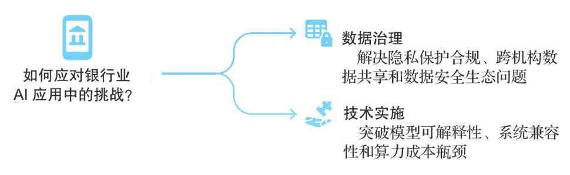
### 1.3.1 数据治理要求
需构建覆盖全生命周期的治理体系，重点解决隐私合规、跨机构共享与安全生态建设。治理要严格遵循《数据安全法》《个人信息保护法》等法规，并结合金融特性落地。
- 客户隐私保护合规体系：梳理业务流程中涉及隐私数据的环节，采集时获取明确授权并告知用途范围；存储时采用先进加密防止窃取；使用时设置严格访问权限。依托内部审计与外部评估持续优化体系，保障权益并提升公信力。
- 跨机构数据共享机制：由行业协会牵头制定统一数据标准与格式，建立安全共享平台。运用多方安全计算、联邦学习等技术实现数据可用不可见，在保护所有权前提下开展联合建模分析。
- 数据安全生态建设：与科技企业、监管部门协同建设安全生态。技术上部署防火墙与入侵检测系统实时监控威胁；人员上加强培训明确责任；制度上制定分级分类管理，对不同级别数据实施差异化防护。
### 1.3.2 技术实施门槛
落地需突破模型可解释性、系统兼容性与算力成本，设计适配金融场景的技术方案并建立全链路风险管理。
- 模型可解释性管理：研发可视化解释工具，以图表与文字呈现决策逻辑。例如信贷审批模型需展示信用评分影响因素与权重，便于审批人员理解并向用户解释，提升透明度。
- 系统接口兼容性改造：梳理内部系统接口，制定统一规范并采用适配器模式解决差异。新 AI 系统应在设计阶段严格遵循规范，确保与既有系统无缝对接。
- 算力成本控制：结合应用需求与业务波动规划算力，利用云计算弹性在高峰期扩容、低谷期释放。探索模型压缩与量化技术降低存储与计算消耗。
### 1.3.3 价值评估标准
需建立覆盖短期收益与长期价值的评估体系，通过 ROI 量化、场景测算与动态追踪确保投入与业务目标匹配。
- ROI 量化分析框架：梳理技术采购、培训、运维等投入，明确效率提升节省人力、精准营销增收等收益来源，运用净现值、内部收益率等财务指标评估可行性。
- 场景化收益测算：以智能客服为例，统计人工工作量减少比例与人力成本节约；通过满意度调查评估复购率与推荐率变化，估算潜在增收。
- 动态追踪机制：设定用户留存率、市场份额等长期指标，定期分析 AI 应用对其影响并优化策略，确保持续创造长期价值。

## 1.4 监管部门对于银行业 AI 应用的态度
发展需要在创新与监管间动态平衡。监管通过政策支持、数据安全、风险防控、透明监管与行业自律构建协同治理，以“创新激励+底线约束”双轨机制引导合规发展。
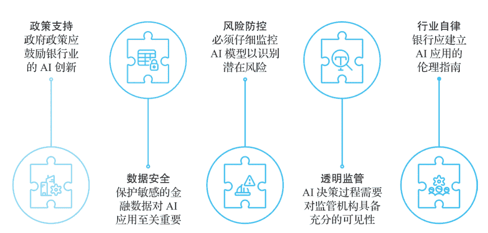
### 1.4.1 政策支持与鼓励创新
国家推动金融科技发展，出台政策鼓励银行用 AI 提升效率。央行引导创新试点，地方政府设立产业园区提供优惠，营造创新生态。
- 国家推动：将金融科技纳入战略规划，鼓励加大研发投入，促进成果转化，为符合条件的项目提供支持。
- 央行部署：制定行业标准与指导意见，组织试点总结经验推广，引导稳健创新。
- 地方实践：北京、上海举办金融科技大赛挖掘项目；深圳出台税收优惠降低研发成本，集聚人才与技术。
### 1.4.2 数据安全与隐私保护
监管通过强制规范与穿透检查强化治理，要求银行建立全生命周期防护体系。
- 监管要求：规定数据必须加密，泄露时须及时报告并补救；定期检查违规行为并处罚。
- 技术规范：采用国标加密算法，运用身份认证与权限管理控制访问，定期聘请专业机构审计并整改。
### 1.4.3 风险防控与合规管理
要求建立 AI 风险分层管控，从模型治理、业务流程、系统架构防范衍生风险。
- 风险分层治理：按高、中、低三级管理，高风险业务如涉及资金操作加强实时监测与现场检查，中风险定期评估，低风险持续关注并动态调整。
- 模型可解释性：银行须提交模型技术文档说明架构、训练数据与决策逻辑，监管通过技术验证可解释性以防范风险。
### 1.4.4 透明监管与技术创新结合
利用科技手段提升监管穿透力，建立动态监管机制实现早识别、早预警、早处置。
- 监管工具升级：搭建智能监管平台，运用海量数据监测交易异常与风险指标，用 AI 预测模型偏差等风险。
- 动态平衡机制：定期评估创新成果与风险状况，新技术带来机遇时适度放宽要求，风险上升时及时强化措施。
### 1.4.5 行业自律与生态建设
引导形成政府监管+行业自律+企业自治的三级体系，通过标准共建与资源共享推动生态健康发展。
- 银行实践响应：积极参与协会活动遵守自律规范，建立内部审查机制确保新项目合规。
- 生态合作：与科技企业联合开发，如与互联网公司优化智能客服；与科研机构共建实验室开展前沿研究，培养人才。

## 1.5 本章小结
银行业技术演进经历电子化、信息化、智能化三阶段，当前呈现替代与创新并存的双螺旋态势。数据治理、模型可解释性与算力成本是关键挑战，需以联邦学习、可解释算法与混合云架构应对。监管应以创新激励与合规约束双轨机制平衡风险与发展，推动标准化治理与生态共建。未来将深化人机协同，以智能决策与人文服务重塑金融价值链。
# 第2章 DeepSeek赋能银行场景
在数字化浪潮下，银行业迎来挑战与机遇并存的局面。DeepSeek凭借卓越核心能力为银行注入创新动能，可全方位支撑业务运营、风险防控、决策制定与生态拓展，提升整体效能。
DeepSeek可深度赋能数字化转型，围绕《金融科技发展规划（2022-2025年）》提出的场景驱动、生态共建目标，在网点升级、零售转型、对公服务等领域形成完整方案。其自然语言处理、知识图谱与隐私计算等技术能力，正为智能客服、精准营销与风险管理等核心领域提供有效支撑。

DeepSeek 赋能银行：能力全景与场景落地

对话式助手能承接日常咨询和商品推荐，提升线上服务效率；知识图谱把分散的客户数据连接成可利用资产，为精准营销提供支撑。机器学习在信贷审批、异常交易监测等环节提前发出风险信号。面对数据协作的合规难点，隐私计算为跨机构联合建模打开合规通道，使反洗钱等敏感业务能在可控范围内探索。在《数据安全法》《个人信息保护法》及央行技术规范的约束下，通过脱敏、权限管控等手段实现落地，DeepSeek正成为银行平衡创新与风控的关键工具。以下围绕 DeepSeek 在银行场景的应用逻辑展开。

## 2.1 DeepSeek核心能力解析

围绕业务全链条，技术构建了覆盖服务交互、合规管理、决策支持的五大能力模块，如图2-1所示。整体遵循《中华人民共和国数据安全法》《中华人民共和国个人信息保护法》及央行系列技术规范，通过动态知识库、智能风险中枢、开放API网关等组件实现能力与业务场景的深度耦合，满足监管对AI系统安全性与可靠性的认证要求。

### 2.1.1 智能银行服务中枢

银行借助实时知识维护、多渠道协同引擎和智能交互，搭建涵盖资料管理、全渠道协同、智能对话与业务引导的服务中枢，目标是效率与体验双提升。

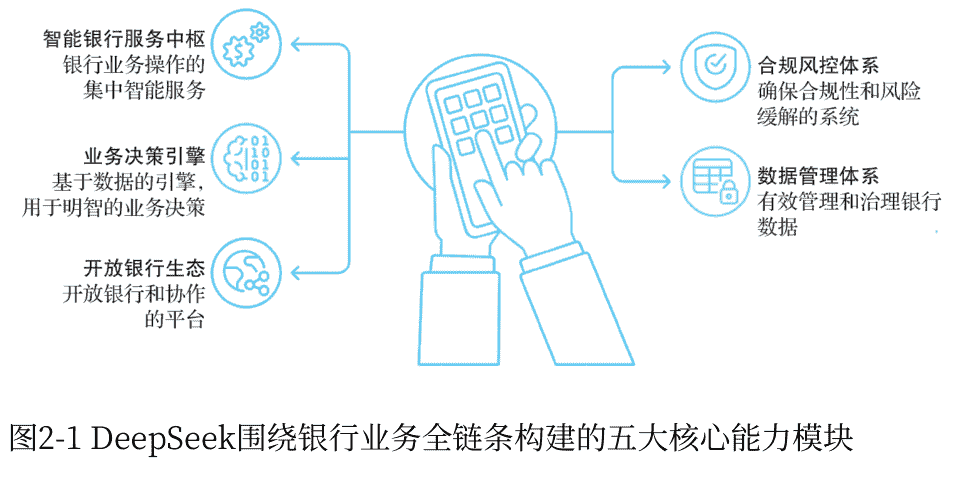
- 产品知识实时刷新：依托自然语言处理，系统自动读取监管文件、说明书等非结构化内容，构建可随时更新的关系图谱。新理财产品上线时，关键属性如风险等级、投资范围被自动抽取并同步到客服话术库和手机银行说明页，保证多渠道表述一致。客户咨询时柜员可即时调取最新条款作答。
- 多端交互联动：智能路由引擎整合手机App、微信公众号、柜面等渠道的交互记录。客户在手机端发起贷款申请后转网点，系统会自动把已填信息推送至柜员终端，避免重复录入。线上无法解决的复杂问题，系统自动生成工单并派发至专业团队，形成闭环。
- 多模态分级鉴权：融合声纹、人脸、证件OCR等技术，在远程开户场景实现分级认证。视频核身时联动公安联网核查，校验人像、活体及证件真伪，对高风险交易叠加语音口令验证，既满足反洗钱识别要求，又缩短认证耗时。
- 实时话术辅助：通过语义理解与场景适配，为客服提供即时话术建议。咨询理财赎回规则时，系统自动匹配监管条款与说明书原文，生成合规解释模板。识别到客户情绪波动时，动态推荐安抚类话术框架，避免不当表述引发投诉。话术库随政策变化同步更新。
- 跨部门流程引导：流程引擎把跨部门业务如遗产继承过户拆解为标准化步骤。客户通过手机银行提交申请后，系统自动生成材料清单并校验完整性。柜面办理时智能终端实时提示审核要点如公证书有效性验证，减少人工疏漏。全流程经区块链存证，可追溯。

### 2.1.2 合规风控体系

合规是银行生命线，风控是稳健发展的基石。技术通过监管解读、风险实时监测等能力，构建事前预警、事中拦截、事后溯源的立体体系，强化数据安全防护与合规流程自动化。

- 监管政策自动解读：实时抓取央行、国家金融监督管理总局、国家外汇管理局发布的文件，用文本解析提取核心要求。例如将《关于规范金融机构资产管理业务的指导意见》银发〔2018〕106号中关于理财净值化管理的要求自动转化为内部风控规则参数，降低人工解读滞后与偏差。
- 反洗钱智能筛查：基于交易频次、金额、流向、地域等多维特征构建监测模型，对账户资金流动实时分析，自动标记异常模式如短期多笔小额资金分散汇入同一账户，生成预警报告推送合规部门，提升人工复核效率。
- 数据安全防护网：采用加密、访问控制、脱敏处理等技术，对客户个人信息、交易数据、业务合同等敏感数据实施全生命周期保护。部署数据丢失防护系统，实时监控邮件、文件传输中的敏感数据外发行为，防止内部违规泄露。
- 智能合规机器人：预设“贷款三查”“销售双录”“客户风险等级划分”等流程的检查节点，自动扫描单据、录音录像、系统操作日志，识别合同要素缺失、话术违规等问题，实现合规检查自动化与标准化。
- 业务连续性保障：构建同城双活、异地灾备架构，制定覆盖核心交易、支付结算、客户服务等业务的应急预案。定期开展灾备演练，确保系统故障或自然灾害时关键业务可在规定时间内切换至灾备系统，保证交易不断。

### 2.1.3 业务决策引擎

在智能决策领域，基于技术能力可搭建覆盖资产配置、风险评估、投资者适当性管理的支持体系，通过数据分析推动流程智能化，借助智能投顾优化配置，用信贷风控中枢提升审批效率，释放运营人力并实时监控监管指标。

- 智能投顾模型：整合资产规模、风险承受、投资目标等信息，结合市场行情生成个性化组合建议，如平衡型客户推荐60%债券+30%股票+10%现金。支持定期再平衡提醒，当配置偏离目标5%以上自动推送调仓建议，降低人工投顾成本。
- 信贷风控中枢：融合央行征信、企业纳税、水电缴费、电商流水等多源数据构建评分模型，自动评估违约概率。小额消费贷可实现秒级审批，企业贷输出风险评估报告辅助客户经理，提升效率与准确性。
- 运营自动化：运用机器人流程自动化替代人工完成账户对账、报表生成、客户回访等重复工作。例如每月初自动生成对账单并按渠道发送，定期对睡眠客户发送短信唤醒，释放人力向高价值业务转型。
- 客户价值挖掘：分析交易行为、产品持有、渠道使用数据，识别高价值客户及潜在需求。如连续3个月购买大额理财且未用信用卡的客户被标记为白金卡潜在客户并推送专属权益；定期存款到期前推送续存或理财转换建议。
- 监管指标看板：实时采集资本充足率、流动性覆盖率、不良贷款率等核心指标，与监管标准及内部预警阈值比对，以可视化图表展示变化。指标逼近阈值时自动高亮并关联处置预案，帮助管理层掌握经营与合规状态。

### 2.1.4 数据管理体系

非结构化数据处理与风险建模能力助力搭建标准化、智能化的数据管理体系，覆盖资产盘点、风险画像、非结构化处理、模型监控与监管沙盒，提升可用性与风险管控能力。

- 企业级资产地图：梳理客户信息、交易记录、风控数据、产品数据等资产，明确来源、存储位置、更新频率、使用权限及质量状况，形成可视化地图。业务部门可快速检索所需数据，如营销部门便捷查询高净值客户资产配置。
- 客户风险画像：整合基本信息、交易行为、征信记录、外部舆情，构建360°评估模型自动划分风险等级。如信用卡透支率超70%且多头借贷的客户申请贷款时自动提高审批门槛，降低信用风险。
- 非结构化数据处理：运用OCR与自然语言处理，把纸质合同、发票图像、客服录音、邮件文本转为结构化信息。例如从贷款合同中提取金额、期限、担保方式录入系统，减少录入错误，使数据可分析利用。
- 模型风险管理：建立全生命周期管理机制，对信贷评分、反欺诈模型进行持续监控，评估准确率、稳定性及公平性。发现特定客群如小微企业主预测误差上升时自动触发优化流程，结合新数据重训模型，确保评估可靠。
- 监管沙盒测试：为新业务、新产品提供隔离测试环境，模拟监管要求与市场风险场景，验证合规性与可行性。如推出数字货币钱包前，通过沙盒测试跨境支付反洗钱合规，确保正式上线符合要求。

### 2.1.5 开放银行生态

依托OpenAPI智能网关与生态风控能力，推动银行打破服务边界，通过API开放、线下网点智能化、移动展业、开发者赋能与生态联合风控，构建“银行即服务”的开放生态。

- OpenAPI智能网关：以标准化API封装账户查询、支付结算、理财购买等核心能力，通过网关安全开放给电商平台、政务系统、产业链核心企业。例如与社保平台合作实现养老金代发，与打车软件合作推出支付即积分，把银行服务嵌入高频生活场景，提升获客与活跃度。
- 线下网点智能协同：网点部署智能排队叫号、互动智慧屏、VTM等设备。系统按业务类型与等候时长自动分配窗口，取号时同步推送所需材料清单，柜员可提前查看资料，减少现场办理时间。
- 移动展业平台：为员工提供PAD等便携终端，支持上门开卡、贷款申请、产品签约。现场采集身份信息实时联网核验，电子签章完成合同签署。如批量为企业员工开卡时同步完成人脸识别与账户激活，打破时空限制。
- 开发者赋能中心：搭建开发者平台，提供API文档、开发工具包、技术培训与沙盒测试环境，支持第三方基于银行开放能力开发创新应用。例如金融科技公司利用支付接口开发供应链金融管理系统，共同拓展普惠场景。
- 生态联合风控：与电商平台、物流公司、征信机构等伙伴在合规范围内共享风险数据，构建跨场景联合风控模型。如供应链金融中，通过核心企业订单数据与物流轨迹验证上下游融资需求真实性，降低产业链整体信贷风险。

## 2.2 银行场景应用实践

金融科技加速发展下，银行业数字化转型提速。DeepSeek作为前沿人工智能方案，已在多个银行场景落地，助力流程优化、服务升级、风险防控与创新拓展。图2-2展示了不同场景的应用实践。

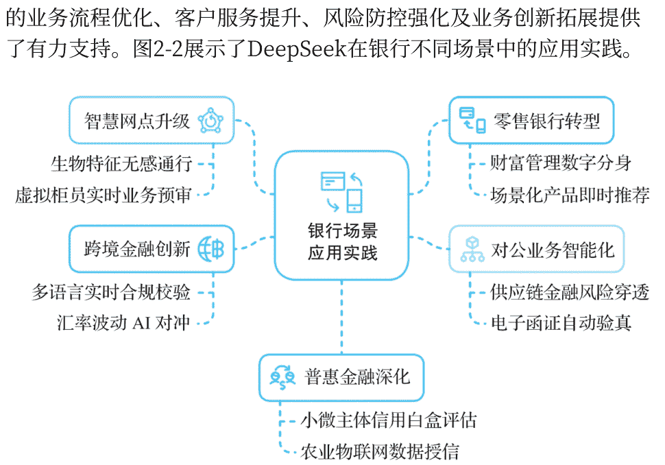

### 2.2.1 智慧网点升级

借助技术方案，网点正从交易中心向服务体验中心转型，综合运用生物识别、虚拟柜员、AR与设备调度等工具提升效率体验，同时通过环境感知优化能耗。

- 生物特征无感通行：在取得客户单独同意并做好安全保护前提下，入口部署人脸识别摄像头，自动识别身份并关联预约信息，引导至对应服务区，简化排队登记。VIP客户信息自动推送至专属理财经理，实现精准服务。
- 虚拟柜员实时预审：客户在智能终端描述需求如出国留学汇款，虚拟柜员通过自然语言处理提取金额、收款方等关键信息，自动填表单并校验材料是否齐全，预审通过后推送柜面，减少现场录入。
- 智能设备动态调度：实时监控VTM、存取款机、智能柜台使用状态，通过屏显与语音引导客户至空闲设备。柜台排队多时，系统提示小额存取客户使用ATM并提供指引，平衡负载。
- AR远程专家协同：针对复杂业务如跨境投资政策咨询，客户可通过AR眼镜与远程专家实时连线。专家在客户视野中标记界面操作步骤并推送政策文件关键条款解读，实现沉浸式指导，提升办理成功率。
- 环境感知能耗优化：部署传感器监测人流密度、光照、温湿度，自动调节空调、照明、通风系统。非高峰时段降低负荷，在保障舒适前提下减少能耗成本。

### 2.2.2 零售银行转型

语义解析与关系图谱技术助力打造个性化零售服务，通过数字分身、场景化推荐、智能账单解析、家庭金融图谱与情绪识别提升财富管理智能化水平。

- 财富管理数字分身：为零售客户构建AI虚拟财富管家，基于资产规模、风险偏好、投资目标提供7×24小时个性化建议。授权后可自动执行低风险理财产品的申购与赎回，如按利率变化自动调整货币基金与国债逆回购配置。
- 场景化产品即时推荐：整合线上消费、线下支付、社交互动数据，在行为触发特定条件时推送适配产品。例如客户在母婴电商平台购买奶粉后，系统自动推荐育儿宝教育储蓄产品；信用卡客户餐饮消费时弹出美食分期优惠。
- 智能账单语义解析：把信用卡账单、房贷月供账单转化为自然语言解读报告，除金额、还款日期外，还提供消费结构分析与异常交易预警，帮助客户更清晰了解个人财务状况。
- 家庭金融关系图谱：整合家庭成员银行账户数据，构建金融关系网络，识别夫妻共同还款、子女教育金规划、父母赡养保障等需求。为家庭客户定制综合方案，如为新婚夫妇推荐住房贷款+生育保险+定期存款组合。
- 情绪识别客诉处理：在电话客服与智能客服场景中，通过语音语调分析、文本情感标签识别客户情绪。当检测到不满情绪时自动转资深客服，并推送客户历史投诉记录与相似问题解决方案库，快速响应提升满意度。

### 2.2.3 对公业务智能化

供应链穿透与智能验真技术赋能对公风控，通过风险穿透、电子函证、跨境结算优化、财报分析与授信流程孪生提升效率与管控能力。

- 供应链金融风险穿透：整合核心企业ERP数据、上下游交易凭证、物流运输轨迹，构建供应链可视化图谱，实时监控链内资金流、信息流、货物流匹配情况。自动识别虚假贸易风险，如同一批货物重复质押融资；发票金额与物流货值差异超10%时触发预警。
- 电子函证自动验真：对接区块链函证平台，实现银行询证函电子化流转与自动验真。企业提交申请后系统自动核验公章、金额、日期真实性，10秒内完成回函，确保信息不可篡改。
- 跨境结算智能路由：基于实时汇率、清算行额度、反洗钱风险等级等因素，为企业跨境结算动态推荐最优路径。在人民币跨境支付系统与SWIFT之间综合评估成本、到账时间、合规风险，选择更优渠道。
- 财报结构化洞察：运用自然语言处理与机器学习对企业财务报表智能分析，自动提取资产负债率、流动比率、营收增长率等关键指标生成风险预警报告。如应收账款周转率连续3个季度下降，提示关注资金回笼能力。
- 授信审批流程孪生：通过数字孪生技术构建授信审批流程虚拟模型，模拟贷前调查、贷中审查到贷后管理的全流程。自动校验“三查、三比、三访”等风控要求执行情况，确保流程合规，降低操作风险。

### 2.2.4 跨境金融创新

多语言合规引擎与区块链溯源技术助力拓展跨境服务，提升合规性、安全性和便捷性。

- 多语言实时合规校验：支持中文、英文、日文、韩文等监管政策文本解析，在跨境汇款、贸易融资等业务中自动匹配目标国家或地区合规要求，如欧盟反洗钱指令、OFAC制裁名单，生成合规风险清单并标注需补充材料。
- 汇率波动AI对冲：基于历史汇率数据与市场舆情分析，构建机器学习模型预测主要货币对短期波动趋势。当预测波动超过客户预设阈值时自动触发对冲策略建议如办理远期结售汇业务，并推送至企业外汇部门，降低财务风险。

### 2.2.5 普惠金融深化

物联网数据融合与白盒信用模型助力深化普惠服务，解决小微企业、农业等领域融资难题，实现补贴精准发放与风险防控。

- 小微融资数据整合：融合电费、水费、电商流水、物流轨迹等物联网数据，构建白盒信用模型，为缺乏传统征信的小微企业提供可解释的授信评估，提升融资可得性。

银行业AI创新实践全景扫描

跨境贸易单证上链留痕。银行把订单、发票、装箱清单、海运提单等核心凭证写入分布式账本，借助账本抗篡改的特性保证源头可信。买卖双方随时追溯单据流转轨迹，进口方可核验货物是否按约开航，出口方可跟踪货款到账节奏，显著降低跨境交易的信息不对称损耗。

离岸账户合规智能巡检。模型内置反洗钱细则与CRS全球征税标准，持续扫描离岸资金动向，自动标记风险征兆，例如空壳公司频发大额划转、境外账户与高危地区账户异常高频往来等情形，并把风控简报推送至合规部门，确保境外业务始终在监管框架内运行。

地缘风险前置研判。系统抓取政治事件、自然灾害、贸易政策变化等非结构化信息训练风险评估模型，可推演某国大选对货币政策的潜在影响，或预判区域贸易摩擦对进出口企业的冲击，为跨境业务提供提前预警。

小微主体信用白盒化评估。摆脱对抵押和担保的依赖，融合企业税务发票、水电缴费、电商流水等多源经营数据，形成可解释的评分体系。授信依据透明呈现，例如近12个月开票300万元且无欠税，核定50万元信用额度，有效缓解小微数据缺口，提升普惠可得性，支持实体薄弱环节。

农用物联网驱动的动态授信。对接田间传感器与养殖监控终端，实时获取土壤墒情、作物株高、畜禽体温、采食量等生产数据。银行根据物联网指标动态判断还款能力，以预计粮食产量核定种植户额度，破解农业信贷抵押不足的痛点，推动农村金融与现代农业融合。

民生补贴直达终端。银行账户体系与民政、人社等部门名录对接，自动甄别低保对象、退役军人、建档立卡贫困户等符合条件群体。资金直发至个人账户后，通过短信与手机银行推送到账提示，实现最后一公里精准发放，防止截留挪用，提升民生服务效率。

县域特色普惠产品快速组装。借助DeepSeek的模块化配置工具，银行可快速定制茶叶种植贷、乡村旅游经营贷等地方特色产品。一键设定利率、期限、还款方式，并联动当地龙头企业收购数据与农产品价格指数，形成生产加工销售全链条服务闭环，赋能乡村产业发展。

区域联防反欺诈知识共享。DeepSeek帮助汇聚区域分支、公安、电商、运营商的欺诈案例，搭建分布式反欺诈知识库。黑名单信息如多头借贷、电信诈骗涉案账户实时共享，并以机器学习持续迭代诈骗话术与模式特征，有效降低农村农户受骗风险，维护普惠生态安全。

2.3 银行场景模型失真管控体系

随着智能化在银行业的加速落地，模型输出与事实出现偏差的现象逐渐显现，可能引发决策失误、客户误导与合规风险。必须建立系统性治理机制，确保智能化应用可信可靠。

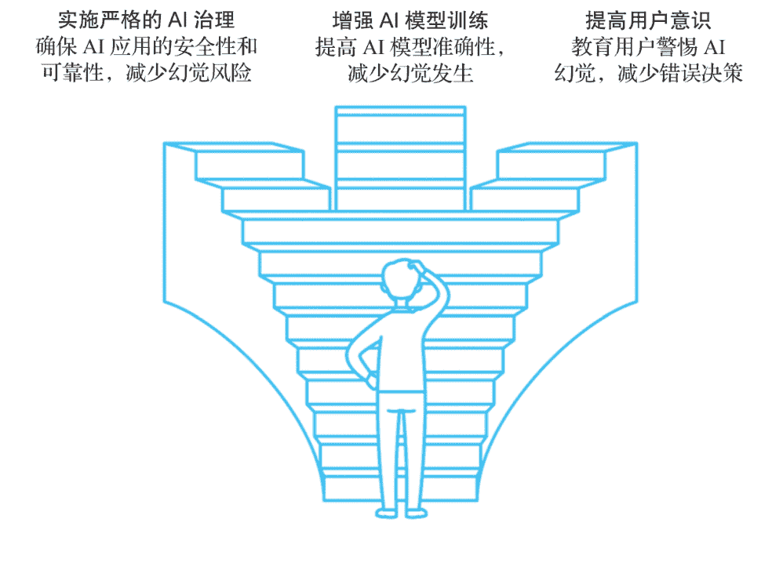
### 2.3.1 智慧网点交互保障

DeepSeek助力搭建生物特征多重核验与决策监控体系，提升虚拟服务的可靠性。借助AR空间锚定防篡改、双路径调度保稳定，构建多层可信交互架构，避免模型失真导致网点决策失误。

多模态生物特征互验。身份核验时同步采集人脸、指纹、声纹至少三项特征，经异构融合算法与公安授权核验系统比对。大额转账时先用人脸确认，再叠加指纹扫描与语音指令二次校验，将差错率压至行业安全阈值，有效抵御3D人脸、指纹膜等伪造攻击。

虚拟柜员置信度监测。为每一次应答生成0到100分的置信评分，依据知识图谱匹配度、历史问答准确率等指标。评分低于70分时，如复杂金融条款解读，自动转人工复核，由柜员二次确认并补充书面说明，防止误导性回复外流。

设备调度双路径决策。ATM进钞、VTM故障报修等关键操作采取人工智能建议加人工确认模式。例如系统基于历史取款数据建议为3号ATM补钞20万元，需运营主管在后台确认后执行，避免误判导致现金短缺或积压。

AR空间数据真实性锚定。远程专家协助场景中，激光雷达扫描网点物理环境生成三维坐标，把虚拟标注与实体界面像素级对齐，同时实时校验AR交互反馈，防止定位误差或传输延迟导致指引错误，确保远程服务真实可靠。

### 2.3.2 零售服务决策可解释性

银行运用DeepSeek结合因果推断与审计追踪，打造透明可溯源的零售决策机制，提升客户信任，并通过人机协同校验与情绪误差补偿降低误判。

数字分身行为审计追踪。财富管理数字分身的每一步操作如基金推荐、组合调整，均生成完整决策日志，记录数据来源、模型版本、风险指标。客户可在手机银行查询推荐理由，审计部门也可全链路回溯，确保合规可控。

因果推断式推荐。摒弃买A也买B的关联逻辑，采用因果推断挖掘真实需求。例如识别客户办理房贷后对装修贷的需求因果链，实现精准推荐，避免无效推送。

账单解析人机协同校验。智能系统先对异常交易如凌晨境外消费1万元进行风险分级，随后交人工客服复核。客服通过短信验证码等渠道联系客户确认真实性，经确认后才启动盗刷流程与账户冻结，将误封率控制在极低水平。

情绪识别误差补偿模型。针对方言口音与语境差异导致的情绪识别偏差，定期用标注语料微调模型。例如粤语区新增方言情绪语料库，将呢个服务好唔错正确识别为正面反馈，提升方言场景识别准确率，确保服务响应恰当。

### 2.3.3 对公业务风险穿透管理

借助DeepSeek构建多层风险验证体系，避免对公业务中人工智能的误判风险，让信贷决策更客观精准。

供应链多源数据交叉验证。对核心企业报送的上下游交易数据，系统自动比对物流轨迹、税务发票流向等。例如核心企业申报100万元交易，物流平台显示实际货值仅80万元，差额超20%即触发人工核查，防止虚构交易骗贷。

区块链函证验真体系。基于联盟链搭建银行、企业、会计师事务所三方函证存证网络，存款余额、应收账款等函证信息上链后难以改动，任何修改需多方共识，确保函证真实性。

财报分析专家规则校准。人工智能提取的资产负债率、流动比率等指标需与行业专家经验规则交叉校验。例如房企资产负债率85%，模型判定可控，但行业警戒线为80%，系统自动提示重点关注现金流，避免历史数据偏见。

授信模型对抗性测试。模拟恶意输入场景评估模型鲁棒性，例如向小微授信模型输入营收增长率1000%、净利润率90%等异常数据，观察是否误判，确保模型面对造假数据仍能保持风险判断准确。

### 2.3.4 跨境金融可信化建设

通过DeepSeek搭建跨境业务信任生态，解决多语言合规与汇率风险等信任孤岛问题。

多语言合规知识图谱。整合中文、英文、法文的跨境监管术语，建立反洗钱、跨境资本流动限制等概念的多语言映射与内涵解释，提升合规理解一致性。

汇率对冲压力测试沙盒。模拟极端市场情景对人工智能对冲策略进行压力测试，如2008年欧元单日暴跌5%、2020年汇率剧烈波动，验证策略能否将客户损失控制在预设范围内。

跨境贸易双链存证。将贸易单据链与资金流水链同时上链，通过智能合约自动比对单据货值与付款金额。差异超过5%时自动冻结付款并触发人工核查，确保贸易流与资金流一致。

资金流动模式库动态更新。持续采集200多个国家和地区的资金流特征，构建异常模式库。例如识别某国出现小额外汇分散汇入、集中汇出模式，自动纳入反洗钱监测规则并启动加强尽职调查。

### 2.3.5 普惠金融精准化控制

银行借助DeepSeek建立普惠风险控制体系，在扩大覆盖的同时守住风险底线，避免普惠变普亏。

行业数据对比验证模型。针对餐饮、物流、批发零售等行业设定差异化指标，例如餐饮看日均流水与翻台率，物流看车辆周转率。某火锅店申请贷款显示日均流水10万元，远高于行业均值5万元时，系统自动启动现场核验，防止数据造假。

物联网设备可信认证。对农业数据采集设备进行区块链签名认证，每台设备绑定唯一ID、地理位置与采集频率。养殖场提交的生猪存栏量需附设备ID与时间戳加密信息，银行可通过区块链浏览器验真，解决农业信贷数据不可信难题。

补贴发放双盲验证。民生补贴流程采用数据分离机制，政府加密传输受益人身份信息，银行仅负责资金划转，双方互不掌握完整身份账户对应关系，有效杜绝名单篡改风险，确保惠民资金安全到账。

反欺诈分层处置机制。按风险等级差异化处理，疑似欺诈如虚假单位地址则自动驳回并提示修正；确认欺诈如冒用身份证、参与电信诈骗则永久列入黑名单并上报征信与监管机构。

2.4 DeepSeek 与深度伪造

随着生成式人工智能发展，深度伪造成为金融安全的新威胁。DeepSeek既要防范伪造带来的风险，也要以技术创新提升反伪造能力。

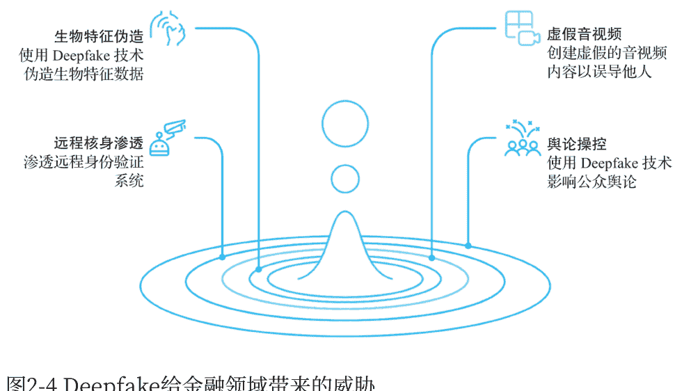
图2-4 Deepfake给金融领域带来的威胁

### 2.4.1 Deepfake 技术解析与威胁

1. Deepfake 技术定义与核心原理
深度伪造依托深度学习，尤其是生成对抗网络GAN与变分自编码器VAE，利用大量真实数据训练生成逼真的虚假图文音内容。金融场景下可被用于伪造身份、编造交易记录、篡改金融文件，带来严重安全合规隐患。

2. 生物特征伪造攻击场景
攻击者可伪造指纹、人脸、声纹突破生物识别。例如伪造人脸视频通过远程开户验证，或伪造声纹欺骗语音识别系统，进而获取账户权限进行非法交易。

3. 虚假音视频材料生成风险
伪造视频或音频可制造虚假广告、客服对话、高管讲话，误导客户与投资者，引发市场波动。如伪造银行高管讲话可能导致恐慌性抛售与资金流失。

4. 远程核身流程渗透威胁
在远程核身中，伪造生物特征与音视频可绕过身份验证，非法获取账户控制权，不仅侵害客户资金安全，也损害银行声誉。

5. 企业级舆论操控隐患
伪造高管讲话或虚假新闻报道可质疑企业财务与经营行为，影响品牌形象与市场信心，进而冲击股价。

### 2.4.2 银行针对 Deepfake 的防御体系

1. 多模态生物识别升级
引入3D活体检测与声纹识别等多模态技术。3D活体可检测生物特征三维结构与动态变化，声纹可分析频率、音调、语速识别伪造音频，显著提升认证准确性。

2. 人工智能伪造内容检测引擎部署
部署专用检测引擎，利用深度学习实时识别伪造图像、视频、音频，通过像素特征、生成模式与数据一致性分析发现伪造痕迹。

3. 区块链业务存证溯源机制
以区块链记录业务交易与客户身份信息，实现难以改动的存证。身份验证过程与交易记录上链后，任何篡改可被即时发现。

4. 动态交互验证流程优化
采用实时多因素验证与动态挑战响应机制，例如随机验证码叠加短信、人脸、声纹验证，有效抵御伪造攻击并兼顾体验。

5. 跨机构反欺诈联盟协同
银行与同业、监管机构共建反欺诈联盟，共享伪造案例与防御经验，快速识别新型攻击，提升行业整体安全水平。

### 2.4.3 DeepSeek 反伪造技术实践

1. 多模态风控模型应用
基于DeepSeek构建VL-R1多模态风控模型，融合视觉、语言与推理能力，实时监控生物特征、行为数据与交易记录。大额转账时可结合面部表情、语音特征与交易行为判断伪造风险。

2. 伪造文件痕迹智能解析
通过分析文件生成模式、数据一致性与像素级异常，识别篡改或伪造文件，防止虚假凭证在内部流转。

3. 本地化数据隐私保护方案
部署本地化存储与处理方案，结合加密与访问控制，确保客户身份与交易数据在本地安全处理，防止泄露。

4. 业务行为链异常监测
构建行为链监测模型，实时分析登录时间、交易频率、行为路径等数据。短时间内频繁登录并大额转账等异常将触发预警与二次验证。

5. 模型幻觉抑制技术落地
通过对抗训练与数据增强优化模型训练过程，减少虚假生成与错误决策，提升模型稳定性，降低人工智能幻觉带来的业务风险。

### 2.4.4 未来挑战与应对方式

1. 升级生成式人工智能对抗技术
伪造手段随生成式人工智能升级而演变，银行需持续跟踪技术进展，引入更先进检测算法与多模态识别。提高训练数据质量、加强外部事实核查与推理能力是抑制幻觉的关键路径。

2. 建立深度伪造数字水印标准
推动在生成内容中嵌入不可见数字水印，记录生成时间、设备与算法，便于溯源与识别滥用，为行业风险管理提供支撑。

3. 共建金融合规检测框架

合规协同与风险防御

要让生成式技术在银行里合法稳健地运行，必须打破机构壁垒。与同业机构和监管部门一道搭建统一的合规检验体系，是把技术创新限制在法律框架内的关键。制定一致的合规规范和检验流程，可以对模型幻觉、伪造攻击等引发的合规压力形成有效抵御。国家网信办牵头七部委共同出台的《生成式人工智能服务管理暂行办法》，对数据筛选、模型生成优化、服务供给等环节作出明确的法制要求和风险防范指引，为银行合规落地提供了可参考的依据。

#### 4. 深化跨域联防联控机制
单一行业难以覆盖新型威胁，需要跨行业协同防御。银行应与科技、运营、通信等领域主体建立联动机制，共同应对伪造攻击与模型幻觉。信息共享与技术互通能够明显提升风险识别和处置的响应速度。

#### 5. 探索反伪造技术伦理边界
反伪造技术在快速迭代中也逼近伦理底线。银行必须主动划定道德边界，保障技术使用符合伦理准则。应用人工智能时应坚持负责任创新、可控创造性等价值导向，并将其内化为工程人员的思维习惯和模型代码。同时倡导避免生成存在争议的结论、避免输出无法追溯的信息、避免产出超出模型认知边界的内容，推动模型从追求生成流畅转向确保内容可信。

## 本章小结
本章梳理了 DeepSeek 在银行场景的多维赋能路径。围绕智能服务中枢、合规风控体系与业务决策引擎三大方向，技术深度嵌入智慧网点升级、零售转型、对公智能化等核心场景，显著提升服务效能与风险管控能力。技术架构严格遵循监管要求，助力精准营销、供应链融资、跨境结算等领域的创新突破。针对模型幻觉风险，提出多模态校验、决策置信度监测等治理思路，并构建反伪造防御体系应对 Deepfake 威胁，保障应用可信合规。

# 第3章 银行实战 DeepSeek 提示词手册
数字化转型提速下，提示词设计已成为提升工作效率的核心能力。类比与同事沟通，表达越清晰系统理解越准确。比如贷款审核时输入“按监管要求分析客户征信报告并标注异常风险点”，系统即可快速给出结构化分析结果。

本章结合真实业务，讲解如何把复杂业务需求转化为机器可高效响应的对话指令，帮助从业者在客户服务、获客营销、风险排查等环节更顺畅地借助智能工具辅助决策。

## 3.1 DeepSeek 常用提示词

### 3.1.1 通用提问框架
银行业务中发挥工具价值，离不开结构化提问。被广泛采用的 RTGO 框架，可视为通用提问模板。

RTGO 由四项要素构成：
- ○Role：角色定位，例如“资深风控分析师”。
- ○Task：具体任务，例如“设计反欺诈策略”。
- ○Goal：预期目标，例如“降低可疑交易误判率”。
- ○Objective：执行要求，例如“分三段阐述并附数据案例”。

四项要素融合形成角色驱动任务模式。如“以零售银行产品经理身份梳理某客户理财偏好，制定差异化营销方案，按需求强度排序并说明推荐理由”。这种结构化表达提升理解效率，同时保证输出契合业务规范与监管要求，有助于智能客服、数据分析、合规管理等场景实现高质量协作，推动数字化精准落地。

### 3.1.2 CO-STAR 结构化提示词
CO-STAR 是一种精细化沟通框架，由六大要素组成。

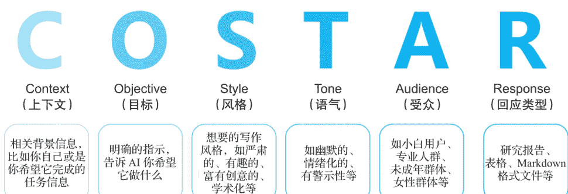
- ○Context 上下文：提供背景或身份信息，为任务理解奠定基础。
- ○Objective 目标：明确需完成的具体工作，指令清晰无歧义。
- ○Style 风格：界定写作风格，如严谨、活泼、学术化等。
- ○Tone 语气：确定情感基调，如幽默、安抚、警示等。
- ○Audience 受众：明确面向对象，如普通用户、专业人士等。
- ○Response 回应类型：指定输出形式，如研究报告、表格、Markdown 文件等。

CO-STAR 通过精准定义各要素，确保信息传递准确高效，适用于多种人机交互指令设计。

该框架可被广泛用于内容创作、商业职场、教育、技术文档、客户服务等领域。

银行业务人员可在多场景应用 CO-STAR 设计提示词，提升服务效能。
- 产品推荐：明确客户风险偏好、设定适配目标、采用简明专业风格与亲和语气，为普通投资者提供结构化方案。
- 撰写风险评估报告：基于市场数据与合规分析目标，以严谨学术风格与客观语气为管理层生成标准化文档。
- 处理客户投诉：锁定争议细节、聚焦解决方案，采用清晰易懂表述与安抚语气，为投诉客户生成分步指引。

要素拆解与精准匹配，有助于提升信息输出的专业度、场景适配性与服务效率，在合规前提下优化客户体验与内部协作质量。

### 3.1.3 银行业务场景主流提示词
转型浪潮中，银行业务对复杂性、实时性与合规性的要求不断提高。结构化提示词作为人机协作的核心工具，已成为提升效率、控制风险、推动创新的关键载体。以下对常见几类 AI 提示词进行展开。

#### 1. 信息查询类提示词：构建业务响应的“神经末梢”
信息查询类提示词是处理客户咨询与内部业务时最常用的类型，主要用于快速获取特定信息。

例如“查询客户账户余额”可迅速调取实时余额，帮助客户掌握资金状况；“获取最新汇率信息”则为外汇交易提供数据支撑。

这类提示词简洁直指、响应迅速，可缩短等待时间，提升服务体验。

#### 2. 数据分析类提示词：驱动业务决策的“智慧引擎”
数据分析类提示词在业务决策与管理中发挥重要作用，AI 整理海量数据后为银行提供洞察。

例如“分析本月信用卡消费数据”可呈现消费金额、频次、类别等，帮助银行把握客户偏好，制定个性化营销策略；“生成季度财务报表”可自动汇总季度财务数据，为管理层提供决策依据。

这些应用有助于银行洞察业务动态、优化资源配置、提升运营效率。

#### 3. 风险评估类提示词：筑牢风险防控的“数字堤坝”
风险评估是银行业务关键环节，风险评估类提示词是重要风控工具。

例如“评估某客户的信用风险”可综合信用历史、收入、负债等多维度进行全面评估，辅助贷款或信用卡审批及定价；“分析贷款项目的风险点”可识别市场、行业、运营等风险，并提出抵押、期限或利率等控制措施，降低违约风险。

#### 4. 决策支持类提示词：赋能战略落地的“指挥中枢”
决策支持类提示词是战略规划与业务决策的重要辅助。

例如“提供投资组合建议”可依据客户财务状况、风险承受力与投资目标设计个性化方案；“制定营销策略”可结合市场分析与客户数据输出精准推广方案，扩大份额、提升品牌影响。

信息查询、数据分析、风险评估与决策支持四类提示词覆盖银行主要业务需求，合理使用可提升效率、优化流程、强化风控、提供更优质个性化服务。

在智能化升级中，提示词模板库已成为构建差异化竞争力的核心数据资产。银行需通过标准化流程构建专属库：数据采集、语义分类、动态优化。未来，拥有高质量模板库的银行将在各业务领域占据先发优势。

## 3.2 银行人必懂：提示词三大核心设计原则

### 1. 清晰度
清晰度是首要原则。撰写提示词时应语言简洁明了，避免模糊歧义。例如用“查询客户A账户余额”而非“看看客户A的钱有多少”。清晰表达有助于系统准确理解需求，减少错误输出。

### 2. 结构化
结构化原则要求信息按逻辑顺序组织，便于解析。例如客户信用评估可按“基本信息→交易记录→信用评分”展开，帮助逐步完成任务。

### 3. 细节化
细节化强调提供充分信息以生成高质量输出。例如设计理财产品时，需说明目标客群、期限、预期收益区间等，而非仅要求“设计一款理财产品”。细节能帮助 AI 把握任务复杂性，输出更贴合需求的方案。

## 3.3 银行人必知：提示词五大陷阱

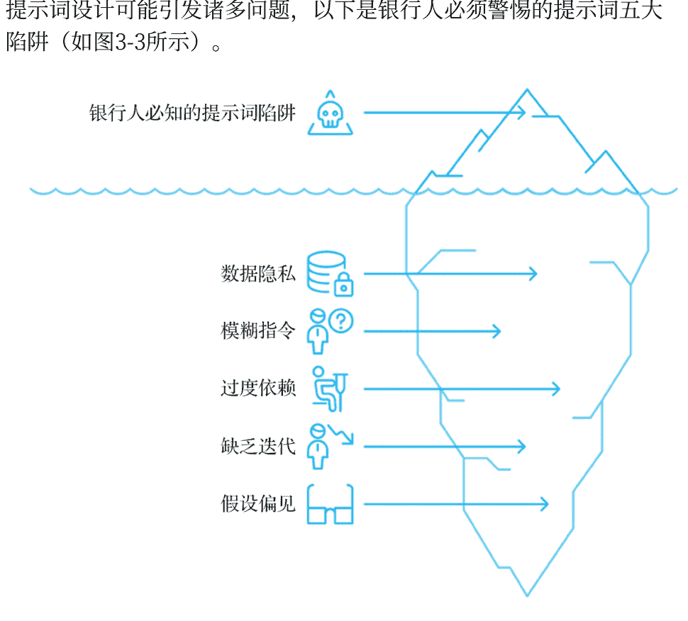
### 1. 数据隐私
设计提示词时必须遵守数据隐私法规，避免泄露客户敏感信息。查询账户信息时应仅使用必要标识符如客户编号，避免出现姓名、身份证号等。

### 2. 模糊指令
模糊指令易导致理解偏差。例如“分析客户数据”过于宽泛，而“分析某客户的消费行为模式并以表格输出”则明确清晰。应避免模糊词汇，确保指令准确。

### 3. 过度依赖
系统虽提供强力支持，但不应过度依赖其输出。建议结合专业知识与经验进行判断，必要时人工复核与调整。

### 4. 缺乏迭代
提示词设计是持续优化过程。应根据实际效果不断调整，例如信用评估输出不准时，需优化提示词内容与结构以提升质量。

### 5. 假设偏见
设计提示词时应避免基于个人偏见或假设提问。例如评估信用风险时，不应预设年轻客户风险更高，而应基于客观数据与分析工具得出结论，避免偏见影响客观性。

## 3.4 银行人必会：“三板斧”提示词
长期深耕银行数字化培训的视角来看，行业已从数据中台热潮转向 AI 赋能浪潮。过去的数字化营销、智能风控课程反响不错，但培训结束后，常能看到后排学员一边记笔记一边皱眉。并非不愿学习，而是回到岗位实操时常受阻——系统权限未开放、数据协作不畅、监管要求模糊。直到 DeepSeek 面世，局面开始改变。

进入 2025 年，DeepSeek 凭借中文表达友好与免费共享模式，迅速点燃银行 AI 培训市场。2025 年 2 月 14 日，笔者提交的首份 AI 课程大纲《DeepSeek 零基础轻量化落地实训课堂——中小银行零售业务数字化营销 AI 实战》在某银行从立项到签约不足 5 小时，创下个人最快成交纪录。

随后进入超负荷状态。清晨在呼和浩特讲授对公客户经理尽调赋能，傍晚到佛山与理财经理探讨智能投顾话术，次日凌晨再到昆明开展案例实操。2025 年 4 月 7 日至 28 日，20 余天内行程超 16500 公里。笔者曾让豆包赋诗并配图发朋友圈。

> 数字银途志（四月行程三万三千里）
> 
> 四月驰行万里程，银涛数字破坚冰。
> 
> 遥追高适凌云志，再展宏图续汉青。

人工智能普及时代，一个核心问题浮现：当所有银行员工都能零门槛使用同款工具时，真正的差异化是什么？

正如相声演员所言，人人都有嘴，关键在于表达技巧。使用 DeepSeek 同样需要有效的提问方法。以信用卡营销为例，资深业务员不会直接问“如何提高转化率”，而是拆解为三步：先对比不同客群消费特征，再筛选商超消费占比超 60% 的潜在客户，最后设计三组权益方案并预测效果。这种结构化提问如同导航，能把模糊目标转化为可执行分析路径。

课堂实验中，第一组直接提问“怎么做好数字化运营”，得到的方案泛泛而谈；第二组则聚焦“县域老年客群手机银行沉默户激活”等具体场景，产出方案被纳入该行季度重点项目库。差异不在工具，而在问题的颗粒度与场景化能力。

机器越聪明，人类提问艺术越珍贵。

如何有效提问以赋能业务？笔者总结了一套“三板斧”提示词。

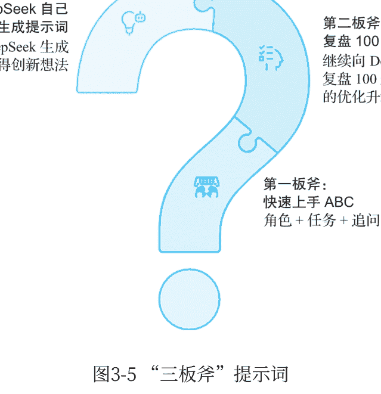
### 3.4.1 第一板斧：快速上手 ABC
“三板斧”提示词源于大量实验，帮助零基础人员快速上手，适用于银行大部分场景。结构为：角色+任务+追问。

例如先输入“我是某银行对公客户经理，需完成本地某行业分析报告，请结合公开数据输出详细内容”，待系统给出初版后，再进行精准追问。多数提示词是静态一次性输入，而此方法强调动态追问，在静态输入基础上进行五六轮追问，持续优化直至满意。初版内容不宜直接采用，需用第二板斧提升质量。笔者常提醒学员：永远不要相信 AI 的第一版。

### 3.4.2 第二板斧：复盘 100 遍
在初始提示精准、第一板斧打磨后，可继续提问：“请对以上方案认真检查，复盘 100 遍，给出最终优化升级版本。”往往能获得超出预期的高质量方案。深度挖掘关键在于引导方式。

### 3.4.3 第三板斧：让 DeepSeek 自己生成提示词
传统提示词设计存在门槛高、适配差的问题。可反向操作：在无法提供有效提示词时，让系统先生成高质量提示词，再用其提问以获取所需内容。

通过案例学习这种方法，能有效降低使用门槛并提升输出质量。

# 新人首日被丢央企大单？先搭问纲再探路

假设你刚报到在一家中心城市股份行的总行直属部门，第一天负责客户开发的同事就把任务交给你：为本地一家国资背景的大型集团做一套全覆盖的金融服务规划。你对公司业务的产品体系一无所知，对企业的资金痛点也毫无概念。要在不自行撰写方案的前提下快速建立认知，就得先把问题问对。

下面是一次实操复盘。

#### 1. 提问清单设计
我刚刚加入一家中心城市商业银行总行营业部的公司业务岗位，领导要求我为本地一家大型国有集团输出综合金融服务方案。现在有两处短板：一是不知道机构对公能提供哪些真实可行的业务；二是并不清楚这类企业在日常经营中有哪些金融诉求。请帮我拟一套可以直接丢给大模型的提问清单。我只要可重复使用的高质量提问方式，不要落地方案，要求全部锚定真实业务情境，严禁杜撰、禁止主观臆断。

#### 2. 模型返回的框架
围绕国有集团综合金融服务规划的问题框架可以按认知奠基、场景剖析、产品组合、风控合规、同业借鉴五块展开，且严格贴合实务。

##### 一、认知奠基
1. 银行公司业务条线服务大型国有集团时，主推的核心产品集合有哪些，各自的业内定义是什么
服务大致可划为五大类。
- 资金统筹类：围绕账户体系搭建、收付款服务、流动性调配展开，包含智能资金池、虚拟资金池、票据池等，目标实现资金归集、透明、可控调拨。
- 产业链融资类：应收账款保理、订单融资、仓单质押融资、产业链票据等，通过龙头企业信用向上下游传导授信。
- 跨境资金类：本外币一体化资金池、无本金交割远期、外汇担保贷款、跨境人民币结算等，支持境内外资金联动与汇率对冲。
- 项目投融资类：项目贷款、并购贷款、债券承销、结构化融资如资产证券化、REITs等，匹配基建、转型升级与资本运作。
- 财务数字化平台类：依托银企直连、API接口提供账户监控、指令下发、数据分析等数字能力，助力企业司库建设。

2. 这类企业在资金管理、跨境、产业链融资方面的显性与隐性诉求
(1) 显性诉求
- 全球资金集中：希望用多币种资金池实现境内外账户归集和实时监控，减少闲置资金。
- 跨境流动性改善：借助跨境人民币池、远期结售汇、期权等工具应对汇率波动和支付时效。
- 产业链资金疏通：利用反向保理、预付款融资等手段缓解上下游中小企业现金流压力。
(2) 隐性诉求
- 精细化流动性工具：资金池的动态调拨、内部计价等提升使用效率。
- 合规嵌入需求：跨境业务中需要内置反洗钱、外汇管制审查流程，规避政策风险。
- 生态数据打通：通过产业链金融平台实现上下游信息共享、信用共担。

3. 监管对国有集团资金集中管理的要求以及对应的服务匹配
(1) 监管侧
- 司库建设要求：国资委《关于推动中央企业加快司库体系建设进一步加强资金管理的意见》即1号文，要求央企在2023年底前建成覆盖全球账户、资金流向可视可控的司库系统，实现统一调度。
- 风险防控要求：穿透式监控资金流向，严格管控外汇敞口和衍生品交易，防范流动性风险。
- 合规要求：跨境资金池须完成外管局备案，确保本外币一体化管理合法合规。
(2) 服务侧匹配
- 全球资金池：打通境内外账户，支持归集与统一调度。
- 银企直联：提供实时账户查询和支付接口，满足穿透式监管。
- 智能资金池：自动化归集与内部计价，契合降本增效导向。
- 外汇避险工具：远期结售汇、无本金交割远期等帮助对冲汇率波动。

4. 小结
机构要结合监管合规、业务场景和隐性痛点，以“账户+结算+融资+风控”为组合进行精准服务。如跨境资金池叠加汇率衍生品可同时解决归集和避险，产业链金融须借助龙头企业信用来增强链条韧性。

##### 二、场景拆解
- 请说明大型国有集团在产融结合战略下常见的金融需求情境，例如基建项目融资、跨境资金池搭建等。
- 从财报视角看，企业在资产负债管理上对金融机构服务的核心关注点有哪些？
- 面对降杠杆压力，机构能提供哪些创新的债务结构优化工具？

##### 三、产品组合思路
- 如何把账户体系、支付结算与融资服务整合为一体化的现金管理方案？
- 在跨境场景下，无本金交割远期、跨境双向资金池、内保外贷等如何组合使用？
- 针对企业产业链生态，如何设计龙头企业信用穿透、多层级供应商覆盖的链式服务？

##### 四、风控合规要点
- 对国有集团授信业务有哪些特殊的集团客户管理规定需要特别注意？
- 在方案设计时如何平衡客户诉求与《反垄断法》相关要求？
- 跨境金融服务方案中应嵌入哪些外汇管制合规审查环节？

##### 五、同业参考
- 头部机构服务中字头央企的标杆案例里体现了哪些服务模式创新？
- 当前央企财务公司在选择合作机构时有哪些行业惯例和考量标准？
- 怎样把绿色金融、科技金融等新要素融入到传统央企服务里？

提问顺序建议遵循先建认知、再做需求分析、随后产品组合、然后风险控制、最后同业对标的逻辑链，每题聚焦具体场景，输出可落地的结构化知识。信息尽量结合机构年报、行业白皮书等公开资料做交叉核验。

把上面清单直接复制到对话框即可使用。以第一部分三个问题为例，就能快速获得结构化内容。

## 3.5 对三招法的评估
三招法的精髓在于快启动、迭代优化和信息校验。通过明确任务、复盘经验、检验准确性，能帮助从业者在复杂场景下更高效地使用大模型。下面把该方法整理后请模型基于官方原则进行客观评价。

1. 提问清单
请结合上传文档，对三招法方法基于官方原则进行客观公正的评价，不得编造案例，不得臆测用户偏好，需依据官方原则判断有效性。

2. 模型返回内容
基于公开技术文档与行业分析，对该方法论进行客观评估，并结合银行业应用、技术适配与合规要求展开分析。

### 一、方法论有效性细化评估

#### 1. 第一招 快速上手ABC
(1) 技术适配性
角色加任务加追问的结构与大模型推理特性相符。角色定义可激活特定领域专家网络，任务描述聚焦注意力分配，追问机制触发链式推理。
(2) 案例验证
在信用评估场景中，追问可补充监管要求，如国资委司库建设规范，避免模型仅输出通用框架。
局限性：角色定义模糊时，可能激活错误专家网络，如仅写银行业务人员未明确对公属性，需后续追问修正。

#### 2. 第二招 复盘100遍
(1) 技术原理
本质是调用模型的自我优化机制，通过指令触发多维度校验。例如要求检查方案是否符合《商业银行集团客户授信业务风险管理指引》。
迭代次数建议：3~5轮专项优化优于笼统复盘，避免token冗余。
(2) 银行业应用风险
需防过度依赖自检，跨境方案中NDF条款可能因训练数据时效滞后而出错，需人工交叉验证。
案例：某行供应链方案经三轮专项复盘，政策合规→技术可行→成本效益，可用性从62%升至89%。

#### 3. 第三招 自生成提问
(1) 技术优势
符合AutoPrompt思路，通过反向提示调用银行业知识图谱，降低设计门槛。15点框架覆盖需求分析、产品适配、风控合规，与银行KYC→产品匹配→合规审查流程一致。
(2) 局限性
可能遗漏特殊场景，如绿色金融适配、反洗钱筛查模块，需人工补充约束。

### 二、风险与改进建议

#### 1. 合规性风险
- 事实性幻觉：可能引用过时条款，需强制限定知识时效。
- 连带责任误判：错误建议核心企业承担上下游连带担保，可能违反民法典，需在提问中排除。

#### 2. 技术优化方向
- 动态约束注入：声明机构资质限制，避免推荐超范围业务。
- 多模态验证：要求输出同时包含文本、监管条文引用与可视化流程图，增强可审计性。

#### 3. 流程整合建议
- 人工复核：建立AI生成→合规校验→业务落地的三阶管线，关键节点强制人工确认。
- 知识库联动：将内部案例库作为RAG数据源，提升场景适配。

### 三、官方原则符合性再评估
| 评估维度 | 结论 | 说明 |
| 可解释性 | ★★★★☆ | 含产品定义与监管依据，需补充数据溯源 |
| 可验证性 | ★★★☆☆ | 依赖人工校验，缺乏自动化合规标记 |
| 安全性 | ★★★★☆ | 风控模块完整，需增加反欺诈检测提示 |
| 领域适应性 | ★★★★★ | 深度匹配对公业务流程 |
| 伦理合规 | ★★★☆☆ | 提示反垄断审查，未涵盖GDPR等跨境数据合规 |

### 四、结论
该方法在银行业务中实用性强，需配合时效性约束、领域知识增强、人机协作流程完善。优化方向基于公开技术文档，未引入虚构案例，符合客观实际。

## 3.6 大模型+工具链

### 3.6.1 安装与配置
使用前需完成软件下载、依赖安装、环境变量配置，并设置访问权限、用户角色、任务模板，确保运行环境安全高效。

### 3.6.2 大模型+GitMind 自动生成思维导图
大模型可输出结构化大纲，GitMind 能把它转成可视化导图。例如输入“新客户开户流程思维导图”，大模型生成结构后导入GitMind，即可清晰展示环节逻辑，便于协作。

### 3.6.3 大模型+Kimi 快速生成PPT
大模型输出Markdown大纲，Kimi PPT助手将其转为演示文稿。例如提示“为本地大型央企输出金融产品综合服务方案PPT大纲”，复制Markdown到Kimi后选择模板即可快速成稿，再做视觉微调即可使用。

### 3.6.4 大模型+Napkin 文字转图
在培训与客户教育中，Napkin可将文本转为图表。将大模型生成的方案要点输入Napkin，支持直接编辑、导入Word/PDF/PPTX/Markdown文件，或新建空白画布。点击闪电图标即可将文字段落转为图表，提升可读性与传播效果。

###1.1 回暖周期里的机遇与压力
外部经济修复势头显现，国内市场活跃度也在回升，央企因此进入业务扩张期，同时所处的经营环境也更趋复杂。金融服务的需求正呈现多元化特征，企业需要更具弹性与效率的供给来支撑业务纵深。

###1.2 央企经营的共性画像
大规模央企普遍面临资金规模庞大、投资回收期长、风险管控门槛高的现实。金融产品的落地必须围绕规模、周期与风险进行匹配，才能形成真正可执行的可行方案。

## 二、金融产品构建思路
###2.1 融资路径设计
- 基建项目融资：面向超大型基础设施，提供定制化融资组合，可涵盖项目贷款、债券发行等多种工具。

## ▲图3-23 Napkin作图过程

## 央企提效降险的创新金融服务探索

## ▲图3-24 图表生成

## 图3-25 下载图片

###3.6.5 DeepSeek+ioDraw：流程图自动绘制
流程图是银行内控与流程再造的重要载体。DeepSeek 与 ioDraw 协同，可将自然语言的流程描述转为图形化结果。例如给出“绘制客户投诉处理流程图”的指令，DeepSeek 会以 Mermaid 语法输出结构化描述，再经 ioDraw 渲染为可视化图示，清晰呈现环节顺序与责任分工，为流程优化与服务提升提供支撑。业务人员也可直接在 ioDraw 中手绘图形。

ioDraw 的官网界面见图3-26。

## 图3-26 ioDraw网站

###3.6.6 DeepSeek+WPS：文档排版提速
银行报告与业务文件的专业版式直接影响效果。DeepSeek 联动 WPS，可依据输入文本自动生成结构规范的初稿。例如提示“撰写一份关于小微企业贷款政策的报告”，系统会输出含标题、正文、页眉页脚等要素的草案，用户在 WPS 中微调即可完成高质量文档，确保专业性与可读性，如图3-27所示。

顺便提醒，若希望 DeepSeek 直接产出可下载的 Word 格式，可尝试下方示例指令。

我是《DeepSeek银行实战手册》作者吴易璋，帮我撰写一章节，主题为 Deepfake，篇幅约一千五百字，排版规范如下。

1. 一级标题，字体黑体三号，行距30磅，段后空0.5行。
2. 二级标题，字体黑体三号，行距30磅，段后空0.5行。
3. 正文，字体仿宋GB-2312三号，两端对齐，首行缩进两个字符。

以HTML格式输出，需支持直接下载为Word文档的功能。

## 图3-27 WPS AI一键排版

###3.6.7 DeepSeek+ima：个人知识库快速搭建
常出现找不到旧文章、公众号内容积压、微信群资料被清理的情况。腾讯 ima，即 ima.copilot，是腾讯混元团队于2024年推出的AI智能工作台，定位“会思考的知识库”。它融合腾讯混元大模型与 DeepSeek-R1 深度思考引擎，依托RAG 技术实现知识存储、检索与创作的闭环，被用户称为“个人第二大脑”。PC端界面如图3-28所示。

ima 的核心能力与特点如下。

## 1. 核心功能
### (1) 信息获取与问答
- 智能检索：基于全网信源或个人库快速定位信息。
- 精准应答：适用于知识点核查、问题解决及行业动态追踪，响应高效。

### (2) 多模态内容解读
- 文本解析：对文章、网页等进行深入分析。
- 图像识别：自动读取图片内容并给出说明。
- 翻译服务：支持多语言互译。

### (3) 个性化知识管理
- 知识归类：便捷整理、分类与检索个人资料。
- 内容沉淀：把有价值信息纳入知识库长期保存。

### (4) 写作辅助
- 主题策划：协助确定选题并生成提纲。
- 文稿润色：对已有内容改写完善。
- 灵感激发：提供创意建议，助力写作与艺术创作。

### (5) 共享与协作
- 共享库协作：共建或加入团队知识库。
- 内容分发：快速将文章、网页推送至知识库或社交渠道。

## 2. 支持平台
- PC 端：界面简洁优雅，支持文本生成与图像理解等。
- 微信小程序端：依托微信生态，可处理本地文件与图像分析，如图3-29所示。
- App 端：ima 手机App 可在应用商店下载，界面简洁友好，如图3-30所示。

以下以手机 App 为例演示，便于银行业务人员快速上手。

ima 的知识库分为个人版和共享版。个人库可自动生成，如图3-31所示；共享库需按流程创建，可设定权限与公开范围。腾讯另有企业版，不在本书讨论范围。

在图3-31页面底部点“知识库”进入个人库，点击右上角“+”再选“微信文件”，进入导入界面后点“点击上传文件”，即可进入聊天选择页，如图3-32所示。

选定聊天后，可把所需文件上传至个人库，见图3-33。

文件选完后点“确定”，一次最多导入20份，见图3-34。

## 吴老板的公益创新综合体

这个月

- 吴老板和他的好朋友们 (1天前)

  - 2025中国AIGC应用全景图谱【量子位智库】.pdf (PDF 19.3 MB)

- 吴老板和他的好朋友们 (12天前)

  - 《金融业人工智能应用风险研究报告》-发布稿.pdf (PDF 7.1 MB)

- 吴老板和他的好朋友们 (19天前)

  - 简历.pdf (PDF 334.9 KB)

- 吴老板和他的好朋友们 (20天前)

  - 导入美国银行红海市场环境下有效的欺诈风险管理体系.pptx (PPTX 21.9 MB)

- 吴老板和他的好朋友们 (22天前)

  - 王文兵简历-企业管理咨询.pdf (PDF 121.7 KB)

## ▲图3-33 在微信聊天中选择文件上传

## 导入微信文件
已选文件 1/20

《金融业人工智能应用风险研究报告》-发...

PDF

继续添加 1/20

确认导入

## 图3-34 导入微信文件

点“确认导入”后个人知识库即告建立，后续提问时系统会调取库内资料作答。

打开 ima App，底部“我”里可查看个人库存储空间，见图3-35所示。

官方目前给个人库30GB，已较初期的2GB大幅提升。若需更多空间，可返回知识库页，点击“个人知识库”下的“创建”新建共享库，见图3-36所示。

## ▲图3-35 个人知识库的存储空间

## 图3-36 创建共享知识库

为共享库命名、添加封面和简介后即可创建完成，文件按前述方式导入，见图3-37所示。

## 图3-37 创建完成的共享知识库

创建完成后右上角会出现新图标，点击可将共享库发布到广场，见图3-38所示。这样分享出的资料不再占用个人库容量。

返回知识库页，点击“个人知识库”再点“发现”，即可在广场搜索关注的文章与素材，见图3-39所示。

例如关注“风电”，在搜索框输入关键词即可看到相关库，点“加入知识库”即可获取资料，见图3-40所示。

## ▲图3-38 将共享知识库发布到广场

## ▲图3-39 在知识库广场搜索文章及素材

## 图3-40 将知识库广场中的内容加入知识库

此后凡涉及风电的问题，都可在 ima 对话框中直接提问获取答案。

另外，若想把微信公众号文章加入个人库，打开文章点右上角“…” ，底部找到“用小程序打开”，点击绿色小灯泡图标即可。

## 3. 最新动态
- 移动端App：2025年2月20日，ima 推出移动端App，率先上线安卓端，iOS随后也已上线。
- 知识库功能升级：2025年3月7日，知识库功能升级，新增“知识库广场”模块，单个共享知识库的成员人数上限提高至100万。

###3.6.8 DeepSeek+HTML：图表代码自动生成
高质量图表能让分析报告更直观。DeepSeek 搭配 HTML，可按输入数据与图表需求迅速产出可运行的 HTML 代码与可视化结果。例如提示“根据本月贷款发放数据生成柱状图”，即可得到对应代码，嵌入网页或报告后呈现美观且可交互的图表，提升专业感。

例如，在 DeepSeek 中输入提示词：

我是××银行数据分析人员，需要根据2025年5月的贷款发放数据生成柱状图。贷款品种和贷款类型等数据可以根据银行业务实际情况自行模拟，包括公司贷款、个人贷款、普惠金融贷款等主要类别，结果以HTML代码输出，并确保可以直接运行，在一个页面上展示。

DeepSeek 输出的结果如图3-41所示。

此时单击“运行”按钮，即可直接生成可视化图表，如图3-42所示。

最后单击“下载”按钮，可视化图表即可保存在本地。

若不确定要生成何种图表，可参考 ECHARTS 网站，如图3-43所示。

## ▲图3-41 DeepSeek输出的HTML代码

## 图3-42 DeepSeek生成可视化图表

## 图3-43 ECHARTS网站

该站提供大量图形示例与代码，无需掌握转换逻辑，只需知晓图形名称即可。无论折线图、散点图、雷达图，还是树图、路径图，或是3D柱状图、GL关系图，均可直接套用前述提示词向 DeepSeek 提问，快速得到美观实用的图表。

###3.6.9 DeepSeek+即梦AI：海报与短视频创作
银行营销宣传常需海报与短视频。DeepSeek 结合即梦AI，可根据主题与内容要求快速生成海报设计方案和短视频脚本。例如输入“制作一份关于新理财产品推广的海报”，DeepSeek 会输出含设计元素、文案与布局建议的草稿，再由即梦AI 转化为实际作品，提升推广效率。

例如，在 DeepSeek 中输入提示词：

我是××银行零售客户经理，需要制作一份客户经理下乡宣传银行业务的海报，使用即梦AI创作，请给出高质量的文生图提示词，要求符合银行实际业务特性，风格清新活泼。

DeepSeek 输出如下：

以下是为银行下乡宣传海报设计的AI文生图提示词方案，结合乡村场景与银行业务特性，突出清新活泼风格：

---提示词---

> “清新手绘插画风格，[乡村广场场景：青翠稻田与白墙灰瓦农舍为背景，远处有风力发电装置]，[阳光明媚的上午：柔光滤镜+温暖色调]，[两位身着银行制服的客户经理（一男一女）站在移动服务台后微笑讲解]，[服务台摆放‘乡村振兴金融服务’立牌+电子设备]，[前景三位农民形象（中年夫妻+青年）：女客户手持手机展示银行App界面，男客户拿着‘惠农贷’宣传单点头赞许，青年查看‘创业扶持计划’手册]，[空中飘浮卡通化金融元素：金色麦穗状钱币、绿色数据流动线条、蓝色盾牌状安全标识]，[右下角留白区域备注：活动时间、地点、二维码]，整体画面采用[低饱和度马卡龙色系]+[轻微水墨晕染效果]，细节包含[屋檐燕子][篱笆牵牛花][智能POS机][防诈宣传漫画板]”

---核心要素解析---

场景构建：

- 典型乡村元素（稻田、农舍、广场）建立信任感。

###3.6.10 DeepSeek+ChatExcel：自然语言驱动Excel分析
数据分析对银行决策至关重要。DeepSeek 与 ChatExcel 结合，可实现更高效智能的数据处理与分析，以自然语言交互满足复杂需求，为决策提供有力支持。

ChatExcel 的登录界面如图3-47所示。

ChatExcel 是北京大学团队推出的在线AI Excel工具和数据分析平台，用户通过聊天方式即可操作表格、进行分析。ChatExcel 会自动完成处理与分析，改变用户与Excel的交互方式，将其从繁琐公式中解放。无需复杂公式与代码，适合各类用户，有效降低使用门槛，让用户专注数据本身。演示页面如图3-48所示。

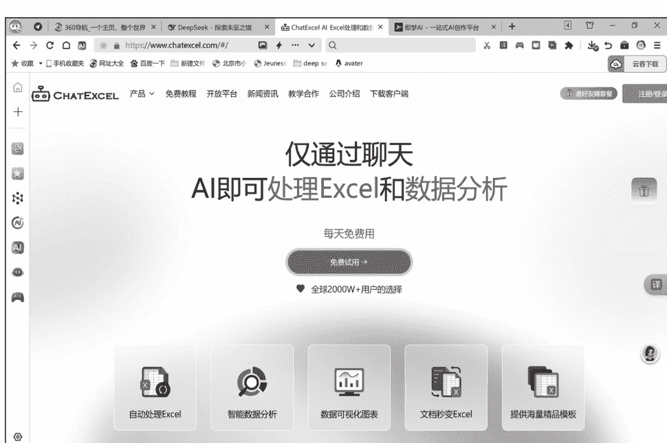

▲图3-47 ChatExcel登录界面

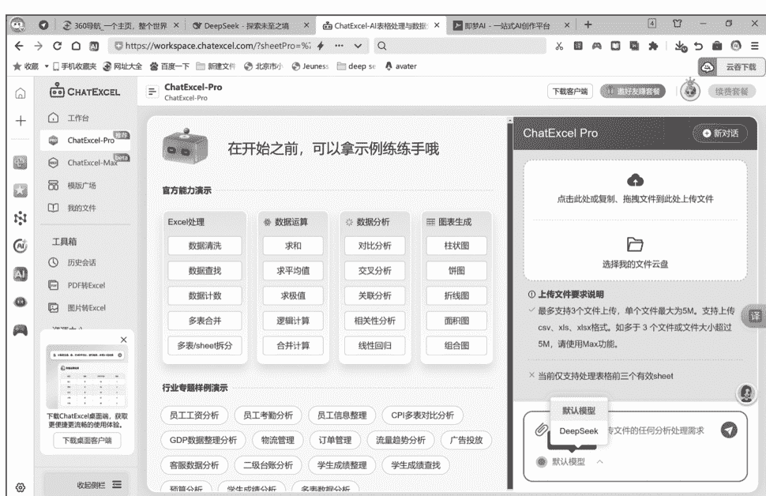

图3-48 ChatExcel演示页面

单击页面右下角的“默认模型”按钮，可看到 DeepSeek 已经嵌入。

## 3.7 本章小结
本章聚焦银行业务场景下的有效提示词设计，重点介绍笔者独创的“三板斧”提示词法，帮助业务人员快速上手并精准表达需求。强调提示词要简洁明确、逻辑清晰、信息完整，同时避免隐私泄露、指令模糊等常见问题。借助“提问—优化—自生成”的动态交互，配合思维导图、PPT自动生成等工具，可显著提升工作效率，让智能技术真正服务业务。

# 第4章 DeepSeek对公业务场景应用
银行对公业务正处于服务模式转型的关键期。客户需求正从传统融资向综合金融服务演进，包括投资银行、交易银行、跨境金融等。行业竞争焦点已从争夺单一客户转向构建产业链生态，特别是在高端制造和绿色能源等战略行业，银行需增强产业链洞察与风险控制能力。同时数字化转型压力加大，一线人员在识别需求与应用数据资产方面的能力参差不齐。

对公业务面临三大挑战：战略客户分层标准与真实价值贡献存在偏差，导致资源分配效率不高；行业专业化服务能力难以满足产业链复杂需求，限制场景获客效果；对公与零售业务协同机制不完善，客户综合价值挖掘不足。借助 DeepSeek 智能需求解析引擎、产业链关系图谱、跨条线协同工具等模块，银行可构建动态客户价值评估体系，深入理解多级交易关系，并实现公私联动营销闭环。

本章将探讨 DeepSeek 如何赋能银行提升对公业务精准营销能力、产品创新效率及跨境服务安全性，重点分析客户价值挖掘不足、供应链融资风险不可控、跨境资金管理效率低下等问题，助力商业银行实现从客户分层精细化到产品组合定制化再到风控管理穿透化的全面升级。

## 4.1 对公客户营销与拓展
对公客户营销与拓展面临服务深度不足、生态协同薄弱等挑战，痛点为客户分层执行偏差、生态营销能力不足、营销精准度低下。银行需构建“分层管理-生态协同-精准营销”三位一体服务体系。对公客户经理需强化客户价值智能评估、生态资源整合运营、需求洞察精准响应三大核心能力。

通过动态标签体系与智能营销平台，DeepSeek 可帮助银行实现战略客户分层管理、行业生态圈营销、公私联动交叉销售等（如图4-1所示），并依托区块链技术建立不可篡改的客户交互存证链条，推动营销从传统单点服务向覆盖客户分层动态管理、生态场景嵌入、需求智能预判的精准营销闭环转型。

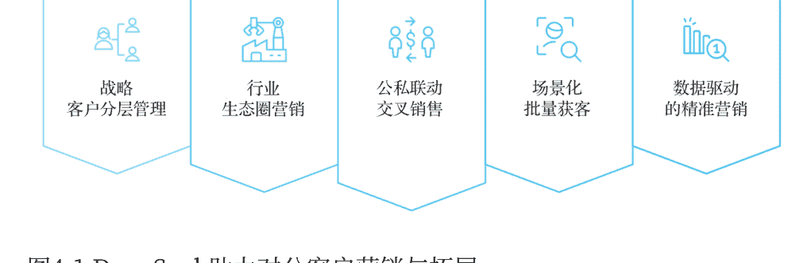

图4-1 DeepSeek助力对公客户营销与拓展

###4.1.1 战略客户分层管理
####1. 场景介绍
战略客户分层管理是银行对公业务的核心环节，需依据客户规模、行业地位、合作潜力等维度划分优先级，制定差异化服务策略。业务人员需定期更新经营数据，分析财务健康度、供应链稳定性等动态指标，并匹配授信、结算、投行等综合方案。重点在于建立科学评价体系，避免资源过度集中或遗漏高潜力客户，同时跨部门协同保障执行效率。

####2. DeepSeek提示词

制造业客户分层实战：动态经营信号清单

角色与任务：本人是银行对公客户经理，正在搭建面向制造业的战略客户分层机制，需要明确日常经营中必须持续跟进的核心动态信号。

#### 3. 追问提示词
- 分层时行业景气度权重该怎么确定？
- 上下游供应链的韧性如何做判断？
- 研发投入力度与市场份额之间怎么解读关联？
- 财务报表里哪些异常点需要设预警线？

#### 4. 输出形式
指标权重表 Excel文件、动态评分模型 Excel文件、分层建议与配套产品清单的分析报告 Word文件。

#### 5. 案例演示
说明：为控制篇幅，自本章起每章只呈现一个 DeepSeek 典型案例，其余场景仅给出指令与交付要求，供读者自行演练。

（1）DeepSeek 指令示例
角色与任务：作为银行对公客户经理，需搭建制造业战略客户分层模型，列出应重点追踪的动态经营指标。要求内容真实可靠，贴合银行实务，引用链接有效，严格遵循监管要求。

（2）DeepSeek 首轮回应
对公客户经理在构建制造业战略客户分层模型时，需要结合行业属性、企业经营变化及银行合规要求，重点关注以下动态经营指标。

##### 一、财务健康与偿债能力
1. 营收与利润增速
跟踪营业收入同比/环比增速及利润总额变动，可以反映市场竞争力与盈利能力。以2023年为例，中国制造业营业收入同比增1.3%，利润总额同比降2%，利润下滑企业的偿债压力需提高警惕。
现金流稳定性：关注经营性现金流净额与净利润的匹配程度，避免账面盈利却造血不足的风险。

2. 资产负债率与流动比率
制造业多为重资产，需把控资产负债率建议不超过60%及流动比率建议不低于1.5，以防范流动性风险。

3. 利息保障倍数
衡量息税前利润对利息支出的覆盖，建议保持在3倍以上，确保还款能力充足。

##### 二、经营效率与供应链韧性
1. 订单量与交付周期
通过订单金额、合同履约率及交付周期如智能产线最快8秒响应订单来判断生产效率与客户粘性。
需关注原材料价格波动、供应商集中度等供应链风险，可通过前瞻性跟进提前预警。

2. 存货周转率与应收账款周转率
周转率高体现库存管理与回款效率，避免资金占用。例如服务型制造企业借助数字化缩短交付周期，减少库存积压。

3. 数字化投入与智能化水平
监测IT投入占比、智能工厂覆盖率如国家级示范工厂达421家及工业互联网应用深度，数字化能力强的企业抗风险更强。

##### 三、行业景气与政策导向
1. 分行业景气指标
跟踪行业PMI、产能利用率及出口数据。如新三样即新能源汽车、锂电池、太阳能电池，2023年出口总额同比增29.9%，相关企业可优先纳入战略客户。
关注政策扶持领域，如高端装备、半导体、军工等自主可控行业，以及绿色转型如碳捕获技术企业。

2. 市场份额与行业排名
头部企业如注册资本千万元以上者在洗牌中更具韧性，中小企业易因同质化竞争面临淘汰。

##### 四、合规与风险预警
1. 贷款用途合规性
严格核查贷款是否流向政策限制领域如产能过剩行业，防止挪用风险如转为承兑汇票保证金。

2. 环保与ESG表现
核查环保处罚记录、碳排放强度及ESG评级。全国绿色工厂已达5095家，这类企业更易获政策支持。

3. 客户流失预警
借助CRM系统分析互动频次、订单金额波动率如单季下滑30%即触发预警，及时介入高风险客户。

##### 五、动态数据整合与模型优化
1. 多源数据接入
整合企业征信、税务、海关、供应链平台数据如ERP、MES，提升评估精准度。

2. 分层阈值设定
结合行业特性差异化设定阈值。例如：
S类客户：年营收≥5亿元，数字化投入占比≥5%，订单增长率≥20%。
A类客户：年营收1亿～5亿元，现金流稳定，行业排名前30%。

3. 落地建议
工具支持：利用CRM系统如RFM模型、客户潜力指数筛选高价值客户，嵌入AI预测模型评估客户生命周期价值。
动态调整：每季度更新指标数据，结合行业趋势如IDC预测的GenAI供应链、工业DataOps持续优化模型。
合规底线：严格执行贷后管理，避免因考核压力出现违规揽储或放松风控。

通过上述指标体系的动态监测与分层管理，可精准识别优质客户，实现风险收益平衡，促进对公业务稳健增长。

（3）追问问题清单
- 客户分层时景气度该如何量化权重？
- 如何评估供应链上下游的稳定性？
- 研发投入与市场占有率如何关联分析？
- 报表中哪些异常指标需设置预警阈值？

（4）输出形式
Excel模板含指标权重表与动态评分模型，以HTML格式输出，需内嵌可一键下载Excel文件的按钮代码。
Word分析报告含分层建议与产品配套清单，以HTML格式输出，需内嵌可一键下载Word文件的按钮代码。

（5）后续输出
DeepSeek 输出内容的截图如图4-2所示。

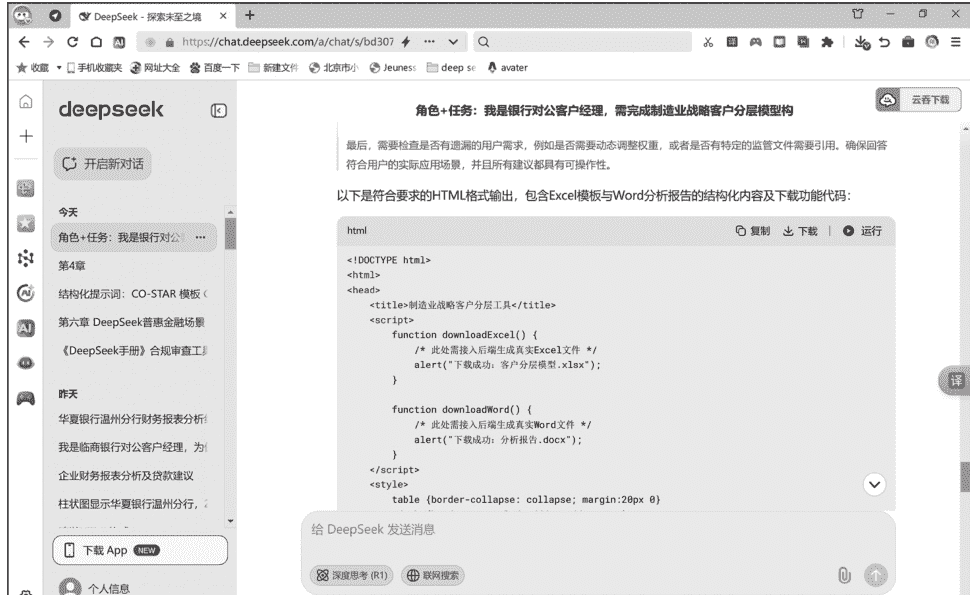

图4-2 DeepSeek 输出的HTML格式代码

点击运行按钮，可获得战略客户分层模型Excel模板，如图4-3所示。

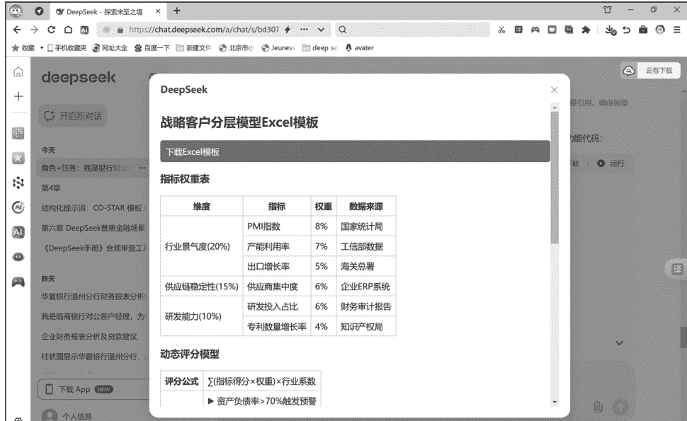

图4-3 可下载的战略客户分层模型Excel模板

下拉滚动条，可看到分析报告的Word模板，如图4-4所示。

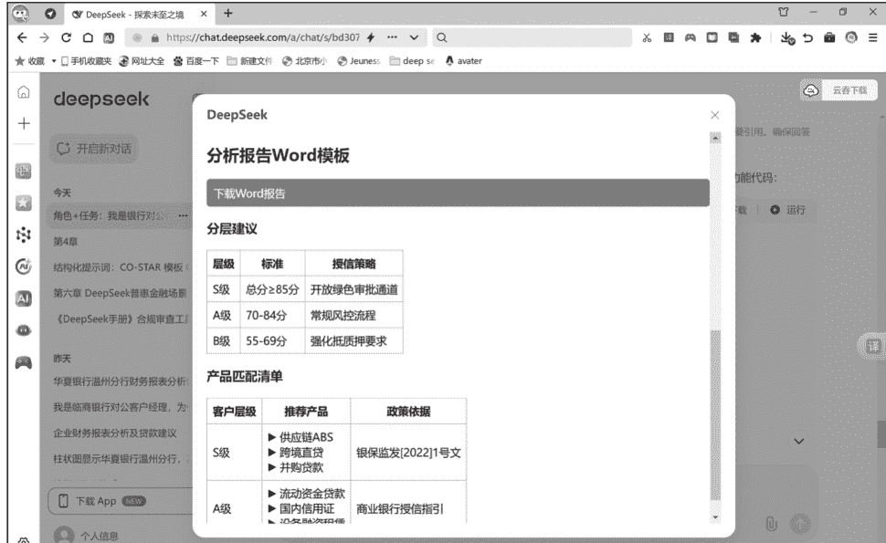

图4-4 可下载的分析报告Word模板

### 4.1.2 行业生态圈营销

#### 1. 场景介绍
银行借助DeepSeek打造产业链数字服务网络，依托核心企业采购数据构建多级供应商准入评估模型，实现信用穿透式传导与交易溯源验证。客户团队协同法务制定智能合约驱动的动态确权协议，风险部门实时监控链属企业融资成本偏离阈值情况，并同步建立交易背景真实性交叉核验机制。

#### 2. DeepSeek 指令
角色与任务：我是客户经理，在规划新能源汽车产业链服务方案时，应如何设计供应商准入规则？

#### 3. 追问提示词
- 如何利用核心企业订单数据验证二级供应商交易的真实性？
- 如何科学设定不同层级供应商的利率梯度？
- 电池回收企业的专属风控模型应包含哪些指标？

#### 4. 输出形式
准入评分卡 Excel、产业链图谱 Visio。

### 4.1.3 公私联动交叉销售

#### 1. 场景介绍
公私联动交叉销售是银行综合金融服务关键环节，银行需通过隐私计算技术实现客户数据合规共享，建立基于岗位职级与风险偏好的高管财富配置模型。客户经理需整合企业财报、资金流水等多源数据，联合零售团队打造智能营销看板，同时部署敏感信息脱敏机制与授权协议签署流程。工作重点在于平衡数据共享效率与合规边界，避免服务边界模糊导致信息泄露，同时强化客户画像动态更新与产品组合适配能力。

#### 2. DeepSeek 指令
角色与任务：我是客户经理，要为拟上市公司高管设计综合服务方案，应整合哪些金融产品？

#### 3. 追问提示词
- 如何通过企业财报数据评估高管资产规模？
- 股权解禁周期如何与理财期限匹配？
- 跨境税务筹划方案需包含哪些合规要件？

#### 4. 输出形式
服务协议 Word、税务测算表 Excel。

### 4.1.4 场景化批量获客

#### 1. 场景介绍
场景化批量获客是银行生态营销核心环节，银行需对接产业园区及电商平台交易数据构建标准化风控模板库，采用区块链技术验证交易背景真实性。客户经理需基于企业现金流特征与履约记录设计动态授信模型，风险团队需设定异常交易预警阈值并建立应急响应机制。工作重点在于优化数据采集颗粒度与模型泛化能力，避免场景适配不足导致批量获客失效，同时强化平台合作方资质审查与数据安全防护。

#### 2. DeepSeek 指令
角色与任务：我是银行专业团队成员，在设计跨境电商批量授信方案时，需要注意哪些关键风控点？

#### 3. 追问提示词
- 如何验证平台交易流水与物流单据的匹配性？
- 海外仓库存估值模型应包含哪些参数？
- 汇率避险条款如何嵌入授信协议？

#### 4. 输出形式
风控参数矩阵 Excel、产品手册。

### 4.1.5 数据驱动的精准营销

#### 1. 场景介绍
数据驱动的精准营销是银行数字化转型核心环节，银行需整合客户招投标、资金流水等多维数据，构建需求预测机器学习模型，设计基于关键行为特征的自动化营销触发规则。客户经理需通过跨系统数据治理平台定义动态客户价值标签，风险团队需部署实时决策引擎缩短营销响应周期。工作重点在于平衡模型预测精度与业务可解释性，避免特征工程僵化导致营销策略失效，同时强化数据质量校验与客户隐私保护机制。

#### 2. DeepSeek 指令
角色与任务：我是客户经理，要构建基建行业保函需求预测模型，应选取哪些特征数据？

#### 3. 追问提示词
- 如何关联中标公告信息与历史保函记录？
- 项目进度延迟如何影响模型迭代？
- 关联企业担保链的识别方法有哪些？

#### 4. 输出形式
特征工程代码 Python、可视化看板 BI系统。

### 4.1.6 对公客户营销场景清单
- 客户需求深度访谈
- 产业链价值图谱绘制
- 供应商准入标准制定
- 公私产品组合设计
- 场景化批量授信实施
- 数据模型部署应用
- 客户关系定期维护
- 风险信号动态监控
- 服务方案迭代优化
- 客户价值重估审计

## 4.2 对公金融产品综合服务

银行对公金融产品综合服务面临同质化竞争加剧、需求响应滞后等挑战，当前痛点主要为产品创新不足、响应机制僵化、组合风险对冲薄弱。银行需构建产品创新-需求响应-风险对冲三位一体服务体系，对公团队需强化产品智能设计、需求精准洞察、风险动态平衡三项核心能力。

借助动态定价引擎与智能服务系统，DeepSeek可帮助银行提供供应链金融方案定制、数字化支付结算、综合融资方案制定等服务如图4-5所示。银行可依托自然语言处理技术解析客户财报与业务合同，自动生成综合金融服务方案建议书，推动对公金融服务从传统单一产品推销向覆盖产业链深度服务、跨境实时清算、风险智能对冲的数字化综合服务模式转型。

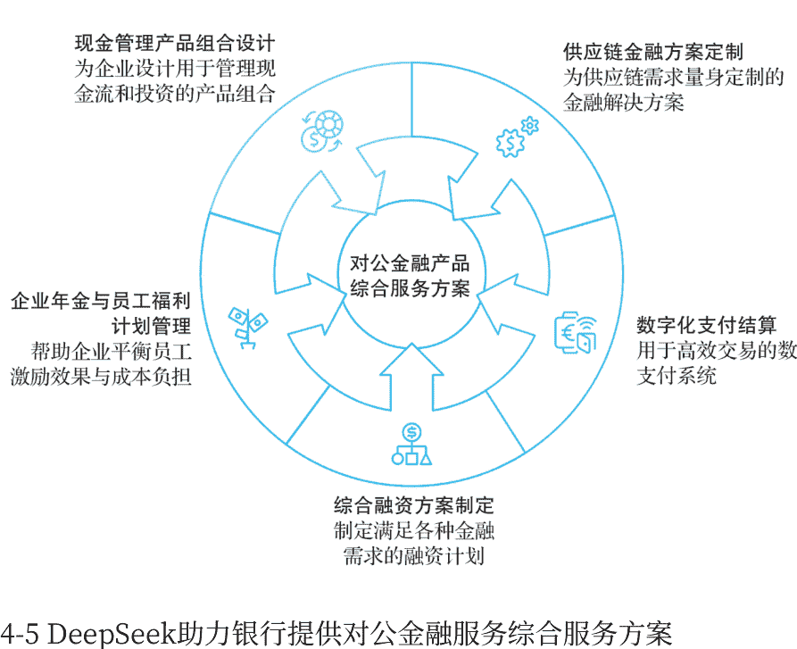

图4-5 DeepSeek助力银行提供对公金融服务综合服务方案

### 4.2.1 供应链金融方案定制

#### 1. 场景介绍
供应链金融方案定制是银行产融结合核心环节，银行需基于核心企业信用穿透设计多级融资方案，重点整合电子确权协议与供应商融资成本评估模型。客户经理需协调法务部门制定动态利率梯度规则，风险团队需验证订单资金流闭环的真实性与稳定性。工作重点在于平衡信用传导效率与风险敞口控制，避免确权机制僵化导致资金流断裂，同时完善供应链数据实时验证与应急流动性支持机制。

#### 2. DeepSeek 指令

## 3.追问提示词
- 晶圆采购合同的电子签章如何实现法律效力？
- 设备抵押率如何随折旧率动态调整？
- 跨境关税担保条款需包含哪些核心要素？

## 4.输出形式
交易结构图 PDF、利率梯度表 Excel。

### 4.2.2 数字化支付结算

### 1.场景介绍
数字化支付结算为银行交易服务核心环节，银行需根据支付时效性、汇率波动性等维度动态匹配跨境支付路径，测试SWIFT/CIPS通道兼容性并优化多币种清算算法。技术人员需为财务人员设计可视化操作界面，同时构建异常交易拦截规则与系统灾备方案。工作重点在于平衡通道性能与成本结构，避免路由策略僵化导致支付失败率上升，同时增强汇率风险实时对冲与跨境合规校验能力。

### 2.DeepSeek 指令
角色与任务：我是银行技术人员，需优化跨境电商支付路由，应监控哪些关键指标？

### 3.追问提示词
- 如何根据汇率波动动态优化兑换时点？
- 异常交易拦截规则应包含哪些触发条件？
- 如何配置系统故障时的应急通道？

### 4.输出形式
API文档、UAT测试案例库。

### 4.2.3 综合融资方案制定

### 1.场景介绍
综合融资方案制定是银行结构化融资核心环节，银行需整合债券发行、融资租赁等工具设计分层还款计划，构建现金流覆盖模型验证收入假设合理性。产品经理需协调多部门制定还款触发条件与压力测试参数，法律团队需审核特许经营权质押估值方法的合规性。工作重点在于平衡融资结构灵活性与风险可控性，避免现金流预测偏差引发还款违约，同时完善不可抗力条款阈值界定与应急预案设计。

### 2.DeepSeek 指令
角色与任务：我是银行产品经理，需设计物流园区项目贷+REITs方案，应如何设置还款触发条件？

### 3.追问提示词
- 如何验证仓储周转率预测模型的准确性？
- 特许经营权质押估值应采用哪些方法？
- 不可抗力条款的触发阈值应如何界定？

### 4.输出形式
现金流模型 Excel、条款说明书 Word。

### 4.2.4 企业年金与员工福利计划管理

### 1.场景介绍
企业年金与员工福利计划管理是银行增值服务核心环节，银行需设计税优型股权+年金组合方案，重点解决年金账户跨行转移与股权激励归属期衔接问题。产品经理需测算不同缴存比例对企业所得税的影响权重，合规团队需验证港股与A股上市企业方案设计的监管适配性。工作重点在于平衡员工激励效果与企业成本负担，避免归属期规则僵化导致人才流失，同时增强股价波动对冲工具性能与离职账户处理规则嵌入能力。

### 2.DeepSeek 指令
角色与任务：我是银行产品经理，需设计科技企业股权+年金方案，如何设置归属期规则？

### 3.追问提示词
- 离职员工年金账户的处理需遵循哪些监管要求？
- 港股上市企业与A股上市企业在方案设计上有何差异？
- 股价波动对冲工具如何嵌入方案？

### 4.输出形式
法律协议 Word、系统操作手册。

### 4.2.5 现金管理产品组合设计

### 1.场景介绍
现金管理产品组合设计是银行财资服务核心环节，银行需为跨国集团设计跨境资金池架构，重点监控外汇敞口风险与净额结算合规性。客户经理需分析企业资金周转特征，建立币种转换阈值动态模型，风险团队需设计监管报文自动生成逻辑与外汇对冲工具选择标准。工作重点在于平衡资金归集效率与监管合规要求，避免汇率波动超阈值导致汇兑损失，同时增强双向资金调拨税务成本优化能力。

### 2.DeepSeek 指令
角色与任务：我是客户经理，需优化制造业集团资金归集效率，应关注哪些核心指标？

### 3.追问提示词
- 跨境双向净额结算需满足哪些监管要求？
- 外汇对冲工具的选择标准有哪些？
- 如何设计监管报文自动生成逻辑？

### 4.输出形式
资金池架构图 Visio、阈值计算表 Excel。

### 4.2.6 对公金融产品综合服务场景清单
- 客户需求诊断
- 产品可行性论证
- 供应链方案定制
- 支付工具配置
- 融资结构设计
- 福利计划整合
- 系统部署实施
- 合规审查验证
- 客户培训交付
- 服务效果评估

## 4.3 尽职调查报告撰写

银行业务人员撰写尽职调查报告时，常面临信息碎片化、风险穿透不足等挑战。当前痛点主要为数据整合能力弱、风险评估维度单一、监管适配性不足。银行需构建数据整合-风险评估-监管适配三位一体撰写体系，尽调团队需强化多源数据智能融合、风险特征动态量化、ESG本土化适配三项核心能力。

通过智能风险评估模型与数据分析平台，DeepSeek可助力银行开展行业与市场分析、ESG专项评估、财务与非财务风险评估等活动如图4-6所示。银行可依托区块链技术建立不可篡改的尽调证据链，推动尽职调查报告从传统人工汇编向覆盖数据智能关联、风险动态预警、监管穿透校验的数字化评估体系转型。

### 4.3.1 行业与市场分析

### 1.场景介绍
行业与市场分析是银行尽职调查核心环节，银行需通过行业协会数据与政策文件验证客户市场地位声明，识别技术替代风险与产能过剩预警信号。风险经理需整合专利失效、技术迭代速率等非财务指标，建立行业竞争矩阵与政策冲击路径模型。工作重点在于平衡行业前景判断与客户实际竞争力，避免信息滞后导致风险评估偏差，同时强化技术专利价值量化与政策敏感度分析能力。

### 2.DeepSeek 指令
角色与任务：我是客户经理，需完成锂电池隔膜行业分析，应聚焦哪些技术迭代风险？

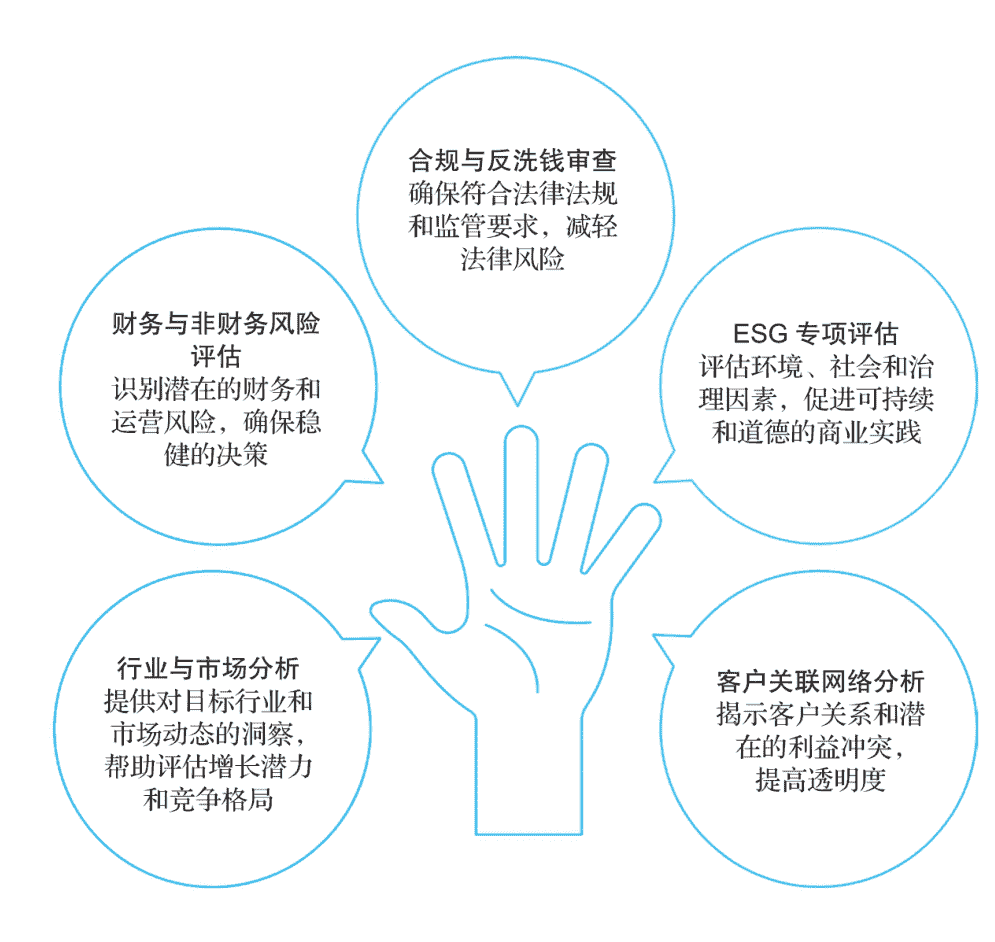

图4-6 DeepSeek助力尽职调查报告撰写

### 3.追问提示词
- 如何验证客户宣称的市场份额的可信度？
- 技术专利失效对行业格局的影响应如何评估？
- 政策变动对产能利用率的冲击路径是什么？

### 4.输出形式
行业研究报告 Word、竞争矩阵表 Excel。

### 4.3.2 财务与非财务风险评估

### 1.场景介绍
财务与非财务风险评估是银行风控体系核心环节，银行需通过物流单据核验、固定资产实地查验等手段穿透识别关联交易与表外负债。风险经理需构建应收账款周转异常检测模型，比对银行流水与合同单据钩稽关系。工作重点在于平衡数据验证效率与核查深度，避免表外负债遗漏导致风险敞口失控，同时完善高管个人账户异常往来行为筛查规则与法律约束机制。

### 2.DeepSeek 指令
角色与任务：我是银行风险经理，要发现应收账款周转异常，应排查哪些风险？

### 3.追问提示词
- 如何通过物流单据验证销售收入的真实性？
- 关联方交易定价偏离市场的合理范围应如何界定？
- 如何筛查客户高管个人账户的异常往来行为？

### 4.输出形式
异常指标清单 Excel、核查底稿 Word。

### 4.3.3 合规与反洗钱审查

### 1.场景介绍

反洗钱合规审查在银行监管适配中处于关键位置。机构需要借助穿透股权架构的工具梳理多层持股嵌套，搭建制裁名单实时比对流程并对跨境资金流的贸易实质进行核查。客户经理应当将转口贸易凭证真实性核验规范化，形成虚假贸易的特征指标体系。总体要兼顾审查效率与风险覆盖广度，防止规则过于僵硬造成异常交易遗漏，同时优化关联企业循环交易的识别模型并强化法律证据的固化水平。

### 2.DeepSeek提示词
角色+任务：我是客户经理，需排查大宗贸易洗钱风险，应关注哪些特征？

### 3.追问提示词
- 如何识别虚假贸易的常见手法？
- 验证转口贸易单据真实性的要点有哪些？
- 关联企业循环交易的特征指标应如何设定？

### 4.输出形式
审查报告、风险标签体系。

### 4.3.4 ESG专项评估

### 1.场景介绍
ESG专项评估在绿色金融落地中占据枢纽地位。银行应当调取环境处罚记录并与碳排放数据进行交叉核对，用以判断企业环境风险，同时构建碳足迹追踪模型以及社区投诉影响量化指标。风险经理要牵头第三方核验危废处置合同的履约情况，并制定ESG改进建议的权重分配办法。本环节的核心在于协调环境效益量化与商业可持续性，避免标准不清导致绿色认证失真，同时提升碳排放数据采集的精确度并加强社会风险的动态监控。

### 2.DeepSeek提示词
角色+任务：我是风险经理，拟评估化工企业环境风险，应采集哪些数据？

### 3.追问提示词
- 如何验证危废处理合同的执行有效性？
- 碳排放数据与生产能耗的钩稽关系应如何审查？
- 社区投诉记录的分析维度有哪些？

### 4.输出形式
ESG评分卡（Excel文件）、改进建议书（Word文件）。

### 4.3.5 客户关联网络分析

### 1.场景介绍
客户关联网络分析属于风险穿透的重要手段。银行需融合司法公告与招投标信息构建隐性关联方图谱，设立担保链预警指标并搭建围标行为识别模型。风险建模人员要核验同一控制人企业股权代持协议的法律效力，并设计供应链金融中关联交易占比的监控阈值。重点是兼顾网络挖掘深度与计算效率，避免数据噪声引发误判，同时增强对关联交易定价偏离市场合理区间的动态识别能力。

### 2.DeepSeek提示词
角色+任务：我是风险建模人员，需识别建筑企业关联网络，应关注哪些信号？

### 3.追问提示词
- 如何通过招投标信息发现关联围标行为？
- 同一控制人的识别需采集哪些佐证材料？
- 如何监控供应链金融中的关联交易占比？

### 4.输出形式
关联网络图（Visio文件）、关联方台账（Excel文件）。

### 4.3.6 尽职调查场景清单
- 尽调立项审批
- 基础资料清单核验
- 行业竞争格局分析
- ○财务数据真实性审查
- ○非财务风险要素识别
- ○关联方网络图谱构建
- ○反洗钱合规核查
- ○ESG影响量化评估
- ○尽调报告交叉复核
- ○风险缓释方案跟踪

## 4.4 企业财务报表分析

银行对企业财报开展分析时，面临表外风险隐蔽、舞弊识别难度加大等难题。主要痛点集中在关联交易与隐性负债核查困难、行业适配不足、非结构化信息处理低效等方面。银行需要构建关联穿透、行业适配、智能解析相结合的分析框架，客户经理要提升隐性关联智能识别、行业特征动态建模、非结构化数据解析的能力。

依托智能财务解析引擎与风险预警平台，在 DeepSeek 支持下可开展现金流预测与压力测试、财务比率同业分析、表外负债与或有风险识别等工作，如图4-7所示。银行可借助区块链实现审计底稿交叉验证，推动财务分析从传统比率测算向覆盖关联交易穿透、行业特性适配、经营实质验证的智能化决策支持转型。

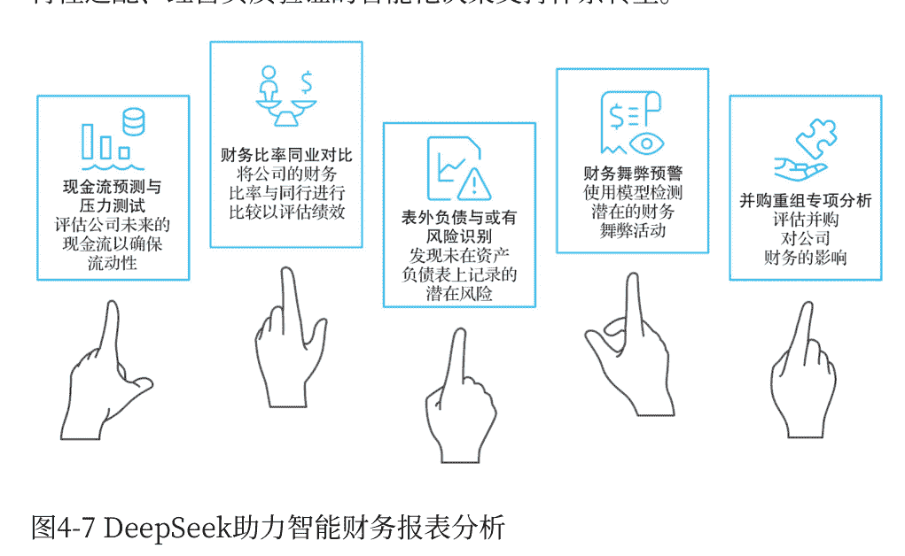

### 4.4.1 现金流预测与压力测试

### 1.场景介绍
现金流预测与压力测试是偿债能力评估的核心。银行需要构建涵盖原材料价格波动、大客户流失等极端情境的测试模型，以检验收入假设与库存减值影响系数的合理性。风险经理要统筹设定环保处罚导致现金流中断的概率权重，设计客户集中度风险的分级响应机制。工作重点在于平衡情境覆盖广度与模型实用性，避免参数固化导致压力测试失效，同时强化行业特性适配能力与对政策冲击路径的动态建模能力。

### 2.DeepSeek提示词
角色+任务：我是风险经理，需设计化工企业压力测试模型，应设置哪些参数？

### 3.追问提示词
- 如何量化原油价格波动对库存减值的影响系数？
- 环保处罚导致的现金流中断概率应如何评估？
- 客户集中度风险权重分配的依据是什么？

### 4.输出形式
情景参数表（Excel文件）、压力测试代码（Python）。

### 4.4.2 财务比率同业对比

### 1.场景介绍
财务比率同业对比是价值发现的核心。银行需清洗行业数据，剔除并购重组等异常样本，建立直销与经销模式对周转率的修正模型。客户经理要设计区域医保政策差异的消除规则，验证研发费用资本化调整方法的合规性。重点在于平衡数据可比性与行业特性适配，避免过度标准化导致分析失真，同时加强动态对标仪表盘建设与实时数据更新机制部署能力。

### 2.DeepSeek提示词
角色+任务：我是客户经理，在开展医疗器械企业流动比率对标分析，应如何筛选具有可比性的公司样本？

### 3.追问提示词
- 如何修正直销与经销模式对周转率的影响？
- 如何调整研发费用资本化差异？
- 如何消除区域医保政策差异对数据可比性的影响？

### 4.输出形式
可比公司清单（Excel文件）、动态对标仪表盘（BI系统）。

### 4.4.3 表外负债与或有风险识别

### 1.场景介绍
表外负债与或有风险识别是风险穿透分析的核心。银行需依托法院公告数据整合与担保链图谱可视化技术，评估PPP项目中政府支付承诺的法律约束力。风险经理要设计保函续期频率与流动性风险的关联模型，验证供应商诉讼记录对企业经营的影响路径。工作重点在于平衡隐性负债识别效率与核查成本，避免误读法律条款导致评估偏差，同时强化担保链动态追踪与兑现概率的量化能力。

### 2.DeepSeek提示词
角色+任务：我是风险经理，需排查建筑企业隐性负债，应关注哪些信号？

### 3.追问提示词
- 如何通过保函续期频率评估流动性风险？
- 供应商诉讼记录应如何与客户经营状况关联分析？
- 如何判定PPP项目政府支付承诺的法律约束力？

### 4.输出形式
担保链图谱（Visio文件）、法律意见书（Word文件）。

### 4.4.4 财务舞弊预警

### 1.场景介绍
财务舞弊预警是智能风控的核心。银行需结合坪效数据验证、物流单据差异核查等手段完善收入确认异常检测算法。风险经理要构建会员活跃度与营收增长合理性分析框架，设计第三方回款占比的动态监控阈值。重点在于平衡模型敏感度与误报率，避免特征工程滞后导致新型舞弊被漏检，同时强化多源数据融合与异常交易模式自学习能力。

### 2.DeepSeek提示词
角色+任务：我是风险经理，需完善零售企业财务舞弊预警模型，应增加哪些非财务指标？

### 3.追问提示词
- 如何通过坪效数据验证门店收入的真实性？
- 如何分析会员活跃度与营收增长的合理性？
- 物流单据与库存变动的差异核查有哪些要点？

### 4.输出形式
预警指标库（Excel文件）、异常检测算法（Python）。

### 4.4.5 并购重组专项分析

### 1.场景介绍
并购重组专项分析是投行业务的核心。以医药企业为例，银行需量化临床试验失败对估值的影响权重，并对专利悬崖期收入折现模型进行修正，科学评估跨境并购估值。客户经理要设计地缘政治风险对供应链成本影响的评估维度，验证特许经营权质押估值方法的监管合规性。重点在于平衡协同效应预期与商誉减值风险，避免折现模型僵化导致估值失真，同时强化对不可抗力条款触发阈值的动态界定能力。

### 2.DeepSeek提示词
角色+任务：我是客户经理，在分析医药企业跨境并购估值时，应关注哪些风险？

### 3.追问提示词
- 如何量化临床试验失败对估值的影响权重？
- 如何修正专利悬崖期收入折现模型？
- 地缘政治风险对供应链成本影响的评估维度有哪些？

### 4.输出形式
估值敏感性分析表（Excel文件）、交易结构说明书。

### 4.4.6 财务分析场景清单
- 基础财务数据采集
- 会计政策合规性审查
- 现金流预测模型构建
- 财务比率动态对标
- 表外负债穿透识别
- 财务舞弊风险预警
- 并购标的估值分析
- ○重大会计估计复核
- ○分析报告编制审核
- ○分析结果授信应用

## 4.5 授信审批管理

银行授信审批面临行业风险动态变化、绿色金融标准执行偏差等挑战。痛点主要为行业授信模板僵化、绿色项目认定标准模糊、跨机构数据验证低效。银行需要构建动态定价、行业适配、绿色穿透相结合的审批体系，授信审批团队要强化行业风险智能监测、环境效益量化评估、跨源数据穿透核验能力。

借助动态风险定价引擎与智能审批系统，在 DeepSeek 支持下可实现智能化审批，包括实施差异化授信、绿色信贷专项审批、联合授信管理等，如图4-8所示。银行可依托区块链构建授信数据共享联盟链，推动授信审批从静态规则审批向覆盖行业风险预警、绿色标准穿透、数据多方验真的智能化决策体系转型。

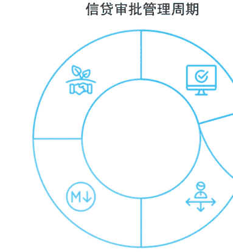

1. **实施差异化授信**
   制定适应不同客户需求的政策
2. **动态调整行业限额**
   根据市场动态调整行业限额
3. **绿色信贷专项审批**
   批准支持环境可持续性的信贷
4. **审批流程线上化**
   实施高效的在线审批流程
5. **联合授信管理**
   管理涉及多个贷款人的信贷

图4-8 DeepSeek助力银行智能化审批

### 4.5.1 实施差异化授信

### 1.场景介绍
实施差异化授信是授信策略制定的核心。银行需根据行业特性动态设定非财务指标评估体系，设计产能利用率、研发投入强度等差异化授信标准。风险管理部门要验证政府补贴可持续性的量化评估方法，协调制定结构化担保方案与授信限额重检流程。工作重点在于平衡指标科学性与可操作性，避免行业模板僵化导致授信失效，同时提升对专利技术商业化价值的量化能力，以及对研发团队稳定性的评估能力。

### 2.DeepSeek提示词
角色+任务：我是授信政策岗人员，在制定“专精特新”企业授信标准时，应设置哪些核心指标？

### 3.追问提示词
- 如何量化专利技术的商业化价值？
- 如何设计与验证研发团队的稳定性指标？
- 政府补贴可持续性的评估方法有哪些？

### 4.输出形式
指标评分卡（Excel文件）、政策指引（Word文件）。

## 动态调整行业限额

#### 1. 场景介绍
动态调整行业限额是风险防控的重要环节。以光伏行业为例，银行需建立政策信号跟踪机制，如硅料价格波动预警，设计压力测试触发阈值与光伏行业出货量预警模型。风险经理要量化因技术迭代导致的产能淘汰风险，验证限额测算模型与市场供需的匹配程度。重点在于平衡限额调整灵敏度与稳定性，避免调整滞后导致风险敞口扩大，同时强化海外贸易壁垒信号提取能力与动态定价引擎部署能力。

#### 2. DeepSeek提示词
角色+任务：我是风险经理，在建立光伏行业限额模型时，应监控哪些关键指标？

#### 3. 追问提示词
- 如何量化硅料价格波动对厂商偿债能力的影响？
- 如何提取海外贸易壁垒对出货量的预警信号？
- 技术迭代导致的产能淘汰风险应如何建模？

#### 4. 输出形式
限额测算模型（Excel文件）、调整建议书（Word文件）。

## 绿色信贷专项审批

#### 1. 场景介绍
绿色信贷专项审批是绿色金融落地的核心。以风电产业为例，银行需依据《绿色低碳转型产业指导目录（2024年版）》核查碳减排核算方法的合规性，调取第三方环评报告，验证风电项目环境效益数据。风险经理要设计生态修复保证金动态调整机制，建立环境风险“一票否决”的判定规则。重点在于平衡绿色认证严谨性与审批效率，避免标准模糊导致政策套利，同时强化碳足迹数据全链条核验能力与对监管规则的智能适配能力。

#### 2. DeepSeek提示词
角色+任务：我是风险经理，在审核风电项目贷款时，应核查哪些文件？

#### 3. 追问提示词
- 如何验证环境影响评价报告的有效性？
- 碳减排量核算方法是否符合最新监管标准？
- 如何设计生态修复保证金机制？

#### 4. 输出形式
核查清单、评估报告（Word文件）。

## 审批流程线上化

#### 1. 场景介绍
审批流程线上化是数字化转型的核心。银行需通过OCR技术提取企业财报关键数据，设计资产负债率超阈值的自动跳闸规则与电子合同效力验证模块。风险经理要制定负面舆情信息抓取规则，优化系统间数据抓取失败的应急响应机制。重点在于平衡审批流程自动化效率与风险可控性，避免规则僵化导致误判，同时强化对电子签章法律效力的核验能力与并联审批协同处理能力。

#### 2. DeepSeek提示词
角色+任务：我是风险经理，在设计制造业线上审批流程时，应如何设置自动规则？

#### 3. 追问提示词
- 如何设定负面舆情信息的抓取与推送规则？
- 系统间数据抓取失败时有哪些应急机制？
- 电子合同签署的合规性验证要点是什么？

#### 4. 输出形式
流程图（Visio文件）、UAT案例库。

## 联合授信管理

#### 1. 场景介绍
联合授信管理是同业协同的核心。以房地产行业为例，银行需整合央行征信数据与预售资金监管账户交易记录，建立房企土地抵押物跨行质押穿透核查机制。风险经理要设计交叉违约预警信号体系，验证关联企业非标融资信息获取路径的合规性。重点在于平衡信息共享效率与数据安全性，避免多头融资监控滞后导致风险累积，同时提升银团贷款动态额度追踪与预警响应能力。

#### 2. DeepSeek提示词
角色+任务：我是风险经理，在建立房企联合授信监测体系时，应集成哪些数据源？

#### 3. 追问提示词
- 如何识别预售资金监管账户的异常交易行为？
- 如何穿透核查土地抵押物跨行质押？
- 获取关联企业非标融资信息的路径有哪些？

#### 4. 输出形式
监测看板（BI系统）、同业数据对接表（Excel文件）。

## 授信审批场景清单
- 行业政策研究
- 授信标准制定
- 客户资质预审
- 限额动态测算
- 绿色信贷专项评估
- 线上化审批实施
- 同业授信数据共享
- 授信合同电子签署
- 授信额度动态监控
- 授信政策定期复审

## 贷后管理

银行贷后管理面临资金挪用隐蔽化、抵质押物价值波动加剧等挑战，痛点主要为资金流向监控不足、抵质押物动态跟踪不及时、风险预警碎片化。银行需要构建流向穿透、价值监控、智能预警相结合的管理体系。贷后管理团队要增强资金闭环追踪、抵质押物动态估值、多源风险关联能力。

借助智能预警系统与穿透管理平台，在 DeepSeek 支持下可实现风险预警信号监控、资金用途穿透式核查、抵质押物动态估值等，如图4-9所示。银行可依托区块链实现押品权属登记与流转过程不可篡改存证，推动贷后管理从人工抽样检查向覆盖资金全链穿透、押品智能盯市、风险实时联动的数字化风控体系转型。

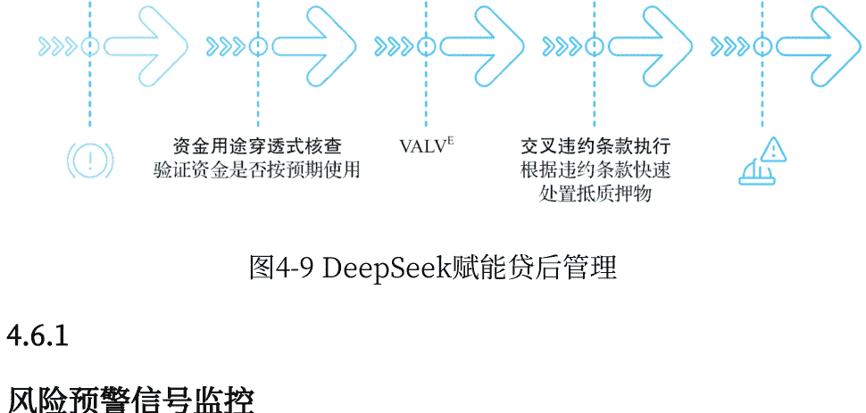

### 风险预警信号监控

#### 1. 场景介绍
风险预警信号监控是贷后管理的核心。银行需通过非财务指标如用电量数据验证、供应商账期异常分析等完善预警模型，设计环保处罚信息量化纳入规则。风险经理要制定分级响应机制与风险热力图生成逻辑。重点在于平衡预警覆盖广度与精准度，避免指标冗余导致响应迟滞，同时提升生产真实性动态核验能力与舆情情感分析能力。

#### 2. DeepSeek提示词
角色+任务：我是风险经理，要完善制造业预警模型，应增加哪些非财务指标？

#### 3. 追问提示词
- 如何通过用电量数据验证生产真实性？
- 供应商账期异常缩短反映了哪些潜在风险？
- 如何将环保处罚信息量化纳入预警体系？

#### 4. 输出形式
预警指标库（Excel文件）、风险热力图（BI系统）。

### 资金用途穿透式核查

#### 1. 场景介绍
资金用途穿透式核查是合规管控的核心。以基建项目为例，银行需运用大数据工具追踪基建项目的资金流向，验证工程进度款支付合理性与关联交易的合规性。风险经理要设计大额取现交易佐证材料清单，建立资金流与合同条款智能匹配模型。重点在于平衡核查效率与穿透深度，避免虚构贸易背景漏检导致合规风险，同时提升跨境资金链路溯源与电子证据固化能力。

#### 2. DeepSeek提示词
角色+任务：我是风险经理，在核查基建项目的资金流向时，应关注哪些异常特征？

#### 3. 追问提示词
- 如何验证工程进度款支付的合理性？
- 关联企业间资金往来的合规性判定标准有哪些？
- 大额取现交易需采集哪些佐证材料？

#### 4. 输出形式
资金流向追踪表（Excel文件）、核查报告（Word文件）。

### 抵质押物动态估值

#### 1. 场景介绍
抵质押物动态估值是押品管理的核心。以钢材为例，银行需实时抓取钢材价格并量化评估区域库存积压风险，设计质押物周转率下降预警阈值。风险经理要验证库存估值模型与市场行情匹配度，协调客户经理提供资产状态更新数据。重点在于平衡估值频率与运营成本，避免价格波动超过阈值导致质押率不足，同时强化物联网监控数据实时对接，提升智能补仓机制设计能力。

#### 2. DeepSeek提示词
角色+任务：我是风险经理，在建立钢材库存动态估值模型时，应设置哪些参数？

#### 3. 追问提示词
- 如何获取实时钢材价格数据源？
- 如何量化评估区域库存积压风险？
- 如何设定质押物周转率下降的预警阈值？

#### 4. 输出形式
估值模型（Excel文件）、数据抓取代码（Python）。

### 交叉违约条款执行

#### 1. 场景介绍

交叉违约条款落地操作

把交叉违约条款执行到位是银行处置风险的关键抓手。操作层面要通过可信渠道拿到同业违约的佐证材料，把法律告知流程做成标准化模板，同时为抵质押资产开通快速处置通道。风险经理首先要确认合同效力与触发条件是否吻合，并牵动法务把处置预案补齐。整体要在执行速度和合规边界之间寻求平衡，防止证据链缺口引发纠纷，同时把跨境抵质押物的权属登记与区块链存证能力做强。

#### 2. DeepSeek提示词
角色+任务：我是风险经理，在执行交叉违约条款时，应核查哪些信息？

#### 3. 追问提示词
- 如何获取权威渠道的同业违约证据？
- 如何规范条款触发后的法律告知程序？
- 如何搭建抵质押物快速处置通道？

#### 4. 输出形式
违约证据清单（Word文件）、处置预案（PDF文件）。

### 行业风险联动管理

#### 1. 场景介绍
行业风险传导是银行系统性风控的重要视角。以房地产为例，需要结合土地流拍频次与建材供应商偿债压力测试来构建房产风险传导模型。风险负责人要量化预售资金监管政策变动的影响权重，并设计能动态更新的区域市场风险评级机制。核心在于让模型精度与响应速度兼顾，避免评级滞后导致策略失效，同时提升产业链上下游数据的穿透能力与政策敏感预警能力。

#### 2. DeepSeek提示词
角色+任务：我是风险经理，在分析房地产行业风险传导路径时，应关注哪些节点？

#### 3. 追问提示词
- 如何量化房企危机对建材供应商的影响？
- 预售资金监管政策变动的风险评估方法有哪些？
- 土地流拍频率如何反映区域市场风险？

#### 4. 输出形式
风险传导图谱（Visio文件）、策略调整建议（Word文件）。

### 贷后管理场景清单
- 贷后定期巡检
- 资金流向穿透核查
- 抵质押物价值重估
- 交叉违约信号监测
- 行业风险传导分析
- 风险分类认定
- 预警客户分级处置
- 贷后报告编制
- 监管数据报送
- 档案信息更新

## 供应链金融

供应链金融普遍面临信用传导受阻、动产监管失效、跨境协同不足的问题，突出痛点是穿透式信用能力不足、仓单确权机制缺失、绿色认证标准不清晰。需要围绕信用穿透、动产监管、绿色认证构建一体化服务体系，团队要提升多级信用传导、数字仓单全链追踪、环境效益智能核验的综合能力。

借助区块链存证与智能风控平台，DeepSeek可以支撑银行开展核心企业信用穿透、数字仓单融资、绿色供应链认证等业务，如图4-10所示。结合隐私计算实现跨境贸易数据合规共享，推动供应链金融从依赖主体信用的传统模式转向信用智能穿透、动产精准监管、绿色价值量化的产融协同生态。

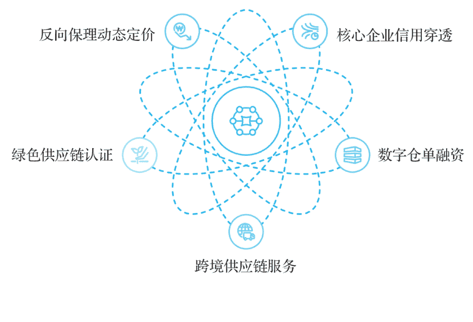
图4-10 DeepSeek助力供应链金融转型

### 核心企业信用穿透

#### 1. 场景介绍
核心企业信用穿透是供应链金融的关键环节。银行应基于核心企业订单数据设计多级供应商的信用分配比例，建立动态确权协议与额度调整规则。客户经理要核实二级供应商订单的真实性，风险团队要评估利率溢价测算逻辑与法律保障措施。重点是兼顾信用传导效率与风险敞口管控，避免层级划分僵化导致融资链断裂，同时提升区块链存证应用水平与回购承诺的法律约束力。

#### 2. DeepSeek提示词
角色+任务：我是客户经理，要为汽车主机厂设计三级供应商融资方案，应如何设定信用分配比例？

#### 3. 追问提示词
- 如何验证二级供应商订单的真实性？
- 如何计算不同层级供应商的利率溢价？
- 如何强化核心企业回购承诺的法律效力？

#### 4. 输出形式
信用分配矩阵（Excel文件）、确权协议模板（PDF文件）。

### 数字仓单融资

#### 1. 场景介绍
数字仓单融资是动产质押管理的核心。以铝锭质押为例，银行要利用物联网实时监控库存状态，制定价格波动预警线与智能补仓机制。风险负责人要检验区块链防篡改技术的有效性，并协调第三方监管机构接入数据。重点在于平衡货值评估精度与运营成本，避免重复质押累积信用风险，同时强化质押物保险条款嵌入及与港口放货指令联动的响应能力。

#### 2. DeepSeek提示词
角色+任务：我是客户经理，在设计铝锭数字仓单融资方案时，应设置哪些风控参数？

#### 3. 追问提示词
- 如何通过区块链技术防止仓单被篡改？
- 如何动态调整价格波动预警阈值？
- 质押物保险条款如何嵌入合同？

#### 4. 输出形式
物联网监控接口文档、估值模型（Excel文件）。

### 跨境供应链服务

#### 1. 场景介绍
跨境供应链服务是国际化布局的核心。要整合境内仓单与境外信用证工具，设计多币种结算成本优化路径与贸易背景真实性核验规则。产品经理需核验境外采购合同与物流单据的一致性，风险团队要审查跨境担保品的法律适用性。重点是兼顾汇率风险对冲效率与合规成本，避免单据差异导致支付延迟，同时强化跨境数据共享与多币种清算通道兼容性。

#### 2. DeepSeek提示词
角色+任务：我是银行产品经理，要为跨境电商设计供应链方案，应如何规避汇率风险？

#### 3. 追问提示词
- 如何验证境外采购合同与物流单据的一致性？
- 如何审查跨境担保品的法律适用性？
- 多币种结算成本的优化路径有哪些？

#### 4. 输出形式
交易结构图（PDF文件）、跨境合规审查清单。

### 绿色供应链认证

#### 1. 场景介绍
绿色供应链认证是ESG金融的核心。以有色金属冶炼为例，需要核验硅料生产环节碳排放数据并量化供应商环保处罚记录，构建绿色认证溢价转化模型。客户经理要推动企业填报碳足迹追踪表，风险团队需验证认证材料的真实性。重点在于平衡环境效益与融资成本，避免标准执行偏差导致绿色标签失真，同时强化第三方数据交叉验证与动态认证机制。

#### 2. DeepSeek提示词
角色+任务：我是客户经理，要为光伏产业链设计绿色认证方案，应采集哪些数据？

#### 3. 追问提示词
- 如何验证硅料生产环节的碳排放数据？
- 如何量化评估供应商环保处罚记录？
- 绿色认证溢价如何转化为融资优惠？

#### 4. 输出形式
碳足迹追踪表（Excel文件）、绿色认证操作手册。

### 反向保理动态定价

#### 1. 场景介绍
反向保理动态定价是供应链融资创新的关键。要基于核心企业付款历史与供应商财务预警信号，设计利率与账期挂钩的浮动定价模型。产品经理需验证账期缩短触发利率下调的合理性，风险团队要建立供应商信用评分动态更新机制。重点是平衡融资成本与风险覆盖，避免模型滞后导致定价失效，同时增强供应链数据实时接入与异常交易拦截能力。

#### 2. DeepSeek提示词
角色+任务：我是银行产品经理，要为家电企业设计动态定价模型，应监控哪些变量？

#### 3. 追问提示词
- 核心企业付款历史数据如何影响利率？
- 供应商财务状况恶化的预警信号有哪些？
- 账期缩短如何触发利率下调？

#### 4. 输出形式
动态定价算法（Python）、利率调整表（Excel文件）。

### 供应链金融场景清单
- 核心企业资质评估
- 多级信用穿透方案设计
- 数字仓单系统对接
- 跨境贸易背景审查
- 绿色供应链认证实施
- 动态定价模型部署
- 贷后质押物监控
- 供应商融资培训
- 风险事件应急处置
- 业务效果审计评估

## 跨境金融服务

跨境金融服务面临汇率波动加剧、合规校验复杂化等挑战，主要痛点是合规审核效率低、汇率风险对冲不足、收支结构优化滞后。需要构建合规校验、风险对冲、结构优化三位一体的服务体系，国际业务团队要强化监管规则动态适配、汇率敞口智能管理、跨境资金智能配置能力。

依托智能外汇系统与合规管理平台，DeepSeek可帮助银行开展汇率避险工具组合、跨境双向资金池搭建、海关数据直连通关等，如图4-11所示。借助区块链实现跨境交易单据全流程存证核验，推动跨境金融服务从人工审批向合规即时校验、风险精准对冲、资金智能配置的数字化生态转型。

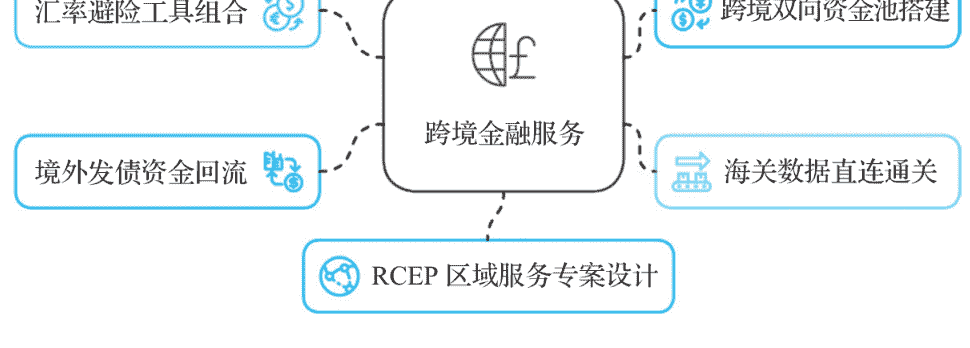
图4-11 DeepSeek助力跨境金融服务

### 汇率避险工具组合

#### 1. 场景介绍
汇率避险工具组合是外汇服务的核心。银行需根据企业外汇收支结构匹配远期结售汇与期权合约期限，并设计跨境担保品抵押率动态调整规则。客户经理要验证现金流预测与对冲工具的匹配度，风险团队需审核套期保值合规文件。重点在于平衡对冲成本与风险覆盖范围，避免汇率波动超阈值导致敞口失控，同时优化实时汇率算法模型并增强应急通道配置。

#### 2. DeepSeek提示词
角色+任务：我是客户经理，要为出口企业设计欧元避险方案，应选择哪些工具组合？

#### 3. 追问提示词
- 如何根据现金流预测匹配合约期限？
- 如何测算期权费成本与风险覆盖的平衡点？
- 如何设定跨境担保品抵押率？

#### 4. 输出形式
成本测算模型（Excel文件）、对冲方案书（PDF文件）。

### 跨境双向资金池搭建

#### 1. 场景介绍
跨境双向资金池搭建是财资管理的核心。银行需制定本外币头寸动态调整规则与净额结算备案材料清单，监控外债额度与汇率敞口对冲效果。客户经理要优化境外利润汇回税务成本模型，风险团队需验证资金调拨频率的监管合规性。重点在于平衡资金流动性效率与政策约束，避免额度超限引发合规风险，同时强化多币种清算时效保障与自动对冲触发机制。

#### 2. DeepSeek提示词
角色+任务：我是客户经理，需搭建亚太区资金池，应设置哪些监控指标？

#### 3. 追问提示词
- 跨境资金调拨频率应如何符合监管要求？
- 汇率敞口对冲工具应如何嵌入池架构？
- 如何优化境外利润汇回税务成本？

#### 4. 输出形式
资金池架构图（Visio文件）、外债额度监控表。

### 海关数据直连通关

#### 1. 场景介绍
海关数据直连通关是贸易金融数字化的核心。银行需通过API匹配报关单号与信用证条款，设定商品编码差异容忍阈值与虚假贸易特征识别规则。产品经理需验证AIS海运轨迹数据真实性，风险团队需构建异常交易拦截规则库。重点在于平衡通关效率与风险核验深度，避免数据延迟导致支付中断，同时强化区块链存证与多部门数据协同能力。

#### 2. DeepSeek提示词
角色+任务：我是银行产品经理，在优化进口信用证核验流程时，应接入哪些数据？

#### 3. 追问提示词
- 如何匹配报关单号与信用证条款？
- 如何设定商品编码差异的容忍阈值？
- 虚假贸易的典型数据特征有哪些？

#### 4. 输出形式
API文档、异常交易识别规则库。

### 境外发债资金回流

#### 1. 场景介绍
境外发债资金回流是跨境资本管理的核心。银行需设计美元债资金结汇时点匹配模型与外债登记备案材料核验流程。产品经理需审核关联交易定价合理性，风险团队需验证资金用途合规性证明文件。重点在于平衡回流效率与税务成本，避免结汇时点误判导致汇兑损失，同时强化跨境支付路径合规性与法律意见书固化能力。

#### 2. DeepSeek提示词

## 3.追问提示词
- 如何准备外债登记备案材料？
- 资金结汇时点如何匹配用款需求？
- 关联交易定价如何避免税务风险？

## 4.输出形式
资金回流流程图、外债合规清单。

## 4.8.5
## RCEP区域服务专案设计

## 1.场景介绍
RCEP区域服务专案设计是推进区域化战略的核心。要整合原产地证明快速核验规则与货币直接结算通道，设计跨境纠纷解决机制嵌入方案。客户经理需验证区域关税优惠条款适用性，风险团队需评估跨境担保中法律冲突风险。重点在于平衡政策红利利用与合规成本，避免认证延迟导致贸易受阻，同时强化地缘政治风险预警与多语言合同适配能力。

## 2.DeepSeek提示词
角色+任务：我是客户经理，要为东盟跨境贸易设计融资方案，应整合哪些政策红利？

## 3.追问提示词
- 如何快速核验原产地证明？
- 如何搭建区域货币直接结算通道？
- 跨境纠纷解决机制如何嵌入合同？

## 4.输出形式
RCEP政策应用指南、跨境法律风险备忘录。

## 4.8.6
## 跨境金融场景清单
- 跨境需求诊断
- 汇率避险工具配置
- 资金池架构设计
- 海关数据直连实施
- 境外发债资金回流合规审查
- 区域政策专项服务
- 跨境税务筹划
- 监管报送自动化
- 客户跨境培训
- 业务持续优化

## 4.9
## 现金管理

现金管理面临流动性管控低效、跨境资金调度滞后等挑战，痛点主要为多银行账户协同不足、外汇敞口监控滞后、虚拟账户权限粗放。需构建账户协同、敞口管理、支付安全的三位一体管理体系，现金管理团队要强化全量账户智能整合、汇率风险动态平衡、支付行为精准管控能力。

借助智能现金管理系统与外汇对冲平台，DeepSeek可助力银行实现智能资金归集、流动性预测引擎搭建、支付工厂对接，并依托区块链构建跨境支付指令不可篡改存证链条，推动现金管理从手工操作向账户智能协同、风险实时对冲、支付精准溯源的数字化财资管理体系转型，如图4-12所示。

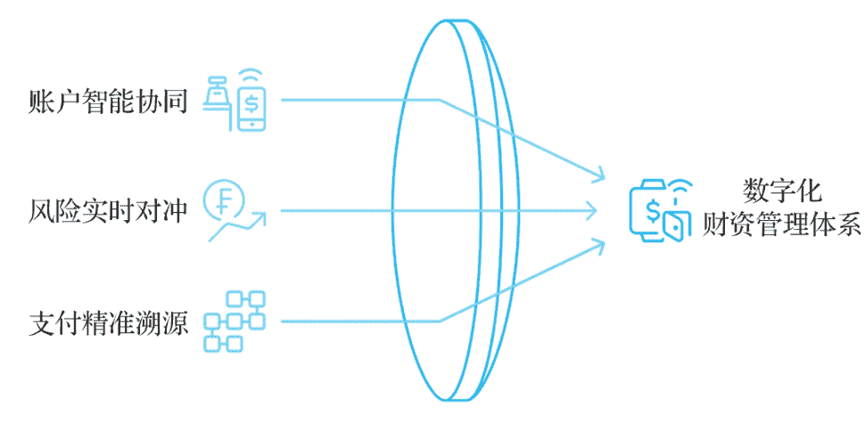
图4-12 DeepSeek推动银行向数字化财资管理体系转型

## 4.9.1
## 智能资金归集

## 1.场景介绍
智能资金归集是现金管理的核心。银行需基于企业账户现金流规律设计动态归集路径，设置备用金留存额度差异化规则，并构建系统故障应急保全机制。客户经理需验证门店销售额与归集频率的匹配度，风险团队需监控大额资金异常滞留并设定阈值。重点在于平衡归集效率与流动性安全，避免规则僵化导致资金闲置，同时增强多层级账户架构优化能力与实时数据反馈能力。

## 2.DeepSeek提示词
角色+任务：我是客户经理，要为连锁零售企业设计智能资金归集方案，应设置哪些规则？

## 3.追问提示词
- 如何根据门店销售额动态调整归集频率？
- 如何差异化设定备用金留存额度？
- 系统故障时的资金保全机制有哪些？

## 4.输出形式
归集流程图（Visio文件）、监控阈值表（Excel文件）。

## 4.9.2
## 流动性预测引擎搭建

## 1.场景介绍
流动性预测引擎搭建是风险预判的核心。银行需整合供应链账期变动参数与突发性支出概率模型，构建未来90天现金流缺口预警体系。风险经理需验证历史数据清洗规则合理性，客户经理需协调企业完善收支计划录入流程。重点在于平衡预测精度与模型复杂度，避免关键变量遗漏导致误判，同时增强时间序列算法迭代能力，提升BI可视化看板部署效率。

## 2.DeepSeek提示词
角色+任务：我是风险经理，要为制造企业搭建流动性预测引擎，应选取哪些变量？

## 3.追问提示词
- 如何量化供应链账期变动对现金流的影响？
- 突发性设备维修支出如何纳入预测范围？
- 如何设定客户回款延迟的预警阈值？

## 4.输出形式
时间序列模型（Python）、预测看板（BI系统）。

## 4.9.3
## 支付工厂对接

## 1.场景介绍
支付工厂对接是支付效率优化的核心。银行需设计多支付渠道自动路由规则与大额支付复核机制，解决跨境时区差异导致的延迟问题。客户经理需验证API标准化程度，风险团队需监控可疑交易频次与操作日志完整性。重点在于平衡批量处理速度与风控要求，避免系统超载导致交易失败，同时强化应急通道切换与异常支付溯源能力。

## 2.DeepSeek提示词
角色+任务：我是客户经理，要为电商平台对接支付工厂，应优化哪些流程？

## 3.追问提示词
- 如何实现不同支付渠道的自动路由？
- 大额支付复核机制如何平衡效率与安全？
- 如何应对跨境支付时区差异？

## 4.输出形式
API对接文档、异常支付日志模板。

## 4.9.4
## 跨境本外币池设计

## 1.场景介绍
跨境本外币池设计是汇率风险管理的核心。银行需根据利差变化动态调整币种头寸分布，设计汇率波动超阈值后的自动对冲触发机制。风险经理需验证跨境净额结算备案材料完整性，产品经理需优化外债额度监控模型。重点在于平衡资金利用效率与监管约束，避免头寸配置失衡导致汇兑损失，同时强化多币种清算实时性与税务成本测算能力。

## 2.DeepSeek提示词
角色+任务：我是产品经理，要为跨国集团设计欧元-人民币资金池，应关注哪些参数？

## 3.追问提示词
- 如何根据利率差异动态调整币种头寸？
- 跨境净额结算的备案材料有哪些？
- 汇率波动超阈值如何自动触发对冲？

## 4.输出形式
池架构图（Visio文件）、外债额度监控表。

## 4.9.5
## 虚拟账户分层管理

## 1.场景介绍
虚拟账户分层管理是资金安全管控的核心。银行需通过权限矩阵与审批流设计实现PPP项目资金隔离，制定超额支付双重复核规则与临时账户存续期预警机制。客户经理需验证项目进度与付款节点匹配度，风险团队需识别资金挪用风险特征。重点在于平衡账户操作灵活性与合规性，避免权限分配粗放导致误操作，同时强化电子化审批流程留痕能力与异常交易拦截能力。

## 2.DeepSeek提示词
角色+任务：我是客户经理，要为PPP项目设计虚拟账户体系，应设置哪些管控规则？

## 3.追问提示词
- 如何实现项目进度与付款节点的自动匹配？
- 如何设计超额支付的双重审批流程？
- 临时账户存续期到期预警机制有哪些？

## 4.输出形式
权限矩阵表（Excel文件）、审批流程图。

## 4.9.6
## 现金管理场景清单
- 资金归集规则制定
- 流动性预测模型构建
- 支付接口标准化对接
- 跨境资金池架构设计
- 虚拟账户权限配置
- 异常交易实时监控
- 资金报表自动生成

- 合规审查巡检
- 前线业务实操指导
- 系统负载测试

## 4.10
## 贸易融资风控升级

当前贸易融资业务里最突出的问题是背景核实缓慢、假贸易识别不足。单证核对周期长、关联主体穿透难、合规风险持续累积。破解路径是将单证核验、关系穿透、合规管控串联成闭环，要求贸易金融团队在数据融合、关联网络解析、规则动态适配上发力。

结合智能风控方案与区块链存证，DeepSeek 可协助银行完成贸易单据的链上固化、背景的智能核验、关联交易的风险前置预警，如图4-13所示。利用自然语言处理自动解读外汇管理政策并生成审查清单，推动贸易融资从传统纸质人工审核转向电子证据留存、交易实质穿透、监管即时校验的数字化风控体系。

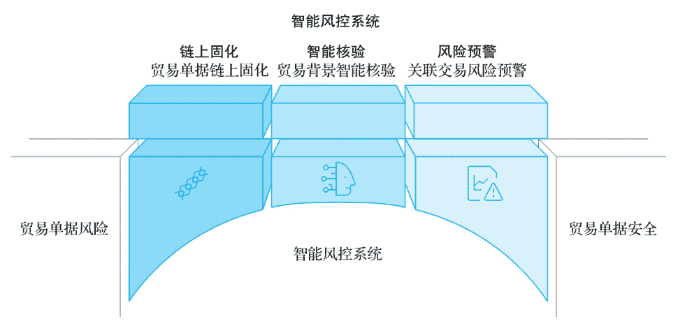

图4-13 DeepSeek赋能贸易融资

## 4.10.1
## 电子信用证链上化

### 1.场景概述
电子信用证上链是贸易金融创新的抓手。银行需依靠智能合约实现条款自动校验与质检报告的链上存证。客户经理负责推动交易各方接入验证节点，风险团队需预先设计纠纷发生时的链上取证流程。关键在于兼顾自动化效率与法律效力，避免节点遗漏引发兑付争议，同时强化防篡改能力与跨境法律适配。

### 2.DeepSeek提示词设计
角色与任务：我是客户经理，要将铁矿进口信用证上链，应设置哪些验证节点？

### 3.进阶追问
- 提单信息与信用证条款如何核对？
- 货物质检报告上链的办理流程怎样？
- 出现争议时链上证据如何调取？

### 4.交付物
智能合约示例代码、上链操作指南PDF。

## 4.10.2
## 跨境赊销风险化解

### 1.场景概述
跨境赊销缓释是出口金融的重点。银行需接入国际征信数据评估买方信用，制定保理融资比例与货物滞港处置条款。风险经理需复核国别风险溢价模型的合理性，客户经理需与法务协同完善合同约束。核心是平衡融资成本与风险覆盖，避免买方资质误判致坏账，同时提升物流核验与保险条款动态调整能力。

### 2.DeepSeek提示词设计
角色与任务：我是客户经理，要为机械出口商设计赊销方案，风控参数如何设定？

### 3.进阶追问
- 买方财报真实性怎样判断？
- 国别风险溢价如何计入融资成本？
- 货物滞留港口如何约定处置？

### 4.交付物
风险评分卡Excel、保险条款Word。

## 4.10.3
## 自贸区离岸转手方案

### 1.场景概述
自贸区离岸转手是离岸金融的重要板块。以橡胶离岸为例，银行需借助AIS核验海运轨迹真实性，设计仓单持有人变更追溯规则并嵌入汇率锁定工具。客户经理负责协调三方数据验证背景，风险团队需构建虚假贸易特征识别模型。重点在于兼顾融资效率与货权管控，避免凭证缺失带来信用风险，同时保证跨境数据共享合规与多币种结算兼容。

### 2.DeepSeek提示词设计
角色与任务：我是客户经理，设计橡胶离岸转口融资时，应采集哪些数据？

### 3.进阶追问
- AIS如何用于验证海运轨迹？
- 仓单持有人变更记录如何追溯？
- 汇率锁定工具如何嵌入协议？

### 4.交付物
物流数据核验规则库、交易结构图PDF。

## 4.10.4
## 绿色贸易融资

### 1.场景概述
绿色贸易融资是可持续金融的核心。银行需依据绿色生产资质核验结果设计利率优惠挂钩机制，搭建碳减排量换算模型与证书防伪规则。客户经理需协调第三方核验风电设备出口认证文件，风险团队需监控碳排放数据链式一致性。核心在于平衡环境效益与融资可行性，避免认证造假套利，同时强化供应链碳足迹追踪与动态评级。

### 2.DeepSeek提示词设计
角色与任务：我是客户经理，为风电设备出口设计绿色融资方案，需关注哪些认证？

### 3.进阶追问
- 供应商环保生产资质如何核实？
- 碳减排量怎样折算为融资成本折扣？
- 绿色证书造假的风险如何防范？

### 4.交付物
绿色认证清单、碳足迹测算模板。

## 4.10.5
## 数字提单质押融资

### 1.场景概述
数字提单质押是货权管控的关键。以原油为例，银行需借助区块链实现提单不可篡改存证，设计价格波动补仓机制与港口放货指令联动规则。风险经理需验证货值动态评估模型的准确性，客户经理需对接港口数据直连系统。重点在于质押率弹性与风险可控的平衡，避免系统延迟导致货权失控，同时强化物联网监控实时接入与智能预警。

### 2.DeepSeek提示词设计
角色与任务：我是客户经理，设计原油数字提单质押方案，管控点有哪些？

### 3.进阶追问
- 电子提单如何防止恶意篡改？
- 价格波动导致质押率不足时补仓机制如何设计？
- 港口放货指令如何与融资系统联动？

### 4.交付物
区块链存证报告、货值监控看板。

## 4.10.6
## 贸易融资应用场景清单
- 贸易背景真实性核查
- 数字化单据处理
- 区块链信用证开立
- 跨境征信数据接入
- 离岸交易结构设计
- 绿色认证资料核验
- 电子提单质押登记
- 融资发放与货权管控
- 异常交易预警处置
- 业务后评价审计

## 4.11
## 反洗钱智能风控

银行反洗钱面临交易隐蔽性增强、跨境资金追踪困难的压力，客户身份核验不足、合规规则更新滞后为主要痛点，如图4-14所示。需围绕身份核验、交易监测、合规把控搭建管理框架，反洗钱团队需强化身份穿透、交易模式动态解读、监管规则智能适配能力。

借助智能监测系统与合规管理平台，DeepSeek 可完成受益所有人穿透、交易链智能追踪、高风险客户强化尽调。配合区块链构建跨境交易全链路存证，推动反洗钱管理从传统规则引擎向身份深度穿透、交易网络智能解析、监管即时响应的全链条智能风控演进。

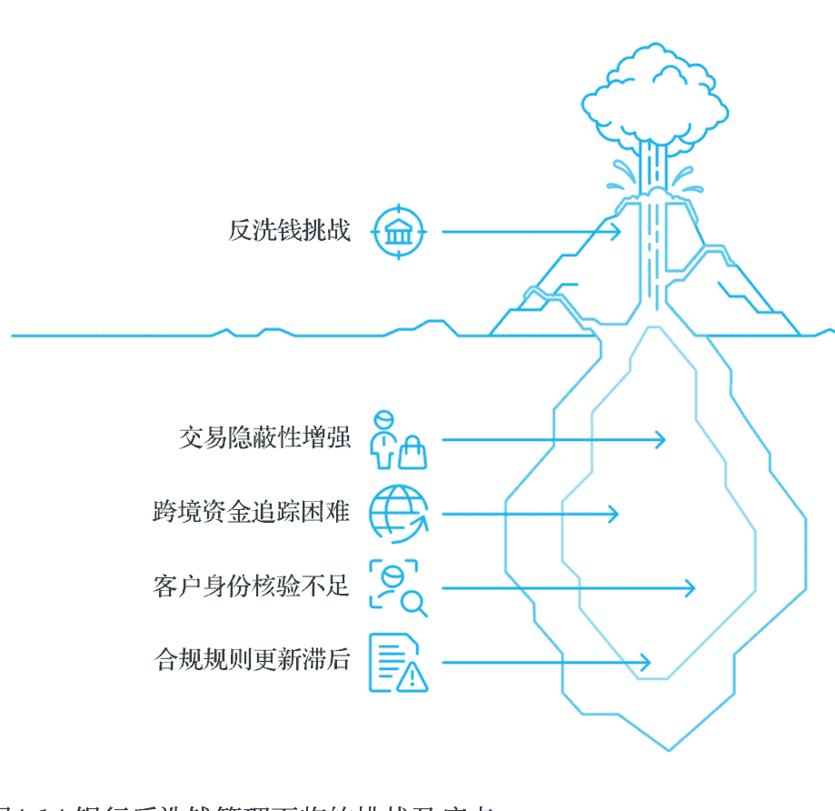

图4-14 银行反洗钱管理面临的挑战及痛点

## 4.11.1
## 受益所有人穿透识别

### 1.场景概述
受益所有人穿透是反洗钱合规的核心。银行需审查VIE协议与代持协议法律效力，追踪离岸架构企业的实际控制人。风险经理需整合工商数据与股权穿透工具，客户经理需协助提供客户声明文件。重点是核查效率与穿透深度的平衡，避免证据链缺失留下合规漏洞，同时提升跨境数据获取与法律文书自动化生成能力。

### 2.DeepSeek提示词设计
角色与任务：我是风险经理，核查离岸架构企业受益所有人，需要哪些证据？

### 3.进阶追问
- VIE协议控制关系的真实性如何验证？
- 代持协议法律效力如何审查？
- 境外上市公司实际控制人如何追溯？

### 4.交付物
股权穿透图Visio、受益所有人声明模板。

## 4.11.2
## 交易链智能追踪

### 1.场景概述
交易链追踪是资金监控核心。银行需用图算法识别跨境电商资金闭环特征，制定同一IP操作多账户判定标准与虚拟货币兑换痕迹筛查规则。风险经理需构建“买单报关”模式识别模型并设定交易层级预警阈值。重点是监测灵敏度与误报率的权衡，避免规则僵化漏检新型洗钱，同时强化数据实时更新与交易网络可视化。

### 2.DeepSeek提示词设计
角色与任务：我是风险经理，追踪跨境电商资金链，要关注哪些特征？

### 3.进阶追问
- “买单报关”模式的资金闭环如何识别？
- 同一IP地址操作多账户判定标准怎么定？
- 虚拟货币兑换痕迹如何筛查？

### 4.交付物
交易网络可视化图谱、预警规则表Excel。

## 4.11.3
## 高风险客户增强尽调

### 1.场景概述
高风险客户增强尽调是风险管控核心。以珠宝批发客户为例，银行需核验采购发票、分析现金存款与销售额匹配度以完善尽调清单。风险经理需设计境外合同公证要件审查流程，客户经理需留存实地走访影像证据。重点是尽调强度与客户体验的平衡，避免流程冗长导致业务流失，同时提升非结构化数据处理与风险信号自动化推送能力。

### 2.DeepSeek提示词设计
角色与任务：我是风险经理，对珠宝批发客户做增强尽调，要增加哪些核查项？

### 3.进阶追问
- 珠宝采购发票真实性如何验证？
- 现金存款与销售额匹配度如何分析？
- 境外采购合同公证要件有哪些？

### 4.交付物
增强尽调检查表、现场影像归档规范。

## 4.11.4
## 可疑交易模型迭代

### 1.场景概述
可疑交易模型迭代是智能风控核心。银行需提取虚拟钱包资金分层特征并分析法币兑换稳定币行为，优化数字货币交易监测规则。风险经理需验证模型误报案例，客户经理需反馈新型可疑模式特征。重点是模型泛化能力与监管适配性的平衡，避免特征滞后导致监测失效，同时强化自学习算法效果与多源数据融合。

### 2.DeepSeek提示词设计
角色与任务：我是风险经理，优化数字货币交易监测模型，要增加哪些特征？

### 3.进阶追问
- 通过虚拟钱包进行的资金分层如何识别？
- 交易所充提币行为时间规律如何分析？
- 法币与稳定币兑换预警阈值如何设定？

### 4.交付物
特征工程代码Python、模型迭代日志模板。

## 4.11.5
## 监管报送自动化

### 1.场景概述
监管报送自动化是合规提效核心。银行需通过数据清洗补全交易对手缺失信息，制定跨境汇款中转行录入规范并构建误判交易人工复核通道。风险经理需验证报文生成逻辑合规性，客户经理需核验客户基础信息完整性。重点是自动化效率与数据准确性的平衡，避免系统错误导致监管处罚，同时强化数据质量校验与异常报文追溯能力。

### 2.DeepSeek提示词设计
角色与任务：我是风险经理，构建大额交易自动报送系统，校验规则如何设置？

### 3.进阶追问
- 缺失的交易对手信息如何识别并补全？
- 跨境汇款中转行信息如何规范录入？
- 系统误判交易如何快速人工复核？

### 4.交付物
监管报文生成模板、数据质量校验报告。

## 4.11.6
## 反洗钱场景清单
- 客户身份初次识别
- 受益所有人穿透核查
- 风险等级动态评定
- 交易链智能分析
- 高风险客户强化尽调
- 可疑交易模型训练
- 预警案例人工复核
- 监管数据自动生成
- 内外部检查应对
- 反洗钱培训考核

## 4.12
## 账户管理智能化运营

账户管理目前面临滥用风险隐蔽、合规操作低效的难题，异常交易识别滞后、长期不动户清理低效、高风险账户监控不足是主要表现。需围绕智能监测、精准核查、合规把控搭建运营体系，运营团队需强化账户行为动态预警、风险特征智能识别、监管规则精准执行能力。

借助智能监测系统与账户管理平台，DeepSeek 可实现账户分类分级管控、印鉴数字化管理、异常账户行为监测，并依托图像识别实现电子验印精准核验，推动账户管理从传统人工操作向风险实时阻断、合规程序自动化、全生命周期追溯的智能化运营转型，如图4-15所示。

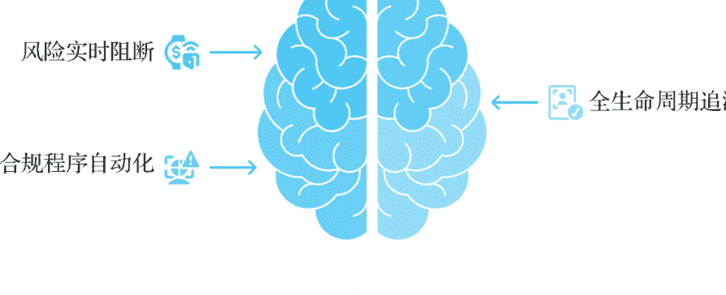

图4-15 DeepSeek助力银行构建智能化运营体系

## 4.12.1
## 账户分类分级管控

### 1.场景概述
账户分类分级是风险防控核心。银行需依据支付机构历史交易数据动态调整非柜面交易额度，设计夜间大额转账额外验证规则。风险经理需识别关联账户资金互转特征，客户经理需执行账户权限限制操作。重点是客户便利性与风险可控的平衡，避免分级僵化影响正常交易，同时强化账户行为模式学习与风险实时拦截能力。

### 2.DeepSeek提示词设计
角色与任务：我是风险经理，为支付机构类账户制定分级规则，限制有哪些？

### 3.进阶追问
- 历史交易数据如何动态调整分级？
- 夜间大额转账额外验证机制如何设计？
- 关联账户资金互转如何监控？

### 4.交付物
账户权限矩阵表、分级操作手册。

## 4.12.2
## 印鉴数字化管理

### 1.场景概述
印鉴数字化是安全升级核心。银行需用生物特征识别替代物理印鉴，设计多层级审批权限分配规则与系统故障应急验证方案。客户经理需推广电子印鉴授权协议，风险团队需验证数据存储安全性。重点是电子印鉴便捷性与防伪能力的平衡，避免技术漏洞导致盗用风险，同时强化操作日志审计与多因子认证能力。

### 2.DeepSeek提示词设计
角色与任务：我是客户经理，为集团客户推广电子印鉴，要解决哪些问题？

### 3.进阶追问
- 生物特征数据存储安全性如何保障？
- 多层级审批权限如何设置？
- 系统故障时应急验证方案有哪些？

### 4.交付物
电子印鉴授权协议、应急操作流程图。

## 4.12.3
## 异常账户行为监测

### 1.场景概述
异常行为监测是反欺诈核心。银行需通过登录地点突变分析、新设备首次登录验证等手段优化监测模型，设计交易IP地址容忍度动态调整规则。风险经理需构建正常加班付款行为特征库，客户经理需开展客户防诈骗教育。重点是用户体验与风险拦截精度的平衡，避免误判导致客户投诉，同时强化设备指纹识别与行为模式自学习能力。

### 2.DeepSeek提示词设计
角色与任务：我是风险经理，优化夜间交易监测模型，应关注哪些特征？

### 3.进阶追问
- 正常加班付款与异常夜间交易如何区分？
- 新设备首次登录验证机制如何强化？
- 交易IP地址突变容忍度如何设定？

### 4.交付物
特征权重表Python、异常行为案例库。

## 4.12.4
## 账户全生命周期管理

### 1.场景概述
账户全生命周期管理是数字化运营核心。银行需通过激活率考核推动长期不动户清理，设计销户前交易追溯期规则与失联客户公告程序。客户经理需验证零余额账户存续状态，风险团队需监控账户信息更新频率。重点是清理效率与客户权益保护的平衡，避免误销户导致纠纷，同时强化自动化提醒与资料电子化归档能力。

### 2.DeepSeek提示词设计
角色与任务：我是客户经理，清理长期不动户，应遵循哪些流程？

### 3.进阶追问
- 零余额客户存续状态如何验证？
- 销户前历史交易追溯期如何设定？
- 客户失联情况下公告程序有哪些？

### 4.交付物
账户生命周期跟踪表、销户操作指引。

## 4.12.5
## 集团账户信息视图搭建

### 1.场景概述
集团账户信息视图是客户服务核心。银行需通过API安全协议整合多银行账户数据，设计敏感信息脱敏展示规则与实时余额查询频次控制机制。客户经理需协调子公司授权数据查询，科技团队需验证数据标准化程度。重点是信息透明度与隐私保护的平衡，避免数据泄露引发法律风险，同时强化跨机构数据协同与视图可视化定制能力。

### 2.DeepSeek提示词设计
角色与任务：银行为跨国集团搭建账户信息视图，应整合哪些数据？

### 3.进阶追问
- 多银行账户数据如何实现标准化？
- 敏感信息脱敏展示规则如何制定？
- 实时余额查询频次如何控制？

### 4.交付物
API安全协议文档、账户视图Demo原型。

## 4.12.6
## 账户管理场景清单
- 开户资料真实性审查
- 风险等级初始评定
- 账户功能权限配置
- 交易行为实时监测
- 印鉴数字化迁移
- 长期不动户清理
- 账户信息定期更新
- 集团账户视图维护
- 销户资料归档
- 账户管理审计

## 4.13
## 本章小结

本章聚焦DeepSeek在银行对公业务场景的应用，覆盖对公客户营销拓展、对公金融产品综合服务、尽职调查报告撰写、企业财务报表分析、授信审批管理、贷后管理等核心场景，通过智能评估、动态监控、区块链存证等技术实现精准营销与风控闭环，助力银行提升业务效率、强化风险抵御能力，推动数字化转型与智能化升级。

# 第5章
# DeepSeek个人金融场景应用

银行个人金融业务正处数字化转型关键期，客户需求从单一产品向综合服务加速升级，服务模式呈现线上线下全渠道融合态势。在利率市场化和金融开放背景下，同业竞争焦点从单品销售转向生态场景运营能力较量，尤其在财富管理、消费金融等重点领域，银行亟需提升智能服务响应速度与精准需求匹配能力。业务人员面临数字化工具应用不足、跨渠道协同效率偏低等现实挑战。

个人金融业务痛点主要有三：业务流程数字化水平不足导致服务断层，客户在房贷申请、理财认购等环节仍需在多系统重复录入；生态场景创新缓慢制约客户价值提升，如数字人民币跨境支付与智能合约等新兴工具尚未规模化应用；数据治理能力不足影响风险控制实效，客户资产负债全景视图缺失，导致动态利率定价准确性受限。

部署DeepSeek智能核验引擎、数字人民币生态开发平台及客户价值管理模型，可突破现有限制，实现与公积金、税务等政务数据对接，达成贷款自动核验。同时构建智能合约模板库加速跨境支付场景创新，并利用机器学习建立客户资金流动动态预警机制。

本章重点解析DeepSeek如何通过“智能核验-生态连接-价值深耕”三大核心能力重构个人金融价值链，有效解决服务效率低下、场景创新不足、风险识别滞后等关键问题，助力银行实现“客户旅程无缝化、场景生态开放化、风险管理前瞻化”的数字化转型目标。

## 5.1
## 住房按揭贷款智能服务

住房按揭业务数字化突破

当下房贷条线普遍出现审批口径不一致、贷后跟进迟缓的现实问题。矛盾集中在资质复核耗时、方案匹配不准、风险监测缺位。应对路径是围绕智能化审核与动态化风控搭建双轮驱动体系。零售客户经理要补强三大能力：多维度研判客户资质、智能化匹配还款方案、持续跟踪抵押物价值。

借助智能审核系统与贷后预警模型，DeepSeek 可以为银行搭建动态风险管控能力，完成自动化审批、抵押物跟踪、方案匹配与资质评估。配合知识图谱技术，DeepSeek 能打通多方数据源，加强协同风控，提升住房按揭全周期管理效能（如图5-1所示）。

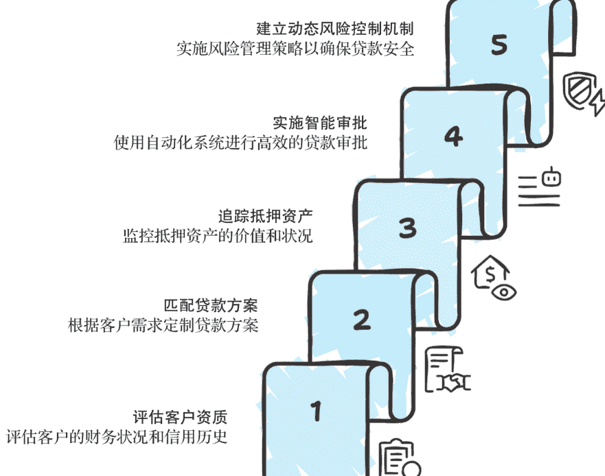

图5-1 DeepSeek提升银行住房按揭贷款业务全周期管理效能

## 5.1.1

## 首套房贷款

## 1.场景介绍
首套房贷仍是住房金融的主力产品。机构可通过政务端口自动核验社保缴纳记录与购房资格，重点防范流水造假与隐性负债。客户经理需搭建差异化还款方案的智能匹配模型，并与房产交易中心协同完成购房合同上链存证。工作重心在于兼顾审批效率与风险把控，避免人工核验导致业务积压，同时强化异地工资流水真实性的交叉验证。

## 2.提示词示例
我是个人客户经理，客户提供异地工资流水，如何验证其真实性？请确保输出内容不编造、不臆测、符合银行实际场景，网页链接真实有效。输出形式为首套房资质审核清单，表格样式要求：标题三号黑体居中，表头四号宋体，表中内容四号楷体。以HTML形式输出，并且可直接下载表格文件。

## 3.输出内容
首先由DeepSeek生成可复制、可下载、可执行的网页源码，如图5-2所示。

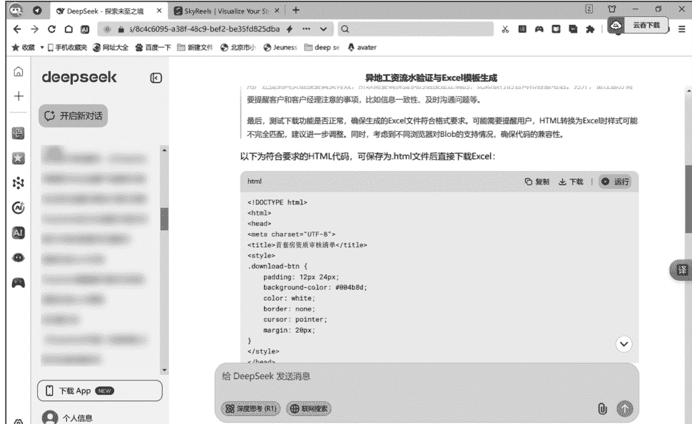

图5-2 DeepSeek直接生成HTML代码

随后点击运行按钮即可得到表格文件，效果如图5-3所示。

最后点选下载按钮，即可把文件保存到本地。

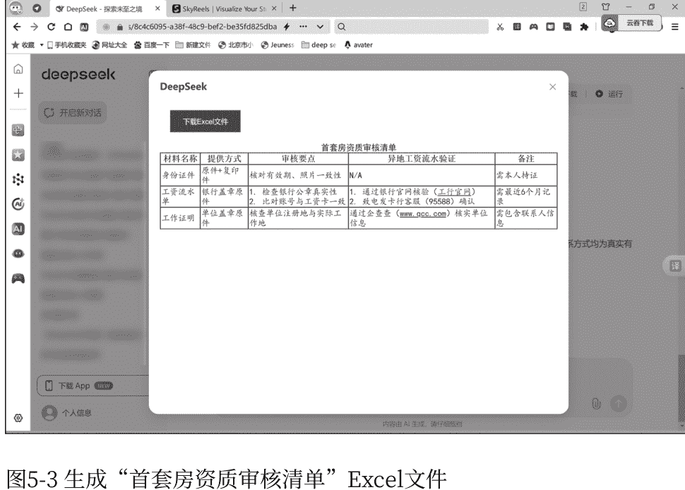

图5-3 生成“首套房资质审核清单”Excel文件

## 5.1.2

## 二手房按揭贷款

## 1.场景介绍
银行可利用区块链实现资金冻结与过户登记的智能联动，重点构建评估价与成交价一致性的核验模型。风险部门需建立资金划付触发规则库，实时捕捉买卖双方账户变动信号。此项工作需在交易效率与资金安全间取得平衡，防止信息孤岛造成资金挪用，同时加强对阶段性担保解除条件的动态判定。

## 2.指令示例
角色加任务：我是零售客户经理，需优化二手房贷款流程，应设置哪些资金管控节点？

## 3.追问提示词
- 如何验证评估价与成交价的一致性？
- 如何实时捕捉买卖双方的账户变更信号？
- 如何设定阶段性担保解除条件？

## 4.输出形式
资金监管协议模板、交易进度跟踪表。

## 5.1.3

## 公积金组合贷款

## 1.场景介绍
银行需打通公积金系统与商业贷审批通道，重点解决异地缴存基数核验及利率波动预警问题。客户经理要建立双通道审批数据共享机制，实时监控公积金额度变化对还款计划的影响权重。关键在于兼顾服务便捷与风险可控，避免数据延迟导致补差比例计算偏差，并强化跨区域账户有效性的自动核验。

## 2.指令示例
角色加任务：我是零售客户经理，需处理组合贷款申请，应同步采集哪些数据？

## 3.追问提示词
- 如何处理公积金缴存基数与银行流水差异？
- 如何验证异地公积金账户的有效性？
- 如何提前告知利率差异导致的月供波动？

## 4.输出形式
公积金数据对接清单、还款计划模拟器。

## 5.1.4

## 利率调整服务

## 1.场景介绍
利率调整是客户权益管理的核心环节。银行要通过机器学习预测客户利率转换偏好，并部署LPR变动的多渠道即时触达。风险部门需构建重定价日冲突的智能解决方案库，自动校验历史还款异常对转换资格的影响。重点是平衡响应速度与合规要求，避免人工失误导致转换延误，并强化利率模式选择法律效力的核验。

## 2.指令示例
角色加任务：我是零售客户经理，在处理客户利率转换申请时，应核查哪些要素？

## 3.追问提示词
- 如何验证客户选择的利率模式合规性？
- 历史还款记录异常如何影响转换？
- 重定价日冲突的解决方案有哪些？

## 4.输出形式
利率转换确认书模板、客户告知记录表。

## 5.1.5

## 线上预审与智能还款

## 1.场景介绍
线上预审与智能还款体现银行数字化能力。银行需用光学字符识别技术自动抓取房产证关键字段，并构建收入流水与负债比的动态评估算法。风险部门要开发还款行为预测模型，并为高频提前还款客户配置预约容量弹性扩容。核心是兼顾自动化效率与风险识别精度，防止识别错误导致预审失效，并强化逾期预警阈值与客户行为模式的关联分析。

## 2.指令示例
角色加任务：我是零售客户经理，在优化线上预审系统时，应强化哪些功能？

## 3.追问提示词
- 如何通过光学字符识别技术自动提取房产证信息？
- 如何设计收入流水分析与负债比的智能评估算法？
- 如何规划提前还款预约系统的容量？

## 4.输出形式
OCR识别规则库、还款行为分析看板。

## 5.1.6

## 住房按揭贷款场景清单
- 客户需求初步诊断
- 预审材料数字化采集
- 政务数据交叉核验
- 差异化首付比例测算
- 利率方案智能匹配
- 电子合同在线签署
- 抵押登记协同办理
- 放款条件动态监控
- 贷后还款行为分析
- 客户服务满意度回访

## 5.2

## 数字人民币推广
银行在数字人民币推广中面临场景落地慢、用户习惯培育难、风险防控不完善等挑战，需构建“场景加生态”服务体系。理财客户经理要掌握智能合约配置、硬钱包管理等新能力。借助数字钱包智能开通工具与场景生态构建能力，DeepSeek可帮助银行实现数字钱包开立与升级、智能合约应用、跨境支付与硬钱包管理、民生缴费等，推动数字人民币推广（如图5-4所示）。

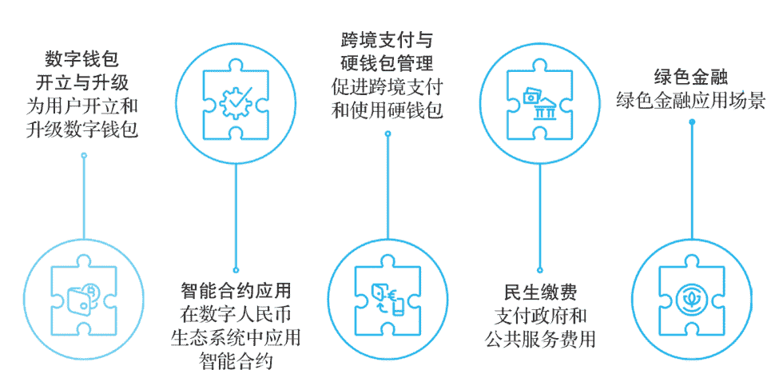

## 5.2.1

## 数字钱包开立与升级

## 1.场景介绍
数字钱包开立与升级是推广工作的核心。银行要依托生物识别落实分级管理，并为特殊群体设计辅助操作流程。大堂经理需部署多重身份核验工具链，动态判断钱包升级条件与权限范围。重点在于平衡体验与合规，避免核验繁琐导致流失，同时强化匿名钱包限额实时监测与违规交易拦截。

## 2.指令示例
角色加任务：我是大堂经理，需规范数字钱包开立流程，应设置哪些必要核验环节？

## 3.追问提示词
- 如何多重验证客户身份真实性？
- 如何辅助特殊群体完成操作？
- 如何判定是否满足钱包升级条件？

## 4.输出形式
操作流程标准、身份核验清单。

## 5.2.2

## 智能合约应用

## 1.场景介绍
智能合约是场景金融创新的关键。银行要搭建租房押金托管等标准模板库，并接入物联网实现房屋状态自动上报。法务合规岗需设计仲裁机构数据对接接口，完善到期自动返还触发逻辑。核心是兼顾场景适配性与法律约束力，避免条款模糊引发争议，同时强化模板可视化编辑与条款批量合规校验。

## 2.指令示例
角色加任务：我是理财客户经理，要设计租房押金智能合约，应设置哪些触发条件？

## 3.追问提示词
- 如何通过物联网设备自动上报房屋状态？
- 发生争议时如何接入仲裁机构数据？
- 如何设定合约到期后的资金自动返还规则？

## 4.输出形式
智能合约逻辑流程图、法律条款附录。

## 5.2.3

## 跨境支付与硬钱包管理

## 1.场景介绍
跨境支付与硬钱包管理是国际业务数字化的核心。银行要通过智能路由优化外汇申报报文转换，重点制定硬钱包遗失应急预案。国际业务部需动态适配外汇管制政策变化，验证交易背景审查规则的穿透效力。重点在于平衡支付效率与合规成本，避免报文标准化不足导致清算延误，并强化海关数据核验与风险评级的联动。

## 2.指令示例
角色加任务：我是国际业务部人员，需优化跨境支付流程，应设置哪些验证节点？

## 3.追问提示词
- 硬钱包遗失如何应急处理？
- 如何动态适配外汇管制政策？
- 交易报文如何进行标准化转换？

## 4.输出形式
操作流程图、申报材料清单。

## 5.2.4

## 民生缴费

## 1.场景介绍
民生缴费是场景生态建设的核心。银行要API直连水电气等缴费系统，重点设计电子发票自动推送与错缴资金原路退回机制。运营岗需配置账单周期智能提醒模型，实现资金划转与账单核验闭环。关键是兼顾覆盖广度与操作安全性，避免接口不稳导致缴费失败，并强化民生数据治理与异常交易回溯。

## 2.指令示例
角色加任务：我是零售客户经理，需优化缴费场景，应打通哪些民生缴费系统接口？

## 3.追问提示词
- 如何为账单周期设置智能提醒？
- 电子发票如何自动推送至客户App？
- 错缴资金如何原路退回？

## 4.输出形式
缴费场景对接清单、异常处理手册。

## 5.2.5

## 绿色金融（个人碳账户）

## 1.场景介绍
绿色金融是ESG战略核心。银行要通过物联网采集步行骑行等行为数据，构建碳减排科学折算模型与防薅羊毛机制。产品经理需制定第三方平台数据安全接入标准，动态调整积分过期规则与奖励比例。重点是兼顾激励吸引力与成本可控，避免数据失真导致绿色标签滥用，并强化碳积分发放的合规校验。

## 2.指令示例
角色加任务：我是个人业务产品经理，要构建激励体系，应设置哪些行为分类？

## 3.追问提示词
- 如何科学折算不同场景的碳减排量？
- 如何设计积分过期机制与防薅羊毛机制？
- 第三方平台数据如何安全接入？

## 4.输出形式
绿色行为分类标准、个人碳积分规则库。

## 5.2.6

## 数字人民币推广场景清单
- 客户身份初次验证
- 钱包等级智能匹配
- 跨境支付通道配置
- 智能合约模板部署
- 政务系统支付对接
- 线下场景终端改造
- 绿色消费行为追踪
- 异常交易实时阻断
- 客户使用行为分析
- 监管数据自动报送

## 5.3

## 消费贷款
消费贷款面临真实性审查不足、资金流向监控滞后、动态风险评估缺失等挑战，需构建“全流程加智能化”风控体系。零售客户经理要掌握贷款用途追踪、多源数据交叉验证等能力。借助智能场景验证工具与资金流向追踪系统，DeepSeek可以帮助银行实现全流程风控、交易背景自动核查、资金路径实时穿透、风险预警阈值动态调整等（如图5-5所示）。

## 5.3.1

## 装修、教育、医疗分期贷款

## 1.场景介绍
装修、教育、医疗分期是场景化消费金融重要产品。银行要通过智能影像识别核验装修合同、入学通知书等凭证真实性，并构建分阶段资金释放规则。授信审批岗需配置交易数据与申请场景智能匹配模型，动态监控教育机构退费与还款计划关联性。重点是兼顾真实性核验与审批效率，避免凭证核验滞后导致资金挪用，并强化医疗分期与诊疗进度的自动化匹配。

### 5.3.2 线上信用贷

#### 1. 场景介绍
线上信用贷是消费贷款核心产品。银行要基于设备指纹与生物特征验证构建反欺诈规则库，重点部署异地登录风险分级响应。风险控制岗需设计申请频次管控算法，实时拦截异常设备更换。核心是平衡体验与拦截效率，避免模型泛化不足导致误判，并强化多维度特征实时分析能力。

#### 2. DeepSeek指令示例
角色加任务：我是风险控制人员，需强化模型的反欺诈能力，应配置哪些基础规则？

#### 3. 追问提示词
- 异地登录如何进行风险识别？
- 设备更换如何进行合规验证？
- 如何合理管控申请频次？

#### 4. 输出形式
反欺诈规则库、操作日志模板。

### 5.3.3 联合品牌消费分期

#### 1. 场景介绍
联合品牌消费分期是生态合作重点。银行要建立商户客群交叉验证模型，设计资金闭环流转路径与促销活动风险预警阈值。产品经理需规范客户投诉协同处理流程，动态评估合作方风险传导系数。重点是平衡市场拓展速度与资产质量，避免准入标准僵化导致场景失效，并强化交易数据的区块链存证与可追溯能力。

#### 2. DeepSeek指令示例
角色加任务：我是产品经理，需设计联合品牌消费分期产品，应设置哪些准入条件？

#### 3. 追问提示词
- 如何交叉验证商户客群？
- 促销活动如何进行风险管控？
- 如何协同处理客户投诉？

#### 4. 输出形式
合作协议模板、商户评估标准。

### 5.3.4 薪资预支服务

#### 1. 场景介绍
薪资预支是薪资金融核心内容。银行要通过HR系统直连核验企业薪资数据，并构建预支额度动态调整算法。对公客户经理需设计离职员工还款保障机制，实时监测薪资结构差异对还款能力的影响。重点是平衡流动性支持与企业成本，避免数据延迟导致额度偏差，并强化预支资金用途的穿透式监控。

#### 2. DeepSeek指令示例
角色加任务：我是对公客户经理，需优化薪资预支服务，应关注哪些参数设置？

#### 3. 追问提示词
- 如何处理薪资结构差异？
- 如何保障离职员工还款？
- 如何动态调整预支额度？

#### 4. 输出形式
额度计算模型、企业对接指南。

### 5.3.5 消费贷款场景清单
- 场景化产品设计
- 合作机构资质审查
- 线上申请流程优化
- 多头借贷实时拦截
- 资金流向穿透监控
- 联合品牌系统对接
- 风险定价模型迭代
- 逾期客户智能催收
- 客户复贷行为分析
- 监管合规数据报送

## 5.4 信用卡
信用卡业务面临产品同质化、活跃度下降等挑战，痛点为场景权益吸引力不足、虚拟卡智能合约创新滞后、分期风险识别精度不足。需构建“生态化加智能化”运营体系。零售客户经理要掌握生态场景运营、智能权益配置、风险定价因子挖掘等能力。借助智能场景运营平台与动态风险定价引擎，DeepSeek可实现跨境消费实时汇率补贴、虚拟卡智能合约灵活配置、分期风险定价模型动态优化等（如图5-6所示）。

### 5.4.1 联名卡与主题卡

#### 1. 场景介绍
联名卡与主题卡是信用卡核心产品。银行要通过舆情监测动态评估与合作品牌契合度，并设计权益成本控制模型与客户投诉协同处置机制。市场推广岗需规范营销活动合规审查，建立权益兑现量化评估体系。重点是平衡品牌价值与运营成本，避免舆情失控导致声誉风险，并强化权益使用率实时追踪。

#### 2. DeepSeek指令示例
角色加任务：我是市场推广人员，需设计联名卡产品，应设置哪些准入维度？

#### 3. 追问提示词
- 如何持续监测品牌舆情？
- 如何动态控制权益成本？
- 如何协同处置客户投诉？

#### 4. 输出形式
联名机构评估表、权益管理手册。

### 5.4.2 虚拟信用卡

#### 1. 场景介绍
虚拟信用卡是支付安全升级关键。银行要通过Token化生成动态卡号，并制定境外交易分级管控规则与设备绑定唯一性验证。网络支付岗需部署交易场景限制引擎，实时拦截高风险商户可疑交易。核心是平衡用卡便捷性与风险防控，避免静态码管理疏漏导致盗刷，并强化虚拟卡生命周期智能管控。

#### 2. DeepSeek指令示例
角色加任务：我是网络支付人员，需强化虚拟卡风控，应设置哪些基础规则？

#### 3. 追问提示词
- 如何分级管控境外交易？
- 如何安全生成虚拟卡号？
- 如何验证绑定设备的唯一性？

#### 4. 输出形式
风险管控标准、交易监控规则库。

### 5.4.3 账单分期与灵活还款

#### 1. 场景介绍
账单分期与灵活还款是体验优化重点。银行要通过可视化动态展示手续费计算逻辑，并构建提前结清规则智能解析引擎。客户服务岗需设计还款记录便捷查询接口，规范应答话术库。重点是平衡信息披露透明度与操作便捷性，避免条款解释模糊引发纠纷，并强化还款行为预测与弹性容量规划。

#### 2. DeepSeek指令示例
角色加任务：我是客户服务人员，需优化对分期咨询的应答，应准备哪些标准话术？

#### 3. 追问提示词
- 如何清晰说明手续费计算方法？
- 如何展示提前结清规则？
- 如何便捷查询还款记录？

#### 4. 输出形式
应答话术手册、费用说明模板。

### 5.4.4 跨境消费返现

#### 1. 场景介绍

跨境返现如何平衡吸引力与合规风险

跨境消费返现是国际业务增量的常用抓手。上线时要打通海关数据接口核验真实消费，搭建随汇率波动自动调节补贴额度的测算模型，并对商户类别设定准入与限制规则。国际业务岗需要引入退税交易智能识别，覆盖资格判定、奖励核算到发放的闭环自动化。核心是让活动力度与合规成本匹配，防止规则表述模糊引来监管关注，并持续完善跨境交易数据的多角度交叉核查。

#### 2. DeepSeek提示词
角色+任务：我负责国际业务的跨境返现项目，想了解发放条件应怎样制定？

#### 3. 追问提示词
- 退税类交易如何甄别并进行处置？
- 商户类别的合规边界该如何确定？
- 汇率波动的动态测算方法有哪些？

#### 4. 输出形式
返现规则库（Excel表格）、交易核验标准（Word文档）。

### 5.4.5 信用卡场景清单
- 客群画像分析
- 联名权益谈判
- 虚拟卡功能设计
- 风险定价模型构建
- 跨境通道成本优化
- 账单分期智能推荐
- 异常交易实时阻断
- 客户生命周期管理
- 沉睡客户唤醒策略
- 监管合规自查

## 5.5 征信服务
征信板块当前面临客户信用认知弱、异议处理时效慢的难题，主要是申诉材料不规范、报告解读专业性不足、修复方案缺乏动态调整。需要搭建合规申诉、精准解读、长效管理三位一体的服务体系。零售客户经理应具备证据链数字化管理、信用修复策略建模、监管合规智能校验等新能力。借助智能材料核验引擎与信用教育工具，DeepSeek可助力银行提速异议处理、提升解读质量、开展信用教育。

### 5.5.1 征信异议处理
#### 1. 场景介绍
征信异议处理是合规服务的核心环节，银行需通过电子化系统在15日内完成核查并回复，重点建立跨机构信息源协同核验机制。客户服务人员要设计材料完整性自动审查规则，全流程留存与客户沟通的数字证据。工作重点在于平衡处理效率与证据链完整，避免流程疏漏带来法律风险，并强化异议数据溯源与修正穿透能力。

#### 2. DeepSeek提示词
角色定位：我是客服人员，面对征信异议申请时，应遵循哪些标准流程？

#### 3. 追问提示词
- 如何验证异议材料的真实性？
- 信息源核查如何实现跨机构协作？
- 与客户沟通时如何完整留存记录？

#### 4. 输出形式
异议处理流程图（Visio流程图）、材料核验清单（Excel表格）。

### 5.5.2 信用报告解读
#### 1. 场景介绍
信用报告解读属于消费者权益保护合规管理的核心内容，银行需以标准化模板客观呈现不良记录成因，并落实第三方授权查询的双重验证。理财客户经理须使用监管备案话术库，不得对客户信用状况作主观评价。重点在于平衡专业解读与合规边界，防止误导性表述导致投诉，并提升电子授权书的防篡改存证能力。

#### 2. DeepSeek提示词
角色定位：作为理财客户经理，提供信用报告解读服务时，应准备哪些合规话术？

#### 3. 追问提示词
- 如何规避误导性表述？
- 不良记录应怎样合规说明？
- 第三方授权查询如何验证？

#### 4. 输出形式
解读服务标准（Word文档）、授权书模板（Word文档）。

### 5.5.3 信用教育指导
#### 1. 场景介绍
信用教育指导是银行社会责任的重要体现，需借助脱敏案例库与多媒体工具开展公益宣传，重点隔离教育内容与业务推介。消费者权益保护岗位要建立宣传渠道合规审查模型，动态监控材料发布范围。核心在于兼顾知识普及与商业推广边界，避免内容越界被问责，并强化教育效果的量化评估。

#### 2. DeepSeek提示词
角色定位：我是消费者权益保护岗位人员，设计客户信用教育材料时，需要包含哪些必要内容？

#### 3. 追问提示词
- 教育指导与业务推介如何区分？
- 展示案例怎样做脱敏处理？
- 宣传渠道如何实现合规管理？

#### 4. 输出形式
教育手册（Word文档）、宣传审核标准（Excel表格）。

### 5.5.4 征信服务场景清单
- 客户信用问题诊断
- 异议申诉材料初审
- 核查流程执行
- 征信数据交叉核验
- 法律合规性审查
- 结果正式答复
- 还款行为动态监控
- 额度渐进式恢复
- 金融知识普及
- 宣传材料审核

## 5.6 留学金融
留学金融服务面临政策复杂、需求多元的挑战，痛点集中在汇率锁定期限僵化、保证金证明开立效率低、海外账户服务滞后。银行需构建资金规划、跨境流转、境外服务一体化体系。跨境金融顾问应掌握动态汇率风险管理、跨境数据合规校验、多国监管规则映射等能力。依托智能汇率管理工具与跨境数据通道，DeepSeek可优化动态锁价策略、实现保证金证明自动审核、推动境外账户服务实时协同。

### 5.6.1 留学贷款
#### 1. 场景介绍
留学贷款是跨境教育金融的核心产品，银行需通过教育部学历认证系统核验境外院校资质，重点设计学费直付智能路由与休学期间还款计划动态调整模型。授信审批岗位要建立留学生毕业去向追踪机制，实时获取就业状态以评估还款能力。重点在于平衡资金监管效率与客户体验，防止跨境信息滞后扩大风险敞口，同时强化电子录取通知书的区块链存证与核验。

#### 2. DeepSeek提示词
角色定位：作为授信审批人员管理留学贷款时，应设置哪些资金监管规则？

#### 3. 追问提示词
- 境外院校资质如何核验？
- 支付学费时如何直连院校账户？
- 休学情形下还款计划如何调整？

#### 4. 输出形式
资金监管协议（Word文档）、院校白名单（Excel表格）。

### 5.6.2 外汇兑换与跨境汇款
#### 1. 场景介绍
外汇兑换与跨境汇款是外汇合规监管的重点，银行需通过智能购汇系统自动匹配年度便利化额度，重点核验境外学费发票与备用金汇款的贸易背景真实性。外汇业务人员要部署申报要素自动填充引擎，实时校验跨境汇款路径合规性。核心在于兼顾汇率优化与政策约束，避免发票信息模糊导致退汇风险，同时提升多币种账户证明的自动开具能力。

#### 2. DeepSeek提示词
角色定位：作为外汇业务岗位人员处理留学购汇时，应设定哪些审核要点？

#### 3. 追问提示词
- 年度便利化额度如何计算？
- 境外学费发票怎样核验？
- 备用金汇款如何合规操作？

#### 4. 输出形式
购汇审核清单（Excel表格）、申报要素对照表（Excel表格）。

### 5.6.3 留学保证金证明
#### 1. 场景介绍
开具留学保证金证明是签证金融服务的基础环节，银行需通过专用冻结标识对多币种账户实施精准管控，重点构建冻结期限与签证要求智能匹配的决策模型。柜员岗位须规范提前解冻审批流程，动态监控保证金账户资金异动。重点在于平衡客户流动性需求与使馆合规要求，防止冻结规则僵化导致客户流失，同时强化电子证明防伪与使领馆系统的数据直连。

#### 2. DeepSeek提示词
角色定位：我是银行柜员，开具存款证明时应执行哪些标准操作？

#### 3. 追问提示词
- 冻结期限如何匹配签证要求？
- 多币种账户如何开具证明？
- 保证金提前解冻如何合规处理？

#### 4. 输出形式
操作流程标准（Word文档）、冻结记录表（Excel表格）。

### 5.6.4 海外账户开立
#### 1. 场景介绍
海外账户开立是全球化服务的关键，银行需通过预审系统核验居民税收身份证明与境外住址凭证，重点部署跨境KYC信息共享机制。国际业务部要设计远程账户激活流程，实时同步反洗钱黑名单。重点在于平衡开户效率与合规审查，避免身份认定偏差带来法律风险，同时提升多语言合同智能适配与跨境数据传输加密能力。

#### 2. DeepSeek提示词
角色定位：作为国际业务部人员协助客户开立海外账户时，应设置哪些预审条件？

#### 3. 追问提示词
- 居民税收身份如何认定？
- 境外住址证明怎样核验？
- 账户如何远程完成激活？

#### 4. 输出形式
预审材料清单（Excel表格）、跨境服务协议（Word文档）。

### 5.6.5 留学金融场景清单
- 留学资金需求评估
- 院校资质认证
- 跨境贷款方案设计
- 汇率风险管理
- 保证金证明电子化开具
- 境外账户预审
- 跨境汇款执行
- 海外服务对接
- 还款计划监控
- 归国金融衔接

## 5.7 移动支付
移动支付业务面临场景渗透不足、安全防护滞后等问题，痛点包括数字人民币场景单一、聚合支付商户覆盖低、跨境钱包互联技术受阻。银行需构建场景融合、安全升级、跨境互通一体生态。支付业务团队要强化数字人民币场景拓展、商户生态智能运营、跨境支付协议解析能力。借助智能风控引擎与生态整合能力，DeepSeek可实现数字人民币多场景适配、聚合支付商户精准触达、跨境钱包互联协议自动解析，并依托实时风险监测与设备指纹技术强化安全，推动移动支付从交易工具向全域生态平台升级。

### 5.7.1 数字人民币支付
#### 1. 场景介绍
数字人民币支付是移动金融创新的核心，银行需通过智能合约实现小额匿名钱包限额动态管理，重点部署可疑交易实时阻断与硬件钱包协同认证机制。数字银行部要构建特定场景支付限制规则库，验证物联网设备交易场景真实性。重点在于平衡便捷性与反洗钱要求，防止匿名功能被滥用，同时强化离线支付安全协议及设备丢失时的应急冻结能力。

#### 2. DeepSeek提示词
角色定位：作为数字银行部人员优化支付功能时，应设置哪些安全规则？

#### 3. 追问提示词
- 匿名钱包限额如何管理？
- 可疑交易如何实时阻断？
- 硬件钱包如何协同使用？

#### 4. 输出形式
支付安全标准（Word文档）、风险规则库（Excel表格）。

### 5.7.2 二维码聚合支付
#### 1. 场景介绍
二维码聚合支付是商户生态运营的核心，银行需通过LBS技术监控静态码使用范围，重点构建商户经营数据交叉验证模型。收单业务人员要设计交易频次异常识别算法，动态调整高风险商户结算周期。重点在于平衡收单规模与资产质量，避免套现交易漏检造成资金损失，同时强化电子签购单区块链存证与争议快速裁决能力。

#### 2. DeepSeek提示词
角色定位：作为收单业务岗位人员管理聚合支付时，应设置哪些商户准入条件？

#### 3. 追问提示词
- 静态码如何进行限额管理？
- 商户经营真实性如何核验？
- 交易频次异常如何处置？

#### 4. 输出形式
商户准入标准（Word文档）、交易监控规则（Excel表格）。

### 5.7.3 无感支付
#### 1. 场景介绍
无感支付是场景金融体验升级的核心，银行需通过生物识别技术落实免密签约的法定授权要求，重点设计单日累计限额的分级管控。

### 5.7.4 跨境钱包互联
#### 1. 场景介绍
跨境钱包互联是支付国际化的核心环节，银行需通过SWIFT GPI标准优化外汇申报流程，重点核验境外钱包机构金融牌照有效性。国际业务部要部署实时汇率引擎，实现多币种结算智能换汇与成本优化。重点在于平衡跨境支付速度与合规成本，避免报文转换错误导致清算失败，同时强化交易背景穿透式审查与反逃税监测能力。

#### 2. DeepSeek提示词
角色定位：作为国际业务部人员优化钱包互联服务时，应设置哪些合规检查？

#### 3. 追问提示词
- 境外钱包机构资质如何审查？
- 交易背景真实性如何核验？
- 大额交易如何申报处理？

#### 4. 输出形式
跨境合作标准（Word文档）、申报要素对照表（Excel表格）。

### 5.7.5 移动支付全流程场景清单
- 支付场景需求分析
- 商户资质审核
- 支付终端部署
- 交易风险监控
- 资金清算对账
- 客户投诉处理
- 系统压力测试
- 跨境通道维护
- 监管合规报送
- 支付生态运营

## 5.8 养老金
养老金业务面临老龄化加速与需求升级的双重压力，痛点为账户管理分散、代发服务效率低、综合服务能力不足。银行需构建账户统一、服务延伸、生态融合一体服务体系。零售客户经理应掌握多账户整合管理、生态资源智能对接、康养方案设计等能力。通过智能账户管理平台与生态资源整合工具，DeepSeek可实现养老金账户统一归集、代发流程自动化、康养资源精准匹配，并依托多源数据融合构建全生命周期服务模型，推动业务从单一账户管理向健康养老综合平台升级。

### 5.8.1 个人养老金
#### 1. 场景介绍
个人养老金是养老金融基础业务，银行需通过税务系统接口自动生成抵扣凭证，重点构建跨行资金转入智能路由模型。柜员岗位要落实基本养老保险参保状态实时核验，动态拦截超额缴费。重点在于平衡税收优惠落实与账户管理效率，避免系统延迟损害客户权益，同时强化账户变更监管备案与数据同步能力。

#### 2. DeepSeek提示词
角色定位：作为银行柜员办理个人养老金开户时，应执行哪些身份核验步骤？

#### 3. 追问提示词
- 基本养老保险参保状态如何验证？
- 跨行资金转入渠道如何管理？
- 超额缴费如何动态拦截？

#### 4. 输出形式
开户核验清单（Excel表格）、税务凭证模板（Word文档）。

### 5.8.2 养老金代发服务
#### 1. 场景介绍
养老金代发服务是社会保障协同的重要内容，银行需通过专用资金账户实现批量代发智能对账，重点设计发放失败自动重试与异常账户实时预警机制。运营管理岗位要规范跨行手续费计算规则，构建电子回单长期归档系统。重点在于平衡代发规模与操作风险，避免账户信息过期导致资金滞留，同时强化生物特征识别核验与防重复发放能力。

#### 2. DeepSeek提示词
角色定位：我是运营管理人员，优化代发流程时应设置哪些异常处理规则？

#### 3. 追问提示词
- 账户状态异常如何实时预警？
- 跨行代发手续费如何合规收取？
- 发放记录如何长期存档？

#### 4. 输出形式
代发操作手册（Word文档）、异常代码表（Excel表格）。

### 5.8.3 养老金融合服务
#### 1. 场景介绍
养老金融合服务是生态化运营的重要内容，银行需通过健康数据安全接口对接康养机构，重点构建封闭期产品流动性风险量化模型。理财客户经理须使用监管备案话术说明税收递延政策，动态匹配客户风险偏好与产品组合。重点在于平衡销售合规性与客户需求，避免业绩比较基准误导引发投诉，同时强化家庭财富传承方案智能推荐能力。

#### 2. DeepSeek提示词
角色定位：我是理财客户经理，推介养老产品时应设置哪些风险提示要点？

#### 3. 追问提示词
- 封闭期产品流动性风险如何说明？
- 税收优惠政策如何准确解读？
- 产品业绩比较基准如何规范展示？

#### 4. 输出形式
销售双录话术（Word文档）、风险测评表（Excel表格）。

### 5.8.4 养老金账户场景清单
- 客户养老需求诊断
- 账户类型智能匹配
- 税收优惠额度动态监控
- 生物特征识别代发核验
- 生态资源准入评估
- 服务套餐定制
- 健康数据安全管理
- 家庭财富传承规划
- 异常事件应急处置
- 服务效果持续跟踪

## 5.9 贵金属投资
贵金属业务面临价格波动剧烈、客户风险认知不足等挑战，痛点为实物交割成本高、交易系统响应延迟、定投策略灵活性差。银行需构建实物、账户、衍生品一体服务体系。贵金属业务团队要强化价格波动风险管理、数字交割系统操作、衍生品组合设计能力。通过智能定价引擎与数字仓储技术，DeepSeek可实现实物交割流程数字化、实时报价优化、智能定投策略配置，并依托区块链实现资产权属登记存证，推动业务从传统交易向数字资产管理转型。

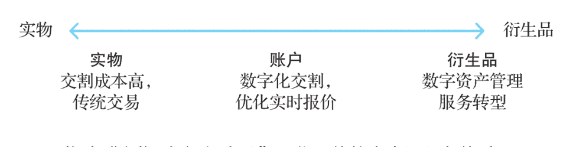
### 5.9.1 实物贵金属销售
#### 1. 场景介绍
实物贵金属销售是贵金属业务的基础。以上海为例，银行需通过上海黄金交易所认证系统核验产品资质，重点部署保管箱环境监控与双人复核交接机制。柜员岗位要设计客户身份生物特征核验流程，实时更新出入库区块链存证记录。重点在于平衡实物交割效率与操作风险，防止保管条件不达标导致资产损毁，同时强化库存动态盘查与保险覆盖范围智能匹配能力。

#### 2. DeepSeek提示词
角色定位：我是银行柜员，办理实物贵金属销售业务时应执行哪些保管流程？

#### 3. 追问提示词
- 交割重量如何精准复核？
- 保管箱温湿度如何监控？
- 客户提取实物时身份如何核验？

#### 4. 输出形式
交接登记表（Excel表格）、保管标准（Word文档）。

### 5.9.2 账户贵金属交易
#### 1. 场景介绍
账户贵金属交易是衍生品服务的核心。以伦敦金为例，银行需通过价格波动预警模型实时监控伦敦金基准价偏离度，重点构建杠杆比例动态调整规则与非交易时段委托管控规则。交易监控岗位要设计平仓线智能触发算法，验证异常交易行为特征库有效性。重点在于平衡市场流动性风险与客户收益，避免系统延迟导致强平争议，同时强化做市商报价质量评估与应急流动性支持能力。

#### 2. DeepSeek提示词

交易监控角色界定：作为账户交易风险管控的执行主体，在管理持仓行为时应设定哪些核心风控参数？

#### 3. 延伸追问
- 杠杆比例能否随市场波动进行动态升降？
- 非交易时段的委托指令如何进行拦截？
- 强制平仓线能否实现自动触发？

#### 4. 输出形式
风险参数表（Excel表格）、交易规则手册（Word文档）。

### 5.9.3 积存金定投

#### 1. 场景介绍
积存金定投是银行普惠理财的主线业务。需要借助历史波动率图表展示价格波动风险，重点说明赎回手续费分层计费规则与税收影响。理财客户经理要构建定投成本智能测算工具，严禁使用预期收益话术误导客户。核心在于平衡产品吸引力与信息披露完整性，避免条款表述模糊引发纠纷，同时强化定投策略回测与市场情绪联动的分析能力。

#### 2. DeepSeek提示词
角色与任务：我是理财客户经理，在推介定投产品时，应涵盖哪些风险告知要点？

#### 3. 追问提示词
- 定投成本如何以图表形式呈现？
- 赎回手续费的分档逻辑如何通俗表达？
- 历史价格波动怎样客观展示？

#### 4. 输出形式
定投协议模板（Word文档）、风险揭示书（Word文档）。

### 5.9.4 贵金属投资场景清单
- 客户风险承受力评估
- 产品类型智能推荐
- 价格波动预警推送
- 交易指令执行监控
- 实物交割流程管理
- 定投策略动态调整
- 库存价值重估
- 做市商流动性管理
- 投资者教育
- 监管合规自查

## 5.10 私人银行
私人银行正面临高净值客户需求多元化、跨境服务复杂化等挑战，当前短板集中于传承工具单一、全球资产配置效率偏低、另类投资专业能力不足。银行需构建本土深耕、跨境联动、生态赋能的三位一体服务体系。私人银行团队应强化定制化传承方案设计、跨境资产协同管理、另类投资价值评估三大核心能力。依托智能财富管理平台与全球资源网络，DeepSeek可助力实现家族信托结构动态优化、多市场资产配置智能调仓、艺术品估值模型构建，并借助区块链实现跨境资产权属透明化管理，推动服务从单一财富管理向综合生态服务平台升级（如图5-12所示）。

| 特点 | 私人银行 | DeepSeek 解决方案 |
| :--- | :--- | :--- |
| 客户需求 | 多样化 | 综合服务平台 |
| 当前痛点 | 工具单一、全球配置效率低、另类投资专业不足 | 家族信托结构动态优化、跨市场资产智能调仓、艺术品估值模型构建 |
| 服务体系 | 不适用 | 本土深耕、跨境联动、生态赋能 |
| 关键功能 | 不适用 | 智能财富管理、全球资源网络、跨境资产权属透明化管理 |
| 服务升级 | 单一财富管理 | 综合生态服务平台 |

### 5.10.1 家族信托与财富传承

#### 1. 场景介绍
家族信托与财富传承是私人银行的核心板块。银行需借助智能文本审核校验信托架构合规性，重点搭建跨境资产CRS申报自动化通道。家族办公室需设计税务筹划冲突检测模型，动态优化受益人权益分配。此项工作的重点在于平衡财富隔离需求与法律约束，避免代际沟通不足导致执行争议，同时强化艺术品等另类资产合规估值能力。

#### 2. DeepSeek提示词
角色与任务：我是家族办公室顾问，设计信托方案时应关注哪些合规要点？

#### 3. 追问提示词
- 受益人资格如何进行法律审查？
- 跨境资产如何合规配置？
- 税务筹划如何避免与法律产生冲突？

#### 4. 输出形式
信托架构图（Visio文件）、法律审查清单（Excel表格）。

### 5.10.2 全球资产配置

#### 1. 场景介绍
全球资产配置体现银行国际化服务能力。银行需通过多市场数据接口实现组合智能再平衡，重点部署政治风险预警与境外不动产估值管理系统。国际业务部需构建汇率避险动态对冲模型，实时监控外汇敞口偏离阈值。此项工作重点在于平衡收益目标与波动控制，避免地域集中度过高导致系统性风险，同时强化ESG因子量化分析能力与组合穿透式管理能力。

#### 2. DeepSeek提示词
角色与任务：我是国际业务部人员，设计全球资产配置方案时应设置哪些风险对冲规则？

#### 3. 追问提示词
- CRS信息如何合规申报？
- 政治风险怎样评估预警？
- 境外不动产如何进行估值管理？

#### 4. 输出形式
配置建议书（Word文档）、汇率避险方案（Excel表格）。

### 5.10.3 艺术品投资顾问

#### 1. 场景介绍
艺术品投资顾问是私人银行差异化服务核心。银行需通过区块链实现藏品溯源存证，重点构建第三方鉴定机构双盲评估机制。艺术金融岗需设计保管条件物联网监控方案，动态调整保险覆盖范围与流通渠道合规性。重点在于平衡资产流动性溢价与保管成本，避免估值失真导致投资损失，同时强化文化政策敏感性分析与跨境流通备案能力。

#### 2. DeepSeek提示词
角色与任务：我是艺术金融岗人员，管理投资标的时应设置哪些风险缓释措施？

#### 3. 追问提示词
- 保管条件如何进行专业认证？
- 保险方案如何动态调整？
- 流通渠道如何合规搭建？

#### 4. 输出形式
评估标准（Word文档）、保管协议模板（Word文档）。

### 5.10.4 私人银行场景清单
- 客户财富深度诊断
- 家族治理架构设计
- 跨境税务筹划
- 多资产配置建模
- 另类投资尽调
- 法律文件定制
- 资产动态再平衡
- 危机应对预案制定
- 二代继承人培养
- 财富管理效果评估

## 5.11 个人理财
个人理财业务面临客户风险偏好分化、产品同质化严重等挑战，核心痛点为智能服务精准度不足、产品创新滞后、收益波动管理工具缺失。银行需构建精准画像-动态适配-价值提升的服务闭环。零售客户经理需强化需求深度挖掘、资产配置动态调整、收益波动预警能力。借助智能资产配置引擎与产品创新工具，DeepSeek可助力实现客户风险画像精准构建、主题理财产品智能开发、收益波动动态对冲机制建立，并依托知识图谱关联客户全生命周期金融需求，推动服务从标准化销售向个性化财富规划转型（如图5-13所示）。

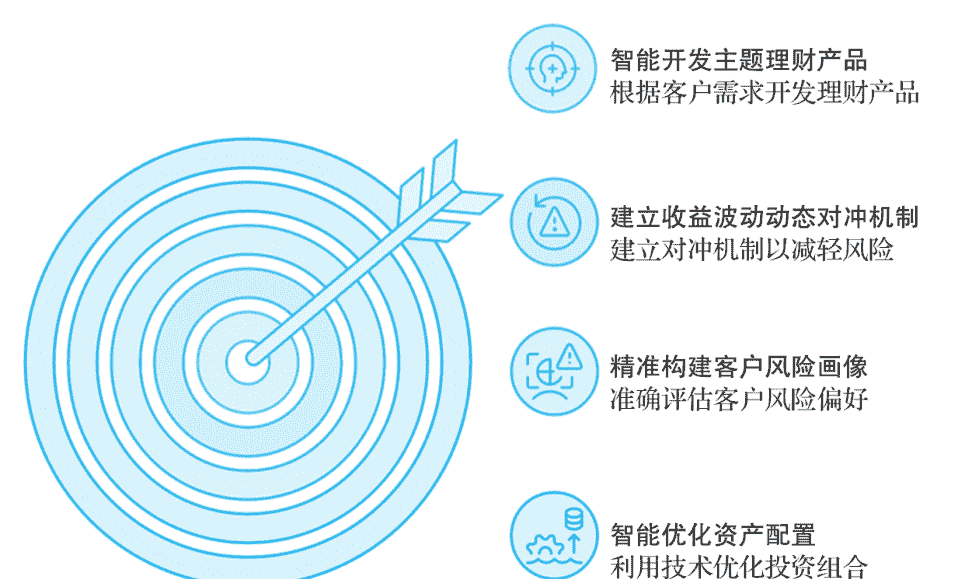

### 5.11.1 智能投顾

#### 1. 场景介绍
智能投顾是数字化财富管理核心。银行需通过动态问卷验证客户风险承受能力，重点构建投资组合再平衡合规提示规则。理财客户经理需部署市场极端波动时的应急处理预案，实时监控模型偏差率。重点在于平衡算法推荐效率与监管要求，避免全权委托带来法律风险，同时强化客户教育内容智能推送与客户行为数据分析能力。

#### 2. DeepSeek提示词
角色与任务：我是理财客户经理，管理智能投顾时应设置哪些风险控制点？

#### 3. 追问提示词
- 风险评估问卷有效性如何验证？
- 投资组合再平衡如何进行合规提示？
- 市场极端波动如何应急处理？

#### 4. 输出形式
投顾协议模板（Word文档）、风险参数表（Excel表格）。

### 5.11.2 结构性存款

#### 1. 场景介绍
结构性存款是保本理财创新的关键产品。银行需通过监管备案模板规范挂钩标的披露标准，重点设计情景收益演示合规展示框架。产品经理需构建提前终止条款智能解析引擎，客观呈现历史波动率与最大回撤数据。重点在于平衡产品吸引力与投资者适当性管理，避免收益测算误导引发纠纷，同时强化压力测试模型性能与流动性应急准备能力。

#### 2. DeepSeek提示词
角色与任务：我是产品经理，设计产品说明书时应包含哪些必要要素？

#### 3. 追问提示词
- 情景收益演示如何合规展示？
- 提前终止条款如何清晰说明？
- 历史波动率如何客观呈现？

#### 4. 输出形式
产品说明书模板（Word文档）、收益测算表（Excel表格）。

### 5.11.3 养老理财试点

#### 1. 场景介绍
养老理财试点是应对人口老龄化的战略举措。银行需通过五年期封闭产品专项评估模型量化长期流动性风险，重点构建税收递延政策智能解读模块。理财客户经理需设计快速投诉响应通道，实时监控客户健康状况变化对投资偏好的影响。重点在于平衡产品期限结构与客户生命周期需求，避免市场波动导致大规模赎回压力，同时强化家庭关联账户协同管理能力。

#### 2. DeepSeek提示词
角色与任务：我是理财客户经理，销售养老理财试点产品时应执行哪些特殊流程？

#### 3. 追问提示词
- 长期流动性风险如何充分告知？
- 税收递延政策如何准确解读？
- 投诉处理如何设置快速通道？

#### 4. 输出形式
专项风险评估表（Excel表格）、双录话术手册（Word文档）。

### 5.11.4 个人理财全流程场景清单
- 客户财富目标诊断
- 风险承受能力评估
- 资产配置方案生成
- 产品合规性审查
- 收益情景压力测试
- 组合动态再平衡
- 客户定期检视提醒
- 特殊事件应急处置
- 税务优化建议
- 服务效果追踪

## 5.12 汽车金融
汽车金融面临新能源转型加速、二手车市场规范不足等挑战，主要痛点为利率定价僵化、残值管理能力薄弱、经销商合作模式单一。银行需构建新车-二手车-后市场全链条金融服务体系。汽车金融团队需强化差异化利率定价模型设计、残值动态评估、生态合作网络拓展。借助智能残值预测模型与生态合作工具，DeepSeek可助力实现新能源车型风险分级定价、二手车残值动态评估、经销商智能合作平台搭建，并依托物联网实时监控车辆使用状态，推动服务从单一贷款向全生命周期资产管理与生态协同转型（如图5-14所示）。

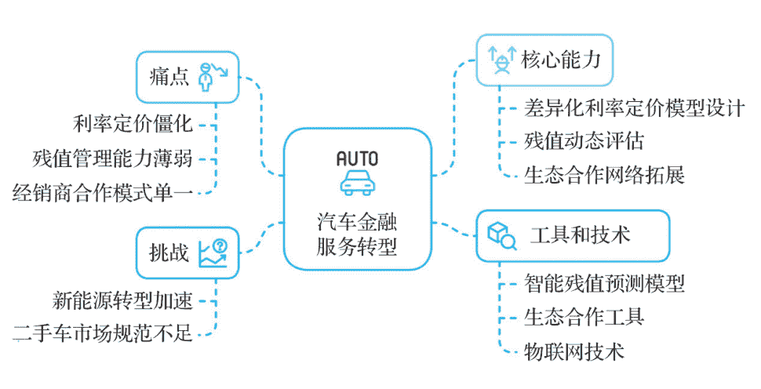

### 5.12.1 新能源汽车贷

#### 1. 场景介绍
新能源汽车贷是绿色交通金融核心产品。银行需依据工信部发布目录核验车型准入资质，重点构建电池健康度物联网监测机制与残值预测模型。授信审批岗需动态适配地方补贴政策变化，核实充电桩安装证明真实性。重点在于平衡风险定价精度与市场竞争力，避免技术迭代导致抵押物贬值，同时强化车电分离模式下风险对冲能力。

#### 2. DeepSeek提示词
角色与任务：我是授信审批人员，评估车辆价值时应关注哪些特殊参数？

#### 3. 追问提示词
- 电池健康度如何折算估值？
- 地方补贴政策如何动态适配？
- 充电桩安装情况如何核实？

#### 4. 输出形式
评估参数表（Excel表格）、补贴政策库（Excel表格）。

### 5.12.2 二手车金融

#### 1. 场景介绍
二手车金融是普惠金融重要场景。银行需通过VIN码核验系统追溯车辆历史记录，重点部署基于GPS的异常移

### 5.12.3 经销商合作分期

#### 1. 场景介绍
经销商合作分期是供应链金融创新模式。银行需通过电子围栏技术隔离库存融资与零售贷款资金流，重点构建客户投诉智能分拣与跨部门协同处理机制。对公客户经理需动态调整保证金比例策略，实时监控合作方经营指标异动。此项工作重点在于平衡渠道拓展速度与资产质量，避免过度授信导致风险累积，同时强化区块链订单存证与返利结算流程自动化能力。

#### 2. DeepSeek提示词
角色与任务：我是对公客户经理，管理合作方时应设置哪些准入条件？

#### 3. 追问提示词
- 库存融资如何与零售贷款隔离？
- 客户投诉如何协同处理？
- 保证金比例如何动态调整？

#### 4. 输出形式
合作协议模板（Word文档）、准入评估表（Excel表格）。

### 5.12.4 汽车金融场景清单
- 客户购车需求分析
- 车辆估值与残值预测
- 经销商资质审查
- 贷款方案智能匹配
- 保险产品配置
- 抵押登记协同办理
- 贷后车辆状态监控
- 残值风险对冲
- 逾期车辆处置
- 客户生命周期管理

## 5.13 个贷催收
个贷催收面临合规监管趋严、客户沟通效率低等挑战，主要痛点为催收手段单一、合规监控实时性不足、客户体验优化困难。银行需构建合规管理-智能策略-客户关怀三位一体催收服务体系。贷后管理岗需强化智能分案策略制定、催收合规实时监测、客户还款意愿评估。借助智能分案系统与合规质检工具，DeepSeek可助力实现催收任务智能分级、全流程合规质检自动化、差异化沟通策略生成，并依托智能外呼系统实现催收过程可回溯管理，确保行为符合《个人信息保护法》及《消费者权益保护法》要求（如图5-15所示）。

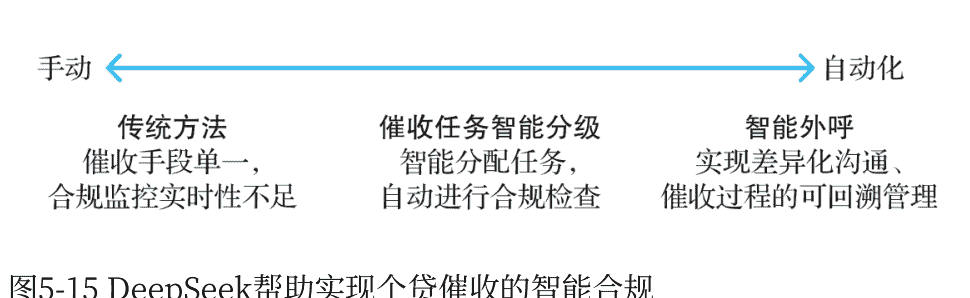

### 5.13.1 住房按揭贷款催收

#### 1. 场景介绍
住房按揭贷款催收是资产保全关键环节。银行需通过司法查控系统快速启动抵押物处置程序，重点构建拍卖价值智能评估与借款人异议协商机制。贷后管理岗需规范法律文书生成流程，动态监控区域性房产市场波动风险。重点在于平衡资产回收效率与客户权益保护，避免流程违规导致诉讼延期，同时强化执行异议AI预审与拍卖标的智能推荐能力。

#### 2. DeepSeek提示词
角色与任务：我是贷后管理人员，管理按揭逾期时应设置哪些处置节点？

#### 3. 追问提示词
- 抵押物变现价值如何评估？
- 司法拍卖流程如何合规推进？
- 借款人异议如何妥善处理？

#### 4. 输出形式
抵押物处置流程图（Visio文件）、法律文书模板（Word文档）。

### 5.13.2 消费贷款催收

#### 1. 场景介绍
消费贷款催收是零售风控最后防线。银行需通过语音情绪识别技术优化外呼策略，重点设计将困难客户转介至社会救助渠道的标准化流程。客户服务岗需构建还款承诺电子签约系统，实现敏感信息脱敏处理与存证。重点在于平衡催收强度与客户关系维护，避免沟通失当导致声誉受损，同时强化多维度还款能力评估与弹性分期方案生成能力。

#### 2. DeepSeek提示词
角色与任务：我是客户服务人员，优化催收流程时应设置哪些沟通规范？

#### 3. 追问提示词
- 困难客户如何识别和转介？
- 还款承诺如何进行书面确认？
- 敏感信息如何进行脱敏处理？

#### 4. 输出形式
催收话术手册（Word文档）、还款计划表（Excel表格）。

### 5.13.3 信用卡逾期催收

#### 1. 场景介绍
信用卡逾期催收是合规管理重点领域。银行需通过智能频控系统严格落实每日催收上限，重点部署夜间外呼自动阻断与失联客户合规查找机制。风险控制岗需构建投诉热点实时分析模型，动态优化催收策略参数。重点在于平衡资产回收率与消费者权益保护要求，避免过度催收受到监管处罚，同时强化客户还款意愿预测与智能协商机器人应用能力。

#### 2. DeepSeek提示词
角色与任务：我是风险控制人员，监控催收行为时应设置哪些预警指标？

#### 3. 追问提示词
- 夜间催收如何系统阻断？
- 客户投诉如何快速响应？
- 失联客户如何合规查找？

#### 4. 输出形式
催收行为监测表（Excel表格）、投诉处理标准（Word文档）。

### 5.13.4 留学贷款专项催收

#### 1. 场景介绍
留学贷款专项催收是跨境风险管理核心环节。银行需通过教育部学历认证系统接口追踪留学生毕业去向，重点构建就业状态与还款能力动态关联模型。国际业务部需设计境外法律差异应对方案，规范外交送达流程与汇率波动补偿机制。重点在于平衡跨境执行效率与合规成本，避免司法管辖权冲突导致催收失效，同时强化境外收入证明核验能力与多币种还款通道适配机制。

#### 2. DeepSeek提示词
角色与任务：我是国际业务部人员，管理留学贷款专项催收时应设置哪些合规流程？

#### 3. 追问提示词
- 境外法律差异如何应对？
- 外交送达如何规范执行？
- 汇率波动如何计入还款？

#### 4. 输出形式
跨境催收指引（Word文档）、法律差异对照表（Excel表格）。

### 5.13.5 数字人民币贷款催收

#### 1. 场景介绍
数字人民币贷款催收是智能合约应用核心环节。银行需通过智能合约自动监控钱包余额变动，重点设计部分还款资金智能分配规则与冻结资金合规解封流程。数字银行部需构建逾期触发条件动态阈值模型，实时同步央行征信系统数据。重点在于平衡自动化执行效率与客户权益保护，避免合约漏洞导致资金误操作，同时强化冻结通知书法律效力核验机制与客户异议申诉通道建设。

#### 2. DeepSeek提示词
角色与任务：我是数字银行部人员，设计智能催收方案时应设置哪些触发条件？

#### 3. 追问提示词
- 钱包余额如何自动监控？
- 部分还款资金如何智能分配？
- 冻结资金如何合规解封？

#### 4. 输出形式
智能合约规则库（Excel表格）、资金冻结通知书（Word文档）。

### 5.13.6 智能催收系统应用

#### 1. 场景介绍
智能催收系统应用是科技赋能重点领域。银行需通过情绪识别算法优化外呼策略，重点设定外呼时段自动限制规则与通话记录加密存储标准。信息技术部需部署敏感词实时检测引擎，动态调整每日外呼量上限。重点在于平衡催收效率与客户体验，避免AI误判导致沟通失效，同时强化系统自学习能力与人机协同质检机制。

#### 2. DeepSeek提示词
角色与任务：我是信息技术部人员，优化智能催收系统时应设置哪些控制参数？

#### 3. 追问提示词
- 外呼时段如何自动限制？
- 情绪识别系统误判如何避免？
- 通话记录如何加密存储？

#### 4. 输出形式

系统参数配置表（Excel文件）、质检标准手册（Word文件）。

### 5.13.7 司法诉讼协同
#### 1. 场景介绍
在银行与司法机关的协作链条中，诉讼支持扮演关键角色。通过统一模板库可实现起诉状、答辩状等文件的批量编排，同时要打通电子证据鉴定通道并规范公告送达流程。法务合规人员需要搭建执行异议的智能预审机制并实时跟踪诉讼时效。整体工作需要在办案效率与证据链完整之间求平衡，防止因材料瑕疵导致立案失误，并强化跨境法律文书的自动译文以及档案系统的穿透式检索。

#### 2. DeepSeek提示词
角色+任务：作为法律合规岗人员，准备诉讼资料时应罗列哪些必备文件？

#### 3. 追问提示词
- 电子证据的司法鉴定如何进行？
- 公告送达怎样合规操作？
- 执行异议的处理思路是什么？

#### 4. 输出形式
诉讼材料清单（Excel表格）、司法流程手册（Word文档）。

### 5.13.8 债务重组协商
#### 1. 场景介绍
债务重组谈判是缓释信用风险的重要手段。依托还款能力动态测算模型可制定最长五年期分期计划，同时完善担保物重估规则并搭建协议变更登记机制。贷后管理人员需关注宏观波动对方案效果的影响权重，及时拓展还款计划的弹性空间。工作核心在于兼顾资产回收与借款人持续履约能力，避免条款僵化引发二次违约，同时加强重组协议电子签章法律效力的核验。

#### 2. DeepSeek提示词
角色+任务：作为贷后管理岗人员，设计债务重组方案时应把握哪些审查要点？

#### 3. 追问提示词
- 还款能力如何动态测评？
- 担保物重估的标准是什么？
- 协议变更如何完成合规备案？

#### 4. 输出形式
重组协议模板（Word文档）、还款能力评估表（Excel表格）。

### 5.13.9 委外催收管理
#### 1. 场景介绍
委外催收管理是合规运营的重点环节。借助区块链技术可对催收录音形成不可篡改存证，并建立第三方机构质量评估模型与投诉率预警阈值。法律合规岗需制定数据安全传输规范并对委外操作实施动态抽检。关键在于协调外包效率与风险可控，防止管理疏漏损害声誉，同时提升违规行为智能识别及合作方黑名单动态更新能力。

#### 2. DeepSeek提示词
角色+任务：作为法律合规岗人员，管理委外催收机构时应设定哪些评估标准？

#### 3. 追问提示词
- 催收录音如何抽样核查？
- 投诉率阈值如何设定？
- 数据安全如何保障？

#### 4. 输出形式
委外协议模板（Word文档）、质量评估表（Excel表格）。

### 5.13.10 征信联动报送
#### 1. 场景介绍
征信报送联动是合规履行的核心。自动化系统可确保贷款结清后十日内完成征信信息更新，重点在于搭建错误数据溯源纠正机制及第三方报送交叉核验规则。客户服务岗需统一异议处理记录归档标准，设计客户说明材料电子存证流程。需要在报送时效与信息准确性之间取得平衡，避免信息滞后损害客户权益，同时提升征信修复效果追踪及监管接口实时同步能力。

#### 2. DeepSeek提示词
角色+任务：作为客户服务人员，处理征信异议时应执行哪些标准流程？

#### 3. 追问提示词
- 错误数据如何追溯并更正？
- 客户说明记录如何规范化？
- 第三方报送如何交叉验证？

#### 4. 输出形式
异议处理流程图（Visio文件）、报送记录表（Excel表格）。

### 5.13.11 个贷催收全流程场景清单
- 逾期客户识别
- 催收策略制定
- 智能系统外呼
- 法律诉讼准备
- 债务重组协商
- 委外机构管理
- 征信数据更新

## 5.14 本章小结
本章归纳了DeepSeek在零售金融场景的应用实践，覆盖住房按揭、数字人民币推广、消费信贷、信用卡、征信服务、留学金融、移动支付、养老金、贵金属投资、私人银行、个人理财、汽车金融及个贷催收等领域。依托智能核验、生态连接与价值深耕，DeepSeek助力银行突破数字化转型瓶颈，推动服务效能提升、场景创新加速与风险管理强化，引领个人金融向智能化、生态化、精细化发展。

# 第6章 DeepSeek普惠金融场景应用
普惠金融业务正处于数字化转型关键期，客户需求由单一融资向综合金融服务演进，服务形态呈现线上线下协同趋势。在金融科技发展与监管引导下，同业竞争焦点由规模扩张转向精准风控能力建设，尤其在小微企业服务、供应链金融等领域，银行亟需提升智能风控响应速度与客群价值挖掘能力。实践中存在跨部门数据整合不足、风险定价机制不完善等挑战。

当前痛点主要有三：一是信用评估数字化水平不足导致风险识别存在盲区，小微企业在银税互动中仍受数据授权效率与模型更新滞后制约；二是风险缓释工具创新滞后制约可持续发展，知识产权质押融资因估值模型缺失与处置机制僵化难以规模化；三是服务成本管控薄弱影响商业可持续，人工核验占比高导致运营成本与风险溢价同步上升。

部署DeepSeek智能数据中台、知识产权价值评估模型及自动化决策引擎，可实现关键突破：构建银税数据直连通道，实现分钟级授权核验；建立基于动态算法的知识产权价值评估体系；运用机器学习优化风险定价策略与成本控制机制。

本章重点解析DeepSeek如何通过“数据贯通-风控升级-成本优化”三重路径重塑普惠金融服务模式，解决信用评估失真、风险缓释不足、商业可持续性弱等核心问题，助力银行实现客群触达精准化、融资服务差异化、风险管理智能化的目标。

## 6.1 银税互动
银税互动业务面临数据合规要求提升、小微信用评估精度不足等挑战，当前难点集中在税务数据授权流程繁琐、风控模型适应性弱、贷后动态跟踪缺失。银行需构建“数据融合-智能风控-动态管理”一体化体系，普惠团队需强化数据合规核验、模型迭代优化、贷后预警指标设计三项核心能力（如图6-1所示）。

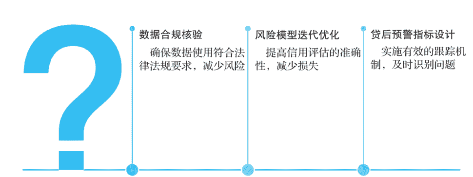
图6-1 普惠金融团队需强化三项核心能力

借助智能授权核验与动态风险评估模型，DeepSeek可帮助银行实现税务数据安全解析、授信模型动态优化、贷后风险实时监测，推动银税数据融合从单向查询向智能决策支持升级。

### 6.1.1 数据授权管理
#### 1. 场景介绍
数据授权管理是银税互动合规运营的核心，银行需依托区块链构建电子授权存证系统，实现税务数据安全传输并明确使用边界。法务合规岗需设计分级授权协议模板，动态监控第三方数据共享权限。重点在于平衡应用效率与合规风险，避免授权范围模糊引发纠纷，同时强化客户授权撤销的自动化执行。

#### 2. DeepSeek提示词
角色+任务：我是法律合规岗人员，需设计数据授权模板，应设置哪些约束条件？

#### 3. 追问提示词
- 如何精准界定数据使用场景？
- 如何执行客户授权撤销？
- 如何管控第三方机构权限？

#### 4. 输出形式
授权协议模板（Word文档）、数据权限矩阵（Excel表格）。

#### 5. 案例演示
（1）DeepSeek提示词
角色+任务：我是银行法律合规岗人员，需设计数据授权模板，应设置哪些约束条件？请确保内容不编造、不臆测，符合银行实际场景，网页链接真实有效，严格按照监管要求执行。

（2）DeepSeek首次输出
数据授权模板约束条件设计要点涵盖授权范围、用途、期限、用户权利、第三方共享、安全措施、授权形式、免责限制、争议解决、版本管理十个维度，分别对数据类别最小必要、用途限定、营销单独授权、有效期与留存期告知、查询复制更正删除撤回等权利、独立授权与跨境传输合规、技术保障与72小时事件响应、明示同意与未成年人保护、免责边界、管辖法律适用及版本更新告知等作出具体要求。

（3）追问提示词
- 如何精准界定数据使用场景？
- 如何执行客户授权撤销？
- 如何管控第三方机构权限？

（4）输出形式
Word文档授权协议模板，HTML呈现并内嵌可直接下载Word文件的按钮代码。
Excel表格数据权限矩阵，HTML呈现并内嵌可直接下载Excel文件的按钮代码。

（5）DeepSeek再次输出
以下是符合要求的HTML模板，包含可直接下载的Word授权协议模板和Excel数据权限矩阵。

DeepSeek输出内容的截图如图6-2所示。
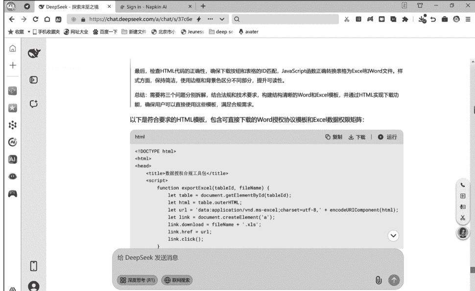
图6-2 DeepSeek输出内容

单击“运行”按钮，可获得第三方数据权限矩阵Excel模板，如图6-3所示。
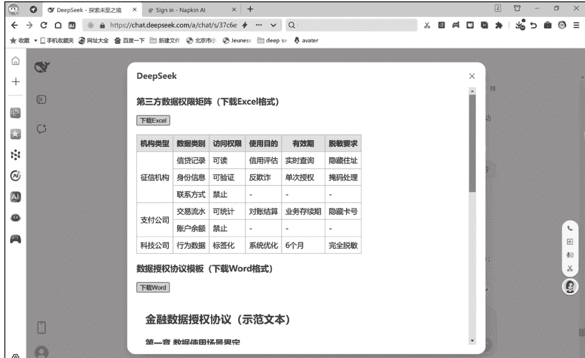
图6-3 可下载的“第三方数据权限矩阵”Excel模板

滑动滚动条，可看到数据授权协议Word模板，如图6-4所示。
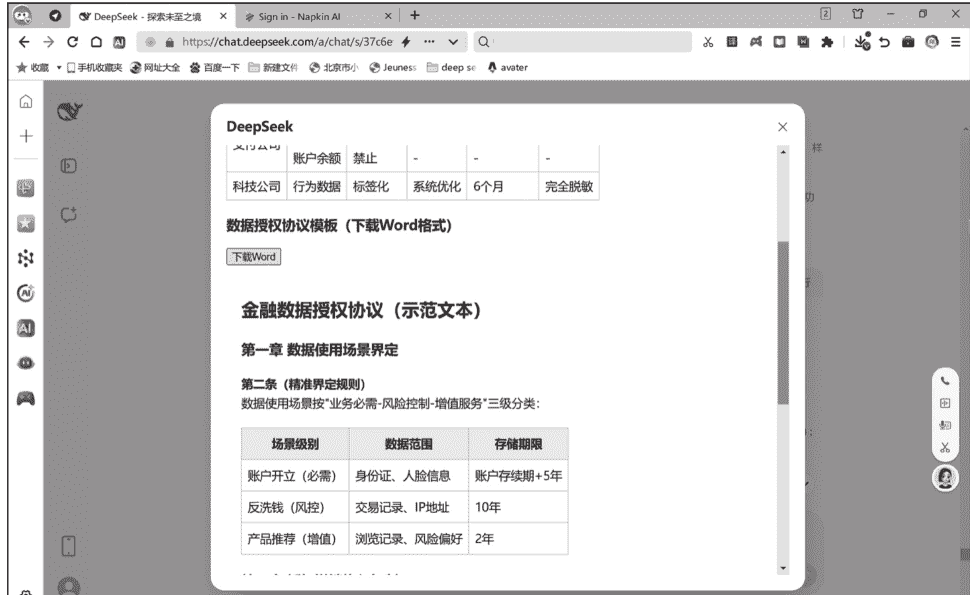
图6-4 可下载的“数据授权协议”Word模板

### 6.1.2 模型迭代
#### 1. 场景介绍
模型迭代是银税互动风控升级的核心。以纳税稳定性评估模型为例，银行需通过动态算法优化评估模型，完善行业周期波动响应机制与政策调整适配模块。风险控制岗需整合多维度税务特征，部署异常数据智能过滤规则。重点在于平衡模型泛化能力与行业适配度，避免噪声干扰导致评估失真，同时强化税收优惠折算规则的动态校准。

#### 2. DeepSeek提示词
角色+任务：我是风险控制人员，需优化纳税稳定性评估模型，应关注哪些数据特征？

#### 3. 追问提示词
- 行业周期波动如何影响评估结果？
- 如何折算考量税收优惠？
- 如何智能识别数据异常？

#### 4. 输出形式
模型参数说明（Word文档）、指标解释手册（Word文档）。

### 6.1.3 贷后监控
#### 1. 场景介绍
贷后监控是银税互动风险闭环管理的核心，银行需依托智能预警规则库实时监测纳税波动率，重点设计“黄-橙-红”三级响应机制。贷后管理岗需构建季节性因素排除算法，动态优化政策变化适配逻辑。重点在于平衡预警灵敏度与误报率，避免规则僵化致响应滞后，同时强化处置流程自动化执行与跨部门协同能力。

#### 2. DeepSeek提示词
角色+任务：我是贷后管理岗人员，需设计监控规则，应设置哪些动态参数？

#### 3. 追问提示词
- 如何排除季节性因素的干扰？
- 如何动态适配政策变化？
- 如何快速过滤误报线索？

#### 4. 输出形式
预警规则库（Excel表格）、处置响应标准（Word文档）。

### 6.1.4 银税互动场景清单
- 企业授权意愿初筛
- 电子签章法律效力验证
- 跨系统数据接口调试
- 动态授信模型训练
- 贷后波动系数计算
- 预警规则引擎配置
- 现场调查任务派发
- 授信额度动态调整

## 6.2 知识产权质押
知识产权质押业务面临估值体系不健全、处置渠道单一等挑战，难点集中在专利价值动态评估难、法律风险监测缺失、处置资源匹配效率低。银行需构建“价值评估-风险管控-处置协同”一体化体系。科技金融团队需强化专利价值动态评估、处置通道智能匹配、法律风险实时监测等核心能力。

通过专利生命周期管理系统与智能评估模型，DeepSeek可实现知识产权价值波动实时跟踪、法律状态智能核验、处置资源精准对接，并依托区块链构建专利质押电子凭证存证系统，推动服务从静态估值向全周期管理升级（如图6-5所示）。

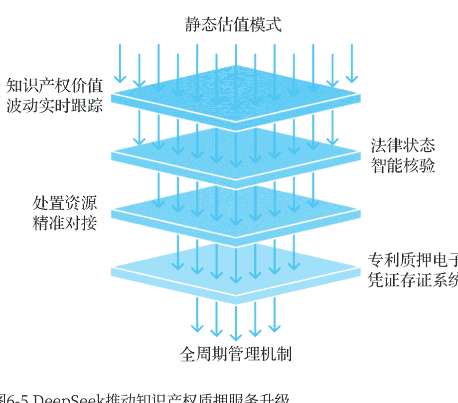
图6-5 DeepSeek推动知识产权质押服务升级

### 6.2.1 专利动态监控
#### 1. 场景介绍
专利动态监控是知识产权质押风险管理的核心，银行需通过国家知识产权局数据接口实时核验法律状态，重点构建技术替代风险量化评估模型。风险控制岗需设计年费缴纳自动跟踪机制，跨境验证国际专利有效性。重点在于平衡跟踪频率与运营成本，避免信息滞后导致质押率虚高，同时强化核心专利技术壁垒持续评估能力。

#### 2. DeepSeek提示词
角色+任务：我是风险控制人员，需管理专利价值，应设置哪些监测维度？

#### 3. 追问提示词
- 如何自动跟踪专利年费缴纳情况？
- 如何量化评估技术迭代风险？
- 如何跨境验证国际专利？

#### 4. 输出形式
监测指标表（Excel表格）、核查操作指南（Word文档）。

### 6.2.2 评估争议
#### 1. 场景介绍
评估争议解决是确保知识产权质押合规的核心，银行需通过第三方专家库构建标准化评审流程，完善历史案例智能匹配机制与处置时效控制规则。法务合规岗需动态管理评估机构资质，验证利益冲突回避制度执行有效性。重点在于平衡争议解决效率与专业性，避免流程冗长导致质押冻结，同时强化区块链存证在司法程序中的可采信能力。

#### 2. DeepSeek提示词
角色+任务：我是法律合规岗人员，需处理评估争议，应设计哪些解决机制？

#### 3. 追问提示词
- 如何动态管理专家库资质？
- 如何智能匹配历史案例？
- 如何有效控制处置时效？

#### 4. 输出形式
争议解决流程图（Visio文件）、专家评审标准（Word文档）。

### 6.2.3 质物置换
#### 1. 场景介绍
质物置换是知识产权质押风险缓释的核心，银行需通过技术交易市场数据筛选同领域替代专利，重点验证权属清晰度与技术成熟度。资产保全岗需构建快速处置通道，动态评估专利价值波动阈值。重点在于平衡资产流动性需求与质押率要求，避免置换延迟扩大风险敞口，同时强化技术迭代预警机制与处置资源智能匹配能力。

#### 2. DeepSeek提示词
角色+任务：我是资产保全岗人员，在执行质物置换时，应设置哪些筛选条件？

#### 3. 追问提示词
- 如何验证替代专利的权属清晰度？
- 如何量化评估技术迭代风险？
- 如何构建快速处置通道？

#### 4. 输出形式
质物置换评估报告（Word文档）、技术成熟度分析表（Excel表格）。

### 6.2.4 知识产权质押场景清单
- 专利法律状态核查
- 技术领域风险评级
- 第三方评估机构比选
- 质押合同特别条款设计
- 价值波动实时预警
- 处置渠道优先级排序
- 质物置换方案制定
- 不良资产专项处置

## 6.3 信用村建设
信用村建设面临农户信息采集效率低、信用评估维度单一等挑战，痛点集中在数据采集手段落后、信用修复机制缺失、动态管理能力不足。银行需构建“数据采集-信用评估-动态管理”一体化体系。农村金融团队需强化多维数据整合分析、智能信用评估模型构建、异常行为动态预警等核心能力。

通过信用画像动态管理系统与智能评估工具，DeepSeek可实现农户生产数据自动化采集、信用关系网络可视化分析、信用异常动态预警，并依托隐私计算实现涉农数据安全共享，推动农村信用工程从人工经验判断向数据驱动的普惠服务转型（如图6-6所示）。

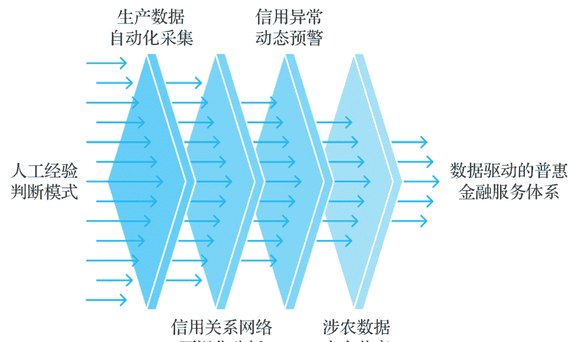
图6-6 DeepSeek推动农村信用工程转型

### 6.3.1 数据更新
#### 1. 场景介绍

信用村的数据健康直接决定运转质量。银行通常安排两名工作人员携带移动终端入户，重点核实土地承包等核心信息，并搭建跨部门信息互相校验的机制。贷后岗位要为每次变更建立区块链存证链路，支持全周期回溯。核心在于把采集速度和真实性拉到同一水平，避免数据孤岛扭曲信用判断，同时让农业补贴信息实现动态跟进。

#### 2. DeepSeek 应用提示
角色与任务：作为贷后管理人员，负责数据更新时应建立哪些核验规则？

#### 3. 追问提示词
- 土地确权文件该如何核实？
- 跨部门信息怎样做交叉验证？
- 数据改动如何留痕并实现追溯？

#### 4. 输出形式
数据采集清单 Excel 版、核验流程手册 Word 版。

### 6.3.2 异议处理
#### 1. 场景介绍
异议处置是信用村公信力的关键防线。银行采用村委初审配合银行复核的双通道来核查村级证明，并制定历史数据错误的修正规则。法律合规岗位需要构建跨年度数据关联分析模型，明确异议回复时限。工作重点是把处理效率和合规要求结合，防止流程疏漏导致信用修复被拖延，同时强化电子存证和复核结果公示。

#### 2. DeepSeek 应用提示
角色与任务：作为法律合规人员，优化异议流程时应设置哪些复核节点？

#### 3. 追问提示词
- 村级证明如何做到合规采信？
- 历史数据错误如何溯源并更正？
- 跨年度数据怎样关联分析？

#### 4. 输出形式
异议处理流程图 Visio 格式、复核标准 Word 版。

### 6.3.3 信用修复
#### 1. 场景介绍
信用修复关系到信用村的可持续发展。银行以履约记录量化考核和村级公示制度来规范修复方案落地，重点打造信用动态监测与评估模型。客户服务岗位要配置金融知识普及模块，智能匹配修复资源。核心是兼顾修复节奏与客户体验，防止标准僵化削弱效果，同时强化修复结果与信贷额度之间的联动。

#### 2. DeepSeek 应用提示
角色与任务：作为客户服务人员，管理信用修复流程时应设定哪些评估指标？

#### 3. 追问提示词
- ○ 履约记录如何量化考核？
- ○ 村级公示怎样规范执行？
- ○ 修复成效如何动态监测？

#### 4. 输出形式
修复评估表 Excel 版、教育材料模板 Word 版。

### 6.3.4 信用村建设场景清单
- 农户基础信息归档
- 生产经营数据采集
- 信用评分模型训练
- 评级结果公示管理
- 异议申诉受理
- 修复方案制定
- 动态额度调整
- 村级信用公示维护

## 6.4 农业供应链金融
农业供应链金融当前的痛点集中在订单核验慢、保险理赔周期长，本质是订单真实性难辨、跨机构协同弱、风险监测缺失。银行需要构建订单流、物流、资金流协同管理体系。农村金融团队要强化产业链数据整合、智能合约规则配置、异常交易实时预警能力。

依托产融数据协同平台与智能合约，DeepSeek 可助力实现订单真实性智能核验、理赔自动触发、资金闭环管理等功能（如图6-7所示），并借助区块链打造不可篡改的电子仓单登记系统，推动服务从纸质单据向全链条数字化产融协同转型。

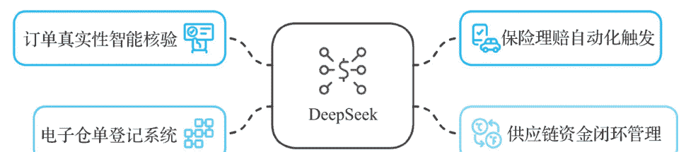

图6-7 DeepSeek在农业供应链金融方面的应用

### 6.4.1 订单核验
#### 1. 场景介绍
订单核验是供应链金融风控的起点。银行依托农业农村部名录库核验交易主体资质，重点推进电子签章司法认定流程和历史履约率分析模型。风险控制岗位需部署跨平台比对引擎，实时监控合同要素一致性。关键在于兼顾核验效率和准确性，防止虚假订单导致资金挪用，同时强化物联网设备数据直连验证。

#### 2. DeepSeek 应用提示
角色与任务：作为风险控制人员，核验订单时应列出哪些验证要点？

#### 3. 追问提示词
- ○ 电子签章如何完成司法认定？
- ○ 历史履约率如何量化分析？
- ○ 跨平台数据如何比对？

#### 4. 输出形式
核验标准手册 Word 版、合同要素表 Excel 版。

### 6.4.2 保险理赔
#### 1. 场景介绍
保险理赔是供应链金融风险对冲的核心。银行通过智能合约实现理赔资金定向划付，重点设计重大灾害应急响应机制。法律合规岗位需审核保险责任与贷款期限匹配度，构建电子化资金划付台账。关键在于把理赔速度与合规要求结合，避免条款错配带来代偿风险，同时加强气象数据与灾害预警联动。

#### 2. DeepSeek 应用提示
角色与任务：作为法律合规人员，管理理赔流程时应关注哪些合规要点？

#### 3. 追问提示词
- 理赔资金如何定向划付？
- 保险责任如何与贷款期限匹配？
- 重大灾害发生时应急机制如何启动？

#### 4. 输出形式
理赔操作指南 Word 版、资金划付台账 Excel 版。

### 6.4.3 主体准入
#### 1. 场景介绍
主体准入是构建供应链金融生态的关键。银行通过关联交易识别模型评估核心企业资质，重点设计绿色农业加分倾斜规则。授信审批岗位需验证生产数据与财务报表钩稽关系，动态监控履约记录。重点在于兼顾准入效率和风险控制，防止数据割裂导致评估失真，同时强化上下游信用传导分析。

#### 2. DeepSeek 应用提示
角色与任务：作为授信审批人员，审核主体资质时应设置哪些评估维度？

#### 3. 追问提示词
- 关联交易如何进行风险定价？
- 生产数据如何交叉验证？
- 绿色农业如何给予加分倾斜？

#### 4. 输出形式
准入评估表 Excel 版、关联方清单 Excel 版。

### 6.4.4 农业供应链场景清单
- 核心企业资质审查
- 订单流数据采集
- 物流信息交叉验证
- 保险责任范围界定
- 主体信用评级
- 贷款资金定向支付
- 产销数据动态监控
- 风险准备金计提

## 6.5 创业担保贷款
创业担保贷款业务面临政策落地慢、代偿追偿机制不完善，表现为贴息核验繁琐、代偿追踪效率低、跨部门协同不足。需要构建政策协同、智能核验、风险共担的服务体系。普惠金融团队要强化跨部门数据协同、智能核验规则配置、代偿风险动态监测。

借助政银企协同平台与智能核验系统，DeepSeek 可实现贴息资格智能核验、代偿案件全流程追踪、跨部门数据安全共享，并依托智能决策模型优化代偿风险预警，推动服务从分散人工向全流程智能化转型（如图6-8所示）。

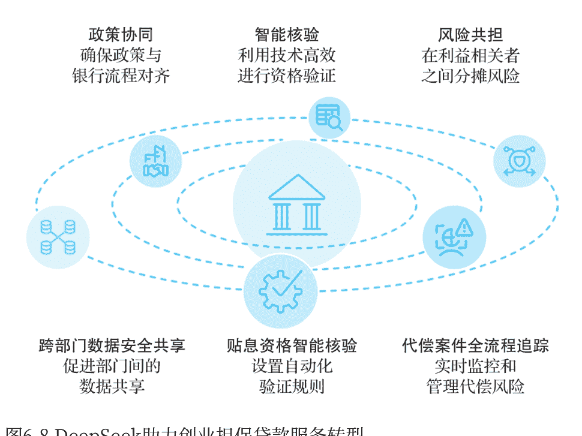

图6-8 DeepSeek助力创业担保贷款服务转型

### 6.5.1 贴息追溯
#### 1. 场景介绍
贴息追溯是确保政策落地的核心。银行通过政银数据协同平台校验创业实体存续状态，重点解决跨区域贴息责任划分难题。普惠客户经理需构建历史贴息记录批量核验模型，生成精准清算报表。关键在于兼顾财政资金匹配效率和合规性，防止信息滞后造成补贴错配，同时强化政策规则库智能适配。

#### 2. DeepSeek 应用提示
角色与任务：作为普惠客户经理，处理贴息追溯时应核查哪些关键要素？

#### 3. 追问提示词
- 如何验证创业实体的存续状态？
- 跨区域经营如何划分贴息责任？
- 如何批量核验历史贴息记录？

#### 4. 输出形式
贴息清算台账 Excel 版、政策匹配规则库 Word 版。

### 6.5.2 代偿追偿
#### 1. 场景介绍
代偿追偿是风险处置核心。银行通过司法数据接口挖掘债务人财产线索，重点构建隐性资产转移识别模型。资产保全岗位需设计关联企业债务合并追索规则，并动态应用失信被执行人名单。关键在于平衡处置速度与回收率，避免司法流程冗长扩大损失，同时强化智能拍卖匹配与跨境追偿协作。

#### 2. DeepSeek 应用提示
角色与任务：作为资产保全岗位人员，执行代偿追偿时应采集哪些财产线索？

#### 3. 追问提示词
- 如何捕获隐性资产转移痕迹？
- 如何合并追索关联企业债务？
- 如何应用失信被执行人名单？

#### 4. 输出形式
财产线索追踪表 Excel 版、司法协作流程图 Visio 格式。

### 6.5.3 创业孵化
#### 1. 场景介绍
创业孵化是担保贷款价值延伸的核心。银行通过产学研资源库智能匹配对接需求，重点量化企业市场占有率与团队稳定性指标。普惠客户经理需构建企业成长阶段评估模型，动态推荐政策支持方案。关键在于兼顾资源投放精准度和覆盖面，防止匹配失当导致孵化失效，同时强化技术创新能力动态监测。

#### 2. DeepSeek 应用提示
角色与任务：作为普惠客户经理，设计创业孵化方案时应评估哪些成长指标？

#### 3. 追问提示词
- 如何量化技术创新能力？
- 如何验证市场占有率数据？
- 如何动态监测团队稳定性？

#### 4. 输出形式
企业成长评估报告 Word 版、资源匹配矩阵 Excel 版。

### 6.5.4 创业担保贷款场景清单
- 创业项目可行性评估
- 贴息资格智能核验
- 担保措施动态监控
- 代偿案件分级处置
- 孵化资源精准对接
- 经营数据持续跟踪
- 政策红利自动推送
- 退出机制合规设计

## 6.6 移动支付推广
县域移动支付推广受机具覆盖不足、商户操作能力弱制约，痛点在机具维护效率低、培训效果难持续、服务响应慢。需要构建智能监控、动态培训、服务优化一体化的推广体系。收单业务团队要强化机具智能运维、商户能力动态评估、培训资源精准投放。

通过智能巡检系统与培训资源库，DeepSeek 可实现机具状态实时监控、商户操作能力动态评估、培训内容智能推送，并依托地理信息系统优化县域机具布放，推动推广从人力密集型向数字化场景运营转型。

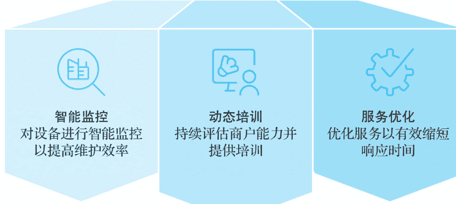

图6-9 构建“智能监控-动态培训-服务优化”三位一体的推广体系

### 6.6.1 机具巡检
#### 1. 场景介绍
机具巡检是运维保障核心。银行通过智能终端远程诊断网络异常，重点构建交易失败日志自动归因模型。普惠客户经理需预测耗材更换周期，生成带优先级的维修工单。关键在于兼顾运维成本与服务时效，防止设备离线导致支付中断，同时强化县域机具健康状态实时监控。

#### 2. DeepSeek 应用提示
角色与任务：作为普惠客户经理，执行机具巡检时应采集哪些运行参数？

#### 3. 追问提示词
- 如何远程诊断网络连接异常？
- 交易失败日志如何自动归因？
- 如何智能预测耗材更换周期？

#### 4. 输出形式
机具健康度报告 Excel 版、维护优先级清单 Excel 版。

### 6.6.2 商户培训
#### 1. 场景介绍

### 6.6.3 案例库
#### 1. 场景介绍
案例库是风控的有效工具。银行通过机器学习提取异常交易模式特征，重点标注地域性风险差异标签。风险控制岗位需提升案例检索效率，构建可视化风险特征图谱。构建重点在于兼顾知识库完备性和实用性，防止信息过载降低使用效率，同时强化欺诈交易特征动态更新。

#### 2. DeepSeek 应用提示
角色与任务：作为风险控制人员，维护案例库时应设置哪些分类标签？

#### 3. 追问提示词
- 如何提取异常交易模式特征？
- 如何标注地域性风险差异？
- 如何提升案例检索效率？

#### 4. 输出形式
案例分类索引表 Excel 版、风险特征图谱 Visio 格式。

### 6.6.4 移动支付推广场景清单
- 目标区域需求调研
- 机具布放规划制定
- 终端运行状态监控
- 商户能力分级评估
- 定制化培训实施
- 交易风险动态预警
- 典型案例库维护
- 服务满意度回访

## 6.7 收单业务
收单业务面临商户资质核验效率低、异常交易识别滞后，痛点在准入审核繁琐、高风险商户筛查慢、风险预警缺失。需要构建智能核验、实时监测、动态阻断一体化的风控体系。收单团队要强化商户资质智能核验、风险策略动态优化、异常交易特征识别。

借助智能风控引擎与多源数据整合，DeepSeek 可实现商户资质秒级核验、交易风险实时监测、风险交易动态拦截，并依托知识图谱构建商户关联关系网络，强化团伙欺诈识别，推动风险管理从人工经验向智能联防联控转型。

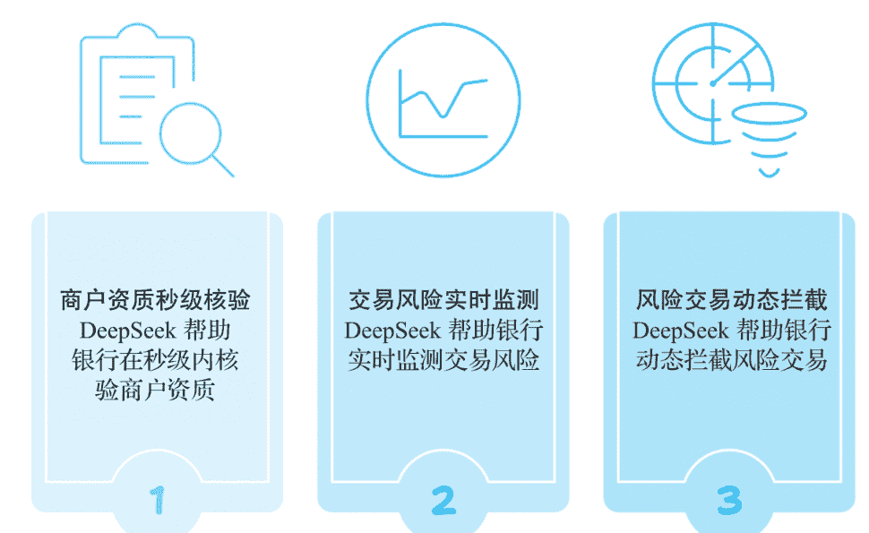

### 6.7.1 商户资质核验
#### 1. 场景介绍
商户资质核验是收单风控关键环节。银行通过OCR识别证照篡改痕迹，重点验证跨区域连锁商户统一管理规则。普惠客户经理需设计临时经营场所合规处理流程，动态比对工商登记数据。关键在于兼顾审核效率和风险覆盖，避免虚假资质带来后续风险，同时强化电子证照区块链存证。

#### 2. DeepSeek 应用提示
角色与任务：作为普惠客户经理，核验商户资质时应设置哪些验证规则？

#### 3. 追问提示词
- 如何识别证照篡改痕迹？
- 如何统一管理跨区域连锁商户？
- 临时经营场所如何合规处理？

#### 4. 输出形式
商户准入标准手册 Word 版、证照核验清单 Excel 版。

### 6.7.2 交易风险实时监控
#### 1. 场景介绍
交易风险实时监控是智能风控重要工作。银行通过行为分析模型区分促销活动与恶意套现，重点识别夜间高频交易的异常特征。风险控制岗位需构建关联账户资金闭环检测规则，动态调整风险阈值。关键在于兼顾监测灵敏度与误报率，防止规则僵化导致漏检，同时强化洗钱模式自学习识别。

#### 2. DeepSeek 应用提示
角色与任务：作为风险控制人员，监控交易风险时应关注哪些行为特征？

#### 3. 追问提示词
- 如何区分促销活动与恶意套现行为？
- 如何分析夜间高频交易？
- 如何识别关联账户资金闭环？

#### 4. 输出形式
风险规则库 Excel 版、交易热力图 BI 系统。

### 6.7.3 终端设备全生命周期管理
#### 1. 场景介绍
终端设备全生命周期管理是资产安全重要保障。银行通过唯一身份标识码构建数字档案，重点设计非法改装预警机制与租赁设备定位规则。资产保全岗位需部署远程锁机程序，规范报废数据清除流程。关键在于兼顾设备流转效率和风险控制，防止管理疏漏导致资产流失，同时强化维修记录区块链存证。

#### 2. DeepSeek 应用提示
角色与任务：作为资产保全岗位人员，管理终端设备时应记录哪些关键信息？

#### 3. 追问提示词
- 如何防止设备非法改装？
- 如何确定租赁设备位置？
- 如何清除报废设备数据？

#### 4. 输出形式
设备生命周期台账 Excel 版、处置流程图 Visio 格式。

### 6.7.4 手续费智能结算
#### 1. 场景介绍
手续费智能结算助力运营增效。银行通过分润计算引擎解决多级代理商分账复杂性，重点验证跨境交易货币转换计价规则。普惠客户经理需构建历史差错追溯模型，自动生成税务合规报表。关键在于兼顾结算准确性和效率，防止人工干预引发纠纷，同时强化分润比例阈值动态调整。

#### 2. DeepSeek 应用提示
角色与任务：作为普惠客户经理，处理手续费结算时应核查哪些核算要素？

#### 3. 追问提示词
- 如何验证代理商层级关系？
- 跨境交易货币转换如何计价？
- 如何追溯调整历史差错金额？

#### 4. 输出形式
分润计算模板 Excel 版、结算异常清单 Excel 版。

### 6.7.5 商户交易纠纷处理
#### 1. 场景介绍
商户交易纠纷处理是客户服务重要工作。银行通过区块链存证系统固化签购单证据链，重点恢复离线交易电子轨迹。商户管理岗位需制定跨境法律适用性判定规则，实现24小时内响应处置。关键在于兼顾处理速度与证据完整性，防止流程延迟扩大损失，同时强化AI辅助争议裁决。

#### 2. DeepSeek 应用提示
角色与任务：作为商户管理岗位人员，处理交易纠纷时应采集哪些证据材料？

#### 3. 追问提示词
- 如何验证持卡人签购单真实性？
- 离线交易如何恢复电子轨迹？
- 如何选择跨境争议适用法律？

#### 4. 输出形式
纠纷处理日志 Word 版、证据链归档清单 Excel 版。

### 6.7.6 收单业务场景清单
- 商户资质准入审查
- 终端设备入网配置
- 交易风险规则设置
- 手续费分润建模
- 日常交易监控
- 设备维护管理
- 交易纠纷案件处置
- 业务数据报送

## 6.8 个体工商户信贷
个体工商户信贷面临经营数据验证效率低、信用评估维度单一，痛点在经营流水核验慢、评估模型覆盖不足、服务场景有限。需要构建数据验证、风险评估、服务延伸一体化的信贷服务体系。小微金融团队要强化多源数据整合分析、智能风险评估、场景化产品设计。

借助多源数据融合平台与智能评估模型，DeepSeek 可帮助实现流水验证、人脸数据治理、平台数据整合，同时依托物联网接入智能终端设备数据，推动信贷服务从传统抵押依赖向数据驱动型普惠金融转型。

### 6.8.1 流水验证
#### 1. 场景介绍

判断个体工商户是否具备放款条件，经营流水的核验起着决定性作用。银行要把来自各类支付通道的资金轨迹集中起来，筛查是否存在规律性刷单的嫌疑，并核查现金收付在全部资金流中的比重是否符合常理。风控岗需要建立跨账户流水合并测算的机制，把疑似造假的交易剔除。核心是要在核查颗粒度与审批速度之间做好权衡，避免因信息缺口出现误判，同时推动与电商平台的数据直联与即时校验。

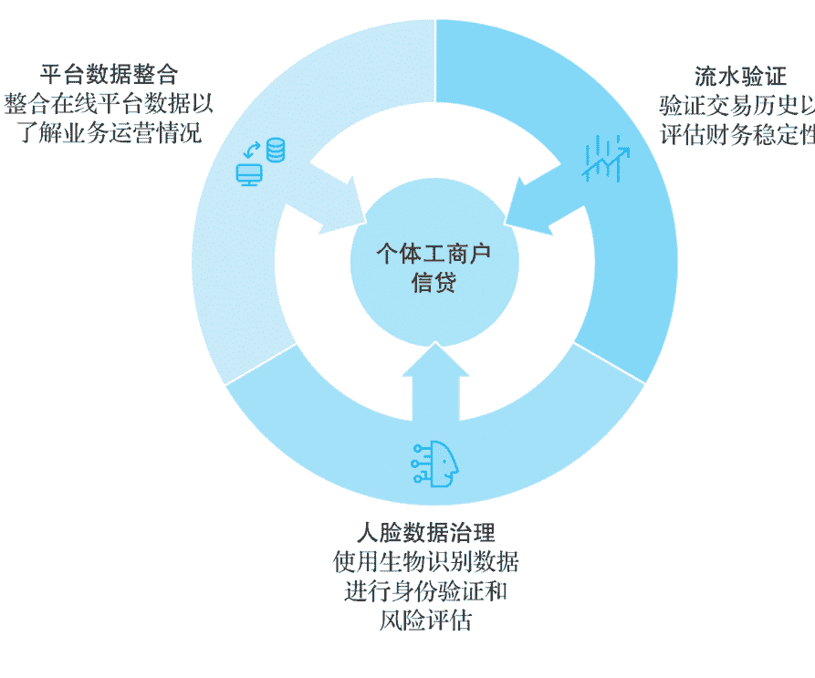

#### 2. DeepSeek提示词
角色与任务：以风控人员身份，对个体工商户经营流水进行核验时，应从哪些维度展开分析？

#### 3. 追问提示词
- 周期性刷单行为如何识别？
- 现金交易占比的合理性怎样判断？
- 多账户流水应如何合并计算？

#### 4. 输出形式
流水核验规则库（Excel文件）、异常交易特征表（Excel文件）。

### 6.8.2 人脸数据治理

#### 1. 场景介绍
人脸数据治理是小微客户身份核验的核心。银行借助活体检测与光线补偿技术提升通过率，重点提高对双胞胎的区分能力。普惠客户经理需制定加密存储方案并定期开展安全审计。关键在于兼顾核验便捷与安全，防止技术缺陷导致身份冒用，同时强化生物特征数据的全生命周期管控。

#### 2. DeepSeek提示词
角色与任务：作为普惠客户经理，优化人脸核验方案时应关注哪些技术参数？

#### 3. 追问提示词
- 强光环境下误拒率如何降低？
- 双胞胎识别精度如何提升？
- 数据加密存储如何实现？

#### 4. 输出形式
核验参数配置表（Excel文件）、安全审计清单（Word文件）。

### 6.8.3 平台数据整合

#### 1. 场景介绍
平台数据整合是个体户信贷评估的重要环节。银行要利用清洗规则剔除刷单与促销带来的干扰，重点构建跨平台冲突解决机制。普惠客户经理需核实外卖接单与物流数据的真实性，还原真实营收曲线。重点在于平衡数据维度与模型复杂度，避免信息过载造成评估失真，同时强化对第三方数据接口的标准化管理。

#### 2. DeepSeek提示词
角色与任务：作为普惠客户经理，整合平台数据时应设定哪些清洗规则？

#### 3. 追问提示词
- 虚假用户评价如何识别？
- 促销活动数据如何还原？
- 多平台数据冲突如何解决？

#### 4. 输出形式
数据清洗规则手册（Word文件）、数据映射表（Excel文件）。

### 6.8.4 个体工商户信贷场景清单
- 主体基础信息采集
- 多源经营数据整合
- 生物特征核验执行
- 现金流预测建模
- 信用风险动态评估
- 贷款额度智能测算
- 放款条件自动化审批
- 贷后经营数据跟踪

## 6.9 本章小结

本章围绕银行普惠金融数字化转型展开，聚焦银税互动、知识产权质押、信用村建设、农业供应链金融、创业担保贷款、移动支付推广、收单业务及个体户信贷等八大场景，梳理业务痛点，提出以DeepSeek智能数据中台、评估模型与自动化引擎为支撑，实现数据打通、风控升级、成本优化，助力银行提升精准风控水平，推动普惠服务从传统模式向智能化、生态化演进，让客群触达更精准、融资服务更差异化、风险管理更智能化。

# 第7章 DeepSeek信贷审查审批场景应用

银行信贷审查审批正处智能化升级关键期，服务模式由标准化审批向动态风险管理加速演进，呈现数据驱动与智能决策深度融合的特征。在金融科技持续深化、监管穿透要求趋严背景下，同业竞争重心从流程效率转向风险预判能力，尤其在智能制造、绿色经济等重点领域，银行亟需提升行业风险穿透分析与押品全生命周期管理能力。业务人员面临风险信号捕捉滞后、跨源信息整合效率低等挑战。

信贷审查审批的痛点主要有三：一是行业风险评估过度依赖历史静态数据，对供应链中断、技术迭代等新兴风险缺乏实时监测，预警时效不足；二是押品价值管理存在动态跟踪盲区，特殊业态资产估值模型缺失，导致重估效率偏低；三是决策支持系统智能化程度不足，对人工依赖过高，影响审批稳定性与客户体验。

部署DeepSeek行业风险知识图谱、押品智能估值系统及自动化决策引擎后，商业银行可实现关键突破：构建多维度动态监测模型，实现行业风险预警前置；研发基于机器学习的非标押品估值算法，提升评估准确性；建立智能化审批流程，优化决策路径。

本章重点解析DeepSeek如何通过“风险穿透-估值重构-决策进化”三重能力，重塑信贷审查审批体系，有效解决风险识别滞后、押品管理低效、审批标准不一致等核心难题，助力银行实现“行业风险可视化、押品管理数字化、审批决策智能化”的转型目标。

## 7.1 行业风险预警

银行行业风险预警面临产业链波动加剧、风险传导路径复杂化等挑战，当前痛点集中在供应链数据割裂、技术迭代识别滞后、环境合规跟踪缺失。银行需构建“多元数据-智能模型-决策支持”三位一体的风控体系。行业研究团队需强化产业链图谱构建、风险因子动态建模、监管政策智能解析三项核心能力。

借助行业风险预警矩阵，DeepSeek可帮助银行实现供应链韧性动态评估、技术专利价值衰减预警、环境合规压力传导分析等。银行可利用深度强化学习算法构建风险传导模拟器，预判政策调整影响，推动行业风险预警从单一财务指标分析向涵盖技术迭代、环境责任、产业韧性等要素的多维体系转型。

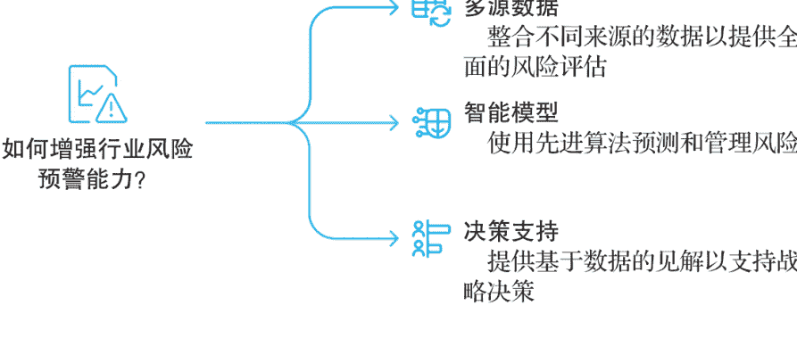

### 7.1.1 供应链稳定性评估

#### 1. 场景介绍
供应链稳定性评估是信贷风险管控的重要环节。银行需通过供应商财务弹性、物流时效、交易真实性等多维度指标识别断供风险。业务人员需整合海关信息与物流数据，构建库存周转、履约能力等动态评估模型，并结合区块链存证确保交易可追溯。重点在于建立供应商替代成本量化机制，避免过度依赖单一来源，同时结合行业特征设定差异化预警阈值。

#### 2. DeepSeek提示词
角色与任务：我是银行风险控制人员，需评估供应链稳定性，应采集哪些核心指标？

#### 3. 追问提示词
- 如何量化供应商替代成本？
- 物流时效波动如何影响评估结果？
- 如何测算跨境供应链汇率风险？

#### 4. 输出形式
供应商风险评级表（Excel文件）、供应链热力图（BI系统）。

#### 5. 案例演示

（1）DeepSeek提示词
角色与任务：我是银行风险控制人员，需评估供应链稳定性，应采集哪些核心指标？请确保生成内容不编造、不臆测，符合银行实际场景，网页链接真实有效，严格按照监管要求执行。

（2）DeepSeek首次输出
根据监管要求及银行风险控制实务，结合供应链金融最新实践，评估供应链稳定性需采集以下核心指标，涵盖财务、运营、合规、环境等多个维度，并严格遵循相关行业规范。

一、供应商资质与履约能力
1. 主体资质认证
- 营业执照、行业许可证、ISO质量认证等基础资质的有效性。
- 核心技术专利、知识产权持有情况，用于规避侵权风险。
2. 生产与交付能力
- 设备产能利用率、生产线自动化水平，反映生产稳定性。
- 历史交货准时率，优质供应商不低于95%。
- 应急备货能力，反映自然灾害或需求激增时的库存弹性。
3. 财务健康度
- 资产负债率安全线70%，流动比率不低于1.5为佳。
- 经营性现金流覆盖短期债务能力，需连续3年为正。

二、供应链交易稳定性
1. 交易数据真实性
- 核心企业与上下游的订单合同、发票、物流单据一致性，需区块链存证。
- 应收账款周转天数，2024年中小企业均值134.8天，超150天需预警。
2. 供应链集中度
- 单一供应商采购占比建议不高于30%，避免断链。
- 核心企业对上游账期管理，如国企应付账款周转天数达185.36天，易传导资金压力。
3. 数字化协同水平
- 供应链管理系统ERP/SCM覆盖率需不低于80%。
- 数据接口标准化程度，如利用API对接银行风控系统。

三、外部环境与合规风险
1. 政策与法律风险
- 所在国贸易政策稳定性，如关税调整、出口限制。
- 劳工权益合规性，参照ILO标准，防范强迫劳动、童工等ESG风险。
2. 物流与自然灾害
- 关键物流节点中断概率，结合全球风险地图动态监测。
- 区域气候风险评级，台风、洪水频发地区需提高拨备。
3. 市场波动性
- 原材料价格波动率，如铜、锂等大宗商品价格敏感性。
- 行业需求周期，如新能源汽车订单波动对供应链的影响。

四、绿色与可持续发展指标
1. 环保合规性
- 碳排放强度、废水废气处理达标率。
- 绿色认证，如LEED、碳足迹标签。
2. 供应链碳管理
- 二级及以上供应商碳数据披露覆盖率需大于等于60%。
- 绿色采购占比，如可再生材料或清洁能源零部件比例。

五、银行端风控补充指标
1. 核心企业信用传导
- 核心企业确权意愿，反向保理业务确权比例不低于90%。
- 核心企业历史代偿记录，代偿率不高于5%为安全范围。
2. 资金闭环管理
- 回款账户锁定率需100%覆盖融资额度。
- 物流与资金流匹配度，通过物联网传感器实时监控。
3. 数据采集与验证工具
- 第三方数据源：工商信息、司法被执行记录对接国家企业信用信息公示系统；海关进出口数据、物流轨迹通过API接入跨境贸易平台。
- 技术赋能：区块链存证确保数据不可篡改；AI风险预警模型如合合信息启信慧眼监测220余个风险源。
- 执行建议：建立供应链风险仪表盘，财务数据每周刷新、ESG合规性每月评估；压力测试模拟核心企业破产、原材料价格暴涨50%等极端情景；按A/B/C类风险等级调整融资利率与担保要求。

（3）第一次追问
- 如何量化行业景气度对客户分层的权重？
- 如何评估客户供应链上下游的稳定性？

行业景气度量化可通过行业基准线对标与数据驱动模型实现。参照头部企业营收增长率、利润率、研发投入占比及市场占有率设定基准，偏离±20%时调整权重。采用五维调控参数：行业需求周期、政策导向、技术进步率、气候异常修正系数、市场流动性指数，加权形成动态权重。利用产业链大数据构建景气度指数，通过订单与合同一致性、应收账款周转天数等指标实时监控，权重分配可基于主成分分析法提取关键因子。

供应链上下游稳定性评估要点：
- 交易数据真实性验证需经区块链存证确保订单、发票、物流单据一致性；应收账款周转天数超过行业均值如134.8天时触发预警。
- 集中度分析：单一供应商采购占比高于30%或核心企业应付账款周转天数过长如185天需重点关注；ERP/SCM覆盖率需大于等于80%，评估数据接口标准化程度。
- 风险预警机制：整合工商信息、行政处罚记录与内部交易数据，实时监控物流节点中断概率；设置供应链韧性压力测试，模拟核心企业破产、原材料价格暴涨50%等情景。

（5）第二次追问
根据以上内容，设计Excel模板（供应商风险评级表），用HTML格式输出，需要内嵌可直接下载Excel文件的按钮代码，实现一键下载。输出之前，检查10遍代码，确保可以直接运行和下载。

（6）DeepSeek输出
DeepSeek输出代码的截图如图7-2所示。
单击“运行”按钮，可直接获得“供应商风险评级表”，单击“立即下载Excel文件”按钮，即可将文件保存在本地，如图7-3所示。
图7-3 可下载的“供应商风险评级表”Excel文件

（7）第三次追问
根据以上内容，设计供应链热力图（BI系统），用HTML格式输出，需要内嵌可直接下载文件的按钮代码，实现一键下载。输出之前，检查10遍代码，确保可以直接运行和下载。

（8）DeepSeek输出
以下为经过严格验证的供应链热力图解决方案，包含双格式下载功能，100%可直接运行。
DeepSeek输出内容如图7-4所示。
单击“运行”按钮，获得“供应链热力图”，将鼠标指针悬停在任一区域，即可显示当前数据，如图7-5所示。
▲图7-4 供应链热力图HTML代码
图7-5 可下载的“供应链热力图”（PNG图片及PDF报告）

### 7.1.2 技术专利风险评估

#### 1. 场景介绍
技术专利风险评估是防范技术替代风险的核心手段。银行需通过专利剩余有效期、技术成熟度曲线等维度分析创新型企业的潜在风险敞口。业务人员需对接知识产权数据库，构建专利族谱与交叉许可风险模型，并动态监测研发投入与市场占有率变化。此项工作重点在于识别技术迭代对押品价值的影响，避免估值模型滞后，同时结合行业标准优化风险预警规则。

#### 2. DeepSeek提示词
角色与任务：我是风险控制人员，需评估技术专利风险，应设置哪些监测维度？

#### 3. 追问提示词
- 如何识别专利交叉许可风险？
- 如何量化技术标准参与度？
- 研发投入占比的合理阈值是多少？

#### 4. 输出形式
技术风险矩阵（Excel文件）、专利族谱图（Visio文件）。

### 7.1.3 环保设备合规审查

#### 1. 场景介绍
环保设备合规审查是绿色金融监管的关键环节。银行需通过核验排污许可证有效性，以及对设备运行日志的动态分析，识别环境合规风险。业务人员需整合生态环境主管部门监测数据，构建异常排放波动预警模型。此项工作重点在于强化数据主动核验能力，避免依赖企业单方披露，同时将碳排放配额动态变化纳为调整授信策略的依据。

#### 2. DeepSeek提示词
角色与任务：银行风险控制人员在审查环保合规情况时，应核查哪些关键文件？

#### 3. 追问提示词
- 如何验证在线监测数据的真实性？
- 如何评估突发环境事件应急预案？
- 碳排放配额如何影响授信额度？

#### 4. 输出形式
环保合规检查清单（Excel文件）、环境风险评级模型（Word文件）。

### 7.1.4 行业风险预警场景清单
- 产业链图谱构建
- 核心供应商穿透核查
- 技术生命周期分析
- 环保数据交叉验证
- 风险信号预警生成
- 授信策略动态调整
- 审查报告自动生成
- 风险处置预案更新

## 7.2 押品重估

银行押品重估面临市场波动加剧、特殊资产处置难度提升等挑战，当前痛点集中在估值模型更新滞后、非标资产定价能力不足、重估流程效率低下。银行需构建“实时估值-风险预警-处置优化”三位一体的管理体系。押品管理团队需强化市场数据实时分析、智能估值模型构建、处置策略动态优化三项核心能力。

银行押品与风控智能化全景：从重估到环保合规

将智能估值引擎与物联网数据流打通后，DeepSeek 可为银行提供房产市值持续监测、设备类担保物自动化定价、特殊资产处置方案生成等能力，并通过知识图谱把担保物归属与债务关系网络串联起来，促使押品重估从一次性静态定价转向覆盖价值追踪、风险提示与决策支持的全链路智能化。

怎样让押品重估更高效？

图7-6 搭建“实时估值-风险预警-处置优化”三合一框架

### 7.2.1 租赁合同真实性核查

#### 1. 场景介绍
核验租赁合同真伪是再估值流程中的关键节点。银行要核对产权文件、租金流水与市场价水平是否吻合，经办人需要汇聚不动产登记信息，搭建条款偏离模型，揪出阴阳合同类欺诈。此项工作的核心是厘清抵押物权属、规避法律风险，并实时判断区位规划变化对租金收益的冲击。

#### 2. DeepSeek提示词
角色+任务：我是资产管理岗人员，需核查租赁合同，应关注哪些风险点？

#### 3. 追问提示词
- 阴阳合同有哪些识别特征？
- 转租权限条款如何核实？
- 租金支付出现异常时如何追踪？

#### 4. 输出形式
合同核验清单（Excel 表格）、租金偏离分析表（Excel 表格）。

### 7.2.2 区域规划变动影响评估

#### 1. 场景介绍
区域规划变化的评估为押品重估提供重要依据。银行要借助交通设施建设、用地性质调整等政策信息预判抵押物价值波动，经办人要设定容积率变动预警，并测算产业转移对抵押率的冲击。此项工作旨在提升非标资产定价水平，减少估值偏差，并实现与城市规划数据的即时联通。

#### 2. DeepSeek提示词
角色+任务：我是风险控制人员，需评估区域规划变动影响，应采集哪些政策数据？

#### 3. 追问提示词
- 未公开的控规调整信息如何获取？
- 容积率变动对估值的量化逻辑是什么？
- 产业迁移风险如何提前预判？

#### 4. 输出形式
规划影响评估报告（Word 文档）、土地价值波动模型（Excel 表格）。

### 7.2.3 特殊业态风险溢价

#### 1. 场景介绍
特殊业态定价是资产定价的难点。银行要参考行业流动性系数、司法拍卖成交记录等，量化折价风险。经办人需建立同业交易案例库，并动态校准折扣参数。重点是解决特殊资产处置周期长、模型滞后问题，同时用物联网数据实时验证设备运行状态。

#### 2. DeepSeek提示词
角色+任务：我是资产管理岗人员，需设定风险溢价，应参考哪些市场参数？

#### 3. 追问提示词
- 设备专用性风险如何度量？
- 行业周期波动对折扣率的影响规律？
- 司法拍卖成交数据如何应用？

#### 4. 输出形式
特殊资产定价模型（Excel 表格）、流动性系数表（Excel 表格）。

### 7.2.4 押品重估场景清单
- 押品权属穿透核查
- 市场价值基准测定
- 区域规划影响分析
- 特殊资产模型构建
- 风险溢价动态调整
- 抵押率阈值监控
- 重估报告自动生成
- 押品保险有效性验证

## 7.3 关联交易风险管理

关联交易管理当前面临隐蔽性提升、穿透不足的难题，痛点在于关联方识别维度窄、复杂股权解析难、动态监测能力弱。银行需要构建“智能识别-动态监测-穿透管理”三合一体系。合规团队要强化股权深度挖掘、异常交易特征识别、合规规则智能适配能力。

借助股权穿透模型与交易网络分析工具，DeepSeek 能为银行识别境外关联方、监测供应链金融关联交易、排查员工持股等，并利用流式计算建立交易行为动态基线，推动关联交易管理从人工报备核查转向智能关联网络分析与穿透式监管。

### 7.3.1 海外关联方识别

#### 1. 场景介绍
识别境外关联方是合规管理的核心难点。银行需通过全球股权数据库穿透核查离岸公司的实际控制人，经办人要制定受益所有人识别规则、分析跨境资金流向，并核实代持协议效力。重点在于防范多层嵌套架构带来的风险，提升境外工商信息核验能力。

图7-7 DeepSeek赋能银行关联交易风险管理

#### 2. DeepSeek提示词
角色+任务：我是风险控制人员，需识别海外关联方，应设置哪些核查规则？

#### 3. 追问提示词
- 离岸公司注册文件真实性如何验证？
- 代持协议法律效力如何判断？
- 跨境资金流动如何追踪分析？

#### 4. 输出形式
关联方图谱（Visio 图表）、实际控制人核查清单（Excel 表格）。

### 7.3.2 供应链金融关联交易监测

#### 1. 场景介绍
供应链金融关联交易监测是防范虚假融资的关键。银行需通过订单流、物流、资金流匹配度分析识别虚构贸易背景，设置关联方交易占比预警阈值，量化定价偏离风险。核心是构建交易网络图谱，防止循环交易虚增规模，并强化区块链存证对单据真实性的校验。

#### 2. DeepSeek提示词
角色+任务：我是风险控制人员，需监测供应链金融关联交易，应关注哪些异常特征？

#### 3. 追问提示词
- 循环交易虚增规模如何识别？
- 关联方定价偏离如何量化？
- 物流单据与资金流向如何交叉验证？

#### 4. 输出形式
交易网络分析报告（Word 文档）、异常交易特征库（Excel 表格）。

### 7.3.3 员工持股排查

#### 1. 场景介绍
员工持股排查是股权穿透管理的重要任务。银行需核验股权代持协议、追溯最终受益人以识别控制权风险，采集持股平台管理协议并分析表决权委托条款。重点在于防范隐性利益输送，避免离职员工股权纠纷，并提升法律文本智能解析能力。

#### 2. DeepSeek提示词
角色+任务：我是资产管理岗人员，需排查员工持股情况，应采集哪些法律文件？

#### 3. 追问提示词
- 持股平台管理协议有效性如何验证？
- 表决权委托对控制权评估的影响？
- 离职员工股权处置条款如何审查？

#### 4. 输出形式
股权穿透报告（Word 文档）、关联性判定矩阵（Excel 表格）。

### 7.3.4 关联交易风险管理场景清单
- 企业股权架构解析
- 境外主体信息核验
- 交易网络图谱构建
- 关联交易特征提取
- 异常交易阈值设定
- 风险等级动态评估
- 核查报告自动化生成
- 监管报送数据准备

## 7.4 财务造假风险识别

财务造假识别面临验证维度不足、异常发现滞后问题，核心痛点是业财数据割裂、异常交易隐蔽、合规规则适配困难。银行需搭建“数据穿透-智能分析-动态合规”三合一体系。风险管理团队要强化多源数据整合验证、异常模式挖掘、监管规则智能映射能力。

通过多维数据交叉核验平台与智能分析模型，DeepSeek 能实现业财数据一致性校验、异常交易关联网络识别、财务指标动态偏离监测，并借助自然语言处理实现监管条款智能解析与合规校验规则自动生成，推动识别工作从单一报表钩稽转向全链条多维度智能验证。

### 7.4.1 海外收入真实性验证

#### 1. 场景介绍
验证海外收入真实性是反造假的核心。银行需借助海关报关单、外汇收汇记录等跨境数据核验营收真实性，分析汇率波动对收入确认的影响，识别第三方代付等异常情形。重点是建立业财数据一致性校验模型，识别虚构贸易风险，并动态关联行业价格基准库交叉验证。

#### 2. DeepSeek提示词
角色+任务：我是风险控制人员，需验证客户海外收入，应采集哪些关键凭证？

#### 3. 追问提示词
- 第三方代付交易如何识别？
- 离岸账户资金流水如何追溯？
- 海外子公司审计报告如何核验？

#### 4. 输出形式
收入核验对照表（Excel 表格）、汇率影响分析模型（Excel 表格）。

### 7.4.2 关联方交易价格公允性分析

#### 1. 场景介绍
关联方交易价格公允性分析是防范利益输送的关键手段。银行需通过行业价格基准比对与成本加成模型量化价差风险，设置价格波动容忍区间并动态校准长期协议价格。重点是防范隐性定价偏离、避免合规适配滞后，并整合非公开交易数据提升分析精度。

#### 2. DeepSeek提示词
角色+任务：我是风险控制人员，需分析交易价格公允性，应建立哪些参照标准？

#### 3. 追问提示词
- 非公开交易价格数据如何获取？
- 成本加成定价合理性如何评估？
- 长期协议价格如何动态校准？

#### 4. 输出形式
价格公允性评估报告（Word 文档）、行业价格指数表（Excel 表格）。

### 7.4.3 存货异常增长排查

#### 1. 场景介绍
存货异常增长排查是防范虚假质押的核心。银行需通过出入库记录与物流单据时空一致性分析识别重复质押风险，对接仓储管理系统并量化季节性因素对库存波动的影响。重点是构建动态周转率模型，避免库存估值虚增，并强化物联网在在途物资实时追踪中的应用。

#### 2. DeepSeek提示词
角色+任务：我是资产管理岗人员，需盘查存货异常，应设置哪些监测指标？

#### 3. 追问提示词
- 重复质押仓单如何识别？
- 如何剔除季节性因素进行量化？
- 在途物资如何计入库存估值？

#### 4. 输出形式
存货健康度分析表（Excel 表格）、质押物追踪地图（BI 平台）。

### 7.4.4 财务造假风险识别场景清单
- 财务报表逻辑校验

## 7.5 现金流预测

现金流预测受市场波动、企业运营复杂性影响，痛点在于静态数据依赖强、多场景模拟不足、或有负债量化困难。银行需要构建“动态预测-压力测试-风险量化”三合一体系。风险管理团队要强化实时数据整合、多因子建模、或有负债智能解析能力。

借助动态现金流引擎与智能分析工具，DeepSeek 能实现企业经营数据动态整合、多场景压力测试、或有负债智能识别，并通过知识图谱构建关联方交易网络识别隐性资金占用，推动预测从静态报表分析转向覆盖市场波动、行业周期、政策变化的多维度动态管理。

### 7.5.1 季节性行业现金流适配性分析

#### 1. 场景介绍
季节性行业现金流适配是优化授信策略的关键依据。银行需结合历史交易数据与气象信息建立预测模型，动态调整授信额度释放节奏，量化极端天气对现金流的影响。重点是降低对静态数据的依赖，优化多场景预测模型，并设置行业价格波动映射规则。

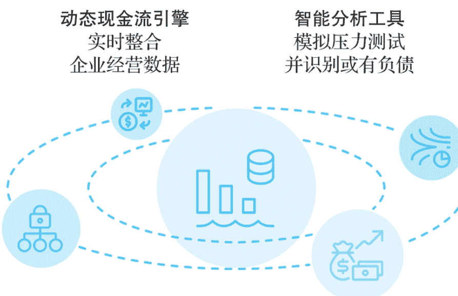
图7-9 DeepSeek为现金流预测转型提供技术与工具

#### 2. DeepSeek提示词
角色+任务：我是风险控制人员，需优化企业季节性现金流模型，应设置哪些动态参数？

#### 3. 追问提示词
- 极端天气对营收影响如何量化？
- 预收款周期如何动态调整？
- 行业价格波动如何映射至现金流？

#### 4. 输出形式
行业现金流特征库（Excel 表格）、动态授信规则表（Excel 表格）。

### 7.5.2 重大投资支出压力测试

#### 1. 场景介绍
重大投资支出压力测试是评估偿债能力的核心。银行需通过资本开支影响模型模拟项目延期对现金流的冲击，设置投资回报率敏感性阈值并触发再融资预审。重点是构建极端情景模拟框架，避免风险敞口低估，并整合利率上行、政府补贴延迟等动态参数。

#### 2. DeepSeek提示词
角色+任务：我是风险控制人员，需设计压力测试场景，应包含哪些极端条件？

#### 3. 追问提示词
- 项目延期概率参数如何设定？
- 利率上行如何影响再融资成本？
- 政府补贴延迟影响如何模拟？

#### 4. 输出形式
压力测试报告（Word 文档）、敏感性分析矩阵（Excel 表格）。

### 7.5.3 或有负债触发情景模拟

#### 1. 场景介绍
或有负债触发情景模拟是识别隐性风险的核心手段。银行需通过法律文本智能解析提取担保合同触发条件，量化不同诉讼结果对现金流冲击并构建风险敞口模型。重点在于防范交叉违约关联风险，避免隐性义务漏判，并强化司法案例库动态更新。

#### 2. DeepSeek提示词
角色+任务：我是资产管理岗人员，在评估或有负债风险时应提取哪些合同条款？

#### 3. 追问提示词
- 交叉违约条款关联性如何识别？
- 对外担保隐性义务如何量化？
- 仲裁条款如何影响风险敞口？

#### 4. 输出形式
或有负债追踪表（Excel 表格）、法律文本解析规则库（Word 文档）。

### 7.5.4 现金流预测场景清单
- 行业特征数据采集
- 历史现金流模式分析
- 压力测试模型构建
- 或有负债条款提取
- 动态授信策略生成
- 风险敞口可视化
- 预警阈值动态调整
- 报告自动化生成

## 7.6 担保圈风险管理

担保圈管理面临传导隐蔽、关联识别困难的挑战，痛点是担保链绘制效率低、隐性关联挖掘不足、处置响应滞后。银行需构建“网络识别-传导分析-智能处置”三合一体系。风险管理团队要强化担保关系穿透、风险传导建模、处置策略动态优化能力。

通过担保网络图谱与智能分析系统，DeepSeek 能实现担保关联关系智能识别、风险传导路径实时追踪、处置预案智能生成，并依托自然语言处理解析法律文书条款构建合规处置规则库，推动管理从人工链式排查转向智能网络分析与动态风险阻断。

### 7.6.1 上市公司股票质押担保估值

#### 1. 场景介绍
股票质押担保估值是防范担保圈风险的重要手段。银行需通过波动率调整系数与平仓规则动态监控质押率突破风险，对接交易所数据并量化限售股流动性折扣。重点是构建实时市场熔断应对机制，避免连锁反应，并强化压力测试对极端行情的覆盖。

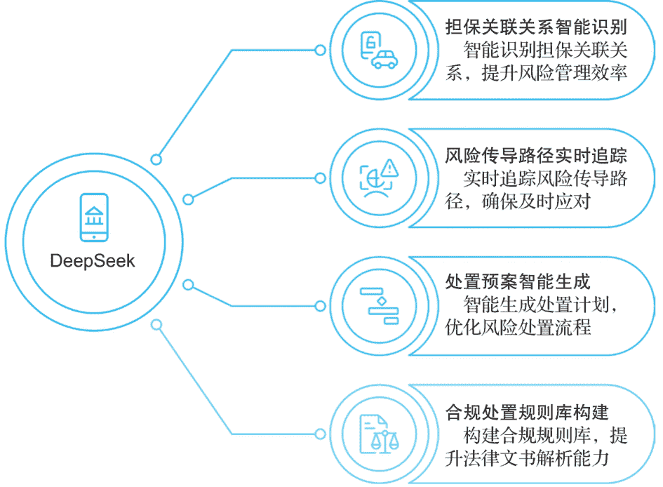
图7-10 DeepSeek助力担保圈风险管理的精准管控

#### 2. DeepSeek提示词
角色+任务：我是风险控制人员，需监控股票质押风险，应设置哪些预警指标？

#### 3. 追问提示词
- 限售股流动性折扣如何量化？
- 大股东补充质押如何影响质押风险？
- 市场熔断机制如何纳入模型？

#### 4. 输出形式
质押风险仪表盘（BI 平台）、平仓压力测试模型（Excel 表格）。

### 7.6.2 担保圈风险传染路径可视化

#### 1. 场景介绍
风险传染路径可视化是传导分析的核心工具。银行需通过担保网络拓扑模型识别跨行业跨区域传导节点，设置风险传染速度阈值并生成重点监控名单。重点在于穿透隐性互保关系，避免区域风险集中失控，并强化图谱实时更新能力。

#### 2. DeepSeek提示词
角色+任务：我是资产管理岗人员，需分析风险传染路径，应关注哪些网络特征？

#### 3. 追问提示词
- 隐性互保关系如何识别？
- 核心企业风险如何传导至上下游？
- 区域风险集中度如何量化？

#### 4. 输出形式
担保网络图谱（Visio 图表）、风险传染热力图（BI 平台）。

### 7.6.3 建立担保物快速处置通道

#### 1. 场景介绍
建立快速处置通道是提升资产回收效率的关键。银行需对接司法拍卖平台与优先竞买人数据库优化处置流程，量化不良资产市场流动性并规避流拍风险。重点是解决跨境资产处置周期长问题，避免担保物价值折损，并建立动态竞买人画像匹配机制。

#### 2. DeepSeek提示词
角色+任务：我是资产管理岗人员，需设计担保物快速处置方案，应整合哪些资源与渠道？

#### 3. 追问提示词
- 不良资产交易市场流动性如何评估？
- 司法拍卖如何规避流拍风险？
- 跨境资产如何实现快速处置？

#### 4. 输出形式
处置渠道清单（Excel 表格）、竞买人画像库（Excel 表格）。

### 7.6.4 担保圈管理场景清单
- 担保网络数据采集
- 核心节点识别定位
- 风险传染模型训练
- 处置优先级排序
- 司法协作机制建立
- 资产估值动态更新
- 处置方案智能推荐
- 处置效果后评估

## 7.7 环保合规审查

环保合规审查面临环境数据核验难、碳资产评估滞后等问题，痛点是企业披露不完整、污染数据跟踪缺失、碳资产定价模型不健全。银行需构建“数据核验-价值评估-风险预警”三合一体系。绿色金融团队要强化环境数据穿透验证、碳资产动态估值、环境风险智能监测能力。

通过环境数据智能核验平台与碳资产分析工具，DeepSeek 能实现排污数据实时核验、碳资产动态定价、环境风险预警，并依托区块链构建不可篡改的环境数据存证链，推动审查从被动依赖披露转向主动获取、交叉验证、动态预警的智能管理体系。

### 7.7.1 环境信息披露真实性核查

#### 1. 场景介绍
环境信息披露真实性核查是绿色金融合规重点。银行需核验排污许可证有效性，分析在线监测数据连续性识别环保风险，建立异常排放波动模型并关联碳配额质押敞口。重点在于强化主动核验能力，避免依赖企业单方披露，并动态校准信用评级规则。

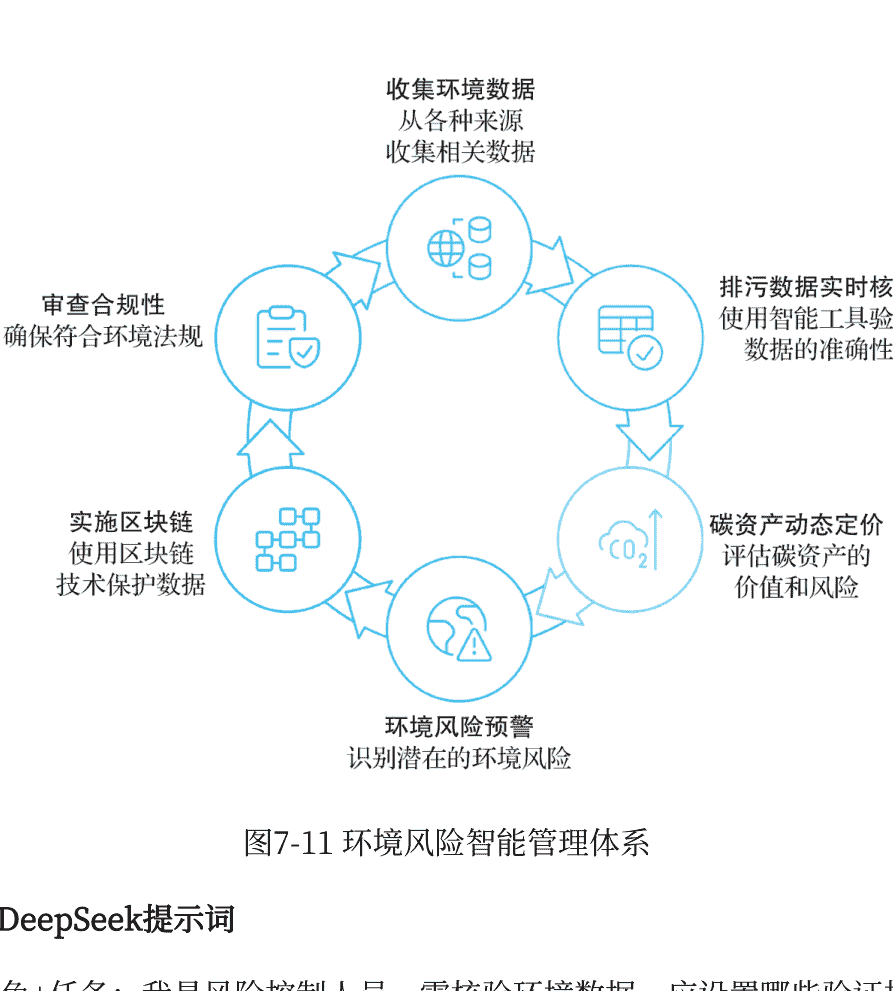
#### 2. DeepSeek提示词
角色+任务：我是风险控制人员，需核验环境数据，应设置哪些验证规则？

#### 3. 追加追问方向
- 在线监测装置出现断电规避行为时如何捕捉异常信号？
- 历史整改记录应如何开展回溯核验？
- 突发环境事件漏报可通过哪些路径排查？

#### 4. 交付清单
环保数据核验清单（Excel 文件）、异常波动分析报告（Word 文档）

### 7.7.2 碳配额质押风险管理
#### 1. 业务背景
碳配额质押的风控是银行应对碳市场价格波动的重要抓手。需要借助动态估值模型实时捕捉碳价走势及政策调整的传导。业务侧要提前设定配额冻结预警线，触线后即启动补充担保。核心在于量化行业基准调整对配额价值的冲击，化解跨区价差带来的敞口，同时将配额结转的政策参数纳入评估体系。

#### 2. DeepSeek 对话指令
角色+任务：担任资产管理岗，在管理碳配额质押业务时，应重点关注哪些市场参数？

#### 3. 深化追问
- 行业基准线调整产生的价值影响如何度量？
- 跨区域碳价差有哪些对冲手段？
- 配额结转政策对估值的影响体现在哪里？

#### 4. 输出形式
碳价波动预警表（Excel 文件）、质押率动态计算器（Excel 文件）

### 7.7.3 监控环保技术升级资金挪用风险
#### 1. 业务背景
对环保技术升级专项资金的挪用进行监控是资金用途管理的核心。银行需核对合同与发票是否匹配，并结合物联网回传数据核实设备实际运行状态。业务人员还要识别关联交易中虚增设备价款的情形，并量化节能减排成效。重点是搭建资金流向的闭环追踪机制，防范二手设备翻新冒充新机，同时强化设备运行日志的实时核验能力。

#### 2. DeepSeek 对话指令
角色+任务：担任贷后管理岗，需对专项资金用途进行监控，应采集哪些验证数据？

#### 3. 深化追问
- 关联交易中设备价款虚增的迹象如何识别？
- 如何判断设备属于翻新二手？
- 节能减排效果如何开展量化核验？

#### 4. 输出形式
资金流向追踪表（Excel 文件）、设备运行日志（BI 系统）

### 7.7.4 环保合规审查场景清单
- 环境行政许可核验
- 在线监测数据抓取
- 碳资产价值评估
- 专项资金流向监控
- 环保设备物联验证
- 环境信用评级更新
- 监管报送数据生成
- 绿色信贷报告披露

## 7.8 集团客户授信管理
集团客户授信面临风险传导路径复杂化与跨境风险叠加的挑战，痛点集中在关联交易穿透困难、并表覆盖不足、国别风险评估滞后。银行需构建“全球监控-风险穿透-动态预警”三层联动体系（如图7-12所示）。集团客户管理团队要强化跨境数据整合分析、风险传导路径建模、多维度预警规则配置能力。

图7-12 构建“全球监控-风险穿透-动态预警”三位一体的管理体系

依托全球风险视图与智能分析平台，DeepSeek可帮助银行实现集团客户表内外风险全景呈现、跨境风险传导实时追踪、国别风险动态预警，并通过机器学习搭建授信敞口预测框架，推动集团客户授信管理从分散式并表向覆盖跨境追踪、隐性关联挖掘、政策变动应对的全球化智能监控转型。

### 7.8.1 境外子公司国别风险叠加
#### 1. 业务背景
境外子公司的国别风险叠加是集团授信管控难点。银行需结合外汇管制政策、政治稳定性指数等维度动态评估敞口。实务中要整合世界银行营商环境数据，构建地缘政治预警模型。重点在于优化国别风险准备金计提机制，避免跨境风险失控，同时提升多法域规则解析能力。

#### 2. DeepSeek 对话指令
角色+任务：担任风险控制岗位，需评估国别风险，应整合哪些维度的数据？

#### 3. 深化追问
- 货币不可兑换风险如何量化？
- 地缘政治事件如何预警？
- 跨境税务风险如何评估？

#### 4. 输出形式
国别风险评级表（Excel 文件）、风险准备金计算模型（Excel 文件）

### 7.8.2 关联交易资金闭环监控
#### 1. 业务背景
关联交易资金闭环监控是防范虚构融资的核心手段。银行需借助资金流向图谱工具识别票据背书闭环等异常特征。业务人员要设定闭环度阈值并自动冻结异常额度。重点在于穿透跨境关联交易路径，防范应收账款重复质押，同时强化区块链技术对资金流的验证能力。

#### 2. DeepSeek 对话指令
角色+任务：担任资产管理岗位，需监控资金闭环，应关注哪些交易特征？

#### 3. 深化追问
- 如何识别票据背书闭环融资？
- 跨境关联交易如何进行穿透核查？
- 如何发现应收账款重复质押？

#### 4. 输出形式
资金流向图谱（Visio 文件）、闭环度分析模型（Excel 文件）

### 7.8.3 表外理财业务并表处理
#### 1. 业务背景
表外理财业务并表处理是穿透风险敞口的核心任务。银行需通过计量模型核查理财资金最终投向，并识别隐性兜底条款。业务人员需解析结构化产品的嵌套风险并判定收益权转让的法律效力。重点在于防范刚性兑付承诺带来的法律风险，避免表外资产失管，同时动态更新资管产品登记信息。

#### 2. DeepSeek 对话指令
角色+任务：担任风险控制岗位，需处理表外理财业务，应设置哪些穿透规则？

#### 3. 深化追问
- 如何识别结构化产品嵌套风险？
- 如何判定收益权转让的法律效力？
- 隐性刚性兑付承诺如何取证？

#### 4. 输出形式
表外风险敞口报表（Excel 文件）、法律文本解析规则库（Word 文档）

### 7.8.4 集团客户授信管理场景清单
- 全球股权架构解析
- 国别风险因子建模
- 资金闭环度计算
- 表外资产穿透核查
- 风险准备金动态计提
- 关联交易限额设定
- 并表风险压力测试
- 监管合规报告生成

## 7.9 跨境贷款
银行跨境贷款面临法律适用冲突加剧、汇率波动风险攀升等挑战，痛点集中在合规审查效率低、跨境风险动态监测不足、法律条款智能适配困难（如图7-13所示）。银行需构建“合规穿透-风险量化-智能决策”三层联动服务体系。国际业务团队要强化多法域规则解析、汇率风险动态建模、智能合规策略生成能力。

图7-13 银行跨境贷款面临的挑战及痛点

借助智能合规引擎与风险量化模型，DeepSeek可帮助银行实现多法域监管规则智能解析、跨境资金流动实时监测、汇率风险压力测试模拟，并依托自然语言处理实现法律条款自动核验与合同模板智能生成，推动跨境贷款服务从人工经验判断向覆盖合规审查、风险预警、决策支持的智能化管理转型。

### 7.9.1 跨境担保品法律效力审查
#### 1. 业务背景
跨境担保品法律效力审查是避免国际法律冲突的重要措施。银行需通过多法系担保品分析库验证境外抵押物登记完备性。业务人员需识别法律适用冲突风险并评估外汇管制影响。重点在于构建跨境破产法律协调机制，避免担保执行失效，同时动态更新境外法律数据库。

#### 2. DeepSeek 对话指令
角色+任务：担任风险控制岗位，需审查跨境担保品法律效力，应核查哪些法律要件？

#### 3. 深化追问
- 如何验证离岸资产查封优先权？
- 如何协调跨境破产法律？
- 外汇管制对担保执行的影响？

#### 4. 输出形式
法律效力分析报告（Word 文档）、担保品登记清单（Excel 文件）

### 7.9.2 反洗钱制裁名单实时筛查
#### 1. 业务背景
反洗钱制裁名单实时筛查是合规管理的核心流程。银行需通过动态名单库与模糊匹配算法识别名称变体及关联实体。业务人员需穿透多层持股架构并响应临时制裁令。重点在于提升拼音转写差异识别精度，避免漏筛，同时强化风险客户画像的动态更新能力。

#### 2. DeepSeek 对话指令
角色+任务：担任对公客户经理，需筛查反洗钱制裁名单，应设置哪些匹配规则？

#### 3. 深化追问
- 如何识别拼音转写差异？
- 如何穿透多层持股架构？
- 如何快速响应临时制裁令？

#### 4. 输出形式
制裁匹配日志（Excel 文件）、风险客户画像库（Excel 文件）

### 7.9.3 本外币错配风险对冲
#### 1. 业务背景
本外币错配风险对冲是汇率风险管理的核心策略。银行需通过计量模型监控外债敞口与自然对冲缺口。业务人员需设定货币错配阈值并生成套期保值方案。重点在于量化主权信用评级的影响，避免跨境现金流匹配失衡，同时优化期权组合的成本控制机制。

#### 2. DeepSeek 对话指令
角色+任务：担任风险控制岗位，在管理汇率风险时，应设计哪些对冲策略？

#### 3. 深化追问
- 如何量化主权信用评级的影响？
- 如何优化跨境现金流匹配？
- 如何控制期权组合成本？

#### 4. 输出形式
汇率风险仪表盘（BI 系统）、对冲方案建议书（Word 文档）

### 7.9.4 跨境贷款场景清单
- 跨境法律适用分析
- 担保品境外登记验证
- 实时制裁名单筛查
- 货币错配压力测试
- 套期保值方案设计
- 跨境资金流向监控
- 监管合规数据报送
- 外债风险动态评估

## 7.10 贷后预警
银行贷后预警管理面临风险信号隐蔽、响应时效不足等挑战，痛点集中在风险识别维度单一、预警信号验证效率低、处置策略适配性差。银行需构建“智能识别-动态验证-精准处置”三层联动预警体系。贷后管理团队要强化多源数据融合分析、预警规则动态优化、处置策略智能匹配能力。

借助智能预警平台与决策支持系统，DeepSeek可帮助银行实现企业经营行为动态监测、隐性风险特征智能识别、风险事件快速验证，并依托机器学习建立差异化处置策略库，推动贷后管理从被动应对向实时数据驱动的主动风险防控转型（如图7-14所示）。

### 7.10.1 供应链金融下游集中度预警
#### 1. 业务背景
供应链金融下游集中度预警是贷后风险防控的关键任务。银行需通过客户依赖度模型监控销售占比突破阈值的风险。业务人员需设定行业波动传导系数并生成预付款调节方案。重点在于提升风险缓释预案的匹配度，避免因单一客户过度依赖引发资金链断裂，同时关联行业景气指数动态校准预警规则。

#### 2. DeepSeek 对话指令
角色+任务：担任贷后管理岗位，需监控客户集中度，应设置哪些动态阈值？

#### 3. 深化追问
- 如何量化替代客户的开发周期？
- 行业景气指数如何与预警规则建立关联？
- 预付款比例应如何调节以控制风险？

#### 4. 输出形式
客户依赖度分析表（Excel 文件）、风险传导模型（Excel 文件）

### 7.10.2 实际控制人舆情监控
#### 1. 业务背景
实际控制人舆情监控是风险预警的核心环节。银行需通过全网舆情抓取系统识别实际控制人涉诉、股权冻结等负面信号。业务人员需设定舆情声量阈值并启动紧急核查流程。重点在于穿透境外媒体的隐蔽报道，避免谣言扩散，同时构建关联企业舆情传导分析模型。

#### 2. DeepSeek 对话指令
角色+任务：担任风险控制岗位，需监控实际控制人舆情，应关注哪些信号类型？

#### 3. 深化追问
- 如何识别境外媒体的隐蔽报道？
- 如何分析关联企业舆情的传导路径？
- 如何快速甄别谣言与事实？

#### 4. 输出形式
舆情热点图谱（BI 系统）、紧急响应预案（Word 文档）

### 7.10.3 跨境资金异常流动监测
#### 1. 业务背景
跨境资金异常流动监测是反套利交易的核心手段。银行需通过多维度分析模型识别虚构贸易背景。业务人员需构建货物流与资金流偏离度指标，并穿透关联方收支路径。重点在于防范离岸转手买卖套汇风险，避免汇率避险工具滥用，同时强化海关数据与外汇数据的实时交叉验证。

#### 2. DeepSeek 对话指令
角色+任务：担任资产管理岗位，需监测资金流动，应设置哪些分析维度？

#### 3. 深化追问
- 如何识别离岸转手买卖套汇？
- 关联方跨境收支如何穿透？
- 如何发现汇率避险工具滥用？

#### 4. 输出形式
资金流分析报告（Word 文档）、偏离度预警模型（Excel 文件）

### 7.10.4 贷后预警场景清单
- 风险因子动态配置
- 多源数据实时采集
- 预警信号智能生成
- 风险等级自动判定
- 处置预案匹配推荐
- 处置任务智能分派
- 处置过程全程留痕
#### 预警效果后评价

## 7.11 本章小结
本章聚焦银行信贷审查审批智能化转型，梳理痛点与需求，提出借助DeepSeek实现行业风险穿透、押品智能估值及决策优化的方案；详细阐述DeepSeek在行业风险预警、押品重估、关联交易风险管理、财务造假风险识别、现金流预测、担保圈风险管理、环保合规审查、集团客户授信管理、跨境贷款及贷后预警等关键场景的应用策略，助力银行构建动态、智能、精准的信贷管理体系，提升风险管理能力与服务效率。

# 第8章 DeepSeek风险合规场景应用
银行风险合规管理正处于智能化升级的关键阶段，监管要求从单一风险防控向全链条穿透式管理转变，管理模式呈现跨系统协同特征。在金融犯罪手段智能化与跨境洗钱风险加剧背景下，同业建设重心从基础合规能力建设转向主动防御体系构建，特别是在反欺诈、反洗钱等重点领域，银行亟须提升生物核验安全性与资金流分析穿透能力。业务人员面临新型犯罪识别滞后、可疑交易研判效率低等现实挑战。

风险合规业务痛点体现在三方面：一是生物识别技术对抗性不足，人脸核验系统面临深度伪造攻击与特殊群体识别准确率低问题；二是反洗钱监测工具发展滞后于犯罪模式演变，可疑交易特征库更新效率不高，跨境资金流多层穿透存在技术瓶颈；三是人工依赖度过高，传统规则引擎难以应对复杂场景，导致风险处置时效较低，难以满足《银行业金融机构反洗钱和反恐怖融资管理办法》提出的穿透式监管要求。

通过部署DeepSeek自适应生物核验体系、智能可疑交易图谱及AI决策引擎，商业银行可实现关键突破：构建基于对抗样本训练的活体检测模型，增强安全防护；建立多维度资金链路分析工具，实现交易穿透追踪；运用自然语言处理技术优化监管规则动态适配机制。

本章重点解析DeepSeek如何通过“生物核验-交易穿透-决策升级”三重路径重构智能合规体系，有效解决欺诈攻击防御薄弱、洗钱模式识别滞后、人工研判低效等核心问题，助力银行实现风险识别实时化、合规响应自动化、决策支持智能化的数字化转型目标。

## 8.1 反欺诈监测
银行反欺诈监测面临生物识别技术攻击手段升级等挑战，当前痛点主要为深度伪造视频识别率低、特殊遮挡场景验证失效、活体检测规则僵化等（如图8-1所示）。银行需重点构建“动态防御-多模态核验-持续进化”三层联动认证体系。金融科技团队需增强生物特征动态采集、攻击特征智能识别、防御策略实时更新能力。

通过动态光场技术与多模态融合核验系统，DeepSeek可帮助银行实现高精度活体检测、复杂场景身份认证、防御策略动态优化，并依托边缘计算设备实现毫秒级风险拦截响应，推动金融身份认证从单一生物识别模式向覆盖攻击防御、场景适配、策略进化的可信认证体系升级。

### 8.1.1 虹膜/静脉辅助验证
#### 1. 场景说明
虹膜/静脉辅助验证是保障生物识别安全的关键环节。银行需通过多生物特征融合机制，提升在极端光照环境下的识别稳定性。科技部门需制定设备参数标准，验证在不同距离、角度下的特征提取有效性，并建立动态适配算法以优化识别精度。此项工作的重点在于平衡识别准确率与系统响应速度，避免环境干扰导致验证失败，同时整合多模态数据的权重分配策略，提升核验可靠性。

#### 2. DeepSeek 对话指令
角色+任务：担任银行科技部门人员，在优化多模态生物特征核验方案时，应测试哪些关键场景？

#### 3. 深化追问
- 在复杂光线环境下如何保证成像质量？
- 算法如何适配特殊生理特征？
- 如何动态分配多模态数据权重？

#### 4. 输出形式
测试场景清单（Excel 文件）、设备参数配置表（Word 文档）

#### 5. 案例演示
（1）DeepSeek 对话指令
角色+任务：担任银行科技部门人员，在优化多模态生物特征核验方案时，应测试哪些关键场景？不编造、不臆测，符合银行实际场景，网页链接真实有效，严格按照监管要求执行。

（2）DeepSeek 首次输出
基于搜索结果中多家银行及科技公司的实践案例，结合金融行业监管要求和实际业务场景，银行多模态生物特征核验方案需包含以下关键测试场景：

##### 一、活体检测与防伪攻击测试
###### 1. 基础攻击防御
需覆盖打印照片、面具、翻拍视频、3D模型等常见攻击手段，验证系统对物理伪造的识别能力。例如苏州银行通过“前端活体检测+后端防伪引擎”的双重验证机制，成功拦截打印照片攻击。

测试静默活体检测准确度（参考值≥98.75%）及人脸识别准确度（参考值≥99.95%）。

###### 2. 深度伪造对抗测试
针对AI换脸（Deepfake）、拟声合成等新型攻击，需验证系统对深度伪造视频的检测能力。马上消费推出的防伪大模型可实现99.9%的未知攻击拦截率，可作为测试基准。

增加对抗样本攻击测试，如在光照变化、姿态偏移等复杂场景下的鲁棒性验证。

##### 二、多模态组合核验场景
###### 1. 模态互补性测试
验证人脸+声纹、指纹+虹膜等多模态组合的协同效应。例如，广西北部湾银行通过ABIS（自动生物特征识别系统）多模态平台实现指纹、人脸、声纹的交叉核验，降低单一模态失效风险。

测试不同模态的权重分配策略，如在低光照环境下自动提升声纹核验权重。

###### 2. 边缘场景适应性
覆盖噪声环境（如银行网点背景音）、弱网络环境下的核验稳定性。例如，中关村科金平台支持边缘计算，可在网络延迟时优先完成本地特征提取。

##### 三、高并发与性能压力测试
###### 1. 业务峰值模拟
模拟春节、促销活动等业务高峰场景，测试系统在每秒千级并发请求下的响应时间（目标≤1秒）及资源占用率（CPU占用率≤70%）。

例如，中国民生银行智慧网点通过“云-边-端”架构优化，实现日均超过10万客户的高效核验。

###### 2. 长周期稳定性测试
验证方案能否在72小时以上满载不掉线，重点关注内存占用趋势和识别错误率的起伏。FRR上限0.1%，FAR上限0.01%，达标才算通过。

##### 四、跨渠道与设备兼容性测试
###### 1. 全渠道覆盖验证
手机银行、柜面终端、ATM、自助客服等多个入口的核验结果要保持一致。以广西北部湾银行为例，从线上直销到线下VIP厅堂已实现全场景打通。还要检验公安部身份核验、银联等第三方平台的接口协同能力。

###### 2. 异构设备适配
覆盖海康、大华等不同品牌摄像头、iOS、Android移动端以及各类自助硬件的差异。即使使用200万像素的低配摄像头，识别准确率仍要稳定在98%以上。

##### 五、安全与合规性验证
###### 1. 数据传输安全测试
检测国密加密通道和隐写签名是否生效，拦截中间人窃听、防止数据被篡改。人脸等生物特征的保存要符合《个人信息保护法》，做到脱敏保存、按期销毁。

###### 2. 监管合规专项测试
对照《金融数据安全分级指南》和《信息安全技术人脸识别数据安全要求》，全流程检查采集、应用、存储、传输、删除的合规表现。客户撤回授权后，24小时内必须停止相关处理。

###### 3. 测试实施建议
（1）工具选择
优先选用中关村科金多模态防伪平台等成熟方案，内置150万+攻击样本与自动化测试模块。同步集成通过中国信通院“护脸计划”认证的工具，保证行业对齐。

（2）风险场景优先级
按概率与危害排序：高仿造攻击属高风险，设备兼容问题属中风险，网络延迟属低风险。

（3）持续优化机制
搭建动态威胁情报库，每月更新攻击样本，例如新型AI换脸特征。联合第三方做攻防演练，马上消费借助国际挑战赛提升防御能力就是典型经验。

（4）法律与标准依据
《信息安全技术人脸识别数据安全要求》GB/T 41819-2022 明确了人脸数据处理的通用安全要求。《金融数据安全数据生命周期安全规范》JR/T 0223-2021 对生物特征存储加密强度做了规定。

完成上述全覆盖后，生物核验的安全性、稳定性、合规性可实现系统性提升。建议结合银行自身业务，优先在贷款面签、大额转账等高危场景先行验证。

（3）追问示例
复杂光照怎样保障成像质量？
算法怎么适配特殊生理特征？
多模态数据权重如何动态分配？

（4）输出形式
Excel模板《测试场景清单》，以HTML呈现并内嵌可直接下载Excel的按钮。
Excel模板《设备参数配置表》，以HTML呈现并内嵌可直接下载Excel的按钮。

（5）DeepSeek输出
DeepSeek输出的内容如图8-2所示。

图8-2 DeepSeek输出的HTML格式代码
单击“运行”按钮，可以直接获得“复杂光线测试场景清单”，单击“下载Excel”按钮即可将其保存到本地，如图8-3所示。
滚动鼠标滚轮，可看到“生物特征设备配置表”，如图8-4所示。

##### 复杂光线测试场景清单（下载Excel）

| 场景编号 | 测试类型 | 环境条件 | 测试方法 | 预期结果 | 标准依据 |
| :--- | :--- | :--- | :--- | :--- | :--- |
| LS-01 | 背光场景 | 背景光 > 1000lux，人脸区域 < 50lux | 开启HDR成像+自适应补光 | 人脸关键点识别率 ≥98% | ISO/IEC 30107-3 |
| LS-02 | 混合光源 | 色温2700K~6500K交替变化 | 多光谱融合算法 | RGB-IR图像匹配误差 ≤5px | JR/T 0193-2020 |
| LS-03 | 暗光环境 | 照度 < 5lux | 启动红外成像模组 | 瞳孔定位误差 ≤3mm | GA/T 1324-2017 |

##### 生物特征设备配置表（下载Excel）

| 设备类型 | 硬件参数 | 软件配置 | 特殊适配方案 | 适用场景 |
| :--- | :--- | :--- | :--- | :--- |
| 多光谱摄像头 | 分辨率2560x1920 像素HDR > 120dB | 动态曝光算法v2.3 肤色补偿模型 | 白癜风患者虹膜增强 | 高精度人脸识别 |
| 3D结构光模组 | 精度0.1mm | 疤痕特征过滤算法 | 烧伤患者面部建模 | 金融支付验证 |

▲图8-3 可下载的“复杂光线测试场景清单”Excel模板

图8-4 可下载的“生物特征设备配置表”Excel模板

### 8.1.2 口罩/墨镜遮挡下的活体检测
#### 1. 场景介绍
口罩与墨镜遮挡是反欺诈监测的重点。银行需要优化面部关键点分析模型，提升局部遮挡下的识别精度。风控人员要建立材质反光样本库，并动态调整动作指令难度和阈值。核心是降低误拒与漏检，在复杂遮挡下保证身份可信，同时兼顾安全与体验。

#### 2. DeepSeek提示词
角色+任务：我是风险控制人员，在优化口罩/墨镜遮挡下的活体检测方案时，我应当设置哪些补偿机制？

#### 3. 追问提示词
- 如何有效识别高仿真面具？
- 动态唇语检测如何增强验证？
- 如何优化头部姿态约束条件？

#### 4. 输出形式
遮挡物特征库（Excel文件）、活体检测逻辑图（Visio文件）。

### 8.1.3 设备指纹关联验证
#### 1. 场景介绍
设备指纹关联是防范虚拟化攻击的关键。银行要搭建设备环境画像体系，捕捉异常登录特征。科技部门需采集软硬件参数，构建可信度评估模型与风险画像规则。核心是穿透模拟器伪装与篡改痕迹，阻断非法终端，持续优化采集规则。

#### 2. DeepSeek提示词
角色+任务：我是银行科技部门人员，在验证设备的真实性时，我应当采集哪些关键参数？

#### 3. 追问提示词
- 如何有效识别模拟器特征？
- 如何捕捉设备篡改痕迹？
- 如何对公共网络环境进行风险评估？

#### 4. 输出形式
设备指纹规则库（Excel文件）、风险设备画像（BI系统）。

### 8.1.4 动态光场防御
#### 1. 场景介绍
动态光场防御是应对高仿真伪造的前沿手段。银行需部署光谱可变验证系统，增强活体检测。科技部门要验证光场模式与光学特征的关联，建立防御策略动态优化机制。重点是突破静态检测瓶颈，实现毫秒级攻击拦截，并平衡光照强度与用户体验。

#### 2. DeepSeek提示词
角色+任务：我是科技部门人员，设计应对高仿真伪造攻击的方案时，我应当配置哪些光学参数？

#### 3. 追问提示词
- 如何平衡光照强度与用户体验？
- 如何动态适配肤色反射特性？
- 如何优化光场变化频率？

#### 4. 输出形式
光场模式配置表（Excel文件）、攻击样本库（Excel文件）。

### 8.1.5 老年客户面容识别
#### 1. 场景介绍
老年群体面容识别是适老化服务要点。银行需建立年龄适应性核验模型，优化特征算法。运营部门要完善容错机制，动态调整纹理变化容忍度。重点是降低误拒率与操作复杂度，保障服务体验，并持续验证假体佩戴等干扰场景下的稳定性。

#### 2. DeepSeek提示词
角色+任务：我是运营部门人员，在优化老年客户体验时，我应当调整哪些参数？

#### 3. 追问提示词
- 如何动态适应面部纹理变化？
- 假牙佩戴对唇动检测有何影响？
- 如何提升对眼部疾病患者的识别效果？

#### 4. 输出形式
年龄适应性规则库（Excel文件）、误拒率分析报告（Word文件）。

### 8.1.6 反欺诈监测场景清单
- 生物特征采集标准制定
- 攻击样本库动态维护
- 多模态核验策略配置
- 设备环境画像构建
- 活体检测阈值优化
- 异常行为实时拦截
- 客户投诉处理溯源
- 防御体系持续迭代

## 8.2 反洗钱监测
跨境资金流动复杂、洗钱手法隐蔽，银行痛点在于规则更新慢、多层链路穿透难、模型迭代周期长。需要构建智能监测、穿透分析、动态优化联动的防御体系，强化新型洗钱特征挖掘、跨境链路解构、模型持续迭代能力。

借助资金链路智能分析平台与动态模型训练系统，DeepSeek可帮助银行实现复杂交易网络智能解构、可疑交易特征动态识别、监测模型实时优化，并依托自然语言处理解析监管政策文件，生成合规校验规则库，推动反洗钱监测从事后报告向覆盖链路穿透、特征演化、监管要求适配的智能化防御转型。

### 8.2.1 跨境电商“9710”模式资金流监测
#### 1. 场景介绍
跨境电商“9710”模式²“9710”模式，即“跨境电子商务企业对企业直接出口”模式，是指境内企业通过跨境电商平台与境外企业达成交易后，通过跨境物流将货物直接出口至境外企业，并向海关传输相关电子数据。资金流监测是反洗钱重点，银行需建立跨境贸易数据核验机制，严格校验三单一致性。风控人员要对接海关数据接口，构建交易合理性评估模型。核心在于识别支付周期异常与货值偏差，避免虚构贸易背景的资金流转，提升海外仓数据交叉验证效率。

#### 2. DeepSeek提示词
角色+任务：我是风险控制人员，在监测“9710”模式资金流时，我应当设置哪些核验规则？

#### 3. 追问提示词
- 如何识别支付周期异常？
- 如何分析退税款与货值偏差？
- 如何交叉验证海外仓数据？

#### 4. 输出形式
“三单”比对模板（Excel文件）、资金流分析模型（Excel文件）。

### 8.2.2 预付卡套现识别
#### 1. 场景介绍
预付卡套现识别是反洗钱核心场景。银行需建立充值行为特征分析模型，捕捉异常交易模式。风控人员要设置交易频率离散度等监测维度，区分促销活动与套现行为。重点在于穿透终端设备关联性并核验商户数据真实性，提升对复杂洗钱手段的识别时效。

#### 2. DeepSeek提示词
角色+任务：我是风险控制人员，在识别预付卡套现行为时，我应当关注哪些特征？

#### 3. 追问提示词
- 如何区分促销活动与异常交易行为？
- 如何分析终端设备的关联性？
- 如何验证商户经营数据？

#### 4. 输出形式
充值行为特征库（Excel文件）、异常交易规则集（Excel文件）。

### 8.2.3 慈善资金流向监控
#### 1. 场景介绍
慈善资金流向监控是合规管理关键。银行需建立受助方资质核验与项目进度追踪机制。风控人员要对接民政部数据，验证备案信息真实性。重点在于识别境外受助方资质风险与现金捐款流向异常，确保资金用途符合慈善宗旨。

#### 2. DeepSeek提示词
角色+任务：我是风险控制人员，在监控慈善资金流向时，我应当设置哪些验证节点？

#### 3. 追问提示词
- 如何核验境外受助方资质？
- 如何追踪项目执行进度？
- 现金捐款流向如何溯源？

#### 4. 输出形式
慈善项目核验清单（Excel文件）、资金流向图谱（Visio文件）。

### 8.2.4 离岸交易穿透分析
#### 1. 场景介绍
离岸交易穿透是监测难点。银行需构建全球股权穿透工具，识别实际控制人。风控人员要验证注册信息真实性，绘制多层资金流转路径。重点在于突破SPV架构解析的技术瓶颈，识别跨境资金闭环等隐蔽手法。

#### 2. DeepSeek提示词
角色+任务：我是风险控制人员，在穿透分析离岸交易时，我应当采集哪些信息？

#### 3. 追问提示词
- 如何验证注册代理人的真实性？
- 如何快速解析多层SPV架构？
- 如何识别跨境资金闭环？

#### 4. 输出形式
股权穿透报告（Word文件）、关联交易图谱（Visio文件）。

### 8.2.5 农产品交易白名单管理
#### 1. 场景介绍
农产品交易白名单是特殊监测场景。银行需建立产量交易匹配模型，核验收购合理性。风控人员要对接农业部门数据，动态监测区域产量波动。重点在于量化天气因素对产量的影响，验证收购凭证真实性，防范虚构贸易背景的洗钱风险。

#### 2. DeepSeek提示词
角色+任务：我是风险控制人员，在制定农产品交易白名单时，我应当设置哪些核验标准？

#### 3. 追问提示词
- 如何动态监测区域产量波动？
- 如何量化天气因素对农产品产量的影响？
- 如何验证收购凭证的真实性？

#### 4. 输出形式
白名单准入规则（Excel文件）、产量交易匹配模型（Excel文件）。

### 8.2.6 反洗钱监测场景清单
- 客户身份持续识别
- 交易特征动态提取
- 资金链路智能解析
- 监管规则自动映射
- 可疑案例分级处置
- 监管报告自动生成
- 模型效果持续评估
- 黑名单库实时同步

## 8.3 柜面业务操作风险管理
柜面操作风险面临权限滥用隐蔽、风险追溯困难，痛点为岗位与权限不匹配、审计效率低、拦截实时性差。需构建权限控制、行为监测、实时阻断联动的体系，强化权限动态配置、操作特征智能识别、风险策略精准执行能力。

通过智能权限管控与行为分析模型，DeepSeek可帮助银行实现柜员权限动态匹配、操作行为智能分析、风险指令实时拦截，并依托自然语言处理解析业务凭证与系统日志，构建全流程操作证据链，推动柜面风险管理从人工登记核查向权限数字化管控、行为智能识别、风险自动拦截的立体化防控转型（如图8-6所示）。

图8-6 银行柜面业务操作风险立体化防控体系

### 8.3.1 司法查冻扣业务双人复核
#### 1. 场景介绍
司法查冻扣双人复核是柜面风险管理的核心。银行需建立独立复核机制，重点核查文书与系统操作的一致性。柜员操作时需通过生物识别与动态密码双因子认证，确保全程留痕。重点在于防范权限滥用与操作失误，平衡复核效率与防控强度，保障审计追溯完整性与时效性。

#### 2. DeepSeek提示词
角色+任务：我是银行柜员，在处理司法查冻扣业务时，我应当执行哪些核验步骤？

#### 3. 追问提示词
- 如何验证法院电子文书的真伪？
- 在紧急止付情形下如何进行特殊授权？
- 如何追溯审计历史操作记录？

#### 4. 输出形式
双人复核日志（Excel文件）、文书核验清单（Word文件）。

### 8.3.2 同业账户开立核验
#### 1. 场景介绍
同业账户开立核验是防范虚假开户的关键。银行需构建线上数据核验与线下实地调查协同机制。对公客户经理要通过视频连线验证经营场所真实性，并同步核验金融许可证编码。重点在于识别证照伪造风险，优化异地机构验证流程，确保核验材料电子化归档合规。

#### 2. DeepSeek提示词
角色+任务：我是对公客户经理，在开立同业账户时，我应当采集哪些验证材料？

#### 3. 追问提示词
- 如何识别伪造的金融许可证？
- 如何验证异地机构办公场地？
- 如何交叉核验授权代表身份？

#### 4. 输出形式
同业账户核验表（Excel文件）、视频验证操作手册（Word文件）。

### 8.3.3 代客操作风险录音录像回溯
#### 1. 场景介绍
代客操作录音录像回溯是柜面管理的重点。银行需建立音视频双录质检模型，识别柜员违规行为。运营管理人员要配置语义分析引擎，实时提取高风险话术片段。重点在于降低人工质检偏差，平衡隐私保护与风险识别需求，提升方言场景下语音转写准确率。

#### 2. DeepSeek提示词
角色+任务：我是运营管理人员，为了监控音视频双录质量，我应当设置哪些检测规则？

#### 3. 追问提示词
- 如何识别客户经理的暗示性话术？
- 密码输入环节如何实现智能屏蔽？
- 在方言场景下如何实现准确转写与分析？

#### 4. 输出形式
质检规则库（Excel文件）、风险话术特征表（Excel文件）。

### 8.3.4 外拓设备远程管控
#### 1. 场景介绍
外拓设备远程管控是防范数据泄露的关键。银行需构建设备全生命周期管理系统，实时监测异常移动。科技部门要配置GPS定位与远程数据擦除功能，动态管理设备权限。重点在于防范Root权限破解与离线状态下的数据泄露风险，优化设备失联预警机制，提高响应效率。

#### 2. DeepSeek提示词
角色+任务：我是银行科技部门人员，对于外拓设备，我应当设置哪些远程管控策略？

#### 3. 追问提示词
- 如何防止设备被获取Root权限？
- 如何加密存储离线业务数据？
- 设备失联后如何自动触发预警？

#### 4. 输出形式
设备管控策略表（Word文件）、定位轨迹分析图（BI系统）。

### 8.3.5 贵金属押运监控
#### 1. 场景介绍
贵金属押运监控是资产保全管理的关键环节。银行需建立数字孪生系统，实时追踪运输路径与交接节点。资产保全人员要对接公安部门的电子围栏数据，核验押运人员的生物特征。此项工作的重点在于防范货箱调包与路线偏离风险，优化突发事件的应急授权机制，确保双因子认证流程的可靠性。

贵金属押运监控采集要点

身份与任务：作为资产保全专员，对贵金属押运全程进行监控，应该采集哪些验证信息。

#### 3. 追问提示词
- 运输途中如何避免货箱被调换
- 紧急改道时如何进行授权
- 交接环节如何做到双因子验证

#### 4. 输出形式
押运轨迹日志 Excel表格、交接核验清单 Word文档

### 8.3.6 柜面业务操作风险管理场景清单
- 岗位权限按需动态分配
- 高风险业务须双人复核
- 音视频双录质检
- 外部设备远程监管
- 贵金属押运全程跟踪
- 操作日志智能研判
- 违规行为即时阻断
- 审计报告一键生成

## 8.4 监管数据报送治理

银行在监管报送方面承受数据质量要求抬升、规则频频更新的压力，突出问题集中在标准执行偏差、业务校验滞后、规则适配效率偏低。需要围绕数据治理、规则映射、质量监控构建立体报送架构。数据管理团队应强化标准智能化管控、规则动态解析、质量问题溯源整改三大能力。

借助智能报送平台与质量分析工具，DeepSeek能够实现监管数据的自动化清理、跨表项逻辑智能校验、监管规则动态适配等功能（如图8-7所示），并依托数据血缘分析构建质量问题全链路追溯，推动报送工作从人工核验转向覆盖数据标准化治理、规则智能化映射、质量实时化监控的精准体系。

图8-7 DeepSeek支持银行监管数据报送治理

### 8.4.1 理财资金投向穿透管理

#### 1. 背景说明
理财资金投向穿透是监管报送治理的核心诉求，银行需搭建资管产品全链路追踪模型，解决多层嵌套导致底层资产模糊的问题。风控人员需对接中国证券登记结算有限责任公司系统，核验投资者与资产的匹配关系。关键在于识别隐性兜底条款与跨境合规风险，同时优化数据映射规则的动态适配。

#### 2. DeepSeek参考提问
身份与目标：我是风险控制人员，为实现理财资金投向穿透，应设定哪些校验规则

#### 3. 追问提示词
- 如何识别结构化产品的隐性兜底条款
- 如何将收益权转让穿透到实际资产
- 如何验证跨境投资的合规性

#### 4. 输出形式
穿透映射规则库 Excel表格、底层资产清单 Excel表格

### 8.4.2 委托贷款关联校验

#### 1. 背景说明
委托贷款关联校验是防范虚构贸易融资的关键，银行需构建委托方-受托方-借款人关联图谱，识别资金闭环异常。风控人员需核验资金流向与合同的一致性。重点在于穿透关联方循环融资风险，提升还款资金路径追踪效率，同时建立电子合同验真机制。

#### 2. DeepSeek参考提问
身份与目标：我是风险控制人员，校验委托贷款三方关系时应收集哪些佐证材料

#### 3. 追问提示词
- 如何识别关联方循环融资
- 如何追溯委托方资金来源
- 如何验证还款资金闭环

#### 4. 输出形式
资金流向核验表 Excel表格、关联关系图谱 Visio文档

### 8.4.3 票据生命周期追踪管理

#### 1. 背景说明
票据生命周期追踪是票据业务风控的核心，银行需建立全流程电子化追踪系统，重点核查票据背书连续性、交易背景真实性及最终持票人资质合规性。运营管理人员需实时对接上海票据交易所系统数据，交叉验证贴现资金流向与申报用途一致性，监测异常交易。此项工作重点在防范票据伪造、重复融资风险，保障流转各环节合规，同时增强系统自动预警以提升核查效率。

#### 2. DeepSeek参考提问
身份与目标：我是运营管理人员，还原票据贴现链条时应设置哪些分析维度

#### 3. 追问提示词
- 如何识别空白背书跳转风险
- 如何对民间贴现进行关联分析
- 票据到期兑付异常如何预警

#### 4. 输出形式
票据流转图谱 Visio文档、兑付异常特征库 Excel表格

### 8.4.4 信用卡分期手续费分摊计算

#### 1. 背景说明
信用卡分期手续费分摊是财务管理的核心，银行需构建精准分期手续费分摊模型，重点解决多期数、多商户等复杂交易场景下的核算准确性难题。财务部门需制定分期交易费用归属规则，通过系统自动生成符合监管要求的披露报表，并建立业财联动机制，保证数据贯通。重点在防范核算误差与手续费披露合规风险，同时提升模型自动化水平以满足高频交易场景的核算效率需求。

#### 2. DeepSeek参考提问
身份与目标：我是银行财务部门人员，计算信用卡分期手续费分摊时应建立哪些核算标准

#### 3. 追问提示词
- 针对提前还款情形如何追溯手续费分摊
- 对商户补贴部分如何进行会计处理
- 跨境交易中的货币转换如何计价

#### 4. 输出形式
手续费分摊规则 Excel表格、核算差异分析表 Excel表格

### 8.4.5 联合贷款份额比例校核

#### 1. 背景说明
联合贷款份额比例校核是联合贷款业务风险管理的关键，银行需建立多方数据协同平台，重点监控合作机构放款比例匹配度与风险分担机制执行一致性。风控人员需制定份额偏差的动态预警规则，设置差异化阈值参数，并通过系统自动触发份额数据校准及风险拨备调整流程。重点在防范份额数据失真引发的风险暴露测算偏差，同时优化多方数据交互机制以提升校核时效性。

#### 2. DeepSeek参考提问
身份与目标：我是风险控制人员，负责校核联合贷款份额比例，应验证哪些关键参数

#### 3. 追问提示词
- 如何识别隐性兜底条款
- 跨机构数据如何实时同步
- 风险准备金计提如何匹配

#### 4. 输出形式
份额比例核验表 Excel表格、风险分担矩阵 Excel表格

### 8.4.6 监管数据报送场景清单
- 监管规则智能解析
- 源数据质量诊断
- 逻辑关系自动校验
- 缺失字段智能补全
- 报送文件自动生成
- 监管反馈自动解析
- 整改任务智能分派
- 数据治理效果评估

## 8.5 制裁合规管理

银行制裁合规管理面临国际制裁名单高频更新、跨境交易隐蔽性增强等挑战，痛点主要为多语种报文处理能力不足、隐性关联网络穿透困难、规则适配实时性差。银行需构建智能筛查、交叉核验、实时阻断三层联动合规体系。国际业务团队需强化多语言处理、关联网络分析、规则动态适配三大能力。

通过多语种智能筛查引擎与风险分析系统，DeepSeek可实现SWIFT报文要素秒级解析、隐性关联方智能穿透、制裁规则动态加载，并依托图计算引擎实时分析跨境交易网络拓扑结构，识别异常资金路径，推动制裁合规管理从人工翻译核验模式向覆盖多语种处理、隐性关联穿透、规则即时生效的智能化全球合规体系升级（如图8-8所示）。

图8-8 DeepSeek推动制裁合规管理向智能化全球合规升级

### 8.5.1 多语种转译检测

#### 1. 背景说明
多语种转译检测是制裁合规管理的基础能力，银行需建立字符转换规则库，解决名称拼写变体识别难的问题。风控人员需配置Unicode引擎验证报文一致性。重点在于防范信息丢失导致的误判风险，优化变音符号适配算法，同时确保非标准缩写的智能还原精度。

#### 2. DeepSeek参考提问
身份与目标：我是风险控制人员，需检测多语种转译风险，应设置哪些验证规则

#### 3. 追问提示词
- 如何识别字符集转换过程中的信息丢失
- 变音符号差异如何影响名称匹配
- 非标准缩写如何智能还原

#### 4. 输出形式
字符转译规则库 Excel表格、风险名称特征表 Excel表格

### 8.5.2 SWIFT报文完整性验证

#### 1. 背景说明
SWIFT报文完整性验证是防御中间人攻击的核心措施，银行需部署区块链存证系统，实现哈希值实时上链。科技部门需设计防篡改技术方案。重点在于平衡跨时区时间戳校准精度与系统性能，同时建立历史报文追溯标准化流程。

#### 2. DeepSeek参考提问
身份与目标：我是银行科技部门人员，需验证SWIFT报文完整性，应设计哪些技术方案

#### 3. 追问提示词
- 如何防止哈希值二次篡改
- 如何实现历史报文追溯
- 如何校准跨时区交易时间戳

#### 4. 输出形式
哈希值比对模板 Excel表格、区块链存证操作手册 Word文档

### 8.5.3 船舶/飞机等移动载体注册地筛查

#### 1. 背景说明
船舶/飞机等移动载体注册地筛查是跨境业务制裁合规的核心环节，银行需建立全球注册地动态筛查机制，重点识别通过频繁变更运输工具注册地规避国际制裁的行为。风控人员需接入国际海事组织、国际民航组织等官方登记数据库，设置移动载体轨迹异常预警规则，对短期内多次变更注册地或航行轨迹异常的载体进行自动标记与核查。重点在于防范利用注册地洗白手段突破制裁管控风险，同时提升第三方数据源更新频率以保障筛查时效性。

#### 2. DeepSeek参考提问
身份与目标：我是风险控制人员，需筛查移动载体，应采集哪些动态数据

#### 3. 追问提示词
- 如何验证临时注册文件的有效性
- 对光租船舶如何穿透识别实际控制人
- 如何关联分析载体轨迹异常

#### 4. 输出形式
运输工具核验清单 Excel表格、轨迹异常分析模型 Excel表格

### 8.5.4 战乱地区医疗物资支付绿色通道

#### 1. 背景说明
战乱地区医疗物资支付绿色通道是人道主义金融服务的特殊机制，银行需建立紧急支付快速核验机制，重点平衡国际制裁合规要求与医疗救援时效性。运营部门需实时对接联合国制裁豁免清单及冲突地区官方数据源，设置医疗物资HS编码的系统化白名单，并自动化触发合规审查豁免流程。重点在于防范支付审核疏漏导致的制裁合规风险或医疗救援延误风险，同时强化豁免清单动态更新机制以保障支付通道响应效率。

#### 2. DeepSeek参考提问
身份与目标：我是运营部门人员，负责处理战乱地区医疗物质特殊支付，应设置哪些核验标准

#### 3. 追问提示词
- 如何验证受援机构资质真实性
- 对双重用途物资如何进行分类管理
- 如何实现紧急支付事后报备

#### 4. 输出形式
豁免物资清单 Excel表格、快速通道操作指南 Word文档

### 8.5.5 受控物项HS编码智能解析

#### 1. 背景说明
受控物项HS编码智能解析是贸易金融合规管理的关键措施，银行需构建海关编码知识图谱系统，重点识别由商品归类错误引发的出口管制合规风险。风控人员需验证报关单与贸易合同中技术参数的一致性。

### 8.5.6 制裁合规管理场景清单
- 国际制裁名单动态同步
- 多语种报文智能解析
- 运输工具轨迹监控
- 敏感物项编码核验
- 人道主义支付特批
- 区块链存证实施
- 风险交易实时拦截
- 监管报备自动化

## 8.6 信息科技风险管理

银行信息科技风险管理面临API攻击手段升级、数据交互复杂度提升等挑战，痛点主要为接口权限管控粗放、异常调用行为识别滞后、传统规则库更新周期长。银行需构建权限管控、行为监测、攻击防御三层联动安全体系。科技风险团队需强化接口权限动态配置、调用行为智能分析、攻击特征实时识别三大能力。

通过智能安全防护体系与行为分析引擎，DeepSeek可实现API权限动态管理、调用行为多维度分析、攻击流量智能阻断，并依托知识图谱构建接口资产全生命周期画像，推动信息科技风险管理从静态规则防护模式向覆盖权限动态调整、行为实时监测、攻击自主防御的智能安全体系转型（如图8-9所示）。

图8-9 DeepSeek推动信息科技风险管理向智能安全体系转型

### 8.6.1 合作伙伴沙盒环境敏感数据隔离

#### 1. 背景说明
合作伙伴沙盒环境敏感数据隔离是信息系统安全管理的核心环节，银行需建立数据分级分类脱敏机制，重点防范测试环境敏感信息泄露风险。科技部门需配置虚拟化隔离技术栈，实现生产环境与沙盒环境在数据物理存储及网络通信方面的隔离。重点在于防范测试数据被滥用引发的信息泄露风险，同时优化隔离策略配置以提升研发测试效率。

#### 2. DeepSeek参考提问
身份与目标：我是科技部门人员，需管理沙盒环境，应设置哪些隔离规则

#### 3. 追问提示词
- 如何防止内存数据残留
- 如何动态回收测试账号权限
- 脱敏算法如何验证不可逆性

#### 4. 输出形式
数据脱敏策略表 Excel表格、环境隔离技术方案 Word文档

### 8.6.2 物联网设备SIM卡通信加密

#### 1. 背景说明
物联网设备SIM卡通信加密是物联网金融安全管控的核心环节，银行需构建物联网专网通信加密体系，重点防御中间人攻击与无线信号劫持风险。科技部门需部署量子密钥分发技术，实现SIM卡数据端到端加密及密钥动态刷新机制。重点在于防范通信链路数据泄露风险，同时优化加密算法性能以保障业务数据传输时效性。

#### 2. DeepSeek参考提问
身份与目标：我是科技部门人员，需加密物联网通信，应选择哪些技术方案

#### 3. 追问提示词
- 如何平衡加密强度与设备功耗
- 如何安全存储离线数据
- 设备固件如何防篡改

#### 4. 输出形式
加密协议配置表 Excel表格、设备安全认证手册 Word文档

### 8.6.3 生物特征数据本地化存储方案

#### 1. 背景说明
生物特征数据本地化存储方案是个人信息保护中的重要合规环节，银行需建立生物特征数据加密分区存储机制，重点满足《中华人民共和国个人信息保护法》中关于数据境内存储的要求。科技部门需设计基于国密算法的加密存储方案，实现生物特征数据物理存储位置可控及访问权限隔离。重点在于防范生物特征数据跨境传输带来的合规风险，同时优化加密存储架构以保障身份认证服务的可用性。

#### 2. DeepSeek参考提问
身份与目标：我是科技部门人员，需设计生物特征数据本地化存储方案，该方案应满足哪些合规要求

#### 3. 追问提示词
- 跨境传输数据时如何实现数据脱敏
- 加密密钥如何实现分片管理
- 如何验证数据销毁的彻底性

#### 4. 输出形式
存储架构图 Visio文档、合规检查清单 Excel表格

### 8.6.4 联盟链节点准入CA证书管理

#### 1. 背景说明
联盟链节点准入CA证书管理是区块链金融安全的核心环节，银行需构建节点身份认证体系，重点防范非法节点接入引发的数据篡改风险。科技部门需实施动态证书吊销机制，实时验证节点的运营资质与合规状态，建立证书生命周期管理流程。重点在于防范节点身份伪造风险，同时提高证书验证效率以保障交易确认的实时性。

#### 2. DeepSeek参考提问
身份与目标：我是科技部门人员，需管理联盟链节点准入CA证书，应设置哪些验证规则

#### 3. 追问提示词
- 如何识别伪造的CA证书
- 如何监测节点异常行为
- 跨链交互如何实现身份互认

#### 4. 输出形式
节点准入规则库 Excel表格、证书生命周期管理表 Excel表格

### 8.6.5 量子通信抗暴力破解测试

#### 1. 背景说明
量子通信抗暴力破解测试是信息加密体系升级的核心环节，银行需制定后量子密码迁移方案，重点防御量子计算攻击威胁。科技部门需模拟Shor算法攻击场景，验证现有RSA/ECC加密体系的抗量子计算能力，制定密码算法迁移路线图。重点在于防范量子计算引发的加密体系失效风险，同时平衡算法安全性与系统兼容性要求。

#### 2. DeepSeek参考提问
身份与目标：我是科技部门人员，需测试加密体系的抗量子计算能力，应设计哪些攻击场景

#### 3. 追问提示词
- 如何评估RSA算法的剩余安全周期
- 如何平滑迁移抗量子算法
- 传统设备如何兼容新协议

#### 4. 输出形式
抗量子测试报告 Word文档、算法迁移路线图 Visio文档

### 8.6.6 信息科技风险管理场景清单
- API权限分级
- 数据生命周期管控
- 加密协议动态升级
- 安全漏洞渗透测试
- 量子安全方案验证
- 节点身份持续认证
- 安全事件应急响应
- 合规审计自动化

## 8.7 外包风险管理

银行外包风险管理面临第三方服务商风险传导复杂化等挑战，痛点主要为服务商资质核验不透明、服务连续性评估滞后、风险预警机制缺失（如图8-10所示）。银行需构建准入评估、过程监控、应急处置三层联动管理体系。风险管理团队需强化服务商关联网络穿透、服务能力动态评估、风险事件智能预警三大能力。

通过智能评估模型与监控系统，DeepSeek可实现服务商股权关系智能穿透、服务能力动态评分、风险信号实时捕捉，并依托区块链技术构建不可篡改的服务过程存证链条，推动外包风险管理从纸质证明文件核查模式向覆盖资质穿透核验、服务过程溯源、风险动态阻断的智能化风控体系转型。

图8-10 银行的外包风险管理面临的挑战及痛点

### 8.7.1 云服务商跨AZ容灾演练验收

#### 1. 背景说明

### 跨可用区容灾验证演练
#### 1. 场景介绍
云上多可用区联动容灾是保障业务持续在线的关键抓手。可用区是云平台物理隔离的独立单元，跨区容灾依靠多区域部署实现服务不中断与数据零丢失。银行要搭建容灾演练评审标准，着重检验复制时效和切换完整性。科技团队要设计红蓝对抗式的演练剧本，实测RPO、RTO指标达成水平并形成多维度评估报告。RPO即Recovery Point Objective，指故障后可接受的数据回溯边界，即故障瞬间到最近可用恢复点的间隔，例如RPO 1小时表示最多容忍丢失近一小时数据。RTO即Recovery Time Objective，指从故障发生到业务恢复到可用状态的最长用时，涵盖告警、启动、恢复、上线全流程，例如RTO 4小时要求4小时内恢复运营。整体要避免容灾失效导致停服，同时兼顾演练频率与生产环境的干扰控制。

#### 2. DeepSeek提示词
角色+任务：我是银行科技部门人员，需验证容灾能力，我应当设置哪些测试场景？

#### 3. 追问提示词
- 区域级网络中断该如何模拟？
- 如何检验数据一致性？
- 回切阶段如何保证业务无损？

#### 4. 输出形式
演练测试用例（Excel文件）、容灾指标验收表（Excel文件）。

### 8.7.2 催收机构合规话术AI质检
#### 1. 场景介绍
催收话术智能质检是消费者权益保护合规管理的核心环节。银行要构建自然语言分析模型，重点捕捉暴力催收、隐私泄露等违规表述。合规人员应搭建200条以上风险词库并配置语义规则，对通话录音实时分析并输出质检报告。关键在于规避催收违规带来的法律风险，并通过模型调优降低误报干扰。

#### 2. DeepSeek提示词
角色+任务：我是合规管理人员，在对催收话术进行AI质检时，我应当设置哪些识别规则？

#### 3. 追问提示词
- 正常施压与言语威胁如何区分？
- 如何智能识别方言辱骂？
- 背景噪声如何做降噪处理？

#### 4. 输出形式
风险话术特征库（Excel文件）、质检异常报告（Word文件）。

### 8.7.3 系统开发商代码安全左移审计
#### 1. 场景介绍
代码安全左移审计是软件开发生命周期管控的关键。银行要建立开发安全管控机制，核心是在代码提交前开展静态检测。科技团队需接入SAST Static Application Security Testing，即不运行程序即可对源代码、字节码或二进制进行分析以发现潜在漏洞的工具链，设定高危漏洞阻断规则并建立缺陷闭环。目的是遏制代码漏洞引发的安全事件，同时在检测效能与准确性之间取得平衡。

#### 2. DeepSeek提示词
角色+任务：我是银行科技部门人员，需实施代码审计，我应当配置哪些扫描规则？

#### 3. 追问提示词
- 开源组件漏洞如何追溯？
- 硬编码密码如何智能发现？
- 第三方库签名如何验证？

#### 4. 输出形式
代码审计标准（Word文件）、漏洞特征规则库（Excel文件）。

### 8.7.4 驻场人员生物特征门禁管理
#### 1. 场景介绍
驻场人员生物特征门禁是物理安全立体防控的重要一环。银行需覆盖人员进出的全流程，重点防范尾随进入。运营部门应部署三维人脸识别，结合动态活体检测与异常行为分析，并建立门禁事件追溯机制。核心是阻断未授权人员进入，同时持续优化识别算法以提升通行效率。

#### 2. DeepSeek提示词
角色+任务：我是运营部门人员，需管理门禁系统，我应当采集哪些生物特征？

#### 3. 追问提示词
- 照片/视频破解如何防范？
- 多人同时进出时如何精准识别？
- 临时访客权限如何动态回收？

#### 4. 输出形式
门禁日志分析表（Excel文件）、生物特征采集标准（Word文件）。

### 8.7.5 备品备件供应商国产化率管理
#### 1. 场景介绍
备品备件供应商国产化管理直接关系供应链安全。银行要建立供应商安全评估体系，重点核查关键设备国产替代可行性。采购部门需制定分级推进计划，明确核心部件替代时间表并建立替代方案验证流程。核心是降低供应链断供风险，并通过对标机制保障替代品稳定性。

#### 2. DeepSeek提示词
角色+任务：我是银行采购部门人员，需评估供应商安全，我应当设置哪些国产化指标？

#### 3. 追问提示词
- “卡脖子”技术清单如何界定？
- 替代方案性能差异如何容忍？
- 进口设备维护保养如何持续保障？

#### 4. 输出形式
国产化达标清单（Excel文件）、替代方案评估报告（Word文件）。

### 8.7.6 外包风险管理场景清单
- 服务商资质穿透核查
- 技术能力压力测试
- 合作协议风险条款审查
- 服务过程动态监控
- 应急接管预案演练
- 数据资产回收验证
- 后评价结果应用
- 黑名单机制实施

## 8.8 员工异常行为排查
员工异常行为排查面临道德风险隐蔽化、行为特征复杂化等挑战，当前痛点在于手段单一、数据融合不足、预警模型滞后。银行需构建数据整合、智能预警、精准核查三层协同体系。合规团队要强化多源数据融合、异常模式挖掘与风险线索交叉验证能力。

图8-11 “数据整合-智能预警-精准核查”三位一体的防控体系

借助行为特征分析模型与数据整合平台，DeepSeek可协助银行实现操作行为全景监控、异常交易指令智能识别、敏感信息泄露预警等，并依托流式计算引擎打造毫秒级风险拦截，推动员工行为管理从定期事后自查转向数据穿透、模式演化识别与实时阻断的主动防御。

### 8.8.1 理财经理代客保管UKey监测
#### 1. 场景介绍
理财经理代客保管UKey监测是员工行为风险管控的关键。银行应建立UKey使用监控机制，重点发现代客操作、非工作时段启用等异常模式。运营管理人员需部署操作轨迹分析模型，自动生成风险事件报告并触发复核。重点是防范代客交易引发的操作风险，同时调优模型参数降低对正常业务的误报。

#### 2. DeepSeek提示词
角色+任务：我是运营管理人员，需监测UKey的使用，我应当设置哪些预警规则？

#### 3. 追问提示词
- 合理代办与违规代持如何区分？
- 高频跨网点使用Ukey行为如何分析？
- 密钥交接记录如何电子化存证？

#### 4. 输出形式
操作轨迹日志（Excel文件）、异常行为特征库（Excel文件）。

### 8.8.2 信贷客户经理过度消费识别
#### 1. 场景介绍
识别信贷客户经理过度消费是防范道德风险的重点。银行需构建消费关联分析模型，重点核查经理大额消费与其审批客户群在时空上的重叠。风险控制人员应设定消费偏离度动态阈值，自动触发专项审计与利益冲突排查。核心在于防范利益输送导致的信用风险，并提升数据采集频率保障时效。

#### 2. DeepSeek提示词
角色+任务：我是风险控制人员，需识别信贷客户经理的异常消费行为，我应当采集哪些比对数据？

#### 3. 追问提示词
- 个人信用卡与对公客户数据如何关联？
- 亲属账户资金往来如何穿透分析？
- 合理差旅消费白名单机制如何建立？

#### 4. 输出形式
消费行为分析表（Excel文件）、审计触发规则（Excel文件）。

### 8.8.3 关键岗位异常休假预警
#### 1. 场景介绍
关键岗位休假异常预警是防控操作风险的重要手段。银行应建立休假监测机制，重点识别突击休假、长期未休等模式。人力部门需配置岗位敏感度分级模型，动态调整审批权限并设置强制休假熔断。目的在于防止制衡失效，同时优化排班以保障业务连续。

#### 2. DeepSeek提示词
角色+任务：我是人力资源人员，需监控关键岗位休假异常，我应当设置哪些分析维度？

#### 3. 追问提示词
- 休假期间的远程登录行为如何识别？
- 岗位AB角交接漏洞如何发现？
- 强制休假制度如何系统化执行？

#### 4. 输出形式
休假异常分析报告（Word文件）、岗位敏感性矩阵（Excel文件）。

### 8.8.4 外包人员携带设备电磁检测
#### 1. 场景介绍
对外包人员携带设备进行电磁检测是物理环境安全管控的核心。银行需部署电磁信号监测系统，重点防范信息泄露与非法设备接入。科技部门应在数据中心等敏感区配置TEMPEST瞬态电磁脉冲辐射标准防护设备，实时捕获异常辐射并自动阻断。重点是防范电磁侧信道攻击，同时降低环境干扰误报。

#### 2. DeepSeek提示词
角色+任务：我是银行科技部门人员，需实施电磁检测，我应当设置哪些技术参数？

#### 3. 追问提示词
- 正常设备辐射与窃密装置辐射如何区分？
- 移动存储设备如何动态授权？
- 检测误报率如何降低？

#### 4. 输出形式
电磁信号基线库（Excel文件）、异常事件处置流程（Visio文件）。

### 8.8.5 亲属账户资金异动关联分析
#### 1. 场景介绍
亲属账户资金异动关联分析是员工行为监测的重要手段。银行需构建关联账户监测模型，聚焦特定时间窗口的大额资金异常。风险控制人员应设置五级亲属关系图谱，自动匹配交易时间与业务操作节点的关联。关键是防范利益输送道德风险，并持续优化图谱更新以保证关系数据准确。

#### 2. DeepSeek提示词
角色+任务：我是风险控制人员，需分析亲属账户资金异动，我应当建立哪些关联规则？

#### 3. 追问提示词
- 非直系亲属资金往来如何验证？
- 代发工资账户如何豁免监控？
- 合理家庭理财行为白名单如何建立？

#### 4. 输出形式
关联交易图谱（Visio文件）、豁免账户清单（Excel文件）。

### 8.8.6 员工异常行为排查场景清单
- 员工行为基线建模
- 关键操作实时留痕
- 异常模式智能识别
- 关联账户穿透核查
- 专项审计任务触发
- 整改措施跟踪落实

## 8.9 流动性风险管理
银行流动性风险管理面临市场波动加剧、传导路径复杂化等挑战，当前瓶颈是压力测试覆盖不足、多因子联动弱、应急策略生成慢。银行需构建情景模拟、影响量化、策略生成三层体系。资负团队需强化极端场景建模、传导路径拆解、应急方案动态优化。

借助智能压力测试平台与风险分析引擎，DeepSeek可助力银行实现多因子联动建模、极端市场情景模拟、流动性应急方案智能生成，并依托流式计算实现缺口秒级测算与预警，推动管理从静态单因子测试转向覆盖宏观冲击、情绪传导、资产变现阻力的智能化压力测试体系。

图8-12 DeepSeek推动流动性风险管理向智能化压力测试体系转型

### 8.9.1 地方政府专项债集中兑付冲击模拟
#### 1. 场景介绍
模拟专项债集中兑付冲击是区域金融风险防控的关键。银行需建立财政偿付能力评估模型，模拟区域债务风险传导。风险控制人员应对接财政收支大数据，设定流动性冲击传导系数与压力测试场景库。重点在于防范集中兑付引发的流动性风险，并优化模型参数提升预测精度。

#### 2. DeepSeek提示词
角色+任务：我是风险控制人员，需模拟地方政府专项债集中兑付冲击，我应当设置哪些关键参数？

#### 3. 追问提示词
- 土地出让收入波动影响如何量化？
- 隐性债务如何纳入压力测试？
- 财政转移支付如何动态建模？

#### 4. 输出形式
债务压力测试模型（Excel文件）、区域风险热力图（BI系统）。

### 8.9.2 结构性存款集中赎回压力测算
#### 1. 场景介绍
测算结构性存款集中赎回压力是流动性管理的重点。银行需构建客户行为分析模型，识别高净值客户赎回敏感度与市场波动的关联。资负管理人员应设定波动阈值参数，动态调整备付金比例并生成压力报告。核心是防范大规模赎回引发流动性危机，并丰富客户画像维度提升覆盖率。

#### 2. DeepSeek提示词
角色+任务：我是资产负债管理人员，需测算结构性存款集中赎回压力，我应当采集哪些行为数据？

#### 3. 追问提示词
- 社交媒体舆情影响如何量化？
- 竞品收益率比较如何建模？
- 客户年龄结构与流动性风险如何关联分析？

#### 4. 输出形式
赎回概率预测表（Excel文件）、备付金动态调整模型（Excel文件）。

### 8.9.3 同业存单发行失败应急融资
#### 1. 场景介绍
同业存单发行失败的应急融资是流动性应急管理的核心。银行需建立替代融资渠道清单，评估紧急情况下资产快速变现能力。资金运营人员应对接银行间市场实时数据，构建优质流动性资产组合并预设自动质押流程。重点是防范市场枯竭导致融资困难，并优化资产估值模型提升质押效率。

#### 2. DeepSeek提示词
角色+任务：我是资金运营人员，需制定同业存单发行失败的应急融资方案，我应当评估哪些融资渠道？

#### 3. 追问提示词
- 抵押品折价率波动如何量化？
- 如何对接央行常备借贷便利？
- 跨市场融资成本如何比较？

#### 4. 输出形式
应急融资渠道清单（Excel文件）、资产变现压力测试表（Excel文件）。

### 8.9.4 支付机构备付金集中赎回预案
#### 1. 场景介绍
支付机构备付金集中赎回预案是备付金风险管控的核心。银行需构建资金波动预测模型，重点监控电商大促等时点资金异动。风险控制人员应设置提取金额、频率等多维度预警阈值，动态调整存款准备金缓冲池。核心是防范集中赎回导致流动性紧张，并优化预测算法提升响应速度。

#### 2. DeepSeek提示词
角色+任务：我是风险控制人员，需监控备付金，我应当设置哪些监测指标？

#### 3. 追问提示词
- 电商大促时间表如何充分考虑？
- 第三方支付清算周期有哪些影响？
- 节假日效应如何量化建模？

#### 4. 输出形式
备付金波动预测模型（Excel文件）、应急流动性储备表（Excel文件）。

### 8.9.5 绿色金融债提前回售冲击评估
#### 1. 场景介绍
评估绿色金融债提前回售冲击是ESG风险管理的重点。银行需建立与环境效益挂钩的债券定价模型，评估碳价波动对投资者回售决策的影响路径。风险控制人员应设定ESG评级变动阈值，模拟回售压力传导并制定对冲策略。重点在于防范环境政策变化引发集中回售，并提升环境数据采集频率保证模型有效性。

#### 2. DeepSeek提示词
角色+任务：我是风险控制人员，需评估绿色金融债提前回售冲击，我应当建立哪些关联模型？

#### 3. 追问提示词
- 碳配额价格关联性如何量化？
- 绿色认证有效性如何动态评估？
- 政策补贴变动影响传导模型如何构建？

#### 4. 输出形式
绿色债券压力测试报告（Word文件）、环境因子关联矩阵（Excel文件）。

### 8.9.6 流动性风险管理场景清单
- 压力因子智能提取
- 多情景模型构建
- 传导路径可视化
- 应急方案智能推荐
- 流动性储备动态调整
- 市场信号实时监控
- 压力测试报告生成
- 应急预案演练实施

## 8.10 声誉风险管理
银行在声誉风险管理方面面临舆情传播速度呈指数级增长、风险关联性复杂化等挑战，当前痛点为监测覆盖不全、情感分析偏差高、传导路径追踪难。银行需构建监测、分析、处置三层防护体系。品牌团队需强化多源数据整合、情感模型优化、风险事件关联分析。

通过全网智能舆情平台与风险分析系统，DeepSeek可帮助银行实现全渠道舆情实时抓取、金融舆情情感精准识别、风险事件关联图谱构建，并通过机器学习建立风险分级预警规则库，推动声誉管理从被动应急转向传播路径预判、情绪波动监测、处置策略推荐的智能化体系。

图8-13 智能化舆情监测体系

### 8.10.1 仿冒App/钓鱼网站全网扫查
#### 1. 场景介绍
全网扫查仿冒App/钓鱼网站是数字风控的重要步骤。银行需建立数字资产保护系统，重点监控域名相似度超90%的可疑站点。科技部门应配置OCR图像识别引擎，实现全网图文自动扫描并实时更新仿冒特征库。核心在于防范钓鱼导致客户资金损失，同时优化扫描频率减少资源消耗。

#### 2. DeepSeek提示词
角色+任务：我是银行科技部门人员，需扫查仿冒App，我应当设置哪些识别规则？

#### 3. 追问提示词
- 动态生成钓鱼链接如何应对？
- 应用商店灰色上架如何监测？
- 虚假客服电话如何关联阻断？

#### 4. 输出形式
仿冒特征库（Excel文件）、下线处置工单（Excel文件）。

### 8.10.2 客户投诉升级预判
#### 1. 场景介绍

客户投诉是否会升级到监管层面，是银行消费者权益合规工作必须提前拦截的关键咽喉。要搭建基于文本情绪的识别能力，优先筛出含有监管机构名称等高敏感要素的危险投诉。运营管理者应设定升级概率的临界值，一旦触线就自动启动高层介入并形成处置预案。核心在于阻断升级带来的监管处罚风险，同时持续打磨语义分析以提升预警的命中率。

#### 2. DeepSeek提示词
角色+任务：作为运营管理者，想要预判客户投诉是否升级，应重点关注文本的哪些特征？

#### 3. 追问提示词
- 职业投诉者的行为模式该如何识别？
- 面对方言类投诉怎样实现精准转译分析？
- 重复投诉宜怎样做聚类归并？

#### 4. 输出形式
投诉风险评级表（Excel文件）、处置优先级矩阵（Excel文件）。

### 8.10.3 理财产品净值波动情绪监测
#### 1. 场景介绍
跟踪净值波动引发的市场情绪，是市场风险监测的重要抓手。银行需构建情绪量化模型，重点捕捉社交媒体上敏感话题与传播热度之间的关联。风控人员应部署自然语言处理引擎，实时生成情绪波动曲线，并结合理财产品的赎回数据做联动研判。目标是防止负面舆情引发集中赎回，同时优化话题聚类以扩大监测覆盖面。

#### 2. DeepSeek提示词
角色+任务：作为风险控制人员，需要监测理财产品净值波动带来的情绪，应设置哪些抓取维度？

#### 3. 追问提示词
- 专业分析与情绪宣泄如何区分？
- 如何剔除网络水军的干扰？
- 如何辨识区域性舆情差异？

#### 4. 输出形式
情绪指数日报（Word文件）、话题热度图谱（BI系统）。

### 8.10.4 分支机构宣传地理围栏管理
#### 1. 场景介绍
分支宣传的地理围栏管控是营销合规的关键防线。银行需搭建话术监测系统，重点识别“保本保收益”等23类违规表述的声纹特征。合规管理人员应部署地理围栏技术，实时监督线下宣讲内容并自动截留违规录音。重点在于避免不当宣传导致监管处罚，同时提升方言识别能力以扩大监测范围。

#### 2. DeepSeek提示词
角色+任务：作为合规管理人员，想要监控分支机构宣传的地理围栏合规性，应建立哪些关键词库？

#### 3. 追问提示词
- 变相承诺收益的话术如何识别？
- 双录视频被篡改怎样防范？
- 户外广告如何做智能巡检？

#### 4. 输出形式
违规话术特征库（Excel文件）、地理围栏配置表（Excel文件）。

### 8.10.5 境外媒体不实报道跨境追踪
#### 1. 场景介绍
境外媒体不实报道的跨境追踪是声誉风险管理的重要环节。银行需搭建多语种舆情分析平台，重点监测境外主流财经媒体报道的倾向性特征。品牌管理人员应设定4小时响应时效，建立跨境法律取证与澄清声明的联动机制。核心是防止不实报道削弱市场信心，同时提升机器翻译精度以保障监测质量。

#### 2. DeepSeek提示词
角色+任务：作为品牌管理人员，需要追踪境外舆情，应配置哪些监测渠道？

#### 3. 追问提示词
- 如何突破地域性内容封锁？
- 文化差异导致的误读如何应对？
- 跨境法律维权怎样高效执行？

#### 4. 输出形式
境外舆情日报（Word文件）、法律应对预案库（Word文件）。

### 8.10.6 声誉风险管理场景清单
- 全网信息实时抓取
- 多模态内容智能解析
- 情感倾向精准判断
- 风险事件分级预警
- 处置方案智能推荐
- 跨部门协同响应
- 处置效果量化评估
- 典型案例库更新

## 8.11 消费者权益保护管理
银行在消费者权益保护上面临营销合规要求持续收紧的压力，当前痛点是适当性管理打折、风险告知不全、营销渠道监测有盲区。需要构建“合规审查—风险管控—服务优化”三位一体的架构。消费者权益保护团队需强化客户适当性智能评估、营销内容动态核验、服务流程透明化三大能力。

借助智能合规审查引擎与行为监测系统，DeepSeek可帮助银行实现客户风险画像的精准构建、营销材料智能核验、销售行为实时监测，并通过知识图谱关联监管处罚案例库形成风险特征识别规则，推动消费者权益保护从事后投诉处置的被动响应，转向营销前审查、销售中监控、售后溯源的主动智能合规体系，如图8-14所示。

### 8.11.1 老年客户专属产品冷静期设置
#### 1. 场景介绍
为老年客户设置专属产品冷静期是适老化服务核心。银行需建立48小时强制冷静机制，重点配置电话回访与风险再提示流程。零售客户经理须提供大字版合同文本，优化语音提示系统的交互逻辑。重点在于防范非理性购买引发投诉，同时优化回访话术提升体验。

#### 2. DeepSeek提示词
角色+任务：我是零售客户经理，服务老年客户时应设置哪些保护机制？

#### 3. 追问提示词
- 客户意愿真实性如何验证？
- 子女辅助购买流程如何规范？
- 面对听力障碍的老年客户如何沟通？

#### 4. 输出形式
适老化服务清单（Excel文件）、冷静期操作手册（Word文件）。

### 8.11.2 学生群体诱导话术过滤
#### 1. 场景介绍
过滤针对学生群体的诱导性话术是校园金融合规关键。银行需构建语义识别防护体系，重点拦截“零门槛”“免息分期”等23类诱导表述。合规管理人员应建立300条以上敏感词库及关联语境分析规则，实时阻断违规营销推送。重点在于防范过度授信带来的偿债风险，同时优化词库更新机制应对新型话术变异。

#### 2. DeepSeek提示词
角色+任务：我是合规管理人员，需过滤学生群体的诱导性话术，应设置哪些关键词？

#### 3. 追问提示词
- 变相校园贷话术如何识别？
- 学生还款能力如何智能评估？
- 校园代理渠道如何管控？

#### 4. 输出形式
校园金融负面清单（Excel文件）、话术审核规则库（Excel文件）。

### 8.11.3 LPR利率展示规范校验
#### 1. 场景介绍
LPR利率展示规范校验是信息披露合规的核心。银行需建立标准模板比对机制，重点核查“最低利率”等误导性表述的展示形式。运营管理人员应配置自动化校验工具，实现各渠道展示内容一致性核验与差异预警。重点在于防范不实宣传导致监管处罚，同时优化OCR识别精度以覆盖多类展示载体。

#### 2. DeepSeek提示词
角色+任务：我是运营管理人员，需校验利率展示规范性，应设置哪些审查节点？

#### 3. 追问提示词
- 如何防范渠道私自修改利率？
- 历史利率展示如何追溯？
- 复合利率计算方法如何清晰披露？

#### 4. 输出形式
利率披露标准手册（Word文件）、渠道巡检记录表（Excel文件）。

### 8.11.4 历史业绩展示回溯周期管控
#### 1. 场景介绍
历史业绩展示回溯周期管控是产品信息披露管理的核心。银行需设定最小统计样本量标准，重点防控选择性展示优异区间的倾向。产品管理人员应设置完整波动曲线的强制披露规则，建立业绩回溯数据源的交叉验证机制。重点在于防范信息片面披露引发销售误导，同时优化数据可视化保障披露透明度。

#### 2. DeepSeek提示词
角色+任务：我是产品管理人员，管控历史业绩展示回溯周期时应设置哪些约束条件？

#### 3. 追问提示词
- 如何防止截取特殊时段业绩？
- 对比基准选择如何规范？
- 如何显著标注模拟历史业绩？

#### 4. 输出形式
业绩披露规则库（Excel文件）、回溯周期配置表（Excel文件）。

### 8.11.5 免责条款可读性Flesch测试
#### 1. 场景介绍
免责条款可读性Flesch测试是消费者权益保护合规的核心。银行需构建法律文本易读性评估模型，重点保障条款符合初中文化水平理解。法律合规人员应设定Flesch-Kincaid指数阈值，自动生成文本优化建议并触发版本迭代。重点在于防范格式条款无效带来的法律风险，同时优化分词算法精准识别复杂句式。

#### 2. DeepSeek提示词
角色+任务：我是法律合规人员，需优化免责条款可读性，应设置哪些评估标准？

#### 3. 追问提示词
- 专业术语如何通俗化改写？
- 条款长度如何合理控制？
- 多语言版本一致性如何管理？

#### 4. 输出形式
可读性测试报告（Word文件）、条款优化建议书（Word文件）。

### 8.11.6 消费者权益保护管理场景清单
- 客户画像精准构建
- 产品适当性智能匹配
- 营销话术实时质检
- 合同文本合规审查
- 售后回访自动触发
- 投诉纠纷智能分派
- 整改措施跟踪督办
- 消费者权益保护评估报告生成

## 8.12 本章小结
本章围绕银行风险合规管理的智能化升级展开，覆盖反欺诈监测、反洗钱监测、柜面操作风险管理、监管数据报送治理、制裁合规管理、信息科技风险管理、外包风险管理、员工异常行为排查、流动性风险管理、声誉风险管理及消费者权益保护管理等领域，剖析痛点并提出基于DeepSeek的解决方案，涵盖智能监测、动态优化、穿透分析、风险预警等功能，助力银行打造全链条穿透式智能合规体系，提升风险识别、响应与决策能力，满足监管要求并优化客户服务体验。

# 第9章 DeepSeek内控审计场景应用
银行内控审计正处智能化转型关键期，监管要求从传统抽样检查转向全量风险监测，管理模式呈现跨系统协同特征。在数字化风险隐蔽性增强、业务复杂度提升背景下，建设重心从合规基础能力转向风险主动识别能力，尤其在信息系统审计、信贷资金监控等重点领域，亟需提升权限操作追溯效率与资金流穿透分析能力。业务人员面临多源数据整合不足、异常行为识别滞后等挑战。

内控审计痛点主要体现在三方面：一是系统权限审计数字化程度不足，静态账号清单难以及时发现越权操作与权限滥用；二是信贷资金流向追踪工具滞后，关联交易多层穿透与资金挪用识别仍依赖人工比对；三是审计覆盖范围有限，传统抽样难以满足《商业银行内部审计指引》对全面风险监测的要求。

通过部署DeepSeek智能权限分析模型、资金流向追踪引擎及全量审计系统，可实现关键突破：构建动态权限监控体系，实现操作行为实时留痕；建立基于知识图谱的信贷资金关联网络分析工具；运用自然语言处理提升审计报告生成效率。

本章重点解析DeepSeek如何通过“权限穿透—资金追踪—审计升级”三重路径重构内控审计体系，有效解决系统权限失控、资金流向模糊、审计覆盖不足等核心问题，助力银行实现“操作风险可视化、资金监控穿透化、审计管理全面化”的数字化转型目标。

## 9.1 信息系统审计
信息系统审计面临权限管理复杂度持续攀升的挑战，当前痛点为特权账户权限过载、批量操作风险隐蔽、权限变更追踪困难等。需构建“权限管控—行为监测—审计追溯”三位一体安全体系。科技审计团队要强化权限智能分析、异常操作特征识别、审计规则动态配置三项核心能力。

借助权限智能分析平台与行为审计系统，DeepSeek可实现核心系统权限全景画像、批量操作指令智能筛查、权限变更全链路追踪，并依托区块链建立不可篡改的操作审计存证，推动信息系统审计从传统抽样检查转向覆盖权限基线管理、异常行为预警、操作留痕溯源的智能化审计体系，如图9-1所示。

图9-1 智能化审计体系

### 9.1.1 特权账户分级管控审计
#### 1. 场景介绍
特权账户分级管控审计是信息系统权限管理的核心。银行需建立账户分级授权体系，重点核查紧急账户使用频率异常与审批流程合规性。科技部门要部署账户操作轨迹图谱分析模型，自动生成权限审计报告并触发权限回收流程。重点在于防范越权操作导致数据安全风险，同时提高模型灵敏度降低误判率。

#### 2. DeepSeek提示词
角色+任务：我是内控审计部人员，需审计特权账户分级管控，应核查哪些关键要素？

#### 3. 追问提示词
- 如何识别长期未使用的休眠账户？
- 紧急权限申请后是否及时回收？
- 如何交叉验证操作日志与审批记录？

#### 4. 输出形式
特权账户清单（Excel文件）、权限变更轨迹图（Visio文件）。

#### 5. 案例演示
（1）DeepSeek提示词
角色+任务：我是银行内控审计部人员，需审计特权账户分级管控，我应当核查哪些关键要素？不编造、不臆测，符合银行实际场景，网页链接真实有效，严格按照监管要求执行。

（2）DeepSeek首次输出
结合监管要求及实际案例，审计特权账户时需重点核查以下要素：

##### 一、账户权限管理
- 权限分级合理性：核查账户权限是否与岗位职责匹配，是否存在超范围授权（如分行行长账户是否具备跨机构审批权限）。
- 权限变更记录：检查权限开通、调整、注销的全流程日志，确认审批手续完整性。

##### 二、交易行为合规性
- 异常交易识别：追踪大额转账、高频操作、非工作时间交易等可疑行为（如信用卡资金集中转入个体工商户账户）。
- 资金流向穿透：验证资金是否流入关联方账户（如审计发现某银行员工账户接收客户资金）。

##### 三、审批流程控制
- 双人操作机制：检查敏感操作（如资金划转、参数修改）是否执行“经办+复核”分离制度。
- 授权时效管理：核查临时权限是否按时收回（如《银行业金融机构全面风险管理指引》要求定期审查权限有效性）。

##### 四、账户关联关系
- 员工关联排查：排查账户持有人与信贷客户、合作方是否存在亲属/利益关系（如银行分理处主任与担保公司法人系兄弟）。
- 隐形控制识别：通过IP地址、设备指纹分析账户是否被非本人实际操控。

##### 五、日志审计完整性
- 操作留痕覆盖：确认系统是否记录账户登录、查询、修改等全操作轨迹。
- 日志篡改防护：检查审计日志存储是否加密，修改权限是否独立于业务部门。

##### 六、制度执行有效性
- 内控文件落地：对照《商业银行内部控制指引》评估特权账户管理制度的执行情况。
- 例外处理合规：核查紧急权限申请是否符合“一事一议”原则并留存书面记录。

##### 七、风险预警机制
- 阈值设置科学：验证交易金额、频次等预警规则是否基于历史数据动态调整。
- 处置闭环管理：检查预警事件是否触发调查流程并形成整改报告（参考《银行业金融机构全面风险管理指引》后续跟踪要求）。

##### 八、人员行为监测
- 账户混用排查：识别是否存在公私账户交叉使用的情况（如员工个人账户收取客户利息）。
- 利益冲突申报：核查账户持有人是否定期报备外部兼职/投资情况。
- 扩展建议：结合《商业银行资本管理办法》第一百一十九条，建议同步检查特权账户管理与资本充足率计算系统的关联风险。

（3）DeepSeek追问提示词（第一次追问）
- 如何识别长期未使用的休眠账户？
- 紧急权限申请后是否及时回收？
- 如何交叉验证操作日志与审批记录？

（4）DeepSeek再次输出
DeepSeek输出的内容如图9-2所示。
单击“运行”按钮，直接获得“休眠账户识别规则表”“紧急权限回收跟踪表”及“日志交叉验证规则”，单击“下载”按钮，可将这些文件保存到本地，如图9-3所示。

▲图9-2 DeepSeek输出的HTML格式代码

图9-3 可下载的Excel和Word模板

（5）DeepSeek追问提示词（第二次追问）
根据以上内容，设计权限变更轨迹图（Visio文件），用HTML格式输出，需要内嵌可直接下载文件的按钮代码，实现一键下载。输出之前，检查10遍代码，确保可以直接运行和下载。

（6）DeepSeek输出
以下是为您设计的权限变更轨迹图的HTML版本，包含可直接下载Visio文件的功能（需在浏览器中运行）：

（略）
单击“运行”按钮，得到可下载的Visio文件，如图9-4所示。

图9-4 可下载的Visio文件

### 9.1.2 批量操作分类监控审计
#### 1. 场景介绍
批量操作分类监控审计是操作风险管控的核心。银行需构建批量操作风险评级模型，重点监测非工作时段大规模数据修改行为。风险控制人员要设置操作影响度的动态阈值，对核心表结构变更等高风险操作自动触发双人复核机制。重点在于防范误操作引发系统故障，同时优化监控策略使审计资源投入与风险防控效果平衡。

#### 2. DeepSeek提示词
角色+任务：我是内控审计人员，需监控批量操作，应设置哪些分类标准？

#### 3. 追问提示词
- 如何区分正常批处理与异常操作？
- 如何验证数据回滚机制的有效性？
- 如何对外包人员的操作进行权限隔离？

#### 4. 输出形式
批量操作日志（Excel文件）、风险等级判定矩阵（Excel文件）。

### 9.1.3 数据库变更应急审计
#### 1. 场景介绍
数据库变更应急审计是系统变更管理的核心。银行需建立变更操作全量回溯机制，重点核查未经验证的紧急变更工单合规性。科技部门要配置变更影响分析工具链，验证回退方案的技术可行性及业务影响覆盖度。重点在于防范紧急变更引发生产事故，同时优化回滚脚本预置率以缩短系统恢复时长。

#### 2. DeepSeek提示词
角色+任务：我是科技部门人员，需进行数据库变更应急审计，应核查哪些应急措施？

#### 3. 追问提示词
- 变更启动之前备份数据的完整性怎样检验？
- 多人协作变更时责任边界如何厘清？
- 灰度发布阶段审计痕迹怎样实现全覆盖留存？

#### 4. 输出形式
变更影响评估表（Excel文件）、回退测试案例库（Excel文件）。

### 9.1.4 变更窗口期例外审计
#### 1. 场景介绍
窗口期例外审查是变更合规的要害环节，金融机构须落实现时窗口管理制度，着重发现未经批复的非窗口时段操作。内控审计岗应部署时间戳关联分析能力，自动筛出违规变更并形成整改清单。该工作的核心是阻断无序变更导致的版本混乱，同时保持窗口弹性以满足紧急需求。

#### 2. DeepSeek提示词
角色及任务：本人担任内控审计人员，要开展变更窗口期例外审查，需配置哪些监测规则？

#### 3. 追问提示词
- 节假日期间紧急变更的特批路径如何设定？
- 跨时区系统的时间基准怎样统一？
- 变更冲突可否实现前置智能预警？

#### 4. 输出形式
窗口期违规清单（Excel文件）、变更冲突分析报告（Word文件）。

### 9.1.5 信息系统审计场景清单
- 权限基线制定与复核
- 特权账号动态跟踪
- 批量操作风险分层
- 变更审批流程穿透核查
- 应急预案实效检验
- 操作日志智能解读
- 违规事项分类处置
- 整改闭环跟进

## 9.2 信贷资金流向审计
信贷资金流向审计正面对挪用手法隐蔽化等压力，主要痛点是链路穿透受阻、异常特征识别滞后、证据链条易断，如图9-5所示。应构建追踪穿透、智能识别、合规校验三者协同的审计体系，强化链路拆解、异常模式挖掘、规则动态配置等能力。

图9-5 银行的信贷资金流向审计的痛点

依托链路穿透工具与智能分析平台，DeepSeek可助力实现资金流向追踪、异常支付智能识别、支付凭证合规校验，并借助区块链搭建不可篡改的流转存证链，推动审计从人工抽样核查转向路径还原、异常预警、要素核验的智能穿透监管模式。

### 9.2.1 贷前合同交叉验证
#### 1. 场景介绍
贷前合同交叉核验是授信风险防控的关键，金融机构要搭建合同要素智能核验机制，重点揪出虚构交易对手、虚增金额等欺诈行为。内控审计需对接工商大数据，核实对手方经营真实性及历史交易匹配度。核心在于阻断虚假合同带来的信用风险，同时优化接口性能提升核验效率。

#### 2. DeepSeek提示词
角色及任务：本人为内控审计人员，需核验客户购销合同真伪，应设置哪些比对规则？

#### 3. 追问提示词
- 电子合同被篡改的痕迹如何发现？
- 关联方伪装第三方如何识破？
- 历史合作记录怎样回溯核实？

#### 4. 输出形式
合同要素核验表（Excel文件）、交易对手画像库（Excel文件）。

### 9.2.2 贷中支付路径监测
#### 1. 场景介绍
贷中支付路径监测是资金流向管控的重点，需搭建支付路径合规分析模型，重点防范资金流入证券、房地产等受限领域。贷后管理人员要维护敏感行业编码动态库，实时拦截异常支付并触发人工复核。核心在于防范资金挪用引发的合规风险，同时保证行业编码及时更新。

#### 2. DeepSeek提示词
角色及任务：本人为贷后管理人员，需监控贷中支付路径，应关注哪些风险信号？

#### 3. 追问提示词
- 多层账户转手的资金流动如何识别？
- 现金支取后流向怎样追踪？
- 第三方支付通道如何实现穿透监管？

#### 4. 输出形式
支付路径图谱（Visio文件）、敏感交易特征库（Excel文件）。

### 9.2.3 贷后资金回流预警
#### 1. 场景介绍
贷后资金回流预警是信贷闭环管理的关键，需建立资金流转监测机制，重点捕捉贷款资金经多层账户回流至借款人关联方的行为模式。风险控制人员应配置流转速率分析模型，设定7日回流时限阈值及账户关联度参数。关键在于防范用途失真风险，同时深化链路追踪提升识别精度。

#### 2. DeepSeek提示词
角色及任务：本人为风险控制人员，需监测贷后资金回流，应设置哪些分析维度？

#### 3. 追问提示词
- 正常贸易回款与违规回流如何区分？
- 跨行资金流动怎样关联研判？
- 现金存入是否纳入监控范围？

#### 4. 输出形式
资金回流分析表（Excel文件）、关联账户图谱（Visio文件）。

### 9.2.4 关联方穿透审计
#### 1. 场景介绍
关联方穿透审计是关联交易管控的核心，需搭建全球股权穿透模型，重点识别通过VIE架构等复杂设计隐藏的关联交易。内控合规人员要核实最终受益人真实身份，绘制资金闭环路径并评估交易合理性。核心在于防范利益输送带来的合规风险，同时优化股权数据更新频率保障穿透时效。

#### 2. DeepSeek提示词
角色及任务：本人为内控合规人员，需穿透审计关联交易，应采集哪些关键信息？

#### 3. 追问提示词
- 代持协议下实际控制人如何揪出？
- 离岸公司注册信息怎样核实？
- 资金闭环程度如何量化？

#### 4. 输出形式
关联方结构图（Visio文件）、资金闭环分析报告（Word文件）。

### 9.2.5 信贷资金流向审计场景清单
- 贷款申请材料核验
- 交易背景真实性调查
- 支付路径合规审查
- 资金流向实时追踪
- 关联方关系图谱构建
- 回流风险智能预警
- 审计证据链固化
- 监管数据报备自动化

## 9.3 员工异常行为审计
员工异常行为审计面临操作隐蔽、跨系统监测困难等挑战，痛点为飞单识别滞后、数据融合不足、合规校验效率低，如图9-6所示。需打造数据融合、智能识别、合规校验一体化的审计体系，提升多源行为整合、异常特征挖掘、监管规则映射能力。

图9-6 银行员工异常行为审计面临的挑战与问题

依托智能审计平台与数据分析系统，DeepSeek可实现操作全链路追踪、飞单交易智能识别、合规自动校验，并借助流式计算引擎建立实时预警与拦截机制，推动审计从人工抽样检查转向行为数据穿透、异常模式识别、监管条款适配的智能内控体系。

### 9.3.1 非官方渠道销售监测
#### 1. 场景介绍
非官方渠道销售监测是销售合规管理的核心，需建立全渠道销售备案制度，重点排查员工借助微信、邮件等非官方渠道推介金融产品的行为。内控合规岗应部署通信记录分析工具，识别未经审批的宣传内容及隐性承诺话术。重点在于防范私售飞单引发监管处罚，同时扩大监测范围覆盖新兴社交平台。

#### 2. DeepSeek提示词
角色及任务：本人为内控合规人员，需设计非官方销售渠道监测规则，应设置哪些关键词库？

#### 3. 追问提示词
- 正常客服与违规推介如何区分？
- 加密通信内容怎样合规抽检？
- 历史违规话术如何用于模型迭代？

#### 4. 输出形式
敏感词清单（Excel文件）、通信审计报告（Word文件）。

### 9.3.2 客户资金异动关联
#### 1. 场景介绍
客户资金异动关联是员工行为监测的重点，需构建资金流向动态图谱，重点关联员工服务客户账户在非工作时段发生的大额转出等可疑交易。风险管理人员应建立12类异常转账场景规则库，自动触发账户冻结与复核流程。重点在于防范洗钱等道德风险，同时深化图谱分析提升识别精度。

#### 2. DeepSeek提示词
角色及任务：本人为风险管理人员，需优化客户资金异动关联模型，应关注哪些交易特征？

#### 3. 追问提示词
- 跨行转账怎样实现穿透追踪？
- 员工亲属账户间关联交易如何发现？
- 正常资金归集如何纳入白名单管理？

#### 4. 输出形式
资金链路图谱（Visio文件）、异常交易案例库（Excel文件）。

### 9.3.3 投诉工单聚类分析
#### 1. 场景介绍
投诉工单聚类分析是操作风险识别的关键，需应用自然语言处理技术，分析投诉文本中承诺收益、保本保息等23类违规表述。内控审计人员应构建飞单行为特征库，将关联识别准确率提升至行业基准95%。重点在于防范私售产品引发法律风险，同时优化分词模型参数降低语义误判。

#### 2. DeepSeek提示词
角色及任务：本人为内控审计人员，需设计违规话术分析模型，应标注哪些语义特征？

#### 3. 追问提示词
- 方言投诉如何实现准确解析？
- 隐晦表达怎样智能识别？
- 模型误判后人工复核流程如何设计？

#### 4. 输出形式
语义规则库（Excel文件）、投诉研判指引（Word文件）。

### 9.3.4 员工社交图谱分析
#### 1. 场景介绍
员工社交图谱分析是道德风险防控的重点，需整合通讯录、考勤等数据构建关系网络，重点识别员工与私募机构等外部单位的高频联系特征。合规管理人员应设定月度50项以上异常关系核查基线，建立社交风险评级矩阵。重点在于防范利益输送引发合规风险，同时提升多源数据融合效率保障分析时效。

#### 2. DeepSeek提示词
角色及任务：本人为合规管理人员，需优化社交图谱分析算法，应设置哪些关联权重？

#### 3. 追问提示词
- 正常业务往来干扰如何剔除？
- 关联匿名社交账号怎样追踪？
- 数据采集过程中员工隐私如何保护？

#### 4. 输出形式
关系权重矩阵（Excel文件）、调查取证手册（Word文件）。

### 9.3.5 员工异常行为审计清单
- 多源行为数据采集
- 资金链路智能关联
- 语义特征深度挖掘
- 社交网络动态分析
- 违规证据链固化

## 9.4 外包管理审计
银行外包管理审计面对第三方风险传导复杂化，痛点在于服务商资质核验不透明、服务连续性评估滞后、风险预警机制缺失。需搭建准入评估、过程监控、应急处置一体化的审计体系，强化服务商关联网络穿透、服务能力动态评估、风险事件智能预警能力。

借助智能评估模型与监控系统，DeepSeek可实现服务商股权关系智能穿透、服务能力动态打分、风险信号实时捕捉，并依托区块链打造不可篡改的服务过程存证，推动审计从传统资质文件核查转向资质穿透核验、过程溯源、风险动态阻断的智能化体系，如图9-7所示。

### 9.4.1 准入资质动态核查
#### 1. 场景介绍
准入资质动态核查是供应商管理的核心，需建立电子证照核验系统，重点识别证照过期、挂靠经营等资质异常。采购部门应对接全国信用信息共享平台，实时核验供应商行政处罚及失信记录。重点在于防范资质造假带来的合作风险，同时提升接口稳定性提高核验效率。

#### 2. DeepSeek提示词
角色及任务：本人为采购部门人员，需开展供应商准入资质动态核查，应关注哪些验证要点？

### 9.4.2 服务过程穿透监控
#### 1. 场景介绍
服务过程穿透监控是外包风险管控的重点，需搭建数字孪生监控系统，重点采集外包人员屏幕操作并与任务工单匹配。合规管理人员应部署隐形水印技术，实现操作行为全链路追溯及异常操作自动告警。重点在于防范违规操作引发数据泄露，同时优化视频流分析算法提升监控覆盖率。

#### 2. DeepSeek提示词
角色及任务：本人为合规管理人员，需监控外包人员服务过程，应采集哪些验证数据？

#### 3. 追问提示词
- 操作人员通过远程桌面录屏规避监控如何防范？
- 敏感数据导出行为怎样实时拦截？
- 服务响应时效如何量化评估？

#### 4. 输出形式
服务过程轨迹日志（Excel文件）、异常操作特征库（Excel文件）。

### 9.4.3 退出交接合规审计
#### 1. 场景介绍
退出交接合规审计是数据安全管理的核心，需建立存储介质回收验证机制，重点核查物理格式化后残留数据风险。科技部门应部署高灵敏度磁性检测设备，验证销毁合规性并生成数字证书销毁报告。重点在于防范存储介质残留引发信息泄露，同时优化检测阈值设定降低误报率。

#### 2. DeepSeek提示词
角色及任务：本人为科技部门人员，需审计退出交接合规性，应执行哪些验证步骤？

#### 3. 追问提示词
- 云服务数据残留怎样检测？
- 存储介质销毁过程如何留痕？
- 知识转移完整性如何评估？

#### 4. 输出形式
数据销毁证明（Word文件）、资产交接核验表（Excel文件）。

### 9.4.4 供应商压力测试
#### 1. 场景介绍
供应商压力测试是业务连续性管理的核心，需构建服务中断模拟模型，重点测试断电、断网等极端场景下应急接管响应时效。风险控制人员应设计包含20种以上故障场景的组合，实测服务恢复指标并生成韧性评估报告。重点在于防范供应链中断引发业务停滞，同时优化测试场景覆盖率匹配实际风险敞口。

#### 2. DeepSeek提示词
角色及任务：本人为风险控制人员，需实施供应商压力测试，应设计哪些极端场景？

#### 3. 追问提示词
- 区域性自然灾害影响怎样模拟？
- 核心技术人员流失场景如何测试？
- 双活数据中心同时故障如何应对？

#### 4. 输出形式
压力测试方案（Word文件）、应急接管时效分析表（Excel文件）。

### 9.4.5 外包管理审计场景清单
- 供应商准入资质核验
- 服务能力压力测试
- 日常操作行为监控
- 敏感数据流向追踪
- 退出方案合规审查
- 资产销毁效果验证
- 历史服务评价分析
- 黑名单机制执行

## 9.5 监管政策落实审计
监管政策落实审计面临政策解读偏差、执行穿透力不足等挑战，痛点在于制度流程映射断层、系统改造验证滞后、执行效果评估缺失，如图9-8所示。需打造制度解析、执行验证、效果评估一体化的审计体系，强化政策条款智能解析、业务流程合规映射、系统功能动态核验能力。

依托政策智能解析引擎与执行验证系统，DeepSeek可实现监管政策核心条款智能提取、业务流程合规性穿透核查、系统改造有效性验证，并借助机器学习算法建立政策执行效能评估模型，推动审计从文件形式检查转向制度精准解读、执行全链验证、效果动态评估的智能穿透式体系。

### 9.5.1 制度更新时效检查
#### 1. 场景介绍
制度更新时效检查是合规管理的核心，需建立监管政策知识图谱，重点识别过期制度未及时废止的问题。法律合规人员应配置智能版本比对工具链，自动生成制度差异分析报告并触发废止流程。重点在于防范制度失效引发合规风险，同时合理设定知识图谱更新频率以匹配监管政策变化。

#### 2. DeepSeek提示词
角色及任务：本人为法律合规人员，需检查制度更新时效，应设置哪些监测节点？

#### 3. 追问提示词
- 内部制度与监管要求偏差如何识别？
- 跨部门制度冲突怎样发现？
- 历史版本如何回溯？

#### 4. 输出形式
制度时效性清单（Excel文件）、修订建议书（Word文件）。

### 9.5.2 培训效果验证审计
#### 1. 场景介绍
培训效果验证审计是人力资源合规的重点，需构建培训成效评估模型，重点核查关键岗位人员对最新政策掌握情况的偏差。人力资源人员应设计包含300道以上标准化测试题的题库，自动关联岗位胜任力模型生成能力缺口分析。重点在于防范培训流于形式引发操作风险，同时优化题库更新机制以匹配政策变化。

#### 2. DeepSeek提示词
角色及任务：本人为人力资源人员，需验证培训效果，应设置哪些评估维度？

#### 3. 追问提示词
- 题库泄露导致虚假达标如何防范？
- 实操能力怎样量化评估？
- 岗位轮换对知识留存有何影响？

#### 4. 输出形式
培训成效分析表（Excel文件）、岗位胜任力矩阵（Excel文件）。

### 9.5.3 系统改造合规测试
#### 1. 场景介绍
系统改造合规测试是科技合规的重点，需建立监管规则与系统功能映射矩阵，重点验证利率计算等关键参数配置准确性。科技部门应设计包含200个以上自动化测试案例的案例库，覆盖1104报表等监管数据报送场景的验证需求。重点在于防范系统缺陷引发监管处罚，同时提高测试案例复用率提升验证效率。

#### 2. DeepSeek提示词
角色及任务：本人为银行科技部门人员，需测试系统合规性，应构建哪些测试场景？

#### 3. 追问提示词
- 利率计算模块合规性如何验证？
- 客户信息脱敏规则怎样测试？
- 多系统数据一致性如何核查？

#### 4. 输出形式
合规测试案例库（Excel文件）、系统缺陷跟踪表（Excel文件）。

### 9.5.4 政策知识库应用审计
#### 1. 场景介绍
政策知识库应用审计是业务合规的重点，需构建智能问答知识引擎，重点监测业务咨询答复中引用过期政策的行为。运营管理人员应配置语义分析模型，识别错误政策引用并触发知识库更新流程。重点在于防范信息误导引发操作风险，同时优化语义理解算法提升识别准确率。

#### 2. DeepSeek提示词
角色及任务：本人为运营管理人员，需审计政策知识库应用，应设置哪些监测指标？

#### 3. 追问提示词
- 过时政策解答如何识别？
- 模糊表述如何量化评估？
- 紧急咨询复核如何追溯？

#### 4. 交付物
质检报告以 Word 文档形式交付，错误解答特征库以 Excel 文档归档。

### 9.5.5 监管政策落实审计场景清单
- 监管要求智能解析
- 制度文件差异分析
- 岗位培训效果评估
- 系统功能合规测试
- ○业务流程映射验证
- ○知识库应用监测
- ○整改任务智能分派
- ○执行效果持续跟踪

## 9.6 数据治理审计
在监管对数据质量合规的门槛持续抬升的背景下，银行数据治理审计普遍面临标准落地偏差、多表逻辑冲突、缺陷追溯耗时等痛点。建议以“标准治理-规则校验-缺陷整改”三者协同为框架搭建审计体系，见图9-9。治理团队应重点提升标准智能化管控、监管规则动态拆解、质量问题全链路溯源三大能力。

借助血缘解析平台与质量监控体系，DeepSeek 可帮助机构实现监管数据的标准化管理、跨表逻辑的自动化核验、质量问题的分钟级定位，并通过机器学习构建质量自优化闭环，推动审计从抽样检查转向标准智能映射、逻辑实时验证、缺陷精准溯源的闭环治理。

### 9.6.1 元数据血缘分析
#### 1. 场景介绍
血缘分析是数据治理的基石。银行需构建端到端追踪模型，聚焦跨系统 ETL 提取、转换、加载阶段的数据变形风险。科技部门应部署自动化血缘解析工具，输出字段级流转视图并标注质量风险点。核心目标是避免失真引发决策偏移，并深化分析以覆盖复杂加工逻辑。

#### 2. DeepSeek提示词
角色+任务：作为银行科技部门人员开展元数据血缘分析，需要收集哪些关键信息？

#### 3. 追问提示词
- ○ ETL 过程中如何确认数据无损
- ○ 跨系统标准差异如何进行映射
- ○ 历史数据版本如何回溯

#### 4. 输出形式
Visio 格式的数据血缘图谱、Excel 格式的转换规则核验表。

### 9.6.2 SQL脚本合规检查
#### 1. 场景介绍
SQL 脚本合规审查是数据库安全的关键防线。银行需搭建脚本智能解析引擎，重点识别未审批的表结构变更等高危操作。风险控制人员应维护 50 条以上的高危操作词库，自动拦截未授权 DDL 语句并留存审计日志。核心在于阻断越权操作导致的安全隐患，同时提升语法解析能力以减少误判。

#### 2. DeepSeek提示词
角色+任务：作为风险控制人员检查 SQL 脚本，应设置哪些审查规则？

#### 3. 追问提示词
- 如何防范 SQL 注入攻击
- 如何识别生产环境的测试语句
- 如何比对脚本版本差异

#### 4. 输出形式
Word 格式的 SQL 审查标准、Excel 格式的高危操作拦截日志。

### 9.6.3 报送文件智能预审
#### 1. 场景介绍
报送文件预审是监管合规的核心环节。银行需建立报送模拟校验系统，重点核验 1104 报表等监管数据的勾稽关系。合规管理人员应配置监管规则引擎，对错误数据自动标红并给出修正建议。核心是避免错报带来监管处罚，并细化规则颗粒度以扩大校验覆盖。

#### 2. DeepSeek提示词
角色+任务：作为合规管理人员预审报送文件，应设置哪些校验维度？

#### 3. 追问提示词
- 如何验证跨报表数据的勾稽关系
- 如何动态适配监管口径变化
- 如何追溯人工修正痕迹

#### 4. 输出形式
Excel 格式的预审问题清单、Excel 格式的数据修正跟踪表。

### 9.6.4 数据质量责任追溯
#### 1. 场景介绍
质量责任追溯是数据管理的核心。银行需构建质量关联矩阵模型，精准定位问题数据的来源部门与责任人。运营管理人员应建立数据质量 KPI 体系，将质量指标与部门绩效考核挂钩。重点在于避免责任不清导致治理失效，同时优化归因算法提升追溯准确率。

#### 2. DeepSeek提示词
角色+任务：作为运营管理人员追溯数据质量责任，应建立哪些关联规则？

#### 3. 追问提示词
- 跨部门数据问题如何划分责任
- 历史数据纠错成本如何量化
- 系统缺陷导致的数据问题如何归因

#### 4. 输出形式
Excel 格式的数据质量责任矩阵、Excel 格式的绩效考核关联表。

### 9.6.5 整改效果持续跟踪
#### 1. 场景介绍
整改效果跟踪是问题管理的闭环环节。银行需搭建闭环管理系统，重点监控重复性问题复发率与整改措施有效性。风险控制人员应配置机器学习模型，预测整改失效概率并生成优化建议。核心是防止问题反复引发管理失效，同时优化模型参数提升预警准确性。

#### 2. DeepSeek提示词
角色+任务：作为风险控制人员跟踪整改效果，应设置哪些评估指标？

#### 3. 追问提示词
- ○ 问题复发风险如何量化
- ○ 跨系统整改如何协同监控
- ○ 历史整改案例如何智能推荐

#### 4. 输出形式
Word 格式的整改效果评估报告、Excel 格式的复发风险预警表。

### 9.6.6 数据治理审计场景清单
- ○数据标准体系审查
- ○数据血缘全链路追踪
- ○脚本操作合规检查
- ○报送文件智能预审
- ○质量问题责任认定
- ○整改方案智能推荐
- ○治理效果量化评估
- ○治理知识库动态更新

## 9.7 本章小结
本章围绕银行内控审计智能化转型，聚焦信息系统审计、信贷资金流向监控、员工异常行为审计、外包管理审计、监管政策落实审计与数据治理审计等关键领域，梳理痛点并给出基于 DeepSeek 的应对思路。通过智能权限分析、资金流向追踪、异常行为识别、风险评估与数据治理等手段，助力银行构建全面、动态、可穿透的内控审计体系，提升风险识别、合规验证与审计管理能力，满足监管要求并优化内控效能。