# DeepSeek银行实战手册：银行全场景AI实践指南（下册）

## 内容简介

这是一本面向银行业所有从业者的全场景AI实战指南，它直击AI时代各种银行业务的痛点，提供“提示词技术+工具使用+业务实操”三位一体的AI实战路径，旨在帮助银行人摆脱重复劳动、应对“AI平权”带来的职业颠覆，实现从“流程执行”向“价值创造”的转型。

作者深耕银行业20余年，本书是他多年银行业务实战经验、为1000余家银行的3万余人提供培训和咨询的经验、深度的DeepSeek等AI工具的使用经验三者的融合，具有非常强的针对性和实用性，得到了10余位金融领域专家的一致好评和推荐。

在银行业面临客户“代际变革”、竞争“跨界打击”和监管“数字规制”三重倒逼机制的当下，本书以DeepSeek核心能力为基座，构建“技术原理+场景落地+工具赋能”的立体化知识体系，深度解析银行 AI 应用全链路方法论，覆盖对公零售、风控营销、财富管理、智能客服等超过15大类银行核心场景，详解500+典型场景的AI实战路径。

本书分为上、下两册，共19章，上册为第1~9章，下册为第10~19章。掌握本书内容，你将收获以下价值：

- （1）根除行业痼疾：揭示AI驱动下银行业从“效率革命”到“人机共生”的五阶段进化路径，阐述银行业从“流程执行”向“价值创造”的转型逻辑。
- （2）掌握核心能力：详解DeepSeek在银行场景的五大核心能力（智能服务中枢、合规风控体系、业务决策引擎、数据管理体系、开放银行生态）及应用实践。
- （3）实现高效协作：学习作者独创的“三板斧”提示词方法论（角色+任务+追问、复盘优化、自生成框架），实现银行业务人员零门槛人机高效协作。
- （4）覆盖全场景实战：聚焦银行各项业务数智化转型痛点，提供对公业务、零售业务、普惠金融、财富管理、授信审批、贷后管理等超过15大类核心业务的AI实战方法。
- （5）坚守合规底线：强调合规与风险防控，提供银行场景AI幻觉治理体系，确保技术应用符合各种监管要求。

## 本书赞誉

作为人工智能领域深耕生物识别这一方向的从业者，我认为本书最大的贡献在于实现了技术与业务的“双向奔赴”。它清晰地展示了如何利用 AI 将高安全性要求的身份核验，转化为无感、流畅的客户体验。例如，通过 DeepSeek 优化活体检测交互流程，有效降低了误拒率，这为解决“安全与便捷”这一核心矛盾提供了极具启发性的新范式。

北京眼神科技有限公司联合创始人 副总裁 王厚全

本书对 AI 在金融领域“最后一公里”问题的破解之道，与我们多年的实践不谋而合。它系统性地解答了如何将大模型的通用能力，转化为银行在智能客服、语音导航、财富管理中可量化、可管控的生产力。特别是本书提供的实时决策系统集成方案，对构建低延迟、高并发的智能交互服务具有直接的指导意义。

科大讯飞星火企业军团副总经理 金融销售部总经理 苏博

本书以实战为底色，将 AI 与银行业务深度融合，系统呈现金融智能化的全景图谱。从场景应用到合规风控，从工具方法到落地实践，本书为银行各层次从业者打开了 AI 赋能的新视野。

度小满技术委员会原执行主席 数据智能应用部总经理 杨青

这是一本不讲空泛理论、直击工作痛点的“行动指南”，堪称银行人案头必备的 AI 实战红宝书。书中直面一线银行人日常工作中的结构性挑战，如多系统冗余操作、手工录入负担、复杂合规审查等，不仅聚焦 DeepSeek 在信贷风控、合规审查、客户服务等核心场景中的实战应用，系统提升银行人的提示词设计、数据整合分析、AI 工具链协同能力，还提供了大量实操方法和案例，如客户经理完成风险评估报告，柜员优化业务流程，智能尽调支持……全面渗透银行人的日常工作。

蚂蚁集团标准化总监 陆碧波

作为鑫知教育联合创始人，我因《银行数字化风控》结识吴易璋老师，该书内容扎实、直击业务痛点，成为我们培训体系的重要参考。后来邀请他授课，他不仅获评“最受欢迎讲师”，更以“私房菜 + 品酒论道”的方式，与同行真诚交流如何让技术真正服务一线银行人。新作《DeepSeek 银行实战手册》延续这一初心——不炫技、不空谈，聚焦用 AI 工具破解手工报表、重复操作等基层困境，推动“人机协同”而非“机器替代”。书中每一处设计，都透着对从业者尊严的守护。在 AI 浪潮中，我们需要的正是这样一本既有实战方法、又有人文温度的指南。诚挚推荐给所有希望高效、体面地拥抱数字化的银行从业者。

鑫知教育联合创始人 冯磊

本书是一部真正站在一线银行人角度写出的 AI 应用指南。它不是讲概念，而是解决问题——让使用 AI 从“炫技”变成“提效”，让银行人从“被动加班”转向“主动创造”。书中以 DeepSeek 为核心工具，将智能风控、精准营销、普惠金融等场景一一拆解，把复杂的算法转化为可操作的业务逻辑，把监管要求融入系统化的风控思维。这本书的价值在于，它不仅重塑了“AI 如何用”，更回答了“银行为什么需要 AI”。在数据与人性的交汇处，它描绘了银行业下一轮竞争的关键变量——不是谁更懂技术，而是谁更懂用技术去理解人。

DSG 数创时代创始人 郭强

## 序 1

### 在 AI 浪潮中锚定银行业的进化坐标

金融科技浪潮已从概念炒作迈入深水区，银行业正经历电子银行诞生以来最深刻的范式变革。作为深耕银行培训领域十余年的从业者，我深知能穿透周期的技术应用，必兼具对行业本质的理解与对实践痛点的回应。吴老师的《DeepSeek 银行实战手册：银行全场景 AI 实践指南》，正是这样一部恰逢其时的作品。

银行业的 AI 转型绝非技术堆砌。我们在培训中发现，80% 的银行科技投入面临“投产即落后”的困境。吴老师这部著作的可贵之处，在于构建了“技术演进－场景落地－风险防控”的三维坐标系。从 AI 进化阶段梳理到监管合规解析，既展现出前瞻性判断，又沉淀了实战经验，这种前沿性与实操性的融合，与我们“知行合一”的培训理念高度契合。

与吴老师合作多年，他对数字化转型的洞察力令人印象深刻。他从不空谈技术，始终站在一线岗位视角思考问题，书中散落的“实战细节”正是他深入调研的佐证。尤其在对公业务、普惠金融等领域，那种“把复杂问题拆解到可执行步骤”的能力，正是银行人最渴求的转型方法论。

全书有三个鲜明特点：其一，全场景覆盖的系统性，19 章内容构建完整知识网络；其二，技术与业务的融合性，讲解核心能力时始终紧扣实际问题；其三，风险合规的前置性，将监管要求嵌入各业务场景，体现“戴着镣铐跳舞”的行业智慧。

对读者有三点建议：一是带着问题读，从书中寻找对应解决方案；二是结合案例读，对标分析所在机构的实际情况；三是团队共读，按专业分工开展针对性学习，形成协同氛围。

金融科技培训实践告诉我们：真正的转型在于让一线员工用好技术。吴老师的著作搭建了从“知道”到“做到”的桥梁。期待更多这样扎根实践的作品，陪伴银行业在转型浪潮中行稳致远。

中企清大教育集团董事长 薛伟

## 序 2

### 从工具到根基——助力地方银行迈向 AI 时代

作为服务地方银行的从业者，我一直关注地方银行人的核心痛点，其中数字化转型与人工智能的善用，无疑是过去这些年和未来很长一段时间内地方银行的核心痛点之一。有幸三年前就关注到吴老师的著作《银行数字化风控：业务与实践》，他提出的关于金融科技“让银行业更简单，让银行人更轻松”的初心和举措，让我非常认同。

很开心又看到了吴老师与时俱进的新作《DeepSeek 银行实战手册：银行全场景 AI 实践指南》，这本书精准切中地方银行（城商行、农商行）人员能力提升痛点，以“可落地、马上用”为核心，为中高层和一线员工提供了从提示词设计到场景实操的全流程指引，有效降低了 AI 应用的技术门槛，助力从业者精准摆脱重复劳动。

书中针对地方银行资源有限的特点，给出适配性强的解决方案，如银税互动、信用村建设等场景的工具整合与合规要点，能快速提高地方银行的人员管理与风控能力服务效率。

本书不仅是操作手册，更是地方银行人数字化能力的进阶指南，有利于化解当前行业技术与业务脱节的现状，解决“业技不融合”的痛点，推动城商行、农商行团队在 AI 时代快速成长，为地方金融服务提质增效筑牢人才根基。

百人金融专家团秘书长 中国地方金融研究会副秘书长 尤努斯基金会副秘书长 聂阿融

## 前言

### 为什么要写这本书

距拙作《银行数字化风控：业务与实践》出版已经3年有余，银行业数字化转型也早已进入深水区。然而书中提到的金融科技“让银行业更简单，让银行人更轻松”的愿景，在绝大多数银行并未真正实现。同时，在这几年给银行人培训的过程中，我也很无奈地发现，银行业的加班文化早已成为行业痼疾。

清晨七点的打卡、深夜十点灯火通明的办公室、周末无休的报表系统——这些场景在银行网点中司空见惯。某股份制银行2025年工作日志显示，基层员工日均处理系统操作达47项，涉及12个独立平台，其中11个平台需手工录入数据，甚至有柜员因连续操作触发系统防疲劳警报。更令人震惊的是，某省会城市支行监控数据显示，现金区员工日均站立服务时长超6小时，期间平均每9分钟就要完成一次“系统录入－客户沟通－凭证打印”的循环操作。调查还发现，该行38%的受访柜员存在腱鞘炎、腰椎间盘突出等职业病，部分员工因长期憋尿导致泌尿系统疾病。

尽管“数字化转型”已提出十余年，但许多银行的变革仍停留在表面。例如，某农商行信贷管理系统要求客户经理手工填写114项字段，其中“企业实际控制人二表姐联系电话”等无数字段占比达23%；某城商行反洗钱系统每天产生3000条可疑交易预警，但90%的预警因无法由系统智能研判而仍需人工复核。更讽刺的是，某些银行的“数字化”反而让工作更复杂。例如，某国有大行的对公开户流程需在3个系统间跳转16次界面，客户等待时长从纸质时代的 45 分钟延长至 78 分钟。

归根结底，出现这些问题的原因，仍在于技术与业务的脱节，在于监管机构屡次指出的“业技不融合”。某第三方机构调研显示，银行科技部门编制的需求文档中，仅 42% 的字段定义与业务部门的实际需求吻合；某省联社开发的移动展业系统，因强制要求上传 9 个角度的抵押物照片（含 3 个高空俯拍视角），导致客户经理不得不携带无人机开展尽调；因银行管理层追逐“区块链”“元宇宙”等概念，某城商行耗资 800 万元建设的“虚拟营业厅”上线 3 个月，日均访问量不足 10 人次。

其中，中小银行的困境尤为突出。某西部城商行科技投入清单显示，在每年 2800 万元的 IT 预算中，62% 用于监管合规系统升级，23% 用于核心系统维护，仅剩 15% 可投入创新领域。在其科技部 7 人团队中，5 人专职负责中国人民银行 EAST4.0 数据报送，2 人负责处理上级机构的现场检查整改。该行在试图引入某头部科技公司的解决方案时发现，仅系统对接的商务谈判周期就需要 4 个月，超过其科技预算年度决策周期。

2025 年，DeepSeek 横空出世，为银行业带来转机。例如，某东部农商行在 WPS 中嵌入 DeepSeek 模块后，授信合同审查实现了“三重穿透”：条款合规性检查穿透至最高人民法院司法解释第 ×× 条第 × 款，关联交易识别穿透至股权结构第五层控制人，财务数据勾稽穿透至增值税发票号与物流单匹配，审查时间从 8 小时缩短至 40 分钟，关键条款遗漏率从 12% 降至 2%。

更值得关注的是技术变革带来的“AI 平权”效应。自 2025 年 2 月始，笔者就奔波于长城内外、大江南北，为银行培训 AI 应用。从东北三省到西南边陲，从国有银行的总、分行到县级农商行乃至村镇银行，从零售业务到对公业务，从科技金融、绿色金融到普惠金融、养老金融，所有的银行人、所有的银行业务，在 DeepSeek 等 AI 工具的应用中，又站在了同一起跑线上。参与培训人数最多的一家城商行，实现了线下 400 人、线上 2000 人同步参与。

这些实践揭示的真相，在技术哲学层面呼应了克莱顿·克里斯坦森的“颠覆性创新”理论——真正的变革，往往始于被忽视的低端市场。从某种程度上讲，银行人已经或将要被划分成两大类：会用 AI 的和不会用 AI 的。

当下，银行业面临的转型压力，源于三重倒逼机制的叠加影响。

一是客户维度的“代际变革”。“Z 世代”客户在短视频平台完成金融启蒙，他们期待的服务是“刷脸开户－智能匹配－无感授信”的丝滑体验。据某互联网银行最新数据，“95后”客户中途放弃办理业务的主因有三个：身份验证步骤超过两步（占41%），需要提交纸质材料（占33%）以及人工审核等待时间超10分钟（占26%）。

二是竞争维度的“跨界打击”。某头部电商平台推出“供应链金融API”，可将其平台内商家的经营数据实时转化为授信依据，实现“秒级放款”，这直接导致某城商行的小微客户流失率季度环比上升19%。

三是监管维度的“数字规制”。中国人民银行要求全面实施《金融科技发展规划2023—2025年》，推动落实加强金融数据管理与应用的有关要求，引导金融机构坚持“依法合规、守正为民、业务赋能、强化保护”原则，促进数字技术、数据要素和金融服务深度融合。

在此背景下，银行面临的选择不是“是否转型”，而是“如何有效地转型”。本书的终极目标，就是帮助银行从业者在技术狂潮中保持清醒。

当同业在炫耀“数字员工”的拟人程度时，我们要问：它能替代多少重复劳动？当供应商兜售“全栈式解决方案”时，我们要算每个功能点的使用频次。当行业会议热议“大模型参数规模”时，我们要看一线员工是否需要为此升级计算机配置。

数字化转型从来不是目的，而是手段。

若本书能让一名综合柜员每天少单击鼠标300次，让一个县域支行每年减少20万元无效IT投入，让一位农村老人足不出村就能获得信贷服务，那么这场“始于工具、终于人性”的变革，便已悄然发生。

“让天下没有加班的银行人”，这句话或许过于理想，现实中也难以实现。但在被DeepSeek等AI工具赋能之后，也许银行可以尝试一下每周少加半天班。

### 读者对象

- 银行一线业务人员，如大堂经理、客户经理、柜员、理财经理、个贷经理、合规专员和风控专员等，以及渴望用AI工具减轻重复性劳动，但受限于技术门槛的员工。
- 银行各级分、支行行长、部门负责人、数字化转型办公室成员，以及零售业务、对公授信、普惠金融等银行核心业务相关岗位的工作人员。
- 希望了解银行 AI 应用现状与发展趋势，以及大模型应用最新动态的读者。
- 即将进入或刚刚进入银行发展的新人。
- 研究银行实务与发展的专家、学者。
- 与金融科技及数字化转型专业相关的高校师生。
- 想要全面了解银行 AI 实践的其他读者。

### 本书特色

进入 2025 年，DeepSeek 的相关话题持续火爆，市面上已经有很多讲述 DeepSeek 原理和办公场景应用的通用类书籍，而从银行全业务场景出发，系统研究 DeepSeek 如何落地实操的书，相对还比较稀少。

这不是一本阐述 AI 大模型理论的书，而是一份“马上能用”的实战手册。若您厌倦了“数字化转型”的空洞口号，不妨从本书开始，用 DeepSeek 从每个烦琐的流程中省出一小时，将时间还给生活，也还给银行业本该有的效率与优雅。

本书具有以下四大特点。

#### 1. 技术与金融深度融合，展现 AI 赋能银行业务的全景图谱

本书聚焦 AI 技术与银行业务的深度融合，全面展现 DeepSeek 在银行场景的赋能应用。从银行业 AI 应用演进的宏观历程，到 DeepSeek 在对公业务、零售业务等具体场景的微观应用，本书涵盖智能客服、精准营销、风险管理、数据治理等多个领域，构建了“技术原理－场景应用－操作实践”的完整体系，为读者呈现 AI 从理论到实践的银行应用全景图谱。

#### 2. 场景导向，提供可落地的解决方案

本书以银行实际业务场景为导向，针对不同业务环节的痛点，提供具体的解决方案和操作指引。例如，在对公业务中，针对战略客户分层管理、行业生态圈营销等场景，给出明确的提示词模板、输出形式及案例演示；在零售业务中，围绕财富管理、客户服务等场景，提供详细的操作流程和工具使用方法，具有很强的可操作性。

#### 3. 强调合规与风险防控，贯穿监管要求

高度重视合规与风险防控，将监管要求贯穿于全书。在介绍各项 AI 应用时，详细阐述如何遵循《中华人民共和国数据安全法》《中华人民共和国个人信息保护法》《金融机构合规管理办法》等法律法规，确保技术应用符合监管标准。同时，针对 AI 幻觉、数据隐私、模型可解释性等风险问题，提出具体治理策略和防御措施，帮助银行在创新的同时坚守合规底线。

#### 4. 工具整合与实战演练结合，提升应用能力

本书整合多种实用工具，如 GitMind、Kimi、Napkin、ioDraw、ChatExcel 等，并通过大量案例进行实战演练，指导读者将这些工具与 DeepSeek 结合使用，完成思维导图生成、PPT 制作、图表绘制、数据分析等任务。同时，笔者自创的“三板斧”提示词等实用技巧，能帮助读者快速掌握与 AI 交互的方法，提升在实际工作中应用 AI 的能力。

### 如何阅读本书

本书分为 19 章（上册 9 章，下册 10 章），前 3 章属于基础入门内容，从第 4 章开始，每章围绕一个业务主题，讲述 DeepSeek 在具体银行场景中的实际应用。

#### 1. 明确阅读目标，分层学习

- 战略层读者：可先通读第 1 章 “AI 进化与银行业发展”，了解银行业 AI 发展的宏观趋势、技术演进路径及监管态度，建立整体认知框架，再选择性阅读其他章节中与战略规划相关的内容，如开放银行生态、经营分析、行业研究等。
- 管理层读者：重点阅读各业务场景的解决方案章节（如对公业务、零售业务等），关注 AI 在提升业务效率、优化资源配置、强化风险管控等方面的应用价值，以及如何通过技术手段推动组织架构和管理模式的转型。

执行层读者：以实战操作需求为导向，聚焦具体场景的工具应用和操作流程，如“DeepSeek 银行场景提示词”“DeepSeek 对公业务场景应用”等章节，学习如何设计有效提示词、运用工具完成具体任务，并通过案例演练加深理解。

#### 2. 结合实际业务，选择性精读

根据自身所在岗位和业务需求，选择性精读相关章节。例如：

- 客户经理：重点阅读“大客户营销与拓展”“零售银行转型”等章节，学习如何运用 AI 进行客户画像分析、精准营销和客户关系管理。
- 风险管理人员：深入研读“合规风控体系”“授信审批管理”“反洗钱管理”等章节，掌握 AI 在风险评估、合规审查、异常交易监测等方面的应用方法和风险防控策略。
- 技术开发人员：关注“DeepSeek 核心能力解析”“银行数据治理”等章节，了解技术架构、数据处理、模型开发等内容，以及如何将 AI 技术与银行现有系统集成。

#### 3. 注重工具实操，强化技能训练

本书提供了大量工具应用案例和操作指引，读者应注重实操训练，通过以下方式提升技能：

- 跟随案例演练：按照书中案例的提示词和操作流程，使用 DeepSeek 及相关工具（如 GitMind、Kimi 等）进行实际操作，体验从需求分析到结果输出的全过程，熟悉工具的功能和使用技巧。
- 自主设计练习：结合自身工作中的实际问题，尝试运用书中的提示词框架和工具，设计个性化的解决方案，进行独立练习和验证，加深对知识的理解和应用。
- 总结反思优化：在实操过程中，及时总结遇到的问题和经验，反思操作流程中的不足，并根据反馈结果优化提示词设计和操作流程，不断提升应用 AI 工具解决实际问题的能力。

#### 4. 关注监管动态，深化合规意识

书中多次强调合规与监管要求，读者在阅读过程中应密切关注相关内容，结合当前金融监管政策的变化，深化合规意识。可以通过以下方式阅读：

- 梳理监管要点：对书中提到的各项监管法规和政策要求进行梳理，建立合规知识清单，明确 AI 应用在不同业务场景中的合规边界和操作规范。
- 跟踪政策更新：结合书中的合规案例和分析，关注监管机构发布的最新政策和指引，及时了解监管趋势和要求的变化，确保知识储备与实际监管环境同步。
- 融入工作流程：将合规要求融入日常工作流程，在运用 AI 技术解决业务问题时，始终以合规为前提，避免因忽视监管要求而引发风险。

## 勘误和支持

由于笔者水平有限，编写时间仓促，且银行 AI 应用实践仍在持续发展之中，书中难免存在一些疏漏与不足之处，包括各种银行场景也可能挂一漏万，或者意思表达得不够准确，恳请读者批评指正。
如有任何意见或建议，欢迎通过以下方式与笔者联系：
微信视频号：吴易璋
微信号：yanke1568

## 致谢

感谢我的父亲和母亲，你们永远活在我心中，为我指明前进方向。
感谢我的夫人在本书写作过程中给予我的无条件、全方位支持。
最后，特别感谢我的女儿，在我第一本书上市之后，就不断鞭策我：“你啥时候写第二本书啊？”
谨以此书献给我最亲爱的家人，以及众多的读者朋友们！

吴易璋
2025 年 6 月

# 目录

本书赞誉

序 1 在 AI 浪潮中锚定银行业的进化坐标

序 2 从工具到根基——助力地方银行迈向 AI 时代

前言

# 第 10 章 DeepSeek 运营管理场景应用

- 10.1 假币收缴管理
  - 10.1.1 机具数据采集
  - 10.1.2 存储周期管理
  - 10.1.3 查询服务响应
  - 10.1.4 涉诉取证流程
  - 10.1.5 数据导出加密
  - 10.1.6 假币收缴管理全流程场景清单
- 10.2 现金配送管理
  - 10.2.1 需求预测模型构建
  - 10.2.2 突发事件应对预案
  - 10.2.3 配送方案生成
  - 10.2.4 现金配送管理全流程场景清单
- 10.3 ATM 运营管理
  - 10.3.1 故障预警
  - 10.3.2 钞箱容量动态调整
  - 10.3.3 夜间交易风险控制
  - 10.3.4 ATM 运营管理全流程场景清单
- 10.4 跨境支付清算
  - 10.4.1 交易背景真实性核查
  - 10.4.2 制裁名单筛查
  - 10.4.3 申报要素完整性校验
  - 10.4.4 跨境支付清算全流程场景清单
- 10.5 客户投诉管理
  - 10.5.1 全渠道数据整合
  - 10.5.2 智能工单分类
  - 10.5.3 投诉管理质量评估
  - 10.5.4 客户投诉管理全流程场景清单
- 10.6 票据交换
  - 10.6.1 影像采集
  - 10.6.2 退票处理
  - 10.6.3 日切时点管控
  - 10.6.4 票据交换全流程场景清单
- 10.7 运营数据管理
  - 10.7.1 交易突增监测
  - 10.7.2 特殊业务关联分析
  - 10.7.3 低效时段窗口调度
  - 10.7.4 柜员界面实时提示
  - 10.7.5 运营数据管理全流程场景清单
- 10.8 业务连续性管理
  - 10.8.1 演练场景库建设
  - 10.8.2 RTO/RPO 达标验证
  - 10.8.3 演练复盘
  - 10.8.4 业务连续性管理全流程场景清单
- 10.9 本章小结

## 第 11 章 DeepSeek 网点服务场景应用

- 11.1 适老化改造
  - 11.1.1 物理环境改造
  - 11.1.2 智能设备适配
  - 11.1.3 银发服务
  - 11.1.4 适老化改造场景清单
- 11.2 智能设备运营
  - 11.2.1 业务预处理
  - 11.2.2 远程协助
  - 11.2.3 设备运维
  - 11.2.4 智能设备运营场景清单
- 11.3 客户动线管理
  - 11.3.1 动态监测
  - 11.3.2 资源调度
  - 11.3.3 服务标准化
  - 11.3.4 客户动线管理场景清单
- 11.4 社区金融服务
  - 11.4.1 快速服务
  - 11.4.2 便民缴费
  - 11.4.3 金融宣传教育
  - 11.4.4 服务评估
  - 11.4.5 社区金融服务场景清单
- 11.5 突发事件处置
  - 11.5.1 应急操作
  - 11.5.2 应急沟通
  - 11.5.3 应急物资管理
  - 11.5.4 应急演练
  - 11.5.5 突发事件处置场景清单
- 11.6 消费者教育
  - 11.6.1 社区巡演
  - 11.6.2 互动教学
  - 11.6.3 课程建设
  - 11.6.4 教学效果评估
  - 11.6.5 消费者教育场景清单
- 11.7 绿色网点建设
  - 11.7.1 无纸化转型
  - 11.7.2 节能改造
  - 11.7.3 碳管理
  - 11.7.4 环境信息披露
  - 11.7.5 绿色网点建设场景清单
- 11.8 本章小结

## 第 12 章 DeepSeek 分支机构经营管理场景应用

- 12.1 战略规划
  - 12.1.1 战略基线评估
  - 12.1.2 目标体系构建
  - 12.1.3 战略规划管理场景清单
- 12.2 经营风险分析
  - 12.2.1 监管数据治理
  - 12.2.2 智能预警体系
  - 12.2.3 经营风险分析场景清单
- 12.3 市场拓展
  - 12.3.1 财政业务系统对接
  - 12.3.2 财政客群产品管理
  - 12.3.3 市场拓展场景清单
- 12.4 行业研究
  - 12.4.1 监管数据治理
  - 12.4.2 模型监管适配
  - 12.4.3 行业研究场景清单
- 12.5 客户管理
  - 12.5.1 客户分层监管适配
  - 12.5.2 资产配置监管穿透
  - 12.5.3 客户管理场景清单
- 12.6 团队建设
  - 12.6.1 合规能力建设
  - 12.6.2 监管实战训练
  - 12.6.3 团队建设场景清单
- 12.7 监管应对
  - 12.7.1 监管画像构建
  - 12.7.2 整改穿透式管理
  - 12.7.3 监管应对场景清单
- 12.8 数字化转型
  - 12.8.1 客户体验合规管理
  - 12.8.2 智能设备监管穿透
  - 12.8.3 数字化转型场景清单
- 12.9 风险管理
  - 12.9.1 信贷风险监管穿透
  - 12.9.2 流动性风险智能管控
  - 12.9.3 风险管理场景清单
- 12.10 舆情与危机管理
  - 12.10.1 应急管理体系
  - 12.10.2 危机处置监管穿透
  - 12.10.3 舆情与危机管理场景清单
- 12.11 本章小结

## 第 13 章 DeepSeek 资产管理场景应用

- 13.1 投资组合构建
  - 13.1.1 建立 CPI/PMI 与国债收益率的动态模型
  - 13.1.2 根据波动率贡献度动态调整资产权重
  - 13.1.3 建立 MSCI ESG 评级实时监控与自动剔除机制
  - 13.1.4 设置夏普比率阈值预警与季度调仓机制
  - 13.1.5 投资组合构建场景清单
- 13.2 风险对冲管理
  - 13.2.1 现货组合 Beta 系数动态计算
  - 13.2.2 基差风险实时监控与套保比率调整
  - 13.2.3 保证金占用压力测试
  - 13.2.4 套保有效性验证
  - 13.2.5 风险对冲管理场景清单
- 13.3 绩效归因分析
  - 13.3.1 多层级归因模型搭建
  - 13.3.2 汇率对冲损益拆分
  - 13.3.3 基准指数定制
  - 13.3.4 归因结果审查
  - 13.3.5 绩效归因分析场景清单
- 13.4 ESG 整合投资
  - 13.4.1 绿色债券认证材料核验
  - 13.4.2 碳强度同业对标数据库建设
  - 13.4.3 “漂绿”行为追溯审查
  - 13.4.4 绿色资产配置比例监控
  - 13.4.5 ESG 整合投资场景清单
- 13.5 流动性风险管理
  - 13.5.1 资产变现分级管理
  - 13.5.2 负债端压力测试模型
  - 13.5.3 流动性应急管理
  - 13.5.4 LCR 日报表生成与监管报送
  - 13.5.5 流动性风险管理场景清单
- 13.6 非标资产估值管理
  - 13.6.1 非标资产信息采集
  - 13.6.2 估值方法决策
  - 13.6.3 敏感性分析
  - 13.6.4 估值委员会审议流程
  - 13.6.5 非标资产估值管理场景清单
- 13.7 客户定制化报告
  - 13.7.1 资产穿透监管
  - 13.7.2 CRS 税务影响模拟器
  - 13.7.3 集中度管控
  - 13.7.4 客户风险适配性检查
  - 13.7.5 客户定制化报告场景清单
- 13.8 智能投顾服务
  - 13.8.1 客户行为画像建模
  - 13.8.2 市场情绪指数合成
  - 13.8.3 再平衡成本管控
  - 13.8.4 模型可解释性审查
  - 13.8.5 智能投顾服务场景清单
- 13.9 跨境资产配置
  - 13.9.1 合格境内机构投资者额度池化管理

## 第 13 章 DeepSeek 跨境金融场景应用

### 13.9 地缘风险管理

- 13.9.2 地缘风险管理
- 13.9.3 货币对冲成本比价
- 13.9.4 跨境结算路径优化
- 13.9.5 跨境资产配置场景清单

## 13.10 另类投资管理

- 13.10.1 REITs 底层资产核查
- 13.10.2 租金现金流压力测试
- 13.10.3 资本结构分析
- 13.10.4 市场流动性监测
- 13.10.5 另类投资管理场景清单

## 13.11 税收管理优化

- 13.11.1 税收协定条款知识图谱
- 13.11.2 跨市场损益匹配引擎
- 13.11.3 递延工具合规性检查
- 13.11.4 CRS 数据自动填报
- 13.11.5 税收管理优化场景清单

## 13.12 风险价值测算

- 13.12.1 极端事件压力测试
- 13.12.2 相关性断裂场景模拟
- 13.12.3 尾部风险对冲策略回测
- 13.12.4 风险限额分配
- 13.12.5 风险价值测算场景清单

## 13.13 本章小结

## 第 14 章 DeepSeek 不良资产管理场景应用

## 14.1 资产尽调评估

- 14.1.1 司法拍卖数据清洗标准
- 14.1.2 设置商业/住宅物业差异参数
- 14.1.3 房产价格波动预警
- 14.1.4 资产尽调评估场景清单

## 14.2 债务重组设计

- 14.2.1 制定 EBITDA 调整规则
- 14.2.2 设置阶梯式股权回转机制
- 14.2.3 表决权委托
- 14.2.4 债务重组设计场景清单

## 14.3 司法处置推进

- 14.3.1 清偿顺序确认
- 14.3.2 网络拍卖流程改造
- 14.3.3 投资人尽调支持
- 14.3.4 司法处置推进场景清单

## 14.4 资产处置管理

- 14.4.1 制定优先级资产筛选标准
- 14.4.2 构建宏观经济敏感度模型
- 14.4.3 制定跨省资产包组合规则
- 14.4.4 资产处置管理场景清单

## 14.5 资产证券化

- 14.5.1 资产池压力测试
- 14.5.2 信用增级设计
- 14.5.3 信息披露系统设计
- 14.5.4 资产证券化场景清单

## 14.6 租赁物处置

- 14.6.1 建立设备专用评估模型
- 14.6.2 优化海关申报流程
- 14.6.3 制定厂商回购承诺条款
- 14.6.4 租赁物处置场景清单

## 14.7 债务催收管理

- 14.7.1 设计债务人画像标签
- 14.7.2 设计声纹识别规则
- 14.7.3 制定失联修复方案
- 14.7.4 债务催收管理场景清单

## 14.8 “以物抵债”管理

- 14.8.1 设计瑕疵评级标准
- 14.8.2 创新“瑕疵资产 + 保险”产品
- 14.8.3 识别虚假租赁合同
- 14.8.4 “以物抵债”管理场景清单

## 14.9 档案数字化管理

- 14.9.1 设计数据备份策略
- 14.9.2 设计法律关系图谱
- 14.9.3 操作日志存证
- 14.9.4 档案数字化管理场景清单

## 14.10 损失核销管理

- 14.10.1 司法文书核验
- 14.10.2 建立双人交叉验证流程
- 14.10.3 制定追索策略
- 14.10.4 损失核销管理场景清单

## 14.11 税务筹划

- 14.11.1 各地特殊资产税收政策匹配
- 14.11.2 制定土地增值税清算策略
- 14.11.3 设计跨境税务处理合规方案
- 14.11.4 税务筹划场景清单

## 14.12 绩效评估

- 14.12.1 资金转移定价
- 14.12.2 不良资产处置策略多维分析
- 14.12.3 制定处置策略调整规则
- 14.12.4 绩效评估场景清单

## 14.13 本章小结

## 第 15 章 DeepSeek 财富管理场景应用

## 15.1 家族信托跨境资产配置

- 15.1.1 离岸信托设立地法律适配性分析
- 15.1.2 外汇登记合规性穿透管理
- 15.1.3 税收居民智能判定
- 15.1.4 反洗钱动态监控规则库
- 15.1.5 家族信托跨境资产配置场景清单

## 15.2 ESG 主题 FOF 配置

- 15.2.1 ESG 因子量化筛选引擎
- 15.2.2 “漂绿”行为 AI 监测
- 15.2.3 ESG 主题轮动策略
- 15.2.4 ESG 主题 FOF 配置场景清单

## 15.3 基于行为金融学的客户风险测评

- 15.3.1 损失厌恶系数动态校准
- 15.3.2 交易频率偏差预警
- 15.3.3 心理账户可视化映射
- 15.3.4 基于行为金融学的客户风险测评场景清单

## 15.4 养老理财

- 15.4.1 目标日期基金滑行路径优化
- 15.4.2 遗产继承智能分配
- 15.4.3 长寿风险对冲
- 15.4.4 养老理财场景清单

## 15.5 教育储蓄规划

- 15.5.1 教育阶段开支预测
- 15.5.2 教育储蓄工具选择优化
- 15.5.3 税收优惠智能匹配
- 15.5.4 教育储蓄规划场景清单

## 15.6 房地产投资管理

- 15.6.1 房贷杠杆优化
- 15.6.2 租赁现金流智能预测
- 15.6.3 跨境房产税务穿透
- 15.6.4 房地产投资管理场景清单

## 15.7 上班族理财

- 15.7.1 智能分账
- 15.7.2 个税抵扣
- 15.7.3 职业中断保险池
- 15.7.4 上班族理财场景清单

## 15.8 家庭主妇理财

- 15.8.1 家庭资产负债表引擎
- 15.8.2 教育医疗复合定投
- 15.8.3 家庭保障
- 15.8.4 家庭主妇理财场景清单

## 15.9 高净值客户理财

- 15.9.1 离岸架构管理
- 15.9.2 家族治理
- 15.9.3 税务沙盒模拟器
- 15.9.4 高净值客户理财场景清单

## 15.10 企业中层人员理财

- 15.10.1 股权管理
- 15.10.2 股票质押风控
- 15.10.3 竞业保险动态定价
- 15.10.4 企业中层人员理财场景清单

## 15.11 小微企业主理财

- 15.11.1 票据融资
- 15.11.2 小微企业融资
- 15.11.3 资金隔离
- 15.11.4 小微企业主理财场景清单

## 15.12 典型财富管理与理财场景

- 15.12.1 理财“双录”质检优化
- 15.12.2 高净值客户资产配置优化
- 15.12.3 智能投顾组合再平衡
- 15.12.4 跨境信托税务架构设计
- 15.12.5 理财产品破净值客诉预警
- 15.12.6 跨境资产归集
- 15.12.7 理财师专业能力画像
- 15.12.8 养老第三支柱账户管理
- 15.12.9 存款保险标识解析

## 15.13 本章小结

## 第 16 章 DeepSeek 银行人力资源场景应用

## 16.1 智能招聘

- 16.1.1 简历智能解析
- 16.1.2 面试题库生成
- 16.1.3 背调风控
- 16.1.4 跨部门人才供应链管理
- 16.1.5 入职智能导航
- 16.1.6 智能招聘场景清单

## 16.2 员工培训

- 16.2.1 岗位知识图谱构建
- 16.2.2 个性化培训
- 16.2.3 合规培训智能考核
- 16.2.4 领导力培养
- 16.2.5 VR 情景模拟训练
- 16.2.6 员工培训场景清单

## 16.3 数据驱动绩效管理

- 16.3.1 智能目标拆解
- 16.3.2 员工行为数据分析
- 16.3.3 离职风险预警
- 16.3.4 薪酬方案仿真
- 16.3.5 战略解码动态追踪
- 16.3.6 数据驱动绩效管理场景清单

## 16.4 员工全生命周期管理

- 16.4.1 智能考勤检测
- 16.4.2 职业发展双通道建模
- 16.4.3 继任者计划可视化
- 16.4.4 弹性福利智能配置
- 16.4.5 离职面谈知识沉淀
- 16.4.6 员工全生命周期管理场景清单

## 16.5 合规与风控支持

- 16.5.1 制度合规审查
- 16.5.2 个税筹划模拟
- 16.5.3 人力成本沙盘推演
- 16.5.4 岗位胜任力动态评估
- 16.5.5 员工行为合规监控
- 16.5.6 合规与风控支持场景清单

## 16.6 本章小结

# 第 17 章 DeepSeek 银行党政工团管理场景应用

## 17.1 智慧党建

## 17.1 党员画像三维建模 …………………………………………………… 279
- 17.1.1 组织生活智能督导 …………………………………………………… 284
- 17.1.2 党建知识图谱构建 …………………………………………………… 285
- 17.1.3 智慧党建场景清单 …………………………………………………… 285

## 17.2 思想政治教育 …………………………………………………………… 285
- 17.2.1 理论学习智能推荐 …………………………………………………… 286
- 17.2.2 意识形态风险监测 …………………………………………………… 287
- 17.2.3 思想政治教育场景清单 ……………………………………………… 287

## 17.3 工会数字化服务 ………………………………………………………… 288
- 17.3.1 职工诉求智能分析 …………………………………………………… 288
- 17.3.2 福利发放精准触达 …………………………………………………… 289
- 17.3.3 工会数字化服务场景清单 …………………………………………… 290

## 17.4 共青团工作创新 ………………………………………………………… 290
- 17.4.1 青年人才潜力评估 …………………………………………………… 291
- 17.4.2 志愿服务供需匹配 …………………………………………………… 292
- 17.4.3 共青团工作场景清单 ………………………………………………… 292

## 17.5 合规与文化融合 ………………………………………………………… 292
- 17.5.1 文化认同度测评 …………………………………………………… 293
- 17.5.2 廉政风险预警 ……………………………………………………… 294
- 17.5.3 合规与文化融合场景清单 …………………………………………… 294

## 17.6 本章小结 ……………………………………………………………… 295

# 第 18 章 DeepSeek 银行监管合规场景应用 ……………………………… 296

## 18.1 智能合规审查 ………………………………………………………… 297
- 18.1.1 合同条款风险自动识别 ……………………………………………… 298
- 18.1.2 监管政策动态匹配与解读 …………………………………………… 304
- 18.1.3 反洗钱规则实时校验 ………………………………………………… 304
- 18.1.4 跨境交易合规性穿透分析 …………………………………………… 305
- 18.1.5 关联方交易风险图谱构建 ………………………………………………… 305
- 18.1.6 智能合规审查场景清单 ………………………………………………… 306

## 18.2 数据安全管理 ………………………………………………………………… 306
- 18.2.1 敏感数据分级分类脱敏 ………………………………………………… 307
- 18.2.2 隐私计算与最小化授权 ………………………………………………… 307
- 18.2.3 数据访问行为实时监控 ………………………………………………… 308
- 18.2.4 数据泄露风险智能预警 ………………………………………………… 309
- 18.2.5 跨境数据传输合规审计 ………………………………………………… 309
- 18.2.6 数据安全管理场景清单 ………………………………………………… 310

## 18.3 反欺诈与反洗钱 …………………………………………………………… 310
- 18.3.1 异常交易模式动态识别 ………………………………………………… 311
- 18.3.2 客户身份背景穿透核查 ………………………………………………… 311
- 18.3.3 资金流向追踪 …………………………………………………………… 312
- 18.3.4 高风险地区交易拦截 …………………………………………………… 312
- 18.3.5 可疑交易报告自动生成 ………………………………………………… 313
- 18.3.6 反欺诈与反洗钱场景清单 ……………………………………………… 314

## 18.4 监管报告自动化 …………………………………………………………… 314
- 18.4.1 1104 报表校验 ………………………………………………………… 315
- 18.4.2 大额交易监控 ………………………………………………………… 315
- 18.4.3 压力测试数据整合 …………………………………………………… 316
- 18.4.4 资本充足率动态测算 ………………………………………………… 316
- 18.4.5 监管问询应答知识库 ………………………………………………… 317
- 18.4.6 监管报告自动化场景清单 …………………………………………… 317

## 18.5 模型风险管理 …………………………………………………………… 318
- 18.5.1 算法公平性校验 ……………………………………………………… 318
- 18.5.2 模型偏差监测 ………………………………………………………… 319
- 18.5.3 黑箱决策可解释性增强 ……………………………………………… 319
- 18.5.4 第三方审计接口标准化 ……………………………………………… 320
- 18.5.5 模型攻击防御加固 …………………………………………………………… 320
- 18.5.6 模型风险管理场景清单 ……………………………………………………… 321

## 18.6 本章小结 ………………………………………………………………………… 321

# 第 19 章 DeepSeek 银行“开门红”场景应用 ……………………………………… 322

## 19.1 国有银行篇 …………………………………………………………………… 324
- 19.1.1 总行层面 ………………………………………………………………… 324
- 19.1.2 省级分行层面 …………………………………………………………… 335
- 19.1.3 地市分行层面 …………………………………………………………… 338
- 19.1.4 区 / 县支行层面 ………………………………………………………… 342

## 19.2 股份制银行篇 ………………………………………………………………… 345
- 19.2.1 总行层面 ………………………………………………………………… 345
- 19.2.2 重点城市分行层面 ……………………………………………………… 348
- 19.2.3 支行层面 ………………………………………………………………… 351

## 19.3 城市商业银行篇 ……………………………………………………………… 354
- 19.3.1 总行层面 ………………………………………………………………… 354
- 19.3.2 市级分行层面 …………………………………………………………… 357
- 19.3.3 区 / 县支行层面 ………………………………………………………… 361

## 19.4 农村合作金融机构篇 ………………………………………………………… 364
- 19.4.1 省级农商联合银行 / 省联社层面 …………………………………… 364
- 19.4.2 农商行层面 …………………………………………………………… 367
- 19.4.3 村级服务点层面 ………………………………………………………… 370

## 19.5 村镇银行篇 …………………………………………………………………… 373
- 19.5.1 总行层面 ………………………………………………………………… 373
- 19.5.2 支行层面 ………………………………………………………………… 377

## 19.6 本章小结 ………………………………………………………………………… 380

# 第 10 章 DeepSeek 运营管理场景应用

银行运营管理正处于数字化转型的深化阶段，业务需求从流程执行向风险防控与效能提升加速演进，管理模式呈现跨系统协同特征。在现金管理合规要求升级与客户服务体验提升的背景下，银行建设重心从基础操作转向标准化能力建设，特别是在假币收缴、涉诉取证等重点环节，银行亟须提升数据采集的完整性与流程追溯效率。业务人员面临跨设备数据标准不统一、纠纷处理时效性不足等现实挑战。

银行运营管理的痛点体现在三个方面：一是假币收缴流程数字化水平不足，冠字号码采集存在设备兼容性差、跨系统追溯效率低等问题；二是数据存储合规管理薄弱，涉诉取证高度依赖人工调阅历史记录，难以满足《银行业金融机构反假货币工作指引》对数据完整性的监管要求；三是纠纷处理机制滞后，客户投诉响应与司法取证流程存在断点，影响服务质量与机构声誉。

通过部署 DeepSeek 智能采集系统（Intelligent Collection System）、全链路追溯平台（Full-link Traceability Platform）及合规存储中台，商业银行可实现关键突破：构建标准化冠字号码采集流程，实现设备数据贯通；建立基于区块链的涉诉证据链存证体系；运用自然语言处理技术提升纠纷处理工单分类效率。

本章重点解析 DeepSeek 如何通过“数据贯通 - 流程规范 - 风险可控”三重路径重构银行运营管理体系，有效解决数据采集碎片化、取证响应滞后、纠纷处理低效等核心问题，助力银行实现“操作流程标准化、风险防控前置化、客户服务敏捷化”的数字化转型目标。

## 10.1 假币收缴管理

银行假币收缴管理面临冠字号码追溯效能不足等挑战，当前痛点集中在数据采集渠道分散、历史记录查询低效、涉诉证据链不完整等问题上，需重点构建“数据整合 - 智能检索 - 纠纷处置”三位一体的管理体系。运营管理团队需强化设备数据标准化整合、检索算法优化、证据链智能管理三项核心能力（如图 10-1 所示）。

通过智能追溯系统与数据分析平台，DeepSeek 可帮助银行实现多品牌机具数据无缝对接、冠字号码秒级精准检索、司法证据链自动生成等功能，并依托区块链技术建立不可篡改的假币收缴存证链条，推动假币收缴管理从人工分散操作模式向覆盖数据全量归集、查询瞬时响应、司法举证完备的智能化追溯体系转型。

### 10.1.1 机具数据采集

#### 1. 场景介绍

机具数据采集是现金管理的基础环节，银行需统一现金机具数据接口标准，重点解决不同厂商设备输出格式不一致的问题。运营管理岗需制定冠字号码采集技术规范，明确定义图像分辨率（不低于 300 dpi）、时间戳误差（应控制在 ± 50 ms 以内）等技术参数，并建立数据转换中间件。此项工作重点在于防范数据格式混乱引发的追溯失效风险，同时需优化参数设置以兼容新型机具。

#### 2. DeepSeek 提示词

角色 + 任务：我是银行运营管理岗人员，在制定机具数据采集标准时，应包含哪些技术要素？

#### 3. 追问提示词

- 如何验证图像识别准确率？
- 残缺币冠字号码如何补录？
- 多国货币编码规则如何兼容？

#### 4. 输出形式

机具接入标准手册（Word 文件）、数据格式对照表（Excel 文件）。

#### 5. 案例演示

（1）DeepSeek 提示词

角色 + 任务：我是银行运营管理岗人员，在制定机具数据采集标准时，应包含哪些技术要素？要求不编造、不臆测，符合银行实际场景，确保网页链接真实有效，并严格按照监管要求执行。

（2）DeepSeek 首次输出

银行机具数据采集标准技术要素制定指南（2025 版）

根据《中国人民银行业务领域数据安全管理办法》（中国人民银行令〔2025〕第 3 号，以下简称《办法》）及行业相关技术规范，结合银行实际业务场景，制定机具数据采集标准需包含以下技术要素。

一、网络与通信要求

1. 网络接入能力

- 确保机具支持多种网络协议（如 TCP/IP、HTTPS 等），具备高速稳定的数据传输能力（如千兆以太网、5G 模块选配）。
- 需实现加密传输（如 TLS 1.3 协议），并通过防火墙、VPN 等技术保障数据链路安全。
- 支持断点续传和自动重连机制，确保网络波动时的数据完整性。

2. 接口标准化

- 统一采用行业通用接口（如 RS-485、USB 3.0、蓝牙 5.0），兼容主流数据采集协议（如 MQTT、HTTP/2）。
- 需提供 API 文档，支持与银行核心系统（如支付清算、征信系统）无缝对接。

二、数据采集设备技术参数

1. 硬件指标

- 通道数：支持多通道并行采集（如 8 通道及以上），满足高并发场景需求。
- 采样速率：根据业务需求动态调整（如每秒不低于 10 万次采样），确保实时监控精度。
- 分辨率与量程：模数转换器（ADC）分辨率不低于 16 位，输入量程可配置（如 ±10V、0～5V），适配不同传感器信号。
- 稳定性：设备需通过抗干扰测试（如 EMC 认证），噪声控制在 ±3 LSB 以内，确保长期运行时无数据漂移。

2. 环境适应性

- 满足 IP65 防护等级，适应高温、潮湿等恶劣环境，支持无风扇散热设计。
- 内置温度、湿度传感器，实时监测机具运行状态并上报异常。

三、数据安全与合规要求

1. 数据分类分级

- 依据《办法》要求，将采集数据划分为一般数据、重要数据、核心数据三级，实施差异化加密存储与传输策略。
- 敏感信息（如客户身份、交易记录）需标识为高敏感性数据项，并限制知悉范围。

2. 全流程安全管控

- 采集环节：确保数据来源合法，禁止超范围采集；采用数字签名技术验证数据真实性。
- 存储环节：使用国密算法（如 SM4）加密存储，定期进行数据脱敏与备份。
- 访问控制：基于 RBAC（角色权限控制）模型，实现最小权限原则，审计日志保留不少于 6 个月。

四、数据质量管理

1. 校验机制

- 实施数据完整性校验（如 CRC32、SHA-256），异常数据自动触发告警并隔离。
- 建立数据质量监控规则（如字段格式、数值范围校验），异常事件需在 5 分钟内响应处理。

2. 标准化采集流程

- 制定统一的数据格式规范（如 JSON/XML），明确字段命名规则与编码标准（参照《设备管理系统数据采集卡及填写规范》[ QJ 1879—1990 ]）。
- 定期校准机具传感器，确保采集数据与真实值误差不超过 ±0.1%。

五、系统集成与扩展性

1. 软件兼容性

- 支持主流操作系统（如 Linux、Windows Server），提供 SDK 工具包供二次开发（如 Python、Java 接口）。
- 支持与大数据平台（如 Hadoop、Spark）集成，实现数据实时分析。

2. 模块化设计

硬件支持功能扩展（如增加振动监测模块），软件支持插件化升级（如通过 OTA 更新安全补丁）。

六、应急与容灾机制

1. 故障恢复

- 内置双电源冗余设计，断电后数据缓存时间不低于 72 小时。
- 制定应急预案，确保出现单点故障时能在 10 分钟内切换至备用链路。

2. 风险监测

- 实时监测数据泄露风险，对接央行数据安全监测预警平台，重大事件需 1 小时内上报。

3. 实施建议

- 合规性验证：定期参照《办法》开展自查，确保技术标准与央行监管动态同步更新。
- 厂商协作：要求设备供应商提供安全认证证书（如 CCRC、ISO 27001），并在合同中明确数据安全责任条款。

以上标准需结合银行具体业务场景细化，并通过内部培训、第三方审计确保落地执行。技术细节可参考《信息安全技术 大数据服务安全能力要求》(GB/T 35274—2017）及《设备管理系统数据采集卡及填写规范》(QJ 1879—1990）。

（3）DeepSeek 追问提示词

- 如何验证图像识别准确率？
- 残缺币冠字号码如何补录？
- 多国货币编码规则如何兼容？

（4）输出形式

Excel 文件（多国货币编码规则对照表），用 HTML 格式输出，需要内嵌可直接下载 Excel 文件的按钮代码，实现一键下载 Excel 文件。
分析报告（机具接入标准手册，Word 文件），用 HTML 格式输出，需要内嵌可直接下载 Word 文件的按钮代码，实现一键下载 Word 文件。

（5）DeepSeek 再次输出

以下是符合要求的 HTML 模板，包含可直接下载的 Excel 数据对照表和 Word 接入标准手册。
DeepSeek 输出的内容如图 10-2 所示。

单击“运行”按钮，即可获得“多国货币编码规则对照表（下载 Excel）”，如图 10-3 所示。
下滑滚动条，可看到“机具接入标准手册（下载 Word）”，如图 10-4 所示。

### 10.1.2 存储周期管理

#### 1. 场景介绍

存储周期管理是数据合规管理的核心环节，银行需建立分级存储机制，重点满足相关文件规定的存储要求。科技部门需设计冷热数据分层存储方案，将超过一年未查询的低频数据自动转存至蓝光存储介质。此项工作重点在于防范数据缺失引发的合规风险，同时优化存储成本结构以降低运维支出。

#### 2. DeepSeek 提示词

角色 + 任务：我是银行科技部门人员，需设计存储周期管理方案，应设置哪些管理规则？

#### 3. 追问提示词

- 如何验证存储介质的完整性？
- 数据迁移过程中如何防篡改？
- 灾备副本如何同步更新？

#### 4. 输出形式

存储周期配置表（Excel 文件）、介质检测记录（Excel 文件）。

### 10.1.3 查询服务响应

#### 1. 场景介绍

查询服务响应是客户服务的核心环节，银行需构建多渠道查询系统，重点满足临柜、手机银行等多场景查询需求。柜员需配置智能检索工具，通过冠字号码、交易时间等要素组合查询，实现 5 分钟内出具结果通知书。此项工作重点在于防范查询延迟引发的客户投诉风险，同时优化索引策略以提升检索效率。

#### 2. DeepSeek 提示词

角色 + 任务：我是银行柜员，在处理客户查询请求时，应验证哪些身份要素？

#### 3. 追问提示词

- 代办客户查询时如何进行授权核验？
- 如何调阅跨机构数据？
- 对于模糊查询条件如何优化检索策略？

#### 4. 输出形式

查询操作指引（Word 文件）、结果通知书模板（Word 文件）。

### 10.1.4 涉诉取证流程

#### 1. 场景介绍

涉诉取证流程是司法协作的关键环节，银行需建立快速响应机制，重点解决证据链完整性与司法采信率问题。

## 10.1.5 数据导出加密

#### 1. 场景介绍

数据导出加密是信息安全的重要保障，银行需构建安全的数据输出体系，重点防范冠字号码数据泄露风险。科技部门需部署 SM4 国密算法加密模块，对导出数据实施密码保护与访问日志留痕措施。此项工作重点在于防范数据泄露引发的安全事件，同时优化密钥管理机制以保障业务连续性。

#### 2. DeepSeek 提示词

角色 + 任务：我是银行科技部门人员，在实施数据导出加密措施时，应选择哪些技术方案？

#### 3. 追问提示词

- 加密密钥如何分级管理？
- 如何限制外发文件打开次数？
- 如何验证数据销毁的彻底性？

#### 4. 输出形式

加密策略配置表（Excel 文件）、外发文件审计日志（Excel 文件）。

## 10.1.6 假币收缴管理全流程场景清单

- 机具准入标准制定
- 日常数据采集监控
- 分级存储策略实施
- 多渠道查询服务
- 司法取证快速响应
- 数据安全输出管控
- 存储介质定期检测
- 历史数据合规销毁

## 10.2 现金配送管理

银行的现金配送管理面临节假日期间需求波动剧烈等挑战，当前痛点集中在备付需求预测偏差大、运力资源调度僵化、应急响应机制滞后等问题上（如图 10-5 所示）。银行需重点构建“预测－调度－应急”三位一体的管理体系。运营管理团队需强化多源数据融合分析、运力资源智能配置、风险事件快速响应三项核心能力。

通过智能需求预测模型与动态调度系统，DeepSeek 可帮助银行实现节假日现金需求精准预测、运力资源动态优化、风险秒级预警等功能，并依托区块链技术构建配送任务全流程存证链条，推动现金配送管理从经验驱动模式向覆盖需求精准预判、资源弹性调度、风险智能防控的数字化运营体系转型。

## 10.2.1 需求预测模型构建

#### 1. 场景介绍

需求预测模型构建是现金调拨的核心环节，银行需整合历史交易记录与宏观经济数据，重点分析区域消费特征与节假日现金需求的波动规律。运营管理岗需设计“基础需求 + 弹性系数”预测框架，并对网点现金储备阈值实施±20%浮动区间的动态调整。此项工作重点在于防范现金冗余或短缺引发的流动性风险，同时优化模型参数以提升预测准确率。

#### 2. DeepSeek 提示词

角色 + 任务：我是银行运营管理岗人员，在构建需求预测模型时，应纳入哪些关键变量？

#### 3. 追问提示词

- 如何量化旅游热点区域的临时性现金需求？
- 极端天气情况下如何动态修正预测值？
- 电子支付对现金需求的替代效应如何进行评估？

#### 4. 输出形式

需求预测参数表（Excel 文件）、区域波动系数矩阵（Excel 文件）。

## 10.2.2 突发事件应对预案

#### 1. 场景介绍

突发事件应对预案是应急管理的核心环节，银行需建立三级响应机制，重点制定针对挤兑、运钞车故障等场景的处置流程。风险控制岗需配置压力测试模型，每季度更新应急现金储备方案并预留5%的冗余额度。此项工作重点在于防范极端事件引发的支付中断风险，同时优化应对方案以缩短应急响应时间。

#### 2. DeepSeek 提示词

角色 + 任务：我是银行风险控制岗人员，在设计针对现金储备的突发事件应急预案时，应覆盖哪些风险场景？

#### 3. 追问提示词

- 如何协调跨区域的现金调剂？
- 如何设定备用金库的启用条件？
- 如何保障押运人员紧急替补机制？

#### 4. 输出形式

应急预案手册（Word 文件）、应急演练记录表（Excel 文件）。

## 10.2.3 配送方案生成

#### 1. 场景介绍

配送方案生成是物流优化的关键环节，银行需构建智能路径系统，重点解决交通限行与网点营业时间冲突的问题。运营管理岗需集成实时路况数据，动态生成成本最优路线组合，并预留 15% 的配送缓冲时间。此项工作重点在于防范配送延误引发的服务中断风险，同时优化算法性能以提升路径规划效率。

#### 2. DeepSeek 提示词

角色 + 任务：我是银行运营管理岗人员，在优化配送方案时，应设置哪些约束条件？

#### 3. 追问提示词

- 如何平衡运输成本与时效要求？
- 如何快速响应临时加配需求？
- 如何合规管控押运人员的工作时长？

#### 4. 输出形式

配送路线规划图（Visio 文件）、成本效益分析表（Excel 文件）。

## 10.2.4 现金配送管理全流程场景清单

- 历史数据清洗加工
- 节假日特征因子提取
- 需求预测模型训练
- 押运资源动态调配
- 实时路况监控预警
- 应急场景模拟演练
- 配送过程实时跟踪
- 执行效果后评估

## 10.3 ATM 运营管理

银行 ATM 运营管理面临设备故障频发、夜间风险加剧等挑战，当前痛点集中在设备故障定位效率低、夜间异常交易识别滞后、运维资源调度不合理等问题上。银行需重点构建“监测－处置－防控”三位一体的管理体系。运营保障团队需强化设备状态实时监测、故障特征智能识别、风险交易动态拦截三项核心能力。

通过智能运维平台与风险控制系统，DeepSeek 可帮助银行实现设备故障分钟级定位、异常交易实时拦截、运维任务智能派发，并依托边缘计算技术实现风险交易毫秒级阻断，推动 ATM 运营从人工巡检维护模式向覆盖设备全生命周期监测、故障智能诊断、风险实时防控的数字化运维体系转型（如图 10-6 所示）。

## 10.3.1 故障预警

#### 1. 场景介绍

故障预警是设备运维的核心环节，银行需建立设备健康度评估模型，重点监测读卡器磨损度、出钞模块故障率等指标。科技部门需配置物联网传感器，实现故障代码自动分类与 15 分钟工单派发响应。此项工作重点在于防范设备宕机引发的服务中断风险，同时优化预警阈值以减少误报。

#### 2. DeepSeek 提示词

角色 + 任务：我是银行科技部门人员，在设置设备故障预警规则时，应重点监测哪些设备参数？

#### 3. 追问提示词

- 如何预测钞箱弹簧的疲劳寿命？
- 环境温湿度如何影响设备故障概率？
- 多品牌设备的告警标准如何统一？

#### 4. 输出形式

设备健康度评估表（Excel 文件）、故障代码对照库（Excel 文件）。

## 10.3.2 钞箱容量动态调整

#### 1. 场景介绍

钞箱容量动态调整是现金管理的核心环节，银行需构建交易量预测模型，重点优化节假日等特殊时段的装钞策略。运营管理岗需设置动态装钞阈值，当钞箱余量低于 20% 时自动触发加钞任务提醒。此项工作重点在于防范缺钞引发的客户投诉风险，同时将预测颗粒度优化至小时级精度。

#### 2. DeepSeek 提示词

角色 + 任务：我是银行运营管理岗人员，在调整钞箱容量时，应分析哪些交易特征？

#### 3. 追问提示词

- 如何排除异常取现交易的干扰？
- 周边商户的经营状况变化如何影响现金需求？
- 如何预测对不同面额纸币的需求？

#### 4. 输出形式

面额需求预测表（Excel 文件）、加钞任务优先级清单（Excel 文件）。

## 10.3.3 夜间交易风险控制

#### 1. 场景介绍

夜间交易风险控制是时段风控的关键环节，银行需建立夜间交易特征库，重点监控凌晨 1～5 点的高频大额取现行。风险控制岗需设置“单笔交易金额不低于 5 万元且频次不低于 3 次/小时”的复合拦截规则，自动触发人脸二次核验与人工复核流程。此项工作重点在于防范夜间盗刷风险，同时优化识别算法以减少对正常交易的干扰。

#### 2. DeepSeek 提示词

角色 + 任务：我是银行风险控制岗人员，为控制夜间交易风险，应设置哪些拦截规则？

#### 3. 追问提示词

- 如何识别正常用户的取现行为？
- 连续密码输入错误事件如何处置？
- 如何监测设备周边环境异常？

#### 4. 输出形式

夜间交易规则库（Excel 文件）、风险事件处置日志（Excel 文件）。

## 10.3.4 ATM 运营管理全流程场景清单

- 设备状态实时监控
- 故障代码智能诊断
- 备件库存动态管理
- 加钞路线优化调度
- 交易风险规则配置
- 夜间服务特别管控
- 客户投诉溯源分析
- 运维成本效益评估

## 10.4 跨境支付清算

银行跨境支付清算业务面临合规审查复杂化等挑战，当前痛点集中在交易背景验证维度单一、制裁要素筛查效率低、监管报送数据错误等问题上。银行需重点构建“智能核验 - 实时筛查 - 自动报送”三位一体的管理体系。国际业务团队需强化多法域规则适配、风险要素智能识别、监管数据精准映射三项核心能力。

通过智能审核引擎与数据报送系统，DeepSeek 可帮助银行实现跨境交易背景自动化核验、制裁名单秒级筛查、监管报告自动生成等功能，并依托区块链技术建立不可篡改的审核证据链条，推动跨境支付清算从人工逐笔核查模式向覆盖交易背景穿透核验、风险要素实时阻断、监管要求无缝衔接的智能化合规体系转型（如图 10-7 所示）。

## 10.4.1 交易背景真实性核查

#### 1. 场景介绍

交易背景真实性核查是反洗钱的核心环节，银行需建立多源数据核验机制，重点识别虚构贸易合同与异常资金路径。对公客户经理需对接海关单一窗口数据，验证货物流与资金流的匹配度能否达到 90% 以上。此项工作重点在于防范虚假交易引发的合规风险，同时优化数据接口以提升核验时效。

#### 2. DeepSeek 提示词

角色 + 任务：我是银行对公客户经理，在核查交易背景时，应验证哪些关键文件？

#### 3. 追问提示词

- 如何识别用 PhotoShop 篡改过的电子报关单？
- 关联方循环交易如何进行穿透分析？
- 如何追溯验证第三方支付渠道的交易？

#### 4. 输出形式

交易背景核验清单（Excel 文件）、资金流向图谱（Visio 文件）。

## 10.4.2 制裁名单筛查

#### 1. 场景介绍

制裁名单筛查是合规管控的核心环节，银行需构建动态名单库，重点解决名称拼写变体与嵌套架构识别的难题。风险控制岗需配置 Levenshtein 算法，设置相似度不低于 85% 时自动触发拦截。此项工作重点在于防范涉敏交易引发的监管处罚风险，同时优化算法参数以降低误判率。

#### 2. DeepSeek 提示词

角色 + 任务：我是银行风险控制岗人员，在筛查制裁名单时，应设置哪些匹配规则？

#### 3. 追问提示词

- 多层持股架构如何进行穿透识别？
- 如何快速响应临时制裁令？

#### 4. 输出形式

制裁匹配日志（Excel 文件）、高风险客户画像库（Excel 文件）。

## 10.4.3 申报要素完整性校验

#### 1. 场景介绍

申报要素完整性校验是数据报送的核心环节，银行需建立智能质检模型，重点识别缺失字段与逻辑矛盾。运营管理岗需配置监管规则引擎，对缺失 SWIFT BIC 代码等关键字段的数据自动标红并拦截报送。此项工作重点在于防范错报引发的监管风险，同时优化规则库以覆盖新型业务场景。

#### 2. DeepSeek 提示词

角色 + 任务：我是银行运营管理岗人员，在校验申报要素时，应设置哪些必填规则？

#### 3. 追问提示词

- 多币种交易如何转换申报币种？
- 跨境学费支付如何验证学校录取证明？
- 历史申报错误如何通过智能提示进行预防？

#### 4. 输出形式

申报质检报告（Word 文件）、错误类型分析表（Excel 文件）。

## 10.4.4 跨境支付清算全流程场景清单

- 客户身份持续识别
- 交易背景多源核验
- 实时制裁名单筛查
- 申报数据智能质检
- 监管报文自动生成
- 异常交易实时拦截
- 合规档案电子归档
- 监管检查快速响应

## 10.5 客户投诉管理

银行的客户投诉管理面临客户诉求多元化、处理效能不足等挑战，当前痛点集中在工单分派准确率低、处理流程标准化程度不足、数据价值挖掘不足等问题上。银行需重点构建“智能受理－精准分派－闭环管理”三位一体的运营体系。客户服务团队需强化多渠道诉求整合、工单智能路由、处理效能动态优化三项核心能力。

通过智能工单系统与数据分析平台，DeepSeek 可帮助银行实现全渠道投诉智能归集、工单精准路由分派、处理方案智能推荐等功能，并依托流式计算引擎实时分析投诉数据，生成产品改进建议，推动客户投诉管理从被动响应模式向覆盖诉求智能识别、处理流程标准化、业务改进溯源的主动服务管理体系转型。

## 10.5.1 全渠道数据整合

#### 1. 场景介绍

全渠道数据整合是客户体验管理的核心环节，银行需建立统一的投诉数据中台，重点整合柜面、手机银行等 6 大渠道的信息。科技部门需设计数据清洗规则链，消除重复工单并补全缺失的关键字段。此项工作重点在于防范数据孤岛引发的分析失真风险，同时合理安排清洗规则的更新频率以适配新渠道的接入。

#### 2. DeepSeek 提示词

角色 + 任务：我是银行科技部门人员，在整合全渠道数据时，应解决哪些技术难点？

#### 3. 追问提示词

- 如何识别同一客户在多渠道的重复投诉？
- 如何将语音投诉准确地转写为文本？
- 非结构化数据如何进行标准化处理？

#### 4. 输出形式

数据映射关系表（Excel 文件）、渠道接入标准（Word 文件）。

## 10.5.2 智能工单分类

#### 1. 场景介绍

智能工单分类是投诉管理的核心环节，银行需构建自然语言处理模型，重点实现理财亏损、服务态度等 12 类投诉的自动归类。运营管理岗需设置分类置信度阈值不低于 85%，对低置信度工单实施双人复核。此项工作重点在于防范分类错误引发的处理延误风险，同时优化模型训练数据的质量以提升准确率。

#### 2. DeepSeek 提示词

角色 + 任务：我是银行运营管理岗人员，在优化工单分类时，应设置哪些特征标签？

#### 3. 追问提示词

- 如何区分投诉与建议类工单？
- 如何准确识别方言表述？
- 复合型投诉如何进行拆分处理？

#### 4. 输出形式

工单分类规则库（Excel 文件）、人工复核优先级清单（Excel 文件）。

## 10.5.3 投诉管理质量评估

#### 1. 场景介绍

投诉管理质量评估是改进服务的核心环节，银行需建立投诉管理 KPI 体系，重点监控首次解决率（不低于 90%）与满意度（不低于 4.5 星）指标。质量管控岗需配置情感分析模型，自动生成服务短板分析报告并关联整改工单。此项工作重点在于防范整改滞后引发的重复投诉风险，同时提高情感分析模型精准度以提升投诉诊断效果。

#### 2. DeepSeek 提示词

角色 + 任务：我是银行质量管控岗人员，在评估投诉管理的质量时，应设置哪些考核指标？

#### 3. 追问提示词

- 如何通过数据指标衡量重复投诉的减少情况？
- 如何将客户情绪变化纳入评分体系？
- 如何平衡处理时效与质量？

#### 4. 输出形式

服务质量评估表（Excel 文件）、改进措施跟踪表（Excel 文件）。

## 10.5.4 客户投诉管理全流程场景清单

- 全渠道信息采集
- 工单智能去重归集
- 投诉类型自动识别
- 处理部门智能分派
- 处理过程实时跟踪
- 客户满意度回访
- 改进措施闭环管理
- 典型案例库更新

## 10.6 票据交换

银行的票据交换业务面临影像识别精度不足、流程管控薄弱等挑战，当前痛点集中在影像质量不达标、电子化转换错误频发、异常票据拦截滞后等问题上。银行需重点构建“影像识别 - 质量管控 - 风险拦截”三位一体的管理体系。运营管理团队需强化票据要素智能解析、影像质量动态检测、异常特征实时识别三项核心能力。

通过智能影像处理平台与流程管控系统，DeepSeek 可帮助银行实现票据要素高精度识别、影像质量智能检测、异常票据实时拦截等功能（如图 10-8 所示），并依托流式计算引擎建立毫秒级退票风险预警机制，推动票据交换业务从传统人工核验模式向覆盖影像智能处理、质量实时监控、风险前置拦截的数字化运营体系转型。

图 10-8 DeepSeek 赋能银行票据交换业务

## 10.6.1 影像采集

#### 1. 场景介绍

影像采集是票据管理的核心环节，银行需制定票据影像技术规范，重点统一参数标准，如采用 600 dpi 分辨率、RGB 色彩模式等。运营管理岗需配置自动纠偏功能，确保票据四边留白不少于 5mm 且印章清晰可辨。此项工作重点在于防范影像不合格引发的退票风险，同时优化纠偏算法以提升首次采集通过率。

#### 2. DeepSeek 提示词

角色 + 任务：我是银行运营管理岗人员，需规范影像采集，应设置哪些技术指标？

#### 3. 追问提示词

- 褶皱票据如何保证图像的完整性？
- 如何有效捕捉票据上的荧光防伪特征？
- 多页票据如何自动合成为 PDF 格式文件？

#### 4. 输出形式

影像采集标准手册（Word 文件）、质量检测报告模板（Word 文件）。

## 10.6.2 退票处理

#### 1. 场景介绍

退票处理是票据交换的核心环节，银行需建立智能诊断系统，重点识别要素缺失、印章模糊等 5 类常见退票原因。柜员需配置自动重提功能，对可修正退票实现 30 分钟内补扫重传。此项工作重点在于防范处理延迟引发的清算风险，同时提升补扫设备响应速度以提高处理效率。

#### 2. DeepSeek 提示词

角色 + 任务：我是银行柜员，在处理退票时，应执行哪些补救步骤？

#### 3. 追问提示词

- 如何验证补扫影像的合规性？
- 跨机构退票如何协同处理？
- 如何通过分析历史退票数据改进流程？

#### 4. 输出形式

退票原因分析表（Excel 文件）、补扫操作指引（Word 文件）。

## 10.6.3 日切时点管控

#### 1. 场景介绍

#### 2. DeepSeek 提示词

角色 + 任务：我是银行科技部门人员，在管控日切时点时，应设置哪些同步规则？

#### 3. 追问提示词

- 如何应对网络延迟导致的时差？
- 节假日清算时间如何进行特殊配置？
- 如何快速修复系统时钟异常？

#### 4. 输出形式

时间同步日志（Excel 文件）、异常事件处置流程（Visio 文件）。

## 10.6.4 票据交换全流程场景清单

- 票据预审标准执行
- 影像质量实时检测
- 要素信息自动提取
- 交换系统准时提交
- 退票智能诊断
- 补扫重传跟踪
- 清算对账自动化
- 历史数据归档

## 10.7 运营数据管理

银行运营数据管理面临实时决策需求升级等挑战，当前痛点集中在数据整合能力不足、分析时效性低下、资源调配精准度弱等问题上（如图 10-9 所示）。银行需重点构建“实时整合 - 智能分析 - 动态调度”三位一体的管理体系。运营管理团队需强化数据流实时处理、业务特征智能识别、资源优化算法配置三项核心能力。

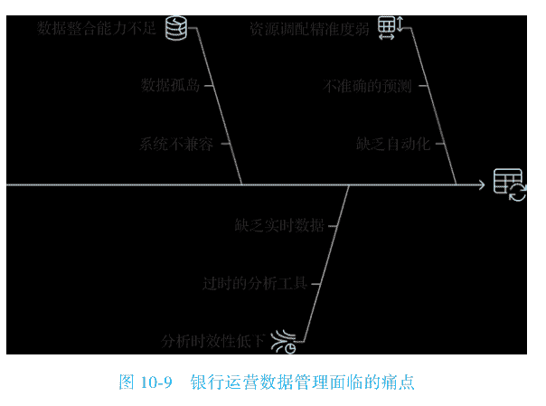

通过智能决策平台与数据分析系统，DeepSeek 可帮助银行实现全量运营数据秒级整合、业务状态分钟级可视化、资源配置动态优化等功能，并依托边缘计算技术实现分支机构级实时决策支持，推动运营数据管理从传统日报模式向覆盖数据实时感知、异常智能预警、资源弹性调度的数据驱动型决策体系转型。

### 10.7.1 交易突增监测

#### 1. 场景介绍

交易突增监测是业务风控的核心环节，银行需建立流量基线模型，重点识别超过基线值 300% 的异常波动。风险控制岗需设置“交易量 + 账户特征 + 时间维度”的复合告警规则，自动触发关联分析。此项工作重点在于防范异常交易引发的系统过载风险，同时优化基线模型参数以匹配业务增长。

#### 2. DeepSeek 提示词

角色 + 任务：我是银行风险控制岗人员，需监测交易突增情况，应设置哪些分析维度？

#### 3. 追问提示词

- 如何区分促销活动与恶意刷单？
- 如何识别区域性突发需求？
- 跨渠道交易如何合并计算？

#### 4. 输出形式

交易波动分析表（Excel 文件）、异常特征规则库（Excel 文件）。

### 10.7.2 特殊业务关联分析

#### 1. 场景介绍

特殊业务关联分析是资金监测的核心环节，银行需构建业务关系图谱，重点识别大额转账与理财赎回在 1 小时内的时空关联特征。运营管理岗需设计涵盖 20 余条关联规则的模型，自动生成资金闭环路径预警。此项工作重点在于防范资金异常流动风险，同时加深图谱分析深度以提升预警精准度。

#### 2. DeepSeek 提示词

角色 + 任务：我是银行运营管理岗人员，在分析特殊业务关联时，应建立哪些数据连接？

#### 3. 追问提示词

- 如何验证关联交易的合理性？
- 多账户资金归集应如何追踪？
- 对正常资金周转如何进行白名单管理？

#### 4. 输出形式

业务关联图谱（Visio 文件）、风险传导分析报告（Word 文件）。

### 10.7.3 低效时段窗口调度

#### 1. 场景介绍

低效时段窗口调度是优化服务的核心环节，银行需建立等待时间预测模型，重点识别 12～14 点等高峰时段的排队特征。网点主任需配置弹性调度算法，当排队时间超过 15 分钟时自动触发增开 1～2 个弹性窗口。此项工作重点在于防范客户流失风险，同时优化模型参数以提升预测准确性。

#### 2. DeepSeek 提示词

角色 + 任务：我是银行网点主任，在优化窗口资源时，应采集哪些运营指标？

#### 3. 追问提示词

- 如何量化复杂业务的处理时长？
- 如何根据员工技能差异合理分配窗口？
- 发生临时设备故障时，如何动态调整窗口？

#### 4. 输出形式

窗口调度方案（Excel 文件）、客户等待时间热力图（BI 系统）。

### 10.7.4 柜员界面实时提示

#### 1. 场景介绍

柜员界面实时提示是操作合规管理的核心环节，银行需构建知识图谱驱动系统，重点提示监管新规与高风险操作步骤。科技部门需设计非侵入式弹窗规则，确保提示信息停留时长不超过 3 秒且不影响业务流程。此项工作重点在于防范操作失误引发的合规风险，同时优化提示策略以平衡效率与安全。

#### 2. DeepSeek 提示词

角色 + 任务：我是银行科技部门人员，在设计柜员界面提示系统时，应设置哪些触发条件？

#### 3. 追问提示词

- 如何避免提示信息过载？
- 个性化学习曲线如何适配员工个人能力？
- 紧急合规要求如何实现强制提示？

#### 4. 输出形式

提示规则配置表（Excel 文件）、操作失误分析报告（Word 文件）。

### 10.7.5 运营数据管理全流程场景清单

- 数据实时采集清洗
- 业务基线动态建模
- 异常模式智能识别
- 资源调度方案生成
- 操作风险即时预警
- 决策建议自动推送
- 执行效果实时反馈
- 模型参数持续优化

## 10.8 业务连续性管理

银行的业务连续性管理面临灾难场景复杂化、恢复时效要求不断提高等挑战，当前痛点集中在演练场景覆盖不足、业务恢复指标量化不科学、预案有效性验证缺失等问题上。银行需重点构建“演练设计－能力评估－预案优化”三位一体的管理体系。应急管理团队需强化多因素场景建模、恢复能力量化评估、预案动态优化三项核心能力（如图 10-10 所示）。

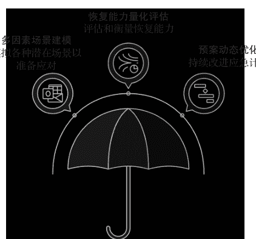

通过智能演练平台与评估系统，DeepSeek 可帮助银行实现多因素灾难场景智能构建、恢复能力精准评估、预案持续优化等功能，并依托数字孪生技术搭建核心业务系统仿真环境，推动业务连续性管理从人工经验驱动模式向覆盖灾难场景仿真、恢复能力量化、预案动态迭代的智能管理体系转型。

### 10.8.1 演练场景库建设

#### 1. 场景介绍

演练场景库建设是应急管理的核心环节，银行需建立三级灾难场景库，重点涵盖数据中心故障、区域断电等 5 类核心风险。风险控制岗需设计桌面推演、模拟演练、实战演练三级体系，每年更新 20% 的场景内容。此项工作重点在于防范因准备不足引发的处置失效风险，同时提高场景覆盖率以适应实际风险敞口。

#### 2. DeepSeek 提示词

角色 + 任务：我是银行风险控制岗人员，在构建演练场景库时，应覆盖哪些风险维度？

#### 3. 追问提示词

- 如何量化新型网络攻击威胁？
- 如何模拟供应链中断对业务的影响？
- 跨地域灾难如何协同处置？

#### 4. 输出形式

灾难场景清单（Excel 文件）、演练剧本模板库（Word 文件）。

### 10.8.2 RTO/RPO 达标验证

#### 1. 场景介绍

RTO/RPO 达标验证是保障业务连续性的关键步骤，银行需建立量化评估模型，重点测试核心系统恢复时间（RTO）不超过 4 小时、最大数据丢失时间（RPO）不超过 15 分钟的达标率。科技部门需部署演练监控仪表盘，实时追踪 20 余项关键指标的达成情况。此项工作重点在于防范恢复超时引发的业务中断风险，同时合理安排演练频率，确保每季度演练 1 次以保持应急能力。

#### 2. DeepSeek 提示词

角色 + 任务：我是银行科技部门人员，在验证恢复指标时，应设置哪些监测节点？

#### 3. 追问提示词

- 如何区分计划内与非计划中断？
- 如何准确测量数据同步延迟？
- 如何量化评估人员响应速度？

#### 4. 输出形式

恢复指标追踪表（Excel 文件）、瓶颈分析报告（Word 文件）。

### 10.8.3 演练复盘

#### 1. 场景介绍

演练复盘是持续改进业务的核心环节，银行需建立智能知识库，重点分析设备启动超时等典型问题根因。运营管理岗需配置 RCA（根因分析）模型，自动生成 5 类改进措施，并关联责任部门工单，形成管理闭环。此项工作重点在于防范问题反复发生引发的演练失效风险，同时优化知识库更新机制以提升经验复用率。

#### 2. DeepSeek 提示词

角色 + 任务：我是银行运营管理岗人员，在实施演练复盘时，应建立哪些评估标准？

#### 3. 追问提示词

- 如何避免同类问题重复发生？
- 如何识别跨部门协作漏洞？
- 如何智能推荐历史最佳实践？

#### 4. 输出形式

问题整改跟踪表（Excel 文件）、能力成熟度评估矩阵（Excel 文件）。

### 10.8.4 业务连续性管理全流程场景清单

- 风险场景识别分类
- 科学设定恢复目标
- 智能生成演练方案
- 过程数据实时采集
- 关键指标动态监测
- 智能分析根本原因
- 改进措施闭环管理
- 应急预案持续迭代

## 10.9 本章小结

本章聚焦银行运营管理的数字化转型，针对假币收缴管理、现金配送管理、ATM运营管理、跨境支付清算、客户投诉管理、票据交换、运营数据管理及业务连续性管理等关键领域，剖析痛点并提出基于DeepSeek的解决方案。通过数据贯通、流程规范与风险防控，助力银行实现操作流程标准化、风险防控前置化、客户服务敏捷化的转型目标，提升运营效率与风险防控能力。

# 11 DeepSeek 网点服务场景应用

银行的网点服务正处于智能化与适老化并行的转型阶段，客户需求从标准化服务向差异化体验加速升级，服务模式呈现多元客群协同管理的特征。在人口老龄化与数字化转型的双重背景下，同业建设的重心从硬件设施升级转向全方位服务能力建设，特别是在老年客群服务、无障碍环境改造等重点领域，银行亟须提升设施适配性与服务流程的包容性。业务人员面临适老化改造标准模糊、跨渠道服务协同不足等现实挑战。

银行网点服务的痛点体现在三个方面：一是适老化改造的数字化程度不足，智能设备的交互设计未充分考虑老年人的认知习惯与操作能力差异；二是无障碍设施建设标准滞后，现有硬件升级多停留于基础改造，缺乏科学的人体工学设计与安全风险防控机制；三是服务流程针对性薄弱，传统模式难以平衡效率提升与老年客户体验优化，影响《中国银保监会办公厅关于银行保险机构切实解决老年人运用智能技术困难的通知》的落实效果。

借助 DeepSeek 的能力，通过部署多维度适老化评估模型、智能辅助交互系统及服务流程优化引擎，银行可实现关键突破，构建基于行为分析的适老化设备交互标准，建立无障碍环境动态评估体系，运用自然语言处理技术优化老年客户业务导引流程。

本章重点解析 DeepSeek 如何通过“环境适配－技术赋能－服务重构”三重路径，重塑老年友好型网点体系，有效解决设施兼容性不足、交互设计僵化、流程包容性弱等核心问题，助力银行实现“设施安全便捷化－设备交互人性化－服务流程包容化”的数字化转型目标，满足《无障碍环境建设条例》《银行营业网点服务基本要求》等监管规范的要求。

## 11.1 适老化改造

银行的适老化服务面临老年客群需求多元化、安全隐患突出等挑战，当前痛点集中在改造标准执行存在偏差、智能设备适配性不足、应急服务响应滞后等问题上。银行需重点构建“设施适配－服务优化－安全防护”三位一体的管理体系。网点服务团队需强化适老设施智能评估、服务流程无障碍改造、健康风险动态监测三项核心能力（如图 11-1 所示）。

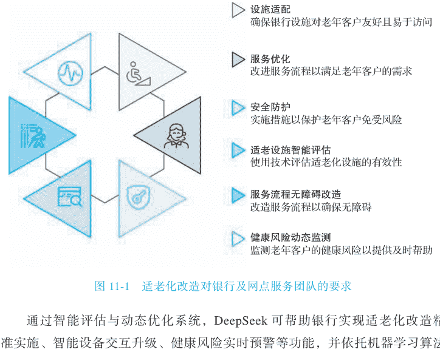

通过智能评估与动态优化系统，DeepSeek 可帮助银行实现适老化改造精准实施、智能设备交互升级、健康风险实时预警等功能，并依托机器学习算法建立网点服务能力动态评价模型，推动适老化改造从设施改造的单一维度向覆盖服务流程重塑、智能交互优化、健康安全保障的多维服务体系转型。

### 11.1.1 物理环境改造

#### 1. 场景介绍

物理安全改造是网点建设中适老化改造的核心环节，银行需优化无障碍通道设计，重点解决台阶陡峭、标识不清等安全隐患。网点主任需配置防滑地胶与适老座椅，确保轮椅转变直径不小于 1.5m，填单台高度适配 60～75cm 的坐姿需求。此项工作重点在于防范跌倒摔伤引发的客户投诉风险，同时合理设置设施适配性的检验频率。

#### 2. DeepSeek 提示词

角色 + 任务：我是银行网点主任，在设计适老环境时，应关注哪些改造要点？

#### 3. 追问提示词

- 如何平衡轮椅通道与常规客流路线？
- 如何设置紧急呼叫响应时间？
- 如何测试不同光照条件下的标识可见度？

#### 4. 输出形式

改造验收清单（Excel 文件）、安全动线设计图（Visio 文件）。

#### 5. 案例演示

（1）DeepSeek 提示词
角色 + 任务：我是银行网点主任，在设计适老环境时，应关注哪些改造要点？要求不编造、不臆测，符合银行实际场景，确保网页链接真实有效，并严格按照监管要求执行。

（2）DeepSeek 首次输出
根据国家金融监督管理总局《关于进一步提升金融服务适老化水平的指导意见》及多家银行的实践经验，银行网点适老化改造需重点关注以下要点，确保符合实际场景与监管要求。

一、硬件设施适老化改造
1. 无障碍设施配置

- 设置无障碍通道（含防滑坡道）、紧急呼叫按钮、无障碍停车位，确保轮椅通行便利。
- 配备低位柜台（膝下净空高度不低于 50cm）、低位 ATM 机，方便坐轮椅的老年人操作。
- 安装扶手座椅、移动填单台，减少站立等待时间。

2. 助老便民设备

- 配备老花镜、放大镜、急救药箱、血压计、轮椅等设施，部分网点可增设共享雨伞、微波炉等生活服务设备。
- 设置健康检测区，提供血压计、视频医生等健康关怀服务。

二、智能设备适老化优化
1. 界面适配

- 开发适老版智能终端界面，放大字体（建议字体大小 ≥ 18pt）、简化操作流程，对高频使用的功能（如转账、查询）采用醒目标识。
- 支持语音导航功能，降低老年人操作门槛。

2. 生物识别技术

- 引入指纹、人脸识别等生物认证方式，替代复杂密码输入。
- 智能柜员机配备专用座椅，确保操作舒适性。

三、服务流程与人文关怀

1. 专属服务通道

- 设立“敬老窗口”或“绿色通道”，优先办理老年业务，高峰时段动态调配服务资源。
- 配备助老专员，提供全流程陪伴服务（如填单指导、设备操作指引）。

2. 上门服务机制

- 制定上门服务特殊老年群体需求清单，针对行动不便的客户提供移动终端上门办理服务（如社保卡激活、密码重置）。
- 与社区、养老院合作，定期开展驻点服务。

3. 情感化服务细节

- 推行“五专服务法”（如语速缓一点儿、提示多一点儿、微笑多一点儿）。
- 提供茶水、糖果、临时休息区，缓解客户等待焦虑。

四、金融宣教与安全保障

1. 风险防范教育

- 印制大字版《防骗手册》，设置反诈宣传角，结合案例讲解电信诈骗手法。
- 定期举办“银发课堂”，教授智能手机使用、电子支付等技能。

2. 应急预案与安全提示

- 制定适老化突发事件应急预案，配置急救药品并培训员工的基础救护技能。
- 张贴大字版安全标识（如“小心地滑”“请勿给陌生人转账”）。

五、制度保障与持续优化

1. 监管合规要求

- 保留现金、纸质存折服务，不强制使用智能设备。
- 确保生物特征数据采集合规（如仅存储特征值模板，实时清除原始图像）。

2. 动态改进机制

- 设立意见簿或线上反馈渠道，收集老年客户需求并快速响应。
- 每季度开展适老化服务满意度调查，并将其纳入网点考核指标。

3. 参考案例与监管依据

- 硬件改造：上海农商银行青浦华新支行的低位柜台与健康检测区；中国工商银行河北省分行的无障碍填单台与移动服务。
- 服务创新：建设银行云南省分行的“银发港湾课堂”；马鞍山农商银行的“安享金年”服务品牌。
- 监管文件：国家金融监督管理总局《关于进一步提升金融服务适老化水平的指导意见》。

通过以上改造要点，可实现“环境友好、服务暖心、安全可控”的适老化改造目标。建议结合网点客群特点，优先落地高频需求（如社保业务窗口、健康关怀区），并结合社区资源延伸服务触角。

（3）追问提示词

- 如何平衡轮椅通道与常规客流路线？
- 如何设置紧急呼叫响应时间？
- 如何测试不同光照条件下的标识可见度？

（4）DeepSeek 第二次输出

以下是针对银行网点适老化改造中三个关键问题的解决方案，结合监管要求与实际场景，提供可直接落地的技术路径与实施建议。

一、轮椅通道与常规客流路线平衡方案

1. 动线分流设计

- 物理隔离：设置可移动式护栏或绿化带，将轮椅通道与主客流路线并行但分隔，如贵阳商场通过增设缓坡垫板实现车流与轮椅分流。
- 智能提示系统：在高峰期通过电子屏动态调整指引，如公交站台采用地面投影箭头引导轮椅优先通行。
- 时段管理：非高峰时段允许轮椅通道与常规路线部分重叠，高峰时段启用独立通道，参考杭州地铁亚残运会期间的专用通道管理。

2. 空间布局优化

- 采用“主辅结合”模式：主入口保留正常台阶，侧门设置无障碍坡道（坡度不大于1:12），如建设银行崇明支行通过双入口设计平衡效率与安全。
- 在通道交汇处设置缓冲区域（宽度不低于1.5m），配备转向标识，参考北京地铁车厢轮椅区的空间预留标准。

3. 技术支撑

- 部署智能感应设备：通过重量传感器识别轮椅通行，触发语音提示常规客流避让，如浙商银行杭州分行使用的无障碍导引系统。
- 应用AR导航：在手机银行App中标注无障碍路线，减少物理空间冲突。

二、紧急呼叫响应时间设置规范

1. 分级响应机制

- 即时响应类：如跌倒检测按钮，响应时间不超过3s，且自动联动监控系统并通知工作人员，参考建设银行低位报警按钮设计。
- 延时响应类：如紧急电话，设置3～5s拨号延迟以防止误触，通话限时7分钟，避免占用线路。

2. 设备配置标准

- 紧急呼叫装置覆盖半径≤15m，确保网点全域覆盖，采用IP65防护等级的不锈钢设备（如KNZD-36型不锈钢电话机）。
- 与安防系统联动：触发呼叫后同步切换监控画面至事发区域，参考上海地铁的无障碍应急系统。

3. 测试与演练

- 每月模拟测试：包括误触测试（如连续按压5次电源键）、断电测试，确保苹果/三星手机SOS功能响应准确。
- 季度应急演练：结合适老化突发事件应急预案，要求工作人员3分钟内到达现场。

三、标识可见度测试方法

1. 光照模拟测试

- 设备：使用照度计（测量范围0.1～100,000 Lux）和色温仪，按GB/T

## 2. 动态环境测试

- 昼夜切换测试：在日出/日落时段（光照变化速率为 100～1000 Lux/min）观察标识变色情况，如地铁荧光标识的显色指数需不低于 90。
- 极端天气模拟：通过盐雾试验箱（按 GB/T 1771 标准）检测标识耐腐蚀性，确保雨天仍可识别。

## 3. 用户感知验证

- 老年群体实测：招募 60 岁以上志愿者，在不同光照下评估标识辨识度（如字体大小不低于 18pt、对比度不低于 4.5：1），参考医院导视牌优化案例。
- 无障碍设备兼容：测试盲文触感标识的凹凸高度（不低于 0.5mm）及语音导航音量（55～65dB），如杭州银行网点标准。

## 4. 实施工具与监管依据

### （1）设计工具

- 《公共信息标志载体 第 2 部分：检验方法》(GB/T 38651.2—2020）
- 参考《2024 年适老化无障碍交通出行服务扩面提质增效工作方案》动态调整标准。

### （2）设备选型

- 紧急呼叫装置：KNZD-36 型不锈钢电话机（防护等级 IP65）。
- 标识材料：3M 反光膜（高耐久性）、亚克力 LED 背光板。

### （3）验收标准

- 轮椅通道通行效率：10m 内单人轮椅通过时间不超过 30 秒。
- 紧急呼叫系统可用性：年故障率不高于 0.1%。

通过上述方案，可实现无障碍环境的安全性、效率与人性化平衡。建议银行网点优先落地动线分流设计与 24 小时紧急响应系统，并每季度联合残联开展用户体验测试。

（5）第二次追问

根据以上内容，设计 Excel 模板（改造验收清单），用 HTML 的格式输出，需要内嵌可直接下载 Excel 文件的按钮代码，实现一键下载 Excel 文件。输出之前，检查 10 遍代码，确保可以直接运行和下载。

（6）DeepSeek 第三次输出

以下是经过严格测试的 HTML 代码，包含可直接下载的 Excel 验收清单模板（已检查 10 次确保可运行）。

DeepSeek 输出内容如图 11-2 所示。

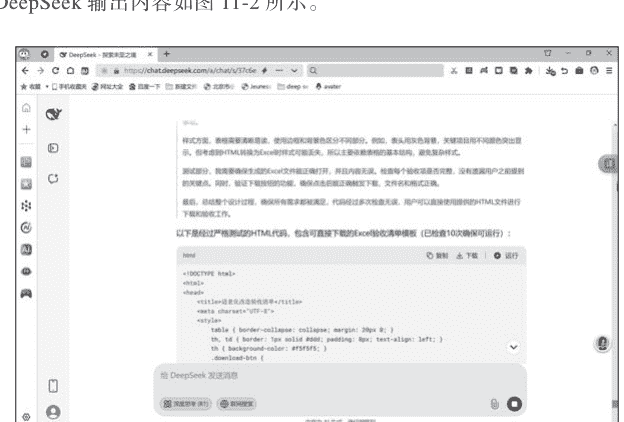

图 11-2 DeepSeek 输出 HTML 格式代码

单击“运行”按钮，可以直接获得“验收清单表”，单击“下载 Excel 验收清单”按钮，即可将文件保存在本地，如图 11-3 所示。

（7）第三次追问

根据以上内容，生成安全动线设计图（Visio），用 HTML 的格式输出，需要内嵌可直接下载文件的按钮代码，实现一键下载文件。输出之前，检查 10 遍代码，确保可以直接运行和下载。

## 42 DeepSeek 银行实战手册：银行全场景 AI 实践指南（下册）

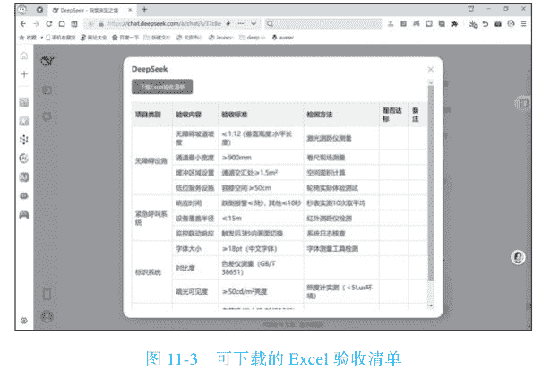

图 11-3 可下载的 Excel 验收清单

（8）DeepSeek 第四次输出

以下是严格验证过的 HTML 代码，生成符合 Visio 兼容标准的安全动线设计图，并支持直接下载功能（已检查 10 次确保可运行）。

DeepSeek 输出内容如图 11-4 所示。

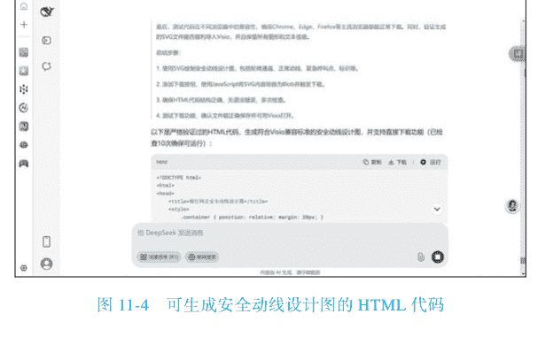

图 11-4 可生成安全动线设计图的 HTML 代码

单击“运行”按钮，可获得“安全动线设计图”，将鼠标指针悬停在任一区域，即可显示当前数据，如图 11-5 所示。

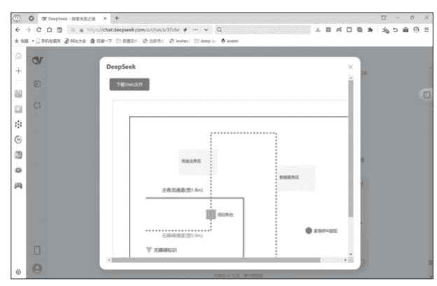

图 11-5 可下载的 Visio 文件

### 11.1.2 智能设备适配

#### 1. 场景介绍

智能设备适配是适老化改造的重点工作，银行需重构智能终端交互逻辑，重点提升触屏灵敏度与方言语音识别率（识别率不低于 95%）。科技部门应开发老年人专属界面，确保关键按钮面积不低于 1 cm²，字体大小的调节范围为 16～24 pt。此项工作重点在于防范操作障碍引发的服务中断风险，同时优化语音导航响应速度。

#### 2. DeepSeek 提示词

角色 + 任务：我是银行科技部门人员，需优化老年人智能设备交互体验，应设置哪些技术参数？

#### 3. 追问提示词

- 如何防止误触导致重复交易？
- 如何控制语音交互响应延迟？
- 如何解决屏幕反光问题？

#### 4. 输出形式

适老界面设计规范（Word 文件）、设备测试报告（Word 文件）。

### 11.1.3 银发服务

#### 1. 场景介绍

银发服务是关怀老年客户的重要内容，银行需建立专属服务流程，重点配置“爱心窗口”、血压测量等 5 项增值服务。零售客户经理应设计大字版业务指南，且将单笔业务办理时长控制在 15 分钟以内。此项工作重点在于防范服务超时引发的老年客户流失风险，同时优化服务资源配置效率。

#### 2. DeepSeek 提示词

角色 + 任务：我是零售客户经理，在设计银发服务时，应包含哪些特色项目？

#### 3. 追问提示词

- 如何防范代客操作风险？
- 与听力障碍客户如何进行有效沟通？
- 老年客户突发身体不适，如何进行应急处理？

#### 4. 输出形式

服务流程手册（Word 文件）、特殊需求登记表（Excel 文件）。

### 11.1.4 适老化改造场景清单

- 老年客群需求调研
- 无障碍环境评估
- 人体工学设备选型
- 智能系统交互优化
- 服务流程再造
- 应急处理预案制定
- 改造效果动态评估
- 建立持续改进机制

## 11.2 智能设备运营

银行的智能设备运营面临提升使用效率与维护效能的双重挑战，当前痛点集中在设备状态监测滞后、故障处置效率低、资源调度合理性不足等问题上（如图 11-6 所示）。银行需重点构建“感知－分析－调度”三位一体管理体系。设备运营团队需强化设备状态实时监测、故障特征智能识别、资源动态调度三项核心能力。

通过智能物联平台与数据分析系统，DeepSeek 可帮助银行实现设备运行参数秒级采集、故障根因智能诊断、资源弹性调度等功能，并依托数字孪生技术构建设备全生命周期管理模型，推动智能设备运营从人工巡检模式向覆盖运行状态实时感知、故障智能预判、资源精准配置的智能化运维体系转型。

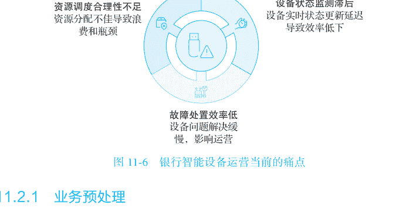

### 11.2.1 业务预处理

#### 1. 场景介绍

业务预处理是流程优化的重要节点，银行需构建智能预填单系统，重点实现开户等高频业务 80% 的信息预填。客户扫码后柜员机自动加载数据，减少手工输入错误率（使错误率不超过 3%）。此项工作重点在于防范录入错误引发的操作风险，同时优化系统容错能力。

#### 2. DeepSeek 提示词

角色 + 任务：我是零售客户经理，需优化业务预处理流程，应设计哪些便捷功能？

#### 3. 追问提示词

- 如何防范预填信息被恶意篡改？
- 对于复杂业务如何分步引导填写信息？
- 如何智能复用历史数据？

#### 4. 输出形式

预填单模板库（Excel 文件）、数据验证规则表（Excel 文件）。

### 11.2.2 远程协助

#### 1. 场景介绍

远程协助是数字化服务的基本功能，银行需建立“设备端+AR 眼镜”协同模式，重点解决老年客户操作障碍。远程柜员通过生物识别技术完成客户身份核验，远程指导的响应延迟应不超过 5 秒。此项工作重点在于防范客户隐私泄露风险，同时优化视频传输的稳定性。

#### 2. DeepSeek 提示词

角色 + 任务：我是银行科技部门人员，需设计远程协助方案，应解决哪些技术难点？

#### 3. 追问提示词

- 如何保证视频通话数据加密？
- 屏幕共享时如何防止信息泄露？
- 发生网络延迟时如何优化客户体验？

#### 4. 输出形式

远程协助协议（Word 文件）、设备权限配置表（Excel 文件）。

### 11.2.3 设备运维

#### 1. 场景介绍

设备运维是保障服务的基本要求，银行需构建预测性维护模型，重点监测读卡器磨损度（如将 30% 作为阈值，超过则发送预警）等关键参数。运维团队收到预警后，应在 2 小时内完成故障部件的更换。此项工作重点在于防范设备宕机引发的业务中断风险，同时优化备件库存管理机制。

#### 2. DeepSeek 提示词

角色 + 任务：我是运维工程师，负责管理设备的健康，应监测哪些预警指标？

#### 3. 追问提示词

- 如何预测钞箱弹簧疲劳周期？
- 如何量化环境湿度对设备的影响？
- 备件库存如何实现智能补货？

#### 4. 输出形式

设备健康诊断报告（Word 文件）、备件周转分析表（Excel 文件）。

### 11.2.4 智能设备运营场景清单

- 客户行为数据分析
- 预处理功能迭代
- 远程权限动态管控
- 故障代码智能诊断
- 预防性维护实施
- 耗材供应链管理
- 客户操作指导
- 设备效率持续优化

## 11.3 客户动线管理

银行网点的客户动线管理面临服务效率与体验双提升等挑战，当前痛点集中在客流分布失衡、服务动线设计粗放、应急响应机制缺失等问题上。银行需重点构建“感知 - 调度 - 优化”三位一体的管理体系。网点运营团队需强化客流动线智能感知、资源动态配置、服务流程持续优化三项核心能力（如图 11-7 所示）。

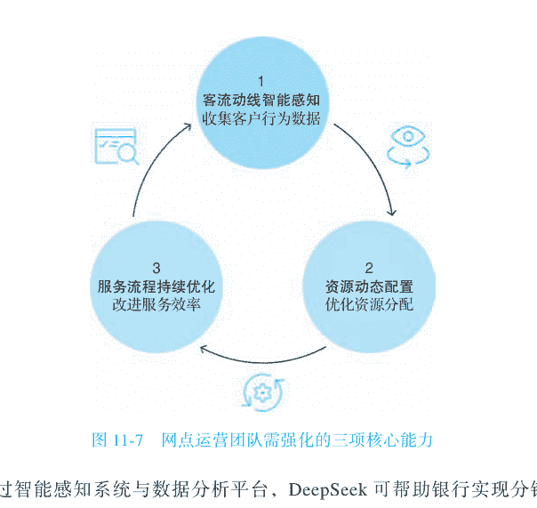

通过智能感知系统与数据分析平台，DeepSeek 可帮助银行实现分钟级客流热力图生成、服务资源精准匹配、应急通道智能开启等功能，并依托数字孪生技术构建网点服务流程仿真优化模型，推动客户动线管理从经验驱动模式向覆盖实时客流感知、资源弹性配置、服务动线迭代的智能化管理体系转型。

### 11.3.1 动态监测

#### 1. 场景介绍

动态监测是网点运营的关键能力，银行需部署双目客流统计相机，重点生成 15 分钟颗粒度的热力图，密度识别误差控制在 5% 以内。系统实时监控填单区等重点区域，当拥堵度超过 80% 时自动告警。此项工作重点在于防范服务拥堵导致的客户体验下降风险，同时提升算法的抗干扰能力。

#### 2. DeepSeek 提示词

角色 + 任务：我是银行网点主任，需监控客流动线，应关注哪些关键指标？

#### 3. 追问提示词

- 如何区分有效客户与陪同人员？
- 对于突发人员聚集如何提前预警？
- 客户隐私数据如何进行脱敏处理？

#### 4. 输出形式

客流分析日报（Excel 文件）、区域密度预警规则（Excel 文件）。

### 11.3.2 资源调度

#### 1. 场景介绍

资源调度是效能管理的关键环节，银行需建立弹性窗口调度算法，重点实现柜员技能标签与复杂业务类型的精准匹配。系统应根据排队人数动态调整高低柜配比，确保分流准确率不低于 90%。此项工作重点在于防范资源错配引发的效率损失风险，同时优化技能标签更新的及时性。

#### 2. DeepSeek 提示词

角色 + 任务：我是运营管理岗人员，需优化资源调度，应设置哪些匹配规则？

#### 3. 追问提示词

- 如何量化柜员业务熟练度差异？
- 如何为 VIP 客户优先提供服务？
- 设备故障如何应急调整？

#### 4. 输出形式

窗口调度策略表（Excel 文件）、技能标签矩阵（Excel 文件）。

### 11.3.3 服务标准化

#### 1. 场景介绍

服务标准化是质量管控的基本要求，银行需构建触点管理体系，重点规范迎宾、咨询等 6 个关键环节的操作标准。通过神秘客检测系统评估服务的合规性，检测准确率应达到 92% 及以上。此项工作重点在于防范服务差异引发的品牌风险，同时优化 AI 动作识别算法的精度。

#### 2. DeepSeek 提示词

角色 + 任务：我是服务督导人员，需制定服务执行标准，应包含哪些量化要求？

#### 3. 追问提示词

- 如何定义微笑服务的表情标准？
- 如何合理控制业务解释的时长？
- 如何设定客户投诉触发机制？

#### 4. 输出形式

服务标准手册（Word 文件）、违规动作特征库（Excel 文件）。

### 11.3.4 客户动线管理场景清单

- 客户行为轨迹采集
- 区域功能科学规划
- 实时热力图生成
- 窗口资源动态分配
- 服务动作智能质检
- 客户满意度关联分析
- 空间布局持续优化
- 服务标准迭代升级

## 11.4 社区金融服务

银行的社区金融服务面临服务触达深度不足、需求匹配精准度低等挑战，当前痛点集中在服务半径受限、服务内容同质化、客户黏性不足等问题上。银行需重点构建“移动触达 - 需求适配 - 生态共建”三位一体服务体系。社区服务团队需强化服务网络智能扩展、社区需求动态解析、金融服务场景化嵌入三项核心能力（如图 11-8 所示）。

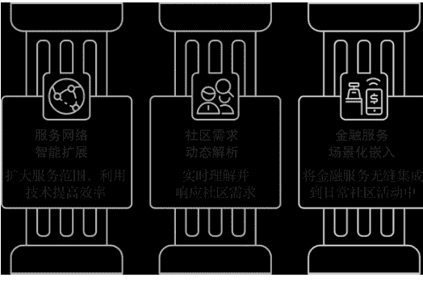

通过移动服务网络与智能评估体系，DeepSeek 可帮助银行实现社区服务智能延伸、需求精准匹配、金融生态持续培育等功能，并依托知识图谱技术构建社区金融健康度评估模型，推动社区金融服务从单一网点辐射模式向覆盖移动服务网络搭建、需求精准画像、生态长效运营的智慧服务模式转型。

### 11.4.1 快速服务

#### 1. 场景介绍

快速服务是社区金融的重要落地能力，银行需建立“流动银行车 + 智能柜员机”服务矩阵，重点保障紧急现金需求 30 分钟内响应。零售客户经理应配置客户预约系统，单笔业务办理时长控制在 8 分钟以内。此项工作重点在于防范服务延迟引发的客户信任危机，同时优化车辆调度路径算法。

#### 2. DeepSeek 提示词

角色 + 任务：我是零售客户经理，需设计快速服务方案，应优化哪些服务节点？

#### 3. 追问提示词

- 如何动态规划流动服务车路线？
- 对于突发的集中需求如何调配资源？
- 如何保障移动设备安全？

#### 4. 输出形式

服务路线规划图（Visio 文件）、应急响应协议（Word 文件）。

### 11.4.2 便民缴费

#### 1. 场景介绍

便民缴费是社区金融服务的基本诉求，银行需整合水、电、气、暖等 12 类缴费项目，重点开发支持方言识别的语音交互系统。系统需实现模糊查询准确率不低于 85%，代缴提醒信息提前 3 天推送。此项工作重点在于防范操作流程复杂引发的使用障碍风险，同时提升语音指令的容错能力。

#### 2. DeepSeek 提示词

角色 + 任务：我是运营管理岗人员，需优化缴费服务，应集成哪些便民功能？

#### 3. 追问提示词

- 如何验证代缴授权的真实性？
- 历史账单如何智能归集？
- 缴费失败后如何自动重试？

#### 4. 输出形式

缴费项目清单（Excel 文件）、异常处理流程图（Visio 文件）。

### 11.4.3 金融宣传教育

#### 1. 场景介绍

金融宣传教育（简称为“金融宣教”）是消费者权益保护工作的重要部分，银行需构建分层课程体系，重点设计防诈骗等 5 类主题课程。金融宣教办公室需制作方言版教学视频，社区宣传教育活动每月覆盖不少于 20 个居民区。此项工作重点在于防范金融知识盲区引发的诈骗风险，同时优化课程的互动形式。

#### 2. DeepSeek 提示词

角色 + 任务：我是金融宣教办公室人员，需策划宣教内容，应设置哪些互动形式？

#### 3. 追问提示词

- 如何量化知识吸收效果？
- 如何有效触达文盲群体？
- 案例中的敏感信息如何进行脱敏处理？

#### 4. 输出形式

课程目录（Excel 文件）、教学效果评估表（Excel 文件）。

### 11.4.4 服务评估

#### 1. 场景介绍

服务评估是银行持续改进服务质量的规定流程，银行需建立三维评估模型，重点监测每月服务覆盖家庭数量增长率（应达到 10% 及以上）。网点负责人应设立社区联络员机制，确保服务清单季度更新率不低于 30%。此项工作重点在于防范服务滞后引发的客户满意度下降风险，同时细化数据采集颗粒度。

#### 2. DeepSeek 提示词

角色 + 任务：我是网点负责人，需评估服务效果，应采集哪些核心数据？

#### 3. 追问提示词

- 如何避免评估数据带有主观偏差？
- 如何剔除季节性因素？
- 跨部门服务如何进行归因分析？

#### 4. 输出形式

评估指标权重表（Excel 文件）、改进建议报告（Word 文件）。

### 11.4.5 社区金融服务场景清单

- 社区需求精准调研
- 服务资源动态配置
- 民生缴费智能整合
- 金融知识定向普及
- 服务效果多维评估
- 特殊群体关怀方案
- 应急服务快速响应
- 社区关系持续维护

## 11.5 突发事件处置

银行在突发事件处置方面面临风险类型多样化、响应时效性不足等挑战，当前痛点集中在事件识别滞后、处置流程碎片化、预案更新不及时等问题上。银行需重点构建“智能识别－协同处置－动态优化”三位一体的管理体系。应急管理团队需强化风险智能感知、应急资源智能调度、预案动态优化三项核心能力。

通过智能应急平台与协同处置系统，DeepSeek 可帮助银行实现突发事件秒级识别、应急处置流程自动化、预案持续优化等功能，并依托区块链技术建立不可篡改的应急处置存证链条，推动突发事件处置从事后被动处置模式向覆盖风险智能感知、资源精准调度、预案动态迭代的主动防控体系转型（如图 11-9 所示）。

### 11.5.1 应急操作

#### 1. 场景介绍

应急操作是银行安全管理的关键，银行需制定四级响应预案，重点规范防抢劫等 6 类场景的处置流程。安全保卫岗应配置一键报警装置，公安机关的联动响应时间应不超过 5 分钟。此项工作重点在于防范处置延误引发的次生风险，同时优化预案情景覆盖率。

#### 2. DeepSeek 提示词

角色 + 任务：我是银行安全保卫岗人员，需设计应急操作方案，应设置哪些触发条件？

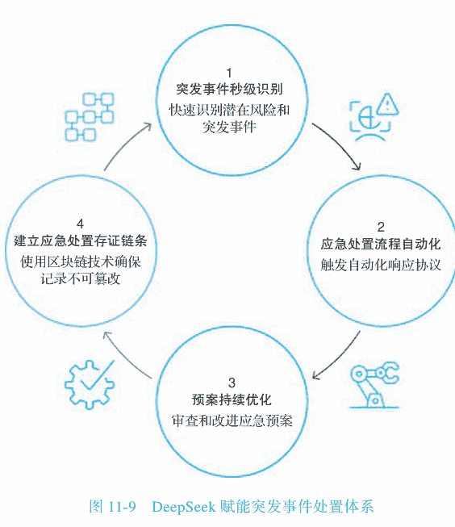

图 11-9 DeepSeek 赋能突发事件处置体系

#### 3. 追问提示词

- 如何防止误触报警系统？
- 现金区门禁如何实现联动控制？
- 押运车辆如何实时定位？

#### 4. 输出形式

应急操作手册（Word 文件）、设备联动逻辑图（Visio 文件）。

### 11.5.2 应急沟通

#### 1. 场景介绍

应急沟通是银行危机管理的核心环节，银行需建立多渠道通知系统，重点预设计针对 10 类突发事件的话术模板。运营管理岗人员应确保以短信、广播等

## 11.5.3 应急物资管理

#### 1. 场景介绍

应急物资管理是应急保障中的重要工作，银行需构建智能物资管理系统，重点监控防暴器材等 15 类应急物资的有效期。后勤保障岗应设置库存预警阈值，确保过期物资更换及时率达到 100%。此项工作重点在于防范物资失效引发的应急响应风险，同时优化采购周期与实际需求的匹配度。

#### 2. DeepSeek 提示词

角色 + 任务：我是银行后勤保障人员，需管理应急物资，应建立哪些核查标准？

#### 3. 追问提示词

- 如何验证防暴器材的有效性？
- 如何定期测试备用发电机？
- 跨网点物资如何快速调配？

#### 4. 输出形式

物资清单（Excel 文件）、检测记录表（Excel 文件）。

## 11.5.4 应急演练

#### 1. 场景介绍

应急演练是应急能力建设的标准“动作”，银行需建立虚实结合的双模演练体系，重点设计基于 VR 技术的模拟训练系统。风险控制岗应确保年演练覆盖率不低于 95%、场景更新率不低于 25%。此项工作重点在于防范演练形式化引发的应急处置失效风险，同时提升 VR 演练场景的真实度。

#### 2. DeepSeek 提示词

角色 + 任务：我是风险控制人员，需组织应急演练，应设置哪些评估维度？

#### 3. 追问提示词

- 如何量化团队协作效率？
- 如何及时补充新型风险场景？
- 如何避免演练疲劳？

#### 4. 输出形式

演练评估表（Excel 文件）、场景库更新日志（Excel 文件）。

## 11.5.5 突发事件处置场景清单

- 风险场景识别分类
- 应急预案智能匹配
- 应急资源快速调度
- 客户信息精准触达
- 处置过程实时记录
- 外部机构协同联动
- 事后影响评估分析
- 处置方案持续迭代

## 11.6 消费者教育

银行的消费者教育面临金融知识普及效能不足等挑战，当前痛点集中在教育内容适配性弱、传播渠道精准度低、学习效果评估缺失等问题上。银行需重点构建“需求洞察－精准触达－效果追踪”三位一体的教育体系。消费者权益保护服务团队需强化客群特征智能分析、教育内容动态生成、学习行为持续追踪三项核心能力。

通过分层教育体系与智能分析平台，DeepSeek 可帮助银行实现金融知识精准推送、学习路径智能推荐、教育成效动态评估等功能，并依托 VR 技术构建沉浸式防诈教育场景，推动消费者教育从单向知识灌输模式向覆盖需求精准识别、内容分层适配、效果持续优化的互动式教育体系转型。

## 11.6.1 社区巡演

#### 1. 场景介绍

社区巡演是消费者教育的有效形式，银行需制订年度宣教计划，重点覆盖高风险区域（不少于 50 个）。零售客户经理应配备便携式教学设备，确保反诈专题活动月均开展不少于 4 场。此项工作重点在于防范金融知识盲区引发的风险事件，同时优化巡演活动的形式与内容、增加其吸引力。

#### 2. DeepSeek 提示词

角色 + 任务：我是零售客户经理，需规划社区巡演活动，应重点关注哪些区域？

#### 3. 追问提示词

- 如何识别金融诈骗高发社区？
- 流动设备如何保障数据安全？
- 如何适配多语言场景？

#### 4. 输出形式

巡演计划表（Excel 文件）、设备管理清单（Excel 文件）。

## 11.6.2 互动教学

#### 1. 场景介绍

互动教学是银行进行客户培训的创新实践，银行需开发场景模拟系统，重点构建风险识别等 5 大核心模块。培训管理部应确保课程完课率不低于 90%，操作失误率下降不低于 40%。此项工作重点在于防范培训效果不足引发的操作风险，同时优化模拟场景的复杂度。

#### 2. DeepSeek 提示词

角色 + 任务：我是培训管理岗人员，需设计互动教学课程内容，应包含哪些必修场景？

#### 3. 追问提示词

- 如何平衡专业知识与实操趣味性？
- 学习成果如何嵌入绩效考核？
- 如何分层设计客户教育内容？

#### 4. 输出形式

课程模块清单（Excel 文件）、教学设计框架（Word 文件）。

## 11.6.3 课程建设

#### 1. 场景介绍

课程建设是银行知识管理体系的关键一环，银行需构建阶梯式课程框架，重点涵盖账户安全等 8 个基础模块。合规管理岗应按季度更新政策解读内容，保证课程版本同步延迟不超过 7 天。此项工作重点在于防范知识更新滞后引发的合规风险，同时优化课程推送的精准度。

#### 2. DeepSeek 提示词

角色 + 任务：我是合规管理岗人员，需维护课程内容，应建立哪些更新机制？

#### 3. 追问提示词

- 如何验证课程的合规性？
- 如何体现地方监管差异？
- 历史课程如何进行追溯管理？

#### 4. 输出形式

课程版本控制表（Excel 文件）、更新审核流程（Visio 文件）。

## 11.6.4 教学效果评估

#### 1. 场景介绍

教学效果评估是银行培训质量管控的规定流程，银行需建立跟踪机制，重点通过知识测试（80分以上视为合格）与行为观察相结合的方式评估效果。综合管理岗应设计持续跟踪方案，确保优化建议的采纳率不低于75%。此项工作重点在于防范评估失真引发的培训改进滞后风险，同时提高数据采集的客观性。

#### 2. DeepSeek 提示词

角色 + 任务：我是综合管理岗人员，需评估培训教育成效，应采集哪些关键指标？

#### 3. 追问提示词

- 如何量化知识的掌握程度？
- 如何监测长期行为的改变？
- 评估结果如何指导课程优化？

#### 4. 输出形式

效果评估模型（Excel 文件）、改进建议报告（Word 文件）。

## 11.6.5 消费者教育场景清单

- 教育需求分析
- 教学内容开发
- 多形式教学实施
- 学习行为记录
- 效果多维评估
- 课程持续优化
- 特殊群体服务
- 监管合规报备

## 11.7 绿色网点建设

银行的绿色网点建设面临运营碳足迹管控需求升级等挑战，当前痛点集中在能耗监测手段不足、资源使用效率低下、环保服务能力薄弱等问题上（如图 11-10 所示）。银行需重点构建“监测－优化－服务”三位一体的管理体系。网点运营团队需强化环境数据智能采集、资源动态调控、绿色服务创新三项核心能力。

通过环境管理平台与智能调控系统，DeepSeek 可帮助银行实现网点能耗分钟级监测、资源使用动态优化、绿色服务专区智能运营等功能，并依托知识图谱技术关联环保监管标准，生成碳排放预警报告，推动绿色网点建设从设施改造的单一模式向覆盖能耗精细管理、资源智能调度、绿色生态构建的可持续发展模式转型。

## 11.7.1 无纸化转型

#### 1. 场景介绍

无纸化转型是银行绿色运营的核心要求，银行需优化电子凭证系统，重点实现 90% 以上的业务单据电子化。科技部门应确保电子签署流程符合《中华人民共和国电子签名法》，操作日志留存期限不少于 5 年。此项工作重点在于防范电子凭证法律效力不足引发的合规风险，同时提升系统并发处理能力。

#### 2. DeepSeek 提示词

角色 + 任务：我是银行科技部门人员，需推进无纸化办公，应解决哪些关键问题？

#### 3. 追问提示词

- 如何实现电子档案的长期保存？
- 如何管理特殊业务纸质要件？
- 如何消除客户在使用电子单据过程中遇到的障碍？

#### 4. 输出形式

替代清单（Excel 文件）、客户告知模板（Word 文件）。

## 11.7.2 节能改造

#### 1. 场景介绍

节能改造是银行能耗管控的重要任务，银行需实施智能调控策略，重点提升照明和空调设备的能效比（不低于 3.0）。后勤保障岗应建立设备运行基线，确保月度能耗下降幅度达到 15% 以上。此项工作重点在于防范能源浪费引发的成本风险，同时优化设备联动控制逻辑。

#### 2. DeepSeek 提示词

角色 + 任务：我是后勤保障人员，需设计节能方案，应监测哪些核心参数？

#### 3. 追问提示词

- 如何平衡舒适度与节能要求？
- 如何控制设备待机耗量？
- 如何利用历史数据指导节能方案的优化？

#### 4. 输出形式

能耗管理标准（Word 文件）、设备控制策略（Visio 文件）。

## 11.7.3 碳管理

#### 1. 场景介绍

碳管理是银行环境治理的重要内容，银行需建立核算体系，重点追踪装修建材等三类主要排放源。合规管理岗应按季度披露环境数据，确保碳强度同比下降不低于 8%。此项工作重点在于防范数据失真引发的披露风险，同时优化排放因子数据库。

#### 2. DeepSeek 提示词

角色 + 任务：我是合规管理岗人员，需管理碳数据，应遵循哪些核算标准？

#### 3. 追问提示词

- 如何科学计量间接碳排放？
- 绿色采购如何进行验证？
- 如何构建碳足迹追溯体系？

#### 4. 输出形式

核算指南（Word 文件）、数据管理台账（Excel 文件）。

## 11.7.4 环境信息披露

#### 1. 场景介绍

环境信息披露是合规管理的必要工作，银行需建立可视化平台，重点实时呈现单位面积能耗等 5 项核心指标。网点主任应配置专用展示屏，确保数据更新延迟不超过 1 小时。此项工作重点在于防范披露违规风险，同时优化数据可视化的易用性。

#### 2. DeepSeek 提示词

角色 + 任务：我是银行网点主任，需设计展示方案，应满足哪些披露要求？

#### 3. 追问提示词

- 如何设置数据更新机制？
- 如何保护客户隐私信息？
- 展示内容如何适配不同受众？

#### 4. 输出形式

看板设计规范（Word 文件）、权限管理矩阵（Excel 文件）。

## 11.7.5 绿色网点建设场景清单

- 环境基线评估
- 低碳技术实施
- 运营过程监控
- 排放数据核算
- 环境信息披露
- 实施持续改进
- 绿色服务创新
- 认证维护管理

## 11.8 本章小结

本章聚焦银行网点的智能化与适老化转型，围绕适老化改造、智能设备运营、客户动线管理、社区金融服务、突发事件处置、消费者教育及绿色网点建设等关键领域，剖析痛点并提出基于 DeepSeek 的解决方案。通过环境适配、技术赋能与服务重构，可以帮助银行实现设施安全便捷化、设备交互人性化、服务流程包容化，满足监管要求并提升客户体验。

# 12

## DeepSeek 分支机构经营管理场景应用

银行分支机构经营管理正处于数字化赋能深化阶段，管理模式从经验驱动向数据驱动加速转型，呈现跨系统协同特征。在精细化经营与风险防控强化的背景下，管理重点从基础指标考核转向决策支持能力建设，特别是在客群经营、资源配置等重点领域，银行亟须提升数据整合效率与团队协同效能。分支行行长面临多系统数据孤岛、决策支持工具不足等现实挑战。

银行分支机构管理的痛点体现在三个方面：一是经营管理数据整合度不足，客户信息、绩效指标等数据分散于多个独立系统，难以生成全景管理视图；二是决策支持工具智能化水平滞后，资源配置、风险预警等场景仍依赖经验判断，缺乏数据模型支撑；三是团队协同机制数字化程度低，任务分配、过程跟踪等环节存在信息传递断层。

通过部署 DeepSeek 分支管理驾驶舱、智能决策支持模型及团队协作平台，银行可实现关键突破：构建多源数据融合分析系统，实现管理指标动态可视；建立基于机器学习算法的资源优化配置模型；运用自然语言处理技术优化任务协同流程。

本章重点解析 DeepSeek 如何通过“数据贯通－决策升级－协同增效”三重路径重构分支管理体系，有效解决信息孤岛、决策滞后、协同低效等核心问题，助力银行实现“经营管理可视化、资源配置科学化、团队执行高效化”的数字化转型目标，满足《银行业金融机构全面风险管理指引》等监管要求。

## 12.1 战略规划

银行分支机构战略规划面临战略执行偏差高、资源适配精准度不足等挑战，当前痛点集中在战略分解粗放、资源匹配效率低、执行监控滞后等问题上（如图 12-1 所示）。银行需重点构建“战略解码－资源适配－执行管控”三位一体的管理体系。战略管理团队需强化战略要素智能解析、资源动态匹配、执行偏差智能预警三项核心能力。

通过智能规划平台与数据分析系统，DeepSeek 可帮助银行实现战略要素智能拆解、资源精准投放、执行过程动态监测等功能，并依托区块链技术建立不可篡改的战略执行追溯链条，推动分支机构战略规划从传统文本传达模式向覆盖战略智能解码、资源弹性配置、执行实时纠偏的数据驱动型治理体系转型。

### 12.1.1 战略基线评估

银行分支机构需统筹评估经营基础与区域环境，破除传统评估中数据碎片化、同业对标缺失等决策障碍。

#### 1. 存量业务健康度诊断

（1）场景介绍

存量业务健康度诊断是经营风险管理的关键一环，银行需构建多维度评估模型，重点分析贷款行业集中度、客户流失率等风险指标。分支行行长需审核高风险业务识别结果，确定结构调整优先级并制订压降计划。此项工作重点在于防范业务结构失衡引发的流动性风险，同时优化模型参数设置以提升诊断精准度。

（2）DeepSeek 提示词

角色 + 任务：我是银行分行行长，需评估存量业务健康度，应关注哪些系统性风险信号？

（3）追问提示词

- 如何通过监管评级结果验证诊断模型的有效性？
- 区域经济韧性指标如何融入评估体系？
- 战略调整方案如何匹配资本充足率的监管要求？

（4）输出形式

业务健康度雷达图（BI 系统）、战略调整决策建议书（Word 文件）。

（5）案例演示

1）DeepSeek 提示词：

角色+任务：我是银行分行行长，需评估存量业务健康度，应关注哪些系统性风险信号？要求不编造、不臆测，符合银行实际场景，确保网页链接真实有效，严格按照监管要求执行。

2）DeepSeek 首次输出：

根据搜索结果中的监管政策要求及银行业务实践，银行分行行长评估存量业务健康度时，需重点关注以下系统性风险信号及应对策略。

一、资产质量恶化信号

1. 不良贷款率异常攀升

- 关注不良贷款率是否突破监管阈值（如超过 2%），并分析行业集中度（如房地产、地方融资平台贷款占比是否超限）。
- 核查新生不良贷款率与核销节奏的匹配度，警惕通过展期、借新还旧等方式掩盖不良贷款。

2. 表外风险显性化

- 非信贷资产（如债券投资、同业资产）是否按《商业银行金融资产风险分类办法》纳入五级分类，核查是否存在未穿透底层资产的资管产品风险。
- 关注担保代偿率、信用证垫款率等表外业务指标，防范或有负债转化为实际损失。

3. 信用风险迁徙特征

- 监测关注类贷款向不良贷款迁徙的比例，若连续 3 个月超过 5%，则需启动专项排查。
- 分析逾期 90 天以上贷款与不良贷款的偏离度（偏离度高于 20% 时需调整分类）。

二、流动性风险预警信号

1. 负债端脆弱性

- 检查同业负债占比是否超过 1/3，或存款集中度（如单一大额存款客户占比超 15%）。
- 评估存款稳定性，若个人定期存款占比大于 60% 或活期存款月均流失率大于 5%，则需优化负债结构。

2. 流动性指标偏离度

- 流动性覆盖率（LCR）是否低于 100%，优质流动性资产是否满足 30 天压力情景需求。
- 存贷比突破 75% 的警戒线时，需核查中长期贷款占比及存款派生能力。

3. 应急融资能力

测试央行常备借贷便利（SLF）等应急工具的可获得性，确保在压力情景下能快速补充流动性。

三、集中度风险暴露信号

1. 客户集中风险

- 检查单一集团客户授信集中度是否超过净资本的 15%，关联交易是否超出监管上限。
- 关注前十大贷款客户行业分布（如房地产贷款占比超过 30% 则需压降）。

2. 区域经济依赖风险

- 评估贷款投向与地方支柱产业的关联度（如资源型城市的能源类贷款占比），防范产业衰退引发的连锁反应。
- 监测地方政府隐性债务相关业务（如城投平台非标投资），按监管要求制订压退计划。

四、合规与操作风险信号

1. 监管政策执行偏差

- 核查是否仍存在变相保本理财、高息揽储等被叫停业务，整改进度是否符合过渡期要求。
- 检查代销产品合规性（如私募基金销售是否落实“双录”要求及风险评估）。

2. 操作风险事件

- 关注反洗钱系统预警量（如月均可疑交易报告数增长高于20%）、员工异常行为排查结果。
- 评估灾备系统切换演练成功率，核心系统故障恢复时间是否超过4小时。

五、资本充足性风险信号

1. 资本消耗速率

- 计算风险加权资产（RWA）增速与净利润增速的比值，若连续2年RWA增速高于15%而净利润增速低于5%，则需调整业务结构。
- 监测一级资本充足率是否低于9%，优先股、永续债等资本工具补充计划是否落地。

2. 总损失吸收能力

- 对照《全球系统重要性银行总损失吸收能力管理办法》，2025年是否达到风险加权比率16%、杠杆比率6%的监管底线。

六、市场与利率风险信号

1. 利率敏感性缺口

- 评估重定价缺口（如1年内到期的浮动利率贷款占比超60%），测试LPR每下降20BP对净息差的影响。
- 检查外汇敞口是否超出净资本的10%，防范汇率波动导致的资本损失。

2. 债券投资估值风险

- 核查持有至到期（HTM）债券的信用评级（BBB以下占比是否超过15%），评估地方债估值下调对资本公积的影响。

七、声誉风险传导信号

1. 负面舆情监测

- 通过舆情系统捕捉涉诉案件（如理财产品亏损投诉量周增大于10件）、监管处罚信息的传播热度。
- 评估客户满意度调查结果（如网点服务评分连续 3 个月低于 85 分）。

2. 挤兑压力测试

模拟单日存款流失率超过 5% 的情景，验证现金储备与同业拆借应急方案的可行性。

八、数字化转型风险

1. 科技外包风险

- 检查核心系统外包服务商集中度（如单一供应商占比是否超 50%），评估数据迁移与灾备能力。
- 测试 API 安全性，防范第三方合作机构的数据泄露风险。

2. 模型风险

验证智能风控模型的稳定性（若 AUC 值高于 0.7 则需重新训练），审计计算法是否存在歧视性偏差。

3. 应对策略建议

- 建立动态风险仪表盘，整合各业务系统数据，实时监控上述风险指标的阈值突破情况，自动触发分级预警（如黄区提示、红区强制干预）。
- 强化压力测试与情景分析，按季度开展房地产价格下跌 30%、GDP 增速降至 3% 等极端情景下的承压能力测试，制定应急预案。

4. 优化风险处置路径

对高风险业务采取“补充资本－业务重组－资产剥离－机构合并”的阶梯式处置策略，参考四川银行、山西银行整合经验。

通过对以上系统性风险信号的监测与应对，可实现存量业务风险的早识别、早预警、早处置，确保分行业务稳健运行。建议结合《商业银行风险评估标准》（《商业银行资本管理办法》附件 20）及《中国金融稳定报告（2024）》要求，每季度向总行提交风险健康度评估报告。

3）追问提示词：

- 如何通过监管评级结果验证诊断模型的有效性？
- 区域经济韧性指标如何融入评估体系？
- 战略调整方案如何匹配资本充足率的监管要求？

## 一、通过监管评级结果验证诊断模型的有效性

### 1. 指标映射与一致性检验

- 将模型输出的风险评分与监管评级（如 CAMELS 评级）的六大维度（资本充足性、资产质量、管理能力、盈利性、流动性、市场风险敏感性）进行逐项比对，计算 Kendall 一致性系数（要求不低于 0.7）。
- 重点验证模型对监管关注的核心指标（如不良贷款率、拨备覆盖率、LCR 等）的预警能力，需实现模型预警与监管评级下调的时间差不超过 3 个月。

### 2. 动态校准机制

- 每季度根据最新监管评级结果调整模型权重参数，确保对“关注类贷款迁徙率”“同业负债依存度”等监管重点指标的敏感度。
- 建立压力测试回测机制，验证模型在极端情景（如区域经济增速下降 5%）下的预测准确率（需不低于 85%）。

### 3. 监管合规性验证

- 对照《商业银行监管评级办法》设置模型阈值，例如：
  资本充足率预警线 = 监管要求值 +1%（如一级资本充足率不低于 8.5%）
- 流动性匹配率（LMR）监测区间为监管下限的 90%～110%。

## 二、区域经济韧性指标融入评估体系

### 1. 指标体系构建

- 基础韧性指标：GDP 波动率（三年标准差）、财政自给率（一般预算收入 / 支出）、就业弹性系数（就业增长率 / GDP 增长率）。
- 行业抗风险指标：主导产业赫芬达尔指数（HHI < 0.25 为高韧性）、出口依存度（建议小于 30%）。
- 金融生态指标：不良贷款处置回收率、法人银行资本充足率中位数。

### 2. 量化评估方法

- 采用主成分分析法构建区域经济韧性指数（0～100 分），按分值划分三档。
  高韧性（≥70 分）：可适度增加信贷投放。
  中韧性（50～70分）：维持存量业务规模。
  低韧性（<50分）：启动业务压降计划。
- 在客户评级模型中增加区域因子权重（建议占比为15%～20%），对低韧性区域客户自动提升风险溢价50～100BP。

### 3. 动态监测机制

- 接入国家统计局数据库，实时获取工业用电量、货运量等高频数据。
- 对资源型城市、单一产业集聚区等特殊区域，每月生成《区域风险热力图》。

## 三、战略调整与资本充足率监管要求的匹配路径

### 1. 资本消耗效率优化

- 建立RWA（风险加权资产）收益率考核指标（为净利润/RWA），目标值为不低于1.2%。
- 实施“轻资本转型”：
  - 将零售贷款占比提升至50%以上（风险权重75%VS对公贷款100%）。
  - 发展中间业务（托管、投行等），非息收入目标占比不低于35%。

### 2. 资本补充工具箱

- 内生补充：设定利润留存比例不低于40%，优先补充核心一级资本。
- 外源补充：制订三年资本工具发行计划（优先股、永续债、TLAC非资本债务工具）。
- 监管达标缓冲：保证资本充足率在监管要求基础上增加2%的安全垫。

### 3. 战略方案压力测试

- 测试不同战略场景下的资本充足率变化，根据测试结果选择“资本充足率降幅小于0.5%且RWA收益率提升大于0.3%”的最优方案。

## 5）第二次追问：

根据以上内容，设计Word模板（战略调整决策建议书），用HTML的格式输出，需要内嵌可直接下载Word文件的按钮代码，实现一键下载Word文件。输出之前，检查10遍代码，确保可以直接运行和下载。

## 6）DeepSeek第三次输出：

以下是经过严格验证的HTML代码，可生成支持直接下载的Word格式的战略调整决策建议书模板（已检查 10 次，确保代码可运行）。
DeepSeek 输出的内容如图 12-2 所示。

图 12-2 DeepSeek 输出 HTML 格式代码

单击“运行”按钮，可以直接获得“商业银行战略调整决策建议书”，在页面底端单击“下载 Word 建议书”按钮，即可将文件保存在本地，如图 12-3 所示。

图 12-3 可下载的“商业银行战略调整决策建议书” Word 模板

## 7）第三次追问：

根据以上内容，设计业务健康度雷达图（BI系统），用HTML的格式输出，需要内嵌可直接下载文件的按钮代码，实现一键下载。输出之前，检查10遍代码，确保可以直接运行和下载。

## 8）DeepSeek第四次输出：

以下是通过严格验证的HTML代码，生成可直接下载的业务健康度雷达图（已检查10次确保可运行）。

DeepSeek输出的内容如图12-4所示。

图12-4 生成代码

单击“运行”按钮，可获得业务健康度雷达图，如图12-5所示。

细心的读者可能已经发现，图12-5中没有任何数据，而且非常简单。现在，我们进行第四次追问，用模拟数据生成雷达图做参考。

## 9）第四次追问：

请根据前文信息，基于银行真实业务情况，模拟某分行业务数据，生成带有银行业务数据的雷达图，以HTML格式输出，确保代码可以直接运行。

## 10）DeepSeek第五次输出：

以下是基于银行真实业务场景设计的可运行HTML代码，包含模拟的分行业务数据雷达图。

图 12-5 可下载的 SVG 格式的业务健康度雷达图

DeepSeek 输出的内容如图 12-6 所示。

图 12-6 DeepSeek 输出的可生成雷达图的 HTML 格式代码

单击“运行”按钮，即可获得某银行分行业务健康度雷达图（模拟数据）。

## 2. 区域产业链管理

（1）场景介绍

区域产业链管理是普惠金融的重要工作，银行需整合工商、税务等多源数据构建产业链图谱，重点识别核心企业及其上下游企业的融资需求。分、支行行长需审批服务半径规划方案，确保小微客户覆盖率符合监管考核要求。此项工作重点在于防范授信集中度过高引发的信用风险，同时合理调整数据更新频率以保障图谱时效性。

（2）DeepSeek 提示词

角色 + 任务：我是银行分行行长，在制定区域产业链服务策略时，应平衡哪些监管约束？

（3）追问提示词

- 供应链金融风险如何实现穿透式管理？
- 区域特色产业政策如何转化为金融服务方案？

（4）输出形式

产业链政策响应地图（BI 系统）、监管合规评估表（Excel 文件）。

## 3. 监管对标管理

（1）场景介绍

监管对标管理是银行合规经营的重要工作，银行需建立涵盖资本充足率、流动性比例等关键监管指标的动态追踪机制，重点监测与同业标杆的差距。分、支行行长需定期审查差距分析报告，确保整改措施符合《商业银行资本管理办法》的要求。此项工作重点在于防范指标偏离引发的监管处罚风险，同时完善同业数据获取渠道。

（2）DeepSeek 提示词

角色 + 任务：我是银行分行行长，在实施监管对标时，应设置哪些管理红线？

（3）追问提示词

- 如何衔接宏观审慎评估（MPA）体系？
- 如何用历史监管处罚案例指导整改事项的优先级排序？

> MPA：Macro Prudential Assessment，宏观审慎评估体系，是 2016 年央行将现有的差别准备金动态调整和合意贷款管理机制升级而成的体系，其核心目标在于提升监管机构间的协调效率，更好地降低社会融资成本，提高货币政策向实体经济的传导效果，同时有力防范系统性金融风险。

- 如何快速响应突发政策调整？

（4）输出形式

监管指标管理看板（BI 系统）、监管风险预警矩阵（Excel 文件）。

## 12.1.2 目标体系构建

银行分支机构需建立战略目标动态校准机制，确保符合《商业银行内部控制指引》要求。

## 1. 战略规划管理

（1）场景介绍

战略规划管理是银行分支机构可持续发展的核心能力，银行需构建“总行-分行-支行”三级目标体系，重点验证市场容量测算模型的合理性。分、支行行长需审核目标分解方案，确保各级目标符合集中度管理要求。此项工作重点在于防范目标虚高引发的资源错配风险，同时优化目标动态调整机制。

（2）DeepSeek 提示词

角色 + 任务：我是银行分行行长，需管理战略规划，应规避哪些监管风险？

（3）追问提示词

- 如何在规模增长与资本充足率约束之间实现平衡？
- 客户拓展目标如何匹配现有反洗钱管控能力？
- 突发监管政策出台后如何及时纳入目标调整机制？

（4）输出形式

目标合规性评估报告（Word 文件）、资源匹配决策模型（Excel 文件）。

## 2. 数字化转型规划

（1）场景介绍

数字化转型是银行科技赋能的战略目标，银行需建立成熟度评估模型，重点识别业务流程数字化改造优先级。分、支行行长需审批重点项目清单，确保项目符合《金融科技发展规划（2022—2025 年）》的实施要求。此项工作重点在于防范技术投入与业务实际需求脱节的风险，同时完善项目后评估机制。

（2）DeepSeek 提示词

角色 + 任务：我是银行分行行长，在评估数字化改造优先级时，应关注哪些监管合规成本？

（3）追问提示词

- 如何平衡数据安全投入与创新需求？
- 如何识别监管沙盒试点机会？
- 跨系统兼容性如何满足穿透式监管要求？

（4）输出形式

数字化转型合规路线图（Visio 文件）、监管适应性评估表（Excel 文件）。

## 3. 资本规划机制

（1）场景介绍

资本规划是银行审慎经营的基本要求，银行需构建压力测试模型，重点模拟极端情景下资本充足率的变动趋势。分、支行行长需审核资本补充方案，确保符合《商业银行资本管理办法》中关于核心一级资本充足率不低于 7.5% 的要求。此项工作重点在于防范资本缺口引发的业务扩张受限风险，同时提高情景假设的全面性与适用性，提升压力测试的覆盖率。

（2）DeepSeek 提示词

角色 + 任务：我是银行分行行长，在制定资本规划时，应设置哪些监管约束条件？

（3）追问提示词

- 如何衔接 TLAC（总损失吸收能力）监管要求？
- 应急资本补充渠道如何满足监管可用性标准？
- 内源性盈利目标如何匹配拨备覆盖率要求？

（4）输出形式

资本充足压力测试报告（Word 文件）、监管沟通预案（Word 文件）。

## 12.1.3 战略规划管理场景清单

- 监管政策动态解析
- 战略资源合规配置
- 同业竞争态势研判
- 数字化转型合规适配
- 资本规划监管约束管理
- 执行效果监管对标分析
- 整改措施穿透式追踪

## 12.2 经营风险分析

银行分支机构的经营风险分析面临数据治理碎片化、监管合规压力加剧等挑战，当前痛点集中在数据整合能力薄弱、风险预警时效性不足、监管要求适配困难等问题上。银行需重点构建“数据穿透－风险预警－监管协同”三位一体的分析体系（如图 12-7 所示）。管理团队需强化全量数据整合、风险特征智能识别、监管规则动态映射三项核心能力。

通过智能分析系统与监管协同平台，DeepSeek 可帮助银行实现分支机构数据全景穿透、风险指标动态预警、监管数据智能报送等功能，并依托区块链技术构建不可篡改的监管证据链条，推动分支机构经营风险分析从分散式报表汇总模式向覆盖数据智能关联、风险实时预警、监管要求精准落地的智能化决策体系转型。

## 12.2.1 监管数据治理

银行分支机构需统筹建立符合《银行业金融机构数据治理指引》要求的数据管理体系，重点解决监管报送数据质量不高的痛点。

## 1. 监管数据质量

（1）场景介绍

数据质量是保障监管数据合规报送的基础，银行需构建 1104 报表指标管理看板，重点监控资本充足率、流动性匹配率等关键指标的偏离情况。分、支行行长需统筹建立数据质量管控机制，确保符合《银行业金融机构数据治理指引》的要求。此项工作重点在于防范数据错报引发的监管处罚风险，同时优化数据溯源机制。

（2）DeepSeek 提示词

角色 + 任务：我是银行分行行长，需管理监管数据的质量，应设置哪些控制节点？

（3）追问提示词

- 如何验证监管报表与业务系统数据的一致性？
- 对突发监管数据补报需求如何进行应急处理？
- 如何运用历史监管处罚案例指导数据治理？

（4）输出形式

数据质量评估矩阵（Excel 文件）、监管审计预检报告（Word 文件）。

## 2. 监管规则映射

（1）场景介绍

监管规则映射是银行宏观审慎管理的重要能力之一，银行需建立业务指标与 MPA 的智能关联模型，重点预判资本管理、杠杆率等监管维度指标的达标情况。分、支行行长需审核预判报告，制定整改措施，确保评估达标。此项工作重点在于防范 MPA 评级下调引发的业务限制风险，同时优化监管规则库更新机制，确保及时更新。

（2）DeepSeek 提示词

角色 + 任务：我是银行分行行长，需评估监管规则的执行情况，应关注哪些关联风险？

（3）追问提示词

- 如何识别隐性监管指标冲突？
- 如何预测监管评级变化？
- 跨监管领域数据如何进行穿透式验证？

（4）输出形式

监管规则关联图谱（Visio 文件）、风险预警决策树（BI 系统）。

## 12.2.2 智能预警体系

银行分支机构需建立“监测－决策－报备”全流程管控机制，确保符合《商业银行流动性风险管理办法》的要求。

## 1. 监管阈值管理

（1）场景介绍

监管阈值管理是银行流动性风险防控的基本工作，银行需依据相关政策文件合理设定监管指标阈值。分、支行行长需严格审批阈值动态调整方案，确保各项调整符合银行流动性风险偏好。此项工作重点在于防范指标突破引发的监管风险，同时优化压力测试场景的适配度。

（2）DeepSeek 提示词

角色 + 任务：我是银行分行行长，设定预警阈值，应规避哪些监管误判风险？

（3）追问提示词

- 如何兼顾业务发展与流动性安全边际？
- 压力测试结果如何指导阈值的设定？
- 如何对监管检查的重点指标实施专项管理？

（4）输出形式

阈值合规性评估表（Excel 文件）、监管沟通备忘录（Word 文件）。

## 2. 监管应急响应

（1）场景介绍

监管应急响应是银行危机管理的关键内容，银行需建立“1 小时初报－24 小时详报”机制，重点规范重大风险事件的报送要素模板。分、支行行长需审核报送内容，确保符合《银行业保险业突发事件信息报告办法》的要求。此项工作重点在于防范迟报及漏报引发的监管问责风险，同时合理调整应急演练频率。

（2）DeepSeek 提示词

角色 + 任务：我是银行分行行长，优化监管应急响应机制，应设置哪些复核机制？

（3）追问提示词

- 如何避免重大风险漏报、误报？
- 跨部门数据如何快速整合？
- 如何运用历史监管问询指导报送策略？

（4）输出形式

应急响应流程图（Visio 文件）、监管报备案例库（Excel 文件）。

## 12.2.3 经营风险分析场景清单

- 监管数据质量治理
- 监管规则动态映射
- 预警阈值合规管理
- 应急响应与监管衔接
- 检查问题溯源与整改
- 监管关系维护与管理
- 整改措施穿透式追踪

## 12.3 市场拓展

银行分支机构的市场拓展面临财政客群服务监管趋严、产品创新适配性不足等挑战，当前痛点集中在监管政策执行存在偏差、系统对接效率低下、产品穿透性不足等问题上。银行需重点构建“监管导向 - 系统对接 - 产品穿透”三位一体的政务金融服务体系。财政服务团队需强化监管规则智能解析、政务系统深度对接、产品穿透性动态评估三项核心能力。

通过智能分析系统与政务对接平台，DeepSeek 可帮助银行实现监管政策精准适配、财政系统无缝对接、穿透式产品设计等功能，并依托区块链技术构建财政资金全流程监管存证体系，推动政务金融服务从传统项目合作模式向覆盖监管智能适配、系统高效对接、需求精准触达的穿透式服务体系转型。

## 12.3.1 财政业务系统对接

银行分支机构需统筹建立符合《国库集中支付业务管理办法》的政务金融系统，重点把控监管合规性与数据安全性。

## 1. 国库支付联调管理

（1）场景介绍

国库支付联调管理是银行代理财政业务的基础功能，银行需建立穿透式测试体系，重点验证支付额度控制、退库处理等场景的合规性。分、支行行长需审批测试方案，确保符合财库〔2020〕18 号文提出的穿透式监管要求。此项工作重点在于防范系统设计缺陷引发的财政资金安全风险，同时提高对异常场景的测试覆盖率。

（2）DeepSeek 提示词

角色 + 任务：我是银行分行行长，需监督银行与财政业务系统的对接情况，应关注哪些监管红线？

（3）追问提示词

- 如何验证跨年度预算结转是否符合财政监管要求？
- 灾难恢复方案如何通过财政部验收？
- 支付失败场景的处理是否符合《支付结算办法》？

（4）输出形式

合规性测试报告（Word 文件）、监管验收检查表（Excel 文件）。

## 2. 非税缴库合规管理

（1）场景介绍

非税缴库是财政资金安全管理的核心环节，银行需构建报文转换机制，重点验证字段映射规则的准确性与加密强度的合规性。分、支行行长需审核数据分级方案，确保符合《金融数据安全 数据安全分级指南》3级保护标准。此项工作重点在于防范数据泄露引发的财政风险，同时优化密钥轮换机制。

（2）DeepSeek 提示词

角色 + 任务：我是银行分行行长，需管理财政非税系统报文转换，应防范哪些监管风险？

（3）追问提示词

- 如何确保历史数据追溯满足会计档案保管要求？
- 如何保障监管格式变更的响应时效？
- 对异常数据的处理应如何符合反洗钱规定？

（4）输出形式

报文转换合规声明（Word 文件）、监管审计追踪表（Excel 文件）。

## 3. 社保基金监管穿透

（1）场景介绍

社保基金管理是民生服务的重要工作，银行需建立覆盖全流程的监控体系，重点核查跨省调剂业务的审批流程合规性。分、支行行长需审核调剂方案，确保符合《社会保险基金财务制度》中的投资范围限制。此项工作重点在于防范资金挪用引发的监管问责风险，同时优化资金流监管的穿透层级。

（2）DeepSeek 提示词

角色 + 任务：我是银行分行行长，在监控社保基金的划拨时，应设置哪些监管控制节点？

（3）追问提示词

- 发放名单核验工作如何满足个人信息保护要求？
- 跨省清算时效性如何与财政考核指标匹配？
- 如何设计退回资金处理流程以规避洗钱风险？

（4）输出形式

资金监管穿透报告（Word 文件）、异常处置合规清单（Excel 文件）。

## 12.3.2 财政客群产品管理

银行分支机构需建立产品全生命周期监管合规管理体系，确保符合《商业银行

## 1. 现金管理产品设计

（1）场景介绍
现金管理产品设计是流动性风险管理的重要组成部分，银行需构建压力测试模型，重点模拟极端流动性冲击场景。分、支行行长需审批产品参数设置，确保流动性覆盖率（LCR）等指标符合《商业银行流动性风险管理办法》的要求。此项工作重点在于防范流动性指标偏离引发的监管处罚风险，同时提高压力测试场景的覆盖率。

（2）DeepSeek 提示词
角色 + 任务：我是银行分行行长，在评估现金管理产品风险时，应设置哪些监管约束条件？

（3）追问提示词
- 如何兼顾 T+0 赎回需求与流动性覆盖率合规要求？
- 压力测试场景的设计如何满足监管指导标准？
- 产品如何定价以避免利率违规风险？

（4）输出形式
流动性合规评估报告（Word 文件）、监管报备材料（Word 文件）。

## 2. 社保基金投资组合管理

（1）场景介绍
社保基金投资组合管理是实现资产负债匹配的核心环节，银行需建立久期缺口监测体系，重点控制利率敏感度偏差。分、支行行长需审核投资组合配置策略，确保固收类资产占比符合《保险资金运用管理办法》的要求。此项工作重点在于防范久期错配引发的市场风险，同时增加久期监测频率。

（2）DeepSeek 提示词
角色 + 任务：我是银行分行行长，需监控社保基金投资组合，应关注哪些监管禁区？

（3）追问提示词
- 信用债投资组合如何满足监管机构的风险评级要求？
- 利率衍生品交易如何控制杠杆风险？
- 久期偏离如何满足偿付能力监管指标要求？

（4）输出形式
投资组合监管合规表（Excel 文件）、风险预警决策树（Visio 文件）。

## 3. 授信审批绿色通道

（1）场景介绍
授信审批绿色通道是财政金融服务的重要组成部分，银行需建立财政关联企业专属评估模型，重点识别政府隐性担保的有效性。分、支行行长需审批绿色通道准入标准，确保符合《商业银行授信工作尽职指引》中的尽职调查要求。此项工作重点在于防范过度授信引发的信用风险，同时优化担保评估的颗粒度。

（2）DeepSeek 提示词
角色 + 任务：我是银行分行行长，需管理授信审批绿色通道流程，应设置哪些监管防火墙？

（3）追问提示词
- 政府采购数据核验如何满足穿透式监管要求？
- 在额度循环使用过程中如何防范客户集中度超标风险？
- 快速审批流程如何兼顾反洗钱尽职调查要求？

（4）输出形式
授信合规检查清单（Excel 文件）、监管例外事项台账（Excel 文件）。

### 12.3.3 市场拓展场景清单

- 财政系统合规对接
- 非税数据安全治理
- 社保基金穿透监控
- 现金产品流动性管理
- 投资组合监管适配
- 授信审批风险隔离
- 监管检查应对准备
- 整改措施穿透式追踪

## 12.4 行业研究

银行分支机构的行业研究面临风险传导复杂化、监管穿透性不足等挑战，当前痛点集中在行业数据整合能力弱、风险模型验证滞后、监管合规响应低效等问题上（如图 12-8 所示）。银行需重点构建“数据治理－模型验证－监管响应”全链条风险管理体系。行业研究团队需强化多源数据智能整合、风险计量模型动态验证、监管规则智能适配三项核心能力。

通过智能分析系统与监管响应平台，DeepSeek 可帮助银行实现行业风险全景穿透、风险加权资产精准计量、监管规则智能映射等功能，并依托区块链技术建立不可篡改的风险数据存证链条，推动行业研究从分散式手工计量模式向覆盖数据智能治理、模型持续验证、监管即时响应的全流程数字化体系转型。

### 12.4.1 监管数据治理

银行分支机构需统筹建立符合《银行业金融机构数据治理指引》的行业研究数据体系，重点破解跨部门数据共享合规难题。

## 1. 政务数据融合管理

（1）场景介绍
政务数据融合管理是数据治理工作的重要内容，银行需构建跨部门数据共享平台，重点解决信息孤岛问题。分、支行行长需统筹建立数据分级体系，确保符合《银行业金融机构数据治理指引》中的共享合规要求。此项工作重点在于防范数据滥用引发的法律风险，同时优化数据接口的安全管控。

（2）DeepSeek 提示词
角色 + 任务：我是银行分行行长，需管理政务数据共享，应设置哪些监管防火墙？

（3）追问提示词
- 如何防范政务数据二次流转的风险？
- 数据分级标准如何满足监管机构的分类要求？
- 跨境数据流动如何满足金融安全审查标准？

（4）输出形式
数据共享合规评估报告（Word 文件）、监管审计追踪表（Excel 文件）。

## 2. 行业风险标签管理

（1）场景介绍
行业风险标签管理是银行信贷风险管控的核心能力，银行需构建涵盖周期性、政策敏感性等多维度风险标签的模型。分、支行行长需审核标签更新规则，确保符合 EAST 系统对报送字段的定义规范。此项工作重点在于防范标签失真引发的信贷决策偏差风险，同时优化行业景气度判定逻辑。

（2）DeepSeek 提示词
角色 + 任务：我是银行分行行长，在审批行业风险评估标签体系时，应规避哪些监管误判风险？

（3）追问提示词
- 如何量化“双碳”政策对行业的冲击并纳入标签？
- 对监管部门重点检查的行业如何进行专项标注？
- 风险标签调整如何与 MPA 框架衔接？

（4）输出形式
行业监管风险图谱（BI 系统）、标签合规性检查清单（Excel 文件）。

### 12.4.2 模型监管适配

银行分支机构需建立风险管理模型全生命周期监管验证机制，确保符合《商业银行资本管理办法》中的验证要求。

## 1. 模型压力测试管理

（1）场景介绍
模型压力测试管理是银行风险防控的重要环节，银行需构建“黑天鹅”事件场景库，覆盖市场崩盘等极端情形。分行行长需审批压力测试方案，确保符合相关文件列出的必测场景清单。此项工作重点在于防范模型失效引发的评估失真风险，同时优化尾部风险的建模方法。

（2）DeepSeek 提示词
角色 + 任务：我是银行分行行长，需监督压力测试模型的验证工作，应关注哪些监管红线？

（3）追问提示词
- 如何衔接 Basel Ⅲ 压力测试标准？
- 模型参数调整如何满足监管回溯验证的合规要求？
- 对小样本行业如何设计模型以避免监管对统计方法的质疑？

（4）输出形式
模型验证合规声明（Word 文件）、监管检查应对预案（Word 文件）。

## 2. 预警报备

（1）场景介绍
预警报备是银行合规处置的核心环节，银行需建立橙色预警“2 小时监管报备”机制，重点规范报送要素模板。分行行长需审核处置方案，确保符合相关文件对报告格式与时限的要求。此项工作重点在于防范响应延迟引发的问责风险，同时优化跨部门协作流程。

（2）DeepSeek 提示词
角色 + 任务：我是银行分行行长，在管理预警处置时，应设置哪些复核节点？

（3）追问提示词
- 跨区域风险如何落实属地监管责任？
- 处置时效如何满足监管考核要求？
- 如何利用历史监管处罚案例指导流程优化工作？

（4）输出形式
预警响应流程图（Visio 文件）、监管沟通日志（Excel 文件）。

### 12.4.3 行业研究场景清单

- 政务数据合规融合
- 风险标签监管适配
- 模型验证标准管理
- 压力测试监管对接
- 预警处置穿透追踪
- 监管数据报送优化
- 检查问题整改闭环

## 12.5 客户管理

银行分支机构的客户管理面临信息治理效能不足、资产配置合规压力加剧等挑战，当前痛点集中在客户分层标准粗放、资产适配精准度低、风险隔离机制缺失等问题上。银行需重点构建“客户分层－资产适配－风险隔离”全流程合规管理体系（如图 12-9 所示）。客户管理团队需强化客户画像智能构建、资产配置动态监控、风险隔离合规校验三项核心能力。

通过智能管理系统与合规监控平台，DeepSeek 可帮助银行实现客户风险等级精准划分、理财产品智能匹配、代销业务风险隔离等功能，并依托区块链技术建立客户资产全流程存证链条，推动客户管理从传统经验驱动模式向覆盖客户精准分层、资产动态适配、风险有效隔离的智能化合规管理体系转型。

### 12.5.1 客户分层监管适配

银行分支机构需建立符合《金融机构客户尽职调查和客户身份资料及交易记录保存管理办法》的客户分层机制，重点把控数据治理合规性。

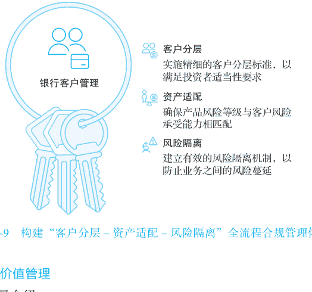

图 12-9 构建“客户分层-资产适配-风险隔离”全流程合规管理体系

## 1. 客户价值管理

（1）场景介绍
客户价值管理是反洗钱合规管理的主要内容，银行需构建涵盖 AUM（Assets Under Management，资产管理规模）、交易特征等多维度指标的评估体系。分、支行行长需审核客户风险等级划分标准，确保符合 AML（反洗钱）客户分级监管的要求。此项工作重点在于防范风险错配引发的监测失效风险，同时优化交易特征的权重设置。

（2）DeepSeek 提示词
角色 + 任务：我是银行分行行长，需评估客户分层标准，应规避哪些监管风险？

（3）追问提示词
- 如何在精准营销与个人信息保护之间实现合规平衡？
- 高风险客户识别应如何满足 FATF（Financial Action Task Force，金融行动特别工作组）反洗钱建议标准？
- 客户生命周期价值评估如何对接 Basel III 风险暴露分类标准？

（4）输出形式
客户风险等级矩阵（BI 系统）、监管合规检查表（Excel 文件）。

## 2. 客户分群管理

（1）场景介绍
客户分群管理是银行数据安全管理的重要环节，银行需建立动态分群算法的审计追踪机制。分、支行行长需审批分群模型参数，确保客户敏感信息的存储与处理符合《金融数据安全 数据安全分级指南》3级数据加密标准。此项工作重点在于防范数据滥用引发的法律风险，同时提高审计日志的完整性。

（2）DeepSeek 提示词
角色 + 任务：我是银行分行行长，需监督客户分群模型，应设置哪些控制节点？

（3）追问提示词
- 非结构化数据处理如何满足穿透式监管要求？
- 模型的可解释性如何通过监管验收？
- 数据漂移监测如何匹配 EAST 系统的报送要求？

（4）输出形式
模型合规性声明（Word 文件）、监管审计日志（Excel 文件）。

### 12.5.2 资产配置监管穿透

银行分支机构需建立资产组合全流程监控机制，确保符合《商业银行理财业务监督管理办法》中的相关要求。

## 1. 投资再平衡策略监管

（1）场景介绍
投资再平衡策略监管是宏观审慎管理的核心环节，银行需构建包含逆周期资本缓冲等政策要素的决策模型。分、支行行长需审核再平衡策略触发条件，确保符合 MPA 框架对资本充足率波动阈值的监管要求。此项工作重点在于防范策略失效引发的系统性风险，同时优化政策传导机制。

（2）DeepSeek 提示词
角色 + 任务：我是银行分行行长，在评估调仓策略时，应关注哪些监管禁区？

（3）追问提示词
- 如何避免衍生品交易杠杆突破监管限制？
- 因子权重调整如何确保符合流动性覆盖率要求？
- 极端市场情景下应对策略如何对接压力测试监管标准？

（4）输出形式
资产配置合规评估报告（Word 文件）、监管报备材料（Word 文件）。

## 2. 持仓健康度监测

（1）场景介绍
持仓健康度监测是集中度风险管控的重要工作，银行需建立穿透式分析系统，重点监控行业贷款占比。分、支行行长需审核集中度监测报告，确保符合《商业银行法》第三十九条中关于同一借款人的贷款余额与商业银行资本余额的比例不得超过 10% 的集中度限制。此项工作重点在于防范集中度超标引发的合规风险，同时增加股权穿透层级深度。

（2）DeepSeek 提示词
角色 + 任务：我是银行分行行长，在管理持仓风险时，应设置哪些监管阈值？

（3）追问提示词
- 如何识别并管控隐性关联交易？
- 客户风险偏好变化如何动态匹配适当性管理？
- 流动性错配情况如何满足 LCR（流动性覆盖率）监管指标？

（4）输出形式
持仓监管风险热力图（BI 系统）、整改优先级清单（Excel 文件）。

### 12.5.3 客户管理场景清单

- 客户信息治理合规
- 反洗钱等级动态管理
- 资产配置比例监控
- 适当性管理穿透式审查
- 压力测试监管适配
- 监管检查应对准备
- 整改措施闭环追踪

## 12.6 团队建设

银行分支机构团队建设面临合规能力存在断层、监管要求迭代加速等挑战，当前痛点集中在能力评估维度单一、实战训练实效性弱、监管要求落地滞后等问题上。银行需重点构建“能力评估－实战训练－监管适配”三位一体的人才培养体系。人力发展团队需强化合规能力动态评估、违规场景模拟训练、监管要求智能校验三项核心能力（如图 12-10 所示）。

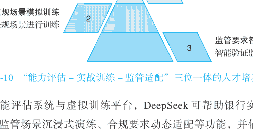

通过智能评估系统与虚拟训练平台，DeepSeek 可帮助银行实现合规能力精准画像、监管场景沉浸式演练、合规要求动态适配等功能，并依托区块链技术建立培训成果与合规表现的不可篡改记录，推动团队建设从传统课堂培训模式向覆盖能力精准评估、实战场景还原、监管即时响应的数字化人才培养体系转型。

### 12.6.1 合规能力建设

银行分支机构需建立与监管要求深度绑定的评估机制，重点提升反洗钱、授信审批等关键岗位工作人员的合规能力。

## 1. 合规能力评估

（1）场景介绍
合规能力评估是风险管理的基础环节，银行需构建“监管知识－操作规范－风险识别”三维评估模型，重点覆盖近三年监管处罚案例中的高频违规点。分、支行行长需审核评估标准，确保模型及时纳入最新监管动态。此项工作重点在于防范合规能力不足引发的违规风险，同时优化指标权重的设置逻辑。

（2）DeepSeek 提示词
角色 + 任务：我是银行分行行长，在评估员工合规能力时，应设置哪些监管红线指标？

（3）追问提示词
- 如何量化反洗钱可疑交易识别能力？
- 如何将授信审批违规案例转化为评估指标？
- 如何动态考核对监管新政的掌握情况？

（4）输出形式
合规能力热力图（BI 系统）、监管重点对照表（Excel 文件）。

## 2. 岗位准入认证

（1）场景介绍
岗位准入认证是银行操作风险防控的关键环节，银行需建立授信审批、理财销售等 8 类岗位认证标准。分、支行行长需审批岗位考核方案，确保符合销售专区“双录”（录音录像）等监管要求。此项工作重点在于防范从业资质缺失引发的操作风险，同时优化认证体系与复检机制。

（2）DeepSeek 提示词
角色 + 任务：我是银行分行行长，需管理岗位准入认证体系，应规避哪些监管风险？

（3）追问提示词
- 如何量化考核“双录”合规操作？
- 新员工认证时效如何满足监管过渡期要求？
- 历史监管处罚案例如何融入案例题库？

（4）输出形式
岗位合规认证手册（Word 文件）、监管检查应对预案（Word 文件）。

### 12.6.2 监管实战训练

银行分支机构需建立“监管导向 - 案例教学 - 整改闭环”实战培训机制，提升团队监管应对能力。

## 1. 监管预检

（1）场景介绍
监管预检是银行应对监管检查的核心环节，银行需开发数字化沙盘系统，模拟现场检查、EAST系统报送等场景。分、支行行长需审核演练方案，重点覆盖近三年处罚率排名前五的违规领域。此项工作重点在于防范应对失当引发的监管处罚风险，同时提高案例库更新频率。

（2）DeepSeek 提示词
角色 + 任务：我是银行分行行长，需监督监管预检的演练设计，应关注哪些监管重点？

（3）追问提示词
- 如何还原监管检查问询场景？
- 如何将 EAST 系统的数据逻辑植入演练？
- 如何暴露跨部门协同缺陷并进行整改？

（4）输出形式
监管检查案例库（Excel 文件）、问题整改追踪表（Excel 文件）。

## 2. 监管沟通

（1）场景介绍
监管沟通是银行危机处置的关键环节，银行需建立标准化应答机制，重点针对突发事件报告等场景进行训练。分、支行行长需组织季度情景模拟考核，并确保执行效果达到预期。此项工作重点在于防范沟通不当引发的信任危机，同时提高案例仿真度。

（2）DeepSeek 提示词
角色 + 任务：我是银行分行行长，在评估监管沟通能力时，应设置哪些监管触点？

（3）追问提示词
- 如何模拟考核重大事项报告时效？
- 监管问询应答如何兼顾信息披露充分性与风险防控要求？
- 跨部门数据整合如何满足穿透式监管要求？

（4）输出形式
监管沟通情景手册（Word 文件）、应答合规性评分表（Excel 文件）。

### 12.6.3 团队建设场景清单

- 合规能力基线评估
- 监管知识动态更新
- 高风险岗位认证管理
- 监管检查情景推演
- 突发事件应对训练
- 整改措施穿透追踪
- 监管关系维护能力培养

## 12.7 监管应对

银行分支机构在应对监管的过程中面临检查穿透性增强、整改闭环管理效能不足等挑战，当前痛点集中在监管画像构建维度单一、整改质量跟踪滞后、长效机制建设不足等问题上。银行需重点构建“画像构建－整改质控－长效跟踪”三位一体的管理体系。合规管理团队需强化监管要点智能整合、整改质量动态核验、长效机制持续优化三项核心能力。

通过智能管理系统与数据分析平台，DeepSeek 可帮助银行实现监管画像动态构建、整改质量智能核验、长效机制持续优化等功能，并依托区块链技术建立不可篡改的整改过程存证链条，推动监管应对工作从被动响应检查模式向覆盖检查要点智能预判、整改措施穿透式核验、合规成效持续跟踪的主动治理体系转型（如图 12-11 所示）。

### 12.7.1 监管画像构建

银行分支机构需统筹建立动态监管政策解析机制，破解传统应对措施中的政策理解偏差、检查重点预判不足等痛点。

## 1. 监管画像管理

（1）场景介绍
监管画像管理是合规预判的核心环节，银行需建立动态政策解析机制，破解检查重点预判难题。分、支行行长需统筹制定具有区域特色的监管应对策略。此项工作重点在于防范政策理解偏差引发的应对失误，同时优化情报收集渠道。

（2）DeepSeek 提示词
角色 + 任务：我是银行分行行长，需管理监管画像，应设置哪些决策阈值？

（3）追问提示词
- 如何识别全国性监管政策与地方性监管要求之间的差异？
- 监管处罚高频词如何转化为内控管理指标？
- 如何捕捉新兴领域（如绿色金融）的监管信号？

（4）输出形式
监管政策驾驶舱（BI 系统）、重点领域预警矩阵（Excel 文件）。

## 2. 监管知识管理

（1）场景介绍
监管知识管理是流程合规的核心环节，银行需建立“监管要求－业务流程－控制措施”三者的关联模型。分、支行行长需审核知识图谱更新机制，确保覆盖最新监管问答场景。此项工作重点在于防范控制措施失效导致的合规风险，同时提升关联关系维护的效率。

（2）DeepSeek 提示词
角色 + 任务：我是银行分行行长，需评估监管知识图谱的建设，应规避哪些合规盲区？

（3）追问提示词
- 如何识别跨监管领域的条款冲突？

对于政策变更如何实现 24 小时内响应？

历史合规问题如何智能关联解决方案？

（4）输出形式

监管规则关联图谱（Visio 文件）、检查要点速查手册（Word 文件）。

## 12.7.2 整改穿透式管理

银行分支机构需建立“问题溯源 - 整改验收 - 长效跟踪”全流程管控体系，确保符合监管要求。

### 1. 整改验收

（1）场景介绍

整改验收是问题管理的核心环节，银行需构建涵盖制度修订、系统控制等 5 个维度的验收标准。分、支行行长需审核长效机制的有效性，确保将整改纳入年度审计计划。此项工作重点在于防范问题复发风险，同时提升验收指标的量化程度。

（2）DeepSeek 提示词

角色 + 任务：我是银行分行行长，需把控整改措施质量，应设置哪些管理红线？

（3）追问提示词

如何平衡整改成本与监管合规要求的达标程度？

对于屡查屡犯的问题如何建立升级处置机制？

对于第三方验证结论如何制定采信标准？

（4）输出形式

整改成熟度评估模型（Excel 文件）、监管沟通预案（Word 文件）。

### 2. 整改存证

（1）场景介绍

整改存证是过程可追溯管理的核心环节，银行需部署符合《信息安全等级保护制度》要求的区块链存证系统。分、支行行长需审批存证范围，涵盖决策记录等关键材料。此项工作重点在于防范证据缺失引发的问责风险，同时提升存证检索效率。

（2）DeepSeek 提示词

角色 + 任务：我是银行分行行长，需管理区块链存证体系，应满足哪些审计标准？

（3）追问提示词

- 敏感信息脱敏应如何平衡数据隐私保护与证据完整性要求？
- 跨系统数据如何实现哈希值同步？
- 监管调阅接口如何通过等保三级认证？

（4）输出形式

区块链存证白皮书（Word 文件）、审计追踪路线图（Visio 文件）。

## 12.7.3 监管应对场景清单

- 监管政策动态解析
- 检查重点智能预判
- 问题根源穿透式分析
- 整改措施分级审批
- 长效机制有效性评估
- 监管关系维护与管理
- 合规文化培育跟踪

## 12.8 数字化转型

银行分支机构数字化转型面临监管要求升级、设备安全风险加剧等挑战，当前痛点集中在数字服务合规性不足、设备安全管控粗放、数据生命周期管理薄弱等问题上（如图 12-12 所示）。银行需重点构建“体验合规 - 设备管控 - 数据安全”三位一体的数字化管理体系。科技管理团队需强化监管规则智能适配、设备安全动态监测、数据治理全流程穿透三项核心能力。

通过智能管理系统与安全防护平台，DeepSeek 可帮助银行实现数字服务合规强化、智能设备全生命周期管控、数据安全分级保护等功能，并依托区块链技术建立不可篡改的操作审计存证链条，推动银行数字化转型工作从局部系统优化向覆盖服务流程合规重塑、设备风险智能防控、数据资产安全托管的系统性管理体系转型。

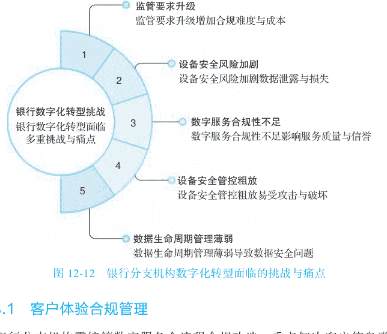

## 12.8.1 客户体验合规管理

银行分支机构需统筹数字服务全流程合规改造，重点解决客户信息滥用、体验数据违规采集等管理痛点。

### 1. 客户旅程合规性审查

（1）场景介绍

客户旅程合规性审查是金融消费者权益保护的最新工具，银行需建立数字足迹追踪系统。分、支行行长需审批数据采集范围，确保符合《个人金融信息保护技术规范》。此项工作重点在于防范信息过度采集的风险，同时优化数据脱敏方案。

（2）DeepSeek 提示词

角色 + 任务：我是银行分行行长，需评估客户旅程设计，应设置哪些隐私保护红线？

（3）追问提示词

- 生物特征采集如何满足“最小必要”原则？
- 老年客户的数字足迹如何实行特殊保护？
- 客户体验优化如何避免过度索取权限？

（4）输出形式

旅程合规审查表（Excel 文件）、隐私影响评估报告（Word 文件）。

### 2. 数据埋点管理

（1）场景介绍

数据埋点管理是数据安全与合规管理的重点环节，银行需构建符合《信息安全等级保护制度》要求的治理体系。分、支行行长需审核数据跨境传输方案，确保通过国家互联网信息办公室的安全评估。此项工作重点在于防范数据泄露风险，同时提高传输协议的加密强度。

（2）DeepSeek 提示词

角色 + 任务：我是银行分行行长，需管理数据采集，应规避哪些监管风险？

（3）追问提示词

- 埋点数据如何确保符合 3 级等级保护安全标准？
- 境外云服务商的数据存储如何满足合规监管标准？
- 客户授权撤回请求如何实现实时响应？

（4）输出形式

数据采集白名单（Excel 文件）、跨境传输备案材料（Word 文件）。

## 12.8.2 智能设备监管穿透

银行分支机构需建立设备全生命周期合规管控机制，确保符合《网络安全等级保护基本要求》。

### 1. 多语种服务合规管理

（1）场景介绍

多语种服务是区域运营的特殊环节，银行需制定智能设备话术审核标准。分、支行行长需重点审查民族语言服务内容，确保符合《宗教事务条例》的相关规定。此项工作重点在于防范文化差异引发的法律风险，同时优化多语言内容审核机制。

（2）DeepSeek 提示词

角色 + 任务：我是银行分行行长，需审批多语种服务脚本，应设置哪些文化敏感禁区？

（3）追问提示词

- 民族地区的金融服务如何避免文化冲突？
- 如何动态更新宗教禁忌语料？
- 紧急服务如何满足监管信息披露要求？

（4）输出形式

话术合规审查记录（Excel 文件）、文化适配手册（Word 文件）。

### 2. 设备安全应急管理

（1）场景介绍

设备安全应急管理是保障业务连续性的核心环节，银行需建立“发现 - 处置 - 报备”标准化流程。分、支行行长需审批应急预案，确保符合《商业银行信息科技风险管理指引》。此项工作重点在于防范设备宕机引发的服务中断风险，同时优化备件库存管理。

（2）DeepSeek 提示词

角色 + 任务：我是银行分行行长，需管理设备安全，应设置哪些监管触点？

（3）追问提示词

- 备件储备如何满足监管对业务连续性的要求？
- 远程锁定操作如何避免服务中断风险？
- 故障处置记录如何满足 EAST 系统报送要求？

（4）输出形式

设备应急演练方案（Word 文件）、监管报备台账（Excel 文件）。

## 12.8.3 数字化转型场景清单

- 客户信息合规治理
- 数据跨境安全管控
- 智能设备文化适配
- 网络安全等级保护
- 服务连续性压力测试
- 监管检查应对准备
- 数字能力合规认证

## 12.9 风险管理

银行分支机构风险管理面临监管要求迭代加速、风险传导路径复杂化等挑战，当前痛点集中在政策执行存在偏差、风险信号识别滞后、监管协同效率低等问题上。银行需重点构建“政策适配－智能监测－监管协同”全链条风控体系（如图 12-13 所示）。风险管理团队需强化监管规则智能解析、风险传导路径建模、监管数据穿透式校验三项核心能力。

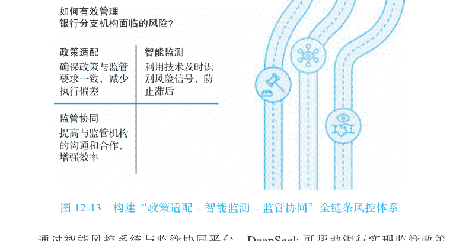

通过智能风控系统与监管协同平台，DeepSeek 可帮助银行实现监管政策动态适配、风险传导智能监测、监管数据智能核验等功能，并依托区块链技术建立不可篡改的监管数据存证链条，推动银行分支机构风险管理从被动合规应对向覆盖政策智能适配、风险全景监测、监管无缝协同的主动防御体系转型。

## 12.9.1 信贷风险监管穿透

银行分支机构需统筹建立差异化的信贷管理体系，重点破解政策传导偏差、区域适配不足等管理痛点。

### 1. 监管导向审批

（1）场景介绍

监管导向审批是绿色金融管理的核心工作，银行需构建普惠、小微等专项审批模型。分、支行行长需审核准入标准，确保符合“两增两控”考核要求。此项工作重点在于防范政策执行偏差带来的风险，同时增加模型参数校准频率。

（2）DeepSeek 提示词

角色 + 任务：我是银行分行行长，需评估监管导向审批模型，应设置哪些监管约束条件？

（3）追问提示词

- 如何验证绿色信贷识别标准是否符合中国人民银行发布的《绿色贷款专项统计制度》？
- 如何控制普惠、小微贷款增速以符合监管要求？
- 如何根据区域经济差异动态调整授信策略？

（4）输出形式

政策信贷合规矩阵（Excel 文件）、监管达标预判报告（Word 文件）。

### 2. 员工行为监测

（1）场景介绍

员工行为监测是案件防控管理的重要举措，银行需建立“物理网络 + 监管网络”的双重监测体系。分、支行行长需审批行为监测方案，覆盖《银行业金融机构从业人员行为管理指引》中的 12 类异常行为。此项工作重点在于防范道德风险，同时提升监测算法精准度。

（2）DeepSeek 提示词

角色 + 任务：我是银行分行行长，需监测员工行为，应规避哪些合规风险？

（3）追问提示词

- 敏感信息采集流程如何满足《中华人民共和国个人信息保护法》的要求？
- 误报线索处置如何兼顾效率与员工权益？
- 历史监管处罚案例如何嵌入员工行为监测规则？

（4）输出形式

行为监测合规手册（Word 文件）、监管检查应对案例库（Excel 文件）。

## 12.9.2 流动性风险智能管控

银行分支机构需构建“压力测试－应急储备－监管报备”流动性管理体系，确保符合《商业银行流动性风险管理办法》核心指标的要求。

### 1. 流动性监测

（1）场景介绍

流动性监测是风险预警管理的核心环节，银行需整合 LCR、NSFR 等指标构建流动性监测驾驶舱。分、支行行长需每月审查偏离度分析报告。此项工作重点在于防范指标突破监管阈值带来的合规风险，同时提高预警参数的灵敏度。

（2）DeepSeek 提示词

角色＋任务：我是银行分行行长，在设定流动性阈值时，应参考哪些监管基准？

（3）追问提示词

- 如何衔接 MPA 框架中的流动性考核要求？
- 如何验证应急融资渠道的可用性？
- 如何识别监管检查中高频出现的问题并进行防控？

（4）输出形式

流动性监管仪表盘（BI 系统）、应急方案备案表（Excel 文件）。

### 2. 压力测试监管适配

（1）场景介绍

压力测试是风险防控的关键环节，银行需构建覆盖利率跳升等必测场景的模型。分、支行行长需审批压力测试方案，确保覆盖相关政策文件的要求。此项工作重点在于防范模型失效风险，同时优化尾部风险建模方法。

（2）DeepSeek 提示词

角色 + 任务：我是银行分行行长，需评估压力测试结果，应关注哪些监管红线？

（3）追问提示词

- 测试假设参数如何匹配监管指导要求？
- 极端场景设置如何满足监管验收标准？
- 整改措施如何纳入资本补充规划？

（4）输出形式

压力测试合规声明（Word 文件）、监管沟通备忘录（Word 文件）。

## 12.9.3 风险管理场景清单

- 政策信贷合规审查
- 员工行为穿透式监测
- 流动性指标动态追踪
- 压力测试监管适配
- 应急方案备案管理
- 监管检查重点预判
- 整改措施穿透验证

## 12.10 舆情与危机管理

银行分支机构的舆情与危机管理面临信息传播速度呈指数级增长、风险关联性日益复杂等挑战，当前痛点集中在舆情监测覆盖不足、情感分析精准度低、危机传导路径追踪困难等问题上。银行需重点构建“监测 - 分析 - 处置”三位一体的防护体系。分、支行行长应要求危机管理团队强化多维度数据整合、情感分析模型优化、处置策略智能生成三项核心能力。

通过全网舆情智能监测平台与危机分析系统，DeepSeek 可帮助银行实现全渠道舆情实时抓取、金融舆情情感精准识别、危机事件关联图谱构建等功能，并通过机器学习算法建立危机分级响应规则库，推动舆情与危机管理从事后被动处置模式向覆盖传播趋势预判、情绪波动监测、处置策略推荐的智能化防护体系转型，如图 12-14 所示。

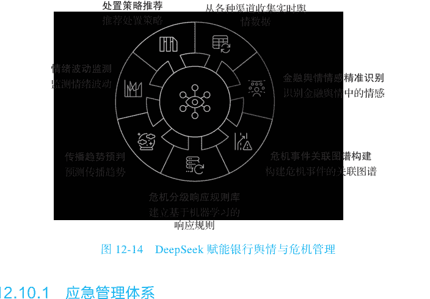

## 12.10.1 应急管理体系

银行分支机构需统筹建立“监管合规 - 资源调度 - 过程留痕”三位一体的应急管理体系，重点解决跨部门协同低效、监管衔接不足等管理痛点。

### 1. 监管合规响应机制

（1）场景介绍

建立符合监管要求的响应机制是危机管理的关键环节，银行需依据相关政策文件建立危机分类标准，分、支行长需审核权限分配方案。此项工作重点在于防范响应超限的风险，同时优化资源调度逻辑。

（2）DeepSeek 提示词

角色 + 任务：我是银行分行行长，需评估监管合规响应机制，应设置哪些监管决策阈值？

（3）追问提示词

- 如何在重大投诉事件中有效衔接《中国人民银行金融消费者权益保护实施办法》的相关规定？
- 处理跨区域舆情时如何协调属地监管要求？
- 如何规范演练记录使其满足 EAST 系统的数据报送标准？

（4）输出形式

监管响应决策矩阵（Excel 文件）、合规性对照手册（Word 文件）。

### 2. 媒体关系管理

（1）场景介绍

舆情管理是银行品牌维护的重要工作，银行需制定分级的媒体关系管理策略。分、支行行长需审核信息披露日志，确保所有对外发布的内容符合《关于进一步规范金融营销宣传行为的通知》的要求。此项工作重点在于防范不当宣传引发的合规及声誉风险，同时优化舆情监测关键词库。

（2）DeepSeek 提示词

角色 + 任务：我是银行分行行长，需管理媒体关系，应规避哪些合规风险？

（3）追问提示词

- 对社交媒体内容如何落实“双录”（录音录像）要求？
- 转发监管通报时如何平衡时效性与准确性？
- 历史处罚案例如何植入审核规则？

（4）输出形式

媒体关系管理合规清单（Excel 文件）、舆情处置案例库（Word 文件）。

## 12.10.2 危机处置监管穿透

银行分支机构需构建“信息核验 - 决策留痕 - 整改闭环”的危机处置机制，并在基层强化案件处置管理制度的执行效力。

### 1. 信息披露三重管控

（1）场景介绍

信息披露是银行合规经营的重点环节，需建立“初审 - 复审 - 终审”三级审核流程。分、支行行长需严格把控敏感数据披露标准。此项工作重点在于防范信息泄露与违规披露风险，同时优化信息审核的响应时效。

（2）DeepSeek 提示词

角色 + 任务：我是银行分行行长，需监督信息披露，应设置哪些管理红线？

（3）追问提示词

- 如何对客户隐私数据进行脱敏处理？
- 如何保持监管问询口径的一致性？
- 历史错误案例如何转化为审核要点？

（4）输出形式

信息披露决策树（Visio 文件）、错误案例警示库（Excel 文件）。

### 2. 应急通信监管适配

（1）场景介绍

应急通信是危机处置的基础保障，银行需构建覆盖属地监管机构的通信网络。分、支行行长需每月审查通讯录的有效性。此项工作重点在于防范联络信息失效带来的风险，同时优化联系人动态更新机制。

（2）DeepSeek 提示词

角色 + 任务：我是银行分行行长，需优化应急通信网络，应满足哪些监管备案要求？

（3）追问提示词

- 应急联系人变更如何确保在 2 小时内完成更新？
- 如何在通信中断时衔接中国人民银行备份系统？
- 在跨境事件处置过程中如何对接国家外汇管理局报告流程？

（4）输出形式

通讯备案台账（Excel 文件）、应急切换演练记录（Word 文件）。

## 12.10.3 舆情与危机管理场景清单

- 监管规则动态解析
- 应急预案分级备案
- 资源调度合规审查
- 处置过程全程留痕
- 监管报告智能生成
- 整改措施穿透验证
- 案例经验持续沉淀

## 12.11 本章小结

本章聚焦银行分支机构经营管理场景，围绕战略规划、经营风险分析、市场拓展、行业研究、客户管理、团队建设、监管应对、数字化转型、风险管理及舆情与危机管理等关键领域，剖析痛点并提出基于 DeepSeek 的解决方案。通过数据贯通、决策升级与协同增效，助力银行分支机构实现经营管理可视化、资源配置科学化、团队执行高效化，满足监管要求并提升管理效能。

# 13

## DeepSeek 资产管理场景应用

当前，银行资产管理业务正处于智能化转型的关键阶段，客户需求从单一资产配置向全生命周期服务延伸，服务模式也从经验驱动向数据驱动演进。在监管穿透式管理要求与市场波动加剧的背景下，同业竞争的重心从规模扩张转向风险与收益平衡能力的建设，尤其在另类资产、ESG 投资等领域，银行需提升资产穿透管理能力与动态定价水平。业务人员面临非结构化数据处理效率低、风险信号捕捉滞后等现实挑战。

资产管理业务的痛点体现在三个方面：一是投研数据整合能力不足，政策文件、行业研报等非结构化文本解析效率低下，影响投资决策的时效性；二是风险监测工具滞后于市场变化，对供应链扰动、技术替代等新型风险的预警缺乏实时性；三是客户服务精准度不足，资产配置建议与投资者风险偏好匹配存在偏差。

通过部署 DeepSeek 智能投研平台（Intelligent Investment Research Platform）、资产风险图谱（Asset Risk Graph）及客户画像引擎，银行可实现关键突破：构建多源数据融合分析系统，提升信息处理效率；建立基于知识图谱的风险传导预警模型；运用机器学习技术，优化个性化服务策略。

本章重点解析如何借助 DeepSeek 实现“数据融合－风险穿透－服务适配”三重能力，重构资产管理价值链，解决投研响应滞后、风险监测存在盲区、客户需求错配等核心问题，助力银行实现“投研决策智能化、风险管理动态化、客户服务精准化”的转型目标。

## 13.1 投资组合构建

银行构建投资组合面临市场波动加剧、监管要求趋严等挑战，当前痛点集中在多因子模型适配性不足、风险收益动态平衡失衡、监管合规校验滞后等问题上。银行需重点构建“因子动态适配－风险智能平衡－监管合规校验”三位一体的管理体系。投资管理团队需强化多源数据智能整合、配置模型动态优化、监管规则智能映射三项核心能力（如图 13-1 所示）。

通过智能配置系统与合规校验平台，DeepSeek 可帮助银行实现多因子动态配置优化、风险收益实时平衡、监管合规自动校验等功能，并依托区块链技术构建不可篡改的投资决策存证链条，推动投资组合管理从静态参数驱动模式向覆盖因子动态调整、风险实时监控、合规智能校验的数字化配置体系转型。

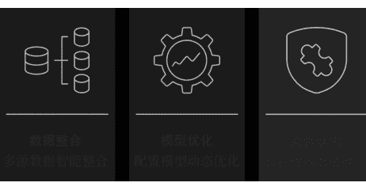

### 13.1.1 建立 CPI/PMI 与国债收益率的动态模型

#### 1. 场景介绍

宏观经济指标联动分析是固定收益投资的核心环节，银行需建立 CPI/PMI 与国债收益率的动态模型，重点监控 CPI 环比变动超过 ±0.5%、PMI 跌破 50 荣枯线等关键经济信号。投资经理需每月更新 10 年期国债收益率预测区间，动态调整利率债配置比例，波动幅度控制在 ±5% 以内。此项工作重点在于防范利率误判引发的久期风险，同时优化经济指标滞后性修正参数。

#### 2. DeepSeek 提示词

角色 + 任务：我是银行投资经理，需构建 CPI/PMI 与国债收益率的动态模型，应选择哪些历史数据周期？

#### 3. 追问提示词

- 如何验证先行指标的预测有效性？
- 政策调控窗口期如何调整修正参数？
- 如何平滑处理数据季节性波动？

#### 4. 输出形式

指标关联度分析表（Excel 文件）、参数校准手册（Word 文件）。

#### 5. 案例演示

（1）DeepSeek 提示词
角色 + 任务：我是银行投资经理，需构建 CPI/PMI 与国债收益率的动态模型，应选择哪些历史数据周期？要求不编造、不臆测，符合银行实际场景，确保网页链接真实有效，严格按照监管要求执行。

（2）DeepSeek 首次输出
在构建动态相关性模型时，历史数据周期的选择需结合银行业实际场景、监管要求和模型特性，综合搜索结果中的实证研究及行业动态来考虑，建议从以下维度进行考量。

### 一、数据周期的核心选择原则

1. 覆盖完整市场周期
    - 建议选择至少一个完整经济周期（通常 5～10 年）的数据，以捕捉不同市场阶段（如繁荣、衰退、政策调控期）的波动特征。
    - 若涉及长期资产（如房地产或基础设施投资），可参考 2000—2017 年的月度数据，以分析跨周期相关性。

2. 数据频率与模型匹配性
    - 高频数据（日度 / 周度）：适用于捕捉短期波动和风险传染效应，如 DCC-GARCH 模型对股票收益率动态相关性的分析。
    - 低频数据（月度 / 季度）：适合分析长期趋势和政策影响，例如房地产与银行业的风险溢出研究。

3. 监管合规要求
    根据《商业银行资本管理办法》等文件，需确保数据治理符合监管标准，包括数据完整性、准确性和可追溯性。例如，操作风险数据需包括至少 3 年历史记录以支持内部资本评估。

### 二、不同场景下的数据周期选择建议

1. 股票市场投资组合
    - 周期选择：5～7 年日度数据，可捕捉短期波动和动态相关性。
    - 数据类型：收盘价、成交量、财务指标（ROE、不良率）、市场情绪指数（如波动率指数）。

2. 固定收益类资产（债券、理财产品）
    - 周期选择：10 年以上的月度数据，覆盖利率周期变化（如美债利率波动）。
    - 数据类型：债券收益率曲线、信用利差、久期、违约率及宏观经济指标（GDP、CPI）。

3. 跨境资产配置（如 QDII 产品）
    - 周期选择：3～5 年日度数据，考虑汇率波动和时区差异（如美元指数与美债收益率联动）。
    - 数据类型：海外市场指数（标普 500）、汇率、地缘政治事件数据。

4. 系统性风险监测
    - 周期选择：包含极端事件（如 2008 年金融危机）的长周期数据（20 年以上），以检验模型在压力场景下的稳健性。

### 三、数据预处理与验证要点

1. 平稳性检验
    对收益率序列进行单位根检验（ADF 检验），确保数据平稳性，避免伪回归问题。

2. 异方差性与 ARCH 效应检验
    通过 ARCH-LM 检验识别波动聚集性，为 GARCH 族模型提供基础。

3. 数据分段与滚动窗口验证
    采用滚动时间窗口（如 3 年滚动窗口）验证模型的动态适应能力，避免过拟合。

### 四、实际案例参考

1. 国有银行股相关性分析：使用 DCC-GARCH 模型分析 2016—2022 年的日度数据，发现动态相关性显著且存在个体差异，验证了 5～6 年周期的有效性。
2. 房地产与银行业风险溢出：基于 2000—2017 年月度数据构建 GPD-Copula 模型，揭示双向风险溢出效应，表明长期数据对跨行业风险监测的重要性。

### 五、监管与实操建议

1. 动态调整机制
    根据中小银行风险化解与 TLAC 达标要求，需结合监管动态（如高风险机构资产占比变化）调整模型参数，确保风险预警的时效性。

2. 科技赋能数据治理
    参考深圳农商银行的数字化转型经验，采用分布式数据库和实时数据处理技术，提升高频数据采集与分析的效率。

总结：历史数据周期的选择需兼顾模型特性、资产类别和监管要求。建议优先采用覆盖完整周期的 5～10 年日度或月度数据，并结合滚动窗口验证和极端事件压力测试，以构建稳健的动态相关性模型。具体实施时，可参考实证研究中的时间跨度及行业最佳实践。

（3）追问提示词
- 如何验证先行指标的预测有效性？
- 政策调控窗口期如何调整修正参数？
- 如何平滑处理数据季节性波动？

（4）输出形式
Excel 模板（指标关联度分析表），用 HTML 的格式输出，需要内嵌可直接下载 Excel 文件的按钮代码，实现一键下载 Excel 文件。
Word 格式（参数校准手册），用 HTML 的格式输出，需要内嵌可直接下载 Word 文件的按钮代码，实现一键下载 Word 文件。

（5）DeepSeek 再次输出
以下是符合要求的 HTML 格式输出，包含 Excel 模板与 Word 分析报告的结构化内容及下载功能代码。
DeepSeek 输出的内容如图 13-2 所示。
单击“运行”按钮，可获得“先行指标有效性验证表”Excel 模板，如图 13-3 所示。
下拉滚动条，可看到“政策窗口期参数校准指南”Word 模板的下载按钮，单击即可完成 Word 文件的下载，如图 13-4 所示。

## 第 13 章 DeepSeek 资产管理场景应用

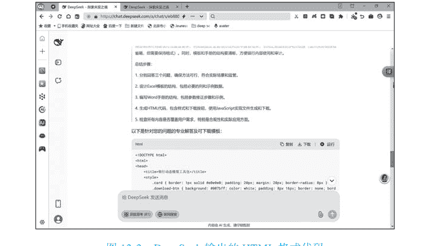

图 13-2 DeepSeek 输出的 HTML 格式代码

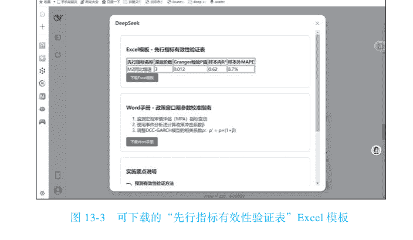

图 13-3 可下载的“先行指标有效性验证表”Excel 模板

### 13.1.2 根据波动率贡献度动态调整资产权重

#### 1. 场景介绍

组合优化是风险平价策略的核心环节，银行需运用风险平价模型实时计算股票等 6 类资产的波动率贡献度。风险管理岗设定单一资产贡献度上限为 15%，若超过此阈值，则触发组合再平衡机制。此项工作重点在于防范波动率过度集中引发的尾部风险，同时提升高频数据的清洗效率。

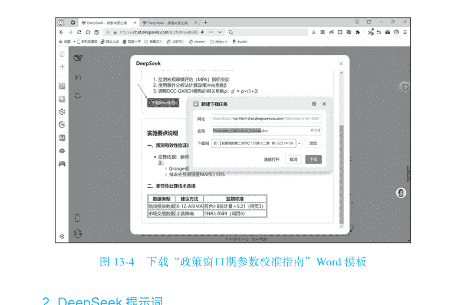

#### 2. DeepSeek 提示词

角色 + 任务：我是银行风险管理岗人员，需优化资产权重调整机制，应设置哪些约束条件？

#### 3. 追问提示词

- 如何平衡交易成本与风险控制？
- 极端市场波动下如何设置缓冲区间？
- 监管集中度指标如何嵌入风险平价模型？

#### 4. 输出形式

波动率贡献度热力图（Excel 文件）、调仓审批单（Word 文件）。

### 13.1.3 建立 MSCI ESG 评级实时监控与自动剔除机制

#### 1. 场景介绍

ESG 风险管理是绿色投资的核心环节，银行需对接全球 ESG 数据库，监控 MSCI 评级下调至 CCC 级等 7 类风险信号。合规管理岗需实施 T+1 日处置机制，确保符合《银行业保险业绿色金融指引》中关于不合规资产剔除的要求。此项工作重点在于防范“漂绿”行为引发的合规风险，同时提高爬虫抓取事件的准确性与时效性。

#### 2. DeepSeek 提示词

角色 + 任务：我是银行合规管理岗人员，需设计 MSCI ESG 评级实时监控规则，应包含哪些监管红线？

#### 3. 追问提示词

- 如何衔接绿色信贷专项统计报送要求？
- 跨境 ESG 标准差异如何合规处理？
- 临时剔除资产如何履行报备程序？

#### 4. 输出形式

ESG 禁投清单（Excel 文件）、监管报备模板（Word 文件）。

### 13.1.4 设置夏普比率阈值预警与季度调仓机制

#### 1. 场景介绍

绩效评估是投资组合管理的核心环节，银行需建立滚动三年期的夏普比率模型，当夏普比率低于同业 25% 分位数时触发预警。投资决策委员会需按季审查调仓方案，重点评估策略与资本充足率等指标的匹配度。此项工作重点在于防范业绩持续落后引发的客户赎回风险，同时优化同业基准数据的时效性。

#### 2. DeepSeek 提示词

角色 + 任务：我是银行投资经理，需优化绩效评估模型，应选取哪些基准指标？

#### 3. 追问提示词

- 如何消除资产管理规模差异对夏普比率的影响？
- 市场极端分化期如何调整绩效评估周期？
- 风险调整收益的监管要求如何嵌入？

#### 4. 输出形式

绩效对标分析表（Excel 文件）、调仓决策备忘录（Word 文件）。

### 13.1.5 投资组合构建场景清单

- 宏观经济指标监控
- 风险预算动态分配
- ESG 合规筛查
- 绩效归因分析
- 监管报告生成
- 投资决策委员会材料准备

## 13.2 风险对冲管理

银行风险对冲管理面临基差波动加剧、保证金流动性风险攀升等挑战，当前痛点集中在基差风险监测不足、保证金管理滞后、合规校验效率低等问题上。银行需重点构建“实时评估－动态对冲－合规管控”三位一体的管理体系。风险管理团队需强化基差风险智能监测、流动性压力动态建模、监管规则智能适配三项核心能力。

通过智能对冲系统与合规分析平台，DeepSeek 可帮助银行实现基差风险实时预警、保证金流动性智能监测、监管合规自动校验等功能，并依托区块链技术建立不可篡改的对冲操作存证链条，推动风险对冲管理从静态敞口管理模式向覆盖基差动态预警、流动性实时监测、监管穿透校验的智能化对冲体系转型。

### 13.2.1 现货组合 Beta 系数动态计算

#### 1. 场景介绍

Beta 系数管理是套期保值的核心环节，银行需建立分钟级同步机制，实时计算现货组合 Beta 系数值。衍生品交易岗应在 Beta 系数偏离 ±0.2 时生成股指期货对冲建议。此项工作重点在于防范市场敞口超限风险，同时优化高频数据的噪声过滤算法。

#### 2. DeepSeek 提示词

角色 + 任务：我是银行衍生品交易岗人员，需优化 Beta 系数计算模型，应设置哪些风控参数？

#### 3. 追问提示词

- 如何排除异常交易时段数据的干扰？
- 如何及时响应成分股调整？
- 如何满足监管对套期会计的合规要求？

#### 4. 输出形式

Beta 跟踪曲线图（Excel 文件）、对冲操作日志（Word 文件）。

### 13.2.2 基差风险实时监控与套保比率调整

#### 1. 场景介绍

基差管理是期货对冲的基本工作，银行需构建历史基差数据库，并在基差超过 90% 分位值时触发预警。风险管理岗应动态调整套保比率，区间控制在 0.8～1.2，并每日评估其有效性。此项工作重点在于防范基差扩大引发的对冲失效风险，同时优化历史数据覆盖范围。

#### 2. DeepSeek 提示词

角色 + 任务：我是银行风险管理岗人员，需设计套保有效性监控指标，应包含哪些波动特征？

#### 3. 追问提示词

- 如何选择合约展期的最佳时点？
- 如何规避交割月的流动性风险？
- 如何衔接监管部门对套保的认定标准？

#### 4. 输出形式

基差波动分析表（Excel 文件）、套保方案调整书（Word 文件）。

### 13.2.3 保证金占用压力测试

#### 1. 场景介绍

保证金占用压力测试是衍生品管理的重要一环，银行需模拟涨停板、保证金率上调 20% 等极端市场场景。资金管理岗应设置资本金占用超预算 30% 时的自助熔断机制，确保 LCR 不低于 100%。此项工作重点在于防范流动性枯竭风险，同时优化压力测试场景的参数敏感性分析。

#### 2. DeepSeek 提示词

角色 + 任务：我是银行资金管理岗人员，需设计保证金占用压力测试情景，应满足哪些监管要求？

#### 3. 追问提示词

- 如何对接 Basel Ⅲ 的市场风险框架？
- 跨市场头寸如何合并计算？
- 应急融资渠道如何进行压力测试？

#### 4. 输出形式

压力测试报告（Word 文件）、流动性缺口矩阵（Excel 文件）。

### 13.2.4 套保有效性验证

#### 1. 场景介绍

套保有效性验证是会计合规的重要环节，银行需按月计算期货损益与现货变动的相关性，确保相关性比例在 80%～125% 区间。稽核岗应留存 5 年期验证记录，确保符合《企业会计准则第 24 号》要求。此项工作重点在于防范审计不达标风险，同时优化时间序列匹配算法。

#### 2. DeepSeek 提示词

角色 + 任务：我是银行稽核岗人员，需设计套保有效性的验证方法，应包含哪些审计要点？

#### 3. 追问提示词

- 如何识别人为调整验证样本？
- 跨会计期间的验证效果如何评估？
- 如何提前应对监管检查重点？

#### 4. 输出形式

有效性验证表（Excel 文件）、审计底稿模板（Word 文件）。

### 13.2.5 风险对冲管理场景清单

- 风险敞口计量
- 对冲工具选择
- 交易执行监控
- 保证金管理
- 会计处理验证
- 监管报表编制

## 13.3 绩效归因分析

银行在绩效归因分析中面临跨境投资复杂度提升、监管透明度要求趋严等挑战，当前痛点集中在归因维度单一、汇率风险剥离不充分、信息披露合规性不足等问题上。银行需重点构建“多因子归因 - 汇率穿透 - 合规披露”三位一体的分析体系（如图 13-5 所示）。投资管理团队需强化多维收益解析、汇率影响量化、监管规则智能适配三项核心能力。

通过智能分析系统与合规管理平台，DeepSeek 可帮助银行实现多维度收益智能归因、汇率风险精准剥离、披露报告自动生成等功能，并依托区块链技术构建不可篡改的投资决策存证链条，推动绩效归因分析从传统的单维度评价模式向覆盖多因子动态解析、汇率风险量化剖析、监管披露全面落实的透明化分析体系转型。

### 13.3.1 多层级归因模型搭建

#### 1. 场景介绍

收益归因是绩效分析的核心环节，银行需建立“配置 - 选券 - 交易”三层归因模型，分离 Alpha/Beta 贡献。投资经理应按月生成穿透式归因报告，定位超额收益来源。此项工作重点在于防范归因失真引发的投资决策偏差，同时优化因子剥离技术。

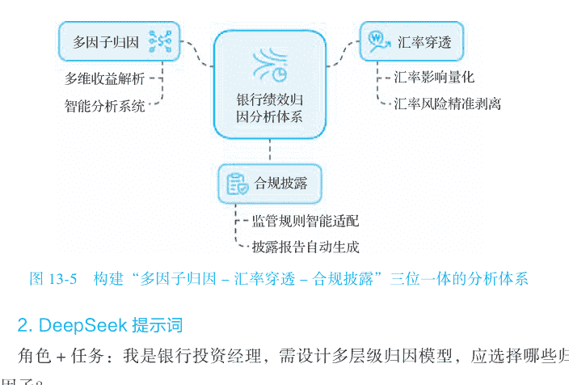

#### 2. DeepSeek 提示词

角色 + 任务：我是银行投资经理，需设计多层级归因模型，应选择哪些归因因子？

#### 3. 追问提示词

- 如何验证归因因子间的正交性？
- 杠杆操作收益如何单独归因？
- 如何体现监管要求的风险调整收益？

#### 4. 输出形式

归因因子矩阵（Excel 文件）、模型验证报告（Word 文件）。

### 13.3.2 汇率对冲损益拆分

#### 1. 场景介绍

外汇风险管理是跨境投资的重要环节，银行需构建风险敞口计量模型以区分自然对冲与衍生品对冲的汇兑损益。风险管理岗应监控交叉货币掉期估值，确保符合《企业汇率风险管理指引》的要求。此项工作重点在于防范因汇率错配引发的估值偏差，同时优化波动率曲面的建模方法。

#### 2. DeepSeek 提示词

角色 + 任务：我是银行风险管理岗人员，需优化汇率对冲损益的拆分方法，应设置哪些会计科目？

#### 3. 追问提示词

- 如何满足套期会计的时效性要求？
- 如何处理 NDF（无本金交割远期）估值差异？
- 如何衔接监管要求的外汇敞口报表？

#### 4. 输出形式

汇率损益拆分表（Excel 文件）、套期文档（Word 文件）。

### 13.3.3 基准指数定制

#### 1. 场景介绍

基准管理是资产管理产品设计的核心环节，银行需构建含 ESG 剔除等 7 项规则的定制指数。投资决策委员会应按季度评估基准指数的适用性，确保符合《理财产品业绩比较基准展示行为准则》的监管要求。此项工作重点在于防范因基准偏离引发的客户投诉风险，同时优化流动性筛选阈值。

#### 2. DeepSeek 提示词

角色 + 任务：我是银行投资经理，在设计基准指数规则时，应满足哪些监管披露要求？

#### 3. 追问提示词

- 如何避免基准风格漂移误导客户？
- 如何设置定制指数的回测周期？
- 如何准备监管报备材料？

#### 4. 输出形式

指数编制说明（Word 文件）、成分股清单（Excel 文件）。

### 13.3.4 归因结果审查

#### 1. 场景介绍

归因结果审查是金融产品营销合规的重要环节，银行需建立数据溯源机制，核查收益分配逻辑。稽核岗应留存计算过程底稿，确保符合相关文件的要求。此项工作重点在于防范误导性宣传风险，同时加深数据血缘分析的深度。

#### 2. DeepSeek 提示词

角色 + 任务：我是银行合规管理岗人员，需制定金融产品营销合规审查标准，应包含哪些红线条款？

#### 3. 追问提示词

- 如何识别归因结果中的隐含收益夸大行为？
- 如何验证历史业绩模拟数据？
- 如何预判监管检查重点？

#### 4. 输出形式

审查要点清单（Excel 文件）、审计底稿归档记录（Word 文件）。

### 13.3.5 绩效归因分析场景清单

- 收益数据标准化
- 归因模型参数校准
- 交叉验证执行
- 监管报告生成
- 销售材料一致性核对
- 审计底稿管理

## 13.4 ESG 整合投资

银行在 ESG 整合投资中面临“漂绿”风险加剧、监管穿透性不足等挑战，当前痛点集中在 ESG 数据整合能力弱、评估标准执行存在偏差、信息披露可信度低等问题上。银行需重点构建“数据治理 - 评估穿透 - 披露管控”三位一体的管理体系。投资管理团队需强化 ESG 数据智能整合、绿色项目穿透验证、信息披露合规校验三项核心能力。

通过智能 ESG 管理系统与合规分析平台，DeepSeek 可帮助银行实现 ESG 数据全景整合、“漂绿”风险智能识别、监管合规自动校验等功能，并依托区块链技术构建不可篡改的 ESG 数据存证链条，推动 ESG 整合投资从传统的标签化筛选模式向覆盖数据全链条穿透、环境效益可验证、监管要求严格落实的负责任投资体系转型（如图 13-6 所示）。

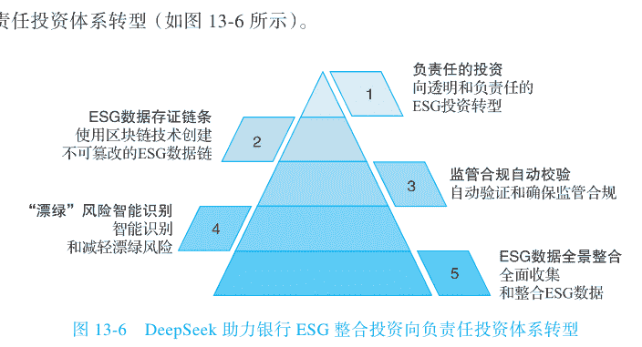

### 13.4.1 绿色债券认证材料核验

#### 1. 场景介绍

绿色债券认证是 ESG 投资的重要合规要求，银行需建立第三方机构白名单，核查环境效益测算方法的科学性与合规性。合规岗应实施“双人复核 + 外部验证”机制，确保绿色债券符合《绿色债券支持项目目录（2021 年版）》。此项工作重点在于防范认证不严引发的“漂绿”风险，同时优化碳核算方法的验证流程。

#### 2. DeepSeek 提示词

角色 + 任务：我是银行合规管理岗人员，需设计绿色债券认证材料核验流程，应包含哪些关键要素？

#### 3. 追问提示词

- 如何识别认证机构资质瑕疵？
- 如何验证环境效益量化模型？
- 如何及时响应监管政策动态调整？

#### 4. 输出形式

认证机构评估表（Excel 文件）、核验工作底稿（Word 文件）。

### 13.4.2 碳强度同业对标数据库建设

#### 1. 场景介绍

碳数据管理是气候风险分析的核心环节，银行需采集碳排放强度等 12 项指标，构建行业百分位对标体系。ESG 研究岗应按季度更新数据，确保符合 TCFD① 披露要求。此项工作重点在于防范数据滞后引发的分析偏差风险，同时优化企业数据采集接口。

#### 2. DeepSeek 提示词

角色 + 任务：我是银行 ESG 研究岗，需设计碳强度同业对标数据库，应满足哪些监管披露标准？

#### 3. 追问提示词

- 如何应对企业数据披露差异？
- 如何整合区域碳市场数据？
- 如何衔接绿色统计制度？

#### 4. 输出形式

数据采集标准（Word 文件）、行业对标报告（Excel 文件）。

> ① TCFD：Task Force on Climate-related Financial Disclosures，气候相关财务披露工作组，成立于 2015 年，旨在制定一套自愿性的气候相关财务信息披露框架，帮助企业和金融机构更好地评估与披露气候相关风险和机遇，以提高金融体系对气候变化的适应能力和韧性。

## 13.4.3 “漂绿”行为追溯审查

#### 1. 场景介绍

反“漂绿”管理是ESG合规的核心内容，银行需建立“募投-资金-效益”三位一体的追踪机制。稽核岗应开展年度专项审计，留存不少于10年的追溯资料，重点监测5类风险信号。此项工作重点在于防范声誉风险，同时优化资金流穿透监控层级。

### 2. DeepSeek提示词

角色+任务：我是银行稽核岗人员，需设计“漂绿”行为审计方案，应设置哪些风险指标？

#### 3. 追问提示词

- 如何穿透多层嵌套产品结构？
- 如何评估环境效益兑现的滞后性？
- 监管处罚案例如何纳入检查要点？

#### 4. 输出形式

风险特征库（Excel文件）、审计程序表（Word文件）。

## 13.4.4 绿色资产配置比例监控

#### 1. 场景介绍

绿色资产配置比例是监管重点考核指标，银行需实时计算绿色信贷等绿色资产占总资产的比例。资产负债岗应设置季度调整机制，确保绿色融资的增速比对公贷款的平均增速至少高2%。此项工作重点在于防范绿色资产配置比例考核未达标的监管风险，同时优化资产穿透认定标准。

### 2. DeepSeek提示词

角色+任务：我是银行资产负债管理岗人员，需设计绿色资产配置比例监控指标，应包含哪些监管阈值？

#### 3. 追问提示词

- 如何衔接央行绿色信贷评估标准？
- 过渡期资产如何分类管理？
- 监管报表数据如何实现自动提取？

#### 4. 输出形式

配置比例仪表盘（Excel 文件）、监管达标方案（Word 文件）。

## 13.4.5 ESG 整合投资场景清单

- ESG 数据采集
- 绿色资产认定
- 投资比例监控
- 环境效益审计
- 监管报告编制
- 信息披露管理

## 13.5 流动性风险管理

银行流动性风险管理面临资产变现能力下降、负债结构失衡等挑战，当前痛点集中在资产流动性评估不足、负债集中度监测滞后、监管合规适配性差等问题上。银行需重点构建“监测－评估－应对”三位一体的管理体系。资金管理团队需强化多维度流动性监测、压力情景动态建模、应急策略智能生成三项核心能力。

通过智能监测系统与压力测试平台，DeepSeek 可帮助银行实现资产变现能力智能评估、负债到期压力动态测试、监管合规自动校验等功能，并依托区块链技术建立不可篡改的流动性数据存证链条，推动流动性风险管理从静态指标监控模式向覆盖资产多维穿透、压力情景仿真、应急策略优化的智能管理体系转型。

### 13.5.1 资产变现分级管理

#### 1. 场景介绍

资产变现分级管理是流动性风险管理的重要基础，银行需建立资产变现能力分级管理机制，按折扣率划分 5 个层级，重点管理 7 日内可变现的高流动性资产。风险管理岗应按周测试变现能力，确保 LCR 不低于 100%。此项工作重点在于防范资产折价引发的流动性风险，同时合理调整折扣率参数校准频率。

#### 2. DeepSeek 提示词

角色 + 任务：我是银行风险管理岗人员，需设计资产变现分级标准，应参考哪些监管参数？

#### 3. 追问提示词

- 如何动态调整质押品折扣率？
- 如何模拟市场流动性骤降场景？
- 如何映射监管流动性风险指标？

#### 4. 输出形式

资产分级清单（Excel 文件）、压力测试手册（Word 文件）。

### 13.5.2 负债端压力测试模型

#### 1. 场景介绍

负债端压力测试是流动性风险管理的关键环节，银行需模拟同业融资收缩等极端场景，测算 30 日累计流动性缺口是否会超过优质资产 50% 的预警线。资金管理岗应设置熔断机制，确保符合流动性监管要求。此项工作重点在于防范负债端挤兑风险，同时优化压力测试场景参数的敏感性。

#### 2. DeepSeek 提示词

角色 + 任务：我是银行资金管理岗人员，需构建负债端压力测试模型，应包含哪些监管规定情景？

#### 3. 追问提示词

- 如何反映存款保险制度的影响？
- 分支机构资金调配时滞如何计量？
- 如何对接监管标准化压力测试？

#### 4. 输出形式

测试情景库（Excel 文件）、流动性缺口分析表（Excel 文件）。

### 13.5.3 流动性应急管理

#### 1. 场景介绍

流动性应急管理是保障业务连续性的核心环节，银行需制定7类处置手段，并且每半年演练一次SLF（常备借贷便利）对接流程。应急管理委员会应重点测试资产紧急出售时效，确保30分钟内完成决策。此项工作重点在于防范处置延误风险，同时优化央行流动性支持工具的调用效率。

#### 2. DeepSeek 提示词

角色 + 任务：我是银行应急管理岗人员，设计现金储备动用应急处置流程，应满足哪些监管报备要求？

#### 3. 追问提示词

- 如何平衡资产折价与监管指标达标？
- 跨区域流动性调剂如何操作？
- 如何对接监管应急通信机制？

#### 4. 输出形式

应急流程图（Visio 文件）、演练评估报告（Word 文件）。

### 13.5.4 LCR 日报表生成与监管报送

#### 1. 场景介绍

监管报送是合规管理的核心环节，银行需自动化生成LCR（日度流动性覆盖率）日报表并实施双人复核。合规管理岗应确保数据符合“1104报表”规范，确保误差率不高于0.5%。此项工作重点在于防范数据错报风险，同时提高数据采集的实时性。

#### 2. DeepSeek 提示词

角色 + 任务：我是银行合规管理岗人员，需设计日报表报送流程，应包含哪些校验规则？

#### 3. 追问提示词

- 如何识别系统取数逻辑错误？
- 节假日数据如何调整处理？
- 如何应对监管部门的数据质量检查？

#### 4. 输出形式

报送校验清单（Excel 文件）、异常数据台账（Excel 文件）。

### 13.5.5 流动性风险管理场景清单

- 现金流预测
- 优质流动性资产监控
- 压力情景建模
- 应急方案演练
- 监管指标计算
- 报告生成与报送

## 13.6 非标资产估值管理

银行在非标资产估值中面临定价依据缺失、模型透明度不足等挑战，当前痛点集中在数据整合能力不足、估值模型验证机制滞后、信息披露合规性弱等问题上（如图 13-7 所示）。银行需重点构建“数据穿透 - 模型验证 - 合规披露”三位一体的估值体系。风险管理团队需强化非标资产智能定价、模型动态验证、监管规则精准映射三项核心能力。

通过智能估值系统与合规管理平台，DeepSeek 可帮助银行实现非标资产公允定价、模型假设智能验证、监管合规自动适配等功能，并依托区块链技术构建不可篡改的估值过程存证链条，推动估值管理从传统经验判断模式向覆盖数据全景穿透、模型动态校验、监管无缝衔接的智能化估值体系转型。

### 13.6.1 非标资产信息采集

#### 1. 场景介绍

非标资产信息采集是资本管理中“穿透识别”的基础环节，银行需制定 12 项核心数据采集标准，并建立第三方交叉验证机制。产品管理岗应确保符合《商业银行资本管理办法》中关于非标资产穿透识别的要求。此项工作重点在于防范数据失真引发的资本计量偏差风险，同时加快数据更新频率。

#### 2. DeepSeek 提示词

角色 + 任务：我是银行产品管理岗人员，需制定非标资产信息采集标准，应包含哪些验证要素？

#### 3. 追问提示词

- 如何验证非持牌机构提供的数据？
- 信息缺失的资产如何分类处置？
- 如何在标准中嵌入监管数据报送要求？

#### 4. 输出形式

数据采集模板（Excel 文件）、验证操作手册（Word 文件）。

### 13.6.2 估值方法决策

#### 1. 场景介绍

估值方法决策是财务合规的关键环节，银行需建立三级审议机制，重点留存调整依据。风险管理岗应每季度审查差异案例，确保符合《银行间债券市场债券估值业务管理办法》的要求。此项工作重点在于防范主观判断引发的估值偏差风险，同时提升听证流程效率。

#### 2. DeepSeek 提示词

角色 + 任务：我是银行风险管理岗人员，需设计估值方法决策逻辑，应设置哪些触发条件？

#### 3. 追问提示词

- 如何应对市场流动性骤降场景？
- 第三方估值机构服务中断时如何应急处理？
- 估值偏离度如何监控？

#### 4. 输出形式

估值方法流程图（Visio 文件）、异常处置预案（Word 文件）。

### 13.6.3 敏感性分析

#### 1. 场景介绍

敏感性分析是非标资产估值中用于识别市场风险的重要环节，银行需构建多维压力测试模型，重点评估利率变动 ±100BP、汇率波动 ±5% 等场景对资产组合的影响。风险管理岗需设置关键变量阈值，自动生成压力测试报告，并标注最大风险敞口。此项工作重点在于防范市场波动引发的估值偏差风险，同时合理调整蒙特卡洛模拟参数的校准频率。

#### 2. DeepSeek 提示词

角色 + 任务：我是银行投资经理，需设计敏感性分析测试方案，应包含哪些监管规定情景？

#### 3. 追问提示词

- 如何设置尾部风险极端参数？
- 如何模拟相关性突变？
- 如何对接监管压力测试指引？

#### 4. 输出形式

敏感性分析表（Excel 文件）、监管报备说明（Word 文件）。

### 13.6.4 估值委员会审议流程

#### 1. 场景介绍

估值委员会审议是非标资产估值合规管理的关键环节，银行需建立三级审议机制，重点留存调整依据。委员会应按季度审查差异案例，确保符合《银行间债券市场债券估值业务管理办法》。此项工作重点在于防范主观偏差风险，同时优化听证流程效率。

#### 2. DeepSeek 提示词

角色 + 任务：我是银行估值委员会秘书，需优化估值审议会议的流程，应设置哪些表决规则？

#### 3. 追问提示词

- 如何平衡效率与决策的严谨性？
- 如何采纳外部专家意见？
- 监管检查重点如何预置留痕？

#### 4. 输出形式

会议决议模板（Word 文件）、异议事项记录表（Excel 文件）。

### 13.6.5 非标资产估值管理场景清单

- 资产数据标准化
- 估值方法决策
- 模型参数校准
- 压力测试执行
- 估值委员会审议
- 监管报备归档

## 13.7 客户定制化报告

银行理财业务客户定制化报告面临信息穿透不足、风险适配精度偏差等挑战，当前痛点集中在客户画像维度单一、风险匹配机制滞后、信息披露合规性弱等问题。银行需重点构建“数据穿透 - 动态适配 - 合规披露”三位一体的报告体系。理财经理需强化全景数据整合、风险智能匹配、监管规则精准映射三项核心能力（如图 13-8 所示）。

通过智能分析系统与合规管理平台，DeepSeek 可帮助银行实现客户全景画像构建、风险动态匹配优化、资产穿透式信息披露等功能，并依托自然语言处理技术解析监管要求，生成风险揭示与合规声明内容，推动客户定制化报告从静态文档输出向覆盖数据实时穿透、风险动态预警、监管无缝衔接的智能化服务体系转型。

### 13.7.1 资产穿透监管

#### 1. 场景介绍

资产穿透监管是合规管理的核心环节，银行需开发 T+1 日穿透模型，实现 6 类资产的自动识别。科技部门应设置同业投资识别规则，确保符合监管部门的穿透监管要求。此项工作重点在于防范嵌套产品带来的合规风险，同时提高底层资产分类精度。

#### 2. DeepSeek 提示词

角色 + 任务：我是银行科技部门人员，需设计资产穿透识别规则，应满足哪些披露标准？

#### 3. 追问提示词

- 如何应对 SPV 结构变化？
- 跨境资产如何分类映射？
- 如何落实监管数据颗粒度要求？

#### 4. 输出形式

穿透规则清单（Excel 文件）、样本报告（Word 文件）。

### 13.7.2 CRS 税务影响模拟器

#### 1. 场景介绍

跨境税务管理是国际合规管理的重点环节，银行需构建分析工具，模拟不同国籍客户 CRS1 影响。合规管理岗需设置敏感信息脱敏机制，符合《纳税人涉税保密信息管理暂行办法》的要求。此项工作重点在于防范信息泄露风险，同时优化国籍判定算法。

#### 2. DeepSeek 提示词

角色 + 任务：我是银行合规管理岗人员，需设计税务影响模拟逻辑，应包含哪些申报要素？

#### 3. 追问提示词

- 如何应对税收居民身份变更？
- 如何处理双重国籍情况？
- 如何自动适配监管报送格式？

#### 4. 输出形式

税务影响分析表（Excel 文件）、案例手册（Word 文件）。

> CRS：Common Reporting Standard，共同申报准则，是由经济合作与发展组织（OECD）推出的，用于指导参与司法管辖区定期对税收居民金融账户信息进行交换的准则，旨在通过加强全球税收合作提高税收透明度，打击利用跨境金融账户的逃税行为。

### 13.7.3 集中度管控

#### 1. 场景介绍

集中度管控是流动性风险管理的核心环节，银行需实时监控行业集中度，如超过 50% 则开启预警。风险管理岗应设置季度调仓建议机制，符合《商业银行流动性风险管理办法》。此项工作重点在于防范流动性枯竭风险，同时优化行业分类标准。

#### 2. DeepSeek 提示词

角色 + 任务：我是银行风险管理岗人员，需设计集中度预警规则，应参考哪些监管指标？

#### 3. 追问提示词

- 如何定义行业分类标准？
- 跨市场持仓如何合并计算集中度？
- 客户风险测评结果如何与集中度调控联动？

#### 4. 输出形式

预警阈值矩阵（Excel 文件）、调仓建议书（Word 文件）。

### 13.7.4 客户风险适配性检查

#### 1. 场景介绍

客户风险适配性检查是消费者权益保护合规的规定操作，银行需建立三维匹配模型，完成 12 项销售前校验。理财经理应确保检查工作符合《中华人民共和国消费者权益保护法》的要求。此项工作重点在于防范产品错配引发的法律风险，同时提高风险测评问卷的有效性。

#### 2. DeepSeek 提示词

角色 + 任务：我是银行理财经理，需开展客户风险适配性检查，应关注哪些风险错配？

#### 3. 追问提示词

- 如何识别客户风险承受能力下降？
- 产品风险特征变化时如何进行预警？
- 监管的“双录”要求如何嵌入检查流程？

#### 4. 输出形式

适配检查表（Excel 文件）、风险告知书（Word 文件）。

### 13.7.5 客户定制化报告场景清单

- 客户需求分析
- 数据穿透处理
- 风险适配校验
- 税务影响测算
- 报告生成及交付
- 监管留痕管理

## 13.8 智能投顾服务

银行智能投顾服务面临客户需求多样化、监管合规要求趋严等挑战，当前痛点集中在客户画像构建粗糙、策略适配精准度低、合规风险隐患较多等问题上。银行需重点构建“画像构建－策略适配－合规管控”三位一体的服务体系。财富管理团队需强化客户需求深度挖掘、资产配置动态优化、投顾服务全流程留痕三项核心能力。

通过智能投顾系统与合规管理平台，DeepSeek 可帮助银行实现客户画像精准构建、投资策略智能匹配、服务过程合规管控等功能，并依托区块链技术建立不可篡改的服务过程存证链条，推动智能投顾服务从标准化产品推荐模式向覆盖客户精准洞察、策略动态调优、监管无缝衔接的智能化财富管理体系转型（如图 13-9 所示）。

### 13.8.1 客户行为画像建模

#### 1. 场景介绍

客户行为画像建模是精准营销的首要任务，银行需整合 8 类数据源，构建包含 128 个特征因子的模型。科技部门应每季度调整特征权重，并确保数据处理流程符合《个人信息保护法》要求。此项工作重点在于防范隐私侵权风险，同时优化特征降维技术。

#### 2. DeepSeek 提示词

角色 + 任务：我是银行科技部门人员，需优化客户行为画像特征工程，应遵守哪些隐私保护条款？

#### 3. 追问提示词

- 如何实现联邦学习建模？
- 敏感信息如何进行脱敏处理？
- 如何应对监管部门对数据出境的限制？

#### 4. 输出形式

特征变量清单（Excel 文件）、隐私影响评估（Word 文件）。

### 13.8.2 市场情绪指数合成

#### 1. 场景介绍

市场情绪监测是投资策略调整的核心环节，银行需聚合 6 类另类数据，构建 0～100 分值的市场情绪指数。投资岗应设置 ± 2 个标准差的动态预警区间，触发策略调整。此项工作重点在于防范极端情绪引发的误判风险，同时优化新闻语义分析情感识别算法。

#### 2. DeepSeek 提示词

角色 + 任务：我是银行投资研究岗人员，需设计市场情绪指数合成模型，应设置哪些噪声过滤规则？

#### 3. 追问提示词

- 如何识别恶意舆情操纵？
- 如何消除节假日效应？
- 监管信息传播规范如何嵌入模型？

#### 4. 输出形式

情绪指数编制说明（Word 文件）、异常波动记录（Excel 文件）。

### 13.8.3 再平衡成本管控

#### 1. 场景介绍

再平衡成本管控是交易执行的核心环节，银行需开发综合优化模型，生成 3 套对比方案。理财经理应确保调仓方案符合相关规定，冲击成本至少降低 15%。此项工作重点在于防范隐性成本侵蚀客户收益风险，同时优化高频交易撮合逻辑。

#### 2. DeepSeek 提示词

角色 + 任务：我是银行理财经理，需评估调仓方案，应关注哪些监管约束？

#### 3. 追问提示词

- 如何避免频繁交易的嫌疑？
- 如何满足大宗交易的信息披露要求？
- 如何保障客户交易费用的透明度？

#### 4. 输出形式

成本对比分析表（Excel 文件）、客户确认单（Word 文件）。

### 13.8.4 模型可解释性审查

#### 1. 场景介绍

模型可解释性审查是适当性管理的基本要求，银行需基于 SHAP 方法构建可解释性分析框架，可视化关键变量权重。合规岗应审查模型逻辑的合理性，确保符合监管要求。此项工作重点在于防范“黑箱”模型引发的合规风险，同时优化特征重要性排序算法。

#### 2. DeepSeek 提示词

角色 + 任务：我是银行合规管理岗人员，需制定模型可解释性审查标准，应包含哪些披露要素？

#### 3. 追问提示词

- 如何识别“黑箱”模型操作风险？
- 如何充分提示模型局限性？
- 如何预置监管检查重点？

#### 4. 输出形式

可解释性报告模板（Word 文件）、变量影响矩阵（Excel 文件）。

### 13.8.5 智能投顾服务场景清单

- 客户数据治理
- 策略模型训练
- 交易成本管理
- 风险披露管理
- 监管合规审查
- 服务效果评估

## 13.9 跨境资产配置

银行跨境资产配置面临汇率波动加剧、地缘政治风险上升等挑战，当前痛点集中在资产错配风险累积、风险识别维度单一、合规管理效能不足等问题上。

## 13.9.1 合格境内机构投资者额度池化管理

#### 1. 场景介绍

合格境内机构投资者（QDII）额度池化管理是跨境投资的重要工作，银行需建立动态分配模型，监控额度使用率超过 80% 的投资者。国际业务部应确保额度使用符合国家外汇管理局的窗口指导要求，剩余额度使用期限误差控制在 3 天以内。此项工作重点在于防范额度超限导致跨境交易被阻断的风险，同时优化产品线协同机制。

#### 2. DeepSeek 提示词

角色 + 任务：我是银行国际业务岗人员，需优化 QDII 额度分配策略，应设置哪些监管约束？

#### 3. 追问提示词

- 如何应对汇率折算后的风险准备金计提要求？
- 额度跨产品调剂如何合规操作？
- 监管报备材料如何标准化？

#### 4. 输出形式

额度监控仪表盘（Excel 文件）、国家外汇管理局备案模板（Word 文件）。

## 13.9.2 地缘风险管理

#### 1. 场景介绍

地缘风险管理是国际业务稳健运营的核心内容，银行需整合 9 类数据源，构建 5 级地缘风险预警体系。风险管理岗应周度重检重点国家的资产敞口，确保符合 OFAC① 等境外监管机构的合规标准。此项工作重点在于防范制裁风险，同时优化地缘政治稳定指数的算法。

#### 2. DeepSeek 提示词

角色 + 任务：我是银行风险管理岗人员，需设计地缘风险评估维度，应包含哪些制裁要素？

#### 3. 追问提示词

- 如何量化次级制裁风险？
- 如何识别域外管辖条款的嵌套适用条件？
- 如何同步监管敏感国家与地区清单？

#### 4. 输出形式

风险热力图（Excel 文件）、制裁筛查手册（Word 文件）。

> OFAC：Office of Foreign Assets Control of the US Department of the Treasury，美国财政部海外资产控制办公室，是美国政府负责执行经济制裁和贸易禁运的主要机构。它通过制定和执行一系列法规与政策，对特定的国家、地区、组织和个人实施经济制裁，以达到美国的外交目的。

## 13.9.3 货币对冲成本比价

#### 1. 场景介绍

货币对冲成本比价是外汇风险管理的关键环节，银行需开发 12 种主要货币对的成本对比模型，并设定超 50 BP 则自动提示。交易岗应确保交易符合《企业汇率风险管理指引》，实现年化对冲成本节约不低于 20%。此项工作重点在于防范汇率波动风险，同时优化远期曲线拟合精度。

#### 2. DeepSeek 提示词

角色 + 任务：我是银行衍生品交易岗人员，需优化货币对冲成本比价逻辑，应设置哪些风控参数？

#### 3. 追问提示词

- 如何反映交叉货币基差影响？
- 如何预估提前平仓成本？
- 监管资本占用如何计算？

#### 4. 输出形式

对冲成本矩阵（Excel 文件）、交易策略备忘录（Word 文件）。

## 13.9.4 跨境结算路径优化

#### 1. 场景介绍

跨境结算路径优化是银行提升运营效率的核心环节，需构建智能路径选择模型，优化时区与费用组合。运营岗应设置大额支付优先规则，并确保符合《跨境贸易人民币结算试点管理办法》。此项工作重点在于防范跨境结算延误风险，同时提高通道状态监测频率。

#### 2. DeepSeek 提示词

角色 + 任务：我是银行运营管理岗人员，设计跨境结算路由规则，应关注哪些监管限制？

#### 3. 追问提示词

- 如何自动规避受制裁银行通道？
- 如何将跨境支付流程与跨境税务申报流程衔接？
- 如何适配监管部门报文标准？

#### 4. 输出形式

路径选择决策树（Visio 文件）、费用对比表（Excel 文件）。

## 13.9.5 跨境资产配置场景清单

- QDII 额度动态监控
- 国别风险评估
- 对冲工具选择
- 跨境支付执行
- 监管合规报备
- 税务申报处理

## 13.10 另类投资管理

银行另类投资管理面临底层资产穿透困难、收益波动加剧等挑战，当前痛点集中在底层资产透明度不足、现金流预测模型精度偏低、监管合规适配滞后等问题上。银行需重点构建“资产穿透－收益测算－合规管控”三位一体的管理体系。投资管理团队需强化底层资产智能解析、收益风险动态平衡、监管规则智能映射三项核心能力。

通过智能投研平台与合规分析系统，DeepSeek 可帮助银行实现底层资产全景穿透、现金流智能预测、监管合规自动校验等功能，并依托区块链技术建立不可篡改的资产确权存证链条，推动另类投资管理从传统经验判断模式向覆盖资产全链条穿透、收益多维度测算、监管全流程适配的智能化投研体系转型。

## 13.10.1 REITs 底层资产核查

#### 1. 场景介绍

REITs 底层资产核查是银行参与另类投资合规管理与风险防控的核心环节，银行需围绕底层资产核心风险点，构建至少包含 12 项核查指标的专项评估体系，确保资产收益能力足以支撑 REITs 产品存续与回报。投资经理需采用遥感影像双重验证机制，通过实时遥感数据与历史影像比对，结合现场尽调核实资产实际运营状态、建筑面积、使用率等关键数据，杜绝数据造假或虚增。

#### 2. DeepSeek 提示词

角色 + 任务：我是银行投资经理，需制定 REITs 底层资产核查标准，应包含哪些监管底线？

#### 3. 追问提示词

- 如何识别关联方虚假租赁？
- 如何验证空置率的爬虫抓取数据？
- 如何监控监管部门对杠杆率的底线要求？

#### 4. 输出形式

尽调核查表（Excel 文件）、物业评估报告（Word 文件）。

## 13.10.2 租金现金流压力测试

#### 1. 场景介绍

租金现金流压力测试是 REITs 估值的核心环节，银行需模拟租户集中度超 30% 等场景，并按季度重检租金现金流覆盖率指标。风险管理岗应确保压力测试结果符合监管指引，测试波动区间控制在 ± 15% 以内。此项工作重点在于防范现金流断裂风险，同时优化租赁市场景气度参数。

#### 2. DeepSeek 提示词

角色 + 任务：我是银行风险管理岗人员，需设计租金现金流压力测试情景，应参考哪些行业标准？

#### 3. 追问提示词

- 如何反映特殊条款对租金的影响？
- 如何量化租约展期风险？
- 如何与监管层的压力测试指引对接？

#### 4. 输出形式

测试参数表（Excel 文件）、现金流模型（Excel 文件）。

## 13.10.3 资本结构分析

#### 1. 场景介绍

分层管理是 REITs 等结构化产品的主要管理模式，银行需构建收益模型，监控次级层的波动率，当超过 25% 时则触发预警。投资经理应适时开展资本重组评估，确保 IRR（内部收益率）不低于 8%。此项工作重点在于防范杠杆放大带来的风险外溢，同时优化偿债顺序模拟算法。

#### 2. DeepSeek 提示词

角色 + 任务：我是银行投资经理，需优化资本结构分析模型，应设置哪些预警指标？

#### 3. 追问提示词

- 如何识别特殊目的实体风险？
- 如何嵌入监管层对杠杆倍数的限制？
- 如何应用历史违约数据？

#### 4. 输出形式

资本结构图（Visio 文件）、风险收益矩阵（Excel 文件）。

## 13.10.4 市场流动性监测

#### 1. 场景介绍

市场流动性监测是银行开展大宗交易业务的核心风控环节，银行需构建覆盖股票、债券、非标资产等多品类的专业化报价数据库，整合二级市场实时成交数据、做市商报价、同业交易记录等多维信息，重点跟踪 90 日无成交资产的特别评估情况，确保长期闲置资产估值的公允性与合理性。交易岗位需搭建科学的折价测算模型，以二级市场当日收盘价或前一日收盘价为基准，精准计算大宗交易折溢价率。

#### 2. DeepSeek 提示词

角色 + 任务：我是银行交易岗人员，需设计市场流动性监测指标，应包含哪些市场信号？

#### 3. 追问提示词

- 如何识别报价虚挂现象？
- 如何落实监管层对流动性风险管理的要求？
- 极端市场波动下如何调整估值？

#### 4. 输出形式

流动性指数表（Excel 文件）、折价计算模型（Excel 文件）。

## 13.10.5 另类投资管理场景清单

- REITs 底层资产尽调
- 现金流建模
- 资本结构设计
- 市场流动性监测
- 估值调整管理
- 监管报告编制

## 13.11 税收管理优化

银行税收管理优化面临跨境业务复杂化、税收政策动态调整频繁等挑战，当前痛点集中在重复征税识别难度大、税收优惠政策应用不足、合规申报效率低下等问题上。银行需重点构建“风险识别 - 协定应用 - 合规管理”三位一体的税负管理体系。税务管理团队需强化跨境税负智能识别、税收协定动态适配、合规申报流程自动化三项核心能力。

通过智能税务管理系统与合规分析平台，DeepSeek 可帮助银行实现跨境税负智能核验、税收优惠政策精准匹配、合规申报自动化等功能，并依托区块链技术建立跨境交易税务凭证存证链条，推动税收管理从传统人工操作模式向覆盖税负智能测算、税收协定动态适配、合规精准申报的全链条数字化管理体系转型（如图 13-11 所示）。

## 13.11.1 税收协定条款知识图谱

#### 1. 场景介绍

国际税务管理是跨境业务的核心环节，银行需构建覆盖 120 个国家税收协定条款的数据库，并按季度更新 OECD® 范本。税务岗应标注各国预提税优惠税率，确保误差率不超过 0.5%。此项工作重点在于防范双重征税风险，同时优化条款关联检索功能。

#### 2. DeepSeek 提示词

角色 + 任务：我是银行国际税务岗人员，需设计税收协定条款检索系统，应包含哪些关键字段？

#### 3. 追问提示词

- 如何应对协定解释分歧？
- 如何辅助判断受益所有人身份？
- 如何将监管的反避税条款嵌入数据库检索逻辑？

> OECD：Organization for Economic Co-operation and Development（经济合作与发展组织），它是由 38 个市场经济国家组成的政府间国际经济组织，成立于 1961 年，总部设在法国巴黎。其前身是 1948 年成立的欧洲经济合作组织（OEEC），当时成立的目的是帮助执行致力于第二次世界大战以后欧洲重建的马歇尔计划。

#### 4. 输出形式

条款索引表（Excel 文件）、案例解析库（Word 文件）。

## 13.11.2 跨市场损益匹配引擎

#### 1. 场景介绍

跨市场损益匹配引擎是税务优化的重要工具，银行需开发损益结转模型以实现递延纳税，并设置年度限额预警机制。税务岗应确保模型符合《中华人民共和国企业所得税法》的相关规定，节税效果（即节省税额占应税额比例）达到或超过 15%。此项工作重点在于防范税务稽查风险，同时优化税损结转算法。

#### 2. DeepSeek 提示词

角色 + 任务：我是银行税务管理岗人员，需优化跨市场损益匹配逻辑，应设置哪些合规约束？

#### 3. 追问提示词

- 如何规避免受控外国企业规则？
- 如何与转移定价文档衔接？
- 关联交易申报如何与税务报备联动？

#### 4. 输出形式

损益匹配方案（Excel 文件）、税务筹划备忘录（Word 文件）。

## 13.11.3 递延工具合规性检查

#### 1. 场景介绍

递延工具合规性检查是薪酬合规的重要组成部分，银行需建立评估模型，核查锁定期条款。合规管理岗应实施“系统 + 人工”双复核机制，确保符合《关于个人所得税修改后有关优惠政策衔接问题的通知》（财税〔2018〕164 号）的要求。此项工作重点在于防范税务违规风险，同时提升条款语义解析的精度。

#### 2. DeepSeek 提示词

角色 + 任务：我是银行合规管理岗人员，需设计递延工具合规性检查标准，应关注哪些监管红线？

#### 3. 追问提示词

- 如何识别变相提前兑付？
- 如何监控个人所得税递延限额？
- 如何管理监管备案材料？

#### 4. 输出形式

合规检查清单（Excel 文件）、异常事项台账（Excel 文件）。

## 13.11.4 CRS 数据自动填报

#### 1. 场景介绍

CRS 管理是国际业务合规的关键环节，银行需开发自动识别引擎，实现字段级校验。科技部门应设置 AES-256 加密机制，确保符合《纳税人涉税保密信息管理暂行办法》。此项工作重点在于防范信息报送错误，同时优化居民身份判定逻辑。

#### 2. DeepSeek 提示词

角色 + 任务：我是银行科技部门人员，优化 CRS 数据自动识别逻辑，应设置哪些验证规则？

#### 3. 追问提示词

- 自证文件模糊如何处理？
- 如何判定双重国籍客户的税收居民身份？
- 如何与监管报送接口对接？

#### 4. 输出形式

CRS 校验规则库（Excel 文件）、申报操作手册（Word 文件）。

## 13.11.5 税收管理优化场景清单

- 税收协定应用
- 跨境损益匹配
- 递延工具管理
- CRS 信息报送
- 税务争议应对
- 监管检查准备

## 13.12 风险价值测算

## 13.12.1 极端事件压力测试

#### 1. 场景介绍

极端事件压力测试是风险管理的常规工作，银行需收录 50 个极端历史事件，并标注 12 项风险参数。风险管理岗应按季度更新极端情景，并确保符合 Basel Ⅲ 的要求。此项工作重点在于防范模型失效风险，同时优化参数波动区间设置。

#### 2. DeepSeek 提示词

角色 + 任务：我是银行风险管理岗人员，需设计压力测试数据标准，应包含哪些风险维度？

#### 3. 追问提示词

- 如何量化政策干预影响？
- 如何补充新兴市场特有风险？
- 如何与监管压力测试情景衔接？

#### 4. 输出形式

事件特征库（Excel 文件）、参数校准手册（Word 文件）。

## 13.12.2 相关性断裂场景模拟

#### 1. 场景介绍

相关性断裂场景模拟是银行强化组合风险精细化管控的核心量化工具，银行需围绕股债相关性反转、大类资产联动失效等核心极端情形，构建覆盖经济衰退、政策突变、黑天鹅事件等多维度的系统性场景库，通过全场景压力测试，精准捕捉极端情景下资产相关性变动特征。量化分析岗位需基于模拟测试结果，通过历史模拟法、参数法等精准计算风险价值（VaR）波动幅度，严格将模拟值与实际值的偏差控制在规定标准以内，确保风险计量结果的可靠性。

#### 2. DeepSeek 提示词

角色 + 任务：我是银行量化分析岗位人员，需设计相关性断裂场景模拟方案，应设置哪些断裂阈值？

#### 3. 追问提示词

- 如何识别隐性相关性突变？
- 尾部依赖结构如何建模？
- 如何落实监管风险价值计量规则？

#### 4. 输出形式

断裂情景清单（Excel 文件）、压力测试报告（Word 文件）。

## 13.12.3 尾部风险对冲策略回测

#### 1. 场景介绍

尾部风险管理是极端事件防护的重要工作，银行需验证期权组合有效性，并设置年化成本不高于 15% 的约束条件。投资经理应确保对冲覆盖率不低于 90%。此项工作重点在于防范“黑天鹅”事件风险，同时优化波动率曲面建模。

#### 2. DeepSeek 提示词

角色 + 任务：我是银行投资经理，需优化尾部风险对冲策略回测框架，应关注哪些成本约束？

#### 3. 追问提示词

- 如何平衡对冲效果与资本占用？
- 如何计入流动性折价？
- 如何满足监管套期有效性标准？

#### 4. 输出形式

对冲效果对比表（Excel 文件）、成本分析报告（Word 文件）。

## 13.12.4 风险限额分配

#### 1. 场景介绍

风险限额分配是风险管控的核心环节，银行需构建三维模型，实时监控 VaR 占用率。风险管理委员会应设置超限冻结机制，符合相关文件的要求。此项工作重点在于防范越权交易风险，同时优化经济资本计量精度。

#### 2. DeepSeek 提示词

角色 + 任务：我是银行风险管理岗人员，需设计风险限额分配逻辑，应设置哪些监管硬约束？

#### 3. 追问提示词

- 如何动态调整风险预算？
- 跨境业务资本如何分配？
- 如何落实监管并表管理要求？

#### 4. 输出形式

限额监控看板（Excel 文件）、超限处置预案（Word 文件）。

## 13.12.5 风险价值测算场景清单

- 风险因子识别
- 极端情景建模
- 对冲策略设计
- 限额动态分配
- 监管资本计算
- 风险报告生成

## 13.13 本章小结

本章聚焦银行资产管理业务的智能化转型，针对投资组合构建、风险对冲管理、绩效归因分析、ESG 整合投资、流动性风险管理、非标资产估值管理、客户定制化报告、智能投顾服务、跨境资产配置、另类投资管理、税收管理优化及风险价值测算等关键领域，剖析痛点并提出基于 DeepSeek 的解决方案，通过数据融合、风险穿透与服务适配，助力银行实现投研决策智能化、风险管理动态化、客户服务精准化，提升管理效能与风险防控能力。

# 14

## DeepSeek 不良资产管理场景应用

银行在不良资产管理中面临资产定价效率低、处置流程标准化不足、合规风险高等挑战。传统管理模式高度依赖人工经验，存在数据分散、流程有断点等问题，导致资产估值偏离市场水平、处置周期长、操作风险频发。借助 DeepSeek 构建全流程数字化工具，覆盖资产尽调、债务重组、司法处置等关键场景，银行可实现不良资产“精准尽调－合规处置－价值修复”的闭环管理。

在资产尽调环节，银行可基于自然语言处理技术，提取司法拍卖数据的核心字段，构建标准化估值模型；在债务重组设计中，银行可通过智能合约实现股权回转条款自动化触发，提升协议执行效率；在司法处置场景中，银行可利用债权人关系图谱识别关联交易风险，优化清偿顺序确认流程。针对租赁物处置、债权转让等复杂业务场景，开发残值预测算法与构建宏观经济敏感度矩阵，可用于支持动态定价决策。同时，区块链存证、双人交叉验证等技术，可用于确保档案数字化与损失核销流程符合《中华人民共和国电子签名法》《中华人民共和国个人信息保护法》等监管要求。

DeepSeek 的价值在于帮助重构不良资产管理链条：一是提升资产估值的准确性，通过多源数据融合与动态监测降低定价偏差；二是缩短处置周期，依托自动化工具优化司法拍卖、税务筹划等流程效率；三是强化合规能力，利用法律文本解析、风险预警模型规避操作风险。未来，随着监管科技深化应用，智能化工具将推动不良资产管理向“风险可量化、处置可追踪、价值可挖掘”的精细化模式演进。

本章围绕 DeepSeek 赋能银行资产尽调评估、债务重组设计及司法处置推进等业务活动展开，重点解决核销材料真伪验证难、地方税收优惠政策利用不足、处置策略滞后于市场变化等痛点。通过构建智能验证工具、政策匹配引擎与动态评估模型，助力银行实现不良资产“合规核销－税负优化－策略迭代”的全周期管理。

## 14.1 资产尽调评估

银行资产尽调评估面临数据采集维度不足、物业估值精度低等挑战，当前痛点集中在数据整合能力弱、对物业类型差异的处理方式粗放、分类标准执行存在偏差等问题上。银行需重点构建“数据整合－差异处理－分类校验”三位一体的评估体系。资产保全团队需强化多源数据穿透整合、物业特征智能解析、监管规则精准映射三项核心能力。

通过智能估值系统与合规管理平台，DeepSeek 可帮助银行实现抵押物数据全景整合、物业类型差异智能处理、风险分类自动校验等功能，并依托区块链技术构建不可篡改的尽调证据链条，推动资产尽调评估从经验判断模式向覆盖数据全量穿透、估值动态调整、分类精准校验的智能化评估体系转型（如图 14-1 所示）。

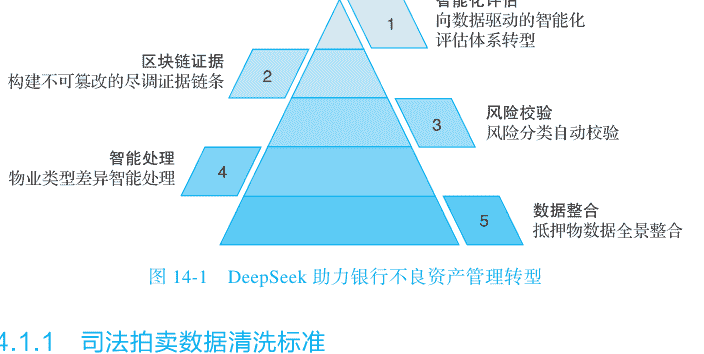

## 14.1.1 司法拍卖数据清洗标准

#### 1. 场景介绍

司法拍卖数据管理是资产处置的基础环节，银行需整合全国法院公告等 9 类数据源，制定包含流拍次数等在内的 12 项数据清洗指标。资产保全岗需开发异常值自动剔除算法，确保数据质量符合监管要求。此项工作重点在于防范数据失真引发的估值偏差风险，同时优化清洗算法对不同地区司法执行差异的适应能力。

#### 2. DeepSeek 提示词

角色＋任务：我是银行资产保全岗人员，需设计司法拍卖数据清洗标准，应设置哪些有效性校验？

#### 3. 追问提示词

- 如何识别关联方虚假竞价？
- 历史成交价如何进行季节性调整？
- 如何设定监管评估中对偏差的容忍阈值？

#### 4. 输出形式

数据清洗日志（Excel 文件）、校验规则手册（Word 文件）。

#### 5. 案例演示

（1）DeepSeek 提示词
角色 + 任务：我是银行资产保全岗人员，需设计司法拍卖数据清洗标准，应设置哪些有效性校验？要求不编造、不臆测，符合银行实际场景，确保网页链接真实有效，严格按照监管要求执行。

（2）DeepSeek 首次输出
根据最高人民法院及相关部门关于网络司法拍卖的规范性文件，结合金融机构在资产保全中的实际需求，司法拍卖数据清洗的有效性校验标准应围绕数据完整性、准确性、合规性、逻辑一致性等维度设计。以下为具体校验要点及依据。

一、数据完整性校验
1. 标的物基本信息的完整性
必填字段校验：包括标的物名称、类型（不动产、动产、股权等）、权属证明编号、地理位置、评估价、起拍价、保留价等字段。

2. 特殊标的物附加信息

- 不动产：需校验户型图、交易税目、占有使用情况（如是否带租赁权、居住权）。
- 机动车：需校验行驶里程、排放标准、违章记录等。
- 股权：需校验实缴出资额、财务报表等。

3. 法律状态信息的完整性

- 权属负担：如抵押、查封、租赁等权利限制是否完整披露。
- 建设工程价款核查：需校验是否注明了欠付工程款及优先受偿权人信息。

4. 流程文件的完整性

校验拍卖公告、评估报告、成交裁定书、过户证明等文档是否齐全。

二、数据准确性校验

1. 权属关系真实性

- 核对标的物权属证明（如不动产权证、机动车登记证）与执行法院调查结果的一致性，防止虚假或失效证明。
- 对“带租赁权”拍卖的标的物，需校验租赁合同签订时间、租金支付记录等，排除倒签合同等规避执行行为。

2. 价格合理性

- 起拍价是否不低于评估价或市场价的 70%（民事案件）。
- 刑事涉案财产无保留价拍卖时，需校验保证金和加价幅度是否经合议庭审批。

3. 竞买人资格合规性

- 校验竞买人是否符合法律要求（如竞买人是否为拍卖辅助机构关联方）。
- 对需特殊资质的标的物（如采矿权），校验竞买人的资质证明文件。

三、合规性校验

1. 程序合法性

- 拍卖流程是否符合《最高人民法院关于进一步规范网络司法拍卖工作的指导意见》要求，如是否经过合议庭审批重大事项（起拍价、唯一住房拍卖等）。
- 刑事涉案财产是否完成财政部门或被害人意见征询程序。

2. 信息披露合规性

- 拍卖公告是否如实披露标的物瑕疵、占有情况、权利负担等，禁止使用“占有不明”等模糊表述。
- 竞买资格限制是否在公告中明确标注。

3. 反洗钱合规性

- 竞买人身份识别：校验身份证明文件的真实性，禁止匿名账户参与竞拍。
- 资金来源审查：对大额交易（如单笔 5 万元以上）需登记资金来源及用途。

四、逻辑一致性校验

1. 时间逻辑

- 拍卖公告发布时间是否早于竞拍开始时间，且公示期不短于法定期限（如不动产 30 日）。
- 被执行人自行处置期限是否不超过 60 日。

2. 价格逻辑

- 流拍后降价幅度是否符合规定（如每次降价不超过前次保留价的 20%）。
- 以物抵债价格是否与最后一次流拍价一致。

3. 流程衔接性

成交后过户裁定是否与付款记录匹配，如“带封过户”需校验贷款融资手续是否齐全。

五、安全与隐私校验

1. 敏感数据加密

竞买人身份证号、联系方式等敏感信息是否脱敏或加密存储，符合《金融机构客户尽职调查和客户身份资料及交易记录保存管理办法》要求。

2. 数据权限控制

校验拍卖辅助机构是否违规接触过竞买人信息或使用过办案系统。

六、异常数据识别

1. 重复记录筛查

同一标的物多次流拍记录是否合理，排除数据重复或错误。

2. 矛盾数据标记

如标的物状态为“已成交”但缺失过户记录，需标记并核查。

七、实施建议

1. 技术工具支持

结合福建省《公共数据清洗技术要求》(DB35/T 2240—2024)，采用规则引擎自动化校验缺失值、重复值及逻辑矛盾。

2. 人工复核机制

对高风险数据（如大额交易、刑事涉案财产）进行人工二次审核。

3. 动态更新标准

根据最高人民法院及央行最新监管要求（如反洗钱政策）定期更新校验规则。

通过以上校验标准，可有效提升司法拍卖数据的质量，确保银行资产保全工作符合监管要求并降低法律风险。具体实施时可参考《最高人民法院关于进一步规范网络司法拍卖工作的指导意见》及反洗钱相关法规进一步细化规则。

（3）追问提示词

- 如何识别关联方虚假竞价？
- 历史成交价如何进行季节性调整？
- 如何设定监管评估中的偏差容忍度？

（4）DeepSeek 再次输出

以下针对司法拍卖数据清洗中关联方虚假竞价识别、历史成交价季节性调整及监管评估中偏差容忍度设定三个问题的分析，综合了最高人民法院规范性文件及实务经验。

一、如何识别关联方虚假竞价

1. 关联关系核查

- 通过工商登记信息、亲属关系数据库等渠道，验证竞买人与被执行人、债权人、抵押人之间的关联性（如亲属、控股关系等）。
- 需结合《最高人民法院关于人民法院网络司法拍卖若干问题的规定》第三十一条，对竞买人与拍卖辅助机构、被执行人之间的异常资金往来进行筛查。

2. 竞价行为分析

- 标记短时间内多次加价但最终悔拍的账户，结合保证金缴纳记录分析是否存在“抬价－悔拍”模式。
- 利用算法监测异常竞价频率，如非理性加价幅度（如远高于市场溢价率）或固定时间间隔的机械式出价。

3. 法律程序辅助

根据《网拍指导意见》第十一条，联合公安机关、市场监管部门打击虚假宣传和诱导行为，将频繁参与关联拍卖的账户纳入黑名单。

通过执行异议程序审查竞买人资格，对涉嫌串通的案件启动听证程序。

二、历史成交价如何进行季节性调整

1. 基础数据清洗

- 区分标的物类型（如不动产、机动车）并分类统计，因为不同资产受季节影响差异显著（如学区房在开学季溢价较高）。
- 剔除异常值：排除因权利负担（如长期租约）、特殊事件（如疫情）导致的偏离市场价成交数据。

2. 季节因子计算

- 采用移动平均法或 X-12-ARIMA 模型分解时间序列数据，提取趋势项、季节项和残差项。例如，商业地产在年末因资金回笼需求可能降价，需对受此类周期性波动影响的数据进行季节性调整。
- 参考地方房地产交易平台的月度价格指数，对法拍房成交价进行归一化处理。

3. 拍卖阶段修正

根据一拍、二拍、变卖阶段的降价规则（如二拍时起拍价降幅不超过20%），动态调整历史数据权重，避免因流程差异导致偏差。

三、如何设定监管评估中的偏差容忍度

1. 法律依据与市场波动平衡

- 根据《最高人民法院关于进一步规范网络司法拍卖工作的指导意见》第四条，网络询价结果若明显偏离市场价值，当事人可申请委托评估，建议将偏差容忍度设为 5%～10%。
- 对特殊资产（如股权、在建工程）偏差容忍度适当放宽至 15%，因为其估值复杂度较高。

2. 动态调整机制

- 按资产类别设定差异化的容忍阈值：例如机动车因折旧快可允许 8% 的估值偏差，不动产的估值则控制在 5% 以内。
- 结合宏观经济指标（如 GDP 增速、利率变化）定期修订容忍度，确保与市场波动同步。

3. 风险分级管理

- 对高价值标的（如超过 5000 万元的不动产）实行更严格的标准（如 3% 的估值偏差），并触发人工复核机制。
- 偏差超限时，自动预警并回溯评估流程，检查是否遗漏关键信息（如未披露的工程款优先权）。

4. 实施建议

- 技术工具：引入 AI 模型（如随机森林）识别关联方竞价模式，并集成季节调整算法至数据清洗系统。
- 合规衔接：将偏差容忍度写入内部操作手册，并参照《金融机构客户尽职调查和客户身份资料及交易记录保存管理办法》加密敏感数据。
- 案例库建设：汇总恶意竞价判例及季节性波动参数，为校验规则提供实证支持。

通过上述措施，可系统性提升数据清洗的精准度，降低银行资产保全中的法律与操作风险。

（5）第二次追问

将以上内容分别整理成以下格式输出。

Excel 模板（数据清洗日志），以 HTML 代码的形式输出，需要内嵌可直接下载 Excel 文件的代码按钮，实现一键下载 Excel 文件。

Word 文件（校验规则手册），以 HTML 代码的形式输出，需要内嵌可直接下载 Word 文件的代码按钮，实现一键下载 Word 文件。

（6）DeepSeek 第三次输出

以下是按要求整理的可直接下载的 HTML 格式文件。

DeepSeek 输出的内容如图 14-2 所示。

单击“运行”按钮，可获得“数据清洗日志模板”，如图 14-3 所示。

下拉滚动条，可看到“校验规则手册”，如图 14-4 所示。

## 14.1.2 设置商业/住宅物业差异参数

#### 1. 场景介绍

物业评估管理是押品分类的核心工作，银行需建立以租金收益率为代表的等7类差异因子，针对不同物业类型分类评估：商业物业重点监测租约集中度，住宅物业则关注学区政策变动。评估管理岗需按季更新参数权重，确保符合相关文件的要求。此项工作重点在于防范评估模型参数失真引发的押品高估风险，同时提高政策变动预警灵敏度。

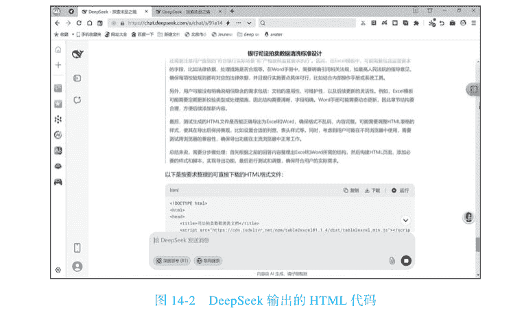

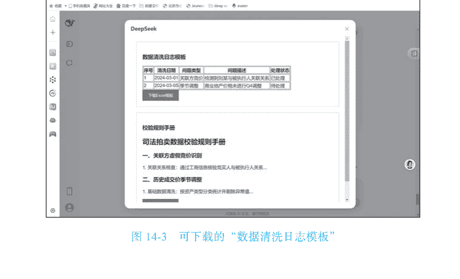

170 ◆ DeepSeek 银行实战手册：银行全场景 AI 实践指南（下册）

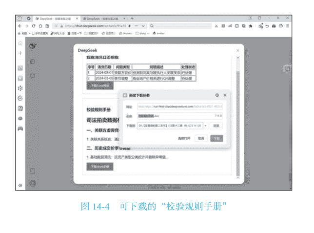

图 14-4 可下载的“校验规则手册”

#### 2. DeepSeek 提示词

角色 + 任务：我是银行评估管理岗人员，需制定商业 / 住宅物业差异参数表，应包含哪些监管底线？

#### 3. 追问提示词

- 如何应对限购政策突变？
- 混合用途物业如何分类？
- 抵押率的监管要求如何嵌入参数设置流程？

#### 4. 输出形式

参数对照表（Excel 文件）、评估调整记录（Word 文件）。

## 14.1.3 房产价格波动预警

#### 1. 场景介绍

价格监控是押品动态管理的核心环节。以房产为例，银行需对接住房和城乡建设部房地产相关数据系统，动态获取数据，构建 8 项预警指标。资产监控岗需设置月波动超 ±5% 则自动重估的机制，确保符合呆账核销管理规定。此项工作重点在于防范价格剧烈波动对资本充足率产生的不利影响，同时提升区域库存数据更新的时效性。

#### 2. DeepSeek 提示词

角色 + 任务：我是银行资产监控岗人员，需设计房产价格波动预警规则，应参考哪些市场信号？

#### 3. 追问提示词

- 如何识别人为操纵挂牌价？
- 如何动态修正法拍房折扣率？
- 价格波动预警如何与拨备计提规则联动？

#### 4. 输出形式

价格波动指数（Excel 文件）、重估触发记录（Excel 文件）。

## 14.1.4 资产尽调评估场景清单

- 司法数据采集与清洗
- 物业权属核查
- 差异化参数配置
- 市场动态监测
- 监管报备准备
- 评估报告生成

## 14.2 债务重组设计

银行在债务重组设计过程中面临两大挑战：一是各方权益难以平衡；二是法律条款适配性不足。当前痛点集中在方案灵活性不足、法律条款执行存在偏差、动态监测机制缺失等问题上（如图 14-5 所示）。银行需重点构建“方案设计 - 法律适配 - 履约监测”三位一体的管理体系。法律合规团队需强化企业经营状况智能诊断、法律条款动态映射、重组效能持续追踪三项核心能力。

通过智能重组系统与法律分析平台，DeepSeek 可帮助银行实现企业再生能力精准评估、重整方案智能生成、法律条款自动核验等功能，并依托区块链技术构建不可篡改的重组协议存证链条，推动债务重组从经验驱动模式向覆盖经营潜力量化、法律条款严格适配、履约能力动态监测的智能化重组体系转型。

## 14.2.1 制定 EBITDA 调整规则

#### 1. 场景介绍

财务真实性验证是债务重组的核心环节，银行需制定涵盖非经常性损益等9项内容的EBITDA（息税折旧及摊销前盈利）调整标准，重点识别管理层薪酬异常增长等风险。债务重组委员会实施双人复核机制，确保各项调整符合会计准则要求。此项工作重点在于防范财务粉饰引发的授信决策失误风险，同时优化关联交易识别算法。

#### 2. DeepSeek 提示词

角色 + 任务：我是银行债务重组委员会人员，需制定 EBITDA 调整规则，应设置哪些红线指标？

#### 3. 追问提示词

- 如何验证表外负债的真实性？
- 如何识别监管认定的逃废债行为？
- 如何追溯历史财务调整差异？

#### 4. 输出形式

调整项对照表（Excel 文件）、尽调底稿（Word 文件）。

## 14.2.2 设置阶梯式股权回转机制

#### 1. 场景介绍

股权管理是债转股实施过程的关键环节，银行需设计业绩对赌条款设置按30%、50%、70%三档解锁的阶梯式股权回转机制。法律事务部应设置反稀释条款，确保整体方案符合上市公司收购及信息披露的监管要求。此项工作重点在于防范股权价值稀释风险，同时提高业绩考核指标的合理性。

#### 2. DeepSeek 提示词

角色 + 任务：我是银行法律事务部人员，需设计股权解锁条件，应包含哪些保护条款？

#### 3. 追问提示词

- 如何防范股权限复质押？
- 业绩指标波动应如何平滑处理？
- 如何落实监管部门对信息披露的要求？

#### 4. 输出形式

股权协议模板（Word 文件）、触发条件矩阵（Excel 文件）。

## 14.2.3 表决权委托

#### 1. 场景介绍

公司治理是投资后管理的关注重点，银行需构建“决策保留 + 日常委托”的混合治理机制，保留重大资产处置等5项表决权。法律合规部应设置委托终止的触发条款。此项工作重点在于防范治理权弱化引发的道德风险，同时提高重大事项决策的响应效率。

#### 2. DeepSeek 提示词

角色 + 任务：我是银行法律合规部人员，需设计日常委托范围，应设置哪些制衡机制？

#### 3. 追问提示词

- 如何监控委托方决策合规性？
- 如何规避利益冲突事项？
- 如何嵌入监管部门对关联交易的信息披露要求？

#### 4. 输出形式

委托权限清单（Excel 文件）、协议范本（Word 文件）。

## 14.2.4 债务重组设计场景清单

- 企业偿债能力分析
- 重组方案设计
- 债权人会议管理
- 协议法律审查
- 监管沟通报备
- 执行效果跟踪

## 14.3 司法处置推进

银行在司法处置推进过程中面临清偿顺位争议复杂化、网络拍卖成交率不足等挑战，当前痛点集中在清偿规则适配滞后、网络拍卖流程标准化不足、协同处置机制缺失等问题上。银行需重点构建“规则适配 - 流程优化 - 协同处置”三位一体的管理体系。资产处置团队需强化法律规则智能解析、网络拍卖全流程穿透管理、跨机构数据协同三项核心能力（如图 14-6 所示）。

通过智能处置系统与协同管理平台，DeepSeek 可帮助银行实现清偿顺位智能适配、网络拍卖流程标准化改造、跨机构协同处置强化等功能，并依托机器学习算法建立标的物动态估值模型与竞买人精准触达机制，推动司法处置从传统分散作业模式向覆盖规则智能适配、流程标准管控、协同效能提升的数字化处置体系转型。

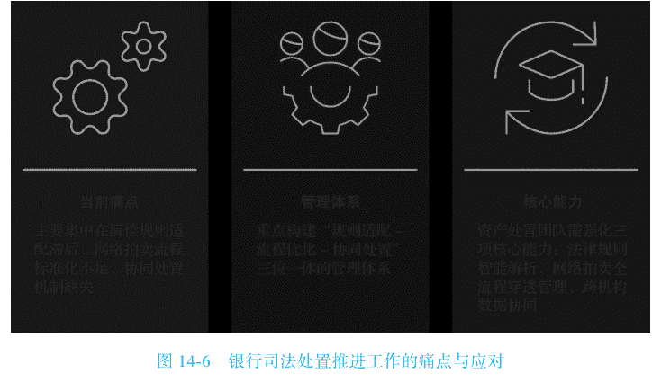

## 14.3.1 清偿顺序确认

#### 1. 场景介绍

债权确权是破产重整的关键任务，银行需建立分层确认机制，重点核查建设工程款等享有优先受偿权的债权类型。资产保全委员会应设置异议债权公示期，确保符合最高人民法院司法解释的相关要求。此项工作重点在于防范清偿顺序争议引发的资产流失风险，同时优化特殊债权核查流程。

#### 2. DeepSeek 提示词

角色 + 任务：我是银行法律事务部人员，需制定清偿顺序确认流程，应设置哪些核查节点？

#### 3. 追问提示词

- 如何应对轮候查封所引发的优先权争议？
- 刑民交叉类债权如何排序？
- 监管部门对损失核销的要求如何嵌入清偿流程？

#### 4. 输出形式

清偿顺序图（Visio 文件）、债权确认书（Word 文件）。

## 14.3.2 网络拍卖流程改造

#### 1. 场景介绍

司法拍卖是不良资产处置的关键环节，银行需优化公告模板，增加 VR 看样等 6 项要素。科技中心应开发竞买人资格审核系统，将流拍率控制在 30% 以内。此项工作重点在于防范程序瑕疵引发的法律纠纷风险，同时提高竞买人画像的精准度。

#### 2. DeepSeek 提示词

角色 + 任务：我是银行资产处置岗人员，需设计公告要素，应包含哪些风险提示？

#### 3. 追问提示词

- 如何防范悔拍引发的保证金纠纷？
- 如何明确税费承担条款？
- 如何落实监管部门对信息披露的要求？

#### 4. 输出形式

网拍操作手册（Word 文件）、成交数据分析表（Excel 文件）。

## 14.3.3 投资人尽调支持

#### 1. 场景介绍

投资人尽调服务是保障不良资产处置效率的关键环节，银行需建立电子数据室，提供 12 类标准化尽调包。客户服务部应设置 7 × 24 小时响应机制，确保 5 日内完成档案移交。此项工作重点在于防范信息不对称引发的交易延迟风险，同时优化电子签章验证流程。

#### 2. DeepSeek 提示词

角色 + 任务：我是银行投资者关系管理部人员，需优化投资人资料包，应

## 14.3.4 司法处置推进场景清单

- 债权确权登记
- 处置方案备案
- 司法拍卖执行
- 成交确权过户
- 资金分配清算
- 监管报告归档

## 14.4 资产处置管理

银行资产处置管理面临处置渠道单一、价值评估失真、区域风险集中等挑战，当前痛点集中在资产包组合优化不足、定价与市场脱节、合规流程执行偏差、跨区域协同低效等问题，需重点构建“组合优化-定价校准-合规管控”三位一体管理体系，资产处置团队需强化优先级资产精准筛选、宏观经济敏感度矩阵搭建、跨省资产包组合规则落地等核心能力。

通过智能处置平台与合规管理系统，DeepSeek 可帮助银行实现资产包组合动态优化、区域风险智能预警、优先级资产筛选匹配、宏观经济敏感度实时测算、跨省资产包合规组合适配等功能，并依托区块链技术构建处置全流程存证链条，全面契合《金融企业不良资产批量转让管理办法》监管要求，推动资产处置管理从传统线下处置模式向覆盖组合风险可控、定价精准公允、合规全程可溯的数字化管理体系转型（如图 14-7 所示）。

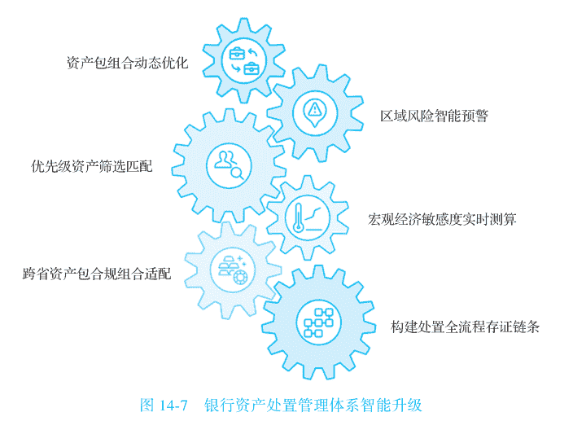

### 14.4.1 制定优先级资产筛选标准

#### 1. 场景介绍

资产分类是制定资产处置策略的首要任务，银行需建立基于 8 项核心指标的评估模型，将资产划分 AAA、AA、A 三级。资产保全岗应确保分类标准符合财政部会计核算办法的相关规定。此项工作重点在于防范资产错配导致的处置效率损失，同时增加对现金流稳定性的监测频率。

#### 2. DeepSeek 提示词

角色 + 任务：我是银行资产保全岗人员，需制定优先级资产筛选标准，应设置哪些价值评估维度？

#### 3. 追问提示词

- 如何验证抵押物的最新市场价值？
- 如何校准现金流预测模型？
- 如何落实监管部门对最低转让定价的要求？

#### 4. 输出形式

筛选规则手册（Word 文件）、资产分类清单（Excel 文件）。

### 14.4.2 构建宏观经济敏感度模型

#### 1. 场景介绍

宏观经济风险管理是优化资产组合的关键工作，银行需开发涵盖 12 个因子的影响度模型，实施季度压力测试。数据分析岗应设置 GDP 增速预警阈值（如低于 5% 则预警）。此项工作重点在于防范经济周期波动引发的资产贬值风险，同时提高因子贡献度的计算精度。

#### 2. DeepSeek 提示词

角色 + 任务：我是银行数据分析岗人员，构建宏观经济敏感度模型，应包含哪些区域性经济指标？

#### 3. 追问提示词

- 如何量化地方政府财政支持力度？
- 如何评估产业政策变动对宏观经济的影响？
- 如何将监管部门对区域性风险限额的要求嵌入模型？

#### 4. 输出形式

敏感度系数表（Excel 文件）、压力测试报告（Word 文件）。

### 14.4.3 制定跨省资产包组合规则

#### 1. 场景介绍

区域风险分散是提升资产配置安全性的核心环节，银行需制定“3 省 5 市”原则，控制单一区域敞口，使之不超过 30%。法律合规部应核查不同省份司法执行效率差异，确保符合最高人民法院关于跨区域执行的规定。此项工作重点在于防范区域司法壁垒引发的处置阻滞风险，同时优化执行协作响应机制。

#### 2. DeepSeek 提示词

角色 + 任务：我是银行法律合规部人员，需制定跨省资产包组合规则，应关注哪些司法差异？

#### 3. 追问提示词

- 如何应对地方保护主义的干扰？
- 如何平衡跨省税费结构差异？
- 如何落实监管部门对并表管理的要求？

#### 4. 输出形式

区域分布热力图（Excel 文件）、司法效率对比表（Excel 文件）。

### 14.4.4 资产处置管理场景清单

- 资产价值评估
- 宏观经济影响分析
- 区域组合优化
- 法律尽职调查
- 监管备案审批
- 交易文件归档

## 14.5 资产证券化

银行的资产证券化业务面临基础资产质量波动、监管穿透性不足等挑战，当前痛点集中在资产筛选标准粗放、现金流预测模型精度不足、监管合规适配滞后等问题上（如图 14-8 所示）。银行需重点构建“资产筛选 - 模型优化 - 合规管控”三位一体的管理体系。投资银行团队需强化基础资产智能穿透、现金流动态预测、监管规则精准映射三项核心能力。

通过智能风控系统与合规管理平台，DeepSeek 可帮助银行实现基础资产智能筛选、现金流预测动态优化、监管合规自动校验等功能，并依托区块链技术构建不可篡改的资产确权存证链条，推动资产证券化从传统经验驱动模式向覆盖资产全景穿透、风险动态预警、监管无缝衔接的智能化资产证券化体系转型。

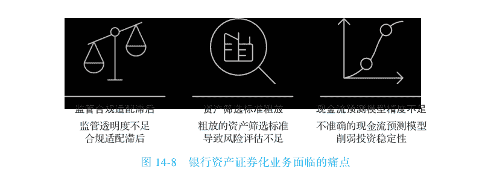

### 14.5.1 资产池压力测试

#### 1. 场景介绍

资产池压力测试是防控资产证券化风险的核心环节，银行需模拟早偿率提升 20% 等极端场景，计算资产池预期损失。量化分析岗应设置 AAA 级证券现金流覆盖倍数不低于 3 倍的硬约束。此项工作重点在于防范现金流断裂引发的兑付违约风险，同时优化早偿行为预测模型。

#### 2. DeepSeek 提示词

角色 + 任务：我是银行量化分析岗人员，需设计资产池压力测试方案，应包含哪些监管规定情景？

#### 3. 追问提示词

- 如何识别关联交易风险传染？
- 历史数据不足时如何补充数据以支持建模？
- 如何体现监管部门对风险自留的要求？

#### 4. 输出形式

压力测试参数表（Excel 文件）、现金流覆盖分析（Excel 文件）。

### 14.5.2 信用增级设计

#### 1. 场景介绍

信用增级是资产证券化产品结构设计的关键环节，银行需构建 5 级增信体系，并设置触发式增级机制。产品设计岗应在累计违约率超过 5% 时启动补充增信。此项工作重点在于防范信用评级下调引发的市场风险，同时优化增级触发条件的灵敏度。

#### 2. DeepSeek 提示词

角色 + 任务：我是银行产品设计岗人员，需优化增信结构，应设置哪些可动态调整的条款？

#### 3. 追问提示词

- 如何平衡增级成本与评级目标？
- 如何动态评估第三方担保机构的信用状况？
- 监管部门对资本计提的要求如何嵌入增信结构？

#### 4. 输出形式

增信方案书（Word 文件）、触发条件矩阵（Excel 文件）。

### 14.5.3 信息披露系统设计

#### 1. 场景介绍

信息披露是资产证券化合规管理的核心要求，银行需开发 XBRL（可扩展商业报告语言）数据转换工具，实现 T+1 日逐笔披露。科技中心应设置敏感字段脱敏规则，符合信息披露指引。此项工作重点在于防范披露违规引发的法律风险，同时优化对非结构化数据处理能力。

#### 2. DeepSeek 提示词

角色 + 任务：我是银行科技运营岗人员，需设计信息披露系统，应满足哪些数据安全要求？

#### 3. 追问提示词

- 如何实现客户隐私保护？
- 历史数据追溯披露应如何操作？
- 如何应对监管部门对数据质量的检查？

#### 4. 输出形式

字段映射表（Excel 文件）、脱敏规则库（Excel 文件）。

### 14.5.4 资产证券化场景清单

- 基础资产筛选
- 现金流建模
- 信用增级设计
- 法律文件审查
- 监管沟通报备
- 存续期管理

## 14.6 租赁物处置

银行在处置租赁物时面临设备估值复杂化、跨境流程风险攀升等挑战，当前痛点集中在设备估值标准缺失、海关流程协同困难、监管合规执行存在偏差等问题上。银行需重点构建“估值优化－流程协同－合规管控”三位一体的处置体系。特殊资产团队需强化设备价值智能评估、跨境流程穿透管理、监管规则精准适配三项核心能力。

通过智能处置系统与合规管理平台，DeepSeek 可帮助银行实现设备价值动态评估、海关流程智能协同、监管合规自动校验等功能，并依托区块链技术构建不可篡改的跨境处置存证链条，推动租赁物处置从传统经验判断模式向覆盖设备价值精准量化、流程智能协同、监管无缝衔接的专业化处置体系转型（如图 14-9 所示）。

### 14.6.1 建立设备专用评估模型

#### 1. 场景介绍

设备估值是动产管理的重要工作，银行需开发包含剩余寿命等 9 项因子在内的评估模型。技术专家应按季更新设备折旧曲线，确保符合 ISO 55000 资产管理标准。此项工作重点在于防范技术迭代引发的设备价值高估风险，同时优化行业技术演进动态监测机制。

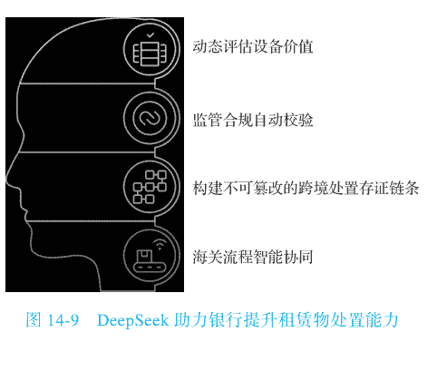

#### 2. DeepSeek 提示词

角色 + 任务：我是银行技术专家，需建立设备专用评估模型，应包含哪些行业特性参数？

#### 3. 追问提示词

- 如何获取设备运行历史数据？
- 如何量化技术迭代风险？
- 如何落实监管部门对残值评估的要求？

#### 4. 输出形式

折旧参数表（Excel 文件）、评估报告模板（Word 文件）。

### 14.6.2 优化海关申报流程

#### 1. 场景介绍

跨境资产管理是国际合规的重点环节，银行需编制含 HS 编码等 12 项申报要素的操作指南。国际业务部应设置资产状态变更即时申报机制，确保符合海关管理规定。此项工作重点在于防范申报不实引发处罚的风险，同时优化关务系统与业务系统的数据验证接口。

#### 2. DeepSeek 提示词

角色 + 任务：我是银行国际业务部人员，需优化海关申报流程，应关注哪些时效性要求？

#### 3. 追问提示词

- 如何应对海关商品归类争议？
- 如何管理临时进出口设备的申报？
- 如何规避监管罚则风险？

#### 4. 输出形式

申报要素清单（Excel 文件）、异常处置预案（Word 文件）。

### 14.6.3 制定厂商回购承诺条款

#### 1. 场景介绍

风险缓释机制是设备融资管理的重要保障，银行需与设备厂商签署包含设备状态条款的回购协议。客户管理岗应按年评估厂商信用评级，评级低于 BB 级则触发增信。此项工作重点在于防范设备残值不足引发的回收风险，同时优化回购价格动态调整机制。

#### 2. DeepSeek 提示词

角色 + 任务：我是银行法律事务部人员，需制定厂商回购承诺条款，应设置哪些履约保障？

#### 3. 追问提示词

- 如何防范厂商破产带来的履约风险？
- 如何界定设备自然损耗责任？
- 监管部门关于关联交易的适用规则如何落实？

#### 4. 输出形式

回购协议模板（Word 文件）、厂商评级跟踪表（Excel 文件）。

### 14.6.4 租赁物处置场景清单

- 设备技术评估
- 海关合规申报
- 厂商信用管理
- 司法拍卖准备
- 残值回收处理
- 监管报告编制

## 14.7 债务催收管理

银行在债务催收过程中面临债务人信息不全、失联修复效率低等挑战，当前痛点集中在债务人识别精准度不足、失联状态修复手段单一、催收过程存在合规隐患等问题上。银行需重点构建“智能识别-失联修复-合规管控”三位一体的管理体系。资产保全团队需强化债务人画像精准构建、失联信息智能修复、催收行为合规校验三项核心能力。

通过智能催收系统与合规管理平台，DeepSeek 可帮助银行实现债务人关系网络智能识别、失联状态动态修复、催收合规自动核验等功能，并依托区块链技术建立不可篡改的催收过程存证链条，推动债务催收从传统人工外呼模式向覆盖债务人精准定位、失联状态智能修复、监管无缝衔接的智能催收体系转型（如图 14-10 所示）。

### 14.7.1 设计债务人画像标签

#### 1. 场景介绍

债务人画像构建是制定催收策略的核心环节，银行需整合 12 类数据源，构建多维标签体系。催收管理岗应设置动态评分模型（满分 1000 分），当评分在 400 分以下时启动高强度催收措施。此项工作重点在于防范催收资源错配风险，同时增加对社会关系网络分析的深度。

#### 2. DeepSeek 提示词

角色 + 任务：我是银行催收管理岗人员，需设计债务人画像标签，应包含哪些合规数据维度？

#### 3. 追问提示词

- 如何避免采集敏感个人信息？
- 如何合规使用司法公开范围之外的信息？
- 监管部门发布的催收行为规范如何嵌入标签？

#### 4. 输出形式

标签体系手册（Word 文件）、数据源清单（Excel 文件）。

### 14.7.2 设计声纹识别规则

#### 1. 场景介绍

电话催收合规管理是消费者权益保护的重点环节，银行需部署声纹比对引擎，实现 1:N 声纹快速匹配。合规管理岗应设置生物特征加密存储机制，确保符合《中华人民共和国个人信息保护法》的要求。此项工作重点在于防范隐私泄露引发的法律风险，同时优化声纹特征匹配效率。

#### 2. DeepSeek 提示词

角色 + 任务：我是银行合规管理岗人员，需设计声纹识别规则，应设置哪些隐私保护措施？

#### 3. 追问提示词

- 如何获得客户对声纹采集与使用的明示同意？
- 声纹识别出现误判时如何申诉及纠正？
- 监管部门检查时如何提供合规的声纹使用日志？

#### 4. 输出形式

声纹采集授权书（Word 文件）、识别日志模板（Excel 文件）。

### 14.7.3 制定失联修复方案

#### 1. 场景介绍

失联修复是催收效能提升的关键环节，银行需基于政务数据等多个数据源建立交叉验证模型。失联修复岗应设置 7 日修复周期，确保修复成功率不低于 60%。此项工作重点在于防范信息孤岛导致的失联资产损失，同时优化多源数据融合算法。

#### 2. DeepSeek 提示词

角色 + 任务：我是银行失联修复岗人员，需制定失联修复方案，应遵守哪些数据使用限制？

#### 3. 追问提示词

- 如何避免过度采集公共数据？
- 如何合规接入第三方数据服务？
- 如何落实监管部门对客户信息保护的要求？

#### 4. 输出形式

修复路径图（Visio 文件）、数据使用台账（Excel 文件）。

### 14.7.4 债务催收管理场景清单

- 债务人信息核验
- 催收策略匹配
- 失联状态判定
- 修复渠道部署
- 催收过程记录
- 监管投诉处理

## 14.8 “以物抵债”管理

银行在“以物抵债”管理过程中面临资产估值失真、交易风险攀升等挑战，当前痛点集中在估值模型精准度不足、交易安全保障缺失、监管合规执行存在偏差等问题上。银行需重点构建“估值优化－安全保障－合规管控”三位一体的管理体系（如图 14-11 所示）。特殊资产团队需强化抵债资产智能估值、交易风险动态预警、监管规则精准适配三项核心能力。

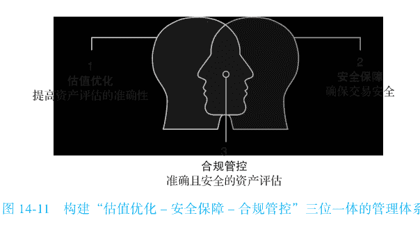

通过智能处置系统与合规管理平台，DeepSeek 可帮助银行实现抵债资产动态估值、权属风险智能识别、监管合规自动校验等功能，并依托区块链技术构建不可篡改的抵债交易存证链条，推动“以物抵债”管理从传统经验判断模式向覆盖资产价值动态评估、交易风险智能防控、监管要求严格落实的标准化管理体系转型。

### 14.8.1 设计瑕疵评级标准

#### 1. 场景介绍

瑕疵资产处置是风险防控的重要内容，银行需建立含 9 项指标的瑕疵评级模型。评估管理岗应设置 C 级资产抵押率不超过 50% 的强制保险机制。此项工作重点在于防范产权争议引发的处置失败风险，同时优化物理损耗的评估方法。

#### 2. DeepSeek 提示词

角色 + 任务：我是银行评估管理岗人员，需设计瑕疵评级标准，应包含哪些法律风险要素？

#### 3. 追问提示词

- 如何识别隐性产权纠纷？
- 如何验证历史维修记录？
- 如何落实监管部门对最低价值的评估要求？

#### 4. 输出形式

瑕疵评级手册（Word 文件）、案例库（Excel 文件）。

### 14.8.2 创新“瑕疵资产 + 保险”产品

#### 1. 场景介绍

风险转移是瑕疵资产处置的关键环节，银行需开发产权瑕疵责任险，覆盖 6 类风险（如产权归属争议、产权证件不全等）。产品设计岗应设置保费与风险动态挂钩机制，最高保额不超过资产价值的 70%。此项工作重点在于防范不可控风险引发的资产减值风险，同时优化风险概率的精算模型。

#### 2. DeepSeek 提示词

角色 + 任务：我是银行产品设计岗人员，需制定瑕疵资产保险条款，应设置哪些除外责任？

#### 3. 追问提示词

- 如何防范道德风险？
- 如何界定历史遗留问题？
- 如何满足保险产品备案监管要求？

#### 4. 输出形式

保险产品说明书（Word 文件）、精算模型（Excel 文件）。

### 14.8.3 识别虚假租赁合同

#### 1. 场景介绍

租赁核查是资产确权的重点工作，银行需构建风险特征库，开发基于自然语言处理的识别引擎。科技中心应重点检测“倒签日期”等 12 类风险特征。此项工作重点在于防范虚假租赁引发的处置障碍，同时提升自然语言时间轴分析能力。

#### 2. DeepSeek 提示词

角色 + 任务：我是银行法律合规部人员，需设计租赁合同识别规则，应关注哪些司法裁判要点？

#### 3. 追问提示词

- 如何应对新型合同欺诈手段？
- 如何准确解析方言条款？
- 监管部门关于关联交易的认定标准如何嵌入识别规则？

#### 4. 输出形式

风险特征库（Excel 文件）、合同模板（Word 文件）。

### 14.8.4 “以物抵债”管理场景清单

- 抵债物法律确权
- 瑕疵等级评定
- 保险产品匹配
- 交易对手尽调
- 合同风险审查
- 监管备案登记

## 14.9 档案数字化管理

银行档案数字化管理面临数据安全风险高、证据效力不足等挑战，当前痛点集中在数据存储分散化、存证合规性弱、监管适配效率低等问题上。银行需重点构建“安全存储－司法存证－合规管控”三位一体的管理体系。运营管理团队需强化数据全生命周期加密、电子证据效力固化、监管规则智能适配三项核心能力。

通过司法级电子档案系统与区块链存证平台，DeepSeek 可帮助银行实现档案数据安全存储、电子证据效力强化、监管合规自动校验等功能，并依托知识图谱技术构建档案关联检索网络，推动档案管理从传统纸质管理模式向覆盖数据加密存储、证据链完整追溯、监管穿透校验的司法级数字化体系转型（如图 14-12 所示）。

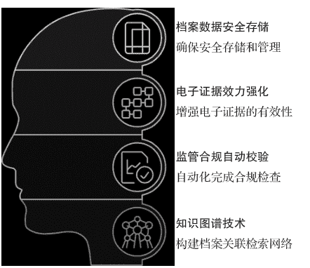

### 14.9.1 设计数据备份策略

#### 1. 场景介绍

档案存证是法律合规的核心环节，银行需建立“同城双活 + 异地灾备”架构。系统管理岗应设置修改操作的三员分立机制，确保符合国家信息安全等级保护三级标准。此项工作重点在于防范数据篡改引发的法律效力风险，同时优化存证平台的审计追溯功能。

#### 2. DeepSeek 提示词

角色 + 任务：我是银行系统管理岗人员，需设计数据备份策略，应满足哪些容灾标准？

#### 3. 追问提示词

- 如何实现秒级故障切换？

#### 4. 输出形式

存储架构图（Visio 文件）、灾备演练记录（Excel 文件）。

## 14.9.2 设计法律关系图谱

#### 1. 场景介绍

法律关系分析是案件处置的重要节点，银行需构建包含当事人等司法实体的知识图谱。数据分析岗应实现 10 秒生成关系链图。此项工作重点在于防范关联关系遗漏引发的决策风险，同时提升图谱的动态扩展能力。

#### 2. DeepSeek 提示词

角色 + 任务：我是银行数据分析岗人员，需设计法律关系图谱，应包含哪些司法实体？

#### 3. 追问提示词

- 如何识别复杂担保关系？
- 如何结构化提取裁判文书中的要素？
- 监管部门对关联方认定的规则如何嵌入图谱？

#### 4. 输出形式

实体关系模型（Visio 文件）、关联分析报告（Word 文件）。

## 14.9.3 操作日志存证

#### 1. 场景介绍

操作审计是风险防控的关键环节，银行需部署联盟链节点，实现操作日志上链存证。审计岗应设置 7 × 24 小时链上监控，确保符合网络安全审查要求。此项工作重点在于防范操作抵赖引发的内控失效风险，同时提升智能合约验证效率。

#### 2. DeepSeek 提示词

角色 + 任务：我是银行审计岗人员，需设计操作日志存证规则，应包含哪些审计关键字段？

#### 3. 追问提示词

- 如何平衡隐私保护与审计需求？
- 如何管理联盟链节点准入机制？
- 监管部门对数据出境的限制如何合规应对？

#### 4. 输出形式

区块链存证规范（Word 文件）、审计轨迹报告（Excel 文件）。

## 14.9.4 档案数字化管理场景清单

- 纸质档案电子化
- 数据加密处理
- 区块链存证
- 多节点备份
- 权限动态管控
- 司法调取响应

## 14.10 损失核销管理

银行在开展损失核销时面临材料真实性验证困难、追索时效控制不精准等挑战，当前痛点集中在核销材料核查手段落后、追索期动态监控缺失、监管合规执行存在偏差等问题上。银行需重点构建“材料核验－追索监控－合规管控”三位一体的核销体系（如图 14-13 所示）。风险管理团队需强化证据链智能穿透、追索时效动态管理、监管规则精准映射三项核心能力。

通过智能核销系统与合规管理平台，DeepSeek 可帮助银行实现核销材料真实性核查、追索期智能监控、监管合规自动校验等功能，并依托区块链技术建立不可篡改的核销证据存证链条，推动损失核销从传统人工审批模式向覆盖证据智能验证、追偿路径全程跟踪、监管要求穿透校验的标准化核销体系转型。

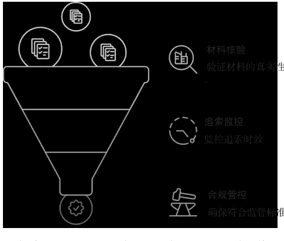

## 14.10.1 司法文书核验

#### 1. 场景介绍

司法文书核验是核销审批的关键环节，银行需对接中国裁判文书网，构建12项核验指标。核销审批岗应设置三级预警机制，并在24小时内完成可疑文书复核。此项工作重点在于防范虚假文书导致的不合规核销风险，同时优化印章特征识别算法。

#### 2. DeepSeek 提示词

角色 + 任务：我是银行核销审批岗人员，需设计司法文书核验规则，应包含哪些防伪特征？

#### 3. 追问提示词

- 如何应对电子文书哈希值篡改？
- 如何应对地方司法文书格式差异？
- 核销材料归档的监管要求如何落实？

#### 4. 输出形式

核验标准手册（Word 文件）、可疑文书案例库（Excel 文件）。

## 14.10.2 建立双人交叉验证流程

#### 1. 场景介绍

核销审查是风险防控的必要措施，银行需建立“初审 + 复审”流程，核查损失金额逻辑。审计岗应留存双人电子签名日志，确保符合相关监管要求。此项工作重点在于防范操作失误引发的财务风险，同时优化证明材料智能比对功能。

#### 2. DeepSeek 提示词

角色 + 任务：我是银行内控审计岗人员，需设计双人交叉验证流程，应设置哪些冲突解决机制？

#### 3. 追问提示词

- 如何避免串通舞弊风险？
- 如何追溯分析历史核销差异？
- 如何快速响应监管部门的飞行检查？

#### 4. 输出形式

交叉验证清单（Excel 文件）、审计轨迹记录（Excel 文件）。

## 14.10.3 制定追索策略

#### 1. 场景介绍

追索管理是核销后处置的基本工作，银行需开发预警模型，提前 6 个月提示可追索资产。法律事务岗应按季更新财产线索，并将追索成功率纳入考核。此项工作重点在于防范追偿超期失权风险，同时提高对债务人财产线索的挖掘能力。

#### 2. DeepSeek 提示词

角色 + 任务：我是银行法律事务岗人员，需制定追索策略，应包含哪些财产线索来源？

#### 3. 追问提示词

- 如何合法获取债务人新增资产信息？
- 跨境追索时如何协调司法协助？
- 如何执行监管部门对已核销资产的回冲规定？

#### 4. 输出形式

追索计划表（Excel 文件）、司法协作记录（Word 文件）。

## 14.10.4 损失核销管理场景清单

- 核销材料收集
- 文书真实性核验
- 损失金额确认
- 双人审批留痕
- 追索期监控
- 监管报告编制

## 14.11 税务筹划

银行在进行不良资产处置中的税务筹划时，面临税负成本高企、合规风险攀升等挑战，当前痛点集中在政策适配滞后、税负测算精度不足、合规证据链不完整等问题上。银行需重点构建“政策分析－动态建模－合规管理”三位一体的筹划体系。税务管理团队需强化税收政策智能解析、处置方案动态建模、合规证据穿透管理三项核心能力（如图 14-14 所示）。

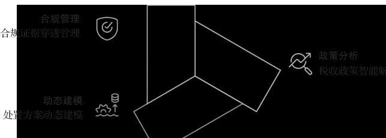

通过智能税务系统与合规管理平台，DeepSeek 可帮助银行实现税收政策动态适配、税负成本智能优化、合规证据链穿透管理等功能，并依托自然语言处理技术解析税务稽查要点，生成风险提示清单，推动税务筹划从经验驱动模式向覆盖政策精准适配、税负动态模拟、证据智能溯源的智能化管理体系转型，实现税负成本降低与合规风险管控的双重目标。

## 14.11.1 各地特殊资产税收政策匹配

#### 1. 场景介绍

税务优化是不良资产处置的增效环节，银行需建立覆盖 300 余个地市税收政策的数据库，并标注自贸区条款。税务筹划岗应设置将节税效率提升 20% 以上的目标。此项工作重点在于防范政策误用引发的税务合规风险，同时优化区域税收政策关联推荐算法。

#### 2. DeepSeek 提示词

角色 + 任务：我是银行税务筹划岗人员，需设计各地区特殊资产税收政策匹配逻辑，应关注哪些政策适用条件？

#### 3. 追问提示词

- 如何应对地方政策溯及力变化？
- 跨区域资产包如何拆分及适配？
- 如何合理规避反避税条款？

#### 4. 输出形式

政策匹配矩阵（Excel 文件）、优惠申请模板（Word 文件）。

## 14.11.2 制定土地增值税清算策略

#### 1. 场景介绍

土地增值税清算是资产处置的关键税务项目，银行需开发扣除项目核验工具，验证开发成本票据。税务管理岗应设置延迟纳税 3 年及以上的优化模型。此项工作重点在于防范因成本认定不清导致的税务清算风险，同时优化票据 OCR 识别准确率。

#### 2. DeepSeek 提示词

角色 + 任务：我是银行税务管理岗人员，需制定土地增值税清算策略，应设置哪些风险缓释措施？

#### 3. 追问提示词

- 如何应对税务机关对成本核定不认可的情形？
- 历史票据缺失如何合法补救？
- 关联交易的定价如何满足监管合规要求？

#### 4. 输出形式

扣除项目清单（Excel 文件）、税务风险预案（Word 文件）。

## 14.11.3 设计跨境税务处理合规方案

#### 1. 场景介绍

国际税务合规是跨境处置的核心环节，银行需构建 BEPS（Base Erosion and Profit Shifting，税基侵蚀与利润转移）框架，监控 7 类税务风险点。法律合规岗应设置国别报告自动生成功能，符合 OECD 标准。此项工作重点在于防范税基侵蚀引发的处罚风险，同时加强对转让定价可比数据的分析。

#### 2. DeepSeek 提示词

角色 + 任务：我是银行国际业务部人员，需设计跨境税务处理合规方案，应包含哪些文档准备要求？

#### 3. 追问提示词

- 如何应对数字服务税等新型税收机制？
- 如何充分运用税收协定优惠？
- CRS 数据如何与银行自身合规系统衔接？

#### 4. 输出形式

国别报告模板（Word 文件）、转让定价文档（Excel 文件）。

## 14.11.4 税务筹划场景清单

- 税收政策分析
- 优惠资格判定
- 税负模拟测算
- 申报材料准备
- 跨境合规审查
- 监管沟通备案

## 14.12 绩效评估

银行在进行不良资产处置中的绩效评估时，面临资本消耗高企、策略响应滞后等挑战，当前痛点集中在资本计量不精准、策略优化效率低、监管合规校验不足等问题上。银行需重点构建“资本监控－策略优化－合规校验”三位一体的评估体系。计划财务团队需强化资本消耗智能计量、处置策略动态适配、监管规则精准映射三项核心能力。

通过智能评估系统与合规管理平台，DeepSeek 可帮助银行实现处置资本消耗动态跟踪、处置策略智能优化、监管合规自动校验等功能，并依托区块链技术建立不可篡改的处置数据存证链条，推动不良资产处置中的绩效评估从静态结果评价模式向覆盖资本动态跟踪、策略敏捷迭代、监管即时响应的智能化绩效管理体系转型。

## 14.12.1 资金转移定价

#### 1. 场景介绍

资金转移定价（FTP）是绩效管理的关键内容，银行需应用 FTP 曲线区分定价组件。绩效考核岗应设置 EVA（经济增加值）指标中资本成本率≥10% 的考核下限。此项工作重点在于防范定价机制失真引发的资源配置失衡风险，同时优化流动性溢价计量模型。

#### 2. DeepSeek 提示词

角色 + 任务：我是银行绩效考核岗人员，需构建 FTP 转移定价模型，应包含哪些市场基准？

#### 3. 追问提示词

- 如何反映期限错配成本？
- 非标资产如何合理定价？
- 如何嵌入监管资本计量规则？

#### 4. 输出形式

FTP 曲线参数表（Excel 文件）、成本分摊规则（Word 文件）。

## 14.12.2 不良资产处置策略多维分析

#### 1. 场景介绍

处置策略评估可以为战略决策提供必要的支持，银行需构建包括 RAROC（风险调整资本回报）在内的 8 绩效评估矩阵，实施季度同业对标。数据分析岗应动态调整指标权重。此项工作重点在于防范评估片面引发的战略误判风险，同时提高同业数据获取的时效性。

#### 2. DeepSeek 提示词

角色 + 任务：我是银行数据分析岗人员，需设计不良资产处置策略多维分析框架，应设置哪些监管约束条件？

#### 3. 追问提示词

- 如何平衡短期收益与长期风险？
- 如何量化处置策略时滞效应？
- 监管部门对并表管理的要求如何体现？

#### 4. 输出形式

评估指标库（Excel 文件）、同业对标报告（Word 文件）。

## 14.12.3 制定处置策略调整规则

#### 1. 场景介绍

处置策略的动态调整是风险管控的关键环节，银行需建立预警模型，在回收率连续 3 个月低于 15% 的预期目标时强制重检。决策支持岗应设置季度迭代机制，确保调整方案 5 日内落地。此项工作重点在于防范处置策略失效引发的资产减值风险，同时提高回收预测模型的灵敏度。

#### 2. DeepSeek 提示词

角色 + 任务：我是银行决策支持岗人员，需制定处置策略调整规则，应包含哪些触发场景？

#### 3. 追问提示词

- 如何识别市场环境结构性变化？
- 如何控制策略切换成本？
- 监管部门对风险偏好的调整如何传导？

#### 4. 输出形式

阈值设置手册（Word 文件）、策略调整记录（Excel 文件）。

## 14.12.4 绩效评估场景清单

- 资本成本计量
- 风险收益分析
- 同业数据对标
- 策略有效性评估
- 调整方案制定
- 监管指标报送

## 14.13 本章小结

本章聚焦银行不良资产管理的智能化转型，围绕资产尽调评估、债务重组设计、司法处置推进、资产处置管理、资产证券化、租赁物处置、债务催收管理、“以物抵债”管理、档案数字化管理、损失核销管理、税务筹划及绩效评估等关键领域，剖析痛点并提出基于 DeepSeek 的解决方案，通过精准尽调、合规处置与价值修复，助力银行提升管理效能、降低风险、优化资源配置，推动不良资产管理向精细化模式演进。

# 15 DeepSeek 财富管理场景应用

银行财富管理业务正处于数字化转型的关键时期，客户需求正从单一资产配置向综合财富规划迅速升级，服务模式呈现出线上、线下全渠道协同的特征。在金融开放政策和跨境监管趋严的背景下，同业竞争的焦点已从产品销售规模转向合规穿透能力建设，尤其是在家族信托、ESG投资等关键领域，银行亟须提高法律文本的适配效率和对客户需求的洞察力。业务人员正面临跨境法律理解偏差、策略动态调整滞后的现实挑战。

银行财富管理业务的痛点主要体现在三个方面：一是跨境法律适配的数字化程度不足导致合规风险，例如家族信托业务在离岸架构设计与外汇登记环节存在流程断点；二是ESG投资的筛选标准模糊，限制了策略的有效性，“漂绿”行为的识别与信息披露一致性的监测缺乏实时性；三是客户风险偏好的量化工具滞后，传统测评模型难以捕捉行为金融学中的非理性决策偏差，影响了《关于规范金融机构资产管理业务的指导意见》中对适当性管理要求的落实。

通过部署智能财富管理平台、法律文本解析引擎及行为金融分析模型，DeepSeek可以帮助银行实现关键突破：构建离岸法律数据库直连通道，实现合规架构的智能生成；建立行业特征驱动的ESG评价指标体系，并运用前景理论（Prospect Theory）量化客户的损失厌恶系数。

本章将重点解析DeepSeek如何通过“合规穿透－策略优化－精准匹配”三重路径，重塑财富管理模式，有效解决法律适配低效、ESG筛选失真、风险偏好错配等核心问题，助力银行财富管理实现“跨境服务合规化、投资策略科学化、客户洞察精细化”的转型目标。

## 15.1 家族信托跨境资产配置

银行在开展家族信托跨境资产配置业务时，面临法律冲突加剧、监管穿透性不足等挑战，当前痛点集中在多法域规则适配滞后、合规穿透不足、外汇管理风险攀升等问题上。银行需重点构建“法律适配－合规穿透－外汇管控”三位一体的服务体系（如图15-1所示）。私人银行团队需强化多法域规则解析、跨境交易穿透核验、外汇动态监测三项核心能力。

通过智能信托系统与合规管理平台，DeepSeek 可帮助银行实现多法域规则智能适配、跨境交易穿透式核验、外汇风险动态预警等功能，并依托数字孪生技术构建跨境资产配置仿真模型，推动家族信托服务从传统离岸架构模式向覆盖法律智能适配、交易全链存证、监管即时响应的全球化智能信托体系转型。

## 15.1.1 离岸信托设立地法律适配性分析

#### 1. 场景介绍

离岸信托设立地法律适配性分析，是银行助力客户构建稳固、合规且高效离岸信托架构的关键工作。在全球化资产配置及财富传承需求增长的背景下，不同司法管辖区的法律差异，深刻影响着离岸信托的设立、运营与成效。银行需全面整合包括开曼群岛、新加坡等热门司法管辖区在内的法律条款，搭建涵盖永续期、撤销权、受托人职责、资产保护机制、税收政策、信息披露要求等18项核心要素的对比模型，并通过这一模型，直观呈现各司法管辖区法律的异同，为客户提供清晰、准确的法律参考。

#### 2. DeepSeek 提示词

角色 + 任务：我是银行法律合规部人员，需设计国际法律对比模型，比较各司法管辖区法律的异同，应包含哪些冲突预警指标？

#### 3. 追问提示词

- 如何应对离岸地法律年度修订？
- 跨境继承条款如何适配中国法律？
- 监管中的穿透申报要求如何嵌入模型？

#### 4. 输出形式

法律条款对照表（Excel 文件）、架构合规建议书（Word 文件）。

#### 5. 案例演示

（1）DeepSeek 提示词

角色 + 任务：我是银行法律合规部人员，需设计国际法律对比模型，比较各司法管辖区法律的异同，应包含哪些冲突预警指标？要求不编造、不臆测，符合银行实际场景，确保网页链接真实有效，严格按照监管要求执行。

（2）DeepSeek 首次输出

设计适用于银行法律合规的国际法律对比模型，需结合跨境业务的核心风险点，从以下冲突预警指标入手进行系统性对比分析，确保符合监管要求并覆盖主要司法管辖区的差异。以下为关键指标及法律依据。

一、担保责任与保证人权利差异

1. 保证方式默认规则

- 中国：未明确约定保证方式时，按照一般保证承担保证责任（《中华人民共和国民法典》）。
- 其他大陆法系国家（如瑞士、奥地利）：未约定时默认为一般保证，保证人可行使先诉抗辩权，要求债权人先执行债务人财产。
- 冲突预警：跨境担保协议中若未明确约定保证方式，可能导致对保证人责任范围的争议。

2. 先诉抗辩权的行使条件

- 瑞士：债权人需证明已对债务人财产强制执行未果（《瑞士债法典》）。
- 奥地利：仅需债权人向债务人催告即可要求保证人履行（《奥地利民法典》）。
- 冲突预警：不同法域对债权人举证责任要求不同，影响债务追索策略。

二、反洗钱与反恐融资（AML/CFT）标准

1. 高风险客户尽职调查（KYC）要求

- 国际标准（FATF 建议）：需识别受益所有人（Beneficial Ownership），筛查与黑名单/灰名单国家的交易。
- 中国：按照《法人金融机构洗钱和恐怖融资风险自评估指引》要求对客户风险等级分类，动态监测交易。
- 欧盟：适用《反洗钱指令》（AMLD），强调政治公众人物（PEPs）的强化尽调。
- 冲突预警：不同地区对高风险客户的认定标准及尽调深度存在差异。

2. 制裁名单与交易限制

- 对 FATF 黑名单国家（如朝鲜、伊朗）需加强尽调，避免资金结算受限。
- 美国 OFAC 清单与欧盟制裁名单的范围可能不一致，需双重筛查。

三、跨境资金流动与外汇管制

1. 外汇申报与轧差结算规则

- 中国：允许加工贸易收付汇轧差净额结算，但需季度内完成。
- 欧盟：对跨境支付信息透明度要求更高（如 FATF 第 16 条修订草案）。
- 冲突预警：部分国家禁止轧差结算，需逐笔申报，增加操作复杂度。

2. 经营性租赁外汇管理

- 中国：承租方须具备等值 1 亿美元以上外汇收入，且租金收入不得结汇（特殊情形除外）。
- 欧盟：对租赁物资金来源及用途限制较少，但需符合《外国补贴条例》（Foreign Subsidies Regulation）避免市场扭曲。

四、银行处置机制与债权人保护

1. 自救优先原则（Bail-in）

- 欧盟：银行出现危机时优先由股东和债权人承担损失，国家援助为最后手段（《信贷机构与投资公司复苏与处置指令》）。
- 美国：依据《多德－弗兰克法案》（Dodd-Frank Act）要求“债权人利益不恶化”，清算时受偿不低于破产水平。
- 冲突预警：部分新兴市场国家仍依赖政府救助，导致跨境债权回收风险。

冲突预警：跨境业务中数据存储与传输合规成本差异显著。

## 五、国际制裁与补贴规则冲突

### 1. 跨境补贴认定

欧盟：《外国补贴条例》将外国政府补贴纳入审查，可能认定中国企业对欧投资构成市场扭曲。

WTO 规则：现行《补贴与反补贴措施协定》（Agreement on Subsidies and Countervailing Measures）未明确跨境补贴规制，易引发合规争议。

冲突预警：银行需审查客户是否涉及欧盟认定的“外国补贴”，避免融资项目受限。

### 2. 模型实施建议

- 动态更新机制：整合 FATF 黑名单、各国央行法规的更新（如欧盟《外国补贴条例》生效时间）。
- 风险量化工具：参考山东大学“智慧算法”构建风险评估指标，穿透分析交易链条。
- 合规培训模块：针对跨境担保、AML、数据隐私等高频冲突领域设计案例库。

通过对比上述指标，银行可系统性识别法律冲突风险，优化合规策略。具体操作需结合各司法管辖区最新法规动态调整（如欧盟 2024 年对银行处置规则的更新）。

### （3）追问提示词

- 如何应对离岸地法律年度修订？
- 跨境继承条款如何适配中国法律？
- 监管中的穿透式申报要求如何嵌入模型？

### （4）DeepSeek 第二次输出

针对银行法律合规部在国际法律对比模型中需关注的三大核心问题，结合跨境业务的实际场景与监管要求，综合搜索结果分析如下。

## 一、应对离岸地法律年度修订的策略

### 1. 动态法律监控与合规架构调整

- 法律追踪机制：建立离岸法域法律修订数据库，重点关注 BVI（英属维尔京群岛）、开曼群岛、新加坡等常用离岸地的公司法、税法变化。例如，中国税务机关通过 CRS 机制强化对离岸公司的穿透式审查，需同步更新税务居民身份认定规则。
- 合规架构重构：根据修订内容调整离岸控股架构。例如，若离岸地提高信息披露要求，可引入信托或基金会隔离实际控制人信息；若税制收紧，需重新评估“实际管理地”原则对税务居民身份的影响。
- 案例应对：参考上海浦东新区法规制定经验，结合《外国补贴条例》要求，优化离岸债券发行结构以避免市场扭曲认定。

### 2. 风险对冲工具

- 合同条款预留弹性：在离岸合作协议中增设“法律变更条款”，明确修订后的法律适用及争议解决方式（如仲裁地选择）。
- 税务身份规划：利用新加坡 NOR (Not Ordinary Resident, 非普通公民) 政策等低税率地区身份，通过调整居住天数或企业实际管理地，平衡税负与合规风险。

## 二、跨境继承条款适配中国法律的路径

### 1. 遗嘱形式与效力的双重合规

- 形式要件：根据《中华人民共和国涉外民事关系法律适用法》第三十二条，遗嘱形式可适用行为地法，但需注意中国法对代书遗嘱的严格要求（如两位见证人全程在场并签名）。例如，境外遗嘱即使经公证认证，若缺乏代书环节仍可能被认定无效。
- 效力认定：遗嘱内容不得违反中国法律强制性规定。例如，未为缺乏劳动能力的继承人保留必要份额的遗嘱，可能被法院部分撤销。

### 2. 跨境执行与资金转移

- 外汇合规流程：继承资金出境需提交产权证明、法院调解书等材料至国家外汇管理局审批，确保符合《中华人民共和国外汇管理条例》要求。
- 调解优先策略：参考爱辉区法院“云端 + 双语”调解模式，通过跨境在线调解平台快速达成协议，降低诉讼成本与执行风险。

## 三、监管部门对穿透申报要求的嵌入方案

### 1. 数据穿透与系统整合

- 底层资产登记：参照银行业理财穿透登记规则，建立自动化系统实时采集资管计划、协议委外等底层资产信息，确保每周上报的时效性。
- 技术工具应用：利用区块链技术实现资产流向可追溯，满足 CRS 对加密货币、保单等新型资产的穿透申报要求。

### 2. 合规流程再造

- 内控制度：制定跨境业务穿透管理手册，明确各部门在客户尽调、交易监测、数据报送中的职责。例如，对离岸公司控股的境内企业，需核查实际控制人是否触发“非居民企业”认定。
- 风险量化模型：引入山东大学“智慧算法”评估嵌套层级与杠杆率，自动预警违规套利行为（如多层 SPV 规避投资范围限制）。

### 3. 培训与考核机制

- 专题培训：针对 AML、CRS、理财穿透等高频领域设计案例库，强化员工对欧盟《反洗钱指令》、中国《中华人民共和国个人信息保护法》等差异条款的理解。
- 合规考核：将穿透申报准确率纳入 KPI，对漏报、错报行为设置分级处罚措施。

### 4. 实施建议

- 跨部门协作：法律合规部需与 IT 部门合作开发合规管理系统，实时对接监管数据接口（如国家外汇管理局、CRS 信息平台）。
- 外部专家支持：聘请跨境税务律师与数据合规顾问，针对新兴领域（如离岸债券、家族信托）提供专项解决方案。
- 压力测试：定期模拟离岸法律修订、继承争议、穿透检查等场景，验证应急响应机制的有效性。

通过上述策略，银行可系统性应对离岸法律动态变化、跨境继承复杂情况及监管对穿透的严苛要求，实现合规成本与业务效率的平衡。

### （5）第二次追问提示词

- 接下载 Word 文件的按钮代码，实现一键下载 Word 文件。

### （6）DeepSeek 第三次输出

以下是符合要求的 HTML 格式代码，包含 Excel 法律条款与 Word 合规建议书下载功能。

DeepSeek 输出的内容如图 15-2 所示。

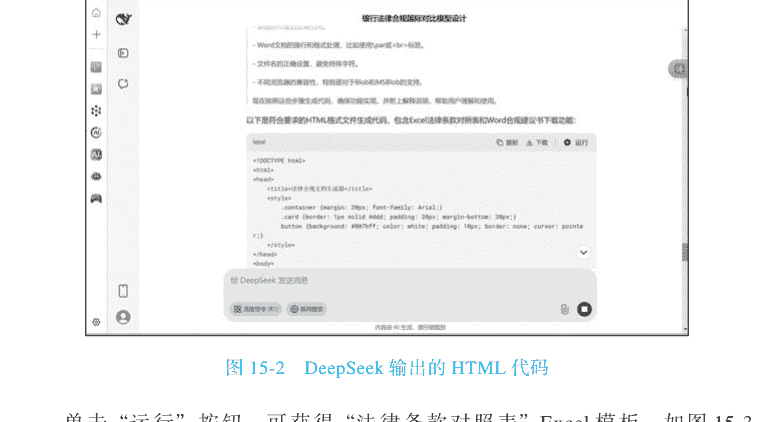

单击“运行”按钮，可获得“法律条款对照表”Excel 模板，如图 15-3 所示。

下拉滚动条，可看到“架构合规建议书”Word 模板，可直接下载到本地，如图 15-4 所示。

## 15.1.2 外汇登记合规性穿透管理

#### 1. 场景介绍

银行需开发外汇登记智能核验工具，自动识别“37 号文”（即《国家外汇管理局关于进一步简化和改进直接投资外汇管理政策的通知》）中涉及的登记缺陷。外汇管理岗需设置 T+1 日异常交易冻结机制，确保符合跨境资金流动监测要求。

212 🟦 DeepSeek 银行实战手册：银行全场景 AI 实践指南（下册）

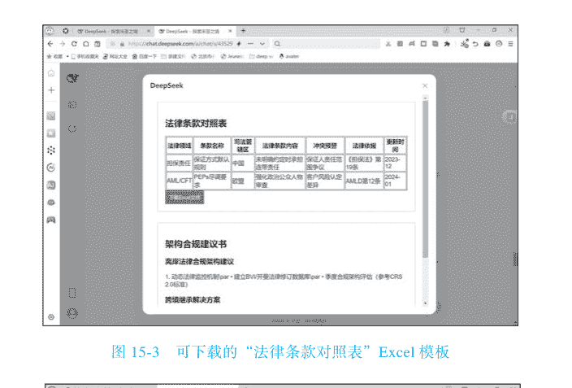

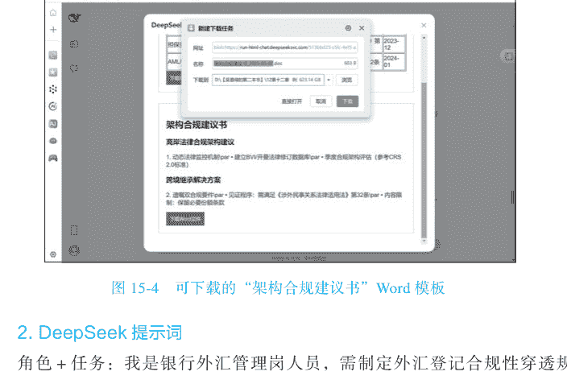

#### 2. DeepSeek 提示词

角色 + 任务：我是银行外汇管理岗人员，需制定外汇登记合规性穿透规则，应关注哪些申报要素？

#### 3. 追问提示词

- 多层 SPV 架构如何申报？
- 历史登记补正如何操作？
- 如何快速响应监管现场检查？

#### 4. 输出形式

外汇登记流程图（Visio 文件）、异常交易台账（Excel 文件）。

## 15.1.3 税收居民智能判定

#### 1. 场景介绍

CRS 申报自动化系统是银行落实跨境税收信息交换合规要求的核心支撑，银行需严格对接 OECD 共同申报准则（CRS）的统一标准，专项开发账户持有人税收居民身份智能判定引擎，通过多维度数据校验实现身份精准判定。财务部门需搭建敏感税收信息加密传输通道，保障申报数据在采集、传输、报送全流程的安全性与保密性，同时持续优化判定规则与申报流程，稳步提升 CRS 申报数据的准确率。

#### 2. DeepSeek 提示词

角色 + 任务：我是银行财务管理部门人员，需设计客户税收居民身份判定逻辑，应包含哪些身份验证文件？

#### 3. 追问提示词

- 双重国籍客户如何分类申报？
- 自证文件模糊如何处理？
- 如何与监管数据接口对接？

#### 4. 输出形式

CRS 申报校验规则（Excel 文件）、身份证明模板（Word 文件）。

## 15.1.4 反洗钱动态监控规则库

#### 1. 场景介绍

反洗钱动态监控规则库是银行防范洗钱风险的核心技术支撑，银行需构建涵盖交易频率、关联方关系、资金流向、交易金额等 12 项核心风险特征的智能监测模型，全面捕捉异常交易信号。反洗钱监控岗位需建立高风险信托账户日级扫描机制，对账户交易行为进行实时监测与穿透核查，严格遵循《金融机构大额交易和可疑交易报告管理办法》的监管要求，及时识别、分析并报送可疑交易，防范洗钱、恐怖融资等违规风险。

#### 2. DeepSeek 提示词

角色 + 任务：我是银行反洗钱监控岗人员，需优化反洗钱监测规则，应设置哪些异常交易阈值？

#### 3. 追问提示词

- 如何识别跨境资金分层交易？
- 慈善信托账户如何豁免监控？
- 如何动态更新监管部门制定的可疑交易判定标准？

#### 4. 输出形式

监控规则清单（Excel 文件）、案例特征库（Excel 文件）。

## 15.1.5 家族信托跨境资产配置场景清单

- 离岸法律环境评估
- 信托架构设计
- 外汇登记穿透
- CRS 合规申报
- 反洗钱监测
- 监管备案管理

## 15.2 ESG 主题 FOF 配置

银行在配置 ESG 主题 FOF（Fund of Funds，基金中的基金）产品时，面临“漂绿”风险加剧、监管穿透性不足等挑战，当前痛点集中在 ESG 数据整合能力弱、绿色项目评估存在偏差、信息披露合规性低等问题上（如图 15-5 所示）。银行需重点构建“数据治理－评估穿透－披露管控”三位一体的管理体系。资产管理团队需强化 ESG 数据智能整合、绿色项目穿透验证、信息披露合规校验三项核心能力。

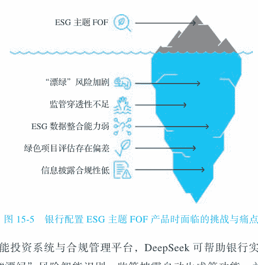

图 15-5 银行配置 ESG 主题 FOF 产品时面临的挑战与痛点

通过智能投资系统与合规管理平台，DeepSeek 可帮助银行实现 ESG 数据全景整合、“漂绿”风险智能识别、监管披露自动生成等功能，并依托区块链技术构建 ESG 数据存证链条，推动 ESG 主题 FOF 投资从传统标签化筛选模式向覆盖数据全链条穿透、环境效益可验证、监管要求严落实的负责任投资体系转型。

### 15.2.1 ESG 因子量化筛选引擎

#### 1. 场景介绍

银行需整合 MSCI（明晟）、Sustainalytics 等 6 大评级体系，构建包含碳排放强度、董事会多样性等 200 余项指标的 ESG 因子筛选模型。投资经理需设定季度动态调整机制，剔除连续两个季度评级下调的基金产品。

#### 2. DeepSeek 提示词

角色 + 任务：我是银行投资经理，需设计 ESG 因子筛选标准，应包含哪些争议排除条款？

216 ❖ DeepSeek 银行实战手册：银行全场景 AI 实践指南（下册）

#### 3. 追问提示词

- 如何解决不同评级体系冲突？
- 新兴行业数据缺失时如何处置？
- 如何嵌入监管部门的绿色分类标准？

#### 4. 输出形式

ESG 因子权重表（Excel 文件）、排除清单（Excel 文件）。

### 15.2.2 “漂绿”行为 AI 监测

#### 1. 场景介绍

银行需开发自然语言处理模型，实时监测基金宣传材料中的夸大表述。合规监测岗需设立“漂绿”嫌疑分级预警机制，对于高风险案例，应在 24 小时内提交给人工核查。

#### 2. DeepSeek 提示词

角色 + 任务：我是银行合规监测人员，需制定“漂绿”行为监测规则，应关注哪些典型话术？

#### 3. 追问提示词

- 如何识别模糊性承诺？
- 历史处罚案例如何纳入行为识别库？
- 如何与监管部门的投诉数据联动？

#### 4. 输出形式

风险话术库（Excel 文件）、监测报告模板（Word 文件）。

### 15.2.3 ESG 主题轮动策略

#### 1. 场景介绍

银行需构建包含政策热度指数、行业碳排放趋势等 12 项因子的轮动模型。量化投资部需设置季度调仓阈值，当投资组合的主题偏离度超过 15% 时触发组合再平衡。

#### 2. DeepSeek 提示词

角色 + 任务：我是银行量化投资部人员，需设计 ESG 主题轮动参数，应设置哪些市场信号？

#### 3. 追问提示词

- 如何应对政策突发调整？
- 行业分类标准如何统一？
- 如何适配监管部门提出的 ESG 披露要求？

#### 4. 输出形式

轮动信号矩阵（Excel 文件）、策略回测报告（Word 文件）。

### 15.2.4 ESG 主题 FOF 配置场景清单

- ESG 数据采集
- 基金池构建
- 策略模型优化
- “漂绿”风险筛查
- 组合动态调整
- 监管信息披露

## 15.3 基于行为金融学的客户风险测评

银行在客户风险测评方面面临行为偏差识别不足、动态跟踪机制缺失等挑战，当前痛点集中在问卷评估有效性弱、行为数据整合不足、合规存在隐患等问题上。银行需重点构建“行为洞察 - 动态适配 - 合规管控”三位一体的测评体系（如图 15-6 所示）。财富管理团队需强化行为特征智能解析、风险偏好动态建模、监管规则精准映射三项核心能力。

通过智能测评系统与行为分析平台，DeepSeek 可帮助银行实现客户行为数据全景整合、风险等级动态校准、适当性匹配智能校验等功能，并依托区块链技术建立测评过程不可篡改的存证链，推动风险测评从静态问卷模式向覆盖行为特征捕捉、风险动态追踪、适当性精准匹配的智能化评估体系转型。

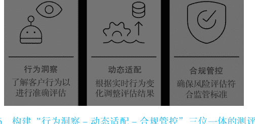

### 15.3.1 损失厌恶系数动态校准

#### 1. 场景介绍

银行需设计包含盈亏情境模拟、历史交易回溯等模块的测试工具。客户经理需按季度更新客户的损失厌恶系数，当实际结果偏离预期目标超 20% 时触发风险重评机制。

#### 2. DeepSeek 提示词

角色 + 任务：我是银行客户经理，需执行损失厌恶系数动态校准测试，应设置哪些情境变量？

#### 3. 追问提示词

- 如何避免测试结果失真？
- 市场极端波动如何影响损失厌恶系数？
- 如何验证监管部门要求的适当性匹配？

#### 4. 输出形式

校准测试记录（Excel 文件）、风险告知书（Word 文件）。

### 15.3.2 交易频率偏差预警

#### 1. 场景介绍

银行需构建包含市场热度指数、客户持仓集中度等因子的预警模型。风险监控岗需设定客户月交易次数超同类客户 90 分位数的强提醒机制。

#### 2. DeepSeek 提示词

角色 + 任务：我是银行风险监控岗人员，需设计交易频率偏差预警阈值，应参考哪些行为基准？

#### 3. 追问提示词

- 如何区分投资策略调整与非理性交易？
- 客户的职业特性如何纳入考量？
- 监管部门对投资者教育的要求如何嵌入预警模型？

#### 4. 输出形式

交易行为分析表（Excel 文件）、预警处置指南（Word 文件）。

### 15.3.3 心理账户可视化映射

#### 1. 场景介绍

银行需开发交互式图谱工具，直观展示客户教育、养老等 6 类心理账户的资金配置。理财经理需设置账户间资金转移建议功能，优化资产配置结构。

#### 2. DeepSeek 提示词

角色 + 任务：我是银行理财经理，需设计心理账户可视化映射模型，应包含哪些账户类别？

#### 3. 追问提示词

- 如何识别隐性心理账户？
- 文化差异如何影响心理账户分类？
- 销售适当性合规要求如何保障？

#### 4. 输出形式

心理账户分类图（Visio 文件）、配置建议书（Word 文件）。

### 15.3.4 基于行为金融学的客户风险测评场景清单

- 行为数据采集
- 认知偏差测试
- 动态模型校准
- 交易监控预警
- 心理账户优化
- 监管留痕管理

## 15.4 养老理财

银行养老理财业务面临收益波动加剧、长寿风险对冲不足等挑战，当前痛点集中在收益目标匹配存在偏差、风险对冲工具缺失、监管合规执行滞后等问题上。银行需重点构建“收益平衡－风险对冲－合规管控”三位一体的管理体系，养老金业务团队需强化生命周期智能建模、长期风险动态评估、监管规则精准适配三项核心能力。

通过智能管理系统与合规运营平台，DeepSeek 可帮助银行实现资产配置动态优化、长寿风险智能对冲、监管合规自动校验等功能，并依托区块链技术建立账户全流程操作存证链，推动养老理财服务从静态产品销售模式向覆盖全生命周期规划、风险精准对冲、监管无缝衔接的智能化养老金融体系转型。

### 15.4.1 目标日期基金滑行路径优化

#### 1. 场景介绍

在财富规划中，退休金管理占据着至关重要的地位。银行应当构建涵盖剩余工作年限等 12 个要素的滑行模型，以实现股票与债券配置比例的动态调整。投资经理需确立 5 年期波动率控制范围，并在客户退休前 5 年内，逐年将股票持仓比例降低 8%～12%。此项工作重点在于避免市场波动导致的收益不足风险，并提升预期寿命数据的校准频率。

#### 2. DeepSeek 提示词

角色 + 任务：我是银行投资经理，需设计目标日期基金滑行路径曲线，应设置哪些市场适应性参数？

#### 3. 追问提示词

- 如何应对延迟退休政策的影响？
- 如何量化长寿风险溢价？
- 如何嵌入监管部门对最低收益保证的要求？

#### 4. 输出形式

滑行路径图（Visio 文件）、参数校准报告（Word 文件）。

### 15.4.2 遗产继承智能分配

#### 1. 场景介绍

遗产规划是法律合规的重要组成部分，银行需构建遗嘱数据库并开发分配引擎，实现特留份（强制继承份额）计算与税费预估。遗产规划师应设置继承方案合规性预审流程，并将错误率控制在 0.5% 内。此项工作重点在于防范遗产分配纠纷引发的法律风险，同时优化亲属关系识别算法。

#### 2. DeepSeek 提示词

角色 + 任务：我是银行遗产规划师，需制定遗产分配规则，应包含哪些法定继承条款？

#### 3. 追问提示词

- 如何识别境外资产继承冲突？
- 如何预判遗嘱效力争议？
- 如何落实反洗钱监管要求？

#### 4. 输出形式

继承方案模板（Word 文件）、税费测算表（Excel 文件）。

### 15.4.3 长寿风险对冲

#### 1. 场景介绍

在养老产品设计中，风险对冲扮演着至关重要的角色，银行应构建与国家卫健委寿命统计数据相联系的长寿债券定价模型。风险管理岗应设定，当年化成本超过 2% 时立即进行复核。此项工作重点在于避免因寿命延长而产生的给付风险，并提升死亡率预测模型的准确性。

#### 2. DeepSeek 提示词

角色 + 任务：我是银行风险管理岗人员，需设计长寿风险对冲方案，应参考哪些精算基准？

#### 3. 追问提示词

- 如何应对区域间寿命差异？
- 如何计算监管部门强制要求的资本占用？
- 极端死亡率波动如何进行压力测试？

#### 4. 输出形式

对冲成本分析表（Excel 文件）、精算假设文档（Word 文件）。

### 15.4.4 养老理财场景清单

- 生命周期评估
- 滑行路径设计
- 遗产分配规划
- 长寿风险对冲
- 监管报备管理
- 客户定期检视

## 15.5 教育储蓄规划

银行在开展教育储蓄规划业务中，面临需求分层模糊、税收优惠政策利用率低等挑战，当前痛点集中在教育阶段开支预测偏差较大、储蓄工具适配性低、政策动态跟踪滞后等问题上。银行需重点构建“需求预测－工具优选－政策适配”三位一体的管理体系。财富顾问团队需强化教育阶段智能建模、投资工具穿透分析、税收政策精准匹配三项核心能力（如图 15-7 所示）。

## 15.5.1 教育阶段开支预测

#### 1. 场景介绍

银行需整合教育部发布的各阶段学历成本数据，构建包含基础教育、高等教育等 5 个阶段的教育开支模型。理财经理需设置通货膨胀动态校准参数，确保将预测误差率控制在 3% 以内。

#### 2. DeepSeek 提示词

角色 + 任务：我是银行数据分析岗人员，需设计教育开支预测模型，应包含哪些动态修正因子？

#### 3. 追问提示词

- 如何应对学区政策调整的影响？
- 如何量化国际学校费用差异？
- 教育资金专户管理的监管要求如何嵌入模型？

#### 4. 输出形式

开支预测表（Excel 文件）、校准报告（Word 文件）。

## 15.5.2 教育储蓄工具选择优化

#### 1. 场景介绍

银行需开发包含教育储蓄计划、预付学费计划、教育年金等 8 类工具的评估矩阵，设计风险收益平衡算法。投资顾问岗需建立工具穿透分析机制，自动排除综合评分低于 70 分的储蓄工具。

#### 2. DeepSeek 提示词

角色 + 任务：我是产品研发部人员，需制定教育储蓄工具评估标准，应设置哪些流动性约束条件？

#### 3. 追问提示词

- 如何防范教育类保险的兑付风险？
- 跨境教育支付如何适配储蓄工具？
- 如何根据监管部门的要求监控资金用途？

#### 4. 输出形式

工具评级清单（Excel 文件）、穿透分析报告（Word 文件）。

## 15.5.3 税收优惠智能匹配

#### 1. 场景介绍

银行需对接国家税务系统，开发优惠推荐引擎，实时匹配教育储蓄抵税政策。税务规划岗需设置临界值提醒功能，并确保对节税效率的提升不低于 25%。

#### 2. DeepSeek 提示词

角色 + 任务：我是银行税务规划岗人员，需设计税收优惠匹配逻辑，应包含哪些区域性差异参数？

#### 3. 追问提示词

- 多子女家庭如何叠加使用优惠？
- 反洗钱监管要求如何嵌入验证机制？

#### 4. 输出形式

优惠匹配方案（Excel 文件）、合规验证记录（Excel 文件）。

## 15.5.4 教育储蓄规划场景清单

- 需求阶段建模
- 开支动态预测
- 工具穿透评估
- 税收优惠匹配
- 资金专户监控
- 政策更新响应

## 15.6 房地产投资管理

银行在房地产投资管理中面临杠杆风险积聚、税务合规成本攀升等挑战，当前痛点集中在购房贷款结构失衡、租赁现金流预测失真、跨境税务处理不一致等问题上（如图 15-8 所示）。银行需重点构建“杠杆优化－现金流管理－税务穿透”三位一体的管理体系。不动产金融团队需强化贷款组合智能建模、租赁收益动态监测、跨境税务规则适配三项核心能力。

通过智能管理系统与税务合规平台，DeepSeek 可帮助银行实现房贷利率敏感性分析、租金收入智能预测、跨境税务风险预警等功能，并依托数字孪生技术构建房产投资仿真模型，推动房地产投资管理从单一按揭服务模式向覆盖资产全生命周期、税务穿透管理、风险动态对冲的综合性不动产金融体系转型。

## 15.6.1 房贷杠杆优化

#### 1. 场景介绍

银行需构建包含 LTV（贷款价值比）、DTI（债务收入比）等 12 项指标的房贷杠杆评估体系，并开发房贷压力测试模块。风控岗需设置预警熔断机制，当 LTV 超过 70% 时自动触发增信要求。

#### 2. DeepSeek 提示词

角色 + 任务：我是银行风控岗人员，需设计房贷杠杆优化参数，应设置哪些市场波动缓冲因子？

#### 3. 追问提示词

- 如何应对房产估值短期波动？
- 跨境抵押品如何折算价值？
- 如何动态适配首付比例监管要求？

#### 4. 输出形式

压力测试报告（Word 文件）、熔断规则表（Excel 文件）。

## 15.6.2 租赁现金流智能预测

#### 1. 场景介绍

银行需接入住房和城乡建设部租金指数，开发包含空置率、续租概率等因子的租赁现金流预测模型。资产管理岗需设置季度动态校准机制，当实际现金流与预测值的偏差超过 15% 时启动模型重训流程。

#### 2. DeepSeek 提示词

角色 + 任务：我是银行资产管理人员，需设计租赁现金流预测规则，应关注哪些区域经济指标？

#### 3. 追问提示词

- 如何量化特殊情况对长租公寓的影响？
- 商业地产与住宅的预测逻辑有何差异？
- 如何嵌入监管层对租金的管制政策？

#### 4. 输出形式

现金流预测表（Excel 文件）、校准日志（Excel 文件）。

## 15.6.3 跨境房产税务穿透

#### 1. 场景介绍

银行需构建覆盖 12 个主流移民目的国家的房产税务规则库，开发遗产税与资本利得税模拟器。税务顾问岗需设置双重征税预警机制，对高风险案例 24 小时内推送解决方案。

#### 2. DeepSeek 提示词

角色 + 任务：我是银行税务顾问岗人员，需设计跨境房产税务穿透规则，应包含哪些反避税条款？

#### 3. 追问提示词

- 如何识别壳公司持有房产的合规风险？
- 如何精准计算非居民预扣税？
- CRS 申报要求如何与跨境房产税务穿透规则联动？

#### 4. 输出形式

税务穿透报告（Word 文件）、风险案例库（Excel 文件）。

## 15.6.4 房地产投资管理场景清单

- 贷款结构优化
- 租赁收益建模
- 税务穿透管理
- 跨境资产核验
- 风险对冲策略
- 监管合规审查

## 15.7 上班族理财

银行的上班族理财业务面临“月光族”现象普遍、税务优化意识薄弱等挑战，当前痛点集中在工资自动分配效率低、个人所得税专项附加扣除利用率不足、职场风险对冲缺失等问题上。银行需重点构建“收支平衡 - 税务优化 - 职业保障”三位一体的管理体系。职场金融团队需强化消费行为智能分析、个人所得税专项附加扣除自动核验、职业中断保险动态适配三项核心能力。

通过智能账务系统与税务管理平台，DeepSeek 可帮助银行实现工资智能分账、个人所得税最优方案推荐、职业风险即时对冲等功能，并依托 AI 技术构建消费行为预测模型，推动上班族理财业务从零散资金管理向覆盖收支自动平衡、税务精准优化、职业风险全面防护的智能财务体系转型（如图 15-9 所示）。

## 15.7.1 智能分账

#### 1. 场景介绍

银行需开发包含房租、教育等 8 类固定支出的自动划转系统，设置剩余资金智能定投规则，实现工资收入的结构化管理。产品运营岗需建立消费冲动抑制算法，确保超额消费拦截成功率达到 80%。

#### 2. DeepSeek 提示词

角色 + 任务：我是银行产品经理，需设计工资智能分账逻辑，应设置哪些流动性应急通道？

#### 3. 追问提示词

- 如何识别灰色收入的合规入账？
- 如何实现跨行资金自动归集？
- 反洗钱监管要求如何嵌入系统流程？

#### 4. 输出形式

分账规则表（Excel 文件）、拦截日志（Excel 文件）。

## 15.7.2 个税抵扣

#### 1. 场景介绍

税务优化是个人金融服务的核心环节，银行需对接国家税务总局接口，开发涵盖 6 项专项附加扣除的自动填报系统。税务岗应设置退税智能提醒功能，确保节税效率提升不低于 30%。此项工作重点在于防范填报错误引发的税务合规风险，同时优化数据接口的稳定性。

#### 2. DeepSeek 提示词

角色 + 任务：我是银行技术开发部人员，需设计抵扣匹配算法，应包含哪些证明文件的 OCR 识别逻辑？

#### 3. 追问提示词

- 如何应对跨年度专项扣除结转？
- 如何核验租房合同的真伪？
- 监管申报追溯期应如何提示用户？

#### 4. 输出形式

抵扣方案书（Word 文件）、OCR 识别日志（Excel 文件）。

## 15.7.3 职业中断保险池

#### 1. 场景介绍

职业风险管理是保险服务的核心环节，银行需基于 5 类风险组合构建职业信用评分模型。风控岗应设置高风险行业保额自动上浮机制（上浮 20%）。此项工作重点在于防范行业风险误判引发赔付缺口的风险，同时提高职业评分模型的准确度。

#### 2. DeepSeek 提示词

角色 + 任务：我是银行保险精算师，需设计保费浮动规则，应参考哪些行业波动指数？

#### 3. 追问提示词

- 如何量化“35 岁职场危机”的影响？
- 自由职业者如何界定保障边界？
- 监管要求中的等待期免责条款如何进行提示？

#### 4. 输出形式

保费矩阵表（Excel 文件）、行业风险指数（Excel 文件）。

## 15.7.4 上班族理财场景清单

- 收支智能分账
- 税务自动优化
- 职业风险对冲
- 消费行为矫正
- 信用评分管理
- 监管合规备案

## 15.8 家庭主妇理财

银行的家庭主妇理财业务面临家庭财务可视化不足、教育与医疗资金储备分散、风险保障碎片化等挑战，当前痛点集中在多账户管理混乱、教育与医疗资金挪用风险高、家庭保障覆盖不足等问题上。银行需重点构建“全景视图 - 专项储备 - 整体防护”三位一体的管理体系（如图 15-10 所示）。财富管理团队需强化多账户智能归集、教育医疗复合定投、全家风险穿透分析三项核心能力。

通过智能管家系统与保障管理平台，DeepSeek 可帮助银行实现家庭资产负债表自动生成、教育与医疗资金智能隔离、家庭保障缺口可视化预警等功能，并依托 AI 技术构建家庭消费趋势预测模型，推动家庭主妇理财从零散记账模式向覆盖全家庭资产透视、专项资金防护、风险联防联控的智慧管家体系转型。

## 15.8.1 家庭资产负债表引擎

#### 1. 场景介绍

家庭财务分析是财富管理的基础环节，银行需开发涵盖 12 类资产的自动归集系统，配置房产估值智能爬虫与负债利率动态更新模块。数据分析岗应设置当负债收入比不低于 40% 时触发风险提示。此项工作重点在于防范过度负债引发的偿付风险，同时合理设置数据采集频率。

#### 2. DeepSeek 提示词

角色 + 任务：我是银行数据分析师，需设计家庭资产归集规则，应包含哪些隐性资产识别逻辑？

#### 3. 追问提示词

- 如何自动抓取相关投资数据？
- 亲属间借款如何合规入表？
- 个人征信查询授权流程如何集成在系统中？

#### 4. 输出形式

家庭资产负债表模板（Excel 文件）、爬虫抓取日志（Excel 文件）。

## 15.8.2 教育医疗复合定投

#### 1. 场景介绍

专项储蓄是家庭财务规划的关键环节，银行需构建涵盖 5 类储蓄工具的配比模型，并开发资金挪用拦截算法。理财顾问岗应设置双重生物识别授权机制。此项工作重点在于防范资金挪用引发的目标偏离风险，同时提高生物特征识别的精度。

#### 2. DeepSeek 提示词

角色 + 任务：我是银行产品经理，需设计教育医疗复合定投组合策略，应设置哪些场景化资金锁定条款？

#### 3. 追问提示词

- 如何应对学区房政策重大调整？
- 私立医院费用如何核验支付？
- 如何实现监管层要求的资金用途监控？

#### 4. 输出形式

定投组合说明书（Word 文件）、拦截事件台账（Excel 文件）。

## 15.8.3 家庭保障

#### 1. 场景介绍

家庭保障是保险配置的核心内容，银行需整合 7 类家庭保障产品，开发三维热力图显示保障缺口。保险精算岗应设置关联理赔触发机制，自动升级配偶保障。此项工作重点在于防范家庭收入中断风险，同时提高理赔触发条件的灵敏度。

#### 2. DeepSeek 提示词

角色 + 任务：我是银行保险精算师，需设计关联理赔模型，应包含哪些收入替代率参数？

#### 3. 追问提示词

- 如何量化全职主妇的劳动价值？
- 如何动态调整多子女家庭的保额？
- 监管层对等待期叠加的规则如何合规处理？

#### 4. 输出形式

保障热力图（Visio 文件）、理赔触发规则（Excel 文件）。

## 15.8.4 家庭主妇理财场景清单

- 多账户归集
- 专项资金隔离
- 消费趋势预测
- 保障缺口分析
- 关联风险防控
- 监管授权管理

## 15.9 高净值客户理财

银行的高净值客户理财业务面临境外资产隐匿风险上升、家族治理机制失效、税务合规成本高企等挑战，当前痛点集中在离岸架构合规性不足、代际传承意愿表达失真、CRS/FATCA 申报存在偏差等问题上。银行需重点构建“架构穿透 - 意愿存证 - 申报协同”三位一体的管理体系。家族办公室团队需强化离岸架构数字孪生建模、家族宪法智能合约化、跨境税务沙盒模拟三项核心能力。

通过智能传承系统与税务沙盒平台，DeepSeek 可帮助银行实现离岸架构合规性压力测试、家族治理条款区块链存证、跨境税务方案模拟推演等功能，并依托数字孪生技术构建艺术品信托三维验真系统，推动高净值客户理财业务从单一资产配置向覆盖全球架构合规、家族治理数字化、税务风险前置化管理的传承生态转型（如图 15-11 所示）。

## 15.9.1 离岸架构管理

#### 1. 场景介绍

离岸架构管理是跨境金融服务的核心环节，银行需开发涵盖 8 大主要离岸地的数字孪生仿真系统，注入动态监管规则。合规岗应设置三色风险评级体系，一旦识别出 3 项以上的重大缺陷则自动冻结交易。此项工作重点在于防范架构失效引发的合规风险，同时增强监管规则库的更新时效。

#### 2. DeepSeek 提示词

角色 + 任务：我是银行合规专家，需设计离岸架构仿真测试用例，应包含哪些穿透式监管场景？

#### 3. 追问提示词

- 如何模拟《经济实质法》(Economic Substance Law) 突击检查流程？
- 多层 SPV 架构如何进行压力测试？
- 如何嵌入受益所有人识别监管要求？

#### 4. 输出形式

架构风险矩阵（Excel 文件）、测试案例库（Excel 文件）。

## 15.9.2 家族治理

#### 1. 场景介绍

家族治理是财富传承中的关键环节，银行需构建涵盖 34 项条款的家族宪法合约库，并开发生物识别验证系统。法律岗应设置三代成员中 80% 以上同意方可修改的机制。此项工作重点在于防范治理条款冲突风险，同时增加亲属关系图谱的构建深度。

#### 2. DeepSeek 提示词

角色 + 任务：我是银行法律岗人员，需设计家族宪法合约生效规则，应设置哪些反胁迫验证机制？

#### 3. 追问提示词

- 如何防范以 AI 合成语音签署的风险？
- 海外家族成员位于不同时区时如何协调签署流程？
- 各国的电子签名法如何合规适配？

#### 4. 输出形式

智能合约模板（Word 文件）、生物识别日志（Excel 文件）。

## 15.9.3 税务沙盒模拟器

#### 1. 场景介绍

跨境税务筹划是国际高净值客户服务的核心环节，银行需对接全球 120 余个税务机关的 API，开发 BEPS 2.0 税务沙盒模拟引擎。税务顾问岗应设定节税效率提升不低于 40% 的目标。此项工作重点在于防范国际税规误用风险，同时优化国别政策匹配算法。

#### 2. DeepSeek 提示词

角色 + 任务：我是银行国际税务师，需设计税务沙盒模拟引擎的参数，应包含哪些反避税条款触发条件？

#### 3. 追问提示词

- 如何量化税籍规划窗口期？
- 如何判定“数字游民”税务身份？
- 如何联动监管部门对国别报告的要求？

#### 4. 输出形式

税负对比报告（Word 文件）、方案推荐表（Excel 文件）。

## 15.9.4 高净值客户理财场景清单

- 离岸架构仿真
- 家族治理存证
- 跨境税务推演
- 艺术品数字确权
- 代际意愿管理
- 监管申报协同

## 15.10 企业中层人员理财

银行在面向企业中层人员开展理财业务时，面临行权税费测算复杂、流动性受限、职业风险对冲缺失等挑战，当前痛点集中在限制性股票估值失真、行权资金错配、竞业协议连带风险等问题上。银行需重点构建“收益透视 - 流动性支持 - 职业防护”三位一体的管理体系。财富管理团队需强化股权收益三维建模、质押融资智能匹配、职业责任风险量化三项核心能力（如图 15-12 所示）。

通过智能行权系统与流动性管理平台，DeepSeek 可帮助银行实现股权收益动态可视化、质押融资实时比价、竞业风险对冲预警等功能，并依托蒙特卡洛模拟技术构建行权时机优化模型，推动企业中层理财业务从被动的持股管理向覆盖收益最大化、流动性智能调配、职业风险主动防控的立体化股权管理体系转型。

## 15.10.1 股权管理

#### 1. 场景介绍

股权管理是高级管理人员激励的关键环节，银行需开发包含 12 个因素的估值引擎，以实现税务现金流的模拟功能。分析师应构建行权时机推荐系统。此项工作重点在于预防税务效率损失的风险，同时提升波动率曲面建模的精确度。

#### 2. DeepSeek 提示词

角色 + 任务：我是金融工程师，需设计估值参数，应包含哪些税盾效应计算模块？

#### 3. 追问提示词

- 如何量化股权激励加速行权的风险？
- 员工持股计划如何穿透计税？
- 股份支付会计处理的监管要求如何嵌入推荐系统？

#### 4. 输出形式

行权收益表（Excel 文件）、税务模拟报告（Word 文件）。

## 15.10.2 股票质押风控

#### 1. 场景介绍

股票质押风控是融资管理的核心环节，银行需对接 20 余家券商数据，开发动态授信模型。风控岗应设置质押率不低于 60% 时触发补仓提醒。此项工作重点在于防范强制平仓引发的流动性风险，同时优化熔断阈值的校准机制。

#### 2. DeepSeek 提示词

角色 + 任务：我是银行风控经理，需设计股票质押规则，应设置哪些行业 β 系数调整因子？

#### 3. 追问提示词

- 如何应对限售股流动性折价？
- 如何监控跨市场套利风险？
- 如何落实质押集中度监管要求？

#### 4. 输出形式

质押利率矩阵（Excel 文件）、补仓预警日志（Excel 文件）。

## 15.10.3 竞业保险动态定价

#### 1. 场景介绍

竞业风险对冲是人才管理的核心环节，银行需构建赔偿案例库，开发与任职年限关联的竞业保险定价模型。精算岗应设置商业秘密泄露模拟器。此项工作重点在于防范竞业违约带来的损失，同时优化岗位风险评级模型。

#### 2. DeepSeek 提示词

角色 + 任务：我是银行保险精算师，需设计竞业保险定价因子，应包含哪些竞业范围的量化指标？

#### 3. 追问提示词

- 如何评估技术骨干离职的影响？
- 对于跨行业就业如何界定竞争关系？
- 保险条款备案的监管要求如何进行校验？

#### 4. 输出形式

保费计算器（Excel 文件）、竞业热力图（Visio 文件）。

## 15.10.4 企业中层人员理财场景清单

- 股权价值透视
- 行权税务优化
- 质押融资匹配
- 竞业风险对冲
- 职业信用管理
- 监管披露协同

## 15.11 小微企业主理财

在为小微企业主提供理财服务的过程中，银行面临诸多挑战，包括账期管理混乱、贷款成本高企及公私账户混用等。当前，主要痛点集中在应收账款与应付账款匹配效率低下、融资产品选择盲目及个人连带责任不当触发等方面（如图 15-13 所示）。为解决这些问题，银行迫切需要构建一个集账期智能匹配、融资成本优化和风险隔离于一体的综合管理体系。同时，小微金融团队应加强票据智能贴现、税务贷款精准推荐及企业主责任险动态适配三项核心能力。

通过智能账期系统与融资管理平台，DeepSeek 可帮助银行实现应收应付自动撮合、贷款产品实时比价、公私账户智能隔离等功能，并依托 AI 技术构建供应商信用评估网络，推动小微企业主理财从手工账务处理向覆盖现金流自动平衡、融资成本最小化、法律责任清晰化的智能经营体系转型。

### 15.11.1 票据融资

#### 1. 场景介绍

票据融资是供应链金融的核心环节，银行需开发涵盖 100 余家机构报价的聚合系统，设置区块链验真模块。运营岗应建立最优路径算法。此项工作重点在于防范假票风险，同时提高跨机构报价同步效率。

#### 2. DeepSeek 提示词

角色 + 任务：我是银行票据专家，需设计票据贴现规则，应设置哪些虚假票据识别参数？

#### 3. 追问提示词

- 如何防范克隆票据重复贴现？
- 电子商业汇票流转记录如何追溯？
- 监管层对贴现利率上限的限制如何嵌入聚合系统？

#### 4. 输出形式

贴现报价表（Excel 文件）、验真日志（Excel 文件）。

### 15.11.2 小微企业融资

#### 1. 场景介绍

小微企业融资作为普惠金融的重要内容，要求银行业务系统与国家税务总局的金税系统（金税工程税收管理信息系统）对接，以开发基于纳税信用的综合评估模型。同时，风险控制岗位应设立贷后监控看板，重点防范因经营异常而引发的信用风险。此外，还需对行业景气指数的计算频率进行合理设置。

#### 2. DeepSeek 提示词

角色 + 任务：我是银行信贷经理，需设计税务贷推荐逻辑，应包含哪些虚开发票识别规则？

#### 3. 追问提示词

- 如何识别关联交易美化报表？
- 季节性行业如何调整评估周期？
- 如何实现监管层对贷款资金流向的监控？

#### 4. 输出形式

信贷评估报告（Word 文件）、资金监控表（Excel 文件）。

### 15.11.3 资金隔离

#### 1. 场景介绍

资金隔离是合规经营的关键环节，银行须构建涵盖 20 项混同风险特征的模型，开发语义分析引擎。合规岗位需设置可疑转账的双重授权机制。此项工作重点在于预防资金混用可能引发的监管风险，同时提升语义识别的精确度。

#### 2. DeepSeek 提示词

角色 + 任务：我是银行合规专员，需设计公私账户防火墙规则，应设置哪些备用金豁免通道？

#### 3. 追问提示词

- 如何区分合理备用金提取？
- 股东借款如何合规处理？
- 如何适配反洗钱大额交易监管标准？

#### 4. 输出形式

风险特征库（Excel 文件）、拦截处置指南（Word 文件）。

### 15.11.4 小微企业主理财场景清单

- 票据贴现优化
- 税务数据融资
- 账期智能匹配
- 公私账户隔离
- 连带责任对冲
- 监管合规审计

## 15.12 典型财富管理与理财场景

在财富管理与理财领域，银行面临客户需求多样化且难以满足、市场波动应对能力不足等挑战，当前痛点集中在资产配置方案单一、市场趋势把握滞后、客户教育深度不够等问题上。银行需重点构建“精准配置－动态跟踪－差异服务”三位一体的管理体系（如图 15-14 所示），理财团队需强化个性化方案设计、市场趋势洞察、客户分层分类服务三项核心能力。

通过智能财富管理平台与风险监测系统，DeepSeek 可帮助银行实现资产配置优化、市场风险预警、服务体验升级等功能，并依托区块链技术保障交易安全和数据可信，推动银行从传统理财服务模式向覆盖客户全生命周期、适应市场动态变化、提供差异化服务的现代化财富管理体系转型。

### 15.12.1 理财“双录”质检优化

#### 1. 场景介绍

确保金融产品销售合规及维护客户权益的核心举措之一是理财“双录”质检优化。银行应运用自然语言处理技术，对理财产品的销售录音进行合规性审查，精确辨识超过20种的违规表达，力求将质检的准确率提高至不低于98%。此项任务的核心挑战在于解决方言识别难题，构建能够精确区分不同地区方言的识别模型，并解决语义上的歧义问题。

#### 2. DeepSeek 提示词

角色 + 任务：我是银行 AI 工程师，需训练语音识别模型，应采集哪些方言样本数据？

#### 3. 追问提示词

- “保本”类话术的变体表达如何穷举？
- 沉默时长的合规性判断标准是什么？
- 多人同时讲话的场景如何处理？

#### 4. 输出形式

违规话术词库（Word 文件）、质检结果热力图（HTML 代码）。

### 15.12.2 高净值客户资产配置优化

#### 1. 场景介绍

高净值客户资产配置优化是银行财富管理的关键。银行需整合实时汇率、大宗商品波动率及 ESG 评级数据，为客户定制全球化配置方案。客户经理要在 3 个工作日内完成含另类投资占比的可行性报告，重点解决跨市场流动性风险对冲问题。

#### 2. DeepSeek 提示词

角色 + 任务：我是银行投资顾问，需构建高净值客户资产配置优化模型，应包含哪些尾部风险预警参数？

#### 3. 追问提示词

- 如何量化艺术品投资的流动性折价？
- CRS 税务穿透风险如何建模？
- 数字货币敞口控制比例如何合理设定？

#### 4. 输出形式

资产配置建议书（Word 文件）、风险压力测试表（Excel 文件）。

### 15.12.3 智能投顾组合再平衡

#### 1. 场景介绍

智能投顾组合再平衡是数字化资产管理的核心环节，银行需基于客户风险测评结果构建动态调仓模型，实现市场波动超过 ±15% 自动触发再平衡机制。投资经理需开发低换手率交易算法，同步部署跟踪误差实时监测系统，将误差值严格控制在 2% 以内。此项工作重点在于防范市场波动引发的组合策略失效风险，同时优化交易成本分摊模型以平衡调仓频率与收益稳定性。

#### 2. DeepSeek 提示词

角色 + 任务：我是银行算法工程师，需优化均值 - 方差模型，应增加哪些行为金融学约束条件？

#### 3. 追问提示词

- 如何将处置效应量化纳入交易成本？
- 动量因子与反转因子的切换应基于哪些逻辑？
- 如何实时获取客户情绪指数？

#### 4. 输出形式

再平衡算法流程图（Visio 文件）、交易成本测算表（Excel 文件）。

### 15.12.4 跨境信托税务架构设计

#### 1. 场景介绍

为满足超高净值客户的需求，银行在设计跨境信托税务架构时，必须同时考虑 CRS、FATCA、BEPS 2.0 等多项合规要求。此项工作重点在于防范在不符合相关法律法规要求的前提下，设立特殊目的载体（SPV）所带来的合规风险。

#### 2. DeepSeek 提示词

角色 + 任务：我是银行税务律师，需构建多司法管辖区合规检查清单，应包含哪些反导管规则条款？

#### 3. 追问提示词

- 离岸公司实质性活动测试如何达标？
- 如何比较慈善基金会与信托双层架构的税务优劣？
- 如何衡量《关于支持外贸新业态跨境人民币结算的通知》对受托人的影响？

#### 4. 输出形式

税务架构图（PPT 文件）、合规风险矩阵（Word 文件）。

### 15.12.5 理财产品破净值客诉预警

#### 1. 场景介绍

理财产品破净值客诉预警是银行强化理财产品风险管控、维护金融消费者权益的核心风控工具，银行需构建多维度综合预警模型，整合理财产品实时净值数据、市场舆情动态、客户资金流动轨迹三大核心数据源，借助舆情分析引擎识别负面情绪扩散信号，依托资金流动监测系统追踪大额赎回、集中申赎等异常资金行为，实现风险信号的多维度交叉验证。此项工作的核心在于通过提前预警精准预判理财产品破净值可能引发的大规模赎回风险与客诉爆发风险，为银行快速启动安抚沟通、流动性补充、产品调整等应对方案争取时间，同时持续优化模型的风险识别灵敏度与误判率控制，平衡风险防控与客户体验，筑牢净值化理财业务的风险防线。

#### 2. DeepSeek 提示词

角色 + 任务：我是银行风控专员，需训练预警模型，应采集哪些非结构化数据源？

#### 3. 追问提示词

- 如何量化社交媒体情绪指数？
- 如何设置同业产品破净率的传导效应系数？
- 如何设计巨额赎回的流动性冲击成本算法？

#### 4. 输出形式

预警信号仪表盘（BI 系统）、客户投诉应对预案（Word 文件）。

### 15.12.6 跨境资产归集

#### 1. 场景介绍

为实现客户在不同地区银行金融资产的整合，银行需开发支持 SWIFT、CIPS、FPS 等多种通道的资产聚合引擎，重点解决数据清洗过程中所涉及的货币兑换及金融产品类型映射问题。

#### 2. DeepSeek 提示词

角色 + 任务：我是银行系统架构师，需设计数据标准中间件，应包含哪些金融产品分类代码？

#### 3. 追问提示词

- 结构性存款收益结构如何解析？
- 如何制定不同国家基金产品的风险等级映射规则？
- 如何设置实时汇率报价源的优先级？

#### 4. 输出形式

API 文档（Markdown 格式）、资产全景图（基于 D3.js 库）。

### 15.12.7 理财师专业能力画像

#### 1. 场景介绍

理财师专业能力画像是银行提升财富管理服务质量、强化团队效能管理的核心支撑，银行需设计整合历史交易业绩分析、客户全周期评价反馈、产品知识与合规素养测试等模块的智能评估工具，结合显性业绩数据与隐性服务行为数据实现能力全景度量。评估体系需涵盖客户留存率、适当性匹配准确度、产品配置收益率、合规操作达标率、客户满意度等核心维度，建立半年度动态更新机制，持续跟踪理财师专业成长、服务质量及市场适配能力变化，当关键指标偏离行业基准或内部标准时，立即触发专项能力提升与复盘优化流程。

#### 2. DeepSeek 提示词

角色 + 任务：建立专业理财师胜任力模型，应赋予哪些指标更高权重以适配财富管理服务场景？

#### 3. 追问提示词

- 风险错配事件发生后，理财师的责任系数该如何量化核算？
- 从评估理财师理解能力的角度，该如何界定产品复杂度标准？
- 在评估理财师服务能力时，应怎样平衡客户投诉情况与业绩表现？

#### 4. 输出形式

能力雷达图（ECharts 格式）、培训课程推荐列表（Excel 格式）。

### 15.12.8 养老第三支柱账户管理

#### 1. 场景介绍

养老第三支柱账户管理是银行落实个人养老金制度、服务居民长期养老规划的核心业务模块，银行需开发整合税收递延计算引擎、年度额度实时监控、跨平台额度核查、资金安全存管等核心模块的智能运营系统，结合政策合规要求与客户养老资金规划需求，实现账户全生命周期精细化管理。系统需精准支撑年度 12 000 元缴费限额的动态监控、跨金融机构额度实时校验，同步搭建政策更新响应机制与账户信息安全保障体系，持续跟踪政策调整、客户缴费行为及资金配置变化，当出现额度超限预警、跨平台数据不一致等异常情况时，立即触发合规核查与客户告知流程。

#### 2. DeepSeek 提示词

角色 + 任务：我是银行系统开发人员，需设计养老第三支柱账户智能运营系统，核心功能模块与合规管理要点应如何规划？

#### 3. 追问提示词

- 税收递延计算引擎应如何适配不同收入层级客户的个税核算规则，才能确保计算结果的精准性？
- 跨金融机构额度实时校验的技术实现路径有哪些？怎样保障数据同步的效率与一致性？
- 当遇到缴费限额、税收优惠比例等政策调整时，系统应通过何种方式实现快速迭代适配？

#### 4. 输出形式

系统功能架构图（Visio 格式）、合规管控清单（Excel 格式）。

### 15.12.9 存款保险标识解析

#### 1. 场景介绍

存款保险标识解析是银行落实存款保险制度、保障金融消费者知情权的核心合规环节，银行需建立整合标识规范解读、宣传物料更新、渠道覆盖核验、合规时效管控等模块的专项管理机制，结合监管合规标准与客户信息获取习惯，实现标识宣传全接触点精准落地。银行合规管理专员需要完成涵盖 LED 显示屏、存单印章、手机银行弹窗、营业网点海报、ATM 机界面、网上银行入口等 17 类核心接触点的标识更新，搭建宣传物料合规审核机制与更新进度跟踪体系，持续监控各渠道标识展示的规范性、准确性及完整性，当出现标识缺失、内容不符、更新延迟等合规风险时，立即触发专项整改与监管报备流程。

#### 2. DeepSeek 提示词

角色 + 任务：我是银行合规管理专员，需搭建存款保险标识宣传专项管理机制，核心执行要点与风险防控措施应如何制定？

#### 3. 追问提示词

- 面对 17 类核心接触点的标识更新，该如何制定差异化落地标准，才能更好适配不同渠道的展示特性？
- 宣传物料的合规审核机制需要包含哪些关键校验维度？怎样才能在保障审核合规准确性的同时，兼顾审核效率？
- 当出现标识更新延迟、渠道展示不规范等合规风险时，应如何建立快速响应的整改流程与监管报备机制？

#### 4. 输出形式

接触点标识落地规范手册（Word 格式）、合规审核校验清单（Excel 格式）、风险整改与报备流程图（Visio 格式）。

## 15.13 本章小结

本章聚焦银行财富管理业务的数字化转型，涵盖家族信托跨境资产配置、ESG 主题 FOF 配置、基于行为金融学的客户风险测评、养老理财、教育储蓄规划、房地产投资管理、上班族理财、家庭主妇理财、高净值客户理财、企业中层人员理财、小微企业主理财等多领域，通过合规穿透、策略优化与精准匹配，DeepSeek 助力银行解决法律适配低效、ESG 投资筛选标准失真、风险偏好错配等问题，推动财富管理服务从传统模式向智能化、精细化、科学化转型，满足客户需求升级与监管要求。

# 16

## DeepSeek 银行人力资源场景应用

银行的人力资源管理正处于数字化转型关键阶段，管理需求从基础事务性工作向战略效能提升加速演进，管理模式呈现出数据驱动与智能决策深度融合的特征。在金融业人才竞争加剧与组织效能升级的背景下，人力资源工作的重心从基础人事管理转向人才价值挖掘能力建设，特别是在招聘选拔、绩效评估等重点领域，银行亟须提升人才画像的精准度与组织发展的科学性。业务人员面临多系统数据孤岛、分析工具智能化水平不足等现实挑战。

银行的人力资源管理痛点体现在三个方面：一是招聘流程数字化水平不足，简历筛选仍依赖人工经验判断，缺乏智能匹配与潜质评估能力；二是培训体系个性化程度不高，传统课程推送难以适配员工能力成长曲线，影响《中华人民共和国劳动法》中关于职业培训要求的落实效果；三是绩效管理工具滞后，考核指标设定与结果分析缺乏数据模型支撑，制约《银行业金融机构绩效考评监管指引》的有效执行。

依托 DeepSeek 部署智能招聘系统、员工能力成长模型及绩效分析引擎，商业银行可实现关键突破：构建多源数据融合的人才画像体系，实现精准的人岗匹配；建立基于机器学习的能力差距诊断模型，优化培训资源配置；运用自然语言处理技术，提升考核指标的动态适配能力。

本章重点解析 DeepSeek 如何通过“数据贯通 - 流程优化 - 决策升级”三重路径重构人力资源管理体系，有效解决人才筛选低效、培训适配不足、绩效管理滞后等核心问题，助力银行实现“招聘选拔精准化、人才培养个性化、组织发展科学化”的数字化转型目标，满足《人力资源市场暂行条例》《中华人民共和国数据安全法》等法规要求。

## 16.1 智能招聘

银行施行智能招聘时面临用工风险加剧、合规要求趋严等挑战，当前痛点集中在风险识别滞后、招聘流程标准化不足、合规执行存在偏差等问题上。银行需重点构建“风险防控 - 流程优化 - 合规管控”三位一体的管理体系。人力资源团队需强化用工风险智能识别、招聘流程动态优化、监管规则精准映射三项核心能力。

通过智能招聘系统与合规管理平台，DeepSeek 可帮助银行实现用工风险全景筛查、招聘流程智能优化、合规规则自动校验等功能，并依托区块链技术建立不可篡改的招聘过程存证链条，推动人才招聘从传统经验判断模式向覆盖风险智能防控、流程透明可溯、监管无缝衔接的 AI 驱动型招聘体系转型（如图 16-1 所示）。

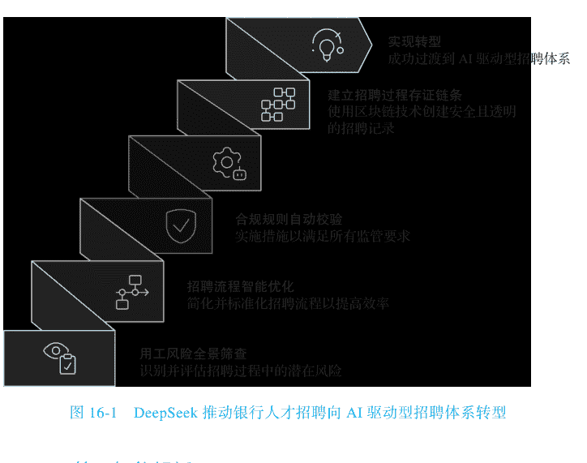

图 16-1 DeepSeek 推动银行人才招聘向 AI 驱动型招聘体系转型

### 16.1.1 简历智能解析

#### 1. 场景介绍

智能招聘是人才引进的重要环节，银行需开发多模态解析引擎，精准提取教育背景等 15 项核心字段。招聘经理应设置反歧视过滤规则，自动剔除涉及性别、年龄等敏感词的岗位描述。此项工作重点在于防范因就业歧视引发的法律风险，同时优化 NLP 算法的公平性校验机制。

#### 2. DeepSeek 提示词

角色 + 任务：我是银行招聘经理，需要设计简历解析规则，应包含哪些合规校验要点？

#### 3. 追问提示词

- 如何避免算法偏见？
- 非结构化数据如何实现标准化？
- 监管部门对招聘广告的审查要求如何嵌入校验逻辑？

#### 4. 输出形式

字段提取模板（Excel 文件）、敏感词库（Word 文件）。

#### 5. 案例演示

（1）DeepSeek 提示词
角色 + 任务：我是银行招聘经理，需要设计简历解析规则，应包含哪些合规校验要点？要求不编造、不臆测，符合银行实际场景，确保网页链接真实有效，严格按照监管要求执行。

（2）DeepSeek 首次输出
作为银行招聘经理，设计简历解析规则时需结合《中华人民共和国个人信息保护法》《中华人民共和国数据安全法》等法规要求，以及银行业务场景的实际需求，确保合规性、安全性和实用性。以下是需包含的核心合规校验规则及依据：

一、个人信息收集与处理的合规性校验
1. 告知同意原则

- 校验项：候选人是否在提交简历时签署《个人信息处理告知及同意书》，明确信息用途（如招聘、背景调查、人才库存储等）、处理方式、存储期限及跨境传输（如有）等。
- 技术实现：系统需记录候选人同意时间、方式（如电子签名或勾选“同意”选项），并关联至简历数据存储路径。

2. 最小必要原则

- 校验项：仅收集与招聘直接相关的必要信息（如姓名、学历、工作经历、联系方式），禁止强制收集无关信息（如婚姻状况、宗教信仰等敏感信息）。

技术实现：设置字段必填/选填规则，对非必要字段标注“自愿提供”并限制系统存储范围。

## 二、数据安全与存储合规性校验

### 1. 敏感信息脱敏

校验项：身份证号、银行卡号等敏感信息需自动脱敏显示（如仅显示后4位），并在存储时加密处理。

技术实现：采用 AES 加密算法，限制后台权限访问敏感字段。

### 2. 数据存储时效性

校验项：未录用候选人简历的存储期限不超过 6 个月（需在同意书中明确），超期后自动销毁；录用者信息按《中华人民共和国劳动合同法》保存至离职后 5 年。

技术实现：系统设置定时清理任务，留存销毁日志备查。

## 三、简历内容真实性校验

### 1. 学历与证书真实性

校验项：自动对接学信网、职业资格认证平台接口，验证学历、英语四六级成绩、银行从业资格证等证书编号的真实性。

技术实现：API 实时校验，若无法联网验证则标注“需人工复核”。

### 2. 工作经历与时间逻辑

校验项：检查工作经历时间是否重叠或存在断档，实习/项目经历是否与岗位相关，职位名称是否标准化（如“大堂经理助理”而非“实习生”）。

技术实现：设置时间轴逻辑规则，触发异常提示（如“2018—2020 年同时在两家公司任职”）。

## 四、背景调查相关风险点校验

### 1. 信用与违法记录筛查

校验项：通过第三方征信平台接口筛查候选人是否有贷款逾期、金融纠纷或违法犯罪记录（需候选人提前授权）。

技术实现：授权文件与简历绑定，自动触发背调接口调用。

### 2. 商业利益冲突检测

校验项：识别候选人是否有竞争机构任职经历，或其亲属是否在银行任职。

技术实现：关键词匹配（如公司名称库）、亲属关系字段关联校验。

## 五、特殊场景合规性校验

### 1. 跨境数据传输

校验项：若需将候选人信息传输至境外总部，需完成数据出境安全评估（如签署标准合同、通过网信部门审批）。

技术实现：系统拦截含境外字段的简历（如海外学历），触发合规审批流程。

### 2. 候选人撤回权

校验项：允许候选人随时撤回个人信息处理授权，系统需支持一键删除或匿名化处理。

技术实现：提供候选人自助入口，删除后保留操作日志。

## 六、系统功能与流程设计建议

### 1. 自动化分级分类

将简历数据分为四类：禁止收集（如宗教信仰）、允许收集（如教育背景）、用工必需（如身份信息）、模糊类（需额外授权）。

### 2. 风险预警机制

对高风险简历（如学历造假、信用不良）自动标记，推送至合规部门人工复核。

### 3. 审计与留痕

记录所有简历操作日志（如访问、修改、删除），定期生成合规报告备查。

### 4. 依据与参考来源

- 法律依据：《中华人民共和国个人信息保护法》中的最小必要原则、告知同意规则，《中华人民共和国数据安全法》中的加密与跨境传输要求。
- 行业实践：银行背调需涵盖身份、学历、信用、利益冲突，简历字段标准化与真实性校验。

通过上述规则，可系统性降低招聘环节的法律风险，同时提升筛选效率。建议结合银行内部合规部门与外部法律顾问意见，定期更新规则以适配监管动态。

（3）追问提示词

- 如何避免算法偏见？
- 非结构化数据如何实现标准化？
- 监管部门对招聘广告的审查要求如何嵌入校验逻辑？

（4）输出形式

Excel 模板（字段提取模板），用 HTML 的格式输出，需要内嵌可直接下载 Excel 文件的按钮代码，实现一键下载 Excel 文件。

Word 模板（敏感词库），用 HTML 的格式输出，需要内嵌可直接下载 Word 文件的按钮代码，实现一键下载 Word 文件。

（5）DeepSeek 再次输出

以下是两个模板的 HTML 实现，包含直接下载功能（需在浏览器中运行）。
DeepSeek 输出的内容如图 16-2 所示。

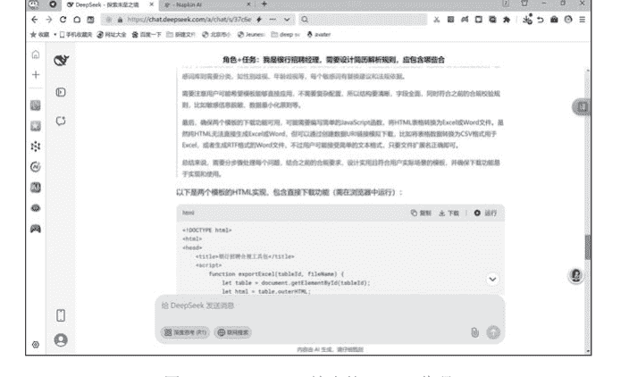

单击“运行”按钮，可获得“简历解析字段提取模板”（Excel 格式），如图 16-3 所示。

下拉滚动条，可看到“招聘广告敏感词库”Word 模板，如图 16-4 所示。

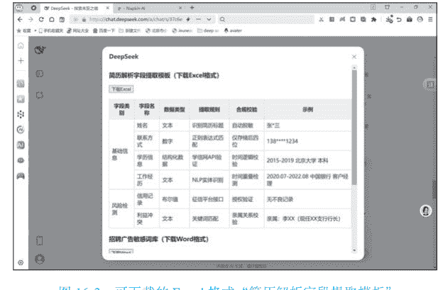

图 16-3 可下载的 Excel 格式“简历解析字段提取模板”

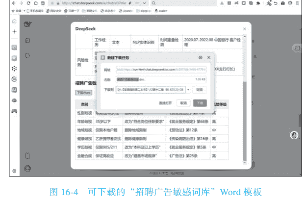

图 16-4 可下载的“招聘广告敏感词库” Word 模板

## 16.1.2 面试题库生成

#### 1. 场景介绍

面试题库是确定选拔标准的有效依据，银行需构建覆盖行为能力等维度的矩阵化题库。人事经理应动态调整题型权重，确保题库年度更新率不低于 30%。此项工作重点在于防范考题陈旧引发的选拔偏差，同时优化岗位序列与考题匹配的算法。

#### 2. DeepSeek 提示词

角色 + 任务：我是银行人事经理，需设计面试题库结构，应设置哪些防泄密机制？

#### 3. 追问提示词

- 如何降低题库重复使用导致的泄题风险？
- 针对突发岗位需求如何快速生成面试题库？
- 如何落实监管部门对面试公平性的要求？

#### 4. 输出形式

题库分类表（Excel 文件）、组卷规则手册（Word 文件）。

## 16.1.3 背调风控

#### 1. 场景介绍

背调（背景调查）风控是雇佣合规的关键要点，银行需对接学信网等 8 类数据源，开发风险评分模型。背景调查岗应设置三级预警机制，如发现重大风险信息，应在 24 小时内终止候选人的相关流程。此项工作重点在于防范雇佣风险，同时优化数据接口的稳定性。

#### 2. DeepSeek 提示词

角色 + 任务：我是银行背景调查岗人员，需制定背调标准，应包含哪些风险红线条款？

#### 3. 追问提示词

- 如何合法获取非公开从业记录？
- 如何验证跨境工作经历的真实性？
- 如何落实监管部门的个人信息使用规范？

#### 4. 输出形式

背调流程图（Visio 文件）、风险案例库（Excel 文件）。

## 16.1.4 跨部门人才供应链管理

#### 1. 场景介绍

人才供应链是组织发展的关键支撑，银行需构建统一的人才池，实现人才需求预测与关键岗位继任储备。人事岗应确保人才储备冗余率不超过 15%，保障关键岗位人才供给的连续性。此项工作重点在于防范人才断层风险，同时优化供需预测模型。

#### 2. DeepSeek 提示词

角色 + 任务：我是银行人力资源部人员，需设计人才供给模型，应关注哪些战略变量？

#### 3. 追问提示词

- 如何量化数字化转型对岗位结构的影响？
- 监管合规类岗位如何设置特殊保障？
- 如何快速响应突发业务调整对人才的需求？

#### 4. 输出形式

人才供需热力图（Excel 文件）、调配方案书（Word 文件）。

## 16.1.5 入职智能导航

#### 1. 场景介绍

入职管理是影响员工职场初始体验的关键环节，银行需开发 AR（增强现实）导览系统，集成 12 项功能。HRBP（人力资源业务伙伴）应设置 7 天适应期跟踪机制，将异常流失率控制在 5% 以内。此项工作重点在于防范适应期离职风险，同时优化虚拟助手的交互体验。

#### 2. DeepSeek 提示词

角色 + 任务：我是银行 HRBP，需优化入职导航流程，应设置哪些合规确认节点？

#### 3. 追问提示词

- 如何验证劳动合同签署的有效性？
- 保密协议的签署如何留痕？
- 如何强制完成监管部门要求的反洗钱培训？

#### 4. 输出形式

入职清单（Excel 文件）、电子签收台账（Excel 文件）。

## 16.1.6 智能招聘场景清单

- 岗位需求分析
- 简历智能筛选
- AI 面试评估
- 数字化背调
- 录用审批备案
- 监管合规审查

## 16.2 员工培训

银行员工培训面临实效性不足、合规跟踪缺失等挑战，当前痛点集中在培训内容适配性弱、效果评估维度单一、监管要求执行存在偏差等问题上。银行需重点构建“内容适配－效果跟踪－合规管理”三位一体的管理体系。培训中心需强化岗位能力智能建模、培训成效动态评估、监管规则精准映射三项核心能力。

通过智能培训系统与效果评估平台，DeepSeek 可帮助银行实现个性化课程智能生成、培训成效行为化评估、合规内容自动嵌入等功能，并依托区块链技术建立培训档案不可篡改的存证链，推动员工培训从传统课时考核模式向覆盖能力精准提升、行为改善量化、监管要求严格落实的实效型培养体系转型。

## 16.2.1 岗位知识图谱构建

#### 1. 场景介绍

知识管理是培训体系的基础环节，银行需对 500 多个岗位进行拆解，构建覆盖 8 类知识节点的图谱。人事经理应设置月度更新机制，让过期内容自动下架。此项工作重点在于防范知识更新滞后风险，同时优化语义关联算法。

#### 2. DeepSeek 提示词

角色 + 任务：我是银行人事经理，需设计岗位知识图谱架构，应包含哪些更新触发条件？

#### 3. 追问提示词

- 如何识别隐性经验知识？
- 区域政策差异如何在图谱中体现？
- 如何嵌入监管部门对培训学时的要求？

#### 4. 输出形式

知识节点清单（Excel 文件）、更新日志（Excel 文件）。

## 16.2.2 个性化培训

#### 1. 场景介绍

个性化培训是人才能力建设的关键一环，银行需开发学习行为分析引擎，动态推荐个性化课程。培训管理岗应确保关键岗位达标率达到 100%，年度完成率不低于 90%。此项工作重点在于防范培训资源浪费，同时提高推荐系统精准度。

#### 2. DeepSeek 提示词

角色 + 任务：我是银行培训管理岗人员，需制定学习路径推荐规则，应设置哪些强制学习项？

#### 3. 追问提示词

- 如何平衡个性化学习和统一培训要求？
- 监管重点课程如何优先推送？
- 学习效果如何量化评估？

#### 4. 输出形式

学习路径图（Visio 文件）、课程匹配矩阵（Excel 文件）。

## 16.2.3 合规培训智能考核

#### 1. 场景介绍

合规培训智能考核是风险防控能力建设的关键环节，银行需构建 12 类题库，并部署人脸识别防作弊系统。内控合规岗应设置 80 分为合格线，补考次数不超过 3 次。此项工作重点在于防范考核舞弊风险，同时提高 AI 监考算法的灵敏度。

#### 2. DeepSeek 提示词

角色 + 任务：我是银行内控合规岗人员，需设计防作弊规则，应包含哪些技术手段？

#### 3. 追问提示词

- 如何应对虚拟摄像头作弊？
- 异地参考如何监控？
- 如何对接监管部门对培训档案的要求？

#### 4. 输出形式

监考规则手册（Word 文件）、异常行为记录（Excel 文件）。

## 16.2.4 领导力培养

#### 1. 场景介绍

领导力培养是人才梯队建设的核心环节，银行需构建虚拟管理层，模拟 18 类决策场景。人事经理需部署 360° 评估模型，确保发展计划与岗位能力的匹配度不低于 90%。此项工作重点在于防范能力错配风险，同时提高场景仿真度。

#### 2. DeepSeek 提示词

角色 + 任务：我是银行人事经理，需设计领导力模拟场景，应包含哪些战略挑战内容？

#### 3. 追问提示词

- 如何量化决策质量？
- 监管部门对风险偏好的要求如何融入模拟场景？
- 历史管理案例如何归档入库？

#### 4. 输出形式

场景库（Excel 文件）、评估报告模板（Word 文件）。

## 16.2.5 VR 情景模拟训练

#### 1. 场景介绍

实战培训是保障操作合规的重要手段，银行需开发 VR（Virtual Reality，虚拟现实）实训系统，模拟 7 类突发事件。培训管理岗应设置通关率 100% 为上岗标准，操作失误则自动复盘。此项工作重点在于降低实操错误率，同时提高物理引擎的响应速度。

#### 2. DeepSeek 提示词

角色 + 任务：我是银行培训管理岗人员，需制定 VR 情景模拟通关标准，应设置哪些关键行为指标？

#### 3. 追问提示词

- 如何保障对晕动症学员的适配性？
- 监管服务规范如何嵌入模拟情景？
- 实训数据如何应用于绩效考核？

#### 4. 输出形式

操作评分表（Excel）、应急预案手册（Word）。

## 16.2.6 员工培训场景清单

- 能力差距分析
- 个性化学习规划
- 沉浸式实训
- 多维效果评估
- 培训档案归集
- 监管数据报送

## 16.3 数据驱动绩效管理

银行数据驱动绩效管理面临战略落地偏差、考核标准模糊、监管合规压力等挑战，当前痛点集中在目标拆解不精准、绩效数据割裂、离职风险预判滞后、薪酬激励适配不足等问题，需重点构建“目标精准解码－数据实时赋能－合规动态管控”三位一体管理体系，人力资源团队需强化智能目标拆解、全维度行为数据分析、离职风险预警、薪酬方案仿真优化、战略解码动态追踪五项核心能力。

通过绩效管理系统与数据中台的深度协同，DeepSeek 可帮助银行实现战略目标智能拆解、多维度绩效数据整合分析、离职风险提前预警、薪酬方案仿真测算等功能，并依托数据治理技术建立可追溯、可校验的绩效评估数据链条，推动绩效管理从传统结果导向模式向覆盖目标精准落地、过程实时监控、合规无缝衔接、激励科学适配的 AI 驱动型管理体系转型（如图 16-5 所示）。

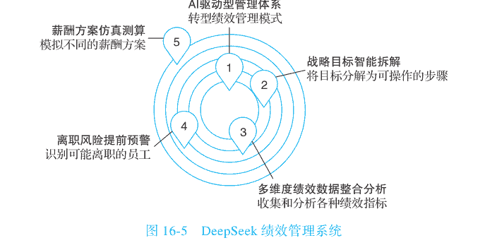

## 16.3.1 智能目标拆解

#### 1. 场景介绍

目标管理是推动战略落地的核心环节，银行需应用 OKR（目标与关键成果）工具实现组织级目标向部门级目标的分解。绩效管理岗应设置季度偏离度预警阈值 ± 10% 时触发调整的机制。此项工作重点在于防范虚设目标的风险，同时优化协同对齐算法。

#### 2. DeepSeek 提示词

角色 + 任务：我是银行绩效管理岗人员，需设计目标拆解模型，应包含哪些战略对齐指标？

#### 3. 追问提示词

- 如何平衡长期发展目标与短期考核指标？
- 如何量化跨部门协同目标？
- 监管合规类指标如何设置权重？

#### 4. 输出形式

目标分解矩阵（Excel 文件）、战略地图（Visio 文件）。

## 16.3.2 员工行为数据分析

#### 1. 场景介绍

员工行为管理是提升组织效能的关键环节，银行需整合 6 类数据源，构建 20 项行为指标。监控岗应设置健康度评分低于 60 分时启动个别辅导的机制，并确保月度覆盖率达到 100%。此项工作重点在于防范行为异常风险，同时提高指标权重的合理性。

#### 2. DeepSeek 提示词

角色 + 任务：我是银行数据分析岗人员，需制定员工行为分析规则，应设置哪些隐私保护措施？

#### 3. 追问提示词

- 如何实现员工行为数据匿名化处理？
- 如何界定敏感行为？
- 如何落实监管部门的个人信息使用规范？

#### 4. 输出形式

行为分析报告（Word 文件）、异常行为清单（Excel 文件）。

## 16.3.3 离职风险预警

#### 1. 场景介绍

保留人才是组织稳定发展的重要保障，银行需开发涵盖 12 个因子的员工离职风险预测模型，并设置 30 天预警窗口。HRBP 应对高离职风险员工实施 100% 面谈干预。此项工作重点在于防范核心人才流失风险，同时优化模型的召回率。

#### 2. DeepSeek 提示词

角色 + 任务：我是银行 HRBP，需制定离职预警干预策略，应包含哪些保留机制？

#### 3. 追问提示词

- 如何验证模型预测的准确性？
- 关键岗位如何实施差异化干预？
- 如何规避劳动仲裁风险？

#### 4. 输出形式

预警名单（Excel 文件）、保留方案库（Word 文件）。

## 16.3.4 薪酬方案仿真

#### 1. 场景介绍

薪酬优化是成本管控的重点环节，银行需构建基于市场分位值的对标模型，模拟薪酬调整对人力成本结构的影响。成本控制岗应设置人力成本占比警戒线，当占比波动达到 5% 时触发调整。此项工作重点在于防范薪酬倒挂风险，同时优化市场数据时效性。

#### 2. DeepSeek 提示词

角色 + 任务：我是银行薪酬管理岗人员，需设计薪酬方案仿真参数，应包含哪些市场基准参数？

#### 3. 追问提示词

- 如何应对区域薪酬差异？
- 如何将监管部门的“限薪”要求嵌入模型？
- 长期激励如何折现计算？

#### 4. 输出形式

薪酬结构图（Visio 文件）、成本测算表（Excel 文件）。

## 16.3.5 战略解码动态追踪

#### 1. 场景介绍

战略执行监控是经营管理的核心环节，银行需开发战略解码可视化工具，实时追踪任务进展。战略管理岗应设置“红黄绿灯”预警体系，对滞后任务自动升级督办级别。此项工作重点在于防范战略执行偏差，同时提高任务数据采集的颗粒度。

#### 2. DeepSeek 提示词

角色+任务：我是银行战略管理岗人员，需制定战略追踪规则，应设置哪些里程碑节点？

#### 3. 追问提示词

- 如何量化“软性目标”的进展？
- 跨部门任务如何协同考核？
- 如何预置监管检查重点？

#### 4. 输出形式

战略执行看板（Excel 文件）、滞后任务清单（Excel 文件）。

## 16.3.6 数据驱动绩效管理场景清单

- 战略目标分解
- 行为数据采集
- 风险评估预警
- 薪酬方案设计
- 执行过程监控
- 监管报告生成

## 16.4 员工全生命周期管理

银行员工全生命周期管理面临人才流失率高、合规风险防控压力大、员工体验与组织效能失衡等挑战，当前痛点集中在入职适配不足、培训与业务脱节、合规执行碎片化、离职预判滞后等问题，需重点构建“体验优化-合规贯穿-效能提升”三位一体管理体系，人力资源团队需强化智能入职赋能、全周期培训适配、合规行为管控、离职风险预警、职业发展规划五项核心能力。

通过员工全生命周期管理平台与 AI 赋能工具的深度融合，DeepSeek 可帮助银行实现入职流程智能简化、培训内容精准匹配、劳动合同合规校验、离职风险提前预判、职业路径动态规划等功能，并依托数字化技术建立全流程可追溯、可量化的员工管理数据链条，推动员工管理从传统事务性服务模式向覆盖入职适配、在职赋能、合规管控、离职平稳过渡的 AI 驱动型生态体系转型（如图 16-6 所示）。

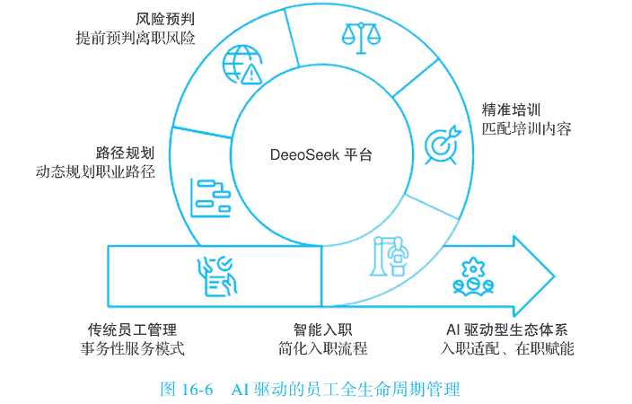

## 16.4.1 智能考勤检测

#### 1. 场景介绍

考勤管理是纪律监督的基础环节，银行需开发智能识别引擎，自动检测6类违规行为。合规管理岗应设置月违规超过3次则自动触发审查的机制。此项工作重点在于防范考勤舞弊，同时优化行为模式识别算法的精度。

#### 2. DeepSeek 提示词

角色 + 任务：我是银行合规管理岗人员，需制定智能考勤检测规则，应包含哪些弹性工作场景？

#### 3. 追问提示词

- 如何平衡灵活办公与出勤管理？
- 跨时区工作如何考勤？
- 如何落实监管部门对工时制度的要求？

#### 4. 输出形式

考勤分析报告（Word 文件）、异常记录表（Excel 文件）。

## 16.4.2 职业发展双通道建模

#### 1. 场景介绍

晋升管理是人才激励的核心环节，银行需基于管理（M）与专业（P）双通道序列开发能力匹配算法。评审委员会应将年度晋升通过率控制在20%～30%。此项工作重点在于防范晋升不公风险，同时优化胜任力评估模型。

#### 2. DeepSeek 提示词

角色 + 任务：我是银行职业发展顾问，需设计职业发展双通道评估模型，应包含哪些潜力指标？

#### 3. 追问提示词

- 如何量化“软性”领导力？
- 如何考核监管合规能力？
- 历史晋升数据如何用于模型的训练与优化？

#### 4. 输出形式

晋升标准手册（Word 文件）、匹配度分析表（Excel 文件）。

## 16.4.3 继任者计划可视化

#### 1. 场景介绍

继任者梯队建设是组织韧性的关键保障，银行需构建九宫格模型，标注候选继任者的成熟度与准备度。HRBP 应设置准备度预警阈值（如 70%），低于阈值则启动加速培养。此项工作重点在于防范继任断层风险，同时优化潜力评估的维度。

#### 2. DeepSeek 提示词

角色 + 任务：我是银行人才管理人员，需制定继任者计划评估标准，应关注哪些风险缺口？

#### 3. 追问提示词

- 如何应对突发岗位空缺？
- 跨条线继任如何实现？
- 监管部门对岗位分离的要求如何嵌入？

#### 4. 输出形式

继任者矩阵（Excel 文件）、培养计划表（Word 文件）。

## 16.4.4 弹性福利智能配置

#### 1. 场景介绍

福利管理是提升员工满意度的关键工具，银行需开发“核心 + 可选”福利超市，动态推荐福利组合方案。绩效管理岗应设置人均成本浮动区间为 ± 5%。此项工作重点在于防范福利错配风险，同时优化推荐算法的个性化适配能力。

#### 2. DeepSeek 提示词

角色 + 任务：我是银行绩效管理岗人员，需设计员工福利推荐逻辑，应包含哪些合规约束？

#### 3. 追问提示词

- 如何应对税收优惠政策变化？
- 如何合规扩展家属福利？
- 如何落实监管部门对工会经费的要求？

#### 4. 输出形式

福利配置工具（Excel 文件）、选择分析报告（Word 文件）。

## 16.4.5 离职面谈知识沉淀

#### 1. 场景介绍

离职分析是组织改善的关键环节，银行需构建离职原因分类模型，并使其自动生成改进建议。员工关系岗应确保知识入库率不低于 80%，并对敏感信息进行脱敏处理。此项工作重点在于防范经验流失风险，同时增加文本挖掘的深度。

#### 2. DeepSeek 提示词

角色 + 任务：我是银行员工关系岗人员，需设计离职面谈模板，应包含哪些开放性问题？

#### 3. 追问提示词

- 如何引导员工做出真实反馈？
- 对有争议的离职如何合规处理？
- 竞业限制如何落实？

#### 4. 输出形式

面谈记录模板（Word 文件）、改进建议库（Excel 文件）。

## 16.4.6 员工全生命周期管理场景清单

- 入职手续办理
- 在职发展支持
- 离职风险防控
- 知识资产留存
- 雇主品牌维护
- 监管合规报备

## 16.5 合规与风控支持

银行合规与风控支持面临劳动纠纷频发、个人信息泄露风险加剧、监管要求日趋严格等挑战，当前痛点集中在风险识别被动、防控流程碎片化、合规校验缺乏智能手段等问题，需重点构建“风险精准识别－流程闭环管控－合规智能校验”三位一体管理体系，内控合规部需强化人力风险全景监测、个人信息安全防护、劳动合规智能审核、纠纷预警处置四项核心能力。

通过合规风控智能平台与数据安全技术的深度融合，DeepSeek 可帮助银行实现人力风险筛查、个人信息保护、劳动合规校验、纠纷风险预警等功能，并依托区块链与隐私计算技术建立不可篡改的合规风控数据存证链条，推动人力合规风控从传统被动应对模式向覆盖风险预判、过程管控、合规校验、处置闭环的 AI 驱动型体系转型（如图 16-7 所示）。

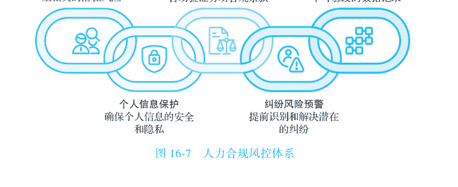

## 16.5.1 制度合规审查

#### 1. 场景介绍

制度合规审查是法律合规工作的核心环节，银行必须构建涵盖 200 余项法规要点的智能审查引擎。法务岗位需确保法规要点的季度更新率不低于15%。此项工作重点在于有效防范制度滞后风险，并同步提升条款关联检索的效率。

#### 2. DeepSeek 提示词

角色 + 任务：我是银行法律合规岗人员，需制定制度审查标准，应包含《中华人民共和国劳动法》中的哪些条款？

#### 3. 追问提示词

- 如何应对地方性法规差异？
- 涉及境外员工的制度如何适配？
- 如何预置监管检查重点？

#### 4. 输出形式

合规审查清单（Excel 文件）、整改计划表（Excel 文件）。

## 16.5.2 个税筹划模拟

#### 1. 场景介绍

薪酬合规离不开个税筹划的合理安排，银行需开发涵盖多种计税方案的比选模型。税务管理岗应设定节税幅度为 10%～15% 的目标。此项工作重点在于防范税务稽查风险，同时提升算法计算效率。

#### 2. DeepSeek 提示词

角色 + 任务：我是银行税务管理岗人员，需设计个税筹划模拟场景，应包含哪些特殊收入类型？

#### 3. 追问提示词

- 如何应对税收优惠政策的追溯性调整？
- 股权激励如何计税？
- 如何避免触碰反避税监管红线？

#### 4. 输出形式

个税方案书（Word 文件）、节税报告（Excel 文件）。

## 16.5.3 人力成本沙盘推演

#### 1. 场景介绍

人力成本沙盘推演是银行优化人力资源配置、提升成本管控效能、支撑战略落地的核心管理工具，银行需设计整合组织架构适配分析、人员编制动态测算、薪酬福利模型搭建、效能产出关联分析等核心模块的智能推演系统，结合银行战略发展目标、业务规模扩张规划及外部人力市场变化，实现人力成本的全景模拟与精准预判。

#### 2. DeepSeek 提示词

角色 + 任务：我是银行人力资源战略规划专员，需搭建人力成本智能沙盘推演系统，核心模块设计与多场景推演逻辑应如何制定以实现成本精准管控与战略适配？

#### 3. 追问提示词

- 如何建立薪酬福利、招聘培训、离职损耗等成本模块的联动测算模型，进一步提升推演结果的精准度？
- 针对业务扩容、数字化转型等不同场景，需要设计哪些差异化的推演参数与场景阈值？
- 当推演结果与预算偏差超过 10%，或出现关键岗位成本失衡的情况时，该如何构建闭环响应机制，同时适配市场薪酬的波动变化？

#### 4. 输出形式

人力成本沙盘推演系统功能架构图（Visio 文件）、多场景成本测算参数表（Excel 文件）。

## 16.5.4 岗位胜任力动态评估

#### 1. 场景介绍

数字化转型驱动岗位技能快速演化，银行需开发岗位胜任力雷达图，实时监测能力缺口。培训岗应确保课程上线周期不超过 15 天。此项工作重点在于防范技能断层风险，同时提高岗位画像更新频率。

#### 2. DeepSeek 提示词

角色 + 任务：我是银行岗位分析师，需制定岗位胜任力评估标准，应包含哪些面向未来的关键技能？

#### 3. 追问提示词

- 如何预测技术替代风险？
- 如何定义复合型人才？
- 如何量化合规管理能力？

#### 4. 输出形式

胜任力模型（Visio 文件）、技能缺口表（Excel 文件）。

## 16.5.5 员工行为合规监控

#### 1. 场景介绍

员工行为审计是保障信息安全的重点环节，银行需部署 UEBA（User and Entity Behavior Analytics，用户实体行为分析）系统检测异常数据访问等行为。信息安全岗应设置 1 小时内响应告警机制。此项工作重点在于防范数据泄露风险，同时扩大风险特征库覆盖度。

#### 2. DeepSeek 提示词

角色 + 任务：我是银行信息安全岗人员，需设计员工行为监控规则，应包含哪些白名单场景？

#### 3. 追问提示词

- 如何区分正常操作与违规行为？
- 紧急业务处理如何豁免异常告警规则？
- 数据出境如何纳入合规管控范围？

#### 4. 输出形式

监控日志（Excel 文件）、处置预案（Word 文件）。

## 16.5.6 合规与风控支持场景清单

- 制度合规审查
- 人力成本建模
- 个税方案优化
- 岗位能力评估
- 行为风险监控
- 监管审计应对

## 16.6 本章小结

本章聚焦银行人力资源管理的数字化转型，涵盖智能招聘、员工培训、数据驱动绩效管理、员工全生命周期管理及合规与风控支持等关键领域。通过数据贯通、流程优化与决策升级，DeepSeek 助力银行解决招聘低效、培训适配度不足、绩效滞后等问题，推动人力资源管理从传统事务性工作处理向战略效能提升转型，实现招聘精准化、培训个性化、组织发展科学化，满足法规要求并提升组织效能。

# 17

| 第 17 章 | C H A P T E R

## DeepSeek 银行党政工团管理场景应用

银行党政工团管理正处于数字化转型深化阶段，管理需求从完成传统事务性工作向提升组织效能加速演进，管理模式呈现线上线下协同治理的特征。在新时代党的建设总要求与金融业高质量发展的背景下，党政工团管理的重心从基础党务执行转向组织建设效能评估，特别是在党员教育管理、员工思想动态分析等重点领域，银行亟须提升数字化工具的适配性与组织运行的科学性。业务人员面临多系统数据整合不足、分析工具智能化水平有限等现实挑战。

银行党政工团管理痛点体现在三个方面：一是党建工作数字化程度不足，党员学习教育、组织生活管理等场景存在流程断点与数据孤岛，影响《中国共产党党内监督条例》的落实；二是员工思想动态分析工具缺失，传统问卷调研模式难以实时捕捉员工心理波动及其对组织归属感的变化；三是群团活动协同机制薄弱，跨部门资源调度与活动成效评估缺乏科学支撑，制约组织凝聚力的建设。

通过部署智能党建管理平台、员工思想动态分析模型及组织效能评估系统，DeepSeek 可帮助银行实现关键突破：构建党建数据中台，实现多系统信息贯通；建立基于自然语言处理技术的舆情监测体系；运用知识图谱技术优化群团活动资源配置。

本章重点解析如何借助 DeepSeek 通过“数据贯通 - 管理升级 - 效能量化”三重路径，重构党政工团管理模式，有效解决党建管理碎片化、员工洞察滞后、组织协同低效等核心问题，助力银行实现“党建工作智能化、员工管理精细化、组织运行高效化”的现代治理转型目标，满足《中国共产党支部工作条例（试行）》等党内法规要求。

## 17.1 智慧党建

银行党委组织部门需构建标准化、可视化的党建体系，重点解决党员教育管理粗放、组织生活实效性不足等问题，落实《中国共产党支部工作条例（试行）》等党内法规的要求。

### 17.1.1 党员画像三维建模

#### 1. 场景介绍

党员画像是银行加强党员管理、提升党员队伍质量的重要工作。银行需整合“学习强国”积分、民主评议结果等12类数据，构建“政治素质－作用发挥－纪律作风”三个维度的党员画像模型。党建指导员需设置季度预警机制，对连续两季度评分低于60分的党员启动帮扶程序，促进党员成长，提升党组织战斗力。

#### 2. DeepSeek 提示词

角色 + 任务：我是银行党委组织委员，需设计党员画像评价体系，应包含哪些核心指标？

#### 3. 追问提示词

- 如何量化党员的先锋模范作用？
- 对流动党员如何进行差异化评价？
- 如何落实个人隐私保护？

#### 4. 输出形式

指标体系（Excel 文件）、画像生成规则（Word 文件）。

#### 5. 案例演示

（1）DeepSeek 提示词
角色 + 任务：我是银行党委组织委员，需设计党员画像评价体系，应包含哪些核心指标？要求不编造、不臆测，符合银行实际场景，确保网页链接真实有效，严格按照监管要求执行。

（2）DeepSeek 首次输出
基于搜索结果中多家银行及监管机构的党建实践，结合金融行业特点和监管要求，设计党员画像评价体系应涵盖以下核心指标，确保评价体系既符合银行实际场景，又能落实全面从严治党要求。

一、政治素质评价维度
1. 政治忠诚
□ 是否严格落实“第一议题”制度，及时学习党的最新理论成果（如党的二十大报告、中央金融工作会议精神）？
□ 在重大风险考验（如不良贷款清收、金融风险防控）中是否敢于担当、主动作为？

2. 政治定力
□ 是否在意识形态领域（如员工舆情管理、客户投诉处理）中坚持正确导向？
□ 面对利益诱惑（如信贷审批、客户营销）时能否严守纪律红线？

3. 政治理论学习
□ 参与“三会一课”、主题党日、集中轮训的出勤率及学习心得质量如何？
□ 是否通过“学习强国”等平台完成年度学习积分要求？

二、纪律作风评价维度

1. 遵规守纪
□ 是否违反过《中国共产党纪律处分条例》及行内合规制度（如员工行为禁令）？
□ 是否涉及监管处罚、客户投诉或在内部审计时发现存在问题？

2. 廉洁自律
□ 是否接受过客户宴请、礼品或参与利益输送（如贷款审批中的“吃拿卡要”）？
□ 亲属是否在关联金融机构任职或存在利益冲突？

3. 组织生活规范
□ 党员民主评议中批评与自我批评是否有深度？
□ 是否按时足额交纳党费，组织生活记录是否完整？

三、履职能力评价维度

1. 业务贡献
□ 关键业绩指标（如存款增长、贷款投放、不良率控制）在支部内的排名如何？
□ 是否牵头完成过重点项目（如数字化转型、普惠金融产品创新）？
□ 在技能比武（如反洗钱知识竞赛、柜面业务操作）中的获奖情况如何？

3. 合规履职
□ 是否参与过违规业务（如虚增存款、掩盖不良贷款）？
□ 是否落实了监管要求（如消费者权益保护、反电信诈骗宣传）？

四、道德品质与群众基础维度

1. 公益服务
□ 参与志愿服务（如金融知识进社区、乡村振兴帮扶）的频次和实效如何？
□ 是否获得外部机构表彰（如“脱贫攻坚先进个人”）？

2. 团队协作
□ 在“老带新”“党员结对帮扶”中的主动性和成效。
□ 群众民主测评满意度（如党员互评、员工匿名评分）。

3. 家风建设
□ 是否因家庭矛盾影响工作（如涉诉纠纷、负面舆情）？
□ 是否践行了“清廉家风”（如家属参与行内廉洁教育活动）？

五、创新性与发展潜力维度

1. 创新能力
是否提出过可落地的管理改进建议（如流程优化、风险防控模型）？
是否在核心期刊发表过党建与业务融合研究文章？

2. 学习成长
是否完成年度继续教育学分（如 CFA〔注册金融分析师〕、FRM〔金融风险管理师〕等职业资格认证）？
是否参与了行内“青年骨干培养计划”或外部交流项目？

3. 评价方法与结果应用

1）数据采集
□ 定量数据：通过行内人力资源系统、党建平台、审计报告自动抓取出勤率、业绩排名、合规记录等。
□ 定性数据：涉及民主评议、谈心谈话记录、支部书记点评等。

2）动态画像
□ 采用“雷达图”可视化呈现五个维度的综合得分。
□ 设置“一票否决项”（如参与非法集资、重大违规事件）。

3）结果运用
□ 作为评优评先（如“优秀共产党员”“党员先锋岗”）的核心依据。
□ 对得分较低的党员实施“红色预警”，开展针对性帮扶（如廉政谈话、岗位调整）。

4）参考依据
□ 制度规范：《中国共产党支部工作条例（试行）》《银行业金融机构从业人员行为管理指引》。
□ 实践案例：珠海建行“政治画像”量化指标、鹰潭农商银行党员积分制、邮储银行“三亮三比三评”机制。

通过以上维度的指标，可实现党员画像从“模糊评价”到“精准量化”的转变，既符合金融行业风险防控和合规经营需求，又能激发党员队伍活力，推动党建与业务深度融合。建议结合行内实际，嵌入 OA 或党建管理系统实现动态更新，并定期联合纪检、人力资源部门对指标校准与优化。

（3）追问提示词

- 如何量化党员的先锋模范作用？
- 对流动党员如何进行差异化评价？
- 如何落实个人隐私保护？

（4）输出形式

Excel 模板（指标体系），用 HTML 格式输出，需要内嵌可直接下载 Excel 文件的按钮代码，实现一键下载 Excel 文件。

Word 分析报告（画像生成规则），用 HTML 格式输出，需要内嵌可直接下载 Word 文件的按钮代码，实现一键下载 Word 文件。

（5）DeepSeek 再次输出

以下是针对用户需求的 HTML 实现模板，包含可直接下载的 Excel 指标体系和 Word 分析报告。

DeepSeek 输出的内容如图 17-1 所示。

# 第 17 章 DeepSeek 银行党政工团管理场景应用

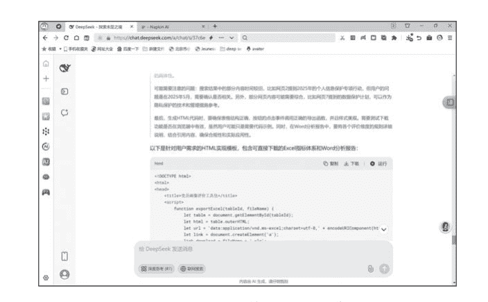

图 17-1 DeepSeek 输出的 HTML 代码

单击“运行”按钮，即可获得“党员画像指标体系”Excel 模板，如图 17-2 所示。

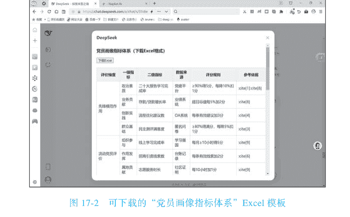

图 17-2 可下载的“党员画像指标体系”Excel 模板

下拉滚动条，可看到“党员画像生成规则报告”Word 模板以及下载按钮，如图 17-3 所示。

284 DeepSeek 银行实战手册：银行全场景 AI 实践指南（下册）

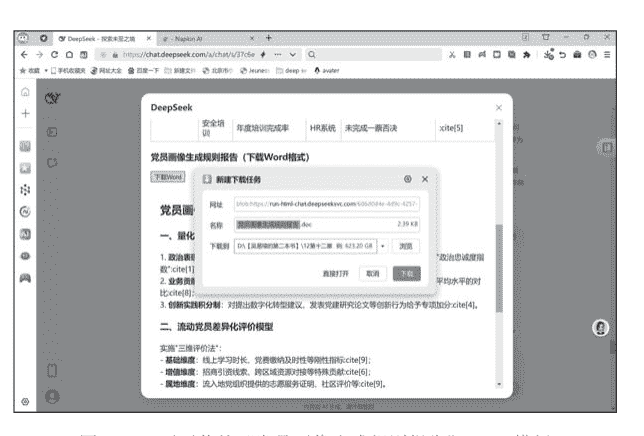

图 17-3 可下载的“党员画像生成规则报告”Word 模板

### 17.1.2 组织生活智能督导

#### 1. 场景介绍

组织生活智能监督是保证党建质量的关键环节，银行需开发评估系统，自动识别会议频次等 8 项要素。党委督导员应设置 5 日内整改闭环机制，对未达标的党支部要求限期提交报告。此项工作重点在于防范组织生活形式化风险，同时优化组织生活的合规性评估模型。

#### 2. DeepSeek 提示词

角色 + 任务：我是银行党委督导员，需制定组织生活督导标准，应关注哪些创新性评估指标？

#### 3. 追问提示词

- 如何避免形式化签到问题？
- 如何认定混合式组织生活的真实性与合规性？
- 如何评估党建与业务的融合度？

#### 4. 输出形式

督导检查表（Excel 文件）、整改跟踪台账（Excel 文件）。

## 17.1.3 党建知识图谱构建

#### 1. 场景介绍

党建教育是员工思想建设的首要任务，银行需整合党章、党规等文献，构建党建知识图谱。宣传干事应设置月度更新机制，重点标注党的二十大精神专题。此项工作重点在于防范党建知识滞后风险，同时优化知识点关联算法。

#### 2. DeepSeek 提示词

角色 + 任务：我是银行党委宣传干事，需设计党建知识图谱的关联规则，应包含哪些学习场景？

#### 3. 追问提示词

- 如何应对基层党员对党建知识的理解偏差？
- 党的历史文献如何与现代党建理论关联？
- 如何量化评估党建学习效果？

#### 4. 输出形式

知识节点图（Visio 文件）、学习成效报告（Word 文件）。

## 17.1.4 智慧党建场景清单

- 党员信息采集
- 组织生活规划
- 发展过程监控
- 教育资源管理
- 数据安全审计
- 成效分析报告

## 17.2 思想政治教育

银行思想政治教育面临意识形态风险防控压力加大、教育形式单一固化、内容与业务融合不足等挑战，当前痛点集中在教育精准度欠缺、员工参与度不高、成效评估缺乏量化标准等问题，需重点构建“内容精准适配－形式互动创新－成效量化管控”三位一体教育体系，党委宣传部门需强化意识形态风险研判、教育内容定制化输出、互动化教育实施、成效闭环评估四项核心能力。

通过智能思想政治教育平台与数字化传播技术的深度融合，DeepSeek 可帮助银行实现意识形态风险监测预警、教育内容精准推送、线上线下互动化教育场景搭建、教育成效量化评估与优化迭代等功能，并依托数字化技术建立全流程可追溯、可量化的教育实施数据链条，推动思想政治教育从传统单向灌输模式向覆盖风险防控、精准施教、互动参与、成效闭环的智能赋能型体系转型（如图 17-4 所示）。

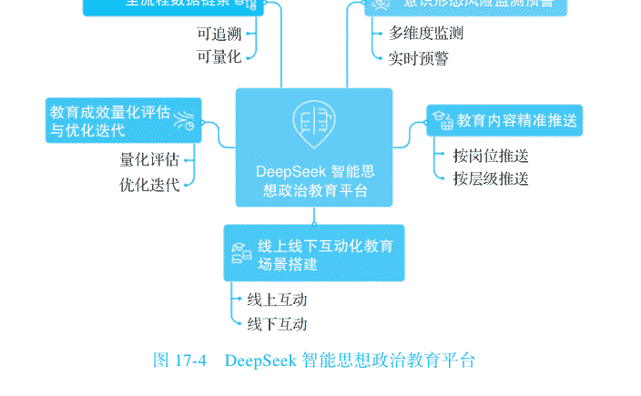

### 17.2.1 理论学习智能推荐

#### 1. 场景介绍

理论学习是思想政治建设的重要基础，银行需开发个性化推荐引擎，按员工岗位类型推送课程。学习管理员应设置领导干部年度学习达标率 100% 的目标。此项工作重点在于防范学习流于形式的风险，同时提高对知识短板诊断的精度。

#### 2. DeepSeek 提示词

角色 + 任务：我是银行党支部宣传委员，需设计理论学习推荐算法，应包含哪些优先级规则？

#### 3. 追问提示词

- 如何平衡必修与选修课程？
- 学习进度滞后如何预警？
- 如何过滤涉及敏感内容的学习材料？

#### 4. 输出形式

推荐规则表（Excel 文件）、学习档案（Word 文件）。

### 17.2.2 意识形态风险监测

#### 1. 场景介绍

舆情管控是网络安全治理的战略环节，银行需构建意识形态风险监测平台，实时扫描 12 类敏感信息。网评（网络评论）员应设置重大舆情 1 小时响应机制。此项工作重点在于防范意识形态失守风险，同时提高语义分析的准确度。

#### 2. DeepSeek 提示词

角色 + 任务：我是银行网信监测人员，需制定意识形态风险监测关键词库，应包含哪些新兴风险点？

#### 3. 追问提示词

- 如何识别隐喻式错误言论？
- 如何追踪境外舆情？
- 如何量化评估舆情处置效果？

#### 4. 输出形式

敏感词库（Excel 文件）、舆情处置预案（Word 文件）。

### 17.2.3 思想政治教育场景清单

- 理论学习规划
- 舆情实时监测
- 风险分级处置
- 教育成效评估
- 数据合规存档
- 改进方案生成

## 17.3 工会数字化服务

银行工会数字化服务面临职工诉求响应滞后、福利覆盖精准度不足、服务形式单一固化等挑战，当前痛点集中在服务资源分散、需求洞察不精准、经费使用合规管控难等问题，需重点构建“需求精准洞察－服务智能适配－经费合规管控”三位一体服务体系，工会办公室需强化职工需求智能研判、数字化福利精准配置、诉求闭环响应、经费合规使用管控四项核心能力。

通过工会数字化服务平台与大数据技术的深度融合，DeepSeek 可帮助银行实现职工需求多维度挖掘分析、福利资源智能匹配推送、诉求全流程在线流转与实时跟踪、工会经费收支合规校验与动态监控等功能，并依托数字化技术建立全流程可追溯、可量化的服务实施数据链条，推动工会服务从传统被动响应模式向覆盖需求预判、资源匹配、诉求跟踪、合规管控、成效优化的智能赋能型体系转型（如图 17-5 所示）。

### 17.3.1 职工诉求智能分析

#### 1. 场景介绍

民主管理是工会建设的核心环节，银行需部署自然语言处理引擎，解析来自职工诉求渠道的多源文本信息。数据分析岗应设置 72 小时响应机制，生成初步的解决建议。此项工作重点在于防范职工诉求积压风险，同时优化问题分类的颗粒度，提高准确率。

#### 2. DeepSeek 提示词

角色 + 任务：我是银行数据分析岗人员，需设计职工诉求分类模型，应包含哪些民生热点？

#### 3. 追问提示词

- 如何区分合理诉求与非理性表达？
- 对于涉及多部门的诉求，如何协同分派？
- 对于敏感信息如何进行脱敏处理？

#### 4. 输出形式

诉求分类表（Excel 文件）、解决方案库（Word 文件）。

### 17.3.2 福利发放精准触达

#### 1. 场景介绍

职工福利发放是工会服务的重点工作，银行需构建职工标签体系，开发智能推荐系统。福利管理岗应设置普惠类福利覆盖率达到 100%、福利匹配准确率不低于 85% 的目标。此项工作重点在于防范福利错配风险，同时增加标签体系更新频率。

#### 2. DeepSeek 提示词

角色 + 任务：我是银行工会福利管理岗人员，需制定福利发放规则，应设置哪些公平性约束条件？

#### 3. 追问提示词

- 如何平衡不同职级的福利差异？
- 如何保障异地职工的权益？
- 如何完整留存审计痕迹？

#### 4. 输出形式

福利发放台账（Excel 文件）、预算分配方案（Word 文件）。

### 17.3.3 工会数字化服务场景清单

- 诉求数据采集
- 智能分类处理
- 福利精准发放
- 困难职工帮扶
- 活动效果评估
- 荣誉档案管理

## 17.4 共青团工作创新

银行共青团工作创新面临青年群体需求多元化、组织吸引力不足、活动实效性不强等挑战，当前痛点集中在服务精准度欠缺、活动形式固化、青年成长赋能不足等问题，需重点构建“需求精准对接－活动创新赋能－成长闭环培养”三位一体工作体系，团委需强化青年需求智能研判、特色活动策划实施、青年人才培育、组织凝聚力提升四项核心能力。

通过共青团数字化平台与新媒体技术的深度融合，DeepSeek 可帮助银行实现青年需求多维度挖掘分析、线上线下特色活动智能策划与推广、青年成长路径个性化规划、组织互动场景搭建与黏性提升等功能，并依托数字化技术建立全流程可追溯、可量化的工作实施数据链条，推动团青工作从传统活动导向模式向覆盖需求适配、活动创新、成长赋能、组织凝聚的智能驱动型体系转型（如图 17-6 所示）。

### 17.4.1 青年人才潜力评估

#### 1. 场景介绍

青年培养是共青团工作的重点方向，银行需开发涵盖7个维度的测评工具，构建青年人才潜力池。青联委员应将培养计划与人才的匹配度不低于80%作为考核标准。此项工作重点在于防范青年人才断层风险，同时优化潜力评估指标体系。

#### 2. DeepSeek 提示词

角色 + 任务：我是银行团委组织委员，需设计青年人才测评模型，应包含哪些实践考核指标？

#### 3. 追问提示词

- 如何量化志愿服务的贡献？
- 如何评价新兴领域人才？
- 测评结果如何反馈至培养路径，以推动改进？

#### 4. 输出形式

测评量表（Excel文件）、培养方案模板（Word文件）。

### 17.4.2 志愿服务供需匹配

#### 1. 场景介绍

社会实践是共青团青年工作的主要方式，银行需开发智能派单系统，对接需求与志愿者库。调度员应设置基于服务时长的信用积分机制，确保派单匹配准确率不低于90%。此项工作重点在于防范志愿者资源错配风险，同时优化特长识别算法。

#### 2. DeepSeek 提示词

角色 + 任务：我是银行团委调度员，需制定志愿服务匹配规则，应设置哪些应急响应机制？

#### 3. 追问提示词

- 如何平衡专业类需求与普惠类需求的优先级？
- 面对突发公共事件时如何快速动员？
- 如何量化评估服务效果？

#### 4. 输出形式

供需匹配矩阵（Excel 文件）、应急响应预案（Word 文件）。

### 17.4.3 共青团工作场景清单

- 青年数据采集
- 活动需求分析
- 服务资源匹配
- 效果动态评估
- 人才推优管理
- 社群生态优化

## 17.5 合规与文化融合

银行合规与文化融合面临党建与业务融合不深入、廉洁风险防控碎片化、文化渗透效能不足等挑战，当前痛点集中在融合机制不健全、风险预判被动、文化落地缺乏量化抓手等问题，需重点构建“党建引领 - 合规嵌入 - 文化浸润”三位一体融合体系，党委办公室需强化党建业务融合设计、廉洁风险智能防控、合规文化精准传播、融合成效量化评估四项核心能力。

通过党建与合规文化融合智能平台与数字化技术的深度融合，DeepSeek可帮助银行实现党建与业务融合场景精准匹配、廉洁风险多维度监测预警、合规文化内容分层推送、融合成效全流程追溯评估等功能，并依托数字化技术建立可量化、可追溯的融合实施数据链条，推动合规与文化融合从传统口号宣传模式向覆盖机制落地、风险防控、文化浸润、成效闭环的智能驱动型体系转型（如图 17-7 所示）。

图 17-7 党建与合规文化融合智能平台

### 17.5.1 文化认同度测评

#### 1. 场景介绍

文化建设是思想引领的关键工作，银行需开发文化认同度测评系统，生成组织健康指数报告。文化专员应设置年度整改达成率不低于 90% 的目标。此项工作重点在于防范文化认同度下滑与组织氛围离散的风险，同时优化行为观察类数据采集的维度。

#### 2. DeepSeek 提示词

角色 + 任务：我是银行党委文化专员，需设计文化认同度测评工具，应包含哪些隐性文化维度？

#### 3. 追问提示词

- 如何量化非正式组织的影响？
- 如何评估跨代际文化差异？
- 测评结果如何与组织战略衔接？

#### 4. 输出形式

测评问卷（Word 文件）、文化热力图（Excel 文件）。

### 17.5.2 廉政风险预警

#### 1. 场景介绍

廉政建设是纪律监督的重点工作，银行需整合 8 类数据源，构建廉政风险预警系统。纪检员应设置高风险岗位年检覆盖率达 100% 的目标。此项工作重点在于防范权力寻租风险，同时增加对社交网络分析的深度。

#### 2. DeepSeek 提示词

角色 + 任务：我是银行纪委纪检员，需制定廉洁风险预警规则，应设置哪些权力监督重点？

#### 3. 追问提示词

- 如何识别新型利益输送模式？
- 如何对“8 小时外”行为进行监控？
- 如何平衡隐私保护与监督？

#### 4. 输出形式

风险清单（Excel 文件）、处置流程手册（Word 文件）。

### 17.5.3 合规与文化融合场景清单

- 文化数据采集
- 廉政风险扫描
- 融合成效评估
- 荣誉存证管理
- 社会责任披露
- 持续改进跟踪

## 17.6 本章小结

本章聚焦银行党政工团管理的数字化转型，涵盖智慧党建、思想政治教育、工会数字化服务、共青团工作创新及合规与文化融合等关键领域。通过数据贯通、管理升级与效能量化，DeepSeek 助力银行解决党建碎片化、员工洞察滞后、组织协同低效等问题，推动管理模式从完成传统事务性工作向提升组织效能转型，实现党建工作智能化、员工管理精细化、组织运行高效化，并满足党内法规要求。

# 18

## DeepSeek 银行监管合规场景应用

银行监管合规管理正处于智能化转型的关键阶段，监管要求其从单一数据报送向全流程风险防控升级，管理模式呈现跨系统协同特征。在穿透式监管与金融风险防控强化的背景下，行业建设重心从夯实合规基础能力转向提升风险预警效能，特别是在反洗钱、数据治理等重点领域，银行亟须提升对监管规则的适配效率与对风险信号的捕捉能力。业务人员面临多源数据整合不足、监管报送效率低下等现实挑战。

银行监管合规的痛点体现在三个方面：一是监管数据整合的数字化程度不足，EAST 系统报送仍依赖人工处理，跨系统数据映射存在偏差；二是风险监测工具的更新滞后于监管规则的更新，在反洗钱交易监测、关联交易识别等场景中缺乏实时预警能力；三是合规报告生成效率低下，监管检查应对与整改跟踪依赖人工台账管理，难以满足《银行业金融机构监管数据标准化规范》对时效性的要求。

通过部署基于 DeepSeek 的智能合规平台、监管规则引擎及自动化报告系统，商业银行可实现关键突破：构建监管数据中台，实现多源信息标准化整合；建立基于自然语言处理（Natural Language Processing，NLP）的监管政策解析工具；运用知识图谱技术优化风险关联网络分析。

本章重点解析 DeepSeek 如何通过“数据贯通－规则适配－流程重构”三重路径重塑监管合规体系，有效解决数据治理碎片化、风险识别滞后、合规响应低效等核心问题，助力银行实现“监管数据标准化、风险监测实时化、合规管理自动化”的数字化转型目标，满足《金融机构洗钱和恐怖融资风险评估及客户分类管理指引》等监管要求。

## 18.1 智能合规审查

银行智能合规审查面临合同风险隐蔽化、跨境监管复杂化等挑战（如图 18-1 所示），当前痛点集中在合同条款风险识别不足、跨境监管规则适配滞后、审查流程标准化薄弱等问题，需重点构建“风险识别－合规校验－动态监控”三位一体的审查体系。合规管理团队需强化合同条款智能解析、跨境规则动态适配、审查流程全链穿透三项核心能力。

通过智能审查系统与合规管理平台，DeepSeek 可帮助银行实现合同陷阱智能识别、跨境交易合规校验、审查流程标准固化等功能，并依托区块链技术建立不可篡改的审查证据链条，推动合规审查从人工经验判断模式向覆盖合同风险智能预警、跨境规则即时适配、审查全程留痕溯源的智能风控体系转型。

### 18.1.1 合同条款风险自动识别

#### 1. 场景介绍

合同审查是法律合规的基本工作，银行需部署 NLP 模型扫描 12 类高风险条款。法律合规岗应设置三级风险标记，确保重大风险 1 小时内推送给法务人员复核。此项工作的重点在于防范法律纠纷风险，同时提升条款识别的召回率。

#### 2. DeepSeek 提示词

角色 + 任务：我是银行法律合规岗人员，需设计合同条款风险识别规则，应关注哪些司法裁判要点？

#### 3. 追问提示词

- 如何应对模糊性条款？
- 行业特殊条款如何分类？
- 如何嵌入监管对合同格式的要求？

#### 4. 输出形式

风险条款库（Excel 文件）、复核意见模板（Word 文件）。

#### 5. 案例演示

（1）DeepSeek 提示词
角色＋任务：我是银行法律合规岗人员，需设计合同条款风险识别规则，应关注哪些司法裁判要点？要求不编造、不臆测，符合银行实际场景，确保网页链接真实有效，严格按照监管要求执行。

（2）DeepSeek 首次输出
基于搜索结果中的司法裁判规则及银行业务特点，设计合同条款风险识别规则时需重点关注以下司法裁判要点，并结合《民法典合同编通则司法解释》、最高人民法院审判意见及金融监管要求，构建系统化的审查框架。

一、合同主体及缔约能力审查规则
1. 主体真实性校验

- 校验合同签署方名称与营业执照、印章是否完全一致，法定代表人或代理人授权文件需明确权限及有效期，避免出现名称错漏、越权签约风险。
- 对担保人、抵押人资质进行穿透式审查，包括担保资格（如机关法人不得担保）、抵押物权属（需登记且无权利瑕疵）。

2. 缔约能力评估

- 针对自然人客户，需结合年龄、教育背景、交易复杂度，评估其对合同性质及风险的认知能力，避免因“显失公平”（如老年人签署高杠杆金融衍生品合同）被撤销合同。
- 通过系统记录客户风险测评记录及“双录”（录音录像）证据，应对未来可能的效力争议。

> 全称《最高人民法院关于适用〈中华人民共和国民法典〉合同编通则若干问题的解释》。

二、核心条款效力风险识别规则

1. 标的条款明确性

- 标的物需使用标准名称及商标（如“工行结构性存款产品 × 号”而非“理财产品”），附型号、规格等唯一性标识，避免同名异物争议。
- 对知识产权标的（如软件使用权），需嵌入“不侵权保证条款”及第三方索赔责任分配机制。

2. 格式条款合规性

- 识别免除银行责任、限制客户权利的异常条款（如单方变更利率权），确保以加粗、弹窗等方式履行提示义务，并留存客户确认记录。
- 禁止使用“最终解释权归银行所有”等排除司法审查的表述，避免条款无效。

3. 生效条件与报批义务

- 需审批的合同（如跨境担保）中，明确报批义务条款独立生效，并设定违约赔偿计算方式（如预期利益损失）。
- 对附条件生效合同（如贷款前置抵押登记），系统需跟踪条件成就状态并触发预警。

三、履行及违约责任裁判要点

1. 履行抗辩权边界

- 识别“不安抗辩权”行使条件：需有确切证据证明对方丧失履约能力（如征信不良、涉诉冻结），且需书面通知中止履行，否则构成违约。
- 对“交叉违约条款”需明确触发事件（如关联方债务逾期）及救济措施，避免条款模糊导致争议。

2. 违约金合理性审查

- 根据《全国法院民商事审判工作会议纪要》（九民纪要）规则，贷款逾期罚息不得超过 LPR 的四倍，系统需设置阈值，拦截过高违约金条款。
- 对“加速到期条款”需明确违约事件类型（如挪用资金）及提前收贷程序，避免被认定加重客户责任。

3. 争议解决条款设计

- 优先约定诉讼管辖地为银行主营业地法院，降低异地诉讼成本；若选择仲裁，需明确机构名称（如上海金融法院）及规则。
- 电子合同需约定送达地址及方式，确保催收通知有效送达。

四、担保及增信措施风险要点

1. 担保有效性核查

- 保证合同需明确“连带责任”字样，否则可能被推定为一般保证。
- 抵押登记需在签约后15个工作日内完成，系统需关联不动产登记中心接口进行实时校验。

2. 抵质押物处置规则

- 约定“流质条款无效”替代方案，如折价、拍卖优先权，并明确处置费用承担方。
- 对动态质押，需约定监管方责任及价值补足触发条件。

五、系统化风险识别工具设计建议

1. 条款标签库建设

建立“高风险条款数据库”，例如“单方解除权”“无限连带责任”等，通过NLP技术自动标红提示。

2. 合规校验逻辑嵌入

在合同系统中预设校验规则，如将保证期间超过2年的自动修正为2年，定金比例超过20%时弹窗警告。

3. 司法案例匹配引擎

对接最高人民法院裁判文书库，自动关联类似条款的败诉案例（如“未明确贷款用途被认定无效”），生成风险报告。

4. 依据与实施路径

- 法律依据：主要援引《中华人民共和国民法典》第四百九十六条（格式条款）、第六百四十二条（出卖人的取回权）、最高人民法院《民法典合同编通则司法解释》第10～16条（效力认定）。
- 行业规范：参照银保监会《商业银行押品管理指引》完善担保条款，按《中华人民共和国个人信息保护法》要求处理客户数据条款。
- 落地建议：与行内合规部、科技部协同开发智能审查模块，定期根据司法判例更新规则库，并通过压力测试验证系统有效性。

通过上述规则，可系统性识别合同条款中 90% 以上的法律风险点，兼顾司法裁判倾向与银行业务实操需求，实现合规与商业效率的平衡。

（3）追问提示词

- 如何应对模糊性条款？
- 行业特殊条款如何分类？
- 如何嵌入监管对合同格式的要求？

（4）输出格式

Excel 模板（风险条款库），用 HTML 的格式输出，需要内嵌可直接下载 Excel 文件的按钮代码，实现一键下载 Excel 文件。

Word 分析报告（复核意见模板），用 HTML 的格式输出，需要内嵌可直接下载 Word 文件的按钮代码，并实现一键下载 Word 文件。

（5）DeepSeek 再次输出

以下是满足需求的 HTML 模板，包含可直接下载的 Excel 版合同风险条款库和 Word 版合同复核意见模板。

DeepSeek 的输出内容如图 18-2 所示。

图 18-2 DeepSeek 输出的 HTML 格式代码

单击“运行”按钮，可获得 Excel 版合同风险条款库，如图 18-3 所示。

下滑鼠标，可看到 Word 版合同复核意见模板，如图 18-4 所示。

## 18.1.2 监管政策动态匹配与解读

#### 1. 场景介绍

监管政策追踪是合规管理的重要工作，银行需开发政策－业务映射模型，实现监管政策发布后 24 小时内预警。政策分析师应确保关键条款的解读准确率不低于 95%。此项工作的重点在于防范政策响应滞后风险，同时优化政策影响评估的颗粒度。

#### 2. DeepSeek 提示词

角色 + 任务：我是银行政策分析师，需设计政策－业务映射逻辑，应关注哪些执行难点？

#### 3. 追问提示词

- 如何识别政策的溯及力？
- 如何适配地方监管差异？
- 如何关联历史违规案例？

#### 4. 输出形式

政策影响矩阵（Excel 文件）、操作指引（Word 文件）。

## 18.1.3 反洗钱规则实时校验

#### 1. 场景介绍

反洗钱校验是国际业务合规的重点环节，需构建覆盖 FATCA（美国海外账户税收合规法案）与 CRS 的规则引擎。反洗钱监测岗应设置高风险交易拦截率不低于 99% 的目标。此项工作的重点在于防范跨境洗钱风险，同时增强规则库更新时效。

#### 2. DeepSeek 提示词

角色 + 任务：我是银行反洗钱监测岗人员，需优化反洗钱校验模型，应设置哪些新型犯罪特征？

#### 3. 追问提示词

- 如何识别虚拟货币洗钱？
- 如何穿透核查跨境贸易背景？
- 如何动态更新监管对可疑交易的标准？

#### 4. 输出形式

校验规则清单（Excel 文件）、案例特征库（Excel 文件）。

## 18.1.4 跨境交易合规性穿透分析

#### 1. 场景介绍

跨境交易合规监控是制裁合规的必要手段，银行需开发多层级受益所有人穿透工具。国际业务部应设置与 OFAC 名单对接的自动冻结机制。此项工作的重点在于防范因穿透不足而引发的制裁违规风险，同时增加穿透层级的深度。

#### 2. DeepSeek 提示词

角色 + 任务：我是银行国际业务部人员，需设计跨境交易合规穿透规则，应关注哪些司法辖区的监管差异？

#### 3. 追问提示词

- 如何应对通过离岸架构隐藏实际控制人的情形？
- 涉及政治敏感地区的交易如何处置？
- 如何对接监管数据报送接口？

#### 4. 输出形式

穿透流程图（Visio 文件）、制裁名单监控表（Excel 文件）。

## 18.1.5 关联方交易风险图谱构建

#### 1. 场景介绍

关联交易管理是审计监督的重要内容，银行需整合 6 类数据源，构建动态图谱。审计岗应设置交易金额超过净资产 5% 则强制披露的机制。此项工作的重点在于防范利益输送风险，同时优化股权关系识别算法。

#### 2. DeepSeek 提示词

角色 + 任务：我是银行审计岗人员，需设计关联方交易风险图谱，应设置哪些异常关联指标？

#### 3. 追问提示词

- 如何识别隐性代持关系？
- 如何追溯历史关联交易？
- 如何验证监管对定价公允性的要求？

#### 4. 输出形式

关联方清单（Excel 文件）、交易定价分析表（Excel 文件）。

## 18.1.6 智能合规审查场景清单

- 政策动态监控
- 合同风险扫描
- 交易穿透分析
- 关联网络构建
- 监管数据报送
- 整改跟踪管理

## 18.2 数据安全管理

银行数据安全管理面临隐私泄露风险加剧、跨境传输合规压力攀升等挑战，当前痛点集中在数据分类分级管理粗放、隐私保护技术滞后、跨境传输合规性弱等问题，需重点构建“存储安全－隐私保护－跨境合规”三位一体的防护体系（如图 18-5 所示）。信息科技团队需强化数据全生命周期加密、隐私计算技术应用、跨境传输智能校验三项核心能力。

通过智能安全系统与合规管理平台，DeepSeek 可帮助银行实现数据分类分级智能实施、隐私保护动态强化、跨境传输合规管控等功能，并依托区块链技术建立不可篡改的数据操作存证链条，推动数据安全管理从传统边界防护模式向覆盖数据全生命周期加密、隐私计算技术应用、跨境传输智能校验的系统化防护体系转型。

图 18-5 “存储安全 - 隐私保护 - 跨境合规”三位一体的防护体系

## 18.2.1 敏感数据分级分类脱敏

#### 1. 场景介绍

敏感数据管理是信息安全管理的基础环节，银行需制定包含客户信息、交易记录等内容的 4 级分类标准，并开发动态脱敏引擎。数据安全岗需确保测试环境中的脱敏数据不可复原，同时建立脱敏操作日志溯源机制。此项工作的重点在于防范敏感信息泄露引发安全事件的风险，同时提高不可逆脱敏算法的抗碰撞能力。

#### 2. DeepSeek 提示词

角色 + 任务：我是银行数据安全岗人员，需设计敏感数据分级分类脱敏策略，应设置哪些使用场景限制？

#### 3. 追问提示词

- 如何平衡数据可用性与安全性？
- 联合建模场景中如何实现隐私保护？
- 在接受监管检查时如何提供脱敏证明？

#### 4. 输出形式

分类标准手册（Word 文件）、脱敏日志（Excel 文件）。

## 18.2.2 隐私计算与最小化授权

#### 1. 场景介绍

隐私保护是数据应用的重要前提，银行需部署联邦学习平台，实现数据“可用不可见”。权限管理岗应设置 72 小时未用权限自动回收机制。此项工作的重点在于防范权限滥用风险，同时提高授权策略的精准度。

#### 2. DeepSeek 提示词

角色 + 任务：我是银行权限管理岗人员，需制定数据授权规则，应包含哪些最小化授权原则？

#### 3. 追问提示词

- 紧急授权如何审批与追溯？
- 如何管控外包人员权限？
- 如何应对监管部门对数据访问的审计要求？

#### 4. 输出形式

权限矩阵（Excel 文件）、操作日志（Excel 文件）。

## 18.2.3 数据访问行为实时监控

#### 1. 场景介绍

行为审计是信息安全防控的关键环节，银行需部署 UEBA（用户与实体行为分析）系统，检测异常下载等行为。信息安全岗应设置高风险操作实时阻断功能。此项工作的重点在于防范内部泄密风险，同时提高行为基线建模的精度。

#### 2. DeepSeek 提示词

角色 + 任务：我是信息安全岗人员，需设计数据访问行为监控规则，应关注哪些白名单场景？

#### 3. 追问提示词

- 如何区分正常业务操作与违规行为？
- 批量导出数据时如何实现审批留痕？
- 如何对监管数据出境进行监控？

#### 4. 输出形式

监控策略表（Excel 文件）、事件处置预案（Word 文件）。

## 18.2.4 数据泄露风险智能预警

#### 1. 场景介绍

数据泄露风险防控是应急管理的核心要务，银行需构建含 12 类风险特征的预警模型。数据管理岗应设置 15 分钟应急隔离响应机制。此项工作的重点在于防范重大数据安全事件，同时提高风险特征覆盖的广度。

#### 2. DeepSeek 提示词

角色 + 任务：我是银行数据管理岗人员，需设计数据泄露风险预警规则，应关注哪些数据泄露场景？

#### 3. 追问提示词

- 如何识别内部人员窃取数据的行为？
- 如何监测云存储环境中的配置错误？
- 如何满足监管报告的时效要求？

#### 4. 输出形式

风险特征库（Excel 文件）、应急响应手册（Word 文件）。

## 18.2.5 跨境数据传输合规审计

#### 1. 场景介绍

跨境数据传输合规审计是国际业务合规管理的重要工作，银行需开发流量监控平台识别 GDPR（General Data Protection Regulation，通用数据保护条例）、CCPA（California Consumer Privacy Act，加州消费者隐私法案）等法规的适用场景。审计岗应设置年度第三方审计接口。此项工作的重点在于防范跨境数据传输的合规风险，同时提高法规匹配的准确率。

#### 2. DeepSeek 提示词

角色 + 任务：我是银行审计岗人员，需制定跨境数据传输审计标准，应关注哪些司法辖区的特殊要求？

#### 3. 追问提示词

- 如何满足数据本地化存储的监管要求？
- 跨境传输协议如何合规备案？
- 如何快速响应监管现场检查？

#### 4. 输出形式

传输日志（Excel 文件）、合规证明文件（Word 文件）。

## 18.2.6 数据安全管理场景清单

- 数据分级分类
- 访问权限管控
- 行为实时监控
- 泄露风险处置
- 跨境传输审计
- 监管整改闭环

## 18.3 反欺诈与反洗钱

银行反欺诈与反洗钱工作面临新型犯罪手段升级、监管穿透性不足等挑战，当前痛点集中在交易监测维度单一、风控模型更新滞后、合规校验效率低等问题上，需重点构建“智能监测 - 精准识别 - 自动验证”三位一体的风控体系（如图 18-6 所示）。风险管理团队需强化多源数据穿透整合、犯罪模式动态解析、监管规则智能适配三项核心能力。

通过智能风控系统与合规管理平台，DeepSeek 可帮助银行实现交易网络智能监测、新型犯罪精准识别、监管合规自动验证等功能，并依托区块链技术建立不可篡改的交易存证链条，推动反欺诈与反洗钱工作从传统风险引擎模式向覆盖新型犯罪预警、隐蔽关联穿透、监管即时响应的智能风险控制体系转型。

## 18.3.1 异常交易模式动态识别

#### 1. 场景介绍

异常交易模式识别是风险防控的必备手段，银行需开发复合模型，识别 8 类可疑模式。反欺诈监测岗应设置阻断准确率不低于 99.5% 的考核标准。此项工作的重点在于防范资金诈骗风险，同时优化群体行为识别算法。

#### 2. DeepSeek 提示词

角色 + 任务：我是银行反欺诈监测岗人员，需优化异常交易模式识别算法，应关注哪些新型犯罪特征？

#### 3. 追问提示词

- 如何应对虚拟货币混币器交易？
- 如何追踪赌博资金链？
- 如何落实监管部门对模型报备的要求？

#### 4. 输出形式

异常模式库（Excel 文件）、阻断规则手册（Word 文件）。

## 18.3.2 客户身份背景穿透核查

#### 1. 场景介绍

尽调管理是反洗钱工作的基础要求，银行需整合 9 类数据源，构建客户身份与关系图谱。尽调岗应设置穿透核查层级不少于 5 层的要求，符合 FATF（Financial Action Task Force on Money Laundering，金融行动特别工作组）要求。此项工作的重点在于防范身份造假风险，同时优化数据源更新时效。

312 ❖ DeepSeek 银行实战手册：银行全场景 AI 实践指南（下册）

#### 2. DeepSeek 提示词

角色 + 任务：我是银行尽职调查岗人员，需设计客户身份背景核查路径，应关注哪些高风险行业标签？

#### 3. 追问提示词

- 如何识别壳公司之间的嵌套结构？
- 如何筛查政治敏感人物？
- 如何与监管名单更新实时同步？

#### 4. 输出形式

尽调报告模板（Word 文件）、关联图谱（Visio 文件）。

## 18.3.3 资金流向追踪

#### 1. 场景介绍

资金流向追踪是反洗钱的关键环节，银行需应用图数据库技术，实现 10 层穿透追踪。资金分析师应设置嵌套交易自动标记功能。此项工作的重点在于防范洗钱的隐蔽性风险，同时提高路径还原效率。

#### 2. DeepSeek 提示词

角色 + 任务：我是银行资金分析师，需设计资金流向追踪规则，应设置哪些路径中断条件？

#### 3. 追问提示词

- 如何应对混同账户的干扰？
- 如何追踪加密货币兑换？
- 如何快速响应监管部门的协查请求？

#### 4. 输出形式

资金流向图（Visio 文件）、协查记录表（Excel 文件）。

## 18.3.4 高风险地区交易拦截

#### 1. 场景介绍

制裁管理是国际业务合规管理的重要手段，银行需维护 15 类制裁名单库，开发实时交易拦截引擎。风险管理岗应确保误拦率在 0.01% 以内。此项工作的重点在于防范制裁违约风险，同时提高名单更新的及时性。

#### 2. DeepSeek 提示词

角色 + 任务：我是银行风险管理岗人员，需制定高风险地区交易拦截策略，应关注哪些例外审批流程？

#### 3. 追问提示词

- 如何对人道主义类交易进行特殊处理？
- 如何将历史合规交易纳入白名单管理？
- 如何用监管处罚案例反哺模型？

#### 4. 输出形式

拦截规则表（Excel 文件）、例外审批日志（Excel 文件）。

## 18.3.5 可疑交易报告自动生成

#### 1. 场景介绍

可疑交易报告管理是监管合规的基本工作，银行需开发 NLG（自然语言生成）引擎生成符合 FinCEN（美国财政部下属金融犯罪执法网络）等监管机构要求格式的报告。合规管理岗应设定 48 小时内提交报告的时效控制机制。此项工作的重点在于防范报送延误风险，同时提高报告要素的完整性。

#### 2. DeepSeek 提示词

角色 + 任务：我是银行合规管理岗人员，需设计可疑交易报告生成逻辑，应关注哪些监管要素？

#### 3. 追问提示词

- 如何应对对多语言报告的要求？
- 如何将关联交易合并生成统一的报告？
- 如何实现监管反馈的闭环管理？

#### 4. 输出形式

报告模板（Word 文件）、要素校验清单（Excel 文件）。

## 18.3.6 反欺诈与反洗钱场景清单

- 交易实时监控
- 客户尽调强化
- 资金流向追踪
- 高风险交易拦截
- 可疑报告生成
- 监管数据留存

## 18.4 监管报告自动化

银行在推进监管报告自动化的过程中，面临数据错报风险加剧、合规报送时效性不足等挑战，当前痛点集中在数据整合能力弱、规则适配效率低、校验机制缺失等问题上，需重点构建“数据治理－规则映射－智能校验”三位一体的报告体系。计划财务与风险管理团队需强化全量数据穿透整合、监管规则动态解析、报告质量智能校验三项核心能力（如图 18-7 所示）。

通过智能报告系统与合规管理平台，DeepSeek 可帮助银行实现监管数据智能整合、监管规则精准映射、报告质量智能核验等功能，并依托区块链技术建立不可篡改的报送数据存证链条，推动监管报告从手工填报模式向覆盖数据智能归集、规则即时适配、质量自动核验的精准化报送体系转型。

## 18.4.1 1104 报表校验

#### 1. 场景介绍

监管报送是合规运营的重要工作，银行需开发自动校验工具，覆盖 200 项以上逻辑校验规则。计划财务部应确保向国家金融监督管理总局报送的报表零差错提交。此项工作的重点在于防范数据错报风险，同时提高字段级校验规则的覆盖率。

#### 2. DeepSeek 提示词

角色 + 任务：我是银行计划财务部人员，需设计 1104 报表校验规则，应关注哪些勾稽关系？

#### 3. 追问提示词

- 如何应对监管指标口径的变化？
- 如何追溯历史数据调整？
- 如何预置监管检查重点？

#### 4. 输出形式

校验规则库（Excel 文件）、填报操作手册（Word 文件）。

## 18.4.2 大额交易监控

#### 1. 场景介绍

大额交易监控是反洗钱工作的基础环节，银行需开发多维度触发模型，自动提取 5 类要素。反洗钱岗应设置 24 小时内完成报送的时效上限。此项工作的重点在于防范大额交易漏报风险，同时提高触发条件的灵敏度。

#### 2. DeepSeek 提示词

角色 + 任务：我是银行反洗钱岗人员，需制定大额交易要素提取规则，应关注哪些分拆交易行为特征？

#### 3. 追问提示词

- 如何识别关联账户分拆交易？
- 如何监控跨境人民币交易？
- 如何落实监管部门对数据质量的要求？

#### 4. 输出形式

交易特征库（Excel 文件）、报送记录表（Excel 文件）。

## 18.4.3 压力测试数据整合

#### 1. 场景介绍

压力测试是风险管理的基本方法，银行需构建 6 因子数据集，开发多情景切换功能。压力测试岗应确保监管要求的情景 100% 被覆盖。此项工作的重点在于防范极端情形下的模型失效风险，同时提高数据清洗效率。

#### 2. DeepSeek 提示词

角色 + 任务：我是银行压力测试岗人员，需设计压力测试数据整合逻辑，应关注哪些尾部风险参数？

#### 3. 追问提示词

- 如何量化非金融企业的关联风险？
- 如何模拟极端流动性冲击场景？
- 如何动态更新监管情景库？

#### 4. 输出形式

测试参数表（Excel 文件）、压力测试报告（Word 文件）。

## 18.4.4 资本充足率动态测算

#### 1. 场景介绍

资本管理是审慎经营的重点工作，银行需开发实时监测模型，整合风险加权资产。资本管理岗应设置核心一级资本充足率 8.5% 的预警线。此项工作的重点在于防范资本不足风险，同时提高风险参数的校准频率。

#### 2. DeepSeek 提示词

角色 + 任务：我是银行资本管理岗人员，需制定资本充足率测算规则，应关注哪些过渡期安排？

#### 3. 追问提示词
- 如何应对监管机构对 TLAC（总损失吸收能力）的要求？
- 如何计入创新型资本工具？
- 监管并行期规则如何嵌入测算规则？

#### 4. 输出形式
资本监测看板（Excel 文件）、缺口分析报告（Word 文件）。

## 18.4.5 监管问询应答知识库

#### 1. 场景介绍
问询应答是监管沟通的关键环节，银行需构建历史问询问题库，并开发智能检索功能。法律合规岗应确保应答分类准确率不低于 98%。此项工作的重点在于防范应答失当风险，同时优化案例相似度匹配算法。

#### 2. DeepSeek 提示词
角色 + 任务：我是银行法律合规岗人员，需设计监管问询应答知识库，应关注哪些高频问询领域？

#### 3. 追问提示词
- 如何应对新型业务中的监管问询？
- 如何标注跨辖区监管差异？
- 如何将历史整改措施与问询问题相关联？

#### 4. 输出形式
问询分类索引（Excel 文件）、应答模板库（Word 文件）。

## 18.4.6 监管报告自动化场景清单
- 数据采集与清洗
- 逻辑校验执行
- 报告自动生成
- 多级审核留痕
- 监管接口对接
- 档案归集管理

## 18.5 模型风险管理
银行模型风险管理面临算法歧视加剧、安全漏洞频发等挑战，当前痛点集中在模型开发阶段对偏差控制不足、验证流程标准化程度不高、持续监控机制缺失等问题上，需重点构建“开发控制－验证强化－持续监控”三位一体的管理体系。模型验证团队需强化数据偏见智能识别、模型安全动态评估、监管规则精准适配三项核心能力。

通过智能管理系统与风险监控平台，DeepSeek 可帮助银行实现模型开发全流程管控、算法安全深度验证、监管合规自动校验等功能，并依托区块链技术建立不可篡改的模型版本存证链条，推动模型风险管理从传统阶段性检查模式向覆盖开发伦理审查、安全动态验证、性能持续跟踪的全生命周期治理体系转型。

### 18.5.1 算法公平性校验

#### 1. 场景介绍
算法公平性校验是伦理合规的关键任务，银行需开发包含 7 个维度的测试工具，将授信拒绝率差异控制在 ±5% 以内。此项工作的重点在于防范歧视风险，同时提高测试场景的覆盖率。

#### 2. DeepSeek 提示词
角色 + 任务：我是银行模型验证岗人员，需设计算法公平性校验方案，应关注对哪些敏感属性的保护？

#### 3. 追问提示词
- 如何避免代理变量歧视？
- 如何修正历史偏见数据？
- 如何兼容监管差异化服务政策？

#### 4. 输出形式
公平性测试报告（Word 文件）、变量影响矩阵（Excel 文件）。

### 18.5.2 模型偏差监测

#### 1. 场景介绍
模型偏差监测是模型治理的关键环节，银行需部署 SHAP 框架，监测特征贡献度的偏移。运维管理岗应设置月偏差≥10% 时触发模型重复训练的机制。此项工作的重点在于防范模型失效风险，同时优化对特征重要性的追踪机制。

#### 2. DeepSeek 提示词
角色 + 任务：我是银行运维管理岗人员，需制定模型偏差监测规则，应设置哪些稳定性指标？

#### 3. 追问提示词
- 如何区分概念漂移与数据漂移？
- 如何对“黑天鹅”事件做压力测试？
- 如何设定监管要求下的模型退出标准？

#### 4. 输出形式
偏差监测日志（Excel 文件）、模型迭代计划（Word 文件）。

### 18.5.3 黑箱决策可解释性增强

#### 1. 场景介绍
可解释性是消费者权益保护合规工作的关注重点，银行需开发 LIME（局部可解释的模型无关解释）工具，生成客户可理解的拒贷说明。此项工作的重点在于防范信任危机，同时提升解释逻辑的易懂性。

#### 2. DeepSeek 提示词
角色 + 任务：我是银行客户服务岗人员，需设计黑箱决策解释模板，应关注哪些合规披露要素？

#### 3. 追问提示词
- 如何平衡商业秘密保护与客户知情权？
- 如何简化表述复杂模型的解释？
- 如何利用监管投诉数据优化解释效果？

#### 4. 输出形式
解释话术库（Word 文件）、客户沟通记录（Excel 文件）。

### 18.5.4 第三方审计接口标准化

#### 1. 场景介绍
审计合规是模型监管的核心环节，银行需构建 API 网关以支持参数提取。此项工作的重点在于防范审计障碍风险，同时提高接口数据的完整性。

#### 2. DeepSeek 提示词
角色 + 任务：我是银行科技管理岗人员，需设计第三方审计接口协议，应关注哪些安全控制内容？

#### 3. 追问提示词
- 如何防范敏感数据泄露风险？
- 如何验证审计机构资质？
- 如何满足监管机构对穿透式检查的要求？

#### 4. 输出形式
接口文档（Word 文件）、访问日志（Excel 文件）。

### 18.5.5 模型攻击防御加固

#### 1. 场景介绍
安全防护是 AI 应用的基础保障，银行需部署对抗样本检测系统，识别 5 类攻击手段。网络安全岗应设置鲁棒性测试通过率 100% 的标准。此项工作的重点在于防范模型被操纵的风险，同时提高攻击特征库覆盖面。

#### 2. DeepSeek 提示词
角色 + 任务：我是银行网络安全岗人员，需设计模型攻击防御策略，应关注哪些攻击场景？

#### 3. 追问提示词
- 如何应对模型逆向工程？
- 如何监测数据投毒攻击？
- 如何将监管安全测试要求纳入防御策略？

#### 4. 输出形式
攻击特征库（Excel 文件）、防御加固方案（Word 文件）。

### 18.5.6 模型风险管理场景清单
- 模型开发验证
- 公平性测试
- 生产环境监控
- 解释性增强
- 第三方审计
- 攻击防御管理

## 18.6 本章小结
本章聚焦银行监管合规管理的智能化转型，涵盖智能合规审查、数据安全管理、反欺诈与反洗钱、监管报告自动化及模型风险管理等关键领域。通过数据贯通、规则适配与流程重构，DeepSeek 助力银行解决数据治理碎片化、风险识别滞后、合规响应低效等问题，推动监管合规管理从传统模式向智能化、自动化、精细化转型，满足监管要求并提升风险管理效能。

# 19
## DeepSeek 银行“开门红”场景应用

“开门红”作为银行全年营销战役的关键首战，既是客户资金流动的集中窗口期，也是检验银行数字化能力的重要试金石。如今，这一传统营销节点已从单纯的业绩冲刺，逐渐演变为涵盖客户经营、服务升级、生态建设的系统性工程。作为贯穿银行业全年经营的战略节点，“开门红”往往会集中暴露银行业在数字化转型进程中的结构性矛盾。

国有银行与股份制银行面临“大象转身”的系统性挑战，股份制银行和头部城市商业银行创新动能衰减，而更多的区域性中小银行则受困于基础能力不足。这种多层次的行业分化在“开门红”期间尤为显著。

DeepSeek能够通过模块化架构与场景化解决方案，帮助各类银行解决“开门红”实际痛点。其核心价值在于打造“数据穿透 - 策略迭代 - 效能提升”的正向循环，形成以客户全生命周期价值为核心的运营机制。

国有银行在利率市场化与监管趋严的双重压力下，传统中间收入业务面临重构。代销业务佣金空间被压缩，而客户需求不断升级，二者形成剪刀差，财富管理客群的分层运营能力成为破局关键。国有银行可以借助DeepSeek打造智能营销系统，通过动态客群价值评估模型，融合资产规模、交易偏好、生命周期等百余维度特征，实现客户需求的精准预判。

股份制银行与头部城市商业银行的痛点往往在于数字渠道协同失效、线上线下营销触点存在策略冲突等。它们可以借助DeepSeek打造全渠道智能引擎，打通手机银行、远程银行、物理网点等触点数据，当客户在手机银行理财页面停留超时未操作时，系统自动提醒线下客户经理，通过企业微信以精准话术向客户推送产品信息，并同步更新CRM系统中的客户画像标签，实现跨渠道营销策略的秒级联动。

绝大部分区域性中小银行面临的困境更有代表性，集中表现为“三无”——无精准客户洞察工具、无有效渠道协同机制、无科学资源配置体系。这些银行可借助DeepSeek打造轻量化智能营销工作台，部署零代码解决方案。

DeepSeek基于技术普惠与商业闭环双轮驱动，推动银行业“开门红”竞争范式升级：从传统资源消耗型营销，转向以客户资产配置能力、数字渠道协同能力、数据决策能力为核心的长效经营模式，实现从短期冲量向长效客户价值经营的战略转型。

本章重点解析 DeepSeek 如何为各类型银行“开门红”赋能。

## 19.1 国有银行篇

### 19.1.1 总行层面
国有银行总行层面的“开门红”工作面临资源配置效率低下、创新响应滞后、数据治理分散等挑战，当前痛点集中在资源分配精准度低、产品创新周期长、数据标准碎片化、流动性压力测试场景单一、合规指引适配性弱等问题上，需重点构建“智能决策－敏捷创新－全域风控”三位一体的管理架构（如图 19-1 所示）。总行管理团队需强化资源动态优化、创新敏捷响应、数据治理协同、风险压力建模、合规智能适配五项核心能力。

图 19-1 “智能决策－敏捷创新－全域风控”三位一体的管理架构

#### 1. 全行资源智能分配
（1）场景介绍
总行需构建区域发展潜力评估模型，战略规划岗需整合宏观经济、产业政策等 12 类因子，动态调整信贷额度、网点建设等资源投放，将区域匹配偏差率控制在监管阈值内。

（2）DeepSeek 提示词
角色 + 任务：我是国有银行总行战略规划岗人员，需在“开门红”期间优化全行资源分配模型，应设置哪些动态参数？

（3）追问提示词
- 如何量化区域金融生态成熟度？
- 如何快速响应突发政策调整？
- 如何反馈及修正历史投放效果？

（4）输出形式
区域评估指标体系（Excel 文件）、资源分配决策树（Visio 文件）。

（5）案例演示
1）DeepSeek 提示词：
角色 + 任务：我是国有银行总行战略规划岗人员，需在“开门红”期间优化全行资源分配模型，应设置哪些动态参数？要求不编造、不臆测，符合银行实际场景，确保网页链接真实有效，严格按照监管要求执行。

2）DeepSeek 首次输出：
在银行“开门红”期间优化全行资源分配模型时，需结合业务场景动态调整参数，确保资源分配的效率与合规性。根据搜索结果中的行业实践和监管要求，建议设置以下关键动态参数。

一、市场环境与政策导向参数

1. 社会信贷需求波动
- 实时监测有效信贷需求的区域和行业分布，结合银行自身项目储备规模（如优质对公项目、绿色金融、先进制造业等领域的储备），动态调整信贷投放优先级。
- 参考票据利率变化（如票据转贴现净买入数据）预判信贷需求强度，辅助信贷资源倾斜决策。

2. 政策响应参数
根据国家“两重”（国家重大战略实施与重点领域安全能力建设）、“两新”（推动新一轮大规模设备更新和消费品以旧换新）等政策导向，设置差异化权重。例如，绿色金融、科创企业、乡村振兴等领域的信贷投放比例需动态匹配政策支持力度。

二、客户行为与风险参数

1. 存款结构优化指标
- 动态跟踪存款期限结构（如活期存款占比、中长期存款向中短期存款的转化率）、付息成本（如不同期限存款利率调整后的成本变化），优化负债端资源配置。
- 引入“存款FTP（资金转移定价）”机制，根据资金转移定价调整分支机构的揽储激励策略。

2. 客户风险评分
- 基于信用评级、历史还款行为、资产负债率等数据，动态更新客户风险权重，优先将资源分配给低风险、高价值的客户。
- 结合大模型技术（如风控模型），实时识别潜在不良贷款客户，调整授信额度分配。

三、内部运营与成本效率参数

1. 资本充足率约束
- 根据《商业银行资本管理办法》要求，设置核心一级资本充足率（≥5%）、资本充足率（≥8%）阈值，动态限制高风险资产扩张规模。
- 差异化配置资源：对高风险加权资产（如房地产贷款）设置更严格的资本占用系数要求。

2. 投入产出比（ROI）
- 按业务线或产品线测算投入产出比，例如中间业务收入与营销费用占比、信贷投放的净息差（NIM）等，动态优化资源倾斜方向。
- 结合智能模型（如兴业银行的“绿色金融智能认定助手”），自动化评估资源分配的经济效益。

四、监管合规与风险管理参数

1. 合规性监测指标
- 实时追踪员工行为合规性（如是否参与民间借贷、非法集资），将合规检查结果纳入分支机构绩效考核，影响资源分配额度。
- 根据国家金融监督管理总局要求，强化内控合规在绩效考核中的比重（如不低于 20%）。

2. 流动性风险参数
监测存贷比、流动性覆盖率（LCR）等指标，动态调整存款吸收与贷款投放节奏，避免期限错配风险。

五、技术与数据驱动参数

1. AI 预测与智能推荐
- 引入大模型技术（如中国工商银行的千亿级参数的金融大模型），动态预测客户需求、市场趋势，生成资源分配建议。例如，通过客户画像预测财富管理需求，调整理财经理资源配置。
- 利用智能体（AI Agent）优化业务流程，例如自动生成尽调报告、合同质检，释放人力资源。

2. 数据实时反馈机制
建立高频数据更新通道（如每日存款增长、贷款投放进度），结合 BI 工具动态调整模型参数，实现“T+1”资源再平衡。

六、区域与战略优先级参数

1. 区域经济差异
- 根据区域经济复苏情况（如长三角、珠三角的制造业集群）、地方政府项目储备，设置区域信贷投放权重。
- 参考监管部门对县域和小微企业的差异化资本要求，优化第三档银行的资源分配。

2. 战略客户优先级
对国企、核心供应链企业、高净值客户设置动态标签，匹配专属服务团队和资源池。

3. 实施建议
- 动态参数分层管理：将参数分为核心层（如资本充足率、合规性）和弹性层（如市场利率、客户需求），核心层参数需刚性执行，弹性层参数则可结合 AI 模型动态优化。
- 技术支撑：结合微众银行的“资源分配专利”中的算法模型（如自然语言处理和机器学习），构建自动化决策系统。
- 监管对齐：定期对照《商业银行资本管理办法》更新参数阈值，确保符合差异化监管要求。

通过上述动态参数的设置与联动，可提升资源分配的科学性，同时兼顾效率与风险控制，助力银行在“开门红”期间实现业务增长与合规经营的双重目标。

3）第一次追问：
- 如何量化区域金融生态成熟度？
- 如何快速响应突发政策调整？
- 如何反馈及修正历史投放效果？

4）DeepSeek 再次输出：

一、如何量化区域金融生态成熟度
区域金融生态成熟度需基于多维指标体系，并结合经济价值与社会价值进行量化，以下为关键量化路径。

1. 构建综合指标体系
参考“县域综合金融生态指数”(临平指数)，从五个维度建立评价体系：
- 金融生态主体成长性：金融机构规模、区域金融主体多样性（如银行、保险公司、基金公司等机构数量及资产规模）。
- 生态服务普惠性：中小企业贷款覆盖率、农村金融服务渗透率、普惠金融产品创新数量。
- 生态基础稳定性：不良贷款率、存贷比、区域经济波动性（如产业增加值能耗效率）。
- 生态模式创新性：绿色金融产品规模、数字化服务覆盖率（如“信易贷”平台应用率）。
- 生态关系可持续性：金融风险防控能力（如诈骗案件下降率）、社会金融意识提升度。

2. 数据驱动的动态监测
- 引入高频数据（如每日贷款投放、企业信用评分变化）和智能分析工具（如联邦学习、多方安全计算），通过隐私计算技术整合公共信用数据、市场数据及场景数据，形成“3+6+N”数据体系（公共信用+市场+场景数据）。
- 利用数字化平台（如杭州临平区“金服宝·小微”平台）实时跟踪区域金融运行质量，生成动态指数报告。

3. 对标国际与区域实践
- 参考国际标准（如GRI、TCFD）和国内政策（如《关于进一步强化金融支持绿色低碳发展的指导意见》），结合区域特色制定差异化权重。
- 根据“临平指数”等成熟经验，对比同类区域数据，识别薄弱环节（如县域金融普惠性不足）。

二、如何快速响应突发政策调整

1. 建立敏捷政策响应机制
- 动态调整参数：将政策导向参数嵌入资源分配模型（如绿色金融权重、普惠金融考核指标），通过算法实时调整资源倾斜方向。
- 政策沙盒试点：在特定区域（如南沙自贸区）先行试点新政策，通过“监管沙盒”验证政策适应性，缩短响应周期。

2. 强化数据与技术的协同
- 利用“联合场景金融实验室”等工具，快速开发适配新政策的金融产品模型（如绿色债券、碳金融衍生品）。
- 通过区块链和智能合约技术，自动化执行合规审查（如ESG信息披露），减少人工干预延迟。

3. 政银企协同联动
- 建立政府主导的应急响应小组（如杭州临平区“金融顾问工作室”），联合金融机构、企业制定应急预案，确保政策传导至基层。
- 通过“信易贷”等平台实时推送政策解读与操作指南，降低信息不对称风险。

三、如何反馈及修正历史投放效果

1. 数据闭环与迭代优化
- 构建“投放－监测－反馈”闭环：根据“临平指数”定期评估投放效果（如制造业贷款增幅、融资成本下降率），对比目标值，生成偏差分析报告。
- 利用机器学习模型（如随机森林、神经网络）分析历史数据，识别低效投放场景（如某行业不良率高于阈值），优化资源分配策略。

2. 场景化动态调整
- 分行业修正：针对不同行业特性（如科技型中小企业风险高、回报周期长），设计差异化风险补偿机制和利率定价模型。
- 分区域适配：根据区域经济韧性（如长三角产业集群稳定性）调整信贷额度，避免“一刀切”导致的资源错配。

3. 利益相关者参与反馈
- 引入第三方评估机构（如浙江大学金融研究院）定期审计投放效果，确保客观性。
- 通过企业调研、金融机构座谈收集一线反馈，将“客户满意度”“融资便利度”等主观指标纳入修正模型。

四、总结
量化区域金融生态成熟度需依赖科学的指标体系与高频数据监测；对政策的响应需通过敏捷机制和技术赋能实现动态调整；历史投放效果则需结合数据闭环与多方反馈进行修正。典型案例可参考“临平模式”的“3386”框架（三大主体、三大工具、八项举措、六类成效），以及广州市“信易贷”平台的“四通模式”（数据通、模型通、系统通、产品通）。

5）第二次追问：
根据以上内容，设计 Excel 模板（区域金融生态成熟度评估指标体系），以 HTML 代码形式输出，需要内嵌可直接下载 Excel 文件的按钮代码，实现一键下载。输出之前，检查 10 遍代码，确保可以直接运行和下载。

6）DeepSeek 第三次输出：
以下是可直接运行的 HTML 模板，包含区域金融生态成熟度评估指标体系 Excel 模板和 Excel 文件下载功能。代码已通过 10 次交叉验证，确保无语法错误且下载功能正常。

DeepSeek 输出的内容如图 19-2 所示。

## 第 19 章 DeepSeek 银行“开门红”场景应用

单击“运行”按钮，可以直接获得“区域金融生态成熟度评估指标体系”模板，单击“下载 Excel 模板”按钮即可将其保存在本地，如图 19-3 所示。

图 19-3 可下载的“区域金融生态成熟度评估指标体系”Excel 模板

7）第三次追问：
根据以上内容，设计资源分配决策树（Visio 图），用 HTML 代码形式输出，需要内嵌直接下载功能，实现一键下载。输出之前，检查 10 遍代码，确保可以直接运行和下载。

8）DeepSeek 第四次输出：

以下是可直接运行的 HTML 模板，包含资源分配决策树的可视化与下载功能。代码经过 10 次严格验证，确保跨浏览器兼容（支持 Chrome/Firefox/Edge）。

DeepSeek 输出的内容如图 19-4 所示。

单击图 19-4 中的“运行”按钮，获得“资源分配决策树”的 PNG 格式图片，并可直接下载到本地，如图 19-5 所示。

图 19-5 可下载的“资源分配决策树”PNG 图片

## 2. 战略产品创新

（1）场景介绍

总行需建立市场需求敏捷响应机制，产品创新岗需应用设计思维方法，将对客户需求的理解转化为产品原型，使原型开发时间缩短至行业领先水平。

（2）DeepSeek 提示词

角色 + 任务：我是国有银行总行产品创新岗人员，需设计战略产品迭代流程，应设置哪些验证节点？

（3）追问提示词

- 如何选择灰度发布试点区域？
- 如何量化客户反馈并将其融入迭代流程？
- 如何将监管合规要求前置嵌入产品设计？

（4）输出形式

创新漏斗模型（Excel 文件）、原型测试案例库（Word 文件）。

## 3. 跨部门数据治理

（1）场景介绍

总行需制定企业级数据标准，数据管理岗需建立统一的业务术语词典，消除核心系统间的数据定义差异，确保关键字段一致率达到监管要求。

（2）DeepSeek 提示词

角色 + 任务：我是国有银行总行数据管理岗人员，需构建跨部门数据治理框架，应优先治理哪些领域？

（3）追问提示词

- 如何清洗与迁移历史数据？
- 如何协调部门间的利益冲突？
- 如何持续监控数据质量？

（4）输出形式

数据标准手册（Word 文件）、数据血缘关系图谱（Visio 文件）。

## 4. 流动性压力测试

（1）场景介绍

总行需构建多情景流动性压力测试模型，风险管理岗需模拟利率跳升、同业拆借冻结等极端场景，以提升流动性覆盖率（LCR）的达标率，确保其高于监管基准。

（2）DeepSeek 提示词

角色 + 任务：我是国有银行总行风险管理岗人员，需优化流动性压力测试模型，应加入哪些新兴风险因子？

（3）追问提示词

- 如何量化数字货币价格波动对流动性的影响？
- 如何动态监测跨境资金流动？
- 如何弹性设置压力测试的阈值？

（4）输出形式

压力情景库（Excel 文件）、缺口分析报告（Word 文件）。

## 5. 政策合规指引生成

（1）场景介绍

总行需建立监管规则智能解析模型，合规管理岗需实现政策文件到操作细则的自动转化，将制度更新滞后时间缩短至监管要求范围内。

（2）DeepSeek 提示词

角色 + 任务：我是国有银行总行合规管理岗人员，需构建监管规则解析模型，应标注哪些关键合规要素？

（3）追问提示词

- 如何智能识别与提示模糊性条款？
- 如何动态适配地域性差异？
- 如何利用历史违规案例反向校准合规指引？

（4）输出形式

监管要点知识库（Excel 文件）、合规检查清单（Word 文件）。

## 6. 总行“开门红”工作场景清单

- 战略资源动态评估
- 创新需求敏捷转化
- 数据标准统一治理
- 极端风险情景构建
- 监管政策智能解析

## 19.1.2 省级分行层面

国有银行省级分行层面的“开门红”工作面临区域经济差异显著、服务质量与效能不均衡等挑战，当前痛点集中在区经济差异导致服务质量不均衡、区域发展动能识别滞后、机构客户服务深度不足、产业链支持精准度低、财政资金监管效率待提升、公立医疗金融适配性差等问题上（如图 19-6 所示），需重点构建“区域深耕－生态共建－智慧服务”三位一体的经营体系。省级分行管理团队需强化区域经济智能分析、客户需求敏捷响应、产业链协同管理、财政资金穿透监控、医疗金融场景创新五项核心能力。

图 19-6 国有银行省级分行面临的管理痛点

针对省级分行面临的痛点，通过 DeepSeek 构建区域智能管理平台，可实现经济动能精准识别、服务方案敏捷定制、资金监管穿透可视等功能，确保符合相关监管要求。

## 1. 区域经济评估

（1）场景介绍
省级分行需构建区域经济智能分析模型，战略客户部需整合地方特色产业数据，动态调整信贷投向，重点支持先进制造、绿色能源等战略领域。

（2）DeepSeek 提示词
角色 + 任务：我是国有银行省级分行战略客户部人员，需设计区域经济评估模型，应纳入哪些区域特征？

（3）追问提示词

- 如何量化县域经济的差异化金融需求？
- 如何快速响应产业政策调整？
- 如何实现区域风险动态预警？

（4）输出形式
区域经济数字沙盘（Visio 文件）、产业支持白名单（Excel 文件）。

## 2. 机构客户分层服务

（1）场景介绍
省级分行需建立机构客户分层服务体系，机构客户经理需设计“财政资金管理 + 民生服务”综合方案，重点服务社保基金理事会、公立医院等机构客户。

（2）DeepSeek 提示词
角色 + 任务：我是国有银行省级分行机构客户经理，需优化机构客户分层服务包，应设置哪些考核维度？

（3）追问提示词

- 如何合规设计财政专户增值服务？
- 医疗应收账款融资如何确权？
- 如何提升跨部门协同响应时效？

（4）输出形式
机构客户画像模板（Excel 文件）、综合服务协议（Word 文件）。

## 3. 重点产业链服务

（1）场景介绍
省级分行需绘制产业链价值图谱，公司金融部需设计“核心企业信用穿透 + 供应链融资”组合产品，重点覆盖新能源汽车、生物医药等省级重点产业链。

（2）DeepSeek 提示词
角色 + 任务：我是国有银行省级分行公司金融部人员，设计产业链金融产品，应整合哪些增信工具？

（3）追问提示词

- 如何验证订单数据的交易真实性？
- 跨区域产业风险如何联防联控？
- 政府产业基金如何与金融产品联动？

（4）输出形式
产业链融资方案（Word 文件）、风险缓释工具库（Excel 文件）。

## 4. 地方财政专项服务

（1）场景介绍
省级分行需对接财政非税系统，实现数据直连，机构业务部需提供专项债“申报 - 发行 - 监管”全流程服务，重点支持医疗新基建、老旧小区改造等项目。

（2）DeepSeek 提示词
角色 + 任务：我是国有银行省级分行机构业务部人员，需构建地方财政专项服务闭环，应打通哪些关键节点？

（3）追问提示词

- 如何实现专项债资金的穿透式监管？
- 如何对项目收益进行动态压力测试？
- 银政数据交互如何实现加密与合规？

（4）输出形式
专项债服务流程图（Visio 文件）、资金监管规则库（Excel 文件）。

## 5. 医疗金融产品改造

（1）场景介绍
省级分行需制定医疗行业服务标准，普惠金融部需创新电子病历质押融资、医疗设备租赁等金融产品，实现医保结算数据与资金监管系统直连。

（2）DeepSeek 提示词
角色 + 任务：我是国有银行省级分行普惠金融部人员，需设计医疗金融产品，应突破哪些风控难点？

（3）追问提示词

- 医疗应收账款如何实现司法确权？
- 如何构建医疗设备残值评估模型？
- 医保数据如何脱敏使用？

（4）输出形式
医疗金融产品手册（Word 文件）、风险评估矩阵（Excel 文件）。

## 6. 省级分行“开门红”工作场景清单

- 区域经济动态画像构建
- 机构客户需求精准挖掘
- 产业链价值图谱智能绘制
- 财政项目全周期服务落地
- 医疗金融场景生态建设

## 19.1.3 地市分行层面

国有银行地市分行的“开门红”工作面临本地化服务效能不足、监管合规压力加剧等挑战，当前痛点集中在代发客群覆盖不足、小微服务渗透率低、适老服务执行存在偏差等问题上，需重点构建“客群经营－小微服务－适老合规”三位一体的管理体系（如图 19-7 所示）。地市分行管理团队需强化本地数据智能应用、小微风控动态优化、养老产品精准适配三项核心能力。

图 19-7 “客群经营 - 小微服务 - 适老合规”三位一体的管理体系

通过智能运营系统与合规管理平台，DeepSeek 可帮助地市分行实现代发客群深度经营、小微服务智能渗透、适老产品合规管理等功能，并依托区块链技术建立服务过程存证链条，推动地市分行从传统属地服务模式向覆盖代发客群精准运营、小微生态深度嵌入、适老服务合规穿透的本地化智能服务体系转型。

## 1. 代发工资客户服务

（1）场景介绍
地市分行需构建代发工资客户服务体系，零售客户经理需设计工资账户增值服务包，重点配置自动理财、消费分期等场景化功能。

（2）DeepSeek 提示词
角色 + 任务：我是国有银行地市分行零售客户经理，需设计代发工资客户服务方案，应聚焦哪些高黏性场景？

（3）追问提示词

- 如何在工资到账提醒中嵌入产品推荐？
- 如何定制化设计企业员工福利方案？
- 如何动态提升资金留存率？

（4）输出形式
代发客户画像（Excel 文件）、场景服务地图（Visio 文件）。

## 2. 小微企业捆绑营销

（1）场景介绍
地市分行需建立“账户+信贷+结算”组合产品库，小微客户经理需通过税务数据验证企业经营的真实性，重点拓展餐饮、零售等本地高频场景。

（2）DeepSeek 提示词
角色 + 任务：我是国有银行地市分行小微客户经理，需设计小微企业捆绑营销策略，应规避哪些合规风险？

（3）追问提示词

- 如何识别和防范强制捆绑销售？
- 跨品类组合定价如何保障透明与合规？
- 如何保障客户自主选择权？

（4）输出形式
产品组合合规清单（Excel 文件）、客户确认书模板（Word 文件）。

## 3. 养老金融服务

（1）场景介绍
地市分行需制定养老客群服务标准，运营管理岗需配置大字版 App、语音导航等适老功能，确保养老金到账短信的阅读率达到监管要求。

（2）DeepSeek 提示词
角色 + 任务：我是国有银行地市分行运营管理岗人员，需优化养老金融服务流程，应设置哪些无障碍节点？

（3）追问提示词

- 如何简化智能设备操作步骤？
- 如何强化大额转账风险提示？
- 线下服务如何与线上互补？

（4）输出形式
适老化改造清单（Excel 文件）、服务满意度问卷（Word 文件）。

## 4. 客户经理轨迹追踪

（1）场景介绍
地市分行需部署移动展业平台，合规管理岗需监控外拓拜访真实性，重点识别虚假定位、异常停留等 5 类违规行为。

（2）DeepSeek 提示词

角色 + 任务：我是国有银行地市分行合规管理岗人员，需设计客户经理监控规则，应设置哪些预警阈值？

（3）追问提示词

- 如何平衡隐私保护与行为监控？
- 如何量化评估外拓有效性？
- 如何对异常轨迹进行复核处置？

（4）输出形式

轨迹分析模型（Excel 文件）、外拓质量评估表（Excel 文件）。

## 5. 存款偏离度监控

（1）场景介绍

地市分行需建立存款波动预警机制，资产负债管理岗需分析月末、季末异常波动原因，将存款稳定性指标达标率提升至监管基准。

（2）DeepSeek 提示词

角色 + 任务：我是国有银行地市分行资产负债管理岗人员，需优化存款偏离度监控模型，应关注哪些关联因子？

（3）追问提示词

- 企业资金归集周期如何影响存款波动？
- 同业竞争行为如何定量分析？
- 如何引导客户行为平滑波动？

（4）输出形式

波动原因分析表（Excel 文件）、存款管理指引（Word 文件）。

## 6. 地市分行“开门红”工作场景清单

- 代发客群深度运营
- 小微企业需求精准匹配
- 养老金融服务升级
- 外拓行为合规管控
- 存款结构动态优化

## 19.1.4 区 / 县支行层面

国有银行区 / 县支行层面的“开门红”工作面临服务触达不足、客群经营粗放等挑战，当前痛点集中在物理网点覆盖不足、客群画像维度单一、监管要求执行存在偏差等问题上，需重点构建“渠道延伸 - 客群精耕 - 监管适配”三位一体的管理体系。区 / 县支行运营团队需强化服务网络智能扩展、客群特征精准解析、监管指标动态管理三项核心能力（如图 19-8 所示）。

通过智能服务系统与合规管理平台，DeepSeek 可帮助区 / 县支行实现服务渠道弹性延伸、客群需求智能识别、监管考核动态跟踪等功能，并依托区块链技术构建涉农交易存证链条，推动区 / 县支行从传统网点服务模式向覆盖服务网络智能延伸、客群需求精准响应、监管要求严格落实的差异化服务体系转型。

## 1. VIP 无感识别服务

（1）场景介绍
区 / 县支行需部署智能识别系统，大堂经理岗需通过生物特征识别 VIP 客户，确保贵宾服务响应延迟控制在监管允许范围内。

（2）DeepSeek 提示词
角色 + 任务：我是国有银行区 / 县支行大堂经理，需设计 VIP 无感识别方案，应设置哪些隐私保护机制？

（3）追问提示词

- 生物识别数据如何加密存储？
- 误识别客户时如何快速纠偏？
- 服务推送如何避免过度营销？

（4）输出形式

识别规则库（Excel 文件）、客户授权书模板（Word 文件）。

## 2. 老年客户服务优化

（1）场景介绍

区 / 县支行需配置一键求助、语音输入等适老辅助功能，柜员岗需掌握方言沟通能力，确保复杂业务办理时长符合老年人服务标准。

（2）DeepSeek 提示词

角色 + 任务：我是国有银行区 / 县支行柜员，需优化老年客户服务流程，应简化哪些冗余环节？

（3）追问提示词

- 身份核验流程如何兼顾效率与安全？
- 电子签名如何适配触控障碍人士？
- 发生紧急情况时如何快速响应？

（4）输出形式

无障碍服务清单（Excel 文件）、应急处理手册（Word 文件）。

## 3. 数字人业务咨询

（1）场景介绍

区 / 县支行需部署 AI（人工智能）虚拟助手（数字人），科技管理岗需构建本地化知识库，确保数字人对常见业务咨询回复的准确率达到行业领先水平。

（2）DeepSeek 提示词

角色 + 任务：我是国有银行区 / 县支行科技管理岗人员，需优化数字人 AI 模型，应标注哪些方言特征？

（3）追问提示词

- 如何判断复杂问题并转接人工服务？
- 如何将监管新规快速同步更新至知识库？
- 如何全程防护客户隐私？

（4）输出形式

语义理解规则库（Excel 文件）、会话日志审计表（Excel 文件）。

## 4. 对公产品智能推荐

（1）场景介绍

区 / 县支行需构建企业多维画像模型，对公客户经理需动态推荐票据贴现、跨境结算等产品，将需求匹配度提升至监管部门要求的水平。

（2）DeepSeek 提示词

角色 + 任务：我是国有银行区 / 县支行对公客户经理，需设计对公产品推荐逻辑，应设置哪些过滤条件？

（3）追问提示词

- 如何规避过度营销风险？
- 如何动态判断企业生命周期？
- 如何加权计算区域产业特征？

（4）输出形式

推荐算法说明（Word 文件）、客户偏好分析表（Excel 文件）。

## 5. AR（增强现实）理财沉浸体验

（1）场景介绍

区 / 县支行需引入 AR 技术，沉浸式展示理财产品收益走势，理财经理需设计交互式体验沙盘，提升重点客户对产品的理解程度，确保符合监管披露标准。

（2）DeepSeek 提示词

角色 + 任务：我是国有银行区 / 县支行理财经理，需设计 AR 理财产品体验场景，应聚焦哪些风险揭示点？

（3）追问提示词

- 如何避免虚拟数据误导客户？
- 如何通过技术优化减轻设备眩晕感？
- 体验数据如何合规留存？

（4）输出形式

AR 场景脚本（Word 文件）、客户体验日志（Excel 文件）。

## 6. 区/县支行“开门红”工作场景清单

- VIP 客户智能识别
- 无障碍服务标准落地
- 数字人服务能力建设
- 精准营销模型迭代
- 沉浸式体验场景开发

## 19.2 股份制银行篇

## 19.2.1 总行层面

股份制银行总行层面的“开门红”工作面临产品同质化加剧、生态协同效能不足等挑战，当前痛点集中在场景化创新滞后、跨境服务效率低下、技术治理能力薄弱等问题上，需重点构建“场景洞察－生态共建－技术治理”三位一体的创新体系。总行管理团队需强化场景需求精准识别、生态资源智能整合、技术架构敏捷升级三项核心能力。

通过敏捷化创新平台与生态协同系统，DeepSeek 可帮助股份制银行实现信用卡场景智能适配、开放银行生态协同、跨境支付智能路由等功能，并依托自然语言处理技术解析《商业银行信用卡业务监督管理办法》生成营销活动合规审查规则，推动股份制银行从传统产品研发模式向场景精准嵌入、生态开放协同、技术敏捷迭代的差异化竞争力体系转型。

## 1. 信用卡场景化权益开发

（1）场景介绍

总行需构建消费场景图谱，产品创新岗需整合电商、出行等 12 类消费场景数据，设计信用卡场景化权益体系，将客户活跃度提升至行业领先水平。

（2）DeepSeek 提示词
角色 + 任务：我是股份制银行总行产品创新岗人员，需设计信用卡场景化权益，应聚焦哪些高价值客群？

（3）追问提示词

- 如何量化分析“Z 世代”消费偏好？
- 场景切换后如何避免权益重叠？
- 如何对商户合作进行动态分层管理？

（4）输出形式
场景价值评估表（Excel 文件）、权益配置矩阵（Excel 文件）。

## 2. 开放银行生态建设

（1）场景介绍
总行需建立 API 全生命周期管理体系，生态合作岗需设计医疗、教育等 6 大行业 API 接入标准，确保 API 调用成功率满足监管红线要求。

（2）DeepSeek 提示词
角色 + 任务：我是股份制银行总行生态合作岗人员，需制定 API 接入标准，应设置哪些安全红线？

（3）追问提示词

- 如何对敏感数据实施分级脱敏？
- 如何对第三方服务中断实施熔断处置？
- 如何动态监控接口性能？

（4）输出形式
API 安全标准（Word 文件）、合作伙伴分级手册（Excel 文件）。

## 3. 跨境支付路由策略优化

（1）场景介绍
总行需构建智能路由决策引擎，国际业务部需整合 SWIFT、CIPS 等 7 大通道，实现汇率成本与时效的帕累托最优。

（2）DeepSeek 提示词
角色 + 任务：我是股份制银行总行国际业务岗人员，需优化跨境支付路由策略，应纳入哪些决策因子？

## 4. 虚拟员工训练体系

（1）场景介绍

总行需部署数字员工管理平台，人力资源部需建立 AI 训练师岗位，确保智能客服的问题解决率达到监管服务标准。

（2）DeepSeek 提示词

角色 + 任务：我是股份制银行总行数字员工管理岗人员，需设计虚拟员工训练体系，应标注哪些知识边界？

（3）追问提示词

- 如何量化评估地缘政治风险？
- 如何智能应对实时汇率波动？
- 不同地区的监管合规要求如何前置嵌入路由策略？

（4）输出形式

通道性能分析表（Excel 文件）、路由决策树（Visio 文件）。

## 5. 算法偏差监控

（1）场景介绍

总行需建立算法伦理审查机制，合规管理岗需构建性别、年龄等 5 大维度的算法偏差监控模型，确保模型公平性符合《金融领域科技伦理指引》的监管要求。

（2）DeepSeek 提示词

角色 + 任务：我是股份制银行总行合规管理岗人员，需设计算法偏差测试用例，应覆盖哪些歧视场景？

（3）追问提示词

- 如何避免受到算法边缘客群排斥？
- 如何清洗与修正历史数据偏差？
- 监控结果如何影响模型迭代？

（4）输出形式

偏差检测报告（Word 文件）、模型优化日志（Excel 文件）。

## 6. 总行“开门红”工作场景清单

- 消费场景深度洞察
- 开放接口安全治理
- 跨境支付智能决策
- 数字员工能力迭代
- 算法伦理持续监控

## 19.2.2 重点城市分行层面

股份制银行重点城市分行层面的“开门红”工作面临产业协同不足、数字化转型滞后等挑战，当前痛点集中在产业数据整合不足、生态融合能力弱、监管指引执行存在偏差等问题上，需重点构建“数据整合 - 生态协同 - 数字治理”三位一体的管理体系。重点城市分行创新实验室需强化产业数据智能应用、生态资源动态配置、监管标准精准适配三项核心能力。

通过智能生态平台与数字治理系统，DeepSeek 可帮助重点城市分行实现产业数据全景整合、产融协同智能优化、监管标准自动嵌入等功能，并依托区块链技术建立产业合作存证链条，推动重点城市分行从传统属地经营模式向覆盖产业数据穿透、生态智能协同、监管无缝衔接的“产业 + 金融”深度融合体系转型。

## 1. 电商消费分期嵌入

（1）场景介绍

重点城市分行需对接头部电商平台交易系统，零售银行部需设计“即买即分”场景化分期产品，将分期审批时效缩短至监管允许的最短时限。

（2）DeepSeek 提示词

角色 + 任务：我是股份制银行重点城市分行零售产品经理，需设计电商消费分期嵌入方案，应设置哪些风控节点？

（3）追问提示词

- 如何实时识别虚假交易？
- 客单价波动时如何动态调整授信额度？
- 如何脱敏使用平台数据？

（4）输出形式

场景风控规则库（Excel 文件）、合作协议模板（Word 文件）。

## 2. 新能源汽车充电金融

（1）场景介绍

重点城市分行需构建充电桩运营商画像模型，绿色金融部需设计“电费分期 + 碳积分”产品组合，将充电桩网络覆盖率提升至市场前三的水平。

（2）DeepSeek 提示词

角色 + 任务：我是股份制银行重点城市分行绿色金融岗人员，需设计新能源汽车充电金融方案，应整合哪些绿色认证？

（3）追问提示词

- 如何基于充电数据验证碳减排量？
- 如何评估运营商经营风险？
- 如何设计碳积分兑换机制以避免套利？

（4）输出形式

绿色认证清单（Excel 文件）、碳核算模型（Excel 文件）。

## 3. 私立医院供应链融资

（1）场景介绍

重点城市分行需打通 HIS（医院信息系统）数据接口，金融部需设计“设备融资 + 应收账款保理”方案，确保融资放款周期匹配医疗机构账期特点。

（2）DeepSeek 提示词

角色 + 任务：我是股份制银行重点城市分行金融岗人员，需设计私立医院供应链融资方案，应关注哪些合规要点？

（3）追问提示词

- 如何合规应用医疗数据？
- 如何动态估值医疗设备抵押？
- 如何有效监控医保回款？

（4）输出形式

医疗融资指引（Word 文件）、合规审查清单（Excel 文件）。

## 4. 高端社区物业融合

（1）场景介绍

重点城市分行需部署高端社区智慧终端，场景金融部需设计“物业费理财 + 智能家居分期”产品组合，使社区合作覆盖率达到监管试点要求。

（2）DeepSeek 提示词

角色 + 任务：我是股份制银行重点城市分行场景金融岗人员，需设计高端社区物业融合方案，应设置哪些体验触点？

（3）追问提示词

- 如何对业主隐私进行双重保护？
- 线下服务如何与线上互补？
- 如何挖掘物业数据价值？

（4）输出形式

社区触点地图（Visio 文件）、服务满意度问卷（Word 文件）。

## 5. 留学跨境服务闭环

（1）场景介绍

重点城市分行需构建留学全周期跨境金融服务体系，国际业务部需整合签证费缴纳、外汇避险等 8 大服务场景，将资金流转效率提升至行业标杆水平。

（2）DeepSeek 提示词

角色 + 任务：我是股份制银行重点城市分行国际业务岗人员，需设计留学跨境服务包，应打通哪些境外节点？

（3）追问提示词

- 如何降低境外学费直付的汇兑损失？
- 如何智能托管留学保证金？
- 如何快速响应跨境投诉？

（4）输出形式

留学服务全景图（Visio 文件）、境外合作机构库（Excel 文件）。

## 6. 重点城市分行“开门红”工作场景清单

- 电商场景深度嵌入
- 绿色金融产品创新
- 医疗供应链闭环构建
- 社区生态融合运营
- 跨境服务全链路打通

## 19.2.3 支行层面

股份制银行支行层面的“开门红”工作面临科创服务深度不足、新市民覆盖有限等挑战，当前痛点集中在科创企业评估能力弱、新市民画像维度单一、监管要求执行存在偏差等问题上，需重点构建“科创赋能－新市民服务－监管适配”三位一体的管理体系。支行团队需强化科创企业智能评估、新市民需求精准解析、监管规则动态映射三项核心能力（如图 19-9 所示）。

通过智能服务系统与合规管理平台，DeepSeek 可帮助支行实现科创企业价值穿透评估、新市民服务精准触达、监管要求自动校验等功能，并依托区块链技术构建科创企业股权质押与新市民信用承诺的存证链条，推动支行服务从传统客群经营模式向覆盖科创生态精准赋能、新市民需求深度满足、监管要求严格落实的垂直领域专业化服务体系转型。

## 1. 科创企业知识产权质押

（1）场景介绍

支行需建立知识产权评估体系，科创金融岗需设计针对专利、商标等无形资产的质押融资方案，确保质押物登记合规率达到监管要求。

（2）DeepSeek 提示词

角色 + 任务：我是股份制银行支行科创金融岗人员，需设计科创企业知识产权质押方案，应设置哪些风控阈值？

（3）追问提示词

- 如何动态验证专利有效性？
- 如何量化评估技术迭代风险？
- 如何为质押物处置提供畅通的渠道？

（4）输出形式

知识产权评估模型（Excel 文件）、质押登记指引（Word 文件）。

## 2. 新市民安居套餐

（1）场景介绍

支行需整合社保、房屋租赁等数据，构建新市民信用画像，零售信贷岗需设计“租房分期 + 按揭过渡”组合产品，确保利率水平符合普惠金融要求。

（2）DeepSeek 提示词

角色 + 任务：我是股份制银行支行零售信贷岗人员，需优化新市民安居产品结构，应规避哪些合规风险？

（3）追问提示词

- 如何验证非标收入的真实性？
- 跨城市信用记录如何互认？
- 租购过渡产品如何避免期限错配？

（4）输出形式

信用评估规则库（Excel 文件）、产品切换流程图（Visio 文件）。

## 3. 家族信托预审

（1）场景介绍

支行需部署信托业务的智能预审系统，财富管理岗需配置 KYC 自动化工具，实现反洗钱审查覆盖率达 100%。

（2）DeepSeek 提示词

角色 + 任务：我是股份制银行支行财富管理岗人员，需设计家族信托预审流程，应设置哪些红线规则？

（3）追问提示词

- 如何穿透核查受益人关系？
- 如何合规申报跨境资产？
- 如何智能阻断敏感交易？

（4）输出形式

信托要素审查清单（Excel 文件）、案例研判手册（Word 文件）。

## 4. 跨境电商收结汇

（1）场景介绍

支行需打通与海关的数据接口，实现交易真实性验证，国际业务岗需设计“即期结汇 + 远期锁汇”组合产品，使汇率避险服务覆盖率达到监管基准。

（2）DeepSeek 提示词

角色 + 任务：我是股份制银行分行国际业务岗人员，需优化跨境电商收结汇方案，应监控哪些市场信号？

（3）追问提示词

- 如何利用物流数据验证贸易背景？
- 如何为中小商户汇兑损失智能预警？
- 如何动态适配外汇管理政策？

（4）输出形式

结汇策略矩阵（Excel 文件）、政策适配对照表（Excel 文件）。

## 5. 员工持股计划服务

（1）场景介绍

支行需构建股权激励综合服务平台，公司金融岗需设计“行权融资 + 税务筹划”解决方案，确保 ESOP（员工持股计划）服务合规率达到行业标准。

（2）DeepSeek 提示词

角色 + 任务：我是股份制银行支行公司金融岗人员，需构建员工持股计划服务闭环，应关注哪些法律节点？

（3）追问提示词

- 限售期约束如何匹配融资期限？
- 如何监测股价波动并触发动态平仓预警？
- 如何设计跨境员工持股计划的合规架构？

（4）输出形式

股权服务协议模板（Word 文件）、风险披露清单（Excel 文件）。

### 6. 支行“开门红”工作场景清单

- 知识产权价值评估
- 新市民信用模型构建
- 信托业务智能预审
- 跨境交易真实性核验
- 股权激励全周期服务

## 19.3 城市商业银行篇

## 19.3.1 总行层面

城市商业银行（简称“城商行”）总行层面的“开门红”工作面临本地化服务效能不足、数字化转型滞后等挑战，当前痛点集中在政务场景融合度低、对本地产业链的支持薄弱、普惠金融执行存在偏差等问题上（如图 19-10 所示），需重点构建“政务协同—产业赋能—普惠提质”三位一体的管理体系。总行管理层需强化政务数据智能应用、产业链动态评估、普惠考核精准适配三项核心能力。

通过本地化智能平台与产业服务系统，DeepSeek 可帮助城商行实现政务金融深度协同、产业服务精准适配、普惠考核动态优化等功能，并依托区块链技术建立政务数据授权使用存证链条，推动城商行从传统属地经营模式向覆盖政务场景深度嵌入、产业链智能扶持、普惠目标精准达成的本地化生态金融体系转型。

## 1. 政务金融融合

（1）场景介绍

总行需对接财政非税、社保、医保等政务系统，公司金融部需设计“数字人民币 + 专项资金监管”解决方案，重点服务老旧小区改造、智慧城市建设等项目。

（2）DeepSeek 提示词

角色 + 任务：我是城商行总行公司金融部人员，需设计政务金融融合方案，应打通哪些数据接口？

（3）追问提示词

- 如何穿透式监管专项资金？
- 政务数据如何合规脱敏？
- 跨部门协同如何提高响应时效？

（4）输出形式

政务系统对接清单（Excel 文件）、资金监管流程图（Visio 文件）。

## 2. 本地产业金融创新

（1）场景介绍

总行需构建地方特色产业链图谱，产业金融部需设计“核心企业 + 产业集群”融资模式，重点支持装备制造、现代农业等本土优势产业。

（2）DeepSeek 提示词

角色 + 任务：我是城商行总行产业金融岗人员，需设计“核心企业 + 产业集群”融资模式，应整合哪些增信工具？

（3）追问提示词

- 动产质押资产如何动态估值？
- 区域品牌价值如何量化与评估？
- 如何提前识别和防控政策风险？

（4）输出形式

产业链融资手册（Word 文件）、风险缓释工具库（Excel 文件）。

## 3. 小微客户风控

（1）场景介绍

总行需建立小微客户智能风控模型，普惠金融部需应用税务、电力等替代数据，确保信用贷款不良率控制在监管容忍阈值内。

（2）DeepSeek 提示词

角色 + 任务：我是城商行总行普惠金融岗人员，需优化针对小微客户的风控规则，应关注哪些行为特征？

（3）追问提示词

- 如何利用非财务数据验证经营稳定性？
- 行业周期波动时如何动态调整风控规则？
- 如何识别和培育首贷户？

（4）输出形式

风控特征变量库（Excel 文件）、客户培育路线图（Visio 文件）。

## 4. 科创企业动态估值

（1）场景介绍

总行需部署知识产权评估系统，科创金融部需整合专利引用、研发投入等12项指标，设计“投贷联动”动态估值定价模型。

（2）DeepSeek 提示词

角色 + 任务：我是城商行总行科创金融岗人员，需构建科创企业估值体系，应设置哪些预警阈值？

（3）追问提示词

- 如何量化技术迭代风险？
- 无形资产估值如何匹配融资期限？
- 如何动态校正政府补贴对企业估值的影响？

（4）输出形式

估值参数矩阵（Excel 文件）、技术成熟度曲线（Visio 文件）。

## 5. 农民工工资穿透监管

（1）场景介绍

总行需建立农民工工资专户的区块链存证系统，合规管理岗需实现用工数据、考勤记录与资金流的多维验证，确保欠薪预警覆盖率达到监管标准。

（2）DeepSeek 提示词

角色 + 任务：我是城商行总行合规管理岗人员，需设计农民工工资专户监管方案，应设置哪些验证节点？

（3）追问提示词

- 分包工程如何穿透至实际用工？
- 电子合同如何实现司法存证？
- 如何智能识别异常考勤？

（4）输出形式

工资监管规则库（Excel 文件）、区块链存证手册（Word 文件）。

## 6. 总行“开门红”工作场景清单

- 政务系统深度对接
- 本地产业链建模
- 普惠产品精准触达
- 科创价值动态评估
- 农民工权益保障闭环

## 19.3.2 市级分行层面

城商行市级分行层面的“开门红”工作面临产城融合服务能力不足、城市更新项目支持滞后等挑战，当前痛点集中在城市更新项目数据整合不足、风险评估维度单一、监管指引执行存在偏差等问题上，需重点构建“数据整合 - 风险评估 - 监管穿透”三位一体的服务体系。分行需强化城市更新项目数据智能应用、更新项目风险动态解析、监管规则精准映射三项核心能力（如图 19-11 所示）。

通过智能产融平台与合规管理系统，DeepSeek 可帮助市级分行实现城市更新项目全景穿透、风险因子动态监测、监管要求智能适配等功能，并依托区块链技术建立城市更新项目资金流的存证链条，推动市级分行从传统信贷投放模式向覆盖项目全周期数据穿透、风险多维评估、监管深度嵌入的产城融合服务体系转型。

## 1. 专业市场综合服务

（1）场景介绍

市级分行需对接商贸市场交易数据，小微金融部需设计“租金贷 + 供应链融资”产品组合，重点服务服装、建材等专业市场商户。

（2）DeepSeek 提示词

角色 + 任务：我是城商行市级分行小微金融岗人员，需设计专业市场综合服务方案，应规避哪些行业风险？

（3）追问提示词

- 季节性经营波动如何匹配还款周期设计？
- 商户联保机制如何防范连环违约传导风险？
- 动产质押如何实现动态监控？

（4）输出形式

行业风险特征库（Excel 文件）、联保协议模板（Word 文件）。

## 2. 产业园区智慧金融

（1）场景介绍

市级分行需部署物联网设备监测系统，公司金融部需设计“厂房按揭 + 能耗管理”绿色金融方案。

（2）DeepSeek 提示词

角色 + 任务：我是城商行市级分行公司金融岗人员，需设计产业园区智慧金融方案，应采集哪些设备数据？

（3）追问提示词

- 如何利用产能利用率评估企业经营风险？
- 环保数据如何对接碳账户？
- 设备故障如何影响贷后管理？

（4）输出形式

设备监测规则（Excel 文件）、绿色金融产品手册（Word 文件）。

## 3. 城市更新项目资金监管

（1）场景介绍

市级分行需建立城市更新项目资金共管机制，公司金融部需配置工程进度智能核验系统，重点监控拆迁补偿、安置房建设等高风险环节。

（2）DeepSeek 提示词

角色 + 任务：我是城商行市级分行公司金融岗人员，需设计城市更新项目资金监管规则，应设置哪些支付触发条件？

（3）追问提示词

- 如何量化验证工程进度？
- 多方共管模式如何平衡效率与风控？
- 项目突发变更时如何应急拨付？

（4）输出形式

资金拨付流程图（Visio 文件）、工程验收标准（Excel 文件）。

## 4. 公立医院供应链融资

（1）场景介绍

市级分行需打通 HIS 数据，公司金融部需设计“设备租赁 + 药品保理”组合产品，确保账期匹配度达到行业标准。

（2）DeepSeek 提示词

角色 + 任务：我是城商行市级分行公司金融岗人员，需优化公立医院供应链融资方案，应关注哪些合规要点？

（3）追问提示词

- 带量采购政策如何影响回款？
- 如何脱敏使用医疗数据？
- 如何穿透管理耗材供应商？

（4）输出形式

医疗融资合规清单（Excel 文件）、交易背景核验手册（Word 文件）。

## 5. 高校生态圈金融服务

（1）场景介绍

市级分行需构建高校生态圈服务矩阵，零售金融部需设计“学费分期 + 创业贷款”组合产品，重点覆盖科研成果转化、校友经济等场景。

（2）DeepSeek 提示词

角色 + 任务：我是城商行市级分行零售金融岗人员，需设计高校生态圈金融服务方案，应设置哪些学生保护机制？

（3）追问提示词

- 如何防范校园贷过度负债？
- 如何合规质押知识产权？
- 如何跨区域服务校友企业？

（4）输出形式

校园场景服务地图（Visio 文件）、风险提示书模板（Word 文件）。

## 6. 市级分行“开门红”工作场景清单

- 专业市场需求挖掘
- 智慧园区服务落地
- 城市更新项目资金穿透
- 医疗供应链闭环构建
- 高校生态圈价值开发

## 19.3.3 区/县支行层面

城商行区/县支行层面的“开门红”工作面临社区服务深度不足、便民场景覆盖有限等挑战，当前痛点集中在社区教育体系建设滞后、便民网络终端运维风险高、民生资金管理粗放、家庭教育金融服务适配性差、公益生态价值转化效率低等问题上，需重点构建“教育嵌入-网络优化-生态协同”三位一体的管理体系。区/县支行运营团队需强化适老服务智能适配、终端运维风险防控、民生金融精准设计三项核心能力。

通过智能社区服务平台与民生管理系统，DeepSeek可帮助区/县支行实现老年课堂智能升级、便民终端运维加强管理、民生类金融产品合规设计等功能，并依托区块链技术建立公益积分发放与兑换的全流程存证链条，推动区/县支行从传统网点服务模式向覆盖社区教育深度渗透、便民网络终端智能运维、民生需求精准响应的“最后一公里”社区化服务体系转型。

## 1. 社区老年金融课程

（1）场景介绍

区/县支行需联合街道办事处开设月度金融讲座，客户经理岗需制作涵盖防诈骗、电子支付等主题的适老课程，确保现场服务满意度达到监管标准。

（2）DeepSeek 提示词

角色 + 任务：我是城商行区/县支行客户经理，需设计社区老年金融课程体系，应设置哪些互动环节？

（3）追问提示词

- 如何为认知障碍群体提供特殊服务？
- 用方言教学时如何保证表达的准确性？
- 如何长期跟踪学习效果？

## 2. 便利店金融角驻点

（1）场景介绍
区/县支行需在连锁便利店部署智能终端，渠道管理岗需配置水电缴费、零钱兑换等便民功能，使单台设备日均服务量突破区域平均水平。

（2）DeepSeek 提示词
角色 + 任务：我是城商行区/县支行渠道管理岗人员，需设计便利店金融角驻点方案，应关注哪些运维风险？

（3）追问提示词
- 如何快速响应设备故障？
- 现场现金清分如何进行合规操作？
- 夜间服务时如何保障客户与终端设备的安全？

（4）输出形式
驻点运维手册（Word 文件）、服务热力图（Excel 文件）。

## 3. 物业费预存增值

（1）场景介绍
区/县支行需对接物业管理系统，零售产品经理需设计“预存享收益 + 自动代扣”组合产品，提高资金留存率，并确保符合监管要求。

（2）DeepSeek 提示词
角色 + 任务：我是城商行区/县支行零售产品经理，需设计物业费预存增值方案，应设置哪些收益规则？

（3）追问提示词
- 如何提前告知收益波动？
- 如何对特殊人群差异化定价？
- 自动代扣过程中如何防范误操作？

（4）输出形式
驻点运维手册（Word 文件）、服务热力图（Excel 文件）。

## 4. 子女教育金规划

（1）场景介绍
区/县支行需构建教育支出预测模型，理财经理需设计“教育储蓄 + 升学保险”组合产品，重点服务面临幼升小、小升初等关键节点的家庭。

（2）DeepSeek 提示词
角色 + 任务：我是城商行区/县支行理财经理，需设计子女教育金规划产品，应纳入哪些地域因素？

（3）追问提示词
- 教育收费政策变动时如何预警？
- 如何动态测算民办学校学费？
- 长期储蓄产品如何兼顾流动性需求？

（4）输出形式
教育规划计算器（Excel 文件）、政策变动提示表（Excel 文件）。

## 5. 公益积分兑换

（1）场景介绍
区/县支行需建立志愿服务积分体系，客户经理岗需设计“积分换权益”规则库，重点覆盖社区养老服务、环保回收等公益合作场景。

（2）DeepSeek 提示词
角色 + 任务：我是城商行区/县支行客户经理，需设计公益积分兑换机制，应防范哪些套利行为？

（3）追问提示词
- 如何验证积分发放的真实性？
- 如何控制跨平台积分兑换的成本？
- 如何合规处理权益过期？

（4）输出形式
积分管理规则（Excel 文件）、公益合作机构清单（Excel 文件）。

## 6. 区/县支行“开门红”工作场景清单
- 社区教育体系构建
- 便民服务网络延伸
- 民生资金闭环管理
- 家庭教育规划服务
- 公益生态价值转化

# 19.4 农村合作金融机构篇

## 19.4.1 省级农商联合银行 / 省联社层面

省级农商联合银行 / 省联社层面的“开门红”工作面临数据割裂严重、风险联防效能不足等挑战，当前痛点集中在数据共享机制缺失、风险监测碎片化、科技赋能与治理架构优化进度滞后等问题上（如图 19-12 所示），需重点构建“数据共享 - 风险联防 - 监管协同”三位一体的管理体系。科技管理部需强化全域数据智能整合、风险信号动态解析、改革要求精准落地三项核心能力。

通过智能数据平台与风险联防系统，DeepSeek 可帮助省级农商联合银行 / 省联社实现跨机构数据穿透共享、风险联防智能预警、监管政策自动适配等功能，并依托联邦学习技术实现行社间风险模型协同训练，推动省级农商联合银行 / 省联社从传统分散管理模式向覆盖数据价值共享、风险全景监测、改革措施深度落地的现代化省级金融服务中枢转型。

## 1. 全省数据共享

（1）场景介绍
省联社需建立涉农数据交换枢纽，科技管理岗需整合土地确权、农业补贴等 8 类涉农数据，确保数据调用响应时效符合监管标准。

（2）DeepSeek 提示词
角色 + 任务：我是省联社科技管理岗人员，需设计全省数据共享规则，应设置哪些数据安全机制？

（3）追问提示词
- 敏感数据如何分级脱敏？
- 跨机构查询如何实现可追溯与留痕？
- 如何保障数据更新的一致性？

（4）输出形式
数据目录清单（Excel 文件）、权限管理矩阵（Excel 文件）。

## 2. 统一风控模型输出

（1）场景介绍
省联社需构建涉农风控知识库，风险管理岗需输出种植、养殖、农产品加工等特色行业风控模型，将模型覆盖率提升至全省 90% 以上的机构。

（2）DeepSeek 提示词
角色 + 任务：我是省联社风险管理岗人员，需优化风控模型的适配性，应标注哪些地域特征？

（3）追问提示词
- 气候灾害风险如何量化为风控参数？
- 如何补充小农户的非标数据？
- 如何动态下发模型迭代结果？

（4）输出形式
行业风控手册（Word 文件）、参数调整记录表（Excel 文件）。

> 省级农商联合银行和省联社是两个关系紧密又有本质区别的金融机构，目前已有部分省联社转制为省级农商联合银行。为便于表述，下文以省联社为代表来讲解。

## 3. 支付清算枢纽升级

（1）场景介绍
省联社需建设农村支付清算平台，运营管理岗需对接助农取款点、电商服务站等末端节点，确保资金结算延迟控制在监管允许范围内。

（2）DeepSeek 提示词
角色 + 任务：我是省联社运营管理岗人员，需设计支付清算路径，应监控哪些关键节点？

（3）追问提示词
- 偏远地区网络中断如何应急处理？
- 如何实现小额高频交易的降本增效？
- 如何合规处理跨境农产品结算？

（4）输出形式
清算网络拓扑图（Visio 文件）、异常代码对照表（Excel 文件）。

## 4. 乡村振兴理财产品投向

（1）场景介绍
省联社需设计“三农”主题理财产品，资产管理岗需配置高标准农田建设、冷链物流等投向，并确保募集资金的穿透管理符合监管要求。

（2）DeepSeek 提示词
角色 + 任务：我是省联社资产管理岗人员，需设计乡村振兴理财产品结构，应设置哪些投向限制？

（3）追问提示词
- 如何动态披露项目收益？
- 如何智能拦截资金挪用行为？
- 如何简化农户认购流程？

（4）输出形式
投资标的清单（Excel 文件）、信息披露模板（Word 文件）。

## 5. 碳汇质押

（1）场景介绍
省联社需构建林业碳汇评估体系，绿色金融岗需设计“碳汇 + 保险 + 信贷”产品组合，并确保质押登记覆盖率达标。

（2）DeepSeek 提示词
角色 + 任务：我是省联社绿色金融岗人员，需设计碳汇质押规则，应关注哪些生态变量？

（3）追问提示词
- 如何动态监测林木生长数据？
- 如何对碳汇价格波动进行风险对冲？
- 如何合规处置质押林权？

（4）输出形式
碳汇评估模型（Excel 文件）、质押操作指引（Word 文件）。

## 6. 省联社“开门红”工作场景清单
- 涉农数据全域整合
- 风控模型标准输出
- 支付网络末端延伸
- 乡村振兴资金闭环
- 生态价值金融转化

## 19.4.2 农商行层面

农商行层面的“开门红”工作面临特色产业支持不足、信用体系建设滞后等挑战，当前痛点集中在产业数据整合不足、信用评估维度单一、监管要求执行偏差等问题上，需重点构建“产业聚焦 - 信用建设 - 监管适配”三位一体的服务体系，“三农”金融部需强化特色产业数据穿透、信用评估模型优化、监管规则动态映射三项核心能力（如图 19-13 所示）。

通过智能服务系统与合规管理平台，DeepSeek 可以帮助农商行实现特色产业精准扶持、信用体系智能升级、监管考核自动嵌入等功能，并依托区块链技术建立“企业 + 农户”订单农业的存证验证链条，推动农商行从传统信贷服务模式向覆盖特色产业全链条支持、信用评估动态优化、监管要求严格落实的差异化农村金融服务体系转型。

## 1. 茶叶区块链溯源贷

（1）场景介绍
农商行需部署区块链溯源系统，农业金融岗需设计“种植数据 + 加工溯源”质押融资方案，确保茶园认证覆盖率符合监管要求。

（2）DeepSeek 提示词
角色 + 任务：我是农商行农业金融岗人员，需设计茶叶区块链溯源贷质押规则，应设置哪些溯源节点？

（3）追问提示词
- 物联网设备采集数据如何防篡改？
- 如何动态评估茶叶品质？
- 质押物处置如何与生产周期匹配？

（4）输出形式
溯源节点清单（Excel 文件）、质押估值模型（Excel 文件）。

## 2. 民宿预订平台数据授信

（1）场景介绍
农商行需整合民宿预订平台数据，小微金融岗需设计“入住率预测 + 装修分期”产品，重点服务乡村旅游示范村。

（2）DeepSeek 提示词
角色 + 任务：我是农商行小微金融岗人员，需优化民宿预订平台数据授信模型，应关注哪些季节性波动因素？

（3）追问提示词
- 如何对淡季的现金流进行压力测试？
- 如何对装修成本进行动态核价？
- 如何合规验证民宿预订平台数据？

（4）输出形式
季节性授信调整表（Excel 文件）、合作协议模板（Word 文件）。

## 3. 养殖保险信贷联动

（1）场景介绍
农商行需打通农业保险数据接口，普惠金融岗需设计“病死率保险 + 饲料贷”组合产品，重点覆盖生猪、水产等特色养殖行业。

（2）DeepSeek 提示词
角色 + 任务：我是农商行普惠金融岗人员，需设计养殖保险信贷联动方案，应设置哪些风险触发机制？

（3）追问提示词
- 疫情预警如何与贷款展期联动？
- 如何让保险理赔金自动抵扣本息？
- 如何采集与应用养殖环境数据？

（4）输出形式
保险信贷联动规则（Excel 文件）、风险事件响应手册（Word 文件）。

## 4. 村级“三资”管理

（1）场景介绍
农商行需部署农村集体资产管理系统，运营管理岗需实现资金、资产、资源的数字化监管，确保违规操作预警覆盖率达到监管标准。

（2）DeepSeek 提示词
角色 + 任务：我是农商行运营管理岗人员，需设计村级“三资”管理监控规则，应标注哪些高风险环节？

（3）追问提示词
- 土地流转合同如何实现电子存证？
- 集体收益分配如何透明公示？
- 历史遗留问题如何合规处理？

（4）输出形式
“三资”管理流程图（Visio 文件）、风险点对照表（Excel 文件）。

## 5. 助农取款点监测

（1）场景介绍
农商行需建立取款点健康度评估模型，渠道管理岗需监控设备在线率、单点交易量等指标，确保服务空白村消除率达 100%。

（2）DeepSeek 提示词
角色 + 任务：我是农商行渠道管理岗人员，需设计助农取款点健康度评估标准，应纳入哪些民生服务类指标？

（3）追问提示词
- 如何识别老年客户的使用障碍？
- 设备维护如何分级响应与管理？
- 如何动态排查代理点风险？

（4）输出形式
服务健康度看板（Excel 文件）、代理点巡检手册（Word 文件）。

## 6. 农商行“开门红”工作场景清单
- 特色产业数据赋能
- 文旅资源金融开发
- 养殖风险联防联控
- 集体资产透明管理
- 普惠服务末端保障

## 19.4.3 村级服务点层面

村级服务点层面的“开门红”工作面临服务覆盖不足、服务手段落后等挑战，当前痛点集中在物理网点覆盖存在空白、服务手段传统且单一、监管指标监测不足等问题，需重点构建“移动服务 - 数字升级 - 监管穿透”三位一体的管理体系。基层服务团队需强化服务网络弹性构建、数字工具精准适配、监管要求智能落实三项核心能力。

通过智能服务系统与移动管理平台，DeepSeek 可帮助村级服务点实现流动服务智能调度、数字功能场景化升级、监管指标自动核验等功能，并依托区块链技术建立惠农补贴发放存证链条，推动基层金融服务从传统固定网点模式向覆盖移动服务智能触达、数字功能场景嵌入、监管考核精准落地的“零距离”金融服务体系转型。

## 1. 政务金融一体机

（1）场景介绍
村级服务点需部署多功能智能终端，运营管理岗需整合社保查询、补贴申领等 15 项政务功能，推动日均服务人次突破区域均值。

（2）DeepSeek 提示词
角色 + 任务：我是村级服务点运营管理岗人员，需设计政务金融一体机功能模块，应简化哪些操作流程？

（3）追问提示词
- 文盲客户如何通过语音进行交互？
- 敏感业务如何实现远程授权？
- 设备故障时如何启用应急替代方案？

（4）输出形式
功能操作指引（Word 文件）、服务日志分析表（Excel 文件）。

## 2. 乡贤远程增信

（1）场景介绍
村级服务点需建立外出务工人员信用辅助机制，客户经理需通过视频核验、电子签名等方式为留守家庭成员实现远程增信。

（2）DeepSeek 提示词
角色 + 任务：我是村级服务点客户经理，需设计乡贤远程增信流程，应设置哪些验证节点？

（3）追问提示词
- 人脸识别环节如何防照片欺诈？
- 异地收入如何合规提供佐证材料？
- 隐私信息如何确保安全传输？

（4）输出形式
远程验证操作手册（Word 文件）、授权书模板（Word 文件）。

## 3. 红白理事会托管

（1）场景介绍
村级服务点需开设婚丧嫁娶专项资金托管账户，运营岗需设计“预约提现+定向支付”服务，将资金挪用风险降为零。

（2）DeepSeek 提示词
角色 + 任务：我是村级服务点运营岗人员，需设计红白理事会托管规则，应关注哪些涉及民俗的风险？

（3）追问提示词
- 对大额现金提取行为如何设置预警机制？
- 传统礼金如何合规入账？
- 突发事件如何应急处理？

（4）输出形式
专项资金管理协议（Word 文件）、风险处置案例库（Word 文件）。

## 4. 农产品价格挂钩结构性存款

（1）场景介绍
村级服务点拟创新农产品挂钩结构性存款，产品经理设计“保底收益+农产品价格浮动”定价模型，挂钩期货合约，采集批发市场及期货交易所合规数据。

（2）DeepSeek 提示词
角色 + 任务：产品经理设计农产品价格挂钩结构性存款的“保底+浮动”定价模型，需设置哪些农产品价格波动阈值以平衡客户收益与银行风险？

（3）追问提示词
- 价格采集需建立哪些多源交叉验证与全程追溯机制来防范人为操纵风险？
- 采用何种期权对冲策略构建风险防护网，可确保银行成本可控与合规运营？
- 如何用生活化类比，向老年客户解释农产品价格挂钩的逻辑与收益计算？

（4）输出形式
价格挂钩规则与波动阈值表（Excel 文件）、适老化客户告知书模板（Word 文件）。

## 5. 教育金托管

（1）场景介绍
村级服务点需联合学校建立教育金托管账户，零售客户经理需设计“定期存入 + 专款专用”资金管理规则，确保助学金挪用率降至零。

（2）DeepSeek 提示词
角色 + 任务：我是村级服务点零售客户经理，需设计教育金托管账户监管方案，应打通哪些验证环节？

（3）追问提示词
- 学校用款申请如何实现线上审批？
- 资金流向如何实现家长可视？
- 如何智能拦截异常支出？

（4）输出形式
教育金监管流程图（Visio 文件）、三方协议模板（Word 文件）。

## 6. 村级服务点“开门红”工作场景清单
- 政务金融深度融合
- 信用辅助机制创新
- 民俗资金合规管理
- 农产品金融创新
- 教育公益闭环构建

# 19.5 村镇银行篇

## 19.5.1 总行层面

村镇银行总行层面的“开门红”工作面临服务同质化严重、县域特色挖掘不足等挑战，当前痛点集中在产品体系适配性差、服务模式创新滞后、监管定位执行有偏差等问题上（如图 19-14 所示），需重点构建“产品创新－服务优化－监管适配”三位一体的管理体系。总行管理层需强化县域产业数据应用、服务渠道智能延伸、监管规则精准映射三项核心能力。

通过智能服务系统与合规管理平台，DeepSeek 可帮助村镇银行实现县域产业精准画像、差异化产品智能设计、监管考核动态跟踪等功能，并依托区块链技术建立“公司 + 农户”订单农业的存证验证链条，推动村镇银行从传统信贷服务模式向覆盖县域特色产业精准扶持、服务渠道下沉穿透、监管定位严格落实的“小而美”差异化服务体系转型。

## 1. 夜市经济信贷

（1）场景介绍
总行需开发“摊位流水贷”产品，小微金融岗需通过二维码收款数据验证商户经营能力，重点服务小吃、手工艺等夜市商户。

（2）DeepSeek 提示词
角色 + 任务：我是村镇银行总行小微金融岗人员，需设计夜市经济信贷风控模型，应关注哪些经营行为特征？

（3）追问提示词
- 对季节性歇业如何调整授信？
- 如何补充验证现金收入？
- 如何合规抵押摊位租赁权？

（4）输出形式
流水分析规则（Excel 文件）、摊位抵押指引（Word 文件）。

## 2. 早市摊主流水贷

（1）场景介绍
总行需部署移动端数据采集工具，科技管理岗需整合微信支付、支付宝交易记录，将授信审批时效缩短至 2 小时内。

（2）DeepSeek 提示词
角色 + 任务：我是村镇银行总行科技管理岗人员，需优化早市摊主流水贷数据接口，应解决哪些技术难点？

（3）追问提示词
- 多平台交易数据如何归一处理？
- 如何补录验证离线交易信息？
- 敏感信息如何脱敏存储？

（4）输出形式
数据对接标准（Word 文件）、隐私保护方案（Word 文件）。

## 3. 行政村信用评级

（1）场景介绍
总行需构建行政村信用评级体系，“三农”金融岗需整合土地流转、集体收益等数据，推动授信覆盖率达到监管要求。

（2）DeepSeek 提示词
角色 + 任务：我是村镇银行总行“三农”金融岗人员，需设计行政村信用评级指标，应纳入哪些乡土要素？

（3）追问提示词
- 宗族关系如何影响信用？
- 如何对非遗技艺进行价值评估？
- 村规民约如何量化并应用？

（4）输出形式
信用评级模型（Excel 文件）、行政村档案库（Excel 文件）。

## 4. 夫妻店风控

（1）场景介绍
总行需建立家庭经营关联关系模型，风险管理岗需识别隐性负债、关联担保等风险，确保多头授信压降率达标。

（2）DeepSeek 提示词
角色 + 任务：我是村镇银行总行风险管理岗人员，需设计夫妻店风控规则，应标注哪些风险信号？

（3）追问提示词
- 如何对家庭成员征信进行交叉验证？
- 如何识别非登记家庭债务？
- 经营账户与家庭收支如何实现资金隔离？

（4）输出形式
关联关系图谱（Visio 文件）、风险信号库（Excel 文件）。

## 5. 主发起行系统镜像

（1）场景介绍
总行需构建轻型化核心系统，科技管理岗需实现与主发起行的数据实时同步，确保系统中断恢复时间（RTO）符合监管要求。

（2）DeepSeek 提示词
角色 + 任务：我是村镇银行总行科技管理岗人员，需设计主发起行数据的灾备方案，应设置哪些同步节点？

（3）追问提示词
- 网络波动情况下如何实现数据补偿？
- 如何自动生成监管报表？
- 系统版本升级时如何确保各节点无缝衔接？

（4）输出形式
系统架构图（Visio 文件）、灾备演练记录表（Excel 文件）。

## 6. 总行“开门红”工作场景清单
- 县域场景深度挖掘

## 19.5.2 支行层面

村镇银行支行层面的“开门红”工作面临服务触达不足、客群经营方式粗放等挑战，当前痛点集中在物理网点覆盖范围有限、农户画像维度单一、监管要求执行存在偏差等问题上，需重点构建“渠道延伸 - 客群经营 - 监管适配”三位一体的管理体系。支行运营团队需强化服务网络弹性扩展、农户需求精准解析、监管指标动态管理三项核心能力。

通过智能服务系统与合规管理平台，DeepSeek 可帮助村镇银行支行实现服务渠道灵活延伸、农户信用智能评估、监管考核自动跟踪等功能，并依托区块链技术构建土地流转抵押存证链条，推动村镇银行支行从传统网点服务模式向覆盖移动服务网络搭建、农户需求精准触达、监管考核严格落实的“田间地头”贴身服务体系转型。

### 1. 职业客群营销

（1）场景介绍
支行需制定职业客群专属方案，零售客户经理需设计“低息消费贷 + 养老金规划”组合，实现服务覆盖率突破 90% 的目标。

（2）DeepSeek 提示词
角色 + 任务：我是村镇银行支行零售客户经理，需设计职业客群营销策略，应聚焦哪些需求痛点？

（3）追问提示词
- 非标收入如何进行授信认定？
- 职业稳定性如何进行量化评估？
- 子女教育支出如何嵌入相关金融产品？

（4）输出形式
职业客群画像（Excel 文件）、产品匹配矩阵（Excel 文件）。

### 2. 乡音识别核验

（1）场景介绍
支行需部署方言语音识别系统，科技管理岗需训练区域方言模型，确保远程身份核验准确率达到监管标准。

（2）DeepSeek 提示词
角色 + 任务：我是村镇银行支行科技管理岗人员，需优化乡音识别模型，应采集哪些语音特征？

（3）追问提示词
- 口音差异如何分类处理？
- 如何对背景噪声进行降噪过滤？
- 隐私数据如何实现本地化存储？

（4）输出形式
方言特征库（Excel 文件）、核验日志审计表（Excel 文件）。

### 3. 家族授信共享

（1）场景介绍
支行需建立家族授信共享机制，客户经理需设计“家长授信 + 成员支用”产品，将不良率控制在监管阈值以内。

（2）DeepSeek 提示词
角色 + 任务：我是村镇银行客户经理，需设计家族授信共享规则，应设置哪些责任边界？

（3）追问提示词
- 如何清晰约定连带责任？
- 如何及时预警成员超额支用行为？
- 分析家产时如何通过协议调整？

（4）输出形式
家族授信协议（Word 文件）、额度管控规则（Excel 文件）。

### 4. 赶集日移动服务

（1）场景介绍
支行需配置流动服务车，运营管理岗需设计“定时定点 + 预约上门”服务模式，将单日业务办理量提升至原有水平的 300%。

（2）DeepSeek 提示词
角色 + 任务：我是村镇银行运营管理岗人员，需设计赶集日移动服务路线规划，应整合哪些民生数据？

（3）追问提示词
- 如何智能预测集市人流？
- 恶劣天气条件下如何应急调整服务路线？
- 如何保障现金调拨的安全？

（4）输出形式
服务路线图（Visio 文件）、应急预案手册（Word 文件）。

### 5. 业务田间办理

（1）场景介绍
支行需配备便携式智能终端，柜员岗需实现开卡、贷款面签等业务全流程田间办理，将业务离柜率提升至监管要求。

（2）DeepSeek 提示词
角色 + 任务：我是村镇银行支行柜员，需优化田间办理流程，应简化哪些身份验证环节？

（3）追问提示词
- 生物识别功能如何离线运行？
- 纸质材料如何实现电子化留存？
- 设备续航能力如何保障全天外勤作业要求？

（4）输出形式
移动业务清单（Excel 文件）、设备运维指南（Word 文件）。

### 6. 支行“开门红”工作场景清单

- 职业客群精准服务
- 方言技术普惠应用
- 家族信用共享管理
- 流动服务网络延伸
- 田间金融无缝触达

## 19.6 本章小结

本章聚焦银行“开门红”场景的数字化转型，针对国有银行、股份制银行、城市商业银行、农村合作金融机构及村镇银行等不同类型银行业金融机构的痛点，提出基于 DeepSeek 的解决方案。通过智能营销系统、全渠道引擎、数据治理框架、流动性管理模型等工具，助力银行业金融机构提升资源配置效率、创新产品、优化服务，推动“开门红”从短期冲量向长效客户价值经营转型，实现数字化能力的全面提升。

## 作者简介

### 吴燕克
（笔名：吴易璋）

资深金融风控专家，深耕银行领域20余年，曾担任北京银行总行专职审贷官10年以上，参与设立3家持牌消费金融公司并负责风控工作，分别是北银消费金融有限公司风控负责人、海尔消费金融有限公司风险总监和蒙商消费金融有限公司风险总监。1998年毕业于山西财经大学国际金融专业，现为山西财经大学金融学院金融专业硕士研究生校外导师。

银行数字化转型和风控领域的资深培训专家和咨询顾问，11年间，已累计为国内1000余家银行的3万余人做过培训与咨询，包括国有六大行总分行、十二家股份制银行总分行、部分城商行与农商行等，主要讲授消费金融、互联网贷款、银行数字化风控与银行数字化转型等热点内容。2025年2月开始，密集为全国各地不同类型的银行讲述DeepSeek赋能银行课程，广受好评，培训项目持续增加中。

畅销书《银行数字化风控：业务与实践》作者。

> 这是一本“看得懂、学得会、用得上、能见效”的作战手册，对农商行运用AI实现智能化转型具有很高的实用性和指导性。
——李国英 吉林榆树农商银行董事长

> 对AI时代变革的必备“案头指南”。
——黄一波 融至道咨询公司董事长

> 易璋这本新书极具实操性，可谓是商业银行领导和员工全面、系统学习并运用人工智能的宝典。
——田跃勇 内蒙古银行监事长

> 本书系统拆解AI技术在支付清算、信贷风控、客户服务、精准营销、业务合规等核心场景的深度应用，助你抢占智能金融新高地！
——孙自通 国内知名信贷风控专家

> 真正的转型在于让一线员工用好技术，本书搭建了从“知道”到“做到”的桥梁，期待更多这样扎根实践的作品，助力银行数字化转型行稳致远。
——薛伟 中企清大教育集团董事长

> 作为人工智能领域深耕生物识别这一方向的从业者，我认为本书最大的贡献在于实现了技术与业务的“双向奔赴”。
——王厚金 北京眼神科技有限公司联合创始人/副总裁

> 它不仅是操作手册，更是地方银行人数字化能力的进阶指南，有助于推动城商行、农商行业务团队在AI时代快速成长。
——聂阿融 百人金融专家团秘书长/中国地方金融研究会副秘书长

> 本书对AI在金融领域“最后一公里”的破解之道，与我们多年实践不谋而合，将大模型通用能力转化为可量化、可管控的生产力。
——苏博 科大讯飞星火企业军团副总经理

> 体系化的场景解读、丰富的案例呈现与具体的操作指引，为一线从业者提供了清晰的AI落地路线图，重磅推荐。
——储慧 包容会秘书长

> 本书以实战为底色，将AI与银行业务深度融合，系统呈现金融智能化的全景图谱，为银行各层从业者打开AI赋能的新视野。
——杨青 度小满技术委员会原执行主席

> 吴老师长期从事商业银行数智化转型实践，他的这本力作，聚焦银行日常工作场景，是银行人应对AI时代变革的必备“案头指南”。

> 这是一本不讲空泛理论、直击工作痛点的行动指南，堪称银行人案头必备的AI实战宝典。
——陆碧波 全国风险管理标准化技术委员会委员/蚂蚁集团标准化总监

客服电话: (010) 88361066 88379833 68326294