# DeepSeek银行全场景实战手册 下册·智能化落地指南

## 内容简介
本书面向银行业各岗位人员编写，聚焦数字化进程中一线真实卡点，以指令设计、工具协同与业务落地三者联动，帮助前线同事卸下机械重复负担，应对智能化普及带来的岗位重塑，推动从事务性执行向创造性输出的角色转换。

作者在银行业深耕二十余载，将服务超千家机构、累计培训数万名学员的咨询经验，与DeepSeek等大模型平台的深度实操心得融合，形成兼具行业针对性与实践可操作性的内容，并获十余位金融领域专家联名推荐。

当前银行业正承受客户结构更替、跨界竞争加剧、监管数字化要求提升的三重压力。本书以DeepSeek能力为基座，构建原理认知、场景落地、工具赋能三维框架，系统梳理银行业智能化应用全链路方法论，覆盖对公、对私、风控营销、财富管理、智能服务等十五大以上核心板块，并汇集五百余个典型场景的操作路径。

全书共十九章，分上下两卷，上卷为第1~9章，下卷为第10~19章。研读后可获得：

- 把握演进逻辑：揭示人工智能驱动下银行业由效率提升迈向人机协作的五阶段演进，阐明从流程执行转向价值创造的转型思路。
- 掌握核心职能：详解DeepSeek在银行场景中的五大核心职能，即智能服务中枢、合规风控体系、业务决策引擎、数据管理体系、开放银行生态，并配以落地实践。
- 提升协作效率：学习作者独创的三步提示方法，即角色加任务加追问、复盘优化、自生成框架，实现业务人员零门槛与系统高效协同。
- 打通实战链路：聚焦数字化转型痛点，提供对公、零售、普惠金融、财富管理、授信审批、贷后管理等十五大以上业务的人工智能实战方法。
- 守住合规底线：突出合规与风险防范，搭建银行场景下的幻觉治理体系，确保应用符合监管要求。

## 本书赞誉
北京眼神科技有限公司联合创始人副总裁王厚全认为，本书最大价值在于技术与业务的双向融合，清晰展示如何借助智能化手段将高安全需求的身份核验转化为无感流畅体验，如借助DeepSeek优化活体检测交互流程，有效降低误拒，为安全与便捷的平衡提供新思路。

科大讯飞星火企业军团副总经理金融销售部总经理苏博指出，本书精准回应了金融领域“最后一公里”转化难题，系统解答如何把大模型的通用能力转化为银行智能客服、语音导航、财富管理中可量化可管控的生产力，实时决策系统集成建议对低延迟高并发交互建设具有参考价值。

度小满技术委员会原执行主席数据智能应用部总经理杨青表示，书中以实战为底色呈现AI与银行业务深度融合的全景，从场景到合规、方法到落地，为各层级从业者打开智能赋能新视野。

蚂蚁集团标准化总监陆碧波称其为拒绝空谈、直击现场痛点的行动手册，堪称银行从业者必备的AI实战红宝书，直面多系统冗余、手工录入、复杂合规审查等结构性难题，聚焦DeepSeek在信贷风控、合规审查、客户服务等核心环节的应用，强化提示词设计、数据整合、工具链协同能力，并配大量可复制做法，如风险评估报告撰写、业务流程优化、智能尽调等。

鑫知教育联合创始人冯磊提到，因《银行数字化风控》结识吴易璋老师，其内容务实直指痛点，新作延续初心，不炫技不空谈，聚焦用AI工具破解手工报表、重复操作等基层困境，推动人机协作而非替代，体现对从业者尊严的关怀。

DSG数创时代创始人郭强认为，本书从前线银行人视角写就，让AI从炫技变为提效，让从业者从被动加班转向主动创造，以DeepSeek为核心逐一拆解智能风控、精准营销、普惠金融等场景，将算法转化为可操作的业务语言，把监管要求融入系统化风控思维。

## 序 1
### 在智能化浪潮中定位银行业进化方向
金融科技已由概念炒作进入深水区，银行业正经历电子银行以来最深刻的范式转换。深耕银行培训十余年，我体会到能穿越周期的技术应用必须兼顾行业本质与现场痛点。吴老师的《DeepSeek银行实战手册：银行全场景AI实践指南》应时而生。

银行的AI转型绝非堆砌技术。培训中我们发现，八成科技投入面临上线即落后的问题。本书可贵之处在于建立了技术演进、场景落地、风险防控的三维坐标，从人工智能发展阶段到监管合规解析，既有前瞻判断又有实战沉淀，与知行合一的培训理念高度契合。

与吴老师长期合作，其对数字转型的洞察令人印象深刻。他从不空谈，始终站在岗位视角思考问题。书中大量实战细节是对其深入调研的佐证，尤其在对公、普惠等领域，将复杂问题拆解为可执行步骤，正是前线最渴求的方法论。

全书有三点鲜明特质：其一，系统全景，十九章构成完整知识网络；其二，技术业务融合，讲解核心能力时始终扣紧实际问题；其三，合规前置，将监管要求嵌入业务场景，体现戴镣跳舞的行业智慧。

建议读者带着问题读、结合案例读、团队共读。真正的转型在于让前线员工用好技术，本书搭建了从知道到做到的桥梁。期待更多扎根实践的作品，助银行业在浪潮中稳健前行。

中企清大教育集团董事长 薛伟

## 序 2
### 从实用工具到能力根基助城农商行拥抱智能时代
服务地方银行多年，我关注的核心痛点之一是数字化转型与人工智能的善用。三年前读过吴老师《银行数字化风控：业务与实践》，其让银行业更简单让从业者更轻松的初心深有共鸣。

欣喜看到新作《DeepSeek银行实战手册：银行全场景AI实践指南》，精准切中城商行、农商行人员能力提升的难点，以可落地即刻用为导向，为中高层和前线提供从提示词设计到场景实操的全流程指引，大幅降低技术门槛，帮助摆脱重复劳动。

书中针对地方银行资源有限的现实，给出适配方案，如银税互动、信用村建设等场景的工具整合与合规要点，能迅速提升人员管理与风控服务效能。

本书既是操作手册，也是数字化能力进阶指南，有助于破除业技脱节、解决业技不融合，推动城农商行团队在人工智能时代快速成长，为地方金融提质增效筑牢人才基础。

百人金融专家团秘书长 中国地方金融研究会副秘书长 尤努斯基金会副秘书长 聂阿融

## 前言
### 写作动机
距《银行数字化风控：业务与实践》出版已三年，行业数字化已入深水区，但让银行业更简单让从业者更轻松的愿景在多数机构仍未兑现。培训中我也深感无奈，银行业的加班文化已成顽疾。

清晨七点打卡、深夜十点灯火通明、周末加班做报表，仍是网点常态。某股份制银行2025年日志显示，基层员工日均操作系统47项，跨12个独立平台，其中11个需手工录入，甚至出现柜员因长时间操作触发防疲劳警报。某省会支行监控显示，现金区员工日均站立服务超6小时，平均每9分钟就要完成一次录入沟通打印循环。调查显示，38%的柜员患有腱鞘炎、腰椎间盘突出等职业病，部分人因长期憋尿致泌尿系统受损。

数字化转型喊了十多年，许多银行却陷入形式主义。某农商行信贷系统要求客户经理手工填写114项字段，其中企业实际控制人二表姐联系电话这类无用字段占23%。某城商行反洗钱系统日均产出3000条可疑预警，90%因无法智能研判仍需人工复核。更讽刺的是，某国有大行对公开户需在三系统间跳转16次界面，等待时间从纸质时代45分钟延长到78分钟。

根源仍是技术与业务脱节，业技不融合。调研显示，科技部门需求文档中仅42%字段定义与业务实际一致。某省联社移动展业系统强制上传抵押物九角度照片，含三个高空俯拍视角，客户经理被迫携带无人机尽调。某城商行因追逐区块链、元宇宙概念，耗资800万打造的虚拟营业厅上线三个月日均访问不足10人次。

中小银行困境更突出。某西部城商行年信息技术预算2800万元，62%用于合规系统升级，23%用于核心系统维护，仅剩15%可投创新。科技部7人中5人专职报送央行EAST4.0数据，2人处理现场检查整改。引入头部科技方案时，仅商务谈判周期就达4个月，超过年度决策周期。

2025年DeepSeek出现带来转机。某东部农商行在WPS中嵌入DeepSeek功能模块后，授信合同审查实现三重穿透：条款合规穿透至最高法司法解释，关联交易识别穿透至股权第五层，财务勾稽穿透至发票与物流匹配，审查时间由8小时压缩至40分钟，关键条款遗漏率从12%降至2%。

更值得关注的是技术普及效应。自2025年2月起，我奔走全国培训，从国有总分行到县级农商行、村镇银行，从零售到对公，从科技金融到普惠养老，所有从业者在DeepSeek应用中重新站在同一起跑线。某城商行一次培训线下400人、线上2000人同步参与。

这呼应了克里斯坦森的颠覆性创新理论，变革往往始于低端市场。从业者正被划分为会用人工智能与不会用人工智能两类。

当下转型压力来自三方面。一是客户群体更替，Z世代在短视频平台完成金融启蒙，期待刷脸开户智能匹配无感授信的丝滑体验。某互联网银行数据显示，95后客户中途放弃主因是身份验证超两步41%、需交纸质材料33%、人工审核超10分钟26%。

二是跨界竞争，某头部电商平台推出供应链金融API，可将商家经营数据实时转为授信依据，实现秒级放款，导致某城商行小微客户流失率环比上升19%。

三是监管规制，央行要求落实《金融科技发展规划2023-2025》，坚持依法合规、守正为民、业务赋能、强化保护。

本书目标是帮助从业者在技术狂潮中保持清醒。当同业炫耀数字员工拟人度，我们要问能替代多少重复劳动；当供应商兜售全栈方案，我们要算每个功能点使用频次；当会议热议参数规模，我们要看前线是否需要为此升级电脑。

数字化转型是手段而非目的。若本书能让柜员每日少点鼠标300次，让县域支行年省20万无效信息技术投入，让农村老人足不出村获信贷服务，这场始于工具终于人性的变革便已发生。

让天下没有加班的银行人或许理想，但人工智能赋能后，或可尝试每周少加半天班。

### 目标读者
- 前线业务人员，如大堂经理、客户经理、柜员、理财经理、个贷经理、合规与风控专员等，希望用人工智能减轻重复劳动但受限于技术门槛的员工。
- 各级分、支行行长、部门负责人、数转办成员及零售、对公、普惠等核心业务岗位人员。
- 关注银行人工智能应用现状与大模型最新动态的读者。
- 即将或刚入行的新人。
- 研究银行实务与发展的专家学者。
- 金融科技相关高校师生。
- 其他希望全面了解银行人工智能实践的读者。

### 四大亮点
#### 1. 技术与金融深度融合，展现智能化赋能银行业务的全景图谱
聚焦人工智能与银行业务融合，全面呈现DeepSeek在银行场景的赋能图景。从宏观演进历程到对公、零售等微观应用，涵盖智能客服、精准营销、风险管理、数据治理等领域，构建技术原理、场景应用、操作实践完整体系。

#### 2. 场景导向，提供可落地的解决方案
以实际业务场景为牵引，针对痛点给出具体方案与操作指引。例如对公业务的战略客户分层、行业生态圈营销给出提示词模板与案例演示；零售业务的财富管理与客户服务提供流程与工具使用方法，可操作性强。

#### 3. 强调合规与风险防控，贯穿监管要求
高度重视合规，将《数据安全法》《个人信息保护法》《金融机构合规管理办法》等要求贯穿全书。针对人工智能幻觉、数据隐私、模型可解释性等风险提出治理策略与防御措施，保障创新合规并行。

#### 4. 工具整合与实战演练结合，提升应用能力
整合多款实用工具，并通过大量案例演示如何与DeepSeek协同完成思维导图、PPT制作、图表绘制、数据分析等任务。提示词三步技巧帮助读者快速掌握与人工智能交互方法。

### 阅读方法
本书共十九章，上卷一至九章，下卷十至十九章，前三章为基础入门，自第四章起每章围绕一个业务主题展开。

#### 1. 明确阅读目标，分层学习
战略层：先读第一章人工智能进化与银行业发展，把握宏观趋势与监管态度，再选择性阅读开放银行生态、经营分析等相关内容。
管理层：重点阅读对公、零售等业务场景方案，关注效率提升、资源优化、风险管控及组织管理转型。
执行层：以实操为导向，聚焦银行场景提示词、对公业务场景应用等章节，学习提示词设计、任务执行与案例演练。

#### 2. 结合实际业务，选择性精读
根据岗位需求精读。例如客户经理侧重大客户营销与拓展、零售银行转型；风险人员深入合规风控体系、授信审批管理、反洗钱管理；技术人员关注DeepSeek核心能力解析、银行数据治理。

#### 3. 注重工具实操，强化技能训练
本书提供大量工具案例与操作指引，读者应通过实操提升技能。

- 实战跟练：对照书中案例给出的指令模板与操作路径，调动 DeepSeek 并配合 GitMind、Kimi 等工具亲手演练，把从需求拆解到结果输出的完整链路走一遍，熟悉各工具的功能边界与使用手感。
- 情景自研：把工作中真实遇到的业务问题带入，结合书中提示词框架和工具组合，自行设计可落地的解决方案并反复试跑，让理论转化为可用的业务能力。
- 复盘迭代：在实操中及时记录卡点与有效经验，反思流程中的薄弱环节，依据反馈效果持续打磨提示词写法与操作顺序，提升用 AI 工具解决实际问题的实战效能。

#### 4. 监管动态关注与合规意识深化

书中多次强调合规与监管要求，阅读时应同步留意当前金融监管的变化，强化合规底线。可围绕以下三个方向展开：

- 合规要点梳理：把书中提及的监管法规与政策要求归纳整理，形成合规知识清单，明确 AI 在各类业务场景下的适用边界与操作规范。
- 政策动态追踪：以书中合规案例为参照，持续关注监管机构发布的最新文件与指引，及时把握监管趋势与要求的变化，让知识储备与实际监管环境保持同步。
- 将合规嵌入流程：在运用 AI 技术处理业务时始终以合规为前提，把要求融入日常工作流程，避免因忽视监管而引入风险。

## 勘误和支持

写作时间有限，个人积累有限，银行 AI 应用实践仍在快速演进，书中难免存在疏漏、表述不准或场景覆盖不全之处，敬请读者批评指正。

如有想法或建议，欢迎通过以下渠道联系作者：

微信视频号：吴易璋

微信号：yanke1568

## 致谢

父母的教诲我永志不忘，你们一直是我前行的灯塔。

感谢爱人在本书创作期间给予的全面、坚定支持。

特别感谢女儿，首部作品出版后她总问我：“你打算什么时候动笔写下一本？”这份督促成为我持续写作的动力。

此书谨献给深爱的家人和每一位读者。

吴易璋

2025 年 6 月

# 目录

本书赞誉

序 1 在 AI 浪潮中锚定银行业的进化坐标

序 2 从工具到根基——助力地方银行迈向 AI 时代

前言

# 第 10 章 DeepSeek 运营管理场景应用

- 10.1 假币收缴管理

  - 10.1.1 机具数据采集

  - 10.1.2 存储周期管理

  - 10.1.3 查询服务响应

  - 10.1.4 涉诉取证流程

  - 10.1.5 数据导出加密

  - 10.1.6 假币收缴管理全流程场景清单

- 10.2 现金配送管理

  - 10.2.1 需求预测模型构建

  - 10.2.2 突发事件应对预案

  - 10.2.3 配送方案生成

  - 10.2.4 现金配送管理全流程场景清单

- 10.3 ATM 运营管理

  - 10.3.1 故障预警

  - 10.3.2 钞箱容量动态调整

  - 10.3.3 夜间交易风险控制

  - 10.3.4 ATM 运营管理全流程场景清单

- 10.4 跨境支付清算

  - 10.4.1 交易背景真实性核查

  - 10.4.2 制裁名单筛查

  - 10.4.3 申报要素完整性校验

  - 10.4.4 跨境支付清算全流程场景清单

- 10.5 客户投诉管理

  - 10.5.1 全渠道数据整合

  - 10.5.2 智能工单分类

  - 10.5.3 投诉管理质量评估

  - 10.5.4 客户投诉管理全流程场景清单

- 10.6 票据交换

  - 10.6.1 影像采集

  - 10.6.2 退票处理

  - 10.6.3 日切时点管控

  - 10.6.4 票据交换全流程场景清单

- 10.7 运营数据管理

  - 10.7.1 交易突增监测

  - 10.7.2 特殊业务关联分析

  - 10.7.3 低效时段窗口调度

  - 10.7.4 柜员界面实时提示

  - 10.7.5 运营数据管理全流程场景清单

- 10.8 业务连续性管理

  - 10.8.1 演练场景库建设

  - 10.8.2 RTO/RPO 达标验证

  - 10.8.3 演练复盘

  - 10.8.4 业务连续性管理全流程场景清单

- 10.9 本章小结

## 第 11 章 DeepSeek 网点服务场景应用

- 11.1 适老化改造

  - 11.1.1 物理环境改造

  - 11.1.2 智能设备适配

  - 11.1.3 银发服务

  - 11.1.4 适老化改造场景清单

- 11.2 智能设备运营

  - 11.2.1 业务预处理

  - 11.2.2 远程协助

  - 11.2.3 设备运维

  - 11.2.4 智能设备运营场景清单

- 11.3 客户动线管理

  - 11.3.1 动态监测

  - 11.3.2 资源调度

  - 11.3.3 服务标准化

  - 11.3.4 客户动线管理场景清单

- 11.4 社区金融服务

  - 11.4.1 快速服务

  - 11.4.2 便民缴费

  - 11.4.3 金融宣传教育

  - 11.4.4 服务评估

  - 11.4.5 社区金融服务场景清单

- 11.5 突发事件处置

  - 11.5.1 应急操作

  - 11.5.2 应急沟通

  - 11.5.3 应急物资管理

  - 11.5.4 应急演练

  - 11.5.5 突发事件处置场景清单

- 11.6 消费者教育

  - 11.6.1 社区巡演

  - 11.6.2 互动教学

  - 11.6.3 课程建设

  - 11.6.4 教学效果评估

  - 11.6.5 消费者教育场景清单

- 11.7 绿色网点建设

  - 11.7.1 无纸化转型

  - 11.7.2 节能改造

  - 11.7.3 碳管理

  - 11.7.4 环境信息披露

  - 11.7.5 绿色网点建设场景清单

- 11.8 本章小结

## 第 12 章 DeepSeek 分支机构经营管理场景应用

- 12.1 战略规划

  - 12.1.1 战略基线评估

  - 12.1.2 目标体系构建

  - 12.1.3 战略规划管理场景清单

- 12.2 经营风险分析

  - 12.2.1 监管数据治理

  - 12.2.2 智能预警体系

  - 12.2.3 经营风险分析场景清单

- 12.3 市场拓展

  - 12.3.1 财政业务系统对接

  - 12.3.2 财政客群产品管理

  - 12.3.3 市场拓展场景清单

- 12.4 行业研究

  - 12.4.1 监管数据治理

  - 12.4.2 模型监管适配

  - 12.4.3 行业研究场景清单

- 12.5 客户管理

  - 12.5.1 客户分层监管适配

  - 12.5.2 资产配置监管穿透

  - 12.5.3 客户管理场景清单

- 12.6 团队建设

  - 12.6.1 合规能力建设

  - 12.6.2 监管实战训练

  - 12.6.3 团队建设场景清单

- 12.7 监管应对

  - 12.7.1 监管画像构建

  - 12.7.2 整改穿透式管理

  - 12.7.3 监管应对场景清单

- 12.8 数字化转型

  - 12.8.1 客户体验合规管理

  - 12.8.2 智能设备监管穿透

  - 12.8.3 数字化转型场景清单

- 12.9 风险管理

  - 12.9.1 信贷风险监管穿透

  - 12.9.2 流动性风险智能管控

  - 12.9.3 风险管理场景清单

- 12.10 舆情与危机管理

  - 12.10.1 应急管理体系

  - 12.10.2 危机处置监管穿透

  - 12.10.3 舆情与危机管理场景清单

- 12.11 本章小结

## 第 13 章 DeepSeek 资产管理场景应用

- 13.1 投资组合构建

  - 13.1.1 建立 CPI/PMI 与国债收益率的动态模型

  - 13.1.2 根据波动率贡献度动态调整资产权重

  - 13.1.3 建立 MSCI ESG 评级实时监控与自动剔除机制

  - 13.1.4 设置夏普比率阈值预警与季度调仓机制

  - 13.1.5 投资组合构建场景清单

- 13.2 风险对冲管理

  - 13.2.1 现货组合 Beta 系数动态计算

  - 13.2.2 基差风险实时监控与套保比率调整

  - 13.2.3 保证金占用压力测试

  - 13.2.4 套保有效性验证

  - 13.2.5 风险对冲管理场景清单

- 13.3 绩效归因分析

  - 13.3.1 多层级归因模型搭建

  - 13.3.2 汇率对冲损益拆分

  - 13.3.3 基准指数定制

  - 13.3.4 归因结果审查

  - 13.3.5 绩效归因分析场景清单

- 13.4 ESG 整合投资

  - 13.4.1 绿色债券认证材料核验

  - 13.4.2 碳强度同业对标数据库建设

  - 13.4.3 “漂绿”行为追溯审查

  - 13.4.4 绿色资产配置比例监控

  - 13.4.5 ESG 整合投资场景清单

- 13.5 流动性风险管理

  - 13.5.1 资产变现分级管理

  - 13.5.2 负债端压力测试模型

  - 13.5.3 流动性应急管理

  - 13.5.4 LCR 日报表生成与监管报送

  - 13.5.5 流动性风险管理场景清单

- 13.6 非标资产估值管理

  - 13.6.1 非标资产信息采集

  - 13.6.2 估值方法决策

  - 13.6.3 敏感性分析

  - 13.6.4 估值委员会审议流程

  - 13.6.5 非标资产估值管理场景清单

- 13.7 客户定制化报告

  - 13.7.1 资产穿透监管

  - 13.7.2 CRS 税务影响模拟器

  - 13.7.3 集中度管控

  - 13.7.4 客户风险适配性检查

  - 13.7.5 客户定制化报告场景清单

- 13.8 智能投顾服务

  - 13.8.1 客户行为画像建模

  - 13.8.2 市场情绪指数合成

  - 13.8.3 再平衡成本管控

  - 13.8.4 模型可解释性审查

  - 13.8.5 智能投顾服务场景清单

- 13.9 跨境资产配置

  - 13.9.1 合格境内机构投资者额度池化管理

## 第 13 章 DeepSeek 跨境金融场景应用

### 13.9 地缘风险管理

- 13.9.2 地缘风险管理

- 13.9.3 货币对冲成本比价

- 13.9.4 跨境结算路径优化

- 13.9.5 跨境资产配置场景清单

## 13.10 另类投资管理

- 13.10.1 REITs 底层资产核查

- 13.10.2 租金现金流压力测试

- 13.10.3 资本结构分析

- 13.10.4 市场流动性监测

- 13.10.5 另类投资管理场景清单

## 13.11 税收管理优化

- 13.11.1 税收协定条款知识图谱

- 13.11.2 跨市场损益匹配引擎

- 13.11.3 递延工具合规性检查

- 13.11.4 CRS 数据自动填报

- 13.11.5 税收管理优化场景清单

## 13.12 风险价值测算

- 13.12.1 极端事件压力测试

- 13.12.2 相关性断裂场景模拟

- 13.12.3 尾部风险对冲策略回测

- 13.12.4 风险限额分配

- 13.12.5 风险价值测算场景清单

## 13.13 本章小结

## 第 14 章 DeepSeek 不良资产管理场景应用

## 14.1 资产尽调评估

- 14.1.1 司法拍卖数据清洗标准

- 14.1.2 设置商业/住宅物业差异参数

- 14.1.3 房产价格波动预警

- 14.1.4 资产尽调评估场景清单

## 14.2 债务重组设计

- 14.2.1 制定 EBITDA 调整规则

- 14.2.2 设置阶梯式股权回转机制

- 14.2.3 表决权委托

- 14.2.4 债务重组设计场景清单

## 14.3 司法处置推进

- 14.3.1 清偿顺序确认

- 14.3.2 网络拍卖流程改造

- 14.3.3 投资人尽调支持

- 14.3.4 司法处置推进场景清单

## 14.4 资产处置管理

- 14.4.1 制定优先级资产筛选标准

- 14.4.2 构建宏观经济敏感度模型

- 14.4.3 制定跨省资产包组合规则

- 14.4.4 资产处置管理场景清单

## 14.5 资产证券化

- 14.5.1 资产池压力测试

- 14.5.2 信用增级设计

- 14.5.3 信息披露系统设计

- 14.5.4 资产证券化场景清单

## 14.6 租赁物处置

- 14.6.1 建立设备专用评估模型

- 14.6.2 优化海关申报流程

- 14.6.3 制定厂商回购承诺条款

- 14.6.4 租赁物处置场景清单

## 14.7 债务催收管理

- 14.7.1 设计债务人画像标签

- 14.7.2 设计声纹识别规则

- 14.7.3 制定失联修复方案

- 14.7.4 债务催收管理场景清单

## 14.8 “以物抵债”管理

- 14.8.1 设计瑕疵评级标准

- 14.8.2 创新“瑕疵资产 + 保险”产品

- 14.8.3 识别虚假租赁合同

- 14.8.4 “以物抵债”管理场景清单

## 14.9 档案数字化管理

- 14.9.1 设计数据备份策略

- 14.9.2 设计法律关系图谱

- 14.9.3 操作日志存证

- 14.9.4 档案数字化管理场景清单

## 14.10 损失核销管理

- 14.10.1 司法文书核验

- 14.10.2 建立双人交叉验证流程

- 14.10.3 制定追索策略

- 14.10.4 损失核销管理场景清单

## 14.11 税务筹划

- 14.11.1 各地特殊资产税收政策匹配

- 14.11.2 制定土地增值税清算策略

- 14.11.3 设计跨境税务处理合规方案

- 14.11.4 税务筹划场景清单

## 14.12 绩效评估

- 14.12.1 资金转移定价

- 14.12.2 不良资产处置策略多维分析

- 14.12.3 制定处置策略调整规则

- 14.12.4 绩效评估场景清单

## 14.13 本章小结

## 第 15 章 DeepSeek 财富管理场景应用

## 15.1 家族信托跨境资产配置

- 15.1.1 离岸信托设立地法律适配性分析

- 15.1.2 外汇登记合规性穿透管理

- 15.1.3 税收居民智能判定

- 15.1.4 反洗钱动态监控规则库

- 15.1.5 家族信托跨境资产配置场景清单

## 15.2 ESG 主题 FOF 配置

- 15.2.1 ESG 因子量化筛选引擎

- 15.2.2 “漂绿”行为 AI 监测

- 15.2.3 ESG 主题轮动策略

- 15.2.4 ESG 主题 FOF 配置场景清单

## 15.3 基于行为金融学的客户风险测评

- 15.3.1 损失厌恶系数动态校准

- 15.3.2 交易频率偏差预警

- 15.3.3 心理账户可视化映射

- 15.3.4 基于行为金融学的客户风险测评场景清单

## 15.4 养老理财

- 15.4.1 目标日期基金滑行路径优化

- 15.4.2 遗产继承智能分配

- 15.4.3 长寿风险对冲

- 15.4.4 养老理财场景清单

## 15.5 教育储蓄规划

- 15.5.1 教育阶段开支预测

- 15.5.2 教育储蓄工具选择优化

- 15.5.3 税收优惠智能匹配

- 15.5.4 教育储蓄规划场景清单

## 15.6 房地产投资管理

- 15.6.1 房贷杠杆优化

- 15.6.2 租赁现金流智能预测

- 15.6.3 跨境房产税务穿透

- 15.6.4 房地产投资管理场景清单

## 15.7 上班族理财

- 15.7.1 智能分账

- 15.7.2 个税抵扣

- 15.7.3 职业中断保险池

- 15.7.4 上班族理财场景清单

## 15.8 家庭主妇理财

- 15.8.1 家庭资产负债表引擎

- 15.8.2 教育医疗复合定投

- 15.8.3 家庭保障

- 15.8.4 家庭主妇理财场景清单

## 15.9 高净值客户理财

- 15.9.1 离岸架构管理

- 15.9.2 家族治理

- 15.9.3 税务沙盒模拟器

- 15.9.4 高净值客户理财场景清单

## 15.10 企业中层人员理财

- 15.10.1 股权管理

- 15.10.2 股票质押风控

- 15.10.3 竞业保险动态定价

- 15.10.4 企业中层人员理财场景清单

## 15.11 小微企业主理财

- 15.11.1 票据融资

- 15.11.2 小微企业融资

- 15.11.3 资金隔离

- 15.11.4 小微企业主理财场景清单

## 15.12 典型财富管理与理财场景

- 15.12.1 理财“双录”质检优化

- 15.12.2 高净值客户资产配置优化

- 15.12.3 智能投顾组合再平衡

- 15.12.4 跨境信托税务架构设计

- 15.12.5 理财产品破净值客诉预警

- 15.12.6 跨境资产归集

- 15.12.7 理财师专业能力画像

- 15.12.8 养老第三支柱账户管理

- 15.12.9 存款保险标识解析

## 15.13 本章小结

## 第 16 章 DeepSeek 银行人力资源场景应用

## 16.1 智能招聘

- 16.1.1 简历智能解析

- 16.1.2 面试题库生成

- 16.1.3 背调风控

- 16.1.4 跨部门人才供应链管理

- 16.1.5 入职智能导航

- 16.1.6 智能招聘场景清单

## 16.2 员工培训

- 16.2.1 岗位知识图谱构建

- 16.2.2 个性化培训

- 16.2.3 合规培训智能考核

- 16.2.4 领导力培养

- 16.2.5 VR 情景模拟训练

- 16.2.6 员工培训场景清单

## 16.3 数据驱动绩效管理

- 16.3.1 智能目标拆解

- 16.3.2 员工行为数据分析

- 16.3.3 离职风险预警

- 16.3.4 薪酬方案仿真

- 16.3.5 战略解码动态追踪

- 16.3.6 数据驱动绩效管理场景清单

## 16.4 员工全旅程数字化运营
- 16.4.1 考勤智能监测
- 16.4.2 职业发展双通道建模
- 16.4.3 继任者培养可视化
- 16.4.4 弹性福利智能配置
- 16.4.5 离职面谈知识沉淀
- 16.4.6 员工全旅程管理场景清单

## 16.5 合规风控协同支撑
- 16.5.1 制度合规审查
- 16.5.2 个税筹划模拟
- 16.5.3 人力成本沙盘推演
- 16.5.4 岗位胜任力动态评估
- 16.5.5 员工行为合规监控
- 16.5.6 合规风控支撑场景清单

## 16.6 本章小结

# 第 17 章 DeepSeek 在银行党群组织中的应用图谱
## 17.1 智慧党建
## 17.1 党员画像三维建模 …………………………………………………… 279
- 17.1.1 组织生活智能督导 …………………………………………………… 284
- 17.1.2 党建知识图谱构建 …………………………………………………… 285
- 17.1.3 智慧党建场景清单 …………………………………………………… 285

## 17.2 思想政治教育 …………………………………………………………… 285
- 17.2.1 理论学习智能推荐 …………………………………………………… 286
- 17.2.2 意识形态风险监测 …………………………………………………… 287
- 17.2.3 思想政治教育场景清单 ……………………………………………… 287

## 17.3 工会数字化服务 ………………………………………………………… 288
- 17.3.1 职工诉求智能分析 …………………………………………………… 288
- 17.3.2 福利发放精准触达 …………………………………………………… 289
- 17.3.3 工会数字化服务场景清单 …………………………………………… 290

## 17.4 共青团工作创新 ………………………………………………………… 290
- 17.4.1 青年人才潜力评估 …………………………………………………… 291
- 17.4.2 志愿服务供需匹配 …………………………………………………… 292
- 17.4.3 共青团工作场景清单 ………………………………………………… 292

## 17.5 合规与文化融合 ………………………………………………………… 292
- 17.5.1 文化认同度测评 …………………………………………………… 293
- 17.5.2 廉政风险预警 ……………………………………………………… 294
- 17.5.3 合规与文化融合场景清单 …………………………………………… 294

## 17.6 本章小结 ……………………………………………………………… 295

# 第 18 章 DeepSeek 银行监管合规应用全景 ……………………………… 296
## 18.1 智能合规审查 ………………………………………………………… 297
- 18.1.1 合同条款风险自动识别 ……………………………………………… 298
- 18.1.2 监管政策动态匹配与解读 …………………………………………… 304
- 18.1.3 反洗钱规则实时校验 ………………………………………………… 304
- 18.1.4 跨境交易合规性穿透分析 …………………………………………… 305
- 18.1.5 关联方交易风险图谱构建 ………………………………………………… 305
- 18.1.6 智能合规审查场景清单 ………………………………………………… 306

## 18.2 数据安全管理 ………………………………………………………………… 306
- 18.2.1 敏感数据分级分类脱敏 ………………………………………………… 307
- 18.2.2 隐私计算与最小化授权 ………………………………………………… 307
- 18.2.3 数据访问行为实时监控 ………………………………………………… 308
- 18.2.4 数据泄露风险智能预警 ………………………………………………… 309
- 18.2.5 跨境数据传输合规审计 ………………………………………………… 309
- 18.2.6 数据安全管理场景清单 ………………………………………………… 310

## 18.3 反欺诈与反洗钱 …………………………………………………………… 310
- 18.3.1 异常交易模式动态识别 ………………………………………………… 311
- 18.3.2 客户身份背景穿透核查 ………………………………………………… 311
- 18.3.3 资金流向追踪 …………………………………………………………… 312
- 18.3.4 高风险地区交易拦截 …………………………………………………… 312
- 18.3.5 可疑交易报告自动生成 ………………………………………………… 313
- 18.3.6 反欺诈与反洗钱场景清单 ……………………………………………… 314

## 18.4 监管报告自动化 …………………………………………………………… 314
- 18.4.1 1104 报表校验 ………………………………………………………… 315
- 18.4.2 大额交易监控 ………………………………………………………… 315
- 18.4.3 压力测试数据整合 …………………………………………………… 316
- 18.4.4 资本充足率动态测算 ………………………………………………… 316
- 18.4.5 监管问询应答知识库 ………………………………………………… 317
- 18.4.6 监管报告自动化场景清单 …………………………………………… 317

## 18.5 模型风险管理 …………………………………………………………… 318
- 18.5.1 算法公平性校验 ……………………………………………………… 318
- 18.5.2 模型偏差监测 ………………………………………………………… 319
- 18.5.3 黑箱决策可解释性增强 ……………………………………………… 319
- 18.5.4 第三方审计接口标准化 ……………………………………………… 320
- 18.5.5 模型攻击防御加固 …………………………………………………………… 320
- 18.5.6 模型风险管理场景清单 ……………………………………………………… 321

## 18.6 本章小结 ………………………………………………………………………… 321

# 第 19 章 DeepSeek 银行开门红应用分层 ……………………………………… 322
## 19.1 国有银行篇 …………………………………………………………………… 324
- 19.1.1 总行层面 ………………………………………………………………… 324
- 19.1.2 省级分行层面 …………………………………………………………… 335
- 19.1.3 地市分行层面 …………………………………………………………… 338
- 19.1.4 区 / 县支行层面 ………………………………………………………… 342

## 19.2 股份制银行篇 ………………………………………………………………… 345
- 19.2.1 总行层面 ………………………………………………………………… 345
- 19.2.2 重点城市分行层面 ……………………………………………………… 348
- 19.2.3 支行层面 ………………………………………………………………… 351

## 19.3 城市商业银行篇 ……………………………………………………………… 354
- 19.3.1 总行层面 ………………………………………………………………… 354
- 19.3.2 市级分行层面 …………………………………………………………… 357
- 19.3.3 区 / 县支行层面 ………………………………………………………… 361

## 19.4 农村合作金融机构篇 ………………………………………………………… 364
- 19.4.1 省级农商联合银行 / 省联社层面 …………………………………… 364
- 19.4.2 农商行层面 …………………………………………………………… 367
- 19.4.3 村级服务点层面 ………………………………………………………… 370

## 19.5 村镇银行篇 ………………………………………………………………… 373
- 19.5.1 总行层面 ………………………………………………………………… 373
- 19.5.2 支行层面 ………………………………………………………………… 377

## 19.6 本章小结 ………………………………………………………………………… 380

# 第 10 章 DeepSeek 助力银行运营管理提效
运营条线正由手工驱动转向数智驱动，业务重心从流程执行转向风险前置与效能释放，跨系统协同成为常态。现金管理合规要求抬升叠加客户体验升级，建设重点由基础操作转向能力标准化，尤其在假币收缴、诉讼取证等关键节点，对信息采集完整性与全链追溯及时性提出更高要求。当前设备间数据口径不统一、纠纷闭环周期过长仍是突出制约。

运营管理的痛点可归纳为三点：假币收缴数智化程度偏低，冠字号码采集受制于机具适配与跨系统溯源效率；数据留存合规能力不足，涉诉取证过度依赖人工调阅，难以满足《银行业金融机构反假货币工作指引》对完整性的要求；纠纷处置链路存在断点，客户投诉反馈与司法举证衔接不畅，制约服务口碑与机构声誉。

引入 DeepSeek 自动化采集引擎、全链路追溯平台及合规存储中台后，可在三方面实现突破：多机型冠字号码采集标准化并打通设备侧数据；以区块链构建司法级证据链；借助自然语言处理加速工单分类与处置。本章围绕“数据贯通、流程规范、风险可控”展开，阐释 DeepSeek 如何重塑运营管理体系，缓解采集碎片化、取证滞后、处置低效等核心矛盾，推动操作标准化、风险前移、服务敏捷。

## 10.1 假币收缴管理
当前假币收缴面临冠字号码溯源效能不足的瓶颈，采集渠道分散、历史查询迟缓、司法证据链不闭环问题突出，需构建“数据整合、智能检索、纠纷处置”一体化管控框架。运营团队应重点夯实设备数据标准化、检索算法优化、证据链智能化管理三大能力。

依托智能追溯与数据分析，DeepSeek 可实现多品牌机具数据互通、冠字号码秒级检索、司法证据自动生成，并以区块链构建不可篡改的收缴存证体系，推动管理从人工分散作业向全量归集、即时查询、举证完备的智能追溯模式转型。

### 10.1.1 机具数据采集
#### 1. 场景介绍
机具数据采集是现金管理的根基。银行需统一现金机具接口规范，解决不同厂商输出格式差异。运营管理岗需制定冠字号码采集技术标准，明确图像分辨率不低于三百dpi、时间戳误差控制在正负五十毫秒范围等参数，并部署数据转换中间件。核心在于避免格式混乱导致追溯失效，同时兼容新型机具。

#### 2. 示例指令
角色 + 任务：我是银行运营管理岗人员，在制定机具数据采集标准时，应包含哪些技术要素？

#### 3. 跟进提问
- 如何验证图像识别准确率？
- 残缺币冠字号码如何补录？
- 多国货币编码规则如何兼容？

#### 4. 输出形式
机具接入标准手册、数据格式对照表。

#### 5. 案例演示
（1）示例指令
角色 + 任务：我是银行运营管理岗人员，在制定机具数据采集标准时，应包含哪些技术要素？要求不编造、不臆测，符合银行实际场景，确保网页链接真实有效，并严格按照监管要求执行。

（2）首次生成
银行机具数据采集标准技术要素制定指南
依据《中国人民银行业务领域数据安全管理办法》及相关技术规范，结合业务实务，制定机具数据采集标准需涵盖以下要素。
一、网络与通信要求
网络接入能力、接口标准化等。
二、数据采集设备技术参数
硬件指标、环境适应性等。
三、数据安全与合规要求
数据分类分级、全流程安全管控等。
四、数据质量管理
校验机制、标准化采集流程等。
五、系统集成与扩展性
软件兼容性、模块化设计等。
六、应急与容灾机制
故障恢复、风险监测等。

（3）跟进提问
- 如何验证图像识别准确率？
- 残缺币冠字号码如何补录？
- 多国货币编码规则如何兼容？

（4）输出形式
Excel 文件，多国货币编码规则对照表，用 HTML 格式输出，需要内嵌可直接下载 Excel 文件的按钮代码，实现一键下载 Excel 文件。
分析报告，机具接入标准手册，Word 文件，用 HTML 格式输出，需要内嵌可直接下载 Word 文件的按钮代码，实现一键下载 Word 文件。

（5）再次生成
生成符合要求的 HTML 模板，包含可下载的多国货币编码对照表及机具接入标准手册。

### 10.1.2 存储周期管理
#### 1. 场景介绍
存储周期管理是合规管理的核心。银行需建立分级存储机制，满足监管文件规定的保存期限。科技部门需设计冷热分层架构，将一年以上低频数据自动迁移至蓝光存储介质。重点在于防范数据缺失风险并优化存储成本。

#### 2. 示例指令
角色 + 任务：我是银行科技部门人员，需设计存储周期管理方案，应设置哪些管理规则？

#### 3. 跟进提问
- 如何验证存储介质的完整性？
- 数据迁移过程中如何防篡改？
- 灾备副本如何同步更新？

#### 4. 输出形式
存储周期配置表、介质检测记录。

### 10.1.3 查询服务响应

#### 1. 场景速览
查询反馈是服务触达的关键节点。银行要搭建覆盖柜面、手机银行等渠道的综合检索体系，兼顾临柜办理、移动操作等多种情形。柜员应配备智能检索助手，利用冠字号、交易时点等要素组合定位，力争五分钟内完成并交付结果告知单。核心风险是响应滞后易引发客诉，需通过索引优化提升检索效能。

#### 2. DeepSeek 提示设计
角色与任务：作为银行柜员，在承接客户查询请求时，需要核验哪些身份要素？

#### 3. 延伸提问
- 代理查询场景下授权如何核实？
- 跨机构数据如何调取？
- 查询条件模糊时检索思路如何改进？

#### 4. 交付成果
查询操作指引 Word 文档、结果通知书模板 Word 文档。

### 10.1.4 涉诉取证流程
#### 1. 场景概述
司法协作中取证环节要求快速响应，核心在于保障证据链完整并提高司法采信水平。

### 10.1.5 数据导出加密
#### 1. 场景概述
数据导出加密是信息安全的重要防线。银行应建立可信的数据输出架构，重点防住冠字号等敏感信息泄漏。科技部门需部署国密 SM4 加密模块，对导出内容实施密码保护并记录访问日志。关键在于避免泄漏引发安全事件，同时完善密钥管控以保障业务连续。

#### 2. DeepSeek 提示设计
角色与任务：作为银行科技人员，落地数据导出加密时应选用哪些技术方案？

#### 3. 延伸提问
- 加密密钥的分级管控原则是什么？
- 外发文件打开频次如何限制？
- 数据销毁的完整性怎样验证？

#### 4. 交付成果
加密策略配置表 Excel 文件、外发文件审计日志 Excel 文件。

## 10.1.6 假币收缴管理全流程场景清单
- 机具准入标准制定
- 日常数据采集监控
- 分级存储策略实施
- 多渠道查询服务
- 司法取证快速响应
- 数据安全输出管控
- 存储介质定期检测
- 历史数据合规销毁

## 10.2 现金配送管理
节假日期间现金配送面临需求剧烈波动，当前痛点集中在备付预测偏差、运力调度僵化、应急反应滞后等方面，如图 10-5 所示。银行需构建预测、调度、应急三合一的管理体系。运营管理团队应强化多源数据融合、运力智能配置、风险快速响应三大能力。

依托智能需求预测与动态调度，DeepSeek 可助力银行实现节假日需求精准预判、运力动态优化、风险秒级预警，并运用区块链构建配送全流程存证，推动现金配送从经验驱动转向需求预判、资源弹性、风险智能防控的数字化运营。

## 10.2.1 需求预测模型构建
#### 1. 场景概述
需求预测是现金调拨的核心。银行需融合历史交易与宏观经济数据，重点分析区域消费特征及节假日现金波动规律。运营管理岗应设计“基础需求+弹性系数”框架，对网点现金储备阈值实施±20%的动态浮动。重点是防范冗余或短缺导致流动性风险，同时优化模型参数提升准确率。

#### 2. DeepSeek 提示设计
角色与任务：作为银行运营管理岗，在构建需求预测模型时应纳入哪些关键变量？

#### 3. 延伸提问
- 旅游热点区域临时现金需求如何量化？
- 极端天气下预测值如何动态修正？
- 电子支付对现金需求的替代效应如何评估？

#### 4. 交付成果
需求预测参数表 Excel 文件、区域波动系数矩阵 Excel 文件。

## 10.2.2 突发事件应对预案
#### 1. 场景概述
应急管理核心是建立三级响应机制，重点制定挤兑、运钞车故障等场景处置流程。风险控制岗需配置压力测试模型，每季度更新应急现金储备方案并预留 5% 冗余额度。重点在于防范极端事件导致支付中断，同时优化方案缩短响应时段。

#### 2. DeepSeek 提示设计
角色与任务：作为银行风险控制岗，设计现金储备突发事件预案时应覆盖哪些风险场景？

#### 3. 延伸提问
- 跨区域现金调剂如何协调？
- 备用金库启动条件如何设定？
- 押运人员紧急替补机制如何保障？

#### 4. 交付成果
应急预案手册 Word 文件、应急演练记录表 Excel 文件。

## 10.2.3 配送方案生成
#### 1. 场景概述
物流优化关键在于构建智能路径系统，重点解决限行与网点营业时间冲突。运营管理岗需集成实时路况，动态生成成本最优路线组合，并预留 15% 配送缓冲。重点是防范延误引发服务中断，同时提升算法性能。

#### 2. DeepSeek 提示设计
角色与任务：作为银行运营管理岗，优化配送方案时应设置哪些约束条件？

#### 3. 延伸提问
- 运输成本与时效如何权衡？
- 临时加配需求如何快速响应？
- 押运人员工时如何合规管控？

#### 4. 交付成果
配送路线规划图 Visio 文件、成本效益分析表 Excel 文件。

## 10.2.4 现金配送管理全流程场景清单
- 历史数据清洗加工
- 节假日特征因子提取
- 需求预测模型训练
- 押运资源动态调配
- 实时路况监控预警
- 应急场景模拟演练
- 配送过程实时跟踪
- 执行效果后评估

## 10.3 ATM 运营管理
ATM 运营面临设备故障频发、夜间风险加剧等挑战，痛点在于故障定位效率低、夜间异常识别滞后、运维资源调度不合理。银行需构建监测、处置、防控一体化的管理体系。运营保障团队应强化设备状态实时监测、故障特征智能识别、风险交易动态拦截三大能力。

通过智能运维平台与风险控制系统，DeepSeek 可实现故障分钟级定位、异常交易实时拦截、运维任务智能派发，并借助边缘计算实现风险交易毫秒级阻断，推动 ATM 运营从人工巡检向全生命周期监测、故障智能诊断、风险实时防控的数字化转型，如图 10-6 所示。

## 10.3.1 故障预警
#### 1. 场景概述
设备运维核心在于建立健康度评估模型，重点监测读卡器磨损、出钞模块故障率等指标。科技部门需部署物联网传感器，实现故障代码自动分类与 15 分钟内工单派发。重点是防范宕机导致服务中断，同时优化预警阈值减少误报。

#### 2. DeepSeek 提示设计
角色与任务：作为银行科技人员，设置设备故障预警规则时应重点监测哪些参数？

#### 3. 延伸提问
- 钞箱弹簧疲劳寿命如何预测？
- 环境温湿度如何影响故障概率？
- 多品牌设备的告警标准如何统一？

#### 4. 交付成果
设备健康度评估表 Excel 文件、故障代码对照库 Excel 文件。

## 10.3.2 钞箱容量动态调整
#### 1. 场景概述
现金管理核心在于构建交易量预测模型，重点优化节假日等特殊时段装钞策略。运营管理岗需设置动态装钞阈值，当钞箱余量低于 20% 时自动触发加钞提醒。重点是防范缺钞引发客诉，同时把预测颗粒度提升至小时级。

#### 2. DeepSeek 提示设计
角色与任务：作为银行运营管理岗，调整钞箱容量时应分析哪些交易特征？

#### 3. 延伸提问
- 异常取现交易的干扰如何剔除？
- 周边商户经营变化如何影响现金需求？
- 不同面额纸币需求如何预测？

#### 4. 交付成果
面额需求预测表 Excel 文件、加钞任务优先级清单 Excel 文件。

## 10.3.3 夜间交易风险控制
#### 1. 场景概述
时段风控关键在于建立夜间交易特征库，重点监控凌晨 1-5 点高频大额取现行为。风险控制岗需设置“单笔金额不低于 5 万元且频次不低于 3 次/小时”的复合拦截规则，自动触发人脸二次核验与人工复核。重点是防范夜间盗刷，同时优化识别算法减少对正常交易的干扰。

#### 2. DeepSeek 提示设计
角色与任务：作为银行风险控制岗，控制夜间交易风险时应设置哪些拦截规则？

#### 3. 延伸提问
- 正常用户的取现行为如何识别？
- 连续密码错误事件如何处置？
- 设备周边环境异常如何监测？

#### 4. 交付成果
夜间交易规则库 Excel 文件、风险事件处置日志 Excel 文件。

## 10.3.4 ATM 运营管理全流程场景清单
- 设备状态实时监控
- 故障代码智能诊断
- 备件库存动态管理
- 加钞路线优化调度
- 交易风险规则配置
- 夜间服务特别管控
- 客户投诉溯源分析
- 运维成本效益评估

## 10.4 跨境支付清算
跨境支付清算面临合规审查复杂化，痛点在于交易背景验证维度单一、制裁筛查效率低、监管报送数据错误。银行需构建智能核验、实时筛查、自动报送一体化的管理体系。国际业务团队应强化多法域规则适配、风险要素智能识别、监管数据精准映射三大能力。

借助智能审核引擎与报送系统，DeepSeek 可实现跨境交易背景自动化核验、制裁名单秒级筛查、监管报告自动生成，并依托区块链建立不可篡改的审核证据链，推动清算从人工逐笔核查向背景穿透核验、风险实时阻断、监管无缝衔接的智能合规体系转型，如图 10-7 所示。

## 10.4.1 交易背景真实性核查
#### 1. 场景概述
反洗钱核心在于建立多源数据核验机制，重点识别虚构贸易合同与异常资金路径。对公客户经理需对接海关单一窗口数据，验证货物流与资金流匹配度达 90% 以上。重点是防范虚假交易引发合规风险，同时优化数据接口提升核验时效。

#### 2. DeepSeek 提示设计
角色与任务：作为银行对公客户经理，核查交易背景时应验证哪些关键文件？

#### 3. 延伸提问
- 电子报关单被 PS 篡改如何识别？
- 关联方循环交易如何穿透分析？
- 第三方支付渠道交易如何追溯验证？

#### 4. 交付成果
交易背景核验清单 Excel 文件、资金流向图谱 Visio 文件。

## 10.4.2 制裁名单筛查
#### 1. 场景概述
合规管控核心在于构建动态名单库，重点解决名称拼写变体与嵌套架构识别难题。风险控制岗需配置 Levenshtein 算法，相似度达 85% 时自动触发拦截。重点是防范涉敏交易导致监管处罚，同时优化算法参数降低误判率。

#### 2. DeepSeek 提示设计
角色与任务：作为银行风险控制岗，筛查制裁名单时应设置哪些匹配规则？

#### 3. 延伸提问
- 多层持股架构如何穿透识别？
- 临时制裁令如何快速响应？

#### 4. 交付成果
制裁匹配日志 Excel 文件、高风险客户画像库 Excel 文件。

## 10.4.3 申报要素完整性校验
#### 1. 场景概述
数据报送核心在于建立智能质检模型，重点识别缺失字段与逻辑矛盾。运营管理岗需配置监管规则引擎，对缺失 SWIFT BIC 等关键字段的数据自动标红并拦截报送。重点是防范错报引发监管风险，同时优化规则库覆盖新型业务场景。

#### 2. DeepSeek 提示设计
角色与任务：作为银行运营管理岗，校验申报要素时应设置哪些必填规则？

#### 3. 延伸提问
- 多币种交易申报币种如何转换？
- 跨境学费支付学校录取证明如何验证？
- 历史申报错误如何通过智能提示预防？

#### 4. 交付成果
申报质检报告 Word 文件、错误类型分析表 Excel 文件。

## 10.4.4 跨境支付清算全流程场景清单
- 客户身份持续识别
- 交易背景多源核验
- 实时制裁名单筛查
- 申报数据智能质检
- 监管报文自动生成
- 异常交易实时拦截
- 合规档案电子归档
- 监管检查快速响应

## 10.5 客户投诉管理
客户投诉管理面临诉求多元化、处理效能不足等挑战，痛点在于工单分派准确率低、流程标准化不足、数据价值挖掘不足。银行需构建智能受理、精准分派、闭环管理运营体系。客户服务团队应强化多渠道诉求整合、工单智能路由、处理效能动态优化三大能力。

通过智能工单系统与数据分析平台，DeepSeek 可实现全渠道投诉智能归集、工单精准路由、处理方案智能推荐，并依托流式计算引擎实时分析投诉数据生成产品改进建议，推动投诉管理从被动响应向诉求智能识别、流程标准化、业务溯源的主动服务管理转型。

## 10.5.1 全渠道数据整合
#### 1. 场景概述
客户体验管理核心在于建立统一投诉数据中台，重点整合柜面、手机银行等 6 大渠道信息。科技部门需设计数据清洗规则链，消除重复工单并补全缺失关键字段。重点是防范数据孤岛导致分析失真，同时合理安排清洗规则更新频率以适配新渠道接入。

#### 2. DeepSeek 提示设计
角色与任务：作为银行科技人员，整合全渠道数据时应解决哪些技术难点？

#### 3. 延伸提问
- 同一客户在多渠道的重复投诉如何识别？
- 语音投诉如何准确转写为文本？
- 非结构化数据如何标准化处理？

#### 4. 交付成果
数据映射关系表 Excel 文件、渠道接入标准 Word 文件。

## 10.5.2 智能工单分类
#### 1. 场景概述
投诉管理核心在于构建自然语言处理模型，重点实现理财亏损、服务态度等 12 类投诉自动归类。运营管理岗需设置分类置信度阈值不低于 85%，对低置信工单实施双人复核。重点是防范分类错误引发处理延误，同时优化模型训练数据质量提升准确率。

#### 2. DeepSeek 提示设计
角色与任务：作为银行运营管理岗，优化工单分类时应设置哪些特征标签？

#### 3. 延伸提问
- 投诉与建议类工单如何区分？
- 方言表述如何准确识别？
- 复合型投诉如何拆分处理？

#### 4. 交付成果
工单分类规则库 Excel 文件、人工复核优先级清单 Excel 文件。

## 10.5.3 投诉管理质量评估
#### 1. 场景概述
服务改进核心在于建立投诉 KPI 体系，重点监控首次解决率不低于 90% 与满意度不低于 4.5 星。质量管控岗需配置情感分析模型，自动生成服务短板分析报告并关联整改工单。重点是防范整改滞后引发重复投诉，同时提高情感分析模型精准度提升投诉诊断效果。

#### 2. DeepSeek 提示设计
角色与任务：作为银行质量管控岗，评估投诉管理质量时应设置哪些考核指标？

#### 3. 延伸提问
- 如何通过数据指标衡量重复投诉减少情况？
- 如何将客户情绪变化纳入评分体系？
- 如何平衡处理时效与质量？

#### 4. 交付成果
服务质量评估表 Excel 文件、改进措施跟踪表 Excel 文件。

## 10.5.4 客户投诉管理全流程场景清单
- 全渠道信息采集
- 工单智能去重归集
- 投诉类型自动识别
- 处理部门智能分派
- 处理过程实时跟踪
- 客户满意度回访
- 改进措施闭环管理
- 典型案例库更新

## 10.6 票据交换
票据交换面临影像识别精度不足、流程管控薄弱等挑战，痛点在于影像质量不达标、电子化转换错误频发、异常票据拦截滞后。银行需构建影像识别、质量管控、风险拦截一体化的管理体系。运营管理团队应强化票据要素智能解析、影像质量动态检测、异常特征实时识别三大能力。

通过智能影像处理平台与流程管控系统，DeepSeek 可实现票据要素高精度识别、影像质量智能检测、异常票据实时拦截，并依托流式计算引擎建立毫秒级退票风险预警，推动票据交换从传统人工核验向影像智能处理、质量实时监控、风险前置拦截的数字化运营转型，如图 10-8 所示。

## 10.6.1 影像采集
#### 1. 场景概述
票据管理核心在于制定票据影像技术规范，重点统一参数标准，如采用 600 dpi 分辨率、RGB 色彩模式。运营管理岗需配置自动纠偏功能，确保票据四边留白不少于 5mm 且印章清晰可辨。重点是防范影像不合格引发退票，同时优化纠偏算法提升首次采集通过率。

#### 2. DeepSeek 提示设计
角色与任务：作为银行运营管理岗，规范影像采集时应设置哪些技术指标？

#### 3. 延伸提问
- 褶皱票据如何保证图像完整性？
- 如何有效捕捉票据上的荧光防伪特征？
- 多页票据如何自动合成为 PDF 文件？

#### 4. 交付成果
影像采集标准手册 Word 文件、质量检测报告模板 Word 文件。

## 10.6.2 退票处理
#### 1. 场景概述
票据交换核心在于建立智能诊断系统，重点识别要素缺失、印章模糊等 5 类常见退票原因。柜员需配置自动重提功能，对可修正退票实现 30 分钟内补扫重传。重点是防范处理延迟引发清算风险，同时提升补扫设备响应速度提高处理效率。

#### 2. DeepSeek 提示设计
角色与任务：作为银行柜员，处理退票时应执行哪些补救步骤？

#### 3. 延伸提问
- 补扫影像合规性如何验证？
- 跨机构退票如何协同处理？
- 如何通过分析历史退票数据改进流程？

#### 4. 交付成果

退票原因分析表（Excel 文件）、补扫操作指引（Word 文件）。

## 10.6.3 日切时点管控

#### 1. 场景介绍
日切时点是全行账务收尾与清算交接的核心窗口，时间基准的一致性直接决定当日报表与资金轧差的可靠性。

#### 2. DeepSeek 提示词
角色 + 任务：我是银行科技部门人员，在管控日切时点时，应设置哪些同步规则？

#### 3. 追问提示词
- 网络延迟造成的时间偏差如何应对？
- 节假日期间的清算时间如何做特殊配置？
- 系统时钟异常时怎样实现快速修复？

#### 4. 输出形式
时间同步日志（Excel 文件）、异常事件处置流程（Visio 文件）。

## 10.6.4 票据交换全流程场景清单
- 票据预审标准执行
- 影像质量实时检测
- 要素信息自动提取
- 交换系统准时提交
- 退票智能诊断
- 补扫重传跟踪
- 清算对账自动化
- 历史数据归档

## 10.7 运营数据管理
银行运营数据管理正面临实时决策需求升级的压力，痛点集中在数据整合能力不足、分析响应滞后、资源配置精度偏低等方面，如图 10-9 所示。需要构建“实时整合 - 智能分析 - 动态调度”三位一体体系。运营管理团队应强化数据流实时处理、业务特征智能识别、资源优化算法配置三大核心能力。

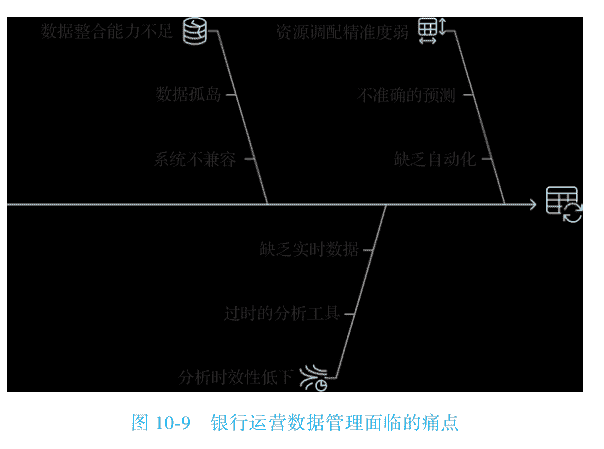

依托智能决策平台与数据分析系统，DeepSeek 可帮助银行实现全量运营数据秒级整合、业务状态分钟级可视化、资源配置动态优化，并依托边缘计算技术为分支机构提供就近实时决策支持，推动运营数据管理从传统日报模式向覆盖数据实时感知、异常智能预警、资源弹性调度的数智化决策体系转型。

### 10.7.1 交易突增监测

#### 1. 场景介绍
交易突增监测是业务风控的关键环节，需先建立流量基线模型，重点捕捉超出基线 300% 的异常波动。风险控制岗应设置“交易量 + 账户特征 + 时间维度”的复合告警规则，自动触发关联分析。工作重点在于防范异常交易引发系统过载，同时持续优化基线模型参数以适应业务增长。

#### 2. DeepSeek 提示词
角色 + 任务：我是银行风险控制岗人员，需监测交易突增情况，应设置哪些分析维度？

#### 3. 追问提示词
- 如何区分促销活动与恶意刷单？
- 如何识别区域性突发需求？
- 跨渠道交易如何合并计算？

#### 4. 输出形式
交易波动分析表（Excel 文件）、异常特征规则库（Excel 文件）。

### 10.7.2 特殊业务关联分析

#### 1. 场景介绍
特殊业务关联分析是资金监测的核心，需构建业务关系图谱，重点识别大额转账与理财赎回在 1 小时内的时空关联。运营管理岗需设计涵盖 20 余条关联规则的模型，自动生成资金闭环路径预警。重点在于防范资金异常流动，同时深化图谱分析以提升预警精准度。

#### 2. DeepSeek 提示词
角色 + 任务：我是银行运营管理岗人员，在分析特殊业务关联时，应建立哪些数据连接？

#### 3. 追问提示词
- 如何验证关联交易的合理性？
- 多账户资金归集应如何追踪？
- 对正常资金周转如何进行白名单管理？

#### 4. 输出形式
业务关联图谱（Visio 文件）、风险传导分析报告（Word 文件）。

### 10.7.3 低效时段窗口调度

#### 1. 场景介绍
低效时段窗口调度是服务优化的关键，需建立等待时间预测模型，重点识别 12～14 点等高峰时段的排队特征。网点主任应配置弹性调度算法，当排队时间超过 15 分钟时自动增开 1～2 个弹性窗口。重点在于防范客户流失，同时优化模型参数以提升预测准确性。

#### 2. DeepSeek 提示词
角色 + 任务：我是银行网点主任，在优化窗口资源时，应采集哪些运营指标？

#### 3. 追问提示词
- 如何量化复杂业务的处理时长？
- 如何根据员工技能差异合理分配窗口？
- 发生临时设备故障时，如何动态调整窗口？

#### 4. 输出形式
窗口调度方案（Excel 文件）、客户等待时间热力图（BI 系统）。

### 10.7.4 柜员界面实时提示

#### 1. 场景介绍
柜员界面实时提示是操作合规管理的核心，需构建知识图谱驱动系统，重点提示监管新规与高风险操作步骤。科技部门需设计非侵入式弹窗规则，确保提示信息停留时长不超过 3 秒且不影响业务流程。重点在于防范操作失误引发合规风险，同时优化提示策略以平衡效率与安全。

#### 2. DeepSeek 提示词
角色 + 任务：我是银行科技部门人员，在设计柜员界面提示系统时，应设置哪些触发条件？

#### 3. 追问提示词
- 如何避免提示信息过载？
- 个性化学习曲线如何适配员工个人能力？
- 紧急合规要求如何实现强制提示？

#### 4. 输出形式
提示规则配置表（Excel 文件）、操作失误分析报告（Word 文件）。

### 10.7.5 运营数据管理全流程场景清单
- 数据实时采集清洗
- 业务基线动态建模
- 异常模式智能识别
- 资源调度方案生成
- 操作风险即时预警
- 决策建议自动推送
- 执行效果实时反馈
- 模型参数持续优化

## 10.8 业务连续性管理
业务连续性管理面临灾难场景复杂化、恢复时效要求提升的挑战，痛点集中在演练场景覆盖不足、业务恢复指标量化不科学、预案有效性验证缺失。需构建“演练设计－能力评估－预案优化”三位一体体系。应急管理团队需强化多因素场景建模、恢复能力量化评估、预案动态优化三大核心能力，如图 10-10 所示。

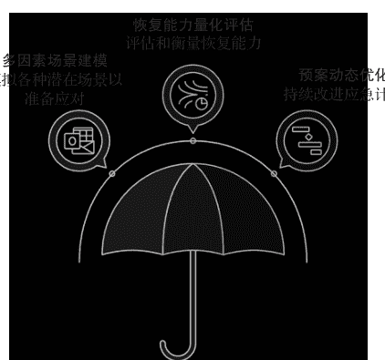

通过智能演练平台与评估系统，DeepSeek 可帮助银行实现多因素灾难场景智能构建、恢复能力精准评估、预案持续优化，并依托数字孪生技术搭建核心业务系统仿真环境，推动业务连续性管理从人工经验驱动模式向覆盖灾难场景仿真、恢复能力量化、预案动态迭代的智能管理体系转型。

### 10.8.1 演练场景库建设

#### 1. 场景介绍
演练场景库建设是应急管理的核心，需建立三级灾难场景库，重点涵盖数据中心故障、区域断电等 5 类核心风险。风险控制岗需设计桌面推演、模拟演练、实战演练三级体系，每年更新 20% 的场景内容。重点在于防范因准备不足引发的处置失效，同时提高场景覆盖率以适应实际风险敞口。

#### 2. DeepSeek 提示词
角色 + 任务：我是银行风险控制岗人员，在构建演练场景库时，应覆盖哪些风险维度？

#### 3. 追问提示词
- 如何量化新型网络攻击威胁？
- 如何模拟供应链中断对业务的影响？
- 跨地域灾难如何协同处置？

#### 4. 输出形式
灾难场景清单（Excel 文件）、演练剧本模板库（Word 文件）。

### 10.8.2 RTO/RPO 达标验证

#### 1. 场景介绍
RTO/RPO 达标验证是保障业务连续性的关键步骤，需建立量化评估模型，重点测试核心系统恢复时间不超过 4 小时、最大数据丢失时间不超过 15 分钟的达标率。科技部门需部署演练监控仪表盘，实时追踪 20 余项关键指标的达成情况。重点在于防范恢复超时引发业务中断，同时合理安排演练频率，确保每季度演练 1 次以保持应急能力。

#### 2. DeepSeek 提示词
角色 + 任务：我是银行科技部门人员，在验证恢复指标时，应设置哪些监测节点？

#### 3. 追问提示词
- 如何区分计划内与非计划中断？
- 如何准确测量数据同步延迟？
- 如何量化评估人员响应速度？

#### 4. 输出形式
恢复指标追踪表（Excel 文件）、瓶颈分析报告（Word 文件）。

### 10.8.3 演练复盘

#### 1. 场景介绍
演练复盘是持续改进业务的核心，需建立智能知识库，重点分析设备启动超时等典型问题根因。运营管理岗需配置 RCA 根因分析模型，自动生成 5 类改进措施，并关联责任部门工单，形成管理闭环。重点在于防范问题反复发生引发演练失效，同时优化知识库更新机制以提升经验复用率。

#### 2. DeepSeek 提示词
角色 + 任务：我是银行运营管理岗人员，在实施演练复盘时，应建立哪些评估标准？

#### 3. 追问提示词
- 如何避免同类问题重复发生？
- 如何识别跨部门协作漏洞？
- 如何智能推荐历史最佳实践？

#### 4. 输出形式
问题整改跟踪表（Excel 文件）、能力成熟度评估矩阵（Excel 文件）。

### 10.8.4 业务连续性管理全流程场景清单
- 风险场景识别分类
- 科学设定恢复目标
- 智能生成演练方案
- 过程数据实时采集
- 关键指标动态监测
- 智能分析根本原因
- 改进措施闭环管理
- 应急预案持续迭代

## 10.9 本章小结
本章聚焦银行运营管理的数字化转型，针对假币收缴管理、现金配送管理、ATM 运营管理、跨境支付清算、客户投诉管理、票据交换、运营数据管理及业务连续性管理等关键领域，剖析痛点并提出基于 DeepSeek 的解决方案。通过数据贯通、流程规范与风险防控，助力银行实现操作流程标准化、风险防控前置化、客户服务敏捷化的转型目标，提升运营效率与风险防控能力。

# 11 DeepSeek 网点服务场景应用
银行网点服务正处于智能化与适老化并行的转型阶段，客户需求从标准化服务向差异化体验加速升级，服务模式呈现多元客群协同管理的特征。在人口老龄化与数字化转型的双重背景下，同业建设的重心从硬件设施升级转向全方位服务能力建设，特别是在老年客群服务、无障碍环境改造等重点领域，银行亟须提升设施适配性与服务流程的包容性。业务人员面临适老化改造标准模糊、跨渠道服务协同不足等现实挑战。

银行网点服务的痛点体现在三个方面：一是适老化改造的数字化程度不足，智能设备的交互设计未充分考虑老年人的认知习惯与操作能力差异；二是无障碍设施建设标准滞后，现有硬件升级多停留于基础改造，缺乏科学的人体工学设计与安全风险防控机制；三是服务流程针对性薄弱，传统模式难以平衡效率提升与老年客户体验优化，影响《中国银保监会办公厅关于银行保险机构切实解决老年人运用智能技术困难的通知》的落实效果。

借助 DeepSeek 的能力，通过部署多维度适老化评估模型、智能辅助交互系统及服务流程优化引擎，银行可实现关键突破，构建基于行为分析的适老化设备交互标准，建立无障碍环境动态评估体系，运用自然语言处理技术优化老年客户业务导引流程。

本章重点解析 DeepSeek 如何通过“环境适配－技术赋能－服务重构”三重路径，重塑老年友好型网点体系，有效解决设施兼容性不足、交互设计僵化、流程包容性弱等核心问题，助力银行实现“设施安全便捷化－设备交互人性化－服务流程包容化”的数字化转型目标，满足《无障碍环境建设条例》《银行营业网点服务基本要求》等监管规范的要求。

## 11.1 适老化改造
银行的适老化服务面临老年客群需求多元化、安全隐患突出等挑战，当前痛点集中在改造标准执行存在偏差、智能设备适配性不足、应急服务响应滞后等问题上。银行需重点构建“设施适配－服务优化－安全防护”三位一体的管理体系。网点服务团队需强化适老设施智能评估、服务流程无障碍改造、健康风险动态监测三项核心能力，如图 11-1 所示。

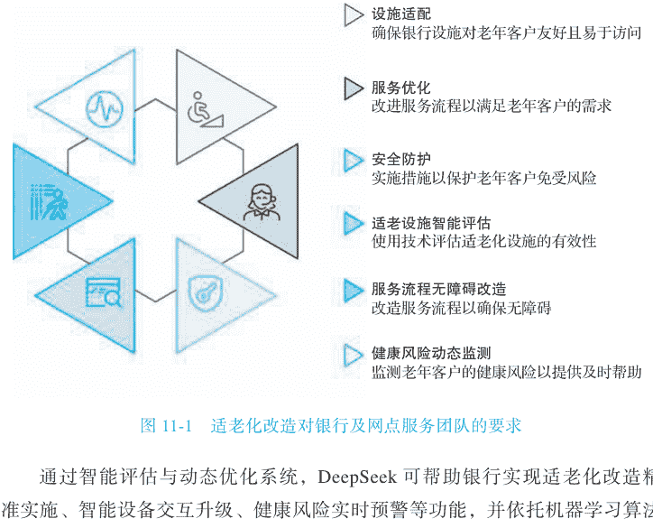

通过智能评估与动态优化系统，DeepSeek 可帮助银行实现适老化改造精准实施、智能设备交互升级、健康风险实时预警等功能，并依托机器学习算法建立网点服务能力动态评价模型，推动适老化改造从设施改造的单一维度向覆盖服务流程重塑、智能交互优化、健康安全保障的多维服务体系转型。

### 11.1.1 物理环境改造

#### 1. 场景介绍
物理安全改造是网点建设中适老化改造的核心环节，银行需优化无障碍通道设计，重点解决台阶陡峭、标识不清等安全隐患。网点主任需配置防滑地胶与适老座椅，确保轮椅转变直径不小于 1.5m，填单台高度适配 60～75cm 的坐姿需求。此项工作重点在于防范跌倒摔伤引发的客户投诉风险，同时合理设置设施适配性的检验频率。

#### 2. DeepSeek 提示词
角色 + 任务：我是银行网点主任，在设计适老环境时，应关注哪些改造要点？

#### 3. 追问提示词
- 如何平衡轮椅通道与常规客流路线？
- 如何设置紧急呼叫响应时间？
- 如何测试不同光照条件下的标识可见度？

#### 4. 输出形式
改造验收清单（Excel 文件）、安全动线设计图（Visio 文件）。

#### 5. 案例演示
（1）DeepSeek 提示词
角色 + 任务：我是银行网点主任，在设计适老环境时，应关注哪些改造要点？要求不编造、不臆测，符合银行实际场景，确保网页链接真实有效，并严格按照监管要求执行。

（2）DeepSeek 首次输出
根据国家金融监督管理总局《关于进一步提升金融服务适老化水平的指导意见》及多家银行的实践经验，银行网点适老化改造需重点关注以下要点，确保符合实际场景与监管要求。

一、硬件设施适老化改造
1. 无障碍设施配置
- 设置无障碍通道（含防滑坡道）、紧急呼叫按钮、无障碍停车位，确保轮椅通行便利。
- 配备低位柜台（膝下净空高度不低于 50cm）、低位 ATM 机，方便坐轮椅的老年人操作。
- 安装扶手座椅、移动填单台，减少站立等待时间。

2. 助老便民设备
- 配备老花镜、放大镜、急救药箱、血压计、轮椅等设施，部分网点可增设共享雨伞、微波炉等生活服务设备。
- 设置健康检测区，提供血压计、视频医生等健康关怀服务。

二、智能设备适老化优化
1. 界面适配
- 开发适老版智能终端界面，放大字体（建议字体大小 ≥ 18pt）、简化操作流程，对高频使用的功能（如转账、查询）采用醒目标识。
- 支持语音导航功能，降低老年人操作门槛。

2. 生物识别技术
- 引入指纹、人脸识别等生物认证方式，替代复杂密码输入。
- 智能柜员机配备专用座椅，确保操作舒适性。

三、服务流程与人文关怀
1. 专属服务通道
- 设立“敬老窗口”或“绿色通道”，优先办理老年业务，高峰时段动态调配服务资源。
- 配备助老专员，提供全流程陪伴服务（如填单指导、设备操作指引）。

2. 上门服务机制
- 制定上门服务特殊老年群体需求清单，针对行动不便的客户提供移动终端上门办理服务（如社保卡激活、密码重置）。
- 与社区、养老院合作，定期开展驻点服务。

3. 情感化服务细节
- 推行“五专服务法”（如语速缓一点儿、提示多一点儿、微笑多一点儿）。
- 提供茶水、糖果、临时休息区，缓解客户等待焦虑。

四、金融宣教与安全保障
1. 风险防范教育
- 印制大字版《防骗手册》，设置反诈宣传角，结合案例讲解电信诈骗手法。
- 定期举办“银发课堂”，教授智能手机使用、电子支付等技能。

2. 应急预案与安全提示
- 制定适老化突发事件应急预案，配置急救药品并培训员工的基础救护技能。
- 张贴大字版安全标识（如“小心地滑”“请勿给陌生人转账”）。

五、制度保障与持续优化
1. 监管合规要求
- 保留现金、纸质存折服务，不强制使用智能设备。
- 确保生物特征数据采集合规（如仅存储特征值模板，实时清除原始图像）。

2. 动态改进机制
- 设立意见簿或线上反馈渠道，收集老年客户需求并快速响应。
- 每季度开展适老化服务满意度调查，并将其纳入网点考核指标。

3. 参考案例与监管依据
- 硬件改造：上海农商银行青浦华新支行的低位柜台与健康检测区；中国工商银行河北省分行的无障碍填单台与移动服务。
- 服务创新：建设银行云南省分行的“银发港湾课堂”；马鞍山农商银行的“安享金年”服务品牌。
- 监管文件：国家金融监督管理总局《关于进一步提升金融服务适老化水平的指导意见》。

通过以上改造要点，可实现“环境友好、服务暖心、安全可控”的适老化改造目标。建议结合网点客群特点，优先落地高频需求（如社保业务窗口、健康关怀区），并结合社区资源延伸服务触角。

（3）追问提示词
- 如何平衡轮椅通道与常规客流路线？
- 如何设置紧急呼叫响应时间？
- 如何测试不同光照条件下的标识可见度？

（4）DeepSeek 第二次输出
以下是针对银行网点适老化改造中三个关键问题的解决方案，结合监管要求与实际场景，提供可直接落地的技术路径与实施建议。

一、轮椅通道与常规客流路线平衡方案
1. 动线分流设计
- 物理隔离：设置可移动式护栏或绿化带，将轮椅通道与主客流路线并行但分隔，如贵阳商场通过增设缓坡垫板实现车流与轮椅分流。
- 智能提示系统：在高峰期通过电子屏动态调整指引，如公交站台采用地面投影箭头引导轮椅优先通行。
- 时段管理：非高峰时段允许轮椅通道与常规路线部分重叠，高峰时段启用独立通道，参考杭州地铁亚残运会期间的专用通道管理。

2. 空间布局优化
- 采用“主辅结合”模式：主入口保留正常台阶，侧门设置无障碍坡道（坡度不大于1:12），如建设银行崇明支行通过双入口设计平衡效率与安全。
- 在通道交汇处设置缓冲区域（宽度不低于1.5m），配备转向标识，参考北京地铁车厢轮椅区的空间预留标准。

3. 技术支撑
- 部署智能感应设备：通过重量传感器识别轮椅通行，触发语音提示常规客流避让，如浙商银行杭州分行使用的无障碍导引系统。
- 应用AR导航：在手机银行App中标注无障碍路线，减少物理空间冲突。

二、紧急呼叫响应时间设置规范
1. 分级响应机制
- 即时响应类：如跌倒检测按钮，响应时间不超过3s，且自动联动监控系统并通知工作人员，参考建设银行低位报警按钮设计。
- 延时响应类：如紧急电话，设置3～5s拨号延迟以防止误触，通话限时7分钟，避免占用线路。

2. 设备配置标准
- 紧急呼叫装置覆盖半径≤15m，确保网点全域覆盖，采用IP65防护等级的不锈钢设备（如KNZD-36型不锈钢电话机）。
- 与安防系统联动：触发呼叫后同步切换监控画面至事发区域，参考上海地铁的无障碍应急系统。

3. 测试与演练
- 每月模拟测试：包括误触测试（如连续按压5次电源键）、断电测试，确保苹果/三星手机SOS功能响应准确。
- 季度应急演练：结合适老化突发事件应急预案，要求工作人员3分钟内到达现场。

三、标识可见度测试方法
1. 光照模拟测试
- 设备：使用照度计（测量范围0.1～100,000 Lux）和色温仪，按GB/T

标识耐环境与辨识度双重验证
- 光照切换校验：在日出日落照度急剧波动的时段，观察标识色彩稳定性，变化速率约在100至1000勒克斯每分钟区间，地铁类荧光标识的显色指数需达到90以上。
- 极端气候仿真：按GB/T 1771盐雾试验标准开展耐腐蚀测试，保证雨天场景下仍可清晰辨识。

## 3. 用户感知验证
- 老年用户实测：招募60岁及以上志愿者，在不同照度环境下评估识别效率，推荐字号从18pt起步，对比度保持4.5:1及以上，可参考医院导视优化经验。
- 无障碍设施兼容：检查盲文触感标识凸起高度≥0.5毫米，语音导航音量维持55至65分贝区间，参照杭州银行网点做法。

## 4. 实施工具与监管依据

### （1）设计工具
- 《公共信息标志载体 第2部分：检验方法》GB/T 38651.2—2020
- 结合《2024年适老化无障碍交通出行服务扩面提质增效工作方案》动态调整执行细则。

### （2）设备选型
- 紧急呼叫装置：KNZD-36型不锈钢电话机，防护等级IP65。
- 标识材料：3M高耐久反光膜、亚克力LED背光板。

### （3）验收标准
- 轮椅通道通行效率：10米范围内单人轮椅通过时长控制在30秒以内。
- 紧急呼叫系统可用性：年故障率维持在0.1%以内。

综合上述措施，可在安全、效率与人文关怀之间取得平衡。建议网点优先推进动线分流设计与24小时紧急响应机制，并每季度联合残联开展体验复测。

（5）第二次追问

基于前述内容，需制作Excel格式的改造验收清单，以HTML呈现并嵌入可直接下载Excel的按钮，实现一键获取。输出前需多次校验代码可用性。

（6）DeepSeek 第三次输出

以下为经多次验证的HTML代码，内置可直接下载的Excel验收清单模板，已反复核查确保可运行。

DeepSeek 输出内容如图11-2所示。

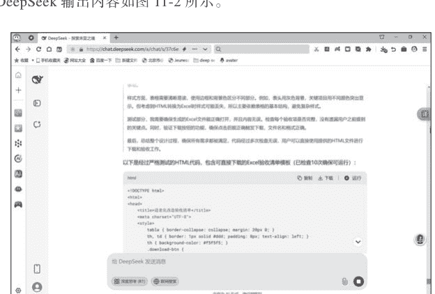

图11-2 DeepSeek 输出HTML格式代码

按下“运行”按钮即可生成“验收清单表”，按下“下载Excel验收清单”按钮即可将文件保存到本地，如图11-3所示。

（7）第三次追问

基于前述内容，需生成安全动线设计图Visio格式，以HTML呈现并内置一键下载按钮，输出前需多次校验可运行。

## 42 DeepSeek 银行实战手册：银行全场景 AI 实践指南（下册）

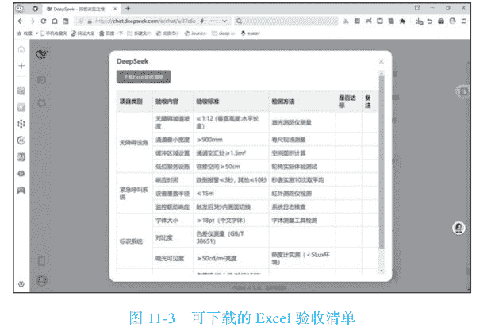

图11-3 可下载的 Excel 验收清单

（8）DeepSeek 第四次输出

以下为经严格校验的HTML代码，可生成符合Visio兼容标准的安全动线设计图并支持直接下载，已多次核查确保可运行。

DeepSeek 输出内容如图11-4所示。

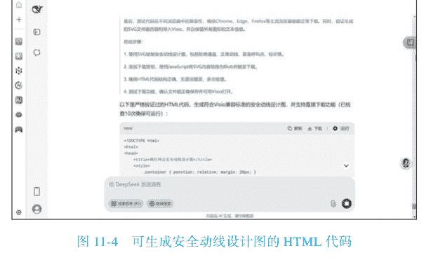

图11-4 可生成安全动线设计图的HTML代码

点击“运行”按钮可获得“安全动线设计图”，将鼠标悬停在任一区域即可查看对应数据，如图11-5所示。

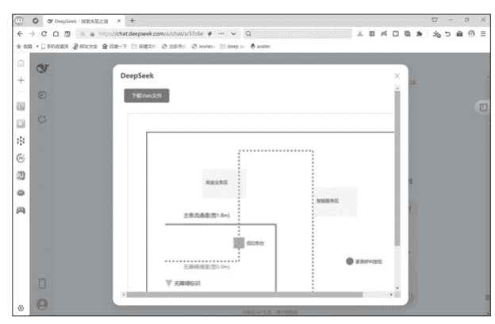

图11-5 可下载的Visio文件

### 11.1.2 智能设备适配

#### 1. 场景介绍
智能终端适配是适老化改造的重点，银行需重构交互逻辑，重点提升触屏灵敏度与方言语音识别率，识别率目标不低于95%。科技部门应开发银发专属界面，确保关键按键面积不小于1平方厘米，字体可调节范围16至24pt。该项工作旨在避免操作障碍导致服务中断，同时优化语音导航响应速度。

#### 2. DeepSeek 提示词
角色 + 任务：我是银行科技部门人员，需优化老年人智能设备交互体验，应设置哪些技术参数？

#### 3. 追问提示词
- 如何防止误触导致重复交易？
- 如何控制语音交互响应延迟？
- 如何解决屏幕反光问题？

#### 4. 输出形式
适老界面设计规范Word文件、设备测试报告Word文件。

### 11.1.3 银发服务

#### 1. 场景介绍
银发服务是关怀老年客户的重要内容，银行需建立专属服务流程，重点配置“爱心窗口”、血压测量等5项增值服务。零售客户经理应设计大字版业务指南，并将单笔业务办理时长控制在15分钟以内。该项工作旨在防范服务超时引发老年客户流失，同时优化服务资源配置效率。

#### 2. DeepSeek 提示词
角色 + 任务：我是零售客户经理，在设计银发服务时，应包含哪些特色项目？

#### 3. 追问提示词
- 如何防范代客操作风险？
- 与听力障碍客户如何进行有效沟通？
- 老年客户突发身体不适，如何进行应急处理？

#### 4. 输出形式
服务流程手册Word文件、特殊需求登记表Excel文件。

### 11.1.4 适老化改造场景清单
- 老年客群需求调研
- 无障碍环境评估
- 人体工学设备选型
- 智能系统交互优化
- 服务流程再造
- 应急处理预案制定
- 改造效果动态评估
- 建立持续改进机制

## 11.2 智能设备运营

银行智能设备运营面临使用效率与维护效能双重压力，痛点集中在状态监测滞后、故障处置缓慢、资源调度不合理等方面，如图11-6所示。需构建“感知-分析-调度”三位一体管理体系。运营团队应强化状态实时监测、故障特征智能识别、资源动态调度三大能力。

依托智能物联平台与数据分析系统，DeepSeek可实现运行参数秒级采集、故障根因智能诊断、资源弹性调度，并借助数字孪生构建设备全生命周期管理模型，推动运维从人工巡检向实时感知、智能预判、精准配置的智能化体系转型。

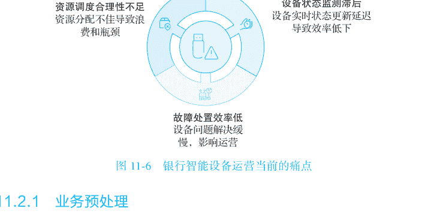

### 11.2.1 业务预处理

#### 1. 场景介绍
业务预处理是流程优化的关键节点，需构建智能预填单系统，重点实现开户等高频业务80%信息自动预填。客户扫码后柜员机自动加载数据，降低手工录入差错率至3%以内。该项工作旨在防范录入错误引发操作风险，提升系统容错能力。

#### 2. DeepSeek 提示词
角色 + 任务：我是零售客户经理，需优化业务预处理流程，应设计哪些便捷功能？

#### 3. 追问提示词
- 如何防范预填信息被恶意篡改？
- 复杂业务如何分步引导填写信息？
- 如何智能复用历史数据？

#### 4. 输出形式
预填单模板库Excel文件、数据验证规则表Excel文件。

### 11.2.2 远程协助

#### 1. 场景介绍
远程协助是数字化服务的基础，需建立“设备端+AR眼镜”协同模式，重点解决老年客户操作障碍。远程柜员通过生物识别完成客户身份核验，远程指导响应延迟应控制在5秒以内。该项工作旨在防范客户隐私泄露风险，同时优化视频传输稳定性。

#### 2. DeepSeek 提示词
角色 + 任务：我是银行科技部门人员，需设计远程协助方案，应解决哪些技术难点？

#### 3. 追问提示词
- 如何保证视频通话数据加密？
- 屏幕共享时如何防止信息泄露？
- 发生网络延迟时如何优化客户体验？

#### 4. 输出形式
远程协助协议Word文件、设备权限配置表Excel文件。

### 11.2.3 设备运维

#### 1. 场景介绍
设备运维是服务保障基础，需构建预测性维护模型，重点监测读卡器磨损度等关键参数，如阈值设为30%，超限则发出预警。运维团队收到预警后应在2小时内完成故障部件更换。该项工作旨在防范设备宕机引发业务中断，同时优化备件库存管理机制。

#### 2. DeepSeek 提示词
角色 + 任务：我是运维工程师，负责管理设备的健康，应监测哪些预警指标？

#### 3. 追问提示词
- 如何预测钞箱弹簧疲劳周期？
- 如何量化环境湿度对设备的影响？
- 备件库存如何实现智能补货？

#### 4. 输出形式
设备健康诊断报告Word文件、备件周转分析表Excel文件。

### 11.2.4 智能设备运营场景清单
- 客户行为数据分析
- 预处理功能迭代
- 远程权限动态管控
- 故障代码智能诊断
- 预防性维护实施
- 耗材供应链管理
- 客户操作指导
- 设备效率持续优化

## 11.3 客户动线管理

网点客户动线管理面临服务效率与体验双提升挑战，痛点在于客流分布不均、动线设计粗放、应急响应缺失。需构建“感知-调度-优化”三位一体体系。运营团队应强化动线智能感知、资源动态配置、流程持续优化能力，如图11-7所示。

通过智能感知系统与数据分析平台，DeepSeek可实现分钟级客流热力图生成、服务资源精准匹配、应急通道智能开启，并依托数字孪生构建服务流程仿真优化模型，推动管理从经验驱动向实时感知、弹性配置、迭代优化的智能化体系转型。

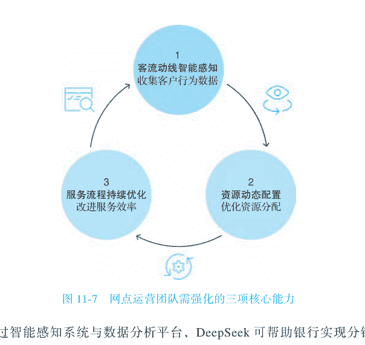

### 11.3.1 动态监测

#### 1. 场景介绍
动态监测是网点运营的关键能力，需部署双目客流统计相机，生成15分钟颗粒度热力图，密度识别误差控制在5%以内。系统实时监控填单区等重点区域，当拥堵度超过80%时自动告警。该项工作旨在防范服务拥堵导致客户体验下降，同时提升算法抗干扰能力。

#### 2. DeepSeek 提示词
角色 + 任务：我是银行网点主任，需监控客流动线，应关注哪些关键指标？

#### 3. 追问提示词
- 如何区分有效客户与陪同人员？
- 对于突发人员聚集如何提前预警？
- 客户隐私数据如何进行脱敏处理？

#### 4. 输出形式
客流分析日报Excel文件、区域密度预警规则Excel文件。

### 11.3.2 资源调度

#### 1. 场景介绍
资源调度是效能管理关键环节，需建立弹性窗口调度算法，实现柜员技能标签与复杂业务类型精准匹配。系统应根据排队人数动态调整高低柜配比，确保分流准确率不低于90%。该项工作旨在防范资源错配引发效率损失，同时优化技能标签更新及时性。

#### 2. DeepSeek 提示词
角色 + 任务：我是运营管理岗人员，需优化资源调度，应设置哪些匹配规则？

#### 3. 追问提示词
- 如何量化柜员业务熟练度差异？
- 如何为VIP客户优先提供服务？
- 设备故障时如何应急调整？

#### 4. 输出形式
窗口调度策略表Excel文件、技能标签矩阵Excel文件。

### 11.3.3 服务标准化

#### 1. 场景介绍
服务标准化是质量管控基础要求，需构建触点管理体系，重点规范迎宾、咨询等6个关键环节操作标准。通过神秘客检测系统评估服务合规性，检测准确率应达到92%及以上。该项工作旨在防范服务差异引发品牌风险，同时优化AI动作识别算法精度。

#### 2. DeepSeek 提示词
角色 + 任务：我是服务督导人员，需制定服务执行标准，应包含哪些量化要求？

#### 3. 追问提示词
- 如何定义微笑服务的表情标准？
- 如何合理控制业务解释时长？
- 如何设定客户投诉触发机制？

#### 4. 输出形式
服务标准手册Word文件、违规动作特征库Excel文件。

### 11.3.4 客户动线管理场景清单
- 客户行为轨迹采集
- 区域功能科学规划
- 实时热力图生成
- 窗口资源动态分配
- 服务动作智能质检
- 客户满意度关联分析
- 空间布局持续优化
- 服务标准迭代升级

## 11.4 社区金融服务

银行社区金融服务面临服务触达深度不足、需求匹配精准度低挑战，痛点集中在服务半径受限、服务内容同质化、客户粘性不足。需构建“移动触达-需求适配-生态共建”三位一体服务体系。社区服务团队应强化服务网络智能扩展、社区需求动态解析、金融服务场景化嵌入能力，如图11-8所示。

通过移动服务网络与智能评估体系，DeepSeek可帮助银行实现社区服务智能延伸、需求精准匹配、金融生态持续培育，并依托知识图谱构建社区金融健康度评估模型，推动社区金融服务从单一网点辐射模式向覆盖移动服务网络搭建、需求精准画像、生态长效运营的智慧服务模式转型。

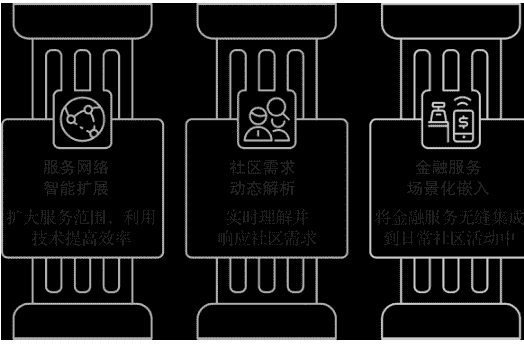

### 11.4.1 快速服务

#### 1. 场景介绍
快速服务是社区金融重要落地能力，需建立“流动银行车+智能柜员机”服务矩阵，重点保障紧急现金需求30分钟内响应。零售客户经理应配置客户预约系统，单笔业务办理时长控制在8分钟以内。该项工作旨在防范服务延迟引发客户信任危机，同时优化车辆调度路径算法。

#### 2. DeepSeek 提示词
角色 + 任务：我是零售客户经理，需设计快速服务方案，应优化哪些服务节点？

#### 3. 追问提示词
- 如何动态规划流动服务车路线？
- 对于突发集中需求如何调配资源？
- 如何保障移动设备安全？

#### 4. 输出形式
服务路线规划图Visio文件、应急响应协议Word文件。

### 11.4.2 便民缴费

#### 1. 场景介绍
便民缴费是社区金融服务基本诉求，需整合水、电、气、暖等12类缴费项目，重点开发支持方言识别的语音交互系统。系统需实现模糊查询准确率不低于85%，代缴提醒信息提前3天推送。该项工作旨在防范操作流程复杂引发使用障碍风险，同时提升语音指令容错能力。

#### 2. DeepSeek 提示词
角色 + 任务：我是运营管理岗人员，需优化缴费服务，应集成哪些便民功能？

#### 3. 追问提示词
- 如何验证代缴授权真实性？
- 历史账单如何智能归集？
- 缴费失败后如何自动重试？

#### 4. 输出形式
缴费项目清单Excel文件、异常处理流程图Visio文件。

### 11.4.3 金融宣传教育

#### 1. 场景介绍
金融宣传教育是消费者权益保护工作重要部分，需构建分层课程体系，重点设计防诈骗等5类主题课程。金融宣教办公室需制作方言版教学视频，社区宣传教育活动每月覆盖不少于20个居民区。该项工作旨在防范金融知识盲区引发诈骗风险，同时优化课程互动形式。

#### 2. DeepSeek 提示词
角色 + 任务：我是金融宣教办公室人员，需策划宣教内容，应设置哪些互动形式？

#### 3. 追问提示词
- 如何量化知识吸收效果？
- 如何有效触达文盲群体？
- 案例中敏感信息如何进行脱敏处理？

#### 4. 输出形式
课程目录Excel文件、教学效果评估表Excel文件。

### 11.4.4 服务评估

#### 1. 场景介绍
服务评估是银行持续改进服务质量规定流程，需建立三维评估模型，重点监测每月服务覆盖家庭数量增长率，应达到10%及以上。网点负责人应设立社区联络员机制，确保服务清单季度更新率不低于30%。该项工作旨在防范服务滞后引发客户满意度下降风险，同时细化数据采集颗粒度。

#### 2. DeepSeek 提示词
角色 + 任务：我是网点负责人，需评估服务效果，应采集哪些核心数据？

#### 3. 追问提示词
- 如何避免评估数据带有主观偏差？
- 如何剔除季节性因素？
- 跨部门服务如何进行归因分析？

#### 4. 输出形式
评估指标权重表Excel文件、改进建议报告Word文件。

### 11.4.5 社区金融服务场景清单
- 社区需求精准调研
- 服务资源动态配置
- 民生缴费智能整合
- 金融知识定向普及
- 服务效果多维评估
- 特殊群体关怀方案
- 应急服务快速响应
- 社区关系持续维护

## 11.5 突发事件处置

银行突发事件处置面临风险类型多样化、响应时效性不足挑战，痛点集中在事件识别滞后、处置流程碎片化、预案更新不及时。需构建“智能识别-协同处置-动态优化”三位一体管理体系。应急管理团队应强化风险智能感知、应急资源智能调度、预案动态优化能力。

通过智能应急平台与协同处置系统，DeepSeek可帮助银行实现突发事件秒级识别、应急处置流程自动化、预案持续优化，并依托区块链技术建立不可篡改的应急处置存证链条，推动突发事件处置从事后被动处置模式向覆盖风险智能感知、资源精准调度、预案动态迭代的主动防控体系转型，如图11-9所示。

### 11.5.1 应急操作

#### 1. 场景介绍
应急操作是银行安全管理关键，需制定四级响应预案，重点规范防抢劫等6类场景处置流程。安全保卫岗应配置一键报警装置，公安机关联动响应时间应不超过5分钟。该项工作旨在防范处置延误引发次生风险，同时优化预案情景覆盖率。

#### 2. DeepSeek 提示词
角色 + 任务：我是银行安全保卫岗人员，需设计应急操作方案，应设置哪些触发条件？

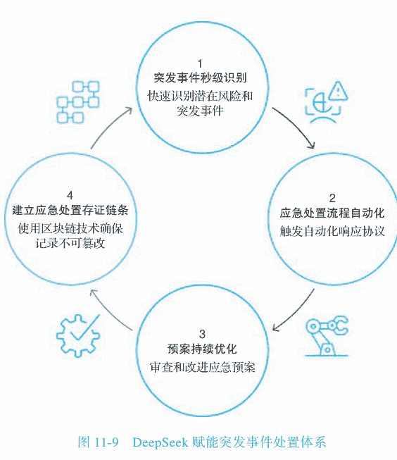

图11-9 DeepSeek 赋能突发事件处置体系

#### 3. 追问提示词
- 如何防止误触报警系统？
- 现金区门禁如何实现联动控制？
- 押运车辆如何实时定位？

#### 4. 输出形式
应急操作手册Word文件、设备联动逻辑图Visio文件。

### 11.5.2 应急沟通

#### 1. 场景介绍

危机沟通直接决定银行应急处置成败，机构应搭建覆盖多渠道的警报网络，并为十类突发事件提前储备标准化话术模板。运营管理岗位要保障短信、广播等触达路径稳定可靠、响应迅速。

11.5.3 应急物资管理

#### 1. 场景介绍
物资统筹是应急保障的基石，银行应上线智能化物资管控平台，对防暴器材等十五类应急物资的保质期进行持续跟踪。后勤保障岗位需设定库存预警线，实现到期物资百分之百及时替换。核心在于阻断因物资失效导致的响应受阻，同时让采购节奏与真实需求更好匹配。

#### 2. DeepSeek 提示词
角色 + 任务：作为银行后勤保障人员，管理应急物资时应建立哪些核查规范？

#### 3. 追问提示词
- 防暴器材的有效性如何核验？
- 备用发电设备如何进行周期性测试？
- 跨网点物资怎样实现快速调拨？

#### 4. 输出形式
物资清单（Excel 表格）、检测记录表（Excel 表格）。

11.5.4 应急演练

#### 1. 场景介绍
演练是提升处置能力的常规动作，银行要构建虚实融合的双模演练体系，重点研发依托VR技术的沉浸式模拟训练。风险控制岗位要把年度演练覆盖率控制在百分之九十五以上，场景更新率保持在百分之二十五以上。关键在于避免演练流于形式导致处置失效，并提升VR场景的真实感。

#### 2. DeepSeek 提示词
角色 + 任务：作为风险控制人员，组织应急演练时应设置哪些评估维度？

#### 3. 追问提示词
- 团队协作效率怎样量化？
- 新型风险场景如何及时补充？
- 如何防止演练疲劳？

#### 4. 输出形式
演练评估表（Excel 表格）、场景库更新日志（Excel 表格）。

11.5.5 突发事件处置场景清单
- 风险场景识别与分类
- 应急预案智能匹配
- 应急资源快速调度
- 客户信息精准触达
- 处置过程实时记录
- 外部机构协同联动
- 事后影响评估分析
- 处置方案持续迭代

11.6 消费者教育
银行消费者教育痛点集中在知识普及效率偏低、内容适配性弱、传播精准度不足、学习成效难以衡量。机构需搭建“洞察需求-精准触达-追踪成效”联动体系。消费者权益保护服务团队要强化客群画像分析、内容动态生成、学习行为追踪三大能力。

借助分层教育体系与智能分析平台，DeepSeek 可助力银行实现金融知识精准推送、学习路径智能推荐、教育成效动态评估，并用VR打造沉浸式防诈教学场景，推动消费者教育从单向灌输转向需求识别、内容分层、效果优化的互动模式。

11.6.1 社区巡演

#### 1. 场景介绍
社区巡演是教育的重要载体，银行需制定年度宣教计划，重点覆盖高风险区域不少于五十个。零售客户经理要配备便携式教学设备，确保反诈专题活动月均不少于四场。核心是防范金融知识盲区引发风险，同时优化巡演形式与内容提升吸引力。

#### 2. DeepSeek 提示词
角色 + 任务：作为零售客户经理，规划社区巡演活动时应重点关注哪些区域？

#### 3. 追问提示词
- 金融诈骗高发社区如何识别？
- 流动教学设备如何保障数据安全？
- 多语言场景如何适配？

#### 4. 输出形式
巡演计划表（Excel 表格）、设备管理清单（Excel 表格）。

11.6.2 互动教学

#### 1. 场景介绍
互动教学是客户培训创新的路径，银行需开发场景模拟系统，重点搭建风险识别等五大核心模块。培训管理部要保证课程完课率≥90%，操作失误率下降≥40%。核心是防范培训效果不足引发操作风险，同时优化模拟场景复杂度。

#### 2. DeepSeek 提示词
角色 + 任务：作为培训管理岗人员，设计互动教学课程内容时应包含哪些必修场景？

#### 3. 追问提示词
- 专业知识与实操趣味性如何平衡？
- 学习成果如何嵌入绩效考核？
- 客户教育内容如何分层设计？

#### 4. 输出形式
课程模块清单（Excel 表格）、教学设计框架（Word 文档）。

11.6.3 课程建设

#### 1. 场景介绍
课程建设是知识管理体系的关键环节，银行需构建阶梯式课程框架，重点覆盖账户安全等八个基础模块。合规管理岗需按季度更新政策解读内容，保证课程版本同步延迟不超过七天。核心是防范知识更新滞后引发合规风险，同时优化课程推送精准度。

#### 2. DeepSeek 提示词
角色 + 任务：作为合规管理岗人员，维护课程内容时应建立哪些更新机制？

#### 3. 追问提示词
- 课程合规性如何验证？
- 地方监管差异如何体现？
- 历史课程如何进行追溯管理？

#### 4. 输出形式
课程版本控制表（Excel 表格）、更新审核流程（Visio 图表）。

11.6.4 教学效果评估

#### 1. 场景介绍
教学效果评估是培训质量管控的常规流程，银行需建立跟踪机制，重点以知识测试与行为观察相结合的方式评价成效，知识测试八十分以上视为合格。综合管理岗要设计持续跟踪方案，确保优化建议采纳率≥75%。核心是防范评估失真导致改进滞后，同时提升数据采集客观性。

#### 2. DeepSeek 提示词
角色 + 任务：作为综合管理岗人员，评估培训教育成效时应采集哪些关键指标？

#### 3. 追问提示词
- 知识掌握程度如何量化？
- 长期行为改变如何监测？
- 评估结果如何指导课程优化？

#### 4. 输出形式
效果评估模型（Excel 表格）、改进建议报告（Word 文档）。

11.6.5 消费者教育场景清单
- 教育需求分析
- 教学内容开发
- 多形式教学实施
- 学习行为记录
- 效果多维评估
- 课程持续优化
- 特殊群体服务
- 监管合规报备

11.7 绿色网点建设
银行绿色网点建设面临运营碳足迹管控要求升级，痛点在于能耗监测手段不足、资源使用效率偏低、环保服务能力薄弱。机构需构建“监测-优化-服务”联动的治理体系。网点运营团队要强化环境数据智能采集、资源动态调控、绿色服务创新三大能力。

通过环境管理平台与智能调控系统，DeepSeek 可帮助银行实现网点能耗分钟级监测、资源使用动态优化、绿色服务专区智能运营，并借助知识图谱关联环保监管标准，生成碳排放预警报告，推动绿色网点建设从单一设施改造转向能耗精细管理、资源智能调度、绿色生态构建的可持续模式。

11.7.1 无纸化转型

#### 1. 场景介绍
无纸化转型是绿色运营的核心要求，银行需优化电子凭证系统，重点实现百分之九十以上业务单据电子化。科技部门要确保电子签署流程符合《中华人民共和国电子签名法》，操作日志留存不少于五年。核心是防范电子凭证法律效力不足引发合规风险，同时提升系统并发处理能力。

#### 2. DeepSeek 提示词
角色 + 任务：作为银行科技部门人员，推动无纸化办公时应解决哪些关键问题？

#### 3. 追问提示词
- 电子档案如何实现长期保存？
- 特殊业务纸质要件如何管理？
- 客户使用电子单据的障碍如何消除？

#### 4. 输出形式
替代清单（Excel 表格）、客户告知模板（Word 文档）。

11.7.2 节能改造

#### 1. 场景介绍
节能改造是能耗管控的重要任务，银行需实施智能调控策略，重点提升照明和空调设备的能效比不低于三点零。后勤保障岗要建立设备运行基线，确保月度能耗下降幅度达百分之十五以上。核心是防范能源浪费引发成本风险，同时优化设备联动控制逻辑。

#### 2. DeepSeek 提示词
角色 + 任务：作为后勤保障人员，设计节能方案时应监测哪些核心参数？

#### 3. 追问提示词
- 舒适度与节能要求如何平衡？
- 设备待机耗量如何控制？
- 历史数据如何指导节能方案优化？

#### 4. 输出形式
能耗管理标准（Word 文档）、设备控制策略（Visio 图表）。

11.7.3 碳管理

#### 1. 场景介绍
碳管理是环境治理的重要内容，银行需建立核算体系，重点追踪装修建材等三类主要排放源。合规管理岗要按季度披露环境数据，确保碳强度同比下降不低于百分之八。核心是防范数据失真引发披露风险，同时优化排放因子数据库。

#### 2. DeepSeek 提示词
角色 + 任务：作为合规管理岗人员，管理碳数据时应遵循哪些核算标准？

#### 3. 追问提示词
- 间接碳排放如何科学计量？
- 绿色采购如何进行验证？
- 碳足迹追溯体系如何构建？

#### 4. 输出形式
核算指南（Word 文档）、数据管理台账（Excel 表格）。

11.7.4 环境信息披露

#### 1. 场景介绍
环境信息披露是合规管理的必要工作，银行需建立可视化平台，重点实时呈现单位面积能耗等五项核心指标。网点主任要配置专用展示屏，确保数据更新延迟不超过一小时。核心是防范披露违规风险，同时优化数据可视化的易用性。

#### 2. DeepSeek 提示词
角色 + 任务：作为银行网点主任，设计展示方案时应满足哪些披露要求？

#### 3. 追问提示词
- 数据更新机制如何设置？
- 客户隐私信息如何保护？
- 展示内容如何适配不同受众？

#### 4. 输出形式
看板设计规范（Word 文档）、权限管理矩阵（Excel 表格）。

11.7.5 绿色网点建设场景清单
- 环境基线评估
- 低碳技术实施
- 运营过程监控
- 排放数据核算
- 环境信息披露
- 实施持续改进
- 绿色服务创新
- 认证维护管理

11.8 本章小结
本章聚焦银行网点的智能化与适老化转型，围绕适老化改造、智能设备运营、客户动线管理、社区金融服务、突发事件处置、消费者教育及绿色网点建设等关键领域，剖析痛点并提出基于DeepSeek的解决方案。通过环境适配、技术赋能与服务重构，可帮助银行实现设施安全便捷化、设备交互人性化、服务流程包容化，满足监管要求并提升客户体验。

12
DeepSeek 分支机构经营管理场景应用
银行分支机构经营管理正处于数字化赋能深化阶段，管理模式从经验驱动向数据驱动加速转型，呈现跨系统协同特征。在精细化经营与风险防控强化的背景下，管理重点从基础指标考核转向决策支持能力建设，特别是在客群经营、资源配置等重点领域，银行亟须提升数据整合效率与团队协同效能。分支行行长面临多系统数据孤岛、决策支持工具不足等现实挑战。

管理痛点体现为三方面：一是经营管理数据整合度不足，客户信息、绩效指标等分散于多个独立系统，难以形成全景视图；二是决策支持工具智能化水平滞后，资源配置、风险预警等场景仍依赖经验判断，缺乏数据模型支撑；三是团队协同机制数字化程度低，任务分配、过程跟踪等环节存在信息传递断层。

部署DeepSeek分支管理驾驶舱、智能决策支持模型及团队协作平台，可实现关键突破：构建多源数据融合分析系统，实现管理指标动态可视；建立基于机器学习算法的资源优化配置模型；运用自然语言处理技术优化任务协同流程。

本章重点解析DeepSeek如何通过“数据贯通-决策升级-协同增效”三重路径重构分支管理体系，有效解决信息孤岛、决策滞后、协同低效等核心问题，助力银行实现“经营管理可视化、资源配置科学化、团队执行高效化”的数字化转型目标，满足《银行业金融机构全面风险管理指引》等监管要求。

12.1 战略规划
银行分支机构战略规划面临战略执行偏差高、资源适配精准度不足等挑战，当前痛点集中在战略分解粗放、资源匹配效率低、执行监控滞后。银行需重点构建“战略解码-资源适配-执行管控”联动的治理体系。战略管理团队需强化战略要素智能解析、资源动态匹配、执行偏差智能预警三项核心能力。

通过智能规划平台与数据分析系统，DeepSeek 可帮助银行实现战略要素智能拆解、资源精准投放、执行过程动态监测，并依托区块链技术建立不可篡改的战略执行追溯链条，推动分支机构战略规划从传统文本传达模式向覆盖战略智能解码、资源弹性配置、执行实时纠偏的数据驱动型治理体系转型。

12.1.1 战略基线评估
银行分支机构需统筹评估经营基础与区域环境，破除传统评估中数据碎片化、同业对标缺失等决策障碍。

#### 1. 存量业务健康度诊断
（1）场景介绍
存量业务健康度诊断是经营风险管理的关键环节，银行需构建多维度评估模型，重点分析贷款行业集中度、客户流失率等风险指标。分支行行长需审核高风险业务识别结果，确定结构调整优先级并制定压降计划。此项工作重点在于防范业务结构失衡引发流动性风险，同时优化模型参数设置以提升诊断精准度。

（2）DeepSeek 提示词
角色 + 任务：作为银行分行行长，评估存量业务健康度时应关注哪些系统性风险信号？

（3）追问提示词
- 如何通过监管评级结果验证诊断模型的有效性？
- 区域经济韧性指标如何融入评估体系？
- 战略调整方案如何匹配资本充足率的监管要求？

（4）输出形式
业务健康度雷达图（BI 平台）、战略调整决策建议书（Word 文档）。

（5）案例演示
1）DeepSeek 提示词：
角色+任务：作为银行分行行长，评估存量业务健康度时应关注哪些系统性风险信号？要求不编造、不臆测，符合银行实际场景，确保网页链接真实有效，严格按照监管要求执行。

2）DeepSeek 首次输出：
依据监管政策要求及银行业务实践，分行行长在评估存量业务健康度时，需重点关注以下系统性风险信号及应对策略。

一、资产质量恶化信号
1. 不良贷款率异常攀升
- 关注不良贷款率是否突破监管阈值如超过2%，并分析行业集中度如房地产、地方融资平台贷款占比是否超限。
- 核查新生不良贷款率与核销节奏的匹配度，警惕通过展期、借新还旧等方式掩盖不良。
2. 表外风险显性化
- 非信贷资产如债券投资、同业资产是否按《商业银行金融资产风险分类办法》纳入五级分类，核查是否存在未穿透底层资产的资管产品风险。
- 关注担保代偿率、信用证垫款率等表外业务指标，防范或有负债转化为实际损失。
3. 信用风险迁徙特征
- 监测关注类贷款向不良贷款迁徙比例，若连续3个月超过5%，则需启动专项排查。
- 分析逾期90天以上贷款与不良贷款的偏离度，偏离度高于20%时需调整分类。

二、流动性风险预警信号
1. 负债端脆弱性
- 检查同业负债占比是否超过1/3，或存款集中度如单一大额存款客户占比超15%。
- 评估存款稳定性，若个人定期存款占比大于60%或活期存款月均流失率大于5%，则需优化负债结构。
2. 流动性指标偏离
- 流动性覆盖率LCR是否低于100%，优质流动性资产是否满足30天压力情景需求。
- 存贷比突破75%警戒线时，需核查中长期贷款占比及存款派生能力。
3. 应急融资能力
测试央行常备借贷便利SLF等应急工具的可获得性，确保在压力情景下能快速补充流动性。

三、集中度风险暴露信号
1. 客户集中风险
- 检查单一集团客户授信集中度是否超过净资本的15%，关联交易是否超出监管上限。
- 关注前十大贷款客户行业分布，如房地产贷款占比超过30%则需压降。
2. 区域经济依赖风险
- 评估贷款投向与地方支柱产业的关联度，如资源型城市的能源类贷款占比，防范产业衰退引发连锁反应。
- 监测地方政府隐性债务相关业务如城投平台非标投资，按监管要求制定压退计划。

四、合规与操作风险信号
1. 监管政策执行偏差
- 核查是否仍存在变相保本理财、高息揽储等被叫停业务，整改进度是否符合过渡期要求。
- 检查代销产品合规性如私募基金销售是否落实“双录”要求及风险评估。
2. 操作风险事件
- 关注反洗钱系统预警量如月均可疑交易报告数增长高于20%、员工异常行为排查结果。
- 评估灾备系统切换演练成功率，核心系统故障恢复时间是否超过4小时。

五、资本充足性风险信号
1. 资本消耗速率
- 计算风险加权资产RWA增速与净利润增速的比值，若连续2年RWA增速高于15%而净利润增速低于5%，则需调整业务结构。
- 监测一级资本充足率是否低于9%，优先股、永续债等资本工具补充计划是否落地。
2. 总损失吸收能力
- 对照《全球系统重要性银行总损失吸收能力管理办法》，2025年是否达到风险加权比率16%、杠杆比率6%的监管底线。

六、市场与利率风险信号
1. 利率敏感性缺口
- 评估重定价缺口如1年内到期的浮动利率贷款占比超60%，测试LPR每下降20BP对净息差的影响。
- 检查外汇敞口是否超出净资本的10%，防范汇率波动导致资本损失。
2. 债券投资估值风险
- 核查持有至到期HTM债券的信用评级，BBB以下占比是否超过15%，评估地方债估值下调对资本公积的影响。

七、声誉风险传导信号
1. 负面舆情监测
- 通过舆情系统捕捉涉诉案件如理财产品亏损投诉量周增大于10件、监管处罚信息传播热度。
- 评估客户满意度调查结果如网点服务评分连续3个月低于85分。
2. 挤兑压力测试
模拟单日存款流失率超过5%的情景，验证现金储备与同业拆借应急方案的可行性。

八、数字化转型风险
1. 科技外包风险
- 检查核心系统外包服务商集中度如单一供应商占比是否超50%，评估数据迁移与灾备能力。
- 测试API安全性，防范第三方合作机构的数据泄露风险。
2. 模型风险
验证智能风控模型稳定性，若AUC值高于0.7则需重新训练，审计计算法是否存在歧视性偏差。
3. 应对策略建议
- 建立动态风险仪表盘，整合各业务系统数据，实时监控上述风险指标阈值突破情况，自动触发分级预警如黄区提示、红区强制干预。
- 强化压力测试与情景分析，按季度开展房地产价格下跌30%、GDP增速降至3%等极端情景下的承压能力测试，制定应急预案。
4. 优化风险处置路径
对高风险业务采取“补充资本-业务重组-资产剥离-机构合并”的阶梯式处置策略，参考四川银行、山西银行整合经验。

持续跟踪并处置系统性风险信号，有助于存量业务实现风险的早发现、早预警、早处理，保障分支机构稳健运行。建议参照《商业银行风险评估标准》即《商业银行资本管理办法》附件20及《中国金融稳定报告2024》的要求，每季度向总行报送风险健康度评估。

3）追问提示词：
- 诊断模型的有效性怎样借助监管评级来检验？
- 区域经济韧性指标该如何嵌入评估框架？
- 战略调整方案如何满足资本充足率的监管约束？

## 一、借助监管评级检验诊断模型有效性

### 1. 指标映射与一致性检验
- 将模型输出的风险评分与监管评级如CAMELS评级的六大维度资本充足性、资产质量、管理能力、盈利性、流动性、市场风险敏感性逐项对照，计算Kendall一致性系数，要求不低于0.7。
- 重点核验模型对监管关注的核心指标如不良贷款率、拨备覆盖率、LCR等的前瞻预警能力，模型预警发出到监管评级下调的时间差应控制在3个月以内。

### 2. 动态校准机制
- 以每个季度最新监管评级为依据动态调整模型权重，保持对关注类贷款迁徙率、同业负债依存度等监管重点指标的高敏感度。
- 建立压力测试回测机制，检验模型在极端情景如区域经济增速下滑5%时的预测准确率，要求不低于85%。

### 3. 监管合规性验证
- 对照《商业银行监管评级办法》设定模型阈值，例如资本充足率预警线等于监管要求值加1个百分点，如一级资本充足率不低于8.5%。
- 流动性匹配率LMR的监测区间设为监管下限的90%至110%。

## 二、区域经济韧性指标纳入评估体系

### 1. 指标体系构建
- 基础韧性指标：GDP波动率用三年标准差衡量、财政自给率即一般预算收入除以支出、就业弹性系数即就业增长率除以GDP增长率。
- 行业抗风险指标：主导产业赫芬达尔指数HHI，高于韧性阈值建议低于0.25、出口依存度建议控制在30%以内。
- 金融生态指标：不良贷款处置回收率、辖内法人银行资本充足率中位数。

### 2. 量化评估方法
- 采用主成分分析法合成区域经济韧性指数，满分100分，分三档。
高韧性≥70分：可适度扩大信贷投放。
中韧性50~70分：维持现有业务规模。
低韧性<50分：启动业务收缩计划。
- 在客户评级模型中加入区域因子，权重建议15%~20%，对低韧性区域客户自动上调风险溢价50~100BP。

### 3. 动态监测机制
- 接入国家统计局数据库，实时获取工业用电、货运量等高频数据。
- 对资源型城市、单一产业集聚区等特殊区域，每月生成《区域风险热力图》。

## 三、战略调整与资本充足率监管要求的匹配路径

### 1. 资本消耗效率优化
- 设立RWA收益率考核指标即净利润除以RWA，目标不低于1.2%。
- 推行轻资本转型：
零售贷款占比提升至50%以上，风险权重75%低于对公贷款的100%。
发展托管、投行业务等中间业务，非息收入占比目标不低于35%。

### 2. 资本补充工具箱
- 内源补充：利润留存比例不低于40%，优先补充核心一级资本。
- 外源补充：制定三年资本工具发行计划，优先股、永续债、TLAC类非资本债务工具。
- 监管缓冲：资本充足率在监管要求基础上额外保留2个百分点的安全垫。

### 3. 战略方案压力测试
- 对不同战略情景进行压力测试，优选资本充足率降幅小于0.5%且RWA收益率提升大于0.3%的方案。

## 5）第二次追问：
据前述内容，设计《战略调整决策建议书》Word模板，以HTML呈现并内嵌一键下载Word文件的按钮，生成前请反复校验代码可运行可下载。

## 6）DeepSeek第三次输出：
经严格校验的HTML代码可生成可直接下载的Word格式战略调整决策建议书模板，已十次自检确保可运行。DeepSeek呈现内容如图12-2。

图12-2 DeepSeek呈现的HTML格式代码

点击运行按钮即可得到“商业银行战略调整决策建议书”，页面底部点击“下载Word建议书”按钮即可本地保存，如图12-3。

图12-3 可下载的“商业银行战略调整决策建议书”Word模板

## 7）第三次追问：
参照前文，设计业务健康度雷达图BI界面，采用HTML输出并内嵌一键下载按钮，确保可直接导出。生成前需十次自检代码可行性。

## 8）DeepSeek第四次输出：
经严格验证的HTML代码可生成可直接下载的业务健康度雷达图，已十次确认可运行。

DeepSeek呈现内容如图12-4。
图12-4 生成代码

点击运行按钮可获得业务健康度雷达图，如图12-5。细心的读者会发现图12-5暂无数据且样式简洁。现进行第四次追问，以模拟数据生成雷达图作参考。

## 9）第四次追问：
请据前文信息，基于真实业务情况，模拟某分支机构业务数据，生成带银行业务数据的雷达图，以HTML格式输出，确保代码可直接运行。

## 10）DeepSeek第五次输出：
基于真实业务场景设计的可运行HTML代码，包含模拟分支机构业务数据雷达图。

图12-5 可下载的SVG格式业务健康度雷达图
DeepSeek呈现内容如图12-6。
图12-6 DeepSeek输出的可生成雷达图的HTML格式代码

点击运行按钮，即可获得某银行分支机构业务健康度雷达图，数据为模拟值。

## 2. 区域产业链管理

（1）场景介绍
区域产业链管理是普惠金融的重要抓手，银行需整合工商、税务等多源数据构建产业链图谱，重点识别核心企业及其上下游的融资需求。分、支行行长需审批服务半径规划方案，确保小微客户覆盖率满足监管考核要求。此项工作的关键在于防范授信集中度过高引发的信用风险，同时合理调整数据更新频率以保证图谱时效。

（2）DeepSeek提示词
角色+任务：我是银行分行行长，在制定区域产业链服务策略时，应平衡哪些监管约束？

（3）追问提示词
- 供应链金融风险如何实现穿透式管理？
- 区域特色产业政策如何转化为金融服务方案？

（4）输出形式
产业链政策响应地图BI系统、监管合规评估表Excel文件。

## 3. 监管对标管理

（1）场景介绍
监管对标管理是合规经营的核心环节，银行需建立涵盖资本充足率、流动性比例等关键监管指标的动态追踪机制，重点监测与同业标杆的差距。分、支行行长需定期审阅差距分析报告，确保整改措施符合《商业银行资本管理办法》要求。重点在于防范指标偏离引发监管处罚，同时完善同业数据获取渠道。

（2）DeepSeek提示词
角色+任务：我是银行分行行长，在实施监管对标时，应设置哪些管理红线？

（3）追问提示词
- 如何衔接宏观审慎评估MPA体系？
- 如何用历史监管处罚案例指导整改事项的优先级排序？
> MPA：Macro Prudential Assessment，宏观审慎评估体系，是2016年央行将差别准备金动态调整和合意贷款管理机制升级而成的体系，其核心目标在于提升监管机构间协调效率，更好降低社会融资成本，提高货币政策向实体经济传导效果，同时有力防范系统性金融风险。
- 如何快速响应突发政策调整？

（4）输出形式
监管指标管理看板BI系统、监管风险预警矩阵Excel文件。

## 12.1.2 目标体系构建
银行分支机构需建立战略目标动态校准机制，确保符合《商业银行内部控制指引》要求。

## 1. 战略规划管理

（1）场景介绍
战略规划管理是分支机构可持续发展的核心能力，银行需构建“总行-分行-支行”三级目标体系，重点验证市场容量测算模型的合理性。分、支行行长需审核目标分解方案，确保各级目标符合集中度管理要求。重点在于防范目标虚高引发资源错配，同时优化目标动态调整机制。

（2）DeepSeek提示词
角色+任务：我是银行分行行长，需管理战略规划，应规避哪些监管风险？

（3）追问提示词
- 如何在规模增长与资本充足率约束之间实现平衡？
- 客户拓展目标如何匹配现有反洗钱管控能力？
- 突发监管政策出台后如何及时纳入目标调整机制？

（4）输出形式
目标合规性评估报告Word文件、资源匹配决策模型Excel文件。

## 2. 数字化转型规划

（1）场景介绍
数字化转型是科技赋能的战略方向，银行需建立成熟度评估模型，重点识别业务流程数字化改造优先级。分、支行行长需审批重点项目清单，确保项目符合《金融科技发展规划2022—2025年》实施要求。重点在于防范技术投入与业务需求脱节，同时完善项目后评估机制。

（2）DeepSeek提示词
角色+任务：我是银行分行行长，在评估数字化改造优先级时，应关注哪些监管合规成本？

（3）追问提示词
- 如何平衡数据安全投入与创新需求？
- 如何识别监管沙盒试点机会？
- 跨系统兼容性如何满足穿透式监管要求？

（4）输出形式
数字化转型合规路线图Visio文件、监管适应性评估表Excel文件。

## 3. 资本规划机制

（1）场景介绍
资本规划是审慎经营的基本要求，银行需构建压力测试模型，重点模拟极端情景下资本充足率变动趋势。分、支行行长需审核资本补充方案，确保符合《商业银行资本管理办法》中核心一级资本充足率不低于7.5%的要求。重点在于防范资本缺口导致业务扩张受限，同时提高情景假设全面性与适用性，提升压力测试覆盖率。

（2）DeepSeek提示词
角色+任务：我是银行分行行长，在制定资本规划时，应设置哪些监管约束条件？

（3）追问提示词
- 如何衔接TLAC总损失吸收能力监管要求？
- 应急资本补充渠道如何满足监管可用性标准？
- 内源性盈利目标如何匹配拨备覆盖率要求？

（4）输出形式
资本充足压力测试报告Word文件、监管沟通预案Word文件。

## 12.1.3 战略规划管理场景清单
- 监管政策动态解析
- 战略资源合规配置
- 同业竞争态势研判
- 数字化转型合规适配
- 资本规划监管约束管理
- 执行效果监管对标分析
- 整改措施穿透式追踪

## 12.2 经营风险分析
分支机构经营风险分析面临数据治理碎片化、监管合规压力加剧等挑战，痛点集中在数据整合能力薄弱、风险预警时效不足、监管要求适配困难。银行需重点构建“数据穿透-风险预警-监管协同”三位一体分析体系。管理团队需强化全量数据整合、风险特征智能识别、监管规则动态映射三项核心能力。

借助智能分析系统与监管协同平台，可实现分支机构数据全景穿透、风险指标动态预警、监管数据智能报送，并依托区块链构建不可篡改的监管证据链，推动经营风险分析从分散式报表汇总向数据智能关联、风险实时预警、监管要求精准落地的智能化决策体系转型。

## 12.2.1 监管数据治理
分支机构需统筹建立符合《银行业金融机构数据治理指引》要求的数据管理体系，重点解决监管报送数据质量不高的痛点。

## 1. 监管数据质量

（1）场景介绍
数据质量是监管报送合规的基础，银行需构建1104报表指标管理看板，重点监控资本充足率、流动性匹配率等关键指标偏离情况。分、支行行长需统筹建立数据质量管控机制，确保符合《银行业金融机构数据治理指引》。重点在于防范数据错报引发监管处罚，同时优化数据溯源机制。

（2）DeepSeek提示词
角色+任务：我是银行分行行长，需管理监管数据的质量，应设置哪些控制节点？

（3）追问提示词
- 如何验证监管报表与业务系统数据的一致性？
- 对突发监管数据补报需求如何进行应急处理？
- 如何运用历史监管处罚案例指导数据治理？

（4）输出形式
数据质量评估矩阵Excel文件、监管审计预检报告Word文件。

## 2. 监管规则映射

（1）场景介绍
监管规则映射是宏观审慎管理的重要能力，银行需建立业务指标与MPA的智能关联模型，重点预判资本管理、杠杆率等监管维度指标达标情况。分、支行行长需审核预判报告，制定整改措施，确保评估达标。重点在于防范MPA评级下调引发业务限制，同时优化监管规则库更新机制，确保及时更新。

（2）DeepSeek提示词
角色+任务：我是银行分行行长，需评估监管规则执行情况，应关注哪些关联风险？

（3）追问提示词
- 如何识别隐性监管指标冲突？
- 如何预测监管评级变化？
- 跨监管领域数据如何进行穿透式验证？

（4）输出形式
监管规则关联图谱Visio文件、风险预警决策树BI系统。

## 12.2.2 智能预警体系
分支机构需建立“监测-决策-报备”全流程管控机制，确保符合《商业银行流动性风险管理办法》要求。

## 1. 监管阈值管理

（1）场景介绍
监管阈值管理是流动性风险防控的基本工作，银行需依据政策文件合理设定监管指标阈值。分、支行行长需严格审批阈值动态调整方案，确保调整符合银行流动性风险偏好。重点在于防范指标突破引发监管风险，同时优化压力测试场景适配度。

（2）DeepSeek提示词
角色+任务：我是银行分行行长，设定预警阈值，应规避哪些监管误判风险？

（3）追问提示词
- 如何兼顾业务发展与流动性安全边际？
- 压力测试结果如何指导阈值设定？
- 如何对监管检查重点指标实施专项管理？

（4）输出形式
阈值合规性评估表Excel文件、监管沟通备忘录Word文件。

## 2. 监管应急响应

（1）场景介绍
监管应急响应是危机管理的关键内容，银行需建立“1小时初报-24小时详报”机制，重点规范重大风险事件报送要素模板。分、支行行长需审核报送内容，确保符合《银行业保险业突发事件信息报告办法》要求。重点在于防范迟报漏报引发监管问责，同时合理调整应急演练频率。

（2）DeepSeek提示词
角色+任务：我是银行分行行长，优化监管应急响应机制，应设置哪些复核机制？

（3）追问提示词
- 如何避免重大风险漏报、误报？
- 跨部门数据如何快速整合？
- 如何运用历史监管问询指导报送策略？

（4）输出形式
应急响应流程图Visio文件、监管报备案例库Excel文件。

## 12.2.3 经营风险分析场景清单
- 监管数据质量治理
- 监管规则动态映射
- 预警阈值合规管理
- 应急响应与监管衔接
- 检查问题溯源与整改
- 监管关系维护与管理
- 整改措施穿透式追踪

## 12.3 市场拓展
市场拓展面临财政客群服务监管趋严、产品创新适配不足等挑战，痛点集中在监管政策执行偏差、系统对接效率低下、产品穿透性不足。银行需构建“监管导向-系统对接-产品穿透”三位一体政务金融服务体系。财政服务团队需强化监管规则智能解析、政务系统深度对接、产品穿透性动态评估能力。

借助智能分析系统与政务对接平台，可实现监管政策精准适配、财政系统无缝对接、穿透式产品设计，并依托区块链构建财政资金全流程监管存证，推动政务金融服务从传统项目合作向监管智能适配、系统高效对接、需求精准触达的穿透式服务体系转型。

## 12.3.1 财政业务系统对接
分支机构需统筹建立符合《国库集中支付业务管理办法》的政务金融系统，重点把控监管合规性与数据安全性。

## 1. 国库支付联调管理

（1）场景介绍
国库支付联调管理是代理财政业务的基础功能，银行需建立穿透式测试体系，重点验证支付额度控制、退库处理等场景合规性。分、支行行长需审批测试方案，确保符合财库〔2020〕18号文提出的穿透式监管要求。重点在于防范系统设计缺陷引发财政资金安全风险，同时提高异常场景测试覆盖率。

（2）DeepSeek提示词
角色+任务：我是银行分行行长，需监督银行与财政业务系统的对接情况，应关注哪些监管红线？

（3）追问提示词
- 如何验证跨年度预算结转是否符合财政监管要求？
- 灾难恢复方案如何通过财政部验收？
- 支付失败场景处理是否符合《支付结算办法》？

（4）输出形式
合规性测试报告Word文件、监管验收检查表Excel文件。

## 2. 非税缴库合规管理

（1）场景介绍
非税缴库是财政资金安全管理的核心环节，银行需构建报文转换机制，重点验证字段映射规则准确性与加密强度合规性。分、支行行长需审核数据分级方案，确保符合《金融数据安全 数据安全分级指南》3级保护标准。重点在于防范数据泄露引发财政风险，同时优化密钥轮换机制。

（2）DeepSeek提示词
角色+任务：我是银行分行行长，需管理财政非税系统报文转换，应防范哪些监管风险？

（3）追问提示词
- 如何确保历史数据追溯满足会计档案保管要求？
- 如何保障监管格式变更的响应时效？
- 对异常数据处理应如何符合反洗钱规定？

（4）输出形式
报文转换合规声明Word文件、监管审计追踪表Excel文件。

## 3. 社保基金监管穿透

（1）场景介绍
社保基金管理是民生服务的重要工作，银行需建立覆盖全流程监控体系，重点核查跨省调剂业务审批流程合规性。分、支行行长需审核调剂方案，确保符合《社会保险基金财务制度》投资范围限制。重点在于防范资金挪用引发监管问责，同时优化资金流监管穿透层级。

（2）DeepSeek提示词
角色+任务：我是银行分行行长，在监控社保基金划拨时，应设置哪些监管控制节点？

（3）追问提示词
- 发放名单核验工作如何满足个人信息保护要求？
- 跨省清算时效性如何与财政考核指标匹配？
- 如何设计退回资金处理流程以规避洗钱风险？

（4）输出形式
资金监管穿透报告Word文件、异常处置合规清单Excel文件。

## 12.3.2 财政客群产品管理
分支机构需建立产品全生命周期监管合规管理体系，确保符合《商业银行

## 1. 现金管理产品设计

（1）场景介绍

现金管理工具的设计在流动性风险管控里占据核心位置，机构需要搭建压力测试模型，重点演练极端流动性冲击的情形。分支机构一把手要对产品参数进行审批，确保流动性覆盖率 LCR 等关键指标满足《商业银行流动性风险管理办法》的规定。该项工作的核心在于避免流动性指标偏离带来监管处罚，同时扩大压力测试情景的覆盖广度。

（2）DeepSeek 提示词
角色 + 任务：假设我担任银行分行负责人，在对现金管理产品风险进行研判时，应设定哪些监管约束？

（3）追问提示词
- T+0 赎回诉求与流动性覆盖率合规如何兼顾？
- 压力测试情境设计如何贴合监管指引？
- 产品定价怎样规避利率违规风险？

（4）输出形式
流动性合规评估报告（Word 文件）、监管报备材料（Word 文件）。

## 2. 社保基金组合管控要点
（1）场景介绍
社保基金组合管理是实现资产负债匹配的要害环节。银行应建立久期缺口监测机制，重点管控利率敏感度偏离。分、支行负责人需复核组合配置策略，确保固收类资产占比符合《保险资金运用管理办法》要求。工作重点是防止久期错配引发市场风险，并提高久期监测节奏。

（2）DeepSeek 提示词
角色 + 任务：我是银行分行负责人，跟踪社保基金投资组合时需规避哪些监管禁区？

（3）追问提示词
- 信用债组合如何达标监管机构的风险评级要求？
- 利率衍生品交易怎样控制杠杆风险？
- 久期偏离如何满足偿付能力监管指标？

（4）输出形式
投资组合监管合规表（Excel 文件）、风险预警决策树（Visio 文件）。

## 3. 授信绿色通道审批
（1）场景介绍
授信审批绿色通道是服务财政金融的重要构成。银行需构建财政关联企业专属评估模型，重点甄别政府隐性担保的有效性。分、支行负责人要审批绿色通道准入标准，确保符合《商业银行授信工作尽职指引》中的尽职调查要求。重点在于防范过度授信导致信用风险，同时细化担保评估颗粒度。

（2）DeepSeek 提示词
角色 + 任务：我是银行分行负责人，管理授信审批绿色通道流程时应设置哪些监管防火墙？

（3）追问提示词
- 政府采购数据核验如何满足穿透式监管要求？
- 额度循环使用中如何防范客户集中度超标风险？
- 快速审批流程怎样兼顾反洗钱尽职调查要求？

（4）输出形式
授信合规检查清单（Excel 文件）、监管例外事项台账（Excel 文件）。

### 12.3.3 市场拓展场景清单
- 财政系统合规对接
- 非税数据安全治理
- 社保基金穿透监控
- 现金产品流动性管理
- 投资组合监管适配
- 授信审批风险隔离
- 监管检查应对准备
- 整改措施穿透式追踪

## 12.4 行业研究
分支机构做行业研究时，风险传导复杂化、监管穿透不足的矛盾突出，痛点集中在行业数据整合能力薄弱、风险模型验证滞后、监管合规响应效率偏低。银行应围绕“数据治理—模型验证—监管响应”打造全链条风险管理体系。研究团队需要强化多源数据智能整合、风险计量模型动态验证、监管规则智能适配三大能力。

依托智能分析系统与监管响应平台，DeepSeek 可助力银行实现行业风险全景穿透、风险加权资产精准计量、监管规则智能映射，并借助区块链技术构建不可篡改的风险数据存证链条，推动行业研究从分散手工计量向覆盖数据智能治理、模型持续验证、监管即时响应的全流程数字化转型。

### 12.4.1 监管数据治理
分支机构需统筹建设符合《银行业金融机构数据治理指引》的行业研究数据体系，重点破解跨部门数据共享合规难题。

## 1. 政务数据融合管理
（1）场景介绍
政务数据融合管理是数据治理工作的核心内容。银行需搭建跨部门数据共享平台，重点解决信息孤岛问题。分、支行负责人需统筹制定数据分级体系，确保符合《银行业金融机构数据治理指引》中的共享合规要求。该项工作聚焦防范数据滥用引发法律风险，同时优化数据接口安全管控。

（2）DeepSeek 提示词
角色 + 任务：我是银行分行负责人，管理政务数据共享时应设置哪些监管防火墙？

（3）追问提示词
- 如何防范政务数据二次流转风险？
- 数据分级标准如何满足监管分类要求？
- 跨境数据流动如何满足金融安全审查标准？

（4）输出形式
数据共享合规评估报告（Word 文件）、监管审计追踪表（Excel 文件）。

## 2. 行业风险标签管理
（1）场景介绍
行业风险标签管理是信贷风险管控的核心能力。银行需构建涵盖周期性、政策敏感性等多维度风险标签模型。分、支行负责人需审核标签更新规则，确保符合 EAST 系统对报送字段的定义规范。重点在于防范标签失真导致信贷决策偏差，同时优化行业景气度判定逻辑。

（2）DeepSeek 提示词
角色 + 任务：我是银行分行负责人，审批行业风险评估标签体系时，应规避哪些监管误判风险？

（3）追问提示词
- 如何量化“双碳”政策对行业的冲击并纳入标签？
- 对监管部门重点检查行业如何进行专项标注？
- 风险标签调整如何与 MPA 框架衔接？

（4）输出形式
行业监管风险图谱（BI 系统）、标签合规性检查清单（Excel 文件）。

### 12.4.2 模型监管适配
分支机构需建立风险管理模型全生命周期监管验证机制，确保符合《商业银行资本管理办法》要求。

## 1. 模型压力测试管理
（1）场景介绍
模型压力测试管理是风险防控的重要环节。银行需构建“黑天鹅”事件情境库，覆盖市场崩盘等极端情形。分行负责人需审批压力测试方案，确保符合相关文件列明的必测情境清单。工作重点在于防范模型失效引发评估失真，同时优化尾部风险建模方法。

（2）DeepSeek 提示词
角色 + 任务：我是银行分行负责人，监督压力测试模型验证工作时，应关注哪些监管红线？

（3）追问提示词
- 如何衔接巴塞尔三号压力测试标准？
- 模型参数调整如何满足监管回溯验证合规要求？
- 对小样本行业如何设计模型以避免监管对统计方法的质疑？

（4）输出形式
模型验证合规声明（Word 文件）、监管检查应对预案（Word 文件）。

## 2. 预警报备
（1）场景介绍
预警报备是合规处置的核心环节。银行需建立橙色预警“2 小时监管报备”机制，重点规范报送要素模板。分行负责人需审核处置方案，确保符合相关文件对报告格式与时限的要求。工作重点在于防范响应延迟引发问责风险，同时优化跨部门协作流程。

（2）DeepSeek 提示词
角色 + 任务：我是银行分行负责人，管理预警处置时，应设置哪些复核节点？

（3）追问提示词
- 跨区域风险如何落实属地监管责任？
- 处置时效如何满足监管考核要求？
- 如何利用历史监管处罚案例指导流程优化？

（4）输出形式
预警响应流程图（Visio 文件）、监管沟通日志（Excel 文件）。

### 12.4.3 行业研究场景清单
- 政务数据合规融合
- 风险标签监管适配
- 模型验证标准管理
- 压力测试监管对接
- 预警处置穿透追踪
- 监管数据报送优化
- 检查问题整改闭环

## 12.5 客户管理
分支机构客户管理面临信息治理效能不足、资产配置合规压力加剧等挑战，痛点集中在客户分层标准粗放、资产适配精准度低、风险隔离机制缺失。银行需构建“客户分层—资产适配—风险隔离”全流程合规体系。客户管理团队需强化客户画像智能构建、资产配置动态监控、风险隔离合规校验三大能力。

通过智能管理系统与合规监控平台，DeepSeek 可帮助银行实现客户风险等级精准划分、理财产品智能匹配、代销业务风险隔离，并依托区块链技术建立客户资产全流程存证链条，推动客户管理从传统经验驱动向覆盖客户精准分层、资产动态适配、风险有效隔离的智能化合规体系转型。

### 12.5.1 客户分层监管适配
分支机构需建立符合《金融机构客户尽职调查和客户身份资料及交易记录保存管理办法》的客户分层机制，重点把控数据治理合规性。

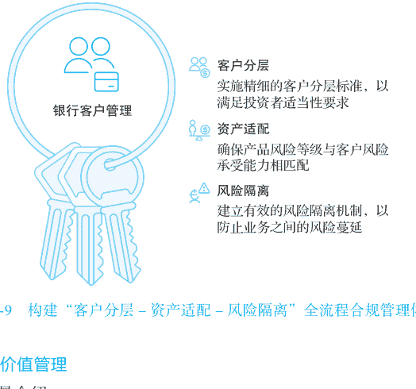
图 12-9 构建“客户分层-资产适配-风险隔离”全流程合规管理体系

## 1. 客户价值管理
（1）场景介绍
客户价值管理是反洗钱合规管理的主要内容。银行需构建涵盖 AUM、交易特征等多维度指标的评估体系。分、支行负责人需审核客户风险等级划分标准，确保符合 AML 客户分级监管要求。工作重点在于防范风险错配引发监测失效，同时优化交易特征权重设置。

（2）DeepSeek 提示词
角色 + 任务：我是银行分行负责人，评估客户分层标准时，应规避哪些监管风险？

（3）追问提示词
- 如何在精准营销与个人信息保护间实现合规平衡？
- 高风险客户识别应如何满足 FATF 反洗钱建议标准？
- 客户生命周期价值评估如何对接巴塞尔三号风险暴露分类标准？

（4）输出形式
客户风险等级矩阵（BI 系统）、监管合规检查表（Excel 文件）。

## 2. 客户分群管理
（1）场景介绍
客户分群管理是银行数据安全管理的重要环节。银行需建立动态分群算法审计追踪机制。分、支行负责人需审批分群模型参数，确保客户敏感信息存储与处理符合《金融数据安全 数据安全分级指南》3级加密标准。工作重点在于防范数据滥用引发法律风险，同时提高审计日志完整性。

（2）DeepSeek 提示词
角色 + 任务：我是银行分行负责人，监督客户分群模型时，应设置哪些控制节点？

（3）追问提示词
- 非结构化数据处理如何满足穿透式监管要求？
- 模型可解释性如何通过监管验收？
- 数据漂移监测如何匹配 EAST 系统报送要求？

（4）输出形式
模型合规性声明（Word 文件）、监管审计日志（Excel 文件）。

### 12.5.2 资产配置监管穿透
分支机构需建立资产组合全流程监控机制，确保符合《商业银行理财业务监督管理办法》相关要求。

## 1. 投资再平衡策略监管
（1）场景介绍
投资再平衡策略监管是宏观审慎管理的核心环节。银行需构建包含逆周期资本缓冲等政策要素的决策模型。分、支行负责人需审核再平衡策略触发条件，确保符合 MPA 框架对资本充足率波动阈值的监管要求。工作重点在于防范策略失效引发系统性风险，同时优化政策传导机制。

（2）DeepSeek 提示词
角色 + 任务：我是银行分行负责人，评估调仓策略时，应关注哪些监管禁区？

（3）追问提示词
- 如何避免衍生品交易杠杆突破监管限制？
- 因子权重调整如何确保符合流动性覆盖率要求？
- 极端市场情景下应对策略如何对接压力测试监管标准？

（4）输出形式
资产配置合规评估报告（Word 文件）、监管报备材料（Word 文件）。

## 2. 持仓健康度监测
（1）场景介绍
持仓健康度监测是集中度风险管控的重要工作。银行需建立穿透式分析系统，重点监控行业贷款占比。分、支行负责人需审核集中度监测报告，确保符合《商业银行法》第三十九条关于同一借款人贷款余额与商业银行资本余额比例不得超过 10% 的集中度限制。工作重点在于防范集中度超标引发合规风险，同时增加股权穿透层级深度。

（2）DeepSeek 提示词
角色 + 任务：我是银行分行负责人，管理持仓风险时，应设置哪些监管阈值？

（3）追问提示词
- 如何识别并管控隐性关联交易？
- 客户风险偏好变化如何动态匹配适当性管理？
- 流动性错配情况如何满足 LCR 监管指标？

（4）输出形式
持仓监管风险热力图（BI 系统）、整改优先级清单（Excel 文件）。

### 12.5.3 客户管理场景清单
- 客户信息治理合规
- 反洗钱等级动态管理
- 资产配置比例监控
- 适当性管理穿透式审查
- 压力测试监管适配
- 监管检查应对准备
- 整改措施闭环追踪

## 12.6 团队建设
分支机构团队建设面临合规能力断层、监管要求迭代加速等挑战，痛点集中在能力评估维度单一、实战训练实效性弱、监管要求落地滞后。银行需构建“能力评估—实战训练—监管适配”三位一体人才培养体系。人力发展团队需强化合规能力动态评估、违规场景模拟训练、监管要求智能校验三大能力。

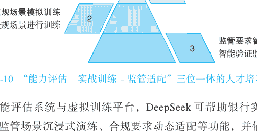
借助智能评估系统与虚拟训练平台，DeepSeek 可帮助银行实现合规能力精准画像、监管场景沉浸式演练、合规要求动态适配，并依托区块链技术建立培训成果与合规表现的不可篡改记录，推动团队建设从传统课堂培训向覆盖能力精准评估、实战场景还原、监管即时响应的数字化人才培养体系转型。

### 12.6.1 合规能力建设
分支机构需建立与监管要求深度绑定的评估机制，重点提升反洗钱、授信审批等关键岗位工作人员合规能力。

## 1. 合规能力评估
（1）场景介绍
合规能力评估是风险管理的基础环节。银行需构建“监管知识—操作规范—风险识别”三维评估模型，重点覆盖近三年监管处罚案例中的高频违规点。分、支行负责人需审核评估标准，确保模型及时纳入最新监管动态。工作重点在于防范合规能力不足引发违规风险，同时优化指标权重设置逻辑。

（2）DeepSeek 提示词
角色 + 任务：我是银行分行负责人，评估员工合规能力时，应设置哪些监管红线指标？

（3）追问提示词
- 如何量化反洗钱可疑交易识别能力？
- 如何将授信审批违规案例转化为评估指标？
- 如何动态考核对监管新政的掌握情况？

（4）输出形式
合规能力热力图（BI 系统）、监管重点对照表（Excel 文件）。

## 2. 岗位准入认证
（1）场景介绍
岗位准入认证是银行操作风险防控的关键环节。银行需建立授信审批、理财销售等 8 类岗位认证标准。分、支行负责人需审批岗位考核方案，确保符合销售专区“双录”监管要求。工作重点在于防范从业资质缺失引发操作风险，同时优化认证体系与复检机制。

（2）DeepSeek 提示词
角色 + 任务：我是银行分行负责人，管理岗位准入认证体系时，应规避哪些监管风险？

（3）追问提示词
- 如何量化考核“双录”合规操作？
- 新员工认证时效如何满足监管过渡期要求？
- 历史监管处罚案例如何融入案例题库？

（4）输出形式
岗位合规认证手册（Word 文件）、监管检查应对预案（Word 文件）。

### 12.6.2 监管实战训练
分支机构需建立“监管导向—案例教学—整改闭环”实战培训机制，提升团队监管应对能力。

## 1. 监管预检
（1）场景介绍
监管预检是银行应对监管检查的核心环节。银行需开发数字化沙盘系统，模拟现场检查、EAST 系统报送等场景。分、支行负责人需审核演练方案，重点覆盖近三年处罚率排名前五的违规领域。工作重点在于防范应对失当引发监管处罚风险，同时提高案例库更新频率。

（2）DeepSeek 提示词
角色 + 任务：我是银行分行负责人，监督监管预检演练设计时，应关注哪些监管重点？

（3）追问提示词
- 如何还原监管检查问询场景？
- 如何将 EAST 系统的数据逻辑植入演练？
- 如何暴露跨部门协同缺陷并进行整改？

（4）输出形式
监管检查案例库（Excel 文件）、问题整改追踪表（Excel 文件）。

## 2. 监管沟通
（1）场景介绍
监管沟通是银行危机处置的关键环节。银行需建立标准化应答机制，重点针对突发事件报告等场景进行训练。分、支行负责人需组织季度情景模拟考核，并确保执行效果达到预期。工作重点在于防范沟通不当引发信任危机，同时提高案例仿真度。

（2）DeepSeek 提示词
角色 + 任务：我是银行分行负责人，评估监管沟通能力时，应设置哪些监管触点？

（3）追问提示词
- 如何模拟考核重大事项报告时效？
- 监管问询应答如何兼顾信息披露充分性与风险防控要求？
- 跨部门数据整合如何满足穿透式监管要求？

（4）输出形式
监管沟通情景手册（Word 文件）、应答合规性评分表（Excel 文件）。

### 12.6.3 团队建设场景清单
- 合规能力基线评估
- 监管知识动态更新
- 高风险岗位认证管理
- 监管检查情景推演
- 突发事件应对训练
- 整改措施穿透追踪
- 监管关系维护能力培养

## 12.7 监管应对
分支机构在应对监管过程中面临检查穿透性增强、整改闭环管理效能不足等挑战，痛点集中在监管画像构建维度单一、整改质量跟踪滞后、长效机制建设不足。银行需构建“画像构建—整改质控—长效跟踪”三位一体管理体系。合规管理团队需强化监管要点智能整合、整改质量动态核验、长效机制持续优化三大能力。

通过智能管理系统与数据分析平台，DeepSeek 可帮助银行实现监管画像动态构建、整改质量智能核验、长效机制持续优化，并依托区块链技术建立不可篡改的整改过程存证链条，推动监管应对工作从被动响应检查向覆盖检查要点智能预判、整改措施穿透式核验、合规成效持续跟踪的主动治理体系转型。

### 12.7.1 监管画像构建
分支机构需统筹建立动态监管政策解析机制，破解传统应对措施中政策理解偏差、检查重点预判不足等痛点。

## 1. 监管画像管理
（1）场景介绍
监管画像管理是合规预判的核心环节。银行需建立动态政策解析机制，破解检查重点预判难题。分、支行负责人需统筹制定具有区域特色的监管应对策略。工作重点在于防范政策理解偏差引发应对失误，同时优化情报收集渠道。

（2）DeepSeek 提示词
角色 + 任务：我是银行分行负责人，管理监管画像时，应设置哪些决策阈值？

（3）追问提示词
- 如何识别全国性监管政策与地方性监管要求之间的差异？
- 监管处罚高频词如何转化为内控管理指标？
- 如何捕捉新兴领域如绿色金融的监管信号？

（4）输出形式
监管政策驾驶舱（BI 系统）、重点领域预警矩阵（Excel 文件）。

## 2. 监管知识管理
（1）场景介绍

流程合规的关键在于把监管要求、业务运转和管控手段打通。银行需要构建三者之间的映射模型，让要求、流程、措施能够对应起来。分行主要负责人要对知识图谱的更新机制进行审核，保证最新监管问答场景都被覆盖进去。工作的落脚点是防止控制手段失效引发合规风险，同时让关联关系的维护更高效。

（2）DeepSeek 引导问题
角色定位 + 任务：作为银行分行负责人，在审视监管知识图谱搭建时，需要规避哪些合规盲点。

（3）追问要点
跨监管领域条款冲突如何识别？
政策调整后怎样做到 24 小时内闭环响应？
历史合规问题如何与处置方案实现智能关联？

（4）交付物
监管规则关联图谱 Visio 文档、检查要点速查手册 Word 文档。

## 12.7.2 整改穿透式管理
分支机构要建立“问题溯源-验收确认-长效跟进”的全流程管控闭环，确保整改符合监管指向。

### 1. 整改验收
（1）背景说明
整改验收是问题管理中的核心环节，银行要制定涵盖制度修订、系统管控等 5 个维度的验收标准。分支行负责人需要核查长效机制是否真正运行起来，并把整改纳入年度审计计划。重点是降低问题反复概率，同时让验收指标更可量化。

（2）DeepSeek 引导问题
角色定位 + 任务：以分行负责人视角把控整改质量，应该划定哪些管理红线。

（3）追问要点
整改投入与监管达标之间如何平衡？
对于屡查屡犯的问题如何构建升级处置机制？
第三方核验结论的采信标准如何制定？

（4）交付物
整改成熟度评估模型 Excel 文档、监管沟通预案 Word 文档。

### 2. 整改存证
（1）背景说明
整改存证是过程可追溯管理的重要抓手，银行要部署符合《信息安全等级保护制度》要求的区块链存证方案。分支行负责人审批存证范围，需覆盖决策记录等核心资料。重点是避免证据缺失导致问责风险，同时提升存证检索效率。

（2）DeepSeek 引导问题
角色定位 + 任务：作为分行负责人，管理区块链存证体系需要满足哪些审计要求。

（3）追问要点
敏感信息的脱敏如何兼顾隐私保护与证据完整性？
跨系统数据的哈希值怎样实现同步？
监管调阅接口如何通过等保三级认证？

（4）交付物
区块链存证白皮书 Word 文档、审计追踪路线图 Visio 文档。

## 12.7.3 监管应对场景清单
监管政策动态解析
检查重点智能预判
问题根源穿透式分析
整改措施分级审批
长效机制有效性评估
监管关系维护与管理
合规文化培育跟踪

## 12.8 数字化转型
分支机构数字化转型受监管升级、设备安全风险上升等因素牵制，突出痛点是数字服务合规不足、设备管控粗放、数据全生命周期治理薄弱。银行需要构建“体验合规-设备管控-数据安全”的三合一治理框架。科技管理团队要强化监管规则智能匹配、设备安全动态监测、数据治理全流程穿透能力。

依托智能管控平台与安全防护体系，DeepSeek 可助力银行强化数字服务合规、实现智能设备端到端管控、开展数据安全分级保护，并借助区块链搭建不可篡改的操作审计存证链，推动转型从局部优化走向服务流程合规再造、设备风险智能防控、数据资产安全托管的系统化演进。

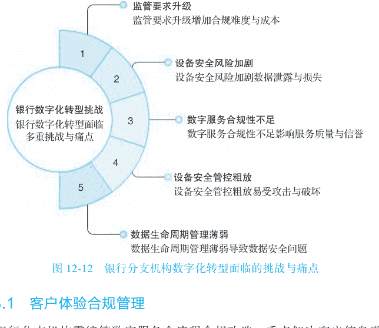

## 12.8.1 客户体验合规管理
分支机构要统筹数字服务全流程合规改造，重点解决客户信息滥用、体验数据违规采集等痛点。

### 1. 客户旅程合规性审查
（1）背景说明
客户旅程审查是金融消费者权益保护的新工具，银行需搭建数字足迹追踪体系。分支行负责人审批数据采集范围，确保符合《个人金融信息保护技术规范》。重点在于防范信息过度采集风险，同时优化脱敏方案。

（2）DeepSeek 引导问题
角色定位 + 任务：作为分行负责人，评估客户旅程设计时应设定的隐私保护红线。

（3）追问要点
生物特征采集如何满足最小必要原则？
老年客户数字足迹如何给予特殊保护？
体验优化如何避免过度索权？

（4）交付物
旅程合规审查表 Excel 文档、隐私影响评估报告 Word 文档。

### 2. 数据埋点管理
（1）背景说明
数据埋点管理是数据安全与合规的重点，银行需构建符合《信息安全等级保护制度》要求的治理体系。分支行负责人审核跨境传输方案，确保通过国家互联网信息办公室安全评估。重点在于防范数据泄露，同时提升传输协议加密水平。

（2）DeepSeek 引导问题
角色定位 + 任务：作为分行负责人，管理数据采集应规避哪些监管风险。

（3）追问要点
埋点数据如何满足三级等级保护安全要求？
境外云服务商数据存储如何满足监管标准？
客户授权撤回请求如何实现实时响应？

（4）交付物
数据采集白名单 Excel 文档、跨境传输备案材料 Word 文档。

## 12.8.2 智能设备监管穿透
分支机构需建立设备全生命周期合规管控机制，确保符合《网络安全等级保护基本要求》。

### 1. 多语种服务合规管理
（1）背景说明
多语种服务是区域运营的特殊环节，银行需制定智能设备话术审核标准。分支行负责人重点审查民族语言服务内容，确保符合《宗教事务条例》相关规定。重点在于防范文化差异引发法律风险，同时优化多语言审核机制。

（2）DeepSeek 引导问题
角色定位 + 任务：作为分行负责人，审批多语种服务脚本应设置的文化敏感禁区。

（3）追问要点
民族地区金融服务如何避免文化冲突？
如何动态更新宗教禁忌语料？
紧急服务如何满足监管信息披露要求？

（4）交付物
话术合规审查记录 Excel 文档、文化适配手册 Word 文档。

### 2. 设备安全应急管理
（1）背景说明
设备安全应急管理是保障业务连续性的核心，银行需建立“发现-处置-报备”标准化流程。分支行负责人审批应急预案，确保符合《商业银行信息科技风险管理指引》。重点在于防范设备宕机导致服务中断，同时优化备件库存管理。

（2）DeepSeek 引导问题
角色定位 + 任务：作为分行负责人，管理设备安全应设置的监管触点。

（3）追问要点
备件储备如何满足监管对业务连续性的要求？
远程锁定操作如何避免服务中断风险？
故障处置记录如何满足 EAST 系统报送要求？

（4）交付物
设备应急演练方案 Word 文档、监管报备台账 Excel 文档。

## 12.8.3 数字化转型场景清单
客户信息合规治理
数据跨境安全管控
智能设备文化适配
网络安全等级保护
服务连续性压力测试
监管检查应对准备
数字能力合规认证

## 12.9 风险管理
分支机构风险管理面临监管迭代加速、风险传导路径复杂化等挑战，痛点集中在政策执行偏差、风险信号识别滞后、监管协同效率低。银行需构建“政策适配-智能监测-监管协同”全链条风控体系。风险管理团队需强化监管规则智能解析、风险传导路径建模、监管数据穿透校验能力。

通过智能风控系统与监管协同平台，DeepSeek 可助力银行实现监管政策动态适配、风险传导智能监测、监管数据智能核验，并借助区块链建立不可篡改的监管数据存证链，推动风险管理从被动应对走向政策智能适配、风险全景监测、监管无缝协同的主动防御。

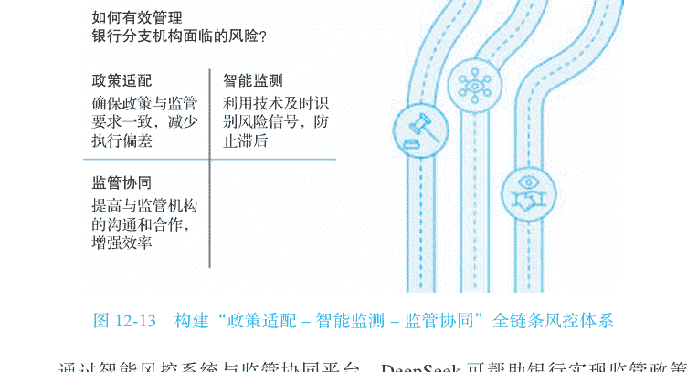

## 12.9.1 信贷风险监管穿透
分支机构需统筹建立差异化信贷管理体系，重点破解政策传导偏差、区域适配不足等痛点。

### 1. 监管导向审批
（1）背景说明
监管导向审批是绿色金融管理的核心，银行需构建普惠、小微等专项审批模型。分支行负责人审核准入标准，确保符合“两增两控”考核要求。重点在于防范政策执行偏差，同时提升模型参数校准频率。

（2）DeepSeek 引导问题
角色定位 + 任务：作为分行负责人，评估监管导向审批模型应设置的监管约束。

（3）追问要点
如何验证绿色信贷识别标准是否符合人民银行《绿色贷款专项统计制度》？
如何控制普惠、小微贷款增速以符合监管要求？
如何依据区域经济差异动态调整授信策略？

（4）交付物
政策信贷合规矩阵 Excel 文档、监管达标预判报告 Word 文档。

### 2. 员工行为监测
（1）背景说明
员工行为监测是案件防控的重要举措，银行需建立“物理网络+监管网络”双重监测体系。分支行负责人审批行为监测方案，覆盖《银行业金融机构从业人员行为管理指引》中的 12 类异常行为。重点在于防范道德风险，同时提升监测算法精准度。

（2）DeepSeek 引导问题
角色定位 + 任务：作为分行负责人，监测员工行为应规避哪些合规风险。

（3）追问要点
敏感信息采集流程如何满足《个人信息保护法》要求？
误报线索处置如何兼顾效率与员工权益？
历史监管处罚案例如何嵌入行为监测规则？

（4）交付物
行为监测合规手册 Word 文档、监管检查应对案例库 Excel 文档。

## 12.9.2 流动性风险智能管控
分支机构需构建“压力测试-应急储备-监管报备”流动性管理体系，确保符合《商业银行流动性风险管理办法》核心指标要求。

### 1. 流动性监测
（1）背景说明
流动性监测是风险预警核心，银行需整合 LCR、NSFR 等指标构建监测驾驶舱。分支行负责人每月审阅偏离度分析报告。重点在于防范指标突破监管阈值，同时提高预警参数灵敏度。

（2）DeepSeek 引导问题
角色定位 + 任务：作为分行负责人，设定流动性阈值时应参考哪些监管基准。

（3）追问要点
如何衔接 MPA 框架中的流动性考核要求？
如何验证应急融资渠道可用性？
如何识别监管检查高频问题并防控？

（4）交付物
流动性监管仪表盘 BI 系统、应急方案备案表 Excel 文档。

### 2. 压力测试监管适配
（1）背景说明
压力测试是风险防控关键环节，银行需构建覆盖利率跳升等必测场景的模型。分支行负责人审批压力测试方案，确保覆盖政策文件要求。重点在于防范模型失效，同时优化尾部风险建模方法。

（2）DeepSeek 引导问题
角色定位 + 任务：作为分行负责人，评估压力测试结果应关注哪些监管红线。

（3）追问要点
测试假设参数如何匹配监管指导要求？
极端场景设置如何满足监管验收标准？
整改措施如何纳入资本补充规划？

（4）交付物
压力测试合规声明 Word 文档、监管沟通备忘录 Word 文档。

## 12.9.3 风险管理场景清单
政策信贷合规审查
员工行为穿透式监测
流动性指标动态追踪
压力测试监管适配
应急方案备案管理
监管检查重点预判
整改措施穿透验证

## 12.10 舆情与危机管理
分支机构舆情与危机管理面临信息传播加速、风险关联复杂化等挑战，痛点集中在监测覆盖不足、情感分析精度低、危机传导路径追踪困难。银行需构建“监测-分析-处置”三位一体防护体系。分支行负责人应要求危机管理团队强化多维度数据整合、情感分析模型优化、处置策略智能生成能力。

通过全网舆情智能监测平台与危机分析系统，DeepSeek 可助力银行实现全渠道舆情实时抓取、金融舆情情感精准识别、危机事件关联图谱构建，并通过机器学习建立危机分级响应规则库，推动管理从事后被动处置走向传播趋势预判、情绪波动监测、处置策略推荐的智能化防护。

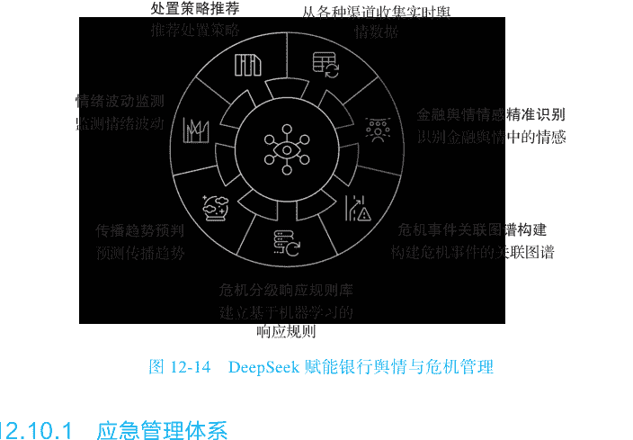

## 12.10.1 应急管理体系
分支机构需统筹建立“监管合规-资源调度-过程留痕”三位一体应急管理体系，重点解决跨部门协同低效、监管衔接不足等痛点。

### 1. 监管合规响应机制
（1）背景说明
建立符合监管要求的响应机制是危机管理的关键，银行需依据政策文件建立危机分类标准，分支行负责人审核权限分配方案。重点在于防范响应超限，同时优化资源调度逻辑。

（2）DeepSeek 引导问题
角色定位 + 任务：作为分行负责人，评估监管合规响应机制应设置的决策阈值。

（3）追问要点
如何在重大投诉事件中衔接《中国人民银行金融消费者权益保护实施办法》相关规定？
跨区域舆情处理如何协调属地监管要求？
如何规范演练记录以满足 EAST 系统数据报送标准？

（4）交付物
监管响应决策矩阵 Excel 文档、合规性对照手册 Word 文档。

### 2. 媒体关系管理
（1）背景说明
舆情管理是品牌维护重要工作，银行需制定分级媒体关系管理策略。分支行负责人审核信息披露日志，确保对外发布内容符合《关于进一步规范金融营销宣传行为的通知》要求。重点在于防范不当宣传引发合规及声誉风险，同时优化舆情监测关键词库。

（2）DeepSeek 引导问题
角色定位 + 任务：作为分行负责人，管理媒体关系应规避哪些合规风险。

（3）追问要点
社交媒体内容如何落实“双录”要求？
转发监管通报时如何平衡时效性与准确性？
历史处罚案例如何植入审核规则？

（4）交付物
媒体关系管理合规清单 Excel 文档、舆情处置案例库 Word 文档。

## 12.10.2 危机处置监管穿透
分支机构需构建“信息核验-决策留痕-整改闭环”危机处置机制，并在基层强化案件处置管理制度执行效力。

### 1. 信息披露三重管控
（1）背景说明
信息披露是合规经营重点环节，需建立“初审-复审-终审”三级审核流程。分支行负责人严格把控敏感数据披露标准。重点在于防范信息泄露与违规披露，同时优化审核响应时效。

（2）DeepSeek 引导问题
角色定位 + 任务：作为分行负责人，监督信息披露应设置的管控红线。

（3）追问要点
如何对客户隐私数据进行脱敏处理？
如何保持监管问询口径一致性？
历史错误案例如何转化为审核要点？

（4）交付物
信息披露决策树 Visio 文档、错误案例警示库 Excel 文档。

### 2. 应急通信监管适配
（1）背景说明
应急通信是危机处置基础保障，银行需构建覆盖属地监管机构的通信网络。分支行负责人每月审查通讯录有效性。重点在于防范联络信息失效风险，同时优化联系人动态更新机制。

（2）DeepSeek 引导问题
角色定位 + 任务：作为分行负责人，优化应急通信网络应满足哪些监管备案要求。

（3）追问要点
应急联系人变更如何确保在 2 小时内完成更新？
通信中断时如何衔接人民银行备份系统？
跨境事件处置过程中如何对接国家外汇管理局报告流程？

（4）交付物
通讯备案台账 Excel 文档、应急切换演练记录 Word 文档。

## 12.10.3 舆情与危机管理场景清单
监管规则动态解析
应急预案分级备案
资源调度合规审查
处置过程全程留痕
监管报告智能生成
整改措施穿透验证
案例经验持续沉淀

## 12.11 本章小结
本章聚焦银行分支机构经营管理，围绕战略规划、经营风险分析、市场拓展、行业研究、客户管理、团队建设、监管应对、数字化转型、风险管理及舆情与危机管理等关键领域，剖析痛点并提出基于 DeepSeek 的解决方案。通过数据贯通、决策升级与协同增效，助力分支机构实现经营管理可视化、资源配置科学化、团队执行高效化，满足监管要求并提升管理效能。

# 13
## DeepSeek 资产管理场景应用
当前银行资产管理业务正处于智能化转型关键期，客户需求从单一资产配置向全生命周期服务延伸，服务模式从经验驱动向数据驱动演进。在监管穿透式管理要求与市场波动加剧背景下，同业竞争重心从规模扩张转向风险收益平衡能力建设，尤其在另类资产、ESG 投资等领域，银行需提升资产穿透管理能力与动态定价水平。业务人员面临非结构化数据处理效率低、风险信号捕捉滞后等挑战。

业务痛点体现在三方面：一是投研数据整合能力不足，政策文件、行业研报等非结构化文本解析效率低，影响决策时效；二是风险监测工具滞后于市场变化，对供应链扰动、技术替代等新型风险预警缺乏实时性；三是客户服务精准度不足，资产配置建议与投资者风险偏好匹配存在偏差。

通过部署 DeepSeek 智能投研平台、资产风险图谱及客户画像引擎，银行可实现关键突破：构建多源数据融合分析系统，提升信息处理效率；建立基于知识图谱的风险传导预警模型；运用机器学习技术优化个性化服务策略。

本章重点解析如何借助 DeepSeek 实现“数据融合-风险穿透-服务适配”三重能力，重构资产管理价值链，解决投研响应滞后、风险监测盲区、客户需求错配等核心问题，助力银行实现投研决策智能化、风险管理动态化、客户服务精准化转型目标。

## 13.1 投资组合构建
银行构建投资组合面临市场波动加剧、监管要求趋严等挑战，痛点集中在多因子模型适配性不足、风险收益动态平衡失衡、监管合规校验滞后。银行需重点构建“因子动态适配-风险智能平衡-监管合规校验”三合一管理体系。投资管理团队需强化多源数据智能整合、配置模型动态优化、监管规则智能映射三大核心能力。

通过智能配置系统与合规校验平台，DeepSeek 可助力银行实现多因子动态配置优化、风险收益实时平衡、监管合规自动校验，并依托区块链构建不可篡改的投资决策存证链，推动投资组合管理从静态参数驱动向因子动态调整、风险实时监控、合规智能校验的数字化配置体系转型。

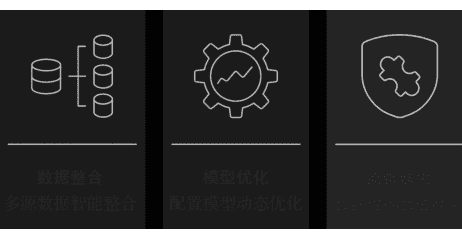

### 13.1.1 CPI PMI 联动下的十年期国债收益率动态建模
#### 1. 应用背景
固收投研对宏观传导的敏感度决定久期管理质量。银行须围绕 CPI 与 PMI 构建领先性的国债收益率联动框架，重点监控 CPI 环比偏离 ±0.5% 的波动区间，以及 PMI 跌破 50 荣枯线的拐点信号。投资经理需按月滚动更新十年期国债收益率的预测区间，并据此微调利率债持仓，单次调整幅度原则上控制在 ±5% 以内。核心在于规避利率研判失误带来的久期敞口，并持续校准先行指标的滞后修正系数。

#### 2. DeepSeek 提问话术
角色+任务：我现在是银行投资经理，需要搭建 CPI/PMI 与国债收益率的动态关联模型，历史样本长度如何确定？

#### 3. 追问话术
- 先行指标的预判效能怎样检验？
- 在政策操作窗口期参数如何动态修正？
- 季节性扰动该如何平滑处理？

#### 4. 交付物
指标关联度分析表 Excel 文件、参数校准手册 Word 文件。

#### 5. 案例演示
（1）提问话术
角色+任务：我现在是银行投资经理，需要搭建 CPI/PMI 与国债收益率的动态关联模型，历史样本长度如何确定？要求信息可追溯、贴合实务、链接真实有效且符合监管规范。

（2）首次生成要点
模型样本选择要兼顾实务场景、监管要求与方法特性，结合实证研究与行业动态综合判断，建议从周期覆盖、频率适配、合规性三方面考量。
一、样本选择核心原则
1. 覆盖完整周期
建议至少包含一个完整经济周期，一般为 5 至 10 年，以捕捉繁荣、衰退、政策调控期等不同阶段的波动特征。若研究地产、基建等长周期资产，可参考 2000—2017 年月度序列分析跨周期相关性。
2. 频率与方法匹配
高频日度/周度数据适用于捕捉短期波动与风险传导，如 DCC-GARCH 对股票收益率动态相关性的刻画。低频月度/季度数据更适合长期趋势与政策效应分析。
3. 监管合规
依据《商业银行资本管理办法》等文件，数据治理需满足完整性、准确性、可追溯性。操作风险数据至少保留 3 年历史记录以支撑内部资本评估。

二、分场景建议
1. 股票组合：5~7 年日度序列，可兼顾波动与动态相关。数据包括收盘价、成交量、ROE、不良率、波动率指数等。
2. 固收资产：10 年以上月度序列，覆盖利率周期变化。数据包括收益率曲线、信用利差、久期、违约率及宏观指标 GDP、CPI 等。
3. 跨境配置：3~5 年日度序列，兼顾汇率与时区差异。数据包括海外指数、汇率、地缘事件等。
4. 系统性风险：20 年以上长序列，包含 2008 年金融危机等极端事件，检验压力情景下的稳健性。

三、预处理与验证要点
平稳性检验采用 ADF 单位根检验避免伪回归；ARCH-LM 检验识别波动聚集性，为 GARCH 族模型提供基础；采用 3 年滚动窗口验证模型动态适应能力，降低过拟合风险。

四、实务参考
国有银行股相关性分析使用 DCC-GARCH 模型分析 2016—2022 年日度数据，验证 5~6 年窗口有效性；房地产与银行业风险溢出基于 2000—2017 年月度数据构建 GPD-Copula 模型，凸显长周期数据价值。

五、操作建议
结合中小银行风险化解与 TLAC 达标等监管动态适时调参；参考深圳农商行数字化转型经验，采用分布式数据库与实时处理提升高频数据采集效率。

总结：历史样本选择需兼顾方法、资产类别与监管要求，建议优先采用覆盖完整周期的 5~10 年日度或月度数据，结合滚动窗口验证与极端压力测试构建稳健模型。

（3）追问话术
- 如何验证先行指标的预测有效性？
- 政策调控窗口期如何调整修正参数？
- 如何平滑处理数据季节性波动？

（4）交付物
Excel 模板《指标关联度分析表》，以 HTML 形式输出并内嵌一键下载按钮；Word 模板《参数校准手册》，以 HTML 形式输出并提供下载。

（5）再次生成说明
输出 HTML 结构化内容，含 Excel 与 Word 模板及下载功能。点击运行可获取《先行指标有效性验证表》Excel；下拉可见《政策窗口期参数校准指南》Word 下载。

## 第 13 章 DeepSeek 资产管理场景应用
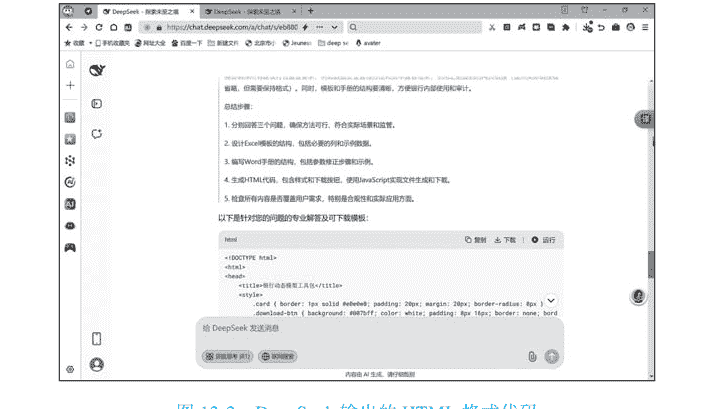
图 13-2 DeepSeek 输出的 HTML 格式代码
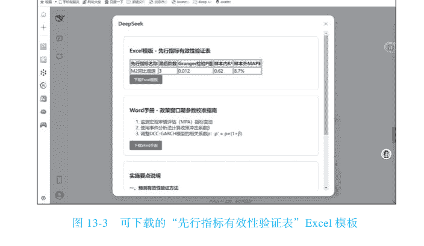
图 13-3 可下载的“先行指标有效性验证表”Excel 模板

### 13.1.2 波动率贡献度驱动的仓位动态调整
#### 1. 应用背景
风险平价框架下组合优化是核心。银行利用风险平价模型实时测算股票等六类资产的波动率贡献度，风险管理岗将单一资产贡献上限设为 15%，突破阈值即触发再平衡。重点在于防止波动集中引发尾部风险，并提升高频数据清洗效率。
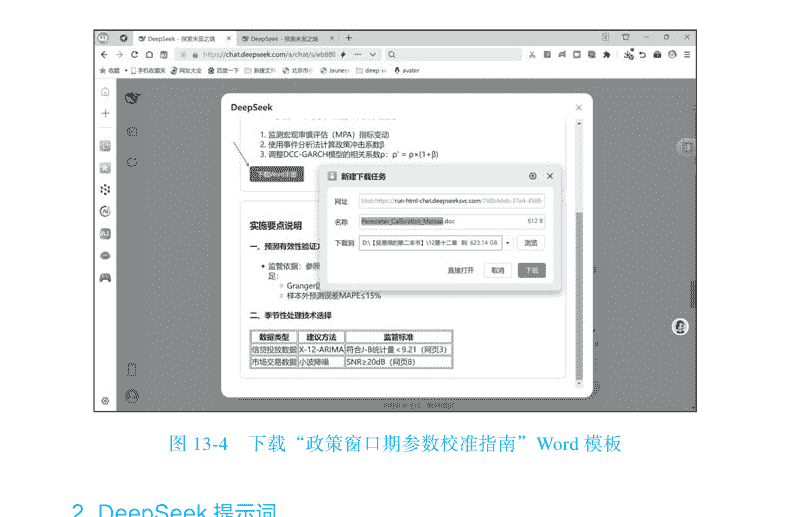
#### 2. DeepSeek 提问话术
角色+任务：作为银行风险管理岗，需优化资产权重调整机制，应设置哪些约束条件？

#### 3. 延伸追问
- 交易成本与风险控制如何权衡？
- 极端波动下缓冲区间怎样设定？
- 监管集中度指标如何嵌入风险平价模型？

#### 4. 交付物
波动率贡献度热力图 Excel，调仓审批单 Word。

### 13.1.3 MSCI ESG 评级实时监控与自动剔除
#### 1. 应用背景
ESG 风险管控是绿色投资的基石。银行对接全球 ESG 数据库，监控 MSCI 评级下调至 CCC 级等七类风险信号。合规岗执行 T+1 日处置，满足《银行业保险业绿色金融指引》关于不合规资产剔除的要求，核心在于防范漂绿风险并提升爬虫抓取的准确时效。

#### 2. DeepSeek 提问话术
角色+任务：作为银行合规管理岗，需设计 MSCI ESG 评级实时监控规则，应包含哪些监管红线？

#### 3. 延伸追问
- 如何衔接绿色信贷专项统计报送要求？
- 跨境 ESG 标准差异如何合规处理？
- 临时剔除资产如何履行报备程序？

#### 4. 交付物
ESG 禁投清单 Excel，监管报备模板 Word。

### 13.1.4 夏普比率阈值预警与季度调仓机制
#### 1. 应用背景
绩效评估是组合管理关键。银行构建滚动三年期夏普比率模型，低于同业 25% 分位即触发预警。投资决策委员会按季审议调仓方案，重点匹配策略与资本充足率等指标，旨在防范业绩持续落后引发赎回，并优化同业基准时效。

#### 2. DeepSeek 提问话术
角色+任务：作为银行投资经理，需优化绩效评估模型，应选取哪些基准指标？

#### 3. 延伸追问
- 如何消除规模差异对夏普比率的影响？
- 市场极端分化期评估周期如何调整？
- 风险调整收益的监管要求如何嵌入？

#### 4. 交付物
绩效对标分析表 Excel，调仓决策备忘录 Word。

### 13.1.5 投资组合构建场景清单
- 宏观经济指标监控
- 风险预算动态分配
- ESG 合规筛查
- 绩效归因分析
- 监管报告生成
- 投资决策委员会材料准备

## 13.2 风险对冲管理
银行对冲管理面临基差波动加大、保证金流动性压力上升，痛点为基差监测不足、保证金管理滞后、合规校验效率低。需构建“实时评估—动态对冲—合规管控”一体化体系。风险团队应强化基差智能监测、流动性压力建模、监管规则智能适配。

依托智能对冲系统与合规平台，DeepSeek 可实现基差实时预警、保证金流动性监测、合规自动校验，并通过区块链存证优化操作链条，推动对冲管理从静态敞口向智能化体系转型。

### 13.2.1 现货组合 Beta 系数动态测算
#### 1. 应用背景
Beta 管理是套期保值核心。银行建立分钟级同步机制实时计算现货组合 Beta 值，衍生品交易岗在 Beta 偏离 ±0.2 时生成股指期货对冲建议，重点防范敞口超限并优化高频噪声过滤。

#### 2. DeepSeek 提问话术
角色+任务：作为银行衍生品交易岗，需优化 Beta 系数计算模型，应设置哪些风控参数？

#### 3. 延伸追问
- 如何剔除异常交易时段干扰？
- 成分股调整如何及时响应？
- 如何满足套期会计合规要求？

#### 4. 交付物
Beta 跟踪曲线图 Excel，对冲操作日志 Word。

### 13.2.2 基差风险实时监测与套保比率调整
#### 1. 应用背景
基差管理是期货对冲基础。银行构建历史基差库，基差超过 90% 分位时预警。风控岗动态调整套保比率至 0.8~1.2 区间并每日评估有效性，核心在于防范基差扩大导致对冲失效并优化历史数据覆盖。

#### 2. DeepSeek 提问话术
角色+任务：作为银行风险管理岗，需设计套保有效性监控指标，应包含哪些波动特征？

#### 3. 延伸追问
- 合约展期最佳时点如何选择？
- 如何规避交割月流动性风险？
- 如何衔接监管对套保的认定标准？

#### 4. 交付物
基差波动分析表 Excel，套保方案调整书 Word。

### 13.2.3 保证金占用压力测试
#### 1. 应用背景
保证金压力测试是衍生品管理重点。银行模拟涨停板、保证金率上调 20% 等极端情景，资金岗设置资本金占用超预算 30% 时的自动熔断，确保 LCR 不低于 100%。核心在于防范流动性枯竭并优化参数敏感性分析。

#### 2. DeepSeek 提问话术
角色+任务：作为银行资金管理岗，需设计保证金占用压力测试情景，应满足哪些监管要求？

#### 3. 延伸追问
- 如何对接巴塞尔 III 市场风险框架？
- 跨市场头寸如何合并计算？
- 应急融资渠道如何压力测试？

#### 4. 交付物
压力测试报告 Word，流动性缺口矩阵 Excel。

### 13.2.4 套保有效性验证
#### 1. 应用背景
套保有效性验证关乎会计合规。银行按月计算期货损益与现货变动相关性，保持在 80%~125% 区间。稽核岗留存 5 年验证记录，符合《企业会计准则第 24 号》。核心在于防范审计不达标并优化序列匹配算法。

#### 2. DeepSeek 提问话术
角色+任务：作为银行稽核岗，需设计套保有效性验证方法，应包含哪些审计要点？

#### 3. 延伸追问
- 如何识别人为调整样本？
- 跨会计期间效果如何评估？
- 如何提前应对监管检查重点？

#### 4. 交付物
有效性验证表 Excel，审计底稿模板 Word。

### 13.2.5 风险对冲管理场景清单
- 风险敞口计量
- 对冲工具选择
- 交易执行监控
- 保证金管理
- 会计处理验证
- 监管报表编制

## 13.3 绩效归因分析
绩效归因面临跨境复杂度提升、透明度要求趋严，痛点为归因维度单一、汇率风险剥离不足、披露合规性不强。需构建“多因子归因—汇率穿透—合规披露”体系。投管团队需强化多维收益解析、汇率影响量化、规则智能适配。

通过智能分析与合规平台，DeepSeek 可实现多维度归因、汇率风险剥离、报告自动生成，并以区块链构建决策存证，推动归因从单维度评价向透明化体系转型。

### 13.3.1 多层级归因模型搭建
#### 1. 应用背景
收益归因是绩效分析核心。银行建立“配置—选券—交易”三层模型，分离 Alpha/Beta。投资经理按月输出穿透式归因报告定位超额来源，重点防止归因失真影响决策并优化因子剥离技术。
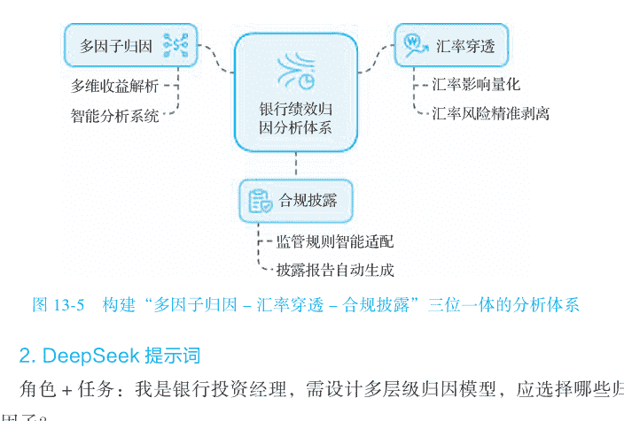
#### 2. DeepSeek 提问话术
角色+任务：作为银行投资经理，需设计多层级归因模型，应选择哪些归因因子？

#### 3. 延伸追问
- 如何验证因子正交性？
- 杠杆收益如何单独归因？
- 如何体现监管要求的风险调整收益？

#### 4. 交付物
归因因子矩阵 Excel，模型验证报告 Word。

### 13.3.2 汇率对冲损益拆分
#### 1. 应用背景
外汇风险管理是跨境投资关键。银行构建敞口计量模型，区分自然对冲与衍生品对冲的汇兑损益。风控岗监控交叉货币掉期估值，符合《企业汇率风险管理指引》。核心在于防范汇率错配致估值偏差并优化波动率曲面建模。

#### 2. DeepSeek 提问话术
角色+任务：作为银行风险管理岗，需优化汇率对冲损益拆分方法，应设置哪些会计科目？

#### 3. 延伸追问
- 如何满足套期会计时效性要求？
- NDF 估值差异如何处理？
- 如何衔接监管外汇敞口报表？

#### 4. 交付物
汇率损益拆分表 Excel，套期文档 Word。

### 13.3.3 基准指数定制
#### 1. 应用背景
基准管理是产品设计核心。银行构建含 ESG 剔除等七项规则的定制指数。投决会按季评估适用性，满足《理财产品业绩比较基准展示行为准则》。核心在于防范基准偏离致客户投诉并优化流动性筛选阈值。

#### 2. DeepSeek 提问话术
角色+任务：作为银行投资经理，设计基准指数规则时应满足哪些监管披露要求？

#### 3. 延伸追问
- 如何避免基准风格漂移误导客户？
- 定制指数回测周期如何设定？
- 监管报备材料如何准备？

#### 4. 交付物
指数编制说明 Word，成分股清单 Excel。

### 13.3.4 归因结果审查
#### 1. 应用背景
归因审查是营销合规重点。银行建立数据溯源机制核查收益分配逻辑。稽核岗留存计算底稿，符合相关文件要求，核心在于防范误导性宣传并加深数据血缘分析。

#### 2. DeepSeek 提问话术
角色+任务：作为银行合规管理岗，需制定金融产品营销合规审查标准，应包含哪些红线条款？

#### 3. 延伸追问
- 如何识别归因结果中的隐含收益夸大？
- 历史业绩模拟数据如何验证？
- 如何预判监管检查重点？

#### 4. 交付物
审查要点清单 Excel，审计底稿归档记录 Word。

### 13.3.5 绩效归因分析场景清单
- 收益数据标准化
- 归因模型参数校准
- 交叉验证执行
- 监管报告生成
- 销售材料一致性核对
- 审计底稿管理

## 13.4 ESG 整合投资
银行 ESG 整合投资面临漂绿风险加剧、监管穿透不足，痛点为数据整合弱、标准执行偏差、披露可信度低。需构建“数据治理—评估穿透—披露管控”体系。投管团队需强化 ESG 数据智能整合、绿色项目穿透验证、披露合规校验。

# ESG投资全链路穿透升级

依托智能ESG治理平台与合规分析引擎，DeepSeek 能为银行打通ESG全景数据视图，自动预警漂绿风险并实现监管要求的智能核验，同时借助区块链打造不可篡改的ESG存证链，推动整合投资从过去的标签式挑选，升级为覆盖数据全链条穿透、环境成效可验证、监管落地可追溯的负责任投资体系（见图13-6）。

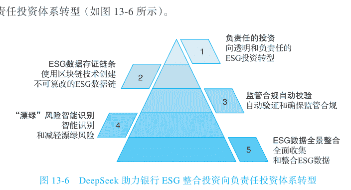

### 13.4.1 绿色债券认证材料核验

#### 1. 场景介绍
绿色债券认证是ESG投融资合规的关键抓手。银行要建立第三方认证机构准入清单，重点核查环境效益测算方法的科学性与合规性。合规条线需推行双人交叉复核叠加外部独立验证的机制，保证发行项目落在《绿色债券支持项目目录（2021年版）》范围内。核心诉求是堵住认证把关不严导致的漂绿隐患，并提升碳核算验证效率。

#### 2. DeepSeek 提示词
角色+任务：作为银行合规管理人员，要搭建绿色债券认证资料核验流程，需要覆盖哪些关键环节？

#### 3. 追问提示词
- 认证机构资质有哪些风险信号可以识别？
- 环境效益量化模型怎样进行有效核验？
- 面对监管政策变化如何做到快速跟进？

#### 4. 输出形式
认证机构评估表（Excel 文件）、核验工作底稿（Word 文件）。

### 13.4.2 碳强度同业对标数据库建设

#### 1. 场景介绍
碳数据管理是气候风险研判的基础。银行须收集碳排放强度等12项核心指标，搭建行业分位对标体系。ESG研究条线要按季度刷新数据，保证满足TCFD披露规范。重点在于避免数据滞后带来分析失真，同时完善企业端数据接入方式。

#### 2. DeepSeek 提示词
角色+任务：作为银行ESG研究岗位人员，需构建碳强度同业对标数据库，应遵循哪些监管披露要求？

#### 3. 追问提示词
- 企业披露口径不统一时该怎么处理？
- 区域碳市场数据如何纳入体系？
- 如何与绿色统计制度实现对接？

#### 4. 输出形式
数据采集标准（Word 文件）、行业对标报告（Excel 文件）。

> ① TCFD：气候相关财务信息披露工作组，2015年设立，提出自愿性气候信息披露框架，帮助企业和金融机构评估、披露气候风险与机遇，提升金融体系适应气候变化的能力与韧性。

### 13.4.3 “漂绿”行为追溯审查

#### 1. 场景介绍
反漂绿是ESG合规的核心议题。银行应搭建募投、资金、效益一体化的追踪体系。稽核条线每年开展专项审计，保留至少10年的可追溯档案，聚焦5类风险信号。核心是规避声誉受损风险，并精细化资金流穿透监控。

#### 2. DeepSeek 提示词
角色+任务：作为银行稽核人员，设计漂绿行为审计方案，应包含哪些风险指标？

#### 3. 追问提示词
- 多层嵌套产品如何实现穿透？
- 环境效益兑现的时滞如何评估？
- 监管处罚案例怎样融入检查要点？

#### 4. 输出形式
风险特征库（Excel 文件）、审计程序表（Word 文件）。

### 13.4.4 绿色资产配置比例监控

#### 1. 场景介绍
绿色资产占比是监管考核的重点。银行要实时测算绿色信贷等绿色资产占总资产的比重。资产负债条线应建立季度动态调整机制，确保绿色融资增速较对公贷款平均增速至少高出2个百分点。关键在于避免考核不达标带来的监管压力，并优化资产穿透认定规则。

#### 2. DeepSeek 提示词
角色+任务：作为银行资负管理岗人员，构建绿色资产配置比例监控指标，需涵盖哪些监管阈值？

#### 3. 追问提示词
- 如何与央行绿色信贷评价标准衔接？
- 过渡期资产该如何分类处置？
- 监管报表数据怎样实现自动抓取？

#### 4. 输出形式
配置比例仪表盘（Excel 文件）、监管达标方案（Word 文件）。

### 13.4.5 ESG 整合投资场景清单
- ESG 数据采集
- 绿色资产认定
- 投资比例监控
- 环境效益审计
- 监管报告编制
- 信息披露管理

## 13.5 流动性风险管理

银行流动性管理面临资产变现难度上升、负债结构失衡等难题，痛点集中于资产流动性评估缺口、负债集中度监测滞后、监管适配能力不足。需要打造监测-评估-应对联动的体系，资金团队应强化多维监测、动态压力建模、智能应急方案生成三大能力。

借助智能监测系统与压力测试平台，DeepSeek可为银行提供资产变现能力智能评估、负债到期压力动态测算、监管合规自动核验功能，并以区块链构建防篡改的流动性数据存证链，推动流动性管理从静态指标监控转向资产多维穿透、情景仿真、应急优化的智能体系。

### 13.5.1 资产变现分级管理

#### 1. 场景介绍
资产变现分级是流动性管理的基石。银行需按折扣率划分为5个层级，重点管控7日内可变现的高流动性资产。风险管理岗要每周测算变现能力，确保流动性覆盖率不低于100%。核心在于防止资产折价诱发流动性紧张，并科学校准折扣率参数频率。

#### 2. DeepSeek 提示词
角色+任务：作为银行风险管理岗位人员，设计资产变现分级标准，应参考哪些监管参数？

#### 3. 追问提示词
- 质押品折扣率怎样动态调整？
- 如何构建市场流动性骤然下降的模拟场景？
- 监管流动性风险指标如何映射？

#### 4. 输出形式
资产分级清单（Excel 文件）、压力测试手册（Word 文件）。

### 13.5.2 负债端压力测试模型

#### 1. 场景介绍
负债端压力测试是流动性管理的关键。银行要模拟同业融资收紧等极端情况，测算30天累计流动性缺口是否突破优质流动性资产50%的预警线。资金管理岗需设置熔断机制，保证满足流动性监管要求。重点是防范负债端挤兑，并提升压力场景参数敏感度。

#### 2. DeepSeek 提示词
角色+任务：作为银行资金管理岗位人员，构建负债端压力测试模型，应涵盖哪些监管规定情景？

#### 3. 追问提示词
- 存款保险制度的影响如何体现？
- 分支机构资金调拨时滞怎样计量？
- 如何衔接监管标准化压力测试？

#### 4. 输出形式
测试情景库（Excel 文件）、流动性缺口分析表（Excel 文件）。

### 13.5.3 流动性应急管理

#### 1. 场景介绍
流动性应急是保障业务连续性的核心。银行应制定7类处置措施，并每半年演练一次SLF对接流程。应急管理委员会需重点检验资产紧急出售时效，确保30分钟内完成决策。关键是避免处置延误，提升央行流动性支持工具调用效率。

#### 2. DeepSeek 提示词
角色+任务：作为银行应急管理岗人员，设计现金储备动用应急处置流程，应满足哪些监管报备要求？

#### 3. 追问提示词
- 如何平衡资产折价与监管指标达标？
- 跨区域流动性调剂如何操作？
- 如何对接监管应急通信机制？

#### 4. 输出形式
应急流程图（Visio 文件）、演练评估报告（Word 文件）。

### 13.5.4 LCR 日报表生成与监管报送

#### 1. 场景介绍
监管报送是合规管理的核心。银行要实现LCR日报表的自动化生成并进行双人复核。合规岗应保证数据符合“1104报表”规范，误差率控制在0.5%以内。重点在于避免数据错报，提升采集实时性。

#### 2. DeepSeek 提示词
角色+任务：作为银行合规管理岗人员，设计日报表报送流程，应包含哪些校验规则？

#### 3. 追问提示词
- 如何识别系统取数逻辑错误？
- 节假日数据如何调整处理？
- 如何应对监管部门的数据质量检查？

#### 4. 输出形式
报送校验清单（Excel 文件）、异常数据台账（Excel 文件）。

### 13.5.5 流动性风险管理场景清单
- 现金流预测
- 优质流动性资产监控
- 压力情景建模
- 应急方案演练
- 监管指标计算
- 报告生成与报送

## 13.6 非标资产估值管理

非标资产估值面临定价依据不足、模型透明度低等痛点，主要体现在数据整合弱、模型验证滞后、披露合规性不足（见图13-7）。需构建数据穿透-模型验证-合规披露一体化的估值体系，风险团队应强化智能定价、动态验证、监管规则映射能力。

借助智能估值系统与合规平台，DeepSeek可实现非标资产公允定价、模型假设智能校验、监管规则自动适配，并以区块链搭建估值过程防篡改存证，推动估值管理从经验判断向数据全景穿透、模型动态校验、监管无缝衔接的智能化转型。

### 13.6.1 非标资产信息采集

#### 1. 场景介绍
非标资产信息采集是资本穿透识别的基础。银行需制定12项核心数据采集规范，并建立第三方交叉验证机制。产品管理岗须符合《商业银行资本管理办法》关于非标资产穿透识别的相关要求。重点在于避免数据失真导致资本计量偏差，并加快数据更新节奏。

#### 2. DeepSeek 提示词
角色+任务：作为银行产品管理岗人员，制定非标资产信息采集标准，应包含哪些验证要素？

#### 3. 追问提示词
- 如何验证非持牌机构提供的数据？
- 信息缺失的资产如何分类处置？
- 如何在标准中嵌入监管数据报送要求？

#### 4. 输出形式
数据采集模板（Excel 文件）、验证操作手册（Word 文件）。

### 13.6.2 估值方法决策

#### 1. 场景介绍
估值方法决策关乎财务合规。银行需设立三级审议机制，重点留存调整依据。风险管理岗每季度审查差异案例，保证符合《银行间债券市场债券估值业务管理办法》。关键在于防范主观判断导致估值偏差，提升听证效率。

#### 2. DeepSeek 提示词
角色+任务：作为银行风险管理岗人员，设计估值方法决策逻辑，应设置哪些触发条件？

#### 3. 追问提示词
- 如何应对市场流动性骤降场景？
- 第三方估值机构服务中断时如何应急处理？
- 估值偏离度如何监控？

#### 4. 输出形式
估值方法流程图（Visio 文件）、异常处置预案（Word 文件）。

### 13.6.3 敏感性分析

#### 1. 场景介绍
敏感性分析是识别非标资产市场风险的重要手段。银行需搭建多维压力测试模型，重点评估利率变动±100BP、汇率波动±5%等情景对组合的影响。风险管理岗要设定关键变量阈值，自动生成压力测试报告并标注最大风险敞口。重点是防范市场波动导致估值偏差，合理校准蒙特卡洛模拟参数频率。

#### 2. DeepSeek 提示词
角色+任务：作为银行投资经理，设计敏感性分析测试方案，应包含哪些监管规定情景？

#### 3. 追问提示词
- 尾部风险极端参数如何设定？
- 如何模拟相关性突变？
- 如何对接监管压力测试指引？

#### 4. 输出形式
敏感性分析表（Excel 文件）、监管报备说明（Word 文件）。

### 13.6.4 估值委员会审议流程

#### 1. 场景介绍
估值委员会审议是估值合规管理的关键。银行需建立三级审议机制，重点留存调整依据。委员会应按季度审查差异案例，确保符合《银行间债券市场债券估值业务管理办法》。重点在于防范主观偏差，优化听证流程效率。

#### 2. DeepSeek 提示词
角色+任务：作为银行估值委员会秘书，优化估值审议会议流程，应设置哪些表决规则？

#### 3. 追问提示词
- 如何在效率与决策严谨性之间平衡？
- 如何采纳外部专家意见？
- 监管检查重点如何预置留痕？

#### 4. 输出形式
会议决议模板（Word 文件）、异议事项记录表（Excel 文件）。

### 13.6.5 非标资产估值管理场景清单
- 资产数据标准化
- 估值方法决策
- 模型参数校准
- 压力测试执行
- 估值委员会审议
- 监管报备归档

## 13.7 客户定制化报告

理财客户定制化报告存在信息穿透不足、风险匹配精度偏差等问题，痛点在于客户画像维度单一、风险匹配滞后、信息披露合规弱。需构建数据穿透-动态适配-合规披露融合的报告体系，理财经理需强化全景数据整合、智能风险匹配、监管规则映射三大能力（见图13-8）。

借助智能分析系统与合规管理平台，DeepSeek可实现客户全景画像构建、风险动态匹配优化、资产穿透式信息披露，并利用自然语言处理解析监管要求，自动生成风险揭示与合规声明，推动定制化报告从静态文档输出转向实时穿透、动态预警、监管无缝衔接的智能服务。

### 13.7.1 资产穿透监管

#### 1. 场景介绍
资产穿透监管是合规管理的核心。银行需开发T+1穿透模型，实现6类资产自动识别。科技部门应设置同业投资识别规则，确保符合监管穿透要求。重点在于防范嵌套产品带来的合规风险，同时提升底层资产分类精度。

#### 2. DeepSeek 提示词
角色+任务：作为银行科技部门人员，设计资产穿透识别规则，应满足哪些披露标准？

#### 3. 追问提示词
- 如何应对SPV结构变化？
- 跨境资产如何分类映射？
- 如何落实监管数据颗粒度要求？

#### 4. 输出形式
穿透规则清单（Excel 文件）、样本报告（Word 文件）。

### 13.7.2 CRS 税务影响模拟器

#### 1. 场景介绍
跨境税务管理是国际合规重点。银行需构建分析工具，模拟不同国籍客户CRS影响。合规管理岗位需设置敏感信息脱敏机制，符合《纳税人涉税保密信息管理暂行办法》要求。重点在于防范信息泄露风险，同时优化国籍判定算法。

#### 2. DeepSeek 提示词
角色+任务：作为银行合规管理岗人员，设计税务影响模拟逻辑，应包含哪些申报要素？

#### 3. 追问提示词
- 如何应对税收居民身份变更？
- 如何处理双重国籍情况？
- 如何自动适配监管报送格式？

#### 4. 输出形式
税务影响分析表（Excel 文件）、案例手册（Word 文件）。

> CRS：Common Reporting Standard，共同申报准则，由经济合作与发展组织OECD推出，用于指导参与司法管辖区定期对税收居民金融账户信息进行交换，旨在通过加强全球税收合作提高税收透明度，打击利用跨境金融账户的逃税行为。

### 13.7.3 集中度管控

#### 1. 场景介绍
集中度管控是流动性风险管理的核心。银行需实时监控行业集中度，超过50%即触发预警。风险管理岗位应设置季度调仓建议机制，符合《商业银行流动性风险管理办法》。重点在于防范流动性枯竭风险，同时优化行业分类标准。

#### 2. DeepSeek 提示词
角色+任务：作为银行风险管理岗人员，设计集中度预警规则，应参考哪些监管指标？

#### 3. 追问提示词
- 如何定义行业分类标准？
- 跨市场持仓如何合并计算集中度？
- 客户风险测评结果如何与集中度调控联动？

#### 4. 输出形式
预警阈值矩阵（Excel 文件）、调仓建议书（Word 文件）。

### 13.7.4 客户风险适配性检查

#### 1. 场景介绍
客户风险适配性检查是消费者权益保护合规要求。银行需建立三维匹配模型，完成12项售前校验。理财经理应确保符合《中华人民共和国消费者权益保护法》。重点在于防范产品错配引发法律风险，同时提升风险测评问卷有效性。

#### 2. DeepSeek 提示词
角色+任务：作为银行理财经理，开展客户风险适配性检查，应关注哪些风险错配？

#### 3. 追问提示词
- 如何识别客户风险承受能力下降？
- 产品风险特征变化时如何预警？
- 监管“双录”要求如何嵌入检查流程？

#### 4. 输出形式
适配检查表（Excel 文件）、风险告知书（Word 文件）。

### 13.7.5 客户定制化报告场景清单
- 客户需求分析
- 数据穿透处理
- 风险适配校验
- 税务影响测算
- 报告生成及交付
- 监管留痕管理

## 13.8 智能投顾服务

智能投顾服务面临客户需求多元、监管趋严的挑战，痛点在于画像粗糙、策略适配不准、合规风险较多。需构建画像构建-策略适配-合规管控融合的服务体系，财富管理团队需强化需求深挖、配置动态优化、服务全流程留痕三大能力。

借助智能投顾系统与合规管理平台，DeepSeek可实现客户画像精准构建、投资策略智能匹配、服务过程合规管控，并以区块链建立防篡改的服务过程存证，推动智能投顾从标准化产品推荐转向精准洞察、动态调优、监管无缝衔接的智能财富管理体系（见图13-9）。

### 13.8.1 客户行为画像建模

#### 1. 场景介绍
客户行为画像建模是精准营销的首要任务。银行需整合8类数据源，构建包含128个特征因子的模型。科技部门应每季度调整特征权重，并确保数据处理流程符合《个人信息保护法》要求。重点在于防范隐私侵权风险，同时优化特征降维技术。

#### 2. DeepSeek 提示词
角色+任务：作为银行科技部门人员，优化客户行为画像特征工程，应遵守哪些隐私保护条款？

#### 3. 追问提示词
- 如何实现联邦学习建模？
- 敏感信息如何进行脱敏处理？
- 如何应对监管部门对数据出境的限制？

#### 4. 输出形式

特征变量清单以 Excel 形式呈现，隐私影响评估以 Word 形式呈现。

### 13.8.2 情绪指数合成与预警
#### 1. 背景说明
研判市场情绪是策略动态调整的关键。银行需要把六类另类信息汇聚起来，生成 0 到 100 的情绪得分。投资研究岗要以正负两倍标准差划出浮动预警带，触线即启动策略复盘。重点是防止极端情绪带来误判，同时持续优化新闻语义情感识别的准确度。

#### 2. DeepSeek 指令示例
角色任务：作为银行投资研究人员，想搭建市场情绪指数合成模型，请问噪声过滤规则该怎么安排。

#### 3. 进阶追问
- 恶意舆情操纵怎样识别
- 节假日干扰如何剔除
- 监管信息传播规范怎样融入模型

#### 4. 交付物
情绪指数编制说明 Word 文档、异常波动记录 Excel 表格

### 13.8.3 再平衡成本管控
#### 1. 背景说明
调仓的效果最终体现在成本上。银行要搭建综合优化模型，产出三套可比方案。理财经理必须确保调仓合规，冲击成本降幅达到 15% 以上。核心是防止隐性成本侵蚀客户回报，同时改进高频撮合逻辑。

#### 2. DeepSeek 指令示例
角色任务：作为银行理财经理，评估调仓方案时需要关注哪些监管限制。

#### 3. 进阶追问
- 怎样避免被认定为频繁交易
- 大宗交易的信息披露要求如何满足
- 客户交易费用的透明度如何保障

#### 4. 交付物
成本对比分析表 Excel 表格、客户确认单 Word 文档

### 13.8.4 模型可解释性审查
#### 1. 背景说明
适当性管理要求模型必须可解释。银行基于 SHAP 方法搭建可解释分析框架并可视化关键变量权重。合规人员需核查模型逻辑的合理性与合规性。重点是防范黑箱风险，同时优化特征重要性排序算法。

#### 2. DeepSeek 指令示例
角色任务：作为银行合规管理人员，制定可解释性审查标准时应包含哪些披露要素。

#### 3. 进阶追问
- 黑箱模型操作风险如何识别
- 模型局限性怎样充分提示
- 监管检查重点如何前置

#### 4. 交付物
可解释性报告模板 Word 文档、变量影响矩阵 Excel 表格

### 13.8.5 智能投顾服务场景清单
- 客户数据治理
- 策略模型训练
- 交易成本管理
- 风险披露管理
- 监管合规审查
- 服务效果评估

## 13.9 跨境资产配置
跨境配置受汇率波动加剧、地缘政治升温影响，痛点集中在资产错配累积、风险识别维度单一、合规效能不足。

### 13.9.1 QDII 额度池化管理
#### 1. 背景说明
QDII 额度池化是跨境投资的关键环节。银行需建立动态分配模型，监控使用率超过 80% 的投资者。国际业务部要按国家外汇管理局窗口指导执行，剩余额度使用期限误差需控制在 3 天以内。重点是避免超限导致跨境交易被阻，同时优化产品线协同。

#### 2. DeepSeek 指令示例
角色任务：作为银行国际业务人员，优化 QDII 额度分配策略时应设置哪些监管约束。

#### 3. 进阶追问
- 汇率折算后风险准备金计提如何应对
- 额度跨产品调剂怎样合规操作
- 监管报备材料如何标准化

#### 4. 交付物
额度监控仪表盘 Excel 表格、国家外汇管理局备案模板 Word 文档

### 13.9.2 地缘风险管理
#### 1. 背景说明
地缘风险是国际业务稳健运营的核心。银行整合九类数据源，搭建五级预警体系。风险管理岗每周复核重点国家敞口，确保符合 OFAC 等境外监管标准。重点是规避制裁风险，同时优化地缘政治稳定指数算法。

#### 2. DeepSeek 指令示例
角色任务：作为银行风险管理人员，设计地缘风险评估维度时应包含哪些制裁要素。

#### 3. 进阶追问
- 次级制裁风险怎样量化
- 域外管辖条款嵌套适用条件如何识别
- 监管敏感国家清单如何同步

#### 4. 交付物
风险热力图 Excel 表格、制裁筛查手册 Word 文档

> OFAC：Office of Foreign Assets Control of the US Department of the Treasury，美国财政部海外资产控制办公室，是美国政府负责执行经济制裁和贸易禁运的主要机构。它通过制定和执行一系列法规与政策，对特定的国家、地区、组织和个人实施经济制裁，以达到美国的外交目的。

### 13.9.3 货币对冲成本比价
#### 1. 背景说明
货币对冲成本比价是外汇风险管控的关键。银行要针对十二个主要货币对构建成本对比模型，超过 50BP 时自动提醒。交易岗需遵循《企业汇率风险管理指引》，年化对冲成本节约目标至少达到 20%。重点是防范汇率波动，同时提高远期曲线拟合精度。

#### 2. DeepSeek 指令示例
角色任务：作为银行衍生品交易人员，优化货币对冲成本比价逻辑时应设置哪些风控参数。

#### 3. 进阶追问
- 交叉货币基差影响怎样体现
- 提前平仓成本如何预估
- 监管资本占用如何计算

#### 4. 交付物
对冲成本矩阵 Excel 表格、交易策略备忘录 Word 文档

### 13.9.4 跨境结算路径优化
#### 1. 背景说明
跨境结算路径优化是提升运营效率的核心。需构建智能路径选择模型，权衡时区与费用。运营岗要设定大额支付优先规则，并符合《跨境贸易人民币结算试点管理办法》。重点是避免结算延误，提升通道状态监测频率。

#### 2. DeepSeek 指令示例
角色任务：作为银行运营管理人员，设计跨境结算路由规则时应关注哪些监管限制。

#### 3. 进阶追问
- 如何自动规避受制裁银行通道
- 跨境支付流程如何与税务申报衔接
- 如何适配监管部门报文标准

#### 4. 交付物
路径选择决策树 Visio 绘图、费用对比表 Excel 表格

### 13.9.5 跨境资产配置场景清单
- QDII 额度动态监控
- 国别风险评估
- 对冲工具选择
- 跨境支付执行
- 监管合规报备
- 税务申报处理

## 13.10 另类投资管理
另类投资面临底层资产穿透困难、收益波动加剧，痛点在透明度不足、现金流预测精度偏低、合规适配滞后。需构建资产穿透-收益测算-合规管控一体化体系，强化底层解析、收益风险平衡、规则映射能力。

借助智能投研平台与合规分析系统，DeepSeek 可实现底层全景穿透、现金流智能预测、合规自动校验，并以区块链建立防篡改资产确权存证，推动另类投资从经验判断向全链条智能投研转型。

### 13.10.1 REITs 底层资产核查
#### 1. 背景说明
REITs 底层核查是合规风控核心。银行围绕核心风险点搭建至少十二项指标的专项评估体系，确保收益足以支撑产品存续。投资经理采用遥感影像双重验证，结合现场尽调核实运营状态、建筑面积、使用率等，杜绝数据造假。

#### 2. DeepSeek 指令示例
角色任务：作为银行投资经理，制定 REITs 底层资产核查标准时应包含哪些监管底线。

#### 3. 进阶追问
- 关联方虚假租赁如何识别
- 空置率爬虫数据怎样验证
- 杠杆率底线如何监控

#### 4. 交付物
尽调核查表 Excel 表格、物业评估报告 Word 文档

### 13.10.2 租金现金流压力测试
#### 1. 背景说明
租金现金流压力测试是 REITs 估值的核心。银行模拟租户集中度超 30% 等情景，按季度复核现金流覆盖率。风险管理岗须确保结果符合监管指引，波动区间控制在正负 15% 以内。重点是防范现金流断裂，优化景气度参数。

#### 2. DeepSeek 指令示例
角色任务：作为银行风险管理人员，设计租金现金流压力测试情景时应参考哪些行业标准。

#### 3. 进阶追问
- 特殊条款对租金影响如何体现
- 租约展期风险如何量化
- 如何对接监管压力测试指引

#### 4. 交付物
测试参数表 Excel 表格、现金流模型 Excel 表格

### 13.10.3 资本结构分析
#### 1. 背景说明
分层管理是结构化产品主流模式。银行构建收益模型监控次级层波动率，超过 25% 时触发预警。投资经理适时评估资本重组，确保 IRR 至少达到 8%。重点是防范杠杆放大外溢，优化偿债顺序模拟。

#### 2. DeepSeek 指令示例
角色任务：作为银行投资经理，优化资本结构分析模型时应设置哪些预警指标。

#### 3. 进阶追问
- 特殊目的实体风险如何识别
- 监管对杠杆倍数限制如何嵌入
- 历史违约数据如何应用

#### 4. 交付物
资本结构图 Visio 绘图、风险收益矩阵 Excel 表格

### 13.10.4 市场流动性监测
#### 1. 背景说明
市场流动性监测是大宗交易风控核心。银行搭建覆盖股票、债券、非标的报价库，整合二级成交、做市商报价、同业交易信息，重点跟踪 90 日无成交资产的评估，确保估值公允。交易岗需建立折价测算模型，以当日或前一交易日收盘价为基准测算溢价率。

#### 2. DeepSeek 指令示例
角色任务：作为银行交易人员，设计市场流动性监测指标时应包含哪些市场信号。

#### 3. 进阶追问
- 报价虚挂如何识别
- 流动性风险管理监管要求如何落实
- 极端波动下估值如何调整

#### 4. 交付物
流动性指数表 Excel 表格、折价计算模型 Excel 表格

### 13.10.5 另类投资管理场景清单
- REITs 底层资产尽调
- 现金流建模
- 资本结构设计
- 市场流动性监测
- 估值调整管理
- 监管报告编制

## 13.11 税收管理优化
税收管理面临跨境复杂化、政策高频调整，痛点在重复征税识别难、优惠应用不足、申报效率低。需构建风险识别-协定应用-合规管理一体化体系，强化跨境税负智能识别、协定动态适配、申报自动化。

依托智能税务系统与合规平台，DeepSeek 可实现税负智能核验、优惠精准匹配、申报自动化，并以区块链建立税务凭证存证链，推动税收管理向全链条数字化转型。

### 13.11.1 税收协定条款知识图谱
#### 1. 背景说明
国际税务管理是跨境业务核心。银行搭建覆盖 120 个国家协定条款库，按季度更新 OECD 范本。税务岗标注各国预提税优惠税率，误差需控制在 0.5% 以内。重点是防范双重征税，优化条款关联检索。

#### 2. DeepSeek 指令示例
角色任务：作为银行国际税务人员，设计税收协定条款检索系统时应包含哪些关键字段。

#### 3. 进阶追问
- 协定解释分歧如何应对
- 受益所有人身份如何辅助判断
- 反避税条款如何嵌入检索逻辑

> OECD：Organization for Economic Co-operation and Development（经济合作与发展组织），它是由 38 个市场经济国家组成的政府间国际经济组织，成立于 1961 年，总部设在法国巴黎。其前身是 1948 年成立的欧洲经济合作组织（OEEC），当时成立的目的是帮助执行致力于第二次世界大战以后欧洲重建的马歇尔计划。

#### 4. 交付物
条款索引表 Excel 表格、案例解析库 Word 文档

### 13.11.2 跨市场损益匹配引擎
#### 1. 背景说明
跨市场损益匹配是税务优化工具。银行开发损益结转模型实现递延纳税，设年度限额预警。税务岗须符合《中华人民共和国企业所得税法》，节税效果达到应税额比例 15% 以上。重点是防范稽查风险，优化税损结转算法。

#### 2. DeepSeek 指令示例
角色任务：作为银行税务管理人员，优化跨市场损益匹配逻辑时应设置哪些合规约束。

#### 3. 进阶追问
- 如何规避受控外国企业规则
- 如何与转移定价文档衔接
- 关联交易申报如何与税务报备联动

#### 4. 交付物
损益匹配方案 Excel 表格、税务筹划备忘录 Word 文档

### 13.11.3 递延工具合规性检查
#### 1. 背景说明
递延工具合规检查是薪酬合规环节。银行建立评估模型核查锁定期条款。合规岗执行系统加人工双复核，符合《关于个人所得税修改后有关优惠政策衔接问题的通知》（财税〔2018〕164 号）。重点是防范税务违规，提升语义解析精度。

#### 2. DeepSeek 指令示例
角色任务：作为银行合规管理人员，设计递延工具合规性检查标准时应关注哪些监管红线。

#### 3. 进阶追问
- 变相提前兑付如何识别
- 个人所得税递延限额如何监控
- 监管备案材料如何管理

#### 4. 交付物
合规检查清单 Excel 表格、异常事项台账 Excel 表格

### 13.11.4 CRS 数据自动填报
#### 1. 背景说明
CRS 管理是国际业务合规关键。银行开发自动识别引擎，实现字段级校验。科技部门设置 AES-256 加密机制，符合《纳税人涉税保密信息管理暂行办法》。重点是防范报送错误，优化居民身份判定逻辑。

#### 2. DeepSeek 指令示例
角色任务：作为银行科技部门人员，优化 CRS 数据自动识别逻辑时应设置哪些验证规则。

#### 3. 进阶追问
- 自证文件模糊如何处理
- 双重国籍客户税收居民身份如何判定
- 如何与监管报送接口对接

#### 4. 交付物
CRS 校验规则库 Excel 表格、申报操作手册 Word 文档

### 13.11.5 税收管理优化场景清单
- 税收协定应用
- 跨境损益匹配
- 递延工具管理
- CRS 信息报送
- 税务争议应对
- 监管检查准备

## 13.12 风险价值测算

### 13.12.1 极端事件压力测试
#### 1. 背景说明
极端事件压力测试是风险管理常规工作。银行收录 50 个历史极端事件，标注 12 项风险参数。风险管理岗每季度更新情景，符合巴塞尔 III 要求。重点是防范模型失效，优化参数波动区间。

#### 2. DeepSeek 指令示例
角色任务：作为银行风险管理人员，设计压力测试数据标准时应包含哪些风险维度。

#### 3. 进阶追问
- 政策干预影响如何量化
- 新兴市场特有风险如何补充
- 如何与监管情景衔接

#### 4. 交付物
事件特征库 Excel 表格、参数校准手册 Word 文档

### 13.12.2 相关性断裂场景模拟
#### 1. 背景说明
相关性断裂模拟是组合风险精细化管控工具。银行围绕股债相关性反转、大类资产联动失效等极端情形，构建覆盖经济衰退、政策突变、黑天鹅的多维场景库，通过全场景压力测试捕捉相关性变化。量化分析岗基于结果用历史模拟法、参数法计算 VaR 波动幅度，控制模拟值与实际值偏差在规定标准内，确保计量可靠。

#### 2. DeepSeek 指令示例
角色任务：作为银行量化分析人员，设计相关性断裂场景模拟方案时应设置哪些断裂阈值。

#### 3. 进阶追问
- 隐性相关性突变如何识别
- 尾部依赖结构如何建模
- 监管风险价值计量规则如何落实

#### 4. 交付物
断裂情景清单 Excel 表格、压力测试报告 Word 文档

### 13.12.3 尾部风险对冲策略回测
#### 1. 背景说明
尾部风险管理是极端事件防护重要工作。银行验证期权组合有效性，年化成本上限为 15%。投资经理须确保对冲覆盖率达到 90% 以上。重点是防范黑天鹅风险，优化波动率曲面建模。

#### 2. DeepSeek 指令示例
角色任务：作为银行投资经理，优化尾部风险对冲策略回测框架时应关注哪些成本约束。

#### 3. 进阶追问
- 对冲效果与资本占用如何平衡
- 流动性折价如何计入
- 监管套期有效性标准如何满足

#### 4. 交付物
对冲效果对比表 Excel 表格、成本分析报告 Word 文档

### 13.12.4 风险限额分配
#### 1. 背景说明

风险限额的配置是全行风险控制的枢纽，银行需要构建立体化的额度体系，对 VaR 使用情况进行在线监控。风险管理委员会必须建立超限即停的刚性规则，满足监管文件要求。该工作的核心是堵住越权交易敞口，同时让经济资本的计量更精细。

#### 2. DeepSeek 提示词
角色与任务：本人从事银行风险管理岗位，需要构建风险限额分配逻辑，应设置哪些监管硬性约束？

#### 3. 追问提示词
- 风险预算如何实现动态化调整？
- 跨境业务的资本如何予以配置？
- 监管并表要求如何落地执行？

#### 4. 输出形式
限额监控看板以电子表格呈现，超限处置预案以文字文档提供。

## 13.12.5 风险价值测算场景清单
- 风险因子识别
- 极端情景建模
- 对冲策略设计
- 限额动态分配
- 监管资本计算
- 风险报告生成

## 13.13 本章小结
本章聚焦银行资产管理业务的智能化升级，围绕投资组合构建、风险对冲管理、绩效归因分析、ESG 融合投资、流动性风险管控、非标资产估值管理、客户专属报告、智能投顾服务、跨境资产配置、另类投资管理、税务优化以及风险价值测算等核心领域，梳理痛点并给出基于 DeepSeek 的落地路径。通过数据融合、风险穿透与服务适配，推动投研决策向智能化演进、风险管理向动态化转变、客户服务向精准化靠拢，从而提升运营效能与风险抵御能力。

# 14

## DeepSeek 不良资产管理场景应用
银行在不良资产处置中普遍存在定价效率偏低、处置流程标准化不足、合规压力加大的难题。传统做法高度依赖人工经验，数据分散、环节脱节，导致估值偏离市场、处置周期拉长、操作风险频发。借助 DeepSeek 搭建端到端数字化工具，覆盖资产尽调、债务重组、司法处置等关键环节，可形成“精准尽调—合规处置—价值修复”的闭环。

尽调阶段可利用自然语言处理抽取司法拍卖数据的关键字段，搭建标准化估值模型；重组设计阶段可通过智能合约自动触发股权回转条款，提升协议执行效率；司法处置阶段可借助债权人关系图谱识别关联交易风险，优化清偿顺序确认流程。针对租赁物处置、债权转让等复杂场景，可开发残值预测算法与宏观经济敏感度矩阵，支撑动态定价决策。同时区块链存证、双人交叉核验等技术可确保档案电子化与损失核销符合《中华人民共和国电子签名法》《中华人民共和国个人信息保护法》等监管要求。

DeepSeek 的核心价值在于重塑不良资产管理链条：一是依托多源数据融合与持续监测，提升估值准确度；二是借助自动化工具缩短司法拍卖、税务筹划等流程耗时；三是借力法律文本解析与风险预警模型强化合规能力。随监管科技深化，不良资产管理将迈向“风险可量化、处置可追踪、价值可挖掘”的精细化阶段。

本章围绕 DeepSeek 赋能尽调评估、债务重组设计与司法处置推进展开，重点解决核销材料真伪核验难、地方税收优惠利用不足、处置策略滞后市场变化等痛点。通过智能核验工具、政策匹配引擎与动态评估模型，助力银行实现不良资产“合规核销—税负优化—策略迭代”的全周期管理。

## 14.1 资产尽调评估
尽调评估当前面临数据采集维度不足、物业估值精度不高的问题，痛点集中于数据整合能力薄弱、物业类型差异化处理粗放、分类标准执行偏差。需要构建“数据整合—差异化处理—分类校验”整体化评估架构。资产保全团队应强化多源数据穿透整合、物业特征智能解析、监管规则精准映射三大能力。

依托智能估值系统与合规管理平台，DeepSeek 可实现抵押物数据全景整合、物业类型差异智能化处理、风险分类自动校验，并结合区块链构建防篡改的尽调证据链，推动尽调从经验判断向数据全量穿透、估值动态调整、分类精准校验的智能化转型。

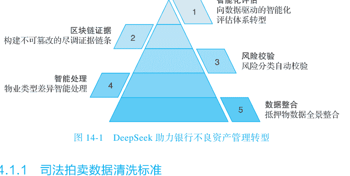

## 14.1.1 司法拍卖数据清洗标准
#### 1. 场景介绍
司法拍卖数据治理是资产处置的基础，银行需整合全国法院公告等 9 类数据源，制定包含流拍次数在内的 12 项清洗指标。资产保全岗需开发异常值自动剔除算法，确保数据质量满足监管要求。工作重点是防范数据失真导致估值偏差，并提升算法对各地执行差异的适应性。

#### 2. DeepSeek 提示词
角色＋任务：本人为银行资产保全岗位人员，需设计司法拍卖数据清洗标准，应设置哪些有效性校验？

#### 3. 追问提示词
- 如何识别关联方虚假竞价？
- 历史成交价如何做季节性调整？
- 监管评估中偏差容忍阈值如何设定？

#### 4. 输出形式
数据清洗日志以电子表格呈现，校验规则手册以文字文档提供。

#### 5. 案例演示
（1）DeepSeek 提示词
角色 + 任务：本人为银行资产保全岗位人员，需设计司法拍卖数据清洗标准，应设置哪些有效性校验？要求输出真实可信，贴合银行实务，确保网页链接真实有效，严格按监管要求执行。

（2）DeepSeek 首次输出
结合最高人民法院及相关部门关于网络司法拍卖的规范性文件，和金融机构资产保全实务，清洗有效性校验应围绕完整性、准确性、合规性、逻辑一致性展开。

一、数据完整性校验
1. 标的物基础信息完整性。核查名称、类型、不动产/动产/股权、权属证明编号、地理位置、评估价、起拍价、保留价等必填项。
2. 特殊标的附加信息。不动产校验户型图、税目、占有使用情况；机动车校验里程、排放标准、违章记录；股权校验实缴出资额、财务报表等。
3. 法律状态信息完整性。抵押、查封、租赁等权利限制是否披露；是否注明欠付工程款及优先受偿权人。
4. 流程文件完整性。拍卖公告、评估报告、成交裁定书、过户证明等是否齐全。

二、数据准确性校验
1. 权属真实性。核对权属证明与法院调查结果一致性，防止虚假或失效证明；带租赁权标的需校验租赁合同签署时间、租金支付记录。
2. 价格合理性。起拍价不低于评估价或市场价 70%（民事案件）；刑事涉案财产无保留价拍卖时，校验保证金与加价幅度是否经合议庭审批。
3. 竞买人资格合规性。校验竞买人是否符合法律要求，是否与拍卖辅助机构存在关联；特殊资质标的校验资质文件。

三、合规性校验
1. 程序合法性。拍卖流程是否符合《最高人民法院关于进一步规范网络司法拍卖工作的指导意见》，重大事项是否经合议庭审批。
2. 信息披露合规性。公告是否如实披露瑕疵、占有情况、权利负担，禁止模糊表述；竞买资格限制是否明确。
3. 反洗钱合规性。核验竞买人身份证明真实性，禁止匿名账户；单笔 5 万元以上交易需登记资金来源用途。

四、逻辑一致性校验
1. 时间逻辑。公告发布时间早于开拍时间，公示期不短于法定期限；被执行人自行处置期限不超过 60 日。
2. 价格逻辑。流拍后降价幅度符合规定，抵债价格与最后一次流拍价一致。
3. 流程衔接性。成交后过户裁定与付款记录匹配，带封过户需校验融资手续。

五、安全与隐私校验
敏感信息是否脱敏加密，符合《金融机构客户尽职调查和客户身份资料及交易记录保存管理办法》；校验拍卖辅助机构未违规接触竞买人信息。

六、异常数据识别
筛查重复记录，标记状态为已成交但缺失过户记录等矛盾数据。

七、实施建议
结合福建省《公共数据清洗技术要求》(DB35/T 2240—2024)采用规则引擎自动化校验；对高风险数据人工复核；定期按监管要求更新规则。

（3）追问提示词
- 如何识别关联方虚假竞价？
- 历史成交价如何进行季节性调整？
- 如何设定监管评估中的偏差容忍度？

（4）DeepSeek 再次输出
一、关联方虚假竞价识别
关联关系核查：通过工商登记、亲属关系库验证竞买人与被执行人、债权人之间的关联；筛查异常资金往来。
竞价行为分析：标记短时多次加价后悔拍账户，识别抬价—悔拍模式；监测非理性加价或机械式出价。
法律程序配合：联合公安、市场监管打击虚假诱导，将高频参与账户列入黑名单；通过执行异议审查资格。

二、历史成交价季节性调整
基础清洗：按资产类型分类，剔除权利负担或特殊事件导致的异常成交。
季节因子计算：采用移动平均或 X-12-ARIMA 分解趋势、季节、残差；参考地方交易平台月度指数归一化。
拍卖阶段修正：按一拍、二拍、变卖降价规则动态调整权重。

三、监管评估偏差容忍度设定
法律依据与市场平衡：网络询价明显偏离市场价值时可申请评估，容忍度建议 5%—10%；特殊资产可放宽至 15%。
动态调整：机动车允许约 8% 偏差，不动产控制在 5% 以内；结合宏观指标定期修订。
风险分级：5000 万元以上标的严格至 3% 并触发人工复核；超限自动预警并回溯评估流程。

（5）第二次追问
将以上内容分别整理成以下格式输出。
Excel 模板（数据清洗日志），以 HTML 代码形式输出，需内嵌可直接下载 Excel 文件的代码按钮，实现一键下载。
Word 文件（校验规则手册），以 HTML 代码形式输出，需内嵌可直接下载 Word 文件的代码按钮，实现一键下载。

（6）DeepSeek 第三次输出
按要求整理的可下载 HTML 格式文件已生成。
单击“运行”按钮，可获得“数据清洗日志模板”。下拉滚动条可见“校验规则手册”。

## 14.1.2 设置商业/住宅物业差异参数
#### 1. 场景介绍
物业评估管理是押品分类的核心，银行需建立以租金收益率为代表的 7 类差异因子，对商业与住宅物业分类评估：商业物业重点关注租约集中度，住宅物业关注学区政策变动。评估管理岗需按季更新参数权重，确保符合相关文件要求。重点在于防范参数失真导致押品高估，并提升政策变动预警灵敏度。

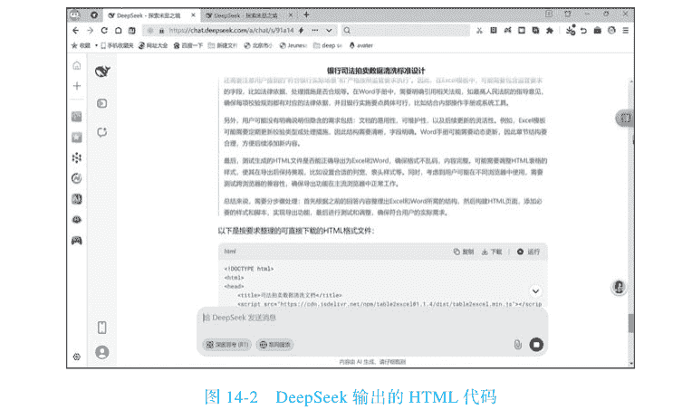

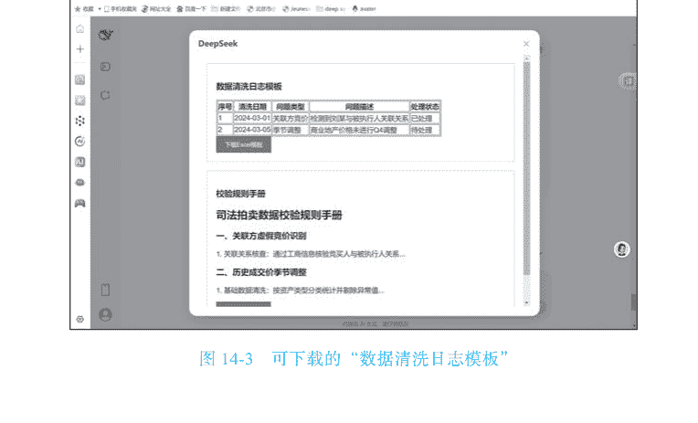

170 ◆ DeepSeek 银行实战手册：银行全场景 AI 实践指南（下册）

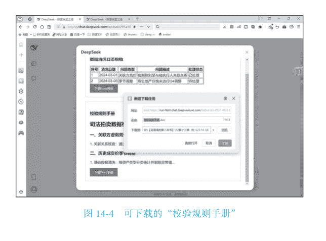

图 14-4 可下载的“校验规则手册”

#### 2. DeepSeek 提示词
角色 + 任务：本人担任银行评估管理岗位，需制定商业 / 住宅物业差异参数表，应包含哪些监管底线？

#### 3. 追问提示词
- 如何应对限购政策突变？
- 混合用途物业如何分类？
- 抵押率监管要求如何嵌入参数设置流程？

#### 4. 输出形式
参数对照表以电子表格呈现，评估调整记录以文字文档提供。

## 14.1.3 房产价格波动预警
#### 1. 场景介绍
价格监控是押品动态管理的核心。以房产为例，银行需对接住建部房地产相关数据系统，动态获取数据，构建 8 项预警指标。资产监控岗需设置月波动超 ±5% 则自动重估的机制，符合呆账核销管理规定。重点在于防范价格剧烈波动对资本充足率的不利影响，并提升区域库存数据更新时效。

#### 2. DeepSeek 提示词
角色 + 任务：本人为银行资产监控岗位人员，需设计房产价格波动预警规则，应参考哪些市场信号？

#### 3. 追问提示词
- 如何识别人为操纵挂牌价？
- 如何动态修正法拍房折扣率？
- 价格波动预警如何与拨备计提规则联动？

#### 4. 输出形式
价格波动指数以电子表格呈现，重估触发记录以电子表格呈现。

## 14.1.4 资产尽调评估场景清单
- 司法数据采集与清洗
- 物业权属核查
- 差异化参数配置
- 市场动态监测
- 监管报备准备
- 评估报告生成

## 14.2 债务重组设计
银行在债务重组中面临权益平衡难、法律条款适配性不足两大挑战。痛点集中在方案灵活性不足、条款执行偏差、动态监测缺失。需构建“方案设计—法律适配—履约监测”一体化体系。法律合规团队需强化企业经营智能诊断、法律条款动态映射、重组效能持续追踪。

通过智能重组系统与法律分析平台，DeepSeek 可实现企业再生能力精准评估、重整方案智能生成、法律条款自动核验，并依托区块链构建无法篡改的重组协议存证链，推动重组从经验驱动向经营潜力量化、条款严格适配、履约动态监测的智能化转型。

## 14.2.1 制定 EBITDA 调整规则
#### 1. 场景介绍
财务真实性验证是债务重组的核心，银行需制定涵盖非经常性损益等 9 项内容的 EBITDA 调整标准，重点识别管理层薪酬异常增长等风险。债务重组委员会实施双人复核机制，确保调整符合会计准则。重点在于防范财务粉饰引发授信决策失误，并优化关联交易识别算法。

#### 2. DeepSeek 提示词
角色 + 任务：本人为银行债务重组委员会人员，需制定 EBITDA 调整规则，应设置哪些红线指标？

#### 3. 追问提示词
- 如何验证表外负债真实性？
- 如何识别监管认定的逃废债行为？
- 如何追溯历史财务调整差异？

#### 4. 输出形式
调整项对照表以电子表格呈现，尽调底稿以文字文档提供。

## 14.2.2 设置阶梯式股权回转机制
#### 1. 场景介绍
股权管理是债转股的关键，银行需设计业绩对赌条款按 30%、50%、70% 三档解锁的阶梯式股权回转机制。法律事务部应设置反稀释条款，确保方案符合上市公司收购及信息披露监管要求。重点在于防范股权价值稀释，并提升业绩考核指标合理性。

#### 2. DeepSeek 提示词
角色 + 任务：本人为银行法律事务部人员，需设计股权解锁条件，应包含哪些保护条款？

#### 3. 追问提示词
- 如何防范股权限复质押？
- 业绩指标波动应如何平滑处理？
- 如何落实监管部门对信息披露的要求？

#### 4. 输出形式
股权协议模板以文字文档提供，触发条件矩阵以电子表格呈现。

## 14.2.3 表决权委托
#### 1. 场景介绍

投后治理：把关键决策握在手里，把日常交给授权

投后管理里，治理架构是最受关注的环节。实务中多采用保留重大事项表决权、将日常运营放权的组合模式，其中重大资产处置等五类事项始终由银行保留最终拍板。法律合规部门需要在授权文件里预埋委托终止的触发条件。整体目标是遏制授权过度带来的机会主义行为，同时让重大议题的决策节奏更快。

#### 2. DeepSeek 提示词
角色 + 任务：作为银行法律合规人员，需要划定日常委托边界，应该建立哪些制衡手段？

#### 3. 追问提示词
- 如何对受托方决策过程进行持续合规跟踪？
- 遇到利益冲突业务该如何隔离与规避？
- 监管关于关联交易信息披露的要求怎样纳入授权框架？

#### 4. 输出形式
委托权限清单（电子表格）、协议范本（文本文档）。

## 14.2.4 债务重组设计场景清单
- 企业偿债能力分析
- 重组方案设计
- 债权人会议管理
- 协议法律审查
- 监管沟通报备
- 执行效果跟踪

## 14.3 司法处置推进
司法处置阶段，银行常遇到清偿顺位争议变复杂、网络拍卖成交率偏低的问题，根源在于规则衔接滞后、网拍流程标准不统一、跨机构协作缺位。需要围绕规则适配、流程提效、协同处置搭建一体化框架。资产处置团队要强化法律规则智能解析、拍卖全流程穿透管控、跨机构数据联动三大能力（如图 14-6 所示）。

借助智能处置系统与协同管理平台，DeepSeek 可帮助实现清偿顺位自动匹配、拍卖流程标准化改造、跨机构协同强化，并依托机器学习构建标的动态估值模型与竞买人精准触达机制，推动司法处置从分散手工操作转向覆盖规则智能适配、流程标准管控、协同效能提升的数字化体系。

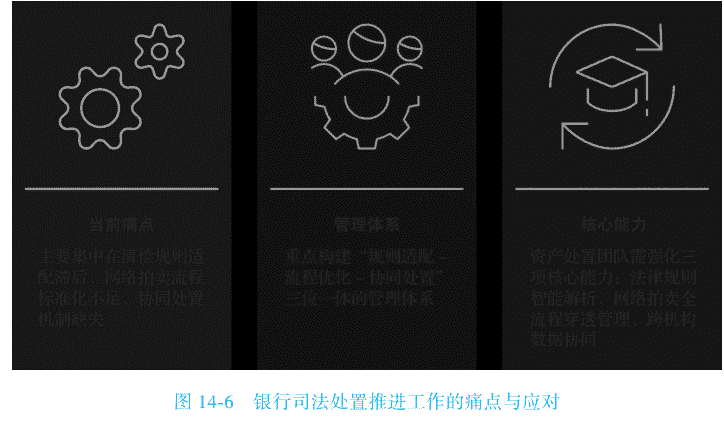

## 14.3.1 清偿顺序确认

#### 1. 场景介绍
债权确权是破产重整的核心任务。银行需建立分层核验机制，重点识别建设工程款等享有优先受偿资格的债项类型。资产保全委员会应设立异议债权公示期，确保操作符合最高人民法院司法解释的相关要求。本环节关键在于避免顺位争议导致资产流失，同时让特殊债权的核查流程更顺畅。

#### 2. DeepSeek 提示词
角色 + 任务：作为银行法律事务人员，需要制定清偿顺序确认流程，应设置哪些核查节点？

#### 3. 追问提示词
- 轮候查封会引发哪些优先权争议，如何应对？
- 刑民交叉类债权排序依据是什么？
- 监管对损失核销的要求如何嵌入清偿流程？

#### 4. 输出形式
清偿顺序图（Visio 文件）、债权确认书（文本文档）。

## 14.3.2 网络拍卖流程改造

#### 1. 场景介绍
司法拍卖是不良资产处置的关键通道。银行需优化公告模板，补充 VR 看样等六项要素。科技中心应开发竞买人资格审核系统，把流拍率压到 30% 以内。重点是规避程序瑕疵引发的法律纠纷，同时提升竞买人画像的精准度。

#### 2. DeepSeek 提示词
角色 + 任务：作为银行资产处置岗位人员，需要设计公告要素，应包含哪些风险提示？

#### 3. 追问提示词
- 如何规避悔拍带来的保证金纠纷？
- 税费承担条款如何表述清晰？
- 监管对信息披露的要求怎样落地到公告？

#### 4. 输出形式
网拍操作手册（文本文档）、成交数据分析表（电子表格）。

## 14.3.3 投资人尽调支持

#### 1. 场景介绍
为投资人提供尽调服务是提升处置效率的关键。银行需搭建电子数据室，提供 12 类标准化资料包。客户服务部应配置 7 × 24 小时响应机制，确保档案移交在 5 日内完成。重点在于防止信息不对称导致交易延迟，同时优化电子签章验证流程。

#### 2. DeepSeek 提示词
角色 + 任务：我是银行投资者关系管理部人员，需优化投资人资料包，应涵盖哪些核心内容？

## 14.3.4 司法处置推进场景清单
- 债权确权登记
- 处置方案备案
- 司法拍卖执行
- 成交确权过户
- 资金分配清算
- 监管报告归档

## 14.4 资产处置管理
当前资产处置管理面临渠道单一、估值失真、区域风险集中的困境。痛点集中在资产包组合优化不足、定价与市场脱节、合规执行偏差、跨区域协同低效等方面，需构建组合优化、定价校准、合规管控三位一体体系。处置团队应强化优先级资产精准筛选、宏观经济敏感度矩阵搭建、跨省资产包组合规则落地等核心能力。

依托智能处置平台与合规管理系统，DeepSeek 可实现资产包组合动态优化、区域风险智能预警、优先级资产匹配、宏观敏感度实时测算、跨省组合合规适配，并以区块链构建全流程存证链条，契合《金融企业不良资产批量转让管理办法》要求，推动管理从线下处置转向组合风险可控、定价公允、合规可溯的数字化体系（如图 14-7 所示）。

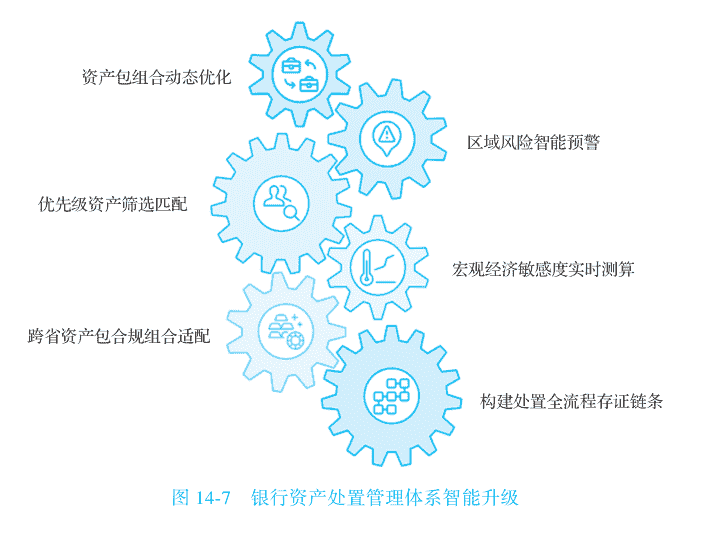

### 14.4.1 制定优先级资产筛选标准

#### 1. 场景介绍
资产分类是制定处置策略的首要步骤。银行需基于 8 项核心指标构建评估模型，将资产划分为 AAA、AA、A 三级。资产保全岗须确保分类口径符合财政部会计核算办法规定。核心在于避免错配导致处置效率下降，同时提升对现金流稳定性的监测频率。

#### 2. DeepSeek 提示词
角色 + 任务：我是银行资产保全岗人员，需制定优先级资产筛选标准，应设置哪些价值评估维度？

#### 3. 追问提示词
- 抵押物的最新市场价值如何验证？
- 现金流预测模型如何校准？
- 监管对最低转让定价的要求如何落实？

#### 4. 输出形式
筛选规则手册（文本文档）、资产分类清单（电子表格）。

### 14.4.2 构建宏观经济敏感度模型

#### 1. 场景介绍
宏观风险管控是优化组合的关键。银行需开发涵盖 12 个因子的影响度模型，并开展季度压力测试。数据分析岗应设定 GDP 增速预警阈值，如低于 5% 即触发预警。核心在于防范经济周期波动导致资产贬值，同时提升因子贡献度测算精度。

#### 2. DeepSeek 提示词
角色 + 任务：我是银行数据分析岗人员，构建宏观经济敏感度模型，应包含哪些区域性经济指标？

#### 3. 追问提示词
- 地方政府财政支持力度如何量化？
- 产业政策变动对宏观经济的影响如何评估？
- 监管对区域性风险限额要求如何嵌入模型？

#### 4. 输出形式
敏感度系数表（电子表格）、压力测试报告（文本文档）。

### 14.4.3 制定跨省资产包组合规则

#### 1. 场景介绍
区域风险分散是提升配置安全性的核心。银行需遵循“3 省 5 市”原则，控制单一区域敞口不超过 30%。法律合规部应核查各省司法执行效率差异，确保符合最高法院关于跨区域执行的规定。核心在于防范区域司法壁垒导致处置受阻，同时优化执行协作响应机制。

#### 2. DeepSeek 提示词
角色 + 任务：我是银行法律合规部人员，需制定跨省资产包组合规则，应关注哪些司法差异？

#### 3. 追问提示词
- 地方保护主义干扰如何应对？
- 跨省税费结构差异如何平衡？
- 监管对并表管理的要求如何落实？

#### 4. 输出形式
区域分布热力图（电子表格）、司法效率对比表（电子表格）。

### 14.4.4 资产处置管理场景清单
- 资产价值评估
- 宏观经济影响分析
- 区域组合优化
- 法律尽职调查
- 监管备案审批
- 交易文件归档

## 14.5 资产证券化
证券化业务受制于基础资产质量波动、监管穿透不足。痛点在于筛选标准粗放、现金流预测精度低、合规适配滞后（如图 14-8 所示）。需构建资产筛选、模型优化、合规管控三位一体体系。投行团队应强化基础资产智能穿透、现金流动态预测、监管规则精准映射能力。

借助智能风控系统与合规管理平台，DeepSeek 可实现基础资产智能筛选、现金流预测动态优化、监管合规自动校验，并依托区块链构建不可篡改的资产确权存证链，推动证券化从经验驱动转向全景穿透、风险动态预警、监管无缝衔接的智能化体系。

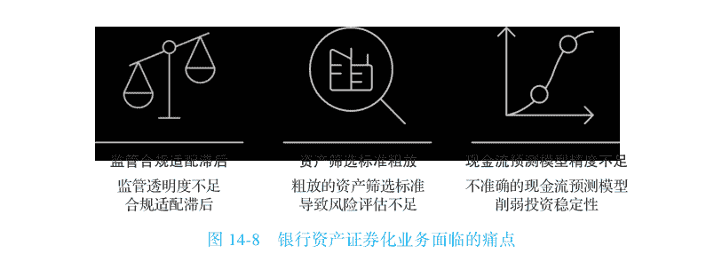

### 14.5.1 资产池压力测试

#### 1. 场景介绍
资产池压力测试是防控风险的核心环节。银行需模拟早偿率提升 20% 等极端情形，测算预期损失。量化分析岗应设置 AAA 级证券现金流覆盖倍数不低于 3 倍的硬约束。核心在于防止现金流断裂引发兑付违约，同时优化早偿行为预测模型。

#### 2. DeepSeek 提示词
角色 + 任务：我是银行量化分析岗人员，需设计资产池压力测试方案，应包含哪些监管规定情景？

#### 3. 追问提示词
- 如何识别关联交易风险传染？
- 历史数据不足时如何补充以支撑建模？
- 如何体现监管对风险自留的要求？

#### 4. 输出形式
压力测试参数表（电子表格）、现金流覆盖分析（电子表格）。

### 14.5.2 信用增级设计

#### 1. 场景介绍
信用增级是产品结构设计的关键。银行需构建 5 级增信体系，并设置触发式增级机制。产品设计岗应在累计违约率超过 5% 时启动补充增信。核心在于防范信用评级下调带来的市场风险，同时提升增级触发条件的灵敏度。

#### 2. DeepSeek 提示词
角色 + 任务：我是银行产品设计岗人员，需优化增信结构，应设置哪些可动态调整的条款？

#### 3. 追问提示词
- 如何平衡增级成本与评级目标？
- 第三方担保机构信用如何动态评估？
- 监管对资本计提要求如何嵌入增信结构？

#### 4. 输出形式
增信方案书（文本文档）、触发条件矩阵（电子表格）。

### 14.5.3 信息披露系统设计

#### 1. 场景介绍
信息披露是合规管理的核心要求。银行需开发 XBRL 数据转换工具，实现 T+1 日逐笔披露。科技中心应设置敏感字段脱敏规则，符合披露指引。核心在于规避披露违规引发的法律风险，同时提升非结构化数据处理能力。

#### 2. DeepSeek 提示词
角色 + 任务：我是银行科技运营岗人员，需设计信息披露系统，应满足哪些数据安全要求？

#### 3. 追问提示词
- 客户隐私如何实现保护？
- 历史数据追溯披露应如何操作？
- 如何应对监管对数据质量的检查？

#### 4. 输出形式
字段映射表（电子表格）、脱敏规则库（电子表格）。

### 14.5.4 资产证券化场景清单
- 基础资产筛选
- 现金流建模
- 信用增级设计
- 法律文件审查
- 监管沟通报备
- 存续期管理

## 14.6 租赁物处置
租赁物处置面临设备估值复杂、跨境流程风险上升等挑战。痛点集中在估值标准缺失、海关协同困难、合规执行偏差。需构建估值优化、流程协同、合规管控三位一体体系。特殊资产团队应强化设备价值智能评估、跨境流程穿透管理、监管规则精准适配能力。

依托智能处置系统与合规管理平台，DeepSeek 可实现设备价值动态评估、海关流程智能协同、监管合规自动校验，并借助区块链构建不可篡改的跨境处置存证链，推动处置从经验判断转向价值量化、流程智能协同、监管无缝衔接的专业化体系（如图 14-9 所示）。

### 14.6.1 建立设备专用评估模型

#### 1. 场景介绍
设备估值是动产管理的重要环节。银行需开发包含剩余寿命等 9 项因子在内的评估模型。技术专家应按季更新设备折旧曲线，确保符合 ISO 55000 资产管理标准。核心在于防范技术迭代导致设备价值高估风险，同时优化行业技术演进监测机制。

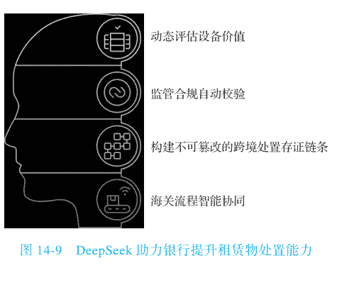

#### 2. DeepSeek 提示词
角色 + 任务：我是银行技术专家，需建立设备专用评估模型，应包含哪些行业特性参数？

#### 3. 追问提示词
- 如何获取设备运行历史数据？
- 技术迭代风险如何量化？
- 监管对残值评估的要求如何落实？

#### 4. 输出形式
折旧参数表（电子表格）、评估报告模板（文本文档）。

### 14.6.2 优化海关申报流程

#### 1. 场景介绍
跨境资产管理是国际合规的重点。银行需编制含 HS 编码等 12 项申报要素的操作指南。国际业务部应设置资产状态变更即时申报机制，符合海关管理规定。核心在于防范申报不实被处罚，同时优化关务系统与业务系统的数据校验接口。

#### 2. DeepSeek 提示词
角色 + 任务：我是银行国际业务部人员，需优化海关申报流程，应关注哪些时效性要求？

#### 3. 追问提示词
- 如何应对海关商品归类争议？
- 临时进出口设备的申报如何管理？
- 如何规避监管罚则风险？

#### 4. 输出形式
申报要素清单（电子表格）、异常处置预案（文本文档）。

### 14.6.3 制定厂商回购承诺条款

#### 1. 场景介绍
风险缓释是设备融资管理的重要保障。银行需与设备厂商签署包含设备状态条款的回购协议。客户管理岗应按年评估厂商信用评级，评级低于 BB 级则触发增信。核心在于防范设备残值不足引发的回收风险，同时优化回购价格动态调整机制。

#### 2. DeepSeek 提示词
角色 + 任务：我是银行法律事务部人员，需制定厂商回购承诺条款，应设置哪些履约保障？

#### 3. 追问提示词
- 如何防范厂商破产带来的履约风险？
- 设备自然损耗责任如何界定？
- 监管关于关联交易的适用规则如何落实？

#### 4. 输出形式
回购协议模板（文本文档）、厂商评级跟踪表（电子表格）。

### 14.6.4 租赁物处置场景清单
- 设备技术评估
- 海关合规申报
- 厂商信用管理
- 司法拍卖准备
- 残值回收处理
- 监管报告编制

## 14.7 债务催收管理
债务催收面临债务人信息不全、失联修复效率低等挑战。痛点在于识别精准度不足、修复手段单一、流程合规隐患多。需构建智能识别、失联修复、合规管控三位一体体系。资产保全团队应强化债务人画像构建、失联信息智能修复、催收行为合规校验能力。

通过智能催收系统与合规管理平台，DeepSeek 可实现债务人关系网络智能识别、失联状态动态修复、催收合规自动核验，并依托区块链建立不可篡改的催收过程存证链，推动催收从人工外呼转向精准定位、智能修复、监管无缝衔接的智能化体系（如图 14-10 所示）。

### 14.7.1 设计债务人画像标签

#### 1. 场景介绍
债务人画像是制定催收策略的核心。银行需整合 12 类数据源，构建多维标签体系。催收管理岗应设置动态评分模型，满分 1000 分，评分低于 400 分时启动高强度催收措施。核心在于避免资源错配，同时深化社会关系网络分析。

#### 2. DeepSeek 提示词
角色 + 任务：我是银行催收管理岗人员，需设计债务人画像标签，应包含哪些合规数据维度？

#### 3. 追问提示词
- 如何避免采集敏感个人信息？
- 如何合规使用司法公开范围之外信息？
- 监管发布的催收行为规范如何嵌入标签？

#### 4. 输出形式
标签体系手册（文本文档）、数据源清单（电子表格）。

### 14.7.2 设计声纹识别规则

#### 1. 场景介绍
电话催收合规是消费者权益保护的重点。银行需部署声纹比对引擎，实现 1:N 快速匹配。合规管理岗应设置生物特征加密存储机制，符合《个人信息保护法》要求。核心在于防范隐私泄露引发的法律风险，同时提升声纹匹配效率。

#### 2. DeepSeek 提示词
角色 + 任务：我是银行合规管理岗人员，需设计声纹识别规则，应设置哪些隐私保护措施？

#### 3. 追问提示词
- 客户对声纹采集与使用的明示同意如何获取？
- 声纹误判时如何申诉及纠正？
- 监管检查时如何提供合规的声纹使用日志？

#### 4. 输出形式
声纹采集授权书（文本文档）、识别日志模板（电子表格）。

### 14.7.3 制定失联修复方案

#### 1. 场景介绍
失联修复是提升催收效能的关键。银行需基于政务数据等多源数据建立交叉验证模型。失联修复岗应设置 7 日修复周期，确保修复成功率不低于 60%。核心在于防止信息孤岛导致资产损失，同时优化多源数据融合算法。

#### 2. DeepSeek 提示词
角色 + 任务：我是银行失联修复岗人员，需制定失联修复方案，应遵守哪些数据使用限制？

#### 3. 追问提示词
- 如何避免过度采集公共数据？
- 如何合规接入第三方数据服务？
- 如何落实监管对客户信息保护的要求？

#### 4. 输出形式
修复路径图（Visio 文件）、数据使用台账（电子表格）。

### 14.7.4 债务催收管理场景清单
- 债务人信息核验
- 催收策略匹配
- 失联状态判定
- 修复渠道部署
- 催收过程记录
- 监管投诉处理

## 14.8 “以物抵债”管理

以物抵债管理升级路径

在抵债物处置环节，银行普遍卡在价值判断失准与交易风险抬头。核心矛盾集中在估值模型不够精准、交易安全存在缺口、合规执行出现偏差。建议以价值校准、风险防护、合规把控为三大支柱搭建一体化治理框架，参照图14-11。特殊资产条线应把抵债物智能定价、交易风险实时预警、监管规则精准匹配作为能力提升重点。

依托智能处置平台与合规管理平台，DeepSeek 可完成抵债物价值动态测算、权属风险智能识别、监管要求自动核验，并借助区块链搭建难以篡改的交易存证链，推动处置工作从经验主导的传统判断转向覆盖价值动态评估、风险智能防控、监管严格落实的标准体系。

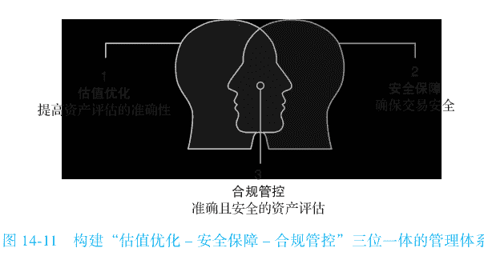

### 14.8.1 设计瑕疵评级标准

#### 1. 场景介绍
处置带瑕疵资产是风控关键，银行需要构建涵盖九个维度的瑕疵分级模型。评估管理岗位须对C类资产实施强制投保，抵押率上限设定为50%。工作重点在于防范产权争议导致处置失败，并优化实物损耗的估值方法。

#### 2. DeepSeek 提示词
角色 + 任务：我是银行评估管理岗人员，需设计瑕疵评级标准，应包含哪些法律风险要素？

#### 3. 追问提示词
- 如何揪出隐性产权纠纷？
- 历史维修记录如何核实？
- 监管对最低估值的规定如何落实？

#### 4. 输出形式
瑕疵评级手册（Word 文件）、案例库（Excel 文件）。

### 14.8.2 创新“瑕疵资产 + 保险”产品

#### 1. 场景介绍
风险转移是瑕疵资产出清的关键，银行要开发产权瑕疵责任险，覆盖产权归属争议、证件不全等六类风险。产品设计岗位需让保费随风险水平动态挂钩，最高保额不超过资产价值70%。重点是防范不可控风险引发减值，同时优化风险概率精算模型。

#### 2. DeepSeek 提示词
角色 + 任务：我是银行产品设计岗人员，需制定瑕疵资产保险条款，除外责任应如何设定？

#### 3. 追问提示词
- 道德风险如何防范？
- 历史遗留问题如何界定？
- 保险产品备案监管要求如何满足？

#### 4. 输出形式
保险产品说明书（Word 文件）、精算模型（Excel 文件）。

### 14.8.3 识别虚假租赁合同

#### 1. 场景介绍
租赁核查是确权重点，银行要建设风险特征库并开发基于自然语言处理的识别引擎。科技中心须重点筛查倒签日期等十二类风险特征。核心是避免虚假租赁导致处置受阻，同时提升时间轴解析能力。

#### 2. DeepSeek 提示词
角色 + 任务：我是银行法律合规部人员，需设计租赁合同识别规则，应关注哪些司法裁判要点？

#### 3. 追问提示词
- 新型合同欺诈手段如何应对？
- 方言条款如何准确解析？
- 监管对关联交易的认定标准如何嵌入规则？

#### 4. 输出形式
风险特征库（Excel 文件）、合同模板（Word 文件）。

### 14.8.4 “以物抵债”管理场景清单
- 抵债物法律确权
- 瑕疵等级评定
- 保险产品匹配
- 交易对手尽调
- 合同风险审查
- 监管备案登记

## 14.9 档案数字化管理

档案数字化推进中，银行面临数据安全压力大、证据效力不足的问题，痛点在存储分散、存证合规弱、监管适配效率低。需要构建安全存储、司法存证、合规管控三合一的体系。运营管理团队要强化数据全生命周期加密、电子证据效力固化、监管规则智能适配三大能力。

依托司法级电子档案系统与区块链存证平台，DeepSeek 可实现档案数据安全存储、电子证据效力强化、监管合规自动校验，并借助知识图谱搭建档案关联检索网络，推动档案管理从纸质模式迈向数据加密存储、证据链可追溯、监管穿透校验的司法级数字化体系，见图14-12。

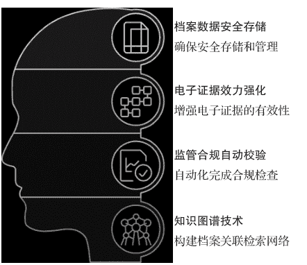

### 14.9.1 设计数据备份策略

#### 1. 场景介绍
档案存证是合规核心，银行需采用同城双活加异地灾备架构。系统管理岗位应执行修改操作的三员分立，满足国家信息安全等级保护三级要求。重点是防止数据篡改削弱法律效力，同时优化存证平台审计追溯功能。

#### 2. DeepSeek 提示词
角色 + 任务：我是银行系统管理岗人员，需设计数据备份策略，应满足哪些容灾标准？

#### 3. 追问提示词
- 秒级故障切换如何实现？

#### 4. 输出形式
存储架构图（Visio 文件）、灾备演练记录（Excel 文件）。

### 14.9.2 设计法律关系图谱

#### 1. 场景介绍
法律关系分析是案件处置关键节点，银行要构建涵盖当事人等司法实体的知识图谱。数据分析岗位需做到十秒生成关系链图。核心是避免关联遗漏导致决策失误，同时提升图谱动态扩展能力。

#### 2. DeepSeek 提示词
角色 + 任务：我是银行数据分析岗人员，需设计法律关系图谱，应包含哪些司法实体？

#### 3. 追问提示词
- 复杂担保关系如何识别？
- 裁判文书要素如何结构化提取？
- 监管对关联方的认定规则如何嵌入图谱？

#### 4. 输出形式
实体关系模型（Visio 文件）、关联分析报告（Word 文件）。

### 14.9.3 操作日志存证

#### 1. 场景介绍
操作审计是风控关键，银行需部署联盟链节点实现日志上链存证。审计岗位应做7×24小时链上监控，满足网络安全审查要求。重点是防止操作抵赖导致内控失效，同时提升智能合约验证效率。

#### 2. DeepSeek 提示词
角色 + 任务：我是银行审计岗人员，需设计操作日志存证规则，应包含哪些审计关键字段？

#### 3. 追问提示词
- 隐私保护与审计需求如何平衡？
- 联盟链节点准入机制如何管理？
- 监管对数据出境的限制如何合规应对？

#### 4. 输出形式
区块链存证规范（Word 文件）、审计轨迹报告（Excel 文件）。

### 14.9.4 档案数字化管理场景清单
- 纸质档案电子化
- 数据加密处理
- 区块链存证
- 多节点备份
- 权限动态管控
- 司法调取响应

## 14.10 损失核销管理

损失核销环节，银行常受材料真实性难验、追索时效把控不准困扰，痛点在核查手段落后、追索期监控缺失、合规执行偏差。需构建材料核验、追索监控、合规管控三合一核销体系，见图14-13。风险管理团队要强化证据链智能穿透、追索时效动态管理、监管规则精准映射三大能力。

通过智能核销系统与合规管理平台，DeepSeek 可实现核销材料真实性核查、追索期智能监控、监管合规自动校验，并借助区块链建立不可篡改的核销证据存证链，推动损失核销从人工审批向证据智能验证、追偿全程跟踪、监管穿透校验的标准体系转型。

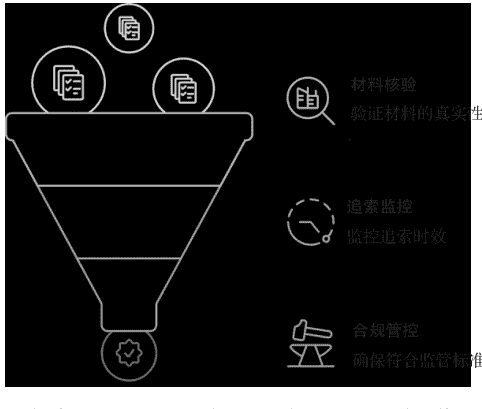

### 14.10.1 司法文书核验

#### 1. 场景介绍
司法文书核验是核销审批关键，银行需对接中国裁判文书网，构建十二项核验指标。核销审批岗位应设三级预警，并在24小时内完成可疑文书复核。重点是防范虚假文书导致不合规核销，同时优化印章特征识别算法。

#### 2. DeepSeek 提示词
角色 + 任务：我是银行核销审批岗人员，需设计司法文书核验规则，应包含哪些防伪特征？

#### 3. 追问提示词
- 电子文书哈希值被篡改如何应对？
- 地方文书格式差异如何处理？
- 核销材料归档监管要求如何落实？

#### 4. 输出形式
核验标准手册（Word 文件）、可疑文书案例库（Excel 文件）。

### 14.10.2 建立双人交叉验证流程

#### 1. 场景介绍
核销审查是风控必要措施，银行需建初审加复审流程，核查损失金额逻辑。审计岗位应留存双人电子签名日志，符合监管要求。重点是防范操作失误带来财务风险，同时优化证明材料智能比对功能。

#### 2. DeepSeek 提示词
角色 + 任务：我是银行内控审计岗人员，需设计双人交叉验证流程，应设置哪些冲突解决机制？

#### 3. 追问提示词
- 如何避免串通舞弊风险？
- 历史核销差异如何追溯分析？
- 监管飞行检查如何快速响应？

#### 4. 输出形式
交叉验证清单（Excel 文件）、审计轨迹记录（Excel 文件）。

### 14.10.3 制定追索策略

#### 1. 场景介绍
追索管理是核销后处置基础，银行需开发预警模型，提前六个月提示可追索资产。法律事务岗位应按季度更新财产线索，并将追索成功率纳入考核。重点是防范追偿超期失权，同时提升债务人财产线索挖掘能力。

#### 2. DeepSeek 提示词
角色 + 任务：我是银行法律事务岗人员，需制定追索策略，应涵盖哪些财产线索来源？

#### 3. 追问提示词
- 债务人新增资产信息如何合法获取？
- 跨境追索如何协调司法协助？
- 已核销资产回冲监管规定如何执行？

#### 4. 输出形式
追索计划表（Excel 文件）、司法协作记录（Word 文件）。

### 14.10.4 损失核销管理场景清单
- 核销材料收集
- 文书真实性核验
- 损失金额确认
- 双人审批留痕
- 追索期监控
- 监管报告编制

## 14.11 税务筹划

不良资产处置税务筹划面临税负高企、合规风险上升，痛点在政策适配滞后、税负测算精度不足、证据链不完整。需搭建政策分析、动态建模、合规管理三合一筹划体系。税务管理团队要强化税收政策智能解析、处置方案动态建模、合规证据穿透管理三大能力，见图14-14。

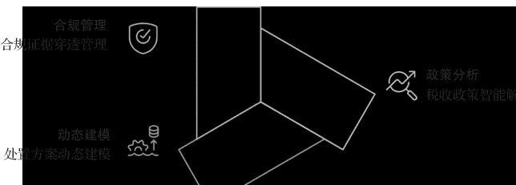

借助智能税务系统与合规管理平台，DeepSeek 可实现税收政策动态适配、税负成本智能优化、合规证据穿透管理，并依托自然语言处理解析税务稽查要点生成风险提示清单，推动税务筹划从经验驱动转向政策精准适配、税负动态模拟、证据智能溯源的智能化管理体系，实现降本与控险双目标。

### 14.11.1 各地特殊资产税收政策匹配

#### 1. 场景介绍
税务优化是不良处置增效环节，银行需建立覆盖三百余个地市税收政策的数据库并标注自贸区条款。税务筹划岗位应设定节税效率提升20%以上的目标。重点是防范政策误用引发合规风险，同时优化区域政策关联推荐算法。

#### 2. DeepSeek 提示词
角色 + 任务：我是银行税务筹划岗人员，需设计各地区特殊资产税收政策匹配逻辑，应关注哪些适用条件？

#### 3. 追问提示词
- 地方政策溯及力变化如何应对？
- 跨区域资产包如何拆分与适配？
- 反避税条款如何合理规避？

#### 4. 输出形式
政策匹配矩阵（Excel 文件）、优惠申请模板（Word 文件）。

### 14.11.2 制定土地增值税清算策略

#### 1. 场景介绍
土地增值税清算是不良处置关键税项，银行需开发扣除项目核验工具，验证开发成本票据。税务管理岗位应设定延迟纳税三年及以上的优化模型。重点是防范成本认定不清导致清算风险，同时提升票据OCR识别准确率。

#### 2. DeepSeek 提示词
角色 + 任务：我是银行税务管理岗人员，需制定土地增值税清算策略，应设置哪些风险缓释措施？

#### 3. 追问提示词
- 税务机关核定成本不认可如何应对？
- 历史票据缺失如何合法补救？
- 关联交易定价如何满足监管合规？

#### 4. 输出形式
扣除项目清单（Excel 文件）、税务风险预案（Word 文件）。

### 14.11.3 设计跨境税务处理合规方案

#### 1. 场景介绍
国际税务合规是跨境处置核心，银行需构建BEPS框架，监控七类税务风险点。法律合规岗位应设置国别报告自动生成功能，符合OECD标准。重点是防范税基侵蚀导致处罚，同时加强转让定价可比数据分析。

#### 2. DeepSeek 提示词
角色 + 任务：我是银行国际业务部人员，需设计跨境税务处理合规方案，应包含哪些文档准备要求？

#### 3. 追问提示词
- 数字服务税等新型税收机制如何应对？
- 税收协定优惠如何充分运用？
- CRS数据如何与银行自身合规系统衔接？

#### 4. 输出形式
国别报告模板（Word 文件）、转让定价文档（Excel 文件）。

### 14.11.4 税务筹划场景清单
- 税收政策分析
- 优惠资格判定
- 税负模拟测算
- 申报材料准备
- 跨境合规审查
- 监管沟通备案

## 14.12 绩效评估

不良资产处置绩效评估面临资本消耗高、策略响应慢等问题，痛点在资本计量不准、策略优化效率低、监管校验不足。需构建资本监控、策略优化、合规校验三合一评估体系。计划财务团队要强化资本消耗智能计量、处置策略动态适配、监管规则精准映射三大能力。

借助智能评估系统与合规管理平台，DeepSeek 可实现处置资本消耗动态跟踪、策略智能优化、监管合规自动校验，并依托区块链建立不可篡改的处置数据存证链，推动绩效评估从静态结果评价转向资本动态跟踪、策略敏捷迭代、监管即时响应的智能化管理体系。

### 14.12.1 资金转移定价

#### 1. 场景介绍
资金转移定价是绩效管理关键，银行需应用FTP曲线拆分定价组件。绩效考核岗位应设定EVA指标中资本成本率不低于10%的考核下限。重点是防范定价失真引发资源配置失衡，同时优化流动性溢价计量模型。

#### 2. DeepSeek 提示词
角色 + 任务：我是银行绩效考核岗人员，需构建FTP转移定价模型，应包含哪些市场基准？

#### 3. 追问提示词
- 期限错配成本如何反映？
- 非标资产如何合理定价？
- 监管资本计量规则如何嵌入？

#### 4. 输出形式
FTP曲线参数表（Excel 文件）、成本分摊规则（Word 文件）。

### 14.12.2 不良资产处置策略多维分析

#### 1. 场景介绍
处置策略评估为战略决策提供支撑，银行需构建含RAROC在内的八项绩效评估矩阵并做季度同业对标。数据分析岗位应动态调整指标权重。重点是防范评估片面导致战略误判，同时提升同业数据获取时效性。

#### 2. DeepSeek 提示词
角色 + 任务：我是银行数据分析岗人员，需设计不良资产处置策略多维分析框架，应设置哪些监管约束条件？

#### 3. 追问提示词
- 短期收益与长期风险如何平衡？
- 处置策略时滞效应如何量化？
- 监管对并表管理要求如何体现？

#### 4. 输出形式
评估指标库（Excel 文件）、同业对标报告（Word 文件）。

### 14.12.3 制定处置策略调整规则

#### 1. 场景介绍
处置策略动态调整是风险管控关键，银行需建立预警模型，当回收率连续三个月低于15%预期目标时强制重检。决策支持岗位应设定季度迭代机制，确保调整方案五日内落地。重点是防范策略失效导致资产减值，同时提升回收预测模型灵敏度。

#### 2. DeepSeek 提示词
角色 + 任务：我是银行决策支持岗人员，需制定处置策略调整规则，应包含哪些触发场景？

#### 3. 追问提示词
- 市场环境结构性变化如何识别？
- 策略切换成本如何控制？
- 监管对风险偏好调整如何传导？

#### 4. 输出形式
阈值设置手册（Word 文件）、策略调整记录（Excel 文件）。

### 14.12.4 绩效评估场景清单
- 资本成本计量
- 风险收益分析
- 同业数据对标
- 策略有效性评估
- 调整方案制定
- 监管指标报送

## 14.13 本章小结

本章聚焦银行不良资产管理的智能化转型，围绕资产尽调评估、债务重组设计、司法处置推进、资产处置管理、资产证券化、租赁物处置、债务催收管理、抵债物处置管理、档案数字化管理、损失核销管理、税务筹划及绩效评估等核心领域，剖析痛点并给出基于DeepSeek的解决方案，通过精准尽调、合规处置与价值修复，助力银行提升管理效能、降低风险、优化资源配置，推动不良资产管理向精细化模式演进。

# 15 DeepSeek 财富管理场景应用

银行财富管理正处数字化转型关键期，客户需求从单一配置转向综合财富规划，服务呈现线上线下协同态势。在金融开放与跨境监管趋严背景下，同业竞争焦点从产品销售规模转向合规穿透能力，尤其在家族信托、ESG投资等领域，银行亟需提升法律文本适配效率与客户需求洞察力。业务人员面临跨境法律理解偏差、策略动态调整滞后的现实挑战。

财富管理痛点主要体现在三方面：一是跨境法律适配数字化程度不足导致合规风险，家族信托在离岸架构设计与外汇登记环节存在流程断点；二是ESG投资筛选标准模糊，策略有效性受限，漂绿识别与信息披露一致性监测缺乏实时性；三是客户风险偏好量化工具滞后，传统测评难以捕捉行为金融学中的非理性决策偏差，影响《指导意见》对适当性管理要求的落实。

银行财富管理智能化跃迁：合规穿透、策略优化与客群洞察

面向财富业务线，DeepSeek 把智能财富运营中台、法务文本解析引擎和行为金融建模能力打包整合，为银行提供了三条突破方向：打通离岸法律库直连通道，让合规架构可以自动生成；基于行业画像构建 ESG 评价体系，同时借助前景理论量化客户的损失厌恶程度。

本章沿着合规穿透、策略打磨、匹配精准三条主线，阐述 DeepSeek 如何重塑财富管理的运行逻辑，缓解法律适配效率不足、ESG 筛选失真、风险偏好错配等关键痛点，推动业务向跨境服务合规化、投研策略科学化、客户洞察精细化演进。

## 15.1 家族信托跨境资产配置

家族信托跨境配置时，银行常受多司法辖区规则冲突加剧、监管穿透薄弱制约，突出矛盾体现在规则衔接滞后、合规透视不足、外汇管控风险上扬。需要搭建法律适配、合规透视、外汇管控相互支撑的服务框架，如图15-1所示。私人银行团队要强化多法域规则解读、跨境交易全链核验、外汇动态监测这三类关键职能。

借助智能信托系统与合规管理平台，DeepSeek 可实现法域规则智能适配、交易全链穿透核验、外汇风险实时预警，并依托数字孪生技术搭建跨境配置仿真模型，推动家族信托从传统离岸架构转向具备法律智能适配、交易全链存证、监管即时响应的全球化智能信托体系。

## 15.1.1 离岸信托设立地法律适配性分析

#### 1. 业务背景
离岸信托设立地法律适配性分析是银行帮助客户搭建稳健合规高效架构的关键环节。随着全球化配置与财富传承需求提升，不同法域的规则差异深刻影响信托的设立、运营与成效。银行需整合开曼群岛、新加坡等热门法域的条文，构建涵盖永续期限、撤销权限、受托人责任、资产保护、税收政策、信息披露等18项核心要素的对照模型，直观呈现各法域异同，为客户提供清晰的法律参考。

#### 2. DeepSeek 对话样例
角色与任务：我是银行法律合规部同事，需要设计一份国际法律对照模型，对比各司法辖区规则差异，应纳入哪些冲突预警指标？

#### 3. 追问示例
- 离岸地法律年度修订如何应对？
- 跨境继承条款如何与中国法衔接？
- 监管穿透申报要求怎样嵌入模型？

#### 4. 交付物
法律条款对照表 Excel 文件、架构合规建议书 Word 文件。

#### 5. 案例演练
（1）DeepSeek 对话样例
角色与任务：我是银行法律合规部人员，需设计国际法律对比模型，比较各司法管辖区法律的异同，应包含哪些冲突预警指标？要求不编造不臆测，贴合银行实务，确保链接真实有效，严格遵循监管要求。

（2）DeepSeek 首轮回复
面向银行法律合规的国际法律对比模型应紧扣跨境业务核心风险，从冲突预警指标出发进行系统比对，确保符合监管要求并覆盖主要法域差异。关键指标及法源如下。

第一块 担保责任与保证人权利差异
1. 保证方式默认规则
- 中国：未约定保证方式时按一般保证承担责任，《民法典》。
- 其他大陆法系如瑞士、奥地利：未约定默认一般保证，保证人可主张先诉抗辩，要求先执行债务人财产。
- 预警点：跨境担保协议未明确保证方式易引发责任范围争议。
2. 先诉抗辩权行使条件
- 瑞士：需证明已对债务人财产强制执行未果，《瑞士债法典》。
- 奥地利：债权人向债务人催告即可要求保证人履行，《奥地利民法典》。
- 预警点：举证要求差异影响债务追索策略。

第二块 反洗钱与反恐融资标准
1. 高风险客户尽调要求
- 国际标准 FATF：需识别受益所有人，筛查黑灰名单国家交易。
- 中国：按《法人金融机构洗钱和恐怖融资风险自评估指引》分类客户风险等级并动态监测。
- 欧盟：适用 AMLD，强调对政治公众人物的强化尽调。
- 预警点：认定标准与尽调深度存在差异。
2. 制裁名单与交易限制
- FATF 黑名单国家如朝鲜、伊朗需加强尽调，避免结算受阻。
- 美国 OFAC 清单与欧盟制裁名单范围不一，需双重筛查。

第三块 跨境资金流动与外汇管制
1. 外汇申报与轧差结算
- 中国：加工贸易收付汇可轧差净额结算，但需季度内完成。
- 欧盟：对跨境支付信息透明度要求更高，如 FATF 第16条修订草案。
- 预警点：部分国家禁止轧差结算，需逐笔申报，操作复杂度上升。
2. 经营性租赁外汇管理
- 中国：承租方须具等值1亿美元以上外汇收入，租金收入不得结汇，特殊情形除外。
- 欧盟：对租赁资金来源限制较少，但需符合《外国补贴条例》避免市场扭曲。

第四块 银行处置机制与债权人保护
1. 自救优先原则 Bail-in
- 欧盟：危机时优先由股东债权人承担损失，政府援助为最后手段，《信贷机构与投资公司复苏与处置指令》。
- 美国：依据《多德-弗兰克法案》要求债权人利益不恶化，清算受偿不低于破产水平。
- 预警点：部分新兴市场仍依赖政府救助，跨境债权回收风险加大。
冲突提示：跨境业务中数据存储与传输合规成本差异明显。

第五块 国际制裁与补贴规则冲突
1. 跨境补贴认定
- 欧盟《外国补贴条例》将外国政府补贴纳入审查，可能认定中国企业对欧投资构成市场扭曲。
- WTO《补贴与反补贴措施协定》未明确跨境补贴规制，易致合规争议。
- 预警点：需审查客户是否涉及欧盟认定的“外国补贴”，避免融资受限。
2. 模型落地建议
- 动态更新机制：整合 FATF 黑名单、各国央行法规更新。
- 风险量化工具：参考山东大学“智慧算法”构建风险评估指标，穿透交易链条。
- 合规培训模块：针对跨境担保、AML、数据隐私等高频冲突领域建立案例库。
通过上述指标比对，银行可系统识别法律冲突风险并优化合规策略，操作中需结合各法域最新法规动态调整。

### （3）追问示例
- 如何应对离岸地法律年度修订？
- 跨境继承条款如何适配中国法律？
- 监管中的穿透式申报要求如何嵌入模型？

### （4）DeepSeek 次轮回复
针对国际法律对比模型中的三大核心问题，结合实务与监管要求分析如下。

一、应对离岸地法律年度修订的策略
1. 动态监控与架构调整
- 法律追踪机制：建立离岸法域修订数据库，重点关注 BVI、开曼、新加坡的公司法、税法变化。如中国通过 CRS 强化离岸公司穿透审查，需同步更新税务居民认定规则。
- 合规架构重构：依据修订调整控股架构。如信息披露要求提高，可引入信托或基金会隔离实际控制人信息；税制收紧时需重新评估“实际管理地”原则对税务居民身份的影响。
- 案例应对：参考上海浦东新区做法，结合《外国补贴条例》要求优化离岸债券发行结构，避免市场扭曲认定。
2. 风险对冲工具
- 合同预留弹性：协议中增设“法律变更条款”，明确修订后法律适用及争议解决方式。
- 税务身份规划：利用新加坡 NOR 等低税率地区身份，通过调整居住天数或企业实际管理地平衡税负与合规风险。

二、跨境继承条款适配中国法律的路径
1. 遗嘱形式与效力双重合规
- 形式要件：依据《涉外民事关系法律适用法》第三十二条，遗嘱形式可适用行为地法，但需注意中国法对代书遗嘱的严格要求。如境外遗嘱经公证认证，若缺乏代书环节仍可能无效。
- 效力认定：遗嘱内容不得违反中国强制性规定。如未为无劳动能力继承人保留必要份额，可能被部分撤销。
2. 跨境执行与资金转移
- 外汇合规：继承资金出境需提交产权证明、法院调解书等至外汇局审批，符合《外汇管理条例》。
- 调解优先：借鉴“云端+双语”调解模式，通过跨境在线调解平台快速达成协议，降低诉讼与执行风险。

三、监管穿透申报要求的嵌入方案
1. 数据穿透与系统整合
- 底层资产登记：参照理财穿透登记规则，建立自动化系统实时采集资管计划、协议委外等底层资产信息，确保周报时效。
- 技术工具：利用区块链实现资产流向可追溯，满足 CRS 对加密货币、保单等新型资产的穿透申报。
2. 合规流程再造
- 内控制度：制定跨境业务穿透管理手册，明确客户尽调、交易监测、数据报送职责。对离岸公司控股的境内企业，需核查实际控制人是否触发非居民企业认定。
- 风险量化模型：引入“智慧算法”评估嵌套层级与杠杆率，自动预警违规套利行为。
3. 培训与考核
- 专题培训：针对 AML、CRS、理财穿透等高频领域设计案例库，强化对欧盟 AMLD、中国个保法等差异条款理解。
- 合规考核：将穿透申报准确率纳入 KPI，对漏报错报设置分级处罚。
实施建议包括跨部门协作开发合规管理系统对接监管接口、聘请跨境税务律师与数据合规顾问、定期开展法律修订、继承争议、穿透检查等压力测试，验证应急响应有效性。

### （5）二次追问示例
- 接下载 Word 文件的按钮代码，实现一键下载 Word 文件。

### （6）DeepSeek 第三次回复
以下是符合要求的 HTML 格式代码，包含 Excel 法律条款与 Word 合规建议书下载功能。
DeepSeek 输出的内容如图 15-2 所示。
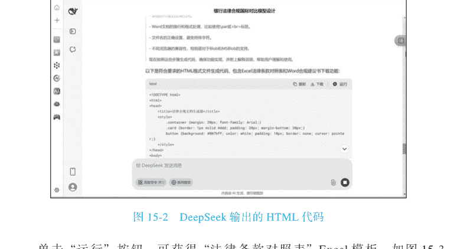
单击“运行”按钮，可获得“法律条款对照表”Excel 模板，如图 15-3 所示。
下拉滚动条，可看到“架构合规建议书”Word 模板，可直接下载到本地，如图 15-4 所示。

## 15.1.2 外汇登记合规性穿透管理

#### 1. 业务背景
银行需开发外汇登记智能核验工具，自动识别“37 号文”即《国家外汇管理局关于进一步简化和改进直接投资外汇管理政策的通知》中涉及的登记缺陷。外汇管理岗需设置 T+1 日异常交易冻结机制，确保符合跨境资金流动监测要求。
212 🟦 DeepSeek 银行实战手册：银行全场景 AI 实践指南（下册）
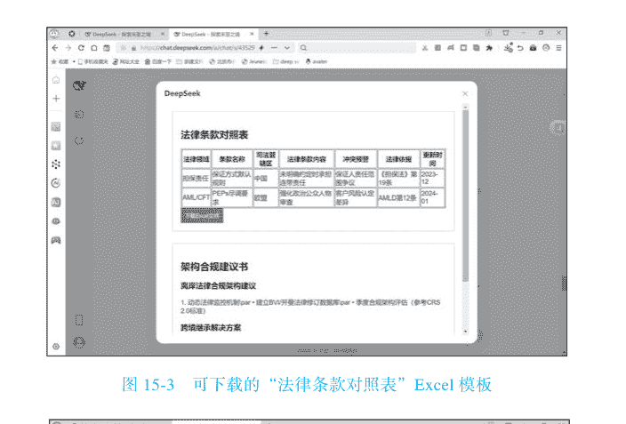
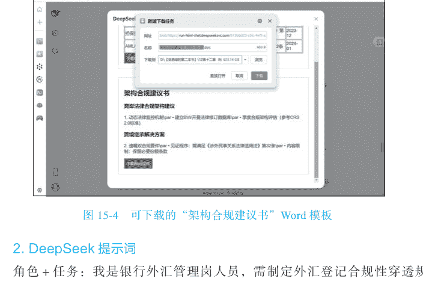

#### 2. DeepSeek 对话样例
角色与任务：我是银行外汇管理岗人员，需制定外汇登记合规性穿透规则，应关注哪些申报要素？

#### 3. 追问示例
- 多层 SPV 架构如何申报？
- 历史登记补正如何操作？
- 如何快速响应监管现场检查？

#### 4. 交付物
外汇登记流程图 Visio 文件、异常交易台账 Excel 文件。

## 15.1.3 税收居民智能判定

#### 1. 业务背景
CRS 申报自动化系统是落实跨境税收信息交换合规的核心支撑，银行需对接 OECD 共同申报准则统一标准，专项开发账户持有人税收居民身份智能判定引擎，通过多维度数据校验实现精准判定。财务部门需搭建敏感税收信息加密传输通道，保障申报数据在采集、传输、报送全流程的安全保密，同时持续优化判定规则与申报流程，提升 CRS 申报准确率。

#### 2. DeepSeek 对话样例
角色与任务：我是银行财务管理部门人员，需设计客户税收居民身份判定逻辑，应包含哪些身份验证文件？

#### 3. 追问示例
- 双重国籍客户如何分类申报？
- 自证文件模糊如何处理？
- 如何与监管数据接口对接？

#### 4. 交付物
CRS 申报校验规则 Excel 文件、身份证明模板 Word 文件。

## 15.1.4 反洗钱动态监控规则库

#### 1. 业务背景
反洗钱动态监控规则库是防范洗钱风险的核心技术支撑，银行需构建涵盖交易频率、关联方关系、资金流向、交易金额等12项核心风险特征的智能监测模型，全面捕捉异常交易信号。反洗钱监控岗需建立高风险信托账户日级扫描机制，对账户交易行为实时监测与穿透核查，严格遵循《金融机构大额交易和可疑交易报告管理办法》要求，及时识别分析并报送可疑交易，防范洗钱、恐怖融资等违规风险。

#### 2. DeepSeek 对话样例
角色与任务：我是银行反洗钱监控岗人员，需优化反洗钱监测规则，应设置哪些异常交易阈值？

#### 3. 追问示例
- 如何识别跨境资金分层交易？
- 慈善信托账户如何豁免监控？
- 如何动态更新监管部门制定的可疑交易判定标准？

#### 4. 交付物
监控规则清单 Excel 文件、案例特征库 Excel 文件。

## 15.1.5 家族信托跨境资产配置场景清单
- 离岸法律环境评估
- 信托架构设计
- 外汇登记穿透
- CRS 合规申报
- 反洗钱监测
- 监管备案管理

## 15.2 ESG 主题 FOF 配置
银行配置 ESG 主题 FOF 产品时面临“漂绿”风险加剧、监管穿透不足等挑战，当前痛点集中在 ESG 数据整合能力弱、绿色项目评估偏差、信息披露合规性低等问题上，如图 15-5 所示。银行需构建数据治理、评估穿透、披露管控三位一体的管理体系。资产管理团队需强化 ESG 数据智能整合、绿色项目穿透验证、信息披露合规校验三项核心能力。
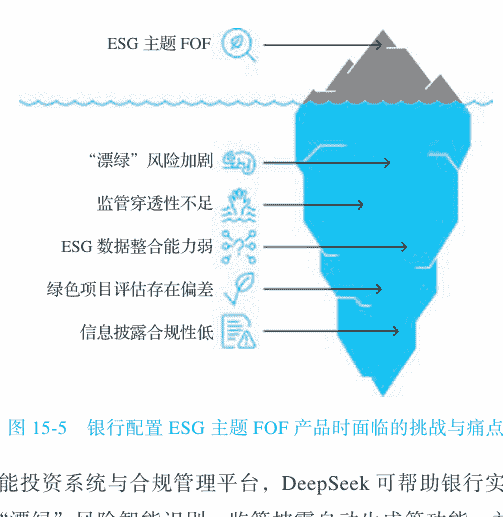
图 15-5 银行配置 ESG 主题 FOF 产品时面临的挑战与痛点
通过智能投资系统与合规管理平台，DeepSeek 可实现 ESG 数据全景整合、“漂绿”风险智能识别、监管披露自动生成，并依托区块链构建 ESG 数据存证链条，推动 ESG 主题 FOF 投资从传统标签化筛选向覆盖数据全链穿透、环境效益可验证、监管要求严落实的负责任投资体系转型。

### 15.2.1 ESG 因子量化筛选引擎

#### 1. 业务背景
银行需整合 MSCI、Sustainalytics 等6大评级体系，构建包含碳排放强度、董事会多样性等200余项指标的 ESG 因子筛选模型。投资经理需设定季度动态调整机制，剔除连续两个季度评级下调的基金产品。

#### 2. DeepSeek 对话样例
角色与任务：我是银行投资经理，需设计 ESG 因子筛选标准，应包含哪些争议排除条款？

#### 3. 追问示例
- 如何解决不同评级体系冲突？
- 新兴行业数据缺失时如何处置？
- 如何嵌入监管部门的绿色分类标准？

#### 4. 交付物
ESG 因子权重表 Excel 文件、排除清单 Excel 文件。

### 15.2.2 “漂绿”行为 AI 监测

#### 1. 业务背景
银行需开发自然语言处理模型，实时监测基金宣传材料中的夸大表述。合规监测岗需设立“漂绿”嫌疑分级预警机制，对高风险案例应在24小时内提交人工核查。

#### 2. DeepSeek 对话样例
角色与任务：我是银行合规监测人员，需制定“漂绿”行为监测规则，应关注哪些典型话术？

#### 3. 追问示例
- 如何识别模糊性承诺？
- 历史处罚案例如何纳入行为识别库？
- 如何与监管部门的投诉数据联动？

#### 4. 交付物
风险话术库 Excel 文件、监测报告模板 Word 文件。

### 15.2.3 ESG 主题轮动策略

#### 1. 业务背景
银行需构建包含政策热度指数、行业碳排放趋势等12项因子的轮动模型。量化投资部需设置季度调仓阈值，当投资组合主题偏离度超过15%时触发组合再平衡。

#### 2. DeepSeek 对话样例
角色与任务：我是银行量化投资部人员，需设计 ESG 主题轮动参数，应设置哪些市场信号？

#### 3. 追问示例
- 如何应对政策突发调整？
- 行业分类标准如何统一？
- 如何适配监管部门提出的 ESG 披露要求？

#### 4. 交付物
轮动信号矩阵 Excel 文件、策略回测报告 Word 文件。

### 15.2.4 ESG 主题 FOF 配置场景清单
- ESG 数据采集
- 基金池构建
- 策略模型优化
- “漂绿”风险筛查
- 组合动态调整
- 监管信息披露

## 15.3 基于行为金融学的客户风险测评
银行在客户风险测评方面面临行为偏差识别不足、动态跟踪机制缺失等挑战，当前痛点集中在问卷评估有效性弱、行为数据整合不足、合规存在隐患等问题上。银行需重点构建行为洞察、动态适配、合规管控三位一体的测评体系，如图15-6所示。财富管理团队需强化行为特征智能解析、风险偏好动态建模、监管规则精准映射三项核心能力。

依托智能测评引擎与行为洞察平台，DeepSeek 帮助银行把客户行为信息整合为全景画像，实现风险分级随行为动态校准、适当性核验自动完成，并借助区块链为测评全过程生成不可篡改的存证，推动风险评估从传统静态问卷转向兼顾行为特征捕捉、风险轨迹追踪与适当性精准匹配的智能模式。

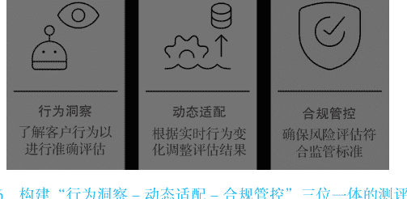

### 15.3.1 损失厌恶系数动态校准

#### 1. 场景概览
银行需要搭建融合盈亏情景推演与历史交易回溯的测评工具，客户经理每季度对客户的损失厌恶系数进行更新，当实际表现偏离预期目标超过20%时触发风险重评。

#### 2. 提示词示例
角色 + 任务：我是一名银行客户经理，要执行损失厌恶系数的动态校准，需要设置哪些情景变量？

#### 3. 深挖问题
- 如何避免测评结果出现失真？
- 市场极端波动会对损失厌恶系数产生什么影响？
- 如何证明满足监管对适当性匹配的要求？

#### 4. 输出成果
校准测试记录表（Excel表格）、风险告知书（Word文档）。

### 15.3.2 交易频率偏差预警

#### 1. 场景概览
银行要构建融合市场热度指数与客户持仓集中度等指标的预警模型，风险监控岗需设定阈值，对月交易次数超过同类客户90分位数的客户发出强提醒。

#### 2. 提示词示例
角色 + 任务：我担任银行风险监控岗，需要设计交易频率偏差预警阈值，应参考哪些行为基准？

#### 3. 深挖问题
- 如何区分策略性调整与非理性交易？
- 客户职业属性如何纳入考量？
- 监管对投资者教育的要求如何嵌入预警模型？

#### 4. 输出成果
交易行为分析表（Excel表格）、预警处置指南（Word文档）。

### 15.3.3 心理账户可视化映射

#### 1. 场景概览
银行需开发交互式图谱，直观呈现客户在教育、养老等6类心理账户中的资金布局，理财经理需配置账户间资金转移建议功能以优化整体资产结构。

#### 2. 提示词示例
角色 + 任务：我是一名银行理财经理，要设计心理账户可视化映射模型，需要包含哪些账户分类？

#### 3. 深挖问题
- 隐性心理账户如何识别？
- 文化差异对心理账户分类有何影响？
- 如何保障销售适当性的合规要求？

#### 4. 输出成果
心理账户分类图（Visio图表）、配置建议书（Word文档）。

### 15.3.4 基于行为金融学的客户风险测评场景清单

- 行为数据采集
- 认知偏差测试
- 动态模型校准
- 交易监控预警
- 心理账户优化
- 监管留痕管理

## 15.4 养老理财
养老理财业务当前面临收益波动加大、长寿风险对冲不足的压力，核心痛点是收益目标匹配偏差、风险对冲工具缺失、合规执行滞后。银行需打造“收益平衡—风险对冲—合规管控”一体化体系，养老金团队要强化生命周期智能建模、长期风险动态评估、监管规则精准适配三大能力。

借助智能管理平台与合规运营系统，DeepSeek 可助力银行实现资产配置动态优化、长寿风险智能对冲、监管合规自动校验，并基于区块链搭建账户全流程操作存证链，推动养老服务从静态产品销售转向覆盖全生命周期规划、风险精准对冲、监管无缝衔接的智能养老金融体系。

### 15.4.1 目标日期基金滑行路径优化

#### 1. 场景概览
退休金规划是财富管理的核心。银行应构建涵盖剩余工作年限等12项要素的滑行模型，实现股债比例动态调整。投资经理需设定5年期波动率控制区间，并在客户退休前5年内逐年下调股票仓位8%~12%。重点在于防范市场波动导致收益缺口，并提高预期寿命数据的校准频次。

#### 2. 提示词示例
角色 + 任务：我是一名银行投资经理，需要设计目标日期基金滑行路径曲线，应设置哪些市场适应性参数？

#### 3. 深挖问题
- 如何应对延迟退休政策变化？
- 长寿风险溢价如何量化？
- 如何嵌入监管对最低收益保证的要求？

#### 4. 输出成果
滑行路径图（Visio图表）、参数校准报告（Word文档）。

### 15.4.2 遗产继承智能分配

#### 1. 场景概览
遗产规划关乎法律合规。银行需建立遗嘱数据库并开发分配引擎，完成特留份测算与税费预估。遗产规划师应设立继承方案合规预审流程，将错误率控制在0.5%以内。重点在于规避分配纠纷的法律风险，并优化亲属关系识别算法。

#### 2. 提示词示例
角色 + 任务：我是一名银行遗产规划师，需要制定遗产分配规则，应包含哪些法定继承条款？

#### 3. 深挖问题
- 如何识别境外资产继承冲突？
- 如何预判遗嘱效力争议？
- 反洗钱监管要求如何落实？

#### 4. 输出成果
继承方案模板（Word文档）、税费测算表（Excel表格）。

### 15.4.3 长寿风险对冲

#### 1. 场景概览
长寿风险对冲是养老产品设计的关键。银行应建立与国家卫健委寿命统计数据联动的长寿债券定价模型。风险管理岗需设定，当年化成本超过2%时立即复核。重点在于防止寿命延长带来的给付风险，并提升死亡率预测模型的精度。

#### 2. 提示词示例
角色 + 任务：我担任银行风险管理岗，需要设计长寿风险对冲方案，应参考哪些精算基准？

#### 3. 深挖问题
- 如何应对区域间寿命差异？
- 监管强制要求的资本占用如何计算？
- 极端死亡率波动如何进行压力测试？

#### 4. 输出成果
对冲成本分析表（Excel表格）、精算假设文档（Word文档）。

### 15.4.4 养老理财场景清单

- 生命周期评估
- 滑行路径设计
- 遗产分配规划
- 长寿风险对冲
- 监管报备管理
- 客户定期检视

## 15.5 教育储蓄规划
教育储蓄业务面临需求分层不清、税收优惠利用率低等问题，主要痛点是各阶段开支预测偏差大、储蓄工具适配度低、政策跟踪滞后。银行需构建“需求预测—工具优选—政策适配”一体化体系，财富顾问须强化教育阶段智能建模、投资工具穿透分析、税收政策精准匹配三大能力。

### 15.5.1 教育阶段开支预测

#### 1. 场景概览
银行应整合教育部各阶段学历成本数据，搭建包含基础教育、高等教育等5个阶段的开支模型。理财经理需设置通胀动态校准参数，确保预测误差率控制在3%以内。

#### 2. 提示词示例
角色 + 任务：我担任银行数据分析岗，需要设计教育开支预测模型，应包含哪些动态修正因子？

#### 3. 深挖问题
- 学区政策调整如何应对？
- 国际学校费用差异如何量化？
- 教育资金专户管理的监管要求如何嵌入模型？

#### 4. 输出成果
开支预测表（Excel表格）、校准报告（Word文档）。

### 15.5.2 教育储蓄工具选择优化

#### 1. 场景概览
银行需开发涵盖教育储蓄计划、预付学费计划、教育年金等8类工具的评估矩阵，并设计风险收益平衡算法。投资顾问岗应建立工具穿透分析机制，自动剔除综合评分低于70分的工具。

#### 2. 提示词示例
角色 + 任务：我来自产品研发部，需要制定教育储蓄工具评估标准，应设置哪些流动性约束条件？

#### 3. 深挖问题
- 如何防范教育类保险兑付风险？
- 跨境教育支付如何适配储蓄工具？
- 如何按监管要求监控资金用途？

#### 4. 输出成果
工具评级清单（Excel表格）、穿透分析报告（Word文档）。

### 15.5.3 税收优惠智能匹配

#### 1. 场景概览
银行需对接国家税务系统，开发优惠推荐引擎实时匹配教育储蓄抵税政策。税务规划岗须设置临界值提醒，并确保节税效率提升不低于25%。

#### 2. 提示词示例
角色 + 任务：我担任银行税务规划岗，需要设计税收优惠匹配逻辑，应包含哪些区域性差异参数？

#### 3. 深挖问题
- 多子女家庭如何叠加使用优惠？
- 反洗钱监管要求如何嵌入验证机制？

#### 4. 输出成果
优惠匹配方案（Excel表格）、合规验证记录（Excel表格）。

### 15.5.4 教育储蓄规划场景清单

- 需求阶段建模
- 开支动态预测
- 工具穿透评估
- 税收优惠匹配
- 资金专户监控
- 政策更新响应

## 15.6 房地产投资管理
房地产投资管理面临杠杆风险累积、税务合规成本上升等挑战，痛点集中于房贷结构失衡、租赁现金流预测失真、跨境税务处理不一致。银行需构建“杠杆优化—现金流管理—税务穿透”一体化体系，不动产金融团队要强化贷款组合智能建模、租赁收益动态监测、跨境税务规则适配能力。

通过智能管理系统与税务合规平台，DeepSeek 可实现房贷利率敏感性分析、租金收入智能预测、跨境税务风险预警，并依托数字孪生技术搭建房产投资仿真模型，推动不动产金融从单一按揭服务向全生命周期管理、税务穿透、风险动态对冲的综合体系转型。

### 15.6.1 房贷杠杆优化

#### 1. 场景概览
银行需构建含LTV、DTI等12项指标的房贷杠杆评估体系，并开发压力测试模块。风控岗须设置预警熔断机制，LTV超过70%时自动触发增信要求。

#### 2. 提示词示例
角色 + 任务：我担任银行风控岗，需要设计房贷杠杆优化参数，应设置哪些市场波动缓冲因子？

#### 3. 深挖问题
- 如何应对房产估值短期波动？
- 跨境抵押品如何折算价值？
- 如何动态适配首付比例监管要求？

#### 4. 输出成果
压力测试报告（Word文档）、熔断规则表（Excel表格）。

### 15.6.2 租赁现金流智能预测

#### 1. 场景概览
银行需接入住建部租金指数，开发含空置率、续租概率等因子的租赁现金流预测模型。资产管理岗须设置季度动态校准，若实际现金流与预测偏差超15%，则启动模型重训。

#### 2. 提示词示例
角色 + 任务：我担任银行资产管理人员，需要设计租赁现金流预测规则，应关注哪些区域经济指标？

#### 3. 深挖问题
- 特殊情况对长租公寓的影响如何量化？
- 商业地产与住宅的预测逻辑有何差异？
- 如何嵌入监管对租金的管制政策？

#### 4. 输出成果
现金流预测表（Excel表格）、校准日志（Excel表格）。

### 15.6.3 跨境房产税务穿透

#### 1. 场景概览
银行需搭建覆盖12个主流移民目的国的房产税务规则库，并开发遗产税与资本利得税模拟器。税务顾问岗须设置双重征税预警，对高风险案例24小时内推送解决方案。

#### 2. 提示词示例
角色 + 任务：我担任银行税务顾问岗，需要设计跨境房产税务穿透规则，应包含哪些反避税条款？

#### 3. 深挖问题
- 如何识别壳公司持有房产的合规风险？
- 非居民预扣税如何精准计算？
- CRS申报要求如何与税务穿透规则联动？

#### 4. 输出成果
税务穿透报告（Word文档）、风险案例库（Excel表格）。

### 15.6.4 房地产投资管理场景清单

- 贷款结构优化
- 租赁收益建模
- 税务穿透管理
- 跨境资产核验
- 风险对冲策略
- 监管合规审查

## 15.7 上班族理财
上班族理财业务痛点在于月光现象普遍、个税优化意识薄弱、工资自动分配效率低、专项附加扣除利用不足、职场风险对冲缺失。银行需构建“收支平衡—税务优化—职业保障”一体化体系，职场金融团队要强化消费行为智能分析、个税专项附加扣除自动核验、职业中断保险动态适配能力。

借助智能账务系统与税务管理平台，DeepSeek 可实现工资智能分账、个税最优方案推荐、职业风险即时对冲，并依托AI构建消费行为预测模型，推动上班族理财从零散资金管理向收支自动平衡、税务精准优化、职业风险全面防护的智能财务体系转型。

### 15.7.1 智能分账

#### 1. 场景概览
银行需开发含房租、教育等8类固定支出的自动划转系统，设置剩余资金智能定投规则，实现工资结构化管理。产品运营岗须建立消费冲动抑制算法，确保超额消费拦截成功率达80%。

#### 2. 提示词示例
角色 + 任务：我担任银行产品经理，需要设计工资智能分账逻辑，应设置哪些流动性应急通道？

#### 3. 深挖问题
- 灰色收入合规入账如何识别？
- 如何实现跨行资金自动归集？
- 反洗钱监管要求如何嵌入系统流程？

#### 4. 输出成果
分账规则表（Excel表格）、拦截日志（Excel表格）。

### 15.7.2 个税抵扣

#### 1. 场景概览
税务优化是个人金融核心。银行需对接税务总局接口，开发涵盖6项专项附加扣除的自动填报系统。税务岗应设置退税智能提醒，确保节税效率提升不低于30%。重点在于防范填报错误引发合规风险，并优化数据接口稳定性。

#### 2. 提示词示例
角色 + 任务：我来自技术开发部，需要设计抵扣匹配算法，应包含哪些证明文件的OCR识别逻辑？

#### 3. 深挖问题
- 跨年度专项扣除结转如何应对？
- 租房合同真伪如何核验？
- 监管申报追溯期应如何提示用户？

#### 4. 输出成果
抵扣方案书（Word文档）、OCR识别日志（Excel表格）。

### 15.7.3 职业中断保险池

#### 1. 场景概览
职业风险管理是保险服务核心。银行需基于5类风险组合构建职业信用评分模型。风控岗应设置高风险行业保额自动上浮机制，上浮20%。重点在于防范行业误判导致赔付缺口，并提高评分模型准确度。

#### 2. 提示词示例
角色 + 任务：我担任银行保险精算师，需要设计保费浮动规则，应参考哪些行业波动指数？

#### 3. 深挖问题
- “35岁职场危机”影响如何量化？
- 自由职业者保障边界如何界定？
- 监管要求的等待期免责条款如何提示？

#### 4. 输出成果
保费矩阵表（Excel表格）、行业风险指数（Excel表格）。

### 15.7.4 上班族理财场景清单

- 收支智能分账
- 税务自动优化
- 职业风险对冲
- 消费行为矫正
- 信用评分管理
- 监管合规备案

## 15.8 家庭主妇理财
家庭主妇理财面临财务可视化不足、教育医疗资金分散、保障碎片化等问题，痛点在于多账户管理混乱、专项资金挪用风险高、家庭保障覆盖不足。银行需构建“全景视图—专项储备—整体防护”一体化体系，财富管理团队要强化多账户智能归集、教育医疗复合定投、全家风险穿透分析能力。

通过智能管家系统与保障管理平台，DeepSeek 可实现家庭资产负债表自动生成、教育医疗资金智能隔离、保障缺口可视化预警，并依托AI构建家庭消费趋势预测模型，推动家庭主妇理财从零散记账向全家庭资产透视、专项资金防护、风险联防联控的智慧管家体系转型。

### 15.8.1 家庭资产负债表引擎

#### 1. 场景概览
家庭财务分析是财富管理基础。银行需开发涵盖12类资产的自动归集系统，配置房产估值智能爬虫与负债利率动态更新模块。数据分析岗应设置负债收入比不低于40%时触发风险提示。重点在于防范过度负债引发偿付风险，并合理设置数据采集频次。

#### 2. 提示词示例
角色 + 任务：我担任银行数据分析师，需要设计家庭资产归集规则，应包含哪些隐性资产识别逻辑？

#### 3. 深挖问题
- 相关投资数据如何自动抓取？
- 亲属间借款如何合规入表？
- 个人征信查询授权流程如何集成？

#### 4. 输出成果
家庭资产负债表模板（Excel表格）、爬虫抓取日志（Excel表格）。

### 15.8.2 教育医疗复合定投

#### 1. 场景概览
专项储蓄是家庭规划关键。银行需构建涵盖5类储蓄工具的配比模型，并开发资金挪用拦截算法。理财顾问岗应设置双重生物识别授权。重点在于防范资金挪用导致目标偏离，并提高生物特征识别精度。

#### 2. 提示词示例
角色 + 任务：我担任银行产品经理，需要设计教育医疗复合定投组合策略，应设置哪些场景化资金锁定条款？

#### 3. 深挖问题
- 学区房政策重大调整如何应对？
- 私立医院费用支付如何核验？
- 如何实现监管层要求的资金用途监控？

#### 4. 输出成果
定投组合说明书（Word文档）、拦截事件台账（Excel表格）。

### 15.8.3 家庭保障

#### 1. 场景概览
家庭保障是保险配置核心。银行需整合7类家庭保障产品，开发三维热力图展示保障缺口。保险精算岗应设置关联理赔触发机制，自动升级配偶保障。重点在于防范家庭收入中断风险，并提高理赔触发条件灵敏度。

#### 2. 提示词示例
角色 + 任务：我担任银行保险精算师，需要设计关联理赔模型，应包含哪些收入替代率参数？

#### 3. 深挖问题
- 全职主妇劳动价值如何量化？
- 多子女家庭保额如何动态调整？
- 监管对等待期叠加规则如何合规处理？

#### 4. 输出成果
保障热力图（Visio图表）、理赔触发规则（Excel表格）。

### 15.8.4 家庭主妇理财场景清单

- 多账户归集
- 专项资金隔离
- 消费趋势预测
- 保障缺口分析
- 关联风险防控
- 监管授权管理

## 15.9 高净值跨境传承破局
高净值客群做境外配置时，资产隐匿风险在抬头、家族治理失灵、跨境税务合规成本飙升成为常态。具体表现为离岸架构合规缺口扩大、代际意愿表达失真、CRS与FATCA申报偏差频发。对策方向要围绕架构穿透核查、意愿留痕存证、申报联动协同搭建三条主线管理框架。家族办公室需要把离岸架构数字孪生建模、家族宪法智能合约化、跨境税务沙盒推演作为核心能力来强化。

依托智能传承系统和税务沙盒平台，DeepSeek 能支撑离岸架构合规压力测试、家族治理条款上链存证、跨境税务方案沙盘推演，并借助数字孪生打造艺术品信托三维核验体系，推动高净值理财从单一资产配置转向覆盖全球架构合规、家族治理数字化、税务风险前置管理的传承生态，如图 15-11 所示。

## 15.9.1 离岸架构管理
#### 1. 场景介绍
离岸架构管理是跨境金融服务的核心环节，银行要搭建覆盖八大主要离岸司法辖区的数字孪生仿真平台，并导入动态监管规则。合规岗位采用三色风险分级，一旦识别到三项以上重大缺陷则自动阻断交易。本项工作的重点在于遏制架构失效带来的合规隐患，并提升监管规则库的更新时效性。
#### 2. DeepSeek 提示词
角色 + 任务：我是银行合规专家，需设计离岸架构仿真测试用例，应包含哪些穿透式监管场景？
#### 3. 追问提示词
- 如何模拟《经济实质法》突击检查流程？
- 多层 SPV 架构如何进行压力测试？
- 如何嵌入受益所有人识别监管要求？
#### 4. 输出形式
架构风险矩阵，Excel 表格；测试案例库，Excel 表格。

## 15.9.2 家族治理
#### 1. 场景介绍
家族治理是财富传承的关键环节，银行要搭建涵盖 34 项条款的家族宪法合约库，并开发生物识别验证系统。法律岗位设置三代成员 80% 以上同意方可修改的机制。本项工作的重点在于防范治理条款冲突风险，并加深亲属关系图谱的构建深度。
#### 2. DeepSeek 提示词
角色 + 任务：我是银行法律岗人员，需设计家族宪法合约生效规则，应设置哪些反胁迫验证机制？
#### 3. 追问提示词
- 如何防范以 AI 合成语音签署的风险？
- 海外家族成员位于不同时区时如何协调签署流程？
- 各国的电子签名法如何合规适配？
#### 4. 输出形式
智能合约模板，Word 文档；生物识别日志，Excel 表格。

## 15.9.3 税务沙盒模拟器
#### 1. 场景介绍
跨境税务筹划是服务国际高净值客户的核心环节，银行要对接全球 120 余个税务机关 API，开发 BEPS 2.0 税务沙盒模拟引擎。税务顾问岗位设定节税效率提升不低于 40% 的目标。本项工作的重点在于防范国际税规误用风险，同时优化国别政策匹配算法。
#### 2. DeepSeek 提示词
角色 + 任务：我是银行国际税务师，需设计税务沙盒模拟引擎的参数，应包含哪些反避税条款触发条件？
#### 3. 追问提示词
- 如何量化税籍规划窗口期？
- 如何判定“数字游民”税务身份？
- 如何联动监管部门对国别报告的要求？
#### 4. 输出形式
税负对比报告，Word 文档；方案推荐表，Excel 表格。

## 15.9.4 高净值客户理财场景清单
- 离岸架构仿真
- 家族治理存证
- 跨境税务推演
- 艺术品数字确权
- 代际意愿管理
- 监管申报协同

## 15.10 企业中层股权财富管理
面向企业中层开展理财业务时，行权税费测算复杂、流动性受限、职业风险对冲缺失构成主要挑战，痛点集中在限制性股票估值失真、行权资金错配、竞业协议连带风险。银行要构建收益透视、流动性支持、职业防护三条主线的管理体系。财富管理团队要强化股权收益三维建模、质押融资智能匹配、职业责任风险量化三项核心能力，如图 15-12 所示。

借助智能行权系统与流动性管理平台，DeepSeek 能帮助银行实现股权收益动态可视化、质押融资实时比价、竞业风险对冲预警，并依托蒙特卡洛模拟技术构建行权时机优化模型，推动企业中层理财从被动持股管理向覆盖收益最大化、流动性智能调配、职业风险主动防控的立体化股权管理体系转型。

## 15.10.1 股权管理
#### 1. 场景介绍
股权管理是高级管理人员激励的关键环节，银行要开发包含 12 个因素的估值引擎，以实现税务现金流的模拟功能。分析师应构建行权时机推荐系统。本项工作的重点在于预防税务效率损失的风险，同时提升波动率曲面建模的精确度。
#### 2. DeepSeek 提示词
角色 + 任务：我是金融工程师，需设计估值参数，应包含哪些税盾效应计算模块？
#### 3. 追问提示词
- 如何量化股权激励加速行权的风险？
- 员工持股计划如何穿透计税？
- 股份支付会计处理的监管要求如何嵌入推荐系统？
#### 4. 输出形式
行权收益表，Excel 表格；税务模拟报告，Word 文档。

## 15.10.2 股票质押风控
#### 1. 场景介绍
股票质押风控是融资管理的核心环节，银行要对接 20 余家券商数据，开发动态授信模型。风控岗位设置质押率不低于 60% 时触发补仓提醒。本项工作的重点在于防范强制平仓引发的流动性风险，同时优化熔断阈值的校准机制。
#### 2. DeepSeek 提示词
角色 + 任务：我是银行风控经理，需设计股票质押规则，应设置哪些行业 β 系数调整因子？
#### 3. 追问提示词
- 如何应对限售股流动性折价？
- 如何监控跨市场套利风险？
- 如何落实质押集中度监管要求？
#### 4. 输出形式
质押利率矩阵，Excel 表格；补仓预警日志，Excel 表格。

## 15.10.3 竞业保险动态定价
#### 1. 场景介绍
竞业风险对冲是人才管理的核心环节，银行要构建赔偿案例库，开发与任职年限关联的竞业保险定价模型。精算岗位设置商业秘密泄露模拟器。本项工作的重点在于防范竞业违约带来的损失，同时优化岗位风险评级模型。
#### 2. DeepSeek 提示词
角色 + 任务：我是银行保险精算师，需设计竞业保险定价因子，应包含哪些竞业范围的量化指标？
#### 3. 追问提示词
- 如何评估技术骨干离职的影响？
- 对于跨行业就业如何界定竞争关系？
- 保险条款备案的监管要求如何进行校验？
#### 4. 输出形式
保费计算器，Excel 表格；竞业热力图，Visio 文件。

## 15.10.4 企业中层人员理财场景清单
- 股权价值透视
- 行权税务优化
- 质押融资匹配
- 竞业风险对冲
- 职业信用管理
- 监管披露协同

## 15.11 小微企业主经营性财富管理
为小微企业主提供理财服务过程中，账期管理混乱、贷款成本高企及公私账户混用构成主要挑战，当前痛点集中在应收账款与应付账款匹配效率低下、融资产品选择盲目及个人连带责任不当触发等方面，如图 15-13 所示。银行需要构建账期智能匹配、融资成本优化和风险隔离一体化的综合管理体系。小微金融团队应加强票据智能贴现、税务贷款精准推荐及企业主责任险动态适配三项核心能力。

借助智能账期系统与融资管理平台，DeepSeek 能帮助银行实现应收应付自动撮合、贷款产品实时比价、公私账户智能隔离，并依托 AI 技术构建供应商信用评估网络，推动小微企业主理财从手工账务处理向覆盖现金流自动平衡、融资成本最小化、法律责任清晰化的智能经营体系转型。

### 15.11.1 票据融资
#### 1. 场景介绍
票据融资是供应链金融的核心环节，银行要开发涵盖 100 余家机构报价的聚合系统，设置区块链验真模块。运营岗位建立最优路径算法。本项工作的重点在于防范假票风险，同时提高跨机构报价同步效率。
#### 2. DeepSeek 提示词
角色 + 任务：我是银行票据专家，需设计票据贴现规则，应设置哪些虚假票据识别参数？
#### 3. 追问提示词
- 如何防范克隆票据重复贴现？
- 电子商业汇票流转记录如何追溯？
- 监管层对贴现利率上限的限制如何嵌入聚合系统？
#### 4. 输出形式
贴现报价表，Excel 表格；验真日志，Excel 表格。

### 15.11.2 小微企业融资
#### 1. 场景介绍
小微企业融资作为普惠金融的重要内容，要求银行业务系统与国家税务总局的金税系统对接，以开发基于纳税信用的综合评估模型。同时，风险控制岗位应设立贷后监控看板，重点防范因经营异常而引发的信用风险。此外，还需对行业景气指数的计算频率进行合理设置。
#### 2. DeepSeek 提示词
角色 + 任务：我是银行信贷经理，需设计税务贷推荐逻辑，应包含哪些虚开发票识别规则？
#### 3. 追问提示词
- 如何识别关联交易美化报表？
- 季节性行业如何调整评估周期？
- 如何实现监管层对贷款资金流向的监控？
#### 4. 输出形式
信贷评估报告，Word 文档；资金监控表，Excel 表格。

### 15.11.3 资金隔离
#### 1. 场景介绍
资金隔离是合规经营的关键环节，银行须构建涵盖 20 项混同风险特征的模型，开发语义分析引擎。合规岗位需设置可疑转账的双重授权机制。本项工作的重点在于预防资金混用可能引发的监管风险，同时提升语义识别的精确度。
#### 2. DeepSeek 提示词
角色 + 任务：我是银行合规专员，需设计公私账户防火墙规则，应设置哪些备用金豁免通道？
#### 3. 追问提示词
- 如何区分合理备用金提取？
- 股东借款如何合规处理？
- 如何适配反洗钱大额交易监管标准？
#### 4. 输出形式
风险特征库，Excel 表格；拦截处置指南，Word 文档。

### 15.11.4 小微企业主理财场景清单
- 票据贴现优化
- 税务数据融资
- 账期智能匹配
- 公私账户隔离
- 连带责任对冲
- 监管合规审计

## 15.12 典型财富管理与理财场景
在财富管理与理财领域，银行面临客户需求多样化且难以满足、市场波动应对能力不足等挑战，当前痛点集中在资产配置方案单一、市场趋势把握滞后、客户教育深度不够等问题上。银行需重点构建“精准配置－动态跟踪－差异服务”三条主线的管理体系，如图 15-14 所示，理财团队需强化个性化方案设计、市场趋势洞察、客户分层分类服务三项核心能力。

借助智能财富管理平台与风险监测系统，DeepSeek 能帮助银行实现资产配置优化、市场风险预警、服务体验升级等功能，并依托区块链技术保障交易安全和数据可信，推动银行从传统理财服务模式向覆盖客户全生命周期、适应市场动态变化、提供差异化服务的现代化财富管理体系转型。

### 15.12.1 理财“双录”质检优化
#### 1. 场景介绍
确保金融产品销售合规及维护客户权益的核心举措之一是理财“双录”质检优化。银行应运用自然语言处理技术，对理财产品的销售录音进行合规性审查，精确辨识超过20种的违规表达，力求将质检的准确率提高至不低于98%。此项任务的核心挑战在于解决方言识别难题，构建能够精确区分不同地区方言的识别模型，并解决语义上的歧义问题。
#### 2. DeepSeek 提示词
角色 + 任务：我是银行 AI 工程师，需训练语音识别模型，应采集哪些方言样本数据？
#### 3. 追问提示词
- “保本”类话术的变体表达如何穷举？
- 沉默时长的合规性判断标准是什么？
- 多人同时讲话的场景如何处理？
#### 4. 输出形式
违规话术词库，Word 文档；质检结果热力图，HTML 代码。

### 15.12.2 高净值客户资产配置优化
#### 1. 场景介绍
高净值客户资产配置优化是银行财富管理的关键。银行需整合实时汇率、大宗商品波动率及 ESG 评级数据，为客户定制全球化配置方案。客户经理要在 3 个工作日内完成含另类投资占比的可行性报告，重点解决跨市场流动性风险对冲问题。
#### 2. DeepSeek 提示词
角色 + 任务：我是银行投资顾问，需构建高净值客户资产配置优化模型，应包含哪些尾部风险预警参数？
#### 3. 追问提示词
- 如何量化艺术品投资的流动性折价？
- CRS 税务穿透风险如何建模？
- 数字货币敞口控制比例如何合理设定？
#### 4. 输出形式
资产配置建议书，Word 文档；风险压力测试表，Excel 表格。

### 15.12.3 智能投顾组合再平衡
#### 1. 场景介绍
智能投顾组合再平衡是数字化资产管理的核心环节，银行需基于客户风险测评结果构建动态调仓模型，实现市场波动超过 ±15% 自动触发再平衡机制。投资经理需开发低换手率交易算法，同步部署跟踪误差实时监测系统，将误差值严格控制在 2% 以内。此项工作重点在于防范市场波动引发的组合策略失效风险，同时优化交易成本分摊模型以平衡调仓频率与收益稳定性。
#### 2. DeepSeek 提示词
角色 + 任务：我是银行算法工程师，需优化均值 - 方差模型，应增加哪些行为金融学约束条件？
#### 3. 追问提示词
- 如何将处置效应量化纳入交易成本？
- 动量因子与反转因子的切换应基于哪些逻辑？
- 如何实时获取客户情绪指数？
#### 4. 输出形式
再平衡算法流程图，Visio 文件；交易成本测算表，Excel 表格。

### 15.12.4 跨境信托税务架构设计
#### 1. 场景介绍
为满足超高净值客户的需求，银行在设计跨境信托税务架构时，必须同时考虑 CRS、FATCA、BEPS 2.0 等多项合规要求。此项工作重点在于防范在不符合相关法律法规要求的前提下，设立特殊目的载体 SPV 所带来的合规风险。
#### 2. DeepSeek 提示词
角色 + 任务：我是银行税务律师，需构建多司法管辖区合规检查清单，应包含哪些反导管规则条款？
#### 3. 追问提示词
- 离岸公司实质性活动测试如何达标？
- 如何比较慈善基金会与信托双层架构的税务优劣？
- 如何衡量《关于支持外贸新业态跨境人民币结算的通知》对受托人的影响？
#### 4. 输出形式
税务架构图，PPT 文件；合规风险矩阵，Word 文档。

### 15.12.5 理财产品破净值客诉预警
#### 1. 场景介绍
理财产品破净值客诉预警是银行强化理财产品风险管控、维护金融消费者权益的核心风控工具，银行需构建多维度综合预警模型，整合理财产品实时净值数据、市场舆情动态、客户资金流动轨迹三大核心数据源，借助舆情分析引擎识别负面情绪扩散信号，依托资金流动监测系统追踪大额赎回、集中申赎等异常资金行为，实现风险信号的多维度交叉验证。此项工作的核心在于通过提前预警精准预判理财产品破净值可能引发的大规模赎回风险与客诉爆发风险，为银行快速启动安抚沟通、流动性补充、产品调整等应对方案争取时间，同时持续优化模型的风险识别灵敏度与误判率控制，平衡风险防控与客户体验，筑牢净值化理财业务的风险防线。
#### 2. DeepSeek 提示词
角色 + 任务：我是银行风控专员，需训练预警模型，应采集哪些非结构化数据源？
#### 3. 追问提示词
- 如何量化社交媒体情绪指数？
- 如何设置同业产品破净率的传导效应系数？
- 如何设计巨额赎回的流动性冲击成本算法？
#### 4. 输出形式
预警信号仪表盘，BI 系统；客户投诉应对预案，Word 文档。

### 15.12.6 跨境资产归集
#### 1. 场景介绍
为实现客户在不同地区银行金融资产的整合，银行需开发支持 SWIFT、CIPS、FPS 等多种通道的资产聚合引擎，重点解决数据清洗过程中所涉及的货币兑换及金融产品类型映射问题。
#### 2. DeepSeek 提示词
角色 + 任务：我是银行系统架构师，需设计数据标准中间件，应包含哪些金融产品分类代码？
#### 3. 追问提示词
- 结构性存款收益结构如何解析？
- 如何制定不同国家基金产品的风险等级映射规则？
- 如何设置实时汇率报价源的优先级？
#### 4. 输出形式
API 文档，Markdown 格式；资产全景图，基于 D3.js 库。

### 15.12.7 理财师专业能力画像
#### 1. 场景介绍
理财师专业能力画像是银行提升财富管理服务质量、强化团队效能管理的核心支撑，银行需设计整合历史交易业绩分析、客户全周期评价反馈、产品知识与合规素养测试等模块的智能评估工具，结合显性业绩数据与隐性服务行为数据实现能力全景度量。评估体系需涵盖客户留存率、适当性匹配准确度、产品配置收益率、合规操作达标率、客户满意度等核心维度，建立半年度动态更新机制，持续跟踪理财师专业成长、服务质量及市场适配能力变化，当关键指标偏离行业基准或内部标准时，立即触发专项能力提升与复盘优化流程。
#### 2. DeepSeek 提示词
角色 + 任务：建立专业理财师胜任力模型，应赋予哪些指标更高权重以适配财富管理服务场景？
#### 3. 追问提示词
- 风险错配事件发生后，理财师的责任系数该如何量化核算？
- 从评估理财师理解能力的角度，该如何界定产品复杂度标准？
- 在评估理财师服务能力时，应怎样平衡客户投诉情况与业绩表现？
#### 4. 输出形式
能力雷达图，ECharts 格式；培训课程推荐列表，Excel 格式。

### 15.12.8 养老第三支柱账户管理
#### 1. 场景介绍
养老第三支柱账户管理是银行落实个人养老金制度、服务居民长期养老规划的核心业务模块，银行需开发整合税收递延计算引擎、年度额度实时监控、跨平台额度核查、资金安全存管等核心模块的智能运营系统，结合政策合规要求与客户养老资金规划需求，实现账户全生命周期精细化管理。系统需精准支撑年度 12 000 元缴费限额的动态监控、跨金融机构额度实时校验，同步搭建政策更新响应机制与账户信息安全保障体系，持续跟踪政策调整、客户缴费行为及资金配置变化，当出现额度超限预警、跨平台数据不一致等异常情况时，立即触发合规核查与客户告知流程。
#### 2. DeepSeek 提示词

养老第三支柱智能运营系统规划

角色及目标：作为银行系统开发工程师，需构建养老第三支柱账户智能运营系统，请说明关键功能模块及合规管控要点应如何安排？

#### 3. 追问提示词
- 税收递延计算模块怎样适配多元收入群体对应的个税计核细则，才能保证测算准确可信？
- 跨机构额度实时核验可采用哪些技术路线，如何确保同步效率与数据一致？
- 面对缴费上限、税收优惠占比等政策变动，系统该以何种机制实现快速迭代？

#### 4. 输出形式
系统功能架构图 采用 Visio 文档、合规管控清单 采用 Excel 表格。

### 15.12.9 存款保险标识解析

#### 1. 场景介绍
存款保险标识的规范化宣传是落实存款保险制度、保障金融消费者知情权的合规核心。银行需搭建覆盖规范解读、宣传物料更新、渠道覆盖核验、合规时效管控的专项管理体系，结合监管标准与客户信息获取习惯，实现标识在全触点精准落地。合规管理专员要完成 LED 显示屏、存单印章、手机银行弹窗、营业网点海报、ATM 机界面、网上银行入口等 17 类核心触点的标识更新，建立宣传物料合规审核与更新进度跟踪机制，持续监控各渠道展示的规范性、准确性与完整性。一旦出现标识缺失、内容不符、更新滞后等风险，立即触发专项整改并向监管报备。

#### 2. DeepSeek 提示词
角色及任务：作为银行合规管理专员，需搭建存款保险标识宣传专项管理机制，关键执行要点与风险防控举措应怎样制定？

#### 3. 追问提示词
- 面对 17 类核心触点的标识更新，如何制定差异化落地标准以更好契合各渠道展示特性？
- 宣传物料合规审核需涵盖哪些关键校验维度？在保证审核准确的前提下如何提升效率？
- 标识更新延误、渠道展示不规范等风险发生时，如何建立快速响应整改与监管上报机制？

#### 4. 输出形式
触点标识落地规范手册 采用 Word 文档、合规审核校验清单 采用 Excel 表格、风险整改与报备流程图 采用 Visio 文档。

## 15.13 本章小结
本章聚焦财富管理业务数字化转型，涉及家族信托跨境资产配置、ESG 主题 FOF 布局、基于行为金融学的客户风险测评、养老理财、教育储蓄规划、房地产投资管理、上班族理财、家庭主妇理财、高净值客户理财、企业中层理财、小微企业主理财等多项主题。依托合规穿透、策略优化与精准匹配，DeepSeek 帮助银行解决法律适配低效、ESG 筛选标准失真、风险偏好错配等痛点，推动财富服务从传统模式向智能化、精细化、科学化演进，契合客户需求升级与监管要求。

# 16

## DeepSeek 在银行人力资源场景的应用
银行人力资源管理正处于数字化转型关键期，管理诉求由基础事务向战略效能提升加速迁移，模式呈现数据驱动与智能决策深度融合特征。随着金融业人才竞争加剧与组织效能升级，人力资源工作重心由基础人事向人才价值挖掘与能力建设转移，尤其在招聘选拔、绩效评估等重点领域，银行亟需提升人才画像精准度与组织发展科学性。业务人员面临多系统数据孤岛、分析工具智能化不足等现实挑战。

人力资源管理痛点主要体现在三方面：一是招聘数字化程度不足，简历筛选仍依赖人工经验，缺乏智能匹配与潜质评估；二是培训体系个性化不足，传统课程推送难以及配员工能力成长曲线，影响《中华人民共和国劳动法》对职业培训的要求落实；三是绩效管理工具滞后，考核指标设定与结果分析缺乏数据模型支撑，制约《银行业金融机构绩效考评监管指引》有效执行。

依托 DeepSeek 部署智能招聘系统、员工成长模型及绩效分析引擎，商业银行可实现关键突破：构建多源数据融合的人才画像，实现人岗精准匹配；建立基于机器学习的能力差距诊断模型，优化培训资源配置；运用自然语言处理提升考核指标动态适配能力。

本章重点解析 DeepSeek 如何通过“数据贯通-流程优化-决策升级”三重路径重构人力资源管理体系，解决人才筛选低效、培训适配不足、绩效管理滞后等核心问题，助力银行实现招聘选拔精准化、人才培养个性化、组织发展科学化的数字化转型目标，满足《人力资源市场暂行条例》《中华人民共和国数据安全法》等法规要求。

## 16.1 智能招聘
银行推行智能招聘面临用工风险上升、合规要求趋严等挑战，当前痛点集中在风险识别滞后、招聘流程标准化不足、合规执行偏差等方面。银行需构建“风险防控-流程优化-合规管控”三位一体体系。人力资源团队需强化用工风险智能识别、招聘流程动态优化、监管规则精准映射三项核心能力。

通过智能招聘系统与合规管理平台，DeepSeek 可帮助银行实现用工风险全景筛查、招聘流程智能优化、合规规则自动校验，并依托区块链技术建立不可篡改的招聘过程存证链，推动人才招聘由传统经验判断向覆盖风险智能防控、流程透明可溯、监管无缝衔接的 AI 驱动型体系转型（如图 16-1 所示）。

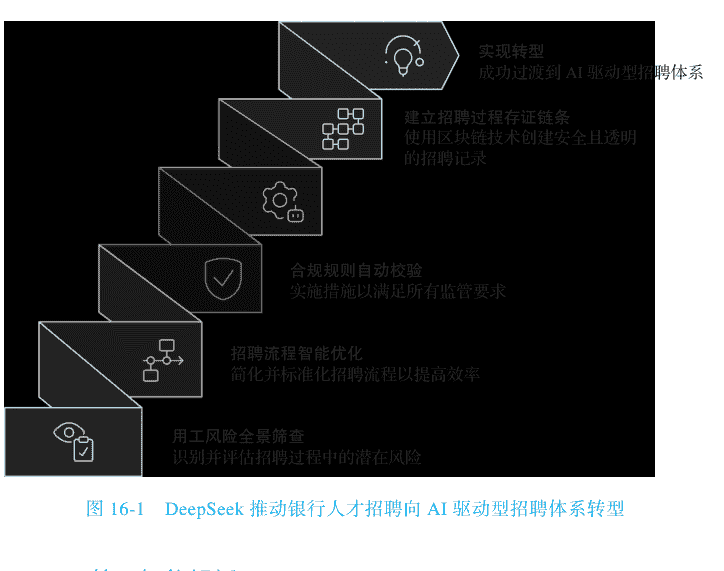
图 16-1 DeepSeek 推动银行人才招聘向 AI 驱动型招聘体系转型

### 16.1.1 简历智能解析

#### 1. 场景介绍
智能招聘是人才引进关键环节，银行需开发多模态解析引擎，精准抽取教育背景等 15 项核心字段。招聘经理应设置反歧视过滤规则，自动剔除涉及性别、年龄等敏感词的岗位描述。本项工作重点在于防范就业歧视引发的法律风险，同时优化 NLP 算法公平性校验机制。

#### 2. DeepSeek 提示词
角色及任务：作为银行招聘经理，需设计简历解析规则，应包含哪些合规校验要点？

#### 3. 追问提示词
- 如何规避算法偏见？
- 非结构化数据如何实现标准化？
- 监管部门对招聘广告的审查要求如何嵌入校验逻辑？

#### 4. 输出形式
字段提取模板 采用 Excel 文件、敏感词库 采用 Word 文件。

#### 5. 案例演示
（1）DeepSeek 提示词
角色及任务：作为银行招聘经理，需设计简历解析规则，应包含哪些合规校验要点？要求不编造、不臆测，符合银行实际场景，确保网页链接真实有效，严格按照监管要求执行。

（2）DeepSeek 首次输出
作为银行招聘经理，设计简历解析规则时需结合《中华人民共和国个人信息保护法》《中华人民共和国数据安全法》等法规要求，以及银行业务场景的实际需求，确保合规性、安全性和实用性。以下是需包含的核心合规校验规则及依据：

一、个人信息收集与处理的合规性校验
1. 告知同意原则
- 校验项：候选人是否在提交简历时签署《个人信息处理告知及同意书》，明确信息用途（如招聘、背景调查、人才库存储等）、处理方式、存储期限及跨境传输（如有）等。
- 技术实现：系统需记录候选人同意时间、方式（如电子签名或勾选“同意”选项），并关联至简历数据存储路径。
2. 最小必要原则
- 校验项：仅收集与招聘直接相关的必要信息（如姓名、学历、工作经历、联系方式），禁止强制收集无关信息（如婚姻状况、宗教信仰等敏感信息）。
技术实现：设置字段必填/选填规则，对非必要字段标注“自愿提供”并限制系统存储范围。

二、数据安全与存储合规性校验
### 1. 敏感信息脱敏
校验项：身份证号、银行卡号等敏感信息需自动脱敏显示（如仅显示后4位），并在存储时加密处理。
技术实现：采用 AES 加密算法，限制后台权限访问敏感字段。
### 2. 数据存储时效性
校验项：未录用候选人简历的存储期限不超过 6 个月（需在同意书中明确），超期后自动销毁；录用者信息按《中华人民共和国劳动合同法》保存至离职后 5 年。
技术实现：系统设置定时清理任务，留存销毁日志备查。

三、简历内容真实性校验
### 1. 学历与证书真实性
校验项：自动对接学信网、职业资格认证平台接口，验证学历、英语四六级成绩、银行从业资格证等证书编号的真实性。
技术实现：API 实时校验，若无法联网验证则标注“需人工复核”。
### 2. 工作经历与时间逻辑
校验项：检查工作经历时间是否重叠或存在断档，实习/项目经历是否与岗位相关，职位名称是否标准化（如“大堂经理助理”而非“实习生”）。
技术实现：设置时间轴逻辑规则，触发异常提示（如“2018—2020 年同时在两家公司任职”）。

四、背景调查相关风险点校验
### 1. 信用与违法记录筛查
校验项：通过第三方征信平台接口筛查候选人是否有贷款逾期、金融纠纷或违法犯罪记录（需候选人提前授权）。
技术实现：授权文件与简历绑定，自动触发背调接口调用。
### 2. 商业利益冲突检测
校验项：识别候选人是否有竞争机构任职经历，或其亲属是否在银行任职。
技术实现：关键词匹配（如公司名称库）、亲属关系字段关联校验。

五、特殊场景合规性校验
### 1. 跨境数据传输
校验项：若需将候选人信息传输至境外总部，需完成数据出境安全评估（如签署标准合同、通过网信部门审批）。
技术实现：系统拦截含境外字段的简历，触发合规审批流程。
### 2. 候选人撤回权
校验项：允许候选人随时撤回个人信息处理授权，系统需支持一键删除或匿名化处理。
技术实现：提供候选人自助入口，删除后保留操作日志。

六、系统功能与流程设计建议
### 1. 自动化分级分类
将简历数据分为四类：禁止收集（如宗教信仰）、允许收集（如教育背景）、用工必需（如身份信息）、模糊类（需额外授权）。
### 2. 风险预警机制
对高风险简历（如学历造假、信用不良）自动标记，推送至合规部门人工复核。
### 3. 审计与留痕
记录所有简历操作日志（如访问、修改、删除），定期生成合规报告备查。
### 4. 依据与参考来源
- 法律依据：《中华人民共和国个人信息保护法》中的最小必要原则、告知同意规则，《中华人民共和国数据安全法》中的加密与跨境传输要求。
- 行业实践：银行背调需涵盖身份、学历、信用、利益冲突，简历字段标准化与真实性校验。

通过上述规则，可系统性降低招聘环节的法律风险，同时提升筛选效率。建议结合银行内部合规部门与外部法律顾问意见，定期更新规则以适配监管动态。

（3）追问提示词
- 如何避免算法偏见？
- 非结构化数据如何实现标准化？
- 监管部门对招聘广告的审查要求如何嵌入校验逻辑？

（4）输出形式
Excel 模板（字段提取模板），用 HTML 的格式输出，需要内嵌可直接下载 Excel 文件的按钮代码，实现一键下载 Excel 文件。
Word 模板（敏感词库），用 HTML 的格式输出，需要内嵌可直接下载 Word 文件的按钮代码，实现一键下载 Word 文件。

（5）DeepSeek 再次输出
以下是两个模板的 HTML 实现，包含直接下载功能（需在浏览器中运行）。
DeepSeek 输出的内容如图 16-2 所示。

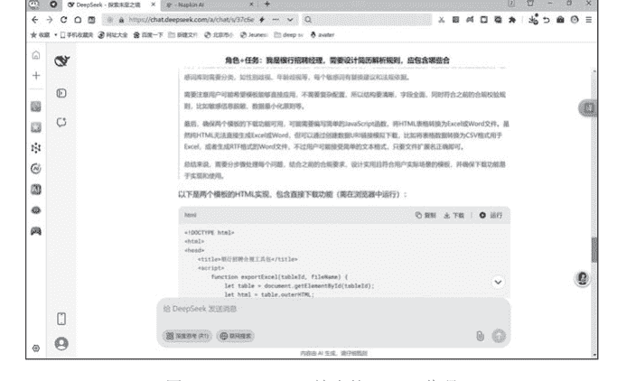
单击“运行”按钮，可获得“简历解析字段提取模板”（Excel 格式），如图 16-3 所示。
下拉滚动条，可看到“招聘广告敏感词库”Word 模板，如图 16-4 所示。

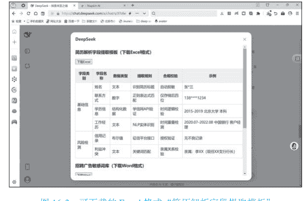
图 16-3 可下载的 Excel 格式“简历解析字段提取模板”

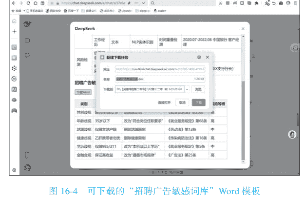
图 16-4 可下载的“招聘广告敏感词库” Word 模板

## 16.1.2 面试题库生成

#### 1. 场景介绍
面试题库是确定选拔标准的有效依据，银行需构建覆盖行为能力等维度的矩阵化题库。人事经理应动态调整题型权重，确保题库年度更新率不低于 30%。本项工作重点在于防范考题陈旧引发的选拔偏差，同时优化岗位序列与考题匹配的算法。

#### 2. DeepSeek 提示词
角色及任务：作为银行人事经理，需设计面试题库结构，应设置哪些防泄密机制？

#### 3. 追问提示词
- 如何降低题库重复使用导致的泄题风险？
- 针对突发岗位需求如何快速生成面试题库？
- 如何落实监管部门对面试公平性的要求？

#### 4. 输出形式
题库分类表 采用 Excel 文件、组卷规则手册 采用 Word 文件。

## 16.1.3 背调风控

#### 1. 场景介绍
背调风控是雇佣合规关键要点，银行需对接学信网等 8 类数据源，开发风险评分模型。背景调查岗应设置三级预警机制，如发现重大风险信息，应在 24 小时内终止候选人的相关流程。本项工作重点在于防范雇佣风险，同时优化数据接口稳定性。

#### 2. DeepSeek 提示词
角色及任务：作为银行背景调查岗人员，需制定背调标准，应包含哪些风险红线条款？

#### 3. 追问提示词
- 如何合法获取非公开从业记录？
- 如何验证跨境工作经历的真实性？
- 如何落实监管部门的个人信息使用规范？

#### 4. 输出形式
背调流程图 采用 Visio 文件、风险案例库 采用 Excel 文件。

## 16.1.4 跨部门人才供应链管理

#### 1. 场景介绍
人才供应链是组织发展关键支撑，银行需构建统一人才池，实现人才需求预测与关键岗位继任储备。人事岗应确保人才储备冗余率不超过 15%，保障关键岗位人才供给连续性。本项工作重点在于防范人才断层风险，同时优化供需预测模型。

#### 2. DeepSeek 提示词
角色及任务：作为银行人力资源部人员，需设计人才供给模型，应关注哪些战略变量？

#### 3. 追问提示词
- 如何量化数字化转型对岗位结构的影响？
- 监管合规类岗位如何设置特殊保障？
- 如何快速响应突发业务调整对人才的需求？

#### 4. 输出形式
人才供需热力图 采用 Excel 文件、调配方案书 采用 Word 文件。

## 16.1.5 入职智能导航

#### 1. 场景介绍
入职管理影响员工职场初始体验，银行需开发 AR 导览系统，集成 12 项功能。HRBP 应设置 7 天适应期跟踪机制，将异常流失率控制在 5% 以内。本项工作重点在于防范适应期离职风险，同时优化虚拟助手的交互体验。

#### 2. DeepSeek 提示词
角色及任务：作为银行 HRBP，需优化入职导航流程，应设置哪些合规确认节点？

#### 3. 追问提示词
- 如何验证劳动合同签署的有效性？
- 保密协议的签署如何留痕？
- 如何强制完成监管部门要求的反洗钱培训？

#### 4. 输出形式
入职清单 采用 Excel 文件、电子签收台账 采用 Excel 文件。

## 16.1.6 智能招聘场景清单
- 岗位需求分析
- 简历智能筛选
- AI 面试评估
- 数字化背调
- 录用审批备案
- 监管合规审查

## 16.2 员工培训
银行员工培训面临实效性不足、合规跟踪缺失等挑战，当前痛点集中在培训内容适配性弱、效果评估维度单一、监管要求执行存在偏差。银行需构建“内容适配-效果跟踪-合规管理”三位一体体系。培训中心需强化岗位能力智能建模、培训成效动态评估、监管规则精准映射三项核心能力。

通过智能培训系统与效果评估平台，DeepSeek 可帮助银行实现个性化课程智能生成、培训成效行为化评估、合规内容自动嵌入，并依托区块链技术建立培训档案不可篡改的存证链，推动员工培训从传统课时考核向覆盖能力精准提升、行为改善量化、监管要求严格落实的实效型培养体系转型。

## 16.2.1 岗位知识图谱构建

#### 1. 场景介绍
知识管理是培训体系基础环节，银行需对 500 多个岗位进行拆解，构建覆盖 8 类知识节点的图谱。人事经理应设置月度更新机制，让过期内容自动下架。本项工作重点在于防范知识更新滞后风险，同时优化语义关联算法。

#### 2. DeepSeek 提示词
角色及任务：作为银行人事经理，需设计岗位知识图谱架构，应包含哪些更新触发条件？

#### 3. 追问提示词
- 如何识别隐性经验知识？
- 区域政策差异如何在图谱中体现？
- 如何嵌入监管部门对培训学时的要求？

#### 4. 输出形式
知识节点清单 采用 Excel 文件、更新日志 采用 Excel 文件。

## 16.2.2 个性化培训

#### 1. 场景介绍
个性化培训是人才能力建设关键一环，银行需开发学习行为分析引擎，动态推荐个性化课程。培训管理岗应确保关键岗位达标率达到 100%，年度完成率不低于 90%。本项工作重点在于防范培训资源浪费，同时提高推荐系统精准度。

#### 2. DeepSeek 提示词
角色及任务：作为银行培训管理岗人员，需制定学习路径推荐规则，应设置哪些强制学习项？

#### 3. 追问提示词
- 如何平衡个性化学习和统一培训要求？
- 监管重点课程如何优先推送？
- 学习效果如何量化评估？

#### 4. 输出形式
学习路径图 采用 Visio 文件、课程匹配矩阵 采用 Excel 文件。

## 16.2.3 合规培训智能考核

#### 1. 场景介绍
合规培训智能考核是风险防控能力建设关键环节，银行需构建 12 类题库，并部署人脸识别防作弊系统。内控合规岗应设置 80 分为合格线，补考次数不超过 3 次。本项工作重点在于防范考核舞弊风险，同时提高 AI 监考算法灵敏度。

#### 2. DeepSeek 提示词
角色及任务：作为银行内控合规岗人员，需设计防作弊规则，应包含哪些技术手段？

#### 3. 追问提示词
- 如何应对虚拟摄像头作弊？
- 异地参考如何监控？
- 如何对接监管部门对培训档案的要求？

#### 4. 输出形式
监考规则手册 采用 Word 文件、异常行为记录 采用 Excel 文件。

## 16.2.4 领导力培养

#### 1. 场景介绍
领导力培养是人才梯队建设核心环节，银行需构建虚拟管理层，模拟 18 类决策场景。人事经理需部署 360° 评估模型，确保发展计划与岗位能力的匹配度不低于 90%。本项工作重点在于防范能力错配风险，同时提高场景仿真度。

#### 2. DeepSeek 提示词
角色及任务：作为银行人事经理，需设计领导力模拟场景，应包含哪些战略挑战内容？

#### 3. 追问提示词
- 如何量化决策质量？
- 监管部门对风险偏好的要求如何融入模拟场景？
- 历史管理案例如何归档入库？

#### 4. 输出形式

附件材料：场景库以Excel文件形式提供，评估报告模板以Word文件形式提供。

## 16.2.5 VR 虚拟实训通关
#### 1. 背景说明
实操演练是确保操作合规的核心抓手。银行须建设VR虚拟现实训练平台，复现7类突发状况。培训管理岗应把100%通关作为上岗硬性门槛，任何操作失误自动进入复盘流程。本项工作的关键在于压降实操差错率，并提升物理引擎的响应效率。

#### 2. DeepSeek 提示词
角色定位+任务：作为银行培训管理岗，需要制定VR情景模拟的通关标准，应纳入哪些关键行为指标。

#### 3. 追问提示词
- 晕动症学员如何进行适配设计
- 监管服务规范怎样嵌入模拟情境
- 实训数据如何运用到绩效考核中

#### 4. 输出样式
操作评分表Excel版、应急预案手册Word版。

## 16.2.6 员工培训场景清单
- 能力缺口诊断
- 个性化学习方案
- 沉浸式实训
- 多维度效果评估
- 培训档案归集
- 监管数据报送

## 16.3 数据驱动绩效管理
银行在推进数据化绩效时面临战略落地偏差、考核标准不清、监管合规压力上升等难题，当前症结集中在目标拆解不准、绩效数据分散、离职风险预判滞后、薪酬激励匹配度不足。需要构建“目标精准解码-数据实时赋能-合规动态管控”一体化体系，人力资源团队应加强智能目标拆解、全维度行为数据分析、离职风险预警、薪酬方案仿真优化、战略解码动态追踪五项核心能力。

依托绩效管理系统与数据中台的深度联动，在DeepSeek配合下可实现战略目标智能拆解、多维度绩效数据整合分析、离职风险提前预警、薪酬方案仿真测算，并借助数据治理技术搭建可追溯、可校验的绩效评估数据链，推动绩效管理从传统结果导向转向覆盖目标精准落地、过程实时监控、合规无缝衔接、激励科学适配的AI驱动体系，如图16-5所示。

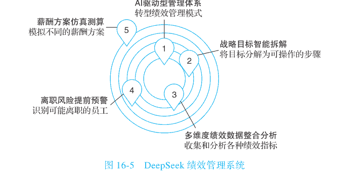

## 16.3.1 智能目标拆解
#### 1. 背景说明
目标管理是推动战略落地的核心抓手。银行需借助OKR工具将组织级目标逐层分解至部门。绩效管理岗需设定季度偏离预警阈值±10%，超阈即触发调整机制。重点在于防范虚设目标风险，同时优化协同对齐算法。

#### 2. DeepSeek 提示词
角色定位+任务：作为银行绩效管理岗位，要设计目标拆解模型，需要涵盖哪些战略对齐指标。

#### 3. 追问提示词
- 长期发展目标与短期考核指标如何做到平衡
- 跨部门协同目标怎样实现量化
- 监管合规类指标权重如何设定

#### 4. 输出样式
目标分解矩阵Excel版、战略地图Visio版。

## 16.3.2 员工行为数据分析
#### 1. 背景说明
员工行为管控是提升组织效能的关键。银行需整合6类数据源，构建20项行为指标。监控岗须设定健康度评分低于60分即启动一对一辅导，并确保月度覆盖率达100%。重点在于防范行为异常风险，同时提升指标权重合理性。

#### 2. DeepSeek 提示词
角色定位+任务：作为银行数据分析岗位，要制定员工行为分析规则，需要设置哪些隐私保护措施。

#### 3. 追问提示词
- 员工行为数据如何进行匿名化处理
- 敏感行为的界定标准是什么
- 如何落实监管部门对个人信息使用的规范要求

#### 4. 输出样式
行为分析报告Word版、异常行为清单Excel版。

## 16.3.3 离职风险预警
#### 1. 背景说明
人才保留是组织稳定发展的保障。银行需开发涵盖12个因子的离职风险预测模型，并设置30天预警窗口。HRBP需对高风险员工实施100%面谈干预。重点在于防范核心人才流失，同时优化模型召回率。

#### 2. DeepSeek 提示词
角色定位+任务：作为银行HRBP，要制定离职预警干预策略，需要包含哪些保留机制。

#### 3. 追问提示词
- 如何验证模型预测的准确性
- 关键岗位如何实施差异化干预
- 如何规避劳动仲裁风险

#### 4. 输出样式
预警名单Excel版、保留方案库Word版。

## 16.3.4 薪酬方案仿真
#### 1. 背景说明
薪酬优化是成本管控的重点。银行需基于市场分位值构建对标模型，模拟薪酬调整对人力成本结构的影响。成本控制岗应设置人力成本占比警戒线，波动达5%时触发调整。重点在于防范薪酬倒挂，同时提升市场数据时效性。

#### 2. DeepSeek 提示词
角色定位+任务：作为银行薪酬管理岗位，要设计薪酬方案仿真参数，需要包含哪些市场基准参数。

#### 3. 追问提示词
- 如何应对区域薪酬差异
- 如何把监管“限薪”要求嵌入模型
- 长期激励如何进行折现计算

#### 4. 输出样式
薪酬结构图Visio版、成本测算表Excel版。

## 16.3.5 战略解码动态追踪
#### 1. 背景说明
战略执行监控是经营管理的核心。银行需开发战略解码可视化工具，实现任务进展实时追踪。战略管理岗应建立“红黄绿灯”预警体系，对滞后任务自动升级督办级别。重点在于防范执行偏差，同时提升任务数据采集颗粒度。

#### 2. DeepSeek 提示词
角色定位+任务：作为银行战略管理岗位，要制定战略追踪规则，需要设置哪些里程碑节点。

#### 3. 追问提示词
- “软性目标”进展如何量化
- 跨部门任务如何协同考核
- 如何预置监管检查重点

#### 4. 输出样式
战略执行看板Excel版、滞后任务清单Excel版。

## 16.3.6 数据驱动绩效管理场景清单
- 战略目标分解
- 行为数据采集
- 风险评估预警
- 薪酬方案设计
- 执行过程监控
- 监管报告生成

## 16.4 员工全生命周期管理
银行在全生命周期管理上面临人才流失率高、合规防控压力大、员工体验与组织效能失衡等挑战，痛点集中在入职适配不足、培训与业务脱节、合规执行碎片化、离职预判滞后。需构建“体验优化-合规贯穿-效能提升”一体化体系，人力资源需强化智能入职赋能、全周期培训适配、合规行为管控、离职风险预警、职业发展规划五项能力。

依托员工全生命周期管理平台与AI工具融合，DeepSeek可实现入职流程智能简化、培训内容精准匹配、劳动合同合规校验、离职风险提前预判、职业路径动态规划，并建立全流程可追溯、可量化的管理数据链，推动员工管理从事务性服务向覆盖入职适配、在职赋能、合规管控、离职平稳过渡的AI生态转型，如图16-6所示。

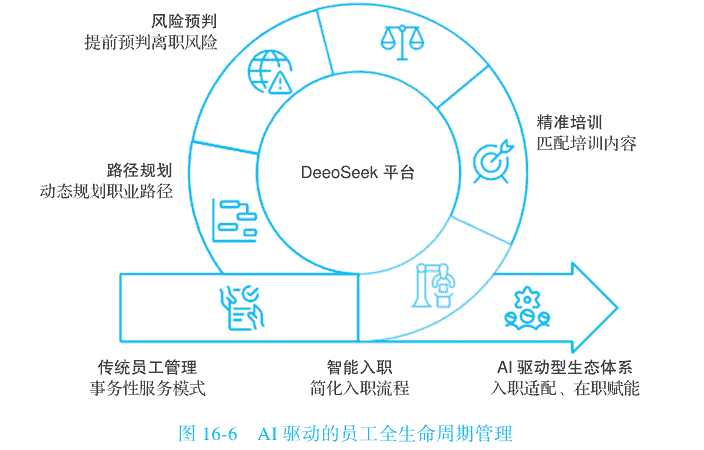

## 16.4.1 智能考勤检测
#### 1. 背景说明
考勤管理是纪律监督的基础。银行需开发智能识别引擎，自动检测6类违规行为。合规管理岗应设置月度违规超过3次即自动触发审查机制。重点在于防范考勤舞弊，同时优化行为模式识别算法精度。

#### 2. DeepSeek 提示词
角色定位+任务：作为银行合规管理岗位，要制定智能考勤检测规则，需要包含哪些弹性工作场景。

#### 3. 追问提示词
- 灵活办公与出勤管理如何平衡
- 跨时区工作如何考勤
- 如何落实监管对工时制度的要求

#### 4. 输出样式
考勤分析报告Word版、异常记录表Excel版。

## 16.4.2 职业发展双通道建模
#### 1. 背景说明
晋升管理是人才激励的核心。银行需基于管理M与专业P双通道序列开发能力匹配算法。评审委员会应把年度晋升通过率控制在20%～30%。重点在于防范晋升不公，同时优化胜任力评估模型。

#### 2. DeepSeek 提示词
角色定位+任务：作为银行职业发展顾问，要设计职业发展双通道评估模型，需要包含哪些潜力指标。

#### 3. 追问提示词
- “软性”领导力如何量化
- 监管合规能力如何考核
- 历史晋升数据如何用于模型训练与优化

#### 4. 输出样式
晋升标准手册Word版、匹配度分析表Excel版。

## 16.4.3 继任者计划可视化
#### 1. 背景说明
继任梯队建设是组织韧性的关键。银行需构建九宫格模型，标注候选继任者的成熟度与准备度。HRBP应设置准备度预警阈值如70%，低于阈值启动加速培养。重点在于防范继任断层，同时优化潜力评估维度。

#### 2. DeepSeek 提示词
角色定位+任务：作为银行人才管理岗位，要制定继任者计划评估标准，需要关注哪些风险缺口。

#### 3. 追问提示词
- 突发岗位空缺如何应对
- 跨条线继任如何实现
- 监管对岗位分离的要求如何嵌入

#### 4. 输出样式
继任者矩阵Excel版、培养计划表Word版。

## 16.4.4 弹性福利智能配置
#### 1. 背景说明
福利管理是提升员工满意度的关键工具。银行需开发“核心+可选”福利超市，动态推荐福利组合方案。绩效管理岗应设置人均成本浮动区间为±5%。重点在于防范福利错配，同时提升推荐算法个性化适配能力。

#### 2. DeepSeek 提示词
角色定位+任务：作为银行绩效管理岗位，要设计员工福利推荐逻辑，需要包含哪些合规约束。

#### 3. 追问提示词
- 如何应对税收优惠政策变化
- 如何合规扩展家属福利
- 如何落实监管对工会经费的要求

#### 4. 输出样式
福利配置工具Excel版、选择分析报告Word版。

## 16.4.5 离职面谈知识沉淀
#### 1. 背景说明
离职分析是组织改进的关键。银行需构建离职原因分类模型，并自动生成改进建议。员工关系岗应确保知识入库率不低于80%，并对敏感信息进行脱敏处理。重点在于防范经验流失，同时提升文本挖掘深度。

#### 2. DeepSeek 提示词
角色定位+任务：作为银行员工关系岗位，要设计离职面谈模板，需要包含哪些开放性问题。

#### 3. 追问提示词
- 如何引导员工给出真实反馈
- 有争议离职如何合规处理
- 竞业限制如何落实

#### 4. 输出样式
面谈记录模板Word版、改进建议库Excel版。

## 16.4.6 员工全生命周期管理场景清单
- 入职手续办理
- 在职发展支持
- 离职风险防控
- 知识资产留存
- 雇主品牌维护
- 监管合规报备

## 16.5 合规与风控支持
银行合规风控面临劳动纠纷频发、个人信息泄露风险加剧、监管要求趋严等挑战，痛点在于风险识别被动、防控流程碎片化、合规校验缺乏智能手段。需构建“风险精准识别-流程闭环管控-合规智能校验”一体化体系，内控合规部需强化人力风险全景监测、个人信息安全防护、劳动合规智能审核、纠纷预警处置四项能力。

通过合规风控智能平台与数据安全技术融合，DeepSeek可实现人力风险筛查、个人信息保护、劳动合规校验、纠纷风险预警，并依托区块链与隐私计算建立不可篡改的合规风控存证链，推动人力合规风控从被动应对向风险预判、过程管控、合规校验、处置闭环的AI体系转型，如图16-7所示。

## 16.5.1 制度合规审查
#### 1. 背景说明
制度合规审查是法律合规的核心。银行须构建涵盖200余项法规要点的智能审查引擎。法务岗位需确保法规要点季度更新率不低于15%。重点在于防范制度滞后风险，同时提升条款关联检索效率。

#### 2. DeepSeek 提示词
角色定位+任务：作为银行法律合规岗位，要制定制度审查标准，需要包含《中华人民共和国劳动法》中的哪些条款。

#### 3. 追问提示词
- 如何应对地方性法规差异
- 涉及境外员工的制度如何适配
- 如何预置监管检查重点

#### 4. 输出样式
合规审查清单Excel版、整改计划表Excel版。

## 16.5.2 个税筹划模拟
#### 1. 背景说明
薪酬合规离不开合理个税筹划。银行需开发涵盖多种计税方案的比选模型。税务管理岗应设定节税幅度10%～15%的目标。重点在于防范税务稽查风险，同时提升算法计算效率。

#### 2. DeepSeek 提示词
角色定位+任务：作为银行税务管理岗位，要设计个税筹划模拟场景，需要包含哪些特殊收入类型。

#### 3. 追问提示词
- 如何应对税收优惠政策的追溯性调整
- 股权激励如何计税
- 如何避免触碰反避税监管红线

#### 4. 输出样式
个税方案书Word版、节税报告Excel版。

## 16.5.3 人力成本沙盘推演
#### 1. 背景说明
人力成本沙盘推演是优化配置、提升成本管控、支撑战略落地的核心工具。银行需设计整合组织架构适配分析、人员编制动态测算、薪酬福利模型搭建、效能产出关联分析等模块的智能推演系统，结合战略目标、业务扩张规划及外部人力市场变化，实现人力成本全景模拟与精准预判。

#### 2. DeepSeek 提示词
角色定位+任务：作为银行人力资源战略规划专员，要搭建人力成本智能沙盘推演系统，核心模块设计与多场景推演逻辑应如何制定以实现成本精准管控与战略适配。

#### 3. 追问提示词
- 如何建立薪酬福利、招聘培训、离职损耗等成本模块的联动测算模型，进一步提升推演结果精准度
- 针对业务扩容、数字化转型等不同场景，需要设计哪些差异化推演参数与场景阈值
- 当推演结果与预算偏差超过10%，或出现关键岗位成本失衡时，如何构建闭环响应机制，同时适配市场薪酬波动变化

#### 4. 输出样式
人力成本沙盘推演系统功能架构图Visio版、多场景成本测算参数表Excel版。

## 16.5.4 岗位胜任力动态评估
#### 1. 背景说明
数字化转型驱动岗位技能快速演化。银行需开发岗位胜任力雷达图，实时监测能力缺口。培训岗应确保课程上线周期不超过15天。重点在于防范技能断层，同时提升岗位画像更新频率。

#### 2. DeepSeek 提示词
角色定位+任务：作为银行岗位分析师，要制定岗位胜任力评估标准，需要包含哪些面向未来的关键技能。

#### 3. 追问提示词
- 如何预测技术替代风险
- 如何定义复合型人才
- 如何量化合规管理能力

#### 4. 输出样式
胜任力模型Visio版、技能缺口表Excel版。

## 16.5.5 员工行为合规监控
#### 1. 背景说明
员工行为审计是保障信息安全的重点。银行需部署UEBA用户实体行为分析系统，检测异常数据访问等行为。信息安全岗应设置1小时内响应告警机制。重点在于防范数据泄露，同时扩大风险特征库覆盖度。

#### 2. DeepSeek 提示词
角色定位+任务：作为银行信息安全岗位，要设计员工行为监控规则，需要包含哪些白名单场景。

#### 3. 追问提示词
- 如何区分正常操作与违规行为
- 紧急业务处理如何豁免异常告警规则
- 数据出境如何纳入合规管控范围

#### 4. 输出样式
监控日志Excel版、处置预案Word版。

## 16.5.6 合规与风控支持场景清单
- 制度合规审查
- 人力成本建模
- 个税方案优化
- 岗位能力评估
- 行为风险监控
- 监管审计应对

## 16.6 本章小结
本章聚焦银行人力资源数字化转型，涵盖智能招聘、员工培训、数据驱动绩效管理、员工全生命周期管理及合规与风控支持等关键领域。通过数据贯通、流程优化与决策升级，DeepSeek助力银行解决招聘低效、培训适配度不足、绩效滞后等问题，推动人力资源管理从传统事务性处理向战略效能提升转型，实现招聘精准化、培训个性化、组织发展科学化，满足法规要求并提升组织效能。

#17
| 第 17 章 | C H A P T E R

## DeepSeek银行党政工团管理场景应用
银行党政工团管理正处于数字化转型深化期，管理需求从完成传统事务转向提升组织效能，呈现线上线下协同治理特征。在新时代党建总要求与金融高质量发展的背景下，党政工团管理的重心从基础党务执行转向组织建设效能评估，尤其在党员教育管理、员工思想动态分析等领域亟需提升数字化工具适配性与运行科学性。业务人员面临多系统数据整合不足、分析工具智能化水平有限等挑战。

管理痛点有三：一是党建数字化程度不足，党员学习教育、组织生活管理等场景存在流程断点与数据孤岛，影响《中国共产党党内监督条例》落实；二是员工思想动态分析工具缺失，传统问卷难以实时捕捉心理波动及组织归属感变化；三是群团活动协同机制薄弱，跨部门资源调度与成效评估缺乏科学支撑，制约组织凝聚力建设。

通过部署智能党建管理平台、员工思想动态分析模型及组织效能评估系统，DeepSeek可实现关键突破：构建党建数据中台实现多系统信息贯通；建立基于自然语言处理的舆情监测体系；运用知识图谱技术优化群团活动资源配置。

本章重点解析如何借助DeepSeek通过“数据贯通-管理升级-效能量化”三重路径，重构党政工团管理模式，有效解决党建管理碎片化、员工洞察滞后、组织协同低效等核心问题，助力银行实现“党建工作智能化、员工管理精细化、组织运行高效化”的现代治理转型目标，满足《中国共产党支部工作条例（试行）》等党内法规要求。

##17.1 智慧党建

银行党委组织条线正在把党建工作推向标准化、可视化的新阶段，核心是要解决党员日常教育管理比较粗放、组织生活实效性偏弱等短板，确保《中国共产党支部工作条例（试行）》等党内规章真正落地执行。

### 17.1.1 党员画像三维建模

#### 1. 场景介绍
党员画像是银行强化党员管理、提升队伍质效的关键抓手。需要把“学习强国”积分、民主评议结果等12类数据打通，围绕政治素质、作用发挥、纪律作风三个维度构建画像模型。党建指导员要建立季度预警机制，对连续两个季度得分低于60分的党员及时启动帮扶流程，促进成长，增强党支部战斗力。

#### 2. DeepSeek 提示词
角色 + 任务：我是银行党委组织委员，需要设计党员画像评价体系，应包含哪些核心指标？

#### 3. 追问提示词
- 先锋模范作用如何进行量化？
- 流动党员的差异化评价怎么做？
- 个人隐私如何得到落实保护？

#### 4. 输出形式
指标体系以Excel呈现，画像生成规则以Word报告呈现。

#### 5. 案例演示
（1）DeepSeek 提示词
角色 + 任务：我是银行党委组织委员，需要设计党员画像评价体系，应包含哪些核心指标？要求不虚构、不臆测，符合银行实务场景，确保外部链接真实可用，严格按监管要求执行。

（2）DeepSeek 首次输出
结合多家银行及监管机构的党建实践，并考虑金融行业特点和监管要求，党员画像评价体系应覆盖以下核心指标，既贴合银行实际，又能落实全面从严治党。

一、政治素质评价维度
1. 政治忠诚
□ 是否严格落实“第一议题”制度，及时学习党的最新理论成果，如党的二十大报告、中央金融工作会议精神？
□ 在重大风险考验，如不良贷款清收、金融风险防控中是否敢于担当、主动作为？
2. 政治定力
□ 在意识形态领域，如员工舆情管理、客户投诉处理中是否坚持正确导向？
□ 面对利益诱惑，如信贷审批、客户营销时能否严守纪律红线？
3. 政治理论学习
□ 参加“三会一课”、主题党日、集中轮训的出勤率及学习心得质量如何？
□ 是否通过“学习强国”等平台完成年度学习积分要求？

二、纪律作风评价维度
1. 遵规守纪
□ 是否违反过《中国共产党纪律处分条例》及行内合规制度，如员工行为禁令？
□ 是否涉及监管处罚、客户投诉或内审发现问题？
2. 廉洁自律
□ 是否接受过客户宴请、礼品或存在利益输送，如贷款审批中的“吃拿卡要”？
□ 亲属是否在关联金融机构任职或存在利益冲突？
3. 组织生活规范
□ 党员民主评议中批评与自我批评是否有深度？
□ 是否按时足额缴纳党费，组织生活记录是否完整？

三、履职能力评价维度
1. 业务贡献
□ 存款增长、贷款投放、不良率控制等关键业绩指标在支部内的排位如何？
□ 是否牵头完成过重点项目，如数字化转型、普惠金融产品创新？
□ 在技能比武，如反洗钱知识竞赛、柜面业务操作中的获奖情况如何？
2. 合规履职
□ 是否参与过违规业务，如虚增存款、掩盖不良贷款？
□ 是否落实监管要求，如消费者权益保护、反电信诈骗宣传？

四、道德品质与群众基础维度
1. 公益服务
□ 参与志愿服务，如金融知识进社区、乡村振兴帮扶的频次和实效如何？
□ 是否获得外部机构表彰，如“脱贫攻坚先进个人”？
2. 团队协作
□ 在“老带新”“党员结对帮扶”中的主动性与成效如何？
□ 群众民主测评满意度，如党员互评、员工匿名评分？
3. 家风建设
□ 是否因家庭矛盾影响工作，如涉诉纠纷、负面舆情？
□ 是否践行“清廉家风”，如家属参与行内廉洁教育活动？

五、创新性与发展潜力维度
1. 创新能力
是否提出过可落地的管理改进建议，如流程优化、风险防控模型？
是否在核心期刊发表过党建与业务融合研究文章？
2. 学习成长
是否完成年度继续教育学分，如CFA、FRM等职业资格认证？
是否参与行内“青年骨干培养计划”或外部交流项目？
3. 评价方法与结果应用
1）数据采集
□ 定量数据：通过行内人力资源系统、党建平台、审计报告自动抓取考勤、业绩排名、合规记录等。
□ 定性数据：民主评议、谈心谈话记录、支部书记点评等。
2）动态画像
□ 采用“雷达图”可视化呈现五个维度的综合得分。
□ 设置“一票否决项”，如参与非法集资、重大违规事件。
3）结果运用
□ 作为评优评先，如“优秀共产党员”“党员先锋岗”的核心依据。
□ 对得分偏低的党员实施“红色预警”，开展针对性帮扶，如廉政谈话、岗位调整。
4）参考依据
□ 制度规范：《中国共产党支部工作条例（试行）》《银行业金融机构从业人员行为管理指引》。
□ 实践案例：珠海建行“政治画像”量化指标、鹰潭农商银行党员积分制、邮储银行“三亮三比三评”机制。

通过以上维度，可把党员画像从模糊评价转向精准量化，既契合金融行业风险防控和合规经营需求，又能激发队伍活力，推动党建与业务深度融合。建议结合行内实际嵌入OA或党建管理系统实现动态更新，并定期联合纪检、人力资源部门对指标进行校准优化。

（3）追问提示词
- 如何量化党员的先锋模范作用？
- 对流动党员如何进行差异化评价？
- 如何落实个人隐私保护？

（4）输出形式
Excel模板，指标体系，以HTML格式输出，需内嵌可直接下载Excel文件的按钮代码，实现一键下载。
Word分析报告，画像生成规则，以HTML格式输出，需内嵌可直接下载Word文件的按钮代码，实现一键下载。

（5）DeepSeek 再次输出
以下是满足需求的HTML实现模板，包含可直接下载的Excel指标体系和Word分析报告。

# 第 17 章 DeepSeek 银行党政工团管理场景应用

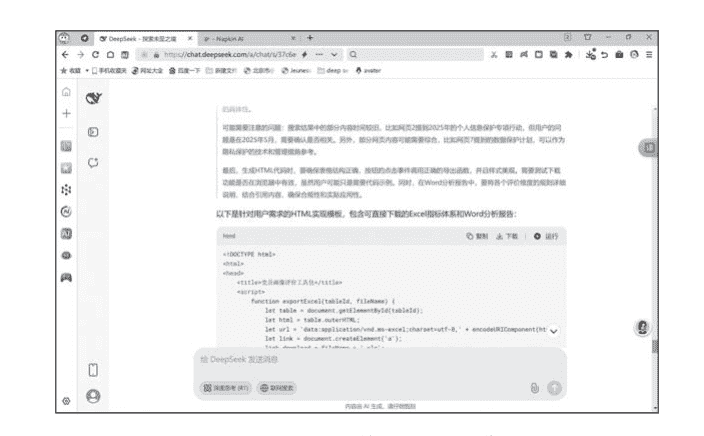

图 17-1 DeepSeek 输出的 HTML 代码

点击“运行”按钮，即可获得“党员画像指标体系”Excel模板，如图 17-2 所示。

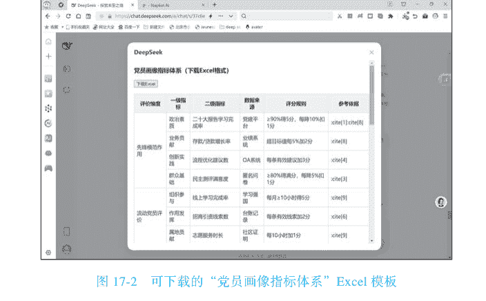

图 17-2 可下载的“党员画像指标体系”Excel 模板

下拉滚动条，可看到“党员画像生成规则报告”Word模板以及下载按钮，如图 17-3 所示。

284 DeepSeek 银行实战手册：银行全场景 AI 实践指南（下册）

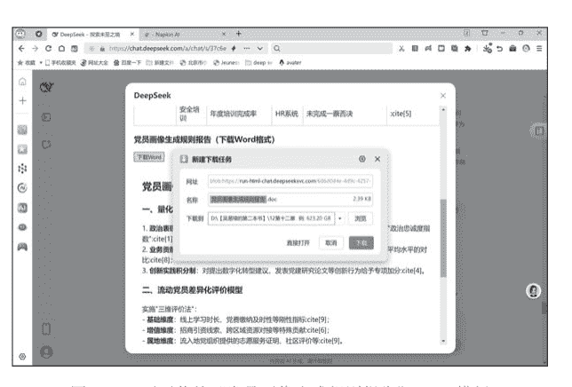

图 17-3 可下载的“党员画像生成规则报告”Word 模板

### 17.1.2 组织生活智能督导

#### 1. 场景介绍
组织生活智能督导是保障党建质量的关键环节。银行需开发评估系统，自动识别会议频次等8项要素。党委督导员应设置5日内整改闭环机制，对未达标党支部要求限期提交报告。重点在于防范组织生活形式化风险，优化合规性评估模型。

#### 2. DeepSeek 提示词
角色 + 任务：我是银行党委督导员，需制定组织生活督导标准，应关注哪些创新性评估指标？

#### 3. 追问提示词
- 如何避免形式化签到问题？
- 如何认定混合式组织生活的真实性与合规性？
- 如何评估党建与业务的融合度？

#### 4. 输出形式
督导检查表Excel文件，整改跟踪台账Excel文件。

### 17.1.3 党建知识图谱构建

#### 1. 场景介绍
党建教育是员工思想建设的首要任务。银行需整合党章、党规等文献，构建党建知识图谱。宣传干事应设置月度更新机制，重点标注党的二十大精神专题。重点在于防范党建知识滞后风险，优化知识点关联算法。

#### 2. DeepSeek 提示词
角色 + 任务：我是银行党委宣传干事，需设计党建知识图谱的关联规则，应包含哪些学习场景？

#### 3. 追问提示词
- 如何应对基层党员对党建知识的理解偏差？
- 党的历史文献如何与现代党建理论关联？
- 如何量化评估党建学习效果？

#### 4. 输出形式
知识节点图Visio文件，学习成效报告Word文件。

### 17.1.4 智慧党建场景清单
- 党员信息采集
- 组织生活规划
- 发展过程监控
- 教育资源管理
- 数据安全审计
- 成效分析报告

## 17.2 思想政治教育
银行思想政治教育面临意识形态风险防控压力加大、教育形式单一固化、内容与业务融合不足等挑战，痛点集中在教育精准度欠缺、员工参与度不高、成效评估缺乏量化标准。需重点构建“内容精准适配－形式互动创新－成效量化管控”三位一体教育体系，党委宣传部门需强化意识形态风险研判、教育内容定制化输出、互动化教育实施、成效闭环评估四项核心能力。

通过智能思想政治教育平台与数字化传播技术的深度融合，DeepSeek 可帮助银行实现意识形态风险监测预警、教育内容精准推送、线上线下互动化教育场景搭建、教育成效量化评估与优化迭代等功能，并依托数字化技术建立全流程可追溯、可量化的教育实施数据链条，推动思想政治教育从传统单向灌输模式向覆盖风险防控、精准施教、互动参与、成效闭环的智能赋能型体系转型（如图 17-4 所示）。

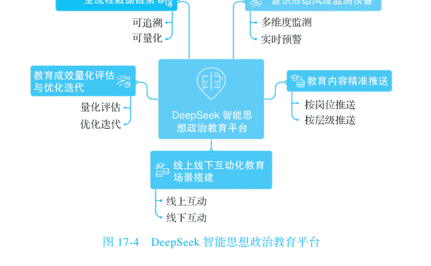

### 17.2.1 理论学习智能推荐

#### 1. 场景介绍
理论学习是思想政治建设的重要基础。银行需开发个性化推荐引擎，按员工岗位类型推送课程。学习管理员应设置领导干部年度学习达标率100%的目标。重点在于防范学习流于形式的风险，同时提高知识短板诊断精度。

#### 2. DeepSeek 提示词
角色 + 任务：我是银行党支部宣传委员，需设计理论学习推荐算法，应包含哪些优先级规则？

#### 3. 追问提示词
- 如何平衡必修与选修课程？
- 学习进度滞后如何预警？
- 如何过滤涉及敏感内容的学习材料？

#### 4. 输出形式
推荐规则表Excel文件，学习档案Word文件。

### 17.2.2 意识形态风险监测

#### 1. 场景介绍
舆情管控是网络安全治理的战略环节。银行需构建意识形态风险监测平台，实时扫描12类敏感信息。网评员应设置重大舆情1小时响应机制。重点在于防范意识形态失守风险，同时提高语义分析准确度。

#### 2. DeepSeek 提示词
角色 + 任务：我是银行网信监测人员，需制定意识形态风险监测关键词库，应包含哪些新兴风险点？

#### 3. 追问提示词
- 如何识别隐喻式错误言论？
- 如何追踪境外舆情？
- 如何量化评估舆情处置效果？

#### 4. 输出形式
敏感词库Excel文件，舆情处置预案Word文件。

### 17.2.3 思想政治教育场景清单
- 理论学习规划
- 舆情实时监测
- 风险分级处置
- 教育成效评估
- 数据合规存档
- 改进方案生成

## 17.3 工会数字化服务
银行工会数字化服务面临职工诉求响应滞后、福利覆盖精准度不足、服务形式单一固化等挑战，当前痛点集中在服务资源分散、需求洞察不精准、经费使用合规管控难等问题，需重点构建“需求精准洞察－服务智能适配－经费合规管控”三位一体服务体系，工会办公室需强化职工需求智能研判、数字化福利精准配置、诉求闭环响应、经费合规使用管控四项核心能力。

通过工会数字化服务平台与大数据技术的深度融合，DeepSeek 可帮助银行实现职工需求多维度挖掘分析、福利资源智能匹配推送、诉求全流程在线流转与实时跟踪、工会经费收支合规校验与动态监控等功能，并依托数字化技术建立全流程可追溯、可量化的服务实施数据链条，推动工会服务从传统被动响应模式向覆盖需求预判、资源匹配、诉求跟踪、合规管控、成效优化的智能赋能型体系转型（如图 17-5 所示）。

### 17.3.1 职工诉求智能分析

#### 1. 场景介绍
民主管理是工会建设的核心环节。银行需部署自然语言处理引擎，解析来自职工诉求渠道的多源文本信息。数据分析岗应设置72小时响应机制，生成初步解决建议。重点在于防范职工诉求积压风险，同时优化问题分类颗粒度，提高准确率。

#### 2. DeepSeek 提示词
角色 + 任务：我是银行数据分析岗人员，需设计职工诉求分类模型，应包含哪些民生热点？

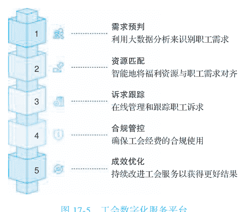

#### 3. 追问提示词
- 如何区分合理诉求与非理性表达？
- 对于涉及多部门的诉求，如何协同分派？
- 对于敏感信息如何进行脱敏处理？

#### 4. 输出形式
诉求分类表Excel文件，解决方案库Word文件。

### 17.3.2 福利发放精准触达

#### 1. 场景介绍
职工福利发放是工会服务的重点工作。银行需构建职工标签体系，开发智能推荐系统。福利管理岗应设置普惠类福利覆盖率达到100%、福利匹配准确率不低于85%的目标。重点在于防范福利错配风险，同时增加标签体系更新频率。

#### 2. DeepSeek 提示词
角色 + 任务：我是银行工会福利管理岗人员，需制定福利发放规则，应设置哪些公平性约束条件？

#### 3. 追问提示词
- 如何平衡不同职级的福利差异？
- 如何保障异地职工的权益？
- 如何完整留存审计痕迹？

#### 4. 输出形式
福利发放台账Excel文件，预算分配方案Word文件。

### 17.3.3 工会数字化服务场景清单
- 诉求数据采集
- 智能分类处理
- 福利精准发放
- 困难职工帮扶
- 活动效果评估
- 荣誉档案管理

## 17.4 共青团工作创新
银行共青团工作创新面临青年群体需求多元化、组织吸引力不足、活动实效性不强等挑战，当前痛点集中在服务精准度欠缺、活动形式固化、青年成长赋能不足等问题，需重点构建“需求精准对接－活动创新赋能－成长闭环培养”三位一体工作体系，团委需强化青年需求智能研判、特色活动策划实施、青年人才培育、组织凝聚力提升四项核心能力。

通过共青团数字化平台与新媒体技术的深度融合，DeepSeek 可帮助银行实现青年需求多维度挖掘分析、线上线下特色活动智能策划与推广、青年成长路径个性化规划、组织互动场景搭建与黏性提升等功能，并依托数字化技术建立全流程可追溯、可量化的工作实施数据链条，推动团青工作从传统活动导向模式向覆盖需求适配、活动创新、成长赋能、组织凝聚的智能驱动型体系转型（如图 17-6 所示）。

### 17.4.1 青年人才潜力评估

#### 1. 场景介绍
青年培养是共青团工作的重点方向。银行需开发涵盖7个维度的测评工具，构建青年人才潜力池。青联委员应将培养计划与人才的匹配度不低于80%作为考核标准。重点在于防范青年人才断层风险，同时优化潜力评估指标体系。

#### 2. DeepSeek 提示词
角色 + 任务：我是银行团委组织委员，需设计青年人才测评模型，应包含哪些实践考核指标？

#### 3. 追问提示词
- 如何量化志愿服务的贡献？
- 如何评价新兴领域人才？
- 测评结果如何反馈至培养路径，以推动改进？

#### 4. 输出形式
测评量表Excel文件，培养方案模板Word文件。

### 17.4.2 志愿服务供需匹配

#### 1. 场景介绍
社会实践是共青团青年工作的主要方式。银行需开发智能派单系统，对接需求与志愿者库。调度员应设置基于服务时长的信用积分机制，确保派单匹配准确率不低于90%。重点在于防范志愿者资源错配风险，同时优化特长识别算法。

#### 2. DeepSeek 提示词
角色 + 任务：我是银行团委调度员，需制定志愿服务匹配规则，应设置哪些应急响应机制？

#### 3. 追问提示词
- 如何平衡专业类需求与普惠类需求的优先级？
- 面对突发公共事件时如何快速动员？
- 如何量化评估服务效果？

#### 4. 输出形式
供需匹配矩阵Excel文件，应急响应预案Word文件。

### 17.4.3 共青团工作场景清单
- 青年数据采集
- 活动需求分析
- 服务资源匹配
- 效果动态评估
- 人才推优管理
- 社群生态优化

## 17.5 合规与文化融合
银行合规与文化融合面临党建与业务融合不深入、廉洁风险防控碎片化、文化渗透效能不足等挑战，当前痛点集中在融合机制不健全、风险预判被动、文化落地缺乏量化抓手等问题，需重点构建“党建引领 - 合规嵌入 - 文化浸润”三位一体融合体系，党委办公室需强化党建业务融合设计、廉洁风险智能防控、合规文化精准传播、融合成效量化评估四项核心能力。

通过党建与合规文化融合智能平台与数字化技术的深度融合，DeepSeek可帮助银行实现党建与业务融合场景精准匹配、廉洁风险多维度监测预警、合规文化内容分层推送、融合成效全流程追溯评估等功能，并依托数字化技术建立可量化、可追溯的融合实施数据链条，推动合规与文化融合从传统口号宣传模式向覆盖机制落地、风险防控、文化浸润、成效闭环的智能驱动型体系转型（如图 17-7 所示）。

图 17-7 党建与合规文化融合智能平台

### 17.5.1 文化认同度测评

#### 1. 场景介绍
文化建设是思想引领的关键工作。银行需开发文化认同度测评系统，生成组织健康指数报告。文化专员应设置年度整改达成率不低于90%的目标。重点在于防范文化认同度下滑与组织氛围离散的风险，同时优化行为观察类数据采集的维度。

#### 2. DeepSeek 提示词
角色 + 任务：我是银行党委文化专员，需设计文化认同度测评工具，应包含哪些隐性文化维度？

#### 3. 追问提示词
- 如何量化非正式组织的影响？
- 如何评估跨代际文化差异？
- 测评结果如何与组织战略衔接？

#### 4. 输出形式
测评问卷Word文件，文化热力图Excel文件。

### 17.5.2 廉政风险预警

#### 1. 场景介绍

廉政建设被置于纪律监督的核心位置，银行需汇聚八类信源，构建廉政风险预警体系。纪检条线要把高风险岗位的年检覆盖率目标定为全覆盖，当前工作的重心是遏制权力寻租，同时加深对社交关系的画像挖掘。

#### 2. DeepSeek 提示词
身份与任务：作为银行纪委纪检员，需要制定廉洁风险预警规则，应该聚焦哪些权力监管要点？

#### 3. 追问提示词
- 新出现的利益输送模式怎样识别？
- 如何对“非工作时段”行为开展监测？
- 监督效能与个人隐私边界如何平衡？

#### 4. 输出形式
风险清单以电子表格交付，处置流程手册以 Word 文档交付。

### 17.5.3 合规与文化融合场景清单
- 文化数据采集
- 廉政风险扫描
- 融合成效评估
- 荣誉存证管理
- 社会责任披露
- 持续改进跟踪

## 17.6 本章小结
本章围绕银行党政工团管理的数智化升级展开，涉及智慧党建、思想政治教育、工会数字化服务、共青团创新以及合规文化融合等关键板块。通过数据贯通、管理提效与结果量化，DeepSeek 帮助银行化解党建碎片化、员工洞察滞后、组织协同不畅等问题，推动管理重心从完成传统事务转向提升组织效能，实现党建智能化、人员管理精细化、运行高效化，并满足党内法规要求。

# 18
## DeepSeek 银行监管合规场景应用
银行监管合规正处在智能化转型关键期，监管诉求已由单一报送转向全流程风险防控，管理形态呈现跨系统协同特征。面对穿透式监管加严和金融风险防控强化，行业建设重点由夯实基础能力转向提升预警效能，尤其在反洗钱、数据治理等领域，银行亟需加快规则适配速度和风险信号捕捉能力。业务侧普遍面临多源数据整合不足、监管报送效率偏低等瓶颈。

合规痛点主要体现在三方面：一是监管数据整合数字化程度不足，EAST 报送仍高度依赖人工，跨系统映射易产生偏差；二是风险监测工具更新滞后于监管规则变化，在反洗钱交易监测、关联交易识别等场景缺乏实时预警能力；三是合规报告生成效率偏低，检查应对与整改跟踪多靠人工台账，难以满足《银行业金融机构监管数据标准化规范》对时效性的要求。

引入基于 DeepSeek 的智能合规平台、监管规则引擎与自动化报告系统后，商业银行可实现关键突破：搭建监管数据中台，完成多源信息标准化整合；打造基于自然语言处理的监管政策解析工具；借助知识图谱优化风险关联网络分析能力。

本章重点阐释 DeepSeek 如何通过“数据贯通—规则适配—流程重构”三条路径重塑监管合规体系，有效解决数据治理碎片化、风险识别滞后、合规响应低效等核心问题，助力银行实现“监管数据标准化、风险监测实时化、合规管理自动化”的转型目标，满足《金融机构洗钱和恐怖融资风险评估及客户分类管理指引》等监管要求。

## 18.1 智能合规审查
银行智能合规审查面临合同风险隐蔽化、跨境监管复杂化等挑战，如图 18-1 所示，当前痛点集中在合同条款风险识别不足、跨境规则适配滞后、审查流程标准化薄弱，需重点构建“风险识别—合规校验—动态监控”三位一体体系。合规团队需强化合同条款智能解析、跨境规则动态适配、审查流程全链穿透三项核心能力。

依托智能审查系统与合规管理平台，DeepSeek 可帮助银行实现合同陷阱智能识别、跨境交易合规校验、审查流程标准固化，并借助区块链建立不可篡改的审查证据链，推动合规审查从人工经验判断向覆盖合同风险智能预警、跨境规则即时适配、审查全程留痕溯源的智能风控体系转型。

### 18.1.1 合同条款风险自动识别

#### 1. 场景介绍
合同审查是法律合规的基础工作，银行需部署自然语言处理模型扫描 12 类高风险条款。法律合规岗应设置三级风险分级，确保重大风险 1 小时内推送至法务复核。本项工作的重点在于防范法律纠纷，并提升条款识别召回率。

#### 2. DeepSeek 提示词
身份与任务：我是银行法律合规岗人员，需设计合同条款风险识别规则，应关注哪些司法裁判要点？

#### 3. 追问提示词
- 模糊性条款如何处置？
- 行业特殊条款怎样归类？
- 如何嵌入监管对合同格式的要求？

#### 4. 输出形式
风险条款库以电子表格交付，复核意见模板以 Word 文档交付。

#### 5. 案例演示
（1）DeepSeek 提示词
身份与任务：我是银行法律合规岗人员，需设计合同条款风险识别规则，应关注哪些司法裁判要点？要求不编造、不臆测，符合银行实务场景，确保链接真实有效，严格按监管要求执行。

（2）DeepSeek 首次输出
基于检索到的司法裁判规则与银行业务特征，设计合同条款风险识别规则时应围绕主体与缔约能力、核心条款效力、履行违约责任、担保增信等维度，结合《民法典合同编通则司法解释》、最高人民法院审判意见及金融监管要求，构建系统化审查框架。

一、合同主体及缔约能力审查
1. 主体真实性核验
核验签署方名称与营业执照、印章是否完全一致，法定代表人或代理人授权文件需明确权限与有效期，避免名称错漏、越权签约风险；对担保人、抵押人资质进行穿透审查，包括担保资格、抵押物权属是否登记且无瑕疵。
2. 缔約能力评估
针对自然人客户，结合年龄、教育背景、交易复杂度评估其对合同性质与风险的认知能力，避免显失公平被撤销；系统留存风险测评记录及双录证据以应对效力争议。
> 全称《最高人民法院关于适用〈中华人民共和国民法典〉合同编通则若干问题的解释》。

二、核心条款效力识别
1. 标的条款明确性
标的物须使用标准名称及商标而非泛称，并附型号规格等唯一标识，避免同名异物争议；知识产权类标的需嵌入不侵权保证及第三方索赔责任分配机制。
2. 格式条款合规性
识别免除银行责任、限制客户权利的异常表述，确保以加粗、弹窗等方式履行提示义务并留存确认记录；禁止“最终解释权归银行所有”等排除司法审查的表述。
3. 生效条件与报批义务
对需审批的合同，明确报批义务条款独立生效并设定违约赔偿计算方式；对附条件生效合同，系统跟踪条件成就状态并触发预警。

三、履行及违约责任要点
1. 履行抗辩权边界
不安抗辩权行使需有确切证据证明对方丧失履约能力且书面通知中止履行，否则构成违约；交叉违约条款需明确触发事件与救济措施。
2. 违约金合理性审查
按九民纪要规则，贷款逾期罚息不得超过 LPR 四倍，系统设置阈值拦截过高违约金；加速到期条款需明确违约事件类型及提前收贷程序。
3. 争议解决设计
优先约定诉讼管辖地为银行主营业地法院，降低异地成本；仲裁需明确机构名称与规则。电子合同需约定送达地址与方式。

四、担保及增信风险
1. 担保有效性核查
保证合同需明确连带责任字样，否则可能被推定为一般保证；抵押登记须在签约后 15 个工作日内完成，系统关联不动产登记中心接口实时校验。
2. 抵质押物处置规则
约定流质条款无效的替代方案，如折价、拍卖优先权，并明确处置费用承担方；动态质押需约定监管方责任及价值补足触发条件。

五、工具建设建议
条款标签库、合规校验逻辑嵌入、司法案例匹配引擎等，并援引民法典相关条文、银保监会《商业银行押品管理指引》及个保法要求，与合规、科技部门协同开发并定期更新规则库。

通过上述规则可系统识别合同条款中 90% 以上的法律风险点，兼顾司法裁判倾向与业务实操，实现合规与效率平衡。

（3）追问提示词
- 如何应对模糊性条款？
- 行业特殊条款如何分类？
- 如何嵌入监管对合同格式的要求？

（4）输出格式
电子表格模板风险条款库，用 HTML 呈现，需内嵌可直接下载电子表格的按钮代码，实现点击下载。
Word 分析报告复核意见模板，用 HTML 呈现，需内嵌可直接下载 Word 文档的按钮代码，实现点击下载。

（5）DeepSeek 再次输出
以下是满足需求的 HTML 模板，包含可直接下载的电子表格版合同风险条款库和 Word 版合同复核意见模板。DeepSeek 的输出内容如图 18-2 所示。

图 18-2 DeepSeek 输出的 HTML 格式代码

单击“运行”按钮，可获得电子表格版合同风险条款库，如图 18-3 所示。

下滑鼠标，可看到 Word 版合同复核意见模板，如图 18-4 所示。

## 18.1.2 监管政策动态匹配与解读

#### 1. 场景介绍
监管政策追踪是合规管理的重点，银行需开发政策—业务映射模型，实现政策发布后 24 小时内预警。政策分析师应确保关键条款解读准确率不低于 95%。工作重点在于防范响应滞后，并优化政策影响评估颗粒度。

#### 2. DeepSeek 提示词
身份与目标：我是银行政策分析师，需设计政策—业务映射逻辑，应关注哪些执行难点？

#### 3. 追问提示词
- 如何识别政策的溯及力？
- 如何适配地方监管差异？
- 如何关联历史违规案例？

#### 4. 输出形式
政策影响矩阵以电子表格交付、操作指引以 Word 文档交付。

## 18.1.3 反洗钱规则实时校验

#### 1. 场景介绍
反洗钱校验是国际业务合规重点，需构建覆盖 FATCA 与 CRS 的规则引擎。反洗钱监测岗应设定高风险交易拦截率不低于 99%。工作重点在于防范跨境洗钱，并增强规则库更新时效。

#### 2. DeepSeek 提示词
身份与目标：我是银行反洗钱监测岗人员，需优化反洗钱校验模型，应设定哪些新型犯罪特征？

#### 3. 追问提示词
- 如何识别虚拟货币洗钱？
- 如何穿透核查跨境贸易背景？
- 如何动态更新监管对可疑交易的标准？

#### 4. 输出形式
校验规则清单以电子表格交付、案例特征库以电子表格交付。

## 18.1.4 跨境交易合规性穿透分析

#### 1. 场景介绍
跨境交易合规监控是制裁合规必要手段，银行需开发多层级受益所有人穿透工具。国际业务部应设置与 OFAC 名录对接的自动冻结机制。工作重点在于防范穿透不足引发的制裁违规，并加深穿透层级。

#### 2. DeepSeek 提示词
身份与目标：我是银行国际业务部人员，需设计跨境交易合规穿透规则，应关注哪些司法辖区的监管差异？

#### 3. 追问提示词
- 如何应对通过离岸架构隐藏实际控制人的情形？
- 涉及政治敏感地区交易如何处置？
- 如何对接监管数据报送接口？

#### 4. 输出形式
穿透流程图以 Visio 图表交付、制裁名单监控表以电子表格交付。

## 18.1.5 关联方交易风险图谱构建

#### 1. 场景介绍
关联交易管理是审计监督重点，银行需整合 6 类数据源，构建动态图谱。审计岗应设置交易金额超过净资产 5% 则强制披露的机制。工作重点在于防范利益输送，并优化股权关系识别算法。

#### 2. DeepSeek 提示词
身份与目标：我是银行审计岗人员，需设计关联方交易风险图谱，应设定哪些异常关联指标？

#### 3. 追问提示词
- 如何识别隐性代持关系？
- 如何追溯历史关联交易？
- 如何验证监管对定价公允性的要求？

#### 4. 输出形式
关联方清单以电子表格交付、交易定价分析表以电子表格交付。

## 18.1.6 智能合规审查场景清单
- 政策动态监控
- 合同风险扫描
- 交易穿透分析
- 关联网络构建
- 监管数据报送
- 整改跟踪管理

## 18.2 数据安全管理
银行数据安全管理面临隐私泄露风险加剧、跨境传输合规压力攀升等挑战，当前痛点集中在数据分类分级管理粗放、隐私保护技术滞后、跨境传输合规性弱等问题，需重点构建“存储安全—隐私保护—跨境合规”三者合一防护体系，如图 18-5 所示。信息科技团队需强化数据全生命周期加密、隐私计算技术应用、跨境传输智能校验三项核心能力。

通过智能安全系统与合规管理平台，DeepSeek 可帮助银行实现数据分类分级智能实施、隐私保护动态强化、跨境传输合规管控，并依托区块链建立不可篡改的数据操作存证链条，推动数据安全管理从传统边界防护向覆盖全生命周期加密、隐私计算应用、跨境传输智能校验的系统化防护体系转型。

图 18-5 “存储安全 - 隐私保护 - 跨境合规”三位一体的防护体系

## 18.2.1 敏感数据分级分类脱敏

#### 1. 场景介绍
敏感数据管理是信息安全基础，银行需制定包含客户信息、交易记录等内容的 4 级分类标准，并开发动态脱敏引擎。数据安全岗需确保测试环境脱敏数据不可复原，同时建立脱敏操作日志溯源机制。工作重点在于防范敏感信息泄露，并提升不可逆脱敏算法抗碰撞能力。

#### 2. DeepSeek 提示词
身份与目标：我是银行数据安全岗人员，需设计敏感数据分级分类脱敏策略，应设定哪些使用场景限制？

#### 3. 追问提示词
- 如何平衡数据可用性与安全性？
- 联合建模场景中如何实现隐私保护？
- 在接受监管检查时如何提供脱敏证明？

#### 4. 输出形式
分类标准手册以 Word 文档交付、脱敏日志以电子表格交付。

## 18.2.2 隐私计算与最小化授权

#### 1. 场景介绍
隐私保护是数据应用前提，银行需部署联邦学习平台，实现数据“可用不可见”。权限管理岗应设置 72 小时未用权限自动回收机制。工作重点在于防范权限滥用，并提高授权策略精准度。

#### 2. DeepSeek 提示词
身份与目标：我是银行权限管理岗人员，需制定数据授权规则，应包含哪些最小化授权原则？

#### 3. 追问提示词
- 紧急授权如何审批与追溯？
- 如何管控外包人员权限？
- 如何应对监管部门对数据访问的审计要求？

#### 4. 输出形式
权限矩阵以电子表格交付、操作日志以电子表格交付。

## 18.2.3 数据访问行为实时监控

#### 1. 场景介绍
行为审计是信息安全防控关键，银行需部署 UEBA 系统，检测异常下载等行为。信息安全岗应设置高风险操作实时阻断功能。工作重点在于防范内部泄密，并提高行为基线建模精度。

#### 2. DeepSeek 提示词
身份与目标：我是信息安全岗人员，需设计数据访问行为监控规则，应关注哪些白名单场景？

#### 3. 追问提示词
- 如何区分正常业务操作与违规行为？
- 批量导出数据时如何实现审批留痕？
- 如何对监管数据出境进行监控？

#### 4. 输出形式
监控策略表以电子表格交付、事件处置预案以 Word 文档交付。

## 18.2.4 数据泄露风险智能预警

#### 1. 场景介绍
数据泄露风险防控是应急管理核心，银行需构建含 12 类风险特征的预警模型。数据管理岗应设置 15 分钟应急隔离响应机制。工作重点在于防范重大安全事件，并提高风险特征覆盖广度。

#### 2. DeepSeek 提示词
身份与目标：我是银行数据管理岗人员，需设计数据泄露风险预警规则，应关注哪些泄露场景？

#### 3. 追问提示词
- 如何识别内部人员窃取数据的行为？
- 如何监测云存储环境中的配置错误？
- 如何满足监管报告的时效要求？

#### 4. 输出形式
风险特征库以电子表格交付、应急响应手册以 Word 文档交付。

## 18.2.5 跨境数据传输合规审计

#### 1. 场景介绍
跨境数据传输合规审计是国际业务合规管理重要工作，银行需开发流量监控平台识别 GDPR、CCPA 等法规适用场景。审计岗应设置年度第三方审计接口。工作重点在于防范跨境传输合规风险，并提高法规匹配准确率。

#### 2. DeepSeek 提示词
身份与目标：我是银行审计岗人员，需制定跨境数据传输审计标准，应关注哪些司法辖区的特殊要求？

#### 3. 追问提示词

数据本地化与出境合规要点

关注点：本地存储要求如何落地执行？跨境传输协议的备案流程怎样走？监管现场检查时如何迅速应对。
交付成果：跨境传输日志 Excel 表格、合规证明材料 Word 文档。

## 18.2.6 数据安全管理场景清单
- 数据分级分类
- 访问权限管控
- 行为实时监控
- 泄露风险处置
- 跨境传输审计
- 监管整改闭环

## 18.3 反欺诈与反洗钱

银行在反欺诈和反洗钱方面面临犯罪手段不断升级、监管要求愈发穿透的局面。目前主要掣肘是监测视角不够宽、风控模型更新迟缓、合规核验效率偏低。建设思路是构建智能监测、精准识别、自动验证相互协同的体系。风险管理团队需强化多源数据穿透整合、犯罪模式动态解析、监管规则智能适配三大核心能力。

结合智能风控系统与合规管理平台，DeepSeek 可实现交易网络智能化监测、新型犯罪精准识别、监管合规自动验证等能力，并利用区块链技术搭建不可篡改的交易存证链条，推动反欺诈反洗钱工作由传统风险引擎向覆盖新型犯罪预警、隐蔽关联穿透、监管实时响应的智能风控体系转型。

## 18.3.1 异常交易模式动态识别

#### 1. 场景概述
识别异常交易模式是风险防控的基础。银行需搭建复合模型覆盖 8 类可疑模式。反欺诈监测岗位考核标准为阻断准确率不低于 99.5%。重点在于防范资金诈骗风险，并持续优化群体行为识别算法。

#### 2. 提示词示例
角色加任务：我是银行反欺诈监测岗，需要优化异常交易模式识别算法，应关注哪些新型犯罪特征？

#### 3. 追问提示词
- 虚拟货币混币器交易如何应对？
- 赌博资金链怎样追踪？
- 模型报备监管要求如何落实？

#### 4. 输出形式
异常模式库 Excel 表格、阻断规则手册 Word 文档。

## 18.3.2 客户身份背景穿透核查

#### 1. 场景概述
尽职调查是反洗钱的底线。银行需整合 9 类数据源构建客户身份与关系图谱。尽调岗要求穿透层级不少于 5 层，符合 FATF 要求。重点在防范身份造假，提升数据源更新时效。

#### 2. 提示词示例
角色加任务：我是银行尽职调查岗，需要设计客户身份背景核查路径，应聚焦哪些高风险行业标签？

#### 3. 追问提示词
- 壳公司嵌套结构如何识别？
- 政治敏感人物如何筛查？
- 如何实现与监管名单实时同步？

#### 4. 输出形式
尽调报告模板 Word 文档、关联图谱 Visio 绘图。

## 18.3.3 资金流向追踪

#### 1. 场景概述
资金流向追踪是反洗钱关键环节。银行需用图数据库实现 10 层穿透。资金分析师需设置嵌套交易自动标记。重点在于降低洗钱隐蔽性，提升路径还原效率。

#### 2. 提示词示例
角色加任务：我是银行资金分析师，需设计资金流向追踪规则，应设置哪些路径中断条件？

#### 3. 追问提示词
- 混同账户干扰如何处理？
- 加密货币兑换如何追踪？
- 监管协查请求如何快速响应？

#### 4. 输出形式
资金流向图 Visio 绘图、协查记录表 Excel 表格。

## 18.3.4 高风险地区交易拦截

#### 1. 场景概述
制裁管理是跨境业务合规核心。银行需维护 15 类制裁名单库并开发实时拦截引擎。风险管理岗需将误拦率控制在 0.01% 以内。重点在于防范制裁违约，提升名单更新及时性。

#### 2. 提示词示例
角色加任务：我是银行风险管理岗，需制定高风险地区交易拦截策略，应关注哪些例外审批流程？

#### 3. 追问提示词
- 人道主义类交易如何特殊处理？
- 历史合规交易如何纳入白名单？
- 监管处罚案例如何反哺模型？

#### 4. 输出形式
拦截规则表 Excel 表格、例外审批日志 Excel 表格。

## 18.3.5 可疑交易报告自动生成

#### 1. 场景概述
可疑交易报告报送是监管合规基本动作。银行需开发 NLG 引擎，按 FinCEN 等机构格式自动生成报告。合规管理岗需设定 48 小时内提交的时效管控。重点在避免报送延误，提升报告要素完整性。

#### 2. 提示词示例
角色加任务：我是银行合规管理岗，需设计可疑交易报告生成逻辑，应关注哪些监管要素？

#### 3. 追问提示词
- 多语言报告需求如何应对？
- 关联交易如何合并生成统一报告？
- 监管反馈如何闭环管理？

#### 4. 输出形式
报告模板 Word 文档、要素校验清单 Excel 表格。

## 18.3.6 反欺诈与反洗钱场景清单
- 交易实时监控
- 客户尽调强化
- 资金流向追踪
- 高风险交易拦截
- 可疑报告生成
- 监管数据留存

## 18.4 监管报告自动化

银行推进监管报告自动化时面临数据错报风险上升、报送时效不足等挑战。痛点集中在数据整合薄弱、规则适配效率低、校验机制缺失。建设方向是形成数据治理、规则映射、智能校验一体化体系。计划财务与风险管理团队需强化全量数据穿透整合、监管规则动态解析、报告质量智能校验三大能力。

借助智能报告系统与合规管理平台，DeepSeek 可实现监管数据智能整合、规则精准映射、质量智能核验，并利用区块链建立不可篡改的报送存证链，推动监管报告从手工填报向数据智能归集、规则即时适配、质量自动核验的精准化报送体系转型。

## 18.4.1 1104 报表校验

#### 1. 场景概述
监管报送是合规运营重要工作。银行需开发自动校验工具，覆盖 200 项以上逻辑校验规则。计划财务部需确保向国家金融监督管理总局报送报表零差错。重点在防范数据错报，提升字段级校验覆盖率。

#### 2. 提示词示例
角色加任务：我是银行计划财务部人员，需设计 1104 报表校验规则，应关注哪些勾稽关系？

#### 3. 追问提示词
- 监管指标口径变化如何应对？
- 历史数据调整如何追溯？
- 监管检查重点如何预置？

#### 4. 输出形式
校验规则库 Excel 表格、填报操作手册 Word 文档。

## 18.4.2 大额交易监控

#### 1. 场景概述
大额交易监控是反洗钱基础环节。银行需开发多维度触发模型，自动提取 5 类要素。反洗钱岗需在 24 小时内完成报送。重点在防范大额交易漏报，提升触发灵敏度。

#### 2. 提示词示例
角色加任务：我是银行反洗钱岗，需制定大额交易要素提取规则，应关注哪些分拆交易行为特征？

#### 3. 追问提示词
- 关联账户分拆交易如何识别？
- 跨境人民币交易如何监控？
- 数据质量要求如何落实？

#### 4. 输出形式
交易特征库 Excel 表格、报送记录表 Excel 表格。

## 18.4.3 压力测试数据整合

#### 1. 场景概述
压力测试是风险管理基本方法。银行需构建 6 因子数据集并开发多情景切换功能。压力测试岗需确保监管要求情景 100% 覆盖。重点在防范极端情形模型失效，提升数据清洗效率。

#### 2. 提示词示例
角色加任务：我是银行压力测试岗，需设计压力测试数据整合逻辑，应关注哪些尾部风险参数？

#### 3. 追问提示词
- 非金融企业关联风险如何量化？
- 极端流动性冲击场景如何模拟？
- 监管情景库如何动态更新？

#### 4. 输出形式
测试参数表 Excel 表格、压力测试报告 Word 文档。

## 18.4.4 资本充足率动态测算

#### 1. 场景概述
资本管理是审慎经营重点。银行需开发实时监测模型，整合风险加权资产。资本管理岗需设置核心一级资本充足率 8.5% 预警线。重点在防范资本不足风险，提升风险参数校准频率。

#### 2. 提示词示例
角色加任务：我是银行资本管理岗，需制定资本充足率测算规则，应关注哪些过渡期安排？

#### 3. 追问提示词
- TLAC 总损失吸收能力要求如何应对？
- 创新型资本工具如何计入？
- 监管并行期规则如何嵌入测算？

#### 4. 输出形式
资本监测看板 Excel 表格、缺口分析报告 Word 文档。

## 18.4.5 监管问询应答知识库

#### 1. 场景概述
问询应答是监管沟通关键环节。银行需构建历史问询问题库并开发智能检索功能。法律合规岗需确保应答分类准确率不低于 98%。重点在防范应答失当风险，优化案例相似度匹配。

#### 2. 提示词示例
角色加任务：我是银行法律合规岗，需设计监管问询应答知识库，应关注哪些高频问询领域？

#### 3. 追问提示词
- 新型业务监管问询如何应对？
- 跨辖区监管差异如何标注？
- 历史整改措施如何与问询问题关联？

#### 4. 输出形式
问询分类索引 Excel 表格、应答模板库 Word 文档。

## 18.4.6 监管报告自动化场景清单
- 数据采集与清洗
- 逻辑校验执行
- 报告自动生成
- 多级审核留痕
- 监管接口对接
- 档案归集管理

## 18.5 模型风险管理

银行模型风险管理面临算法偏见加剧、安全漏洞频发等挑战。痛点在于开发阶段偏差控制不足、验证流程标准化不高、持续监控缺失。需构建开发控制、验证强化、持续监控一体化体系。模型验证团队需强化数据偏见智能识别、模型安全动态评估、监管规则精准适配三大能力。

借助智能管理系统与风险监控平台，DeepSeek 可实现模型开发全流程管控、算法安全深度验证、监管合规自动校验，并利用区块链建立不可篡改的模型版本存证链，推动模型风险管理从阶段性检查向覆盖开发伦理审查、安全动态验证、性能持续跟踪的全生命周期治理转型。

### 18.5.1 算法公平性校验

#### 1. 场景概述
算法公平性校验是伦理合规关键任务。银行需开发 7 维度测试工具，将授信拒绝率差异控制在 ±5% 以内。重点在防范歧视风险，提升测试场景覆盖率。

#### 2. 提示词示例
角色加任务：我是银行模型验证岗，需设计算法公平性校验方案，应关注对哪些敏感属性的保护？

#### 3. 追问提示词
- 代理变量歧视如何避免？
- 历史偏见数据如何修正？
- 监管差异化服务政策如何兼容？

#### 4. 输出形式
公平性测试报告 Word 文档、变量影响矩阵 Excel 表格。

### 18.5.2 模型偏差监测

#### 1. 场景概述
模型偏差监测是模型治理关键环节。银行需部署 SHAP 框架监测特征贡献度偏移。运维管理岗需设置月偏差 ≥10% 时触发重训机制。重点在防范模型失效风险，优化特征重要性追踪。

#### 2. 提示词示例
角色加任务：我是银行运维管理岗，需制定模型偏差监测规则，应设置哪些稳定性指标？

#### 3. 追问提示词
- 概念漂移与数据漂移如何区分？
- 黑天鹅事件如何做压力测试？
- 监管要求下模型退出标准如何设定？

#### 4. 输出形式
偏差监测日志 Excel 表格、模型迭代计划 Word 文档。

### 18.5.3 黑箱决策可解释性增强

#### 1. 场景概述
可解释性是消费者权益保护关注重点。银行需开发 LIME 工具生成客户可理解的拒贷说明。重点在防范信任危机，提升解释逻辑易懂性。

#### 2. 提示词示例
角色加任务：我是银行客户服务岗，需设计黑箱决策解释模板，应关注哪些合规披露要素？

#### 3. 追问提示词
- 商业秘密保护与客户知情权如何平衡？
- 复杂模型解释如何简化表述？
- 监管投诉数据如何用于优化解释效果？

#### 4. 输出形式
解释话术库 Word 文档、客户沟通记录 Excel 表格。

### 18.5.4 第三方审计接口标准化

#### 1. 场景概述
审计合规是模型监管核心环节。银行需构建 API 网关支持参数提取。重点在防范审计障碍风险，提升接口数据完整性。

#### 2. 提示词示例
角色加任务：我是银行科技管理岗，需设计第三方审计接口协议，应关注哪些安全控制内容？

#### 3. 追问提示词
- 敏感数据泄露风险如何防范？
- 审计机构资质如何验证？
- 穿透式检查要求如何满足？

#### 4. 输出形式
接口文档 Word 文档、访问日志 Excel 表格。

### 18.5.5 模型攻击防御加固

#### 1. 场景概述
安全防护是 AI 应用基础保障。银行需部署对抗样本检测系统，识别 5 类攻击手段。网络安全岗需设置鲁棒性测试通过率 100% 标准。重点在防范模型被操纵风险，提升攻击特征库覆盖面。

#### 2. 提示词示例
角色加任务：我是银行网络安全岗，需设计模型攻击防御策略，应关注哪些攻击场景？

#### 3. 追问提示词
- 模型逆向工程如何应对？
- 数据投毒攻击如何监测？
- 监管安全测试要求如何纳入防御策略？

#### 4. 输出形式
攻击特征库 Excel 表格、防御加固方案 Word 文档。

### 18.5.6 模型风险管理场景清单
- 模型开发验证
- 公平性测试
- 生产环境监控
- 解释性增强
- 第三方审计
- 攻击防御管理

## 18.6 本章小结
本章聚焦银行监管合规管理的智能化转型，涵盖智能合规审查、数据安全管理、反欺诈与反洗钱、监管报告自动化及模型风险管理等关键领域。通过数据贯通、规则适配与流程重构，DeepSeek 助力银行解决数据治理碎片化、风险识别滞后、合规响应低效等问题，推动监管合规管理从传统模式向智能化、自动化、精细化转型，满足监管要求并提升风险管理效能。

# 19

## DeepSeek 银行“开门红”场景应用
“开门红”作为全年营销战役的首战，既是资金流动集中窗口，也是检验数字化能力的重要试金石。如今该节点已从单纯业绩冲刺，演变为涵盖客户经营、服务升级、生态建设的系统性工程。作为贯穿全年经营的战略节点，“开门红”往往集中暴露数字化转型中的结构性矛盾。

国有银行与股份制银行面临大象转身的系统性挑战，股份制银行和头部城商行创新动能放缓，而更多区域性中小银行受困于基础能力不足。这种分化在“开门红”期间尤为明显。

DeepSeek 可通过模块化架构与场景化方案，帮助各类银行解决实际痛点，核心价值在于打造数据穿透、策略迭代、效能提升的正向循环，形成以客户全生命周期价值为核心的运营机制。

国有银行在利率市场化与监管趋严双重压力下，传统中间收入业务面临重构。代销业务佣金空间压缩，客户需求升级，二者形成剪刀差，财富管理客群分层运营能力成为破局关键。国有银行可借助 DeepSeek 搭建智能营销系统，通过融合资产规模、交易偏好、生命周期等百余维度特征的动态客群价值评估模型，实现客户需求精准预判。

股份制银行与头部城商行的痛点在于数字渠道协同失效、线上线下触点策略冲突。可借助 DeepSeek 打造全渠道智能引擎，打通手机银行、远程银行、物理网点数据，当客户在手机银行理财页面停留超时未操作时，系统自动提醒线下客户经理，通过企业微信推送精准话术，并同步更新 CRM 画像标签，实现跨渠道营销秒级联动。

绝大部分区域性中小银行的困境集中表现为“三无”：无精准客户洞察工具、无有效渠道协同机制、无科学资源配置体系。这些银行可借助 DeepSeek 打造轻量化智能营销工作台，部署零代码解决方案。

DeepSeek 基于技术普惠与商业闭环双轮驱动，推动“开门红”竞争范式升级：从传统资源消耗型营销，转向以客户资产配置能力、数字渠道协同能力、数据决策能力为核心的长效经营，实现从短期冲量向长效客户价值经营的战略转型。

本章重点解析 DeepSeek 如何为各类型银行“开门红”赋能。

## 19.1 国有银行篇

### 19.1.1 总行层面
国有银行总行层面的“开门红”工作面临资源配置效率低、创新响应滞后、数据治理分散等挑战，当前痛点集中在资源分配精准度低、产品创新周期长、数据标准碎片化、流动性压力测试场景单一、合规指引适配性弱等问题，需重点构建智能决策、敏捷创新、全域风控三合一管理架构。总行管理团队需强化资源动态优化、创新敏捷响应、数据治理协同、风险压力建模、合规智能适配五项核心能力。

图 19-1 “智能决策－敏捷创新－全域风控”三合一管理架构

#### 1. 全行资源智能分配

（1）场景说明
总行需构建区域发展潜力评估模型，战略规划岗需整合宏观经济、产业政策等 12 类因子，动态调整信贷额度、网点建设等资源投放，将区域匹配偏差率控制在监管阈值内。

第19章 DeepSeek 驱动银行开门红全链路实践

一、总行层应用

战略资源动态调配
调用思路
角色+任务：本人为国有银行总行战略规划岗位，需在开门红冲刺期对全行资源配置模型进行动态优化，应纳入哪些可调因子？

追问方向
- 区域金融生态的成熟程度如何衡量？
- 政策突发变动如何做到快速跟进？
- 历史投放成效如何闭环回溯并修正？

交付物
区域评估指标体系——Excel 表格；资源分配决策树——Visio 图。

对话示例
1）示范输入：角色+任务：本人为国有银行总行战略规划岗位，需在开门红期间优化全行资源配置模型，应设置哪些动态参数？要求不编造、不臆测，贴合真实业务场景，确保引用链接真实有效，严格按监管要求执行。
2）首轮输出要点：围绕开门红资源配置效率与合规，结合行业实践和监管要求，给出可调因子组合。
外部市场与政策导向：实时跟踪全社会信贷需求在区域与行业的分布，与银行自身项目储备如优质对公、绿色金融、先进制造等匹配，动态调整投放优先级；参考票据利率及转贴现净买入情况判断需求强度，指导资源倾斜。政策响应因子上，依据“两重”“两新”导向，对绿色金融、科创、乡村振兴等领域设置差异化权重，使投放比例随政策支持力度同步变化。
客户行为与风险：负债结构优化指标，动态监测存款期限结构、活期占比、中长期向短期的转化率及付息成本变化，优化负债端配置；引入存款FTP机制，按资金转移定价调整分支机构揽储激励。客户风险评级以信用评级、还款历史、杠杆率等数据动态更新风险权重，优先供给低风险高价值客户；借助风控大模型实时识别潜在不良苗头并调减授信。
内部运营与成本效率：资本充足率约束按《商业银行资本管理办法》设定核心一级资本充足率≥5%、资本充足率≥8%的阈值，动态限制高风险资产扩张；对房地产等高风险加权资产提高资本占用系数。投入产出比按业务线测算中间业务收入与营销费用占比、信贷净息差等，动态优化倾斜方向；借鉴兴业“绿色金融智能认定助手”等模型自动评估经济效益。
监管合规与风险管控：合规监测指标实时跟踪员工合规行为，将检查结果纳入分支绩效联动资源额度；按金融监管总局要求将内控合规在绩效中占比不小于20%。流动性风险指标监测存贷比、流动性覆盖率LCR，动态调节存款吸收与贷款投放节奏，避免期限错配。
技术与数据驱动：AI预测与智能建议引入工商银行千亿级金融大模型等技术预测客户需求与市场趋势，生成配置建议；利用客户画像预测财富需求调配理财经理资源；AI Agent自动生成尽调报告、合同质检，释放人力。数据实时反馈通道搭建日频数据通道，如日增存款、贷款投放进度，结合BI平台实现T+1再平衡。
区域与战略优先级：依长三角、珠三角等制造业集群复苏态势及地方政府项目储备设定区域投放权重；参考监管对县域小微的差异化资本要求优化第三档银行配置。对国企、核心供应链企业、高净值客户打动态标签，匹配定制服务团队与资源池。
实施建议：参数分层管理，核心层如资本充足率、合规性刚性执行，弹性层如市场利率、客户需求可结合AI动态优化；借鉴微众银行资源分配专利所载NLP与机器学习算法构建自动化决策；定期对照《商业银行资本管理办法》更新阈值，保持监管一致。
3）首次追问：区域金融生态成熟度的量化方法？突发政策调整的快速反应机制？历史投放效果的反馈修正路径？
4）再次输出要点：
量化区域金融生态成熟度需多维测度兼顾经济价值与社会价值。构建综合指标体系参照县域综合金融生态指数临平指数，从主体成长性、服务普惠性、基础稳定性、模式创新性、关系可持续性五维度评价。数据驱动动态监测引入高频数据与智能分析，如联邦学习、多方安全计算整合公共信用、市场、场景数据，形成3+6+N体系；借助杭州临平“金服宝·小微”等平台实时跟踪运行质量产出动态指数报告。对标国际与区域实践参考GRI、TCFD及《关于进一步强化金融支持绿色低碳发展的指导意见》，结合区域特色定权重，并以临平指数经验横向对比识别短板。
快速响应突发政策调整建立敏捷响应机制，把政策导向参数嵌入模型如绿色金融权重、普惠考核指标，通过算法实时调向；利用监管沙盒在南沙自贸区等先行试点压缩响应周期。技术协同用联合场景金融实验室快速开发适配产品模型如绿色债券、碳金融衍生品；以区块链与智能合约自动化合规审查减少人工延迟。政银企联动搭建政府主导应急响应小组如杭州临平金融顾问工作室，联合机构与企业制定预案确保政策落地；通过信易贷平台实时推送解读与操作指引降低信息差。
反馈及修正历史投放效果构建投放-监测-反馈闭环，以临平指数定期评估制造业贷款增幅、融资成本下降率等，与目标对比生成偏差分析；用随机森林、神经网络等模型挖掘低效场景如某行业不良超阈值，优化策略。场景化动态调整分行业设计差异化风险补偿与定价；分区域适配按长三角产业集群稳定性调整额度，避免一刀切错配。多方参与反馈引入浙江大学金融研究院等第三方定期审计；通过企业调研、机构座谈收集一线声音，将客户满意度、融资便利度等主观指标纳入修正模型。
5）第二次追问：据上文设计Excel模板《区域金融生态成熟度评估指标体系》，以网页源码形式输出并内嵌Excel下载按钮，经十次校验可直接运行。
6）第三轮输出：给出可运行网页模板，含评估指标体系Excel表格与下载按钮，经交叉验证无语法错误。点击运行可获模板，点击“下载Excel模板”即可本地保存。
7）第三次追问：据上文设计资源分配决策树Visio图，以网页源码形式输出并内嵌下载功能，实现即点保存。
8）第四轮输出：给出可运行网页模板，含决策树可视化与PNG下载，支持Chrome/Firefox/Edge。点击运行生成《资源分配决策树》PNG并可直接下载。

战略产品创新
场景说明：总行需打造市场需求敏捷响应机制，产品创新岗位要运用设计思维把客户需求转化为产品原型，压缩原型开发周期至行业领先水平。
DeepSeek使用指令：角色+任务：我是国有银行总行产品创新岗位，需设计战略产品迭代流程，应设置哪些验证节点？
追问要点：灰度发布试点区域如何挑选？客户反馈如何量化并融入迭代？监管合规要求如何前置嵌入设计？
交付形式：创新漏斗模型——Excel表格，原型测试案例库——Word文档。

跨部门数据治理
场景说明：总行需制定企业级数据标准，数据管理岗位要建立统一业务术语词典，消除核心系统定义差异，确保关键字段一致率达监管要求。
DeepSeek使用指令：角色+任务：我是国有银行总行数据管理岗位，需构建跨部门数据治理框架，应优先治理哪些领域？
追问要点：历史数据如何清洗与迁移？部门间利益冲突如何协调？数据质量如何持续监控？
交付形式：数据标准手册——Word文档，数据血缘关系图谱——Visio绘图。

流动性压力测试
场景说明：总行需搭建多情景流动性压力测试模型，风险管理岗位要模拟利率跳升、同业拆借冻结等极端场景，提升LCR达标率并高于监管基准。
DeepSeek使用指令：角色+任务：我是国有银行总行风险管理岗位，需优化流动性压力测试模型，应加入哪些新兴风险因子？
追问要点：数字货币价格波动对流动性的影响如何量化？跨境资金流动如何动态监测？压力测试阈值如何弹性设定？
交付形式：压力情景库——Excel表格，缺口分析报告——Word文档。

政策合规指引生成
场景说明：总行需建立监管规则智能解析模型，合规管理岗位要实现政策文件到操作细则的自动转化，缩短制度更新滞后时间。
DeepSeek使用指令：角色+任务：我是国有银行总行合规管理岗位，需构建监管规则解析模型，应标注哪些关键合规要素？
追问要点：模糊性条款如何智能识别与提示？如何动态适配地域性差异？如何利用历史违规案例反向校准合规指引？
交付形式：监管要点知识库——Excel表格，合规检查清单——Word文档。

总行开门红工作场景清单
- 战略资源动态评估
- 创新需求敏捷转化
- 数据标准统一治理
- 极端风险情景构建
- 监管政策智能解析

19.1.2 省级分行层面
省级分行开门红面临区域经济差异、服务效能不均等挑战，痛点集中在服务质量不平衡、经济动能识别滞后、机构客户服务深度不足、产业链支持精准度低、财政资金监管效率待提升、公立医疗金融适配性差，需构建“区域深耕-生态共建-智慧服务”体系，强化区域经济智能分析、客户需求敏捷响应、产业链协同管理、财政资金穿透监控、医疗金融场景创新五大能力。

1. 区域经济评估
场景说明：省级分行需搭建区域经济智能分析模型，战略客户部整合地方特色产业数据，动态调整信贷投向，重点扶持先进制造、绿色能源等战略领域。
DeepSeek使用指令：角色+任务：我是国有银行省级分行战略客户部人员，需设计区域经济评估模型，应纳入哪些区域特征？
追问要点：县域经济差异化金融需求如何量化？产业政策调整如何快速响应？区域风险如何动态预警？
交付形式：区域经济数字沙盘——Visio绘图，产业支持白名单——Excel表格。

2. 机构客户分层服务
场景说明：省级分行需建立机构客户分层服务体系，机构客户经理设计“财政资金管理+民生服务”综合方案，重点服务社保基金理事会、公立医院等。
DeepSeek使用指令：角色+任务：我是国有银行省级分行机构客户经理，需优化机构客户分层服务包，应设置哪些考核维度？
追问要点：财政专户增值服务如何合规设计？医疗应收账款融资如何确权？跨部门协同响应时效如何提升？
交付形式：机构客户画像模板——Excel表格，综合服务协议——Word文档。

3. 重点产业链服务
场景说明：省级分行需绘制产业链价值图谱，公司金融部设计“核心企业信用穿透+供应链融资”组合产品，覆盖新能源汽车、生物医药等重点产业链。
DeepSeek使用指令：角色+任务：我是国有银行省级分行公司金融部人员，设计产业链金融产品，应整合哪些增信工具？
追问要点：订单数据交易真实性如何验证？跨区域产业风险如何联防联控？政府产业基金如何与金融产品联动？
交付形式：产业链融资方案——Word文档，风险缓释工具库——Excel表格。

4. 地方财政专项服务
场景说明：省级分行对接财政非税系统实现数据直连，机构业务部提供专项债券“申报-发行-监管”全流程服务，支持医疗新基建、老旧小区改造等项目。
DeepSeek使用指令：角色+任务：我是国有银行省级分行机构业务部人员，需构建地方财政专项服务闭环，应打通哪些关键节点？
追问要点：专项债券资金穿透式监管如何实现？项目收益如何做动态压力测试？银政数据交互如何加密合规？
交付形式：专项债券服务流程图——Visio绘图，资金监管规则库——Excel表格。

5. 医疗金融产品改造
场景说明：省级分行制定医疗行业服务标准，普惠金融部创新电子病历质押融资、医疗设备租赁等产品，实现医保结算数据与资金监管系统直连。
DeepSeek使用指令：角色+任务：我是国有银行省级分行普惠金融部人员，需设计医疗金融产品，应突破哪些风控难点？
追问要点：医疗应收账款如何司法确权？医疗设备残值评估模型如何构建？医保数据如何脱敏使用？
交付形式：医疗金融产品手册——Word文档，风险评估矩阵——Excel表格。

省级分行开门红工作场景清单
- 区域经济动态画像构建
- 机构客户需求精准挖掘
- 产业链价值图谱智能绘制
- 财政项目全周期服务落地
- 医疗金融场景生态建设

19.1.3 地市分行层面
地市分行开门红面临本地化服务效能不足、监管合规压力加剧，痛点集中在代发客群覆盖不足、小微服务渗透率低、适老服务执行偏差，需构建“客群经营-小微服务-适老合规”体系，强化本地数据智能应用、小微风控动态优化、养老产品精准适配三大能力。

1. 代发工资客户服务
场景说明：地市分行构建代发工资客户服务体系，零售客户经理设计工资账户增值服务包，配置自动理财、消费分期等场景化功能。
DeepSeek使用指令：角色+任务：我是国有银行地市分行零售客户经理，需设计代发工资客户服务方案，应聚焦哪些高黏性场景？
追问要点：工资到账提醒中如何嵌入产品推荐？企业员工福利方案如何定制化设计？资金留存率如何动态提升？
交付形式：客户服务方案说明——Word文档，场景化产品清单——Excel表格。

全流程开门红：DeepSeek 驱动的分层作战方案

代发人群画像与服务场景图谱
交付：代发客户画像 Excel 文件、场景服务地图 Visio 文件。

## 2. 小微企业捆绑营销
（1）场景概述
市级分行要搭建账户、贷款、结算一体化的产品组合，小微客户经理借助税务数据核验企业经营真实性，重点切入餐饮、零售等本地高频业态。
（2）提示词设计
身份定位与任务：我是国有银行市级分行的小微客户经理，正在制定小微企业捆绑式营销策略，应规避哪些合规风险？
（3）延伸提问
- 如何识别并阻断强制捆绑销售行为？
- 跨品类组合定价怎样做到公开透明且合规？
- 如何保障客户真实的自主选择权？
（4）交付材料
产品组合合规清单 Excel、客户确认书模板 Word。

## 3. 养老金融服务
（1）场景概述
市级分行要制定养老客群服务规范，运营岗需部署大字体 App、语音导航等适老功能，确保养老金到账短信的可读性达标。
（2）提示词设计
身份定位与任务：我是国有银行市级分行运营管理岗，正在优化养老金融流程，应设置哪些无障碍节点？
（3）延伸提问
- 智能设备操作能否进一步简化？
- 大额转账风险提示如何做得更醒目？
- 线下服务怎样与线上形成互补？
（4）交付材料
适老化改造清单 Excel、服务满意度问卷 Word。

## 4. 客户经理轨迹追踪
（1）场景概述
市级分行上线移动展业平台，合规岗需核验外拓拜访真实性，重点盯防虚假定位、异常停留等五类违规情形。
（2）提示词设计
身份定位与任务：我是国有银行市级分行合规管理岗，需设计客户经理监控规则，应设定哪些预警阈值？
（3）延伸提问
- 隐私保护与行为监控如何取得平衡？
- 外拓有效性怎样量化评估？
- 异常轨迹该如何复核与处置？
（4）交付材料
轨迹分析模型 Excel、外拓质量评估表 Excel。

## 5. 存款偏离度监控
（1）场景概述
市级分行需建立存款波动预警机制，资负管理岗要拆解月末季末异常波动原因，推动存款稳定性指标达到监管基准。
（2）提示词设计
身份定位与任务：我是国有银行市级分行资产负债管理岗，需优化存款偏离度监控模型，应关注哪些关联因子？
（3）延伸提问
- 企业资金归集节奏对存款波动的影响如何？
- 同业竞争行为如何进行量化分析？
- 如何引导客户行为实现波动平滑？
（4）交付材料
波动原因分析表 Excel、存款管理指引 Word。

## 6. 市级分行“开门红”场景清单
- 代发客群深度运营
- 小微企业需求精准匹配
- 养老金融服务升级
- 外拓行为合规管控
- 存款结构动态优化

## 19.1.4 区 / 县支行层面
国有银行区县支行的开门红主要受制于触达半径有限、经营较为粗放，痛点集中在网点覆盖不足、客群画像单一、监管执行偏差，需构建渠道延伸、客群深耕、监管适配的三位一体体系。运营团队要强化服务网络智能拓展、客群特征精细解析、监管指标动态管理三大能力。

借助智能服务系统与合规管理平台，DeepSeek 可助力区县支行实现渠道弹性延伸、需求智能识别、考核动态跟进，并依托区块链搭建涉农交易存证链，推动其从传统网点服务向网络智能延伸、需求精准响应、监管严格落实的差异化服务转型。

## 1. VIP 无感识别服务
（1）场景概述
区县支行需部署智能识别系统，大堂经理通过生物特征识别贵宾客户，确保服务响应时延符合监管要求。
（2）提示词设计
身份定位与任务：我是国有银行区县支行大堂经理，需设计 VIP 无感识别方案，应设置哪些隐私保护机制？
（3）延伸提问
- 生物识别数据如何加密保存？
- 误识客户时如何快速纠偏？
- 服务推送如何避免过度营销？
（4）交付材料
识别规则库 Excel、客户授权书模板 Word。

## 2. 老年客户服务优化
（1）场景概述
区县支行需配置一键求助、语音输入等适老辅助，柜员要掌握方言沟通，确保复杂业务办理时长符合老年服务标准。
（2）提示词设计
身份定位与任务：我是国有银行区县支行柜员，需优化老年客户服务流程，应精简哪些冗余环节？
（3）延伸提问
- 身份核验如何在效率与安全间平衡？
- 电子签名如何适配触控受限人群？
- 紧急情况下如何快速响应？
（4）交付材料
无障碍服务清单 Excel、应急处理手册 Word。

## 3. 数字人业务咨询
（1）场景概述
区县支行上线 AI 虚拟助手，科技管理岗需搭建本地化知识库，确保数字人对常见业务咨询的回复准确率领先行业。
（2）提示词设计
身份定位与任务：我是国有银行区县支行科技管理岗，需优化数字人 AI 模型，应标注哪些方言特征？
（3）延伸提问
- 如何判断复杂问题并转接人工？
- 监管新规如何迅速同步至知识库？
- 客户隐私如何实现全流程防护？
（4）交付材料
语义理解规则库 Excel、会话日志审计表 Excel。

## 4. 对公产品智能推荐
（1）场景概述
区县支行需构建企业多维画像，对公客户经理动态推荐票据贴现、跨境结算等产品，将需求匹配度提升至监管要求。
（2）提示词设计
身份定位与任务：我是国有银行区县支行对公客户经理，需设计对公产品推荐逻辑，应设置哪些过滤条件？
（3）延伸提问
- 如何规避过度营销风险？
- 企业生命周期如何动态判断？
- 区域产业特征如何加权计算？
（4）交付材料
推荐算法说明 Word、客户偏好分析表 Excel。

## 5. AR 理财沉浸体验
（1）场景概述
区县支行引入 AR 技术沉浸式展示理财收益走势，理财经理设计交互体验沙盘，提升重点客户理解度并符合监管披露要求。
（2）提示词设计
身份定位与任务：我是国有银行区县支行理财经理，需设计 AR 理财体验场景，应聚焦哪些风险揭示点？
（3）延伸提问
- 如何避免虚拟数据误导客户？
- 如何通过技术降低设备眩晕感？
- 体验数据如何合规留存？
（4）交付材料
AR 场景脚本 Word、客户体验日志 Excel。

## 6. 区/县支行“开门红”场景清单
- VIP 客户智能识别
- 无障碍服务标准落地
- 数字人服务能力建设
- 精准营销模型迭代
- 沉浸式体验场景开发

## 19.2 股份制银行篇

## 19.2.1 总行层面
股份制银行总行的开门红面临产品同质化、生态协同不足，痛点在场景创新滞后、跨境服务效率低、技术治理薄弱，需构建场景洞察、生态共建、技术治理三位一体体系。管理团队要强化场景需求精准识别、生态资源智能整合、技术架构敏捷升级。

借助敏捷创新平台与生态协同系统，DeepSeek 可助力信用卡场景智能适配、开放银行生态协同、跨境支付智能路由，并借助自然语言处理解析《商业银行信用卡业务监督管理办法》生成营销合规审查规则，推动其向场景精准嵌入、生态开放协同、技术敏捷迭代的差异化竞争力转型。

## 1. 信用卡场景化权益开发
（1）场景概述
总行需搭建消费场景图谱，产品创新岗整合电商、出行等 12 类场景数据，设计场景化权益体系，将客户活跃度推至行业领先水平。
（2）提示词设计
身份定位与任务：我是股份制银行总行产品创新岗人员，需设计信用卡场景化权益，应聚焦哪些高价值客群？
（3）延伸提问
- Z 世代消费偏好如何量化分析？
- 场景切换后如何避免权益重叠？
- 商户合作如何动态分层管理？
（4）交付材料
场景价值评估表 Excel、权益配置矩阵 Excel。

## 2. 开放银行生态建设
（1）场景概述
总行需建立 API 全生命周期管理体系，生态合作岗设计医疗、教育等 6 大行业 API 接入标准，确保调用成功率满足监管红线。
（2）提示词设计
身份定位与任务：我是股份制银行总行生态合作岗人员，需制定 API 接入标准，应设置哪些安全红线？
（3）延伸提问
- 敏感数据如何分级脱敏？
- 第三方服务中断如何熔断处置？
- 接口性能如何动态监控？
（4）交付材料
API 安全标准 Word、合作伙伴分级手册 Excel。

## 3. 跨境支付路由策略优化
（1）场景概述
总行需搭建智能路由决策引擎，国际业务部整合 SWIFT、CIPS 等 7 大通道，实现汇率成本与时效的帕累托最优。
（2）提示词设计
身份定位与任务：我是股份制银行总行国际业务岗人员，需优化跨境支付路由策略，应纳入哪些决策因子？
（4）交付材料
通道性能分析表 Excel、路由决策树 Visio。

## 4. 虚拟员工训练体系
（1）场景概述
总行部署数字员工管理平台，人力资源部建立 AI 训练师岗位，确保智能客服问题解决率达监管服务标准。
（2）提示词设计
身份定位与任务：我是股份制银行总行数字员工管理岗人员，需设计虚拟员工训练体系，应标注哪些知识边界？
（3）延伸提问
- 地缘政治风险如何量化评估？
- 实时汇率波动如何智能应对？
- 不同地区监管合规要求如何前置嵌入路由策略？
（4）交付材料
通道性能分析表 Excel、路由决策树 Visio。

## 5. 算法偏差监控
（1）场景概述
总行需建立算法伦理审查机制，合规岗构建性别、年龄等 5 大维度算法偏差监控模型，确保公平性符合《金融领域科技伦理指引》。
（2）提示词设计
身份定位与任务：我是股份制银行总行合规管理岗人员，需设计算法偏差测试用例，应覆盖哪些歧视场景？
（3）延伸提问
- 如何避免算法边缘客群被排斥？
- 历史数据偏差如何清洗修正？
- 监控结果如何牵动模型迭代？
（4）交付材料
偏差检测报告 Word、模型优化日志 Excel。

## 6. 总行“开门红”场景清单
- 消费场景深度洞察
- 开放接口安全治理
- 跨境支付智能决策
- 数字员工能力迭代
- 算法伦理持续监控

## 19.2.2 重点城市分行层面
股份制银行重点城市分行的开门红受产业协同不足、数字化转型滞后制约，痛点在产业数据整合不足、生态融合弱、监管执行偏差，需构建数据整合、生态协同、数字治理三位一体体系。创新实验室要强化产业数据智能应用、生态资源动态配置、监管标准精准适配。

通过智能生态平台与数字治理系统，DeepSeek 可助力产业数据全景整合、产融协同智能优化、监管标准自动嵌入，并依托区块链建立产业合作存证链，推动其向产业数据穿透、生态智能协同、监管无缝衔接的产业金融融合转型。

## 1. 电商消费分期嵌入
（1）场景概述
重点城市分行对接头部电商平台交易系统，零售银行部设计“即买即分”场景分期，将审批时效压缩至监管允许最短。
（2）提示词设计
身份定位与任务：我是股份制银行重点城市分行零售产品经理，需设计电商消费分期嵌入方案，应设置哪些风控节点？
（3）延伸提问
- 如何实时识别虚假交易？
- 客单价波动时授信额度如何动态调整？
- 平台数据如何脱敏使用？
（4）交付材料
场景风控规则库 Excel、合作协议模板 Word。

## 2. 新能源汽车充电金融
（1）场景概述
重点城市分行构建充电桩运营商画像，绿色金融部设计“电费分期 + 碳积分”组合，将充电桩网络覆盖率提升至市场前三。
（2）提示词设计
身份定位与任务：我是股份制银行重点城市分行绿色金融岗人员，需设计新能源汽车充电金融方案，应整合哪些绿色认证？
（3）延伸提问
- 如何基于充电数据验证碳减排量？
- 运营商经营风险如何评估？
- 碳积分兑换机制如何设计以防套利？
（4）交付材料
绿色认证清单 Excel、碳核算模型 Excel。

## 3. 私立医院供应链融资
（1）场景概述
重点城市分行打通 HIS 数据接口，金融部设计“设备融资 + 应收账款保理”方案，确保放款周期匹配医疗机构账期。
（2）提示词设计
身份定位与任务：我是股份制银行重点城市分行金融岗人员，需设计私立医院供应链融资方案，应关注哪些合规要点？
（3）延伸提问
- 医疗数据如何合规应用？
- 医疗设备抵押如何动态估值？
- 医保回款如何有效监控？
（4）交付材料
医疗融资指引 Word、合规审查清单 Excel。

## 4. 高端社区物业融合
（1）场景概述
重点城市分行部署高端社区智慧终端，场景金融部设计“物业费理财 + 智能家居分期”组合，使社区合作覆盖率达监管试点要求。
（2）提示词设计
身份定位与任务：我是股份制银行重点城市分行场景金融岗人员，需设计高端社区物业融合方案，应设置哪些体验触点？
（3）延伸提问
- 业主隐私如何双重保护？
- 线下服务如何与线上互补？
- 物业数据价值如何挖掘？
（4）交付材料
社区触点地图 Visio、服务满意度问卷 Word。

## 5. 留学跨境服务闭环
（1）场景概述
重点城市分行构建留学全周期跨境金融服务体系，国际业务部整合签证费缴纳、外汇避险等 8 大场景，将资金流转效率提升至行业标杆。
（2）提示词设计
身份定位与任务：我是股份制银行重点城市分行国际业务岗人员，需设计留学跨境服务包，应打通哪些境外节点？
（3）延伸提问
- 境外学费直付汇兑损失如何降低？
- 留学保证金如何智能托管？
- 跨境投诉如何快速响应？
（4）交付材料
留学服务全景图 Visio、境外合作机构库 Excel。

## 6. 重点城市分行“开门红”场景清单
- 电商场景深度嵌入
- 绿色金融产品创新
- 医疗供应链闭环构建
- 社区生态融合运营
- 跨境服务全链路打通

## 19.2.3 支行层面
股份制银行支行的开门红面临科创服务深度不足、新市民覆盖有限，痛点在科创企业评估能力弱、新市民画像维度单一、监管执行偏差，需构建科创赋能、新市民服务、监管适配三位一体体系。支行团队要强化科创企业智能评估、新市民需求精准解析、监管规则动态映射。

通过智能服务系统与合规管理平台，DeepSeek 可助力科创企业价值穿透评估、新市民服务精准触达、监管要求自动校验，并依托区块链构建科创股权质押与新市民信用承诺存证链，推动服务向科创生态精准赋能、新市民需求深度满足、监管严格落地的垂直专业化转型。

## 1. 科创企业知识产权质押
（1）场景概述
支行需建立知识产权评估体系，科创金融岗设计专利、商标等无形资产质押融资方案，确保质押物登记合规率达监管要求。
（2）提示词设计
身份定位与任务：我是股份制银行支行科创金融岗人员，需设计科创企业知识产权质押方案，应设置哪些风控阈值？
（3）延伸提问
- 专利有效性如何动态验证？
- 技术迭代风险如何量化评估？
- 质押物处置渠道如何畅通？
（4）交付材料
知识产权评估模型 Excel、质押登记指引 Word。

## 2. 新市民安居套餐
（1）场景概述
支行整合社保、房屋租赁等数据构建新市民信用画像，零售信贷岗设计“租房分期 + 按揭过渡”组合，确保利率水平符合普惠要求。
（2）提示词设计
身份定位与任务：我是股份制银行支行零售信贷岗人员，需优化新市民安居产品结构，应规避哪些合规风险？
（3）延伸提问
- 非标收入真实性如何验证？
- 跨城市信用记录如何互认？
- 租购过渡产品如何避免期限错配？
（4）交付材料
信用评估规则库 Excel、产品切换流程图 Visio。

## 3. 家族信托预审
（1）场景概述
支行部署信托业务智能预审系统，财富管理岗配置 KYC 自动化工具，实现反洗钱审查覆盖率 100%。
（2）提示词设计
身份定位与任务：我是股份制银行支行财富管理岗人员，需设计家族信托预审流程，应设置哪些红线规则？
（3）延伸提问
- 受益人关系如何穿透核查？
- 跨境资产如何合规申报？
- 敏感交易如何智能阻断？
（4）交付材料
信托要素审查清单 Excel、案例研判手册 Word。

## 4. 跨境电商收结汇
（1）场景概述
支行打通海关数据接口实现交易真实性验证，国际业务岗设计“即期结汇 + 远期锁汇”组合，使汇率避险服务覆盖率达监管基准。
（2）提示词设计
身份定位与任务：我是股份制银行分行国际业务岗人员，需优化跨境电商收结汇方案，应监控哪些市场信号？
（3）延伸提问
- 如何利用物流数据验证贸易背景？
- 中小商户汇兑损失如何智能预警？
- 外汇管理政策如何动态适配？
（4）交付材料
结汇策略矩阵 Excel、政策适配对照表 Excel。

## 5. 员工持股计划服务
（1）场景概述
支行构建股权激励综合服务平台，公司金融岗设计“行权融资 + 税务筹划”解决方案，确保 ESOP 服务合规率达行业标准。
（2）提示词设计
身份定位与任务：我是股份制银行支行公司金融岗人员，需构建员工持股计划服务闭环，应关注哪些法律节点？
（3）延伸提问
- 限售期约束如何匹配融资期限？

- 股价波动捕捉与动态减仓预警如何实现？
- 跨境员工持股计划的合规框架怎样搭建？

（4）交付成果
股权服务协议模板（Word 文件）、风险披露清单（Excel 文件）。

### 6. 支行“开门红”工作场景清单
- 知识产权价值评估
- 新市民信用模型构建
- 信托业务智能预审
- 跨境交易真实性核验
- 股权激励全周期服务

## 19.3 城市商业银行篇

## 19.3.1 总行层面

城市商业银行总行在开门红阶段，普遍呈现本地化服务效率不足、数字化推进缓慢的态势，主要矛盾聚焦于政务场景衔接不深、区域产业链赋能不强、普惠金融落地偏差等（如图 19-10 所示），亟需以“政务协同—产业赋能—普惠提质”为导向搭建一体化管控体系。总行领导班子应重点强化政务数据智能化应用、产业链动态诊断、普惠考核精细化匹配三大能力。

依托本地化智能平台与产业服务系统，结合 DeepSeek 可实现政务金融深度联动、产业服务精细化适配、普惠考核动态优化，并借助区块链打造政务数据授权使用的存证链，推动城商行由传统属地经营向政务场景深度嵌入、产业链智慧扶持、普惠目标精准达成的本地化生态金融模式转型。

## 1. 政务金融融合
（1）场景介绍
总行需要对接财政非税、社保、医保等政务系统，公司金融部要打造“数字人民币 + 专项资金监管”解决方案，重点服务老旧小区改造、智慧城市建设等项目。

（2）DeepSeek 提示词
角色 + 任务：我来自城商行总行公司金融部，正在设计政务金融融合方案，想明确需要打通哪些数据接口。

（3）追问提示词
- 专项资金如何实现穿透式监管？
- 政务数据合规脱敏应遵循哪些规则？
- 跨部门协同怎样提升响应速度？

（4）输出形式
政务系统对接清单（Excel 文件）、资金监管流程图（Visio 文件）。

## 2. 本地产业金融创新
（1）场景介绍
总行要构建地方特色产业链图谱，产业金融部需设计“核心企业 + 产业集群”融资模式，重点扶持装备制造、现代农业等本土优势产业。

（2）DeepSeek 提示词
角色 + 任务：我系城商行总行产业金融岗位人员，拟设计“核心企业 + 产业集群”融资模式，需整合哪些增信手段。

（3）追问提示词
- 动产质押资产如何做到动态估值？
- 区域品牌价值怎样量化与评估？
- 如何提前发现并防范政策性风险？

（4）输出形式
产业链融资手册（Word 文件）、风险缓释工具库（Excel 文件）。

## 3. 小微客户风控
（1）场景介绍
总行需搭建小微客户智能风控模型，普惠金融部要运用税务、电力等替代数据，确保信用贷款不良率保持在监管容忍范围。

（2）DeepSeek 提示词
角色 + 任务：我是城商行总行普惠金融岗位人员，需优化小微客户风控规则，应关注哪些行为特征。

（3）追问提示词
- 如何借助非财务数据检验经营稳定性？
- 行业周期波动时风控规则如何动态调整？
- 首贷客户如何识别与培育？

（4）输出形式
风控特征变量库（Excel 文件）、客户培育路线图（Visio 文件）。

## 4. 科创企业动态估值
（1）场景介绍
总行部署知识产权评估系统，科创金融部要融合专利引用、研发投入等12项指标，构建“投贷联动”动态估值定价模型。

（2）DeepSeek 提示词
角色 + 任务：我作为城商行总行科创金融岗位人员，正在搭建科创企业估值体系，应设置哪些预警阈值。

（3）追问提示词
- 技术迭代风险如何量化？
- 无形资产估值怎样匹配融资期限？
- 政府补贴对估值的影响如何动态校准？

（4）输出形式
估值参数矩阵（Excel 文件）、技术成熟度曲线（Visio 文件）。

## 5. 农民工工资穿透监管
（1）场景介绍
总行建立农民工工资专户区块链存证体系，合规管理岗位需实现用工数据、考勤记录与资金流的多维校验，确保欠薪预警覆盖率达标。

（2）DeepSeek 提示词
角色 + 任务：我是城商行总行合规管理岗位人员，拟设计农民工工资专户监管方案，应设置哪些验证节点。

（3）追问提示词
- 分包工程如何穿透到实际用工？
- 电子合同怎样实现司法存证？
- 异常考勤如何智能识别？

（4）输出形式
工资监管规则库（Excel 文件）、区块链存证手册（Word 文件）。

## 6. 总行“开门红”工作场景清单
- 政务系统深度对接
- 本地产业链建模
- 普惠产品精准触达
- 科创价值动态评估
- 农民工权益保障闭环

## 19.3.2 市级分行层面

城商行市级分行在开门红期间，常出现产城融合服务能力不足、城市更新项目支持滞后等问题，痛点集中在城市更新项目数据整合不到位、风险评估视角单一、监管要求执行偏差等方面，需构建“数据整合—风险评估—监管穿透”三位一体的服务架构。分行应强化城市更新项目数据智能化应用、项目风险动态解析、监管规则精准映射三大能力（如图 19-11 所示）。

通过智能产融平台与合规管理体系，借助 DeepSeek 可实现城市更新项目全景穿透、风险因子动态监测、监管要求智能适配，并依托区块链构建城市更新项目资金流存证链，推动市级分行从传统信贷投放向项目全周期数据穿透、风险多维评估、监管深度嵌入的产城融合服务模式转型。

## 1. 专业市场综合服务
（1）场景介绍
市级分行需对接商贸市场交易数据，小微金融部要设计“租金贷 + 供应链融资”产品组合，重点服务服装、建材等专业市场商户。

（2）DeepSeek 提示词
角色 + 任务：我是城商行市级分行小微金融岗位人员，拟设计专业市场综合服务方案，应规避哪些行业风险。

（3）追问提示词
- 季节性经营波动如何匹配还款周期设计？
- 商户联保机制如何防范连环违约传导风险？
- 动产质押如何实现动态监控？

（4）输出形式
行业风险特征库（Excel 文件）、联保协议模板（Word 文件）。

## 2. 产业园区智慧金融
（1）场景介绍
市级分行部署物联网设备监测系统，公司金融部需设计“厂房按揭 + 能耗管理”绿色金融方案。

（2）DeepSeek 提示词
角色 + 任务：我是城商行市级分行公司金融岗位人员，拟设计产业园区智慧金融方案，应采集哪些设备数据。

（3）追问提示词
- 产能利用率如何用于评估企业经营风险？
- 环保数据怎样对接碳账户？
- 设备故障对贷后管理有何影响？

（4）输出形式
设备监测规则（Excel 文件）、绿色金融产品手册（Word 文件）。

## 3. 城市更新项目资金监管
（1）场景介绍
市级分行建立城市更新项目资金共管机制，公司金融部配置工程进度智能核验系统，重点监控拆迁补偿、安置房建设等高风险环节。

（2）DeepSeek 提示词
角色 + 任务：我是城商行市级分行公司金融岗位人员，需设计城市更新项目资金监管规则，应设置哪些支付触发条件。

（3）追问提示词
- 工程进度如何量化验证？
- 多方共管模式怎样平衡效率与风控？
- 项目突发变更时应急拨付如何操作？

（4）输出形式
资金拨付流程图（Visio 文件）、工程验收标准（Excel 文件）。

## 4. 公立医院供应链融资
（1）场景介绍
市级分行打通 HIS 数据，公司金融部设计“设备租赁 + 药品保理”组合产品，确保账期匹配度达行业标准。

（2）DeepSeek 提示词
角色 + 任务：我是城商行市级分行公司金融岗位人员，需优化公立医院供应链融资方案，应关注哪些合规要点。

（3）追问提示词
- 带量采购政策如何影响回款？
- 医疗数据脱敏应如何操作？
- 耗材供应商如何穿透管理？

（4）输出形式
医疗融资合规清单（Excel 文件）、交易背景核验手册（Word 文件）。

## 5. 高校生态圈金融服务
（1）场景介绍
市级分行构建高校生态圈服务矩阵，零售金融部设计“学费分期 + 创业贷款”组合产品，覆盖科研成果转化、校友经济等场景。

（2）DeepSeek 提示词
角色 + 任务：我是城商行市级分行零售金融岗位人员，需设计高校生态圈金融服务方案，应设置哪些学生保护机制。

（3）追问提示词
- 如何防范校园贷过度负债？
- 知识产权质押如何合规操作？
- 如何实现跨区域校友企业服务？

（4）输出形式
校园场景服务地图（Visio 文件）、风险提示书模板（Word 文件）。

## 6. 市级分行“开门红”工作场景清单
- 专业市场需求挖掘
- 智慧园区服务落地
- 城市更新项目资金穿透
- 医疗供应链闭环构建
- 高校生态圈价值开发

## 19.3.3 区/县支行层面

城商行区/县支行开门红面临社区服务渗透不足、便民场景覆盖有限等挑战，痛点集中在社区教育体系建设滞后、便民网络终端运维风险高、民生资金管理粗放、家庭教育金融服务适配性差、公益生态价值转化效率低等方面，需构建“教育嵌入—网络优化—生态协同”三合一管理体系。区/县支行运营团队应强化适老服务智能适配、终端运维风险防控、民生金融精准设计三大能力。

借助智能社区服务平台与民生管理系统，结合 DeepSeek 可实现老年课堂智能升级、便民终端运维精细化管理、民生类金融产品合规设计，并依托区块链打造公益积分发放与兑换全流程存证链，推动区/县支行从传统网点服务向社区教育深度渗透、便民网络终端智能运维、民生需求精准响应的“最后一公里”社区化服务转型。

## 1. 社区老年金融课程
（1）场景介绍
区/县支行联合街道办事处开设月度金融讲座，客户经理制作涵盖防诈骗、电子支付等主题的适老课程，确保现场服务满意度达监管标准。

（2）DeepSeek 提示词
角色 + 任务：我是城商行区/县支行客户经理，需设计社区老年金融课程体系，应设置哪些互动环节。

（3）追问提示词
- 认知障碍群体如何提供特殊服务？
- 方言教学时如何保证表达准确？
- 学习效果如何长期跟踪？

## 2. 便利店金融角驻点
（1）场景介绍
区/县支行在连锁便利店部署智能终端，渠道管理岗位配置水电缴费、零钱兑换等便民功能，提升单台设备日均服务量。

（2）DeepSeek 提示词
角色 + 任务：我是城商行区/县支行渠道管理岗位人员，需设计便利店金融角驻点方案，应关注哪些运维风险。

（3）追问提示词
- 设备故障如何快速响应？
- 现场现金清分如何合规操作？
- 夜间服务时客户与终端安全如何保障？

（4）输出形式
驻点运维手册（Word 文件）、服务热力图（Excel 文件）。

## 3. 物业费预存增值
（1）场景介绍
区/县支行对接物业管理系统，零售产品经理设计“预存享收益 + 自动代扣”组合产品，提升资金留存率并符合监管要求。

（2）DeepSeek 提示词
角色 + 任务：我是城商行区/县支行零售产品经理，需设计物业费预存增值方案，应设置哪些收益规则。

（3）追问提示词
- 收益波动如何提前告知？
- 特殊人群如何差异化定价？
- 自动代扣如何防范误操作？

（4）输出形式
驻点运维手册（Word 文件）、服务热力图（Excel 文件）。

## 4. 子女教育金规划
（1）场景介绍
区/县支行构建教育支出预测模型，理财经理设计“教育储蓄 + 升学保险”组合产品，服务幼升小、小升初关键节点家庭。

（2）DeepSeek 提示词
角色 + 任务：我是城商行区/县支行理财经理，需设计子女教育金规划产品，应纳入哪些地域因素。

（3）追问提示词
- 教育收费政策变动时如何预警？
- 民办学校学费如何动态测算？
- 长期储蓄产品如何兼顾流动性？

（4）输出形式
教育规划计算器（Excel 文件）、政策变动提示表（Excel 文件）。

## 5. 公益积分兑换
（1）场景介绍
区/县支行建立志愿服务积分体系，客户经理设计“积分换权益”规则库，覆盖社区养老服务、环保回收等公益合作场景。

（2）DeepSeek 提示词
角色 + 任务：我是城商行区/县支行客户经理，需设计公益积分兑换机制，应防范哪些套利行为。

（3）追问提示词
- 积分发放真实性如何验证？
- 跨平台积分兑换成本如何控制？
- 权益过期如何合规处理？

（4）输出形式
积分管理规则（Excel 文件）、公益合作机构清单（Excel 文件）。

## 6. 区/县支行“开门红”工作场景清单
- 社区教育体系构建
- 便民服务网络延伸
- 民生资金闭环管理
- 家庭教育规划服务
- 公益生态价值转化

## 19.4 农村合作金融机构篇

## 19.4.1 省级农商联合银行 / 省联社层面

省级农商联合银行/省联社开门红面临数据割裂严重、风险联防效能不足等挑战，痛点集中在数据共享机制缺失、风险监测碎片化、科技赋能与治理架构优化滞后等问题（如图 19-12 所示），需构建“数据共享—风险联防—监管协同”三位一体管理体系。科技管理部应强化全域数据智能整合、风险信号动态解析、改革要求精准落地三大能力。

通过智能数据平台与风险联防系统，借助 DeepSeek 可实现跨机构数据穿透共享、风险联防智能预警、监管政策自动适配，并依托联邦学习实现行社间风险模型协同训练，推动省级机构从传统分散管理向数据价值共享、风险全景监测、改革措施深度落地的现代化省级金融服务中枢转型。

## 1. 全省数据共享
（1）场景介绍
省联社建立涉农数据交换枢纽，科技管理岗位整合土地确权、农业补贴等8类涉农数据，确保数据调用响应时效符合监管标准。

（2）DeepSeek 提示词
角色 + 任务：我是省联社科技管理岗位人员，需设计全省数据共享规则，应设置哪些数据安全机制。

（3）追问提示词
- 敏感数据如何分级脱敏？
- 跨机构查询如何实现可追溯留痕？
- 数据更新一致性如何保障？

（4）输出形式
数据目录清单（Excel 文件）、权限管理矩阵（Excel 文件）。

## 2. 统一风控模型输出
（1）场景介绍
省联社构建涉农风控知识库，风险管理岗位输出种植、养殖、农产品加工等特色行业风控模型，目标覆盖全省90%以上机构。

（2）DeepSeek 提示词
角色 + 任务：我是省联社风险管理岗位人员，需优化风控模型适配性，应标注哪些地域特征。

（3）追问提示词
- 气候灾害风险如何量化为风控参数？
- 小农户非标数据如何补充？
- 模型迭代结果如何动态下发？

（4）输出形式
行业风控手册（Word 文件）、参数调整记录表（Excel 文件）。

> 省级农商联合银行和省联社是两个关系紧密又有本质区别的金融机构，目前已有部分省联社转制为省级农商联合银行。为便于表述，下文以省联社为代表来讲解。

## 3. 支付清算枢纽升级
（1）场景介绍
省联社建设农村支付清算平台，运营管理岗位对接助农取款点、电商服务站等末端节点，确保资金结算延迟控制在监管允许范围。

（2）DeepSeek 提示词
角色 + 任务：我是省联社运营管理岗位人员，需设计支付清算路径，应监控哪些关键节点。

（3）追问提示词
- 偏远地区网络中断如何应急处理？
- 小额高频交易如何降本增效？
- 跨境农产品结算如何合规处理？

（4）输出形式
清算网络拓扑图（Visio 文件）、异常代码对照表（Excel 文件）。

## 4. 乡村振兴理财产品投向
（1）场景介绍
省联社设计“三农”主题理财产品，资产管理岗位配置高标准农田建设、冷链物流等投向，并确保募集资金穿透管理符合监管要求。

（2）DeepSeek 提示词
角色 + 任务：我是省联社资产管理岗位人员，需设计乡村振兴理财产品结构，应设置哪些投向限制。

（3）追问提示词
- 项目收益如何动态披露？
- 资金挪用行为如何智能拦截？
- 农户认购流程如何简化？

（4）输出形式
投资标的清单（Excel 文件）、信息披露模板（Word 文件）。

## 5. 碳汇质押
（1）场景介绍
省联社构建林业碳汇评估体系，绿色金融岗位设计“碳汇 + 保险 + 信贷”产品组合，并确保质押登记覆盖率达标。

（2）DeepSeek 提示词
角色 + 任务：我是省联社绿色金融岗位人员，需设计碳汇质押规则，应关注哪些生态变量。

（3）追问提示词
- 林木生长数据如何动态监测？
- 碳汇价格波动风险如何对冲？
- 质押林权如何合规处置？

（4）输出形式
碳汇评估模型（Excel 文件）、质押操作指引（Word 文件）。

## 6. 省联社“开门红”工作场景清单
- 涉农数据全域整合
- 风控模型标准输出
- 支付网络末端延伸
- 乡村振兴资金闭环
- 生态价值金融转化

## 19.4.2 农商行层面

农商行开门红面临特色产业支持不足、信用体系建设滞后等挑战，痛点集中在产业数据整合不足、信用评估维度单一、监管要求执行偏差等方面，需构建“产业聚焦—信用建设—监管适配”三位一体服务体系。“三农”金融部应强化特色产业数据穿透、信用评估模型优化、监管规则动态映射三大能力（如图 19-13 所示）。

通过智能服务系统与合规管理平台，借助 DeepSeek 可实现特色产业精准扶持、信用体系智能升级、监管考核自动嵌入，并依托区块链建立“企业 + 农户”订单农业存证验证链，推动农商行从传统信贷服务向特色产业全链条支持、信用评估动态优化、监管要求严格落实的差异化农村金融服务体系转型。

## 1. 茶叶区块链溯源贷
（1）场景介绍
农商行部署区块链溯源系统，农业金融岗位设计“种植数据 + 加工溯源”质押融资方案，确保茶园认证覆盖率符合监管要求。

（2）DeepSeek 提示词
角色 + 任务：我是农商行农业金融岗位人员，需设计茶叶区块链溯源贷质押规则，应设置哪些溯源节点。

（3）追问提示词
- 物联网设备采集数据如何防篡改？
- 茶叶品质如何动态评估？
- 质押物处置如何与生产周期匹配？

（4）输出形式
溯源节点清单（Excel 文件）、质押估值模型（Excel 文件）。

## 2. 民宿预订平台数据授信
（1）场景介绍
农商行整合民宿预订平台数据，小微金融岗位设计“入住率预测 + 装修分期”产品，重点服务乡村旅游示范村。

（2）DeepSeek 提示词
角色 + 任务：我是农商行小微金融岗位人员，需优化民宿预订平台数据授信模型，应关注哪些季节性波动因素。

（3）追问提示词

现金流在淡季如何做抗压测试？装修成本能不能做到动态核价？民宿平台的预订数据怎样合规验真？

交付清单
《季节性授信调整表》Excel、《合作协议模板》Word

## 3. 养殖保险信贷联动
（1）应用场景
农商行要把农业保险的数据管道打通，普惠金融岗位需要围绕“病死率保险+饲料贷款”来设计组合拳，重点覆盖生猪、水产等特色养殖赛道。

（2）DeepSeek 使用示例
角色+任务：我是农商行普惠金融条线的同事，需要为养殖保险与信贷联动搭建方案，应该设置哪些风险触发点？

（3）追问示例
- 疫情预警出现后，贷款展期要怎样联动？
- 保险赔付金能否实现自动抵扣本息？
- 养殖环境的数据该如何采集并用在风控上？

（4）交付形式
《保险信贷联动规则》Excel、《风险事件响应手册》Word

## 4. 村级“三资”管理
（1）应用场景
农商行要上线农村集体资产管理平台，运营管理岗需要把资金、资产、资源的监管做到全流程数字化，并使违规操作预警覆盖率达标。

（2）DeepSeek 使用示例
角色+任务：我是农商行运营管理岗，需要为村级“三资”监控设计规则，哪些环节属于高风险？

（3）追问示例
- 土地流转合同能不能实现电子存证？
- 集体收益分配如何做到公开透明？
- 历史遗留问题该怎样合规处置？

（4）交付形式
《“三资”管理流程图》Visio、《风险点对照表》Excel

## 5. 助农取款点监测
（1）应用场景
农商行要搭建取款点健康评估模型，渠道管理岗需盯紧设备在线率、单点交易量等指标，推动服务空白村清零。

（2）DeepSeek 使用示例
角色+任务：我是农商行渠道管理岗，要设计助农取款点健康评估标准，需要纳入哪些民生服务类指标？

（3）追问示例
- 老年客群的使用痛点怎么识别？
- 设备维护怎样做分级响应？
- 代理点风险如何实现动态排查？

（4）交付形式
《服务健康度看板》Excel、《代理点巡检手册》Word

## 6. 农商行“开门红”工作场景清单
- 特色产业数据赋能
- 文旅资源金融开发
- 养殖风险联防联控
- 集体资产透明管理
- 普惠服务末端保障

## 19.4.3 村级服务点层面
村级服务点在“开门红”期间受制于覆盖面窄、手段落后，核心痛点是物理网点存在空白、服务方式单一、监管指标监测薄弱，需要构建“移动服务+数字升级+监管穿透”三位一体体系。基层团队要强化网络弹性、工具场景化适配、监管智能落地三大能力。

借助智能服务系统与移动管理平台，DeepSeek 能帮助村级服务点实现流动服务智能排班、数字功能场景化升级、监管指标自动核验，并依托区块链为惠农补贴发放建立存证链条，推动基层金融从传统固定网点向移动智能触达、数字功能嵌入、考核精准落地的零距离服务转型。

## 1. 政务金融一体机
（1）应用场景
村级服务点要部署多功能智能终端，运营管理岗需把社保查询、补贴申领等15项政务功能整合进去，推动日均服务人次超过区域均值。

（2）DeepSeek 使用示例
角色+任务：我是村级服务点运营管理岗，要设计政务金融一体机功能模块，哪些操作流程需要简化？

（3）追问示例
- 不识字的客户怎样用语音交互？
- 敏感业务如何实现远程授权？
- 设备故障时应急替代方案是什么？

（4）交付形式
《功能操作指引》Word、《服务日志分析表》Excel

## 2. 乡贤远程增信
（1）应用场景
村级服务点要建立外出务工人员信用辅助机制，客户经理可通过视频核验、电子签名为留守家庭提供远程增信。

（2）DeepSeek 使用示例
角色+任务：我是村级服务点客户经理，要设计乡贤远程增信流程，需要设置哪些验证节点？

（3）追问示例
- 人脸识别如何防范照片作弊？
- 异地收入的佐证材料怎样合规提供？
- 隐私信息怎样确保安全传输？

（4）交付形式
《远程验证操作手册》Word、《授权书模板》Word

## 3. 红白理事会托管
（1）应用场景
村级服务点开设婚丧嫁娶专项资金托管账户，运营岗要设计“预约提款+定向支付”服务，把资金挪用风险降到零。

（2）DeepSeek 使用示例
角色+任务：我是村级服务点运营岗，要设计红白理事会托管规则，需要关注哪些民俗相关风险？

（3）追问示例
- 大额现金提取怎样设置预警？
- 传统礼金如何合规入账？
- 突发情况如何应急处理？

（4）交付形式
《专项资金管理协议》Word、《风险处置案例库》Word

## 4. 农产品价格挂钩结构性存款
（1）应用场景
村级服务点拟推出农产品挂钩结构性存款，产品经理设计“保底收益+价格浮动”定价模型，挂钩期货合约，数据采集自批发市场及期货交易所合规渠道。

（2）DeepSeek 使用示例
角色+任务：产品经理设计农产品价格挂钩结构性存款的保底加浮动定价模型，需要设定哪些价格波动阈值来平衡客户收益与银行风险？

（3）追问示例
- 价格采集要建立怎样的多源交叉验证与全程溯源来防人为操纵？
- 用哪种期权对冲策略构建风控网，才能保证成本可控合规运营？
- 怎样用生活化比喻向老年客户解释挂钩逻辑与收益计算？

（4）交付形式
《价格挂钩规则与波动阈值表》Excel、《适老化客户告知书模板》Word

## 5. 教育金托管
（1）应用场景
村级服务点联合学校设立教育金托管账户，零售客户经理设计“定期存入+专款专用”规则，确保助学金挪用率为零。

（2）DeepSeek 使用示例
角色+任务：我是村级服务点零售客户经理，要设计教育金托管账户监管方案，需要打通哪些验证环节？

（3）追问示例
- 学校用款申请怎样实现线上审批？
- 资金流向如何让家长可视化？
- 异常支出如何智能拦截？

（4）交付形式
《教育金监管流程图》Visio、《三方协议模板》Word

## 6. 村级服务点“开门红”工作场景清单
- 政务金融深度融合
- 信用辅助机制创新
- 民俗资金合规管理
- 农产品金融创新
- 教育公益闭环构建

# 19.5 村镇银行篇

## 19.5.1 总行层面
村镇银行总行“开门红”面临服务同质化、县域特色挖掘不够，痛点是产品适配性差、服务模式滞后、监管定位执行偏差，需要构建“产品创新-服务优化-监管适配”三位一体体系。总行管理层要强化县域产业数据应用、渠道智能延伸、监管规则精准映射三大能力。

依托智能服务系统与合规管理平台，DeepSeek 可实现县域产业精准画像、差异化产品智能设计、监管考核动态跟踪，并借助区块链为“公司+农户”订单农业建立存证验证链，推动村镇银行从传统信贷向县域特色产业精准扶持、渠道下沉穿透、监管严格落实的“小而美”差异化服务转型。

## 1. 夜市经济信贷
（1）应用场景
总行要开发“摊位流水贷”产品，小微金融岗通过二维码收款数据验证商户经营能力，重点服务小吃、手工艺等夜市商户。

（2）DeepSeek 使用示例
角色+任务：我是村镇银行总行小微金融岗，要设计夜市经济信贷风控模型，需要关注哪些经营行为特征？

（3）追问示例
- 季节性歇业时授信怎样调整？
- 现金收入如何补充验证？
- 摊位租赁权如何合规抵押？

（4）交付形式
《流水分析规则》Excel、《摊位抵押指引》Word

## 2. 早市摊主流水贷
（1）应用场景
总行部署移动端数据采集工具，科技管理岗整合微信支付、支付宝交易记录，把授信审批时效压缩到2小时内。

（2）DeepSeek 使用示例
角色+任务：我是村镇银行总行科技管理岗，要优化早市摊主流水贷数据接口，需要解决哪些技术难点？

（3）追问示例
- 多平台交易数据怎样归一处理？
- 离线交易信息如何补录验证？
- 敏感信息如何脱敏存储？

（4）交付形式
《数据对接标准》Word、《隐私保护方案》Word

## 3. 行政村信用评级
（1）应用场景
总行构建行政村信用评级体系，“三农”金融岗整合土地流转、集体收益等数据，推动授信覆盖率达到监管要求。

（2）DeepSeek 使用示例
角色+任务：我是村镇银行总行“三农”金融岗，要设计行政村信用评级指标，需要纳入哪些乡土要素？

（3）追问示例
- 宗族关系怎样影响信用？
- 非遗技艺如何做价值评估？
- 村规民约如何量化应用？

（4）交付形式
《信用评级模型》Excel、《行政村档案库》Excel

## 4. 夫妻店风控
（1）应用场景
总行建立家庭经营关联关系模型，风险管理岗识别隐性负债、关联担保等风险，确保多头授信压降达标。

（2）DeepSeek 使用示例
角色+任务：我是村镇银行总行风险管理岗，要设计夫妻店风控规则，需要标注哪些风险信号？

（3）追问示例
- 家庭成员征信如何交叉验证？
- 非登记家庭债务如何识别？
- 经营账户与家庭收支如何实现资金隔离？

（4）交付形式
《关联关系图谱》Visio、《风险信号库》Excel

## 5. 主发起行系统镜像
（1）应用场景
总行构建轻量化核心系统，科技管理岗实现与主发起行数据实时同步，确保系统中断恢复时间符合监管要求。

（2）DeepSeek 使用示例
角色+任务：我是村镇银行总行科技管理岗，要设计主发起行数据灾备方案，需要设置哪些同步节点？

（3）追问示例
- 网络波动时如何做数据补偿？
- 如何自动生成监管报表？
- 系统版本升级时怎样保证各节点无缝衔接？

（4）交付形式
《系统架构图》Visio、《灾备演练记录表》Excel

## 6. 总行“开门红”工作场景清单
- 县域场景深度挖掘

## 19.5.2 支行层面
村镇银行支行“开门红”面临触达不足、客群经营粗放，痛点是物理网点覆盖有限、农户画像维度单一、监管要求执行偏差，需要构建“渠道延伸-客群经营-监管适配”三位一体体系。支行运营团队要强化网络弹性扩展、需求精准解析、指标动态管理三大能力。

借助智能服务系统与合规管理平台，可实现渠道灵活延伸、农户信用智能评估、监管考核自动跟踪，并依托区块链构建土地流转抵押存证链，推动支行从传统网点服务向移动服务网络搭建、需求精准触达、考核严格落实的“田间地头”贴身服务转型。

### 1. 职业客群营销
（1）应用场景
支行制定职业客群专属方案，零售客户经理设计“低息消费贷+养老金规划”组合，推动服务覆盖率突破90%。

（2）DeepSeek 使用示例
角色+任务：我是村镇银行支行零售客户经理，要设计职业客群营销策略，需要聚焦哪些需求痛点？

（3）追问示例
- 非标收入如何进行授信认定？
- 职业稳定性如何量化评估？
- 子女教育支出如何嵌入金融产品？

（4）交付形式
《职业客群画像》Excel、《产品匹配矩阵》Excel

### 2. 乡音识别核验
（1）应用场景
支行部署方言语音识别系统，科技管理岗训练区域方言模型，确保远程身份核验准确率达到监管标准。

（2）DeepSeek 使用示例
角色+任务：我是村镇银行支行科技管理岗，要优化乡音识别模型，需要采集哪些语音特征？

（3）追问示例
- 口音差异如何分类处理？
- 背景噪声怎样降噪过滤？
- 隐私数据如何本地化存储？

（4）交付形式
《方言特征库》Excel、《核验日志审计表》Excel

### 3. 家族授信共享
（1）应用场景
支行建立家族授信共享机制，客户经理设计“家长授信+成员支用”产品，把不良率控制在监管阈值内。

（2）DeepSeek 使用示例
角色+任务：我是村镇银行客户经理，要设计家族授信共享规则，需要设置哪些责任边界？

（3）追问示例
- 如何清晰约定连带责任？
- 如何及时预警成员超额支用？
- 析产时如何通过协议调整？

（4）交付形式
《家族授信协议》Word、《额度管控规则》Excel

### 4. 赶集日移动服务
（1）应用场景
支行配置流动服务车，运营管理岗设计“定时定点+预约上门”模式，把单日业务办理量提升到原有3倍。

（2）DeepSeek 使用示例
角色+任务：我是村镇银行运营管理岗，要设计赶集日移动服务路线规划，需要整合哪些民生数据？

（3）追问示例
- 如何智能预测集市人流？
- 恶劣天气下如何应急调整路线？
- 如何保障现金调拨安全？

（4）交付形式
《服务路线图》Visio、《应急预案手册》Word

### 5. 业务田间办理
（1）应用场景
支行配备便携式智能终端，柜员岗实现开卡、贷款面签等业务全流程田间办理，提升业务离柜率至监管要求。

（2）DeepSeek 使用示例
角色+任务：我是村镇银行支行柜员，要优化田间办理流程，需要简化哪些身份验证环节？

（3）追问示例
- 生物识别功能如何离线运行？
- 纸质材料怎样实现电子化留存？
- 设备续航如何保障全天外勤？

（4）交付形式
《移动业务清单》Excel、《设备运维指南》Word

### 6. 支行“开门红”工作场景清单
- 职业客群精准服务
- 方言技术普惠应用
- 家族信用共享管理
- 流动服务网络延伸
- 田间金融无缝触达

## 19.6 本章小结
本章聚焦银行“开门红”场景的数字化转型，针对国有银行、股份制银行、城市商业银行、农村合作金融机构及村镇银行等不同类型机构的痛点，提出基于大模型的解决方案。通过智能营销系统、全渠道引擎、数据治理框架、流动性管理模型等工具，助力提升资源配置效率、创新产品、优化服务，推动“开门红”从短期冲量向长效客户价值经营转型，实现数字化能力全面提升。

## 作者简介

### 吴燕克
笔名吴易璋，资深金融风控专家，深耕银行领域二十余年，曾任北京银行总行专职审贷官十年以上，参与设立三家持牌消费金融公司并负责风控，分别是北银消费金融有限公司风控负责人、海尔消费金融有限公司风险总监和蒙商消费金融有限公司风险总监。1998年毕业于山西财经大学国际金融专业，现为山西财经大学金融学院金融专业硕士研究生校外导师。

银行数字化转型与风控领域资深培训专家和咨询顾问，十一年间累计为国内一千余家银行的三万余人提供培训与咨询，覆盖国有六大行总分行、十二家股份制银行总分行、部分城商行与农商行，主要课程为消费金融、互联网贷款、银行数字化风控与银行数字化转型等。2025年2月起，密集为全国各地不同类型银行讲解大模型赋能银行课程，反响热烈，项目持续增加中。

畅销书《银行数字化风控：业务与实践》作者。

> 这是一本“看得懂、学得会、用得上、能见效”的作战手册，对农商行运用AI实现智能化转型具有很高的实用性和指导性。
——李国英 吉林榆树农商银行董事长

> 对AI时代变革的必备“案头指南”。
——黄一波 融至道咨询公司董事长

> 易璋这本新书极具实操性，可谓是商业银行领导和员工全面、系统学习并运用人工智能的宝典。
——田跃勇 内蒙古银行监事长

> 本书系统拆解AI技术在支付清算、信贷风控、客户服务、精准营销、业务合规等核心场景的深度应用，助你抢占智能金融新高地！
——孙自通 国内知名信贷风控专家

> 真正的转型在于让一线员工用好技术，本书搭建了从“知道”到“做到”的桥梁，期待更多这样扎根实践的作品，助力银行数字化转型行稳致远。
——薛伟 中企清大教育集团董事长

> 作为人工智能领域深耕生物识别这一方向的从业者，我认为本书最大的贡献在于实现了技术与业务的“双向奔赴”。
——王厚金 北京眼神科技有限公司联合创始人/副总裁

> 它不仅是操作手册，更是地方银行人数字化能力的进阶指南，有助于推动城商行、农商行业务团队在AI时代快速成长。
——聂阿融 百人金融专家团秘书长/中国地方金融研究会副秘书长

> 本书对AI在金融领域“最后一公里”的破解之道，与我们多年实践不谋而合，将大模型通用能力转化为可量化、可管控的生产力。
——苏博 科大讯飞星火企业军团副总经理

> 体系化的场景解读、丰富的案例呈现与具体的操作指引，为一线从业者提供了清晰的AI落地路线图，重磅推荐。
——储慧 包容会秘书长

> 本书以实战为底色，将AI与银行业务深度融合，系统呈现金融智能化的全景图谱，为银行各层从业者打开AI赋能的新视野。
——杨青 度小满技术委员会原执行主席

> 吴老师长期从事商业银行数智化转型实践，他的这本力作，聚焦银行日常工作场景，是银行人应对AI时代变革的必备“案头指南”。
> 这是一本不讲空泛理论、直击工作痛点的行动指南，堪称银行人案头必备的AI实战宝典。
——陆碧波 全国风险管理标准化技术委员会委员/蚂蚁集团标准化总监

客服电话: (010) 88361066 88379833 68326294