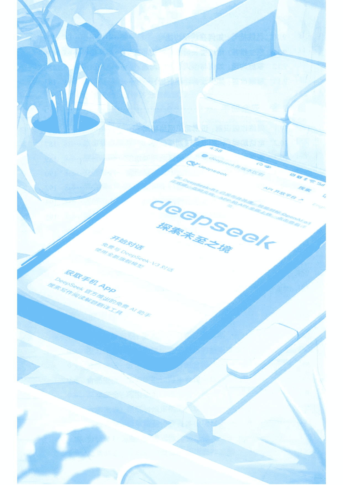
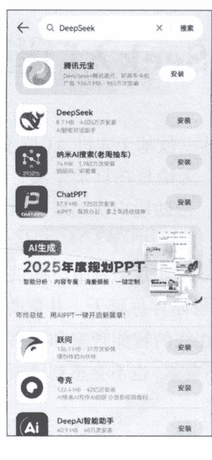
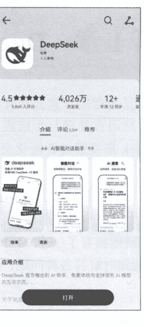
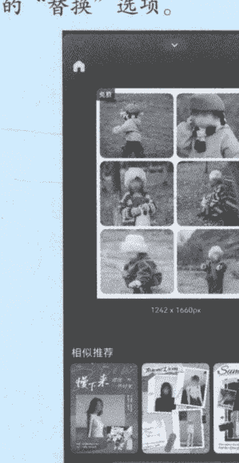
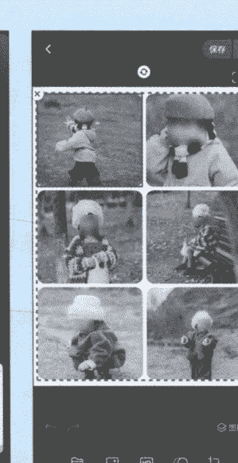
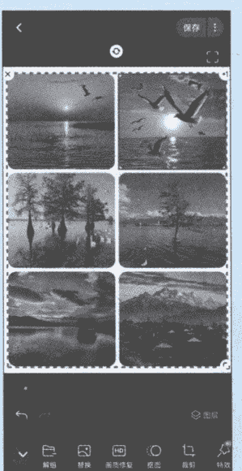
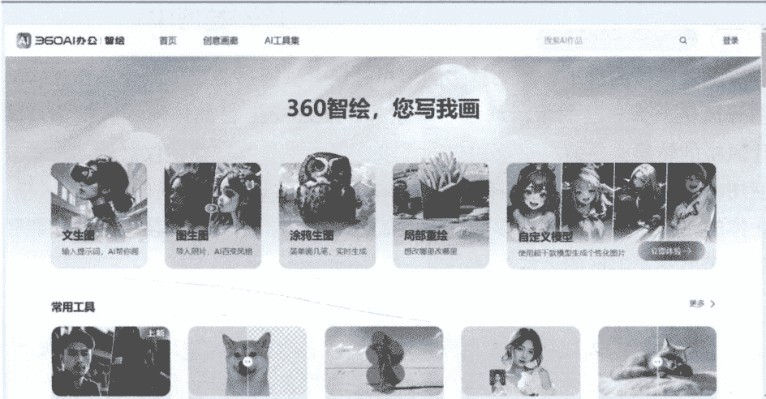
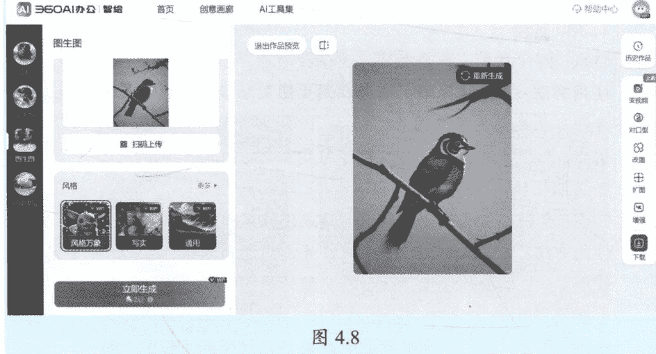
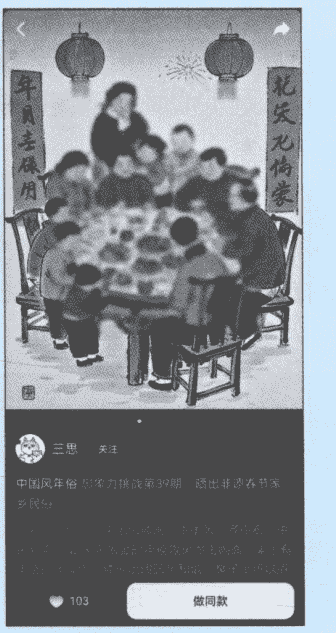
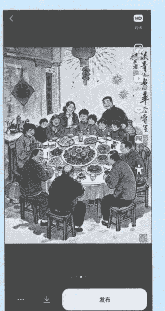

# DeepSeek 新手速成·视频教学

## 内容提要
生成式智能正加速改变工作与生活的节奏，学会使用这类工具已成为提升效率的重要手段。《DeepSeek 零基础入门（视频教学版）》面向初学者编写，目的是帮助读者迅速把握核心用法，真正享受到智能化带来的便利。

全书共十章。第一、二章聚焦账号接入与指令优化的方法，帮助读者更流畅地与 DeepSeek 互动。第三至十章围绕生活、创作、学习、娱乐、社交、出行、健康、安全八大场景，给出 88 个可直接复用的实操案例，覆盖健康管理、日常通勤、能力提升、社交沟通等多方面需求，让读者全面认识 DeepSeek 的实际价值。

内容扎实、操作性强。无论是对智能技术感兴趣的普通读者，还是希望提效的职场人士、自媒体创作者，或是想增强问题解决能力的社会公众，都可作为参考。

## 前言
PREFACE

当人工智能技术高速发展时，数字鸿沟也随之显现。不少用户面对新工具会产生困惑，很难体会到智能生活带来的便利。本书正是为这类用户准备，力图拉近技术距离，让科技真正服务于每个人。

本书为零起点用户提供一份可直接上手的 DeepSeek 入门手册，帮助读者快速建立使用信心，体会智能化带来的便捷。全书分十章，涵盖基础操作、指令技巧与 88 个场景化案例，依托真实使用情境实现学以致用。

整体脉络清晰：第 1 章侧重 DeepSeek 的基础操作与功能概览，帮助读者初步建立对智能助手的认知；第 2 章聚焦指令的撰写方法，提升交互效率与体验；第 3 至 10 章深入生活、创作、学习、娱乐、社交、出行、健康、安全八大场景，以案例为核心，确保所学能够落地到具体生活。章节安排均衡，兼顾全面与深度，满足不同学习需求。

本书具备以下特质：

### 实用性强
内容贴近用户真实痛点，通过案例直面实际问题。无论是基础操作还是场景应用，都给出清晰步骤与详细说明。案例涵盖健康管理、生活技巧、学习提升等多个维度，帮助用户迅速找到答案并加以运用。强实用导向的设计，保证阅读即是使用。

### 案例丰富
精选 88 个实操案例，横跨生活、健康、学习、娱乐等多种情境。从日常菜谱查询、家电维修，到体检指南、运动建议，再到书法入门、语言学习，内容多样、贴近生活，帮助读者迅速掌握 DeepSeek 的使用方法，实现“一书在手，生活得解”。

### 贴心设计
语言亲切自然，避免专业术语堆砌，用通俗易懂的表达讲解操作方法与应用情境。降低学习门槛，提升阅读舒适度，让任何使用者都能轻松上手。

衷心希望本书能成为读者迈入智能生活的贴心向导，助大家跨越数字鸿沟，开启 DeepSeek 智能生活新篇章。无论是日常生活中的点滴应用，还是对未来科技的探索，本书都能帮助读者在智能化时代更自信地发展。

本书编写过程中得到多方支持。谨向参与项目的殷娅玲女士、余安女士、周鑫森先生、王兰女士、熊庆女士致以诚挚感谢。同时感谢出版社编辑团队的专业付出，让本书得以面世。期待读者的反馈与建议，以便持续优化内容与服务。

### 资源下载方式
为便于学习，本书配套 88 集视频资源与大量附加资料。有需要的读者可扫描“人人都是程序猿”公众号二维码，关注后发送 3322 至后台，即可获取下载链接。将链接复制到浏览器打开，按提示完成下载即可。

此外，还可扫描“视频资源”二维码在线观看教学视频。

如果你对本书有任何意见或建议，请直接联系 2096558364@QQ.com 邮箱！

让我们携手开启智能化生活之旅，共同探索这个充满可能性的未来世界！

**特别说明：** DeepSeek 生成的内容偶有语句不通、标点错用、别字等非引导性问题，为保留原貌，本书未做修改，敬请知悉。

编者

2025 年 2 月

## 第1章 DeepSeek起步导航

DeepSeek 由深度求索公司推出，是一款基于前沿人工智能技术的智能助手，具备强大的自然语言理解与生成能力。无论是生活、学习还是工作，都能通过智能对话快速获取信息、解决难题。

作为专业智能工具，DeepSeek 致力于为用户提供便捷可靠的知识服务，成为得力助手。它可以陪伴聊天，也能解答生活难题，像一个 24 小时在线的智能管家加图书馆员，既能记录事项，又能随时应答；它不会疲惫，也不会厌烦，提问越多，它越懂你。

### 1.1 安装与登录方式
使用前需先下载并注册登录 DeepSeek，支持手机端与电脑端。

#### 1.1.1 手机端安装登录
手机上网便捷，下面介绍手机端安装登录流程，具体如下。

1. **打开应用商店**
   Android 用户可在华为应用市场、小米应用商店等查找；iPhone 用户可在 App Store 查找。

2. **搜索并下载 DeepSeek**
   以华为应用市场为例，在搜索框输入 DeepSeek，找到带蓝色鲸鱼标志的应用，注意认准蓝鲸图标避免误装，随后点击“安装”，等待完成。安装完成后点击“打开”进入应用。

3. **登录账号**
首次进入应用会弹出登录界面，提供“验证码登录”“密码登录”“使用微信登录”三种方式，当前地区提示仅支持手机号/微信登录，即验证码登录与微信登录。

- 验证码登录。输入手机号，点击“发送验证码”，在文本框填写验证码，勾选“已阅读并同意用户协议与隐私政策，未注册手机号将自动注册”，点击“登录”即可完成注册并登录。

- 微信登录。点击底部“使用微信登录”，再点“允许”，进入“绑定手机号”界面按要求绑定即可，后续可直接用微信登录。

- 密码登录。在“密码登录”页点击“忘记密码”。进入“重置统一登录密码”页，按界面提示操作完成重置后即可用密码登录，建议设置大小写字母加数字加符号的组合以便记忆。

若已用手机号登录过，后续可改为密码登录，避免每次输入验证码。

#### 1.1.2 电脑端访问登录
电脑端访问登录步骤如下。

1. 访问官网
打开浏览器，在地址栏输入 DeepSeek 官网地址回车，进入首页后点击“开始对话”进入登录/注册页。

2. 登录账号
电脑端登录方式与手机端类似，仅界面略有差异。

- 验证码登录。与手机端一致，输入手机号获取验证码即可登录，未注册手机号会自动注册，是较为快捷的方式。

- 密码登录。若不想用验证码，可切换至“密码登录”后点击“立即注册”。进入注册页输入手机号和密码并重复确认，填写手机验证码，选择用途复选框，勾选“我已阅读并同意用户协议与隐私政策”，点击“注册”完成创建。

- 微信扫码登录。点击“使用微信扫码登录”，用手机扫描弹出的二维码即可快速注册登录。

### 1.2 主界面功能说明
登录后进入 DeepSeek 主界面。手机端与电脑端功能一致，仅展示略有差异。

#### 1.2.1 手机端界面说明
主界面简洁直观，功能一目了然。

1. 历史记录
点击左上角 ≡ 图标可查看过往对话，按时间顺序排列，点击即可回顾。

2. 开始新对话
点击右上角 ⊕ 图标可结束当前话题，开启全新对话。

3. 模式选择
- **深度思考 R1 模式**：开启后适用于需要深度推理分析的问题，会展示思考过程再给出结论。
- **联网搜索模式**：开启后 DeepSeek 利用互联网资源提供更全面准确的答案。
- **基础模式 V3**：默认状态，不开启深度思考也不联网，适用于日常聊天与简单问题。

4. 上传附件
点击右下角 + 图标可上传文件、拍照识字或图片识字，上传后可基于附件提问或处理数据。

5. 账户中心
点击历史记录下方账户头像进入账户中心，可个性化设置系统颜色、语言，也可在此退出登录、删除历史对话或删除账户。

#### 1.2.2 电脑端界面说明
电脑端与手机端功能无差异，仅上传文件图标显示为回形针 📎。

### 1.3 提问与获取答案的方法
完成注册登录并熟悉界面后即可开始提问。常规流程如下。

1. 选择模式
根据问题类型选择模式。逻辑性强的问题可开启深度思考 R1；关注最新热点可开启联网搜索；日常对话使用基础模式即可。

2. 在输入框填写提示词
点击搜索框输入问题，例如“有没有好听的经典抒情老歌推荐？”

3. 发送
电脑端按 Enter 或点击右侧箭头；手机端点击右侧箭头。

4. 阅读答案
答案会显示在问答区，内容较长可滚动查看。例如问“如何预防感冒？”，可能得到保持充足睡眠、勤洗手、多吃富含维生素 C 食物等要点。

5. 追问或调整
若答案不理想，可优化问题重新提问，如将“如何预防感冒？”改为“秋冬季节儿童如何预防感冒？”更贴合需求。

6. 重新生成
不改动提示词时，可点击上一轮答案左下角的“重新生成”🔄按钮，让 DeepSeek 再次作答。

## 第 2 章 提示词撰写技巧
随着人工智能普及，提示词是高效沟通的核心。掌握撰写技巧能让需求表达更精准，获得更有价值的回答。学习提示词不仅能提升工具使用体验，也能解决实际问题。好的提示词避免模糊与无效沟通，节省时间、提高效率，是充分利用人工智能、享受智能生活的重要一步。

### 2.1 什么是提示词
提示词是用户与人工智能交互时输入的指令或问题，用于引导生成所需回答。在 DeepSeek 等工具中，提示词扮演沟通桥梁的角色，帮助人工智能理解需求并生成对应内容。

简单说，提示词就像交流的开场白，决定回答方向与内容。通过清晰具体的提示词，用户能更有效地引导人工智能产出预期结果。

例如询问“明天北京天气怎么样？”，这就是提示词，DeepSeek 据此明白用户想了解明天北京天气，并给出相关信息。因此，清晰准确的提示词对有效使用至关重要。

### 2.2 提示词写作的基本原则
撰写提示词需遵循一定原则，确保 DeepSeek 准确理解并给出满意答案。

1. 简洁明了
尽量精简，避免冗长复杂。直接表达需求，去掉修饰与重复。例如：

> DeepSeek:
×：我想知道明天北京的天气情况，包括气温、风力、湿度等，因为我明天要去公园散步，想知道需不需要带伞。
√：明天北京的天气怎么样？

2. 具体明确
明确目标与具体要求，避免模糊。直接指出想要的内容。例如：

> DeepSeek:
×：这部电影怎么样？
√：请给出《肖申克的救赎》的影评。

复杂问题可补充背景或限定条件，例如：

> DeepSeek:
×：帮我找一个旅游的地方。
√：推荐一个冬季旅游地，最好气候温暖、交通方便。

3. 逻辑清晰
语句应符合常规逻辑，避免跳跃。若涉及多问题或多任务，可分步提出。例如：

> DeepSeek:
×：请详细解释高血压的成因、症状、预防和治疗方法。
√：第一步：“什么是高血压？”
第二步：“高血压有哪些常见症状？”
第三步：“如何预防高血压？”

### 2.3 提示词写作技巧
掌握写作技巧是让 DeepSeek 准确理解需求的关键。

1. 5W1H 法则
通过回答六个基本问题 Who、What、When、Where、Why、How，使提示词更全面清晰。

- **Who 谁**：说明使用者身份。 如我今年 46 岁，喜欢书法和园艺。
- **What 什么**：明确具体问题。 如我想了解适合初学者的书法教程。
- **When 时间**：说明时间特征。 如这个周末我想在家练习书法。
- **Where 地点**：说明场景需求。 如我想在家里练习书法，需要适合居家使用的学习资料。
- **Why 原因**：说明背景原因。 如因为我最近开始学习书法，想提升书写技巧。
- **How 方式**：说明具体要求。 如希望得到图文并茂的书法教程。

2. 结构化表达
结构化表达层次分明，有助于组织 5W1H。示例组合：我最近开始学习书法，想提升书写技巧。我想了解一些适合初学者的书法教程。希望教程适合在家自学，最好有详细步骤说明。

可依此结构仿写，培养撰写语感。

### 2.4 提示词撰写示例
掌握原则与技巧后，可在不同场景中实践，通过对比练习提升熟练度。

1. 日常生活类提示词
示例 1：查询天气
×：天气怎么样？
√：北京明天下午天气如何？

示例 2：菜谱查询
×：怎么做饭？
√：适合糖尿病患者的低糖食谱有哪些？

2. 健康医疗类提示词
示例 1：疾病查询
×：我头疼怎么办？
√：我 50 岁，经常头疼的可能原因是什么？如何缓解？

示例 2：药物查询
×：阿司匹林怎么吃？
√：阿司匹林每天服用多少毫克？需要注意什么？

3. 学习兴趣类提示词
示例 1：学习新技能
×：怎么学书法？
√：初学者如何练习毛笔字？需要准备哪些工具？

示例 2：兴趣探索
×：养花难吗？
√：适合室内养的花有哪些？如何浇水？

4. 旅行出行类提示词
示例 1：旅行规划
×：去哪玩？
√：适合老年人的国内旅游景点有哪些？需要注意什么？

示例 2：交通查询
×：怎么去火车站？
√：从我家到北京西站最快的公交路线是什么？

5. 社交沟通类提示词
示例 1：社交工具使用
×：怎么使用微信？

提问更精准，答案更有效

√：在微信里发语音消息具体怎么操作？新增好友的完整流程是怎样的？
示例2：情感建议
×：该怎样和家人沟通？
√：要怎么与孩子交流更顺畅？有哪些实用技巧可以马上使用？

6. 安全防骗类提示词
示例1：网络诈骗识别
×：怎么防骗？
√：网络诈骗一般有哪些常见手法？如何做好防范？
示例2：隐私保护
×：隐私如何守护？
√：怎样设置更稳固的密码？怎样降低个人信息泄露的风险？

7. 娱乐休闲类提示词
示例1：影视推荐
×：有什么值得看的？
√：能推荐几部适合老年人观看的经典影片吗？
示例2：游戏学习
×：象棋要怎么玩？
√：象棋的基础规则是什么？提升棋艺有什么建议？

8. 实用工具类提示词
示例1：天气查询
×：现在天气如何？
√：请给出上海未来三天的详细天气预报。
示例2：单位换算
×：换算方法是什么？
√：1公斤相当于多少斤？有哪些快速换算的小技巧？

### 2.5 提示词优化技巧

掌握基本写法后，再叠加优化手段，问题表达会更清晰，产出也会更贴合。

1. 善用标点拆分信息
合理运用句号、逗号等标点，把不同信息点拆开，更易解析。句号分隔完整句子，逗号并列同类要素。
例如：我今年46岁，平时喜欢书法和园艺，想找一份适合初学者的书法入门指导。

2. 核心信息前置
把最关键的需求放在最前面，模型能更快抓住重点。
例如：请撰写一篇关于云南旅行的文章，重点描写大理、丽江、香格里拉的风景，并介绍当地美食与文化体验，篇幅约800字。

3. 控制长度
指令宜精炼，建议控制在50~100字之间，表达清楚且不冗余。

4. 加入关键词
在提问中带入目标主题的关键词，帮助模型锁定方向。
例如：请推荐适合人工智能入门学习的书籍、网站或课程，要求讲解通俗易懂。

5. 分步引导
把复杂任务拆成若干小步骤依次提问，输出更有条理。
例如：请帮我制定一份语言学习入门计划，分成三个阶段逐步说明。

6. 补充细节要求
根据风格、举例方式等细节进行补充，回答会更贴合预期。
如果觉得回答过于专业或生硬，可以说“用生活中的例子来说明”，它会用常见事物举例，便于理解。
如果希望语气更温暖，可以说“用友好的语气给我建议”，它会加入人情味，用亲切的表达给出建议。

## 第3章 生活助手

日常里总会遇到各种琐碎难题，从烹饪到家电维修，从收纳到省电，都能得到实用方案。查一份红烧鱼做法、解决冰箱不制冷、学习整理衣柜，甚至涉及法律咨询和理财规划，都能得到可靠参考，让生活更顺手更有品质。

### 3.1 菜谱查询：红烧鱼制作指南

过去做菜需要反复琢磨食材搭配和步骤，现在借助工具就轻松很多。它能把握菜品特点、食材搭配规律和烹饪要点，并按口味、食材限制或饮食偏好定制创意菜谱。只需说明偏好，就能快速得到符合预期的方案。

> 提示词：我想给家人做红烧鱼，希望得到一份完整的制作指南，包含适合的鱼类推荐及原因、每种材料的分量、鱼体与调料的预处理、烹饪过程中的火候控制与调味顺序，以及实用的小窍门。

**DeepSeek:**

新手友好版红烧鱼做法

一、适合的鱼种及原因
推荐鱼种：鲫鱼、鲤鱼、草鱼。
推荐原因：肉质细嫩红烧不柴，刺相对较少便于食用，价格亲民易购买。

二、食材准备 2~3人份
鲫鱼1条约500g，食用油适量，生姜20g，大葱1根，大蒜5瓣，生抽2汤匙，老抽1汤匙，料酒2汤匙，白糖1茶匙，盐适量，清水300ml。

三、处理步骤
鱼的处理：去鳞去鳃去内脏洗净，鱼身两侧各划3~4道斜口，帮助入味，用厨房纸吸干表面水分。
调料准备：生姜切片，大葱切段，大蒜拍碎，生抽、老抽、料酒、白糖调成酱汁备用。

四、烹饪步骤
煎鱼：热锅冷油，下姜片爆香，将鱼轻放入锅，中火两面煎至金黄，每面约3分钟，不要频繁翻动，定型后再翻面。
调味：加入葱段、蒜瓣煸香，倒入调好的酱汁，摇动锅体让鱼均匀裹汁。
炖煮：加入清水，水面刚没过鱼身，大火烧开后转小火，盖盖焖15分钟。
收汁：开盖转中火收汁，用勺子不断把汤汁淋在鱼身上，汤汁浓稠时即可关火，约5分钟。

五、烹饪小技巧
去腥：煎鱼前用姜片擦锅底，料酒沿锅边淋入更香。
保持鱼形：等一面定型后再翻面，炖煮时避免频繁移动鱼身。
调味：收汁前尝一下咸淡，视情况加盐；想吃酸甜可加少量醋。

### 3.2 家电维修：冰箱制冷失效处理

冰箱突然失去制冷能力会影响食物保鲜，还可能增加电费。先做基础排查和简单维护，往往能恢复正常，避免不必要的维修支出。

> 提示词：冰箱突然不制冷了，可能是什么原因？有没有简单的处理办法？

**DeepSeek:**

冰箱不制冷的原因常见如下：

一、原因
电源问题：插头松动或脱落，家中停电、电路跳闸。
温控器设置不当：温控器被误调至关闭或高温挡。
冷凝器堵塞：冷凝器积尘过多，散热受阻。
蒸发器风扇故障：风扇被卡住或损坏，冷气无法循环。
压缩机故障：压缩机不工作，可能是内部损坏或启动器故障。
制冷剂泄漏：制冷剂泄漏导致制冷效果下降。
门封条老化或损坏：门封不严，冷气外泄。
内部结冰过多：蒸发器结冰严重，阻碍冷气流通。

二、简单处理办法
检查电源和温控器：确认插头插紧，电路正常，把温控器调回合适温度，通常2~5℃。
清理冷凝器：用吸尘器或软毛刷清理冷凝器灰尘，保证散热。
检查门封条：用湿布清洁门封，检查是否破损变形，可用吹风机加热恢复弹性，必要时更换。
断电除冰：若怀疑结冰过多，可断电开门让冰自然融化。
检查风扇：确认蒸发器风扇未被异物卡住或损坏。

### 3.3 清洁技巧：厨房油污快速清除

厨房是油污重灾区，灶台、墙面、抽油烟机易堆积顽固油渍，影响美观还易滋生细菌。选对清洁剂和使用方法，能高效去污并做好日常预防。

提示词：试过很多办法，厨房油污还是弄不干净，有没有快速又有效的清洁妙招？另外，推荐一些去油污的清洁剂，并详细说明搭配使用方法。

**DeepSeek:**

厨房油污用对方法事半功倍，按污渍程度处理效果更好：

一、快速清洁妙招
轻度油污
蒸汽软化法：烧开水加2勺白醋，半干抹布覆盖油污处5分钟，油渍软化后易擦，适用灶台边、瓷砖墙面。
面粉吸油法：干面粉撒在油渍处静置10分钟后干擦，再用湿布擦净，适用光滑台面、不锈钢面。

中度油污
小苏打加洗洁精：小苏打与洗洁精按3:1调成糊，厚涂油污处盖保鲜膜20分钟，硬毛刷刷洗，适用油烟机滤网、灶具缝隙。
微波炉加热法：碗中放1杯水加2勺柠檬汁，微波高火加热5分钟，蒸汽软化内壁再擦净，适用微波炉、烤箱内部。

重度油污
热敷加刮除：热毛巾敷10分钟，撒盐增加摩擦，用旧卡片或塑料刮板45度刮除，适用燃气灶头、锅底焦痕。
碱水煮洗：拆下金属滤网，加5勺食用碱煮15分钟，油污脱落，适用可拆卸金属件。

二、高效清洁剂推荐及搭配
市售清洁剂：强效碱性如大公鸡头、威猛先生，适合油烟机内部、顽固焦黑油垢，需戴手套避免接触金属；生物酶分解如花王泡沫喷雾，适合日常墙面、灶台，静置5分钟擦拭，无需冲洗；弱酸性柠檬酸清洁剂，适合水龙头水垢混油渍，不可用于大理石台面。

自制清洁剂：万能去污膏，小苏打粉与氧净1:1加水成糊，可保存一周，用于烤箱、锅具；杀菌去油喷剂，75%酒精100ml加5滴洗洁精加1勺柠檬汁，摇匀喷擦台面，去油兼消毒。

搭配原则：先溶解再分解，先用碱性清洁剂软化，再用生物酶喷雾分解残留；避免酸碱混用；不锈钢用中性，瓷砖可用碱性，人造石台面选生物酶类。

三、预防积累
炒菜后3分钟法则，趁余温用湿巾快速擦灶台；每月用汽车镀膜剂轻喷瓷砖，形成疏水层；油烟机滤网贴保鲜膜，每周更换，减轻清洗负担。

### 3.4 衣物保养：羊毛衫洗护要点

羊毛衫手感舒适但易变形、缩水、褪色。掌握正确洗护能延长寿命，保持光泽与手感。

> 提示词：朋友送了我一件羊毛衫，很喜欢，但不知道该怎么洗才不会洗坏，能讲讲羊毛衫正确的洗涤方法和注意事项吗？

**DeepSeek:**

可以的，羊毛衫清洗要点在轻柔与温度控制。

清洗步骤
准备：准备中性肥皂，避免强碱性成分，选用40~60℃温水或自然流水。
洗涤前：看标签选择手洗模式，无标记可先通风晾干再洗。
洗涤：双手轻揉，使纤维柔软不卷曲，不要直接用力搓衣身；取少量泡沫均匀涂抹，不需浸泡或漂白；放入洗碗篮等容器，水位控制在2/3，轻放轻拿，避免搅乱衣形；洗后手部彻底擦干，尤其是冬季，避免湿手触碰衣物。
漂洗：用冷水、中性漂洗，若使用化学剂需充分漂净。
干燥：可折叠后放入干衣机轻柔烘干，避免高温；自然风干时先滚筒风干，再置于阴凉处备用。

注意事项
避免高温烘烤，冷水洗涤、自然风干最佳；不要用毛巾重压后放在熨衣板上，以免挤压卷曲；洗涤时间不宜过长，避免损伤纤维；漂白剂仅在必要时使用，洗后必须晾干，避免久晒或存放在阴凉处。

### 3.5 家庭收纳：衣柜高效整理

衣柜堆满衣物，找件衣服要翻很久，还容易皱。合理整理能省时间、减少重复购买，还能延长衣物寿命。

> 提示词：衣柜里衣服越来越多，找衣服特别费劲，有没有方法能快速整理衣柜，让衣服好找又好放？

**DeepSeek:**

整理衣柜的核心是分类、善用工具和保持习惯。

分类整理：按季节分，当季衣服放在易取位置，过季收进收纳箱或放顶层；按类型分，上衣、裤子、裙子、外套分区存放；按颜色分，按色系排列，视觉整洁且定位快。

使用收纳工具：统一衣架挂衣，厚外套、易皱衣物挂放；袜子、内衣等小件用收纳盒或抽屉分隔器；过季厚衣用真空压缩袋收纳。

合理利用空间：上层放不常用物品，下层放当季衣物；衣柜门内侧装挂钩或挂袋，放围巾、腰带、帽子。

定期清理：定期断舍离，清理不再穿的衣物，可捐赠回收；每次洗完及时归位，避免堆积。

标签标识：收纳盒外贴标签，一目了然。

折叠技巧：竖立折叠法，让每件衣服都能看到，减少翻找；T恤、牛仔裤可卷起存放，节省空间。

保持整洁：取衣时保持其余衣物整齐，养成随手整理的习惯。

利用衣柜门：门内侧挂钩收纳腰带、领带、围巾。

定期调整：根据季节或穿衣习惯定期调整布局，保证常用衣物在顺手位置。

### 3.6 节约用电：家庭用电降低方案

电费上涨往往源于日常细节。了解耗电大户并调整使用习惯，就能在不降低舒适度的前提下减少开支。

> 提示词：最近家里的电费比以前高了不少，想知道家里哪些电器或日常行为最耗电，能帮我梳理一下吗？

**DeepSeek:**

常见耗电大户和行为包括：

空调：夏季冬季长时间开启耗电最多。
热水器：长期通电反复加热耗电高。
冰箱：门封不严、塞满物品会导致耗电上升。
洗衣机：加热水和长时间运行耗电较多。
电视和电脑：待机时间累积耗电不容忽视。
照明：老式白炽灯耗电大，灯数多且长时间开启会增加费用。
微波炉和电饭煲：功率较大，频繁使用会推高账单。
电暖器和电风扇

舒适与省电兼顾的居家用电建议

电暖器单台功率较高，长时间运转电费会明显上涨；电风扇看起来耗电低，但整夜不关累积电量也不小。

日常用电习惯
白天自然光充足仍开灯，或夜里睡着后忘了关灯，都是常见浪费。冰箱门频繁开启会带走冷气，压缩机需要额外工作把温度拉回。

用户提问：明明知道有些电器和行为会费电，有没有不降低生活品质也能有效省电的小方法？

回复：
空调使用
夏天把设定温度放在26℃左右，冬天约20℃，舒适与耗电更平衡。睡觉时开启睡眠模式，温度会逐步调整，夜间更省。滤网要按时清洁，风量顺畅制冷制热效率更高。

热水器使用
依据家庭用水规律预约加热时间，避免长时间空转。水温调在50℃左右就够用，温度越高耗电越大。

冰箱使用
内部保留气流通路，制冷更均匀。尽量减少开门次数和开门时长，保持冷量不流失。

洗衣机使用
大部分衣物冷水即可洗净，省去加热环节。等衣物量合适再启动，减少频繁启停。

电视和电脑
不用时彻底断电，待机仍耗电。屏幕亮度调到合适范围，既护眼又省电。

厨房电器
剩菜加热首选微波炉，比烤箱更省。电饭煲煮好后马上断电，避免长时间保温。

电暖器与电风扇
只对常用房间局部供暖，不要整屋加热。风扇可设置定时停机，防止整夜运转。

峰谷电价
大功率电器错峰使用，比如夜间洗涤、洗碗，利用电价低的时段。

电器维护
定期清理滤网、散热口，保持运行效率。定期检查线路，防止漏电短路造成浪费。

### 3.7 天气助手：出行前先掌握天气

买菜、晨练或安排行程都需要及时的天气信息，细微变化会影响出行和健康。开启联网搜索可以快速得到未来趋势，提前做好准备。

用户提问：今天下午重庆的天气怎么样？我要出去买菜，应该注意些什么呢？

回复：
依据最新预报，日期为2025年2月20日，重庆天气如下：

天气概览
状况：重庆大部以阴天为主，部分地区间断小雨或零星小雨，中心城区间断小雨转阴时多云。
气温：全市3~15℃，中心城区10~14℃。
高海拔：海拔1500米以上可能出现雨夹雪或小雪。

出行建议
穿衣：气温偏低且有小雨，建议穿厚外套或羽绒服，配长裤加保暖内搭。去高海拔地区需额外防寒，穿防滑鞋和保暖衣物。
雨具：有间断小雨，建议携带雨伞。
防晒：以阴天为主，紫外线弱，无需特别防晒。

其他注意
道路湿滑：雨天路面易滑，高海拔可能结冰，注意行走安全。
空气质量：整体良好，无需戴口罩。
总结建议穿厚实、带伞，注意防滑保暖。

### 3.8 宠物护理：呵护猫犬健康指南

猫犬带来陪伴，也需要主人承担责任。从饮食到运动再到健康管理，每个细节都影响它们的生活质量。

用户提问：我最近想养小猫小狗，你能告诉我小猫小狗可能会患上的常见疾病，以及生病后该怎么处理吗？

回复：
猫常见问题与应对
猫瘟
表现：高烧、呕吐、血性腹泻、脱水、嗜睡。
风险：幼猫未免疫死亡率极高，可经粪便、呕吐物传播。
应对：发现即就医，输液防脱水、抗生素防继发感染、抗病毒药物辅助。

猫传染性腹膜炎
表现：腹水、呼吸困难、消瘦、发热。
风险：由冠状病毒变异引起，无特效药，延误可能致命。
应对：利尿减轻腹水、抗生素防继发感染，保持环境稳定减少压力。

泌尿系统问题
表现：排尿频繁量少、排尿疼痛、血尿。
风险：公猫易尿道堵塞导致急性肾衰竭，48小时内危及生命。
应对：属于急症，需立即就医导尿、输液和药物治疗。

寄生虫感染
体内：蛔虫、绦虫，表现为消瘦、腹泻、呕吐。
体外：跳蚤、蜱虫，表现为瘙痒、幼猫贫血。
风险：长期感染营养不良，蜱虫可传致命血液病。
应对：体内用兽医推荐驱虫药定期驱虫；体外使用滴剂、喷雾或口服预防药。

犬常见问题与应对
犬瘟热
表现：高烧、脓性眼鼻分泌物、后期抽搐。
风险：幼犬致死率约80%，存活者可能有神经后遗症。
应对：输液、抗生素防继发感染、抗病毒药物和营养支持，需隔离。

细小病毒
表现：剧烈呕吐、血便、脱水。
风险：未及时治疗3~5天内死亡，病毒存活时间长。
应对：病情进展快，立即就医，输液、抗生素、止吐药和营养支持。

犬心丝虫
表现：咳嗽、运动耐受差、晚期腹水。
风险：成虫堵塞心脏肺血管，死亡率高且治疗费用高。
应对：兽医用药杀虫，过程需谨慎，严重时可能需手术。

皮肤病
表现：红肿、脱毛、抓挠频繁。
风险：继发细菌感染，长期不愈或致败血症。
应对：外用抗螨、抗真菌或湿疹药膏，严重时口服药物。

用户提问：如果我的宠物生病了，我该怎么让它快点好起来呢？比如给它吃点什么食物，怎么帮它保持卫生，以及日常的护理技巧。

回复：
饮食
易消化食物：食欲差时可喂煮熟去骨鸡肉、米饭或专用病号餐，避免油腻难消化。
补水：确保饮水充足，不愿喝水可用无针注射器少量喂水，或提供罐头等含水量高的食物。

卫生与清洁
及时清理排泄物，保持环境干净防细菌。
身体清洁：无法自理时用温湿毛巾轻拭身体，重点是肛门和尿道周围。
环境消毒：定期清洁生活区，使用宠物安全消毒剂，避开刺激性化学清洁剂。

日常照护
提供安静温暖舒适的休息环境，减少噪音干扰。
监测体温：猫狗正常体温约38~39℃，发烧时用宠物专用体温计测量。
观察变化：注意食欲、精神、排泄变化，恶化时及时联系兽医。
按时用药：严格按处方剂量给药，不自行更改或停药。

心理关怀
多陪伴、轻抚安抚，缓解焦虑，避免过度互动和剧烈运动。

及时就医
呕吐、腹泻、呼吸困难、严重乏力未好转时立即就医，切勿使用人用药物。

### 3.9 节日准备：年夜饭轻松规划技巧

春节团圆，年夜饭是重头戏。每道菜都承载着心意。合理规划能让烹饪更顺畅。

用户提问：马上就要准备年夜饭了，我肠胃不太好，想吃点清淡易消化的食物，但孩子们想吃点比较辣的食物，我们家总共八口人。请你帮我规划几套年夜饭方案，只列出菜名就好。

回复：
结合重庆特色兼顾清淡与辣味，为八人设计的方案如下：

第一套
清淡：清蒸江团鱼、白灼虾、上汤豌豆苗、山药炖鸡汤、南瓜小米粥
辣味：重庆辣子鸡、毛血旺、酸菜鱼、凉拌折耳根、香辣蹄花
搭配：腊味拼盘、红糖糍粑

第二套
清淡：清蒸鲈鱼、白灼菜心、番茄牛尾汤、蒸鸡蛋羹、银耳莲子羹
辣味：水煮牛肉、重庆火锅、辣炒田螺、凉拌木耳、泡椒凤爪
搭配：醪糟汤圆

第三套
清淡：清蒸多宝鱼、白灼西兰花、冬瓜排骨汤、蒸南瓜、红豆沙汤圆
辣味：重庆烧鸡公、麻辣香锅、泡椒牛蛙、凉拌黄瓜、干锅土豆片
搭配：腊肉炒蒜苗

要点提示
火锅选择：可选鸳鸯锅，清汤用鸡汤或菌菇汤，麻辣用重庆牛油底料，配牛肉卷、毛肚、黄喉、虾滑、豆腐、土豆片等。
辣度调节：根据口味减少辣椒或选用微辣调料。
甜品搭配：红糖糍粑、醪糟汤圆可中和辣味，提升幸福感。

用户提问：年夜饭要做很多道菜，我担心厨房操作空间不够用，而且怕有的菜放凉了，怎样合理规划厨房空间和烹饪流程呢？

回复：
提前准备
食材预处理：提前一天洗净切好分装保存，肉类提前腌制。
调料备齐：所有调料提前盛入小碗或调料盒，避免临时找料。

烹饪顺序
先做冷菜凉菜：如凉拌木耳，可提前做好冷藏。
先炖煮：如冬瓜排骨汤，炖煮耗时可利用间隙做其他菜。
最后快炒：如重庆辣子鸡、腊肉炒蒜苗，出锅即上桌保持温度。

多功能厨具
电压力锅：炖汤、煮饭，节省炉灶。
蒸锅：可同时蒸多道菜，如清蒸鱼和蒸蛋羹。
烤箱：处理需烤制的菜品，解放炉灶。

空间安排
分层利用：多层蒸架同时操作。
临时扩展台面：折叠桌或厨房推车增加操作区。
及时清理：每完成一道菜即清理台面，保持整洁。

保温措施
保温板或保温垫保持温度。
保温锅或砂锅装炖菜，长时间保温。

### 3.10 家庭安全：煤气泄漏自检与应对

家是港湾，煤气泄漏却可能引发爆炸、中毒。掌握检查和应对方法至关重要。

用户提问：家里最近换了新的煤气灶和管道，我总担心煤气泄漏，可以给我讲讲煤气泄漏的危害，以及如何快速检查煤气是否泄漏吗？

回复：
危害
中毒：煤气置换氧气导致缺氧，严重可窒息。
爆炸：空气浓度5%~15%时遇明火或电火花易爆炸。
火灾：泄漏遇明火或高温表面可引发火灾。

快速检查
嗅觉：煤气本身无味，加臭味剂后有臭鸡蛋味，若闻到需警惕。
听觉：泄漏时管道或接头处可能传出轻微嘶嘶声。
视觉：肥皂水涂抹管道和接头，有气泡说明泄漏。
检测仪：专用煤气检测仪可快速判断浓度。

用户提问：煤气泄漏真是太可怕了，万一检查时真发现有煤气泄漏的迹象，我应该采取什么措施呢？

回复：
立即关闭煤气阀门
找到煤气表附近阀门，顺时针拧紧切断供应。

打开门窗通风
迅速开窗通风，降低浓度。不要开关任何电器，避免电火花。

杜绝明火和电器操作
禁止打火机、火柴、吸烟。不要插拔插头或使用手机。

撤离现场
迅速离开并通知家人和宠物撤离，多户住宅需通知邻居。

联系专业人员
拨打煤气公司紧急电话或119报告，等待专业人员处置，不要自行维修。

预防
定期检查管道、接头是否老化松动损坏。
正确使用，保持火焰稳定，避免熄火后持续泄漏。
使用时厨房保持良好通风。

### 3.11 购物建议：为微胖身形挑选合适服装

挑选衣服能提升气质和自信，面对众多款式容易迷茫。

用户提问：我身材有点发福，肚子和手臂上肉比较多，喜欢简约大方、带点中式元素的款式，最好能方便日常活动，你能给我推荐一些挑选衣服的技巧，以及适合的款式吗？

回复：
根据你的身形和偏好，推荐以下选购要点和款式：

修饰腹部
选择高腰线设计：如高腰连衣裙、A字剪裁上衣，利用腰线拉长比例，隐藏小肚子。

微胖身形也能驾驭新中式气质

版型松而不垮：不要选贴身剪裁，偏向带一点空间的H廓或直筒线条，面料要选垂坠感好的棉麻、真丝混纺，避免软塌贴身的布料，免得暴露轮廓。
叠加遮形：用中式短版开衫或长款罩衫做外层，既能柔化曲线又能制造层次感。

##### 2. 柔化手臂线条
袖型要宽：鼓型、蝙蝠型、喇叭型或及肘短袖更友好，宽松的袖口能包住上臂，自带东方韵味。
避开两个极端：无袖会直接暴露手臂，窄贴袖则容易勒出赘肉，都不建议。

##### 3. 中式元素做减法
点缀要精：以盘扣、斜襟、小面积刺绣或水墨印花提亮，避免大面积复杂花纹。
配色要稳：主色以墨绿、藏青、米白、浅灰为底，少量砖红、靛蓝做点缀更耐看。

#### 二、推荐款式与搭配
##### 1. 改良中式衬衫
设计亮点：直筒宽松身形＋及肘灯笼袖＋斜襟盘扣。
搭配建议：下搭高腰阔腿裤显腿长，或深色直筒半裙遮住腹部。
适合场景：日常通勤、休闲出行。
面料选择：棉麻或真丝混纺，透气舒适。

##### 2. 新中式A字连衣裙
设计亮点：小立领＋微A字裙摆＋腰部暗褶。
优势：立领修饰颈部线条，A字裙摆自然包覆腰腹，暗褶提升立体感不显臃肿。
推荐配色：藏青、米白、水墨竹叶印花。
搭配建议：外搭针织开衫或短款刺绣马甲，增加层次。

##### 3. 改良旗袍式上衣
设计亮点：短款旗领＋微宽松版型＋下摆开衩。
优势：保留旗袍优雅，版型宽松避开传统紧绷感。
搭配建议：配九分烟管裤或阔腿裤，平衡古典与现代。

#### 三、避坑提醒
避开横向膨胀元素：大面积亮片、横条纹、欧根纱等蓬松面料会显宽。
慎选道袍风：过度宽松的道袍式剪裁易显臃，H廓更利落。
配饰要克制：细长项链或素雅玉镯即可，避免层叠繁琐。

### 3.12 法律咨询：二手房买卖合同关键条款全解析
购房是人生大事，合同是核心保障。价款、交付、产权清晰等条款稍有疏忽就会埋隐患。借助DeepSeek可以快速梳理重点，按自身情况调整条款，让交易更稳妥。

> 提示词：我打算买套二手房，听说买卖协议里有不少易被忽视的风险点，比如产权归属或房屋出租问题，我应如何让合同更具保障？

DeepSeek：

想让二手房合同更有保障，可以从以下维度着手：

- 1. 核查产权情况
产权核查：到房管部门查询产权信息，确认卖方为合法所有人，并核查是否存在抵押、查封等限制。
共有人确认：房屋有共有人时，需全体同意出售并在协议上签字。

- 2. 了解房屋实际状况
实地看房：确认是否存在质量问题或违建。
租赁风险：明确房屋是否已出租，避免“买卖不破租赁”风险。如有承租人，需在协议中约定处理方式。

- 3. 条款写清晰
房屋信息：地址、面积、产权证号等必须准确。
付款方式：时间、金额、方式写明，避免模糊。
交房时间：明确交付时间与条件。
违约责任：约定双方违约责任及赔偿标准。

- 4. 税费分担
税费约定：明确买卖双方各自承担的费用。

- 5. 户口迁移
如涉及户口，需约定迁出时间及违约责任。

- 6. 合同备案
签约后及时备案，确认法律效力。

- 7. 补充协议
特殊约定以补充协议形式固定，避免口头承诺无据可依。

> 提示词：我打算出售名下闲置房产，请说明合同中违约责任与房款支付方式的法律细节。

DeepSeek：

出售环节，违约责任与付款方式的约定至关重要，清晰条款可减少纠纷。

#### 一、违约责任
##### 1. 逾期付款的处理
违约金条款：协议应载明逾期付款的违约金比例，通常为未付金额每日万分之五，亦可协商。
解除权：买方逾期超过约定期限，卖方可解除合同并要求赔偿损失。
继续履行：卖方也可要求买方继续履行并支付违约金。

##### 2. 违约金约定
合理区间：违约金一般不超过实际损失30%，过高或过低可请求法院调整。
计算与支付：需明确计算方式和支付时间。

#### 二、房款支付方式
##### 1. 一次性付款
风险：买方可能因资金问题无法按时支付。
建议：明确支付时间、金额及逾期责任，建议使用资金监管账户。

##### 2. 分期付款
风险：买方中途停付。
建议：约定每期时间、金额及逾期责任，明确未按期付款的后果。

##### 3. 按揭贷款
风险：贷款被拒或审批延迟。
建议：约定贷款失败时的处理方式，如转为一次性付款或解除合同，并明确审批时限。

#### 三、资金监管
建议通过第三方监管账户交易，明确资金释放条件，确保资金安全。

### 3.13 投资理财：如何挑选契合自己的金融产品
让闲钱产生价值是规划生活的重要一步。市场上产品众多，风险收益各异，稍不注意易踩坑。DeepSeek可提供实用建议，帮助更精准匹配产品。

> 提示词：我手上有闲钱想理财，但对各类产品了解不多，能介绍特点和风险吗？

DeepSeek：

常见理财产品如下：

#### 1. 银行存款
特点：安全性高、流动性好，收益稳定但偏低。
风险：极低，受存款保险保护。
适合：风险承受力低、重稳健的人群。

#### 2. 货币基金
特点：投向短期货币工具，流动性强，收益高于活期。
风险：低，收益随市场波动。
适合：追求高流动性的稳健型投资者。

#### 3. 债券基金
特点：投资国债、企业债等，收益相对平稳，风险中等。
风险：受利率和信用风险影响。
适合：想拿稳定收益又能承受一定波动的人。

#### 4. 股票基金
特点：投向股市，潜在收益高，波动大。
风险：较高，受股市影响明显。
适合：风险承受力强、追求高收益的人。

#### 5. 信托产品
特点：起投金额高、期限固定，收益较高。
风险：较高，存在违约可能。
适合：资金充足且能接受较高风险的人。

> 提示词：我初步打算选择银行储蓄，需要重点关注哪些方面？

DeepSeek：

#### 一、储蓄方式
##### 1. 活期储蓄
优点：随时存取，流动性最好。
缺点：利率低。
适合：应急备用金。

##### 2. 定期储蓄
优点：利率更高，收益稳定。
缺点：提前支取损失利息。
适合：有明确资金计划者。

##### 3. 通知存款
优点：利率介于活期与定期之间。
缺点：支取需提前通知。
适合：有一定流动性需求者。

##### 4. 大额存单
优点：利率通常高于定期。
缺点：起存要求高，流动性差。
适合：大额闲置资金。

#### 二、收益计算方式
利率类型：区分固定利率与浮动利率。
计息方式：单利只算本金，复利计本息收益更高。
付息频率：到期付息或按月按季付息，影响实际到手。

#### 三、提前支取
提前支取多按活期计息，需了解规则，部分银行支持部分支取。

#### 四、安全性
存款保险通常单户限额50万，选经营稳健的银行。

#### 五、其他费用
关注账户管理费、跨行转账、异地取款等隐形费用。

#### 六、自动转存
了解到期是否自动转存定期，避免资金闲置。

#### 七、优惠活动
关注银行加息、礼品等促销活动。

## 第4章 创作助手
创作既是表达方式，也是积累生活经验的过程。DeepSeek的辅助能力能显著提升效率，尤其在灵感不足时。作诗、写生活记录或提供写作技巧都能获得支持。还可以将DeepSeek与其他AI平台联动，先在DeepSeek完成初稿，再转至图片、视频平台深化，形成数据与功能互补，让创作边界更宽。

### 4.1 诗歌创作：抒情诗写作技巧
抒情诗以情感表达见长。借助DeepSeek可快速获得灵感，生成富含情绪的诗句。机器提供框架，最终仍需个人情感润色。

> 提示词：我想写一首现代诗，主题是“夜与黎明”，需要一些创作建议。

DeepSeek：

**创作建议：夜与黎明**

**一、意象储备**
夜：月亮、星空、阴影、梦境、寂静、孤独、神秘、钟表、窗灯、失眠…
黎明：曙光、晨星、露珠、鸟鸣、晨雾、地平线、希望、觉醒、温暖、裂缝…

**二、情感基调**
对比冲突：夜的静谧对黎明的躁动，孤独对希望，恐惧对期待。
过渡转变：从黑暗到光明，从沉睡到觉醒，从绝望到希望。

**三、语言风格**
简洁凝练：意象精炼，避免直白冗长。
跳跃思维：用象征、隐喻、拟人打破常规逻辑。
音乐性：注意节奏韵律，善用重复、排比。

**四、结构思路**
线性：按时间从夜到黎明递进。
对比结构：以蜡烛/火焰呈现差异。
循环结构：以夜起、以夜终，暗示轮回。

> 提示词：请创作一首现代诗，主题“夜与黎明”，用对比手法表现对黎明的期待，风格乐观进取。

DeepSeek：

《夜与黎明》
钟摆把时间切碎
洒成一地暗色的玻璃
我弯腰捡起
每一片都映着不同的月亮
有人在梦里数星星
直到它们一颗颗熄灭
有人把呼吸藏进枕头的褶皱
等待第一缕光把它唤醒
黎明是夜的裂缝渗出的光
我站在窗前
看黑暗一点点被光明吞噬

### 4.2 散文写作：写出优美散文
生活点滴需要文字沉淀。DeepSeek可帮助梳理思路、提供素材和表达方式，完成触动人心的散文。

> 提示词：我想写一篇关于一家人在湖边散步的散文，语言平实自然，融入感悟，请给建议。

DeepSeek：

一、主题聚焦
亲情温馨：展现散步中的亲密互动。
自然之美：描绘湖水、树木、花草营造氛围。
人生感悟：从小事中体悟珍惜当下。

二、素材选择
场景：傍晚或清晨的湖边，光影变化。
家人互动：对话、动作、表情。
自然景物：湖面、水鸟、微风、花香等。

三、结构安排
时间顺序：出发到回家，情感积累。
空间顺序：以湖边小路、观景台、凉亭等为线索。
情感线索：以爱、温暖、感动贯穿片段。

四、语言风格
平实自然：避免堆砌辞藻。
细腻生动：注重细节描写。
画面感强：善用比喻拟人提升感染力。

其他建议：多观察记录，融入个人感悟，反复修改打磨。

### 4.3 小说创作：构思引人入胜的情节
小说创作是记录与想象的结合。DeepSeek在情节构思与人物塑造上可突破瓶颈，提升作品可读性。

> 提示词：我想写一篇2000~3000字的武侠短篇，语言简洁凝练，核心为“大音希声，大象无形”，请给出建议。

DeepSeek：

一、主题理解
“大音希声，大象无形”指至高武学返璞归真，内敛无形。武功不再靠招式华丽，而是心境与理解。

二、创作方向
1. 无声之战展现境界
主角看似平凡，实则已达化境，通过对手反应与环境变化暗示实力。
设计一场无声对决，以静制动。

2. 无形之形塑造人物
设置一位招式华丽的反派，与主角形成对比。
主角淡泊名利，内心坚定，通过眼神、动作细节体现深藏不露。

3. 无招胜有招升华主题
围绕失传秘籍展开，最终主角悟出武学在于理解而非招式。
通过成长传达哲学思考。

其他建议：语言简洁古朴，运用高山流水明月等意象烘托，节奏张弛有度。

老者语气温和地对后辈说，武学并非为了一争高下，而是用来涵养心性。放下形相执念，才能容纳万象。

剑客顿悟其意，拱手致谢后便飘然远去。

从此江湖再无此人之踪，而那本《无相神功》的孤本，也随老者离世而湮没于历史烟尘。

### 4.4 儿童故事创作：3到5岁神话启蒙怎么写

给孩子讲故事既是创作的乐趣，也能让长辈与小辈多一份温情陪伴。借助 DeepSeek 可以更快打开思路，构思出既有教育价值又好玩的故事，让孩子在玩乐中潜移默化地成长。下面梳理如何写出有创意、好懂且蕴含人生道理的儿童读物，帮助拉近亲子距离并传递经验。

> 提示词：我想写一篇适合 3~5 岁儿童听的故事，具有神话色彩和教育意义，要有趣味，可以吸引小朋友的兴趣，请你给出一些创作建议。

DeepSeek 给出如下思路：

面向3至5岁幼儿的神话故事撰写要点：

一、主题挑选
贴近理解范围：选取孩子熟悉或好奇的对象，例如小动物、自然现象、魔法世界。
正向价值：传递积极情绪，例如勇敢、善良、诚实、友爱。
神话韵味：融入仙人、精灵、魔法等元素，提升趣味与吸引力。

二、情节设计
结构清晰：采用起承转合的经典框架，情节简明，便于理解。
冲突设定：安排主人公遇困境、需帮助等情节，增加戏剧张力。
结局积极：结尾偏向圆满，例如克服困难获得成功，给孩子希望与鼓励。

三、人物塑造
形象鲜明：塑造性格突出、可爱的人物，例如勇敢的小兔、善良的小精灵。
贴近生活：人物的性格和行为贴近孩子日常，例如爱玩耍、怕黑等，易产生共鸣。
语言生动：用形象的描写呈现外貌与行为，例如“圆溜溜的眼珠”“蹦蹦跳跳走路”。

四、语言表达
文字简洁：使用简单易懂的词句，避免复杂抽象的表达。
画面感强：运用比喻、拟人等手法增强趣味与形象。
节奏舒缓：注意韵律感，可重复句式或押韵，增加朗朗上口度。

五、其他建议
插图辅助：搭配色彩鲜艳、形象生动的插图帮助理解。
互动环节：加入提问、猜谜等环节，提升参与感。
寓教于乐：将教育意义融进情节，例如通过故事教孩子勇敢善良。

六、示例
《月亮上的小兔子》
从前月亮上住着一只小兔子，一双圆圆的大眼睛配着雪白绒毛，可爱至极。
它最爱做的事是坐在月亮上俯视地球。
它看见孩子们在草地奔跑、花园嬉戏，心里很羡慕。
“我也好想去地球玩啊！”小兔子叹气。
一天它遇见一位善良的仙女。
仙女知道心愿后，挥动法杖变出一条通往地球的彩虹桥。
小兔子欢呼着蹦跳上桥，来到地球。
在地球玩得开心，它和孩子们一起玩耍、分享胡萝卜。
可它也开始想念月亮上的家。
仙女告诉它，只要每晚乖乖睡觉，就能在梦里回到月亮。
此后小兔子每晚早睡，在梦里回到月亮，继续注视地球。
故事寓意：珍惜眼前的美好，也懂得感恩与回馈。

### 4.5 公众号写作：快速产出吸睛好文

写公众号既是分享经历与知识的渠道，也是与亲友思想交流的平台。DeepSeek 能从选题到结构再到润色全程提效。无论是健康养生、生活妙招还是旅行分享，都能快速产出吸引读者的优质内容，既传播观点也提升互动。

> 提示词： 我想学习如何快速完成一篇公众号文章。你能告诉我一些简单易懂的方法吗？比如如何选题、构思框架、组织内容，以及如何让文章更吸引人？最好能结合一些实际的例子，让我更容易理解和操作。

DeepSeek 回复如下：

以下方法有助于快速完成一篇公众号文章：

一、选题
从兴趣出发：选择你感兴趣或熟悉的主题，比如健康养生、家庭故事、旅行见闻等。
关注热点：结合当前的社会热点或节日节气，比如春节、重阳节等，写一些相关的文章。
解决实际问题：分享一些实用的生活技巧，比如如何保养身体、如何与子女沟通等。

二、构思框架（三段式结构）
开头：引入主题，可以用一个小故事、一个问题或一句名言吸引读者。
中间：展开内容，分段讲述你的观点或故事，每段一个核心点。
结尾：总结全文，可以呼吁行动、表达感悟或留下思考。

三、组织内容
列提纲：先列出几个要点，比如“为什么要写这个话题”“我的观点是什么”“如何解决问题”等。
分段清晰：每段只讲一个重点，避免内容混杂。
加入例子：用你的生活经历或身边的故事来支持观点，比如“我的一位朋友曾经……”

四、让文章更吸引人
语言亲切：用聊天式的语气，就像和朋友说话一样，避免太正式或复杂地表达。
图文结合：适当插入图片或表情包，让文章更生动。
互动提问：在文章结尾提一个小问题，比如“你有没有类似的经历？”鼓励读者留言。

五、实际例子
选题：比如写一篇《退休后如何保持健康生活》，结合你的日常锻炼和饮食习惯。
框架：
开头：讲述自己退休后的生活变化。
中间：分享几点健康建议，比如每天散步、饮食清淡。
结尾：鼓励读者一起行动起来，保持健康。
内容：加入一些具体的小故事，比如“我每天早晨都会去公园散步，认识了很多朋友”。

提示词：我想要完成一篇公众号文章——《退休后如何保持健康生活》，结合我的日常锻炼和饮食习惯。框架：开头讲述自己退休后的生活变化；中间分享几点健康建议，比如每天散步、饮食清淡；结尾鼓励朋友一起行动起来，保持健康。

DeepSeek：

退休后如何保持健康生活

退休后，生活节奏突然慢了下来，刚开始还真有点不适应。以前忙忙碌碌的日子一下子变得清闲，反而让我有些无所适从。不过，随着时间的推移，我逐渐找到了新的生活节奏，也开始更加关注自己的健康。今天，我想和大家分享一下我退休后保持健康生活的一些小经验。

1. 每天散步，享受自然
退休后，我养成了每天早晨散步的习惯。无论是晴天还是雨天，我都会去附近的公园走一走。呼吸新鲜空气，看看花草树木，心情也变得舒畅了许多。散步不仅锻炼了身体，还让我结识了不少志同道合的朋友。我们常常一边走一边聊天，分享生活中的趣事，日子过得充实又愉快。

2. 饮食清淡，注重营养
随着年龄的增长，我开始更加注重饮食的健康。每天的饮食尽量清淡，少油少盐，多吃蔬菜水果。早餐通常会吃一碗燕麦粥，搭配一个鸡蛋和一些水果；午餐和晚餐则以蔬菜和粗粮为主，偶尔吃些鱼肉补充蛋白质。我还学会了控制食量，每餐只吃七分饱，避免暴饮暴食。

3. 保持心态平和，积极乐观
退休后，我学会了放下过去的忙碌和压力，更多地关注自己的内心世界。每天花点时间看看书、听听音乐，或者写写日记，记录生活中的点滴。遇到烦心事时，我会告诉自己，生活总有起起落落，保持一颗平常心最重要。积极乐观的心态，让我感觉每天都充满活力。

结尾：
退休后的生活，其实可以过得很精彩。只要我们愿意行动起来，关注自己的健康，调整好心态，就能享受这段美好的时光。希望我的这些小经验能对大家有所帮助。朋友们，不妨从今天开始，和我一起散步、调整饮食、保持乐观，让我们的退休生活更加健康、快乐！

### 4.6 朋友圈文案：写出有温度的生活动态

朋友圈既是记录生活点滴的角落，也是与亲友互动的桥梁。DeepSeek 能帮你快速生成朋友圈文案，无论是日常分享、节日祝福还是心情感悟，都能轻松构思优化。通过智能语言处理，你可以写出贴心有趣的文字，让社交圈更活跃，也展现个性品味。

> 提示词：我想学习如何在朋友圈发布吸引人的文案。请问有没有简单易懂的方法或步骤，可以帮助我快速掌握编写朋友圈文案的技巧？比如如何开头、如何表达情感、如何选择合适的图片等。希望能用通俗的语言解释，方便我理解和操作。

DeepSeek 回复如下：

以下方法是掌握朋友圈文案技巧的步骤：

1. 如何开头
问候语开头：可以用简单的问候语开始，比如“大家好！”“今天天气真好！”这样显得亲切自然。
直接点题：如果想分享某件事，可以直接说“今天发生了一件有趣的事……”或者“刚刚看到了一篇好文章……”
引用名言：如果想显得有深度，可以用一句名言或俗语开头，比如“俗话说，活到老学到老……”

2. 如何表达情感
真诚自然：朋友圈文案不需要太复杂，真诚最重要。比如“今天和家人一起吃饭，感觉特别幸福！”这样的表达就很打动人。
多用感叹词：适当使用“啊”“呀”“呢”等语气词，比如“今天的夕阳真美啊！”会让文案更有温度。
分享感受：可以简单描述自己的心情，比如“今天心情特别好，因为……”或者“最近有点累，但看到大家的鼓励很开心！”

3. 如何选择合适的图片
与文案相关：图片要和文案内容匹配，比如写“今天去公园散步”，可以配一张公园的美景照片。
清晰美观：选择清晰、光线好的照片，避免模糊或过暗的图片。
适当修饰：可以用手机自带的修图工具稍微调整亮度、对比度，或者加个简单的滤镜，让图片更吸引人。

4. 其他小技巧
适当分段：文案不要太长，分几段写会更清晰。
加入互动：可以在文案结尾加一句互动的话，比如“你们最近有什么开心的事吗？”或者“大家觉得这张照片怎么样？”
保持简洁：不需要写太多，几句话表达清楚即可。

> 提示词：我想要发布一条朋友圈，需要朋友圈文案，请你帮我写一条朋友圈文案，100字左右，使用简单的问候语开头，情感真诚自然，并附上配图建议。

DeepSeek：

文案：
大家好！今天和老朋友们聚在一起喝茶聊天，回忆过去的点点滴滴，真是感慨万千。
时间过得真快，珍惜每一次相聚，感恩有你们的陪伴。

配图建议：
1. 一张茶具和茶点的照片，展现温馨的氛围。
2. 一张与朋友们的合影，笑容自然，充满欢乐。
3. 一张窗外的风景照，阳光洒进来，显得温暖宁静。

### 4.7 食谱编写：把家常美味写清楚

分享家常美食的食谱可以传承经验，更是和家人朋友促进关系的一种方式。DeepSeek 可以帮助你轻松编写食谱，从食材搭配到烹饪步骤，再到小贴士的建议，智能化地为你提供结构清晰、易于理解的内容。无论是简单的家常菜还是节日大餐，DeepSeek 都能为你节省时间，快速制作出美食。

提示词：我最近退休在家，想根据自己的做菜经验编写一本食谱。我比较擅长川菜，请你帮我列一个目录框架。

DeepSeek：

《川味人生》
目录
序言：讲述你与川菜的故事，为何决定编写这本食谱，以及你对川菜的理解和热爱。
第 1 章：川菜之魂——调味篇
1.1 川菜常用调味料介绍：花椒、辣椒、豆瓣酱、泡椒等
1.2 红油的制作：详解红油的制作方法和技巧
1.3 复制酱油的制作：揭秘川菜提鲜的秘密武器
1.4 家常味型的调配：鱼香味、宫保味、怪味等
第 2 章：家常川菜——经典篇
2.1 回锅肉：肥而不腻，入口化渣
2.2 麻婆豆腐：麻辣鲜香，豆腐嫩滑
2.3 鱼香肉丝：酸甜适口，鱼香味浓
2.4 水煮肉片：麻辣鲜香，肉片滑嫩
2.5 宫保鸡丁：酸甜适口，鸡丁鲜嫩
第 3 章：川味小吃——解馋篇
3.1 钟水饺：皮薄馅嫩，麻辣鲜香
3.2 龙抄手：皮薄馅大，汤鲜味美
3.3 担担面：面条筋道，臊子香浓
3.4 夫妻肺片：麻辣鲜香，口感丰富
3.5 川北凉粉：酸辣开胃，清凉爽口
第 4 章：宴客川菜——面子篇
4.1 开水白菜：清汤寡水，却鲜美无比
4.2 东坡肘子：肥而不腻，入口即化
4.3 樟茶鸭子：色泽红亮，香气扑鼻
4.4 干烧鳜鱼：鱼肉鲜嫩，味道浓郁
4.5 土豆炖牛肉：软糯美味，营养丰富
第 5 章：养生川菜——健康篇
- 5.1 白果炖鸡：滋补养生，汤鲜味美
- 5.2 山药排骨汤：健脾养胃，营养丰富
- 5.3 清炒时蔬：清淡爽口，营养均衡
- 5.4 凉拌木耳：清脆爽口，清热解毒
- 5.5 银耳莲子羹：滋阴润肺，美容养颜
第 6 章：川菜小妙招——经验篇
- 6.1 如何挑选新鲜的食材
- 6.2 如何处理食材才能更入味
- 6.3 如何掌握火候才能做出美味的菜肴
- 6.4 如何保存食材才能保持新鲜
- 6.5 一些实用的厨房小技巧
附录：
- 川菜常用食材介绍
- 川菜常用烹饪术语解释
- 川菜文化趣谈
建议：
- 可以根据自己的经验和喜好调整目录内容。
- 可以添加一些图片，使食谱更加生动形象。
- 可以分享一些自己做菜的小故事，增加食谱的趣味性。

> 提示词：请以“土豆炖牛肉”为例，教我描述食材、步骤和技巧，让这份食谱看起来清晰明了。

DeepSeek：

以下是轻松记录和创作家常菜食谱的方法：

1. 如何描述食材
列出主要食材：先写下这道菜需要的主要食材，比如“土豆、牛肉、胡萝卜”。
注明用量：尽量写清楚每种食材的用量，比如“土豆2个、牛肉300g、胡萝卜1根”。
简单分类：可以将食材分为“主料”和“配料”，方便查看。

2. 如何描述步骤
按顺序写：按照做菜的步骤一步步写，比如“第一步：将牛肉切块；第二步：土豆和胡萝卜去皮切块”。
简洁明了：每步用简短的话描述，比如“热锅凉油，放入牛肉翻炒至变色”。
注意细节：可以加入一些小技巧，比如“炒牛肉时加一点料酒去腥”。

3. 如何让食谱清晰明了
将食材、步骤分段写，比如：
食材：
牛肉 300g
土豆 2个
胡萝卜 1根
步骤：
（1）牛肉切块，土豆和胡萝卜去皮切块。
（2）热锅凉油，放入牛肉翻炒至变色。
（3）加入土豆和胡萝卜，翻炒均匀后加水炖煮 30 分钟。
使用序号：用“1、2、3”标注步骤，方便阅读。
配图建议：可以拍几张关键步骤的照片，比如切好的食材、炒菜的过程、成品图。

4. 其他小技巧
记录心得：可以写下做这道菜的心得，比如“牛肉炒之前用淀粉腌制会更嫩”。
分享故事：如果是家传菜，可以写一段小故事，比如“这是妈妈教我的第一道菜，每次做都会想起她”。
保持简洁：不需要写得太复杂，重点是让读者能看懂并操作。

示例食谱：土豆炖牛肉
食材：
牛肉 300g
土豆 2个
胡萝卜 1根
葱姜蒜适量
步骤：
（1）牛肉切块，土豆和胡萝卜去皮切块。
（2）热锅凉油，放入葱姜蒜爆香，加入牛肉翻炒至变色。
（3）加入土豆和胡萝卜，翻炒均匀后加水炖煮 30 分钟。
（4）最后加盐调味，出锅即可。

### 4.8 回忆录写作：把一生娓娓道来

撰写个人回忆录是记录人生经历、分享智慧和情感的一种方式。DeepSeek 可以帮助你高效梳理和整理记忆中的点滴，无论是重要的家庭故事、职业经历，还是旅行趣事，都能帮助你清晰表达，赋予文字生命。通过智能提示和结构化的框架，DeepSeek 让回忆录的写作变得更加轻松，帮助你在有限的时间内完成一部生动且充满意义的回忆录。

> 提示词：我想写一本个人回忆录，记录自己一生的经历。但我不知道从哪里开始，也不知道如何组织内容。请问你能给我一些简单的建议吗？比如如何选择重要的事件以及如何让回忆录读起来流畅自然？

DeepSeek：

以下方法帮助轻松记录和整理人生中的重要经历和故事：

1. 如何开头
从重要时刻开始：可以从对你影响深远的事件或阶段开始，比如“我出生在一个小山村，那里承载了我最美好的童年回忆”。
简单自我介绍：先简单介绍自己，比如“我叫 ×××，今年 ×× 岁，退休前是一名教师”。
设定基调：可以用一句话概括回忆录的主题，比如“这是一段关于成长、奋斗和感恩的故事”。

2. 如何选择主题
按时间顺序：可以从童年、青年、中年到老年，按时间顺序记录。
按重要事件：选择对你影响最大的几件事，比如“我的求学经历”“我的职业生涯”“我的家庭生活”。
情感线索：围绕某种情感展开，比如“感恩”“奋斗”“遗憾与收获”。

3. 如何描述细节
具体化：尽量写清楚时间、地点、人物和事件，比如“1965年的夏天，我在家乡的小河边第一次学会了游泳”。
加入感受：描述当时的感受和想法，比如“那一刻，我感到无比自豪，仿佛征服了全世界”。
多用对话：可以加入一些对话，让故事更生动，比如“妈妈对我说：‘别怕，慢慢来’”。

4. 如何让回忆录流畅自然
分段写：每个主题或事件单独成段，比如“童年时光”“求学经历”“工作生涯”。
使用过渡句：用简单的过渡句连接段落，比如“随着时间的推移，我逐渐长大，开始了新的旅程”。
保持真实：不需要追求华丽的语言，真实的故事最能打动人。

5. 其他小技巧
先写大纲：先列出回忆录的大纲，比如“童年—求学—工作—家庭—退休生活”，再逐步填充内容。
定期整理：每天或每周记录一点，慢慢积累，不要急于求成。
配图建议：可以加入一些老照片，比如童年照片、工作照、家庭合影，让回忆录更生动。

示例回忆录片段：
童年时光
我出生在一个小山村，那里有清澈的小河和绿油油的稻田。记得小时候，每到夏天，我都会和小伙伴们去河边捉鱼、游泳。有一次，我不小心滑倒了，浑身湿透，回家后被妈妈训了一顿，但她还是笑着给我换了干净的衣服。那段时光虽然简单，却充满了快乐和温暖。

### 4.9 旅行游记：把旅途变成故事

旅行是许多用户宝贵的生活体验，而撰写旅行游记则是一种记录和分享旅行感悟的方式。通过 DeepSeek，你可以轻松整理旅途中的点滴，无论是美丽的风景、当地的文化，还是与亲友的互动，平台的智能写作助手能够帮助你快速构建结构清晰、内容丰富的游记，让你的旅行故事更加生动有趣。无论是为了分享给家人朋友，还是留作回忆纪念，DeepSeek 都能为你提供全方位的写作支持。

零基础写旅行手记

刚结束一段旅程想把体会整理成文字却找不到切入点？掌握几个关键技巧就能让游记条理清晰、阅读起来更有趣味。

开篇如何抓住注意
先交代基本信息，去向、时段、同行人简要带过，例如上个月带家人去了云南。再补一句出发前的期待或情绪，比如早就听说那里的山水秀丽，这次终于亲眼看看。最后用一句概括性的收束点出整体印象，像这次走下来让人强烈感受到自然造化之美与当地文化的厚重。

景点描写怎么写清
跟着行程推进来写，让读者按时间跟着走不出错。比如首日逛白族老城，次日看高原湖。落笔时抓住最有辨识度的特征，青石板路、老宅肌理、湖山倒影这类差异点要突出。描写里多放具象细节，湖面清澈见底、远山倒映水中如画，比空泛赞美更有代入感。

情感怎么呈现
把当下的心境写出来，站在湖边迎风，整个人放松下来的瞬间很真实。把与同行人的小互动记下来，孩子在湖畔奔跑嬉笑，笑声在空气里回荡。最后点一点小体悟，旅行里最好的风景往往在路上，这类收束让文章更有分量。

阅读感怎么提升
善用形容，壮美的雪峰、热闹的市集，画面立刻鲜活。穿插一两个小插曲，比如在老城里走散却意外撞见一家味道不错的小店，比流水账更吸睛。配上现场照片，景点、美食、合影都能让阅读更直观。

写作小窍门
一个景点或一天的经历单独成段，如大理老城、洱海之旅、丽江古镇。段落间用简短的衔接句过渡，离开大理后一行人前往丽江。篇幅不必过长，突出感受与亮点即可。

参考片段
古城
此行为首站。入城后两边是老旧建筑与铺满石板的街道，店面摆着各式手工艺。家人边逛边拍，孩子对每家小店都好奇。傍晚灯亮，街道格外温馨。登上城墙远眺，苍山洱海尽收眼底。

### 4.10 旅行相册：从照片到成品的整理与排版指南

很多人喜欢把旅途瞬间做成相册留存和分享。DeepSeek 可帮你快速梳理照片并生成文字说明，再搭配“美图设计室”即可做出专业且个性的数码或印刷相册，给亲友一份有纪念价值的礼物。

选片
把照片按天、景点、美食等类别归好，找图与后期会快很多。

修图
用手机或电脑工具如 Canva、Microsoft Edge、Photoshop 做裁切、去水印、调亮度，让整体质感更统一。

排版建议
每页放 1 到 2 张大图，其余用小图或文字点缀。文字下方留白，避免拥挤。每页顶部标注日期或地点，翻阅时更方便。

文字说明
在照片旁加一句背景故事，比如“首次遇见的咖啡店”“傍晚余晖”，让画面更有记忆点。

工具选择
手机相册适合快速浏览与分享；PC 软件适合精细排版；网页类相册工具方便在线分享或直接打印。

完成流程
把整理好的页面与文字放进相册模板，确认排版后输出或打印。

步骤一，把路上拍的照片按类别备好。启动“美图设计室”，切换到“模板”板块，参考图 4.1。查找“旅行相册”，参考图 4.2。

图 4.1

图 4.2

步骤二，选定模板后进入预览页，参考图 4.3。按下“开始设计”进入编辑页，参考图 4.4。点中模板里的占位图，底部选择“替换”。

图 4.3
图 4.4

步骤三，把模板里的图全部换成自己的旅行照片，效果参考图 4.5。确认无误后点右上角存档，最终效果参考图 4.6。

图 4.5
图 4.6

### 4.11 图片风格转换：实拍一键变漫画风

现在很多人用数码工具给照片换风格增加乐趣。DeepSeek 本身无法直接转换图片，但可以给出工具与操作思路。比如“360 智绘”就能把普通实拍变成漫画风格，旅行照、合照都能变得很有趣，无需专业技能。

推荐工具
1. 360 智绘
操作简便，界面友好，上手快。用图生图功能上传照片后选滤镜调参数即可。优点是网页在线，无需安装。
2. 黄油相机
主打照片卡通化，效果自然。手机安装后选图套用漫画滤镜，几秒完成，适合随时用。
3. 美图秀秀
免费工具，艺术效果里有卡通化选项，可微调细节后存档，免注册直接用。

步骤一，用浏览器启动“360 智绘”网页并登录，首页界面参考图 4.7。

图 4.7

步骤二，用“图生图”进入编辑页，参考图 4.8。从相册上传一张实景图，选择“风格万象”，点左下角“立即生成”，右侧会展示结果。满意后点右下角“下载”保存。

图 4.8

### 4.12 主题绘画：用即梦 AI 做一张朋友圈配图

社交平台上，一张有质感的配图能让内容更吸引人。DeepSeek 会给出配图思路，结合即梦 AI 的主题绘画功能，可以按需快速生成个性化图片，适合家庭聚会、旅游风景或日常感悟等场景。

模板使用
启动即梦 AI App 进入“灵感”板块，首页有风景、节日等分类，直接选模板点“做同款”套用。

文字描述技巧
提示词用短句组合，比如“阳光下的向日葵花田，蓝天白云，竖屏照片”。需要调整颜色或元素时补充“金黄色的向日葵”“飘着几朵白云”等细节。

参数建议
模型选“即梦通用 2.0”，兼容性好；比例选 9:16 竖屏，适合手机浏览；精细度设 6 到 8，兼顾质量和速度。

快速优化
生成不满意时点“修改描述”追加风格词，如“水彩画风格”“卡通效果”，通常 2 到 3 次调整就能接近理想效果。首次可试试“春日踏青”“家庭聚会”等现成分类，生成后用 App 内置“一键美化”优化色调。

步骤一，启动即梦 AI App，底部切换到“灵感”板块，界面参考图 4.9。挑选喜欢的灵感图，按下“做同款”，参考图 4.10。

步骤二，输入相同提示词等待生成，结果参考图 4.11。放大喜欢的图片，按左下角下载图标保存，参考图 4.12。

### 4.13 节日祝福：用豆包 App 做个性电子贺卡

电子贺卡既方便又显心意。DeepSeek 可帮忙生成暖心文案，配合豆包 AI 工具就能快速做出专属贺卡，让祝福更贴心。

前期准备
获取豆包 App 并登录账号。DeepSeek 用于生成祝福文字，可通过网页使用。

文字生成
在 DeepSeek 输入需求如“生成一段春节祝福语”或“写一段生日祝福”，复制结果稍作润色后备用。

贺卡制作
启动豆包 App，用 AI 生图功能输入提示词，会生成四张可选图片，不满意可重来。

保存分享
点保存到相册，再通过微信、QQ 等发送给亲友。喜欢的模板可保存以后复用。

三组生成提示词
1. 水墨意境
风格：毛笔水墨表现春节意境，梅花、竹子或灯笼。祝福语可用书法写“新春大吉”“福满乾坤”。提示词：水墨梅花、红灯笼、春联、福字、毛笔书法。
2. 年画类型
风格：仿传统年画，门神、福娃或鲤鱼跃龙门。配“年年有余”“吉祥如意”。提示词：门神、福娃、鲤鱼、金元宝、鞭炮。
3. 剪纸艺术
风格：剪纸艺术，对称窗花或福字。配“福到万家”“春满人间”。提示词：窗花、福字、对称图案、红色背景、金色点缀。

步骤一，从 DeepSeek 生成的提示词里选一种备用。启动豆包 App，界面参考图 4.13。点底部“创作”按钮，弹出菜单参考图 4.14。
步骤二，选“AI 生图”进入编辑页，参考图 4.15。输入准备好的提示词并加入“新春快乐”等内容，等待生成，结果参考图 4.16。
步骤三，左右滑动查看不同效果，点开放大参考图 4.17。点击下方“保存”下载到手机，最终效果参考图 4.18，保存后即可发送。

### 4.14 歌曲创作：AI 帮你写首献给父母的歌

创作原创歌曲能记录生活并分享情感。DeepSeek 可协助构思歌词和灵感，再在 AI 音乐平台生成作品。以下是模仿《最亲的人》致敬父母的示例。

歌曲名：《岁月里的光》
第一段
小时候你牵我的手，
教我走路教我温柔。
风雨里你挡在前头，
让我无忧无虑地走。
副歌
岁月里的光，是你的模样，
照亮我前行的方向。
岁月里的光，是你的守望，
无论多远都为我点亮。
你是我最亲的人，
一生一世不忘的恩。
无论天涯海角多长，
心中总有你的温存。
第二段
长大后我远走他乡，
你的牵挂伴我飞翔。
电话里你轻声叮咛，
让我勇敢追逐梦想。
副歌
岁月里的光，是你的模样，
照亮我前行的方向。
岁月里的光，是你的守望，
无论多远都为我点亮。
你是我最亲的人，
一生一世不忘的恩。
无论天涯海角多长，
心中总有你的温存。
桥段
时光匆匆染白双鬓，
你的爱却从未改变。
无论世界如何变幻，
你是我永远的港湾。
尾声
岁月里的光，是你的模样，
照亮我前行的方向。
岁月里的光，是你的守望，
无论多远都为我点亮。
你是我最亲的人，
一生一世不忘的恩。
无论天涯海角多长，
心中总有你的温存。

步骤一，启动海绵音乐 App，界面参考图 4.19。点底部“+”进入“AI 写歌”，选“自定义歌词”模式，粘贴歌词，参数依次选“流行—思念—女声—温暖”，参考图 4.20。
步骤二，按下“生成音乐”，等待完成后参考图 4.21。点“下一步”进入作品模板页，参考图 4.22。点“添加到作品”保存。

### 4.15 短视频制作：记录日常萌宠治愈片段

短视频是分享生活的好方式。DeepSeek 提供脚本和创意思路，结合即梦 AI、剪映等平台就能做出有条理、有吸引力的日常视频。

萌宠短视频脚本：《毛茸毛的治愈时刻》
主题：展现萌宠可爱瞬间，传递温暖治愈感
受众：喜欢萌宠、需要治愈的年轻人
风格：温馨、治愈、活泼
时长：30秒到1分钟

画面1 0:00—0:05
画面：清晨阳光洒进房间，橘猫从窝里醒来伸懒腰
音效：轻柔钢琴曲
字幕：一切美好如期而至，目光所及皆是美妙

画面2 0:06—0:10
画面：柯基摇尾巴扑向主人
音效：欢快狗叫
字幕：今天也要元气满满

画面3 0:11—0:15
画面：仓鼠抱着瓜子鼓腮帮子吃食
音效：轻快背景音乐
字幕：小小幸福，大大满足

画面4 0:16—0:20
画面：兔子在草地上蹦跳追蝶
音效：自然环境音
字幕：自由自在，快乐无边

画面5 0:21—0:25
画面：猫咪与狗狗依偎互舔毛
音效：舒缓钢琴
字幕：友谊不分物种

画面6 0:26—0:30
画面：多只萌宠瞬间快闪，最后定格笑脸特写
音效：欢快音乐
字幕：毛茸毛的治愈时刻，你被萌到了吗

《毛茸毛的治愈时刻》图片提示词
为保证生成质量，提示词需结合画面描述和风格关键词：

画面1 0:00—0:05 橘猫清晨伸懒腰

萌宠暖片拍摄与制作参考

首个分镜建议用一只橘猫在清晨阳光下窝在柔软猫窝里伸懒腰的画面，整体氛围偏向安逸舒适与慵懒惬意。表现手法建议走写实路线，画面高清，灯光柔和，渲染出温馨的居家感。

关键词：橘猫、清晨、阳光、猫窝、伸懒腰、温暖、舒适、慵懒
风格：写实、高分辨率、柔和光线、温馨氛围

第二个分镜时长 0:06—0:10，重点放在猫狗亲密互动上。画面要点是猫咪与狗狗依偎、舔毛等行为，突出温情、有爱、跨物种友谊的主调。表现建议采用动态捕捉，节奏活泼欢快，整体色彩偏高饱和。

关键词：猫咪、狗狗、依偎、舔毛、温馨、有爱、友谊、跨物种
风格：动态捕捉、活泼、欢快、高饱和度色彩

制作小贴士
可借助即梦 AI 等图像生成工具，把上述画面关键词作为输入词进行创作，必要时补充品种、毛色等细节以便细化。成图后可用 PS 等后期软件调整亮度与色彩。

参考流程
第一步，将 DeepSeek 整理好的描述语句复制，打开即梦 AI 粘贴到输入框，设置相关参数后点立即生成，参考图 4.23 的效果挑选一张满意素材备用，其余分镜按同样方式产出。
第二步，打开剪映，在左侧工具栏选择模板，挑选喜欢的模板样式，参考图 4.24。
第三步，点击使用模板进入编辑界面，点击模板中的占位图片，把第一步生成的素材替换进去，参考图 4.25。
第四步，图片替换完成后点击左上角的文本按钮，填入 DeepSeek 撰写的文案，并结合实际画面做细节调整，呈现效果参考图 4.26。图片与文案都完成后点击右上角导出即可分享。

### 4.16 原创萌趣人设打造方法
在创意表达中，萌系小比例人物因可爱讨喜而被广泛使用，可用于绘画、设计或数字创作，一个辨识度高的萌系形象能让作品更吸睛。本节说明如何结合 DeepSeek 与即梦 AI，从零搭建一个个性鲜明的萌趣角色，无论是绘画新手还是想尝试新风格的创作者都能轻松上手。

> 提示词：我想用即梦 AI 生成一组精致漂亮的萌系女性戏曲人物，请帮我生成一段绘图提示词。

DeepSeek：

下面是一组适合生成或手绘萌系戏曲女性的描述词组合：

#### 描述词组合
1. 主题描述
萌系小比例风格，女性戏曲人物，精致可爱，融入中华传统戏曲元素，装饰华丽。
2. 服饰细节
戏曲头饰如凤冠、珠花、流苏，绣花戏服、宽袖长裙、束腰腰带，以红、金、蓝为主色调。
3. 面部特征
圆润的可爱脸型，大眼、小鼻、樱桃嘴，腮红，表情温柔或俏皮。
4. 动作姿态
手持团扇或以水袖轻舞，站立或微侧身，动作优雅具戏曲韵味。
5. 背景元素
传统戏台、红帷幕、点缀灯笼，或简约古风纹样背景。
6. 装饰细节
头饰镶珍珠宝石，戏服绣龙凤或花卉，腰间挂玉佩流苏。
7. 色彩风格
明亮鲜艳搭配，柔和光影，整体温馨可爱。
8. 艺术风格
萌系卡通，线条流畅，细节精致，带中华传统美学韵味。

#### 示例描述词
描述 1：可爱萌系戏曲女孩，头戴珠花流苏，身穿宽袖长裙，水袖轻舞，古风花纹背景，华丽装饰，色彩明亮。
描述 2：萌系戏曲角色，圆润脸型，表情俏皮，凤冠霞帔，绣有龙凤图案的戏服，红色灯笼背景，传统戏曲风格。
描述 3：精致萌系女性戏曲人物，头饰镶嵌宝石，手持折扇，动作优雅，古风背景，色彩柔和，细节丰富。

操作步骤
第一步，打开即梦 AI，界面见图 4.27，选择 AI 绘画功能。
第二步，进入编辑页，输入 DeepSeek 给出的描述词，模型选图片 2.0 Pro，精细度设为 5，点击立即创作，结果见图 4.28。挑中喜欢的图点上方下载保存。
第三步，回到主界面切到 AI 视频功能，左侧点上传图片，上传刚刚保存的图。底部输入提示如 人物走动起来，嘴巴好像在唱歌。视频模型选视频 S2.0，时长与比例保持默认后点生成视频，结果见图 4.29。点视频右上角下载保存。

## 第5章 学习陪伴
DeepSeek 能提供贴心的学习陪伴，帮助你在兴趣领域收获乐趣与成就感。无论是对哪个方向感兴趣或感到困惑，都能以耐心充分的知识给出清晰易懂的指引，让学习更轻松愉快。它不仅提供基础知识和技巧，还能按个人需求定制计划，激发热情。建议结合实操把知识转化为技能，合理使用 DeepSeek 开启新的学习旅程。

### 5.1 书法入门技巧
书法是中华传统文化的瑰宝，入门容易精进需坚持。练书法能陶冶情操、锻炼手眼协调。DeepSeek 可提供入门建议，帮助你快速锁定方向，掌握基本笔画、结构与书写姿势。

> **提示词：** 我最近想学习书法，但不清楚从哪种字体开始，有什么建议吗？

**DeepSeek：**

学书法很有意思，任何年龄都能从中获得乐趣。初学者尤其是成年人，选对起步字体很重要。常见字体特点如下：

1. **楷书**
   **特点：** 结构严谨、笔画清晰，横平竖直，比例规范。
   **推荐理由：** 书法基础，练楷书可打牢笔法与结构，很多书法家都从楷书起步。
2. **隶书**
   **特点：** 笔画偏扁，字形宽扁，横长竖短，风格古朴庄重。
   **推荐理由：** 笔法相对简单，易上手，又能体会古朴之美。
3. **行书**
   **特点：** 介于楷书与草书之间，笔画连贯，流畅自然。
   **推荐理由：** 想突破楷书的严谨可尝试行书，既有规范又有流畅感，适合打好基础后再学。
4. **篆书**
   **特点：** 最古老的汉字字体，笔画圆润、对称，古雅典致。
   **推荐理由：** 笔画简单利于练线条稳定性，但字形与现代汉字差异大，需花时间适应。
5. **草书**
   **特点：** 笔画省减，连绵不断，速度快，艺术性强。
   **推荐理由：** 对笔法结构要求高，不推荐直接入门，建议在楷书或行书后再尝试。

**总结：**
- 初学者建议从楷书入手，奠定基本功。
- 对古朴风格感兴趣可从隶书开始。
- 行书、草书建议在掌握一定基础后再学。

**其他建议：** 选一本适合自己的字帖坚持练习，有条件可参加课程或工作坊，向老师获得系统指导。

> 提示词：我决定先从楷书开始学，那我需要准备哪些工具呢？

DeepSeek:

入门选简便实用的基础工具即可。清单如下：

1. **毛笔 1 支**
   推荐类型：兼毫笔，弹性适中适合楷书。
   推荐理由：兼毫笔软硬兼具，易控，初学者可选中号。
   品牌参考：老牌湖笔厂商。
2. **墨汁 1 瓶**
   推荐类型：现成墨汁，无需磨墨。
   推荐理由：省时方便。
   品牌参考：知名墨汁品牌。
3. **练习纸**
   推荐类型：毛边纸或半生熟宣纸。
   推荐理由：毛边纸吸墨适中、价格低，适合大量练习，100 张一包即可。
4. **毛毡 1 块**
   推荐类型：普通毛毡，约 50cm×70cm。
   推荐理由：垫纸防渗，保护桌面。
5. **字帖 1 本**
   推荐类型：楷书经典字帖，最好带笔画分解讲解。
   推荐字帖：颜体经典碑帖结构严谨；欧体经典碑帖笔画清晰。
6. **小碟子 1 个**
   推荐类型：普通小碟代替砚台。
   推荐理由：盛放现成墨汁方便蘸墨，家中已有即可。
7. **其他：笔架、镇纸 可选**

**基础工具清单汇总**
1. 毛笔：1 支中号兼毫笔。
2. 墨汁：1 瓶知名品牌。
3. 练习纸：1 包毛边纸。
4. 毛毡：1 块。
5. 字帖：1 本楷书字帖。
6. 小碟子：1 个，自备。
7. 其他：笔架 1 个，镇纸 1 对可选。

### 5.2 园艺技巧：如何种植多肉植物
多肉因可爱造型和易养特性深受喜爱，能为家居增添绿意，也带来养护的乐趣。DeepSeek 可提供实用技巧，助你轻松入门。

> 提示词：我以前种过一盆玉露，可是它发黄蔫掉了，可能是因为什么？

DeepSeek：

玉露发黄蔫塌常见原因如下：

1. **浇水过多**
   原因：玉露耐旱，积水易烂根，导致叶片发黄蔫掉。
   解决：干透再浇透，避免积水。
2. **光照不足**
   原因：长期弱光导致徒长，叶片变薄发黄。
   解决：置于散射光处，保证充足光照。
3. **光照过强**
   原因：强光直射灼伤叶片发黄。
   解决：夏季中午避开直射。
4. **土壤不透气**
   原因：透气排水差，根部缺氧。
   解决：用透气多肉专用土或砂质土调配。
5. **温度不适**
   原因：适宜 15~25℃，过高过低影响生长。
   解决：保持适宜温度，避开极端温差。
6. **病虫害**
   原因：根腐病、介壳虫等侵袭。
   解决：定期检查，发现问题及时用药防治。
7. **施肥不当**
   原因：过量烧根，缺乏则营养不良。
   解决：生长期每月一次稀薄多肉专用途肥料。

> 提示词：我平时不太懂花草，家里阳台有点空，想再种些好养活的多肉植物，你能帮我推荐几种适合新手的品种吗？

DeepSeek:

可以，这类植物耐旱好打理，适合新手：

1. **胧月**
   特点：莲座状叶片，灰绿到粉紫变化美观。
   养护：喜阳光充足，耐旱，干透浇透。
2. **虹之玉**
   特点：叶片小巧圆润，光照足时会变红，很可爱。
   养护：耐旱喜阳，忌多水积水。

### 5.3 音乐学习：电子琴入门基础
电子琴上手快、有趣味，能丰富生活并锻炼手指灵活与大脑协调。DeepSeek 可提供入门基础，帮助你开启音乐之旅。

> 提示词：我想开始学电子琴，有没有适合新手的教程推荐？要适合我这个年龄段的（48岁）。

DeepSeek:

无论年龄，学音乐都很有益。以下适合新手的推荐：

- 1. 《成人电子琴教程》
  作者：王梅贞
  简介：专为成人设计，从乐理到简单曲目循序渐进，含中外经典名曲。
- 2. 《电子琴入门教程》
  作者：李未明
  简介：覆盖基础操作、指法练习与简单乐曲，练习曲难度适中。
- 3. 《电子琴自学教程》
  作者：刘传
  简介：从基础到进阶详尽，练习曲与技巧讲解丰富，适合自学。
- 4. 《电子琴经典名曲 100 首》
  作者：刘传
  简介：收录 100 首经典曲目，练习演奏可提升技巧。
- 5. 在线视频教程
  抖音、视频号上有多档入门教学，可反复观看跟练，搜索“电子琴入门”即可。

> 提示词：我想在九十天内零基础入门电子琴参加社区乐团演奏，请你帮我制订一个比较可行的学习和练习计划。

DeepSeek:

九十天电子琴入门社区乐团演奏计划

总目标：九十天内掌握基础演奏技巧，能弹简单曲目并参与社区合奏。

#### 阶段一：基础入门 第 1~2 周
1. 学习内容
   - 认识电子琴各部位功能，学习开关机、音量、音色调节等基本操作。
   - 乐理基础：五线谱、音符时值、节奏、音阶。
   - 基本指法：正确坐姿、手型、指法及手指独立练习。
2. 练习方法
   - 每日 30 分钟，从音阶、琶音开始，逐步加难。
   - 用节拍器练节奏感。
   - 参考教材或视频学习基础。
3. 目标
   - 熟练演奏 C 大调音阶与琶音。
   - 能识读简单五线谱。
   - 基本指法掌握，手指灵活性提升。

#### 阶段二：简单乐曲演奏 第 3~6 周
1. 学习内容
   - 和弦基础：和弦构成、进行，练习常用和弦弹奏。
   - 简单乐曲：如《小星星》《欢乐颂》。
   - 双手配合：左右手协调练习。
2. 练习方法
   - 每日 45 分钟，重点练和弦转换与双手配合。
   - 选喜欢的曲目保持兴趣。
   - 尝试不同音色与节奏型丰富效果。
3. 目标
   - 能弹 3~5 首简单曲目。
   - 掌握常用和弦弹奏与转换。
   - 完成简单双手合奏。

#### 阶段三：乐团合奏准备 第 7~12 周
1. 学习内容
   - 乐团合奏技巧：节奏、音量、音色统一，与他人配合。
   - 乐团曲目：如《茉莉花》《友谊地久天长》。
   - 舞台表演技巧：基本礼仪与克服紧张。
2. 练习方法
   - 每日 1 小时，重点练乐团曲目与合奏。
   - 参加社区乐团排练交流。
   - 观看演出视频学习舞台表现。
3. 目标
   - 熟练演奏乐团曲目。
   - 与乐手默契配合完成合奏。
   - 具备基本舞台能力，自信演出。

**针对初学者的建议**
1. 注重基础练习，扎实基本功是关键。
2. 从简单易上手曲目开始，逐步提升。
3. 保持积极心态，享受音乐过程。
4. 找经验老师获得个性化指导。
5. 加入学习小组互相鼓励共同进步。

### 5.4 历史知识：了解明朝的历史故事
明朝是中国历史上传奇色彩浓厚的朝代，从朱元璋崛起、郑和远航到晚明繁华衰落，故事波澜壮阔。通过 DeepSeek 可轻松了解明朝风云。

> 提示词：最近在看一些历史节目，对明朝很感兴趣，请告诉我明朝是怎么建立起来的。

DeepSeek:

明朝建立经历元末动荡、农民起义与军事征伐，核心人物是贫寒出身的朱元璋。关键脉络如下：

#### 一、历史背景
元末蒙古统治危机加剧：腐败、赋税苛重、自然灾害频发，黄河泛滥，兼之“四等人制”歧视汉族，民怨沸腾。1351 年韩山童、刘福通以红巾军名义起义，朱元璋即在此时投身起义并逐步崛起。

#### 二、朱元璋的崛起之路
1. 早期经历
   朱元璋安徽贫农家庭出身，幼年丧亲流离，曾出家为僧。1352 年投奔濠州红巾军领袖郭子兴，因作战勇猛受重用，娶郭养女马氏即后来的马皇后。
2. 势力扩张
   郭子兴死后接管部众，奉行“高筑墙、广积粮、缓称王”，低调发展。1356 年攻占集庆今南京作为根据地，先后击败长江流域两大劲敌：
   - 陈友谅：1363 年鄱阳湖之战以少胜多，奠定南方霸权。
   - 张士诚：1367 年灭其割据的吴政权。
3. 推翻元朝
   南方平定后，派徐达、常遇春北伐。1368 年攻占元大都今北京，迫使元顺帝北逃蒙古草原，元朝中原统治结束。

#### 三、明朝的正式建立

大明奠基与开拓篇

1368年初，朱元璋以应天府南京为都称帝，定国号为大明，改元洪武。“明”取光明之意，寓意扫除蒙元时期的晦暗统治。随后连续用兵，至1387年辽东归附，明王朝的疆域基本收束成形。

#### 四、巩固政权的措施

朱元璋入主中原后推行了一整套强化中央管控的举措：

1. 政治集权：废除宰相职位，六部机构直属皇帝；另设锦衣卫对官员进行监察。
2. 经济恢复：鼓励开垦荒地，大力兴修水利，其中黄河治理是重点，同时减免赋税以推动农业回暖。
3. 社会控制：推行里甲制以编管户籍，严厉打击贪腐，编撰《大明律》以统一社会秩序。
4. 思想文化：重开科举取士，推重儒家学说以巩固政权的正统性。

#### 五、历史意义

明王朝的建立终结了元朝将近百年的统治，结束了汉人长期受压的状况，再次竖起以汉族为主体的中央集权体系。版图北抵内蒙古、西达新疆东部，边疆通过卫所与土司两套体制治理。虽然后期因腐败而走向衰亡，但开国初期的积累为永乐盛世以及郑和下西洋等事迹奠定了根基。

> 提示词：明朝出了不少名人，我对郑和比较感兴趣，你能给我讲讲他的故事吗？

DeepSeek:

当然可以！郑和是明朝颇具代表性的人物，在航海领域留下了浓墨重彩的篇章。下面做一个简要梳理。

**郑和（1371—1433年）**

郑和是中国古代最知名的航海家之一，本姓马，名和，小名三保，籍贯云南，出生于穆斯林家庭。幼年被明军掳获，后入宫为宦官，因聪慧能干获明成祖朱棣信任。

他最为人称道的，是1405年至1433年间的七次远洋。船队规模空前，每次出航皆以数百艘舰船、数万名船员计，是当时海上最强大的力量之一。航线覆盖了东南亚、南亚、阿拉伯半岛与东非沿岸。

七下西洋的核心目的大致有三。

1. **彰显国威**：借远航向海外诸国展示明朝实力，提升国际威望。
2. **通商朝贡**：船队载运中国货物进行互市，同时带回珍奇异宝。
3. **联谊和安**：通过交往增进与沿海各国的友好，避免冲突。

郑和的远航不仅体现了古代中国航海技术的高度，也为后来的海上丝绸之路提供了基础，其时间早于哥伦布与达·伽马等欧洲航海家近一百年。

### 5.5 手工制作：如何编织围巾

编织围巾兼具实用与心意，既能为自己抵御寒意，也能作为一份手作礼物。掌握从选线到成型的流程，你就能轻松完成一件温暖的作品。

> 提示词：我想给家人织一条围巾，刚开始学习，你能推荐一些简单又好看的图案吗？

DeepSeek:

很开心你开始尝试编织！初学者选对花样事半功倍，下面给出几款上手容易又美观的围巾纹路。

1. 平针围巾
   特点：最基础的针法，正反面纹理一致。
   优点：手法单一，快速入门。
   效果：横向线条明显，厚实暖和。

2. 上下针围巾
   特点：正面呈现“V”形光滑纹，反面为横向纹理。
   优点：经典耐看，配色自由度高。
   注意：边缘易卷，可在两侧加几针平针来修正。

3. 螺纹针围巾
   特点：平针与反针交替，产生纵向弹性条纹。
   优点：有回弹性，佩戴舒适。
   效果：条纹规整，简洁大方。

4. 篮子编织围巾
   特点：以平针与反针交错排列，形成类似编篮的方格感。
   优点：难度略升，成品质感更好。
   效果：表面有规整的方块纹路。

5. 麻花针围巾
   特点：通过交叉编织形成立体麻花。
   优点：视觉丰富，基础麻花并不难掌握。
   效果：立体感强，看起来精致。

#### 小贴士
1. 选择合适的毛线
   初学建议中粗线，操作更顺手。
2. 针号选择
   一般参考线标推荐号，粗线配粗针。
3. 围巾尺寸
   常见长度150～180cm，宽度20～30cm较合适。

> 提示词：我在编织围巾时，总是容易弄错针数，你有什么好的技巧可以分享吗？

DeepSeek：

数针出错是新手常见困扰，靠一些习惯就能大幅减少失误。

1. 使用记号扣
   技巧：在每行起点或关键针数处夹记号扣。
   好处：提醒增减位置，避免漏针多针。

2. 定期验针
   技巧：每织几行就停下来数一次针数。
   好处：及时纠错，防止错误累积。

3. 保持环境整洁
   技巧：光线充足，毛线与工具摆放有序。
   好处：减少因杂乱引发的失误。

4. 分段检查
   技巧：把围巾拆成若干段，每段完成即核对。
   好处：定位错误更便捷。

5. 先用简易针法
   技巧：先从平针、上下针等基础花样开始。
   好处：降低复杂度，减少出错概率。

6. 练习基本手法
   技巧：正式开织前先单独练针法熟练度。
   好处：手感稳定后整体失误下降。

### 5.6 阅读推荐：适合兴趣阅读的书籍

阅读既是知识的窗口，也是心灵的漫游。挑对一本好书，能让休闲时光更有获得感。

> 提示词：我对传统文化很感兴趣，有没有一些关于诗词或古文的书可以推荐？要求字大、内容阅读起来不累。

DeepSeek:

以下几本在排版和注释上较为友好，适合轻松阅读传统文本：

1. 《宋词三百首》
   推荐理由：涵盖宋代名家名篇，意境优美。
   版本建议：选用大字、附注释赏析的版本。

2. 《古文观止》
   推荐理由：先秦至明代散文选，主题覆盖史哲文艺。
   版本建议：大字本或配白话译注本。

3. 《唐宋八大家文选》
   推荐理由：代表古代散文高峰。
   版本建议：大字版并附注释与白话译文。

4. 《红楼梦》诗词赏析
   推荐理由：专收全书诗词并作解读，便于理解内涵。
   版本建议：大字版或有注释的版本。

5. 《世说新语》
   推荐理由：记魏晋人物轶事，语言简洁有趣。
   版本建议：配注释白话译文的大字本。

6. 《中国古代文学名篇鉴赏》
   推荐理由：诗词文赋兼收，概览古代文学。
   版本建议：选择大字、附注释的版本。

> 提示词：我最近还想读一些关于自然或旅行的书，有没有适合“云旅行”的书籍推荐？我想要国内的作品。

DeepSeek：

以下为国内作者创作、以自然与行旅为主题的作品，适合精神遨游：

1. 《文化苦旅》- 余秋雨
   推荐理由：作者游历各地文化遗址，兼具风物描写与历史思考。

2. 《山居笔记》- 韩少功
   推荐理由：记录山居生活随感，对自然与人生的感悟细腻。

3. 《大地上的事情》- 苇岸
   推荐理由：以平实语言书写自然观察与生活体悟。

4. 《江南三部曲》- 格非
   推荐理由：以江南水乡为背景，描绘近现代变迁与人性。

5. 《草木春秋》- 汪曾祺
   推荐理由：以柔软笔触写植物与生活，恬静耐读。

### 5.7 语言学习：零基础学习一门新的语言

学一门新语相当于为自己打开新窗户，能拓展交流与旅行体验。关键在于方法得当、循序渐进。

> 提示词：我想从零开始学英语，请给我一些入门建议，特别是注重基础发音和日常对话，并希望能给我介绍一些牢记单词的技巧。

DeepSeek:

从零起步学英语，可以按以下路径推进：

#### 一、入门建议
1. 基础发音
   先掌握国际音标，通过跟读模仿建立正确发音习惯，重视连读与重音。
2. 日常对话
   先积累问候、自我介绍、问路、点餐等常用句型，再通过情景对话练习应用。
3. 学习资源
   - 《新概念英语》第一册：由浅入深，附语法讲解与音频，适合打基础。
   - 《英语900句》：按场景分类的实用句子，利于快速开口。
   - 在线App与网站：如多邻国、扇贝等，提供游戏化练习。

#### 二、学习工具
1. 音频材料：教材配套CD/MP3，配合跟读训练听力与口音。
2. 电子词典：即查即听，有例句参考。
3. 节目收看：CCTV希望英语等慢速教学节目，贴近生活。

#### 三、牢记单词的技巧
1. 多感官记忆：听、说、写、看结合，将单词贴于日常物品上。
2. 分类记忆：按家庭、物品、食物等主题归类记忆。
3. 联想记忆：将词义与画面或个人经历关联。
4. 反复复习：每日回顾，定期总复习，可借助卡片。

#### 四、成人友好型学习方案
1. 微学习：采用“3个5分钟”法，晨起复习、午间记词、睡前听力。
2. 错误档案：建立发音错题本，记录典型错误并对比纠正。
3. 兴趣联结：结合自身阅历选材，如英剧、经典老歌、简写小说。

#### 五、阶段目标参考
第1个月：掌握48个音标，能说20个日常场景表达。
第3个月：可进行5分钟自我介绍，听懂慢速日常对话。
第6个月：累计100小时沉浸输入，掌握600核心词，实现基础生活交流。

### 5.8 摄影技巧：如何使用手机拍摄美丽风景

手机已能拍出很棒的画面，掌握构图与光线就能提升质感。

> 提示词：我最近对手机摄影很感兴趣，想用手机拍出好看的风景照片，但不太懂技巧。请告诉我，拍摄风景时应该注意哪些简单实用的要点？如怎么选角度或者用光？

DeepSeek：

手机拍摄风景，几个基础要点即可见效。

#### 1. 构图技巧
三分法：开启网格线，将地平线或主体放在九宫格的交叉线上，使画面更平衡。
引导线：利用小路、河流、栏杆等自然线条引导视线深入画面，增加层次。
前景点缀：在镜头前加入叶子、花朵等小元素，增强空间感与立体感。

#### 2. 光线技巧

最佳光线时段
清晨日出后一个小时和傍晚日落前一个小时，光线柔和温暖，成片色调很舒服。日落后大约二十分钟左右，天空会泛起迷人的蓝调，抓拍效果特别出彩。

逆光取景技巧
太阳正对镜头时，先点按屏幕完成对焦，随后把出现的曝光小太阳往下拖拽，画面不会过曝，天空细节也会被保留下来。

HDR 运用时机
天空很亮而地面很暗的场景，打开相机里的 HDR 模式，亮区与暗区的细节都会更通透。

#### 3. 手机随拍诀窍
镜头清洁：正式拍摄前用衣角轻轻擦拭镜头，保持干净可以避免雾化虚焦。
变焦选择：优先使用 1 倍或 2 倍光学变焦，数字裁切变焦容易让画质变糊。
专业参数：进入专业模式后，把 ISO 控制在 100 到 400 之间，快门速度保持在 1/100 秒以上，画面会更稳更锐。
全景拍摄：拿着手机竖起来拍全景，向上拉伸的取景范围更容易收进高楼或高大树木。

#### 4. 构图视角
贴地低拍：把手机倒置贴近地面仰视，小草与野花也会呈现出森林般的庞大感。
对称取景：利用湖面倒影或建筑中轴线做对称，画面会更稳定、更有秩序。
向上仰拍：手机竖直朝上拍摄，树干和电线杆会向中心汇聚，视觉冲击力更强。

#### 5. 手机后期润色
Snapseed 调整：使用“调整图片”里的氛围、高光、阴影，适度微调后自然度更好。
水平校正：用旋转功能将地平线拉平，整体画面会更整齐。
滤镜点缀：VSCO 的 A6 或 A8 滤镜，强度调到 5 左右，质感会提升。

#### 实战示范
看到湖面晚霞时，可以蹲低一点，三分构图把湖岸线放在画面下三分之一位置，用一片芦苇做前景，打开 HDR 对准天空后降低曝光，用 2 倍变焦记录，后期再提升 10% 饱和度。
多在早中晚三个时段各拍一次同个地点，很快就能摸清光线变化。记住，成片的关键是好光线配上简洁构图，手机一样能出大片！

### 5.9 烹饪进阶：烤箱甜点新手指南
甜点带来的甜蜜感能让日常更柔软，门槛并不高，掌握基础手法慢慢练习即可。DeepSeek 会从工具材料入手，带你逐步完成从入门到精致的甜点制作。无论是经典款还是温暖的家常点心，都能轻松上手，每一次失败都是进步。

> 提示词：我家新买了一个烤箱，我还想试试用烤箱做甜点，你有推荐的甜点种类和制作教程吗？

DeepSeek：

恭喜入手烤箱！烤箱是做甜点的得力助手，下面给你两款适合初学者的热门甜点和简易做法：

#### 香草杯子蛋糕
1. 材料

| 食材 | 用量 | 食材 | 用量 |
|---|---|---|---|
| 面粉 | 200g | 牛奶 | 120mL |
| 细砂糖 | 150g | 香草精 | 1 茶匙 |
| 鸡蛋 | 2 个 | 泡打粉 | 1 茶匙 |
| 黄油 | 100g（软化） | | |

2. 步骤
- 烤箱预热至 180℃（350℉）。
- 大碗中把软化黄油与细砂糖打至颜色变浅。
- 分次加入鸡蛋，每加一次搅匀。
- 将面粉与泡打粉过筛倒入，轻拌均匀。
- 倒入牛奶与香草精，搅拌至面糊顺滑。
- 倒入纸杯模具约七分满，置于中层烤 15 ~ 20 分钟，表面金黄即可。
- 出炉冷却后可用奶油霜或水果点缀。

#### 苹果派
1. 材料

| 食材 | 用量 | 食材 | 用量 |
|---|---|---|---|
| 苹果 | 3个（去皮切薄片） | 肉桂粉 | 1茶匙 |
| 面粉 | 200g | 柠檬汁 | 1汤匙 |
| 黄油 | 100g（冷切小块） | 冰水 | 2~3汤匙 |
| 细砂糖 | 100g | | |

2. 步骤
制作派皮：面粉与冷黄油搓成颗粒状，加入冰水揉成面团，冷藏 30 分钟。
准备馅料：苹果片与细砂糖、肉桂粉、柠檬汁拌匀。
组装：面团擀开铺入派盘，倒入馅料，再盖一层面皮收口。
烘烤：表面划几道透气口，烤箱预热至 190℃（375℉）中层烤 40 ~ 45 分钟，派皮呈金黄即可。
冷却后撒糖粉装饰更美观。

### 5.10 茶文化体验：冲泡一壶好茶的要点
喝茶已成为生活常态，泡好一壶茶有不少讲究。选对茶叶、掌握水温与时间，这些细节直接影响口感。DeepSeek 会介绍简便的冲泡方式、合适的器具挑选和茶叶保存技巧，无论自饮还是待客，都能让茶意更足。

> 提示词：我最近对茶艺很感兴趣，你能给我讲一讲中国茶艺是如何发展的吗？简单明了叙述即可。

DeepSeek：

可以！中国茶艺演变历程大致如下：

1. 起源阶段（先秦至汉朝）
茶被神农发现，最初作为药用。汉代起从药用转向饮用，在宫廷贵族间流行。

#### 2. 萌芽阶段（魏晋南北朝）
饮茶习俗普及，进入文人生活，成为清谈吟诗的陪衬。晒干、蒸制等简易加工技术出现。

#### 3. 鼎盛阶段（唐朝）
陆羽撰写《茶经》，开创茶道。煎茶法盛行，茶具日益丰富。

#### 4. 成熟阶段（宋朝）
点茶法主流化，茶艺更精致。茶馆茶肆兴起，茶文化深入民间。

#### 5. 转型阶段（元明清）
散茶取代团茶饼茶，泡茶法普及。明清紫砂壶诞生，泡茶器具与技法更考究。

#### 6. 当代阶段（近现代至今）
传统文化复兴，茶艺培训与表演增多。中国茶艺走向国际，成为文化名片。

> 提示词：感觉自己泡的茶总是没有茶馆里的好喝，可能是什么原因？你能教我一些泡绿茶的技巧吗？

DeepSeek:

绿茶易失风味，原因常在以下几点：

可能的原因：
（1）水质偏硬。
（2）水温过高烫伤嫩叶。
（3）投茶量失衡。
（4）浸泡时间过长导致苦涩。

泡绿茶技巧：
1. 选茶
挑颜色翠绿、香气清雅、叶片新鲜的绿茶，原料是基础。
2. 水质与水温
水质建议用软水或过滤水。水温控制在 70～80℃，烧开后静置 1~2 分钟再用。
3. 投茶比例
约 3g 茶配 150ml 水，可依口味微调。
4. 浸泡时间
首泡约 1 分钟，后续每泡延长 10~20 秒，避免久泡变苦。
5. 器具选择
玻璃杯可观赏舒展；白瓷盖碗便于控温控时。
6. 多泡利用
好绿茶可持续 2~3 泡，口感逐层变化。

小贴士：
冲泡前预热茶具，保持水温。观察叶片舒展程度，完全展开时香气与口感最佳。

### 5.11 瑜伽入门：初学者基础体式练习
瑜伽融合身心呼吸，适合各年龄与体能者。能缓解紧绷疼痛，提升灵活与心态。本节介绍基础动作，帮助新手从简单体式入手，逐步掌握精髓。

> 提示词：我最近想尝试练习瑜伽，你能详细给我讲讲练习瑜伽的好处吗？

DeepSeek：

当然！主要益处包括：

1. 提升柔韧与关节健康
拉伸动作放松肌肉，增加活动范围，减少僵硬感并润滑关节，缓解关节炎不适。
2. 强化平衡与防跌倒
平衡体式锻炼核心与腿部力量，降低跌倒风险。
3. 增加肌肉力量
自重体式强化核心、背部与腿部，改善姿势减轻腰背负担。
4. 呵护心血管
动态瑜伽可提升心率，促进循环，有助血压与胆固醇管理。
5. 缓解压力焦虑
呼吸配合动作放松神经系统，降低皮质醇，冥想与深呼吸改善情绪。
6. 改善睡眠
放松技巧如瑜伽休息术，有助提升睡眠质量。

注意事项：
1. 选温和流派：哈他、阴瑜伽或恢复性瑜伽更适合入门。
2. 循序渐进：从基础开始逐步加深。
3. 倾听身体：疼痛即停并调整。
4. 健康状况需先咨询医生。

> 提示词：我想缓解肩颈疼痛，练习什么瑜伽动作比较有用？我是初学者，动作不要太高难度。

DeepSeek：

以下动作针对肩颈，难度友好：

1. 猫牛式
作用：放松肩颈背部，提升脊柱灵活性。
步骤：四肢跪立，手腕在肩下。吸气拱背抬头，呼气塌腰收下巴。反复 5~10 次。
2. 婴儿式
作用：放松肩颈，减压。
步骤：跪坐臀部落脚后跟，前屈额头贴地，双臂前伸。保持 5~10 次深呼吸。
3. 穿针式
作用：拉伸肩部与上背。
步骤：四肢跪立，右手从左手下穿过，右脸颊贴地。保持 5~8 呼吸，换边。
#### 4. 鹰式手臂
作用：缓解肩部僵硬。
步骤：坐或站姿，右臂下穿左臂，弯肘合十。保持 5~8 呼吸，换边。
#### 5. 坐姿颈部拉伸
作用：直接放松颈肌。
步骤：端坐挺直，右手轻压左耳，头部侧倾感受拉伸。保持 5~8 呼吸，换边。

练习建议：配合呼吸，动作缓慢，坚持 10~15 分钟/天，效果更明显。必要时跟随视频练习。

### 5.12 兴趣社群：加入书法爱好者圈子
学习新爱好并与同好交流，能加速进步。DeepSeek 助你快速找到合适的书法社群。

> 提示词：我想通过书法团体提升自己的书法水平，但是不太清楚他们的活动安排，他们一般会进行哪些活动？我想知道自己是否感兴趣。

DeepSeek:

书法团体活动多样，常见有：
书法课程与讲座、日常练习与创作、展览比赛、交流研讨、采风游学、公益活动、线上互动、工具材料分享、跨艺术结合。

> 提示词：我对书法很感兴趣，想加入书法爱好者团体一起学习，你知道怎么样才可以加入吗？

DeepSeek:

很高兴你对书法感兴趣！加入方式建议：

1. 本地机构
文化馆、美术馆、社区中心常办书法班。老年大学也有相关课程。
2. 线上社群
微信、QQ、微博搜索“书法爱好者”可找到群组。书法论坛如“书法屋”也很活跃。
3. 展览与工作坊
参加本地展览、比赛或老师开设的工作坊，结识同好并获取信息。
4. 文房店与书店
部分书店或文房四宝店会举办讲座与活动。
#### 5. 朋友推荐
向已有兴趣的朋友打听可靠团体。

#### 读书笔记

## 第6章 娱乐助手
本章带你进入多元娱乐世界，帮助日常更充实。无论获取资讯、影视娱乐还是培养新技能，都能找到乐趣。

### 6.1 新闻搜索：打造个性化日报
信息时代，精准获取有价值内容很重要。定制新闻日报可节省时间。借助联网搜索，可按兴趣定制主题。

> **提示词：** 我平时比较关心健康资讯，但手机上的新闻总是乱七八糟的，有没有办法只推送我关心的内容？

**DeepSeek：**

很实际的问题！可尝试以下方法：
- 1. 专业健康 App：丁香医生、腾讯医典等内容专业，可定制推送。
- 2. 设置兴趣标签：在综合新闻 App 中把健康设为偏好，减少干扰。
- 3. 关注权威账号：在微博、公众号关注权威健康号，保证来源可靠。
- 4. 浏览器收藏：将常用健康网站加入书签，定期访问。

提示词：我想更加高效地了解健康、重庆本地民生类资讯，请搜索最新新闻，帮我定制今日的个性化新闻日报。要求挑选 10 条，以快讯形式呈现。

DeepSeek：

2025 年 2 月 20 日重庆本地民生与健康快讯共 10 条：
- 1. 重庆今日阴冷 10~12℃，湿度 93%，未来 24 小时无雨，北风为主，注意敏感人群防护。
- 2. 市政府发布检验检测发展规划，提升职业健康检查与疾病预警能力，推进智慧医疗。
- 3. 医保“五大行动”覆盖全生命周期，强化儿童、老人及患者保障。
- 4. 探索医疗可信数据空间，推动公共数据与健康产业融合。
- 5. 计划新增老年医院，提高老年医学科占比，安宁疗护床位扩至 800 张。
- 6. 稳增长“30 条”优化房地产与企业纾困，兼顾民生与发展。
- 7. 北碚春风行动招聘会提供超万岗位，制造业与服务业为主。
- 8. 全国青少年游泳 U 系列赛在綦江开赛，助力青少年体育发展。
- 9. 南岸城南家园公租房小区 21 日专场招聘，多行业岗位可选。
- 10. 垫江养老机构推进“公建民营”，改善服务与出行难题。

（部分信息因政策时效性纳入参考。）

### 6.2 影视推荐：最新喜剧片查询

## 笑点速查：近期搞笑片如何挑选

日常放松时挑一部轻松的喜剧是不少人的习惯。笑点能缓解压力，但片源分散时找合口味的新作会费时间。借助 DeepSeek 的影视检索能力，可以快速筛出近期上线的喜剧，查阅剧情概要、观众评价以及适合的观影人群。无论是家庭共赏还是个人独享，都能更快锁定合适作品，让休闲更有品质。

> 提示词：我想了解怎么在网络上找最近上线的喜剧片，能不能用手机示范一个易懂的操作流程？操作尽量简洁。

DeepSeek：

按以下顺序操作即可：

启动手机浏览器，微信自带浏览器、QQ 浏览器、微博客户端或独立的高网速浏览器均可使用。

- 1. 查找片源
在搜索栏键入“搞笑片”或“喜剧影片”，点开结果中知名的观影平台，例如哔哩哔哩、猫眼、或其它主流平台。

- 2. 进入平台首页
从搜索结果挑选一个平台进入主页面。

- 3. 筛选近期上线
在影片列表中点选“上映时间”或“更新时间”进行过滤，得到最近上映的喜剧内容；若平台支持类型筛选项，可把“喜剧”设为主要条件。

- 4. 查看推荐清单
在喜剧榜单里点“更多”或“推荐”，浏览更多热门搞笑作品的推荐。

- 5. 收藏或观看
遇到喜欢的影片可点“收藏”或“关注”，方便后续观看。

### 6.3 舞动广场：基础步伐精讲
广场舞已成为不少人的日常放松方式，既能锻炼身体，也带来同伴共舞的愉悦。但新手常缺乏系统指引，动作难以掌握。DeepSeek 能帮助你快速掌握基础步伐，结合视频演示和动作拆解，随时在家跟练。

> 提示词：想学广场舞基础步伐，能否按常见曲目依次教学？步骤要简明。

DeepSeek：

以下以《奢香夫人》为例，将整段动作拆成 11 个易学单元：

《奢香夫人》基础步伐拆解

顺序：步伐 1 → 2 → 3 → 4 → 5 → 6 → 7 → 8 → 9 → 10 → 11

步伐 1
起势：双脚并拢，双臂自然下垂。右腿向后屈膝，脚尖点住左膝，类似猫步。身体保持松弛，右腿微屈勿僵硬。

步伐 2
双臂在胸前交叉，拇指相对其余手指自然交错。

步伐 3
身体轻度后仰，右腿抬起至腰侧高度。

步伐 4
双臂抬起举高，保持自然放松不紧绷。

步伐 5
身体微微前倾，左脚有力向右侧迈出，注意重心稳定。

步伐 6
双臂张开打开，解除交叉状态。

步伐 7
再次后仰，右腿抬至腰部，保持舒展放松。

步伐 8
双手再次举高，保持松弛自然。

步伐 9
右腿抬起保持稳定，同时双手回到胸前交叉。

步伐 10
前倾身体，右脚向左侧迈出，保持平衡。

步伐 11
双臂自然下垂收尾，保持身体放松。

练习建议
动作不必追求完美，以放松为主慢慢来；跟随音乐节奏，避免过度用力；反复多练会更熟练；可在抖音、快手关注广场舞账号获取更多经典示范。

### 6.4 棋艺启蒙：象棋入门指引
象棋是深受喜爱的传统棋类，既锻炼思维又增进亲友互动。对新手而言，DeepSeek 提供便捷的学习路径，从基础规则、摆法到开局思路和残局技巧，都能通过互动教学和智能分析逐步掌握。

> 提示词：想从零学象棋，希望得到一套通俗易懂、循序渐进的基础规则与技巧教学。

DeepSeek：

适合新手的渐进学习步骤如下：

- 1. 认识盘面与棋子
盘面由十条竖线和九条横线交叉构成，中间以“河界”分开，共 90 个交点，棋子在交点上行走。每方 16 子，包括将/帅、士、象、马、车、炮、兵/卒，各有独特走法与作用。
- 2. 掌握各子基本行走
将/帅：每次走一步，只能在九宫格内活动，且不可与对方将/帅直接对视。
士：仅在九宫格内沿斜线走一步。
象：走“田”字形，不可过河，也不可越过被堵的象眼。
马：走“日”字形，若路径被阻即“蹩马腿”则无法移动。
车：沿直线横竖行走，步数不限。
炮：行走同车，吃子时需隔一子跳吃。
兵/卒：未过河前只能直行一步，过河后可向前或横移，不可后退。
- 3. 了解特殊规则
将帅不照面：双方将/帅不可直接相对，中间需有子或空位隔开。
蹩马腿：马行进路线受阻则停滞。
塞象眼：象行进路线受阻则停滞。
炮吃子需隔子。
- 4. 学习关键线路
肋道：控制此道可直接威胁对方将帅。
兵林线：掌控可牵制对方马炮。
骑河线、巡河线：控制这些线路可阻止敌子过河。
- 5. 掌握基本杀法
双车错：两车轮流将军逼迫对方无路可逃。
车马联杀：车马配合形成致命攻势。
马后炮：马炮联动将军难以躲避。
铁门栓：用车或炮封住对方将帅退路。
- 6. 实战演练
多加练习熟悉走法与基本杀法；与不同水平对手对弈积累实战经验。
- 7. 阅读棋谱
通过经典对局学习战术与策略，提升棋力。
- 8. 循序渐进
开局学习常见套路与原则；中局注重子力配合与战术运用；残局学习以少胜多技巧。

### 6.5 手机悦读：电子书使用入门
随着移动阅读普及，手机或平板看书已十分便捷，可调字体、亮度保护视力，减少阅读疲劳。DeepSeek 提供从安装阅读 App 到选书、调设置的全流程指导，开启全新阅读体验。

> 提示词：想学会用手机看电子书，能否给一套通俗易懂、快速掌握基本操作的方法？

DeepSeek：

初学者可按以下步骤上手：

- 1. 开机并连网
确保手机已开机，并连接 Wi-Fi 或移动数据，必要时输入密码完成连接。
- 2. 下载安装阅读程序
打开应用商店如 App Store 或华为应用市场，搜索并下载起点中文网、掌阅、Kindle 等阅读程序，不确定时可向家人朋友请教推荐。
- 3. 选书与打开
安装后打开程序注册或登录账号，按兴趣选择小说、新闻、杂志等，建议优先选择字体大、排版简洁的内容。
- 4. 调整显示设置
根据视力情况调整屏幕亮度、字体大小、行距等，长时间阅读时适当休息眼睛。
- 5. 分享交流
可在程序评论区与其他读者交流，或通过微信、QQ 与亲友分享正在阅读的书籍。
- 6. 保护隐私安全
下载内容选择正规渠道与可信来源，避免病毒或不良信息。

### 6.6 手作时光：卡纸相框制作
手工 DIY 是放松的好方式，既练动手又增创造乐趣。亲手做一个相框可保存美好回忆，也为家居增添温馨。DeepSeek 从选材到完成提供详细教程，操作简单易上手。

> 提示词：能教我用卡纸做手工相框吗？请说明所需材料和制作步骤，最好工具简单，步骤详细。

DeepSeek：

卡纸手工相框可分五步完成：

材料：硬卡纸 A4、剪刀、直尺、铅笔、透明胶或固体胶、照片。可选透明塑料膜如文件袋及装饰贴纸。

- 1. 画框定位
将照片平铺在卡纸上，用铅笔沿四边外扩 1.5 厘米画框线，预留放入空间。
- 2. 裁剪主体
沿外框线剪下卡纸，在四角各画边长 2 厘米的等腰直角三角形并剪除，形成可折叠的梯形边。
- 3. 塑形固定
沿照片边缘线向内折出立体边框，用直尺压平折痕。将四角梯形边向背面折叠，用透明胶加固。
- 4. 安装照片
在相框背面中间贴两条交叉透明胶，胶面朝外，放入照片后按压固定。需更换时可揭开胶带重复操作。
- 5. 做支架
剪一条宽 5 厘米的卡纸条，对折成三角支撑架，用胶粘在相框背面下方三分之一处。

小提示：如需防尘，可用剪刀将透明文件袋裁成玻璃大小，用固体胶粘在正面边框内侧。完成后可用彩纸条或图案点缀边框。

### 6.7 萌宠相伴：小狗基础训练
宠物是生活的重要陪伴，科学训练能增进互动并提升生活质量。DeepSeek 提供从基础指令到行为矫正的简明步骤，帮助你与爱犬建立深厚感情。

> 提示词：请教一步步训练家里的狗，先从简单开始，如听懂名字、不乱跑。用易懂方法说明奖励方式和日常注意，讲细一点，每次教一个动作。

DeepSeek：

分步骤训练方法如下：

- 1. 名字训练阶段
每日用温和语调重复呼唤名字，当它回头注视时立即给予食物奖励，每次 5 分钟，坚持一周。
- 2. 静坐指令阶段
轻按狗狗臀部并说“坐”，保持坐姿 3 秒后给零食奖励，每日练习 3 次。
- 3. 防乱跑训练
使用 1.5 米牵引绳在安静环境散步，当绳子绷紧时立即停步，等狗狗回到身边放松牵引再继续，并配合“跟我走”口令，正确跟随给予抚摸奖励。建议每项训练间隔 3 天，掌握后再进入下一步。

### 6.8 阳台绿意：打造迷你花园
生活节奏加快时，园艺能带来视觉与精神的舒缓，尤其在阳台有限空间打造小花园，可让居家更生机也提升幸福感。

> 提示词：怎么在阳台布置小花园？请推荐易养花草和简易材料，并说明布置步骤和位置安排，让打理更轻松。

DeepSeek：

打造阳台小花园可分五步，结合易养护植物与简便布局：

- 一、材料准备
基础容器：塑料或陶土花盆直径 20 厘米以上、悬挂花篮、需打孔排水的旧木箱。
栽培介质：通用营养土 5 至 10 袋、陶粒排水层 2 公斤。
工具：园艺三件套、喷壶、橡胶手套。
结构：三层阶梯花架、1.2 米高防腐木栅栏。
- 二、植物选择
耐阴区日均光照不足 3 小时：绿萝、吊兰、蕨类、虎皮兰。
半日照区 3 至 5 小时：长寿花、蟹爪兰、君子兰、绣球无尽夏品种。
全日照区 5 小时以上：太阳花、天竺葵、矮牵牛、蓝雪花。
- 三、空间规划
垂直分层：花架顶层放垂吊植物，中层放开花植物，底层放耐阴绿植。
动线设计：保留 60 厘米通行区，花盆边缘距走道至少 15 厘米。
功能分区：种植区占 60%、休憩区 30%、工具收纳区 10%。
- 四、实操步骤
地面防护：铺设拼接防腐木地板，缝隙留 5 毫米伸缩缝。
排水系统：花盆底部垫 3 厘米陶粒，花箱接排水管导入地漏。
基质填充：营养土与珍珠岩按 4:1 混合，每升土掺 5 克缓释肥。
定植技巧：带原土移栽，填土至距盆沿 2 厘米，浇定根水后阴养 3 天。
- 五、养护要点
浇水：春秋季 3 至 5 天一次，手指插入土中 2 厘米干燥时浇；夏季早晚各一次避开叶片。
施肥：3 至 6 月用高磷钾肥，7 至 10 月改用平衡肥。
越冬：11 月至次年 2 月夜间低于 5℃ 时搭简易暖棚。
注意事项：优先选抗病品种；每周旋转花盆 90 度保证均匀受光；用旧筷子做名牌便于辨识。建议首年从 3 至 5 盆开始，逐步扩展。

### 6.9 年节同乐：全家游戏清单
春节团聚时，合适的游戏能增进互动与欢乐氛围。适合各年龄段的室内活动可拉近亲人距离，让节日更温馨有趣。

> 提示词：帮我推荐几款适合家人一起玩的游戏，最好简单易学、全家可参与、能营造欢乐气氛。

DeepSeek：

推荐几款简单易学的合家欢游戏：

- 1. 《你画我猜》
无需电子设备，纸笔即可进行，全年龄段可参与。一人作画描述如灯笼、饺子等词汇，其他人限时竞猜，答对得分，互动性强。
- 2. 《超级马力欧派对》
需 Switch 游戏机，含百余款体感小游戏，操作简单支持多人同屏，适合协作或竞赛，氛围热闹。
- 3. 《飞行棋》
经典桌游，掷骰子前进规则易懂，支持 2 至 4 人，适合祖孙同玩，可加入春节主题惩罚奖励。
- 4. 《胡闹厨房》
需 PC 或主机，最多 4 人合作经营餐厅，分工切菜煮菜完成订单，需默契配合，乐趣十足。
- 5. 家庭定制“猜灯谜”
提前准备与春节相关的谜语，轮流竞猜并颁发小奖品，既传承文化又活跃气氛。

#### 读书笔记

## 第7章 社交互助
社交串联起亲友情谊，但在数字化浪潮下，面对晚辈流行语、朋友圈发布、群聊发言或老年大学报名流程，很多人会感到迷茫。DeepSeek 可成为你的社交智囊，逐步引导掌握沟通技巧，让表达更自信从容，也能学习跨年龄沟通与网络流行语使用。

### 7.1 代际沟通：与晚辈更亲近
数字化沟通方式变化快，表情包和网络用语常让人困惑。DeepSeek 可教你解读流行符号、掌握社交媒体使用，并学会与晚辈有趣对话，拉近距离。

> 提示词：我五十多岁，与晚辈交流时常无法准确理解他们在说什么，能否提供了解网络用语和表情包的方法？

DeepSeek：

理解年轻人社交语言需要学习与适应，可按以下方法逐步掌握：

一、网络用语分类速查

缩写词类
xswl 全称笑死我了，用于看到搞笑内容时。
yygq 全称阴阳怪气，用来吐槽含沙射影的说话方式。
ssfd 全称瑟瑟发抖，多为假装害怕或自嘲。
zqsg 全称真情实感，表示自己认真对待。

谐音梗类
栓 Q 即 Thank you，带吐槽语气，如这天气热到栓 Q。
芭比 Q 源自 BBQ 谐音，指完蛋了，如手机掉水里，这下芭比 Q 了。

学习建议：多观察晚辈动态，主动请教，使用网络词典等辅助工具，保持开放心态，避免较真，及时更新知识库，增进亲子互动。

##### 3. 跟热点学新词
躺平 被用来描述主动放慢节奏、降低欲望、追求低压生活的态度。
社恐 在网络语境里多是自嘲表达，本质指向社交焦虑，日常则指腼腆不爱搭话。
绝绝子 源自一档综艺，常用来夸某样东西好到极致。

#### 二、表情包实战手册
##### 1. 分类型盘点
动物系
熊猫头 经常被用来调侃或夸大情绪。
柴犬 doge 多用于表达无语、魔性搞笑的感觉。

影视明星系
《甄嬛传》里“臣妾做不到啊”这句台词，常用来表示无奈或拒绝。

文字梗图
“我自闭了”“我想开了”之类的文案，往往配罐子、鸡蛋等配图出现。

##### 2. 场景化使用技巧
收到夸奖时 回一句“给大佬递茶”的贴纸，既谦虚又有趣。
气氛尴尬时 发一张“溜了溜了”的熊猫人奔跑图来化解。
感到无奈时 配一张“咱也不敢问”的猫狗捂嘴图更生动。

##### 3. 常用获取途径
在微信表情商店里搜索热门贴图。
在微博关注表情包机器人账号获取更新。
直接请晚辈把常用的合集转发过来即可。

#### 三、快速上手的学习法
##### 1. 观察提问
晚辈说“今天又 emo 了”，可以追问“emo 是什么意思？和音乐风格有关系吗？”
看到朋友圈出现陌生词汇，截图询问“这个‘瑞思拜’怎么理解？”

##### 2. 工具推荐
网络词典类
小鸡词典 App 或网页，专门收录网络流行语。
在百度搜索“××梗”或“××是什么意思”也能快速查到。
视频讲解类
在 B 站搜索“网络用语科普”，看 UP 主的趣味解读。

##### 3. 实战练习
场景模拟
晚辈说：“这奶茶好喝到跺 jiojio！”
可以回：“真的！这完全就是 yyds！”并比个大拇指。
贴图互动
晚辈发“笑不活了”，回一张“笑到满地找头”的熊猫图更搭。

#### 四、进阶玩法：和年轻人同频
##### 1. 共创家庭梗
把家里的趣事做成专属贴图，比如用孙子照片配上“作业写不完啦！”。
##### 2. 模仿年轻人句式
看到孩子熬夜，可以调侃：“这是要修仙？注意发量哦！”
##### 3. 参与他们的娱乐
一起刷《甄嬛传》鬼畜剪辑，学几句经典台词梗。

### 7.2 朋友圈发帖指南
朋友圈是记录生活、分享感悟、维系关系的窗口。借助 DeepSeek 可以根据行程描述生成文案并挑选发布时间，让内容更吸睛。

> 提示词：上周我和朋友去三亚玩，海边很美，还吃了海鲜大餐、泡了温泉，想把照片发朋友圈，需要一些文案灵感和发布建议。

DeepSeek：
三亚的海景、阳光与美食都很有记忆点，以下是几种可参考的方向：

#### 文案撰写思路
1. 突出欢乐氛围
“夏日里的三亚，暖阳、沙滩、浪花，还有最亲的伙伴。[照片]”
“和朋友在海风里狂欢，在三亚吃尽美食。[照片]”
“把这个夏天的快乐写进三亚的浪花中。[照片]”

2. 强调美食体验
“刚上桌的海鲜鲜到惊艳！[照片]”
“海风配海鲜，才是夏天该有的打开方式。[照片]”
“一顿海鲜大餐，尝到海南的热情。[照片]”

3. 展现温泉感受
“泡温泉望海景，度假就该这么放松。[照片]”
“三亚的温泉卸去疲惫，留下满身惬意。[照片]”
“在氤氲里感受三亚的温柔。[照片]”

4. 文艺清新风
“阳光、沙滩、浪花，还有你，就是理想的夏天。[照片]”
“海风拂面，阳光暖心，这就是三亚的味道。[照片]”

5. 幽默调侃风
“三亚阳光太热心，差点把我烤成海南鸡饭！[照片]”
“在三亚实现了海鲜自由，也顺带实现了体重自由！[照片]”

#### 发布小技巧
1. 发布时间
早 7:00—9:00、午休 12:00—13:00、晚 20:00—22:00 浏览量较高，周末互动更活跃。
2. 提升互动
可 @ 同行好友，添加三亚定位，使用 #三亚旅行 #海滩时光 #美食打卡 等话题。
3. 形式搭配
剪辑 10~15 秒短视频展示海滩、美食、温泉，或用拼图整合多张照片。
4. 后续维护
发布后及时回复评论，主动点赞评论好友动态，保持账号活跃。

### 7.3 老年大学：如何报名老年大学课程
退休后很多人想通过学习丰富生活，但面对众多课程和流程容易无从下手。DeepSeek 能帮你快速了解课程内容并简化报名。

> 提示词：我快退休了，想报老年大学学点新技能，不知道有哪些课、都讲什么。

DeepSeek：
老年大学是退休人群充电、交友的好去处，常见方向如下：

1. 养生保健
侧重身心调养，教养生与保健技巧。
课程举例：太极拳、八段锦、瑜伽；中医基础、按摩保健；家庭营养与膳食搭配。

2. 艺术文化
提升艺术修养，陶冶情操。
课程举例：书法、国画、摄影；音乐、合唱、二胡、古筝、葫芦丝等；京剧、越剧等戏曲。

3. 科技生活
帮助适应现代科技，提升便利度。
课程举例：智能手机操作、电脑应用；摄影后期、视频剪辑；AI 绘画与视频制作。

4. 舞蹈形体
通过训练提升协调与气质。
课程举例：民族舞、交谊舞、古典舞；模特与形体训练。

5. 烹饪手工
丰富日常，动手创作。
课程举例：中餐、西餐、甜品制作；面塑、插花、非遗手工。

6. 语言文化
提升语言与文化素养。
课程举例：英语基础；朗诵艺术、《诗经》赏析。

> 提示词：报名老年大学的方式、年龄要求、需要准备什么材料？

DeepSeek：
1. 报名方式
线上：通过随申办市民云 App 或微信小程序报名。
线下：带身份证到校报名，部分社区或居委会可代办。
2. 年龄要求
一般为 50~75 周岁，部分地区放宽至 45~80 周岁；80 岁以上通常需体检报告并家属同意。
3. 报名条件
身体健康，无传染性疾病，能坚持上课；具备自主学习能力；部分学校要求本市户籍或长期居住。
4. 报名材料
身份证原件及复印件；高龄者需近期体检报告；部分需退休证明或居住证明。
5. 报名时间
春季班多在 2~3 月报名，3 月开学；秋季班多在 8~9 月报名，9 月开学。
6. 学费与选课
学费一般每学期 100~300 元，部分免费；每人限报 1~2 门，热门课有名额限制。
7. 推荐流程
先通过官网、公众号或社区公告了解招生信息，准备好材料，按兴趣与身体状况选课，再线上或线下提交并缴费。

### 7.4 邻里互动：如何组织社区活动
社区活动能拉近邻里关系，但策划、流程、预算常让人头疼。DeepSeek 可提供方案和筹资策略。

> 提示词：想在社区办一场广场舞活动，不知道怎么组织、经费怎么来。

DeepSeek：
**一、策划与分工**
1. 目标与主题
目标：活跃文化、增进交流、推广健身。
主题示例：“舞动金秋·和谐社区”“健康邻里节·广场舞大赛”。
2. 流程设计
时间：周末傍晚 18:00—20:00 或节假日下午。
地点：社区广场或公园空地，需提前申请。
流程：开场致辞与暖场表演→各队轮流表演→观众互动抽奖→颁奖→全体共跳经典曲目。
3. 分工
策划组负责流程与场地协调；宣传组负责海报与群发；后勤组负责音响灯光物资；安保组负责秩序与急救。

**二、经费筹集**
1. 低成本启动
向社区借用音响桌椅，居民自带手机灯光；参赛队收取 20~50 元报名费；邀请退休教师或摄影爱好者志愿支持。
2. 拉赞助
本地超市提供饮用水、水果店提供奖品礼盒；向美容院、健身房寻求 500~2000 元冠名赞助；向居委会申请文化活动专项经费或街道文化站设备支持。
3. 预算示例
舞台布置 500 元、奖品证书 800 元、宣传物料 300 元、杂费 400 元，合计约 2000 元，多可由赞助覆盖。

**三、宣传与执行要点**
线下贴公告栏、海报；线上微信群接龙报名、短视频预热。提前彩排测试音响，评分标准公开透明，准备备用设备与医疗支援。

**四、活动延伸**
组建固定舞蹈队定期排练；优秀队伍可接商演反哺社区；联合养老院办公益演出提升社会价值。

### 7.5 网络礼仪：如何在微信群礼貌发言
微信群是维系联系的重要渠道，发言得体影响人际关系。DeepSeek 可帮助掌握礼貌沟通技巧。

> 提示词：想在邻居群聊养生知识，怎么开口才有兴趣不反感？

DeepSeek：
建议用轻松自然的方式切入：
从日常切入，如“最近天气变化大，大家身体有不适吗？我听说要特别注意调养。”
分享个人经验，如“我最近喝枸杞水感觉精神不错，你们试过吗？”
提出开放问题，如“大家觉得哪些养生方法最有效？”
结合热点，如“最近某养生方法很火，你们觉得靠谱吗？”
幽默开场，如“年纪大了，保温杯里不放点枸杞都不好意思出门了，你们呢？”
关心对方，如“看你最近气色不错，有什么秘诀吗？”

> 提示词：我学了不少养生知识想分享到家族群，但打字慢想发语音，怕打扰大家怎么办？

DeepSeek：
可先发文字预告：“整理了一些养生小建议，用语音分享，有空听听哈。”
控制时长，每条控制在一分钟内，分段发送并加上小标题。
避开深夜或清晨等不恰当时间发送。

发语音最好避开大家最忙的时段，比如清晨赶路前、午休间隙或临睡前。午间或者晚饭后相对空闲，发送参与感更好。

- 4. 附上文字要点
有空的话在语音后补一段简短的文字提纲，方便群友快速浏览。比如“语音要点：一是多吃蔬果，二是坚持适量运动，三是保证作息规律。”

- 5. 用语音转文字
担心听语音不方便，可以借助转写功能，例如微信自带的语音转文字，把内容转成文字再发到群里。

- 6. 做图文或短视频
条件允许时，把养生知识整理成图文或短视频推送，既直观又便于保存和查阅。例如“我整理了份简易养生小贴士，供大家参考”。

### 7.6 正能量互动：暖心问候的创作与分享
在社交平台上，一句贴心的问候能传递关怀拉近距离，表达时却容易流于俗套。春节拜年、朋友生日或对方低落时，都希望说得新鲜又有温度。结合使用场景和个人风格，就能生成既应景又有辨识度的问候。

> 提示词：我想给住院的朋友发一条充满正能量的清晨问候，每天只说早安太单调，能否帮忙创作几条更积极的问候？

DeepSeek：

可以。给住院的朋友问候，要兼顾温暖关怀和积极力量，帮助对方保持好心态。参考如下：

- 1. 温暖鼓励型
“新的一天开始，愿每分每秒都充满力量，早日康复！”
“阳光照进病房，愿心情像阳光一样明亮，加油！”

- 2. 励志正能量型
“勇敢的你，今天继续加油，病痛只是暂时的，健康在前方。”
“你是最坚强的战士，今天离康复又近了一步，加油！”

- 3. 轻松幽默型
“今天的你像超人一样坚强，病痛只是小怪兽，很快被你打败！”
“新的一天新挑战，别忘了新快乐也在等你～加油！”

- 4. 文艺诗意型
“愿你心如朝阳，晨光微熹，今日比昨日更接近康复。”
“一日之计在于晨，愿你抓住每个美好瞬间，早日康复！”

- 5. 结合天气季节型
晴天：“今日阳光和你一样温暖，愿整天光芒满满，早日康复。”
雨天：“细雨轻敲，愿你的一天如雨后空气般清新，尽快恢复健康。”
冬季：“寒风虽冷，我的祝福很暖，愿你今日比昨日更好！”

- 6. 简洁祝福型
“愿你今天诸事顺利，尽快康复。”
“愿你每一刻都带笑意，尽快恢复健康。”

- 7. 配图型
发一张阳光洒窗台的照片，配文：“愿你的一天像这阳光一样灿烂，早日康复。”
发一张可爱小动物的图，配文：“愿你像这只小猫一样活力满满，尽快恢复健康哦。”

- 8. 小惊喜型
一段语音：“记得多笑笑哦，尽快康复。”
一个小红包：“愿好运从此刻开始，尽快康复。”

### 7.7 幽默互动：轻松段子的编撰与分享
日常生活中，幽默是很好的社交调味剂，能让氛围轻松，也能拉近距离。创作并分享段子是简单有效的互动方式，能在聚会或聊天时打破尴尬。以下技巧可供参考。

> 提示词：我很喜欢和朋友聚会，但有时不知怎么逗大家开心。能教我几招创作幽默段子的小技巧吗？我想在聚会上讲笑话，让气氛更活跃。

DeepSeek：

可以。幽默是很好的社交技能，结合生活经验会更有效：

- 1. 从日常琐事出发
小事最容易引发共鸣。例如：
> “年纪大了记性差，昨天去超市买了牛奶、面包和……第三样到底是什么我忘了。”

- 2. 自嘲年龄相关
年龄是好素材，自嘲显得豁达。例如：
> “我现在懂了老年人爱早起了，因为我们已经付不起熬夜的代价了！”

- 3. 反转意外
先铺设正常场景，结尾突转。例如：
> “我最近开始健身，发现最大的运动量是从沙发上站起来。”

- 4. 夸张手法
放大事实制造笑点。例如：
> “去健身房教练问我练什么，我说我想练怎么无声地从椅子上起身。”

- 5. 捕捉生活小尴尬
用轻松口吻讲述。例如：
> “理发师问我要什么发型，我说要年轻十岁的发型，他说那你得先去医院。”

- 6. 融合时事流行文化
结合共同关注的话题。例如：
> “年轻人追星，我们那时追公交车，追上还得跑两步挤上去。”

- 7. 互动式幽默
现场与朋友互动。例如：
> “你们有没有发现年纪越大越忘名字？昨天见老朋友我拍肩说‘老张’，他说我姓李。我说我知道，我是在叫他旁边那位老张。”

- 8. 保持自然真诚
幽默不是为了取悦，而是让聚会更轻松。不必每个笑话都爆笑，一个微笑或轻松调侃就足够。

## 第8章 智能旅行助手
出行时选对景点、规划路线，智能助手能提供实时信息和建议。查询公交、预订住宿、准备行李清单都能轻松完成，还能提供智能导游服务，深入解读景点历史文化。掌握本章内容，每次旅行都能更省心愉快。

### 8.1 旅游景点推荐：查找适合出行的境内目的地
生活节奏放缓后，旅行需求增多。选目的地不仅要好看，还要舒适安全。本节推荐几处适合放松出行的国内景点，设施友好、压力小。

> 提示词：怎样用手机查适合的国内景点？请给出简单查询方法及操作步骤，能否推荐不费力、花销低的景点，以及如何安排行程更轻松？

DeepSeek：

查询低强度高性价比景点可按以下流程操作：

- 一、工具选择与操作
1. 微信搜索
打开微信→发现→搜一搜→输入景点名如“苏州拙政园”“杭州西湖”→查看官方购票入口、用户评价、无障碍标识。
推荐：福建土楼、扬州瘦西湖、丽江古城。

2. 地图类应用筛选
下载高德或百度地图→搜索栏输入“不爬山景区”→筛选“步行强度低”标签→通过实景地图判断坡度。
推荐：北京颐和园环湖栈道、南京玄武湖电瓶车环线、桂林两江四湖夜游船。

- 二、行程优化建议
1. 错峰出行
在地图查看热力图，工作日9点前或15点后抵达，避开高峰。
2. 交通衔接
使用景区直通车服务，携程、飞猪可预订，实现酒店到景区的无缝接驳。如成都宽窄巷子至都江堰、上海人民广场至周庄古镇。

- 三、费用控制技巧
优先选择“城市公园+文化街区”组合，如北京玉渊潭公园+南锣鼓巷、西安大明宫遗址公园+回民街，多为免门票且餐饮集中。

### 8.2 旅行攻略：制定北京三日游方案
北京兼具历史与现代，三天游览要高效且不累。本攻略兼顾省力与经典。

> 提示词：如何制定省力的北京三日游？请分步说明，推荐交通方便、步行少的核心景点和地道小吃，并讲清时间安排。

DeepSeek：

按以下步骤规划兼顾舒适与体验的三日行程：

- 一、行程规划步骤
1. 确定核心点
第一天：天安门广场外观→故宫博物院中轴线→景山公园俯瞰→什刹海胡同黄包车游。
第二天：颐和园乘船游昆明湖→天坛公园观光车至祈年殿→前门大栅栏晚餐。
第三天：八达岭长城缆车往返→奥林匹克公园鸟巢水立方夜景。

2. 交通安排
市区用地铁4号线、1号线串联，无障碍电梯多。
德胜门坐877路直达八达岭，单程约70分钟。
胡同区可租电动黄包车，约80元/小时含讲解。

- 二、省力细节
故宫：提前7天官网预约，沿中轴线游览2小时，神武门乘观光车至景山。
颐和园：新建宫门入园→铜牛码头乘船至石舫→长廊步行300米至乐寿堂，全程平缓。
长城：9点前到缆车入口，仅游北八楼至北四楼，11点前返程避峰。

- 三、地道餐饮
午餐：故宫冰窖餐厅中式简餐、颐和园听鹂馆宫廷点心。
特色：前门全聚德烤鸭16:30后错峰、鼓楼姚记炒肝。
便携小吃：护国寺小吃驴打滚、吴裕泰茉莉花茶冰淇淋。

- 四、时间管理
每日9:30起步避早高峰，景点间预留1小时交通缓冲，午后安排1小时茶歇，如老舍茶馆。

- 五、必备准备
证件：身份证用于故宫、长城。
装备：折叠凳、防滑运动鞋。
预约：故宫、升旗、长城需提前1至7天预约，避开周一闭馆。

### 8.3 交通查询：从家到车站的路线
出发前确认从家到车站的最优路线，可避免临时慌乱。准确查询能节省时间，确保旅程顺利开始。

提示词：怎样用手机查从家到车站的公交路线？推荐简单好用的查询方法并说明操作。

DeepSeek：

可通过微信内置功能四步操作：

1. 启动功能
打开微信→我→服务→下拉找到出行服务。
2. 设置参数
进入公交地铁→确认城市→搜索框输入“××火车站”，起点默认当前位置或手动填家庭地址。
3. 获取优选方案
选择公交优先标签，优先看换乘少步行少的路线，通常标注推荐或方案1。
4. 规划出行时间
点进具体线路查看实时到站信息，根据到站时间预留10分钟步行，核对首末班车时间。

提示词：我住重庆李子坝附近，明早要赶10:30从重庆北站出发的高铁到北京，请推荐换乘少、步行少的方案，并给出出门时间建议。

DeepSeek：

推荐轨道交通2号线转10号线：

步行至李子坝站约5至10分钟→2号线往较场口方向至曾家岩约5分钟→换乘10号线往王家庄方向至重庆北站北广场约15分钟→步行5至10分钟至候车室。
总耗时约30至40分钟不含等车。
建议8:00至8:15出发，9:30前到站。
备选打车30至40分钟，费用约30至40元，建议8:30前出发避开高峰。

### 8.4 酒店预订：手机在线订房指南
选一家安全舒适性价比高的酒店能让旅行更轻松。面对海量信息，如何快速准确预订很重要。

> 提示词：如何用手机在线预订酒店？推荐好用的平台并说明操作步骤，如何避免订错日期或房型？

DeepSeek：

以微信为例，五步完成预订：

一、操作流程
1. 进入入口：微信→我→服务→酒店民宿。
2. 填写信息：点击入住离店日期，通过日历核对；输入城市或商圈。
3. 筛选房型：点酒店查询后用价格排序或筛选，勾选经济型、含早餐等，优先4.5分以上且退改灵活。
4. 核对信息：阅读房型详情确认床型与设施，填写入住人姓名电话，建议复制防误输，勾选到店时间。
5. 支付确认：微信支付后截图保存成功页，关注短信通知。

二、防错技巧
日期双确认，提交前核对如“2025年3月1至3日共2晚”；对比房型描述，避免大床房与双床房混淆；美团可领银发专属折扣或连住优惠。

三、备用方案
美团App→酒店→语音输入“火车站附近便宜酒店”，地图模式查看步行距离。

### 8.5 出行准备：整理旅行必备物品清单
出发前做好物品准备能避免遗漏，提升安全与舒适度。长途旅行尤其需要系统清单。

提示词：如何整理旅行物品？请说明整理步骤，推荐必备物品和分类收纳工具，如何避免漏带身份证、药品等关键物？

DeepSeek：

整理可分两步进行：

- 第一步：列清单
按类别列出：
证件类：身份证、护照、银行卡、车票、酒店信息。
药品类：常用药、应急药如创可贴、止泻药、感冒药。
衣物类：按天气准备衣裤鞋帽睡衣。
洗漱类：牙刷牙膏毛巾护肤品剃须刀。
电子类：手机充电器充电宝耳机相机。
其他：水杯雨伞纸巾零食老花镜。
写在纸上或手机便签便于核对。

- 第二步：准备收纳
证件和药品优先，证件放固定钱包或证件夹，药品用小药盒分装贴标签。
衣物卷起收纳节省空间，洗漱用品用分装瓶或旅行套装。
电子设备用小袋装好避免缠绕，可带多功能插头。

第三步 精准分装

1. 可视分装袋
挑选能透光的收纳袋，在超市或电商平台都很常见。按品类单独装好，打开就能看清里面是什么，找东西不用翻箱倒柜。常见组合有证件袋、医药袋、衣物袋、洗漱袋。

2. 行李箱空间利用
衣物尽量放在箱体上部，鞋履与较重的物品沉到下部。侧面的小口袋适合放当天高频使用的证件、药品，拿取更顺手。

第四步 双重核验

1. 提前一天逐项核对
对照事先写好的清单逐条打勾，重点确认身份证、常用药物、手机充电器是否都在。

2. 临走最后扫一眼
出发瞬间再确认证件、钱包、手机等随身必需品，杜绝出门后才发现落下的尴尬。

随身好物

- 可视收纳袋：轻便透光，购买方便
- 多格小药盒：药品分类清晰，便于携带
- 便携折叠杯：收纳体积小，不占地方
- 多接口转换插：适配不同设备同时充电

少忘的小习惯

- 固定放置位：重要件如证件、药物每次都放随身包内层的同一位置，形成肌肉记忆
- 提前开工：提前数天开始收纳，避免最后一天手忙脚乱
- 邀请家人交叉检查：由同行者按清单复核一次，双重把关更安心

8.6 智能导游 用手机听懂景点故事
旅行既是放松也是感受人文的好机会。智能讲解让获取信息更省心，走到哪就能听见专业诠释，不错过细节。

推荐平台与场景

- 百度地图／高德地图，适合国内景区
自带语音导览，覆盖全国绝大多数4A、5A景区，可靠GPS定位自动触发解说。

- 美团／携程旅行，适合联动门票
购票后自动推送讲解，部分景区附赠免费语音包。

百度地图操作示例

- 启动应用
打开百度地图，进入底部探索入口，再点入语音导览。

- 选定景区
在搜索栏输入目的地如故宫博物院，进入详情页后选择语音讲解。

- 使用方式
自动模式：开启定位权限后靠近景点自动播放讲解，需保持网络。
手动模式：点选地图标注点单独收听分区介绍。
离线模式：在详情页下载讲解包，减少流量消耗。

功能亮点对比

- 路线串联：美团、携程可规划多景点步行线路并预估耗时
- 语言切换：美景听听支持英文等多种语言，方便境外游客
- 适老体验：高德地图提供大字版界面，操作控件放大约一半

8.7 国际旅行 签证办理全流程
出国前的签证准备越来越数字化，按部就班即可完成。

核心五步

1. 确认目的国要求
访问驻华使领馆官网或致电咨询，了解特殊规定。如澳洲、新西兰对65岁以上申请人流程简化，部分国家免除语言证明。美国80岁以上可免面谈，日本五年多次签通常要求存款证明。

2. 准备基础材料
必备：有效期半年以上的护照正本及复印件；身份证、户口本复印件与原件核对；如要求提供退休证原件及翻译；近半年流水或存款证明建议五万元以上；指定机构出具的国际旅行健康证明，需提前一周左右体检。
补充：派出所出具的无犯罪记录证明约需五个工作日；探亲需亲属关系公证；自由行需行程单及酒店预订单。

3. 填写申请并预约
从官网下载最新表格，用黑色笔规范填写，贴白底证件照尺寸多为35mm×45mm。官网预约递交时段，美国通常建议提前5至7天预约。

4. 递交与面谈
按原件、复印件、译文分类装入透明文件袋，建议多带两张备用照片。面谈时简明说明出行目的，如探亲或旅游。

5. 等待与取件
多数国家5至15个工作日出签，可在官网查进度。获批后凭回执领取护照。

防遗漏做法

- 三栏清单打勾：证件、医疗、财务三栏分别列项，每完成一项打勾。证件栏含护照、身份证、退休证；医疗栏含体检报告、常用药处方。
- 专业代办：选择携程旅行、途牛等正规渠道代办，获取模板并预审，费用约300至800元。
- 电子备份：护照、退休证扫描件存入云盘并打印纸质副本随行，以防丢失。

国别提示

- 澳洲／新西兰：65岁以上可申请十年多次签，需子女邀请函及当地资产证明。
- 日本：60岁以上申请五年签需冻结五万元存款三个月，团队游可豁免部分材料。
- 美国：80岁以上免面谈，需提供行程保险建议保额百万以上。
建议首次办理先选通过率高的东南亚国家积累记录，再申请欧美签证。

8.8 随身翻译 打破语言隔阂
境外沟通的最大难题往往是语言，随行翻译工具能大幅提升交流效率。

适合旅行的App

- 谷歌翻译
支持上百种语言文本、图像和离线翻译，具备实时对话功能。操作直观，欧洲多语环境表现稳定，离线包无网可用。

- 腾讯翻译君
覆盖英语、法语、德语等主流语言，提供语音、同传、实景AR翻译，界面简洁无广告，响应较快，适合国内用户。

- iTranslate
支持百种以上语言，自带词典和短语手册，AR模式可即时翻译实物文字，适合阅读标识和学习基础表达。

- 小爱翻译
基于小米自研模型，支持边说边译、边听边译、边看边译，集成度高，小米手机用户使用便捷。

使用建议

- 出行前下载离线语言包，欧洲网络不稳定时可应急。
- 菜单、路牌等文字可用拍照翻译功能快速识别。
- 多学几句当地常用礼貌语如你好、谢谢，提升体验。

腾讯翻译君上手步骤

第一步 安装：应用商店搜索腾讯翻译君下载安装并打开。
第二步 选语种：顶部左侧选中文，右侧选目标语如英语、法语。
第三步 语音互译：点语音按钮，按住麦克风说话，松开后显示结果并可播放。
第四步 拍照互译：点拍照按钮，对准文字拍摄，自动识别并翻译。
第五步 对话模式：点对话按钮，按住麦克风说中文，对方用目标语回复，系统实时互译。
第六步 离线包：点我的进入离线翻译包下载所需语言。

小贴士：语音和拍照需联网，建议备当地流量卡或Wi-Fi。结果旁可点播放学习发音。我的页常用短语可提前预习。教程可在B站、抖音、快手搜索腾讯翻译君使用教程观看。

8.9 门票线上购买 避开排队
热门景点现场排队耗时焦虑，提前线上购票更省心。

操作三段

1. 选平台
优先携程旅行、去哪儿旅行等操作简便的平台，或直接搜索景区官网。认准官方标识，避免非正规网站。

2. 填信息
提前准备好证件正反面照片，建议存入手机相册证件专用文件夹。勾选优惠票种，系统自动减免。

3. 支付与留证
建议用微信或支付宝绑定的储蓄卡支付。支付成功后立刻截图保存二维码，并将验证码短信转发给同行家人备份。

防漏措施

- 照片自检：出发前确认手机相册有身份证、医保卡等清晰照片。实体证件与手机一并放随身腰包，建议使用防水防摔证件盒。
- 优惠核实：致电景区官网客服确认60岁以上是否需现场核验老年证。北京故宫、颐和园等需提前1至7天通过官方公众号预约，外地老年证同样适用。

应急方案

- 电话代录：拨打景区官方电话，口述证件号由工作人员录入。
- 人工窗口：4A级以上景区均设人工窗口，9点前带证件原件可购当日票。
- 家人代办：把证件照发给子女代约，回传二维码截图。
建议先用颐和园、天坛等指引明确的景区演练，熟练后再操作其他场馆。故宫建议提前7天通过故宫博物院公众号抢票，可请家人设闹钟提醒。

8.10 合照技巧 五人自然出片
朋友同行合影容易千篇一律，十个自然姿势可参考。

- 错落站位：前后两排站立，前后错开，手插口袋或搭肩，画面有层次。
- 行走抓拍：边走边聊，前后拉开距离，一人回头笑，一人望远，动态自然。
- 坐姿组合：台阶、长椅或草地坐下，高低错落，可靠肩更放松。
- 互动围圈：围成小圈搭肩牵手，一起看镜头或互相开玩笑，氛围活跃。
- 斜线站位：站成一条斜线，有人侧身有人微屈，增加动感和空间感。
- 自然靠拢：站在一起略微靠拢，不完全对齐，手搭肩显亲密。
- 创意手势：比心、剪刀手或指向远方，形成趣味对比。
- 躺拍俯视：草地沙滩平躺，头部朝中心呈星形，俯拍效果独特。
- 背影侧影：集体背对镜头望向远方，有人回头，营造神秘感。
- 道具点缀：帽子、气球、饮料等增加故事感，可举杯庆祝。

8.11 旅途安全 证件财物保护实操
人身与财产安全是旅行底线，尤其长者出行更需注意。

核心防护四步

1. 行前准备
出发前一周体检，确认血压血糖稳定，慢性病携带医生出具的旅行许可。列出证件、医保卡、常用药分装药盒并标注时间，急救包备创可贴、消毒棉片等。

2. 财物保管
现金分三处存放：贴身腰包、行李夹层、同行家人处。银行卡与证件分开携带。手机配防丢挂绳，建议选用带紧急SOS功能的机型。

3. 行程中注意
每离开一处执行三查：座位餐桌、卫生间台面、随身包拉链。景区排队时背包前置，手机不放外露口袋，拒绝陌生人代拍照。

4. 健康与应急
每日用药设手机闹钟提醒，胰岛素等需冷藏药品用便携保温盒。制作中英双语紧急卡，含血型、过敏史、紧急联系人、保险单号，塑封后挂于背包内侧。

关键规避

- 支付安全：开通微信支付宝亲属卡，单日限额建议不超过500元，减少现金携带。
- 证件备份：身份证、护照首页拍照加密存备忘录，同时微信发给两位亲属。
- 住宿安全：入住后使用便携门阻报警器，贵重物品存入房间保险箱。

特殊场景应对

- 公共交通：地铁公交选车厢中部，站台不靠边缘，双肩包反背至胸前。
- 景区游览：可佩戴带定位功能的手环，便于同伴查找。

#### 健康笔记汇集

## 第9章 贴身健康管家

把 DeepSeek 当成日常健康伙伴，能让个人身体管理更连贯，效率与科学性都得到提升。对专业储备不足或时间紧张的人来说，它就像一位 24 小时待命的健康管家，持续陪伴生活方式的改善。核心作用集中在体征数据追踪、方案个性化输出、潜在风险提前提示、生活习惯优化建议以及运动处方定制等层面。

在使用时要把握好边界。首先要做好个人隐私的防护，避免敏感信息外泄；其次 AI 的输出只能作为参考，所有结论都须配合正规医疗意见，绝不能替代医生诊断；再次对健康评分要理性看待，别因短期波动产生焦虑。饮食作息类的个性化建议需要随身体状况灵活微调，不要照搬模板机械执行。

### 9.1 高血压日常自护要点

在血压管理上，借助 DeepSeek 可获得辅助性支持。它会结合个人血压数值与生活模式，用专属算法给出贴合的提醒，会提示控盐、运动及情绪舒缓等关键点，也能追踪血压变化趋势提前发出风险信号，并推荐合适的膳食与放松方式。最终判断仍需医生确认，血压突发异常应立刻就医。用得好，血压管理会更系统更科学。

> 提示词：我有高血压，在平时的生活里我应该注意什么，请给我一些建议。

DeepSeek:
思路概要：先梳理高血压患者的常见生活干预点，按饮食、运动、情绪等方面归类，结合检索结果综合给出结构化建议。

### 9.2 护眼指南：盯着屏幕时的减压技巧

护眼越来越重要，尤其手机电脑使用频繁。DeepSeek 会结合你的视力基线和用眼模式，给出更具体的改善建议，比如如何调整用眼行为减轻眼部负担。最好先说明视力水平和日常用眼情况，系统才能给出更精准的方案。它可以梳理用眼节律，提醒出现眼疲劳、干涩等信号，也会推荐护眼食材和放松手法。最终仍要结合眼科医生意见，急性不适请及时就医。

> 提示词：我最近每天都在看手机短视频，有时候感觉眼睛会有点不舒服，请给我一些护眼建议。

DeepSeek:
思路概要：针对刷短片导致近距离长时间用眼的问题，整合休息频率、环境、姿势、营养、护理等要点，给出实用建议。

针对你长时间看手机短片的情况，可以这样做：

- 规律放松
每隔二十分钟左右抬头看向六米外景物二十秒，每小时闭眼缓转眼球或做眼部放松操放松睫状肌。
- 屏幕调节
打开护眼模式，色温调暖，和环境光保持一致，避免在全黑环境使用手机。
- 姿势规范
让屏幕保持在三到四十厘米距离，屏幕略低于视线，勿躺卧或走路时观看。
- 营养补充
多吃深绿叶菜如菠菜、黄色水果及鱼类，有助补充类胡萝卜素和维生素。
- 主动护理
用温热毛巾敷眼促进循环，有意识多眨眼，干涩时可用人工泪液缓解。
- 增加户外
每日户外一到两小时，天然光有助于调节焦距，球类活动也可锻炼眼肌。

持续眼疲劳或视物模糊时建议及时做专业眼科检查，科学用眼配合日常护理能有效降低视疲劳风险。

### 9.3 糖友餐桌：血糖友好食谱参考

饮食对糖尿病管理至关重要。DeepSeek 可以帮助制定贴合个人的膳食计划，会依据健康状况和口味偏好给出建议，例如哪些食物有助于控糖、如何搭配一餐。要获得较好结果，需要提供当前健康情况和饮食习惯，系统会分析饮食模式，提醒营养平衡与血糖调控的兼顾，并推荐稳定血糖的食材与食谱。最终方案仍需结合医生或营养师意见，身体状态变化时应及时咨询专业人士。

> 提示词：我年纪大了还有糖尿病，吃东西得小心。能推荐些适合我的食谱吗？哪些食物能帮助控制血糖？教教我怎么做。

DeepSeek:
思路概要：回顾糖尿病饮食基本原则，强调控制精制碳水，增加高纤维、血糖上升缓慢的食物，配合优质蛋白与健康脂肪。

糖尿病饮食建议及简易食谱：

1. 饮食原则
- 升糖缓慢的主食：用糙米、燕麦、藜麦等替代白米饭，每餐约半碗，净重约五十克。
- 富含膳食纤维的蔬菜：每餐约两百克绿叶菜，搭配菌菇和豆类。
- 优质蛋白：每日一枚鸡蛋加一百克鱼肉、鸡肉或豆腐。
- 健康脂肪：每日约十五克坚果，烹饪用植物油。
- 少食多餐：三餐外加两次加餐，上午十点左右、下午三点左右。

2. 推荐控糖食材
- 明星食材：苦瓜、秋葵、莜麦。
- 优质补充：奇亚籽、亚麻籽粉。

3. 简易示例
- 早餐：秋葵蒸制蛋羹。鸡蛋加温水打散过滤，铺秋葵片，水开后蒸八分钟，滴生抽与香油。
- 午餐：杂粮饭配清蒸鲈鱼。糙米与薏仁三比一浸泡后煮熟，鲈鱼加姜丝料酒蒸十分钟，配凉拌木耳菠菜。
- 加餐：控糖奶昔。无糖酸奶一百毫升加五颗蓝莓与一勺亚麻籽粉搅匀。
- 晚餐：魔芋炒时蔬。魔芋焯水去味，爆香蒜片后炒胡萝卜、魔芋与西兰花，盐胡椒调味。

4. 烹饪技巧
先吃菜后吃肉最后吃饭，有助延缓血糖上升；凉拌菜加一勺醋，有助稳定餐后血糖；根茎类先焯水再炒可减少吸油。
5. 慎吃清单
糊化食物如粥、土豆泥；隐形糖食物如番茄酱、加工肉丸；高糖水果如荔枝、龙眼、榴莲。
建议每周监测两到三次餐后两小时血糖，按变化调整饮食。餐后三十分钟可做温和运动如靠墙静蹲帮助控糖。

### 9.4 厨房安全：识别食材风险与中毒防范

食品安全不可忽视。DeepSeek 会依据你的饮食习惯给出挑选与储存食材的建议。你需要先告知饮食模式，系统才能分析高风险环节并提示中毒可能，同时提供预防食物中毒的知识。出现中毒症状时应立刻就医。

> 提示词：我家之前买的一袋土豆都发芽了，还能吃吗？给我讲讲怎么分辨生活中常见的食材有没有毒，怎么防止食物中毒吧。

DeepSeek:
食物安全防护要点

- 发芽食材处置
  - 土豆：芽眼超过三个或表皮发绿应丢弃；轻微发芽需切除芽周二厘米厚并去皮。
  - 红薯：表面黑斑超过硬币大小不可食用；霉变蔓延整根需扔掉。
- 高危食物识别
  - 霉变食品：花生、玉米出现黄曲霉绿毛立即丢弃；水果整体腐烂超过三分之一停止食用。
  - 有毒植物：野生蘑菇不采摘，超九成有毒；苦味葫芦瓜含葫芦素禁止食用。
- 加工防护措施
  - 食材预处理：四季豆煮沸十分钟破坏毒素；鲜黄花菜焯水五分钟去秋水仙碱。
  - 存储规范：冰箱冷藏区保持四摄氏度以下；熟食存放不超过三天。
- 中毒应急处理
  - 初步处置：立即催吐饮用温盐水五百毫升；保留可疑食物样本。
  - 就医指征：腹泻超过三次每天；出现视物模糊症状。
- 其他提醒
厨房备食品温度计，肉类中心温度需达七十五摄氏度；木耳泡发不超过两小时，冰箱解冻食材需置冷藏区；定期检查米面防米酵菌酸污染，开封调料建议三个月内用完；砧板做到生熟分离，每周用沸水烫洗消毒。

### 9.5 用药常识：降压药储存与携带要点

药物存放是否得当，直接影响安全性和药效。日常用药或备用药品都需要合理保存，既能维持药效，也能保障用药安全。只要提供药品信息和存放条件，DeepSeek 即可详细说明存放基本原则、不同药物的要求，以及用简单方法保持药物最佳状态的方法。

> 提示词：我需要知道怎么正确存放我的降压药，你能告诉我一些简单易懂的方法吗？

DeepSeek:
降压药保存简明指南

1. 放在干燥阴凉处
避免潮湿，勿放浴室、厨房等潮湿处；避免高温，一般药物存放温度在十五到三十摄氏度为宜；避免阳光直射，紫外线会使药物降解。
2. 密封保存
用完后把药瓶或药盒盖紧，防止空气水分和杂质进入。
3. 远离儿童
放在高处或带锁柜子里，防止误食。
4. 注意有效期
定期检查有效期，过期的药物不可服用。
5. 不要提前拆包装
独立包装如铝箔包装不要提前拆开，可保持稳定性。
6. 一般不放冰箱
除非说明书特别指出需要冷藏，一般降压药不需要放冰箱，冰箱湿度较大易受潮。
7. 标记清楚
家里多人用药或种类多时，在药瓶上标注药物名称、用法用量和有效期。
8. 异常不服用
药片变色、有异味或结块说明可能已变质，不可再用。

> 提示词：我有时候会外出旅行，有哪些降压药携带、存放和按时吃药的小窍门？

DeepSeek:
外出旅行用药建议

- 携带
使用密封药盒或分装容器，按天分装，方便携带和服用；随身携带，避免托运丢失或损坏。
- 存放
放在阴凉、干燥、避光处，避免高温潮湿；气候炎热潮湿时，可放入小保鲜袋防止受潮。
- 按时服药
提前按服药时间分装到日用药格，避免混淆；设置手机闹钟提醒服药时间，确保按时服用；跨时区旅行时提前规划服药时间，尽量保持与平时一致的服药间隔。

### 9.6 肩颈放松：缓解酸痛的居家动作

颈肩疼痛是现代人常见困扰，久坐伏案、使用电子设备或姿势不良都可能诱发。适度运动可有效缓解疼痛、增强肌肉力量并预防复发。DeepSeek 会介绍简便有效的动作，帮助你在日常中减轻肩颈压力、改善体态。

> 提示词：我最近肩颈疼得厉害，可能是看手机短视频太多了。你能不能教教我，做什么运动能缓解这疼痛？

DeepSeek:
肩颈酸痛缓解方案

- 急性期缓解
  - 毛巾热敷松解：微波设备加热湿毛巾至五十摄氏度左右，手摸微烫可耐受；折叠后垫于疼痛颈后仰卧十分钟，配合缓慢左右转头幅度不超过三十度。
  - 门框拉伸：站于门框旁，患侧手臂弯曲九十度贴门框；身体缓慢前倾感受肩前侧拉伸，保持二十秒乘三组，疼痛侧多做。
- 日常预防，每小时手机使用后做
  - 下巴写字操：坐直想象下巴为笔尖，缓慢写“米”字，横向超过肩宽，每个方向停留三秒重复三遍。
  - 肩胛骨激活：双手背后交叉握拳，肩胛骨用力向中间夹紧想象挤碎核桃，保持五秒放松重复十次。
- 强化训练，每天早晚各一次
  - 枕头对抗练习：平躺屈膝，薄枕垫于颈后，用后脑勺轻轻下压枕头颈部肌肉发力，保持五秒乘十次。
  - 弹力带开肩：双手握弹力带长度约一点二米举过头顶，向两侧拉开至六十度，慢速重复十五次乘两组。
- 手机使用改良
每看手机二十分钟做二十秒“招财猫”动作屈肘九十度左右旋转；使用手机支架使屏幕中心与鼻尖齐平；长文本用语音输入替代低头打字。

注意事项：避免快速转颈发出咔咔声；疼痛发作期不做大幅度绕肩动作；睡眠时用颈椎枕保持生理曲度；连续练习三天疼痛未缓解或出现手麻、头晕等症状，应及时就医检查颈椎。

### 9.7 年度体检：五十岁后该查什么

年度体检很重要，DeepSeek 能给出需要做的体检项目。你告诉它健康状况和生活习惯，它就能给出建议，比如需要做哪些检查。提供基本信息后建议会更准确。它能分析健康数据，提醒重点检查项目，并告知体检注意事项。

> 提示词：我今年五十多了，想请教一下每年体检应该做哪些项目呢？

DeepSeek:
年度体检建议清单

- 常规必查
  - 心脑血管：血压监测早晚各一次；颈动脉超声加心电监测；血脂四项重点关注低密度脂蛋白。
  - 代谢筛查：空腹血糖加糖化血红蛋白；肝功能加肾功能；骨密度检测女性重点。
  - 肿瘤初筛：胸部低剂量CT筛查肺部结节；胃肠镜每三到五年一次；便潜血加肿瘤标志物CEA、AFP。
- 性别专项
  - 女性加查：乳腺钼靶加超声；HPV加TCT宫颈检查；妇科超声子宫附件。
  - 男性检查：男性前列腺特异性抗原PSA；睾丸检查；幽门螺杆菌检测。
- 注意事项
采血前空腹八小时；体检前夜避免油腻饮食；慢性病患者勿擅自停药；带历年报告方便对比。
建议选择正规医疗机构体检，异常结果及时到专科复查。重点监测血压、血糖、血脂变化，胃肠镜可根据情况选择无痛检查。

### 9.8 读懂报告：体检单解读入门

体检报告是了解自身健康状况的重要窗口，但其中的专业术语和数据往往让人感到困惑。本节，DeepSeek 将为你提供实用的指导，帮助你快速掌握读懂体检报告的关键点，包括各项指标的意义、正常范围和需要注意的异常情况。无论是初次体检还是定期检查，这些知识都能让你更加从容地管理自己的健康。不过，这些解释都要和医生的建议结合起来，如果发现异常，要立刻咨询医生。

> 提示词：我想快速学会看体检报告，但这对我来说有点难。能教教我怎么读懂那些指标吗？

DeepSeek:
体检报告解读五步思路，附指标速查

- 基础指标
  - 血压：正常值一百二十/八十毫米汞柱，若超一百四十/九十需复查；测量前静坐五分钟，测三次取平均值。
  - 血糖：空腹小于六点一毫摩尔每升，超七点零警惕糖尿病。

体检指标快速参考

餐后两小时血糖理想区间在 7.8 mmol/L 以内。

2. 血脂要点
- 总胆固醇：
参考上限 5.2 mmol/L，超过 6.2 mmol/L 要考虑干预；每周蛋黄摂取最好不超过 3 个。
- 甘油三酯：
正常水平低于 1.7 mmol/L，若超过 2.3 mmol/L 需要管控；动物内脏应少吃。

3. 肝肾功能
- 转氨酶：
ALT 与 AST 均建议低于 40 U/L，升高到两倍以上应排查原因；切勿自行用药。
- 肌酐：
男性参考上限 106 μmol/L；女性参考上限 97 μmol/L，超标后建议评估肾功能。

#### 4. 肿瘤标志物
- AFP 与肝癌关联：
正常小于 7 ng/mL，超过 400 ng/mL 要高度警惕；最好结合腹部超声。
- CEA 与消化道关联：
正常小于 5 ng/mL，吸烟人群可略放宽；持续上升需重视。

#### 5. 报告符号说明
- ↑ ↓ 箭头：超出参考范围 10% 以内多属波动。
- * 号标注：提示该项需重点关注。
- 临界值：黄色标注建议复查确认。

> 提示词：我的体检报告显示“甘油三酯 TG 4.57 ↑ mmol/L”和“葡萄糖 GLU 7.71 ↑ mmol/L”可能代表什么意思，我应该注意哪些方面呢？

DeepSeek：

报告中这两项均显示偏高，具体解读如下：

结果说明：
- 甘油三酯 4.57 ↑：明显偏高，心血管负担会加大。
- 葡萄糖 7.71 ↑：偏高，可能提示糖代谢异常或已达到糖尿病诊断区间。

建议关注方向：
- 1. 饮食调整
少吃甜点、油炸及肥肉；多吃蔬菜、全谷物和深海鱼；避免暴饮暴食，控制单次摄入量。
- 2. 运动提升
每日步行约 30 分钟，或进行太极拳等舒缓活动；减少久坐。
- 3. 定期复查
按时监测血糖、血脂和血压；遵医嘱用药。
#### 4. 生活习惯
戒烟限酒，保持适宜体重，必要时逐步减重；保持情绪平稳，避免过度疲劳。
#### 5. 就医建议
尽早面诊排查病因，按医嘱进行管理。

合理膳食、适度运动和规律随访有助于改善指标、降低风险。以上仅供参考，最终以专业医生评估为准。

### 9.9 急救知识：学习心肺复苏的正确操作步骤

心脏骤停可能随时发生，掌握规范的 CPR 是争取救治时间的关键。施救需要勇气，也需要标准手法。本节梳理核心要点，帮助你在紧急时保持冷静。

> 提示词：DeepSeek，我需要学学心肺复苏，这技能关键时候能救命。能告诉我怎么做吗？步骤越简单越好。

DeepSeek:

#### 心肺复苏简易流程

1. 确保现场安全
先排除漏电、坍塌等危险因素。

2. 判断意识状态
轻拍双肩并大声询问：“你没事吧？”无反应立刻呼救，指定人员拨打 120 并取 AED。

3. 胸外按压
位置：两乳连线的中央。
手法：双掌交叠，以掌根施力下压。
深度：成人约 5 到 6 厘米。
频率：每分钟 100 到 120 次，可参照生日歌拍子。

4. 人工呼吸可选择
抬颏开气道，捏鼻含嘴吹气约 1 秒，观察胸廓起伏；按压与呼吸比例 30:2。

5. AED 使用建议由专业人员操作
开机后按语音提示；电极贴右锁骨下与左腋前线；放电前确保周围人员撤离。

要点提示：
按压应持续不断，交班时间小于 10 秒；每次按压后让胸廓完全回弹；非专业人员可仅做持续按压；建议参加红十字会 4 小时实操培训，每月复习要点。

### 9.10 医院挂号：如何在线预约挂号

线上挂号省去排队，但不少人对操作路径不熟悉。本节以微信为例，手把手讲解预约流程。

> 提示词：能教我怎么在网上预约医院挂号吗？我不太会用手机操作这些，希望能用简单易懂的方式告诉我，最好分步骤讲解，这样我就能自己操作了。

DeepSeek:

#### 微信预约三步

第一步：进入入口
微信个人中心 → 服务 → 医疗健康 → 挂号。

第二步：挑选机构科室
- 顶部选择所在城市；
- 搜索框输入医院名；
- 点击预约挂号；
- 选择心血管内科等科室；
- 选择带有可约标识的日期。

第三步：完成预约
- 选择时段，建议 9-10 点；
- 添加就诊人，可提前由子女录入信息；
- 勾选医保支付实现自动报销；
- 点击立即支付完成。

#### 预约成功提示
收到短信含就诊序号；微信服务通知中保存凭证；就诊当天提前半小时到自助机刷身份证取号。

#### 温馨提醒
不会操作可到医院便民服务中心求助；周三下午号源相对充足；专家号需提前关注；取消预约在挂号记录中操作。

建议首次操作由家人陪同练习，熟悉后可独立完成。

### 9.11 医生推荐：附近擅长治疗关节炎的医生

寻找关节炎专科医生可通过线上渠道快速定位，DeepSeek 可按地区和症状推荐经验丰富的专家，并指导预约。

提示词：我在北京，最近膝盖关节疼得厉害，医生说可能是关节炎。我想找个治疗关节炎的好医生，你能教教我怎么找到附近口碑好的专家吗？

DeepSeek:

#### 关节炎医生查找指南

1. 微信快速查询
打开微信个人中心 → 服务 → 医疗健康 → 找医院；输入骨科或风湿免疫科；地图展示附近机构，优先三甲；查看医生列表，关注主任医师职称。

2. 地图导航方式
高德或百度地图搜索骨科医院或三甲医院；进入详情页，在科室介绍中查找关节外科或风湿科；拨打总机转人工，上午 9 点接通率较高。

3. 口碑甄别技巧
好大夫在线选骨科，筛选关节疾病；优先查看患者评价超过百条的医生；关注诊疗后随访服务标识；北京可关注北京大学人民医院关节科等。

4. 就诊准备
整理疼痛部位示意图、用药清单；携带既往 X 光 MRI 影像；初诊建议选周一下午人少时段；三甲普通门诊也能处理常见关节炎。

### 9.12 家庭沟通：如何与亲人更好地沟通

家庭和谐的基础是有效沟通。与子女、配偶交流顺畅可减少隔阂，让氛围更温馨。本节提供实用技巧，帮助表达感受并学会倾听。

> 提示词：我和孩子沟通总有些障碍，你能教我一些和他们交流的好方法吗？

DeepSeek:

#### 跨代沟通黄金法则

1. 倾听优先
放下手机，眼神看向孩子眉心；用“嗯，后来呢？”代替打断；复述确认：“你刚才的意思是……”

2. 提问方式
多用开放式提问：“今天有什么新鲜事？”“你怎么看这件事？”避免质问式“为什么又……”，改用“遇到了什么困难？”

3. 表达关怀
每周家庭聚餐时可问：“工作上需要帮忙吗？”“最近常熬夜要注意身体。”用“我”开头：“我有点担心你……”“需要建议我随时在。”

4. 化解分歧
先认同再表达：“你说得有道理，不过……”；“我们那时情况不同，现在变了……”适时转移话题：“先放下，尝尝这汤。”

5. 增进连接
学习子女的表达方式：微信发表情包；在家庭群分享老照片；邀请共同活动：“周末陪我去公园散步？”“教教我用这个 App 吧。”

关键提醒：
孩子回“知道了”时停止说教；不过度追问隐私；避免拿他人比较；重要事项书面沟通更清晰。

### 9.13 睡眠改善：如何改善睡眠质量

睡眠质量下降会影响身心健康与生活幸福感。以下方法简单易行，可帮助逐步恢复良好睡眠。

> 提示词：最近我晚上总是睡不好，躺在床上翻来覆去，睡着了也容易醒。有没有什么简单有效的方法能帮我改善睡眠质量呢？

DeepSeek:

#### 睡眠改善六步法

1. 作息规律
固定 21:30-22:30 上床，6:30-7:30 起床；午睡控制在 13:00-14:00，不超 30 分钟。

2. 饮食调节
晚餐 18:30 前结束，七分饱；睡前 1 小时可饮 200ml 温牛奶加半勺蜂蜜；14:00 后避免茶咖啡。

3. 环境优化
使用遮光窗帘保持全黑；床头放薰衣草香包；室温保持 18~22℃，冬季用加湿器。

4. 睡前准备
20:00 后改用暖黄灯光；21:00 泡脚 15 分钟，水温约 40℃；听 30 分钟评书或轻音乐，音量轻柔。

5. 放松训练
17:00 前完成 30 分钟快走；睡前做 4-7-8 呼吸：吸气 4 秒、屏息 7 秒、呼气 8 秒，重复 5 次。

6. 应急处理
夜间醒来不看表；起床坐着深呼吸，开暖色小夜灯阅读纸质书。

可尝试安神代饮：酸枣仁 10g + 茯苓 5g 煮水。

注意事项：
避免睡前讨论大事；减少床上看电视；连续 3 天失眠建议就医查维生素 D；慎用安眠药；建议记录两周睡眠日记观察改善。

读书笔记

## 第 10 章 安全助手

把 DeepSeek 作为安全助手，可提供全天候安全支持，提升管理效率，尤其适合安全知识不足或时间紧张人群。它像一位在线私人顾问，覆盖诈骗识别、防骗、紧急求助、隐私与银行卡安全、交通安全等场景。需注意保护个人信息、将 AI 建议与专业指导结合，避免过度依赖评分，也要根据自身情况动态调整方案。

### 10.1 网络诈骗识别：识别常见网络骗局

识别网络骗局至关重要。DeepSeek 可基于已知诈骗模式给出识别可疑链接、保护个人信息的建议。提供具体情况后可获得针对性提醒，并提供防范措施。建议结合官方安全指南，发现诈骗立即报警。

> 提示词：我想学习怎么识别网络骗局，能教教我吗？

> DeepSeek:

#### 防网络诈骗六要点

1. 电话识别
接到公检法来电：真电话多用固定电话，可回拨核实；假冒者常要求安全账户转账。
2. 短信验证
银行短信真号码为 955 开头；假短信含陌生链接如 http://××.cc。
3. 链接检查
微信红包链接应显示官方标识；要求输入支付密码的均为假。
4. 转账防护
子女急用钱信息应视频通话确认；新注册账号发送求助多为诈骗。
5. 信息保护
快递理赔应通过原购物平台处理；要求下载会议软件共享屏幕为假。
6. 应急处理
已转账立即拨打 110；联系银行挂失冻结，黄金时间 30 分钟；保留聊天记录截图。

重点提醒：验证码绝不透露；安装国家反诈中心 App；大额转账前咨询社区民警；建议每周观看防诈专题并开通转账延时到账。

### 10.2 电话防骗：诈骗电话识别与处理

电话诈骗手段多样，识别与应对能有效降低损失。DeepSeek 可按诈骗特征分析通话内容，提供应对建议。结合警方防骗指南，发现诈骗立即报警。

> 提示词：DeepSeek，我需要一些建议来识别和处理诈骗电话，这对我来说有点难，你能帮帮我吗？

DeepSeek:

识别要点：冒充公检法、银行、快递均属高危话术，真机关不会电话办案，银行不会索要验证码。

处理步骤：
- 挂断后自行拨打官方公布电话核实；
- 设置骚扰拦截，可请家人协助；
- 存子女号码为紧急联系人，遇到金钱要求先电话确认；
- 保持冷静，诈骗常利用恐惧话术如账户异常涉嫌犯罪。

关键提醒：不转账、不透露信息、立即报警。定期与家人沟通，重大金钱交易多渠道确认后再操作。

#### 防诈来电识别与应对要点

1. 套路识别
开场判断：
- 冒充涉嫌洗钱，警方不会电话办案。
- 以包裹丢失可获双倍赔偿为由，诱导登录电商平台操作。
异常指令：
- 索要开启屏幕共享协同操作。
- 指导关闭来电提醒或骚扰拦截功能。

2. 接听与处置
通话中：
- 不要主动告知姓名、证件号码等隐私资料。
- 可回应“请稍等，我让晚辈与你沟通”，随后挂断。
挂断后：
- 拨打官网公布的客服号码核实。
- 通过微信里的腾讯110提交录音进行举报。

3. 日常加固
手机端：
- 开启系统级骚扰拦截。
- 晚间20点后切换静音模式。
资料端：
- 快递面单填写后涂抹个人字段。
- 为转账账户设定每日额度上限。

4. 危机处置
受威胁时：
- 保持诈骗通话不中断，直接拨打110求助。
- 请子女陪同前往附近派出所报案。
资金保全口诀：先挂失、再改密、后联系客服。

要点提示：
所谓的资金安全账户全是骗局；
银行绝不会索要验证码，收到即拒绝；
将子女号码设为紧急联系人；
定期清理手机废弃信息；
可在座机旁贴上警方防骗提示，智能设备用户每周刷新拦截库，遇到可疑来电可以用方言试探对方反应。

### 10.3 紧急求助：手机紧急呼叫操作

突发状况下，是否能熟练使用手机紧急呼叫直接影响救援时效。DeepSeek可演示标准流程，包括快速拨通救助电话和通话时需要说明的关键信息。实际操作仍要结合本地应急部门规定，掌握后可在关键时刻争取及时援助。

> 提示词：DeepSeek，我不太会用智能手机，能教教我怎么用它打紧急电话吗？这对我来说挺重要的。

DeepSeek:

#### 手机紧急呼叫三步操作

1. 锁屏拨号
唤醒屏幕后向上滑动；安卓设备点按红色紧急呼叫键；输入110/120/119，再按绿色通话键。
2. 快捷SOS设定
连续按电源键5次可自动拨打预设号码。
设定路径：
- 进入安全设置—紧急联络；
- 录入子女或社区民警为紧急联系人。
3. 语音拨号
长按主屏键唤醒语音助手，清晰说出“拨打急救电话”，再挑选对应紧急号码。

重要提示：
每月1日自检紧急呼叫功能；
保持电量高于20%；
随身携带写有亲友电话的纸卡；
通话先报小区或门牌位置。

### 10.4 隐私防护：如何防范资料外泄

网络普及后，隐私一旦外流会引发连锁麻烦。DeepSeek可依据你的上网习惯给出通俗建议，如设定强密码、避免在非安全站点填写资料等，还会推荐加固网络安全的小方法。最终仍需以专业机构意见为准，发现泄漏要马上处置。善用工具能更好守护隐私。

> 提示词：生活中总听到因为个人信息泄露，而产生各种麻烦，很让人头疼。我需要一些防止个人信息泄露的建议，简单易懂的。

DeepSeek:

#### 隐私守护五要点

1. 证件使用
复印件手写注明仅限某用途使用并标注日期，如2024.8.20医保使用；旧病历先撕掉含私密页再丢弃。
2. 通话应对
来电自称银行，回拨官方客服核实；中奖通知直接挂断。
快递来电要求放门口，可回复“请放物业寄存柜”。
3. 网络使用
微信关闭“允许陌生人看十张朋友圈照片”；朋友圈勿晒车票、身份证照。
密码可采用“姓氏拼音+符号+门牌号”组合，如Wang*502。
4. 日常习惯
公共场所输入密码用手遮挡；免费体检只留座机号。
快递单用修正液覆盖后撕碎；旧手机重复三次恢复出厂后处理。
5. 事后处置
发现外泄立即冻结银行卡，并拨打12381反诈专线。
每月登录支付宝安全中心自查，每季度请子女协助查征信。

建议在证件复印件按指纹防篡改，为银行账户开通交易短信提醒。重要资料存放于带锁铁盒，通讯录避免用“女儿”“儿子”等亲属称谓直接标注。

### 10.5 卡片安全：银行卡信息保护

电子支付频繁使用，卡号被盗风险同步上升。一旦泄漏可能造成财产损失和隐私暴露。因此掌握正确安全知识并落地防护很重要。本节由DeepSeek提供操作建议，帮助你在日常使用中降低风险。

> 提示词：我需要一些建议来保护我的银行卡信息安全，能告诉我怎么做吗？

DeepSeek:

#### 银行卡防护六步

1. 实物保管
勿与身份证分开存放；卡面CVV贴防窥膜。
自动取款机操作时手掌遮挡密码区，凭条取完即撕碎。
2. 密码设定
可组合姓名首字母+门牌号+特殊符号，如WXG502!；避开生日或电话段。
每半年更换一次，新旧不重用。
3. 支付管理
手机银行关闭小额免密支付，设单笔500元上限。
网购不要保存卡号，另备一张专用网购卡。
4. 防诈意识
自称银行索要验证码一律挂断；转账要求先与子女确认。
不点积分兑换链接，中奖短信直接删除。
5. 账户监控
每周查看App交易记录，开通1元交易提醒。
异常立即挂失，拨打955××客服，保留自动取款凭条作凭证。
6. 证件与旧卡处理
不要透露卡有效期，快递单遮挡卡号后四位。
作废卡剪断磁条和芯片，致电银行确认注销。

建议将银行客服电话存入通讯录，每月15日设账户检查提醒。开通短信动账通知，旧卡销毁后分批丢弃。大额存款可分散存放，手机银行开启指纹验证。

### 10.6 交通安全：日常生活出行注意事项

出行是生活基础，交通安全需重点关注。无论步行、骑行或乘车，遵守规则、保持警觉都能有效预防事故。随着路况复杂化，掌握实用知识很有必要。以下是DeepSeek整理的日常出行提醒。

> 提示词：我平时出门主要靠步行和乘坐公交，但最近发现路上车越来越多，感觉出行有点不安全。你能给我讲讲日常出行时有哪些需要注意的交通安全事项吗？

DeepSeek:

您提出的顾虑很合理，日常出行可以这样做更安全：

1. 步行要点
走斑马线并遵守红绿灯，不闯红灯。
过街前左右观察，转弯车辆也需注意。
行走时避免使用手机或听音乐。
夜间穿浅色或带反光的衣物，提升可见度。
无步行道时靠路边行走，面向来车方向。
2. 乘公交要点
车辆进站时提前准备好卡或零钱。
上车之后抓扶手或扶杆，启动、刹车、转弯时注意重心。
下车前观察周边的自行车和电动车，确认安全再下车。
3. 其他提醒
步行等车时保持环境观察。
尽量避开早晚高峰出行。
视听功能减弱者可使用拐杖或助听器辅助。
定期检查视力和听力，确保能及时反应。
4. 夜间出行
携带手电筒或使用手机照明，选择有路灯、人多的路线。
5. 心态准备
遇到拥堵保持耐心，不要抢行。
突发情况时冷静判断，迅速采取安全措施。

### 10.7 火灾应对：家庭逃生技巧

火灾发生时，冷静判断和正确路线是保命关键。及时拨打火警电话，掌握自救要点，能最大限度减少伤害。以下为DeepSeek整理的家庭逃生要点。

> 提示词：我家住20楼，如果发生火灾，我该如何逃生？

DeepSeek:

#### 家庭火灾逃生实务

1. 事前准备
厨房装燃气报警器，每月1日测试；床边备防烟面罩，有效期3年更换。
充电后及时拔插头，每月清理油烟机储油盒。
2. 应急反应
油锅起火用锅盖盖住，禁止用水；电器冒烟先切断电源再灭火。
开门前先摸门把，烫手则不要开；窗外无浓烟时再开窗呼救。
3. 逃生行动
明确客厅到大门的路线，常备防盗门钥匙；卧室向阳台撤离，3层以下可备逃生绳。
用湿毛巾叠8层捂口鼻，弯腰贴墙行走，保持视线低于1米。
4. 撤离后处理
经过的防火门及时关闭；拨打119报小区楼栋号。
切勿返回取物品，切勿乘坐电梯。
5. 定期演练
每季度进行夜间逃生演练，测试两条路线。
检查灭火器压力表是否在绿色区，逃生梯每半年测试一次。

建议床头放带声光报警的强光手电，厨房门后贴灭火毯使用图示。逃生时可使用金属哨子呼救，每个房间配两用安全锤。

#### 读书笔记

#### 读书笔记

10

DeepSeek零基础入门（视频教学版）

责任编辑：杨静华

#### 学会DeepSeek

让人工智能成为贴身助手

本书面向没有技术背景的读者，通过八大应用情境与八十八个实操示范，帮助读者迅速掌握 DeepSeek 的使用。本书强调通俗易懂，只聚焦必须掌握的知识点，例如注册登录流程、提示词编写与优化等，主要部分以具体案例说明在不同情境下如何运用，条理清晰，避免把简单问题复杂化。

熟练使用 DeepSeek 后，无论是内容创作、学习提升、休闲娱乐还是日常事务，都能获得有效支持，解决难题、提高效率，轻松驾驭智能工具，开启高效生活。

- **从零起步**：无需技术基础，就能借助 DeepSeek 认识人工智能。
- **情境多元、范例充足**：全面展现人工智能在多个领域的运用，激发学习热情。
- **流程详尽、表述清楚**：内容易读易懂，快速掌握工具操作。

人工智能时代，携手 DeepSeek 前行！

提升问题解决能力，让生活更美好！

