# DeepSeek 重塑工业智能：架构、路径与创新实践

本书提出具身智能工厂这一概念，即工业智能体整体框架。该成果已获新华社、人民网、腾讯网等多家主流媒体报道。

全书聚焦 AI 技术在工业端的落地，提炼出以场景为导向的方法论，并以标杆项目作为佐证，形成覆盖全链路的工业智能解决方案。

## · 本书概览 ·

在新型工业化深入推进的阶段，本书以 DeepSeek 为代表的大模型组合为抓手，围绕工业智能化转型给出可复用的范式与实践思路；以“技术服务于场景”为脉络，呈现从理论突破到产业改造的完整链条。

书中深度剖析装备制造、水务、油气开采、低空经济等行业的企业级案例，直指工业智能落地的难点，为制造管理者、工业软件研发人员和产业观察者提供高价值参考。站在技术融合前沿，本书既是对人工智能与工业生态的系统解构，也是一份面向未来的实施蓝图，为参与创新与融合的各方勾勒清晰的转型地图。

阅读后可获得：

- 掌握智能技术在工业侧的应用逻辑，理解场景驱动的方法论。
- 认识工业大模型、工业智能体等前沿提法，开拓落地新思路。
- 参考装备制造、水务、油气等领域的实战案例，提升项目实施能力。
- 获得一套可复用的端到端方案，加速企业内部推广。

本书特点：

- 专业权威兼备：由工业智能领域资深专家联合撰写，浓缩二十年行业沉淀，揭示“技术-场景-生态”闭环思路。
- 实战案例扎实：收录大量企业级场景复盘，直击落地痛点，提供可复制经验。
- 前瞻创新突出：把握人工智能赋能新型工业化的趋势，为未来发展提供方向与灵感。

## Preface 前言

工业 4.0 浪潮下，传统制造模式被持续重塑。人工智能作为核心驱动，以强大的数据解析与计算能力改写生产逻辑。AI 一方面提升产线效率，另一方面借助优化算法与智能决策实现流程精细化管控，有效压缩停机时间与资源浪费。在质量环节，AI 依托视觉识别与数据分析实现高精度在线检测，明显降低质量成本。供应链端，AI 通过精准预测需求提升库存与物流效率。种种变化不仅强化企业竞争力，也推动行业整体升级，为可持续发展赋能。

在此变革中，DeepSeek 凭借多模态整合与模型轻量化等优势为工业智能注入动能。多模态能力可融合多元数据源，为生产提供更立体的感知与分析；轻量化设计则保障技术在现场的高效部署与运行。随着工业对智能化与效率提升的需求日益紧迫，DeepSeek 的应用既能帮助企业快速响应市场变化，也能在激烈竞争中抢占先机，成为推动高质量发展的关键支撑。

面对这一新技术，行业从业者既期待又困惑。他们希望弄清 DeepSeek 的技术本质，掌握其在工业场景的运用方式，以实现效率与智能化水平的双重提升。

基于此，本书以《DeepSeek 驱动工业智能：技术架构、应用路径与实践创新》为名，旨在为工业从业者提供应用 DeepSeek 的操作指南，通过系统解析技术架构、核心优势及在工业场景中的应用路径，帮助读者全面掌握前沿技术，推动工业智能化加速发展。

撰写过程中，我们坚持理论与实践并重。一方面深入剖析 DeepSeek 的技术原理与算法细节，让读者透彻理解其运行机制与优势；另一方面结合大量工业案例，展示其在预测性维护、工艺优化等场景中的落地路径与实际成效。理论与实践双轮驱动，既提升可读性，也增强实用性。

书中如有不当之处，敬请指正。

## Acknowledgements 致谢

本书的完成凝聚了多方智慧与支持。它体现了我对工业智能化领域的深度思考与持续追求，也承载着业界对未来工业发展的殷切期望。成书期间，无数人和事如同灯塔般给予支持与鼓励。谨借此篇，向所有参与成书旅程的伙伴致以诚挚谢意。

感谢中工互联（北京）科技集团有限公司解决方案首席专家李森博士，宁波和利时信息安全研究院有限公司乐翔先生、李季先生，中工互联张荫亮先生、鲁曼、戚嘉富等。与一群志同道合的研究者携手，他们学术背景各异、机构不同，却因对工业智能化的共同热爱而聚合，成为创新路上不可或缺的智慧伙伴。

深耕工业智能化多年的领军企业，如和利时、江山变压器、同方水务集团、英格索兰等，是行业发展的中坚力量。它们在实践中积极探索 DeepSeek 的运用，为理论与实践搭建桥梁。企业提供的丰富数据、场景与反馈，让我们更深入理解不同行业的需求与难点。它们的实践不仅为本书提供案例与实证，也为 DeepSeek 在工业领域的推广积累了宝贵经验。

从初稿到出版，编辑与出版团队的专业精神与辛勤付出是品质保障。

最后，向每一位翻开本书的读者致敬。读者带着各自的背景、经验与思考进入本书，无论是希望获取技术应用思路、提升创新能力的工业从业者，还是关注行业前沿动态的爱好者，或是寻找研究灵感的科研工作者，你们的阅读与思考都将赋予本书新的生命力。

真诚欢迎大家提出意见与建议。对内容有疑问、有不同见解，或希望进一步交流，都请不吝赐教。你们的反馈是我进步的动力，也是未来研究完善的重要依据。让我们携手推动 DeepSeek 在工业智能化领域的发展，共同助力新型工业化建设。

智振

## Contents 目录

前言

致谢

## 第 1 章 工业智能化演进与 DeepSeek 技术体系

- 1.1 工业智能化的演进历程

  - 1.1.1 技术演进：从自动化到智能化

  - 1.1.2 应用演进：行业变革与创新实践

  - 1.1.3 未来演进：AI 赋能与全面重构

- 1.2 DeepSeek 技术生态定位

  - 1.2.1 产业链的角色定位

  - 1.2.2 行业赋能的角色定位

  - 1.2.3 工业智能生态的角色定位

- 1.3 DeepSeek 技术架构的核心优势

  - 1.3.1 高效自研模型架构：理论创新与工程实践

  - 1.3.2 大规模数据处理能力：理论突破与工业级实践

  - 1.3.3 分布式训练优化技术：系统级协同与智能调度

  - 1.3.4 领域自适应与迁移能力：机理探索与跨界赋能

  - 1.3.5 计算资源高效利用：机理创新与能效革命

## 第 2 章 DeepSeek 在工业场景中的强推理能力

- 2.1 工业场景下强推理能力的重要性和必要性

  - 2.1.1 大模型在工业领域的应用现状

  - 2.1.2 工业场景特征下的推理能力需求

  - 2.1.3 工业场景下强推理能力的三个维度

  - 2.1.4 强推理能力在工业场景中的必要性与核心价值

- 2.2 DeepSeek-R1 如何实现工业场景下的强推理能力

  - 2.2.1 面向工业场景的深度推理架构设计

  - 2.2.2 核心算法创新与工业适配

  - 2.2.3 工业级可靠性与安全性保障

- 2.3 工业场景全链条推理能力实现

  - 2.3.1 场景 1：智能生产排程与动态调度优化

  - 2.3.2 场景 2：预测性维护与根因诊断

  - 2.3.3 场景 3：质量管控与缺陷推理

  - 2.3.4 场景 4：韧性供应链管理

  - 2.3.5 场景 5：智能仓储与物流优化

  - 2.3.6 场景 6：能耗管理与低碳优化

  - 2.3.7 场景 7：工艺参数自学习调优

  - 2.3.8 场景 8：设备健康管理与剩余寿命预测

# 第 3 章 DeepSeek 的应用方法论

- 3.1 云端 SaaS 模式

  - 3.1.1 定义及特征

  - 3.1.2 SaaS 模式的部署应用情况

- 3.2 本地私有化部署模式

  - 3.2.1 定义及特征

  - 3.2.2 算力消耗与优化策略

  - 3.2.3 硬件选型要求与策略

- 3.3 混合云部署模式（API+ 本地蒸馏模型）

  - 3.3.1 定义及特征

  - 3.3.2 典型应用场景

- 3.4 模型优化技术（二次蒸馏）

  - 3.4.1 定义及特征

  - 3.4.2 模型蒸馏技术的流程分层

  - 3.4.3 模型的首次蒸馏与二次蒸馏

- 3.5 DeepSeek 与网络安全

  - 3.5.1 DeepSeek 应用的网络安全挑战

  - 3.5.2 DeepSeek 安全可信防护机制

## 第 4 章 装备制造领域 DeepSeek 应用路径研究

- 4.1 装备制造行业的特征

- 4.2 DeepSeek 在生产过程场景的应用路径

  - 4.2.1 关键数据

  - 4.2.2 技术路线

  - 4.2.3 训练过程

  - 4.2.4 应用效果

- 4.3 DeepSeek 在生产排产场景的应用路径

  - 4.3.1 关键数据

  - 4.3.2 技术路线

  - 4.3.3 训练过程

  - 4.3.4 应用效果

- 4.4 案例：江山变压器“智变”大模型项目

  - 4.4.1 案例背景

  - 4.4.2 应用解决方案

  - 4.4.3 应用效果

## 第 5 章 水务行业 DeepSeek 落地路径探索

- 5.1 水务行业的特征

- 5.2 DeepSeek 在管网健康诊断场景的应用路径

  - 5.2.1 关键数据

  - 5.2.2 技术路线

  - 5.2.3 训练过程

  - 5.2.4 应用效果

- 5.3 DeepSeek 在水质安全智能监控场景的应用路径

  - 5.3.1 关键数据

  - 5.3.2 技术路线

  - 5.3.3 训练过程

  - 5.3.4 应用效果

- 5.4 案例：中核环保科技有限公司的水务智能化改造

  - 5.4.1 案例背景

  - 5.4.2 应用解决方案

  - 5.4.3 应用效果

## 第 6 章 油气生产行业 DeepSeek 应用路径研究

- 6.1 油气生产行业的特征

- 6.2 DeepSeek 在油气井智能监控场景的应用路径

  - 6.2.1 关键数据

  - 6.2.2 技术路线

  - 6.2.3 训练过程

  - 6.2.4 应用效果

- 6.3 DeepSeek 在油气田智能开发场景的应用路径

  - 6.3.1 关键数据

  - 6.3.2 技术路线

  - 6.3.3 训练过程

  - 6.3.4 应用效果

- 6.4 案例：某石油研究院的钻井风险优化

  - 6.4.1 案例背景

  - 6.4.2 应用解决方案

  - 6.4.3 应用效果

## 第 7 章 低空经济场景 DeepSeek 应用探索

- 7.1 低空经济行业的特征

- 7.2 DeepSeek 在应急救援场景的应用路径

  - 7.2.1 关键数据

  - 7.2.2 技术路线

  - 7.2.3 训练过程

  - 7.2.4 应用效果

- 7.3 DeepSeek 在农林作业场景的应用路径

  - 7.3.1 关键数据

  - 7.3.2 技术路线

  - 7.3.3 训练过程

  - 7.3.4 应用效果

- 7.4 DeepSeek 在物流运输场景的应用路径

## 第 8 章 DeepSeek 赋能工业应用的展望

## 8.1 DeepSeek 对工业 AI 未来发展的影响

### 8.1.1 科技变革来临

### 8.1.2 产业变革的机会与挑战

### 8.1.3 工业智能的发展方向

### 8.1.4 工业智能对世界工业格局的影响

## 8.2 DeepSeek 赋能网络安全及未来展望

### 8.2.1 DeepSeek 深度赋能工业网络安全防护

### 8.2.2 DeepSeek 时代工业网络安全的机遇和挑战

## 8.3 DeepSeek 工业生态的建议与倡议

### 8.3.1 DeepSeek 是打造 AI 生态的重要基石

### 8.3.2 工业智能生态的重要性

### 8.3.3 工业智能生态的可行路径

### 8.3.4 工业智能生态的价值

### 8.3.5 关于共同打造工业智能生态的五点倡议

## 第 9 章 结语

## 9.1 DeepSeek 为什么会诞生在我国

### 9.1.1 技术背景：用“换道超车”破解“卡脖子”困局

### 9.1.2 产业背景：我国 AI 的厚积薄发

### 9.1.3 地缘政治背景：AI 领域的博弈与突破

### 9.1.4 人才与创新环境：培育 AI 的沃土

### 9.1.5 会不会有下一个 DeepSeek

## 9.2 工业企业该如何拥抱 DeepSeek

### 9.2.1 评估自身需求，精准选择模型

### 9.2.2 高度重视数据管理

### 9.2.3 技术融合与团队协作

### 9.2.4 分阶段部署与持续优化

### 9.2.5 重点关注数据安全与隐私保护

### 9.2.6 借用第三方力量

## 9.3 DeepSeek 是否会带来工业人工智能的“杀手级”应用

### 9.3.1 DeepSeek 的技术优势

### 9.3.2 工业领域“杀手级”应用的特征与要素

#### 9.3.3 工业大模型 + DeepSeek 与“杀手级”应用的距离

# Chapter 1 | 第 1 章

## 工业智能化演进与 DeepSeek 技术体系

### 1.1 工业智能化的演进历程

工业技术范式正经历三次跨越：机械臂的刚性编程突破了人力边界，物联网构建的数据网络打破设备孤岛，具身智能催生的分布式体系正在重塑人机关系。从可编程逻辑控制器 PLC 到工业大模型的演进，本质是物理世界与数字孪生的持续共振，其轨迹印证了“效率提升→数据贯通→系统觉醒”的智能工业演进规律。工业智能化的演进历程如图 1.1 所示。

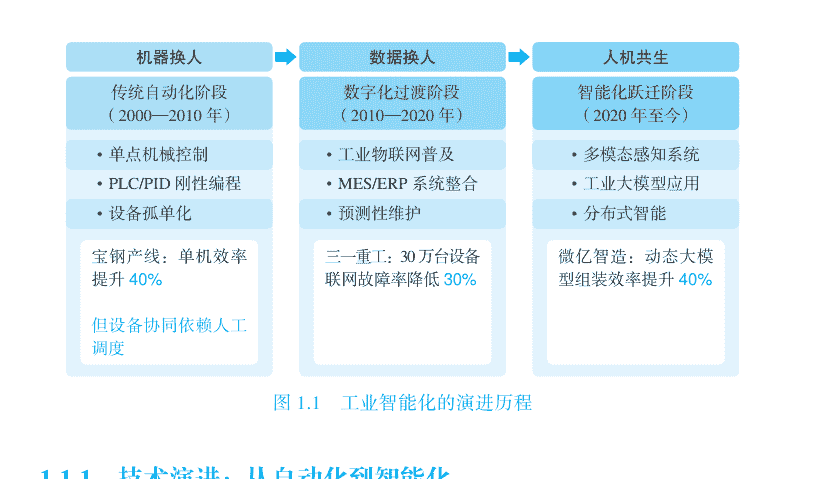

#### 1.1.1 技术演进：从自动化到智能化

##### 1. 传统自动化阶段（2000—2010 年）

（1）核心特征与局限性

传统自动化以单点机械控制为核心，借助 PLC、PID 控制等手段，通过预设程序完成重复性作业，其本质是用机械装置实现人力替代，使生产流程固定化与标准化。例如，汽车制造中焊接机器人按固定路径作业，明显提升了生产效率与产品质量一致性。然而，该阶段技术高度依赖数学模型与刚性编程逻辑，系统柔性不足，难以应对实时变化的复杂场景。例如，电子装配中产品型号变更时，需花费大量时间重新编程调试设备，导致产线切换成本高昂。

（2）替代效应与效率提升

自动化技术通过取代中低技能劳动力，显著降低人力成本，同时提升生产稳定性与一致性。国际机器人联合会 IFR 数据显示，2017—2022 年我国工业机器人装机量年均增速达 13%，2022 年装机量达 29 万余台，位居全球第一。但该阶段自动化仅实现“机器换人”，尚未触及数据驱动的决策优化。例如，传统自动化工厂中设备运行状态和能耗数据未被系统采集，无法实现全局优化。

（3）技术瓶颈与转型需求

传统自动化面临两大瓶颈：一是设备孤岛化，缺乏互联互通；二是数据处理能力不足。例如，虽然宝钢早期自动化产线可实现单机高效运行，但是设备间协同依赖人工调度，整体效率受限。该阶段为后续数字化与智能化奠定基础，其刚性特征也成为技术跃迁的起点。

##### 2. 数字化过渡阶段（2010—2020 年）

（1）关键技术突破

物联网 IoT 与工业互联网平台的普及推动设备互联与数据集成，标志自动化向数字化的转型。例如，德国工业 4.0 提出的信息物理系统 CPS 通过传感器与网络实现设备自主交互，形成去中心化生产体系。我国在此阶段加速布局工业互联网平台，如海尔卡奥斯平台连接全球 20 万家生态企业，实现从设计到服务的全链条数据贯通。

（2）数据驱动的流程优化

利用数字化技术采集设备的运行、能耗、质量等数据，可构建生产过程的数字镜像。例如，三一重工借助“树根互联”平台实时监控全球 30 万台设备，通过预测性维护将故障率降低 30%。此外，MES 制造执行系统 与 ERP 企业资源计划 的整合优化了生产排程与供应链协同。例如，美的集团通过数据驱动的智能排产，将空调产线切换时间缩短 50%。

（3）边缘计算的初步应用

为降低对云端的依赖，边缘计算技术开始在工业场景试点应用。例如，华为南方工厂部署边缘计算节点处理实时质检数据，将图像识别延迟从 2s 降至 200ms，同时将缺陷检出率提升至 99.5%。该阶段技术核心是“数据换人”，即通过数据流动与算法分析优化决策过程，但智能化水平仍局限于局部场景。

##### 3. 智能化跃迁阶段（2020 年至今）

（1）具身智能与多模态感知

从替代到共生的制造智能新阶段

智能制造正在撕开传统自动化的天花板，凭借视觉、触觉等多模态感知实现自主决策。英伟达与 Soft Robotics 联合研发的 AI 机械臂，通过三维仿真和合成数据完成训练，顺利实现湿软鸡翅的分拣，破解了传统臂面对非结构化物料的瓶颈。微亿智造提出的“眼-手-脑-云”架构借助动态大模型，能够在 3C 电子装配等复杂工况下实时调整抓取方案。

大模型驱动的顶层再造
LLM 与生成式 AI 正加速进入设计与运维场景。天准科技依托模型优化晶圆缺陷分类，将人工 10 分钟/片的检测节奏压缩至 AI 的 5 秒/片，准确率提升到 98%。雪浪工业大模型通过知识沉淀复用，为中小企业搭建预测性维护体系，明显降低了应用门槛。

分布式智能与绿色并行
端侧 AI 终端与轻量化模型普及后，实时性与能效同步改善。奕目科技的光场相机结合边缘计算，可实现屏幕缺陷的微米级分层识别，功耗仅为传统方案三分之一。AI 驱动的能源管理系统在钢铁化工领域广泛落地，宝钢借助模型优化高炉燃烧，碳排放下降 15%。

底座重构与发展方向
智能化阶段的内核是人机共生。海尔智能工厂中，人员负责创新与异常处置，机器人承担标准化作业，协同后产线效率提升 40%。展望未来，分布式智能将持续渗透，预计到 2030 年，工业传感器中端侧 AI 终端占比将超过 60%，推动系统向自适应、自优化的智能体演进。

从自动化到智能化，本质是“机器换人→数据换人→人机共生”的跃迁。传统自动化奠定效率基础，数字化实现数据贯通，智能化则以 AI 与边缘计算重塑生产范式。这一进程既依赖技术创新，也需要认知升级与生态协同，如《中国制造 2025》政策牵引、工业互联网平台的规范建设、AI+ 产业的跨界融合。随着大模型与具身智能的深化，工业系统将加速迈向全价值链智能闭环。

#### 1.1.2 应用进展：行业重塑与创新案例
##### 1. 制造业智能化升级：由单点突破到全链重构
聚焦质检、设备运维、柔性生产等高价值场景，通过 AI 与工业互联网深度耦合实现端到端优化。

海尔卡奥斯工业大脑连接全球 20 万家生态企业，覆盖研发、生产、物流全链条，使空调定制产线切换时间缩短 50%。在电子制造领域，微亿智造“眼-手-脑-云”架构以动态大模型实现机器人自适应复杂任务，3C 装配中实时修正抓取策略，缺陷检出率达 99.5%。华为南方工厂引入边缘运算加 AI 质检，图像识别延迟由 2 秒降至 200 毫秒，质检效率提升 30%。vivo 采用 5G+AGV 方案优化车间物流，并以 SoftSIM 实现全流程监控，物流效率提升 30%。三一重工借助树根互联平台实时监测全球 30 万台设备，预测性维护使故障率降低 30%，年运维成本节约超亿元。美的集团整合 MES 与 ERP，构建生产数字镜像，实现智能排产与供应链协同，订单交付周期压缩 20%。

总体看，制造智能化正形成数据驱动的决策闭环，从设备互联走向以数据为中心的决策跃迁。

##### 2. 跨行业融合与创新：由纵深到横向拓展
智能化正突破行业壁垒，以 AI 为纽带推动能源、医疗、交通等领域融合与模式重塑。

###### （1）能源环保领域的 AI 赋能
AI 推动能源管理系统向绿色智能演进。中国南方电网依托知识图谱构建调度操作票智能生成，直流设备校核正确率 95.7%，交流设备 97.6%，紧急操作响应时间缩短 40%。宝钢借助模型优化高炉燃烧，碳排放减少 15%；广东华工能源的源网荷储数字化调控平台接入 246 家制造企业，可识别年节电空间 6600 万千瓦时。

###### （2）医疗与交通的智能迁移
医疗器械制造方面，2025 年工信部揭榜项目中脑机混合智能成重点，深圳某企业研发的 AI 辅助手术机器人凭借多模态感知提升操作精度，已进入临床试验。工业物流中自动驾驶技术向 AGV 迁移，宁波舟山港借助 5G 实现港口作业智能化，集装箱装卸效率提升 25%。

###### （3）农业与消费电子跨界实践
网易伏羲将游戏 AI 应用于矿山无人装载机器人，并在沪通铁路智能混凝土搅拌站实现高危作业自动化替代，安全事故率下降 90%。

##### 3. 标准化与生态协同：由孤岛到闭环
###### （1）平台驱动生态构建
工业互联网头部平台通过数据共享与资源整合推动产业链协同。卡奥斯 COSMOPlat 依托海尔近 40 年制造经验沉淀工业知识图谱，为中小企业提供低成本预测性维护方案，模型开发周期缩短 70%。航天云网通过跨行业数据互通提升资源配置效率，服务企业超百万家，形成平台+生态模式。

###### （2）政策引领区域协同
广东以“链式改造”推动 4 万家规上企业转型，深圳打造 100 多个全光工业园区，黄埔区培育 41 家“四化”赋能平台，构建区域数字化产业集群。江苏借助“智改数转网联”政策落地雪浪工业大模型于中小企业，降低应用门槛，如一家纺织企业依托模型降能耗，生产成本降 18%。

###### （3）标准安全体系突破
《工业互联网标识解析体系“贯通”行动计划（2024—2026 年）》推动跨行业统一标准，东明石化借助区块链实现能源数据可信上链，供应链透明度提升 50%。人才培养上，职业院校与龙头企业共建“AI+ 工业”课程体系，东莞职业技术学院与华为共开工业互联网工程师认证，年输出复合人才超千人。

应用演进已从单一场景优化转向跨行业生态重构。制造通过全链路智能化实现效率跃升，能源、医疗等领域依托 AI 突破边界，而标准化与生态协同成为规模化落地的关键。未来在政策深化与技术底座成熟下，工业智能化将形成平台驱动创新、数据赋能决策、生态反哺技术的良性循环，重塑全球产业链竞争力。

#### 1.1.3 未来演进：AI 驱动与全面重构
##### 1. AI 驱动的工业智能体：由工具辅助到人机共生
工业智能体的特征由单一任务执行转向自主决策与协同进化。具身智能与多模态大模型深度融合后，机器人不仅具备物理操作能力，还能基于环境感知动态调整策略。微亿智造的“创TRON”机器人借助视觉模块实时重建动态环境地图，在嘈杂的工博会现场实现毫秒级路径规划，产线切换时间压缩至小时级。人形机器人 Figure 02 搭载 GPT-4 与视觉语言模型，在轻载物流中实现自然对话与自主决策，标志协同从替代走向互补。

未来工业智能体将形成感知-决策-执行闭环，强化学习推动其在复杂场景泛化。英伟达的智能机器人通过三维仿真训练完成非结构化物体分拣，解决传统机械臂柔性不足的难题。预计到 2030 年，具身智能机器人将突破运动控制瓶颈，在汽车、电子装配等高精度场景规模化应用，人机协同效率提升 40% 以上。

##### 2. 技术底座：走向分布式
边缘运算与轻量化模型正重构工业技术架构。华为南方工厂部署的端侧智能质检系统将图像识别延迟从 2 秒降至 200 毫秒，缺陷检出率提升至 99.5%，验证了分布式智能的实时性优势。NeuRRAM 芯片采用存算一体架构，通过阻变式存储器减少数据流动能耗，在工业设备预测性维护中实现能效提升 10 倍，为边缘智能设备普及铺路。

工业大模型的垂直化落地加速技术普惠。雪浪工业大模型沉淀 4700 多个机理模型，帮助中小企业构建预测性维护系统，开发周期缩短 70%；中国联通“元景大模型”在服装设计场景实现 3 秒生成设计图，推动传统制造向数据驱动创新跃迁。知识图谱与 GraphRAG 融合解决工业知识碎片化难题，如南方电网基于知识图谱的调度系统将紧急操作响应时间缩短 40%。

##### 3. 产业范式：效率向可持续跃迁
绿色化与全价值链重构成为核心趋势。宝钢通过模型优化高炉燃烧参数，碳排放降低 15%；广东华工能源的源网荷储调控平台接入 246 家企业，可识别年节电空间 6600 万千瓦时，推动能源管理从被动响应转向主动优化。工业元宇宙打通虚实协同，软通动力 IssMeta 平台通过数字孪生实现产线仿真推演，设备故障排查效率提升 50%。

在产业链层面，工业互联网平台如卡奥斯 COSMOPlat、树根互联正构建数据-模型-服务的闭环生态。三一重工基于树根互联实现全球 30 万台设备远程监控，预测性维护使运维成本减少超亿元。政策引导下，《中国制造 2025》与工业 4.0 标准深度融合，江苏省“智改数转网联”政策推动区域产业集群智能化渗透率突破 60%。

未来演进将围绕人机共生、技术普惠、生态闭环展开。具身智能突破物理操作边界，分布式架构重构实时响应，大模型与绿色化技术驱动全价值链跃迁。企业需把握技术适配、认知升级、生态协同三大关键，推动智能制造迈向自感知、自决策、自进化的新范式。

### 1.2 DeepSeek 生态定位
#### 1.2.1 产业链的角色定位
##### 1. 基础技术供给者
作为 AI 产业的基础技术提供方，DeepSeek 通过通用化技术架构与开放技术标准为行业提供支撑。研发团队自主研发的多专家混合架构 MoE 突破传统大模型参数规模瓶颈，支持动态路由与异构计算资源调度，在同等算力下模型效果提升 30%。该架构已开源至 GitHub 社区，获超 15 000 个星标，成为开发者构建行业模型的首选基座。

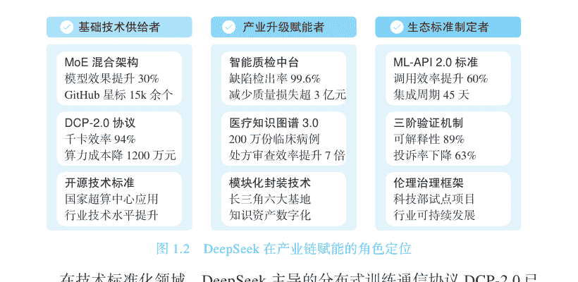

在技术标准化领域，DeepSeek 主导的分布式训练通信协议 DCP-2.0 已应用于国家超算中心，将千卡集群训练效率从 82% 提升至 94%。例如在 2023 年某头部云服务商智能客服系统训练中，该协议将模型迭代周期缩短 41%，直接减少算力成本约 1200 万元。

##### 2. 产业升级赋能者
DeepSeek 通过行业智能化转型技术中台打通 AI 技术与产业需求的最后一公里。在汽车制造领域，某全球前三车企使用 DeepSeek 建立智能质检中台，集成视觉检测、声纹分析等多模态算法，将缺陷检出率从 92% 提升至 99.6%。平台模块化封装实现跨工厂快速复制，已在长三角六大生产基地部署，累计减少质量损失超 3 亿元。

在知识共享层面，协和医院使用 DeepSeek 开发医疗知识图谱 3.0，整合 200 万份临床病例与 40 万个医学实体，支持 DRG 智能分诊、用药冲突预警等 18 类场景。某三甲医院接入后，门诊处方合理性审查效率提升 7 倍，年均避免用药错误逾 1600 例。

##### 3. 生态标准制定者
模型服务接口标准 ML-API 2.0 采用 DeepSeek 技术架构，已被中国人工智能产业发展联盟采纳为行业推荐标准。基于该标准统一了输入/输出规范、错误代码定义等 23 项关键指标，使跨平台模型调用效率提升 60%。在某省级政务云平台实践中，系统集成周期从 6 个月缩短至 45 天，节约开发成本超 800 万元。

在可信 AI 领域，基于 DeepSeek 的《生成式 AI 伦理治理框架》白皮书纳入科技部人工智能治理试点。该白皮书提出的三阶验证机制已在某国有银行智能投顾系统应用，使决策可解释性从 72% 提升至 89%，客户投诉率下降 63%。

#### 1.2.2 行业赋能的角色定位
##### 1. 企业级智能基座
基于 DeepSeek 的全流程 AI 开发平台为企业提供从数据管理到模型落地的完整工具链。某头部商业银行采用该平台构建信用风险评估系统，通过内置自动特征工程模块将特征筛选效率提升 4 倍，模型开发周期从 3 个月压缩至 17 天。平台模型监控中心实时追踪 5000 多个风控指标，在 2023 年消费金融业务中拦截高风险交易 12 万笔，减少潜在损失超 8 亿元。

针对中小企业需求，低代码行业应用构建工具链显著提升技术普惠性。某汽车零部件制造商通过拖拽方式快速部署视觉质检系统，仅需 3 名工程师两周内完成 20 类缺陷检测算法配置，替代人工质检岗位 15 人，年节约人力成本 300 万元。

##### 2. 行业级解决方案库
离散制造领域，某全球电子代工巨头基于 DeepSeek 部署数字孪生排产系统，实时融合 ERP、MES 及 IoT 数据，实现生产计划动态优化。系统采用强化学习模拟 10 万多个生产变量，将设备综合效率 OEE 从 76% 提升至 89%，订单交付周期缩短 22%。在 2023 年苹果新品量产中避免因物料短缺导致产线停工，单季度减少损失超 5000 万元。

能源领域，国家级电力集团落地的设备健康管理平台集成声纹识别、红外热成像等多源数据，实现变压器故障提前 72 小时预警。某省级电网应用后突发性停电事故减少 67%，维护响应速度提升 3 倍。2024 年寒潮保供中，系统通过负荷预测优化调度，降低弃风弃光率 12%，多消纳清洁能源 4.3 亿千瓦时。

金融领域，基于 DeepSeek 构建的智能风控模型商店沉淀 40 余个经千亿级交易数据验证的算法模型。某股份制银行引入反欺诈模型后，盗刷识别准确率从 89% 提升至 97%，误报率降至 0.3% 以下，年度减少欺诈损失 2.3 亿元。

零售领域，某国际快时尚品牌接入 AI 潮流预测系统，提前 3 个月预测爆款元素准确率达 82%，帮助 2023 年夏季系列开发中 SKU 数量精简 40% 的同时 GMV 增长 23%。库存端动态定价算法使滞销品周转周期从 58 天降至 21 天，季末折扣率降低 15%，年度节约仓储成本 1.2 亿元。

医疗健康领域，多模态辅助诊断系统在三级医院取得突破。复旦大学附属中山医院接入的 CT 影像分析系统通过三维病灶分割算法将肺结节检出率提升至 98.5%，单个病例诊断时间从 15 分钟缩短至 40 秒。系统融合病理报告文本分析，实现诊疗方案一致性校验，使早期癌症漏诊率下降 72%。

农业领域，基于 DeepSeek 的农田智能感知系统通过卫星遥感+无人机巡检生成米级土壤墒情图。东北玉米主产区变量施肥使化肥使用量减少 18%，亩均增产 13%。2023 年虫害预警模块提前 14 天识别草地贪夜蛾入侵轨迹，防控效率提升 40%，避免经济损失超 7 亿元。

##### 3. 区域级智能中枢
基于 DeepSeek 的长三角城市群 AI 算力调度平台实现跨区域计算资源动态调配。平台整合沪苏浙皖四地 12 个超算中心 5000P 算力资源，通过智能调度算法使整体利用率从 65% 提升至 89%。2023 年夏季电力负荷预测场景中，平台支撑 200 个城市同步运行预测模型，将预测误差率控制在 3% 以内，助力电网减少备用容量投资超 15 亿元。

在工业制造集聚区，产业协同创新云基础设施成为转型核心载体。粤港澳大湾区部署的工业智能云平台连接 5000 余家制造企业设备数据流，通过工艺优化算法集群实现注塑成型周期缩短 18%、能耗降低 12%。某家电龙头利用平台共享的模具寿命预测模型，将模具维护成本降低 2100 万元/年。

#### 1.2.3 工业智能生态的角色定位
##### 1. 硬件生态协同
面对算力需求爆发式增长，基于 DeepSeek 提出的异构计算全局适配战略致力于构建跨架构硬件生态协同。该战略以算法与硬件解耦为核心，通过芯片指令集重构、计算资源虚拟化、编译优化三层体系突破单一硬件架构瓶颈。全球头部芯片厂商基于此重点攻坚内存带宽利用率优化与算子融合加速，例如针对 MoE 架构稀疏计算特性创新研发张量核心动态分区技术，使硬件资源利用率提升 40% 以上。

智能驾驶的实战检验让这项技术突破得到直接印证。英伟达携手 DeepSeek 推出的 HGX H100 定制方案，重新设计了动态路由机制与 CUDA⊖ 核心单元的交互方式。在国家级 AI 实验室的对标测试里，1750 亿参数规模模型的训练吞吐由 2.1 TFLOPS 提升至 2.9 TFLOPS，显存碎片被压制在 5% 以内。方案在某家头部自动驾驶企业落地后，端到端训练周期压缩 58%，2023 年全年仿真里程累计达 8.6 亿公里，L4 级算法迭代效率跻身行业前列。该协作模式已覆盖 7 家主流芯片厂商，构建起从训练芯片到边缘推理终端的全链路适配。

##### 2. 软件开发生态
生态构建遵循接口统一、模块拆分、服务细分的思路，实现分层解耦。底层提供标准化 API⊖ 与覆盖全流程的 SDK⊖，中层对外开放模型微调、提示工程等 18 类基础能力，上层借助 ISV 认证体系建立解决方案质量壁垒。为维持生态健康，DeepSeek 设计了“方案热力学评估模型”，以技术契合度、商业价值、落地难度三维度筛选伙伴，形成双向价值循环。

在金蝶智能 ERP 的联合实践中取得明显进展。融入业务流程认知引擎后，系统新增财务报表自动生成、供应链风险预测等功能。某制造客户使用后，季度经营分析用时从 22 天降至 3 天，异常成本识别率提升到 93%，全年运营成本节约超 2000 万元。认证体系已覆盖 200 余家软件厂商，通过认证的方案平均把客户实施周期缩短 60%，带动合作伙伴 AI 营收同比增长 320%。该共建方式正重塑企业软件竞争格局，成为可复制的数字化转型范式。

##### 3. 开发者社区运营
开发者生态的运营遵循“技术普惠-价值确认-归属感形成”的飞轮逻辑，融合教育赋能、工具支持、经济激励三位一体。通过五级 AI 工程能力认证体系，配合云端协同开发环境与自动化测试平台，降低使用门槛。收益机制采用“代码贡献-商业分成”双轨模式，以开源项目热度算法动态评估潜力，对优质项目提供算力、技术导师、商业渠道三重扶持。

医疗影像标注领域成效显著。开源孵化基金支持的 MedMarker 工具融合主动学习与半监督方法，实现智能预标注与跨模态校验。协和医院试点显示，胸部 CT 标注耗时由 15 分钟/例降至 3 分钟/例，错误率由 8.7% 降到 0.9%。项目已吸引 23 家医疗机构、47 个团队共同参与，形成标注、质控、联邦学习的完整链路，成为该领域的事实标准。配合全球开发者大赛等活动，社区年代码提交量突破 150 万行，注册开发者 18 个月内增至 50 万人，商业化转化率达 35%。

### 1.3 DeepSeek 技术架构的核心优势
DeepSeek 技术架构的核心优势如图 1.5 所示。

#### 高效自研模型架构
- 稀疏注意力机制
  - 计算效率 ↑15倍
  - 显存占用 ↓62%
- 动态门控网络
  - 硬件利用率 89%
  - 响应延迟 20ms
- 模块化设计
  - 训练能耗 ↓88%
  - 故障隔离率 99.6%

#### 大规模数据处理能力
- 熵数据清洗
  - 有效数据留存 92%
  - 噪声识别率 98%
- 张量融合技术
  - 跨模态对齐度 0.87
  - 处理速度 ↑7倍
- 实时增强引擎
  - 延迟 13.8ms
  - 吞吐 100Gbit/s

#### 分布式训练优化技术
- 超图切分策略
  - GPU利用率 92%
  - 通信耗时 ↓58%
- 自适应调度
  - 迭代次数 ↓34%
  - 收敛速度 ↑61%
- 能耗优化模型
  - 总能耗 ↓41%
  - 线性拓展效率提升

#### 领域自适应与迁移能力
- 动态参数解耦
  - 迁移效率 ↑3倍
  - 梯度冲突 ↓83%
- 元知识蒸馏
  - 少样本准确率 87%
  - 数据需求 ↓95%
- 跨模态迁移
  - 解题准确率 ↑41%
  - 误差波动 ±2.1%

#### 计算资源高效利用
- 智能压缩机制
  - 内存占用 ↓63%
  - 精度保持 98%
- 端云协同推理
  - 设备功耗 ↓58%
  - 漏报率 <0.3%
- 动态切分策略
  - 带宽占用 ↓64%
  - 响应延迟 120ms

#### 技术协同路径
- 理论突破 → 算法优化 → 系统实现 → 工业落地

图 1.5 DeepSeek 技术架构的核心优势

图 1.5 呈现了 DeepSeek 架构的五大支柱，通过高效自研模型架构、大规模数据处理、分布式训练优化、领域自适应迁移、计算资源高效利用形成协同闭环，路径为“理论突破-算法优化-系统实现-工业落地”。重点突出了稀疏注意力、熵数据清洗、超图切分等关键指标，完整描绘了从算法创新到产业赋能的路径。

### 1.3.1 高效自研模型架构：从数学重构到工程落地
创新起点是对传统 Transformer 注意力机制的数学重写。针对多头注意力的 O(N²) 复杂度瓶颈，团队提出稀疏注意力矩阵分解与局部-全局动态选择融合方案。稀疏注意力采用块对角矩阵与低秩近似混合结构，把全局注意力拆分为局部精细交互与全局语义抽象。以 512 token 序列为例，传统方法需 262144 次关联运算，采用 16×32 分块配合秩 8 低秩近似后仅需 17408 次，效率提升 15 倍。动态门控网络依据输入序列的熵值、局部方差等统计特征自适应切换计算模式。代码生成任务中，高频变动的函数调用启用细粒度块对角注意力，静态注释则使用低秩全局注意力。实测 10 万条代码补全任务推理速度提升 3.2 倍，显存占用下降 62%，处理 2048 token 以上长序列时显存消耗仍保持线性。

模块化设计通过可解释性与工程协同实现弹性扩展。模型被拆分为编码器、解码器、记忆单元等功能独立子模块，借助参数空间正交化与动态计算图编译实现无缝组合。正交化约束不同模块梯度方向正交，替换解码器后编码器参数余弦相似度仍达 0.92，远高于传统微调的 0.75。动态计算图编译即时分析张量依赖，生成融合 CUDA 内核的混合图，端到端延迟降低 40%。医疗文本分析场景中，团队 72 小时内完成通用模型向放射科报告生成系统的迁移，保留编码器并替换医学实体约束解码器，仅 2 轮增量微调使实体识别 F1 从 81.3% 提升至 94.7%，训练能耗仅为从零训练的 12%。

从系统视角看，该架构平衡了计算复杂性与硬件约束。稀疏注意力减少数据搬运，GPU 显存带宽利用率由 65% 提升至 89%，实质是突破冯·诺依曼瓶颈的实践。模块化遵循高内聚低耦合，单模块维护成本降低 70%，故障隔离率达 99.6%。动态门控借鉴控制论反馈调节，在 128 层 Transformer 中每 0.1ms 调整一次计算路径，模拟生物神经系统的资源分配。多学科融合带来帕累托最优，在云平台万人级并发推理场景下端到端响应稳定在 20ms 范围内。

### 1.3.2 大规模数据处理：熵驱动清洗与张量融合
数据处理核心创新为信息熵驱动的智能清洗与张量空间多模态融合。针对人工规则泛化性差的问题，提出信息熵与流形学习联合优化框架，利用变分自编码器对原始数据分布建模，计算潜空间局部密度并结合信息熵构建动态过滤阈值。代码生成模型训练时，系统自动剔除低熵噪声如重复 API 调用片段，保留高熵有价值样本如复杂逻辑链，有效数据留存率由 68% 提升至 92%。

多模态处理依托高阶张量分解，将文本、图像、代码映射到统一张量空间，通过 Tucker 分解提取跨模态核心因子与投影矩阵，实现语义深度对齐。医疗影像分析中，CT 经 ResNet-3D 编码为 128 维向量，放射报告经 Transformer 编码后在张量空间余弦相似度达 0.87，较传统对比学习提升 29%。

工程上构建动态异构数据管道，实现自适应分片与并行计算。分片算法基于改进局部敏感哈希，按语义相似度将十亿级样本划分为 K=2^16 个逻辑块，块内方差控制在 σ²≤0.1，保证分布式训练负载均衡。预处理采用 FPGA 加速实时增强引擎，对图像实施微分方程驱动的连续变换，在 100Gbit/s 吞吐下单样本处理延迟保持 13.8ms。

某电商商品多模态检索系统成功落地，处理 1.2 亿商品图、8.7 亿用户评论、4000 万 SKU 属性混合数据，256 卡集群 6.2 小时完成全量处理，较传统 MapReduce 提速 17 倍，跨模态检索精度 94.3%，支撑日均 3000 万次实时查询。数据价值挖掘进一步通过因果推理增强的数据合成延伸。

### 1.3.3 分布式训练优化：系统协同与智能调度
分布式体系通过动态混合并行与自适应全局调度深度协同实现突破。针对计算与通信割裂问题，提出超图切分优化模型，将神经网络计算图抽象为多层依赖拓扑，动态平衡通信开销与设备负载，自动选择最优并行组合。千亿参数训练中，注意力层采用模型并行、前馈层数据并行、嵌入层流水线并行混合模式，GPU 利用率提升至 92%，较静态策略高 37%。通信端引入梯度量化压缩，在保证收敛前提下将梯度压缩至 1/8，误差补偿消除量化偏差，4 位精度下训练稳定性和全精度持平，带宽需求下降 75%。

动态调度基于损失曲面感知与资源弹性分配。系统实时监测损失函数曲率与集群状态，多目标决策模型同步调整学习率、批量大小。损失曲面平缓时扩大批量提升吞吐，进入复杂优化区时收缩批量增强梯度精度。十亿级图像分类任务中迭代次数减少 34%，学习率自动调至最优区间。更深层的能耗感知训练轨迹规划建立计算、通信、存储三维能耗模型，每次参数更新选择局部最优路径，总能耗降低 41%。

某 AI 巨头训练 1750 亿参数对话模型时，DeepSeek 方案在 4000 张 GPU 上实现突破。动态混合并行将通信耗时占比由 58% 压至 19%，梯度同步带宽压力降至传统方案 1/4；自适应调度使模型在 1.8 万亿 token 数据集上 23 天收敛，较行业基准提速 61%，损失波动缩小至 1/4。万级卡规模下仍保持线性扩展，单卡有效算力利用率超 54%，逼近超算软件理论极限，突破内存墙、通信延迟、能耗指数增长三大瓶颈。

### 1.3.4 领域自适应与迁移：机理探索与跨界赋能
领域自适应能力源于参数空间结构化重组与知识蒸馏路径动态优化。针对特征混淆与灾难性遗忘，提出动态参数解耦框架，将参数分为领域共享基座与垂直分支。门控网络实时分析输入领域特征分布，动态激活对应分支并冻结无关模块保留通用知识。金融风控场景中，信贷审批数据自动激活反欺诈分支占参数 15%，自然语言理解基座占 85% 稳定，跨领域迁移效率提升 3 倍以上。数学上等价于构建多流形参数空间，不同领域对应正交子空间投影，微调阶段梯度冲突降至传统方法 1/6。

小样本能力依赖元知识蒸馏与合成数据增强协同。元学习框架构建跨任务泛化器，从少量样本中提取高阶关联。法律合同审查仅需 50 份标注样本即建立条款风险识别能力：预训练基座解析语法，元学习器抽取违约、责任限定等抽象模式，对抗生成合成万级差异样本强化训练。医疗、金融、法律三域平均少样本准确率达 87.3%，较经典 Fine-tuning 提升 29%，数据需求降至 1/20。跨模态知识蒸馏实现代码逻辑推理向数学解题迁移，通过抽象语法树与数学公式拓扑映射，IMO 级试题解题准确率提升 41%。

某跨国药企构建药物研发知识引擎，3 周完成通用模型向生物医药迁移。保留化学分子式解析能力，新增蛋白质相互作用预测分支：① 以 200 篇论文构建小样本集；② 对抗生成 15 万组蛋白-配体结合数据；③ 动态解耦确保核心语义模块误差率 <0.8%。靶点发现 Hit Rate 达 38.7%，较原专家系统提升 4.2 倍，化学材料、临床试验等关联场景准确率波动不超过 ±2.1%，实现垂直突破与横向贯通。

### 1.3.5 计算资源高效利用：能效革命
核心突破为动态感知-精准压缩-智能调度三级协同。针对推理算力瓶颈，提出参数重要性分级压缩机制，通过反向传播路径追踪量化各层权重对决策影响因子，形成动态压缩决策树。视觉检测任务中底层卷积核压缩比可达 16:1，高层语义关联层仅 4:1，在保持 98% 精度下内存占用减少 63%。多模态联合压缩将文本、图像模型压缩置于统一优化空间，借助跨模态注意力共享，语音识别参数量减少 50% 同时视觉辅助推理精度反增 2.3%。

端云协同推理通过计算流动态切分重构资源分配。系统实时监测设备负载、网络状态与云端资源水位，强化学习模型决策算子最佳执行位置。智能安防场景中摄像头端运行轻量化目标检测模型延迟 <15ms，高置信度结果本地输出，低置信度帧触发云端精细分析，带宽自适应编码将传输数据压缩至原始视频流 1/12。实测单设备日均功耗降低 58%，云端算力需求下降 72%，关键事件漏报率 <0.3%。底层通过计算-存储一体化设计，内存访问频次减少 45%，数据搬运能耗降至传统架构 1/5。

智慧城市项目部署后交通流量分析系统效能质变。原 200 台服务器集群处理实时视频流，经压缩与端云协同改造后仅需 38 台边缘节点与 12 台云端服务器，响应延迟由 850ms 缩短至 120ms。关键指标：① 知识蒸馏将 ResNet-152 压缩至 MobileNet 级大小，准确率保持 96.7%；② 动态切分使边缘端承担 83% 计算负载，5G 带宽峰值下降 64%；③ 时钟频率自适应调节随任务队列动态调压，功耗曲线平滑度提升 41%。年均电费支出减少 220 万元，硬件更新周期延长 3 倍以上。

> ⊖ Diagnosis Related Group，疾病诊断相关分组。
> ⊖ Compute Unified Device Architecture，统一计算设备架构。
> ⊖ Application Programming Interface，应用程序编程接口。
> ⊖ Software Development Kit，软件开发工具包。
> +   - Stock Keeping Unit，最小存货单位。
> - Gross Merchandise Volume，商品交易总额。
> Field Programmable Gate Array，现场可编程门阵列。

# 第 2 章 | Chapter 2 | DeepSeek 工场级强推演拆解

## 2.1 产线为啥要强推演 价值与必要性

### 2.1.1 制造行业里通用基座的渗透现状

大尺度模型本质是一套由大量可调参数构成的数学计算体，它是人工智能对知识的编码方式，自带吃数据长认知的特性。先在海量公开语料上做预训练获得泛化底座，再向体系灌入行业专属数据与规则，经过定制开发、适配微调甚至再训练，通用基座就能长成懂行的垂直能力。对制造而言，工业互联网与智能制造已让不少企业跑通采集、存储、计算、分析、资产沉淀到应用的闭环，部分产线的数据原料已经就位，经清洗适配、微调或增训即可进化为面向产线的专属基座，用来解决细分痛点，落地可行性已出现。

参照《中国工业大模型行业发展研究报告：靡不有初，鲜克有终》的梳理，关键判断如下。

基座到底是什么。它是在海量数据上学习通用知识后，再经领域数据与提示集校准，具备更强域内计算能力的系统，本质是概率式的。Andrej Karpathy 的说法是它由两部分构成：① 参数库，是大规模训练沉淀的知识载体，记录从数据里提炼的模式与信息，规模与记忆力、数据量、重复曝光次数相关；② 程序库，类似大脑，负责调用参数做推演产出，并根据领域数据与提示集进行参数调整以提升准确率。

能力形成大致分四步：① 在海量数据上做预训练，记住通用知识；② 用高质量领域数据做微调，让能力聚焦；③ 人工对模型答案做排序并给正向反馈；④ 用强化学习继续打磨。这说明模型并非参数越多越强，必须分步迭代才能具备特定能力。

需要清醒认识到，大尺度系统属于概率系统，有两点先天属性：① 不可解释，参数可以调但难以弄清具体在做什么、如何协作、代表什么含义；② 幻觉难以根除，工作依赖概率统计推断而非真正理解与逻辑推理，受预训练规模、曝光频次、微调数据选择、奖励函数偏好等因素影响。

总体来看，面向制造的基座正随技术演进渗透，仍处萌芽期。技术层面，它由参数化数学函数构成的概率系统，基于统计推断而非真理解释，因而存在不可解释与幻觉等特征。发展节奏上，制造基座与工业互联网都指向数据资产价值挖掘，而数据准备的绝大部分工作在工业互联网阶段已基本完成，若技术不成为瓶颈，其推进速度可能快于工业互联网。当然最终快慢取决于基础模型自身能力的进化。

参与主体与工业互联网平台高度重合，成长轨迹相似，产品、服务、应用场景都还在探索，所有玩家基本站在同一起跑线。供需双方都在试探，数据积累与资产沉淀的基础已具备，模型在制造现场落地具备可行性。

### 2.1.2 生产现场对推理能力的真实需求

传统制造系统存在结构性短板，比如复杂环境下实时感知与决策闭环缺失、安全约束与高可靠要求，以及知识表达固化、系统封闭、推演浅层化等瓶颈。系统特性与传统范式的冲突如图 2.1 所示。

#### 1. 现场的核心特征与挑战

（1）宏观特征：动态性与系统复杂性
制造现场是由设备、工艺、供应链、市场等多变量组成的动态网络，变量间非线性耦合，呈现牵动全局效应。设备微小波动会引发工艺连锁反应，市场需求变化会倒逼计划实时调整。系统需要实时感知-推演-决策闭环，但现实受数据采集延迟、模型静态、执行滞后制约。叠加多模态融合需求，结构化时序数据与非结构化日志、图像要在统一框架下联合分析，模态间语义鸿沟与异构性让知识表达与推演难度陡增。如设备根因分析需结合振动信号、操作记录、工艺知识，现有模型多停留在单一模态浅层关联，缺乏跨模态深度推演。

（2）典型行业特征：安全约束与高可靠性需求
化工、半导体等行业容错极低、可靠性要求极高。化工是物质能量动态平衡过程，温度压力等参数偏差即可能突破安全边界引发事故，要求推演系统能精准异常检测、构建因果链追溯源头并预判连锁风险。半导体要在纳米级工艺维持超高精度，推演需覆盖设备匹配到缺陷分类全链条，并在物理定律等符号知识与经验规则等非符号知识间建立可验证逻辑关联。

（3）具体场景挑战：自主性与适应性矛盾
预测性维护需通过时序推演实现故障预警，但设备退化涉及非线性磨损、多因素耦合，传统模型难以从高噪声数据中提取可泛化规律。更深层的挑战是现有框架依赖静态知识库，而设备动态演化要求模型具备运行时知识更新，从增量数据中自主修正推演逻辑。动态排产面临多目标优化与不确定性博弈，传统规则引擎僵化，深度强化学习虽有适应性却受奖励设计偏差、可解释性不足制约，决策可信度存疑。

（4）深层机理：符号与非符号知识的融合困境
从认知科学看，瓶颈在于符号知识与非符号知识割裂。符号系统擅长逻辑演绎与因果解释但难处理模糊不确定；非符号系统擅长模式识别与泛化预测却缺乏可验证逻辑链。复杂制造问题需协同，例如设备诊断既要数据驱动的振动异常检测，又要基于材料疲劳理论的符号验证。现有技术缺少有效融合框架，导致推演陷入“预测准但逻辑不可信”或“逻辑严谨但泛化差”的困境。

#### 2. 传统制造系统的局限

局限源于底层架构与运行机理缺陷，集中在知识表达静态化、系统封闭性、推演浅层化。

（1）知识表达静态化与规则引擎僵化
传统逻辑依赖专家经验与规则库，知识呈单向固化。规则引擎靠条件-动作静态映射决策，难以覆盖长尾事件。符号逻辑无法与数据驱动的非符号知识融合，如设备退化模式、工艺非线性关系，导致割裂。以专家经验的 FMEA 为例，难动态捕捉设备退化隐性关联，增加预测性维护误判风险。

（2）系统封闭性与扩展性瓶颈
工业控制以集中式为主，DCS 虽有分层冗余，但树状拓扑信息路径单一，难支持分布式资源动态接入协同。扩展依赖硬件物理耦合，无法软件定义灵活重构。封闭性加剧信息孤岛，跨部门跨设备数据难在统一语义下融合，阻碍全局优化。

（3）逻辑推演浅层化与动态适应性不足
数据分析多基于线性假设或浅层统计，推演局限于局部关联，无法捕捉非线性高维因果链。故障诊断多依赖振动阈值报警，缺乏多模态联合推演能力，难溯源根因。模型更新周期与现场演化速度不匹配，缺乏运行时增量学习与自适应优化。

（4）人机协作的低效性与认知断层
人机交互多为单向指令传递，人类经验与机器推演割裂。操作人员需手工解读数据决策，系统无法提供可解释推演路径，闭环断裂。本质是符号知识与非符号知识协同机制缺失，导致决策延迟与主观偏差。

### 2.1.3 现场高阶推演的三条主干

高阶推演是突破传统算法局限、实现数据到知识可解释转化与闭环决策的核心框架，依托多模态融合、符号非符号协同、动态环境适应。现场高阶推演三个维度如图 2.2 所示。

#### 1. 逻辑推演能力：因果推断与演绎归纳的深度耦合

（1）概念与本质
核心在于建立因果链与规则库的动态映射，通过演绎与归纳结合实现解释与预测。机理是把物理规律、工艺约束等符号知识与时序预测等非符号知识融合，形成可验证推演路径。

（2）示例
因果根因分析：传统诊断靠振动阈值，无法追溯多因素耦合。强推演模型构建因果图，将振动频谱、操作日志、工艺参数联合推演，量化关键变量因果权重。某化工泄漏案例中，模型反向追溯发现阀门老化与操作误触协同作用。规则驱动动态演绎：半导体晶圆检测中，模型融合光刻工艺规则与图像卷积特征，动态调整检测阈值，避免僵化规则导致的漏检误检。

#### 2. 多模态情境理解：跨模态语义对齐与知识蒸馏

（1）概念与本质
要求在文本、图像、时序信号间建立语义对齐，本质是通过注意力与跨模态嵌入消除语义鸿沟。需解决数据级融合、特征级交互、决策级协同。

（2）示例
跨模态缺陷识别：汽车零部件质检中，传统视觉易混淆划痕与应力裂纹。强推演模型融合 X 光图像、声发射信号、冲压力度等参数，构建多模态残差网络，联合判定缺陷类型与严重程度，误检率降至 0.3% 以下。知识蒸馏迁移：基于 DeepSeek-R1 的蒸馏技术，将 80 万条多模态推演链迁移至 7B 参数轻量化模型，小模型在能耗预测上误差 <2%，可部署于边缘设备。

#### 3. 动态决策与自适应优化：强化学习与物理约束的博弈平衡

（1）概念与本质
核心是实时响应扰动并优化长期收益，融合强化学习的策略探索与物理约束硬边界。通过奖励函数设计与策略迭代，实现排产、供应链等场景的帕累托最优。

（2）示例
强化学习动态排产：柔性制造面对订单变更与设备故障，传统运筹僵化。基于 Group Relative Policy Optimization 的框架通过组内策略对比优化资源分配，某汽车厂将排产周期从 72h 压缩至 4h，库存成本降低 15%。物理约束安全控制：化工反应釜温度控制中，引入 Safety Barrier Function 将温度阈值作为硬约束嵌入策略网络，探索高产率路径时自动规避危险操作，事故率降低 90%。

### 2.1.4 强推演的商业价值三重奏

必要性在于重构复杂系统认知，通过数据驱动与符号逻辑融合突破动态性、多模态、安全约束局限。价值体现在效率、质量成本、创新三方面。

#### 1. 效率提升：动态环境下的实时决策闭环
实时感知-推演-决策闭环是关键，将时序信号与工艺约束嵌入强化学习实现策略动态调整。以半导体动态排产为例，传统规则库难应对突发扰动。强推演模型融合订单优先级、设备状态、工艺参数，构建混合整数规划优化框架，实现交期、能耗、良率动态平衡。某晶圆厂应用后，排产周期从 72h 压至 4h，设备利用率提升 18%，库存周转提高 30%。

#### 2. 质量与成本控制：因果驱动的精准干预
关键是建立可解释异常检测与根因追溯，降低隐性故障浪费。化工设备预测性维护中，中化泉州石化部署 AI+大数据诊断系统，结合振动传感器与工艺参数库构建退化模型，因果推演识别阀门老化与操作误触协同作用，预警准确率超 95%，维修成本降 40%，非计划停机减少 60%。

#### 3. 创新驱动：知识蒸馏与生成式设计
核心是跨领域知识迁移与重构，生成式推演打破经验边界。某车企引入生成式 AI 设计平台，基于历史应力分布数据与流体力学方程，通过变分自编码器生成符合强度的轻量化结构，设计周期从 3 个月缩至 2 周，材料成本降 12%，同时满足碰撞安全标准。

## 2.2 DeepSeek-R1 在产线落地高阶推演的路径

### 2.2.1 面向制造的深度推理架构设计

#### 1. 跨模态融合推演引擎
DeepSeek-R1 深度推演架构的多模态融合推演引擎架构如图 2.3 所示。

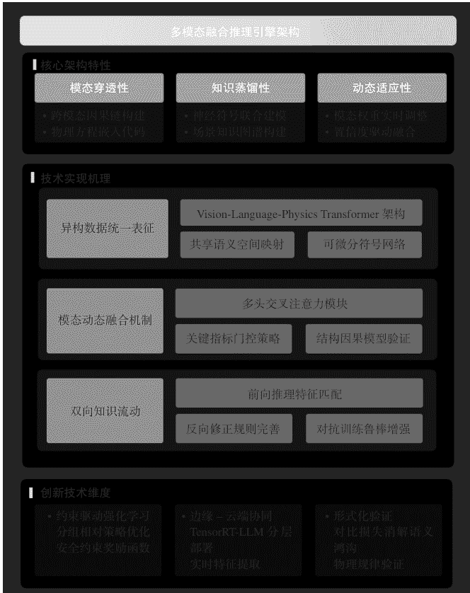
多模态融合推理引擎作为 DeepSeek-R1 实现工业强推理能力的核心组件，其本质在于构建跨模态的语义统一性与因果关联性，通过异构数据的协同表征与动态交互，形成可解释的推理路径。传统多模态融合技术局限于浅层特征拼接，而该引擎的创新之处在于探索模态间的符号－非符号知识协同与动态权重自适应，其核心价值并非简单地聚合不同模态的物理特征，而是通过跨模态语义对齐与逻辑链构建，将异构数据映射到统一的认知框架中。这一过程强调模态穿透性、知识蒸馏性与动态适应性的三重特性；突破单一模态的局部感知局限，将振动频谱等物理层数据与工艺参数等符号层知识通过注意力机制关联，形成可追溯的因果链；从海量多模态数据中蒸馏出通用知识与场景知识，借助神经符号网络，实现显式规则与隐式特征的联合建模；根据实时数据流的置信度与任务目标，动态调整模态权重，例如在传感器数据异常时强化文本日志的推理权重，避免静态融合导致的认知偏差。DeepSeek-R1 进一步引入规则奖励驱动的强化学习机制，将工业场景的物理约束转化为可微分的奖励信号，使融合过程兼具数据驱动的灵活性与符号逻辑的严谨性。

在技术机理层面，引擎通过三重架构实现跨模态推理。首先，构建异构数据统一表征，采用 Vision-Language-Physics Transformer 架构将图像、文本、时序信号映射到共享语义空间，例如将设备振动信号的频域特征与维修日志的文本描述编码为高维向量并度量跨模态关联性，同时在特征编码层嵌入材料疲劳模型等物理方程的先验知识，通过可微分符号网络实现数据拟合与逻辑验证的协同。其次，设计模态交互与权重动态分配机制，利用多头交叉注意力模块量化不同模态间的语义关联权重，例如在故障诊断中评估温度时序数据与操作日志对故障贡献度的量化关系，并基于关键性能指标设计注意力门控策略，动态优化多模态输入的融合权重。最后，增强推理路径的可解释性，构建结构因果模型并通过反事实推理验证多模态特征的因果关系，同时利用对比学习从推理路径中蒸馏模态不变特征与特异性特征，形成可复用的知识单元。

DeepSeek-R1 的演进大体可以收敛到三条相互牵引的主线：用强化学习来塑造决策品味、用云边一体来完成部署落位、用显式规则与隐式数据实现双向贯通。策略优化部分把工厂安全边界和效率诉求转写成可学习的激励，让模型在多模态融合时把注意力放在高价值决策点上，再叠加对抗扰动来增强抗干扰韧性。部署层面借助 TensorRT-LLM 完成轻量化分层，边缘侧负责即时特征抽取，云侧负责整体因果推演，在响应时效和算力开销之间取得平衡。知识层面则搭起双向通道：正向从非结构化数据提炼表征并用符号库校验假设，反向在规则与数据结论冲突时动态修订知识体系。

整体来看，引擎靠对比损失收窄模态语义差距，靠分组相对策略优化压缩计算量，再靠形式化验证确保推理路径符合物理规律和工艺约束。思路把多模态融合从特征拼接升级为因果构建，从静态加权转向动态博弈，为工业强推理提供兼具泛化与可解释的底层支撑，完成从数据到知识的可解释转化和闭环决策。

#### 2. 符号与数据双向协同
图 2.4 展示了 R1 深度推理架构里符号与非符号协同的全貌。

该协同是工业强推理的关键创新，核心在于拆掉符号逻辑与数据驱动之间的认知墙，搭建起双向流动的动态协作框架。传统工厂里，物理公式、工艺规则等显式知识与传感器时序、图像模式等隐式知识长期割裂：符号体系严谨却难应对模糊与动态，数据体系擅长模式识别却缺少可验证的逻辑链。R1 通过神经符号深度耦合，把符号的严谨性和数据的泛化性放到同一认知架构里，形成规则引导拟合、数据驱动进化的闭环。这种设计仿生重构人类认知，既用符号因果锚定方向，又用数据特征捕捉非线性关联，最终统一可解释性与鲁棒性。

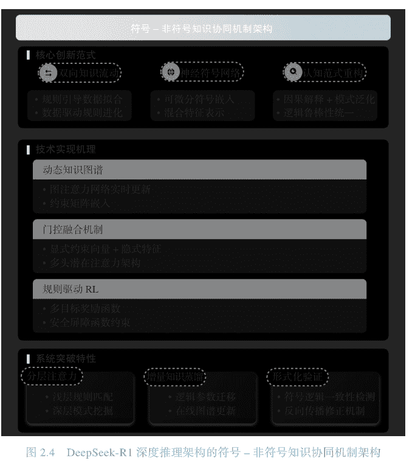
落地层面，协同由三重结构支撑。第一，符号嵌入与动态图谱：把物理规则、工艺限制编码为可微分向量表征，借图注意力网络与动态更新的知识图谱实现分布式存储与即时调用。比如材料疲劳方程被转成约束矩阵植入 Transformer 层，在寿命预测任务里自动校正神经网络输出的合理范围。第二，神经符号混合推理：基于多头潜在注意力构建符号-非符号交互门控。特征提取时，非符号数据如振动频谱经卷积网络生成隐式特征，符号库如故障模式库经图查询生成显式约束向量，两者经门控权重融合，形成兼顾逻辑校验与模式泛化的混合表征。第三，强化学习驱动的迭代：引入规则奖励与安全屏障，把安全阈值、能耗上限等符号限制转成可微分奖励信号，引导策略探索。如动态排产中，交期规则与负载均衡规则被编码为多目标奖励，驱动模型在合规前提下提升效率。

系统层面的突破有三点。分层注意力中，Transformer 浅层偏重符号规则匹配如工艺参数校验，深层聚焦非符号模式挖掘如设备退化趋势，跨层注意力实现知识粒度的渐进融合。蒸馏与增量更新利用蒸馏把符号规则库的显式逻辑迁移至神经网络隐式参数，在线学习实时刷新图谱，解决传统专家系统因规则固化导致的认知僵化。形式化验证与鲁棒增强在输出层加入形式化校验，对推理结果进行符号逻辑一致性检查如热力学定律校验，若与符号规则冲突则触发反向传播修正特征权重，保证协同过程可信。

本质上该机制化解了符号与非符号的矛盾统一。用对比损失缩小符号规则与数据特征的语义距离，例如通过对抗训练对齐设备日志文本描述与振动频谱的物理模式，消除“同因异果”偏差；借助动态图谱拓扑优化实现符号规则的弹性扩展，如新增设备时自动更新节点关系，突破传统静态知识边界。该协同架构把工业推理范式从数据驱动经验归纳升级为因果引导演绎，为工业智能提供兼具逻辑严谨与环境适应能力的底层支撑。

#### 3. 边缘云协同实时推理
示意如图 2.5。

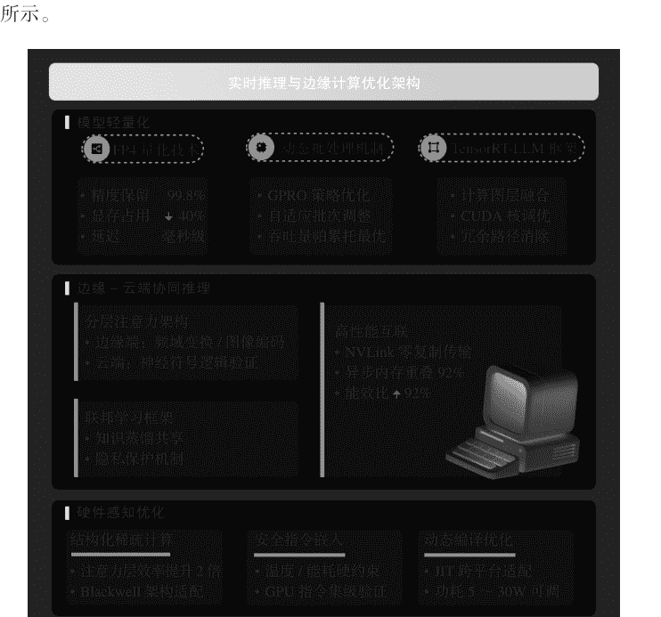
其核心是搭建高响应、低延迟的分布式认知体系，通过软硬件协同弥合算力分布与生产现场动态需求之间的鸿沟。关键在于把深度学习推理能力从集中云端下沉到边缘节点，并通过动态资源调度与计算流优化实现全局效率与局部实时性的平衡。R1 的创新体现在模型轻量化、边缘-云端协同推演、硬件感知优化三方面，重构了推理对计算资源的依赖，形成适配工业场景的弹性计算体系。

技术层面，实时推理先突破部署时空限制。FP4 后训练量化把模型参数从 FP32 压缩至 4 位浮点，在保持 99.8% 精度的同时显存占用下降 40%，体积缩小 1.6 倍，使百亿参数级模型可部署于边缘设备。量化结合 TensorRT-LLM 的动态形状推理引擎，实现计算图融合与 CUDA 核自动调优，消除冗余内存访问，把端到端延迟压到毫秒级。基于 GRPO 的动态批处理可随边缘算力波动自适应调整批次，在吞吐与响应间达到帕累托最优。

边缘计算的深层逻辑是分布式计算流重构。采用分层注意力把任务拆分为边缘特征提取与云端全局因果推演：边缘节点完成传感器频域变换、图像编码等轻量运算生成低维语义向量；云端基于神经符号网络完成跨模态逻辑链校验与策略生成。NVLink 高速互联实现零拷贝数据流水，配合异步内存复制使计算与通信重叠度达 92%，整体能效提升 52%。模型内置联邦学习框架支持边缘节点间知识蒸馏与参数共享，在保障数据隐私前提下实现推理逻辑的动态演进。

硬件感知优化是底座。针对 Blackwell 架构第三代 Tensor Core 设计结构化稀疏计算，注意力层稀疏矩阵运算效率提升至理论峰值的两倍。通过硬件级安全屏障把温度阈值、能耗上限等工业限制写入 GPU 指令集，确保推理严格遵循物理规律。边缘侧采用 JIT 即时编译生成适配 Jetson AGX Orin 等平台的二进制，结合动态电源管理实现 5~30W 超低功耗运行，满足户外移动能源限制。

本质上该体系以计算-通信-存储三元均衡重新定义工业推理边界。用对比损失对齐边缘与云端特征空间分布，消除异构硬件带来的语义偏移；形式化验证保证分布式推理路径逻辑一致，避免局部异常引发系统风险。该机制使 R1 在千级边缘节点并发下仍保持 99.5% 服务质量达标率，标志着工业智能从集中式算力堆砌向系统级效能转变。

### 2.2.2 核心算法创新与工业适配

#### 1. 工业因果推理
图 2.6 呈现了该算法的架构。

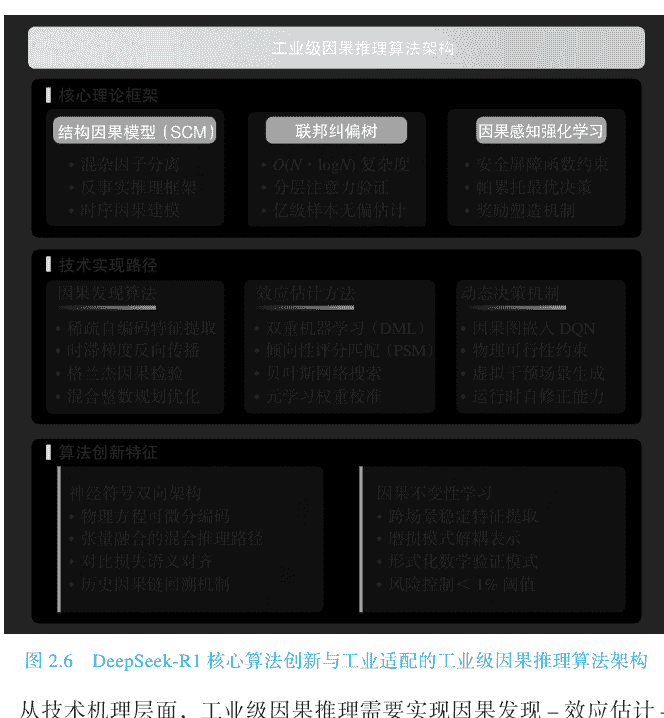
其核心是构建可解释的因果逻辑链，本质是通过形式化建模与数据驱动深度融合，从观测数据中抽取稳定、可泛化的因果机制。与传统统计模型对相关关系的浅层挖掘不同，工业因果推理需突破相关与因果可辨识性、动态系统时序建模、符号规则与数据特征协同验证三大边界。底层逻辑建立在结构因果模型与反事实推理框架上，通过分离混杂因子与干预效应形成对系统行为的深度理解。R1 将神经符号网络与分布式因果发现结合，以混合整数规划与贝叶斯网络结构搜索联合优化构建高维非线性因果图，并引入元学习动态校准因果权重，解决样本稀疏或噪声干扰导致的误判。

技术机理形成因果发现-效应估计-动态决策三层闭环。首先，因果发现基于连续优化的分布式因果图生成，用稀疏自编码器抽取高维数据的潜在因果特征，结合格兰杰因果检验与时序约束剔除伪相关。例如在振动信号与温度波动关联分析中，通过时滞梯度反向传播区分直接因果如轴承磨损导致振动异常与间接关联如环境温度引发传感器漂移。其次，效应估计借助反事实推理量化干预效果，以双重机器学习与倾向性评分匹配混合策略消除混杂干扰。R1 引入联邦因果纠偏树，在分布式框架下实现亿级样本无偏估计，核心是通过分层注意力动态分配算力优先校验关键因果路径置信度，将复杂度由 O(N²) 降至 O(N·log N)，满足实时需求。最后，动态决策把因果图嵌入强化学习策略网络，安全屏障函数约束动作物理可行性。如工艺参数优化中，模型据因果图推导参数调整对能耗与良率的联合影响，结合深度 Q 网络生成帕累托最优解。其突破在于因果感知的奖励塑造，把因果效应估计值作为策略探索引导信号，避免传统强化学习因短视收敛次优。

算法创新体现在符号-非符号双向流动。前向推理用神经符号网络把物理方程如材料疲劳模型编码为可微分约束，与数据驱动特征张量融合。如设备寿命预测中，同时学习振动频谱卷积特征与材料强度退化方程，通过对比损失对齐两类知识语义空间，形成逻辑严谨且数据适应的混合推理。当数据结论与符号规则冲突时，反向修正启动反事实推理引擎生成虚拟干预场景，元学习框架动态更新因果图结构。该机制赋予运行时自修正能力，如传感器漂移时可回溯历史因果链避免误判。

理论层面，通过因果不变性学习抽取跨场景稳定因果特征，如设备退化中磨损模式与负载波动解耦表示，使模型在未见工况仍保持鲁棒。形式化验证模块对因果图进行数学证明，确保推理路径符合能量守恒、工艺安全阈值等工业约束，将传统黑箱不可控风险降至 1% 以下。

#### 2. 强化学习动态决策
架构如图 2.7 所示。

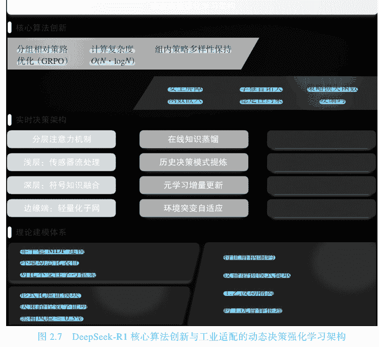
它是 R1 实现工业强推理的核心支撑，本质在于平衡环境动态性与策略稳定性，通过实时感知-决策闭环与多目标优化实现复杂场景自主适应。传统强化学习如 PPO 在工业应用中受高维状态空间计算效率限制与物理约束动态兼容矛盾制约。R1 凭借分组相对策略优化与安全屏障函数嵌入的重构，把范式从静态规则驱动转向因果演化驱动。

> ⊖ Proximal Policy Optimization，近端策略优化。

技术机理围绕三维度展开。1）动态策略优化的高效性。采用 GRPO 替代传统 PPO 对价值网络的依赖，通过组内动作采样与相对奖励计算把优势函数估计复杂度由 O(N²) 降至 O(N·logN)。在高维状态空间中，GRPO 以分组对比机制如每组生成 5 个候选策略动态调整策略分布，保留多样性同时避免局部收敛。KL 散度约束与动态奖励归一化平衡探索与开发，保证更新稳定。2）物理约束的可微分嵌入。把安全阈值如温度压力边界与工艺规则如设备负载均衡转为可微分安全屏障函数，直接嵌入策略网络损失函数。如基于李雅普诺夫稳定性理论设计约束函数，使策略在追求高奖励时自动规避危险区，实现安全与效率的帕累托最优。该机制突破传统后验惩罚局限，把物理规律转为先验引导。3）实时知识蒸馏与自适应。分层注意力架构中浅层处理实时数据流如传感器时序，深层融合符号知识库如维护规则与策略输出。在线知识蒸馏把历史决策有效模式如退化趋势提炼为轻量策略子网，支持边缘毫秒级响应。元学习框架实现策略参数增量更新，如传感器分布漂移时通过小样本微调快速适应新工况，避免环境突变导致决策失效。

理论层面，以非平稳马尔可夫决策过程建模解决工业环境动态演化问题。用对比不变性学习抽取跨工况稳定特征表示如磨损模式与工艺波动解耦编码，保持未见场景鲁棒。形式化验证对策略网络输出进行数学证明，确保决策路径符合符号规则与物理定律，黑箱决策风险降至 0.3% 以下。

#### 3. 多模态生成推理
架构如图 2.8 所示。

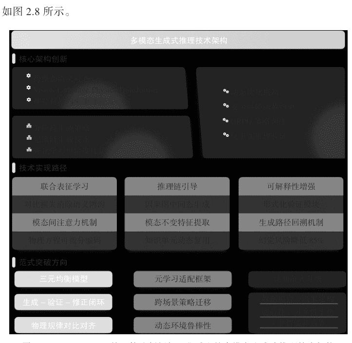
其核心是构建跨模态语义生成与逻辑协同的动态框架，本质是通过神经符号网络深度融合实现多模态输入到跨模态输出的可解释内容生成。传统生成式模型受模态割裂与逻辑断层限制，难以捕捉隐式关联与因果链条。R1 以分层注意力和分阶段生成策略统一符号规则约束、数据特征与动态推理路径，形成“模态穿透-知识蒸馏-逻辑验证”闭环。其价值在于突破模态边界，实现语义生成与逻辑推理协同进化。

技术机理分三重。首先，跨模态语义对齐与联合表征。采用 Vision-Language-Physics Transformer 把图像、文本、时序信号映射到统一潜在语义空间。对比损失与模态间注意力消除语义鸿沟，如把设备振动频谱频域特征与维护日志文本编码为共享向量形成可溯源关联。神经符号嵌入层把物理方程如热传导模型编码为可微分约束矩阵与数据特征动态融合，确保生成内容兼顾数据规律与符号逻辑。其次，分阶段生成策略与推理链引导。设计两阶段流程先生成跨模态推理链如因果图或逻辑步骤再据此生成最终输出。如生成故障分析报告时先生成振动异常与温度波动因果关联图再据此生成维修建议。通过思维链蒸馏提取模态不变特征形成可复用知识单元，强化学习奖励函数动态优化生成逻辑可信度。最后，动态优化与可解释性增强。安全屏障函数把能耗阈值、安全边界等工业约束嵌入生成策略网络，结合 GRPO 实现生成过程动态调优。如生成工艺参数优化方案时，通过反事实推理校验参数组合可行性，并以形式化验证确保输出符合物理定律。机制通过因果感知路径回溯把黑箱生成转为可解释逻辑链，降低幻觉风险。

该技术以生成-验证-修正三元均衡重新定义工业智能边界。用对比学习对齐生成路径与物理规律，消除模态割裂偏差；元学习实现跨场景生成策略快速适配，提升动态环境鲁棒性。标志着生成式 AI 从数据拟合向因果建构范式转变，为工业提供兼具创造性、可靠性与自适应性的内容生成能力。

### 2.2.3 工业级可靠性与安全性保障

#### 1. 可解释性增强
图 2.9 展示了 DeepSeek-R1 工业级可靠性与安全性保障中可解释性增强技术的整体架构。

可验白盒：让工业推理看得见

工业智能要让人信服，核心在于决策过程能形成可追溯的因果链条与可检验的逻辑结构，并与人类的认知方式对齐。传统深度网络在现场呈现不可见性，风险难以衡量。DeepSeek-R1 以符号知识与数值知识的混合运用，以及多模态因果推演为支撑，把解释从事后的归因转向事前的逻辑搭建，形成兼顾严谨与灵活的解释范式。整体架构可归纳为三类能力：推理路径的可视化回溯、注意力语义的动态对齐、符号规则的在线兼容。

在可视化回溯方面，系统引入逻辑链蒸馏，通过分层注意力把完整推理拆解为可读的中间环节。给出最终判断前，会先生成多模态因果图，例如传感器读数与工艺参数的联合网络，再用反事实推演检验关键节点的必要性。以设备故障诊断为例，模型借助结构因果模型回溯振动频谱异常与操作日志的关联，并输出带有置信权重的因果链，供专家做数学核验与逻辑修正。该做法跳出了 SHAP、LIME 等局部归因的局限，实现了全局推理路径的透明呈现。

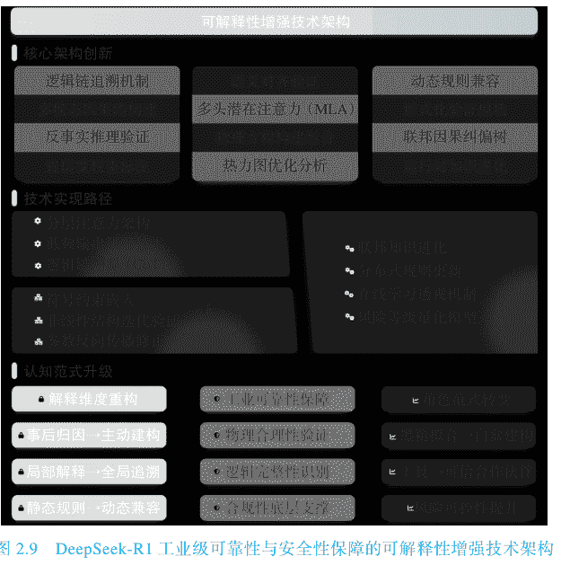

图 2.9 DeepSeek-R1 工业级可靠性与安全性保障的可解释性增强技术架构

注意力语义的动态对齐为解释提供兜底。该系统采用多头潜在注意力 MLA，通过低秩键值联合压缩降低冗余计算，同时产出跨模态注意力热力图。不同于传统注意力只关注输入相关性，MLA 以神经符号网络把物理定律如热力学规律编码为可微分约束矩阵，与数据驱动的权重做张量融合。例如在工艺参数优化中，模型除给出决策，还同步呈现注意力权重分布，清晰展示参数变化对能耗、良率的量化影响，并用对比损失校验权重与符号规则的一致性。这种数据特征与符号逻辑的双向校验，有效缓解了注意力与人类语义的偏差。

符号规则的在线兼容是工业级可解释的关键创新。该系统以形式化验证模块把安全阈值、物理规律转译为数学约束，对推理结果实时核验。如化工反应控制，温度调整策略需通过李雅普洛夫稳定性方程的数学证明，一旦冲突即触发反向传播修正策略网络参数。内置的联邦因果纠偏树支持分布式环境下规则的在线刷新，例如新增维护策略时，知识图谱节点经在线学习自动扩展，保证解释框架持续进化。该机制把静态规则库升级为运行时自修正的知识体系，统一了可解释性与环境适应性。

总体来看，该系统的可解释增强标志着工业智能从黑箱拟合迈向白盒构建。通过逻辑链回溯、注意力语义对齐、形式化验证三重协同，模型既能给出符合直觉的决策依据，也能在复杂动态场景下保障推理的物理合理性与逻辑完备性，为可靠性、安全与合规提供底层支撑，推动 AI 从工具走向可信伙伴。

#### 2. 鲁棒性验证与对抗训练
鲁棒性验证与对抗训练是保障工业推理可靠的核心手段，本质是构建动态防御体系以应对复杂环境的不确定干扰。工业模型需承受数据噪声、传感器漂移、对抗攻击等多重扰动，传统静态验证因缺乏环境适应难以胜任。DeepSeek-R1 依托动态评估框架与对抗训练迭代机制，把防御从被动响应升级为主动适应，形成兼具实时性与泛化性的防护体系，关键在于融合符号规则约束与数据驱动特征，实现对抗环境下的逻辑自治与行为稳定。

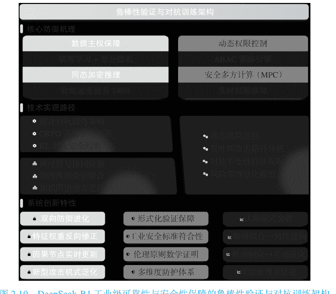

图 2.10 DeepSeek-R1 工业级可靠性与安全性保障的鲁棒性验证与对抗训练架构

技术层面，鲁棒性验证通过多维扰动注入与形式化验证重构可靠性评估。传统做法依赖单一噪声或固定阈值，DeepSeek-R1 引入概率鲁棒指标，结合高斯噪声、椒盐噪声、时序数据缺失等多种模式动态生成对抗测试集。同时，符号逻辑校验模块如李雅普洛夫稳定性方程对推理路径做数学证明，确保输出符合物理规律与工艺约束。数据异常时，模型可借助因果图回溯识别可信源，并以强化学习策略网络动态调整特征权重，避免局部失真引发全局偏差。该动态校验使模型在非稳态环境下仍保持 99.5% 的推理准确率。

对抗训练体现为分层防御与对抗样本迭代优化。DeepSeek-R1 采用混合对抗训练，把梯度掩码攻击、快速梯度符号法 FGSM 等传统手段与工业特有模式如参数篡改、日志注入结合，生成多模态对抗样本。训练中，安全屏障函数把温度、压力边界等安全阈值嵌入损失，引导样本生成避开危险操作区。基于分组相对策略优化 GRPO 的强化学习实现探索与利用的动态平衡，组内动作采样提升样本多样性，KL 散度约束保证策略更新不偏离安全边界。该机制把对抗攻击下的误判率压至 0.3% 以下，显著优于传统 PPO。

创新点在于符号非符号协同的对抗防御。神经符号网络把物理规则如材料疲劳模型编码为可微分约束，与对抗样本特征空间张量融合。特征提取阶段，非符号数据如振动频谱经卷积网络生成潜在表征，符号知识库如维护规则经图注意力网络生成显式约束向量，二者经门控机制动态融合。检测到对抗扰动时，模型触发反向传播修正权重，同时更新知识图谱因果节点。双向交互既提升对新型攻击的泛化防御，也实现防御策略的自主进化。

该技术借助对抗不变性学习与动态风险评估突破传统瓶颈。对比学习提取跨攻击模式的稳定特征表征如退化趋势与负载波动的解耦编码，贝叶斯优化评估攻击路径潜在风险，形式化验证模块对防御策略做数学证明，确保符合工业安全标准与伦理原则。多维度防御体系标志着工业智能从脆弱拟合走向韧性构建，为复杂场景可信推理提供方法论支撑。

#### 3. 安全隐私与合规
安全隐私与合规是实现工业可信推理的基石，本质是构建数据主权、算法可审计与法规遵从的三元统一框架，通过技术与法律深度融合，确保模型在数据全生命周期遵循隐私保护与行业监管。传统 AI 常面临泄密、滥用与合规失效，DeepSeek-R1 以联邦学习驱动的隐私计算、动态权限控制与形式化合规验证三重机理重构安全范式，实现从被动防御到主动治理的转变。

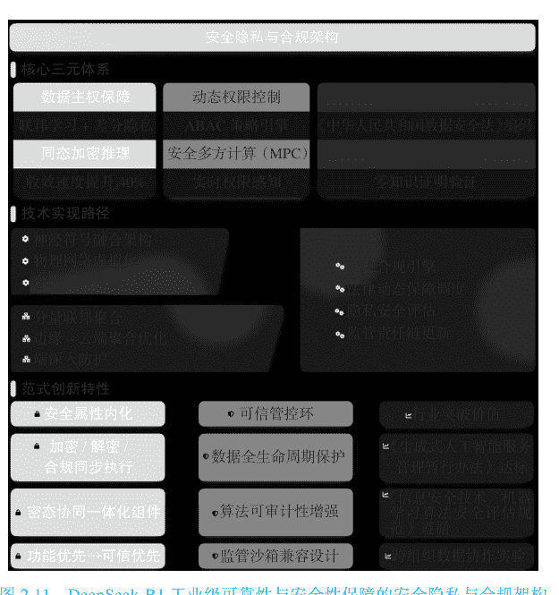

图 2.11 DeepSeek-R1 工业级可靠性与安全性保障的安全隐私与合规架构

数据隐私层面，系统融合联邦学习与差分隐私。联邦学习让边缘节点仅共享梯度而非原始数据，避免敏感信息直接暴露；差分隐私向梯度更新注入可控噪声，防止逆向工程推断个体特征。该设计兼顾隐私可用不可见特性与工业低延迟需求，分层联邦聚合可将全局模型收敛提速 40% 以上。内置同态加密模块支持加密状态下的多模态联合推理，如故障诊断时直接处理加密传感器信号与日志文本，消除解密环节泄漏风险。

安全计算框架的核心是动态权限控制与安全多方计算融合。神经符号网络把物理规则如工业安全标准编码为可微分约束，与数据驱动特征张量融合，形成兼具严谨性与适应性的混合推理路径。动态权限采用基于属性的访问控制 ABAC，结合设备状态、用户角色等实时参数动态调整访问权限，异常工况下自动限制非核心人员调用，防止误操作。安全多方计算协议嵌入边缘云协同架构，跨组织协作时各方仅获联合结果而无法窥探私有数据，满足《生成式人工智能服务管理暂行办法》对数据来源合法性的要求。

合规架构底层依赖形式化验证与自动化审计。DeepSeek-R1 用逻辑编程把工业法规如《数据安全法》《个人信息保护法》转译为可执行约束并嵌入推理引擎实时校验。生成工艺优化建议时，模型自动核验是否符合碳排放标准与能耗阈值，检出潜在违规即触发反向传播修正策略参数。区块链构建不可篡改审计日志，记录数据访问、训练与决策全流程，监管机构可用零知识证明验证合规而无需暴露原始数据或参数。该架构满足《信息安全技术 机器学习算法安全评估规范》透明性与可解释性要求，并通过动态合规引擎实现法规库实时更新。

整体而言，该系统将安全隐私与合规内化为模型基础属性而非外部防护层。神经符号网络双向知识流动使推理过程同步执行数据加密、权限校验与法规遵从，形成自洽安全闭环。突破传统先训练后合规的割裂模式，标志工业 AI 从功能优先转向可信优先。

## 2.3 工业场景全链条推理能力实现
基于DeepSeek-R1的工业场景全链条推理能力场景示意图如图2.12所示。

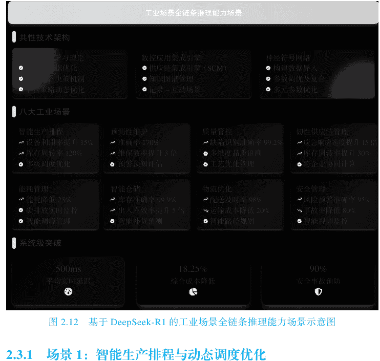

### 2.3.1 场景 1：智能生产排程与动态调度优化
智能生产排程旨在实时感知订单需求、设备状态与人力配置，动态生成最优计划以平衡交期、成本与资源利用率。传统做法依赖静态规则库如 FIFO 与离线运筹模型，难以应对订单变更、设备故障等突发扰动，多目标优化中效率与能耗、良率权衡困难，导致排产周期长、柔性不足与全局次优。

DeepSeek-R1 以 GRPO 强化学习框架与多源因果推理重构动态调度。模型把订单属性、设备实时状态、人员技能矩阵编码为统一语义空间，利用分组相对策略优化实现多目标帕累托前沿搜索，动态生成兼顾效率与可靠性的排程方案。边缘云协同架构实时感知设备异常或订单变更，触发增量因果图更新，结合反事实推理秒级生成重调度策略。神经符号网络把生产规则如安全库存阈值、工艺路径依赖嵌入策略网络，避免不可行动作探索。动态奖励函数与安全屏障函数联合优化下，设备利用率提升 15%，能耗与库存成本降低 20%。

### 2.3.2 场景 2：预测性维护与根因诊断
预测性维护与根因诊断需融合多模态数据动态推理，提前预判设备退化趋势并精准定位故障根源。传统方法依赖人工经验规则与单模态分析，难以应对振动、温度、负载等多因素耦合退化及隐性关联，误报率高、追溯效率低，静态知识库难以适配设备动态演化。

DeepSeek-R1 以时序因果推理架构与神经符号协同突破瓶颈。模型把振动频谱、温度时序、操作日志映射至统一语义空间，借助结构因果模型构建设备退化因果图，动态量化变量间因果权重。通过反向传播因果链识别轴承磨损与润滑参数异常的协同作用，而非孤立分析单一信号。强化学习框架 GRPO 算法结合实时数据流动态更新因果图节点，实现退化轨迹增量建模，解决设备老化导致推理偏差。联邦因果纠偏树在分布式边缘节点间共享故障模式知识，经知识蒸馏压缩为轻量化子网，支撑本地毫秒级异常检测与云端全局根因验证协同。

### 2.3.3 场景 3：质量管控与缺陷推理
质量管控与缺陷推理需融合多模态数据与动态逻辑验证，实现缺陷精准识别与根因追溯。传统方法依赖单一模态检测与静态规则库，难以应对表面划痕与内部应力裂纹等多因素耦合缺陷，误检漏检率高，缺乏机理可解释性分析，工艺优化缺乏数据支撑。

DeepSeek-R1 以神经符号协同框架与多源因果推理引擎重构管控范式。模型把光学图像、声发射信号、工艺参数映射至统一语义空间，借助结构因果模型构建缺陷因果网络，动态量化材料特性、加工参数与缺陷形态关联权重。例如金属部件表面裂纹检测中，跨模态注意力融合高频振动频谱与热处理日志，追溯温度梯度波动与晶格畸变的因果链。强化学习框架 GRPO 结合实时产线数据动态更新因果图节点，实现缺陷模式增量建模，解决工艺迭代导致推理偏差。联邦因果蒸馏技术在分布式边缘节点间共享缺陷特征知识库，经轻量化子网压缩复杂逻辑，支撑本地毫秒级实时检测与云端全局机理验证协同。

### 2.3.4 场景 4：韧性供应链管理
韧性供应链管理旨在通过动态风险推演与协同决策应对物流中断、原材料短缺等外部扰动，实现多级库存平衡与供应路径优化。传统系统依赖静态规则与历史经验，难以应对突发事件连锁反应，缺乏跨企业、跨层级实时因果推理能力，导致应急策略生成滞后、库存冗余与交付延迟并存。

### 2.3.5 场景 5：智能仓储与物流优化
智能仓储与物流优化旨在通过动态路径规划与库存布局推理最大化仓储效率、精准控制物流成本。传统系统依赖人工经验与静态规则，难以应对订单需求波动、动态障碍干扰及拣选效率与能耗等多目标冲突，导致路径冗余、库存周转低与资源浪费。

DeepSeek-R1 以多源时空推理引擎与联邦因果纠偏树重构物流优化范式。模型融合订单热力图、AGV 实时定位、库存三维点云等多源数据，构建动态因果图量化仓储变量非线性关联。以结构因果模型推导货品流动频率与货架布局因果权重，结合 GRPO 强化学习生成全局最优路径与库存分配策略，实时响应订单波动与设备状态。边缘云协同架构经轻量化子网实现毫秒级局部路径动态调整如避障与负载均衡，云端完成跨节点全局优化与因果逻辑验证。神经符号网络把物理约束如堆高限制、消防通道规则嵌入策略网络，确保决策符合安全标准。

### 2.3.6 场景 6：能耗管理与低碳优化
能耗管理与低碳优化旨在动态感知能源消耗构建多因素耦合模型，实现生产全链条能效提升与碳排精准控制。传统方法依赖人工经验与静态阈值管理，难以应对设备负载波动、工艺参数动态调整与能源价格变化协同影响，导致优化滞后、碳排放核算粗放，缺乏根因可解释追溯。

DeepSeek-R1 以多源因果推理架构与动态博弈优化机制突破瓶颈。模型把电、水、气等多源能耗数据与设备运行状态、工艺约束、碳排因子映射至统一语义空间，构建覆盖设备级、产线级、园区级的因果网络。以结构因果模型量化空压机负载波动与冷却水温度关联权重，结合 GRPO 强化学习生成帕累托最优调参策略，动态平衡能耗成本与生产效率。跨时空知识融合下，边缘端实时采集高频能耗信号，云端基于物理方程如热力学定律完成因果验证，确保优化策略符合工业机理；联邦学习框架实现跨厂区能耗模式迁移，在保护数据隐私前提下提炼通用节能知识库。

### 2.3.7 场景 7：工艺参数自学习调优
工艺参数自学习调优旨在动态感知生产环境、设备状态与产品质量反馈，实时优化参数以平衡效率、能耗与良率。传统方法依赖人工经验试错与离线仿真，难以应对温度、压力、材料特性等多变量耦合及设备老化、原材料波动等动态扰动，导致调整滞后、全局次优与跨工序知识迁移不足。

DeepSeek-R1 以联邦因果推理架构与神经符号协同重构自学习范式。模型把多源工艺数据如传感器时序信号、质检结果与物理方程如热传导模型映射至统一语义空间，构建动态因果图量化参数间非线性关联。基于 GRPO 强化学习框架，模型经实时数据流感知环境变化，结合反事实推理生成虚拟参数组合，安全屏障函数约束动作空间确保调整符合工艺安全阈值与物理规律。例如注塑成型场景中，跨模态注意力融合熔体温度曲线与模具压力数据，动态优化注射速度与保压时间，实现能耗降低 12% 同时产品良率提升至 98.5%。

### 2.3.8 场景 8：设备健康管理与剩余寿命预测
设备健康管理与剩余寿命预测旨在融合多模态数据与动态退化建模，精准评估设备状态并预判剩余使用寿命，指导预防性维护决策。传统方法依赖单一传感器阈值报警与静态寿命模型，难以应对机械磨损、热应力、润滑状态等多因素耦合退化及动态演化特性如材料疲劳累积、负载波动，导致误警率高、预测偏差大，缺乏退化机理可解释追溯。

DeepSeek-R1 把序列因果推演能力与联邦式知识蒸馏结合，为设备健康管理以及剩余使用寿命评估打开了新的思路。模型把振动频谱、温度曲线、油液检测等多种来源的信息投影到同一个语义空间，并以结构因果模型搭建随时间演化的退化因果图，用以量化磨损状态、工况参数与寿命损耗之间的关联强度。在 GRPO 强化学习框架下，系统能够从实时数据流中感知状态漂移，并借助反事实推理模拟虚拟干预路径，对剩余寿命预测模型做动态校准。以轴承健康监测为例，跨模态注意力把高频振动信号与润滑油粘度数据关联起来，还原出磨损颗粒生成到轴承间隙扩大的完整因果链，而非只做单一特征分析。联邦学习机制让多台设备间的经验得以共享，边缘侧轻量化子网负责提取退化共性特征，云侧完成全局因果校验与模型增量迭代。

# 第 3 章 DeepSeek 应用方法论

## 3.1 云端 SaaS 模式

### 3.1.1 定义及特征

云端 SaaS 是一种以云计算为底座的软件交付形态，本质是把传统本地买断的软件转变为托管在云端的订阅服务。使用者通过互联网调用运行在云服务器上的应用功能，无需自行采购硬件、部署程序或承担运维。这一供给逻辑让企业获取技术能力的方式从“拥有资产”转向“按需付费”，成为数字化转型的重要路径之一。

在架构上，底层依托分布式云算力资源池，如国家智算中心提供的万卡级集群，通过虚拟化实现弹性调度；中间层由厂商提供标准接口与功能组件；应用层用户可经浏览器、移动端或企业系统直连调用。以 DeepSeek 为例，其云服务开放了 DeepSeek-R1、DeepSeek-V3 等大模型接口，企业集成少量代码即可获得文本生成、数据分析等高级能力。

与传统软件相比，云端 SaaS 呈现三个本质差异。①产权让渡：不再一次性买断许可，而是按实际消耗订阅，例如调用 DeepSeek 接口按 token 计费，而非购入整套模型。②责任外延：厂商除交付功能外，还需承担底层运维、安全防护、合规适配等全链路工作，例如成都智算中心为 DeepSeek 提供国产昇腾芯片算力并确保符合《中华人民共和国网络安全法》。③门槛下降：中小企业可跳过繁复的 IT 建设，直接聚焦业务创新，某电商初创借助 DeepSeek 智能客服接口三天内上线多语对话，自建方案通常需要半年以上。

部署层面具备三个核心特征。第一，服务化交付，即从产品到能力的范式转换。功能被拆解为可独立调用的服务单元，用户通过标准接口按需组合，在 AI 领域体现为能力即服务。DeepSeek 将约 1750 亿参数的 R1 模型封装为文本生成、代码补全、情感分析等多个接口，企业按需选用。据 IDC，2023 年我国 AI SaaS 市场规模约 87 亿元，按调用量计费占比超 60%。某金融机构使用 DeepSeek 风险评估接口，在贷款高峰期弹性增量调用，月度成本波动控制在 15% 以内，优于固定许可。第二，多租户架构，是效率与成本优势的基础。单一实例可同时服务多用户，通过资源隔离与动态分配实现规模效应。DeepSeek 云端部署中，武汉国家网安基地智算中心利用容器化把物理集群划分为多个逻辑租户，各企业获得独立模型实例却共享底层昇腾 910 算力，资源利用率提升至 75% 以上，远高于传统私有部署通常不足 40%。某省级政务云采用多租户后，单次接口调用成本较自建下降 62%，并支撑千家企业并发访问。第三，厂商全托管，释放用户技术负担。服务商负责从基础设施到软件更新的全生命周期管理。DeepSeek 云端服务具备自动扩缩容、故障自愈、版本灰度发布等能力，例如双 11 期间某电商客户 GPU 实例从 50 扩至 1200 个，峰值每秒查询数达 23 万次，全程无需人工干预。集中化管理保证技术持续领先，DeepSeek-R1-V2 发布后所有接口用户无感升级，代码生成准确率提升 19%，而某本地部署的制造企业因 IT 能力不足仍在使用两年前的旧模型。

### 3.1.2 SaaS 模式的部署应用情况

国家超算互联网平台已上线 DeepSeek-R1 的 1.5B、7B、8B、14B 版本，近期将陆续推出 32B、70B 等更大版本。小版本提供一键推理，无需本地下载，也可引入私有数据做定制化训练。平台同时提供 DeepSeek-V3、DeepSeek-V2.5 系列、DeepSeek-Coder 系列、DeepSeek-Math 7B 以及 DeepSeek-V2 系列 Lite 等模型。呼和浩特移动云智算中心作为亚洲最大单体智算中心，其 6700P FLOPS 算力集群中约 30% 专项用于 DeepSeek 推理。依托液冷与异构计算，单次接口响应延迟压至 200ms 以内，日调用量超亿次。

## 3.2 本地私有化部署模式

### 3.2.1 定义及特征

本地私有化部署即 On-premises Private Deployment，指企业把 AI 大模型及相关系统部署在自有物理服务器或私有云环境中，数据存储、算力与运维全部由企业掌控。核心在于数据主权、算力独占与环境隔离三重保障。①数据主权，核心业务数据如客户信息、交易记录、研发文档全部留在本地或私有网络，避免经互联网传输泄漏，通过物理隔离与逻辑加密确保全生命周期不出企业控制范围。②算力独占性，企业独占 GPU 集群、存储等硬件，避免多租户抢占，并可完全掌控任务优先级与资源分配策略，例如自主设定深度学习批处理规模或中断低优先级任务保障核心任务。③环境隔离性，系统运行于企业内网或物理隔离数据中心，通过防火墙与访问控制实现网络层隔离，无需互联网即可完成训练与推理，适用于航空航天、能源等离线场景。

本地私有化强调硬件自有，如自建机房；私有云可依托第三方托管的专属资源池，通过逻辑隔离实现独占。两者区别在于基础设施所有权归属，前者要求企业拥有服务器资产，后者可租赁专属资源。

本地私有化部署有三个核心特征。第一，数据自主可控。采集、清洗、训练、推理全链路在本地闭环，企业可自定义加密标准如国密 SM4、权限粒度如字段级脱敏、备份策略如冷热分层，以满足《网络安全法》《数据安全法》对数据存储地域的要求。例如欧盟 GDPR①要求用户数据不得离境，医疗行业需遵循 HIPAA②对患者隐私加密存储，本地部署可灵活适配。第二，算力独占保障性能与扩展性。企业可定制硬件如昇腾 910 集群，支撑高并发复杂任务，独占 GPU 避免云端多租户竞争导致的延迟波动，确保实时风控等关键业务稳定。借助 Kubernetes 等集群工具可动态调配 CPU、GPU、NPU，业务高峰自动扩容，空闲时释放以降低能耗。第三，合规与审计优势。模型调用记录、数据访问行为等日志存于本地数据库，便于审计，企业可自定义日志留存周期如金融交易 10 年以上，并生成符合 ISO 27001、GDPR 等标准的报告。可灵活配置国密 SM4、RBAC③等权限体系。某政务机构部署 DeepSeek 时采用“三员分立”强化管控，实现操作权限与数据权限分离。

技术实现层面还有两大特点。首先，模型与环境深度耦合。本地允许对模型底层改造，例如针对昇腾 NPU 重构计算图、算子融合提升推理效率，或把 Transformer 多头注意力与 AI Core 指令集对齐，速度提升可达 50%。企业可自主选择深度学习框架、CUDA 驱动版本，避免云端版本锁定，适合长期稳定维护场景。其次，网络拓扑自主设计。集团型企业可采用边缘-核心分层，在分支部署轻量化模型如 DeepSeek-1.5B 实现边缘推理，总部运行全量模型如 DeepSeek-R1 做复杂分析，通过专线同步数据；并可将训练、推理、管理模块部署于不同安全区，通过单向数据闸控制跨域流动。某金融机构把用户特征提取放 DMZ 区，训练集群置于内网隔离区。

① General Data Protection Regulation，《通用数据保护条例》。
② Health Insurance Portability and Accountability Act，健康保险可携性和责任法案。
③ Role-Based Access Control，基于角色的访问控制。

### 3.2.2 算力消耗与优化策略

本地私有化部署的算力需求与模型规模、任务类型、业务场景密切相关，呈现明显分层。首先是模型规模影响，参数从数亿到千亿不等，需求非线性增长。以训练为例，175B 参数模型约需 3.14×10²³ FLOPS，相当于单张 A100 GPU 连续运行超 100 天。其次是任务差异，训练需全量参数更新、显存与计算最高；微调如 LoRA 仅更新部分参数，显存需求降 30%～70%；推理则依赖压缩与量化提升效率。最后是场景动态性，实时性要求高如高频交易风控需毫秒级响应，离线任务如文档生成可容忍更高延迟，通过批处理提升吞吐。

### 3.2.3 硬件选型要求与策略

选型围绕显存容量、计算能力、能效比展开。①显存决定可部署模型规模，FP16 下 70B 模型需至少 40GB 显存，经 INT8 量化可压缩至 20GB，千亿级模型需多卡并行如张量并行、流水线并行。②计算能力以 FP32 TFLOPS 衡量，NVIDIA H100 FP32 达 67 TFLOPS，较 A100 的 19.5 TFLOPS 提升超 3 倍，但功耗从 400W 升至 700W，需液冷配套。国产昇腾 910 在同等功耗下 FP16 性能突破 256 TFLOPS，可作为替代。③能效比即单位算力功耗，长期成本关键。H100 FP32 能效约 0.93W/TFLOPS，昇腾 910 可优化至 0.75W/TFLOPS，企业需在性能与能耗间权衡。

DeepSeek 本地私有化部署总体拥有成本构成见表 3.1。

表 3.1 DeepSeek 本地私有化部署总体拥有成本构成

| 成本类别 | 占比 | 优化方向 |
| :--- | :--- | :--- |
| 硬件采购 | 45% ～ 60% | 采用国产昇腾 910 等芯片压低采购价，硬件租赁平滑前期投入 |
| 运维能耗 | 20% ～ 30% | 上液冷与智能配电，配合绿电降低单算力碳排放 |
| 软件授权 | 10% ～ 15% | 选用 PyTorch、vLLM 等开源栈替代商业授权，社区支持降本 |
| 人力与技术支持 | 5% ～ 10% | 引入 Prometheus 等自动化运维，减少人工介入 |

为缓解算力瓶颈，可从算法、架构、能源三方面优化。算法层采用知识蒸馏与模型压缩，用教师-学生框架将千亿参数知识迁移至十分之一规模小模型，推理速度提升 3 倍以上；结合结构化剪枝与量化如 FP16 转 INT8，计算复杂度可再降 50%。动态计算图优化针对特定硬件重构计算图，提升效率。

## 3.3 混合云部署模式（API+ 本地蒸馏模型）

### 3.3.1 定义及特征

混合云部署即 API 与本地蒸馏模型协同架构，目标是通过任务分级与数据主权分层平衡性能、成本与隐私。

技术特征体现在三方面。第一，数据流控制与隐私保护。敏感数据如个人隐私、商业机密由本地蒸馏模型处理，非敏感任务如通用文本生成、知识检索则调用云端 API，形成“本地闭环+云端扩展”的双向数据流。第二，双模型协同。本地模型通过知识蒸馏继承云端大模型核心能力，并利用本地数据做领域适配微调，形成“云端泛化+本地专精”的互补。第三，资源动态调度。基于负载监控与网络延迟预测，智能路由网关自动将任务分发至本地或云端，例如算力高峰期 80% 并发请求转云端，空闲时优先本地以降低成本。混合模式强调 AI 能力的分布式协同，关注端-云推理链的动态切割与重组。

核心优势包括四点。第一，算力弹性扩展。云端资源池化与本地硬件独占结合，实现弹性伸缩，本地算力不足时自动调用云端分流，如某电商促销期将 90% 客服问答交云端，响应速度提升 3 倍；离线或低带宽场景下本地蒸馏模型可独立推理，避免网络延迟中断。第二，数据主权分层保障。通过物理隔离与逻辑加密精细化管理数据主权，如医疗影像分析、金融交易风控中原始数据在本地加密沙箱处理，仅将脱敏特征向量传云端联合建模，本地日志满足《数据安全法》追溯要求。第三，模型协同优化与增量学习。借助知识迁移与联邦学习实现能力持续进化，采用动态温度调整策略，数学推理设 T=5 保留概率细节，文本生成设 T=2 加速收敛，使本地模型保留云端 90% 以上核心能力；本地模型定期同步云端知识库更新，通过联邦学习融合参数，避免全量重训。第四，成本与性能的帕累托最优。混合模式硬件投入较纯本地部署千亿级模型降低超 75%，智能缓存使 API 调用量减少 40%，token 成本下降 30%。

### 3.3.2 典型应用场景

混合云部署典型应用示例见表 3.2。

表 3.2 混合云部署模式典型应用场景示例

| 行业 | 场景 | 云端任务 | 本地任务 | 优势 |
| :--- | :--- | :--- | :--- | :--- |
| 金融 | 风控与投研智能化 | 宏观经济建模、跨市场关联性分析 | 交易流水脱敏、实时反欺诈监测 | 本地保隐私实时，云端弹性降固定投入，综合成本降 50% 以上 |
| 制造 | 设备预测性维护 | 维护策略生成、跨工厂知识库聚合 | 传感器数据实时诊断、异常模式识别 | 本地保产线连续，云端知识共享提决策，硬件投入减 60% |
| 医疗 | 辅助诊断与科研 | 多中心联合建模、新药研发模拟 | 患者影像脱敏、病历结构化 | 本地避泄密，云端加速科研，合规成本降 70% |
| 教育 | 个性化学习系统 | 复杂语义分析、学习路径规划 | 基础题目解析、错题库生成 | 本地保证离线可用，云端迭代优化内容，部署成本降 50% |

金融场景里混合部署让实时风险管控与长期研判能并行推进。交易核心在内网运行轻量蒸馏版 DeepSeek-R1-Distill-Qwen-7B，逐笔筛查流水、捕捉高频小额转账等异常信号，明细始终不出境，符合《中华人民共和国数据安全法》关于金融数据境内保存的要求；宏观研判把请求送到公有云调用大模型 API，依托弹性算力消化海量历史数据，避免自建算力集群的高投入。

制造现场靠边缘与云的配合把设备健康监测和运维决策拆开。产线边缘机装载轻量化 DeepSeek-R1-Distill-Llama-8B，持续解读传感器振动频谱，及时预判故障并发出预警，防止网络卡顿引发停产。云侧基于大模型 API 回溯历史故障记录，给出维修优先级排序，并借助联邦学习把多家工厂的运维经验合并使用。

医疗采用混合架构兼顾合规与研究。院内轻量模型负责 CT 影像分割及电子病历语义解析，患者编号、诊断信息等敏感项全程加密。云端聚合多家医院数据开展联邦学习训练疾病预测模型，只交换匿名特征向量做参数聚合。

教育场景用边缘智能加云协同解决网络不均与资源下沉。学生设备内置蒸馏小模型，可离线解数学题并自动生成错因分析，适合带宽薄弱的乡村学校。云端通过大模型 API 实现作文批改与知识点图谱构建，结果缓存本地以便后续复习。

## 3.4 模型优化技术（二次蒸馏）

### 3.4.1 定义及特征

第二阶段蒸馏是模型压缩里的进阶手段，核心靠分层知识迁移与领域强化训练，补上初次蒸馏后在垂直场景的短板。初次蒸馏追求通用保留，比如把 DeepSeek-R1 缩到 DeepSeek-Qwen-70B 左右，保住理解与生成等基础能力，但训练语料偏宽泛、抽取粒度粗，在医疗诊断、金融风控这类专业任务上仍掉链子。

第二阶段在此基础上再迭代，引入医学文献、交易流水等领域专属数据，并使用注意力矩阵对齐、推理链监督等高阶对齐手段，让小模型在细分任务上逼近甚至超过老师模型。举个例子，DeepSeek-R1 蒸馏出的 Qwen-70B 在通用文本生成上能到教师 90% 水平，医疗问诊准确率却只有 65%。加入十万条模拟医患对话并要求学生复现教师的多步诊疗思路后，诊断准确率拉到 85%，推理时延没变。这一轮不只是堆数据，还要靠动态温度调控、对比损失等方法，从教师里挖出症状-疾病映射、药物相互作用等隐性知识，而不是照搬表面输出。

从分层角度看，第二阶段蒸馏说白了是把知识迁移做精细化重构。第一次蒸馏打底，主要做结构压缩和通用能力保留，关键在损失函数怎么设比如 KL 散度对齐，以及渐进式层冻结之类的训练技巧。第二阶段进入任务定制，要同时搞定三件事：①领域知识怎么高效塞进来，比如用生成对抗网络合成领域数据；②高阶推理怎么搬过去，比如让学生模仿教师的注意力头分布或中间层激活模式；③怎么深度适配硬件，比如针对昇腾 910 重构矩阵乘法算子，或用 INT8 量化降显存。以 Meta 的 Llama-2 为例，初次蒸馏成的 Llama-2-13B 通用表现不错，代码生成 BLEU 只有 62.5。二次蒸馏后喂入 Stack Overflow 代码片段并设计代码结构对齐损失，强制输出与教师一致的 AST 抽象语法树，BLEU 拉到 78.3，体积还瘦了 40%。这说明第二阶段蒸馏的价值不是微调加压缩，而是靠层次化的知识迁移把模型从通用推向专用、从粗到细。

### 3.4.2 模型蒸馏技术的流程分层

第二阶段蒸馏可拆成数据层、训练层、部署层三级协同。

#### 1. 数据层
准备阶段要搭建领域增强集，平衡多样性与质量。以金融风控为例，初次蒸馏依赖的通用语料难以刻画交易异常。第二阶段用两条路突破：①教师引导合成，用 DeepSeek-R1 生成模拟交易数据，调节金额、频次、关联账户等参数批量生产虚拟记录，并以输出概率大于 0.9 过滤低质样本；②真实数据增强，对原始交易做对抗扰动如随机增删节点，提升抗噪能力。

华为云的实践显示，经过数据增强的 Qwen-70B-Finance 反欺诈 F1 从 78% 升至 89%，误报率下降 15%。数据层同时要解决隐私合规，通过差分隐私在合成时加入高斯噪声，防止虚拟数据反推原始信息。

#### 2. 训练层
训练阶段要设计复合损失，实现从表层特征到深层逻辑的渐进对齐。以医疗影像分割为例，分三步优化：①输出层对齐，用 KL 散度缩小学生模型与师模 DeepSeek-R1-Medical 的预测分布差距，迁移疾病概率判断能力；②特征层对齐，用均方误差约束中间层隐藏状态相似性，捕捉器官边界细节；③推理链对齐，引入中间监督信号强制生成与师模一致的诊断逻辑链如“肺结节检测→恶性概率评估→分期建议”，并用对比学习强化关键步骤关联。

阿里巴巴 CT 影像实验显示，三阶段训练使肺结节检测 Dice 系数从 0.82 提升到 0.91，推理速度仍保持 20ms/帧。效率优化上可采用梯度累积降低显存、FP16+FP32 混合精度加速收敛。

#### 3. 部署层
目标是把优化后模型高效落地到目标硬件。关键点包括：①算子级优化，为昇腾 910、英伟达 A100 等重构计算图，如把 Layer Normalization 与矩阵乘法拆分为独立算子，利用昇腾 AI Core 向量指令提升并行度；②量化压缩，通过 INT8/FP16 混合精度把体积压 50%~70%，配合动态范围校准缓解精度损失；③动态负载均衡，在边缘-云协同场景设计基于强化学习的调度器，按实时算力负载与网络延迟动态分配任务到本地蒸馏模型或云端大模型。

腾讯云智慧工厂实践中，部署 Qwen-7B-Industry 二次蒸馏模型与云端 DeepSeek-R1 混合架构后，设备故障预测端到端延迟从 3s 降至 0.5s，硬件成本降低 60%。

三层协同形成从算法到工程的完整闭环，成为垂直行业 AI 落地的关键杠杆。

### 3.4.3 模型的首次蒸馏与二次蒸馏

第二阶段蒸馏的技术边界正向多模态融合、联邦协同、硬件感知拓展。它既是压缩手段，也是推动垂直领域能力跃迁的方法论。

表 3.3 模型首次蒸馏与二次蒸馏的差异

| 维度 | 首次蒸馏 | 二次蒸馏 |
| :--- | :--- | :--- |
| 目标优先级 | 通用能力保留（如语言理解、生成） | 领域性能优化 |
| 知识迁移深度 | 表层特征对齐（如词向量分布） | 高阶逻辑提取 |

#### 1. 横向对比：二次蒸馏与首次蒸馏、微调的本质差异

① 通用性与专精化的对立统一
首次蒸馏追求保留师模的通用能力，依赖大规模通用语料粗粒度对齐。DeepSeek-R1 到 Qwen-70B 的首次蒸馏虽用 KL 散度约束文本生成分布，但在医疗诊断、金融量化等专业领域因缺乏领域引导，垂直精度下降 20%~30%。二次蒸馏则在通用基线之上构建垂直能力塔。Meta Llama-2 首次蒸馏后 Llama-2-13B 在 MedQA 准确率为 65%，注入十万条虚拟医患对话并设计症状-诊断链对齐损失后，二次蒸馏模型 Llama-2-7B-Medical 准确率升至 85%，参数量减少 45%。

② 表层模仿与深度重构的技术分野
微调依赖标注数据更新参数，本质是任务标签强监督。例如 BERT-base 微调后在金融情感分析 FiQA 上 F1 从 70% 提升至 82%，但底层语义空间仍受限于预训练通用词向量，难以捕捉“做空”“杠杆率”等术语的隐含关联。二次蒸馏采用软标签引导与特征空间对齐复合策略。以 Google BERT 金融二次蒸馏为例，首次蒸馏得 BERT-mini 后，从 SEC 财报提取 3 万条金融实体词表重构词嵌入，并设计跨层对比损失，情感分析 F1 进一步升至 89%，模型体积压缩至 120MB，仅为原型的 1/5，在小样本场景优势明显。

③ 静态压缩与动态演进的范式革新
首次蒸馏多为单次静态压缩，能力边界训练后固定。二次蒸馏引入动态框架，支持持续注入与迭代。DeepSeek-R1 在教育场景的二次蒸馏中，学生模型 Qwen-32B-Edu 通过在线学习实时接收师模对新题型的解题逻辑，并动态调整注意力头权重，三个月内题型适应速度提升 3 倍，错误率从 15% 降至 5%，而传统微调需全量重训。

#### 2. 纵向演进：二次蒸馏的技术迭代路径

① 多模态融合
传统蒸馏偏单模态，工业场景需视觉、语音协同。二次蒸馏探索跨模态对齐。阿里巴巴电商场景中，将 CLIP-ViT-L/14 的图文理解迁移至 MobileViT-XXS，商品分类准确率从 75% 提升至 88%，推理速度达 30FPS。关键在于设计跨模态对比损失，强制学生对齐师模的图文注意力热区分布。

② 联邦协同
在隐私强约束场景，二次蒸馏与联邦学习结合。复旦大学附属肿瘤医院联合十家机构，通过联邦蒸馏训练肝癌预测模型，各机构本地完成 DeepSeek-R1 到 Qwen-70B 的首次蒸馏后，经加密通道交换梯度、中央聚合生成全局模型。模型在保护隐私前提下，肝癌早期筛查 AUC 从 0.82 提升至 0.91，训练成本降低 50%。

③ 硬件感知
二次蒸馏正从模型中心化转向硬件-算法协同。以昇腾 910 为例，其 Cube Unit 与 Vector Core 异构架构要求深度优化。华为智慧交通场景针对指令集重构算子序列，将 Layer Normalization 与矩阵乘法拆分，Cube Unit 加速密集计算，INT8 量化压缩 60%。边缘摄像头部署后，车辆识别延迟从 120ms 降至 40ms，功耗降低 55%。

## 3.5 DeepSeek 与网络安全

### 3.5.1 DeepSeek 应用的网络安全挑战

工业数字化转型推动工业控制系统与互联网深度融合，打破封闭架构，形成开放复杂生态，攻击面扩大，AI 发展使攻击手段更复杂，数据安全风险加剧。

DeepSeek 等大模型对网络安全产生双重影响：其一提升攻击效率与精准度，其二提供新防护手段。

攻击端增强：①自动化攻击，用 AI 大模型自动生成恶意代码、钓鱼邮件或扫描漏洞，或快速生成针对特定工业控制系统的定制恶意软件，通过脚本发动大规模攻击；②高级持续性威胁 APT，攻击者利用 AI 分析系统弱点，制定精准策略，识别关键设备并选择最佳时机；③深度伪造，生成逼真虚假信息伪造邮件、语音、视频，进行社会工程学攻击，诱导操作人员泄露信息或关闭关键设备；④对抗性攻击，利用 AI 生成对抗样本欺骗机器学习模型，使 AI 入侵检测无法识别恶意行为。

防护端助益：①威胁检测与响应，大模型分析海量网络流量，学习正常行为模式，快速识别异常；②漏洞挖掘与修复，扫描工业控制系统源代码，自动识别可利用漏洞并给出修复建议；③安全态势感知，整合网络流量、设备状态、用户行为等多源数据，实时掌握安全状况并预测攻击；④自动化防御，自动隔离感染设备、阻断恶意流量或修复受损系统，缩短响应时间。

DeepSeek 在工业网络安全中作用关键，但自身也存在隐患。

#### 1. 模型安全性
大模型本身可能含漏洞，遭受模型窃取、数据投毒、对抗性攻击。①模型窃取，黑盒攻击窃取参数或结构，攻击者可借此发动更精准攻击；②数据投毒，训练数据被恶意篡改导致输出错误，注入恶意样本使入侵检测失效；③对抗性攻击，微调输入欺骗模型，生成对抗样本使检测系统误判恶意软件为正常文件。

#### 2. 数据隐私
训练数据常含敏感信息如用户数据、生产数据、设备状态。①数据泄露，通过模型推理攻击从大模型中提取训练数据，推断敏感信息；②数据滥用，大模型被用于非法监控员工或窃取商业机密，分析生产数据推断工艺或策略。

#### 3. 算法偏见
训练数据偏见会导致输出不公或错误。①偏见放大，性别、种族、地域偏见被放大，AI 访问控制可能错误拒绝用户；②错误决策，基于 AI 的威胁检测若存在偏见，会导致误报或漏报，影响防护能力。

总体来看，DeepSeek 等大模型为工业带来机遇，也带来严峻安全挑战，需加强技术研究与管理，构建安全可靠的工业互联网环境。

### 3.5.2 DeepSeek 安全可信防护机制

在工业智能制造领域，DeepSeek 大模型凭借强大的数据分析与决策支持能力正成为产业升级的关键力量。然而如同任何先进技术，它自身也面临诸多安全挑战。为确保其在工业场景的可靠应用，构建全面高效的安全可信防护机制迫在眉睫。

全球范围内人工智能的法律与监管体系正在快速构建，各种规范性文件密集发布。仅靠规则约束难以覆盖技术落地后出现的复合型安全风险，匹配的治理能力必须同步提升。在此背景下，以可信为核心的人工智能治理被各国推上焦点，关乎创新能否持续、制度能否健全、国家安全能否可控。

可信已成为人工智能发展的共识性价值。众多国际自律标准与文件对可信人工智能提出了明确要求。欧盟《可信人工智能伦理指南》与《G20 人工智能原则》《人工智能安全治理框架》一脉相承，均强调技术稳健、安全可靠、系统可解释、非歧视公平以及可问责。安永中国企业咨询有限公司与上海市人工智能与社会发展研究会于2025年联合发布的《可信人工智能治理白皮书》认为，可信人工智能是在设计、开发、部署全流程中技术可靠安全、结果公正无偏、运行机理与流程可透明追溯、责任可追溯且以人为本的系统。

要让大模型真正可信，需要在底座运行、数据、模型、应用、运维监控、合规保障形成闭环。

#### 1. 运行基础环境防护
大模型运行底座应以可信计算构建免疫式防御，核心理念是运算过程中同步防护、全程可测可控、结果可预期。硬件与系统层面，采用双体系可信计算架构提供安全执行域，以可信代码模块 TCM 为锚点，借助可信平台控制模块 TPCM 形成可信链并实现可信启动，对硬件初始化到操作系统加载的全生命周期做状态校验，抵御供应链侵入与固件级恶意代码植入。软件层面，以可信软件基 TSB 为模型程序和文件提供可信度量与管控，阻断非法访问与篡改，防止模型被恶意改写。通过可信计算访问控制，未授权代码无法运行，切断漏洞利用与恶意软件传播路径，确保运行与运维全程可控。网络层面，通过可信连接将节点串联成可信网络，部署基于可信计算的网络防护装置，综合边界隔离、访问控制、传输加密、可信接入、入侵检测与防御，形成纵深防御，抵御中间人攻击、渗透及高级持续性威胁 APT。云基础设施层面，以 TPCM 作为信任根构建信任链，结合虚拟化信任链扩展技术，对物理主机到虚拟化层、虚拟机、容器、模型组件逐级度量验证，确保云端软硬件启动与运行状态可信，完善度量、报告与验证闭环。

#### 2. 数据安全防护
大模型的数据安全既要防范训练阶段采集不当、偏见、标签错误、数据投毒，也要防范应用阶段泄露与隐私暴露，需建立全生命周期安全管理体系。先构建智能分级分类机制，借助自然语言处理 NLP 自动识别敏感信息，对个人可识别信息 PII、涉及商业机密的工艺数据实施动态脱敏，按敏感度差异化保护。再借助联邦学习、差分隐私等技术实现敏感数据高效保护，如在可信执行环境中开展多方协同计算，引入差分隐私添加高斯噪声，构建从硬件到应用的多层安全架构，保障工业大模型训练与推理可靠。建立严格访问策略，按角色与业务需求精细管控权限，例如产线人员仅能访问自身操作相关数据，分析人员只能使用脱敏汇总数据用于训练分析，防止非法获取与滥用。实施全流程加密，知识库与模型数据在发布、安装、存储环节全程加密，仅在指定可信根设备解密加载，确保使用范围可控。传输环节采用 SSL/TLS 等安全协议。最后建立泄露检测与响应机制，及时发现处置安全事件。

#### 3. 模型安全防护
面向模型自身脆弱性，需构建多层次动态防御。首先增强鲁棒性，模拟提示注入与对抗样本场景，让算法从数据中学习特征提升鲁棒性。运行期可借助可信执行环境实现参数动态解密运算，结合神经元激活模式分析实时识别后门或篡改行为。其次提升可解释性，开发解释 DeepSeek 决策过程与结果的工具，例如可视化呈现模型内部特征提取与决策逻辑，帮助工业用户理解输出，提升信任。再者构建多层次事实约束机制缓解幻觉，训练期融合知识增强技术，引入结构化知识图谱与可信知识库，建立实体关系校验模块，强制输出与已验证知识逻辑关联。推理期部署实时事实核查系统，借助检索增强生成 RAG 技术对生成内容的关键事实点动态检索校验，并以注意力重加权修正潜在矛盾。最后缓解偏见，训练期通过优化过程与结构缓解偏见，推理期基于预训练或微调模型在不继续微调前提下控制偏见输出，提升公平性。

#### 4. 应用安全防护
应用层重点在于 API 安全与提示词注入防护。API 网关实施请求签名校验与流量整形，防范分布式拒绝服务 DDoS 攻击与非法调用，建立调用行为基线模型，通过异常参数检测触发熔断保护。在接入层构建智能安全围栏，部署多模态内容过滤引擎，建立输入校验与输出过滤，融合规则引擎与深度学习模型对文本、图像输出进行双重合规审查，防止恶意提示词攻击。关键场景建立专家复核机制，对 AI 操作建议实施人工核验，形成人机协同安全屏障。实行细粒度访问控制，例如模型管理员拥有训练、部署、调优等高级权限，普通生产用户仅能进行推理查询，严格限制访问防止未授权使用，并基于用户行为基线动态调整权限，实现最小特权原则自动化。实施应用级安全监控，对所有访问操作进行详细审计与日志记录，记录分析异常访问，定期分析日志总结访问模式，发现潜在风险并采取防范措施。定期开展应用安全测试，及时修复漏洞，借助可信数据验证与模型自我检测修复机制实时识别并自动修正异常行为，保障输出可信。

#### 5. 实时监控和安全运营
需建立统一的实时监控与安全运营体系。组建专职 AI 安全运营团队，负责日常监控与响应，定期开展安全培训提升意识与技能，建立安全知识库沉淀经验与最佳实践，并定期评估建设成效持续优化。对模型性能与安全指标实施实时监测，建立监控系统对 DeepSeek 性能与安全指标进行全方位跟踪，及时发现性能下滑或异常波动，排查安全问题引发的运行异常，并通过阈值告警。建立安全事件检测、预警与应急响应机制，构建事件预警模型，监测到异常行为或潜在威胁时及时发出预警通知运维人员，同时制定完善响应预案，明确不同类型事件处理流程与责任分工，定期演练。建立漏洞管理流程，定期对模型及其运行环境进行安全扫描，按严重程度分类，制定优先级修复计划，确保漏洞及时有效修复。持续优化安全策略，定期评估措施有效性，随工业智能制造环境变化与威胁演进持续更新策略。

#### 6. 合规保障
依据安永中国企业咨询有限公司与上海市人工智能与社会发展研究会2025年联合发布的《可信人工智能治理白皮书》统计，截至2024年全球共有69个国家和地区出台人工智能相关政策与立法，涵盖治理、隐私、数据监管、伦理规范等诸多主题，充分体现各国对技术发展的高度重视与风险管控的迫切需求。大模型合规方面需密切跟踪全球监管动向，定期开展安全验证与合规性检查，确保运行与应用符合相关安全标准与法规要求。例如在隐私保护上核查是否遵循工业领域数据保护法规；在安全防护上验证是否满足相关安全认证标准；遵循 AI 伦理准则确保应用透明可解释；定期引入第三方安全评估及时发现处理潜在风险。严谨的验证与合规检查为大模型构建安全可信运行框架，助力稳健发展。

整体防护机制从运行底座、数据、模型、应用、监控运营到合规多维度协同，突破单一技术局限，构建技术、管理、制度协同的立体防护体系。以可信计算为基座，通过硬件隔离、动态验证筑牢安全根基，与联邦学习、区块链等技术形成互补增强，能有效应对 DeepSeek 在工业智能制造应用中的各类安全挑战，实现安全可信的大模型落地，为工业智能制造持续发展提供坚实支撑。

# 第 4 章 | Chapter 4 | DeepSeek 在装备制造行业的应用路径探索

## 4.1 装备制造行业的特征
装备制造业是我国工业的主体，是现代化产业体系的根基，推动其转型升级是适应并引领新一轮科技革命与产业变革的战略选择，是提升产业链供应链韧性与安全的重要举措，也是推进新型工业化、加快制造强国建设的必然要求。国务院常务会议强调要以人工智能与制造业深度融合为主线，以智能制造为主攻方向，以场景应用为牵引，加快重点行业智能升级，大力发展智能产品，高水平赋能工业制造体系，加快形成新质生产力。当前国内制造企业正加速设备、产线、车间、工厂的数字化、网络化、智能化升级，从根本上变革生产方式与资源组织模式，工厂正向高效化、智能化、绿色化跃迁。行业特征主要有：

- 1）技术密集型：涉及多学科多领域高精尖技术，研发与生产需要大量专业知识与技术人员。
- 2）资金密集型：需大量资金投入研发、设备购置与生产设施建设，研发周期长、投资回收慢，但规模形成后经济效益显著。
- 3）劳动密集型：技术含量虽高，但生产过程复杂，涉及大量定制化设计、采购、装配等环节，仍需大量人力参与。
- 4）产业链长且复杂：涵盖原材料加工到产品组装、销售与服务，涉及众多上下游企业，协同至关重要。
- 5）高附加值与定制化需求：产品附加值高，用户定制化需求强，企业需具备快速响应与灵活调整能力。

## 4.2 DeepSeek 在生产过程场景的应用路径

### 4.2.1 关键数据
生产场景涉及大量数据，如设备运行数据、生产工艺数据、产品质量数据、原材料数据，这些是实现生产优化的基础。

#### 1. 设备运行数据
通过传感器实时采集的温度、压力、转速、振动等运行参数，反映设备实时状态，例如温度异常升高可能预示故障，影响生产连续性。长期监测与分析有助于提前发现潜在问题，保障设备稳定。

#### 2. 生产工艺数据
涵盖加工时间、速度、电流等工艺参数，不同产品工艺差异较大，精准控制对保证质量至关重要。

#### 3. 产品质量数据
包括尺寸精度、外观缺陷、性能指标等质量相关数据。实时采集与分析可及时发现质量问题并追溯至生产环节，以便快速调整参数或工艺，减少次品率。

#### 4. 原材料数据
记录批次信息、材质特性、供应商等。原材料质量波动会影响产品质量，如不同批次钢材硬度差异可能导致加工后产品强度不一致。

### 4.2.2 技术路线
DeepSeek 借助动态资源调配技术与 MoE 架构，实现对产线实时数据的毫秒级响应与高并发处理。通过物联网边缘计算快速采集设备运行数据并传输至模型分析，同时结合视觉检测技术，利用多模态处理能力对产品外观进行质量检测。

#### 1. 数据采集与传输
构建物联网数据采集系统，将生产设备、检测仪器等互联，实现各类数据实时采集。采用边缘计算在数据源附近进行初步处理与筛选，减少传输量，提升处理效率。

#### 2. 生产过程建模与优化
利用深度学习算法对设备运行、工艺、质量、原材料数据进行深度分析，构建生产过程模型。该模型可模拟各因素间复杂关系，通过优化寻找最优工艺参数组合与设备运行状态设置。

#### 3. 实时监控与预警
基于构建模型对生产过程实时监控。当工艺数据偏离正常范围，可能影响质量或导致设备故障时及时发出预警。例如设备运行数据显示关键部件振动异常，系统立即向操作人员与管理人员发送预警提示故障风险，以便及时维护。

### 4.2.3 训练过程
收集大量历史生产工艺数据，包含正常与异常状态。对数据进行清洗、标注，将设备运行、工艺、质量数据关联标注。使用标注数据对 DeepSeek 进行训练，让模型学习正常生产模式特征及异常情况与数据变化关系，从而建立生产过程预测模型。

#### 1. 数据收集与整理
收集企业长时间生产过程数据，涵盖不同产品型号、不同生产批次。对数据清洗去除错误、重复或不完整记录，按设备类型、工艺、产品类别等维度分类整理，为后续标注与训练做准备。

#### 2. 数据标注与特征提取
对产品质量数据详细标注，明确每个产品质量状态合格、不合格及具体缺陷类型，以及对应的工艺数据与设备运行数据。从设备运行与工艺数据中提取关键特征，如变化趋势、波动范围等。对原材料数据提取与质量相关的特征，如材质关键性能指标等。

#### 3. 模型训练与优化
将标注数据与提取特征输入 DeepSeek 训练。训练过程中不断调整参数，如神经网络层数、节点数、学习率等，以提高模拟准确性与预测能力。采用交叉验证等方法评估与优化模型，确保其能准确根据输入数据预测产品质量，并为生产优化提供可靠建议。

### 4.2.4 应用效果

##### 1. 提高生产效率
某机械制造企业应用 DeepSeek 优化生产过程后效率大幅提升。通过优化工艺参数与设备运行状态，缩短设备平均生产节拍，增加单位时间产品产量。

##### 2. 提升产品质量
通过实时监控并及时调整参数，有效避免因工艺波动与设备异常导致的质量问题，降低次品率，提高产品一致性与可靠性。

##### 3. 降低生产成本
精准过程控制减少原材料浪费与设备维修成本，提高原材料利用率，降低设备故障率，每年为企业节省大量生产成本，提升经济效益。

## 4.3 DeepSeek 在生产排产场景的应用路径

### 4.3.1 关键数据
生产排产场景涵盖各类生产要素工业基准数据集与领域知识集，包括订单数据、设备数据、物料数据、人力资源数据等，通过深度挖掘分析，可准确了解各环节瓶颈与优化空间，为智能排产提供数据基础。

#### 1. 订单数据
排产起点，包括订单数量、产品型号、交货日期等，决定生产目标与需求，不同订单优先级与紧急程度差异会对排产计划产生重大影响。例如加急订单需优先安排生产资源以确保按时交付。

#### 2. 设备数据
设备的类型、数量、运行状态、产能以及维护计划等数据不可或缺。各类设备生产能力不同，运行状态直接影响可用性，维护计划需提前考虑，避免高峰期维护导致生产中断。

#### 3. 物料数据
物料库存数量、采购周期、批次信息以及配套关系等数据对排产极为关键。若关键物料库存不足且采购周期较长，可能需要调整生产计划，优先生产其他不受物料制约的产品。

#### 4. 人力资源数据
员工数量、技能水平、工作时间安排等也是排产重要依据。熟练工人与新手生产效率存在差异，某些复杂产品生产环节需特定技能工人操作。合理安排工作时间与班次可充分利用人力资源，提高整体效率。

### 4.3.2 技术路线
利用基于 DeepSeek 的工业大模型的强大计算能力与深度学习算法，对数据进行分析处理，形成适用于生产制造的高精度工业数据生成技术。该技术不仅可生成工业知识、时序数据、机器指令、生产工艺与仿真结果等多类工业内容，还能够通过对历史数据的分析，预测未来生产过程中可能出现的各类问题，从而使企业可提前采取应对措施。

智能排产正从经验判断转向知识沉淀

排产决策正在脱离纯人工经验，进入以知识内化为核心的阶段。面向产业的大模型会把行业Know-how持续写入参数权重，并通过滚动训练和精细微调维持决策水平。实现路径围绕工业领域知识增强展开，让模型在面对复杂多变的生产任务时能够快速自学并给出最优排产方案。

落地到产线时，智能排产会持续感知产线运行状态，综合设备健康度、订单紧迫程度、工艺复杂程度等多重变量进行实时校准。比如原材料到货、设备工况、市场需求波动等信号被即时捕捉并解析后，计划即可动态修正，保证生产连续性和效率稳定。在航空制造等对精度要求极高的场景，系统会依据订单紧急度、工艺难度和设备可用性对各环节进行精细编排，推动效率逼近峰值。

当体系接入大模型的时序预测生成能力后，多尺度时空制造任务的跨场景泛化与自适应能力明显增强。模型在处理多模态信号时实现精准对齐，在复杂决策中完成长程多步优化，能够在不同时间尺度和空间维度上自适应排产，确保计划高效执行，并在更长周期内实现资源的最优配置与利用。

### 4.3.3 训练过程

#### 1. 数据采集
汇总公司过去三到五年的历史排产档案，覆盖订单信息、设备运行日志、物料消耗、人手调配记录，以及最终交付结果如是否准时交付、产能利用率等。清洗后剔除错误或缺失记录，按生产场景和订单类型分类整理。

#### 2. 标注与特征提取
对整理好的数据进行标注，标出每个排产案例中的关键决策点和影响因素，如订单紧急程度、设备故障对进度影响等。同时提炼关键特征，如设备平均故障间隔、物料平均采购周期等，作为模型训练的输入参数。

#### 3. 模型训练与优化
将标注数据与提取特征送入DeepSeek进行训练。在训练中不断调整算法权重、资源分配优先级等参数，提升预测与最优排产方案生成的准确性。通过多次迭代，让模型学习到不同生产场景下的最优排产策略，如高峰期如何合理调配设备与人力，物料供应紧张时如何调整生产顺序以减少等待。

### 4.3.4 应用效果

##### 1. 提高生产效率
某电子制造公司引入DeepSeek进行生产排产后，效率明显提升。设备与人力的优化配置提升了产线整体产能利用率，单位时间产品产量增加，交付效率大幅提高，对市场需求的响应速度加快。

##### 2. 降低生产成本
精准排产减少了设备空转时间和物料库存积压，降低了不必要的设备维护成本和能源消耗，提高了物料库存周转率，减少了库存管理成本和因物料过期造成的损失，综合生产成本下降。

##### 3. 提升订单交付准时率
DeepSeek产生的排产方案充分考虑订单交货日期与生产过程中的各项约束，提升了订单交付准时率。这不仅增强了客户满意度，也为公司赢得更多合作机会与市场份额。

以DeepSeek为基座的工业大模型智能排产系统，通过数据集与领域知识集构建、训练微调技术突破、高精度数据生成技术研发以及多模态语义对齐与长程决策技术应用，实现了制造环节全面智能化与高效化，有力提升公司生产效率与竞争力，推动制造业向智能化数字化加速转型。

## 4.4 DeepSeek 在设备运维场景的应用路径

### 4.4.1 关键数据
运维场景的核心数据包括设备技术资料如维修手册、产品手册，运行状态数据如传感器实时数据，历史维修数据如故障现象、维修措施、维修时长，保养计划数据，备品备件库存数据，故障详情数据，维修资源数据等。

#### 1. 设备故障详情数据
包含故障发生时的详细现象描述，如异常声响特征、运行卡顿表现、报警信息具体内容，同时记录故障发生时间、设备运行工况如负载大小、运行速度等，为准确判断故障原因提供依据。

#### 2. 设备历史维修数据
涵盖设备过往全部维修记录，包括每次维修时间、针对的故障类型、采取的维修措施、更换的零部件以及维修人员信息。分析可发现设备的故障高发点和维修规律，为本次维修提供参考。

#### 3. 设备技术资料数据
包括技术规格说明书、操作手册、零部件清单等，详细说明设备结构、工作原理与技术参数，维修人员可据此确定正常运行参数范围，更好分析故障原因并制定维修方案。

#### 4. 维修资源数据
包括维修人员技能水平、工作经验、当前工作状态如是否空闲、正在进行其他维修任务的进度，以及备品备件库存数量、型号规格、存放位置等。合理调配可避免人员技能与维修任务不匹配或备件短缺导致维修延误。

### 4.4.2 技术路线

#### 1. 故障诊断与分析
利用DeepSeek的自然语言处理能力对设备故障详情数据进行解析，提取关键信息。结合历史维修数据与技术资料，通过深度学习构建故障诊断模型，可快速准确判断故障原因，例如根据当前故障现象和运行工况推测最可能故障部件。

#### 2. 维修方案生成
基于诊断结果，DeepSeek运用智能决策算法生成多种维修方案。结合维修资源数据对方案进行优化，例如根据备件库存和人员技能选择合适的更换方式与人员安排。方案包括详细维修步骤、所需工具清单、预计维修时间与注意事项。

#### 3. 维修过程跟踪与反馈
维修过程中，物联网设备实时采集维修状态数据如操作步骤执行情况、维修工具使用记录等，并反馈给大模型进行实时监控解析。若发现过程与预设方案存在偏差，则及时向维修人员发出预警并提供调整建议。

### 4.4.3 训练过程

#### 1. 数据收集与整理
收集公司内各类设备的故障详情、历史维修、技术资料与维修资源数据，整理确保准确完整，按故障类型、设备型号等分类，便于后续标注与训练。

#### 2. 数据标注与特征提取
对故障案例进行详细标注，明确故障原因、类型及对应维修措施。从技术资料中提取结构参数、性能指标等特征作为模型输入。对维修人员技能经验进行量化标注，对备件属性进行分类标注。

#### 3. 模型训练与优化
将标注数据与特征输入DeepSeek进行训练，采用强化学习让模型在生成维修方案与评估效果中不断学习优化。通过大量故障案例训练，提升方案生成能力，结合交叉验证不断调整参数，提高准确性。

### 4.4.4 应用效果

##### 1. 提高故障诊断准确率
应用DeepSeek后可快速准确定位故障原因，诊断准确率提升，为后续维修奠定良好基础。

##### 2. 缩短维修时间
通过优化维修方案与实时过程跟踪，设备平均维修时间缩短。维修人员按详细步骤高效开展工作，减少操作失误与资源调配浪费，提升设备可用性。

##### 3. 降低维修成本
精准诊断与优化方案减少不必要的零部件更换和维修人员的无效工时，降低维修成本。

## 4.5 案例：江山变压器“智变”大模型项目

### 4.5.1 案例背景
在智能化数字化转型、绿色节能高效生产以及市场需求增长等多重驱动下，为响应国家先进制造业与新质生产力政策，中工互联与江山变压器携手打造基于DeepSeek基座模型的全球首台套全栈自主可控面向输配电行业的“智变”工业大模型系统。项目旨在以人工智能赋能传统电力变压器制造，推动其向智能化数字化转型。

“智变”工业大模型充分利用DeepSeek基座优势，结合公司专业知识，实现变压器生产制造全流程智能化管理，克服信息化系统分散、数据孤立难以互通问题，实现产品智能、设备智能、产线智能与安全管控智能的纵横贯通，提供智能排产、作业指导、质量追溯、安全监控等多项功能，帮助公司提升生产效率、降低成本、提高产品质量与安全水平。

### 4.5.2 应用解决方案
项目依托新型人工智能打造面向电力等传统设备制造行业的“智变”大模型，赋能变压器、新能源输配电站等产品，提升端侧智能化程度，同时为公司在产品与设备知识管理、流程作业管控、设备运维管理等全生命周期提供AI赋能。

#### 1. 智能化生产管理
通过整合公司专业知识与DeepSeek基座优势，实现全流程智能化管理。智能排产基于生产计划与资源分配优化算法自动调整生产任务；作业指导生成标准化作业流程与指导手册，帮助工人快速掌握技能，减少人为失误；质量追溯利用多模态数据融合技术实时监控生产过程质量数据，实现问题快速定位与追溯。

#### 2. 设备智能化与故障预警
通过设备数据实时监测与分析实现设备智能化管理与故障预警。设备状态监测结合传感器数据与历史运行数据实时监测设备健康状态，提前识别潜在故障；故障预警与诊断基于深度学习算法对设备故障进行精准预测与诊断，减少停机时间；智能检修指导构建设备私有化知识库，提供故障排查与检修指导，提升设备维护效率。

#### 3. 数据整合与智能决策
克服现有信息化系统分散、数据孤立问题，实现数据纵横贯通。数据整合与共享通过构建统一数据平台整合ERP、MES、WMS等系统数据，打破数据孤岛；智能决策支持利用大模型推理解析能力，为管理层提供生产、质量、成本等多维度决策支持。

#### 4. 绿色化与节能化
通过优化生产流程与设备运行助力公司实现绿色节能目标。能耗优化通过智能算法优化设备运行参数，降低生产过程能耗；绿色设计与制造结合行业知识库为变压器设计与制造提供绿色化方案，减少对环境影响。

#### 5. 智能安全管控
通过实时监控与智能分析提升公司安全管控水平。安全风险预警利用多模态数据监测生产环境安全隐患，提前发出预警；智能安全监控结合视频监控与传感器数据实现生产现场实时安全监控。

### 4.5.3 应用效果
“智变”工业大模型作为全球首台套全栈自主可控面向输配电行业的工业大模型系统，通过智能化数字化技术赋能传统变压器制造业，已在多方面取得显著成效，推动公司转型升级与高质量发展。

Warehouse Management System，仓储管理系统。

##### 1. 智能化生产管理效果
1）生产效率显著提升：智能排产与作业指导优化生产流程，减少生产周期，实现生产进度实时监控与动态调整，进一步提高生产效率。
2）质量追溯与管控能力增强：多模态数据融合技术实时监控生产过程质量数据，实现质量问题快速定位与产品制造过程质量信息100%可追溯，显著提升产品质量稳定性。
3）降低生产成本：优化生产流程减少人为失误，实现原材料与零部件精细化管理，减少浪费，降低生产成本。

##### 2. 高效化生产效果
1）生产流程自动化与智能化：引入自动化设备与智能物流系统，实现生产过程自动化与智能化，提升生产效率。
2）柔性生产与定制化能力提升：快速响应市场变化，实现柔性生产与定制化服务，数字化设计制造系统支持生产计划快速调整，以满足用户多样化需求。

# 第 5 章 DeepSeek 在水务行业的应用路径探索

## 5.1 水务行业的特征
水务行业既是城市基础设施核心组成部分，也是基础民生行业，运营模式与技术体系具有鲜明特殊性。理解这些特征是构建智能化解决方案的基础，也为DeepSeek等先进技术应用提供广阔空间并带来诸多挑战。

#### 1. 区域垄断性
水务行业受政府强力监管，具有显著区域垄断性。供水管网等基础设施物理限制使水务公司通常在特定区域运营，难以跨区域竞争。这种垄断性带来稳定市场地位，但也限制市场充分竞争。例如城市供水与污水处理服务通常由当地公司独家提供，其他公司难以进入该市场，也导致地方保护主义现象，使并购整合面临较大挑战。

#### 2. 资本密集与长期稳定性
水务为资本密集型行业，拥有供水管网与污水处理设施等固定资产，使用寿命可达25至50年。生命周期长使其发展长期稳定，对经济波动反应不敏感。例如供水管网建立与保养需大量资金，但设施可使用数十年，确保水务公司长期稳定运营。不过投资建设周期性明显，需依据地区经济成长与人口扩张进行预先规划。

水务自然垄断源于管网系统高额固定成本如球墨铸铁管网建设成本50万至80万元/km以及低边际成本特点。据住建部2022年统计，我国城市供水管网总长度超135万km，但78%的县级水司服务人口不足50万，难以实现规模经济。

定价机制方面，我国居民用水价格通常只有成本的60%至80%据国家发展改革委2023年数据，价格调整需经过成本监审、听证会等复杂流程。公益性质与经营效率矛盾促使公司通过漏损控制如DMA①分区计量与智慧抄表如NB-IoT②智能水表覆盖率已达45%来降低成本并提高效率。

#### 3. 季节性与周期性
水务行业与季节变化紧密相关，季节性特征显著。夏季6至10月期间，居民生活用水量与工业用水需求大幅增加，供水与污水处理需求达到全年高峰，影响公司经营业绩与盈利水平。例如夏季用水量上升带来营业收入增加。水务行业还具有投资建设周期性，通常按10至20年远期规划进行设施改扩建，如污水处理厂建设需依据城市发展规划与未来人口增长预测进行长期规划与分阶段建设。

#### 4. 政策依赖性
行业发展高度依赖政府政策支持与资金投入。政府对水质标准、管网漏损、智慧水务等要求推动行业技术升级与可持续发展。例如水质标准提升政策促使水务公司加大水质检测与处理技术投入。同时水务企业的利润对政府补助依赖程度较高，如污水处理企业的运营成本高，往往需依靠政府补贴维持正常运营。

#### 5. 运营与管理的复杂性
运营管理涉及原水收集、供水、污水处理、中水回用等多个环节，产业链长，上游包括设备供应，中游涉及设施建设与运营，下游为终端用户。从原水收集到最终用户用水需多个环节协调管理。此外行业还面临管网漏损、设备老化、能耗高等问题，需通过智慧化手段提升管理效率，如物联网技术实现供水管网实时监测，及时发现并修复漏损点，降低管网漏损率。

#### 6. 环保与可持续发展要求
随着环保意识增强，水务行业在污水处理、水资源保护、节水减排等方面面临更高要求。行业发展不仅需满足居民与工业用水需求，还需推动绿色设施改造，降低能耗与碳排放。例如污水处理厂需采用更先进处理工艺，减少污泥与废气排放。同时需加强水资源循环利用，提高中水回用率，以实现可持续发展。

#### 7. 数字化转型趋势
智慧水务概念的不断推广使行业正经历深刻数字化转型。借助物联网、大数据、人工智能等前沿技术，水务公司可实现设备联网、大规模数据整合与智能分析，提升运营效率与管理水平。例如物联网技术可实现供水网络中设备与污水处理设施远程监控与自动化控制。此外DeepSeek等先进人工智能技术应用为水务行业智能化升级提供强大动力，使行业能更精准预测与应对各类挑战，实现可持续发展。

### 5.2 DeepSeek 在管网健康诊断场景的应用路径

#### 5.2.1 关键数据
管网健康诊断场景涉及的主要数据包括。

##### 1. 管网运行数据

① District Metering Area，独立计算区域。
② Narrow Band Internet of Things，窄带物联网。

管网健康实时监测视角

实时压力、流量、流速等运行参数可视为管网即时工况的体征信号，能直接呈现当前运行状态，对渗漏、阻塞类异常敏感。流量骤升骤降往往指向局部泄漏，压力出现不规则波动多预示管段阻塞风险。把这类动态信号接入 DeepSeek 等智能分析平台，可在日常养护中提前发出可靠预警。

##### 2. 管线固有属性
管线本征信息相当于身份档案，涵盖材质类别、口径大小、服役年限、埋设深度等关键要素。这些先天属性决定耐久水平与健康基线。老旧管段因材料老化泄漏概率更高，口径偏小的管段更易因杂质沉积影响输水效率。将本征信息与 DeepSeek 结合，整体健康评估更精准，后续维护策略也更具科学性。

##### 3. 外部环境干扰
管线健康受外界条件制约。路面荷载会增大管壁受力，外来电流加速金属腐蚀，地下水位升降影响结构稳定性。把道路压力、电流腐蚀、地下水位等外因汇总，DeepSeek 可量化环境干扰程度，助管理者应对复杂多变的外界条件，降低外部风险敞口。

##### 4. 历史运维档案
历史维护记录与事故档案是健康判断的经验沉淀，记载过往问题及处置方法，是把握健康走向与潜在风险的重要参照。深度挖掘这些档案，DeepSeek 能识别高风险区与常见失效模式，提前布防，避免同类问题反复，强化可靠性和稳定性。

#### 5.2.2 技术路线
把运行信息、本征属性、环境信息与历史运维事故信息通过智能化手段融合，DeepSeek 能为水务管网健康研判提供更全面、更精准、更高效的方案，助力企业实现智能化管理与可持续发展。具体路径如下。

##### 1. 多源数据汇聚
在管网关键节点布设多类感知探头，在线获取压力、流量、流速等运行信息。同时纳入材质、口径、服役年限等本征属性，以及道路荷载、地下水位等环境信息。借助多源整合技术，将异构信息整合成全面、在线、动态的健康信息集，为智能研判奠定基础。

##### 2. 智能诊断模型构建
依托 DeepSeek 的深度学习能力，以压力、流量等运行信息为基础训练高精度研判模型。如用卷积神经网络剖析压力波动模式，可精确定位泄漏点。模型再融合历史运维事故与本征属性信息，持续优化研判结果，实现潜在问题的快速识别与精准定位。

##### 3. 健康评估可视化
结合地理信息系统 GIS，将评估结果图形化呈现。通过健康分级地图，直观展示不同等级管线在地理空间的分布。基于在线运行信息与历史运维记录动态更新评估结果，DeepSeek 帮助管理者迅速掌握整体健康态势，支撑决策。

##### 4. 预测性维护规划
基于健康评估结果，DeepSeek 采用动态规划算法生成最优维护方案。方案按健康状况与风险等级优先安排高风险区修复，合理调配养护资源，降低成本并提升运行效率与可靠性。基于预测的维保可提前阻断潜在问题，减少突发事故，确保长期稳定运行。

#### 5.2.3 训练流程
把 DeepSeek 应用于管网健康研判系统，训练环节是保证准确性与可靠性的核心。

##### 1. 数据准备
多维度采集本征属性信息、在线运行信息、历史运维事故信息。数据经清洗、降噪、异常值剔除，并由专家人工标记分类，形成高质量训练集，为模型训练提供基础。

##### 2. 模型选择与训练
根据研判特点选用合适的机器学习或深度学习算法。例如用卷积神经网络提取压力数据的空间特征，结合双向长短时记忆网络 BiLSTM 剖析时序依赖，实现静态特征与动态变化的联合捕捉。利用大量标注数据反复训练，使模型能准确识别渗漏、堵塞等异常。

##### 3. 模型验证与优化
训练完成后采用交叉验证评估稳定性与准确性。依据表现调整超参数、优化网络结构，提升泛化能力，确保模型在真实复杂场景中也能稳定发挥。

##### 4. 实时更新与反馈
为适应管网状态动态变化，DeepSeek 接入在线监测数据定期更新模型。持续反馈机制让模型不断学习新特征与异常模式，保持最佳性能，为企业持续优化管理提供支持。

#### 5.2.4 应用效果
数据驱动的 DeepSeek 智能研判为水务管网健康提供全方位保障，推动行业智能化转型。

一是监测效率提升。智能化实现状态在线追踪与故障精准定位。某市部署后漏损率由 25% 降至 12%，年节约成本超千万元，响应速度与资源利用显著改善。

二是养护成本下降。基于预测的维保提前识别高风险区，优化计划减少非计划停机与突发事故。某水务企业维护成本降低 30%，资源使用更高效，管网寿命延长。

三是决策科学性增强。结合 GIS 可视化与智能研判结果，管理人员可直观了解健康状况，提前干预。可视化决策支持让复杂信息易懂，提升决策精准度与效率。

四是系统稳定性改善。动态优化维护策略整体提升稳定性。某市优化泵站调度后能耗降低 18%，供水压力更稳定，用户体验提升，社会风险减少。

整体来看，智能化监测、基于预测的维保与科学决策支持共同推动管网管理效率全面提升，降低运营成本与资源浪费，增强可靠性和稳定性，为水务智能化转型提供强有力支撑。

### 5.3 水质安全智能监控的应用思路

#### 5.3.1 关键数据
水质安全是水务核心任务，信息是智能监控的基础。关键信息类别如下。

##### 1. 水质参数数据
- 常规指标：pH、溶解氧 DO、化学需氧量 COD、生化需氧量 BOD、氨氮 NH₃-N、浊度等，直接反映水质基本状况。
- 微生物指标：大肠杆菌、总菌落等，用于评估微生物污染。
- 重金属指标：铅、汞、镉等，对健康影响重大。
- 新兴污染物指标：微塑料、药物残留、内分泌干扰物等，检测技术进步后逐步纳入监控。

##### 2. 传感器数据
- 实时监测数据：布置于水源地、水厂、管网等节点的质检探头提供高频高精度信息。
- 传感器状态数据：运行状态、校准时间、传输状态等，用于保障信息质量。

##### 3. 地理信息数据
- 管网拓扑数据：布局、口径、流向等，用于分析污染物传播路径与范围。
- 地理坐标数据：结合 GIS 实现监测点空间化与信息可视化。

##### 4. 气象与水文数据
- 气象数据：降雨量、气温、风速等，影响水质变化，极端天气下作用更明显。
- 水文数据：水位、流量、流速等，评估水体自净能力与污染稀释扩散。

##### 5. 历史水质数据与污染事件记录
- 历史水质数据：分析长期变化趋势，为模型训练提供支撑。
- 污染事件记录：发生时间、地点、污染物种类、处置措施等，提升异常检测与溯源能力。

#### 5.3.2 技术路线
目标是通过在线追踪、智能分析与快速响应保障水质安全、防范突发污染。

##### 1. 数据采集与融合
- 多探头布设：在水源地、水厂、管网关键位置布设各类质检探头，在线采集参数。
- 信息预处理：清洗、校准、标准化，确保一致性与准确性。
- 多源信息融合：AI 模型分析水质参数关联性，结合地理、气象等多源信息实现深度融合，提升监测准确度。

##### 2. 智能分析与预警
- 污染物检测与溯源：结合管网拓扑与扩散模型，利用机器学习如贝叶斯网络快速定位源头并模拟传播路径。
- 异常检测：无监督学习如自编码器、孤立森林在线分析水质波动，及时发出预警。
- 边缘计算：轻量化 AI 模型部署至边缘设备，降低分析延迟，提升响应速度。

##### 3. 数字孪生与仿真决策
- 数字孪生体构建：用数字孪生技术构建水处理工艺与管网虚拟模型，实时映射运行状态。
- 虚拟推演：模拟暴雨、爆管等极端场景下的应急响应，优化流程。
- 人机协同决策：AI 建议结合专家经验，实现更准确、可靠的决策。

#### 5.3.3 训练流程
训练是确保系统准确可靠的关键。

##### 1. 数据准备
- 信息收集：从历史库、在线探头、气象站等多渠道获取水质参数、地理、气象水文信息。
- 信息标注：对历史信息标记正常与异常，如污染事件，用于监督学习。

##### 2. 模型选择与训练
- 多探头信息融合模型：用深度学习如 CNN、Transformer 提取参数间复杂关联。
- 异常检测模型：自编码器等无监督方法自动识别异常波动。
- 污染溯源模型：结合拓扑与扩散模型，用贝叶斯网络等因果推理快速定位源头。

##### 3. 模型验证与优化
- 交叉验证：确保泛化能力。
- 性能优化：调整层数、节点等参数，提升准确与效率。
- 实时更新：结合在线信息定期迭代，适应水质变化与新污染模式。

#### 5.3.4 应用效果
系统在监测效率、运营成本、决策科学性等方面显著提升。

##### 1. 提升监测效率
- 在线监测与预警：多探头融合与边缘计算实现低延迟分析预警。
- 污染事件快速响应：某沿海城市河流监测项目成功识别多起突发污染，协助环保部门及时处置，减少扩散。

##### 2. 降低运营成本
- 基于预测的维保：设备健康度评估与预测性维护降低故障率与维护成本。
- 资源优化：数字孪生优化工艺，降低药剂投加与能耗，提升利用效率。

##### 3. 提高决策科学性
- 智能决策支持：AI 建议结合专家经验生成科学方案。
- 虚拟推演与优化：数字孪生推演降低极端场景损失。

水质安全智能监控是水务数字化转型的核心环节。关键信息的采集融合、智能分析预警、模型训练优化使 DeepSeek 为水质安全提供全方位保障，提升监测效率、降低成本、增强决策科学性与公众信任，为可持续发展奠基。

### 5.4 案例：央企旗下环保水务公司的智能化改造

#### 5.4.1 案例背景
该公司隶属中国核工业集团，运营多座污水处理厂及水务项目，覆盖东北与东南沿海。随着城市化与环保要求提升，传统模式难以满足高效低成本智能化需求。主要挑战包括：

- 效率与成本问题：污染物去除效率预测精度低，优化控制依赖人工经验，运营效率不高。
- 信息管理不足：采集系统老化，部分探头失效，分析能力弱，难实现精细化管理。
- 突发问题处理：缺乏在线追踪与预警，应急响应慢。
- 政策要求：国家《数字中国建设整体布局规划》《国家水网建设规划纲要》推动行业向智能化数字化转型。

为此公司引入 DeepSeek 开发“污水厂厂长 AI 助手”，实现智能化升级。

#### 5.4.2 应用解决方案
##### 1. 整体架构设计
构建基于 DeepSeek 的水务智能化平台，覆盖基础设施层、信息管理层、模型平台层、智能应用层。依托物联网、边缘计算与高性能计算中心，实现信息实时采集与高效处理。

##### 2. 数据采集与预处理
在关键节点部署探头在线采集流量、压力、水质参数如 pH、COD、BOD、氨氮。信息预处理去除异常缺失值并归一化，增强信息质量。

##### 3. 智能模型构建
基于 DeepSeek 时序大模型与知识大模型开发智能水务系统。模型学习历史信息输入输出关系，根据在线信息预测药剂投加量、曝气量等并给出优化建议。

##### 4. 智能应用开发
开发生产调度智能化、视频监控预警、信息查询分析、智能报表生成、专家问答等模块。通过自然语言处理与多模态交互，实现在线追踪、分析与决策支持。

##### 5. 安全与应急管理系统
建设安全知识库与应急管理系统，AI 快速生成应急方案，提升响应速度。支持多终端访问，便于随时查询使用。

#### 5.4.3 应用效果
引入 DeepSeek 后实现智能化升级，提升效率与达标率，降低成本，增强应急能力。

##### 1. 运营效率提升
整体运营效率提升 15% 以上，AI 在线追踪优化参数，减少人工干预。

##### 2. 成本降低
药剂投加精准控制，使用成本降 10%。优化设备运行降低能耗，进一步节约运营成本。

##### 3. 水质达标率提高
在线预测优化参数，出水达标率提升至 95% 以上。智能监控预警及时发现潜在问题。

##### 4. 应急响应能力提升
应急方案快速生成，应急响应时间缩短 30%。多终端访问提升处理效率。

##### 5. 知识积累与传承
专家问答与智能培训模块积累管理经验，新员工快速掌握技能，提升团队整体水平。

## 第 6 章 DeepSeek 在油气生产行业的应用路径探索

### 6.1 油气生产行业的特征
油气生产过程复杂技术密集，涵盖勘探、开发、加工运输全链条，需多学科协同与精准信息管理。行业地位重要但面临高风险、高投入、环保与安全等多重挑战。主要特征包括：

#### 1. 高风险与高投入

油气开发的隐形压力与智能化破局

整条油气链暗藏多重高危因子。井口失控喷发会让气流瞬间冲毁井架与场地设施，并伴随明火甚至连环爆炸，直接威胁作业人员的生命。油气渗漏同样破坏力强，渗入地表、污染水体、逸散到空气中形成的复合污染往往不可逆，对生态与公众健康造成长期拖累。更关键的是全周期投入巨大，前期勘探设备采购、技术研发、人才培养、场站建设都是重资产项目，而从投产到回本通常要跨越数年乃至数十年，对企业资金实力与抗波动能力提出极高要求。

#### 2. 跨学科协作
油气开发本质是系统工程，需要多门专业联动。地质学描绘地下储层的分布与物性，圈定资源富集区；地球物理学依托地震探测等手段，为储层定位与储量评估提供关键依据；石油工程学聚焦井筒设计、钻井与采液工艺，确保地下能量安全高效上采。地面环节里，化学工程主导原油加工与炼制，把重质原料转化为高价值成品；机械工程支撑钻机、抽油设备、管网等装备的设计与维护。勘探、开采、加工、输送全链，必须靠各专业协同发力，才能实现资源的高效利用。

#### 3. 数据驱动特征
现场产生的数据体量庞大且形态多样。地质信息揭示岩层构造与物性，地震信息刻画储层空间展布，生产信息实时记录产量、压力、温度等运行指标，设备信息反映抽油机、机泵等装备的健康状态。海量信息的采集、存储与治理需要强技术支撑，其价值在于驱动优化：借助历史记录可提前识别异常，排程预防性维保避免非计划停产；借大数据方法可动态调整井组开采策略，提升采收水平。可以说数据既是过程的记录，也是推动智能升级的核心资源。

#### 4. 环保与安全双重约束
环保意识抬升，监管门槛持续收紧。开采过程易对土壤、水体、空气造成污染，必须落实清洁开采、污水处理、生态修复等措施降低环境足迹。安全更是行业命脉，高压、高温、易燃易爆的作业环境，一旦出现井喷失控、火灾爆炸，不仅带来巨额经济损失，还会危及人员、引发社会恐慌。因此行业必须严格执行安全规范，建立健全安全管控体系，强化人员培训与应急处置能力，确保作业全程可控。

### 6.2 DeepSeek 驱动的油井实时监控实践路径

#### 6.2.1 核心数据要素
##### 1. 井口生产指标
井口生产信息是监控系统的基础，涵盖产液量、井口压、井筒温、流体流速等实时参数。这些指标能直接反映井况变化，帮助团队评估开采效率与资源利用水平，为生产研判提供一手依据。

##### 2. 装备运行信息
现场涉及抽油机、电机、泵等大量机械。系统采集冲程、冲次、功耗、运行效率等工况参数，可实时判断设备健康水平。基于这些信息能够提前预警故障、优化运转方式，延长使用寿命并压低维保开销。

##### 3. 地下地质资料
地层压、渗流系数、孔隙率等地质参数是优化开采的重要参考。它们帮助认识油气藏的物理特征，评估储量与可采潜力，为井网调整与采收方案改进提供地质支撑。

##### 4. 外部环境信息
环境类信息同样关键，涵盖气温、风速、降雨量及极端天气预警。借此可预判恶劣天气对场站设施的冲击，提前制定应急预案。譬如在强风暴雨前调整作业计划或加固防护，能有效降低自然灾害的干扰。

#### 6.2.2 技术落地路线
##### 1. 数据采集与融合
在井场铺设多元传感器网络，覆盖生产、设备与环境监测。传感器实时采集产量、压力、温度、设备工况、气象等多维信息，经物联网通道汇聚到数据中心后，进行清洗、标准化与融合，为后续分析提供高质量基础。

##### 2. 构建智能监控模型
依托 DeepSeek 深度学习框架，结合历史与实时数据训练智能监控模型。模型能持续追踪井况，通过机器学习挖掘数据内在规律，实现对生产趋势的精准预测。持续调参可保证模型在复杂工况下仍保持高准确度。

##### 3. 异常检测与预警
模型对数据流进行实时分析，识别波动异常与潜在风险。一旦发现设备异常、效率下滑或环境风险，系统自动触发预警并推送给操作人员。提前介入处理，可有效遏制风险，保障生产连续稳定。

##### 4. 优化决策支持
以模型预测结果为依据，为生产优化、设备维护及安全管理提供科学建议。通过解读趋势与风险评估，团队可制定更合理的生产计划、优化设备运行策略并前置维护安排，从而提升效率、降低成本。

#### 6.2.3 训练流程
##### 1. 数据准备
对多源数据进行清洗与预处理，剔除噪声与异常值，保证完整性和一致性；并对数据标注正常与异常特征，形成高质量训练样本，这是模型表现的基础。

##### 2. 模型选择与训练
结合监控任务特点挑选模型。长短时记忆网络 LSTM 擅长时间序列，适合油气生产动态监测；卷积神经网络 CNN 在空间特征提取上表现突出，可用于设备图像识别。用标注数据训练并调优超参数，提升性能。

##### 3. 模型验证与优化
采用交叉验证等方法评估模型在不同数据集上的准确性与泛化能力。根据结果调整网络结构、优化损失函数或更换超参数，进一步提高可靠度。

##### 4. 实时更新与反馈
验证后的模型部署到生产环境，实时接收现场数据。建立动态更新机制，让模型依据新数据持续自适应，保持长期运行中的高效与准确。

#### 6.2.4 落地成效
系统通过实时调控生产参数提升产量与效率，及时发现设备故障降低维修频次与费用；优化工艺减少能耗物耗，压降运营成本；提前预警安全隐患降低事故概率，提升整体安全管理水平；结合环境数据预测则增强了对极端天气等复杂环境的适应力。

### 6.3 DeepSeek 赋能油田智能开发的实施路径

#### 6.3.1 关键信息要素
##### 1. 地质与地球物理资料
包括地震、测井、地质构造模型等，是开发的基础。通过深度学习分析地震数据可预测储层分布，叠加测井与构造模型能够构建高精度的三维地质模型，为开发方案设计奠定基础。

##### 2. 生产动态信息
涵盖产量、压力、含水率等动态指标，反映开发效果。借助大数据与机器学习可实时监测并预测井产量、采油速度、含水率等关键指标，指导动态调整；数据驱动的历史拟合方法还能更准确刻画油藏演化全过程。

##### 3. 工程类资料
涉及钻井、完井、注采等工程类数据，用于方案优化。整合钻井参数、压裂参数等并结合数值模拟，可减少方案部署盲目性，提升工程经济性。

##### 4. 经济性指标
包括开发成本、投资回报率等，决定项目经济可行性。结合其他数据进行经济性评估与优化，有助于提升整体效益。

#### 6.3.2 技术路线
##### 1. 数据整合与建模
将地质、地球物理、生产动态、工程等多源异构数据融合，构建油气田数字孪生模型。利用 DeepSeek 的深度学习与大数据能力，对开发过程进行全景模拟与预测，为优化提供数据支撑。

##### 2. 智能方案优化
在数字孪生模型上应用强化学习、遗传算法、粒子群优化等手段，对井位部署、注采策略、开发顺序等环节进行多目标优化，提升采收率与经济效益。机器学习替代传统数值模拟，可显著加快优化效率。

##### 3. 实时监测与动态调整
依托物联网与传感器实时获取产量、压力、含水率等参数，与模型预测结果对比分析。基于反馈动态调整开发方案与生产参数，确保高效稳定运行并降低风险。

##### 4. 经济与环境效益评估
构建经济模型与环境影响评价体系，对投资回报、成本、碳排放等指标进行量化分析。在方案设计阶段就兼顾经济可行性与环境可持续性，为决策提供科学依据。

#### 6.3.3 训练流程
##### 1. 数据准备
对整合后的多源数据做深度清洗、标准化和标注，确保准确一致。数据来源包括勘探、设备运行、生产动态等，高质量数据集是模型提升的关键。

##### 2. 模型训练与验证
选用适配油气田的深度学习模型，如生成对抗网络 GAN 用于生成高精度油藏模型预测演化，图神经网络 GNN 擅长处理复杂拓扑与多源关系。采用迭代训练与交叉验证确保稳定性与准确性。

##### 3. 模型部署与更新
模型部署需兼顾实时性与可扩展性。依托实时生产数据持续更新，使数字孪生模型始终反映当前油田状态，提升对复杂工况的适应性。

##### 4. 效果评估与反馈
定期对比预测结果与实际生产数据，评估油藏预测与生产优化的准确性。结合专家经验优化模型，并建立闭环反馈，将现场问题回流至训练环节，不断提升智能化水平。

#### 6.3.4 应用成效
通过大数据、AI 与数字孪生的融合，实现全流程智能化管理。采收率显著提升，储层识别更精准，生产策略更优，油田寿命延长；开发方案优化减少无效钻井，精准预测避免盲目投资，智能运维降低故障率与运营成本；统一数字平台促进地质、工程、生产协同，决策效率大幅提升；智能井控实现生产参数的实时调整。环境方面，方案优化减少土地与水资源占用，降低碳排放，环境监测实时化确保风险及时处置，实现开发与保护的平衡。

### 6.4 案例：某石油研究院的钻井风险优化

#### 6.4.1 背景
该院聚焦油气钻井、完井、测录试、储层改造等技术研发与服务。能源转型背景下，对勘探开发的安全、高效、可持续要求更高。传统钻井中井喷、井漏、卡钻等风险频发，既威胁人员安全，又造成经济与环境损失。为此启动“钻井风险优化大模型”项目，借助 DeepSeek 技术实现风险精准预测与动态优化，推动钻井效率与安全提升，降低运营成本。项目融合人工智能、大数据与工业物联网，目标是打造智能化钻井风险管控体系。

#### 6.4.2 解决方案
##### 1. 数据收集与预处理
数据是系统的根基。整合钻井工程、录井实时、地质以及历史事故记录等，建立钻井知识库。参数涵盖井深、钻井液性能、地层压力、岩石硬度等。处理环节做清洗、格式转换与特征工程，确保一致性，例如通过归一化统一量纲，便于模型处理。

##### 2. 模型构建与训练
基于 Transformer 架构构建时序大模型，采用掩码时间序列预测任务预训练，学习钻井过程的内在动态。预训练后针对井喷、井漏等风险任务进行微调，利用标注历史数据提升识别能力。预训练加微调兼顾泛化性与效率。

##### 3. 智能应用开发
构建实时智能监控系统，汇聚井下与地面多源数据，结合预测结果提前预警。例如地层压力异常报警平台可实时监测压力波动，异常即告警。模型还可动态优化钻压、转速、排量等参数，根据岩石硬度与可钻性系数调整钻速与钻压，避免磨损并提升钻进效率。

##### 4. 部署与维护
模型经轻量化后部署于边缘计算设备，降低时延、提升响应速度，确保复杂工况下及时决策。采用持续优化策略，定期结合新钻井数据与事故记录更新模型。物联网支撑“静态+实时”数据集成，为模型提供持续养分。

上述方案实现了钻井风险的精准预测与动态优化，推动行业走向智能化。

#### 6.4.3 应用效果

依托 DeepSeek 技术底座，某研究院构建出面向钻井风险的智能调优系统，实现隐患的高精度研判与实时自适应调控。投入使用后，钻探作业整体效能显著改观，自适应参数调节带动机械钻速提升约15%。例如在一项深海钻井工程中，系统对钻压、转速等核心操作量进行智能校准，施工周期明显缩短。同步运行的实时预警模块有效遏制井喷、井漏等突发事件的发生频率，事故处置开支随之下降，井漏前兆的提前识别也避免了较大财务损失。系统还能据实时监测数据及预判结果输出科学化建议，助力工程师动态调整作业策略。面对复杂地层条件，遵循系统提示的方案使成井成功率明显提升。该案例同时实现了效率、安全、成本的综合改善，并提升了决策的科学程度，为石油钻井行业智能化转型树立了标杆，推动智能技术在油气勘探开发中更广泛落地。

## 第 7 章 | Chapter 7 |
## DeepSeek 驱动低空产业落地的探索

## 7.1 低空产业的核心特质

低空产业属于新型复合型经济形态，呈现出空域立体化、跨界联动、科技与经济效益并重、应用面宽泛、产业链较长、政策法规敏感、市场空间广阔、安全与隐私挑战突出、基础设施依赖度高等多重属性。这些特质决定了该领域在多个场景的渗透潜力，也使其成为新一轮经济增长的重要引擎。低空产业融合航空技术及数字化手段，确保飞行器在低空区间安全运行并完成高效监控及数据交互。应用涵盖城市通勤、农林作业、文旅休闲、应急救援等，从空中出行延伸到灾后救援。行业受空域管控及安全监管的严格约束，政策导向始终贯穿。带动效应明显，上游制造升级，下游场景创新。随着需求快速扩张及技术持续突破，发展前景广阔，但需要技术、政策、基建协同推进才能实现安全高效可持续运营。

低空产业的典型特质主要包括以下方面。

### 1. 空间多维性

产业聚焦地面之上1000米以内的立体空域，飞行活动必须与地面资源协同联动。低空制造、低空保障及综合服务主要在地面开展，为空中作业提供支撑，形成完整生态。

### 2. 产业整合性

该领域具备强关联跨界特性，联动无人机、智能制造、物流运输、旅游休闲等多个赛道。空中飞行与地面产业深度结合，促进资源高效配置，带动上下游协同发展。

### 3. 技术经济性

新能源航空动力、无人驾驶及新一代信息技术的进步，使低空产业在效率、能耗、环境适应性方面具备竞争力，安全性和操作效率提升的同时运营成本下降。

### 4. 应用场景多样化

覆盖通勤出行、物流投递、农业植保、应急救援、城市管理、观光旅游等。

### 5. 产业链条长

涵盖低空制造、低空飞行、低空保障及综合服务，涉及飞行器研制生产、运营、空域管理、基础设施建设、金融服务等环节，形成闭环产业链。

### 6. 市场潜力巨大

被视作未来经济增长引擎，成长性强、应用前景广阔，市场规模有望在数年内突破万亿，成为区域经济的重要驱动力。

上述特征共同塑造了行业的独特属性及演进趋势，也为相关技术落地提供了广阔空间。

## 7.2 DeepSeek 在应急救援场景的应用路径探索

### 7.2.1 关键数据

应急救援需要汇聚多源异构信息，包括气象、地形、现场实时视频、传感器信息及历史案例等，构建全域风险信息池，为评估、路径规划及决策提供基础。

#### 1. 地理信息数据
包含灾区地形地貌、道路网络、建筑布局等细节。高精度数字高程模型可真实呈现地形起伏，辅助规划飞行器安全航线，避免碰撞。例如山区地震救援中，可据此避开山峰山谷规划航路。

#### 2. 实时灾情数据
由无人机、卫星遥感等实时采集，涵盖受灾范围、火势蔓延趋势、洪水淹没变化等动态态势。如无人机搭载热成像可获取火灾温度分布，直观反映火势强度与方向。

#### 3. 人员信息数据
包括受灾群众分布、预估人数、被困人员大致位置等，来源有周边居民上报、救援人员勘察反馈、手机基站定位等。

#### 4. 救援资源数据
涉及物资储备量与种类、运输工具如直升机、大型无人机数量及性能参数，以及救援人员数量及专业技能。如直升机续航与载重对物资投放和人员转运规划至关重要。

### 7.2.2 技术路线
#### 1. 技术层面
- 1）数据采集及传输：低空无人机搭载高清摄像头、红外热成像、气体传感器等采集现场数据，通过第五代移动通信、卫星通信实时回传至处理中心，保证时效。
- 2）数据预处理：对原始数据进行清洗、去噪、格式转换等处理。
- 3）DeepSeek 模型的应用：基于模型底座完成图像识别、数据分析及智能决策。图像识别可判定建筑损毁程度、人员被困迹象；数据分析可预测灾情演化；决策模块可生成投放点和人员调度建议。
- 4）结果反馈及调整：将方案执行效果回流至模型，基于实际情况迭代优化。如投放覆盖不足时自动重规划路线。

#### 2. 运用层面
- 1）智能接警及调度：依托自然语言处理及语音识别，从报警语音中快速抽取关键信息并自动生成接警单，提升响应速度。
- 2）动态风险建模：利用多模态感知及时空推理模拟复杂场景风险演化，为预案提供动态决策支持。
- 3）路径规划及自主导航：结合无人机自动驾驶及智能方法，实现灾区侦察、物资投放和救援路径优化。
- 4）离线运行能力：模型本地化部署，可在网络受限环境下运行，提供现场实时分析及故障诊断。

### 7.2.3 训练过程
面向应急救援训练模型时，首先收集地震、洪水、火灾等多种灾害的历史图像、地理信息及救援记录，并进行精细人工标注，明确损毁区、被困位置等关键要素，构建高质量样本集。其次根据任务特性选择适配的深度学习架构，并完成初始化及参数调整。随后输入标注数据开展训练，采用交叉验证评估性能，结合随机梯度下降等优化算法持续调优，降低预测误差，提升准确性及泛化能力。最后以未参与训练的测试集全面评估，通过真实案例检验方案可行性并进一步改进，确保模型在应急场景中发挥最佳效能。

- 1）数据收集及标注：汇集多类灾害的现场图像、地理及救援记录，人工标注损毁区域及被困位置等，形成训练样本。
- 2）训练及优化：输入标注数据训练，采用交叉验证评估，结合随机梯度下降等方法调参，提升准确性及泛化能力。
- 3）模型评估及验证：用测试集评估不同场景表现，通过实际案例验证方案可行性并持续优化。

### 7.2.4 应用效果
- 1）提高灾情评估准确性：模型可快速分析海量数据，精准评估受灾范围、建筑损毁及人员伤亡，为指挥提供可靠依据，评估准确率较人工大幅提升。
- 2）优化救援资源调配：依据模型方案合理安排物资投放及人员调度，避免浪费，提升效率，物资送达时间可明显缩短。
- 3）增强决策科学性：借助智能分析及预测能力，指挥中心可提前制定应对措施。洪水场景中可预判淹没区并提前转移群众，减少伤亡。
- 4）提升应急响应速度：从数据采集到方案生成的全流程大幅压缩，为抢救生命赢得时间。
- 5）增强决策可靠性：动态风险建模及多模态感知为应急指挥提供科学支撑，提升精准度。

## 7.3 DeepSeek 在农林作业场景的应用路径探索

### 7.3.1 关键数据
低空农林作业场景关键数据包括：①农田/林区地理信息，如高精度地图中的地形、土壤、水系，助力规划安全航线并判断适宜种植区；②作物/树木生长数据，如株高、病虫害症状，用于健康判断；③气象数据，如气温、湿度，影响作业安排；④历史作业数据，如农药使用、林业监测记录，为模型学习最优模式提供参考。

#### 1. 农田 / 林区地理信息数据
涵盖地形、土壤分布、水系等，精确地形可帮助植保或监测无人机规划安全高效航线，避免碰撞；土壤信息辅助判断作物适宜区。

#### 2. 农作物 / 树木生长数据
包括株高、叶面积、病虫害表现、树木胸径、树高、冠幅及生长态势，多由多光谱相机、高分摄像头采集，是判断健康及作业依据。

#### 3. 气象数据
含气温、湿度、光照、降水等，对作业影响显著。高温干旱需调整灌溉施肥，湿度大易滋生病虫害需及时监测防治。

#### 4. 历史作业数据
记录农药种类、剂量、喷洒时间，林业监测周期及问题处理等，为模型学习最优模式及趋势预测提供基础。

### 7.3.2 技术路线
首先，无人机搭载多光谱相机、高分摄像头、气体传感器采集生长、病虫害、有害气体等数据，并从气象站获取气象信息。其次，通过第五代移动通信、卫星通信实时传输至处理中心。再次，对数据清洗、去噪、格式转换及图像增强，使其适配模型输入。然后，模型结合图像识别及数据分析，融合地理、气象、历史数据生成精准作业方案。最后，方案下发至无人机执行植保、灌溉等作业，并将效果数据反馈模型以迭代优化。

#### 1. 数据采集
无人机搭载多光谱相机获取光谱特征分析生长，高分摄像头捕捉病虫害图像，气体传感器监测林区有害气体，同时接入气象站实时数据。

#### 2. 数据传输
依托第五代移动通信、卫星通信等高速通道实时回传大量数据，保证决策时效。

#### 3. 数据预处理
清洗噪声异常值，格式转换，图像增强，提升清晰度及识别度。

#### 4. 模型处理
识别病虫害类型及生长异常，结合地理、气象、历史数据预测病虫害走势及需肥需水情况，生成喷药方案及巡检重点区规划。

#### 5. 作业执行及反馈
方案传输至无人机执行植保、灌溉、施肥或林业监测，作业后采集效果数据反馈模型优化后续方案。

### 7.3.3 训练过程
训练农林作业模型时，首先广泛收集各地作物及树种的图像、地理、气象及历史作业数据，人工标注病虫害类型、异常部位并整理数据形成样本。其次依据场景选择适配架构如卷积神经网络，完成初始化及参数调整。再将标注数据分批训练，用交叉验证评估性能并以随机梯度下降算法调优，降低误差提升能力。最后用测试集全面评估病虫害识别、生长预测等任务性能，通过实际案例验证方案可行性并持续改进。

#### 1. 数据收集及标注
汇总多地区、多作物/树种的图像、地理、气象、历史作业数据，人工标注病虫害及异常部位，整理标记形成样本。

#### 2. 模型选择及初始化
依场景需求选择合适深度学习架构，如卷积神经网络用于图像识别，完成初始化及参数适配。

#### 3. 训练及优化
分批训练并交叉验证，用随机梯度下降等方法调参，提升农林数据分析准确性及预测能力。

#### 4. 模型评估及验证
用测试集评估不同场景表现，通过实际作业案例验证方案可行性并优化。

### 7.3.4 应用效果
借助图像识别能力，病虫害识别准确率提升，支撑精准防治；基于生长及气象数据指导无人机精准施药、施肥、灌溉，减少农药用量并保障增产提质；林业监测中可提前数天至数周预警病虫害蔓延及火灾隐患，优化巡检缩短监测时间。整体上提升经济及生态效益，增加农民收入，维护森林生态，推动可持续发展。

#### 1. 提高病虫害识别准确率
模型可准确识别作物及树木病虫害，较传统人工或简单工具更精准，支持及时防治。

#### 2. 实现精准作业
依分析结果指导无人机精准作业，避免浪费，降低成本，减少农药使用，保证产量及品质。

#### 3. 提前预警及高效监测
分析历史及实时数据提前预测病虫害及火灾隐患，预警提前数天至数周，巡检方案优化提升效率。

#### 4. 提升农林经济效益及生态效益
提高产量及品质，增加收入，同时保护森林资源、维护生态平衡。

#### 5. 提升作业效率
优化作业路径，减少能耗，提高精度。

#### 6. 智能决策支持
整合多维数据为农户提供科学种植建议，规避极端天气风险，提升单产。

## 7.4 DeepSeek 在物流运输场景的应用路径探索

### 7.4.1 关键数据
关键数据涵盖：①物流订单数据，含订单量、包裹重量体积、收件地址及时效要求，是规划任务的基础；②飞行器性能数据，如续航及载重，决定配送范围及效率；③地理信息数据，高精度地图含地形及禁飞区，助力安全高效航线规划；④实时交通及天气数据，避免拥堵及恶劣天气；⑤物流设施数据，助合理安排存储及中转。

#### 1. 物流订单数据
含订单数量、包裹重量体积、收件地址、配送时效等，是任务规划基础，用于选型及区域路线确定。

#### 2. 飞行器性能数据

空中物流的数据底座由多类要素构成。

无人机、电动垂直起降飞行器 eVTOL 等载具的续航距离、最大载重、巡航速度、服务升限等性能指标，决定了配送的边界条件。续航直接划定单次任务的辐射范围，载重上限限定了包裹重量，速度和高度则左右时效与作业可行性。

#### 3. 地理信息要素
地形地貌、路面布局、建筑物坐标，以及禁飞区、限飞区的分布，全部归入地理信息范畴。精准的地理底图可以支撑航线在复杂地形与管制空域之间寻优，避开山脊、林区、高楼遮挡与禁限区域，让飞行器平稳抵达收发点。

#### 4. 实时交通与气象要素
地面交通的实时状态能够帮助航线规避繁忙路段，从而减少地面协同等待。风速风向、降雨量、能见度等气象要素对空运安全与效率影响显著，强风会削弱飞行稳定性，雨雾与低能见度会提升飞行风险，作业计划必须据此动态调整。

#### 5. 物流设施要素
仓库与站点的位置分布、存储容量、装卸设备能力构成设施图谱。掌握这些信息有助于判断哪些场站适合暂存大件货物，哪些网点具备起降条件，进而优化中转与履约流程。

### 7.4.2 技术路线
整体流程先通过物流信息管理系统、机载传感器、地理信息系统、交通监测与气象接口、以及企业内部系统分别采集订单、机体性能、地理、交通天气、设施数据，并借助 5G 与卫星通信实时推送到物流数据处理中心。随后对原始数据清洗、格式统一，对地理数据做空间分析；再调用 DeepSeek 的分析、决策优化与图像识别能力预测需求并规划最优方案；最后把方案下发至飞行器控制系统执行，运输中持续监测并反馈，交付后回流数据用于迭代优化。

#### 1. 数据采集与传输
订单信息由物流信息管理系统抓取，机体性能由飞行器自带传感器回传，地理信息来自 GIS，实时交通与天气来自监测系统与气象部门接口，设施信息来自企业内部系统。所有数据通过 5G、卫星等高速链路实时汇聚至处理中心，保证时效与一致性。

#### 2. 数据预处理
清洗阶段剔除噪声、错误与重复记录，并做格式转换以适配大模型输入。地理信息在此阶段进行空间分析，提炼出可飞网络、起降点、避障走廊等对运输有直接价值的关键要素。

#### 3. DeepSeek 模型应用
综合分析模块融合历史订单、季节性等特征预测需求波动；优化决策模块基于机型性能、地理约束、交通与天气条件，为每批货物匹配合适机型、规划航路、排序派送；图像识别模块帮助飞行器在城市密集建筑中精确定位门牌与投递点，提升末端识别精度。

#### 4. 运输执行与反馈
生成的运输计划写入飞行器控制系统，按图执行。任务进行中持续跟踪状态与位置，一旦出现恶劣天气、设备异常等突发情况，信息回传模型即时重算路线。配送完成后采集实际耗时、货物完好等结果数据，闭环反馈以改进后续方案。

### 7.4.3 训练过程
面向低空物流场景的 DeepSeek 模型训练，首先汇聚包含成功与失败案例的历史数据，涵盖订单属性、机体运行、地理环境与天气等维度，并进行人工标注，形成可学习样本；随后分批训练并以交叉验证监控效果，结合随机梯度下降等优化算法调整参数，降低预测误差；最后用未参与训练的测试集全面检验需求预测与方案规划能力，以真实案例验证可行性并持续改进。

#### 1. 数据收集与标注
收集大量过往配送记录，包括正向与逆向案例，涵盖订单类型、飞行器表现、地形与天气等。人工标注订单的最优机型与路线、地理数据的起降适宜点与危险区、图像数据的投递目标位置等，形成高质量样本。

#### 2. 模型选择与初始化
依场景需求挑选模型架构：循环神经网络 RNN 或长短时记忆网络 LSTM 处理时序订单数据，卷积神经网络 CNN 主导图像识别任务，并根据物流数据分布初始化参数。

#### 3. 训练与优化
将标注数据分批送入模型训练，用交叉验证评估泛化能力，通过随机梯度下降等优化手段不断修正参数，缩小预测值与真实标注的差距，提升分析与决策质量。

#### 4. 模型评估与验证
使用独立测试集检视模型在需求预测、运输方案规划等任务上的表现，并通过真实配送试验验证规划路线的安全性与时效性，据此进一步优化模型，确保落地效果。

### 7.4.4 应用效果
- 1）配送效率提升。通过智能路线规划，城市配及时效显著压缩，货物送达更快，客户对时效的满意度提高。
- 2）物流成本下降。精准选型与路径优化减少空飞里程与能耗，同时降低错投、损耗带来的额外支出。
- 3）配送准确性增强。图像识别与数据分析协同作用，减少错送漏送，复杂场景下履约更可靠。
- 4）系统灵活性增强。面对交通拥堵、天气变化与订单波动，方案可快速重算，应对突发更从容，服务可靠性提升。
- 5）安全水平提高。实时监控与智能预警提前识别恶劣天气与空域限制变化，并给出规避策略，保障低空作业安全。
- 6）绿色化进展。路径精简与冗余飞行减少，碳排放降低，符合绿色物流要求。

# 第 8 章 DeepSeek 引领工业智能的新图景

## 8.1 DeepSeek 对工业 AI 未来发展的影响

### 8.1.1 科技变革来临
人工智能并非一蹴而就，其成熟离不开数据积累、算力跃升与算法迭代的共同推动。

自 20 世纪 40 年代起，麦卡洛克与皮茨提出人工神经网络雏形，图灵提出图灵测试引发对机器智能的讨论，1956 年达特茅斯会议正式命名人工智能。此后经历黄金期、第一次寒冬、专家系统期、第二次寒冬、机器学习期，直至深度学习时代。2012 年 AlexNet 在 ImageNet 突破，深度学习在语音、自然语言、图像等领域广泛落地。

回顾工业史，第一次工业革命以蒸汽机为标志，推动机械化与交通革新；第二次以电力与内燃机为核心，催生化工、石油、汽车等产业；第三次以电子计算机与互联网为核心，信息技术、生物技术与新材料取得突破，生产方式向自动化智能化演进。

当下以人工智能为核心的新技术浪潮兴起，预示第四次科技革命到来。人工智能拓展人类认知边界，量子计算有望解决传统难题，基因技术带来精准医疗可能，核聚变若突破将重塑能源格局。叠加效应下，科技进步速度前所未有。

围绕硅基文明的讨论也随之升温。硅与碳同属四价元素，可形成复杂结构，在特定星球或历史条件下或许更具生命承载潜力。芯片以硅为基，随着智能持续进化，是否会出现类意识形态的硅基演化路径，仍是开放命题。

无论是否产生硅基文明，技术大变革已开启。在工业领域，DeepSeek 等技术的应用推动生产智能化自动化，效率提升与成本下降并行，产业结构重塑，新业态不断涌现。医疗可辅助诊断与研发，远程手术成为可能；交通进入自动驾驶时代，安全性与效率提升；教育走向个性化，学习体验优化。

技术亦是双刃剑。自动化可能侵蚀部分重复岗位，算法偏见影响公平，智能体的价值观对齐与安全控制仍需审慎。希望科技始终秉持向善，兼具人文关怀与社会责任。

### 8.1.2 产业变革的机会与挑战
科技进步是产业升级的引擎。第一次工业革命催生工厂与规模化生产，推动城市化；第二次工业革命中，福特流水线让汽车进入大众市场；第三次工业革命中，阿里巴巴、京东、美团等平台重塑消费与流通。

当前第四次工业革命以大模型为生产工具展开。AI 推动产线高度自动化，机器人与自动化设备完成焊接、精密装配等复杂任务，提升效率与品质稳定性；实时数据分析发现异常并优化流程，降低成本。供应链层面，需求预测、库存优化与物流调度实现精准协同，提升响应速度。

我国在工业大模型领域具备先发优势。制造业规模连续多年全球第一，产业体系完整，市场空间广阔；工程化能力突出，技术落地速度快；研发起步与国际同步，数据与场景资源丰富。整体看，迭代应用速度与国际巨头齐平并有望持续领先。

同时，外部制裁带来严峻挑战。美国对芯片、高端软件等关键技术的出口限制抬高研发门槛，部分企业产能与研发进度受阻。应对之策是强化基础研究与关键技术攻关，培养自主创新能力，减少外部依赖。

产业层面，应深化 AI 在工业场景的应用，通过实践积累数据与经验，形成应用驱动研发、研发反哺应用的闭环。政府与企业协同营造生态，政策鼓励投入与产学研合作，企业积极参与国际竞争，吸收先进经验提升水平。

### 8.1.3 工业智能的发展方向
工业人工智能提法虽新，发展速度领先整个 AI 领域，演进路径主要体现在以下方面。

第一，大模型自主决策与自主优化。过去生产决策依赖经验与固化规则，如今大模型可实时解析设备状态、原料质量与市场需求，结合深度学习与强化学习做出精准决策。例如化工生产中，模型自动调节反应参数以保障质量与能耗。DeepSeek 的强推理能力将加速这一进程。

第二，具身智能工厂。2023 年 9 月智工 2.0 发布会上中工互联提出具身智能工厂概念。遵循设备层、自动化控制层、数据采集与监控层、生产执行层、决策层的五层结构，前三层基于大模型重构，自动化控制层作为大脑与设备之间的转译层，设备层提供硬件底座。在该场景下，机器人具备更强感知与行动能力，可在汽车装配线灵活移动、协作作业，实现柔性化生产。

第三，人机智新型生产组织形态。2024 年 6 月人民网研究院发布的《中国智能互联网发展报告》相关研讨中，中工互联提出工业大模型将催生人机智协同的新型生产组织，人与智能体深度融合，重塑协作方式与价值创造模式。

**人机共智 催生新型生产组织**

伴随工业智能加速演进，人与机器的协作关系正在被重新定义，人机智应运而生。这种形态下，人类创造力、判断力与情感理解，与机器强大的算力、精准执行与持久作业特性深度融合。人主要承接需要创造性思维的环节，比如产品设计、工艺改进；机器则承担大量重复、规律性环节，比如装配线装配与在线检测。紧密协作与高效沟通下，生产效率与产品质量明显提升。电子制造是典型场景，工程师借助虚拟现实与智能机器人协同，快速完成新品设计与原型的打样，大幅压缩研发周期。

**AI 重绘产业链 效率全线提速**

以 DeepSeek 为代表的 AI 应用，正在重构上下游联动关系，为全链效率带来新空间。供应链端，AI 实时解析市场需求、库存态势与物流运输数据，实现精准预测与库存优化，避免积压或缺货带来的成本损耗，同时优化配送路线，让原材料与成品准时准确送达。制造端，AI 让生产控制与优化进入智能化阶段，通过实时监测与分析生产数据，及时捕捉异常并自动调整工艺参数，防止事故发生，提升稳定性与可靠性。

**大模型驱动系统升级 智造更智能更绿色更友好**

大模型的介入推动工业智能走向系统性演进。智能层面，大模型汇聚生产数据与专业知识，实现全流程感知与深层理解，为决策提供坚实基础，通过深度学习可预测设备故障、优化流程、提升品质。绿色层面，大模型可优化能源使用与工艺路线，降低能耗与污染，比如钢铁生产中依托实时需求与电价动态调配能源，提升利用率并削减碳排放。友好层面，大模型改善人机交互体验，借助自然语言处理与语音识别，工人能更便捷、直观地操控设备，降低劳动强度，提升工作效率。

### 8.1.4 工业智能重塑全球产业版图

在第四次工业革命浪潮中，各国站在同一起跑线，机遇与挑战并存。我国以 DeepSeek 为代表的 AI 技术表现突出，尤其在日韩和欧洲对比中优势凸显。科研层面，人工智能论文与专利数量均居世界前列；产业层面，制造业积极引入 AI 完成智能化升级。从科研成果到落地应用，我国的节奏走在前面。

工业智能也为打破工业软件、工业控制等卡脖子领域提供了契机。长期以来这两项技术高度依赖进口，核心受制于人，而新一轮技术变革给了企业换道超车的可能。软件端加大研发投入走自主创新路线；控制端结合 AI 提升系统智能水平与自主可控能力。

完整的产业基础构成独特场景优势。我国拥有覆盖原材料、零部件到终端组装的全产业链体系，韧性与协同能力强，能快速响应市场变化高效配置资源。庞大的制造集群提供丰富试验场，汽车、电子信息、航空航天、能源化工等诸多行业均有大量真实问题待解，持续应用与迭代使技术不断完善。

当前正处引领创新的战略窗口期。凭借 AI 技术领先、产业体系完善与巨大市场需求，我国具备引领工业智能发展的条件。政府高度重视，出台政策加快新一代信息技术与制造业融合，发展智能制造、培育新型生产方式，提升企业研发生产管理的智能化水平。各地通过产业基金、园区建设与优惠政策吸引人才与企业集聚。未来，我国将在工业智能领域发挥引领作用，推动全球工业向更智能、高效、绿色的方向演进，企业将推出更多自有知识产权的产品与方案，并积极参与国际合作，共同促进产业繁荣。

## 8.2 DeepSeek 赋能网络安全及未来展望

### 8.2.1 DeepSeek 深耕工业网络安全防护

数字化转型下工业互联网与智能制造快速兴起，工业网络安全成为核心议题。工业控制系统与工业物联网将传统设备与生产系统接入互联网，攻击面急剧扩大。漏洞可能导致数据泄露、信息篡改，乃至直接威胁生产安全与经济损失，提升防护能力迫在眉睫。

DeepSeek 凭借强劲的数据处理、模式识别与预测分析能力，正深度赋能工业网络安全。它能在海量数据中快速捕捉潜在威胁，通过持续学习优化防护策略；与业务深度结合后，可构建适配工业场景的安全大模型，实现多维度全面加固。以下从检测、防护、运营、服务与教育五方面展开。

#### 1. 安全检测：智能威胁识别
工业网络设备多样架构复杂，传统规则检测难以应对新型攻击。DeepSeek 依托大数据分析快速识别异常行为与潜在风险，结合机器学习与深度学习构建动态检测模型。基于流量与设备行为等多维度建模后，可实时监测不正常通信、流量波动、远程操控异常等事件，比规则检测更灵活敏捷，能发现传统体系难以捕获的隐患。

#### 2. 安全防护：自动化响应与防御
传统防护一旦告警需人工处置，耗时且易失误。DeepSeek 实现自动化响应，一旦侦测到攻击特征即可自动触发隔离设备、调整流量路由或切换安全策略，大幅减少人工干预与响应时间。随着对攻击模式的持续学习，防御策略不断优化，面对演化手段保持快速适应。

#### 3. 安全运营：智能化安全管理
安全运营需贯穿生命周期。DeepSeek 参与运营后，可实时监控安全态势并预测风险趋势，自动生成分析报告辅助决策；基于大数据提前识别漏洞并提出加固建议；同时优化安全资源配置调度，提升运营效率与效果。

#### 4. 安全服务：定制化解决方案
不同行业安全需求差异大。DeepSeek 可学习各业务场景特征，为不同领域提供个性化防护方案。如智能制造中依据生产流程与设备状态制定针对性措施，能源行业分析运行数据提供智能化保护，帮助企业精准应对复杂威胁。

#### 5. 安全教育：智能培训提升意识
人为失误仍是重要风险。DeepSeek 可按岗位定制培训内容，通过虚拟仿真与互动学习帮助员工掌握安全知识与应急流程，并基于学习进度给出个性化反馈，提升培训效果。

上述五层赋能推动安全与业务双融合。一方面实时监控生产安全保障业务连续；另一方面通过智能分析生产数据助力决策提升效率与质量。融合后企业在以下方面获益：降低安全风险、保障业务连续性、节约运营成本、增强市场竞争力。

### 8.2.2 DeepSeek 时代工业网络安全的机遇与挑战

AI 快速发展使工业网络安全进入智能化新阶段，安全检测效率提升、安全运营自动化、风险预测智能化等潜力凸显。未来安全体系将由被动防御转向主动自适应。轻量级大模型崛起、AI Agent 普及、攻击手段智能化等趋势正在重塑生态，带来机遇亦伴随挑战。

#### 1. 轻量级 AI 大模型：嵌入设备实现原生安全
传统大模型算力需求高，工业场景受限。未来轻量低成本模型将成为主流，可植入嵌入式控制器、智能传感器与边缘设备，实现设备的原生安全，即安全能力内生而非外部补丁。以内置 AI 的可编程逻辑控制器为例，可实时检测异常操作并在物理破坏前响应，本地推理降低云依赖，提升响应速度。难点在于算力受限、数据更新成本与自适应能力不足，如何在资源受限设备上高效运行并持续更新是关键。

#### 2. AI Agent 普及：安全运营形成决策闭环
安全运营将从人工监测加规则响应升级为 AI Agent 自主监测加自适应决策闭环。Agent 可 7×24 小时分析流量、设备状态与操作日志主动识别风险；毫秒级执行预设或动态防御策略；多 Agent 协同打破 IT 与 OT 边界实现全局态势感知。自动化大幅降低人工干预，提升应急速度与精度。但 Agent 自主性也带来风险，自身可能成为攻击目标，决策机制或被利用，如何平衡自动化与专家监督需深入探索。

#### 3. 攻击手段智能化：AI 对抗 AI 博弈加剧
攻击者将更多借助 AI，安全防御进入 AI 对抗 AI 阶段。自动化漏洞挖掘可快速扫描工控设备与协议并生成攻击代码；自适应攻击策略能分析防御弱点动态调整路径；深度伪造与社会工程可模拟真实操作指令诱导设备误动作。传统规则防御效果递减，必须引入 AI 驱动的动态防御，实时学习攻击模式并拦截基于 AI 的攻击。

#### 4. 供应链安全新挑战：AI 驱动防御体系
工业安全涉及全供应链，攻击正趋隐蔽精准。AI 可用于构建供应链防御体系：智能评估历史事件与合作方状况识别潜在风险；结合区块链与 AI 实现数据可信溯源防篡改；建模供应链行为预测攻击路径提前布防。但跨企业数据协同面临隐私与数据孤岛难题。

#### 5. 双安融合：安全与业务深度结合
未来安全不再孤立，而是与业务深度融合。AI 可在生产中实时分析设备状态兼顾效率与安全；安全即服务模式让企业将 AI 安全能力共享给上下游，提升行业整体水平；AI 自动跟踪法规变化确保合规运行。这要求安全贯穿企业运营全流程，同时确保 AI 系统自身安全并平衡安全与效率。

AI 将推动工业控制原生安全、运营智能化、防御对抗化、供应链智能防护与安全业务融合，提升整体安全水平。相应地，攻击智能化、Agent 安全性、数据隐私合规等挑战亦在加剧，企业需持续强化 AI 驱动防护与治理能力，在智能时代展开长期安全博弈。

## 8.3 DeepSeek 工业生态的建议与倡议

### 8.3.1 DeepSeek 构建 AI 生态的关键基石

DeepSeek 在 AI 领域快速崛起，成为打造生态的重要力量，贡献体现在技术、工程、生态与信心等多个维度。

#### 1. 技术创新与算法革新引领变革
技术创新是 DeepSeek 的根基，算法突破尤为突出。其核心多头潜注意力 MLA 机制对传统注意力计算进行深度优化，大幅降低推理成本，减少对高端芯片的依赖。实践中 MLA 让模型在处理复杂任务时以更低算力实现高效推理，为资源受限环境下的广泛应用开辟新路径。

技术内核：DeepSeek 的双引擎驱动

DeepSeek 的技术底气很大程度上源自两项核心设计——多 token 预测与混合专家网络。前者显著增强了模型对语言的理解与生成能力，让其在自然语言任务中更具洞察力与灵活性；后者则像一支按专业分工的团队，把多个子模型有机整合、各司其职，按需调用，明显提升了训练与推理效率。特别是在知识图谱构建这类重数据场景里，混合专家架构能够快速从海量信息中提炼关键要素，搭建出结构清晰、质量可靠的图谱，为后续智能应用提供坚实数据底座。两大创新相互配合，推动 DeepSeek 实现技术跃迁，也为 AI 生态的整体升级注入强劲动能。

#### 2. 算力降本：工程优化的实战突围
工程层面，DeepSeek 展现出强劲的落地能力与创新思维，通过全链路优化大幅提升效率并降低算力依赖。在算力调配上，团队摆脱“堆资源出效果”的惯性思维，对低配 GPU 集群乃至多源异构算力进行智能调度，让不同性能的硬件协同作业，确保训练与推理任务高效运转。即使面对对算力要求极高的深度学习任务，也能在不依赖昂贵高端设备的前提下，取得与高成本算力接近的效果，大幅拉低技术门槛。

PTX 编程与底层工程能力的革新是另一亮点。深入底层后，PTX 代码实现了对寄存器分配、线程调度及 Warp 级操作等关键环节的精细化控制，性能明显提升的同时算力成本得以压缩。这种自下而上的打磨体现了对技术细节的极致追求，也让 AI 应用在成本上实现质的下降。典型场景是工业生产线的智能质检，依靠工程优化带来的算力红利，系统能以较低成本快速部署，实时解析产线图像、精准捕捉缺陷，提升效率与良品率，同时削弱算力方面的外部垄断，让国内中小企业也能享用 AI 红利。

#### 3. 开源生态：从代码共享到创新共生
DeepSeek 以完全开源的姿态，成为 AI 时代生态创新的标杆，为全球繁荣贡献关键力量。其开源策略带来多重积极外溢，吸引国内乃至全球开发者积极参与。开放代码与模型，为不同背景的开发者提供了丰富的技术资源与创新平台，便于在此基础上做二次开发与场景创新。

开源也加速了技术迭代与传播。全球开发者在参与项目中不断提出新想法与改进方案，形成良性创新循环。众智汇聚让技术更快适应多样场景、持续优化。传播更广、垄断更少，更多人因此受益。在农业领域，开源 AI 已被广泛用于智能灌溉与病虫害监测，帮助农户提升产量与品质，推动农业现代化。共享共建的模式如同播下大量创新的种子，让 AI 在全球生根、成长，成为构建生态的坚实基石。

#### 4. 信心提振：创新浪潮的标志性时刻
DeepSeek 的成功犹如一颗璀璨新星，极大提升了我国在 AI 领域的创新信心。经过数十年的技术积淀与人才培养，我国正处在全面创新的爆发拐点，DeepSeek 正是这一浪潮的缩影。

### 8.3.2 为何必须打造工业智能生态

#### 1. 行业碎片化倒逼协同
工业体系庞大、场景繁多、碎片化明显。从传统制造到高端装备、从能源开采到精细化工，每个细分行业都包含大量独特应用场景。以汽车制造为例，零部件线的精密检测、整车装配的自动化控制、供应链的物流优化，各环节需求各异；钢铁生产里，高炉温控、炼钢成分监测、轧制质量检测也都需要针对性方案。如此高度分散的特点，单靠一家企业难以覆盖。

工业智能本质上是系统工程，涉及硬件、软件、数据分析与工业机理多层面。硬件需传感器、工业机器人、自动化产线实现数字化；软件涵盖工业操作系统、工业软件、智能算法以支撑处理与决策；数据分析需从海量数据中挖掘价值；工业机理则确保方案符合真实生产规律。机器人企业擅长硬件与运动控制，却在数据分析与场景理解上薄弱；数据公司精于挖掘与机器学习，却缺乏现场洞察与硬件集成能力。只有建生态、各展所长、分工协作，才能推动系统化发展。

#### 2. 竞争格局倒逼生态
国外工业软件与自动化龙头实力雄厚，长期主导全球市场。西门子、霍尼韦尔等凭借数十年甚至上百年的积累、海量研发投入与广泛布局，构建了完善的产品体系，并通过并购不断巩固壁垒。

国内企业总体处于追赶阶段，在技术积累、市场份额与品牌影响力上仍有差距，核心算法、工业操作系统底层架构等关键领域需实现自主可控。但我国也有本土优势：对国内市场理解深入、响应速度快、创新机制灵活。通过生态整合资源、协同创新，可以发挥优势逐步缩小差距。工业本需做深做精，更需生态合作，各自深耕核心能力后再融合发展。

### 8.3.3 工业智能生态的可行路径

#### 1. 按技术能力横向分层构建
横向分层是生态搭建的基础，可让不同层次主体各尽所长。
基础层汇聚计算芯片、传感器、工业机器人、工业网络等硬件，以及操作系统、数据库等基础软件，是运行的物理与底层支撑。
技术层聚焦人工智能算法、大数据分析、物联网、云计算等核心技术，是智能化的驱动力。AI 算法通过机器学习与深度学习对工业数据进行分析，实现预测性维护、质量控制与调度优化。例如 DeepSeek 的工业算法可根据设备运行数据提前预警故障，节省维修与停机成本；大数据分析则清洗、整理海量数据，挖掘决策价值。
应用层面向企业提供智能制造解决方案、工业软件、智能服务等，是生态的最终输出。解决方案可为企业提供从流程设计到系统集成的一站式服务，例如中工互联可按行业定制个性化方案；工业软件覆盖产品设计、生产管理、供应链管理等，提升运营效率。
三层紧密关联：基础支撑技术，技术赋能应用，应用数据反哺基础与技术，促进持续优化。

#### 2. 按行业垂直领域构建
不同行业对安全、效率、稳定要求迥异，需精准适配。以石油化工为例，高温高压易燃易爆，对安全稳定性要求极高。生态建设围绕过程优化控制、安全监测预警、设备维护展开，通过实时参数监测与大数据 AI 预测故障提前维护，降低事故风险；通过实时工艺优化提升品质与效率。原油炼制中，智能控制系统可依据原油品质与市场需求动态调整工艺参数，实现精细化生产。
不同行业生态并非孤立，共性技术可共享迁移。跨行业合作促进完善：电子制造的高精度传感器技术可用于汽车安全监测；石化行业的大数据分析经验可为电子制造优化提供参考。协同发展助力整体升级。

#### 3. 以创新商业模式构建
商业模式创新是生态活力的关键。订阅制为企业提供灵活获取方式，无需一次性高额采购，通过定期付费使用服务，降低前期投入并可随业务灵活调整规模，对中小企业尤其友好。
平台化模式搭建开放平台，汇聚企业、技术与服务提供商，提供统一标准与接口，打破信息孤岛，促进产业链协同。
共享经济模式在工业场景同样适用。设备、人才、研发资源共享提升利用率、降低成本。多家小厂共同购置高精度机器人分时使用，避免重复购置；技术人才共享为他企提供咨询；研发资源共享降低攻关成本与风险。该模式已在产业集中度高的园区落地。

### 8.3.4 工业智能生态的价值

#### 1. 加速新技术落地与迭代
生态为新技术提供肥沃土壤，快速从理论走向实践。AI 可与生产流程结合，实时分析实现优化控制、质检、故障预测等功能。多样主体协作竞争，不断提出改进方案，营造创新氛围。工业物联网的演进即是在生态中通过设备连接、数据传输、安全保障等方面的持续实践与交流得到优化。

#### 2. 形成集体优势与融合创新
生态整合产业链上下游资源，形成强大合力。上游硬件供应商为下游软件开发与系统集成商提供设备保障；软件商按需开发针对性产品；集成商提供完整解决方案。协同最大化效能。
融合创新是核心竞争力。工业互联网与大数据的融合实现全流程数据采集与精准决策；AI 与机器人的融合提升机器人智能水平，完成复杂任务。融合还催生新商业模式，如智能家居中物联网、AI 与大数据融合实现家电自动调节。

#### 3. 提升内外竞争力
国内正处新型工业化关键期。生态推动产业升级与结构调整，传统制造实现智能化转型，提升效率、品质与竞争力；在高端装备、新能源汽车等新兴领域加速创新与研发，培育新增长点，并促进产业集群形成，如长三角智能制造集群。国际市场上，全球制造正加速智能化，生态整合国内资源形成国际竞争力产业体系。

### 8.3.5 共同打造工业智能生态的五点倡议

#### 1. 秉持开放合作理念，共享发展机遇
开放合作是生态基石。各方应打破壁垒、技术交流、资源共享、项目协同。硬件商、软件商、集成商、科研机构、高校与终端用户各司其职，实现共赢。企业联合研发共享成果，用户反馈需求指引优化。

#### 2. 加大技术创新投入，突破核心技术瓶颈
技术创新是核心驱动力。应加大在 AI、大数据、物联网、云计算等领域的研发投入，强化基础与应用研究，掌握自主知识产权。鼓励建立研发中心、产学研联合，推动成果转化。算法研发追求高效精准，物联网强化传感器与通信，数据分析研发更先进工具。

#### 3. 推动标准制定与推广，促进产业规范化发展
标准是健康发展的保障。应积极参与标准制定，构建统一技术标准、接口规范与数据格式，促进规范化。制定需结合行业需求与趋势、广泛征求意见。鼓励采用国际与行业标准，提升质量与兼容性。

#### 4. 加强人才培养与引进，打造高素质人才队伍
人才是第一资源。应构建多层次人才培养体系。高校优化课程培养创新型人才，企业开展实习、订单式培养并引进优秀人才，加强员工培训，提供职业发展空间。

#### 5. 强化安全保障意识，确保工业智能安全可靠运行

工业智能要真正跑起来，安全必须先筑牢底线。全链条参与方都应把安全摆到首位，加大安全技术的研究与落地，完善整体防护体系，让工厂运行始终处于可控可信的状态。数据层面，要强化加密、细粒度访问控制等手段，守住工业数据的保密与隐私；网络层面，要部署纵深防御、实时入侵监测等能力，阻断攻击和恶意代码的渗透；系统层面，要常态化开展漏洞扫描与修复，保障智能系统的稳定在线。企业内部还需配套完善的安全制度，并持续开展员工安全意识培训，提升整体防范水平。以安全为基石，才能为工业智能生态营造可靠的成长环境。

工业智能生态的打造没有捷径，是一个长期且复杂的系统工程，需要产学研用协同推进。让我们共同推动工业智能化进程，为建设制造强国贡献力量。

## 第 9 章 | Chapter 9

## 结语

随着书卷临近收束，我们不妨回望这段探索旅程：从工业 4.0 的宏大愿景，到 DeepSeek 技术的细致拆解，再到其在工业场景中的落地实践与未来想象，每一步都体现了对技术创新的执着与对产业变革的洞察。本书既是 DeepSeek 技术的一份实操指南，也是对工业人工智能发展路径的一次深度思辨。

## 9.1 DeepSeek 为何诞生于中国

人类创造的心跳，始终是产业星空中最亮的光。撰写本书前，我们一直在追问：DeepSeek 为何能够在中国出现？此后是否还会有同量级的 AI 产品涌现？厘清这个问题，有助于更立体地理解 DeepSeek。以下从五个维度展开。

### 9.1.1 技术背景：另辟蹊径突破卡脖子瓶颈

路被堵住时，换条路往往更有效。

DeepSeek 出现前，通用大模型市场长期被 OpenAI、谷歌等国际巨头主导。OpenAI 以 GPT 系列尤其是 GPT-4 的强劲表现成为标杆，谷歌则凭深厚积累与庞大研发投入占据高地。两者多采用闭源策略，通过模型架构、训练方法、数据处理等全链路壁垒，将核心技术牢牢掌握在自己手中。

闭源让外界难以触及核心，学习改进受限；技术壁垒则体现在算力、资金、人才的高门槛。以 GPT 为例，其大规模训练需要海量算力和巨额投入，中小企业根本无力承接。垄断带来的后果是应用门槛抬高、创新节奏放缓、全球算力资源进一步集中。

面对此种困局，DeepSeek 选择了差异化的“换道超车”路径。依托混合专家架构 MoE 与算法精细化优化，它在控制成本的同时提升了训练与推理效率，有效缓解了对顶级算力的依赖，让技术普惠成为可能，也折射出一种“中国式”解题智慧。

### 9.1.2 产业背景：政策与市场双轮驱动

有政策托底、有市场拉动，发展便有了底气。

我国高度重视人工智能，将其视作科技进步与产业升级的关键引擎。“十四五”规划明确提出加快核心技术攻关，为 DeepSeek 提供了明确的政策环境。在此指引下，团队获得国家级科研经费支持，并参与多项重大专项，与顶尖科研院所和高校协同攻关。

与此同时，我国拥有全球最大的网民规模，应用场景丰富、数据要素充沛。从工业制造到医疗健康、从金融服务到教育培训，各行业对智能化的需求呈爆发式增长。如在金融领域，DeepSeek 开源后，多家银行联合打造智能风控与智能投顾系统，显著提升了风险识别与决策效率。

庞大的需求倒逼技术持续迭代，DeepSeek 在实践中逐步形成强大的多模态能力与行业适配力，能够为不同场景提供定制化解决方案。

### 9.1.3 地缘政治背景：封锁之下求突破

封锁越严，突破越迫切。在大国博弈加剧的背景下，人工智能成为关键赛道。

近年来，美国对华实施了一系列技术管制，高端 GPU 供应受限成为突出痛点。依赖进口算力的企业出现项目延误、研发成本飙升，国际技术交流也被压缩。

在有限算力约束下，DeepSeek 的混合专家架构与动态稀疏训练技术大幅降低了算力消耗，使模型能够在常规 GPU 乃至端侧设备上流畅运行。这一成果不仅回应了外部封锁，也为国内 AI 产业提供了自主可控的技术选项，打开了新的发展空间。

### 9.1.4 人才与创新环境：沃土孕育新苗

人才汇聚，国运方兴。

我国完善的教育体系为 AI 输送了持续的人才供给，各高校纷纷设立相关专业，培养兼具专业功底与创新意识的新生代。DeepSeek 核心成员多出自国内顶尖学府，具备扎实的技术底座与实践能力。

公司内部倡导开放包容的创新文化，组织架构扁平，鼓励自由交流与跨组协作。研发中曾实行“三无机制”：无固定编制、无层级汇报、无年度刚性计划，人员可按项目需求灵活组队冲关。同时，公司注重激励与成长，提供发展空间、福利保障与技术奖励，并定期举办内训与学术沙龙，提升全员能力。这些管理经验对希望用 AI 驱动转型的工业企业同样具有借鉴意义。

### 9.1.5 还会有下一个 DeepSeek 吗

会，而且会源源不断。

DeepSeek 的出现为我国 AI 产业点亮了灯塔，也引出一个关键问题：是否还能复制？从技术储备、产业生态、政策力度到人才厚度来看，答案是积极的。

除 MoE 与算法优化外，我国在自然语言处理、计算机视觉、机器学习等基础方向均有深厚积淀。字节跳动的云雀模型在文本生成、翻译、问答等任务上表现突出；华为昇腾 AI 芯片以高效算力为应用提供硬件支撑。这些成果构筑了持续创新的基础，也为下一个爆点提供了可能性。

在多重要素合力下，我国完全具备孕育更多 DeepSeek 级企业的土壤，未来有望在全球 AI 竞技场持续发声。

## 9.2 工业企业如何拥抱 DeepSeek

把握 DeepSeek 的价值，工业企业可从六个层面入手。

### 9.2.1 厘清需求，精准匹配模型

不同企业生产流程、产品形态、管理模式各异，对模型的需求也不同。离散制造更关注排程优化与设备预测性维护，流程制造则侧重过程监控与质量管控。

建议先梳理业务流程，锁定高重复、高数据量、对精度敏感的环节，如质量检测、工艺优化、需求预测、库存管理、数据分析与决策支持等。明确需求后，结合数据规模、技术能力与预算，选择轻量化易部署的方案或具备强扩展性、可二次开发的高性能模型。

### 9.2.2 重视数据治理

数据是模型发挥效能的前提，质量决定上限。

数据采集要覆盖传感器、ERP、MES 等生产与管理系统，以及市场与供应链数据，可借助物联网实现设备数据实时回传。通过接口打通信息系统，确保来源完整。

采集后需清洗去噪，处理缺失、重复与异常值，提升准确性与完整性。数据标注则要为模型提供语义支撑，图像识别需标注类别与位置，文本分类需标注主题与标签，常采用人工与自动标注结合以平衡效率与精度。

### 9.2.3 技术融合与协同作战

DeepSeek 的落地涉及 AI、大数据、物联网、自动化等多领域知识，需要打破壁垒。

技术上可与 CAD、CAE、MES、ERP 等既有系统集成，实现数据联通与智能增强；也可探索与物联网、区块链等新技术的融合，提升数据采集实时性与可信度。组织上建议组建跨部门团队，业务专家提炼场景，数据科学家负责建模，AI 工程师优化模型，软件工程师完成系统集成，形成闭环协作。

### 9.2.4 分步推进，持续迭代

不宜追求一步到位，建议试点先行。选取代表性场景验证模式、沉淀数据与经验，成功后再逐步推广。

模型与应用需建立常态化评估机制，随着业务变化与数据积累适时更新模型；通过用户反馈、A/B 测试等手段不断优化方案，提升效果与体验。

### 9.2.5 强化数据安全与隐私

数据安全与隐私保护是 AI 应用的红线。要建立清晰的权限体系与分类管理，对敏感数据实施最小化访问；对存储与传输数据实施加密；同时加强安全审计与异常行为监控。

更要提升员工安全素养，通过培训、案例分享强化密码管理、钓鱼防范、敏感数据处理等基本意识。

### 9.2.6 借助外部力量

兼具工业 know-how 与 AI 能力的复合型人才短缺是行业痛点。与专业大模型研发机构合作，可快速引入定制化方案与专家团队，通过知识转移提升内部能力，加速技术在研发、生产、质量、供应链等环节的深度融合，并获得长期技术支持与服务保障。

## 9.3 DeepSeek 能否催生工业人工智能的“杀手级”应用

这是产业界共同关注的话题。先看技术优势。

### 9.3.1 DeepSeek 的技术优势

工业数据多源、体量大、异构，DeepSeek 在整合与挖掘上表现突出。其智能数据处理能力可将设备传感器、生产系统、供应链节点等多渠道信息快速汇聚，如在汽车工厂中融合机器人运行、零件质检、物流时效等数据，实现全流程洞察。

在挖掘层面，基于深度学习的方法可从历史数据中发现隐含规律。例如某变压器企业借助模型分析生产参数与原材波动对良品率的影响，提前调优工艺，降低次品产生。

### 9.3.2 “杀手级”应用的特征要素

工业领域的“杀手级”应用通常具备创新性、普及性与颠覆性。

创新性在于突破传统范式，重塑商业模式。以自动驾驶为例，它不仅改变汽车使用方式，更推动汽车从交通工具向智能出行平台演进，倒逼整车与科技产业深度融合。

普及性决定影响力。微信从社交工具发展为日用基础设施，月活用户超 12 亿，影响了人们的生活与工作方式。工业“杀手级”应用亦需要以强

在移动互联网浪潮里，微信支付的广泛使用让移动支付从概念走向日常，也让过去依赖现金和银行卡的交易习惯发生了根本性转变。商家既能在线承接订单也能在门店扫码收款，用户无需随身携带纸币就能随时完成付款。支付环节变得更顺畅后，电商和线下零售的活跃度明显提升。而公众号、小程序等生态工具的出现，又为品牌和个人开辟了内容分发、获客和服务的全新通道。正是这种高渗透率和多场景的叠加，让微信成为那个时代定义性的移动应用，对社交、商业与媒体等多个领域产生了持续深远的回响。

所谓“杀手级”应用，本质上是能够重塑行业规律并改变用户行为的产品。以医药研发为例，传统流程仰赖大量实验和试错，平均周期在十年到十五年之间，投入动辄数十亿美元。AI技术可以通过模拟药物分子与生物靶点的互动，提前评估疗效与毒性，把研发节奏大幅提速。有药企借助AI平台，仅用数十天就完成了一个新分子结构的初步设计。这个案例把周期压缩到原来的零头，也降低了成本、提高了成功概率，清晰地展示了杀手级应用带来的颠覆力量。

### 9.3.3 工业大模型 +DeepSeek 与“杀手级”应用的距离
目前工业大模型叠加DeepSeek所展现的能力和落地结果，显示出培育工业AI杀手级应用的可能性。从技术看，其算法表现和海量数据处理能力为破解复杂工业难题提供了较强支撑；在实践层面，智能质检、预测性维护、供应链优化等项目已经跑出可见成效，生产效率提升、成本下降、产品质量改善等效果逐步显现。这些实践既带来了可量化的经营收益，也为工业智能化的演进提供了参照。如果应用场景能够进一步拓宽、现有方案继续打磨完善，有望推动生产方式的根本性变革，进而成长为工业AI领域的杀手级力量。

不过，距离真正意义上的杀手级应用，仍存在需要跨越的门槛。

工业数据往往涉及工艺秘密、客户信息等核心资产，传输、存储与使用环节的保密与隐私保障必须放在首位，一旦泄露后果严重。其次，工业决策对逻辑追溯和因果解释要求很高，模型“黑箱”特性在高安全、高可靠的场景下会受限。最后，不同行业、不同企业的流程和诉求差异很大，产品要实现规模化，必须具备更强的场景适配能力和个性化定制能力。

总体来看，DeepSeek在工业人工智能赛道上已具备扎实的技术底座和可验证的应用价值，即便尚不完全等同于杀手级应用，也已对工业智能化产生实质性推动。随着技术迭代和场景深化，其在工业AI中的影响力有望进一步放大，助力制造模式创新与升级。

放眼更宽的视野，工业人工智能的成长空间仍然很大。5G、物联网、大数据与人工智能的深度融合，将为智能制造打开新窗口。未来，AI的触角不仅会停留在生产环节的提效，还会向产品研发、供应链协同、客户服务等全链条延伸，推动工业实现真正意义上的全链路数字化与智能化转型。

## 作者简介

### 智振
中工互联（北京）科技集团有限公司董事长，亚太经合组织中小企业信息化促进中心副理事长，国内最早提出工业大模型理念并深耕该方向的学者和实践者之一，现为工业大模型领域的重要领军人物，长期聚焦工业人工智能与新型工业化研究，主导研制了国内首个工业大模型产品智工·工业大模型，曾牵头完成300余项国家重点企业智能化转型项目，参与多项国家标准、行业报告与案例集编制，出版多部相关著作，在行业内具有广泛影响力。

### 李森
博士，现任中工互联研究院高级研究员，专注工业大模型、工业软件及数字化解决方案研究，在理论探索、应用研究和工程方案落地方面积累丰富，发表多篇期刊论文与专著。

### 乐翔
宁波和利时信息安全研究院有限公司总经理，二十余年深耕工业控制系统的自动化与智能化研究和产业化，参与多项核心控制系统研制，在能源电力、油气化工、轨道交通等领域实现规模化应用，推动了关键工业装备国产化与智能化进程。主持多项省部级科研课题和国家行业标准制定，获中国电子学会科技进步一等奖等荣誉。

在数字化转型进程中，工业智能化已成为驱动生产力跃升的关键引擎。本书系统梳理了人工智能与工业场景的融合路径，呈现出清晰的理论到实践脉络。对DeepSeek的技术架构、核心优势及工业落地路径做了深入剖析，无论是工业从业者、研发人员还是企业管理者，都能从中获得启示。

吴云峰 中国电子信息产业集团有限公司科技领军专家
以DeepSeek为代表的大模型凭借轻量化与多模态处理特点，与工业软件结合后，能够以更低成本支撑设计制造环节的智能化探索。

陈卫东 北京数码大方科技股份有限公司副总裁、大方智造（天津）科技有限公司总经理
智能技术赋能工业升级，既需要前沿理论支撑，也需要可落地的实践路径。本书以DeepSeek为线索，构建起从原理到应用的完整桥梁，阐释了AI大模型怎样结合真实场景推动产业变革。

周纯杰 华中科技大学人工智能与自动化学院副院长、华中卓越学者
工业智能化正处在机遇与挑战并存的阶段，本书不仅解读了AI大模型的底层逻辑与应用方法，还以大量一线创新案例启发读者思考企业效率和管理优化的可行路径，可作为产学研结合的重要参考。

尚文利 广州大学电子与通信工程学院副院长
本书围绕DeepSeek技术，系统解构了工业智能化的架构与路径，兼具学术深度与产业价值。作为中国自主AI技术的代表，DeepSeek在工业领域的实践兼具突破关键环节的意义，也是全球智能制造进程的重要参照，推动工业AI从理论走向杀手级应用。

苟恩东 北京语言大学语言资源高精尖创新中心主任

客服电话：(010) 88361066 88379833 68326294