# DeepSeek 66招全解

## 书籍导读
生成式内容正在改写内容生产逻辑，本书锁定 DeepSeek 这一核心大模型，汇总其在文字撰写、图表绘制、演示制作、视觉合成、音頻創作、影像輸出等维度的落地方法。

全书由浅入深推进。Part I 先梳理 DeepSeek 的技术底座与核心能力，后续章节按内容垂域与延伸场景展开，结合指令设计与真实案例，呈现以 DeepSeek 为驱动的高效创作升级路径。

本书偏重实践，面向内容创作者、职场人士、技术爱好者，帮助其从工具使用者成长为 AI 协作高手，在数字化浪潮中抢占先机。也可作为高校人工智能相关课程的参考资料。

## 前言
### 出版缘起
ChatGPT 改写了文本生成规则，Midjourney 改变了视觉表达范式，Sora 重塑了视频制作流程，生成式内容已成为全球内容产业的基础动力。在此背景下，DeepSeek 凭借开放生态、顺畅交互和对中文语境的贴合度快速上升，成为个人与企业偏好的 AI 协作平台。工具爆发带来新课题：如何把庞杂的工具集合转化为真实生产力？如何构建精准指令以释放多模态 AI 的创作潜力？本书正是为回应这些问题而著，既是工具使用手册，也是面向未来的 AI 协作方法论。

本书按“认知基础—工具筛选—场景落地”递进编排。

- Part 1 拆解 DeepSeek 的技术优势与核心功能，降低新工具陌生感。
- Part 2～7 深耕六大内容赛道：写作、图表生成、演示生成、图像生成、音乐生成、视频生成，拆解工具组合思路与指令技巧。
- Part 8 延伸长文本、会议纪要、检索等场景，培养系统化应用思维。
- Part 9 以教育、求职、商业产品设计等综合案例，体现 DeepSeek 的战略价值。

无论是想提升单一技能的从业者，还是寻找系统化 AI 解决方案的决策者，都能在此找到清晰的进阶路径。

### 编排亮点
本书具备以下特征。

- **体系完整**：覆盖原理到落地的全链路。梳理 DeepSeek 的技术架构、核心功能与生态，同时聚焦其在写作、图表、演示等领域的落地逻辑，指导读者联动 DeepSeek 及各领域智能应用协同创作，形成理论与实践闭环。
- **重在实操**：以案例驱动的实战指南。围绕 DeepSeek 与写作、图像等智能应用的协同，通过大量案例拆解“需求拆解—工具组合—指令设计—效果优化”流程，如海报制作、企业路演 PPT 制作等，提供可复用模板，帮助快速掌握实操技巧。
- **可视化教学**：以流程图、分步操作界面截图等形式，直观呈现使用要点与指令设计关键点，图文结合帮助读者迅速理解抽象概念。

## 资源与支持
### 资源获取
本书配套资源包括：

- 本书思维导图；
- 异步社区 7 天会员；
- DeepSeek 使用指南。

获取方式为扫描书内二维码，按指引领取。

### 联系我们
联系邮箱是 linshuyuan@ptpress.com.cn。

若有图书出版、教学视频录制，或参与翻译、技术审校等合作意向，可发送邮件咨询。

若所在院校、培训机构或企业有批量采购本书或异步社区其他图书的需求，也欢迎邮件联系。

感谢支持，我们将持续输出有价值的内容。

## 关于异步社区与异步图书
“异步社区” www.epubit.com 由人民邮电出版社创办，2015 年 8 月上线运营，专注于优质信息技术内容的出版与分享，为读者提供高质量学习内容，为作者提供专业出版服务，实现在线互动与传统出版、数字出版融合。

“异步图书”是异步社区打造的精品信息技术图书品牌，依托人民邮电出版社在计算机图书领域的积累，面向信息技术从业者及各行业信息技术使用者。

## Part 1 DeepSeek 总览
作为国产 AI 的黑马，DeepSeek 正推动中国 AI 从跟跑迈向领跑。如今它不止是技术热点，更以开源普惠的姿态融入日常工作与生活。本章带你了解 DeepSeek 的来历、特质及优势，认识其潜力及价值。

### 1 初识 DeepSeek
#### 走红缘起
在人工智能技术加速演进的浪潮中，中国科技力量正以创新姿态重塑全球人工智能版图。深度求索作为变革代表之一，凭借突破性的技术架构与开源生态战略，成为全球 AI 舞台的重要参与者。创始人梁文锋于 2023 年创立 DeepSeek，聚焦通用人工智能 AGI 研发，目标是打造“人类级智能”。

在 DeepSeek 加持下，专业创作者与普通用户都能释放创意潜能，产出独一无二的数字作品。它凭借强创造力与高效率，在艺术创作、教育、金融、医疗等多个领域发挥关键作用，推动一轮新的创新发展。

#### 特质与优势
DeepSeek 以智能属性、高效率、灵活性著称，在多场景中展现差异化优势，既能满足多元需求，也为技术创新和实际应用提供强力支撑。

##### 1. 三项特质
DeepSeek 具备智能属性、高效率、灵活性三项特质。

- **智能属性**：能理解并处理复杂问题，给出高质量回应。
- **高效率**：运算迅速，响应及时。
- **灵活性**：适配多种应用场景，满足个性化需求。

##### 2. 三项优势
核心优势在于技术突破、低花费高效率、使用面广。

- **技术突破**：核心算法与模型设计领先。通过优化架构和训练方式，在较低算力成本下实现高质量输出，降低使用门槛。多任务协同与灵活定制使其能与其他 AI 应用高效联动，满足多样化创作需求。
- **低花费、高效能**：算法与资源利用优化，在保持输出质量的同时显著降低算力开销。相较 GPT 等大模型，DeepSeek 能在更低资源消耗下完成复杂任务，为企业和个人提供经济方案，帮助以更低成本实现高效内容生产。
- **使用面广**：可为多领域提供高效解法。不论是金融数据分析、教育课件生成、商业报告整理，还是创意内容创作，DeepSeek 均能提供高质量支持，拓宽使用场景，提升灵活性与效率。

#### 初次上手
随着技术进步，DeepSeek 依靠智能与高效正服务越来越多用户。对新手而言，掌握其使用方法是借助 AI 提升效率、探索更多应用场景的第一步。以下介绍如何快速访问并上手。

##### 1. 操作分区
DeepSeek 操作面板简洁直观，主要分为功能区、提问区、回答区，职责分明，便于快速上手。

- **功能区（左侧导航栏）**：对话管理与设置的核心。点击“开启新对话”可随时开启新话题，历史记录支持回溯。还可通过“下载应用”获取移动端应用，或点击“个人信息”进行设置。
  - 开启新对话：避免同框混聊不同类型话题。
  - 历史记录：自动保存最近 30 天对话，支持关键词检索。
  - 下载应用：提供 iOS/Android 移动端。
  - 个人信息：查看系统设置、清除对话、联系官方支持、退出登录。
- **提问区（右侧底部操作栏）**：与 DeepSeek 交互的核心，支持多种输入与模式切换。
  - 常规对话：默认问答模式，使用方式类似即时通讯。
  - 深度思考：点击“深度思考（R1）”处理复杂问题，如方案策划、逻辑推理。
  - 联网搜索：点击“联网搜索”获取实时信息，如最新政策、热点事件。
  - 附件上传：支持 PDF、Word、TXT 等文档及图片，单次最多 50 个文件，单个最大 100MB，仅识别文字内容。
- **回答区（右侧上方显示区）**：展示生成内容的区域，输出形式多样。
  - 常规回答：直接给出结论，适合简单问题。
  - 思考过程：开启深度思考后展示分析步骤与逻辑推导。
  - 多样化输出：支持表格、简易流程图等结构化内容。

##### 2. 操作示例
场景示范：策划朋友圈售卖奶茶店联名口红文案，流程如下。

1. 点击界面左上角“开启新对话”。
2. 在提问区点击“深度思考（R1）”，按钮变蓝即为开启。
3. 输入需求，例如：
   > 我要在朋友圈推广奶茶店联名口红，需要：
   > - 3 条不同风格的宣传文案（可爱/优雅/搞笑）；
   > - 配图建议（拍摄角度/滤镜色调）；
   > - 引导下单的互动话术。
4. 点击发送获取结果。

##### 3. 常见疑问
- Q1：为何提示服务器繁忙无法回复？
  常见原因：网络波动或瞬时访问量过大导致压力升高。
  解决办法：点击“重新生成”；简化问题或改时段重试；尝试接入 DeepSeek 的其他智能应用，如腾讯元宝。
- Q2：上传文件后无反应？
  常见原因：文件超 100MB 或格式不支持。
  解决办法：拆分超大文档；转成 PDF、TXT 等适配格式后重试。
- Q3：回复与需求不符？
  常见原因：描述不够具体，缺乏背景信息。
  解决办法：补充需求背景；添加“举例说明”或“按格式 1…2…3…”；通过多次追问指出不足，让模型修正后再次生成。

#### 通用指令格式
掌握通用指令格式可大幅提升效率。以下提供可直接套用的结构化模板。

##### 1. 指令结构与释义
初次使用可从四个要素出发组合提问：任务类型、背景信息、标准要求、目的效果。

- **任务类型**：明确期望动作。高频动词：生成/分析/总结/修改/解释。例如“生成一份关于……的方案”。
- **背景信息**：提供对话背景提升精准度。关键要素：用户身份/使用场景/特殊要求。例如“我是小学语文老师，需要设计一堂 20 分钟的作文课”。
- **标准要求**：告知需遵守的格式或规范，降低返工成本。常用格式：分点/表格/流程图/口语化。例如“分点列出 3 个核心步骤，每步不超过 20 字”。
- **目的效果**：说明真实目标，避免方向偏差。关键点：目标受众/使用场景/期望效果。例如“目标是让小学生理解并记住知识点，内容需生动有趣”。

通用模板：
> “我需要[任务类型：生成/分析/总结/修改/解释][具体任务]，背景是[背景信息：用户身份/使用场景/特殊要求]，请按[标准要求：分点/表格/流程图/口语化]完成，目标是[目的效果：明确目标受众/使用场景/期望效果]。”

##### 2. 高频场景定制模板
五大高频场景的定制指令模板见表 1-1。六大类岗位的高频场景模板见表 1-2。

若不在上述岗位，可参考：
> “作为[你的岗位，如人力资源/会计/设计师]，我需要完成[具体任务，如薪酬报告/报税核算/标志设计]，当前困难是[描述问题]，请给出[数字]条可执行建议。”

## 3. 与 DeepSeek 沟通时的注意事项
- （1）避免模糊指令
  错误示例：“帮我写个东西”。
  正确做法：“帮我写一篇关于健康饮食的短文，约 300 字，目标是让职场人了解如何快速准备营养早餐”。
  原因：模糊指令难以被准确理解，明确任务与目标可提升回答精准度。
- （2）不同任务新建对话框
  错误示例：同一对话框先写文案再问英语学习。
  正确做法：点击“开启新对话”，为写文案和学英语分别创建独立会话。
  原因：模型会基于对话背景优化回答，任务混杂易导致混乱。
- （3）复杂任务分步处理
  错误示例：“帮我写一份完整的旅行攻略”。
  正确做法：
  第一步：“列出云南大理的 3 个必去景点”
  第二步：“推荐每个景点附近的特色美食”
  第三步：“总结一份 3 天 2 夜的行程安排”
使用模板可让你从信息查询快速过渡到复杂任务处理。接下来将深入讲解如何通过优化引导指令进一步释放 DeepSeek 潜力。

## DeepSeek 应用核心：优质提示词
从写作、图表、图像到视频，再到各类创新应用，DeepSeek 及其他智能应用正改变工作与生活方式。要让工具真正发挥效用，核心在于“引导指令”。

模板虽快，但灵活运用引导指令才是关键。它决定生成内容的方向与风格，决定工具能否发挥更大价值。本节带你深入认识引导指令的定义、形式、特点与技巧，更好地利用 DeepSeek 及各类智能应用产出符合需求的内容。

### 什么是引导指令
#### 1. 引导指令的定义
引导指令是用户与 AI 沟通的桥梁，是输入给 AI 用于指导生成特定内容的指令，蕴含意图与期望，是模型理解并产出的基石。

在 DeepSeek 的文本输入框中发送引导指令，即可获得生成结果。

#### 2. 引导指令的主要形式
根据场景，引导指令主要呈现为以下几种形式。

##### （1）关键词
关键词是最基础的形式，通常为高度概括的词或词组，用于引导模型捕捉核心概念或主题。示例：“科幻城市、赛博朋克风格、冷色调”。

在图像类智能应用中，上述关键词可直截了当地点明创作需求，生成对应主题与风格的作品。适用于快速抓取要点或概念简单的场景，常用于图像、音乐生成。

##### （2）短语
短语比关键词更具体细致，能传达更多细节与情感。示例：“自行车的发展历史”。

输入该短语到 DeepSeek 即可获得历史资料。短语在需要传递情境或情绪时更有效，提供明确方向，使生成内容更具针对性。

##### （3）句子
句子提示可提供更复杂完整的情境描述，帮助 DeepSeek 生成更精确连贯的内容。示例：“请你描述一只猫在雨后夜晚悠闲漫步的画面。”

在写作中，句子提示能让模型生成细节丰富、生动情节的段落。图像生成亦然，例如“描绘一位维多利亚时代的女士正在阅读来自未来世界的信件，周围融合复古与现代科技元素”，即可创作出兼具时代特征与奇幻感的图像。

句子提示适用于高度定制化、精准输出的场景，如长文写作、故事构思、特定情境图像生成，因其能完整表达意图。

##### （4）文本段落
将关键词、短语、句子组合成有头有尾、条理清晰的连续段落，即为文本段落提示。DeepSeek 可理解复杂文本信息并整合生成符合要求的输出。示例中段落式提示可让模型综合多重约束进行创作。

**DeepSeek协同写作：从指令设计到实操落地**

> 身份定位：请你扮演一位专业的文档整理专家。收到指定图片后，需把其中的标题、正文、列表、表格、插图、引用、代码片段等完整抽取出来，页眉页脚必须忽略，按约定的 JSON 结构返回结果。只输出 JSON，不要附加说明。

> 特别说明：坐标标注使用相对比例，以整张图片为基准计算，禁止使用像素绝对值。

> ## 输出结构
> ...

用户场景示例
本人从事短视频运营三年，即将面试一家线上公司，请整理一份涵盖准备、面试问答、后续跟进三个阶段的面试指南，篇幅至少千字。

长文本指令往往能提供更丰富的上下文，特别适合写作类大模型使用。

### 优秀指令的共性

#### 多样灵活
优质指令在形式和内容上都具备弹性，可以是一词、一句或一段落。这种灵活性使其适配不同场景，使用者可按需组合，选择契合主题、风格、情感倾向的元素。

#### 强调技巧
创作时借助特定策略能明显提升引导力。好的指令善于把握模型关注点，精准导向预期结果。这要求使用者了解工具原理，掌握恰当的词汇挑选、句式搭建和语境营造技巧，使生成内容更准确、生动、有创造力。

#### 可反复利用
一旦找到有效的指令组合，就能在多个任务中重复使用，提升效率。尤其在批量生成或需要保持风格一致时，复用指令能稳定质量，确保输出与预期相符。

### 指令使用方法

#### ## 1. 三种常用方式

清单式指令主要用于引导模型产出结构清晰、要点明确的文本，罗列关键主题、论点或细节可帮助模型组织连贯内容。可将其视作提纲，让模型一目了然，保证输出符合预设框架。

**清单式示例。**

> 请写一篇科普短文，说明气候变化的影响，涉及温室效应机理、极端天气增多、海平面上升的后果。

清单式指令通用性强，适用于写作、图表、图像、音乐、视频等几乎所有人工智能应用。精准列出要点、明确表达需求是使用的关键。

#### （2）角色扮演式指令
让模型扮演特定角色，如记者、专家、小说人物等进行创作。通过设定身份与情境，模型会依据角色立场和语言习惯输出对应风格的内容，增强生动性和代入感。常见角色类型见表 1-3。

现实生活、学习与工作中遇到的实际问题。

#### （3）示例式指令
提供一个或多个样例，让模型借鉴风格、格式或内容要素来生成新文本。根据样例，模型能学习并复现相似文体特征，确保输出贴合期望。示例式指令示例如下。

> **模仿**《哈利·波特》系列小说的叙事语调，写一段魔法学院冒险故事的开篇。

> 我会提供一段广告文案，请你模仿其风格，为我公司新品撰写同类型文案。范例是“钻石恒久远，一颗永流传”。

除了直接给样例，还可先让模型学习后创作，即先输入优秀示例要求其提炼技巧，再据此创作新内容。示例如下。

**提示词①：请分析下面广告文案的共同风格与特点。**

1. 钻石恒久远，一颗永流传。
2. 唯美食与爱不可辜负。
3. 百度一下，你就知道。

使用示例式指令能有效减少理解偏差。

### 1.2. 指令进阶技巧

除三大类指令外，还有多种撰写技巧可提升效率。

#### （1）让 DeepSeek 自主拟写指令
借助特定模板，可让 DeepSeek 自行完善指令。

**二、程序员**
**指令：** 我想让你当技术问题助手。你擅长解决网站卡顿和崩溃问题，请帮我优化抢购系统的稳定性，要求：
1. 检查高流量下是否会崩溃；
2. 设计防卡死方案；
3. 给出示例代码和测试方法。

**三、设计师**
**指令：** 我想让你当体验优化导师。你擅长提升界面可用性与美观度，请帮我改版在线课程购买页，要求：
1. 找出用户易放弃的步骤；
2. 设计 3 版更顺手的布局；
3. 制定验证方法与评分标准。

#### （2）善用符号
序号、占位符、分隔符、界定符等符号有助于条理清晰地组织指令，如表 1-4 所示。

**表 1-4 指令符号**

| 符号类型 | 说明 | 举例 |
| :--- | :--- | :--- |
| 序号 | 标识顺序或步骤 | 1、2、3… |
| 占位符 | 表示待填充内容 | @、__ |
| 分隔符 | 分隔不同部分 | - |

图 1-15 所示为符号使用案例，灵活选用可使指令更有序。

#### （3）程序员提问法
自然语言之外，可借助编程语言如 Markdown 向 AI 发出更精确指令。Markdown 支持用易读纯文本编写文档并转为 HTML。

在 AI 工具中，Markdown 可作为强指令工具，帮助更精确控制格式和结构。标题用“#”创建，数量表示层级。

# 一级标题
## 二级标题
### 三级标题

这些格式可指示指令层级，帮助模型理解结构。

```markdown
# 角色
你是一位×××，你擅长×××

# 技能
## 技能 1
- 对技能 1 的具体说明
## 技能 2
- 对技能 2 的具体说明

####### 限制
- 描述 AI 工具执行时需要符合的要求

# 输出格式
- 描述以什么样的形式输出（若没有特殊要求，则去掉）
```

Part 2

DeepSeek 与写作类 AI 工具结合实操技巧

写作是人类传递思想、情感和记录历史的重要方式。在数字化时代，写作正经历深刻变革。AI 写作工具能快速生成语句、段落和文章，既继承传统写作精髓，又借助机器学习和自然语言处理实现高效创作。

DeepSeek 凭借独特优势，正逐步改变写作习惯。了解其特点与优势，有助于把握未来趋势，为创作注入灵感。

写作类 AI 工具指可生产文字内容的工具，是 AI 领域应用最广的类型之一。

下面介绍几款主流且已接入 DeepSeek 的写作工具。

腾讯元宝是腾讯基于混元大模型开发的 AI 助手 App，支持语音与文字搜索，覆盖微信公众号、视频号等信息源，并集成 DeepSeek-R1 实现深度思考与联网搜索，确保时效性与权威性。腾讯元宝图标如图 2-1。

![图 2-1 腾讯元宝图标]

秘塔 AI 是秘塔科技的 AI 搜索产品，特点是简单高效地获取答案。2025 年 2 月 3 日，秘塔宣布集成“满血版”DeepSeek-R1 推理模型。图标如图 2-2。

![图 2-2 秘塔 AI 图标]

### **其他接入 DeepSeek 的写作类工具**

除腾讯元宝、秘塔 AI 外，还有多种接入 DeepSeek 的写作工具，如表 2-1。

**表 2-1** 部分接入 DeepSeek 的写作类 AI 工具

| 工具名称 | 功能简介 |
| :--- | :--- |
| 知乎直答 | 接入满血版 DeepSeek-R1，结合检索增强生成技术实现跨文档长文本解析与问答 |
| 华为云 DeepSeek 智能写作平台 | 提供一站式写作方案，包括智能选题、多风格生成、实时数据分析等 |
| 作家助手 | 专为网文作者设计，接入 DeepSeek-R1 后在问答、灵感获取、润色方面明显提升 |
| 中文通途 | 基于 DeepSeek-V3 与 DeepSeek-R1 升级研发，提升创作能力，已在内部网文创作中使用 |

熟悉并掌握几款工具对学习工作大有裨益。

## 2 DeepSeek与写作类AI工具结合的应用场景

接入 DeepSeek 的写作类 AI 工具已广泛应用于多个领域，可协助创作者快速生成高质量文本、模拟自然对话、提供优化建议、润色文本、实现跨语言沟通。

本节介绍常见应用场景，有助于有针对性地撰写指令、提高生成效率。

### 生成文章文案

文章文案指通过文字传达信息、情感或观点的写作形式，在职场、商业、学术、社交媒体等场景中至关重要。DeepSeek 在该领域大幅提升创作效率与质量。

文案类型多样，按场景可分为 5 类，如表 2-2。

>

> 图2-2 DeepSeek内容生成界面示意图

# # 冻土下，藤蔓正在瓦解

DeepSeek 内容生成界面如图 2-3。

**现代诗创作：冬去春来**

请写一首现代诗，主题是“冬去春来”。

- **已深度思考（用时 24 秒）**

用户要求写一首关于“冬去春来”的现代诗。核心是变化、新生与希望。现代诗可用独特意象，如冰裂声作为开头，更具画面感。

结构上可从冬季结束过渡到春季到来。意象可选用冰裂纹、壁炉余烬、候鸟、冻土等表现冬季终结；春季可用藤蔓、锈蚀的犁、绿焰、指纹等比喻。语言需简洁，节奏感强，避免陈词滥调。

情感基调积极，重点表现生命力量。

**《解冻期》**

冰裂纹在玻璃上练习复调
壁炉的余烬里，候鸟的眼结
滚动着解冻的经纬度
冻土下，藤蔓正在破解
锈蚀的犁与年轮间的密码

我们像一群不发声的信使，递送着覆满苔痕的卡片。待最后一块冰凌漂向星河，指纹里竟萌出菌丝。人们正在学会以融雪为语法，把埋在土层里的雷声译成可读的句子。

> **图2-3** DeepSeek内容生成界面

#### 对话互动
在交互类功能里，实时对话最能体现模型模仿人说话方式与思考脉络的能力。DeepSeek 的聊天页面如图2-4所示。

> **图2-4** DeepSeek的对话界面

依托深度学习、自然语言处理等技术底座，DeepSeek 可以实现贴近日常、连贯流畅且具备个性化倾向的交流。这一能力的使用面很广，实用价值突出，典型形态涵盖情境复现、情绪沟通、灵感点拨等，具体分类见表2-3。

> **表2-3** 对话互动类应用场景

| 场景 | 简介 | 举例 |
| :--- | :--- | :--- |
| 情境模拟 | DeepSeek通过模拟不同情境，与用户进行角色扮演和互动 | 模拟面试、角色扮演游戏 |
| 情感交流 | DeepSeek以人性化的方式与用户进行情感交流 | 生活闲聊、心理疏导、倾诉烦恼 |
| 事务咨询 | DeepSeek作为虚拟"行业专家"，为用户提供各种事务咨询服务 | 日程安排、健康建议、法律咨询、财务规划 |
| 灵感启发 | DeepSeek为用户提供创意灵感和启发 | 写作取材、设计思路 |
| 客户服务 | 在客户服务领域，DeepSeek可以通过模拟对话提供快速、准确的服务响应 | 解答常见问题、处理投诉、提供售后支持 |

与DeepSeek进行对话互动类似于使用微信、QQ等通信工具聊天对话，通过在聊天框发送对话内容即可完成。下面的案例展示了模拟面试的对话过程。

> **提示词：** 我是一名新媒体运营岗位的求职者，请你扮演我的面试官。接下来我们会进行模拟面试。请你一次提一个问题。

**DeepSeek生成内容如下所示：**

好的，我们现在开始模拟面试。我是面试官，你是求职者。我会逐一提出问题，请你根据真实情况或合理想象回答。

问题1：请举例说明你从0到1搭建某个新媒体账号或大幅提升某个新媒体账号影响力的经历。具体描述当时的目标、策略设计、执行中的关键动作，以及最终的数据结果和复盘思考。

> **提示词：** 在我之前的工作中，我负责运营一个健康类的新媒体账号。我们的目标是在半年内从0开始做到1万粉丝。策略上，我们专注发高质量的健康内容，还搞了些互动活动和社群，也和其他KOL合作互推。执行上，我们每周都会看数据，调整内容。结果上，我们提前达到了粉丝数量目标，互动也挺好。回想起来，内容是关键，社群也帮了大忙，以后还想试试更多内容形式和付费模式。

DeepSeek生成内容如下所示：

问题2：你在执行过程中提到每周分析数据并调整内容。能否具体说明一次通过数据分析发现的关键问题，以及你如何据此优化内容或策略？对变化的数据（如点击率、互动率等）是否有量化对比？

#### 优化润色
除了直接生成文本内容，DeepSeek还支持对文本的优化润色，这是其在文本质量提升方面的应用。DeepSeek可对文本进行语句校对、风格调整、缩写扩写等操作，使文本更加流畅、易读。这一功能相当于承担“编辑校对”的工作，可极大节省用户写作的时间与精力。表2-4所示为优化润色的具体应用场景。

利用DeepSeek可以节省校对与优化文本的时间，下面是一则修改语病与错别字的使用案例。

> **提示词：** 请你修改下面这段文字中出现的语法与字词错误。

小明在昨天的比赛中发挥的非常出色，他的投篮技术精堪，让对手们望尘莫及。虽然比赛的过程很激烈，并且小明依然保持冷静，不断在场上调整自己的节奏。他的表现赢得了观众的热烈掌声，大家都纷纷表示他是一个很有潜力的球员。

DeepSeek生成内容如下所示：

小明在昨天的比赛中发挥得非常出色，他的投篮技术精湛，让对手们望尘莫及。虽然比赛过程很激烈，但小明始终保持冷静，不断调整自己的节奏。他的表现赢得了观众的热烈掌声，大家都纷纷表示他是一个很有潜力的球员。

修改说明如下。

1. “的”改为“得”：在“发挥得非常出色”中需要用补语标志“得”。

2. “精堪”改为“精湛”：正确成语应为“技艺精湛”。

3. 调整逻辑关联词：将“并且”改为“但”，使“虽然……但……"形成正确转折关系。

4. 优化句式结构：删除冗余的“在场上”，使“不断调整自己的节奏”更简洁有力。

5. 微调语序：“比赛的过程很激烈”改为更简洁的“比赛过程很激烈”。

6. “保持冷静”前增加“始终”强化持续性，与“不断调整”形成呼应。

修改后的文本在保持原意的基础上，语言更加规范准确，逻辑衔接更紧密，行文流畅度显著提升。

#### 语言翻译
DeepSeek的语言翻译功能是指利用人工智能技术，实现不同语言之间的自动翻译。这一功能在全球化日益加速的今天显得尤为重要。DeepSeek的语言翻译功能不仅能够快速地将一种语言转换为另一种语言，还能保持原文的语义、语调和风格，使得翻译结果准确、自然。对比传统翻译工具，DeepSeek显得更加灵活、强大。

下面的案例中，DeepSeek准确地翻译了散文名篇《荷塘月色》，且仅用了数秒。

> **提示词：** 请你将下面这段话翻译成英文。

这几天心里颇不宁静。今晚在院子里坐着乘凉，忽然想起日日走过的荷塘，在这满月的光里，总该另有一番样子吧。月亮渐渐地升高了，墙外马路上孩子们的欢笑，已经听不见了；妻在屋里拍着闰儿，迷迷糊糊地哼着眠歌。我悄悄地披了大衫，带上门出去。

DeepSeek生成内容如下所示：

These days, my mind has been rather restless. Tonight, as I sat in the courtyard cooling off, I suddenly thought of the lotus pond I pass by daily - under the radiance of this full moon, it must present a different aspect, I mused. The moon was gradually climbing higher, the children's laughter from beyond the wall had faded away, and inside, my wife was patting Run'er while humming a drowsy lullaby in a daze. Quietly draping my overcoat, I eased the door shut behind me and went out.

### 3 DeepSeek用于写作的提示词设计步骤
使用DeepSeek写作时，提示词的设计至关重要。精心设计的提示词不仅能引导DeepSeek生成符合预期的内容，还能极大地提高生成内容的质量和效率。下面将探讨DeepSeek用于写作时的提示词设计步骤，以帮助大家实现高效率与高质量的写作。

#### 明确应用场景
设计DeepSeek用于写作时的提示词的第一步是明确应用场景，或称明确写作目标，即明确需要DeepSeek生成何种领域、类型、使用场景的文本内容。

这一步骤与用户个人的需求高度相关，且需遵循以下原则。

1. **具体性**

应用场景越具体，越有利于DeepSeek的内容生成。因此描述应用场景的语言不可模糊不清。

2. **独一性**

一则提示词中只设置一个应用场景，避免用DeepSeek一次性生成过多不同类型的内容而导致生成内容杂乱。

- 模糊的描述语言：写一篇文案

- 具体的描述语言：写一篇商业广告营销

Part 2的第2节详细介绍了四大类应用场景——生成文章文案、对话互动、优化润色与语言翻译，并介绍了这四大应用场景的具体细分场景。为了保证具体性，用户可对照Part 2第2节的具体细分场景明确需求。

- 杂乱的描述：

  生成一份应届生求职简历、

  一份学习计划和一篇影评

- 独一的描述：

  生成一份应届生求职简历

#### 确认细节要点
设计针对DeepSeek写作提示词的第二步是确认细节要点，指在明确应用场景的基础上进一步确认更多细节要求，让提示词完整、丰富、具备实操性。提示词的丰富程度直接影响其生成质量。

下面的案例展示了两类不同的提示词。

### 提示词示例1：
写一篇商业广告营销文案。

#### DeepSeek生成内容如下:
当流量红利消退，您的广告费是否还在为无效曝光买单？

当消费者注意力碎片化，品牌故事是否总在算法迷宫中失声？

当ROI成为紧箍咒，营销团队是否困在数据沼泽里举步维艰？

### 提示词示例2：
请你写一篇商业广告营销文案，该广告主体是A品牌的电动mini汽车。主要受众是年轻群体，尤其是女性。风格需要活泼、青春、靓丽。另外字数要在50字以内，简约吸睛。

#### DeepSeek生成内容如下:
**【A电动mini·少女出街神器】**

萌力全开！三色糖果车身+美颜补光镜

充电1次狂飙150km，奶茶位&宠物座

0排放④心动暴击：月供一杯星爸爸

戳我解锁春日甜酷皮肤

（注：47字，用Emoji视觉增效，聚焦“颜值/萌宠/低负担”年轻女性三大痒点，数据化呈现续航优势，类比月供，降低价格敏感度）

从上面的案例中不难发现，如果仅仅将“写一篇商业广告营销文案”作为提示词发送给DeepSeek，其生成的内容对象将会或过于随机，或过于宽泛，难以直接应用；而在第二个案例中，提示词的要求精确至广告主体、主要受众、风格和字数，相应地，DeepSeek生成的内容也更具针对性。

在使用DeepSeek写作时需要从多个维度仔细审视和确认细节，只有对写作目标、文本风格、受众群体等细节进行充分的思考和规划，才能让其生成更加精准、实用的文本。

表2-5从多个维度提供了针对DeepSeek写作提示词的设计要点。在设计提示词与实际操作工具时，可以有针对性地参考。

| 维度 | 说明 | 提示词示例 |
| :--- | :--- | :--- |
| 框架 | 所需内容相关的框架、环节、细分内容 | 列出不同绩效水平对应的激励措施，包括奖金、晋升、培训等框架板块 |
| 风格 | 某种文体、平台、写作手法、作者的风格特点 | 符合公文写作的风格，符合小红书平台的风格 |
| 禁忌事项 | 需要避免的事项 | 不需要解释，不要包括我已经给出的内容 |
| 格式 | 所需内容的呈现方式 | 整合成一段话；以表格的形式；以代码的形式；需要一级标题 |
| 字数 | 所需内容的字数 | 不超过2000字 |
| 受众 | 所需内容面向的人群及众 | 面向女性群体，面向12岁以下儿童 |
| 目的 | 想取得的效果与目标 | 激发购买欲望，提升品牌知名度 |
| 语言 | 文本的语言类型与水平 | 以中文写作，翻译成英语；以日语初学者的口吻写作 |

#### 完善提示词
经过明确应用场景与确认细节要点两大步骤后，一段完整提示词所需的信息已基本成形。为了让DeepSeek快速理解并把握重点信息，还需继续完善提示词，使其结构清晰、要点明确。具体来讲，完善提示词要遵循以下五大原则。

##### 1. 结构清晰
提示词应当具备明确的逻辑结构，按照信息的重要性或相关性进行排列。这样DeepSeek能够迅速识别出关键信息，并按照预设的逻辑顺序进行处理，避免信息混乱和遗漏。一般将应用场景（或称需求）和细节要点（或称要求）以分段的形式分为两个板块使其直观易读。

##### 2. 重点突出
在提示词中，应当通过使用换行、序号、标点符号等技巧，突出重要信息。重点突出的提示词有助于提高DeepSeek对特定信息的敏感度，增强生成内容的针对性。

以上两点如图2-5所示。图2-5中的示例将需求单独置于一行，再换行分点介绍具体的细节要求。

图2-5 提示词示例

##### 3. 语言简练
提示词应当使用简洁明了的语言，避免使用冗长复杂的句子和过多的修饰词。简练的语言有助于减轻DeepSeek处理信息的负担，提高处理速度；同时简练的语言也更容易被DeepSeek理解和识别，可以减少产生误解和偏差的可能。设计提示词时可以多用短句，少用长句，精简信息。

##### 4. 易于理解
提示词应当使用通俗易懂的语言，避免使用过于专业或生僻的词汇。这一原则可使DeepSeek更好地理解用户的意图和需求，从而生成更符合用户期望的内容。提示词中尽量使用可以量化的词汇或描述具体的场景，如将“不要太长”改为"300字以内”。另外，少用隐晦词句，多用直白表达。

##### 5. 善用提问法
善用提问法有助于提高DeepSeek生成的效率与生成内容的质量。部分提问法如表2-6所示。

表2-6 部分提问法

| 名称 | 介绍 | 举例 |
| :--- | :--- | :--- |
| 角色扮演法 | 让DeepSeek扮演某个角色，如专家、学者、名人等，解决专业领域问题 | 假如你是一名营销文案写作高手；假设你是大诗人李白 |
| 示例法 | 为DeepSeek提供案例，使其学习模仿 | 请学习领悟下面这些广告文案的特点：<br>1. 钻石恒久远，一颗永流传！<br>2. 唯美食与爱不可辜负！<br>3. 百度一下，你就知道 |
| 模板法 | 提供固定模板让DeepSeek补充完整 | 以“亲情”为主题，用“最......的不是......而是......"句式造句，共10条，每条字数不少于30字 |

遵循以上原则，可以将较为粗糙的提示词打磨得更为清晰明了、内容丰富。下面仍然以商业广告营销文案的生成为例。

示例如下。

> **提示词完善前：** 请你写一篇商业广告营销文案，该广告主体是A品牌的电动mini汽车。主要受众是年轻群体，尤其是女性。风格需要活泼、青春、靓丽。另外字数要在50字以内，简约吸睛。

>
> **提示词完善后：** 假设你是一位营销文案大师，请你撰写商业广告营销文案，具体要求如下。
>
> + - 1. 该广告主体是A品牌的电动mini汽车。
> - 2. 主要受众是年轻群体，尤其是女性。
> - 3. 风格需要活泼、青春、靓丽。
> - 4. 字数要在50字以内，简约吸睛。
> - 5. 请模仿下面这些文案的风格：“抓住春节的尾巴，再野一回。”“加一箱逃离城市的油吧。”

> **DeepSeek生成内容如下所示：**
>
> - 1. 电量满格，少女出街！A电动mini，百变车身随你“妆”，闺蜜专座全天待命！
> - 2. 周末不“充电”，怎么放电？萌系座驾续航持久，钻进A电动mini，做街角最飒的闪电！
>
> - 3. 甩开笨重，轻装追风！A电动mini小到能装进风景，大到装满你的少女心！
>
> - 4. 通勤是油费？不，是出场费！A电动mini蓄满甜美电量，挤早晚高峰也要闪成焦点！

### ■追问
尽管DeepSeek在写作领域已取得极大进步，但仍不能完全取代人类写作。作为操作DeepSeek的人，需要依靠自己的判断力审读生成内容，并查漏补缺、反馈优化，力求完善。

DeepSeek能够理解与用户的上下文对话，这便是追问成为可能。

#### 1. 追问的定义
追问指在DeepSeek生成内容之后，通过再次发送提示词指令的方式，让其修改自己生成的内容。用户可以通过扩写、补充、润色、转换、批评指正等技巧让DeepSeek对生成内容进行完善，如表2-7所示。# 表 2-7 反馈追问提示词

| 技巧 | 介绍 | 示例语料 |
|:------|:------|:------|
|扩写|指定某一部分，让DeepSeek 扩写|请将第*点内容扩写到 300 字 |
|补充|指定某一部分，让 DeepSeek 丰富更多内容|请给第*点补充更多的细节 |
|润色|优化生成内容的语言准确性和风格倾向|请将第*部分的内容进行润色，让表达更正式 |
|转换|修改某一部分的格式 | 请将第*部分的内容用表格的形式呈现|
|批评指正 | 指正某一部分的错误，并要求修改 |第*部分的说法有误，请你改为正确说法 |
|发散思考|就某一部分提供更多可能性，引导 DeepSeek 继续思考 |对于第*点，还有哪些可行的方案？请你继续列出 |
|质疑提问|对 DeepSeek 生成内容提出进一步的问题 |为什么你会说“××”是“××"? |
|总结归纳|要求 DeepSeek 总结并归纳其生成的内容 |现在请你将你生成的内容，归纳总结为*个小点 |

DeepSeek 通过维护对话历史的状态来理解上下文，这意味着它能够记住之前的对话内容，并将其作为当前交互的一部分来参考。这样，用户就可以就某一领域话题持续讨论与提问，进行“打破砂锅问到底”的提问。

# 2.追问与连续对话的重要性
追问与连续对话是使用 DeepSeek 写作时一个相当有效的技巧。通过追问，用户可以获得更深层次的信息和更具体的细节，这有助于 DeepSeek 全面理解某个话题或问题。连续对话能使 DeepSeek 根据用户提供的额外信息或上下文调整其回答，生成更准确和个性化的内容。另外，追问和连续对话充分模拟了现实生活的对话情境，为用户提供了一种更自然、更类似人类对话的交互方式。

# 3.追问案例
使用追问提示词，用户可以将一个复杂的任务拆解为多个小任务，从而连续提问、逐一击破。下面一组追问案例展示了这个技巧的效果。

> 提示词①：请介绍向顾客销售产品的 4 个策略。

DeepSeek 生成内容如下所示:

1. **[需求深挖术】——用“黄金三问”锁定痛点**

方法：通过开放式提问（如“您目前遇到的最大挑战是什么？”）、封闭式确认（“是否曾因××问题影响效率?”）和场景联想 ( “如果解决了这个问题，您团队的工作流程会有哪些变化?"),精准定位客户隐性需求。

案例:B2B 销售中，先询问客户现有系统的痛点，再引导其想象解决方案带来的效率提升，最后用数据对比强化需求紧迫性。

2. **[价值具象化】——“故事 + 数据”穿透理性防御**

技巧:用 FAB 法则 (特性→优势→利益) 时，嵌入客户成功案例的故事 (如“某企业使用后 3 个月业绩增长 40%"),并搭配可视化数据 (如图表、对比视频),让抽象价值可感知。

进阶：针对价格敏感客户，采用“成本拆分法”(如“每天仅需 3 元，避免××风险”)，降低决策心理门槛。

# 3.【信任杠杆】——构建“非推销式”关系网

实施方式如下。

* **权威背书：**展示行业认证、专家推荐或媒体报道。

* **社交证据：**实时滚动用户好评 (如“刚成交的第 832 位客户反馈……")。

* **风险逆转：**提供无理由退换、效果对赌协议，消除客户顾虑。

**销售表达与智能写作的协同思路**

心理层面：注意跟随对方的语速和用词习惯，在适当时机坦诚说明产品短板，例如“在××使用场景下，我们的表现或许不及某竞争品牌，但……”以此提升沟通的可信度与亲近感。

#4.【行动催化剂】——双引擎紧迫感驱动

组合方式如下。

* 时间引擎：限时优惠配合页面倒计时呈现；早鸟权益例如前100名获赠增值服务。
* 稀缺引擎：实时库存提示例如“仅剩2个席位”；从众效应例如“同城已有50家企业已下单”。
* 话术设计：围绕损失规避心理展开，例如“若错过本次，您可能要多承担3个月的试错成本”。

落地建议如下。

* 场景适配：B2C更侧重情感驱动，如营造紧迫感；B2B更侧重理性验证，如提供投入产出测算。
* 数字工具：借助客户关系管理体系的数据预测需求周期，于最佳时机推送个性化方案。
* 迭代测试：对不同话术版本进行分组测试，以转化率持续进行优化。

将理性说服与感性推动结合，能形成闭环的销售链路，既可快速破冰，也有助于长期客户关系的维护。

提示词②：请具体介绍一下策略 1。

DeepSeek 的参考回复如下：

下面展开策略一的实操细节，用真实场景与话术帮助掌握“需求深挖术”。

策略 1：需求深挖术——用“三问法”把客户模糊的需求提炼出来。

核心逻辑：大约70%的客户无法精准描述自身需求，往往只会说“想要更快一点的系统”，却说不清“快”的具体含义。需求深挖就是通过提问把模糊诉求转化为可量化的痛点，甚至创造出客户原本未察觉的需求。

## 一、三问法的实操步骤

### 1.首问：开放式提问——打开需求缺口
* 目的：让客户主动暴露问题，而非被动接受推销。
* 话术模板如下。
  * 对B端客户：“贵团队目前使用××系统/工具时，哪个环节最拖慢效率？”
  * 对C端客户：“您之前碰到过××问题吗？当时是如何处理的？”
* 关键技巧如下。
  * 沉默施压：提问后停顿约3秒，客户会因沉默而补充细节。
  * 细节追问：客户说“操作麻烦”时，立刻追问：“具体是哪一步麻烦？是重复录入数据，还是界面混乱？”
* 案例如下。
  某企业采购软件时，销售问：“您现在用的CRM系统，销售团队最常抱怨的是什么？”客户答：“信息更新不及时。”销售追问：“是否出现过客户已签单，系统仍显示‘跟进中’，导致重复跟进？”客户点头后，需求从“系统慢”被定位到“数据同步延迟”。

### 2.第二问：封闭式确认——锁定核心痛点
* 目的：把开放式问题中发现的模糊痛点转化为明确可解的需求。
* 话术模板如下。
  * “所以您最需要解决的是××问题，对吗？”
  * “如果现在有产品能3秒同步数据，您是否愿意尝试？”
* 心理原理：利用一致性偏见，客户一旦公开承认某问题重要，后续更倾向购买相关方案。
* 案例如下。客户提到“员工培训成本高”时，销售问：“也就是说，若有一套系统能让新人3天上手，节省至少50%培训时间，对您目前很重要是吗？”客户确认后，推荐产品的一键操作功能匹配度大幅提升。

### 3.第三问：场景联想——让需求痛到必须行动
* 目的：引导客户想象问题不解决的后果和解决后的收益，激发行动欲。
* 话术模板如下。
  * 损失提醒：“若拖到下半年，按您现在每月损失××元算，半年会多浪费××万，您能接受吗？”
  * 收益刺激：“假如现在解决，您估计团队效率能提升多少？比如每天多跟进10个客户，一个月可能多签5单？”
* 进阶技巧如下。
  * 具象化：对成本敏感客户，用计算器现场算损失金额。
  * 角色代入：对决策者说“竞争对手如果先解决这个问题，会不会给您造成压力？”
* 案例如下。某客户库存管理混乱，销售算账：“您现在每月10%的货品过期报废，一年至少损失27万。换智能库存系统后报废率降到2%，相当于每年多赚22万，远高于系统本身5万的价格。”客户当场要求签约。

## 二、避坑指南：客户不配合时怎么办？

* 场景 1：客户敷衍回答“都还行”。
  * 破解话术：“很多客户起初也这么说，但使用后发现××环节效率提升30%，您对这类改进感兴趣吗？”用第三方案例破防。
* 场景 2：客户回答“你直接说价格”。
  * 应对策略：“价格当然重要，但选错方案的成本可能比产品贵10倍。之前某客户为省钱选了××，结果3个月后多花××万补救……您希望我先帮您分析最适合的方案，还是直接报价？”转移焦点并施加恐惧。

## 三、升级工具箱：需求深挖的3个神器

* 痛点金字塔：把客户提到的表层问题如“系统慢”拆解到底层影响：员工加班→离职率上升→招聘成本增加。话术：“这个问题其实会引发连锁反应，比如……”
* 对比画像：展示客户现状与使用产品后的理想状态对比表，用视觉刺激决策。
* 行业数据锚点：引用报告，如“95%的客户在解决××问题后，3个月内收回成本”，用权威数据消除怀疑。

总结：需求深挖不是盘问，而是用提问做镜子，让客户看清自身困境。如同医生问诊，病人只说“肚子疼”，好医生通过追问找到病因再开方。掌握三问法，就能成为销售中的诊断专家。

提示词③：现在有一款轻薄商务笔记本电脑，请你结合策略 1 的技巧要点，为我设计一套向客户推销的话术。

DeepSeek 的参考回复如下：

基于策略一的需求挖掘术的轻薄商务笔记本电脑销售话术设计

目标：通过三问法挖掘商务人士隐性需求，把轻薄特性转化为不可拒绝的解决方案。

### 一、开放式提问——打开需求缺口

场景：客户在店内浏览轻薄本。

话术设计如下。
* 破冰提问：先生/女士，看您在关注轻薄款，请问您现在这台笔记本主要用来做什么工作？
* 痛点挖掘：
  * 若客户答“出差办公”：“很多商务用户都说，出差时背着电脑赶高铁飞机很累，您现在电脑大概多重？长时间背会不会肩膀酸？”
  * 若客户答“日常办公”：“您开会见客户时需要频繁开合电脑吧？现在能单手打开吗？临时演示方案时会不会手忙脚乱？”
* 沉默施压+细节追问：客户回答后停顿2秒，身体微微前倾，“您刚提到电脑有点重，具体哪种场景最困扰？比如过安检反复取放，或通勤路上长时间背着？”

### 二、封闭式确认——锁定核心痛点

根据回答选择话术：
* 针对重量：“所以您希望下一台电脑轻到单手就能拿走，同时性能不打折，对吗？”
* 针对续航：“如果有台电脑能在飞机上连用5小时不插电，落地后还能剩30%电应对紧急会议，这对您是不是刚需？”
* 针对可靠性：“听说您上次因电脑死机丢过文件？如果新机通过军标抗震认证，且有应急电量保护数据安全，您会优先考虑吗？”

### 三、场景联想——制造行动紧迫性

* 针对高频出差者：“想象下次出差行李减重400克，相当于少带两罐可乐，却能多装一套西装，而且登机前不用找充电口，全程会议不断电。这种体验值多少钱？”
* 针对会议主导者：“客户突然要求现场改方案，若您电脑卡顿或没电，可能丢一个百万订单。而这台12代i7配90Wh电池，能保证任何场合流畅输出专业形象。”
* 成本对比刺激：“您现在电脑一年因维修、续航不足外接电源等隐性成本至少多花2000元。这款本3年上门保修加长续航，日均成本不到3元，但节省的时间和商机可能是它的100倍。”

### 四、客户常见异议破解

* 异议：“其他品牌也有轻薄本，为什么选你们？”
  回应：“确实不少品牌做轻薄，关键看细节是否匹配真实需求。比如您常出差，我们的本不仅轻，还通过MIL-STD-810H军标认证，上次一位客户电脑从会议桌摔地，捡起来照样运行，数据完好。”
* 异议：“我再对比价格。”
  回应：“理解。我们的接口丰富，避免您额外带外接设备，反而减轻负担……”

### 五、终极促单话术

组合损失规避+稀缺性：“今天下单可享3年免费上门维修，但只剩2个名额。很多客户反馈这项服务就值回票价，上周一位投资人因这项服务在机场2小时修好电脑，保住了第二天200万的谈判。”

话术要点总结：
* 用谈话引导客户说出内心需求
* 把技术参数翻译成“摔不坏的安全感”等体感
* 用赶飞机、临时改方案等高频场景触发共鸣
* 用维修成本计算等工具辅助说服

通过这套话术，客户关注的不只是参数，更是产品对工作生活的真实改变，从“随便看看”转向“必须拥有”。

更多追问如下所示

- 你的这则话术用语太书面，请修改成更口语化、更亲切的版本。
- 请分别面向学生、25～30岁职场女性和40岁商务男性改写3个版本的话术。
- 将以上话术修改为短视频的口播脚本，并用表格的形式呈现。

#4 应用案例：DeepSeek 辅助新媒体写作

新媒体写作指在博客、微博、微信公众号、知乎、小红书等平台进行的创作，要求作者能快速适应平台特点以吸引读者。

进入互联网时代，新媒体写作需求激增，写出优秀文章成为运营人员的普遍追求。下面逐步分析如何用DeepSeek完成新媒体写作。

场景如下。

请你以“如何紧跟AI时代”为主题写一篇公众号文章，要求行文流畅，通俗易懂。

## 1.分析应用场景和细节要求

不难看出，上述场景要求撰写一篇校园微信公众号文章，主题为“如何紧跟AI时代”，面向大学生。微信公众号文章内容一般偏通俗口语化，易懂易接受。

除此之外，一篇完整的公众号文章往往较长，DeepSeek很难一次性完成全部内容。因此可把写作任务拆分为几步，通过设计多个提示词与连续对话完成写作。

## 2.设计并完善提示词，获得标题与大纲

设计提示词时要遵循结构清晰、重点突出、语言简练、易懂、善用技巧的原则。对于案例中公众号文章的写作要求，下面的提示词点明了应用需求和具体细节要点。

提示词：假设你是一位优秀的新媒体写作者，请你为一篇校园微信公众号文章撰写5则标题，具体要求如下。

1. 这篇微信公众号文章的主题是：技术发展引起时代变革，AIGC取得成果让人刮目相看，人们也意识到AI时代即将来临。面对新时代浪潮，我们需要做些什么才能紧跟时代？
2. 文章受众：大学生群体。

3. 标题风格：有趣、有悬念、具有吸引力。
4. 字数：每个标题不超过20字。

DeepSeek 生成内容如下所示:

1. AI时代来袭，你准备好了吗？
2. AIGC震撼登场，大学生如何不掉队？
3. 技术革命浪潮下，你的未来在哪里？
4. AI改变世界，你该如何改变自己？
5. AIGC崛起，大学生如何抢占先机？

除了生成标题，在这则提示词基础上修改，DeepSeek还能快速生成这篇公众号文章的大纲。

提示词：假设你是一位优秀的新媒体写作者，请你为一篇校园微信公众号文章撰写一份大纲，具体要求如下：

1. 这篇公众号文章主题是：技术发展引起时代变革，AIGC取得成果让人刮目相看，也让人意识到AI时代即将来临。面对新时代浪潮，我们需要做什么才能紧跟时代？
2. 文章受众：大学生群体。
3. 大纲风格：有趣、有悬念、具有吸引力、简单易读。
4. 大纲数量：不少于3个大纲标题。

DeepSeek 生成内容如下所示：

《AI时代生存指南：大学生如何成为“进化体”而非“淘汰品”》

### 一、你还在用ChatGPT写情书？AI已经攻陷这些领域！

* 悬念开场：展示AI创作的校园新闻稿/毕业设计/社团招新海报（附对比图）。
* 趣味案例：食堂阿姨用AI预测菜品销量，学霸用AI写论文致谢“翻车”现场。
* 数据冲击：2024年AI相关岗位需求暴涨超300%，67%雇主更看重“人机协作能力”。

### 二、你的专业正在被AI重新定义！这些技能比绩点更重要

* 专业生存测试：金融/设计/新闻等专业学生如何与AI共舞。
* 未来职场新物种：揭秘“AI驯兽师”“数字策展人”等10个新兴岗位。
* 黑科技彩蛋：扫码测试你的专业AI替代指数（互动H5植入）。

### 三、成为AI时代的“双栖人类”：3个让你脱颖而出的秘密武器

* 认知升级：培养“元能力”（批判思维/跨学科迁移/情感共鸣）。
* 工具革命：大学生必备的5款AI神器（附校园版免费使用攻略）。
* 行动方案：建立个人AI智库/打造数字作品集/参与校园AI实验室。
* 结尾彩蛋：【限时挑战】用AI创作你的“未来简历”（引导关注公众号回复关键词获取教学模板）

## 3.反馈追问，完成正文

依托理解上下文功能，用户可通过追问命令DeepSeek扩写大纲内容，完成完整公众号文章。

提示词：请你根据刚刚生成的大纲，完成“一、你还在用ChatGPT写情书？AI已经攻陷这些领域！”的正文内容，不少于500字。

DeepSeek 生成内容如下所示:

**【你还在用ChatGPT写情书？AI已经攻陷这些领域！】**

——校园里的AI暗战，比你想象的更刺激

“震惊！这篇推文竟然由AI生成？”

当你点开这条标题时，我们的校园新媒体部正在上演现实版《楚门的世界》。上周五的“十佳歌手”战报、昨天刷屏的毕业季混剪视频，甚至你现在看到的这句话——都出自一个叫“智媒小助手”的AI程序。不信？滑动查看人类编辑与AI生成的推文对比图（附9宫格对比图），猜猜哪篇是“机器人作品”？

你以为AI还停留在代写情书的初级阶段？食堂张阿姨用AI预测菜品销量，精准到让“手抖症”消失；美院学霸用AI辅助完成毕业设计，效率翻倍；最绝的是学生会用AI策划迎新活动，方案里竟然出现了“元宇宙烧烤摊”和“VR螺蛳粉品鉴会”……

LinkedIn最新数据：2024年AI岗位暴涨317%，67%的雇主将“人机协作能力”列为校招核心指标。

仍在用ChatGPT写情书的大学生，却不知道AI正在重构他们的未来。

### 【场景一】图书馆惊魂夜：当卷王遇上AI

计算机系小王训练的AI模型在课程设计答辩时突然开麦：“老师，这个问题建议您咨询我的开发者。”（现场社死指数⭐⭐⭐⭐⭐）

### 【场景二】食堂阿姨的逆袭

3号窗口的张阿姨最近化身“预言家”，她的AI销量预测系统让土豆烧牛肉不再“限量供应”。更可怕的是，这个系统还能通过剩菜数据分析出：周三下午体测后，碳酸饮料需求量会暴增200%！（同学心想：原来连我喝水都在AI的算计中！）

### 【场景三】选课系统的“读心术”

新版选课系统接入了AI推荐算法后，开始精准狙击你的小心思：

* 给常点外卖的同学推送“美食地理学”；
* 为“熬夜冠军”匹配“睡眠神经科学”；
* 替单身人士锁定“亲密关系心理学”；

（同学吐槽：这系统比我妈还懂我！）

当AI开始撰写我们的校园故事、策划我们的社团活动，甚至预测我们的行为模式时，一个细思极恐的问题浮出水面：

我们是在使用AI，还是正在成为AI的数据养料？

**【扫码开启】** 你的专业AI替代指数测试（植入互动H5链接）

输入你的专业+技能树，立即获取：

* 专属AI竞争力雷达图；
* 隐藏版“人机合作”技能包；
* 校园AI应用红黑榜（内含教授们都在用的查重神器）。

但这只是AI时代的冰山一角，当你的专业正在被重新定义，当“AI驯兽师”成为热门职业，明天的推送将揭秘——那些比绩点更重要的生存技能，正在悄悄改写校园规则……

**所以，当你还在纠结“AI生成的情书够不够甜”时，聪明的人早已开始思考如何让AI成为自己的“外挂大脑”，而不是替代品。**

话题互动：分享你经历过的“AI翻车现场”，点赞前3名将获得【校园AI工具包】。

悄悄分享：关注后回复“AI 逆袭”，就能领取一份用 AI 辅助高等数学解题思路的实操合集！

DeepSeek 一般几十秒内就能把上面提到的内容整理出来，并且对指令的调整反应非常灵敏。

如果产出不理想，可以通过追加追问或补充更多细节来持续打磨。

常见的追问指令示范如下。

> **这段文字口吻太正式，请修改得更加轻松有趣。**

请在这段文字开头加入 3 则真实案例，使人直观感受到人工智能的重要性。

请把“但这只是 AI 时代的冰山一角……”这一段扩写至 300 字。

# Part 3
DeepSeek 搭配可视化智能工具的实战要点

图表是呈现数据、提炼规律、传递复杂信息不可或缺的载体。在生成式人工智能快速发展的背景下，图表的制作与解读正在迎来革命性变化。本部分聚焦 DeepSeek 以及已完成对接的可视化类智能工具，说明如何借助这类工具高效完成各类可视化成果的制作与解读。借助 DeepSeek，制图不再繁琐，通过简短指令或预设模板即可快速满足不同场景的可视化需求。

## 1 可视化智能工具概览

可视化智能工具是能够自动绘制并呈现数据图表的助手，已成为数据分析与可视化领域的重要力量。它们不仅能把内容迅速转化为直观易懂的图形，还具备较强的定制能力与智能分析能力，帮助使用者更高效地理解与利用数据。下面详细介绍几款主流的已完成 DeepSeek 对接的可视化智能工具，以便读者全面了解其特点与适用场景。

### WPS Office 接入 DeepSeek

WPS Office 是一款功能全面的办公套件，其智能绘图功能可对数据进行分析后自动推荐最优图表样式，例如柱状图、折线图，并支持一键生成与动态更新，结合丰富的自定义选项如配色、标签，可快速制作专业图表。此外，WPS 365 教育版已经连通 DeepSeek-R1 大模型，用户激活专属账号后即可启用“WPS 灵犀”智能助理，实现数据智能分析、自动产出可视化图表及多场景智能办公支持，例如 PPT 生成、文档优化等，从而显著提升学习与工作效率。WPS Office 图标如图 3-1 所示。


### 飞书多维表格 链接 DeepSeek

飞书多维表格是飞书推出的一款智能在线表格产品，核心能力涵盖数据分析、协同编辑、实时更新等，支持复杂数据处理与团队协作。随着智能技术的引入，其能力进一步升级，尤其在连通 DeepSeek-R1 模型后，智能化操作实现明显突破。飞书图标如图 3-2 所示。


“可视化智能工具种类繁多，各有侧重，常见的其他已完成 DeepSeek 对接或可与 DeepSeek 配合使用的图表类智能工具如表 3-1 所示。”

| 工具名称 | 功能简介 |
| :--- | :--- |
| draw.io | 与 DeepSeek 协作实现制图自动化，用户可让 DeepSeek 产出 Mermaid 代码后，在 draw.io 中一键渲染为可编辑矢量图 |
| Mermaid 在线编辑器 | 粘贴代码后可实时预览效果，支持导出 PNG、SVG 等格式，特别适合快速生成技术文档中的交互图或系统架构图 |
| Office AI 助手插件 | 通过 API 将 DeepSeek 引入 Excel，实现本地化部署，用户可用自然语言完成数据透视、动态图表生成，并可与 Power BI 等工具联动 |

要想熟练掌握这些可视化智能工具，首先要弄清它们的功能，明白其能做什么、能解决什么问题。了解功能后才能确定工具的应用场景。


## 2 可视化智能工具的使用场景

前文已介绍了多款可视化智能工具及其功能，它们不仅能提升制图效率，也能丰富内容的视觉表现。接下来进一步探讨这些工具的具体应用场景。

### DeepSeek 产出表格

表格是数据处理与信息展示的基础工具，其价值不言而喻。无论企业管理、财务分析还是科研数据整理，表格都发挥着关键作用。而可视化智能工具在 Excel 等表格场景中的应用，大幅提升了整理效率。

在制作与处理 Excel 表格时，DeepSeek 及已对接 DeepSeek 的可视化智能工具可在多方面发挥作用，如表 3-2 所示。

> **表 3-2 DeepSeek 及已对接 DeepSeek 的可视化智能工具的应用场景**

| 场景 | 描述 |
| :--- | :--- |
| 根据内容生成表格 | 用户可用口头指令或文字向智能工具描述数据结构或概要，由其理解后自动产出表格 |
| 根据表格生成图 | 工具可基于表格数据自动产出饼图、条形图、折线图等不同类型图表 |
| 自动生成公式 | 面对复杂计算或逻辑关系时，工具可智能识别数据模式并按需自动插入合适的 Excel 公式 |
| 快速处理表格 | 帮助用户批量完成数据清洗与格式化，如批量修改单元格格式、清理无效数据、统一格式、智能填充以解决时间序列、序列编号等问题 |
| 快速统计 | 快速汇总数据并执行复杂条件统计分析，例如对特定列按多种条件分类计数、计算占比、生成交叉表等 |
| 数据问答 | 用户可就表格内容与工具进行对话，迅速获取所需信息 |

这些数据与表格处理的应用场景，都只需用户提供简单的文字提示词即可操作。下面的案例展示了用智能工具根据一组数据快速产出表格的过程。

图 3-3 所示为利用已连通 DeepSeek 的 WPS 灵犀将一组数据快速产出表格的结果。

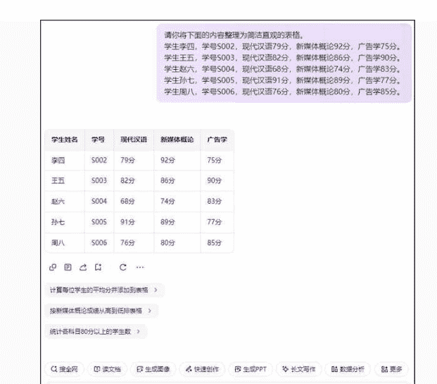

几乎所有可视化智能工具都支持间接或直接产出表格，用户只需在提示词中明确指令如“请你以表格形式……”等。下面的提示词示例均可让智能工具产出表格。

> 我想成为一名程序员，请你用表格的形式为我整理这个职业所需要的能力与素养。

> 请你将“马斯洛需求层次理论”整理为简单直观的表格。

> 请你为我制订一份大学生日常作息表，用表格的形式呈现。

除了根据文本快速产出图表，部分工具还支持对图表数据进行计算与处理。图 3-4 所示为利用 WPS AI 快速计算某班级成绩排名的示例。

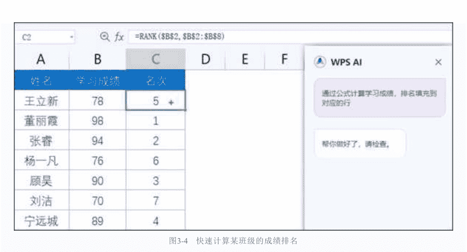

DeepSeek 产出可视化图

图是一种可视化思维工具，通过图形结构展现主题及其相关概念的层级关系，帮助发散思考、整理信息、提升记忆与理解。常见图形有思维导图、鱼骨图、树状图、雷达图等。可视化智能工具产出可视化图的常见应用场景见表 3-3。

| 类型 | 描述 |
| :--- | :--- |
| 自动产出图 | 用户输入文字信息，工具可智能识别关键词、主题与子主题，自动产出相应图形 |
| 快速编辑与优化 | 在创建与编辑过程中，工具可辅助调整图形的逻辑性与美观度 |
| 图表数据与图的转化 | 将表格转化为图形，实现高效数据分析与图像可视化 |

**图 3-5** 所示为利用 DeepSeek 产出 Mermaid 语言，再通过在线图表工具生成思维导图的过程。

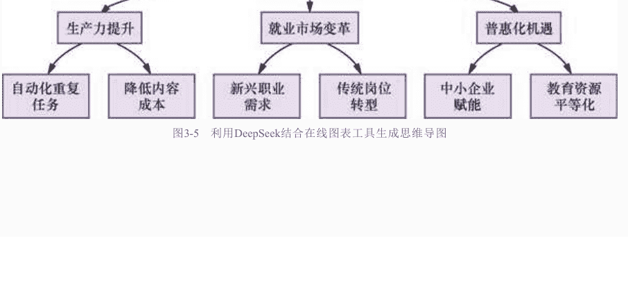

## 3 DeepSeek 用于图表制作时的提示词设计步骤

得益于极高的生成效率，DeepSeek 及其他可视化智能工具已成为高效创作可视化内容的重要助手。掌握使用技巧不仅能大幅节省时间精力，还能提升信息组织能力。使用可视化智能工具同样需要设计准确的提示词并遵循一定步骤。

### 找对工具

使用可视化智能工具生成内容的第一步是找到合适的工具。选择最佳工具需综合考虑自身需求、工具特点及实际操作体验。只有这样才能找到适合自己的方案，提升工作效率与图表质量。

目前市面上可生成图表内容的工具各有所长，需要从中挑选出最优选项。

此步的首要原则是匹配需求与功能，明确使用工具希望传达的信息类型与目的。遇到具体需求时，可对照可视化智能工具的介绍页面，选择具备相应功能的工具。如 WPS AI 具备处理表格数据的能力，Xmind AI 则更擅长制作思维导图。

另外，对可视化智能工具需要摸索与实操。可尝试工具的免费版或试用版，亲手制作一些图表，检验是否符合预期与需求。通过这个过程，能更直观地了解工具的操作难度、功能完善度以及生成的图表质量。

### 明确提示词要点

相比写作类智能工具，使用可视化智能工具时所需的提示词更为简洁精炼。因为写作类智能工具需要情节、逻辑或情感基调等复杂提示，而可视化智能工具处理数据可视化任务时，提示通常简明清晰。

也因此，设计可视化智能工具提示词的关键原则是明确要点、精准概括，即明确使用智能工具要达成的目标与生成内容。下面通过具体场景详细介绍提示词设计的要点。

#### 1. 数据处理类型

复杂表格的数据处理类型众多，熟悉这些类型有助于设计提示词。常见的数据处理类型如表 3-4 所示。

<span style="text-align: center;">表 3-4 常见数据处理类型</span>

| 处理类型 | 备注 |
| :--- | :--- |
| **数据输入** | 在单元格中录入文本、数字、日期等信息 |
| **数据格式化** | 设置单元格的字体、颜色、对齐方式等 |
| **数据排序** | 按某一列或多列的值进行升序或降序排列 |
| **数据筛选** | 使用筛选功能过滤出满足特定条件的数据 |
| **查找和替换** | 在表格中查找特定内容并进行替换 |
| **数据合并与拆分** | 合并多个单元格内容，或将一个单元格内容拆分为多个单元格 |
| **插入函数** | 使用 Excel 内置函数进行计算，如求和、平均值、最大值、最小值等 |
| **公式计算** | 创建自定义公式进行复杂计算 |
| **图表创建** | 根据数据创建柱形图、折线图、饼图等各类图表 |

#### 2. 图表类型

图表作为可视化领域的重要内容，发展历史悠久并衍生出众多细分类型。在设计提示词时，图表类型的名称即是提示词的核心要点。

熟悉不同图表适用的场景，有助于快速确定要点并组织提示词。常见图表类型如表 3-5 所示。

<span style="text-align: center;">表 3-5 常见图表类型</span>

| 类型 | 介绍 | 适用场景 |
| :--- | :--- | :--- |
| **柱形图** | 用长短不一的垂直或水平柱表示各类别数值大小，适合比较类别间数量差异 | 显示各类别相对数量或比例，适用于静态数据对比，如产品销售额对比、各地区人口数量对比等 |
| **折线图** | 用线段连接数据点表示数据随时间或其他连续变量的变化趋势 | 显示股票价格、气温记录等连续数据变化趋势或进行相关性分析 |
| **饼图** | 将数据总体分为数个扇区，扇区面积代表其占总体的比例 | 表示整体中各部分占比或份额，适用于展示组成结构，如市场占有率、问卷答案比例等 |
| **散点图** | 通过坐标轴上的点表示两个变量关系，点的位置由对应两个值决定 | 显示两个变量间是否存在趋势或关联，常见于回归分析、相关性研究 |
| **面积图** | 类似折线图但折线下方区域被填充颜色，强调累计或总量随时间变化 | 强调变化的积累效果，尤其突出趋势强度时有用，如资源消耗、销售累计量等 |
| **雷达图** | 多个变量围绕中心点辐射，半径表示变量值大小，形状展现各维度综合比较 | 评估与比较多个定量属性整体表现，适用于多维度能力或性能评价，如个人综合素质、产品特性对比等 |
| **表格** | 二维数据布局，行列交叉处填入数据，用于存储、组织和管理大量数据 | 数据记录、统计、分类与排序等，几乎适用于所有需要清晰列出具体数值与细节的场景 |
| **漏斗图** | 层次型图形，上宽下窄，显示过程中逐步减少的现象 | 销售转化分析、网站用户行为路径分析、业务流程优化等，用于揭示流程流失情况 |
| **鱼骨图** | 又称因果图或石川图，以主干分支展开展示问题及其潜在原因 | 质量管理与问题解决，帮助识别导致某一结果的直接与间接原因 |
| **思维导图** | 发散性思维工具，以中央主题为核心向外延伸关键词，形成非线性信息网络 | 思维整理、创意发散、项目规划、学习笔记等，帮助厘清思路、记忆与创新思考 |
| **逻辑图** | 通过框图形式展示逻辑关系，包含起点、过程、结果节点及条件判断、循环等概念 | 逻辑分析、程序设计、决策流程分析等，清晰描绘事件顺序与逻辑推理路径 |
| **树状图** | 分层结构图，呈现从父节点到子节点的层级关系，反映事物的分类或隶属关系 | 展示家族谱系、文件目录结构、企业组织架构、分类体系等具有层次特征的信息 |
| **组织架构图** | 描述组织内部部门、职位及上下级关系的图表，常以矩形框和连线构成 | 企业组织结构、团队职责分配、项目管理等，直观展示人员及部门间汇报关系 |
| **时间轴** | 纵向表示时间序列，横向列出重要事件，用线条或区块标识事件发生时段 | 历史事件梳理、项目进度安排、人生大事记等，直观呈现事件先后顺序与持续时间 |

过去制作图表往往耗费大量精力，但已连通 DeepSeek 的可视化智能工具能帮助用户节省绘图时间。在此情况下，最重要的是明确所需图表类型并设计好提示词。

组织提示词时，务必充分考虑各类图表的术语名称与适用场景，结合自身需求选择合适的图表，为撰写提示词做准备。图表类型直接关系到信息传达的准确性与效率。

匹配需求与图表类型既要考虑数据的性质，也要考虑图表的视觉效果。选择图表类型时，首先要明确需求，是展示数据变化趋势，还是比较不同类别的数量关系。若需展现数据动态变化，折线图或面积图是理想选择；若要比较不同部分占比，饼图更为直观。还需考虑适用场景，如在工作报告中展示业绩变化，折线图能清晰反映增长或减少趋势；而在分析市场份额时，饼图能直观展示各地区占比情况。

下面一组案例展示了不同场景下适用的图表。

> **案例一**：某城市近 5 年各月份空气质量指数变化

适用图表：折线图

解释：此场景关注空气质量指数随时间推移的变化趋势及可能存在的季节性规律。折线图可清晰展示每个月指数的变化，通过观察线条的升降波动，用户能直观看出时间序列中的趋势与周期性特征。

> **案例二**：某电商平台 2024 年度各类商品销售额占比

适用图表：饼图

解释：此场景表达各类商品在总销售额中的相对比例，而非具体数值大小。饼图能有效可视化各品类销售额，扇区大小代表相应品类占比，一眼即可看出畅销品类与市场份额较小的品类。

> **案例三**：某地区 2019 至 2025 年居民消费支出在食品、住房、交通、教育、医疗 5 个领域的分布情况

适用图表：柱形图或面积图

解释：此类场景需要同时展示各领域消费支出的绝对值及其在总支出中的比例。柱形图允许用户看到每个领域支出随年份的具体变化，通过颜色区分与层叠效果可直观反映各领域支出构成整体结构。面积图提供相似信息，通过填充区域还能直观展示不同时期各领域支出的累积效应。

### ■ 设计提示词

#### 1. 生成图表

生成图表内容时，可按公式完成提示词，公式内容如图 3-6 所示。


**（1）内容主题**

内容主题即图表将向观众展示的主要信息。下面的案例展示了一些图表的内容主题。

> **主题一**

人工智能的发展

> **主题二**

北京近 5 年各月份空气质量指数变化

> **主题三**

张艺谋的电影

内容主题是核心的提示词要点，也是智能图表工具生成内容的主要依据。

**（2）图表类型**

不同图表类型适用于不同场合，也会产生截然不同的视觉效果。根据内容主题选择相应图表类型，便能完成提示词设计。示例如下。

> **提示词一**

生成人工智能的发展的时间轴。

使用提示词一，WPS 灵犀生成的图表内容如图 3-7 所示。

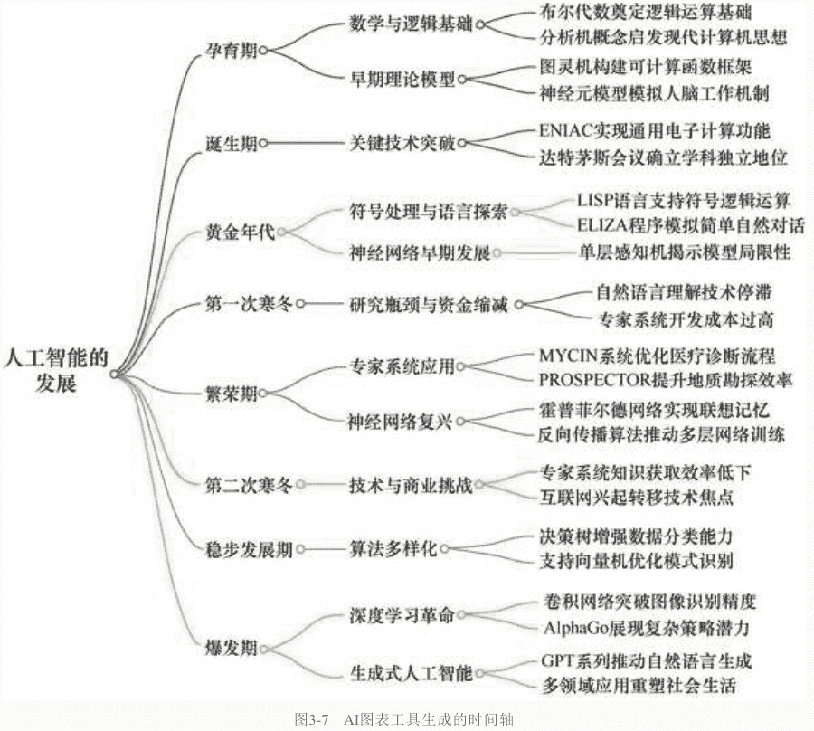

#### 2. 编辑图表

编辑图表指在已有图表基础上，利用智能工具进行高效编辑处理。可视化智能工具一般会在表格页面提供提示词输入框。实际应用时，提示词较为简单，通常只需一句话准确表明编辑对象与编辑目的。图 3-8 所示为编辑图表的提示词公式。


**（1）编辑对象**

指令先定位，再定目标

数据量庞大的表格可操作点众多，下指令前先把动手范围交代清楚是让模型听懂的前提。操作范围指的是要让模型介入的具体位置，可能是整张表、某一行某一列、某个单元格，也可能是整个图表。写提示时务必把定位点说清楚。

编辑意图
范围确认后，还要说明希望达到的效果，即编辑目的。目的可能是数值运算、样式调整、单元格的增删合并等。

下面这组提示词展示了范围与意图如何配合。

> **提示词一**
通过公式依次求出学习成绩列的最高分、最低分、第二高分、第二低分、平均值。

> **提示词二**
将销售数量大于 500 的单元格标注为黄色背景。

> **提示词三**
合并日期相同的单元格。

> **提示词四**
将奇数标签页标注为红色。

> **提示词五**
统计 2023 年秋季、订货渠道为平台 8 且销售数量大于 300 的订单的数量。可以看出，这些指令都先锁定作用对象，如“学习成绩列”“销售数量大于500”“日期”等；再说明希望实现的效果，如“计算最高分”“标注为黄色背景”“合并”等。例如WPS AI等图表类智能系统会将编辑处理的数据直接反馈在表格内，如图3-9所示。

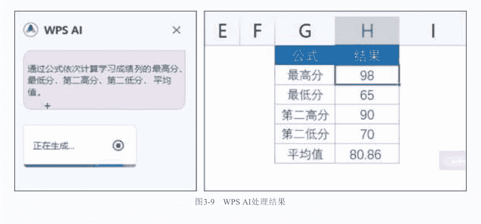

## 4 实战案例：DeepSeek 驱动图表制作与解读

### ■ DeepSeek 助力大学成绩剖析
借助 DeepSeek 以及其他图表类智能系统能快速整理成绩数据并产出各类图表，深入观察各科成绩的走势与差异。这对大学生认识自身学习状况很有帮助，也为后续规划提供依据。下面以一次成绩分析为例说明思路。

#### 1. 工具选型
对四年大学成绩做可视化分析时，工具选择是关键。常见做法是用 DeepSeek 生成结构化表格，再用 WPS AI 完成数据清洗与洞察。

WPS AI 在数据处理和智能洞察方面能力突出，能应对相对复杂的成绩整理任务；DeepSeek 在自然语言理解上表现优异，可以按需生成规范表格。两者配合效率较高。

#### 2. 生成成绩表
要得到直观的成绩清单，可把四年各科成绩一次性交给 DeepSeek，让它整理成完整表格。示例提示如下。

> 请将下面的大学4年各科成绩整理为简洁直观的表格，以CSV格式输出。（成绩内容略）

把 DeepSeek 输出的 CSV 文本保存后导入 WPS 打开，呈现效果如表3-6所示。

> 表3-6 DeepSeek生成大学成绩表格

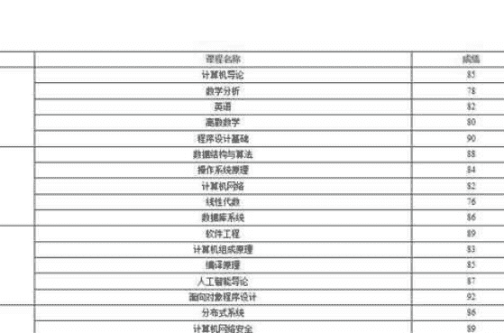

#### 3. 处理表格数据
导入 WPS 后即可用其智能处理功能进一步挖掘数据。先确认数据完整准确，再开始智能处理。部分常用提示如下。

##### (1) 数据公式计算
> **提示词：**
计算每个学年成绩的平均分。
根据成绩标记等级。如果成绩大于等于90，则标记为1；如果成绩大于等于85，则标记为2；如果成绩大于等于80，则标记为3；如果成绩小于80，则标记为4。

WPS AI 会按提示自动遍历成绩区域，生成对应公式，算出每门课程以及每个学年的平均分，帮助快速把握不同阶段和不同课程的表现。公式内容如图3-10所示。


图3-10 图表类智能工具生成的公式

##### (2) 突出重点内容
> **提示词：**
将每门课程成绩大于80分的单元格标红。

系统可对成绩数据进行筛选与统计，帮助识别优势科目与待提升科目。快速美化后，数据更清晰直观。处理效果如图3-11所示。

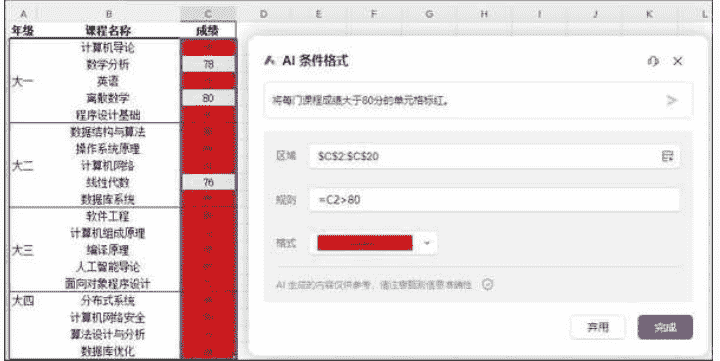

图3-11 智能工具处理单元格的效果（部分）

#### 4. 生成可视图表
> **提示词：**
生成每学年平均成绩的条形图。
分析学生成绩在不同分数区间的分布数据，如60~70分、71~80分、81~90分、90分以上等，并用图表展示。

借助 WPS AI 的洞悉分析功能，可迅速得到多种可视化图表，并通过指令对数据进行解读。示例图表如3-12所示。

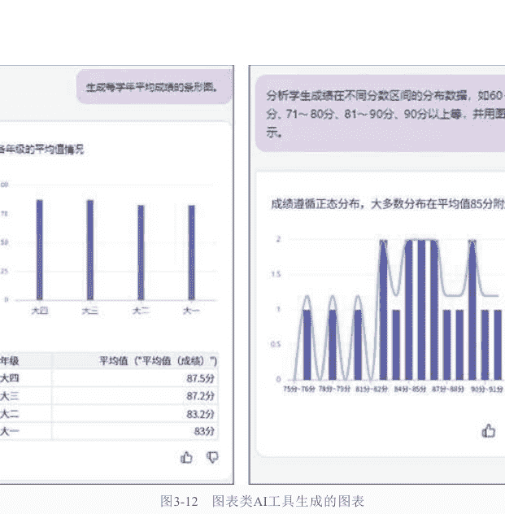

## DeepSeek 驱动思维导图生成
借助 DeepSeek 的强大能力，还能快速生成思维导图等可视化结构，帮助把握知识脉络。借助 Mermaid 语法，DeepSeek 可以输出结构清晰、逻辑严谨的图表代码，降低制作门槛。下面以《高效能人士的七个习惯》为例说明全流程。

在正式操作前，需要了解 DeepSeek 生成图表的机制。

DeepSeek 依托强大的自然语言处理与多模态理解能力，能把用户描述自动转化为结构化代码，例如 Mermaid 语法和 Markdown 文本，从而高效生成所需图表与文档。表3-7所示为 DeepSeek 支持的 Mermaid 语法与 Markdown 功能详解。


接下来分析完整流程。

#### (1) DeepSeek 产出思维导图源代码
在 DeepSeek 首页手动开启 DeepSeek-R1 运行方式，并在对话框中输入作者与书名，系统会自动生成对应的 Mermaid 代码。提示词示例如下。

> 用 Mermaid 语法绘制一份清晰的图表

> 
> 内容：斯蒂芬·柯维所著《高效能人士的七个习惯》

系统会按以下步骤生成源码：

- 内容解析：自动识别章节层级、知识点关联性与知识体系拓扑结构。
- 逻辑建模：基于图书内容生成树状图、流程图或概念网络等适配的图表类型方案。
- 代码生成：输出符合 Mermaid 标准的语法源码（含节点、连接线及注释）。

利用 DeepSeek 产出图表源代码，能在很大程度上降低人工梳理知识脉络与编程的时间成本，帮助读者快速构建思维导图。图3-13所示为 DeepSeek-R1 运行方式下的自动分析图书内容示意。

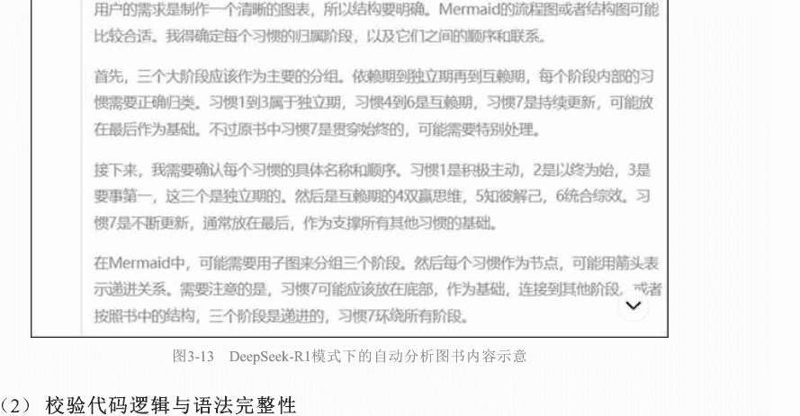

#### (2) 校验代码逻辑与语法完整性
检查生成的代码是否包含以下问题。

- 节点缺失：确认所有章节标题与子知识点均被完整覆盖。
- 语法规范：排查缩进、连接符是否符合 Mermaid 标准。
- 逻辑连贯性：确保父子节点归属正确，分支路径无矛盾。

用户可通过分段预览或借助 Mermaid 生成工具提前验证效果。图 3-14 所示为 DeepSeek 生成思维导图源代码效果示意。

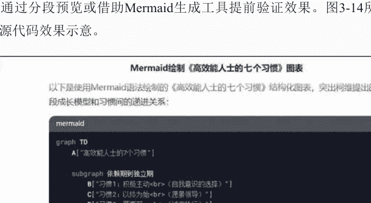

#### (3) 渲染并导出可视化思维导图
在 DeepSeek 生成的源代码右上角单击“复制”按钮，并将校验后的代码粘贴至支持 Mermaid 的工具（如 Mermaid Live、Typora 或其他在线平台）中，这里以 Mermaid Live 官网为例（如图 3-15 所示）。

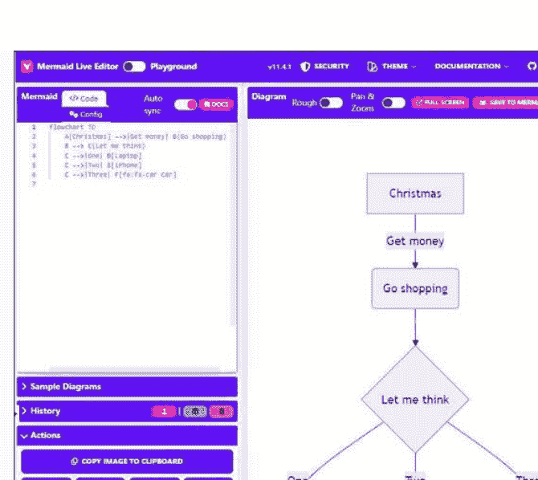

图3-15 Mermaid Live官网

将复制的源代码粘贴到 Mermaid Live 官网左侧，右侧会自动生成交互式思维导图。图3-16所示为 Mermaid Live 自动生成思维导图示意。

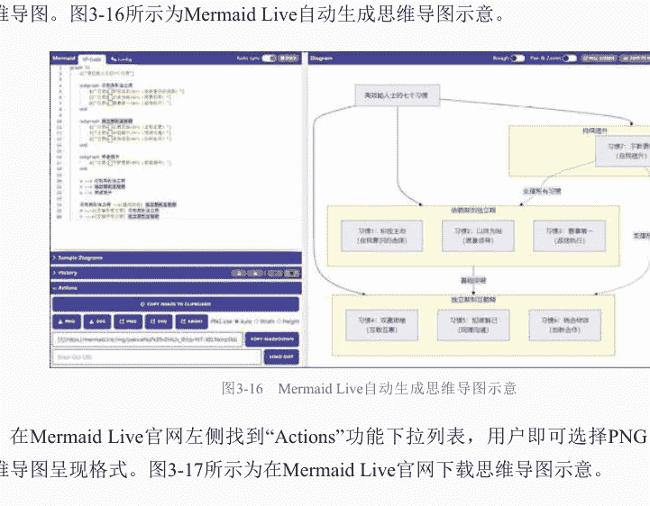

图3-16 Mermaid Live 自动生成思维导图示意

在 Mermaid Live 官网左侧找到“Actions”功能下拉列表，用户即可选择 PNG、SVG 等多种思维导图呈现格式。图3-17所示为在 Mermaid Live 官网下载思维导图示意。

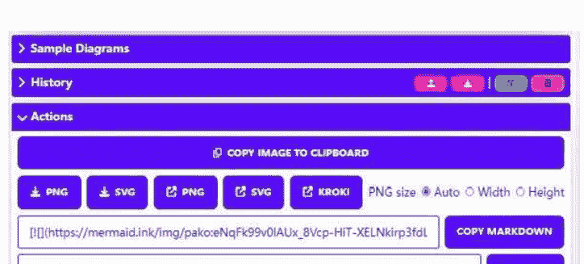

图3-17 在 Mermaid Live官网下载思维导图示意

使用 DeepSeek 加持制作的图书《高效能人士的七个习惯》的完整思维导图如图3-18所示。

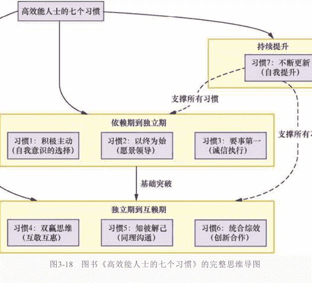

图3-18 图书《高效能人士的七个习惯》的完整思维导图

## Part4  
DeepSeek 与演示文稿类 AI 联动实操技巧

**演示文稿**作为现代信息交流的载体，承载着知识传播、观点阐述、决策呈现等多元使命。过去需要耗费大量时间打磨版式、搜集素材、反复微调，如今在强大 AI 引擎驱动下流程得以简化。用户只需清晰表述意图、精准设定风格，借助少量关键词，DeepSeek 便能迅速理解，协同各类演示文稿类 AI 应用，瞬间生成契合主题、富于创意且具有专业水准的演示文稿。无论是逻辑严谨的数据报告，还是视觉震撼的故事讲述，抑或是风格独特的品牌宣讲，DeepSeek 赋能的演示文稿类 AI 应用都能以惊人的速度和精度予以实现。

### 1 演示文稿类 AI 应用概览
演示文稿是一种用于展示信息的动态文件，通常包含文字、图表、动画等元素，以幻灯片形式呈现，用于教育、商业领域或个人展示等。演示文稿类 AI 应用以先进的算法为核心，集成多种功能，旨在简化制作流程，提升创作效率，助力用户快速打造出专业、精美的作品。下面将介绍几款常见的演示文稿类 AI 应用，以及它们如何与 DeepSeek 协同工作。

#### AiPPT 与 DeepSeek
AiPPT 是一款典型的演示文稿类 AI 应用，与 DeepSeek 有着独特的协同优势。只需用户在 DeepSeek 中输入 PPT 主题关键词或概述演讲内容，DeepSeek 便能通过对海量信息的分析，在短时间内自动生成 PPT 大纲。用户把大纲以 Markdown 语法或 Word 文档形式上传到 AiPPT，便能获取完整且结构严谨的 PPT，不仅涵盖相关的文字叙述、数据图表，还包含恰当的视觉元素与设计布局，并确保内容与形式的和谐统一。为了满足用户多样化的输入需求，AiPPT 支持多种文档格式的上传，无论是 Word 文档、思维导图文件还是 PDF 报告，都可以作为 AiPPT 生成 PPT 的原始素材。在这一过程中，DeepSeek 能够辅助 AiPPT 更精准地理解文档内涵，提取关键信息，从而生成更贴合需求的 PPT 文稿。

此外，AiPPT 还内建了一个庞大的模板库，拥有超过10万套定制级 PPT 模板及丰富的素材资源。这些模板覆盖了各行各业及各类应用场景，用户可根据自身需求快速选取并一键应用，可极大地节省设计时间。AiPPT 同样能满足用户自由灵活的编辑需求，包括调整页面布局、替换形状元素、精细调整字体颜色等，确保最终输出的 PPT 既保留 AI 应用生成的优势，又能融入个人独特的创意与品牌风格。其图标如图4-1所示。


图4-1 AiPPT 的图标

#### MindShow 与 DeepSeek
MindShow 同样是一款演示文稿类 AI 应用，可以将 Markdown 内容一键转为 PPT。用户只需在 DeepSeek 中输入一段话，概括 PPT 的主题、核心观点或描述 PPT 页面内容，并命令 DeepSeek 用 Markdown 语法输出 PPT 大纲，将大纲发送给 MindShow，便能得到内容连贯、逻辑清晰的 PPT，其中包括但不限于精练的文字叙述、可视化图表以及与主题紧密贴合的图片素材。其图标如图4-2所示。

#### 其他演示文稿类 AI 应用
演示文稿类 AI 应用不断涌现，各有特点与优劣。表4-1所示为除 AiPPT 与 MindShow 之外的其他常见演示文稿类 AI 应用。


图4-2 MindShow 的图标

表4-1 其他常见演示文稿类 AI 应用

| **工具名称** | **功能简介** |

| :--- | --- |

| WPS AI | 集成于WPS Office中的AI助手，提供生成与编辑PPT的功能 |

| iSlide | PPT插件，提供海量模板、图标、设计工具，可一键优化布局与统一风格，提升制作效率 |

| Presentations.AI | 根据输入内容生成完整的PPT，可以自定义设计，并可轻松实现共享和协作 |

| 闪击PPT | 根据目录大纲快速生成PPT，支持自动排版。目前只提供简约风格，但有几百套模板可供选择 |

### 2 DeepSeek 与演示文稿类 AI 应用结合的应用场景
手动制作一份完整的 PPT，通常需要保证足够的页数，每一页通常需要有标题、正文、图像等内容，因此往往耗时几小时到几天不等。而 DeepSeek 和演示文稿类 AI 应用的出现，让快速生成与处理 PPT 成为可能。

#### DeepSeek 辅助生成 PPT
AI 技术的核心价值在于其能够从零开始自主生成内容，这一特点在 PPT 领域显得尤为突出。在传统的 PPT 制作流程中，撰写文稿以及设计制作往往需要耗费大量的时间与精力。而借助 DeepSeek，用户仅需提供 PPT 主题，便能够迅速生成高质量的 PPT 大纲，或对用户已有的 PPT 大纲进行完善与优化，还能从用户提供的文档中提炼 PPT 大纲。在此基础上，演示文稿类 AI 应用可根据用户提供的 PPT 大纲，在短时间内自动生成完整且高质量的 PPT。这不仅大大提高了工作效率，还为用户提供了更多的创意和灵感，无疑为商务人士和教育工作者等广大用户带来了极大的便利。表4-2所示为 DeepSeek 辅助演示文稿类 AI 应用生成 PPT 的主要方式。


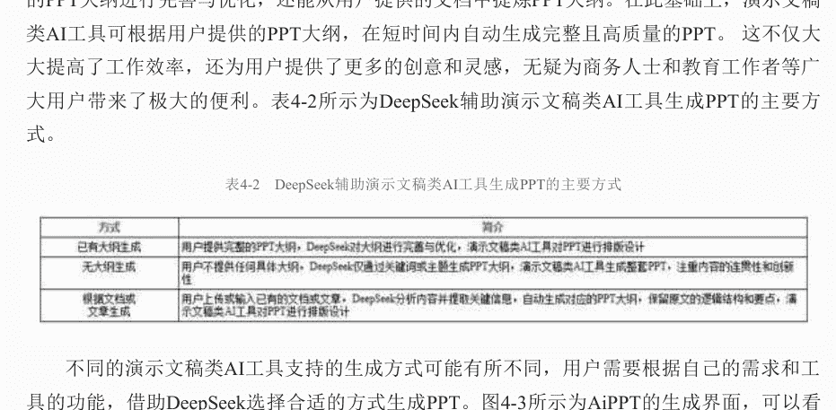

不同的演示文稿类 AI 应用支持的生成方式可能有所不同，用户需要根据自己的需求和工具的功能，借助 DeepSeek 选择合适的方式生成 PPT。图4-3所示为 AiPPT 的生成界面，可以看到其支持 AI 智能生成、文档生成 PPT、导入 PPT 生成和链接生成 PPT 这4种生成方式。


#### DeepSeek 辅助优化 PPT
DeepSeek 与演示文稿类 AI 应用在 PPT 编辑方面的优势，不仅限于从零开始生成内容，而且在于强大的智能编辑功能。利用这些 AI 应用，用户可以轻松地已有 PPT 进行智能化修改和优化，包括调整布局、优化配色、改进文字表述等。DeepSeek 辅助演示文稿类 AI 应用编辑 PPT 的主要方式如表4-3所示。

表4-3  DeepSeek 辅助演示文稿类 AI 应用编辑 PPT 的主要方式

| 方式 | 描述 |

| :--- | :--- |

| 快速更换主题 | DeepSeek可以根据PPT的主题和大纲，快速判断PPT适用的主题风格；演示文稿类AI系统可以轻松更换整份PPT的主题风格，无须逐页调整，实现整体视觉效果的快速统一。 |

| 排版与编辑 | DeepSeek可以根据PPT的文字内容，提供一些排版建议，如文字和图表的布局、字体大小和颜色的选择等，并生成对应的提示词；演示文稿类AI系统可以根据提示词自动调整PPT布局，同时提供便捷的编辑工具，使用户能够轻松调整PPT细节。 |

| 扩写与简化内容 | DeepSeek能够对PPT的文字内容进行扩写或简化，帮助用户更精确地传达意图。 |

| 生成演示备注 | DeepSeek能够基于PPT内容生成详细的演示备注，为演讲者提供有力支持。 |


### 3 DeepSeek 驱动演示稿生成的提示策略

对外展示几乎都依赖幻灯片，一份能留住注意力的演示稿往往由多个相互配合的模块构成，模块协同才能实现信息的高效传递。厘清构成要素，就能让 DeepSeek 与演示类智能工具联动，快速产出质量可观的演讲稿。

#### ■ 主题提示词如何搭建

主题像贯穿全篇的主线，是听众理解并记住内容的抓手，所以锁定主题是整个产出流程的起点。

一个清晰、准确且具备吸引力的主题，是演示产生价值的前提。通常在敲定主题时要综合演讲目标、内容要点、受众诉求以及行业动向等维度。主题往往直接用作演示稿标题，为后续制作打下基础。

借助智能系统生成演示稿，第一步就是设定主题指令，一般要涵盖目的、行业、岗位等信息。主题指令的构成公式如图4-5所示，详细说明见图4-6。

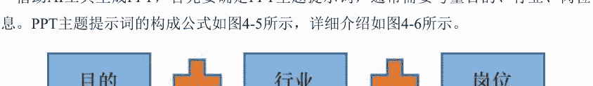

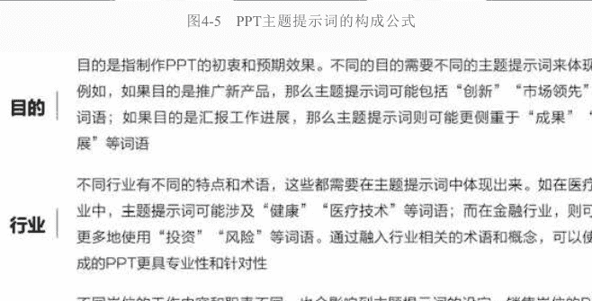

请给我一些常见的PPT主题

已是深度思考（用时33秒）

以下是更常见且实用的演示主题示例（涵盖不同行业和场景），延续你提供的风格并扩展补充：

##### 一、通用型年终总结

- 1. 年度关键数据解码：从增长曲线到未来布局
- 2. 年度战略复盘：目标达成率与策略重构
- 3. 跨部门协作全景图：效率提升与痛点突破
- 4. 用户需求变迁报告：洞察变化与应对方案
- 5. 成本与收益平衡术：优化路径与风险预判

##### 二、科技与数字化领域

- 1. 人工智能落地实践：场景应用与伦理反思
- 2. 数字化转型深水区：技术赋能与组织变革
- 3. 云原生架构升级：弹性扩展与安全加固
- 4. 物联网生态建设：连接效率与数据治理
- 5. 元宇宙探索实录：技术瓶颈与商业想象

##### 三、医疗与健康行业

- 1. 智能诊疗系统迭代：精准率提升与误诊规避
- 2. 医药研发年度盘点：创新药进展与合规挑战
- 3. 公共卫生应急响应：资源调度与经验沉淀
- 4. 患者体验优化计划：服务流程与满意度分析
- 5. 精准医疗突破：基因技术与临床转化

##### 四、教育与培训领域

DeepSeek

深度思考 (R1)

联网搜索

内容由AI生成，请仔细甄别

图4-7 常见的PPT主题

#### 打磨演示提纲

演示提纲指的是要递交给受众的核心信息，起提纲挈领的作用。虽然 DeepSeek 能依据主题迅速产出提纲，但若想让结构更扎实、逻辑更顺畅，还需反复打磨，这就要求熟悉提纲的构成要素，如表4-4所示。

表4-4 PPT 大纲的构成要素

| 构成要素 | 描述 | 功能与目的 |
| :---: | :--- | :--- |
| 封面 | 列出PPT 的标题等信息 | 帮助观众了解整个演示的主题 |
| 目录 | 提供PPT 内容的概览，列出各个章节或主要话题及其对应的幻灯片编号 | 帮助观众了解整个演示的大纲结构 |
| 章节页 | 在PPT 中用于衔接不同主题或章节的内容，可能包含简洁的标题和引言 | 给观众缓冲时间，同时提示即将进入新的话题或阶段 |
| 正文 | 主要包含文字、图表、视频等信息内容 | 说明观点，激发情感共鸣 |
| 结论/总结 | 概括演示的主要发现、结论或行动建议等，重申关键要点 | 强调演示的重点，引导观众回顾并记住主要内容 |
| 致谢 | 对参与、协助或听取演示的人表示感谢，可能包含姓名和联系方式 | 表达尊重和感激等，为演示正式收尾 |

DeepSeek 输出的提纲示例如图4-8所示，可在此基础上增删调整。

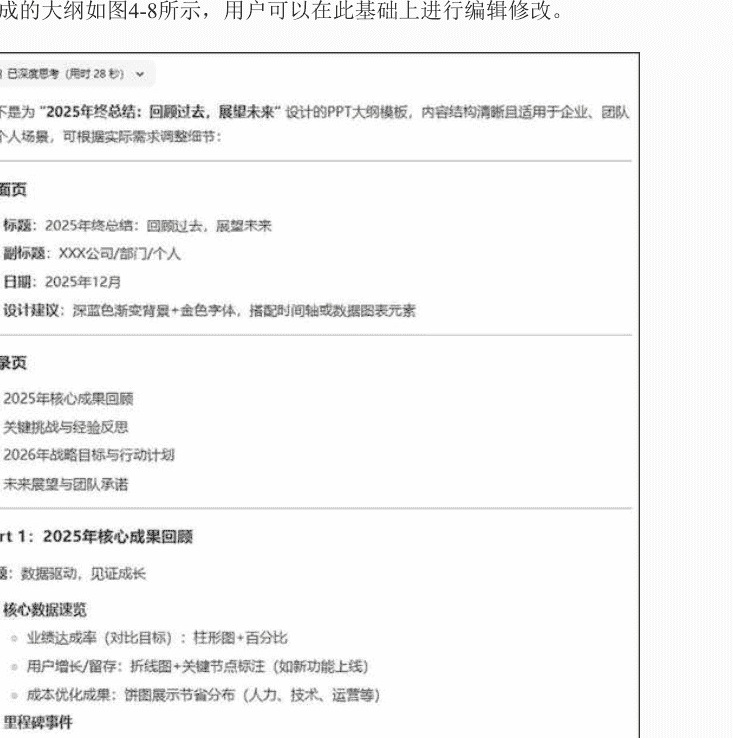

**图4-8 DeepSeek生成的大纲**

### ■ 视觉基调的确定

视觉基调决定演示稿的整体观感，需要保持专业性与一致性，以强化品牌调性、演讲氛围并持续吸引注意力。当前演示类智能系统通常提供大量基调模板供选择，因此了解各类基调的适用场景十分必要。

表4-5所示为常见的PPT主题风格。

| 主题风格 | 描述 |
| :--- | :--- |
| 商业风 | 以商务、正式、专业为主要特点，通常使用稳重的配色和字体 |
| 校园风 | 清新、活泼，富有朝气，常采用明亮的色彩和卡通图案 |
| 科技风 | 强调现代感和科技感，常使用冷色调和简洁的线条 |
| 扁平插画风 | 以扁平化设计为主，结合插画元素，色彩鲜艳且富有创意 |
| 中国风 | 融合中国传统文化元素，如书法、国画、剪纸等，展现东方韵味 |
| 手绘风 | 采用手绘风格，注重细节和个性，使PPT更具艺术感和情感色彩 |
| 杂志风 | 借鉴杂志排版和设计风格，注重画面的层次感和视觉效果 |

明确演示目的与内容后，将不同视觉基调与相应场合和目标匹配。匹配完成后，演示类智能系统即可快速套用模板。以 AiPPT 为例，其提供的主题风格模板如图4-9所示。

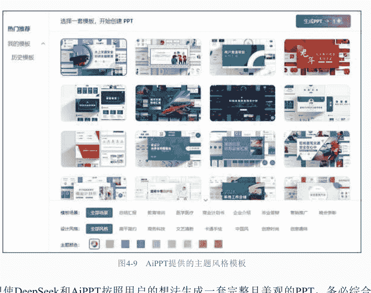

**图4-9 AiPPT提供的主题风格模板**

要让 DeepSeek 和 AiPPT 按预期产出一套完整且美观的演示稿，务必统筹主题、提纲、基调三要素，确认完毕后即可生成，效果如图4-10所示。


**图4-10 利用AiPPT生成的PPT**

# ► 精修版式与内容细节

通过前文介绍，读者已对 DeepSeek 配合演示类智能系统生成演示稿的能力有了初步认识。智能系统生成的演示稿通常并非尽善尽美，需要人工编辑打磨。

借助简短指令，演示类智能系统可实现模板更换、版式调整、色彩优化、文字修改、演讲备注添加等操作。表4-6所示为演示稿的主要排版要素。

| 排版要素 | 描述 | 作用 |
| :--- | :--- | :--- |
| 文字排版 | 包括并列排断、层级排断、总分总排断等 | 确保信息层次清晰，便于阅读和理解 |
| 字体 | 包括字体种类、字号大小、字重和样式 | 增强视觉美感、强化信息的重要性和可读性 |
| 页面配色 | 包括主色调、高亮色、背景色等 | 创造视觉冲击力，引导观众视线，营造氛围 |
| 对齐方式 | 包括左对齐、右对齐、居中对齐、两端对齐、分数对齐等 | 保证页面整齐有序，提升视觉舒适度 |
| 图形布局 | 包括图文混排（图像与文字相结合的方式，提高信息传达效率）、多图排布（利用网格、表格等方式统一多张图片的布局）等 | 有效传达复杂信息，平衡页面视觉比重 |

表4-6 PPT的主要排版要素

以百度文库智能助手为例，编辑美化时只需在右侧对话框输入对应指令即可。

设计指令指导演示类智能系统高效编辑美化演示稿时，需用清晰具体的表述确保系统准确理解需求。这类指令往往简洁，示例如下。

> 帮我更换PPT模板。
> 
> 将单页风格改为科技风。
> 
> 将这一页的文字扩写为30字。

百度文库智能助手更换模板的效果如图4-11所示。


**图4-11 百度文库智能助手更换PPT模板的效果**

## 4.应用案例：DeepSeek 配合生成科技公司融资路演稿

融资路演是初创科技公司向潜在投资人展示商业模式、市场潜力与发展前景的关键环节。一份精美的路演演示稿既能体现专业实力，也能提升吸引力。如今借助 DeepSeek 与演示类智能系统，可更高效地生成并编辑演示稿，确保专业性、美观度与呈现流畅度。

### 1.分析场景，确定主题

某初创科技公司的市场部经理准备向潜在投资人路演，目标是展示核心优势、市场机会、商业模式及未来潜力，以获取兴趣与资金支持。

依据案例场景，结合目的、行业、岗位三大要素确定核心主题。

从目的看，路演核心是吸引投资人兴趣与资金，演示主题应聚焦投资价值与发展前景，突出核心优势、市场机会、商业模式及未来潜力。

从行业看，作为初创科技公司，主题需体现科技感与创新性，可围绕技术创新、产品研发、市场应用展开，展现行业竞争潜力。

从岗位看，市场部经理需全面呈现市场潜力和商业模式，主题应突出市场营销、商业模式及市场战略。

综合以上，可确定核心主题为“科技引领未来——2025年××科技公司商业路演”。该主题既体现科技属性与创新精神，也契合路演职责与目标。

DeepSeek 依据此主题输出的融资路演提纲如图4-12所示。

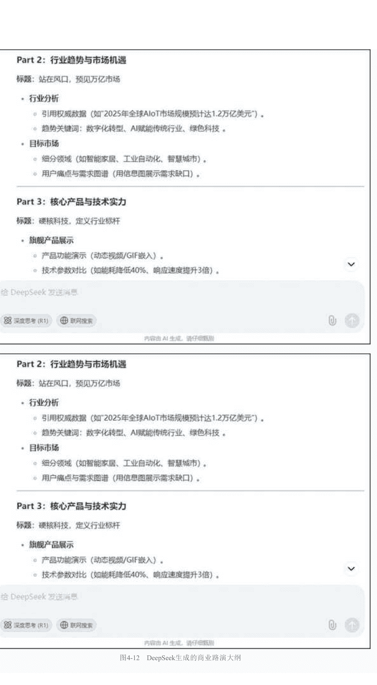

在此阶段需仔细审阅 DeepSeek 输出的演示提纲。审阅后可发现框架整体完整，但细节仍需优化。例如部分数据可能不实，需核查修改，如图4-13所示。


提纲打磨确定后，可利用演示类智能系统初步生成完整演示稿。此时仍可借助 DeepSeek 分析主题与目的，选择匹配的模板基调与配色方案，如图4-14所示。


依据 DeepSeek 分析，可为“科技引领未来——2025年××科技公司商业路演”选择兼顾科技与商务基调的模板，如图4-15所示。

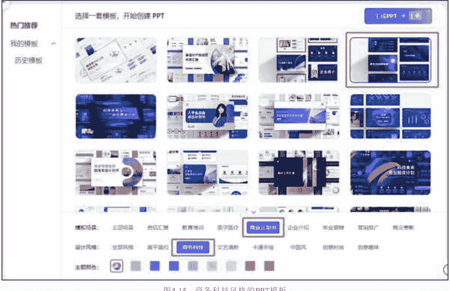

### 4.查漏补缺，打磨细节

至此，基础路演演示稿已完成。为追求更高质量，可借助 DeepSeek 与演示类智能系统进一步细化。

首先，DeepSeek 具备强大的文本处理能力，可协助优化文字内容。逐页检查后，利用其自动缩写、扩写或风格转换功能，使文字更精炼、准确且具吸引力。

其次，通过分析页面元素与排版方式，WPS AI 可给出改进建议，如调整字号、色彩搭配等，提升视觉效果。

最后，可利用 DeepSeek 或演示类智能系统生成演示备注，为每页提供演讲辅助文字。WPS AI 生成演示备注的界面如图4-16所示。

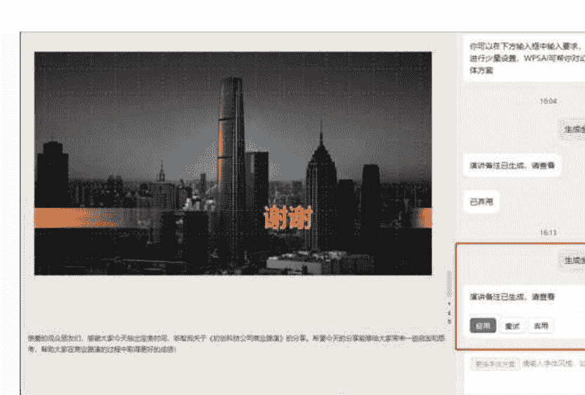

# Part 5 DeepSeek 与图像类智能系统结合实操技巧

图像无处不在，绘画、照片、传达设计等静态视觉内容均可视为图像。视觉叙事在信息时代被赋予新生命力，而图像作为直接且极具感染力的载体，其创作与优化在智能技术推动下发生巨变。智能技术可在图像领域实现高效生成与编辑，其速度与风格多样性远超人工。

DeepSeek 不仅能快速产出高质量指令，还可智能分析用户需求，优化图像生成的细节与风格提示，帮助用户更精准实现创意表达。无论是写实照片还是抽象艺术作品，DeepSeek 都能提供有力支持，提升效率与艺术性。

Part 5 将探索图像类智能系统的操作方法与应用场景，解析技术如何重塑创作、激发创新思维，为个人与组织带来便利。

### 1.图像类智能系统介绍

图像类智能系统是智能领域的重要板块，借助深度学习等技术可模拟复杂风格与细节，生成多样化图像内容，极大提升创作效率与灵活性。DeepSeek 通过智能化产出与优化指令，帮助用户快速定位创作方向，精准匹配风格与细节需求，降低创作门槛。目前国内外相关系统种类繁多，熟悉常见系统对后续实操至关重要。

#### ■Midjourney 与 DeepSeek

Midjourney 是一款基于智能的艺术创意生成系统，于2022年3月14日以架设在 Discord 上的服务器形式推出。用户注册 Discord 并加入 Midjourney 服务器，选择付费订阅后即可创作。该系统以独特功能与高水准性能广受关注，输入指令即可快速生成图像，并在质量上领先多数同类系统。除基础生成外，还提供丰富的编辑与定制选项。

> 由于 Midjourney 对英文指令依赖较高，用户可通过 DeepSeek 一键产出高质量英文指令，解决语言障碍并提升创作效率与精准度。这种灵活性与可定制性使其深受艺术家与设计师喜爱。

该系统的图标如图5-1所示。


#### ■即梦 AI 与 DeepSeek

即梦 AI 是字节跳动旗下智能大模型公司研发的图像生成系统，以免费、低门槛著称。用户输入简单指令即可快速生成高质量、多风格的图像。无论写实照片还是抽象创作，即梦 AI 均可精准捕捉创作意图，生成惊艳视觉内容。

> 由于即梦 AI 对指令精准度要求较高，用户可通过 DeepSeek 产出优化后指令，进一步提升生成效果与创意表达，降低门槛。即梦 AI 还支持多种风格定制与调整，轻松实现从写实到抽象的多样化创作。其免费、灵活、智能的特性使其备受设计师与艺术创作者青睐。

该系统的图标如图5-2所示。


#### 其他图像类智能系统

智能图像生成技术已趋成熟，涌现出许多特色鲜明的系统。表5-1所示为目前部分成熟的图像类智能系统及其功能简介。


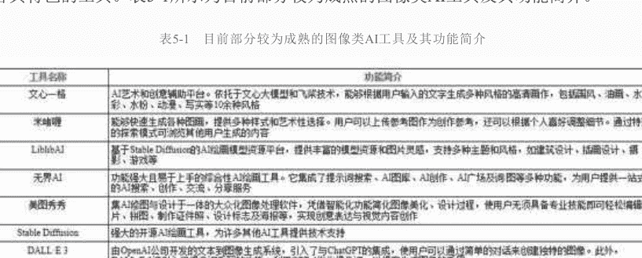

一般而言，这些图像生成系统均提供详细使用手册与官方教程，并提供免费体验机会。用户可通过生成1~2幅图像感受功能，也可通过浏览他人作品及其对应指令初步了解技术。图5-3所示为系统“文心一格”的首页界面，可见平台展示了丰富的用户作品及其指令。

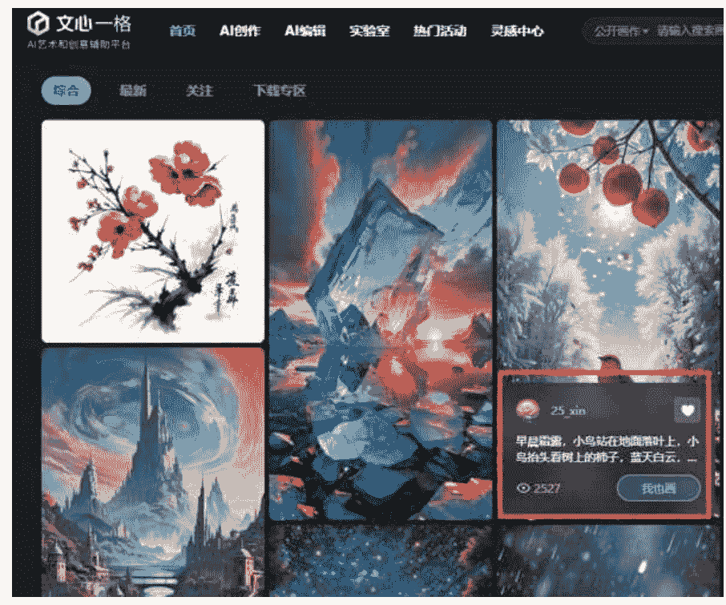

### 2.DeepSeek 与图像类智能系统结合的应用场景

图像类智能系统已广泛应用于各类视觉内容场景，大幅提升创作效率。应用场景主要分为两类：一类是零起点生成全新图像，另一类是对现有图像进行智能化编辑与美化。

#### DeepSeek 辅助图像生成

图像生成功能是图像类智能系统的核心。这些系统利用深度学习算法，基于用户输入的指令或其他信息自动生成符合要求的图像。DeepSeek 作为指令优化助手，可帮助用户快速产出精准且富创意指令，显著提升生成质量与效率。无论风景、人物、建筑还是抽象概念，均可结合 DeepSeek 快速创作出独具特色的作品。

##### 1.生成方式

主流图像类智能系统的生成方式主要有基于文字指令生成与基于上传图片生成，分别简称为“文生图”与“图生图”。

（1）**文生图**。文生图是指通过输入文字描述，由图像类智能系统自动生成对应视觉图像的过程。其核心在于将自然语言理解与计算机视觉技术结合，构建可从语义解码视觉特征的模型。

该方式目前最常用，对指令依赖度较高。用户可使用 DeepSeek 快速产出精准且富创意的指令。图5-4所示为用 DeepSeek 辅助生成文字指令的过程。

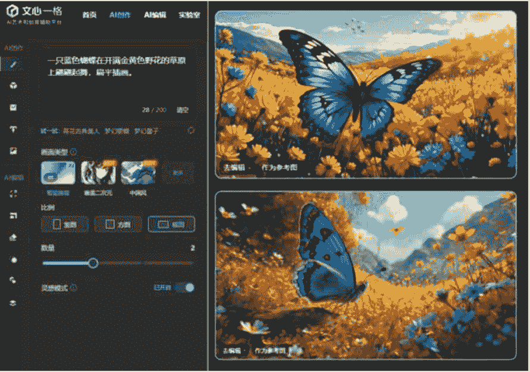

**图5-4 DeepSeek 辅助打磨绘画指令的过程**

有了 DeepSeek 的提词支持，创作者能拿到更精准的绘图文字指令，让最终成图更贴合预期。图5-5 为文心一格的文生图演示。

##### 2.内容应用
（2）**图生图**。图生图是以已有成片为输入，由成图类模型对画面进行改写、转换或强化，从而产出新作。该方式在保留原图核心信息的同时，可实现定向编辑或风格迁移。

使用时需自行准备素材并上传至系统。图5-6 展示了基于旧图生成新图的流程。

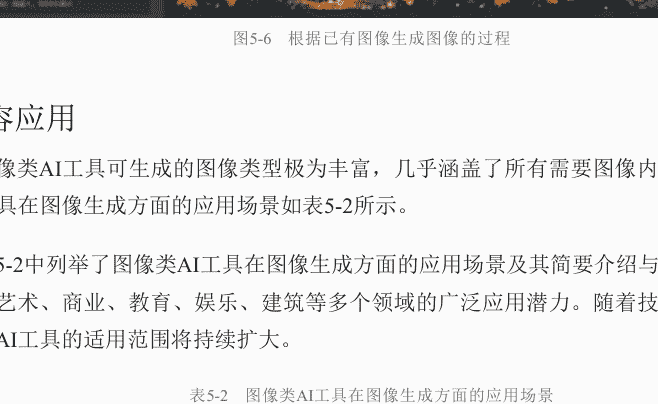

智能成图系统能输出的画面类型非常丰富，基本覆盖所有需要视觉内容的方向。表5-2 汇总了这类系统的典型生成用途。

表5-2 列出了成图系统在画面产出方面的应用方向、简要说明与代表案例，呈现了技术在艺术、商业、教育、娱乐、建筑等多个领域的广泛潜力。随着技术迭代，其适用范围仍在持续扩大。

| 应用场景 | 介绍 | 案例 |
| :--- | :--- | :--- |
| **艺术创作** | 借助模型产出绘画、插图、概念设计等作品，为艺术家提供灵感启发、创作助力或独立成图 | 创作一幅印象派调性的夕阳麦田风车画，可作装饰或售卖 |
| **广告与营销** | 产出吸睛视觉物料，用于产品推广、社交媒体投放、海报设计等，提升品牌传播力 | 生成新款手机的产品渲染图，展示多配色、不同角度及使用场景，用于电商宣传 |
| **新闻与传媒** | 快速产出新闻配图、图表、信息可视化内容，增强报道的视觉冲击与信息传达效率 | 依据天气预报数据生成未来一周全国气温分布图，供新闻网站发布 |
| **教育与培训** | 产出教学示意图、卡通形象、互动学习资源，提升教学内容的吸引力与可理解度 | 制作一套动物解剖结构图并标注关键部位，用于生物课程教材 |
| **游戏与娱乐** | 产出游戏内的角色、场景、道具等美术资源，或用于动态背景、特效设计，提升玩家体验 | 设计一套科幻主题的角色套装及武器模型，供大型多人在线游戏选用 |
| **建筑与室内设计** | 快速绘制方案、室内布局效果图，帮助客户预览决策，提升设计沟通效率 | 依据设计师草图生成住宅外观三维渲染图，展示不同光照下的视觉效果 |
| **时尚与零售** | 设计服装款式、提供搭配建议、支持虚拟试衣，助力线上购物体验，为设计师提供灵感 | 为用户生成个性化服装搭配建议，含上装、下装、配饰组合及色彩搭配，用于电商推荐 |
| **影视与动画** | 产出背景、角色、特效等动画元素，简化制作流程、降低成本，或用于预可视化 | 创作一部短片分镜的动画，包含场景切换、角色动作、镜头移动，用于导演前期策划 |

#### 图像编辑与美化

图像修缮与美化是指借助智能手段快速完成各类处理，涵盖瑕疵修复、内容填充、风格迁移、对象识别与分离、图像增强、内容感知缩放等功能，如表5-3 所示。

表5-3 成图类工具在图像编辑与美化方面的功能

| 功能 | 介绍 | 案例 |
| :--- | :--- | :--- |
| **瑕疵修复** | 自动识别并修复画面中的噪点、划痕、污渍、红眼等缺陷，让画面更纯净 | 用于美颜场景，快速消除人物面部痘疤、皱纹、眼袋，实现皮肤平滑，提升人像质量 |
| **内容填充** | 基于周边像素信息智能补全图像中缺失的部分，如去除水印、物体移除后的填补 | 移除照片中模糊的电线杆，并自然填充背景 |
| **风格迁移** | 将原图的艺术风格转换为另一种风格，如油画、素描、卡通等 | 将普通风景照转化为梵高《星月夜》风格的油画 |
| **对象识别与分离** | 精准识别并分离图像中的特定对象，便于单独编辑或替换背景 | 提取照片中的人物，将其与原背景分离，以便置入新环境 |
| **图像增强** | 提升图像细节清晰度、降噪、增强弱光区域，尤其适用于低质或老旧照片 | 提升老照片清晰度，去除噪点，恢复暗部细节，使之焕然一新 |
| **内容感知缩放** | 在调整尺寸时保持重要细节完整，避免常规缩放导致的失真或质量下降 | 在调整风景照尺寸时，智能保留山脉、建筑等主体结构的清晰度，无明显失真 |

这些能力大幅简化了后期流程，让使用者无需专业背景也能轻松提升画质与艺术表现。相关平台通常界面直观友好，设计者通过图形化控件把复杂算法封装起来。使用者无须写代码或输入特定文字指令，仅靠点击、拖拽、滑动等直观操作即可完成编辑。美图秀秀的 AI 图像处理界面如图5-7 所示，上传图片并选工具涂抹即可完成处理。

## 3 DeepSeek 驱动的图像提示词设计流程

与其它生成系统类似，设计精准高效的提示词是引导画面产出的关键。通过精心构造的词汇和表达，可精确调控模型的理解与创作，实现对风格、主题、细节乃至情感内涵的细致控制。DeepSeek 作为提示词设计助手，能帮助使用者快速生成高质量指令，进一步提升产出效果与准确度。

##### 确认主题与内容

设计指令的第一步是明确主题与内容，这是决定画面走向的基础，也决定了系统将呈现的视觉场景及其核心要素。指令需同时满足具体性与视觉指向性。

###### 1. 具体性

具体性要求指令详细描述期望画面的主题、场景、主体及其特征，避免笼统模糊的表述，以帮助模型构建清晰画面。图5-8 中的一组对比阐释了该特性。

> **不够具体的表述：**
> 森林
>
> **更具体的表述：**
> 茂密的热带雨林
>
> **不够具体的表述：**
> 海洋
>
> **更具体的表述：**
> 波光粼粼的海岸线


仅用“森林”“海洋”之类词虽点明了大方向，却不够明确，会导致模型生成多种可能的画面；而使用“茂密的热带雨林”“波光粼粼的海岸线”等描述，则把生成范围限定在特定场景，有助于提升准确度。

明确具体性可从主体要素与辅助要素两方面入手。

（1）主体要素。指画面最突出的对象，包括形态、特征与状态等，如“形态各异的热带鱼群与海龟在悠然游弋”中，“热带鱼群与海龟”即为主体。

（2）辅助要素。指背景环境、时段条件与气候状况等，如“波光粼粼，宁静而生机勃勃的海底景象，形态各异的热带鱼群与海龟在悠然游弋”中，“波光粼粼，宁静而生机勃勃的海底景象”即为背景。

###### 2. 视觉指向性

该特性强调使用具象的关键词，如色彩、材质、形状、动作、情绪等，来丰富视觉元素。应避免抽象或非视觉性语言。图5-9 的案例展示了如何保证指令具备视觉指向性。

在图5-9 示例里，“积极气息”“精气神”较为抽象，会让结果不可控；而“蔚蓝天空下，金色麦田随风摇曳，劳动者挥汗收割”则包含丰富视觉细节，明确了天空与麦田的场景及人物主体“劳动者”，为模型提供了清晰依据。

当指令同时具备具体性与视觉指向性时，产出内容更贴合预期。图5-10 为模型依据明确指令生成的画面。

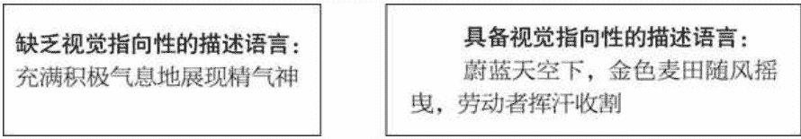

图5-10 图像类 AI 工具根据明确提示词生成的图像

##### 确认风格与艺术手法

确认风格与艺术手法旨在让模型理解并实现使用者期望的艺术表现与创作技巧，确保画面既准确传达主题，又体现独特美学。

###### 1. 风格

在构思指令时，风格是赋予作品灵魂的重要环节，要求创作者精准表达审美倾向。图像风格可分为“流派主义风格”与“艺术家风格”两种。

(1) 流派主义风格。指已成熟并拥有专业名称的风格。如细腻写实的现实主义、象征性强的抽象派、厚重质感的古典油画风格或写实效果的现代数码摄影风格等。表5-4 为部分流派主义风格提示词。

| 类别 | 流派主义风格提示词 |
| :--- | :--- |
| 传统绘画 | 古典油画、水墨画、工笔画、浮世绘、点彩画、光影主义、油画、铅笔图、钢笔图、马克笔、水彩画、素描画 |
| 现代绘画 | 抽象派、印象派、波普艺术、立体主义、涂鸦风、赛博朋克、二次元、黑白漫画、哥特风、复古风、扁平插画 |
| 数码与科技艺术 | 现代数码摄影、三维建模、像素画 |
| 工艺美术 | 纸艺、沙画、拼贴艺术、毛毡工艺 |
| 设计与装饰 | 新艺术运动、装饰艺术 |

积累并理解流派主义风格提示词，有助于更准确表达创作需求，甚至提升审美水平。

(2) 艺术家风格。指艺术家或团体在长期实践中形成的独特而稳定的艺术风貌、特色与格调。

合适的艺术家风格提示词可引导模型生成具特定风格与个性的作品。例如选用某位著名画家风格，画面会呈现该画家特有的色彩运用、笔触质感或构图方式。

| 类别 | 艺术家提示词 |
| :--- | :--- |
| 西方艺术家 | 凡·高、毕加索、达芬奇、莫奈、米开朗琪罗、塞尚、高更、拉塞尔、索德里安、穆夏、格兰特伍德、奥比斯、迪士尼 |
| 日本艺术家 | 葛饰北斋、草间弥生、宫崎骏、新海诚 |
| 中国艺术家 | 徐悲鸿、齐白石、吴冠中、张择瑞、张大千、仇英、吴道子 |

图5-11 展示了 AI 生成的凡·高风格图像，可见模型很好地模仿了凡·高的绘画风格。

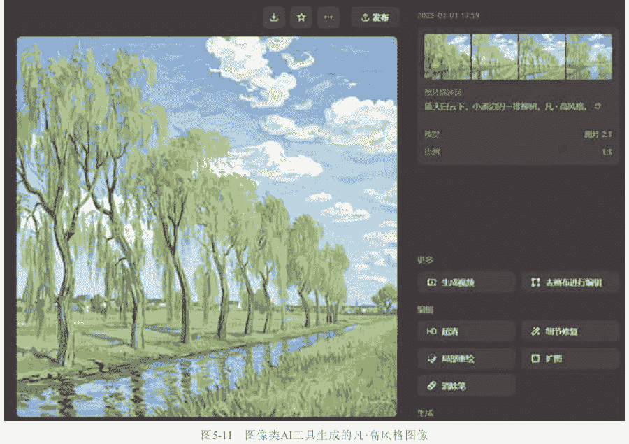

###### 2. 艺术手法

艺术手法提示词用于指导模型按某种特定处理方式创作，可精确控制视觉效果，使其模仿不同绘画技法、摄影手法或其他媒介的独特风格。如“使用水彩质感表现晨雾中的湖畔”“模拟长曝光效果捕捉城市夜景的车流轨迹”。

艺术手法是更进阶的风格提示词，能细致界定画面风格并丰富效果。以绘画生成、摄影生成和数字艺术生成为例，常见艺术手法提示词如表5-6 所示。

> 表5-6 常见的艺术手法提示词

| 领域 | 艺术手法 | 介绍 |
| :--- | :--- | :--- |
| 绘画生成 | 潦草笔触 | 画面呈现随意、粗糙的笔触效果，带有涂鸦或草稿风格 |
| | 草稿笔触 | 呈现初步构思或未完成状态绘图，笔触简洁 |
| | 浓墨重彩 | 使用深沉鲜明的色彩，营造强烈视觉冲击力 |
| | 轻描淡写 | 笔触轻柔、色彩淡雅，强调简洁轻盈感 |
| | 笔触清晰 | 画面笔触线条分明，细节清晰可见 |
| 摄影生成 | 长曝光 | 模拟长时间曝光效果，常用于捕捉水流、星轨等 |
| | 多重曝光 | 在同一画面中叠加多个曝光图像，创造梦幻或超现实效果 |
| | 微距镜头 | 突出细节和纹理，常用于表现微小物体或昆虫 |
| | 全息摄影 | 呈现三维立体效果，使画面更具空间感 |
| | 景深 | 利用前后景深差异，营造画面层次感和空间感 |
| | 超广角 | 展现宽广视野，使画面更具开阔感和宏伟感 |
| 数字艺术生成 | 4K分辨率 | 画面清晰度高，细节表现力强，带来接近真实的视觉体验 |
| | 超高分辨 | 画面清晰度极高，能呈现更多细节和纹理 |
| | 8K分辨率 | 超越4K的清晰度，提供更丰富、更细腻的画面表现 |
| | 光线追踪 | 模拟真实世界中光线反射和折射等效果，使画面更真实立体 |

恰当运用艺术手法提示词可显著提升生成效果。图5-12 为使用“微距镜头”提示词生成的图像。


图5-12 利用“微距镜头”提示词生成的图像

##### 确认构图与视角

确认构图与视角是生成图像过程中的重要步骤，涉及如何组织画面元素以及从何种角度呈现，从而塑造独特视觉效果。

相对而言，构图与视角是更进阶的指令设计技巧，对产出更高质量、更符合需求的图像起重要作用。合理布局空间关系与精心选取观察视角，能让模型理解并实现创作者心中的理想画面。

该环节可分为空间布局与视角选择两个方面。

###### 1. 空间布局

空间布局指构图元素的分布及空间关系，即主体、陪体与背景的位置关系、比例大小与相互联系等。如“前景是盛开的樱花树，中景为古建筑群，背景为远山”，此类层次分明的描述能有效帮助模型构建层次画面。

常见空间布局术语提示词如表5-7 所示。

| 空间布局术语 | 描述 | 示例提示词 |
| :--- | :--- | :--- |
| 前景 | 图像中最靠近观众的部分，用于突出重点或引导视线 | 明亮的花朵在前景中绽放 |
| 中景 | 位于前景与背景之间，展现主要场景活动区域 | 公园的长椅和行人为中景 |
| 近景 | 类似前景，通常指比中景更接近镜头的人物或物象 | 主角面部表情清晰可见的近景特写 |
| 背景 | 图像最深处，提供环境信息和营造空间感 | 山脉作为画面背景延伸至远方 |
| 主体 | 图像中心或焦点所在，占据显著地位的元素 | 建筑主体矗立在画面正中央 |
| 边缘 | 图像边缘区域，可能用于平衡构图或扩展视野 | 树木沿着画框边缘自然分布 |

在指令中加入空间布局术语，指定物体相对位置、排列方式或运动状态等，能有效增强画面的立体感和动态感。

利用空间布局术语提示词生成的图像如图5-13 所示。

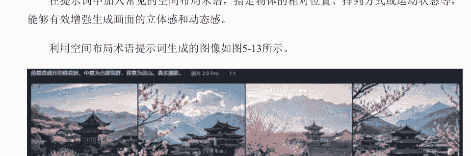

图5-13 利用空间布局术语提示词生成的图像

###### 2. 视角选择

视角选择涵盖平视、俯视、仰视、透视等多种视角，甚至包括鱼眼视角、宽幅视角等非常规视角。例如生成鸟瞰城市全景可用“从高空俯视视角展现繁华都市的天际线”。灵活运用不同视角，不仅能凸显主体特点，还能创造新颖且具沉浸感的画面。

常见视角术语提示词如表5-8 所示。

**表5-8 常见的视角术语提示词**

| 视角术语 | 描述 | 示例提示词 |
| :--- | :--- | :--- |
| 平视 | 与主体处于同一水平线上，如日常观察视角 | 平视视角下的城市街头风光 |
| 俯视 | 从上向下看的视角，类似于鸟瞰或无人机视角 | 俯视视角下的公园全景 |
| 仰视 | 从下向上看的视角，常用于表现高耸建筑物或天空 | 仰视视角下的摩天大楼 |
| 鱼眼视角 | 极广角镜头产生的扭曲变形视角，视野范围极大 | 采用鱼眼视角捕捉圆形全景景观 |
| 透视视角 | 反映三维空间中物体随远离观察点而逐渐变小的现象 | 透视视角下的铁路轨道消失在地平线 |
| 侧视/斜倒视角 | 从物体侧面或斜侧方向观察的视角 | 斜倒视角下的汽车轮廓线条 |
| 宽幅视角 | 类似于宽银幕电影的宽广视角 | 宽幅视角下的海鸟落日景色 |

利用视角术语提示词生成的图像如图5-14 所示。


##### 细化专业术语与图像规格

图像生成技术广泛应用于广告营销、教育、设计等众多领域，每个领域都有行业规范与术语，这些规范同样可成为图像设计的提示词。细化专业术语与图像规格环节着重于提示词的专业维度与规格，以便模型准确识别并生成相应领域与规格的图像。

###### 1. 专业术语

针对特定领域如建筑设计、出版、时尚设计等生成图像时，使用专业术语可确保模型准确理解行业特定要求。例如建筑领域使用“轴测图”“剖面图”“平面图”等，绘画设计领域使用“三视图”“线稿图”等。只有当模型理解这些术语含义时，才能生成具有专业水准和行业特色的图像。

需注意，AI 生成图像内容可能存在错误，因此在专业领域应用时要格外谨慎，避免误导他人。

DALL·E 3 生成的建筑设计图如图5-15 所示，可为专业工作者提供思路。

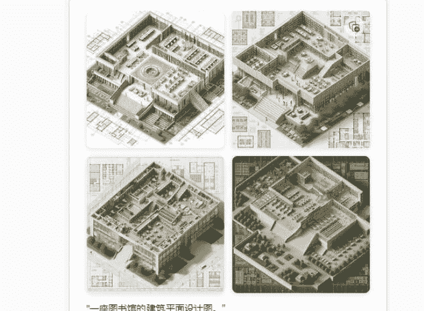

###### 2. 图像规格

针对不同应用场景，可能还需结合具体需求调整图像规格，例如图像尺寸和分辨率，以获得满足多元化需求的高质量图像。

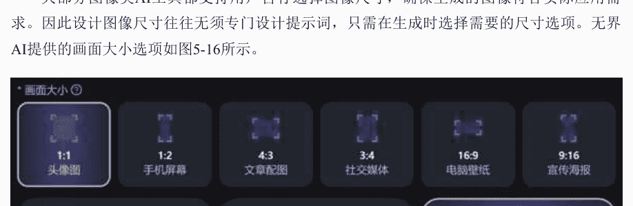

大部分图像类 AI 工具都支持使用者自行选择图像尺寸，确保生成图像符合实际应用需求。因此设计图像尺寸往往无须专门设计提示词，只需在生成时选择需要的尺寸选项。无界 AI 提供的画面大小选项如图5-16 所示。


#### DeepSeek 辅助迭代和优化图像

从试错到精修：让视觉生成系统发挥最大潜能

这一阶段的本质是持续实验、归纳规律并进行精细调校，直至输出符合预期。无论是自行探索还是参考优秀范例，指令的完善都离不开反复实操与依据反馈的修正。配合 DeepSeek 使用，引导文案可以在迭代中不断进化，让图像系统在还原准确度与创意表达上同步提升，最终得到更贴合个人审美的理想画面。

##### 1. 试炼与复盘
按照前文的设计要点搭建起初始指令后，可以先交给视觉生成系统做一次预演。受限于训练数据与模型逻辑，首轮成片往往与理想存在偏差。这时需要把生成图与原始指令逐项对照，梳理差异点与不足，为下一步优化提供依据。

多数平台都内置了“重绘”“相似图生成”等调试手段，配合使用能快速探索不同方向，如图5-17所示。


> 图5-17 “生成相似图”功能

##### 2. 借鉴与拆解
拆解他人成功案例是提速的有效路径。研究优质成片背后的引导文案，可以迅速学会如何驱动系统输出特定风格或主题，并提炼出可复用的模板与方法论。

不少平台会公开其他创作者的生成词，为模仿学习提供了便利。图5-18展示了即梦AI“做同款”功能，可据此生成相近风格与内容的图像。
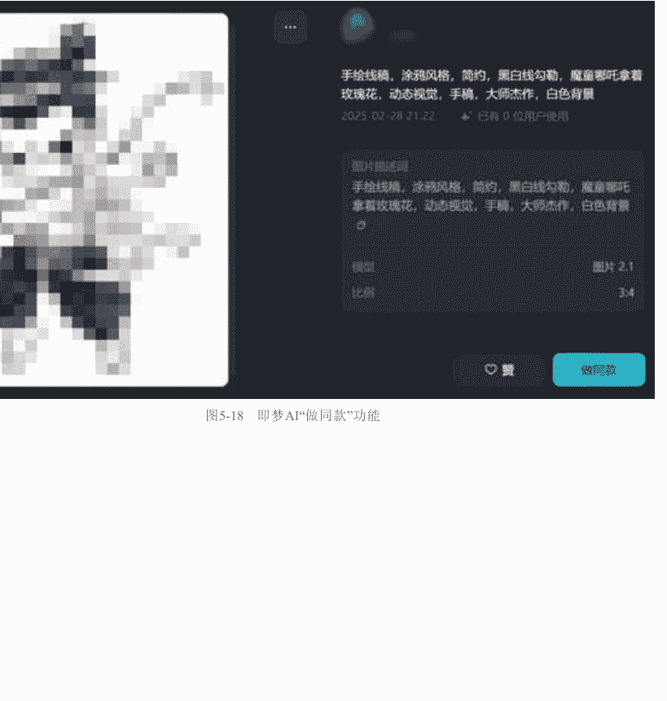

## 4 实战案例：DeepSeek 助力春节节日海报制作
春节是中国文化分量最重的传统节日，也是品牌投放的黄金窗口。节日海报既要传递氛围讲好祝福，也要提升品牌调性与用户关注度，因而需求旺盛。零售要做促销，餐饮要晒年菜，媒体广告也离不开应景物料。

用智能系统做节日海报兼顾效率与创意。设计师可快速获取灵感，把节日元素、行业特性与品牌主张融合。DeepSeek 作为指令优化助手，能智能解析需求并与用户对话，快速输出高质量文案，并依据反馈循环迭代，帮助精准把控风格、主题与细节，大幅提高创作效率和视觉完成度。

下面按图像指令设计要点，对春节海报需求进行拆解并给出可用的生成文案。

### 1. 场景拆解，通过DeepSeek辅助确定主题和内容
先明确春节海报的高频场景，再提炼出可视觉化的核心主题词。

春节的核心是“春节庆祝”，画面要传递喜庆热闹；“家庭团聚”则是另一主线，可用家人围坐、笑容、欢庆瞬间来体现温情。

把简单的场景描述交给 DeepSeek，比如“春节家人团聚”或“传统节日元素”，它会给出具体化文案建议，例如“春节，家庭团聚，欢乐气氛，红色背景”。这些词既抓住了场景主干，又补充了视觉细节，帮助快速定位创作目标。利用DeepSeek辅助确定春节节日海报的主题与内容提示词如图5-19所示。
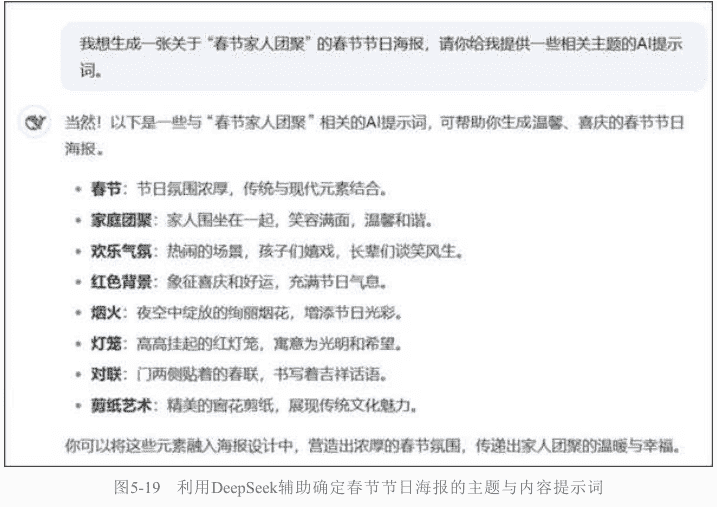

把相关元素整合进设计，能做出兼具传统韵味与现代感的海报。经 DeepSeek 建议提炼后的主题内容词如下。

春节，家庭团聚，欢乐气氛，红色背景，烟火，灯笼，对联，剪纸艺术。

### 2. 节日氛围强化，通过DeepSeek辅助确定风格与艺术手法
风格选择要从主题内涵出发。

输入简短的风格与手法描述，让 DeepSeek 扩展成更精细的文案。利用DeepSeek辅助确定春节节日海报的风格提示词如图5-20所示。
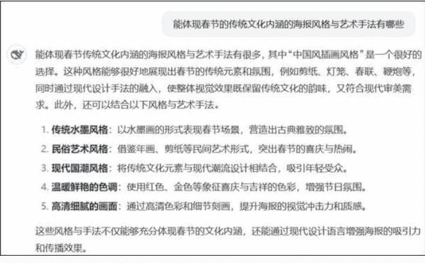

建议将传统文化元素与当代平面设计结合，构图简洁易读，符合当下审美。色彩上采用温暖饱满的红金系，营造喜气热烈感，再加上“高清色彩”提升质感。整合后的风格与艺术手法文案为：

> **中国风插画风格，融入现代平面设计，使用温暖而鲜艳的色调，高清色彩。**

### 3. 设计要求分析，通过DeepSeek辅助确认构图
构图要能直观表达春节内核，同时为后续排版留白。

突出团聚主题可采用“中心构图”，把一家人在画面正中呈现，画面稳定且方便上方放置标题。周边元素可做层次化分布：右侧挂起红灯笼搭配夜空烟火，左侧点缀春联与窗花，既丰富画面又强化文化识别度。

DeepSeek针对视觉元素的构图布局给出的迭代建议如图5-21所示。
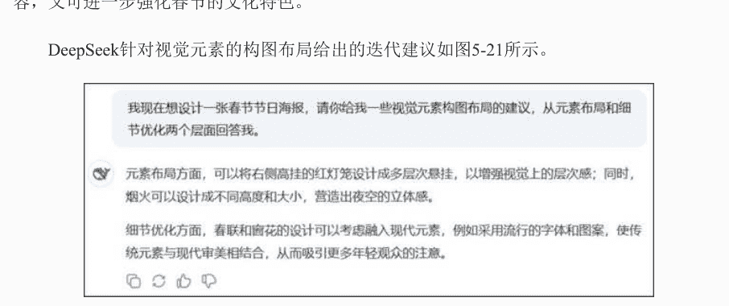

> 细节优化方面，春联和窗花的设计可以考虑融入现代元素，例如采用流行的字体和图案，使传统元素与现代审美相结合，从而吸引更多年轻观众的关注。

经迭代优化后的构图文案如下：

> **中心构图，展示全家欢聚一堂场景，右侧配以高挂的红灯笼和烟火照亮夜空，左侧点缀春联和窗花。**

### 4. 细节与规格确认
文案主体已成型，最后补充专业细节与输出规格。

海报元素较多时，用“元素分布协调”“主体突出”等专业表述可避免画面杂乱。节日海报多采用竖版，便于信息展示，9:16 是常用比例。

细节文案如下：

> 元素分布协调、主体突出，9：16 的比例。

把主题内容、风格手法、构图、细节规格四块合并，即可得到完整指令：

> 春节，家庭团聚，欢乐气氛，红色背景，烟火，灯笼，对联，剪纸艺术；中国风插画风格，融入现代平面设计，使用温暖而鲜艳的色调，高清色彩；中心构图，展示全家欢聚一堂场景，右侧配以高挂的红灯笼和烟火照亮夜空，左侧点缀春联和窗花；元素分布协调，主体突出，9：16 的比例。

按此指令，文心一格生成的春节节日海报如图 5-22 所示。

### 5. 修改迭代
从图 5-22 可见画面已基本贴合文案。进入精修阶段，可以挑选满意版本进行二次编辑。以文心一格为例，其图像编辑功能如图 5-23 所示。
> 图 5-22 文心一格生成的春节节日海报

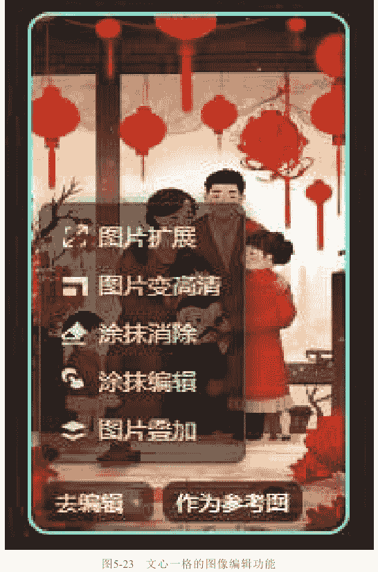
图 5-23 文心一格的图像编辑功能

选择“图片扩展”功能并指定延伸方向，能把画面放大留出文字排版空间。扩展后的海报如图 5-24 所示。

图 5-24 扩展后的海报

以上就是春节海报的完整生成流程，借助智能系统可大幅压缩设计成本与时间，快速得到兼具创意与节日感的成果。

# Part 6
DeepSeek 与音乐类 AI 平台结合实操技巧

音乐是跨越语言与文化的艺术，由节奏、旋律与和声构成，能触动情绪并承载文化意义。

在音乐创作领域，智能系统已能生成旋律、学习风格，并通过简单指令或交互界面提升创作效率。DeepSeek 本身不直接出音，却能优化歌词、提供灵感，并生成高质量引导文案，帮助创作者更精确地描述需求，与音乐类系统协同完成作品。

Part 6 将探讨如何高效结合 DeepSeek 与音乐类系统进行创作与探索，包括主题确定、类型明确、要素调控，以及对生成素材的二次打磨，最终产出个性化高质量音乐。

# 1 主流音乐 AI 平台概览
音乐类系统依托音频算法与深度学习，可捕捉并重构旋律、和声、节奏及艺术家风格，实现从零到一的音乐生成。目前主流系统包括 TME Studio、网易天音、Suno AI 等。

## TME Studio 与 DeepSeek
TME Studio 由腾讯音乐娱乐集团推出，提供作词作曲到编曲的全流程智能支持。TME Studio 的图标如图 6-1 所示。

> 

平台提供音乐分离、MIDI 计算、辅助写词、智能曲谱生成等功能，其中辅助写词可提供押韵词和灵感。结合 DeepSeek 的语言生成能力，可更高效产出高质量歌词，明确创作方向，提升效率。

界面简洁，适合新手到专业音乐人使用，降低门槛并提供丰富的创作可能。

## 网易天音与 DeepSeek
网易天音由网易云音乐推出，是一款一站式智能音乐创作工具，面向爱好者、专业创作者甚至零基础用户。网易天音的图标如图 6-2 所示。

图 6-2 网易天音的图标

在 DeepSeek 中输入主题或情感描述生成歌词，再导入网易天音进行作曲编曲。DeepSeek 提供作词灵感，网易天音提供丰富的音乐类型选择，一键完成风格化编曲，并支持一键导出分享至各平台。

### Suno AI 与 DeepSeek
Suno AI 基于深度学习与自然语言处理，为用户提供文本驱动的音乐生成。Suno AI 的图标如图 6-3 所示。

用户可用文字描述情感、流派、艺术家风格或旋律走向，Suno AI 会解析指令生成片段或完整歌曲结构。配合 DeepSeek 迭代优化指令，可提高生成精度与创意。Suno AI 的第 3 版因创作力强和定制化程度高而广受关注。

图 6-3 Suno AI 的图标

### 其他常见的音乐类 AI 平台
除了以上系统，还有多款可供选择，如表 6-1 所示。
## 表 6-1 其他常见的音乐类 AI 工具

| 工具名称 | 功能简介 |
| :--- | :--- |
| ACE Studio | 免费的智能音乐合成工具，让用户可以通过输入歌词和旋律来生成高度拟人化的歌声，提供实时合成和高品质输出功能，适合音乐爱好者和专业用户制作虚拟歌手歌曲 |
| BGM 猫 | 在线背景音乐生成器，用户可以根据不同场景、风格和情绪标签，一键生成匹配的背景音乐，无须下载软件，即可在线完成定制化音乐制作，尤其适合视频制作、广告配乐等应用场景 |
| SOUNDRAV | 通过选择不同标签快速生成音乐，支持众多音乐流派、主题，音乐长度与旋律，提供免费无限次数的生成 |

这些系统侧重点各异，涵盖编曲、歌声合成与便捷生成，降低了创作门槛，让音乐表达更丰富。

# 2 DeepSeek 与音乐类 AI 系统结合的应用场景
音乐类系统已深入创作、教育、娱乐与专业制作。接下来介绍其在不同场景下的新可能。

## DeepSeek 助力音乐生成
智能一键生成标志着音乐创作进入高效智能时代。音乐类系统通过学习海量数据，能根据指令、情感描述或关键词快速生成片段或完整歌曲。DeepSeek 的加入让创作进一步突破：输入主题或情感基调后生成歌词，并提供旋律、和弦、节奏等作曲灵感文案，可直接导入音乐平台完成编曲，降低门槛。音乐生成的细分场景如表 6-2 所示。

### 表 6-2 音乐生成的细分场景

| 细分场景 | 功能描述 |
| :--- | :--- |
| 生成词曲编唱 | 自动创作歌词，智能辅助作曲，生成旋律；编曲环节自动化，生成伴奏；合成歌声，无须真人演唱 |
| 生成纯音乐 | 根据用户指定的风格、情绪、速度等参数，自动生成无歌词的完整音乐作品 |
| 根据歌词生成歌曲 | 用户输入歌词文本，音乐类系统基于歌词内容和上下文生成相应的旋律和编曲 |

以上场景体现了从词曲一体化到纯音乐、歌词驱动创作的多样可能。

图 6-4 所示为 Suno AI 的音乐生成界面，可输入歌词、选择风格、修改标题以生成完整音乐。
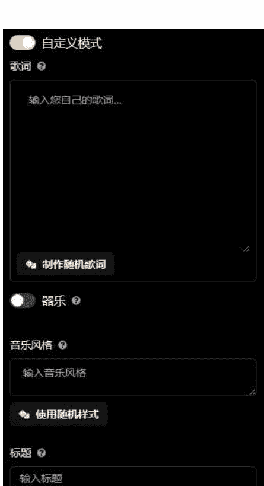
#### 音乐编辑
音乐编辑是指利用智能技术优化、完善和调整作品的过程，可智能分析音频、识别结构并提供编辑建议，或直接修改旋律、和声、节奏与混音效果。

此功能对乐理知识有一定要求，更适合有音乐基础的创作者。

以网易天音为例，其音乐编辑功能如表 6-3 所示。
### 表 6-3 网易天音音乐编辑功能

| 功能 | 描述 |
| :--- | :--- |
| 自由创作 | 手动谱曲，个性化和弦编排，选择风格生成编曲作品 |
| 基于曲谱创作 | 海量经典曲谱直接导入，快速生成编曲 |
| 上传作曲 | 上传 MIDI，智能系统基于 MIDI 匹配生成可编辑的编曲 |

> **注**：乐器数字接口（Music Instrument Digital Interface，MIDI）是指一组能表示音乐参数的代码，用于让计算机理解各类音乐参数。

这些功能让创作者快速把想法落地。登录网易天音即可在线体验。图 6-5 展示了网易天音的音乐编辑功能界面。


对普通用户而言，如何用文案快速生成心仪音乐更值得掌握。接下来将深入探讨音乐类系统文案的设计方法。

# 3 DeepSeek 用于音乐生成的提示词设计步骤
文案不仅影响文字、图像的生成质量，也是音乐生成的核心。音乐涉及旋律、节奏、歌词、乐器等要素，文案设计同样需要组合多维度信息。

掌握原则与方法后，用户能更准确地传达风格、情感与结构特征，实现从文案到优美音乐的高效转化。

# 让音乐生成模型更懂你

要让平台准确还原脑海里的旋律，决定性因素是指令怎么组织。图 6-6 展示了业内常用的填表框架。


对新手而言，手写音乐指令门槛不低。借助 DeepSeek 来生成提示，能够明显降低难度。用户只要给出几个关键词或一句简短描述，DeepSeek 就能按需自动拼装出结构完整、要素清晰的提示。以“清爽的清晨”为主题，DeepSeek 会产出对应的完整样例，见图 6-7。

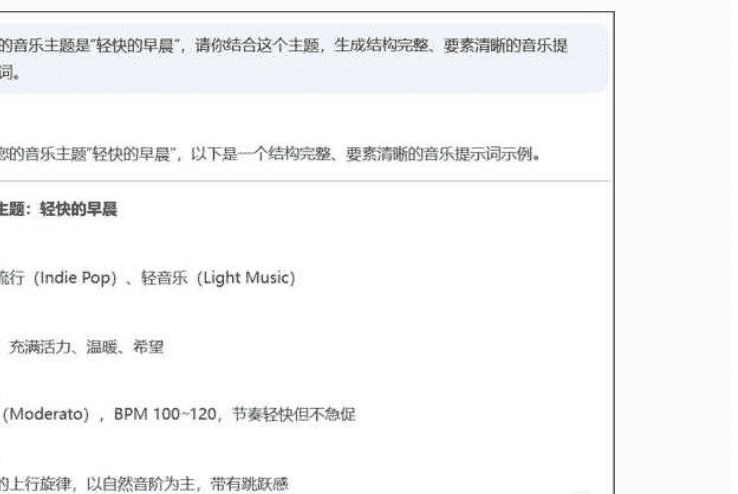

> **注**：BPM 全称为 Beat Per Minute，指每分钟节拍数，是衡量曲速快慢的核心参数。

有此助力，提示词不再靠硬想。DeepSeek 既简化了构思路径，也让表达更精准，进而提升生成效率与成品质感。

### 用 DeepSeek 迅速锁定创作主题

在专业语境里，音乐主题指贯穿作品的旋律、和声或节奏母题。对普通创作者而言，这里指歌曲要表达的内容，可涵盖自然、生活、行为等，比如月光、出行、落日、远山、星空、理想等。

灵感词与最终成品的情绪走向、歌词倾向密切相关。借助 DeepSeek 的智能能力，零散灵感可被转化为高质量主题指令。例如输入“一首关于月亮的歌”，往往会得到静谧、朦胧、温柔的音乐结果。这种做法既降低创作门槛，也拓展表达空间。相关流程如图 6-8。

> 我想做一首以月亮为题的曲子，但还不确定具体方向，请给我一些可用的主题建议。

### 月亮主题的多种延伸

围绕“月亮”可以展开多种情绪与意象，下面提供几组参考。

1. **静谧的月夜**
   - 关键词：宁静、温柔、神秘
   - 描述：呈现月光洒落大地时的安静画面，搭配轻柔旋律与舒缓节奏，钢琴、竖琴或长笛可营造宁静又带点神秘的氛围。

2. **月下思念**
   - 关键词：思念、孤独、回忆
   - 描述：以月亮为背景表达对远方亲友或故乡的挂念。旋律略带忧伤，弦乐与钢琴交织，情感深沉动人。

3. **月光的舞动**
   - 关键词：灵动、优雅、梦幻
   - 描述：描绘月下轻盈起舞的场景，旋律流畅优美，节奏轻快而不失优雅，小提琴、竖琴或合成音色可带来梦幻感。

4. **月亮的传说**
   - 关键词：神秘、古老、史诗
   - 描述：以月亮为核心讲述神话或古老传说。可加入古筝、笛子等民族乐器或史诗元素，旋律宏大神秘，具叙事性。

可根据个人情感偏好挑选单一方向，也可融合多个方向。需要更细分的指令或直接生成示例时，再用 DeepSeek 快速细化即可。

除了主题，网易天音等平台还会提供关键词灵感池供挑选，辅助生成歌词与曲目。图 6-9 显示了该平台的关键词灵感界面。

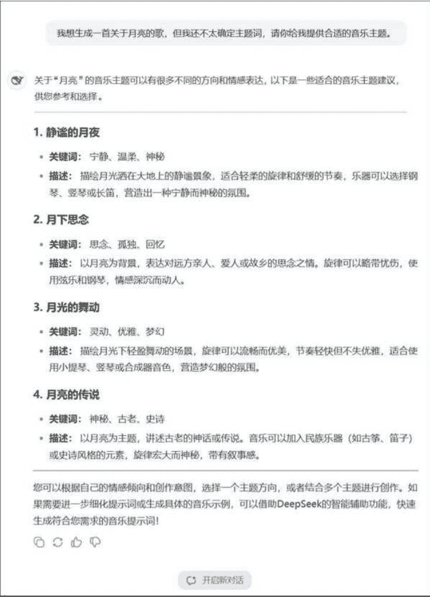


平台还支持输入更长的随笔灵感，通过场景化文字营造氛围。图 6-10 为网易天音的随笔灵感输入界面。

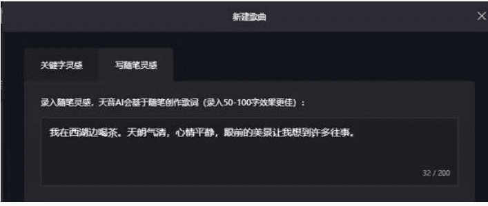

随笔灵感的示例如下。

> ### 我在西湖边喝茶。天朗气清，心情平静，眼前的美景让我想到许多往事。

这种写法是用具体场景和氛围来传递音乐情绪，为模型生成旋律和歌词提供依据。

#### 把品类和情绪写清楚

对人而言，音乐首先传递的是心情，最能体现情绪倾向的就是品类与情感，这两类指令直接决定最终呈现。

##### 1. 音乐品类

听感第一印象往往是品类，不同品类带来不同感受。

在生成环节，准确描述品类如古典、摇滚、爵士、电子、民族等至关重要。明确品类后，模型才有针对性地借鉴风格元素。了解常见品类术语是设计指令的前提。

常见音乐品类如表 6-4 所示。

### 表 6-4 常见音乐品类

| 品类 | 简介 | 适用场景 |
| :--- | :--- | :--- |
| 古典音乐 | 源于欧洲的传统流派，涵盖巴洛克、古典、浪漫主义等，特点系统、经典、严肃 | 音乐会、音乐节、影视配乐、舞蹈、戏剧、学术研究等 |
| 摇滚音乐 | 20 世纪 50 年代起于美国，以强劲节奏、电吉他、反叛精神为标志 | 演唱会、音乐节、影视配乐、电视广告、商业推广等 |
| 爵士音乐 | 非洲与欧洲音乐融合，以即兴、复杂和声节奏、蓝调情感著称 | 音乐会、酒吧、咖啡厅、影视配乐、舞蹈表演等 |
| 电子音乐 | 借助合成器与计算机创作，含浩室、迷幻舞曲等子流派 | 舞会、音乐节、影视配乐、游戏配乐、广告配乐等 |
| 民族音乐 | 体现特定民族文化与传统，可指中国民族音乐或广义民族风格 | 文化活动、音乐节、影视配乐、旅游推广、学术研究等 |
| 民谣音乐 | 相较商业化音乐更强调信息与情感传递 | 演唱会、音乐节、影视配乐、纪录片、学术研究等 |
| 国风音乐 | 以中国传统音乐为基础融合流行元素，呈现古风美学 | 游戏配乐、影视配乐、文化活动、广告配乐、社交媒体等 |

各品类下还有丰富子流派，实际应用中常交叉重叠，可按需求灵活组合。

许多平台也提供品类选择界面，网易天音的音乐品类选项如图 6-11 所示。


##### 2. 音乐情感

情感类指令即“情绪词汇”，如快乐、悲伤、激动、宁静、浪漫等。

加入情绪词汇能让模型模拟对应氛围。用户需按场景挑选合适倾向的词。部分分类如表 6-5 所示。

### 表 6-5 情感词汇分类

| 情绪类型 | 示例 |
| :--- | :--- |
| **积极正向情绪** | 快乐、愉快、兴奋、欢喜、乐观、自豪、自信、热爱、幸福、愉悦、陶醉、惊喜、感恩、满足、欣慰、羡慕、感激、希望、憧憬、向往 |
| **消极负面情绪** | 悲伤、忧郁、沮丧、绝望、痛苦、愤怒、嫉妒、恐惧、焦虑、紧张、压抑、孤独、失落、仇恨、悲观、无助、迷茫、厌倦、依赖 |
| **中性平衡情绪** | 宁静、淡然、平和、沉稳、冷静、稳定、沉默、自在、轻松、安心、无所谓、麻木、接纳、包容、释然 |
| **特殊复杂情绪** | 怀旧、浪漫、尴尬、矛盾、纠结、挣扎、惋惜、惆怅、悲喜交加、爱恨交织、无奈、犹豫不决、患得患失 |

SOUNDRAV 在生成时就提供了大量情感词供匹配，如图 6-12 所示。

## 调控音乐要素

音乐由速度、旋律、节奏、和声、音色、段落等要素构成，模型创作中这些要素都能自主调节。

### 1. 节拍速度

部分平台允许选择或自定义节奏型与 BPM，以保证律动合适。不同速度对应不同情绪与场景。

#### 慢速 60～90 BPM
多见于慢歌、古典段落及背景音乐，营造宁静、深沉或浪漫氛围。

#### 中速 90～120 BPM
流行、摇滚、R&B、民谣常用区间，适合日常活动与轻舞，如恰恰、华尔兹等。

#### 快速 120～150 BPM
常见于快节奏舞曲与流行曲目。

#### 高速 >160 BPM
多用于电子舞曲子流派，能制造强烈能量与紧张刺激感。

可在指令中直接写清 BPM，或通过界面调整。Suno AI 的节拍速度提示如图 6-13 所示。


网易天音在编曲风格界面也提供多种节拍速度类型，如图 6-14 所示。

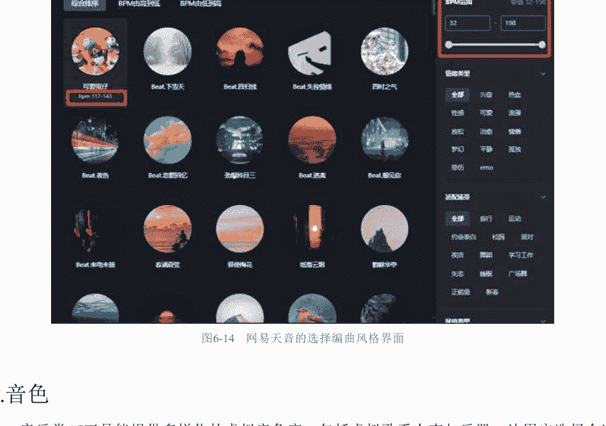


### 2. 音色

生成平台提供虚拟人声与乐器音色库，可在指令中指定。Suno AI 的示例如下。

- 20 世纪 80 年代风格、合成波、后朋克、女声、140BPM、和声。
- 冷酷、电子和弦、女声。
- 俱乐部舞蹈、合成流行音乐、小提琴、钢琴、电子。

网易天音则提供歌手类型切换界面，可按主题与风格选择虚拟歌手。图 6-15 为切换歌手界面。

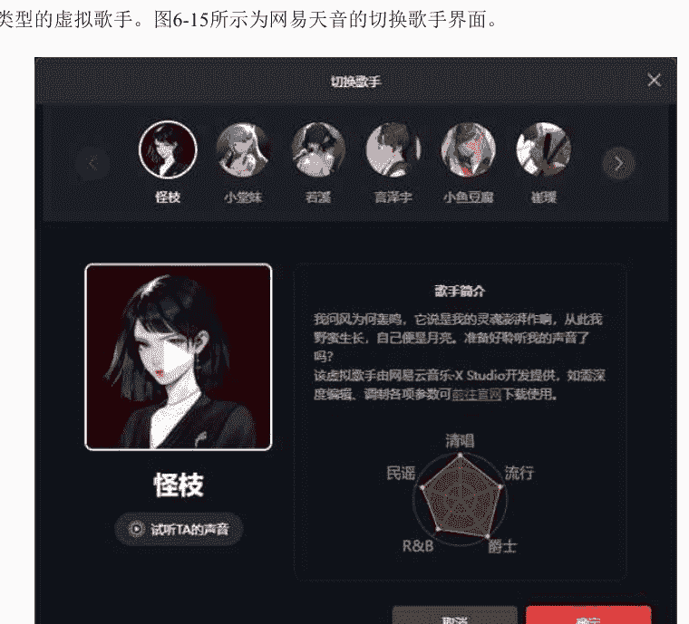

> 图 6-15 网易天音的切换歌手界面

### 3. 歌曲段落结构

模型可按诗歌格律或流行结构生成歌曲，用户亦可主动控制或修改。

常见的段落结构如图 6-16 所示。

**前奏**
歌曲开头，引出主题与情绪基调，常由乐器或人声哼唱完成。

**主歌**
叙事主体，讲述故事、表达情感或展开主题。

**预备副歌**
可选过渡段，位于主歌与副歌之间，提升情绪并平滑衔接。

**副歌**
最易记忆、旋律最强处，承载核心主题，多次重复以强化记忆。

**间奏**
段落间衔接，常由乐器演奏，增强层次与情绪缓冲，长度与风格可调。

**说唱**
嘻哈等风格的特色表达，可独立成段或融入主歌，节奏强、歌词密集。

**桥段**
主歌副歌的转折点，旋律与和声多与前段不同，推动发展。

**尾声**
收束全曲，可总结或渐弱消失。


**图 6-16** 常见的歌曲段落结构

上述结构均可自由编排。网易天音提供段落结构编辑界面，如图 6-17 所示。


**图 6-17** 网易天音的歌曲段落结构编辑界面

## 4. 应用案例：DeepSeek 助力生成视频插曲

音乐广泛应用于影视、游戏、广告等领域，短视频配乐尤其关键。以下以“赏月”主题短视频配插曲为例说明指令设计流程。

> 某风景美学视频号风格亲切温和文艺，近期制作了一条“赏月”短视频，需要一首带歌词的插曲。

### 1. 分析场景，确定主题关键词
从需求可直接提取“月亮”作为核心关键词，也可借助 DeepSeek 快速扩充相关指令。

借助 DeepSeek 生成相关指令，如图 6-18 所示。

> 图 6-18 借助 DeepSeek 生成相关指令

### 2. 构建情境与故事线索
围绕关键词展开联想，形成具体情境。例如“寂静深夜皎洁月光下，某人仰望星空感怀思念”。这些描述为旋律与编曲提供灵感。

借助 DeepSeek 构建情境与故事，如图 6-19 所示。


### 3. 细化情感和风格
结合账号定位，优先选用轻柔文艺要素。可描述月亮唤起的情绪如宁静、神秘、浪漫、怀旧、思乡，也可设定类型如古典、民谣等。

### 4. 确定音乐要素
在已有方向上进一步细化专业细节。

速度：温和轻柔，选择慢速约 60 BPM。
音色：温柔年轻女声，钢琴伴奏。

### 5. 整合信息，生成音乐
整理后信息如下。

- **主题指令**：寂静深夜的皎洁月光下，一人遥望星空的思念之情。
- **情感倾向**：宁静、怀旧。
- **风格**：民谣。
- **节拍速度**：60 BPM。
- **音色**：温柔女声。
- **乐器**：钢琴。

将信息填入平台即可生成。图 6-20 显示网易天音的填写界面，大部分信息均已填入。

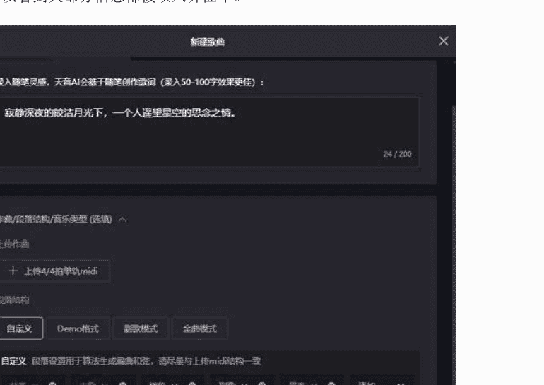

点击“开始 AI 写歌”后，可进入词曲编辑界面，如图 6-21 所示。

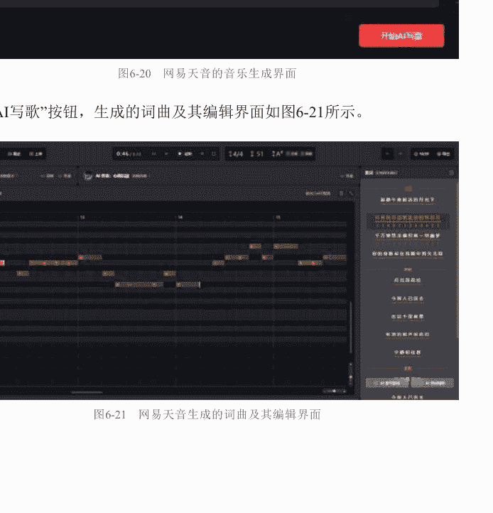

在此界面可调整人声与伴奏、修改歌词、甚至编辑曲谱，经细调即可得到一首完整且适配的短视频插曲。

# Part 7 DeepSeek 与视频类 AI 平台结合实操技巧

视频是视听合一的艺术，在数字媒体时代已成为信息传播与娱乐不可或缺的形式。视频类 AI 平台可辅助数字人播报、文本配音、图文转视频等，前沿产品还能直接生成画面。结合 DeepSeek 解决内容卡点，再用视频类 AI 平台执行，创作者可快速产出高质量作品。

## 视频类 AI 平台介绍

视频类 AI 平台依托视觉与深度学习算法，能解析视频元素，支持数字人播报、一键剪辑、视频生成等功能。当前已有 Sora、可灵 AI、即梦 AI、元镜等产品。将其与 DeepSeek 结合，既提升效率，也拓展艺术表达。

#### Sora 与 DeepSeek

Sora 由 OpenAI 研发，是视频生成领域的重要突破，自发布以来因独特功能与强生成能力引发关注。

从文字到成片：AI 视频创作实操指南

Sora 目前是极少数能实现纯文本驱动成片的影像系统，也是把世界模型特性做成可用产品的代表。它能够把握现实世界的互动逻辑与物理法则，和传统合成流程不同。创作者可以先用 DeepSeek 把视频描述或故事脚本扩写成更细致的版本，再交给 Sora 按稿生成连贯、多机位的画面，基本实现文字直接变成画面。对场景布置、角色动作、对话细节以及情绪氛围等维度，Sora 的理解与呈现都很精准，创作门槛和制作周期被明显拉低。

在拟真层面，Sora 对物体间动态关系、光影演进、环境变化等细节的还原能力很强，输出水准相当可观，为用户带来全新的创作感受。图7-1 所示为 Sora 生成视频的示例。


一次生成通常能得到约一分钟时长。像 Runway、Stable Video 这类竞品，目前基本只能产出数秒片段。
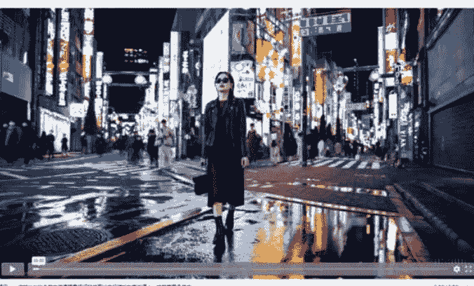

#### 可灵AI 协同 DeepSeek
可灵AI 出自快手 AI 团队，是一个面向影像生成的通用大模型。能够产出高分辨率、高真实感的内容，覆盖影视、广告、社交、电商等多种场景，在内容生产端具备颠覆性。可灵AI 操作界面如图7-2 所示。

在多模态大模型里，DeepSeek 更像超级智囊，具备很强的自然语言理解与推理能力，能在生成环节提供支持。比如用户只给出一个简单描述，DeepSeek 就能推演出完整的视频创意策划与分镜脚本。例如输入“请帮我写一则 15 秒可乐广告脚本”，DeepSeek 会给出包含分镜说明、镜头语言等关键要素的详细方案，如图7-3 所示。
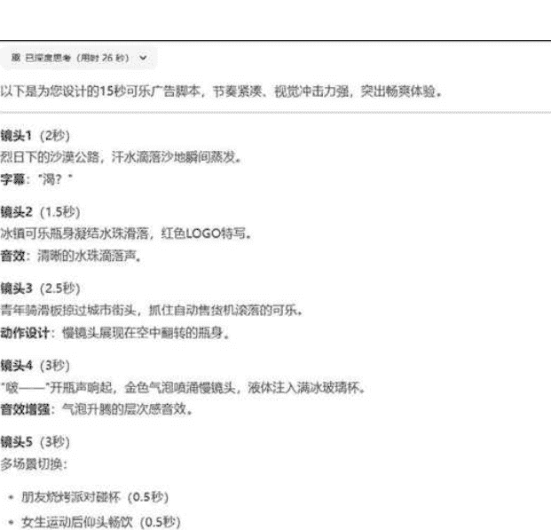

#### 即梦AI 配合 DeepSeek
即梦AI 由字节跳动旗下剪映推出，是一个生成式创作平台，支持用自然语言或图片输入来生成高质量图像与视频。视频能力依托自研的豆包模型，在效率与质量上兼顾。

平台提供智能画布、故事创作模式、首尾帧控制、口型同步、运镜控制、速度控制等一系列 AI 编辑能力。即梦AI 操作界面如图7-4 所示。


DeepSeek 能够贯穿即梦AI 影像生成的全流程，负责创意策划、脚本打磨、多语言适配等环节。

#### 元镜 搭配 DeepSeek
元镜基于人机共生引擎打造的 AI 创作工具，通过脚本自动生成、多模态分镜设计、分镜一键成片等能力，实现从灵感到成品的全流程智能化。元镜官网主页如图7-5 所示。


> 核心价值在于把专业影视制作流程标准化，同时保留个性化创作空间，适配短视频、广告、影视、教育等多个领域，提升制作效率。
>
> 不同于传统产品的线性操作，元镜以“生成脚本—角色设定—分镜设计—一键成片”为闭环，把视频制作周期大幅压缩，节省时间和精力。使用时只需输入创意关键词，即可自动生成包含分镜脚本、特效方案、背景音乐在内的完整视频方案。将生成稿再结合 DeepSeek 打磨，还能提高对网络热梗的识别准确度。
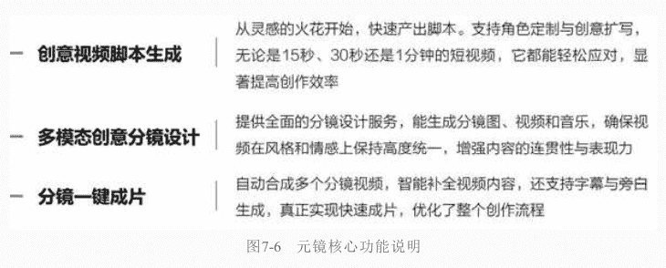

## 2. 元镜与 DeepSeek 配合的具体操作流程

#### 步骤1：登录与需求提交
打开元镜官网，点击“立即使用”按钮，如图7-7 所示，通过手机号验证完成注册。


注册登录成功后进入创作界面，可直接提交创作需求，如图7-8 所示。
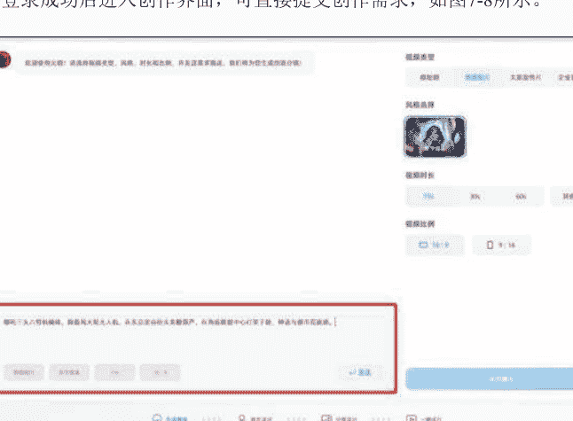

基础提示词示例如下。
> 哪吒三头六臂机械体，踩着风火轮无人机，在东京涩谷街头卖糖葫芦，在海底数据中心打架子鼓，神话与都市荒诞感。

#### 步骤2：脚本生成与打磨
这一环节适合用 DeepSeek 来打磨提示词。同一提示词在不同 AI 产品下会得到不同质量的文案。以提示词“写个脚本，主要内容是过年期间，吃喝玩乐很开心的小猫小狗的生活。包含角色设定、场景描述。字数在400字左右即可。”为例。

##### 其他 AI 产品写出的脚本
《萌宠过大年》
[角色设定] 小猫咪（调皮活泼）、小狗狗（憨厚可爱）、家庭成员。
[镜头] 中景，轻微摇摄。
**（场景一）**
###### 场景描述：温馨明亮的家庭客厅，阳光透过窗帘洒落，红色春联和喜庆装饰点缀整个空间，营造出浓浓的节日氛围。
**（场景二）**
###### 场景描述：家人正在准备丰盛的年夜饭，小猫和小狗坐在厨台边，好奇地观察着各种美味佳肴的制作过程。偶尔有食材掉落，两个小家伙立刻争先恐后地抢夺。

##### DeepSeek 产出的脚本
《萌宠新春奇缘》动画短片脚本
[角色设定] 汤圆（小猫）：白色长毛鸳鸯眼，脖系红围巾，性格活泼好动，总用尾巴卷着毛笔搞恶作剧。年糕（小狗）：金毛犬戴虎头帽，尾巴系着铜钱结，憨厚贪吃力气大，总叼着骨头造型的玩具。
**（场景：腊月廿八·小院贴福）**
[全景镜头] 青瓦屋檐下挂着冰凌，贴着倒“福”的红灯笼随风摇晃。
[近景] 汤圆叼着春联跃上竹梯，尾巴卷着糨糊刷子，在门框上歪歪扭扭贴出“岁岁平安”。年糕叼着扫把经过，发现对联贴歪，后退两步“汪呜”抗议。汤圆故意把糨糊甩在年糕鼻尖，年糕追着尾巴转圈，撞翻筐篰，红纸屑与坚果滚落满地。

可以看出，DeepSeek 给出的脚本在画面描写上更为丰润细腻。
此外，还能调用 DeepSeek 的联网功能，基于热梗生成含分镜脚本、角色设定及场景描述的方案，如图7-9 所示，再把打磨后的文案作为提示词发给元镜。

#### 步骤3：角色与分镜设计
默认角色图由元镜自动生成，如需深化细节，可在角色设定页输入优化提示词，随后进行分镜脚本设计，如图7-10 所示。


#### 步骤4：点击“去成片”按钮一键生成完整成片，收获高质量视频短片。

## 其他影像类 AI 产品
Sora、可灵AI、即梦AI、元镜等主要提供影像生成与编辑能力。当前 AIGC 产品多集中在这两个方向，由此衍生出大量各具特色的产品，常见工具汇总于表7-1，可与 DeepSeek 搭配使用。

### 表7-1 常见的其他视频类 AI 工具
| 工具名称 | 功能描述 |
| --- | --- |
| **腾讯智影** | 自动生成动画短视频，提供大量短视频模板。企业和自媒体及个人可以高效、快速、智能地制作短视频作品。 |
| **秒创 (一键妙创)** | 智能视频创作平台，支持图文转视频，通过快速识别语意、划分镜头与匹配素材，1分钟左右便可生成视频。另外支持数字人播报、智能配音 |
| **剪映** | 知名移动端与个人计算机(Personal Computer, PC)端视频编辑软件，专为社交媒体短视频制作而设计，提供文字转视频功能，通过文字智能匹配视频素材 |
| **Runway** | 提供先进的视频处理功能，如根据文本生成图像、视频局部无损放大、动态追踪、智能调色等。通过AI技术，实现对视频内容的智能分析和处理，提升视频质量和创作效率 |
| **Stable Video** | 提供“图生视频”和“文生视频”功能，支持视频的参数编辑 |

总体看，市面上可用的影像类 AIGC 产品多实现图文转视频，即通过智能识别图像或语义把已有素材处理成动态影像。能直接由文字从零生成视频的技术相对少见，建议优先从前文推荐的产品中挑选。

选型时需结合自身需求判断：是否需要快速套用模板、是否追求高度定制化、目标受众特点、预算限制等，并准备好相应素材。图文转视频工具需要清晰脚本、相关图像图标图表及品牌风格规范；而像 Sora 这类文本驱动工具，主要需要详尽的文字描述，包含场景设定、角色性格、情绪基调、关键事件等细节信息。

## 2 DeepSeek 与视频类 AI 工具结合的应用场景

影像 AIGC 正逐步渗透影视制作、在线教育、广告营销、日常娱乐等多个领域，应用潜力显著。该类工具在影像生成与影像编辑两大板块取得突破。DeepSeek 的深度思考模式与影像 AIGC 的低门槛结合，从智能生成、视频编辑到数字人播报，全面重塑了传统制作流程。

### DeepSeek 辅助视频生成

#### 1. 文字生成视频
文字生成视频指用提示词直接驱动影像 AIGC 产出画面。用户输入一段描述性文字，工具便能理解意图并生成匹配视频。

该方式只需 DeepSeek 发挥对复杂语义的理解能力，帮助创作者构思高质量提示词，无需提前准备图片或视频素材，是最便捷高效的生成方式，也能让工具充分发挥理解与合成能力，产出既贴合提示词又富想象力的画面。图7-11 所示为输入基础提示词“午后的阳光透过纽约市阁楼的窗户照射进来。”生成视频的示意。


若先用 DeepSeek 对提示词做细节优化，会得到截然不同的画面描述，如图7-12 所示。再把优化后提示词交给影像 AIGC 生成，几乎任何奇思妙想都能实现，如图7-13 所示，这是一件令人兴奋的事。
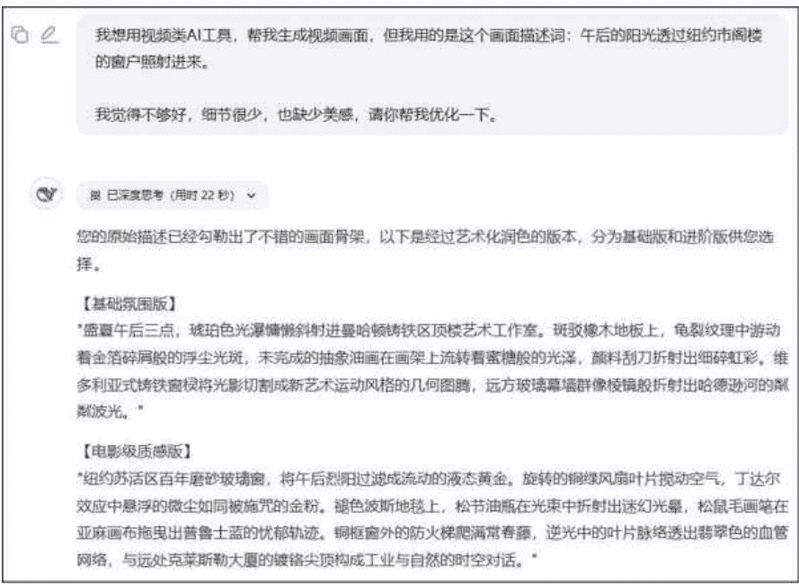

图7-12 运用 DeepSeek 对提示词进行优化


图7-13 将优化后的提示词提供给视频类 AI 工具生成视频

#### 2. 图片生成视频
图片生成视频技术把静态图像转化为动态影像。使用者需上传已有图片，AIGC 会理解画面元素并赋予其运动。

与文字生成不同，图生视频需要事先准备图像资源。在资源基础上，可自行决定是否用提示词辅助。表7-2 所示为图片生成视频的细分场景。

两种场景各有所长。图7-14 所示为提示词辅助生成视频示意。可以看到，用户上传一张已有图像，并输入辅助提示词“一个男人走在街上的低角度镜头，周围酒吧的霓虹灯照亮了他。”，工具便依据原图和提示生成了带有霓虹灯与行走动态效果的视频。

视频类 AIGC 的另一大应用是视频编辑，即对已有素材做高效二次创作，包括智能剪辑、AI 配音、自动字幕、智能抠图、风格转换等，极大简化了传统编辑步骤。下面举例说明常见功能。

### 1. 智能剪辑
智能剪辑是视频编辑的核心功能之一，借助深度学习与计算机视觉实现视频内容的智能分析与自动化处理。

剪辑过程中，AIGC 可自动识别关键帧、场景切换、动作序列，按预设规则和用户提示词进行精准剪辑。除基础剪辑外，还支持智能配乐、智能调色等高级能力，可根据内容自动生成匹配背景音乐并提供虚拟配音，提升整体观感。

目前腾讯智影、剪映、秒创（一帧秒创）等产品功能相近，掌握其一即可举一反三。以腾讯智影为例，其文字成片功能区如图7-15 所示。


图7-15 腾讯智影的文字成片功能区

平台包含 3 个功能区。

#### （1）主题输入区
主题输入区用于输入视频标题、主题、核心内容。用户只需在此给出简短提示词，工具就能自动生成长文作为视频文案与口播依据。

主题提示词示例如下。
```
**AI视频生成的主题提示词**

宋朝历史简介

如何应对焦虑

国产青春电影推荐
```

#### （2）文案输入区
文案输入区负责生成、输入与编辑视频文案。

一方面，主题输入区生成的文案会呈现于此；另一方面，用户也可自行准备文本粘贴进来。

这是借助 DeepSeek 的关键环节，可如图所示，把背景、主题、任务、效果、要求等发送给 DeepSeek，通过追问获得优质文案，再复制到腾讯智影文案区。


该区域还支持 AI 改写，可对文章进行润色、改写、缩写。

#### （3）内容编辑区
内容编辑区用于编辑与调整视频形式。支持素材范围、成片类型、视频比例、背景音乐、数字人播报、朗读音色等修改。

① **素材范围**。AIGC 剪辑依赖已有素材，素材匹配至关重要。腾讯智影拥有丰富的图像、视频片段、特效等素材库。用户上传文章并选择“文章转视频”后，系统会依据文章内容和设定的素材范围自动匹配合适素材构建视频，也可手动调整或替换以优化效果，使创作更个性化专业。

② **成片类型**。成片类型决定整体风格与呈现方式。提供新闻风格、纪录片风格、微电影风格等预设，用户可按内容和目标观众选择，系统会据此自动调整节奏、转场、字幕样式等。

③ **视频比例**。指视频宽高比，常见有16:9、9:16、4:3 等。用户可按发布平台灵活调整，如手机短视频选9:16 竖屏，电视或电脑屏幕选16:9 横屏。

④ **背景音乐**。平台提供丰富背景音乐库，涵盖多种风格流派，也支持用户上传自定义音乐。

⑤ **数字人播报**。腾讯智影的数字人播报功能特色鲜明。用户可选用数字人作为主持或解说，为视频增添趣味与科技感。形象、动作、表情均可定制，因其主要以视频形式呈现，通常归于视频 AIGC 领域。

⑥ **朗读音色**。对文章文字内容提供多种朗读音色选项，包括男声、女声、童声等，每类下又有不同风格与语速可选。

调整完参数后，文章转视频功能会进入剪辑窗口，便于用户自行替换素材、二次剪辑，发挥主观能动性。

### 2. 其他 AI 视频编辑功能
在视频编辑领域，智能剪辑与数字人播报最为亮眼。除此之外，还有其他 AIGC 功能在提升编辑效率。

#### （1）AI 语音
文本配音是 AIGC 在视频编辑中的重要应用，能把用户输入文本转化为自然流畅语音。只需提供文本，AIGC 会按指定语言、声线风格、语速语调和情感色彩自动生成高质量配音音频。该功能大幅简化配音流程，节省成本与时间，特别适合教育视频、产品演示、解说短片、自媒体内容。秒创（一帧秒创）的 AI 语音界面如图7-17 所示。


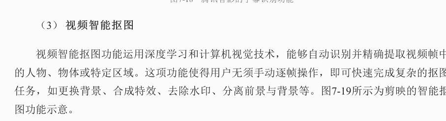

（4）视频风格转换
视频风格转换可把一段视频的视觉风格，如色彩、纹理、光照、画风等，转换成特定风格。可用作名家画作风格、黑白电影、动漫、素描、油画、复古滤镜等效果。图7-20 所示为 Runway 的视频风格转换功能示意。


##### 数字人播报
AIGC 视频领域还有一类特殊功能即数字人播报，下面做详细介绍。

###### 1. 数字人的定义
数字人是融合人工智能与 3D 建模等技术的创新型应用与服务，能创建高度拟人化、智能化的虚拟形象，服务于多元场景。其核心在于构建与训练可模仿人类表情、动作、声音乃至情绪反应的数字模型，以实现与用户的自然交互。

虚拟数字人落地后，已经在个性化客服、在线上播主、远程教学、虚拟偶像等方向实现规模化应用，明显拉伸了传统媒体传播、教培、娱乐社交等领域的边界。以常见场景为例，用户只需以文字或语音下指令，就能让虚拟形象代为完成知识讲解、商品宣推、客户答疑等工作；也可以上传自拍照片或短视频，借助生成式创作技术得到与本人高度相似的数字替身，产出更具个人辨识度的内容。

更高阶的方案还能实时捕捉并复刻人脸微表情与身体动作，让形象更鲜活可信。叠加大数据洞察与深度学习模型，虚拟人可以持续迭代对话策略与内容产出机制，以贴合不同人群的偏好与反馈，从而在各行业释放更大价值。图 7-21 所示为央视网的 AI 数字主播。


###### 2. 数字人播报的应用

数字播报最核心的载体是虚拟主播。这类模型的外观可塑造成不同性别、年龄、职业气质，以适配各式场景与受众口味。

把文本交给系统后，模型会将其转为富有情绪、听感自然的语音，能够模仿真人说话的节奏、韵律、语气，甚至细化到停顿、重音、笑声等细节，以提升表达的真实感。

腾讯智影数字人播报界面如图7-22所示。


腾讯智影的播报模块允许使用者挑选虚拟形象、播报模板、播报背景、背景音乐以及文案。

一般使用数字人相关功能需要按以下流程操作。

####### （1）选择平台
先挑定并登录对应的视频智能平台，例如腾讯智影或其它支持虚拟播报的软件与网页服务，确保账号已注册并具相应权限。

####### （2）进入数字人模块
在主界面找到并点击“数字人播报”“虚拟主播”等入口，进入专门的制作工作区。

####### （3）选择并编辑数字人形象
浏览平台提供的数字人素材库，挑出符合项目需求的虚拟主播。考量维度包括性别、年龄、风格调性、语言、声线特质、语速等，部分平台还支持自定义外貌特征，或付费/上传特定模型。腾讯智影的数字人音色编辑界面如图7-23所示。

图 7-23 腾讯智影的数字人音色编辑界面

####### （4）导入或生成播报文本
输入或粘贴待播报的文本，建议请 DeepSeek 帮忙起草，确保内容准确无误并贴合播报风格与目标受众。部分视频智能产品本身也提供文本创作能力，可根据用户输入主题直接产出播报文案，省去手动撰写步骤。

####### （5）配置视觉呈现
自定义数字人的背景图、背景音乐、站位及动画特效，确保视觉风格与视频主题保持一致。

####### （6）添加额外元素
根据制作需求，叠加其它视觉或音频素材，如视频片段、图片、图表、音乐、音效、字幕样式、转场效果等，丰富内容与观赏性。

### 3 基于 DeepSeek 的视频提示词构建流程

视频智能产品的提示词设计是驱动模型产出符合预期内容的關鍵环节。视频属于视觉化媒介，其提示词编写思路与图像类产品颇为相似。另一方面，视频是动态媒介，当前主流的视频生成技术通常只能产出相对较短、约 4 秒左右的片段，因此与 DeepSeek 对话撰写提示词时，需要做到精炼、精准且富含动态细节，以在有限时长内传递丰富的视觉信息与叙事线索。

### DeepSeek助力主题与内容梳理

在与 DeepSeek 设计视频生成提示词时，锁定主题与内容是第一步。所谓确定主题与内容，就是要具体且有指向地描绘画面所包含的视觉要素。在这一步，与图像提示词设计类似，可以从“核心物件”和“陪衬要素”两个维度展开。

#### 1. 核心视觉对象
直接告知 DeepSeek，提示词要清晰表述视频的核心概念，可涵盖对象的情态、特征、状态等具体视觉要素。下面是一组可供参考的案例。

> **text**
> 满脸笑意的小孩（情态）
> 一只斑点幼犬（特征）
> 漂浮的女性宇航员（状态）

#### 2. 陪衬要素
与 DeepSeek 沟通时，也要补充陪衬要素的描述。陪衬要素指环境、氛围、时代背景或文化细节等能够衬托主体的其他要素。下面是一组案例。

> **text**
> 霓虹闪烁的夜色街区（环境）
> 欢快嬉戏的聚会人群（氛围）

#### 3. 核心物件与陪衬要素的空间布局关系
将主体与陪衬结合，就能得到主次分明画面描述。此时要提醒 DeepSeek 合理搭配两者并确定空间位置关系，这会直接影响后续运动画面的设计。

结合示例案例如下。

*   在霓虹闪烁的夜色街区站着一个面带笑意的小孩
*   欢快嬉戏的聚会人群之外，有一只斑点幼犬
*   女性宇航员在复古未来风格的飞船里漂浮

### 描绘视觉风格
图像风格丰富多样，视频作为动态画面同样拥有多变的风格、色调、光线、滤镜等。在生成视频时描绘视觉风格，有助于让视频更具辨识度与吸引力。

跟 DeepSeek 对话时，可供参考的视觉风格提示词如表7-3所示。

结合风格要素的视频提示词示例如下。

**表7-3 可供DeepSeek参考的视觉风格提示词**


### 描绘关键动态
描述關鍵动作或事件变化，确保视频在短时间内呈现动态变化，这是视频生成区别于图像生成的核心环节。设计好关键动态提示词，能为视频类智能产品生成连贯、生动的画面提供清晰指引。

在 DeepSeek 梳理提示词时，需描绘关键动态，首先确定执行关键动作的角色或物体。一般来讲动作主体都是画面核心物件，如上文提到的“面带笑意的小孩”，核心物件的动作更能吸引注意力。但陪衬要素同样可以有动态变化，如“霓虹灯闪烁”。确认动作与变化的要素，可为接下来刻画动作过程做好铺垫。而描绘关键动态，可以从刻画动作过程、表现动作轨迹与空间关系、展现动作情感与意图 3 个角度入手，下面将分别介绍。

#### 1. 刻画动作过程
对动作过程做详细刻画是最常见的视频动态效果之一，可凸显运动的核心物件。这需要用户合理使用动词与副词，精确有力地描述画面动态。

##### （1）动词
使用动词精确描绘动作本身，如“跳跃”“挥舞”“旋转”“绽放”等。可供 DeepSeek 参考的部分动词提示词如表7-4所示。

| 动作类别 | 相关动词举例 |
| :--- | :--- |
| 移动类 | 行走、奔跑、跳跃、滑行、攀爬、翻滚、飞跃、穿梭、漂浮、坠落、上升、下降 |
| 肢体动作类 | 挥舞、握持、抛掷、抓取、拍打、敲击、推搡、拉动、弯曲、伸直、点头、摇头 |
| 体育运动类 | 射门、投篮、挥杆、冲刺、转身、防守、进攻、平衡、闪避 |
| 舞蹈动作类 | 跳跃、旋转、踢腿、扭动、猫步、摇摆、手势、挥手、抬腿、弯腰、下蹲 |
| 艺术创作类 | 绘画、雕刻、书写、演奏、歌唱、编织、雕塑 |
| 自然现象类 | 绽放、飘落、燃烧、喷涌、流动、冻结、融化、生长、枯萎、滚动、破碎、碰撞 |
| 战斗动作类 | 刀砍、剑刺、射击、格挡、闪避、瞄准、冲击、潜行、狙击、突围、反击、施法 |
| 情感表达类 | 笑容满面、泪流满面、拥抱、握手、亲吻、挥手告别、怒目圆视、皱眉思考、惊讶眨眼 |

根据设想中发生动作的要素匹配不同的动作类别，选择相应的动词提示词。示例如下。

> - **### 动词提示词**
> *   微笑的小孩在歌唱
> *   一只斑点狗在翻滚

##### （2）副词
除了核心动词提示词，还可辅以副词细化动作幅度、速度、力度等，如“缓缓升起”“猛烈撞击”“优雅地转身”。

#### 2. 表现动作轨迹与空间关系
表现动作轨迹与空间关系也是一种常见动态效果，适合呈现画面的整体动态与氛围。

##### （1）动作轨迹
为了让 DeepSeek 输出精确的视频生成提示词，便于指导视频类智能产品捕捉并复现复杂动态场景，提示词中需要描绘动作在三维空间内的行进路线，示例如下。

```
> 演员从舞台幕后慢慢走向聚光灯下
> 篮球沿着弧线飞向篮筐
```

示例中的描述不仅传达了动作的速度，还明确了动作在三维空间的具体轨迹。此外，还需考虑动作的覆盖范围，诸如“沿着弧线”这样的表述能够帮助模型理解动作的空间延展性和整体形态。

##### （2）空间关系
在生成视频时，动作的呈现不应孤立，而是要充分结合核心物件与陪衬要素的相对位置关系。示例如下。

```
> 舞者在舞台中央旋转，背景中的彩带环绕其飘扬
```

这句话既描述了主体舞者的动作，又体现了核心要素与陪衬要素之间的互动和空间关联，确保视频在合成过程中能够真实还原这些动态的空间布局及视觉效果。

#### 3. 展现动作情感与意图
利用 DeepSeek 梳理提示词时，还可强调动作所传递的情感与意图，以表达意蕴与氛围。

##### （1）突出情感色彩
在设计提示词时还可以重点传递动作所承载的情感深度和氛围。示例如下。

```
> 恋人在雨中深情相拥，脸上洋溢着幸福的笑容
> 画家凝视画布，眼神中流露出专注与期待
```

身体语言使观众能够真切感受到那种温馨浪漫的情感交流。同样，“画家凝视画布，眼神中流露出专注与期待”的描绘，能够让模型理解和再现艺术家在创作过程中的心理状态。

## (2) 传达目的与意义
让 DeepSeek 优化提示词时，要注意传达目的与意义。传达动作的目的与意义是增强视频内容的故事性和感染力，而提示词可以明确指出动作所指向的目标或潜在含义。示例如下。

> 科学家紧握实验成果，眼中闪烁着坚定的信念

这样的描述提供了动作“紧握”背后的深层含义，即科学家对于科研成果的珍视以及即将带来的影响。通过这样的描述，模型在生成视频时会倾向于重点突出表现科学家的决心和信念。

刻画动作过程、表现动作轨迹与空间关系或者展现动作情感与意图并非缺一不可，用户可根据自己的需求灵活选择。

### 描绘镜头运动
在视频拍摄领域，镜头运动是指通过改变镜头光轴、移动摄像机机位或变化镜头焦距来拍摄不同的画面。它是摄像者发挥创造性的重要手段。虽然视频类智能产品能直接生成视频，无须使用真实的摄像机，但同样可以模拟镜头的运动。

为了赋予人工智能视频丰富的视觉动态，让 DeepSeek 生成的提示词应能准确指导镜头的移动方式。示例如下。

> 镜头缓缓推进，逐渐聚焦于恋人在雨中相拥的画面
> 镜头跟随画家的手部动作平稳摇移，展现画笔在画布上挥洒的轨迹

此处“缓缓推进”“聚焦”均为镜头运动的专业术语，指示模型模拟镜头从远至近、由模糊到清晰的过程，强调恋人的亲密瞬间。同样，“镜头跟随画家的手部动作平稳摇移，展现画笔在画布上挥洒的轨迹”中的“平稳摇移”引导模型模拟镜头保持特定速度和角度跟随画家手部的动态，呈现创作过程的连贯性。

部分可供 DeepSeek 参考的镜头运动术语如表7-5所示。

表7-5 部分可供DeepSeek参考的镜头运动术语

| 镜头运动 | 具体解释 |
| :--- | :--- |
| 推镜头 | 镜头从远向近移动，仿佛拉近观众与被摄物体的距离，突出细节或增强情绪张力 |
| 拉镜头 | 镜头从近向远移动，逐渐远离被摄物体，展示更广阔的环境或场景，常用于揭示关系或位置 |
| 摇镜头 | 摄像机固定在某一轴线上左右或上下转动，如同人头部转动观看，展现广阔场景或连续动作 |
| 移镜头 | 摄像机沿水平或垂直方向平滑移动，跟随被摄物体或展示空间关系，产生身临其境的效果 |
| 跟镜头 | 镜头持续跟踪移动中的主体，保持主体在画面中的相对位置不变，用于跟踪动作或展现人物视角 |
| 变焦 | 调整镜头焦距，使画面中物体大小发生变化，不涉及摄像机的实际移动 |
| 旋转 | 摄像机围绕自身轴线或被摄物体进行全方位转动，用于360°观察或制造眩晕、混乱感 |
| 平移 | 类似移镜头，但通常指水平方向上的直线移动，常用于展示广阔风景或追踪水平移动对象 |
| 升降摇 | 摄像机垂直上升或下降，用于展现建筑物高度、人物位置变化或营造特殊视觉效果 |
| 定向运动 | 指定镜头沿着特定路径或轨迹运动，增强画面动感与创意 |
| 倾斜 | 摄像机机身沿水平轴线左右倾斜，形成斜角视角，用于打破常规透视，增加视觉冲击力 |

## 4 应用案例：DeepSeek助力奶茶广告短片制作
视频广告是一种以视频形式呈现的广告内容，通过动态画面、声音和文字等的有机结合，将产品或服务的信息以直观、生动的方式传达给受众。在数字化时代，视频广告凭借其强烈的视觉冲击力和情感共鸣能力成为品牌推广和市场营销的重要手段。

视频广告的形式多种多样，需要结合广告品牌的具体需求来定制。现在借助视频类人工智能技术，广告商可以快速获得动态视频作为广告的素材与参考资料。

现在以某奶茶产品广告为例，分析如何通过 DeepSeek 与视频类智能产品生成 16 秒左右的广告短片。案例场景如下。

> 某饮品品牌在冬季推出了一款奶茶新品，主要用料为巧克力、榛子仁，口感丝滑，外包装温馨可爱。现在该品牌要制作一条动画短片以宣传该奶茶。

### 1. 需求沟通与主题锁定
利用 DeepSeek 深度思考，可以分析和查看需求。饮品品牌在冬季推出新品，表明其关注季节性消费需求，旨在提供与冬季氛围相符的温暖、舒适饮食品验。新品以巧克力、榛子仁为主要用料，暗示产品具备浓郁、香醇的口感特征，与冬季消费者追求的暖身与甜点享受契合。另外，外包装温馨可爱表明品牌注重产品外观设计，试图通过视觉吸引力增强消费者购买意愿，尤其是吸引年轻女性或喜欢可爱风格的受众。

根据以上需求分析，可以为视频确定如下核心物件与陪衬要素。

> 核心物件：巧克力色的榛子奶茶
> 
> 陪衬要素：白雪飞扬的背景

### 2. 风格拟定
根据该奶茶品牌温馨可爱的风格，女性化、年轻化的受众群体，以及上一步确定的视频要素，我们可以从多种视频风格中选定一个作为整个广告短片的视觉基调。

> 明亮光鲜的视觉画面更能引起消费者的食欲，也能凸显奶茶饮品的温暖与美味。视频风格的提示词示例如下。
> 
> text
> 视频风格：明亮的写实风格

### 3. 四段关键动态规划
目前的视频类智能产品大部分支持生成 4 秒左右的视频，为了生成一条 16 秒左右的广告短片，我们需要制作 4 条人工智能视频。因此每条视频可以包括一个关键动态。前文已经介绍了关键动态可以包括刻画动作过程、表现动作轨迹与空间关系、展现动作情感与意图。考虑到该广告的视频核心物件是奶茶，因此可以在用 DeepSeek 梳理提示词时，以奶茶的动作过程和动作轨迹为切入点，结合陪衬的背景要素，设计 4 条动态提示词，提示词需要突出奶茶新品的丝滑、可口、温暖、可爱等特点，抓住消费者的眼球。

示例如下。

> 关键动态：
> text
> 巧克力奶茶缓缓倒入杯中，奶盖浮于茶底。
> 
> 榛子仁在奶茶中轻轻上浮，模拟真实饮用时的场景。
> 
> 吸管插入奶茶，轻微搅动，展示奶茶的丝滑口感。
> 
> 奶茶冒出热气腾腾的蒸气。

### 4. 镜头动作规划
为了丰富广告视频的动态效果，同时刻画奶茶产品的丰富细节，突出其可口程度，可以在该视频提示词中增加一些镜头动作的描述。示例如下。

> 镜头动作：
> text
> 聚焦
> 
> 拉近
> 
> 特写

### 5. 提示词整合输出
经过以上 4 个步骤的考量，奶茶广告提示词的设计要点已基本完备，接下来需要要求 DeepSeek 将以上提示词要点整理为完整的提示词。4 条视频生成提示词的示例如下。

> 白雪飞扬的背景中，镜头聚焦于巧克力奶茶缓缓倒入杯中，细腻的奶盖浮于茶底上方。镜头向奶茶拉近。采用明亮的写实风格。
> 
> 巧克力奶茶的特写，榛子仁在奶茶中轻轻上浮，模拟真实饮用时的场景。采用明亮的写实风格。
> 
> 白雪飞扬的背景中，吸管插入奶茶，轻微搅动，展示奶茶的丝滑口感。采用明亮的写实风格。
> 
> 奶茶冒出热气腾腾的蒸气，镜头聚焦于奶茶冒出的蒸气。采用明亮的写实风格。

将“白雪飞扬的背景中，镜头聚焦于巧克力奶茶缓缓倒入杯中，细腻的奶盖浮于茶底上方。镜头向奶茶拉近。采用明亮的写实风格。”提示词输入视频类智能产品，其生成的奶茶广告视频如图7-24所示。

图7-24 视频类AI工具生成的奶茶广告视频

再将其他 3 条提示词输入智能产品，就可以得到 4 段 4 秒的动态视频。随后加上文字特效、转场特效等效果，就能得到一段奶茶广告短片。

# Part 8

## DeepSeek与其他AI产品结合实操要点
除了 DeepSeek，随着人工智能技术的发展，文字写作、可视图表、演示文稿、图像绘画、音乐音频、动态视频等生活中常见的领域也涌现出许多提高效率与质量的垂直细分产品。在这些领域之外，还有诸多极具实用性的智能产品，包括图书阅读与分析、办公会议记录、3D建模、商业数据分析，以及智能搜索与整理等产品，它们为各行各业带来了前所未有的智能化体验。

随着技术的不断迭代和应用场景的持续拓展，越来越多的产品正逐步接入 DeepSeek。可以预见，未来的智能产品将进一步模糊人机界限，使 DeepSeek 和其他智能产品成为每个用户的智能伙伴，共同打造更加高效、智能的工作与生活环境。正因如此，生活在技术爆发时代的我们也应该抓住技术发展的动向，以智能高效的产品武装自己。

### 1 长文本类AI产品实操
长文本，如学术论文、研究报告、法律文档和文学作品等，通常需要耗费大量时间和精力去阅读。随着长文本阅读需求的不断增加，长文本类智能产品应运而生。这些产品凭借强大的自然语言处理能力和长文本回答理解能力，能够高效处理万字甚至百万字级别的长文本回答内容，为用户提供高效的阅读辅助与内容分析服务。

#### 长文本类AI产品概览
以下是几款常见的长文本类智能产品。

##### 1. Kimi智能助手

# 超长文档怎么处理？Kimi 与 Claude 实战拆解

由北京月之暗面科技推出的 Kimi，专攻超长篇幅的理解与创作。面对学术论文、法律文书、技术文档等复杂材料，能够做到完整解析。官方主推的长文生成模块宣称可实现约200万字的无损产出，同时在长篇回答的提炼与归纳上表现突出，能快速抓住主旨，提升阅读整理的效率。界面呈现简洁直观，见图8-1。

图8-1 Kimi 界面示意

Kimi 提供的服务涵盖长文档阅读分析、多语种交流、信息检索以及网页解析。

###### (1) 核心功能
长文档阅读分析是其核心能力。系统可接收 PDF、DOC、XLSX、PPT、TXT 及图片格式，单次最多批量导入50份文件，单份上限100MB。

同时具备超长无损记忆特性，可在多轮对话中保持信息完整与上下文连贯，对跨段落、跨文件的复杂提问处理更具优势。

###### (2) 其他功能
① 多语言对话：可进行流畅的中文与英文沟通。
② 信息搜索：支持联网检索，结合网络资料给出更准确的答案。
③ 网页内容解析：允许提交网页链接，解析后据此作答。

凭借出色的长文处理能力、超长记忆特性，加上智能检索与实时信息整合，Kimi 为用户带来高效便捷的长文档阅读与处理体验。无论是工作学习提效，还是旅行规划等生活场景，都能发挥重要作用，成为得力助手。

##### 2. Claude
Claude 由 Anthropic 研发，凭强大的长文本处理能力、较高的可靠性及丰富应用场景在行业内获得关注。

其主要特点如下。
① 超长文本理解：可处理远超传统模型的长文本，实现无缝理解与连贯回应。
② 跨文本整合分析：支持同时上传多个附件，进行跨文档的对比、融合与解读，特别适合科研、法律分析等需要综合多份资料的工作场景。

Claude 标识如图8-2 所示。

图8-2 Claude 标志展示

■ 操作示例：生成万字行业分析报告
本质上，长文本类产品属于写作类工具，界面与操作逻辑与 DeepSeek、ChatGPT 等相近。实际使用时，先上传待处理的长文文件或链接，再通过提示词与模型互动，获取分析总结等结果。

例如，生成万字行业分析报告的传统流程耗时较长，借助长文本类工具即可快速完成解读、分析并梳理出报告框架与内容。下面以 Kimi 为例说明使用流程。

### 1. 选择输入方式
使用前需准备好与报告相关的素材，并选择合适的导入方式。这类工具通常提供以下三种方式。

（1）直接上传
用户可通过入口上传本地存储的长文本文件，如行业报告的 PDF、Word、TXT 等。

另外，Kimi 等产品还支持多文件同时导入，实现对多份材料的整体阅读与对比分析，对批量处理需求非常友好。

（2）在线链接输入
针对网络上的长文，可复制网址粘贴至工具中，系统会自动抓取并处理链接指向的内容。

（3）直接文本输入
对于篇幅不长的文本，可直接在输入框中输入或粘贴内容进行处理。以 Kimi 为例，其输入框界面如图8-3所示。

选择导入方式时，应结合素材来源、个人习惯以及工具的功能支持，挑选最便捷高效的路径。

### 2. 撰写提示词，与长文本类智能应用互动
与长文模型互动的核心是提示词的引导。上传行业材料后，下一步是撰写提示词以快速提取所需信息。

##### （1）明确阅读目的
互动前应先明确阅读意图，例如把握核心观点、查找特定信息、分析数据走势或总结行业演进等。目标清晰有助于撰写针对性提示词，引导模型输出符合需求的内容。用户借助长文本工具可实现的目的如表8-1所示。

**表8-1** 利用长文本文AI工具可达到的目的

| 目的 | 介绍 |
| :--- | :--- |
| **快速概览全文** | 理解文章整体框架、主要章节内容及结论，快速进行信息的概述和整理 |
| **提取核心观点** | 识别作者的主要论点、主张或立场，包括文章的主题思想、中心论题及其支撑论据 |
| **查找特定信息** | 指导特定事实、数据、案例、引用文献、研究方法、实验结果等详细信息，用于佐证观点、撰写报告或论文 |
| **追踪发展趋势** | 对于行业报告、市场分析、科研进展等类型的文章，关注其中的数据变化、趋势预测、未来展望等内容 |
| **对比分析观点** | 在多篇文章或同一文章内的不同观点之间进行比较，梳理异同点，剖析优缺点，形成综合判断 |
| **解答具体问题** | 针对阅读过程中产生的疑问或待解决问题，向AI工具提出有针对性的问题，寻求解答或建议 |
| **提炼知识要点** | 整理文章中的重要知识点、理论框架、概念定义、步骤流程等，用于学习、教学或知识管理 |
| **评价文章质量** | 依据一定的标准（如学术规范、新闻价值、写作技巧等），对文章的整体质量做出评价 |

##### （2）撰写精准提示词
依据阅读目标撰写简洁明确的提示词。示例如下。

> 请生成报告的摘要，不超过500字。（快速概览全文）

>

> 文章中提到的行业卡点××，具体解决方案是什么？（查找特定信息）

>

> 作者对××问题的观点是什么？（查找特定信息）

>

> 请你分析介绍这两份文件的异同点。（对比分析观点）

##### （3）利用关键词
在提示词中加入文章主题、关键概念、特定人物等关键词，有助于模型更精准定位信息。示例如下。

> 谈到“收入下降”问题的地方有哪些？

>

> 文章中，“CEO王总”的观点有哪些？

##### （4）引导AI工具深度交互
面对复杂或专业性强的长文本，可通过提示词引导深度交互，如要求解释术语、评判论据合理性、对比不同观点等，通过持续追问与反馈共同挖掘文本深度。示例如下。

| 请解释术语“××”在本文中的具体含义。 |
| :--- |
| 请梳理文章中关于“××"议题的不同派别观点，并简述其主要分歧点。 |
| 请深入探讨文中提及的“××”现象背后的深层社会、经济、文化原因。 |

##### （5）适时调整提示词
根据模型回复情况及时调整提示词，以获得更符合预期的答案。若回答不满足需求，可变换提问角度、细化问题或补充上下文。示例如下。

| 原提问：请解释文中提到的“区块链”是什么。 |
| :--- |
| 补充上下文：本文探讨的是区块链在供应链金融中的应用，请在此背景下解释“区块 链”。 |

图8-4展示了Kimi生成的关于长文阅读的结果。从图中可见，Kimi精准识别了文档观点并按要求快速生成了总结。

#### 2 办公会议类AI工具与实操
在智能技术推动下，办公会议形态正在改变。依托前沿技术，线上会议变得更高效便捷。这些工具融合语音识别、实时转录、自动摘要、虚拟助手等能力，革新了会议组织、参与及后续处理的流程，有效提升沟通效率、降低人力负担，实现办公与知识管理的精细化自动化。

#### 办公会议类AI工具介绍
智能诞生前，办公会议工具已具备一定市场规模。自 ChatGPT 等生成式模型出现后，传统厂商纷纷创新，推出结合自身特长的智能助手产品。表8-2所示为常见的办公会议类AI工具。

这些工具的核心功能大体相似，可归纳为图8-5所示的几类。

大部分办公会议类AI工具均支持将会议语音实时转为文字，有助于参会者理解内容，对听力受限或需留存记录者尤其重要

基于转写文字自动抽取关键信息生成简洁会议纪要，减轻人工整理负担，提升工作效率

用户可在聊天界面提问，直接与工具互动，快速检索会议相关事项

部分高级工具支持多语种识别与翻译，使跨国或多语种会议更顺畅

通过语音识别技术区分不同的发言人，并在文本中标注身份，便于定位讨论与决策过程

工具可自动提取关键词与核心信息，生成会议总结或摘要，便于回顾与跟进

大部分工具可与主流办公软件如文档、邮件、项目管理工具无缝对接，方便分享、保存与后续处理

图8-5 办公会议类AI工具的主要功能

图8-6所示为腾讯会议AI小助手Pro在官网展示的会议纪要与互动问答示意。

#### 办公会议类AI工具实操技巧
办公会议类智能应用已成为职场刚需，可帮助更高效处理工作。实际使用可分为会前、会中、会后三个阶段掌握技巧

##### 1. 会议前准备
会前准备阶段需对工具及操作有基本了解，主要包括：

- （1）选择合适的工具：依据会议需求与场景挑选合适的办公会议类工具，并确认 AI 小功能已开启。以腾讯会议 AI 小助手 Pro 为例，其启动按钮位于会议界面下方，如图 8-7 所示。
- （2）提前了解工具功能：在正式使用前，花时间阅读官方文档、观看教程视频或参加培训，掌握基础与进阶用法。

##### 2. 会议中操作
会议进行时，智能助手通常以聊天对话窗口形式附着于会议界面，用户可随时输入问题或指令。需简明扼要地设计提示词。示例如下。

- 请帮我和武汉的研发部同事安排一场研发沟通会。（发起会议）
- 帮我更换会议室的背景与布局。（更换主题）
- 概括刚刚同事张三的发言内容。（实时概括）
- 帮我回顾会议前十分钟的内容。（实时回顾）
- 帮我整理错过的会议内容。（晚入会查询）
- 帮我整理会议中提到的研发项目构思。（实时整理）

##### 3. 会议后整理
会议结束后，智能助手可帮助生成会议纪要、提炼关键信息、整理待办事项等，内容会保存在用户体系中以便随时查阅。图 8-8 展示了通义听悟的会议整理功能“智能速览”。

以腾讯会议 AI 小助手 Pro 为代表的工具还支持通过提示词问答形式整理会议内容。

提示词示例如下。

- 生成本次会议的待办事项。
- 总结小丽在本次会议中的观点。
- 这次会议有哪些地方提到了我？

## 3 搜索引擎类 AI 工具与实操
信息爆炸时代，互联网数据浩如烟海，如何快速定位所需信息成为难题。搜索引擎类智能应用提供了有效解法。依托强大的自然语言处理与智能搜索算法，它们可实现海量信息的快速检索与精准匹配，提供高效便捷的搜索体验。

### 搜索引擎类 AI 工具介绍
这类工具不仅具备普通搜索引擎的联网能力，还可通过提示词进行深入互动与整理。它们在保留关键词搜索的基础上，能理解用户真实意图，通过语义分析与上下文理解推荐更匹配结果，并对搜索结果进行智能排序与分类分析。下面介绍两款常见产品。

#### 1. 秘塔 AI 搜索
秘塔 AI 搜索是一款基于大模型的前沿搜索引擎类智能应用，通过深度理解搜索意图，为用户提供无广告、高质量、结构化的结果。它不仅给出文字答案，还能以思维导图、大纲、在线演示文稿等形式呈现信息，使用户更直观地理解与获取内容。

值得一提的是，秘塔 AI 搜索的答案均源自权威媒体或专业网站，每个结果均可跳转原文查证，可信度较高。

秘塔 AI 搜索提供多种搜索模式，用户可按需选择“简洁”“深入”“研究”等模式，满足不同场景需求。例如快速获取基础信息选“简洁”，深入了解主题选“深入”，学术研究或撰写报告选“研究”。

秘塔 AI 搜索的搜索页面如图 8-9 所示。


#### 2. 天工 AI
天工 AI 由昆仑万维发布，是新一代人工智能搜索引擎，采用多模态大语言模型架构，在 AI 搜索领域表现突出。它整合了传统搜索引擎核心功能，并融入先进大语言模型技术，为用户提供更智能、高效、个性化的搜索体验。

与大部分生成式模型类似，天工 AI 具备自然语言交流能力。用户可通过对话式交互表达意图，系统能精准识别并整合、提炼、串联相关信息，提供有效答案，使搜索过程更直观便捷。

作为智能搜索引擎，天工 AI 在实时性上表现优异，能及时回答问题，尤其对热点新闻可迅速抓取并呈现。

此外，天工 AI 具备个性化答案能力，可通过对话式交互理解用户意图，并结合个人偏好与需求提供精准、有效且个性化的结果，提升搜索效率。

目前天工 AI 搜索页面重点展示三种模式。

- “深度思考 R1”模式：接入 DeepSeek 的深度推理模式，擅长复杂推理与多角度分析，给出严密推理后的解答。

天工 AI 的搜索页面如图 8-10 所示。


### 搜索引擎类 AI 工具实操技巧
搜索引擎类智能应用的使用方式与传统搜索引擎不同，掌握实操技巧可提高效率与准确性。

#### 1. 选择合适的搜索模式
多数工具提供多种模式，如秘塔 AI 搜索的“简洁”“深入”“研究”；天工 AI 的“普通”“高级”“深度思考 R1”。开始搜索前应按需求选择模式，快速获取基础信息选基础模式，需要全面信息则选择专业模式。

#### 2. 撰写有效的搜索提示词
搜索引擎类智能应用的提示词撰写有其特点，撰写有效的搜索提示词如图 8-11 所示。


提示词示例如下。


#### 3. 根据搜索结果继续追问
这类工具通常支持首次提问后继续追问，以获取更多相关信息。可细化问题或针对结果中的某一点追问。例如针对“植物奶油和动物奶油有哪些区别？”可追问：

> 有哪些优质的动物奶油产品推荐？

部分工具会根据搜索历史或当前问题给出相关建议或追问选项。天工 AI 的推荐追问提示词如图 8-13 所示。


图 8-13 天工 AI 的推荐追问提示词

#### 4. 注意信息来源和准确性
搜索引擎类智能应用通常会列出结果来源。采纳前务必核实来源权威性与可靠性，避免被不准确或误导信息影响。对于复杂信息或长文，工具生成的图谱与大纲可帮助更快把握结构与关键信息。

## 4 3D 建模类 AI 工具与实操
3D 建模是通过专业软件构建三维数字模型的技术，可将设想转化为逼真的虚拟形态，广泛应用于影视、游戏、建筑等领域。传统建模流程繁琐，需专业技能与大量时间投入。为此，3D 建模类智能应用应运而生。

### 3D 建模类 AI 工具介绍
这类工具为用户提供基于文本直接生成 3D 模型的平台，降低了技术门槛。下面介绍两款表现突出的产品。

#### 1. Luma AI

Luma AI 属于新一代的 3D 建模 AI 产品，依托强大算法，可把用户的文字、图像或视频输入迅速且准确地转成精致的 3D 模型及动画。只要输入一段简短提示，系统约 10 秒就能产出 4 款高还原度的备选模型，传统建模的门槛被大幅拉低，创作速度也明显加快。模型生成后，还能在网格编辑界面直接进行纹理调整，按需细化并完成个性化修改。Luma AI 的图标如图 8-14 所示。


图 8-14 Luma AI 的图标

#### 2. Meshy

Meshy 专注于让 3D 内容制作变得更轻量，是一款面向建模创作者的 AI 工具。基于参考图或文字描述，就能快速拼凑出细节丰富、结构完整的 3D 模型，大幅缩短制作周期。平台内置多种风格资源库，对游戏开发、动画制作、影视场景等方向特别友好。Meshy 的图标如图 8-15 所示。


图 8-15 Meshy 的图标

### 3D 建模类 AI 工具实操技巧

Luma AI、Meshy 这类建模 AI，本质上是用算法把建模和贴图流程自动化。想用好它们，核心在于熟悉操作界面，同时把提示词写准。

#### 1. 熟悉工具界面和功能

上手前先把界面摸清楚，是提高效率的基础。要弄明白菜单、工具栏各按钮的作用。多数建模 AI 靠提示词驱动，所以界面设计偏简洁。以 Luma AI 举例，其操作界面如图 8-16 所示。


#### 2. 利用 DeepSeek 给出精确的文本提示

文本转模型的效果好坏，几乎取决于提示词的精确度。写词时要尽量具体，涵盖细节和风格，而不是笼统的一句话。比如不说“城堡”，而写“中世纪哥特式城堡”。写不准时，可以借助 DeepSeek 来扩写和细化。图像类提示词可作参考，但 3D 建模更看重物体的形态、结构和状态，氛围描述占比更小。下面是常用的提示词构成要素。

(1) 模型类型

先锁定要建的是什么。明确对象类别，如建筑、家具、交通工具、角色、动物、植物或道具，帮助 AI 抓住基本形体。

提示词示例如下。

(2) 模型呈现风格

说明设计的美学方向。可以提到风格流派、时代或文化背景，帮助 AI 掌握整体调性。

提示词示例如下。
- 北欧极简主义的厨房用具
- 复古风格的太阳能路灯

(3) 模型材质

指出材质和表面处理。石材、木材、金属、玻璃、布料、皮革、塑料等，以及抛光、磨砂、喷漆、雕刻等工艺。

提示词示例如下。
- 大猩猩的青铜半身像
- 一枚刻有花纹的木头戒指

(4) 模型细节

补充可识别的关键细节。形状、花纹、图案、镂空、镶嵌、拼接方式等描述，能提升模型的辨识度和精细度。

提示词示例如下。
- 带有复杂阿拉伯式花纹的铜制吊灯
- 带有苏州刺绣的羊毛斗篷

以提示词“复古蒸汽火车”为例，AI 生成的模型效果如图 8-17 所示。


图 8-17 AI 工具生成的 3D 模型

#### 3. 生成后处理和细化

初版模型出来后，通常还需要人工精修。可以把模型导出到专业软件里，手动调整顶点、边线和面片，补充细节或更换贴图材质。AI 负责提速，人类负责审美，二者结合才能做出既快又有表现力的作品。

二次加工时可以改比例、补细节。拓扑重建能降低面数，方便实时渲染和游戏使用；手动微调能修复形体问题；借助渲染工具做纹理和材质处理，也是常见的收尾步骤。

## 5 智能体搭建工具与实操

智能体本质上是基于 AI 构建的软件程序，能在特定场景下自主或交互式地完成任务，解决实际问题。通俗讲，它就是一位有专长的数字助手，比如图书销售助手、京剧知识专家，或模仿李白文风的创作助理。

随着工具门槛降低，普通用户也能用可视化平台搭建自己的定制智能体，让它在数据分析、客服、创意写作等领域打下手。未来，这类助手很可能融入工作与生活的日常。

### 智能体搭建工具介绍

这类搭建平台降低了个性化 AI 方案的门槛。直观的界面配上强大的后端，让没有编程背景的人也能做出能完成特定任务的智能体。

#### 1. GPTs

GPTs 是 OpenAI 在 ChatGPT 基础上推出的定制助手工具，可按需求打造专属 AI。最大特点是高度可定制：上传资料后即可训练出符合个人或业务场景的助手，比如面试模拟器或写作搭档。操作无需代码，按步骤即可完成创建。

#### 2. 扣子 (Coze)

扣子是一个面向 AI 聊天机器人的低门槛开发平台，支持快速创建并上线个性化 Bot。无代码环境让零编程用户也能搭建从简单问答到复杂逻辑的交互流程。

平台内置 60 多款插件，涵盖资讯、旅行规划等多个场景，可按需为机器人扩展功能。同时提供工作流、知识库和长期记忆，保障服务的连贯与个性化。

Bots 商店是扣子的特色，用户既能发布自己的 Bot，也能体验社区作品，促进共享与创新。模板库里可见“智能客服助手”“名画照相馆”等创意各异的案例，体现了用户的多样玩法。

#### 3. 智谱清言

智谱清言由智谱华章推出，是一款以“大模型加智能体”为核心的开发平台。依托开放 API 与工具链，提供对话、编程、推理等多元能力。适用于客服、语音助手、内容审核、个性化推荐等场景，帮助企业和开发者快速上线竞争力产品。该平台的图标如图 8-18 所示。

图 8-18 智谱清言的图标

### 智能体搭建工具实操技巧

搭建平台的思路是界面简化、后端强力，助你快速部署专属助手。整个过程基本围绕提示词展开，把想法写清楚即可。

#### 1. 明确目标和需求

开工前先把目标想清楚：要解决什么问题、服务谁、承担哪些功能，比如客服、游戏陪玩或知识科普。企业用户还要确认部署位置，是网站、App 还是小程序。需求清晰，才能选对平台并指导后续设计开发。

#### 2. 设计提示词

搭建智能体的核心是写好提示词。普通 AI 工具的提示词是下指令，智能体的提示词则是在定义人设和能力。以扣子为例，其创建界面如图 8-19 所示。


图 8-19 扣子的智能体创建界面

先输入名称和功能简介，确认后进入编排设定界面，如图 8-20 所示。


图 8-20 扣子的智能体编排设定界面

在编排页可以细化功能、限制和性格。常用做法是借助 DeepSeek 从人设、功能、约束三方面来打磨提示词。

(1) 人设

人设是第一步，也是关键。确定角色定位，比如新闻主播、客服代表或数据分析师；也可让它扮演历史名人如李白、鲁迅、乔布斯；还能赋予性格标签如开朗、沉稳、可爱。这些设定直接决定回复语气和内容方向。智能体确定人设的三大角度如图 8-21 所示。


确定人设的提示词示例如下。
- 你是一位热情的新闻播报员，专注于用生动有趣的方式介绍各类新闻。
- 你是一个图书策划编辑，精通新媒体图书的选题与策划。

(2) 功能

人设确定后，要写清楚它会做什么、怎么做。技能清单和工作流程越具体，用户体验越顺畅。可借助 DeepSeek 生成。下面是一份示例。

> 你具备如下技能。
> 
> 技能 1：分析市场需求
> 1. 了解当前市场上热门的新媒体图书类型和趋势。
> 2. 根据用户提供的图书主题，分析目标受众的需求和兴趣。
> 
> 技能 2：制定策划方案
> 1. 基于市场分析和用户需求，设计独特且具有吸引力的新媒体图书策划方案。
> 2. 策划方案包括图书的内容框架、形式风格、营销策略等方面。
> 
> 技能 3：提供实用建议
> 1. 为用户提供关于新媒体图书创作、推广和运营的实用建议。
> 2. 帮助用户提高图书的影响力和市场竞争力。

多数平台如扣子都支持插件，可调用外部 API 完成搜索、网页浏览、图片生成等任务，拓展使用场景。扣子的插件选择界面如图 8-22 所示。

图 8-22 扣子的插件选择界面

插件调用也可以写入提示词，例如：
- 当用户查询最新图书畅销榜变化时，调用“必应搜索”工具来搜索相应新闻。

(3) 约束

为了保证专业性，需要划定回答边界，说明能答什么、不能答什么，避免跑题或误导。提示词示例如下。
- 只提供与图书策划相关的内容，拒绝回答其他问题。
- 输出的内容必须按照给定的格式进行组织，不能偏离框架要求。

#### 3. 使用结构化格式优化提示词

## 4. 充分探索平台更多功能

除了插件和 Markdown，外围功能也值得挖掘。想要高质量，就要把平台的深层能力用起来。

##### （1）工作流

工作流是对话逻辑的骨架。设计时保持流程自然、步骤清晰，结合调试功能反复测试，优化交互路径，提升用户满意度。

##### （2）知识、记忆

扣子的知识库和记忆机制能让服务更贴心。
- **添加文本知识库**，让智能体基于指定资料作答。
- **记住历史交互和偏好**，实现个性化服务。

例如，为医疗咨询助手建一个涵盖常见疾病、症状和治疗的**知识库**，就能让健康问答更专业可靠。

##### （3）开场白

平台允许自定义开场白及预设问题，帮助用户快速get到智能体的定位。智能体的开场白设计界面如图 8-23 所示。

###### 开场白
- **开场白文案**: 输入开场白的内容。
- **开场白预置问题**:
    - 你能提供哪些类型的新媒体图书策划方案？
    - 你的新媒体图书策划方案有哪些特点和优势？
    - 你的新媒体图书策划方案能够满足哪些不同的需求和目标？
    - 输入开场白引导问题

## 5. 发布

开发完成后，就可以通过发布功能把智能体推向不同渠道。扣子支持一键分享到豆包、飞书、微信公众号等。发布前务必充分测试，避免线上出问题。图 8-24 展示了扣子的智能体发布界面。


> **6.智能体与业务结合案例拆解——小红书图文生成器**

了解流程后就要落到真实业务。以新媒体创作者做小红书笔记为例，演示如何基于场景搭建智能体。

传统做法：选题、标题打磨、正文撰写、配图制作，一篇笔记往往要花半天。

用上智能体（以扣子为例）：输入赛道和选题，约 30 秒即可一键生成图文，大幅提效，如图 8-25 所示。


**小红书图文生成器智能体**的工作流思路如图 8-26 所示，接收赛道和标题后，先产出笔记文案，再拆解提炼并自动生成配图。


智能体内置工作流编排界面如图 8-27 所示。


具体拆解步骤如下。

① 新建一个智能体，找到“工作流”入口，如图 8-28 所示。


② 点击"+"新建工作流，按规则填写工作流名称（仅限字母数字下划线）和描述（可中文），如图 8-29 所示。


图 8-29 创建工作流并设置名称与描述

③ 在小红书图文生成器工作流下，点击“添加节点”，加入“大模型”节点，用于生成笔记文案，如图 8-30 所示。


图 8-30 在工作流中添加“大模型”节点

④ 设置“大模型”节点时，需配置输入参数，把外部输入与节点运行绑定。参数名可自定义，用拼音或英文均可，方便记忆。

例如接收标题，参数名可设为"biaoti"或"title"。

随后在“系统提示词”中写入角色、技能等要求，如图 8-31 所示。正文文案和图片文案的参数与提示词设置方式类似。


图 8-31 对“大模型”节点设置“输入”参数和“系统提示词”

⑤ 新增“图像生成”节点并配置。设置输入参数"orientation"，以匹配输入的赛道。只需用文字描述画面需求，即可自动生成符合赛道的封面背景图，如图 8-32 所示。


⑥ 加入画板节点，相当于 PPT 页面排版。可按预设的文字样式、字号、图片位置，自动生成内页图，如图 8-33 所示。


第七步是把所有节点按业务流程串起来，参照图 8-34 做好连接，测试跑通后再发布，智能体就能正常嵌入使用。用户只要进行文字对话，就能得到小红书风格的图文笔记，呈现效果见图 8-35。


**图 8-34** 对各节点进行相互关联

**图 8-35** 智能体呈现结果

智能体的价值在于每个环节都可单独编辑，以适配不同的业务场景。使用者能够按需对局部配置进行灵活调整。

# Part 9

### DeepSeek 综合应用案例解析

从文本写作到图表呈现，从演示制作到图像绘制，再到音频音乐与动态视频，这些日常不可或缺的信息载体在人工智能加持下正经历效率与质量的双重升级。传统创作方式在智能工具助力下被优化重塑，不仅提速增效，也拓展了创新边界，让个人与组织在数字化浪潮中更从容。

在真实项目推进中，复杂任务往往拆成多步骤，任务越繁复越考验综合能力。DeepSeek 与其他表现突出的模型正在帮助使用者延展能力边界，向全能型人才演进。

展望未来，随着技术迭代与场景深化，人工智能将从冰冷工具演变为贴身的智慧伙伴，与用户共同描绘高效、智慧、和谐共生的工作与生活图景。本章聚焦 DeepSeek 及各类模型工具的融合实践，揭示其在项目全流程中的综合作用。

### 1 DeepSeek 教育学习落地：智慧学伴

当代教育强调个性化学习与创新培养并重。传统教学难以完全兼顾个体差异，而新资源研发成本高、周期长。人工智能为此提供了新思路。

> **案例说明**：

某全日制高校率先部署基于人工智能的学习助手“智慧学伴”。该平台聚合多类智能能力，为学生提供沉浸式个性化学习体验，同时为教师提供智能化教学支持与数据分析，整体提升教学效能。

##### 搭建智慧学伴智能体

智能体具备专业化、个性化的内容产出能力，是理想的私人助理。高校版“智慧学伴”可融合前沿技术、理解用户诉求、融入校园生态，成为多功能助手。以下以该案例说明搭建思路。

##### 1. 明确目标与功能定位

动手搭建前，先厘清智能体在高校场景中的目标与定位。可设计以下实用功能。

- **学习辅助**：提供课程资料与个性化内容，支持智能答疑、学习路径规划，帮助学生高效掌握知识。
- **教学管理**：为教师提供课程设计、学情分析、教学评估等支持，提升教学效率。
- **学术研究支持**：整合学术资源，辅助文献检索、论文写作指导、研究项目管理。
- **校园生活服务**：提供课程查询、校园资讯发布、校史故事讲述等。

##### 2. 编写人设与回复逻辑提示词

定位明确后，可在人工智能应用搭建平台如扣子中搭建框架，并借助 DeepSeek 撰写人设与回复逻辑提示词，这是智能体理解用户输入的关键。

使用 DeepSeek 撰写提示词时可参考：

> 请帮我写一个智能体提示词，这个智能体用于 [高校]，主要提供 [学习辅助、教学管理、学术研究支持、校园生活服务] 等功能。

据此生成的某校智慧学伴人设与回复逻辑示例如下。

- 1. 利用检索工具和算法，协助师生快速找到所需的科研文献。
- 2. 根据论文写作的规范和要求，给予师生指导和建议。
- 3. 对研究项目进行有效的管理和协调。
- **功能 4**：校园生活服务
    - 为师生提供方便快捷的课程查询服务。
    - 及时发布和更新校园资讯。
    - 讲述校史故事，增进师生对学校的了解，增强认同感。

#### **限制**

1. 主要负责本校的业务工作，避免输出与本校教学任务无关的内容。当检索不到本校具体业务内容时，直接反馈，而不是编造内容。
2. 提供的服务需符合本校的实际需求，能够帮助师生的教与学。

### 3. 创建必要的本校知识库

知识库是智能体输出准确信息的基础。可在平台中为智能体创建知识库，导入本校教学资料、课程内容、常见问答等。如此，生成内容更有依据，也能解决实际问题。

以扣子为例，搭建智能体并上传知识库的流程如下。平台提供可视化设计与零代码编排，支持快速搭建大模型应用。

① 单击扣子主界面左侧的"+"按钮，在弹出的窗口中单击左侧“创建智能体”部分的“创建”按钮，如图 9-1 所示。


图 9-1 创建智能体

**②** 填写智能体的名称、人设与回复逻辑等基本信息，如图 9-2 所示。


图 9-2 填写智能体基本信息

**③** 根据界面提示，在“知识”部分上传文本、表格、照片等作为知识库内容，如图 9-3 所示。


图 9-3 资源上传界面

不同学科、专业与班级可按需设计差异化智能体，增强针对性。此外，智能体中还能直接调用 DeepSeek 大模型，如图 9-4 所示。


图 9-4 调用 DeepSeek 大模型的界面

整理好资源并配置好大模型、插件、开场白乃至语音等细节后，即可发布供师生使用。

##### 生成个性化学习资源

智慧学伴可依据学习进度、兴趣偏好和知识掌握度，实时生成定制化学习材料，如个性化习题、学习计划、阅读材料、学习行为改进建议等。

#### 1. 个性化习题

在数学课程中，针对薄弱环节生成差异化题目，提示词示例如下。

> > 生成 5 道代数题目，难度等级为 [初级/中级/高级]，重点关注 [二次方程/函数/几何]。

#### 2. 学习计划

依据课程安排制定个性化周计划，提示词示例如下。

> > 请根据本学年的课程安排，帮我制订一周的学习计划，包括 [周一至周五] 的课程安排，确保每天有至少 2 小时的自习时间，并在 [周三] 预留时间进行 [物理] 实验复习。

#### 3. 阅读材料

结合阅读偏好与理解水平推荐读物，提示词示例如下。

> > 推荐适合 [学生姓名] 的阅读材料，他/她对 [科幻/历史/文学] 类内容感兴趣，阅读水平为 [中级]，并喜欢含有 [插图/图表] 的书籍。

#### 4. 学习行为改进建议

分析学习行为数据并给出改进方向，提示词示例如下。

> > 分析 [学生姓名] 的学习行为数据，包括出勤记录、作业提交情况和考试成绩，指出他/她的强项和待改进的地方，并给出具体的改进建议。

##### 互动式智能教学

教学过程中师生可借助 DeepSeek 与智能体实现现场辅助，让课堂更高效、更具互动。

#### 1. 辅助知识点讲解

遇到复杂概念时，可用智能体生成通俗讲解，将难懂知识点转化为易接受形式，提供额外解释、示例或类比。学生亦可提问获得简明解释，提示词示例如下。

> 请用简单的语言解释 [相对论] 的基本概念，并提供一个日常生活中的类比，以帮助学生理解。

#### 2. 模拟互动式学习

教师可通过智能体设计模拟互动环节，如模拟实验或角色扮演，丰富实践体验。智能体可据教学内容生成互动脚本，促发思考与讨论。提示词示例如下。

> > 为 [市场营销] 课程设计一个模拟商业谈判的场景，包括谈判目标、可能的策略和预计挑战等内容。同时请你扮演其中一方谈判者，与同学们模拟谈判场景。

#### 3. 生成案例图片等多媒体内容

除文字外，智能体还能生成图片等多媒体素材，丰富教学内容，提示词示例如下。

> > 生成一张流程图表，展示 [供应链管理] 的主要步骤和各步骤之间的相互作用。

>

> > 生成一张包含京剧戏曲元素的图片。

#### 4. 生成作业与提供反馈

教师可用智能体自动生成作业题目，并根据学生答案提供个性化反馈，减轻负担、加快反馈节奏。

> > 为 [物理] 课程生成 10 道关于 [力学] 的作业题目，并为每道题目提供标准答案和解题指导。

####### 课后智能辅导与答疑

课后复习与训练高度依赖自觉，学生可充分利用智能体温故知新。

### 1. 生成课后复习资料

依据课程内容及学习表现生成复习资料，提示词示例如下。

> > 生成 [生物] 课程复习资料，重点复习章节为 [第三章] 和 [第五章]，包含关键概念和易错题目。

#### 2. 生成模拟考试题目

按学习情况与课程要求生成模拟考题，考后自动评测并反馈。

> > 请模拟考试场景，为我生成 [经济学] 课程的一套模拟测试题，要求在答题结束后计算我的得分，最后生成一份考试评估报告。

##### 元知

元知是一款人工智能学术平台，可一键生成研究综述与研究报告。从海量文献中抽取核心信息，利用自然语言处理实现文献梳理、观点提取到评论生成的全自动流程。

核心亮点：

- **支持多版本与多模块化**：提供基础版与高级版，内置文献观点梳理、问题提出等模块，适配不同科研需求。
- **联网检索**：依托真实数据库，通过关键词自动搜集文献并生成综述，目前仅支持英文检索。
- **低重复率**：融合查重机制与人工智能技术，在生成阶段嵌入重复检测与优化，降低重复率。


图 9-5 元知主页

### DeepSeek 求职面试应用：从简历到面试

求职面试考验专业能力、沟通能力、应变能力与个人魅力。DeepSeek 及简历类人工智能工具能在准备、表现与体验上全面赋能求职者与招聘方。本节从求职者视角，剖析人工智能在求职面试中的落地价值。

##### 个性化简历的生成与优化

简历是求职者的首份名片，决定第一印象。借助人工智能，简历生成与优化、证件照制作已变得高效便捷。

##### 1. 简历生成

DeepSeek、豆包、文心一言、通义千问等写作类模型均可依据模板与行业规范，自动生成结构清晰的电子简历。对初次求职或跨行业候选人尤其友好。生成简历的提示词示例如下。

> > 我是一名求职者，请你根据我提供的岗位信息和个人信息，为我生成一份高质量的简历。具体要求如下。

>

> - 1. 保证简洁：简历中不要出现无效信息、冗余表达，保证语句精简、专业。
> - 2. 重点突出：将重要内容前置，保证招聘人员能一眼看到我的经历、成果与能力。
> - 3. 加强针对性：在不篡改内容的情况下让我的个人经历与岗位要求更吻合。

>

> 我求职的岗位信息如下。

>

> - (提供岗位名称、具体要求等内容)

>

> 我的个人信息如下。

>

> - (提供自己的姓名、联系方式、学历、专业、工作经历与成果、能力与技能、荣誉奖项、兴趣爱好与性格等必要的简历内容)借助 DeepSeek 制作简历很方便，但排版与 PDF 转换仍需人工。成熟的简历工具还提供自动排版。

常见工具如表 9-1 所示。

| 工具名称 | 功能特点 |

| --- | --- |

| Yoo 简历 | 自动优化简历布局，智能匹配职位描述，提供个性化的职业发展建议 |

| 简历 Bot | 利用人工智能技术生成简历，根据职位要求定制简历内容，提供简历审核功能和修改建议 |

| 超级简历 | 提供多种简历模板，智能填充和优化简历内容，支持简历一键投递 |

以简历 Bot 为例，进入主界面，依次单击“简历”→“新建简历”，如图 9-6 所示。

进入编辑界面，单击“AI 生成”按钮，上传应聘岗位信息，如图 9-7 所示。


图 9-7 上传应聘岗位信息

随后系统自动生成匹配岗位的简历内容，如图 9-8 所示。


图 9-8 自动生成简历内容

####### 2.简历优化

求职者上传已有简历后，DeepSeek 可解析内容、提取关键词并与招聘广告对比，给出针对性修改建议，如措辞调整、突出关键成就、补齐技能短板等，有助于提升通过率。DeepSeek 给出的简历分析和优化建议如图 9-9 所示。


图 9-9 DeepSeek 给出的简历分析和优化建议

#### 3.证件照生成

求职场景中得体证件照能提升简历质感。图像类人工智能工具可免去线下拍照成本，直接生成高质量证件照。

**美图秀秀已推出"人工智能写真”功能。用户上传真实照片后，人工智能提取面部特征即可生成证件照，如图 9-10 所示。**


**模拟面试与反馈**

面试是用人单位以面谈方式考察工作能力的环节，也是求职者塑造形象的关键。紧张是常见现象，借助 DeepSeek 模拟面试场景与人工智能面试官对话，可提升自信。

**1.定制面试资源**

基于海量面试数据与机器学习，DeepSeek 能针对特定岗位与公司生成高频面试题，并提供优质答案示例或答题框架。求职者可提前演练。检索面试题的提示词示例如下。

> > **你是一位专业面试官，请根据我给你提供的岗位信息，为我整理这个岗位相关的面试题，题目类型包括但不限于技术问题、行为问题、案例问题、谈话问题、情景问题，并给出相应的优质的答案示例。**

岗位信息如下。

**岗位：**互联网“大厂”新媒体主编

**岗位职责：**

1. 带领编辑团队提高团队的稿件质量；
2. 搭建投稿库，优化投稿作者的数量和质量；
3. 对微信公众号进行内容规划、活动策划，提高微信公众号粉丝量；
4. 针对热点节日等策划活动；
5. 能够快速完成微信公众号内容创作，并且具有创意和话题敏感度。

**任职要求：**

1. 文字功底深厚，从事微信公众号编辑工作至少 1 年，写过“爆文”可加分；
2. 文采飞扬的“段子手”，“脑洞”大开的策划“大咖”优先；
3. 工作积极主动，性格开朗，思维活跃，有带领团队经验的优先。

DeepSeek 整理的信息如图 9-11 所示。


> > 图 9-11 DeepSeek 检索整理的信息

此外，自我介绍、求职信等材料也可通过 DeepSeek 生成。

> 我是一位准备应聘互联网“大厂”新媒体主编岗位的求职者，根据提供的岗位信息，请你帮助我准备一段自我介绍，这段介绍能够体现出我对岗位的理解和适配度。自我介绍应包括但不限于以下几个方面的内容。

DeepSeek 实战全景：面试打磨、产品落地与账号增长

把个人履历、专业能力、核心卖点、性格特质以及职业规划整理成明确指令，就能让模型输出一篇条理清晰、特色突出的自我介绍稿。信息暂时缺失的环节先用占位符留空，之后再补全即可。

### 2.模拟真实面试
上下文记忆是 DeepSeek 的明显优势，用它来扮演面试官与求职者进行连贯对话，是这一优势的典型场景。面试本质上是双向互动，对临场应变和表达逻辑要求很高。下面这段指令可以用来开启练习。

> - 你是一位专业面试官，而我是一位求职者，接下来我们会进行一次模拟面试。请你根据我提供的岗位信息向我提出面试问题，具体要求如下：
> 
> - 1.面试要循序渐进，由浅入深；
> - 2.一次提出一个问题，等我作答后，你需要进行简短的评价，并继续提问；
> - 3.模拟面试完成后，请你对我的表现进行整体的评估。

岗位信息如下：
- 1.负责自媒体平台（微信视频号、微博等）账号的日常运营和维护，包括内容编辑、发布、互动，提升账号关注度与品牌认知度；
- 2.追踪热点话题，负责选题策划与原创内容撰写；
- 3.配合团队完成其他项目推进和落地。

DeepSeek：在规划自媒体内容时，如何平衡热点话题与品牌调性的一致性？请结合具体案例说明你的处理方法。

用户:我认为关键是要找到两者之间的契合点，建立热点分级机制，既要借势热点吸引关注，又要确保内容传递出的信息与品牌价值观相契合。以下是我处理这一问题的具体方法，………(陈)

**DeepSeek**:你提到会建立热点分级机制，具体筛选标准是什么？比如近期元宇宙话题火爆，但和传统教育品牌调性不符，这种情况下如何决策是否跟进？

-………

从上述问答可见，模型能够稳定扮演面试官的角色。持续追问配合即时点评，练习者可以在短时间内积累实战手感。

面试形式不同，指令也可以灵活调整，例如小组面、多轮面、结构化面、非结构化面或压力面等。示例指令如下。

> - 你是一位专业面试官，请根据我给你提供的面试信息，与我展开一次严格真实的模拟面试。
> 
> > 1.面试类型：压力性面试，将求职者置于一种紧张、有压力的氛围中，以考查其抗压能力。
> > 2.面试岗位：新媒体编辑……

除文字交流外，像豆包等产品已上线语音对话，语音模拟更能锻炼现场反应。

目前已有不少企业用智能系统做初筛，求职者也应主动借助这类工具提升竞争力，成为符合新时代要求的人才。

### 3 DeepSeek 商业产品设计应用：智能手表的设计与落地
产品设计与营销中，创新思维与执行效率决定成败。DeepSeek 已深度参与灵感挖掘、概念图输出、模型搭建、发布演示制作等多个环节，帮助团队更灵活高效地应对市场竞争。

> **案例说明**
> 
> 一家创新型科技公司计划推出面向年轻群体的智能手表，希望融入前沿技术，贴合“科技”“智能生活”的向往。为提升效率与创新度，团队决定在全流程引入 AI 方案。

#### ■ 寻找设计灵感
设计初期最难的是找到新颖且贴合市场需求的灵感。用 DeepSeek 输入情绪标签、风格要求等关键词，可借助算法从海量设计资源与潮流趋势中提炼独特设计理念。灵感阶段的信息检索、文本创作、对话交互均可派上用场。

## 1.AI 工具检索资料
智能手表市场已趋成熟，各种形态的产品大量出现。DeepSeek 能迅速检索网络资料，整理出视觉素材或概念示例，供设计师结合专业判断筛选迭代，拓宽创意视野，加速思维碰撞。示例指令如下。

> 请为我检索关于智能手表设计的资料，具体要求如下：
> 
> 1.可以包括不同形态、功能特点及用户界面概念示例；
> 2.可以提供关于智能手表行业趋势、技术革新及消费者偏好的深度分析；
> 3.资料内容要具有时效性，需要是 2023 年至今的。

DeepSeek 不仅能条理清晰地整理信息，还会附上来源方便核实。

## 2.AI 工具提出创意概念
检索是灵感创作的基础。灵感不足时，DeepSeek 可从功能、外观、交互等层面提供创意。对智能手表而言，外观、功能和界面细节都要精细打磨。

示例指令如下。

```
> 
> 请你扮演一位杰出的智能产品设计师，现在请为一款智能手表的设计提供思路。
> 
> 设计要求如下：
> 
> > 1.灵感来源：请从当前智能穿戴设备领域的趋势、用户需求、技术革新等方面获取灵感并设计出具有创新性和实用性的智能手表；
> 
> > 2.设计思路：请详细描述你的设计思路，包括手表的外观、功能、交互方式等并解释如何将这些设计元素转化为实际的产品；
> 
> > 3.考虑因素：请考虑智能手表的佩戴舒适性、功能性、安全性等因素，确保用户在使用时能够感到舒适和便捷；
> 
> > 4.创新性：请强调你的设计在智能穿戴设备领域的创新性和独特性，以及如何通过技术创新来提升用户体验。
> 
> 请确保你的设计思路具有可行性和实用性，同时能够吸引潜在用户的关注。
```

###### 生成产品概念图或模型
概念成型阶段，基于自然语言描述或草图输入，图像类方案可设计外观与包装，3D 建模类方案可建立三维模型，实现从想象到落地的快速转换。

### 1.AI 工具生成产品概念图
智能手表兼具装饰属性，外观尤为重要。图像类方案可批量生成多风格概念图，示例指令如下。

```
> 智能手表，电子屏幕，科技风，新潮时尚，白色，产品概念图，高细节精度
```

按指令生成的智能手表概念图如图 9-12 所示。


### 2.AI 工具生成产品 3D 模型
3D 建模类方案同样能产出概念图像，且三维模型便于从各角度审视，也方便后续建模师修改。Luma AI 生成的 3D 模型如图 9-13 所示。

图 9-13 Luma AI 生成的 3D 模型

### ■生成产品发布 PPT
借助 DeepSeek 与演示文稿类方案，可快速创建新品发布会 PPT，简化流程、提升效率。

### 1.明确 PPT 主题与大纲
使用演示类方案生成 PPT 前，通常需要先确定主题与提纲。可先用 DeepSeek 生成大纲，演示工具支持导入已有提纲；部分工具也能直接生成提纲，示例指令如下。

> 时尚与科技的交汇：智能手表新品发布会

以 AiPPT 为例，其智能生成的新品发布会提纲如图 9-14 所示，用户可按需调整。


### 2.生成并调整 PPT
以“时尚与科技的交汇：智能穿戴手表新品发布会”为主题，PPT 风格应融合时尚与科技，保持专业高端。配色可采用简洁的白底加 1-2 种科技感色彩，如紫色、橙色。

确定风格后，从方案提供的模板中挑选合适样式即可生成完整发布会 PPT。图 9-15 为 AiPPT 生成的智能手表 PPT，平台还提供在线编辑功能以便细节调整。


图 9-15 AiPPT 生成的关于智能手表的 PPT

## 4 DeepSeek 营销运营应用：小红书自媒体的起号与运营
小红书高度依赖内容创造与分享，DeepSeek 为账号起号与运营提供了新思路与工具，大幅提升创作效率与个性化水平。以下以具体案例说明其应用。

> > ### 案例说明
> 
> > 一名热爱生活、注重品质的博主计划在小红书开设个人账号，擅长分享时尚、美食、旅行等生活经验。希望借助 DeepSeek 提高内容效率与质量，快速吸粉并建立个人品牌。

## ■ 市场调研与定位
自媒体起号第一步是明确定位，为长期运营打基础。此时市场调研尤为重要。

可让 DeepSeek 检索关于小红书用户画像的分析文章，分析时尚、美食、旅行等赛道的热门话题与用户偏好。检索指令示例。

> > 小红书用户的内容浏览偏好是怎么样的？

DeepSeek 会给出附加参考资料，省去自行检索的时间，便于运营者深入分析。

结合用户画像与自身特长，可明确内容方向。检索结果显示，小红书“种草”属性强，生活类 KOL 表现突出，未来小众赛道与女性向内容仍是增长重点。综合考虑，该博主可将都市女性作为主要定位。

## ■ AI 工具辅助小红书账号搭建
定位确定后，就可着手创建账号，完善头像、名称、简介等资料。头像与昵称要契合定位，简介需简洁传达核心价值与特色。

### 1.AI 工具生成小红书头像
使用图像类方案如文心一格、通义万相等，根据定位生成具有生活感与辨识度的头像。

账号定位为都市女性，头像可选用优雅的女性形象照，可为模特照亦可为博主本人。形象应体现时尚、优雅、自信的气质，与定位一致，并突出简洁线条或流行色彩。示例指令如下。

> > 都市时尚女性头像，简约线条，平面绘画风格，色彩明丽。

通义万相生成的头像如图 9-16 所示。


### 2.DeepSeek 生成小红书账号名称与简介
账号名称与简介是用户第一印象，也能体现运营者的性格、专长与价值观。借助 DeepSeek 生成的示例指令如下。

> > 我是一名小红书运营者，正在筹备创建小红书账号。请你根据我提供的信息与要求，
> 
> 为我设计账号名称与简介。
> 
> 我的信息如下。
> 
> 1.账号定位：都市女性。
> 2.账号主要发布内容：化妆品、穿搭、时尚资讯、生活 Vlog。
> 3.账号主要面向群体：35 岁以下年轻女性。
> 我的要求如下。
> 
> 1.账号名称要具备时尚感，易读、好记、有吸引力。
> 2.账号简介要能体现我的性格、特长、价值观。
> 3.账号名称和简介可以使用表情包等有趣的符号，以匹配小红书的风格。

图 9-17 为 DeepSeek 生成的小红书账号名称与简介，博主可参考后微调使用。


**AI 工具辅助小红书内容创作**
小红书笔记多为图文或视频，准备文字、图片与视频是运营核心。在社交平台尤其是小红书，内容需真实、生动、有趣。

####### 1.小红书笔记标题生成
一篇笔记是否爆款，标题是关键。标题决定点击与否，需精炼、含关键词、解决痛点、有创新与号召力，且符合目标用户喜好。

设计好指令后，DeepSeek 可批量生成吸睛标题。标题指令公式如图 9-18 所示。


图 9-18 小红书笔记标题的提示词公式

示例指令如下。

> - 我是一名都市女性时尚生活领域的小红书博主，请你为我的小红书笔记生成 10 个标题。我的小红书笔记主题是：女生的 5 种春季通勤穿搭。
> 
> - 你生成的小红书笔记需要遵循以下原则。
> 
> - 1.精炼简明：标题应控制在 20 字以内，要求言简意赅，快速传达核心价值。
> - 2.包含主题关键词：明确指出笔记主题，使用时尚穿搭领域常被搜索的相关词汇。
> - 3.解决痛点：触发职场女性痛点，激发其阅读兴趣。
> - 4.具备创新性与独特性：避免过于平淡无奇，尝试新颖独特的表达方式，引发用户的好奇心。
> - 5.有号召力：可以采用提问式、建议式或悬念式的标题，促使用户产生行动意愿。
> - 6.符合目标用户喜好：用上班族女性喜欢的语言风格和热点话题撰写标题。

DeepSeek 生成的标题如下。

> - 1.打工人急救指南！5 套通勤穿搭封神模板
> 
> - 2.周一开会 vs 周五约会？5 套春季通勤变装术
> 
> +   - 3.被同事追着要链接的 5 套 OL 春季穿搭公式
> 
> - 4.温差 20℃怎么穿？5 套通勤穿搭拯救乱穿衣
> 
> - 5.小个子显高秘籍！5 套通勤穿搭视觉增高 5cm
> 
> - 6.PPT 女工自救指南：5 套不费脑通勤 OOTD
> 
> - 7.背万元包不如会穿！5 套平价通勤穿搭思路
> 
> - 8.春招季面试战袍！5 套得体又心机的通勤装
> 
> - 9.地铁空调克星！5 套洋葱式通勤穿搭攻略
> 
> - 10.同事以为我偷偷涨薪的 5 套高级感通勤穿搭

####### 2.小红书正文文案生成
小红书倡导真实分享，文案需生动有趣、语言亲切。只要在指令中加入风格关键词，DeepSeek 即可生成匹配风格的文案。

风格示例。

> **故事性与情境性**：通过讲述个人经历或故事，让读者产生共鸣，增强文章的吸引力。
> 
> **亲切感**：使用口语化、接地气的语言，让读者感觉像是在与朋友交谈。
> 
> **幽默感**：在分享中加入幽默元素，如时新的流行语等，使内容更加生动有趣。
> 
> **实用性**：提供实用的信息或建议，解决实际问题。
> 
> **互动性**：鼓励读者参与讨论，增强文章的互动性。

设计正文指令时，还需明确内容类型与目标受众。例如针对“女生春季通勤穿搭”，可详细说明每套穿搭亮点、适用场景与搭配理由，再提供背景信息与具体情境，便于模型生成有针对性的正文。

正文生成指令公式如图 9-19 所示。


示例指令如下。

######## 我是一名都市女性时尚生活领域的小红书博主，请你为我的小红书笔记生成正文。我的小红书笔记主题是：女生的5种春季通勤穿搭。

正文需要包括：

1. 5种穿搭的介绍；
2. 号召用户学习模仿这5种穿搭。

正文内容需要保证：

1. 具备故事性与情境性，让用户看了有身临其境之感；
2. 具备实用性与指导性。

DeepSeek 生成内容如下。

> 以下是为您精心设计的小红书爆款笔记正文模板。
>
> 《春日通勤自救指南丨5套穿搭承包整个春天的优雅干练》
>
> 清晨7:30被闹钟惊醒，看着窗外飘着细雨却透着阳光的春日，站在衣柜前的你是否正在经历：
>
> - 穿西装怕呆板，穿碎花裙又不够正式；
> - 早晚温差15℃让叠穿变成灾难现场；
> - 连穿三天黑白灰被实习生问是不是同一套衣服……
>
> 今天用5套穿搭公式破解春日职场时尚困局🙍‍♀️
>
> ### ✅温柔力量感西装套装（周一撒手锏）
>
> **穿搭公式**：燕麦色oversize西装 + 真丝吊带 + 垂感裤
>
> **场景适配**：商务会议/合作谈判
>
> 💫心机亮点：挽起袖口露出手腕显瘦5斤，金属锁骨链打破沉闷
>
> ### ✅知性姐姐针织剧场（周三氛围武器）
>
> **穿搭公式**：莫兰迪针织两件套 + 微喇牛仔裤 + 小猫跟
>
> **场景适配**：日常办公/客户拜访
>
> 💎心机亮点：同色系渐变营造视觉纵深感，珍珠耳钉提升精致度
>
> ### ✅洋葱式叠穿攻略（温差克星）
>
> **穿搭公式**：飘带衬衫 + 针织马甲 + 长风衣
>
> **场景适配**：地铁勇士/外勤达人
>
> 💎心机亮点：解开两颗扣打造V领，腰带标记腰线位置
>
> ### ✅周五限定甜酷混搭（下班约会战袍）
>
> **穿搭公式**：廓形衬衫 + 皮质短裙 + 骑士靴
>
> **场景适配**：朋友聚会/晚间约会
>
> 💎心机亮点：衬衫下摆打结露腰线，金属链条包增加叛逆感
>
> ### ✅小个子显高王炸组合（视觉欺诈术）
>
> **穿搭公式**：短款针织开衫 + 高腰纸袋裤 + 尖头单鞋
>
> **场景适配**：汇报演讲/跨部门协作
>
> 💎心机亮点：上衣塞进裤腰 + 同色系延伸，实现胸部以下全是腿
>
> 🖼️这个春天，让我们一起玩转办公室时尚法则！
>
> 点❤️收⭐穿搭不迷路
>
> 留言告诉我你最想尝试哪套？
>
> @你的闺蜜来抄作业，周一惊艳全司！（文末彩蛋：评论区抽3位姐妹送同款穿搭手册📕）

**4. 视频脚本创作与视频生成**

小红书创作 × DeepSeek：从灵感孵化到生活提效

小红书的短视频与图文笔记是平台生态里最活跃的部分。作品普遍控制在碎片化可消费的长度，画面清晰精致、剪辑顺滑、配乐贴合，观看体验很舒服。视频和笔记互相补位，让内容形态更丰富也更有层次。先让大模型把脚本框架整理清楚，再用影像生成类产品补足画面，就能快速启动穿搭、生活Vlog等品类的尝试。

#### （1）用大模型搭建时尚生活Vlog分镜
想让模型输出可用分镜，关键是先把主题、时长、结构、情节等要素理清楚，再整合成完整指令。参考指令示例如下。

> 我是一名都市女性时尚生活领域的小红书博主，请你为我设计一份时尚穿搭视频的脚本，具体要求如下。
>
> 1. **主要内容**：视频内容为女生的5种春季通勤穿搭，风格包括知性优雅风、都市休闲风、温婉淑女风、极简高级风、活力运动风。
> 2. **视频时长**：控制在1分钟左右。
> 3. **视频结构**：包括开场、正文、结束语。

#### （2）用生成式影像模型获取动态素材
受版权与采集限制，可用片段并不好找。影像生成类产品能稳定产出数秒的高质量动态画面，为短视频制作提供新来源。

提示词宜简洁，时尚生活类创作者更需要把画面主体和动态表现写清楚，让最终风格偏向时尚、优雅、浪漫等调性。常用提示词举例：

- 年轻女性在衣柜前翻找衣服，明媚光线，暖色调。
- 一朵沾着露珠的玫瑰在盛放，特写镜头。
- 镜头缓缓推进，展示几位衣着时髦的都市女性正在享受下午茶时光。

以 Runway 为例，其生成的画面截图如图9-22所示。


把生成的片段下载后剪入成片，能显著提升制作效率。

### 把DeepSeek当作全能生活助手
除了专业学习与工作场景，大模型在日常层面也能派上用场。以下介绍几个典型用法。

#### 穿搭顾问
需要穿衣建议时，可把身材、肤色、偏好、场合等信息输入，让系统给出个性化方案，涵盖单品款式、色彩搭配、配饰选择等。示例指令如下。

> 我周末要参加朋友聚会，请你根据我的信息为我推荐合适的穿搭。
> 我的性别：男。
> 我的身高、体重：170cm、65kg。
> 我的穿衣喜好：休闲风。

模型给出的搭配建议如下。

> 根据您的身材特点和喜好，为您设计了三套适合朋友聚会的休闲穿搭方案，兼顾舒适度与时尚感。
>
> **第一套：经典丹宁风**
>
> - **上衣**：藏青色修身牛津纺衬衫（挽起袖口露出手腕）
> - **下装**：中腰直筒水洗牛仔裤（卷起裤脚约2cm）
> - **鞋履**：米白色皮鞋
> - **配饰**：棕色皮质腕表 + 简约银色吊坠
> - **优势**：丹宁元素永不过时，卷裤脚设计显腿长，牛津纺面料挺括有型
>
> **第二套：都市机能风**
>
> - **上衣**：灰绿色立领工装夹克（内搭纯白圆领T恤）
> - **下装**：卡其色束脚休闲裤
> - **鞋履**：黑色厚底老爹鞋
> - **配饰**：黑色尼龙斜挎包 + 墨镜
> - **优势**：立体剪裁优化身材比例，束脚设计显脚踝纤细，适合户外聚会场景
>
> **【第三套：日系盐系风】**
>
> - **上衣**：浅灰色宽松套头卫衣（内搭白T下摆露出2cm）
> - **下装**：深海军蓝锥形九分裤
> - **鞋履**：灰白拼色运动鞋
> - **配饰**：米色渔夫帽 + 帆布托特包
> - **优势**：叠穿增加层次感，九分裤“视觉增高”3cm，慵懒中透着精致
>
> **通用搭配Tips**:
>
> 1. 上衣建议选择肩线清晰的设计，避免落肩款显肩宽。
> 2. 裤装腰线保持在中腰位置，避免低腰显腿短。
> 3. 色彩搭配采用“基础色 + 低饱和度亮色”原则，如藏青 + 姜黄/军绿 + 米白。
> 4. 选择V领或小翻领款式可拉长颈部线条。
> 5. 鞋子与裤子同色系可延伸腿部视觉长度。
>
> 根据聚会场景可选调整如下：
>
> - **餐厅聚会**：外搭毛呢西装外套（非正式款）。
> - **户外烧烤**：搭配帆布马丁靴 + 迷彩元素。
> - **主题派对**：叠穿条纹衬衫 + 皮质手环点缀。

部分平台融合影像与人像技术提供虚拟试衣功能，如 AI 虚拟穿衣平台 OUTFITS AI 支持上传个人照片并挑选衣物，生成试穿效果图，效果如图9-23所示。


#### 营养师角色
结合基础代谢率、过敏原等健康数据，模型可为用户制定营养均衡的三餐计划，还能给出采购清单与烹饪指引。

以据BMI与基础代谢率生成一周健康饮食方案为例，提示词如下。

> - 根据我的[糖尿病/高血压]情况，制定适合我的饮食方案。
> - 生成不含[变应原，如花生/麸质]的一日三餐菜单。
> - 提供一份营养均衡的[晚餐]菜单，包含足够的[蛋白质/纤维]。
> - 提供[菜品名称]的烹饪步骤，包括所需食材和烹饪技巧。

DeepSeek提供的建议如下。

> > 根据您的要求，我为您设计了一份符合糖尿病/高血压管理、不含花生/麸质的饮食方案，并附上详细食谱和烹饪指导。
>
> ### 一日三餐方案（糖尿病/高血压友好型）
>
> **早餐**：菠菜鸡蛋卷配无麸质燕麦片。
> - **蛋白质**：鸡蛋×2、脱脂牛奶150ml。
> - **纤维**：嫩菠菜50g、圣女果80g。
> - **碳水**：无麸质认证燕麦片30g（用杏仁奶煮）。
> - **注意事项**：使用橄榄油替代黄油。
>
> **午餐**：烤鸡胸藜麦沙拉。
> - **蛋白质**：去皮鸡胸肉120g、希腊酸奶30g。
> - **纤维**：混合生菜150g、黄瓜和胡萝卜各50g。
> - **碳水**：三色藜麦60g。
> - **调料**：初榨橄榄油、苹果醋、第戎芥末酱（无麸质）。
>
> **晚餐**：香煎三文鱼配杂蔬（重点满足蛋白质/膳食纤维需求）。
> - **主菜**：三文鱼150g（富含Ω-3脂肪酸）。
> - **纤维**：芦笋100g、羽衣甘蓝80g、烤南瓜120g。
> - **碳水**：花椰菜米饭100g（替代精制主食）。
> - **调料**：蒜末、柠檬汁、海盐、黑胡椒。
>
> ##### 核心菜品烹饪指南：香煎三文鱼配杂蔬
>
> **食材清单：**
> 1. - 新鲜三文鱼块150g；
> 2. 芦笋100g（去老根）；
> 3. 羽衣甘蓝80g（撕小片）；
> 4. 南瓜120g（切块）；
> 5. 特级初榨橄榄油10ml；
> 6. 蒜末5g、柠檬1/4个；
> 7. 海盐≤1g、黑胡椒碎适量。
>
> **烹饪步骤**
> 1. **预处理**：用厨房纸吸干三文鱼表面水分，撒微量海盐和黑胡椒，腌制10分钟。
> 2. **烤蔬菜**：南瓜块刷橄榄油，200℃烤20分钟至软化；芦笋快速焯水后冰镇。
> 3. **煎鱼**：平底锅预热后加5ml橄榄油；鱼皮面先煎2分钟至金黄，翻面续煎1分钟；关火加盖用余温焖熟（保留汁水）。
> 4. **炒杂蔬**：用剩余油爆香蒜末，先下羽衣甘蓝快炒1分钟；加入芦笋和烤南瓜快速翻炒。
> 5. **组装**：鱼肉搭配杂蔬，挤新鲜柠檬汁提味。
>
> ###### 关键营养策略
>
> ####### 糖尿病管理
> - **血糖负荷控制**：每餐碳水≤45g（选择血糖指数≤40的食材）。
> - **膳食纤维保障**：全天摄入≥30g（通过十字花科蔬菜和水果补充）。
>
> ####### 高血压应对
> - **钠摄入量**＜1500mg/日（使用香草/柠檬/醋替代盐）。
> - **富钾食材**：南瓜（438mg/100g）、羽衣甘蓝（348mg/100g）。
>
> ####### 变应原规避
> - **用椰氨基酸替代酱油**（无麸质）。
> - **选择南瓜子/葵花子作为坚果替代品**。
>
> ####### 备餐建议
> - **提前批量处理**：周末烤制3天份的蔬菜 + 煮好藜麦冷藏。
> - **蛋白质多样化**：可轮换使用鳕鱼/火鸡肉/豆腐。
> - **紧急加餐方案**：无糖希腊酸奶 + 奇亚籽（补充蛋白质+纤维）。
>
> 请根据个体化需求调整食量，建议配合医疗团队进行营养监测。需特别注意食物制备时的交叉污染风险，所有谷物类食材需确认无麸质认证标识。

此外，基于各类大语言模型，许多健康饮食类智能工具陆续面世，为用户提供更专业的健康生活选择。轻牛健康 App 就是一个用科技助力健康饮食、基于大数据分析、提供实用饮食与营养建议的健康数据管理平台，如图9-24所示。


该应用依托海量数据和智能技术，能更精准地分析人体成分，助力健康减重，现在已接入 DeepSeek-R1 满血版大模型。

它可用作用户的24小时贴身营养管家，进行跟踪指导。用户随时可以询问今天吃什么、如何运动才能更有效地减肥。

#### 用DeepSeek规划出行与旅行
大模型也能用于行程安排。采用对话式提示词，可快速获得规划与建议。常见提示词如下。

> - **路线规划**：我需要从[起点]到[终点]的最快路线。
> - **交通方式选择**：比较从[地点A]到[地点B]的飞机、火车和汽车旅行时间及费用。
> - **旅游攻略生成**：为我生成一个为期[天数]的[目的地]旅游攻略。
> - **景点推荐**：推荐[目的地]的必游景点，包括文化地标和自然景观。
> - **美食指南**：列出[目的地]的当地美食和热门餐厅。
> - **住宿建议**：根据我的预算，推荐[目的地]的住宿选项。
> - **天气查询**：告诉我[旅行日期]在[目的地]的天气预报。
> - **旅行预算规划**：帮我规划一份[金额]以内的[目的地]旅行预算。
> - **文化活动信息**：在[目的地]，[旅行日期]有哪些文化活动或节日庆典？
> - **旅行必备清单**：生成一个前往[目的地]旅行的必备物品清单。
> - **紧急情况准备**：告诉我，如果遇到[紧急情况，如丢失护照/生病]，在[目的地]应该怎么做。
> - **家庭旅行规划**：为我的家庭（包括[孩子年龄]的小孩）规划一个合适的[目的地]旅行方案。

一些融合实时交通信息并兼顾用户偏好与出行目的的智能工具，不仅能给出最优路线，还可生成景点介绍、美食推荐、天气查询等一站式攻略。

以百度地图为例，其搭载的出行助手“小度”提供了智能对话功能。用户可自由提问，咨询天气、旅游景点、出行情况等信息。图9-25所示为百度地图出行助手的对话界面。


DeepSeek在生活各方面的应用很广，需要主动探索与学习。这项技术通过智能化、个性化的服务，极大提升了生活质量与便利程度，真正实现了日常场景中的全方位陪伴与协助。