# DeepSeek亲子共学：AI提分新方法

# **内容简介**

人工智能浪潮席卷教育，DeepSeek正在改写既有学习的套路。它能在几秒内给出解答，还能把零散知识点串成完整体系；同时精准找准学习的薄弱点，引导学生即时调整策略，让效率实现倍增。有了它，盲目刷题、机械背诵、漫无头绪地复习这些低效方式可以被抛开，真正从“硬学”转向“会学”。

本书以实用技巧加真实案例为经纬，带学生从夯实基础迈向深度学习。全书以“AI+学习”为主线，给出可直接落地的操作指引，让技术切实服务于学习。

全书共9章。开篇先讲清DeepSeek的核心功能与上手要点；随后拆解预习、复习、作业、考试四大场景，给出分场景的对策；最后聚焦语文、数学、英语三科，提供专项突破路径。

语言平实好读，夹杂幽默案例，适合中小学生和家长一起阅读。无论是想稳固基础的孩子，还是想跨越瓶颈的进阶者，都能找到匹配自己的提效路径，让学习更省力。

# **作者介绍**

**姜格格** 北京航空航天大学硕士。北京易创和盈传媒有限公司创始人、北京易创坤元科技有限公司创始人、TOT精英课堂创始人，自媒体@宜说保险与@姜格格讲金融负责人。北京市朝阳区评选的优秀家长。儿子小学在朝阳实验小学就读，连续三年获区三好学生，毕业年获市三好学生。初中在北京二中，连续两年获区三好学生兼优秀学生干部，被同学称作“大姐大”。

# **献给我的女儿**

——希希

宝贝，谢谢你来到我的世界，让我第一次真正体会做母亲的喜悦。

从你出生起，我的人生就多了一层意义。你的笑是我的动力，你的成长是我的牵挂。在你身上我看到生命最纯粹的美好，也重新理解了教育的含义。

纪伯伦在《先知》里写：“你的孩子不是你的孩子，他们是生命自身渴望的孩子。”这句话常在育儿路上提醒我：孩子是独立的个体，有自己的思考和路途，父母能做的只是点亮一盏灯，让他们在探索里不失去方向。

我还记得小时候的你，对世界充满好奇，总问“星星为什么会发光”“海水为什么是咸的”。我喜欢你不满足于一个答案的劲头；你能一整天拼乐高，全神贯注搭建自己的小世界，那时专注的力量已在我心里扎根。在书店，你起初东张西望，后来渐渐安静，沉浸在油墨香里。那一刻我知道，你会爱上知识与思考。

小学时，你并不显出惊人的天赋，连一些gate的基础单词都要花一整天。写不完作业会急得大哭，那时我看见你的要强与不服输。

初中书桌上写着“学习很苦，坚持很酷”。你以考第一为目标一次次挑战自己。我看到你对知识的渴望、对未来的期待，也看到努力如何一点点铸成梦想。

成长路上，你的勤奋、坚持、智慧一次次打动我，你的勇敢与善良更让我感动。你不是只追分数的孩子，而是一个真正热爱学习、会思考的孩子，这最让我骄傲。

你让我相信，学习不仅是获取知识，更是认识世界的方式。真正的优秀不仅是高分，更是内心的笃定与对梦想的执着。

孩子，无论将来怎样，请始终信任自己，保持求知热情，勇敢探索吧。你有无限可能，我永远在身后支持、陪伴、为你骄傲。

愿你在知识海洋自由游弋，在人生旅途中勇敢前行。愿光常在，愿心灵丰盈。

爱你的妈妈

2025年4月8日

# **前言**

彼得·德鲁克说：“预测未来的最好方式就是创造它。”

AI不是要取代老师，而是让教育回本位，我觉得关键在三点：

※ 从批量标准化转向个体化成长；
※ 从知识灌输转向思维锻造；
※ 从应试导向转向终身学习。

本书会呈现我用DeepSeek化解五大类学习困扰的思路。

**1. 消除知识盲区与理解卡点**
DeepSeek可即时解答各类学科疑问并展开体系化延伸。本书借此功能帮助学生快速定位模糊概念，通过系统化解析与针对性训练，把零散知识点连成认知网络，实现从“不会”到“精通”的跨越。

**2. 避免效率流失**
DeepSeek能智能分析学习数据并归纳重点。本书据此指导学生建立科学的预习、复习与作业流程，制定个性化方案，告别盲刷与无效重复，让每一分钟都更有产出。

**3. 让考向更聚焦**
DeepSeek可智能拆解考点分布与命题规律。本书据此教会学生精准把握重点，通过高频考点强化与错题靶向训练，构建有的放矢的备考策略，考场发挥更稳。

**4. 实现学科专项突破**
DeepSeek可按学科特点做专项分析。本书结合此优势，详解语文阅读深度解析、数学思维建模训练、英语单词科学记忆等方法，助学生突破单科瓶颈。

**5. 优化学习方式**
DeepSeek不仅答题，还能培养科学学习思维。本书系统讲授独立思考、信息甄别、学习计划制定等，帮助学生建立可持续的高效体系，收获终身受益的能力。

小学到初中，我的女儿一直是老师和家长口中的“别人家孩子”：小学连续三年区三好学生兼美德少年，毕业年获市三好，我也被评为区级优秀家长并在区里分享育儿经验。初中考入北京二中后，仍保持优异，连续两年获区三好学生与优秀学生干部，成绩常列前茅，被同学尊为“大姐大”。

作为母亲我更清楚，成绩并非天赋所得，而是多年正确方法与高效策略积累的结果。

我常思考：为何有的孩子看着聪明却考不出好成绩？为何有的孩子每天苦学成绩仍在原地？为何有的孩子写作业到深夜甚至近视，效率却上不去？

反复研究后我发现，终身受益的两点是：专注力与效率。

我很看重单位时间的投入产出。我的育儿观是高效学习、腾出时间、学习娱乐结合、快乐中进步。我很早就接触大模型并用于工作，摸索一阵后，便让女儿一起研究。半年多磨合，我们形成了一套可复制的体系——DeepSeek高效学习法。

很多成绩不理想的学生并非不努力，而是方法误区导致事倍功半，家长一“晓之以情动之以理”就易产生矛盾。我总结了五类常见误区：

※ **不复盘：** 作业完成即结束，忽略遗忘曲线。学过不等于学会，学会也不等于真会。我培养女儿每天回顾当日所学并总结成知识网。
※ **不死磕：** 重数量轻质量。女儿做完基础练习后会集中攻克难题，真正吃透解题思路。
※ **手懒：** 考试心算成习惯。女儿坚持手写推导，确保每一步清晰，减少低级失误。
※ **字潦草：** 书写不规范易被误判。女儿注重规范书写，字迹清晰可辨。
※ **看答案学习：** 一不会就翻答案，自以为懂了。女儿先独立思考、理解后再对照答案查漏补缺。

DeepSeek学习法的核心是教会学生科学高效的方法，而非盲刷、死记。正如费曼所言：“解释不清的概念就说明没真懂。”用对方法，每个学生都能成为学习高手。

身为母亲，我深知家长的焦虑与学生的困惑。愿本书把这套方法分享给中小学生与家长，助大家取得更好成绩。

写给所有在学习中徘徊的孩子：如果你渴望在努力里看到真正进步，这本书会成为你的好帮手。愿你找到最适合自己的方式，成为更好的自己！

姜格格

2025年4月

# **第一章**

# **DeepSeek 帮你学习效率加倍**

DeepSeek面世后，我们的学习也进入AI时代。这一时代要用好工具，也要规避风险，才能让效率真正翻倍。

**说明：**

为提升趣味性与可读性，书中部分插图由AI生成。因模型限制，画面可能不够精致，存在错漏或不合理之处，敬请理解。

## **1.1** **DeepSeek 能帮你解决哪些学习问题**

多数同学把DeepSeek当成解题器，只在卡住时才用。实际上它的能力远超想象：不仅能解答疑问，还能训练思考方式，对短板给出分析和针对性练习方案。

### **1.1.1** **知识盲区扫雷器：即时解答+体系化拓展**

台灯下，希希盯着练习册最后一道大题半小时仍无思路。翻遍课本笔记参考书也找不到类似题。问爸妈？去年他们已看不懂她的题目了。问老师？只能明天到校问。问同桌，对方正忙着作业。希希叹气：“要是有个随时能解答难题的人就好了。”

预习遇到生词，查半天不知所云；复习看到笔记上的跳步，怎么也补不全；做作业面对空白题，只能干着急。学习中问题无处不在，基础越弱问题越多。

问题未即时解决会滋生烦躁与焦虑。写作业卡一道题，起初只是压抑，久了就沮丧；若能跳过则松口气却也失落；若是必考点则更焦虑。积攒的学习劲头很容易被几个未解问题磨掉。解决办法是让问题出现就快速消灭。

家长会买大量教辅期望即时应付，送孩子去机构也想有人随时答疑。这些办法只能解决部分问题，难以做到真正即时。资料覆盖面有限，机构人员也非全知全能，更做不到随时响应。

现在有了DeepSeek就不怕了。它学习过海量知识，能应对常规问题；提问后十几秒即可得到回应。例如一道英语题“His name is Ronald Wilson Reagan. His last name is___________”，向DeepSeek提问，如图1.1所示。

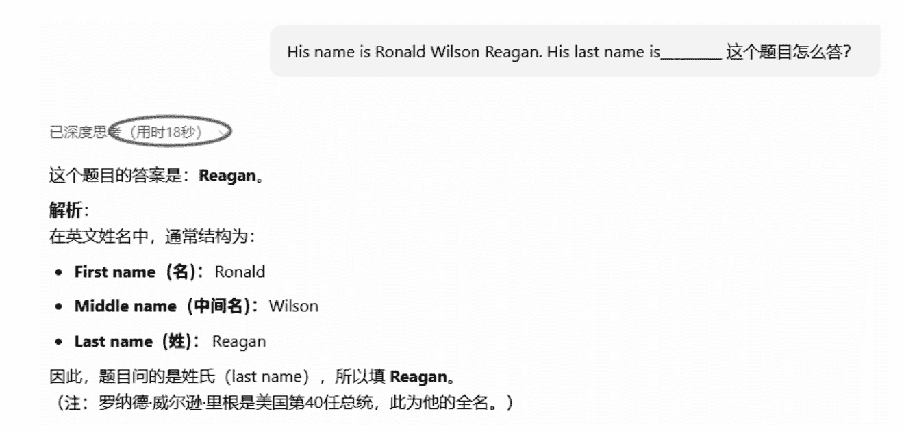

图1.1 DeepSeek 回答问题

结果显示思考18秒即给出方法。它并未局限于Last name单一点，而是延伸到英文姓名整体结构，列出First name、Middle name、Last name。这种体系化拓展既能理解本题目，也巩固了关联知识，无形中做到事半功倍。

### **1.1.2** **解题思维教练：从卡壳到通透的引导者**

希希对着几何题皱眉，草稿纸被画得乱七八糟却找不到突破口。她戳同桌求助，同桌瞥一眼随手画了条辅助线便继续看书。希希愣住——答案竟如此简单。她急问“你怎么想到的”，同桌淡淡回“感觉”。她既佩服又无奈，原来解题还能靠感觉！

很多时候我们要的不是答案，而是“为什么”。明白原理后才不会一遇变化就卡壳。可惜这个愿望常被落空。

老师讲题时会一带而过“简单”部分，集中难点；同学讲题常把步骤当理所当然；教辅为省篇幅大量省略。这种模糊导致理解半吊子，稍有变化就失手。我们需要有人把问题拆到最细。现在DeepSeek就能做到，哪怕是简单题也会步步解释。

例如填空题：“若x=3是关于x的方程mx-m=2的解，则m的值为_____。”提问如下： 

问：若x=3是关于x的方程mx-m=2的解，则m的值为_____。这个题目怎么解？每一步是如何思考的？

答：先回顾题目。

题目给出方程 mx-m=2，且已知 x=3 是其解，求 m。

第一步：理解题意
x=3 是方程的解，意味着代入后等式成立。可将 x=3 代入求 m。

第二步：代入已知值
m×3 - m = 2

第三步：化简方程
3m - m = 2
2m = 2

第四步：求 m
m = 1

第五步：验证
把 m=1，x=3 代入原式：1×3 -1 =2，3-1=2，等式成立，正确。

最终答案 m 为1。

DeepSeek把每一步列清，还附验算。遇到疑问可继续追问，它永不厌烦，只会针对不明白处展开。通过反复讲解，解题思路就能内化，不会因小变而卡壳。

### **1.1.3** **私人学习管家：精准诊断+动态调整**

希希数学成绩徘徊在及格线。为提升，她放学后常留校刷题，周末也不休。一个月后成绩只涨五分，其他科目因时间被挤占而下滑。

她望着满桌草稿纸第一次迷茫：继续刷题真能突破吗？不刷又该如何提分？她站在空荡操场前陷入沉思。

题海战术是常见选择：作文弱就多写，几何弱就刷几何，语法弱就做语法。虽有收获，但投入产出比不高。

刷题不高效因不够精准。精准需要两点：

其一，明确问题所在。作文拿不高分可能是审题偏、结构松或内容空。多数人难以自我觉察，老师也无暇逐题拆解。

其二，找到对应练习。即使定位到审题弱，也很难收集上百题只练审题。写一篇作文需30分钟，审题仅占5分钟，多数时间未用在刀刃。

于是只能大水漫灌。借助DeepSeek可实现精准诊断与动态调整。例如下面是她做错的一道一元一次方程题。

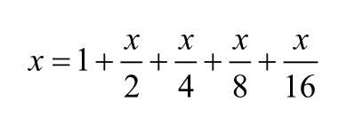

解：
16x = 1 + 8x + 4x + 2x + x
16x = 1 + 15x
x = 1

把这个错误提交给DeepSeek分析出错原因，提问如下： 

提问：*x*=1+*x*/2+*x*/4+*x*/8+*x*/16

错误的解法：16*x*=1+8*x*+4*x*+2*x*+*x*

16*x*=1+15*x*

*x*=1

请帮我看看这道题在哪个地方算错了？

答复：推导过程中出现了失误，关键就出在首次消去分母的那一步。下面逐步拆解：

……

症结在于，两边都乘以 16 时，常数 1 没有被同步放大。正确的处理是等式左右整体乘以 16，把分母全部约掉。

### 规范的变形过程：

……

### 小结：

失误的根源是常数项的乘法被遗漏。按正确运算所得结果应为*x*=16。

DeepSeek 定位了错误点并给出了解法。为了追查错误产生的深层原因，再次追问，提问如下： 

问：产生这个失误的原因是什么？我该如何防止？

答：根源在于做等式两边乘法时，未对全部项一视同仁。乘以 16 时，只对含*x*的项实施了运算，常数 1 却被无视了。

失误原因：

1\. 常数项被忽略乘法。

……

2\. 对分配律的掌握不够牢固。

……

如何规避此类错误？

1\. 明确每一步作用的对象。

对等式操作时，要确保常数和变量同时接受同一运算。乘 16，就必须让 1 和*x*的各项都乘 16。

2\. 用括号厘清运算范围。

做乘法时可借助括号限定范围。例如：

……

3\. 分步复核。

完成一步后立刻自检，常数是否变为 16，变量项是否变为 8*x*,4*x*,2*x*,*x*。

4\. 养成代入检验的习惯。

求出解后回代原式。例如得到*x*=16 时，代入左边验证：

……

通过以上做法，可有效降低同类失误，保证推导准确。

DeepSeek 不仅剖析了底层原因，还提供了预防手段。为了内化方法，再要求它出几道同构练习，提问如下： 

问：再给我几道类似的题，我练练手。

答：好的！下面是几道同类型的练习，都需要先消分母并注意常数项的处理。建议按规范步骤解答并自行验算。

题目 1：

解方程：

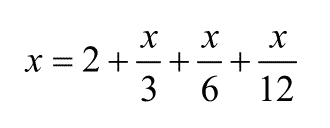

题目 2：

解方程：

……

题目 5：

解方程：

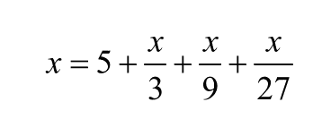

解题提示：

1. 找到分母的最小公倍数，用它同时乘等式两边消去分母。

2. 保证所有项，包括常数项和含变量项，都做同样的乘法。

3\. 合并同类项，求出*x*。

4\. 把结果代回原式检验是否成立。

……

DeepSeek 给出 5 道练习并附带步骤提示与答案。若全部正确，则说明该类错误已克服；若仍出错，可继续要求补充练习，直至彻底掌握。

同理，作文得分偏低时，可把题目和自己的作文交给 DeepSeek 分析，定位具体问题。若是审题偏差，就让它剖析深层原因，再出同类审题训练，不必写完整作文。

这样就实现了精准诊断、针对性训练并根据练习效果动态调整，避免了盲目刷题。

## **1.2** **DeepSeek 使用避坑指南**

虽然 DeepSeek 是高效学习工具，但使用不当也会影响学习效率甚至身体健康。要想用得顺手，需注意以下三点。

### **1.2.1** **第一步：先独立思考再求助**

希希是班里爱提问的同学，遇到难题总马上举手问老师。大家都觉得她很积极，可考试成绩却长期中下游。老师也纳闷，讲过的题她还是做不对。

许多同学认为遇到问题立刻问老师是好习惯，能省时省力。但这容易养成依赖，丧失探索乐趣，降低学习兴趣与动力。

更关键的是会形成被动学习：听讲解、记笔记、机械背诵。一旦题型变化就无从下手，这也是希希反复出错的原因。

用 DeepSeek 时这个问题更突出。首先，DeepSeek 随时在线，比问老师频率高得多。其次，问 AI 没有心理压力，更易直接索要答案。

这两点会造成更强的依赖和更彻底的被动学习。由于缺少老师的权威感，连死记硬背的动力都没了，很容易出现“问完即忘”。要避免这种情况，需要先做独立思考。

提问前花一分钟自问两个问题：我现在卡在哪里？可能的解决思路是什么？把自己的想法告诉 DeepSeek，请它评价。

例如几何题：“若*n*边形的内角和是外角和的 4 倍，则*n*为多少？”先快速思考：这涉及多边形内外角，我知道内角和公式，不知道外角和是否有定值。带着这个判断去求助，提问如下： 

问：若*n*边形的内角和是其外角和的 4 倍，则*n*为多少？这个题目如何求解？我现在知道，这是一个关于多边形内角和外角的度数问题。我记得多边形的内角和计算公式，但我不知道外角和的计算公式。

答：首先确认这是关于*n*边形内外角的问题。

1\. 内角和公式：

内角和为（*n*-2）×180°。

2\. 外角和：

任意多边形的外角和恒为 360°，可由周行角度或内外角互补推导。

3\. 题设条件：

内角和为外角和的 4 倍，即 4×360°=1440°。

4\. 求解：

（*n*-2）×180°=1440°

解得……

最终答案为：10。

DeepSeek 先肯定了判断，再补充外角和的定值并完成求解。通过对比，既巩固了分析能力，又明确自身缺口是外角和公式，只需补这一知识点即可，下次遇到类似题就能自行解决。

### **1.2.2** **第二步：培养信息甄别能力**

希希写《笨鸟先飞》作文，偷偷向 AI 求“相关名言”。屏幕出现十几条，她挑中“鲁迅：所谓天才，不过是每天积累成才”抄在结尾。第二天老师批注：“鲁迅说过这句话吗？”她脸红，查《鲁迅全集》才发现原句是“哪里有天才，我是把别人喝咖啡的工夫都用在工作上的。”希希气愤：“DeepSeek 你坑我！”

在某平台提问“请列举与‘笨鸟先飞’相关的名言”，它会这样回复： 

答：以下是与“笨鸟先飞”主题相关的名言名句，均体现勤奋、早行或弥补不足的精神：

1\. 中国经典

……

2\. 外国哲思

……

3\. 现代启示

（8）“所谓天才，不过是每天积累成才。”

——鲁迅

（日积月累的勤奋胜于天赋）

……

4\. 成语俗语

……

这些名言从不同角度诠释了“笨鸟先飞”的核心……

在“现代启示”里竟出现鲁迅的这句。DeepSeek 为何会“说谎”？原因有二。

其一，训练数据源本身有误，错误会沿传。其二，AI 幻觉会把相关概念强行关联，推理链越长越易出错。例如鲁迅谈过类似思想，AI 就可能直接把这句话归到他名下。

因此 DeepSeek 的输出并非绝对可信，需要验证。常用方法有：

（1）多平台交叉提问，对比结果取共识。
（2）追问依据，检验逻辑是否自洽。
（3）用教科书、词典等权威资料核对。
（4）请老师确认。

例如追问这句话的出处：提问如下： 

问：“所谓天才，不过是每天积累成才。”出自鲁迅哪篇作品？

答：您提到的这句话并非鲁迅原文，而是对鲁迅思想的现代转述。鲁迅确实多次强调勤奋积累，但原表述不同。

鲁迅原句考据

鲁迅在杂文《未有天才之前》（1924 年）中写道：

“哪里有天才，我是把别人喝咖啡的工夫都用在工作上的。”（收录于《鲁迅全集·华盖集》）

……

通过追问立刻推翻了之前的错误说法，并获得了正确的名言。后续仍可让它给出原文全文再核对。

所以对 DeepSeek 也应“尽信书则不如无书”。

### **1.2.3** **健康用眼的最终秘诀**

使用 DeepSeek 后希希信心大增，每天回家就抱着手机讨论作业。纸质作业还在写，其它学习全搬到手机上。成绩提升了，眼镜度数却飙升。大夫已警告三次，再不控制电子设备使用时间，高度近视就快了。

DeepSeek 打开了学习之门，但离不开电脑或手机，长时间盯屏会伤视力。

要保护健康，可这样调整：

控制连续用屏时长。准备一个番茄钟，设 25 分钟 。用完站起走动或看向窗外 5 分钟，再继续 25 分钟。

开启护眼模式。显示器可开护眼功能，手机可在设置里选深色模式，夜间使用时保持室内光线充足。

把回答打印出来。DeepSeek 回答左下角有复制按钮 。点击后粘贴到文档打印，就能在纸上学习，减少屏幕时间。

# **第二章**

# **DeepSeek 快速入门**

了解 DeepSeek 后开始实操。本章介绍平台选择、快速输入和信息定位，帮助新手快速上手。

## **2.1** **三步掌握操作技巧**

DeepSeek 看似简单，新手仍会遇到选平台、找历史问题、让 AI 理解意图等困惑，下面三步可解决。

### **2.1.1** **平台选择与账号注册**

DeepSeek 开源后多家公司提供服务，可在电脑和手机使用。选择设备和服务商时可参考：

**1.** **电脑 VS 手机**

电脑和手机都能访问各家服务。电脑屏幕大，阅读长文本更舒服，整理错题本、思维导图或打印资料更方便。手机便于携带，随时随地复习。

多数服务支持多端登录，数据互通。可结合使用：整理时用电脑，复习时用手机。

**2.** **官方 VS 元宝、百度等第三方**

除官方外，腾讯元宝、百度 AI 等也接入 DeepSeek，各自数据不同，答案会有差异。

为便于核对正确性，建议注册至少两个账号。推荐先注册官方账号，再注册腾讯元宝，元宝教育类资源更丰富作为主力，官方作为校验。

在手机安装官方 App 和腾讯元宝 App 按提示注册，电脑上登录同一账号即可同步数据。

### **2.1.2** **核心界面认识**

打开 DeepSeek 官网，点击“开始对话”进入对话页，登录后如图 2.1 所示。左侧是对话列表，右侧是对话窗口，在右侧输入框提问，输入框右下角上箭头变蓝后可发送。三个使用技巧如下：

图 2.1 DeepSeek 官方的对话页面

**1.** **使用深度思考模式**

提问时可开启“深度思考”，AI 推理更充分，适合复杂问题。缺点是响应变慢。基础知识查询如单词发音、公式、作者等无需开启；分析解题思路、写作方法等复杂问题建议开启。

**2.** **使用联网搜索模式**

DeepSeek 训练截止于 2024 年，获取最新信息需开启“联网搜索”。优点是信息新，缺点是网络内容质量参差，可能影响回答稳定性。通常不建议常开。

**3.** **巧用对话列表**

首次提问后，系统会按关键词自动给对话命名。每次打开默认新建对话，列表会很长。想让回答更聚焦，可维护好对话列表，按主题归类，避免混杂。

开启深度推理是使用前的第一步。把同一类的问题聚到一个会话里一起提，效率更高，比如单词的读音、意义、例句等疑问可以一次性列出。刚开始模型可能需要几次试探，等它摸清你的提问习惯和侧重点后，就能一次把该补的内容补齐，省去反复追问的麻烦，这正是它擅长学习的地方。换到全新主题时点“新建对话”开一个独立窗口。

用久了会攒出词汇、语法、几何、文言、作文等多个专题会话。为了后期好找，可以改名。把指针移到会话标题，点右侧的三点，选择“重命名”并输入新名称；不需要保留的会话也能通过同样菜单删除。

不同平台的接入细节有差异。以腾讯元宝网页版为例，登录后进入对话页，输入框下方第一个下拉要手动切到 DeepSeek，否则默认使用自带的混元模型。

手机端操作思路相同，只是历史列表默认折叠在左侧。打开 App 后点左上角的列表图标展开，点选某条即可回到对应会话继续追问，长按条目还能快速改名或删除。

### 2.1.3 实战演练：第一次提问
掌握基本用法后可以进入实战。很多同学其实已经问过多次，只是没摸清提问规律，得到好答案更多靠运气。下面用一道常见的代数题演示提问思路。

问：我是一名初中生。请分步讲解二元一次方程解法。

这条提问里，“我是一名初中生”说明提问者身份，模型会据此调整讲解难度；“分步”限定了输出形式；“二元一次方程解法”是核心诉求。发送前记得打开深度推理。 

思考过程：嗯，对方是初中生，想按步骤学二元一次方程的解法。先回想入门时的理解，尽量从基础概念起步，保证步骤完整不跳步，少用专业术语，多用口语化表达。

基于提供的身份信息，它会判断从哪里切入、回避哪些内容，才能让回复适合初中生阅读。这就是明确身份的作用。同一会话里，身份说明一次即可。 

首先要确认对方是否知道什么是二元一次方程，可能需要先简要介绍：含有两个未知数且最高次数为一次的方程。二元一次方程组一般由两个方程组成，需要同时成立，解就是找到同时满足这两个方程的 x 和 y 的值。

给出的身份比较宽泛，无法判断对方对二元一次方程的掌握程度，所以它会做一定假设。如果这里的假设与我们的实际偏离比较大，则回答就不会适合我们。这时，单击提问框的提问按钮停止回答，重新进行提问，补充信息，如“我学习了二元一次方程的概念”。 

常见的求解方法有代入消元和加减消元。先讲代入消元通常更直观，比如从一个方程中解出一个变量，用 x 表示 y 或用 y 表示 x，再代入另一个方程，消去一个未知数，变成一元一次方程，解出后再回代求另一个变量。

它同时想到两种解法，并在讲解顺序上权衡，优先介绍相对简单的代入消元。 

然后是加减消元法，可能更适合当两个方程中某个变量的系数相同或相反的时候，直接相加或相减消去一个变量。这时候需要举例说明，比如系数相同的话直接相减，系数相反的话相加，或者通过乘以某个数让系数变成相同或相反，再进行加减。

接着，DeepSeek 思考加减消元法的适用场景、讲解形式。 

需要注意的是，讲解的时候要分步骤，每个步骤都要明确，比如第一步：整理方程，确保两个方程都是标准形式；第二步：选择消元的方法，代入或加减；第三步：解一元一次方程；第四步：回代求另一个变量；第五步：验证解是否正确。

由于我们要求分步讲解，DeepSeek 将解法分解为多个步骤。 

另外，应该提醒学生注意常见的错误点，比如符号错误，代入时忘记括号，或者加减的时候出错。可能还需要举例说明，用具体的例子一步步演示，这样更容易理解。比如，举一个实际的方程组，分步代入或加减，详细展示过程。

还要考虑到初中生的数学基础，可能需要强调等式的基本性质，比如两边同时加减乘除同一个数，等式仍然成立。可能还需要解释为什么可以通过消元来解方程，因为目标是减少未知数的数量，使问题变得更简单。

最后，可能需要总结一下两种方法的适用情况，让学生根据题目特点选择合适的方法。同时，做一些练习题目来巩固，并检查是否真正掌握。总之，讲解要循序渐进，步骤分明，结合例子，语言简单明了，避免过快的跳跃，确保学生能够跟上思路，并自己动手练习。

最后，DeepSeek 基于我们声明的学生身份，思考需要强调哪些内容，如常见错误点、两种解法的适用场景、学生的基础等。下面来看它的具体回答，如图 2.2 所示。 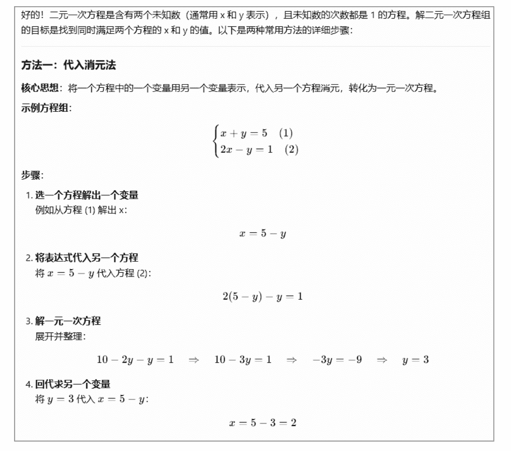

回复中先解释了二元一次方程的概念，随后依次讲解代入消元和加减消元，再给出特殊情况的处理方式，最后提供两条练习建议。因篇幅限制，部分内容未在图 2.2 中呈现。

所以想要高质量回答，不仅要把问题说清楚，还要说明已掌握的相关知识和希望的形式。要求也可以分步提出，示例如下： 
问：请讲解二元一次方程解法。
答：XXXX
问：以分步的形式重新讲解。
答：XXXX
问：从初中生的角度重新讲解。
答：XXXX
总之，若回答不满意，可通过分析思考过程了解其判断依据，再针对性追问，直到得到理想结果。

## 2.2 三秒提问术：不打字也能问
和 DeepSeek 互动时，输入本身就很费时间，尤其在手机上，英文数字更慢。下面三招能大幅提升效率。

### 2.2.1 口述提问：语音转文字操作
日常聊天打字很快，但在 DeepSeek 上描述问题常需几十上百字，手动输入就显得吃力。

可以借助语音转文字解决。在电脑上，大多数输入法都自带语音功能。以搜狗为例，点击输入栏上的 S 标志，再打开语音输入，就能对着麦克风说话直接生成文字。

手机上更方便，直接点提问框里的麦克风图标切换到语音模式，说完确认文字准确后即可提交。

简单的数学式可直接读出，例如 3+28×（21+4）读作“三加二十八乘以括号二十一加四括号”，它能自动识别。复杂符号如根号、垂直、平行等也支持语音输入。

### 2.2.2 拍摄即问：拍照传题
遇到纸质书本或作业，最快捷的方式是拍摄上传。打开手机 App，点击提问框旁的加号，选择“拍照识文字”或“拍摄”，把题目置于取景框中央，保持清晰后点击拍摄，确认效果后点对钩即可提交。

如果图片包含多道题，要明确指出来源，例如“我要问的是图中的第三题”。使用时有三个小技巧。

**1. 电脑端拍照问题**
手机和电脑共用同一账号，手机上的提问会同步到电脑。可以直接在手机上拍照提问，电脑端直接查看，无需给电脑配摄像头，也不用把照片再从手机传到电脑。

**2. 简化复杂式子的输入**
涉及繁琐的数学、物理、化学式子，用语言难以描述时，直接手写在纸上拍照上传，再提问即可。

**3. 多张照片的处理**
题目跨页时需要多张图片。官方版支持一次上传多张，腾讯元宝目前仅支持一张。此时需要调整提问方式。

首先上传第一部分，提问如下： 
问：这是我上传的第一张图片，后续还有图片，你先不要回应。
这时它会接收并识别图片内容，但不会作答，等待后续图片。然后上传第二部分继续提问： 
问：这是我上传的第二张图片。图中第三题该如何求解？
此时它会结合前后两张图片定位到第三题并给出解答。

### 2.2.3 文档直传：电子作业提问
老师发了一百页练习册供自测，每做完一遍就想让 DeepSeek 检查思路。以前只能在手机上翻页、复制粘贴，几分钟一次还容易出错。

学习资料多为电子版，如语文阅读、英语词汇、数学习题集等。遇到问题可直接把相关片段提交给 DeepSeek。文档较大或复制量多时，复制粘贴很麻烦，这时可使用文档处理功能。

（1）手机上点提问框旁的加号，选择“本地文件”或“文件”上传；电脑上点击提问框旁的回形针按钮  或向上箭头按钮  开始上传。

（2）指定提问范围。它对页码识别不够精准，指定后务必先让它输出验证。 
问：输出一下这个文档的第 13 页的第 5 题。
若输出不对，重新指定直至内容正确。

（3）基于验证后的内容提问。提问方式如下： 
问：对于你输出的这个题目，该如何求解？
如果经常针对同一份文档提问，可专门建一个对话并命名为“XXX 文档讨论”，之后直接打开该对话即可，避免重复上传。

## 2.3 长回复信息过载的化解方法
为了给出准确答案，回复通常很长，对阅读能力弱的同学压力很大。下面三个方法可帮助拆解长文本，快速抓取重点。

### 2.3.1 先做提炼：两句概括
深夜写作业时，希希对欧姆定律的推导一头雾水，向 DeepSeek 求助，结果得到好几屏文字，看得更糊涂了。

它的回答以详尽著称，几百到上千字很常见。阅读前先做要点核验，可避免白费功夫。

例如希希想了解欧姆定律推导，提问如下： 
问：我是一个初中学生。你帮我推导一下欧姆定律。
答：好的，让我们一步一步来推导欧姆定律。欧姆定律是电学中最基础的规律之一，它描述了电压、电流和电阻之间的关系。以下是推导过程：
一、核心概念回顾
1. 电流（I）：单位时间内通过导体横截面的电荷量，单位是安培（A）。
2. 电压（V）：推动电荷流动的“动力”，单位是伏特（V）。
3. 电阻（R）：导体对电流的阻碍作用，单位是欧姆（Ω）。
二、实验观察与假设
……
三、数学推导
……
四、公式变形
……
五、注意事项
……
六、举个例子
……
希望这个推导过程能帮助你理解欧姆定律的本质！如果有疑问，可以随时问我哦~ 
回复共六部分，超过 800 字。阅读前，希希可以先让它生成简化版，提问如下： 
问：请用两句话概括推导过程。
答：通过实验发现，导体中的电流与两端电压成正比（I∝V），与电阻成反比（I∝1/R），结合两者得出欧姆定律公式 I=V/R，验证后比例常数简化为 1。
七十来个字就能验证是否找对方向，也能理清推导脉络：先找电流与电压关系，再找电流与电阻关系。基于这个框架，再回头读长文会轻松很多。

所以遇到长篇回答，先要一份精简摘要，确认方向后再决定是否细读，往往摘要就够了。

### 2.3.2 表格化对比：知识点一目了然
学习中常需对比多个知识点，如语文里的“己”“已”“巳”，数学里的各种解法，英语里的介词区别。

问这类问题，它会逐条写很长，阅读对比很费力。例如想区分“己”“已”“巳”，提问如下： 
问：对比“己”“已”“巳”三个字的不同。
答：“己”“已”“巳”三个汉字在字形、字音、字义上都有区别，容易混淆，以下是具体对比：
一、字形对比
1. 己（jǐ）
·结构：第三笔的竖弯钩不封口，整体呈开口状。
·写法：注意最后一笔竖弯钩的收笔处留空，不闭合。
2. 已（yǐ）
·结构：第三笔的竖弯钩半封口，右上角微微闭合。
·写法：竖弯钩的收笔处略向上提，形成一个小缺口，介于“己”和“巳”之间。
3. 巳（sì）
·结构：第三笔的竖弯钩完全封口，形成一个闭合的四边形。
·写法：最后一笔的竖弯钩与横折钩紧密闭合，不留空隙。
二、发音对比
……
三、字义与用法
……
四、记忆口诀
……
五、易错提醒
……
通过字形细节和常用词对比，可以更清晰地区分这三个字。
内容详尽但不利于对照。这时可要求改成表格，提问如下： 
问：采用表格的形式对比这三个字。
它会立即调整输出格式，如图 2.3 所示。 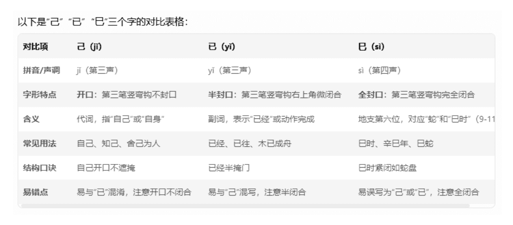
表格形式便于对照学习，也可打印贴在笔记本上复习。同样，可以把已收集的材料整理成表。比如文言虚词“之”的用法，提问如下： 
问：文言文中虚词“之”的用法复杂多样，主要可分为代词、助词、动词三类，具体如下：
一、代词（充当宾语或复指成分）
1. 第三人称代词
·译为“他/她/它”或“他们/她们/它们”，代指前文提及的人或事物。
·例：
◦学而时习之。（《论语》，“之”代指知识）

把零散的知识点整理成表格，阅读会更清晰

◦闻之，欣然规往。（《桃花源记》，“之”在这处指代前文所述之事）

2\. 指示代词
……

二、助词（不表实在意义，主要标示语法结构）
1\. 定语标志（作用类似“的”）
……
三、动词（作实词使用）
……

把以上零散条目交给 DeepSeek 归类，很快就能得到版式整洁的表格，如图 2.4 所示。

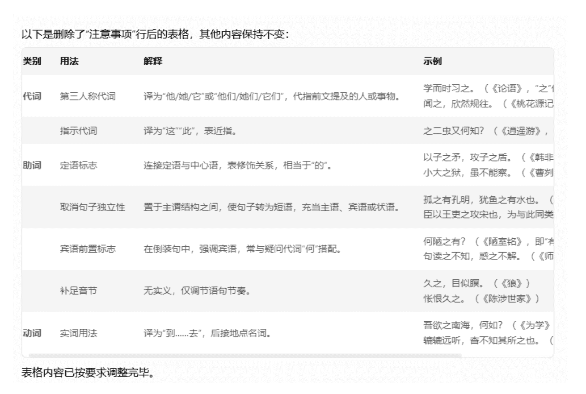

图 2.4 DeepSeek 整理后的表格内容

凡是带有对照性质的材料，都可以用 DeepSeek 转成表格呈现，阅读体验会更顺畅。

### 2.3.3 关键词标注：迅速锁定重点词

阅读时常会圈点划线，把核心词和关键句挑出来。面对 DeepSeek 的输出，也可以提出类似需求。例如让它输出《岳阳楼记》，并在每个虚词前加上星号★，后方不加。提问示例如下： 

问：输出一下《岳阳楼记》，将所有的虚词前面加一个星号★，但不要在后面加星号★。

答：以下是《岳阳楼记》的全文，其中所有的虚词前面加上一个星号★，但后面不加星号★：

岳阳楼记

庆历四年春，滕子京谪守巴陵郡。越明年，政通人和，百废具兴。★乃重修岳阳楼，增其旧制，刻唐贤今人诗赋★于其上。属★予作文★以记★之。

★予观夫巴陵胜状，★在洞庭一湖。衔远山，吞长江，浩浩汤汤，横无际涯；朝晖夕阴，气象万千。★此则岳阳楼之大观也，前人之述备矣。★然则北通巫峡，南极潇湘，迁客骚人，多会★于此，览物之情，得无异乎？

★若夫霪雨霏霏，连月不开，阴风怒号，浊浪排空；日星隐曜，山岳潜形；商旅不行，樯倾楫摧；薄暮冥冥，虎啸猿啼。登斯楼也，★则有去国怀乡，忧谗畏讥，满目萧然，感极★而悲者矣。

★至若春和景明，波澜不惊，上下天光，一碧万顷；沙鸥翔集，锦鳞游泳；岸芷汀兰，郁郁青青。★而或长烟一空，皓月千里，浮光跃金，静影沉璧，渔歌互答，★此乐何极！登斯楼也，★则有心旷神怡，宠辱偕忘，把酒临风，★其喜洋洋者矣。

嗟夫！★予尝求古仁人之心，★或异二者之为，何哉？★不以物喜，★不以己悲；居庙堂之高★则忧★其民；处江湖之远★则忧★其君。★是进★亦忧，退★亦忧。★然则何时★而乐耶？★其必曰“先天下之忧★而忧，后天下之乐★而乐”乎。噫！微斯人，吾谁★与归？

……

标注后，文中虚词一目了然。依输出类型，还可以要求多种标记方式，如解题过程的关键步骤、概念解释的核心词、英语主从句的关系标记等。

# 第三章
# 预习阶段：先抓新课框架

真正的学习从预习开始。预习能加深记忆、提升课堂效率。可惜多数同学的预习流于形式。有了 DeepSeek，预习便能产生实质作用。每次预习建议单独开一个对话，这样 AI 的解释会更贴合。

## 3.1 预习范围确认三招：让 AI 秒懂你要学哪

预习前既要自己明确边界，也要让 DeepSeek 明确。边界越清晰，回答越贴合。可按清晰度采用三种表述方式。

### 3.1.1 直接报目录编号：最准的定位方式

语文、数学、物理等教材结构分明，教师讲解一般遵循固定节奏。例如语文一篇课文讲两节课，数学一个小节如 2.1.1 也讲两节课。依据过往规律，很容易判断教师将讲哪一章。

例如数学教师明天讲有理数的乘法，对应目录“2.2.1 有理数的乘法”。把标题告知 DeepSeek，它便明白预习任务。提问方式如下： 

问：我要预习人教版七年级数学下册的“2.2.1 有理数的乘法”。

提问时把出版社、版本、年级、科目写清楚，信息越全结果越准。 

答：人教版七年级数学下册“2.2.1 有理数的乘法”预习总结

一、乘法法则

1. 符号法则：

·同号得正：正数×正数=正数，负数×负数=正数。

·异号得负：正数×负数=负数，负数×正数=负数。

·零的乘法：任何数×0=0。

……

五、实际应用举例
……

六、易错点提醒
……

七、练习题（自测）
……

通过以上内容，可以系统掌握有理数乘法的规则和应用，建议结合教材例题和习题巩固练习。

DeepSeek 针对“2.2.1 有理数的乘法”生成包含核心知识点、应用举例、易错提醒和自测题的预习总结。对照课本可以快速核对正确性。

### 3.1.2 拍照交任务：不清顺序时用图片定范围

教师并不总按课本顺序讲。比如英语单元，教师可能先讲 Section A，再讲 Section B，最后回头讲 Section A 的 Pronunciation。这时目录无法精确定位，只能拍照。以七年级英语上册单元 3 Section A 的 Pronunciation 为例。

把书翻到预习页，摊平、拍照、字迹清晰后上传给 DeepSeek，并说明预习范围。提问方式如下： 

问：这是明天英语老师要讲的内容。我现在要做预习。

答：根据图片内容，我将为你梳理预习重点，并提供分步学习方法建议：

一、发音预习重点（Pronunciation）

1. 核心音标对应：

·a ➔ /æ/（cat, map）

·e ➔ /e/（bed, pet）

·i ➔ /ɪ/（pig, sing）

·o ➔ /ɒ/（hot, dog）

·u ➔ /ʌ/（cup, duck）

2. 发音对比练习：

注意区分易混淆音标：

/æ/ vs /e/：对比 cat（猫）和 pet（宠物）

/ɪ/ vs /i:/：对比 it（它）和 Chinese（中国人）

/ɒ/ vs /əʊ/：对比 pot（壶）和 note（音符）

二、单词分类技巧
……

三、韵文学习建议
……

四、预习步骤建议
……

五、课堂可能延伸内容
……

建议重点预习发音规律和韵文节奏，这些通常是课堂示范的重点。可以提前准备 2-3 个发音问题（如区分/æ/和/e/的方法），便于课堂提问。

DeepSeek 严格按图分析，给出详细预习建议，包括要点、步骤和课堂可能延伸内容，从而准确框定预习范围。

此法也适用于 DeepSeek 尚不熟悉的最新版教材。拍下全部预习内容上传即可。

### 3.1.3 关键词猜测法：让 AI 来当侦探

有时教师会把不同章节内容整合讲解，只说下节课讲某个主题，却不标页码。这时只能把关键词交给 DeepSeek，让它搜集相关资料。

比如英语教师准备集中讲解时间介词使用。把关键词“时间介词”告知 DeepSeek，让它整理预习方案。提问方式如下： 

问：我是一个初中学生。明天英语老师要讲解时间介词。我现在要预习准备一下。

答：为了帮助你预习时间介词，以下是清晰的总结和练习，助你轻松掌握：

时间介词用法总结

1. at

·具体时间点：at 3：00 PM, at noon, at midnight

·固定搭配：at night, at the weekend（英式）, at Christmas（整个圣诞期间）

2. on

·具体某一天：on Monday, on July 5th

·某天的某时段：on Tuesday morning, on the evening of May 1st

·特定节日/日期：on Christmas Day, on my birthday

3. in

·较长时间段：in October, in 2024, in summer

·一天中的部分：in the morning/afternoon（但具体某天用 on，如 on Monday morning）

·时间段后：in a week（一周内）, in two hours（两小时后）易错点提醒
……

练习题（答案在最后）
……

小技巧
……

预习完这些，明天上课时你就能自信参与讨论啦！加油！

DeepSeek 归纳了初中常用三个时间介词，并做简要分析，给出练习题和学习小技巧，作为预习目标。

综合比较，拍照法最精准，其次是目录编号，最后是关键词。无论哪种方式，都要先从教师处弄清下节课内容，才能让 DeepSeek 提供精准辅导。

## 3.2 高效预习法：三步抓住核心

高效预习要明确目标，先了解大致内容，筛掉旧知识，把精力放在重点难点上。DeepSeek 能轻松完成这些筛选。

### 3.2.1 知识速览：先让 AI 用百字做总览

希希是个用功的初中生，晚上决定预习第二天物理课的内容。她拿起课本逐字看“8.1 牛顿第一定律”，从阻力影响到定律再到惯性，看得一头雾水。20 分钟后，她看着练习题发呆：这跟定律有什么关系？

预习时常有迷惑：为什么要讲这个？概念怎么理解？实验目的何在？这些困惑降低效率，根源是对整体缺乏把握。

例如预习“8.1 牛顿第一定律”，先要知道本节大致讲什么，会出现哪些关键词。有了轮廓，读到具体内容就能自动归位。

这就像进公园先看地图，再按图找景点。先见森林再见树木的好处就在这里。预习前先让 DeepSeek 做个简短概括，提问如下： 

问：对这节课要讲解的内容进行总结，控制在 100 个字以内。

注意：提问前必须按前文方法先确定预习范围。 

答：这节课主要讲解牛顿第一定律（惯性定律）：物体在没有外力作用时保持静止或匀速直线运动。惯性是物体保持运动状态的性质，解释了生活中的现象如汽车刹车时乘客前倾。通过实验和推理，伽利略和牛顿揭示了力与运动的关系。课程还涉及惯性的应用与防范措施。

有了这个概览，目标就清晰了，细节也更容易理解。了解背景意义后，学习兴趣也会提升。

### 3.2.2 旧知排查：复习到位才能学得快

预习二次函数时，希希觉得很难，到处是术语和推导。她标记了一堆问号。第二天上课后仍不明白。后来才发现，很多不懂的内容其实是上学期学过的，只是忘了。

预习时难易起伏大，往往不是难度问题，而是基础不牢。比如二次函数需要坐标系、函数概念、一次函数、二元一次方程、图像与方程等，这些都是旧知识。一旦遗忘就会被当成新内容。

这就导致预习费时却不透彻，上课时又因旧知没掌握而卡壳。预习时要区分新旧，并复习新知依赖的旧知。筛选工作可交给 DeepSeek。

例如让 DeepSeek 梳理“8.1 牛顿第一定律”的新旧内容并列出必备旧知。提问如下： 

问：在这部分内容中，哪些内容是新学的，哪些是学过的。要学好新内容，我要先掌握哪些内容？

答：在你预习的内容中，以下是你可能已经学过和将要新学的内容：

已学过的内容：

1. 力的基本概念：你可能已经学过力的定义和基本类型（如重力、摩擦力等）。

2. 运动和静止的概念：你可能已经了解物体运动和静止的基本概念。

3. 简单的实验观察：你可能已经通过实验观察过物体在不同条件下的运动情况。

新学的内容：

1. 牛顿第一定律（惯性定律）：这是新的核心概念，指出物体在没有外力作用时会保持静止或匀速直线运动。

2. 惯性的概念和应用：惯性是物体保持运动状态的性质，这是新的知识点。

3. 伽利略的实验和推理：通过实验和逻辑推理得出运动和力的关系，这是新的内容。

4. 生活中的惯性和防范措施：如汽车安全带和安全气囊的作用，这是新的应用知识。

要学好新内容，你需要先掌握：

1. 力的基本概念：理解不同类型的力及其作用。

2. 运动和静止的基本原理：了解物体在不同条件下的运动状态。

3. 实验观察和推理能力：能够通过实验观察现象并进行逻辑推理。

通过复习这些基础知识，你将更容易理解牛顿第一定律和惯性的概念及其应用。祝你预习顺利！

DeepSeek 区分了已学与待学，并给出必须掌握的基础。按提示回想并验证，可以让 DeepSeek 再出几道检测题，提问如下： 

问：为了验证我对“需要先掌握”的内容理解，你出几道测试题。题目的分析和答案一起放到最后。

答：好的！以下是几道测试题，帮助你验证对“需要先掌握”的内容的理解。题目涵盖力的基本概念、运动和静止的基本原理，以及实验观察和推理能力。

测试题：

1. 力的基本概念

题目：下列哪种力是物体在地球表面受到的主要力？

A. 电磁力

B. 重力

C. 摩擦力

D. 弹力

2. 运动和静止的基本原理

题目：一个物体在水平桌面上静止不动。下列说法正确的是：

A. 物体没有受到任何力

B. 物体受到的合力为零

C. 物体只受到重力

D. 物体只受到摩擦力

……

答案与解析：

1. 答案：B

解析：物体在地球表面受到的主要力是重力，它使物体朝向地心方向加速。

2. 答案：B

解析：物体静止不动意味着它处于平衡状态，受到的合力为零。虽然物体受到重力和支持力，但这些力相互平衡。

……

通过这些问题，你可以检验自己对基本概念的理解。如果有任何不确定的地方，可以进一步复习相关内容。祝你学习顺利！

DeepSeek 给出 5 道题并在最后附解析。自测 3 分钟，能提升预习效率，保证课堂质量，避免因旧知缺口影响新知。

### 3.2.3 重点难点预警

希希翻开物理课本预习，老师没提示重点难点。她翻目录、看概述、瞄习题、找加粗字和小结，15 分钟时间全用完了，还没理清头绪。

时间有限时，要先锁定重点难点。以前只能问老师或自己提炼，现在可以让 DeepSeek 提前提取。提问如下： 

问：在我要预习的内容中，哪些是重点和难点？

答：在你预习的内容中，以下是重点和难点：

### 重点：

1. 牛顿第一定律（惯性定律）：

·内容：物体在没有外力作用时会保持静止或匀速直线运动状态。

·重要性：这是力学的基础定律之一，理解它对于后续学习其他物理定律至关重要。

……

### 难点：

1. 理解牛顿第一定律的抽象性：

·难点：牛顿第一定律描述的是理想情况（无外力作用），在现实中难以直接验证。

·解决方法：通过实验和生活中的例子来帮助理解，如滑板车在无阻力情况下的运动。

……

学习建议：

·重点内容：确保理解牛顿第一定律和惯性的概念，掌握其在实际生活中的应用。

# 预习复习提效实战手册

攻克难点靠的不是死记硬背，而是通过大量针对性的练习和实地观察，逐步把理解上的卡点打开。抽象概念配上图示或生活化对照，就能变得好懂好用。

带着明确目标去预习复习，重点难点自然被消化吸收。祝学习顺利！

借助 DeepSeek 梳理预习范围时，它会把关键点与难点单独拎出并说明缘由，最后给出可执行的建议。抓住这些高价值信息，短时间内就能完成高质量的预习。

## 3.3 预习进阶训练：从粗知到细懂

预习阶段适合对教材与练习册做一次快速通读，先搭整体框架。DeepSeek 能即时答疑、补充背景、生成自测题、整理问题清单，让预习更省力更高效。

### 3.3.1 疑点标记与即时求助

希希在规定时间内把预习做完了，却被几处没想通的地方卡住，尤其是涉及重点的两个点。她站在书桌前犹豫不决，笔尖不自觉地在纸上敲着。想趁热打铁一次性解决，又担心时间不够、查到的资料不可靠反而添乱；等到明天课堂再问，又觉得有些不甘心。

预习碰到拦路虎怎么办？一种说法是自己钻研，能练自学也加深理解；另一种说法是等老师讲，省时也避免被错误信息带偏。两者各有利弊。

结合 DeepSeek 就能扬长避短。主动把问题抛出来一起探讨，自学能力照样得到锻炼，理解也会更深。而且回答只需十几秒，既省去搜资料的时间，也更有保障。所以预习中出现的疑点一定要先标注，再集中提问。提问形式如下： 
问：我在预习这部分内容时，存在以下疑问：

1. 太空中物体是不是不受力，一直保持惯性？
2. 什么算合乎逻辑的推理？

你能帮我们解答一下吗？

答：当然可以！以下是针对你提出的疑问的解答：

1. 太空中物体是不是不受力，一直保持惯性？
·解答：在太空中，物体并不是完全不受力，但它们受到的重力和其他外力通常非常小，可以近似认为物体处于“无外力”状态。根据牛顿第一定律（惯性定律），如果一个物体不受外力作用，它将保持其运动状态（静止或匀速直线运动）。因此，在太空中，物体在没有明显外力作用的情况下，会继续保持其惯性运动状态。
·例子：国际空间站（ISS）在轨道上绕地球运动时，虽然受到地球的引力作用，但由于其高速运动产生的离心力与引力平衡，空间站内的物体看起来像是处于失重状态，保持惯性运动。

2. 什么算合乎逻辑的推理？
·解答：合乎逻辑的推理是指基于已知事实和科学原理，通过合理的步骤得出结论的过程。在科学中，合乎逻辑的推理通常包括以下几个步骤：

……总结：
·太空中物体的惯性：在太空中，物体可以近似认为不受外力作用，保持惯性运动状态。
·合乎逻辑的推理：基于观察和已知事实，通过合理的步骤得出结论的过程，是科学研究中的重要方法。希望这些解答能帮助你更好地理解预习内容。如果有更多问题，随时提问！

DeepSeek 给出了针对性解释。若仍有不通，可以继续追问。预习阶段善于提问，既能提高质量，也能激发兴趣。

### 3.3.2 背景补盲 解惑溯源

又到预习时间，希希看到课本上的“有理数”三个字就皱眉。她反复琢磨，为何叫有理数？定义明明是能写成分数形式的数，与“理”有何关联？查了英文词典，rational number 直译是“合理的数”，困惑更深。难道这些数藏着某种合理性？思绪被这团迷雾卡住，预习无法推进。

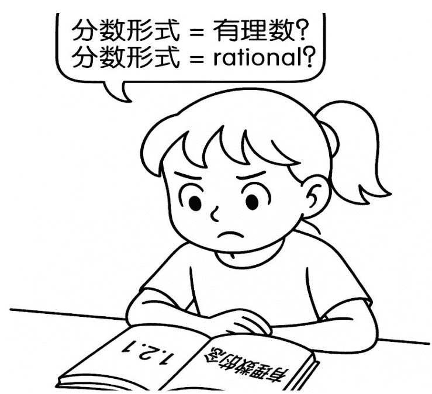
学习时总会冒出若干“奇葩”疑问。比如英文字母为何分大小写，古汉语“走”为何相当于今义“跑”，数学里未知数为何称“元”。这些问题一旦萌芽就越长越旺，让人坐不住。老师常说这只是约定俗成，记住就行，无需深究。

这种回应很难让人接受，于是继续自行查找，多半无果。久而久之就把它们当成可以忽略的背景信息。事实上万物皆有来由，搞清缘由往往收获颇丰。就像弄懂黄金的形成机制，就明白它为何珍贵。

以前师生缺乏便捷的查证手段，只能放弃。现在借助 DeepSeek，很快就能找到答案。以有理数的命名为例，提问如下： 
问：我是一个初中生，现在预习“有理数的概念”章节。请问，有理数明明是指可以写成分数形式的数，怎么叫“有理数”这个名字？连英文名称（rational number）中的 rational 都表示“合理的”呢？

答：你好！你提出了一个很好的问题。关于“有理数”这个名称的来源，确实有点让人困惑。让我们来详细解释一下。

1. 有理数的定义
有理数是指可以表示为两个整数之比（即分数形式）的数。换句话说，如果一个数可以写成*a*/*b*的形式，其中*a*和*b*是整数，且*b*≠0，那么这个数就是有理数。

2. “有理数”名称的来源
“有理数”这个名称中的“有理”并不是指“合理”或“有道理”，而是来源于“比率”（ratio）这个词。在数学中，ratio 表示两个数的比，而 rational 这个词在拉丁语中的词根是 ratio，意思是“比”或“比例”。因此，rational number 的字面意思是“可以表示为比（分数）的数”。

3. 为什么翻译成“有理数”？
在中文中，“有理数”这个翻译是从英文 rational number 来的。由于 rational 这个词在英文中既有“合理的”意思，也有“比率的”意思，而中文翻译时选择了“有理”这个词，可能是因为“有理”在中文中也有“有道理”的含义，容易让人联想到“合理”。但实际上，“有理数”中的“有理”应该理解为“可以表示为比（分数）的数”。

4. 总结
·有理数是指可以表示为两个整数之比的数。
·Rational number 中的 rational 来源于拉丁语 ratio，意思是“比”或“比例”。
·中文翻译为“有理数”时，虽然字面上看起来像是“有道理的数”，但实际上是指“可以表示为比的数”。

希望这个解释能帮助你理解“有理数”这个名称的来源！如果你有其他问题，欢迎继续提问！

通过解释，疑惑被彻底打开，对有理数的理解也随之加深。rational 本身有多重含义，既可指合理，也可指可比，翻译时出现了歧义。

因此，那些看似无关紧要的背景问题，完全可以在预习时抛给 DeepSeek。消除困惑的同时，还能间接加固知识点。

### 3.3.3 预习自测 查漏补强

希希预习时喜欢把课本读三遍，荧光笔涂满，心里想着肯定没问题。数学课上老师讲解方程式，她得意地转笔，早看熟了嘛。直到作业摊开，第三题卡住半小时，明明预习过类似题型，换两个数字就不行了。预习到底有没有用？

课堂提问能检验当堂掌握，作业批改能检验完成质量，考试能检验复习效果。每个环节都有对应的检验手段，预习也不例外。预习后效果如何、是否还有遗留，都是未知，需要一个检验环节。

检验后还能提升课堂效率。清楚自己会的与不会的，就能把注意力放在薄弱点，已掌握的内容会增加自信，降低紧张。检验也是强化长期记忆的有效方式。

希希正因缺少检验，才在课堂上抓不住重点，作业也做不顺。预习后最好立刻做一次小测。出题交给 DeepSeek 就行，它能按预习范围动态生成题目。例如预习完物理“8.1 牛顿第一定律”后做测验，提问方式如下： 
问：我已经预习完这部分内容。我需要几个测试题，进行验证。你来出题，把答案和解析放到最后。

答：当然可以！以下是几道测试题，帮助你验证对预习内容的理解。题目涵盖牛顿第一定律、惯性的概念以及相关的应用和推理。

测试题：
1. 牛顿第一定律
题目：根据牛顿第一定律，如果一个物体不受外力作用，它会如何运动？
A. 加速运动
B. 减速运动
C. 保持静止或匀速直线运动
D. 做圆周运动

2. 惯性的概念
题目：下列哪个现象最能说明物体的惯性？
A. 汽车加速时乘客向后倾
B. 汽车刹车时乘客向前倾
C. 汽车转弯时乘客向外侧倾
D. 汽车匀速行驶时乘客保持静止
……

答案与解析：
1. 答案：C
解析：牛顿第一定律指出，物体在没有外力作用时会保持静止或匀速直线运动状态。
……

通过这些问题，你可以检验自己对预习内容的理解。如果有任何不确定的地方，可以进一步复习相关内容。祝你学习顺利！

按要求生成了五道贴近课本、难度适中的题目，并在最后附上答案与解析。检验后能明确预习情况，遇到问题及时记录，进入下一步处理。

### 3.3.4 带问题上课 提升听课效率

“第三个问题在哪？”希希一边嘀咕一边翻课本。昨天预习后她记得有三个问题要上课解决，现在只想起两个。整节课心不在焉，晚上回家才想起第三个，可惜机会已过。

预习中产生的问题往往是知识盲区。把它们明确列出，上课意愿更强，注意力更集中，还能主动筛选信息，围绕问题搭建完整框架。长期发现并解决问题，会形成个性化的学习路径。

因此预习后不仅要总结问题，还要整理成第二天的听课清单。这类问题分三类：第一类是仍存疑的，直接列出；第二类是“已解决”的，感觉解决了但未必真懂；第三类是大家常见但自己没注意到的。

第二、三类问题 DeepSeek 都能整理出来，自己只需列出第一类即可。整理时可以这样要求： 
问：针对我预习的这部分内容，列出来我提出的各种问题，以及大家常遇到的问题。

答：在你预习的这部分内容中，你提出了一些问题，同时也有一些常见的问题。以下是列出的问题和解答：

你提出的问题：
1. 太空中物体是不是不受力，一直保持惯性？
解答：在太空中，物体并不是完全不受力，但它们受到的重力和其他外力通常非常小，可以近似认为物体处于“无外力”状态。根据牛顿第一定律，如果一个物体不受外力作用，它将保持其运动状态（静止或匀速直线运动）。因此，在太空中，物体在没有明显外力作用的情况下，会继续保持其惯性运动状态。

2. 什么算合乎逻辑的推理？
……

常见的问题：
1. 牛顿第一定律在实际生活中如何应用？
解答：牛顿第一定律解释了为什么物体在没有外力作用时会保持静止或匀速直线运动。在实际生活中，这可以解释为什么汽车刹车时乘客会向前倾（惯性），以及为什么滑板车在没有推力时会逐渐停下（摩擦力作用）。
……
5. 惯性的应用有哪些？
解答：惯性在生活中有许多应用，如跳远运动员利用惯性在空中继续前进，锤子的锤头松了通过撞击锤柄下端使其紧套在锤柄上。同时，惯性也可能带来危害，如交通事故中乘客因惯性向前冲，因此需要系安全带和使用安全气囊。

总结：
·你提出的问题：主要集中在太空中的物体运动和逻辑推理的理解。
·常见的问题：涉及牛顿第一定律的应用、惯性与质量的关系、惯性定律的名称由来、实验验证方法以及惯性的应用和防范。

通过解答这些问题，你可以更全面地理解预习内容。如果有更多问题，随时提问！

按要求列出了自己提出的问题和五个常见问题，并附了解答。若不需要答案，也可让其生成无答案版。把清单抄在笔记本上或打印出来，相当于手握游园指南，清楚该看的景点和已走的景点。

# 第四章

# 复习阶段：精准查漏补缺

复习是巩固课堂知识、找准薄弱环节并补齐的关键阶段。做好复习能增强应试信心，减少焦虑。借助 DeepSeek，复习可以更精准高效。

## 4.1 三步复习法：定位精准 巩固高效

大家都知道复习就是翻书、看笔记，可很少有人真正做到高效。有了 AI 助力，这个任务就变得轻松。

### 4.1.1 划定范围 锁定重点难点

希希翻开课本瞄两眼公式就合上，自认已烂熟于心。笔记上的例题草草扫过，自信不用练习。摊开作业本却愣住：物理应用题里电阻计算模糊，英语阅读冒出三个生词记不得。她烦躁地翻书，发现公式旁红笔标注的“仅限串联电路”被自己跳过，英语笔记的一些例句也没留下印象。她纳闷刚才到底复习了什么？

许多同学觉得复习枯燥乏味，看着熟悉的课本和笔记没有新意。老师反复强调重要性，只能硬着头皮重看一遍。写作业时才发现好多题仍不会。

这是缺少目标的复习。复习前必须明确范围，弄清重点难点，才能有动力并合理分配精力。就像逛游乐园，喜欢的项目玩起来才开心。如何找全重点难点，交给 DeepSeek。

先指定复习范围，可用目录编号、拍照或关键词。然后让它列出重点和难点。以复习数学七年级下册“10.2.1 带入消元法”为例，获取要点。 
问：我是一名初中生，正在复习“10.2.1 代入消元法”的内容。请列出复习需要注意的重点和难点。

答：以下是基于五张图片内容的代入消元法解二元一次方程组的复习重点与难点总结，帮助你系统梳理知识框架：

一、重点清单
1\. 代入消元法核心步骤
·变形方程：从方程组中选择一个系数简单的方程（如系数为 1 的变量），解出一个未知数。*例*：由（*x*+*y*=6）变形为（*y*=6-*x*）。
·代入消元：将变形后的表达式代入另一方程，消去一个未知数，转化为一元一次方程。*例*：将（*y*=6-*x*）代入（2*x*+*y*=8）。
·回代求解：解出一元方程后，回代求另一个未知数，并验证解的合理性。

2\. 变量选择与简化计算
……

二、难点突破
1\. 系数复杂时的变形与计算
·易错点：分数运算易漏项或符号错误（如例 3 中误将（5*y*-11）拆分为分母）。
·对策：分步书写，每一步检查符号和分配律是否正确。
……

三、典型例题强化
……

四、复习建议
1. 分步训练：先掌握系数简单的题目（如例 1、例 2），再挑战复杂系数（如例 3、例 4）。
2. 实际问题模拟：用生活场景（如快递员、分装问题）练习建模，强化应用能力。
3. 错题整理：记录计算中的符号或代入错误，归纳避免方法。

如果需要具体例题的详细解析或更多练习题，请随时告诉我！

按要求得到四个重点、四个难点、典型例题和复习建议。复习课本时逐项对照，着重理解一遍，基础复习便完成。

### 4.1.2 笔记体检 AI 补全漏洞

下课铃响，希希拦住小丽借笔记，对方说答应借给小林了。她失望坐下，同桌说也没借到。两人凑合补全重点，放学前抄出完整资料。

当天复习不仅要看课本，还要整理笔记。整理能加深理解、查漏补缺，还能提升可读性和实用性。但做笔记时很难发现遗漏，于是到处借别人的。现在 DeepSeek 就像多了一条路，能帮检查和补全。

把笔记拍照传到上一个会话，让它检查补全，提问如下： 
问：这是我对“10.2.1 带入消元法”做的笔记，帮我检查一下笔记，是否存在错误、缺失，以及需要突出的内容。

代入消元法笔记 · 快速精修清单

依据你提供的代入消元法学习手记，梳理出以下改进建议，帮助你整理成更完整的复习资料：

一、用词与表述校正
1. 名词规范
· 手记中出现的“带入消元法”应统一改为教材标准的“代入消元法”。
· 原句“甲含有另一个未知数的代数式”里的“甲”属笔误，建议删除或改成“用”。

2. 步骤描述
……

二、内容完整性核查
1. 关键思想补充
· 该方法的核心是通过消去一个未知数，将二元问题化为一元问题，体现化归思想，建议在定义后补充说明。
……

2. 应用举例不足
· 可增设“如何用代入思路解决实际问题”，例如快递计件工资、货物分装等情境，提升建模意识。
……

三、需要突出的重点
1. 代入对象选择
· 必须把变形后的式子代入未变形的另一方程，如例1应代入②而非①，否则会产生循环验证。
……

四、易错点提醒
1. 符号处理
· 将 y=2x-3 代入 3x+y=5 时，应写成 3x+（2x-3）=5，不能省略括号。
2. 回代验证
……

五、呈现形式建议
1. 版式调整
· 用不同颜色区分定义、操作步骤与注意事项，例如蓝色标注易错点，绿色补充拓展内容。
· 补充例题与练习，如商品分装问题：
……

六、小结
整体来看笔记完整且条理清晰，但仍需修正术语笔误、增加真实案例和易错提示。优化后体系感更强。需要分步解析或错题模板可随时提出！

DeepSeek 对这份手记做了细致核查，给出不少修改意见，部分源于识别偏差，但大部分很精准。逐条确认既能巩固当天所学，也为后期复习准备素材。

### **4.1.3** **五分钟小测验：检验掌握程度**
复习教材和笔记后，容易产生“我会了”的错觉，实际上往往只是看懂而非会用。为避免误判，需要做一次小测。过去很难找到合适题目，如今借助 DeepSeek 自测很便捷。只要在复习对话里让它出题即可。提问方式如下：

问：针对上面我复习的内容，你帮我生成几道自测题，我验证一下复习效果。答案和分析放到最后。

答：以下是围绕代入消元法的自测题及答案，覆盖基础运算、系数选取策略和实际应用，帮助你全面检验复习成果：

### 自测题

题目 1（基础题）

用代入消元法解方程组：

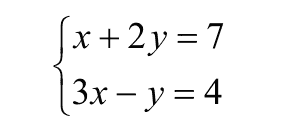

题目 2（系数选择策略）

解方程组：

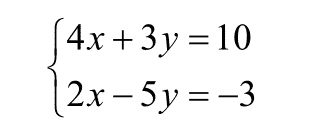

……

题目 3（实际问题）

……

题目 4（综合题）

……

答案与分析

题目 1

步骤：

……

自测总结

1. 检验能力：
·能否依据系数特点挑选最优变形方程（如题目 2）。
·实际问题的建模与计算是否准确（如题目 3）。

2. 纠错方向建议：
·分数运算要分步写清，避免跳步。
·实际问题注意隐含条件，比如整数解要求。

需要更多专项练习或分步讲解，随时告诉我！

基于前面提交的课本和笔记，DeepSeek 提供了 4 道题目，涵盖基础、策略、实际、综合。随后给出每题思路与步骤，最后提供自测总结，点明各题考察目标与注意事项。

相较于教师布置的作业，DeepSeek 的题目更具针对性，覆盖面更广，有助于发现薄弱环节。

## **4.2** **搭建知识体系：由散到整**

掌握知识点就是把它嵌入到我们的知识网络中。这不仅涉及建立知识点内部之间的关系，还涉及知识点外部之间的联系。建立知识体系是一件非常复杂的任务。但是，在 DeepSeek 的帮助下，我们能够轻松完成。

### **4.2.1** **思维导图：把书读薄的技巧**
每周末希希都很发愁。周一到周五她每天花一小时复习当天内容，周末却要回顾整周，书本和笔记堆成山，至少要花三四个小时。她看着窗外玩耍的伙伴，心里很无奈。时间不够用，复习任务压得她喘不过气。她叹气翻开课本，想着“要是复习能轻松点就好了……”

“复习跟不上”是常见难题。原本简洁的课本被笔记和练习填满，信息量翻了几倍。这是把书读厚的第一步，第二步是“把书读薄”。

这就需要梳理知识结构，把分散的知识点系统化，形成清晰框架。不仅利于记忆，也能加深理解，思维导图正是好工具。它能把复杂信息浓缩成树状图。

不少同学了解思维导图，却因手绘繁琐而放弃。现在 DeepSeek 能迅速生成。受限于图形输出，需要借助 Markdown 作为中转。

Markdown 与数学语言类似，都是专用记号。数学用数字符号表达运算，Markdown 用符号定义文本层级。我们无需精通，只要让 DeepSeek 输出 Markdown 表述的思维导图即可。例如要生成代入消元法的导图，可这样提问： 

问：从以上对话中，提取代入消元法相关的知识，帮我生成思维导图，用 Markdown 语言描述。

答：根据图片和对话记录，以下是结构化整理的代入消元法思维导图（Markdown 版）：

markdown

10.1 代入消元法解二元一次方程组

一、定义

·核心思想：将方程组中某未知数用另一方程表达，消元化为一元一次方程

·本质：化二元为一元（化归思想）

二、实施步骤

1 .变形

·选择系数简单的方程（如系数为 1 的方程）

·改写为y=ax+b或x=ay+b形式

2. 代入

·将变形后的表达式代入**另一个未变形方程**

·×禁止代入原变形方程（防止循环验证）

3. 求解

·解一元一次方程，得一个未知数的值

4. 回代

·将求得的值代回变形方程（y=ax+b或x=ay+b）

5. 写解

·联立结果{x=...，y=...}

……

DeepSeek 从过往聊天中提取代入消元法的知识点，生成 Markdown 代码。点击右上角复制按钮  获取代码。再用可转换工具将代码转为思维导图，如 ProcessOn。它不仅能转换，还方便手动修改。修改后的导图如图 4.1。

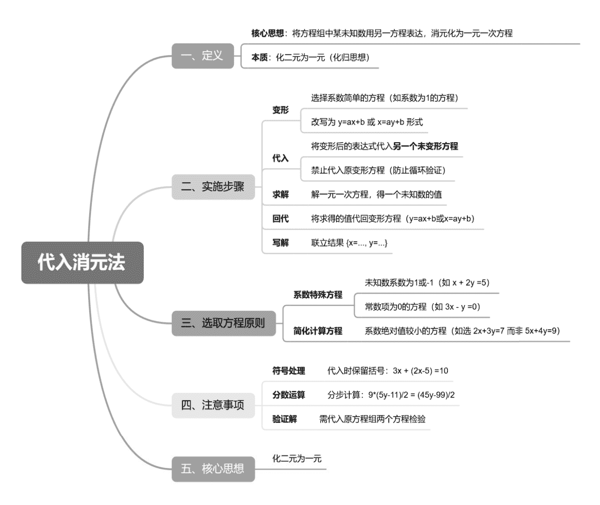

图 4.1 代入消元法的思维导图

所有相关内容被浓缩到一张图里，实现了“把书读薄”，并把知识点串联成完整体系。后期复习只需巩固这一张图。

### **4.2.2** **构建知识网络：找隐藏关联**
希希看着物理练习册上的受力分析题发愁，几个力平衡关系像乱麻。她反复画受力图，仍觉得缺了什么。无奈去找老师。老师看后笑道：“这题其实可以用数学方法解。”

老师写下：“这两个力相加是 10N，第一个力的两倍减去第二个力是 5N。”希希愣住，老师又说：“把这两个力看成变量 x、y，这不就是二元一次方程组吗？用代入消元法就能求出。”

复习时我们觉得掌握了知识点，能解相关问题。但实际问题常从意外角度出现。老师会说：“你还没真懂，再复习。”拿起课本，我们会困惑：“都能背了，还怎么复习？”

根源在于没发现知识点之间的隐性关联。常规复习关注知识点本身和内部构成，很少探究它与其他知识点的关系。比如代入消元法常被限定在二元一次方程组内部，很少联系数学其他分支，更少联系物理、化学、生物。

要解决这个问题，需要主动寻找隐藏联系。可把一个知识点与其他知识点类比，或做大量相关题。有了 DeepSeek，它可以帮忙寻找关联。例如在数学内部寻找代入消元法的隐藏联系，提问如下： 

问：我学习了二元一次方程组的代入消元法。代入消元法与数学科目中的哪些知识点有着隐藏联系？

答：代入消元法不仅是解二元一次方程组的手段，还与许多数学知识点暗中相连，这些联系会在后续学习中逐渐显现。以下是部分隐藏联系：

1. 一元一次方程
·联系：代入消元法先求出一个变量再代入，需熟练解一元一次方程。
·例子：
解方程组：
……

2. 代数式运算
·联系：代入与化简依赖代数运算能力。
·例子：
……

3. 函数与图像
·联系：可用于求函数图像交点。
·例子：求两条直线y=2x+1 和y=-x+4 的交点：
……

4. 解析几何
·联系：可用于求解几何问题中的未知量。
·例子：已知两条直线方程：
……

5. 不等式组
·联系：思路可迁移到不等式组的求解。
·例子：解不等式组：
……

6. 矩阵与行列式
·联系：代入消元法是矩阵消元法即高斯消元法的基础。
……

7. 概率与统计
·联系：可用于求解概率问题中的未知量。
……

8. 微积分中的参数方程
·联系：可处理参数方程。
……

9. 数学建模
·联系：是建模中常用工具。
……

10. 优化问题
·联系：可简化优化问题的约束条件。
……

可见代入消元法不仅是初中工具，在更高层次数学中也有广泛应用。掌握它既能解决当前问题，也为以后学习奠基！

DeepSeek 汇总了 10 种情况，部分超出初中范围，可通过追问排除。 

问：以上 10 个知识点都是初中阶段的数学知识点吗？

答：并非全部。10 个知识点中一部分属于初中，另一些属于高中或更高阶段。具体分类如下：

初中阶段的数学知识点

以下在初中会涉及或初步学习：
……

高中或更高阶段的数学知识点

以下初中不涉及，属于高中或更高阶段：
……

总结
·初中阶段：**一元一次方程、代数式运算、函数与图像、不等式组、数学建模。
·高中或更高阶段：**矩阵与行列式、概率与统计、微积分中的参数方程、优化问题、解析几何。

代入消元法在初中主要用于解二元一次方程组，但与更高层数学紧密相连。掌握它既解当下问题，也为未来打基础！

接着讨论跨学科关系。提问方式如下： 

问：代入消元法与我学习的其他科目知识点有哪些关系？

答：代入消元法不仅是数学工具，还与其他学科密切相关：

1. 物理
·联系：许多物理问题可建立方程组求解，代入消元法是常用方法。
·例子：在力学中，物体受力平衡可转化为方程组。例如：
……

2. 化学
·联系：化学方程式配平和反应物计算可通过方程组解决。
……

3. 生物
·联系：种群模型和遗传学问题可建方程组求解。
……

总结

代入消元法在物理、化学、生物、地理、经济、计算机科学、历史甚至英语等学科都有应用。掌握它不仅帮助解数学题，也为其他学科提供支持！

DeepSeek 在 8 个学科间发现了大量隐藏关系。阅读并判断其合理性，就能更灵活运用代入消元法。

# **第五章**

# **作业阶段：用三步破解难题**

作业阶段做题可以实践课堂知识，验证并加深理解。通常我们独立完成，遇到问题最多，耗时最长。有了 DeepSeek 的助力，就能快速解决，实现高效学习。

## **5.1** **作业求助：卡壳到透彻**

在家做作业最怕卡壳，一旦卡住往往半小时过去。现在有了 DeepSeek，不用担心。它不仅能指明方向，还能梳理思路，让作业更快完成。

### **5.1.1** **读题没思路？试试分步拆解**

第 19 届亚运会于 2023 年 9 月 23 日至 10 月 8 日在杭州举行。中国运动员发扬顽强拼搏的精神，在比赛场上屡创佳绩。本次亚运会中国队获得金、银、铜牌共 383 枚。其中，金牌比银牌的 2 倍少 21 枚，铜牌比银牌少 40 枚。问金、银、铜牌各是多少枚？（请使用方程解答）

希希读题糊涂，脑中一会儿是时间地点，一会儿是运动员表现，一会儿是奖牌数量……读完仍不知设谁为未知数、怎么列方程。

做作业时大家都怕应用题。信息量大，关系复杂，常导致读完不知从何下手。

在学校可问老师，老师会逐步引导。回到家怎么办？可让 DeepSeek 逐步引导。提问方式如下： 

问：我是一名七年级学生。我读不懂下面这个题目。对于这样的题目，你能一步步给我分析一下吗？你提示一步，我来做一步。我做完之后，你再给出下一步的提示。

第 19 届亚运会于 2023 年 9 月 23 日至 10 月 8 日在杭州举行。中国运动员发扬顽强拼搏的精神，在比赛场上屡创佳绩。本次亚运会中国队获得金、银、铜牌共 383 枚。其中，金牌比银牌的 2 倍少 21 枚，铜牌比银牌少 40 枚。问金、银、铜牌各是多少枚？

提问时说明年级，提醒 DeepSeek 用当前知识讲解。要求它先提示一步，等我们完成后再提示下一步，这样一次性回答变成逐步引导。 

答：当然可以！我们一步步来分析这个题目，我会提示你每一步该做什么，你来做，然后我再给出下一步的提示。

第一步：理解题目

首先，我们需要理解题目在问什么。题目告诉我们：

1. 中国队总共获得了 383 枚奖牌（金、银、铜牌的总和）。
2. 金牌的数量是银牌数量的 2 倍少 21 枚。
3. 铜牌的数量比银牌少 40 枚。

我们的目标是找出金、银、铜牌各自的数量。

你的任务：你能用自己的话简单总结一下题目在问什么吗？

等你完成这一步后，我会给出下一步的提示！

首先，DeepSeek 读题，提炼核心信息，然后问我们题目在问什么。我们理解后回答，如下： 

问：题目在问金、银、铜牌各有多少。

然后，DeepSeek 给出下一步提示，如下： 

答：很好！你总结得很准确。题目确实是在问金、银、铜牌各有多少枚。接下来，我们继续一步步分析。

第二步：提取关键信息

我们需要从题目中提取关键信息，这些信息将帮助我们建立方程。

题目中给出的关键信息是：

1. 金、银、铜牌的总数是 383 枚。
2. 金牌的数量是银牌数量的 2 倍少 21 枚。
3. 铜牌的数量比银牌少 40 枚。

**你的任务**：你能把这些关键信息用数学符号表示出来吗？比如：

·设银牌的数量为x枚。
·那么金牌的数量可以表示为……
·铜牌的数量可以表示为……

等你完成这一步后，我会给出下一步的提示！

跟着 DeepSeek 的逐步提示，先把银牌设为 *x*，再用代数式写出金牌与铜牌，问答记录如下： 

问：金牌的数量为 2*x*-21，铜牌的数量是*x*-40。

提示确认后，得到下一轮引导： 

答：非常好！你的回答完全正确！

·银牌的数量是*x*枚。
·金牌的数量是 2*x*-21 枚。
·铜牌的数量是*x*-40 枚。

接下来可用这些表达列式。

第三步：列方程
题干给出三类奖牌合计 383 枚，故有：
金牌+银牌+铜牌=383
把前面得到的式子代入：
（2*x*-21）+*x*+（*x*-40）=383
你的任务：化简等式，合并同类项，写成更简洁的样子。
完成后将给出下一步提示！

继续按提示作答：

问：4*x*-61=383

答：太棒了！你的回答完全正确！

化简后得到：
4*x*-61=383
下一步要算出*x*的值。

第四步：解方程
待解方程为：
4*x*-61=383
请求*x*。
提示：先把-61搬到等号右侧，再除以 4。
完成后再出下一步提示！

问：*x*=111

答：……

问：铜牌数量为：*x*-40=111-40=71

答：太棒了！你的回答完全正确！

铜牌为 71 枚。
三类奖牌现已全部确定：
·金牌：201 枚
·银牌：111 枚
·铜牌：71 枚

第七步：验算
为确保无误，把三项相加检验是否等于 383：
201+111+71=383
相等，答案成立。

最终答案：
·金牌：201 枚
·银牌：111 枚
·铜牌：71 枚

通过分步拆解与计算，题目被顺利解决。整个过程很有启发，有疑问随时可再问！

在 DeepSeek 的逐步引导下，题目得到完整解答。期间它扮演老师角色，既提示又鼓励，帮助掌握审题、提炼信息、设元、建模、求解等环节。

### 5.1.2 思路受阻时，用重启法打破惯性
做题时难度并不大，也能理出头绪，却常在某个细节上卡半小时。等老师讲完才恍然，思路其实是对的，只是漏条件、看错数或想得片面。为什么当时没想到？因为陷入了固定思维模式，读题套路重复，上次遗漏的条件这次仍遗漏，上次误读的地方这次继续误读，形成死循环，浪费时间。这时需要让 DeepSeek 帮你重启思路，避免无效循环。

例如题目：“已知*m*为三位数，十位上是 8，且*m*-40*n*=24（*n*为自然数），则*m*可能有多少个？”卡在“*m*-40*n*=24（*n*为自然数）”这一条，不知道怎么用。可以把题拆成三个条件加一个问题，分条提交给 DeepSeek 梳理。

提交流程如下：
（1）先明确问题并提出要求。 
问：我有一道题不会做，你帮我分析一下。
答：好的，请把题目发给我，我会尽力帮你分析解答！

（2）提交首个条件，检验推导是否完整。 
问：第一个条件是：*m*为三位数。
答：好的，既然第一个条件是“*m*为三位数”，那可以从数值范围入手。三位数区间是 100 到 999，所以*m*范围是：
100≤m≤999
接下来你可以提供更多条件或具体问题，这样我能更好地帮助你分析和解答。请继续描述。

（3）提交第二个条件，再次核对推导。 
问：第二个条件是：其十位数字是 8。
答：好的，现在知道第二个条件是“*m*的十位数字是 8”。结合第一个条件，范围能进一步收窄。
三位数可写成：
*m*=100*a*+10*b*+*c*
其中：
*a*是百位，取值 1 到 9；
*b*是十位，按条件*b*=8；
*c*是个位，取值 0 到 9。
于是*m*的形式为：
*m*=100*a*+10×8+*c*=100*a*+80+*c*
由此*m*范围是：
100×1+80+0=180
到
100×9+80+9=989
所以*m*范围是：180≤*m*≤989
请告诉我更多条件或问题，我会继续分析。

（4）提交第三个条件，重复验证。 
问：第三个条件是：*m*-40*n*=24（*n*为自然数）。
答：好的，现在有第三个条件：*m*-40*n*=24，其中*n*是自然数，即*n*≥1。可以整理为：
*m*=40*n*+24
结合前两个条件：
1. *m*是三位数，且 180≤*m*≤989。
2. *m*的十位数字是 8。
把*m*=40*n*+24 代入范围：
180≤40*n*+24≤989
解不等式：
1. 下界：
40*n*+24≥180
40*n*≥156
*n*≥3.9
*n*为自然数，所以*n*≥4。
2. 上界：
40*n*+24≤989
40*n*≤965
*n*≤24.125
*n*为自然数，所以*n*≤24。
因此*n*范围是：
4≤*n*≤24
接下来要确保*m*=40*n*+24 的十位数字是 8，可枚举*n*寻找符合的*m*。
当*n*=4 时：
*m*=40×4+24=160+24=184
十位数字是 8，符合。
当*n*=5 时：
*m*=40×5+24=200+24=224
十位数字是 2，不符合。
……
综上，满足全部条件的*m*和*n*组合有：
*n*=4, *m*=184
*n*=9, *m*=384
*n*=14, *m*=584
*n*=19, *m*=784
*n*=24, *m*=984
这些就是符合条件的解。如有其他问题请继续提问！

随着第三个条件的提交，DeepSeek 顺势推导出答案。整个分析中，它详细展示了每个条件单独能推出什么，结合其他条件又能推出什么。借此大脑被重新激活，关键环节也变得清晰，从而避免了死循环带来的低效。

### 5.2 作业复盘双引擎：核对与升维
做完作业后要总结，包括验证对错、拓展思路、深挖错因等。这些环节都可以善用 DeepSeek，提升效率。

### 5.2.1 即时批改，停止盲目坚持
“写完作业，要不要对一下答案？”希希和同桌在讨论。“我觉得对一下好，及早发现及早纠正，避免错误记忆固化。”同桌反驳：“老师批改能发现更多问题，你对了答案，这些错误就藏起来了。”讨论再次陷入僵局。

作业后是否对答案，大家看法不一。想对答案的同学认为趁热打铁能加深理解，避免问题堆积。等老师批改的同学则认为老师反馈更权威，能明确要求并激发动力。
鱼和熊掌不可兼得，因为老师不可能马上改完。但现在有 DeepSeek，不可能变可能。把完成的作业提交给它，它立刻就能批改。拍图上传后提问： 
问：这是我写的作业，你帮我批改一下。
答：好的，我来帮你批改作业。以下是你的作业中的错误和修正建议：
第 1 题：
你的答案是正确的。由 3*x*+5=10 得到 3*x*=10-5 的依据是等式的性质，即等式两边同时减去相同的数，等式仍然成立。
第 2 题：
正确答案是 D。
A. 错误，应该是*x*=7-2。
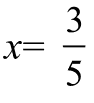
B. 错误，应该是。
C. 错误，应该是*x*=3+2。
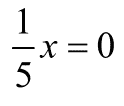
D. 正确，两边同时乘以 5 得到*x*=0。
第 3 题：
……
总结：
第 1 题正确。
第 2 题正确答案是 D。
第 3 题所有小题都需要修正。
第 4 题（1）正确，（2）解法正确但检验过程有笔误。
希望这些修正对你有帮助！如果有其他问题，欢迎继续提问。
不到一分钟，DeepSeek 就给出批改结果。它不仅指出对错，还说明理由。我们马上就能纠正错误，也能发现潜在问题。如有疑问，还能继续追问，要求解释得更清楚。
注意：
如果字迹潦草，DeepSeek 可能识别出错。另外，DeepSeek 会把画线修改当成正常内容，所以拍照前最好涂改遮盖修改痕迹。

### 5.2.2 解法扩容，打破思维天花板
如果|*a*-1|=5，那么*a*的值为多少？希希想了半小时，只想出一种解法：去掉绝对值，分正负讨论。“这么简单的题还能有多种解法？”希希不服气：“老师要求每题至少两种解法，这不是为难人吗！”
很多老师都强调“一题多解”。因为多角度分析能提升思维灵活性，整合不同知识点，还能根据情况挑选最简方法，提高效率。一题多解好处很多，但找起来很费力，因为知识点众多，靠运气。
现在有了 DeepSeek，就相当于获得了解法拓展包，让自己“好运连连”。比如让它解答“如果|*a*-1|=5，那么*a*的值为多少”，看它能给出几种解法。提问方式如下： 
问：如果|*a*-1|=5，那么*a*的值为多少？这个题目有几种解法？
答：这个题目可以通过以下两种主要方法来解：
方法一：绝对值的定义
绝对值|*a*-1|=5 表示*a*-1 与 0 的距离是 5。因此，*a*-1 可以是 5 或-5。
1. *a*-1=5
解得*a*=6
2. *a*-1=-5
解得*a*=-4
所以，*a*的值可以是 6 或-4。
方法二：几何解释
在数轴上，|*a*-1|=5 表示*a*与 1 的距离是 5。因此，*a*可以在 1 的左边或右边 5 个单位处。
1. *a*=1+5=6
2. *a*=1-5=-4
同样得到*a*的值可以是 6 或-4。
综上所述，*a*的值有两个可能：6 或-4。
DeepSeek 马上给出两种解法。第一种基于绝对值定义，第二种基于几何解释。那还有别的吗？继续追问： 
问：还有其他方法吗？
答：除了上述两种常见的方法，还可以通过以下方法来解这个题目：
方法三：平方两边
绝对值方程|*a*-1|=5 可以通过平方两边来消除绝对值符号。
……
方法四：分段讨论
绝对值方程|*a*-1|=5 可以根据*a*-1 的符号进行分段讨论。
1. 当*a*-1≥0 时：
*a*-1=5
……
综上所述，虽然方法不同，但最终得到的解是一致的。
DeepSeek 又给出两种解法。虽然题目看起来简单，但竟然有四种不同思路。DeepSeek 的回答瞬间打破思维天花板，让人看到完全不同的世界。

### 5.2.3 错因追根，精准补位
“We met ___ the morning.”希希边看题边读，希望唤醒语感。她猜这里需要一个介词，in、at、on 都能和时间搭配，具体是哪个呢？隐约觉得是 on。一对答案，原来是 in，只能叹气：“又记错了。”

发现错误后，我们很快会归因：单词 third 写成 thrid 是记忆不准；“in the morning”写成“on the morning”是词汇错误；“He go to school”少“-es”是语法规则不牢。
这些归纳看似合理，但多停留在表象，未触及根源，容易导致重复犯错。所以遇到错误，不要急于下结论，可以用 DeepSeek 分析。例如，为什么 in the morning 对，而 on the morning 错。提问如下： 
问：in the morning 为什么是对的，而 on the morning 为什么是错的。
答：在英语中，介词“in”和“on”用于时间表达时有明确区别。
1. In the morning（正确）
·In 用于泛指一天中的某个时间段，如早晨、下午、晚上，表示“在……期间”。
·例句：
◦I drink coffee in the morning.
◦We will meet in the afternoon.
2. On the morning（需搭配具体日期或事件）
·On 用于具体的某一天或某个特定的早晨，通常需要搭配日期、事件或修饰语，如 of。此时 on the morning 是正确的，但必须明确时间范围。
·例句：
◦The event happened on the morning of July 1st.
◦She left on the morning when it rained.
错误示例：
·I saw her on the morning.（缺少具体时间）
·I saw her in the morning.（泛指早晨）
·I saw her on the morning of the party.（具体事件）
总结：
·In+时间段：泛指，如 in the morning, in summer, in 2023。
·On+具体日期/事件：特指某一天的早晨，如 on Monday morning, on the morning of Christmas。
因此，单独使用 on the morning 是错误的，必须补充具体信息。而 in the morning 可以独立使用，表示一般意义上的早晨。
DeepSeek 指出 in 用于泛指，on 表示特定早晨。虽然解释了原因，但仍有疑问：为什么泛指要用 in？继续追问： 
问：为什么泛指会用 in 呢？
答：这个问题涉及英语介词的历史演变和语法逻辑。为什么泛指时间用 in？其实可以分三步理解：
一、英语中的「三维时间观」
英语将时间看作一种「空间」，用不同介词对应不同「维度」的时间范围：
1. at+点状时间（具体时刻）：
·at 7:00（钟表上的一个点）
·at noon（正午是一个精确的时间点）
◦（类似空间中的「点」：at the corner）*
2. on+线状时间（具体某一天/日期）：
·on Monday（星期一是一条「线状」的某天）
·on July 1st（具体日期）
◦（类似空间中的「线」：on the road）*
3. in+面状/体状时间（时间段、季节、年份等）：
·in the morning（早晨是一个「面状」的区间）
·in summer（夏季是一个「体状」的时间块）
◦（类似空间中的「面/体」：in the room）*
in the morning 属于「面状时间」，因此用 in。
二、为什么「泛指」必须用 in？
当时间范围没有明确边界或具体限定时，英语默认将其视为「面状区间」。例如：
·泛指早晨（不特指某一天）：
> I exercise in the morning.
（早晨是一个「模糊的时间段」，没有具体日期或事件限定）

in 与 on 的时间分界

·需要把时间锁定到具体日子或事件时，用 on：

> The accident happened on the morning of July 1st.

把模糊的时间面锚定到某一天，就变成了可追溯的时间线。

语法内核：
时间一旦被日期、事件或定语从句做出明确限定，就会从宽泛的面状收缩为精确的线状，介词 accordingly 由 in 换成 on。

三、历史渊源：古英语的残留

现代英语介词用法在部分程度上承袭了古英语习惯：

·on 来自古英语 on，原义是“接触表面”“处在某个具体位置”；
·in 来自古英语 in，原义是“置于内部”“处于某个范围之内”。

因此，未加限定的时段如早晨、下午，被视作可以容纳的内部区间，用 in；具体某天的早晨则被理解为附着在日期表面的点，用 on。

记忆要点速记

1. in the morning → 指泛化的早晨，时间没有限定
2. on the morning → 必须叠加限定，如“of+日期”或定语从句

·不规范：on the morning
·规范：on the morning of July 1st / when it rained

同样的判断逻辑也适用于其他时间单位：

·in the afternoon，泛指下午
·on Monday afternoon，特指星期一下午
·in 2023，泛指一年
·on the night of the party，特指某晚

**说明：**
DeepSeek 输出时引号写法不统一，有时用「」有时用‘’，本书保留原文，不做统一修改。

弄清这层机制后，就能明白失误并非死记硬背的问题，而是对英语时间表达缺乏体系化认知。找到这个盲点，不仅当前困惑可解，at、on 等介词的选用也会连带理顺。

借助 DeepSeek 不仅能揪出错误，还能深挖成因，一并化解一类相关的用法偏差。

## **5.3** **错题本自动化：从整理到逆袭**

错题本用来记录与剖析作业失误，能提升复习效率、加深理解、减少重复犯错。但在实际操作中，整理环节往往卡壳，导致错题本形同虚设。下面说明如何借助 DeepSeek 让错题本真正发挥作用。

### **5.3.1** **一键生成智能错题本**

订正完作业后，希希收拾书本准备下一科。母亲在一旁问：“错题本整理了吗？”希希不情愿地说：“时间不够，还有两门作业呢。再说我已经把错题重新做了一遍。”母亲急了：“现在不整理，复习时哪还记得错在哪？”希希只好把作业本又拿出来抄写。

错题本的价值大家都认可，但愿意动手的人很少。整理一份错题需要抄题、抄错解、重写正解，还要做错误分析，一道题往往要十几分钟，大量时间耗在书写上。

有了 DeepSeek，整理错题就变得轻盈。我们只需把做错的题目拍照上传，让它生成错题本内容。提问方式如下： 

问：这是我做错的一道题，帮我生成一下错题本内容。我选择的选项是 A。

答：错题本内容

题目：

一项工程，甲独做 3 天完成，乙独做 7 天完成，两人共同合作，需*x*天完成，可列方程 B。

选项：

A. 3*x*+70=1

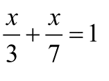

B.

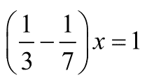

C.

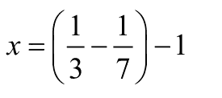

D.

你的答案：

选项 A □

正确答案：

选项 B □

错误原因：

1\. 混淆工作总量与效率：

甲单独完成需 3 天，表示甲每天完成工程的 ，同理乙每天完成工程的 。

合作时，*x*天内甲完成的工作量是 ，乙完成的工作量是，两者之和等于总工程量 1。

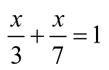

正确方程应为：（选项 B）。

2\. 选项 A 的错误逻辑：

选项 A 的方程 3*x*+7*x*=1 错误地将甲、乙单独完成的天数直接相加，忽略了工作效率的叠加关系。

总结：

在工程问题中，合作效率是各自效率的叠加。若甲单独完成需*a*天，乙需*b*天，则合作时方程为：

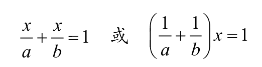

（两种形式等价，选项 B 对应第一种形式。）

由于提交的是选择题，没有计算过程。DeepSeek 只识别题目本身并作出分析，同时剖析失误原因，最后对该类题型做归纳，给出解题规则。花三分钟核对分析内容后打印贴入错题本即可。

### **5.3.2** **错题重做训练营**

希希翻开错题本复习，决心给每道错题找一道同类题巩固。可在练习册和教辅里翻找十分钟仍一无所获，挫败感油然而生，最后只能放弃。

复习错题时普遍面临“找新题”的难题。做新题才能验证理解，但找题耗时，往往找题时间远大于做题时间，这也是很多人不愿回顾错题的原因。

借助 DeepSeek 这个问题迎刃而解。把错题拍照上传，让它生成新题。以上一节题目为例提问. 

问：这是我做错的题目。根据它帮我生成一个新题，我自测一下。不要给出答案和题目分析。

答：一项工程，甲单独施工需 6 天完成，乙单独施工需 12 天完成。现两人协同工作，设合作完成需*x*天，则正确的方程式为：

A. 6*x*+12*x*=1

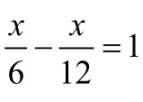

B.

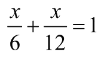

C.

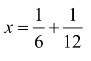

D.

DeepSeek 改变数据并调整选项顺序生成新题。我们作完后把答案提交，让它校验正误。

**技巧：**
整理错题本内容时，把题目单独存入文档。复习时直接提交文档，让 DeepSeek 批量生成对应新题，效率更高。

### **5.3.3** **三步画出清晰的解题思路**

作业常错在步骤。比如数学题未统一单位就运算，英语题忽略时态转换，语文题只抓修辞忽略主旨。想培养正确思路，有人大量刷题，有人死记题目，两种方法都耗时。关键在于梳理解题思路。

思路梳理需要逐步分析并总结为文字，但文字难以清晰呈现步骤与逻辑关系。为此需要转化为流程图。流程图能以图形加箭头展现步骤与逻辑，把复杂过程拆成简单顺序，便于识别关键点。分析错题时可让 DeepSeek 总结思路并绘制流程图，具体做法：

第一步，让 DeepSeek 总结解题思路。将题目拍照上传后提问： 

问：请帮我总结一下这道题的解题思路。

答：这道题的解题思路可以总结为以下四步：

1\. 确定个体效率

……

2\. 计算合作效率

……

3\. 建立方程

……

4\. 解方程求时间

……

关键点

总工程量设为 1，通过效率叠加建立方程。

正确方程结构：合作时，两人工作量相加等于总量（选项 B 符合这一逻辑）。

易错点：混淆效率差（如选项 C）或错误单位（如选项 A）。通过这四步，可快速解决此类合作工程问题。

DeepSeek 将思路拆成四步并给出每步细节。

第二步，让 DeepSeek 输出绘制流程图所需的 Mermaid 代码。Mermaid 用于绘制流程图、结构图等，我们无需掌握。提问如下： 

问：将解题思路转换为流程图，使用 Mermaid 语言描述。为每个节点的标签都加上引号。

答：mermaid

graph TD

A[“设定总工程量为 1”]--> B[“确定个体效率”]

B--> C[“甲效率：1/3 每天”]

B--> D[“乙效率：1/7 每天”]

C--> E[“计算合作效率”]

D--> E

E--> F[“总效率：1/3+1/7=10/21 每天”]F--> G[“建立工作方程”]

G--> H[“总效率×时间=总量”]

H--> I[“（10/21）*x*=1→等价于*x*/3+*x*/7=1”]

I--> J[“对应选项 B“]

G--> K[“关键验证”]

K--> L[“排除错误选项： - A 单位混淆 - C 效率相减 - D 表达式不成立”]流程图说明：

1. 从总量出发：将工程总量设为 1，为后续效率计算奠定基础。

2. 分步拆解效率：分别计算甲、乙的个体效率（1/3 和 1/7）。

3. 叠加合作效率：将两人效率相加得到总效率（10/21）。

4. 建立核心方程：通过“效率×时间=总量”建立方程，并验证与选项 B 的等价性。

5. 排除干扰项：通过单位、运算符等特征快速排除错误选项。

通过此流程图，可清晰看出解题的逻辑链条，避免被干扰选项误导。

第三步，打开 Mermaid 官网，把代码粘贴到左侧代码区，右侧即可生成流程图，如图 5.1 所示。

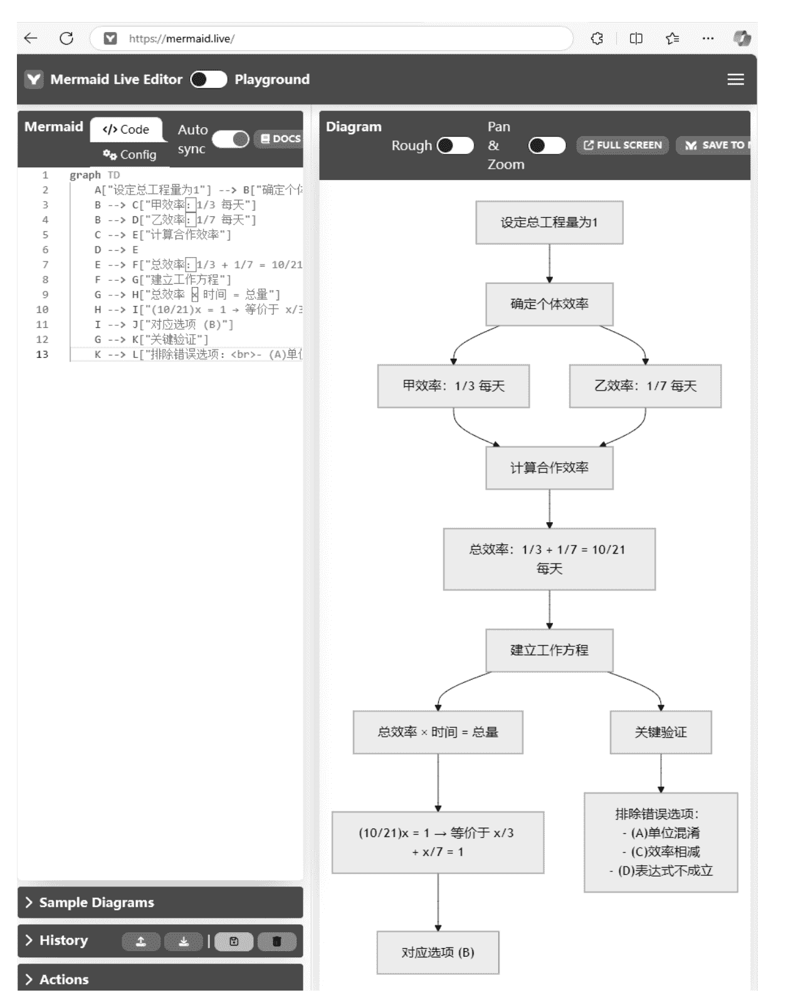

图 5.1 解题思路对应的流程图

右击流程图选择“打印”，贴入错题本，后续复习直接巩固流程即可。

# **第六章**

# **考试阶段：科学冲刺三步法**

考试是学习的重要一环，不仅能验证学习效果，还能培养元认知能力。在考试阶段，不仅要临场发挥好，还要做好考前复习和考后复盘。使用 DeepSeek，我们能解决考试阶段中的各种问题，提升这个阶段的学习效率。

## **6.1** **精准锁定复习靶心**

在考前复习时，必须做到精准聚焦，确定考试范围，并找到考试的重点、难点。这样做，我们才能避免无效努力，构建心理优势，取得好成绩。借助 DeepSeek 强大的分析能力，我们能更快、更好地完成这些工作。

### **6.1.1** **课本范围扫描仪：考试要点一网打尽**

老师宣布期中考试的时间后，希希整日心神不宁。她四处打听考试范围，终于从数学课代表口中得知只考前三单元。希希翻翻课本，三个单元占了八十多页。她又翻翻笔记，三个单元的笔记有六十多页。两者加起来有 140 多页，这让希希对复习更没信心了。

每次面临考试，我们总是手足无措，尤其是面对整本书、厚厚的笔记和练习册时。几个月学习的内容要在几天内复习一遍，还不能有遗漏，这让我们压力山大。如果按部就班地重读课本、温习笔记，时间肯定来不及。我们只能是将考试要点梳理出来，针对性进行巩固。

要想不看课本和笔记，就把考试要点梳理出来，还是要借助 DeepSeek。打开课本，翻到目录部分，使用手机把考试范围的章节拍下，然后提交给 DeepSeek，让它来分析这部分包含哪些考试要点。提问如下： 

问：我是一名七年级学生。下周，我们就要数学期中考试了。图中是考试范围。你帮我提取其中的考试要点。

答：以下是七年级数学期中考试范围的核心要点整理，帮你高效复习重点知识。

第七章 相交线与平行线

1. 相交线

·邻补角（互补）、对顶角（相等）的性质。

·垂直关系：垂线段最短，点到直线的距离计算。

·三线八角：快速识别同位角（F 型）、内错角（Z 型）、同旁内角（U 型）。

2. 平行线

·三大判定方法：同位角相等/内错角相等/同旁内角互补→平行。

·三大性质：两直线平行→同位角相等、内错角相等、同旁内角互补。

·注意区分判定（证平行）与性质（用平行）。

……

第八章 实数

1. 平方根

·算术平方根（非负性）√*a* ≥0。

·平方根双重性：±√*a*（*a*≥0）。

·常见平方数：11²=121，12²=144，13²=169 等。

……

第九章 平面直角坐标系

……

冲刺复习建议：

1. 每天画一次「三线八角」图练角识别。

2. 制作实数分类卡片随身记忆。

3. 用坐标纸练习图形平移变换。

4. 整理错题本重点看平行线证明步骤。

考试注意：

·几何题必写「∵...∴...」推理依据。

·实数运算先判断符号再计算。

·坐标系题目先标清坐标轴再作图。

祝考试顺利！遇到具体题目可以再问我详细解法哦~。

DeepSeek 不仅提取了二十多个考试要点，还给出了复习建议和考试注意事项。如果我们对这些考点不确信，可以将其打印出来，请老师帮忙确认一下。确定后，便可以针对性进行复习，查看课本和笔记中的对应内容。

这时，我们面对一个个确定的考试要点，就不会像面对课本和笔记那样焦虑了。只要将这些要点都复习一遍，就能取得理想的成绩。

### **6.1.2** **历年真题筛重点：高频考点热力图**

期中考试前三天，希希的同桌神秘兮兮给她微信发了一个压缩包，并留言：“其他学校刚考完的真题！”希希迫不及待点开，笑容却凝固了——七八套试卷排列得整整齐齐。她机械地翻着密密麻麻的试题，手指微微发抖。最终她关上手机，轻轻叹了口气：“可惜来得太晚了。”

考试前，我们都会打听哪里有真题。有了真题，我们不仅能检验自己的水平，还能据此判断出考试重点，以使自己在考试中取得更好的成绩。因此，拿到真题后，我们做的第一件事情就是停下手头所有事情，把真题做一遍。这不仅打乱了原本的复习计划，还造成了时间浪费。

真题更多的作用是展现考试的重点以及考查方式，尤其是考试重点。我们并不需要花大量的时间做一遍试卷，去获取这些信息，只要把题卷提交给 DeepSeek，它就能提取这些信息。首先，把试卷拍照，然后把图片按照顺序放到一个 Word 文档中，最后将文档提交给 DeepSeek，要求它进行处理。提问方式如下： 

问：帮我分析一下这套试卷，试卷都考查了哪些知识点。每种知识点的考查方式是什么，分值有多少？

答：七年级数学试卷知识点分析

一、选择题（共 30 分，每小题 3 分）

1. 三角形的构成条件

考查方式：判断哪组线段不能构成三角形。

知识点：三角形两边之和大于第三边。

分值：3 分。

2. 三角形内角和

考查方式：已知两个角的度数，求第三个角的度数。

知识点：三角形内角和为 180°。

分值：3 分。

……

二、填空题（共 30 分，每小题 3 分）

11. 三角形中线的性质

考查方式：利用中线性质求三角形面积。

知识点：中线平分三角形面积。

分值：3 分。

12. 科学记数法

考查方式：将纳米单位转换为科学记数法表示。

知识点：科学记数法的表示方法。

分值：3 分。

……

三、作图题（共 6 分，每小题 3 分）

21. 图形规律

考查方式：根据图形规律补全图形。

知识点：观察与归纳图形规律。

分值：3 分。

……

四、解答题（共 34 分）

23. 计算题（8 分，每小题 4 分）

考查方式：代数式的计算与化简。

知识点：多项式乘法、完全平方公式等。

分值：4 分/小题。

24. 因式分解（8 分，每小题 4 分）

考查方式：对多项式进行因式分解。

知识点：提取公因式、分组分解、公式法等。

分值：4 分/小题。

……

总结

几何知识：三角形性质、图形变换、作图题等，分值约 25 分。

代数知识：方程、因式分解、指数运算等，分值约 45 分。

概率与统计：几何概率、排列组合等，分值约 12 分。

应用题：实际问题的建模与求解，分值 8 分。

试卷解构：基础夯实与综合迁移并重

整份卷面围绕夯实基础、强化综合运用展开，代数与几何分量相近，同时对逻辑推演与实际情境的解决能力提出要求。

从 DeepSeek 的作答思路看，先对每道题单独说明题型、关联知识点与分值，再按类别汇总该类总分。顺着这个思路继续追问，就能把每个大类下的细知识点进一步厘清，尤其是几何部分的细分。示例提问如下： 

问：这套试卷都考查了哪些几何知识？

答：七年级数学·几何考点全景

卷中几何内容集中在以下几块，兼顾概念、性质、作图与实践应用，具体梳理如下：

1. 三角形特性 12分
构成条件 选择第1题 3分
考察维度：辨别哪一组线段不能组成三角形
核心要点：任意两边之和大于第三边
内角和 选择第2题 3分
考察维度：已知两角求第三角
核心要点：三个内角之和为180°
……
2. 图形变换 6分
旋转 选择第4题 3分
考察维度：识别图形绕点旋转90°后的新位置
核心要点：旋转涉及方向、角度和对应点位置关系
……

小结
1. 分值分布：
三角形特性 12分
图形变换 6分
……
几何相关合计 33分 占整卷约三分之一
2. 考察特点：
侧重基础概念如三角形、对称性
突出实践运用如反射作图、概率计算
部分题目与代数相连如用面积模型呈现恒等式
……

几何部分对直观想象、逻辑推理和数学建模提出较高要求，契合七年级教学目标。

DeepSeek 将几何题划分为五个子类别，并说明各子类别下的具体考点，同时统计各类的分值并归纳出考察侧重点与能力要求。

有了这样细致的拆解，就能依照分值占比分配复习时长，保证卷中知识点全部覆盖。试卷的检验功能也能拆分到日常练习中反复使用。复习完若干知识点后，还可让 DeepSeek 依据复习内容生成配套练习题。

### **6.1.3 错题本定位难点：私人漏洞清单**
期中考临近，希希焦虑地翻看课本，密密麻麻的笔记让她眼花。 “这么多内容怎么复习得完！”她烦躁地合上书。妈妈轻声提醒：“别忘了错题本。”希希没抬头：“课本都看不过来，哪有空看错题。”

复习时多数人首先想到课本、笔记、练习册，错题本往往排在最后。时间紧张时，错题本最先被舍弃。不少同学觉得错题本无用，还记录着“黑历史”，翻看它像是自我惩罚。

实际上考前错题本的价值常被低估，甚至超过笔记。它是一张专属的薄弱点地图，精准记录了真正不熟和易错的地方。查阅错题本比啃课本笔记更高效，因为后者大部分内容早已掌握。

因此当复习时间极度压缩时，应以错题本为核心进行突击。可把错题本的电子版交给 DeepSeek 提炼关键点。提问方式如下： 

问：帮我分析一下错题本，提取其中的知识点、错误原因和出错频率，并按照知识点类型进行归类。

答：……

依据 DeepSeek 的归纳，可以逐项攻破知识点，尤其是反复出错的部分。这样就能用最短时间换来最大提升。

## **6.2 考场必杀技实战训练**
临场发挥是考试的最后一程。发挥得好能让已有知识充分转化为分数。所以必须掌握考场必杀技。借助 DeepSeek，可以更快掌握这些技巧。

### **6.2.1 突发情况应对库：冷静解决意外**
考试前一天，希希想放松，和同学聊天。话题不知不觉转到“考场意外”，有人忘了带文具，有人中途肚子疼，还有人因紧张发挥失常。大家讲得绘声绘色，希希却越听越紧。回到家，妈妈安慰：“你不会这么倒霉。”半夜她脑子里全是同学的“恐怖故事”。翻来覆去，闹钟滴答声更刺耳，希希失眠了。

考场意外是考前绕不开的话题。大家都知道概率很低，却仍有不小的心理压力。父母老师再怎么安慰，也难以消除焦虑。最好的办法是为每一种可能准备好应对方案。

这时可请 DeepSeek 出主意。提问方式如下： 

问：我是一名初中生。在考场上，会出现哪些突发情况？一旦发生，该如何应对？

答：考场上确实可能出现各种突发状况，提前了解应对办法有助于保持镇定。以下是常见情况及应对建议，建议保存备用：

一、考前突发情况
1. 忘带文具或准考证
应对：立刻举手告知监考老师，考场一般备有备用文具。若丢准考证，可先考试后补验证，部分考场允许。
2. 过度紧张手抖
应对：闭眼做三次腹式呼吸，吸气4秒屏息2秒呼气6秒，默念“我能专注”。

二、考试中突发情况
3. 试卷缺页或印刷不清
应对：立即举手要求更换试卷，耽误的时间可申请补回，注意开考15分钟后通常不能更换。
4. 突然肚子疼或头晕
应对：示意监考老师，申请去医务室，部分考场允许如厕。可提前备好风油精嗅吸缓解。

……

三、时间管理危机

……

五、心理应急技巧
10. 大脑突然空白

……

重要原则：任何情况先举手报告，自行处理可能被视作违规。考前睡眠比临时抱佛脚更重要，状态好能降低八成意外概率。

建议本周做一次模拟考场训练，提前适应紧张感。你最近最担心哪种情况？可以具体聊聊应对细节。

DeepSeek 罗列了五大类共十种常见意外并给出对策。若想到其他状况，可继续追问。针对每种可能，DeepSeek 都能给出具体做法。有了这些预案，就不会再对意外感到恐惧，心情自然平复。

### **6.2.2 一题多解优选策略：速度与准确率平衡**
希希盯着第一页最后一道选择，手心冒汗。题目给出一个代数式的值，求另一个代数式的值。她本能想先求字母值，但觉得耗时。犹豫间，同桌已翻到第二页填空。“她平时不如我，怎么反而更快？”希希越急越乱，草率选择了最费时的方法。

日常解题时，多数同学只关注方法对不对，很少权衡快不快。遇到一题多解，也只是分析切入点和涉及知识点，忽略速度。这容易导致考场上水土不服。

考场时间有限，必须在规定时间内完成所有题目，并保证会做的题不丢分。同时要抗住紧张情绪，避免低级错误。这就要求方法简洁、步骤少。

因此复习时不仅要积累解题方法，还要考量每种方法的适用范围和便捷度。通常，适用范围越广，便捷度越低；便捷度越高，适用范围越窄。例如一元二次方程有五种解法，配方法最便捷但只适用于完全平方形式；求根公式最通用，却计算量大，其他方法居中。

自己总结这些规律费时。现在用 DeepSeek 就能直接获得结论。例如查询一元二次方程解法，提问如下： 

问：一元二次方程有几种解法？每种方法适用性和便捷性如何？

答：一元二次方程 *ax*²+*bx*+*c*=0 （*a*≠0）主要有 5 种解法，其通用性和便捷性对比如下：

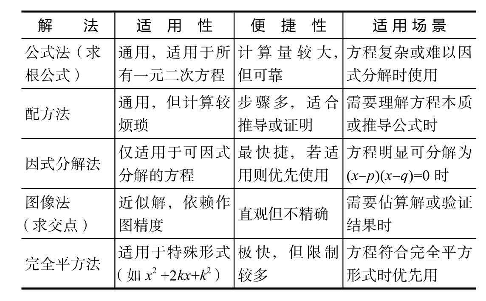

推荐策略 考试时
1. 先尝试因式分解法，尤其系数较小时。
2. 若无法分解，直接用求根公式，避免配方法浪费时间。
3. 特殊形式如 *x*² =*a* 直接开平方。

示例对比
因式分解最快：*x*²-5*x*+6=0 → （*x*-2）（*x*-3）=0，秒出*x*=2,3。
公式最稳：2*x*²+3*x*-4=0 无法分解，直接套公式。

总结：平时应掌握所有方法，考试时优先因式分解和公式法以节省时间。

DeepSeek 不仅比较了每种解法的适用性、便捷性和场景，还给出了考试推荐策略。按此策略在模拟环境下练习，很快就能形成考场直觉。

### **6.2.3 压力缓解工具箱：三分钟平静术**
希希走进考场，手心已冒汗。拿到试卷深吸一口气勉强平静，却在第10题卡住，这题上次做错过。她反复演算，每次都卡在最后一步，草稿纸写满一页。

“还有半小时交卷。”老师提示。希希心凉：“完了……”就在绝望瞬间，她反而冷静下来，放下纠结题目，迅速完成剩余部分。铃响时，她愣愣看着空了一半的难题，不明白自己当时怎么卡住。

考试紧张人人都会，只是表现不同。有人手抖出汗，有人呼吸加快，有人面色红白。很多人甚至意识不到自己已紧张，只是觉得状态不对。

紧张诱因很多：陌生考场、来回巡视的监考老师、倒计时提醒、题型突变、被难题卡住、发现前面错误、知识点没复习、考前不适、追求完美心态等。我们无法全部避免，只能通过手段平复情绪。老师家长同学的方法五花八门，如默念“别紧张”、深呼吸、上厕所等。想获取有效方法，可以问 DeepSeek。提问方式如下： 

问：对于初中生，在考场上紧张了，该怎么办？

答：初中生考场紧张时可尝试以下快速调节法，简单实用且适合考场：

1. 生理调节 一分钟应急
深呼吸：用“4-7-8呼吸法”，吸气4秒屏息7秒呼气8秒，重复三次，能直接降低心率。
肌肉放松：坐着紧握拳头5秒后松开，感受张力释放，也可对脚部肩部操作。

2. 心理暗示 三十秒急救
替换思维：把“我好紧张”换成“身体在进入准备状态”，利用紧张感提升专注。
5秒法则：默念“5-4-3-2-1”倒数，打断恐慌，立即开始读第一题。

3. 考场实用技巧
焦点转移法：用橡皮轻轻擦拭答题卡边缘，通过触觉转移注意力。
分段计时：把考试时间切成几个25分钟番茄钟，每个时段后允许自己休息30秒喝水活动手指。

4. 预防性准备
考前晨练：考试当天早晨做5分钟开合跳，提前释放压力激素。
备“安心物”：带上具有特殊意义的文具，触碰时能唤起平静感。

特别提醒：若出现手抖、视线模糊等严重反应，可举手请求短暂离场，如去卫生间，用冷水轻拍手腕能快速恢复镇定。

记住适度紧张有助于发挥，多数人考前心率都会加快。考场不是完美主义舞台，而是完成比完美更重要的实战场。当你写下第一个字，身体自然进入应考状态。

DeepSeek 给出多种缓解紧张的方法。复习阶段演练几次，考场上就能熟练运用，迅速平复心情。

## **6.3 考后复盘三重奏**
考后复盘是提升学习效能的关键，需要系统化结构化处理。大多数同学只能做到“知道错在哪”，却做不到“确保不再错”。借助 DeepSeek，可获得个性化改进方案，实现阶梯式提升。

### **6.3.1 逐题验证：确保真知而非猜测**
考试结束拿到卷子，希希盯着答错的选择题。老师讲解时只分析正确选项优点，对错误选项避而不谈。希希咬笔皱眉，不明白自己错因。“也许该问问……”她犹豫举手，又悄悄放下。“问题太多会烦人吧……”她低下头把疑惑咽下。

考试后老师会统一过卷，通常简单题一带而过，难题和错得多的问题讲详细。对个人而言并不友好，因为很多具体错误情况不会被覆盖。

更需要一对一辅导，把每个题目的每个选项、每种情况都讲透。只有这样才明白错在哪，为什么错，怎么改。现在用 DeepSeek 能逐题验证。为方便识别，最好向老师要电子版试卷，或拍照后涂改答案区，避免识别错误。

DeepSeek 一次识别量有限，文字多的卷子需拆分，如语文英语分开。然后提交试卷并提问： 

问：这是我已经考完的七年级英语试卷。现在，我需要对试卷进行复盘。你输出一个题目，然后进行分析。我提交对应的答案，然后你进行评判。接着，你输出下一个题目。在我提交答案之前，你不能输出下一个题目。

提问时说明年级并要求逐题分析，用问答形式进行。 

答：题目 26。

题目内容：

---Hi, Tim! Can Tony play _______ drums?

---No, he can’t. He can play _______ chess.

选项：

A. /; /
B. the; the
C. the; /
D. /; the

考查知识点：冠词的用法。

乐器前通常加定冠词“the”（如 play the drums）。

棋类运动前不加冠词（如 play chess）。

正确答案： C。

请提交你的答案，我会判断对错并给出解析。

DeepSeek 输出题目和选项，分析考点并给出正确答案。我们提交自己的答案，如下所示，如需提交完整过程可拍照上传。 

问：我选的是 C。

答：你的答案：C。

判断：正确！

解析：

“play the drums”中乐器 drums 前需加定冠词 the。

“play chess”中棋类运动 chess 前不加冠词。

继续下一题：

题目 27：

题目内容：

Miss Clark is good _____ music, and she is good _____ children in the music club.

选项：

A. at; with
B. for; at
C. with; at
D. at; for

考查知识点：固定搭配。

“be good at”表示擅长某事。

“be good with”表示善于与某人相处。

正确答案： A。

请提交你的答案。

若回答正确，DeepSeek 先肯定再给出下一题及分析。我们提交答案继续往下。 

问：我的答案是 A。

答：你的答案：A。

判断：正确！

解析：

……

请提交你的答案。

问：我选的是 C。

答：你的答案：C。

判断：正确！

解析：

……

请提交你的答案。

若提交答案错误，DeepSeek 会分析错误原因并总结。 

问：我选的是 A。

答：你的答案：A。

判断：错误！

错误原因：

第一空错误：

……

总结：

系动词+形容词（taste good）。

行为动词+副词（sell well）。

继续下一题：

……

请提交你的答案。

有时虽然得到正确答案，却未必掌握知识点。若出现这种情况可提出，让 DeepSeek 专门解释，避免误判为已掌握。提问形式如下： 

问：我选择 B，但是我不明白为什么 seven year old 之间要加连字符。

答：你的答案：B。

判断：正确！

关于连字符的详细解释：

1. 复合形容词规则：

用连字符连接数字和名词如 year-old 时，名词用单数，整体作形容词修饰后置名词。

正确结构：数字-单数名词-形容词如 a seven-year-old girl。

例句：She is a five-year-old student。

2. 不加连字符的情况：

……

3. 为什么用连字符？

……

继续下一题：

题目 34：

……

DeepSeek 在确认答案后专门解答疑问并给出例句，从而消除隐藏盲区。用此方式把整张试卷过一遍，期间把每个题目的分析也复盘一遍，遇到未掌握的及时追问。

### **6.3.2 错题复盘：精准找准薄弱点**

期末考后，老师布置了考后总结。希希把卷面上所有错题逐条抄进错题本，还在旁边写下自己认为的错误原因，心里觉得已经很负责了。老师看后却摇了摇头：“光抄下来不算总结。”希希一脸不解：“错题都列出来了，还差什么？”

其实考后复盘是学习里性价比最高的一环。它能把知识盲区暴露出来，为下一步训练提供方向，还能让学习者更敏锐地觉察自己的思维套路，锻炼元认知，同时缓解对下一次考试的紧张感。价值很高，但操作起来并不轻松。

大致的推进路径是三步走：先把考卷里做错的、理解不清的、靠运气蒙对的题目挑出来汇总；再按照题型、知识点、失误根源等维度进行归类；最后从中提炼出真正属于自己的薄弱环节。

学科基础薄弱时，分门别类和深层剖析会变得吃力。这时可以请 DeepSeek 搭手。把整份试卷的题目逐一过一遍后，让它做整体归纳。提问方式如下： 
问：分析我对题目 26 到题目 85 的作答，帮我找出所有的学习弱点。
**说明：**
由于前面 25 个题目都是听力题，所以直接从题目 26 开始进行分析。 
答：以下是针对你题目 26-85 作答情况的全面分析，帮你精准定位学习弱点：
一、知识弱点分类统计
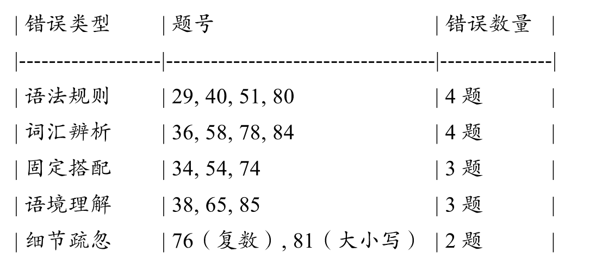
二、具体弱点解析
1. 语法规则薄弱点
三单问题（题 80）：
·错误：computer *make* people clever
·正确：computer makes（主语 it 是单数）
·强化训练：主谓一致专项练习，尤其注意“make/let”等使役动词。
宾语从句语序（题 40）：
·错误：where *is* the post office（疑问语序）
·正确：where the post office *is*（陈述语序）
·口诀：宾语从句三要素——连接词+主语+谓语。
2. 高频词汇混淆
……
3. 固定搭配漏洞
……
4. 语境理解偏差
……
三、针对性提升计划
1. 语法专项训练（每日 10 分钟）
·重点：三单变化/宾语从句语序/感官动词
·推荐资源：
……
2. 词汇分类记忆表
……
四、你的优势领域
1. 细节定位能力：阅读理解 A/B/C 篇几乎全对。
2. 固定搭配敏感度：arrive late/study hard 等答得精准。
3. 幽默感知：能理解 homework 的潜台词。
保持方法：继续通过英文漫画/短视频强化语感！
DeepSeek 先把失分题目汇总，再按知识点类型划分，如语法规则、词汇辨析、固定搭配、语境理解等；随后点出具体弱点并做简要剖析；接着给出提升建议，如语法专项训练、词汇分类记忆、文化理解等；最后还会标记出优势板块。
复盘完成就能清楚知道短板所在，后续学习就能有的放矢，下次考试把握更大。

### **6.3.3 七日提效：定制补漏方案**

在 DeepSeek 的协助下，希希明确了英语的薄弱点。为了补齐这些坑，她满怀信心地制定了 7 天冲刺计划。可真正执行时却处处受阻。翻遍教材和笔记找不到系统的讲解，总结出几条规律却缺乏支撑例句，想自测又发现练习册全是做过的题目。

这其实是普遍困境。面对厚重的课本和笔记，找齐一个知识点对应的讲解和例证往往要花十几分钟。自测时又常因缺乏新题而中断，于是精心制定的提升方案常常半途而废。

这时可以让 DeepSeek 生成一份带资料的巩固方案。比如要做 7 天计划，就在之前的对话里继续追问： 
问：基于以上学习弱点，你帮我做一个 7 天的巩固和提升计划。里面要包含对应的知识点详细讲解、示例和自测题。
答：以下是为你量身定制的 7 天英语弱点攻克计划，每天聚焦 1—2 个核心弱点，包含讲解、示例和自测题。坚持执行，进步肉眼可见！
Day 1-2：语法三单+宾语从句 
知识点讲解
1. 三单规则：
·主语是 he/she/it/单数名词时，动词加 s/es
·特例：have → has；go → goes；study → studies
2. 宾语从句语序：
·连接词+主语+谓语（陈述句语序）
·错误：Do you know where is the school？
·正确：Do you know where the school is？ 
示例
·The cat （make） → makes
·Could you tell me how I （can get） → can get to the station? 
### 自测题
1. She always （do） ______ her homework carefully.
2. I wonder what time the movie （start） ______.
3. The teacher told us that the Earth （revolve） ______ around the Sun.
> 答案：1. does 2. starts 3. revolves
Day 3：感官动词+使役动词

知识点讲解
1. 感官动词：
…… 
每日学习流程建议
1. 早晨 15 分钟：朗读当天知识点例句。
2. 午间 10 分钟：完成自测题。
3. 睡前 5 分钟：用错题本记录易错点。 
跟踪工具推荐
·单词卡 App：Quizlet（创建个人易错词库）
·语法检查：Grammarly（检测写作中的三单错误）
坚持 7 天，你的语法准确率将提升 40%！需要任何调整或补充材料随时告诉我。
按要求，DeepSeek 输出了一份 7 天计划，每日列出学习点并配上简要讲解、实例和自测。最后还附了学习建议。若觉得讲解不够深入、例句偏少、题目不足，可以追问让它扩充，提问如下： 
问：以上内容中，知识点讲解不够详细，示例也偏少，自测题也偏少。
等计划细化到位后，把内容打印出来就能直接用，不必再东翻西找，效率自然提升。

# **第七章**
# **语文三线突破：阅读·文言·写作**
语文是各科的基础，直接牵动整体学习。学习时常卡在三处：在阅读理解上，看懂了却答不准；在文言文上，总像学外语；在作文上，不是词穷就是啰嗦。借助 DeepSeek，可以从阅读、文言、写作三线并进，实现高效突破。

## **7.1 阅读提分：三步拆解法**
阅读理解是语文的核心模块，考查的不仅是对文本的把握，更是对深层意蕴的挖掘能力和批判性思考能力。这要求读懂字词句的同时，还要能把握结构、洞察底层的含义。DeepSeek 能帮你扫清障碍，提升阅读能力。

### **7.1.1 字词探案：扫清阅读障碍**
语文课上，希希读到“孔乙己排出九文大钱”时笑出了声：“这人有闲心，数清楚不就行了，干嘛非排整齐？”她推了推同桌，“像不像我们摆弹珠？”王老师扶了扶眼镜：“‘排’字正是孔乙己的虚荣。他家徒四壁，却要学有钱人的派头，这个动作就是他可悲又可怜的尊严。”希希目瞪口呆，“还能这么读？”

字词是文章的最小单元，读懂它们是理解的前提。汉语常用字以千计，常用词以万计，而且同一个词在不同语境下会带上特殊含义和感情色彩，必须结合上下文判断。
做阅读题时，既要常备词典，又要灵活推断。频繁查典会耗费大量时间，而靠上下文判断也并不容易。现在用 DeepSeek 这个活字典，工作就轻松很多。先把阅读文章拍照上传，再提问： 
问：我是一名初中生。这是我要做的一篇阅读理解。其中，哪些字词是不常见的？
答：这篇散文中的以下字词对初中生来说可能不太常见，需要重点注意：
1\. 淼（miǎo）：
·结构：由三个“水”组成的会意字，表示水势浩大的样子。
·常见组词：浩淼、烟波浩淼。
2\. 惊愕（jīng è）：
·词义：吃惊而发愣。
·近义词：震惊、错愕。
·注意“愕”字的读音和写法。
3\. 忙不迭（máng bù dié）：
·成语：急忙、连声。
·例句：他忙不迭地道歉。
……
8\. 夺眶而出（duó kuàng ér chū）：
·形象化表达：眼泪突然涌出。
·眶”指眼眶，注意与“框”区分。
建议学习策略：
1\. 结合上下文推测词义。
2. 制作生字卡片（正面写字词，背面写拼音和解释）。
3\. 关注会意字“淼”的造字逻辑。
4. 注意多音字在不同语境中的读音变化。
5. 积累描写情感的词汇（如“黯然”）。
这些字词的掌握不仅能帮助你理解本文，对提升你的文学鉴赏能力和写作表达也很有益处。遇到类似散文时，可以重点标记描写人物心理和场景的生动词汇。
DeepSeek 罗列了 8 个生僻字词，并给出读音、释义、例句等。对其他词也可以继续提问，如下： 
问：第一段中的“斯文”是什么意思？
答：“斯文”在文中的具体含义：
1\. 基本释义
·原指《诗经》中的雅乐和礼仪（本义已不常用）。
·现代汉语中多形容文雅、有教养的举止或气质，例如：
◦斯文败类（表面文雅实则品行差的人）；
◦说话斯斯文文。
2\. 上下文分析
·原文语境：“颇懂得斯文的外公”。
·结合主人公外公起名“淼”的细节（三水为淼，体现文化涵养）。
·此处强调外公有学识、讲究礼节，暗示其文化人的身份。
3\. 近义词辨析
……
4\. 延伸思考
……
学习建议：
在阅读中遇到类似词语时，可尝试用“替换法”理解，例如将“斯文”替换为“儒雅”“文雅”等词，结合上下文判断是否通顺。同时注意这类词语常被用于塑造人物形象，如《孔乙己》中“穿长衫的斯文人”就暗含讽刺意味。
DeepSeek 不只给出“斯文”的词源，还结合上下文说明了它在本段的用法，比单纯查词典更贴合。
再进一步，还可以让它梳理哪些字词的本义发生了偏移，更有助于把握主旨。提问方式如下： 
问：在这篇文章中，哪些字词不再表示本意，需要根据上下文重新理解含义？
答：在这篇文章中，以下字词的含义因上下文发生了转变，需要结合具体情境重新理解：
……
3\. 「惊愕」（第一段）
·本意：单纯表示吃惊。
·文中含义：
◦代际冲突：母亲对孩子突然要求“尊严”的无所适从，暗含传统家长权威的动摇。
……
5\. 「喋喋」（第四段）
·本意：贬义词，指说话啰嗦烦人。
·文中含义：
◦父爱外化：父亲反复叮嘱的“喋喋”，转化为掩饰离别焦虑的笨拙关怀。
……
8\. 「体面」（第一段）
·本意：外表得体、合乎礼仪。
·文中含义：
◦身份焦虑：父亲为孩子取学名的动机，反映底层家庭对社会认同的渴望。
总结：语境如何重塑词义
这篇文章通过家庭叙事重构了日常词汇的含义，例如：
·从物理到情感（如“淼儿”从“水势大”变为亲情符号）。
·从个体到象征（如“追火车”从动作描写升华为代际关系的隐喻）。
·从贬义到温情（如“喋喋”从负面评价转为父爱表达）。
阅读启示：
在文学作品中，需特别注意重复出现的词汇和情感强烈的场景，这些往往是作者埋设词义转化的关键位置。例如文中“淼儿”共出现 7 次，每次呼唤的情感重量皆不同，串联起完整的成长主题。
DeepSeek 列出了 8 个语义发生偏移的词，比如“喋喋”由贬义转为中性，“体面”则承载了“底层家庭渴望社会认可”的含义。
借助 DeepSeek 的引导，不仅能积累新词，还能学会观察词义在语境中的转换，为深入理解文章打下基础。

### **7.1.2 结构拆解：抓住文章骨架**
希希对着阅读题冒汗，“时间、地点、人物……”她念叨着，笔尖乱划，却凑不齐记叙文六要素。“到底缺谁？”她急得咬笔帽。同桌轻声说：“这是散文，老师说形散神不散，哪有那么多要素。”希希这才意识到自己拆解的方向错了。

拆结构是阅读理解的核心功底，能理清思路、抓住重点。拆解时先明确体裁，区分记叙、说明、议论或散文；再快速通读，定位核心信息；接着判断每段的功能；最后梳理逻辑关系，常见的有因果、对比、总分、时序推进。
很多同学因练习不足，容易判断体裁错误、识破结构、找不准框架。现在可以让 DeepSeek 手把手带。
（1）先和 DeepSeek 讨论体裁。提问方法如下： 
问：这篇文章的体裁是什么？判断依据是什么？
答：这篇文章的体裁判断与依据。
体裁判定：叙事散文（或抒情性短篇小说）。
判断依据：
1\. 主题与内容
·家庭叙事：围绕母子关系、代际冲突展开，聚焦个人成长中的情感蜕变（如“淼儿”到“高翔”的姓名转变）。
·微观视角：通过切瓜、生日聚会、火车站送别等生活细节，折射普遍性家庭问题，而非宏大的社会议题。
2\. 语言风格
……
3\. 结构特征
……
4\. 文学手法
……
5\. 文本功能
……
争议点辨析：
若进一步细分，可考虑以下两种可能：
……
核心判断标志：
·散文特征：情感驱动、语言诗化、结构松散。
·小说特征：因果明确的情节链、人物心理动态发展。
·本文更偏向散文：因其通过碎片场景构建情感张力，且未明确交代人物命运结局（如母亲是否真正适应“高翔”的称呼）。
结论
这篇文章属于叙事散文，具备强烈的抒情性与象征性。其通过日常生活细节的解码，完成对家庭关系的文学化重构，符合散文“以小见大”“借物咏怀”的核心特质。
DeepSeek 把文本判为散文，并从主题、语言、结构、手法等五个角度说明理由，也总结了散文“情感驱动、语言诗化、结构松散”的特质。对结论有疑虑，可以继续追问。例如，它为什么不是记叙文？提问如下： 
问：它为什么不是一篇记叙文？
这样就能更清晰地区分记叙文与散文的差异。
（2）自己先通读一遍做标记，再与 DeepSeek 的总结对照，验证准确度。提问如下： 
问：作为一篇散文，这篇文章的核心信息有哪些？
答：作为一篇散文，这篇文章通过象征与细节交织，传递出以下核心信息：
1\. 代际关系的永恒悖论
·矛盾本质：父母之爱既想保护孩子的童真（如坚持呼唤“淼儿”），又不得不助推其独立（如最终接受“高翔”的学名）。
·文化隐喻：传统家庭伦理（以血缘为纽带）与现代个人主义（以社会身份为标尺）的碰撞。
·例证：母亲生硬改口的“高翔”不仅是称呼变化，更是两代人价值观妥协的缩影。
2\. 成长作为身份撕裂的过程
……
3\. 中国式亲情的表达困境
……
4\. 时间暴力下的亲情挽歌
……
5\. 姓名作为文化符码的暴力与温情
……
总结：散文的复调表达
这篇文章的核心信息并非单一论点，而是通过多重象征的共振构建出立体主题：
……
对 DeepSeek 的提炼有疑问时，可以追问它的判断依据。
（3）先自行概括每段大意并判断其作用，再与 DeepSeek 对照，提问如下： 
问：在这篇散文中，每个段落的功能是什么？
答：以下是这篇散文各段落在整体结构中的功能分析，结合情感推进与意象网络进行解读：
第一段：冲突的爆发与主题锚定
功能：
1. 人物关系定调：通过母亲“惊愕”的特写，瞬间暴露代际矛盾（小名“淼儿”与学名“高翔”的冲突）。

四段隐喻链：散文结构拆解

首段意象埋点：“淼”字第一次出现就自带三点水形态，直接把“水”定为贯穿全篇的隐喻主线。

叙事锚点：主人公用“不是小孩子了”的抗拒起笔，身份焦虑的主轴就此点亮。

关键词：惊愕、淼儿、高翔。

象征点燃：名字正像是劈开童真与成年的第一柄利刃。

第二段：回溯与对照
……

第三段：身份焦虑的具象化
……

第四段：离别的仪式与救赎
……

总结：形散神聚的结构密码

全文收束于四步推进：
1. 当下冲突引爆 →2. 过去记忆回溯 →3. 社会层面创伤外化 →4. 哲学层面终极和解

四段看似各成一景，实则被“姓名政治”“代际时间差”“工具暴力：刀与火车”三条隐喻线紧密兜住。写法兼具散文的灵动与小说式的推力，最终在火车鸣笛里完成对中国式亲情悖论的诗性解剖。

DeepSeek 把四段的功能、关键词与作用逐项拆开，末尾做了归纳。我们把自己的总结并置，寻找分歧之处。

（4）梳理段际逻辑并与 DeepSeek 对话。提问如下： 

问：在这篇散文中，段落之间的逻辑关系是什么？

答：在这篇散文中，段落间的关联并非线性的叙事链，而是借助情感张力、意象复现与主题变奏构成的立体网络。以下是对内在逻辑的分层说明：

一、情感逻辑：由撕裂走向和解的螺旋上扬
……

二、意象逻辑：符号的变形与增殖
……

三、时空逻辑：记忆与当下的互文纠缠
……

四、主题逻辑：文化命题的层叠展开
1. 表层到深层的推进
……

总结：散文逻辑的织体美学

本文段落关系类似交响复调：
·横向：各段像不同声部，各自发展又相互呼应，如“刀”的意象在不同段落变奏。
·纵向：情感、意象、时空、主题四重逻辑垂直叠加，形成共时性的意义密度。

这种非线性网络恰好契合散文“形散神聚”的审美，表面看似断裂的场景在象征层面被严密缝合，共同指向代际关系中“爱的不可言说与必然伤害”这一终极命题。

DeepSeek 从四种逻辑角度分析段际关系，可帮助查漏补缺，加深理解。

### **7.1.3** **深潜挖掘组：解码隐藏信息**

阅读理解要应付修辞辨识与文本迁移两大难点。修辞不仅看字面，更要读出表达意图。如《故乡》中鲁迅以圆规比喻杨二嫂，既刻画形象又暗含讽刺。

文本迁移则要求把握主旨并带入现实。如《愚公移山》以耄耋愚公移山彰显“人定胜天”，还要思考其现实启示。

这两点都需跳出字面做深度理解。借助 DeepSeek 可专项突破。结构拆解后，可请它罗列修辞并解释作用。提问示例如下： 

问：在这篇文章中，哪些地方使用了修辞手法？它们都发挥了什么作用？

答：本文以多种修辞织就象征网络与情感张力，主要如下：

一、象征

1. 「淼」与「高翔」的姓名象征
·作用：
身份对立：
◦“淼”三水象征家庭纽带中的柔性与童真；
◦“高翔”象征社会身份的刚性与独立。
文化批判：姓名冲突隐喻传统重血缘与现代重个体的撕裂。
·例证：母亲追火车时呼喊“淼儿”，水的意象最终升华为超越代际矛盾的恒久情感。
……

六、反讽

1. 「体面」的学名追求
·作用：
◦价值颠覆：父亲为子取“高翔”求社会体面，反使他在家庭关系中更“不体面”。
◦文化悖论：对世俗成功的追逐反而侵蚀亲情的纯粹。
·例证：学名本欲彰显尊严，却令母亲称呼尴尬，形成目的与结果的错位。

总结：修辞网络的终极使命。
……

DeepSeek 将修辞归为 6 类并逐项说明功能，未被提及的也可继续追问。

同样可借助它完成文本与生活的联结。提问方式如下： 

问：这篇文章的主旨和作为一名初中生的我有什么关系？

答：该文主旨与初中生的你密切相关，它揭示了青少年成长中常见的困惑与蜕变。可从以下角度自洽：

1. 你正在经历的「身份切换」
·文中映射：主人公由“淼儿”到“高翔”的挣扎，正是你从“孩子”向“小大人”过渡的缩影。
·你的日常：
◦是否曾要求父母别再叫你的小名？
◦是否因父母当众叮嘱而感到尴尬？
·启发：
这种矛盾并非“叛逆”，而是成长的正常诉求——你在争取被尊重为独立个体。
……

5. 未来可能的「和解预演」
……

总结：你的成长就是散文的续写。

这篇文章像一面映射，让你看见：
·与父母的摩擦不是“战争”，而是两代人用不同语言书写同一份爱。
·每一次要求独立、每一次脸红尴尬、每一次赌气关门，都是成长小说的珍贵章节。
……

提问时点明自身身份，会得到更贴合的反馈。它给出 5 个切入点并结合日常举例，便于内化。

## **7.2 文言文破译密码：古今穿越三件套**

文言文难点常表现为古今差异、生僻字、文化专有名词等，缺乏历史常识会加倍困难。有了 DeepSeek，可节省查资料时间，实现高效学习。

### **7.2.1 文言字词解码器：攻克“之乎者也”**

希希咬着笔杆看练习册。“学而时习之”的“之”指知识；“千里之马”的“之”是“的”；那“师道之不传也久矣”的“之”呢？她瞥向同桌，同桌书上画着举“之”字牌的小人，旁注：“此字有七十二变！”希希忍不住笑，却回头仍对练习册一头雾水。

学文言首先碰到词汇问题，尤其虚词。虚词无实义却作用关键，如语法功能、语气等。且虚词高频多义。例如“之”可代人事物，可表“的”，可引补语，甚至可作动词。

虚词是文言语法支柱，掌握其用法是理解关键。读完一篇文言文，可让 DeepSeek 复核理解。例如欧阳修《卖油翁》，可提问如下： 

问：在欧阳修的《卖油翁》中，有哪些虚词出现了？它们都发挥什么作用？

答：《卖油翁》篇幅短小，以陈尧咨与卖油翁对话阐明“熟能生巧”。虚词运用灵活，对衔接、语气、逻辑起关键作用。梳理如下：

一、虚词列表与作用解析

1. 之
·作代词：
◦例：“睨之，久而不去。”（代陈尧咨射箭动作）
◦例：“但微颔之。”（代射箭十中八九的表现）
·作助词，表修饰，相当于“的”：
◦例：“以我酌油知之。”（无实义，引出对象）

2. 以
……

9. 但
·作副词，表限止，相当于“只是”：
◦例：“但微颔之。”（轻微点头，不以为意）

二、虚词对文意的关键作用

1. 逻辑衔接：
·连词“而”贯穿全文，连接动作与结果、转折等，使叙事流畅。
……

三、虚词学习启示

1. 结合语境判断功能：
·如“以”既可作介词“以此自矜”，也可作连词，需靠上下文区分。
……

总结：《卖油翁》凭虚词的灵动使叙事简洁有层次。掌握这些虚词，既能精准懂文意，也能体会“言简义丰”。建议逐句标注并分类整理，反复体味。

按需，DeepSeek 会列出各虚词并指出作用与位置。若想深入某词，可单独追问。例如总结“之”字用法，提问如下： 

问：在文言文中，“之”字作为虚词有几种用法？

另，通假字也可同法解决，让 DeepSeek 检索文中通假字，再讨论其通例。

### **7.2.2 古今异义雷达：破解时空密码**

初中生希希预习《桃花源记》，看到“芳草鲜美”嘀咕：“渔夫不打鱼，关心牛羊饲料？”看到“率妻子邑人”更困惑：“祖宗还没孩子就带妻儿亡命？”第二天老师强调：“‘鲜美’指花草茂盛，‘妻子’是妻与子女！”希希红着脸叹：“处处是坑！”

除了虚词，文言词语也易误读。时代演变使多词义变甚至相反。如《岳阳楼记》“去国怀乡”的“去”解作“离开”，非今义“前往”。

忽略此点易反向理解。可用 DeepSeek 排查。读完一篇文言文，可让其查古今异义。例如《桃花源记》提问如下： 

问：在《桃花源记》中，有哪些古今异义的词？

答：《桃花源记》包含诸多古今异义词，整理如下：

1. 鲜美〈芳草鲜美〉
·古义：鲜艳美丽。
·今义：食物味道好。
·例句：*“忽逢桃花林……芳草鲜美，落英缤纷。”*
·解析：形容景色明丽。

2. 交通〈阡陌交通〉
·古义：道路交错相通。
·今义：运输、邮电等行业统称。
·例句：*“阡陌交通，鸡犬相闻。”*
·解析：描绘田间小路纵横。
……

12. 津〈后遂无问津者〉
·古义：渡口，“问津”指探访。
·今义：地名或唾液。
·解析：比喻再无人探寻。

总结：古今异义成因
1. 词义扩大：如“交通”。
2. 词义缩小：如“妻子”。
3. 词义转移：如“鲜美”。
4. 语法变化：如“无论”。

学习时需结合语境，避免望文生义。

阅读时还会遇到古代文化常识。如“垂髫”指 4-9 岁儿童；“诣太守”指上报官府。这些易被忽略。同样可让 DeepSeek 揪出。提问如下： 

问：在《桃花源记》中，有哪些古代文化常识？

答：《桃花源记》蕴含丰富的历史、社会、民俗常识，梳理如下：

一、历史背景相关
1. “避秦时乱”
·指秦代苛政导致百姓逃亡。
·文化意义：暗讽东晋末年动荡，表达对和平渴望。

2. “乃不知有汉，无论魏晋”
·汉与魏晋为重要朝代，桃花源人因隔绝不知。
·文化意义：凸显超然性，含对政权更迭疏离。

二、社会结构与制度
……

三、生活习俗与信仰
……

四、地理与空间概念
……

五、文学意象与哲学思想
……

六、古代天文与历法
……

学习建议：结合陶渊明生平与东晋门阀政治，深挖符号隐喻。

读完文言文后，让 DeepSeek 充当雷达，筛出古今异义与文化背景，可避免误区。

## **7.3 作文升格训练营：三步写出满分作文**

作文占分大，但易跑题、空洞、逻辑乱、结构散。借助 DeepSeek 可系统解决。

### **7.3.1 题目解剖室：精准把握写作要求**

周五语文课，林老师布置半命题《不该忽略的 XX》。希希想到数学考试因单位换算被扣分，写下《不该忽略的单位》，举例蛋糕用料单位错误。交卷时她信心满满，却被批“审题错误！题目要求写被忽略的美好事物，非知识点。”

审题是第一步，决定是否切题。常见误读、主客倒置、文体混淆等。需抠字眼找关键词，精准把握要求。DeepSeek 可搭建题目解剖室。先自主审题圈出关键词，再提问。形式如下： 

问：作文题目：《书包夹层里的陌生纸条》
要求：围绕一张意外发现的纸条展开故事，描写纸条背后的秘密或情感，题目自拟，不少于 500 字。
这是一道初中作文题目。题目有哪些关键字？

答：核心要素可拆解为：
1. 核心物件
·“纸条”：故事线索与载体。
·“书包夹层”：暗示隐蔽性与偶然发现。

2. 情节关键
·“陌生”：来源未知，需解释原因。
·“意外发现”：推动情节的触发点，需写细节。

3. 主题方向
·“秘密”：悬疑、误会或温情。
·“情感”：通过纸条引发冲突。

4. 隐性要求
·“描写”：场景与心理需细化。
·“题目自拟”：提示提炼个性化标题。

示例延伸：若写转学同学告别信，则为偶然性+情感治愈；若写未来自己的警告，则突出秘密+悬疑。

DeepSeek 列出关键词并说明作用，与自评对比，可补审题漏洞。

文体判断也可求助。提问方式如下： 

问：对于该题目，我们应该写成哪种体裁，判断依据是什么？

答：最适合记叙文，依据如下：

1. 题目指向
·动词“展开故事”明确要求情节推进。
·“描写秘密或情感”需动作、对话、心理。
·从发现到揭晓符合叙事时序。

2. 初中命题倾向
……

3. 其他文体不适用
……

4. 可融合手法
……

判断总结
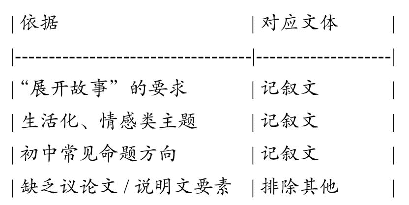

**注意：**

若尝试书信体，需格式正确且紧扣发现过程，本质仍属记叙变体。

DeepSeek 给出建议并从正反两面论证，帮助掌握审题与文体判断。

### **7.3.2 素材唤醒仪：激活记忆宝库**

希希把笔尖抵在唇角，视线僵在摊开的作文纸上发呆。“春游到底要写哪一段呢……”她小声嘟囔。明明当天玩得很高兴，可回忆像被薄雾盖住，怎么都抓不住着力点。妈妈走过，瞥见她拧成一团的小脸，忽然笑了：“去年的那只爱啃草的小山羊，还记得不？”“啊！”希希猛地抬头。湿润的鼻尖蹭过手心，她咯咯笑着闪躲，草屑沾满了衣摆……瞬间记忆被点亮。笔尖在纸上唰唰移动，最后她意犹未尽地收笔。

动笔最常卡住的，其实是脑子里没料。日常轨迹太过雷同，上学、回家、再上学，素材感被磨平。绝大部分时间都耗在想写什么上，有了可写的点子，初稿通常二十分钟就能成型。

实际上每天都在接收信息，都能变成写作养分。只是很多记忆被压得很深，不会主动浮现，这时就需要一个外部提示。过去这个提示来自父母、老师或同学，如今又多了一个同伴——DeepSeek。

卡住时向 DeepSeek 要回溯线索，顺着提示梳理，就能把沉睡的细节挖出来。比如要写《书包夹层里的陌生纸条》，可以这样提问：

问：针对《书包夹层里的陌生纸条》，你提供一些可用的素材线索，帮助我唤醒相关的记忆。

答：好的！写《书包夹层里的陌生纸条》这类作文，关键在于纸条的来源、内容和背后的故事。以下是一些可用的素材线索，帮助你唤醒记忆或激发灵感：

1. 纸条的来源（谁写的？）

同学/朋友：

◦可能是好友偷偷塞的道歉信（之前闹矛盾，不好意思当面说）。

◦毕业/转学前的告别留言（当时没发现，后来整理书包才看到）。

◦恶作剧纸条（比如“小心，你的笔袋里有蜘蛛”，后来发现是玩笑）。

家人：

◦父母/爷爷/奶奶趁你不注意塞的鼓励便条（比如考试前的“加油，别紧张”）。

◦已故亲人的旧字迹（比如整理旧书包时发现爷爷以前写的提醒）。

陌生人：

◦误放的纸条（比如图书馆借的书里夹着别人的笔记，或前主人留下的信息）。

◦神秘信息（比如“救救我”，后来发现是别人的恶作剧或真实事件）。

超现实设定（适合想象力丰富的同学）：

◦未来的自己写的警告或鼓励。

◦平行时空的另一个“你”留下的线索。

2. 纸条的内容（写的是什么？）

情感类：

……

3. 发现纸条后的反应（故事如何发展？）

……

4. 可用的细节描写（增强画面感）

……

5. 可参考的真实事件（结合自身经历）

·同学之间的小纸条：有没有收过朋友的秘密留言？

·家人写的便签：父母是否曾在你书包里塞过鼓励的话？

·捡到陌生人的纸条：比如在图书馆的书里发现别人的笔记。

---

6. 题目灵感（自拟标题参考）

·温情风格：《藏在夹层里的爱》《迟来的道歉》

·悬疑风格：《谁在我书包里塞了这张纸条？》《神秘的求救信号》

·创意风格：《来自未来的自己》《十年后的留言》

……

希望这些素材能帮到你！如果有具体想法，可以进一步讨论如何展开情节。

DeepSeek 从来源、内容与故事脉络三个角度给出几十种设想。顺着提示回想过往，就能筛出合适的素材。若某个维度的提示仍显单薄，还可以继续追问，示范如下：

问：在纸条内容方面，情感类的内容还可能是哪些情况？

多追问几次，就能锁定最贴近自身经历的细节，再往下推进。

### **7.3.3 搭架：让作文有骨有魂**

看到题目《一场有趣的旅行》，希希特别兴奋——上周的大峡谷漂流太难忘。她立刻开写，把出发前的期待、路上的风景甚至买票细节都写了……写到四百字时才刚进景区。可要求是五百字，她慌了，草草补了两句“还玩了激流勇进和玻璃栈道”，就匆匆收尾。

作文骨架是藏在文中的逻辑结构，相当于盖房前的施工图。按图施工时，地基打多深、墙砌多高、屋顶怎么造、窗户开在哪，答案都在图上。有了图，成品才可控。

很多人却忽略这一步。有人觉得灵感最关键，列提纲会限制思维；有人担心时间不够，怕写不完。结果写完后花大量时间反复修改，分数仍不高。

实际上中小学多为命题作文，灵感约占两成，结构约占五成。花几分钟先搭骨架，就能省下后面十几分钟的修改。借助 DeepSeek，不仅能迅速搭出框架，还能锻炼结构意识。下面以《书包夹层里的陌生纸条》为例，和 DeepSeek 交流搭建方式。提问如下：

问：对于作文《书包夹层里的陌生纸条》，作文骨架有哪几种形式？

答：对于《书包夹层里的陌生纸条》这一题目，作文骨架（结构形式）可以根据叙事方式、悬念设置、情感走向等分为以下几种典型形式，每种都适合初中生写作：

1. 线性叙事式（最基础稳妥）

结构：发现纸条→探究来源→揭开真相→情感升华

适合：温情、友情、亲情类主题

示例：

（1）开端：整理书包时，一张泛黄的纸条从夹层滑落。

（2）发展：纸条上是陌生字迹：“放学后操场第三棵树见。——小 Z”。

（3）高潮：回忆曾与小 Z 的误会，冒雨赴约发现是转学前她的道歉信。

（4）结尾：紧握纸条，望向空荡的操场，遗憾与温暖交织。优点：逻辑清晰，易写出完整故事。

2. 倒叙悬念式（增强吸引力）

……

选择骨架的 3 个关键依据

（1）纸条内容性质：

·温情故事→线性叙事/双线交织

·悬疑秘密→倒叙悬念/多重视角

（2）情感表达需求：

·强烈冲击（如亲情）→双线交织

·细腻成长（如自我和解）→循环呼应

（3）个人写作能力：

·新手建议线性叙事，进阶可尝试倒叙或双线。

结构对比表

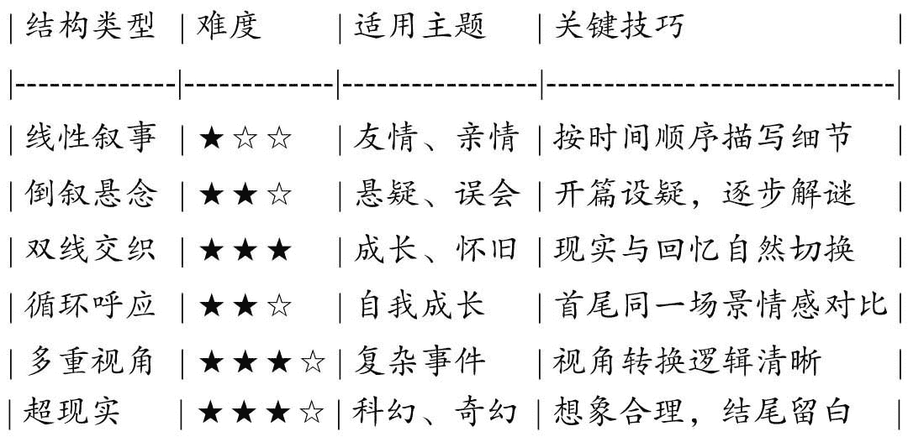

练习建议：

·先确定纸条内容（如“妈妈的道歉信”），再选择匹配的骨架（如双线交织）。

·用“5W1H”填充细节：

Who（谁写的）+What（内容）+Why（动机）+How（如何发现并影响你）。

试试用这些骨架搭配之前的素材，就能写出层次丰富的作文！

DeepSeek 先罗列出六种框架，再给出三条挑选依据，最后做了简要对比。结合素材选定一种后，再和 DeepSeek 探讨可行性，提问如下：

问：我准备写爸爸在我书包留下的纸条，打算采用线性叙事方式。你觉得如何呢？

答：你的选题和结构非常合适！“爸爸的纸条+线性叙事”既能保证故事的流畅性，又容易写出真挚情感。以下是具体建议，帮你把这篇作文写得更加打动人：

一、线性叙事结构优化模板

1. 开篇：发现纸条（制造悬念）

建议写法：

·场景细节：不要直接写“我发现一张纸条”，而是描绘一个具体动作，比如：

◦“拉链卡住了书包夹层，我用力一扯——一张对折的作业纸飘了出来，边缘参差不齐，像是匆忙撕下的。”

·心理描写：

◦“爸爸的字？不可能……他昨天刚和我大吵一架，说再不管我了。”

2. 发展：纸条内容（情感转折点）

……

3. 高潮：追踪真相（行动+情感爆发）

……

4. 结尾：情感升华（余韵悠长）

避免直白抒情，可用：

……

二、爸爸纸条的 5 种情感设计（任选一种）

……

三、必须避开的 3 个雷区

……

四、加分技巧

……

你的选题本身已经成功了一半！按照这个框架写，一定能写出既有生活气息又有情感深度的作文。如果需要调整细节或优化某一段落，可以随时告诉我！

DeepSeek 不仅肯定了选择，还给出了更细化的建议。按故事需要挑选对应建议，就能把框架完善。若还想更细，可继续提供细节追问，骨架会越来越完整。

### **7.3.4 从草稿到佳作的打磨**

希希盯着作文本，指尖划过密密麻麻的字。她咬着笔帽，把“的、得、地”改对，又顺了几个别扭的句子。可老师批的“主题分散”“论证薄弱”像一层雾，她翻遍范文也看不出门道。希希嘀咕：“到底哪里不对呢……”

初稿完成后需要多轮打磨。先做基础检查，消灭错别字，规范标点；再做内容检查，看是否扣题、例证是否支撑观点、细节是否足够；最后调整段落，让开头结尾更有力。

工作不少，可自己很难发现逻辑或语言问题，也缺少修改技巧。即使老师做了批注，仍云里雾里。

有了 DeepSeek 就简单多了。它能帮检查基础错误，也能按要求修改。把草稿拍照给它就能开始。提问方式如下：

问：这是我写的作文《书包夹层里的陌生纸条》。正文如下：XXXX

你帮我检查下，看哪里需要优化。

答：你的作文已经非常打动人心，父爱的细节描写真挚动人。以下是具体的优化建议，帮助文章在语言表达和情感层次上更上一层楼：

一、语言细节优化

1. 修正错别字和语病：

·“潦朝地写着” → “潦草地写着”

·“字迹变的清晰可辨” → “字迹变得清晰可辨”

2. 增强动词的表现力：

·“捏着这张纸片” → “这张纸片在我指间微微发颤”（突出情感波动）

·“翻动报纸” → “抖了抖报纸”（更符合中年父亲看报的习惯动作）

二、结构优化建议

1. 开篇增加悬念：

原文：

·整理书包时，一张泛黄的便利贴从夹层里飘落。

优化：

·书包夹层的拉链总是卡住，这次用力一拽——一张泛黄的便利贴打着旋儿飘落，像一片被遗忘的秋叶。

……

三、情感描写深化

……

四、关键段落优化示范

……

五、修改后全文亮点

……

六、可选择性采用的进阶技巧

……

你的原文已经具备优秀作文的所有要素，这些优化建议只是锦上添花。如果坚持原稿风格也完全没问题，重点保持：

1. 父爱“无言却温暖”是核心。

2. 细节真实可信。

3. 情感流露自然。

需要调整任何部分都可以告诉我，比如想强化某个场景，或者改变抒情方式。

DeepSeek 从六个方面给出修改建议。在语言细节上指出两个错字并提供动作描写优化；在结构上建议改写开头以增强悬念；在情感描写上建议补充父亲形象等。

对照草稿逐条阅读，对比修改前后的差异，就能学会对应技巧。若有不成熟的想法，也可让 DeepSeek 完善。例如想加一句古诗点题，提问如下：

问：在作文中，能否加一句古诗词点题？如果可以，该如何调整？

在 DeepSeek 这个优化导师的帮助下，草稿迅速跃升为佳作。

# **第八章**

# **数学攻坚：从畏难到精通的通关秘籍**

数学难度较高，既考计算，也考逻辑与抽象。计算要快而准，应用题要会建模，函数图像也要能联动求解。DeepSeek 能有效训练这两类能力。

## **8.1 计算精准师：兼顾速度与准确**

基础计算是数学根基，影响解题、思维和成绩。要既准又快。如何高效提升计算能力很重要，DeepSeek 能帮你避开题海，提高精准度和速度。

### **8.1.1 错因透视镜：看清马虎背后的根源**

自习课上，希希在草稿纸上刷刷计算。看到-3²时，她顺手写下9——负数平方为正嘛。同桌探头，用橡皮敲了敲本子：“符号又被吃了，这里该是-9。”希希愣住，一拍脑门：“对哦！太粗心了。”她划掉答案继续往下。

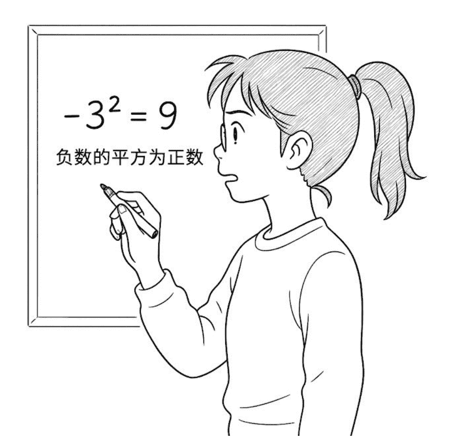

计算时常出现小错。比如漏看负号，把-3*x*写成3*x*；去括号未变号，把2-（*x*-1）写成2-*x*-1；加减乘除低级失误，6×7算成41……犯错时没感觉，别人一指就恍然，归结为“马虎”。

真的只是马虎吗？其实不是，错误往往反复出现，根源是忽视了知识点，尤其在计算量大时。要找真因，可借助 DeepSeek 分析。例如帮希希解决上述问题，可这样问：

问：把-3² 当作（-3）² 进行计算，这种错误是什么原因导致的？

**说明：**

由于无法在提问框中直接输入次方，所以使用^和数字的组合表示次方。例如，3⁴ 表示三的四次方，即 3⁴。 

答：学生在计算-3²时误认为是（-3）²（结果为 9）而非正确结果-9，这种错误通常源于以下原因：

1\. 对符号优先级的误解

·指数运算优先级高于负号：数学规则中，指数运算（如平方）的优先级高于负号（视为单目运算符）。因此，-3²应理解为对 3 先平方再取负，即-（3²）=-9，而非（-3） ²=9。

·混淆“负号”与“底数符号”：学生可能将负号误认为是底数的一部分（类似-3 的完整数），而非独立的运算符号。

2\. 书写习惯的误导

……

3\. 直观思维的干扰

……

4\. 练习与教学中的不足

……

如何避免此类错误？

1\. 明确规则优先级：

·强调“无括号时，指数优先于负号”，并通过例子（如-2³=-8 vs.（-2）³=-8）对比加深理解。

2\. 规范书写习惯：

·要求学生在需要负号参与运算时显式使用括号，如将-3²写为-（3²），避免歧义。

3\. 专项纠错训练：

·设计对比题组（如计算-5²、（-5）²、-（-5）²，强化符号优先级意识）。

4\. 利用数轴或实际意义解释：

·例如：-3²表示“3 的平方的相反数”，而（-3）²是“-3 的平方”，结合数轴正负方向辅助理解。

通过厘清符号优先级、强化书写规范，并结合针对性练习，学生可以逐步克服这一粗心错误，提升运算严谨性。

DeepSeek 给出四种错误原因，最常见的是第一种：忽视符号优先级。我们记得“先乘除后加减”，却忘了其他符号的优先顺序，于是屡出小错。

所以一旦自认“马虎”“粗心”“大意”，马上问 DeepSeek，确认真正错在哪。

### **8.1.2 速算技巧库：智能教练传授解题窍门**

考试时，希希笔尖飞快，草稿纸写满，卷子才做一半。铃响，她急得快哭。课后她发现同桌小林只用两张草稿纸，还提前十分钟交卷。“你怎么算得这么快，用纸这么少？”希希问。小林笑：“很多计算可以直接口算。比如36×25，化成9×4×25=900，根本不用笔算。”希希恍然，原来她输在“硬算”上。

考试只有八九十分钟，要做二十多题，平均每题3-4分钟。前题必须1-2分钟做完，给大题留时间。解法要尽量简洁，减少计算量。

日常作业只练知识点，不考虑时长，所以熟悉的方法未必最快。做完一道题应反思有没有更快解法。DeepSeek 正好能帮忙。

例如分解因式（*x*²+2*x*+4）（*x*²+2*x*+6）-8，问有没有更简洁的计算方式，提问如下：

问：分解因式（*x*²+2*x*+4）（*x*²+2*x*+6）-8，最简洁的计算方式是什么？

答：最简洁的计算方式：

观察原式（*x*²+2*x*+4）（*x*²+2*x*+6）-8，可以设*t*=*x*²+2*x*，从而简化计算：

原式=（*t*+4）（*t*+6）-8

=*t*²+10*t*+24-8

=*t*²+10*t*+16

=（*t*+8）（*t*+2）

=（*x*²+2*x*+8）（*x*²+2*x*+2）

关键步骤：

1\. 变量替换：设*t*=*x*²+2*x*，简化表达式。

2\. 展开并合并：展开（*t*+4）（*t*+6）并减去 8。

3\. 因式分解：对*t*²+10*t*+16 进行因式分解。

4\. 回代：将*t*=*x*²+2*x*代回，得到最终结果。

### 验证：

展开（*x*²+2*x*+8）（*x*²+2*x*+2）会得到原式，确保分解正确。

最终答案：

（*x*²+2*x*+8）（*x*²+2*x*+2）

DeepSeek 不仅给出复杂计算的速算建议，对简单算术也能提供简化思路。例如计算37+98，问有没有简单方法。提问如下：

速算启示：37+98 如何更快算出来

有人问 37 与 98 相加有没有更省心的做法。核心在于先把接近整十整百的数补满，再把多补的部分回调。

第一种思路：凑整回补，省力最大
做法是让 98 先顶到 100，再把多算的 2 扣掉。
具体：
1. 98 到 100 还差 2，就从 37 里挪出：37+98＝(37−2)+(98+2)＝35+100＝135
2. 也可以先放大再收回：37+100＝137，多加了 2，137−2＝135
特点：心算几乎免草稿，对贴着十位百位的加法特别友好。
适用范围：98、97、995 这类只差一点就成整数的加法。

第二种思路：逐位拆分，传统竖式做法
...

第三种思路：交换位置，调整加数顺序
...

要点回顾
· 最快手段：凑整回补，37+98＝37+100−2＝135。
· 通用手段：分位相加，十位与十位、个位与个位对应。
DeepSeek 归纳了三种速算路径并做了优劣点评。比如用第一种方式，完全无需笔算也能算准。
因此把日常作业做完后，可以把整张试卷交给 DeepSeek，让它为每道题、每一步找出最省力的运算路径，从中挑选最快的方式练习。考试时就能更快完成。

### 8.1.3 精准特训营：由认知到熟练

希希的立方根作业错了两道，老师要求每道错题再补十道同类题巩固。她翻遍课本、练习册和教辅，却要么题型混杂，要么只是表面相似，核心考点并不相同。“怎么连像样的题都找不到？”她咬着笔头，只能东拼西凑凑个数。

 

扎实的基础运算是解应用题的前提。只有把基本运算练到熟练，才有余力应对千变万化的综合题。这就要求我们不只是知道怎么算，还要做到自动化。比如算 7×8，不用回忆乘法口诀就能脱口而出 56；做通分也不必在心里默念步骤，直接写出结果。

想达到自动化，就必须大量练习。传统观念里大量练习等于题海。可效果并不理想。第一，很多题目糅合了好几个知识点，并不针对当前要攻克的那一个。第二，每道题包含十几步，只有其中一两步才是练习目标。

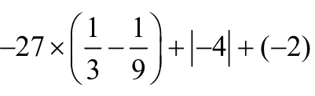

举个例子，某道计算题同时考察了分数运算、绝对值、有理数加减、运算顺序、符号处理五个知识点，拆开来有十几步。这种题既不适合练分数运算，也不适合练绝对值。

因此题海并不高效，我们需要的是精准的针对性训练。这时借助 DeepSeek 就能派上用场。比如想练立方根运算，可以这样让它出题，提问方式如下： 

问：我正在学习七年级数学的立方根知识。你帮我出 10 道相关的题目。

答：以下是 10 道针对七年级立方根知识的练习题，涵盖基础计算、方程求解和应用题，帮助学生巩固概念：

10 道立方根练习题

1. 直接计算
求下列各数的立方根：
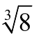
（1）
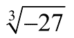
（2）
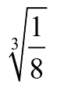
（3）

2. 小数的立方根
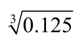
计算：

3. 解方程
若 x³=64，求 x。

4. 混合运算
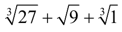
计算：

5. 应用题（几何）
一个立方体的体积为 125cm³，求它的棱长。

6. 负数的立方根应用
若 y³=-216，求 y。

7. 综合运算
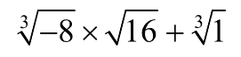
计算：

8. 方程求解
解方程： 3x³-5=22

9. 实际情境问题
小明说：“一个数的立方根是它本身的只有 1 和-1。”这句话对吗？请举例说明。

10. 挑战题
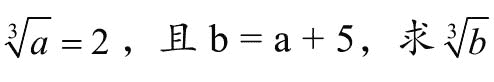
已知。

参考答案
……
练习建议：
· 先独立完成再对照答案；
· 错题要分析原因，如符号错误、公式混淆；
· 第 9、10 题可拓展思考立方根的性质。

DeepSeek 呈现了一套覆盖不同类型的 10 题，做完还能对照答案。若想更聚焦，还可以限定题型。比如只练直接运算，提问如下： 

问：我现在要练习立方根直接运算，你帮我出 10 道题目。

答：以下是 10 道针对立方根直接运算的练习题，涵盖整数、分数、小数及负数，帮助你巩固基础：

10 道立方根直接运算题
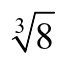

## 1.
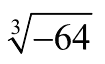

## 2.
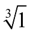

### 3.
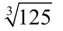

### 4.
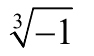

## 5.
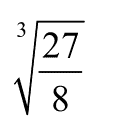

### 6.
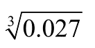

### 7.
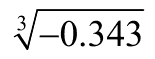

### 8.
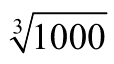

## 9.
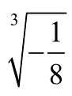

10.

参考答案
……

这样就能对单一知识点的特定运算做专项强化，避免题海的低效。

## 8.2 应用题建模训练器：把生活题变数学题

应用题是数学与现实的桥梁，也是综合能力训练的核心。解题时不仅要把文字转成数学语言，还需要相应的学科常识。借助 DeepSeek，可以快速训练数学建模能力。

### 8.2.1 三步拆解工具箱

希希盯着题目在草稿纸上乱写“小明”“妹妹”“2 倍”。“妹妹的年龄是小明的一半？还是小明是妹妹的两倍？”题目像绕口令。她想设两个未知数，却写不出第二个方程，数字和文字像迷宫，进出口都看得到，路怎么走却找不到。最后她叹气：“为什么非得用方程，明明直接算就行啊。”

解应用题第一步是把中文描述转成数学语言，也就是建模，这也是最难的环节。关键信息如“提前”“剩余”“多几倍”常被忽略。隐藏条件也容易漏，比如“多 3 倍”其实是 4 倍关系。现在题干动不动两三百字，充斥大量干扰数据，很容易用错。

这些问题让每道题都要花七八到十几分钟，练习量上不去，能力提升缓慢。有了 DeepSeek，可以手把手一步步带练。训练方式如下：

（1）提交题目并要求逐步讲解。提问方式如下： 

问：小明的年龄是妹妹的 2 倍，两人年龄之和为 18 岁，求妹妹的年龄。
这是一道应用题，要求使用二元一次方程组求解。我是一名初中生。我需要你手把手教我，分析和求解这个题目。你每做一步，就说明为什么要这样做，然后停下来，不要输出下一步，等我做完。
注意：建议开启“深度思考”功能。

（2）DeepSeek 进入分步讲解并等待反馈。 
答：好的，现在让我们一步步来解答这个问题。
第一步：设定变量
首先，我们需要用两个变量来表示小明和妹妹的年龄。根据题目要求使用二元一次方程组，我们可以这样设定：
· 设妹妹的年龄为 x 岁；
· 设小明的年龄为 y 岁。
请确认你是否理解为什么要用两个变量，并尝试写出这两个变量。
（等待你的回答）
问：理解了。设妹妹的年龄为 x，小明的年龄为 y。

（3）重复步骤，直至完成。 
答：第二步：建立方程
现在，根据题目中的条件列出两个方程：
……
请检查这两个方程是否合理，并尝试写出完整的方程组。完成后告诉我，我再继续下一步。
（等待你的回答）
问：没有问题。
y=2x
x+y=18
答：第三步：代入求解
现在你已经有了方程组：
……
请尝试合并同类项并解出 x 的值，然后告诉我你的结果。（等待你的回答）
问：3x=18
x=6
答：第四步：验证答案
你已经算出 x=6，现在需要验证是否符合题目条件：
……
因此，妹妹的年龄是 6 岁。请确认是否理解整个过程，并总结答案。
（等待你的确认）
问：理解了。妹妹的年龄为 6 岁，哥哥的年龄为 12 岁。

（4）解答完成后，DeepSeek 对全题总结。 
答：答案总结
通过以下步骤可以确定妹妹的年龄：
1. 设定变量
……
2. 建立方程
……
3. 代入求解
……
4. 验证结果
……
如果你有其他类似问题，可以尝试用同样的方法设定变量、列方程并代入求解！

有疑问可以继续追问，比如能否把小明的年龄设为 x，妹妹设为 y。练习时只要三步——提交题目、提出要求、跟着思考，就能快速提升应用题解题能力。

### 8.2.2 跨学科建模挑战

希希看着试卷上密密麻麻的文字额角冒汗。金属丝在题里来回伸缩，像银蛇缠住思路。“温度每升降 1℃伸长缩短 0.002mm……”她算出 15℃到 60℃温差 45℃，可又降到 5℃？数字在物理和数学之间跳来跳去，公式越理越乱。周围同学都在书写，她抠着橡皮碎屑发愁：“这跨学科题到底该用哪门课的知识？”

跨学科应用题把不同学科知识融合，考查综合建模能力。比如数学与物理结合的热胀冷缩、运动问题；数学与地理结合的海拔温度、时区换算；数学与化学结合的溶液浓度、反应速率……
这类题不仅要跨越学科壁垒，对建模要求极高。必须把实际情境抽象成数学表达，并抽出隐含的变量关系。卡住时常不知该问数学老师还是其他科老师。

现在有了全能助手 DeepSeek，就不用纠结。它能一次性解决题目涉及的所有问题。例如请它讲解下面这道题。 

实验发现，当温度每上升 1℃时，某种金属丝就会伸长 0.002mm；反之，当温度每下降 1℃时，这种金属丝就会缩短 0.002mm。现把一根长度为 100 mm 的这种金属丝先从 15 ℃加热到 60℃，再使它降温到 5℃。
（1）在这个过程中，金属丝的长度发生了怎样的变化？
（2）和原先相比，金属丝的长度伸长（缩短）了多少？

提问方式如下： 

问：XXXX （题目省略）
我是一名初中生。上面这个题目，该如何思考？

答：解题思路与步骤：
1. 确定温度变化阶段
阶段一：加热从 15℃升至 60℃，温度上升 60-15=45℃。
阶段二：降温从 60℃降至 5℃，温度下降 60-5=55℃。
2. 计算各阶段的长度变化
加热阶段（伸长）：
每升高 1℃伸长 0.002mm，总伸长量：45℃×0.002 mm/℃=0.09 mm
加热后长度：100 mm+0.09 mm=100.09 mm
降温阶段（缩短）：
每降低 1℃缩短 0.002mm，总缩短量：55℃×0.002 mm/℃=0.11 mm
降温后最终长度：100.09 mm−0.11 mm=99.98 mm
3. 分析整体变化
总长度变化：
最终长度与初始长度的差值：99.98 mm-100 mm=-0.02 mm
负号表示缩短。
4. 回答问题
（1）长度变化过程：
金属丝先加热伸长 0.09mm，后降温缩短 0.11mm，总体缩短 0.02mm。
（2）净变化量：
与原长度相比，金属丝缩短了 0.02mm。
答案：
（1）金属丝先伸长 0.09mm，再缩短 0.11mm，最终比原来缩短了 0.02mm。
（2）和原先相比，金属丝缩短了 0.02mm。

DeepSeek 给出了详细过程。对关键点追问，提问如下： 

问：这个题目的解题关键在哪里？

答：解题关键分析：
1. 分阶段处理温度变化：
将问题拆解为加热和降温两个独立阶段，分别计算每个阶段的长度变化。
……
2. 叠加长度变化：
……
3. 关键注意事项：
温度变化的绝对值计算（如降温阶段的温度差为 60-5=55℃，而非 5-60）。
符号与方向统一（升温对应伸长，降温对应缩短，避免正负混淆）。
单位一致性（温度单位为℃，长度单位为 mm，无需额外转换）。
答案总结：
……

掌握这些难点后，与物理中热胀冷缩相关的数学应用题就彻底搞定了。

## 8.3 函数图像解读：数形结合

函数与图像是连接代数与几何的核心，能培养抽象思维和数形结合能力。不仅要把式子与图像对应，还要利用图形解决更复杂的实际问题。下面讲如何用 DeepSeek 训练数形结合思维。

### 8.3.1 图像翻译

希希盯着作业本上的 y=5x+2，努力在脑中勾勒图像。“截距是 2，斜率是 5……”她小声嘀咕，铅笔在坐标轴上点点擦擦。公式背得很熟，一画图直线却像蚯蚓，该不过原点吗？交点在哪？数字和图形像分裂成两个世界，越拼越乱。最后她哀叹：“这图像，怎么比函数本身还抽象啊！”

函数是抽象关系，图像能把它变成可视化图形。借助图形可以直观理解变量变化。图像的倾斜程度反映变化速度，与 y 轴交点对应初始值。解方程就是找图像与 x 轴的交点。

函数对应的图像本是学习的工具，却常成为梦魇。截距、斜率、渐近线、对称性、顶点、对称轴等名词让人头大。这时需要 DeepSeek 将函数“翻译”成图像，或把图像“翻译”成函数。

例如，想了解 y=5x+2 的图像，提问如下： 

问：对于函数 y=5x+2，它的图像是什么样子的？

答：函数 y=5x+2 的图像是一条直线。以下是详细的分析：
1. 斜率（Slope）
方程的一般形式为 y=mx+b，其中 m 是斜率，b 是 y-截距。
对于 y=5x+2，斜率 m=5。这表示直线每向右移动 1 个单位，就会向上移动 5 个单位。

2. y截距解读
常数项决定直线与纵轴的交会位置，此处 b=2，故交点为 (0,2)。

3. 画线步骤
第一步，在坐标系里先标出截距点 (0,2)。
第二步，依据斜率 5，即 ，从 (0,2) 向右走 1 个单位到 x=1，同时向上走 5 个单位到 y=7，得到第二个点 (1,7)。
第三步，把两点连成线段并向两端延伸即为所求直线。

4. 直线的走势
倾斜系数为正 5>0，图形整体从左下往右上抬升。
直线可无限制延伸，包含所有满足 y=5x+2 的点。

5. 补充取点
为提高精度，可再代入若干 x 值求 y：
……

6. 作图小结
最终得到经过 (0,2) 与 (1,7)、斜率为 5、截距为 2 的直线。
……
DeepSeek 对 y=5x+2 的绘图过程做了系统演示，并点明了斜率与截距的意义。
反过来也可以由图像推断解析式的特征，比如依据图 8.1 向 DeepSeek 发问。

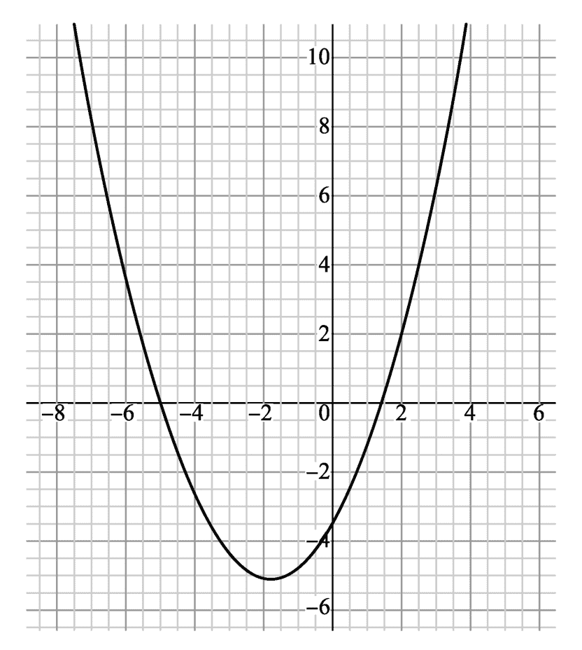

图 8.1 函数图像

问：对于函数 y=ax²+bx+c，如果它的图形开口向上，顶点在第三象限，图形分别与 x 负轴、x 正轴、y 负轴相交。这说明什么？

答：二次函数 y=ax²+bx+c（a≠0）的图像是抛物线。
按描述，该抛物线具有以下特点：
1. 开口向上→a>0。

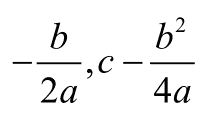

2. 顶点在第三象限→顶点坐标 (h,k) 应满足：

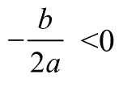

x 坐标位于负半轴，

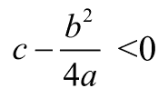

y 坐标位于负半轴。

3. 与 x 轴正负两边相交→方程 ax²+bx+c=0 有两个不同实根，一正一负，即 x₁>0，x₂<0。
4. 与 y 轴负半轴相交→x=0 时 y=c<0。

由此可推：
1. 判别式为正
因与 x 轴有两个交点，需有：
D=b²-4ac>0
即 b²>4ac。
2. 常数项为负
y 轴截距在下方，故 c<0。
3. 一次项系数符号

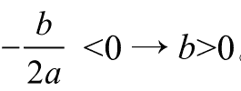

在 a>0 且顶点落在第三象限的条件下，b 取正。
又因 c<0 且 b²>4ac 自动成立，因右边 4ac 为负。

归纳：
a>0，开口向上；
b>0，对称轴在 y 轴左侧；
c<0，y 截距为负；
判别式 b²-4ac>0，存在两个不同实根。

这类抛物线最低点在第三象限，并分别穿过 x 轴负、x 正半轴，同时与 y 轴负半轴相交。

示例：
如 y=x²+3x-4：
开口向上 a=1>0。

顶点落在第三象限。
x 轴交点为 -4 与 1，一负一正。
y 轴交点为 (0,-4)，在负半轴。
完全符合题设。

通过图像条件，DeepSeek 将图形特征与系数一一对应。

### 8.3.2 动态应用题解构
明确函数与图形的对应后，解应用题多了图形路径。如用 s=vt 的时间-路程图或时间-速度图分析运动，处理追及问题；用成本、售价、利润关系处理经济问题，如比价或求最大利润。

思路有效但不易掌握。需先从实际情境抽象函数模型，再作图解读，最后结合图形下结论。过程中易重计算轻图形、套公式、忽视关键特征。

因此耗时且思路难理清。借助 DeepSeek 既能调用分析能力，也能补充跨学科知识。试研究下面题目找规律。 

某商店售卖一种商品，进价 40 元/件。售价 60 元/件时日销 100 件。市场调研显示：每降价 1 元，日销增加 5 件；每涨价 1 元，日销减少 5 件。问定价多少时利润最大？

提问方式如下： 

问：XXXX （题目省略）
该题如何借助函数图形求解？

答：可按以下步骤展开：
1. 确定变量
设售价为 x 元。
销量随售价变化。基准点 60 元对应 100 件。
降价 1 元多卖 5 件，涨价 1 元少卖 5 件。
于是销量 =100-5(x-60)=400-5x
每件利润为 x-40，总利润为：
利润=(400-5x)(x-40)

2. 建立利润函数
P(x)=(400-5x)(x-40)
展开得：
P(x)=400x-16000-5x²+200x=-5x²+600x-16000

3. 求顶点
这是一个开口向下的二次函数，最大值在顶点处。顶点横坐标为：

将 x=60 代入，最大利润为：
P(60)=(400-5×60)(60-40)=100×20=2000 元

4. 验证
售价 60 元：利润=100×20=2000 元
售价 50 元：销量=100+5×10=150 件，利润=150×10=1500 元
售价 70 元：销量=100-5×10=50 件，利润=50×30=1500 元
可知 60 元时利润最高。

5. 图形分析
绘制 P(x)=-5x²+600x-16000 的图像：
开口向下，顶点在 x=60 处。
当 x=60 时，P(x)=2000 元为最大值。

DeepSeek 细致呈现了五步求解思路。若对某一步存疑，可继续追问。例如为何选择售价为变量，提问如下： 

问：在此题中为何选择售价作为变量？

答：在建模与函数分析中，变量选取很关键。本题以售价为 x 的原因是：
1. 售价直接影响利润与销量
……
2. 售价变化规律清晰
……
3. 利润函数形式简洁
……
4. 符合实际问题的自然表述
……

DeepSeek 从四个角度解释了变量选取的依据。这样就能吃透建模思路。同理可追问其余步骤，彻底掌握用函数图形解应用题的方法。

# 第九章
# 英语进阶：单词语法听说三解法

英语与语文、数学并列为主科。因文化差异，单词、语法、听说常成为三大障碍。投入时间多却收效有限，有了 DeepSeek，就能以更高效的方式实现进阶。

## 9.1 单词记忆黑科技：解构、扩展、联结

学英语，单词如同盖房的砖块，是听、说、读、写的基础。投入多效果差时，可借助 DeepSeek 突破死记硬背。

### 9.1.1 单词解剖室：拆解音形义密码
希希咬着笔头，反复抄写“d-a-n-g-e-r-o-u-s”，嘴里念着“/ˈdeɪndʒərəs/，危险的……”。抄完五遍后翻页继续机械重复。十几分钟后她自信合上书开默写，笔尖悬空却大脑空白——“dangerous”漏了个“o”，“giraffe”写成“geraffe”……她盯着错误本沮丧趴下。

背单词需要掌握发音、拼写和词义。为此反复朗读、抄写、看例句，耗时多效果差，总记不住。是用功不足还是天生不擅长？
都不是，是死记硬背。回想记汉字“揉”时，会用技巧：由“扌”和“柔”组成，“扌”表动作与手有关，“柔”表结果使物变软。两者结合即“用手搓弄使变软”。

记汉字不是孤立记忆拼写发音意义，而是三者合一。英语单词亦可如此，怎么做？可求助 DeepSeek。

例如记忆 dangerous 前，先让它拆解。提问方式如下： 

问：单词 dangerous 在发音、拼写和词义之间有什么关联？

答：单词“dangerous”在发音、拼写、词义间的关联可如下分析，帮助记忆：
1. 词义→词根+后缀（逻辑关联）
词根“danger”（危险）+后缀“-ous”（具有…性质的）
→意为“具有危险性质的”，即“危险的”。
例：
poison+-ous→poisonous（有毒的）
fame+-ous→famous（著名的）
关联：后缀“-ous”提示形容词属性，词根体现核心含义。

2. 拼写→发音（对应规律）
分音节：dan-ger-ous /ˈdeɪn.dʒər.əs/
“dan-”：开音节，读长元音/eɪ/，类似“day”。
“-ger-”：弱读/dʒər/，类似“jur”。
“-ous”：固定读/əs/，所有以“-ous”结尾的词皆如此，如“famous”/ˈfeɪ.məs/。
关联：
字母组合“ger”对应/dʒər/，英语中常见，如“general”。
词尾“-ous”是形容词标志，发音统一弱化，提示词性。

3. 发音→拼写（反向验证）
听到/ˈdeɪn.dʒər.əs/时：
（1）首音节/deɪn/→对应“dan-”（/eɪ/常由“a+e”或开音节“a”表示，如“name”）。
（2）中间/dʒər/→对应“-ger-”（/dʒ/固定为“g”或“j”，此处“g”因后接“e”软化为/dʒ/）。
（3）结尾/əs/→必为“-ous”（无其他拼写可能）。
关联：发音规则反向锁定拼写，尤其是“-ous”的固定性。

4. 易错点提醒
漏字母：易漏“-e-”（误拼为“dangrous”），因/ər/音易让人忽略拼写中的“e”。
后缀混淆：勿与“-ious”（如“serious”）或“-eous”（如“courageous”）混淆，需结合词根。

记忆技巧：
联想句子：“A DANGER-OUS snake is /ˈdeɪn.dʒər.əs/!” 发音与拼写联动强化。
总结规律表：

最终建议：结合词根词缀理解词义，按音节拆分拼写与发音，避免孤立记忆。

DeepSeek 分析了 dangerous 的词义到拼写、拼写到发音、发音到拼写的联系。单词由此变得像汉字一样好记。背单词更简单了。它还提示易错点和近似词，如 poisonous、famous 等。

### 9.1.2 单词家族树：一词生百词
晨读时希希默写“fox”，后桌小白念：“outfox 对手，躲进 foxhole，这只 foxy 狐狸真狡猾……”希希愣住，课本没有这些词。小白晃着纸片说：“我姐是英语专业的，她说记住一个词要像狐狸挖洞，横向扩展才牢靠！”希希明白成绩之因。

单词量越大，阅读写作越顺手。但英语单词庞大且不规则，如猪 pig 猪肉 pork，难以全部背完。事实上英语有构词规律，只是我们不知。

现在可用 DeepSeek 从一个词扩展出更多词。例如记忆 fox 时提问如下： 

问：单词 fox 可以扩展出哪些单词？

答：单词 fox（狐狸）可通过词根派生、前后缀扩展、复合构词和联想记忆等方式扩展出以下词汇，并建立关联网络：
1. 词根派生&变形
foxes（复数，狐狸）
规则：“x”尾加“-es”（如 box→boxes）。
foxy（形容词，狡猾的；性感的）
后缀“-y”表性质（如 cloud→cloudy）。

2. 前缀扩展
outfox（动词，智胜）
前缀“out-”（超过）+fox→“比狐狸更狡猾”。
例：The detective outfoxed the thief。

3. 复合词&短语
foxhole（散兵坑）
复合：fox+hole（狐狸洞→军事掩体）。
fox hunt（猎狐活动）
文化相关：英国传统狩猎。

4. 同源词&词族
vixen（雌狐；泼妇）
古英语同源词，指雌狐，引申为凶狠女人。
foxglove（毛地黄）
词源：传说狐狸戴此花躲猎人（glove=手套）。

5. 发音/拼写联想
box（盒子）
拼写相似：-ox 结尾（对比 fox、box、ox）。
ox（公牛）
动物类词汇，拼写简短易混。

6. 文化相关词汇
Fox News（福克斯新闻）
媒体品牌，名源自创始人姓氏 Fox。
Fantastic Mr. Fox（电影《了不起的狐狸爸爸》）
文学作品狐狸形象。

记忆技巧
用句子串联：
“A foxy vixen tried to outfox hunters by hiding in a foxhole, but they tracked her with foxhounds.”

总结表格

通过这种方式，将 fox 从基础词汇扩展为有逻辑的词汇网络，避免孤立记忆。

给定单词 fox，DeepSeek 扩展出多个相关词。这些新词与 fox 有拼写或意义联系。如 outfox 拼写表示“超过狐狸”，含义是“智商超过”；foxhole 拼写表示“狐狸洞”，实际意为“散兵坑”。看几眼就能记住。所以背新词时可让 DeepSeek 扩展，形成单词树，实现量级提升。

### 9.1.3 语义关系网：同义反义联想
希希盯着试卷空格发愁：“The train _____ the station”。上下文明显是“到达”，该选 arrive、reach 还是 get to？好像都能用。她抓狂：“为什么一个意思有这么多词！”

掌握词义不等于能做对题，尤其是完形填空。英语同义近义词多，用法却不同。如 arrive、reach、get to 都可表到达，但用法截然不同。

想解决，就需在掌握单词时收集同义、反义及相关词汇。如何快速找到？可借助 DeepSeek。例如学 arrive 时提问如下： 

问：我正在学单词 arrive，你帮我列出它的同义词、近义词、反义词以及相关的其他词语。

答：以下是关于单词 arrive 的完整词汇扩展，包括同义词、近义词、反义词及相关短语，并附上用法对比和记忆技巧：

# 以 Arrive 为核心的抵达词网

**1. 同义与近义**  
多个词都指向抵达，但使用边界不同  

**2. 反义**  

**3. 常用搭配**  

**4. 词性延伸**  

**5. 记忆法**  
对比记忆：  
Arrive 更像被迎接的来客，必须借助 at/in 指出落脚点；Reach 更像手臂直接够到目标，地点可直接跟在后边。  
情境联想：  
先抵达城区，随后入住小旅馆，雨前赶回房间，arrive、reach、get to 连用叙事更顺滑。

**6. 易错点**  
介词漏用：✖ Arrive Tokyo → ✔ Arrive in Tokyo  
词性误用：✖ His arrive was late. → ✔ His arrival was late.  
多做对比与语境练习，区分度会提升。

把 arrive 当作枢纽，就能把 reach、get to、come、make it 等词一并理清。围绕同一语义场建网，记忆效率明显提高。

## 9.2 语法拆解：词源、差异、时态三重奏

语法是英语的运行规则，决定句子如何组装、含义如何落地。条目多且与汉语差异大，是学习难点。借助 DeepSeek 细化分析，效率会提升。

### 9.2.1 介词侦探社：搭配背后的历史逻辑

希希写下 “Look the blackboard!” 被扣分。她纳闷：“look 要带 at，see 为何不用？”老师解释：“look 不及物必须加介词，see 及物可直接接宾语。”  
“那 look 为何不及物？”“没为什么，就是规定。”希希叹气，放学路上想：英语要是像数学那样有逻辑就好了。

英语介词搭配给人感觉随意。例如 look at、agree with、run into，问其缘由常只得到“习惯”“规定”的答复，于是只能硬背。

其实语言形成有脉络，弄清来源就能少记。汉语成语有典故，英语搭配也有历史。借助 DeepSeek 可追溯。例如想了解 look 为何要加 at，可这样问： 

问：动词 look 后面为什么要加 at，这有什么历史由来吗？

答：关于 look 必须带 at 的历史，需要从语法演变、动词分类与习惯固化来看。  
1. 古英与中古英结构  
英语动词受日耳曼语与拉丁语影响，及物性逐渐分化。look 源自古英语 lōcian，本义是用眼关注，古时常与表示方向的介词 on、tō 搭配，强调注视某处。Lōcian on þæt → Look on that → 后演成 look at。see 源自古英语 sēon，本就是及物动词，可直接带宾语 sēon þæt，故不需介词。  
2. 方向性需求  
古英语里表达方向或目标的动词常需介词标明指向。look 核心是主动把视线投向某处，需要介词标记方向，类似 go to、point at。see 核心是感知结果，不强调方向。  
3. 习惯固化  
中古英语时期语法简化，介词搭配趋于固定。look 始终强调主动视觉行为，需要介词标终点，at 表示视线到达某处。see 更早绑定感知结果，脱离方向性，成为纯粹及物动词。  
……

DeepSeek 从发展史解释了 look at 的形成。理解原理后，搭配不再是死记。遇到说不清的介词，都可让它从词源拆解，学习更省力。

### 9.2.2 时态实验室：12 种表达的细微差别

希希盯着笔记：“一般现在时表习惯，现在进行时表进行中，现在完成时表已完成有关联……”背得很熟。刚和朋友逛完公园，她想说“我们刚逛完，现在很累”，却卡在该用现在完成时强调刚结束，还是用一般过去时简单陈述去过。她发现死记规则无用。

时态由时间与体态组合成 12 种，句式和动词形式会随之变化。关键不在于动作绝对时间，而在于想突出的意义。一般现在时突出习惯，现在进行时突出正在进行，现在完成时突出对现在的关联……

光靠概念不够，需要对照练习。课堂上老师会把一句话改写成多种时态对比，效果好。自学时常只会套模板，分不清语义差别。这时可让 DeepSeek 拆解。以“I go to the park”为例，提问方式如下： 

问：对于 I go to the park，如果转换每种时态形式，它们表示的意思会有什么差别？

答：对“I go to the park”在各时态下的转换及含义差异的分析如下。通过对比，可清晰看到不同时态如何改变时间、状态与语境。  
一、现在时态  
1. 一般现在时  
原句 I go to the park. 含义是习惯性、规律性动作或普遍事实。  
例：I go to the park every Sunday. 人们去公园放松。  
2. 现在进行时  
结构 I am going to the park. 含义是说话时正在进行的动作，或近期已安排计划。  
例：I am going to the park right now. 今天下午我要去公园。  
3. 现在完成时 ……  
4. 现在完成进行时 ……  
二、过去时态 ……  
三、将来时态 ……

DeepSeek 列出 12 种时态形式并说明含义，可仔细区分每种时态带来的变化，从而按表达意图选择正确时态。

另外可让 DeepSeek 验证判断。例如要表达“昨天下午三点前已完成作业”，可提问如下： 

问：I had finished my homework before 3 p.m. yesterday.这句话能不能表示我昨天下午三点前已经完成了作业？

借助 DeepSeek 可不断尝试各时态，快速掌握使用场景与含义差别。

## 9.3 听说实战：用对话打破瓶颈

听与说是将知识转为能力的关键，也能暴露语法与词汇短板。练习机会少，很多同学成“哑巴英语”“聋子英语”。用 DeepSeek 做陪练，可实现听说双突破。

### 9.3.1 先开口：用 AI 消解心理障碍

外教进教室，希希心跳加速。金发老师停在她身边说“Hello”，她却结巴：“H…Hi…”脸涨红。同学已围着外教聊周末计划，她仍不敢开口。

不少学习者重背单词、做题，口语输出少。一到公开场合就恐慌，屏息、声带紧张，错失练习机会，形成恶性循环。

需要一个不嫌弃的对话伙伴，DeepSeek 可胜任。它支持英文对话，你说英语它回英语。想练口语，只要和它聊就行。

打开 App，切到语音输入开始说。对话方式如下： 

问：Hi，DeepSeek.  
答：Hi there! How can I assist you today？  
问：Do you have a moment to chat？  
答：Absolutely! I'm always here and happy to chat—whether you want to discuss something serious, lighthearted, or just random thoughts. What's on your mind？

接着聊感兴趣的话题，DeepSeek 会回应并引导继续表达。语音输入时不必纠结发音标准、语法完美，边说边改即可。

地点可随意选择：被窝、操场、公园角落，只要开口，DeepSeek 随时回应。持续练习后，开口恐惧被打破，就能在真实场景更自如使用英语。

### 9.3.2 个性化听力：跳出教材训练

希希把课本对话听了三个月：问路、买文具、图书馆找书。她能听清“turn left at the bank”，甚至能模仿电流声。月考却出现运动会筹备听力，“volunteers should check the first-aid kits”一下听懵。

起初课本材料有帮助，但语速慢、场景单一，换题型就吃力。这时需要更贴合自己的材料：主题感兴趣、词汇难度匹配、场景贴近考试。

自己找难，就让 DeepSeek 定制。假设喜欢踢足球、词汇量有限、考试多为校园背景，可这样提问： 

问：帮我生成一个英文故事，主题为足球，长度不超过 200 个单词。其中，不要使用生僻单词，适合七年级的学生阅读。另外，故事发生的场景为学校。

答：**Title：The Final Kick**  
约 195 词。雨后泥泞的球场，两所中学为冠军对决。半场 1-1，Liam 错失射门，教练提醒团队协作。最后时刻 Carlos 被犯规，助攻 Liam 破门。结尾附关键点：校园体育互动、易懂动词、运动精神、感官细节、对话占比约三成，适合排序与寓意练习。

手机点击右下角声音图标可播放，支持调速。听完后可要求 DeepSeek 生成听力自测。提问方式如下： 

问：根据这段故事，你帮我生成五个听力题目，进行自测。

答：基于 The Final Kick 的 5 道自测题附答案。  
1. 比赛时的天气？A Sunny B Rainy and muddy C Snowy。答案 B  
2. Liam 上半场为何说 Sorry？A 伤人 B 错失射门 C 忘穿队服。答案 B  
……

DeepSeek 生成题目并给出答案，也可要求答案统一置后。

按兴趣与水平定制听力材料并配合自测，能快速提升听力应对能力。