# DeepSeek高效提问指南：提出好问题，才有好答案

# **内容提要**

如今，以 DeepSeek 为代表的 AI 工具迅速崛起，深刻地改变了人类获取与处理信息的方式。但在应用 DeepSeek 的过程中，很多人发现，向 DeepSeek 提出问题后，得到的回复往往不尽如人意，或是过于宽泛、缺乏针对性，或是未能切中要点、不能解决实际问题。导致这一问题的根本原因是，提问者缺乏有效的提问技巧，无法精准引导 AI 发挥强大的运算与分析能力。

《DeepSeek 高效提问指南》正是针对这一痛点，构建了一套全面、系统的提问策略体系，旨在帮助读者提升与 DeepSeek 的交互能力，掌握提问技巧，高效获取信息，解决工作、生活、学习中的难题。本书共 12 章内容，在解决了“怎么问，DeepSeek 才能回答得好”这一基本问题后，分别介绍了请求检索查询推荐、请求解释描述说明、请求步骤程序流程、请求创意创作创建、请求归纳演绎总结、请求补充举例论证、请求润色提炼优化、请求校阅检查审查、请求比较分析评判、请求建议预测指导、请求教育培训辅导等 11 个工作、生活、学习常见领域，以及 88 个常见提问场景的提问策略。作者详细拆解了每个场景的提问需求，分别从关键词、句式模板和提问案例入手，帮助读者在面对各种复杂问题时，找到合适的提问方法，从 DeepSeek 中获取满意答案。

本书适合学生、教师、职场人士、AI 工具使用者阅读和参考。

# **推荐序**

# **提问是 AI 时代每个人应具备的能力**

在这个答案触手可得的时代，**能否提出一个好问题，往往比获得答案更重要，提问的能力正在成为最稀缺的资源。**真正决定答案质量的，永远是问题的质量。一个精准的问题，能穿透表象，直达本质；而一个模糊的问题，只会带来更多困惑。然而，许多人并未意识到提问本身是一门需要刻意练习的艺术与科学，**在 AI 时代，“提问能力”变成了一种每个人都需要拥有的能力，成了 AI 时代的通用能力。**

这本书的独特价值在于它将**抽象的“提问能力”具象化、场景化、任务化，**从而转化为可操作、可复用的方法论。作者系统梳理了 88 个场景化句式模板：**将高手的思维模式拆解成普通人能即刻上手的工具**。无论是工作、生活还是学习，读者都能像查阅**“提问词典”**一样，快速找到契合相应场景的**关键词与句式框架。**

本书内容有三大显著特点。

**1. 场景颗粒度精细：**作者不是泛泛而谈“如何提问”，而是区分了工作、生活、学习等具体情境，甚至细到“每一个定语”“每一个补充”等微观场景。

**2. 提问句式关键词化：**作者将提问句式关键词化，通过不同关键词的组合，定位场景与问题，提高提问效率、提升提问效果，解决不同问题。

**3. 提问模板结构化：**书中每个提问句式都暗含心理学原理，能有效突破表面问题，激活创造性思维。

尤为难得的是，这些模板绝非教条。作者通过大量案例示范如何根据对象身份、沟通目标、不同场景等因素灵活调整提问策略。当读者熟练掌握后，甚至能根据自己所在的行业和工作特点发展出自己独特的提问风格——这正体现了本书的深层意图：**提供脚手架，而非束缚思维**。本书不仅是一本关于提问技巧的工具书，更是一本关于 AI 时代如何深度思考和获取智慧的实用指南。

在人工智能逐渐替代重复性工作的未来，**提出真问题的能力将成为人类的核心竞争力**。这本书像一位随时待命的提问教练，无论你是需要精准获取信息的职场人士，渴望激发学生思考的教师，还是希望提升认知深度的终身学习者，都能从中获得持续增值的沟通资产。

建议读者以“用—改—创”三个阶段实践：先严格套用模板适应节奏，再调整措辞融入个人风格，最终超越模板形成直觉。相信当你读完最后一页内容时，收获的不仅是一套技术，更是一种全新的思维穿透力。

**郑吉敏**

去哪儿旅行技术总监、

业务架构 SIG 负责人，

人工智能委员会常委

# **前言**

在 AI 技术重塑信息交互方式的今天，**提问能力已从普通技能跃升为数字时代的核心竞争力。**

首先，当 GPT-4 每天处理 45 亿字的训练数据，当搜索引擎索引的网页突破 1300 亿页，人类首次面临知识获取的悖论。

**1. 数据丰裕陷阱：**99%的无效信息淹没了 1%的有效知识，**精准提问**成为穿透噪声的**“认知滤网”**。

**2. 智能依赖困境：**过度依赖 AI 的答案生成，导致人类逐渐丧失自主思考的**“思维肌肉”**。

**3. 认知带宽战争：**人脑日均接收的信息量相当于 174 份报纸，**优质提问是避免认知超载的流量控制器**。

其次，在 AI 持续进化的压力下，人类正在经历认知能力的物种分化。

**1. 初级提问者：**停留在“是什么”的层面，成为算法推荐的被动接受者。

**2. 进阶提问者：**掌握“为什么+怎么做”的组合技能，开始构建人机协同的增强智能。

**3. 顶级提问者：**擅长提出“元问题”（Meta-question），如用“现有技术路线是否存在范式盲区”替代“哪个方案更好”。

这种分化正在创造新的社会分层——**提问质量决定个人获取 AI 红利的阈值，就像航海时代驾驭风浪的能力决定文明兴衰。**

**当 GPT-5 的参数突破百万亿级时，真正稀缺的不是答案的搬运工，而是能精准叩击知识边界的“提问设计师”。**这不仅是技术演进的选择，更是人类在智能共生时代保持认知主权的生存法则。

最后，在 AI 成为**“数字外脑”**的协作生态中，**提问能力的实质是思维界面的编程语言**。

**1. 精确制导系统：**模糊问题获得“可能相关”的答案，**精准提问触发 AI 的定向知识挖掘**。

**2. 认知放大器：**结构化提问能调用 AI 的跨领域知识图谱。

**3. 价值校验器：**通过连续追问建立逻辑验证链。

正是基于以上的认知，我们编写了这本 DeepSeek 提问指南书，本书聚焦十一大应用主题，涵盖从信息检索到创意生成，从逻辑分析到实践指导的方方面面。无论是需要精准的数据查询，还是寻求灵感的迸发；无论是梳理复杂的流程步骤，还是优化表达的文字润色，读者都能在这本书里找到对应的提问策略。

**本书的 88 个细分场景与 300 多个句式模板，如同工具箱中的精密器具，能助力读者在不同情境下精准发力，让提问的力量转化为答案的智慧。**

由于时间仓促，以及 DeepSeek 应用领域的不断丰富，本书难免有不足之处，恳请广大读者指正，以便我们修订改进。

**作者**

2025 年 4 月

# **第一章**

# **怎么问，DeepSeek 才能回答得好**

## **1.1 DeepSeek 能做什么，如何提问**

### **1.1.1 DeepSeek 能做什么**

DeepSeek 作为人工智能领域的新兴力量，基于先进的语言模型和认知智能技术，为企业提供高效的 AI 解决方案。那么，对普通人来说，DeepSeek 到底能做什么？

**1. 信息处理与分析**

**（1）文件阅读与解析**

能够快速读取各种格式（如 TXT、PDF、Word、PPT、Excel、JPG 等）的文件并进行分析，同时可以提取和标识关键内容。除此之外，还可以对网页内容进行解析，并提取关键信息。

**（2）长文本文件处理**

可以进行长文本处理，包括修改内容、校对内容、补充内容、缩减内容、将内容分段、分析结构、提炼观点概要、生成摘要、提取关键信息、生成逻辑图、构建知识图谱等。

**（3）多文档分析**

可以同时上传处理多个文档，进行内容合并、内容汇总、内容整合、内容简化，提炼总结、生成摘要、编辑校对、对比分析内容等。

**（4）信息检索与问答**

可以让用户随时进行自己所需的信息查询检索，随时提问，获得答案。同时，也可以对生成的答案进行确认、判断和分析。

**2. 内容创作与优化**

**（1）公文写作**

帮助撰写计划、总结、通知、通告、公告、意见、函、报告、请示、会议纪要等公文，帮助起草、修改、校对和提供模板。

**（2）文案创作**

帮助生成营销文案、广告文案、推广文案、宣传文案、公关文案、商务文案、脚本文案等，用户可以直接在小红书、抖音、小程序、微信等新媒体平台上发布这些文案；还可以帮助起草合同、撰写调研报告、撰写可行性分析报告等。

**（3）文章论文创作**

可以生成文章，帮助撰写论文，同时也可以帮助修改标题，撰写大纲，补充数据资料，增加案例内容，还可以帮助生成内容逻辑导图、提取摘要、分析结构、校对文稿、对内容进行查重等。

**（4）诗歌音乐创作**

可以进行诗歌、散文、音乐的创作，作词、作曲，还可以帮助我们修改诗歌、散文。

**（5）PPT 内容与数字图表制作**

虽然不能直接生成 PPT，但是可以生成用于 PPT 制作的内容，并通过和其他 AI 工具的结合，生成 PPT。

虽然不能直接生成 Excel 图表，但是可以直接生成文字图表。

**3. 学术与研究辅助**

**（1）教育学习支持**

可以推荐学习内容、解答题目、生成课件内容、生成大纲、生成教案、编写案例、辅导考试、答疑解惑。

**（2）学术研究支持**

可以快速读取文献，梳理文献脉络，总结研究观点和方法。可以帮助学术研究者快速掌握研究领域的现状，找出研究空白和热点问题，进行选题领域遴选、选题方向确定、选题报告撰写和大纲生成。

**4. 编程与技术辅助**

**（1）代码生成**

可以帮助程序人员根据需求生成特定编程语言的代码片段或完整代码。

**（2）代码调试**

可以帮助定位代码中的错误并提供解决方案。

**（3）数据处理**

可以进行数据清洗、数据转换、数据分析、数据挖掘和数据可视化。例如，自动识别和处理数据中的缺失值、检测并删除重复的数据记录、识别和处理数据中的异常值、将数据从一种格式转换为另一种格式、计算数据的描述性统计量、自动生成各种图表（如柱状图、折线图、饼图等）、对数据进行聚类分析，发现数据中的自然分组等。

**5. 图片识别与翻译**

**（1）图片识别**

可以提取图片中的数据、数字、文字并加以识别。

**（2）语言翻译**

可以翻译各种语言。

**6. 生活规划与方案制作**

**（1）旅游规划**

可以帮助我们进行旅游路线的规划，选择交通方式，进行费用预算和方案制定。

**（2）投资理财建议**

可以给出具体的投资理财建议，帮助我们制定投资理财规划。

**（3）购物决策**

可以给出具体的购物意见，帮助我们进行物品选择，助力我们进行决策。

**（4）健康指导**

可以对我们的健康管理进行指导，给出具体的建议和方案。

**（5）装修建议**

可以给出具体的装修建议和预算方案，帮助我们选择装修厂家、装修材料、装修风格。

**（6）饮食指导**

可以指导我们的饮食，帮助我们制定菜谱，提供个性化饮食解决方案。

综上，DeepSeek 可以帮助我们处理文本、生成文案、撰写方案、写作创作、检索信息、识别图文、翻译语言、生成代码、校验文字、处理数据、助力生活，辅助我们进行学习、工作、生活、科研、创作，答疑解惑，生成各种我们所需的内容，为我们提供意见、建议、规范、方案、文本和答案。

DeepSeek 是一个可以帮助我们完成各种任务的 AI 工具。与 DeepSeek 交互的方式是提问，提问力是用好 DeepSeek 的第一能力。DeepSeek 作为一个基于自然语言处理和人工智能技术的助手，其输出质量高度依赖于输入问题的清晰性、准确性和具体性。提问力决定了 DeepSeek 能否理解我们的需求，并给出高质量的回答。

### **1.1.2 向 DeepSeek 提问的 5 种方式**

向 DeepSeek 提问的方式可以按目标、逻辑类型、问题结构、场景和深度分为 5 种类型和方式。

**1. 按目标分类的提问方式**

**（1）获取事实：**指的是询问具体的事实、定义或数据。

**示例：**

·“什么是低空经济？”

·“DeepSeek 的主要功能有哪些？”

**（2）寻求方法：**询问如何完成某项任务或解决某个问题。

**示例：**

·“如何用 Python 编写一个简单的爬虫程序？”

·“有哪些方法可以提高团队协作的效率？”

**（3）获取建议：**要求提供建议或解决方案。

**示例：**

·“如何提高我的写作能力？”

·“中小企业如何通过 DeepSeek 提升竞争力？”

**（4）探索可能性：**开放性问题，旨在激发思考或讨论。

**示例：**

·“人工智能未来的应用领域有哪些？”

·“如果机器人能够拥有和人类相似的情感和意识，是否应该赋予它们权利？”

**2. 按逻辑类型分类的提问方式**

**（1）分析型提问：**要求对某个问题或现象进行分析。

**示例：**

·“为什么深度学习在自然语言处理中表现优异？”

·“人工智能对传统制造业的影响有哪些？”

**（2）比较型提问：**要求比较两个或多个事物的异同。

**示例：**

·“机器学习和深度学习有什么区别？”

·“敏捷开发和瀑布开发各有什么优缺点？”

**（3）假设型提问：**基于假设情境提出问题。

**示例：**

·“如果人工智能完全取代人类工作，社会会变成什么样？”

·“如果减少碳排放，全球气温会如何变化？”

**（4）预测型提问：**询问未来可能发生的情况或趋势。

**示例：**

·“未来 10 年人工智能的发展趋势是什么？”

·“气候变化对全球经济会有什么影响？”

**3. 按问题结构分类的提问方式**

**（1）开放式提问：**问题没有固定答案，鼓励深入思考和多角度回答。

**示例：**

·“如何减少塑料污染对海洋生态的影响？”

·“如何设计一个公平公正的考核办法？”

**（2）封闭式提问：**问题有明确的答案，通常是“是/否”或具体事实。

**示例：**

·“DeepSeek 能处理长文本吗？”

·“2025 年全球人工智能市场规模能否超过 1600 亿美元？”

**（3）分步骤提问：**将复杂问题拆解为多个小问题，逐步深入。

**示例：**

·第一步：“什么是机器学习？”

·第二步：“机器学习的主要算法有哪些？”

·第三步：“如何选择适合的机器学习算法？”

**（4）引导式提问：**通过提问引导 DeepSeek 提供特定类型的回答。

**示例：**

·“请列出 5 个提高工作效率的工具，并简要说明其用途。”

·“能否针对中小企业提供更具体的数字化转型建议？”

**4. 按场景分类的提问方式**

**（1）学习与研究：**用于获取知识、理解概念或进行研究。

**示例：**

·“如何理解神经网络的反向传播算法？”

·“有哪些关于人工智能伦理的研究方向？”

**（2）工作与效率：**用于解决工作中的具体问题或提高效率。

**示例：**

·“如何优化产品研发管控流程？”

·“有哪些工具可以帮助我们将日常任务自动化？”

**（3）创新与创意：**用于激发创意或探索新思路。

**示例：**

·“如何设计一个更环保的包装方案？”

·“未来 10 年可能出现的颠覆性技术有哪些？”

**（4）决策与规划：**用于辅助决策或制订计划。

**示例：**

·“如何选择适合企业的 CRM 系统？”

·“未来 5 年人工智能在医疗领域的投资机会有哪些？”

**5. 按深度分类的提问方式**

**（1）基础提问：**询问基本概念或简单事实。

**示例：**

·“什么是人工智能？”

·“Python 的主要用途是什么？”

**（2）进阶提问：**询问更复杂的问题或深入的分析。

**示例：**

·“如何优化深度学习模型的训练速度？”

·“人工智能在金融风控中的应用有哪些挑战？”

**（3）综合提问：**结合多个领域或角度提出问题。

**示例：**

·“人工智能和区块链技术如何结合应用？”

·“如何设计一个兼顾效率和用户体验的产品？”

## **1.2 DeepSeek 提问常用的 12 种问法及问句模板**

### **1.2.1 事实型提问**

事实型提问就是向 DeepSeek 询问具体的事实、定义或数据，其目的是获取准确、客观的信息。

**示例：**

·“什么是银发经济？”

·“2024 年广东省的 GDP 是多少？”

**DeepSeek 的回答：**提供清晰的事实、定义或数据。

**事实型提问常用的句式模板：**

·“什么是××？”

·“××的定义是什么？”

·“如何解释××这一概念？”

·“××发生的时间是什么时候？”

·“××的具体日期/年份是？”

·“××的发明者/发现者是谁？”

·“谁提出了××理论？”

·“××的增长率/比例/数量是多少？”

### **1.2.2 方法型提问**

方法型提问就是向 DeepSeek 询问完成某项任务或解决某个问题的操作步骤、实施路径，其目的是获取具体的步骤、工具或方法。

**示例：**

·“线上直播推介产品有哪些具体的方法？”

·“向上沟通的技巧有哪些？”

**DeepSeek 的回答：**提供具体的步骤、工具、方法、技巧或策略。

**方法型提问常用的句式模板：**

·“××的具体操作步骤是什么？”

·“能否分步说明××的实现过程？”

·“如何用 XX 工具实现 YY？”

·“××软件/设备的使用方法是什么？”

·“如何配置××参数以达到最佳效果？”

·“新手如何快速掌握××技能？”

·“学习××需要哪些基础知识和工具？”

·“能否推荐××领域的入门学习路径？”

·“如何优化××的现有流程？”

·“如何解决××流程中的瓶颈？”

·“是否有更高效的方法替代传统××操作？”

·“遇到××问题时，如何排查并解决？”

·“××问题的修复方案有哪些？”

·“如何避免××问题的重复发生？”

·“如何通过技术手段实现××功能？”

### **1.2.3 建议型提问**

建议型提问就是向 DeepSeek 要求提供建议、解决方案或具体的意见、经验，其目的是获取针对具体问题的行动方案、行动指南、具体指导和有针对性的建议。

**示例：**

·“如何增强我的问题解决能力？”

·“请给我一些有关处理突发事件的经验？”

**DeepSeek 的回答：**提供具体的建议、方案、策略、经验或做法推荐、案例讲解。

**建议型提问常用的句式模板：**

·“针对××问题，有什么建议？”

·“如何解决××问题？请提供具体方案？”

·“能否针对××场景给出改进建议？”

·“为了实现××目标，应该采取哪些措施？”

·“如何通过 XX 步骤达成 YY 目标？”

·“在 XX 和 YY 两种方案中，哪种更适合当前的情况？”

·“如何根据××需求选择最优方案？”

·“实施××方案可能面临哪些风险？如何规避？”

·“如果选择××策略，需要提前做好哪些准备？”

·“如何利用现有资源（人力/资金/技术）实现××目标？”

### **1.2.4 分析型提问**

分析型提问就是要求 DeepSeek 对某个问题或情境、现象进行分析，其目的是理解问题的原因、影响、机理或机制。

**示例：**

·“为什么新能源汽车发展速度如此快？”

·“人工智能对未来就业市场的影响是什么？”

**DeepSeek 的回答：**通过拆解问题、评估要素、识别模式，提供逻辑分析、因果关系、逻辑验证或影响因素。

**分析型提问常用的句式模板：**

·“如何将××问题拆解为可分析的子问题？”

·“××现象包含哪些核心要素？”

·“能否分层级分析××的结构或组成部分？”

·“××的优势与劣势分别是什么？”

·“从多个维度（成本、效率、风险等）评估××的可行性？”

·“能否通过数据排除其他干扰变量的影响？”

·“××数据中是否存在周期性或趋势性规律？”

·“如何从历史案例中提炼共性模式？”

### **1.2.5 比较型提问**

比较型提问就是要求 DeepSeek 比较两个或多个事物的异同，其目的是找出区别和联系，进而帮助决策、纠正理解或认知差异。

**示例：**

·“银发经济和老年经济有什么区别？”

·“方差分析和回归分析各有什么优缺点？”

**DeepSeek 的回答：**列出比较点，分析优缺点，对比差异，评估优劣，选择方案，验证优先级，说明适用场景。

**比较性提问常用的句式模板：**

·“XX 和 YY 的主要区别是什么？”

·“从 XX 维度比较，XX 与 YY 有何不同？”

·“XX 和 YY 在功能/效果/成本等方面的差异是什么？”

·“XX 相比 YY 的优势和劣势分别是什么？”

·“在 XX 场景下，XX 是否比 YY 更具优势？”

·“针对 XX 需求，YY 和 ZZ 哪个更合适？”

·“不同场景下如何选择 XX 或 YY？”

·“从性能、成本、易用性等维度综合比较 XX 和 YY？”

·“如何量化 XX 与 YY 在不同指标上的得分？”

·“解决××问题的不同方案有何优缺点？”

·“现有方案中是否存在可替代的更优选项？”

·“XX 与 YY 的差异是否会随时间/条件改变？”

·“在××趋势下，二者的竞争力将如何演变？”

·“某产品定价策略中，高价定位与低价走量哪种更可持续？”

### **1.2.6 预测型提问**

预测型提问就是向 DeepSeek 询问未来可能发生的情况或趋势，其目的是获取对未来的洞察或规划建议。

**示例：**

·“未来 5 年，人形机器人是否会走向家庭？”

·“中国新能源汽车对全球汽车行业会有什么影响？”

**DeepSeek 的回答：**基于现有数据和趋势，提供预测，推断未来，进行发展路径分析或可能性分析，对未来进行预判、展望或风险分析。

**预测型提问常用的句式模板：**

·“未来 XX 时间内，YY 领域可能发生哪些变化？”

·“××现象在短期（1~3 年）和长期（5~10 年）的发展趋势如何？”

·“到 XX 年，YY 指标可能达到什么水平？”

·“当前××趋势持续下去会导致什么结果？”

·“如何从现有数据推断××的未来走向？”

·“如果××条件成立，未来可能发生什么？”

·“在 XX 政策/技术突破的影响下，YY 领域将如何演变？”

·“××事件在未来发生的概率有多大？”

·“如何量化××结果的置信区间？”

·“实现××目标的可能路径有哪些？”

·“不同决策如何影响最终结果的走向？”

·“××领域可能面临哪些未被充分认知的潜在风险？”

·“如何识别并预防小概率高影响事件？”

### **1.2.7 假设型提问**

假设型提问就是向 DeepSeek 基于假设情境、假设条件、假设场景提出问题，其目的是探索可能性或进行某种推测、推理、试验。

**示例：**

·“如果未来照护机器人能完全取代人工照护，家庭养老将变成什么样？”

·“如果未来能实现全自动无人驾驶，道路设计将发生哪些变化？”

**DeepSeek 的回答：**基于假设情境，提供逻辑推理或可能性分析。

**假设型提问常用的句式模板：**

·“如果××条件成立，会发生什么？”

·“假设××技术/政策被广泛应用，可能产生哪些影响？”

·“若取消××限制，结果会如何变化？”

·“如果历史上未发生××事件，现状会怎样？”

·“假如××决策被推翻，后续发展路径有何不同？”

·“在 XX 变量固定的前提下，YY 变量如何影响结果？”

·“假设其他条件不变，仅改变××因素会引发什么变化？”

·“在 XX、YY、ZZ 三种假设下，结果分别如何？”

·“不同假设条件的组合会产生什么叠加效应？”

·“当××参数达到极限值时，系统会如何响应？”

·“假设某资源无限供应，现有模式是否会被颠覆？”

·“如果××现象以当前速度持续恶化，最终结果是什么？”

·“假设某技术突破比预期提前 10 年实现，行业格局会如何变化？”

·“如果某理论的前提假设不成立，其结论是否依然有效？”

·“假设实验数据存在系统性误差，研究结论需如何修正？”

·“假设竞品突然降价 30%，应如何应对？”

·“若消费者偏好转向××方向，产品战略需如何调整？”

·“假设某技术瓶颈无法突破，是否有替代方案？”

·“若用户隐私法规全面收紧，数据驱动型产品的设计逻辑如何调整？”

·“现有证据是否支持该假设的可行性？”

·“哪些观测结果可触发假设条件的重新设定？”

### **1.2.8 验证型提问**

验证型提问就是要求 DeepSeek 验证某个观点、某种假设、某个推理、某种逻辑是否正确，其目的是确认信息的准确性或逻辑的合理性。

**示例：**

·“人工智能是否会威胁人类的生存？”

·“这个数学公式的推导过程是否正确？”

**DeepSeek 的回答：**提供验证结果、逻辑分析或证据支持。

**验证型提问常用的句式模板：**

·“你提到的……是这个意思吗？”

·“我是否可以理解为……？”

·“如果我理解正确的话，你认为……，是吗？”

·“你刚才提到……，是否意味着……？”

·“假设……，那么……是否成立？”

·“如果按照……的假设，结果会是……吗？”

·“在……条件下，……是否有效？”

·“当……时，你会选择……吗？”

·“如果……不成立，会有什么影响？”

·“有没有可能……其实是相反的？”

·“是否有数据支持……的结论？”

### **1.2.9 评价型提问**

评价型提问就是要求 DeepSeek 对某个事物或现象进行评价，其目的是获取对价值、效果或质量的判断。

**示例：**

·“DeepSeek 相比其他 AI 模型，在自然语言处理方面的表现如何？”

·“AI 大模型对教育行业的影响是积极的还是消极的？”

**DeepSeek 的回答：**提供评价标准、优缺点分析或综合判断。

**评价型提问常用的句式模板：**

·“你认为……的优势和不足分别是什么？”

·“从你的角度看，……有哪些利弊？”

·“……措施是否达到了预期效果？”

·“你如何评价……的实际影响？”

·“……是否值得投入资源/时间？”

·“你认为……的核心价值是什么？”

·“与……相比，……的优势在哪里？”

·“你更倾向于选择 A 还是 B？为什么？”

·“如果优化……，你认为应从哪些方面入手？”

·“……在哪些环节还有提升空间？”

### **1.2.10 深追型提问**

深追型提问就是针对某一话题，不断追问，深度探讨，引导 DeepSeek 深入思考，其目的是通过连续深挖，获取精准的答案。

**示例：**

·“《哪吒 2》这部电影哪些方面吸引你？请举 3 个例子。”

·“你认为哪些动画技术给你留下了深刻印象？”

·“你认为在突破 200 亿元票房后，它还能突破到多少？”

**DeepSeek 的回答：**提供多角度的分析、创新思路或潜在解决方案。

**深追型提问常用的句式模板：**

·**探究原因**：你为什么认为这样做是有效的？是什么促使你做出了这样的决定？你能分享一下你持这种观点背后的原因吗？

·**挖掘细节**：能具体描述一下你当时是怎么想的吗？这个项目中有哪些关键的细节是你认为特别重要的？你能详细说说这个计划的具体实施步骤吗？

·**探讨影响**：这个变化对你的工作/生活产生了哪些影响？你认为这个决策会带来哪些长远的后果？这种趋势继续发展下去，可能会带来哪些挑战或机遇？

·**对比差异**：你觉得这个方法和之前的方法有什么不同？在这方面，你和他人的看法有什么不一样？这次的经验和你以前的经历相比，有哪些相似之处和不同之处？

·**预测未来**：你对未来这个领域的发展有什么预测？如果这个趋势继续下去，你认为会发生什么？你觉得自己在五年后会在哪里，做着什么？

·**评价判断**：你觉得这个项目最成功的地方在哪里？你如何评价这个决策的效果？对于这个观点，你持保留意见的部分是什么？

·**寻求方案**：你认为我们应该如何解决这个问题？有没有什么方法可以改善目前的状况？你能提出一些创新的思路来应对这个挑战吗？

·**探索动机**：你做这件事的初衷是什么？是什么激励你持续努力下去的？你觉得是什么让你对这个领域如此感兴趣？

·**澄清信息**：你提到的××具体指什么？能否举个实际案例？××现象在什么情况下最明显？

·**深挖逻辑**：导致××问题的根本原因是什么？你得出这个结论的关键证据是什么？哪些因素可能让这个结论不成立？

·**揭示隐藏**：实现这个目标的最大代价可能是什么？我们是否低估了××环节的长期成本？

·**激发创新**：三年前这个问题会如何被解决？现在有何本质不同？五年后再看这个决策，什么指标会证明它的价值？

### **1.2.11 引导型提问**

引导型提问就是通过特定的问题设计，引导 DeepSeek 朝着某个方向思考或提供特定类型信息，其目的是获取结构化回答、深入分析或具体建议。

**示例：**

·“从诊断、治疗和管理三个方面，说明人工智能在医疗领域有哪些具体应用？”

·“从技术突破、行业应用和政策支持三个方面，预测未来 5 年人工智能的发展趋势。”

**DeepSeek 的回答：**分步骤、分角度或分类别回答，给出详细、具体的见解或解决方案。

**引导型提问常用的句式模板：**

·“请列出……，并简要说明……”

·“能否分步骤解释……？”

·“请从……三个方面分析……”

·“如何……？请从……角度提出建议”

·“你希望通过……实现什么目标？”

·“如果成功了，最终的结果会是什么样子？”

·“如果抛开限制条件，你会如何解决这个问题？”

·“假设有无限资源，你认为最优方案是什么？”

·“你现有的哪些资源可以支持这个计划？”

·“你认为哪些人或团队能帮助推进这件事？”

·“如果选择方案 A，可能会带来哪些连锁反应？”

·“你认为这个决定对长期发展的影响是什么？”

·“如果你是用户，会如何看待这个设计？”

·“如果换成领导/客户的角度，他们会关注什么？”

·“在这些选项中，你认为哪些是必须完成的？哪些可以暂缓？”

·“如果只能保留三个功能，你会选择哪几个？为什么？”

·“为什么你认为这个方案是唯一可行的？”

·“有没有可能问题的根源并不在这里？”

·“你觉得还有哪些可能性是我们尚未讨论的？”

·“如果换一种思路，这个问题可以如何解决？”

### **1.2.12 因果型提问**

因果型提问就是围绕现象或事件的原因和结果向 DeepSeek 提问，其目的旨在探索事物之间的关联性、触发机制或影响链条。

**示例：**

·“人口老龄化对社会养老体系的直接影响是什么？”

·“导致房价上涨的关键因素有哪些？”

**DeepSeek 的回答：**从原因追溯、结果预测、逻辑验证等角度进行回答，给出详细的原因分析、结果预测和逻辑分析。

**因果型提问常用的句式模板：**

·“导致××的直接原因是什么？”

·“××的直接后果是什么？”

·“如果没有××，会发生什么变化？”

·“XX 与 YY 之间是否存在因果关系？”

·“××现象的根本原因是什么？”

·“如何追溯××问题的根源？”

·“哪些长期因素促成了××的发生？”

·“××是单一原因还是多因素共同作用的结果？”

·“哪些因素叠加导致了××？”

·“各因素在因果链中的重要性排序如何？”

·“如何证明 XX 是 YY 的原因（而非具有相关性）？”

·“是否有实验或数据支持 XX 导致 YY 的结论？”

·“能否排除其他变量对结果的影响？”

## **1.3 DeepSeek 提问的 5 个万能句式模板**

### **1.3.15 W1H 法**

**5W1H 法即为什么+做什么+什么时候+谁+在哪里+怎么做。**

**Why（为什么）：**说明提问的原因或目的。

**What（做什么）：**明确需要完成的任务或获取的信息。

**When（什么时候）：**指定任务完成的时间或信息获取的时间范围。

**Who（谁）：**指出任务或信息涉及的相关人员或对象。

**Where（在哪里）：**说明任务执行的地点或信息获取的来源。

**How（怎么做）：**询问完成任务的具体方法或步骤。

**示例：**

**为什么：**我想提高我的英语写作能力

**做什么：**请为我制订一个英语学习计划

**什么时候：**在接下来的三个月内执行

**谁：**适合英语水平为初级的学习者

**在哪里：**可以在线学习，也可以提供线下资源推荐

**怎么做：**请详细描述每天需要完成的学习任务和练习

综合起来提问：“我想提高我的英语写作能力，请为我制订一个英语学习计划，在接下来的三个月内执行，适合英语水平为初级的学习者，可以在线学习，也可以提供线下资源推荐，请详细描述每天需要完成的学习任务和练习。”

### **1.3.2 R-T-F（Role-Task-Format）法**

**R-T-F 法即角色+任务+格式法。**

**角色（Role）：**指定 DeepSeek 扮演的角色。这有助于 DeepSeek 调整语言风格和思考方式，使其回答更符合你的期望。

**任务（Task）：**明确需要 DeepSeek 完成的任务。任务描述应尽可能具体，避免模糊。

**格式（Format）：**指定输出的格式。例如，你希望 DeepSeek 提供一个大纲、列表、报告还是其他形式的内容。

**示例：**

**角色：**品牌策划师

**任务：**为新产品设计一份营销策略

**格式：**提交一份包含目标市场、推广渠道、预算分配的策划方案

综合起来提问：“我是品牌策划师，正在为新产品设计一份营销策略，请提交一份包含目标市场、推广渠道、预算分配的策划方案。”

### **1.3.3 T-A-G（Task-Action-Goal）法**

**T-A-G 法即任务+行为+目标法。**

**任务（Task）：**定义需要完成的任务。

**行为（Action）：**描述为完成任务需要采取的具体行动。

**目标（Goal）：**明确行动的目标和预期结果。

**示例：**

**任务：**提升客户满意度

**行为：**分析客户反馈，优化产品功能

**目标：**在三个月内将客户满意度提高至 90%以上

综合起来提问：“为了提升客户满意度，通过分析客户反馈，优化产品功能，在三个月内将客户满意度提高至 90%以上，请为我提供解决方案。”

### **1.3.4 B-A-B（Before-After-Bridge）法**

**B-A-B 法即之前+之后+途径法。**

**之前（Before）：**解释当前的情况或问题。

**之后（After）：**说明期望达到的结果或状态。

**途径（Bridge）：**询问实现这一转变的具体途径或方法。

**示例：**

**之前：**我们的产品在市场上知名度较低

**之后：**希望在一年内成为行业知名品牌

**途径：**请提供一份提升品牌知名度的详细计划

综合起来提问：“我们的产品在市场上知名度较低，希望在一年内成为行业知名品牌，请提供一份提升品牌知名度的详细计划。”

### **1.3.5 R-T-H-C-F（Role-Task-How-Constraints Format）法**

**R-T-H-C-F 法即你是谁+做什么+怎么做+不要做+输出格式法。**

**你是谁（Role，角色定位）：**明确 DeepSeek 的角色，例如“你是健身教练”“你是资深跨境电商运营人员”等。

**做什么（Task，任务描述）：**清晰地描述你希望 DeepSeek 完成的任务，例如“解释 Transformer 架构中的注意力机制”。

**怎么做（How，完成步骤）：**指定完成任务的具体步骤，例如“首先对输入文本进行翻译，之后输出一份总结”。

**不要做（Constraints，限制条件）：**明确指出 DeepSeek 不需要做的事情，例如“请勿捏造答案”。

**输出格式（Format，格式）：**指定你希望 DeepSeek 输出的答案格式，例如“以表格形式展示”“用 Markdown 格式展示”。

**示例：**

假设你想让 DeepSeek 帮助你准备一份关于“人工智能在医疗领域的应用”的报告，就可以这样提问。

**角色定位：**我是人工智能领域的专家

**任务描述：**为我准备一份关于“人工智能在医疗领域的应用”的报告

**完成步骤：**包括技术原理、应用场景、优势和挑战，并给出 3 个实际案例

**限制条件：**请确保信息的准确性和最新性，避免使用过于技术化的术语

**输出格式：**以 Markdown 格式输出，每页不超过 5 点内容

综合起来，提问可以是：“我是人工智能领域的专家，请为我准备一份关于‘人工智能在医疗领域的应用’的报告，包括技术原理、应用场景、优势和挑战，并给出 3 个实际案例。请确保信息的准确性和最新性，避免使用过于技术化的术语，以 Markdown 格式输出，每页不超过 5 点内容。”

# **第二章**

# **请求检索查询推荐**

## **2.1 学术论文检索**

### **2.1.1 学术论文检索关键词**

**1. 关键词提取的核心公式**

关键词提取的核心公式为［研究领域］+［目标］+［限制条件］+［质量优先级］。

**示例拆解：**

·机器学习（领域）；医疗影像分类算法优化（目标）；近五年英文文献（限制）；影响因子＞5 的期刊（质量优先级）。

在这个组合中，“领域”限定为机器学习技术范畴，排除泛泛而谈的综述类论文，“目标”聚焦医疗影像分类的具体研究空白，明确算法优化的技术路径，“限制条件”筛选时间范围（近五年）和语言类型（英文），过滤低相关性文献，设置“质量优先级”可以优先检索高影响力期刊，确保学术成果的前沿性与权威性。

**2. 关键词库**

常用关键词如表 2-1 所示。

表 2-1 常用关键词

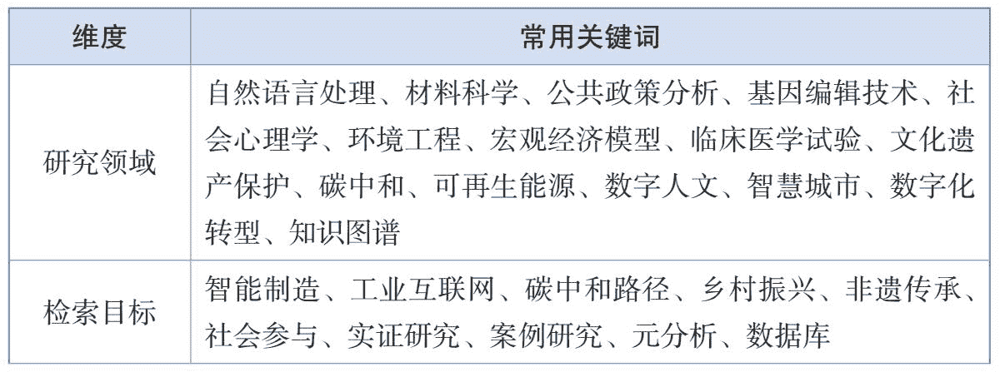

（续表）

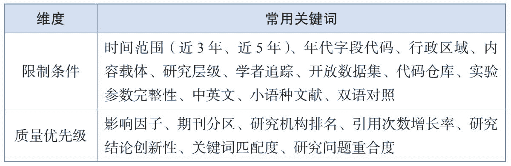

### **2.1.2 学术论文检索提问的 3 个句式模板**

**模板 1：时间限定型提问**

时间限定型提问即“帮我检索［时间范围］的关于［核心关键词/规范术语］在［研究领域］中的应用的论文”。

**示例：**

·“请帮我检索 2023—2025 年发表的关于区块链技术在农产品溯源中应用的论文。”

·“区块链在农产品溯源中的具体应用案例有哪些？需要近 3 年的英文论文。”

**模板 2：分步骤型提问**

分步骤型提问即将复杂问题拆解为多个步骤进行提问。

**示例：**

·第一步：“如何用区块链技术优化供应链金融的信用评估模型？”

·第二步：“请推荐该领域 2023 年发表的 SCI 期刊论文。”

**模板 3：字段限制型提问**

字段限制型提问即“用［工具］查找［限定字段］，应包含［限定字段］且提及［限定字段］的论文”。

**示例：**

·“如何用 Web of Science 查找 2022—2024 年标题包含‘区块链’且摘要提及‘绿色供应链’的 SSCI 期刊论文？”

### **2.1.3 学术论文检索案例**

**案例：“人工智能伦理领域”论文检索**

**用户提问：**“在人工智能伦理方向，检索自动驾驶责任判定机制。要求包含 2020 年后发表于 SCI 一区期刊的英文文献，优先引用 MIT、斯坦福等顶尖实验室成果。请对比欧盟与美国研究团队的方法论差异，并整理争议焦点。”

**DeepSeek 回答：**

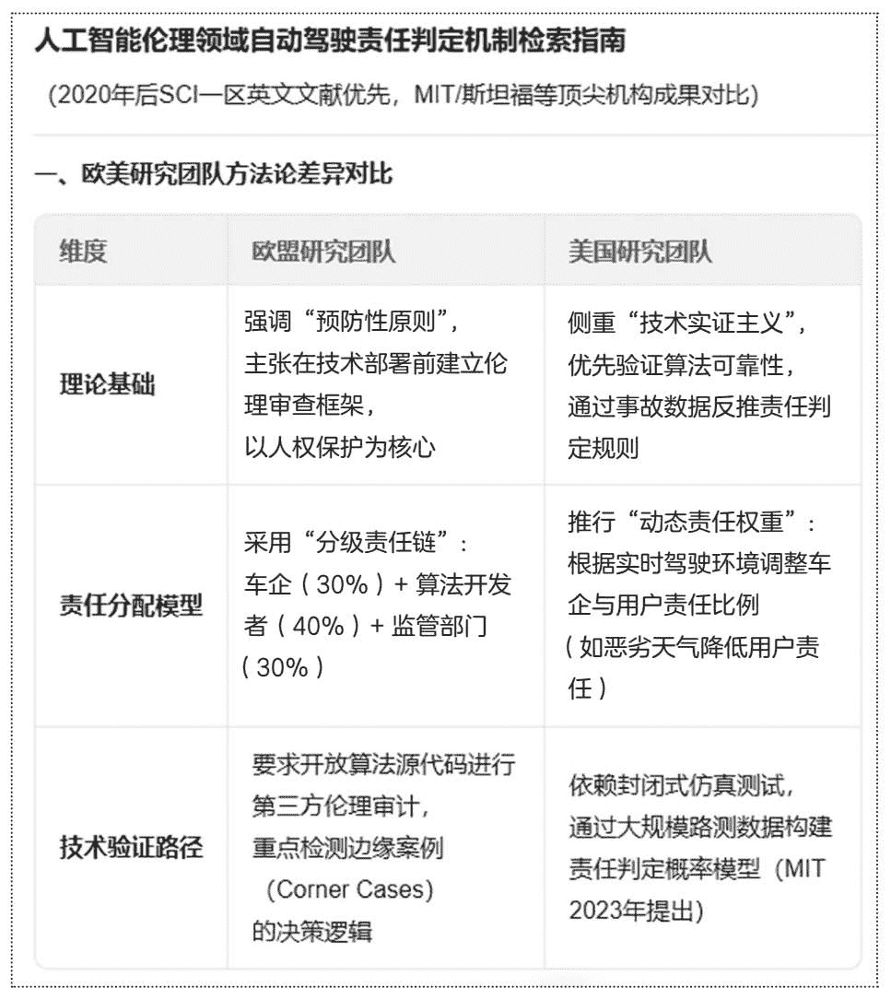

### **2.2 技术文档检索**

### **2.2.1 技术文档检索关键词**

**1. 关键词提取的核心公式**

关键词提取的核心公式为［技术领域］+［检索目标］+［格式/权限限制］+［时效性/优先级］。

**示例拆解：**

·“区块链开发（领域）；查询智能合约部署流程（目标）；仅限 Markdown 格式文档（限制）；需兼容最新 Solidity 版本 0.8.0（版本优先级）。”

在这个组合中，“技术领域”锁定区块链开发的技术范畴，避免泛用性文档干扰，“检索目标”明确了需解决的智能合约部署问题，聚焦操作步骤，“格式/权限限制”条件限定了文档格式，过滤了非结构化文本（如 PDF、扫描件），通过设置“时效性/优先级”强调版本兼容性，排除过时技术方案。这样的组合提问可以快速精准地检索到技术文档。

**2. 关键词库**

常用关键词如表 2-2 所示。

表 2-2 常用关键词

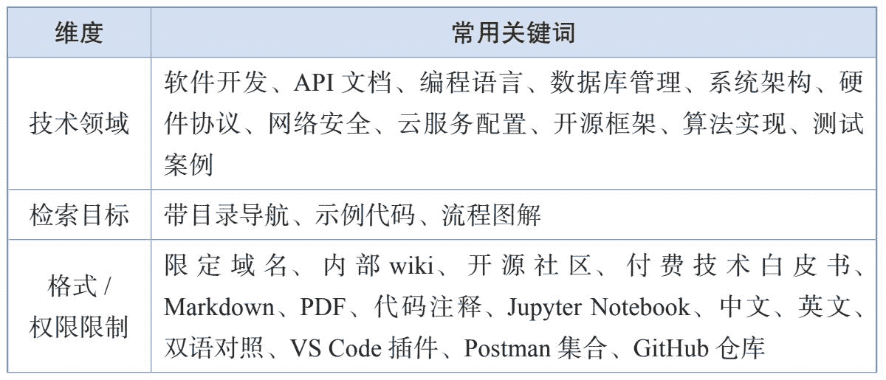

（续表）

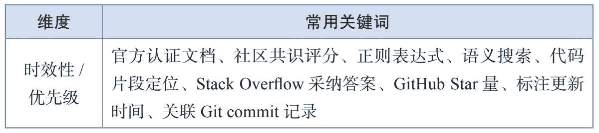

### **2.2.2 技术文档检索提问的 3 个句式模板**

**模板 1：版本兼容性验证**

“在开发［技术领域］时，如何验证［功能/接口］是否兼容［指定版本］？需包含［工具/框架］的官方文档说明和社区适配方案，优先引用近两年更新的解决方案。”

**示例：**

·“在开发 React Native 应用时，如何验证动态权限申请功能是否兼容 Android 13？需包含 react-native-permissions 库的官方文档说明和 GitHub 适配方案，优先引用 2023 年后更新的解决方案。”

**模板 2：多条件筛选式搜索**

“需要查找［技术领域］中［具体功能］的实现方法，要求同时满足［条件 A］、［条件 B］和［格式限制］，排除［过时技术/工具］。”

**示例：**

·“需要查找 React Native 相机权限动态申请的实现方法，要求同时支持 TypeScript 5.0 和 Expo 框架，排除仅适用于 Java/Kotlin 的文档。”

**模板 3：错误场景定向检索**

“当［技术场景］出现［具体报错代码/现象］时，如何通过［工具/日志］定位问题？需提供［平台/版本］的官方修复方案及社区已验证的临时规避措施。”

**示例：**

·“当 Android 端 React Native 应用请求 CAMERA 权限时返回‘PERMISSION_DENIED’错误，如何通过 Android Studio 日志定位问题？需提供 Android 13 的官方修复方案及 GitHub 已验证的临时规避措施。”

### **2.2.3 技术文档检索案例**

**案例：Python 机器学习库的技术文档检索**

**用户提问：**“我需要检索 2023 年后发布的 Python 机器学习库 TensorFlow 的 API 接口文档。”

**DeepSeek 回答：**

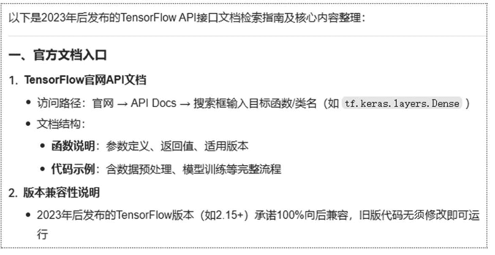

说明：因篇幅原因只展示部分回答。

## **2.3 法律文献检索**

### **2.3.1 法律文献检索关键词**

**1. 关键词提取的核心公式**

关键词提取的核心公式为［法律领域］+［检索目标］+［资源限制］+［质量优先级］。

**示例拆解：**

·“请帮我检索 2024 年关于知识产权法（领域）专利侵权判例（目标），无 Westlaw 权限（限制），侧重最高人民法院判例（权威优先级）。”

在这个组合中，明确“法律领域”可以缩小检索范围，通过“检索目标”拆解可以区分法条查询、案例检索、学术论文搜集等不同需求，“资源限制”条件可以提前说明资源获取障碍（如数据库权限、语言障碍），设置“质量优先级”可以按需设定文献优先级（权威性>时效性>相关性）。

**2. 关键词库**

常用关键词如表 2-3 所示。

表 2-3 常用关键词

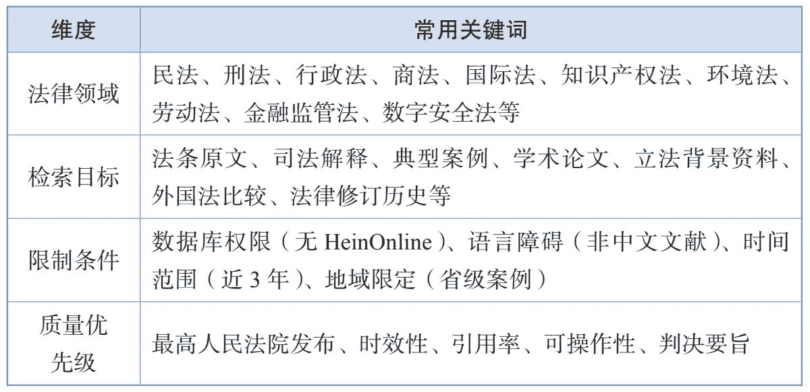

### **2.3.2 法律文献检索提问的 4 个句式模板**

**模板 1：精准需求检索提问**

“作为［法律身份］，需要检索［文献类型］，当前受限于［资源障碍］，请提供［数量］条符合［质量标准］的解决方案。”

**示例：**

·“作为实习律师，需检索《民法典》担保条款的司法适用案例，但无 Westlaw 权限，请提供 3 条利用公开数据库（如中国裁判文书网）的高效检索策略，要求包含筛选最高人民法院指导性案例的方法。”

**模板 2：动态修订追踪检索提问**

“针对［新修订法律名称］，请梳理发布后［时间段］内出现的［学术争议点/司法适用分歧］，要求对比［修订前后］核心条款的学界解读与判例变化。”

**示例：**

·“针对 2024 年新修订《公司法》第 225 条减资规则，请梳理实施 6 个月内出现的‘非等比例减资合法性’争议，要求对比修订前后北大法宝数据库中的相关学术论文及长三角地区法院判例。”

**模板 3：模拟场景检索提问**

“假设［具体法律场景］，需论证［争议焦点］，请提供［法域/时期限定］下支持［立场］的权威文献组合方案，并标注［效力层级］。”

**示例：**

·“假设某科技公司因数据跨境传输被行政处罚，需论证《个人信息保护法》第 38 条‘安全评估’义务的适用范围，请提供 2024 年最高人民法院相关司法解释+欧盟 GDPR 对比分析文献，要求包含跨境判例效力说明。”

**模板 4：证据链补强定向检索提问**

“现有［案件类型］诉讼中缺乏［证据类型］支持，需通过文献检索补强［待证事实］，请锁定［数据库名称］中［证据关联度＞X%］且［司法采信率＞Y%］的文献。”

**示例：**

·“现有商业秘密侵权诉讼中缺乏‘客户名单构成商业秘密’的判例支持，需通过中国裁判文书网补强证据链，请锁定‘指导性案例’标识+‘客户信息保密性认定’出现频次＞5 次的文书。”

### **2.3.3 法律文献检索案例**

**案例：“客户名单保密性认定”判例检索**

**用户提问：**“筛选最高人民法院‘商业秘密侵权’案件中涉及‘客户名单保密性认定’的判例，按 2023 年后发布时间排序。”

**DeepSeek 回答：**

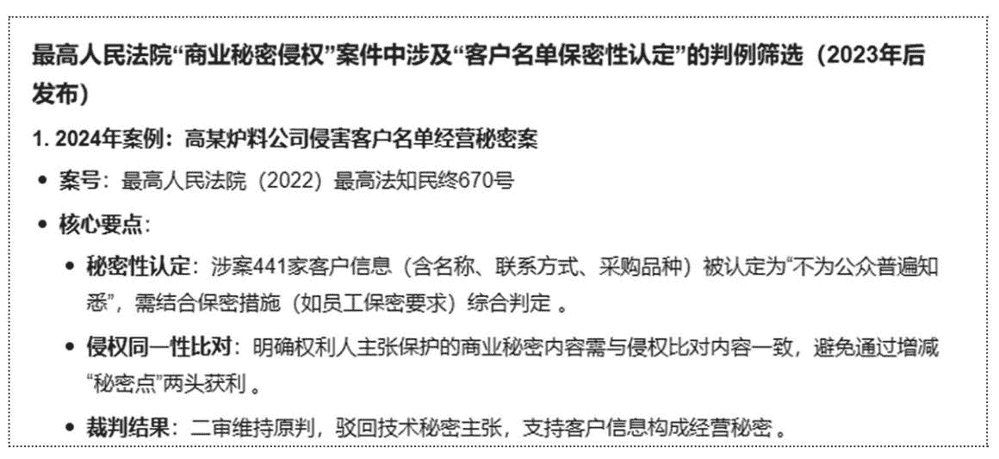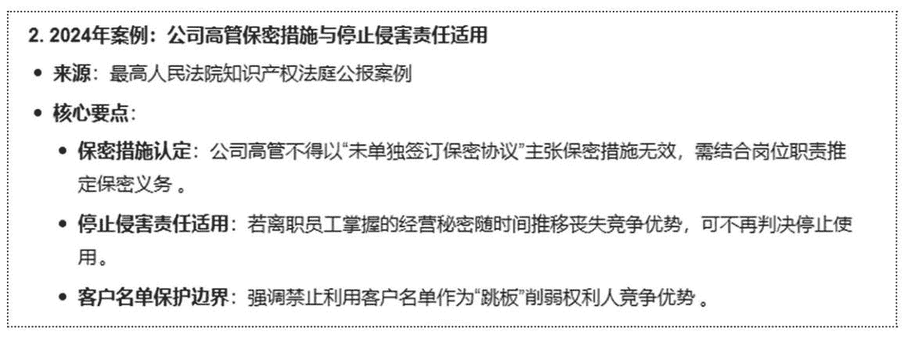

说明：因篇幅原因只展示部分回答。

## **2.4 知识文本查询**

### **2.4.1 知识文本查询关键词**

**1. 关键词提取的核心公式**

关键词提取的核心公式为［查询领域］+［核心目标］+［限制条件］+［质量优先级］。

**示例拆解：**

·“从学术研究（领域）的方向验证量子计算可行性（目标），请提供一些参考文献，仅限英文文献（限制），权威期刊优先（质量）。”

**查询领域：**明确研究方向（如学术、商业、法律等），缩小检索范围。

**核心目标：**定义查询的最终用途（如数据验证、理论溯源、案例对标）。

**限制条件：**语言、时间范围、数据格式等硬性约束。

**质量优先级：**标注优先级（如权威性＞时效性＞可读性）。

**2. 关键词库**

常用关键词如表 2-4 所示。

表 2-4 常用关键词

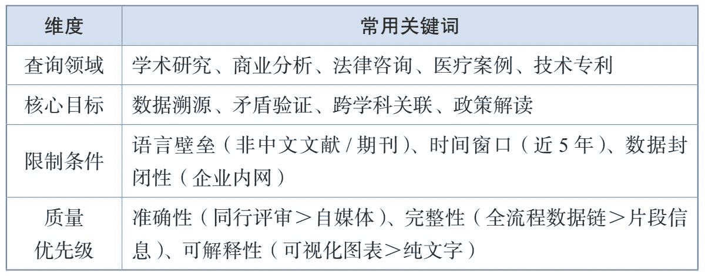

### **2.4.2 知识文本查询提问的 4 个句式模板**

**模板 1：精准溯源式提问**

“作为［研究者/学生］，需验证［具体知识点］在［领域］中的准确性，要求：［数据来源需包含××期刊/××年份报告］，请提取三方交叉验证的关键论据及原始数据页码。”

**示例：**

·“作为医学研究生，需验证‘端粒酶活性与癌症转移相关性’在肿瘤学领域的结论，要求：数据来源必须包含*Nature Medicine* 2024 年及《柳叶刀肿瘤学》2023 年文献，请提供三家独立实验室的细胞实验数据对比表。”

**模板 2：求助式提问**

“作为［新手/特定身份］，要在［时间］内掌握［技能］，已有［资源］，请提供［数量］个关键学习步骤。”

**示例：**

·“作为烹饪小白，要在周末前学会 5 道家常菜，已有电磁炉和基础厨具，请提供：

1. 火候控制口诀（如‘热锅冷油防粘锅’）；

2. 调味品添加顺序黄金法则。”

**模板 3：场景定位式提问**

“在［具体场景］中遇到［问题］，需要［目标］，请提供［数量］条可操作建议。”

**示例：**

·“在超市选购婴儿奶粉时遇到配方成分困惑，需要快速判断产品安全性，请提供 3 条通过包装标识快速鉴别优劣的技巧。”

**模板 4：事务决策式提问**

“我需在［时间限制］内处理［事项］，关键考虑［要素］，请列出风险清单与应对策略。”

**示例：**

·“我的房租将上涨 20%，但搬家时间紧张。考虑居住成本与时间成本，请提供：

1. 续租和搬家的月支出对比表；

2. 紧急找房渠道优先级清单（中介＞社区公告＞熟人推荐）。”

### **2.4.3 知识文本查询案例**

**案例：低敏性宠物饲养方案查询**

**用户提问：**“孩子想养宠物但配偶反对，希望平衡家庭卫生与孩子情感需求，请提供 2 种低敏性宠物饲养方案（如仓鼠/鱼类）及责任分工建议。”

**DeepSeek 回答：**

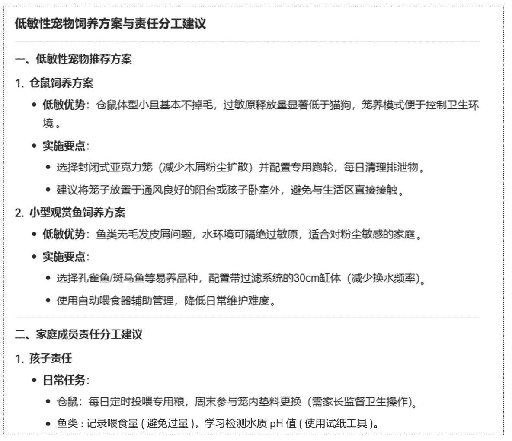

说明：因篇幅原因只展示部分回答。

## **2.5 信息资源推荐**

### **2.5.1 信息资源推荐关键词**

**1. 关键词提取的核心公式**

关键词提取的核心公式为［资源类型］+［学习目标］+［限制条件］+［评估维度］。

**示例拆解：**

·“人工智能入门课程（资源类型）+理解基础算法（目标）+免费且支持碎片化学习（限制）+用户评分≥4.5/5（评估）。”

在这个组合中，通过“资源类型”锁定媒介形态（如课程/书籍/论文/音乐/电影），“学习目标”明确知识深度（入门/进阶），“限制条件”控制可行性（预算/时间/语言），“评估维度”筛选质量标准（权威性/趣味性/用户反馈）。这样的组合提问可以使答案更精准。

**2. 关键词库**

常用关键词如表 2-5 所示。

表 2-5 常用关键词

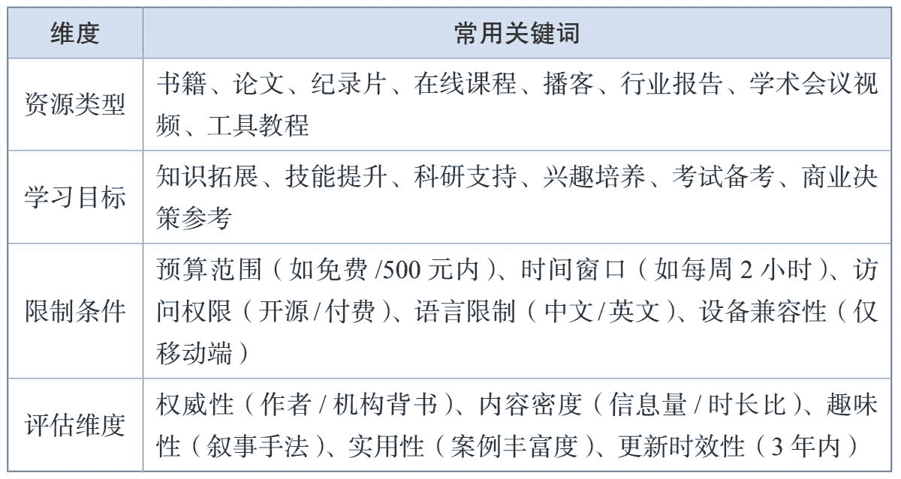

### **2.5.2 信息资源推荐提问的 3 个句式模板**

**模板 1：精准筛选提问**

“作为［身份］，需要获取［资源类型］用于［目标］，要求满足［限制条件］，请按［评估维度］优先级推荐［数量］个选项。”

**示例：**

·“作为人工智能领域研究生（身份），需查找近 3 年发表的强化学习论文（类型）用于文献综述（目标），要求开放获取且含可复现代码（限制），请按被引量降序推荐 5 篇（评估）。”

·“作为新媒体运营新人（身份），需学习短视频脚本写作课程（类型）提升爆款率（目标），预算≤200 元且支持手机端学习（限制），请按完课率＞85%推荐 3 门（评估）。”

**模板 2：教学引导提问**

“如何通过［音乐元素］的［具体维度］对比，帮助［学习者群体］理解［抽象概念］？请设计包含［互动形式］的课堂提问链。”

**示例：**

·“如何通过《蓝色多瑙河》与《二泉映月》的旋律走向对比（元素），帮助初中生（群体）理解中西音乐情感表达差异（概念）？请设计包含‘色彩联想→肢体表达→文化溯源’三阶的提问链。”

**模板 3：跨界组合提问**

“请为［复杂任务］设计跨领域资源组合包，要求包含［资源类型 A］［资源类型 B］［资源类型 C］，并说明协同增效原理。”

**示例：**

·“为‘元宇宙营销方案策划’任务（复杂任务）设计组合包：1 篇 Gartner 趋势报告（类型 A）+3 个 Unity 数字孪生案例视频（类型 B）+用户虚拟形象设计工具教程（类型 C），说明如何交叉验证创意可行性。”

·“为‘儿童编程启蒙’需求（复杂任务）组合资源：Scratch 官方课程（类型 A）+《Hello Ruby》绘本（类型 B）+家长指导手册（类型 C），解释认知发展理论与实践工具的衔接逻辑。”

### **2.5.3 信息资源推荐案例**

**案例：新茶饮行业报告推荐**

**用户提问：**“作为消费领域投资人，我想要获取 2025 年中国新茶饮行业竞争格局分析报告，用于评估项目市场占有率，要求包含 Top 10 品牌供应链数据及近 3 年融资记录，请推荐 3 个含上市公司招股书交叉验证的权威渠道。”

**DeepSeek 回答：**

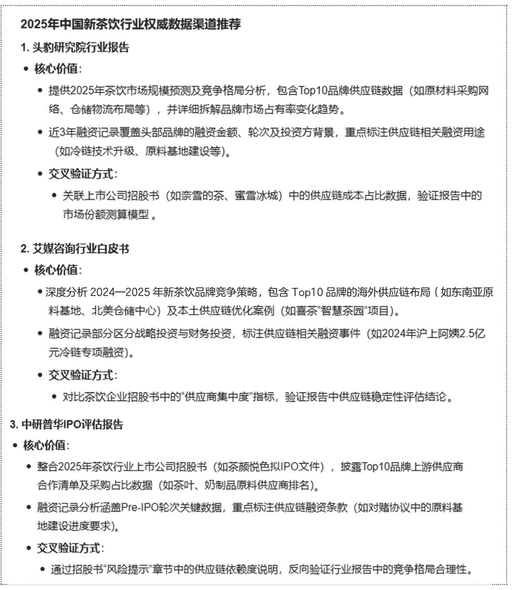

说明：因篇幅原因只展示部分回答。

## **2.6 职业机会推荐**

### **2.6.1 职业机会推荐关键词**

**1. 关键词提取的核心公式**

关键词提取的核心公式为［行业领域］+［职业目标］+［限定条件］+［决策优先级］。

**示例拆解：**

·“本人从互联网行业（领域）转型 AI 算法工程师（目标），数学基础薄弱（限制），薪资涨幅优先（优先级）。”

**行业领域：**明确目标行业（如互联网、金融、医疗），缩小推荐范围。

**职业目标：**界定具体岗位（算法工程师、产品经理、数据分析师）或发展方向（技术/管理/复合型）。

**限定条件：**罗列硬性门槛（学历/证书/技能）、软性短板（沟通能力/管理经验）等。

**决策优先级：**量化核心诉求（薪资、工作强度、发展空间）用于方案筛选。

**2. 关键词库**

常用关键词如表 2-6 所示。

表 2-6 常用关键词

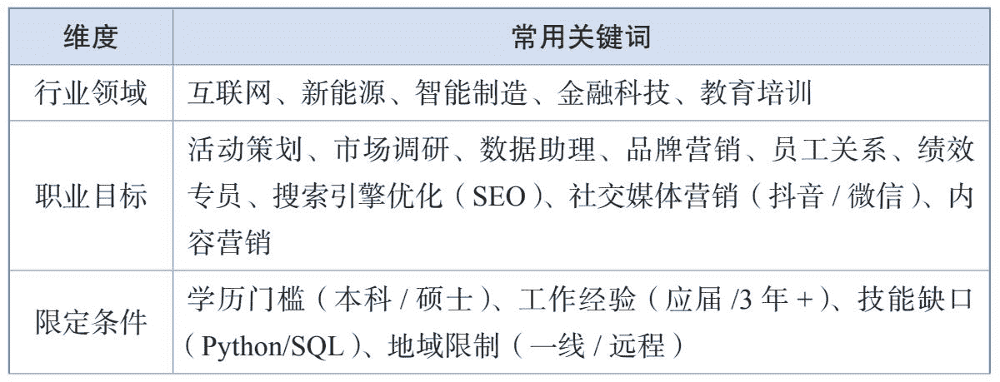

（续表）

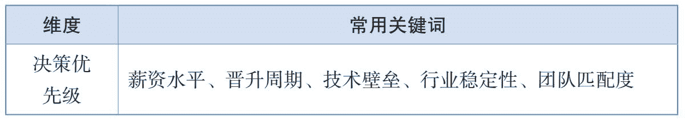

### **2.6.2 职业机会推荐提问的 3 个句式模板**

**模板 1：职业方向诊断**

“作为［当前身份/行业从业者］，计划转型［目标领域/岗位类型］，但受限于［具体障碍］，请提供［数量］条可落地的职业发展建议。”

**示例：**

·“作为传统制造业机械工程师，计划向智能制造领域转型，但缺乏工业互联网项目经验，请提供 3 条 6 个月内可实施的技能提升路径。”

·“作为工作 3 年的市场营销专员，希望转行用户增长方向，但未接触过数据驱动决策模型，请给出 4 条结合现有经验的能力迁移方案。”

**模板 2：职业路径对比**

“针对［职业目标］，请对比以下［数量］种发展路径的［评估维度］，并推荐最优选项。

路径 A：［核心特点］。

路径 B：［核心特点］。”

**示例：**

·“针对技术转型管理岗的目标，请对比以下 2 种路径的晋升周期、技能匹配度与长期收益。

路径 A：内部转岗至项目管理部，特点为利用现有业务熟悉度快速上手，但技术能力可能弱化。

路径 B：考取 PMP 认证后跳槽至科技公司，特点为薪资涨幅显著，但需适应新团队协作模式。”

·“针对新能源行业求职，请对比电池研发工程师（技术深耕）与碳中和咨询顾问（复合能力）的行业需求度、35 岁后职业韧性及薪资天花板。”

**模板 3：职业决策风险评估**

“需在［时间限制］内选择［职业选项］，关键考量包括［要素 1］、［要素 2］，请分析风险等级并给出应对策略。”

**示例：**

·“需在 1 周内决定是否接受异地 AI 算法岗 Offer，关键考量：薪资涨幅 40%但需举家搬迁，职业发展空间大但行业竞争激烈。请评估家庭稳定性风险与技术成长性收益。”

·“需在 3 天内确定是否跳槽至初创公司担任技术总监，关键考量：股权激励潜在收益高，但公司现金流稳定性存疑。请提供融资数据核查方法与对赌协议谈判要点。”

### **2.6.3 职业推荐案例**

**案例：职业推荐及技能提升路径**

**用户提问：**“我目前在传统制造业从事机械设计（领域），希望转型智能制造领域（目标），但缺乏工业互联网项目经验（限制），优先考虑技术成长性（优先级）。请推荐 3 个适配岗位，并说明所需技能提升路径。”

**DeepSeek 回答：**

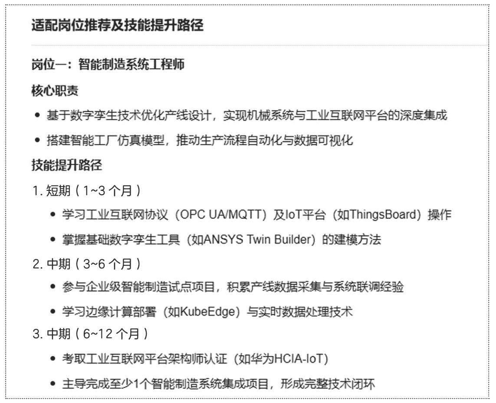

说明：因篇幅原因只展示部分回答。

## **2.7 商业数据查询**

### **2.7.1 商业数据查询关键词**

**1. 关键词提取的核心公式**

关键词提取的核心公式为［需求场景］+［数据类型］+［限制条件］+［优先级指标］。

**示例拆解：**

·“请帮我获取 2024 年东南亚电商市场（场景）实时交易规模与 TOP 3 平台份额（目标），仅限公开免费数据库（限制），数据准确性＞时效性（优先级）。”

在这个组合中，通过限定东南亚电商市场，聚焦区域与行业范围，避免数据泛化；明确需要“交易规模”与“平台份额”两类数据，来区分宏观维度与微观维度；标注“仅限公开免费数据库”，过滤付费或非公开渠道信息；而“准确性＞时效性”，则指导系统优先调用权威机构或学术报告。

**2. 关键词库**

常用关键词如表 2-7 所示。

表 2-7 常用关键词

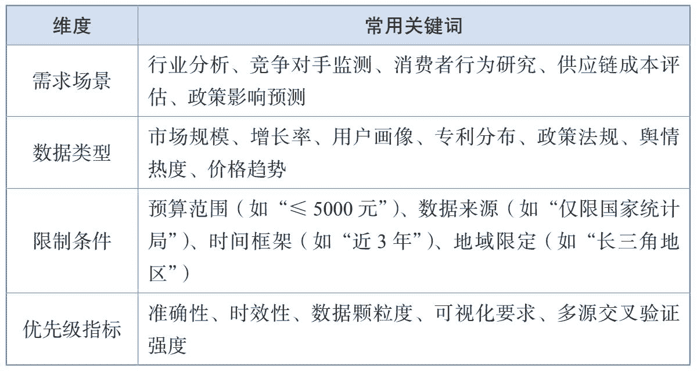

### **2.7.2 商业数据查询提问的 2 个句式模板**

**模板 1：角色代入式提问**

“作为［商业角色］，需在［场景］中获取［数据类型］，限制条件为［预算/来源/地域］，优先级为［指标排序］，请提供［工具建议］+［验证方法］。”

**示例：**

·“作为市场分析师，需获取 2024 年东南亚美妆市场份额数据，限制为仅用免费英文数据库，优先考虑数据准确性，请推荐 3 个权威平台并说明交叉验证流程。”

·“作为跨境品牌咨询师，需分析 2024 年德国个护用品消费者偏好，限制条件为仅用非英文开源数据库，优先级为‘地域细分精度＞数据量’，请推荐适配的政府公开数据平台及抽样统计验证方法。”

**模板 2：步骤拆解法提问**

“将‘查询［目标数据］’拆分为［数量］步，说明每步的［数据源筛选方法］+［清洗规则］+［分析模型］。”

**示例：**

·“将‘分析 2024 年中国新能源汽车电池原材料价格波动’拆分为 4 步：筛选国家统计局与海关总署数据源→剔除异常值→使用 ARIMA 模型预测趋势→生成可视化图表。”

**模板 3：对比分析提问**

“从［维度 1/维度 2/维度 3］对比［数据源 A］与［数据源 B］，输出差异点及适用场景，附［数据修正建议］。”

**示例：**

·“对比 Statista 与 Euromonitor 的 2024 年全球快消品增长率数据，从统计口径、样本覆盖、更新频率三维度分析差异，说明跨国企业应如何修正数据偏差。”

### **2.7.3 商业数据检索案例**

**案例：中国固态电池专利年申请量增长率检索**

**用户提问：**“预测 2025—2028 年中国固态电池专利年申请量增长率，结合国家知识产权局公开数据与 WIPO 全球专利库，使用 ARIMA 模型预测并标注置信区间。”

**DeepSeek 回答：**

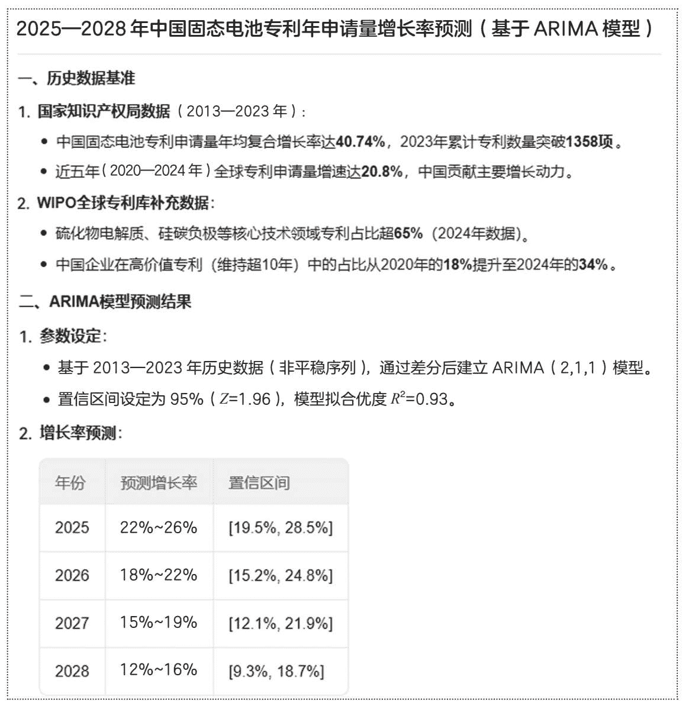

说明：因篇幅原因只展示部分回答。

## **2.8 旅游地点推荐**

### **2.8.1 旅游地点推荐关键词**

**1. 关键词提取的核心公式**

关键词提取的核心公式为［旅行类型］+［体验需求］+［限制条件］+［评估维度］。

**示例拆解：**

·“家庭亲子游（旅行类型）+自然教育体验（需求）+单程交通≤3 小时（限制）+安全系数优先（评估）。”

在这个组合中，通过“旅行类型”锁定场景（亲子场景需关注设施安全性与教育属性），“体验需求”明确核心体验（自然教育而非纯观光），“限制条件”控制可行性（短途交通适配儿童体力），“评估维度”确保决策优先级（安全＞新奇性）。这样的组合提问方式能使答案更精准。

**2. 关键词库**

常用关键词如表 2-8 所示。

表 2-8 常用关键词

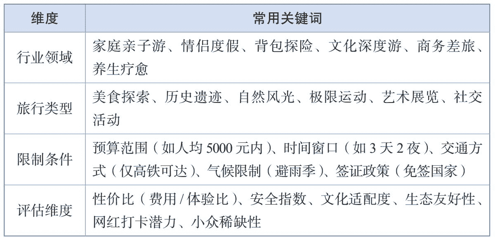

### **2.8.2 旅游地点推荐提问的 4 个句式模板**

**模板 1：精准需求定位**

“计划［旅行类型］行程，主要需求是［体验关键词］，面临［限制条件］，请推荐［数量］个符合［评估维度］优先的目的地。”

**示例：**

·“计划情侣海岛度假（类型），需求为私密度假村与海上运动（体验），预算人均 1.2 万元内（限制），请推荐 3 个东南亚区域且服务评分≥4.8/5 的目的地（评估）。”

**模板 2：多方案对比**

“对比以下［数量］个目的地在［评估维度 1］、［评估维度 2］的优劣，并给出匹配［限制条件］的推荐排序。

A 地：［核心特点］。

B 地：［核心特点］。”

**示例：**

·“对比日本北海道（冰雪景观+温泉酒店）与挪威特罗姆瑟（极光观测+狗拉雪橇）在冬季旅行体验丰富度与摄影出片率的差异，预算限制为 2 万元/人，推荐优先级说明。”

**模板 3：紧急决策支持**

“需在［时间］内确定［目的地］，关键矛盾是［冲突因素］，请提供风险规避方案与备选建议。”

**示例：**

·“需在 24 小时内决定是否预订土耳其行程（原计划下周出发），但当地突发地震预警。关键矛盾为已支付 60%不可退费用与旅行安全风险，请提供外交部安全等级查询渠道与保险理赔攻略。”

**模板 4：场景化提问追问**

“已选定［初步目的地］，请补充以下信息以优化行程规划。

①［维度 1］（如交通接驳耗时/特色餐饮分布）。

②［维度 2］（如亲子设施覆盖度/无障碍通道完善性）。”

**示例：**

·“已确定北海道为冬季旅行地，请补充：

① 札幌至富良野巴士班次间隔与雪天延误概率；

② 滑雪场儿童教学课程师资认证情况。”

### **2.8.3 旅游地点推荐案例**

**案例：旅游景点对比**

**用户提问：**“请帮我生成北京和西安两个城市包含交通耗时、人均消费、网红景点密度的对比表格。”

**DeepSeek 回答：**

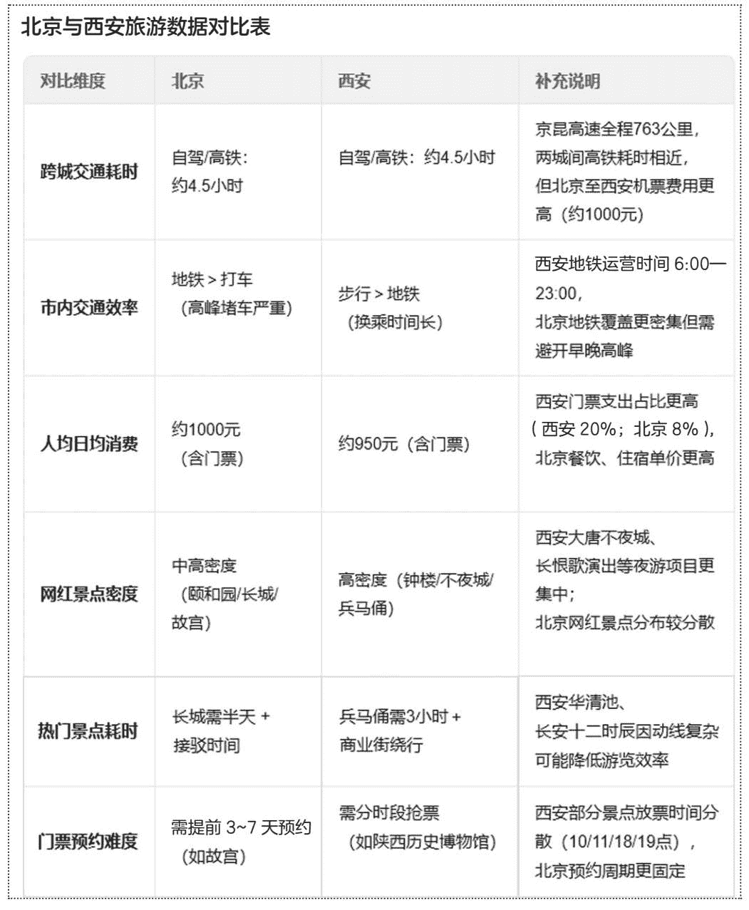

## **2.9 理财产品推荐**

### **2.9.1 理财产品推荐关键词**

**1. 关键词提取的核心公式**

关键词提取的核心公式为［理财规划领域］+［资金增值目标］+［风险偏好/流动性需求限制］+［收益稳定性优先级］。

**示例拆解：**

·“家庭理财（领域）；短期闲置资金增值（目标）；风险承受能力低（限制）；6 个月投资周期（时间优先级）。”

在这个组合中，“理财规划领域”聚焦家庭资产配置方向，“资金增值目标”明确短期资金增值需求，通过限制条件规避高风险产品，强调保本属性，设置“收益稳定性优先级”匹配 6 个月封闭期的产品特性，通过结构化组合，可精准筛选出货币基金、短期债券等低风险理财方案。

**2. 关键词库**

常用关键词如表 2-9 所示。

表 2-9 常用关键词

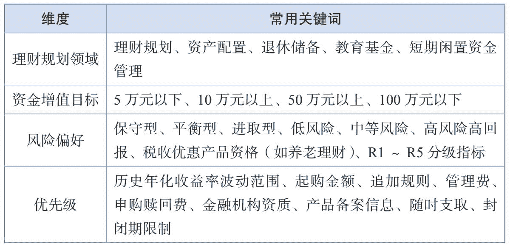

### **2.9.2 理财产品推荐提问的 6 个句式模板**

**模板 1：短期低风险配置型**

“家庭闲置资金（领域）；短期稳健增值（目标）；风险承受能力低（限制）；6 个月投资周期（优先级）。”

**示例：**

·“现有 20 万元家庭闲置资金，希望进行 6 个月的低风险配置，要求保本且可随时应急支取。请对比货币基金、银行短期理财和大额存单的收益率及流动性差异。”

**模板 2：中长期稳健增长型**

“个人理财（领域）；资产稳健增值（目标）；可接受 10%以内波动（限制）；3 年投资周期（优先级）。”

**示例：**

·“计划用 50 万元构建 3 年理财组合，要求年化 5%~6%收益且最大回撤≤15%。请推荐债券基金、固收+产品和混合型基金的具体配比方案。”

**模板 3：高流动性需求型**

“企业周转金（领域）；灵活存取需求（目标）；月均需支取 30%资金（限制）；收益稳定性优先（评估）。”

**示例：**

·“企业账户有 100 万元周转金，需按月支取部分资金。推荐支持 T+0 赎回、年化 3%以上的流动型理财产品，需包含短债基金和银行活期理财对比。”

**模板 4：教育基金专项规划型**

“子女教育储备（领域）；10 年长期增值（目标）；要求绝对保本（限制）；税收优惠优先（评估）。”

**示例：**

·“为子女准备 20 万元教育基金，需锁定 10 年期安全收益。请分析国债、教育储蓄保险及银行专项理财的收益率、赎回规则及税收优惠政策。”

**模板 5：退休储备组合型**

“养老理财（领域）；抗通胀需求（目标）；年龄 55 岁以上（限制）；按月分红优先（评估）。”

**示例：**

·“55 岁客户持有 100 万元养老金，要求组合年化 4%以上且按月派息。推荐大额存单、红利指数基金及年金保险的具体配比与风险说明。”

**模板 6：政策红利捕捉型**

“政策导向投资（领域）；获取税收减免（目标）；持有本地户籍（限制）；合规性优先核查（评估）。”

**示例：**

·“作为上海户籍投资者，30 万元欲配置享受税收优惠的理财产品。请列举养老目标基金、地方政府专项债及公积金补充理财的申购条件与收益测算。”

### **2.9.3 理财产品推荐案例**

**案例：银行理财产品推荐**

**用户提问：**“目前持有 20 万元闲置资金（限制），希望配置中等风险产品（领域），要求 3 年内可灵活赎回（优先级）。请对比推荐 3 款银行理财和券商收益凭证，需包含年化收益率、风险等级和流动性分析（评估）。”

**DeepSeek 回答：**

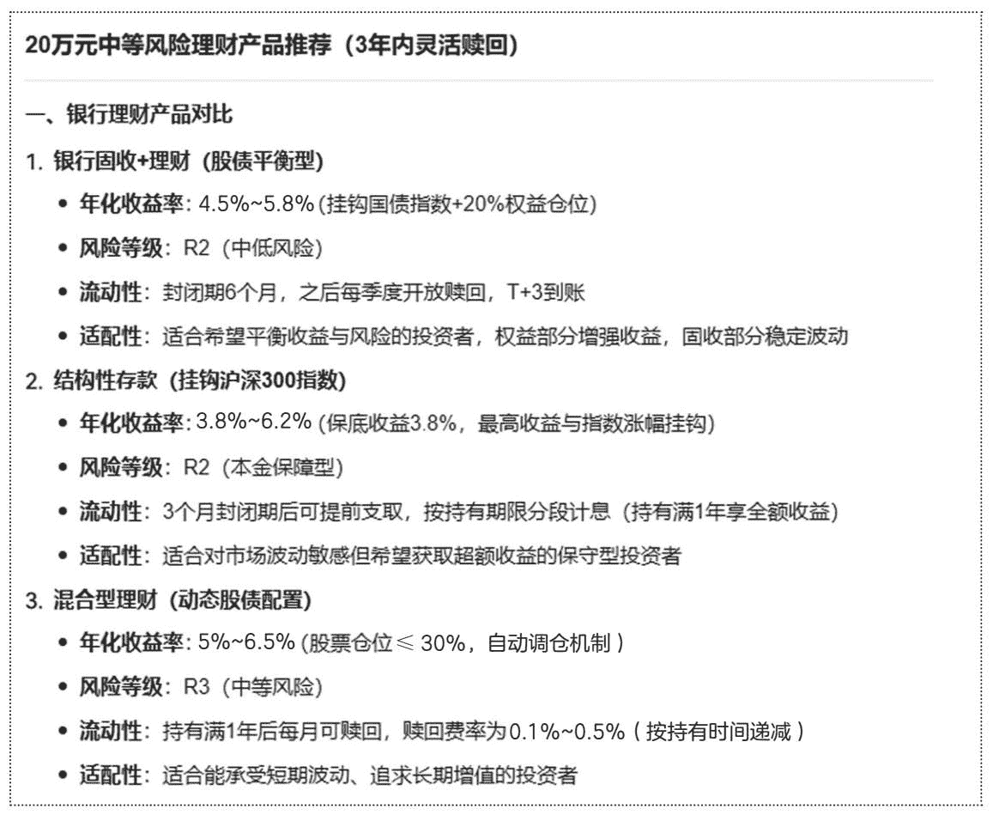

说明：因篇幅原因只展示部分回答。

## **2.10 商品服务推荐**

### **2.10.1 商品服务推荐关键词**

**1. 关键词提取的核心公式**

关键词提取的核心公式为［商品/服务类型］+［核心需求］+［预算范围］+［评估维度］。

**示例拆解：**

·“智能家居设备（商品类型）；节能环保（核心需求）；5000 元以内（预算范围）；能耗等级+智能化程度（评估维度）。”

在这个组合中，“商品/服务类型”明确了推荐方向（如数码产品、家居用品等），“核心需求”聚焦用户痛点（如性价比、耐用性、便捷性），“预算范围”限定了价格区间，避免无效推荐（如“200~500 元”“高端定制”），“评估维度”则确定了筛选标准（如用户评价、品牌信誉、功能适配性）。这样的提问让我们得到的答案更精准。

**2. 关键词库**

常用关键词如表 2-10 所示。

表 2-10 常用关键词

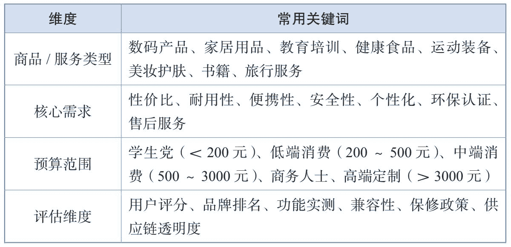

### **2.10.2 商品服务推荐提问的 5 个句式模板**

**模板 1：基础需求提问**

“满足［使用场景］需求的［商品类型］，预算［金额范围］，需对比［参数 1］与［参数 2］的实测数据。”

**示例：**

·“满足 90m²复式户型需求的智能扫地机器人，预算 3000 元内，需对比激光雷达与视觉导航的避障成功率。”

**模板 2：竞品对比法提问**

“对比［商品 A］与［商品 B］在［核心需求］上的差异，预算［金额范围］，优先考虑［评估维度 1］且［评估维度 2］不低于行业均值。”

**示例：**

·“对比戴森 V12 与米家无线吸尘器在宠物毛发清理上的差异，预算 2000 元内，优先考虑吸力衰减率且噪声值≤75dB。”

**模板 3：需求矛盾化解式提问**

“需要同时满足［需求 A］和［需求 B］的［商品类型］，预算［金额范围］，若无法兼得，请提供［数量］种替代方案并说明妥协点。”

**示例：**

·“需同时满足 200km 续航和 2 小时快充的电动自行车，预算 5000 元内，若无法兼得，请提供 3 种替代方案并说明电池类型与充电桩适配性差异。”

**模板 4：预算适配提问**

“根据［预算弹性说明］（如‘可上浮 10%’），推荐［商品类型］的［数量］个档位方案，需包含［必选功能］及对应性价比评估。”

**示例：**

·“根据‘预算 8000 元可上浮 15%’，推荐游戏本的 3 个档位方案（RTX4060/4070/4080），需包含双内存插槽及散热系统噪声对比。”

**模板 5：服务全周期覆盖提问**

“推荐［商品类型］时需包含［时间跨度］内的［服务类型］保障，预算［金额范围］，重点说明［售后服务条款］与［异常情况处理流程］。”

**示例：**

·“推荐空气净化器时需包含 3 年内的滤芯更换服务，预算 4000 元内，重点说明 PM2.5 传感器校准周期及数据异常报修响应时效。”

### **2.10.3 商品服务推荐案例**

**案例：入门级微单相机推荐**

**用户提问：**“请推荐一款入门级微单相机（商品类型），核心需求是轻便易操作（核心需求），预算 3000~5000 元（预算范围），需对比画质、镜头适配性和续航能力（评估维度）。”

**DeepSeek 回答：**

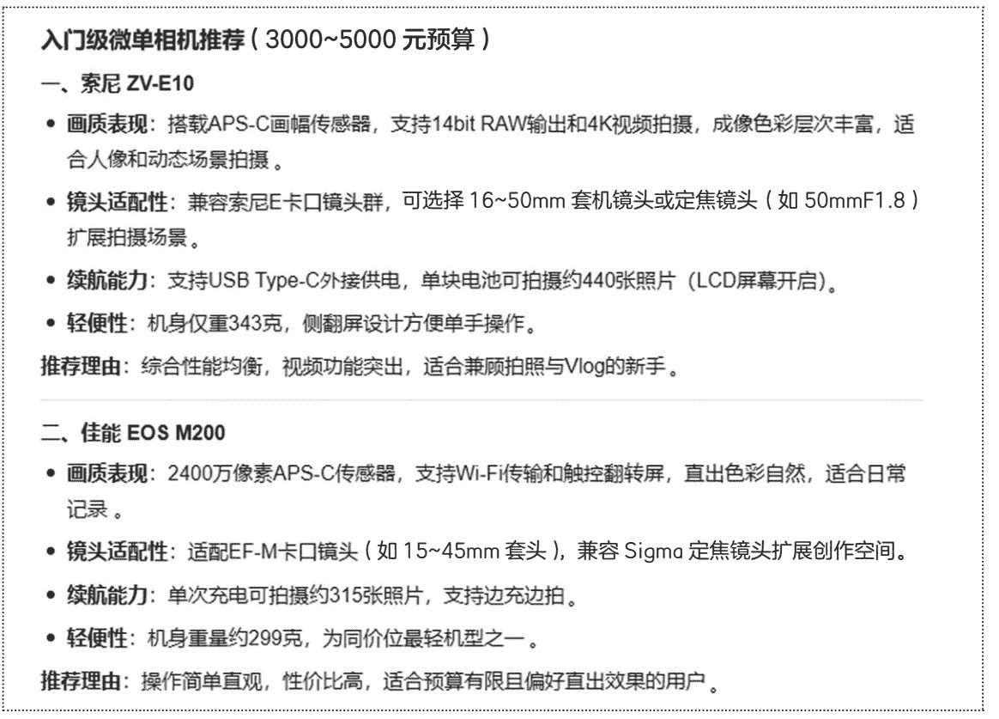

说明：因篇幅原因只展示部分回答。

# **第三章**

# **请求解释描述说明**

## **3.1 概念术语解释**

### **3.1.1 概念术语解释关键词**

**1. 关键词提取的核心公式**

关键词提取的核心公式为［术语名称］+［学科领域］+［核心特征］+［应用场景］。

**示例拆解：**

·“机器学习（术语名称）；人工智能（学科领域）；数据驱动的算法训练（核心特征）；金融风控与医疗诊断（应用场景）。”

**术语名称：**明确待解释的核心概念（如“区块链”“认知偏差”）。

**学科领域：**定位术语的知识边界（如计算机科学、心理学、法学）。

**核心特征：**提炼区别于其他概念的独特性（如“去中心化”“非理性决策模式”）。

**应用场景：**说明术语的实际价值（如“合同纠纷解决”“用户行为分析”）。

**2. 关键词库**

常用关键词如表 3-1 所示。

表 3-1 常用关键词

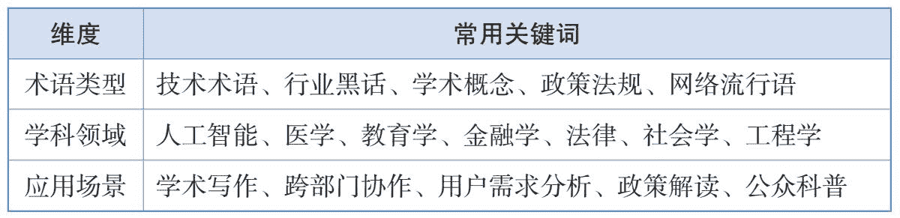

### **3.1.2 概念术语解释提问的 3 个句式模板**

**提问模板 1：要素拆解定位法**

“请从［学科领域］角度解释［术语名称］，需包含［核心特征］、［应用场景］和［常见误解］，用［数字］个案例说明其与［相近术语］的差异。”

**示例：**

·“请从计算机科学角度解释‘机器学习’，需包含数据驱动特征、金融风控场景和过拟合误区，用 2 个案例说明其与‘深度学习’的差异。”

**提问模板 2：动态对比分析法**

“对比［术语 A］与［术语 B］在［学科领域］中的差异，重点说明［比较维度 1］、［比较维度 2］和［历史演变］，给出［数字］个典型应用场景对比。”

**示例：**

·“对比‘区块链’与‘分布式数据库’在信息技术中的差异，重点说明数据结构、信任机制和溯源能力，给出 3 个供应链管理场景对比。”

**提问模板 3：属性分层提问法**

“将［术语名称］拆解为［层级数］个认知层级：基础定义层需包含［要素 1］+［要素 2］，扩展属性层需说明［特征 1］与［特征 2］的关联，实践应用层需列举［数字］种［具体场景］案例。”

**示例：**

·“将‘元宇宙’拆解为 3 个层级：基础定义（虚拟空间+数字身份）、扩展属性（区块链经济+感官沉浸）、实践应用（3 种工业数字孪生案例）。”

### **3.1.3 概念术语解释案例**

**案例：解释“算法过滤机制如何加剧认知局限”**

**用户提问：**“用‘抖音信息流推荐’现象反向推导‘信息茧房’要素，解释算法过滤机制如何加剧认知局限，标注其在社交媒体与学术检索中的差异。”

**DeepSeek 回答：**

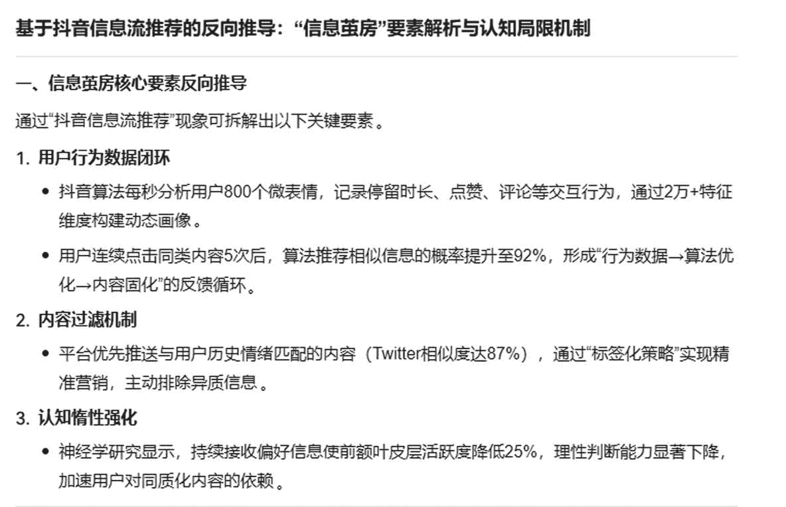

## **3.2 定义公式解释**

### **3.2.1 定义公式解释关键词**

**1. 关键词提取的核心公式**

关键词提取的核心公式为［定义名称］+［应用场景］+［具体困惑点］+［验证方式］。

**示例拆解：**

·“根据 AARRR 模型（定义名称）在电商用户增长中的应用（应用场景），如何理解激活阶段的‘Aha Moment’设计（具体困惑点）？需结合拼多多北极星指标案例验证（验证方式）。”

在这个组合中，“定义名称”明确了讨论对象，“应用场景”限定了公式边界（同一公式在不同场景有差异化解释），“具体困惑点”聚焦矛盾核心，“验证方式”建立判断标准（通过案例/数据锚定解释有效性）。这样的提问方式使答案更精准。

**2. 关键词库**

常用关键词如表 3-2 所示。

表 3-2 常用关键词

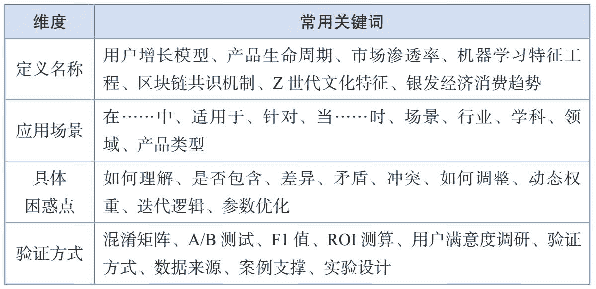

### **3.2.2 定义公式解释提问的 4 个句式模板**

**提问模板 1：角色限定法**

“作为［专业角色］，在［具体场景］中需要完成［核心任务］，面临［限制条件］，请提供［数量］个［解决方案/策略］并说明［验证标准］。”

**示例：**

·“作为跨境电商运营专员，在 Prime Day 大促期间需提升转化率（预算≤5 万元），请提供 3 个站外引流策略，需结合亚马逊广告 ROI 数据验证有效性。”

**提问模板 2：流程拆解法**

“将［复杂任务］拆分为［步骤数］个阶段，阐述每个阶段需满足的［目标/工具/注意事项］，并给出［场景限定］下的执行案例。”

**示例：**

·“将抖音直播间流量冷启动拆分为 4 个阶段，说明每个阶段的目标、需监测的数据指标及常见误区，需结合美妆类目新账号案例。”

**提问模板 3：矛盾对比法**

“对比［选项 A］与［选项 B］在［场景/维度］中的差异，需从［评估维度］分析优劣，并通过［数据/案例］验证结论可靠性。”

**示例：**

·“对比私域社群运营与抖音投流在母婴用品复购场景中的 ROI 差异，从获客成本、用户黏性、长期价值维度分析，需结合孩子王 2024 年 Q2 财报数据。”

**提问模板 4：场景限定法**

“在［具体场景］中，如何解决［核心痛点］？需满足［限制条件］，并通过［验证工具/指标］评估方案可行性。”

**示例：**

·“在三四线城市社区团购场景中，如何解决生鲜商品次日达履约率问题（仓储成本≤10 万元/月）？需用漏斗模型分析各环节损耗率。”

### **3.2.3 定义公式解释案例**

**案例：金字塔模型定义解释**

**用户提问：**金字塔模型的三个分层标准是什么？需说明各层关键数据指标。

**DeepSeek 回答：**

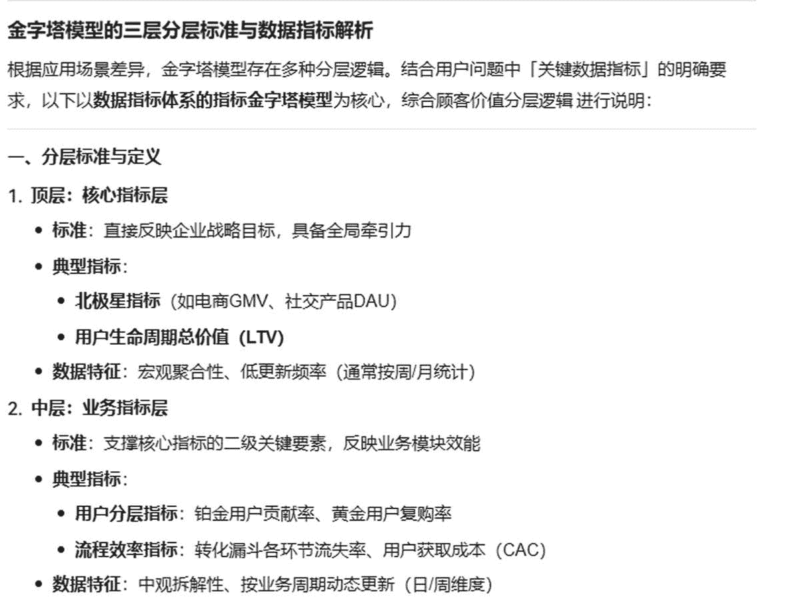

说明：因篇幅原因只展示部分回答。

## **3.3 政策法规解释**

### **3.3.1 政策法规解释关键词**

**1. 关键词提取的核心公式**

关键词提取的核心公式为［法规名称］+［适用场景］+［核心条款］+［争议焦点］+［实施细则］。

**示例拆解：**

·“《个人信息保护法》（法规名称）；互联网企业数据跨境传输（适用场景）；第 38 条安全评估义务（核心条款）；跨境数据主权争议（争议焦点）；国家网信办《数据出境安全评估办法》（实施细则）。”

**法规名称：**精准定位政策文件（如《劳动法》《数据安全法》）。

**适用场景：**限定法规作用范围（如企业用工、跨境贸易、数据合规）。

**核心条款：**提炼直接影响行为的条文（如“劳动者每日加班不得超过 3 小时”）。

**争议焦点：**标注法律解释分歧（如“灵活用工是否适用劳动关系认定”）。

**实施细则：**关联配套文件（如地方性法规、行业标准）。

**2. 关键词库**

常用关键词如表 3-3 所示。

表 3-3 常用关键词

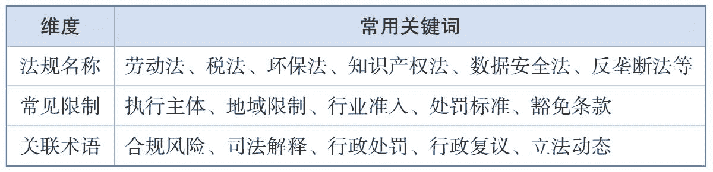

### **3.3.2 政策法规解释提问的 4 个句式模板**

**提问模板 1：核心条款解析提问**

“请解析《［政策名称］》第［具体条款］条的核心要求，说明其在［特定领域］中的执行标准，并列举［数量］个违反该条款的典型案例。”

**示例：**

·“请解析《数据安全法》第 27 条的核心要求，说明其在跨境电商中的执行标准，并列举 2 个违反数据跨境传输规定的典型案例。”

**提问模板 2：政策对比分析提问**

“对比《［政策 A］》与《［政策 B］》在［具体场景］中的适用差异，重点说明［维度 1］、［维度 2］的冲突条款，并给出［数量］个跨政策合规建议。”

**示例：**

·“对比《个人信息保护法》与《网络安全法》在 APP 隐私收集中的适用差异，重点说明用户授权方式、数据存储期限的冲突条款，并给出 3 个合规建议。”

**提问模板 3：执行指导型提问**

“根据《［政策名称］》要求，列明［行业类型］企业需完成的［数量］项合规动作清单，并标注［具体条款］对应的处罚标准。”

**示例：**

·“根据《反垄断法》要求，列明电商平台需完成的 5 项合规动作清单，并标注第 22 条对应的罚款计算方式。”

**提问模板 4：争议焦点追问法**

“围绕《［政策名称］》第［条款］条的实施争议，分析［利益方 A］与［利益方 B］的核心分歧，结合［数量］个司法判例说明裁量尺度。”

**示例：**

·“围绕《劳动法》第 41 条的加班时长争议，分析企业与劳动者的核心分歧，结合 3 个劳动争议判例说明仲裁标准。”

### **3.3.3 政策法规解释案例**

**案例：适用《广告法》第 28 条的法规解释**

**用户提问：**“针对直播带货中的虚假宣传问题，说明如何适用《广告法》第 28 条进行整改，需包含话术审查、证据留存和处罚申诉流程。”

**DeepSeek 回答：**

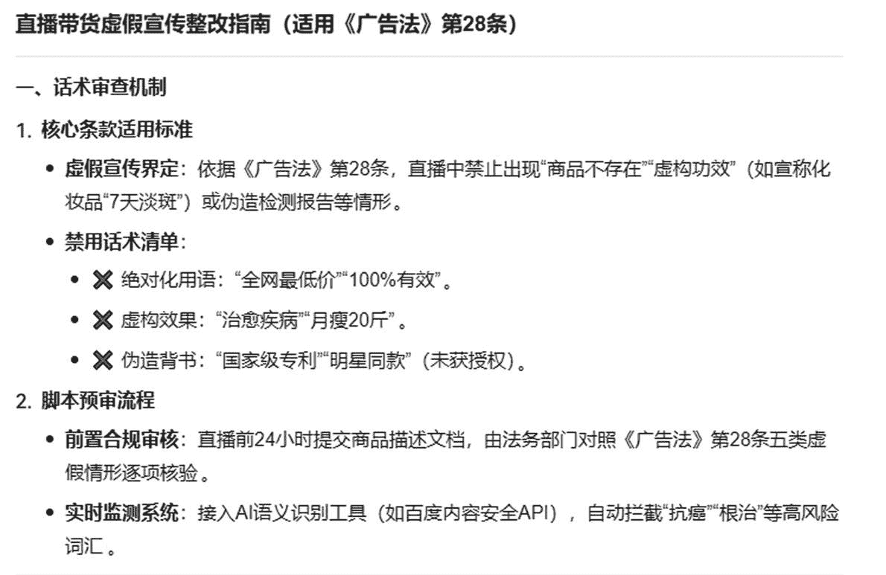

说明：因篇幅原因只展示部分回答。

## **3.4 规则规定解释**

### **3.4.1 规则规定解释关键词**

**1. 关键词提取的核心公式**

关键词提取的核心公式为［规则领域］+［具体问题］+［限制条件］+［解释维度］。

**示例拆解：**

·“互联网广告法（规则领域）；医疗产品宣传禁用词（具体问题）；2025 年修订版（时间限制）；条款原文+执法案例（深度要求）。”

**规则领域：**明确规则所属的行业/法律/制度体系（如《劳动法》、医疗报销政策）。

**具体问题：**聚焦规则中模糊的条款或矛盾点（如“加班费计算是否包含绩效奖金”）。

**限制条件：**添加时间、地区、主体类型等约束（如“2025 年修订的上海医保政策”）。

**解释维度：**要求解释形式（如“条款原文+官方解读+案例说明”）。

**2. 关键词库**

常用关键词如表 3-4 所示。

表 3-4 常用关键词

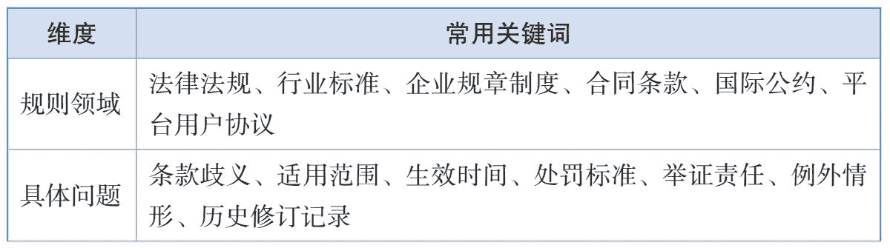

（续表）

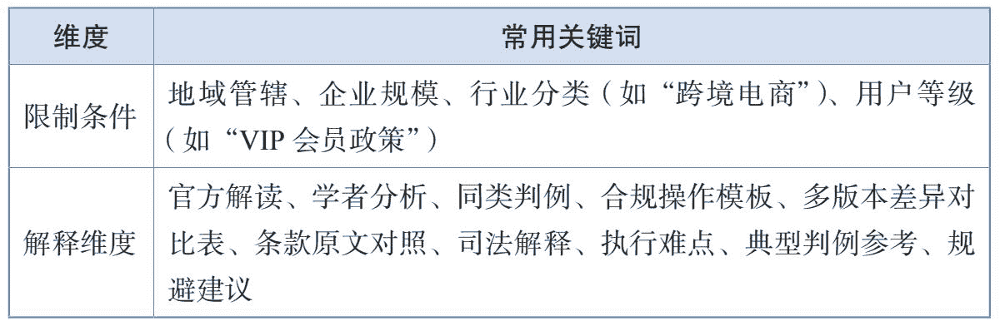

### **3.4.2 规则规定解释提问的 3 个句式模板**

**提问模板 1：条款冲突解析提问**

“当［规则 A］第 X 条与［规则 B］第 Y 条在［具体场景］中产生冲突时，根据［限制条件］，应优先适用哪项条款？能否提供司法/行政实践中的典型案例？”

**示例：**

·“当《医疗事故处理条例》与《民法典》医疗损害责任篇在‘患者知情同意范围’界定上冲突时，针对急诊抢救场景，应优先适用哪条规定？是否有最高法院指导案例支持？”

**提问模板 2：例外情形挖掘提问**

“在［规则领域］中，针对［特殊主体/场景］，是否存在［例外豁免/简化程序］？需提供条款原文及官方解释文件编号。”

**示例：**

·“在‘高新技术企业认定’政策中，对‘初创型 AI 芯片企业’的研发投入比例要求是否有特殊豁免？请提供工信部火炬中心 2025 年版政策原文及解读。”

**提问模板 3：历史修订追溯提问**

“从［起始年份］至［结束年份］，［规则名称］关于［具体问题］的修订逻辑是什么？关键修订节点对应的社会事件/行业诉求有哪些？”

**示例：**

·“从 2015 到 2025 年，《网约车管理办法》对司机准入条件的修订逻辑是什么？2018 年顺风车安全事件后有哪些针对性调整？”

### **3.4.3 规则规定解释案例**

**案例：《劳动法》中，关于“加班工资计算基数”的解释**

**用户提问：**“在《劳动法》中，关于‘加班工资计算基数’，根据‘北京市 2025 年最低工资标准’，应如何理解‘劳动者本人正常工作时间工资’的界定？”

**DeepSeek 回答：**

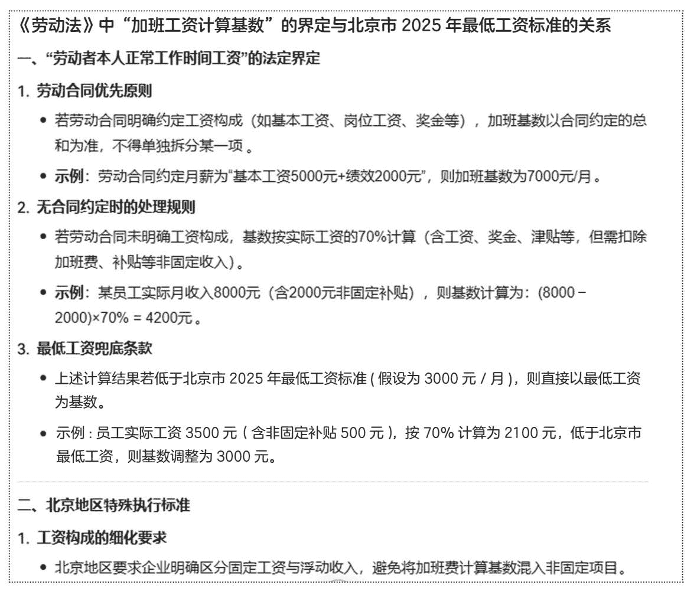

说明：因篇幅原因只展示部分回答。

## **3.5 功能用途说明**

### **3.5.1 功能用途说明关键词**

**1. 关键词提取的核心公式**

关键词提取的核心公式为［功能领域］+［具体用途］+［限制条件］+［使用场景/用户群体］。

**示例拆解：**

·“AI 图像工具（领域）；批量生成电商产品情景图（用途）；月预算 500 元内（限制）；服装品牌运营团队（场景）。”

在这个组合中，通过限定预算和用户群体，避免泛泛而谈的功能介绍，直接获取符合中小企业实际需求的工具推荐。

**2. 关键词库**

常用关键词如表 3-5 所示。

表 3-5 常用关键词

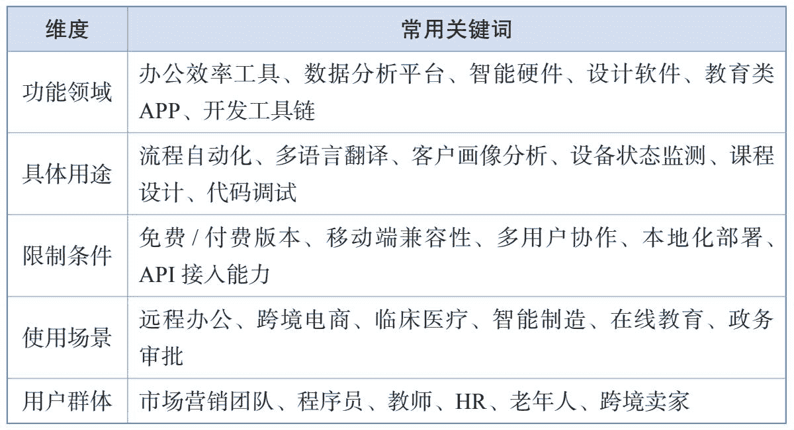

### **3.5.2 功能用途说明提问的 3 个句式模板**

**提问模板 1：核心功能验证提问**

“在［功能领域］，［工具名称］宣称的［核心功能］是否真实存在？能否提供该功能在［典型场景］中的 3 个具体使用案例？”

**示例：**

·“在‘AI 写作工具’中，Jasper 宣称的‘长文逻辑优化’功能是否真实存在？能否提供在‘学术论文润色’场景中的具体案例？”

**提问模板 2：场景适配性深挖提问**

“对于［用户群体］在［极端场景］中的［具体需求］，［工具名称］的［功能组合］能否提供［差异化解决方案］？需对比传统手段的改进点。”

**示例：**

·“对于‘户外探险团队’在‘无网络山区’中的‘实时定位共享’需求，ZOLEO 卫星通信设备的‘北斗+天通’双模功能能否替代传统对讲机？需对比信号覆盖率和设备功耗。”

**提问模板 3：安全合规审查提问**

“在［敏感行业］（如医疗/金融）中，使用［工具名称］的［数据相关功能］是否符合［法规名称］要求？能否提供第三方出具的合规审计报告节选？”

**示例：**

·“在‘在线诊疗’场景中，使用腾讯会议的‘屏幕共享’功能传输患者病历，是否符合 HIPAA 隐私保护标准？能否提供国际认可的 ISO 27001 认证报告？”

### **3.5.3 功能用途说明案例**

**案例：“项目管理工具”中 Trello 的核心功能解析**

**用户提问：**“在‘项目管理工具’中，Trello 的核心功能有哪些？这些功能如何帮助远程团队解决任务协作问题？”

**DeepSeek 回答：**

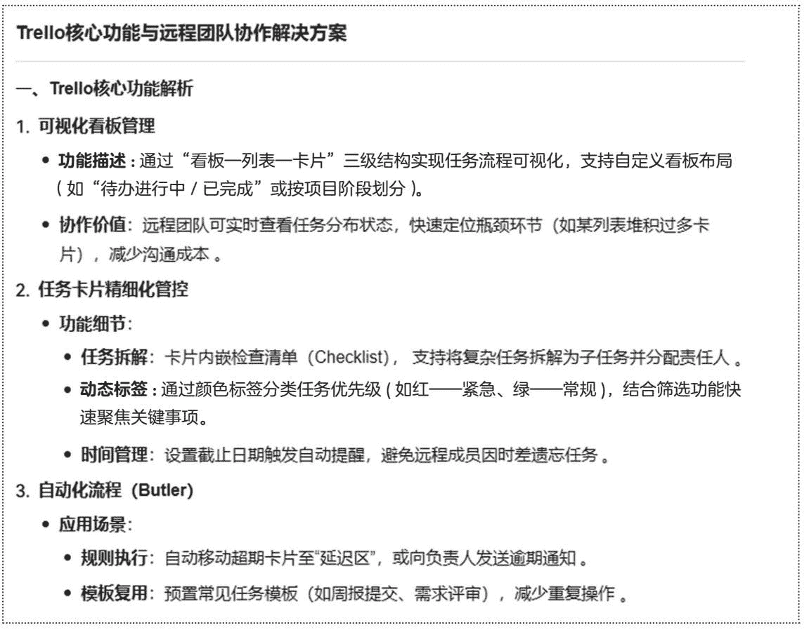

说明：因篇幅原因只展示部分回答。

## **3.6 特征特点说明**

### **3.6.1 特征特点说明关键词**

**1. 关键词提取的核心公式**

关键词提取的核心公式为［领域］+［核心属性］+［差异化表现］+［评估标准］。

**示例拆解：**

·“智能家居（领域）；语音控制（核心属性）；老人独立操作无压力（差异化表现）；安全性高（评估标准）。”

在这个组合里，明确“智能家居”领域框定了问题范畴；“语音控制”核心属性点明了产品的关键功能特征；“老人独立操作无压力”的差异化表现，突出了针对特殊使用人群的需求差异；“安全性高”的评估标准，强调了对产品质量的重要考量维度。这样的组合能够让提问更精准，获取的建议也更贴合实际需求。

**2. 关键词库**

常用关键词如表 3-6 所示。

表 3-6 常用关键词

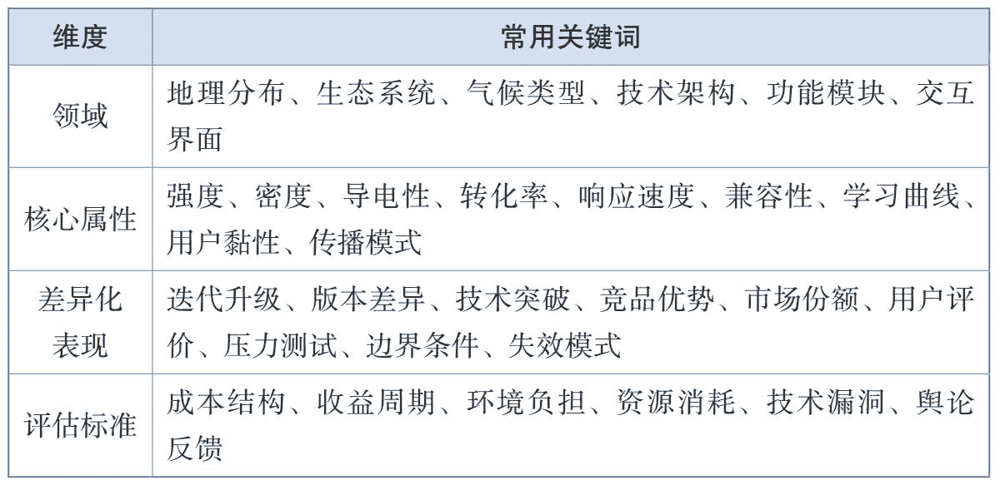

### **3.6.2 特征特点说明提问的 3 个句式模板**

**提问模板 1：多维度解析式提问**

“请从［维度 A/维度 B/维度 C］3 个角度，分析［对象］的特征特点。”

**示例：**

·“请从技术架构、用户体验、商业模式 3 个角度，分析短视频平台的特征特点。”

·“请从材质、结构、功能 3 个维度描述智能手表的核心特征，要求至少使用列数字（如重量/尺寸）、摹状貌（如曲面屏弧度）两种说明方法。”

**提问模板 2：对比定位式提问**

“与［同类对象 X］相比，［对象 Y］在［特征维度］上有何独特表现？”

**示例：**

·“与传统燃油车相比，特斯拉在动力响应速度上有何独特表现？”

·“与传统纸质书相比，电子阅读器的触感差异有何特征，需包含物理特征（如纸张纹理和屏幕反光）和感官体验（油墨气味和蓝光疲劳）的具体描述。

**提问模板 3：用户视角式提问**

“作为［用户角色］，您最关注［对象］的哪些［特征］？请按优先级排序。”

**示例：**

·“作为职场新人，你最关注办公笔记本的哪些特征？请按优先级排序。”

·“在暴雨天气场景中，作为外卖骑手，你最希望电动车具备哪些防水性能？”

### **3.6.3 特征特点说明案例**

**案例：欧盟碳边境调节机制（CBAM）的特征解读**

**用户提问：**“从碳中和目标、碳交易市场机制、高碳企业转型压力，解读欧盟碳边境调节机制（CBAM）的特征。”

**DeepSeek 回答：**

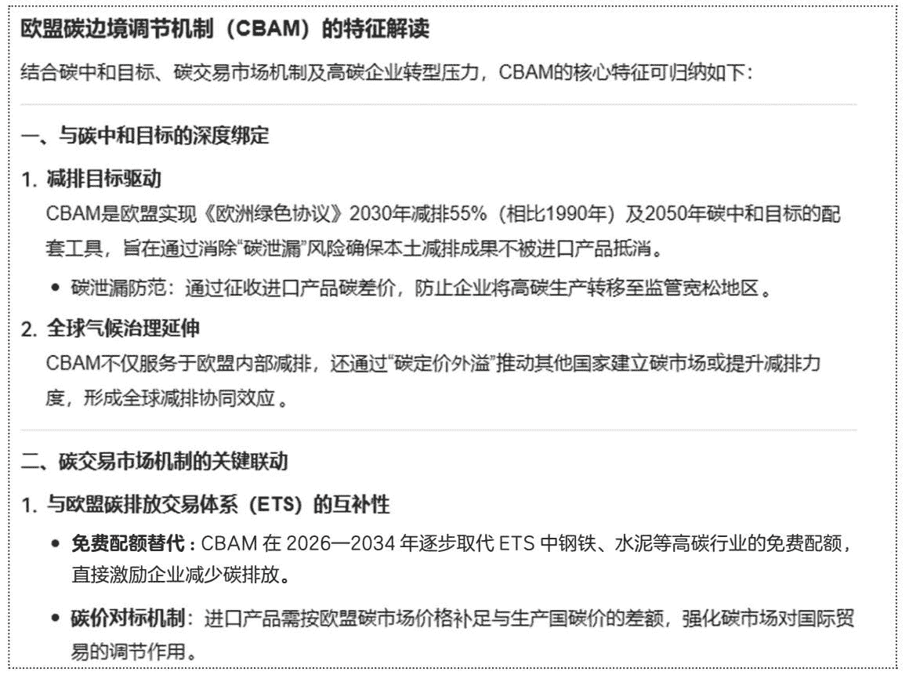

说明：因篇幅原因只展示部分回答。

## **3.7 事物事件描述**

### **3.7.1 事物事件描述关键词**

**1. 关键词提取的核心公式**

关键词提取的核心公式为［主体］+［属性类型］+［量化指标］+［对比维度］。

**示例拆解：**

·“智能手表（主体）；外观设计（属性）；表盘直径 42mm/厚度 11.5mm（量化）；对比同类产品重量分布（对比）。”

**主体：**明确描述对象（如产品、事件、现象）。

**属性类型：**区分物理特征（外观/材质）、功能参数（续航/精度）或事件要素（时间/参与者）。

**量化指标：**用数值/等级精准表达（如“误差率≤3%”“用户满意度 4.8/5”）。

**对比维度：**建立参照系（如行业标准、历史数据、竞品分析）。

**2. 关键词库**

常用关键词如表 3-7 所示。

表 3-7 常用关键词

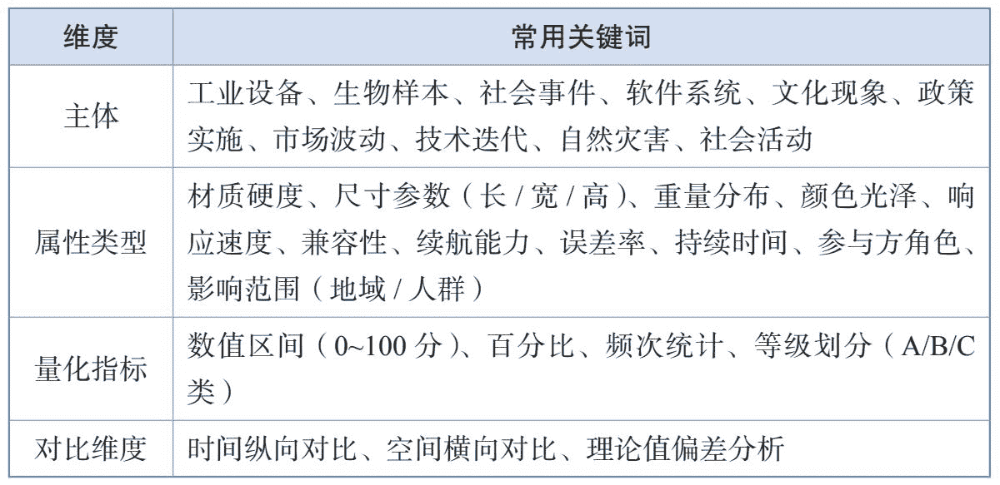

### **3.7.2 事物事件描述提问的 3 个句式模板**

**提问模板 1：基础属性提问**

“这个［事物/事件］的主要功能/目的是什么？请描述其核心特征（如材质、外观、参与方）。”

**示例：**

·“智能手表的核心功能有哪些？请说明其外观材质和续航能力。”

·“某政策实施的主要目的是什么？涉及哪些关键执行机构？”

**提问模板 2：时空定位提问**

“在什么时间/地点发生了这个［事件］？请描述具体的时间节点或地理位置。”

**示例：**

·“新能源汽车补贴政策在哪些城市试点？执行周期是哪几年？”

·“某历史文物的出土位置是哪里？发掘时间是哪一年？”

**提问模板 3：对比分析提问**

“与其他同类［事物/事件］相比，这个［主体］的［属性］有何差异？请列举至少 3 个对比维度（如成本、效率、外观）。”

**示例：**

·“这款手机摄像头性能与上一代有何提升？对比像素、夜景模式和变焦能力。”

·“新政策与旧版相比，在税收减免比例上有哪些调整？”

### **3.7.3 事物事件描述案例**

**案例：故宫内部建筑描述**

**用户提问：**“故宫内部建筑由哪些核心区域组成？请按功能分区（如政务区/生活区）说明各区域建筑群名称及用途。”

**DeepSeek 回答：**

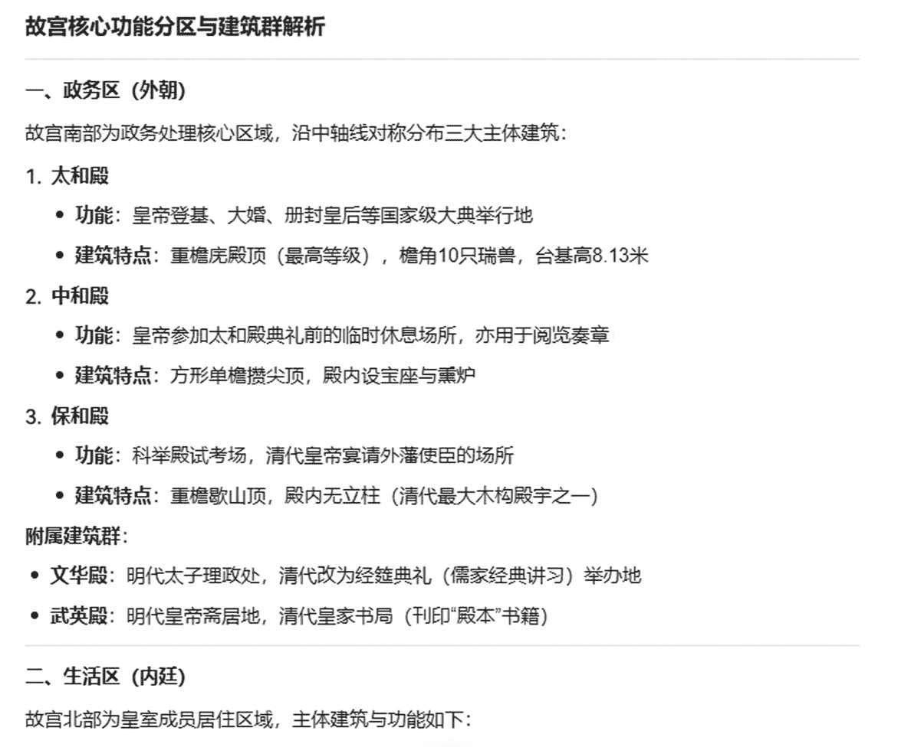

说明：因篇幅原因只展示部分回答。

## **3.8 人物情感描述**

### **3.8.1 人物情感描述关键词**

**1. 关键词提取的核心公式**

关键词提取的核心公式为［情感类型］+［表现细节］+［持续时间/强度］。

**示例拆解：**

·“嫉妒（情感）；同事获奖（事件）；刻意回避对方话题（细节）；持续 3 天（时间）。”

在这个组合中，通过分解情感维度，避免笼统描述，帮助 DeepSeek 精准识别情感诱因与表现特征。

**2. 关键词库**

常用关键词如表 3-8 所示。

表 3-8 常用关键词

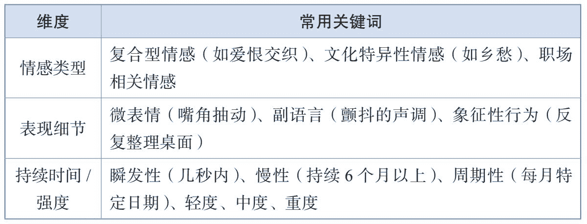

### **3.8.2 人物情感描述提问的 4 个句式模板**

**提问模板 1：特征锚定型提问**

“如何通过［具体身体部位］（如眉眼/手部/发质）的细节描写，塑造［职业/身份］人物的典型形象？需结合［季节/场景］环境特征。”

**示例：**

·“怎样用青筋凸起的手部特写刻画老木匠形象？要求关联冬日工作室的木屑飞舞场景。”

**提问模板 2：动态捕捉型提问**

“在［特定动作］（如转身/俯身/疾走）过程中，如何通过［服饰/配饰］的动态变化强化人物特质？需说明光影交互效果。”

**示例：**

·“如何描写女医生白大褂衣角翻卷的动态细节，配合急诊室走廊顶灯的光影变化，突出其干练形象？”

**提问模板 3：生理映射型提问**

“如何通过［器官感知］（如胃部痉挛/耳鸣加剧/掌心潮湿）的递进式生理反应，外化［情感类型］的强度变化？需匹配时间轴刻度。”

**示例：**

·“怎样用考生等待成绩时指尖发麻（5 分钟）→后颈冷汗渗透衣领（10 分钟）→太阳穴血管跳动（15 分钟）的生理演进，表现焦虑升级？”

**提问模板 4：语言映射型提问**

“如何通过［方言特点/语速节奏/修辞偏好］等语言习惯，反映［地域/教育背景］人物的核心性格？需关联 3 种典型对话场景。”

**示例：**

·“怎样用江浙方言叠词（如‘好好叫’）与典故引用频率，塑造书香世家子弟的温润性格。”

### **3.8.3 人物情感描述案例**

**案例：通过环境共鸣描述人物情感**

**用户提问：**“请根据夏日正午蝉鸣声的突兀中止、空调冷凝水滴落节奏加快、窗帘光影晃动频率改变，来描述独居老人的孤独感，200 字以内。”

**DeepSeek 回答：**

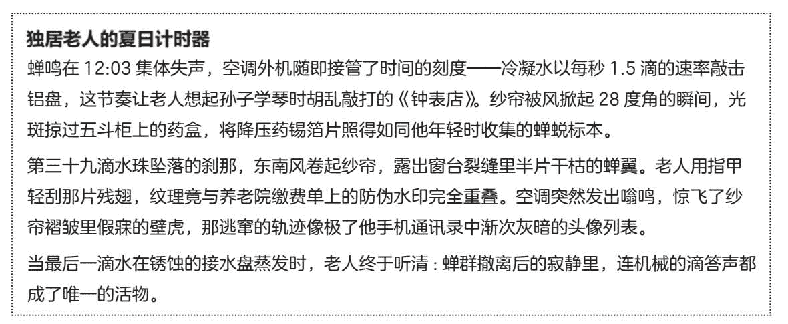

说明：因篇幅原因只展示部分回答。

## **3.9 场景动作描述**

### **3.9.1 场景动作描述关键词**

**1. 关键词提取的核心公式**

关键词提取的核心公式为［场景类型］+［主体动作］+［动作细节］+［环境互动］。

**示例拆解：**

·“火灾现场（场景）；消防员（主体）；逆着浓烟冲刺（动作）；呼吸器发出尖锐啸叫（细节）；热浪扭曲防护面罩视野（环境互动）。”

**场景类型：**定义动作发生的物理/社会空间（如暴雨中的地铁站/会议室辩论）。

**主体动作：**明确动作执行者的行为本质（如老人颤抖着签字/猎豹加速冲刺）。

**动作细节：**捕捉动作的可量化特征（如握笔力度 0.5N/肌肉激活顺序）。

**环境互动：**揭示动作与场景的双向影响（如踩碎枯叶引发响动/空调气流扰动发丝）。

**2. 关键词库**

常用关键词如表 3-9 所示。

表 3-9 常用关键词

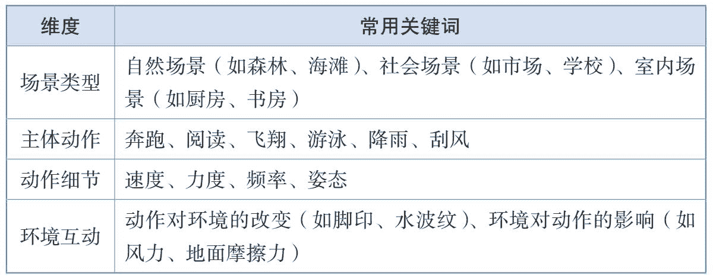

### **3.9.2 场景动作描述提问的 3 个句式模板**

**提问模板 1：环境交互型提问**

“如何通过［自然现象］（如雨点击打/风向突变）与［人物动作］的实时互动，构建［情绪类型］的沉浸式表达？”

**示例：**

·“如何通过暴雨中出租车顶棚的雨击声与乘客反复查看手机的动作共振，表现赴约途中的焦灼感？”

**提问模板 2：复合动作型提问**

“在［连续动作链］（如开锁—推门—脱鞋）的系列行为中，如何通过［物品状态］（如钥匙齿痕深度/门轴吱呀频率/鞋尖磨损角度）的拓扑关联，暗示［隐藏信息］？”

**示例：**

·“如何用消防员归队时头盔凹痕（5mm 深）→防护服汗渍盐晶分布（左肩密集）→水带收卷角度（73°偏移）的复合痕迹，暗示刚经历的火场危机等级？”

**提问模板 3：感官协同型提问**

“如何通过［两种以上感官通道］（如视觉+听觉+触觉）的交替强化，实现［抽象概念］（如信任崩塌/记忆复苏）的具象传递？需设定感官刺激的衰减曲线。”

**示例：**

·“怎样用旧物整理场景中樟脑味浓度衰减→相册翻页声间隔延长→毛衣纤维静电减弱的多通道协同，外化记忆淡忘过程？”

### **3.9.3 场景动作描述案例**

**案例：考试考前焦虑状态的描述**

**用户提问：**“通过暴雨中空调外机滴水声与考生反复翻书形成对抗性节奏，用一段文字来描述考生的考前焦虑状态。”

**DeepSeek 回答：**

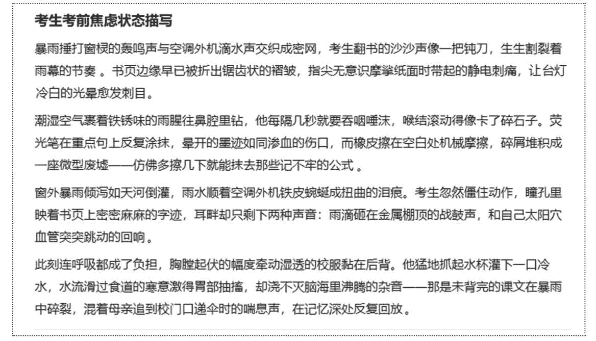

说明：因篇幅原因只展示部分回答。

## **3.10 现象行为解释**

### **3.10.1 现象行为解释关键词**

**1. 关键词提取的核心公式**

关键词提取的核心公式为［现象类型］+［矛盾表现］+［潜在诉求］+［认知偏差］。

**示例拆解：**

·“职场新人反复修改汇报 PPT（现象类型）却不敢提交（矛盾表现）；渴望专业认可（潜在诉求）；过度完美主义（认知偏差）。”

在这个组合中，“现象类型”锚定具体情境，“矛盾表现”凸显外显行为与内在目标的冲突，“潜在诉求”揭示深层需求，“认知偏差”解释行为逻辑断裂点。这样的提问能够形成完整的解释链条。

**2. 关键词库**

常用关键词如表 3-10 所示。

表 3-10 常用关键词

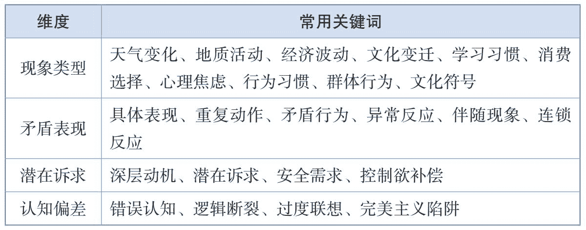

### **3.10.2 现象行为解释提问的 4 个句式模板**

**提问模板 1：矛盾溯源式提问**

“当［行为场景］时，［主体］持续出现［高频行为］却无法达成［预期目标］，如何解释这种矛盾？”

**示例：**

·“职场新人通宵修改 PPT 却始终不敢提交，如何解释其行为与目标的背离？”

**提问模板 2：隐喻映射式提问**

“［具体行为］（如反复擦拭文具）是否可类比于［抽象心理机制］（如为武器抛光）的具象化表现？”

**示例：**

·“考生考前频繁整理书桌，是否象征对未知风险的仪式化防御行为？”

**提问模板 3：变量对比式提问**

“在［对照组］（如独居者与合租者）中，［目标行为］（拖延行为）的差异性如何反映［核心动因］？”

**示例：**

·“城市白领与自由职业者的报复性熬夜行为，折射出何种社会时钟压迫差异？”

**提问模板 4：语义指向解析式提问**

“在［复合行为］（如边刷题边听音乐）中，［核心动作］（刷题）与［伴随动作］（听音乐）的语义指向是否一致？”

**示例：**

·“家长陪读时频繁刷手机的行为，其表层陪伴与深层逃避诉求如何共存？”

### **3.10.3 现象行为解释案例**

**案例：为什么网络暴力现象会频繁出现？**

**用户提问：**“为什么网络暴力现象会频繁出现？”

**DeepSeek 回答：**

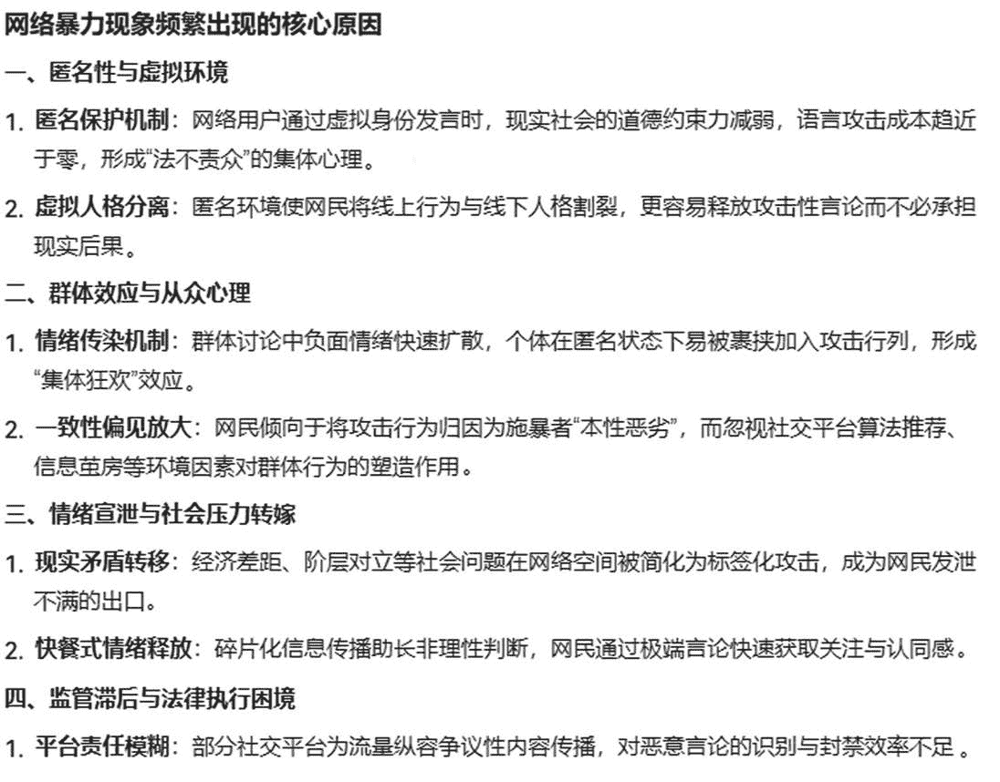

说明：因篇幅原因只展示部分回答。

# **第四章**

# **请求步骤程序流程**

## **4.1 操作执行步骤**

### **4.1.1 操作执行步骤关键词**

**1. 关键词提取的核心公式**

关键词提取的核心公式为［任务类型］+［执行目标］+［执行步骤/方法］+［工具/资源］+［预期结果］+［约束］。

**示例拆解：**

·“提高健康食品新品上市转化率（任务类型）→实现首月购买转化率 12%的目标（执行目标）→配置自动化工具监测‘曝光→点击→加购’转化链路（执行步骤/方法）→设计 A/B 测试对比不同 KOL 组合效果（工具/资源）→转化率提升至 15%（预期结果）→遵守广告法，规避虚假宣传（约束）。”

在这个组合中，“任务类型”明确了业务攻坚的核心方向（健康食品新品转化提升），“执行目标”量化了关键里程碑（首月转化率 12%），“执行步骤/方法”通过“工具/资源”追踪实现，测试对比不同 KOL 组合效果作为工具，预期结果以转化率指标验证，“约束”条件则以合规性为底线保障策略可持续性。

**2. 关键词库**

常用关键词如表 4-1 所示。

表 4-1 常用关键词

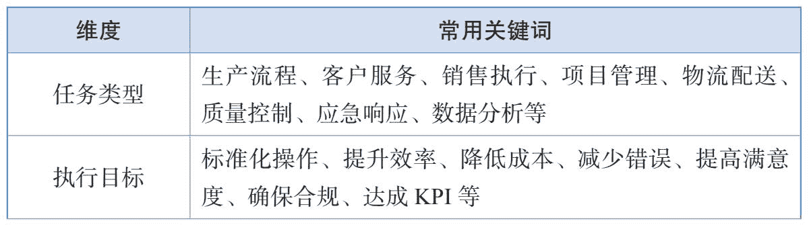

（续表）

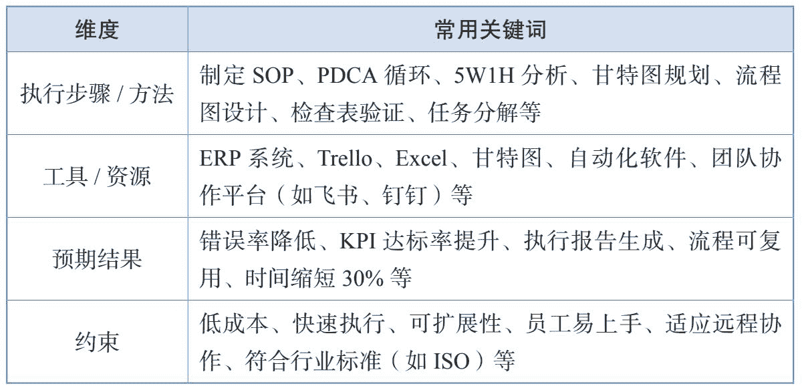

### **4.1.2 操作执行步骤提问的 4 个句式模板**

**模板 1：流程设计型**

“如何通过［执行步骤/方法］实现［任务类型］的［执行目标］？需使用［工具/资源］，并达成［预期结果］。”

**示例：**

·“如何通过制定 SOP 流程实现客户服务响应速度的提升目标？需使用 Zendesk 客服系统和工单模板，并达成首次响应时间缩短至 1 分钟内的结果。”

**模板 2：工具应用型**

“在［任务类型］中，如何运用［工具/资源］完成［执行目标］？需按照［执行步骤/方法］操作，并验证［预期结果］。”

**示例：**

·“在销售执行中，如何运用 CRM 系统完成客户跟进效率的提升目标？需按照客户分级管理步骤操作，并验证客户转化率提高 20%的结果。”

**模板 3：步骤拆解型**

“将［执行目标］拆解为哪些具体步骤？需结合［工具/资源］，并确保［预期结果］可量化。”

**示例：**

·“在生产过程中，可将生产流程中的质量控制目标拆解为哪些具体步骤？需结合自动化检测设备和检查表，并确保产品合格率提升至 99%。”

**模板 4：结果导向型**

“为达成［预期结果］，［任务类型］需执行哪些［执行步骤/方法］？需依赖［工具/资源］支持。”

**示例：**

·“为达成物流成本降低 15%的预期结果，物流配送需执行哪些路线优化步骤？需依赖 ERP 系统和地图分析工具支持。”

### **4.1.3 操作执行步骤提问案例**

**案例：生产流程效率提升**

**用户提问：**“如何通过 PDCA 循环和甘特图规划，实现生产流程效率的提升目标？需使用 ERP 系统和自动化脚本，并达成单位时间产量提高 20%的结果。”

**DeepSeek 回答：**

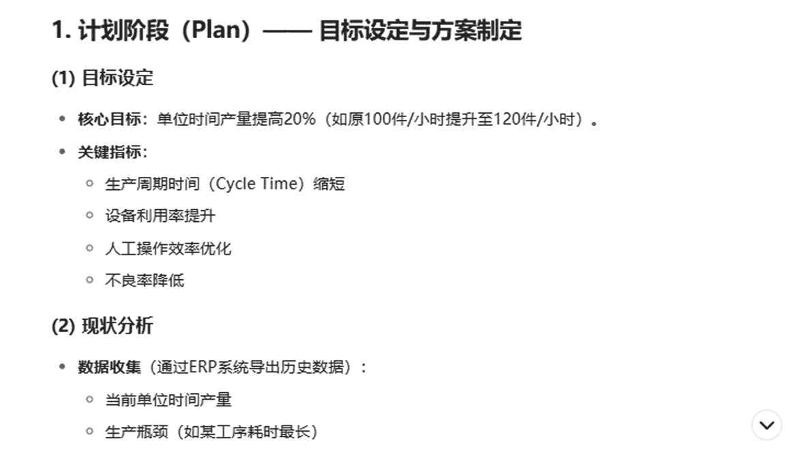

说明：因篇幅原因只展示部分回答。

## **4.2 制作制定步骤**

### **4.2.1 制作制定步骤关键词**

**1. 关键词提取的核心公式**

关键词提取的核心公式为［任务拆解］+［步骤排序］+［资源分配］+［时间定义］+［质量检查点］+［输出标准］。

**示例拆解：**

·“设计新品上市推广计划（任务拆解）→市场调研、内容制作、渠道投放、效果监测四大阶段（步骤排序）→市场部负责调研、设计团队制作素材、运营团队执行投放（资源分配）→调研 3 天、制作 5 天、投放 7 天（时间定义）→投放 3 天后设置数据复盘节点（质量检查点）→收集推广报告与转化率数据（输出标准）。”

在这个组合中，“任务拆解”将复杂问题模块化，“步骤排序”遵循“发现问题→设计解决方案→实施→验证”的逻辑链，“资源分配”实现专业团队与任务颗粒度的精准匹配，“时间定义”采用倒排工期法确保项目可控，“质量检查点”以交付物为锚点形成闭环管理，“输出标准”既包含过程文档又量化效果验证，形成了“目标—执行—监控—交付”的完整闭环。

**2. 关键词库**

常用关键词如表 4-2 所示。

表 4-2 常用关键词

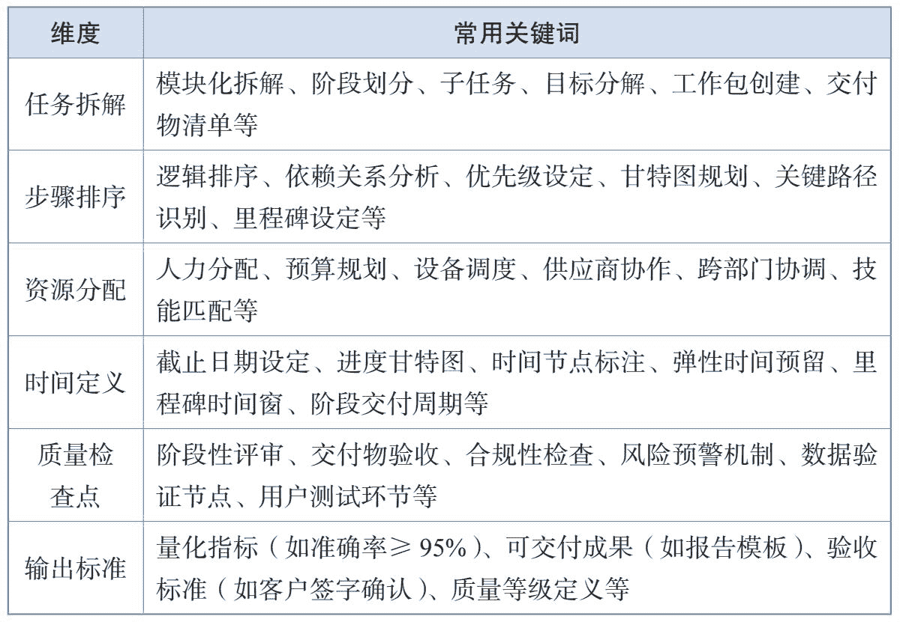

### **4.2.2 制作制定步骤提问的 4 个句式模板**

**模板 1：流程细化型**

“如何将［任务拆解］为可执行的［步骤排序］？明确［资源分配］有哪些，并设定［质量检查点］以达成［输出标准］。”

**示例：**

·“如何将‘用户增长计划’拆解为可执行的拉新、留存、转化阶段？需分配增长团队负责拉新、产品团队优化留存功能，并设定每周数据复盘节点以达成 DAU 提升 20%的输出标准。”

**模板 2：资源依赖型**

“在［任务拆解］中，如何根据［资源分配］制定［步骤排序］？需明确［时间定义］，并确保［质量检查点］覆盖关键风险点。”

**示例：**

·“在‘产品上线计划’中，如何根据开发、测试、运维资源制定版本迭代步骤？需明确各阶段起止时间，并确保上线前设置安全漏洞扫描检查点。”

**模板 3：时间驱动型**

“若需在［时间定义］内完成［任务拆解］，应如何进行［步骤排序］？需依赖［资源分配］支持，并设置［输出标准］验证成果。”

**示例：**

·“若需 30 天内完成‘品牌升级项目’，应如何排序市场调研、VI 设计、渠道更新步骤？需依赖设计团队与供应商的资源支持，并设置品牌曝光度提升 30%的输出标准验证成果。”

**模板 4：质量导向型**

“为通过［质量检查点］，保障［任务拆解］质量，应如何设计［步骤排序］？需结合［资源分配］与［时间定义］优化执行路径。”

**示例：**

·“为通过代码审查与性能测试，保障‘系统重构项目’质量，应如何设计开发、测试、回滚步骤？需结合开发团队与 QA 资源，并设定 2 周迭代周期优化执行路径。”

### **4.2.3 制作制定步骤提问案例**

**案例：制作产品上线步骤**

**用户提问：**“如何将‘产品上线步骤’拆解为需求评审、开发测试、预发布验证、正式上线四个阶段？需分配产品经理负责需求文档输出、开发团队负责代码实现、运维团队负责环境部署，并设定需求冻结后 3 天完成开发、预发布前 1 天完成全链路压测的质量检查点，最终达成上线后 2 小时内无 P0 级故障的输出标准。”

**DeepSeek 回答：**

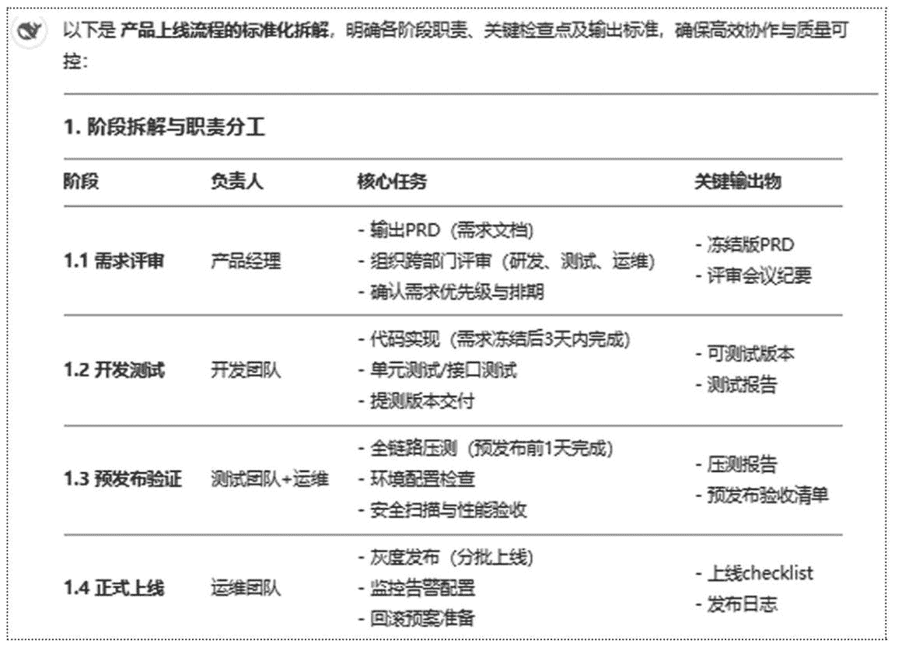

说明：因篇幅原因只展示部分回答。

## **4.3 应对应急步骤**

### **4.3.1 应对应急步骤关键词**

**1. 关键词提取的核心公式**

关键词提取的核心公式为［触发条件］+［应对计划］+［升级路径］+［资源调配］+［沟通机制］+［事后复盘］。

**示例拆解：**

·“若发生‘项目关键成员突然离职’（触发条件）→启动知识交接流程，临时调配团队资源（应对计划）→若 3 天内无法恢复进度，则升级至部门负责人决策（升级路径）→协调 HR 部门与外部顾问支持（资源调配）→每日站会同步项目状态（沟通机制）→优化人才储备与知识管理机制（事后复盘）。”

在这个组合中，“触发条件”明确风险信号，“应对计划”定义即时行动，“升级路径”设定决策层级，“资源调配”保障资源到位，“沟通机制”确保信息透明，“事后复盘”推动流程改进。六者协同，确保从风险识别到能力升级的全链路闭环。

**2. 关键词库**

常用关键词如表 4-3 所示。

表 4-3 常用关键词

### **4.3.2 应对应急步骤提问的 6 个句式模板**

**提问模板 1：触发条件驱动型**

“若发生［触发条件］，应如何设计包含［应对计划］、［升级路径］、［资源调配］与［沟通机制］的应急方案？最终通过［事后复盘］实现哪些改进？”

**示例：**

·“若发生‘核心供应商突然涨价’，应如何设计包含‘启动备选供应商谈判+调整产品定价’的应急方案？需明确‘谈判破裂则升级至采购总监决策’的升级路径，调配法务与财务团队支持，通过客户邮件说明成本变动，事后优化供应商评估标准。”

**提问模板 2：资源约束型**

“在［资源调配］受限时，如何调整［应对计划］以应对［触发条件］？需通过［升级路径］快速获取哪些支持，并通过［沟通机制］降低负面影响？”

**示例：**

·“在‘预算不足’时，如何调整‘紧急采购原材料’计划以应对‘生产停滞’？需通过‘升级至财务总监’协调备用资金，并通过‘员工大会’说明临时调整方案。”

**提问模板 3：沟通透明型**

“为通过［沟通机制］确保［应对计划］执行透明，应如何设计分级响应与同步机制？需结合［升级路径］明确哪些信息必须实时传递？”

**示例：**

·“为通过‘每日站会’确保‘项目进度恢复’透明，应如何设计‘执行层→管理层→客户’的分级响应机制？需明确‘当前进度、延迟原因、补偿方案’等关键信息实时同步。”

**提问模板 4：复盘驱动型**

“基于［事后复盘］结论，如何重构［应对计划］以应对未来类似［触发条件］？需更新哪些［升级路径］与［资源调配］策略？”

**示例：**

·“基于‘上次客户投诉因响应延迟’复盘，如何重构‘24 小时响应机制’？需更新‘客服团队排班制度’，并增加‘AI 工单自动分配’资源池。”

**提问模板 5：跨团队协作型**

“针对［触发条件］，如何协调［部门 A］、［部门 B］与［外部合作伙伴］的［应对计划］，确保［沟通机制］对齐并避免资源冲突？”

**示例：**

·“针对‘新产品上市延期’，如何协调‘研发部’‘市场部’与‘物流供应商’的响应？需通过‘联合工作组’统一对外声明，并明确‘技术调试→宣传调整→物流加速’的协作流程。”

**提问模板 6：预案优化型**

“为应对［触发条件］，需提前制定哪些［标准化流程］或［检查清单］？如何通过［沟通机制］验证其有效性？”

**示例：**

·“为应对‘关键岗位人员离职’，需提前制定‘知识交接检查清单’与‘临时替代流程’，并通过‘模拟演练’验证其完整性与可操作性。”

### **4.3.3 应对应急步骤案例**

**案例 1：应对核心成员离职**

**用户提问：**“若发生‘项目技术负责人突然离职’，应如何设计包含‘知识交接+临时替代+外部顾问支持’的应急方案？需明确‘若 3 天内无法恢复则升级至 CTO 决策’的升级路径，调配 HR 部门与猎头资源，通过每日站会同步交接进度，事后优化人才储备与知识管理机制。”

**DeepSeek 回答：**

说明：因篇幅原因只展示部分回答。

## **4.4 议事议程程序**

### **4.4.1 议事议程程序关键词**

**1. 关键词提取的核心公式**

关键词提取的核心公式为［目标设定］+［议程架构］+［时间分配］+［引导规则］+［决策机制］+［后续行动］。

**示例拆解：**

·“为推进‘跨部门协作流程优化’（目标设定）→设计议程包含‘现状诊断→痛点分析→方案提案→共识达成’（议程架构）→各环节 30/20 分钟（时间分配）→‘轮流发言+限时质询’规则（引导规则）→‘投票+高管裁决’决策机制（决策机制），会后 24 小时内输出行动清单（后续行动）。”

在这个组合中，“目标设定”锚定会议方向，“议程架构”搭建逻辑框架，“时间分配”保障效率，“引导规则”维护秩序，“决策机制”推动结论，“后续行动”确保落地。六者协同，确保从议题发起到达成共识的全链路闭环。

**2. 关键词库**

常用关键词如表 4-4 所示。

表 4-4 常用关键词

### **4.4.2 议事议程程序提问的 6 个句式模板**

**提问模板 1：目标导向型**

“为达成［目标设定］，应如何设计包含［议程架构］与［时间分配］的会议流程？需通过［引导规则］确保高效讨论，最终通过［决策机制］输出［后续行动］？”

**示例：**

·“为达成‘新产品上市策略共识’，应如何设计包含‘市场分析→竞品对标→方案 PK→资源匹配’的议程？需分配各环节 40/20/30/10 分钟，通过‘限时 3 分钟提案+匿名投票’规则决策，会后输出资源需求清单与责任人。”

**提问模板 2：效率优化型**

“在［时间分配］受限时，如何调整［议程架构］以达成［目标设定］？需通过［引导规则］避免跑题，并通过［决策机制］快速达成共识？”

**示例：**

·“在‘1 小时会议’限制下，如何调整‘年度预算审议’议程？需压缩‘部门汇报’至 15 分钟，采用‘只提差异项+高管质询’规则，通过‘权重评分法’快速对预算分配做出决策。”

**提问模板 3：冲突调解型**

“针对［目标设定］中的潜在冲突，应如何设计［议程架构］与［引导规则］？需通过［决策机制］平衡多方利益，并明确［后续行动］的追责条款？”

**示例：**

·“针对‘部门资源争夺’，应如何设计‘需求陈述→优先级排序→利益交换→协议签署’议程？需通过‘中立调解人+书面承诺’规则，采用‘高管仲裁’机制，会后签署资源分配备忘录。”

**提问模板 4：创新孵化型**

“为激发［目标设定］中的创新思维，应如何设计［议程架构］与［引导规则］？需通过［决策机制］筛选可行方案，并规划［后续行动］的试点验证。”

**示例：**

·“为激发‘客户体验优化’创新，应如何设计‘痛点脑暴→疯狂点子→可行性评估→试点提案’议程？需通过‘禁止批评+匿名投票’规则，采用‘试点小组竞选’机制，会后启动 3 个月试点计划。”

**提问模板 5：远程协作型**

“在远程会议场景下，如何调整［议程架构］与［引导规则］以达成［目标设定］？需通过［决策机制］确保异步参与有效性，并明确［后续行动］的线上协作工具？”

**示例：**

·“在‘跨国团队远程会议’中，如何调整‘项目复盘’议程？需增加‘异步问题收集’环节，采用‘文字提案+语音表决’规则，通过‘时间区协调投票’机制，会后使用 Trello 跟踪行动项。”

**提问模板 6：复盘驱动型**

“基于［后续行动］的复盘结论，如何优化［议程架构］与［引导规则］以提升未来会议效率？需更新［决策机制］以适配新场景？”

**示例：**

“•基于‘上次会议决策执行率低’的复盘，如何优化‘战略研讨会’议程？需增加‘决策可行性预审’环节，采用‘红蓝军对抗’规则，更新‘决策后 24 小时启动执行’机制。”

### **4.4.3 议事议程程序提问案例**

**案例：跨部门协作流程优化会议**

**用户提问：**“为推进‘跨部门协作流程优化’，应如何设计包含‘现状诊断→痛点分析→方案提案→共识达成’的议程？需分配各环节 30/20/30/20 分钟，通过‘轮流发言+限时质询’规则，采用‘投票+高管裁决’机制，会后 24 小时内输出行动清单？”

**DeepSeek 回答：**

说明：因篇幅原因只展示部分回答。

# **第五章**

# **请求创意创作创建**

## **5.1 广告策划创意**

### **5.1.1 广告策划创意关键词**

**1. 关键词提取的核心公式**

**核心公式 1：PAST 模型**

关键词提取的核心公式 1 为［目标］+［人群］+［场景］+［工具］。

**示例拆解：**

·“提升高端护肤品品牌认知度（目标）→高知女性群体（人群）→高端商场专柜+艺术展览场景（场景）→AI 肤质检测仪+定制化内容推送（工具）。”

在这个组合中，“目标”锚定了核心任务方向，“人群”定位划定了受众边界，“场景”选择框定了执行环境，“工具”应用提供了落地手段，四者通过目标导向形成闭环——目标决定人群画像，人群反推场景触点，场景适配工具形态，工具强化目标达成，最终确保广告策划从创意到执行的全链路精准对焦。

**核心公式 2：STAR 模型**

关键词提取的核心公式 2 为［背景］+［任务］+［行动］+［预期结果］。

**示例拆解：**

·“品牌认知度低（背景）→6 个月内提升复购率 20%（任务）→建立会员专属育儿知识库+积分兑换体系（行动）→会员活跃度提升 30%，复购率达标（预期结果）。”

在这个组合中，“背景”勾勒出挑战框架，“任务”确立突围坐标，“行动”创造差异价值，“预期结果”设定验证标尺，四者构成动态循环——背景催生任务，任务驱动行动，行动孕育结果，结果重塑背景认知，形成策略从诊断到进化的自我迭代系统。

**2. 关键词库**

常用关键词如表 5-1 所示。

表 5-1 常用关键词

### **5.1.2 广告策划创意提问的 7 个句式模板**

**提问模板 1：定位诊断型**

“为［品牌］在［市场环境］中定位，需避开竞品［常见卖点］，找到［数量］差异化突破口，要求符合［人群特征］+［预算限制］。”

**示例：**

·“为新锐咖啡品牌在精品咖啡红海市场中定位，需避开‘产地’‘风味’常见卖点，找到 3 个差异化突破口，符合都市上班族‘快奢’需求，预算 80 万元。”

·“为高端家电品牌在智能家居红海中定位，需避开‘性价比’常见卖点，找到 2 个差异化突破口，符合中产家庭‘科技感+设计美学’需求，预算 150 万元。”

**提问模板 2：创意激发型**

“结合［热点事件/文化符号］，用［反常识角度］设计广告创意，要求包含［情感类型］+［交互形式］，并说明［传播机制］。”

**示例：**

·“结合‘AI 替代人类’热点，用‘AI 主动拒绝执行指令’反常识角度设计公益广告，包含‘危机感+幽默感’情感，采用 H5 模拟 AI 对话交互，通过分享解锁剧情实现裂变。”

·“结合‘碳中和’热点，用‘废弃材料变身奢侈品’反常识角度设计环保广告，包含‘敬畏感+参与感’，采用线下材料改造工作坊形式，通过用户作品展览实现传播。”

**提问模板 3：跨界融合型**

“将［产品功能］与［非关联领域］结合，提出［数量］个颠覆性创意概念，需包含［用户参与环节］+［跨界冲突感］。”

**示例：**

·“将办公椅‘人体工学设计’与‘太空探索’结合，提出‘零重力办公体验舱’‘星际坐姿矫正系统’2 个概念，用户参与 VR 模拟太空工作场景，制造科技与日常冲突话题。”

**提问模板 4：数据驱动型**

“基于［数据维度］，诊断当前广告方案的［数量］个失效环节，提出［具体优化手段］，量化目标为［指标提升］。”

**示例：**

·“基于用户停留时长数据，诊断汽车广告 H5 页面的 2 个失效环节（如配置参数页跳出率高），提出‘3D 车型旋转展示+一键对比竞品’优化手段，目标页面停留时长提升 40%。”

**提问模板 5：风险预判型**

“为［活动类型］预判 Top［数量］风险，按［排序标准］排序，设计［预防+补救］双预案，包含［预算/资源调配］方案。”

**示例：**

·“为线下新品发布会预判 Top3 风险（嘉宾缺席、设备故障、媒体负面报道），按影响程度排序，设计备用嘉宾名单+双设备冗余+舆情监测团队方案，备用预算占比 15%。”

**提问模板 6：效果倍增型**

“在［原有方案］基础上，通过［策略类型］策略，实现［效果指标］提升［百分比］，需说明［资源需求］+［执行难点］。”

**示例：**

·“在常规户外广告方案基础上，通过‘AR 互动+地理位置触发’策略，实现品牌记忆度提升 50%。需协调 AR 技术供应商，解决多设备兼容性难点。”

**提问模板 7：组合嵌套型**

“基于 PAST 模型，针对［人群］在［场景］中通过［工具］实现［目标］，结合跨界融合型句式提出创意概念，并预判 Top1 风险。”

**示例：**

·“基于 PAST 模型，针对 Z 世代在音乐节场景中通过‘可穿戴设备’实现‘品牌沉浸式体验’目标，结合跨界融合型句式提出‘音乐节奏可视化纹身贴’创意，预判‘设备电量不足’风险，设计充电站+备用贴纸方案。”

·“针对（P）年轻妈妈群体，（A）0~3 岁婴童，（S）母婴店线下场景，（T）AR 互动装置，设计纸尿裤广告方案。将‘吸水性能’与‘太空探索’结合，策划‘尿液转化火箭燃料’AR 游戏，预判‘儿童害怕设备’风险并设计卡通化界面。”

### **5.1.3 广告策划创意提问案例**

**案例：高端白酒品牌策划**

**用户提问：**“为提升品牌文化认同感，设计企业决策者人群的‘千年酒脉’主题高端商务晚宴方案，方案中要体现通过 AR 技术展示酿酒工艺，搭配 AI 根据宾客口味推荐酒款，强化品牌历史传承与科技感。”

**DeepSeek 回答：**

说明：因篇幅原因只展示部分回答。

## **5.2 文案策划创意**

### **5.2.1 文案策划创意关键词**

**1. 关键词提取的核心公式**

关键词提取的核心公式为［概念］+［内容］+［语境］+［行动号召］。

**示例拆解：**

·“可持续生活方式倡导（概念）→环保材质产品故事+用户 UGC 案例（内容）→城市轻中产社群+社交媒体话题页（语境）→限时碳积分兑换+线下体验店打卡（行动号召）。”

在这个组合中，“概念”明确传递环保理念，“内容”通过真实故事增强用户代入感，“语境”精准触达目标人群活跃场景，“行动号召”以轻量化互动激励用户参与。四者协同——概念定基调，内容塑组成，语境选触点，行动号召促转化，确保从理念传播到行为引导的全链路闭环。

**2. 关键词库**

常用关键词如表 5-2 所示。

表 5-2 常用关键词

### **5.2.2 文案策划创意提问的 9 个句式模板**

**提问模板 1：情感共鸣型**

“针对［目标群体］的［情感痛点］，通过［生活化场景］构建，创作一篇能引发［情感共鸣类型］的文案，需融入［具象化细节］。”

**示例：**

·“针对职场新人的‘社交焦虑’，通过‘电梯偶遇同事’场景，创作一篇引发‘松弛感’共鸣的文案，融入‘耳机播放轻音乐’‘微笑点头示意’等细节。”

**提问模板 2：语言风格适配型**

“为［平台属性］下的［目标群体］，采用［网感化语言风格］创作一篇关于［主题］的文案，需突出［核心信息点］。”

**示例：**

·“为小红书‘Z 世代护肤人群’，采用‘闺蜜吐槽体’风格创作一篇‘早 C 晚 A 护肤指南’，突出‘成分功效’‘避坑指南’‘懒人友好’信息点。”

**提问模板 3：内容创新型**

“结合［热点话题］，为［主题］设计一篇［新媒体形式］文案，需融入［互动元素］，实现［传播目标］。”

**示例：**

·“结合‘MBTI 人格测试’热点，为‘小众咖啡馆’设计一篇‘人格咖啡盲盒’小红书笔记，融入‘测测你的本命咖啡’互动 H5，实现‘引流到店’目标。”

**提问模板 4：场景优化型**

“针对［平台特性］，优化［主题］文案的［呈现形式］，如标题结构、信息密度、视觉符号，以提升［关键指标］。”

**示例：**

·“针对抖音‘3 秒完播率’特性，优化‘健身课程推广’文案的标题为‘每天 5 分钟=暴汗燃脂？’，搭配‘前后对比弹幕’，提升‘点击率’与‘完播率’。”

**提问模板 5：行动引导型**

“创作一篇包含［轻量化行动指令］的文案，通过［即时反馈机制］，引导［目标群体］完成［具体行为］，如打卡、晒单、参与话题等。”

**示例：**

·“创作一篇包含‘拍同款手势舞’指令的抖音文案，通过‘点赞过千解锁教学视频’机制，引导用户‘拍摄并发布手势舞视频’。”

**提问模板 6：风格迁移型**

“以［网红/IP］的语言风格改写［原文案］，突出［平台流行梗］+［节奏控制技巧］，适配［平台调性］。”

**示例：**

·“以‘李××’的‘OMG 体’改写美妆文案，突出‘所有女生’‘买它’等梗，控制每句不超过 10 个字，适配抖音口播快节奏。”

**提问模板 7：数据驱动型**

“基于［平台数据指标］分析当前文案的［失效点］，提出［优化策略］，量化目标为［指标提升值］。”

**示例：**

·“基于小红书笔记‘收藏率高但转化率低’数据，分析失效点为‘缺乏行动指令’，提出‘文末添加“戳链接领试用装”’策略，目标转化率提升 15%。”

**提问模板 8：跨平台适配型**

“将［长图文/深度内容］转化为［短视频/图文笔记］形式，保留［核心卖点］，适配［平台用户习惯］。”

**示例：**

·“将品牌白皮书转化为小红书‘3 秒知识点’图文笔记，保留‘成分安全’核心卖点，采用‘痛点提问+成分表特写+使用场景’结构，适配用户碎片化阅读习惯。”

**提问模板 9：风险规避型**

“针对文案中可能引发［争议点］的表述，设计［替代话术］+［正向引导］方案，并提供［舆情监测关键词］。”

**示例：**

·“针对‘减肥产品’文案中‘胖子’表述，设计‘大码女孩’替代话术，引导‘健康自信美’价值观，监测‘身材歧视’‘歧视性语言’等关键词。”

### **5.2.3 文案策划创意案例**

**案例：为新锐茶饮品牌撰写小红书爆款文案**

**用户提问：**“用‘城市声音采样’（地铁报站、键盘声）隐喻职场焦虑，绑定‘冷泡茶疗愈’概念为新锐茶饮品牌撰写小红书爆款文案。其结构包含‘清晨 8 点的地铁报站声→冷泡茶入杯的清脆声’听觉唤醒对比描写和‘3 分钟办公室冥想挑战’，并关联‘点击领取冥想音频’福利。”

**DeepSeek 回答：**

说明：因篇幅原因只展示部分回答。

## **5.3 视频脚本创意**

### **5.3.1 视频脚本创意关键词**

**1. 关键词提取的核心公式**

**核心公式 1：ESPO-HOOK 模式**

关键词提取的核心公式 1 为［情感共鸣］+［故事线］+［冲突挑战］+［解决方案］+［行动引导］。

**示例拆解：**

·“职场新人焦虑感（情感共鸣，视觉符号：地铁拥挤的俯拍镜头+倒计时数字特效）→逆袭成长故事线（故事线：悬念开场+对比反转）→订单超时危机（冲突挑战，音效设计：暴雨声+键盘急促敲击声）→智能办公产品防水防抖功能化解困境（解决方案，视觉符号：产品特写+故障艺术转场）→点击购买链接+‘风雨无阻，使命必达’口号（行动引导，互动形式：进度条奖励机制+弹幕触发优惠券）。”

在这个组合中，通过情感共鸣引发代入感，以故事线承载冲突场景，用产品功能解决矛盾，最终引导用户行动，而在组合中视觉符号、音效设计和互动形式贯穿模型的多个维度中，形成“共情—冲突—解决—烙印—转化”闭环。

**核心公式 2：3C-HOOK 模式**

关键词提取的核心公式 2 为［角色塑造］+［核心矛盾］+［抓眼球开场］+［转化路径］。

**示例拆解：**

·“熬夜加班程序员（角色塑造，视觉符号：代码雨特效+黑眼圈特写）→颈椎疼痛困扰（核心矛盾：健康危机与效率需求的冲突）→咖啡杯底残渣像破碎灵感（画面+音效，音效设计：电子脉冲音+玻璃破碎声）（抓眼球开场）→人体工学椅试用体验（视觉符号：微距特写座椅曲线）→下单立减优惠+KOL 同款标记（转化路径，互动形式：AI 换脸试坐体验+扫码解锁隐藏优惠）。”

在这个组合中，通过角色痛点引发共鸣，用冲突抓眼球，以钩子强化代入感，最终设计即时转化路径，而在组合中视觉符号、音效设计和互动形式贯穿模型的多个维度中，实现“人设—痛点—共情—转化”高效触达。

**2. 关键词库**

常用关键词如表 5-3 所示。

表 5-3 常用关键词

（续表）

### **5.3.2 视频脚本创意提问的 5 个句式模板**

**提问模板 1：情感冲突强化型**

“为［角色塑造］设计一段［时长］的视频脚本，需通过［情感共鸣］与［冲突挑战］的碰撞，结合［视觉符号］强化代入感，最终引导［行动指令］，要求包含［互动形式］。”

**示例：**

·“为职场妈妈设计一段 15 秒视频脚本，需通过‘家庭责任焦虑’与‘职场竞争压力’的碰撞，结合‘时钟特写+婴儿啼哭音效’强化代入感，最终引导‘点击领取职场赋能课程’，要求包含‘进度条解锁育儿干货’互动形式。”

·“为 Z 世代设计一段 30 秒游戏宣传视频，需通过‘孤独感’与‘团队胜利渴望’的碰撞，结合‘像素风废墟场景+心跳声效’强化代入感，最终引导‘分享视频组队开黑’，要求包含‘弹幕触发隐藏皮肤’互动形式。”

**提问模板 2：故事线重构型**

“基于［故事线］，为［产品/品牌］重构［时长］视频脚本，需融入［冲突挑战］与［解决方案］，并通过［视觉符号］实现［情感共鸣］，最终达成［行动引导目标］。”

**示例：**

·“基于‘英雄之旅’框架，为智能手环重构 60 秒视频脚本，需融入‘续航焦虑’与‘太阳能充电技术’的冲突，通过‘沙漠徒步者从疲惫到重燃斗志’的视觉符号实现‘逆袭爽感’，最终达成‘点击预约新品’目标。”

·“基于‘灰姑娘’框架，为平价美妆品牌重构 45 秒视频脚本，需融入‘外貌焦虑’与‘高性价比彩妆’的冲突，通过‘素人女孩变身派对焦点’的视觉符号实现‘自信共鸣’，最终达成‘晒单抽奖’目标。”

**提问模板 3：多感官沉浸型**

“设计一段［时长］视频脚本，需通过［视觉符号］+［音效设计］+［互动形式］的多感官组合，传递［核心信息点］，并引导［目标群体］完成［具体行为］。”

**示例：**

·“设计一段 90 秒智能家居广告视频，需通过‘全景智能灯光切换+ASMR 音效+手势滑动解锁功能’的多感官组合，传递‘无感交互’核心信息点，并引导‘中产家庭用户’完成‘扫码体验虚拟家居’行为。”

·“设计一段 20 秒运动饮料短视频，需通过‘汗珠慢镜头+电子脉冲音效+弹幕触发优惠券’的多感官组合，传递‘瞬间补水’核心信息点，并引导‘健身爱好者’完成‘点击购买’行为。”

**提问模板 4：角色代入驱动型**

“以［角色塑造］为主角，设计一段［时长］视频脚本，需通过［核心矛盾］推动剧情，结合［解决方案］实现［情感共鸣类型］，最终通过［转化路径］达成［量化目标］。”

**示例：**

·“以‘户外达人’为主角，设计一段 120 秒户外装备广告视频，需通过‘极端天气挑战’推动剧情，结合‘防风防水技术’实现‘安全感共鸣’，最终通过‘限时折扣弹窗’达成‘点击率提升 30%’目标。”

·“以‘银发族’为主角，设计一段 60 秒健康监测设备视频，需通过‘子女关怀缺失’推动剧情，结合‘远程健康预警’实现‘亲情共鸣’，最终通过‘社群裂变任务’达成‘分享率提升 50%’目标。”

**提问模板 5：热点借势融合型**

“结合［热点事件/文化符号］，设计一段［时长］视频脚本，需通过［冲突挑战］与［解决方案］的对比，融入［互动形式］，实现［传播目标］。”

**示例：**

·“结合‘AI 替代焦虑’热点，设计一段 45 秒在线教育广告视频，需通过‘职场技能过时’与‘AI 辅助学习系统’的对比，融入‘AI 对话测试’互动形式，实现‘课程报名量提升 20%’目标。”

·“结合‘碳中和’热点，设计一段 90 秒新能源汽车视频，需通过‘燃油车污染’与‘零排放技术’的对比，融入‘碳积分兑换’互动形式，实现‘品牌搜索指数增长 15%’目标。”

### **5.3.3 视频脚本创意提问案例**

**案例：为高端宠物食品品牌设计短视频脚本**

**用户提问：**“以‘宠物视角’为创意出发点，设计一段 30 秒短视频脚本，需通过‘主人加班晚归’的冲突场景，结合‘智能喂食器自动投喂’的解决方案，传递‘陪伴从不缺席’的情感共鸣，最终引导用户点击‘领取试用装’，要求包含‘宠物拟人化配音+进度条奖励机制’互动形式。”

**DeepSeek 回答：**

说明：因篇幅原因只展示部分回答。

## **5.4 文章论文撰写**

### **5.4.1 文章论文撰写关键词**

**1. 关键词提取的核心公式**

**核心公式 1：4C 研究模型**

关键词提取的核心公式 1 为［核心概念］+［研究内容］+［研究语境］+［行动呼吁］。

**示例拆解：**

·“区块链技术在供应链金融信任机制构建中的应用（核心概念）→基于区块链的供应链金融信任模型设计+实际企业案例验证（研究内容）→供应链金融行业数字化转型背景+多主体参与环境（研究语境）→推动供应链金融行业信任体系完善+促进区块链技术在金融领域广泛应用（行动呼吁）。”

在这个组合中，“核心概念”明确研究聚焦于区块链技术在供应链金融信任机制构建方面的应用；“研究内容”通过设计模型和实际案例验证来充实研究内容，增强研究的可信度；“研究语境”指出研究处于供应链金融行业数字化转型背景，以及多主体参与的环境；以推动行业信任体系完善和促进技术应用为“行动呼吁”，激励相关方参与和推动研究成果落地。四者协同，确保从研究构思到成果推广的全链路闭环。

4C 研究模型侧重于从研究的整体架构和行动导向出发，适合在需要全面规划研究框架、明确行动方向时使用。

**核心公式 2：PIRCOS 研究模型**

关键词提取的核心公式 2 为［研究问题］+［研究方法/解决方案］+［对比分析］+［研究结果］+［学术/商业价值］。

**示例拆解：**

·“传统供应链金融中信任缺失问题（研究问题）→引入区块链技术构建信任机制（研究方法/解决方案），与传统信任机制进行对比分析（对比分析）→区块链信任机制下交易效率提升［×］%，违约率降低［×］%（研究结果）→为解决供应链金融信任问题提供新方案，具有重大学术价值，同时可降低企业交易成本，提高行业竞争力（学术/商业价值）。”

在这个组合中，“研究问题”是信任缺失问题；“研究方法/解决方案”提出构建信任机制这一解决方案；“对比分析”强调与传统信任机制进行对比；“研究结果”给出具体的结果；研究的“学术/商业价值”为解决信任问题提供新方案，同时带来实际效益。各部分协同，确保研究从问题提出到解决方案验证，再到成果呈现和价值体现的逻辑完整。

PIRCOS 研究模型更聚焦于研究问题的提出、解决方案的验证及成果和价值的呈现，适合在强调研究逻辑和成果评估时使用。

**2. 关键词库**

常用关键词如表 5-4 所示。

表 5-4 常用关键词

### **5.4.2 文章论文撰写提问的 7 个句式模板**

**提问模板 1：研究框架构建型**

“基于［核心概念/研究问题］，在［研究语境］下，运用［研究方法/解决方案］展开［研究内容］（可选：通过［对比分析］与［对比对象］进行比较），提出［行动呼吁或研究结果或学术/商业价值］，请撰写一篇［学术论文/研究论文］。”

**示例：**

·“以‘人工智能伦理规范’为核心概念，在‘人工智能快速发展’的语境下，运用‘文献综述和案例分析’展开‘人工智能伦理框架构建’的研究内容，提出‘推动人工智能伦理规范制定’的行动呼吁。”

·“针对‘城市交通拥堵问题’，在‘城市交通现状’的语境下，采用‘智能交通信号控制系统’展开研究，与传统交通信号控制进行对比分析，预期得到‘交通流畅度提升［×］%’的研究结果，并阐述其‘提高城市交通效率，减少碳排放’的学术/商业价值。”

**提问模板 2：问题解决方案验证型**

“针对［研究问题］，提出［研究方法/解决方案］（可选：设计［研究内容］或实施［具体步骤］），通过［对比分析］与［对比对象］进行比较，评估［研究结果/效果］，并阐述其［学术/商业价值］。”

**示例：**

·“针对‘养老保险制度不完善’的问题，提出‘多层次养老保险体系构建’的解决方案，运用‘精算模型’进行政策模拟，通过与传统养老保险制度进行对比分析，评估‘政策改善效果’，并阐述其‘提高老年人生活质量，促进社会和谐稳定’的学术/商业价值。”

·“对‘5G 通信技术’在‘智能制造’领域的应用效果进行评估，提出采用‘实地调研和性能测试’的研究方法，通过与传统通信技术进行对比分析，分析‘传输速度、稳定性、成本等方面的优势与不足’，并阐述其推动智能制造发展的学术/商业价值。”

**提问模板 3：现象分析与应对策略型**

“关注［社会现象/研究问题］，以［核心概念/理论视角］为指导，运用［研究方法/解决方案］收集数据（可选：通过［对比分析］揭示［成因、影响和发展趋势］），提出［应对策略/行动呼吁］。”

**示例：**

·“关注‘网络谣言传播现象’，以‘信息传播学’为视角，运用‘网络爬虫和文本分析’收集数据，通过与传统信息传播模式进行对比分析，揭示其‘成因、影响和发展趋势’，并提出‘加强网络监管和公众媒介素养教育’的应对策略。”

·“针对‘教育数字化转型中的教师适应问题’，以‘教育技术变革理论’为指导，运用‘问卷调查和访谈法’收集数据，分析教师适应数字化转型的障碍和挑战，提出‘加强教师培训和支持体系构建’的行动呼吁。”

**提问模板 4：跨学科融合与创新型**

“结合［学科 1］与［学科 2］的理论和方法，针对［研究问题/现象］，以［核心概念］为纽带，在［研究语境］中，运用［创新研究方法/解决方案］进行探索，通过［对比分析］验证其［学术/商业价值/创新性］。”

**示例：**

·“结合‘生物学’与‘材料科学’的理论和方法，针对‘生物医用材料的生物相容性问题’，以‘仿生设计’为纽带，在‘组织工程’的语境中，运用‘3D 打印与细胞共培养技术’进行创新探索，通过与传统材料进行对比分析，验证其提高生物相容性和促进组织再生的学术价值。”

**提问模板 5：政策评估与优化型**

“针对［现有政策/法规］，分析其［实施效果/存在问题］，提出［优化建议/新政策方向］，运用［研究方法/模型］进行模拟评估，通过［对比分析］展示［政策优化效果/社会价值］。”

**示例：**

·“针对‘现有环保政策’的实施效果，分析其存在的问题和不足，提出‘基于市场机制的环保政策优化建议’，运用‘系统动力学模型’进行模拟评估，通过与传统政策进行对比分析，展示政策优化在减少污染排放和促进可持续发展方面的社会价值。”

**提问模板 6：技术转化与应用拓展型**

“针对［新技术/发明］，研究其在［应用领域］的转化潜力，设计［转化路径/应用方案］，通过［实验验证/案例分析］评估其［应用效果/商业价值］，并提出［推广策略/未来发展方向］。”

**示例：**

·“针对‘新型纳米材料’的发明，研究其在‘能源存储’领域的转化潜力，设计‘纳米材料基电池应用方案’，通过实验验证和案例分析评估其提高电池性能和降低成本的商业价值，并提出推广策略和未来发展方向。”

**提问模板 7：理论构建与验证型**

“基于［现有理论/现象］，构建［新理论/模型］，运用［研究方法/数据］进行验证，通过［对比分析］展示其［理论创新/解释力］，并探讨其［学术价值/实践应用］。”

**示例：**

·“基于‘消费者行为理论’和‘在线购物现象’，构建‘在线消费者购买决策模型’，运用‘大数据分析和机器学习算法’进行验证，通过与传统模型进行对比分析，展示其提高预测准确性和解释力的理论创新，并探讨其在电商营销和个性化推荐中的实践应用。”

### **5.4.3 文章论文撰写提问案例**

**案例：论文创作**

**用户提问：**“基于 4C 研究模型，以‘社交媒体对青少年价值观的影响’为核心概念，在‘社交媒体广泛普及且青少年使用高频’的研究语境下，请简要阐述一下，你计划如何展开相关研究，并给出大致研究思路。”

1. 该提问缺少具体的研究方法和对比对象，需补充提问。

**DeepSeek 补充提问：**“请补充运用哪些研究方法来收集数据以支撑‘社交媒体对青少年价值观的影响’的研究。另外，针对该研究问题，补充合适的对比对象。”

2. 该提问仍然缺少学术/商业价值和行动呼吁，需补充提问。

**DeepSeek 补充提问：**“请补充在这个研究中预期会得到的研究结果如何体现其学术/商业价值？并补充引导青少年正确使用社交媒体，促进其价值观健康发展的具体建议或措施。”

## **5.5 公文文本撰写**

### **5.5.1 公文文本撰写关键词**

**1. 关键词提取的核心公式**

关键词提取的核心公式为［公文类型］+［目标/目的］+［受众］+［内容结构］+［特殊考量］。

**示例拆解：**

·“公司放假通知（公文类型）→让员工知晓放假安排，做好工作与生活规划（目标/目的）→公司全体员工（受众）→放假时间说明、假期注意事项、返岗时间要求（内容结构）→假期值班安排、紧急联络方式、信息安全提醒（特殊考量）。”

在这个组合中，“公文类型”明确为通知；“目标/目的”清晰表明发布通知旨在让员工了解放假信息以便合理安排；“受众”精准定位为公司全体员工；“内容结构”构建了通知的核心内容框架，涵盖放假关键信息；“特殊考量”考虑了假期期间的特殊情况，保障公司假期运转和员工权益。四者协同，确保通知从信息传达到员工执行全链路清晰有效。

**2. 关键词库**

常用关键词如表 5-5 所示。

表 5-5 常用关键词

（续表）

### **5.5.2 公文文本撰写提问的 4 个句式模板**

**提问模板 1：精准适配型**

“针对［具体事务或事件］，需为［特定受众群体］撰写［公文类型］。在这一过程中，要精准适配［公文类型］的［格式规范、语言风格、行文要求等核心特质］与［受众的信息需求、接受习惯、利益关注点等核心诉求］，同时充分考虑［背景因素，如政策环境、行业现状、组织文化等］，以确保公文能有效发挥作用。”

**示例：**

·“针对社区开展垃圾分类推广活动，需为社区居民撰写社区环保倡议书。在这一过程中，需精准定位该倡议书以契合居民希望了解垃圾分类重要性、具体分类方法及参与活动能获得的实际好处等核心诉求，发挥有号召力、引导性、可行性阐述的核心特质，同时考量社区目前垃圾分类设施配备情况、居民环保意识基础等背景因素。”

**提问模板 2：目标驱动型**

“以［具体目标］为驱动，撰写［公文类型］。为实现该目标，需明确阐述［关键内容要点］，并合理运用［公文类型特有的表达方式、论证方法、说服技巧等］，以达成［预期效果或影响］，如推动工作进展、获得支持认可、解决问题矛盾等。”

**示例：**

·“以争取政府对新能源汽车研发项目的资金支持为目标，撰写项目资金申请报告。为实现该目标，需明确阐述项目的研发背景、技术优势、市场前景、资金需求及预算等关键内容要点，并合理运用数据支撑、案例对比、权威引用等表达方式，以达成获得政府资金批准的预期效果。”

**提问模板 3：结构优化型**

“［公文类型］的内容结构需进行优化设计，各部分应［按照逻辑顺序、重要程度、功能需求等］合理布局，分别承担［具体功能，如引出主题、阐述事实、提出要求、表达期望等］，且要确保［整体结构的连贯性、层次性、完整性等］，以有效传达［关键信息］，应如何构建该结构？”

**示例：**

·“工作汇报的内容结构需进行优化设计，各部分应按照工作进展的时间顺序和重要程度合理布局，分别承担总结工作成果、分析存在问题、提出改进措施、表达未来展望等具体功能，且要确保整体结构的连贯性和层次性，以有效传达工作的全貌和重点，应如何构建该结构？”

**提问模板 4：风险防控型**

“在撰写［公文类型］涉及［相关活动或事项］时，需全面预判可能出现的［风险类型，如法律风险、执行风险、沟通风险等］，并按照［风险发生的可能性、影响程度等］进行排序，制定［预防+应对］的综合防控预案，明确［责任主体、应对措施、资源保障等］，应如何开展此项工作？”

**示例：**

·“在撰写项目合作议案涉及资金投入事项时，需全面预判可能出现的资金到位延迟、资金使用违规、资金回报不达预期等风险，并按照风险发生的可能性和影响程度进行排序，制定预防资金到位延迟的提前沟通预案、应对资金使用违规的审计监督预案等，明确财务部门、项目部门等的责任主体，以及相应的应对措施和资源保障，以保障项目合作顺利进行，应如何开展此项工作？”

### **5.5.3 公文文本撰写提问案例**

**案例：风险防控型公告**

**用户提问：**“在撰写城市道路改造公告时，需全面预判可能出现的交通拥堵、居民出行不便、施工安全隐患等风险，并按照风险发生的可能性和影响程度进行排序，制定预防交通拥堵的优化交通疏导预案、应对居民出行不便的临时交通措施预案等，明确交通部门、施工单位等的责任主体，以及相应的应对措施和资源保障，以保障道路改造工程顺利进行，减少对居民生活的影响。”

**DeepSeek 回答：**

说明：因篇幅原因只展示部分回答。

## **5.6 总结报告撰写**

### **5.6.1 总结报告撰写关键词**

**1. 关键词提取的核心公式**

关键词提取的核心公式为［背景阐述］+［任务明确］+［行动记录］+［结果呈现］+［经验提炼与未来规划］。

**示例拆解：**

·“市场环境竞争加剧，消费者需求日益多样化（背景阐述）→提升公司产品的市场占有率（任务明确）→加大市场调研投入，精准定位目标客户群体；优化产品功能，推出个性化定制服务；加强线上线下营销推广（行动记录）→产品市场占有率从 15%提升至 20%（结果呈现）→应持续关注市场动态，及时调整产品策略和营销策略；未来计划进一步拓展海外市场，加大研发投入（经验提炼与未来规划）。”

在这个组合中，“背景阐述”为总结设定情境，“任务明确”指引方向，“行动记录”展示过程，“结果呈现”反馈成效，“经验提炼与未来规划”为后续发展提供指导，五者构成完整逻辑闭环，适用于各类总结报告创作。

**2. 关键词库**

常用关键词如表 5-6 所示。

表 5-6 常用关键词

### **5.6.2 总结报告撰写提问的 5 个句式模板**

**提问模板 1：全面总结型**

“针对［总结对象］在［时间段］内的情况，阐述其背景，明确任务，记录行动，呈现结果，并提炼经验教训与规划未来，要求分析［数量］个关键因素，提出［数量］条改进措施和［数量］项未来行动计划。”

**示例：**

·“针对公司年度销售业务在过去一年的情况，阐述市场竞争加剧、消费者需求变化的背景，明确提升销售额和市场份额的任务，记录开展市场调研、优化销售策略、加强客户拓展等行动，呈现销售额增长 20%、市场份额扩大 5%的结果，并提炼出精准定位客户、创新营销方式等关键因素，提出加强客户关系管理、拓展线上销售渠道等 3 条改进措施和开拓新市场、推出新产品等 2 项未来行动计划。”

**提问模板 2：问题导向型**

“针对［总结事项］中出现的［问题表现］，阐述背景，明确任务，分析行动与结果之间的关联，提炼出问题产生的原因，并提出［数量］条有针对性的解决办法和未来预防措施。”

**示例：**

·“针对新产品上市后销售不佳的问题，阐述市场需求变化快、竞争对手推出类似产品的背景，明确提高新产品销售量的任务，分析产品研发周期过长、推广力度不够等行动与销售量未达预期的结果之间的关联，提炼出市场响应不及时、营销策略不当等原因，并提出优化研发流程、加大推广投入等 3 条有针对性的解决办法和加强市场监测、提前布局新产品等 2 项未来预防措施。”

**提问模板 3：成果展示型**

“以［展示形式］展示［总结对象］在［时间段］内取得的成果，阐述背景，明确任务，突出关键行动，呈现显著结果，并总结成功经验以供未来借鉴。”

**示例：**

·“以数据图表和案例相结合的方式展示部门在过去半年内完成的重点项目成果，阐述行业技术升级、公司战略调整的背景，明确提升项目质量和效率的任务，突出引入新技术、优化项目管理流程等关键行动，呈现项目提前完成、质量达标且成本降低 10%的显著结果，并总结加强团队协作、持续创新等成功经验以供未来借鉴。”

**提问模板 4：对比分析型**

“将［总结对象］与［对比对象］进行对比分析，阐述相同背景下的不同任务，对比行动和结果的差异，提炼出可借鉴的经验和教训，并提出［数量］条改进建议。”

**示例：**

·“将本公司客户服务团队与行业内标杆团队进行对比分析，阐述市场竞争激烈、客户对服务质量要求高的相同背景，对比提升客户满意度和忠诚度的不同任务，分析服务流程、人员培训等方面的行动和客户满意度、投诉率等结果的差异，提炼出优化服务流程、加强员工激励等可借鉴的经验和教训，并提出完善服务标准、建立客户反馈机制等 3 条改进建议。”

**提问模板 5：趋势预测型**

“结合［总结数据］和［相关趋势］，阐述当前背景，明确未来任务，预测可能采取的行动和预期结果，并制定应对未来变化的策略。”

**示例：**

·“结合公司过去 3 年的销售数据和行业发展趋势，阐述市场需求多元化、技术不断创新的当前背景，明确未来 3 年内实现销售额翻倍的任务，预测拓展新市场、推出新产品等可能采取的行动和市场份额进一步扩大、品牌影响力提升等预期结果，并制定加强市场调研、加大研发投入等应对未来变化的策略。”

### **5.6.3 总结报告撰写提问案例**

**案例：工作总结报告**

**用户提问：**“针对部门 2024 年第 3 季度的工作进行全面总结。阐述部门在公司业务拓展需求增加、市场竞争激烈的背景下，明确提升部门业绩和客户满意度的任务。详细记录为完成任务所采取的市场调研、客户拜访、项目执行等行动，呈现业绩指标完成情况、客户反馈等结果。提炼出工作中的经验和教训，如团队协作的重要性、客户需求把握的准确性等，要求分析 3 个关键因素，提出 4 条改进措施。”

**DeepSeek 回答：**

说明：因篇幅原因只展示部分回答。

## **5.7 音频音乐创作**

### **5.7.1 音频音乐创作关键词**

**1. 关键词提取的核心公式**

关键词提取的核心公式为［故事线］+［节奏韵律］+［创作目标］+［主题表达］。

**示例拆解：**

·“为一款动作冒险视频游戏创作背景音乐，首先设定故事线为英雄在未知世界中探索和战斗（故事线）→节奏韵律设计为紧张刺激，以快节奏和强烈的节拍推动游戏动作（节奏韵律）→创作目标是增强游戏的沉浸感和紧张氛围，提升玩家体验（创作目标）→主题表达为勇气和冒险（主题表达）。”

在这个组合中，“故事线”搭建游戏背景框架，“节奏韵律”契合游戏动态，“创作目标”明确音乐创作方向，“主题表达”升华音乐情感内核。四者协同——故事线筑情境，节奏韵律添动感，创作目标指方向，主题表达赋灵魂，确保从故事构建到氛围营造再到玩家体验提升的全链路闭环。

**2. 关键词库**

常用关键词如表 5-7 所示。

表 5-7 常用关键词

（续表）

### **5.7.2 音频音乐创作提问的 5 个句式模板**

**提问模板 1：故事氛围导向型**

“以［故事线］为蓝本，创作一段［时长］的音频音乐，要求节奏韵律呈现出［具体节奏特点］，创作目标是［明确创作目标］，主题表达聚焦于［特定主题］，音效设计需包含［列举相关音效］。”

**示例：**

·“以‘英雄之旅’为蓝本，创作一段 5 分钟的音频音乐，要求节奏韵律呈现出渐快且激昂的特点，创作目标是增强听众的代入感和热血氛围，主题表达聚焦于勇气与冒险，音效设计需包含战斗的金属碰撞声和马蹄奔腾声。”

**提问模板 2：目标风格适配型**

“为达成［创作目标］，创作一段具有［音乐风格］特点的［时长］音频音乐，故事线围绕［简要故事梗概］展开，节奏韵律需符合［节奏要求］，主题表达为［主题内容］。”

**示例：**

·“为达成营造神秘奇幻氛围的创作目标，创作一段具有古典与现代融合风格的 8 分钟音频音乐，故事线围绕魔法师在神秘森林中寻找失落宝藏展开，节奏韵律需符合慢节奏且带有神秘韵律的要求，主题表达为探索与未知。”

**提问模板 3：主题情感驱动型**

“基于［主题表达］，创作一段［时长］的音频音乐，通过［故事线］来深化主题，节奏韵律以［节奏特点］来传递情感，创作目标是［具体目标］。”

**示例：**

·“基于爱与牺牲的主题表达，创作一段 6 分钟的音频音乐，通过一对恋人在战争中生死离别的故事线来深化主题，节奏韵律以舒缓且略带忧伤的特点来传递情感，创作目标是让听众感受到爱情的伟大与无奈。”

**提问模板 4：场景功能定制型**

“针对［具体场景/功能需求］，创作一段［时长］的音频音乐，故事线设定为［场景相关故事］，节奏韵律根据［场景节奏］设计，创作目标是［功能目标］，主题表达契合［场景主题］。”

**示例：**

·“针对一款休闲益智游戏的关卡背景音乐，创作一段 3 分钟的音频音乐，故事线设定为玩家在梦幻花园中解开谜题，节奏韵律根据轻松愉快的游戏节奏设计，创作目标是让玩家在游戏中保持愉悦的心情，主题表达契合梦幻与探索。”

**提问模板 5：创新融合探索型**

“尝试将［两种或多种音乐元素/风格］进行创新融合，创作一段［时长］的音频音乐，故事线构建为［独特故事背景］，节奏韵律展现［新颖节奏特点］，创作目标是［创新目标］，主题表达体现［融合主题］。”

**示例：**

·“尝试将爵士乐与电子音乐进行创新融合，创作一段 7 分钟的音频音乐，故事线构建为未来都市中一场神秘的地下音乐会，节奏韵律展现摇摆与电子节奏的巧妙结合，创作目标是创造出一种全新的音乐风格，主题表达体现传统与现代的碰撞。”

### **5.7.3 音频音乐创作提问案例**

**案例：为一款科幻题材的塔防游戏创作关卡背景音乐**

**用户提问：**“以科幻世界中外星生物入侵地球，玩家作为指挥官带领人类军队进行防御的故事线为蓝本，创作一段 4 分钟的音频音乐。要求节奏韵律呈现出紧张的特点，创作目标是增强玩家的战斗激情，主题表达聚焦于保卫家园与科技对抗。直接给出创作的简谱。”

**DeepSeek 回答：**

说明：因篇幅原因只展示部分回答。

## **5.8 诗歌散文创作**

### **5.8.1 诗歌散文创作关键词**

**1. 关键词提取的核心公式**

关键词提取的核心公式为［主题］+［意象］+［情感］+［节奏］+［语言风格］+［结构］。

**示例拆解：**

·“创作一首关于思念故乡的诗歌，首先确定主题为对故乡的眷恋（主题）→选取明月、老井、旧巷等意象来承载情感（意象）→情感基调设定为深沉而温暖（情感）→节奏上采用舒缓且富有韵律的方式，如押韵和长短句结合（节奏）→语言风格为质朴而富有诗意（语言风格）→结构上分为起承转合四部分，先引入主题，再展开描述，接着转折深化情感，最后收尾总结（结构）。”

在这个组合中，“主题”确立诗歌核心主旨，“意象”借具体事物寄托情思，“情感”奠定情感总基调，“节奏”营造诵读韵律感，“语言风格”塑造独特表达质感，“结构”构建清晰逻辑框架。六者协同——主题定方向，意象载情思，情感染氛围，节奏增韵律，语言风格显特色，结构明层次，确保从主题立意到情感抒发再到形式呈现的全链路闭环。

**2. 关键词库**

常用关键词如表 5-8 所示。

表 5-8 常用关键词

（续表）

### **5.8.2 诗歌散文创作提问的 5 个句式模板**

**提问模板 1：主题意象驱动型**

“围绕［主题］，选取［列举相关意象］，创作一首/篇［诗歌/散文］，要求情感表达为［具体情感］，节奏呈现出［节奏特点］，语言风格采用［语言风格类型］，结构按照［结构方式］展开。”

**示例：**

·“围绕‘爱情之美’这一主题，选取玫瑰、月光、誓言、拥抱等意象，创作一首诗歌，要求情感表达为甜蜜与浪漫，节奏呈现出明快且富有韵律的特点，语言风格采用华丽而婉约的类型，结构按照起承转合的方式展开。”

**提问模板 2：情感节奏导向型**

“以［情感基调］为核心，创作一首/篇［诗歌/散文］，主题为［主题内容］，通过［节奏特点］来强化情感，选取［意象］来丰富内涵，语言风格倾向于［语言风格倾向］，结构采用［结构形式］。”

**示例：**

·“以‘悲伤’为核心，创作一篇散文，主题为‘失去亲人的痛苦’，通过沉郁的节奏来强化情感，选取孤雁、残花、旧物等意象来丰富内涵，语言风格倾向于质朴而深沉，结构采用递进式。”

**提问模板 3：结构风格适配型**

“按照［结构方式］创作一首/篇［诗歌/散文］，主题为［主题］，情感基调设定为［情感］，节奏根据［结构段落］进行变化，语言风格为［风格特点］，选取［意象］来支撑主题。”

**示例：**

·“按照对比式创作一首诗歌，主题为‘城市与乡村的差异’，情感基调设定为感慨，节奏根据对比段落进行变化，前半部分明快，后半部分舒缓，语言风格为通俗而生动，选取高楼大厦、霓虹灯与田野、炊烟等意象来支撑主题。”

**提问模板 4：意象语言融合型**

“运用［意象组合］创作一首/篇［诗歌/散文］，主题为［主题］，情感表达为［情感］，节奏要求［节奏要求］，语言风格将［两种或多种风格］进行融合，结构采用［结构类型］。”

**示例：**

·“运用雪花、炉火、书籍等意象组合创作一篇散文，主题为‘冬日的宁静与温暖’，情感表达为宁静与满足，节奏要求舒缓流畅，语言风格将质朴与典雅进行融合，结构采用总分总类型。”

**提问模板 5：创新突破探索型**

“突破传统［诗歌/散文］创作模式，尝试以［新颖主题］为主题，选取［独特意象］，情感表达追求［独特情感］，节奏采用［创新节奏方式］，语言风格创造［全新风格特点］，结构构建［创新结构形式］。”

**示例：**

·“突破传统诗歌创作模式，尝试以‘虚拟世界的情感’为主题，选取代码、光影、虚拟角色等独特意象，情感表达追求虚幻与真实的交织，节奏采用不规则的电子音效节奏方式，语言风格创造科技感与诗意融合的全新特点，结构构建循环嵌套的创新形式。”

### **5.8.3 诗歌散文创作提问案例**

**案例：创作一篇关于回忆童年夏日夜晚的散文**

**用户提问：**“围绕‘回忆童年夏日夜晚’这一主题，选取萤火虫、蒲扇、竹床、星空等意象，创作一篇散文。要求情感表达为温馨与怀念，节奏呈现出舒缓且富有画面感的特点，语言风格采用质朴而清新的类型，结构按照起承转合的方式展开，先引入对童年夏日夜晚的总体回忆，再展开描述具体场景，接着转折表达对时光流逝的感慨，最后收尾总结对童年美好回忆的珍视。”

**DeepSeek 回答：**

说明：因篇幅原因只展示部分回答。

## **5.9 创建文本表格**

### **5.9.1 创建文本表格关键词**

**1. 关键词提取的核心公式**

关键词提取的核心公式为［目的］+［内容类别］+［数据点］+［格式］+［结构］+［风格］。

**示例拆解：**

·“为了对比不同品牌手机的性能（目的）→确定内容类别为处理器、内存、摄像头、电池续航（内容类别）→每个类别下选取具体的数据点，如处理器型号、内存容量、像素数、电池容量（数据点）→格式采用表格形式（格式），结构为横向对比不同品牌，纵向展示各项性能指标（结构）→风格简洁明了、数据准确（风格）。”

在这个组合中，“目的”明确任务核心诉求，“内容类别”界定信息覆盖范围，“数据点”提供精准量化依据，“格式”确定表现形式，“结构”规划信息呈现骨架，“风格”塑造整体视觉调性。六者协同——目的引方向，内容类别划范畴，数据点注精度，结构筑框架，格式定形式，风格定风貌，确保从目标设定到内容组织再到成果输出的全链路闭环，使信息传达兼具逻辑性与可读性。

**2. 关键词库**

常用关键词如表 5-9 所示。

表 5-9 常用关键词

### **5.9.2 创建文本表格提问的 5 个句式模板**

**提问模板 1：目的导向型**

“为了［具体目的］，需要创建一个文本表格，内容类别包括［列举相关类别］，每个类别下需包含［具体数据点］，格式采用［表格/图形等具体格式］，结构按照［横向对比/纵向排列等结构方式］，风格要求［简洁明了/专业严谨等风格特点］。”

**示例：**

·“为了对比不同城市的房价水平，需要创建一个文本表格，内容类别包括城市名称、平均房价、房价涨幅，每个类别下需包含具体城市名称、对应平均房价数值和涨幅百分比，格式采用表格形式，结构按照横向对比不同城市，风格要求简洁明了。”

**提问模板 2：数据整理型**

“针对［数据来源或主题］，整理相关数据并创建文本表格，内容类别设定为［确定类别］，数据点涵盖［列举数据点］，格式选择［合适格式］，结构以［合理结构］呈现，风格体现［风格要求］。”

**示例：**

·“针对某公司员工的绩效考核数据，整理相关数据并创建文本表格，内容类别设定为员工姓名、部门、绩效得分、排名，数据点涵盖每位员工的姓名、所在部门、具体绩效得分和排名顺序，格式选择表格形式，结构以纵向排列员工信息，风格体现专业严谨。”

**提问模板 3：信息展示型**

“为清晰展示［信息主题］，创建一个文本表格，内容类别规划为［规划类别］，数据点选取［关键数据点］，格式采用［适宜格式］，结构按照［展示逻辑结构］，风格追求［风格目标］。”

**示例：**

·“为清晰展示某款新车型的配置信息，创建一个文本表格，内容类别规划为车型版本、发动机、变速箱、安全配置，数据点选取不同车型版本的名称、发动机型号、变速箱类型和安全配置详情，格式采用表格形式，结构按照车型版本横向对比各项配置，风格追求直观易懂。”

**提问模板 4：决策支持型**

“为辅助［决策事项］，创建一个文本表格，内容类别围绕［决策相关因素］，数据点包含［关键决策数据］，格式采用［有助于决策分析的格式］，结构以［利于决策对比的结构］构建，风格要求［准确清晰等风格］。”

**示例：**

·“为辅助公司选择新的供应商，创建一个文本表格，内容类别围绕供应商名称、产品质量、价格、交货期，数据点包含各供应商的具体名称、产品质量评级、价格数值和交货期时长，格式采用表格形式，结构以横向对比不同供应商，风格要求准确清晰。”

**提问模板 5：综合定制型**

“综合考虑［多种需求或目标］，定制创建一个文本表格，内容类别根据［具体需求确定］，数据点结合［实际情况选取］，格式采用［创新或合适格式］，结构按照［独特或合理结构］设计，风格体现［个性化风格特点］。”

**示例：**

·“综合考虑旅游攻略的实用性和趣味性，定制创建一个文本表格，内容类别根据旅游目的地、景点特色、美食推荐、住宿建议确定，数据点结合各目的地的具体景点名称、特色描述、美食种类和住宿类型选取，格式采用带有图片和简短文字说明的表格形式，结构按照旅游行程顺序设计，风格体现生动形象。”

### **5.9.3 创建文本表格提问案例**

**案例：创建一个关于班级学生期末考试成绩的文本表格**

**用户提问：**“为了总结班级学生期末考试成绩，需要创建一个文本表格，内容类别包括学生姓名、语文成绩、数学成绩、英语成绩、总成绩，每个类别下需包含每位学生的具体姓名和对应科目成绩数值，格式采用表格形式，结构按照纵向排列学生信息，风格要求简洁明了、数据准确。”

**DeepSeek 回答：**

## **5.10 创建 PPT 脚本**

### **5.10.1 创建 PPT 脚本关键词**

**1. 关键词提取的核心公式**

关键词提取的核心公式为［目标］+［受众］+［内容结构］+［视觉元素］+［呈现风格］+［行动呼吁］。

**示例拆解：**

·“为向潜在客户推广一款新软件产品（目标），针对技术决策者（受众），构建包含产品介绍、功能亮点、成功案例、解决方案的内容结构（内容结构），运用简洁的图表、产品截图、动画效果等视觉元素（视觉元素），采用专业且生动的呈现风格（呈现风格），在结尾呼吁客户申请免费试用（行动呼吁）。”

在这个组合中，“目标”明确推广核心诉求，“受众”精准定位信息接收者，“内容结构”搭建内容逻辑骨架，“视觉元素”增强信息视觉引力，“呈现风格”塑造专业亲和气质，“行动呼吁”驱动受众行为转化。六者协同——目标定基调，受众明方向，内容结构筑框架，视觉元素添魅力，呈现风格显特色，行动呼吁促行动，确保从信息传递到价值转化的全链路闭环，有效提升推广效能。

**2. 关键词库**

常用关键词如表 5-10 所示。

表 5-10 常用关键词

（续表）

### **5.10.2 创建 PPT 脚本提问的 3 个句式模板**

**模板 1：目标导向从零型**

“为了达成［具体目标］，面向［目标受众］，从零开始创建一个 PPT 脚本。内容结构应涵盖［列举关键内容板块］，视觉元素选用［具体视觉形式］，呈现风格设定为［风格类型］，结尾处给出［明确行动呼吁］。”

**示例：**

·“为了达成向投资者展示项目潜力的目标，面向潜在投资者，从零开始创建一个 PPT 脚本。内容结构应涵盖项目背景、市场分析、商业模式、财务预测等关键内容板块，视觉元素选用项目相关的表格、数据可视化图形、团队照片等具体视觉形式，呈现风格设定为专业严谨，结尾处给出邀请投资者进一步洽谈的明确行动呼吁。”

**模板 2：主题驱动从零型**

“围绕［核心内容主题］，针对［目标受众］，从零开始设计 PPT 脚本。按照［合理内容结构］组织内容，运用［合适视觉元素］增强展示效果，呈现风格体现［风格特点］，最后以［有效行动呼吁］收尾。”

**示例：**

·“围绕环保理念推广，针对社区居民，从零开始设计 PPT 脚本。按照环保现状、危害、解决方案、个人行动呼吁的合理内容结构组织内容，运用环保相关的图片、视频、数据图表等合适视觉元素增强展示效果，呈现风格体现温馨亲和，最后以鼓励居民参与环保活动的有效行动呼吁收尾。”

**模板 3：风格定制从零型**

“以［特定呈现风格］为核心，面向［目标受众］，从零开始打造 PPT 脚本。内容结构围绕［主题内容］展开，视觉元素选择［符合风格的元素］，结尾［行动呼吁］与整体风格相契合。”

**示例：**

·“以复古文艺为核心，面向文艺青年，从零开始打造 PPT 脚本。内容结构围绕经典文学作品赏析展开，视觉元素选择复古的书籍封面、手稿图片、旧照片等符合风格的元素，结尾以鼓励文艺青年参与线下读书分享会的行动呼吁与整体风格相契合。”

### **5.10.3 创建 PPT 脚本提问案例**

**案例：创建一个关于环保公益活动的 PPT 脚本**

**用户提问：**“为了推广环保公益活动，针对社区居民，创建一个 PPT 脚本。内容结构需包含活动背景、活动目标、活动内容、参与方式、预期效果等关键内容板块，视觉元素采用环保主题的图片、图表和视频，呈现风格设定为简洁明了且富有感染力，结尾处给出鼓励居民积极参与活动的明确行动呼吁。”

**DeepSeek 回答：**

说明：因篇幅原因只展示部分回答。

# **第六章**

# **请求归纳演绎总结**

## **6.1 归纳整理内容**

### **6.1.1 归纳整理内容关键词**

**1. 关键词提取的核心公式**

关键词提取的核心公式为［方式/方法］+［归纳/整理/提取/总结］+［目标］+［限定范围/重点］+［呈现方式］。

**示例拆解：**

·“请用分点方式（方式/方法）归纳（归纳/整理/提取/总结）下面几段话的核心内容（目标），提取其中的数据（限定范围/重点），并把最终归纳整理的内容用文字图表展示（呈现方式）。”

在这个组合中，“方式/方法”是执行动作的限定；“归纳/整理/提取/总结”是具体的执行指令；“目标”是要达成的结果；“限定范围/重点”是补充说明；“呈现方式”是最终输出结果的限定。这样的限定和说明，有助于得到我们想要的结果。

这是一般归纳整理的主要提问公式：即用什么方式，归纳整理成什么，有哪些特殊限定，最终用什么方式呈现。

**2. 关键词库**

常用关键词如表 6-1 所示。

表 6-1 常用关键词

### **6.1.2 归纳整理内容提问的 4 个句式模板**

**提问模板 1：直接请求归纳**

“请帮我，归纳［归纳/整理/提取/总结］这几段话的核心要点［目标］。”

**示例：**

·“请帮我归纳以下内容的核心要点。”

·“用简洁的语言总结这几段话。”

·“提取这段文字的关键信息。”

**提问模板 2：指定整理方式**

“用分点［方式/方法］形式整理［归纳/整理/提取/总结］几段话的主要内容［目标］。”

**示例：**

·“用分点/列表形式整理主要内容。”

·“用表格对比这几段内容的异同。”

·“用思维导图/层级结构呈现关键信息。”

**提问模板 3：限定范围或重点**

“提取［归纳/整理/提取/总结］其中的数据部分［限定范围/重点］。”

**示例：**

·“提取其中的数据/案例/结论部分。”

·“只保留最重要的 3~5 个观点。”

·“去掉细节，只保留框架性内容。”

**提问模板 4：指定呈现方式**

“提取［归纳/整理/提取/总结］文字中的数据和观点，用文字图表［呈现方式］整理。”

**示例：**

·“提取这段文字中的关键数据和结论，用文字表格整理。”

·“对比 A 和 B 两段内容的主要观点差异，用文字表格展示。”

### **6.1.3 归纳整理内容提问案例**

**案例：提炼整理《琵琶行》关键词**

**用户提问：**“请提炼整理白居易《琵琶行》中的关键词，并用图表形式展示。”

**DeepSeek 回答：**

## **6.2 归纳概括主旨**

### **6.2.1 归纳概括主旨关键词**

**1. 关键词提取的核心公式**

关键词提取的核心公式为［明确指令］+［限定条件］+［呈现方式］。

**示例拆解：**

·“用 5 句话概括一下内容的主旨［明确指令］，每句话不超过 10 个字［限定条件］。”

在这个组合中，“明确指令”是用 5 句话概括内容主旨；“限定条件”是每句话不超过 10 个字；“呈现方式”明确地说明了干什么，达到什么要求、水平或条件。

**注意：**避免开放提问，如“这段内容说什么？”；也不要设置多重目标，如“总结主旨并分析修辞手法”，最好分步问；坚决避免抽象要求，如“总结得深刻一点”，DeepSeek 无法理解深刻的程度，可改为“用社会学视角概括”。务必要发出明确的指令和给出非常具体的限制条件，如“用‘技术突破+应用前景’结构，在 20 个字内概括这段文字主旨”。

**2. 关键词库**

常用关键词如表 6-2 所示。

表 6-2 常用关键词

### **6.2.2 归纳概括主旨提问的 4 个句式模板**

**提问模板 1：直接请求概括**

“用 3 句话概括这几段话的主旨意思［明确指令］，每句话不超过×个字［限定条件］。”

**示例：**

·“用 1 句话概括以下内容的主旨，不超过 30 个字。”

·“提炼这段文字的核心观点，侧重××领域/角度。”

**提问模板 2：结构化概括**

“用 A+B+C 归纳以下内容主旨［明确指令］，每层×句话或×个字。”

**示例：**

·“分‘现象—原因—结论’3 层归纳主旨，每层 1 句话。”

·“用‘背景+冲突+结果’结构概括这 3 段内容。”

**提问模板 3：限定条件，精准控制**

“对比两段文字的主旨差异［明确指令］，用两句话描述［限定条件］，用图表分列［呈现方式］。”

**示例：**

·“总结主旨，避免细节，仅保留结论性内容。”

·“用通俗的语言概括，避免专业术语，并用图表对比修改前后的差异。”

**提问模板 4：高频场景模板**

·**学术论文：**“请用‘研究目标+方法+结论’结构，概括这篇论文的主旨”。

·**商业报告：**“概括这份报告的市场趋势预测，仅保留 3 条核心结论。”

·**文学分析：**“提炼《红楼梦》选段的主旨矛盾，用‘个体和时代’角度表述。”

### **6.2.3 归纳概括主旨提问案例**

**案例：概括师徒四人的性格特质**

**用户提问：**“请用 4 句话概括《西游记》中师徒四人的性格特质，并用图表展示。”

**DeepSeek 回答：**

## **6.3 归纳推理结论**

### **6.3.1 归纳推理结论关键词**

**1. 关键词提取的核心公式**

关键词提取的核心公式为［明确范围/方向/角度］+［限定逻辑结构］+［目标］+［呈现方式］。

**示例拆解：**

·“从经济学角度［明确范围/方向/角度］，用‘现象→假设→验证→结论’结构［限定逻辑结构］，归纳推理这些贸易数据背后隐藏的商业机会［目标］。”

在这个组合中，“从经济学角度”是明确方向；“用‘现象→假设→验证→结论’结构”是限定逻辑结构；“归纳推理这些贸易数据背后隐藏的商业机会”是目标。

**注意：**归纳推理一定要避免孤立数据，要提供足够的上下文（如时间范围、样本量）；要避免矛盾指令，如同时要求“精简”和“详细进行案例分析”；还要避免主观预设，如“请证明 A 策略必然失败”，其应改为“中立分析 A 策略风险”。

**2. 关键词库**

常用关键词如表 6-3 所示。

表 6-3 常用关键词

### **6.3.2 归纳推理结论提问的 5 个句式模板**

**提问模板 1：从 A 到 B 直接推理**

“从案例教学的角度［明确范围/方向/角度］，用总分总的结构［限定逻辑结构］，用 3 句话推导这些案例共同说明的管理问题［目标］。”

**示例：**

·“根据以下现象，归纳其背后的普遍规律。”

·“从这些案例中推导出共性原因，分点说明。”

**提问模板 2：限定逻辑机构**

“基于这些现象，用 A-B-C-D 的结构［限定逻辑结构］，推理这些现象所反映的问题背后的原因［目标］。”

**示例：**

·“根据这些现象，用‘现象→假设→验证→结论’结构推导这些现象背后隐藏的真相。”

·“根据上述描述，按‘因果链’归纳推理事件发展的必然性。”

**提问模板 3：明确范围**

“从某个角度/视角［明确指令］，归纳推导某个结论［目标］。”

**示例：**

·“从经济学角度归纳这些数据的趋势结论。”

·“用心理学理论推导用户行为动机。”

**提问模板 4：控制呈现方式**

“用××呈现结论［呈现方式］。”

**示例：**

·“用三步推理（大前提→小前提→结论）呈现结论。”

·“将推导过程压缩为 1 条公式+1 句解释。”

**提问模板 5：高频场景模板**

·**学术论文：**“从这 3 项实验中归纳出共性结论，用‘假设验证法’结构说明。”

·**商业分析：**“根据近 5 年市场波动数据，推导经济周期规律，用图表+文字描述。”

·**社会现象：**“从‘躺平文化’‘反内卷’等案例中，归纳当代青年价值观变迁的逻辑链。”

### **6.3.3 归纳推理结论提问案例**

**案例：推理消费心理差异**

A 产品在年轻用户中销量增长 30%，但复购率下降 10%；B 产品在中老年群体销量稳定，复购率提升 5%。

**用户提问：**“根据 AB 产品数据差异，归纳不同年龄层的消费心理差异，用‘现象→行为模式→本质原因’三步推导，用图表展示。”

**DeepSeek 回答：**

## **6.4 演绎改编作品**

### **6.4.1 演绎改编作品关键词**

**1. 关键词提取的核心公式**

关键词提取的核心公式为［明确改编方向］+［限定调整维度］+［对比基准］。

**示例拆解：**

·“将《灰姑娘》改编成现代校园剧［明确改编方向］，保留‘逆境成长’主题，但增加女性互助元素［限定调整维度］，用短视频语言重构关键情节［限定调整维度］。”

在这个组合中，“现代校园剧”是明确改编方向；“保留‘逆境成长’主题，但增加女性互助元素”是限定调整维度；“用短视频语言重构关键情节”也是限定调整维度。

**注意：**不要模糊提问，比如“怎么改编这个故事？”，这样提问太开放了；而应该这样提问——“将《老人与海》改编成 AI 末世题材，突出‘人性和技术’冲突，列出 3 个核心情节改动”。同时，还应该避免矛盾的提问——“完全颠覆原作，但保留所有经典台词”，而应该这样提问——“在保留《哈利·波特》魔法体系的基础上，重构伏地魔的动机合理性”。

**2. 关键词库**

常用关键词如表 6-4 所示。

表 6-4 常用关键词

### **6.4.2 演绎改编作品提问的 3 个句式模板**

**提问模板 1：用改编方向提问**

“将 XX 改编成 YY［明确改编方向］，调整/保留强化/删减 ZZ［限定调整维度］。”

**示例：**

·“将《罗密欧与朱丽叶》解构成赛博朋克世界观，需调整哪些核心元素？”

·“如何把《西游记》改编成儿童动画，保留原著精神但简化暗黑情节？”

**提问模板 2：用改编维度提问**

“从 XX 视角，重构/改编 YY，需强化/映射 ZZ［限定改编维度］。”

**示例：**

·“从女性主义视角重构《白蛇传》，需强化哪些角色特质？”

·“若将《三国演义》改编成商战剧，如何映射‘权谋’到现代企业竞争？”

**提问模板 3：对比改编效果**

“对比 XX 和 YY，分析/比较优点/特点/长处/短处/差异［对比基准］。”

**示例：**

·“对比 1995 版和 2023 版《傲慢与偏见》电影，分析叙事视角改编的得失。”

·“用表格列出《小美人鱼》动画与真人版在‘人设动机’和‘文化隐喻’上的差异。”

### **6.4.3 演绎改编作品提问案例**

**案例：规划《红楼梦》职场改编要素**

**用户提问：**“用‘保留—替换—新增’三栏表格，规划《红楼梦》职场剧改编要素。”

**DeepSeek 回答：**

说明：因篇幅原因只展示部分回答。

## **6.5 撰写项目总结**

### **6.5.1 撰写项目总结关键词**

**1. 关键词提取的核心公式**

关键词提取的核心公式为按［框架］、［指标］、［问题］生成××项目总结：［要求］、［需包含］、［呈现方式］。

**示例拆解：**

·“请按以下框架［框架］输出智能仓储系统项目总结：

1. 技术亮点（AGV 路径优化算法）；

2. 成本控制（预算节约 23%的具体措施）；

3. 风险应对（海关清关延误处理方案）；

4. 量化成果（分拣效率提升数据对比）。

要求［要求］：每部分包含［需包含］‘执行动作+方法论+验证数据’。”

在这个组合中，“框架”是明确的，“要求”是明确的，“需包含”是明确的，据此直接生成即可。

**注意：**不要用这样的提问——“写个项目的总结”“起草一个项目开发工作汇报”；必须有要求，有包含，有重点；必须对项目总结进行详细的描述，最好要分条。

**2. 关键词库**

常用关键词如表 6-5 所示。

表 6-5 常用关键词

### **6.5.2 撰写项目总结提问的 3 个句式模板**

**提问模板 1：用框架直接生成**

“请按以下框架［框架］生成智慧物流项目总结。”

**示例：**

·“请按以下结构撰写智慧物流项目总结：

1. 项目背景（2023 年供应链数字化转型需求）；

2. 技术突破（路径优化算法升级细节）；

3. 实施难点（多系统对接问题解决方案）；

4. 效益数据（运输成本下降 18%的计算逻辑）；

5. 改进方向（2024 年自动化仓库建设规划）。

要求：每部分包含‘执行策略+工具方法+验证结果’三重维度。”

**提问模板 2：用指标直接生成**

“请生成××项目总结，需包含［包含］，要求［要求］。”

**示例：**

·“生成新能源充电桩项目总结，需包含：

1. 成本维度——单桩建设成本从¥12 万元→¥9.3 万元的控制策略；

2. 效率维度——运维响应时长从 48 小时→6 小时的 SOP 优化路径；

3. 安全维度——故障率下降 62%的技术改进方案。

要求：所有数据需标注统计口径及对比基准周期。”

**提问模板 3：通过问题直接生成**

“针对××项目，［框架/大纲］，要求［要求］，请生成项目总结。”

**示例：**

·“针对跨境电商 ERP 系统项目：

1. 列举三个最严重的实施障碍（如多时区协同问题）；

2. 详细说明采用的 5WHY 分析法实施过程；

3. 呈现解决方案带来的直接效益（订单处理效率提升数据）；

4. 附未完全解决的问题及备选方案。

要求：使用［问题描述→根因分析→解决路径→效果验证］逻辑链。”

### **6.5.3 撰写项目总结提问案例**

**案例：跨境电商多币种结算项目总结**

**用户提问：**“针对跨境电商项目中的多币种结算痛点撰写项目总结：列举我们尝试的 3 种风控方案；分析各方案在手续费（示例数据）、到账时效（小时数）、客户投诉率方面的表现；最终采用方案的决策依据。”

**DeepSeek 回答：**

说明：因篇幅原因只展示部分回答。

# **第七章**

# **请求补充举例论证**

## **7.1 补充解释说明型案例**

### **7.1.1 补充解释说明型案例提问关键词**

**1. 关键词提取的核心公式**

关键词提取的核心公式为：请基于［××概念/理论/现象］，补充一个［××行业/场景］的［真实/虚构］案例，说明其［具体应用/形成原因/实际影响］，并解释与理论的关联。

**示例拆解：**

·“请基于‘蓝海战略’［××概念/理论/现象］，补充一个消费品行业［××行业/场景］的真实案例［真实/虚构］，说明其具体应用［具体应用/形成原因/实际影响］，并解释与理论的关联。”

在这个组合中，“蓝海战略”是基于的理论；“消费品行业”是具体的行业；“说明其具体应用”是限定了内容属性。这样的限定、定语和说明，有助于 DeepSeek 给出具体的结果。

**注意：**务必要明确概念（需要解释什么）、指定范围（行业、领域、现实/虚构）、决定深度（简单举例/对比分析/理论+案例结合）。指定得越明确，结果就越理想。

**2. 关键词库**

常用关键词如表 7-1 所示。

表 7-1 常用关键词

（续表）

### **7.1.2 补充解释说明型案例提问的 3 个句式模板**

**提问模板 1：直接请求补充**

“请补充一个具体案例解释［××概念/理论/现象］。”

**示例：**

·“请补充一个具体案例解释‘边际效用递减规律’。”

·“请补充一个案例说明‘马太效应’在商业中的表现。”

**提问模板 2：限定领域请求补充**

“能否用［××行业/场景］的例子说明［××概念/理论/现象］？”

**示例：**

·“能否用互联网行业的例子说明‘网络效应’？”

·“请用一个家庭教育场景的案例解释‘正向强化’。”

**提问模板 3：通过对比增强请求补充**

“请用两个不同案例对比说明［××概念/理论/现象］的应用/结果。”

**示例：**

·“请用两个不同案例，对比说明‘差异化战略’和‘成本领先战略’的优劣。”

·“能否用成功和失败案例分别解释‘用户留存策略’的关键？”

·“补充两个不同案例，对比说明［××理论］的适用条件。”

### **7.1.3 补充解释说明型案例提问案例**

**案例：补充金融市场案例**

**用户提问：**“请基于‘羊群效应’，补充一个金融市场中的案例，说明其形成原因，并解释与理论的关联。”

**DeepSeek 回答：**

说明：因篇幅原因只展示部分回答。

## **7.2 补充论证证明型案例**

### **7.2.1 补充论证证明型案例提问关键词**

**1. 关键词提取的核心公式**

关键词提取的核心公式为：请基于［××理论/争议点］，补充一个［××领域］的案例，通过［数据对比/实验设计/长期追踪］方法，论证［××结论］，并解释其逻辑链条。

**示例拆解：**

·“请基于‘资源诅咒假说’［××理论/争议点/推理/假设］，补充一个资源型国家［××领域］的案例，通过经济结构数据对比［数据对比/实验设计/长期追踪］，论证自然资源丰富与经济增长放缓的关联［××结论］，并解释其逻辑链条。”

在这个组合中，“资源诅咒假说”是基于的理论；“补充一个资源型国家”是具体的领域；“经济结构数据对比”是具体的方法；“自然资源丰富与经济增长放缓的关联”是具体的结论。

**注意：**首先要明确论点——在提问中直接点明需论证的核心观点或待验证的假设（如“证明长尾理论在流量垄断时代的失效”）；其次要限定范围——添加时间、地域、学科等限定词（如“用 2024 年后的金融案例”）；最后要指定证据类型——声明需要定量数据、定性分析、对比实验等支持形式（如“需包含对照组数据”）。

**2. 关键词库**

常用关键词如表 7-2 所示。

表 7-2 常用关键词

### **7.2.2 补充论证证明型案例提问的 9 个句式模板**

**提问模板 1：直接证明**

“请补充一个案例，论证［××理论/观点］的正确性。”

**示例：**

·“请补充一个案例，论证‘路径依赖理论’对技术演化的影响。”

**提问模板 2：反驳修正**

“是否有案例能证明［××理论］的局限性？请说明其适用边界。”

**示例：**

·“是否有案例能证明‘波特五力模型’在互联网行业的局限性？请说明其适用边界。”

**提问模板 3：因果验证**

“能否用实际案例证明［××因素］与［××结果］之间的因果关系？”

**示例：**

·“能否用实际案例证明‘员工幸福感’与‘企业长期利润’之间的因果关系？”

**提问模板 4：归纳论证**

“请用 3 个不同领域的案例，归纳证明［××规律］的普遍性。”

**示例：**

·“请用 3 个不同领域的案例（如生物、经济、社会），归纳证明‘临界点效应’的普遍性。”

**提问模板 5：对照实验**

“请用 3 个不同领域的案例，归纳证明［××规律］的普遍性。”

**示例：**

·“能否设计一个对照实验案例，验证‘个性化推荐算法’对用户留存率的提升效果？”

**提问模板 6：历史回溯论证**

“请用历史事件构建案例，证明［××理论］在长期周期中的表现。”

**示例：**

·“请用历史事件构建案例，证明‘康波周期理论’对全球经济危机的预测能力。”

**提问模板 7：政策效果论证**

“请补充一个国家的政策案例，证明［××经济政策］对［××指标］的调控作用。”

**示例：**

·“请补充一个国家的政策案例，证明‘负利率政策’对通货紧缩的缓解作用。”

**提问模板 8：技术验证**

“能否用实际产品迭代案例，证明［××技术路线］的可行性？”

**示例：**

·“能否用实际产品迭代案例，证明‘氢能源汽车’在商业化中的可行性？”

**提问模板 9：社会现象论证**

“请用社会学调查案例，论证［××现象］与［××变量］的相关性。”

**示例：**

·“请用社会学调查案例，论证‘受教育年限’与‘生育意愿’的负相关性。”

### **7.2.3 补充论证证明型案例提问案例**

**案例：设计对照案例，证明一个结论**

**用户提问：**“能否设计一个两家同规模公司的对照案例，证明‘弹性工作制’对员工生产力的影响。”

**DeepSeek 回答：**

## **7.3 补充启发启示型案例**

### **7.3.1 补充启发启示型案例提问关键词**

**1. 关键词提取的核心公式**

关键词提取的核心公式为：现有内容提到［方法/变化/问题/理论/现象］，请补充一个［行业/领域］的成功案例，并用 N 句话总结其成功带给我们的［启发/启示］。

**示例拆解：**

·“现有内容提到［××理论］，能否补充一个［行业/领域］的成功案例，说明其成功模式带给我们的启示？”

在这个组合中，“××理论”是限定的前提；“行业/领域”是限定范围；“启发/启示”是要达成的目标。

**注意：**首先要绑定读者身份，添加限定词如“创业者/管理者/学生/家长”等，让启示更具针对性；其次要明确启示层级，是认知层（颠覆常识的视角），还是方法层（可直接落地的技巧），抑或是价值观层（长期主义、风险伦理等）；最后要求结构化输出，指定“3 条启示+1 句总结”或“过去/现在/未来”框架，提升精准性。

**2. 关键词库**

常用关键词如表 7-3 所示。

表 7-3 常用关键词

### **7.3.2 补充启发启示型案例提问的 3 个句式模板**

**提问模板 1：失败教训警示**

“关于［××问题］，现有内容已分析原因，请补充一个［行业/领域］真实失败案例，提炼 3 条避免重蹈覆辙的关键启示。”

**示例：**

·“关于‘盲目扩张风险’，请补充一个零售品牌倒闭案例，提炼 3 条关键启示。”

·“现有讨论提到‘技术过度超前’，能否用 VR 行业案例说明市场教育不足的后果？”

**提问模板 2：跨领域补充启发**

“现有内容中的［××方法］，如何通过［行业/领域］的案例，提供跨界创新的启示？”

**示例：**

·“现有内容中的‘敏捷开发’方法，如何通过餐饮行业的案例，提供跨界创新的启示？”

·“如何用军事领域的‘闪电战’策略，重新解释互联网产品的快速迭代逻辑？”

**提问模板 3：趋势预判型启示**

“现有趋势分析提到［××变化］，请补充一个历史或科技［行业/领域］案例，预测其对普通人生活/工作的具体启发。”

**示例：**

·“现有趋势分析提到‘AI 替代重复劳动’，请补充一个工业革命时期的案例，预测未来职业转型方向。”

·“如何用‘智能手机普及史’的案例，启发理解元宇宙技术的潜在影响？”

### **7.3.3 补充启发启示型案例提问案例**

**案例：流量红利消退对中小企业的启示**

**用户提问：**“现有内容讨论了‘流量红利消退’，请补充一个新消费品牌（如元气森林）的案例，提炼 3 条对中小企业的启示，要求：聚焦‘差异化生存’策略，并用一句话概括底层逻辑。”

**DeepSeek 回答：**

说明：因篇幅原因只展示部分回答。

## **7.4 补充反向证伪型案例**

### **7.4.1 补充反向证伪型案例提问关键词**

**1. 关键词提取的核心公式**

关键词提取的核心公式为：现有内容认为［××观点］，请补充［××领域］的［反例/失败案例］，通过［数据对比/归因错位/条件变化］证明其局限性，并总结证伪逻辑。

**示例拆解：**

·“现有内容认为‘用户增长依赖补贴驱动’［××观点］，请补充社区团购行业［××领域］的反例，通过留存率数据对比［数据对比/归因错位/条件变化］证明其局限性，并总结证伪逻辑。”

在这个组合中，“用户增长依赖补贴驱动”是观点；“社区团购行业”是领域；“留存率数据对比”是方法；“总结证伪逻辑”是补充。

**注意：**首先要明确反驳焦点——锁定需挑战的具体观点/理论节点（如“长尾理论依赖无限货架空间”）；其次强化证据链——要求案例包含数据对比（如理论预测值和实际值）或逻辑漏洞（如忽略关键变量）；最后要限定领域——添加行业、地域、时间等限定词提升案例针对性（如“2024 年后的互联网行业”）。

**2. 关键词库**

常用关键词如表 7-4 所示。

表 7-4 常用关键词

### **7.4.2 补充反向证伪型案例提问的 8 个句式模板**

**提问模板 1：直接证伪**

“现有内容提到［××理论］在［××场景］中成立，请补充一个反例证明其不适用。”

**示例：**

·“现有内容提到‘长尾理论’适用于数字内容市场，请补充一个反例证明其在短视频平台中的不适用性。”

**提问模板 2：条件限定反驳**

“是否存在［××条件］下，［××理论］完全失效的案例？请说明具体情境。”

**示例：**

·“是否存在极端市场竞争环境下，‘差异化战略’完全失效的案例？请说明具体情境。”

**提问模板 3：挑战归因条件**

“现有分析认为［××原因］导致［××结果］，能否用案例证明该归因逻辑不成立？”

**示例：**

·“现有分析认为‘高研发投入必然提升企业竞争力’，能否用案例证明该归因逻辑不成立？”

**提问模板 4：证明理论与现实的矛盾**

“根据［XX 理论］，［YY 现象］应发生，但现实中存在相反案例（如［ZZ 事件］），请解释矛盾根源。”

**示例：**

·“根据‘理性人假设’，投资者应规避高风险资产，但现实中加密货币投机盛行，请解释矛盾根源。”

**提问模板 5：跨学科冲突验证**

“［XX 学科］的［XX 理论］与［YY 学科］的［YY 现象］存在冲突，请用案例说明哪一方更贴近现实。”

**示例：**

·“经济学中的‘边际效用递减’与心理学中的‘稀缺性狂热’存在冲突，请用案例说明哪一方更贴近消费决策现实。”

**提问模板 6：证明失效**

“请用一个行业颠覆案例，证明［××理论］在技术突变中的失效。”

**示例：**

·“数码相机颠覆柯达胶卷的案例，如何证明‘护城河理论’在技术突变中的失效？”

**提问模板 7：绝对性反驳**

“现有观点认为［××技术］必然带来［××社会效益］，请用现实案例反驳其绝对性。”

**示例：**

·“现有观点认为‘算法推荐必然提升信息获取效率’，请用信息茧房加剧社会分裂的案例反驳其绝对性。”

**提问模板 8：证明反向效果**

“政策制定者认为［××措施］可解决［××问题］，请用国际案例证明其可能引发反向效果。”

**示例：**

·“政策制定者认为‘房租管制可缓解住房压力’，请用柏林房租管制案例证明其可能引发房源短缺。”

### **7.4.3 补充反向证伪型案例提问案例**

**案例：反例证明**

**用户提问：**“现有内容提到‘长尾理论’适用于数字内容市场，请补充一个反例证明其在短视频平台中的不适用性。”

**DeepSeek 回答：**

## **7.5 补充事实型论证内容**

### **7.5.1 补充事实型论证内容提问关键词**

**1. 关键词提取的核心公式**

关键词提取的核心公式为：在现有内容基础上，关于［××现象/观点/论述］请补充某一［年份/领域/地区/国家/行业］的［数据/对比分析/案例/观点］，并证明其［合理性/差异性/关联性］。

**示例拆解：**

·“现有内容认为‘延迟退休可缓解养老金压力’［××现象/观点/论述］，请补充 OECD 国家（如日本、德国）［年份/领域/地区/国家/行业］的退休年龄与养老金替代率数据［数据/对比分析/案例/观点］，并分析政策效果的时间滞后性［合理性/差异性/关联性］。”

在这个组合中，“延迟退休可缓解养老金压力”是一种观点；“OECD 国家（如日本、德国）”是限定领域；“退休年龄与养老金替代率数据”是某种数据类别；“滞后性”是分析说明的结论。

**注意：**首先要明确数据需求，指定指标类型（如“GDP 增长率”“基尼系数”“专利授权量”）；其次要绑定权威来源，要求引用自世界银行、IMF、《自然》《柳叶刀》等机构或期刊；最后要定义时间/空间，如“2015 年后”“长三角地区”“全球 TOP 10 港口”。

**2. 关键词库**

常用关键词如表 7-5 所示。

表 7-5 常用关键词

### **7.5.2 补充事实型论证内容提问的 3 个句式模板**

**提问模板 1：直接补充数据**

“关于［××观点/现象］，请补充［年份/地区］的［数据指标］及可靠来源，说明其与结论的关联。”

**示例：**

·“关于‘新能源汽车渗透率加速’，请补充 2022—2024 年中国的电动汽车销量数据及来源，说明增长趋势。”

·“针对‘青少年近视率上升’，请提供教育部近 5 年的普查数据，分析电子产品使用时长与近视的相关系数。”

**提问模板 2：通过对比，强化事实**

“现有内容认为［××结论］，请通过［国家/行业］的对比数据，证明其普适性或差异性。”

**示例：**

·“现有内容认为‘人均 GDP 超 1 万美元后消费升级加速’，请通过中、美、日三国数据对比，证明该规律的共性及差异。”

·“关于‘高温导致粮食减产’，请用印度与俄罗斯的小麦产量数据对比，说明气候影响的区域性差异。”

**提问模板 3：用历史事件，强化事实**

“请用［××历史事件/时期］的客观事实，论证［××理论/观点］的合理性或局限性。”

**示例：**

·“如何用冷战期间的‘太空竞赛’事实，说明‘军备竞赛对民用技术创新的双刃剑效应’？”

### **7.5.3 补充事实型论证内容提问案例**

**案例：补充数据，分析因果关系**

**用户提问：**“现有内容认为‘最低工资标准提升导致中小企业裁员’，请补充 2022—2024 年广东省制造业就业人数与最低工资调整的季度数据，并对比浙江省（同期未调整最低工资）的就业变化，分析因果关系。”

**DeepSeek 回答：**

说明：因篇幅原因只展示部分回答。

## **7.6 补充推理型论证内容**

### **7.6.1 补充推理型论证内容提问关键词**

**1. 关键词提取的核心公式**

关键词提取的核心公式为：请从［××维度/角度/方向］对［政策/现象/数据］进行推理论证，并说明推理的合理性。

**示例拆解：**

·“请从经济发展、环境保护和社会公平三个维度［××维度/角度/方向］，对新能源补贴政策［政策/现象/数据］进行推理分析。”

在这个组合中，“经济发展、环境保护和社会公平”是维度；“新能源补贴政策”是政策。

一般，这类推理论证采用“背景锚定+分析框架+分步推演+验证机制”的结构进行提问。

**注意：**首先要明确背景，在问题前用 1 句话说明使用场景/知识领域；其次要量化要求，具体说明需要分析的维度数量或论证深度；再次要动态调整，根据回答及时追问，例如，“如果考虑××因素，之前的结论会有何变化？”；最后要验证机制，要求 AI 自我检测论证中的逻辑漏洞或未考虑变量。

**2. 关键词库**

常用关键词如表 7-6 所示。

表 7-6 常用关键词

### **7.6.2 补充推理型论证内容提问的 2 个句式模板**

**提问模板 1：多角度推理**

“请从［XX 视角］、［YY 视角］和［ZZ 视角］3 个维度，对［具体问题/现象］进行推理分析。要求：分别说明各视角下的核心论点及论证逻辑；比较不同视角间的矛盾点与互补性；结合［具体案例/数据］给出最终结论。”

**示例：**

·“针对人工智能对就业结构的长期影响，请使用技术失业理论与人力资本理论，从技术替代效应（微观）、产业重构速度（中观）和社会保障制度响应（宏观）3 个维度，推测 2030 年可能出现的就业结构比例。”

**提问模板 2：因果推理**

“针对［具体现象/问题］，请按以下结构进行因果推演。”

**示例：**

·“针对就业难的问题，请从以下结构进行因果推演：表层直接原因（列举 3 个可观测因素）；中层传导机制（解释因素间的相互作用关系）；深层根本原因（揭示系统性矛盾或结构性缺陷）。要求每个层级的论证需包含数据支持/理论依据，并说明各层级间的逻辑递进关系。”

### **7.6.3 补充推理型论证内容提问案例**

**案例：推理论证就业结构比例**

**用户提问：**“针对人工智能对就业结构的长期影响，请使用技术失业理论与人力资本理论，从技术替代效应（微观）、产业重构速度（中观）和社会保障制度响应（宏观）3 个维度，推测 2030 年可能出现的就业结构比例。”

**DeepSeek 回答：**

说明：因篇幅原因只展示部分回答。

## **7.7 补充因果型论证内容**

### **7.7.1 补充因果型论证内容提问关键词**

**1. 关键词提取的核心公式**

关键词提取的核心公式为：请证明［*X*］与［*Y*］之间存在因果关系，并按照以下结构［结构 1］、［结构 2］、［结构 3］分析论证。

**示例拆解：**

·“验证远程办公（*X*）与生产率（*Y*）之间的因果关系：用项目交付效率替代 KPI（关键考核指标）数据；工具变量法结果与 PSM（倾向得分分配）匹配一致；分知识型/劳动密集型行业检验；模拟全球疫情反复的持续影响。”

在这个组合中，“远程办公”代表*X*；“生产率”代表*Y*。“用项目交付效率替代 KPI（关键考核指标）数据；工具变量法结果与 PSM（倾向得分分配）匹配一致；分知识型/劳动密集型行业检验；模拟全球疫情反复的持续影响”代表四个结构。

**注意：**首先注意因果密度控制，单次提问聚焦 1~2 组核心因果关系；其次结构不要太复杂，一般 3~4 个就可以了；最后要动态修正，根据回答情况继续追问。

**2. 关键词库**

常用关键词如表 7-7 所示。

表 7-7 常用关键词

### **7.7.2 补充因果型论证内容提问的 3 个句式模板**

**提问模板 1：基础因果确认**

“请证明［*X*变量］与［*Y*现象］之间存在因果关系，要求：列举 3 项支持该因果关系的实证研究（注明研究方法和样本量）；说明作用方向（正向/负向）及效应强度（如相关系数*β*值）；排除［*Z*混淆变量］的干扰可能性（需用工具变量法或双重差分法解释）。”

**示例：**

·“请证明社交媒体使用时长与青少年注意力分散存在因果关系，要求：提供 RCT 实验数据；说明效应强度；排除家庭教育方式的干扰。”

**提问模板 2：因果机制拆解**

“请拆解［*X*］导致［*Y*］的传导机制，按以下结构分析：直接效应——*X*→*Y*的线性作用（附回归分析结果要求）；中介效应——通过［*M*变量］的间接路径（需用结构方程模型说明）；调节效应——在［A 条件］下效应增强/减弱的证据。”

**示例：**

·“拆解最低工资上涨导致中小企业裁员的内在机制，需包含：直接雇用成本压力；通过自动化投资的中介效应；地区劳动力充裕度的调节作用。”

**提问模板 3：反事实分析**

“针对［*X*→*Y*］的因果关系，请进行反事实分析——假设未发生*X*，*Y*的预期变化趋势；自然实验验证——寻找类似准实验场景的数据支持；替代解释证伪——至少否定两种其他因果解释的可能性。”

**示例：**

·“分析远程办公降低通勤污染的因果关系，要求：对比疫情前后无政策干预地区的排放数据；使用火山爆发导致航班停飞的自然实验；排除经济衰退导致车流量下降的替代解释。”

### **7.7.3 补充因果型论证内容提问案例**

**案例：因果关系是否成立**

**用户提问：**“数字经济是否加剧城乡收入差距？”

**DeepSeek 回答：**

说明：因篇幅原因只展示部分回答。

# **第八章**

# **请求润色提炼优化**

## **8.1 文章润色**

### **8.1.1 文章润色关键词**

**1. 关键词提取的核心公式**

关键词提取的核心公式为［文章主题/文章名称］+［目标读者/风格定位］+［内容结构/逻辑］+［语言表达］+［特定需求］。

**示例拆解：**

·“旅行随笔《漫步巴黎》（文章主题/文章名称）；面向文艺青年读者群（目标读者/风格定位）；以时间顺序叙述旅行经历，穿插个人感悟（内容结构/逻辑）；语言优美，富有诗意（语言表达）；需要增加一些当地文化小知识以提升文章深度（特定需求）。”

在这个组合中，明确“文章主题/文章名称”让我们聚焦于具体的写作内容，“目标读者/风格定位”帮助我们确定文章的受众和基调，“内容结构/逻辑”确保了文章的条理性和连贯性，“语言表达”则体现了文章的文采和风格，“特定需求”可能是基于编辑或读者的反馈，对文章进行的一些定制化调整。这样的组合有助于更全面地指导文章润色的过程，确保文章符合主题要求。

**2. 关键词库**

常用关键词如表 8-1 所示。

表 8-1 常用关键词

（续表）

### **8.1.2 文章润色提问的 4 个句式模板**

**提问模板 1：目标读者与内容优化**

“我撰写了一篇关于［文章主题］的文章，目标读者是［目标读者群体］，请从［内容结构/逻辑］和［语言表达］两方面给出优化建议，确保文章能吸引并满足目标读者的需求。”

**示例：**

·“我撰写了一篇名为《健康饮食指南》的文章，目标读者是家庭主妇，请从内容结构和语言表达两方面给出建议，确保文章既实用又易于理解。”

·“我创作了一篇关于历史事件的文章，目标读者是历史爱好者，请从内容深度和语言生动性上提出改进意见，使文章更具吸引力和可读性。”

**提问模板 2：风格定位与语言表达调整**

“我的文章《［文章名称］》旨在吸引［目标读者群体］，请根据［风格定位］的要求，调整文章的［语言表达］，并给出具体修改建议。”

**示例：**

·“我的文章《职场生存法则》旨在吸引职场新人，请按照轻松幽默的风格定位，调整文章的用词和句式，使其更加贴近年轻人的阅读习惯。”

·“我撰写了一篇关于理财的文章，目标读者是家庭主妇，请按照实用简洁的风格定位，对文章的语言表达进行精简和优化，确保信息传达清晰明了。”

**提问模板 3：内容结构与逻辑梳理**

“请对我的文章《［文章名称］》的内容结构进行梳理，确保［内容结构/逻辑］清晰合理，并提出具体的修改建议。”

**示例：**

·“我写了一篇关于编程技术的文章，请对其内容结构进行梳理，确保从基础知识到进阶技巧的过渡自然流畅，逻辑严密。”

·“我撰写了一篇关于历史事件的文章，请对其内容结构进行梳理，确保时间线清晰，事件之间的因果关系明确。”

**提问模板 4：特定需求与细节完善**

“我的文章《［文章名称］》在［特定需求］方面存在不足，请针对这一需求提出具体的完善建议，并对文章进行细节上的润色。”

**示例：**

·“我写了一篇关于理财的文章，但缺乏具体的案例分析，请增加一些真实的理财案例，并对文章进行细节上的修改和完善。”

·“我撰写了一篇关于职场沟通的文章，但语言表达过于生硬，请对文章进行润色，使其更加亲切自然，并增加一些实用的沟通技巧。”

### **8.1.3 文章润色提问案例**

**案例：人物介绍**

**用户提问：**“‘朱熹是南宋时期伟大的文学家、思想家，是一代理学宗师。他的理学思想对后世文学和哲学发展产生了深远的影响。而朱熹取得这些成就，与他的家庭环境有着密不可分的联系。重视儒学和启蒙教育的家庭环境在……’这是一篇关于朱熹的家庭背景介绍，我应该如何组织我的内容结构，以便更好地引导读者深入理解内容？同时，在语言表达上，我应该如何做到既精准又富有哲理？”

**DeepSeek 回答：**

说明：因篇幅原因只展示部分回答。

## **8.2 论文润色**

### **8.2.1 论文润色关键词**

**1. 关键词提取的核心公式**

关键词提取的核心公式为［研究背景］+［润色需求］+［具体段落/数据］+［特殊要求］。

**示例拆解：**

·“心理学研究（研究背景）；论文摘要需更加精炼且引人入胜（润色需求）；第三段实验方法描述和第四段数据分析部分（具体段落/数据），要求保留原文核心观点，同时提升语言流畅度和学术性（特殊要求）。”

在这个组合中，明确“研究背景”有助于理解论文的主题和领域，“润色需求”则指出了具体的改进方向，“具体段落/数据”让我们聚焦于需要润色的核心内容，“特殊要求”则可能涉及对语言风格、学术性、数据呈现方式等方面的特别要求。

**2. 关键词库**

常用关键词如表 8-2 所示。

表 8-2 常用关键词

### **8.2.2 论文润色提问的 3 个句式模板**

**提问模板 1：针对性润色需求咨询**

“我的论文主题是［研究背景］，在［具体段落/数据］部分存在［润色需求］，请提供［具体建议/方法］来改善。”

**示例：**

·“我的论文主题是教育学探讨，在数据分析部分存在表述不够清晰的问题，请提供改善数据呈现和解释的具体建议。”

·“我正在撰写一篇关于医学实验的论文，摘要部分需要更加精炼且吸引读者，请给出有针对性的润色建议。”

·“我的论文是关于心理学研究的，在引言部分想要强调研究的重要性和背景，但语言不够流畅，请提供润色建议。”

**提问模板 2：段落/数据优化请求**

“我的论文［具体段落/数据］部分需要优化，目标是提升［润色需求］，请给出［具体数量］条改进建议。”

**示例：**

·“我的论文实验方法部分需要优化，目标是提升逻辑性和可读性，请给出 3 条改进建议。”

·“我的论文结论部分需要润色，目标是强调研究贡献和未来研究方向，请给出 2 条具体建议。”

**提问模板 3：特殊要求润色咨询**

“我的论文主题是［研究背景］，在［具体段落/数据］部分有［特殊要求］，请提供符合这些要求的润色建议。”

**示例：**

·“我正在撰写一篇关于文化研究的论文，在文献综述部分有特殊要求，需要在保持原文核心观点的同时提升学术性，请给出符合这些要求的润色建议。”

·“我的论文是关于法学研究的，在结论部分有特殊要求，需要强调法律实践意义和政策建议，请提供符合这些要求的润色建议。”

### **8.2.3 论文润色提问案例**

**案例：临床试验阶段论文**

**用户提问：**“我的论文是临床试验阶段报告，需确保伦理审查声明与数据溯源段落符合《赫尔辛基宣言》最新版本要求，请优化以下包含患者知情同意流程的描述，补充临床试验注册编号的标准引用格式。”

**DeepSeek 回答：**

说明：因篇幅原因只展示部分回答。

## **8.3 文案润色**

### **8.3.1 文案润色关键词**

**1. 关键词提取的核心公式**

关键词提取的核心公式为［文案类型］+［目标受众］+［核心信息］+［风格要求］+［润色重点］。

**示例拆解：**

·“产品推广文案（文案类型）；针对年轻女性消费者（目标受众）；强调产品独特卖点及优惠活动（核心信息）；要求语言活泼、富有感染力（风格要求）；润色重点在于吸引注意力和激发购买欲望（润色重点）。”

在这个组合中，明确“文案类型”有助于我们确定文案的撰写方向和目的，“目标受众”让我们了解文案需要吸引哪类人群，“核心信息”则是文案要传达的主要内容，“风格要求”决定了文案的语言风格和表达方式，而“润色重点”则强调了文案中需要特别关注和优化的部分。

**2. 关键词库**

常用关键词如表 8-3 所示。

表 8-3 常用关键词

### **8.3.2 文案润色提问的 3 个句式模板**

**提问模板 1：文案优化需求明确**

“我正在撰写一篇［文案类型］的文案，目标受众是［目标受众］，核心信息是［核心信息］。我希望文案的风格是［风格要求］，润色重点应放在［润色重点］上。请给出具体的润色建议。”

**示例：**

·“我正在撰写一篇产品推广文案，目标受众是年轻女性消费者，核心信息是新款化妆品的独特配方和护肤效果。我希望文案的风格是活泼有趣的，润色重点应放在吸引注意力和强调产品优势上。请给出具体的润色建议。”

·“我正在为一场活动策划撰写宣传文案，目标受众是大学生群体，核心信息是活动的亮点和参与方式。我希望文案的风格是简洁明了的，润色重点应放在突出活动亮点和激发参与热情上。请给出具体的润色建议。”

**提问模板 2：文案风格与受众匹配**

“我撰写的文案类型是［文案类型］，需要针对［目标受众］进行优化。我希望文案能够符合［风格要求］，同时确保核心信息［核心信息］得到有效传达。请给出如何根据受众特点和风格要求调整文案的建议。”

**示例：**

·“我撰写的文案类型是社交媒体文案，需要针对年轻消费者进行优化。我希望文案能够符合活泼有趣的风格要求，同时确保产品特点得到有效传达。请给出如何根据受众特点和风格要求调整文案的建议。”

·“我撰写的文案类型是新闻报道文案，需要针对中老年群体进行优化。我希望文案能够符合正式严谨的风格要求，同时确保新闻要点得到清晰传达。请给出如何根据受众特点和风格要求调整文案的建议。”

**提问模板 3：文案润色难点求助**

“我正在撰写一篇［文案类型］的文案，但在润色过程中遇到了困难。我的目标受众是［目标受众］，核心信息是［核心信息］，但我不知道如何使文案更符合［风格要求］，以及如何突出［润色重点］。请给出具体的润色技巧和建议。”

**示例：**

·“我正在撰写一篇品牌宣传文案，但在润色过程中遇到了困难。我的目标受众是职场人士，核心信息是品牌的创新理念和企业文化，但我不知道如何使文案更符合正式严谨的风格要求，以及如何突出品牌专业性。请给出具体的润色技巧和建议。”

### **8.3.3 文案润色提问案例**

**案例：城市宣传文案**

**用户提问：**“‘当玉龙雪山的第一缕晨光刺破云层时，纳西古乐伴着潺潺溪水流过 800 年石板街，普洱茶香与东巴纸墨的气息在四方街交融——这里不是匆匆打卡的景点，而是能让时光凝固的［生活博物馆］。联合国教科文组织认证的世界文化遗产三桂冠之城，正以海拔 2400 米的纯净呼吸，等待治愈每个都市倦客的灵魂。’这是一篇关于云南旅游宣传的文案，面向大众群体，重点宣传云南的景色优美，请帮我润色一下，要增强互动感，重点增加金句密度。”

**DeepSeek 回答：**

说明：因篇幅原因只展示部分回答。

## **8.4 提案润色**

### **8.4.1 提案润色关键词**

**1. 关键词提取的核心公式**

关键词提取的核心公式为［核心目标］+［关键痛点］+［提案属性］+［期望风格］+［特殊需求］。

**示例拆解：**

·“提升品牌形象（核心目标）；消费者认知度低（关键痛点）；创意广告提案（提案属性）；要求现代简约风格（期望风格）；强调品牌故事和情感共鸣（特殊需求）。”

在这个组合中，明确“核心目标”让我们聚焦提案的主要目的，“关键痛点”揭示了当前面临的挑战，“提案属性”则指明了具体要提交的方案类型，“期望风格”为提案设定了视觉和语言上的基调，“特殊需求”则强调了提案中需要特别关注和强调的内容。

**2. 关键词库**

常用关键词如表 8-4 所示。

表 8-4 常用关键词

（续表）

### **8.4.2 提案润色提问的 4 个句式模板**

**提问模板 1：润色需求概述**

“我正在写［提案类型］提案，目标是［核心目标］，但遇到［问题］。希望提案风格［期望风格］，并考虑［特殊需求］。请提供润色建议。”

**示例：**

·“我正在写一篇广告提案，想提高品牌知名度，但消费者认知度低。希望风格有趣，并加入品牌故事。请润色。”

·“这是一份内部培训提案，想提升员工技能，但员工兴趣不高。希望风格专业且吸引人，加入互动环节。请润色。”

·“我正在写一篇市场调研提案，想分析市场趋势，但数据呈现不清晰。希望风格清晰明了。请润色。”

**提问模板 2：风格与焦点建议**

“我正在写［提案类型］提案，目标是［核心目标］，想强调［焦点］，风格要［期望风格］。请提供润色时如何聚焦和匹配风格的建议。”

**示例：**

·“我正在写一篇品牌推广提案，想提升品牌形象，强调创意，风格要独特。请建议如何聚焦创意并匹配风格。”

·“我正在写一篇产品改进提案，想提高产品质量，强调技术细节，风格要专业。请建议如何聚焦技术并匹配风格。”

**提问模板 3：润色技巧与问题解决**

“我正在写［提案类型］提案，目标是［核心目标］，但遇到［问题］。请提供针对问题的润色技巧和建议。”

**示例：**

·“我正在写一篇广告提案，想提高销售额，但消费者兴趣不高。请提供吸引消费者兴趣和激发购买欲望的润色技巧。”

·“我正在写一篇内部培训提案，想提升员工参与度，但员工积极性低。请提供提高员工参与度和积极性的润色技巧。”

·“我正在写一篇市场调研提案，想简化数据呈现，但数据复杂。请提供简化数据呈现和提高可读性的润色技巧。”

**提问模板 4：提案对比与优化**

“有两份［提案类型］草稿，都旨在［核心目标］，但风格和焦点不同。请对比优缺点，并提供结合二者优点的润色建议。”

**示例：**

·“有两份品牌推广提案，一份强调创意，一份强调数据。请对比优缺点，并提供结合创意与数据的润色建议。”

### **8.4.3 提案润色提问案例**

**案例：美妆品牌升级提案**

**用户提问：**“‘美妆品牌升级提案。一、背景。在美妆市场蓬勃发展的当下，竞争愈发激烈。消费者对美妆产品的需求不仅局限于基础功效，更追求个性化、高品质及独特的品牌体验。为在这一环境中保持优势、实现突破，品牌升级势在必行。二、品牌现状分析……’这是一篇美妆品牌升级提案，核心矛盾是现有视觉体系无法承载高端定位。期望通过先锋艺术元素+极简结构重塑形象，重点润色产品包装设计逻辑，最终达成溢价能力提升 20%的目标。”

**DeepSeek 回答：**

说明：因篇幅原因只展示部分回答。

## **8.5 摘要提炼**

### **8.5.1 摘要提炼关键词**

**1. 关键词提取的核心公式**

关键词提取的核心公式为［文本类型］+［核心信息］+［受众特点］+［提炼目的］。

**示例拆解：**

·“学术论文（文本类型）；新型材料研究进展（核心信息）；科研人员及学生（受众特点）；简短汇报（提炼目的）。”

在这个组合中，明确“文本类型”有助于确定提炼的方向，“核心信息”锁定了内容要点，“受众特点”让提炼更符合目标读者的需求，“提炼目的”则确保了摘要的简洁度和深度。这样的组合有助于高效且精准地传达原文主旨。

**2. 关键词库**

常用关键词如表 8-5 所示。

表 8-5 常用关键词

### **8.5.2 摘要提炼提问的 4 个句式模板**

**提问模板 1：基本信息提炼请求**

“请基于［文本类型］，提炼出［文本类型］的［核心信息］，受众为［受众特点］，提炼目的是［提炼目的］。要求简洁明了，突出关键点。”

**示例：**

·“请基于一份市场研究报告，提炼出报告的核心信息，受众为企业决策者，提炼目的是制定市场策略。要求简洁明了，突出市场趋势和机会点。”

·“请基于一篇学术论文摘要，提炼出论文的核心信息，受众为同行研究人员，提炼目的是了解研究成果和贡献。要求简洁明了，突出研究方法和主要结论。”

**提问模板 2：重点数据/观点提炼**

“在［文本类型］中，提炼出［数量］个关键数据/核心观点，这些数据/观点对［受众特点］来说最为重要，提炼目的是［提炼目的］。请确保数据的准确性和观点的代表性。”

**示例：**

·“在一篇财经分析中，提炼出 3 个关键数据点，这些数据对投资者来说最为重要，提炼目的是评估股票投资价值。请确保数据的准确性和时效性。”

·“在一篇健康研究报告中，提炼出 5 个关键健康数据，这些数据对普通大众来说最为重要，提炼目的是提高健康意识和行为。请确保数据的科学性和实用性。”

**提问模板 3：受众特定信息提炼**

“针对［受众特点］，从［文本类型］中提炼出与其最相关的信息点，提炼目的是［提炼目的］。要求信息贴合受众需求，易于理解和接受。”

**示例：**

·“针对消费者，从一份产品评测报告中提炼出与其购买决策最相关的产品信息，提炼目的是辅助购买决策。要求信息客观公正，易于理解。”

·“针对学生群体，从一篇学习方法分享中提炼出与其学习最相关的高效学习方法，提炼目的是提高学习效率。要求方法实用可行，易于操作。”

**提问模板 4：精炼摘要撰写指导**

“请为［文本类型］撰写一份精炼摘要，摘要需包含［核心信息］，受众为［受众特点］，提炼目的是［提炼目的］。摘要要求字数不超过［字数限制］，语言简洁明了，逻辑清晰。”

**示例：**

·“请为一篇学术论文撰写一份精炼摘要，摘要需包含论文的研究目的、方法、结果和结论，受众为同行研究人员，提炼目的是快速了解研究内容。摘要要求字数不超过 300 字，语言准确严谨。”

### **8.5.3 摘要提炼提问案例**

**案例：人工智能领域论文摘要**

**用户提问：**“2024 年 5 月，教育部办公厅印发《关于开展基础教育“规范管理年”行动的通知》，提炼出这篇通知的核心观点，提炼目的是理解政策导向和影响。请确保观点的准确性和代表性。”

**DeepSeek 回答：**

说明：因篇幅原因只展示部分回答。

## **8.6 观点提炼**

### **8.6.1 观点提炼关键词**

**1. 关键词提取的核心公式**

关键词提取的核心公式为［核心问题］+［多角度分析］+［证据支持］+［个人见解］。

**示例拆解：**

·“如何平衡工作与生活（核心问题）？从时间管理（角度一）、心理健康（角度二）、家庭关系（角度三）进行分析。研究显示，有效的时间管理能提高工作效率，减少加班时间（证据一）；良好的心理健康状态有助于提升生活满意度（证据二）；而积极的家庭关系则是生活幸福感的重要来源（证据三）。结合个人经验，我认为设定清晰的界限、培养兴趣爱好及定期组织家庭活动是实现平衡的关键（个人见解）。”

在这个组合中，“核心问题”明确了讨论的中心议题，“多角度分析”确保了观点的全面性和深度，证据支持增强了观点的说服力，而“个人见解”则赋予了观点独特性和实用性。

**2. 关键词库**

常用关键词如表 8-6 所示。

表 8-6 常用关键词

### **8.6.2 观点提炼提问的 3 个句式模板**

**提问模板 1：核心问题阐述与多角度分析请求**

“请围绕［核心问题］，从［角度 1］、［角度 2］、［角度 3］等角度进行分析，并结合［证据支持］提炼出主要观点。”

**示例：**

·“请就‘企业数字化转型的关键要素’进行阐述，从技术革新、组织架构调整、员工技能培训等角度进行分析，并结合行业报告和成功案例提炼出 4 个核心观点。”

**提问模板 2：观点对比与证据支持请求**

“请对比［观点 A］与［观点 B］，从［对比维度 1］、［对比维度 2］等方面进行分析，并结合［证据支持］给出你的看法。”

**示例：**

·“请对比‘在线教育可以完全取代传统教育’与‘在线教育只能作为传统教育的补充’这两个观点，从教育质量、学习体验、师生互动等维度进行分析，并结合教育专家的观点和实际案例给出你的看法。”

·“请对比‘电动汽车是未来交通的主流’与‘燃油车在短期内仍不可替代’这两个观点，从环保效益、续航里程、充电设施等维度进行分析，并结合市场数据和政策导向给出你的见解。”

**提问模板 3：个人见解与证据支持表达**

“请就［话题］表达你的个人见解，并结合［证据支持］进行阐述。”

**示例：**

·“请就‘人工智能在医疗领域的应用前景’表达你的个人见解，并结合当前医疗 AI 的发展现状、成功案例及未来趋势进行阐述。”

### **8.6.3 观点提炼提问案例**

**案例：如何有效减少城市交通拥堵**

**用户提问：**“请围绕‘如何有效减少城市交通拥堵’这篇文章，从交通规划、公共交通优化、私家车使用限制等角度进行分析，并结合国内外成功案例提炼出 3 个主要观点。”

**DeepSeek 回答：**

说明：因篇幅原因只展示部分回答。

## **8.7 标题优化**

### **8.7.1 标题优化关键词**

**1. 关键词提取的核心公式**

关键词提取的核心公式为［受众定位］+［核心内容］+［情感/利益点］+［独特性/创新点］。

**示例拆解：**

“年轻职场人（受众定位）；高效工作技巧（核心内容）；轻松提升效率（情感/利益点）；独家实战案例分享（独特性/创新点）。”

在这个组合中，“受众定位”明确了文章的目标读者群体，“核心内容”揭示了文章要传递的主要信息，“情感/利益点”触动了读者的内心需求或利益诉求，“独特性/创新点”则确保了文章在众多相似内容中脱颖而出。这样的组合有助于打造更具吸引力的文章标题。

**2. 关键词库**

常用关键词如表 8-7 所示。

表 8-7 常用关键词

### **8.7.2 标题优化提问的 4 个句式模板**

**提问模板 1：受众定位明确化**

“针对［受众定位］，如何制定一个吸引其注意力的［核心内容］标题，强调［情感/利益点］，并融入［独特性/创新点］？”

**示例：**

·“针对年轻职场新人，如何制定一个吸引其注意力的‘职场晋升秘籍’标题，强调‘快速上手、少走弯路’，并融入‘独家内部资料’的独特性？”

·“针对科技爱好者，如何制定一个吸引其注意力的‘最新科技产品评测’标题，强调‘前沿科技、深度体验’，并融入‘独家对比分析’的独特性？”

**提问模板 2：核心内容突出化**

“围绕［核心内容］，如何设计一个标题，既突出主题，又包含［受众定位］的关注点，同时激发［情感/利益点］，并展现［独特性/创新点］？”

**示例：**

·“围绕‘高效工作法’，如何设计一个标题，既突出主题，又包含职场人士的关注点，同时激发‘提升效率、轻松工作’的情感利益，并展现‘实战案例分享’的独特性？”

·“围绕‘健康养生知识’，如何设计一个标题，既突出主题，又包含中老年人群的关注点，同时激发‘健康长寿、享受生活’的情感利益，并展现‘最新科研成果’的创新点？”

·“围绕‘旅游攻略’，如何设计一个标题，既突出主题，又包含旅游爱好者的关注点，同时激发‘深度游玩、不虚此行’的情感利益，并展现‘小众景点推荐’的独特性？”

**提问模板 3：情感利益驱动化**

“为了激发［受众定位］的［情感/利益点］，如何设计一个既包含［核心内容］，又融入［独特性/创新点］的标题，使其产生强烈共鸣？”

**示例：**

·“为了激发家庭主妇的‘生活品质追求’，如何设计一个既包含‘家居美化技巧’，又融入‘环保节约理念’的标题，使其产生强烈共鸣？”

**提问模板 4：独特性/创新点强调化**

“如何在标题中强调［核心内容］的［独特性/创新点］，同时吸引［受众定位］的注意力，并激发其［情感/利益点］？”

**示例：**

·“如何在标题中强调‘职场晋升秘籍’的‘独家内部资料’独特性，同时吸引职场人士的注意力，并激发其‘快速上手、少走弯路’的情感利益？”

### **8.7.3 标题优化提问案例**

**案例：职场成功**

**用户提问：**“为了激发职场人士的‘成功欲望’，如何设计一个既包含‘职场晋升技巧’，又融入‘实战成功经验分享’的标题，使其产生强烈共鸣？”

**DeepSeek 回答：**

说明：因篇幅原因只展示部分回答。

## **8.8 语言优化**

### **8.8.1 语言优化关键词**

**1. 关键词提取的核心公式**

关键词提取的核心公式为［文体风格］+［目标受众］+［表达目的］+［情感调性］。

**示例拆解：**

·“学术论文（文体风格）；高校教师及研究生（目标受众）；阐述复杂理论（表达目的）；客观严谨（情感调性）。”

在这个组合中，明确“文体风格”让我们确定语言的正式程度与专业深度，“目标受众”界定了阅读对象的认知背景与兴趣点，“表达目的”明晰了撰写文章的具体意图，“情感调性”则奠定了全文的情感基调和语言色彩。这样的组合有助于更精准地选用合适的词汇与句式，提升文章的整体阅读体验。

**2. 关键词库**

常用关键词如表 8-8 所示。

表 8-8 常用关键词

### **8.8.2 语言优化提问的 3 个句式模板**

**提问模板 1：风格定位与调整**

“我正在撰写一篇［文体风格］的文章，目标受众是［目标受众］，旨在［表达目的］。目前文章的语言风格与预期有所偏差，请指出应如何调整以更好地匹配［情感调性］，并给出［数量］个具体的语言优化建议。”

**示例：**

·“我正在撰写一篇儿童故事，目标受众是 7~10 岁的儿童，旨在传递友谊与勇气的价值观。目前文章的语言过于复杂，请指出应如何简化为儿童易于理解的语言风格，并给出 2 个具体的语言优化建议。”

·“我正在撰写一篇营销文案，目标受众是年轻消费者，旨在推广一款新产品。目前文章的语言缺乏吸引力，请指出应如何调整为富有创意和活力的语言风格，以匹配年轻受众的情感调性，并给出 4 个具体的语言优化建议。”

**提问模板 2：表达目的强化**

“我正在撰写一篇旨在［表达目的］的文章，目前文章的语言表达未能充分凸显这一核心目的。请指出应如何通过语言优化来强化［表达目的］，并给出［数量］个具体的建议。”

**示例：**

·“我正在撰写一篇旨在引导读者养成健康饮食习惯的文章，目前文章缺乏说服力，请指出应如何通过科学的证据和积极的呼吁来强化这一目的，并给出 2 个具体的建议。”

·“我正在撰写一篇旨在推广一项社会公益活动的文章，目前文章未能充分传达活动的紧迫性和重要性，请指出应如何通过有力的数据和感人的故事来强化这一目的，并给出 4 个具体的建议。”

**提问模板 3：情感调性调整与优化**

“我的文章旨在［表达目的］，目标受众是［目标受众］。为了营造特定的［情感调性］，请指出当前文章的语言在哪些方面需要调整，并给出［数量］个具体的优化建议。”

**示例：**

·“我的文章旨在反思历史教训，目标受众是历史学者和学生。为了营造严肃而深刻的情感调性，请指出当前文章的语言在哪些方面需要调整，以更加严谨和引人深思，并给出 2 个具体的优化建议。”

### **8.8.3 语言优化提问案例**

**案例：周年庆典文章优化**

**用户提问：**“‘在这个充满喜悦与希望的日子里，我们齐聚一堂，共同庆祝我们公司成立十周年。十年，对历史的长河来说，只是短暂的一瞬；但对我们的公司而言，这是一段波澜壮阔、砥砺奋进的旅程，是每一个奋斗者用汗水与智慧书写的时代篇章……’我的文章旨在庆祝公司成立十周年，目标受众是全体员工。为了营造庆祝和感恩的情感调性，请指出当前文章的语言在哪些方面需要调整，以更加积极向上和感人至深，并给出 3 个具体的优化建议。”

**DeepSeek 回答：**

说明：因篇幅原因只展示部分回答。

## **8.9 表达优化**

### **8.9.1 表达优化关键词**

**1. 关键词提取的核心公式**

关键词提取的核心公式为［文章类型］+［受众特征］+［表达效果］+［情感倾向］。

**示例拆解：**

·“科普文章（文章类型）；青少年读者（受众特征）；通俗易懂（表达效果）；激发兴趣（情感倾向）。”

在这个组合中，“文章类型”确定了文章的基本框架和语言风格；“受众特征”帮助我们了解读者的认知水平和兴趣点，从而调整文章的深度和趣味性；“表达效果”明确了文章希望达到的阅读体验，如通俗易懂、引人入胜等；“情感倾向”则彰显了我们在文章中传递的情感色彩，是鼓励、启发，还是警示等。这样的组合有助于我们更全面地考虑文章表达优化的各个方面。

**2. 关键词库**

常用关键词如表 8-9 所示。

表 8-9 常用关键词

### **8.9.2 表达优化提问的 3 个句式模板**

**提问模板 1：目标导向型优化请求**

“针对［文章类型］，面向［受众特征］，旨在实现［表达效果］，请提供优化建议，特别关注［具体优化点］。”

**示例：**

·“针对学术论文，面向学者专家，旨在实现逻辑严谨、论述充分的表达效果，请提供优化建议，特别关注论据的引用和论证的严密性。”

·“针对小说故事，面向学生群体，旨在实现引人入胜、情节紧凑的表达效果，请提供优化建议，特别关注人物形象的塑造和情节设计的合理性。”

**提问模板 2：受众定制型优化需求**

“为［受众特征］定制一篇［文章类型］，要求达到［表达效果］，并融入［情感倾向］。请给出创作指导和优化建议。”

**示例：**

·“为家长儿童定制一篇科普文章，要求达到通俗易懂、启发思考的表达效果，并融入积极正面的情感倾向。请给出创作指导和优化建议。”

**提问模板 3：表达效果提升型咨询**

“现有［文章类型］面向［受众特征］，希望提升［表达效果］。请指出当前存在的问题并提供优化方案。”

**示例：**

·“现有学术论文面向专家学者，希望提升逻辑严谨性。请指出当前论据引用和论证过程中存在的问题并提供优化方案。”

·“现有小说故事面向学生群体，希望提升情节紧凑性和人物形象塑造的生动性。请指出当前情节设计和人物描写方面存在的问题并提供优化方案。”

### **8.9.3 表达优化提问案例**

**案例：定制散文随笔**

**用户提问：**“‘办公室角落的绿萝叶片上浮着一层薄灰，叶尖垂向打印机吐出的 A4 纸堆。这座三十七楼的全景玻璃幕墙把日光稀释成冷调的白，中央空调的哨音与键盘敲击声构成永不间断的背景音。人们经过茶水间时总会多看它一眼……’这是一篇为职场人士定制的散文随笔，要求达到深刻透彻、引人深思的表达效果，并融入客观中立的情感倾向。请给出创作指导和优化建议。”

**DeepSeek 回答：**

说明：因篇幅原因只展示部分回答。

## **8.10 数据优化**

### **8.10.1 数据优化关键词**

**1. 关键词提取的核心公式**

关键词提取的核心公式为［数据类型］+［分析目标］+［数据源］+［优化指标］。

**示例拆解：**

·“用户行为数据（数据类型）；提升产品转化率（分析目标）；社交媒体平台与内部系统（数据源）；留存率与点击率（优化指标）。”

在这个组合中，明确“数据类型”帮助我们确定分析的基础，“分析目标”则明晰了我们要达成的效果，“数据源”提供了数据的来源渠道，“优化指标”则指出了我们期望通过优化达到的具体数值或比例。这样的组合有助于更精准地定位数据优化方向。

**2. 关键词库**

常用关键词如表 8-10 所示。

表 8-10 常用关键词

### **8.10.2 数据优化提问的 4 个句式模板**

**提问模板 1：数据问题诊断与优化方向**

“在［数据类型］的分析中，当前存在［具体问题］，分析目标是［分析目标］，请问应如何优化［数据源］以提高［优化指标］？”

**示例：**

·“在销售数据的分析中，当前存在数据准确性不高的问题，分析目标是提升销售预测的准确性，请问应如何优化销售记录系统以提高数据准确性？”

·“在市场调研数据的分析中，当前存在数据样本量不足的问题，分析目标是获取更全面的市场趋势，请问应如何优化调研方法以提高数据样本量？”

**提问模板 2：数据源选择与整合优化**

“为了［分析目标］，我需要［数据类型］的数据，请问应选择哪些［数据源］，并如何整合以提高［优化指标］？”

**示例：**

·“为了提升用户体验，我需要用户反馈数据和产品使用数据，请问应选择哪些用户反馈平台和产品日志分析工具作为数据源，并如何整合这些数据以发现用户体验改进点？”

·“为了制订有效的市场推广计划，我需要目标市场的人口统计数据和消费行为数据，请问应选择哪些市场调研机构和社交媒体分析工具作为数据源，并如何整合这些数据以制定精准的市场推广策略？”

**提问模板 3：数据质量与准确性提升**

“在［数据类型］的分析中，我发现［数据质量/准确性问题］，请问应如何优化数据处理流程以提高［优化指标］？”

**示例：**

·“在财务数据的分析中，我发现存在数据录入错误的问题，请问应如何优化数据录入流程和数据校验机制以提高数据准确性？”

·“在市场调研数据的分析中，我发现存在数据不一致性的问题，请问应如何优化数据整合和校验流程以提高数据一致性？”

**提问模板 4：数据优化效果评估与持续改进**

“在进行了［数据类型］的优化后，如何评估［优化指标］的提升效果，并持续改进数据优化策略？”

**示例：**

·“在进行了用户行为数据的优化后，如何评估用户体验改进点的发现效果，并持续改进数据收集和分析流程？”

·“在进行了市场调研数据的优化后，如何评估市场推广计划的有效性，并持续改进数据整合和分析策略以适应市场变化？”

### **8.10.3 数据优化提问案例**

**案例：数据异常**

**用户提问：**“在用户行为数据的分析中，我发现存在数据重复和异常值的问题，请问应如何优化数据清洗和预处理流程以提高数据质量？”

**DeepSeek 回答：**

说明：因篇幅原因只展示部分回答。

## **8.11 格式规范优化**

### **8.11.1 格式规范优化关键词**

**1. 关键词提取的核心公式**

关键词提取的核心公式为［文档类型］+［格式要求］+［内容特性］+［优化目标］。

**示例拆解：**

·“学术论文（文档类型）；引用格式规范（格式要求）；含有大量引用文献（内容特性）；减少排版错误并提高可读性（优化目标）。”

在这个组合中，明确“文档类型”让我们了解需要优化的对象，“格式要求”指出了具体的规范标准，“内容特性”揭示了文档的独特之处，“优化目标”则强调了希望通过优化达到的效果。这样的组合有助于更精确地定位格式规范优化的方向。

**2. 关键词库**

常用关键词如表 8-11 所示。

表 8-11 常用关键词

### **8.11.2 格式规范优化提问的 3 个句式模板**

**提问模板 1：特定文档格式优化咨询**

“我有一份［文档类型］的文档，其［内容特性］为［具体描述］，为了达成［优化目标］，请问在格式规范上应如何进行调整和优化？”

**示例：**

·“我有一份学术论文的文档，其内容特性为包含大量数学公式和图表，为了提升论文的可读性和专业度，请问在格式规范上应如何进行调整和优化？”

·“我有一份简历求职信，其内容特性为强调个人技能和工作经验，为了吸引招聘者的注意力并提升简历的专业性，请问在格式和排版上有哪些优化建议？”

**提问模板 2：格式规范对比与选择**

“我需要在［文档类型］中选择一种最适合的［格式要求］，考虑到［内容特性］，请问哪种格式规范更为合适，并给出理由。”

**示例：**

·“我正在撰写一份产品说明书，考虑到内容特性为技术性强且需要详细说明操作步骤，请问在 APA、MLA 和 Chicago 等格式规范中，哪种更适合，并给出选择理由。”

**提问模板 3：格式规范优化步骤咨询**

“我正在对［文档类型］进行格式规范优化，当前处于［阶段/步骤］，接下来应该如何进行，以达成［优化目标］？”

**示例：**

·“我正在对学术论文进行格式规范优化，已经完成了标题页和摘要的排版，接下来应该如何进行目录和正文部分的排版，以提升论文的整体美观度和专业性？”

### **8.11.3 格式规范优化提问案例**

**案例：商业报告格式调整**

**用户提问：**“我正在对商业报告进行格式规范调整，已经完成了字体和段落格式的设置，接下来应该如何进行数据表格和图表的排版和美化，以增强报告的可读性和说服力？”

**DeepSeek 回答：**

说明：因篇幅原因只展示部分回答。

# **第九章**

# **请求校阅检查审查**

## **9.1 文本校阅校对**

### **9.1.1 文本校阅校对关键词**

**1. 关键词提取的核心公式**

关键词提取的核心公式为［文本类型］+［校阅目标］+［错误类型］+［优先级］。

**示例拆解：**

·“学术论文（文本类型）；语法与拼写检查（校阅目标）；英文专业术语误用（错误类型）；投稿前一周（时间优先级）。”

在这个组合中，明确“文本类型”让我们了解校阅的具体对象，“校阅目标”明晰了需要检查的内容，“错误类型”指出了需要重点关注的错误，时间“优先级”则强调了校阅的紧迫性。这样的组合有助于更精准地定位校阅任务，提高校阅效率。

**2. 关键词库**

常用关键词如表 9-1 所示。

表 9-1 常用关键词

### **9.1.2 文本校阅校对提问的 3 个句式模板**

**提问模板 1：基础校阅需求说明**

“我有一份［文档类型］，其［内容特性］为［具体描述］，需要按照［格式要求］进行校阅。我的［优化目标］是［具体目标］，请提供校阅方案。”

**示例：**

·“我有一篇学术论文，其内容特性为包含大量专业术语和引用文献，需要按照 APA 格式要求进行校阅。我的优化目标是确保论文格式规范，引用文献准确无误，请提供详细的校阅方案。”

·“我正在准备一份商业计划书，其内容特性为数据丰富且图表较多，需要按照公司统一的文档格式进行校阅。我的优化目标是提升计划书的专业性和可读性，请提供有针对性的校阅建议。”

**提问模板 2：特定错误查找与修正**

“在我的［文档类型］中，我发现存在［特定错误类型］的问题，如［具体错误描述］。请针对这些问题，提供修正建议和校阅方法。”

**示例：**

·“在我的学术论文中，我发现存在语法和拼写错误的问题，如时态不一致、单词拼写错误等。请针对这些问题，提供详细的修正建议和校阅方法。”

·“在我的新闻报道稿中，我发现存在事实性错误和逻辑不清的问题，如数据不准确、信息前后矛盾等。请针对这些问题，提供核实方法和逻辑梳理建议。”

**提问模板 3：校阅质量与效率评估**

“我需要对一份［文档类型］进行校阅，关注［评估维度］如［具体描述］。请提供校阅方案，并说明如何确保校阅质量和效率。”

**示例：**

·“我需要对一份商业计划书进行校阅，关注可读性和专业性这两个评估维度。请提供有针对性的校阅建议，并说明如何提升计划书的专业性和可读性，同时确保校阅效率。”

### **9.1.3 文本校阅校对提问案例**

**案例：新闻报道稿**

**用户提问：**“‘关于公司新产品推广会议纪要 一、会议基本信息 会议时间：2024 年 6 月 3 日 会议地点：公司一楼会议室 参会人员：市场部全体成员、研发部部分成员 二、会议主要内容 研发部负责人李明详细介绍了新产品的功能特性。新产品具有高效节能、操作简便等优点……’我撰写了一份会议纪要，但发现其中存在内容错误、会议议程与实际讨论内容不符及决策事项表述模糊等问题。这些问题可能影响到会议纪要的准确性和权威性，进而影响到后续工作的执行。请针对这些特定错误进行校对校阅，以确保会议纪要的完整性和准确性。”

**DeepSeek 回答：**

说明：因篇幅原因只展示部分回答。

## **9.2 正确错误甄别**

### **9.2.1 正确错误甄别关键词**

**1. 关键词提取的核心公式**

关键词提取的核心公式为［信息类型］+［甄别目标］+［关键特征］+［影响程度］。

**示例拆解：**

·“网络信息（信息类型）；辨别真伪（甄别目标）；来源权威性与内容逻辑性（关键特征）；高度影响决策（影响程度）。”

在这个组合中，明确“信息类型”帮助我们锁定甄别的范围，“甄别目标”明晰了具体要判断的内容，“关键特征”指出了甄别时应当关注的要点，“影响程度”则强调了甄别结果的重要性。这样的组合有助于更准确地识别信息的真伪与可靠性。

**2. 关键词库**

常用关键词如表 9-2 所示。

表 9-2 常用关键词

### **9.2.2 正确错误甄别提问的 4 个句式模板**

**提问模板 1：真伪快速判断**

“我看到一条［信息类型］说［简述内容］，这是真的吗？请从［一两个关键点］帮我确认一下。”

**示例：**

·“朋友转发一条微信说吃某种水果能治病，这是真的吗？请从科学依据上帮我确认。”

·“网上有篇文章说锻炼能逆转衰老，这是真的吗？请从科学研究的角度帮我确认。”

·“邮件里有个链接说能免费领礼品，这是真的吗？请从链接安全性上帮我确认。”

**提问模板 2：价值快速评估**

“我找到一条［信息类型］说［简述内容］，对我有用吗？请从［一两个角度］帮我评估一下。”

**示例：**

·“微博上说这个学习方法能大幅提高成绩，对我有用吗？请从学习效率和适用性上帮我评估。”

·“新闻上说这个新技术能改变行业，对我有影响吗？请从行业趋势和实际应用上帮我评估。”

**提问模板 3：偏见快速识别**

“我看到一条［信息类型］似乎对［某个群体/事物］有偏见，是真的吗？请从［一两个方面］帮我识别一下。”

**示例：**

·“新闻报道说某个地区的人都是罪犯，是真的吗？请从报道公正性和地域歧视上帮我识别。”

**提问模板 4：适用性快速判断**

“我找到一条［信息类型］说［简述内容］，适合我吗？请从［一两个方面］帮我判断一下。”

**示例：**

·“广告上说这个课程能帮我提升职业技能，适合我吗？请从课程内容和职业规划上帮我判断。”

·“朋友推荐一个旅游地点说很适合放松，适合我吗？请从景点特色和我的旅游偏好上帮我判断。”

### **9.2.3 正确错误甄别提问案例**

**案例：网络言论**

**用户提问：**“社交媒体上说年轻人都不爱工作了，是真的吗？请从数据支持和观点中立性上帮我识别。”

**DeepSeek 回答：**

说明：因篇幅原因只展示部分回答。

## **9.3 不同版本差别**

### **9.3.1 不同版本差别关键词**

**1. 关键词提取的核心公式**

关键词提取的核心公式为［产品名称/服务］+［版本类型］+［功能差异］+［目标用户群体］。

**示例拆解：**

·“最新款智能手机（产品名称/服务）；旗舰版或标准版（版本类型）；旗舰版多摄像头系统+更高分辨率屏幕（功能差异）；追求极致摄影与视觉体验的用户（目标用户群体）。”

在这个组合中，明确“产品名称/服务”让我们聚焦讨论对象，“版本类型”区分了不同选择，“功能差异”揭示了各版本的独特卖点，“目标用户群体”则帮助我们理解这些差异是为了满足哪些特定需求。这样的组合有助于更清晰地比较和选择适合自己的版本。

**2. 关键词库**

常用关键词如表 9-3 所示。

表 9-3 常用关键词

### **9.3.2 不同版本差别提问的 4 个句式模板**

**提问模板 1：版本功能对比询问**

“请问［产品名称/服务］的［版本类型 A］与［版本类型 B］在［功能差异］上有哪些不同？主要面向哪些［目标用户群体］？”

**示例：**

·“请问某在线视频平台的会员服务中，高级会员与普通会员在广告免除、高清画质及独家内容上有哪些差异？主要吸引哪类观众？”

·“请问某款手机的旗舰版与标准版在摄像头配置、电池续航及外观设计上有哪些区别？主要面向哪些消费者群体？”

**提问模板 2：版本选择建议**

“我作为［目标用户群体］的一员，想要［具体需求］，应该选择［产品名称/服务］的［版本类型 A］还是［版本类型 B］？”

**示例：**

·“我作为一名摄影师，对分辨率和处理能力要求更高，应该选择某相机的专业版还是入门版？”

·“我作为一名学生，希望在学习之余能享受娱乐，应该选择某平板电脑的教育版还是娱乐版？”

**提问模板 3：版本升级必要性评估**

“我正在使用［产品名称/服务］的［旧版本类型］，请问升级到［新版本类型］有哪些新增功能或改进？是否值得升级，特别是对［目标用户群体］来说？”

**示例：**

·“我正在使用某软件的免费版，请问升级到付费版能带来哪些额外的功能和便利？对经常需要处理大量数据的用户来说，是否值得升级？”

·“我正在使用某在线课程的初级版，请问升级到高级版能学到哪些更深入的内容或获得哪些额外资源？对希望进一步提升专业技能的学习者来说，是否值得升级？”

**提问模板 4：版本差异细节咨询**

“请问［产品名称/服务］的［版本类型 A］相比［版本类型 B］，在［特定功能/特性］上有哪些细微差别？这对［目标用户群体］来说有何实际意义？”

**示例：**

·“请问某款耳机的无线版与有线版在音质表现和佩戴舒适度上有哪些细微差别？对经常外出的音乐爱好者来说，无线版是否更具优势？”

·“请问某款软件的桌面版与移动版在功能完整性、界面设计及使用体验上有哪些差异？对需要随时随地办公的商务人士来说，哪个版本更实用？”

### **9.3.3 不同版本差别提问案例**

**案例：相机版本对比**

**用户提问：**“请问某款相机的单反版与微单版在镜头兼容性、操作便捷性及便携性上有哪些不同？对喜欢旅行摄影的用户来说，哪个版本更合适？”

**DeepSeek 回答：**

说明：因篇幅原因只展示部分回答。

## **9.4 制度审阅修订**

### **9.4.1 制度审阅修订关键词**

**1. 关键词提取的核心公式**

关键词提取的核心公式为［制度范畴］+［审阅焦点］+［修订要点］+［时间框架］。

**示例拆解：**

·“企业治理（制度范畴）；内部控制强化（审阅焦点）；细化财务报告流程（修订要点）；2024 财年第一季度末前（时间框架）。”

在这个组合中，“制度范畴”界定了审视的制度范围，“审阅焦点”明确了审查的核心目的，“修订要点”具体指出了需改进或更新的内容细节，“时间框架”则设定了完成修订的时间限制。这样的组合确保了问题提出的具体性和解决方案的时效性。

**2. 关键词库**

常用关键词如表 9-4 所示。

表 9-4 常用关键词

### **9.4.2 制度审阅修订提问的 3 个句式模板**

**提问模板 1：具体修订需求明确**

“在［制度范畴］中，针对［审阅焦点］，当前存在［具体问题］，需对［修订要点］进行修订，请提供［数量］条具体修订建议，并考虑［时间框架］。”

**示例：**

·“在公司治理制度中，针对内部控制流程，当前存在审批环节冗长的问题，需对财务报告审批流程进行修订，请提供 3 条具体修订建议，并考虑在 2024 财年第二季度前完成修订。”

·“在信息技术管理制度中，针对数据安全，当前存在访问权限管理不严格的问题，需对数据访问权限进行修订，请提供 4 条具体修订建议，并考虑在下一财年结束前完成。”

**提问模板 2：修订方案对比选择**

“在［制度范畴］中，关于［审阅焦点］，现有［数量］种修订方案，请从［评估维度］进行对比分析，并推荐最优方案，同时考虑［时间框架］。”

**示例：**

·“在运营管理制度中，关于库存管理，现有两种修订方案，一是采用先进的库存管理系统，二是增加库存盘点频率。请从库存准确率提升、成本投入、操作便捷性等维度进行对比分析，并推荐最优方案，同时考虑在半年内完成系统升级或流程调整。”

**提问模板 3：综合修订规划咨询**

“在［制度范畴］中，为提升［审阅焦点］的整体效能，需对［多个修订要点］进行综合修订规划。请提供一份全面的修订计划，包括修订目标、修订内容、实施步骤、时间表及预期效果，考虑［时间框架］。”

**示例：**

·“在公司治理制度中，为提升内部控制整体效能，需对财务报告流程、审批权限、风险管理等多个方面进行综合修订规划。请提供一份全面的修订计划，包括修订目标、具体修订内容、实施步骤、时间表及预期效果，考虑在下一财年开始前完成修订。”

·“在信息技术管理制度中，为提升数据安全和系统稳定性，需对数据访问权限、备份恢复策略、系统升级流程等多个方面进行综合修订规划。请提供一份全面的修订计划，包括修订目标、具体修订内容、实施步骤、时间表及预期效果，考虑在下一季度内开始修订并在年内完成。”

### **9.4.3 制度审阅修订提问案例**

**案例：人力资源管理制度**

**用户提问：**“‘一、总则 （一）目的 为规范公司人力资源管理，优化人力资源配置，提高员工素质和工作效率，促进公司可持续发展，特制定本制度。（二）适用范围本制度适用于公司全体员工。（三）管理原则公正、公平、公开……’在这篇《人力资源管理制度》中，针对员工培训与发展，当前缺乏系统的职业规划指导，需对职业晋升路径进行修订，请提供 2 条具体修订建议，并考虑在下半年内实施。”

**DeepSeek 回答：**

说明：因篇幅原因只展示部分回答。

## **9.5 答案核对审核**

### **9.5.1 答案核对审核关键词**

**1. 关键词提取的核心公式**

关键词提取的核心公式为［答案类型］+［内容领域］+［核对要点］+［审核标准］。

**示例拆解：**

·“书面回答（答案类型）；项目管理（内容领域）；事实准确性、逻辑连贯性（核对要点）；专业性、可读性、无偏见（审核标准）。”

在这个组合中，明确“答案类型”帮助我们确定回复的形式，“内容领域”让我们聚焦于具体的知识或技能领域，“核对要点”列出了需要检查的关键方面，而“审核标准”则确保了答案的质量和价值。这样的组合有助于提升答案的准确性和可信度。

**2. 关键词库**

常用关键词如表 9-5 所示。

表 9-5 常用关键词

### **9.5.2 答案核对审核提问的 3 个句式模板**

**提问模板 1：基础答案审核请求**

“请对［答案类型］的答复进行核对审核，内容领域为［内容领域］，重点检查［核对要点］，依据［审核标准］进行评估。”

**示例：**

·“请对书面回答的答复进行核对审核，内容领域为项目管理，重点检查事实准确性和逻辑连贯性，依据专业性和可读性进行评估。”

·“请对上面内容的答复进行核对审核，内容领域为技术解答，重点检查操作步骤的准确性和清晰度，依据全面性和无错别字进行评估。”

**提问模板 2：特定领域答案深度审核**

“针对［内容领域］的答复，请深入核对［具体核对点］，并依据［审核标准］提出改进建议。”

**示例：**

·“针对市场营销的答复，请深入核对目标市场分析和竞争对手分析，并依据创新性和全面性提出改进建议。”

**提问模板 3：多答案对比审核**

“请对比以下［数量］个答复在［内容领域］方面的［对比维度］，依据［审核标准］推荐最优答复。”

**示例：**

·“请对比以下两个答复在项目管理方面的执行效率和成本控制，依据实用性和性价比推荐最优答复。”

·“请对比以下三个答复在金融理财方面的预期收益和风险等级，依据长期收益和风险系数推荐最优答复。”

·“请对比以下两个答复在教育指导方面的教学方法和学生学习效果，依据可读性和个人满意度推荐最优答复。”

### **9.5.3 答案核对审核提问案例**

**案例：论据核对**

**用户提问：**“‘心理健康对个人生活质量的重要性。论据：心理健康状况良好的人更有可能在学业、工作和家庭等方面取得成功，从而提升整体的生活质量。例如，心理健康的人更容易集中注意力，提高学习效率，还能发挥创造力，培养创新思维……’请针对观点阐述类答案在心理健康领域的论据充分性进行详细核对，并按照信息时效性和创新性或独特性给出审核意见。”

**DeepSeek 回答：**

说明：因篇幅原因只展示部分回答。

## **9.6 数据核对检查**

### **9.6.1 数据核对检查关键词**

**1. 关键词提取的核心公式**

关键词提取的核心公式为［数据类型］+［核对目的］+［核对范围］+［时间要求］+［精确度需求］。

**示例拆解：**

·“销售数据（数据类型）；月度业绩核对（核对目的）；华东区域（核对范围）；8 月（时间要求）；精确到小数点后两位（精确度需求）。”

在这个组合中，明确“数据类型”让我们聚焦需要核对的具体信息，“核对目的”明晰了数据核对的意图，“核对范围”指出了需要关注的数据区域，“时间要求”强调了数据的时间节点，“精确度需求”则明确了数据核对的精确程度。这样的组合有助于更精确地定位数据核对的需求，从而获取更有针对性的建议。

**2. 关键词库**

常用关键词如表 9-6 所示。

表 9-6 常用关键词

### **9.6.2 数据核对检查提问的 3 个句式模板**

**提问模板 1：基础核对需求明确**

“我需要核对［数据类型］，目的是［核对目的］，涉及的核对范围是［核对范围］，请按照［时间要求］完成，并确保精确度达到［精确度需求］。”

**示例：**

·“我需要核对销售数据，目的是确认月度业绩的准确性，涉及的核对范围是华东区域的所有产品线，请按照每周的频率完成核对，并确保精确度达到小数点后两位。”

·“我需要核对用户行为数据，目的是构建更精准的用户画像，涉及的核对范围是过去一个月内活跃用户的所有行为记录，请按照实时更新的频率进行核对，并确保精确度达到百分比形式。”

**提问模板 2：特定错误查找与修正**

“在［数据类型］的核对过程中，我发现存在［具体错误描述］的问题，请针对这些问题，在［核对范围］内查找并修正，确保数据准确性达到［精确度需求］。”

**示例：**

·“在财务数据的核对过程中，我发现存在部分支出项目分类错误的问题，请针对这些问题，在今年第一季度的财务数据中查找并修正，确保数据准确性达到个位。”

·“在用户行为数据的核对过程中，我发现存在部分用户行为记录缺失的问题，请针对这些问题，在过去一个月内活跃用户的所有行为记录中查找并补充，确保数据完整性达到 100%。”

**提问模板 3：核对进度与质量控制**

“我正在进行［数据类型］的核对工作，目前进度为［具体进度］，请提供质量控制建议，确保核对工作能够按照［时间要求］完成，并满足［精确度需求］。”

**示例：**

·“我正在进行财务数据的核对工作，目前进度为 70%，请提供质量控制建议，确保核对工作能够在本周五前完成，并满足个位数的精确度要求。”

·“我正在进行用户行为数据的核对工作，目前进度为 30%，请提供质量控制建议，确保核对工作能够实时更新，并满足百分比形式的精确度要求。”

### **9.6.3 数据核对检查提问案例**

**案例：销售数据**

**用户提问：**“‘在刚刚过去的一个季度里，服装销售呈现出丰富的态势。女装销售额达 50 万元，占总销售额的 62.5%，其中连衣裙销售额为 20 万元，销售件数 1000 件，是最畅销的单品，其销售额较上季度增长了 15%；上衣销售额 18 万元……’在销售数据的核对过程中，我发现存在部分订单金额计算错误的问题，请针对这些问题，在华东区域的销售数据中查找并修正，确保数据准确性达到小数点后两位。”

**DeepSeek 回答：**

说明：因篇幅原因只展示部分回答。

## **9.7 质量对比检查**

### **9.7.1 质量对比检查关键词**

**1. 关键词提取的核心公式**

关键词提取的核心公式为［文体类别］+［品质要素］+［对比细节］+［受众视角］。

**示例拆解：**

·“新闻报道（文体类别）；真实性与客观性（品质要素）；事实核查与报道角度（对比细节）；公众知情权与舆论导向（受众视角）。”

在这个组合中，“文体类别”明确了文章的写作形式与目的，“品质要素”是评判文章优劣的关键标准，“对比细节”揭示了我们在评估时关注的具体环节，而“受众视角”则强调了文章需满足的读者需求与期望。这样的框架有助于我们更精准地识别文章的质量问题并提出改进建议。

**2. 关键词库**

常用关键词如表 9-7 所示。

表 9-7 常用关键词

### **9.7.2 质量对比检查提问的 4 个句式模板**

**提问模板 1：文体特性审视**

“请从［文体类别］的特有属性出发，审视以下文章的［品质要素］及［对比细节］，并提供改进意见。”

**示例：**

·“请从新闻报道的即时性与客观性出发，审视这篇报道的时效性、事实准确度和信息全面性，并提出如何增强报道时效性和客观性的建议。”

·“请从学术论文的专业性与创新性出发，审视这篇论文的研究深度、理论贡献及创新点，并提出如何提升论文专业度和创新性的建议。”

**提问模板 2：受众需求匹配**

“请基于［受众视角］，评估以下文章是否满足特定读者群体的需求，并提出优化建议。”

**示例：**

·“请基于学者对学术论文的需求，评估这篇论文是否提供了前沿的研究成果、严谨的论证过程，并提出如何增强论文学术价值的建议。”

**提问模板 3：细节与整体协调**

“请从文章［对比细节］的微观层面出发，结合［品质要素］的宏观要求，评估以下文章的细节处理是否得当，并提出改进建议。”

**示例：**

·“请从新闻报道的事实核查细节出发，结合信息准确性的要求，评估这篇报道的数据引用、事实描述是否准确无误，并提出如何加强事实核查的建议。”

·“请从学术论文的论证过程细节出发，结合逻辑连贯性的要求，评估这篇论文的论证结构、推理过程是否严密合理，并提出如何优化论证过程的建议。”

**提问模板 4：多维度综合对比**

“请从［品质要素］、［对比细节］及［受众视角］等多个维度出发，对以下文章进行综合对比评估，并推荐一篇最优文章。”

**示例：**

·“请从信息准确性、事实核查细节及公众知情权等多个维度出发，对以下两篇新闻报道进行综合对比评估，并推荐一篇最优报道。”

·“请从专业性、创新点及学者需求等多个维度出发，对以下两篇学术论文进行综合对比评估，并推荐一篇最优论文。”

### **9.7.3 质量对比检查提问案例**

**案例：新闻文稿质量**

**用户提问：**“‘（本报讯）近日，本市某小区突发水管爆裂事故，社区工作人员与居民合力应对，两小时内恢复供水。事件发生于清晨 6 点左右，某小区 3 号楼地下车库入口处主供水管突然破裂，积水迅速漫至地面。物业值班员张建军发现险情后……’请基于公众对新闻信息的需求，评估这篇报道是否提供了读者关心的热点、焦点信息，并提出如何更好地满足公众知情权的建议。”

**DeepSeek 回答：**

说明：因篇幅原因只展示部分回答。

## **9.8 合同审核审查**

### **9.8.1 合同审核审查关键词**

**1. 关键词提取的核心公式**

关键词提取的核心公式为［合同类型］+［审核目的］+［关键条款］+［紧急程度/时限］。

**示例拆解：**

·“商业租赁合同（合同类型）；租金调整审核（审核目的）；租赁期限、违约责任关键条款（关键条款）；一周内完成（紧急程度/时限）。”

在这个组合中，明确“合同类型”让我们聚焦于具体的法律框架内，“审核目的”指出了审核的具体意图，“关键条款”强调了审核时需要特别关注的内容，“紧急程度/时限”则设定了工作的时间压力。这样的组合有助于更高效地获取专业且及时的审核建议。

**2. 关键词库**

常用关键词如表 9-8 所示。

表 9-8 常用关键词

### **9.8.2 合同审核审查提问的 3 个句式模板**

**提问模板 1：关键条款澄清与风险评估**

“在审核［合同类型］时，发现［关键条款］存在疑问或潜在风险，请详细解释条款含义，并评估相关风险，提出改进建议。”

**示例：**

·“在审核商业合作合同时，发现‘保密条款’表述不清，请解释其具体内容，并评估潜在泄密风险，提出加强保密措施的建议。”

“•劳动合同中‘绩效考核’条款较为复杂，请详细解释考核标准及流程，并评估其对员工激励的影响，提出优化建议。”

**提问模板 2：审核进度与后续步骤咨询**

“正在审核［合同类型］，目前进展至［审核阶段］，请指导下一步审核重点，并提供预期完成时间。”

**示例：**

·“正在审核商业合作合同，已初步审查合作双方基本信息，请指导下一步应重点关注哪些条款，预计何时能完成全面审核？”

·“租赁合同审核进展顺利，已完成租赁期限及租金支付方式审查，请指导后续审核步骤，并预估完成时间。”

**提问模板 3：审核反馈与改进建议请求**

“已完成［合同类型］的初步审核，发现［具体问题/不足］，请提出改进建议或解释相关条款。”

**示例：**

·“已完成商业合作合同的初步审核，发现‘争议解决’条款缺乏明确性，请提出改进建议或解释条款含义。”

·“在劳动合同审核中发现‘福利条款’表述模糊，请明确福利内容或提出改进方案。”

### **9.8.3 合同审核审查提问案例**

**案例：租赁合同**

**用户提问：**“‘租赁合同 出租方（甲方）：________ 承租方（乙方）：________ 根据《中华人民共和国民法典》及相关法律法规，甲乙双方经协商一致，就房屋租赁事宜达成如下协议：一、房屋基本情况甲方将其位于 ________ 的房屋（以下简称“租赁房屋”）出租给乙方使用……’在租赁合同审核中发现‘维修责任’划分不明确，请明确责任归属或提出改进建议，确保合同公平性。”

**DeepSeek 回答：**

说明：因篇幅原因只展示部分回答。

# **第十章**

# **请求比较分析评判**

## **10.1 比较对比**

### **10.1.1 比较对比提问的关键词**

**1. 关键词提取的核心公式**

关键词提取的核心公式为：请从［维度 1/维度 2/维度 3］方面，对比［对象 A］和［对象 B］在［场景/需求］下的优劣，并给出［数据/案例/优先级/选择］方面的建议。

**示例拆解：**

·“请从［记忆效率/时间成本/适用人群］方面，对比‘费曼技巧’和‘康奈尔笔记法’在［备考考研政治］下的优劣，并附上［具体操作案例］。”

在这个组合中，“记忆效率/时间成本/适用人群”是三个维度；“费曼技巧”和“康奈尔笔记法”是具体的比较对象；“备考考研政治”是具体的需求；“具体操作案例”是补充需求。

**注意：**首先明确比较维度，限定比较范围，不要简单模糊提问，比如“A 和 B 有什么区别？”；其次，要提供背景信息，进而提高针对性，比如“选华为还是选 iPhone？”这样的提问没有意义，而应该改为“预算 5000 元以内，主要需求是［拍照/游戏/商务办公］，哪款机型更合适？”；最后，避免主观引导，比如“为什么 A 明显比 B 差？”这样的提问带有主观的意愿，而应该改为“A 和 B 在［目标用户群体/技术原理］上有哪些本质差异？”，提问越具体，答案就越精准。

**2. 关键词库**

常用关键词如表 10-1 所示。

表 10-1 常用关键词

### **10.1.2 比较对比提问的 8 个句式模板**

**提问模板 1：多维度对比提问**

“从［维度 1/维度 2/维度 3］来看，［对象 A］和［对象 B］的主要差异是什么？”

**示例：**

·“从续航时间、软件兼容性、维修成本 3 个维度，对比特斯拉 Model 3 和比亚迪汉的核心差异？”

·“在学习门槛、开发效率、社区支持方面，Python 和 Java 有何优劣？”

**提问模板 2：限定场景提问**

“在［具体场景/需求］下，［对象 A］和［对象 B］哪个更合适？为什么？”

**示例：**

·“预算 8000 元以内，主要用于视频剪辑和 3D 渲染，MacBook Pro 和 Windows 高端笔记本如何选择？”

·“针对中小企业的线下获客，微信朋友圈广告和抖音本地推广哪种 ROI 更高？”

**提问模板 3：聚焦核心差异提问**

“［对象 A］和［对象 B］在［技术原理/目标用户/商业模式］上有哪些本质区别？”

**示例：**

·“ChatGPT 和 Claude 的算法架构和训练目标有何本质差异？”

·“肯德基和麦当劳的本土化策略和供应链管理的核心区别是什么？”

**提问模板 4：对比优缺点提问**

“与［B］相比，［A］的主要优势和致命缺陷是什么？”

**示例：**

·“与**Notion**相比，**Wolai**的主要优势和致命缺陷是什么？”

**提问模板 5：数据对比提问**

“请用近 3 年数据，对比［A］和［B］在［市场份额/用户增长率］上的表现。”

**示例：**

·“请用近 2 年实测数据，对比［A］和［B］在［能耗比/故障率/ROI］上谁更突出？”

**提问模板 6：替代对比提问**

“在［某条件］限制下，［B］能否完全替代［A］？需注意哪些问题？”

**示例：**

·“如果要实现［某功能］，［A］和［B］哪种方案的边际成本更低？”

**提问模板 7：优先级排序提问**

“从［维度 1/维度 2/维度 3］综合来看，［A］和［B］的差异点按重要性如何排序？”

**示例：**

·“对于［某群体］，［A］和［B］的哪个差异点最值得关注？”

**提问模板 8：长短期比较提问**

“从长期使用（3 年以上）角度看，［A］和［B］的隐性成本差异是什么？”

**示例：**

·“长期家庭使用中，洗烘一体机和独立烘干机的维护成本差异是什么？”

·“短期见效快但［A］，长期收益高但［B］，该如何权衡？”

### **10.1.3 比较对比提问案例**

**案例：购买决策对比**

**用户提问：**“在预算 3000 元、主要用于拍摄短视频的场景下，iPhone SE 和小米 13 Lite 哪个更合适？。”

**DeepSeek 回答：**

说明：因篇幅原因只展示部分回答。

## **10.2 分析趋势**

### **10.2.1 分析趋势提问关键词**

**1. 关键词提取的核心公式**

关键词提取的核心公式为：基于［数据/模型/理论］，分析［对象］在［时间范围］内的［趋势/变化］，并给出［量化结论/风险评估/应对建议］。

**示例拆解：**

·“基于波特五力模型［模型］，分析中国 AI 芯片行业［对象］未来 2 年［时间范围］的竞争格局变化［变化］，并量化头部企业毛利率承压的风险等级［量化结论］。”

在这个组合中，“波特五力模型”是模型依据；“中国 AI 芯片行业”是具体的行业对象；“竞争格局变化”是分析的目标；“量化头部企业毛利率承压的风险等级”是量化结论。

**注意：**首先要明确时间范围，短期（1~3 年）/中期（3~5 年）/长期（5~10 年），因为年限不同，结论差异巨大；其次要绑定分析框架，指明使用 SWOT/PEST/波特五力等模型，提高逻辑性；最后要求量化输出，用“概率”“增速”“阈值”等数值替代模糊表述。

**2. 关键词库**

常用关键词如表 10-2 所示。

表 10-2 常用关键词

### **10.2.2 分析趋势提问的 3 个句式模板**

**提问模板 1：行业趋势分析**

“分析［行业/领域］未来［时间范围］的发展趋势，重点关注［技术/政策/需求等］因素，并预测可能的市场规模变化。”

**示例：**

·“分析新能源储能行业未来 3 年的发展趋势，重点关注锂电池成本下降和海外户储政策，预测全球储能装机量的增长率。”

**提问模板 2：技术趋势分析**

“基于［技术名称］的当前进展，判断其在［时间范围］内对［应用领域］的颠覆性影响，并量化替代传统技术的概率。”

**示例：**

·“基于固态电池研发进展，判断其在 2025—2030 年对电动汽车行业的颠覆性影响，量化其替代液态锂电池的市场份额概率。”

**提问模板 3：政策影响分析**

“假设［政策/事件］落地，推演其对［行业/企业］的短期（1 年内）和长期（3~5 年）影响，需包含量化指标（如成本变动/利润率波动）。”

**示例：**

·“假设欧盟对中国电动车加征 20%关税，推演其对比亚迪出口业务的短期和长期影响，量化毛利率变动幅度。”

### **10.2.3 分析趋势提问案例**

**案例：分析成本下降空间**

**用户提问：**“结合锂价周期（当前碳酸锂价格约 10 万元/吨），分析 2024—2026 年磷酸铁锂电池的成本下降空间，预测其与三元锂电池的成本差距会扩大还是收敛，并量化对储能项目 IRR 的影响。”

**DeepSeek 回答：**

说明：因篇幅原因只展示部分回答。

## **10.3 分析原因**

### **10.3.1 分析原因提问关键词**

**1. 关键词提取的核心公式**

关键词提取的核心公式为：分析［××现象/问题］的根本原因，当前背景是［简要说明业务场景或事件触发条件］。

**示例拆解：**

·“连续 3 天订单量下降 20%，仅发生在新用户群体，请帮我分析一下原因。”

在这个组合中，“连续 3 天订单量下降 20%”是问题；“仅发生在新用户群体”是业务说明。

**注意：**首先要明确“异常锚点”，说明“哪里不正常”，如“转化率从 5%下降到 3%，误差集中在夜间”；其次要提供对比基准，如“正常情况下应为××，其他同类场景未出现”；最后，要尽量附上数据片段，如贴出关键变量示例（如 10 行数据），加速问题定位。

**2. 关键词库**

常用关键词如表 10-3 所示。

表 10-3 常用关键词

### **10.3.2 分析原因提问的 3 个句式模板**

**提问模板 1：直接请求原因**

“我的［××业务/现象］出现［具体问题，如用户流失率上升、销量骤降］，可能是什么原因导致的？能否帮我分析潜在影响因素？”

**示例：**

·“我的电商平台发现‘夜间时段（20:00—23:00）’的订单支付成功率下降 15%，但白天正常，可能是什么原因导致的？”

·“过去一周，用户注册转化率从 25%下降至 18%（主要发生在新用户），请帮我分析可能的原因。”

**提问模板 2：多变量关联分析**

“数据包含［变量 A、变量 B、变量 C］，观察到［××指标］在［时间段/条件下］异常波动，如何定位核心原因并验证假设？”

**示例：**

·“某教育 APP 包括用户 ID、学习时长、课程章节数、互动次数、设备类型等不同数据字段，现发现‘用户每日学习时长’与‘课程完成率’负相关（学习越久，完成率越低），请分析是否是‘章节难度过高导致用户卡顿’或‘设备兼容性问题’造成的虚假相关？是否需要分群统计（如按章节/设备类型拆解）？”

**提问模板 3：异常事件归因分析**

“［××事件］（如‘系统上线新功能’‘促销活动’）后，［指标］出现［异常变化］，如何确定该事件是否为直接原因？需排除哪些干扰因素（如季节性、外部竞争）？建议用何种分析方法？”

**示例：**

·“社交 APP 在‘新增消息已读回执功能’后，用户消息发送量下降 20%，且已对比新老用户行为，发现老用户降幅更明显，如何排除‘同期节假日影响’或‘竞品更新干扰’？是否需用双重差分法（DID）量化功能改动的真实影响？”

### **10.3.3 分析原因提问案例**

**案例：原因排查**

**用户提问：**“用户次日留存率从 60%下降至 45%（近 2 周数据），新老用户均受影响，但 iOS 端降幅更大。数据包含：用户 ID、注册时间、设备类型、功能使用次数。已检查数据完整性，未发现缺失。请问可能的核心原因和排查方向有哪些？”

**DeepSeek 回答：**

说明：因篇幅原因只展示部分回答。

## **10.4 评估分析**

### **10.4.1 评估分析提问关键词**

**1. 关键词提取的核心公式**

关键词提取的核心公式为：评估［评估对象］的可行性/质量，其核心目标是［明确目标］。

**示例拆解：**

·“评估‘AI 客服替代 50%人工客服’方案的可行性，其核心目标是降低 30%客服成本并保持用户满意度不低于 85%。”

在这个组合中，“AI 客服替代 50%人工客服”是评估对象；“降低 30%客服成本并保持用户满意度不低于 85%”是评估目标。

**注意：**首先要量化目标，将模糊目标转化为可衡量的指标（如“提升体验”→“页面停留时长增加 15%”）；其次要分层拆解，按“战略层→执行层→风险层”逐级分析（如是否符合长期战略→是否具备短期资源→如何应对突发风险）；最后对标参考，引入行业标杆或历史数据作为基准（如“竞品 AI 客服覆盖率达 40%”）。评估分析是一项和数据、和标准、和层级打交道的工作。

**2. 关键词库**

常用关键词如表 10-4 所示。

表 10-4 常用关键词

### **10.4.2 评估分析提问的 6 个句式模板**

**提问模板 1：影响评估**

“［某做法］对［某群体/某领域］的短期效益和长期风险分别是什么？”

**示例：**

·“企业强制推行‘996 工作制’对员工创新能力的短期激励和长期损害是什么？”

**提问模板 2：替代评估**

“如果要实现［某目标］，［当前做法］和［替代方案］的隐性成本和成功率有何差异？”

**示例：**

·“若想降低碳排放，‘推广电动车’和‘优化公共交通系统’哪种方案的社会总成本更低？”

**提问模板 3：评估质量**

“如何评估［××内容/产品］的质量？需要关注哪些核心指标（如用户留存率、错误率）？是否有行业标准或对标案例？”

**示例：**

·“如何评估一篇科普文章的质量？需关注准确性、可读性还是传播量？是否有权威评分模型作参考？”

**提问模板 4：评估方案**

“该方案［简述方案］是否可行？可能面临哪些风险（如成本超支、技术瓶颈）？需要哪些数据或实验验证？”

**示例：**

·“在社区推广垃圾分类 AI 督导机器人的方案是否可行？

硬件成本、居民接受度、政策支持度如何量化评估？”

**提问模板 5：评估政策**

“政策［××政策］的落地难点是什么？如何平衡执行成本与预期效果？需优先验证哪些假设？”

**示例：**

·“公司新考勤政策要求全员打卡 3 次/天，如何评估其对员工效率的影响？是否会导致隐性抵触？”

**提问模板 6：效果评估**

“如何量化［××活动/功能］的效果？需对比哪些数据维度（如 AB 测试、同期群分析）？如何排除外部干扰因素？”

**示例：**

·“新上线的‘智能推荐’功能如何评估效果？是看点击率提升，还是用户停留时长？如何排除节假日流量波动的影响？”

### **10.4.3 评估分析提问案例**

**案例：评估文章质量**

**用户提问：**“如何评估一篇科普文章的质量？需关注准确性、可读性还是传播量？是否有权威评分模型作参考？”

**DeepSeek 回答：**

说明：因篇幅原因只展示部分回答。

## **10.5 评价评析**

### **10.5.1 评价评析提问的关键词**

**1. 关键词提取的核心公式**

关键词提取的核心公式为：请结合［具体场景/用户群体/标准/理论框架］，从［维度 1/维度 2］评价［对象］的［功能/价值/有效性/合理性］，并基于［数据/案例］说明其长期影响和短期缺陷。

**示例拆解：**

·“基于可持续发展理论［理论框架］，从资源消耗［维度 1］和社区参与度［维度 2］评价‘网红景点打卡经济’［对象］的合理性［合理性］，并分析其在生态脆弱地区的潜在风险。”

在这个组合中，“可持续发展理论”是基于的理论，“资源消耗”是维度 1，“社区参与度”是维度 2，“网红景点打卡经济”是评价对象，“合理性”是评价目标。

**注意：**避免模糊提问，比如“你怎么看？”；避免诱导性评价，比如“为什么 A 不如 B？”；避免主观和客观，主观提问时务必要表明身份，比如“作为程序员，你如何评价 DeepSeek 在编程辅助上的作用？”；需要客观数据时，要限定数据的年限，比如“请用近 3 年财报数据说明××品牌的毛利率变化趋势”。

**2. 关键词库**

常用关键词如表 10-5 所示。

表 10-5 常用关键词

### **10.5.2 评价评析提问的 5 个句式模板**

**提问模板 1：优缺点评价**

“请从［维度 1/维度 2/维度 3］分析［对象］的核心优势和明显短板，并给出改进建议。”

**示例：**

·“从续航能力、系统流畅度、售后服务 3 方面，分析华为 Mate 60 Pro 的核心优势和短板。”

·“请评价 ChatGPT 在创意写作、代码生成、多语言翻译上的表现，并指出最需优化的功能。”

**提问模板 2：体验式评价**

“如果你是［用户角色］，长期使用［对象］后，最满意和最失望的点是什么？”

**示例：**

·“作为摄影师，长期使用索尼 A7M4 后，你最满意和最失望的功能是什么？”

·“以程序员身份，用 VS Code 开发大型项目时，哪些体验远超预期？哪些设计让你头疼？”

**提问模板 3：优先级改进评价**

“如果要提升［对象］的［用户体验/市场竞争力］，你认为最急需优化的前 3 个问题是什么？为什么？”

**示例：**

·“若要提升 B 站的内容创作者体验，最急需优化的前 3 个问题是什么？”

·“从电商平台角度，拼多多在农产品供应链上最该优先解决的 3 个瓶颈是什么？”

**提问模板 4：批判性评价**

“［某观点］在逻辑上是否存在自相矛盾或证据缺失的问题？请用［数据/理论］佐证。”

**示例：**

·“‘AI 将完全取代人类工作’这一观点在哪些行业已被证伪？请引用近 3 年就业结构变化数据。”

**提问模板 5：冲突评价**

“［某做法］在［效率/公平/伦理］等维度上是否存在不可调和的冲突？哪些群体可能成为牺牲者？”

**示例：**

·“人脸识别技术在大规模应用时，公共安全效率与个人隐私权的冲突如何平衡？”

### **10.5.3 评价评析提问案例**

**案例：评价小红书直播功能**

**用户提问：**“从 Z 世代用户习惯和内容变现效率，评价小红书直播功能的竞争力，用头部博主案例佐证观点。”

**DeepSeek 回答：**

说明：因篇幅原因只展示部分回答。

## **10.6 判断判别**

### **10.6.1 判断判别的关键词**

**1. 关键词提取的核心公式**

关键词提取的核心公式为：基于［理论/模型］，从［维度 1/维度 2］判断［对象］的［性质/趋势/阶段］，并用［数据/案例］佐证结论或提供相关依据。

**示例拆解：**

·“用波特五力模型［模型］，从供应商的讨价还价能力［维度 1］、购买者的讨价还价能力［维度 2］、潜在竞争者进入的能力［维度 3］、替代品的替代能力［维度 4］、行业内竞争者现在的竞争能力［维度 5］5 个维度判断跨境电商是否仍处于红利期［阶段］，并用相关数据［数据］佐证。”

在这个组合中，“波特五力模型”是基于的模型；“供应商的讨价还价能力、购买者的讨价还价能力、潜在竞争者进入的能力、替代品的替代能力、行业内竞争者现在的竞争能力”是 5 个维度；“仍处于红利期”是判断的阶段；“相关数据”是佐证的依据。

**注意：**首先要拒绝二元提问，如“××是对还是错？”，而应该是“在何种阈值条件下，××的合理性成立？”；其次是警惕因果倒置，应追加验证“相关性是否等于因果性？请排除干扰变量的影响”；再次是区分事实与观点，要求标注“请明确结论中哪些是客观数据，哪些是主观推测？”；最后要预设时间范围，如“未来 2 年内或 5 年周期视角下”。通过这些限制和说明，以及补充，增强判断的准确性。

**2. 关键词库**

常用关键词如表 10-6 所示。

表 10-6 常用关键词

### **10.6.2 判断判别提问的 5 个句式模板**

**提问模板 1：多维度判读局势**

“从［政治/经济/技术］和［社会/环境/文化］维度，如何客观评估当前［某事件/局势］的发展阶段和潜在转折点？请用［数据/案例］佐证关键结论。”

**示例：**

·“从供应链韧性和地缘政治风险维度，如何评估中国新能源汽车出口的现状与未来 3 年风险点？引用 2024 年出口数据说明。”

**提问模板 2：判断原因**

“［某现象］主要由［内部因素］还是［外部因素］驱动？请按影响权重排序［因素 1/因素 2/因素 3］，并说明判断依据。”

**示例：**

·“年轻人‘逃离北上广’现象，主要由生活成本压力还是二三线城市发展机遇驱动？按重要性排序并对比 2016—2024 年人口流动数据。”

**提问模板 3：判断对错**

“根据［法律/伦理/行业标准］，如何界定［某行为/决策］的合规性与道德风险？若存在冲突，何种标准应优先适用？”

**示例：**

·“依据《个人信息保护法》和互联网广告伦理指南，大数据精准推送广告的合规边界在哪里？用户知情权与商业效率冲突时如何取舍？”

**提问模板 4：是非博弈判断**

“若支持［A 观点］，可能获得哪些短期收益但引发何种长期反噬？反之，选择［B 观点］的机会成本和系统风险如何量化？”

**示例：**

·“若支持‘AI 生成内容不受版权限制’，短期如何刺激创作效率？长期是否会摧毁原创生态？请用音乐产业 NFT 案例进行对比分析。”

**提问模板 5：动态变化判断**

“判断［某趋势］的可持续性，应重点监测哪三个先行指标？若［指标 X］突破［阈值］，是否意味着原有逻辑失效？”

**示例：**

·“判断‘国潮品牌高端化’是否可持续，需监测哪些消费行为指标？若 Z 世代复购率低于 30%，是否预示市场风向变化？”

### **10.6.3 判断判别提问案例**

**案例：判断价值是否被高估**

**用户提问：**“以价值投资者视角，根据巴菲特护城河理论+席勒周期模型，判断宁德时代估值是否被高估？若结论为‘高估’，说明哪些事件会逆转判断。”

**DeepSeek 回答：**

说明：因篇幅原因只展示部分回答。

# **第十一章**

# **请求建议预测指导**

## **11.1 建议**

### **11.1.1 建议关键词**

**1. 关键词提取的核心公式**

关键词提取的核心公式为［角色/身份］+［面临问题］+［建议目标］+［场景/情境］。

**示例拆解：**

·“初入职场的应届毕业生（角色/身份）；在跨部门协作项目中（场景/情境）；缺乏有效沟通技巧（面临问题）；快速融入团队并建立良好合作关系（建议目标）。”

在这个组合中，“角色/身份”精准定位了建议的接收对象；“场景/情境”进一步细化了问题发生的具体环境，使建议更具针对性；“面临问题”清晰指出了接收者当前面临的主要难题；“建议目标”明确阐述了通过建议期望达成的效果。这样的组合有助于更全面、精准地获取针对性建议。

**2. 关键词库**

常用关键词如表 11-1 所示。

表 11-1 常用关键词

### **11.1.2 建议提问的 4 个句式模板**

**提问模板 1：针对性建议**

“作为［角色/身份］，想要实现［目标］，当前［面临问题］，请给出［数量］条具体建议。”或“针对［具体问题］，你有什么［建议目标］方面的建议？”

**示例：**

·“作为一名刚毕业的大学生，想要快速适应职场环境，当前缺乏工作经验和职场人际资源，请给出 4 条在入职前 3 个月可实施的自我提升建议。”

·“针对学习效率低下的问题，你有什么学习提升方面的建议？”

**提问模板 2：比较性建议**

“针对［问题］，以下有两种建议方案：A 和 B。请比较这两种方案在［评估维度］方面的优劣，并给出最终建议。”

**示例：**

·“对于管理者在团队激励方面的问题，有以下两种建议方案：实施股权激励和建立绩效管理体系。请比较这两种方案在激励效果、实施难度和成本方面的优劣，并给出最终建议。”

·“最近我想提升个人英语水平，现在有以下两种方案：参加线下英语培训班和在线英语学习平台自学。请比较这两种方案在学习效果、学习灵活性和成本方面的优劣，并给出最终建议。”

**提问模板 3：综合性建议**

“在［面临问题］中，你认为最重要的［数量］个建议是什么？请分别说明每个建议针对的［具体问题］、［解决方案］。”

**示例：**

·“在职场发展中，你认为最重要的 3 个建议是什么？请分别说明每个建议针对的具体问题、解决方案。”

·“在个人财务管理中，你认为最重要的 3 个建议是什么？请分别说明每个建议针对的具体问题和解决方案。”

**提问模板 4：个性化建议**

“根据我的［个人情况或需求］，你有什么［面临问题］方面的个性化建议？请结合我的情况详细说明。”

**示例：**

·“根据我目前的工作压力和健康状况，你有什么健康管理方面的个性化建议？请结合我的情况详细说明。”

·“根据我目前作为初创企业创始人的身份，面临团队扩张和资金管理的双重挑战，你有什么企业管理方面的个性化建议？请结合我的情况详细说明。”

### **11.1.3 建议提问案例**

**案例：职业发展**

**用户提问：**“作为在传统制造业从事行政工作 3 年的职场人士，想要转行新媒体运营，当前缺乏新媒体运营经验和相关知识，请给出 5 条在 6 个月内可落地的转行学习与实践建议。”

**DeepSeek 回答：**

说明：因篇幅原因只展示部分回答。

## **11.2 预测**

### **11.2.1 预测关键词**

**1. 关键词提取的核心公式**

关键词提取的核心公式为［预测领域］+［预测时间点］+［预测内容］+［依据或理由］+［可能影响］+［潜在干扰因素］。

**示例拆解：**

·“科技发展（预测领域）；中期（预测时间点）；人工智能领域将实现重大技术突破（预测内容）；基于当前科研投入加大及算法创新加速（依据或理由）；推动相关产业升级，提高生产效率（可能影响）；但技术伦理问题、数据安全隐患及国际科技竞争等可能成为潜在干扰因素（潜在干扰因素）。”

在这个组合中，“预测领域”精准界定了预测所涵盖的范围，“预测时间点”指出了预测的时间区间，“预测内容”阐述了预测的核心事项，“依据或理由”为预测提供了有力的支撑依据，“可能影响”详细阐述了预测结果可能引发的后果或影响，“潜在干扰因素”则全面分析了可能影响预测结果实现的不确定因素。这样的组合能更全面、准确地传达预测需求，有助于获取更具针对性和可靠性的信息。

**2. 关键词库**

常用关键词如表 11-2 所示。

表 11-2 常用关键词

### **11.2.2 预测提问的 5 个句式模板**

**提问模板 1：趋势预测**

“请基于［数据/模型］，预测［领域］、［指标］在［时间范围］的［变化方向］，要求［输出格式］。”

**示例：**

·“请基于过去 3 年的销售数据及市场调研报告，预测公司某产品线在下一财年的销售额增长情况，输出柱状图展示预测销售额与实际销售额对比。”

·“请依据员工满意度调查结果和人力资源历史数据，预测部门员工在未来半年内的离职率变化趋势，要求以折线图形式呈现预测结果。”

**提问模板 2：拐点识别**

“分析［领域］、［指标］的［周期特征］，预测下次［拐点类型］发生时间及触发因素。”

**示例：**

·“分析公司季度营收数据的周期性波动特征，预测下次营收增长拐点发生的时间窗口，并识别影响该拐点的关键业务驱动因素。”

·“基于历史客户流失率数据及其与营销活动、产品满意度的关联分析，预测下次客户流失率显著上升的拐点，并识别触发该拐点的潜在内部或外部因素。”

**提问模板 3：预测对比与评估**

“对于［预测领域］在［预测时间点］内的［预测内容］，有两种不同的观点：观点 A 认为［预测内容 A］，观点 B 认为［预测内容 B］。请对比这两种观点，给出你的评估及理由，并预测最可能的结果及其［可能影响］。”

**示例：**

·“对于经济市场在 2025 年下半年的走势，有两种不同的观点：观点 A 认为股市将大幅度上涨，观点 B 认为市场将保持平稳。请对比这两种观点，给出你的评估及理由，并预测最可能的结果及其对经济环境和投资者行为的影响。”

**提问模板 4：特定事件预测**

“针对［特定事件或话题］，请你预测其未来［未来时间段］的发展趋势如何？受到哪些因素的影响？可能带来哪些结果？”

**示例：**

·“针对全球气候变化问题，请你预测其未来二十年的发展趋势如何？受到哪些因素的影响？可能带来哪些结果？”

**提问模板 5：条件假设预测**

“假设［特定条件或情景］成立，请预测［领域］、［指标］在［时间范围］的［变化方向或结果］，并分析其［可能影响或原因］。”

**示例：**

·“假设政府出台新的环保政策，请预测该政策对制造业污染排放量在接下来 5 年的影响，并分析其对行业竞争格局和成本结构的可能改变。”

### **11.2.3 预测提问案例**

**案例：科技发展**

**用户提问：**“假设量子计算技术取得重大突破，请预测该技术在未来 10 年内对金融行业的影响，并分析其可能带来的行业变革及潜在风险。”

**DeepSeek 回答：**

说明：因篇幅原因只展示部分回答。

## **11.3 方法**

### **11.3.1 方法关键词**

**1. 关键词提取的核心公式**

关键词提取的核心公式为［具体问题］+［方法领域］+［预期效果］。

**示例拆解：**

·“学习效率低（具体问题）；学习技巧（方法领域）；改善学习习惯（预期效果）。”

在这个组合中，“具体问题”明确了需要解决的实际状况；“方法领域”限定了寻找方法的范围；“预期效果”阐述了通过方法想要达成的目标。这样的提问有助于获取更贴合实际、更具可操作性的方法。

**2. 关键词库**

常用关键词如表 11-3 所示。

表 11-3 常用关键词

（续表）

### **11.3.2 方法提问的 2 个句式模板**

**提问模板 1：快速方法推荐**

“针对［具体问题］，在［方法领域］中，有哪些方法可以实现［预期效果］？”

**示例：**

·“针对企业员工工作效率低下的问题，在企业管理领域中，有哪些方法可以提高员工工作效率？”

·“针对孩子阅读理解能力差的问题，在教育领域中，有哪些方法可以提升孩子的阅读理解能力？”

**提问模板 2：精准方法对比**

“对于［具体问题］，在［方法领域］中有两种常见方法：A 和 B。在［评估维度］方面，哪种方法更适合［人群类型］，以实现［预期效果］。”

**示例：**

·“对于提高个人英语口语水平的问题，在语言学习领域中有两种常见方法：参加线下英语角和线上英语交流社群。在学习效果、学习灵活性和成本方面，哪种方法更适合上班族，以实现口语水平显著提升的预期效果。”

·“对于小型企业拓展市场的问题，在市场营销领域中有两种常见方法：传统广告投放和社交媒体营销。在目标受众覆盖、营销成本和市场反馈速度方面，哪种方法更适合资金有限、目标客户为年轻人的小型企业，以实现市场份额扩大的预期效果？”

### **11.3.3 方法提问案例**

**案例：时间管理**

**用户提问：**“针对上班族想利用业余时间拍短视频，在时间管理领域中，有哪些方法可以实现合理安排时间、保证短视频创作与本职工作平衡的预期效果？”

**DeepSeek 回答：**

说明：因篇幅原因只展示部分回答。

## **11.4 技巧**

### **11.4.1 技巧关键词**

**1. 关键词提取的核心公式**

关键词提取的核心公式为［技巧类型］+［应用场景］+［目标效果］+［实施难度］+［学习资源/推荐建议］。

**示例拆解：**

·“沟通技巧（技巧类型）；团队协作（应用场景）；提高沟通效率（目标效果）；简单易学（实施难度）；在线课程和书籍（学习资源）。”

在这个组合中，“技巧类型”明确了要学习的技巧类别，“应用场景”指出了技巧使用的具体环境，“目标效果”阐述了期望达到的效果，“实施难度”说明了学习该技巧的难易程度，“学习资源”则提供了获取该技巧的学习途径。这样的组合有助于全面、精准地获取特定技巧的学习和应用信息。

**2. 关键词库**

常用关键词如表 11-4 所示。

表 11-4 常用关键词

### **11.4.2 技巧提问的 3 个句式模板**

**提问模板 1：快速技巧推荐**

“针对［场景］，请推荐［数量］种［技巧类型］技巧。”

**示例：**

·“针对团队会议中时间浪费的问题，请推荐 3 种提高沟通效率的技巧。”

·“针对职场中工作压力过大的问题，请推荐 2 种有效的放松与减压技巧。”

**提问模板 2：技巧对比选择**

“请对比［技巧类型］技巧在［应用场景］中的［评估维度］（如效果、易用性、适用性），并给出［推荐建议］。”

**示例：**

·“请对比时间管理中的番茄工作法、GTD 方法和四象限法则在提升个人工作效率中的效果、易用性和适用性，并给出推荐建议。”

·“请对比线上学习中的视频课程学习法、音频课程学习法和在线互动学习法在知识吸收、学习灵活性和学习专注度方面的表现，并给出推荐建议。”

**提问模板 3：技巧实施指导**

“请提供［技巧类型］技巧在［应用场景］中的［实施步骤］，并指出可能遇到的［挑战］及［应对策略］。”

**示例：**

·“请提供公共演讲技巧在产品发布会中的应用步骤，并指出可能遇到的紧张、忘词等挑战及相应的应对策略。”

·“请提供有效沟通技巧在团队协作中的应用步骤，并指出可能遇到的沟通障碍、信息误解等挑战及相应的应对策略。”

### **11.4.3 技巧提问案例**

**案例：写作技巧**

**用户提问：**“针对学术论文写作场景，请推荐 3 种提升论文逻辑性和可读性的写作技巧。”

**DeepSeek 回答：**

说明：因篇幅原因只展示部分回答。

## **11.5 工具**

### **11.5.1 工具关键词**

**1. 关键词提取的核心公式**

关键词提取的核心公式为［工具类型］+［应用领域］+［核心功能］+［使用条件/难度］。

**示例拆解：**

·“项目管理工具（工具类型）；软件开发（应用领域）；任务分配与进度跟踪（核心功能）；易于上手（使用难度）。”

在这个组合中，“工具类型”明确了要寻找的工具类别，“应用领域”指出了工具应用的具体场景，“核心功能”阐述了工具需要具备的主要功能，“使用难度”说明了工具上手的难易程度。这样的组合更有助于精准定位所需工具，提高工具选择的效率和准确性。

**2. 关键词库**

常用关键词如表 11-5 所示。

表 11-5 常用关键词

### **11.5.2 工具提问的 3 个句式模板**

**提问模板 1：快速工具推荐**

“我需要解决［具体问题］，请推荐［数量］个［工具类型］，要求［核心功能+使用条件］，直接列出工具名称和关键优势。”

**示例：**

·“我需要管理远程团队的任务进度，请推荐 3 个支持中文且免费版可用的项目管理工具，直接列出名称和核心优势。”

**提问模板 2：精准工具对比**

“［工具 A］和［工具 B］哪个更适合［用户画像］在［场景］中使用？请从［功能维度 1］、［功能维度 2］和［非功能维度］进行对比分析。”

**示例：**

·“Notion 和 Trello 哪个更适合初创公司在项目管理中使用？请从任务管理功能、团队协作功能和易用性维度进行对比分析。”

**提问模板 3：条件筛选工具**

“预算［金额］以内，支持［核心功能］且［使用条件］的［工具类型］有哪些？请按［优先级排序标准］推荐。”

**示例：**

·“预算 500 元/年以内，支持自动化报表生成和数据可视化的 BI 工具有哪些？请按易用性排序推荐。”

### **11.5.3 工具提问案例**

**案例：客户服务工具**

**用户提问：**“我们是一家中小型电商公司，希望提升客户服务质量，减少客户等待时间，并提高客户满意度。请推荐 3 个支持多渠道沟通、实时响应且易于上手的客户服务工具，直接列出工具名称和关键优势。同时，预算在 1000 元/月以内，请按性价比排序推荐。”

**DeepSeek 回答：**

说明：因篇幅原因只展示部分回答。

## **11.6 思路**

### **11.6.1 路关键词**

**1. 关键词提取的核心公式**

关键词提取的核心公式为［问题领域］+［目标方向］+［思考角度］+［创新点］+［实施路径］。

**示例拆解：**

·“市场营销（问题领域）；增加品牌曝光度（目标方向）；社交媒体互动（思考角度）；利用短视频挑战赛（创新点）；制定详细活动计划、合作网红推广策略（实施路径）。”

在这个组合中，“问题领域”明确了要思考的问题的所在领域，“目标方向”指出了希望达成的目标，“思考角度”提供了思考问题的不同视角，“创新点”强调了思路中的独特性和新颖性，“实施路径”则给出了将思路转化为实际行动的具体步骤。这样的组合更有利于获取精准的问题解决思路。

**2. 关键词库**

常用关键词如表 11-6 所示。

表 11-6 常用关键词

### **11.6.2 思路提问的 3 个句式模板**

**提问模板 1：快速思路启发**

“针对［问题领域］中的［具体问题］，从［思考角度］出发，请提供一种包含［创新点］的解决思路，并说明其［实施路径］。”

**示例：**

·“针对产品开发中的市场需求把握不准问题，从用户需求出发，请提供一种包含用户体验优化的解决思路，并说明其实施路径。”

·“针对教育领域中的学生学习动力不足问题，从教学方法创新角度出发，请提供一种包含游戏化学习的解决思路，并说明其实施路径。”

**提问模板 2：多思路对比**

“针对［问题领域］中的［具体问题］，对比以下［数量］种解决思路的［评估维度］，并推荐最优解：

思路 A——［特点］；

思路 B——［特点］。”

**示例：**

·“针对职场中晋升困难的问题，对比以下两种解决思路：

思路 A——在职进修提升学历。优势：显著提升专业理论水平，为长远职业发展奠定坚实基础。劣势：需投入大量时间和金钱，学习周期较长，短期内可能难以看到明显成效。

思路 B——参加行业内的专业技能培训。优势：快速掌握实用技能，短期内即可提升工作表现，有利于抓住当前晋升机会。劣势：可能缺乏系统性的理论知识，长期发展后劲不足。

请综合考虑发展前景、学习投入和时间成本后给出最优解推荐。”

**提问模板 3：思路迭代优化**

“现已有一个初步思路：［描述初步思路］。请从［新思考角度］进一步优化这个思路，增加［创新点］，并完善其［实施路径］。”

**示例：**

·“现已有一个初步思路：通过线上直播推广产品。请从市场趋势出发进一步优化这个思路，增加互动体验创新点，并完善其实施路径。”

### **11.6.3 思路提问案例**

**案例：个人品牌建设**

**用户提问：**“针对个人在社交媒体上品牌曝光度不足的问题，从用户痛点角度出发，请提供一种包含模式创新的解决思路，并说明其实施路径。”

**DeepSeek 回答：**

说明：因篇幅原因只展示部分回答。

## **11.7 经验**

### **11.7.1 经验关键词**

**1. 关键词提取的核心公式**

关键词提取的核心公式为［经验领域］+［具体情境］+［关键行动］+［获得结果］+［经验和教训］。

**示例拆解：**

·“职场沟通（经验领域）；与难缠客户谈判（具体情境）；保持耐心和同理心（关键行动）；达成合作共识（获得结果）；耐心和同理心是解决复杂问题的关键（经验和教训）。”

在这个组合中，“经验领域”明确了经验所属的领域，“具体情境”描述了经验发生的具体背景，“关键行动”阐述了在经验积累过程中采取的主要行动，“获得结果”说明了行动带来的直接结果，“经验和教训”则提炼了从经验中获得的宝贵教训或启示。通过 5 个部分的结构化描述，使经验更加清晰、完整，更具操作性和借鉴意义。

**2. 关键词库**

常用关键词如表 11-7 所示。

表 11-7 常用关键词

### **11.7.2 经验提问的 4 个句式模板**

**提问模板 1：经验避坑**

“在［具体任务或项目名称］的执行过程中，你认为最常遇到的［数量］个关键陷阱是什么？能否详细描述这些陷阱的识别特征、有效的规避策略，以及可能出现的早期预警信号？”

**示例：**

·“在跨境电商平台运营的执行过程中，你认为最常遇到的 3 个关键陷阱是什么？能否详细描述这些陷阱的识别特征、有效的规避策略，以及可能出现的早期预警信号？”

**提问模板 2：经验求助**

“我现在正面临［具体问题或挑战］，请问你在类似情况下有什么宝贵的经验或建议可以提供给我作参考吗？”

或“我现在遇到了［具体问题］，需要立即解决。请直接给出［数量］个经验。”

**示例：**

·“我现在正面临团队士气低落、工作效率下降的问题，请问你在类似情况下有什么宝贵的经验或建议可以提供给我作参考吗？比如如何激励团队成员、提升工作积极性等。”

**提问模板 3：经验分享**

“你在［经验领域］中，是否经历过［具体情境］？能否分享一下你采取的［关键行动］及最终取得的［获得结果］？从这次经历中，你总结了哪些［经验和教训］？”

**示例：**

·“你在项目管理工作中，是否经历过项目进度严重拖延的情况？能否分享一下你采取的应对措施及最终如何成功按时交付项目？从这次经历中，你总结了哪些经验和教训？”

**提问模板 4：经验对比**

“在［经验领域］中，面对［情境 A］和［情境 B］这两种不同情况，你分别采取了哪些不同的［关键行动］？最终的结果及经验和教训有什么不同？”

**示例：**

·“在客户服务中，面对客户的投诉和客户的咨询这两种不同情况，你分别采取了哪些不同的应对策略？最终的结果及经验和教训有什么不同？”

### **11.7.3 经验提问案例**

**案例：个人成长**

**用户提问：**“我现在遇到了学习动力不足、难以坚持自我提升计划的问题，需要立即解决。请直接给出 3 个经验，帮助我克服这一挑战，实现个人成长目标。”

**DeepSeek 回答：**

说明：因篇幅原因只展示部分回答。

## **11.8 提醒**

### **11.8.1 提醒关键词**

**1. 关键词提取的核心公式**

关键词提取的核心公式为［提醒领域］+［潜在风险］+［触发条件］+［预防措施］+［应对方案］。

**示例拆解：**

·“网络安全（提醒领域）；数据泄露（潜在风险）；员工误操作或外部攻击（触发条件）；定期进行安全培训、使用强密码策略（预防措施）；立即启动应急响应计划、通知相关方（应对方案）。”

在这个组合中，“提醒领域”明确了提醒所属的领域，“潜在风险”指出了可能发生的危险或不利情况，“触发条件”描述了导致潜在风险发生的具体条件或事件，“预防措施”提出了为避免潜在风险发生而采取的行动，“应对方案”则给出了在潜在风险发生后应采取的应对措施。这样的组合涵盖从风险识别到应对的完整过程，能确保提醒的精准性。

**2. 关键词库**

常用关键词如表 11-8 所示。

表 11-8 常用关键词

### **11.8.2 提醒提问的 3 个句式模板**

**提问模板 1：风险预警**

“请问在［具体活动或情境］中，可能存在哪些［潜在风险］？请列出这些风险的［触发条件］、［预防措施］及一旦发生后的［应对方案］。”

**示例：**

·“请问在进行户外探险活动时，可能存在哪些潜在风险？请列出这些风险的触发条件、预防措施及一旦发生后的应对方案。”

**提问模板 2：日常提醒**

“针对［日常活动或习惯］，请问有哪些容易被忽视的［潜在风险］？请给出相应的［预防措施］和［应对建议］。”

**示例：**

·“针对长时间使用电子设备，请问有哪些容易被忽视的潜在风险？请给出相应的预防措施和应对建议。”

**提问模板 3：特定领域提醒**

“在［提醒领域］中，有哪些常见的［潜在风险］需要特别注意？请提供针对这些风险的［预防措施］和［应对方案］。”

**示例：**

·“在网络安全领域中，有哪些常见的潜在风险需要特别注意？请提供针对这些风险的预防措施和应对方案。”

### **11.8.3 提醒提问案例**

**案例：财务管理**

**用户提问：**“在自主创业过程中，针对财务管理方面，请问有哪些常见的潜在风险需要特别注意？请提供针对这些风险的预防措施和应对方案。”

**DeepSeek 回答：**

说明：因篇幅原因只展示部分回答。

## **11.9 展望**

### **11.9.1 展望关键词**

**1. 关键词提取的核心公式**

关键词提取的核心公式为［展望领域］+［未来趋势］+［潜在机遇］+［风险与挑战］+［应对策略］。

**示例拆解：**

·“人工智能（展望领域）；技术持续进步（未来趋势）；智能化应用拓展（潜在机遇）；数据隐私与安全挑战（风险与挑战）；加强技术研发与合规管理（应对策略）。”

在这个组合中，“展望领域”明确了展望的具体领域，“未来趋势”指出了该领域未来的发展方向，“潜在机遇”阐述了可能带来的发展机会，“风险与挑战”指出了可能面临的问题和困难，“应对策略”则提出了应对这些挑战和风险的措施。这几个关键词共同构成了一个全面、系统且具有前瞻性的分析框架，适用于对特定领域进行深入分析和展望。

**2. 关键词库**

常用关键词如表 11-9 所示。

表 11-9 常用关键词

### **11.9.2 展望提问的 3 个句式模板**

**提问模板 1：未来趋势预测**

“在［展望领域］中，请预测未来［时间段］的核心［未来趋势］是什么？这些趋势将催生哪些［潜在机遇］，又会带来哪些［风险与挑战］？最后给出［数量］条具体的［应对策略］。”

**示例：**

·“在人工智能领域中，请预测未来 3 年的核心技术趋势是什么？这些趋势将催生哪些商业化机遇，又会带来哪些伦理与法律风险？最后给出 3 条企业应对的技术合规策略。”

**提问模板 2：机遇与挑战分析**

“针对［展望领域］中的［具体话题］，你认为其中蕴含的［潜在机遇］有哪些？同时可能面临哪些［风险与挑战］？请给出相应的［应对策略］。”

**示例：**

·“针对健康领域中的远程医疗服务，你认为其中蕴含的潜在机遇有哪些？同时可能面临哪些政策不确定性的风险与挑战？请给出相应的政策应对策略。”

**提问模板 3：长期展望与规划**

“从长期角度看，［展望领域］将如何发展？你认为其中最重要的［未来趋势］是什么？为抓住这些趋势带来的［潜在机遇］，应提前做好哪些［应对策略］和规划？”

**示例：**

·“从长期角度看，环境领域将如何发展？你认为其中最重要的未来趋势是什么？为抓住这些趋势带来的跨界融合创新机遇，应提前做好哪些市场拓展和规划？”

### **11.9.3 展望提问案例**

**案例：健康领域**

**用户提问：**“在健康领域中，针对老龄化社会带来的健康服务需求增长，你认为未来 5 年最重要的未来趋势是什么？这些趋势将催生哪些跨界融合创新的潜在机遇，又会面临哪些技术瓶颈制约的风险与挑战？请给出 3 条具体的技术研发与市场拓展应对策略。”

**DeepSeek 回答：**

说明：因篇幅原因只展示部分回答。

# **第十二章**

# **请求教育培训辅导**

## **12.1 课件内容生成**

### **12.1.1 课件内容生成关键词**

**1. 关键词提取的核心公式**

关键词提取的核心公式为［课件主题］+［教学目标］+［受众群体］+［内容要点］+［风格与要求］。

**示例拆解：**

·“人工智能（课件主题）；理解基本概念与发展历程（教学目标）；面向大学生及科技爱好者（受众群体）；涵盖技术原理、应用领域、未来趋势及数据隐私与安全挑战（内容要点）；采用简洁明了、图文并茂的风格，注重案例分析与互动讨论（风格与要求）。”

在这个组合中，“课件主题”明确了课件的核心内容领域，“教学目标”指出了通过学习课件，学生应达到的知识或技能水平，“受众群体”描述了课件的适用对象，“内容要点”概括了课件中需要包含的主要知识点或教学环节，“风格与要求”则提出了课件的视觉呈现方式、互动形式或特殊需求。这样的组合能够确保课件内容全面且贴合需求，使课件内容的获取更加精准。

**2. 关键词库**

常用关键词如表 12-1 所示。

表 12-1 常用关键词

（续表）

### **12.1.2 课件内容生成提问的 2 个句式模板**

**提问模板 1：快速生成**

“请为我制作一份关于［课件主题］的课件，适用于［受众群体］，旨在实现［教学目标］。课件内容需包括［内容要点］，并符合［风格与要求］。”

**示例：**

·“请为我制作一份关于‘市场营销策略’的课件，适用于‘大学生’，旨在实现‘理解市场营销基本原理与策略应用’的教学目标。课件内容需包括‘市场细分技巧、目标市场定位、营销策略实战案例’等要点，并符合‘简洁明了、案例丰富’的风格与要求。”

**提问模板 2：内容优化**

“我已有一份关于［课件主题］的课件初稿，针对［受众群体］，希望优化［内容要点］的呈现，以更好地达成［教学目标］。请提供优化建议，同时考虑［风格与要求］。”

**示例：**

·“我已有一份关于‘环境保护与可持续发展’的课件初稿，针对‘初中生’，希望优化‘环保法规阐释、绿色实践典范分析’等内容的呈现，以更好地达成‘增强学生的环保认知与永续发展理念’的教学目标。请提供优化建议，同时考虑‘生动有趣、图文并茂’的风格与要求。”

### **12.1.3 课件内容生成提问案例**

**案例：小学数学**

**用户提问：**“请为我制作一份关于‘分数的基本概念与运算’的课件，适用于‘小学三年级学生’，旨在实现‘理解分数的基本概念、掌握分数的加减运算’的教学目标。课件内容需包括‘分数的概念、分数的读写、分数的加减运算规则’等要点，并符合‘简洁明了、互动性强’的风格与要求。”

**DeepSeek 回答：**

说明：因篇幅原因只展示部分回答。

## **12.2 教案自动生成**

### **12.2.1 教案自动生成关键词**

**1. 关键词提取的核心公式**

关键词提取的核心公式为［课程名称］+［授课时长］+［教学目标］+［教学重点与难点］+［教学方法］+［教学过程］+［特定要求］。

**示例拆解：**

·“‘高中代数函数章节’（课程名称）；45 分钟（授课时长）；让学生理解函数的基本概念（教学目标）；重点是函数的定义域及值域求解，难点是复合函数性质的分析（教学重点与难点）；采用讲授法（教学方法）；通过生活实例引入函数概念（教学过程）；要求在讲解函数图像时结合动态演示软件，增强直观理解（特定要求）。”

这个组合全面涵盖了教案设计所需的关键信息，“课程名称”明确了教学内容，“授课时长”规划了教学时间，“教学目标”确定了教学方向，“教学重点与难点”突出了关键内容，“教学方法”说明了教学手段，“教学过程”详细规划了教学步骤，“特定要求”满足了特殊教学需求。这样的组合能够确保教案设计完整且贴合实际教学情况。

**2. 关键词库**

常用关键词如表 12-2 所示。

表 12-2 常用关键词

（续表）

### **12.2.2 教案自动生成提问的 4 个句式模板**

**提问模板 1：基础教案生成**

“请为［课程名称］设计一份［授课时长］的教案，包含教学目标、教学重点与难点、教学方法、教学过程。”

**示例：**

·“请为‘古诗词鉴赏’设计一份 90 分钟的教案，包含教学目标、教学重点与难点、教学方法、教学过程（导入、新课讲解、课堂互动、课堂小结、布置作业）。”

**提问模板 2：特定教学环节教案生成**

“请为［课程名称］设计一个［授课时长］的［特定教学环节］教案，要求［具体要求］，教案中需包含［特定内容］。”

**示例：**

·“请为小学科学课程‘植物的生长’设计一个 10 分钟的实验观察环节教案，要求引导学生通过观察植物生长过程，理解生长条件对植物的影响，教案中需包含一个实验记录表和观察指导。”

**提问模板 3：跨学科融合教案生成**

“请为［跨学科融合课程名称］设计一份［授课时长］的教案，要求涵盖［不同学科知识要点］，教案需包含［特定教学活动］，［活动具体要求］。”

**示例：**

·“请为中学地理与历史融合课‘地理环境与古代文明’设计一份 80 分钟的教案，要求涵盖地理环境对古代文明形成和发展的影响。教案需包含一个角色扮演活动，让学生扮演不同古代文明的角色，探讨地理环境对其文明特征的影响，并在课堂上进行展示和讨论。”

**提问模板 4：复杂主题教案生成**

“请为［课程名称］设计一份［授课时长］的教案，要求详细讲解［复杂主题内容要点］，教案中包括［特定教学环节］，［环节具体要求］。”

**示例：**

·“请为高中生物课程‘遗传与变异’设计一份 100 分钟的教案，要求详细讲解遗传规律、变异类型及其在生物进化中的意义。教案中包括一个实验设计环节，让学生设计一个简单的遗传实验，预测结果并分析其科学原理，最后进行实验结果的分享和讨论。”

### **12.2.3 教案自动生成提问案例**

**案例：高中函数证明教案生成**

**用户提问：**“请为‘高中函数证明’设计一份 60 分钟的教案，包含教学目标、教学重点与难点、教学方法、教学过程（导入、讲解、课堂训练、课堂小结）。”

**DeepSeek 回答：**

说明：因篇幅原因只展示部分回答。

## **12.3 设计教学活动**

### **12.3.1 设计教学活动关键词**

**1. 关键词提取的核心公式**

关键词提取的核心公式为［活动类型］+［活动目标］+［参与对象］+［活动内容］+［活动要求］。

**示例拆解：**

·“实验操作（活动类型）；掌握化学实验基本操作技能（活动目标）；面向初中化学学生（参与对象）；进行酸碱中和反应实验，记录实验现象和数据（活动内容）；要求严格遵守实验安全规则，撰写实验报告（活动要求）。”

在这个组合中，“活动类型”明确了教学活动的形式，“活动目标”指出了通过活动学生应获得的学习成果，“参与对象”描述了活动的适用对象，“活动内容”概括了活动的主要环节或任务，“活动要求”则提出了活动的具体执行标准或成果展示方式。这样的组合能够确保教学活动设计合理、有效，并贴合教学需求。

**2. 关键词库**

常用关键词如表 12-3 所示。

表 12-3 常用关键词

### **12.3.2 设计教学活动提问的 3 个句式模板**

**提问模板 1：基础活动设计**

“请帮我设计一个［活动类型］的教学活动，适用于［参与对象］，旨在实现［活动目标］。活动内容需包括［活动内容］，并符合［活动要求］。”

**示例：**

·“请帮我设计一个小组讨论的教学活动，适用于高中生，旨在实现提升对文学作品鉴赏能力的活动目标。活动内容需包括分组讨论经典小说中的人物形象塑造手法，并符合每组需推选一名记录员，整理讨论要点，最后形成一份小组讨论报告提交的活动要求。”

**提问模板 2：特定主题活动设计**

“请帮我设计一个关于［特定主题］的［活动类型］教学活动，针对［参与对象］，希望达成［活动目标］。活动需涵盖［具体内容］，并满足［活动要求］。”

**示例：**

·“请帮我设计一个围绕传统节日文化的角色扮演教学活动，面向小学生群体，期望达成提升他们对传统节日认知与喜爱程度的目标。活动要包含模拟春节、端午节等节日场景，安排学生分别扮演不同角色来展示节日习俗，保证每名学生至少参与一个节日场景的扮演。活动结尾设置简单的节日知识问答环节。”

**提问模板 3：跨学科活动设计**

“请帮我设计一个跨学科的［活动类型］教学活动，结合［不同学科知识］，针对［参与对象］，旨在实现［活动目标］。活动内容需融合［学科知识点］，并符合［活动要求］。”

**示例：**

·“请帮我设计一个跨学科项目研究教学活动，结合历史和美术知识，针对高中生。旨在实现让学生通过艺术创作来呈现历史文化。活动内容需融合特定历史时期的文化特点和艺术表现方式。学生得分组收集资料、搞艺术创作。”

### **12.3.3 设计教学活动提问案例**

**案例：环保主题活动设计**

**用户提问：**“请帮我设计一个‘绿色校园，环保先行’的实践活动，针对初中生，希望达成提升学生环保素养与动手能力的活动目标。活动需涵盖校园清洁活动、废旧物品创意改造等内容，每名学生需参与至少一个活动，活动结束后每名学生需提交一份个人环保实践报告。”

**DeepSeek 回答：**

说明：因篇幅原因只展示部分回答。

## **12.4 错题自动分析**

### **12.4.1 错题自动分析关键词**

**1. 关键词提取的核心公式**

关键词提取的核心公式为［学科领域］+［错题类型］+［错误描述］+［错误原因］+［知识点关联］+［改进建议］。

**示例拆解：**

·“数学（学科领域）；计算错误（错题类型）；在进行有理数混合运算时，将减法误当作加法计算（错误描述）；粗心大意导致符号错误（错误原因）；与有理数运算知识点关联（知识点关联）；建议加强符号运算练习，提高细心程度（改进建议）。”

**2. 关键词库**

常用关键词如表 12-4 所示。

表 12-4 常用关键词

### **12.4.2 错题自动分析提问的 5 个句式模板**

**提问模板 1：基础错题分析**

“请帮我分析以下错题：［错题描述］。请指出其中的错误原因，并针对该知识点提供正确的解题思路和有效的防错策略。”

**示例：**

·“请帮我分析以下错题：在解方程 4*x*+3=5*x–*2 时，我将 4*x*移到等号右边变成了 3*x*，导致最后结果错误。请指出其中的错误原因，并针对该知识点提供正确的解题思路和有效的防错策略。”

**提问模板 2：深入错题解析**

“对于以下错题：［错题描述］，我已初步了解错误原因。请进一步深入解析，详细阐述该题涉及的知识点、易错点及如何避免类似错误，并提供至少［数量］种不同的解题方法。”

**示例：**

·“对于以下错题：在计算 1/2+1/3 时，我直接相加得到 2/5，我已初步了解错误原因。请进一步深入解析，详细阐述该题涉及的知识点、易错点及如何避免类似错误，并提供至少两种不同的解题方法。”

**提问模板 3：错题归类与总结**

“请帮我分析以下一系列错题：［错题列表］。请对这些错题进行归类，总结出共同的错误原因和知识点漏洞，并提供有针对性的复习建议和防错策略。”

**示例：**

·“请帮我分析以下一系列错题。错题 1：在计算三角形面积时，忘记除以 2；错题 2：在解比例方程 3*x*=65 时，交叉相乘后计算错误；错题 3：在化简比 1/2∶1/8 时，没有化到最简形式。请对这些错题进行归类，总结出共同的错误原因和知识点漏洞，并提供有针对性的复习建议和防错策略。”

**提问模板 4：特定知识点错题分析**

“请针对［学科领域］中［特定知识点］相关的错题进行自动分析，明确［错题类型］，分析［错误原因］，并给出［改进建议］。”

**示例：**

·“请针对数学中二元一次方程相关的错题进行自动分析，明确错题类型，分析错误原因，并给出改进建议。”

**提问模板 5：错题对比分析**

“请对［学科领域］中［两道类似错题］进行自动对比分析，找出［差异点］与［相同错误原因］，关联［相关知识点］，并分别给出［改进建议］。”

**示例：**

·“请对数学中两道类似错题进行自动对比分析，找出差异点与相同错误原因，关联相关知识点，并分别给出改进建议。

错题 1：在解不等式 3*x*−2>4*x*+2 时，移项得到 3*x*−4*x*>2+2，但最后求解时符号方向弄反。

错题 2：在解不等式−2*x*+1<3*x*−4 时，移项正确，但在两边同时除以−3 时，没有改变不等号方向。”

### **12.4.3 错题自动分析提问案例**

**案例：语文错题分析**

**用户提问：**“请对李白的《早发白帝城》鉴赏错题进行自动分析，描述在鉴赏诗词意境时，错误地将欢快意境理解为悲凉意境的情况，找出理解偏差的错误原因，关联诗词意境把握知识点，并给出提升古诗词鉴赏能力的改进建议。”

**DeepSeek 回答：**

说明：因篇幅原因只展示部分回答。

## **12.5 自动批改作业**

### **12.5.1 自动批改作业关键词**

**1. 关键词提取的核心公式**

关键词提取的核心公式为［学科］+［作业类型］+［期望功能］+［使用场景］。

**示例拆解：**

·“数学（学科）；应用题作业（作业类型）；精准批改并给出详细解题思路（期望功能）；在家辅导孩子作业时（使用场景）。”

在这个组合中，“学科”指明了作业所属科目，“作业类型”明确了具体作业形式，“期望功能”清晰阐述了对自动批改的要求，“使用场景”强调了应用环境。这样的组合能够助力更精准地得到契合需求的自动批改作业建议。

**2. 关键词库**

常用关键词如表 12-5 所示。

表 12-5 常用关键词

### **12.5.2 自动批改作业提问的 3 个句式模板**

**提问模板 1：基础作业批改请求**

“请帮我自动批改［学科］的［作业类型］作业，作业内容如下：［粘贴作业原文］，请给出批改结果。”

**示例：**

·“请帮我自动批改数学学科的计算题作业，作业内容如下：［1.3*x*+5=14，求解*x*；2.（2+3）×4–7=？］，请给出批改结果。”

·“请帮我自动批改英语学科的填空题作业，作业内容如下：［1.I ____ （go） to school by bike every day.2.She____ （have） a beautiful dress.］，请给出批改结果。”

·“请帮我自动批改语文学科的古诗词默写作业，作业内容如下：［默写李白的《静夜思》］，请给出批改结果。”

**提问模板 2：功能拓展型批改请求**

“我有一份［学科］的［作业类型］作业，内容为［粘贴作业原文］，除了批改对错，还希望能实现［期望功能］，如提供解题思路、标注知识点等，请给出批改结果。”

**示例：**

·“我有一份数学学科的应用题作业，内容为［小明买了 3 支铅笔，每支 2 元，又买了一个 5 元的笔记本，问共花了多少钱？］，除了批改对错，还希望能提供解题思路，请给出批改结果。”

·“我有一份英语学科的阅读理解作业，内容为［文章内容……］，除了批改对错，还希望能标注出文章中的重点语法知识点，请给出批改结果。”

·“我有一份语文学科的作文作业，内容为［作文原文……］，除了批改对错，还希望能从写作结构、语言表达方面给出改进建议，请给出批改结果。”

**提问模板 3：特殊场景下的批改请求**

“在［使用场景］下，我需要批改这份［学科］的［作业类型］作业，作业内容是［粘贴作业原文］，考虑到［场景相关特殊情况，如学生水平、时间限制等］，请给出合适的批改结果。”

**示例：**

·“在课后辅导小学生数学作业的场景下，我需要批改这份数学学科的基础运算题作业，作业内容是［12+3= ？，9–5= ？等简单运算］，考虑到小学生理解能力有限，希望批改结果能以简单易懂的方式呈现，请给出批改结果。”

·“在在线教育平台批改初中生英语作业的场景下，我需要批改这份英语学科的语法选择题作业，作业内容是［1.——_____ is your father? ——He is a doctor.A.What B.Who C.Where……］，考虑到学生需要快速复习知识点，希望批改结果能关联对应的语法讲解链接，请给出批改结果。”

### **12.5.3 自动批改作业提问案例**

**案例：高中语文翻译批改**

**用户提问：**“在学校课堂快速批改高中生语文学科的文言文翻译作业的场景下，作业内容是［将‘学而时习之，不亦说乎’翻译成现代汉语］，考虑到课堂时间有限，希望能快速得到批改结果及常见错误总结，请给出批改结果。”

**DeepSeek 回答：**

说明：因篇幅原因只展示部分回答。

## **12.6 整理学习笔记**

### **12.6.1 整理学习笔记关键词**

**1. 关键词提取的核心公式**

关键词提取的核心公式为［学习内容］+［笔记形式］+［整理目的］+［使用场景］。

**示例拆解：**

·“心理学基础（学习内容）；思维导图形式（笔记形式）；方便复习与回顾（整理目的）；备考心理学考试（使用场景）。”

在这个组合中，明确“学习内容”让我们聚焦心理学基础知识，“笔记形式”选择了直观的思维导图，“整理目的”明晰了是方便日后的复习与回顾，“使用场景”则强调了是为了备考心理学考试。这样的组合有助于更有条理、高效地整理学习笔记。

**2. 关键词库**

常用关键词如表 12-6 所示。

表 12-6 常用关键词

### **12.6.2 整理学习笔记提问的 3 个句式模板**

**提问模板 1：笔记使用场景适应性优化**

“我已经整理了一份关于［学习内容］的笔记，但发现它在［使用场景］（如备考、项目汇报、论文撰写等）下并不完全适用。请问，我应该如何调整笔记的内容、形式或结构，以更好地满足［使用场景］的需求？”

**示例：**

·“我已经整理了一份关于数学公式的笔记，但发现它在备考时不够简洁明了。请问，我应该如何精简笔记内容，并添加必要的解题技巧和注意事项，以提高备考效率？”

·“我已经整理了一份关于管理理论的笔记，但发现它在项目汇报时不够直观和生动。请问，我应该如何运用表格、图片或动画等多媒体元素，以增强笔记的视觉效果和吸引力？”

·“我已经整理了一份关于文学作品的分析笔记，但发现它在论文撰写时缺乏深度和广度。请问，我应该如何扩展笔记内容，并引用相关文献和理论来支持自己的观点和分析？”

**提问模板 2：笔记内容组织求助**

“我正在整理关于［学习内容］的笔记，目标是［整理目的］。请问如何有效地组织笔记内容，使其既全面又突出重点？”

**示例：**

·“我正在整理心理学基础的笔记，目标是方便复习和备考。请问，如何根据考试大纲和知识点的重要性，有效地组织笔记内容？”

·“我正在整理文学作品的分析笔记，希望突出主题和人物特点。请问，如何根据作品的结构和情节发展，合理地安排笔记的章节和段落？”

**提问模板 3：笔记内容组织与优化**

“我正在学习［学习内容］，想整理一份结构清晰、重点突出的笔记。请问，如何有效地组织笔记内容，以便更好地理解和记忆知识点，同时方便日后查阅和复习？”

**示例：**

·“我正在学习生物学细胞结构，想整理一份条理清晰的笔记。请问，如何按照细胞器的功能和相互作用来组织笔记内容？”

·“我正在学习编程，想整理一份包含代码示例和注释的笔记。请问，如何组织代码段和注释，以便更好地理解和复用代码？”

### **12.6.3 整理学习笔记提问案例**

**案例：高等数学公式整理**

**用户提问：**“我正在复习高等数学，发现公式和定理很多。请问，如何有效地分类和整理这些公式和定理，以便快速查找和应用？”

**DeepSeek 回答：**

说明：因篇幅原因只展示部分回答。

## **12.7 梳理考试重点**

### **12.7.1 梳理考试重点关键词**

**1. 关键词提取的核心公式**

关键词提取的核心公式为［考试科目］+［考试类型］+［复习阶段］+［重点识别方法］+［评估指标］。

**示例拆解：**

·“高等数学（考试科目）；期末考试（考试类型）；一轮复习（复习阶段）；历年真题分析法（重点识别方法）；考点覆盖率（评估指标）。”

在这个组合中，明确“考试科目”让我们聚焦于特定的知识领域，“考试类型”帮助我们了解考试的性质和要求，“复习阶段”指出了当前所处的备考阶段，“重点识别方法”提供了梳理重点的具体手段，“评估指标”用来衡量所梳理重点的有效性和全面性。这样的组合有助于更系统地获取有针对性的复习建议。

**2. 关键词库**

常用关键词如表 12-7 所示。

表 12-7 常用关键词

### **12.7.2 梳理考试重点提问的 3 个句式模板**

**提问模板 1：重点梳理需求明确**

“我正在准备［考试科目］的［考试类型］，目前处于［复习阶段］，希望梳理出考试的重点内容。请基于［重点识别方法］，并考虑［评估指标］，帮我明确梳理的方向和策略。”

**示例：**

·“我正在准备托福考试，目前处于冲刺阶段，希望梳理出听力和阅读部分的高频考点。请基于考试大纲对照法和高频考点归纳法，并考虑复习时间效率和成绩提升幅度，帮我明确梳理的方向和策略。”

·“我正在准备金融专业的资格考试，目前处于二轮强化阶段，希望梳理出实验题和计算题的重点。请基于名师画重点和历年真题分析法，并考虑知识掌握牢固度和解题技巧熟练度，帮我明确梳理的方向和策略。”

**提问模板 2：重点梳理方法对比**

“在准备［考试科目］的［考试类型］时，我想对比［数量］种不同的重点梳理方法，请从［评估指标］的角度给出建议，并推荐最适合我的方法。”

**示例：**

·“在准备化学的期末考试时，我想对比历年真题分析法和考试大纲对照法两种重点梳理方法。请从考点覆盖率和复习时间效率的角度给出建议，并推荐最适合我的方法。”

·“在准备会计从业资格考试时，我想对比高频考点归纳法和名师画重点两种重点梳理方法。请从知识掌握牢固度和题目难度匹配度的角度给出建议，并推荐最适合我的方法。”

**提问模板 3：重点梳理进度规划**

“我正在准备［考试科目］的［考试类型］，计划在［时间范围］内完成重点内容的梳理。请基于我的复习进度和［重点识别方法］，帮我制订一个详细的梳理计划，并给出每个阶段的［评估指标］。”

**示例：**

·“我正在准备地理的期末考试，计划在两周内完成重点内容的梳理。请基于历年真题分析法，帮我制订一个详细的梳理计划，并给出每个阶段的考点覆盖率和复习时间效率评估指标。”

### **12.7.3 梳理考试重点提问案例**

**案例：高等数学考试重点梳理**

**用户提问：**“我正在准备高等数学的期末考试，目前处于一轮复习阶段，希望梳理出考试的重点章节和题型。请基于历年真题分析法，并考虑考点覆盖率和题目难度匹配度，帮我进行梳理。”

**DeepSeek 回答：**

说明：因篇幅原因只展示部分回答。

## **12.8 帮助辅导作业**

### **12.8.1 帮助辅导作业关键词**

**1. 关键词提取的核心公式**

关键词提取的核心公式为［学科领域］+［作业类型］+［孩子特点］+［辅导目标］+［评估标准］。

**示例拆解：**

·“小学数学（学科领域）；应用题（作业类型）；孩子逻辑思维较弱（孩子特点）；提高解题能力（辅导目标）；一个月内见成效（评估标准）。”

在这个组合中，明确“学科领域”让我们聚焦具体的学科知识，“作业类型”指出了需要辅导的具体内容，“孩子特点”帮助我们了解孩子的优势和不足，“辅导目标”明晰了我们的期望成果，“评估标准”强调了效果的衡量方式。这样的组合有助于更精确地获取有针对性的辅导建议。

**2. 关键词库**

常用关键词如表 12-8 所示。

表 12-8 常用关键词

### **12.8.2 帮助辅导作业提问的 4 个句式模板**

**提问模板 1：学科作业辅导策略**

“针对［学科领域］的［作业类型］，孩子［孩子特点］，希望达成［辅导目标］，请提供［数量］种辅导策略，并说明每种策略的有效性评估标准。”

**示例 1：**

·“针对小学数学的作业练习，孩子对应用题理解困难，希望提高解题速度和正确率，请提供 3 种辅导策略，并说明每种策略对提高解题能力的有效性评估标准。”

·“针对初中语文的阅读理解作业，孩子阅读速度慢且理解能力较弱，希望能在期末考试中提升阅读成绩，请提供 2 种辅导策略，并明确每种策略对提高阅读速度和理解能力的有效性评估标准。”

**提问模板 2：个性化辅导方案定制**

“根据［孩子特点］，在［学科领域］的［作业类型］上，希望实现［辅导目标］，请设计一个个性化的辅导方案，包括辅导内容、方法、时间安排及预期效果评估。”

**示例：**

·“孩子活泼好动，对科学实验感兴趣，但在物理作业上缺乏耐心，希望提高物理学习兴趣和成绩，请设计一个结合实验操作的物理作业辅导方案，并说明预期的学习效果评估方式。”

·“孩子对英语写作缺乏兴趣，作文结构混乱，希望激发写作热情并提高写作能力，请设计一个英语写作辅导方案，包括主题选择、写作技巧训练和时间规划，以及最终的写作成果评估标准。”

**提问模板 3：作业难题即时解答**

“在［学科领域］的［作业类型］中，孩子遇到以下难题［具体描述难题］，请提供详细的解答步骤和思路，并说明如何帮助孩子理解并掌握这类题目的解题方法。”

**示例：**

·“在数学作业中，孩子对分数加减法运算感到困惑，尤其是通分和约分环节，请提供几个典型题目的详细解答步骤，并说明如何引导孩子理解分数运算的基本规则。”

·“在语文作业中，孩子对古诗词鉴赏感到难以理解，请针对一首具体的古诗词，提供详细的鉴赏分析和解题步骤，并说明如何帮助孩子提高古诗词鉴赏能力。”

**提问模板 4：辅导效果跟踪与调整**

“在辅导［学科领域］的［作业类型］过程中，已实施［具体辅导策略］，但孩子［当前表现］，请分析可能的原因，并提出调整辅导策略的建议，以及后续跟踪辅导效果的评估方法。”

**示例：**

·“在辅导孩子数学作业时，已采用错题整理和定期复习策略，但孩子成绩提升不明显，请分析可能的原因，并提出新的辅导策略，如增加针对性练习或引入游戏化学习方式，并说明如何跟踪辅导效果。”

·“在辅导孩子英语阅读理解时，已采用精读和泛读结合的方法，但孩子阅读速度仍然较慢，请分析可能的原因，如词汇积累不足或阅读技巧欠缺，提出相应的调整建议，并明确后续的阅读速度和理解能力评估方法。”

### **12.8.3 帮助辅导作业提问案例**

**案例：英语作业辅导**

**用户提问：**“在英语作业中，孩子对时态变化感到混乱，尤其是在写作中运用时态时出错较多，请针对几个常见的时态变化，提供详细的解释和例句，并说明如何帮助孩子在写作中正确运用时态。”

**DeepSeek 回答：**

说明：因篇幅原因只展示部分回答。