# DeepSeek 提问力：问准才有好回馈

# 书目导读

DeepSeek 等智能助手正在快速普及，正在改变人们查找和整理信息的方式。实际使用中很多人会发现，同样一个需求，表达方式不同，得到的回应质量也天差地别，有时空泛，有时偏题。问题不在于模型本身，而在于提问的清晰度未能充分调动模型的运算与分析潜能。

《DeepSeek 高效提问指南》针对这一痛点，构建了一套完整可复用的表达方法体系，帮助读者提升人机协作效率，用合适的问法快速取数解题。全书共 12 章，先厘清提问的基本逻辑，再覆盖检索推荐、释义说明、流程拆解、创意生成、归纳提炼、举例论证、润色优化、校阅审查、比较评判、建议预测、教学辅导等 11 类常见应用域，以及 88 个典型使用情境的策略。每个情境都拆解需求要点，从核心用词、句式框架到实操示例入手，让读者在面对复杂问题时迅速匹配方法，从 DeepSeek 中拿到称心答复。

本书面向在校生、教师、职场工作者及各类智能助手使用者。

# 推荐序

# 好问题比好答案更稀缺

答案唾手可得的时代，能否抛出恰当的问题，往往比拿到答案更关键。表达能力正成为稀缺资源，答案的质量始终由问题的质量决定。精准的表达能直达本质，模糊的表达只会增添困惑。许多人仍未意识到，提问本身是一门需要刻意训练的艺术与科学，在智能时代它已成为通用底层素养。

本书的价值在于把抽象的表达能力转化为可感知的情境与任务。作者系统梳理了 88 个情境化句式范式，将高手的思维拆解为普通人可即刻上手的工具。无论工作、生活还是学习，都能像查阅词典一样快速定位核心用词与句式框架。

本书有三点突出。

**1. 情境颗粒度细：**不空谈怎么问，而是按工作、生活、学习等具体情境展开，甚至细化到定语补充等微观操作点。

**2. 用词驱动：**把问法提炼为核心用词组合，快速锁定情境与问题，提升效率与效果。

**3. 范式结构化：**每个句式都暗含心理机制，有助于突破表层，激发创造性思考。

这些范式并非僵化教条。作者用大量案例演示如何结合对象身份、沟通目标与情境灵活调整。当读者熟练后，能自创表达风格。这正是本书的初衷：提供脚手架，而非思维枷锁。它不仅是提问技巧工具书，更是智能时代深度思考与获取智慧的实用指南。

未来重复性工作将被替代，能提出真实问题的能力将成为人类核心竞争力。本书像一位常驻教练，适合需要精准信息的职场人、希望激发学生思考的教师、追求认知深度的终身学习者。

建议用“用—改—创”三步走：先照搬范式找手感，再调整措辞融个人风格，最后跳出范式形成直觉。读完最后一页，你收获的不只是一套技术，更是一种思维穿透力。

郑吉敏

去哪儿旅行技术总监、业务架构 SIG 负责人、人工智能委员会常委

# 前言

# 提问，已成智能时代的硬通货

AI 重塑信息交互的今天，提问能力已从软技能上升为数字时代的核心竞争力。

当 GPT-4 每日吞吐约 45 亿字训练数据，搜索引擎索引网页已超 1300 亿，人类首次遭遇知识获取悖论。

**1. 数据过剩陷阱：**99% 的无效信息淹没 1% 的有效知识，精准表达成为穿透噪音的认知滤网。

**2. 智能依赖困境：**过度依赖 AI 生成结果，人类易丧失自主思考的思维肌肉。

**3. 认知带宽战争：**人脑日均信息量相当于 174 份报纸，优质提问是防止认知过载的流量控制器。

在 AI 持续进化的压力下，人类认知能力出现分化。

**1. 初级表达者：**停留在“是什么”，沦为算法推荐的被动接受者。

**2. 进阶表达者：**掌握“为何+如何”的组合技能，构建人机协同的增强智能。

**3. 顶级表达者：**善用元问题，如用“现有技术路线是否存在范式盲区”替代“哪个方案更好”。

这种分化正在重塑社会分层，提问质量决定个人获取 AI 红利的门槛，正如航海时代驾驭风浪的能力决定文明兴衰。

当 GPT-5 参数突破百万亿级，稀缺的不是搬运答案的人，而是能精准叩击知识边界的提问设计师。这是人类在智能共生时代守住认知主权的生存法则。

在 AI 成为数字外脑的协作生态里，提问能力的本质是思维界面的编程语言。

**1. 精确制导：**模糊问题得到“可能相关”的泛答，精准表达则触发定向知识挖掘。

**2. 认知放大：**结构化表达可调用 AI 的跨域知识图谱。

**3. 价值校验：**连续追问建立逻辑验证链。

基于上述认知，本书聚焦十一个应用主题，涵盖信息检索到创意生成、逻辑分析到实践指导。无论是查准数据，还是找灵感；无论是梳理流程，还是润色表达，都能在这里找到对应策略。

本书 88 个细分情境与 300 多个句式范式，像工具箱里的精密器具，帮助你在不同情境下精准发力，把提问的力量转化为答案的智慧。

因时间仓促及 DeepSeek 应用不断演进，书中难免有不足，敬请读者指正。

作者

2025 年 4 月

# 第一章

# 第一章 让 DeepSeek 回复更准更好

## 1.1 DeepSeek 的职责范围与表达思路

### 1.1.1 DeepSeek 可承担的任务

DeepSeek 依托先进语言模型与认知智能，为企业提供高效 AI 方案。对普通用户而言，它的职责覆盖面如何？

**1. 信息处理与分析**
**（1）文件阅读与解析** 可快速读取 TXT、PDF、Word、PPT、Excel、JPG 等格式并分析，提取关键内容，并解析网页抓取要点。
**（2）长文本处理** 支持修改、校对、补充、压缩、分段、结构分析、观点提炼、摘要生成、关键信息提取、逻辑图与知识图谱构建。
**（3）多文档分析** 可同时处理多份文档，进行合并、汇总、整合、简化、总结、校对、对比。
**（4）信息检索与问答** 随时查询、提问并获得答复，同时可对答案进行确认与分析。

**2. 内容创作与优化**
**（1）公文写作** 撰写计划、总结、通知、通告、公告、意见、函、报告、请示、会议纪要，提供起草、修改、校对与范式。
**（2）文案创作** 生成营销、广告、推广、宣传、公关、商务、脚本等文案，可直接用于小红书、抖音、小程序、微信等新媒体；还能起草合同、调研报告、可行性报告。
**（3）文章论文创作** 生成文章与论文，修改标题、拟大纲、补数据与案例，生成逻辑导图、摘要、结构分析、校对与查重。
**（4）诗歌音乐创作** 创作诗歌、散文、歌词、曲调，并提供润色。
**（5）PPT 与图表** 不能直接生成 PPT，但能输出制作内容并结合其他工具生成；不能直接生成 Excel 图表，但可输出文字图表。

**3. 学术与研究辅助**
**（1）教育学习支持** 推荐学习内容、解答题目、生成课件、大纲、教案、案例、辅导考试与答疑。
**（2）学术研究支持** 快速阅读文献、梳理脉络、总结观点方法，帮助把握领域现状、找空白与热点，遴选方向、撰写选题报告与大纲。

**4. 编程与技术辅助**
**（1）代码生成** 按需求生成指定语言的代码片段或完整代码。
**（2）代码调试** 定位错误并给出解决思路。
**（3）数据处理** 清洗、转换、分析、挖掘、可视化；处理缺失值、去重、异常值与格式转换，计算描述统计，自动生成柱状、折线、饼图等，进行聚类分析。

**5. 图片识别与翻译**
**（1）图片识别** 提取图片中的数据、数字、文字。
**（2）语言翻译** 支持多语种互译。

**6. 生活规划与方案制作**
**（1）旅游规划** 路线、交通、费用预算与方案。
**（2）投资理财建议** 具体建议与规划制定。
**（3）购物决策** 选品建议与决策支持。
**（4）健康指导** 健康管理建议与方案。
**（5）装修建议** 建议与预算、厂家、材料、风格选择。
**（6）饮食指导** 菜谱制定与个性化饮食方案。

总体看，DeepSeek 可处理文本、生成文案、撰写方案、创作、检索信息、图文识别、翻译、生成代码、校对、数据处理与生活规划。交互方式是提问，提问力是用的关键。输出质量高度依赖输入的清晰、准确与具体。

### 1.1.2 提问的五种划分视角

**1. 按目标分类**
**（1）获取事实** 问定义、数据。
示例：“请解释低空经济的含义”、“DeepSeek 的主要功能有哪些？”
**（2）寻求方法** 问怎么做。
示例：“如何用 Python 写一个简易爬虫？”、“怎样提升团队协作效率？”
**（3）获取建议** 要方案。
示例：“怎么提升写作能力？”、“中小规模企业如何借助 DeepSeek 增强竞争力？”
**（4）探索可能性** 开放讨论。
示例：“人工智能未来有哪些应用领域？”、“若机器人拥有类似人类情感，是否应赋权？”

**2. 按逻辑类型分类**
**（1）分析型** 要求解析现象。
示例：“为何深度学习在自然语言处理中表现优异？”、“AI 对传统制造有何影响？”
**（2）比较型** 求异同。
示例：“机器学习与深度学习的区别？”、“敏捷与瀑布开发优缺点？”
**（3）假设型** 基于假设情境。
示例：“若 AI 完全取代人类工作，社会会怎样？”、“减碳后全球气温如何变化？”
**（4）预测型** 问趋势。
示例：“未来十年 AI 将如何发展？”、“气候变化对全球经济的影响？”

**3. 按问题结构分类**
**（1）开放式** 无固定答案，鼓励多角度。
示例：“如何减少塑料污染对海洋生态的冲击？”、“如何设计公平的考核办法？”
**（2）封闭式** 答案明确。
示例：“DeepSeek 能处理长文本吗？”、“2025 年全球 AI 市场能否超 1600 亿美元？”
**（3）分步骤提问** 拆解深入。
示例：第一步“请定义机器学习”、第二步“主要算法有哪些”、第三步“如何选型”
**（4）引导式提问** 限定回答类型。
示例：“列出 5 个提升效率的工具并说明用途。”、“能否给中小规模企业更具体的数字化转型建议？”

**4. 按场景分类**
**（1）学习与研究** 获取知识。
示例：“如何理解反向传播算法？”、“AI 伦理有哪些研究方向？”
**（2）工作与效率** 解决工作问题。
示例：“如何优化产品研发管控流程？”、“哪些工具可自动化日常任务？”
**（3）创新与创意** 激发新思路。
示例：“如何设计更环保的包装？”、“未来十年可能出现的颠覆技术？”
**（4）决策与规划** 辅助决策。
示例：“如何选择适合企业的 CRM 系统？”、“未来五年 AI 在医疗的投资机会？”

**5. 按深度分类**
**（1）基础提问** 问概念。
示例：“人工智能的含义？”、“Python 主要用途？”
**（2）进阶提问** 问深入分析。
示例：“如何加速深度学习模型训练？”、“AI 在金融风控的应用挑战？”
**（3）综合提问** 跨域结合。
示例：“AI 与区块链如何结合应用？”、“如何兼顾效率与用户体验的产品设计？”

## 1.2 十二类高频问法与范式

### 1.2.1 事实类提问
用于询问具体事实、定义或数据，获取客观信息。
示例：“请解释银发经济的含义”、“2024 年广东省 GDP 多少？”
回答形式：给出清晰定义或数据。
常用句式：
·“请说明××的含义”
·“××的定义是？”
·“如何解释××这一概念？”
·“××发生于何时？”
·“××的具体时间/年份？”
·“××的发明者/提出者是谁？”
·“××的增长率/比例/数量？”

### 1.2.2 方法类提问
用于询问完成任务或解决问题的操作步骤与路径，获取步骤、工具与技巧。
示例：“线上直播推介产品有哪些具体方法？”、“向上沟通的技巧有哪些？”
回答形式：提供步骤、工具、方法与策略。
常用句式：
·“××的操作步骤是什么？”
·“能否分步说明××实现过程？”
·“如何用指定工具实现目标？”
·“××软件/设备怎么用？”
·“如何配置××参数以达最佳效果？”
·“新手如何快速掌握××技能？”
·“学××需要哪些基础与工具？”
·“能否推荐××入门学习路径？”
·“如何优化××现有流程？”
·“如何解决××流程瓶颈？”
·“有无更高效的方法替代传统××操作？”
·“遇到××问题如何排查解决？”
·“××问题的修复方案有哪些？”
·“如何避免××问题重复发生？”
·“如何通过技术手段实现××功能？”

### 1.2.3 建议类提问
用于要求建议、解决方案与针对性意见，获取行动指南。
示例：“如何增强我的问题解决能力？”、“请给我一些处理突发事件的经验。”
回答形式：提供建议、方案、策略、经验与案例。
常用句式：
·“针对××问题，有什么建议？”
·“如何解决××问题？请给具体方案。”
·“能否针对××情境给出改进建议？”
·“为实现××目标应采取哪些措施？”
·“如何通过指定步骤达成目标？”
·“在方案 A 与方案 B 中，哪种更适合当前情况？”
·“如何根据××需求选最优方案？”
·“实施××方案可能有哪些风险？如何规避？”

·“想押注某类打法，开动之前要先盘点哪些准备事项？”
·“手里有人力、资金、技术等存量资源，怎么配齐才能把目标吃下来？”

### **1.2.4 分析型提问**
分析型问法是让模型对某个议题、情境或现象做系统拆解，关键在于弄清成因、运转机理以及外溢后果。

举例：
·“新能源汽车的增速为什么会这么快？”
·“人工智能会怎样重塑未来就业的市场结构？”

模型通常会先把复杂问题打开，梳理关键要素与内在模式，再给出清晰的因果链条、影响评估或机理验证。

可参考的问法：
·某项难题能拆成哪些便于逐项研究的子议题？
·某种现象背后有哪些核心构成要素？
·能否按层级把某类结构的组成逐层展开？
·某事物在利弊两端各有什么表现？
·从成本、效率、风险等角度看某方案的可行空间如何？
·能不能借助数据把其他干扰因素的效应剥离掉？
·某类数据序列里存在周期性或趋势性信号吗？
·从过往案例中可提炼出哪些共性规律？

### **1.2.5 比较型提问**
比较型问法是指导模型对两个或多个对象做异同对照，用来厘清分歧与关联，为决策纠偏提供依据。

举例：
·“银发经济与老年经济到底有何分野？”
·“方差分析与回归分析各自的优劣在哪？”

模型通常会罗列对比维度，剖析优缺点，点明差异，评估高下，明确适用场景并给出选择建议。

可参考的问法：
·甲与乙在本质上有哪些主要分野？
·从某维度看，甲和乙有何不同？
·甲与乙在功能、效果、成本上差异体现在哪？
·相较乙，甲的长处与短板分别是什么？
·在某场景下，甲是否明显优于乙？
·面对某需求，乙与丙哪个更匹配？
·在不同使用场景里应如何抉择甲或乙？
·综合性能、成本、易用性等指标比较甲与乙？
·甲与乙在各项指标上如何量化打分？
·解决某问题的多种方案优劣如何？
·既有方案里是否存在更优的替代可能？
·甲与乙的差距会随时间或条件而变化吗？
·在大趋势下，二者的竞争力将怎样演化？
·产品定价里，高价做品牌与低价走量哪种更持久？

### **1.2.6 预测型提问**
预测型问法是请模型展望未来可能出现的走向或趋势，用来获取前瞻洞察与规划参考。

举例：
·“未来五年，人形机器人进入家庭的可能性大吗？”
·“中国新能源汽车对全球汽车格局会产生什么冲击？”

模型通常会基于已有数据与趋势推演发展路径，做可能性分析与风险预判。

可参考的问法：
·未来某时间段内，某领域可能迎来哪些变化？
·某现象在短期1~3年与长期5~10年的走势有何不同？
·到某年，某核心指标大概会落在什么区间？
·如果当前某趋势持续，会导向什么结果？
·怎样从现有数据推断某事的未来走向？
·一旦某条件成立，接下来可能发生什么？
·在某政策或技术突破的扰动下，某领域将如何演进？
·某事件在未来发生的概率有多高？
·某结果的置信区间怎样量化？
·实现某目标有哪些可行的路径？
·不同决策会怎样牵引最终走向？
·某领域存在哪些被低估的潜在风险？
·怎样识别并防范小概率高冲击事件？

### **1.2.7 假设型提问**
假设型问法是在设定前提情境或虚拟条件下发问，用来探索可能性、做推理或模拟实验。

举例：
·“如果照护机器人能完全替代人工照护，家庭养老模式会变成什么样？”
·“如果全自动无人驾驶普及，道路设计需要怎样改版？”

模型通常会围绕设定的假设情境展开逻辑推演，给出可能性分析。

可参考的问法：
·如果某前提成立，会触发哪些后果？
·假设某技术或政策大规模落地，可能带来哪些影响？
·若取消某限制，结局会如何改写？
·如果历史上未出现某事件，如今会怎样？
·假如某决策被推翻，后续演进路径有何差异？
·在某变量保持不变时，另变量如何作用于结果？
·其他条件不变，仅变动某因素会引发何种连锁反应？
·在甲、乙、丙三种假设下，结果分别是什么？
·不同假设条件的组合会产生怎样的叠加效应？
·当某参数推向极限时，系统会怎样响应？
·假设某项资源无限供给，现有范式会被颠覆吗？
·如果某现象按当前速率持续恶化，最终会怎样？
·假设某技术突破比预期提前十年，行业版图会怎样重塑？
·若某理论的基础假设不成立，其结论是否仍成立？
·假设实验数据存在系统性偏差，研究结论该如何修正？
·假设竞品突然降价三成，应如何应对？
·若用户偏好转向某方向，产品战略需如何调整？
·假设关键技术瓶颈无法突破，是否存在替代方案？
·若用户隐私法规全面收紧，数据驱动产品的设计逻辑该如何重构？
·现有证据能否支撑该假设的可行性？
·哪些观测信号会触发假设前提的重新设定？

### **1.2.8 验证型提问**
验证型问法是要求模型对观点、假设、推理或逻辑进行真伪检验，以确认准确性与合理性。

举例：
·“人工智能真的会构成对人类生存的威胁吗？”
·“这条数学公式的推导过程是否无误？”

模型通常会给出检验结论，并以逻辑分析或证据支撑。

可参考的问法：
·你上文提到的某点，是不是这个意思？
·我能否理解为某说法？
·如果我没理解错，你认为某结论，对吗？
·你刚才说的某内容，是否意味着某推论？
·假设某成立，那么某是否可推导？
·按某假设，结果会是某吗？
·在某条件下，某是否仍然有效？
·在某情境下，你会倾向选择某吗？
·如果某不成立，会产生哪些影响？
·有没有可能某其实是反向的？
·某结论是否有数据支撑？

### **1.2.9 评价型提问**
评价型问法是请模型对事物或现象做出价值判断，获取利弊或成效评估。

举例：
·“DeepSeek 相比同类大模型，在自然语言处理上的表现如何？”
·“AI 大模型对教育行业的影响偏正面还是负面？”

模型通常会给出评价标准，梳理优缺点并做综合判断。

可参考的问法：
·你认为某的优势与不足分别是什么？
·从你的视角看，某有哪些利弊？
·某举措是否达到预期成效？
·你如何评价某的实际影响？
·某是否值得投入资源或时间？
·你认为某的核心价值体现在哪？
·与某相比，某的胜出点在哪？
·你更偏向A还是B？原因是什么？
·若要优化某，应从哪些方面入手？
·某在哪些环节仍有提升空间？

### **1.2.10 深追型提问**
深追型问法是在同一主题上连续追问，推动模型深挖，获取更精准的答案。

举例：
·“《哪吒2》吸引你的地方有哪些？请举三例。”
·“哪些动画技术给你留下深刻印象？”
·“突破200亿票房后，还能再涨到多少？”

模型通常会提供多视角分析、创新思路或潜在解法。

可参考的问法：
·**探究原因**：你为何认为这样做有效？是什么促成你做出该判断？你能说说这种观点的来源吗？
·**挖掘细节**：当时你的思考过程是怎样的？项目里哪些细节最关键？计划的具体执行步骤是什么？
·**探讨影响**：这一变化对工作/生活带来哪些影响？该决策的长期后果是什么？趋势延续会带来哪些挑战或机会？
·**对比差异**：此方法与之前方法有何不同？你和他人的看法有何差异？此次经验与过往相比有何异同？
·**预测未来**：你对该领域未来怎样判断？若趋势持续会怎样？你觉得五年后自己会在哪做什么？
·**评价判断**：该项目最成功的点在哪？你如何评估该决策的效果？对该观点你保留的部分是什么？
·**寻求方案**：该如何解决这个问题？有什么办法改善现状？能给出哪些创新应对思路？
·**探索动机**：做这件事的初心是什么？什么驱动你持续坚持？为何对该领域如此着迷？
·**澄清信息**：你提到的某具体指什么？能举个实际案例吗？某现象在何种情况下最明显？
·**深挖逻辑**：某问题的根本原因是什么？得出结论的关键证据是什么？哪些因素可能推翻该结论？
·**揭示隐藏**：达成目标的最大代价可能是什么？我们是否低估了某环节的长期成本？
·**激发创新**：三年前这个问题如何解决？现在有何本质不同？五年后回看，什么指标能证明决策价值？

### **1.2.11 引导型提问**
引导型问法是通过限定框架引导模型朝特定方向思考，获取结构化、可操作的输出。

举例：
·“从诊断、治疗、管理三方面，说明AI在医疗领域的具体应用。”
·“从技术突破、行业落地和政策扶持三方面，预测未来五年AI的发展走向。”

模型通常会分步骤、分角度或分类别给出详细见解或方案。

可参考的问法：
·请列出某并简要说明？
·能否分步骤解释某？
·请从某三个方面剖析？
·如何某？请从某角度给出建议？
·你希望通过某达成什么目标？
·若成功，最终的画面会是什么？
·抛开限制条件，你会怎么解这个问题？
·假设资源无限，最优解是什么？
·你现有的哪些资源能支撑这个计划？
·哪些人或团队能助力推进？
·若选方案A，会带来哪些连锁反应？
·你认为该决定对长期发展的影响是什么？
·如果你是用户，会如何看待这个设计？
·换成领导或客户视角，他们会关注什么？
·在这些选项中，哪些必须完成、哪些可暂缓？
·如果只能保留三个功能，你会选哪几个？为什么？
·为何你认为该方案是唯一可行？
·有没有可能问题的根源不在此？
·你觉得还有哪些可能性未被讨论？
·换一种思路，这个问题能怎样解？

### **1.2.12 因果型提问**
因果型问法围绕现象或事件的原因与结果展开，探索关联性、触发机制或影响链条。

举例：
·“人口老龄化对社会养老体系的直接冲击是什么？”
·“导致房价上涨的关键因素有哪些？”

模型通常会从原因追溯、结果推演、逻辑验证角度给出详细分析。

可参考的问法：
·导致某的直接诱因是什么？
·某的直接后果是什么？
·若没有某，会发生怎样的变化？
·甲与乙之间存在因果关系吗？
·某现象的根本成因是什么？
·如何追溯某问题的源头？
·哪些长期因素共同促成某的发生？
·某是单一原因还是多因叠加？
·哪些因素叠加导致了某？
·各因素在因果链中的重要性如何排序？
·如何证明甲是乙的原因而非仅相关？
·是否有实验或数据支撑甲导致乙？
·能否排除其他变量对结果的干扰？

## **1.3 DeepSeek 提问的5个万能框架**

### **1.3.1 5W1H法**
5W1H 即为何、所为何事、何时、谁、何地、如何。

**Why 为何**：阐明提问动机或目的。
**What 所为何事**：明确任务或所需信息。
**When 何时**：指定时间范围。
**Who 谁**：指出涉及主体。
**Where 何地**：说明执行地点或信息来源。
**How 如何**：询问具体方法与步骤。

示例：
为何：想提升英语写作水平
所为何事：请制定一份英语学习方案
何时：在接下来三个月内落地
谁：适合英语初级学习者
何地：可线上进行，也可推荐线下资源
如何：请详细描述每日的学习任务与练习

整合提问：“我想提升英语写作能力，请为英语初级学习者制定一份可在未来三个月内执行的学习计划，支持线上学习并可推荐线下资源，请详细说明每天的学习任务与练习。”

### **1.3.2 R-T-F法**
R-T-F 即角色+任务+格式。

**角色**：指定模型扮演的身份，调整风格与思维。
**任务**：明确需完成的事项，描述越具体越好。
**格式**：指定输出形式，如大纲、清单、报告等。

示例：
角色：品牌策划师
任务：为新品设计营销策略
格式：提交包含目标市场、推广渠道、预算分配的方案

整合提问：“我是品牌策划师，正在为新品设计营销策略，请提交一份包含目标市场、推广渠道、预算分配的策划方案。”

### **1.3.3 T-A-G法**
T-A-G 即任务+行为+目标。

**任务**：定义待完成事项。
**行为**：描述为完成任务需采取的具体行动。
**目标**：明确预期结果。

示例：
任务：提升客户满意度
行为：分析客户反馈并优化产品功能
目标：三个月内满意度提升至90%以上

整合提问：“为了提升客户满意度，通过分析客户反馈优化产品功能，在三个月内将满意度提升到90%以上，请给出解决方案。”

### **1.3.4 B-A-B法**
B-A-B 即现状+期望+路径。

**之前**：描述当前问题或现状。
**之后**：说明期望达到的状态。
**途径**：询问实现转变的方法。

示例：
之前：产品市场知名度偏低
之后：希望一年内成为行业知名品牌
途径：提供提升品牌知名度的详细计划

整合提问：“我们的产品目前知名度较低，希望一年内成为行业知名品牌，请提供一份提升品牌知名度的详细计划。”

### **1.3.5 R-T-H-C-F法**
R-T-H-C-F 即角色+任务+做法+限制+格式。

**角色**：明确身份定位。
**任务**：清晰描述待办事项。
**做法**：指定完成步骤。
**限制**：指出不需要做的事情。
**格式**：指定输出格式。

示例：
角色：人工智能领域专家
任务：准备一份关于“人工智能在医疗领域的应用”报告
做法：涵盖技术原理、应用场景、优势与挑战，并附三个实际案例
限制：确保信息准确最新，避免过度技术化术语
格式：Markdown格式，每页不超过五点

整合提问：“我是人工智能领域专家，请为我准备一份关于‘人工智能在医疗领域的应用’报告，涵盖技术原理、应用场景、优势与挑战，并给出三个实际案例。请确保信息准确最新，避免使用过于技术化的术语，以Markdown格式输出，每页不超过五点内容。”

# **第二章**
# **检索查询实战指南**

## **2.1 学术文献检索**

### **2.1.1 关键词提炼公式**
关键词提取的核心公式为［研究领域］+［目标］+［限制条件］+［质量优先级］。

示例拆解：
机器学习为研究领域；医疗影像分类算法优化为目标；近五年英文文献为限制；影响因子＞5的期刊为质量优先级。

**提问拆解思路**

把检索范围锁死在机器学习技术这一条线上，就能把大而全的综述类文献挡在外面；把研究意图收窄到医学影像分类里仍待填补的空白，明确要求的是算法优化的可落地路径；再用时间窗口限定近五年且只看英文，一次性筛掉相关度偏低的成果；最后加上质量优先级的设定，就能优先命中高影响期刊，保证获取的研究既前沿又权威。

**2. 关键词库**

常用词汇总表见表 2-1。

表 2-1 常用关键词

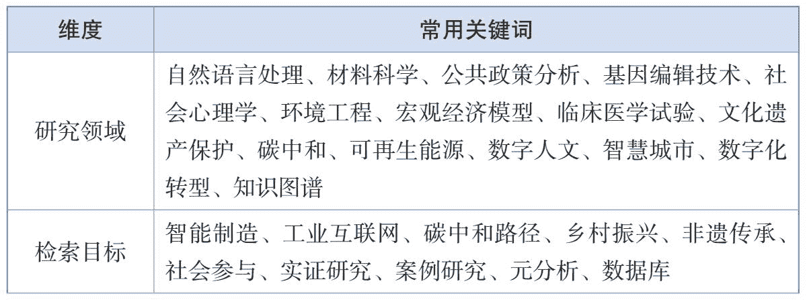

（续表）

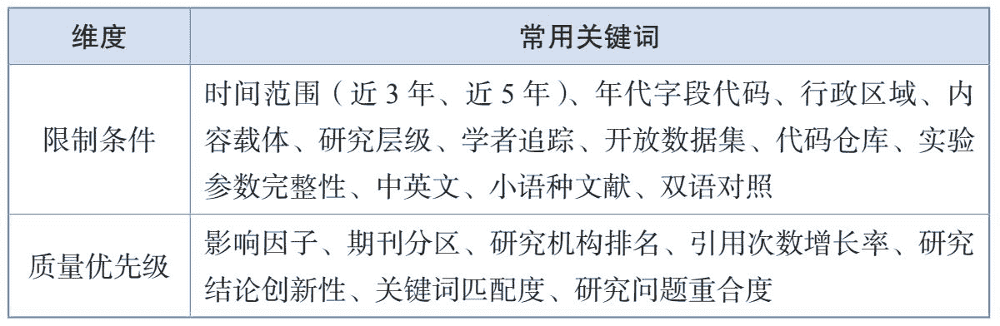

### **2.1.2 学术论文检索提问的 3 个句式模板**

**模板 1：时间限定型提问**

时间限定型就是先划定发表区间，再围绕核心词或规范术语，在特定研究方向里找应用型论文。

**示例：**

·“麻烦检索 2023—2025 年间，区块链技术在农产品溯源领域应用的相关论文。”

·“区块链在农产品溯源中的具体案例有哪些？需要近三年内的英文文献。”

**模板 2：分步骤型提问**

分步骤型是把复杂需求拆成多步，逐层深入追问。

**示例：**

·第一步：“区块链技术怎样改进供应链金融的信用评估模型？”

·第二步：“请推荐该方向 2023 年发表的 SCI 期刊论文。”

**模板 3：字段限制型提问**

字段限制型借助指定工具，在限定字段里检索，要求标题包含某术语且摘要提及另一术语的论文。

**示例：**

·“如何用 Web of Science 在 2022—2024 年间，查找标题含‘区块链’且摘要提到‘绿色供应链’的 SSCI 期刊论文？”

### **2.1.3 学术论文检索案例**

**案例：“人工智能伦理领域”论文检索**

**用户提问：**“在人工智能伦理方向，检索自动驾驶责任判定机制。要求包含 2020 年后发表于 SCI 一区期刊的英文文献，优先引用 MIT、斯坦福等顶尖实验室成果。请对比欧盟与美国研究团队的方法论差异，并整理争议焦点。”

**DeepSeek 回答：**

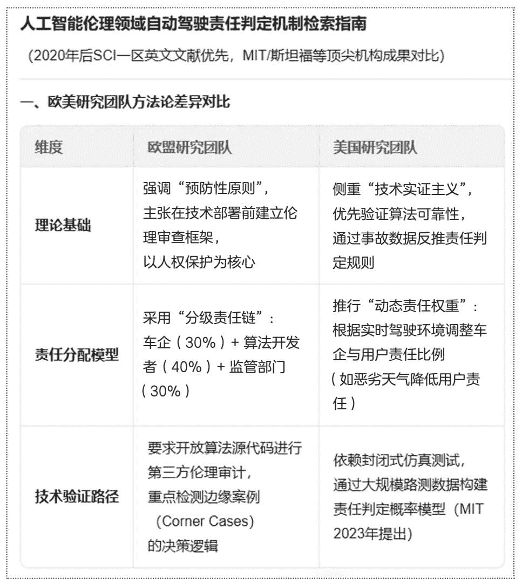

### **2.2 技术文档检索**

### **2.2.1 技术文档检索关键词**

**1. 关键词提取的核心公式**

关键词提取的核心公式为［技术领域］+［检索目标］+［格式/权限限制］+［时效性/优先级］。

**示例拆解：**

·“区块链开发（领域）；查询智能合约部署流程（目标）；仅限 Markdown 格式文档（限制）；需兼容最新 Solidity 版本 0.8.0（版本优先级）。”

在此组合里，技术范围被收窄到区块链开发，排除了通用性资料的干扰；检索意图明确为智能合约部署的操作步骤；格式与权限只保留 Markdown，排除了 PDF、扫描件等非结构化文本；再设定时效与优先级，强调版本兼容性，剔除过时方案。这样的提问方式能快速锁定所需的技术文档。

**2. 关键词库**

常用词汇总表见表 2-2。

表 2-2 常用关键词

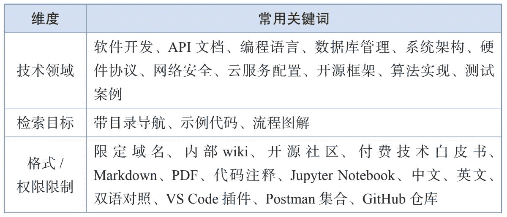

（续表）

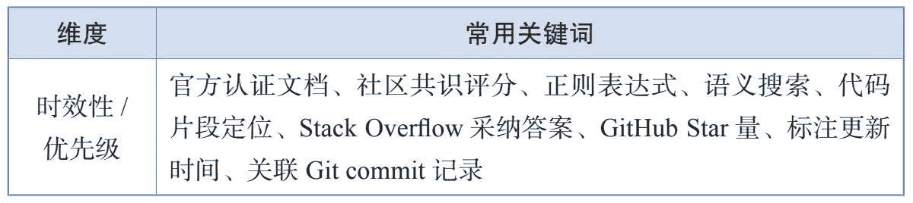

### **2.2.2 技术文档检索提问的 3 个句式模板**

**模板 1：版本兼容性验证**

“在开发［技术领域］时，如何验证［功能/接口］是否兼容［指定版本］？需包含［工具/框架］的官方文档说明和社区适配方案，优先引用近两年更新的解决方案。”

**示例：**

·“在开发 React Native 应用时，如何验证动态权限申请功能是否兼容 Android 13？需包含 react-native-permissions 库的官方说明和 GitHub 适配方案，优先选用 2023 年后更新的解决办法。”

**模板 2：多条件筛选式搜索**

“需要查找［技术领域］中［具体功能］的实现方法，要求同时满足［条件 A］、［条件 B］和［格式限制］，排除［过时技术/工具］。”

**示例：**

·“需要查找 React Native 相机权限动态申请的实现方式，要求同时支持 TypeScript 5.0 和 Expo 框架，排除仅适用于 Java/Kotlin 的文档。”

**模板 3：错误场景定向检索**

“当［技术场景］出现［具体报错代码/现象］时，如何通过［工具/日志］定位问题？需提供［平台/版本］的官方修复方案及社区已验证的临时规避措施。”

**示例：**

·“当 Android 端 React Native 应用请求 CAMERA 权限时返回‘PERMISSION_DENIED’错误，如何通过 Android Studio 日志定位问题？需提供 Android 13 的官方修复方案及 GitHub 已验证的临时规避措施。”

### **2.2.3 技术文档检索案例**

**案例：Python 机器学习库的技术文档检索**

**用户提问：**“我需要检索 2023 年后发布的 Python 机器学习库 TensorFlow 的 API 接口文档。”

**DeepSeek 回答：**

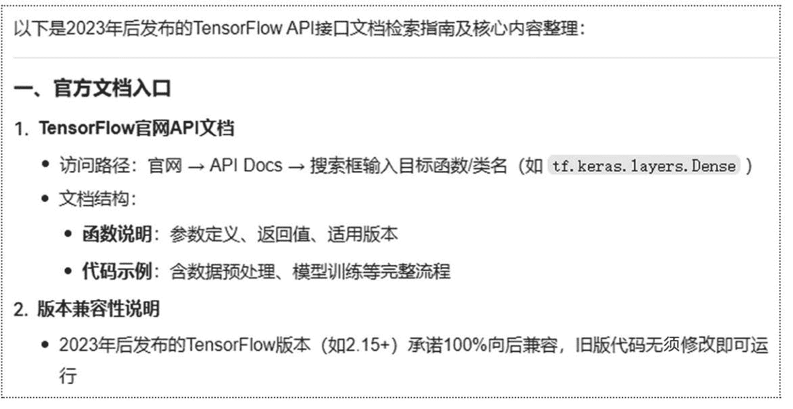

说明：因篇幅原因只展示部分回答。

## **2.3 法律文献检索**

### **2.3.1 法律文献检索关键词**

**1. 关键词提取的核心公式**

关键词提取的核心公式为［法律领域］+［检索目标］+［资源限制］+［质量优先级］。

**示例拆解：**

·“请帮我检索 2024 年关于知识产权法（领域）专利侵权判例（目标），无 Westlaw 权限（限制），侧重最高人民法院判例（权威优先级）。”

该组合里，法律范围能缩小检索面；检索意图可区分法条查询、案例搜集、学术论文等不同需求；资源限制可提前说明数据库权限或语言等获取障碍；质量优先级则按权威性、时效性、相关性等排序。

**2. 关键词库**

常用词汇总表见表 2-3。

表 2-3 常用关键词

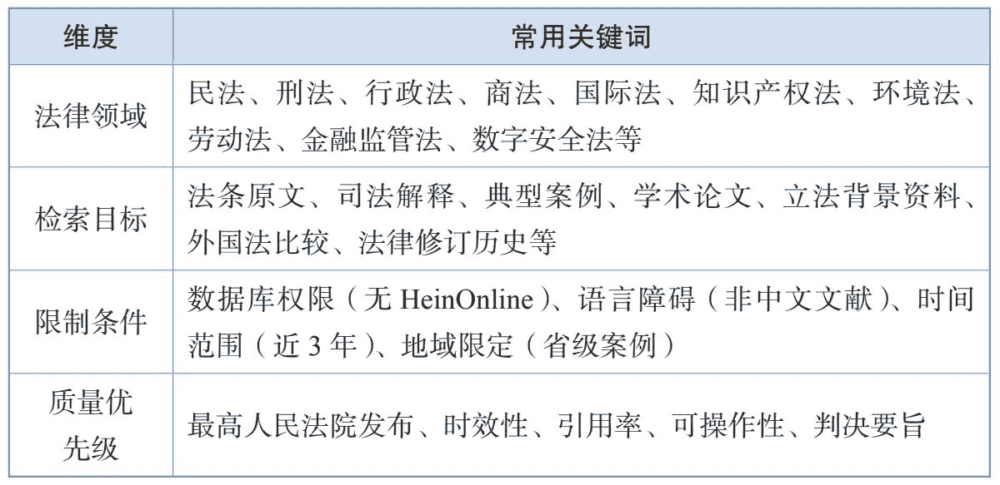

### **2.3.2 法律文献检索提问的 4 个句式模板**

**模板 1：精准需求检索提问**

“作为［法律身份］，需要检索［文献类型］，当前受限于［资源障碍］，请提供［数量］条符合［质量标准］的解决方案。”

**示例：**

·“作为实习律师，需检索《民法典》担保条款的司法适用案例，但无 Westlaw 权限，请提供 3 条利用公开数据库（如中国裁判文书网）的高效检索策略，要求包含筛选最高人民法院指导性案例的方法。”

**模板 2：动态修订追踪检索提问**

“针对［新修订法律名称］，请梳理发布后［时间段］内出现的［学术争议点/司法适用分歧］，要求对比［修订前后］核心条款的学界解读与判例变化。”

**示例：**

·“针对 2024 年新修订《公司法》第 225 条减资规则，请梳理实施 6 个月内出现的‘非等比例减资合法性’争议，要求对比修订前后北大法宝数据库中的相关学术论文及长三角地区法院判例。”

**模板 3：模拟场景检索提问**

“假设［具体法律场景］，需论证［争议焦点］，请提供［法域/时期限定］下支持［立场］的权威文献组合方案，并标注［效力层级］。”

**示例：**

·“假设某科技公司因数据跨境传输被行政处罚，需论证《个人信息保护法》第 38 条‘安全评估’义务的适用范围，请提供 2024 年最高人民法院相关司法解释+欧盟 GDPR 对比分析文献，要求包含跨境判例效力说明。”

**模板 4：证据链补强定向检索提问**

“现有［案件类型］诉讼中缺乏［证据类型］支持，需通过文献检索补强［待证事实］，请锁定［数据库名称］中［证据关联度＞X%］且［司法采信率＞Y%］的文献。”

**示例：**

·“现有商业秘密侵权诉讼中缺乏‘客户名单构成商业秘密’的判例支持，需通过中国裁判文书网补强证据链，请锁定‘指导性案例’标识+‘客户信息保密性认定’出现频次＞5 次的文书。”

### **2.3.3 法律文献检索案例**

**案例：“客户名单保密性认定”判例检索**

**用户提问：**“筛选最高人民法院‘商业秘密侵权’案件中涉及‘客户名单保密性认定’的判例，按 2023 年后发布时间排序。”

**DeepSeek 回答：**

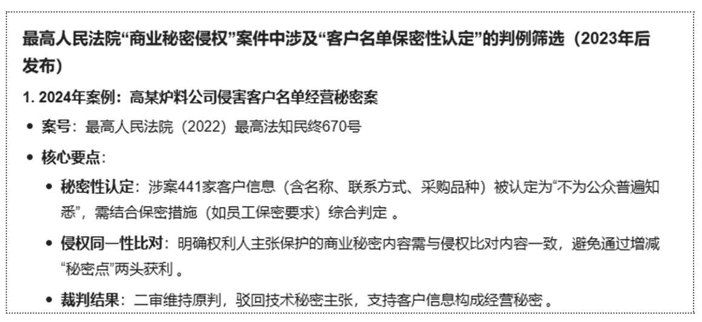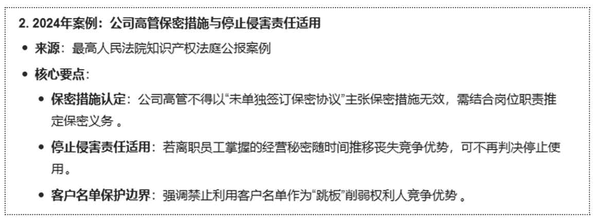

说明：因篇幅原因只展示部分回答。

## **2.4 知识文本查询**

### **2.4.1 知识文本查询关键词**

**1. 关键词提取的核心公式**

关键词提取的核心公式为［查询领域］+［核心目标］+［限制条件］+［质量优先级］。

**示例拆解：**

·“从学术研究（领域）的方向验证量子计算可行性（目标），请提供一些参考文献，仅限英文文献（限制），权威期刊优先（质量）。”

**查询领域：**明确研究方向如学术、商业、法律等，缩小范围。

**核心目标：**定义查询用途如数据验证、理论溯源、案例对标。

**限制条件：**语言、时间、格式等硬性约束。

**质量优先级：**标注优先级如权威性＞时效性＞可读性。

**2. 关键词库**

常用词汇总表见表 2-4。

表 2-4 常用关键词

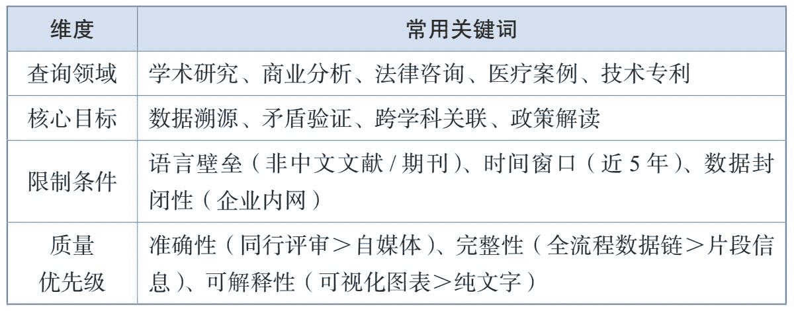

### **2.4.2 知识文本查询提问的 4 个句式模板**

**模板 1：精准溯源式提问**

“作为［研究者/学生］，需验证［具体知识点］在［领域］中的准确性，要求：［数据来源需包含××期刊/××年份报告］，请提取三方交叉验证的关键论据及原始数据页码。”

**示例：**

·“作为医学研究生，需验证‘端粒酶活性与癌症转移相关性’在肿瘤学领域的结论，要求：数据来源必须包含*Nature Medicine* 2024 年及《柳叶刀肿瘤学》2023 年文献，请提供三家独立实验室的细胞实验数据对比表。”

**模板 2：求助式提问**

“作为［新手/特定身份］，要在［时间］内掌握［技能］，已有［资源］，请提供［数量］个关键学习步骤。”

**示例：**

·“作为烹饪小白，要在周末前学会 5 道家常菜，已有电磁炉和基础厨具，请提供：

1. 火候控制口诀（如‘热锅冷油防粘锅’）；

2. 调味品添加顺序黄金法则。”

**模板 3：场景定位式提问**

“在［具体场景］中遇到［问题］，需要［目标］，请提供［数量］条可操作建议。”

**示例：**

·“在超市选购婴儿奶粉时遇到配方成分困惑，需要快速判断产品安全性，请提供 3 条通过包装标识快速鉴别优劣的技巧。”

**模板 4：事务决策式提问**

“我需在［时间限制］内处理［事项］，关键考虑［要素］，请列出风险清单与应对策略。”

**示例：**

·“我的房租将上涨 20%，但搬家时间紧张。考虑居住成本与时间成本，请提供：

1. 续租和搬家的月支出对比表；

2. 紧急找房渠道优先级清单（中介＞社区公告＞熟人推荐）。”

### **2.4.3 知识文本查询案例**

**案例：低敏性宠物饲养方案查询**

**用户提问：**“孩子想养宠物但配偶反对，希望平衡家庭卫生与孩子情感需求，请提供 2 种低敏性宠物饲养方案（如仓鼠/鱼类）及责任分工建议。”

**DeepSeek 回答：**

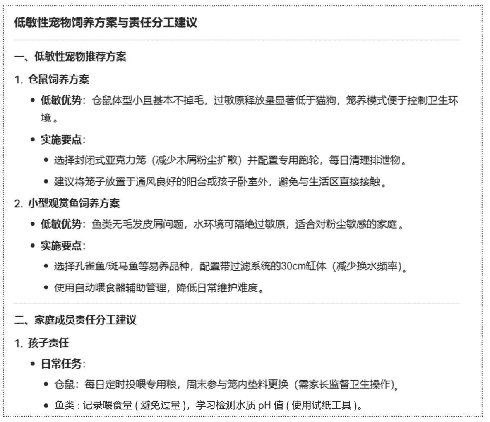

说明：因篇幅原因只展示部分回答。

## **2.5 信息资源推荐**

### **2.5.1 信息资源推荐关键词**

**1. 关键词提取的核心公式**

关键词提取的核心公式为［资源类型］+［学习目标］+［限制条件］+［评估维度］。

**示例拆解：**

·“人工智能入门课程（资源类型）+理解基础算法（目标）+免费且支持碎片化学习（限制）+用户评分≥4.5/5（评估）。”

该组合用资源类型锁定媒介形态，如课程、书籍、论文；学习目标明确知识深度；限制条件控制预算、时间、语言等可行性；评估维度用于筛选权威性、趣味性、用户反馈等质量标准，组合提问可让推荐更精准。

**2. 关键词库**

常用词汇总表见表 2-5。

表 2-5 常用关键词

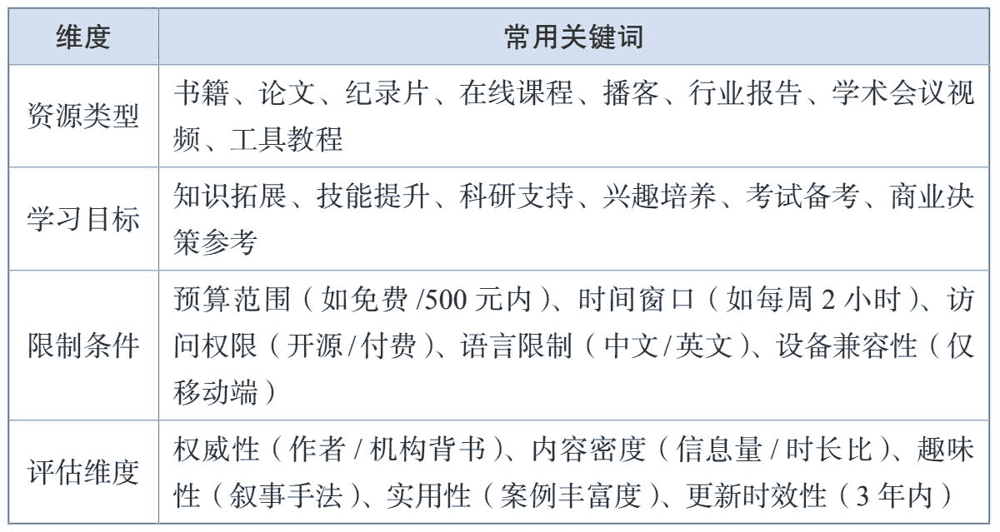

### **2.5.2 信息资源推荐提问的 3 个句式模板**

**模板 1：精准筛选提问**

“作为［身份］，需要获取［资源类型］用于［目标］，要求满足［限制条件］，请按［评估维度］优先级推荐［数量］个选项。”

**示例：**

·“作为人工智能领域研究生（身份），需查找近 3 年发表的强化学习论文（类型）用于文献综述（目标），要求开放获取且含可复现代码（限制），请按被引量降序推荐 5 篇（评估）。”

·“作为新媒体运营新人（身份），需学习短视频脚本写作课程（类型）提升爆款率（目标），预算≤200 元且支持手机端学习（限制），请按完课率＞85%推荐 3 门（评估）。”

**模板 2：教学引导提问**

“如何通过［音乐元素］的［具体维度］对比，帮助［学习者群体］理解［抽象概念］？请设计包含［互动形式］的课堂提问链。”

**示例：**

·“如何通过《蓝色多瑙河》与《二泉映月》的旋律走向对比（元素），帮助初中生（群体）理解中西音乐情感表达差异（概念）？请设计包含‘色彩联想→肢体表达→文化溯源’三阶的提问链。”

**模板 3：跨界组合提问**

“请为［复杂任务］设计跨领域资源组合包，要求包含［资源类型 A］［资源类型 B］［资源类型 C］，并说明协同增效原理。”

**示例：**

·“为‘元宇宙营销方案策划’任务（复杂任务）设计组合包：1 篇 Gartner 趋势报告（类型 A）+3 个 Unity 数字孪生案例视频（类型 B）+用户虚拟形象设计工具教程（类型 C），说明如何交叉验证创意可行性。”

·“为‘儿童编程启蒙’需求（复杂任务）组合资源：Scratch 官方课程（类型 A）+《Hello Ruby》绘本（类型 B）+家长指导手册（类型 C），解释认知发展理论与实践工具的衔接逻辑。”

### **2.5.3 信息资源推荐案例**

**案例：新茶饮行业报告推荐**

**用户提问：**“作为消费领域投资人，我想要获取 2025 年中国新茶饮行业竞争格局分析报告，用于评估项目市场占有率，要求包含 Top 10 品牌供应链数据及近 3 年融资记录，请推荐 3 个含上市公司招股书交叉验证的权威渠道。”

**DeepSeek 回答：**

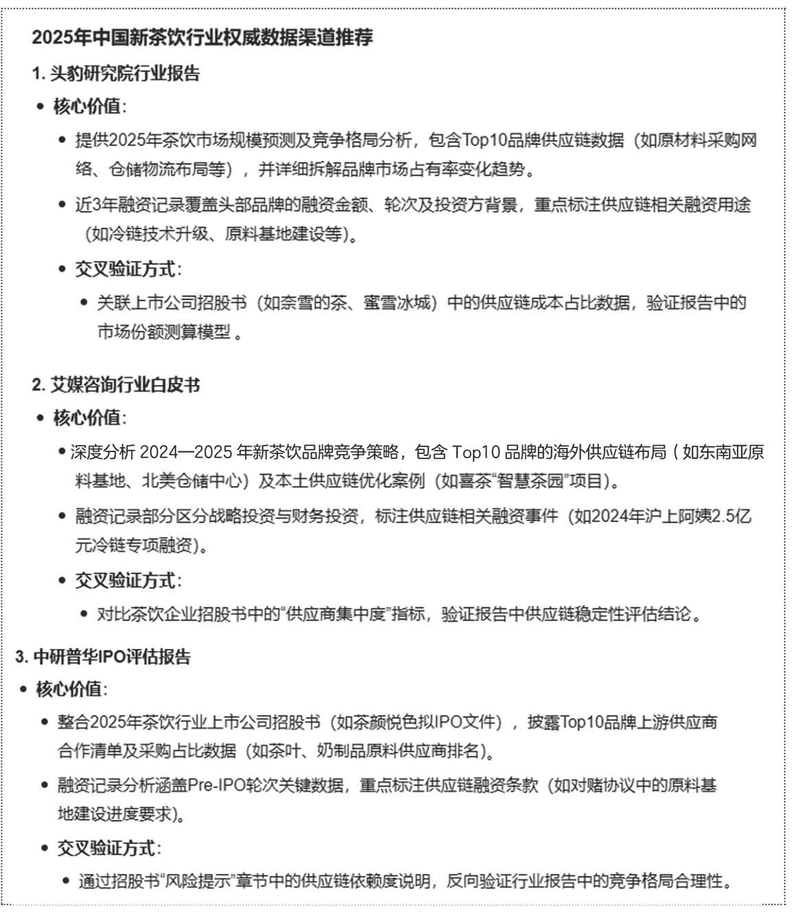

说明：因篇幅原因只展示部分回答。

## **2.6 职业机会推荐**

### **2.6.1 职业机会推荐关键词**

**1. 关键词提取的核心公式**

关键词提取的核心公式为［行业领域］+［职业目标］+［限定条件］+［决策优先级］。

**示例拆解：**

·“本人从互联网行业（领域）转型 AI 算法工程师（目标），数学基础薄弱（限制），薪资涨幅优先（优先级）。”

**行业领域：**明确目标行业如互联网、金融、医疗，缩小范围。

**职业目标：**界定具体岗位或发展方向如技术、管理、复合型。

**限定条件：**列出硬性门槛与软性短板如学历、技能、沟通能力。

**决策优先级：**量化核心诉求如薪资、工作强度、发展空间，用于筛选方案。

**2. 关键词库**

常用词汇总表见表 2-6。

表 2-6 常用关键词

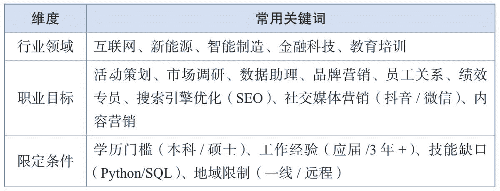

（续表）

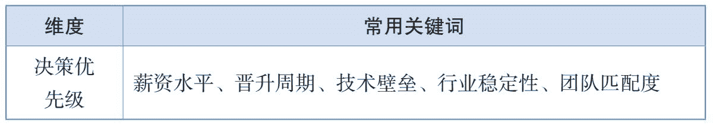

### **2.6.2 职业机会推荐提问的 3 个句式模板**

**模板 1：职业方向诊断**

“作为［当前身份/行业从业者］，计划转型［目标领域/岗位类型］，但受限于［具体障碍］，请提供［数量］条可落地的职业发展建议。”

**示例：**

·“作为传统制造业机械工程师，计划向智能制造领域转型，但缺乏工业互联网项目经验，请提供 3 条 6 个月内可实施的技能提升路径。”

·“作为工作 3 年的市场营销专员，希望转行用户增长方向，但未接触过数据驱动决策模型，请给出 4 条结合现有经验的能力迁移方案。”

**模板 2：职业路径对比**

“针对［职业目标］，请对比以下［数量］种发展路径的［评估维度］，并推荐最优选项。

路径 A：［核心特点］。

路径 B：［核心特点］。”

**示例：**

·“针对技术转型管理岗的目标，请对比以下 2 种路径的晋升周期、技能匹配度与长期收益。

路径 A：内部转岗至项目管理部，特点为利用现有业务熟悉度快速上手，但技术能力可能弱化。

路径 B：考取 PMP 认证后跳槽至科技公司，特点为薪资涨幅显著，但需适应新团队协作模式。”

·“针对新能源行业求职，请对比电池研发工程师（技术深耕）与碳中和咨询顾问（复合能力）的行业需求度、35 岁后职业韧性及薪资天花板。”

**模板 3：职业决策风险评估**

“需在［时间限制］内选择［职业选项］，关键考量包括［要素 1］、［要素 2］，请分析风险等级并给出应对策略。”

**示例：**

·“需在 1 周内决定是否接受异地 AI 算法岗 Offer，关键考量：薪资涨幅 40%但需举家搬迁，职业发展空间大但行业竞争激烈。请评估家庭稳定性风险与技术成长性收益。”

·“需在 3 天内确定是否跳槽至初创公司担任技术总监，关键考量：股权激励潜在收益高，但公司现金流稳定性存疑。请提供融资数据核查方法与对赌协议谈判要点。”

### **2.6.3 职业推荐案例**

**案例：职业推荐及技能提升路径**

**机械设计转智能制造：岗位适配与能力进阶**

**用户提问：**“现在在一线制造企业做机械设计，希望往智能制造方向转，但缺乏工业互联网项目实战经验，最关注技术成长空间。请给出三個匹配岗位建议，并对应说明能力提升路径。”

**DeepSeek 回答：**

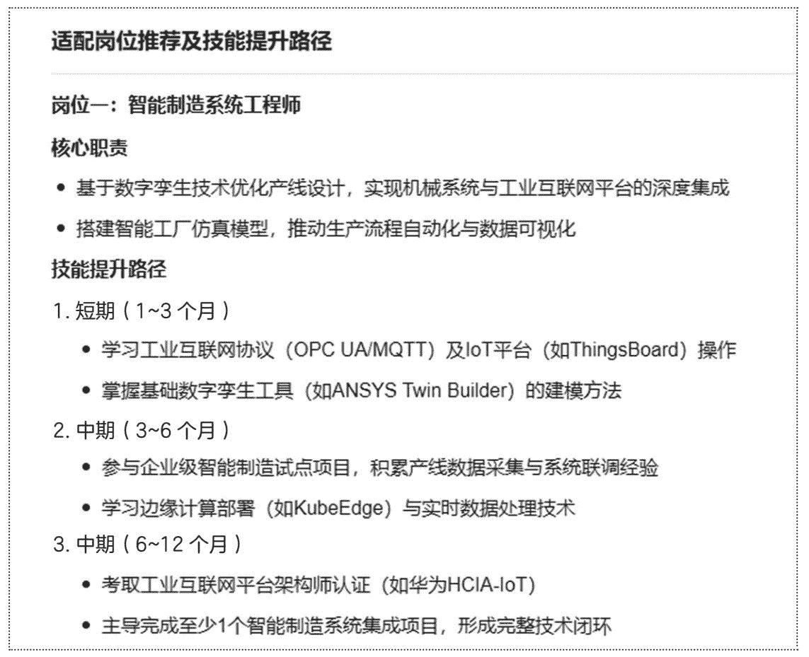

说明：因篇幅原因只展示部分回答。

## **2.7 商业数据查询**

### **2.7.1 商业数据查询关键词**

**1. 关键词提炼的组合逻辑**

提问要素可归纳为［需求场景］+［数据类型］+［限制条件］+［优先级指标］。

**示例拆解：**

·“请帮我拿到 2024 年东南亚电商市场（场景）实时交易规模与 TOP 3 平台占比（目标），仅用公开免费库（限制），准确性优先于时效（优先级）。”

通过锁定东南亚电商，把范围收窄到特定区域行业；明确要交易规模与平台份额两类指标，区分宏观与微观；用仅限公开免费库排除付费渠道；准确性大于时效，则引导优先调用权威机构或学术报告。

**2. 关键词库**

常用词条见表 2-7。

表 2-7 常用关键词

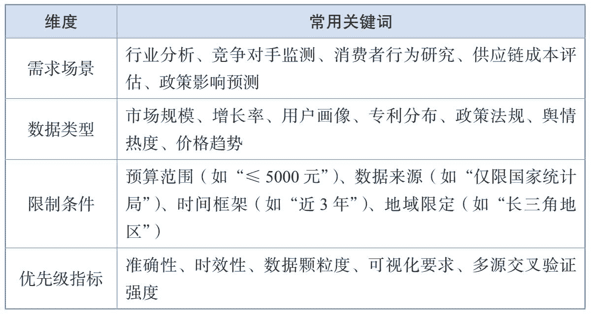

### **2.7.2 商业数据查询提问的 2 个句式模板**

**模板 1：角色代入式提问**

“作为［商业角色］，需在［场景］中获取［数据类型］，限制为［预算/来源/地域］，优先级是［指标排序］，请给出［工具建议］+［验证方法］。”

**示例：**

·“作为市场分析师，需要 2024 年东南亚美妆份额数据，限定免费英文数据库，优先数据准确，请推荐 3 个权威平台并说明交叉验证流程。”

·“作为跨境品牌顾问，需要 2024 年德国个护用品消费者偏好，限定非英文开源数据库，优先级‘地域细分精度＞数据量’，请给出适配的政府公开数据渠道及抽样统计验证方式。”

**模板 2：步骤拆解法提问**

“把‘查询［目标数据］’拆成［数量］步，说明每步的［数据源筛选方法］+［清洗规则］+［分析模型］。”

**示例：**

·“把‘分析 2024 年中国新能源汽车电池原材料价格波动’拆成 4 步：挑选国家统计局与海关总署源→剔除异常值→用 ARIMA 模型推趋势→输出可视化图表。”

**模板 3：对比分析提问**

“从［维度 1/维度 2/维度 3］对比［数据源 A］与［数据源 B］，输出差异及适用场景，并附［数据修正建议］。”

**示例：**

·“对比 Statista 与 Euromonitor 的 2024 年全球快消品增速，从统计口径、样本覆盖、更新频率三方面分析差异，说明跨国企业如何修正偏差。”

### **2.7.3 商业数据检索案例**

**案例：中国固态电池专利年申请量增长率检索**

**用户提问：**“预测 2025—2028 年中国固态电池专利年申请量增长率，融合国家知识产权局公开数据与 WIPO 全球专利库，用 ARIMA 模型预测并标注置信区间。”

**DeepSeek 回答：**

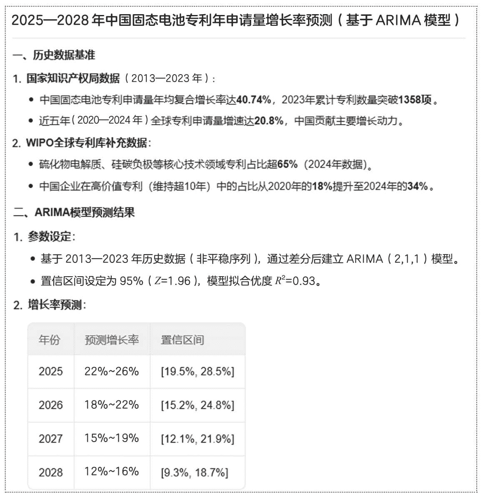

说明：因篇幅原因只展示部分回答。

## **2.8 旅游地点推荐**

### **2.8.1 旅游地点推荐关键词**

**1. 关键词提炼的核心思路**

公式为［旅行类型］+［体验需求］+［限制条件］+［评估维度］。

**示例拆解：**

·“家庭亲子游（类型）+自然教育体验（需求）+单程交通≤3 小时（限制）+安全系数优先（评估）。”

旅行类型锁定亲子场景，需关注设施安全与教育属性；体验需求明确自然教育而非纯观光；限制条件控制可行性，短途更适配儿童体力；评估维度把安全放在新奇性之前。结构化提问能提升答案精准度。

**2. 关键词库**

常用词条见表 2-8。

表 2-8 常用关键词

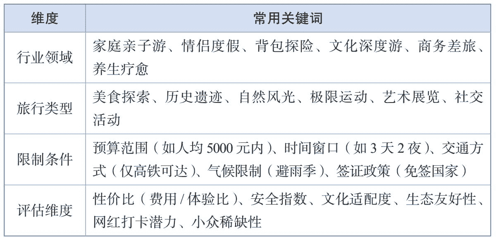

### **2.8.2 旅游地点推荐提问的 4 个句式模板**

**模板 1：精准需求定位**

“计划［旅行类型］行程，核心需求是［体验关键词］，受［限制条件］约束，请推荐［数量］个按［评估维度］优先的目的地。”

**示例：**

·“计划情侣海岛度假，需求私密度假村与海上运动，人均预算 1.2 万元内，请推荐东南亚区域服务评分≥4.8/5 的 3 个目的地。”

**模板 2：多方案对比**

“对比以下［数量］个目的地在［评估维度 1］、［评估维度 2］的优劣，给出匹配［限制条件］的排序。

A 地：［核心特点］。

B 地：［核心特点］。”

**示例：**

·“对比日本北海道（冰雪景观+温泉酒店）与挪威特罗姆瑟（极光观测+狗拉雪橇）在冬季体验丰富度与摄影出片率的差异，人均预算 2 万元，说明推荐优先级。”

**模板 3：紧急决策支持**

“需在［时间］内敲定［目的地］，关键矛盾是［冲突因素］，请提供风险规避方案与备选建议。”

**示例：**

·“需在 24 小时内决定是否预订下周出发的土耳其行程，但当地突发地震预警。矛盾在于已付 60% 不可退费用与出行安全风险，请提供外交部安全等级查询渠道与保险理赔攻略。”

**模板 4：场景化追问**

“已选定［初步目的地］，请补充以下信息以优化行程。

①［维度 1］（如交通接驳耗时/特色餐饮分布）。

②［维度 2］（如亲子设施覆盖度/无障碍通道完善性）。”

**示例：**

·“已确定北海道为冬季旅行地，请补充：①札幌至富良野巴士班次间隔与雪天延误概率；②滑雪场儿童教学课程师资认证情况。”

### **2.8.3 旅游地点推荐案例**

**案例：旅游景点对比**

**用户提问：**“请生成北京与西安两城的交通耗时、人均消费、网红景点密度对比表。”

**DeepSeek 回答：**

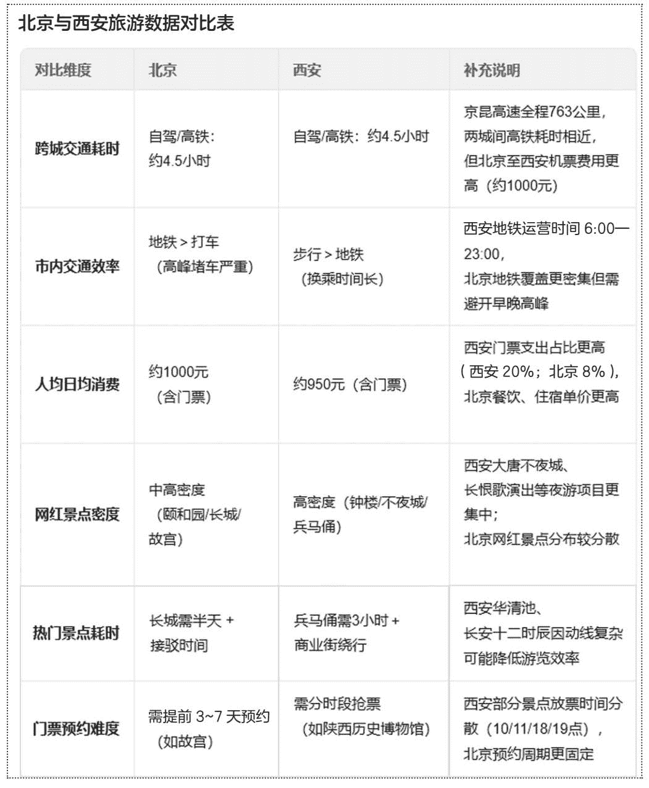

## **2.9 理财产品推荐思路**

### **2.9.1 理财产品推荐关键词**

**1. 关键词提炼的核心思路**

公式为［理财规划领域］+［资金增值目标］+［风险偏好/流动性需求限制］+［收益稳定性优先级］。

**示例拆解：**

·“家庭理财（领域）；短期闲置资金增值（目标）；风险承受低（限制）；6 个月投资周期（时间优先级）。”

领域聚焦家庭资产配置方向，目标明确短期增值诉求，限制规避高风险并强调保本，收益稳定性优先级适配 6 个月封闭期产品特征，组合后可精准筛出货币基金、短期债券等低风险方案。

**2. 关键词库**

常用词条见表 2-9。

表 2-9 常用关键词

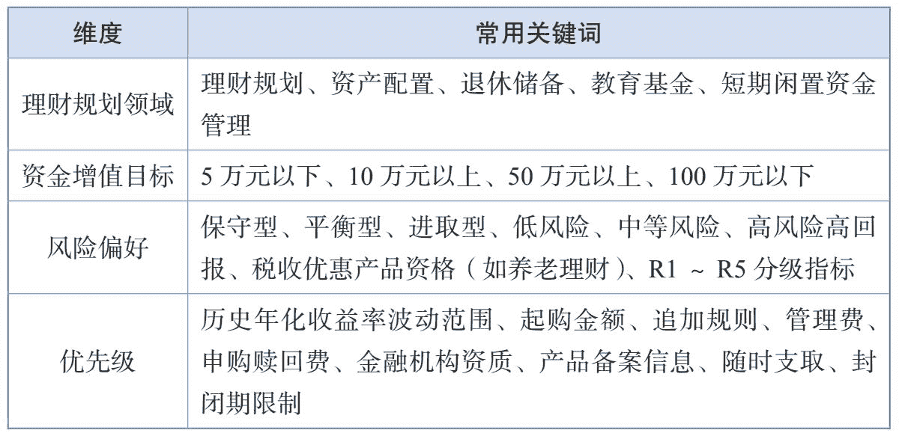

### **2.9.2 理财产品推荐提问的 6 个句式模板**

**模板 1：短期低风险配置型**

“家庭闲置资金（领域）；短期稳健增值（目标）；风险承受低（限制）；6 个月投资周期（优先级）。”

**示例：**

·“现有 20 万元家庭闲置资金，希望 6 个月低风险配置，要求保本且可随时应急支取。请对比货币基金、银行短期理财和大额存单的收益率及流动性差异。”

**模板 2：中长期稳健增长型**

“个人理财（领域）；资产稳健增值（目标）；可接受 10% 以内波动（限制）；3 年投资周期（优先级）。”

**示例：**

·“计划用 50 万元构建 3 年组合，要求年化 5%~6% 且最大回撤≤15%。请推荐债券基金、固收+产品和混合型基金的配比方案。”

**模板 3：高流动性需求型**

“企业周转金（领域）；灵活存取需求（目标）；月均需支取 30% 资金（限制）；收益稳定性优先（评估）。”

**示例：**

·“企业账户有 100 万元周转金，需按月支取部分资金。推荐支持 T+0 赎回、年化 3% 以上的流动型产品，需含短债基金和银行活期理财对比。”

**模板 4：教育基金专项规划型**

“子女教育储备（领域）；10 年长期增值（目标）；要求绝对保本（限制）；税收优惠优先（评估）。”

**示例：**

·“为子女准备 20 万元教育基金，需锁定 10 年期安全收益。请分析国债、教育储蓄保险及银行专项理财的收益率、赎回规则及税收优惠政策。”

**模板 5：退休储备组合型**

“养老理财（领域）；抗通胀需求（目标）；年龄 55 岁以上（限制）；按月分红优先（评估）。”

**示例：**

·“55 岁客户持有 100 万元养老金，要求组合年化 4% 以上且按月派息。推荐大额存单、红利指数基金及年金保险的配比与风险说明。”

**模板 6：政策红利捕捉型**

“政策导向投资（领域）；获取税收减免（目标）；持有本地户籍（限制）；合规性优先核查（评估）。”

**示例：**

·“作为上海户籍投资者，30 万元拟配置享受税收优惠的产品。请列举养老目标基金、地方政府专项债及公积金补充理财的申购条件与收益测算。”

### **2.9.3 理财产品推荐案例**

**案例：银行理财产品推荐**

**用户提问：**“目前持有 20 万元闲置资金（限制），希望配置中等风险产品（领域），要求 3 年内可灵活赎回（优先级）。请对比推荐 3 款银行理财和券商收益凭证，需包含年化收益率、风险等级和流动性分析（评估）。”

**DeepSeek 回答：**

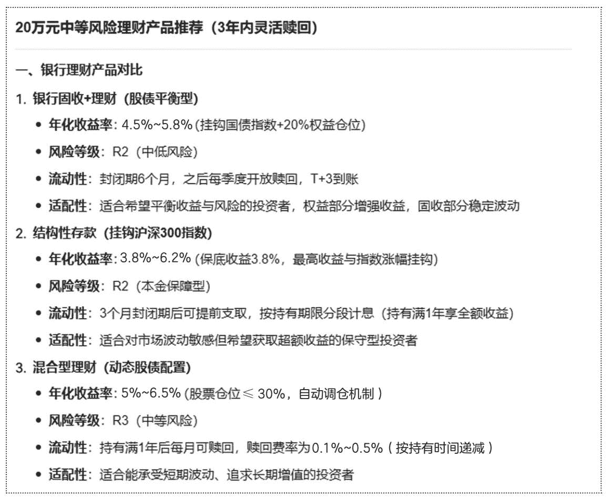

说明：因篇幅限制，仅展示部分内容。

## **2.10 商品服务推荐方法**

### **2.10.1 商品服务推荐关键词**

**1. 关键词提炼的核心思路**

公式为［商品/服务类型］+［核心需求］+［预算范围］+［评估维度］。

**示例拆解：**

·“智能家居设备（类型）；节能环保（核心需求）；5000 元以内（预算）；能耗等级+智能化程度（评估）。”

类型明确推荐方向，核心需求聚焦用户痛点，预算限定价格区间避免无效推荐，评估维度确定筛选标准。如此提问可让答案更精准。

**2. 关键词库**

常用词条见表 2-10。

表 2-10 常用关键词

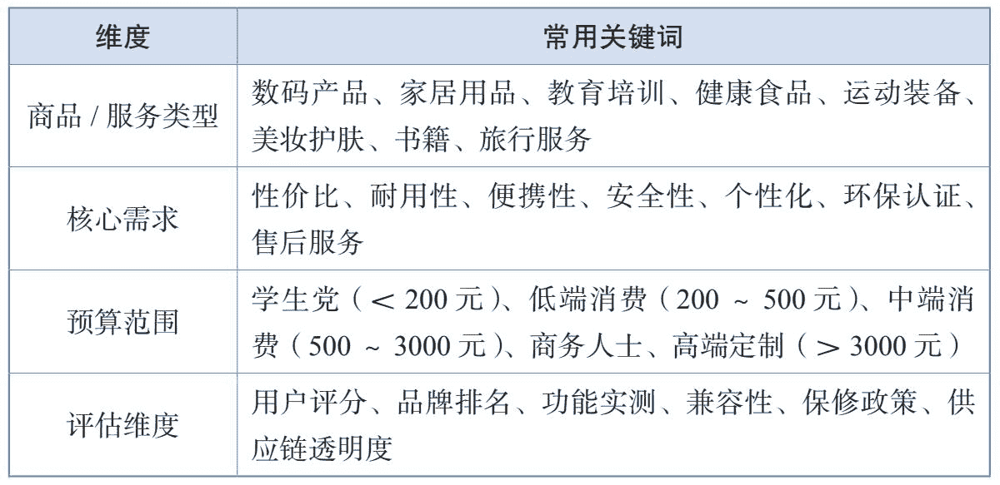

### **2.10.2 商品服务推荐提问的 5 个句式模板**

**模板 1：基础需求提问**

“满足［使用场景］需求的［商品类型］，预算［金额范围］，需对比［参数 1］与［参数 2］的实测数据。”

**示例：**

·“满足 90m² 复式户型需求的智能扫地机器人，预算 3000 元内，需对比激光雷达与视觉导航的避障成功率。”

**模板 2：竞品对比法提问**

“对比［商品 A］与［商品 B］在［核心需求］上的差异，预算［金额范围］，优先考虑［评估维度 1］且［评估维度 2］不低于行业均值。”

**示例：**

·“对比戴森 V12 与米家无线吸尘器在宠物毛发清理上的差异，预算 2000 元内，优先吸力衰减率且噪声值≤75dB。”

**模板 3：需求矛盾化解式提问**

“需要同时满足［需求 A］和［需求 B］的［商品类型］，预算［金额范围］，若无法兼得，请提供［数量］种替代方案并说明妥协点。”

**示例：**

·“需同时满足 200km 续航和 2 小时快充的电动自行车，预算 5000 元内，若无法兼得，请提供 3 种替代方案并说明电池类型与充电桩适配性差异。”

**模板 4：预算适配提问**

“根据［预算弹性说明］，推荐［商品类型］的［数量］个档位方案，需包含［必选功能］及对应性价比评估。”

**示例：**

·“根据‘预算 8000 元可上浮 15%’，推荐游戏本的 3 个档位方案（RTX4060/4070/4080），需包含双内存插槽及散热系统噪声对比。”

**模板 5：服务全周期覆盖提问**

“推荐［商品类型］时需包含［时间跨度］内的［服务类型］保障，预算［金额范围］，重点说明［售后服务条款］与［异常情况处理流程］。”

**示例：**

·“推荐空气净化器时需包含 3 年内的滤芯更换服务，预算 4000 元内，重点说明 PM2.5 传感器校准周期及数据异常报修响应时效。”

### **2.10.3 商品服务推荐案例**

**案例：入门级微单相机推荐**

**用户提问：**“请推荐一款入门级微单相机（类型），核心需求轻便易操作，预算 3000~5000 元，需对比画质、镜头适配性和续航能力（评估）。”

**DeepSeek 回答：**

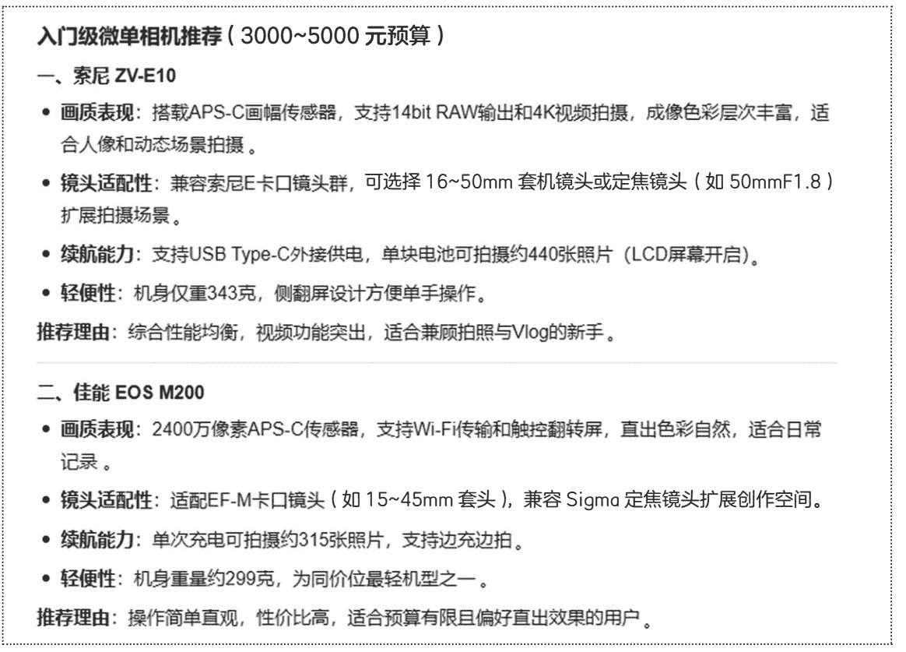

说明：因篇幅限制，仅展示部分内容。

# **第三章**

# **请求解释说明**

## **3.1 概念术语解释**

### **3.1.1 概念术语解释关键词**

**1. 关键词提炼的核心思路**

公式为［术语名称］+［学科领域］+［核心特征］+［应用场景］。

**示例拆解：**

·“机器学习（术语）；人工智能（学科）；数据驱动的算法训练（核心特征）；金融风控与医疗诊断（应用场景）。”

术语名称明确待解释概念，学科领域定位知识边界，核心特征提炼独特性，应用场景说明实际价值。

**2. 关键词库**

常用词条见表 3-1。

表 3-1 常用关键词

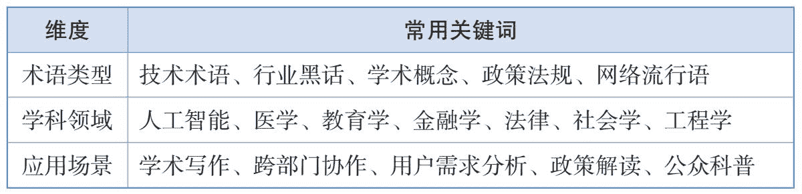

### **3.1.2 概念术语解释提问的 3 个句式模板**

**提问模板 1：要素拆解定位法**

“请从［学科领域］角度解释［术语名称］，需包含［核心特征］、［应用场景］和［常见误解］，用［数字］个案例说明其与［相近术语］的差异。”

**示例：**

·“请从计算机科学角度解释‘机器学习’，需包含数据驱动特征、金融风控场景和过拟合误区，用 2 个案例说明其与‘深度学习’的差异。”

**提问模板 2：动态对比分析法**

“对比［术语 A］与［术语 B］在［学科领域］中的差异，重点说明［比较维度 1］、［比较维度 2］和［历史演变］，给出［数字］个典型应用场景对比。”

**示例：**

·“对比‘区块链’与‘分布式数据库’在信息技术中的差异，重点说明数据结构、信任机制和溯源能力，给出 3 个供应链管理场景对比。”

**提问模板 3：属性分层提问法**

“将［术语名称］拆解为［层级数］个认知层级：基础定义层需包含［要素 1］+［要素 2］，扩展属性层需说明［特征 1］与［特征 2］的关联，实践应用层需列举［数字］种［具体场景］案例。”

**示例：**

·“将‘元宇宙’拆解为 3 个层级：基础定义（虚拟空间+数字身份）、扩展属性（区块链经济+感官沉浸）、实践应用（3 种工业数字孪生案例）。”

### **3.1.3 概念术语解释案例**

**案例：解释“算法过滤机制如何加剧认知局限”**

**用户提问：**“用‘抖音信息流推荐’现象反向推导‘信息茧房’要素，解释算法过滤机制如何加剧认知局限，标注其在社交媒体与学术检索中的差异。”

**DeepSeek 回答：**

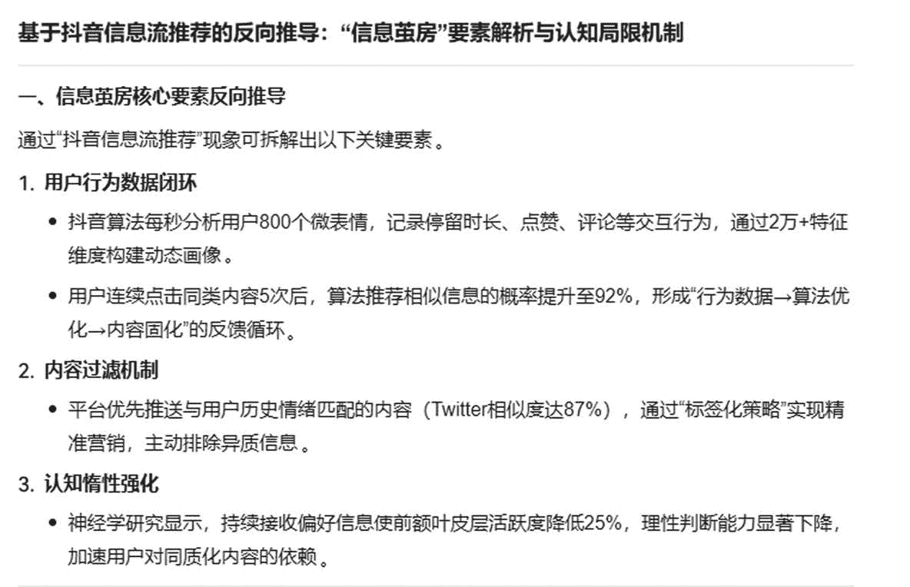

## **3.2 定义公式解释**

### **3.2.1 定义公式解释关键词**

**1. 关键词提炼的核心思路**

公式为［定义名称］+［应用场景］+［具体困惑点］+［验证方式］。

**示例拆解：**

·“根据 AARRR 模型（定义）在电商用户增长中的应用，如何理解激活阶段的‘Aha Moment’设计？需结合拼多多北极星指标案例验证。”

定义名称明确讨论对象，应用场景限定边界，具体困惑点聚焦矛盾核心，验证方式提供判断标准。

**2. 关键词库**

常用词条见表 3-2。

表 3-2 常用关键词

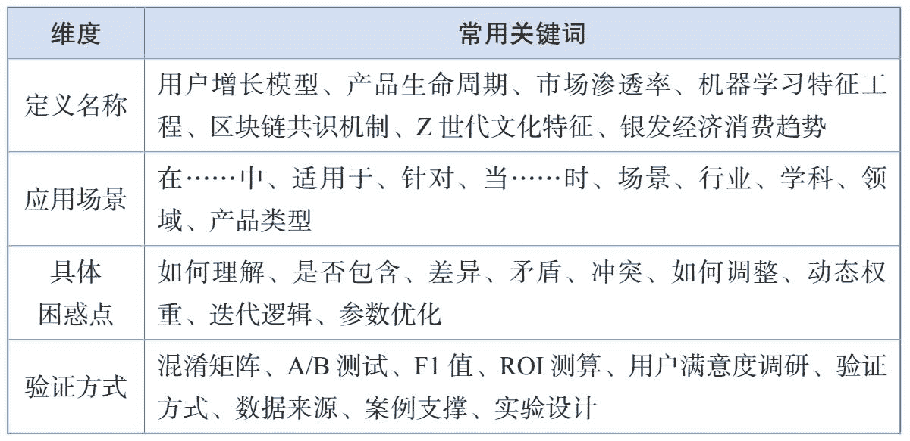

### **3.2.2 定义公式解释提问的 4 个句式模板**

**提问模板 1：角色限定法**

“作为［专业角色］，在［具体场景］中需要完成［核心任务］，面临［限制条件］，请提供［数量］个［解决方案/策略］并说明［验证标准］。”

**示例：**

·“作为跨境电商运营专员，在 Prime Day 大促期间需提升转化率（预算≤5 万元），请提供 3 个站外引流策略，需结合亚马逊广告 ROI 数据验证有效性。”

**提问模板 2：流程拆解法**

“将［复杂任务］拆分为［步骤数］个阶段，阐述每个阶段需满足的［目标/工具/注意事项］，并给出［场景限定］下的执行案例。”

**示例：**

·“将抖音直播间流量冷启动拆分为 4 个阶段，说明每个阶段的目标、需监测的数据指标及常见误区，需结合美妆类目新账号案例。”

**提问模板 3：矛盾对比法**

“对比［选项 A］与［选项 B］在［场景/维度］中的差异，需从［评估维度］分析优劣，并通过［数据/案例］验证结论可靠性。”

**示例：**

**母婴复购投放 ROI 对比范例**
· “聚焦母婴品类复购场景，权衡私域社群经营与抖音付费投放的投入产出，围绕获客开支、用户粘性、长期价值展开分析，并以孩子王 2024 年 Q2 财报数据作为支撑。”

**提问模板 4：场景限定法**

“在［具体场景］中，如何破解［核心痛点］？需满足［限制条件］，并通过［验证工具/指标］来判断方案的可行性。”

**示范：**

·“针对三四线城市社区团购的生鲜次日达履约率难题，在月度仓储费用不超过 10 万元的约束下，应如何优化？请用漏斗模型拆解各环节的损耗比例。”

### **3.2.3 定义公式阐释案例**

**案例：金字塔模型定义阐释**

**用户提问：**金字塔模型的三个分层标准是什么？需说明各层关键数据指标。

**DeepSeek 回答：**

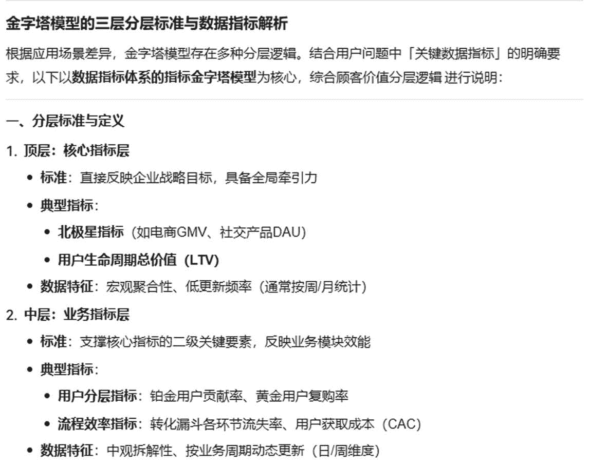

注：因篇幅原因只展示部分回答。

## **3.3 政策法规解释**

### **3.3.1 政策法规解释关键词**

**1. 关键词提取的核心公式**

关键词拆解的主体结构为［法规名称］+［适用场景］+［核心条款］+［争议焦点］+［实施细则］。

**示例拆解：**

·“《个人信息保护法》法规名称；互联网企业数据跨境传输适用场景；第 38 条安全评估义务核心条款；跨境数据主权争议争议焦点；国家网信办《数据出境安全评估办法》实施细则。”

**法规名称：**精准锚定政策文件，如《劳动法》《数据安全法》。

**适用场景：**界定法规的作用边界，如企业用工、跨境贸易、数据合规。

**核心条款：**提炼直接影响行为的条文，如“劳动者每日加班不得超过 3 小时”。

**争议焦点：**标注法律解读的分歧点，如“灵活用工是否适用劳动关系认定”。

**实施细则：**关联配套文件，如地方法规、行业标准。

**2. 关键词库**

表 3-3 汇总了常用关键词。

表 3-3 常用关键词

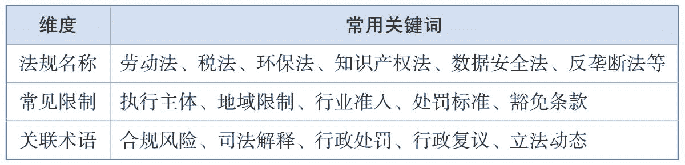

### **3.3.2 政策法规解释提问的 4 个句式模板**

**提问模板 1：核心条款解析提问**

“请解析《［政策名称］》第［具体条款］条的核心要求，说明其在［特定领域］中的执行标准，并列举［数量］个违反该条款的典型案例。”

**示例：**

·“请解析《数据安全法》第 27 条的核心要求，说明其在跨境电商中的执行标准，并列举 2 个违反数据跨境传输规定的典型案例。”

**提问模板 2：政策对比分析提问**

“对比《［政策 A］》与《［政策 B］》在［具体场景］中的适用差异，重点说明［维度 1］、［维度 2］的冲突条款，并给出［数量］个跨政策合规建议。”

**示例：**

·“对比《个人信息保护法》与《网络安全法》在 APP 隐私收集中的适用差异，重点说明用户授权方式、数据存储期限的冲突条款，并给出 3 个合规建议。”

**提问模板 3：执行指导型提问**

“根据《［政策名称］》要求，列明［行业类型］企业需完成的［数量］项合规动作清单，并标注［具体条款］对应的处罚标准。”

**示例：**

·“根据《反垄断法》要求，列明电商平台需完成的 5 项合规动作清单，并标注第 22 条对应的罚款计算方式。”

**提问模板 4：争议焦点追问法**

“围绕《［政策名称］》第［条款］条的实施争议，分析［利益方 A］与［利益方 B］的核心分歧，结合［数量］个司法判例说明裁量尺度。”

**示例：**

·“围绕《劳动法》第 41 条的加班时长争议，分析企业与劳动者的核心分歧，结合 3 个劳动争议判例说明仲裁标准。”

### **3.3.3 政策法规解释案例**

**案例：直播带货虚假宣传适用《广告法》第 28 条**

**用户提问：**“针对直播带货中的虚假宣传问题，说明如何适用《广告法》第 28 条进行整改，需包含话术审查、证据留存和处罚申诉流程。”

**DeepSeek 回答：**

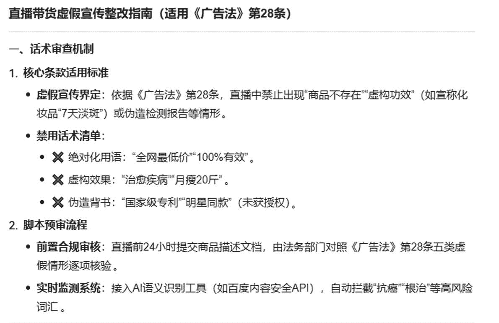

注：因篇幅原因只展示部分回答。

## **3.4 规则规定解释**

### **3.4.1 规则规定解释关键词**

**1. 关键词提取的核心公式**

关键词拆解的主体结构为［规则领域］+［具体问题］+［限制条件］+［解释维度］。

**示例拆解：**

·“互联网广告法规则领域；医疗产品宣传禁用词具体问题；2025 年修订版时间限制；条款原文+执法案例深度要求。”

**规则领域：**明确规则所属的行业/法律/制度体系，如《劳动法》、医疗报销政策。

**具体问题：**聚焦规则中模糊的条款或矛盾点，如“加班费计算是否包含绩效奖金”。

**限制条件：**增加时间、地区、主体类型等约束，如“2025 年修订的上海医保政策”。

**解释维度：**要求解释形式，如“条款原文+官方解读+案例说明”。

**2. 关键词库**

表 3-4 列出常用关键词。

表 3-4 常用关键词

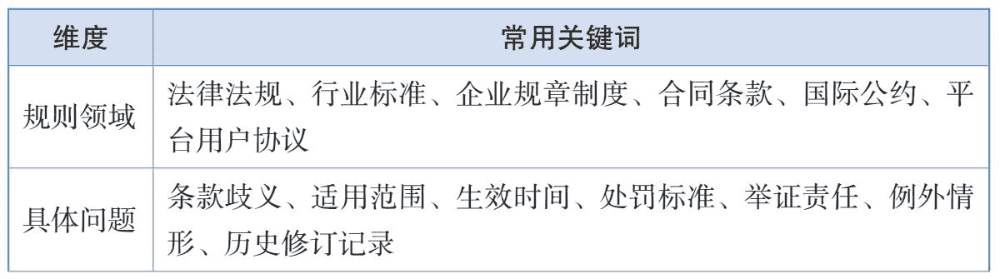

（续表）

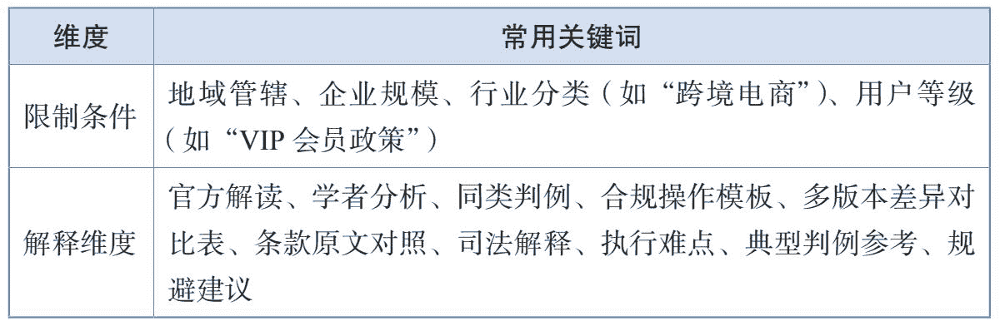

### **3.4.2 规则规定解释提问的 3 个句式模板**

**提问模板 1：条款冲突解析提问**

“当［规则 A］第 X 条与［规则 B］第 Y 条在［具体场景］中产生冲突时，根据［限制条件］，应优先适用哪项条款？能否提供司法/行政实践中的典型案例？”

**示例：**

·“当《医疗事故处理条例》与《民法典》医疗损害责任篇在‘患者知情同意范围’界定上冲突时，针对急诊抢救场景，应优先适用哪条规定？是否有最高法院指导案例支持？”

**提问模板 2：例外情形挖掘提问**

“在［规则领域］中，针对［特殊主体/场景］，是否存在［例外豁免/简化程序］？需提供条款原文及官方解释文件编号。”

**示例：**

·“在‘高新技术企业认定’政策中，对‘初创型 AI 芯片企业’的研发投入比例要求是否有特殊豁免？请提供工信部火炬中心 2025 年版政策原文及解读。”

**提问模板 3：历史修订追溯提问**

“从［起始年份］至［结束年份］，［规则名称］关于［具体问题］的修订逻辑是什么？关键修订节点对应的社会事件/行业诉求有哪些？”

**示例：**

·“从 2015 到 2025 年，《网约车管理办法》对司机准入条件的修订逻辑是什么？2018 年顺风车安全事件后有哪些针对性调整？”

### **3.4.3 规则规定解释案例**

**案例：《劳动法》中关于“加班工资计算基数”的解释**

**用户提问：**“在《劳动法》中，关于‘加班工资计算基数’，根据‘北京市 2025 年最低工资标准’，应如何理解‘劳动者本人正常工作时间工资’的界定？”

**DeepSeek 回答：**

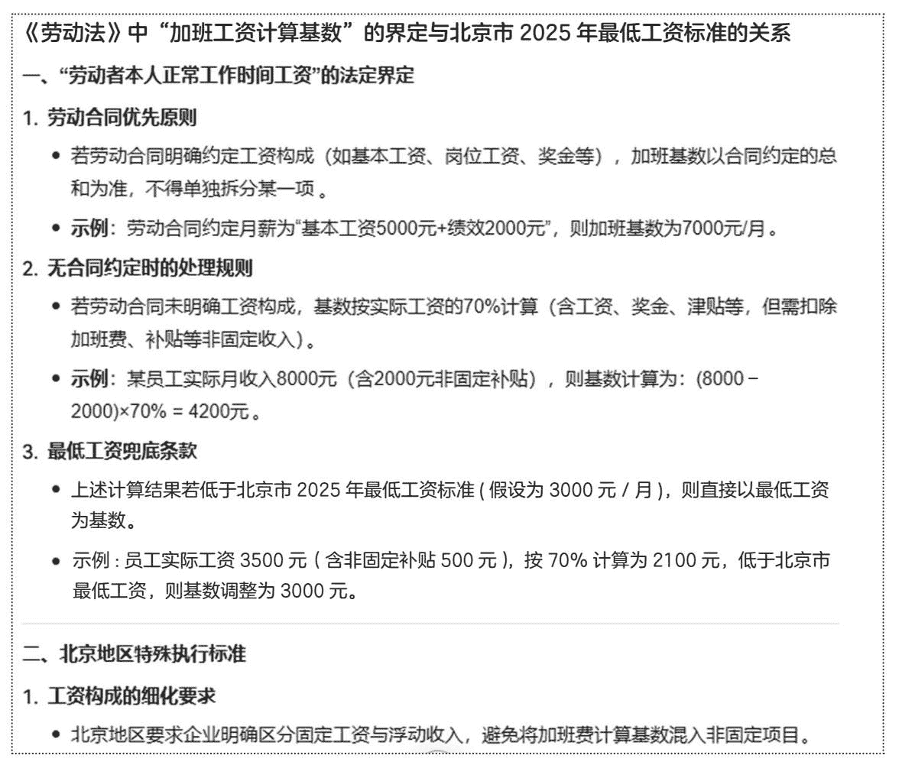

注：因篇幅原因只展示部分回答。

## **3.5 功能用途说明**

### **3.5.1 功能用途说明关键词**

**1. 关键词提取的核心公式**

关键词拆解的主体结构为［功能领域］+［具体用途］+［限制条件］+［使用场景/用户群体］。

**示例拆解：**

·“AI 图像工具领域；批量生成电商产品情景图用途；月预算 500 元内限制；服装品牌运营团队场景。”

在此组合中，通过限定预算和用户群体，避免泛泛而谈的功能介绍，直接获取符合中小企业实际需求的工具推荐。

**2. 关键词库**

表 3-5 汇总常用关键词。

表 3-5 常用关键词

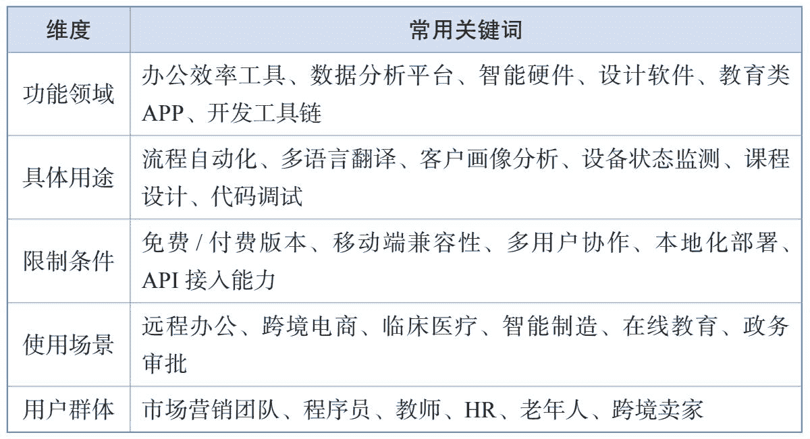

### **3.5.2 功能用途说明提问的 3 个句式模板**

**提问模板 1：核心功能验证提问**

“在［功能领域］，［工具名称］宣称的［核心功能］是否真实存在？能否提供该功能在［典型场景］中的 3 个具体使用案例？”

**示例：**

·“在‘AI 写作工具’中，Jasper 宣称的‘长文逻辑优化’功能是否真实存在？能否提供在‘学术论文润色’场景中的具体案例？”

**提问模板 2：场景适配性深挖提问**

“对于［用户群体］在［极端场景］中的［具体需求］，［工具名称］的［功能组合］能否提供［差异化解决方案］？需对比传统手段的改进点。”

**示例：**

·“对于‘户外探险团队’在‘无网络山区’中的‘实时定位共享’需求，ZOLEO 卫星通信设备的‘北斗+天通’双模功能能否替代传统对讲机？需对比信号覆盖率和设备功耗。”

**提问模板 3：安全合规审查提问**

“在［敏感行业］如医疗/金融中，使用［工具名称］的［数据相关功能］是否符合［法规名称］要求？能否提供第三方出具的合规审计报告节选？”

**示例：**

·“在‘在线诊疗’场景中，使用腾讯会议的‘屏幕共享’功能传输患者病历，是否符合 HIPAA 隐私保护标准？能否提供国际认可的 ISO 27001 认证报告？”

### **3.5.3 功能用途说明案例**

**案例：项目管理工具 Trello 核心功能解析**

**用户提问：**“在‘项目管理工具’中，Trello 的核心功能有哪些？这些功能如何帮助远程团队解决任务协作问题？”

**DeepSeek 回答：**

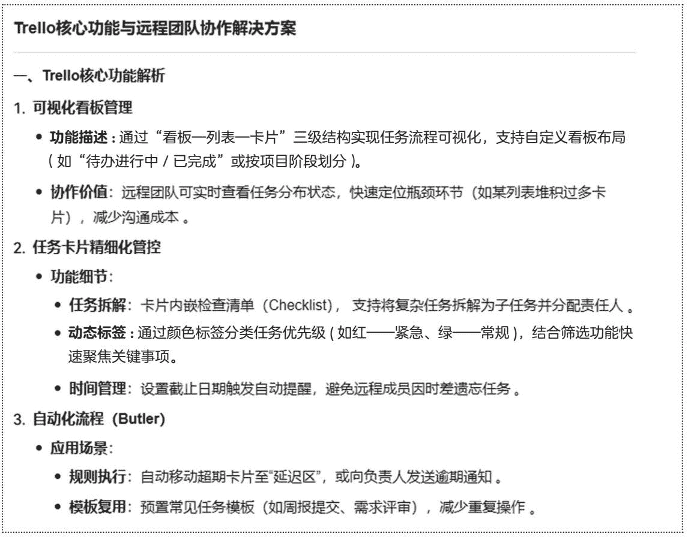

注：因篇幅原因只展示部分回复。

## **3.6 特征特点说明**

### **3.6.1 特征特点说明关键词**

**1. 关键词提取的核心公式**

关键词拆解的主体结构为［领域］+［核心属性］+［差异化表现］+［评估标准］。

**示例拆解：**

·“智能家居领域；语音控制核心属性；老人独立操作无压力差异化表现；安全性高评估标准。”

该组合明确了“智能家居”领域；“语音控制”点明关键功能特征；“老人独立操作无压力”突出特殊人群需求；“安全性高”强调质量考量维度，使提问更精准。

**2. 关键词库**

表 3-6 汇总常用关键词。

表 3-6 常用关键词

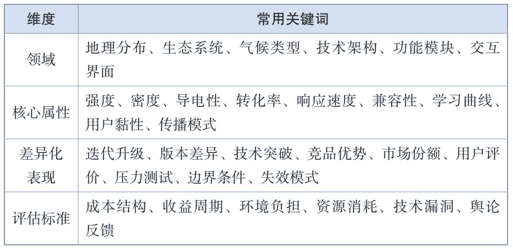

### **3.6.2 特征特点说明提问的 3 个句式模板**

**提问模板 1：多维度解析式提问**

“请从［维度 A/维度 B/维度 C］3 个角度，分析［对象］的特征特点。”

**示例：**

·“请从技术架构、用户体验、商业模式 3 个角度，分析短视频平台的特征特点。”

·“请从材质、结构、功能 3 个维度描述智能手表的核心特征，要求至少使用列数字如重量/尺寸、摹状貌如曲面屏弧度两种说明方法。”

**提问模板 2：对比定位式提问**

“与［同类对象 X］相比，［对象 Y］在［特征维度］上有何独特表现？”

**示例：**

·“与传统燃油车相比，特斯拉在动力响应速度上有何独特表现？”

·“与传统纸质书相比，电子阅读器的触感差异有何特征，需包含物理特征如纸张纹理和屏幕反光和感官体验油墨气味和蓝光疲劳的具体描述。”

**提问模板 3：用户视角式提问**

“作为［用户角色］，您最关注［对象］的哪些［特征］？请按优先级排序。”

**示例：**

·“作为职场新人，你最关注办公笔记本的哪些特征？请按优先级排序。”

·“在暴雨天气场景中，作为外卖骑手，你最希望电动车具备哪些防水性能？”

### **3.6.3 特征特点说明案例**

**案例：欧盟碳边境调节机制 CBAM 特征解读**

**用户提问：**“从碳中和目标、碳交易市场机制、高碳企业转型压力，解读欧盟碳边境调节机制 CBAM 的特征。”

**DeepSeek 回答：**

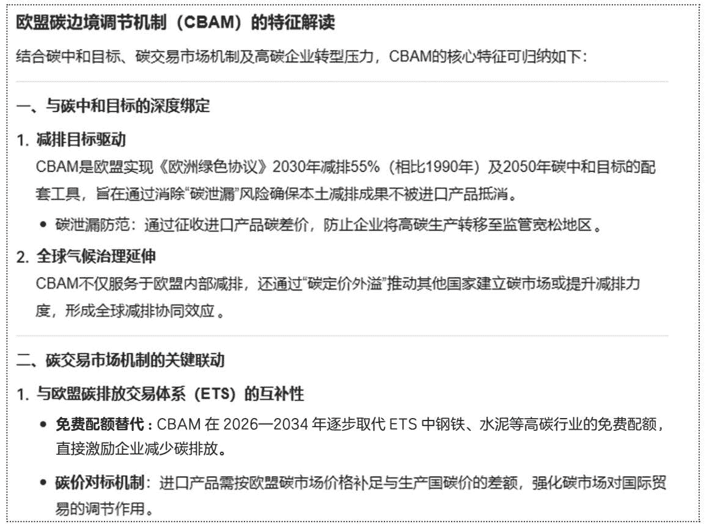

注：因篇幅原因只展示部分回复。

## **3.7 事物事件描述**

### **3.7.1 事物事件描述关键词**

**1. 关键词提取的核心公式**

关键词拆解的主体结构为［主体］+［属性类型］+［量化指标］+［对比维度］。

**示例拆解：**

·“智能手表主体；外观设计属性；表盘直径 42mm/厚度 11.5mm 量化；对比同类产品重量分布对比。”

**主体：**明确描述对象，如产品、事件、现象。

**属性类型：**区分物理特征、外观/材质、功能参数或事件要素。

**量化指标：**用数值/等级精准表达，如“误差率≤3%”“用户满意度 4.8/5”。

**对比维度：**建立参照系，如行业标准、历史数据、竞品分析。

**2. 关键词库**

表 3-7 汇总常用关键词。

表 3-7 常用关键词

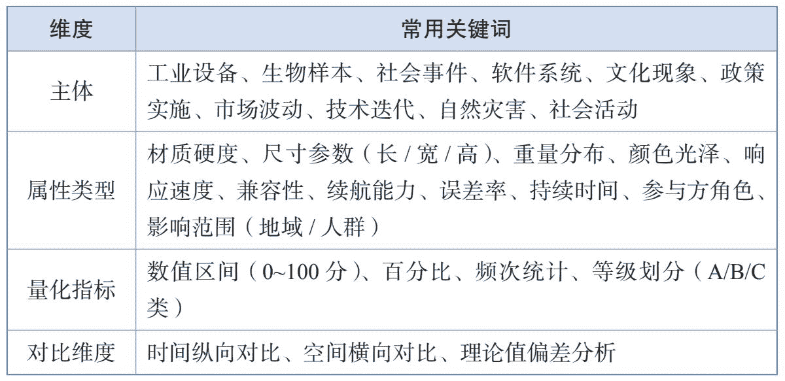

### **3.7.2 事物事件描述提问的 3 个句式模板**

**提问模板 1：基础属性提问**

“这个［事物/事件］的主要功能/目的是什么？请描述其核心特征如材质、外观、参与方。”

**示例：**

·“智能手表的核心功能有哪些？请说明其外观材质和续航能力。”

·“某政策实施的主要目的是什么？涉及哪些关键执行机构？”

**提问模板 2：时空定位提问**

“在什么时间/地点发生了这个［事件］？请描述具体的时间节点或地理位置。”

**示例：**

·“新能源汽车补贴政策在哪些城市试点？执行周期是哪几年？”

·“某历史文物的出土位置是哪里？发掘时间是哪一年？”

**提问模板 3：对比分析提问**

“与其他同类［事物/事件］相比，这个［主体］的［属性］有何差异？请列举至少 3 个对比维度如成本、效率、外观。”

**示例：**

·“这款手机摄像头性能与上一代有何提升？对比像素、夜景模式和变焦能力。”

·“新政策与旧版相比，在税收减免比例上有哪些调整？”

### **3.7.3 事物事件描述案例**

**案例：故宫内部建筑描述**

**用户提问：**“故宫内部建筑由哪些核心区域组成？请按功能分区如政务区/生活区说明各区域建筑群名称及用途。”

**DeepSeek 回答：**

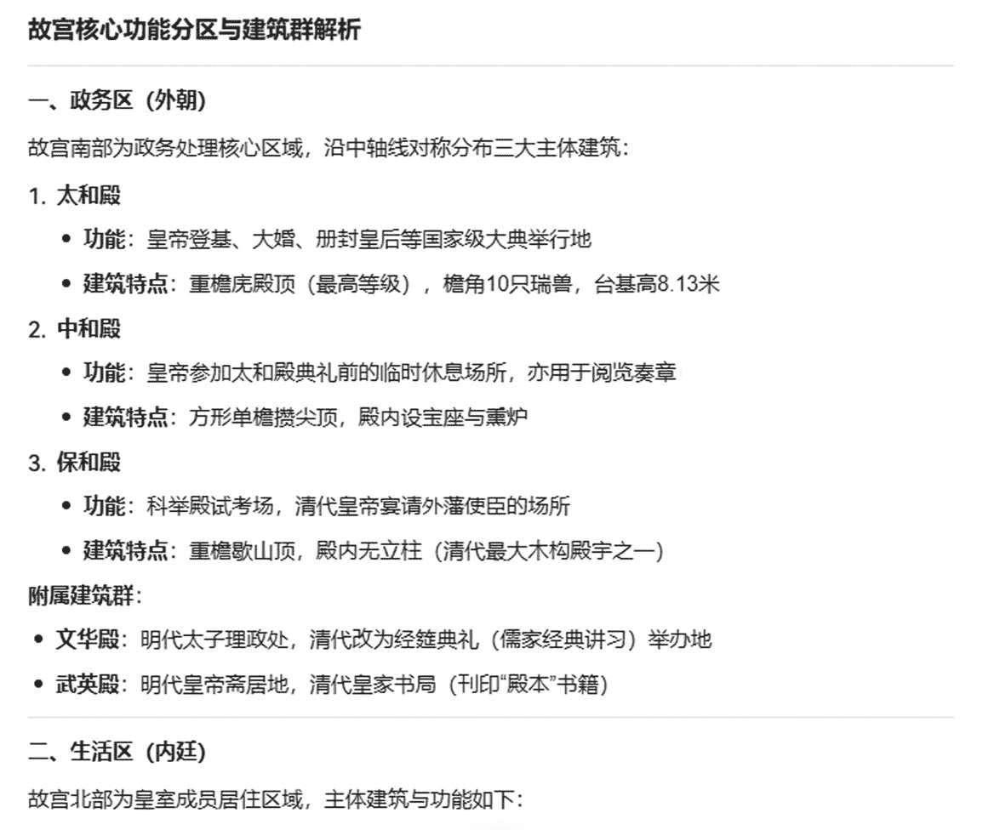

注：因篇幅原因只展示部分回复。

## **3.8 人物情感描述**

### **3.8.1 人物情感描述关键词**

**1. 关键词提取的核心公式**

关键词拆解的主体结构为［情感类型］+［表现细节］+［持续时间/强度］。

**示例拆解：**

·“嫉妒情感；同事获奖事件；刻意回避对方话题细节；持续 3 天时间。”

该组合通过分解情感维度，避免笼统描述，帮助精准识别情感诱因与表现特征。

**2. 关键词库**

表 3-8 汇总常用关键词。

表 3-8 常用关键词

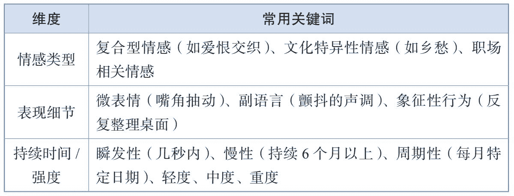

### **3.8.2 人物情感描述提问的 4 个句式模板**

**提问模板 1：特征锚定型提问**

“如何通过［具体身体部位］如眉眼/手部/发质的细节描写，塑造［职业/身份］人物的典型形象？需结合［季节/场景］环境特征。”

**示例：**

·“怎样用青筋凸起的手部特写刻画老木匠形象？要求关联冬日工作室的木屑飞舞场景。”

**提问模板 2：动态捕捉型提问**

“在［特定动作］如转身/俯身/疾走过程中，如何通过［服饰/配饰］的动态变化强化人物特质？需说明光影交互效果。”

**示例：**

·“如何描写女医生白大褂衣角翻卷的动态细节，配合急诊室走廊顶灯的光影变化，突出其干练形象？”

**提问模板 3：生理映射型提问**

“如何通过［器官感知］如胃部痉挛/耳鸣加剧/掌心潮湿的递进式生理反应，外化［情感类型］的强度变化？需匹配时间轴刻度。”

**示例：**

·“怎样用考生等待成绩时指尖发麻 5 分钟→后颈冷汗渗透衣领 10 分钟→太阳穴血管跳动 15 分钟的生理演进，表现焦虑升级？”

**提问模板 4：语言映射型提问**

“如何通过［方言特点/语速节奏/修辞偏好］等语言习惯，反映［地域/教育背景］人物的核心性格？需关联 3 种典型对话场景。”

**示例：**

·“怎样用江浙方言叠词如‘好好叫’与典故引用频率，塑造书香世家子弟的温润性格。”

### **3.8.3 人物情感描述案例**

**案例：通过环境共鸣描述人物情感**

**用户提问：**“请根据夏日正午蝉鸣声的突兀中止、空调冷凝水滴落节奏加快、窗帘光影晃动频率改变，来描述独居老人的孤独感，200 字以内。”

**DeepSeek 回答：**

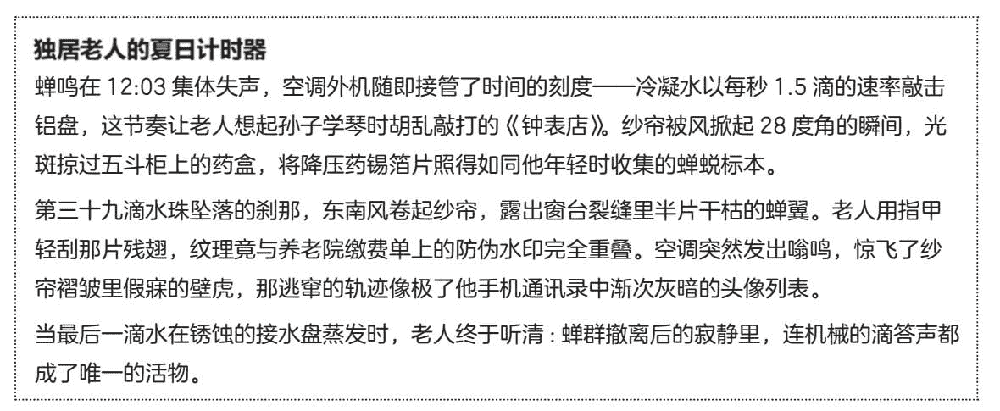

注：因篇幅原因只展示部分回复。

## **3.9 场景动作描述**

### **3.9.1 场景动作描述关键词**

**1. 关键词提取的核心公式**

关键词拆解的主体结构为［场景类型］+［主体动作］+［动作细节］+［环境互动］。

**示例拆解：**

·“火灾现场场景；消防员主体；逆着浓烟冲刺动作；呼吸器发出尖锐啸叫细节；热浪扭曲防护面罩视野环境互动。”

**场景类型：**定义动作发生的物理/社会空间，如暴雨中的地铁站/会议室辩论。

**主体动作：**明确动作执行者的行为本质，如老人颤抖着签字/猎豹加速冲刺。

**动作细节：**捕捉动作的可量化特征，如握笔力度 0.5N/肌肉激活顺序。

**环境互动：**揭示动作与场景的双向影响，如踩碎枯叶引发响动/空调气流扰动发丝。

**2. 关键词库**

表 3-9 汇总常用关键词。

表 3-9 常用关键词

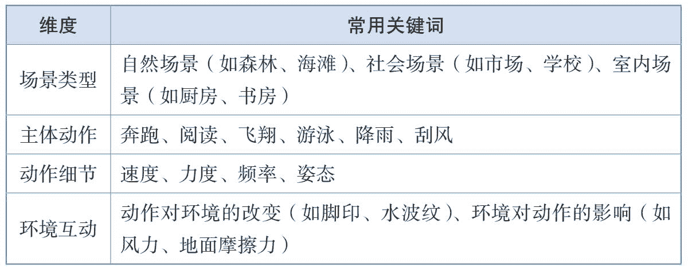

### **3.9.2 场景动作描述提问的 3 个句式模板**

**提问模板 1：环境交互型提问**

“如何通过［自然现象］如雨点击打/风向突变与［人物动作］的实时互动，构建［情绪类型］的沉浸式表达？”

**示范：**

行为拆解提问指南：从细节到流程的实战打法

雨夜的士车厢里，车顶被雨点敲击的声响和乘客不时低头刷手机的小动作，怎么让两者互相呼应，呈现出赶赴约会时的焦躁不安？

**提问模板 2：连环动作型**

在一串连续的行为链条，比如开锁—推门—脱鞋里，能否借助物件的细微状态，比如钥匙齿口磨损的程度、门轴吱呀的频次、鞋尖的磨耗角度之类的关联，暗示出隐藏的信息？

**示范：**
·消防员归队时头盔上约5毫米深的凹坑、防护服左肩密集的盐晶汗渍、水带收卷时73度的偏移，这组复合痕迹怎样合起来透露刚刚经历的火场危险等级？

**提问模板 3：多感官协同型**

借助两种以上感官通道，比如视觉听觉触觉轮流加强，怎么把抽象概念像是信任瓦解、记忆复苏这类东西具象化？需要给出感官刺激的衰减曲线。

**示范：**
·整理旧物时樟脑气味慢慢变淡、翻相册的声音间隔被拉长、毛衣纤维的静电感逐渐减弱，这三路信号如何一起外化记忆在淡忘的过程？

### **3.9.3 场景动作描述案例**

**案例：考前焦虑的刻画**

**用户提问：**暴雨里空调外机滴水的声响和考生不断翻书的节奏形成对抗，用一段文字描绘考前的焦虑状态。

**DeepSeek 回答：**

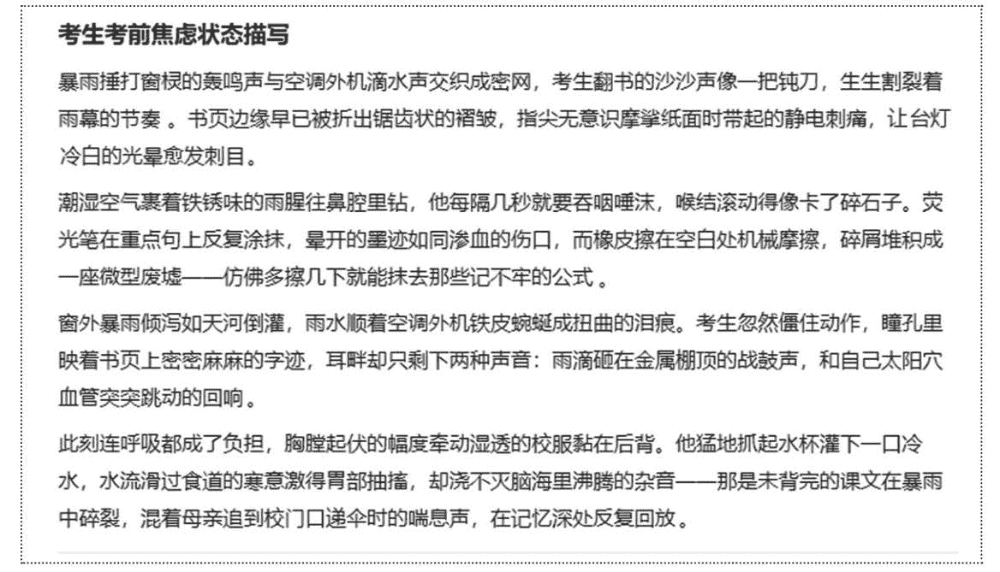

说明：因篇幅原因只展示部分回答。

## **3.10 现象行为解释**

### **3.10.1 现象行为解释关键词**

**1. 关键词提取的核心公式**

提炼要点时常用［现象类型］+［矛盾表现］+［潜在诉求］+［认知偏差］这套组合。

**示例拆解：**

·职场新人反复修改汇报PPT属于现象类型，却迟迟不敢提交是矛盾表现；底子里想得到专业认可属于潜在诉求；过度完美主义属于认知偏差。

在这个组合里，现象类型锚定情境，矛盾表现凸显外在行为和内在目标的冲突，潜在诉求挖出底层需求，认知偏差解释行为的断裂点。如此提问能形成完整的解释链条。

**2. 关键词库**

常用词条见表 3-10 所示。

表 3-10 常用关键词

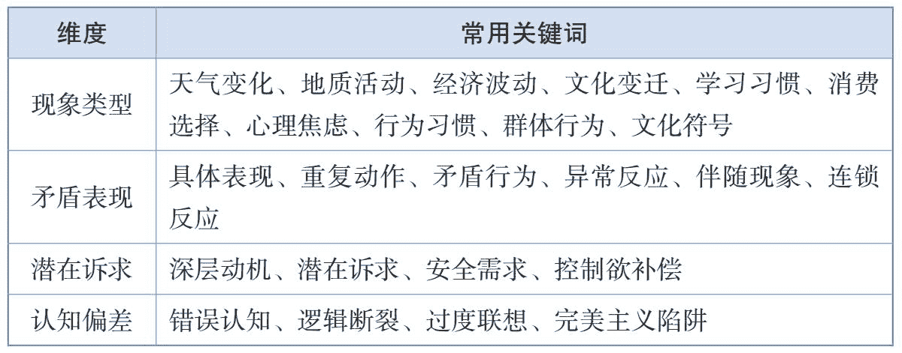

### **3.10.2 现象行为解释提问的 4 个句式模板**

**提问模板 1：矛盾溯源式提问**

在［行为场景］里，［主体］持续出现［高频行为］却始终达不到［预期目标］，这种矛盾该怎么解释？

**示例：**
·职场新人通宵改PPT却始终不敢提交，行为和目标背离的原因是什么？

**提问模板 2：隐喻映射式提问**

［具体行为］比如反复擦拭文具，能否视作［抽象心理机制］比如为武器抛光的具象化？

**示例：**
·考生考前频繁整理书桌，是否是一种对未知风险的仪式化防御？

**提问模板 3：变量对比式提问**

在［对照组］比如独居者与合租者中，［目标行为］拖延的差异能反映出怎样的［核心动因］？

**示例：**
·城市白领和自由职业者的报复性熬夜，折射出怎样的社会时钟压迫差异？

**提问模板 4：语义指向解析式提问**

在［复合行为］比如边刷题边听音乐里，［核心动作］刷题和［伴随动作］听音乐的语义指向一致吗？

**示例：**
·家长陪读时频繁刷手机，表层的陪伴和深层的逃避诉求如何共存？

### **3.10.3 现象行为解释案例**

**案例：网络暴力为何频现？**

**用户提问：**网络暴力现象为什么会反复出现？

**DeepSeek 回答：**

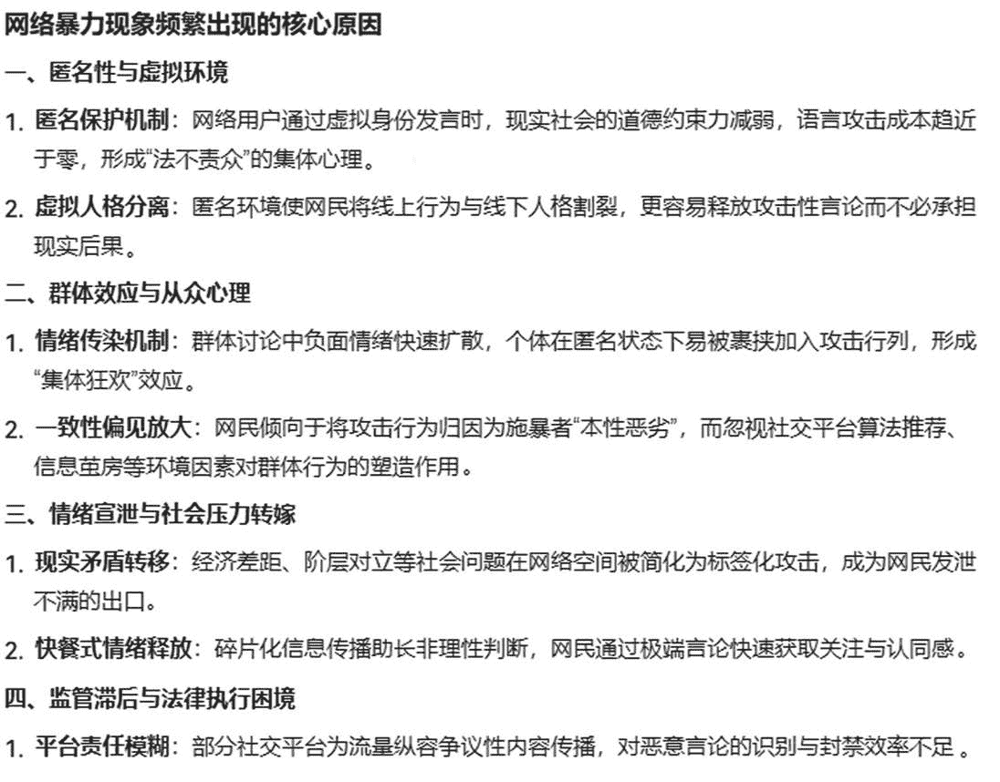

说明：因篇幅原因只展示部分回答。

# **第四章**

# **请求步骤程序流程**

## **4.1 操作执行步骤**

### **4.1.1 操作执行步骤关键词**

**1. 关键词提取的核心公式**

核心公式为［任务类型］+［执行目标］+［执行步骤/方法］+［工具/资源］+［预期结果］+［约束］。

**示例拆解：**

·提升健康食品新品上市转化率属于任务类型，实现首月购买转化率12%属于执行目标，部署自动化工具监测曝光到点击再到加购的链路属于执行步骤/方法，设计A/B测试对比不同KOL组合效果属于工具/资源，转化率拉到15%属于预期结果，遵守广告法避免虚假宣传属于约束。

在这个组合里，任务类型明确攻坚方向，执行目标量化里程碑，执行步骤借助工具落地，测试对比不同影响者组合作为手段，预期结果用指标验证，约束以合规为底线保障可持续。

**2. 关键词库**

常用词条见表 4-1 所示。

表 4-1 常用关键词

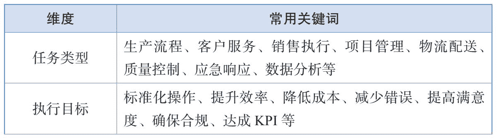

（续表）

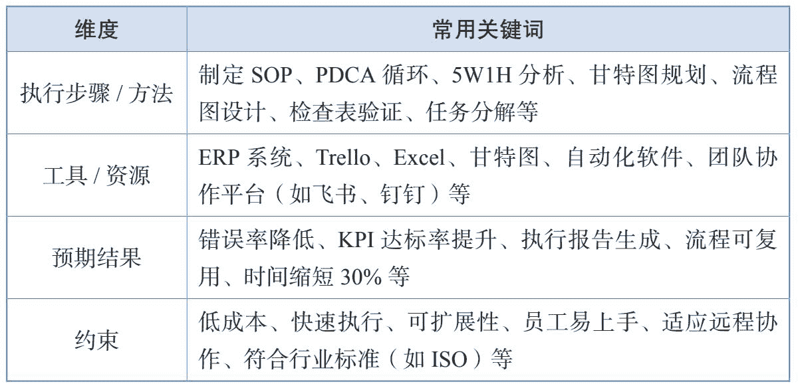

### **4.1.2 操作执行步骤提问的 4 个句式模板**

**模板 1：流程设计型**

借助［执行步骤/方法］怎样完成［任务类型］的［执行目标］？需要用到［工具/资源］，并达到［预期结果］。

**示例：**
·怎么通过制定SOP把客户服务响应提速？需用Zendesk客服系统和工单模板，把首次响应压到1分钟以内。

**模板 2：工具应用型**

在［任务类型］里，如何运用［工具/资源］实现［执行目标］？要按［执行步骤/方法］操作，并验证［预期结果］。

**示例：**
·在销售执行里，怎样用CRM系统提升客户跟进效率？按客户分级管理的步骤操作，并验证转化率提升20%。

**模板 3：步骤拆解型**

［执行目标］可以拆成哪些具体步骤？要结合［工具/资源］，并保证［预期结果］可量化。

**示例：**
·在生产环节，质量控制目标能拆成哪些具体动作？要结合自动化检测设备和检查表，并确保合格率达到99%。

**模板 4：结果导向型**

为了得到［预期结果］，［任务类型］需要执行哪些［执行步骤/方法］？要依赖［工具/资源］支持。

**示例：**
·为了把物流成本降15%，配送要做哪些路线优化？需要ERP系统和地图分析工具支持。

### **4.1.3 操作执行步骤提问案例**

**案例：生产流程效率提升**

**用户提问：**怎样用PDCA循环和甘特图规划把生产流程效率拉起来？需用ERP系统和自动化脚本，并把单位时间产量提高20%。

**DeepSeek 回答：**

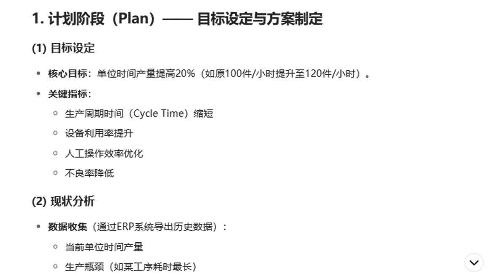

说明：因篇幅原因只展示部分回答。

## **4.2 制作制定步骤**

### **4.2.1 制作制定步骤关键词**

**1. 关键词提取的核心公式**

核心公式为［任务拆解］+［步骤排序］+［资源分配］+［时间定义］+［质量检查点］+［输出标准］。

**示例拆解：**

·设计新品上市推广计划属于任务拆解，市场调研、内容制作、渠道投放、效果监测四大阶段属于步骤排序，市场部负责调研、设计团队做素材、运营团队执行投放属于资源分配，调研3天、制作5天、投放7天属于时间定义，投放3天后设数据复盘节点属于质量检查点，收集推广报告与转化率数据属于输出标准。

在这个组合里，任务拆解把复杂问题模块化，步骤排序遵循发现问题到设计方案再到实施验证的逻辑，资源分配实现专业团队和任务颗粒的匹配，时间定义采用倒排工期，质量检查点以交付物为锚点闭环，输出标准兼顾过程文档和效果量化，形成目标到执行的完整闭环。

**2. 关键词库**

常用词条见表 4-2 所示。

表 4-2 常用关键词

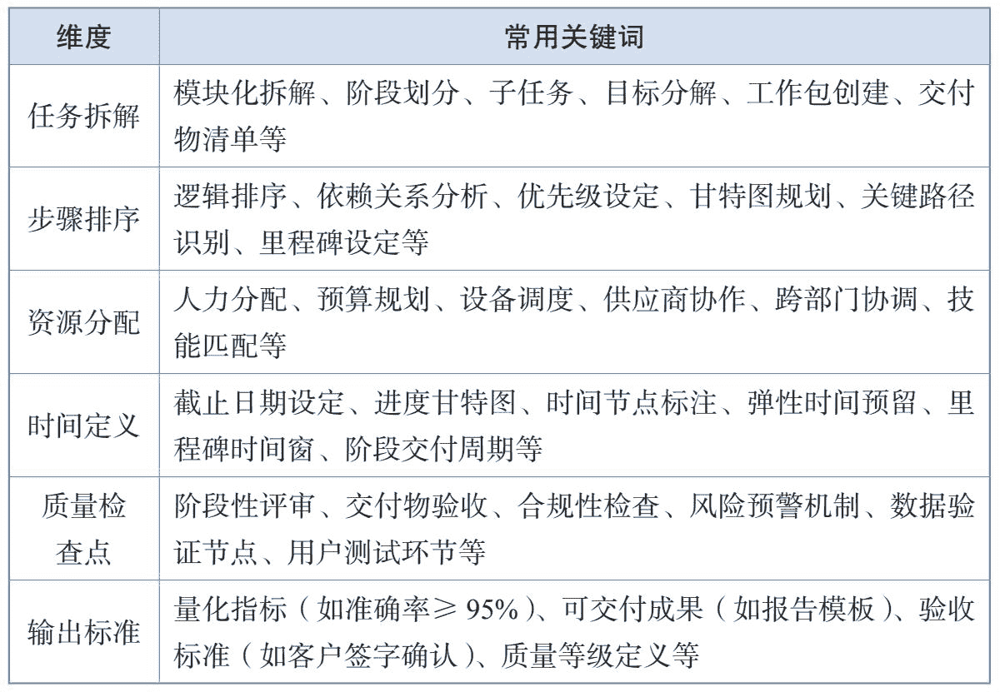

### **4.2.2 制作制定步骤提问的 4 个句式模板**

**模板 1：流程细化型**

怎样把［任务拆解］细化成可执行的［步骤排序］？明确有哪些［资源分配］，并设定［质量检查点］以达成［输出标准］。

**示例：**
·怎样把用户增长计划拆成拉新、留存、转化？需增长团队负责拉新、产品团队优化留存功能，并设每周数据复盘节点以达成DAU提升20%的输出标准。

**模板 2：资源依赖型**

在［任务拆解］里，依据［资源分配］如何制定［步骤排序］？要明确［时间定义］，并保证［质量检查点］覆盖关键风险点。

**示例：**
·在产品上线计划里，怎样根据开发、测试、运维资源制定版本迭代步骤？要明确各阶段起止时间，并确保上线前设置安全漏洞扫描检查点。

**模板 3：时间驱动型**

如果要在［时间定义］内完成［任务拆解］，该如何排序步骤？需要［资源分配］支持，并设定［输出标准］验证成果。

**示例：**
·若30天内完成品牌升级项目，该如何排序市场调研、VI设计、渠道更新？需要设计团队和供应商资源，并以品牌曝光度提升30%作为输出标准验证成果。

**模板 4：质量导向型**

为了通过［质量检查点］保障［任务拆解］质量，该如何设计［步骤排序］？要结合［资源分配］与［时间定义］优化执行路径。

**示例：**
·为了通过代码审查和性能测试保障系统重构项目质量，该如何设计开发、测试、回滚步骤？要结合开发团队和QA资源，并设定两周迭代周期优化路径。

### **4.2.3 制作制定步骤案例**

**案例：产品上线流程制定**

**用户提问：**怎样把产品上线步骤拆成需求评审、开发测试、预发布验证、正式上线四个阶段？需产品经理负责需求文档输出、开发团队负责代码实现、运维团队负责环境部署，并设定需求冻结后3天完成开发、预发布前1天完成全链路压测的质量检查点，最终达成上线后2小时内无P0故障的输出标准。

**DeepSeek 回答：**

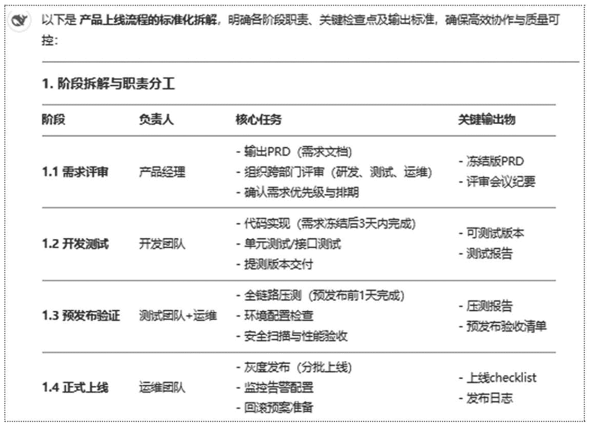

说明：因篇幅原因只展示部分回答。

## **4.3 应对应急步骤**

### **4.3.1 应对应急步骤关键词**

**1. 关键词提取的核心公式**

核心公式为［触发条件］+［应对计划］+［升级路径］+［资源调配］+［沟通机制］+［事后复盘］。

**示例拆解：**

·若出现项目关键成员突然离职属于触发条件，启动知识交接流程并临时调配团队人力属于应对计划，若3天内无法恢复进度则升级至部门负责人决策属于升级路径，协调HR部门和外部顾问支持属于资源调配，每日站会同步项目状态属于沟通机制，优化人才储备和知识管理机制属于事后复盘。

这个组合里，触发条件明确风险信号，应对计划定义即时行动，升级路径设定决策层级，资源调配保障到位，沟通机制确保信息透明，事后复盘推动流程改进。六者协同确保从风险识别到能力升级的全链闭环。

**2. 关键词库**

常用词条见表 4-3 所示。

表 4-3 常用关键词

### **4.3.2 应对应急步骤提问的 6 个句式模板**

**提问模板 1：触发条件驱动型**

若发生［触发条件］，该如何设计包含［应对计划］、［升级路径］、［资源调配］与［沟通机制］的应急方案？最后通过［事后复盘］实现哪些改进？

**示例：**
·若核心供应商突然涨价，该如何设计包含启动备选供应商谈判加调整产品定价的应急方案？要明确谈判破裂则升级至采购总监决策的升级路径，调配法务与财务团队支持，通过客户邮件说明成本变动，事后优化供应商评估标准。

**提问模板 2：资源约束型**

在［资源调配］受限时，如何调整［应对计划］应对［触发条件］？需要通过［升级路径］快速获取哪些支持，并通过［沟通机制］降低负面影响？

**示例：**
·在预算不足时，如何调整紧急采购原材料的计划应对生产停滞？需要升级至财务总监协调备用资金，并通过员工大会说明临时调整方案。

**提问模板 3：沟通透明型**

为了让［沟通机制］确保［应对计划］执行透明，该如何设计分级响应与同步机制？要结合［升级路径］明确哪些信息必须实时传递？

**示例：**
·为了通过每日站会确保项目进度恢复透明，该如何设计执行层到管理层再到客户的分级响应机制？要明确当前进度、延迟原因、补偿方案等关键信息实时同步。

**提问模板 4：复盘驱动型**

基于［事后复盘］结论，如何重构［应对计划］应对未来类似［触发条件］？需要更新哪些［升级路径］与［资源调配］策略？

**示例：**
·基于上次客户投诉因响应延迟的复盘，如何重构24小时响应机制？需要更新客服团队排班制度，并增加AI工单自动分配资源池。

**提问模板 5：跨团队协作型**

针对［触发条件］，如何协调［部门A］、［部门B］与［外部合作伙伴］的［应对计划］，确保［沟通机制］对齐并避免资源冲突？

**示例：**
·针对新产品上市延期，如何协调研发部、市场部与物流供应商的响应？需要通过联合工作组统一对外声明，并明确技术调试到宣传调整再到物流加速的协作流程。

**提问模板 6：预案优化型**

为应对［触发条件］，需要提前制定哪些标准化流程或核查清单？如何通过［沟通机制］验证其有效性？

**示例：**
·为应对关键岗位人员离职，需要提前制定知识交接核查清单与临时替代流程，并通过模拟演练验证其完整性与可操作性。

### **4.3.3 应对应急步骤案例**

**案例一：应对核心成员离职**

**用户提问：**若项目技术负责人突然离职，该如何设计包含知识交接加临时替代加外部顾问支持的应急方案？需明确若3天内无法恢复则升级至CTO决策的升级路径，调配HR部门与猎头资源，通过每日站会同步交接进度，事后优化人才储备与知识管理机制。

**DeepSeek 回答：**

说明：因篇幅原因只展示部分回答。

## **4.4 议事议程程序**

### **4.4.1 议事议程程序关键词**

**1. 关键词提取的核心公式**

核心公式为［目标设定］+［议程架构］+［时间分配］+［引导规则］+［决策机制］+［后续行动］。

**示例拆解：**

·为推进跨部门协作流程优化属于目标设定，议程包含现状诊断到痛点分析再到方案提案最后共识达成属于议程架构，各环节30/20分钟属于时间分配，轮流发言加限时质询属于引导规则，投票加高管裁决属于决策机制，会后24小时内输出行动清单属于后续行动。

在这个组合里，目标设定锚定会议方向，议程架构搭建逻辑框架，时间分配保障效率，引导规则维护秩序，决策机制推动结论，后续行动确保落地。六者协同确保从议题发起到达成共识的全链闭环。

**2. 关键词库**

常用词条见表 4-4 所示。

表 4-4 常用关键词

### **4.4.2 议事议程程序提问的 6 个句式模板**

**提问模板 1：目标导向型**

为了达成［目标设定］，该如何设计包含［议程架构］与［时间分配］的会议流程？需通过［引导规则］确保高效讨论，最终通过［决策机制］输出［后续行动］？

**示例：**
·为了达成新产品上市策略共识，该如何设计包含市场分析到竞品对标再到方案PK最后资源匹配的议程？需分配各环节40/20/30/10分钟，通过限时3分钟提案加匿名投票规则决策，会后输出资源需求清单与责任人。

**提问模板 2：效率优化型**

在［时间分配］受限时，如何调整［议程架构］以达成［目标设定］？需通过［引导规则］避免跑题，并通过［决策机制］快速达成共识？

**示例：**
·在1小时会议限制下，如何调整年度预算审议议程？需把部门汇报压缩到15分钟，采用只提差异项加高管质询规则，通过权重评分法快速对预算分配做出决策。

**提问模板 3：冲突调解型**

针对［目标设定］中的潜在冲突，该如何设计［议程架构］与［引导规则］？需通过［决策机制］平衡多方利益，并明确［后续行动］的追责条款？

**示例：**
·针对部门资源争夺，该如何设计需求陈述到优先级排序再到利益交换最后协议签署的议程？需要中立调解人加书面承诺规则，采用高管仲裁机制，会后签署资源分配备忘录。

**提问模板 4：创新孵化型**

为了激发［目标设定］中的创新思维，该如何设计［议程架构］与［引导规则］？需通过［决策机制］筛选可行方案，并规划［后续行动］的试点验证。

**示例：**
·为了激发客户体验优化创新，该如何设计痛点脑暴到疯狂点子再到可行性评估最后试点提案的议程？需要禁止批评加匿名投票规则，采用试点小组竞选机制，会后启动3个月试点计划。

**提问模板 5：远程协作型**

在远程会议场景下，如何调整［议程架构］与［引导规则］以达成［目标设定］？需通过［决策机制］确保异步参与有效性，并明确［后续行动］的线上协作工具？

**示例：**
·在跨国团队远程会议中，如何调整项目复盘议程？需要增加异步问题收集环节，采用文字提案加语音表决规则，通过时区协调投票机制，会后使用Trello跟踪行动项。

**提问模板 6：复盘驱动型**

会议复盘提效提问框架

“以后续跟进复盘得到的结论为起点，如何对下次会议的议程结构与引导方法进行调整来提升效率？决策机制是否需要迭代以适配新场景？”

示例：
“• 复盘显示上轮会议决策落地率偏低，如何优化‘战略研讨会’议程？建议增设‘决策可行性预审’环节，采用‘红蓝军对抗’引导规则，并把‘决议后24小时内启动执行’作为更新后的机制。”

### 4.4.3 议事议程程序提问案例

**案例：跨部门协作流程优化会议**

**用户提问：**“为推动‘跨部门协作流程优化’，议程该怎样设计才能依次覆盖‘现状诊断→痛点分析→方案提案→共识达成’？各环节建议时长 30/20/30/20 分钟，引导方式用‘轮流发言+限时质询’，决策用‘投票+高管裁决’，会后 24 小时内输出行动清单？”

**DeepSeek 回复：**

说明：篇幅所限仅展示片段。

# 第五章

# 请求创意创作创建

## 5.1 广告策划创意

### 5.1.1 广告策划创意关键词

**1. 关键词提取的核心公式**

**核心公式 1：PAST 模型**

关键词提取的核心公式 1 为［目标］+［人群］+［场景］+［工具］。

**示例拆解：**

·“提升高端护肤品品牌认知度（目标）→高知女性群体（人群）→高端商场专柜+艺术展览场景（场景）→AI 肤质检测仪+定制化内容推送（工具）。”

该组合中，目标锁定任务主线，人群划定受众边界，场景界定执行环境，工具提供落地抓手。四者形成闭环：目标先决定用户画像，人群反推触达触点，场景匹配工具形态，工具反哺目标达成，进而让广告策划从创意到执行保持精准对齐。

**核心公式 2：STAR 模型**

关键词提取的核心公式 2 为［背景］+［任务］+［行动］+［预期结果］。

**示例拆解：**

·“品牌认知度低（背景）→6 个月内提升复购率 20%（任务）→建立会员专属育儿知识库+积分兑换体系（行动）→会员活跃度提升 30%，复购率达标（预期结果）。”

此处背景描绘挑战框架，任务明确突破坐标，行动创造差异价值，预期结果给出验收标尺，四者构成循环：背景催生任务，任务驱动行动，行动带来结果，结果再校准背景认知，形成从诊断到进化的自我迭代体系。

**2. 关键词库**

常用关键词如表 5-1 所示。

表 5-1 常用关键词

### 5.1.2 广告策划创意提问的 7 个句式模板

**提问模板 1：定位诊断型**

“为【品牌】在【市场环境】中做定位，需避开竞品【常见卖点】，找到【数量】个差异化切入点，要求符合【人群特征】+【预算限制】。”

**示例：**

·“为新锐咖啡品牌在精品咖啡红海市场做定位，需避开‘产地’‘风味’等常见卖点，找到 3 个差异化切入点，符合都市上班族‘快奢’需求，预算 80 万元。”

·“为高端家电品牌在智能家居红海中定位，需避开‘性价比’常见卖点，找到 2 个差异化突破口，符合中产家庭‘科技感+设计美学’需求，预算 150 万元。”

**提问模板 2：创意激发型**

“结合【热点事件/文化符号】，以【反常识角度】设计广告创意，要求包含【情感类型】+【交互形式】，并说明【传播机制】。”

**示例：**

·“结合‘AI 替代人类’热点，用‘AI 主动拒绝执行指令’反常识视角创作公益广告，涵盖‘危机感+幽默感’，采用 H5 模拟 AI 对话交互，通过分享解锁剧情实现裂变。”

·“结合‘碳中和’热点，用‘废弃材料变身奢侈品’反常识视角打造环保广告，包含‘敬畏感+参与感’，以线下材料改造工作坊呈现，通过用户作品展览扩散传播。”

**提问模板 3：跨界融合型**

“将【产品功能】与【非关联领域】结合，提出【数量】个颠覆性创意概念，需包含【用户参与环节】+【跨界冲突感】。”

**示例：**

·“将办公椅‘人体工学设计’与‘太空探索’结合，提出‘零重力办公体验舱’‘星际坐姿矫正系统’2 个概念，设置用户参与 VR 模拟太空办公场景，制造科技与日常的冲突话题。”

**提问模板 4：数据驱动型**

“基于【数据维度】，诊断当前广告方案的【数量】个失效环节，提出【具体优化手段】，量化目标为【指标提升】。”

**示例：**

·“基于用户停留时长数据，诊断汽车广告 H5 的 2 个失效环节，如配置参数页跳出率高，提出‘3D 车型旋转展示+一键对比竞品’优化手段，目标页面停留时长提升 40%。”

**提问模板 5：风险预判型**

“针对【活动类型】预判 Top【数量】风险，按【排序标准】排序，设计【预防+补救】双预案，包含【预算/资源调配】方案。”

**示例：**

·“针对线下新品发布会预判 Top3 风险，嘉宾缺席、设备故障、媒体负面报道，按影响程度排序，设计备用嘉宾名单+双设备冗余+舆情监测团队预案，备用预算占比 15%。”

**提问模板 6：效果倍增型**

“在【原有方案】基础上，通过【策略类型】策略，实现【效果指标】提升【百分比】，需说明【资源需求】+【执行难点】。”

**示例：**

·“在常规户外广告方案基础上，通过‘AR 互动+地理位置触发’策略，实现品牌记忆度提升 50%。需对接 AR 技术供应商，解决多设备兼容性难题。”

**提问模板 7：组合嵌套型**

“基于 PAST 模型，针对【人群】在【场景】中通过【工具】实现【目标】，结合跨界融合型句式提出创意概念，并预判 Top1 风险。”

**示例：**

·“基于 PAST 模型，针对 Z 世代在音乐节场景中通过‘可穿戴设备’实现‘品牌沉浸式体验’目标，结合跨界融合型句式提出‘音乐节奏可视化纹身贴’创意，预判‘设备电量不足’风险，设计充电站+备用贴纸方案。”

·“针对 P 年轻妈妈群体，A 0~3 岁婴童，S 母婴店线下场景，T AR 互动装置，设计纸尿裤广告方案。将‘吸水性能’与‘太空探索’结合，策划‘尿液转化火箭燃料’AR 游戏，预判‘儿童害怕设备’风险并设计卡通化界面。”

### 5.1.3 广告策划创意提问案例

**案例：高端白酒品牌策划**

**用户提问：**“为提升品牌文化认同感，面向企业决策者人群，设计主题为‘千年酒脉’的高端商务晚宴方案，方案中需体现 AR 技术展示酿酒工艺，搭配 AI 按宾客口味推荐酒款，强化品牌历史传承与科技感。”

**DeepSeek 回复：**

说明：篇幅所限仅展示片段。

## 5.2 文案策划创意

### 5.2.1 文案策划创意关键词

**1. 关键词提取的核心公式**

关键词提取的核心公式为［概念］+［内容］+［语境］+［行动号召］。

**示例拆解：**

·“可持续生活方式倡导（概念）→环保材质产品故事+用户 UGC 案例（内容）→城市轻中产社群+社交媒体话题页（语境）→限时碳积分兑换+线下体验店打卡（行动号召）。”

此组合中，概念奠定基调，内容以真实故事增强代入感，语境锁定目标人群活跃场域，行动号召以轻互动促参与。四者协同形成从理念传播到行为引导的闭环。

**2. 关键词库**

常用关键词如表 5-2 所示。

表 5-2 常用关键词

### 5.2.2 文案策划创意提问的 9 个句式模板

**提问模板 1：情感共鸣型**

“针对【目标群体】的【情感痛点】，通过【生活化场景】构建，创作一篇能引发【情感共鸣类型】的文案，需融入【具象化细节】。”

**示例：**

·“针对职场新人的‘社交焦虑’，以‘电梯偶遇同事’场景切入，创作一篇引发‘松弛感’共鸣的文案，融入‘耳机播放轻音乐’‘微笑点头示意’等细节。”

**提问模板 2：语言风格适配型**

“为【平台属性】下的【目标群体】，采用【网感化语言风格】创作一篇关于【主题】的文案，需突出【核心信息点】。”

**示例：**

·“为小红书‘Z 世代护肤人群’，采用‘闺蜜吐槽体’风格创作一篇‘早 C 晚 A 护肤指南’，突出‘成分功效’‘避坑指南’‘懒人友好’信息点。”

**提问模板 3：内容创新型**

“结合【热点话题】，为【主题】设计一篇【新媒体形式】文案，需融入【互动元素】，实现【传播目标】。”

**示例：**

·“结合‘MBTI 人格测试’热点，为‘小众咖啡馆’设计一篇‘人格咖啡盲盒’小红书笔记，融入‘测测你的本命咖啡’互动 H5，实现‘引流到店’目标。”

**提问模板 4：场景优化型**

“针对【平台特性】，优化【主题】文案的【呈现形式】，如标题结构、信息密度、视觉符号，以提升【关键指标】。”

**示例：**

·“针对抖音‘3 秒完播率’特性，优化‘健身课程推广’文案标题为‘每天 5 分钟=暴汗燃脂？’，搭配‘前后对比弹幕’，提升‘点击率’与‘完播率’。”

**提问模板 5：行动引导型**

“创作一篇包含【轻量化行动指令】的文案，通过【即时反馈机制】，引导【目标群体】完成【具体行为】，如打卡、晒单、参与话题等。”

**示例：**

·“创作一篇包含‘拍同款手势舞’指令的抖音文案，通过‘点赞过千解锁教学视频’机制，引导用户‘拍摄并发布手势舞视频’。”

**提问模板 6：风格迁移型**

“以【网红/IP】的语言风格改写【原文案】，突出【平台流行梗】+【节奏控制技巧】，适配【平台调性】。”

**示例：**

·“以‘李××’的‘OMG 体’改写美妆文案，突出‘所有女生’‘买它’等梗，控制每句不超过 10 个字，适配抖音口播快节奏。”

**提问模板 7：数据驱动型**

“基于【平台数据指标】分析当前文案的【失效点】，提出【优化策略】，量化目标为【指标提升值】。”

**示例：**

·“基于小红书笔记‘收藏率高但转化率低’数据，分析失效点为‘缺乏行动指令’，提出‘文末添加“戳链接领试用装”’策略，目标转化率提升 15%。”

**提问模板 8：跨平台适配型**

“将【长图文/深度内容】转化为【短视频/图文笔记】形式，保留【核心卖点】，适配【平台用户习惯】。”

**示例：**

·“将品牌白皮书转化为小红书‘3 秒知识点’图文笔记，保留‘成分安全’核心卖点，采用‘痛点提问+成分表特写+使用场景’结构，适配用户碎片化阅读习惯。”

**提问模板 9：风险规避型**

“针对文案中可能引发【争议点】的表述，设计【替代话术】+【正向引导】方案，并提供【舆情监测关键词】。”

**示例：**

·“针对‘减肥产品’文案中‘胖子’表述，设计‘大码女孩’替代话术，引导‘健康自信美’价值观，监测‘身材歧视’‘歧视性语言’等关键词。”

### 5.2.3 文案策划创意提问案例

**案例：为新锐茶饮品牌撰写小红书爆款文案**

**用户提问：**“以‘城市声音采样’，地铁报站、键盘声隐喻职场焦虑，绑定‘冷泡茶疗愈’概念为新锐茶饮品牌撰写小红书爆款文案。其结构包含‘清晨 8 点的地铁报站声→冷泡茶入杯的清脆声’听觉唤醒对比描写和‘3 分钟办公室冥想挑战’，并关联‘点击领取冥想音频’福利。”

**DeepSeek 回复：**

说明：篇幅所限仅展示片段。

## 5.3 视频脚本创意

### 5.3.1 视频脚本创意关键词

**1. 关键词提取的核心公式**

**核心公式 1：ESPO-HOOK 模式**

关键词提取的核心公式 1 为［情感共鸣］+［故事线］+［冲突挑战］+［解决方案］+［行动引导］。

**示例拆解：**

·“职场新人焦虑感，视觉符号：地铁拥挤俯拍+倒计时数字特效→逆袭成长故事线：悬念开场+对比反转→订单超时危机，音效设计：暴雨声+键盘急促敲击声→智能办公产品防水防抖功能化解困境，视觉符号：产品特写+故障艺术转场→点击购买链接+‘风雨无阻，使命必达’口号，互动形式：进度条奖励机制+弹幕触发优惠券。”

该组合以共情建立代入，用故事承载冲突，以产品功能收束矛盾，最终引导行动，视觉、音效与互动贯穿各环节。

**核心公式 2：3C-HOOK 模式**

关键词提取的核心公式 2 为［角色塑造］+［核心矛盾］+［抓眼球开场］+［转化路径］。

**示例拆解：**

·“熬夜加班程序员，视觉符号：代码雨特效+黑眼圈特写→颈椎疼痛困扰：健康危机与效率需求冲突→咖啡杯底残渣像破碎灵感，画面+音效：电子脉冲音+玻璃破碎声→人体工学椅试用体验，视觉符号：微距特写座椅曲线→下单立减优惠+KOL 同款标记，互动形式：AI 换脸试坐体验+扫码解锁隐藏优惠。”

该组合以角色痛点引发共鸣，用冲突抓眼球，通过钩子强化代入，最终设计即时转化路径。

**2. 关键词库**

常用关键词如表 5-3 所示。

表 5-3 常用关键词

（续表）

### 5.3.2 视频脚本创意提问的 5 个句式模板

**提问模板 1：情感冲突强化型**

“为【角色塑造】设计一段【时长】的视频脚本，需通过【情感共鸣】与【冲突挑战】的碰撞，结合【视觉符号】强化代入感，最终引导【行动指令】，要求包含【互动形式】。”

**示例：**

·“为职场妈妈设计 15 秒视频脚本，需通过‘家庭责任焦虑’与‘职场竞争压力’碰撞，结合‘时钟特写+婴儿啼哭音效’强化代入感，最终引导‘点击领取职场赋能课程’，要求包含‘进度条解锁育儿干货’互动形式。”

·“为 Z 世代设计 30 秒游戏宣传视频，需通过‘孤独感’与‘团队胜利渴望’碰撞，结合‘像素风废墟场景+心跳声效’强化代入感，最终引导‘分享视频组队开黑’，要求包含‘弹幕触发隐藏皮肤’互动形式。”

**提问模板 2：故事线重构型**

“基于【故事线】，为【产品/品牌】重构【时长】视频脚本，需融入【冲突挑战】与【解决方案】，并通过【视觉符号】实现【情感共鸣】，最终达成【行动引导目标】。”

**示例：**

·“基于‘英雄之旅’框架，为智能手环重构 60 秒视频脚本，需融入‘续航焦虑’与‘太阳能充电技术’冲突，通过‘沙漠徒步者从疲惫到重燃斗志’视觉符号实现‘逆袭爽感’，最终达成‘点击预约新品’目标。”

·“基于‘灰姑娘’框架，为平价美妆品牌重构 45 秒视频脚本，需融入‘外貌焦虑’与‘高性价比彩妆’冲突，通过‘素人女孩变身派对焦点’视觉符号实现‘自信共鸣’，最终达成‘晒单抽奖’目标。”

**提问模板 3：多感官沉浸型**

“设计一段【时长】视频脚本，需通过【视觉符号】+【音效设计】+【互动形式】的多感官组合，传递【核心信息点】，并引导【目标群体】完成【具体行为】。”

**示例：**

·“设计 90 秒智能家居广告视频，需通过‘全景智能灯光切换+ASMR 音效+手势滑动解锁功能’多感官组合，传递‘无感交互’核心信息点，并引导‘中产家庭用户’完成‘扫码体验虚拟家居’行为。”

·“设计 20 秒运动饮料短视频，需通过‘汗珠慢镜头+电子脉冲音效+弹幕触发优惠券’多感官组合，传递‘瞬间补水’核心信息点，并引导‘健身爱好者’完成‘点击购买’行为。”

**提问模板 4：角色代入驱动型**

“以【角色塑造】为主角，设计一段【时长】视频脚本，需通过【核心矛盾】推动剧情，结合【解决方案】实现【情感共鸣类型】，最终通过【转化路径】达成【量化目标】。”

**示例：**

·“以‘户外达人’为主角，设计 120 秒户外装备广告视频，需通过‘极端天气挑战’推动剧情，结合‘防风防水技术’实现‘安全感共鸣’，最终通过‘限时折扣弹窗’达成‘点击率提升 30%’目标。”

·“以‘银发族’为主角，设计 60 秒健康监测设备视频，需通过‘子女关怀缺失’推动剧情，结合‘远程健康预警’实现‘亲情共鸣’，最终通过‘社群裂变任务’达成‘分享率提升 50%’目标。”

**提问模板 5：热点借势融合型**

“结合【热点事件/文化符号】，设计一段【时长】视频脚本，需通过【冲突挑战】与【解决方案】的对比，融入【互动形式】，实现【传播目标】。”

**示例：**

·“结合‘AI 替代焦虑’热点，设计 45 秒在线教育广告视频，需通过‘职场技能过时’与‘AI 辅助学习系统’对比，融入‘AI 对话测试’互动形式，实现‘课程报名量提升 20%’目标。”

·“结合‘碳中和’热点，设计 90 秒新能源汽车视频，需通过‘燃油车污染’与‘零排放技术’对比，融入‘碳积分兑换’互动形式，实现‘品牌搜索指数增长 15%’目标。”

### 5.3.3 视频脚本创意提问案例

**案例：为高端宠物食品品牌设计短视频脚本**

**用户提问：**“以‘宠物视角’为创意出发点，设计 30 秒短视频脚本，需通过‘主人加班晚归’的冲突场景，结合‘智能喂食器自动投喂’的解决方案，传递‘陪伴从不缺席’的情感共鸣，最终引导用户点击‘领取试用装’，要求包含‘宠物拟人化配音+进度条奖励机制’互动形式。”

**DeepSeek 回复：**

说明：篇幅所限仅展示片段。

## 5.4 文章论文撰写

### 5.4.1 文章论文撰写关键词

**1. 关键词提取的核心公式**

**核心公式 1：4C 研究模型**

关键词提取的核心公式 1 为［核心概念］+［研究内容］+［研究语境］+［行动呼吁］。

**示例拆解：**

研究框架与写作模型精讲

4C 思路主张先把握主线再补充细节、先辨明处境再确定推进动作。以区块链赋能供应链金融信任建设为例，主线落在信任机制的应用形态；具体展开是将区块链用于供应链金融信任模型的搭建并用真实企业案例检验；处境置于行业数字化转型的浪潮与多主体协同的复杂环境；落点在于完善行业信任体系并推动区块链在金融场景的普及。四环联动，形成从构思到落地的闭环。

该框架偏重整体布局与行动指引，适合需要宏观规划研究蓝图、明确推进路径的情形。

**核心公式 2：PIRCOS 研究模型**

关键词拆解公式为［探究议题］+［研究方法/解法］+［横向对照］+［研究成果］+［学术/商业价值］。

示范拆解：
传统供应链金融存在信任缺口的现实→引入区块链搭建信任机制作为对策，并与现有信任方式进行横向比较→在区块链信任机制下交易效率提升［×］%、违约率下降［×］%→为信任缺口提供新思路，具有学术意义，同时可降低企业交易成本、提升行业竞争力。
在此组合中，议题指向信任缺口，方法/方案提出构建机制，对照强调与既有做法比较，成果给出量化成效，价值层面兼顾理论贡献与商业效益。五部分衔接，保证议题提出、方案验证、成果呈现与价值说明的逻辑顺畅。

PIRCOS 更侧重议题提出、方案验证与成果评估，适合强调整体研究逻辑与价值体现的情形。

2. 关键词库
常用关键词如表 5-4 所示。

### 5.4.2 文章论文撰写提问的 7 个句式模板

**提问模板 1：研究框架构建型**
“基于［核心概念/探究议题］，在［研究情境］下，运用［研究方法/解法］展开［研究内容］（可选：通过［横向对照］与［对照对象］比较），提出［行动倡议或研究成果或学术/商业价值］，请撰写一篇［学术论文/研究论文］。”

示例：
围绕人工智能伦理规范这一核心主旨，在人工智能高速发展的背景下，借助文献梳理与案例分析构建人工智能伦理框架的研究内容，并提出推动规范制定的倡议。
针对城市交通拥堵问题，在现有交通状况情境下，采用智能信号控制系统开展研究，与既有信号控制对照，期望获得通畅度提升［×］%的成果，并说明其对提升效率、减少排放的价值。

**提问模板 2：问题解决方案验证型**
“针对［探究议题］，提出［研究方法/解法］（可选：设计［研究内容］或实施［具体步骤］），通过［横向对照］与［对照对象］比较，评估［研究成果/效果］，并阐述其［学术/商业价值］。”

示例：
面对养老保险制度不完善，提出构建多层次养老保险体系的方案，运用精算模型模拟政策效果，与既有制度对照，评估改善成效，并说明其提升老年生活质量、促进社会稳定的价值。
评估 5G 通信在智能制造中的应用效果，提出实地调研与性能测试的方法，与既有通信技术对照，分析传输速度、稳定性、成本等优劣，并阐述对智能制造发展的意义。

**提问模板 3：现象分析与应对策略型**
“关注［社会现象/探究议题］，以［核心概念/理论视角］为指导，运用［研究方法/解法］收集数据（可选：通过［横向对照］揭示［成因、影响和发展趋势］），提出［应对策略/行动倡议］。”

示例：
聚焦网络谣言传播现象，以信息传播学为视角，利用网络爬虫与文本分析采集数据，与既有传播模式对照，揭示成因、影响及趋势，并提出加强监管与提升公众媒介素养的策略。
针对教育数字化转型中教师适应难题，以教育技术变革理论为指导，采用问卷调查与访谈收集资料，分析适应障碍，提出强化培训与支持体系建设的倡议。

**提问模板 4：跨学科融合与创新型**
“结合［学科 1］与［学科 2］的理论和方法，针对［探究议题/现象］，以［核心概念］为纽带，在［研究情境］中，运用［创新研究方法/解法］进行探索，通过［横向对照］验证其［学术/商业价值/创新性］。”

示例：
融合生物学与材料科学方法，针对医用材料生物相容性问题，以仿生设计为连接，在组织工程情境下采用 3D 打印与细胞共培养技术探索，并与既有材料对照验证其提升相容性与促进组织再生的价值。

**提问模板 5：政策评估与优化型**
“针对［既有政策/法规］，分析其［实施效果/存在问题］，提出［优化建议/新政策方向］，运用［研究方法/模型］进行模拟评估，通过［横向对照］展示［政策优化效果/社会价值］。”

示例：
分析现行环保政策的实施效果与不足，提出基于市场机制的优化建议，借助系统动力学模型模拟评估，并与既有政策对照，展示其在减排与可持续发展方面的社会价值。

**提问模板 6：技术转化与应用拓展型**
“针对［新技术/发明］，研究其在［应用领域］的转化潜力，设计［转化路径/应用方案］，通过［实验验证/案例分析］评估其［应用效果/商业价值］，并提出［推广策略/未来发展方向］。”

示例：
针对新型纳米材料，研究其在能源存储领域的转化潜力，设计纳米材料基电池方案，通过实验与案例评估性能提升与成本降低的商业价值，并提出推广策略与发展方向。

**提问模板 7：理论构建与验证型**
“基于［既有理论/现象］，构建［新理论/模型］，运用［研究方法/数据］进行验证，通过［横向对照］展示其［理论创新/解释力］，并探讨其［学术价值/实践应用］。”

示例：
基于消费者行为理论与在线购物现象，构建在线消费者购买决策模型，用大数据分析与机器学习算法验证，与既有模型对照展示预测精度与解释力的创新，并探讨其在电商营销与个性化推荐中的实践。

### 5.4.3 文章论文撰写提问案例

**案例：论文创作**

用户提问：“基于 4C 研究模型，以‘社交媒体对青少年价值观的影响’为核心概念，在‘社交媒体广泛普及且青少年使用高频’的研究情境下，请简要阐述一下，你计划如何展开相关研究，并给出大致研究思路。”

1. 该提问缺少具体的研究方法与对照对象，需补充提问。

补充提问：“请补充运用哪些研究方法来收集数据以支撑‘社交媒体对青少年价值观的影响’的研究。另外，针对该研究议题，补充合适的对照对象。”

2. 该提问仍然缺少学术/商业价值和行动倡议，需补充提问。

补充提问：“请补充在这个研究中预期会得到的研究成果如何体现其学术/商业价值？并补充引导青少年正确使用社交媒体，促进其价值观健康发展的具体建议或措施。”

## 5.5 公文文本撰写

### 5.5.1 公文文本撰写关键词

**1. 关键词提取的核心公式**
关键词提取的核心公式为［公文类型］+［目标/目的］+［受众］+［内容结构］+［特殊考量］。

示例拆解：
公司放假通知（公文类型）→让员工知晓放假安排，做好工作与生活规划（目标/目的）→公司全体员工（受众）→放假时间说明、假期注意事项、返岗时间要求（内容结构）→假期值班安排、紧急联络方式、信息安全提醒（特殊考量）。
在此组合中，公文类型明确为通知；目标清晰表明发布通知旨在让员工了解放假信息以便合理安排；受众精准定位为公司全体员工；内容结构构建了通知的核心内容框架，涵盖放假关键信息；特殊考量考虑了假期期间的特殊情况，保障公司假期运转和员工权益。四要素协同，确保通知从信息传达到员工执行全链路清晰有效。

**2. 关键词库**
常用关键词如表 5-5 所示。

（续表）

### 5.5.2 公文文本撰写提问的 4 个句式模板

**提问模板 1：精准适配型**
“针对［具体事务或事件］，需为［特定受众群体］撰写［公文类型］。在这一过程中，要精准适配［公文类型］的［格式规范、语言风格、行文要求等核心特质］与［受众的信息需求、接受习惯、利益关注点等核心诉求］，同时充分考虑［背景因素，如政策环境、行业现状、组织文化等］，以确保公文能有效发挥作用。”

示例：
针对社区开展垃圾分类推广活动，需为社区居民撰写社区环保倡议书。在这一过程中，需精准定位该倡议书以契合居民希望了解垃圾分类重要性、具体分类方法及参与活动能获得的实际好处等核心诉求，发挥有号召力、引导性、可行性阐述的核心特质，同时考量社区目前垃圾分类设施配备情况、居民环保意识基础等背景因素。

**提问模板 2：目标驱动型**
“以［具体目标］为驱动，撰写［公文类型］。为实现该目标，需明确阐述［关键内容要点］，并合理运用［公文类型特有的表达方式、论证方法、说服技巧等］，以达成［预期效果或影响］，如推动工作进展、获得支持认可、解决问题矛盾等。”

示例：
以争取政府对新能源汽车研发项目的资金支持为目标，撰写项目资金申请报告。为实现该目标，需明确阐述项目的研发背景、技术优势、市场前景、资金需求及预算等关键内容要点，并合理运用数据支撑、案例对比、权威引用等表达方式，以达成获得政府资金批准的预期效果。

**提问模板 3：结构优化型**
“［公文类型］的内容结构需进行优化设计，各部分应［按照逻辑顺序、重要程度、功能需求等］合理布局，分别承担［具体功能，如引出主题、阐述事实、提出要求、表达期望等］，且要确保［整体结构的连贯性、层次性、完整性等］，以有效传达［关键信息］，应如何构建该结构？”

示例：
工作汇报的内容结构需进行优化设计，各部分应按照工作进展的时间顺序和重要程度合理布局，分别承担总结工作成果、分析存在问题、提出改进措施、表达未来展望等具体功能，且要确保整体结构的连贯性和层次性，以有效传达工作的全貌和重点，应如何构建该结构？

**提问模板 4：风险防控型**
“在撰写［公文类型］涉及［相关活动或事项］时，需全面预判可能出现的［风险类型，如法律风险、执行风险、沟通风险等］，并按照［风险发生的可能性、影响程度等］进行排序，制定［预防+应对］的综合防控预案，明确［责任主体、应对措施、资源保障等］，应如何开展此项工作？”

示例：
在撰写项目合作议案涉及资金投入事项时，需全面预判可能出现的资金到位延迟、资金使用违规、资金回报不达预期等风险，并按照风险发生的可能性和影响程度进行排序，制定预防资金到位延迟的提前沟通预案、应对资金使用违规的审计监督预案等，明确财务部门、项目部门等的责任主体，以及相应的应对措施和资源保障，以保障项目合作顺利进行，应如何开展此项工作？

### 5.5.3 公文文本撰写提问案例

**案例：风险防控型公告**

用户提问：“在撰写城市道路改造公告时，需全面预判可能出现的交通拥堵、居民出行不便、施工安全隐患等风险，并按照风险发生的可能性和影响程度进行排序，制定预防交通拥堵的优化交通疏导预案、应对居民出行不便的临时交通措施预案等，明确交通部门、施工单位等的责任主体，以及相应的应对措施和资源保障，以保障道路改造工程顺利进行，减少对居民生活的影响。”

模型回复：

说明：因篇幅原因只展示部分回答。

## 5.6 总结报告撰写

### 5.6.1 总结报告撰写关键词

**1. 关键词提取的核心公式**
关键词提取的核心公式为［背景阐述］+［任务明确］+［行动记录］+［结果呈现］+［经验提炼与未来规划］。

示例拆解：
市场环境竞争加剧，消费者需求日益多样化（背景阐述）→提升公司产品的市场占有率（任务明确）→加大市场调研投入，精准定位目标客户群体；优化产品功能，推出个性化定制服务；加强线上线下营销推广（行动记录）→产品市场占有率从 15%提升至 20%（结果呈现）→应持续关注市场动态，及时调整产品策略和营销策略；未来计划进一步拓展海外市场，加大研发投入（经验提炼与未来规划）。
在此组合中，“背景阐述”为总结设定情境，“任务明确”指引方向，“行动记录”展示过程，“结果呈现”反馈成效，“经验提炼与未来规划”为后续发展提供指导，五者构成完整逻辑闭环，适用于各类总结报告创作。

**2. 关键词库**
常用关键词如表 5-6 所示。

### 5.6.2 总结报告撰写提问的 5 个句式模板

**提问模板 1：全面总结型**
“针对［总结对象］在［时间段］内的情况，阐述其背景，明确任务，记录行动，呈现结果，并提炼经验教训与规划未来，要求分析［数量］个关键因素，提出［数量］条改进措施和［数量］项未来行动计划。”

示例：
针对公司年度销售业务在过去一年的情况，阐述市场竞争加剧、消费者需求变化的背景，明确提升销售额和市场份额的任务，记录开展市场调研、优化销售策略、加强客户拓展等行动，呈现销售额增长 20%、市场份额扩大 5%的结果，并提炼出精准定位客户、创新营销方式等关键因素，提出加强客户关系管理、拓展线上销售渠道等 3 条改进措施和开拓新市场、推出新产品等 2 项未来行动计划。

**提问模板 2：问题导向型**
“针对［总结事项］中出现的［问题表现］，阐述背景，明确任务，分析行动与结果之间的关联，提炼出问题产生的原因，并提出［数量］条有针对性的解决办法和未来预防措施。”

示例：
针对新产品上市后销售不佳的问题，阐述市场需求变化快、竞争对手推出类似产品的背景，明确提高新产品销售量的任务，分析产品研发周期过长、推广力度不够等行动与销售量未达预期的结果之间的关联，提炼出市场响应不及时、营销策略不当等原因，并提出优化研发流程、加大推广投入等 3 条有针对性的解决办法和加强市场监测、提前布局新产品等 2 项未来预防措施。

**提问模板 3：成果展示型**
“以［展示形式］展示［总结对象］在［时间段］内取得的成果，阐述背景，明确任务，突出关键行动，呈现显著结果，并总结成功经验以供未来借鉴。”

示例：
以数据图表和案例相结合的方式展示部门在过去半年内完成的重点项目成果，阐述行业技术升级、公司战略调整的背景，明确提升项目质量和效率的任务，突出引入新技术、优化项目管理流程等关键行动，呈现项目提前完成、质量达标且成本降低 10%的显著结果，并总结加强团队协作、持续创新等成功经验以供未来借鉴。

**提问模板 4：对比分析型**
“将［总结对象］与［对比对象］进行对比分析，阐述相同背景下的不同任务，对比行动和结果的差异，提炼出可借鉴的经验和教训，并提出［数量］条改进建议。”

示例：
将本公司客户服务团队与行业内标杆团队进行对比分析，阐述市场竞争激烈、客户对服务质量要求高的相同背景，对比提升客户满意度和忠诚度的不同任务，分析服务流程、人员培训等方面的行动和客户满意度、投诉率等结果的差异，提炼出优化服务流程、加强员工激励等可借鉴的经验和教训，并提出完善服务标准、建立客户反馈机制等 3 条改进建议。

**提问模板 5：趋势预测型**
“结合［总结数据］和［相关趋势］，阐述当前背景，明确未来任务，预测可能采取的行动和预期结果，并制定应对未来变化的策略。”

示例：
结合公司过去 3 年的销售数据和行业发展趋势，阐述市场需求多元化、技术不断创新的当前背景，明确未来 3 年内实现销售额翻倍的任务，预测拓展新市场、推出新产品等可能采取的行动和市场份额进一步扩大、品牌影响力提升等预期结果，并制定加强市场调研、加大研发投入等应对未来变化的策略。

### 5.6.3 总结报告撰写提问案例

**案例：工作总结报告**

用户提问：“针对部门 2024 年第 3 季度的工作进行全面总结。阐述部门在公司业务拓展需求增加、市场竞争激烈的背景下，明确提升部门业绩和客户满意度的任务。详细记录为完成任务所采取的市场调研、客户拜访、项目执行等行动，呈现业绩指标完成情况、客户反馈等结果。提炼出工作中的经验和教训，如团队协作的重要性、客户需求把握的准确性等，要求分析 3 个关键因素，提出 4 条改进措施。”

模型回复：

说明：因篇幅原因只展示部分回答。

## 5.7 音频音乐创作

### 5.7.1 音频音乐创作关键词

**1. 关键词提取的核心公式**
关键词提取的核心公式为［故事线］+［节奏韵律］+［创作目标］+［主题表达］。

示例拆解：
为一款动作冒险视频游戏创作背景音乐，首先设定故事线为英雄在未知世界中探索和战斗（故事线）→节奏韵律设计为紧张刺激，以快节奏和强烈的节拍推动游戏动作（节奏韵律）→创作目标是增强游戏的沉浸感和紧张氛围，提升玩家体验（创作目标）→主题表达为勇气和冒险（主题表达）。

这一组要素的职责很分明：叙事线负责勾勒游戏世界的骨架，节奏韵律跟随玩法变化而起伏，创作目标为配乐项目设定方向，主题表达则把音乐的情感内核拔高。四者相互配合，叙事营造情境，节奏带动张力，目标厘清指向，主题赋予灵魂，由世界搭建一直到氛围呈现再到玩家体验优化形成完整闭环。

**2. 关键词库**
常用关键词如表 5-7 所示。

表 5-7 常用关键词

（续表）

### **5.7.2 音频音乐创作提问的 5 个句式模板**

**提问模板 1：故事氛围导向型**

“请以［故事线］作为创作依据，输出时长为［时长］的音频音乐，节奏韵律需呈现［具体节奏特点］，创作目的设定为［明确创作目标］，主题集中在［特定主题］，音效设计要包含［列举相关音效］。”

**示例：**

·“以‘英雄之旅’作创作依据，产出 5 分钟的音频音乐，节奏要由缓转快且充满激越感，目的在于提升听者的沉浸感与热血氛围，主题围绕勇气与冒险展开，音效里需有金属撞击的战斗声以及马蹄奔腾的声音。”

**提问模板 2：目标风格适配型**

“为了达到［创作目标］，创作一段具有［音乐风格］特色的［时长］音频音乐，叙事围绕［简要故事梗概］展开，节奏韵律要符合［节奏要求］，主题设定为［主题内容］。”

**示例：**

·“为营造神秘奇幻的氛围这一创作目的，创作一段融合古典与现代风格的 8 分钟音频音乐，故事讲述魔法师在幽森中探寻失落宝藏，节奏需偏慢且带神秘感，主题指向探索与未知。”

**提问模板 3：主题情感驱动型**

“围绕［主题表达］展开，创作一段［时长］音频音乐，以［故事线］深化主题，节奏韵律用［节奏特点］来传递情绪，创作目的为［具体目标］。”

**示例：**

·“以爱与牺牲为主题表达，创作一段 6 分钟的音频音乐，通过恋人于战乱中生离死别的情节来加深主题，节奏以舒缓带忧伤的方式传情，目的在于让听者体会爱情的崇高与无奈。”

**提问模板 4：场景功能定制型**

“针对［具体场景/功能需求］，创作一段［时长］音频音乐，叙事设定为［场景相关故事］，节奏韵律依据［场景节奏］来设计，创作目的为［功能目标］，主题要贴合［场景主题］。”

**示例：**

·“为一款休闲益智游戏关卡配乐，创作一段 3 分钟的音频音乐，故事设定为玩家在梦幻花园解谜，节奏需配合轻松愉快的游戏进行，目的在于维持玩家愉悦心态，主题契合梦幻与探索。”

**提问模板 5：创新融合探索型**

“尝试将［两种或多种音乐元素/风格］进行创新性融合，创作一段［时长］音频音乐，叙事构建为［独特故事背景］，节奏展现［新颖节奏特点］，创作目的为［创新目标］，主题体现［融合主题］。”

**示例：**

·“尝试把爵士与电子音乐创新融合，创作一段 7 分钟的音频音乐，故事设定为未来都市里一场隐秘地下音乐会，节奏呈现摇摆与电音的巧妙结合，目的在于打造全新音乐样貌，主题体现传统与现代的碰撞。”

### **5.7.3 音频音乐创作提问案例**

**案例：为一款科幻题材的塔防游戏创作关卡背景音乐**

**用户提问：**“以科幻世界里外星生物入侵地球，玩家扮演指挥官率领人类军队坚守防线的叙事为蓝本，创作出 4 分钟的音频音乐。要求节奏呈现紧张感，创作目的为增强玩家战斗热情，主题聚焦保卫家园与科技对抗。请直接给出创作简谱。”

**DeepSeek 回答：**

说明：因篇幅原因只展示部分回答。

## **5.8 诗歌散文创作**

### **5.8.1 诗歌散文创作关键词**

**1. 关键词提取的核心公式**

核心公式可表述为［主题］+［意象］+［情感］+［节奏］+［语言风格］+［结构］。

**示例拆解：**

·“创作一首思念故乡的诗歌，先把对故乡的眷恋确立为主题→挑选明月、老井、旧巷等意象承载情意→情感基调定为深沉而暖意十足→节奏采用舒缓富韵律的方式，如押韵与长短句搭配→语言保持质朴且富有诗意→结构按起承转合四段，先点题再展开描写，继而转折深化，最后收束归纳。”

在此组合里，主题主导立意，意象承载情思，情感决定整体基调，节奏塑造朗读韵味，语言风格形成表达质感，结构提供逻辑骨架。六者协同，主题引路、意象传情、情感渲染、节奏增色、风格显个性、结构明层次，将立意、抒情到形式呈现串成闭环。

**2. 关键词库**

常用关键词如表 5-8 所示。

表 5-8 常用关键词

（续表）

### **5.8.2 诗歌散文创作提问的 5 个句式模板**

**提问模板 1：主题意象驱动型**

“围绕［主题］，选用［列举相关意象］，创作一首/篇［诗歌/散文］，情感表达需为［具体情感］，节奏呈现［节奏特点］，语言风格采用［语言风格类型］，结构按［结构方式］展开。”

**示例：**

·“围绕‘爱情之美’主题，选用玫瑰、月光、誓言、拥抱等意象，创作一首诗歌，情感需甜蜜浪漫，节奏明快富韵律，语言风格华丽婉约，结构按起承转合展开。”

**提问模板 2：情感节奏导向型**

“以［情感基调］为核心，创作一首/篇［诗歌/散文］，主题为［主题内容］，用［节奏特点］强化情感，选用［意象］丰富内涵，语言风格偏向［语言风格倾向］，结构采用［结构形式］。”

**示例：**

·“以‘悲伤’为核心，创作一篇散文，主题为失去亲人的痛苦，用沉郁的节奏强化情绪，选用孤雁、残花、旧物等意象丰富内涵，语言偏质朴深沉，结构采用递进式。”

**提问模板 3：结构风格适配型**

“按［结构方式］创作一首/篇［诗歌/散文］，主题为［主题］，情感基调定为［情感］，节奏随［结构段落］变化，语言风格为［风格特点］，选用［意象］支撑主题。”

**示例：**

·“按对比式创作一首诗歌，主题为城市与乡村差异，情感基调为感慨，节奏随对比段落变化，前半明快后半舒缓，语言通俗生动，选用高楼大厦、霓虹灯与田野、炊烟等意象支撑主题。”

**提问模板 4：意象语言融合型**

“运用［意象组合］创作一首/篇［诗歌/散文］，主题为［主题］，情感表达为［情感］，节奏要求［节奏要求］，语言风格融合［两种或多种风格］，结构采用［结构类型］。”

**示例：**

·“运用雪花、炉火、书籍等意象组合创作一篇散文，主题为冬日宁静与温暖，情感为宁静满足，节奏舒缓流畅，语言融合质朴与典雅，结构采用总分总。”

**提问模板 5：创新突破探索型**

“突破传统［诗歌/散文］创作套路，尝试以［新颖主题］为主题，选用［独特意象］，情感追求［独特情感］，节奏采用［创新节奏方式］，语言风格创造［全新风格特点］，结构构建［创新结构形式］。”

**示例：**

·“突破传统诗歌模式，以‘虚拟世界的情感’为主题，选用代码、光影、虚拟角色等意象，情感追求虚幻与真实交织，节奏采用不规则电子音效感节奏，语言创造科技感与诗意融合的新特点，结构构建循环嵌套形式。”

### **5.8.3 诗歌散文创作提问案例**

**案例：创作一篇关于回忆童年夏日夜晚的散文**

**用户提问：**“围绕‘回忆童年夏日夜晚’主题，选用萤火虫、蒲扇、竹床、星空等意象，创作一篇散文。情感要求温馨怀念，节奏需舒缓且具画面感，语言风格质朴清新，结构按起承转合展开，先总起童年夏夜回忆，再细写场景，继而转折抒发时光流逝感慨，最后总结对美好童年回忆的珍惜。”

**DeepSeek 回答：**

说明：因篇幅原因只展示部分回答。

## **5.9 创建文本表格**

### **5.9.1 创建文本表格关键词**

**1. 关键词提取的核心公式**

核心公式为［目的］+［内容类别］+［数据点］+［格式］+［结构］+［风格］。

**示例拆解：**

·“为对比不同品牌手机性能→类别定为处理器、内存、摄像头、电池续航→每个类别挑选具体数据点如处理器型号、内存容量、像素数、电池容量→呈现用表格→结构为横向比较品牌、纵向列出指标→风格简洁明了且数据准确。”

在此组合里，目的锁定核心诉求，类别划定信息范围，数据点提供量化支撑，格式决定呈现方式，结构搭建信息骨架，风格塑造整体调性。六者配合，目的指方向、类别划界限、数据添精度、结构搭框架、格式定形式、风格定氛围，确保从目标设定到内容组织再到成果输出的完整链路，提升信息传达的逻辑性与可读性。

**2. 关键词库**

常用关键词如表 5-9 所示。

表 5-9 常用关键词

### **5.9.2 创建文本表格提问的 5 个句式模板**

**提问模板 1：目的导向型**

“为了［具体目的］，需要创建一个文本表格，内容类别包括［列举相关类别］，每个类别下需包含［具体数据点］，格式采用［表格/图形等具体格式］，结构按［横向对比/纵向排列等结构方式］，风格要求［简洁明了/专业严谨等风格特点］。”

**示例：**

·“为对比各城市房价水平，创建一个文本表格，内容类别包括城市名称、平均房价、涨幅，每个类别下包含具体城市名、对应均价数值及涨幅百分比，格式为表格，结构横向对比各城，风格简洁明了。”

**提问模板 2：数据整理型**

“针对［数据来源或主题］，整理相关数据并创建文本表格，内容类别设定为［确定类别］，数据点涵盖［列举数据点］，格式选择［合适格式］，结构以［合理结构］呈现，风格体现［风格要求］。”

**示例：**

·“针对某公司员工绩效考核数据，整理并创建文本表格，内容类别为员工姓名、部门、绩效得分、排名，数据点涵盖每位员工姓名、所在部门、得分及排名，格式为表格，结构纵向排列员工信息，风格专业严谨。”

**提问模板 3：信息展示型**

“为清晰展示［信息主题］，创建一个文本表格，内容类别规划为［规划类别］，数据点选取［关键数据点］，格式采用［适宜格式］，结构按［展示逻辑结构］，风格追求［风格目标］。”

**示例：**

·“为清晰展示某款新车配置，创建一个文本表格，内容类别为车型版本、发动机、变速箱、安全配置，数据点选取各版本名称、发动机型号、变速箱类型及安全配置详情，格式为表格，结构按车型横向对比配置，风格追求直观易懂。”

**提问模板 4：决策支持型**

“为辅助［决策事项］，创建一个文本表格，内容类别围绕［决策相关因素］，数据点包含［关键决策数据］，格式采用［有助于决策分析的格式］，结构以［利于决策对比的结构］构建，风格要求［准确清晰等风格］。”

**示例：**

·“为辅助公司挑选新供应商，创建一个文本表格，内容类别围绕供应商名称、产品质量、价格、交货期，数据点包含各供应商名称、质量评级、价格数值及交货期时长，格式为表格，结构横向对比供应商，风格要求准确清晰。”

**提问模板 5：综合定制型**

“综合考虑［多种需求或目标］，定制创建一个文本表格，内容类别根据［具体需求确定］，数据点结合［实际情况选取］，格式采用［创新或合适格式］，结构按［独特或合理结构］设计，风格体现［个性化风格特点］。”

**示例：**

·“综合考虑旅游攻略实用性与趣味性，定制一个文本表格，内容类别按目的地、景点特色、美食推荐、住宿建议确定，数据点结合各目的地的景点名称、特色描述、美食种类及住宿类型选取，格式为带图配简短文字说明的表格，结构按行程顺序设计，风格生动形象。”

### **5.9.3 创建文本表格提问案例**

**案例：创建一个关于班级学生期末考试成绩的文本表格**

**用户提问：**“为总结班级学生期末考试成绩，创建一个文本表格，内容类别包括学生姓名、语文成绩、数学成绩、英语成绩、总成绩，每个类别下包含每位学生的具体姓名及对应科目成绩数值，格式为表格，结构纵向排列学生信息，风格要求简洁明了、数据准确。”

**DeepSeek 回答：**

## **5.10 创建 PPT 脚本**

### **5.10.1 创建 PPT 脚本关键词**

**1. 关键词提取的核心公式**

核心公式为［目标］+［受众］+［内容结构］+［视觉元素］+［呈现风格］+［行动呼吁］。

**示例拆解：**

·“向潜在客户推广新软件产品→受众为技术决策者→内容结构包含产品介绍、功能亮点、成功案例、解决方案→视觉元素使用简洁图表、产品截图、动画效果→呈现风格专业且生动→结尾呼吁申请免费试用。”

在这套组合里，目标锁定核心诉求，受众明确接收方，内容结构搭建逻辑骨架，视觉元素提升吸引力，呈现风格塑造专业亲和气质，行动呼吁推动行为转化。六者协作，目标定基调、受众明方向、结构筑框架、视觉添魅力、风格显特色、呼吁促行动，确保从信息传递到价值转化的闭环，提升推广效能。

**2. 关键词库**

常用关键词如表 5-10 所示。

表 5-10 常用关键词

（续表）

### **5.10.2 创建 PPT 脚本提问的 3 个句式模板**

**模板 1：目标导向从零型**

“为了达成［具体目标］，面向［目标受众］，从零开始创建一个 PPT 脚本。内容结构应涵盖［列举关键内容板块］，视觉元素选用［具体视觉形式］，呈现风格设定为［风格类型］，结尾给出［明确行动呼吁］。”

**示例：**

·“为向投资者展示项目潜力，面向潜在投资者，从零创建 PPT 脚本。内容结构涵盖项目背景、市场分析、商业模式、财务预测等板块，视觉元素选用表格、数据可视化图形、团队照片，呈现风格专业严谨，结尾邀请投资者进一步洽谈。”

**模板 2：主题驱动从零型**

“围绕［核心内容主题］，针对［目标受众］，从零开始设计 PPT 脚本。按［合理内容结构］组织内容，运用［合适视觉元素］增强展示效果，呈现风格体现［风格特点］，最后以［有效行动呼吁］收尾。”

**示例：**

·“围绕环保理念推广，针对社区居民，从零设计 PPT 脚本。按环保现状、危害、解决方案、个人行动呼吁的结构组织内容，运用环保相关图片、视频、数据图表增强效果，呈现风格温馨亲和，最后鼓励居民参与环保活动。”

**模板 3：风格定制从零型**

“以［特定呈现风格］为核心，面向［目标受众］，从零开始打造 PPT 脚本。内容结构围绕［主题内容］展开，视觉元素选择［符合风格的元素］，结尾［行动呼吁］与整体风格相契合。”

**示例：**

·“以复古文艺为核心，面向文艺青年，从零打造 PPT 脚本。内容结构围绕经典文学作品赏析展开，视觉元素选用复古书籍封面、手稿图片、旧照片，结尾以鼓励参与线下读书分享会的呼吁呼应整体风格。”

### **5.10.3 创建 PPT 脚本提问案例**

**案例：创建一个关于环保公益活动的 PPT 脚本**

**用户提问：**“为推广环保公益活动，针对社区居民，创建 PPT 脚本。内容结构需包含活动背景、活动目标、活动内容、参与方式、预期效果等关键板块，视觉元素采用环保主题图片、图表和视频，呈现风格简洁明了且富有感染力，结尾给出鼓励居民积极参与的明确呼吁。”

**DeepSeek 回答：**

说明：因篇幅原因只展示部分回答。

# **第六章**

# **请求归纳演绎总结**

## **6.1 归纳整理内容**

### **6.1.1 归纳整理内容关键词**

**1. 关键词提取的核心公式**

核心公式为［方式/方法］+［归纳/整理/提取/总结］+［目标］+［限定范围/重点］+［呈现方式］。

**示例拆解：**

·“请用分点方式归纳下面几段话的核心内容，提取其中的数据，并把最终归纳整理的内容用文字图表展示。”

在此框架下，方式/方法限定执行动作，归纳/整理/提取/总结指明指令性质，目标说明期望结果，限定范围/重点提供补充约束，呈现方式决定输出形式。明确这些要素，有助于获得更符合预期的归纳成果。

这是常规归纳整理的主提问逻辑：采用何种方式，将材料整理成何种结果，附加哪些限定，最终以何种形式呈现。

**2. 关键词库**

常用关键词如表 6-1 所示。

表 6-1 常用关键词

### **6.1.2 归纳整理内容提问的 4 个句式模板**

**让归纳类提问更精准的写法**

**做法一：直接给出归纳要求**
可以直接说“把这几段话的精华提炼出来”，目标很明确。
可参考的说法：
·把下面这段材料的要义提出来
·用简练的表达把几段话总结一下
·把这段文字里的信息点挑出来

**做法二：先确定整理形式**
提示词可以写成“用条列方式把几段话的主要意思梳理出来”。先把呈现形态定下来。
参考表达：
·请用要点清单把主要意思捋清
·把几段文字的异同做成对照表
·用思维导图或层级结构展示核心信息

**做法三：先收窄范围再提炼**
套路是“把里面的数据部分抽出来”。先限定范围再做归纳。
参考表达：
·只把里面的数据、案例、结论分离出来
·保留最主要的3到5个观点即可
·去掉细节，只留下框架性内容

**做法四：明确输出载体**
范式为“把文字中的数据和观点用文字图表整理”。把结果形态讲清楚。
参考表达：
·把这段文字的关键数据和结论整理成文字表格
·对比A和B两段的主要观点差异，用文字表格呈现

### 6.1.3 归纳整理内容提问案例
**案例：提炼整理《琵琶行》关键词**
用户提问：“请把白居易《琵琶行》里的关键词提炼出来，并以图表形式展示。”
模型回复：

## 6.2 归纳概括主旨

### 6.2.1 归纳概括主旨关键词
**1. 提炼主旨的基础组合**
组合方式为［清晰指引］+［限制要素］+［输出形态］。

拆解示例：
·“用5句话说一下主旨［清晰指引］，每句不超过10个字［限制要素］。”

这里“清晰指引”是要求用5句话说主旨；“限制要素”是每句字数上限；“输出形态”说明了对结果的具体要求。

**注意：** 避免开放式提问，如“这段内容在讲什么？”；也不要一次塞多个目标，如“总结主旨并分析修辞”，最好分步；坚决回避模糊要求，如“总结深刻一点”，模型无法理解深浅，可换成“用社会学视角概括”。务必给出清晰指令和具体限制，例如“按‘技术突破+应用前景’的结构，用20字以内概括这段文字的主旨”。

**2. 关键词库**
常用关键词见表6-2。
表6-2 常用关键词

### 6.2.2 归纳概括主旨提问的4个句式模板
**问法一：直接要概括**
“用3句话概括这几段话的主旨［清晰指引］，每句不超过×字［限制要素］。”

示例：
·“用1句话概括下面内容的主旨，控制在30字内。”
·“提炼这段文字的核心观点，侧重××领域/角度。”

**问法二：结构化概括**
“用A+B+C归纳主旨［清晰指引］，每层×句话或×字。”

示例：
·“按‘现象—原因—结论’三层归纳，每层1句。”
·“用‘背景+冲突+结果’的结构概括这三段内容。”

**问法三：限定条件精准控制**
“对比两段文字的主旨差异［清晰指引］，用两句话描述［限制要素］，用图表分列［输出形态］。”

示例：
·“总结主旨，去掉细节，只留结论性内容。”
·“用通俗语言概括，避免专业术语，并用图表对比修改前后的差别。”

**问法四：高频场景模板**
·**学术论文：**“请按‘研究目标+方法+结论’的结构，概括这篇论文的主旨。”
·**商业报告：**“概括这份报告的市场趋势预测，只保留3条核心结论。”
·**文学分析：**“提炼《红楼梦》选段的主旨矛盾，用‘个体和时代’的角度表述。”

### 6.2.3 归纳概括主旨提问案例
**案例：概括师徒四人的性格特质**
用户提问：“请用4句话概括《西游记》师徒四人的性格特点，并用图表展示。”
模型回复：

## 6.3 归纳推理结论

### 6.3.1 归纳推理结论关键词
**1. 提炼要点的基础组合**
组合方式为［明确范围/方向/角度］+［限定逻辑结构］+［目标］+［呈现方式］。

拆解示例：
·“从经济学视角［明确范围/方向/角度］，用‘现象→假设→验证→结论’的结构［限定逻辑结构］，归纳推理贸易数据背后隐藏的商业机会［目标］。”

其中“从经济学视角”是方向限定；“用‘现象→假设→验证→结论’结构”是逻辑限制；“归纳推理...商业机会”是目标。

**注意：** 推理时要避免孤立数据，需提供足够上下文如时间范围、样本量；避免矛盾指令，如同时要求“精简”和“详细案例分析”；避免主观预设，如“请证明A策略必然失败”，应改为“中立分析A策略的风险”。

**2. 关键词库**
常用关键词见表6-3。
表6-3 常用关键词

### 6.3.2 归纳推理结论提问的5个句式模板
**问法一：从A到B直接推理**
“从案例教学的角度［明确范围/方向/角度］，用总分总的结构［限定逻辑结构］，用3句话推导出这些案例共同说明的管理问题［目标］。”

示例：
·“根据下面现象，归纳其背后的普遍规律。”
·“从这些案例中推导出共性原因，分点说明。”

**问法二：限定逻辑结构**
“基于这些现象，用A-B-C-D的结构［限定逻辑结构］，推理现象所反映的问题背后原因［目标］。”

示例：
·“根据这些现象，用‘现象→假设→验证→结论’结构推导背后隐藏的真相。”
·“按‘因果链’归纳事件发展的必然性。”

**问法三：明确范围**
“从某个角度/视角［明确指令］，归纳推导某个结论［目标］。”

示例：
·“从经济学角度归纳这些数据的趋势结论。”
·“用心理学理论推导用户行为动机。”

**问法四：控制呈现方式**
“用××呈现结论［呈现方式］。”

示例：
·“用三步推理（大前提→小前提→结论）呈现结论。”
·“把推导过程压缩为1条公式+1句解释。”

**问法五：高频场景模板**
·**学术论文：**“从这3项实验中归纳共性结论，用‘假设验证法’结构说明。”
·**商业分析：**“根据近5年市场波动数据，推导出经济周期规律，用图表加文字描述。”
·**社会现象：**“从‘躺平文化’‘反内卷’等案例中，归纳当代青年价值观变化的逻辑链。”

### 6.3.3 归纳推理结论提问案例
**案例：推理消费心理差异**
甲产品在年轻用户销量增长30%，复购率下降10%；乙产品在中老年群体销量稳定，复购率提升5%。
用户提问：“根据甲乙产品的数据差异，归纳不同年龄层的消费心理差异，用‘现象→行为模式→本质原因’三步推导，用图表展示。”
模型回复：

## 6.4 演绎改编作品

### 6.4.1 演绎改编作品关键词
**1. 提炼要点的基础组合**
组合方式为［明确改编方向］+［限定调整维度］+［对比基准］。

拆解示例：
·“把《灰姑娘》改编成现代校园剧［明确改编方向］，保留‘逆境成长’主题但增加女性互助元素［限定调整维度］，用短视频语言重构关键情节［限定调整维度］。”

其中“现代校园剧”是方向；“保留...但增加...”和“用短视频语言重构”是调整维度。

**注意：** 不要模糊提问，如“怎么改编这个故事？”太开放；应改为“把《老人与海》改编成AI末世题材，突出‘人性和技术’冲突，列出3个核心情节改动”。避免矛盾提问，如“完全颠覆原作但保留所有经典台词”，应改为“在保留《哈利·波特》魔法体系基础上，重构伏地魔动机的合理性”。

**2. 关键词库**
常用关键词见表6-4。
表6-4 常用关键词

### 6.4.2 演绎改编作品提问的3个句式模板
**问法一：用改编方向提问**
“把XX改编成YY［明确改编方向］，调整/保留强化/删减ZZ［限定调整维度］。”

示例：
·“把《罗密欧与朱丽叶》解构到赛博朋克世界观，需调整哪些核心元素？”
·“如何把《西游记》改编成儿童动画，保留原著精神但简化暗黑情节？”

**问法二：用改编维度提问**
“从XX视角，重构/改编YY，需强化/映射ZZ［限定改编维度］。”

示例：
·“从女性主义视角重构《白蛇传》，需强化哪些角色特质？”
·“若把《三国演义》改编成商战剧，如何把‘权谋’映射到现代企业竞争？”

**问法三：对比改编效果**
“对比XX和YY，分析/比较优点/特点/长处/短处/差异［对比基准］。”

示例：
·“对比1995版和2023版《傲慢与偏见》电影，分析叙事视角改编的得失。”
·“用表格列出《小美人鱼》动画与真人版在‘人设动机’和‘文化隐喻’上的差异。”

### 6.4.3 演绎改编作品提问案例
**案例：规划《红楼梦》职场改编要素**
用户提问：“用‘保留—替换—新增’三栏表格，规划《红楼梦》职场剧改编要素。”
模型回复：

说明：因篇幅只展示部分回复。

## 6.5 撰写项目总结

### 6.5.1 撰写项目总结关键词
**1. 提炼要点的基础组合**
组合方式为按［框架］、［指标］、［问题］生成××项目总结：［要求］、［需包含］、［呈现方式］。

拆解示例：
·“请按以下框架输出智能仓储系统项目总结：
1. 技术亮点（AGV路径优化算法）；
2. 成本控制（预算节约23%的具体措施）；
3. 风险应对（海关清关延误处理方案）；
4. 量化成果（分拣效率提升数据对比）。
要求：每部分包含‘执行动作+方法论+验证数据’。”

其中框架、要求、需包含都明确，给出可直接生成指令。

**注意：** 不要用“写个项目总结”“起草开发汇报”这类提问；必须有要求、有包含、有重点，最好分条描述项目总结。

**2. 关键词库**
常用关键词见表6-5。
表6-5 常用关键词

### 6.5.2 撰写项目总结提问的3个句式模板
**问法一：用框架直接生成**
“请按以下框架生成智慧物流项目总结。”

示例：
·“请按以下结构撰写智慧物流项目总结：
1. 项目背景（2023年供应链数字化转型需求）；
2. 技术突破（路径优化算法升级细节）；
3. 实施难点（多系统对接问题解决方案）；
4. 效益数据（运输成本下降18%的计算逻辑）；
5. 改进方向（2024年自动化仓库建设规划）。
要求：每部分包含‘执行策略+工具方法+验证结果’三重维度。”

**问法二：用指标直接生成**
“请生成××项目总结，需包含［包含］，要求［要求］。”

示例：
·“生成新能源充电桩项目总结，需包含：
1. 成本维度——单桩建设成本从¥12万→¥9.3万的控制策略；
2. 效率维度——运维响应时长从48小时→6小时的SOP优化路径；
3. 安全维度——故障率下降62%的技术改进方案。
要求：所有数据需标注统计口径及对比基准周期。”

**问法三：通过问题直接生成**
“针对××项目，［框架/大纲］，要求［要求］，请生成项目总结。”

示例：
·“针对跨境电商ERP系统项目：
1. 列举三个最严重的实施障碍（如多时区协同问题）；
2. 详细说明采用的5WHY分析法实施过程；
3. 呈现解决方案带来的直接效益（订单处理效率提升数据）；
4. 附未完全解决的问题及备选方案。
要求：使用［问题描述→根因分析→解决路径→效果验证］逻辑链。”

### 6.5.3 撰写项目总结提问案例
**案例：跨境电商多币种结算项目总结**
用户提问：“针对跨境电商项目中多币种结算痛点撰写项目总结：列举尝试的3种风控方案；分析各方案在手续费、到账时效、客户投诉率方面的表现；说明最终采用方案的决策依据。”
模型回复：

说明：因篇幅只展示部分回复。

# 第七章

# 请求补充举例论证

## 7.1 补充解释说明型案例

### 7.1.1 补充解释说明型案例提问关键词
**1. 提炼要点的基础组合**
组合方式为：请基于［××概念/理论/现象］，补充一个［××行业/场景］的［真实/虚构］案例，说明其［具体应用/形成原因/实际影响］，并解释与理论的关联。

拆解示例：
·“请基于‘蓝海战略’，补充一个消费品行业真实案例，说明其具体应用，并解释与理论的关联。”

这里明确了理论、行业、案例性质和说明方向，有助于模型给出具体结果。

**注意：** 务必明确概念、指定范围、决定深度。指定越明确，结果越理想。

**2. 关键词库**
常用关键词见表7-1。
表7-1 常用关键词

（续表）

### 7.1.2 补充解释说明型案例提问的3个句式模板
**问法一：直接请求补充**
“请补充一个具体案例解释［××概念/理论/现象］。”

示例：
·“请补充一个具体案例解释‘边际效用递减规律’。”
·“请补充一个案例说明‘马太效应’在商业中的表现。”

**问法二：限定领域请求补充**
“能否用［××行业/场景］的例子说明［××概念/理论/现象］？”

示例：
·“能否用互联网行业的例子说明‘网络效应’？”
·“请用家庭教育场景的案例解释‘正向强化’。”

**问法三：通过对比增强请求补充**
“请用两个不同案例对比说明［××概念/理论/现象］的应用/结果。”

示例：
·“请用两个案例对比说明‘差异化战略’和‘成本领先战略’优劣。”
·“能否用成功和失败案例分别解释‘用户留存策略’的关键？”
·“补充两个案例，对比说明某理论的适用条件。”

### 7.1.3 补充解释说明型案例提问案例
**案例：补充金融市场案例**
用户提问：“请基于‘羊群效应’，补充一个金融市场案例，说明其形成原因，并解释与理论的关联。”
模型回复：

说明：因篇幅只展示部分回复。

## 7.2 补充论证证明型案例

### 7.2.1 补充论证证明型案例提问关键词
**1. 提炼要点的基础组合**
组合方式为：请基于［××理论/争议点］，补充一个［××领域］的案例，通过［数据对比/实验设计/长期追踪］方法，论证［××结论］，并解释其逻辑链条。

拆解示例：
·“请基于‘资源诅咒假说’，补充一个资源型国家案例，通过经济结构数据对比，论证自然资源丰富与经济增长放缓的关联，并解释逻辑链条。”

其中理论、领域、方法、结论都明确。

**注意：** 首先明确论点，直接点明需论证的核心观点或待验证假设；其次限定范围，添加时间、地域、学科限定；最后指定证据类型，声明需定量数据、定性分析或对比实验等。

**2. 关键词库**
常用关键词见表7-2。
表7-2 常用关键词

### 7.2.2 补充论证证明型案例提问的9个句式模板
**问法一：直接证明**
“请补充一个案例，论证［××理论/观点］的正确性。”

示例：
·“请补充一个案例，论证‘路径依赖理论’对技术演化的影响。”

**问法二：反驳修正**
“是否有案例能证明［××理论］的局限性？请说明其适用边界。”

示例：
·“是否有案例能证明‘波特五力模型’在互联网行业的局限性？请说明其适用边界。”

**问法三：因果验证**

**用案例提问，让论证更有说服力**

要把因果关系固定下来，可以尝试这样追问：现实中是否存在可验证的情境，能够表明［××因素］会产生［××结果］？

比如：
· “现实里有没有事例，能显示‘员工幸福感’确实会影响‘企业长期利润’？”

**提问模板 4：归纳论证**
“请从三个不同领域的实例出发，综合说明［××规律］的普遍性。”
例如：
· “请分别以生物、经济、社会三个视角各举一例，归纳阐释‘临界点效应’无处不在。”

**提问模板 5：对照实验**
“能否构建一个对照实验的案例，检验［××因素］对［××结果］的提升作用？”
例如：
· “能否搭建一个对照实验案例，验证‘个性化推荐算法’是否能提高用户留存率？”

**提问模板 6：历史回溯论证**
“请借助历史事件搭建案例，展示［××理论］在长周期中的实际表现。”
例如：
· “能否以历史事件为素材，检验‘康波周期理论’对全球经济危机的解释力？”

**提问模板 7：政策效果论证**
“请补充某国政策案例，说明［××经济政策］对［××指标］的调控作用。”
例如：
· “请举一个国家的具体政策，说明‘负利率政策’在缓解通货紧缩方面的效果？”

**提问模板 8：技术验证**
“能否借助真实产品迭代案例，说明［××技术路线］具备可行性？”
例如：
· “能否用实际产品迭代的案例，证明‘氢能源汽车’在商业化路径上的可行程度？”

**提问模板 9：社会现象论证**
“请以社会学调查案例，论证［××现象］与［××变量］的关联性。”
例如：
· “能否用社会学调查案例，说明‘受教育年限’与‘生育意愿’呈负相关？”

### **7.2.3 补充论证证明型案例提问案例**

案例：用对照案例验证结论

用户提问：“能否为两家体量相近的公司设计对照案例，说明‘弹性工作制’对员工生产力的作用。”

DeepSeek 回复：

## **7.3 补充启发启示型案例**

### **7.3.1 补充启发启示型案例提问关键词**

**1. 关键词提取的核心公式**

提问题的思路是：现有内容谈到［方法/变化/问题/理论/现象］，请补充来自［行业/领域］的成功经验，并用 N 句话提炼其带来的［启发/启示］。

示例拆解：
· “现有内容提到［××理论］，能否补充一个［行业/领域］的成功案例，并说明其成功模式的启示？”

组合中，“××理论”是前提限定；“行业/领域”是范围限定；“启发/启示”是目标。

注意：先锁定读者身份，加入“创业者/管理者/学生/家长”等限定词；再明确启示层级，是认知层面的视角刷新，还是方法层面的落地技巧，或价值观层面的长期主义与风险伦理；最后要求结构化输出，如“3 条启示+1 句总结”或“过去/现在/未来”框架，提升精准度。

**2. 关键词库**

常用关键词如表 7-3 所示。

### **7.3.2 补充启发启示型案例提问的 3 个句式模板**

**提问模板 1：失败教训警示**
“关于［××问题］，现有内容已剖析原因，请补充一个［行业/领域］的真实失败案例，归纳 3 条避免重蹈覆辙的关键启示。”

示例：
· “关于‘盲目扩张风险’，请补充一个零售品牌倒闭的案例，提炼 3 条关键启示。”
· “现有讨论提到‘技术过度超前’，能否用 VR 行业的案例说明市场教育不足的后果？”

**提问模板 2：跨领域补充启发**
“现有内容里的［××方法］，能否借助［行业/领域］的案例提供跨界创新的启发？”
示例：
· “现有内容提到‘敏捷开发’方法，如何用餐饮行业的案例提供跨界创新的启发？”
· “能否以军事领域的‘闪电战’策略，重新解读互联网产品的快速迭代逻辑？”

**提问模板 3：趋势预判型启示**
“现有趋势分析提到［××变化］，请补充一个历史或科技［行业/领域］的案例，推演其对普通人生活/工作的具体启发。”
示例：
· “现有趋势分析提到‘AI 替代重复劳动’，请补充工业革命时期的案例，推测未来职业转型方向。”
· “如何用‘智能手机普及史’的案例，启发理解元宇宙技术的潜在影响？”

### **7.3.3 补充启发启示型案例提问案例**

案例：流量红利消退对中小企业的启示

用户提问：“现有内容讨论了‘流量红利消退’，请补充一个新消费品牌如元气森林的案例，提炼 3 条对中小企业的启示，聚焦‘差异化生存’策略，并用一句话概括底层逻辑。”

DeepSeek 回复：

说明：因篇幅原因只展示部分回答。

## **7.4 补充反向证伪型案例**

### **7.4.1 补充反向证伪型案例提问关键词**

**1. 关键词提取的核心公式**

提问题的思路是：现有内容认为［××观点］，请补一个来自［××领域］的［反例/失败案例］，通过［数据对比/归因错位/条件变化］揭示其局限，并总结证伪逻辑。

示例拆解：
· “现有内容认为‘用户增长依赖补贴驱动’［××观点］，请补充社区团购行业［××领域］的反例，通过留存率数据对比［数据对比/归因错位/条件变化］证明其局限性，并总结证伪逻辑。”

其中，“用户增长依赖补贴驱动”是待检验观点；“社区团购行业”是限定领域；“留存率数据对比”是检验手段；“总结证伪逻辑”是补充要求。

注意：先明确反驳焦点，锁定要挑战的具体观点或理论节点；再强化证据链，要求案例包含数据对比或逻辑漏洞的指出；最后限定领域，加入行业、地域、时间等限定词提升针对性。

**2. 关键词库**

常用关键词如表 7-4 所示。

### **7.4.2 补充反向证伪型案例提问的 8 个句式模板**

**提问模板 1：直接证伪**
“现有内容提到［××理论］在［××场景］中成立，请补充一个反例说明其并不适用。”

示例：
· “现有内容提到‘长尾理论’适用于数字内容市场，请补充一个反例证明其在短视频平台中的不适用性。”

**提问模板 2：条件限定反驳**
“是否存在在［××条件］下，［××理论］完全失效的案例？请说明具体情境。”

示例：
· “是否存在在极端市场竞争环境下，‘差异化战略’完全失效的案例？请说明具体情境。”

**提问模板 3：挑战归因条件**
“现有分析认为［××原因］导致［××结果］，能否用案例证明该归因逻辑站不住脚？”

示例：
· “现有分析认为‘高研发投入必然提升企业竞争力’，能否用案例证明该归因逻辑不成立？”

**提问模板 4：证明理论与现实的矛盾**
“根据［XX 理论］，［YY 现象］应该出现，但现实中存在相反案例如［ZZ 事件］，请解释矛盾根源。”

示例：
· “根据‘理性人假设’，投资者应规避高风险资产，但现实中加密货币投机盛行，请解释矛盾根源。”

**提问模板 5：跨学科冲突验证**
“［XX 学科］的［XX 理论］与［YY 学科］的［YY 现象］存在冲突，请用案例说明哪一方更贴近现实。”

示例：
· “经济学中的‘边际效用递减’与心理学中的‘稀缺性狂热’存在冲突，请用案例说明哪一方更贴近消费决策现实。”

**提问模板 6：证明失效**
“请用一个行业颠覆案例，说明［××理论］在技术突变时为何失效。”

示例：
· “数码相机颠覆柯达胶卷的案例，如何证明‘护城河理论’在技术突变中的失效？”

**提问模板 7：绝对性反驳**
“现有观点认为［××技术］必然带来［××社会效益］，请用现实案例反驳其绝对性。”

示例：
· “现有观点认为‘算法推荐必然提升信息获取效率’，请用信息茧房加剧社会分裂的案例反驳其绝对性。”

**提问模板 8：证明反向效果**
“政策制定者认为［××措施］可解决［××问题］，请用国际案例证明其可能产生反向效果。”

示例：
· “政策制定者认为‘房租管制可缓解住房压力’，请用柏林房租管制案例证明其可能引发房源短缺。”

### **7.4.3 补充反向证伪型案例提问案例**

案例：反例证明

用户提问：“现有内容提到‘长尾理论’适用于数字内容市场，请补充一个反例证明其在短视频平台中的不适用性。”

DeepSeek 回复：

## **7.5 补充事实型论证内容**

### **7.5.1 补充事实型论证内容提问关键词**

**1. 关键词提取的核心公式**

提问题的思路是：在现有内容基础上，关于［××现象/观点/论述］请补充某一［年份/领域/地区/国家/行业］的［数据/对比分析/案例/观点］，并证明其［合理性/差异性/关联性］。

示例拆解：
· “现有内容认为‘延迟退休可缓解养老金压力’［××现象/观点/论述］，请补充 OECD 国家如日本、德国［年份/领域/地区/国家/行业］的退休年龄与养老金替代率数据［数据/对比分析/案例/观点］，并分析政策效果的时间滞后性［合理性/差异性/关联性］。”

其中，“延迟退休可缓解养老金压力”是一种观点；“OECD 国家如日本、德国”是限定范围；“退休年龄与养老金替代率数据”是数据类型；“滞后性”是分析结论。

注意：先明确数据需求，指定指标类型如“GDP 增长率”“基尼系数”“专利授权量”；再绑定权威来源，要求引用世界银行、IMF、《自然》《柳叶刀》等机构或期刊；最后定义时间/空间，如“2015 年后”“长三角地区”“全球 TOP 10 港口”。

**2. 关键词库**

常用关键词如表 7-5 所示。

### **7.5.2 补充事实型论证内容提问的 3 个句式模板**

**提问模板 1：直接补充数据**
“关于［××观点/现象］，请补充［年份/地区］的［数据指标］及可靠来源，说明其与结论的关联。”

示例：
· “关于‘新能源汽车渗透率加速’，请补充 2022—2024 年中国的电动汽车销量数据及来源，说明增长趋势。”
· “针对‘青少年近视率上升’，请提供教育部近 5 年的普查数据，分析电子产品使用时长与近视的相关系数。”

**提问模板 2：通过对比，强化事实**
“现有内容认为［××结论］，请通过［国家/行业］的对比数据，证明其普适性或差异性。”

示例：
· “现有内容认为‘人均 GDP 超 1 万美元后消费升级加速’，请通过中、美、日三国数据对比，证明该规律的共性及差异。”
· “关于‘高温导致粮食减产’，请用印度与俄罗斯的小麦产量数据对比，说明气候影响的区域性差异。”

**提问模板 3：用历史事件，强化事实**
“请用［××历史事件/时期］的客观事实，论证［××理论/观点］的合理性或局限性。”

示例：
· “如何用冷战期间的‘太空竞赛’事实，说明‘军备竞赛对民用技术创新的双刃剑效应’？”

### **7.5.3 补充事实型论证内容提问案例**

案例：补充数据，分析因果关系

用户提问：“现有内容认为‘最低工资标准提升导致中小企业裁员’，请补充 2022—2024 年广东省制造业就业人数与最低工资调整的季度数据，并对比浙江省同期未调整最低工资的就业变化，分析因果关系。”

DeepSeek 回复：

说明：因篇幅原因只展示部分回答。

## **7.6 补充推理型论证内容**

### **7.6.1 补充推理型论证内容提问关键词**

**1. 关键词提取的核心公式**

提问题的思路是：请从［××维度/角度/方向］对［政策/现象/数据］进行推理论证，并说明推理的合理性。

示例拆解：
· “请从经济发展、环境保护和社会公平三个维度［××维度/角度/方向］，对新能源补贴政策［政策/现象/数据］进行推理分析。”

其中，“经济发展、环境保护和社会公平”是维度；“新能源补贴政策”是政策。

这类推理论证常用“背景锚定+分析框架+分步推演+验证机制”的结构提问。

注意：先明确背景，在问题前用 1 句话说明使用场景/知识领域；再量化要求，具体说明需要分析的维度数量或论证深度；再动态调整，根据回答及时追问，例如，“如果考虑××因素，之前的结论会有何变化？”；最后要求验证机制，让 AI 自我检测论证中的逻辑漏洞或未考虑变量。

**2. 关键词库**

常用关键词如表 7-6 所示。

### **7.6.2 补充推理型论证内容提问的 2 个句式模板**

**提问模板 1：多角度推理**
“请从［XX 视角］、［YY 视角］和［ZZ 视角］3 个维度，对［具体问题/现象］进行推理分析。要求：分别说明各视角下的核心论点及论证逻辑；比较不同视角间的矛盾点与互补性；结合［具体案例/数据］给出最终结论。”

示例：
· “针对人工智能对就业结构的长期影响，请使用技术失业理论与人力资本理论，从技术替代效应微观、产业重构速度中观和社会保障制度响应宏观 3 个维度，推测 2030 年可能出现的就业结构比例。”

**提问模板 2：因果推理**
“针对［具体现象/问题］，请按以下结构进行因果推演。”

示例：
· “针对就业难的问题，请从以下结构进行因果推演：表层直接原因列举 3 个可观测因素；中层传导机制解释因素间的相互作用关系；深层根本原因揭示系统性矛盾或结构性缺陷。要求每个层级的论证需包含数据支持/理论依据，并说明各层级间的逻辑递进关系。”

### **7.6.3 补充推理型论证内容提问案例**

案例：推理论证就业结构比例

用户提问：“针对人工智能对就业结构的长期影响，请使用技术失业理论与人力资本理论，从技术替代效应微观、产业重构速度中观和社会保障制度响应宏观 3 个维度，推测 2030 年可能出现的就业结构比例。”

DeepSeek 回复：

说明：因篇幅原因只展示部分回答。

## **7.7 补充因果型论证内容**

### **7.7.1 补充因果型论证内容提问关键词**

**1. 关键词提取的核心公式**

提问题的思路是：请证明［*X*］与［*Y*］之间存在因果关系，并按照以下结构［结构 1］、［结构 2］、［结构 3］分析论证。

示例拆解：
· “验证远程办公（*X*）与生产率（*Y*）之间的因果关系：用项目交付效率替代 KPI 数据；工具变量法结果与 PSM 匹配一致；分知识型/劳动密集型行业检验；模拟全球疫情反复的持续影响。”

其中，“远程办公”代表 *X*；“生产率”代表 *Y*。“用项目交付效率替代 KPI 数据；工具变量法结果与 PSM 匹配一致；分知识型/劳动密集型行业检验；模拟全球疫情反复的持续影响”代表四个分析结构。

注意：先注意因果密度控制，单次提问聚焦 1~2 组核心因果关系；再结构不要太复杂，一般 3~4 个即可；最后动态修正，根据回答情况继续追问。

**2. 关键词库**

常用关键词如表 7-7 所示。

### **7.7.2 补充因果型论证内容提问的 3 个句式模板**

**提问模板 1：基础因果确认**
“请证明［*X*变量］与［*Y*现象］之间存在因果关系，要求：列举 3 项支持该因果关系的实证研究注明研究方法和样本量；说明作用方向正向/负向及效应强度如相关系数 *β* 值；排除［*Z*混淆变量］的干扰可能性需用工具变量法或双重差分法解释。”

示例：
· “请证明社交媒体使用时长与青少年注意力分散存在因果关系，要求：提供 RCT 实验数据；说明效应强度；排除家庭教育方式的干扰。”

**提问模板 2：因果机制拆解**
“请拆解［*X*］导致［*Y*］的传导机制，按以下结构分析：直接效应——*X*→*Y*的线性作用附回归分析结果要求；中介效应——通过［*M*变量］的间接路径需用结构方程模型说明；调节效应——在［A 条件］下效应增强/减弱的证据。”

示例：
· “拆解最低工资上涨导致中小企业裁员的内在机制，需包含：直接雇用成本压力；通过自动化投资的中介效应；地区劳动力充裕度的调节作用。”

**提问模板 3：反事实分析**
“针对［*X*→*Y*］的因果关系，请进行反事实分析——假设未发生*X*，*Y*的预期变化趋势；自然实验验证——寻找类似准实验场景的数据支持；替代解释证伪——至少否定两种其他因果解释的可能性。”

示例：
· “分析远程办公降低通勤污染的因果关系，要求：对比疫情前后无政策干预地区的排放数据；使用火山爆发导致航班停飞的自然实验；排除经济衰退导致车流量下降的替代解释。”

### **7.7.3 补充因果型论证内容提问案例**

案例：因果关系是否成立

用户提问：“数字经济是否加剧城乡收入差距？”

说明：因篇幅所限，仅展示部分内容。

# 第八章
# 润色与提炼实操指南

## 8.1 文章润色

### 8.1.1 文章润色关键词

**1. 关键词提取的核心公式**

润色文章时，关键要素可归纳为［文章主题/文章名称］+［目标读者/风格定位］+［内容结构/逻辑］+［语言表达］+［特定需求］。

**示例拆解：**

·“《漫步巴黎》旅行随笔（文章主题/文章名称）；读者群为文艺青年（目标读者/风格定位）；以时间线推进行程并穿插个人感悟（内容结构/逻辑）；辞藻优美且富有诗意（语言表达）；需增补当地文化小知识以提升深度（特定需求）。”

五项要素彼此配合：主题与篇名锁定写作对象，受众与定位决定语气基调，结构与逻辑确保条理连贯，语言层面彰显文采，定制需求则对应编辑或读者的反馈。如此可系统化地指导润色全流程，使成稿更贴合预期。

**2. 关键词库**

常用词汇见表 8-1。

表 8-1 常用关键词

（续表）

### 8.1.2 文章润色提问的 4 个句式模板

**提问模板 1：目标读者与内容优化**

“我写了一篇关于［文章主题］的草稿，读者为［目标读者群体］，请就［内容结构/逻辑］与［语言表达］两方面给出优化思路，让文章更契合受众的期待。”

**示例：**

·“我提交了《健康饮食指南》初稿，面向家庭主妇，请从结构与表述角度提建议，使内容实用且易懂。”

·“我撰写了一篇历史事件稿，读者是历史爱好者，请从内容深度与语言生动度提出改进方案，提升可读性。”

**提问模板 2：风格定位与语言表达调整**

“我的稿件《［文章名称］》希望触达［目标读者群体］，请按照［风格定位］的要求对［语言表达］进行调整，并给出具体修改点。”

**示例：**

·“《职场生存法则》面向职场新人，请以轻松幽默的调性调整用词句式，使其更贴近年轻人的阅读习惯。”

·“我写了篇理财稿，读者为家庭主妇，请按实用简洁的基调精简表述，保证信息清晰。”

**提问模板 3：内容结构与逻辑梳理**

“请协助梳理《［文章名称］》的整体框架，保障［内容结构/逻辑］清晰合理，并给出具体修改建议。”

**示例：**

·“我写了篇编程技术稿，请梳理框架，使从基础到进阶的过渡自然，逻辑严密。”

·“我撰写了篇历史事件稿，请梳理框架，使时间线明确，因果关系清楚。”

**提问模板 4：特定需求与细节完善**

“我的稿件《［文章名称］》在［特定需求］方面尚待完善，请针对该需求给出优化建议并进行细节打磨。”

**示例：**

·“我写了篇理财稿，案例不足，请补充真实案例并完善细节。”

·“我写了篇职场沟通稿，表述偏生硬，请润色得更亲切自然，并加入实用技巧。”

### 8.1.3 文章润色提问案例

**案例：人物介绍**

**用户提问：**“‘朱熹是南宋文学家、思想家，理学宗师。其理学对后世文学哲学产生深远影响，成就与家庭环境密不可分。重视儒学启蒙的家庭氛围在……’这是关于朱熹家庭背景的介绍，如何安排内容框架以更好引导读者理解？语言上如何兼顾准确与哲理？”

**DeepSeek 回复：**

说明：因篇幅原因仅展示部分回复。

## 8.2 论文润色

### 8.2.1 论文润色关键词

**1. 关键词提取的核心公式**

论文润色可概括为［研究背景］+［润色需求］+［具体段落/数据］+［特殊要求］。

**示例拆解：**

·“心理学研究为背景；摘要需更精炼且具吸引力为润色诉求；第三段实验方法与第四段数据分析为操作范围；保留核心观点同时提升流畅度与学术性为特殊要求。”

明确背景有助于把握领域，润色诉求指明改进方向，具体段落锁定操作范围，特殊要求涉及语言风格、学术性与数据呈现等个性化诉求。

**2. 关键词库**

常用词汇见表 8-2。

表 8-2 常用关键词

### 8.2.2 论文润色提问的 3 个句式模板

**提问模板 1：针对性润色需求咨询**

“我的论文主题是［研究背景］，在［具体段落/数据］部分存在［润色需求］，请提供［具体建议/方法］来改善。”

**示例：**

·“论文主题为教育学研究，数据分析部分表述不清，请给出改善呈现与解释的具体建议。”

·“我正在撰写医学实验论文，摘要需要更精炼且吸引读者，请给出针对性润色建议。”

·“我的论文为心理学研究，引言想突出研究价值与背景，但语言不够流畅，请提供润色建议。”

**提问模板 2：段落/数据优化请求**

“我的论文［具体段落/数据］部分需要优化，目标是提升［润色需求］，请给出［具体数量］条改进建议。”

**示例：**

·“实验方法部分需优化，目标是提升逻辑性与可读性，请给出 3 条改进建议。”

·“结论部分需要润色，目标是突出研究贡献与未来方向，请给出 2 条具体建议。”

**提问模板 3：特殊要求润色咨询**

“我的论文主题是［研究背景］，在［具体段落/数据］部分有［特殊要求］，请提供符合要求的润色建议。”

**示例：**

·“我正在撰写文化研究论文，文献综述需在保持原文核心观点的同时提升学术性，请给出符合要求的建议。”

·“我的论文为法学研究，结论部分需强调法律实践意义与政策建议，请提供符合要求的建议。”

### 8.2.3 论文润色提问案例

**案例：临床试验阶段论文**

**用户提问：**“我的论文是临床试验阶段报告，需确保伦理审查声明与数据溯源段落符合《赫尔辛基宣言》最新版本要求，请优化包含患者知情同意流程的描述，并补充临床试验注册编号的标准引用格式。”

**DeepSeek 回复：**

说明：因篇幅原因仅展示部分回复。

## 8.3 文案润色

### 8.3.1 文案润色关键词

**1. 关键词提取的核心公式**

文案润色可归纳为［文案类型］+［目标受众］+［核心信息］+［风格要求］+［润色重点］。

**示例拆解：**

·“产品推广文案为类型；针对年轻女性消费者为受众；突出产品卖点及优惠活动为核心信息；语言活泼富有感染力为风格要求；吸引注意并激发购买欲为润色重点。”

类型决定撰写方向，受众明确沟通对象，核心信息是传递要点，风格要求决定语言基调，润色重点提示优先优化环节。

**2. 关键词库**

常用词汇见表 8-3。

表 8-3 常用关键词

### 8.3.2 文案润色提问的 3 个句式模板

**提问模板 1：文案优化需求明确**

“我正在撰写［文案类型］，目标受众是［目标受众］，核心信息是［核心信息］。希望风格是［风格要求］，润色重点放在［润色重点］上。请给出具体建议。”

**示例：**

·“我在写产品推广文案，受众为年轻女性，核心信息是新款化妆品配方与护肤效果。希望风格活泼有趣，重点放在吸引注意与强调优势。请给出建议。”

·“我为一场活动策划宣传文案，受众为大学生，核心信息是活动亮点与参与方式。希望风格简洁明了，重点在突出亮点与激发参与热情。”

**提问模板 2：文案风格与受众匹配**

“我撰写的文案类型是［文案类型］，需针对［目标受众］优化。希望文案符合［风格要求］，同时确保核心信息［核心信息］有效传达。请给出调整建议。”

**示例：**

·“我撰写的社交媒体文案需面向年轻消费者优化。希望风格活泼有趣，同时确保产品特点得到有效传达。”

·“我撰写的新闻报道文案需面向中老年群体优化。希望风格正式严谨，同时确保新闻要点清晰传达。”

**提问模板 3：文案润色难点求助**

“我正在撰写［文案类型］，润色时遇到困难。目标受众是［目标受众］，核心信息是［核心信息］，不知如何使文案更符合［风格要求］，如何突出［润色重点］。请给出技巧。”

**示例：**

·“我在写品牌宣传文案，受众是职场人士，核心信息是品牌创新理念与企业文化，不知如何符合正式严谨风格并突出专业性。请给出技巧。”

### 8.3.3 文案润色提问案例

**案例：城市宣传文案**

**用户提问：**“‘当玉龙雪山的第一缕晨光刺破云层时，纳西古乐伴着潺潺溪水流过 800 年石板街，普洱茶香与东巴纸墨的气息在四方街交融——这里不是匆匆打卡的景点，而是能让时光凝固的［生活博物馆］。联合国教科文组织认证的世界文化遗产三桂冠之城，正以海拔 2400 米的纯净呼吸，等待治愈每个都市倦客的灵魂。’这是云南旅游宣传文案，面向大众，重点突出景色优美，请润色，增强互动感并提高金句密度。”

**DeepSeek 回复：**

说明：因篇幅原因仅展示部分回复。

## 8.4 提案润色

### 8.4.1 提案润色关键词

**1. 关键词提取的核心公式**

提案润色可概括为［核心目标］+［关键痛点］+［提案属性］+［期望风格］+［特殊需求］。

**示例拆解：**

·“提升品牌形象为核心目标；消费者认知度低为关键痛点；创意广告提案为提案属性；现代简约风格为期望风格；强调品牌故事与情感共鸣为特殊需求。”

核心目标锁定目的，关键痛点揭示挑战，提案属性指明方案类型，期望风格设定基调，特殊需求强调需重点突出的内容。

**2. 关键词库**

常用词汇见表 8-4。

表 8-4 常用关键词

（续表）

### 8.4.2 提案润色提问的 4 个句式模板

**提问模板 1：润色需求概述**

“我正在写［提案类型］提案，目标是［核心目标］，但遇到［问题］。希望风格［期望风格］，并考虑［特殊需求］。请提供润色建议。”

**示例：**

·“我在写广告提案，想提高品牌知名度，但消费者认知度低。希望风格有趣，并加入品牌故事。请润色。”

·“这是一份内部培训提案，想提升员工技能，但员工兴趣不高。希望风格专业且吸引人，加入互动环节。请润色。”

**提问模板 2：风格与焦点建议**

“我正在写［提案类型］提案，目标是［核心目标］，想强调［焦点］，风格要［期望风格］。请提供润色时如何聚焦与匹配风格的建议。”

**示例：**

·“我在写品牌推广提案，想提升品牌形象，强调创意，风格要独特。请建议如何聚焦创意并匹配风格。”

·“我在写产品改进提案，想提高产品质量，强调技术细节，风格要专业。请建议如何聚焦技术并匹配风格。”

**提问模板 3：润色技巧与问题解决**

“我正在写［提案类型］提案，目标是［核心目标］，但遇到［问题］。请提供针对问题的润色技巧。”

**示例：**

·“我在写广告提案，想提高销售额，但消费者兴趣不高。请提供吸引兴趣与激发购买欲的润色技巧。”

·“我在写内部培训提案，想提升员工参与度，但积极性低。请提供提高参与度的润色技巧。”

**提问模板 4：提案对比与优化**

“有两份［提案类型］草稿，都旨在［核心目标］，但风格与焦点不同。请对比优缺点，并提供结合二者优点的润色建议。”

**示例：**

·“有两份品牌推广提案，一份强调创意，一份强调数据。请对比优缺点，并提供结合创意与数据的润色建议。”

### 8.4.3 提案润色提问案例

**案例：美妆品牌升级提案**

**用户提问：**“‘美妆品牌升级提案。一、背景。在美妆市场蓬勃发展的当下，竞争愈发激烈。消费者对美妆产品的需求不仅局限于基础功效，更追求个性化、高品质及独特的品牌体验。为在这一环境中保持优势、实现突破，品牌升级势在必行。二、品牌现状分析……’这是美妆品牌升级提案，核心矛盾是现有视觉体系无法承载高端定位。期望通过先锋艺术元素+极简结构重塑形象，重点润色产品包装设计逻辑，最终达成溢价能力提升 20%的目标。”

**DeepSeek 回复：**

说明：因篇幅原因仅展示部分回复。

## 8.5 摘要提炼

### 8.5.1 摘要提炼关键词

**1. 关键词提取的核心公式**

摘要提炼可归纳为［文本类型］+［核心信息］+［受众特点］+［提炼目的］。

**示例拆解：**

·“学术论文为文本类型；新型材料研究进展为核心信息；科研人员及学生为受众特点；简短汇报为提炼目的。”

文本类型确定方向，核心信息锁定要点，受众特点让表述更贴合需求，提炼目的确保简洁与深度兼顾。

**2. 关键词库**

常用词汇见表 8-5。

表 8-5 常用关键词

### 8.5.2 摘要提炼提问的 4 个句式模板

**提问模板 1：基本信息提炼请求**

“请基于［文本类型］，提炼出［核心信息］，受众为［受众特点］，提炼目的是［提炼目的］。要求简洁明了，突出关键点。”

**示例：**

·“请基于一份市场研究报告，提炼出核心信息，受众为企业决策者，目的是制定市场策略。要求突出趋势与机会点。”

·“请基于一篇学术论文摘要，提炼出核心信息，受众为同行研究人员，目的是了解研究成果。要求突出方法与主要结论。”

**提问模板 2：重点数据/观点提炼**

“在［文本类型］中，提炼出［数量］个关键数据/核心观点，这些对［受众特点］最为重要，提炼目的是［提炼目的］。请确保准确与代表性。”

**示例：**

·“在一篇财经分析中，提炼出 3 个关键数据点，对投资者最为重要，目的是评估投资价值。”

·“在一篇健康研究报告中，提炼出 5 个关键健康数据，对普通大众最为重要，目的是提高健康意识。”

**提问模板 3：受众特定信息提炼**

“针对［受众特点］，从［文本类型］中提炼与其最相关的信息点，提炼目的是［提炼目的］。要求贴合需求，易于理解。”

**示例：**

·“针对消费者，从产品评测报告中提炼与其购买决策最相关的信息，目的是辅助决策。要求客观公正。”

·“针对学生群体，从学习方法分享中提炼高效学习方法，目的是提高学习效率。要求方法实用可行。”

**提问模板 4：精炼摘要撰写指导**

“请为［文本类型］撰写精炼摘要，摘要需包含［核心信息］，受众为［受众特点］，提炼目的是［提炼目的］。摘要要求字数不超过［字数限制］，语言简洁，逻辑清晰。”

**示例：**

·“请为一篇学术论文撰写精炼摘要，需包含研究目的、方法、结果与结论，受众为同行研究人员，目的是快速了解内容。字数不超过 300 字。”

### 8.5.3 摘要提炼提问案例

**实操解析：借助 AI 完成论文摘要**

**用户提问：** 2024 年 5 月，教育部办公厅下发《关于开展基础教育“规范管理年”行动的通知》，请概括该文件的核心要义，以便把握政策指向与影响，要求提炼准确且具代表性。

**DeepSeek 回应：**

说明：篇幅受限，仅摘录部分内容。

## **8.6 观点提炼**

### **8.6.1 观点提炼关键词**

**1. 观点提炼的搭建思路**

归纳观点的常见做法是：锁定核心议题、展开多角度剖析、引入事实依据、给出主观判断。

**示例拆解：**

·“职场与生活如何兼顾？可从时间规划、心理状态、家庭互动三个层面展开。有研究显示，合理的时间规划可提升工作效能并减少加班；良好的心理状态有助于提升生活满意度；和谐的家庭互动是幸福感的重要来源。结合自身经历，划清界限、培养兴趣、定期安排家庭活动是关键。”

在这个结构里，议题锁定焦点，多角度保证全面，事实依据增强说服力，主观判断体现独特性与实用性。

**2. 关键词库**

常用词条见表 8-6。

表 8-6 常用关键词

### **8.6.2 观点提炼提问的 3 个句式模板**

**提问模板 1：议题阐述与多角度剖析请求**

“就［核心议题］展开说明，分别从［角度 1］、［角度 2］、［角度 3］等维度切入，参考［事实支撑］概括主要结论。”

**示例：**

·“说明‘企业数字化转型的关键要素’，从技术升级、组织重塑、人员能力提升等层面展开，并借助行业报告与成功案例归纳 4 条核心结论。”

**提问模板 2：观点对比与证据支撑请求**

“比较［观点 A］与［观点 B］，从［对比维度 1］、［对比维度 2］等角度展开，参考［事实支撑］给出判断。”

**示例：**

·“比较‘在线教育可完全替代传统教育’与‘在线教育只能作为补充’，从教学质量、学习体验、师生互动等角度分析，并参考专家观点与实践案例发表看法。”

·“比较‘电动汽车将成为未来交通主流’与‘燃油车短期仍不可替代’，从环保效益、续航能力、充电网络等角度分析，并参考市场数据与政策走向给出见解。”

**提问模板 3：个人判断与证据支撑表达**

“就［话题］谈谈你的主观判断，并参考［事实支撑］展开论述。”

**示例：**

·“就‘人工智能在医疗领域的应用前景’谈谈看法，并参考当前医疗 AI 的发展现状、典型案例及未来趋势展开阐述。”

### **8.6.3 观点提炼提问案例**

**案例：缓解城市交通拥堵**

**用户提问：**“请就‘如何有效缓解城市交通拥堵’展开，从交通规划、公共交通完善、私家车使用管控等角度剖析，并参考国内外成功案例提炼出 3 个主要结论。”

**DeepSeek 回应：**

说明：篇幅受限，仅摘录部分内容。

## **8.7 标题优化**

### **8.7.1 标题优化关键词**

**1. 标题构建的基础框架**

标题优化的组合逻辑为［读者定位］+［主题内容］+［情绪/利益诉求］+［差异化/创新点］。

**拆解示例：**

“年轻职场人群；高效工作方法；轻松提升效率；独家实战案例分享。”

读者定位明确目标群体，主题内容点明主旨，情绪/利益诉求触达需求，差异化/创新点帮助标题脱颖而出。

**2. 关键词库**

常用词条见表 8-7。

表 8-7 常用关键词

### **8.7.2 标题优化提问的 4 个句式模板**

**提问模板 1：受众定位明确化**

“针对［读者定位］，如何拟定一个能抓住注意力的［主题内容］标题，突出［情绪/利益诉求］，并融入［差异化/创新点］？”

**示例：**

·“针对年轻职场新人，如何拟定一个吸睛的‘职场晋升攻略’标题，强调‘快速上手、少走弯路’，并融入‘独家内部资料’的差异化？”

·“针对科技爱好者，如何拟定一个吸睛的‘新品科技测评’标题，强调‘前沿技术、沉浸体验’，并融入‘独家横向对比’的创新点？”

**提问模板 2：核心内容突出化**

“围绕［主题内容］，如何设计标题既凸显主题，又契合［读者定位］的关注点，同时激发［情绪/利益诉求］，并体现［差异化/创新点］？”

**示例：**

·“围绕‘高效工作法’，如何设计标题既突出主题，又贴合职场人士关注点，同时激发‘提效轻松’的利益点，并体现‘实战案例’的独特性？”

·“围绕‘健康养生知识’，如何设计标题既点明主题，又关注中老年群体，同时激发‘健康长寿、享受生活’的诉求，并体现‘最新科研成果’的创新？”

·“围绕‘旅游攻略’，如何设计标题既突出主题，又契合旅行爱好者，同时激发‘深度游、不虚此行’的感受，并体现‘小众景点推荐’的差异？”

**提问模板 3：情感利益驱动化**

“为了激发［读者定位］的［情绪/利益诉求］，如何设计一个既包含［主题内容］、又融入［差异化/创新点］的标题，从而产生强共鸣？”

**示例：**

·“为了激发家庭主妇对‘生活品质’的追求，如何设计一个既包含‘家居美化技巧’、又融入‘环保省钱理念’的标题，让其产生强烈共鸣？”

**提问模板 4：独特性/创新点强调化**

“如何在标题中突出［主题内容］的［差异化/创新点］，同时吸引［读者定位］关注，并激发其［情绪/利益诉求］？”

**示例：**

·“如何在标题中强调‘职场晋升攻略’的‘独家内部资料’差异化，同时吸引职场人士注意，并激发其‘快速上手、少走弯路’的利益感？”

### **8.7.3 标题优化提问案例**

**案例：职场成功**

**用户提问：**“为了激发职场人士的‘成功欲望’，如何设计一个既包含‘职场晋升技巧’、又融入‘实战成功经验分享’的标题，使其产生强烈共鸣？”

**DeepSeek 回应：**

说明：篇幅受限，仅摘录部分内容。

## **8.8 语言优化**

### **8.8.1 语言优化关键词**

**1. 关键词组合框架**

关键词组合为［文体类型］+［目标读者］+［表达目的］+［情感基调］。

**拆解示例：**

·“学术论文；高校教师与研究生；阐释复杂理论；客观严谨。”

文体决定正式度与专业深度，受众决定认知背景，目的决定写作意图，基调决定语言色彩，四者结合可精准选词。

**2. 关键词库**

常用词条见表 8-8。

表 8-8 常用关键词

### **8.8.2 语言优化提问的 3 个句式模板**

**提问模板 1：风格定位与调整**

“我正在撰写一篇［文体类型］的文章，受众是［目标读者］，目的是［表达目的］。当前语言与预期有偏差，请指出如何调整以匹配［情感基调］，并给出［数量］条具体建议。”

**示例：**

·“我正在写一篇面向7~10岁儿童的童话故事，目的是传递友谊与勇气价值观。文笔目前偏难，请指出如何简化为儿童易懂的语言，并给出2条具体建议。”

·“我正在写一篇面向年轻消费者的营销文案，目的是推广新品。文案吸引力不足，请指出如何调整为创意活泼的风格以契合受众情感，并给出4条建议。”

**提问模板 2：表达目的强化**

“我正在写一篇旨在［表达目的］的文章，目前语言未能充分凸显核心目的。请指出如何通过语言优化强化［表达目的］，并给出［数量］条建议。”

**示例：**

·“我正在写一篇旨在引导读者养成健康饮食习惯的文章，目前说服力不足，请指出如何借助科学证据与积极号召强化目的，并给出2条建议。”

·“我正在写一篇宣传公益活动的文章，目前未能传达紧迫性与重要性，请指出如何用数据与故事强化目的，并给出4条建议。”

**提问模板 3：情感调性调整与优化**

“我的文章旨在［表达目的］，读者为［目标读者］。为营造特定的［情感基调］，请指出语言需在哪些方面调整，并给出［数量］条优化建议。”

**示例：**

·“我的文章旨在反思历史教训，读者为历史学者与学生。为营造严肃深刻的基调，请指出语言需如何调整以更严谨且发人深省，并给出2条建议。”

### **8.8.3 语言优化提问案例**

**案例：周年庆典文章优化**

**用户提问：**“‘在欢乐希望的日子里，我们齐聚庆祝公司成立十周年。十年在历史长河中短暂，却是公司波澜壮阔、砥砺奋进的旅程，是每个奋斗者用汗水与智慧书写的篇章……’文章旨在庆祝公司十周年，读者为全体员工。为营造庆祝与感恩的情感基调，请指出语言需如何调整以更积极向上、更动人，并给出3条具体优化建议。”

**DeepSeek 回应：**

说明：篇幅受限，仅摘录部分内容。

## **8.9 表达优化**

### **8.9.1 表达优化关键词**

**1. 关键词组合框架**

关键词组合为［文章类别］+［读者特征］+［表达效果］+［情感倾向］。

**拆解示例：**

·“科普文章；青少年读者；通俗易懂；激发兴趣。”

文章类别定框架，受众特征定深度与趣味，表达效果定阅读体验，情感倾向定传递色彩。

**2. 关键词库**

常用词条见表 8-9。

表 8-9 常用关键词

### **8.9.2 表达优化提问的 3 个句式模板**

**提问模板 1：目标导向型优化请求**

“针对［文章类别］，面向［读者特征］，旨在实现［表达效果］，请提供优化建议，重点关注［具体优化点］。”

**示例：**

·“针对学术论文，面向学者专家，旨在实现逻辑严谨、论述充分，请提供优化建议，重点关注论据引用与论证严密性。”

·“针对小说故事，面向学生群体，旨在实现引人入胜、情节紧凑，请提供优化建议，重点关注人物塑造与情节合理性。”

**提问模板 2：受众定制型优化需求**

“为［读者特征］定制一篇［文章类别］，要求达到［表达效果］，并融入［情感倾向］。请给出创作指导与优化建议。”

**示例：**

·“为家长与儿童定制一篇科普文章，要求通俗易懂、启发思考，并融入积极正面的情感倾向。请给出创作指导与优化建议。”

**提问模板 3：表达效果提升型咨询**

“现有［文章类别］面向［读者特征］，希望提升［表达效果］。请指出当前问题并提供优化方案。”

**示例：**

·“现有学术论文面向专家学者，希望提升逻辑严谨性。请指出论据引用与论证中存在的问题并提供优化方案。”

·“现有小说故事面向学生群体，希望提升情节紧凑性与人物生动性。请指出情节设计与人物描写的问题并提供优化方案。”

### **8.9.3 表达优化提问案例**

**案例：定制散文随笔**

**用户提问：**“‘办公室角落的绿萝叶上蒙着薄灰，叶尖垂向打印机吐出的纸堆。三十七层全景玻璃把日光调成冷白，中央空调的啸声与键盘声交织成永恒背景音。人们路过茶水间总会多看它一眼……’这是为职场人士定制的散文随笔，要求表达深刻透彻、引人深思，并保持客观中立的情感倾向。请给出创作指导与优化建议。”

**DeepSeek 回应：**

说明：篇幅受限，仅摘录部分内容。

## **8.10 数据优化**

### **8.10.1 数据优化关键词**

**1. 关键词组合框架**

关键词组合为［数据类型］+［分析目标］+［数据源］+［优化指标］。

**拆解示例：**

·“用户行为数据；提升产品转化率；社交媒体与内部系统；留存率与点击率。”

数据类型定基础，分析目标定方向，数据源定渠道，优化指标定成效。

**2. 关键词库**

常用词条见表 8-10。

表 8-10 常用关键词

### **8.10.2 数据优化提问的 4 个句式模板**

**提问模板 1：数据问题诊断与优化方向**

“在［数据类型］分析中，当前存在［具体问题］，目标是［分析目标］，应如何优化［数据源］以提高［优化指标］？”

**示例：**

·“在销售数据分析中，存在准确性不足的问题，目标是提升销售预测精度，应如何优化销售记录系统以提高数据准确性？”

·“在市场调研数据分析中，样本量不足，目标是获取更全面的趋势，应如何优化调研方法以扩大样本量？”

**提问模板 2：数据源选择与整合优化**

“为了［分析目标］，需要［数据类型］，应选择哪些［数据源］并如何整合以提升［优化指标］？”

**示例：**

·“为提升用户体验，需要用户反馈与产品使用数据，应选择哪些反馈平台与日志工具作为数据源，并如何整合以发现改进点？”

·“为制定精准推广计划，需要人口统计与消费行为数据，应选择哪些调研机构与社交分析工具，并如何整合以制定策略？”

**提问模板 3：数据质量与准确性提升**

“在［数据类型］分析中，发现［数据质量/准确性问题］，应如何优化处理流程以提高［优化指标］？”

**示例：**

·“在财务数据分析中，发现录入错误，应如何优化录入流程与校验机制以提高准确性？”

·“在市场调研数据分析中，发现数据不一致，应如何优化整合与校验流程以提高一致性？”

**提问模板 4：数据优化效果评估与持续改进**

“在完成［数据类型］优化后，如何评估［优化指标］提升效果并持续改进优化策略？”

**示例：**

·“在优化用户行为数据后，如何评估用户体验改进效果并持续改进采集分析流程？”

·“在优化市场调研数据后，如何评估推广计划有效性并持续改进数据整合分析策略以适应市场变化？”

### **8.10.3 数据优化提问案例**

**案例：数据异常**

**用户提问：**“在用户行为数据分析中，发现数据重复与异常值问题，应如何优化清洗与预处理流程以提高数据质量？”

**DeepSeek 回应：**

说明：篇幅受限，仅摘录部分内容。

## **8.11 格式规范优化**

### **8.11.1 格式规范优化关键词**

**1. 关键词组合框架**

关键词组合为［文档类型］+［格式要求］+［内容特性］+［优化目标］。

**拆解示例：**

·“学术论文；引用格式规范；含大量参考文献；减少排版错误并提升可读性。”

文档类型定对象，格式要求定标准，内容特性定差异，优化目标定成效。

**2. 关键词库**

常用词条见表 8-11。

表 8-11 常用关键词

### **8.11.2 格式规范优化提问的 3 个句式模板**

**提问模板 1：特定文档格式优化咨询**

“我有一份［文档类型］，其［内容特性］为［具体描述］，为达成［优化目标］，在格式规范上应如何调整与优化？”

**示例：**

·“手上有一篇以数学公式和图表为主的学术论文，希望阅读更顺畅、呈现更职业，排版规范该如何调整和优化？”
·“正在准备一份求职简历，核心想突出个人技能和工作经历，希望更能抓住招聘方注意并体现正式感，版式和排布上有哪些改进建议？”

**模板二：规范对比与挑选**
“在［文档类型］里挑选最合适的［格式要求］，结合［内容特性］来看，究竟采用哪套规范更合适，并说明判断理由。”

**示例：**
·“正在撰写产品说明书，内容偏技术且操作步骤很多，APA、MLA、Chicago 这几套规范里哪种更匹配，请阐述选择理由。”

**模板三：分步咨询格式优化**
“正对［文档类型］进行排版规范优化，目前处在［阶段/步骤］，下一步该如何推进，才能达成［优化目标］？”

**示例：**
·“学术论文正在做格式优化，标题页与摘要已排定，随后目录与正文该如何排布，才能让整篇更美观、更具专业感？”

### 8.11.3 格式优化提问实操

**案例：商业报告排版调整**

**用户提问：**“商业报告正在做排版调整，字体与段落样式已设定好，接下来数据表格与图表该如何排版与美化，才能提升可读性与说服力？”

**DeepSeek 回答：**

说明：篇幅所限，仅展示部分回复。

# 第九章 核查校对全流程

## 9.1 文本校对指南

### 9.1.1 校对关键词提炼

**1. 关键词提取的核心公式**

关键词提取的核心公式为［文本类型］+［校阅目标］+［错误类型］+［优先级］。

**示例拆解：**

·“学术论文（文本类型）；语法与拼写检查（校阅目标）；英文专业术语误用（错误类型）；投稿前一周（时间优先级）。”

该组合里，“文本类型”锁定校对对象，“校阅目标”明确检查重点，“错误类型”锁定需重点排查的问题，“时间优先级”则体现校对的紧迫程度。组合后能更精准定位任务，提高效率。

**2. 关键词库**

常用关键词如表 9-1 所示。

表 9-1 常用关键词

### 9.1.2 校对提问三类句式

**提问模板一：基础校对需求说明**

“我有一份［文档类型］，其［内容特性］为［具体描述］，需要按［格式要求］进行校阅。我的［优化目标］是［具体目标］，请给出校阅方案。”

**示例：**

·“我有一篇学术论文，内容以专业术语和文献引用为主，需要按 APA 格式要求校阅。目标是保证排版规范、引用准确，请给出详细校阅方案。”

·“正在准备商业计划书，数据多图表多，需要按公司统一文档格式校阅。目标是提升专业度与可读性，请给出针对性建议。”

**提问模板二：特定错误查找与修正**

“在我的［文档类型］中，发现存在［特定错误类型］，比如［具体错误描述］。请针对这些问题，给出修正建议和校对方法。”

**示例：**

·“我在学术论文里发现语法和拼写问题，比如时态不统一、单词拼写错误。请给出具体修正建议和校对方法。”

·“我的新闻稿里有事实错误和逻辑不清，比如数据不准、信息前后矛盾。请给出核实方法和梳理逻辑的建议。”

**提问模板三：校对质量与效率评估**

“我需要对一份［文档类型］进行校阅，关注［评估维度］如［具体描述］。请提供校阅方案，并说明如何保证质量与效率。”

**示例：**

·“我需要校阅一份商业计划书，重点看可读性和专业性。请提供针对性建议，并说明如何同时提升这两点并保证效率。”

### 9.1.3 校对提问案例

**案例：新闻报道稿**

**用户提问：**“‘关于公司新产品推广会议纪要 一、会议基本信息 会议时间：2024 年 6 月 3 日 会议地点：公司一楼会议室 参会人员：市场部全体成员、研发部部分成员 二、会议主要内容 研发部负责人李明详细介绍了新产品的功能特性。新产品具有高效节能、操作简便等优点……’我写了一份会议纪要，但发现内容有误、议程与实际讨论不符、决策表述模糊等问题。可能影响纪要的准确性和权威性，进而影响后续执行。请针对这些具体错误校对，以确保纪要完整准确。”

**DeepSeek 回答：**

说明：因篇幅原因仅展示部分回复。

## 9.2 真伪与偏见甄别

### 9.2.1 甄别关键词

**1. 关键词提取的核心公式**

关键词提取的核心公式为［信息类型］+［甄别目标］+［关键特征］+［影响程度］。

**示例拆解：**

·“网络信息（信息类型）；辨别真伪（甄别目标）；来源权威性与内容逻辑性（关键特征）；高度影响决策（影响程度）。”

明确“信息类型”锁定甄别范围，“甄别目标”说明要判断什么，“关键特征”指出甄别时关注的要点，“影响程度”突出甄别结果的重要性。组合后能更准确判断信息可信度。

**2. 关键词库**

常用关键词如表 9-2 所示。

表 9-2 常用关键词

### 9.2.2 甄别提问四种句式

**提问模板一：真伪快速判断**

“我看到一条［信息类型］说［简述内容］，这是真的吗？请从［一两个关键点］帮我确认一下。”

**示例：**

·“朋友转发微信说吃某种水果能治病，真的吗？请从科学依据上帮我确认。”

·“网上文章说锻炼能逆转衰老，真的吗？请从科学研究角度帮我确认。”

·“邮件里有链接说能免费领礼品，真的吗？请从链接安全性上帮我确认。”

**提问模板二：价值快速评估**

“我找到一条［信息类型］说［简述内容］，对我有用吗？请从［一两个角度］帮我评估一下。”

**示例：**

·“微博上说这个学习方法能大幅提高成绩，对我有用吗？请从学习效率和适用性上评估。”

·“新闻说这个新技术能改变行业，对我有影响吗？请从行业趋势和实际应用上评估。”

**提问模板三：偏见快速识别**

“我看到一条［信息类型］似乎对［某个群体/事物］有偏见，真的吗？请从［一两个方面］帮我识别一下。”

**示例：**

·“新闻报道说某个地区的人都是罪犯，真的吗？请从报道公正性和地域歧视上识别。”

**提问模板四：适用性快速判断**

“我找到一条［信息类型］说［简述内容］，适合我吗？请从［一两个方面］帮我判断一下。”

**示例：**

·“广告说这个课程能提升职业技能，适合我吗？请从课程内容和职业规划上判断。”

·“朋友推荐一个旅游地很适合放松，适合我吗？请从景点特色和我的旅游偏好上判断。”

### 9.2.3 甄别案例

**案例：网络言论**

**用户提问：**“社交媒体上说年轻人都不爱工作了，是真的吗？请从数据支撑和观点中立性上帮我识别。”

**DeepSeek 回答：**

说明：因篇幅原因仅展示部分回复。

## 9.3 版本差异对比

### 9.3.1 版本对比关键词

**1. 关键词提取的核心公式**

关键词提取的核心公式为［产品名称/服务］+［版本类型］+［功能差异］+［目标用户群体］。

**示例拆解：**

·“最新款智能手机（产品名称/服务）；旗舰版或标准版（版本类型）；旗舰版多摄像头系统+更高分辨率屏幕（功能差异）；追求极致摄影与视觉体验的用户（目标用户群体）。”

明确产品聚焦讨论对象，版本区分不同选择，功能差异揭示卖点，目标用户群体帮助理解需求。组合后能更清晰比较和挑选。

**2. 关键词库**

常用关键词如表 9-3 所示。

表 9-3 常用关键词

### 9.3.2 版本提问四类模板

**提问模板一：版本功能对比询问**

“请问［产品名称/服务］的［版本类型 A］与［版本类型 B］在［功能差异］上有哪些不同？主要面向哪些［目标用户群体］？”

**示例：**

·“请问某在线视频平台会员中，高级会员与普通会员在广告免除、高清画质及独家内容上有什么差别？吸引哪类观众？”

·“请问某款手机旗舰版与标准版在摄像头配置、续航及外观设计上有何区别？面向哪些消费者？”

**提问模板二：版本选择建议**

“我作为［目标用户群体］的一员，想要［具体需求］，应该选［产品名称/服务］的［版本类型 A］还是［版本类型 B］？”

**示例：**

·“我是一名摄影师，对分辨率和处理能力要求高，应选某相机的专业版还是入门版？”

·“我是一名学生，希望学习之余能娱乐，应选某平板的教育版还是娱乐版？”

**提问模板三：版本升级必要性评估**

“我正在用［产品名称/服务］的［旧版本类型］，升级到［新版本类型］有哪些新增功能或改进？是否值得升级，特别是对［目标用户群体］来说？”

**示例：**

·“我用的是某软件免费版，升级到付费版能带来哪些额外功能和便利？对需要处理大量数据的用户是否值得？”

·“我用的是某在线课程初级版，升级到高级版能学到哪些更深内容或额外资源？对想提升专业技能的学习者是否值得？”

**提问模板四：版本差异细节咨询**

“请问［产品名称/服务］的［版本类型 A］相比［版本类型 B］，在［特定功能/特性］上有哪些细微差别？对［目标用户群体］有何实际意义？”

**示例：**

·“请问某款耳机无线版与有线版在音质和佩戴舒适度上有何细微差别？对经常外出的音乐爱好者，无线版是否更优？”

·“请问某款软件桌面版与移动版在功能完整性、界面设计及使用体验上有什么差异？对需要随时办公的商务人士哪个更实用？”

### 9.3.3 版本对比案例

**案例：相机版本对比**

**用户提问：**“请问某款相机的单反版与微单版在镜头兼容性、操作便捷性及便携性上有何不同？对喜欢旅行摄影的用户，哪个版本更合适？”

**DeepSeek 回答：**

说明：因篇幅原因仅展示部分回复。

## 9.4 制度审阅与修订

### 9.4.1 制度关键词

**1. 关键词提取的核心公式**

关键词提取的核心公式为［制度范畴］+［审阅焦点］+［修订要点］+［时间框架］。

**示例拆解：**

·“企业治理（制度范畴）；内部控制强化（审阅焦点）；细化财务报告流程（修订要点）；2024 财年第一季度末前（时间框架）。”

制度范畴界定范围，审阅焦点明确审查目的，修订要点指出改进细节，时间框架设定完成期限。组合确保问题具体、方案有时效。

**2. 关键词库**

常用关键词如表 9-4 所示。

表 9-4 常用关键词

### 9.4.2 制度提问三类句式

**提问模板一：具体修订需求明确**

“在［制度范畴］中，针对［审阅焦点］，当前存在［具体问题］，需对［修订要点］进行修订，请提供［数量］条具体建议，并考虑［时间框架］。”

**示例：**

·“在公司治理制度中，针对内部控制流程，当前审批环节冗长，需修订财务报告审批流程，请提供 3 条具体建议，并在 2024 财年第二季度前完成。”

·“在信息技术管理制度中，针对数据安全，访问权限管理不严，需修订数据访问权限，请提供 4 条建议，并在下一财年结束前完成。”

**提问模板二：修订方案对比选择**

“在［制度范畴］中，关于［审阅焦点］，现有［数量］种修订方案，请从［评估维度］对比分析，并推荐最优方案，同时考虑［时间框架］。”

**示例：**

·“在运营管理制度中，关于库存管理，现有两种方案，一是引入先进库存系统，二是提高盘点频率。请从准确率提升、成本投入、操作便捷性对比，并推荐最优方案，同时考虑半年内完成。”

**提问模板三：综合修订规划咨询**

“在［制度范畴］中，为提升［审阅焦点］整体效能，需对［多个修订要点］进行综合规划。请提供完整修订计划，包括目标、内容、步骤、时间表及预期效果，考虑［时间框架］。”

**示例：**

·“在公司治理制度中，为提升内部控制效能，需综合修订财务报告流程、审批权限、风险管理等多方面。请提供完整计划，包括目标、内容、步骤、时间表及预期效果，并在下一财年开始前完成。”

·“在信息技术管理制度中，为提升数据安全和系统稳定性，需综合修订数据访问权限、备份恢复策略、系统升级流程等多方面。请提供完整计划，并在下一季度启动，年内完成。”

### 9.4.3 制度修订案例

**案例：人力资源管理制度**

**用户提问：**“‘一、总则 （一）目的 为规范公司人力资源管理，优化人力资源配置，提高员工素质和工作效率，促进公司可持续发展，特制定本制度。（二）适用范围 本制度适用于公司全体员工。（三）管理原则 公正、公平、公开……’在这篇《人力资源管理制度》中，针对员工培训与发展，当前缺乏系统职业规划指导，需对职业晋升路径进行修订，请提供 2 条具体修订建议，并考虑下半年内实施。”

**DeepSeek 回答：**

说明：因篇幅原因仅展示部分回复。

## 9.5 答案核验与审核

### 9.5.1 答案审核关键词

**1. 关键词提取的核心公式**

关键词提取的核心公式为［答案类型］+［内容领域］+［核对要点］+［审核标准］。

**示例拆解：**

·“书面回答（答案类型）；项目管理（内容领域）；事实准确性、逻辑连贯性（核对要点）；专业性、可读性、无偏见（审核标准）。”

明确答案类型确定形式，内容领域聚焦知识范围，核对要点列出检查关键，审核标准确保质量。组合提升准确性和可信度。

**2. 关键词库**

常用关键词如表 9-5 所示。

表 9-5 常用关键词

### 9.5.2 答案审核三类提问

**提问模板一：基础答案审核请求**

“请对［答案类型］的答复进行核对审核，内容领域为［内容领域］，重点检查［核对要点］，依据［审核标准］评估。”

**示例：**

·“请对书面回答进行核对审核，内容领域为项目管理，重点查事实准确性和逻辑连贯性，按专业性和可读性评估。”

·“请对上述内容的答复进行核对审核，内容领域为技术解答，重点查操作步骤准确性和清晰度，按全面性和无错别字评估。”

**提问模板二：特定领域答案深度审核**

“针对［内容领域］的答复，请深入核对［具体核对点］，并依据［审核标准］提出改进建议。”

**示例：**

·“针对市场营销的答复，请深入核对目标市场分析和竞争对手分析，并依据创新性和全面性提出改进建议。”

**提问模板三：多答案对比审核**

“请对比以下［数量］个答复在［内容领域］方面的［对比维度］，依据［审核标准］推荐最优答复。”

**示例：**

·“请对比以下两个答复在项目管理方面的执行效率和成本控制，按实用性和性价比推荐最优。”

·“请对比以下三个答复在金融理财方面的预期收益和风险等级，按长期收益和风险系数推荐最优。”

·“请对比以下两个答复在教育指导方面的教学方法和学生学习效果，按可读性和个人满意度推荐最优。”

### 9.5.3 答案审核案例

**案例：论据核对**

**用户提问：**“‘心理健康对个人生活质量的重要性。论据：心理健康状况良好的人更有可能在学业、工作和家庭等方面取得成功，从而提升整体生活质量。例如，心理健康的人更容易集中注意力，提高学习效率，还能发挥创造力，培养创新思维……’请针对观点阐述类答案在心理健康领域的论据充分性进行详细核对，并按信息时效性和创新性或独特性给出审核意见。”

**DeepSeek 回答：**

说明：因篇幅原因仅展示部分回复。

## 9.6 数据核查

### 9.6.1 数据核查关键词

**1. 关键词提取的核心公式**

关键词提取的核心公式为［数据类型］+［核对目的］+［核对范围］+［时间要求］+［精确度需求］。

提问不跑偏的实操手册：让 AI 精准做核对、对比与审核

想让核对更靠谱，先把一次要核的东西拆成可执行的要素。以“销售数据；月度业绩核对；华东区域；8 月；精确到小数点后两位”为例，数据类型限定了要检的信息种类，核对目的说明了为什么要核，核对范围划清了地理或业务边界，时间要求锚定了核算的时点，精确度需求则设定了误差容限。五项要素组合后，模糊的诉求就变成了可交付的指令，也更容易拿到针对性强的建议。

**2. 常用检索词汇总**
涉及的高频检索词见表 9-6。
表 9-6 常用关键词

### 9.6.2 数据核对检查提问的 3 个句式模板

**提问模板 1：基础核对需求明确**
“请对［数据类型］进行核查，核查意图为［核对目的］，覆盖范围是［核对范围］，需在［时间要求］内完成，精度要达到［精确度需求］。”

示例：
· 核查对象为销售数据，目的是确认月度业绩的真实性，范围锁定华东区所有产品线，按每周一次的节奏执行，要求保留小数点后两位。
· 需要检查用户行为数据，用于构建更精准的用户画像，数据范围为近一个月活跃用户全量行为，按实时更新频率复核，精度以百分比呈现。

**提问模板 2：特定错误查找与修正**
“在［数据类型］的核对过程中，发现存在［具体错误描述］的问题，请在［核对范围］内定位并纠正，保证准确度达到［精确度需求］。”

示例：
· 在财务数据核对中，发现部分支出科目归类错误，请在今年一季度的财务数据里排查并修正，要求做到个位数准确。
· 在用户行为数据核对中，发现部分用户行为记录缺失，请在近一个月活跃用户的行为记录里补充，确保完整性达到100%。

**提问模板 3：核对进度与质量控制**
“我正在进行［数据类型］的核对，目前完成度为［具体进度］，请给出质量管控建议，确保能在［时间要求］前收尾，并满足［精确度需求］。”

示例：
· 我正在核查财务数据，目前完成70%，请提供质控建议，帮助本周五前结束，并满足个位数精度。
· 我正在核查用户行为数据，目前完成30%，请提供质控建议，确保实时更新并达到百分比精度的要求。

### 9.6.3 数据核对检查提问案例

**案例：销售数据**
用户提问：“‘上季度服装销售态势多变。女装销售额约50万元，占整体62.5%，其中连衣裙销售额20万元，销量1000件，为最热单品，环比提升15%；上衣销售额18万元……’在销售数据核对时，发现华东区域部分订单金额计算错误，请排查并修正，要求精确到小数点后两位。”

DeepSeek 回复：

说明：因篇幅原因只展示部分回应。

## 9.7 质量对比检查

### 9.7.1 质量对比检查关键词

**1. 关键词提取的核心公式**
公式为［文体类别］+［品质要素］+［对比细节］+［受众视角］。

示例拆解：
· 新闻报道；真实性与客观性；事实核查与报道角度；公众知情权与舆论导向。
文体类别界定写作形式与目的，品质要素给出评判标准，对比细节点明评估重点，受众视角确保满足读者期待。四者配合可更精准定位质量问题并给出改进方向。

**2. 关键词库**
常用关键词见表 9-7。
表 9-7 常用关键词

### 9.7.2 质量对比检查提问的 4 个句式模板

**提问模板 1：文体特性审视**
“请以［文体类别］的固有属性为基准，审视文章在［品质要素］及［对比细节］上的表现，并给出优化建议。”

示例：
· 请以新闻报道的时效性与客观性为基准，评估其时效、事实准确度与信息完整度，并提出提升时效性和客观性的建议。
· 请以学术论文的专业性与创新性为基准，评估其研究深度、理论贡献与创新点，并建议如何提升专业度与创新性。

**提问模板 2：受众需求匹配**
“基于［受众视角］，判断文章是否满足特定读者群体的需求，并给出优化建议。”

示例：
· 基于学者对学术论文的需求，评估论文是否呈现前沿成果与严谨论证，并提出增强学术价值的建议。

**提问模板 3：细节与整体协调**
“从［对比细节］的微观层面出发，结合［品质要素］的宏观要求，评估文章细节处理是否恰当，并提出改进建议。”

示例：
· 从新闻报道的事实核查细节出发，结合信息准确性的要求，评估数据引用与事实描述是否无误，并建议如何加强核查。
· 从学术论文的论证细节出发，结合逻辑连贯性的要求，评估论证结构与推理是否严密，并建议优化方式。

**提问模板 4：多维度综合对比**
“请从［品质要素］、［对比细节］及［受众视角］等多角度，对以下文章进行综合评估，并推荐更优者。”

示例：
· 请从信息准确性、事实核查细节、公众知情权等多维度对比两篇新闻报道，并推荐更优报道。
· 请从专业性、创新点、学者需求等多维度对比两篇学术论文，并推荐更优论文。

### 9.7.3 质量对比检查提问案例

**案例：新闻稿质量**
用户提问：“‘本报讯 近日，本市某小区突发水管爆裂，社区工作人员与居民合力处置，两小时内恢复供水。事故清晨6点左右发生，某小区3号楼地下车库入口主供水管破裂，积水迅速蔓延。物业值班员张建军发现险情后……’请基于公众对新闻信息的需求，评估该报道是否涵盖读者关心的热点焦点，并提出更好满足公众知情权的建议。”

DeepSeek 回复：

说明：因篇幅原因只展示部分回应。

## 9.8 合同审核审查

### 9.8.1 合同审核审查关键词

**1. 关键词提取的核心公式**
公式为［合同类型］+［审核目的］+［关键条款］+［紧急程度/时限］。

示例拆解：
· 商业租赁合同；租金调整审核；租赁期限、违约责任；一周内完成。
合同类型锁定法律框架，审核目的明确意图，关键条款提示关注重点，时限设定工作压力。组合使用可获得更专业及时的审核建议。

**2. 关键词库**
常用关键词见表 9-8。
表 9-8 常用关键词

### 9.8.2 合同审核审查提问的 3 个句式模板

**提问模板 1：关键条款澄清与风险评估**
“审核［合同类型］时，发现［关键条款］存在疑问或潜在风险，请解释其含义、评估相关风险并提出改进建议。”

示例：
· 审核商业合作合同时，发现保密条款表述不清，请解释具体内容、评估泄密风险并提出加固保密的建议。
· 劳动合同中绩效考核条款较复杂，请解释考核标准与流程，评估其对员工激励的影响并提出优化建议。

**提问模板 2：审核进度与后续步骤咨询**
“正在审核［合同类型］，目前进行到［审核阶段］，请指导下一步重点及预计完成时间。”

示例：
· 正在审核商业合作合同，已初审双方基本信息，请指导下一步应重点关注的条款及预计完成时间。
· 租赁合同审核顺利，已完成租赁期限及租金支付方式审查，请指导后续步骤并预估完成时间。

**提问模板 3：审核反馈与改进建议请求**
“已完成［合同类型］初审，发现［具体问题/不足］，请提出改进建议或解释相关条款。”

示例：
· 已完成商业合作合同初审，发现争议解决条款不明确，请提出改进建议或解释条款含义。
· 劳动合同审核中发现福利条款表述模糊，请明确福利内容或提出改进方案。

### 9.8.3 合同审核审查提问案例

**案例：租赁合同**
用户提问：“‘租赁合同 出租方甲方：________ 承租方乙方：________ 根据民法典及相关法规，双方协商一致就房屋租赁达成如下协议：一、房屋基本情况 甲方将其位于________的房屋出租给乙方使用……’审核中发现维修责任划分不明，请明确责任归属或提出改进建议，确保合同公平。”

DeepSeek 回复：

说明：因篇幅原因只展示部分回应。

# 第十章
# 请求比较分析评判

## 10.1 比较对比

### 10.1.1 比较对比提问的关键词

**1. 关键词提取的核心公式**
从［维度 1/维度 2/维度 3］出发，对比［对象 A］和［对象 B］在［场景/需求］下的优劣，并给出［数据/案例/优先级/选择］方面的建议。

示例拆解：
· 从记忆效率/时间成本/适用人群对比费曼技巧和康奈尔笔记法在备考考研政治下的优劣，并附具体操作案例。
维度明确比较角度，对象锁定主体，场景提供背景，补充需求提升针对性。

注意：先明确维度并限定范围，避免模糊提问如“A 和 B 有什么区别？”；提供背景提升针对性；避免主观引导，用中性表述提问。

**2. 关键词库**
常用关键词见表 10-1。
表 10-1 常用关键词

### 10.1.2 比较对比提问的 8 个句式模板

**提问模板 1：多维度对比提问**
“从［维度 1/维度 2/维度 3］来看，［对象 A］和［对象 B］的主要差异是什么？”

示例：从续航、软件兼容性、维修成本看特斯拉 Model 3 与比亚迪汉的核心差异？在学习门槛、开发效率、社区支持上 Python 与 Java 有何优劣？

**提问模板 2：限定场景提问**
“在［具体场景/需求］下，［对象 A］和［对象 B］哪个更合适？为什么？”

示例：预算 8000 元内用于视频剪辑和 3D 渲染，MacBook Pro 与 Windows 高端本如何选？中小企业线下获客，微信朋友圈广告和抖音本地推广 ROI 更高？

**提问模板 3：聚焦核心差异提问**
“［对象 A］和［对象 B］在［技术原理/目标用户/商业模式］上有哪些本质区别？”

示例：ChatGPT 与 Claude 在算法架构和训练目标上有何本质差异？肯德基与麦当劳在本土化策略和供应链管理上的核心区别？

**提问模板 4：对比优缺点提问**
“与［B］相比，［A］的主要优势和致命缺陷是什么？”

示例：与 Notion 相比，Wolai 的主要优势和致命缺陷是什么？

**提问模板 5：数据对比提问**
“请用近 3 年数据，对比［A］和［B］在［市场份额/用户增长率］上的表现。”

示例：请用近 2 年实测数据，对比［A］和［B］在能耗比/故障率/ROI 上的表现。

**提问模板 6：替代对比提问**
“在［某条件］限制下，［B］能否完全替代［A］？需注意哪些问题？”

示例：若实现某功能，［A］和［B］哪种方案的边际成本更低？

**提问模板 7：优先级排序提问**
“从［维度 1/维度 2/维度 3］综合来看，［A］和［B］的差异点按重要性如何排序？”

示例：对于某群体，［A］和［B］的哪个差异点最值得关注？

**提问模板 8：长短期比较提问**
“从长期使用 3 年以上角度看，［A］和［B］的隐性成本差异是什么？”

示例：长期家庭使用中，洗烘一体机与独立烘干机的维护成本差异？短期见效快但 A，长期收益高但 B，如何权衡？

### 10.1.3 比较对比提问案例

**案例：购买决策对比**
用户提问：“预算 3000 元，主要用于拍摄短视频，iPhone SE 和小米 13 Lite 哪个更合适？”

DeepSeek 回复：

说明：因篇幅原因只展示部分回应。

## 10.2 分析趋势

### 10.2.1 分析趋势提问关键词

**1. 关键词提取的核心公式**
基于［数据/模型/理论］，分析［对象］在［时间范围］内的［趋势/变化］，并给出［量化结论/风险评估/应对建议］。

示例拆解：
· 基于波特五力模型，分析中国 AI 芯片行业未来 2 年的竞争格局变化，并量化头部企业毛利率承压的风险等级。
模型提供分析框架，对象明确范围，时间范围决定结论差异，量化输出提升可操作性。

注意：明确短期 1~3 年/中期 3~5 年/长期 5~10 年；绑定分析框架如 SWOT/PEST/波特五力；要求量化输出用概率、增速、阈值等。

**2. 关键词库**
常用关键词见表 10-2。
表 10-2 常用关键词

### 10.2.2 分析趋势提问的 3 个句式模板

**提问模板 1：行业趋势分析**
“分析［行业/领域］未来［时间范围］的发展趋势，重点关注［技术/政策/需求］因素，并预测市场规模变化。”

示例：分析新能源储能行业未来 3 年趋势，重点关注锂电池成本下降和海外户储政策，预测全球储能装机量增长率。

**提问模板 2：技术趋势分析**
“基于［技术名称］当前进展，判断其在［时间范围］内对［应用领域］的颠覆性影响，并量化替代传统技术的概率。”

示例：基于固态电池研发进展，判断其在 2025-2030 年对电动汽车的颠覆性影响，量化替代液态锂电池的市场份额概率。

**提问模板 3：政策影响分析**
“假设［政策/事件］落地，推演其对［行业/企业］短期 1 年内和长期 3~5 年的影响，需包含量化指标如成本变动/利润率波动。”

示例：假设欧盟对中国电动车加征 20% 关税，推演对比亚迪出口业务的短期和长期影响，量化毛利率变动幅度。

### 10.2.3 分析趋势提问案例

**案例：分析成本下降空间**
用户提问：“结合锂价周期，当前碳酸锂价格约 10 万元/吨，分析 2024-2026 年磷酸铁锂电池的成本下降空间，预测其与三元锂电池成本差距会扩大还是收敛，并量化对储能项目 IRR 的影响。”

DeepSeek 回复：

说明：因篇幅原因只展示部分回应。

## 10.3 分析原因

### 10.3.1 分析原因提问关键词

**1. 关键词提取的核心公式**
分析［××现象/问题］的根本原因，当前背景是［简要说明业务场景或事件触发条件］。

示例拆解：
· 连续 3 天订单量下降 20%，仅发生在新用户群体，请分析原因。
问题明确异常锚点，背景提供触发条件。

注意：明确异常点如转化率从 5% 降至 3% 且集中夜间；提供对比基准；尽量附上数据片段加速定位。

**2. 关键词库**
常用关键词见表 10-3。
表 10-3 常用关键词

### 10.3.2 追因提问常用的三类表达

**第一类：直奔原因要说法**

先把业务或现象以及异常点交代清楚，直接要求对方拆解成因与影响边界。
“我的［××业务/现象］最近出现［具体问题，如留存下降、销量暴跌］，背后可能牵动哪些因素？能否帮我梳理受影响的范围？”

**举例：**
·“平台夜间 20:00—23:00 的订单支付成功率比平时低了 15 个点，白天正常，可能是哪里出了问题？”
·“最近一周新客注册转化从 25% 跌到 18%，请帮忙解析原因。”

**第二类：多因子关联排查**

先列出数据字段，再点出指标波动，引导对方做归因与假设检验。
“数据里有［因子 A、因子 B、因子 C］，发现［某指标］在［特定时段/特定条件］下明显震荡，如何锁定关键驱动并验证假设？”

**举例：**
·“某学习类 App 保留了用户 ID、学习时长、章节数、互动次数、设备类型等字段。观察到‘日均学习时长’与‘课程完成率’呈现负相关，学得越久完成率越低。请判断是‘章节难度过高导致卡顿’还是‘设备兼容性问题’带来的伪相关？是否需要按章节/设备做分群拆解？”

**第三类：事件归因排查**

先交代事件，再描述指标变化，要求剔除干扰并给出方法。
“在［××事件，如新功能上线、促销］之后，［某指标］出现［异常变化］，如何确认该事件是否直接导致？需要排除哪些干扰，如季节性、竞品动作？建议用何种分析手段？”

**举例：**
·“社交 App 上线‘消息已读回执’后，消息发送量下滑 20%，新老用户对比后老用户跌幅更明显。如何剔除同期节假日与竞品更新的干扰？是否要用双重差分量化功能改动的真实效应？”

### 10.3.3 追因提问实操案例

**案例：原因排查**

**提问内容：**“近两周次日留存从 60% 降到 45%，新老用户均受影响，iOS 端跌幅更大。现有字段包括用户 ID、注册时间、设备类型、功能使用频次，数据完整性已核验无缺失。请指出可能的核心原因及排查方向。”

**模型回应：**

说明：因篇幅原因只展示部分回答。

## 10.4 评估类提问

### 10.4.1 评估类提问的关键要素

**1. 提炼关键词的核心公式**

评估［评估主体］的可行性/质量，其核心指向是［明确目标］。

**拆解示例：**
·“评估‘智能客服替代 50% 人工客服’方案的可行性，其核心指向是把客服成本压低 30% 同时用户满意度不低于 85%。”

在此组合里，“智能客服替代 50% 人工客服”是评估客体；“成本降 30% 且满意度≥85%”是评估指向。

**注意：**先把模糊目标量化，例如“提升体验”转为“页面停留时长提升 15%”；再做分层拆解，按战略层→执行层→风险层逐级审视；最后做对标，引入行业标杆或历史数据作为基准。评估的本质是与数据、标准、层级打交道。

**2. 关键词库**

常用关键词如表 10-4 所示。

### 10.4.2 评估分析提问的六种表达模板

**模板 1：影响评估**
“［某做法］对［某群体/某领域］在短期能带来什么收益，长期又会累积哪些风险？”

**示例：**
·“企业强制推行‘996’对员工创新力的短期提振与长期损耗分别是什么？”

**模板 2：替代方案评估**
“为实现［某目标］，［现有做法］与［替代方案］在隐性成本与成功率上有什么差别？”

**示例：**
·“要降碳，‘推广电动车’和‘优化公共交通’哪种的社会总成本更低？”

**模板 3：质量评估**
“如何评判［××内容/产品］的质量？应关注哪些核心指标，例如留存率、错误率？有没有行业标准或对标案例？”

**示例：**
·“科普文章的质量应怎么评？要看准确性、可读性还是传播量？有没有权威评分模型可参考？”

**模板 4：方案可行性评估**
“该方案［简述方案］可不可行？可能碰到哪些风险，例如成本超支、技术瓶颈？需要哪些数据或实验来验证？”

**示例：**
·“社区推广垃圾分类 AI 督导机器人是否可行？硬件成本、居民接受度、政策支持度该如何量化？”

**模板 5：政策落地评估**
“政策［××政策］落地难点在哪？执行成本与预期效果如何平衡？优先要验证哪些假设？”

**示例：**
·“公司新考勤要求全员每日打卡 3 次，对效率有何影响？会不会产生隐性抵触？”

**模板 6：效果量化评估**
“如何量化［××活动/功能］的效果？需要对比哪些维度，例如 A/B 实验、同期群分析？怎样剔除外部干扰？”

**示例：**
·“新上的‘智能推荐’该怎么评估？看点击提升还是停留时长？如何排除节假日流量的干扰？”

### 10.4.3 评估分析提问案例

**案例：评估文章质量**

**提问内容：**“如何评估一篇科普文章的质量？要关注准确性、可读性还是传播量？有没有权威评分模型可参考？”

**模型回应：**

说明：因篇幅原因只展示部分回答。

## 10.5 评价评析类提问

### 10.5.1 评价评析提问的关键词

**1. 关键词提取的核心公式**

请结合［具体场景/用户群体/标准/理论框架］，从［维度 1/维度 2］评价［对象］的［功能/价值/有效性/合理性］，并基于［数据/案例］说明其长期影响与短期缺陷。

**拆解示例：**
·“基于可持续发展理论，从资源消耗和社区参与度两方面评价‘网红景点打卡经济’的合理性，并分析其在生态脆弱区的潜在风险。”

其中“可持续发展理论”是依据，“资源消耗”“社区参与度”是评价维度，“网红景点打卡经济”是对象，“合理性”是评价点。

**注意：**避免“你怎么看？”式模糊提问；避免诱导性对比；主观评价需声明身份；客观数据需限定时间，比如“近三年财报”。

**2. 关键词库**

常用关键词如表 10-5 所示。

### 10.5.2 评价评析提问的五种句式模板

**模板 1：优劣评价**
“请从［维度 1/维度 2/维度 3］分析［对象］的核心优势与明显短板，并给出改进建议。”

**示例：**
·“从续航、系统流畅度、售后三方面分析华为 Mate 60 Pro 的强项与不足。”
·“评价 ChatGPT 在创意写作、代码生成、多语翻译上的表现，指出最需优化的功能。”

**模板 2：体验式评价**
“如果你是［用户角色］，长期使用［对象］后，最满意与最失望的点是什么？”

**示例：**
·“作为摄影师，长期用索尼 A7M4 后，最满意和最不满意的功能是什么？”
·“以程序员身份用 VS Code 做大型项目，哪些体验超预期，哪些设计让人头疼？”

**模板 3：优先级改进评价**
“若要提升［对象］的［用户体验/市场竞争力］，最急需优化的前三项问题是什么？为什么？”

**示例：**
·“提升 B 站创作者体验，最急需解决的前三项问题是什么？”
·“从电商角度，拼多多在农产品供应链上最该优先突破的三项瓶颈是什么？”

**模板 4：批判性评价**
“［某观点］在逻辑上是否存在自相矛盾或证据缺失？请用［数据/理论］佐证。”

**示例：**
·“‘AI 将完全取代人类工作’这一说法在哪些行业已被证伪？请引用近三年就业结构变化。”

**模板 5：冲突评价**
“［某做法］在［效率/公平/伦理］等维度上是否存在不可调和的冲突？哪些群体可能受损？”

**示例：**
·“人脸识别大规模应用时，公共安全效率与个人隐私权的冲突如何平衡？”

### 10.5.3 评价评析提问案例

**案例：评价小红书直播功能**

**提问内容：**“从 Z 世代使用习惯与内容变现效率角度，评价小红书直播的竞争力，并用头部博主案例佐证。”

**模型回应：**

说明：因篇幅原因只展示部分回答。

## 10.6 判断判别类提问

### 10.6.1 判断判别类关键词

**1. 关键词提取的核心公式**

基于［理论/模型］，从［维度 1/维度 2］判断［对象］的［性质/趋势/阶段］，并用［数据/案例］佐证结论或提供依据。

**拆解示例：**
·“用波特五力模型，从供应商议价力、买方议价力、潜在进入者、替代品威胁、行业内竞争五个维度判断跨境电商是否仍处红利期，并用相关数据佐证。”

**注意：**拒绝二元问法，应问“在何种阈值下结论成立”；警惕因果倒置，需排除干扰变量；区分事实与观点；预设时间范围。

**2. 关键词库**

常用关键词如表 10-6 所示。

### 10.6.2 判断判别提问的五种句式模板

**模板 1：多维度局势研判**
“从［政治/经济/技术］和［社会/环境/文化］维度，如何客观评估当前［某事件/局势］的发展阶段与潜在转折点？请用［数据/案例］佐证。”

**示例：**
·“从供应链韧性与地缘政治风险看，中国新能源汽车出口的现状与未来三年风险点如何？引用 2024 年出口数据。”

**模板 2：原因权重判断**
“［某现象］主要由［内部因素］还是［外部因素］驱动？请按影响权重排序［因素 1/因素 2/因素 3］，并说明依据。”

**示例：**
·“年轻人‘逃离北上广’更多是生活成本压力还是三四线城市机会驱动？按重要性排序并对比 2016—2024 年人口流动。”

**模板 3：合规性判断**
“根据［法律/伦理/行业标准］，如何界定［某行为/决策］的合规性与道德风险？冲突时何种标准优先？”

**示例：**
·“依据《个人信息保护法》和互联网广告伦理指南，大数据精准推送的合规边界在哪？用户知情权与商业效率冲突时如何取舍？”

**模板 4：是非博弈判断**
“若支持［A 观点］，短期能得到什么收益但会带来何种长期反噬？反之选［B 观点］的机会成本与系统风险如何量化？”

**示例：**
·“若主张‘AI 生成内容不受版权限制’，短期如何提效？长期是否会摧毁原创生态？用音乐 NFT 案例对比。”

**模板 5：动态趋势判断**
“判断［某趋势］的可持续性，应重点监测哪三个先行指标？若［指标 X］突破［阈值］，是否意味着原有逻辑失效？”

**示例：**
·“判断‘国潮品牌高端化’是否可持续，需监测哪些消费行为指标？若 Z 世代复购率跌破 30%，是否预示风向变化？”

### 10.6.3 判断判别提问案例

**案例：判断价值是否被高估**

**提问内容：**“从价值投资视角，结合巴菲特护城河理论与席勒周期模型，判断宁德时代估值是否高估？若判断为高估，哪些事件会逆转结论？”

**模型回应：**

说明：因篇幅原因只展示部分回答。

# 第十一章 请求建议预测指导

## 11.1 建议类提问

### 11.1.1 建议类关键词

**1. 关键词提取的核心公式**

［角色/身份］+［面临问题］+［建议目标］+［场景/情境］。

**拆解示例：**
·“初入职场的应届毕业生；在跨部门协作项目中；缺乏有效沟通技巧；希望快速融入团队并建立良好合作关系。”

角色定位建议对象，场景细化环境，问题明确痛点，目标说明期望效果。

**2. 关键词库**

常用关键词如表 11-1 所示。

### 11.1.2 建议提问的四种句式模板

**模板 1：针对性建议**
“作为［角色/身份］，想达成［目标］，当前［面临问题］，请给出［数量］条具体建议。”或“针对［具体问题］，你在［建议目标］方面有什么建议？”

**示例：**
·“作为刚毕业的大学生，想快速适应职场，当前缺乏经验与人脉，请给入职前 3 个月可执行的 4 条自我提升建议。”
·“学习效率低下，你有什么提升建议？”

**模板 2：比较性建议**
“针对［问题］，方案 A 与方案 B 各有什么优劣？请按［评估维度］比较并给出最终建议。”

**示例：**
·“团队激励用股权激励还是绩效管理体系？比较激励效果、实施难度与成本，给出建议。”

**模板 3：综合性建议**
“在［面临问题］中，你认为最重要的［数量］个建议是什么？请说明每个建议针对的具体问题与解决方案。”

**示例：**
·“职场发展中最重要的 3 条建议是什么？分别说明问题与对策。”

**模板 4：个性化建议**
“根据我的［个人情况或需求］，针对［面临问题］有什么个性化建议？请结合情况详述。”

**示例：**
·“基于我目前的工作压力与健康状况，有什么健康管理建议？请结合我的情况说明。”

### 11.1.3 建议提问案例

**案例：职业发展**

**提问内容：**“在传统制造业做行政 3 年，想转新媒体运营，目前缺乏相关经验与知识，请给出 6 个月内可落地的 5 条转行学习与实践建议。”

**模型回应：**

说明：因篇幅原因只展示部分回答。

## 11.2 预测类提问

### 11.2.1 预测类关键词

**1. 关键词提取的核心公式**

［预测领域］+［预测时间点］+［预测内容］+［依据或理由］+［可能影响］+［潜在干扰因素］。

**拆解示例：**
·“科技发展；中期；人工智能将实现重大技术突破；基于科研投入加大与算法创新加速；推动产业升级与生产效率提升；但技术伦理、数据安全与国际科技竞争可能干扰。”

领域界定范围，时间点明确区间，内容说明核心事项，依据提供支撑，影响阐述后果，干扰因素提示不确定性。

**2. 关键词库**

常用关键词如表 11-2 所示。

### 11.2.2 预测提问的五种句式模板

**模板 1：趋势预测**
“请基于［数据/模型］，预测［领域］、［指标］在［时间范围］的变化方向，要求［输出格式］。”

**示例：**
·“基于过去三年销售数据及市场调研，预测公司某产品线下一财年销售额走势，并用柱状图对比预测值与实际值。”

预测类提问快速一览

· 结合员工满意度调研结果与过往人力资源数据，测算本部门未来半年离职率走势，并以折线图呈现推演结果。

模板二：拐点识别
“对【领域】内【指标】的【周期特征】进行剖析，预测下一次【拐点类型】何时出现及背后推力。”

示范：
· “拆解公司季度营收的周期性波动规律，推断下一轮营收增速拐点的大致时间窗，并指出驱动该拐点的关键业务因素。”
· “以历史客户流失率为主线，结合营销投入与产品满意度的关联性分析，判断流失率显著抬头的临界点，并深挖内部与外部的触发动因。”

模板三：预测对比与评估
“针对【预测领域】在【预测时间点】内关于【预测内容】的判断，观点 A 认为【预测内容 A】，观点 B 认为【预测内容 B】。请比对两种立场，说明判断依据，并推演更可能的结果及其【可能影响】。”

示范：
· “关于 2025 年下半年经济走势，有两种解读：观点 A 认为股市将大幅上行，观点 B 认为行情将保持平稳。请对比二者，给出评判理由，并预判更可能的结果及其对经济环境与投资者行为的影响。”

模板四：特定事件预测
“就【特定事件或话题】而言，其在未来【未来时间段】会如何演进？受哪些因素制约？可能产生哪些后果？”

示范：
· “针对全球气候变化，推演未来二十年的演进方向，受哪些变量影响，可能带来哪些结果？”

模板五：条件假设预测
“假设【特定条件或情景】成立，请推断【领域】中【指标】在【时间范围】内呈现何种【变化方向或结果】，并分析其【可能影响或原因】。”

示范：
· “假设政府推出新的环保政策，预判该政策对制造业污染排放量未来五年走势的影响，并分析其对行业竞争格局与成本结构可能产生的改变。”

### 11.2.3 预测提问案例

案例：科技发展
用户提问：“假设量子计算取得重大突破，请预测该技术未来十年对金融业的影响，并分析可能带来的行业变革及潜在风险。”
DeepSeek 回答：

说明：因篇幅所限仅展示部分回复。

## 11.3 方法

### 11.3.1 方法关键词

1. 关键词提取的核心公式
核心公式为【具体问题】+【方法领域】+【预期效果】。

示例拆解：
· “学习效率偏低（具体问题）；学习技巧（方法领域）；改善学习习惯（预期效果）。”

在该组合中，“具体问题”点明现实痛点；“方法领域”限定检索范围；“预期效果”说明使用方法后期望达成的目标。此类提问易获得更贴合实际、更具操作性的方案。

2. 关键词库
常用关键词见表 11-3 所示。

（续表）

### 11.3.2 方法提问的 2 个句式模板

提问模板 1：快速方法推荐
“针对【具体问题】，在【方法领域】范围内，有哪些做法可以实现【预期效果】？”

示例：
· “针对员工工作效能偏低，在企业管理范畴，有哪些措施可提升整体产出？”
· “针对儿童阅读理解薄弱，在教育范畴，有哪些策略可强化阅读理解能力？”

提问模板 2：精准方法对比
“对于【具体问题】，在【方法领域】内存在两种常见做法：A 与 B。从【评估维度】出发，哪种更适合【人群类型】，以达成【预期效果】。”

示例：
· “为提升个人英语口语，在语言学习领域有两种做法：线下英语角与线上英语交流社群。从学习成效、灵活性与费用看，哪种更适合在职人群，以实现口语明显提升。”
· “针对中小企业拓展市场，在营销领域有两种做法：传统广告投放与社交媒体营销。从受众覆盖、营销成本与反馈速度看，哪种更适合资金有限、客群偏年轻的中小企业，以实现份额扩大。”

### 11.3.3 方法提问案例

案例：时间管理
用户提问：“针对上班族利用业余时间拍摄短视频，在时间管理领域，有哪些方法可以实现合理安排时间、兼顾短视频创作与本职工作的预期效果？”
DeepSeek 回答：

说明：因篇幅所限仅展示部分回复。

## 11.4 技巧

### 11.4.1 技巧关键词

1. 关键词提取的核心公式
核心公式为【技巧类型】+【应用场景】+【目标效果】+【实施难度】+【学习资源/推荐建议】。

示例拆解：
· “沟通技巧（技巧类型）；团队协作（应用场景）；提高沟通效率（目标效果）；简单易学（实施难度）；在线课程与书籍（学习资源）。”

“技巧类型”明确学习方向，“应用场景”界定使用环境，“目标效果”说明期望结果，“实施难度”描述学习门槛，“学习资源”提供获取路径。组合后可更精准获取技巧信息。

2. 关键词库
常用关键词见表 11-4 所示。

### 11.4.2 技巧提问的 3 个句式模板

提问模板 1：快速技巧推荐
“针对【场景】，请推荐【数量】种【技巧类型】。”

示例：
· “针对会议中时间浪费的情况，请推荐 3 种提升沟通效率的技巧。”
· “针对职场压力过大的情况，请推荐 2 种有效的放松减压技巧。”

提问模板 2：技巧对比选择
“请对比【技巧类型】在【应用场景】中的【评估维度】，并给出【推荐建议】。”

示例：
· “请对比时间管理中的番茄工作法、GTD 体系与四象限法则在提升个人工作效率方面的效果、易用性与适用性，并给出推荐建议。”
· “请对比线上学习中的视频课程、音频课程与在线互动学习在知识吸收、学习灵活性与专注度方面的表现，并给出推荐建议。”

提问模板 3：技巧实施指导
“请提供【技巧类型】在【应用场景】中的【实施步骤】，并指出可能遇到的【挑战】及【应对策略】。”

示例：
· “请提供公共演讲技巧在产品发布会中的应用步骤，并指出可能出现的紧张、忘词等挑战及对应应对策略。”
· “请提供有效沟通技巧在团队协作中的应用步骤，并指出可能出现的沟通障碍、信息误解等挑战及应对策略。”

### 11.4.3 技巧提问案例

案例：写作技巧
用户提问：“针对学术论文写作场景，请推荐 3 种提升论文逻辑性与可读性的写作技巧。”
DeepSeek 回答：

说明：因篇幅所限仅展示部分回复。

## 11.5 工具

### 11.5.1 工具关键词

1. 关键词提取的核心公式
核心公式为【工具类型】+【应用领域】+【核心功能】+【使用条件/难度】。

示例拆解：
· “项目管理工具（工具类型）；软件开发（应用领域）；任务分配与进度跟踪（核心功能）；易于上手（使用难度）。”

“工具类型”锁定类别，“应用领域”说明使用场景，“核心功能”描述主要能力，“使用难度”体现上手门槛。该组合利于精准定位。

2. 关键词库
常用关键词见表 11-5 所示。

### 11.5.2 工具提问的 3 个句式模板

提问模板 1：快速工具推荐
“我需要解决【具体问题】，请推荐【数量】个【工具类型】，要求【核心功能+使用条件】，直接列出名称和关键优势。”

示例：
· “我需要管理远程团队的任务进度，请推荐 3 个支持中文且免费版本可用的项目管理工具，直接列出名称和核心优势。”

提问模板 2：精准工具对比
“【工具 A】与【工具 B】哪个更适合【用户画像】在【场景】中使用？请从【功能维度 1】、【功能维度 2】和【非功能维度】进行对比分析。”

示例：
· “Notion 与 Trello 哪个更适合初创公司在项目管理中使用？请从任务管理功能、团队协作功能和易用性维度进行对比分析。”

提问模板 3：条件筛选工具
“预算【金额】以内，支持【核心功能】且【使用条件】的【工具类型】有哪些？请按【优先级排序标准】推荐。”

示例：
· “预算 500 元/年以内，支持自动化报表生成和数据可视化的 BI 工具有哪些？请按易用性排序推荐。”

### 11.5.3 工具提问案例

案例：客户服务工具
用户提问：“我们是一家中型电商企业，希望提升客户服务质量、减少等待时间并提高满意度。请推荐 3 个支持多渠道沟通、实时响应且易上手的客户服务工具，直接列出名称和关键优势，预算 1000 元/月以内，按性价比排序。”
DeepSeek 回答：

说明：因篇幅所限仅展示部分回复。

## 11.6 思路

### 11.6.1 思路关键词

1. 关键词提取的核心公式
核心公式为【问题领域】+【目标方向】+【思考角度】+【创新点】+【实施路径】。

示例拆解：
· “市场营销（问题领域）；提升品牌曝光度（目标方向）；社交媒体互动（思考角度）；利用短视频挑战赛（创新点）；制定活动计划、合作网红推广（实施路径）。”

“问题领域”明确思考范围，“目标方向”指出期望结果，“思考角度”提供视角，“创新点”强调新颖性，“实施路径”给出落地步骤。

2. 关键词库
常用关键词见表 11-6 所示。

### 11.6.2 思路提问的 3 个句式模板

提问模板 1：快速思路启发
“针对【问题领域】中的【具体问题】，从【思考角度】出发，请提供一种包含【创新点】的解决思路，并说明其【实施路径】。”

示例：
· “针对产品开发中市场需求把握不准的问题，从用户需求出发，请提供一种包含用户体验优化的思路，并说明实施路径。”
· “针对教育领域学生学习动力不足的问题，从教学方法创新角度出发，请提供一种包含游戏化学习的思路，并说明实施路径。”

提问模板 2：多思路对比
“针对【问题领域】中的【具体问题】，对比以下【数量】种解决思路的【评估维度】，并推荐最优解：
思路 A——【特点】；
思路 B——【特点】。”

示例：
· “针对职场晋升困难的问题，对比以下两种思路：
思路 A——在职进修提升学历。优势：显著提升理论水平，为长期发展奠基。劣势：投入时间金钱多，见效慢。
思路 B——参加行业技能培训。优势：快速获得实用技能，短期内提升表现。劣势：系统性不足，后劲可能不够。
请综合发展前景、投入和时间成本给出最优解。”

提问模板 3：思路迭代优化
“现有一个初步思路：【描述初步思路】。请从【新思考角度】进一步优化，增加【创新点】，并完善【实施路径】。”

示例：
· “现有一个初步思路：通过线上直播推广产品。请从市场趋势出发进一步优化，增加互动体验创新点，并完善实施路径。”

### 11.6.3 思路提问案例

案例：个人品牌建设
用户提问：“针对个人在社交媒体上品牌曝光度不足的问题，从用户痛点角度出发，请提供一种包含模式创新的解决思路，并说明其实施路径。”
DeepSeek 回答：

说明：因篇幅所限仅展示部分回复。

## 11.7 经验

### 11.7.1 经验关键词

1. 关键词提取的核心公式
核心公式为【经验领域】+【具体情境】+【关键行动】+【获得结果】+【经验和教训】。

示例拆解：
· “职场沟通（经验领域）；与难缠客户谈判（具体情境）；保持耐心和同理心（关键行动）；达成合作共识（获得结果）；耐心和同理心是解决复杂问题的关键（经验和教训）。”

五段式结构使经验更清晰、可借鉴。

2. 关键词库
常用关键词见表 11-7 所示。

### 11.7.2 经验提问的 4 个句式模板

提问模板 1：经验避坑
“在【具体任务或项目名称】执行过程中，最常遇到的【数量】个关键陷阱是什么？请描述识别特征、规避策略及早期预警信号。”

示例：
· “在跨境电商平台运营执行中，最常遇到的 3 个关键陷阱是什么？请描述识别特征、规避策略及早期预警信号。”

提问模板 2：经验求助
“我现在面临【具体问题或挑战】，你在类似情况下有哪些宝贵经验或建议可以参考？”
或“我遇到了【具体问题】，需要立即解决。请直接给出【数量】个经验。”

示例：
· “我现在面临团队士气低落、工作效率下降的问题，请问你在类似情况下有哪些经验或建议，比如如何激励成员、提升积极性。”

提问模板 3：经验分享
“你在【经验领域】中，是否经历过【具体情境】？能否分享采取的【关键行动】及最终【获得结果】？从中总结了哪些【经验和教训】？”

示例：
· “你在项目管理中是否经历过项目进度严重拖延？能否分享应对措施及如何按时交付？总结了哪些经验和教训？”

提问模板 4：经验对比
“在【经验领域】中，面对【情境 A】和【情境 B】，你分别采取了哪些不同【关键行动】？结果及经验教训有何不同？”

示例：
· “在客户服务中，面对客户投诉和客户咨询，你分别采取了哪些不同应对策略？结果及经验教训有何不同？”

### 11.7.3 经验提问案例

案例：个人成长
用户提问：“我现在遇到学习动力不足、难以坚持自我提升计划的问题，需要立即解决。请直接给出 3 个经验，帮助我克服挑战，实现成长目标。”
DeepSeek 回答：

说明：因篇幅所限仅展示部分回复。

## 11.8 提醒

### 11.8.1 提醒关键词

1. 关键词提取的核心公式
核心公式为【提醒领域】+【潜在风险】+【触发条件】+【预防措施】+【应对方案】。

示例拆解：
· “网络安全（提醒领域）；数据泄露（潜在风险）；员工误操作或外部攻击（触发条件）；定期安全培训、使用强密码策略（预防措施）；启动应急响应计划、通知相关方（应对方案）。”

该组合覆盖风险识别到处置全过程。

2. 关键词库
常用关键词见表 11-8 所示。

### 11.8.2 提醒提问的 3 个句式模板

提问模板 1：风险预警
“在【具体活动或情境】中，可能存在哪些【潜在风险】？请列出触发条件、预防措施及发生后的应对方案。”

示例：
· “在进行户外探险活动时，可能存在哪些潜在风险？请列出触发条件、预防措施及发生后的应对方案。”

提问模板 2：日常提醒
“针对【日常活动或习惯】，有哪些容易被忽视的【潜在风险】？请给出预防措施和应对建议。”

示例：
· “针对长时间使用电子设备，有哪些容易被忽视的潜在风险？请给出预防措施和应对建议。”

提问模板 3：特定领域提醒
“在【提醒领域】中，有哪些常见【潜在风险】需要特别注意？请提供预防措施和应对方案。”

风险预警类提问的表达方式
·“在网络安全使用场景里，哪些容易被忽略的隐患比较常见？应怎样提前做好防范并进行处置？”

### **11.8.3 提醒提问案例**

**案例：财务管理**

**用户提问：**“创业初期开展财务管理时，需要格外留意的风险点有哪些？请相应给出防范做法和处理思路。”

**DeepSeek 生成：**

说明：篇幅所限，仅展示片段。

## **11.9 展望**

### **11.9.1 展望关键词**

**1. 关键词提炼的核心公式**

展望类提问的提炼方式可概括为［展望范围］+［发展趋势］+［发展契机］+［风险挑战］+［对策建议］。

**示例拆解：**

·“人工智能（展望范围）；技术持续演进（发展趋势）；智能化应用不断扩散（发展契机）；数据隐私与安全方面的压力（风险挑战）；加大研发投入并强化合规管理（对策建议）。”

在这个组合里，展望范围锁定分析边界，发展趋势指向演进方向，发展契机说明可期价值，风险挑战概括可能阻碍，对策建议给出处理思路。五者共同构成一套系统的前瞻分析框架，适用于对特定方向进行深入研判。

**2. 关键词库**

常用词汇总见表 11-9。

表 11-9 常用关键词

### **11.9.2 展望提问的 3 个句式模板**

**提问模板 1：未来趋势预测**

“在［展望范围］里，请推演未来［时间段］会有哪些核心［发展趋势］？这些走向会带来何种［发展契机］，又会触发哪些［风险挑战］？请给出［数量］条可操作的［对策建议］。”

**示例：**

·“在人工智能领域，未来三年可能有哪些关键技术走向？这些走向会产生哪些商业化机会，又会带来哪些伦理法律层面的风险？请提供三条企业可落地的技术合规对策。”

**提问模板 2：机遇与挑战分析**

“关于［展望范围］中的［具体话题］，其中蕴含哪些［发展契机］？可能遭遇哪些［风险挑战］？请提出相应的［对策建议］。”

**示例：**

·“就健康领域的远程医疗服务而言，能挖掘出哪些发展机会？在政策不确定性上会面临哪些风险挑战？请给出政策层面的应对方案。”

**提问模板 3：长期展望与规划**

“从长期看，［展望范围］将如何演变？最关键的［发展趋势］是什么？为抓住该趋势带来的［发展契机］，应提前准备哪些［对策建议］和规划？”

**示例：**

·“长期来看，环境领域会怎样发展？其核心趋势是什么？为了把握由此产生的跨界融合创新机会，应提前在市场拓展方面做好哪些准备和规划？”

### **11.9.3 展望提问案例**

**案例：健康领域**

**用户提问：**“针对老龄化社会推动的健康服务需求上升，健康领域未来五年最关键的走向是什么？这些走向会催生哪些跨界融合创新机会，又会受哪些技术瓶颈制约的风险挑战？请给出三条技术研发与市场拓展层面的应对策略。”

**DeepSeek 生成：**

说明：篇幅限制，仅呈现部分内容。

# **第十二章**

# **请求教育培训辅导**

## **12.1 课件内容生成**

### **12.1.1 课件内容生成关键词**

**1. 关键词提炼的核心公式**

课件生成可用的提炼结构为［讲义主轴］+［学习目的］+［受众画像］+［内容要点］+［呈现要求］。

**拆解示例：**

·“人工智能（讲义主轴）；理解基础概念与发展脉络（学习目的）；面向大学生及科技爱好者（受众画像）；覆盖技术原理、应用场景、发展趋势及数据隐私安全议题（内容要点）；采用简洁清晰、图文并重的呈现方式，强化案例解析与互动讨论（呈现要求）。”

在此结构里，讲义主轴锁定核心范围，学习目的明确预期，受众画像描绘使用者，内容要点概括必备知识点，呈现要求规范表达方式与互动形式。组合后能保证讲义精准匹配需求且内容完整。

**2. 关键词库**

常用词汇总见表 12-1。

表 12-1 常用关键词

（续表）

### **12.1.2 课件内容生成提问的 2 个句式模板**

**提问模板 1：快速生成**

“请为我制作一份关于［讲义主轴］的课件，供［受众画像］使用，用于达成［学习目的］。内容需涵盖［内容要点］，并符合［呈现要求］。”

**示例：**

·“请生成一份‘市场营销策略’课件，供‘大学生’学习，目标为‘理解市场营销基本原理与策略运用’。内容需包括‘市场细分技巧、目标市场定位、营销策略实战案例’，风格保持‘简洁明了、案例丰富’。”

**提问模板 2：内容优化**

“我已有关于［讲义主轴］的课件草稿，面向［受众画像］，希望改进［内容要点］的表达，以便更好实现［学习目的］。请给出优化建议，并兼顾［呈现要求］。”

**示例：**

·“我有一份‘环境保护与可持续发展’课件初稿，对象为‘初中生’，想优化‘环保法规解读、绿色实践典型案例分析’的呈现，提升学生环保意识与可持续发展观念。请提供优化建议，并注意‘生动有趣、图文并茂’的要求。”

### **12.1.3 课件内容生成提问案例**

**案例：小学数学**

**用户提问：**“请制作一份‘分数的基本概念与运算’课件，适用于‘小学三年级学生’，学习目的为‘理解分数基本概念并学会分数加减运算’。内容要点包括‘分数概念、分数读写、分数加减运算法则’，呈现要求‘简洁明了、互动性强’。”

**DeepSeek 生成：**

说明：篇幅有限，仅展示部分回复。

## **12.2 教案自动生成**

### **12.2.1 教案自动生成关键词**

**1. 关键词提炼的核心公式**

教案生成的提炼结构为［课程名称］+［授课时长］+［学习目的］+［重点难点］+［教学方式］+［教学流程］+［特殊要求］。

**拆解示例：**

·“高中代数函数章节（课程名称）；45 分钟（授课时长）；帮助学生理解函数基本概念（学习目的）；重点为定义域与值域求解，难点为复合函数性质分析（重点难点）；采用讲授法（教学方式）；以生活实例导入函数概念（教学流程）；讲解函数图像时需结合动态演示软件增强直观感（特殊要求）。”

该结构全面覆盖教案设计要素，课程名称明确内容，授课时长规划时间，学习目的确定方向，重点难点突出关键，教学方式说明手段，教学流程细化步骤，特殊要求满足特定需求，可保证教案完整贴合实际。

**2. 关键词库**

常用词汇总见表 12-2。

表 12-2 常用关键词

（续表）

### **12.2.2 教案自动生成提问的 4 个句式模板**

**提问模板 1：基础教案生成**

“请为［课程名称］设计一份时长［授课时长］的教案，包含学习目的、重点难点、教学方式及教学流程。”

**示例：**

·“请为‘古诗词鉴赏’准备一份 90 分钟教案，涵盖学习目的、重点难点、教学方式及流程，包括导入、新课讲解、课堂互动、总结与作业布置。”

**提问模板 2：特定教学环节教案生成**

“请为［课程名称］设计一个时长［授课时长］的［特定教学环节］教案，满足［具体要求］，并包含［特定内容］。”

**示例：**

·“请为小学科学‘植物的生长’设计 10 分钟实验观察环节教案，要求通过观察植物生长让学生认识生长条件影响，教案需附实验记录表和观察指引。”

**提问模板 3：跨学科融合教案生成**

“请为［跨学科融合课程名称］制定一份［授课时长］的教案，覆盖［不同学科知识要点］，并设计［特定教学活动］，活动需满足［活动具体要求］。”

**示例：**

·“请为中学融合课‘地理环境与古代文明’设计 80 分钟教案，需阐述地理环境对古代文明形成与发展的影响。教案应包含角色扮演活动，让学生扮演不同古代文明，探讨地理环境对其文明特征的塑造，并在课堂展示讨论。”

**提问模板 4：复杂主题教案生成**

“请为［课程名称］制定一份［授课时长］的教案，重点详细讲解［复杂主题内容要点］，并包含［特定教学环节］，环节需满足［环节具体要求］。”

**示例：**

·“请为高中生物‘遗传与变异’设计 100 分钟教案，要求深入讲解遗传规律、变异类型及其在进化中的意义。教案需设实验设计环节，让学生自行设计简单遗传实验、预测结果并分析原理，最后进行结果分享与讨论。”

### **12.2.3 教案自动生成提问案例**

**案例：高中函数证明教案生成**

**用户提问：**“请为‘高中函数证明’编写一份 60 分钟教案，包含学习目的、重点难点、教学方式及流程（导入、讲解、课堂练习、总结）。”

**DeepSeek 生成：**

说明：篇幅所限，仅展示片段。

## **12.3 设计教学活动**

### **12.3.1 设计教学活动关键词**

**1. 关键词提炼的核心公式**

活动设计可用的结构为［活动形式］+［活动目的］+［参与人群］+［活动内容］+［活动规范］。

**拆解示例：**

·“实验操作（活动形式）；掌握化学实验基本操作技能（活动目的）；面向初中化学学生（参与人群）；开展酸碱中和反应实验并记录现象与数据（活动内容）；需严格遵守实验安全规则并撰写实验报告（活动规范）。”

在此结构中，活动形式明确方式，活动目的指向学习成果，参与人群描述适用对象，活动内容概括主要任务，活动规范提出执行标准与成果形式，确保活动设计合理有效。

**2. 关键词库**

常用词汇总见表 12-3。

表 12-3 常用关键词

### **12.3.2 设计教学活动提问的 3 个句式模板**

**提问模板 1：基础活动设计**

“请设计一个［活动形式］教学活动，适合［参与人群］，以达成［活动目的］。活动须涵盖［活动内容］，并满足［活动规范］。”

**示例：**

·“请设计小组讨论活动，面向高中生，目标是提升文学作品鉴赏能力。活动需围绕经典小说人物形象塑造手法展开讨论，要求每组选记录员整理要点，最后提交小组讨论报告。”

**提问模板 2：特定主题活动设计**

“请为［特定主题］设计一个［活动形式］教学活动，针对［参与人群］，期望实现［活动目的］。活动应包含［具体内容］，并符合［活动规范］。”

**示例：**

·“请设计以传统节日文化为主题的角色扮演活动，面向小学生，目标是提升对传统节日的认知与喜爱。活动需模拟春节、端午等场景，让学生分角色展示习俗，确保人人参与至少一个场景，结尾安排节日知识问答。”

**提问模板 3：跨学科活动设计**

“请设计一个跨学科的［活动形式］教学活动，融合［不同学科知识］，面向［参与人群］，以实现［活动目的］。活动内容需整合［学科知识点］，并满足［活动规范］。”

**示例：**

·“请设计跨学科项目研究活动，融合历史与美术知识，面向高中生，目标是通过艺术创作展现历史文化。活动需结合特定历史时期的文化特征与艺术表现手法，学生分组收集资料并进行艺术创作。”

### **12.3.3 设计教学活动提问案例**

**案例：环保主题活动设计**

**用户提问：**“请为初中生设计‘绿色校园，环保先行’实践活动，目标是提升环保素养与动手能力。活动应包含校园清洁、废旧物品创意改造等环节，保证每位学生至少参与一项，结束后每人提交个人环保实践报告。”

**DeepSeek 生成：**

说明：篇幅所限，仅展示部分内容。

## **12.4 错题自动分析**

### **12.4.1 错题自动分析关键词**

**1. 关键词提炼的核心公式**

错题分析可用的结构为［学科领域］+［错误类型］+［错误描述］+［成因分析］+［知识点关联］+［改进建议］。

**拆解示例：**

·“数学（学科领域）；计算错误（错误类型）；有理数混合运算时将减法误作加法（错误描述）；粗心导致符号处理失误（成因分析）；关联有理数运算知识点（知识点关联）；建议加强符号运算练习并提高细心度（改进建议）。”

**2. 关键词库**

常用词汇总见表 12-4。

表 12-4 常用关键词

### **12.4.2 错题自动分析提问的 5 个句式模板**

**提问模板 1：基础错题分析**

“请帮我分析以下错题：［错题描述］。指出错误原因，并为该知识点提供正确解法思路与防错方法。”

**示例：**

·“请帮我分析这道错题：解方程 4*x*+3=5*x*-2 时，我把 4*x* 移到右边变成 3*x*，结果出错。请说明错误原因，并提供正确解题思路及防错策略。”

**提问模板 2：深入错题解析**

“针对错题：［错题描述］，我已大致知晓错因。请进一步深入剖析，详细说明涉及知识点、易错点及规避方法，并给出至少［数量］种不同解法。”

**示例：**

·“关于错题：计算 1/2+1/3 时我直接相加得 2/5，错因我已大致了解。请深入解析该题涉及的知识点、易错点及避免方法，并提供至少两种解法。”

**提问模板 3：错题归类与总结**

“请帮我分析以下一组错题：［错题列表］。对它们进行归类，归纳共同的错误原因和知识薄弱点，并给出针对性复习建议与防错策略。”

**示例：**

·“请分析下列错题：错题1 计算三角形面积时忘了除以2；错题2 解比例方程 3*x*=65 时交叉相乘后算错；错题3 化简比 1/2:1/8 未化到最简。请归类并总结共性错误原因与知识漏洞，给出针对性复习与防错建议。”

**提问模板 4：特定知识点错题分析**

“请对［学科领域］中［特定知识点］的错题进行自动分析，确定［错误类型］，剖析［成因分析］，并提出［改进建议］。”

**示例：**

·“请对数学中二元一次方程相关错题进行自动分析，确定错误类型，分析错误原因并给出改进建议。”

**提问模板 5：错题对比分析**

“请对［学科领域］中的［两道类似错题］做对比分析，找出［差异点］与共性［相同错误原因］，关联［相关知识点］，并分别提供［改进建议］。”

**示例：**

·“请对比数学中两道类似错题，找出差异与共同错误原因，关联相关知识点并分别给出改进建议。

错题1 解不等式 3*x*-2>4*x*+2 时，移项得 3*x*-4*x*>2+2，最后符号方向写反。

错题2 解不等式 -2*x*+1<3*x*-4 时，移项正确，但两边除以 -3 时未改变不等号方向。”

### **12.4.3 错题自动分析提问案例**

**案例：语文错题分析**

**用户提问：**“请对《早发白帝城》诗词鉴赏错题进行自动分析，说明学生在把握意境时把欢快意境误解为悲凉的情况，找出理解偏差的原因，关联诗词意境把握知识点，并提出提升古诗词鉴赏能力的改进建议。”

**DeepSeek 生成：**

说明：篇幅所限，仅展示部分回复。

## **12.5 自动批改作业**

### **12.5.1 自动批改作业关键词**

**1. 关键词提炼的核心公式**

自动批改可用的结构为［学科］+［作业形式］+［期望功能］+［使用场景］。

**拆解示例：**

·“数学（学科）；应用题作业（作业形式）；精准批改并给出详细解题思路（期望功能）；在家辅导孩子作业时（使用场景）。”

在此组合中，学科指明科目，作业形式明确类型，期望功能阐述批改需求，使用场景强调应用环境，有助于获取更精准的批改建议。

**2. 关键词库**

常用词汇总见表 12-5。

表 12-5 常用关键词

### **12.5.2 自动批改作业提问的 3 个模板**

**模板 1：基础作业批改请求**

**AI 提问实战：自动评改作业、梳理笔记、提炼考点**

**一、作业自动评改的常用提问方式**

基础提问框架
可以这样组织：请对【学科】的【作业类别】进行自动评阅，作业原文粘贴在此：【粘贴作业原文】，请输出评改结果。

示例
·“请自动评阅数学计算题，作业为：【1.3x+5=14，求x；(2+3)×4−7=?】，请给出评改反馈。”
·“请自动评阅英语填空题，作业为：【1.I ____（go）to school by bike each day.2.She____（have）a nice dress.】，请给出评改反馈。”
·“请自动评阅语文古诗默写，作业为：【默写李白《静夜思》】，请给出评改反馈。”

功能拓展型评改请求
“我手上有一份【学科】的【作业类别】，内容是【粘贴作业原文】，除了核对对错，还希望实现【期望功能】，例如给出解题思路、标注知识点等，请输出评改结果。”

示例
·“我有一份数学应用题，内容是【小明买了3支铅笔，每支2元，又买一本5元的笔记本，共花多少钱？】，除了核对正误，还想看到解题思路，请输出评改结果。”
·“我有一份英语阅读理解，内容是【文章原文……】，除了核对正误，还希望标出重点语法，请输出评改结果。”
·“我有一份语文作文，内容是【作文原文……】，除了核对正误，还希望从结构和表达给出改进建议，请输出评改结果。”

场景限定型评改请求
“在【使用场景】下，需要评改一份【学科】的【作业类别】，作业是【粘贴作业原文】，考虑到【场景特殊因素，如学段水平、时间限制等】，请给出合适的评改反馈。”

示例
·“在课后辅导小学生数学时，需要评改一份基础运算题，作业是【12+3=?，9−5=?等】，考虑到理解能力有限，希望反馈通俗易懂，请输出评改结果。”
·“在在线平台批改初中英语作业时，需要评改一份语法选择题，作业是【1.—_____ is your father?—He is a doctor.A.What B.Who C.Where……】，考虑到需要快速复习，希望反馈能关联语法讲解链接，请输出评改结果。”

### 12.5.3 自动批改作业提问案例

**案例：高中语文文言文翻译评改**

**用户提问：**“在课堂快速批改高中生语文文言文翻译作业的情境下，作业内容是【将‘学而时习之，不亦说乎’译成现代汉语】，考虑到课时紧张，希望迅速得到评改结论及常见错点归纳，请输出评改结果。”

**DeepSeek 的回复：**

注：为控制篇幅，仅展示片段。

## 12.6 整理学习笔记

### 12.6.1 整理学习笔记关键词

**1. 关键词提炼的核心组合**
提炼笔记关键词的关键组合为【学习内容】+【笔记形式】+【整理目的】+【使用场景】。

示例拆解：
·“心理学基础【学习内容】；思维导图【笔记形式】；便于复习回顾【整理目的】；备考心理学考试【使用场景】。”

明确范围、选定形式、锁定目的、界定场景，能让笔记更有条理、效率更高。

**2. 关键词库**
常用关键词见表 12-6。

表 12-6 常用关键词

### 12.6.2 整理学习笔记提问的 3 个句式模板

**提问模板 1：按使用场景优化笔记**
“我已整理了一份关于【学习内容】的笔记，但在【使用场景】如备考、项目汇报、论文撰写等下并不完全匹配。请问该如何调整内容、形式或结构，以更好地满足【使用场景】的需求？”

示例：
·“我整理了数学公式笔记，备考时觉得不够简洁明了。请问如何精简内容并补充解题技巧和注意事项，提升备考效率？”
·“我整理了管理理论笔记，项目汇报时不够直观生动。请问如何借助表格、图片或动画等增强视觉效果和吸引力？”
·“我整理了文学作品分析笔记，论文撰写时深度广度不足。请问如何扩展内容并引用相关文献理论支撑观点？”

**提问模板 2：笔记内容组织求助**
“我正在整理关于【学习内容】的笔记，目标是【整理目的】。请问如何有效组织内容，使其既全面又突出重点？”

示例：
·“我正在整理心理学基础笔记，目标是方便复习备考。请问如何按考纲和知识点重要性来组织内容？”
·“我正在整理文学作品分析笔记，希望突出主题和人物特点。请问如何依据作品结构和情节发展安排章节段落？”

**提问模板 3：笔记内容组织与优化**
“我正在学习【学习内容】，想做一份结构清晰、重点突出的笔记。请问如何组织内容以便更好理解记忆，同时方便日后查阅复习？”

示例：
·“我正在学习生物细胞结构，想整理一份条理清晰的笔记。请问如何按细胞器的功能和相互作用来组织？”
·“我正在学习编程，想整理一份含代码示例和注释的笔记。请问如何安排代码段和注释以便更好地理解和复用？”

### 12.6.3 整理学习笔记提问案例

**案例：高等数学公式整理**

**用户提问：**“我正在复习高等数学，公式定理较多。请问如何有效分类整理，以便快速查找和应用？”

**DeepSeek 的回复：**

注：为控制篇幅，仅展示片段。

## 12.7 梳理考试重点

### 12.7.1 梳理考试重点关键词

**1. 关键词提炼的核心组合**
梳理重点的关键组合为【考试科目】+【考试类型】+【复习阶段】+【重点识别方法】+【评估指标】。

示例拆解：
·“高等数学【考试科目】；期末考试【考试类型】；一轮复习【复习阶段】；历年真题分析法【重点识别方法】；考点覆盖率【评估指标】。”

明确科目、类型、阶段、识别方法与评估指标，能更系统地获得针对性复习建议。

**2. 关键词库**
常用关键词见表 12-7。

表 12-7 常用关键词

### 12.7.2 梳理考试重点提问的 3 个句式模板

**提问模板 1：明确重点梳理需求**
“我正在准备【考试科目】的【考试类型】，目前处于【复习阶段】，希望梳理出考试重点。请基于【重点识别方法】，并结合【评估指标】，帮我明确梳理方向和策略。”

示例：
·“我正在准备托福考试，目前处于冲刺阶段，希望梳理听力和阅读的高频考点。请基于考纲对照法和高频考点归纳法，并考虑复习时间效率和成绩提升幅度，帮我明确方向和策略。”
·“我正在准备金融专业资格考试，目前处于二轮强化阶段，希望梳理实验题和计算题重点。请基于名师划重点和历年真题分析法，并考虑知识掌握牢固度和解题技巧熟练度，帮我明确方向和策略。”

**提问模板 2：重点梳理方法对比**
“在准备【考试科目】的【考试类型】时，我想对比【数量】种不同的重点梳理方法，请从【评估指标】角度给出建议，并推荐最适合我的方法。”

示例：
·“在准备化学期末考试时，我想对比历年真题分析法和考纲对照法两种方法。请从考点覆盖率和复习时间效率角度给出建议，并推荐最适合的方法。”
·“在准备会计从业资格考试时，我想对比高频考点归纳法和名师划重点两种方法。请从知识掌握牢固度和题目难度匹配度角度给出建议，并推荐最适合的方法。”

**提问模板 3：重点梳理进度规划**
“我正在准备【考试科目】的【考试类型】，计划在【时间范围】内完成重点内容的梳理。请基于我的复习进度和【重点识别方法】，帮我制定详细梳理计划，并给出每个阶段的【评估指标】。”

示例：
·“我正在准备地理期末考试，计划两周内完成重点梳理。请基于历年真题分析法，帮我制定详细计划，并给出每个阶段的考点覆盖率和复习时间效率评估指标。”

### 12.7.3 梳理考试重点提问案例

**案例：高等数学考试重点梳理**

**用户提问：**“我正在准备高等数学期末考试，目前处于一轮复习阶段，希望梳理出考试重点章节和题型。请基于历年真题分析法，并考虑考点覆盖率和题目难度匹配度，帮我进行梳理。”

**DeepSeek 的回复：**

注：为控制篇幅，仅展示片段。

## 12.8 帮助辅导作业

### 12.8.1 帮助辅导作业关键词

**1. 关键词提炼的核心组合**
辅导作业的关键组合为【学科领域】+【作业类型】+【孩子特点】+【辅导目标】+【评估标准】。

示例拆解：
·“小学数学【学科领域】；应用题【作业类型】；孩子逻辑思维较弱【孩子特点】；提升解题能力【辅导目标】；一个月内见效【评估标准】。”

明确学科、类型、孩子特点、目标和评估方式，能更精准获取针对性建议。

**2. 关键词库**
常用关键词见表 12-8。

表 12-8 常用关键词

### 12.8.2 帮助辅导作业提问的 4 个句式模板

**提问模板 1：学科作业辅导策略**
“针对【学科领域】的【作业类型】，孩子【孩子特点】，希望达成【辅导目标】，请提供【数量】种辅导策略，并说明每种策略的有效性评估标准。”

示例：
·“针对小学数学作业练习，孩子对应用题理解困难，希望提高解题速度和正确率，请提供3种辅导策略，并说明每种策略对提升解题能力的有效性评估标准。”
·“针对初中语文阅读理解作业，孩子阅读速度慢且理解能力偏弱，希望期末提升阅读成绩，请提供2种辅导策略，并明确每种策略对提高阅读速度和理解能力的有效性评估标准。”

**提问模板 2：个性化辅导方案定制**
“根据【孩子特点】，在【学科领域】的【作业类型】上，希望实现【辅导目标】，请设计一个个性化辅导方案，包括辅导内容、方法、时间安排及预期效果评估。”

示例：
·“孩子活泼好动，对科学实验感兴趣，但在物理作业上缺乏耐心，希望提高物理学习兴趣和成绩，请设计一个结合实验操作的物理作业辅导方案，并说明预期的学习效果评估方式。”
·“孩子对英语写作缺乏兴趣，作文结构混乱，希望激发写作热情并提高写作能力，请设计一个英语写作辅导方案，包括主题选择、写作技巧训练和时间规划，以及最终写作成果评估标准。”

**提问模板 3：作业难题即时解答**
“在【学科领域】的【作业类型】中，孩子遇到以下难题【具体描述难题】，请提供详细的解答步骤和思路，并说明如何帮助孩子理解并掌握这类题目的解题方法。”

示例：
·“在数学作业中，孩子对分数加减法运算感到困惑，尤其是通分和约分环节，请提供几个典型题目的详细解答步骤，并说明如何引导孩子理解分数运算的基本规则。”
·“在语文作业中，孩子对古诗词鉴赏感到难以理解，请针对一首具体古诗词，提供详细的鉴赏分析和解题步骤，并说明如何帮助孩子提高古诗词鉴赏能力。”

**提问模板 4：辅导效果跟踪与调整**
“在辅导【学科领域】的【作业类型】过程中，已实施【具体辅导策略】，但孩子【当前表现】，请分析可能原因，并提出调整辅导策略的建议，以及后续跟踪辅导效果的评估方法。”

示例：
·“在辅导孩子数学作业时，已采用错题整理和定期复习策略，但孩子成绩提升不明显，请分析可能原因，并提出新辅导策略，如增加针对性练习或引入游戏化学习方式，并说明如何跟踪辅导效果。”
·“在辅导孩子英语阅读理解时，已采用精读和泛读结合的方法，但孩子阅读速度仍慢，请分析可能原因，如词汇积累不足或阅读技巧欠缺，提出相应调整建议，并明确后续阅读速度和理解能力评估方法。”

### 12.8.3 帮助辅导作业提问案例

**案例：英语作业辅导**

**用户提问：**“在英语作业中，孩子对时态变化感到混乱，尤其在写作中运用时态时出错较多，请针对几个常见时态变化，提供详细解释和例句，并说明如何帮助孩子在写作中正确运用时态。”

**DeepSeek 的回复：**

注：为控制篇幅，仅展示片段。