# DeepSeek 数据洞察实战指南

# **图书导读**

全书围绕 DeepSeek 大型语言模型展开，系统呈现其在数据处理与可视化环节的创新实践。共计十二章。首章对技术框架、本地化部署方案与云端开发环境做概览，为后续学习建立基础。第二至第四章聚焦异构数据源的接入、数据清洗及预处理，并给出标准化流程与可复用代码示例。第五至第八章覆盖描述性统计、频数分布、相关性检验、线性回归、曲线回归、逻辑回归、K-Means 聚类、时间序列建模等核心方法，并结合 GDP 拆解、商品评论挖掘等案例阐释应用逻辑。第九、十章利用混淆矩阵、ROC 曲线、交叉验证等手段评估模型表现，剖析欠拟合与过拟合问题，并指导结构化分析报告的撰写。第十一、十二章以金融量化与电商平台为真实场景，串联 Jieba 分词、词云生成、雷达图绘制等工具，重现完整业务问题的解决路径。

内容新颖、案例扎实，每章均配备可直接复用的实战代码，适合数据分析从业者及对 AI 驱动分析感兴趣的读者，也可作为高校相关专业的教学参考。

# **作者履历**

**王国平／硕士**

毕业于上海海洋大学，拥有十余年数据分析经验，专注于数据可视化、数据挖掘与大数据研究。出版作品包括《动手学 PyTorch 建模与应用：从深度到大模型》《动手学 Excel 数据分析与可视化》等。

# **前言**

当下数字化进程加速，数据已成为支撑决策与创新的关键要素。数据体量持续膨胀，价值可观，但传统处理手段在面对海量高维信息时效率明显不足。人工智能的兴起提供了新路径，DeepSeek 作为一款领先的人工智能产品，正迅速在分析领域占据重要位置。

本书旨在系统阐述如何借助 DeepSeek 实现高效洞察，帮助读者掌握前沿能力，提升工作效率与决策质量。

**内容介绍**

全书贯穿数据接入、清洗、预处理、探索、进阶建模、模型检验到报告输出的完整链条，按章节递进引导读者掌握各环节要点。

例如第二章介绍如何借助 DeepSeek 读取多种来源的数据，涵盖本地离线文件如 CSV、Excel、图片、PDF、XML，数据库如 Oracle、MySQL、SQL Server、Kingbase、OceanBase，以及 Web 在线数据；第三章聚焦清洗工作，涉及重复值、缺失值、异常值的识别与处理；后续章节依次展开预处理、探索性分析、回归、聚类、时间序列等内容，并结合真实案例进行解读。

此外，书中特设金融量化分析与电商平台分析两大行业案例，让读者直观感受 DeepSeek 在不同领域的落地价值。

**特色亮点**

· 实战导向：理论与实践结合，每章提供丰富案例与研究，附详细实现步骤与结果解读，便于快速上手。
· 全面覆盖：从基础操作到高级建模，全方位讲解分析各阶段，兼顾新手与资深从业者。
· 生态整合：除 DeepSeek 外，还融入 Ollama、Chatbox、Cursor、Python 等工具，帮助读者形成综合运用能力。
· 行业洞见：结合作者十余年实战经验，通过真实案例展示 DeepSeek 在金融、电商等场景的解决思路。

**读者对象**

· 数据分析师：希望提升处理效率和分析能力的职场人士，可通过本书学习用 DeepSeek 解决工作问题并优化流程。
· 业务负责人：需基于数据做决策的管理者，可借鉴报告撰写指南与行业案例理解数据商业价值。
· 学生与爱好者：对数据分析感兴趣的在校生或个人爱好者，可作为入门教材建立基础并激发探索兴趣。

**配书资源**

本书提供源代码与 PPT 课件，读者可通过微信扫描下方二维码下载。学习过程中如有疑问，欢迎发送邮件至 booksaga@126.com，邮件主题请注明“DeepSeek 高效数据分析：从数据清洗到行业案例”。

当前人工智能工具的普及重塑了工作方式。它们能自动化重复流程，降低人为失误，以远超人工的速度处理海量信息，发现潜在规律与趋势。更重要的是，AI 让复杂的数据洞察变得易于使用，即便没有深厚数学背景也能操作。在竞争激烈的环境中，掌握 AI 已成为职场核心技能。无论是提高效率、增强竞争力，还是开拓职业机会，学习 AI 都将带来明显收益。因此，积极拥抱 AI 并融入日常，是实现更高效、更智能工作模式的关键。

在撰写过程中，作者切身体会到 DeepSeek 的强大与便捷。借助它进行分析可大幅提升效率，其智能生成能力也显著降低了数据分析与人工智能领域的入门门槛。

总体而言，《DeepSeek 高效数据分析：从数据清洗到行业案例》是一部兼具实用性、系统性与前瞻性的专业著作，无论新手还是资深从业者都能从中获得启发。让我们一起踏上数据探索之旅，借助 DeepSeek 解锁数据的无限潜能！

# 作 者

2025 年 8 月

# **第一章**

# **DeepSeek 总览**

在数字化时代，数据洞察对企业与个人都至关重要。DeepSeek 作为一款强大的大语言模型，在高效分析中发挥关键作用。为支撑后续学习，本章介绍其基础知识，包括模型简介、本地部署与在线开发环境。

**1.1 DeepSeek 大模型：重塑分析范式**

DeepSeek 依托自主研发的千亿参数认知大模型，具备强自然语言交互与多模态处理能力。与传统 BI 工具或编程语言不同，用户可通过自然对话下达指令，系统自动完成从清洗到可视化的全流程。例如输入“分析电商用户复购率并预测下季度走势”，DeepSeek 可自动执行关联、特征工程、时序建模，并输出包含统计指标、趋势图与预测结果的综合报告。

该模型突破了传统工具的三大局限：

（1）交互升级：支持中英文混合指令，能理解业务语境。
（2）流程自动化：自动识别质量问题并智能修复。
（3）算法平权：内置 200+ 机器学习算法，非专业人士也能调用。

典型案例：某零售企业上传销售数据后，通过对话“找出影响客单价的关键因素”，系统自动完成特征筛选、相关性分析、回归建模，并生成可解释的决策建议，将原本需数周的工作压缩至数分钟。

**1.2 核心技术体系：构建智能分析闭环**

DeepSeek 的核心架构包含 4 大创新组件。

**1．智能数据引擎**

· 多源异构处理：兼容 CSV/Excel/SQL/API 等 30+ 来源。
· 实时 ETL 转换：毫秒级完成千万级清洗与特征工程。
· 语义解析引擎：将自然语言精准映射为 SQL/Python 代码。

**2．自适应分析系统**

· 动态图表推荐：依据数据特征自动匹配最佳可视化形式。
· 智能洞察发现：运用 NLP 提取数据中的隐含模式。
· 场景化模板库：预置金融、电商、制造等垂直领域模板。

**3．协同建模平台**

· AutoML 自动化建模：支持从线性回归到深度学习的全栈算法。
· 可解释性保障：提供 SHAP 值、特征重要性等透明化分析。
· 模型优化迭代：自动进行超参数调优与交叉验证。

**4．知识增强系统**

· 行业知识图谱：整合宏观经济、行业基准等外部数据。
· 智能诊断顾问：实时检测分析逻辑漏洞并给出优化建议。
· 持续学习机制：基于用户反馈不断优化策略。

这些技术的协同使 DeepSeek 既能满足专业分析师的深度需求，也能赋能业务人员自助分析。某金融机构实战数据显示，使用 DeepSeek 做风控建模，效率提升约 8 倍，模型 AUC 指标提升 12%。

DeepSeek 贯穿数据分析全生命周期，其价值体现如表 1-1 所示。

**表 1-1 在数据分析价值链中的独特定位**

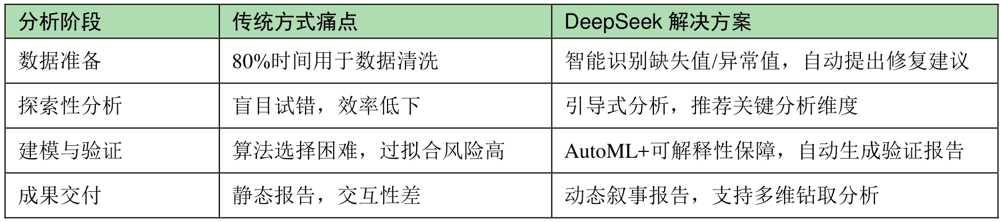

以上介绍了 DeepSeek 在数据分析领域的核心能力。接下来将通过本地部署实践、数据加载实战、清洗预处理案例等具体内容，深入展示该智能分析平台如何把数据分析从“技术活”转变为“对话艺术”。

**1.3 本地部署 DeepSeek**

本地化部署可实现敏感数据与代码的本地处理与存储，保障数据安全，同时让开发者灵活调试、测试，加快迭代，推动开发高效稳定开展。

本节介绍本地部署 DeepSeek 的方法，包括安装 Ollama、DeepSeek 与 ChatBox，以及通过 API 调用本地大模型。

**1.3.1 安装 Ollama**

借助 Ollama 可在本地运行 DeepSeek。Ollama 是一款本地大模型运行工具，支持快速下载与管理模型，操作简便，无需复杂配置即可本地使用。安装步骤如下。

进入 Ollama 官网，点击 Download 按钮，如图 1-1 所示。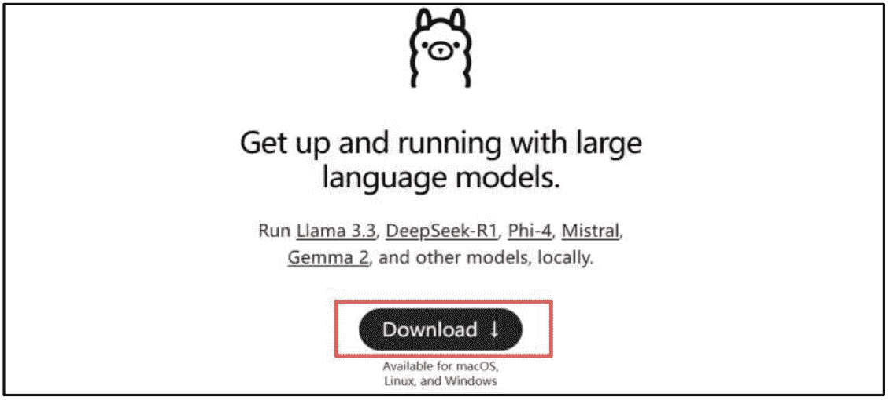

根据操作系统类型选择下载包，Windows、macOS、Linux 皆可，以下以 Windows 为例说明，其他系统操作类似，如图 1-2 所示。

下载完成后双击安装程序，按向导提示完成安装，如选择安装路径等。

安装完成后建议将 Ollama 安装目录加入系统环境变量。

打开 Windows 命令提示符或 PowerShell，输入“ollama”命令，若显示帮助信息则安装成功，后续可用于管理和运行模型。

**1.3.2 安装 DeepSeek**

目前 DeepSeek 提供 V3 与 R1 两个版本，DeepSeek-R1 按参数量提供多种选择，如 1.5B、7B、8B、14B、32B、70B、671B，各版本硬件要求不同，详情可查阅官网。

**表 1-2 DeepSeek-R1 类型信息**

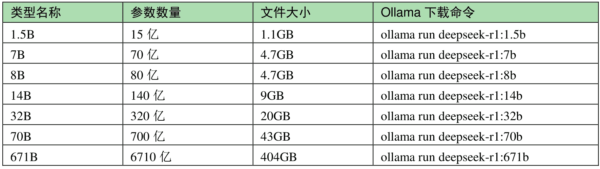

在命令行窗口输入下载命令，例如 ollama run deepseek-r1:8b，回车执行即可。随后需等待较长时间完成下载。安装完成后即可通过命令行与模型交互，如图 1-3 所示。

图 1-3 安装 DeepSeek

命令行交互不够友好，因此建议安装客户端连接本地大模型并提供美观交互界面。

**1.3.3 安装 Chatbox**

Chatbox 是一款 AI 客户端与智能助手，支持众多先进 AI 模型与 API，可在 Windows、macOS、Android、iOS、Linux 及网页版使用。该客户端是与 DeepSeek 模型沟通的工具，对后续开发至关重要。

在浏览器中打开 Chatbox 官网，进入下载页后根据设备系统点击对应下载按钮，如图 1-4 所示。

图 1-4 下载 Chatbox

安装过程与常规软件类似，下载后按提示点击“下一步”完成安装。安装完成后双击图标打开客户端，可见简洁界面，下方可输入问题。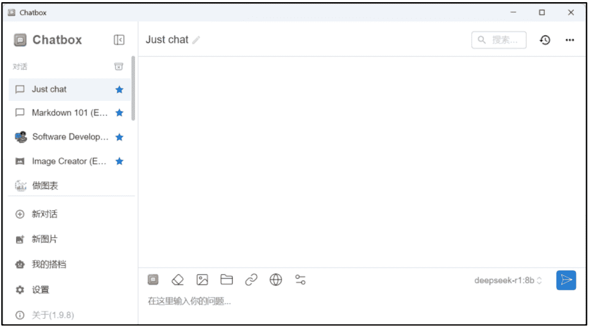

图 1-5 Chatbox 界面

在 Windows 环境下安装 Chatbox 后需添加 API 密钥。不同模型需不同密钥，添加步骤如下：

打开 Chatbox 应用程序。

点击左下角“设置”，进入设置界面。

在“模型”中选择“模型提供方”，勾选 OLLAMA API。

在“API 域名”输入框中填入本地大模型地址 http://127.0.0.1:11434。

其他项保持默认，最后点击“保存”，如图 1-6 所示。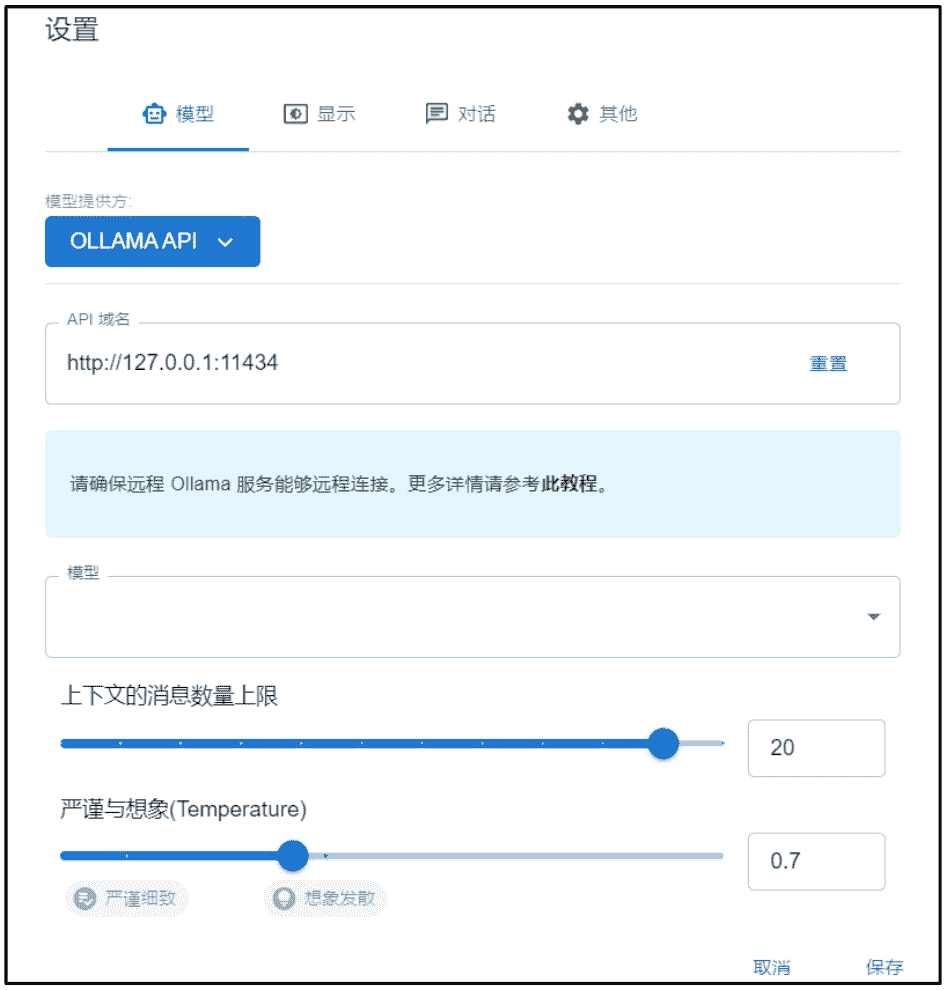

图 1-6 设置 Chatbox

**1.3.4 API 调用实战**

仅使用客户端难以满足开发需求，可开启 API 模式。通过 API 集成，可将功能嵌入第三方系统与应用。

下面以示例演示 API 调用方法。本例基于 Ollama 框架运行 DeepSeek-R1 模型，Ollama 充当代理，直接调用 Ollama API 即可实现对 DeepSeek 大模型接口的调用。

**1．代码生成**

依据规则调用大模型 API 生成代码，可显著提升开发效率，减少重复劳动。它能按需求描述、模型、模板等生成代码并应用于项目。

**案例 1-1 请帮我用 HTML 生成一个五子棋游戏，所有代码保存于一个 HTML 文件中**

API 调用代码如下：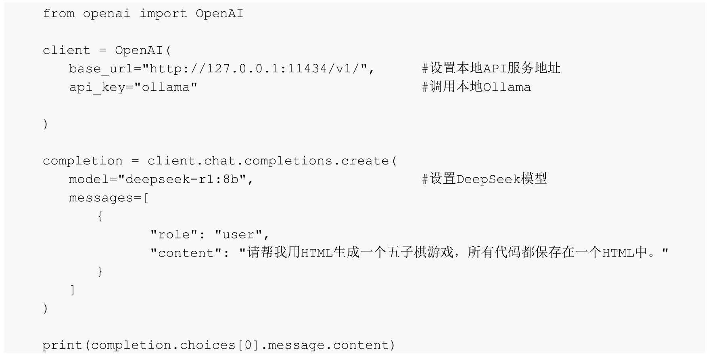

程序输出如下：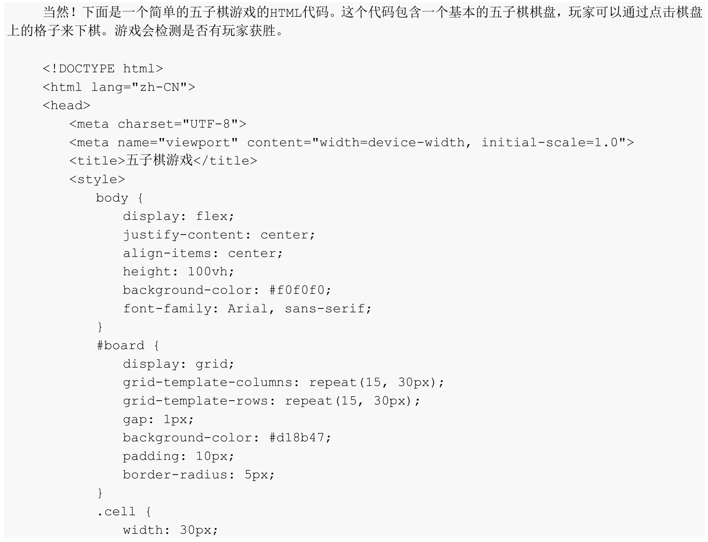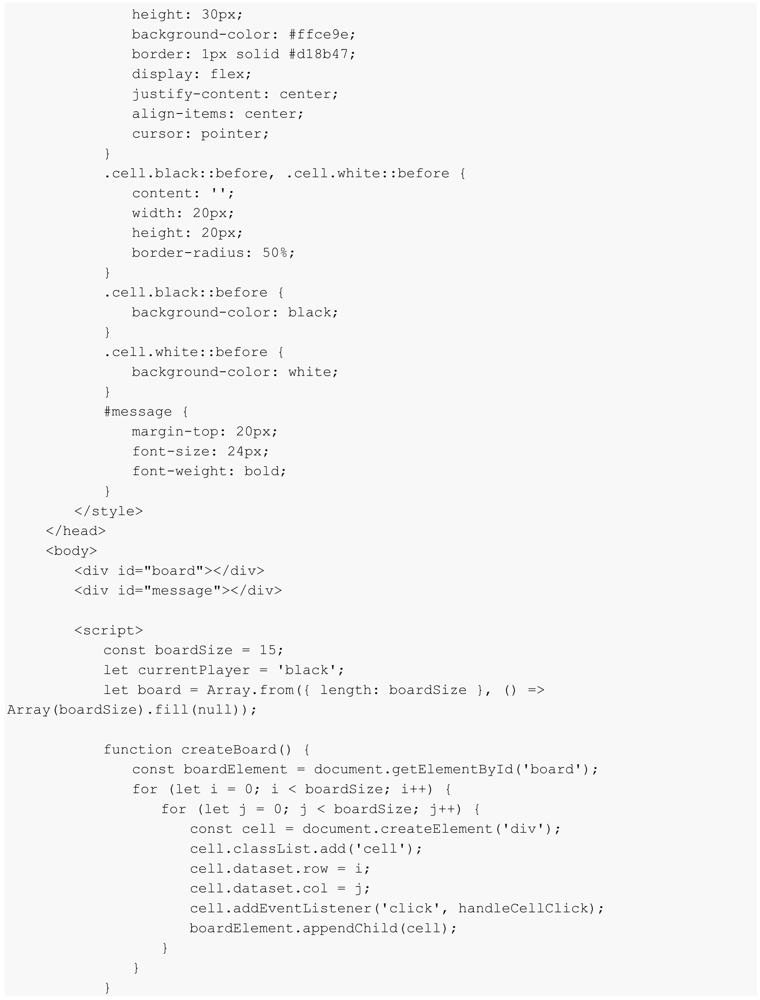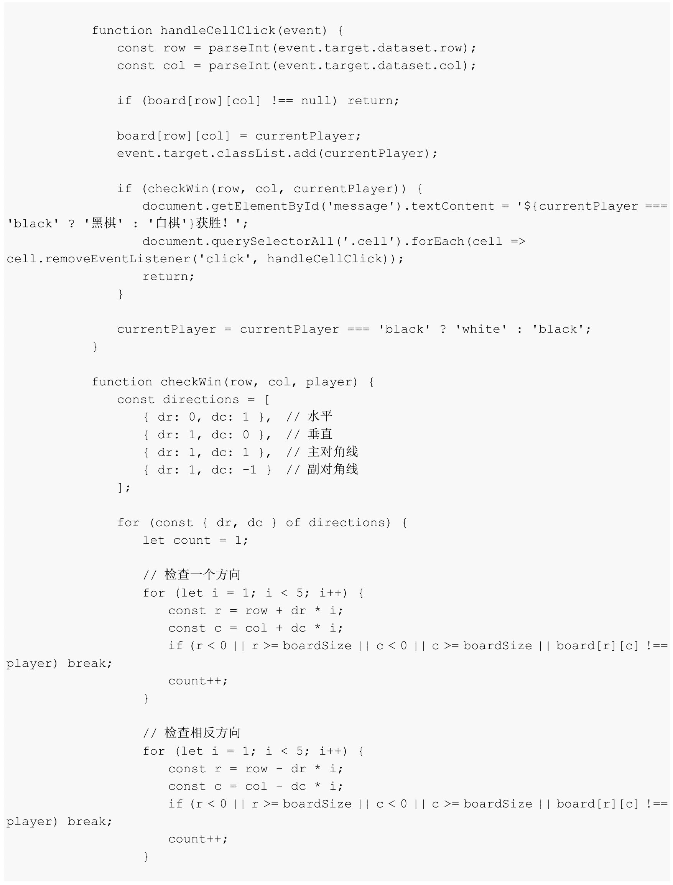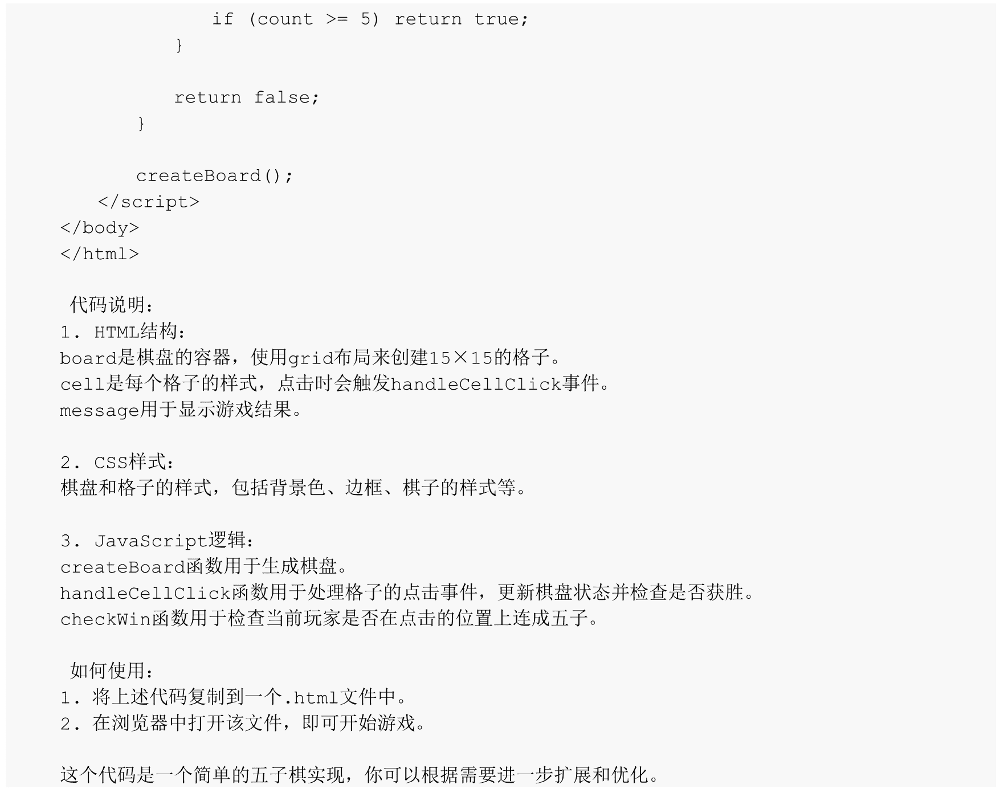

**2．代码解释**

调用 API 可清晰阐述代码逻辑、功能与实现步骤，帮助开发者与非技术人员理解代码用途，便于后续维护、调试与协作。

**案例 1-2 请解释下面这段代码的逻辑，并说明完成了什么功能**

API 调用代码如下：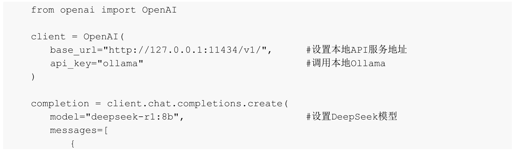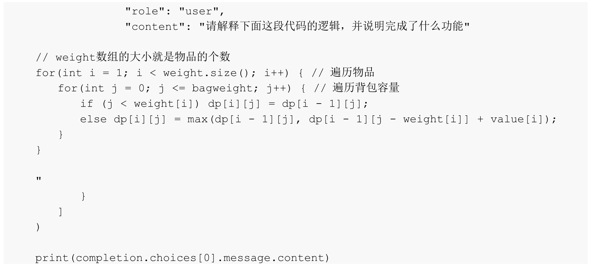

程序输出如下：

这段程序实现了一个经典的动态规划问题，通常被用来求解 0/1 背包问题。下面是对实现思路的详细说明：

逻辑说明：

1. 初始化与遍历：

weight 数组记录每件物品的重量。

value 数组记录每件物品的价值。

bagweight 表示背包的最大承载量。

dp 是一个二维表，dp[i][j] 表示考虑前 i 件物品时，背包容量为 j 的最大价值。

2. 外层循环：

for(int i = 1; i < weight.size(); i++) { // 遍历物品

外层从第 1 件物品开始遍历到最后一件。

3. 内层循环：

for(int j = 0; j <= bagweight; j++) { // 遍历背包容量

内层从容量 0 遍历到最大容量。

4. 状态转移：

if (j < weight[i]) dp[i][j] = dp[i - 1][j];

else dp[i][j] = max(dp[i - 1][j], dp[i - 1][j - weight[i]] + value[i]);

当背包剩余容量 j 无法容纳第 i 个物品时，weight[i] 超出 j，直接沿用上一轮的最优解，dp[i][j] = dp[i - 1][j]。

容量足够时有两个选择：
不带第 i 个物品，最优价值继承自 dp[i - 1][j]；
带上第 i 个物品，价值为 dp[i - 1][j - weight[i]] + value[i]，即留下空间再加上当前物品价值。
取其较大者作为当前状态，dp[i][j] = max(dp[i - 1][j], dp[i - 1][j - weight[i]] + value[i])。

功能说明：
该片段用于求解在背包容量 bagweight 的限制下，如何挑选物品组合使总价值最大。通过动态规划构造二维表 dp，dp[i][j] 代表前 i 件物品在容量 j 下能达到的最好价值。最终答案为 dp[weight.size() - 1][bagweight]。

总结：
输入为物品重量数组 weight、价值数组 value 以及背包容量 bagweight。
输出为容量受限时的最大总价值。
方法为动态规划，逐步记录每一步的最优解。

**1.4 在线开发：DeepSeek 零配置实战**
DeepSeek 在线开发环境省去了本地搭建的麻烦，直接在浏览器就能用，实时调用云端算力，任务响应快、效率高。
实际操作中可借助 AI 编程工具 Cursor 来接入 DeepSeek，装好 Cursor 后即可调用 DeepSeek 进行数据分析。

**1.4.1 Cursor：AI 智能编程助手**
Cursor 是一款把大模型嵌入编辑流程的 AI 代码编辑器，支持用自然语言生成代码，让编程更高效，已经被个人和企业广泛采用。
它兼容 Python、Java、C/C#、JavaScript 等主流语言，可辅助智能生成、智能纠错和测试代码编写。

1．下载并安装 Cursor
打开 Cursor 官网，点击“下载 WINDOWS”进行安装，如图 1-7 所示。安装步骤很简便，建议保持更新以获取最新功能。

图 1-7 下载 Cursor

**2．Cursor 的使用方法**
1）注册账号 
登录系统。点右上角 Sign in，若已有账号输入邮箱点 Continue，再填用户名和密码，如图 1-8 和图 1-9 所示。

图 1-8 输入邮箱地址

图 1-9 输入密码

创建账号。若无账号点 Sign up，填写姓名、邮箱等信息完成验证后点 Continue，如图 1-10 所示。

图 1-10 创建账号

2）安装插件 
选择 Extensions 选项。
在菜单栏点 View，找到 Extensions，如图 1-11 所示。

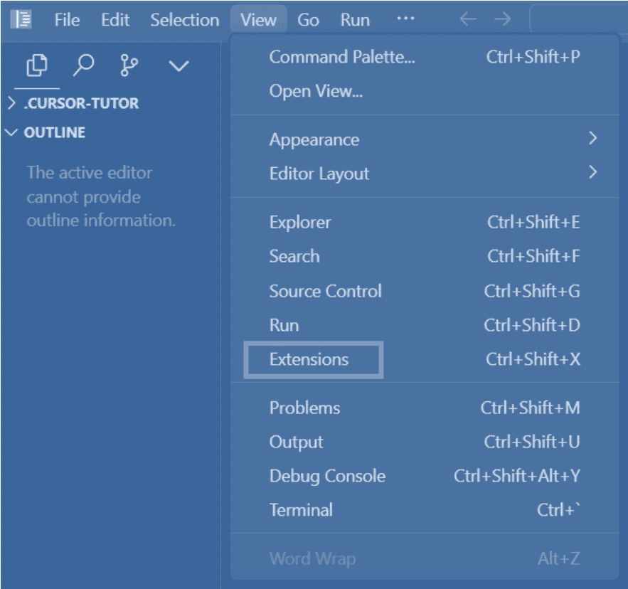
图 1-11 选择 Extensions 选项

安装编译插件。
点扩展按钮，在搜索框输入 Python，按 Install 安装，如图 1-12 所示。

图 1-12 安装编译插件

设置解释器。
未配置解释器时需选择对应环境，或点 Enter interpreter path… 手动指定路径，配置 Python 版本如图 1-13 所示。

图 1-13 配置解释器

3）开始使用 Cursor 
新建文件。要打开已有文件可点 File 选项卡中的 Open File…，新建文件点 New File… 图标，命名时加上扩展名如 .py、.c，如图 1-14、图 1-15 所示。

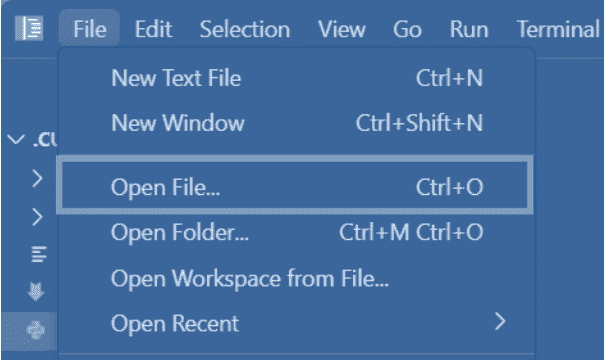
图 1-14 打开文件

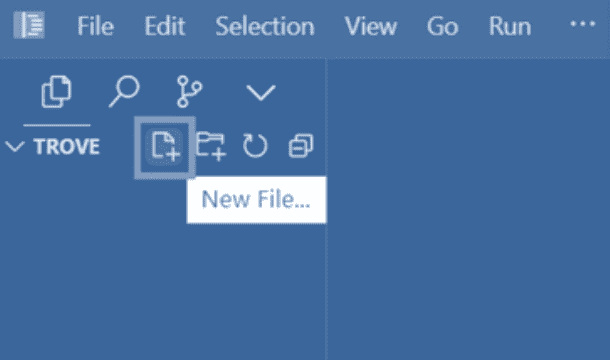
图 1-15 新建文件

召唤 AI。打开 Python 文件后按 Ctrl+K 呼出聊天框，选择模型为 deepseek-r1，如图 1-16 所示。本书以此为默认环境，受本地硬件限制无法安装高版本 DeepSeek，故采用在线环境。

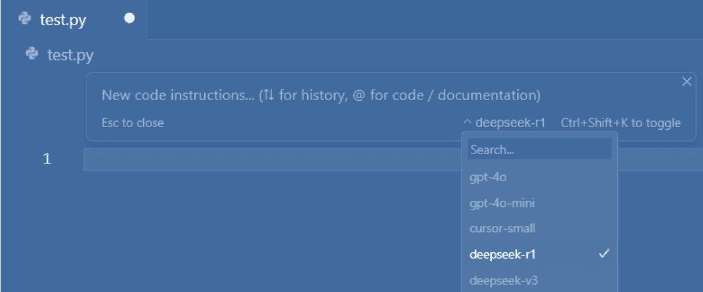
图 1-16 聊天对话框

输入提示语。例如“数据集为[17.23,15.23,14.65,12.00,10.62]，请输出该数据集的垂直条形图”。回车后自动生成对应 Python 代码，如图 1-17 所示。

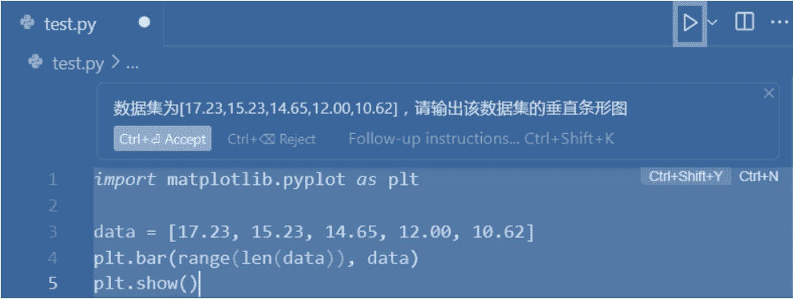
图 1-17 输入提示语

运行代码。点击图 1-17 右上方的 按钮运行 Python 代码，生成的条形图如图 1-18 所示。

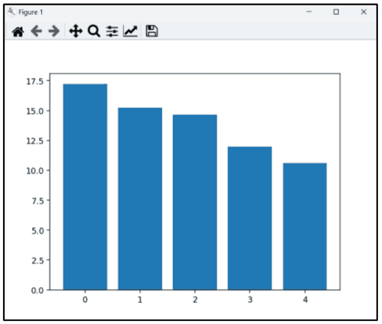
图 1-18 条形图

确认代码。若结果符合分析需求，按 Ctrl+Enter 确认；若不符合，按 Ctrl+Backspace 修改提示语。 
询问代码。对不理解的代码可框选后按 Ctrl+L 呼出聊天框提问，也可借助其定位问题。

**1.4.2 用 DeepSeek 启动数据分析**
下面演示如何借助提示工程从文本中提取关键信息并做预测。

案例 1-3 某企业 2024 年经营业绩预测分析
以“某企业 2024 年经营业绩数据报告”为例，说明如何用提示工程从复杂文本中精准提取要点并预测。
面对长报告时，合理设计提示能让大模型聚焦市场趋势、消费者诉求、竞争格局等维度，例如提问“报告中当前市场主要趋势有哪些？”或指令“找出消费者最关心的三个问题”，可引导模型深度分析并筛选关键点。

提示语和输出如下。

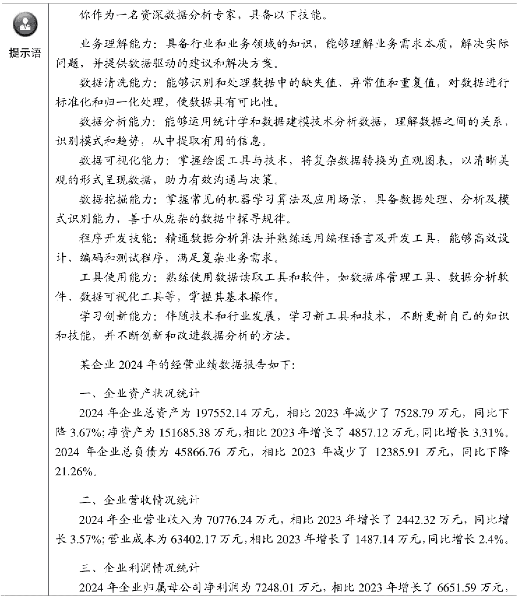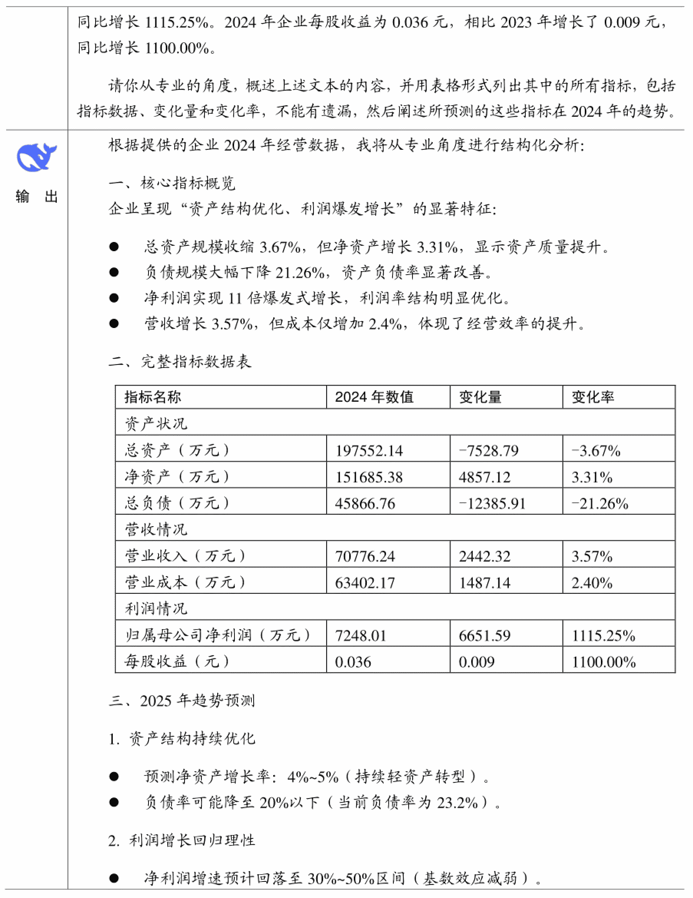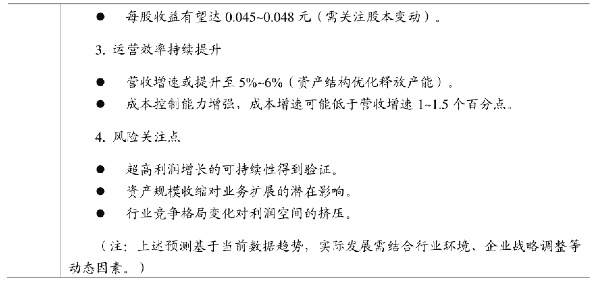

DeepSeek 依托语言理解和智能分析能力，按需求对 2024 年经营业绩报告进行了全面解读。
首先输出核心指标概览，用文字和数据呈现全年经营亮点与短板。
其次生成结构化的数据指标表，汇总总资产、净资产、总负债、营业收入、营业成本、归属母公司净利润、每股收益等关键指标，便于管理者和投资者快速把握财务状况。
最后基于 2024 年数据，结合市场动态、行业竞争、企业战略等因素，对 2025 年的总资产、净资产、总负债、营业收入、营业成本、归属母公司净利润、每股收益等指标进行前瞻性预测，为后续规划提供参考。

**1.5 小结**
本章从概念到实操介绍了 DeepSeek 的基础认知和入门操作，帮助建立整体认知并积累动手经验，为后续进阶分析奠定基础。

# 第二章
# 利用 DeepSeek 进行数据加载

数据形态多样，读取方式也不同。本章介绍如何用 DeepSeek 读取离线数据、数据库数据、Web 在线数据等，为后续分析打好数据接入基础。

**2.1 读取本地离线数据**
本节介绍如何读取本地离线数据，涵盖 CSV 文本、Excel 文件、本地图片、PDF 文件、XML 格式等。

**2.1.1 CSV 数据快速读取**
CSV 即逗号分隔值，纯文本存储表格数据，每行一条记录，字段以逗号或分号、制表符等分隔。扩展名为 .csv，便于跨系统传输和电子表格导入导出。

案例 2-1 读取 CSV 文本数据
以本地“客户信息表.csv”为例，该表记录性别、年龄、教育程度、职业等客户特征，用于服务和营销决策。
需先明确文件路径，例如 “D:\工作文档\客户数据”，告知 DeepSeek 才能准确定位。随后设计提示语引导读取与分析。

提示语和输出如下。

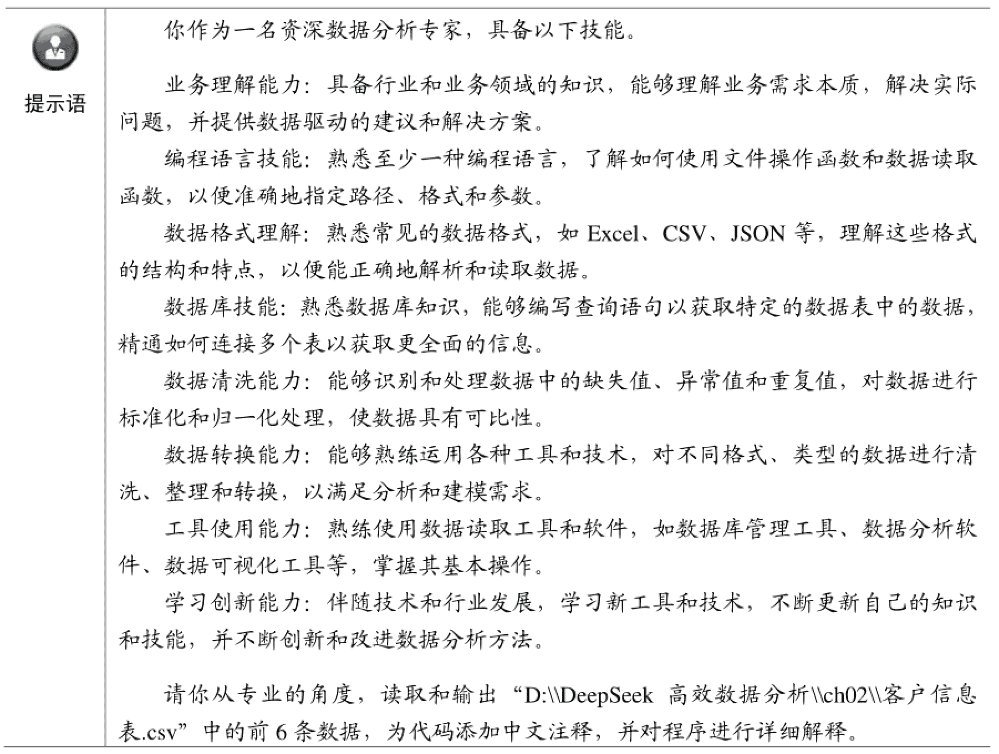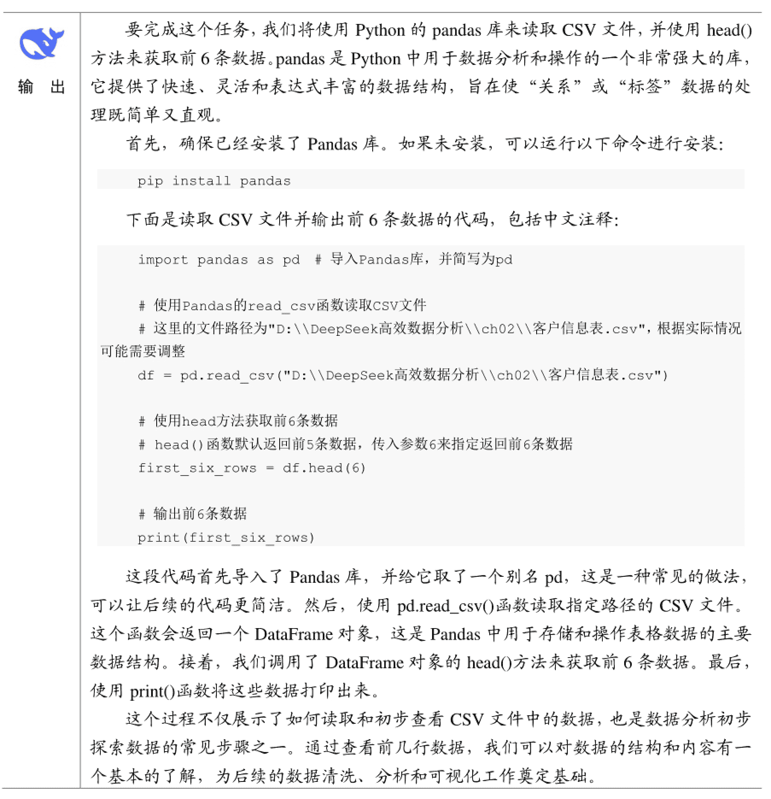

其中 read_csv() 是 Pandas 提供的 CSV 读取函数，可把文件载入 DataFrame 方便分析，参数灵活。

read_csv() 基础用法：
import pandas as pd
df = pd.read_csv('filename.csv')

主要参数：
· filepath_or_buffer：文件路径、URL 或类文件对象。
· sep / delimiter：分隔符，默认逗号。
· header：列名所在行，默认 0。
· names：header=None 时指定列名。
· index_col：设为行索引的列。
· usecols：指定读取的列。
· dtype：指定列数据类型。
· skiprows：跳过行。
· skipfooter：跳过末尾行。
· encoding：文件编码。
· na_values：视为缺失值的表示。
· parse_dates：解析为日期的列。
· infer_datetime_format：自动推断日期格式。
返回值：包含数据的 DataFrame 对象。

**2.1.2 Excel 数据读取技巧**
Excel 文件以 .xlsx 或 .xls 存储，支持文本、数字、日期、公式等，具备排序、筛选、计算、图表等功能，常用于财务、客户、销售等数据管理，也可与数据库互通。

案例 2-2 读取 Excel 文件数据
以“股票交易表.xlsx”为例，包含股票代码、交易时间、价格、成交量等对投资者和金融机构有价值的信息。
先确认本地路径，如 “E:\金融数据\股票交易记录”，再通过提示语引导 DeepSeek 读取分析。

提示语和输出如下。

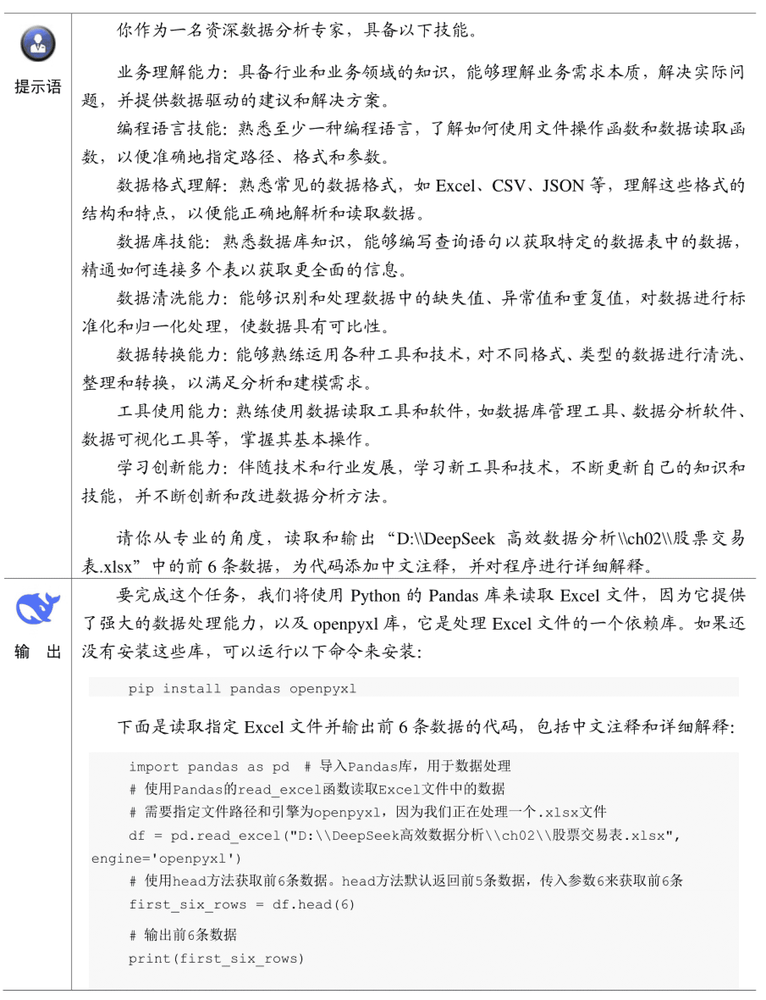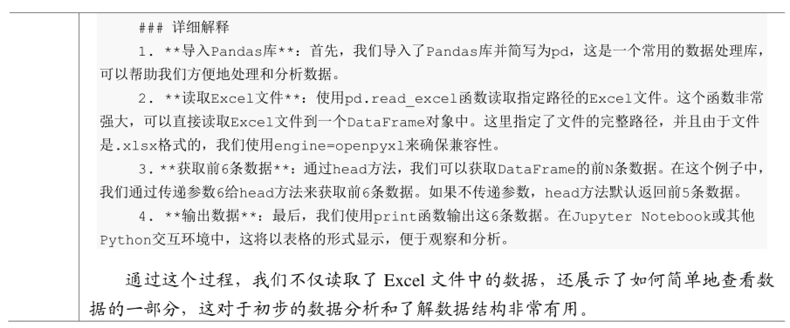

其中 read_excel() 是 Pandas 用于读取 Excel 的函数，可读取一个或多个工作表并转为 DataFrame，参数可定制读取行为。

基本用法：
import pandas as pd
df = pd.read_excel('filename.xlsx')

主要参数：
· io：文件路径、URL 或二进制数据。
· sheet_name：工作表名或索引，默认 0。
· header：列名行，默认 0。
· index_col：行索引列，默认 None。
· usecols：读取的列。
· dtype：列数据类型。
· converters：列转换函数。
· na_values：缺失值表示。

· parse_dates：用来标记需要转成日期类型的列。
· date_parser：指定用于解析日期的自定义函数。
· nrows：控制读取的行数上限。
· skiprows：跳过文件开头的指定行。
· skipfooter：忽略文件末尾的指定行数。
· engine：选择解析引擎，默认 auto 会自动挑选最合适的引擎。

**2.1.3 本地图片信息抓取**
图文数据的差异很明显，图片是由像素构成的二维或三维矩阵，承载着色彩、轮廓、纹理等视觉特征。

下面用一个实操案例说明 DeepSeek 如何读取本地图片中的内容。

**案例 2-3 本地图片数据读取**
要让 DeepSeek 解析本地图片，首先需要把图片文件上传到平台，点击“上传”按钮后选择目标文件即可。上传的图片可以是图表、照片等，举例来说图 2-1 就是一份 2023 年天气质量等级分布的堆积条形图。

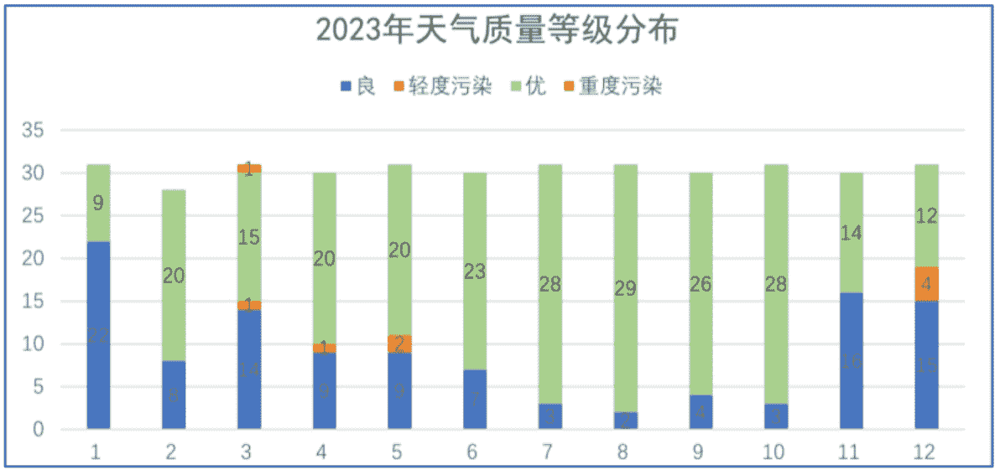

图 2-1 2023 年天气质量等级分布

上传后，DeepSeek 会对图片进行视觉分析。借助计算机视觉技术，它能够识别图中的文字、图形、色彩等要素。

识别到的信息会被送入 DeepSeek 进行后续处理。基于训练好的大模型，系统会按照指令对内容进行理解、归类、计数或解读等操作。

最后，DeepSeek 会返回分析结果，形式可能是文字说明、图表或表格等可视化呈现，方便用户据此做决策、解决问题或继续挖掘数据。

提示词与输出如下：

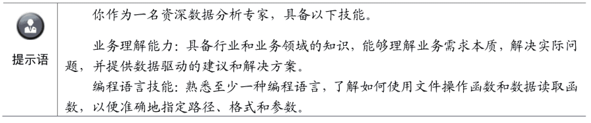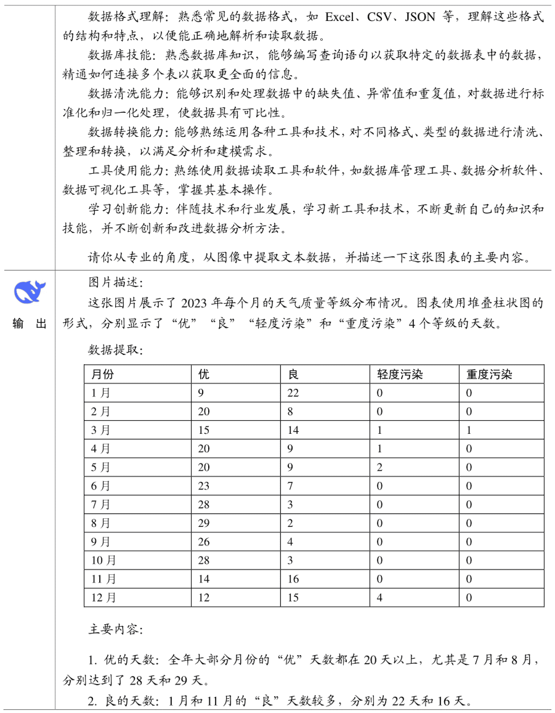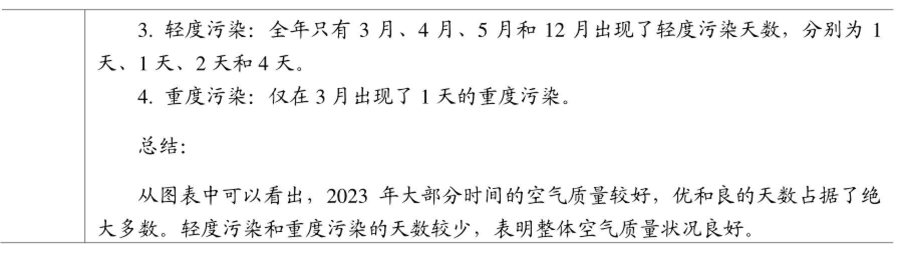

**2.1.4 PDF 文件内容读取**
DeepSeek 在语言理解和生成上表现强劲，但本身并不支持直接打开 PDF。借助 PyPDF2 库，就能把 PDF 中的文本交给 DeepSeek 处理。

PyPDF2 是 Python 生态里处理 PDF 的常用工具，核心能力包括：

· 读取 PDF 文件：可以打开各类 PDF，无论文件大小或复杂度如何，都能抽取出其中的文本、图像与元数据，方便后续分析。
· 合并与拆分 PDF：支持把多个 PDF 合并成一个，也能把一个大文件拆成若干小文件，便于归档管理。
· 加密与解密 PDF：可为敏感文档设置密码保护，也能在授权后解密读取。
· 页面旋转：针对方向错误的扫描页，可一键旋转至正确显示。
· 抽取指定页：按需取出单页内容，减少存储和处理成本。

下面是借助 DeepSeek 读取医院患者随访 PDF 的案例。

**案例 2-4 PDF 文件数据读取**
患者随访数据是医疗管理的重要资源，记录了康复情况、疗效评估及后续需求等关键信息。通常由随访部门整理而成，包含姓名、年龄、性别、联系方式等基础识别信息。

关于治疗部分，文件会详细记载疾病诊断、治疗方案、手术记录、用药信息等，对疗效复盘和医学研究很有价值。例如对比不同方案的康复效果，为临床决策提供参考。

此外，PDF 还会记录随访期间的各项指标与主观反馈，包括症状变化、体能恢复、新发症状、心理状态评估以及对医疗服务的满意度等，助力医生及时调整方案并提升服务质量。

图 2-2 展示了某医院的患者随访 PDF，涵盖病人号、随访天数、随访月数、治疗方式等要点。

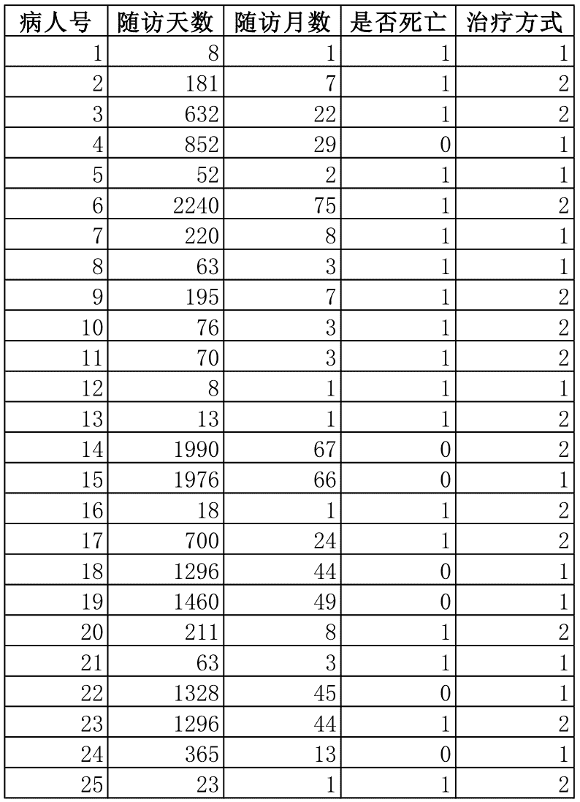

图 2-2 医院患者随访数据

提示词与输出如下。

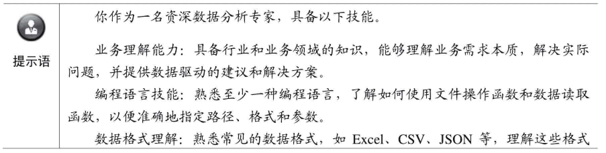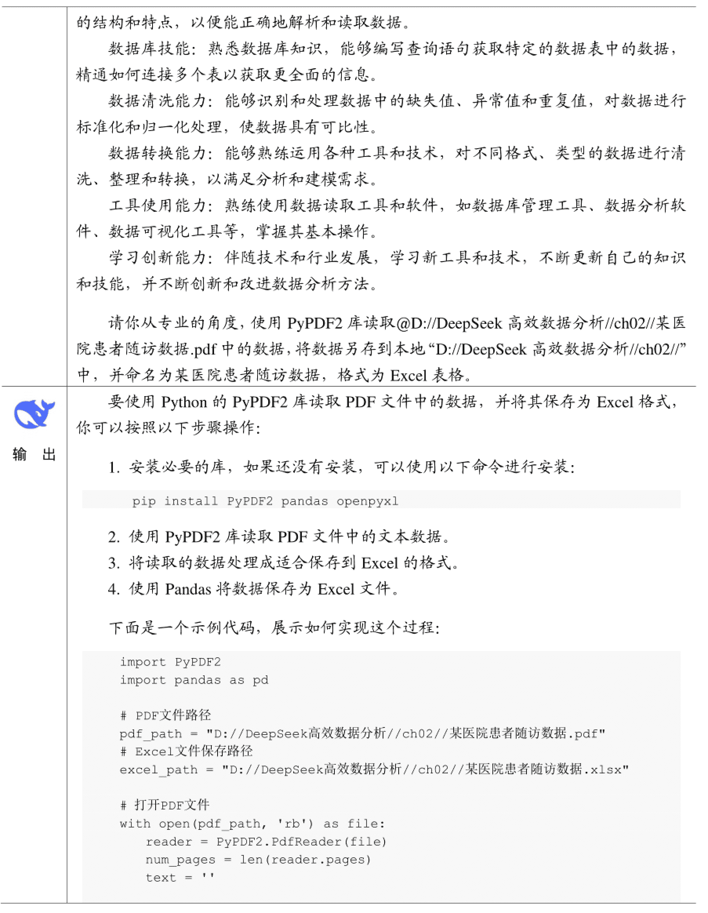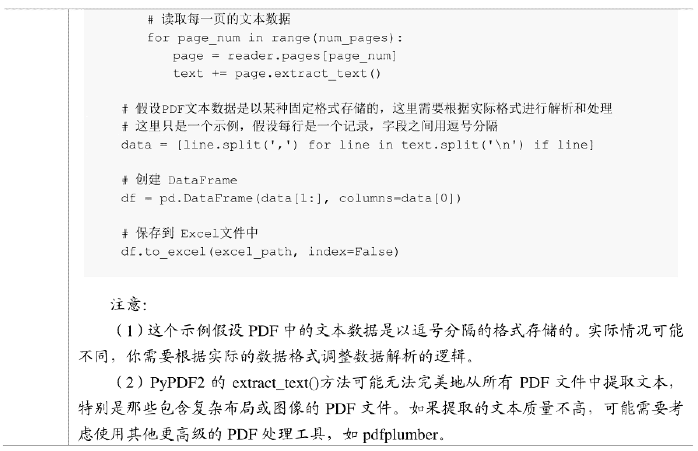

执行上述 Python 脚本后，“某医院患者随访数据.pdf” 中的内容会被解析并保存为“某医院患者随访数据.xlsx”，对应表 2-1 的随访数据。

**表 2-1 患者随访数据**

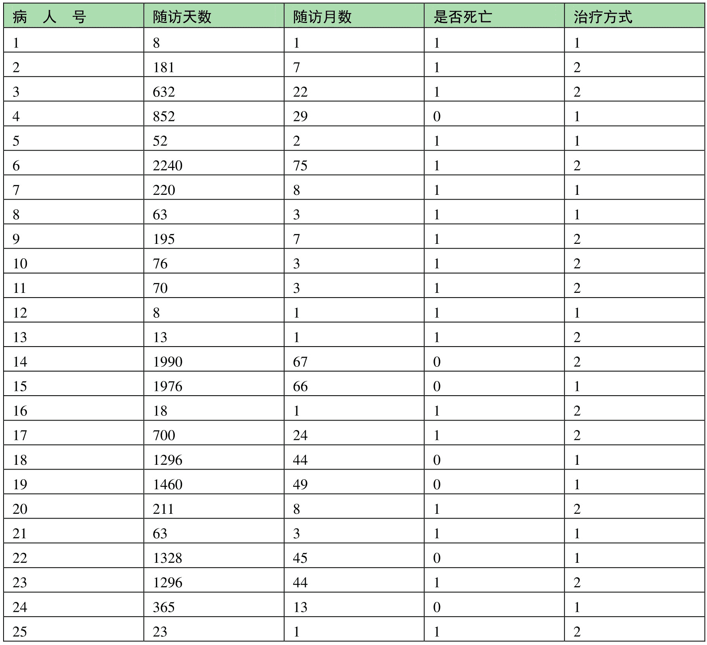

**2.1.5 XML 格式数据读取**
XML 凭借良好的结构化和扩展性在数据交换中应用广泛。结合 Python 的 xml.etree.ElementTree 模块，DeepSeek 可以高效处理 XML 数据，拓展更多应用场景。

下面以读取本地目录下“企业商品颜色编码表.xml”为例进行说明。

**案例 2-5 XML 格式数据读取**
企业商品颜色编码表是商品管理与生产中的重要依据，为每种颜色赋予唯一编码，便于识别、分类与追溯。表格通常按行列展开，每行对应一种颜色，每列对应不同属性字段。

常见字段包括颜色编码、颜色名称等，是库存管理、生产计划、市场营销和质量控制的标准化支撑。

提示词与输出如下。

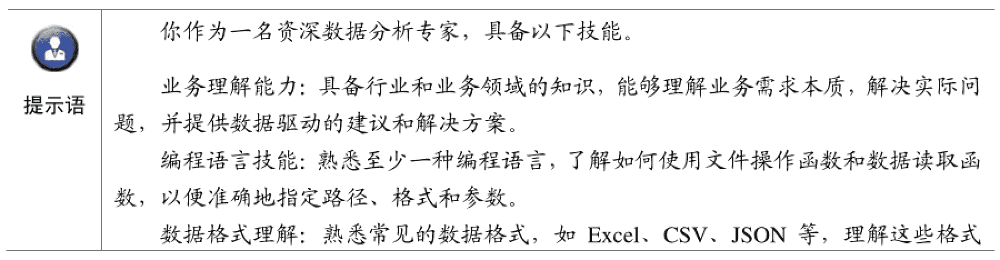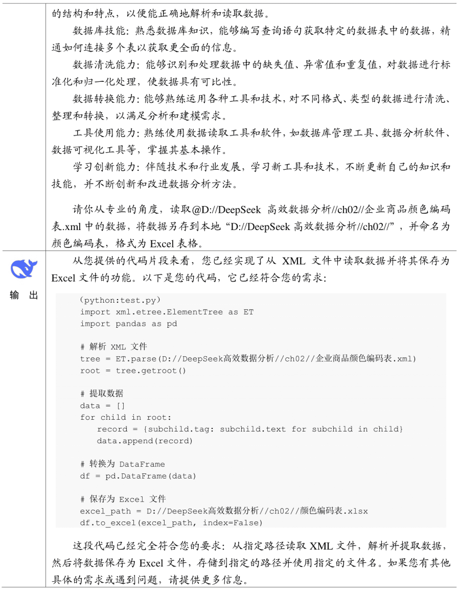

其中，xml.etree.ElementTree 是 Python 处理 XML 的实用库，主要特性如下：

· 高效解析 XML：快速读取文档并转换为 Python 对象树，元素、属性与文本一目了然。
· 灵活的元素操作：支持新增、修改、删除节点，满足动态修改需求。
· 属性管理：可读取、修改、增删元素的属性值。
· 文本内容处理：便捷获取与修改元素内的文本。
· 遍历与搜索：支持深度或广度遍历，并按标签、属性或文本快速定位节点。

运行对应代码后，“企业商品颜色编码表.xml”会被解析并导出为“颜色编码表.xlsx”，结果如表 2-2 所示。

**表 2-2 颜色编码表**

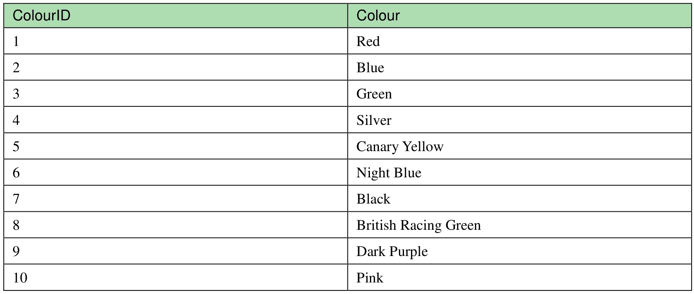

**2.2 数据库数据读取**
本节介绍如何用 DeepSeek 读取数据库数据，覆盖 Oracle、MySQL、SQL Server、Kingbase、OceanBase、TiDB 等主流系统。

**2.2.1 Oracle 数据库读取**
Oracle 是功能完善且应用广泛的关系型数据库，以高可靠、安全、可扩展著称，适合企业级大规模存储与处理，内置强大的 SQL 支持、事务管理、备份恢复等能力。

在金融、电信、制造等行业中，Oracle 扮演关键角色，助力企业高效利用数据支撑决策。用 Python 读取 Oracle 数据流程相对复杂，需要安装 cx_Oracle，并注意 Python 版本与 Oracle 版本的匹配以及权限配置。

**案例 2-6 Oracle 数据库读取**
下面演示如何从名为 Oracle 的连接读取数据，端口 1521，服务名 ORCL，目标表为订单表 orders。

在本地环境中，需要准确配置连接参数并使用正确方法操作。

连接名 Oracle 代表具体的数据库实例标识，端口 1521 是 Oracle 常用端口，用于数据传输。服务名 ORCL 则精确定位到要访问的数据库实例。

orders 表包含订单编号、客户信息、订单日期、商品明细、订单金额等业务数据，对销售分析、库存管理、客户关系维护意义重大。

提示词与输出如下。

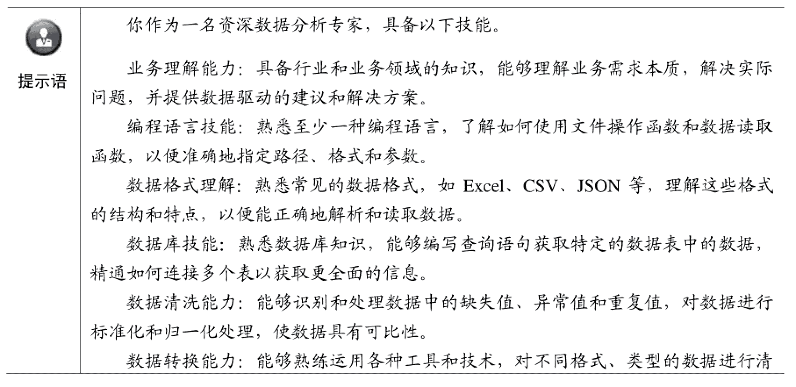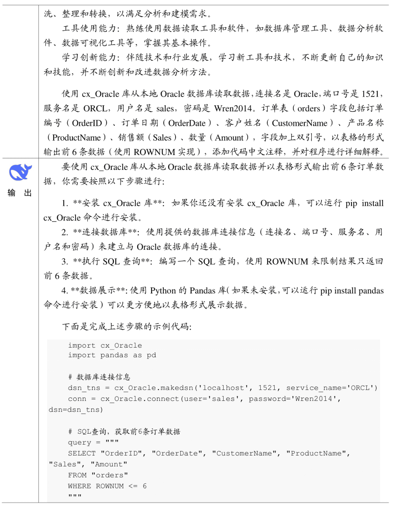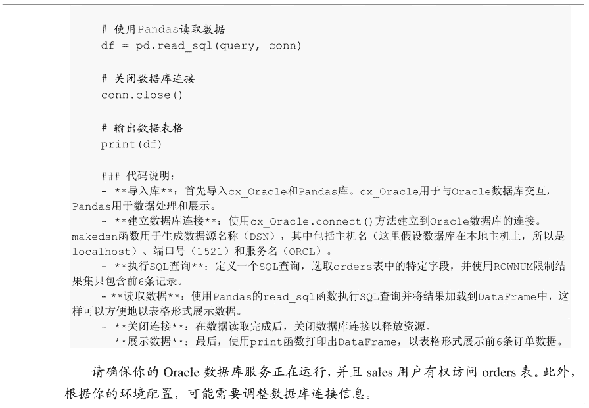

其中，cx_Oracle 用于连接 Oracle 数据库，connect() 用于建立连接。主要参数包括：

· user：数据库用户名。
· password：数据库密码。
· dsn：数据源名称，包含连接信息。
· mode：连接模式，默认 cx_Oracle.DEFAULT_AUTH。
· encoding：连接编码，默认 None。
· nencoding：NLS 编码，默认 None。
· events：事件处理器。
· threaded：是否启用多线程，默认 False。
· **kwargs：其他参数，如 handleerror、pooling 等。

执行脚本后的输出如下：

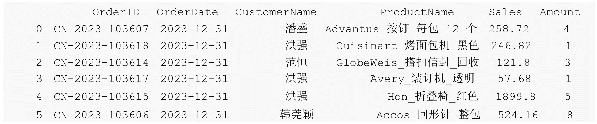

**2.2.2 MySQL 数据库读取**
MySQL 是开源的关系型数据库，以高性能、高可靠、易用著称，支持多操作系统，适用于中小企业与个人开发者，具备强大的 SQL 查询能力。

用 Python 读取 MySQL 十分便捷，先安装驱动 pymysql，建立连接后通过 SQL 查询获取数据，遍历结果集即可提取每一行内容。

**案例 2-7 MySQL 数据库读取**
本次连接目标为连接名 MySQL，端口 3306，数据库 trove，读取表为供应商信息表 suppliers。

suppliers 表存储供应商编号、名称、联系方式、地址、供货品类等信息，对采购管理、供应链优化及合作维护至关重要。

提示词与输出如下。

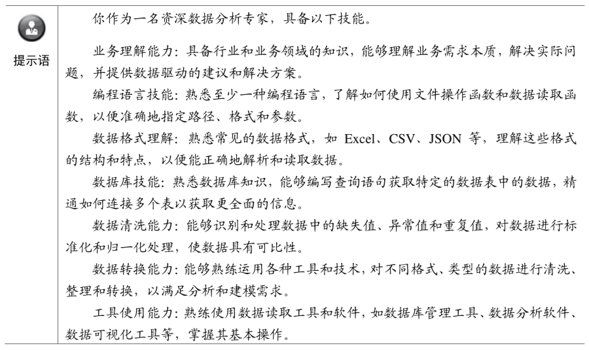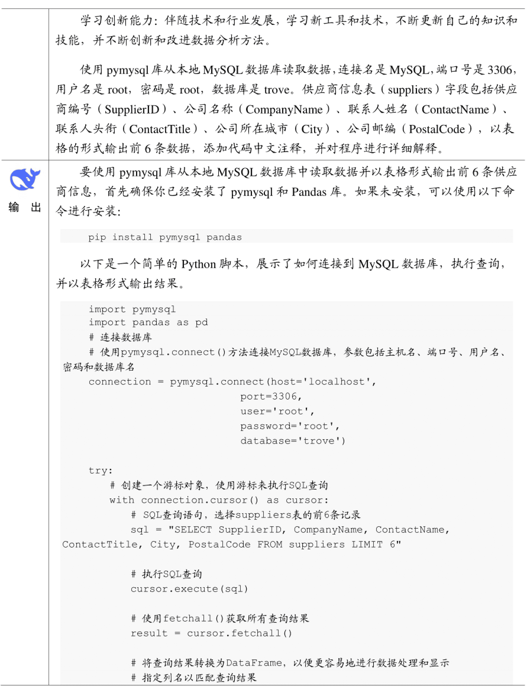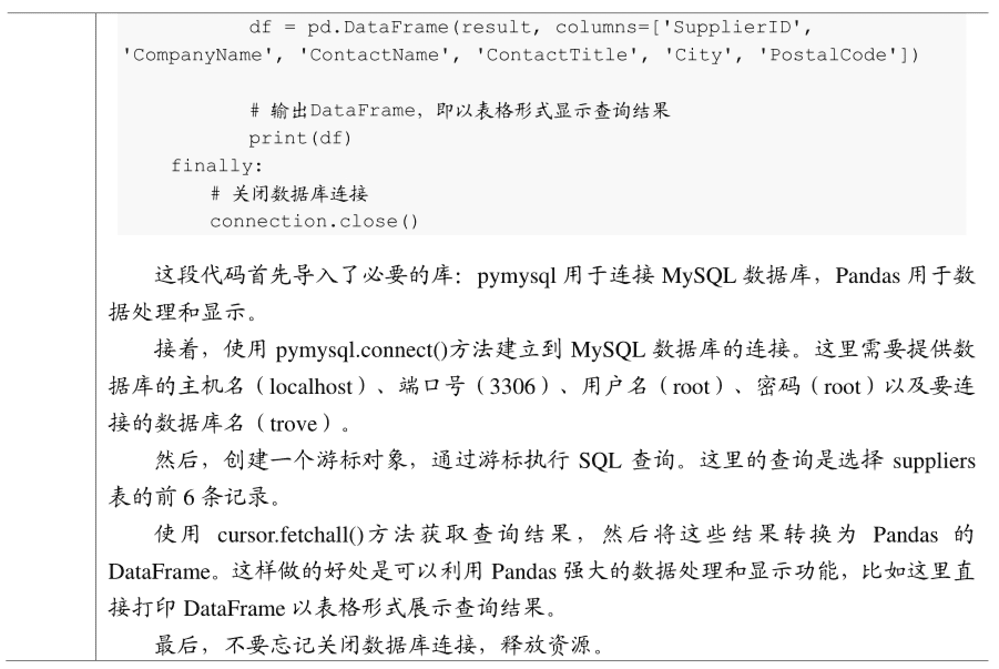

Python 读取 MySQL 需要安装 pymysql，create_engine(mysql+pymysql) 用于创建连接。主要参数包括：

· dialect：数据库类型，此处为 mysql。
· driver：驱动程序，此处为 pymysql。
· host：主机名或 IP。
· port：端口号，默认 3306。
· user：用户名。
· password：密码。
· database：数据库名称。
· charset：字符集，如 UTF8、GBK。
· pool_size：连接池大小。
· max_overflow：连接池最大溢出数。

运行脚本后的输出如下。

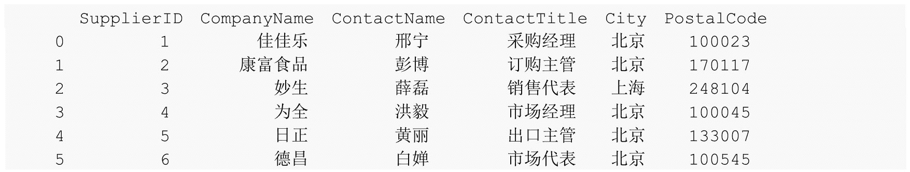

**2.2.3 SQL Server 数据库读取**
SQL Server 是微软推出的关系型数据库，性能稳定、可靠性强，适合企业级应用，支持海量存储与复杂查询，并提供完善的安全机制和管理工具。

在 Python 中读取 SQL Server 可通过 pymssql 实现，先指定服务器地址、数据库名、用户名密码建立连接，执行 SQL 查询后遍历结果集处理数据。

**案例 2-8 SQL Server 数据库读取**
下面演示从本地 SQL Server 读取数据，端口 1400，数据库 SALES，目标表为客户信息表 customers。

customers 表保存客户编号、姓名、联系方式、地址、购买历史等信息，对需求洞察、市场分析、营销策略制定和个性化服务具有核心价值。

提示词与输出如下。

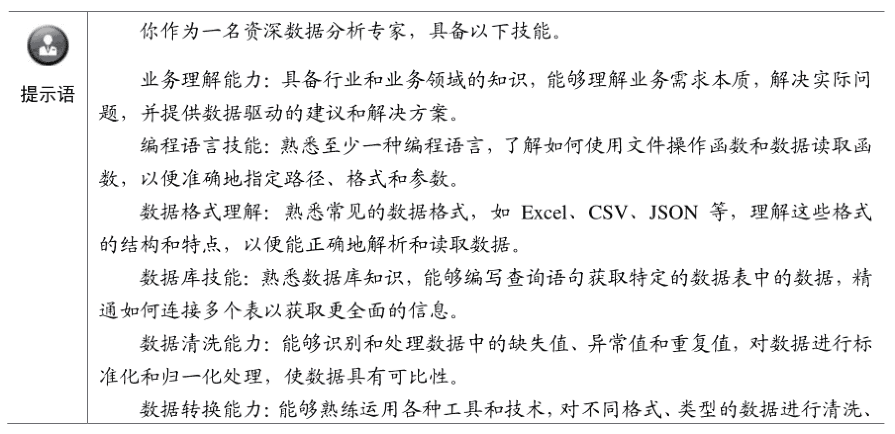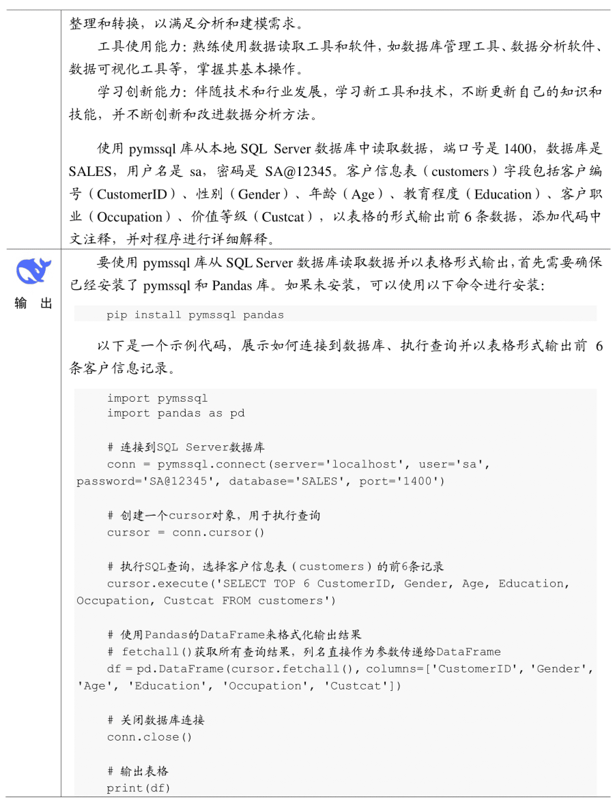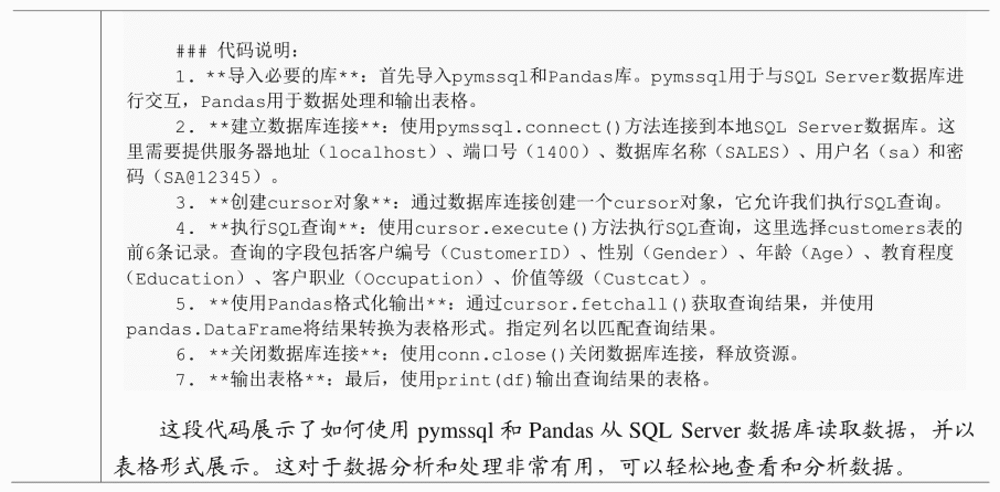

create_engine(mssql+pymssql) 用于连接 Microsoft SQL Server，mssql 为类型，pymssql 为驱动。主要参数包括：

· dialect：数据库类型，mssql。
· driver：驱动，pymssql。
· username：用户名。
· password：密码。
· host：服务器地址。
· port：端口号。
· database：数据库名称。
· echo：是否打印 SQL，默认 False。
· pool_size：连接池连接数，默认 5。
· max_overflow：最大溢出连接数，默认 10。
· pool_timeout：连接超时时间，默认 30 秒。
· connect_args：额外连接参数，如字符集。
· kwargs：其他可选参数，如 ssl。

运行脚本后的输出如下。

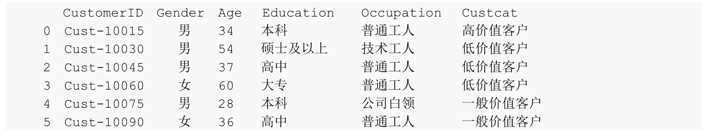

**2.2.4 Kingbase 数据库读取**
Kingbase 是一款国产数据库管理系统，具有高可靠性、高性能与高安全性，支持多种数据类型与复杂查询，适用于各类企业场景，提供强大的事务处理与备份恢复能力，并具备良好的兼容性，可配合多种操作系统与开发工具使用。

用 Python 把 Kingbase 里的记录拉出来，psycopg2 这类连接器是最常见的选择。先把驱动装好，再填入连接信息——主机、端口、账号、密码等，建立会话；随后用 SQL 发出查询请求，通过游标逐行遍历，把结果取出来做后续分析或可视化。Python 生态的灵活性，让以 Kingbase 为数据源的应用开发和洞察工作变得更顺畅。

**案例 2-9 从 Kingbase 抓取数据**
本例演示如何连接 Kingbase 并读取客户信息表 customers。使用的端口是 54321，库名为 test。54321 扮演着外部程序与数据库通信的通道角色，test 则指明了具体要操作的实例，实例内部存放着多张业务表。

提示与输出示例
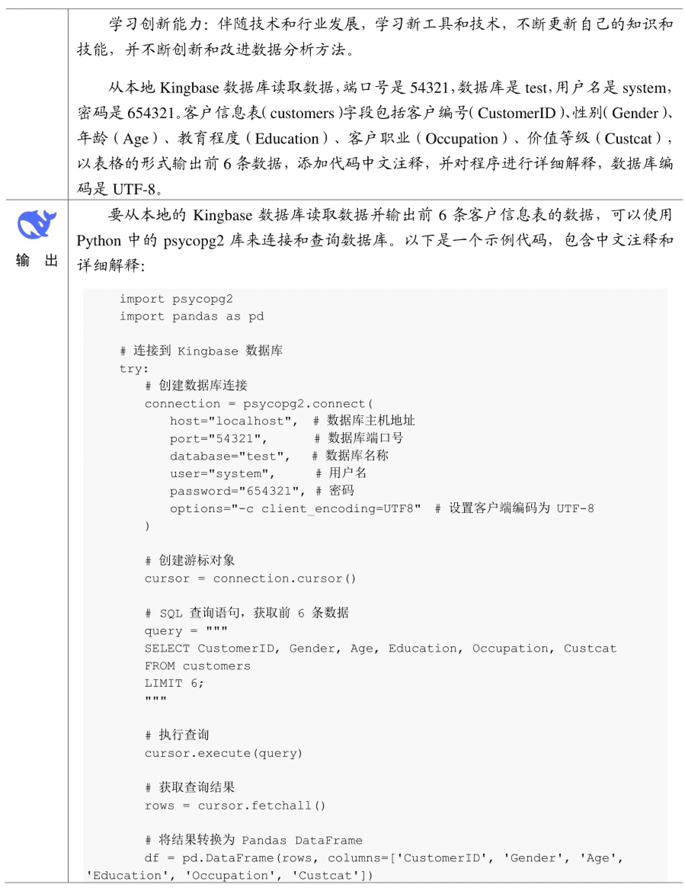

psycopg2 是面向 PostgreSQL 兼容型数据库的 Python 工具，接口成熟、上手快、稳定性好，很适合搭建可靠的数据库程序。

代码执行后的返回结果为：

**2.2.5 OceanBase 数据读取**
OceanBase 为分布式场景而生，采用多副本保存策略来保障数据安全与一致性，在金融、电商等行业应用广泛。金融侧可支撑高频交易与强一致要求，电商侧能应对海量订单与用户行为。平台还提供丰富的运维组件与接口，方便部署、监控与管理，为企业数字化转型提供支撑。

Python 访问 OceanBase 可依托对应驱动。先安装适配包，按地址、端口、用户名、密码等配置连接，发出 SQL 请求获取结果集，再逐行提取字段进行处理。

**案例 2-10 从 OceanBase 抓取数据**
本例演示 OceanBase 的读取流程，端口 2881，库名 test，目标表同样是 customers。

提取 customers 表的数据，后续可用于分析、报表生成、客户关系维护等，助力企业决策与业务增长。

提示与输出示例

代码执行后的返回结果为：

**2.3 Web 在线数据读取**
网络上的实时资料对企业洞察市场、辅助决策、实现个性化服务和提升服务质量意义重大，也推动着数字经济的发展。本节介绍借助 DeepSeek 获取在线资料的方法，涵盖网页资料的抓取与解析、UCI 红酒资料读取等场景。

**2.3.1 网页资料的获取与解析**
DeepSeek 在网页信息的获取与解析上能力突出，通过要素抽取、语义理解与资料清洗，为用户提供精准有用的内容，帮助快速定位所需。

**1．要素抽取**
依托先进的自然语言处理技术，DeepSeek 能从结构复杂的页面高效抽取关键要素，像一位精准的信息猎人。

标题是页面的核心概括，DeepSeek 可迅速识别并抓取标题，无论是新闻标题还是博客标题都能快速获取，帮助用户初步把握主题。例如在新闻站点，系统能快速抓取各稿件标题，让用户一眼掌握重点事件。

正文是页面的主体，DeepSeek 利用文本理解能力从冗长内容中提炼关键句段，区分主次。对于学术论文页面，可抽取核心观点、研究方法与结论，节省阅读时间。

链接承担页面跳转功能，DeepSeek 也能有效抽取页面中的链接，为用户提供延伸阅读路径。例如在知识分享平台，可抽取相关链接，帮助用户深入探究主题。

**2．语义理解**
DeepSeek 不只是机械搬运文字，还能深入理解页面语义，这是精准响应的关键。

通过对自然语言的分析，系统可判断页面主题、情感倾向与重要程度。例如阅读评论文章时，能把握作者立场并提取评价要点；面对技术文档时，能理解专业术语，准确抽取用户关心的技术要点。

这种理解能力使 DeepSeek 能按用户具体需求有针对性地抽取信息。比如用户询问某产品的评价，系统可在页面中检索相关内容并理解评价语义，提炼正面与负面评价，为用户提供全面信息。

**3．资料清洗**
抽取后 DeepSeek 会对资料进行清洗整理。网页常包含大量无效信息和噪声，会干扰关键内容的获取。

系统可去除无用信息和噪声，识别并剔除广告、重复内容、无关链接等干扰。对格式不规范的文本进行规范化处理。例如提取资料时会自动过滤弹窗广告和侧边栏广告，仅保留与需求相关的内容。

清洗后提供的高质量信息可读性与可用性更高，用户无需花费大量时间筛选整理，获取效率显著提升。

**2.3.2 UCI 红酒在线资料读取**
UCI 红酒资料指 UCI 机器学习库中的红酒集合，广泛用于机器学习、数据挖掘和统计分析的教学与研究。UCI 库收录多种集合，其中红酒集合用于训练和测试算法以评估性能。

UCI 库中的红酒集合主要有两个：

（1）Wine Recognition Dataset：
· 记录数：178 条。
· 特征数：13 个。
· 目标：葡萄酒类别，共 3 类。
· 说明：包含不同化学成分的测量值作为特征预测类别，特征有酒精含量、苹果酸含量、灰分含量、灰分碱度、镁含量、总酚含量、类黄酮含量、非类黄酮酚含量、原花青素含量、颜色强度、色调、稀释葡萄酒样品的光密度比值以及脯氨酸含量。

（2）Wine Quality Dataset：
· 记录数：红葡萄酒 1599 条，白葡萄酒 4898 条。
· 特征数：12 个。
· 目标：葡萄酒质量评分，0~10。
· 说明：包含红白葡萄酒的理化性质，如固定酸度、挥发性酸度、柠檬酸、残糖、氯化物、游离二氧化硫、总二氧化硫、密度、pH 值、硫酸盐和酒精度。目标变量为专家至少 3 次评估的中值。

**案例 2-11 读取 UCI 红酒资料**
本例选用 Wine Recognition Dataset，原集合共 178 条样本、3 类、每样本 13 个属性。

使用该集合可训练机器学习模型预测葡萄酒类别，对生产商和消费者理解不同类型酒均有帮助。

提示与输出示例

本例采用 urlopen() 与 loadtxt() 加载在线资料。urlopen() 属于 Python 标准库 urllib.request，用于打开 URL 获取内容，主要参数有：
· url：目标地址，可为字符串或 Request 对象。
· data：向地址发送的内容，未提供时为 None。
· timeout：等待时长，单位秒。
· cafile：CA 证书文件位置，用于校验服务端证书。
· capath：CA 证书目录位置，用于校验服务端证书。
· cadefault：是否采用系统默认 CA 证书。
· context：SSL 上下文，用于 HTTPS 请求。

loadtxt() 属于 NumPy，用于把文本文件载入 NumPy 数组，主要参数有：
· fname：文件名或路径。
· dtype：返回数组的数据类型。
· delimiter：分隔符，默认任意空白字符。
· skiprows：跳过文件开头若干行。
· usecols：要加载的列索引或列名。
· unpack：为 True 时按列解包。
· ndmin：返回数组最小维度。

代码执行后的返回结果为：

**2.4 本章小结**
本章围绕高效加载多源异构资料展开，系统讲解了利用 DeepSeek 从本地文件、关系资料库和网络资源获取资料的完整思路，为后续分析奠定基础。

# **第三章**

# **利用 DeepSeek 进行资料清洗**

真实资料常带重复、缺失和异常值，对后续分析不友好，需对“脏资料”进行针对性处理。本章介绍如何借助 DeepSeek 进行资料检测与处理，涵盖重复值、缺失值、异常值的识别与清洗。

**3.1 重复值的检测与处理**
重复值检测对保障资料准确性和唯一性至关重要，通过特定算法识别重复内容后可进行删除、合并等优化，提升资料质量与分析效率。

**3.1.1 重复值的检测方法**
重复值指集合中多次出现完全相同或近似的记录，会影响分析准确性和效率，有效检测对资料质量至关重要。

**1．基于规则匹配方法**
1）精确匹配
精确匹配是最直接的方式，通过判断两项是否完全一致来判定重复。例如字符串完全相同或数字相等即视为重复。适用于格式规范的情况，但对表述略有差异却语义相同的记录易漏检。例如“Apple Inc.”与“APPLE INC.”精确匹配下会被判为不同。

2）模糊匹配
模糊匹配允许一定差异下判定重复。常用编辑距离、Levenshtein 距离等计算字符串差异程度，差异低于阈值视为重复。例如 Apple 与 Appel 在模糊匹配下可能被视作重复。

3）正则表达式匹配
正则表达式可用于检测特定格式的重复。通过定义模式匹配具有相似结构的数据项，常用于电话、邮箱等格式校验。例如“^\d{3}-\d{3}-\d{4}$”可匹配美国电话格式，再进一步比对是否重复。

**2．基于相似度计算方法**
1）词频统计
基于文本内容的相似度计算，通过统计单词出现频率衡量两文本相似性。可采用向量空间模型，将文本转为向量后比较距离。向量距离越小，内容越相似，重复可能性越高。

2）余弦相似度
余弦相似度通过计算两个向量夹角的余弦值衡量相似度，取值 -1~1，越接近 1 越相似。将文本向量化后计算余弦相似度，高相似度提示可能重复。

3）Jaccard 相似度
Jaccard 相似度基于集合，计算交集与并集比例。把文本单词视为集合，相似度越高重复可能性越大。

**3．机器学习算法在重复值检测中的应用**
机器学习可自动学习资料模式，实现更准确的重复值检测。

1）监督学习算法
需标注训练资料，通过学习重复与非重复样本特征预测新资料是否重复。常用 SVM、决策树、随机森林等，先用标注资料训练模型，再对新资料进行判别。

2）无监督学习算法
无需标注资料，通过发现潜在模式进行检测。例如聚类算法将相似资料归为同一簇，同一簇内资料可能重复；主成分分析等降维方法可在低维空间中检测重复。

作为分析师掌握上述方法需投入时间，使用 AI 分析工具可大幅节省学习成本。

我们来看商品订单信息表处理重复值的案例。

**案例 3-1 重复值的检测**
商品订单信息表记录客户需求与交易详情，便于平台管理销售流程、安排生产与发货，并提供订单跟踪服务，准确的订单信息提升客户满意度与运营效率。

分析师小王在统计商品订单时发现表中存在重复值，如表 3-1 所示。这些重复记录像是不速之客打乱了资料秩序，给分析带来困扰。

**表 3-1 商品订单信息表**

小王需花费大量时间甄别重复记录，核对订单编号、客户信息、下单时间等细节以确保准确识别，过程繁琐且易出错。

为保证分析准确性，小王决定借助热门 AI 工具 DeepSeek 进行检测，并精心准备了提示语。

提示与输出示例

DeepSeek 根据需求自动输出检测重复值的 Python 代码，运行后可打印出商品订单信息表中的重复值资料，如表 3-2 所示。

**表 3-2 重复值资料**

**3.1.2 重复值怎么清理**

数据处理时，重复记录会拉低分析精度并拖慢效率，所以必须科学处置。常见做法可归纳为合并、删除、替换三种思路。

**1．合并操作**

含义相近或完全相同的重复条目，可以合并成一条有代表性的记录，做法在很多业务场景都适用。

比如聊天记录清洗时，常会出现完全一样的对话。网络抖动、系统异常或用户误点都可能导致同一条消息被重复写入。放任不管会白白占用存储，并在后续分析中产生偏差。合并后就能把多条重复消息收敛成一条，数据量变小，结论更可信。

具体策略可根据数据特征灵活定制，保留首次出现版本、保留最后一次版本，或把多条内容拼接成更完整的记录。

**2．删除操作**

对明显没有价值的重复条目，直接剔除即可，让数据集更干净。这在数据清洗阶段非常常见。

操作时要格外谨慎，避免误删有用信息破坏数据完整性。先做分析评估，判断哪些重复是噪音，哪些可能暗含业务含义。

比如客户订单数据里会出现重复订单。若只是系统故障或用户误操作产生的无关记录，且没有实际业务意义，可考虑删除。但如果重复源于客户多次下单或系统自动生成的备份订单，就不能随意丢弃，需要进一步研判。

**3．替换操作**

当重复记录中存在错误或不一致的取值时，可用正确值进行覆盖。这在数据修复和标准化环节很常用。

替换前要先核查和分析，明确哪些值需要修正，以及用什么值替代，确保结果准确无误。

比如产品库存表中可能出现多条重复的库存记录，其中部分数量与事实不符。未处理的话会干扰库存管理和销售决策。通过替换操作把错误数量改成正确数值，就能保证库存数据的可靠性。

**案例 3-2 重复值的处理**

在重复值排查过程中，分析师小王发现商品订单信息表里潜伏着重复订单，像暗礁一样威胁整体数据的可信度。本该用来真实反映销售情况和客户购买行为的订单表，因为这些重复，影响可大打折扣。

小王原本打算直接从订单表里提取洞察做市场分析，现在这些重复却像一团乱麻，让分析路径变得复杂。他意识到不解决，后续工作难以推进，企业决策也会失去依据，只好集中精力攻克难题，恢复数据的准确性。

经权衡，他选用了人工智能工具 DeepSeek 来执行清洗，并写了一段清晰表达需求的提示词。

提示语和输出如下。

运行上述 Python 代码，输出重复值处理后的数据如表 3-3 所示。

**表 3-3 订单明细表（重复值）_ 处理后**

**3.2 缺失数据如何发现与补齐**

缺失值的排查十分关键，统计手段、可视化都能帮助定位问题。处理方式主要有剔除和填充，要结合实际情况挑选，保障数据的完整与准确。本节以 DeepSeek 为例演示检测和处理的流程。

**3.2.1 缺失值的检测**

缺失值指数据集中某些观测或变量的取值没有被记录下来，会削弱分析的可靠性。直观检测法因简单易懂而被广泛使用。

**1．数据审查**

肉眼直接浏览数据，是最直观的检测方式。

数据量小时，逐行逐列查看可以快速发现空白单元格、不完整的记录或明显不合逻辑的点。例如客户信息表里，某个客户的年龄字段空着，地址只填了一半，都能一眼看出来。

数据量大时，人工审查会非常耗时且容易遗漏，视觉疲劳也会导致问题被忽略。

**2．数据报告**

生成统计报告，汇总缺失的数量、占比及分布，能系统了解缺失情况。

借助分析工具可以迅速统计缺失条数、计算占比，并分析缺失在不同字段、不同分组中的分布。例如销售数据报告里，可以统计各产品类别的缺失比例，以及不同地区的缺失分布。

有了报告，就能更全面评估缺失对分析的影响，从而有针对性地处理。

**3．数据可视化**

用图表直观呈现缺失态势，是高效的检测手段。

常用的有柱状图、饼图、热力图。柱状图展示各字段缺失数量，饼图显示整体占比，热力图则把缺失位置在数据矩阵中标出来，模式一目了然。

例如热力图里用不同颜色或标记表示缺失，就能快速看出哪些区域缺失严重。

总体来看，人工审查、统计报告、可视化各有长短，实际中常组合使用，以便更准确地定位缺失，为后续处理提供基础。

**案例 3-3 缺失值的检测**

在日常运营中，客户信息的整理管理至关重要。分析师小王负责这块工作，态度严谨投入。然而整理过程中，他发现收集到的数据里存在不少缺失值。

他对每条记录都做了细致检查，随着深入，那些缺失就像不和谐的音符一样突兀。空白往往出现在年龄、收入等关键字段，数据如表 3-4 所示。

**表 3-4 客户信息表**

为确保分析准确、避免偏差，小王决定用热门的 AI 工具 DeepSeek 来快速识别缺失。他清楚，缺失值是数据清洗的一大难题，处理不好会误导后续结论。

于是他借助 DeepSeek 的能力，精准定位缺失部分，为下一步处理奠定基础。

提示语和输出如下。

运行上述 Python 代码，输出异常值检测后的数据，如表 3-5 所示。

**表 3-5 客户信息表（缺失值）_ 检测**

**3.2.2 缺失值的处理**

数据分析中缺失值很常见，会影响结论的可靠性，需要用合适的方法补救。常见做法有删除法、插补法和建模预测法。

**1．删除法**

直接把含缺失值的观测或变量剔除，思路简单直接。

1）个案删除
删除包含缺失值的整条观测。若某条记录在多个变量上都缺失，或关键变量缺失，可考虑剔除。

例如客户满意度调查中，若某客户多数题目未答或关键问题空缺，可删除该条记录。

优点是操作简便，不会引入新误差；缺点是缺失比例高时会导致数据大量流失。

2）变量删除
删除缺失比例过高的变量。

若某变量缺失过多，对分析贡献有限甚至会干扰结果，可考虑移除。

例如医疗数据中，某检查项目的缺失率超过阈值，可去掉该变量。

优点是降低变量数，简化分析；缺点是可能丢弃有价值信息，尤其当缺失率不高时。

**2．插补法**

利用已有信息估计缺失值，使数据集更完整。

1）均值插补
用变量均值填充缺失。变量分布对称且缺失率不高时效果较好。

例如学生数学成绩缺失，可用全班均值代替。

优点是简单快速；缺点是可能压低变量方差。

2）中位数插补
用变量中位数填充，对偏态分布或存在异常值更稳健。

例如家庭收入缺失，可用整体收入中位数代替。

优点是对异常值不敏感；缺点同样可能低估方差。

3）回归插补
建立回归模型，以缺失变量为因变量，其他变量为自变量，预测缺失值。

例如房地产数据中价格缺失，用面积、位置、房龄等预测价格。

优点是利用多维信息，结果更准；缺点是建模成本高，对假设和分布敏感。

**3．建模预测法**

用机器学习模型预测缺失值。

1）决策树
以缺失变量为目标，其他变量为特征建模预测。

例如医疗数据中诊断结果缺失，用症状、检查结果预测。

优点是易解释，对分布无严格要求；缺点是易过拟合，需剪枝。

2）随机森林
由多个决策树组成的集成模型，预测能力更强。

例如金融数据中信用评分缺失，用收入、负债、年龄等预测。

优点是准确率高，不易过拟合；缺点是计算资源消耗大。

3）深度学习
基于神经网络，可处理大规模复杂数据。

例如图像数据中标签缺失，用像素特征预测标签。

优点是自动学习特征，处理能力强；缺点是结构复杂，需要大量数据和算力，解释性差。

**案例 3-4 缺失值的处理**

**方法一：直接删除**

整理客户信息时，小王发现缺失比例很低，经过权衡决定采用直接删除法。

他明白删除会损失部分数据，但当前缺失量少，对整体影响可控。操作直接高效，能快速解决缺失问题，为后续分析扫清障碍。

提示语和输出如下。

运行上述 Python 代码，输出结果如下。

运行上述 Python 代码，输出缺失值处理后的数据，如表 3-6 所示。

**表 3-6 客户信息表（缺失值）_ 处理方法 1**

**方法二：常数值填充**

若分析后发现缺失值与其它值无明显关联，填充法是常用选择。

根据数据特点挑选合适的常数来替代缺失，能有效补全不完整之处。

小王为客户信息表的缺失问题准备了详细提示，使用常数值进行填充。

提示语和输出如下。

运行上述 Python 代码，输出结果如下。

运行上述 Python 代码，输出缺失值处理后的数据，如表 3-7 所示。

**表 3-7 客户信息表（缺失值）_ 处理方法 2**

**方法三：其他填充方法**

填充时也可选用非空数值的统计量。中位数是排序后居中的数值，奇数个取中间值，偶数个取中间两数平均。受极端值影响小，在存在异常时更稳健。

平均值是所有非空数值的总和除以个数，能让填充后整体水平保持平衡，但受极端值拉动明显。

小王为找到更合适的方案，精心准备了提示语，详细说明需求。

提示语和输出如下。

运行上述 Python 代码，输出结果如下。

运行上述 Python 代码，输出缺失值处理后的数据，如表 3-8 所示。

**表 3-8 客户信息表（缺失值）_ 处理方法 3**

**3.3 异常值识别与处置**

异常值检测对提升数据质量至关重要，可通过统计方法识别。处理需谨慎，可剔除、修正或单独分析，合理处置能提高分析准确性。本节介绍如何利用 DeepSeek 检测与处理异常值，包括检测与处理环节。

**3.3.1 异常值的检测**

离群点，行业里常说的异常值，指那些明显偏离样本主体的少数数据点，这类数值在整体里往往呈现出不合理的特征。在数据分析流程中，挑出这些点是一项核心任务。借助于统计特性做异常值筛查，可以依据数据集本身的规律，高效锁定与整体模式相差较大的数值。接下来整理三种常用统计思路。

**1．假设检验**

借助统计学中的假设检验框架，像 Z-test、T-test 这类方法，都能判断某个观测值是否与均值或中位数产生显著偏离。

1）Z-test

Z-test 建立在正态分布假设之上。适合样本量充足且总体方差已知的情形。做法是先算出样本均值相对总体均值的标准分数，也就是 Z 值，若该值超出预设临界阈值，就可判定为异常。

比如某大规模生产线的质量指标已知服从正态且方差明确，对抽样数据做 Z-test，就能看出某个产品的指标是否明显偏离平均水平，偏离过大则视为异常。

优点在于大样本下判断更稳更准。局限是要求总体方差已知且样本足够大，实际中并不总是能满足。

2）T-test

T-test 同属假设检验范畴，更偏向小样本或总体方差未知的场景。同样通过计算 t 值来衡量样本均值与总体均值的偏离程度，超出临界值则判定为异常。

例如某小型实验中方差未知，对实验数据做 T-test，能判断某次结果是否显著偏离预期，偏离严重就可视作异常。

长处是小样本也能做检验。前提是对数据分布有要求，一般默认近似正态。

**2．箱线图分析**

画出箱线图可以直观呈现分布形态与离散程度，从而揪出异常点。

1）箱线图的构成

箱线图由箱体、须线和异常值标记三部分组成。箱体覆盖中间 50% 数据，对应四分位距 IQR。上下边缘分别是 Q3 与 Q1。须线向外延伸，标示合理区间，超出须线的点即被视作异常。

举例到学生成绩，箱体反映中间一半成绩，须线代表合理波动范围，远高于或远低于须线的成绩点就是异常。

2）异常值的识别

常规判定规则是小于 Q1-1.5IQR 或大于 Q3+1.5IQR 的值。它们与主体明显脱节，往往源于测量失误、录入错误或特殊情形。

在销售金额的箱线图中，若某笔金额远高于或远低于大部份交易，且落在须线之外，就可判定为异常。

3）箱线图分析的优点

直观易懂，快速定位异常。不需要对分布做严格假设，适用性广。同时还能展示中位数、四分位数等信息，帮助把握整体分布。

**3．离散度分析**

通过方差、标准差等指标衡量离散程度，筛查离散异常值。

1）方差和标准差

方差刻画各点与均值的偏离幅度，标准差是方差的平方根，单位与原始数据一致，更易解读。

比如工人工资数据，计算方差与标准差可了解波动情况。若某人工资与平均值差距过大，导致整体离散指标明显升高，该工资点很可能异常。

2）离散度分析的方法

先算出整体方差与标准差，再依据阈值判断是否离散异常。常见做法是把偏离均值超过数倍标准差的数值标记为异常。

在质量控制场景里，可先算产品尺寸的标准差，设定 3 倍标准差为界，超出者视为异常。

3）离散度分析的优点

能从整体评估离散水平，既可发现单点异常，也能识别离散模式。适用范围广，可与其他方法结合提升准确率。

**案例 3-5 异常值的检测**

分析师小王在梳理商品订单时遇到难题。仔细排查后，他发现订单信息表里混入了异常值，具体见表 3-9 所示。

这些异常记录像不速之客，扰乱了原本整齐的数据排列，让后续分析举步维艰，小王不得不花费额外精力探究成因与处理方式。

为保证结果可靠，避免偏差，他决定借助当下热门的人工智能工具 DeepSeek 来筛查。他带着明确需求，准备了细致的提示词，期望借助其能力解决问题。

提示语和输出如下。

运行上述 Python 代码，输出异常值检测结果，如表 3-10 所示。

**表 3-10 订单明细表（异常值）_ 检测**

**3.3.2 异常值的处理**

异常值会影响分析结论，因此需要合理处置。常见做法如下。

**1．删除异常值**

1）直接删除

直接剔除明显偏离的数据点，操作最简单。像学生成绩中极端偏高的或偏低的成绩，经确认异常后可直接移除。

优点是快且彻底。缺点是会减少样本量，影响结果精度；若异常点并非错误而是特殊信息，直接删除会丢失价值。

2）条件删除

先设定规则或阈值，满足条件再删除。如对销售额设定上下限，超出范围的数据点剔除；或依据标准差范围判定异常区间再删除。

相对灵活，可按需调整。但同样要防止误删有效数据，设定阈值时需结合数据特点与分析目的。

**2．替换异常值**

1）均值替换

用数据集均值填补异常值。先算均值，再把异常点替换为该均值。

如身高数据中个别明显偏高或偏低的数值，可用整体平均身高替代。

优点简单，保持均值不变。缺点可能改变分布形态，异常值多时数据会更集中，方差下降。

2）中位数替换

用数据集的中位数填补异常值。中位数对极端值不敏感。

如收入数据中存在极端高低值，用中位数收入替代更稳健，能在一定程度上保留分布特征，但同样会增加集中性。

3）众数替换

用出现频率最高的数值替代异常值。适用于离散型或有明显集中趋势的数据。

如产品颜色数据中个别低频颜色，可用众数颜色替换。众数可能不唯一，且在某些场景下代表性不足。

**3．插值处理异常值**

1）线性插值

利用异常值前后邻近点做线性外推，估计合理值。适用于平稳变化的数据。

时间序列中某时刻缺失或异常，可用前后两点线性推算。

简单直观，但对复杂波动拟合不足。

2）多项式插值

拟合多项式函数估计异常值。选择合适次数确定系数后计算估计值。

实验数据中可据此估计缺失点。能适应更复杂的波动，但次数过高易过拟合。

3）样条插值

分段用低次多项式，通常三次多项式，拼接形成平滑曲线，在节点处一二阶导数连续。

对曲线数据异常点，可用样条拟合并估计。曲线更平滑，但计算量大，需合理选节点。

**4．基于模型处理异常值**

1）回归模型

建立变量关系预测异常点值。线性回归、多元回归等可根据相关变量预测目标值，偏离预测值较大的视为异常。

房屋价格数据中，基于面积、位置、房龄建立模型预测价格，明显偏离者可判定异常。需注意模型准确性与过拟合风险。

2）聚类模型

将数据划分为若干簇，异常值往往落在小簇或单独成簇。通过聚类可识别与主体差异明显的数据。

客户行为数据中，用聚类划分群体，行为迥异的客户可能为异常。需选对算法与参数，高维数据处理难度大。

3）异常检测模型

专门用于识别异常的模型，涵盖统计、机器学习和深度学习方法。

如正态假设检验、箱线图分析属于统计类；支持向量机、孤立森林属于机器学习类。能自动发现异常，但需要足够数据训练调参，且不同模型适配不同场景。

**案例 3-6 异常值的处理**

**方法一：直接删除**

直接删除能快速清理数据，使整体更整齐规范。对明显错误或严重偏离趋势的点，直接剔除是有效手段。比如订单金额远超正常范围且经核实为录入错误，删除可避免负面影响。

小王清楚直接删除也有弊端，会造成少量数据流失。但当前异常值数量稀少，对整体影响有限。

提示语和输出如下。

运行上述 Python 代码，输出异常值处理后的数据，如表 3-11 所示。

**表 3-11 订单明细表（异常值）_ 处理方法 1**

**方法二：常数值填充**

对客户信息表异常值，填充法较为常用。数值型数据可用均值填充：先算非异常值的平均数，用该均值替代异常点，可保持整体数值水平稳定，避免分布失衡。

实施时需结合数据特征与异常性质选策略，并用其他方法校验填充后结果，确保准确可靠。

分析师小王带着明确需求，准备提示词，希望借助填充法解决问题，为后续分析奠定基础。

提示语和输出如下。

运行上述 Python 代码，输出异常值处理后的数据，如表 3-12 所示。

**表 3-12 订单明细表（异常值）_ 处理方法 2**

**方法三：其他填充方法**

异常值还可使用中位数、平均值、最大值、最小值等非空数值填充。用中位数填充可降低极端值干扰，数据更稳健。均值填充适合分布均匀的情况，若存在极端值，均值会被拉偏，填充效果不佳。

深思熟虑后，小王选用 DeepSeek 处理数据，撰写了详细提示词，清晰说明问题与需求。

提示语和输出如下。

运行上述 Python 代码，输出异常值处理后的数据，如表 3-13 所示。

**表 3-13 订单明细表（异常值）_ 处理方法 3**

**3.4 本章小结**

本章围绕数据分析的前置环节数据清洗展开，系统讲解了如何借助 DeepSeek 高效识别并修正数据中的三大典型问题：重复值、缺失值和异常值。具体包括：

（1）重复值管理：从精准检测相似记录到基于业务规则去重，确保数据唯一性。

（2）缺失值修复：融合统计方法与领域知识，实现智能插补或合理剔除。

（3）异常值管控：运用分布分析与离群点识别算法定位极端数值，并提供替换、截断等多种解决方案。

理论结合实操，帮助读者掌握自动化清洗流程设计思路，提升数据质量与分析可靠性，为后续建模打牢基础。

# **第四章**

# **利用 DeepSeek 进行数据预处理**

数据预处理是提升结果可信度的关键，去除噪声、纠正错误，使数据更准确可靠，从而提高分析与建模效果，为决策提供高质量基础。本章介绍如何借助 DeepSeek 进行数据预处理，涵盖数据集成、数据转换、数据集划分等内容。

**4.1 数据集成**

数据集成是把来自不同来源、格式和特性的数据在逻辑或物理上集中起来，形成统一视图，为企业提供全面共享。本节介绍如何利用 DeepSeek 进行数据集的横向合并与纵向合并。

**4.1.1 数据集成概述**

数据集成的核心目标是克服分散与异构，建立全面、准确、可用的数据视图。

**1．定义与目的**

数据集成是将不同来源、格式、特征的数据在逻辑或物理上有机集中，以实现全面数据共享。它减少重复采集，提升使用效率，进而支撑决策与业务运营。

**2．数据集成的挑战**

· 数据质量问题：不同来源的数据在内容、格式、质量上差异大，易导致不准确、不完整、不一致。

· 数据安全问题：集成过程可能出现泄露、篡改、丢失等风险，需采取相应安全措施。

· 数据一致性问题：数据源差异导致集成后保持一致性难度加大。

**3．数据集成的方法**

· 手工集成：人工整合，灵活但效率低且易出错。

· 应用程序集成：编程或脚本实现集成，效率较高，需具备编程能力。

· 数据仓库集成：数据先入仓，再通过 ETL 抽取、转换、加载，适合大规模需求。

· 数据同步集成：借助同步工具保持多源数据实时一致，适用于需实时更新的场景。

**数据虚拟化：让多源数据汇聚成一张图**

借助虚拟化手段，可以把分散在不同系统里的数据在逻辑上拼成同一个统一视图。用户只需要调用一个统一的入口就能完成查询和访问。这样做能有效降低重复存储带来的负担，简化整体复杂度，同时让数据触达更快、灵活性更强。

**4．数据集成的实施步骤** 
明确目标与需求：先理清集成要解决什么问题，确定需要纳入哪些数据源，以及整合后期望的数据结构和格式是什么。 
摸清数据源现状：对每个待整合的来源进行盘点，了解其字段结构、存储格式和质量表现。 
清洗与预处理：对原始记录做去重、补齐缺失、修正错误等处理，提升后续整合的基础质量。 
数据映射：把各源的字段对应到统一的模型中，为下一步转换做准备。 
转换与整合：按照目标结构对映射后的数据做格式转换和逻辑合并。 
写入目标系统：将处理好的数据导入数据仓库或业务系统，完成集成闭环。 
校验与验证：对整合结果做准确性与完整性核查，确保可用。 
持续维护：建立监控与更新机制，及时发现异常并处理，保证数据长期有效。

**5．数据集成的最佳实践**
数据清洗与预处理要前置：在进入集成流程前先做好清洗，能明显提升效率和结果可信度。
合理使用映射与转换：选用合适的方法把异构数据统一成同一格式。
分布式存储与管理：面对海量数据时，采用分布式方案保证存储与计算能力。
安全与隐私保护：通过加密、权限控制等措施守护数据安全。

**4.1.2 数据横向合并**

横向合并也叫宽表合并，核心思路是基于共同的关键列把多个数据集拼接起来，列数增加而行数基本不变。常见场景是把来自不同业务或研究的数据并在一起做更全面的分析。

1．前提条件
共同列：主表和从表必须至少共享一列作为连接依据。
排序：合并前通常建议按共同列排序，提升准确性和可读性。
变量命名：除连接列外，其他字段名最好保持区分，避免同名冲突。
2．合并类型
一对一合并（1:1）：两表匹配的记录一一对应，只保留完全匹配的部分。
一对多合并（1:m）：主表一条记录对应从表多条记录。
多对一合并（m:1）：与一对多相反，从表多条对应主表一条。
多对多合并（m:m）：技术上可行，实际使用较少，容易带来冗余和复杂度。
3．准备数据集
确认要合并的具体表。
核查关键字段是否存在且含义一致。
必要时先做清洗，处理缺失、重复和格式不一致问题。
4．选择合并工具
Python 常用 Pandas，SQL 与 Excel 也都提供类似的合并能力。
5．使用 Pandas 进行横向合并 
导入库：import pandas as pd。 
读取数据：用 pd.read_csv() 等函数把文件加载为 DataFrame。 
选择方法：merge() 最常用，concat() 也可用于特定场景。 
执行合并：调用 pd.merge() 指定两张表、on 为共同列，并选择 inner/left/right/outer 等连接方式。
6．注意事项
关键列类型要一致，数值型与字符型不能混用。
多数工具一次只能合并两张表，多表合并需逐步进行。
合并后可能产生重复，需要按需求保留、删除或重新编码。
7．示例
import pandas as pd
# 假设有两个 DataFrame: df1 和 df2
df1 = pd.DataFrame({'key': ['A', 'B', 'C', 'D'], 'value1': [1, 2, 3, 4]})
df2 = pd.DataFrame({'key': ['B', 'C', 'D', 'E'], 'value2': [5, 6, 7, 8]})
# 使用 merge() 方法进行横向合并，基于 key 列进行内连接
result = pd.merge(df1, df2, on='key', how='inner')
print(result)

**案例 4-1 数据横向合并**
手头有「订单明细表.xlsx」和「客户信息表.xlsx」两份表，信息分散。想做更深入的分析，就需要把它们合成一张宽表。
以客户编号 CustomerID 作为连接纽带，把订单明细与对应客户信息逐一关联，整合到同一行。合并后既能看到客户基本属性，也能看到历史订单明细，为用户画像和趋势判断提供支撑。分析师小王梳理需求后，给出明确的合并提示词。
提示语和输出如下。

执行上述 Python 代码后，两份表就能合并为「订单明细表 _ 横向合并.xlsx」。

**4.1.3 数据纵向合并**

纵向合并即垂直或堆叠合并，适用于结构相同但记录不同的多个数据集，合并后行数增加、列数不变。常用于按时间或批次累积数据。

1．前提条件
结构一致：列名和数据类型需要匹配。
顺序建议：记录顺序本身不影响结果，但保持时间或逻辑顺序有助于后续分析。
2．准备数据
确保各表的变量结构和名称统一，必要时重命名。
检查并处理缺失值。
3．选择工具并导入数据
根据场景选择 SPSS、Pandas 等工具，用 read_csv、read_excel 等载入数据。
4．数据清洗和预处理
去重、处理异常值，做类型转换和列名规范化，保证兼容。
5．执行纵向合并
Pandas 中常用 pd.concat 或 append 把多个 DataFrame 堆叠。
可设置是否重置索引、是否处理重复等参数。
6．检查合并结果
核对列名、类型、数据量是否符合预期。
处理列冲突或类型不匹配。
保存为文件或入库。
7．注意事项
缺失值会保留在对应位置，需判断是否符合分析逻辑。
大规模数据合并需注意内存和性能，可分块处理。
合并前务必确认各表数据质量可接受。
8．示例
import pandas as pd
# 假设有两个数据框 df1 和 df2
df1 = pd.DataFrame({'ID': [1, 2, 3], 'Value': [10, 20, 30]})
df2 = pd.DataFrame({'ID': [4, 5, 6], 'Value': [40, 50, 60]})
# 使用 concat() 函数进行纵向合并
merged_df = pd.concat([df1, df2], ignore_index=True)
# 打印合并后的数据框
print(merged_df)

**案例 4-2 数据纵向合并**
现有「2023 年 10 月份订单明细表.xlsx」「2023 年 11 月份订单明细表.xlsx」「2023 年 12 月份订单明细表.xlsx」三张表，需做季度综合分析。先确认三表的字段和结构一致，以行为单位逐行读取并堆叠，注意订单编号、客户信息等关键字段的连续性。最终形成完整月度累计表，为决策提供支撑。分析师小王制定了清晰的合并提示。
提示语和输出如下。

运行代码后，三张表会合并为「订单明细表 _ 纵向合并.xlsx」。

**4.2 数据转换**

数据转换是把原始数据调整为更适合分析与建模的形式，涉及格式、类型、结构等多方面的改造。

**4.2.1 数据转换概述**
1．数据转换的定义
转换本质是改变数据的呈现方式。格式上，可把一种文件格式转为另一种以适配不同系统；类型上，可把字符串数字转为数值型以便计算；结构上，可把扁平表转为树或图结构以匹配算法需求。
2．数据转换的目的
提升互操作性与共享性，让不同系统间的数据能顺畅流动。
提高数据价值，整合后数据可被更广泛使用，支撑更深度的洞察与决策。
3．数据转换的方法
常用手段包括标准化、二值化、离散化、编码转换和缩放等，帮助提升质量、准确性和可解释性。
标准化把数据调至统一尺度；
二值化把连续值转为 0/1，适配分类模型；
离散化把连续区间化，减少噪声；
编码转换把类别变量转为数值；
缩放调整取值范围，避免特征权重失衡。

**4.2.2 数据标准化处理方法**
1．Z-score 标准化
把数据变为均值 0、标准差 1 的分布。对每个特征用 原值-均值 再除以标准差。
原理是基于均值与标准差做线性偏移。
特点是结果不受量纲影响，适合均值方差已知的场景。
2．Min-max 标准化
把数据线性映射到 [0,1] 区间。公式为 原值-最小值 除以 最大值-最小值。
特点是保留相对顺序，映射范围固定，适合需要边界明确的算法。
3．对数变换

数据预处理实操笔记：变换、二值、离散与划分

对数变换的思路是对原始样本的每一个数值做对数运算，常用的底数是自然对数 e 或常用对数 10。这种数学处理在图像与数据清洗里很常见，能把数值的动态范围进行压缩或拉伸。面对长尾、右偏这类分布时，对数变换可以让图形上的分布形态更易读。

机理上，对数运算会显著收窄正偏数据的离散程度。适用场景是明显倾斜的分布，经过处理后整体更接近正态。需要提醒的是，标准化没有统一解法。Z 分数假设近似正态，Min-Max 则不对分布做假设。结合数据本身的特性与分析目标挑选方法，才能让模型效果和结果解释性都更好。

案例 4-3 贷款客户数据的标准化处理
该表包含申请人编号、年龄、负债率、月收入、是否违约等字段。
年龄选用 Z-score，先求均值和标准差，再用每个年龄减均值后除以标准差，使其趋于标准正态。
负债率选用 Min-max，先定位最小值与最大值，用每个值减最小值再除以极差，映射到 0 到 1。
月收入选用对数变换，对每月的收入取对数，降低波动，让分布更平滑，利于后续建模。
分析师小王在提示词里详细说明了对这份贷款客户数据清洗的需求。

提示语和输出如下。

运行上述 Python 代码，“贷款客户数据.xlsx”文件中的数据将经过预处理，并保存为“贷款客户数据 _ 标准化处理.xlsx”文件。

4.2.3 数据二值化处理方法
把连续变量转为 0/1 是常见的前处理手段。

1．固定阈值二值化
事先确定一个阈值，大于等于则标记为 1，小于则为 0。适合规则清晰的简单分类任务。

2．自适应阈值二值化
阈值随数据分布动态生成，常见有局部自适应与全局自适应。对噪声和光照变化更鲁棒，二值化质量更高。

3．最大值/平均值二值化
以最大值或平均值作分界，大于即为 1，否则为 0。阈值依据整体分布决定，适合分布较为均匀的情况。

二值化多用于图像处理、特征选择、简单分类等。把连续特征转为二元特征可降低复杂度、提升计算速度，并适配部分算法。但要结合问题与数据特征选择方法，注意信息损失与精度下降的风险。

特征选择的典型做法，用 Pandas 实现：

import pandas as pd
# 构造连续特征表
data = {'feature1': [10, 20, 15, 30, 25],
       'feature2': [0.1, 0.5, 0.3, 0.8, 0.6]}
df = pd.DataFrame(data)
# 用均值做二值化
mean_val = df.mean()
binary_df = df.apply(lambda x: 1 if x > mean_val else 0)
print("原始特征数据：")
print(df)
print("\n 二值化处理后的特征数据：")
print(binary_df)

先建表，再以特征均值作阈值，大于均值置 1，否则置 0，完成连续到二元的转换，有助于筛选特征、提升运算效率与可比性。

案例 4-4 贷款客户数据的二值化处理
数据字段包括申请人编号、年龄、负债率、月收入、是否违约等。对“是否违约”做不同转换。
固定阈值以 0.7 为界，≥0.7 记 1 代表高风险，小于记 0。
自适应阈值依数据自身分布动态确定阈值，区分更灵活。
均值阈值先算“是否违约”的均值，大于均值记 1，否则记 0，与整体水平对比后更直观。
固定阈值简洁但弹性不足，自适应适应性强但计算更复杂，需结合实际谨慎选用。
分析师小王撰写了详尽提示语，明确数据转换需求。

提示语和输出如下。

运行上述 Python 代码，“贷款客户数据.xlsx”文件中的数据将经过预处理，并保存为“贷款客户数据 _ 二值化处理.xlsx”文件。

4.2.4 数据离散化处理方法
离散化是将连续数据映射为离散取值的前处理，可简化分析，在部分算法中提升性能，例如降低计算复杂度与运行时间。但会带来信息损失，需依据数据集与任务选择合适方法。

1．等宽离散化
按相同宽度切分区间，保证每个区间的取值范围一致。
等宽离散化的步骤如下： 
计算数据的最小值和最大值，确定数据的取值范围。 
设定划分区间的个数或区间宽度。 
根据数据的取值范围和区间宽度，计算出每个区间的边界。 
将原始数据按所属区间替换为离散标签。
例如 [10, 15, 20, 25, 30, 35, 40, 45, 50, 55] 切 3 段，宽度为 (55-10)/3=15，得 10-25、25-40、40-55，离散结果为 [1, 1, 2, 2, 2, 2, 3, 3, 3, 3]。直观易用，适合分布均匀的数据。

2．等频离散化
按相同样本数切分，确保每个区间含的数据点近似相等。
等频离散化的步骤如下： 
确定要分成的区间个数。 
根据数据的数量和区间个数，计算每个区间应包含的数据点个数。 
将数据按照升序排序，然后按照每个区间应包含的数据点个数将数据划分为多个区间。 
将每个区间的区间边界作为离散值，用来表示每个数据点所属的区间。
同例切 3 段，每段 4 个点，得 10,15,20,25；30,35,40,45；50,55，离散结果 [1, 1, 1, 1, 2, 2, 2, 2, 3, 3]。适合分布不均或异常值多的情况。

3．基于聚类的离散化方法
借助聚类算法自动确定区间划分，能依据数据内在结构找最优边界。
基于聚类的离散化方法的步骤如下： 
选择合适的聚类算法，如 K 均值聚类、层次聚类等。 
设定要划分的区间个数或者其他需要的参数。 
使用聚类算法对连续型数据进行聚类，将数据点划分到不同的簇中。 
根据聚类结果，确定每个簇的区间边界作为离散值，用来表示每个数据点所属的区间。
对同一组数据用 K 均值划 3 类，可得簇 1：10,15,20,25；簇 2：30,35,40,45；簇 3：50,55，离散结果 [1, 1, 1, 1, 2, 2, 2, 2, 3, 3]。适用于复杂、不规则或高维数据。

案例 4-5 贷款客户数据的离散化处理
对不同字段采用差异化策略。
年龄用等宽离散化，先确定取值范围，再按设定宽度划分，年龄段更规整。
负债率用等频离散化，保证各区间样本均衡，避免堆积或稀疏，便于研究分布。
月收入用基于层次聚类的离散化，按相似性合并或分割，形成反映内在结构的区间，为后续分析提供更丰富信息。
分析师小王细致撰写提示语，明确表达处理要求。

提示语和输出如下。

运行上述 Python 代码，“贷款客户数据.xlsx”文件中的数据将经过预处理，并保存为“贷款客户数据 _ 离散化处理.xlsx”文件。

4.3 数据集划分
模型在不同子集上的表现可反映划分是否合理。若训练集表现好而测试集差，通常说明划分不佳。观察各子集分布的相似性也是常用判断手段。本节介绍借助 DeepSeek 进行数据集划分，包括训练集测试集法、训练集验证集测试集法、分层抽样法等。

4.3.1 数据集划分概述
在机器学习与数据分析中，数据集划分是构建有效模型并客观评估性能的关键。

1．数据集划分的目的
核心在于实现训练、评估、测试的分工。

1）模型训练
训练集用于学习参数。算法通过特征与目标变量调整参数，减小损失或增大目标。充足多样的数据有助于捕捉规律。
例如图像分类里，大量标注图像作为训练集，让模型学习各类别特征。

2）模型评估
验证集用于监控训练过程。定期评估可了解泛化能力与过拟合风险，据此调整超参数与结构。
例如神经网络训练时用验证集观察准确率与损失，调整层数、学习率等。

3）模型测试
测试集用于最终独立检验。训练完成后在测试集上评估，能反映真实场景表现。测试集需与训练集、验证集完全独立，以保证客观。
例如语音识别系统训练后，用独立测试集评估不同口音、噪声下的识别准确率。

2．数据集划分的意义
划分有助于全面评估、提升泛化并指导优化。

1）评估模型的性能
不同子集分别负责训练、调参、最终检验，避免过拟合与欠拟合，确保模型在多类数据上稳定。
例如回归分析中，通过不同划分可得到均方误差、决定系数等全面指标。

2）提高模型的泛化能力
在不同子集上训练、评估、测试，使模型学习本质特征而非记忆特定样本，提升对新数据的适应性。
例如深度学习中，大规模训练集与独立测试集帮助模型学习通用图像特征。

3）为模型优化提供指导
观察各子集表现可定位问题，如验证集性能下降提示过拟合，可采用正则化、扩充数据等手段优化。
例如决策树测试集准确率低时，可调整深度、进行剪枝以提升性能。

4.3.2 训练集和测试集法
训练集测试集法是基础且常用的划分策略，核心是将原始数据划分为互不重叠的训练集与测试集，前者用于训练，后者用于检验未见数据上的表现。

1．训练集
模型学习的主要来源。训练时基于特征与目标优化内部参数，如神经网络的权重偏置。训练集需样本充足且多样，才能学习到内在规律。

2．测试集
用于评估模型泛化能力。训练完成后用测试集检验对新数据的预测效果。测试集必须独立，确保评估客观，反映实际应用性能。

3．划分方法
· 随机划分：最简单做法是将原始数据随机分成训练集与测试集。优点是操作简便快速，缺点是可能导致两集分布不一致。

# 数据切分与探索实战精要

· 层化抽样常用来让训练集与测试集的类别构成与原表保持一致。做法是先按类别标签把整体划成若干独立的子层，再在每个子层内部按相同比例各自抽样，最终拼接成训练集和测试集。这样模型在训练期和评测期看到的类别比例都能保持相对均衡。

**4．注意事项**

· 切分比例：比例要依据任务类型与样本规模来定。通常训练集占比更大，约 70%~90%，以保证学习信息充足；测试集需保留足够体量，才能提供可信的评估。

· 防泄漏：切分时要保证训练集与测试集完全独立，杜绝任何信息交叉。泄漏会导致测试表现虚高，掩盖真实上线能力。

· 多次切分：为提高评估稳定性，可反复做随机切分。将源数据生成多组不同的训练测试配对，分别建模后取平均，可削弱单次随机波动。

训练测试二分是上手最快的评估手段。只要比例合理且隔离严谨，结论会更客观。

**案例 4-6 使用训练集和测试集法处理贷款客户数据**

贷款客户表包含申请人编号、年龄、负债率、月收入、是否违约等字段。在实务建模中，对该表进行科学拆分是关键环节，多数采用随机抽样实现。

一般训练集占比较大，常见 70%~80%，用于搭建模型与调参，让模型从大量贷款样本中提炼规律；测试集占 20%~30%，与训练集严格隔离，用来检验新样本上的泛化与准确表现。

如此分配有助于保障上线后的稳定表现。分析师小王为具体需求细化了提示词。

提示语和输出如下。

运行上述 Python 脚本后，“客户违约预测数据.xlsx”会被拆分为“客户违约预测数据 _ 测试集.xlsx”和“客户违约预测数据 _ 训练集.xlsx”两个文件。

**4.3.3 训练集/验证集/测试集法**

该策略在机器学习中很常见，目标是兼顾性能提升与泛化能力。原始数据被分成三份互不重叠的子集：训练集、验证集、测试集。

**1．训练集**

作用：模型学习的主要素材。样本用于学习特征与模式，完成预测或分类。

比例：通常占整体的大多数，如 70%或 80%，确保学习素材充足。

**2．验证集**

作用：在训练过程中监测效果并调优超参数。可据此判断是否过拟合或欠拟合，并挑选最优参数组合。

比例：一般占 10%~20%。帮助确定学习率、正则化强度等，使模型在训练集上达到最佳状态。

**3．测试集**

作用：对已训练好的模型做最终检验，评估其对未见数据的泛化能力。表现直接反映准确性。

比例：通常占剩余部分，约 10%~20%。必须保持独立，保证评估客观。

**4．划分注意事项**

数据分布的代表性：三部分都要贴近真实场景分布，才能保证上线效果。

避免数据泄露：三者必须完全独立，杜绝信息交叉，防止测试结果虚高。

多次划分：为获得更稳健结论，可采用多次切分。例如留出法，按固定比例静态划分训练、验证、测试。小样本常见比例为 60%训练、20%验证、20%测试。

该方法通过合理分配数据角色，让模型在学习、调参、评估各阶段都得到充分利用，是项目中的基础环节。

**案例 4-7 使用训练集/验证集/测试集法处理贷款客户数据**

贷款客户数据包括申请人编号、年龄、负债率、月收入、是否违约等。建模流程中，对此类数据进行科学切分十分必要，可采用合理抽样分为训练集、验证集与测试集。

训练集负责模型训练与参数调整，通过大规模学习把握规律；验证集在训练时监测效果并优化超参数，防止过拟合；测试集在训练结束后做最终性能验证，确保对新数据仍具泛化力。分工明确可提升可靠性和实用性。

分析师小王推敲后编写了明确提示词以表达数据分类需求。

提示语和输出如下。

运行上述 Python 代码后，“客户违约预测数据.xlsx”会被拆分为“客户违约预测数据 _ 测试集.xlsx”“客户违约预测数据 _ 训练集.xlsx”“客户违约预测数据 _ 验证集.xlsx”三个文件。

**4.3.4 分层抽样法**

分层抽样是一种重要的数据切分手段，尤其在总体内部异质性明显或存在自然分层时效果突出。

**1．定义与原理**

又称类型抽样。从可划分为不同子总体的样本空间中，按预定比例在各层内随机抽取样本。先按属性特征分成若干层，再在各层抽样，保证代表性并降低抽样误差。

**2．分层抽样的特点**

· 提升样本代表性：分层后层内同质性增强，更易得到有代表性的样本。
· 降低抽样误差：相比简单随机抽样，通常误差更小。
· 灵活性强：适用于总体复杂、个体差异大、样本量大的情形，可灵活调整分层策略。

**3．分层抽样的具体步骤** 

划分层次：依据总体单位的某种属性或特征，如性别、年龄、职业等，把总体划分为若干互不重叠的层。 

确定抽样比例：结合各层在总体中的占比、单位数量、变异程度等因素，确定各层的抽样比例。 

随机抽样：在每个层内按既定比例进行随机抽样，获取该层的样本。 

汇总分析：将各层样本合并成完整样本集，进行统计分析。

**4．分层抽样的分类**

· 一般分层抽样：按各层变异大小确定样本量，变异大的层多抽，变异小的层少抽。
· 分层比例抽样：变异未知时常用，各层样本数与该层总体数的比例保持一致。

**5．分层抽样的优点**

· 代表性更好：分层可确保各层在样本中都有体现，更贴近总体特征。
· 误差更小：层内变异降低，抽样误差通常低于简单随机抽样。
· 灵活性高：可依据实际情况调整分层与抽样策略。

**6．分层抽样的缺点**

· 操作复杂：需事先深入了解总体，确定合适的分层标准和比例。
· 对执行者要求高：若对总体了解不足，分层可能不当。

分层抽样通过分层与随机抽样结合，提升代表性并降低误差。实践中应结合数据特点与研究目标选择合适方式。

**案例 4-8 使用分层抽样法处理贷款客户数据**

贷款客户数据包含申请人编号、年龄、负债率、月收入、是否违约等。建模过程中，采用分层抽样划分该集意义重大。

首先按特定特征如客户类型、贷款额度等对数据集分层；然后在各层内部独立抽样，确保每一层在样本中都有合理体现。可避免简单随机抽样带来的偏差，使样本更能反映总体分布。无论用于训练、验证还是测试，分层后的数据都能为分析建模提供更可靠的基础，提升准确性与泛化能力。

分析师小王精心设计指引，清晰说明采用分层抽样划分贷款客户数据的具体需求。

提示语和输出如下。

执行上述 Python 代码后，会使用分层抽样法将“客户违约预测数据.xlsx”划分为“客户违约预测数据 _ 分层抽样法 _ 测试集.xlsx”和“客户违约预测数据 _ 分层抽样法 _ 训练集.xlsx”两个文件。

**4.4 本章小结**

本章围绕“如何把原始数据转化为可分析形式”展开，系统介绍了数据预处理的核心步骤与实现。内容分为三大块：

（1）数据集成：通过横向合并扩展特征、纵向合并丰富样本，整合分散数据源形成完整视图。
（2）数据转换：包括标准化消除量纲差异、二值化简化标签、离散化分箱等，使数据可比并适配算法。
（3）数据集划分：依据业务目标采用训练/测试集、训练/验证/测试集或分层抽样法，科学分配数据角色以支持训练与评估。

借助 DeepSeek 的自动化工具链，本章帮助读者高效完成数据结构化重构与规范化处理，为后续建模提供高质量输入。

# **第五章**

# **利用 DeepSeek 进行数据探索**

正式分析前，通常需要先做初步探索，用以概括和描述，从而更好地理解数据特征与趋势。本章结合实例介绍如何利用 DeepSeek 进行数据探索，涵盖描述性分析、频数分析、探索分析、交叉表分析、相关分析、偏相关分析等操作及结果解读。

**5.1 描述性分析**

描述性分析可对数据做初步概括，呈现集中趋势、离散程度等特征，帮助快速把握整体情况，为深入分析指明方向，是决策的重要依据。

**5.1.1 描述性分析概述**

描述性分析是对数据的基础性描述，提供集中趋势、离散程度和分布情况等多项统计指标。可得到均值、总和、标准差、最大值、最小值、方差、全距、均值标准误、峰度、偏度等，用以估计数据的集中程度、离散状况和分布形态。

主要描述统计指标如下。

**1．平均值**

平均值是衡量集中趋势的重要指标。根据资料形式不同，算术平均数可分为简单算术平均数和加权算术平均数。

简单算术平均数是将总体各单位标志值求和后除以单位总量。其计算方式如下：

简单算术平均数适用于总体单位较少的未分组资料。若资料为分组的次数分布，则应采用加权算术平均数。

加权算术平均数先用各组标志值乘以对应组数求出各组标志总量，再求总体标志总量并与总体单位总量对比。其过程如下：

其中，*f*表示各组的单位数，即频数或权数。

### *n*

**2．中位数**

中位数是表示集中趋势的指标。它将总体单位变量值按大小排序后，处于数列中间位置的数值即为中位数。

计算步骤：将变量值按大小排列，*n*为奇数时取中间位置的数值；*n*为偶数时取中间两个数值的算术平均。

**3．方差**

方差用于衡量离散程度，是总体各单位变量值与其算术平均数的离差平方的平均数，用σ[2]表示。

计算公式如下：

**4．标准差**

标准差是衡量离散程度的另一指标。与方差不同，标准差具有量纲，与变量计量单位一致，实际意义更直观。因此在社会经济分析中更常用标准差。

方差的平方根即标准差，公式如下：

**5．百分位数**

将一组数据排序并计算累计百分位，相应百分位对应的数据值即为该百分位数。常用四分位数，即 25%、50%、75%处的分位点。

百分位数适用于定序数据，不适用于定类数据，且不受极端值影响。

**6．变异系数**

变异系数是将标准差或平均差与其平均数对比得到的比值，又称离散系数，公式如下：

*V*、*σ*、 分别表示变异系数、标准差和平均值。变异系数为无量纲指标，可用于比较不同数列的变异程度。其中最常用的是标准差系数。

*σ*

**7．偏度**

偏度用于衡量分布的偏斜方向与程度。常用三阶中心矩除以标准差的三次方表示相对偏斜程度，用*a*[3]表示。其公式如下：

其中，*a*[3]为正表示右偏，为负表示左偏。

**8．峰度**

峰度用于比较频数分布曲线与正态分布顶端的尖峭程度。统计上常用四阶中心矩测定峰度，公式如下：

当*a*[4]=3 时为正态分布；*a*[4]<3 为平峰分布；*a*[4]>3 为尖峰分布。

**9．Z 标准化得分**

Z 标准化得分表示某一数据与平均数的距离以标准差为单位的测量值。公式如下：

其中，*Z*为*X*的 Z 标准化得分。Z 值越大，说明该值离均值越远。

*ii*

标准化值不仅能体现原始数据在整体分布中的相对位置，还能在不同分布间比较，并可进行代数运算。因此在统计分析中作用重要。

**5.1.2 案例：国内生产总值描述性分析**

国内生产总值是一个关键经济指标，指一定时期内，通常为一年，国内所有常住单位和个人在生产活动中创造的最终产品和服务的总价值。

它对于把握国家经济状况、制定政策、评估发展趋势具有不可替代的作用。

**案例 5-1 国内生产总值描述性分析**

本例的“国内生产总值.xlsx”涵盖 2000 年至 2022 年共 23 年的国内生产总值数据。通过描述性分析可获得一系列基础统计量。

首先计算 23 年均值，了解平均水平；其次求中位数，反映中间位置且受极端值影响小；标准差衡量离散程度，显示各年波动大小；最大值和最小值明确 23 年间的上下限。

通过这些统计量可初步把握国内生产总值在该时期的总体特征与变化趋势，为深入研究经济发展提供参考。

分析师小王构思提示词，明确描述性分析的具体要求，以便深入了解数据特征。

提示语和输出如下。

运行上述 Python 代码，输出描述性分析结果如下：

数据预览：

描述性统计分析结果：

**5.2 频数分析**

频数统计最能把数据的分布形态摊开来看，让我们迅速捕捉到各类取值出现的次数高低。借助这种方法，数据的主体特征可以被快速把握，为后续的深入研究和决策判断奠定基础。

**5.2.1 频数分析总览**

频数分析的本质是对一组数据中各不同取值的出现次数进行汇总，或统计落入预设区间的样本量，以此描摹出数据的分布样貌。通过这一过程，可以在一定程度上判断样本对总体的代表程度，识别抽样是否带有系统性偏差，进而为后续分析的可靠性提供支撑。

频数分析常用于定类数据的出现频次与占比统计，比如性别、由数字编码的类别变量等，多见于样本基本背景的梳理和样本特征、基本态度的概括。它也适用于定序数据，例如量表评分，从非常不满意到非常满意的各档选择次数与比例。在处理量表时，频数分析可辅助了解整体认知，但若要以平均值来概括样本的整体倾向，通常需要配合其他统计手段才能更全面。

频数分析的核心工作是构建频数分布表，表中一般包含：

· 频数，即变量取值落在某个区间的样本个数。
· 百分比，即各频数占全部样本的比例。
· 有效百分比，即各频数占有效样本的比例。
· 累计百分比，即各百分比从低到高逐级累加的结果。

实际应用上，频数分析渗透到多个行业。在市场调研里，它能帮助把握消费者的购买偏好与行为习惯；在医学领域，可用于研判疾病的发病与死亡分布；在教育评估中，可用于刻画学生的学业表现与水平。总体而言，频数分析是一种简洁高效的统计手段，能从原始数据中提取有效信息，支撑科学决策。

**案例：居民消费水平频数分析**

居民消费水平是一个复合型指标，体现居民在一定时期内购买商品与服务的总量与品质。它既关乎消费的数量规模，也关乎消费的质量层次。

对这一概念及其影响因素的深入认知，并采取措施提升消费水平，对拉动国民经济、改善生活质量、满足多元需求、增强幸福感都具有重要意义。

**案例 5-2 居民消费水平频数分析**

本例使用的“居民消费水平.xlsx”涵盖2000年至2022年共23年的全国居民消费水平记录。先做频数分析并计算四分位数，以便明确数据所处的区间范围、中间位置与离散程度。随后求均值以反映整体平均水平，标准差则用于衡量波动幅度。

绘制频率分布直方图可以直观呈现不同区间内的分布形态，再叠加正态曲线对比，以判断数据是否接近正态。若呈正态分布，后续即可采用基于正态假设的分析方法。

上述手段能够帮助把握全国居民消费水平在23年间的演变轨迹、分布特征与稳定性，为政策制定和经济研究提供依据。

分析师小王在提示词中明确了对频数分析的具体要求，以更精准地洞察数据特征。

提示语和输出如下。

执行上述 Python 代码后，频数分析结果呈现如下：

第一四分位数：6003.50

中位数：12668.00

第三四分位数：21884.50

均值：14543.43

标准差：9226.23

统计摘要给出了均值、标准差及各百分位的信息，显示居民消费水平的平均值为14543.43元，波动程度为9226.23元，三个关键分位点分别为6003.50元、12668.00元和21884.50元。

居民消费水平的频率分布直方图与正态曲线见图5-1。

图 5-1 频率分布直方图和正态曲线

从直方图与正态曲线的对比来看，2000年至2022年的居民消费水平整体呈现出较为明显的右偏形态。

**5.3 探索分析**

探索分析帮助我们深入挖掘数据的内在结构、分布规律与潜在关联，能及时发现异常值、趋势与模式，为决策提供支撑，同时也是数据挖掘与机器学习的基础环节。

**5.3.1 探索分析概览**

探索分析是一种通过观察数据、发现规律的数据分析思路，旨在揭示模式、趋势与关联。它有助于理解数据的特征与规律，从中提炼可用信息来支撑问题解决。

实践中常结合统计学与可视化工具。统计方法可计算中心趋势、离散程度、相关性等指标，可视化则以图表、图像或地图呈现，使分布、变化与关系更直观。

该方法适用于市场调研、金融分析、医疗研究等众多领域。通过探索数据，能够挖掘隐藏的信息与洞察，进而指导行动与决策。

探索分析作为重要的数据分析手段，通过发现与理解数据的特征与规律，为决策提供依据。

**5.3.2 案例：商品评论得分探索分析**

商品评论得分是消费者对商品评价后给出的量化结果，通常反映其对商品多方面满意度的综合认可。

对消费者而言，评分是选购前的重要参考，能快速了解商品的大致质量与性能。高分商品更易吸引关注，低分商品则容易被回避。对商家而言，评分是了解需求、改进产品的渠道，通过评分与评论内容可发现问题并优化，高分商品也可作为宣传亮点。在同类竞争中，得分高者更具竞争力，推动商家持续提升质量与服务。

**案例 5-3 商品评论得分探索分析**

本例使用“京东手机评论.xlsx”，记录了部分客户对某品牌手机的评价。数据包含“评论 ID”“评论时间”“商品颜色”“商品尺寸”“商品评分”5个字段。其中颜色编码为：釉白色1、秘银色2、亮黑色3、秋日胡杨4、夏日胡杨5；尺寸编码为：8GB+128GB为1，8GB+256GB为2。

以此文件为样本，利用探索性方法分析不同颜色手机的评分分布，计算最大值、最小值、众数、平均数等指标，并检验评分的正态性。若符合正态分布，则可采用基于正态的统计方法深入分析，为厂商了解用户对各颜色的评价差异与产品改进提供依据。

分析师小王精心设计了提示词，详细说明了对“京东手机评论.xlsx”探索分析的具体要求，以深入把握手机评分状况。

提示语和输出如下。

运行上述 Python 代码，探索分析结果如下：

不同颜色手机评分的统计分析结果：

正态性检验结果（W 值，p 值）：

### 颜色

1    (0.7693436378415757, 5.167758701934352e-19)

2    (0.7754229143019038, 2.6632340177354956e-16)

3    (0.8652961788582254, 7.176111665140489e-17)

4    (0.7030915496895502, 1.26051526105036e-09)

5    (0.7280925484915967, 7.41042415667372e-14)

Name: 评分, dtype: object

输出给出了各颜色手机评分的最大值、最小值、众数、平均值等统计量，可见不同颜色的均值存在明显差异。

同时给出了按颜色分组的正态性检验结果，其中W值代表检验统计量，p值代表显著性水平。

**5.4 交叉表分析**

交叉表分析能够清晰展示两个或多个变量间的关联，帮助发现趋势与模式，有助于理解不同因素的联系，为市场调研、医学研究等领域提供决策支持。

**5.4.1 交叉表分析总览**

交叉表分析是一种统计方法，用于呈现两个或多个变量之间的关系，常用于市场调查与科学研究，以揭示关联性、分布差异等。

其做法是将多个变量组合成二维表格，行表示一个变量的取值，列表示另一个变量的取值，每个单元格记录对应组合的统计结果，如频数、百分比、平均数等。

优势在于直观易懂，便于发现关联、比较组间差异，也可作为假设检验的基础。需要注意的是，交叉表只能揭示关联，不能证明因果，需进一步研究。

**5.4.2 案例：商品颜色交叉表分析**

商品颜色是外观的关键元素，首要影响消费者的第一印象与购买决策。明亮鲜艳的颜色易传递时尚新颖感，柔和淡雅的颜色则易让人联想到高品质与精致。例如高端化妆品多用简洁白包装传递纯净专业感，儿童玩具则常以鲜艳彩色吸引注意。

对商家而言，选色是重要的营销策略。结合目标受众偏好、产品特性与品牌形象选择合适的色彩方案，并根据季节、节日与市场趋势适时调整，有助于保持吸引力与竞争力。

**案例 5-4 商品颜色交叉表分析**

本例继续使用“京东手机评论.xlsx”。采用交叉表方法深入分析不同颜色手机的评分分布，展示各颜色在高分、中分、低分区间的占比情况。

同时可进一步探讨评分差异的可能原因，如色彩的视觉吸引力、时尚感、与使用场景的契合度等。交叉表分析为手机制造商在颜色设计与市场定位上提供参考依据。

分析师小王说明了对“京东手机评论.xlsx”进行交叉表分析的具体要求，旨在更深入地了解各手机的评分情况。

提示语和输出如下。

运行上述 Python 代码，交叉表分析结果如下：

**5.5 相关分析**

相关分析用于量化变量间的线性关联程度，理解数据间的联系，可辅助预测趋势、评估影响，为经济、金融与科研等领域的决策提升准确性。

**5.5.1 相关关系总览**

相关分析通过考察数据集中不同变量间的互动，探索其相互影响，帮助发现规律与趋势，为决策提供支持。

通常用相关系数衡量相关程度，取值范围-1至1。-1为完全负相关，0为无相关，1为完全正相关。系数大小与符号可判断关系强度与方向。

应用场景包括市场营销、金融投资、医疗研究等。例如通过顾客购买行为与个人属性的相关分析确定营销策略，通过股票间的相关性分析分散投资风险，通过疾病发生率与环境因素的相关分析寻找风险因子。

变量间的相关关系可分为：

· 正相关关系：两变量同增同减，如身高与体重。
· 负相关关系：一增一减，如雨天与出门人数。
· 无关系：两者无联系，如身高与食物偏好。
· 非线性相关关系：存在复杂非线性关联，如年龄与记忆力可能先升后降。
· 多元相关关系：多个变量间存在复杂关联，如健康状况受饮食、运动、环境等多因素影响。

相关系数是描述变量关系的统计量，按变量类型与标度方法可分为多种。

**1．皮尔逊简单相关系数**

皮尔逊系数是常用指标，用于衡量两个连续变量间的线性关系，取值-1至1。正值表示正相关，负值表示负相关，接近0表示无线性关系。

若随机变量X、Y服从二维正态分布，x和y为n次独立观测值，则ρ与r的计算公式如下：

*ii*

 

其中，，。

可证样本相关系数r是总体相关系数ρ的最大似然估计。

简单相关系数r具有以下性质：

（1）-1≤r≤1，绝对值越大相关程度越强。
（2）0<r≤1，表示正相关，r=1为完全正相关。
（3）-1≤r<0，表示负相关，r=-1为完全负相关。
（4）r=0，表示无线性相关。

需注意，简单相关系数反映的是线性关系，而非确定关系，也不等同于因果关系。

**2．斯皮尔曼等级相关系数**

斯皮尔曼系数是非参数指标，用于衡量两个变量间的单调关系，取值-1至1，不要求线性。正值表示单调递增，负值表示单调递减。

常用于至少一个变量为定序时的相关性检验，计算公式为：

其中，d为y等级与x等级之差，n为样本量。

*iii*

**3．肯德尔等级相关系数**

肯德尔系数同样是非参数指标，用于衡量等级关系，取值-1至1。正值表示等级递增，负值表示等级递减。

其计算基于一致对数U与不一致对数V，采用非参数检验衡量定序变量相关程度，公式为：

**5.5.2 案例：铁路和公路货运量分析**

铁路与公路货运量是衡量物流运输能力与经济发展活力的关键指标。

货运量的变化反映经济运行状态。经济繁荣时生产与流通活跃，货运量上升；经济低迷时则可能下降。技术进步、政策调整、基建投入等因素也会产生影响，如新能源汽车推广与公路网完善提升公路货运效率，铁路技术与信息化建设则增强其竞争力。

铁路与公路货运量是经济运行的晴雨表，对保障物资流通、促进发展、满足生活需求意义重大。

**案例 5-5 铁路和公路货运量分析**

本例使用“月度铁路和公路货物运输量.xlsx”，记录2020年至2022年共36个月的铁路与公路货物运输量，单位万吨。利用双变量方法探究两者间的相关性。

首先以时间为横轴，分别绘制铁路与公路货运量的折线图，直观判断变化趋势是否相似。随后计算相关系数进行定量评估。若系数接近1或-1，表示线性相关较强；接近0则相关性较弱。

铁路与公路货运互动观察

小王围绕“月度铁路和公路货物运输量.xlsx”构建了一套检验方案，意在把铁道与公路货运规模的互动模式说得更透。

提示词及返回结果如下。

运行以上脚本后，关联度检验的输出如下：

系数矩阵展示如下：

铁道、公路货运量的热力图见图5-2。

图 5-2 相关系数热力图

从输出可以读出，铁道货运量、公路货运量的皮尔逊指标为0.61，说明两者联动程度偏高，呈现明显正向趋势。

5.6 控制干扰后的净关联

在剔除其他要素干扰的前提下，该方法聚焦特定两个指标之间的净互动。它能够剥离噪声，更精准地呈现本质联系，被广泛应用于科研、经济等领域，为理解复杂数据关系提供有力工具。

5.6.1 方法原理简述

净关联是一种在固定第三方指标后衡量两指标联系的统计手段。与普通关联相比，它移除了外部要素的混淆效应，使强度评估更为可靠。

核心思路是通过净关联系数量化两指标在剔除其他要素影响后的联系程度，从而揭示指标间的独立联系。

该手段应用面很广。经济学中可用于在控制其他经济因子后看通胀与失业的关系，社会学中可在剔除社会背景后考察教育与犯罪的关系，心理学与医学领域则常用于在控制生理心理因素后研究压力与心理健康的关系。

需要注意的是，净关联只能描述关系而非因果，且对数据量和计算复杂度要求较高，同时需审慎选择控制要素以免遗漏重要影响。

净关联也称净相关，即在剔除其他要素线性影响后考察两指标的线性关联，工具为净关联系数。若控制 g 个要素则称 g 阶净关联。设共有 n >2 个指标 X₁…Xₙ，则任意 Xᵢ 与 Xⱼ 的 g 阶样本净关联系数公式如下：

式中右侧均为 g-1 阶净关联系数，其中 l₁…l 为除 i、j 外的自然数组合。

g

实践中多研究一阶净关联，例如在控制 X₃ 线性影响下考察 X₁ 与 X₂ 的净关联，其一阶净关联系数公式为：

5.6.2 案例：双轨货运关联实证

铁道、公路货运量在货物运输体系中占据核心地位，水运与民航货运量也各有独特作用，四者之间关系紧密且复杂。它们既分属不同运输领域发挥各自优势，也在多式联运与物流协同中相互影响。合理整合资源、实现优势互补，有助于提升整体运输效率与服务质量。

案例 5-6 铁道、公路货运量关联实证

本例使用“全国月度各货运方式运输量.xlsx”，记录了 2020 至 2022 年共 36 个月的铁道货运量、公路货运量、水运货运量与民航货运量，单位万吨。在此基础上采用净关联检验，探究在控制水运与民航货运量条件下铁道、公路货运量的关系，以排除其他方式的干扰，更真实地反映两者联系。

小王详细界定了对“全国月度各货运方式运输量.xlsx”净关联检验的具体要求，以帮助公众更深入理解铁道、公路货运量间的关联。

提示语和输出如下。

执行以上 Python 代码后，净关联检验结果如下：

结果显示在控制“水运货运量”与“民航货运量”后，“铁道货运量”与“公路货运量”间的净关联系数为 -0.453755，显著性水平为 0.007031。因此可以认为在剔除水运与民航影响后，两者呈现低度负相关关系。

5.7 本章小结

本章系统介绍了借助 DeepSeek 平台开展多维度数据探索的做法，涵盖描述性、频数、探索性、交叉表及关联度检验等核心方法。通过国内生产总值统计、居民消费分布、商品评论特征、颜色偏好关联以及货运量关系等案例，展示了从基础统计到复杂关联的全流程。内容突出理论与实战结合，帮助读者掌握用 DeepSeek 快速挖掘数据规律、洞察指标联系的技术路径，为后续建模与决策提供支撑。

# 第六章
# DeepSeek 回归实战

回归用于研究因变量与一个或多个自变量之间的线性或非线性依赖关系，基于观测数据建立指标间的函数关系，可用于预测与控制。本章将介绍如何借助 DeepSeek 实现线性回归、曲线回归、逻辑回归等常用方法及相关案例。

6.1 线性回归

线性回归有助于理解指标间的线性规律，并进行预测与趋势研判。在经济、物理等多个领域中，它用于评估影响、制定决策，简洁直观且解释性强。

6.1.1 线性回归概述

线性回归是最常用的回归形式，许多非线性模型也可经转换后用线性方法处理。

它是用回归方程对一个或多个自变量与因变量之间关系进行建模的方式。若能用直线较好描述数据关系，则对新数据即可给出简单预测。一元回归指仅一个自变量，多元回归指多个自变量。

多元线性回归模型公式如下：

其中 x₁…xₖ 为自变量，y 为因变量，β₀ 为截距，β₁…βₖ 为回归系数，ε 为随机误差。

误差项通常作以下假设：
1. 误差期望为 0；
2. 在所有自变量取值下误差方差恒定；
3. 误差服从正态分布且相互独立。

为提高预测精度，需使真实值与预测值的偏差最小，即最小化误差平方和，表达为：

损失函数确定策略后需用算法求解。在线性回归中即求解回归系数与截距，使模型得以预测。

常用求解方法有最小二乘法与梯度下降法。最小二乘法一步求极值，得全局最优，步骤简洁，但依赖线性回归假设。梯度下降法逐次迭代，可能得到局部最优，适用范围更广，不受严格假设限制。

回归诊断主要检验假设与数据质量，核心指标为判定系数与估计标准误差。

1. 判定系数

回归直线与观测点的契合程度即拟合优度。判定系数衡量由此自变量解释的变异占比。

因变量 y 的变异来自自变量解释部分和不可预测的误差部分。若预测精准，则自变量解释占比越高。

SST 为总平方和，SSR 为回归平方和，SSE 为残差平方和。三者关系如图 6-1：

图 6-1 线性回归

SSR 越大说明拟合越好，判定系数 R² 定义为：

2. 估计标准误差

估计标准误差为均方残差的平方根，反映观测点围绕直线的离散程度。

该指标与 R² 方向相反，误差越小拟合越好。

线性回归广泛应用于经济、金融、社会、医疗等领域，如研究吸烟对死亡率的影响、客户需求预测、湖泊面积预测、房地产价格预测等。

6.1.2 案例：贷款申请人负债率分析

在贷款评估中，负债率是衡量申请人债务负担的关键指标，对是否批贷决策影响重大。机构通过严格评估负债率判断还款能力与违约风险，申请人也应关注自身负债水平以提升获批概率。

案例 6-1 贷款申请人负债率分析

本案例数据为某银行客户贷款申请信息，包含编号、年龄、月收入、负债率等。在审批中常综合这些信息进行决策。

下面用线性回归建立以负债率为因变量、年龄与月收入为自变量的模型，以量化两者对负债率的影响。年龄可能影响经济稳定性与还款能力，月收入直接关联偿债能力。

小王经过细致思考，撰写了明确的提示词以表达具体需求。

提示语和输出如下。

运行以上 Python 代码，输出线性回归结果如下：

模型给出了回归系数及统计量，包括截距、年龄与月收入系数、均方误差与 R²，得分如下：

模型系数：[1.87478249e-01 1.85948453e-04]

模型截距：-6.044268812347264

均方误差：0.0037161422521343247

R² 得分：0.9753885628854427

分析过程中还输出了实际值与预测值的拟合图，为模型改进提供依据，如图 6-2。

图 6-2 实际值与预测值的拟合图

同时给出了标准化残差直方图，直观展示残差分布，如图 6-3。图表显示标准化残差基本服从正态分布。

图 6-3 标准化残差的直方图

图 6-4 为回归标准化残差的 P-P 图。以实际累计概率为横轴、正态累计概率为纵轴，若数据来自正态分布则点应落在对角线附近。图示结果与此一致，进一步验证残差近似正态。

图 6-4 标准化残差的 P-P 图

6.2 曲线回归

曲线回归能更好拟合非线性数据，准确反映现实中复杂变化趋势，在科研、经济预测等领域有助于揭示隐藏规律，提升分析精度。

6.2.1 曲线回归概述

曲线回归用于建立预测变量与一个或多个自变量之间非线性关系的模型。与线性回归不同，它可捕捉曲线关系、自变量效应非恒定等情形。

其目标是找到使残差最小的最佳拟合曲线。SPSS 的曲线估计提供了线性、二次、复合、增长、对数、立方、S 形、指数、逆模型、幂函数、Logistic 等 11 种模型。

参数估计可采用最小二乘法、最大似然估计、非线性最小二乘法等，并通过 R²、均方根误差等指标评估拟合与预测能力。该方法在经济、生物、医学、市场研究等领域应用广泛。

6.2.2 案例：信用额度使用率分析

信用额度使用率与负债率均为衡量财务状况与信用风险的重要指标，二者密切相关并影响金融活动。例如，连续数月使用率长期高于 80%，银行可能认为还款风险上升；而长期低于 30%，则通常被视为信用良好，反映出较强的消费自控与财务管理能力。

下面采用曲线回归深入探究贷款客户信用额度使用率与负债率间的非线性关系。

案例 6-2 信用额度使用率分析

曲线回归可有效处理指标间非线性关联，揭示信用额度使用率与负债率的复杂模式。

首先收集贷款客户的信用额度使用率与负债率数据并进行整理与可视化，初步观察两者趋势。然后选取合适的曲线模型如二次、三次或指数曲线，通过比较拟合优度确定最能描述两者关系的模型。

小王精心构思了详细的提示词，清晰表达了具体需求。

提示语和输出如下。

把之前准备的 Python 脚本跑起来，曲线回归的输出马上就能看到：

输出信息里罗列了回归模型的各项参数与统计量，包含截距、负债率的二次与三次系数，以及均方误差和决定系数，具体数值为：

模型系数: [ 0.  -0.04535073  0.13972347]

模型截距: 0.11751279571138046

均方误差: 1.7846090614869485e-05

R² 得分: 0.9987631530765341

由此可近似得到信用额度使用率 Y 与负债率 x 的关系式：

Y = 0.1175 - 0.0454 * x*x + 0.1397 * x*x*x

在做数据分析与建模时，除了数值结果，通常还会生成实际观测值与模型预测值的对比图，为后续改进提供直观线索，如图 6-5 所示。

图 6-5 实际值与预测值拟合图

曲线本身能直观反映自变量与因变量的关联形态，透过曲线走向就能快速把握信用额度使用率随负债率变化的大致趋势，如图 6-6 所示。

图 6-6 回归曲线

**6.3 逻辑回归**

逻辑回归适用于二分类任务，计算效率高且解释性强，能够揭示特征与结果之间的关联，在医学、金融等领域常用于风险评估、疾病预测等决策支持。

**6.3.1 逻辑回归概述**

逻辑回归是一种常用的二分类机器学习方法。它通过线性组合再经 sigmoid 非线性映射，将输出限制在 0 到 1 区间，用以估计样本属于某类的概率。

整体思路沿用线性模型，只是最后加入 S 型函数实现概率化。参数估计通常采用最大似然法，目标是使训练数据的联合似然最大。参数确定后即可对新样本进行类别预测。

其优点是模型简洁、训练快、输出可直接解读为概率，对线性可分与不可分数据都有一定适应力。

局限在于假设特征间呈线性关联，对复杂非线性问题拟合能力有限，且对异常值敏感，可能拖累整体表现。

总体而言，逻辑回归是一种简洁高效且应用广泛的二分类工具。

**6.3.2 案例：贷款客户是否违约分析**

是否违约是贷款机构最关心的核心指标，直接关乎资产质量与经营稳健。审批环节需综合考虑职业、收入来源及资产负债状况，以更精准判断违约风险。

下面借助逻辑回归建立违约标签与月收入、负债率的关联模型。

**案例 6-3 贷款客户是否违约分析**

本案例旨在识别影响违约的关键驱动因素。

先收集客户的月收入、负债率及违约标签，完成异常值剔除、缺失值处理等预处理。随后用逻辑回归结合最大似然估计求解模型参数。

模型中月收入与负债率系数的符号与大小能体现其对违约概率的影响方向。月收入系数为负，表示收入越高违约倾向越低；负债率系数为正，则负债越高违约风险越大。

通过该模型可更清晰地揭示收入与负债对违约行为的作用。分析师小王为此撰写了详细提示词，明确需求。

提示语和输出如下。

运行代码后，逻辑回归的输出如下：

评估指标汇总：

参数与统计量如下，包含截距、月收入与负债率系数：

逻辑回归模型的系数: [[0.11104576  0.31089963]]

逻辑回归模型的截距: [-734.30255522]

据此可建立“是否违约”与“月收入”（x[1]）和“负债率”（x[2]）的近似关系：

经指数变换后得到：

由此可对客户违约概率进行预测。

此外还输出了 ROC 曲线，如图 6-7 所示。图中 AUC 为 1，说明分类效果非常理想。

图 6-7 ROC 曲线

**6.4 本章小结**

本章以 DeepSeek 为工具，系统介绍了回归分析模型构建与应用，涵盖线性回归、曲线回归与逻辑回归。理论结合案例：线性回归以贷款申请人负债率为例说明连续因变量的预测与解释；曲线回归以信用额度使用率为例展示非线性拟合技巧；逻辑回归针对二分类问题如贷款违约，提供概率输出与决策参考。整体兼顾方法严谨性与业务实用性，帮助读者掌握借助 DeepSeek 选择合适的回归模型解决实际问题，为数据驱动决策提供量化依据。

# 第七章
# DeepSeek 聚类实操指南

在没有先验标签时，聚类能自动把样本分成若干组，发现数据内在结构，为市场细分、图像识别等提供决策支持，提升分析深度。本章将介绍如何借助 DeepSeek 进行聚类分析，重点包括 K-Means 聚类、手肘法确定簇数、轮廓系数法确定簇数等。

**7.1 聚类分析简介**

聚类分析属于无监督学习，目标是将样本集合划分为若干内部相似度高、外部差异大的组。相似度的定义依赖特征空间的距离度量，受特征类型与尺度影响，需谨慎选择。

例如欧氏距离常用来度量对象差异，除此之外还有汉明距离、马氏距离等，公式如下：

海明距离：

欧氏距离：

马氏距离：

聚类方法大致可分为原型类与层次类。原型类用质心或中心点代表每个簇，将样本分配给最近的原型，典型算法有 K-Means、高斯混合模型等。层次类则通过逐步合并或分裂构建簇的层级结构。

建模流程通常包括： 
数据预处理：对原始数据进行清洗、去噪、归一化等处理，以便后续分析。 
特征选择：根据需求挑选合适特征并进行降维，减少计算量并提高聚类质量。 
确定聚类数量：依据数据特点与需求选择簇数，常用手肘法、轮廓系数法等。 
选择聚类算法：结合数据类型与目标挑选算法，如 K-Means、DBSCAN、层次聚类等。 
模型训练：用选定算法对数据进行训练得到聚类模型。 
模型评估：检验聚类效果是否满足实际需求。 
结果应用：基于聚类结果进行后续分析或决策。

实际操作中各步骤可根据情况灵活调整。

**7.2 K-Means 聚类**

K-Means 能自动把数据划分为有意义的分组，便于理解数据结构，在市场分析、生物信息等领域广泛应用，帮助发现潜在模式并提升分析效率。本节介绍如何用 DeepSeek 进行 K-Means 聚类及相关案例。

**7.2.1 K-Means 算法**

K-Means 是一种常用的聚类方法，将数据集划分为 K 个簇，每个簇由最接近其质心的数据点构成，属于无监督学习范畴。

**1．算法原理** 
初始化：先随机挑选 K 个数据点作为初始质心。 
分配数据点：计算每个样本到各质心的距离，将其归入最近质心对应的簇。 
更新聚类中心：对每个簇内样本取均值作为新的质心。 
重复步骤 和 ：迭代分配与更新，直至质心不再变化或达到预设迭代次数。

**2．算法优势**
· 实现简单：原理清晰，易于实现，计算效率高，适合大规模数据。
· 可解释性强：结果可用质心和簇成员直观表达，便于把握数据分布。

**3．算法局限性**
· 对初始值敏感：初始质心选择不当可能陷入局部最优。
· 需预先设定 K 值：实际中难以精确判断最合适的簇数。
· 对异常值敏感：异常点会显著影响质心计算，导致结果偏差。

**4．应用场景**
· 客户细分：依据年龄、收入、消费行为等特征对客户分组，制定差异化营销策略。
· 图像分割：将图像像素作为样本，用 K-Means 分割出不同区域。
· 文档聚类：将文档向量化后聚类，快速定位相关文献。

**7.2.2 案例：水质监测聚类分析**

地表水质监测通过物理、化学和生物指标系统评估水体质量。物理指标包括水温、色度、浊度；化学指标包括 pH、溶解氧、COD、BOD、氨氮、总磷、总氮等；生物指标涵盖微生物和水生生物群落。

监测点应具有代表性，监测频率根据水体重要性与污染风险确定，并借助先进设备和严格质控保证数据准确可比。

**案例 7-1 水质检测聚类分析**

“地表水水质监测.xlsx”包含 2023 年 5 月 30 日长江中游湖北、湖南、江西三省的地表水监测数据，涵盖编号、省份、断面名称及水温、pH、溶解氧、电导率、浊度、高锰酸盐指数、氨氮、总磷、总氮等 12 个变量。以下利用 K-Means 对上述水质变量进行聚类，以探究长江中游水源特征。

通过聚类，可将水质特征相近的区域归为同一簇。例如某些区域水温较高、pH 适中、溶解氧充足、浊度和污染物较低，可能代表水质较优的水源地；其他区域则呈现不同组合，反映不同环境与污染状况。

聚类结果可为水资源管理、环境保护和生态修复提供科学依据。分析师小王制定了详细提示词，清晰表达需求。

提示语和输出如下。

运行 Python 代码后，绘制数据集的散点图，如图 7-1 所示。从图形可以看出，数据集可划分为 3 类，即 K 取 3。

图 7-1 K-Means 聚类结果

其中，KMeans()函数用于聚类分析，通过计算数据点间距离将样本划分为不同簇以便进一步分析。其主要参数如表 7-1 所示，包含数据点、簇数、初始质心和最大迭代次数等。

**表 7-1 KMeans()函数参数**

Kmeans.fit()函数属于 sklearn.cluster 中的 K-Means 实现，通过最小化组内距离将数据划分为 k 类，使类内相似度最大、类间差异最大，基于欧几里得距离衡量相似性。其参数如表 7-2 所示。
**表 7-2 Kmeans.fit()函数参数**

**7.3 手肘法判断聚类数**

手肘法是确定合适簇数的常用手段，可避免聚类过细或过粗，使结果更合理，为后续分析和决策提供可靠基础。

**7.3.1 手肘法概述**

手肘法用于聚类分析中寻找最佳簇数。随着簇数增加，数据划分更精细，但也可能过拟合。手肘法通过观察不同簇数下指标的变化拐点来确定合适数目。

核心指标是误差平方和 SSE，即组内平方和，反映聚类误差大小，公式如下：

其中，C 表示第 i 个簇，p 是 C 中的样本点，m 是 C 的质心。

手肘法的基本思路为：
· 当簇数从 1 开始递增时，SSE 会持续下降。初期下降幅度较大，后期下降速度逐渐放缓。

聚类个数 k 尚未达到真实水平时，k 的每次提升都能显著增强簇内聚合度，由此误差平方和 SSE 会出现大幅回落；当 k 逼近真实聚类数时，继续扩大 k 所带来的聚合改善会迅速减弱，SSE 的下降幅度会陡然收窄，随后曲线趋于平缓。整体来看，SSE 随 k 变化的轨迹像一只弯曲的手臂，拐点所对应的 k 通常就代表数据的真实分组数。

把不同 k 值下的 SSE 连起来画成曲线，形态会像人的手肘，见图 7-2。拐弯处 SSE 下降的节奏明显改变，从此之后增加分组数量所换来的误差缩减变得不明显。这个拐点指示的分组数一般被视作较为合适的选择。

图 7-2 手肘法

手肘法上手快、直观，对先验知识要求低。它的短板在于面对复杂分布时拐点可能不清晰，而且容易受噪声和异常值干扰。手肘法并不十全十美，分布复杂时难以辨认明显肘点，噪声和异常点也会影响判断。实际使用时常会配合其他指标和领域经验来共同确定最优 k。

**7.3.2** **手肘法实战选 k**

在聚类任务里，k 的取舍直接决定结果是否可靠、是否能落地应用。

k 合适才能把数据划分得恰到好处。k 太大容易把本来相近的样本过度拆分，让结果繁琐，还可能引入噪声和错分；k 太小则会把差异明显的样本硬凑在一起，掩盖关键特征和模式，分析精度下降。

确定恰当的 k 能够更清晰地呈现数据的内在结构。不同簇对应不同的模式或群体，往往映射到现实中的不同现象。准确选 k 有助于深入解读数据的实际含义，为后续研究和决策提供支撑。

在业务场景中，合理的 k 能为决策提供参考。无论是市场定位、产品设计，还是政策制定，都可以基于聚类结果做更有针对性的判断。

**案例 7-2** **用手肘法确定聚类数**

本次以长江中游水源的水温、pH、溶解氧、电导率、浊度、高锰酸盐指数、氨氮、总磷、总氮等指标为例，用手肘法寻找合适的聚类数，进而刻画水源特征。

对这些水质变量，从较小 k 开始逐步增大，分别运行聚类并计算 SSE 等指标。随着 k 增加，划分会更细，但也可能过拟合。

把各 k 对应的指标连成曲线，观察拐点位置来定最优 k，从而更好地揭示长江中游水源的结构与分布。

分析师小王写了一段详细提示，明确了具体需求。

提示语和输出如下。

运行上述 Python 代码，输出手肘法判断聚类数的折线图，如图 7-3 所示。从图形可以看出，对于这个数据集的聚类而言，最佳聚类数是 3。

图 7-3 手肘法判断聚类数

**7.4** **轮廓系数法找最佳聚类数**

轮廓系数法能够量化不同 k 下的聚类质量，帮助锁定最优分组，提升聚类精度，为分析与模式识别提供可靠依据，使解释更有说服力。

**7.4.1** **轮廓系数法原理**

轮廓系数法用于评估聚类好坏，核心是比较样本与其所在簇内部的相似度以及与其他簇的分离度。

在 K-Means 中，可用轮廓系数来选 k，即取系数最大对应的 k。基本流程如下：

· 计算样本 i 到同簇其余样本的平均距离 a，a 越小说明 i 越契合本簇，a 可视为簇内不相似度。
· 簇 C 中所有样本 a 的均值称为该簇的簇内不相似度。
· 计算样本 i 到其它簇 C 的所有样本平均距离 b_ij，取最小值 b_i = min{b_i1, b_i2, …, b_ik} 作为簇间不相似度。
· b_i 越大，说明 i 越不属于其它簇。

由簇内不相似度 a_i 与簇间不相似度 b_i 定义样本 i 的轮廓系数，公式如下：

轮廓系数的判读规则如下：

· s_i 取值区间为 [-1,1]，数值越大越合理。
· s_i 接近 1，说明样本 i 聚类合理。
· s_i 接近 -1，说明样本 i 更适合归入别的簇。
· s_i 接近 0，说明样本 i 处于簇边界。
· 所有样本 s_i 的均值即为整体聚类轮廓系数，可衡量聚类有效性。

**7.4.2** **轮廓系数法案例**

轮廓系数法在选 k 上意义重大，能为聚类提供客观指导，帮助更透彻地理解数据，为决策提供科学依据。

准确选 k 能保证数据合理划分。轮廓系数可量化不同 k 下每个数据点的聚类效果，k 不合适时点会被错分。轮廓系数兼顾了簇内紧密度和簇间分离度，为最优 k 提供客观参考。

合适的 k 也有助于提升效率。k 过多会增加计算与存储负担，并使结果难以解释；k 过少则会丢失潜在信息。轮廓系数法可快速锁定合理的 k 范围。

轮廓系数法还能揭示数据内在结构。不同 k 会产生不同结果，观察轮廓系数的变化可了解数据在各方案下的组织方式，有助发现模式与规律。

下面以地表水水质监测数据中的水温、pH、溶解氧、电导率、浊度、高锰酸盐指数、氨氮、总磷、总氮等变量为例，用轮廓系数法确定聚类数。

**案例 7-3** **轮廓系数法定聚类数**

用轮廓系数法分析，有助于更清晰地认识长江中游水源特征。不同聚类可能代表不同水质状况和区域，深入研究可为水资源管理、环境保护和生态修复提供依据。

分析师小王怀着期待，精心撰写了一段详细提示，明确表达了需求。

提示语和输出如下。

运行上述 Python 代码，输出轮廓系数法判断聚类数的折线图，如图 7-4 所示。从图形可以初步判断，当聚类数为 3 时，轮廓系数最大，即对于该数据集来说，聚成 3 类比较合适。

图 7-4 手肘法判断聚类数

**7.5** **本章小结**

本章围绕借助 DeepSeek 做聚类展开，系统介绍了无监督学习的核心分组任务。从概念到 K-Means 原理，再到手肘法与轮廓系数法两类选 k 策略，并结合水质监测案例演示实操。通过理论与实践结合，读者可掌握如何用 DeepSeek 对无标签数据进行自然分群，理解不同评价指标在优化聚类中的作用，为挖掘数据内在结构奠定基础。

# **第八章**

# **利用 DeepSeek 进行时间序列分析**

时间序列分析能挖掘数据随时间演化的规律并预测未来走势，在金融、气象等领域应用广泛，为决策提供前瞻性支持，提升风险管理与资源规划效果。本章将介绍如何用 DeepSeek 做时间序列分析，涵盖概述、指数平滑法案例、ARIMA 算法案例等。

**8.1** **时间序列分析概述**

时间序列分析针对按时间顺序采集的数据展开研究，通过趋势、季节性、周期性等特征把握变化规律，为决策提供依据。

**8.1.1** **时序数据简述**

具有时间属性且随时间变化的数据称为时序数据，较为常见。时序数据要求同一列口径一致、可比。

时序数据可为时点数或时期数。例如图 8-1 为 2015 至 2024 年我国普通高等学校数量的条形图，由 10 个时期数构成。

图 8-1 普通高等学校数量

分析时序数据的目的是基于样本构建时间序列模型以预测未来。例如，依据 2014 至 2023 年年末总人口历史数据，用 Excel 绘制折线并添加趋势线建立人口预测模型。可通过模型比较发现多项式模型较合适，R² 达 0.9756，如图 8-2 所示。

图 8-2 年末总人口数的预测

总体而言，时序数据在价格预测、企业绩效分析、税收预测等领域应用广泛。

通常时序数据分为时间序列数据和固有序列数据。

**1．时间序列数据**

按时间方向排列的数据，如股票交易变动。图 8-3 显示 2020 年 7 月 31 日上证指数分时走势，反映当日指数变化。

图 8-3 上证指数分时图

**2．固有序列数据**

不以时间为变量但存在固有顺序的数据。如生物 DNA 测序，指特定 DNA 片段的碱基排列 A、T、C、G。如图 8-4 所示，快速测序推动了生物学与医学研究。

图 8-4 生物 DNA 序列

**8.1.2** **时间序列算法**

时间序列算法用于处理按时间顺序排列的数据，既可预测未来趋势，也可解释历史。典型场景包括股价、气象、销售等。

常见类型包括：

（1）移动平均法：通过连续值平均平滑数据，消除季节与周期波动，便于观察趋势。
（2）指数平滑法：对历史数据加权平均预测未来，常用于短期预测。
（3）自回归移动平均 ARMA 模型：结合自回归与移动平均，用于预测趋势与模式。
（4）自回归积分移动平均 ARIMA 模型：ARMA 的扩展，含差分，可处理非平稳序列。

在金融、气象、销售等领域均有广泛应用，如股价汇率预测、天气预测、销量需求预测等。

**8.2** **指数平滑法及其案例**

指数平滑法可对时间序列进行平滑并预测未来，计算简便、适应性强，在销售预测、库存管理等领域常用，为企业决策提供支持。

**8.2.1** **指数平滑法原理**

指数平滑法是常用预测方法，通过对历史数据加权平均来推断未来走势。核心在于权重系数，系数越大历史影响越大。

基本思想是对历史数据加权平均，使近期数据影响更大。假设未来数据由历史数据加随机误差构成，误差服从正态分布。

按参数可分为一次、二次、三次指数平滑。一次适用于无趋势无季节序列，二次适用于有趋势无季节序列，三次可预测有趋势有季节的序列，Holt-Winter 指三次指数平滑法。

**1．一次指数平滑法**

该方法融合当前与过去信息，新旧权重由可调参数控制。单指数平滑与双指数平滑均只有一个加权因子，双指数平滑对单指数平滑再平滑一次，适用于线性趋势序列。单指数平滑实质是自适应预期模型，适用于序列在常数均值附近随机波动、无趋势季节的情况，预测值对所有未来观测为常数。

一次指数平滑递推公式如下：

其中 s_i 为第 i 步平滑值，x_i 为实际值。α 为加权因子，范围 [0,1]，调节新旧信息权重。α 接近 1 时几乎只保留当前点；α 接近 0 时曲线近似水平线。该方法权重呈指数递减，具无限记忆特性。

预测公式为：

因此一次指数平滑的预测是一条水平线，不适合有趋势序列，若处理有趋势数据会滞后，除非 α 接近 1，但会削弱平滑效果。

**2．二次指数平滑法**

二次指数平滑保留平滑信息与趋势信息，可预测带趋势序列。包含两个等式与两个参数：

t_i 代表平滑后趋势，当前未平滑趋势为 s_i 与 s_{i-1} 差值。s_i 在一次平滑基础上加入上一步趋势 t_{i-1}。预测公式为：

计算形式类似三次指数平滑，也称无季节性的 Holt-Winter 平滑。

**3．Holt-Winter 指数平滑法**

三次指数平滑在二次基础上增加季节性描述。累加式季节性等式为：

累乘式季节性等式为：

其中 p 为周期长度，x_{i+h} 为模型预测值。

目前指数平滑已在零售、医疗、消防、房地产、民航等行业广泛应用。例如零售领域可利用二次指数平滑优化马尔可夫预测模型。

下面以案例说明原理与 Python 实现。假设 2023 年 6 月前 10 天进店消费客户数据如下：

data = [12, 15, 13, 16, 14, 17, 15, 18, 16, 19]

使用指数平滑法预测。首先选平滑系数 alpha，取 0.5。

初始值 S1 取首个数据 12。然后用公式计算预测值 F2：

F2 = alpha * data[1] + (1-alpha) * S1

指数平滑的递推示例可以这样演示：F2 = 0.5×15 + 0.5×12 = 13.5。沿用同一思路便能依次得到 F3、F4 等后续的预测值。通用形式为 Ft = alpha × data[t] + (1 - alpha) × Ft-1，其中 t 标识当前观测的位置，Ft-1 为前一期的平滑结果。

**8.2.2 实战案例：制造业PMI预测**

采购经理指数 PMI 因覆盖面广、指引明确，已成为跟踪国民经济运行与前瞻的重要工具，对研判经济走向、制定宏观政策以及企业经营决策都具有关键价值。

制造业 PMI 高于 50 时，通常表明行业整体扩张，生产活跃、订单增多、产能利用充分；低于 50 则多为收缩信号，企业可能面临订单下滑、产能闲置、库存累积，进而拖累就业、投资与消费信心，影响经济稳定。

下面以时间序列方法对制造业 PMI 的中长期走势进行推演。

**案例 8-1 制造业采购经理指数预测**

本例使用“制造业采购经理指数.xlsx”，收录 2005 年 1 月至 2024 年 9 月中国制造业 PMI，数据来自国家统计局。2024 年 9 月 PMI 为 49.8%，环比回升 0.7 个百分点，景气度出现修复。

拟合 PMI 时平滑参数的选择直接决定效果与精度，通常需要尝试多组 alpha 并对比拟合与预测表现来确定最优值。

经历史数据拟合，可得到未来数月的长期走势。

分析师小王围绕具体需求撰写了一段详尽的提示词。

提示语和输出如下。

运行上述 Python 代码，输出指数平滑法的结果如下：

未来 6 个月的制造业采购经理指数预测结果如下：

237    49.58

238     49.57

239    49.57

240    49.56

241    49.56

242    49.55

dtype: float64

指数平滑法绘制的折线图如图 8-5 所示。整体看预测曲线与实际曲线贴合度较高，但在波动剧烈的区间仍存在偏差，若需提升精度可进一步优化平滑系数等参数。

图 8-5 指数平滑法预测

**8.3 ARIMA模型原理与案例**

ARIMA 即自回归综合移动平均模型，能有效处理时序数据并实现较为准确的预测，在经济、金融等领域被广泛用于决策支持、趋势把握与风险控制。

**8.3.1 ARIMA 模型**

ARIMA 本质是在将非平稳序列转化为平稳序列的过程中，对因变量的滞后值及随机误差的现值与滞后值进行回归建模。

其核心思想是把随时间形成的数据序列视作随机序列，用数学模型近似描述，由过去与现在的值推断未来。现代统计与计量方法在一定程度上已能为企业未来判断提供帮助。

ARIMA(p,d,q) 依据序列平稳性与回归构成的不同，涵盖移动平均 MA、自回归 AR、自回归移动平均 ARMA 以及差分自回归移动平均 ARIMA。其中 p 为自回归阶数，q 为移动平均项数，d 为使序列平稳所需差分次数。

理解 ARIMA 应聚焦以下要点。

**1．平稳性要求**

ARIMA 最关键的是时序的平稳性，即拟合曲线在短期内能沿现有形态惯性延续，均值与方差基本稳定。平稳可分为严平稳与弱平稳，严平稳指分布不随时间改变，弱平稳指期望与相关性保持不变。实践中弱平稳更常见，对非平稳数据常用差分法，即计算 t 时刻与 t-1 时刻的差值得到更平稳的新序列。

**2．自回归模型**

自回归描述当前值与历史值的关系，用自身历史数据预测自身。其表达式为：

其中 y 为当前值，μ 为常数项，p 为阶数，γ 为自相关系数，ε 为误差。

使用限制有四点：
· 仅用自身数据建模与预测；
· 数据需平稳；
· 数据需具备自相关性，自相关系数低于 0.5 时不建议使用；
· 仅适用于与前期自身相关现象的预测。

**3．移动平均模型**

移动平均关注自回归模型中误差项的累积，能平滑随机波动。其表达式为：

字母含义与 AR 式相同，θ 为 MA 系数。

### *i*

**4．自回归移动平均模型**

将 AR 与 MA 结合可得 ARMA。其表达式为：

式中 p、q 分别为 AR 与 MA 的阶数，需人为设定，γ 与 θ 为相关系数，需求解。若原始数据经差分后满足平稳性，则为 ARIMA，将差分后序列代入 ARMA 公式即可。

*ii*

**5．自相关函数与偏自相关函数**

自相关函数 ACF 将有序随机变量序列与其自身对比，反映不同时序取值间的相关性。

偏自相关函数 PACF 计算剔除中间变量干扰后的严格相关程度。对平稳 AR(p) 模型，滞后 k 的自相关会受中间 k-1 个变量影响而失真，PACF 能消除此类干扰。

CPI 即消费价格指数，用于衡量居民一篮子商品与服务价格变化，可为个人与企业的消费投资决策提供依据。

**8.3.2 CPI预测实战**

居民消费价格指数 CPI 是衡量通胀水平与居民生活成本变化的核心指标，通过抽样调查与加权平均计算，能直观反映物价走势，是政府决策、企业经营与国际经济交流的重要参考。

下面以 ARIMA 模型对 CPI 进行拟合。

**案例 8-2 居民消费价格指数预测**

“居民消费价格指数.xlsx”记录了 2021 年 1 月至 2024 年 8 月的 CPI 月度数据，对分析经济形势与物价趋势具有参考价值。

拟合 CPI 前需进行平稳性检验，不满足条件时需差分处理。随后估计与优化模型参数，选择最合适的 ARIMA 规格，得到未来月份的长期预测。

分析师小王围绕需求拟制了详细提示词。

提示语和输出如下。

运行上述 Python 代码，输出 ARIMA 模型的结果如下：

程序还输出 CPI ARIMA 模型时序折线图，蓝色为实际值，橙色为预测值，如图 8-6 所示。

图 8-6 居民消费价格指数 ARIMA 模型

AIC 为衡量拟合质量的信息准则，结合最大似然估计与参数个数计算，用于比较不同 p、d、q 的优劣，数值越小越好。

输出显示 AIC 最优值为 61.232，最佳组合为 (5,1,0)。据此预测未来 12 个周期，结果见表 8-1。

**表 8-1 模型结果预测**

**8.4 本章小结**

本章围绕借助 DeepSeek 进行时间序列分析展开，介绍了时序建模的逻辑与方法。从基础概念出发，逐步到指数平滑法对制造业 PMI 的趋势外推，以及 ARIMA 模型对 CPI 的多步预测，强调了理论与业务场景的结合，展示了如何处理时间依赖与自相关、构建动态预测系统，为从数据洞察到决策支持提供完整路径。

# **第九章**

# **利用 DeepSeek 进行模型评估**

模型评估用于衡量模型性能与可靠性，发现不足以便改进优化，确保实际应用可信，为优化提供参考并提升效率。本章介绍如何利用 DeepSeek 进行模型评估，涵盖混淆矩阵、ROC 曲线、R 平方、残差、交叉验证、学习曲线等。

**9.1** **模型评估方法**

模型评估方法对保证模型性能与准确性、提升决策质量、降低风险至关重要，在数据分析与机器学习中不可替代。本节介绍混淆矩阵、ROC 曲线、R 平方、残差、交叉验证、学习曲线等评估手段。

**9.1.1** **混淆矩阵及案例**

混淆矩阵用于评估分类模型性能，是一个二维表，对比模型预测类别与真实类别。行表示真实值，列表示预测值。

正样本指使模型得出正确结论的例子，负样本指导致错误结论的例子。例如检测狗时狗为正样本，猫为负样本。

以宠物店 10 只动物为例，6 只狗、4 只猫，分类器预测出 5 只狗、5 只猫，混淆矩阵如表 9-1。

**表 9-1** **混淆矩阵 1**

由此可得真实狗数 6，真实猫数 4，预测狗数 5，预测猫数 5。

四个单元分别对应：
· True Positive TP：预测为正且实际为正；
· False Positive FP：预测为正但实际为负；
· False Negative FN：预测为负但实际为正；
· True Negative TN：预测为负且实际为负。

二分类矩阵如表 9-2。

**表 9-2** **混淆矩阵 2**

**1．准确率**

准确率即样本中预测正确的比例，计算公式如下：

它反映整体正确能力，涵盖正例预测为正与反例预测为反两种情况。

**2．精确率**

精确率是被预测为正的样本中真实为正的比例，计算公式如下：

它关注正例预测质量，如医学诊断中避免误诊。受样本比例影响，反例越多精确率易下降，不平衡时需谨慎使用。

**3．召回率**

召回率又称灵敏度，是真实正例中被正确预测为正的比例，即真阳性率，计算公式如下：

它体现对正例的覆盖程度，要求不漏检。如灾害检测中召回率尤为重要。其不受样本比例不平衡影响。

**4．F1-score**

F1-score 综合精确率与召回率，计算公式如下：

当对两者无特殊偏好时，F1 能兼顾两者，只有两者都高时指标才高。

**案例 9-1** **混淆矩阵案例**

breast_cancer.csv 包含肿瘤大小、细胞形态等特征，目标为是否患乳腺癌 Class，可用于诊断模型研究。

混淆矩阵由 TP、FP、TN、FN 组成，TP 为实际患病且预测正确，FP 为实际未患病却被判患病，TN 为实际未患病且预测正确，FN 为实际患病却被误判未患病。由此可计算准确率、精确率、召回率等全面评估分类效果。

分析师小王细化需求并撰写了提示词。

提示语和输出如下。

运行上述 Python 代码，输出的结果如下：

混淆矩阵：

[[42 5]

[ 2 65]]

分类报告：

**9.1.2** **ROC 曲线及案例**

ROC 曲线全称受试者工作特征曲线，用于衡量二分类学习器的优劣。若一个模型的 ROC 曲线完全包住另一个，则前者性能更优。其优点在于正负样本分布变化时曲线保持稳定。

模型评估实战笔记：从ROC到学习曲线的完整解读

ROC曲线横轴衡量的是假正例率FPR，也就是把负例错判成正例的概率；纵轴衡量的是真正例率TPR，即把正例正确识别出来的概率。两者的计算方式如下：

AUC本质上是ROC曲线下方与坐标轴围成的面积。直观来看，TPR越高、FPR越低，模型越好，曲线会越贴近左上角，AUC也就越大，理想极限是1。实际中ROC曲线通常落在 y=x 直线上方，所以AUC的常见取值区间在0.5到1之间。

为什么常用AUC？有时候单看ROC曲线很难分出高下，AUC把曲线压缩成一个数值，数值越大说明分类器越好。不同于F1-score，AUC的计算不需要预先设定阈值。

可以这样理解，AUC越大，模型越倾向于把正样本排在负样本前面，因而成为衡量二分类模型好坏的重要依据。

· AUC = 1：完美分类器，至少存在一个阈值能实现零失误。
· 0.5 < AUC < 1：优于随机猜测，合理调参后具备预测价值。
· AUC = 0.5：与随机猜测相当，模型基本没有价值。
· AUC < 0.5：比随机猜测还差，预测效果不佳。

**案例 9-2 ROC 曲线案例**

ROC曲线是根据分类器给每个样本输出的患病概率绘制的。以乳腺癌数据为例，模型会为每个样本输出患癌阳性或未患癌阴性的概率。

真正率TPR指实际患癌且被正确判为患癌的样本数占全部实际患癌样本的比例，会随阈值变化。假正率FPR指实际未患癌却被误判为患癌的样本数占全部实际未患癌样本的比例，也会随阈值变化。

不断调整阈值就能得到一串TPR和FPR的组合点，连起来就是ROC曲线。曲线越靠近左上角，分类器表现越强。在乳腺癌任务里，ROC曲线可以用来比较不同算法的诊断可靠性和准确性，帮助挑出最优模型，为临床提供支撑。

分析师小王围绕自己的分析需求，梳理了一段相当详尽的提示词，其中明确了数据要求、方法选择和目标产出等。

提示语和输出如下。

运行上述 Python 代码，输出的结果如图 9-1 所示。

图 9-1 ROC 曲线

**9.1.3 *R*平方及案例**

判定系数R平方又称决定系数，表示线性回归中回归部分解释的离差平方和占总离差平方和的比例，也等于相关系数R的平方。它是一个解释力指标，主要用来刻画回归模型对因变量y变化的解释程度，是判断回归模型优劣的重要标准。

R平方取值在0到1之间，常以百分比呈现。比如R平方为0.7，意味着该模型能解释结果变异的70%。

经验上，R平方大于0.75说明拟合度很不错，解释力较强；小于0.5则提示拟合存在问题，不宜直接使用回归进行分析。

多元回归中R平方的最大短板是它会随着自变量数量增加而单调上升。即使新增的变量与因变量无关，R平方也会显得越来越高，造成模型精度虚高的假象。

为避免这种情况，需要对R平方做修正。用样本量n和自变量个数k进行调整后的R平方公式如下：

从式子可以看出，调整后的R平方同时考虑了样本规模和变量个数的影响，它永远小于原始R平方，并且不会因增加变量而不断逼近1。

因此在回归分析尤其是多元回归中，更常用调整后的R平方来评估拟合精度和效果。

通常把0.5作为调整后R平方的临界值，若低于0.5，就要审视已用和未用的自变量。如果调整后R平方与原始R平方差距明显，说明所选自变量对因变量变化的捕捉能力不足，或可能遗漏了有用变量。两者差距越大，拟合质量越差。

**案例 9-3 *R*平方案例**

波士顿房价数据集 boston_house_prices.csv 包含多项与房价相关的特征。我们以此数据做多元回归分析来理解和预测房价。

首先做线性回归，假设房价与特征呈线性关系。接着做岭回归，在线性回归基础上加入正则化以抑止过拟合。然后做决策树回归，用树结构捕捉非线性关系。最后做线性SVR回归，利用支持向量机原理进行回归，具有较好的泛化性。

分别输出四种模型的R平方，数值越接近1说明拟合越好。分析师小王细心设计了提示词，清楚表达了需求。

提示语和输出如下。

运行上述 Python 代码，输出 4 个模型的*R*平方值如下：

线性回归 R 平方值：0.6687594935356294

岭回归 R 平方值：0.6662221670168522

决策树回归 R 平方值：0.8579634380978161

线性 SVR R 平方值：0.5986065268181071

**9.1.4 残差及案例**

残差是指观测值与拟合值之间的差值，它承载着关于模型基本假设的重要信息。若模型设定正确，残差可视为误差的观测。

回归任务常用的残差评价指标有均方误差MSE、均方根误差RMSE、平均绝对误差MAE三类。

**1．均方误差**

均方误差MSE是预测值与真实值残差平方的平均，公式如下：

即先求真实值与预测值的差，平方后再求平均，这个损失函数正是线性回归优化的目标。

**2．均方根误差**

均方根误差RMSE是MSE的平方根，公式如下：

RMSE保留了原始数据的单位，便于直观解读。

**3．平均绝对误差**

平均绝对误差MAE是预测值与真实值绝对误差的平均值，公式如下：

MAE对每个样本的误差赋予相同权重，而RMSE对较大的误差惩罚更重。

**案例 9-4 残差案例**

利用波士顿房价数据集做多元回归具有实际意义。先做线性回归，建立自变量与因变量的线性关系预测房价。再做岭回归，引入正则化防止过拟合。随后做决策树回归，用树状结构进行预测。

对每个模型计算MSE、RMSE和MAE。MSE反映平均平方偏差，RMSE提供与原始单位一致的误差尺度，MAE反映平均绝对偏差。

这三项指标可以综合评估不同模型的预测精度和稳定性，从而挑选最适合房价预测的模型。

分析师小王准备了详细的提示语，清晰阐述了需求。

提示语和输出如下。

运行上述 Python 代码，输出 4 个模型的 R 平方值、均方误差（MSE）、均方根误差（RMSE）和平均绝对误差（MAE）如下：

线性回归 R 平方值: 0.6687594935356294, MSE: 24.29111947497371, RMSE: 4.928602182665355, MAE: 3.189091965887875

岭回归 R 平方值: 0.6662221670168522, MSE: 24.47719122770865, RMSE: 4.9474428978724605, MAE: 3.1329474278055334

决策树回归 R 平方值: 0.8579634380978161, MSE: 10.416078431372549, RMSE: 3.2273949915330395, MAE: 2.394117647058824

线性 SVR R 平方值: 0.5986065268181071, MSE: 29.435701924289845, RMSE: 5.4254678991115455, MAE: 3.1404227783347185

**9.1.5 交叉验证及案例**

交叉验证是数据分析与模型评估中常用的方法。核心思想是把数据集切成多个子集，在不同子集组合上轮流训练和验证，以评估模型的性能与泛化能力，避免对训练数据的过度拟合。

实际意义体现在三方面：评估更可靠，传统单次划分受随机性影响大，交叉验证多次评估后取平均，结果更稳定；模型与参数选择更客观，可以比较不同算法或参数在多份子集上的表现；对小样本尤其有用，能充分利用有限数据提升评估的可信度。

常见做法有K折交叉验证和留一交叉验证。K折交叉验证把数据随机分成K份轮流做验证集，其余做训练集，最后取平均性能。留一交叉验证每次只留一个样本做验证，适合数据量很小的情况。

下面用经典的鸢尾花数据集演示交叉验证。

**案例 9-5 交叉验证案例**

鸢尾花数据集 iris.csv 包含150个样本，4个特征：花萼长度、花萼宽度、花瓣长度、花瓣宽度。目标变量是品种，共3类：山鸢尾、变色鸢尾、维吉尼亚鸢尾。

通过交叉验证可得到模型在多个测试集上的得分，取平均分反映整体性能，标准差反映稳定性。

对鸢尾花数据集做交叉验证后，可输出各折得分、平均分及标准差，为模型表现提供全面信息。

分析师小王构思了一段详尽的提示语，明确表达了需求。

提示语和输出如下。

运行上述 Python 代码，输出交叉验证的结果如下：

交叉验证得分: [0.86666667 1.0 1.0 1.0 0.86666667]

平均分: 0.9466666666666667

标准差: 0.06531972647421806

**9.1.6 学习曲线及案例**

学习曲线是机器学习中诊断模型性能的常用工具，用来观察训练集和验证集的性能随训练数据规模变化的趋势。

**1．学习曲线的组成**

通常包含两条线：训练集上的性能曲线和验证集上的性能曲线，横轴是训练样本数，纵轴是误差或准确率等指标。

**2．学习曲线的绘制步骤** 

数据分割：先把数据分成训练集和验证集或测试集。 

逐步训练：从训练集里取不同大小的子集，逐渐增大样本量进行训练。 

评估和记录：在每个样本规模下记录训练集和验证集的性能。 

绘制曲线：以样本规模为横轴，误差率为纵轴作图。

**3．学习曲线的解读**

训练误差和验证误差都很高，往往提示欠拟合，模型太简单，可考虑增加复杂度或加入特征。

训练误差低而验证误差高，通常是过拟合，需要简化模型、加正则或扩充数据。

两条误差都低且接近，说明模型处于良好状态。

**4．学习曲线的用途**

用于定位问题并指导改进。过拟合时考虑更多数据或正则化；欠拟合时考虑更复杂模型或更多特征。

**案例 9-6 学习曲线案例**

在乳腺癌数据集中，逻辑回归可用于二分类任务。目标是根据肿瘤大小、形状、患者年龄等特征判断是否患癌。

训练逻辑回归后，可绘制学习曲线，观察随着训练样本增加，训练集和验证集的准确率、精确率、召回率等指标如何变化，从而判断模型表现和改进方向。

分析师小王带着期待，精心设计了详细的提示语，条理清晰地说明了需求。

提示语和输出如下。

运行上述 Python 代码，输出的结果如下：

输出的学习曲线如图 9-2 所示。

图 9-2 学习曲线

**9.2 欠拟合及其案例**

欠拟合的本质就是模型“学偏了”。训练样本里的关键特征和内在规律没有被真正抓住，训练阶段的误差就居高不下，对全新数据的泛化能力很弱，整体性能拉胯，预测和分析都谈不上准，数据价值和实用性随之被稀释。

**9.2.1 模型太“笨”：欠拟合的危害**
欠拟合在机器学习和数据分析里很常见，对模型可用性影响很大。简单说就是模型在训练集上表现平平，没能把数据里的规律和模式吃透。根源通常是模型本身太简单，捕捉不了数据的复杂性。

表现上主要有两点。一是训练误差始终降不下来，预测值与真实值的差距大，损失函数也高。比如线性回归用一条直线去拟合明显非线性的数据，即使在训练集上结果也偏差明显。二是泛化能力差，因为没学到训练数据的真正特征，遇到测试集这种从未见过的数据，预测就更不靠谱。

带来的负面后果很直接。首先准确率上不去，像股票价格预测这种场景，欠拟合的模型给出的数据会偏离实际，对投资决策是灾难。其次时间算力白费，花大力气训练的模型最后不能解决问题，等于无效劳动。再者会误导关键决策，在医疗诊断、金融风控等领域，用欠拟合模型下判断，很容易酿成严重后果。

改善方向有三条。提升模型复杂度，比如神经网络加深层加宽，或回归里加入高次多项式；扩充特征维度，引入更多与问题相关的变量帮助模型看见规律；优化参数，通过更好的优化策略找到更合适的参数组合。

**9.2.2 波士顿房价回归实战拆解**
波士顿房价回归是数据分析和机器学习里的经典案例，对理解房地产市场和做房价预测很有参考价值。

数据集里包含犯罪率、人均房间数、到就业中心距离等多个影响房价的因素。通过回归分析这些因素与房价的关系，就能搭建预测模型。

实战第一步是数据预处理。先清洗数据，去掉异常值和缺失值，再做标准化，让不同量纲的特征落在可比区间。缺失值常用均值或中位数填充，标准化则把均值调到0、标准差调到1。

模型选择上，线性回归是最常用的起点，它假设房价与特征线性相关，最小二乘法拟合得到预测方程。但波士顿房价往往存在非线性，这时可以换成多项式回归或其它非线性方法，比如二次多项式通过引入特征平方项捕捉曲线关系。

除了传统回归，机器学习方法也很常用。决策树回归、随机森林回归、支持向量回归都能自动挖掘复杂模式，对高维和非线性问题更友好。随机森林通过多棵树集成投票或平均，能提升稳定性和准确度。

评估时常用均方误差MSE、均方根误差RMSE和决定系数R²。MSE/RMSE衡量误差大小，R²反映拟合程度，对比不同模型在这几项上的表现就能选出最优解。

应用层面，开发商和投资者能靠准确预测做投资布局，判断哪些区域潜力更大。政府部门也能借助分析结果指导城市规划和房地产政策，比如通过犯罪率对房价的影响制定降本增效措施。

总体看，波士顿房价回归兼具理论价值和现实意义，选对模型和评估指标就能为市场参与者提供可用的决策信息。

案例 9-7 欠拟合现场复盘
波士顿房价数据集是回归分析的常用基准。当在该数据上做多元回归出现欠拟合，训练集和测试集的误差都会偏高，说明模型既学不好已知数据，也泛化不到未知数据。

常见原因是模型过于简单。特征变量选得太少，或线性模型无法刻画数据里的复杂关系。房价受房屋面积、房间数、区位等多因素共同影响，如果模型没把这些信息充分考虑，就容易欠拟合。

遇到这种情况需要回溯原因并针对性改进模型，提升性能和预测精度。

分析师小王在构思提示语时，把需求写得很清楚、很具体。

提示语和输出如下。

运行上述 Python 代码，输出的结果如下：

训练集均方误差: 22.55

测试集均方误差: 21.52

输出的学习曲线如图 9-3 所示。

图 9-3 学习曲线

**9.3 过拟合：模型“死记硬背”了**
过拟合指模型把训练数据的噪声和细节也学进去了，导致在新数据上表现骤降。这种现象会严重削弱泛化能力，训练集上看着完美，一到未知数据就失准，实用价值大幅下降。

**9.3.1 过拟合的典型表现与风险**
过拟合是机器学习里的核心问题之一。模型在训练集上异常优秀，在新样本上却一落千丈，因为它记住了训练集的特有模式和噪声，反而丢失了一般规律。

具体表现有两面。一是训练误差极小，甚至接近零，但在测试集上准确率断崖式下跌。比如图像识别模型在训练集上能完美分类，测试集却表现糟糕，就是典型过拟合。二是模型复杂度过高，参数太多结构太复杂，能拟合训练集的每个细微波动，却无法迁移到新数据。

实际危害不小。首先泛化能力受损，模型只会“背题”，遇到新场景就失效。其次会引发错误结论和决策，像金融风险评估用过拟合模型预测走势，可能导致严重经济损失。最后计算成本增加，复杂模型训练和调参耗时耗力。

规避手段主要有三类。扩充训练数据，减少对特定样本的依赖；正则化，在损失函数里加入L1或L2等惩罚项限制复杂度；早停法，在验证集性能开始回退时及时停止训练，避免继续过拟合。

下面就用随机森林解决鸢尾花分类问题来做过拟合检验。

**9.3.2 随机森林做鸢尾花分类的过拟合检验**
随机森林是典型的集成学习方法，由几十到几百棵决策树组成，像一片森林。分类任务按多数投票决定类别，回归任务则取各树结果的平均。

分类技术常见有两类。一是统计方法，如线性判别分析LDA和二次判别分析QDA，通过特征空间分布差异建模，LDA试图找到让类别更分离的线性投影。二是机器学习方法，如决策树、支持向量机和随机森林。决策树规则直观易懂，SVM通过最优超平面分离类别，在高维小样本上表现好，随机森林集成多棵树投票，准确性和稳定性更高。

案例 9-8 过拟合现场复盘
鸢尾花分类任务中，随机森林也可能过拟合。当训练集准确率极高，而验证集或测试集准确率很低，就可判定为过拟合。原因多为树数量过多、树深度过大导致模型过复杂，或数据量本身偏小，容易记噪声。

识别过拟合可画学习曲线，随着训练数据增长，若训练准确率持续上升而验证/测试准确率停滞或下降，就说明模型已过拟合。

分析师小王满怀期待，投入高度专注，撰写了一段非常详细的提示语，里面明确列出了数据要求、分析方法选择和结果呈现形式等具体工作需求。

提示语和输出如下。

运行上述 Python 代码，输出的结果如下：

训练集准确率: 1.00

测试集准确率: 1.00

输出的学习曲线如图 9-4 所示。

图 9-4 学习曲线

**9.4 小结：如何诊断模型好坏**
本章围绕用 DeepSeek 做模型评估展开，系统梳理了机器学习性能分析的核心方法和常见问题应对思路。主线有两条：一是介绍多种评估指标，如混淆矩阵、ROC曲线、R²分数、残差分析、交叉验证和学习曲线，并结合分类、回归案例说明用法；二是深入讨论训练中的两大典型缺陷欠拟合与过拟合，通过波士顿房价预测和鸢尾花分类等经典案例解析成因和改进方向。本章强调理论结合实践，既提供工具使用指南，也培养诊断模型泛化能力的思维，为构建稳定高效的预测系统打基础。

# 第十章 用 DeepSeek 高效写分析报告

数据分析报告是传递结果和建议的沟通载体，核心是把分析结论、决策依据等价值信息递交给管理层。它要对数据做恰当包装，让阅读者能准确理解并做出判断，同时支撑管理者制定有针对性、可操作、具战略意义的决策。本章介绍如何借助 DeepSeek 撰写数据分析报告。

**10.1 为什么要写数据分析报告**
数据分析报告是整个分析流程的关键环节，作用在于用清晰、有条理的方式把结果呈现给相关方，让他们读懂数据背后的含义并据此决策。

1. 促进沟通与知识共享。报告把复杂的数据和过程转化为通俗语言和直观图表，帮助团队、管理层快速掌握关键发现，实现内部高效协同。写作时尽量用大众易懂的表达，减少生僻术语。
2. 提供决策支持依据。报告把原始数据转成可用信息并给出建议，相当于决策指南针，帮助优化流程、提升效率、达成目标，同时明确行动要点和优先级。
3. 记录过程与证明成效。报告详细记载数据来源、方法、步骤、解读和结论，保证过程透明、可复现，也能客观证明工作合理性，避免主观偏见。
4. 揭示问题与挖掘机遇。报告清晰呈现潜在问题和机会，引起重视并推动及时应对，帮助组织快速解决问题、抓住发展契机，提升业务绩效。
5. 推动持续改进发展。回顾过往报告可评估决策效果，调整优化策略，也为未来分析积累经验，实现组织持续学习和进步。

高质量报告能充分体现数据价值，助力组织做出明智决策，推动业务发展。

**10.2 DeepSeek 撰写数据分析报告的注意事项**
数据分析常遵循“80%数据处理+20%分析”的规律，大量精力消耗在数据采集与整理上，只有数据准确可靠，后续结论才有意义。

借助 DeepSeek 能提升报告撰写效率，但数据安全必须警惕，主要注意三点：

1. 严格把控输入信息边界。不要提交含敏感内容的素材，如客户隐私数据、身份证号、银行账户、联系方式，企业商业机密如未公开方案、内部财务台账，以及涉及国家安全的特殊数据。
2. 强化输出内容审核。生成报告框架或文本后要全面核查，防止意外泄露。对含企业内部信息的文档应建立标准化审查流程，由专人按规范排查泄密风险。
3. 优化前置数据处理。在条件允许时先对原始数据做匿名化或脱敏，再结合 DeepSeek 建议撰写报告。例如用代号替代身份标识、对金额模糊处理，降低交互过程中的敏感信息暴露风险。

**10.3 电商母婴用户行为分析实战**
本节基于电商母婴用户行为数据，全面揭示用户消费过程中的行为模式，为平台和商家提供精准营销策略和精细化运营建议，帮助在竞争中脱颖而出，实现营收增长。

**10.3.1 背景与目标**
母婴商品市场份额巨大，因其直接关系下一代健康，家长关注度高。随着电商发展，线上渠道成为母婴商品销售主战场，各大平台都在探索新模式以适应市场和消费者需求。

本案例结合某母婴商品数据，分析销售背后的大数据，挖掘消费者购买规律和偏好，为商家提供销售建议和搜索优化思路。通过分析浏览、搜索、购买等行为，发现消费习惯和需求，形成有针对性的营销和推荐策略。

具体分析步骤如下： 

数据收集：首先，我们需要收集某母婴商品平台上的用户行为数据，包括用户 ID、商品 ID、商品类别、商品根类别、购买数量、购买时间、性别等。这些数据可以帮助我们了解用户的消费行为和偏好。 

数据预处理：对收集到的数据进行清洗和预处理，包括去除重复数据、填补缺失值、转换数据格式等。这一步有助于提高数据的质量和可用性。 

用户画像洞察：先对消费者的基础属性做梳理，包含年龄段、性别构成、地域分布等维度，为商家描绘更精准的目标客群。 

购买行为拆解：聚焦消费者下单动作，涉及购买件数、下单时点等关键指标。对购买件数的统计能识别热销SKU、复购频率及单次采购规模；对下单时间的分析则可捕捉购物高峰时段，为促销排期与库存调配提供依据。 

商品类目洞察：围绕商品类别与根类别展开，判断用户在不同类目的消费偏好。将类别与根类别进行交叉观察，可发现品类间的关联购买规律，为组合销售与营销方案设计提供支撑。 

搜索行为挖掘：追踪用户在平台内的检索轨迹，了解兴趣点与关注焦点，从而实现相关商品与优惠信息的精准推送。 

洞察落地：基于以上分析，商家可制定有针对性的营销策略与个性化推荐，提升销售额与用户满意度。同时借助行为数据优化商品陈列、改进商品质量、提升服务水平，进而增强竞争力。

通过上述分析，商家能更深入理解消费者的需求与购买动机，从而输出更精准的销售建议或搜索结果，推动平台与商家实现营收增长。

**10.3.2** **理解数据**

本案例的数据源自某平台的母婴商品用户行为日志，记录了浏览、搜索、购买等各类互动。数据集的核心字段如下：

（1）用户ID：唯一标识单个用户的编码。
（2）商品ID：唯一标识单个商品的编码。
（3）商品类别：商品所属的大类，例如婴儿用品、儿童服饰等。
（4）商品根类别：商品所属的上层分类，例如家居生活、母婴用品等。
（5）购买数量：用户本次购买的件数。
（6）购买时间：下单发生的日期时间。
（7）性别：用户的性别标识，通常为男或女。

这些字段共同构成分析基础，可还原用户在平台上的消费行为、偏好与需求。表 10-1 展示了母婴销售数据的示例，涵盖部分用户与商品的购买记录。

基于这些数据可回应以下问题：

（1）哪些商品最受用户青睐？
（2）用户购买时间的分布呈现何种特征？
（3）不同性别用户在购买母婴商品上存在何种差异？
（4）哪些商品类别与根类别最受欢迎？
（5）用户购买数量的规律是什么？

解答这些问题后，可为商家提供定制化的营销策略与商品推荐，提升销售额与用户满意度，并依托行为数据优化陈列、提升品质与服务，从而增强竞争力。

**10.3.3** **数据清洗**

进入分析前，需对案例数据做系统化清洗。先检查是否存在缺失值并采用合适方式补齐；再排查异常点，对不合理记录进行修正或剔除；最后统一格式，保证数据一致性与可用性，为后续分析奠定基础。

分析师小王为此设计了一段清晰的提示语，明确需求、分析方向与结果呈现形式，思路条理分明。

提示语和输出如下。

完成上述清洗后，数据集已趋于干净，为后续分析工作提供了可靠基础。

**10.3.4** **数据分析**

**1．用户性别分析**

通过注册信息、购物记录及调研数据可较准确判断用户性别。男性与女性在购物动机、偏好与决策节奏上存在明显差异。男性用户更看重功能性、实用性与性价比，购买数码、运动装备时关注参数与性能，决策相对迅速。女性用户更看重外观设计、品质感与情感价值，购买服饰、美妆时更关注品牌、款式与口碑，且比较耗时。

把握用户群体的性别结构，有助于平台精准把握需求并制定推荐与营销方案。若女性占比更高，可加大服饰、美妆、家居等品类的推广，并设计女性专属促销；若男性为主，则可强化数码、运动健身类推荐，并推出适配的优惠与服务。

分析师小王为此构思了详细提示语，明确数据要求、分析视角与输出形式。

提示语和输出如下。

对销售数据按性别拆解后，女婴用户占 51.4%，男婴用户占 45.9%，女婴受众略多，营销可适度向女婴倾斜，如图 10-1 所示。

图 10-1 用户性别分析

**2．用户偏好分析**

电商用户群体庞大且多元，商品偏好各不相同。通过购买历史、浏览足迹、搜索关键词等数据挖掘，可绘制出偏好画像。年轻用户往往偏好时尚潮流单品，如服装上的新颖设计、独特风格与流行配色，美妆上关注新品与品牌口碑，配饰上青睐个性首饰、潮包与帽子等。

分析师小王再次撰写了结构清晰的提示语，明确数据范围与期望产出。

提示语和输出如下。

从不同性别用户群体的商品偏好来看，购买量上男女婴均对 28、50008168 以及 50014815 类型商品表现出较高青睐，如图 10-2 所示。

图 10-2 用户偏好分析

**3．商品季度销售量分析**

季度销量分析需先采集销售数量、销售额、时间、类目与客户等数据，整理后通过柱状图、折线图、饼图等形式呈现趋势，快速识别各季度表现与策略调整点。

分析师小王提供了明确的提示语以指导分析。

提示语和输出如下。

2023 年季度销量呈现稳步上升态势，第四季度达到峰值，销量超过 10 000 件，其次为第三季度，接近 8 000 件，如图 10-3 所示。

图 10-3 商品季度销售量分析

**4．商品月度销售量分析**

月度销量分析是运营决策的重要支撑。先收集月度销售数量、销售额、时间与品类等数据，确保准确完整，再通过折线图等可视化展示各月变化，识别高峰与低谷。进而分析季节性与节假日效应，合理调控库存与采购，避免畅销品缺货与滞销品积压。

分析师小王制定了清晰的提示语。

提示语和输出如下。

2023 年月度销量中，11 月表现最好，销量超过 4000 件，10 月次之，超过 3200 件，如图 10-4 所示。

图 10-4 商品月度销售量分析

**5．商品每日销售量分析**

每日销量分析从基础数据入手，涵盖各商品的日销量、时间点、渠道与购买人信息，经过整理后可保证分析可靠性。可视化方面，面积图能直观呈现日销量波动，快速捕捉高峰与低谷日，并观察工作日与周末、节假日前后的差异，为库存准备与营销策划提供依据。

分析师小王再次给出结构化的提示语。

提示语和输出如下。

2023 年每日销量中，11 月 10 日达到最高，接近 2000 件，可能与购物节相关，如图 10-5 所示。

图 10-5 商品每日销售量分析

**6．畅销商品销售量分析**

畅销品分析需收集不同时段的销量、销售额、地域分布、渠道情况及购买人群特征等多维信息，整理后按时间、地域与渠道分类，观察趋势并评估各渠道贡献度，同时洞察目标客群画像。

分析师小王提供了相应的提示语。

提示语和输出如下。

2023 年全年 6 个畅销品的月度销量趋势基本一致，其中 28 类型商品每月均排名第一，如图 10-6 所示。

图 10-6 月度销售变化趋势

**10.3.5** **案例总结**

（1）从用户群体与整体销售来看，男女婴均偏好 28、50008168 与 50014815 类型商品，尤其是 28 类型。市场销售应确保这三类商品的货源充足。
（2）从整体销售角度，用户对 50008168、50014815 与 28 类型商品兴趣度高、购买量大。销售部门需保障前三名商品的供给，同时加大营销力度扩大人群，并持续优化商品以提升人均购买量。
（3）从销售趋势看，商品存在季节性特征。28 与 50008168 类型在四季度销量较高、一季度较低，销售可据此进行季节性调配，满足市场需求。

**10.4** **本章小结**

本章以 DeepSeek 工具驱动数据分析报告为例，结构清晰、重在实操。首先阐述撰写分析报告的价值，强调其在沟通、决策支持、过程留痕、问题发现与持续改进中的作用；随后提示常见误区与注意事项；最后以电商案例贯穿全流程，涵盖背景梳理、数据理解与清洗、深度分析及总结提炼，完整展示从原始数据到洞察结论的转化路径，帮助读者掌握系统化输出专业分析报告的方法，实现数据价值可视化与业务赋能。

# **第十一章**

# **案例：DeepSeek 金融量化数据分析**

在数字化浪潮下，股票投资正从依赖直觉与经验的“艺术”转向融合技术与数据的“科学”。本章聚焦 DeepSeek 驱动的金融量化分析，特别是基于 K 线图的深度挖掘，旨在揭示价格波动背后的规律，为投资者提供洞察视角，助力把握先机与规避风险。

**11.1** **案例概述**

自 1990 年起，我国股票市场经历快速发展与制度完善，上交所、深交所相继成立，2021 年北交所设立，为量化交易提供了更丰富的标的与多层次市场。本案例基于 K 线图技术开展股票量化分析，先介绍 K 线图原理，再说明数据获取，为后续分析奠定基础。

**11.1.1** **K 线图技术理论**

技术分析是金融领域常用方法，K 线图作为典型代表被广泛应用。K 线由历史价格的最高价、最低价、开盘价、收盘价构成，根据四价关系形成不同形态，可用于研判未来走势。K 线图应用历史悠久且为投资基础，投资者常据此获取价格信号进行决策。

按信号性质可分为持续形态与反转形态。持续形态提示趋势延续，反转形态提示趋势可能改变。反转形态信号更强，按原趋势可分为看涨与看跌。上升趋势中的反转形态预示高点后回落，如俯冲之鹰、乌云盖顶、看跌吞没、黄昏星等；下降趋势中的反转形态预示底部反弹，如看涨吞没、刺透线等。

本案例参考 Joseph E.Granville 八大交易法则，核心为均线由下降趋平并向上抬头，股价自均线下方上破为买入信号；均线由上升转平并向下倾斜，股价自均线上方下破为卖出信号。移动平均线反映成本，短期均线上穿长期均线为买入信号，下穿为卖出信号。实际中长短期均线易频繁交叉产生虚假信号，若机械执行可能导致亏损。

**11.1.2** **案例数据采集**

量化金融数据采集与实战：Baostock 联合 DeepSeek

开展量化分析前，最关键的是把所需的金融交易信息获取到手。常见来源有交易所、数据服务商、研究机构等。Python 生态里，Baostock 是一款开源且免费的接口，能够较为省心地完成批量抓取。

该接口可提供个股行情、指数数据、季度财报、季度公告、宏观指标、板块信息等做股票研究的基础素材。对金融从业者而言，这些素材有助于洞察市场走向、企业财务健康度与宏观环境。

Baostock 返回的结果为 Pandas 中的 DataFrame 表格对象。以行列方式存放数据，便于后续的筛选、排序、分组汇总等处理，进而深化对数据的理解。

基于上述数据，可开展趋势判断、财务拆解、市场情绪评估等工作，用于预判行情、发掘机会、衡量风险，为投资决策提供支撑。

下面借助 DeepSeek 来拉取该数据集。

分析师小王撰写了一段条理清晰的指令，把数据需求、分析方向和结果呈现要求都交代清楚了。

提示语和输出如下。

下载得到的股票记录共计九个维度：交易日、股票代码、当日开盘、最高、最低、收盘、成交量、成交额、复权标记，具体见表 11-1。

**表 11-1** **交易数据字段**

**11.2** **数据基础分析**

基础摸底是对资料做初步了解，查看规模、类型等基本属性，核查分布、缺失、异常等情况，为后续深入探究打基础，帮助把握资料特征，以便挑选合适的分析方法。

**11.2.1** **查看数据集信息**

文件“中国船舶交易数据.xlsx”内含 date 表示交易日、code 表示代码、open 表示开盘、high 表示最高、low 表示最低、close 表示收盘、volume 表示成交量、amount 表示成交额、adjustflag 表示复权标记等列。

分析师小王再次撰写了明确的指令，详细说明了查看数据集信息的诉求，涵盖需求、思路和期望的呈现形式。

提示语和输出如下。

运行以上代码后，输出如下：

收盘价走势图见图 11-1。

图 11-1 收盘价折线图

**11.2.2** **数据描述性分析**

“中国船舶交易数据.xlsx”信息丰富。date 记录每笔交易的具体日期；code 标识股票代码；open、high、low、close 分别对应开盘、最高、最低、收盘，可用于观察股价波动范围与走势；volume 记录成交量，反映市场活跃度；amount 为成交额，有助于判断资金流向；adjustflag 标明复权标记，保证可比性。

该文件对研究中国船舶的交易情况与市场动态具有参考价值。数据量小时可直接浏览原始记录；数据量大时则需要借助描述性指标来概括。

分析师小王为描述性分析定制了一段清晰的指令，从数据要求到分析角度再到呈现形式都写得很具体。

提示语和输出如下。

运行以上代码后，输出如下：

描述性统计结果：

开盘、最高、最低、收盘的描述性统计条形图如图 11-2 所示。

图 11-2 描述性统计

**11.2.3** **数据可视化分析**

**1．股票成交量时间序列图**

时间序列分析是观察变量随时间演变的有效手段。深入探究交易情况时，可绘制成交量的序列图，以时间为横轴、以日成交量为纵轴，直观把握成交量随时间的变化。

使用“中国船舶交易数据.xlsx”绘制成交量序列图，可清晰呈现成交量在时间上的走势。

分析师小王撰写了针对性的指令，明确了数据、分析目标和输出样式。

提示语和输出如下。

运行以上代码后，序列图如图 11-3 所示。

图 11-3 成交量时间序列图

**2．股票收盘价和成交量时间序列图**

利用“中国船舶交易数据.xlsx”，为研究收盘价与日成交量的关系，接下来绘制双轴序列图。两者量纲差异大，放在同一坐标易失真，因此采用主轴与副轴分别呈现。

主轴用于收盘价，准确反映价格波动；副轴用于日成交量，清晰展示成交动态。这样能更直观地观察两者在时间上的关联。

分析师小王撰写了详细指令，明确需求、方向和展示形式。

提示语和输出如下。

运行以上代码后，序列图如图 11-4 所示。

图 11-4 收盘价和成交量时间序列图

**3．股票价格走势 K 线图**

使用“中国船舶交易数据.xlsx”绘制 K 线图意义明显。K 线图可一目了然地呈现整体趋势，是上涨、下跌还是盘整。同时能展现每日波动情况。

每根 K 线包含当日开盘、收盘、最高、最低，依形态如阳线、阴线、十字星可推断多空博弈与投资者情绪，为决策提供参考。

分析师小王撰写了明确的指令，说明数据需求、分析目的和期望输出。

提示语和输出如下。

运行以上代码后，K 线图如图 11-5 所示。

图 11-5 K 线图

**11.3** **股票数据分析**

股票数据分析很重要，通过价格走势、成交量等指标可以判断市场方向、评估企业财务和经营状况，辅助投资者制定策略、控制风险、提升收益，在复杂市场中做出更理性决策。本节介绍如何用 DeepSeek 进行股票数据分析。

**11.3.1** **指标相关性分析**

使用“中国船舶交易数据.xlsx”绘制相关系数矩阵很有意义。读取数据后选取开盘、最高、最低、收盘、成交量、成交额等关键列，计算两两相关系数，形成反映关联强弱的矩阵。矩阵可直观展现变量间关系。

例如开盘与收盘的相关性可反映市场稳定性；成交量与价格的关系可体现市场活跃度与情绪。矩阵以可视化方式呈现，为后续分析提供依据。

分析师小王写了详细指令，明确需求、分析方向和结果呈现。

提示语和输出如下。

运行以上代码后，输出结果如下：

输出的相关系数矩阵如图 11-6 所示，颜色表示相关系数大小。

图 11-6 相关系数矩阵

从图 11-6 可见，开盘、最高、最低、收盘四者间正相关极强，两两相关系数均在 0.99 以上，其余变量相关性相对较弱。

**11.3.2** **指标趋势性分析**

移动平均线 MA 是用统计方法对一定期内的股价求平均并连线，形成观察价格趋势的技术指标。它能平滑短期波动，更能体现中长期走势。

下面从“中国船舶交易数据.xlsx”提取 2024 年二季度数据，聚焦每日收盘价，计算 5 日均价与 20 日均价，分辨短期与中期趋势。

将均线叠加到 K 线图上，可直观比较价格走势与不同周期的均线变化，为投资决策提供参考。

分析师小王撰写了详细的指令，明确数据要求、分析方向和呈现期望。

提示语和输出如下。

运行以上代码后，K 线图如图 11-7 所示。图中可对比 5 日均线与 20 日均线，尤其是交叉点，即为交易时机。最简单的均线策略是：5 日均线自下向上穿越 20 日均线时买入，5 日均线自上向下跌破 20 日均线时卖出。

图 11-7 5 日均线与 20 日均线 K 线图

**11.3.3** **股票交易时机分析**

为定位交易时机，计算 5 日均价与 20 日均价的差值并取符号，水平线跳跃处即为信号点。为更直观，将均价差再做相邻日期差分，得到信号指标：信号为 1 表示买入，为 -1 表示卖出，为 0 表示观望。

分析师小王撰写了清晰的指令，说明具体需求、分析方向和期望结果。

提示语和输出如下。

运行以上代码后，输出 2024 年二季度股票交易时机的折线图如图 11-8 所示。

图 11-8 股票交易时机分析

图形显示 2024 年二季度存在多轮买入与卖出的时机。

**11.4** **本章小结**

基于移动平均线的投资策略是技术分析中常见且认可度较高的手段，核心是据均线形态判断价格走向。

本章案例以 2024 年二季度的中国船舶 600150 股票交易数据为基础，基于收盘价的 5 日均线与 20 日均线，对交易策略进行研究。

若拉长观察窗口至 1 年、3 年，并比较更长周期均线如 60 日与 120 日，虽偶有亏损，但盈利概率或会提升。

# **第十二章**

# **案例：DeepSeek 电商平台数据分析**

互联网是信息共享的平台，各大电商平台积累了海量的消费者评论数据。这些数据既是消费者决策参考，也是厂商产品迭代的重要依据，但如何从海量文本中挖掘有价值信息成为挑战。本章介绍如何利用 DeepSeek 进行电商平台数据分析。

**12.1 案例背景**

在京东等平台购物已成常态。购买前用户通常会查看商品页下的历史评价来判断是否值得下单。因此收集商品评论、销量数据并对商品和用户消费场景做分析变得必要。

若无现成数据，也可借助爬虫获取。爬虫是模拟人工重复操作的程序或脚本，可定时自动访问并保存网页源信息，后续筛选。爬虫广泛用于信息门户和数据站点，按规则即可抓取所需信息。

本例使用的是京东华为手机的部分商品评论数据，包含评论 ID、评论时间、评论内容、用户昵称、商品颜色、商品尺寸、商品得分等，数据已存入本地 MySQL 数据库。数据准备好后即可进行分析和可视化。

**12.2 商品销售数据分析**

商品销售数据分析通过销量、销售额等指标了解商品受欢迎程度，洞察销售趋势与季节性，为库存管理、营销策略提供依据，助力提升业绩与竞争力。本节介绍如何用 DeepSeek 进行商品销售数据分析。

**12.2.1 每日商品订单量日历图**

日历图是一种直观的数据视图，以日历布局展示一段时间内的数据，便于快速查看每天指标，适用于销售、活动参与等场景，能快速发现时间规律与趋势，为决策提供支持。

下面从本地 MySQL 数据库读取订单表 orders，字段包括订单编号 OrderID、订单日期 OrderDate、客户类型 CustomerType、地区 Region、产品编号 ProductID、产品名称 ProductName、商品类别 Category、子类别 Subcategory、销售额 Sales、数量 Amount、利润额 Profit、利润率 ProfitRate 等共 24 个字段。

先查询 2023 年的订单数据，再据此绘制商品每日订单量的日历图，标题为“商品销售订单日历图”，可清晰展示 2023 年每一天的订单数量。

分析师小王撰写了详细的指令，明确数据需求、分析方向和呈现要求。

提示语和输出如下。

运行以上代码后，输出每日商品订单量日历图，如图 12-1 所示。

图 12-1 每日商品订单量日历图

**12.2.2 月度销售额折线可视化**

折线图的核心逻辑是用线段把离散的数据点连成一条连续的走势线，直观反映数值随时间的变化规律。它特别适合等间隔的时间序列，横轴一般放类别或时间，纵轴放数值大小。

具体做法是先从 orders 表中筛选出 2023 年的订单记录，按月份汇总出商品销售额，随后以月份为横坐标、销售额为纵坐标绘制折线。

这样一张图就能把全年 12 个月的销售起伏、攀升或回落呈现得非常清晰，便于捕捉季节性波动、市场节奏变化以及背后可能的影响因素，为营销排期和销售规划提供依据。

分析师小王为此准备了一份条理清楚的提示词，从数据范围、统计口径到图表呈现都写得很明确。

提示语和输出如下。

运行上述 Python 代码，输出每月商品销售额折线图，如图 12-2 所示。

图 12-2 每月商品销售额折线图

**12.2.3 分区域业绩雷达图示**

雷达图也叫蜘蛛网图，擅长展示 3 个及以上的多维指标。多个轴线从同一点向外延伸，轴间夹角相等、刻度统一，用网格线连接刻度辅助观察，再把各维度的数据点连成闭合多边形。

要评估 2023 年商品在不同区域的销售表现，雷达图非常合适，一张图即可并排比较多地区。

首先收集各区域在 2023 年的销售额，把不同区域作为雷达的各个轴，销售额填入对应轴上，连接各点形成多边形。

分析师小王再次撰写了一份详细的提示语，涵盖数据需求、分析思路和结果形式。

提示语和输出如下。

运行上述 Python 代码，输出不同区域销售业绩雷达图，如图 12-3 所示。

图 12-3 不同区域销售业绩雷达图

**12.3 商品评论文本挖掘**

商品评论是用户反馈的直接体现，通过自然语言处理可以提取关键信息和情感倾向，帮助商家发现产品优缺点，优化服务和运营，推动销售与品牌提升。本节以 DeepSeek 为例介绍评论文本分析流程。

**12.3.1 Jieba 中文分词介绍**

Jieba 是 Python 生态中应用最广的分词工具之一，兼顾词典分词与统计分词的优点，分词速度快且能处理歧义和未登录词问题，是中文文本分析的常用选择。

它支持简体、繁体中文分词，也可导入自定义词典，分词模式主要有三种。

· 精确模式：力求切分准确、无冗余，适合后续分析。
· 全模式：尽可能把所有可能成词的片段切出，速度快但会产生冗余。
· 搜索引擎模式：在精确模式基础上对长词进行再切分，便于检索。

分词时通常需要剔除停用词，Jieba 允许自定义停用词表，以提升分析质量。

**12.3.2 评论关键词统计与条形图**

关键词分析是市场调研和产品改进的重要手段。对评论做关键词抽取和统计，能了解消费者关注点和诉求，高频词往往代表主要优势或痛点。

为了直观对比关键词的出现频次，绘制了主要关键词数量分布的条形图，可以一眼看出各词的热度差异，为把握产品特点和用户关注点提供支撑。

分析师小王制定了一段清晰的提示语，明确数据、分析方向和可视化要求。

提示语和输出如下。

运行上述 Python 代码，生成如图 12-4 所示的条形图。条形图以直观方式呈现各关键词的重要性差异，有助于深入理解客户评价和需求，为优化改进提供参考。

图 12-4 关键词条形图

可以看出，前六名关键词为华为、屏幕、拍照、不错、外观和音效，说明用户对这些维度关注度较高。

**12.3.3 评论关键词词云可视化**

关键词词云是一种兼具表现力与洞察力的可视化方式。依据词频赋予不同字号与颜色，频次越高展示越醒目，帮助快速抓住消费者关注焦点。

词云涵盖质量、性能、外观、服务等多个侧面，既能快速总结评价要点，也便于传播讨论。

本例使用 WordCloud 库实现词云，先用 Jieba 分词处理文本，过滤无意义词并统计词频，最后生成可视化。

分析师小王精心撰写了详细提示语，覆盖数据、处理步骤和展示预期。

提示语和输出如下。

运行上述 Python 代码，生成如图 12-5 所示的词云，词越大表示关注该点的用户越多。

图 12-5 关键词词云

**12.4 小结**

电商平台的商品评论真实反映了消费者态度，商家高度重视。通过评论反馈可及时调整策略，在竞争中保持优势。评论体量大、结构杂、口语化强，人工阅读成本高，借助自动化分析提取目标信息更具实际价值。

同时，基于评论进行需求分析能快速捕捉用户意图，提升市场竞争力。本章以智能手机评论为案例，利用中文文本可视化技术进行挖掘，得出结论：华为手机用户的评论主题覆盖面广，评价维度全面，涉及显示参数、性能表现等；此外，处理器配置、内存大小、价格优惠、物流与售后服务也是用户常提及的关注点。