# DeepSeek 财务加速实战·下册
## 下篇 日常运营与决策支持
除了核算、报表这些财务基础环节，日常的工作版图里还充斥着大量运营管理属性的任务，比如制度梳理、合同起草、合规自查、疑难问题的攻关等。与此同时，财务分析与可视化作为管理决策的支撑手段，其价值和需求也在持续攀升。

为此本书从第8章起，系统讲解如何用DeepSeek高效赋能财务日常运营。安排如下：第8章聚焦财务制度建设，第9章讲合同拟定，第10章讲法律法规政策检索，第11章讲多场景账务处理，第12章讲财务BP的可视化分析。

从第8章开始采用分组实战打法的教学方式。每个任务都会让普通组和优秀组在相同场景下使用DeepSeek完成，课后对比两组的执行路径和产出效果并逐条点评，提炼可复用的经验技巧，并对高频失误点做“排雷”。所有练习均在课堂或培训现场布置，要求各组60分钟内交付成果。

## 第8章 DeepSeek 赋能财务制度搭建
财务制度是企业财务管理的基础设施，对行为规范、风险防控和管理效率提升起关键作用。报销流程、费用管控、资金管理等只要制度边界清晰，财务运行就会更合规、更顺畅。制度建设通常由财务总监或财务经理牵头，会计主管、内控专员等具体执行。

做好制度既要合规，即遵循法规政策和行业惯例；也要接地气，能被真实业务落地；还涉及多部门利益平衡，且迭代频繁。所以对文字的准确性、可读性和无歧义性要求很高，这是一项高度专业且考验文案功力的活儿。

大企业一般每两三年做一次全面修订，平时也会做年度微调。遇到外部环境、政策或组织流程的重大变化时，还会即时更新。传统模式耗时很长，从立项到发布少则数周，多则数月甚至半年，文本反复打磨让负责人员疲于奔命。如今外部变化快、内部组织也在快速调整，慢工出细活的思路已跟不上节奏。

AI的爆发为制度建设提效提供了窗口。财务人需要掌握用AI快速搭框架、反复迭代文本的能力，学会借助AI做合规性速筛，尤其是善用智能协同与交叉复核，更要厘清人机协作的边界。

在使用AI辅助时，“懒人式AI”“一键生成”“完全依赖AI”“AI全盘替代”都是误区。网上流传的“AI五分钟搞定”类说法并不真实，不但帮不到效率，反而制造焦虑，企业也得不到可用成果。AI替代不了调研，也替代不了管理者的决策。要学会让AI干它擅长的部分，把人从繁重的文本工作中解放出来，比如辅助做高效的合规初筛，但人工终审不可或缺。

只有练就与AI有效互动的技巧，理解AI的强项与短板，扬长避短，才能真正把效率拉起来，输出高质量成果，为企业降本增值，同时沉淀自己的核心竞争力。

本章以“企业差旅费报销制度建设”作为贯穿案例。差旅报销是高频通用制度，看似简单，实则细节庞杂，既要规范细致，也要好操作。随着环境变化，制度也需快速响应迭代，可谓长期动态的基础性工程。

本章共三节。8.1节讲新建制度场景，8.2节讲修订制度场景，8.3节做专题小结。

### 8.1 新建制度实战
**任务背景**
假设你在一家新设的小型广告公司担任财务人员，需要主导搭建差旅费报销制度。公司规模在百人以内，业务定位高端且增速快。领导要求制度完整、细致，兼顾合规性、合理性和可操作性。制度初稿拟定后需报财务负责人审阅报销流程与费用限额，最终由负责人拍板。

### 8.1.1 普通组的打法与产出
**1. 操作路径**
- 步骤一：检索网络资料，找一份其他广告公司的差旅报销制度PDF。
- 步骤二：将PDF导入DeepSeek，下指令：请依据这份PDF生成一份通用的广告公司差旅费报销制度，要求尽量详尽。
- 步骤三：把模型输出直接复制到Word文档里交差。

**2. 产出示例**
> 第五条 部门负责人须按业务需要合理安排出差，严控人数与天数。
> 第三章 费用标准
> 第六条 公司结合国家规定与自身情况制定差旅费标准，涵盖交通、住宿、伙食补助等。
> 第七条 交通费标准：飞机经济舱；火车硬卧或二等座；轮船三等舱；市内交通以公共交通为主，特殊情况可打车。
> 第八条 住宿费标准：一线城市×××元/天；二线城市×××元/天；三线城市×××元/天。
> 第九条 伙食补助费标准：一线城市×××元/天；二线城市×××元/天；三线城市×××元/天。
> 第十条 超标准报销需事前申请并经领导批准。
> 第四章 报销流程
> 第十一条 出差结束后及时整理票据，填写《差旅费报销单》并附证明材料。
> 第十二条 部门负责人审核签字。
> 第十三条 财务部门复核后按规定报销。
> 第十四条 报销款原则上银行转账支付。
> 第五章 附则
> 第十五条 本制度由财务部负责解释。
> 第十六条 自发布之日起执行。

**点评**
普通组能初步调用DeepSeek生成文案，但流程过于粗放，对模型原理和制度逻辑缺乏深耕。只靠导入一份范文加一句通用指令就产出制度，忽略了对范文的甄别归纳，也缺失对模型输出的复核优化。本质是人机协同意识薄弱，不会迭代打磨，也没有交叉使用AI，更不明白人工审核是最后一道关卡，人要始终在每个环节引导AI。

### 8.1.2 优秀组的打法与产出
**1. 操作路径**
步骤一：向DeepSeek下指令：请生成一份广告公司、新媒体行业、100人以内规模的差旅费报销制度，要求详尽、合规、合理、可操作；允许联网检索，按最新版式输出；金额部分参照行业标准。

步骤一结果：模型能理解需求，但制度篇幅不足千字，金额明细未做表格；费用未按一线、二线、三线区分；且出现常识性错误，例如普通员工住宿上限6000元/天、部门负责人8000元/天。

步骤二：在原稿基础上继续指令：请进一步细化，系列金额用表格呈现，标准按一线、二线、三线及以下划分；全面检查限额，明显偏高的要合理化调整。

步骤二结果：文案篇幅增至近2000字，条款多出约三分之一，采用表格呈现；费用标准按城市级别区分，明显不合理限额已修正。人工复核发现流程与公司实际不符，公司现行流程是员工提交经部门领导审批的《出差申请单》和《差旅费报销单》后直接走线上报销，无需部门二次复核。其他未见明显错误。

住宿费示例：
城市级别 / 普通员工标准 元/天 / 部门负责人及以上标准 元/天
一线城市 / 400 / 800
二线城市 / 300 / 600
三线及以下城市 / 200 / 500

报销流程与时效示例：
1. 提交报销申请：员工填写《差旅费报销单》并附有效凭证，出差结束后7个工作日内完成。
2. 凭证审核：财务部门审核单据及票据，收到申请后3个工作日内。
3. 部门复核：部门负责人复核出差目的、时间、费用合理性，收到申请后2个工作日内。
4. 财务审批：财务部门终审并安排支付，复核通过后2个工作日内。
5. 报销支付：款项转账至员工指定账户，审批通过后3个工作日内。
6. 凭证归档：财务归档保存至少5年，支付完成后1个工作日内。

步骤三：继续指令：请把第四章报销流程与时限的步骤1改为员工提交《出差申请单》和《差旅费报销单》并附凭证；删除步骤3部门复核；顺延序号；其他不动。

步骤三结果：模型按要求更新流程表格，提交环节改为线上提交经部门领导审批的两单，删除部门复核环节，其余内容保持不变。

步骤四：用另一款大模型Kimi做交叉校验。指令：假设你为公司法务，请基于现有知识库和联网检索，评价该制度的法律错误和常识错误，并给出修改建议。

步骤四结果：Kimi反馈要点如下：
法律问题：未体现员工权益保障，如出差期间工伤认定与意外伤害赔偿；未明确劳动法律法规适用，如工作时间、加班工资；缺少个人信息保护说明。
常识问题：住宿费上限可能偏低，一线城市400元/晚难以满足市场；市内交通补贴50元/天偏低；流程时限规定僵化，缺乏弹性。
改正建议：增加员工权益保障条款；前置法律依据清单；补充隐私保护说明；上调住宿和市内交通标准；放宽时限并增加特殊情况处理机制。

步骤五：将Kimi意见结合公司实际调整，例如一线城市普通员工住宿上限按惯例定为600元/晚，以文字形式完整输入DeepSeek指令进行二次修改。

步骤五结果：制度已引用相关法律法规，新增员工权益保障与隐私保护条款，费用限额与补贴标准据实调整，报销时限适当放宽，同时模型在表达形式上做了优化。

最终住宿费限额：
城市级别 / 普通员工 元/晚 / 部门负责人及以上 元/晚
一线城市北京上海广州深圳 / 600 / 800
省会城市及二线发达城市 / 500 / 600
其他城市 / 400 / 500

报销流程与时效：
1. 提交报销申请：员工填写《差旅费报销单》并附凭证，出差结束后10个工作日内。
2. 凭证审核：财务部门审核，收到申请后5个工作日内。
3. 财务审批：财务部门终审后安排支付，复核通过后3个工作日内。
4. 报销支付：转账至员工指定账户，审批通过后3个工作日内。
5. 凭证归档：财务归档保存至少5年，支付完成后1个工作日内。

特殊情况处理：
1. 无法按时提交经部门负责人批准可延长，最长不超过出差结束后1个月。
2. 财务遇特殊情况无法按时审批需及时告知报单人，最长不超过7个工作日。

**第六步 人工复核与层级拆分**：在第五步初稿形成后，由人工对用词表述与排版细节进行校对润色，校对完成后提交财务负责人审定。财务负责人反馈现有费用层级划分不够精细，要求将原先的“普通员工、部门负责人及以上”两档结构拆分为“普通员工、部门负责人、副总经理、总经理”四档体系。

## 二、优秀组成果呈现

### ××广告公司差旅费用报销办法

## 第一章 总则

### 第一条 目的
为更好管控出差支出、规范费用核销行为、提升资金使用效率，依据《中华人民共和国劳动法》《中华人民共和国合同法》《工伤保险条例》《中华人民共和国个人信息保护法》等法规并结合公司实际，特制定本办法。

### 第二条 适用范围
本办法适用于公司全体员工因公出差所产生的费用核销管理。

### 第三条 基本原则
1. **合规性**：费用核销须符合国家法律法规及公司财务制度。
2. **合理性**：支出应以真实业务需求为前提，避免浪费。
3. **透明性**：流程公开透明，操作公平公正。
4. **权益保障**：公司依法保障员工出差期间的工伤认定、意外伤害补偿、劳动报酬支付等合法权益。

### 第四条 法律依据
本办法以《中华人民共和国劳动法》《中华人民共和国合同法》《工伤保险条例》《中华人民共和国个人信息保护法》等为依据，确保制度合法且具权威。

## 第二章 审批流程

### 第五条 出差申请
1. 出差前须填写《出差申请单》，载明出差事由、行程安排、预计起止时间及费用预算。涉及会议或培训的需附相关通知。
2. 审批权限：
   - 普通员工出差由部门负责人初核，分管领导终批；
   - 部门负责人出差由分管领导初核，总经理终批；
   - 公司高层出差由总经理审批。
3. 审批通过后方可出行。

### 第六条 行程变更
出差期间因特殊情况需调整行程，应填写《出差行程变更申请单》说明变更原因及新行程，按原审批链重新报批。

### 第七条 审批责任
1. 各级审批人须严格核查出差必要性与合理性。
2. 重点核查事由是否属工作范畴、行程是否紧凑、预算是否在合理区间。
3. 因审核不严导致违规出差的，审批人承担相应责任。

## 第三章 差旅费用标准

### 第八条 交通工具乘坐标准
| 职级 | 交通工具标准 |
| --- | --- |
| 总经理及以上 | 飞机头等舱、高铁/动车商务座、轮船一等舱，其他交通实报实销 |
| 副总经理 | 飞机经济舱全价及以下、高铁/动车一等座、轮船二等舱 |
| 部门负责人 | 飞机经济舱折扣优先、高铁/动车二等座、轮船三等舱 |
| 普通员工 | 火车硬席、高铁/动车二等座、轮船四等舱；长途6小时以上无座经部门负责人同意可按同级购票 |

### 第九条 住宿费上限
| 城市级别 | 总经理及以上（元/晚） | 副总经理（元/晚） | 部门负责人（元/晚） | 普通员工（元/晚） |
| --- | --- | --- | --- | --- |
| 一线城市北京上海广州深圳 | 1500 | 1200 | 800 | 600 |
| 省会及二线发达城市 | 1200 | 1000 | 600 | 500 |
| 其他城市 | 1000 | 800 | 500 | 400 |

### 第十条 伙食补助费
1. 国内出差每人每天80元定额包干，不再凭餐饮发票报销。
2. 参加会议、培训等主办方统一安排餐饮的，按实际天数扣减相应补助。

### 第十一－条 市内交通费
每人每天80元，优先选用公共交通。乘坐出租车需注明用途、起止点，凭发票报销但不超过限额。

### 第十二条 员工隐私保护
公司遵守《个人信息保护法》，员工行程、住宿等信息仅用于内部管理和报销，严格保密不得外泄。

## 第四章 报销程序

### 第十三条 报销流程与时限
| 步骤 | 操作要求 | 责任人 | 时限 |
| --- | --- | --- | --- |
| 1. 提交报销申请 | 出差结束后10个工作日内，线上提交经部门领导审批的《出差申请单》《差旅费报销单》及有效凭证 | 出差员工 | 出差结束10个工作日 |
| 2. 凭证审核 | 财务核查单据金额、用途、票据真实性 | 财务部 | 收件后3个工作日 |
| 3. 财务审批 | 复核无误后确定报销金额并安排支付 | 财务部 | 复核通过后2个工作日 |
| 4. 报销支付 | 将款项汇入员工指定账户 | 财务部 | 审批通过后3个工作日 |
| 5. 凭证归档 | 归档报销单及凭证保存不少于5年 | 财务部 | 支付完成后1个工作日 |

### 第十四条 特殊情况处理
1. 因特殊原因不能按期提交，经部门负责人批准可延期，最长不超过出差结束1个月。
2. 财务部遇特殊情况不能按期完成审核审批，应及时告知原因，时限最长不超过10个工作日。

## 第五章 特殊情况处理

### 第十五条 超标准报销
1. 适用情形：会议地点偏远、酒店临时涨价等导致费用超标。
   审批流程：员工填《超标准报销申请表》说明原因及金额→部门负责人审核→分管领导审批→财务报销。
2. 审批时限：须随报销申请一并提交，流程不超过5个工作日。

### 第十六条 退票与改签
公司原因产生的退改费用由公司承担，个人原因产生的费用由员工自理。

### 第十七条 延期与变更
出差时间延长或行程变更须及时报备，相关费用需重新审批。

## 第六章 票据管理

### 第十八条 票据要求
1. 报销须提供真实合法有效的票据。
2. 住宿发票须抬头公司名称，注明入住日期、人数、单价、金额。
3. 交通票据须清晰完整，与行程一致。

### 第十九条 票据审核
财务通过发票查验平台核实真伪。票据不全、不清或与行程不符的，有权要求补充说明或证明。

### 第二十条 特殊情况处理
无法取得住宿发票时，填写《无住宿费发票情况说明》经部门负责人批准，可报销交通、伙食补助、市内交通，不报销住宿费。

## 第七章 禁止行为

### 第二十一条 禁止行为
1. 超标准超范围报销。
2. 虚报人数、天数，变相发放补助。
3. 以出差名义变相旅游或私自更改行程。
4. 利用报销套取资金。

## 第八章 监督与处罚

### 第二十二条 监督机制
公司设监督小组，定期检查差旅费使用情况。

### 第二十三条 处罚措施
1. 违规行为视情节处理。
2. 轻微给予警告、通报批评；严重追回违规款并可罚款、降职、解除劳动合同；构成违法的移交司法。

## 第九章 附则

### 第二十四条 制度修订
本办法由财务部负责解释与修订。

### 第二十五条 生效日期
自发布之日起生效，与之冲突的规定以本办法为准。

附件：《出差申请单》《出差行程变更申请单》《差旅费报销单》《超标准报销申请表》《无住宿费发票情况说明》

### 作者点评
优秀组以“智能协作加人工复核”方式反复打磨，效果较好。亮点在于充分利用大模型搭建逻辑与格式，并用多模型交叉评价而非简单叠加，同时保持人工逐环节审核。AI承担框架搭建与底稿生成，人工负责校对与优化，既提效又保证可用性。

## 8.2 企业制度修订案例

#### 任务场景说明
某小型制造企业财务需修订差旅报销制度。物价上涨使原标准不适用；公司OA已上线报销模块，出差申请与报销均线上化；一年前取消预支，改为先垫付后报销。领导要求在完善合规性、合理性、可操作性的同时，统一新制度体系格式。

**原制度要点**：目的规范报销流程；适用全体员工；报销范围交通、住宿不超过200元、餐饮50元/天补贴、其他费用凭票；流程为预支申请→出差后7个工作日内报销→财务5个工作日内支付；注意事项发票规范、超标需预批、虚报追责。

**领导确定的新要求**：
1. 费用范围与金额：交通员工优先经济舱二等座，部门经理经济舱一等座及以下，副总及以上商务舱及以下商务座及以下；住宿员工一线500元/晚其他300元，部门经理一线800元其他500元，副总及以上一线1000元其他800元；餐补一线100元/天其他80元/天；市内交通实报实销优先公交，出租车需说明事由及起止。
2. 流程：取消预支，员工垫付。OA提交《出差申请单》填事由地点时间推送审批→出差后在OA提交报销单及电子发票推送上级审批→财务审批后支付。
3. 审批权限：员工出差部门经理批，部门经理出差副总批，副总及以上总经理批。
4. 注意事项：住宿须提供增值税专用发票，其他费用增值税普通发票即可。

## 8.2.1 普通组操作与成果

###### 1. 普通组操作步骤
将原制度Word上传DeepSeek并下指令生成。

##### 2. 普通组成果展示

### ××公司差旅报销制度修订版

**目的** 为规范报销流程、确保费用合理透明并适应发展需求，特修订。

**适用范围** 公司全体因公出差员工。

**一、报销标准**
1. 交通费：员工经济舱/二等座；部门经理经济舱/一等座及以下；副总及以上商务舱及以下/商务座及以下。
2. 住宿费：员工一线不超过500元其他300元；部门经理一线800元其他500元；副总及以上一线1000元其他800元。须提供增值税专用发票。
3. 餐费补助：一线每天100元，其他80元，按天计不需发票。
4. 市内交通：优先公交实报实销，出租车需说明事由及起止，需增值税普通发票。
5. 其他费用：通信、办公用品等需说明并附增值税普通发票。

**二、报销流程**
出差前：OA提交《出差申请单》，员工由部门经理批，部门经理由副总批，副总及以上由总经理批。
出差后：OA提交《差旅费用报销单》及电子发票，上级审批后转财务。
财务审核无误后5个工作日内支付。

**三、注意事项**
发票须正规内容一致；超标需提前申请未批自负；虚假报销追责；住宿须专用发票，其他普通发票。

本制度自发布起生效，原制度废止。

### 作者点评
普通组采用“一键生成”思路，生成质量不稳定。要么基本可用但未达预期，要么问题较多需大量人工修改。缺乏人机协同，难以实现效率提升。

## 8.2.2 优秀组操作与成果

###### 1. 优秀组操作步骤
**步骤一**：将原制度与新要求Word上传DeepSeek，指令要求按新要求拟定完整合规可操作的新制度，费用标准用表格呈现。

**步骤一结果**：DeepSeek已将新要求纳入，并以表格呈现费用标准。

差旅报销体系迭代日志：AI 协同打磨全流程

涉及接待客户的开销，必须单独使用《客户招待费用报销单》申报，填写客户名称、接待事由并粘附发票。
参加外部培训或会议产生的支出，报销前需先提交会议通知，经部门主管核准后方可处理。

#### 五、报销流程

##### 1.出差申请
员工应在企业 OA 办公平台提交《出差申请单》，填写出行事由、往返城市、起止时间及预算。
审批权限：
员工出行由部门经理审批；
部门经理出行由副总经理审批；
副总经理及以上出行由总经理审批。

##### 2.费用报销
行程结束后 7 个工作日内，员工需通过 OA 平台填报《差旅费报销单》，并上传电子发票、交通凭证、住宿发票等证明资料。
审批路径：
先交直属上级审核；
上级通过后转财务部门复核；
财务复核无误后 5 个工作日内完成支付。

## 第 8 章 DeepSeek 赋能财务制度建设

# 七、生效日期
本制度自发布之日起生效，原制度同时废止。
×× 公司
日期：××××年××月××日

##### 附件
1. 《出差申请单》OA 系统模板
2. 《差旅费报销单》OA 系统模板
3. 《客户招待费用报销单》OA 系统模板

步骤二：为进一步完善前序成果，要求模型开展自查与自我优化。先让其自行梳理企业构建差旅报销制度的关键要素并进行强化学习，指令为“公司建设差旅费报销制度的核心要点有哪些”。

步骤二结果：模型输出了企业建立差旅报销制度的十个核心要素，具体如下：

# 一、厘清制度目的与适用范围
目的：
规范差旅费用报销路径，确保支出合理透明；
控制差旅成本，提升资金使用效率；
保障员工出差期间的合法权益。
适用范围：
覆盖所有因公出差人员，含全职、兼职及外派人员。

## 二、职级划分与费用标准
职级划分：
依据组织架构明确不同职级的报销标准，如员工、部门经理、副总经理及以上。
费用标准：
交通费按职级规定交通工具，如经济舱、商务舱、一等座、二等座等；
住宿费按职级与城市等级设定，如一线、二线城市等；
餐饮费按城市等级设定每日餐补标准；
其他费用如通讯、办公用品等，需明确范围与标准。
标准表格化：
以表格形式清晰展示不同职级、城市的费用标准，便于查询执行。

## 三、报销流程与审批权限
报销流程：
出差申请：员工需提前提交申请，注明事由、时间、地点及预算；
费用报销：出差结束后在规定时限内提交报销申请，并附发票凭证；
审批流程：明确各层审批权限，如员工出差由部门经理审批，部门经理出差由副总经理审批等。
电子化流程：
通过 OA 系统或财务软件实现申请、报销、审批全流程电子化，提升效率。

## 四、发票与凭证要求
发票类型：
住宿费需开具增值税专用发票，其他费用可开具普通发票。
电子发票：
全部报销须提供电子发票，避免纸质丢失。
发票信息：
抬头、税号、金额等须完整无误，与实际支出一致。
凭证要求：
须提供交通票据、住宿发票、餐饮发票等原始凭证，确保真实合规。

## 五、特殊情况处理
特殊情况范围：
含航班延误、酒店满房、突发疾病等不可抗力导致的超支。
处理流程：
员工须在情况发生后及时报备，报销时提供相关证明文件，如延误证明、医院诊断证明等。

# 六、预算控制与成本管理
预算控制：
各部门需提前提交差旅费预算，财务部据此控制费用。
超预算处理：
超预算部分须提交书面说明，并经上级领导批准后方可报销。

# 七、违规处理与责任追究
违规行为：
含虚报、假报、重复报销、超标准报销等。
处理措施：
首次违规：警告并追回违规金额；
二次违规：扣除当月绩效奖金；
三次违规：解除劳动合同。

# 八、制度宣导与培训
制度宣导：
通过内部通知、培训会议等形式向全体员工宣导制度。
新员工培训：
在入职培训中纳入差旅报销制度学习内容。

# 九、制度修订与更新
定期修订：
依据业务发展、国家政策变化及员工反馈定期修订制度。
员工反馈机制：
建立反馈渠道，收集意见建议。

# 十、附件与模板
附件：
含《出差申请单》《差旅费报销单》《客户招待费用报销单》等模板。
模板标准化：
提供标准化表格，确保材料格式统一、内容完整。

# 总结
搭建差旅报销制度的核心在于明确目的与范围、设定职级费用标准、规范流程与审批、细化发票凭证要求、妥善处理特殊情况、强化预算成本管控、落实违规追责、做好宣导培训、定期修订更新并提供标准化模板。完善上述要点，可形成合规合理可操作的制度，有效降本提效。

▶ 步骤三：在模型自我强化基础上，指令其基于核心要点对前述修订版制度进行审查，指出不足并给出修改建议。
📦 步骤三结果：模型提出九个方面的不足及对应建议，摘要如下：

> [此处省略空白页面内容]

# **四、报销流程与审批权限**
不足：
报销流程未明确预算控制及超预算处理；
未说明电子化操作细节，如 OA 系统操作步骤。
修改建议：
在报销流程中补充预算控制：财务部按预算管控，超预算须提交书面说明并经副总经理批准；
补充电子化细节：报销时须在 OA 系统上传电子发票及证明材料，文件格式为 PDF/JPG/PNG，大小不超过 5MB。

# **五、发票与凭证要求**
不足：
未明确电子发票上传格式及大小限制；
未提及发票真伪查验要求。
修改建议：
电子发票须上传至 OA 系统，格式为 PDF 或图片，大小不超过 5MB；
财务部有权通过国家税务总局发票查验平台核实真伪。

# **六、特殊情况处理**
不足：
未规定特殊情况处理流程。
修改建议：
新增特殊情况处理：范围含航班延误、酒店满房、突发疾病等不可抗力导致超支。员工须在发生后 24 小时内向部门经理报备，报销时提供航班延误证明、酒店满房记录等。

# 七、违规处理与责任追究
不足：
未明确违规处理措施。
修改建议：
新增违规处理：行为含虚报假报、重复报销、超标准报销。首次警告并追回金额，二次扣除当月绩效，三次解除劳动合同。

# 八、制度宣导与培训
不足：
未说明宣导培训安排。
修改建议：
新增宣导培训：通过内部通知、培训会议宣导；新员工入职培训中加入制度学习。

# 九、制度修订与更新
不足：
未提及定期修订及反馈机制。
修改建议：
新增修订更新：依据业务发展、政策变化及反馈定期修订；建立反馈渠道，收集意见建议。

人工复核发现第二条建议引用《中央和国家机关差旅费管理办法》不适用于企业，第四条中电子化操作细节与第五条重复，建议后置。除此之外，其余建议可采纳。

**步骤四**：剔除第二条错误引用及第四条重复的电子化细节后，将其余建议输入模型，生成××公司差旅费报销制度第二次修订版，要求不改动其他部分。
**步骤四结果**：模型按要求完成第二次修订版，因篇幅略。

**步骤五**：使用另一模型豆包进行交叉审核，将第二次修订版上传并指令指出不足与修改建议。
**步骤五结果**：豆包以表格形式指出八项不足，见表 8-1。

# 表 8-1 豆包生成的修改建议
| 序号 | 不足 | 修改建议 |
| --- | --- | --- |
| 1 | 部分标准缺乏灵活性 | 因特殊业务需求需更高等级舱位或座位时，可规定提前申请并经特定领导审批后允许报销。例如携带重要设备行李不足，可申请商务舱，经部门经理和副总经理审批后按实报销。 |
| 2 | 市内交通报销规定较模糊 | 明确实报实销上限，如每日不超过 [ x ] 元。销售等高频岗位可设特殊额度或审批流程。网约车报销除行程信息外需提供电子发票。 |
| 3 | 餐饮费标准未考虑特殊情况 | 出差期间业务宴请可单独报备，填写对象、事由、预计费用后，宴请费用单独报销，不占用每日餐补额度。 |
| 4 | 预算控制部分不够细致 | 明确预算编制依据及内容，如按业务量、出差频率编制。建立调整机制，业务重大变化时可申请调预算，规定流程与权限。 |
| 5 | 特殊情况处理未明确责任界定 | 不可抗力导致超支，明确公司与员工承担比例。例如延误 4 小时以上公司承担 [ x ]%，延误 2-4 小时公司承担 [ x ]%，2 小时以内公司承担 [ x ]%，个人原因导致增加费用由员工自担。 |
| 6 | 违规处理缺乏量化标准 | 按虚报金额占应报金额比例处罚。10%以下警告，10%~30%扣除当月绩效，30%以上解除劳动合同。 |
| 7 | 制度宣导与培训缺乏效果评估 | 宣导培训后通过问卷、知识测试评估理解掌握度，据结果优化内容方式。 |
| 8 | 制度修订与更新未明确时间周期 | 规定每 [ x ] 年全面修订一次，政策重大变化或业务重大调整时启动临时修订。明确员工反馈意见的处理时限，如收到后 [ x ] 个工作日内答复。 |

人工审核后，第 3、4、7 条过于细致暂不采纳，其余可采纳。

步骤六：将第 1、2、5、6、8 条建议输入 DeepSeek，生成××公司差旅费报销制度最终修订版，要求不改动其他内容。
步骤六结果：模型生成最终修订版。

步骤七：按公司新制度体系格式要求，提供预算管理制度作为格式参照，指令模型调整最终版格式并重生成。
步骤七结果：格式调整完成，见优秀成果展示。

# ### 2.优秀组成成果展示
××公司差旅费报销管理制度（最终修订版）

## 第一章 总则

### 第一条 目的
为强化公司差旅开支管理，规范报销作业流程，实现费用合理管控，依据《中华人民共和国劳动法》《中华人民共和国合同法》《工伤保险条例》《中华人民共和国个人信息保护法》等法律法规及公司实际，特制定本制度。

### 第二条 适用范围
本制度适用于公司全体员工因公出差产生的差旅费用报销管理。

### 第三条 基本原则
1. **合规性**：报销须符合国家法律法规及公司财务制度。
2. **合理性**：支出应基于实际需要，避免浪费。
3. **透明性**：流程公开透明，确保公平公正。
4. **员工权益保障**：公司依法保障员工出差期间合法权益。

### 第四条 法律依据
本制度依据《中华人民共和国劳动法》《中华人民共和国合同法》《工伤保险条例》《中华人民共和国个人信息保护法》等法律法规制定。

## 第二章 审批流程

### 第五条 出差申请
员工出差前须通过 OA 系统提交《出差申请单》，填写出差事由、行程安排、预计出发与返回时间、预计费用等。
审批权限：
员工出差：部门负责人审批；
部门负责人出差：分管领导审批；
副总经理及以上出差：总经理审批。
审批通过后方可出行。

### 第六条 行程变更
出差期间因特殊情况需变更行程，应及时提交《出差行程变更申请单》，按原流程重新审批。

### 第七条 审批责任
各级审批人应严格审核出差申请，确保必要性与合理性。若因审核不严导致违规出差，审批人需承担相应责任。

## 第三章 差旅费用标准

### 第八条 交通工具乘坐标准
| 职级 | 交通工具标准 |
| :--- | :--- |
| 副总经理及以上 | 优先选择商务舱及以下（飞机）或商务座及以下（火车） |
| 部门经理 | 优先选择经济舱（飞机）或一等座及以下（火车） |
| 员工 | 优先选择经济舱（飞机）或二等座（火车） |
特殊情况：
因特殊业务需求需选择更高等级座位或舱位，须提前填写《特殊交通工具申请表》，经部门经理和副总经理审批。

### 第九条 住宿费限额
| 城市级别 | 副总经理及以上 | 部门经理 | 员工 |
| :--- | :--- | :--- | :--- |
| 一线城市 | 1000 元/晚 | 800 元/晚 | 500 元/晚 |
| 其他城市 | 800 元/晚 | 500 元/晚 | 300 元/晚 |

### 第十条 伙食补助费
一线城市：每天 100 元；
其他城市：每天 50 元；
主办方统一安排餐饮的，按实际天数扣除相应伙食补助。

### 第十一条 市内交通费
每日限额 200 元，优先选择公共交通；
销售等特殊岗位经审批后可提高至每日 300 元；
乘坐出租车或网约车须提供行程信息和电子发票。

### 第十二条 员工隐私保护
公司严格遵守《中华人民共和国个人信息保护法》，对员工出差行程、住宿信息等严格保密。

## 第四章 报销程序

### 第十三条 报销流程与时限
| 步骤 | 操作要求 | 责任人 | 时限要求 |
| :--- | :--- | :--- | :--- |
| 提交报销申请 | 在线提交《差旅费报销单》及有效凭证 | 出差员工 | 出差结束后 7 个工作日内 |
| 凭证审核 | 财务部门审核报销单及凭证 | 财务部门 | 收到申请后 3 个工作日内 |
| 财务审批 | 完成最终审批 | 财务部门 | 复核通过后 2 个工作日内 |
| 报销支付 | 将款项支付至员工指定银行账户 | 财务部门 | 审批通过后 3 个工作日内 |
| 凭证归档 | 归档报销单及凭证 | 财务部门 | 支付完成后 1 个工作日内 |

### 第十四条 特殊情况处理
因不可抗力导致费用超支：
延误 4 小时以上：公司承担 100%；
延误 2-4 小时：公司承担 80%；
延误 2 小时以内：公司承担 50%；
因个人原因导致的费用增加，由员工自行承担。

## 第五章 票据管理

### 第十五条 票据要求
须提供真实、合法、有效的电子发票；
住宿费须开具增值税专用发票；
交通票据信息须与出差行程一致。

### 第十六条 票据审核
财务部门通过发票查验平台核验真伪，对不符要求票据有权要求补充说明。

## 第六章 监督与处罚

### 第十七条 禁止行为
严禁超标准、超范围报销；
禁止虚报出差人数和天数。

### 第十八条 处罚措施
虚报金额 10% 以下：警告并追回金额

2. 虚报比例位于10%到30%之间：当月绩效奖金予以扣除
3. 虚报比例超过30%：终止劳动关系

## 第七章 附则

### 第十九条 制度修订

本制度的解释权与修订权归公司财务部所有，每两年开展一次全面复审，自发布之日正式生效。

##### 附件
1. 《出差申请单》
2. 《出差行程变更申请单》
3. 《特殊交通工具申请表》

#### **作者点评**

标杆小组充分激活了 DeepSeek 的理解与推演潜力。

第一环节，收到模型输出的初稿后并未收工，而是继续督促其自我校对与完善。未使用笼统的改进诉求，而是先让模型概括制度制定的关键要素，再以该要素清单为参照，有针对性地排查初稿的缺口，使后续迭代目标更聚焦。

第二环节，该组借助另外两款模型对报销制度的修改结论进行交叉验证，以提升结果的客观性、稳健性与完整性。将多模型的审阅意见汇总再回传给 DeepSeek 进行再优化的做法值得借鉴。

第三环节，在人机协作层面把控到位，AI 成果的每一环节都嵌入人工复核，避免多步操作中出现跑偏或受幻觉干扰。这种人机配合、多模型互证、人工终审的精细化路径，既提高了制度修订的效率与质量，也为企业智能化制度建设提供了可复制的做法。

## 8.3 本章总结

本节围绕借用 DeepSeek 实现人机协作优化财务制度建设流程展开。在新建与修订两种场景下，对比两组操作差异明显：

### 实用技巧
- 与模型对话前，先撰写结构清晰、条理分明的提示。
- 采用分步提问的方式逐步搭建框架。
- 可先请模型提炼任务的核心要点，再据此强化目标与标准，提升任务的精准度。
- 以“修改建议+再生成”的循环方式逐步打磨文本，充分发挥模型在语义理解与结构调整上的优势。
- 使用多款大模型交叉校验，不同模型各有长处，有助于提升制度建设的全面性。
- 将同一制度的初稿分别交给多个模型重写或优化，再由人工筛选最佳结构或要点融合为终稿。

人工复核与独立思考贯穿 AI 应用全流程，人机协同才是关键。

## 第 9 章

### 应用 DeepSeek 辅助合同拟定

合同拟定的本质是将交易中的权利义务、履行方式等核心要素以书面形式固定，形成具有法律约束力的文件。在财务管理中，合同既是法律保障，也是核算、资金、税务合规与风险控制的重要依据。

合同起草并非财务专属，财务人员通常参与其中，尤其负责审核财务条款、保障资金安全与税务合规，具体分工视企业规模与合同类型而定。融资协议、对赌协议、外汇对冲协议、融资租赁合同、财务担保合同等专业文件一般由财务主导。缺乏专职法务的中小企业，往往由财务兼顾审核甚至起草，专业与法律要求较高，难度较大。

随着 AI 发展，财务借助 DeepSeek 等大模型辅助起草可大幅提升效率。理论上这属于知识嵌入式专家代理，即把法律、财务等专业知识系统化植入代理的技术路径，也是未来该领域应用趋势。

本章以财务合同起草为案例，共三节，9.1 讨论无历史模板情形，9.2 讨论有模板待调整情形，9.3 为小结。

### 9.1 企业无过往合同模板

#### **任务场景描述**

你是一名刚入职中小制造企业的会计专员，业务尚在摸索。公司今年计划扩产，拟向 B 企业租赁一台大型生产设备，租期10年，总租金100万元，分10期支付，每年年初支付10万元现金。财务经理要求先起草一份融资租赁合同。查阅档案后未找到可参考的同类文件，自行起草无从下手，于是准备咨询 DeepSeek。

##### 9.1.1 普通组的操作与成果

**步骤：**向 DeepSeek 提交请求：我是一家制造公司会计，公司想要租赁一台生产设备过滤机，为期10年，租金100万元，每年年初支付10万元现金，领导要求我草拟一份融资租赁合同，请根据有关法规草拟上述融资租赁合同。

**结果：**DeepSeek 输出了一份融资租赁合同模板，该模板被直接复制到 Word 文档中使用，完整成果见后文的“普通组成果展示”。

######## ### 2.普通组成果展示

```text
融资租赁合同
合同编号：____________
签订地点：____________
签订日期：____________

**甲方（出租人）**:
名称: _____________
地址: _____________
法定代表人: _____________
联系方式: _____________

**乙方（承租人）**:
名称: _____________
地址: _____________
法定代表人: _____________
联系方式: _____________

**第一条 租赁物**
1.1 甲方根据乙方要求，购买/租赁并出租以下设备:
+   - 设备名称：（型号:）过滤机
- 数量: ___________台
- 生产厂商: ___________
- 设备总价:人民币 100 万元（含增值税）

1.2 租赁物质量、技术标准及售后服务由乙方确认，甲方不承担瑕疵担保责任。

**第二条 租赁期限**
2.1 租赁期：10 年，自____年____月____日起至____年____月____日止。

2.2 租赁期满后，乙方可选择:
□以名义价格（1 元）留购租赁物
☐续租（租金另行协商）
□返还租赁物

**第三条 租金及支付方式**
3.1 租金总额：人民币 100 万元（含税）。
```

**作者点评**

普通组完成了模板产出任务，但暴露出机械操作、单句指令的问题。任务未拆解，也缺少追问、自检、交互等流程，更未引导模型学习与归纳相关知识。对 AI 输出未经加工直接套用，人机协作层面体现出明显的依赖与主动性不足。

####### ### 9.1.2 优秀组的操作与成果

######## # 1. 优秀组操作步骤

► **步骤一**：向 DeepSeek 提交需求：我是一家制造业公司的会计，公司想要租赁一台大型生产设备，领导要求我草拟一份融资租赁合同，请根据有关法律法规输出5份融资租赁合同模板。

►**步骤一结果**：DeepSeek 产出了5份覆盖不同需求的合同模板，并分别命名为“融资租赁合同模板一：标准版”“融资租赁合同模板二：留购选择版”“融资租赁合同模板三：分期支付版”“融资租赁合同模板四：保证金版”“融资租赁合同模板五：提前终止版”。

5份模板均包含租赁物描述、租赁期限、租金及支付方式、违约责任、合同生效与终止等基础条款，但侧重点各不相同：标准版较为全面，留购选择版突出期满留购权，分期支付版明确各期租金时间及乙方维护责任，保证金版增加保证金规定，提前终止版对乙方提前终止条件作出约定。

经细致比对并结合公司实际情况，最终选用“融资租赁合同模板三：分期支付版”。该模板契合业务需求，且表述清晰，便于执行，如图9-1所示。

►**步骤二**：由于对融资租赁合同内容掌握有限，且模板形式在细节和专业性上可能不足，于是再次要求：请帮我联网搜索融资租赁要点以及融资租赁合同需注意的要点。

►**步骤二结果**：借助联网检索功能，DeepSeek 梳理并呈现了融资租赁要点及合同核心关注点，部分结果如图9-2所示。

######## ## 融资租赁合同模板三：分期支付版

- 合同编号：[编号]
- 签订地点：[地点]
- 签订日期：[日期]
**甲方（出租人）：**
- 名称：[公司名称]
- 地址：[公司地址]
- 法定代表人：[姓名]
**乙方（承租人）：**
- 名称：[公司名称]
- 地址：[公司地址]
- 法定代表人：[姓名]

######## ### **第一条 租赁物**

1.1 甲方根据乙方要求，购买以下设备并出租给乙方使用:
- **设备名称：** [设备名称]
- **规格型号：** [规格型号]
- **数量：** [数量]
- **总价值：** [金额]

######## ### **第二条 租赁期限**

2.1 租赁期限为 [年/月]，自 [起租日期] 起至 [结束日期] 止。

######## ### **第三条 租金及支付方式**

3.1 租金总额为 [金额]，分 [期] 支付，每期租金为 [金额]。
3.2 每期租金支付时间为 [具体日期]。

######## ### **一、融资租赁合同的核心点**

##### 1.合同当事人信息
- ○明确出租人、承租人及担保人（如有）的基本信息，包括名称、法定代表人、注册地址、联系方式等。

##### 2.租赁物信息
- ○详细描述租赁物的名称、型号、规格、数量、价值、品牌、产地、生产日期等，确保租赁物符合融资租赁标的物要求。

##### 3.租赁期限与租金
- ○明确租赁期限起止时间，租金总额、支付方式、支付周期及逾期罚则。租金通常包括租赁成本、利息及其他费用。

##### 4.租赁物的交付与验收
- ○规定租赁物交付时间、地点及验收标准。承租人应在收到租赁物后及时验收并签署验收单。

##### 5.租赁物的使用与保管
- ○明确使用范围、保管责任及保险义务。承租人通常负责日常维护保养，并承担相关费用。

#### > 步骤三：基于步骤二的结果再次要求：我需要租一台生产设备，请基于融资租赁要点和融资租赁合同核心点优化“融资租赁合同模板三：分期付款版”。

⬇️ **步骤三结果**：DeepSeek 重新产出了“融资租赁合同（优化版）”。相比前版，主要改进为：（1）增加租赁物详细描述与验收条款；（2）明确租金构成、支付周期及逾期罚则；（3）增加保证金支付、使用与退还条款；（4）明确保险责任与维修保养责任；（5）细化违约情形及争议解决方式；（6）增加设备安装调试条款；（7）针对生产设备增加技术支持与培训条款；（8）明确折旧与残值计算方式。部分结果如图9-3所示。

**第五条 保证金**

5.1 乙方应在合同签订后 [天数] 内向甲方支付保证金 [金额]。
5.2 保证金用于抵扣乙方未支付租金或违约金，租赁期满且乙方履行完毕合同义务后，甲方无息退还保证金。

**第六条 设备的使用与维护**

6.1 乙方应按设备使用说明合理操作，不得超负荷使用或擅自改装设备。
6.2 乙方负责设备的日常维护保养，并承担相关费用。
6.3 设备在租赁期内发生故障，乙方应立即通知甲方，甲方应安排专业人员维修，维修费用由 [甲方/乙方] 承担。

**第七条 保险**

7.1 乙方应在设备交付后 [天数] 内为设备投保财产保险，保险金额不得低于设备实际价值。
7.2 保险单应注明甲方为第一受益人，并将保险单正本交予甲方。
图 9-3 ⬇️ 步骤三重新生成的融资租赁合同（优化版）（部分）

#### > 步骤四：为丰富对比样本、提升合规性与完备性，分别使用 Kimi 与豆包生成融资租赁分期付款合同模板。

#### **步骤四结果：** Kimi 与豆包分别生成了融资租赁分期付款合同，部分结果如图9-4、图9-5所示。人工检验发现：Kimi 生成的模板条款清晰易懂，但较为基础，适合简单场景快速起草；豆包生成的模板内容丰富，涉及报关、商检等流程，条款详尽，尤其在租赁物采购、交付、验收环节要求严格，适用于流程管控严格的场景。

> Kim i 生成的
合同模板
> 豆包生成的
合同模板
© 已阅读 45 个网页
以下是一份融资租赁分期付款合同模板，您可以根据实际情况进行调整和补充:
### 融资租赁分期付款合同
合同编号：
出租人（甲方）: ____________
地址:
邮编:
电话:
创建时间: 03-26 14:09

#### > 步骤五：将 Kimi 与豆包生成的合同模板上传给 DeepSeek。要求：这两份文件里的合同模板相比于“融资租赁合同（优化版）”有什么值得借鉴的地方。

**步骤五结果**：DeepSeek 归纳出可借鉴点，并提出优化方向：（1）细化租赁物技术参数与用途；（2）明确租赁物购买与交付责任划分；（3）补充租金构成与调整机制；（4）完善保险责任与保险金处置条款；（4）细化租赁期满后处理方式；（5）强化违约责任与争议解决条款；（6）提供具体附件表格如租金支付计划表。

图 9-6 DeepSeek 总结的借鉴点和建议（部分）

**2. 租赁物购买与交付流程**
- **借鉴点**
    - ○“kimi.docx”和“豆包.docx"均明确了乙方在购买租赁物中的责任，如选定设备、供应商、技术条款等，以及甲方义务如资金筹措、支付货款等。
    - ○“豆包.docx"还详细规定了交付后责任划分，如报关、提货、商检等，并明确免责情形。
- **建议**
    - ○“优化版”可补充乙方在设备选型与供应商选择中的责任，以及交付后具体流程如报关、商检等。
    - ○明确因非甲方原因导致延迟交货或不能交货的免责条款。

**3. 租金构成与调整机制**
- **借鉴点**
    - ○“豆包.docx"明确租金由“购买成本 + 租赁费”构成，并规定租金随中国人民银行利率调整的机制。
    - ○“优化版”仅提到租金总额和分期支付，未说明租金具体构成和调整方式。
- **建议**
    - ○在“优化版”中补充租金构成，如设备成本、利息、其他费用，并增加租金随市场利率调整的条款

#### 步骤六：基于以上分析，继续要求 DeepSeek：请基于以上优化方向建议对“融资租赁合同（优化版）”进行改进。

**步骤六结果**：经过多次引导与智能协同，DeepSeek 提供了详细的融资租赁  合同模板。相比前版，清晰度、可操作性、风险防范均有明显提升。

#### > 💡 **步骤七**: 向 DeepSeek 提供详尽合同信息，让其填充模板并生成成品。要求：
> > *请基于以上合同模板，帮我拟一份完整的融资租赁合同，合同编号为 C1SCSB20250001*，签订日期为 **2025 年 1 月 1 日**，合同内容为：本公司（A）想要向 B 公司租赁 1 台型号为 X-D2011，生产日期为 2024 年 12 月 1 日，且由 W 厂商生产的生产设备过滤机，为期 10 年，租金 100 万元，每年年初支付 10 万元租金，付款方式为现金，双方约定在 2025 年 2 月 1 日交付，交付地点为北京，货物的验收期为 10 天，租赁开始日为 2025 年 3 月 1 日，租赁期于 2035 年 3 月 1 日结束，本公司预计 10 年后该生产设备的市场价值为 10 万元，故打算 10 年后购买该设备，但需要在租赁期满前 30 天通知对方，另外在签署合同 10 天内需要向对方支付 50 万元的保证金。A 公司注册地址在北京，法人为张华，联系电话为 010-8875，邮箱为 beijingA2022@163.com；B 公司注册地址在山西，法人为李明，联系电话为 020-6645，邮箱为 shanxiB2021@163.com。*

#### > 🖇 **步骤七结果**: DeepSeek 按要求填充内容并完善细节，还自行附加了详细附件，如图9-7所示。

#### > 💡 **步骤八**: 让 DeepSeek 对生成合同进行最后自查。要求：请基于上述合同帮我联网检验合同内容是否符合相关法律法规，并基于查找内容指出合同要修改的部分。

#### > 🖇 **步骤八结果**: 通过联网搜索，DeepSeek 精准指出合同存在的不足与漏洞。例如，合同应增加租赁物质量保证条款，明确租金是否含税及发票开具要求，以及法律适用和争议解决地等相关内容。DeepSeek 还针对合同具体内容详细指出需要修改部分，如图9-8所示，从而有效提升合同完整性与合规性。

#### > 💡 **步骤九**: 向 DeepSeek 发出最后要求：请根据以上修改内容，在已输出的融资租赁合同基础上进行完善，不要再改动已生成合同的其他部分。

**步骤九结果**：在 DeepSeek 生成成果基础上，经人工审查、微调字句与格式，最终完成任务，成果参见“优秀组成果展示”。

######## # **2. 优秀组成果展示**

> **融资租赁合同**

合同编号：C1SCSB20250001

签订地点：北京

签订日期：2025 年 1 月 1 日

---

**甲方（出租人）：**

名称：B 公司

地址：山西

法定代表人：李明

联系电话：020-6645

融资租赁落地实操指南：从初稿到可执行合同

联系邮箱：shanxiB2021@163.com

承租主体信息
组织：A企业
所在城市：北京
负责人：张华
电话：010-8875
邮箱：beijingA2022@163.com

第1条 标的资产
1.1 本次融资租赁的核心资产为过滤设备一台，具体描述为：资产名称过滤设备，型号X-D2011，数量1台，生产商W厂商，出厂时间2024年12月1日，评估价值100万。
1.2 该资产由出租方按承租方意向采购，所有权保留在出租方名下，租用期间使用权归承租方行使。
1.3 移交时间定为2025年2月1日，地点为北京。承租方自到货起10日内完成检验并签署检验文件。
1.4 出租方承诺资产符合国家及行业质量要求，若在检验或使用过程中出现质量瑕疵，出租方需在15日内完成修复或更换，并承担相应损失赔偿。

第2条 安装调试
2.1 出租方负责将资产运送至承租方指定场地，运费由出租方负担。
2.2 移交后10日内，出租方应派专业人员完成安装调试，保证资产可正常运行。
2.3 调试结束时，双方共同签署《资产安装调试确认书》。

第3条 租约时长
3.1 租期共10年，自2025年3月1日至2035年3月1日。
3.2 期满时承租方可按10万行使留购权。残值测算以原值100万减去按年折旧率10%累计折旧得出。
3.3 承租方须在期满前30天以书面形式通知出租方是否行使留购。

第4条 报酬及支付方式
4.1 报酬总额100万，分10期支付，每期10万。
4.2 支付方式为现金，每年1月1日支付一期。
4.3 报酬含税，出租方在收到当期款项后7日内向承租方开具合规增值税专用发票。
4.4 承租方逾期支付的，按日0.03%计收滞纳金。

第5条 履约押金
5.1 签约后10日内，承租方需向出租方缴纳履约押金50万。
第5条 押金返还与抵扣
5.2 该笔押金可用于冲抵承租方未付报酬或违约金。租期届满且承租方全部履约后，出租方应在30日内无息退还。

第6条 使用与维护
6.1 承租方须按照操作说明书规范使用，禁止超载或擅自改装。
6.2 日常保养由承租方负责，费用自理。
6.3 租期内发生故障，承租方应立即通知出租方，由出租方安排专业人员维修，维修费用由出租方承担。

第7条 保险安排
7.1 资产移交后10日内，承租方需为资产投保财产保险，保险金额不低于实际价值。
7.2 保单应载明出租方为第一受益人，并将保单正本交予出租方。

第8条 技术支持与培训
8.1 出租方须为承租方提供操作培训，确保承租方熟练掌握。
8.2 租期内出租方应提供必要技术支持，协助解决使用问题。

第9条 折旧与残值处理
9.1 行使留购时残值确定为10万。
9.2 如承租方选择返还，资产应保持可正常使用状态，折旧由出租方承担。

第10条 违约责任
10.1 承租方未按期支付报酬或违反其他约定，出租方有权解除合同并索赔违约金10万。
10.2 出租方未按期移交或资产不符合约定，承租方有权索赔违约金10万。

第11条 争议解决
11.1 履行中产生的争议，双方应友好协商；协商不成可向北京市仲裁委员会申请仲裁，仲裁地为北京。
11.2 争议处理期间，除争议事项外其他条款继续有效。

第12条 生效与终止
12.1 本合同自双方签字盖章之日起生效。
12.2 终止情形包括：
租期届满且未续签
双方协商一致解除
一方严重违约导致解除

第13条 其他约定
13.1 未尽事项可另行签订补充协议，补充协议与本合同同等效力。
13.2 合同附件包括：
附件一：资产清单
附件二：报酬支付计划表
附件三：资产安装调试确认书
附件四：其他相关文件
13.3 合同订立、效力、解释、履行及争议解决均适用中华人民共和国法律。
13.4 因不可抗力无法履行，双方应及时协商。不可抗力包括自然灾害、战争、政府行为等。
13.5 双方应对合同内容及履行过程中知悉的对方商业秘密保密，未经书面同意不得向第三方披露。

出租方盖章：
法定代表人签字：
日期：2025年1月1日

承租方盖章：
法定代表人签字：
日期：2025年1月1日

附件一：资产清单
资产名称 型号 数量 生产商 出厂日期 资产总价值
过滤设备 X-D2011 1台 W厂商 2024.12.01 100万

附件二：报酬支付计划表
期数 支付日期 支付金额（万）
1 2025年1月1日 10
2 2026年1月1日 10
... ... ...
10 2034年1月1日 10

案例评析
领先团队在任务执行上形成完整闭环，从需求梳理、指令细化到成果比对与复核。亮点在于人机协同与多模型交叉验证，先利用生成式模型产出初稿筛选，再进行知识引导与自检，随后用其他模型结果互检，最后填充细节并再次自检。在缺乏历史融资租赁模板的情况下，该流程保障了最终文本的专业度，体现出批判性思维与精细化操作。实践中引入更多大模型交互，效果相近。

9.2 企业已有模板待优化

任务背景
新入职的大学生担任制造业公司会计，公司盈利良好拟扩大产能，计划向同行业企业租赁一台X-D2011大型生产设备。租期10年，使用报酬总额100万，分10期，年初支付10万现金。约定2025年3月31日移交，地点北京，检验期10天，租期自2025年4月1日起至2035年4月1日止。公司预计10年后设备市场价10万，拟届时购回，需于期满前30天通知对方，另需在签约后10日内支付50万押金。

9.2.1 普通组做法与成果
1.操作步骤
指令要点：要求参照上传附件，按上述要素生成融资租赁合同。
2.成果呈现
融资租赁合同
出租方 [同行业制造业公司名称]
承租方 [制造业公司名称]

依据合同法及相关法规，双方就设备出租达成协议：

一、租赁标的
1. 出租方提供X-D2011大型生产设备1台。
2. 承租方用途为扩大生产规模。

二、租赁期限
1. 10年，自2025年4月1日至2035年4月1日。
2. 期满后可按10万购买，需期满前30天书面通知。

三、报酬及支付
1. 总额100万，分10期，每期10万。
2. 每年4月1日前支付至指定账户。

四、押金
1. 签约后10日内支付50万。
2. 用于保障履约，期满无违约则抵扣购机款或返还。

五、移交与检验
1. 2025年3月31日移交至北京指定地点。
2. 移交后10日内完成检验并书面反馈。

六、维修保养
1. 承租方定期保养。
2. 故障及时通知出租方协助修理。

七、产权与购买权
1. 租期内产权归出租方。
2. 期满可按10万购买，款项从押金中扣除，不足补足。

八、违约责任
双方违反约定应承担相应责任。

九、争议解决
先协商，不成可向出租方所在地法院起诉。

十、其他
未尽事宜可补充，一式两份。

评析
普通组虽产出模板，但停留在信息替换，未做结构性拆解与条款重构，文本仍带原固定资产租赁痕迹。缺乏二次优化，未增补留购权、不可抗力等融资租赁特有风控条款，严谨性不足。

9.2.2 优秀组做法与成果
1.操作步骤
步骤一上传固定资产租赁模板，要求调整为融资租赁条款，出租方改为河北省制造业有限责任公司，保持其余要素一致，并沿用原模板的争议解决与其他条款。
步骤二要求联网校验规范性与完整性并给出修改建议。
步骤三按建议完善模板，增加产权归属、使用限制、留购支付方式等。
步骤四要求展示附件细节。
2.优秀组成果展示
融资租赁合同
合同编号：_________
出租方：河北省制造业有限责任公司
承租方：北京市制造业股份有限公司

依据民法典及相关法规，双方就设备出租达成协议：

第一条 租赁标的
1. 设备描述：名称X-D2011大型生产设备，型号X-D2011，数量1台。
2. 用途：生产制造，未经同意不得变更。

第二条 租赁期限
1. 10年，自2025年4月1日至2035年4月1日。
2. 移交与检验：2025年3月31日前移交北京，移交后10日内检验，不符可要求更换。

第三条 报酬及支付
1. 总额100万，分10期，每期10万，每年年初支付。
2. 每年4月1日前支付至指定账户。

第四条 押金

融资租赁条款精要与智能协作复盘

签署后十个工作日内，承租方需向出租方支付五十万元履约保证金。
该款项的用途是确保承租方在租赁期内切实履行约定义务。租赁期届满且无违约时，保证金在扣除应付费用后予以无息返还，或经双方协商抵作尾款。

####### 第五条 设备交付与验收
说明：相关内容已并入第二条，本条保留原意供对照参考
1. 出租方须在2025年3月31日前将租赁物运至承租方指定的北京地点。
2. 承租方在收货后十日内完成检验，并以书面形式将检验意见反馈出租方。

####### 第六条 购买选择权
1. 租赁期届满时，承租方有权以十万元的市场估值受让该设备。
2. 承租方须在租赁期结束前三十日以书面方式告知出租方是否行使留购权。
3. 行使购买权时，承租方应在租赁期届满前三十日内一次性将十万元留购款汇至出租方指定账户。

####### 第七条 维修与保养
1. 承租方应定期对租赁的生产设备进行维护保养，确保保持正常可用状态。
2. 发现设备故障或损坏时，承租方应及时通知出租方并配合维修。
3. 租赁期内因设备故障需维修的，承租方应立即报备，出租方负责安排专业人员处理，维修费用由出租方承担。

####### 第八条 所有权与使用限制
融资租赁的核心在于所有权与使用权相分离。租赁期内设备所有权归出租方，承租方不得擅自抵押、转让或设定其他权利负担。

####### 第九条 违约责任
1. 承租方违反约定，如租金逾期未付、擅自变更设备用途、擅自转租或转让等，应承担违约责任，出租方有权解除合同并索赔违约金十万元。
2. 出租方违反约定，如未能按期交付设备或设备不符合约定用途，应承担违约责任，承租方有权要求出租方支付违约金十万元。

#### 第十条 争议解决
1. 因本合同履行产生的争议，双方应先友好协商；协商不成，任一方可向北京市仲裁委员会申请仲裁，仲裁地为北京市。
2. 争议处理期间，除争议部分外，本合同其余条款继续有效。

####### 第十一条 不可抗力
因不可抗力导致合同无法履行的，双方应及时协商解决。不可抗力包括但不限于自然灾害、战争、政府行政行为等。

####### 第十二条 其他条款
1. 本合同未尽事宜可由双方协商补充，补充协议与本合同具有同等法律效力。
2. 本合同自双方签字盖章之日起生效，一式两份，甲乙各执一份。
3. 未经对方书面同意，任一方不得向第三方泄露在合同履行中获悉的商业秘密。

####### 第十三条 附件
本合同后附以下文件：
- 设备技术参数清单
- 设备验收标准
- 出租方指定账户信息
具体内容详见合同正文前附件一、附件二等文件

甲方盖章：
法定代表人签字：
日期：
乙方盖章：
法定代表人签字：
日期：

---
###### 附件一：设备清单
设备名称 X-D2011 大型生产设备 型号 X-D2011 数量 1 台 制造商 W 厂商 出厂日期 2024.12.01 设备总价值 100 万元

###### 附件二：租金支付计划表
期数 支付日期 支付金额
1 2025年1月1日 10 万元
2 2026年1月1日 10 万元
...
10 2034年1月1日 10 万元

###### 附件三：设备安装调试确认书示例
应包含设备到达、开箱检验、安装调试记录等表格

###### 附件四：其他相关文件
包含设备操作手册、保修文件等复印件清单

#### 第一条 租赁标的
设备描述：
名称 X-D2011 大型生产设备
制造商 待填
型号 X-D2011
技术参数 待填如功率、尺寸等
数量 1 台
设备序列号 待填
附属文件 出厂合格证、操作手册、保修文件等
租赁用途 承租方仅可用于生产制造，未经出租方书面同意不得变更用途

#### 第二条 租赁期限
租赁期 10 年，自 2025 年 4 月 1 日起至 2035 年 4 月 1 日止
交付与验收
出租方应于 2025 年 3 月 31 日前将设备交付至承租方指定地点北京
承租方应在交付后 10 天内完成验收。如设备不符合约定，可要求出租方更换或修复；逾期未提出异议视为验收合格

#### 第三条 租金及支付方式
总租金 100 万元人民币，分 10 期支付，每期 10 万元
支付时间 每年 4 月 1 日前将当期租金支付至出租方指定账户
租金调整 若中国人民银行贷款基准利率调整幅度超过 5%，双方可协商重新确定租金

#### 第四条 保证金
金额 50 万元人民币
支付时间 合同签署后 10 日内支付至出租方账户
用途 用于担保承租方履行合同义务。租赁期满或承租方行使购买权后，扣除应付款项后无息退还

#### 第五条 所有权与使用限制
所有权 租赁期间设备所有权归出租方所有；承租方不得抵押、转让、转租或设定其他权利负担
保险 承租方应自租赁期开始之日起为设备投保财产一切险，保险金额不低于设备价值，并将出租方列为第一受益人

#### 第六条 维修与保养
承租方义务 负责设备的日常维护保养并承担费用
故障处理 设备出现故障时，承租方应立即通知出租方并协助修理

#### 第七条 留购权
留购价格 10 万元人民币
行使条件 承租方应在租赁期满前 30 日书面通知出租方，并一次性支付留购价款
所有权转移 留购价款付清后，设备所有权自动转移至承租方

#### 第八条 违约责任
承租方违约
逾期支付租金：每逾期一日，按应付租金的 0.05% 支付违约金；连续两期未支付的，出租方有权解除合同并收回设备
擅自处置设备：出租方有权要求承租方按设备价值的 150% 赔偿
出租方违约
未按时交付设备：每逾期一日，按已付租金的 0.05% 支付违约金

#### 第九条 不可抗力
因不可抗力导致合同无法履行的，受影响方应及时通知对方并提供证明。双方可协商延期履行或解除合同

#### 第十条 争议解决
本合同争议应先协商解决；协商不成，向出租方所在地人民法院提起诉讼
争议期间，双方应继续履行未涉争议条款

#### 第十一条 其他条款
税务 出租方应开具符合规定的融资租赁增值税专用发票
合同生效 自双方签字盖章之日起生效，一式两份，甲乙各执一份
补充协议 未尽事宜由双方另行签订补充协议，与本合同具有同等效力

甲方盖章 河北省制造业有限责任公司
法定代表人/授权代表
日期
乙方盖章 北京市制造业股份有限公司
法定代表人/授权代表
日期

##### 附件
1. 设备技术参数清单
2. 设备验收标准
3. 出租方指定账户信息

###### 附件1 设备技术参数清单
设备名称 X-D2011 大型生产设备
制造商 填写制造商名称，如上海重工机械有限公司
出厂日期 如2024年1月
技术参数 尺寸 长×宽×高；重量；功率；工作电压；生产能力；控制系统
其他关键参数 精度等级；能耗标准；环保认证
附属设备/配件清单 主控台1套；专用工具包；备用零部件清单

###### 附件2 设备验收标准
一、验收流程
外观检查 设备无运输导致的变形、锈蚀或破损；铭牌信息与合同一致
文件核对 出厂合格证、保修卡、操作手册齐全
功能测试 空载运行30分钟确认无异常噪音或振动；负载测试按设计产能运行1小时确认生产效率达标
二、验收文件签署
承租方填写设备验收单，双方代表签字确认；验收异议期10日内提出书面异议，逾期视为合格
三、不合格处理
出租方需在收到异议后5日内修复或更换设备；若无法修复，承租方有权拒收并要求退还已支付费用

###### 附件3 出租方指定账户信息
账户名称 河北省制造业有限责任公司
开户银行 如中国工商银行河北省分行营业部
银行账号
联行号
税务信息 纳税人识别号；地址及电话
特别说明
承租方付款时需备注合同编号加租金/保证金
账户变更 出租方需提前15日书面通知承租方

# DeepSeek 协助合同起草 复盘要点

优秀组以企业既有合同模板为基础进行针对性改写，体现出较强的迁移与逻辑组织能力，展现了大模型协同下的智能再设计思路。本次场景以已有模板为前提，故未再引入其他模型进行成果融合或交叉验证。实际工作中可用上述思路逐步迭代出更完善文本。

### 实操建议
无模板情形 遇到没有参考模板的情况，可先让模型生成多个备选方案，再由人工甄别选用
引导学习 先让模型归纳总结合同拟定的要点，再据此执行任务，效果更佳
校验步骤 生成后务必进行合规性校验，可指令请联网校验合法性、指出修改建议等，确保完整合规
成果融合 可调用其他模型生成结果，经人工审阅后融合，不同模型的优势互补可提升完整度
交叉检验 用其他模型对 DeepSeek 的输出进行交叉检验并提出修改建议，可获得更优效果
附件处理 附件是合同重要组成部分，可借助大模型协助生成

## 第10章 利用 DeepSeek 辅助法规政策检索

### 认知负荷理论
认知负荷理论由澳大利亚心理学家约翰·斯威勒于1988年提出，用以解释人在学习与信息处理中认知资源的分配机制。该理论认为，短期记忆即工作记忆容量有限，一旦信息处理需求超出容量，学习效率会明显下降。如今借助 AI 辅助工作，AI 可通过自动化、个性化与信息优化，显著降低人工理解的外在与内在认知负荷，从而提升信息理解与加工效率。

#### 传统检索与 AI 优势
传统工具 传统信息检索主要依赖百度、搜狗等搜索引擎。财务人员能快速获取大量法规政策信息，但准确性与权威性仍需人工二次验证
大模型优势 DeepSeek 等大模型可为财务人员筛选出更权威精准的法规政策信息。数据库更新及时，且能凭借推理能力对最新政策进行梳理汇总并直观呈现，帮助使用者简化甄别筛选过程。此外，还可提供政策解读与案例分析，便于财务人员更好理解与应用

本章以企业日常法规政策查询为案例，分为三节：10.1 节聚焦经济类法规政策查询，10.2 节聚焦税务类法规政策查询，10.3 节为本章总结

#### 财务人员的认知负荷与挑战
重要性 法规政策查询是企业合规管理核心工作，需兼顾及时性、准确性与全面性，确保企业及时获取并正确应用最新政策
难点 对财务人员而言，难点在于法规政策的复杂性与多变性。经济类与税务类政策频繁更新且存在解释差异，要求财务人员具备较高法律素养与持续学习能力，这会加重认知负荷，降低信息理解与加工效率

### 10.1 企业经济类法律法规政策查询
任务场景描述
你刚入职一家智能制造企业担任会计。领导称老板拟出资设立一家 AI 技术开发有限责任公司，让你查清《公司法》对设立企业注册资本实缴的规定。领导表示网上查到的答案混乱，需要你厘清后汇报

#### 10.1.1 普通组的操作与成果
操作步骤 未开启联网搜索，直接向 DeepSeek 下指令：根据《公司法》，设立企业注册资本金的实缴规定是什么
操作结果分析 DeepSeek 按要求列出了《公司法》关于注册资本实缴的规定，但所依据的是2018年修正版，完整结果如下

##### 普通组成果展示
根据中国《公司法》2018年修正及相关最新修订内容，关于注册资本实缴的规定主要如下

1. 认缴制为主
有限责任公司 注册资本为公司登记机关登记的全体股东认缴出资额，无需在设立时一次性缴足
股份有限公司 发起设立方式下，注册资本为登记的全体发起人认购股本总额；募集设立方式下，需实收全部股本

2. 实缴要求 例外情形
法律、行政法规或国务院决定对特定行业另有规定的，需实缴注册资本。例如商业银行法要求商业银行注册资本需实缴；保险法规定保险公司注册资本必须实缴

3. 实缴期限
股东应按公司章程约定的期限缴纳出资。未按期缴纳，除补足外，还需对其他已按期缴纳股东承担违约责任
取消最低实缴期限 2014年修订后，股东可自主约定缴纳期限，无最长限制，但需在公司存续期内完成

4. 验资要求
除法律、行政法规另有规定外，一般企业设立无需提交验资报告

5. 股东责任
股东以认缴出资为限对公司承担责任。若公司破产或债务无法清偿，股东可能被要求提前实缴出资以清偿债务

2023年《公司法》修订草案尚未生效
2023年12月公布的修订草案拟对有限责任公司引入5年内实缴要求，但截至2024年7月尚未正式生效

总结 目前除特殊行业外，企业注册资本以认缴制为主，无强制实缴期限。但需注意股东应按章程约定履行出资义务；虚假出资或抽逃资金可能承担民事、行政甚至刑事责任；未来修订案若实施，实缴规则可能调整

建议 根据具体行业和最新政策咨询专业机构

#### 作者点评
从普通组的操作与成果看，可总结两点：第一，一句话指令是财务人员使用 AI 的常见通病，本质上是对 AI 辅助工作模式理解不足；第二，很多人忽视联网搜索，使用 DeepSeek 查询法规政策时一定要开启联网搜索。若普通组开启了联网搜索，即使指令简陋，也能获得基本正确的结果。因此务必养成查询政策时开启联网搜索的习惯

#### 10.1.2 优秀组的操作与成果
1. 优秀组操作步骤
步骤一 向 DeepSeek 下指令：根据《公司法》，设立企业注册资本金的实缴规定是什么？并要求联网搜索以确保合规性
结果 DeepSeek 按要求列出《公司法》关于注册资本实缴的规定，并提供依据与官方渠道
步骤二 为验证结果是否符合最新法规，向 DeepSeek 输入指令：上述结果是否符合最新的法规政策？
结果 在联网搜索情况下，DeepSeek 输出为最新法规政策，符合要求。系统提示：根据用户提供的搜索结果，公司注册资本最新法规政策存在新旧规定混杂，需结合具体发布时间和内容解析

验证手记：出资规则与税优交叉复盘

出资规则篇

认缴为主的转向
2024年8-9月律图多篇解读一致指向：新版商事基本法已移除出资总额下限，允许“元起”设立；同时取消两年内缴清的硬性时限，也不再规定货币出资比例。股东只需在章程内自行约定出资金额、形式与节点即可。

仍需实际到位的情形
银行业、保险业、证券业等27类行业仍沿用实际到位安排。

多模型交叉核验
操作方式：把DeepSeek的初稿导出为Word后，分别传给Kimi、豆包、文心一言做比对。
指令口径：请联网核查这份依据商事基本法梳理的出资到位文件是否合规，有偏差请指出并修正。
结果归纳：
豆包与文心一言均认为文件与2023年修订版商事基本法及配套规范一致。
Kimi则称实际到位部分存在错漏。
人工复核结论：Kimi的质疑不成立，其检索所依并非最新版法典，故结论偏离。

优秀组结论要点
一、到位制度的主轴
1. 承诺出资为主
除法令另有规定外，一般商事主体适用承诺出资，股东可自行约定出资额、出资方式与期限并写入章程。但章程约定的出资义务必须履行，不能以承诺出资为由免除责任。
2. 到期时限
有限责任主体：全体股东承诺的出资须在成立之日起5年内缴足，这是2023年修订新增的规定。
股份有限公司：
发起设立的，发起人须在成立前全额缴足认购股份；
募集设立的，注册资本以实收股本总额为准。
过渡安排：2024年7月1日前已成立的主体，原期限超过5年的，需在2027年6月30日前调为5年内，并最迟于2032年6月30日前完成到位。
3. 特殊行业实际到位要求
银行、保险、证券、劳务派遣等行业须按单行业法规实行实际到位并达到最低限额。例如：
商业银行：出资总额最低10亿元且须实际到位，参照《商业银行法》第十三条。
保险主体：出资总额须为实际到位的货币资本，参照《保险法》第六十九条。

二、出资形式与认定
合法形式
货币：汇入主体账户并注明投资款。
非货币：实物、知识产权、土地使用权、股权、债权等，需经专业评估并完成权属转移。
知识产权：允许专利、商标、著作权等作价出资，占比可达100%。
认定标准
货币须提供银行入账凭证；非货币须提交评估报告及权属转移证明。未到位的股东不得享有对应比例的权利，如分红权、优先认购权，除非全体股东另有约定。

三、责任与风险
未按期到位的后果
对内：股东须补足出资，并向已到位股东承担违约责任；主体可催缴并发出失权通知，未到位股东可能丧失股权。
对外：主体无法清偿债务时，债权人可在未到位范围内要求未到位股东承担补充赔偿责任。
行政：未公示或虚假公示到位信息的，可能被列入经营异常名录，甚至被吊销营业执照。
虚假出资与抽逃出资
股东可能承担民事赔偿，相关董事高管承担连带责任；构成犯罪的依法追究刑事责任。

四、合规建议
一般主体：按章程分期到位，确保5年内完成，并通过国家主体信用信息公示系统公示。
特殊行业：严格按行业法规执行实际到位要求，保证最低限额及形式合规。
存量主体：及时调整出资期限，避免过渡期后逾期风险。
专业服务：涉及复杂出资或行业监管的主体，建议咨询专业机构确保合规。

---

税优政策篇

任务场景
位于首都的一家微利小规模主体从事环保科技开发，此前已取得高新资质，今年能否延续不确定。现希望先明确2025年微利小规模主体的所得税优惠，并对比是否具备高新资质在优惠上的差异。

普通组
步骤：未开启联网搜索，直接提问“今年微利小规模主体的所得税优惠是什么？今年非高新与高新资质的微利主体在所得税优惠上有何区别？”
结果：模型将“今年”理解为2024年，并假设2024年延续2023年政策，给出小微与高新对比。

优秀组操作与结论
步骤一：开启联网搜索，向DeepSeek提问2025年首都微利小规模主体的企业所得税优惠，请依据最新官方政策回复并保证合规。
结果：列出截至2025年3月28日的优惠：
优惠内容
符合条件的微利小规模主体，年应纳税所得额不超过300万元的部分，减按25%计入应纳税所得额，按20%税率缴纳，实际税负5%。
认定标准需同时满足：从事国家非限制/禁止行业；年度应纳税所得额≤300万元；从业人数≤300人；资产总额≤5000万元。

验证结果
经其他模型交叉核验，结论被认为是准确合规的。文件对税率、计算方式、适用条件、执行期限、申报方式及配套支持均有覆盖，并提示注意事项与核实途径。

进一步细化
指令：基于上述，还想了解非高新资质与高新资质的微利主体在所得税优惠上的区别。若具备高新资质，需了解2025年首都针对微利主体的优惠，包括税率减免、免税额度等，是否涉及科技、环保等特殊行业。若小微与高新优惠交叉，如何选择使优惠力度最大化。
结果要点：
小型微利主体与高新资质主体的税收优惠差异
小型微利主体
依据2023年延续至2027年的政策，需同时满足行业、所得额≤300万元、人数≤300人、资产≤5000万元。
优惠税率：年应纳税所得额≤300万元部分，减按25%计入应纳税所得额，再按20%缴纳，实际税负5%。


步骤四再交叉验证
指令：这是一份关于2025年首都高新资质型微利主体的企业所得税优惠政策文件，请依据现有数据并联网搜索，验证内容是否正确合规，指出错误并改正，补充必要内容。文件中政策交叉选择与优化策略是否有误需补充，请给出修改建议。
结果：其他模型均认为内容总体准确合规，同时提出细化建议。

政策交叉选择与优化策略
优惠叠加规则：文件描述正确。
选择建议细化：
若年应纳税所得额≤300万元，优先选择微利优惠，5%税负，但需注意高新资质有效期通常为3年，需提前规划以确保长期优惠。
若年应纳税所得额>300万元，建议申请高新资质以享受15%税率，同时关注复审要求。
研发投入较高时，建议同时享受研发费用加计扣除和微利优惠，以最大化税收优惠。

行业特殊政策适用性
科技行业：可补充软件开发主体可享受的其他优惠，如软件产品增值税即征即退。
环保行业：可补充环保主体可能享受的环保设备投资抵免企业所得税等优惠。


人工复核补充
豆包建议中关于研发费用加计扣除比例的表述存在错误。同时指出文档未提及高新资质主体可延长亏损结转年限至10年，并给出修正建议。
高新资质主体亏损结转年限
原文遗漏：未提及可延长亏损结转年限至10年。
修正建议：自2018年1月1日起，当年具备高新资质的主体，其资质年度前5个年度亏损可结转至以后10年弥补。依据财税〔2018〕76号及首都科委2024年8月政策解读。示例：若主体2025年取得资质，其2020-2024年亏损可结转至2025-2034年弥补。
```
- **原文遗漏**：未明确不同生命周期阶段的策略选择。
```
```
- **补充建议**：
  - **初创期**：优先选择小型微利企业 5% 税率，叠加研发费用加计扣除（如制造业 100%），快速降低税负。
  - **成长期**：若规模接近小型微利企业标准上限（如资产总额接近 5000 万元），可提前布局高新技术企业认定，为未来适用 15% 税率及 10 年亏损结转做准备。
  - **成熟期**：若企业收入超过小型微利企业标准，可通过拆分业务（如分设子公司）维持小型微利企业资格，同时保留高新技术企业资质以享受其他优惠（如研发费用加计扣除）。
```

地方性补贴叠加效应
原文遗漏：未提及首都地方性奖励。
补充建议：首都对首次认定的高新资质主体给予一次性30万元奖励，北京经济技术开发区2023年政策。

总体复盘
优秀组采用获取信息→时效确认→多模型交叉核验→人工复核的分层流程，构建了完整的合规校验链。漏斗式筛选有效过滤信息噪声，尤其适用于动态调整的法规政策。引入多模型对比并关注底层数据差异，发现Kimi因依据旧版法典导致错误；人工结合官方文件定位错误根源。人机协同既发挥AI效率，也保留专业判断，是数字化转型下的可复用实践。

**北京2025企业所得税优惠组合实战**

- **研发投入激励**：北京经济技术开发区2023年政策显示，获评国家级专精特新“小巨人”的企业，若全年研发支出增速跑赢既定目标，超额部分可按20%申领补贴，封顶300万元。
- **组合示例**：某企业同时适用小微企业5%实际税负、制造业研发费用100%加计扣除，并拿到地方一次性30万元认定奖励，节税效果立竿见影。


> （a）

> 


**文心一言**就“政策组合选用与优化方法”补充了思路，具体可看图10-13。

1. **年度应纳税所得额不超过100万元**
   - 小微优惠力度更大，实际税负仅5%，建议优先使用。

2. **年度应纳税所得额在100万元至300万元区间**
   - 仍能享受小微优惠，但要留意所得额逼近300万元时的筹划。

3. **年度应纳税所得额超过300万元**
   - 宜积极申报高新技术企业认定，适用15%优惠税率。

4. **研发投入较大时**
   - 即便保留小微优惠，也可叠加研发费用加计扣除，进一步压缩应税基数。

5. **动态评估与前瞻规划**
   - 企业应定期审视规模与增长潜力，若未来利润可能突破300万元，应提前布局高新认定。
   - 同时要规范留存研发资料，保证费用归集合规，以便享受加计扣除等优惠。

6. **关注政策变化**
   - 持续跟踪最新动向，及时调整税务方案，保持在最优税负区间。


**步骤五**：将Kimi、豆包和文心一言在第四步给出的补充意见整理成Word文档上传至DeepSeek，要求其校验准确性与合规性，并把有价值信息融入前一步成果。

**步骤五结果**：DeepSeek在吸收多模型建议后对文稿进行了校准，表述更规范准确。详见“优秀成果展示”。

### 2. 优秀成果展示

> **结合北京2025年政策及现行税优规则，对小微企业与高新技术企业在企业所得税差异、政策组合及行业专属支持进行系统梳理：**

> ### 一、两类主体税负差异
> #### 1. 小微企业
> - **税率及条件**
>   - 依据2023年延续至2027年的规定，需同时满足：经营行业属非限制类、年度应纳税所得额不超过300万元、从业人数不超过300人、资产总额不超过5000万元。
>   - **优惠税率**：对年应纳税所得额不超过300万元的部分，先按25%计入应纳税所得额，再按20%征税，实际税负5%。

> #### 2. 高新企业
> - **税率及条件**
>   - 需具备核心自主知识产权、研发投入占比、科技人员比例等认定要求；
>   - **优惠税率**：按15%缴纳企业所得税。
>   - **亏损结转**：自2018年1月1日起，取得高新资格年度之前的5个年度未弥补亏损，可结转以后年度弥补，最长结转年限由5年延长至10年。

> #### 3. 差异对照
> | 维度 | 小微企业 | 高新企业 |
> | :--- | :--- | :--- |
> | 税率≤300万所得 | 5%实际税负 | 15% |
> | 门槛 | 偏低，以规模限制为主 | 偏高，重技术研发 |
> | 政策稳定性 | 延续至2027年 | 长期有效，需定期复审 |

> ### 二、2025年北京小微企业优惠要点
> #### 1. 核心政策
> - **税率优惠**：应纳税所得额不超过300万元部分，实际税负5%。
> - **行业专属**：
>   - **科技**：研发费用加计扣除比例提升至100%未形成无形资产或200%形成无形资产；软件企业增值税即征即退，实际税负超3%部分可退，依据财税[2011]100号。
>   - **环保**：符合条件的企业购置并使用《环境保护专用设备企业所得税优惠目录》设备，可按投资额10%抵免企业所得税，依据《企业所得税法实施条例》第一百条。

> #### 2. 地方叠加
> - 高新企业认定奖励：北京经开区对首次认定的高新企业给予一次性30万元奖励，2023年政策。
> - 研发费用补贴：专精特新企业研发费用增长部分按20%补贴，上限300万元。

> ### 三、政策组合选用与优化
> #### 1. 叠加规则
> - 税率不可叠加：高新15%与小微5%需二选一。
> - 其他优惠可叠加：研发加计扣除、加速折旧、地方补贴等可与税率优惠共用。

> #### 2. 分阶段策略
> - 初创期所得不超过100万：优先小微5%税率，叠加研发加计扣除。
> - 成长期100万<所得不超过300万：继续小微优惠，临近上限时提前谋划高新认定。
> - 成熟期所得超过300万：转为高新企业适用15%税率，或在合规前提下通过业务拆分保留小微资格。

> #### 3. 跨境业务风险提示
> - 境外分支机构亏损不得抵减境内盈利，国家税务总局公告2018年第45号。
> - 跨境电商可享受出口退运商品免税，财政部等2023年第34号公告。

> ### 二、环保行业
> - 环保设备投资可抵免企业所得税，抵免额最高不超过当年应纳税额的30%。
> - 技术转让所得500万元以内免税，超出部分减半征收。

> ### 五、实操建议与合规管理
> - **动态评估与规划**：定期测算应纳税所得额，接近300万元时提前1-2年启动高新认定，有效期3年。留存研发佐证材料，确保加计扣除合规。
> - **地方政策利用**：关注北京经开区等区域研发补贴、认定奖励，直接降低经营成本。
> - **跨境税务协同**：境外业务亏损单独核算，避免与境内盈利混淆；善用跨境电商出口退运免税优化供应链。
> - **政策延续性跟踪**：小微优惠有效期至2027年底，财政部税务总局公告2023年第12号；高新企业需每三年复审，注意认定条件调整。

> ### 六、最大化优惠路径
> | 企业类型 | 最优选择 |
> | :--- | :--- |
> | 非高新企业 | 适用5%税率，叠加地方补贴、增值税加计抵减 |
> | 高新企业 | 所得不超过375万元：选小微5%；所得超过375万元：适用15%税率 |
> | 科技/环保企业 | 叠加行业专属优惠如设备抵免、即征即退及研发加计扣除，综合税负最低可至2% |

> **合规依据**：所有政策均标注文件号，与财政部、国家税务总局及北京地方政策一致。
> **建议通过电子税务局“政策速递”模块或12366热线获取实时更新。**

---

### 作者点评

优秀组指令表述清晰详尽，是AI辅助财务工作的基本功。任务步骤清晰层层递进，从初步查询到交叉检验再到细化和二次检验，流程合理逻辑严密，保障信息全面准确。通过联网搜索获取最新政策，避免信息滞后。通过Kimi、豆包、文心一言交叉检验，验证DeepSeek信息准确合规，降低单一信源风险。多模型补充经DeepSeek融合后结果更合规全面。

### 10.3 本章小结

本章以经济与税务法规政策查询为案例，讲解政策高频迭代环境下利用AI辅助财务人员查询的高效路径与风险控制。优秀组与普通组对比显示：精准指令、联网搜索、结构化检验与人机协同是提升效率的关键。

指令专业化是屏蔽信息噪声的关键。优秀组通过“场景限定+政策时效+地域属性”复合指令引导AI生成更准确结果。

结构化检验与人机协同是核心。通过二次追问及多模型交叉检验可有效提升合规性。AI擅长海量信息抓取与结构化输出，财务人员在政策裁量、风险预判等场景不可替代。通过“精准指令+智能交叉检验+人类洞察”，法规政策查询从被动应对转向主动风控筹划。

### 实用技巧
- 开启联网搜索。
- 使用复合提问，明确年份、地域、行业、规模等限定场景，指令尽量详尽。
- 复杂问题分步提问。
- 执行结构化检验流程。
- 构建人机协同机制，发挥财务人员对企业具体环境与需求的把握，做好政策裁量和风险预判。

### 第11章
### 应用DeepSeek辅助多场景账务处理

财务日常常会遇到重要且复杂的交易事项，会计处理不仅涉及多项法规和准则，还需结合实际情况判断，难度较大。随着AI发展，越来越多的财务人员希望借助AI快速获得正确账务方法。但AI回答可能因理解偏差或知识库滞后而出错，反而增加工作难度。那么能否应用AI辅助账务处理，如何确保答案正确？

本章分三部分：11.1至11.4节设计四个交易场景，分别应用DeepSeek、文心一言、Kimi和豆包，结合案例剖析复杂交易下多模型如何辅助账务处理，以及结果不一致时如何判断对错。11.5节以固定资产分期付款利息摊销为例展示DeepSeek在账务处理与计算核对上的便捷。11.6节为本章总结。

总之，构建多模型知识整合机制和专业知识库，应用AI辅助账务处理，能帮助财务人员从容应对复杂交易，大幅提升效率与准确性。

#### 11.1 AI结果一致——以交易性金融资产账务处理为场景

> **任务场景描述**
> 你是一名制造业公司会计，公司3月5日以银行存款购入一家上市公司已宣告但尚未分派现金股利的股票100,000股，作为以公允价值计量且其变动计入当期损益的金融资产，每股成交价19.6元，其中0.4元为已宣告但尚未分派的现金股利，股权登记日为3月10日，另支付相关税费等交易费用8,000元。你希望借助AI制作会计分录。

##### 11.1.1 应用DeepSeek辅助账务处理

> **步骤**：向DeepSeek发出指令：我是一名制造业公司会计，公司3月5日以银行存款购入一家上市公司已宣告但尚未分派现金股利的股票100,000股，作为以公允价值计量且其变动计入当期损益的金融资产，每股成交价19.6元，其中0.4元为已宣告但尚未分派的现金股利，股权登记日为3月10日，另支付相关税费等交易费用8,000元。请针对上述交易帮我制作会计分录。

**结果**：DeepSeek将支付的相关税费8,000元计入投资收益，已宣告但尚未分派的现金股利40,000元计入应收股利，剩余购买价款1,960,000元计入交易性金融资产成本。

###### 1. 购入股票
购入时需将股票公允价值与应收股利分别入账：
- 借：交易性金融资产——成本 金额为股票公允价值，即(19.6-0.4)×100,000=1,920,000元。
- 借：应收股利 金额为已宣告未分派现金股利，即0.4×100,000=40,000元。
- 贷：银行存款 金额为实际支付款项，即19.6×100,000=1,960,000元。

###### 2. 支付相关税费等交易费用
支付交易费用时计入当期损益：
- 借：投资收益 金额为交易费用8,000元。
- 贷：银行存款 8,000元。

**总结**
购入股票分录：
- 借：交易性金融资产——成本1,920,000元
- 借：应收股利40,000元
- 贷：银行存款1,960,000元
支付交易费用分录：
- 借：投资收益8,000元
- 贷：银行存款8,000元

##### 11.1.2 应用文心一言辅助账务处理

- **步骤**：向文心一言发出指令，指令同DeepSeek。
- **结果**：文心一言输出的会计分录与DeepSeek一致，并提供了思考过程、计算逻辑与说明及后续提醒，包括现金股利到账及公允价值核算相关事项。

> 你作为公司会计人员，需要处理以银行存款购入上市公司股票作为以公允价值计量且其变动计入当期损益的金融资产即交易性金融资产的会计分录。题目提供了详细交易信息，包括购买日期、股票数量、成交价、已宣告未分派现金股利、股权登记日及交易费用。我需根据信息结合会计准则正确进行分录。

思考和处理过程
首先回顾相关会计准则。交易性金融资产初始计量成本应包括购买价款扣除已宣告未发放现金股利以及直接相关交易费用。然而按《企业会计准则》，交易性金融资产交易费用应直接计入当期损益即投资收益借方，不计入资产成本，需特别注意。

题目中每股成交价19.6元，其中0.4元为已宣告未分派现金股利。因此购买价款中现金股利部分应单独作为应收股利处理，剩余部分作为交易性金融资产成本。同时支付交易费用8,000元应计入投资收益借方。

接下来计算各部分金额：
1. 股票数量：100,000股
2. 每股成交价：19.6元，其中0.4元为应收股利，19.2元为交易性金融资产成本部分。
3. 交易费用：8,000元

计算总额：
* 应收股利总额=100,000×0.4=40,000元
* 交易性金融资产成本=100,000×(19.6-0.4)=100,000×19.2=1,920,000元
* 交易费用=8,000元

按准则，交易性金融资产初始确认金额为1,920,000元，交易费用8,000元计入投资收益借方，应收股利40,000元单独列示。

因此会计分录应为：
借：交易性金融资产——成本1,920,000
应收股利40,000
投资收益8,000
贷：银行存款1,968,000

需确认银行存款总额是否正确。购买价款总额为100,000×19.6=1,960,000元，加上交易费用8,000元，共支付1,968,000元，与分录贷方一致。

另外，股权登记日为3月10日，购买日为3月5日，企业有权在股权登记日后收到现金股利，故应收股利确认正确。

总结，正确分录应包含交易性金融资产成本、应收股利部分及交易费用处理。

###### 会计分录
####### 初始确认交易性金融资产
借：交易性金融资产——成本1,920,000元
借：应收股利40,000元
借：投资收益8,000元
贷：银行存款1,968,000元

####### 计算逻辑与说明
######## 1. 交易性金融资产成本
• 每股公允价值=成交价19.6元-应收股利0.4元=19.2元
• 总成本=19.2元/股×100,000股=1,920,000元（已宣告但尚未分派的现金股利需单独计入“应收股利”，不计入资产成本）
######## 2. 应收股利

AI 账务处理一致性验证

现金股利按 0.4 元/股乘以十万股计为四万元，股权登记日为 3 月 10 日，表明该权利已归属，应单独予以确认。

######## 3. 交易费用
手续费为八千元。依照《企业会计准则第22号》规定，交易性金融资产产生的费用应直接计入投资收益的借方，不得进入资产初始成本。

######## 4. 银行存款总额
合计支出为 19.6 元/股×10 万股加上八千元，等于 1,968,000 元，与分录贷方银行存款金额相符。

######## 后续提醒
• 现金股利入账：实际收到时，应作银行存款增加四万元，应收股利减少四万元的处理。
• 公允价值变动：持有的股票若后续公允价值波动，需通过交易性金融资产—公允价值变动科目调整账面金额，差额计入当期损益。

上述做法符合《企业会计准则第22号—金融工具确认和计量》对交易性金融资产的核算要求，成本计量准确，符合权责发生制。

##### 11.1.3 用 Kimi 进行复核
**操作方式：**向 Kimi 输入与 DeepSeek 相同的指令。
**复核结果：**Kimi 给出的分录与 DeepSeek、文心一言完全一致，具体内容在此省略。

##### 11.1.4 用豆包进行复核
> **操作方式：**向豆包输入与 DeepSeek 相同的指令。
> **复核结果：**豆包输出的分录与 DeepSeek、文心一言、Kimi 保持一致，并额外提示收到现金股利及期末公允价值计量时仍需做后续处理。细节省略。

##### 11.1.5 小结
在该交易情境下，四款大模型输出结果完全相同，可认为 AI 辅助账务处理的结果是可靠的。

> **作者点评**
四款模型处理结果一致，相互印证。面对较为复杂的交易事项，只要将业务场景描述清楚，AI 在规范化账务处理上的优势就能充分发挥。单一模型存在局限，建议对同一问题使用不同模型提问并对比验证，可显著提升准确性和可信度。

#### 11.2 追问后达成一致：委托加工物资处理
> **业务背景**
> 轮胎制造企业将 20 个汽车外胎委托外单位加工，发出材料的实际总成本四千元，加工费八百元。希望借助 AI 生成账务分录。

##### 11.2.1 DeepSeek 的处理思路
> **操作：**向 DeepSeek 描述场景并要求制作分录。
> **结果：**DeepSeek 将原材料成本和加工费均计入委托加工物资，完工后整体转入库存商品或半成品。
发出时委托加工物资增加四千，原材料减少四千。
支付加工费时委托加工物资再增加八百，银行存款减少八百。
收回时库存商品增加四千八百，委托加工物资减少四千八百。

##### 11.2.2 文心一言的处理思路
> **操作：**指令同 DeepSeek。
> **结果：**文心一言对发出委托加工物资的分录与 DeepSeek 一致，具体略。

##### 11.2.3 Kimi 的处理思路
> **步骤一：**指令同 DeepSeek。
> **步骤一结果：**Kimi 将发出原材料四千计入委托加工物资，未对八百元加工费进行处理。
> **步骤二：**补充完善。
发出材料时委托加工物资增加四千，原材料减少四千。
支付加工费时委托加工物资增加八百，银行存款或应付账款增加八百。
说明最终委托加工物资成本为四千八百，银行存款适用于转账支付，应付账款适用于暂欠情形。

##### 11.2.4 豆包的处理思路
**步骤一：**指令同 DeepSeek。
**步骤一结果：**与 Kimi 步骤一相同，未处理加工费。
**步骤二：**追问加工费是否需要入账。
**步骤二结果：**追问后豆包给出完整处理，与 DeepSeek、文心一言、追问后的 Kimi 完全一致，具体省略。

##### 11.2.5 小结
本案例中 DeepSeek 与文心一言首次即完整，豆包与 Kimi 首次遗漏加工费，经追问后四模型结果一致，可推断处理正确。

> ### 作者点评
此场景与 11.1 节类似，多模型互验可发现输出不完整。某些模型并非错误而是遗漏，需继续追问乃至多次追问，才能判断各模型结论是否一致。

#### 11.3 交叉检验后达成一致：融资租赁处理
**业务背景**
建筑企业拟融资租赁一台大型设备，租期五年，租金总额二十万元，每年末支付。希望 AI 做出分录。

##### 11.3.1 DeepSeek 的处理思路
> **操作：**描述场景给 DeepSeek。
> **结果：**DeepSeek 将二十万元计入固定资产，后续每年支付租金时拆分本金和利息。
租赁开始日固定资产增加二十万元，长期应付款增加二十万元。
第一年末支付租金时长期应付款减少四万元，财务费用确认利息，银行存款减少四万元。
同时计提折旧，管理费用或制造费用增加，累计折旧增加。

##### 11.3.2 文心一言的处理思路
> **操作：**指令同 DeepSeek。
> **结果：**未给出折现率，文心一言假设 5%，确认现值与终值差异。在不考虑货币时间价值下，处理与 DeepSeek 相同，均将租赁金额计入固定资产。

##### 11.3.3 Kimi 的处理思路
> **操作：**指令同 DeepSeek。
> **结果：**Kimi 将租赁金额计入使用权资产，与前两者不同。
租赁开始时使用权资产增加二十万元，租赁负债增加二十万元。
第一年年末支付租金时租赁负债减少四万元，银行存款减少四万元。
确认利息费用时财务费用增加，租赁负债增加。
确认折旧时管理费用增加，使用权资产累计折旧增加。

##### 11.3.4 豆包的处理思路
> **操作：**指令同 DeepSeek。
**结果：**豆包结果与 Kimi 一致，与 DeepSeek、文心一言不同。

##### 11.3.5 交叉检验过程
四模型出现两种方法。采用交叉检验：
**步骤一：**将 DeepSeek 结果发给 Kimi，询问为何不同。Kimi 指出 DeepSeek 采用旧准则，将资产确认为融资租入固定资产，负债确认为长期应付款，新准则要求确认为使用权资产和租赁负债。
**步骤二：**将 DeepSeek 结果发给豆包，结论与 Kimi 相同，指出 DeepSeek 为旧租赁准则。
**步骤三：**将 Kimi 或豆包结果发给 DeepSeek，DeepSeek 修正后输出与 Kimi、豆包一致。

##### 11.3.6 小结
初始出现两种处理方式，经交叉检验后达成一致，可推断出正确处理方法。

**作者点评**
多 AI 工具辅助同一场景时，因理解偏差或知识库更新滞后，可能得出不同答案。可以通过交叉检验，利用不同 AI 的反馈识别错误或遗漏，逐步修正，形成多模型知识整合机制。

#### 11.4 处理分歧：非货币职工福利
<details>
> **业务背景**
> 房地产企业拟将自外企购入的 20 套全新公寓以优惠价向管理人员出售，购入价每套 100 万元，出售价每套 70 万元，协议约定职工取得住房后需在公司服务 10 年。希望 AI 做出账务处理。
</details>

##### 11.4.1 用 DeepSeek 处理一次

**折价向员工售房，差额应走收入还是薪酬？**

近期一位来自房企的财务同事提出一个实操难题：公司计划将此前外购的20套全新房源，以内部优惠价转让给管理层，买入成本100万/套，内部转让价70万/套，协议约定购房后需在公司连续服务满10年。合规的账务怎么设计？

一种常见做法认为，售给员工的福利房仍按买入价即公允价确认主营业务收入，同时按买入价结转主营业务成本，购房款与内部售价形成的差额计入递延项目，并在员工服务期内逐年摊销，如图 11-9 所示。

带服务年限条件的优惠售房，应以《企业会计准则第9号 职工薪酬》为依据。思路要点如下：

###### 1. 确认公寓的成本
企业将公寓作为存货即开发产品列账，按实际支付价确认成本：
+ 单套成本 100 万元
- 20套合计 20×100 万元 = 2,000 万元
账务：
```

```

###### 2. 向职工出售公寓
内部售价低于公允价，低价部分实质是为换取员工服务所付对价，应作职工薪酬费用在服务期摊销。
+ 单套售价 70 万元
- 参考公允价按买入价 100 万元
- 单套差价 100 万元 - 70 万元 = 30 万元
- 20套总差价 20×30 万元 = 600 万元
账务：
```

```

###### 3. 结转公寓成本
将已售公寓由开发产品转入营业成本：
```

```

###### 4. 分摊福利费用
员工需服务10年，600万元差额在10年内摊销，每年60万元。
每年摊销分录：
```

```

###### 5. 税务处理
> •增值税：按公允价100万元计算销项。
• 企业所得税：职工福利费用在实际摊销时可税前扣除。

**要点回顾**
1. 确认公寓成本计入开发产品。
2. 出售时按公允价确认收入，差额部分确认为职工福利费用。
3. 结转公寓成本。
4. 在员工服务期内摊销福利费用。
上述与准则要求一致，能真实完整反映交易实质。具体金额及税率以实际情况为准。


##### 11.4.2 文心一言的回应
> ◇操作：把同样的问题交给文心一言。
◇结果：文心一言给出的结果与首个模型完全相同，这里不再展开。

##### 11.4.3 Kimi 的方案
> ◇操作：把相同指令交给Kimi。
◇结果：Kimi的答案与前两者不同，它没有把售给员工的福利房确认为收入，而是直接转出固定资产账面价值，如图 11-10 所示。

##### 11.4.4 豆包的答案
> ◇操作：把相同指令交给豆包。
◇结果：豆包的输出与Kimi一致，与前两种不同。这里省略具体内容。

你给出的信息，房企以优惠价向管理层出售公寓，可视为一种非货币性职工福利，也涉及股份支付的逻辑。建议如下：

###### 1. 购入公寓的账务
假设购入时：
* **借：** **固定资产——公寓 2,000,000 元**
* **贷：** **银行存款 2,000,000 元**

###### 2. 向职工出售公寓的账务
按准则，企业以低于购置价向员工售房属于提供福利，需按股份支付思路处理。

####### (1) 出售时的账务
* **借：** **银行存款 1,400,000 元**
* **贷：** **固定资产——公寓 1,400,000 元**
同时确认福利相关费用：
* **借：** **管理费用 600,000 元**
* **贷：** **应付职工薪酬—非货币性福利 600,000 元**

####### (2) 服务期的账务
员工需服务10年，600,000元福利在10年内摊销，每年60,000元。
每年摊销：
* **借：** **管理费用 60,000 元**
* **贷：** **应付职工薪酬—非货币性福利 60,000 元**

####### 3. 固定资产的后续处理
若后续计提折旧，假设年限50年无残值，每年折旧额40,000元。
每年折旧：
* **借：** **管理费用 40,000 元**
* **贷：** **累计折旧 40,000 元**

####### 4. 小结
* 购入时：确认固定资产及银行存款减少。
* 出售时：确认银行存款增加，差价确认为职工福利，并在服务期内递延摊销。
* 后续折旧：按固定资产政策处理。
该处理符合准则中关于职工福利和股份支付的规定。如有特殊要求，建议咨询专业会计师或审计师。

##### 11.4.5 交叉检验过程
四款大模型给出两种不同做法，DeepSeek与文心一言一致，Kimi与豆包一致，无法直接判定。为此做交叉检验。

> 步骤一：把首个模型的结果交给Kimi询问为何不同。
> **步骤一结果：**Kimi指出两种做法的差异，并认为首个模型的做法更贴合交易实质。
> 步骤二：把首个模型的结果交给豆包询问为何不同。
> **步骤二结果：**豆包指出首个模型处理上的问题，再次肯定自己的做法，即Kimi第一次的结论。
> 步骤三：把Kimi或豆包第一次的结果交给首个模型询问为何不同。
> **步骤三结果：**首个模型不认可Kimi或豆包的结果，分析其错误原因，再次给出自己之前的结论并认为正确。

经简化交叉检验后，Kimi改口认可了首个模型的处理，豆包仍坚持己见。交叉检验仍未达成一致。

此时单纯追问模型难以获得可靠辅助，需升级用法，对模型进行培训，比如导入知识库。

# 11.4.6 导入知识库

**步骤一：**为首个模型指定参考准则。指令：请联网查阅上述非货币性福利的账务方法，并依据《企业会计准则第9号——职工薪酬》，再次核实账务是否正确。
**步骤一结果：**再次确认原结果。

**步骤二：**为首个模型建立知识库。将财政部《企业会计准则应用指南汇编》2025年版相关内容、中国注册会计师协会《会计》教材相关内容，以及知网相关专业论文上传，要求再次确认。
**步骤二结果：**学习后改变原处理，输出新账务，与Kimi或豆包第一次结果一致。由此可推断正确处理方法。

**步骤三：**对首个模型再测试。指令：我是一名彩电销售企业会计，公司将外购的彩电作为福利发放给50名管理人员，购买价每台8000元，市场售价每台8000元。请给出账务。
**步骤三结果：**输出正确处理。

###### 1. 确认福利费用：
借：管理费用——职工福利费 400,000 元
贷：应付职工薪酬——非货币性福利 400,000 元

###### 2. 结转库存商品：
借：应付职工薪酬——非货币性福利 400,000 元
贷：库存商品——彩电 400,000 元

###### 3. 增值税处理：
如为一般纳税人且进项已抵扣，需视同销售确认销项。
借：应付职工薪酬——非货币性福利 52,000 元
贷：应交税费——应交增值税(销项税额) 52,000 元

**步骤四：**更换账号重复步骤三。
**步骤四结果：**输出之前错误结果，原因系新账号未导入知识库并学习。

##### 11.4.7 结论
* **结论：**初始四款模型给出两种不同处理，交叉检验后仍不一致，且交互过程干扰了原本正确输出的Kimi。此时需发挥人机协同中“人”的作用，建立专业知识库让模型学习，发挥其快速学习能力。学习后改变处理，最终与Kimi或豆包第一次结果一致，可供使用。

>**作者点评**
> 当同一交易下多工具输出分歧、交叉检验仍不一致时，不必气馁，这并不意味着AI无用。我们可以搭建知识库，训练专属高精度、高准确性的AI财务助手。这是未来趋势，能为财务人员带来成就感，体现价值。可尝试打造专属“聪明”的AI财务助手。

#### 11.5 应用 DeepSeek 辅助账务处理计算核对——以固定资产分期付款利息摊销为场景

> **任务场景描述**
你是一名制造业企业会计。2025年1月1日，公司与大鹏公司签约购入一台无需安装的特大型设备，采用分期付款。设备价款共计900万元，不含增值税，2025至2029年共5年内每半年支付90万元，每年付款日为当年6月30日和12月31日。目前适用的半年折现率为10%。

**步骤一：**请DeepSeek给出处理。指令同上。
**步骤一结果：**列出完整账务及融资费用测算。

根据描述，该交易属于分期付款购置固定资产，需按现值入账，未确认融资费用在付款期内摊销。账务如下：

##### 1. 2025年1月1日
设备总价款900万元，按现值入账。
现值=90×$\frac{1-(1+10\%)^{-10}}{10\%}$=90 × 6.1446 = 553.014万元
未确认融资费用=900-553.014=346.986万元
账务：
> 借：固定资产——设备   553.014万元
>     未确认融资费用     346.986万元
> 贷：长期应付款——大鹏公司 900万元

##### 2. 每半年支付款项时
每期支付90万元，其中还款本金与支付融资费用。
###### 第一期2025年6月30日
* 未偿还本金：553.014万元
* 融资费用：553.014×10%=55.301万元
* 偿还本金：90-55.301=34.699万元
账务：
| | 借：长期应付款——大鹏公司 | 34.699万元 |
| --- | --- | --- |
| | 财务费用——融资费用 | 55.301万元 |
| 贷：银行存款 | 90万元 |
**第二期2025年12月31日**
* 未偿还本金：553.014-34.699=518.315万元
* 融资费用：518.315×10%=51.832万元
* 偿还本金：90-51.832=38.168万元
账务：
| | 借：长期应付款——大鹏公司 | 38.168万元 |
| --- | --- | --- |
| | 财务费用——融资费用 | 51.832万元 |
| 贷：银行存款 | 90万元 |

##### 3. 最后一期2029年12月31日
最后一期支付后，长期应付款和未确认融资费用全部结清。
账务：
| | 借：长期应付款——大鹏公司 | 90万元 |
| --- | --- | --- |
| | 财务费用——融资费用 | 0万元 |
| 贷：银行存款 | 90万元 |

▶步骤二：再次请DeepSeek列表展示每期付款额、融资费用、偿还本金、未偿还本金。
**步骤二结果：**输出结果如下，经财务人员自用表格对比确认，各期计算正确清晰。

以下是分期付款的详细测算表：

| | 期数 | 付款日期 | 每期付款额（万元） | 融资费用（万元） | 偿还本金（万元） | 未偿还本金（万元） |
|:---:|:---:|:---:|:---:|:---:|:---:|:---:|
| | 0 | 2025-01-01 | - | - | - | 553.014 |
| | 1 | 2025-06-30 | 90 | 55.301 | 34.699 | 518.315 |
| | 2 | 2025-12-31 | 90 | 51.832 | 38.168 | 480.143 |
| | 3 | 2026-06-30 | 90 | 48.015 | 41.985 | 438.16 |
| | 4 | 2026-12-31 | 90 | 43.816 | 46.184 | 391.978 |
| | 5 | 2027-06-30 | 90 | 39.198 | 50.802 | 341.176 |

| | 6 | 2027-12-31 | 90 | 34.118 | 55.882 | 285.294 |

| | 7 | 2028-06-30 | 90 | 28.529 | 61.471 | 223.823 |

| | 8 | 2028-12-31 | 90 | 22.382 | 67.618 | 156.205 |

| | 9 | 2029-06-30 | 90 | 15.621 | 74.379 | 81.826 |

| | 10 | 2029-12-31 | 90 | 8.183 | 81.817 | 0.000 |

**测算说明**

1. 资金成本测算：本期资金成本 = 上一期期末尚存本金 ×10% 半年贴现率。
2. 本金归还测算：本期归还本金 = 本期支付额 - 本期资金成本。
3. 余额衔接：本期剩余本金 = 上一期期末剩余本金 - 本期归还本金。

**要点归纳**

* 各期支付额恒定为 90 万元。
* 资金成本逐期递减，本金归还额逐期递增。
* 第 10 期期末剩余本金清零，交易收尾。

> 图 11-14 DeepSeek 生成的分期付款详细计算表

> ### 结论：DeepSeek 在复杂账务场景下能够按期拆解资金成本摊销并列示对应分录。核算人员将模型输出与自有表核对，可验证账务处理与成本测算的可靠性。

> > **作者点评**  
> DeepSeek 计算力突出，能高效精准支撑重复性财务测算。无论是分期付款现值估算、资金成本摊销，还是现金流折现分析，都可快速处理大量数据并给出可信结果，有效分担人工重复劳动，为后续分析提供基础。

#### 11.6 本章总结

目前主流大模型已能参与大部分账务流程并迅速给出答案。面对复杂交易时，如何借助模型开展工作需因案而异。本章以四个真实账务案例为例，呈现不同工具在不同情境下的表现差异。关键在于掌握在不同场景下如何运用模型辅助工作，具体包括提问明确化、持续追问、交叉校验、引入知识库等。本章最后以 DeepSeek 助力固定资产分期付款利息摊销为例，体现其对复杂账务逻辑的理解力与数值运算能力，这也是财务人员高频使用场景。

理论层面，本章构建了多模型知识融合机制与专业知识库；实践层面，案例表明模型在结构清晰、规则明确的问题上可靠性较高，而在复杂、不确定或非标准情境下人机协同更为重要。依托知识库与持续训练，可提升模型在专业问题上的准确性，更好服务财务实务。应用中既要发挥多模型交叉校验的作用，也要发挥财务人员的专业判断与引导作用，确保结论可靠。

总之，使用模型时人机协同与交叉校验不可忽视。人的智慧与模型技术相辅相成，模型对专业知识库的学习能力也是财务人员必须善用的点，才能推动企业财务智能化转型。

### 实用技巧

- 使用模型时尽量用完整清晰的语言描述业务情境。
- 多模型结果对比后，若发现某工具输出不完整而非错误，应持续追问，生成过程应是迭代反馈与认知重构。
- 复杂财务问题宜采用多工具交叉校验，降低决策风险，提升结果稳健性。
- 当模型给出明显错误或不确定答案时，可主动导入权威准则、文献或文件至知识库，引导模型修正，提升整合能力与精准度。
- 财务人员要明确自身在决策中的专业判断价值。即便不确定正确分录是什么，也应能通过交叉校验判断差异；若结果仍不一致，要能建立知识库帮助模型学习，避免完全依赖模型，形成有效的人机互动与互补。

## 第 12 章

### DeepSeek 赋能财务BP的可视化决策

在当代企业管理架构中，财务业务伙伴作为会计职能向业务前端延伸的关键角色，承担承上启下的桥梁作用。与传统核算报账定位不同，财务BP更强调与业务融合，通过财务视角对经营数据进行分析，用及时、精准、细化的信息帮助业务识别风险、优化资源、支持决策与战略制定。

财务BP岗位发展前景广阔：

其一，市场需求旺盛。传统会计岗位收缩之际，财务BP需求持续增长，尤其在互联网、零售、科技、电商、制造、服务等行业，企业更青睐懂财务又能分析业务的复合人才。

其二，职业路径清晰。财务BP因参与战略支持，更易进入管理层。发展路径通常为高级财务分析师、财务经理、财务总监直至 CFO。

其三，技能门槛高、竞争力强。财务BP需扎实的财务分析功底、业务理解力、跨部门沟通力及较强的数据分析力。掌握模型技术的财务BP具备明显竞争优势。

工作中财务BP依赖大量可视化手段，如仪表盘、图表、动态报表，直观呈现核心指标与经营情况，助力洞察与汇报。

当前实践中仍存在数据整合效率低、分析维度受限、响应不及时、展示形式单一等问题，难以满足业务快速变化的需求。

随着模型技术发展，财务BP工作迎来新变革：借助算法与工具，可自动化处理海量数据，在人工引导下快速生成分析结论与智能图表。

本章以财务BP的公司报表分析基础工作为案例，分三节展开：12.1 节构建基础可视化看板，12.2 节看板进阶优化，12.3 节本章总结。

#### 12.1 构建基础可视化看板

**任务场景描述**

你是一家白酒生产企业的财务BP经理，企业品牌在周边省市具有一定影响力，正向全国渠道拓展。管理层希望对标标杆企业提升品牌力并为上市做准备。因此每季度你需完成企业主要数据指标分析并上报，同时对标企业贵州茅台的报表数据进行对比分析。你此前主要靠 Excel 手工分析，耗时大且汇报效果不理想。希望借助模型高效完成分析并生成美观规范的可视化图表。

你已从公开渠道下载贵州茅台年报，并将收入、成本、研发等关键披露整理至本地 Excel 作为可视化分析的基础数据。

##### 12.1.1 普通组的操作与成果

###### 1. 普通组执行流程

**步骤一：**将 Excel 作为附件上传至 DeepSeek，给出指令：请阅读文件，按数据生成财务 BP 分析，使用多种图表类型，表达清晰且精美，以 html 形式输出。

> **注意：**未开启 DeepSeek 的深度思考模式。

**步骤一结果：**DeepSeek 输出一组 html 脚本，运行后图表未能完整加载，部分区域空白，如图 12-1 所示。

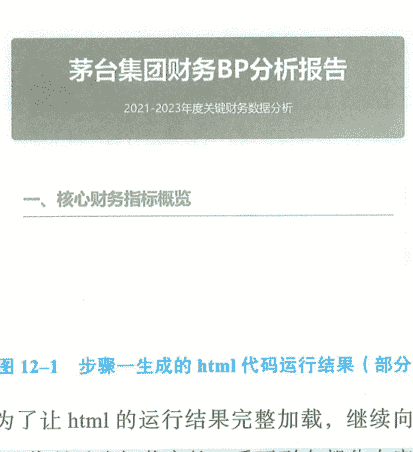

**步骤二：**为解决加载不完整问题，继续指令：上述 html 无法完整加载，主要内容不可见，请排查问题并确保在常用浏览器中可正常加载。

**步骤二结果：**DeepSeek 重新给出简化版 html 脚本，如图 12-2 所示，运行后得到一版简易的财务 BP 分析可视化看板，具体成果见“普通组成果展示”。

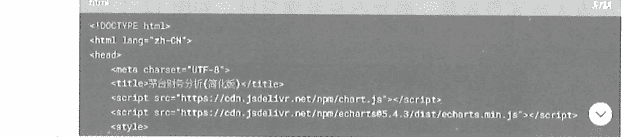

**图 12-2** 步骤二生成的可直接运行的代码（部分）

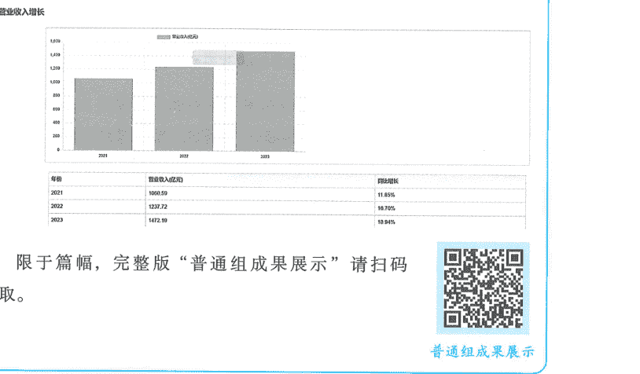

**作者点评**

普通组具备基础模型应用能力，但指令描述模糊，对 BP 可视化结构与内容展示缺乏明确规划。遇到 html 加载问题时仅简单重复指令，未深入分析文件大小、脚本调用等根因，且优化迭代次数少，最终效果未能达到财务 BP 可视化看板的基本要求。

##### 12.1.2 优秀组的操作与成果

###### 1. 优秀组执行流程

**步骤一：**上传基础数据 Excel 至 DeepSeek，给出指令：阅读文件后生成茅台综合数据看板，要求包含：

1. 主营业务分析，涵盖分行业、分产品、分地区、分销售模式；
2. 成本构成项目分析及年度对比；
3. 研发费用详细分析及年度对比；
4. 研发人员情况详细分析及年度对比；

对上述数据整理分析并进行可视化设计与呈现，以 html 形式输出，确保可在 edge、chrome、safari 等常用浏览器正常打开。

> **注意：**未开启 DeepSeek 的深度思考模式。

**步骤一结果：**DeepSeek 产出 html 脚本，如图 12-3 所示。运行后生成网页版财务 BP 分析可视化看板，如图 12-4 所示。首版自动采用“茅台红”配色，多用柱状图与饼图，整体规格初具雏形，但表现形式需丰富、数据标注需更清晰、配色需更符合商务风格。


**第一版财务 BP 分析可视化看板**

> (a)“茅台红”配色的可视化看板（柱状图）

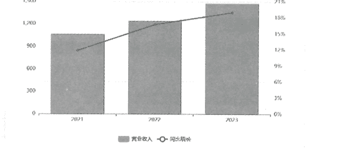

> (b)“茅台红”配色的可视化看板（饼图）


####### 茅台综合数据看板

######## 图 12-3 DeepSeek 生成的看板分析 html 代码（部分）

#### 贵州茅台综合数据看板 (2021-2023)

##### 1. 主营业务分析

> 茅台主营业务持续增长，2023 年酒类营业收入达 1472.19 亿元，同比增长 18.94%。毛利率稳定在 92% 以上，显示出强大盈利能力。

> 茅台酒仍是核心产品，2023 年收入 1265.89 亿元，占比总收入 86%；其他系列酒增长迅速，2023 年同比增长 29.43%。

> 直销渠道占比持续提升，2023 年占比达 45.7%，毛利率高达 95.46%。

##### **步骤二：**在原有基础上丰富数据展现形式，要求每个柱状图、饼图均标注具体数值与百分比，并更换风格配色。再次指令：在此基础上，图形可采用条形图、扇形图、饼图、折线图、雷达图等复合图表，并在各图表中显示具体数值或百分比，使数据更直观。配色改为更商务的“深蓝色系”为主，重新输出 html，确保可在常用浏览器正常打开。

**步骤二结果：**DeepSeek 产出新版数据分析看板，整体配色调整为深蓝色系，各图表均标注具体数值，并在原有柱状图、饼图外新增雷达图、环形图、折线图等多种图形。步骤二结果如图 12-5 所示。

**第二版财务 BP 分析可视化看板**

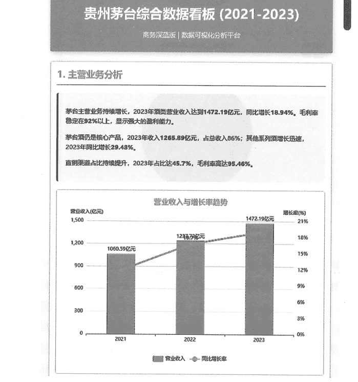

**(a) 柱状图**

**产品收入结构 **(2023 年)

其他系列：206.1 亿元 (14.09%)

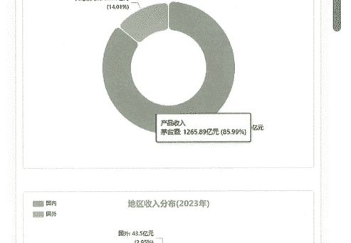

**(b) 饼图**

**地区收入分布 **(2023 年)

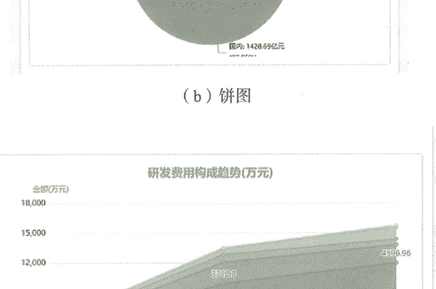

**(c) 折线图**

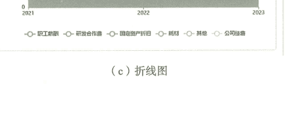

##### **步骤三：**在步骤二基础上提升专业性。上网找到一张美观的 BP 可视化模板图片，如图 12-6 所示，按其颜色与模块调整现有看板。将图片上传至 DeepSeek，指令：阅读上传图片，在现有 html 基础上于看板开头增加如图所示内容模块，并参照图片色系调整整体配色，保持图表美观大方、色系和谐，重新输出 html，确保可在常用浏览器正常打开。

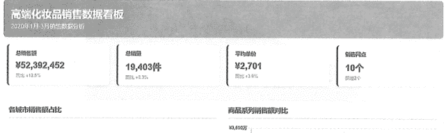

结果如图 12-7 所示。

### 茅台综合数据看板 (高端商务版)

```html
<!DOCTYPE html>
<html lang="zh-CN">
<head>
  <meta charset="UTF-8">
  <meta name="viewport" content="width=device-width, initial-scale=1.0">
  <title>茅台综合数据看板</title>
  <script src="https://cdn.jsdelivr.net/npm/chart.js"></script>
  <script src="https://cdn.jsdelivr.net/npm/echarts@5.4.3/dist/echarts.min.js"></script>
  <style>
    body {
      font-family: 'Microsoft YaHei', Arial, sans-serif;
      margin: 0;
      padding: 0;
      background-color: #f8f9fa;
      color: #333;
    }
  </style>
```

**步骤三结果：**DeepSeek 最后产出“茅台综合数据看板 (高端商务版)”，按要求在开头增加模块并调整色系，如图 12-8 所示。但整体色系显得混乱，未能实现统一，需做最终调色。

贵州茅台综合数据看板

2021-2023 年年度经营数据分析报告

1. 主营业务分析

> > 茅台主营业务持续增长，2023 年同类营业收入达 1472.19 亿元，同比增长 18.94%。毛利率稳定在 92% 以上，显示出强大盈利能力。

> 茅台酒仍是核心产品，2023 年收入 1265.89 亿元，占总收入 86%；其他系列酒增长迅猛，2023 年同比增长 29.43%。

> 高端酒占比持续提升，2023 年占比达 45.7%，毛利率高达 95.46%。

**(a)**

**2. 成本构成项目分析**

2023 年总成本 118.26 亿元，同比增长 17.42%，直接材料和直接人工为主要成本项，合计占比 93.13%。\n\n直接人工成本增长显著，2023 年同比增长 59.76%，占比提升至 37.43%。

**（b）**

图 12-8 茅台综合看板（高端商务版）（部分）


##### 步骤四：为实现色系统一、色彩和谐，选取一张配色模板图片，如图 12-9 所示作为参考，上传至 DeepSeek，指令：**请参考图片中的配色组合，对上述看板进行颜色调整**，重新输出 html，确保可在 edge、chrome、safari 等常用浏览器正常打开。

##### 步骤四结果：DeepSeek 产出最终版财务 BP 看板 html 脚本，运行后整体颜色参照配色模板设置，和谐统一。其他内容经人工核验无异常。具体成果参见“优秀组成果展示”。

最后还有一个问题：在整个可视化看板生成的过程中，DeepSeek 均未开启深度思考模式。为对比开启深度思考模式的效果，再次输入步骤一指令并开启深度思考，如图 12-10 所示，以测试深度思考模式下能否生成更优的可视化看板。

### 图 12-9 配色模板

- **阅读这个文件，根据里面的数据生成一个茅台综合数据看板，要求包含**

  - 1.主营业务分析，包含分行业、分产品、分地区、分销模式情况分析；

  - 2.成本构成项目分析及年度对比；

  - 3.研发费用详细分析及年度对比；

  - 4.研发人员情况详细分析及年度对比；

  - 对上列数据进行整理分析，进行可视设计数据展现，用 html 格式输出，确保可执行，edge、chrome, safari 等常见操作系统内置浏览器均可正常打开。

- **好的。我需要根据用户提供的茅台年度数据生成一个综合数据看板。首先，用户要求包含四个主要部分：主营业务分析、成本构成项目分析及年度对比、研发费用详细分析及年度对比、研发人员情况详细分析及年度对比。我需要从提供的多个工作表中提取相关数据，并进行整理和分析。**

## DeepSeek 财务BP可视化实战：优秀组与普通组的对比手记

要把主营业务讲清楚，必须从行业、产品、地区、销售方式四个维度展开，每个维度都要做年份追踪。原始数据先整理成便于图表读取的形式，比如把分行业表里 2021-2023 年酒类营收与成本信息归拢好。

### 图12-10 深度思考模式二次实测

把深度思考打开后，DeepSeek 返回的 HTML 源码比未打开时明显更短。运行后页面只有基础呈现，精致程度和细节表现都下降，见图12-11。由此可以推断，开启深度思考并未提升财务BP可视化看板的质量，反而削弱了美观度和完整性。

### 主营业务收入分析
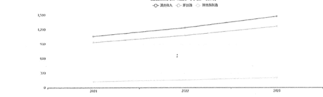

### 成本构成项目分析


### 研发费用分析


#### 2. 优秀组成果呈现

> 贵州茅台综合数据看板
2021-2023 年度对比分析报告

### 总营业收入 ¥1472.19 亿
同比 +18.94%

### 总销量
5,428 万瓶
同比 +15.2%

### 平均售价
¥2,712
同比 +3.2%

### 销售网点
2,158 个
净增 156 个

##### 1. 主营业务解读

茅台主营保持稳健扩张。2023 年营业收入达 1472.19 亿元，同比增长 18.94%，毛利率长期稳定在 92% 以上，盈利能力突出。
核心单品茅台酒贡献 1265.89 亿元，占比 86%；系列酒增速更快，2023 年同比增长 29.48%。
渠道结构持续优化，直销占比提升至 49.7%，对应毛利率高达 55.46%。

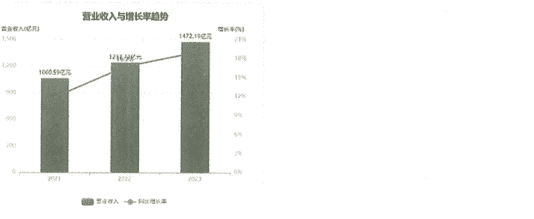

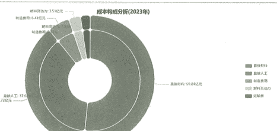

| 成本项目 | 2021 年金额(亿元) | 2021 年占比 | 2022 年金额(亿元) | 2022 年占比 | 2023 年金额(亿元) | 2023 年占比 | 2023 年增长率 |
| :--- | :--- | :--- | :--- | :--- | :--- | :--- | :--- |
| 直接材料 | 50.07 | 56.32% | 53.45 | 54.00% | 59.84 | 51.50% | 11.97% |
| 直接人工 | 27.76 | 31.22% | 33.95 | 34.31% | 43.72 | 37.63% | 28.76% |
| 制造费用 | 5.93 | 6.67% | 5.58 | 5.64% | 6.41 | 5.51% | 14.77% |
| 燃料及动力 | 2.72 | 3.05% | 3.42 | 3.46% | 3.51 | 3.02% | 2.72% |
| 运输费 | 2.44 | 2.74% | 2.56 | 2.59% | 2.72 | 2.34% | 6.31% |
| 合计 | 88.91 | 100% | 99.95 | 100% | 116.20 | 100% | 17.42% |

# DeepSeek高效财务

**编者点评**

优秀组思路清晰，采用分阶段推进的方式产出高质量财务BP可视化看板。从基础图表搭建，到配色微调再到版式精进，最终成果兼顾可读性与美感。尤其在第三、四步善于引入示例模板并给出精准指令，视觉效果提升明显，体现出较强的审美把控与执行力。

## 12.2 可视化看板进阶优化

> #### 任务背景
将前版看板提交给主管后获得肯定，同时收到优化建议：增加杜邦分析模块，并为2021、2022、2023年份设置可切换标签。

## 12.2.1 普通组操作与成果

### 1. 普通组执行步骤

> **操作：** 上传Excel至DeepSeek，要求依据表中数据生成茅台2021-2023年杜邦分析，并以html输出。

**说明：** 未开启DeepSeek的深度思考模式。

**结果：** DeepSeek返回一段html代码（图12-12），并在下方附上简要核心结论（图12-13）。运行后得到贵州茅台三年杜邦分析结果并完成指标运算，具体内容见普通组成果展示。

## 茅台2021-2023年杜邦分析结果
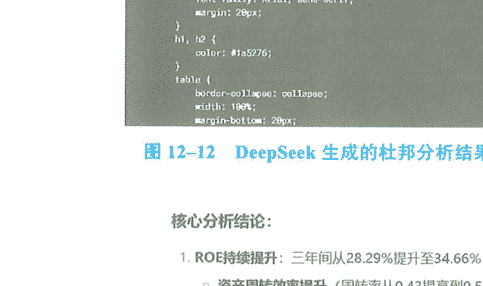

## 核心分析结论：

1. **ROE持续上行：** 由28.29%提升至34.66%，主要驱动为：
   - 资产周转效率改善，周转率从0.43提高到0.55
   - 财务杠杆收窄，权益乘数从1.30降至1.22

2. **盈利质量稳健：**
   - 销售净利率稳定在51%以上
   - 2023年经营性现金流对净利润覆盖率为0.86

3. **财务结构健康：**
   - 资产负债率始终低于20%
   - 货币资金占比超过25%
   - 流动比率高于4倍

4. **运营特征：**
   - 存货周转天数超1,400天，符合白酒陈酿特性
   - 应收账款周转极快，少于1天


### 2. 普通组成果展示

## 贵州茅台(600519.SH)杜邦分析报告(2021-2023)

| 关键指标 | 2021年 | 2022年 | 2023年 | 变化趋势 |
| :--- | :---: | :---: | :---: | :--- |
| 净资产收益率(ROE) | 28.29% | 31.90% | 34.66% | 持续提升 |
| 销售净利率 | 51.45% | 51.25% | 51.47% | →基本稳定 |
| 总资产周转率 | 0.43 | 0.50 | 0.55 | ↑效率提升 |
| 权益乘数 | 1.30 | 1.24 | 1.22 | ↓杠杆降低 |

**杜邦分解**

| 项目 | 2021年 | 2022年 | 2023年 |
| :--- | :---: | :---: | :---: |
| 净利润(亿元) | 557.21 | 653.76 | 775.22 |
| 营业收入(亿元) | 1,083.46 | 1,275.54 | 1,505.60 |
| 总资产(亿元) | 2,551.68 | 2,545.01 | 2,727.00 |
| 股东权益(亿元) | 1,969.58 | 2,049.38 | 2,236.56 |
| ROE = 销售净利率 × 总资产周转率 × 权益乘数 | 51.45% × 0.43 × 1.30<br>= 28.29% | 51.25% × 0.50 × 1.24<br>= 31.90% | 51.47% × 0.55 × 1.22<br>= 34.66% |

**编者点评**

> 普通组完成了指标提取与表格展示，但对杜邦分析的结构化可视化理解不足。仅以表格呈现，难以体现其逻辑链条与层级关系。提示词比较宽泛，未对版式、配色、结构布局提出细化要求，也未借助参考模板进行引导。

## 12.2.2 优秀组操作与成果

### 1. 优秀组执行步骤

> **步骤一：** 将Excel作为附件上传，指令DeepSeek基于财务数据生成茅台2021-2023年杜邦结构图，以html格式输出。

步骤一结果：DeepSeek生成html代码，运行后呈现三年杜邦分析，并附简要结论及数据来源与公式说明，经人工核验指标无误。

**分析结论**

主要发现：
- **ROE持续改善：** 由2021年的28.29%提升至2023年的34.66%，股东回报能力增强。
- **高盈利保持：** 销售净利率长期高于50%，并小幅上行，体现品牌溢价能力。
- **资产效率提升：** 资产周转率从0.43升至0.55，资产运用更有效。
- **杠杆趋保守：** 权益乘数由1.30降至1.22，负债水平下降。

建议：
- 维持高毛利产品的竞争优势
- 持续优化资产配置，提升使用效率
- 在稳健前提下，可适度提升杠杆进一步推升ROE

注：
1. 数据均来自茅台2021-2023年年报
2. **计算公式：**
   - 净资产收益率(ROE)=净利润/股东权益
   - 销售净利率=净利润/营业收入
   - 资产周转率=营业收入/总资产
   - 权益乘数=总资产/股东权益
3. 箭头表示与上年相比的变化方向

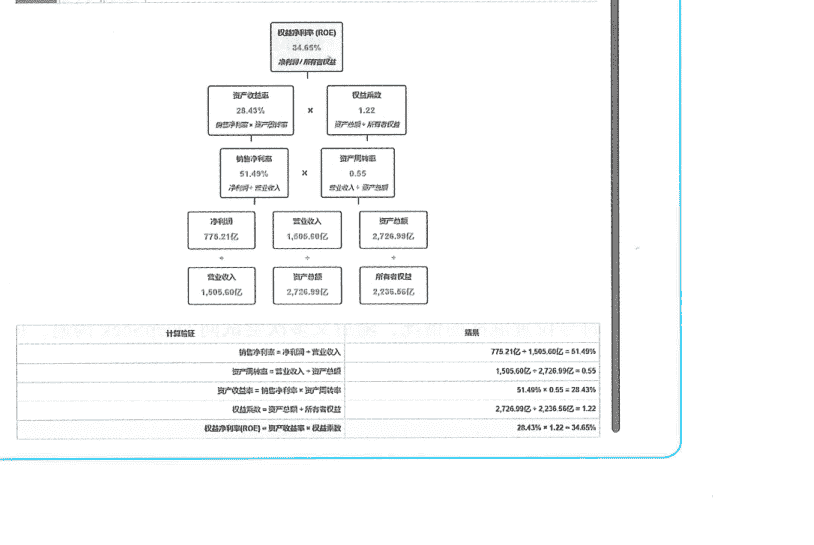

*图12-14 优秀组第一步生成的杜邦分析结果（节选）*

注：AI计算存在四舍五入，数值可能有微小差异。

- **步骤二：** 首版结构图不符合传统杜邦样式。优秀组找到一张传统杜邦结构参考图（图12-15），要求DeepSeek按此样式重绘，并将三年结果以卡片横向排列，顶部增加年份切换标签。

> **图12-15 杜邦分析结构图参考**

步骤二结果：DeepSeek按要求加入年份标签，整体框架对齐参考图，配色更商务（图12-16）。但指标位置及连线未完全复刻参考图，仍需微调。

> **步骤三：** 在此基础上继续要求严格参照杜邦结构图生成，指标间要有连线，运算符号位置正确，以html输出。

步骤三结果：代码重新生成后，框架仍不匹配，连线与运算符号混乱（图12-17）。

**步骤四：** 在保持指标位置的基础上，指令调整运算符号与连线位置，其他不变，要求兼容Edge、Chrome等浏览器。

步骤四结果：连线与符号混乱依旧，多次沟通后仍未超越步骤二效果，最终采用步骤二成果作为最终展示。

### 2. 优秀组成果展示
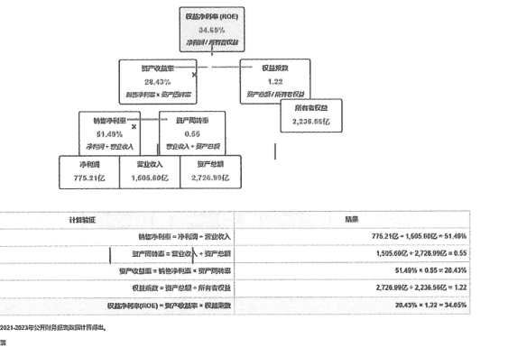


### 编者点评

优秀组围绕进阶可视化目标，充分利用参考模板并分步迭代。每轮输出后及时反馈优化，并在第二步主动提供结构图参考并要求加入年份切换标签，展现出创新引导能力。

## 12.3 本章小结

本章聚焦DeepSeek辅助财务BP可视化分析，设置基础看板搭建与进阶优化两大场景。优秀组与普通组的对比凸显分步迭代、指令精确、重视视觉审美并提供配色与结构模板的重要性。

### 实操要点

- **先明确视觉目标再撰写提示词。** 先构思图表结构与风格，再做精准描述，避免结果偏差。
- **善用参考模板引导。** 上传范例图可有效提升结构布局与美术风格的匹配度。
- **采用逐步生成、逐步优化策略。** 一次难以满足全部需求时，分步迭代效果更好。
- **财务BP可视化生成时无需开启深度思考模式。**

> 生成html代码时可能出现加载不完整，建议在指令中加入“确保代码可在日常浏览器完整打开”等要求，保证输出可直接使用。

## 参考文献

[1] 张大斌，田恒义，许桂秋.AI导论：通识版.北京:人民邮电出版社，2024.

[2] 莫宏伟.AI导论.2版.北京:人民邮电出版社，2024.

[3] 关景新,姜源.AI导论.2版.北京:人民邮电出版社,2024.

## DeepSeek高效财务

DeepSeek Gaoxiao Caiwu

**孙玥璠** **苏 芮** **张真昊** 编著

出版发行 **中国人民大学出版社**

社址 北京中关村大街31号

电话 010-62511242（总编室）
     010-82501766（邮购部）
     010-62511173（发行公司）

网址 http://www.crup.com.cn

经销 新华书店

印刷 北京联兴盛业印刷股份有限公司

开本 720 mm×1000 mm 1/16

印张 22.5 插页1

字数 297 000

版次 2025年5月第1版

印次 2025年5月第1次印刷

定价 79.00元

版权所有 侵权必究 印装差错 负责调换

邮政编码 100080

     010-62511770（质管部）
     010-62514148（门市部）
     010-62515275（盗版举报）