# DeepSeek 驱动的财务跃迁实战手册

## 面对智能化浪潮，财务人如何自处

> 有一次研究生例会散场后，一名同学留下来跟我说：“老师，您记得我们班的×××吗？她前几天托我转达感谢。她研二实习时，主管让她把访客信息一笔笔手动粘贴进 Excel，要求一周内完成。她回想起您上课说的‘凡是重复超过三十次的操作就别再人工干’。于是她整个晚上重去温习您讲过的流程自动化知识，联系了几个同学协作建模，第二天一小时就把全部工作跑通。主管对她的解决问题能力非常认可，实习评价非常突出。她说这门课对她的帮助最大。”

> 类似的故事这些年我听了很多：借助智能工具把财务工作做得又快又准，进而被看见、获得机会，我感到非常欣慰。教书二十年，我亲历了财会教学从手把手传授财务电算化、推广 Excel 应用，到讲授 ERP 系统、集团共享服务、财务 BP 实操、无代码流程机器人，再到今日生成式人工智能引领的财务变革。每一次技术跃迁，初期都是冲击，随后都为持续学习的人打开了上升空间。

> > 人工智能会把人挤掉吗？不会。它更像一把把人类价值放大的超级杠杆，放大倍数极高。谁的价值被放大？会用的人，也就是大家所说的智能高手。智能时代强者恒强的效应更明显：会用的人效率成倍提升，新岗位、新技能标签层出不穷。被淘汰的不是财务岗位，而是不会用智能工具的财务人。学习、适应、升级、进化，是财界人必须完成的课题。成为 AI 财务高手，既是冲破职场瓶颈的现实路径，也是职业转型的关键窗口。

未来早已到来，唯一不变的是变化本身。

正是基于这样的判断，本书为财界人群提供智能时代的转型路线，从工具实操、思维升级到价值重塑。既是技术指南，也是财务职业变革的行动地图，愿与大家一起开启 AI 赋能的财务进化。

2025 年 1 月下旬 DeepSeek R1 发布后，我和团队整个春节都在研究和试跑。2 月启动课程方案，开学后面向本科注册会计师方向、会计高年级、会计硕士 MPAcc 与 MBA 学员讲课。同时也在为大量在职财界人做培训，来自不同行业的学员参与度很高，积累了大量真实案例。

教学反馈归纳为两点：其一，单学大模型原理、提示词理论远远不够，价值在于落地，财务场景尤其需要“能用”。其二，经系统训练，财界人使用智能工具的能力明显提升。本书中的“普通组”与“优秀组”任务对比清晰呈现；经过训练后，两组都能在 60 分钟内高质量完成指定任务。

本书是团队协作的成果。提纲、场景描述、审校、作者点评、章节小结、实操技巧，以及第 6、7、8、10、11 章由孙玥璠完成；全书 AI 任务实现含人工核验及第 4、5、9、12 章由苏芮完成；第 1、2、3 章、全书小贴士、技术支持由张真昊完成。

感谢学生们的贡献：吴润佳整理第 1 章资料；黄聪慧、李梦丽整理第 2 章资料；杨秋萍整理第 3 章资料；靳凯宇、屈文字、申珊、秦柳、马莹莹整理第 5 章资料；朱晨光、范宇欣整理第 12 章资料；丰淑成、肖惠琪参与第 4 章撰写；黄聪慧参与第 7 章撰写；石江霞参与第 9 章撰写；李梦丽参与第 10 章撰写；杨一帆参与第 11 章撰写；薛博文提供第 7 章部分数据；李云轩提供第 8 章部分数据；张盟雨、梁予露、董瞳提供第 12 章部分数据。特别感谢中国人民大学出版社编辑陈永凤、张萌的付出。

本书可作为高校财会类课程教材，也可供在职财务人员自学培训。DeepSeek 及其他大模型迭代很快，本书力求在方法论与底层逻辑上保持前瞻，同时提供可迁移的实践框架。

配套代码与可视化网页资源可通过书中二维码获取。作者还在“AI 财务专家 | 孙玥璠”账号不定期发布实操案例、DeepSeek 使用技巧、大模型工具指南，欢迎交流。为方便讨论，已建微信交流群，扫码加入。

限于水平，书中难免有疏漏，恳请拥抱财务 AI 的读者批评指正。

路再远，行则将至；事再难，做则必成。AI 财务正处破晓，星辰大海在前。

智能时代，财务人如何自处？答案在每一步行动里。


## DeepSeek 引领的智能升级篇

上篇

随着大模型技术持续突破，人工智能正以前所未有的速度改写财务管理版图。它不再只是替代手工事务的工具，更演化为辅助战略决策与风险管控的“智能大脑”，在智能核算、预算预测、资金管理、审计分析等核心环节展现出强大能力。

尤其值得关注的是中国自研大模型的崛起。DeepSeek 以出色的中文语义理解与行业场景适配力，成为财务智能化转型的关键支点。实践中它可帮助财务人员处理报销、凭证核验、数据整理、报告生成等工作，提升效率与合规准确性。其多模态能力与自然语言交互优势，进一步拓展了人与系统协作的边界，让“人机协同”从愿景走向日常。

上篇从人工智能的基本概念与技术特征入手，梳理发展历程、核心优势与现实挑战，深入分析人工智能在财务领域的应用场景及角色变化，并详细讲解如何使用通用模型与推理模型、如何构建提示词。其中，第 1 章为“时代之光：AI”，聚焦技术内涵与演进脉络；第 2 章为“AI 大模型”，系统介绍主流大模型性能特征与代表应用；第 3 章为“DeepSeek 应用心法：提示词”，深入讲解 DeepSeek 交互中的高效提示构建方法。

## (7) 模型黑箱与可解释性困境

人工智能的决策过程往往复杂难明，部分模型难以说明判断依据，本质上是高度数学化而非直观规则。

在财务领域这会带来信任问题。例如管理层问“AI 为何判定该供应商有风险”，若回答模糊，决策者难以采纳。再如审计场景，企业用 AI 审查报表，AI 标记某子公司数据异常，但仅给出“模型判定异常”而无具体原因，企业自然降低信任度。

## (8) 自进化能力与持续迭代

人工智能可不断学习新数据并优化自身，区别于固定软件，能随数据与算法更新提升预测力。

财务上，人工智能能适应市场变化与监管调整。例如某公司用 AI 做年度预算，初期预测偏差较大，随着历史财务数据持续喂养，模型不断校准，到第三年预测精度显著提升，有效支撑资金管理。

人工智能的特性决定其在财务管理中应用前景广阔，从自动报销审批、智能税务合规、现金流预测到股市趋势研判、智能审计，正改变传统方式。未来应用会更普及，但可解释性、数据安全、合规合法等问题仍需解决。

## 1.1.2 AI 演进的三次浪潮

人工智能的发展可分为三次浪潮，每次都伴随技术突破、标志性事件与应用扩张。

### 1. 第一次浪潮：起步与探索阶段（1956 年至 20 世纪 70 年代末）
1956 年达特茅斯会议上“人工智能”概念正式提出。以逻辑推理、符号计算为核心的方法兴起，出现定理证明、专家系统等成果。关键节点包括：

- 1956 年达特茅斯会议召开，约翰·麦卡锡等人提出 AI 概念，学科诞生。
- 1966 年约瑟夫·维森鲍姆开发首个聊天机器人 ELIZA。
- 1968 年专家系统初现成效，化学分子识别系统 DENDRAL 研制成功。

随后因算力不足、符号主义局限，AI 进入第一次“寒冬”。

### 2. 第二次浪潮：知识工程与专家系统阶段（20 世纪 80 年代至 90 年代末）
80 年代初 AI 复苏，知识工程、专家系统、规则推理在工业、医疗、金融广泛应用。标志事件包括：

- 1981 年日本提出“第五代计算机”计划，掀起全球 AI 热潮。
- 1989 年卡内基梅隆大学研发 ALVINN 系统，实现特定条件下的无人驾驶。
- 1997 年 IBM AI 计算机深蓝击败国际象棋大师卡斯帕罗夫，AI 影响力攀升。

随后因知识库构建难、维护成本高，AI 再陷第二次“寒冬”。

## 里程碑瞬间
深蓝击败国际象棋世界冠军卡斯帕罗夫

1980 年卡内基梅隆大学悬赏 10 万美元给能击败世界冠军的计算机。1997 年 5 月纽约，IBM 深蓝与加里·卡斯帕罗夫对弈 6 局。深蓝每秒分析 2 亿步棋，首局被人类经验拿下后迅速调整，第 6 局仅用 19 步迫使认输，总比分 3.5:2.5 胜出，标志 AI 进入新纪元。

### 3. 第三次浪潮：机器学习与深度学习时代（21 世纪初至今）
21 世纪初机器学习尤其是深度学习引领新浪潮。依托大数据、云计算与高性能算力，AI 进入商业化黄金期。重要节点包括：

- 2006 年杰弗里·辛顿等人提出深度置信网络 DBN，点燃深度学习研究。
- 2011 年 IBM 超算沃森在《危险边缘》节目击败人类选手，引发产业关注。
- 2012 年深度卷积神经网络 AlexNet 在 ImageNet 竞赛突破，图像识别精度大幅提升。

## 第 1 章 时代之光：AI/9
■ 2016 年与 2017 年，谷歌 DeepMind 的围棋 AI AlphaGo 先后战胜李世石与柯洁，推动全球普及与投资热潮。
■ 2022 年 OpenAI 发布对话式 AI ChatGPT，掀起生成式 AI 全球浪潮。
■ 2023 年生成式 AI 快速发展，各大科技公司纷纷推出大模型平台，技术与产业融合进入规模化商业应用。
■ 2024 年 DeepSeek 作为国产开源大模型代表快速崛起，广泛应用于教育、财务、智能办公与决策，以强中文理解与场景适配力推动产业落地与本土创新。

第三次浪潮以深度学习、大规模预训练与生成式 AI 为核心，推动 AI 向智能化、产业化、生态化迈进。

## 里程碑瞬间
AlphaGo 战胜人类职业围棋顶尖选手

AlphaGo 是首个击败职业围棋选手并战胜世界冠军的 AI，由 DeepMind 开发。2016 年 3 月它以 4:1 战胜九段李世石；同年年末至 2017 年初在线以“大师”身份连胜中日韩数十位高手 60 局；2017 年 5 月乌镇三番棋以 3:0 击败世界第一柯洁，棋力被认可超越人类顶尖水平。

## 里程碑瞬间
中国自主研发 DeepSeek 大模型

DeepSeek 由中国科研团队于 2023 年自主研发。采用 Transformer 架构，以高质量中文语料训练，在语言生成、智能对话与专业推理上达到国际领先。2024 年团队持续优化并在教育、金融财务、智能办公推出方案，实现产业化。截至 2025 年 3 月已服务数千家企事业单位，形成广泛生态，成为自主 AI 创新典范。其开源策略大幅降低训练与应用门槛，加速全球场景落地。

## 1.1.3 AI 核心技术、优势与短板

##### 1. AI 核心技术
AI 核心技术包括机器学习、深度学习、强化学习、自然语言处理与计算机视觉。机器学习让计算机从数据中学习并自改进，无需人工写全规则。深度学习以多层神经网络模拟人脑，擅长处理图像、语音、文本等复杂数据。强化学习通过试错优化决策，适用于投资组合、智能定价等动态问题。自然语言处理使计算机理解、生成与处理人类语言，广泛用于报表分析、合同审核、智能客服。计算机视觉让计算机“看懂”图像，应用于自动发票审核与报销。

## 表 1-1 主要 AI 技术对比

| AI 技术 | 主要优势 | 主要缺点 | 典型财务应用 |
|---|---|---|---|
| 机器学习 | 预测力突出，能持续自优化 | 对数据质量敏感，可解释性弱 | 信贷风险评估，智能财务预测 |
| 深度学习 | 擅长复杂数据，精度较高 | 算力需求大，存在黑箱 | 财务舞弊识别，市场研判 |
| 强化学习 | 适合动态优化，可自主迭代 | 训练周期长，难以解释 | 投资组合管理，智能定价 |
| 自然语言处理 | 可解析文本，实现自动化 | 语义理解有限，可能带偏见 | 财务合同审核，智能客服 |
| 计算机视觉 | 具备图像理解能力 | 辨识精度受限，算力成本高 | 自动发票审核，发票报销 |

##### 2. AI 的优势
###### （1）流程自动化，提升作业效率
AI 可接管重复耗时的财务任务，如报销审批、对账、报表编制等。传统操作依赖人工录入与审核，AI 借助 OCR 与规则引擎实现自动化，且可 7×24 小时运行，避免疲劳，提升效率。
###### （2）数据驱动，增强预测与决策
AI 基于大数据分析可发现隐藏模式，提升财务预测与投资决策准确性。相较传统依赖历史与经验的方法，AI 能融合市场趋势、宏观指标、供应链等多维度数据，提高可靠性。
###### （3）强化风控，降低合规与舞弊风险
AI 通过模式识别与异常检测预警财务舞弊与合规风险。例如分析交易数据识别资金异常、虚假报销、洗钱行为；自动识别违反税务或审计要求的交易，助力合规。
###### （4）全天候运行，减少人工依赖
AI 不受时间限制，可夜间自动生成报表、处理数据，管理层随时获取决策资料。AI 客服也能全球范围内提供 7×24 小时财务咨询，优化体验。

##### 3. AI 的缺陷
###### （1）结果依赖数据质量

财务智能化：先审风险再论价值

模型效果受制于输入信息的质量。若基础数据失真、存在偏斜或规模不足，结论就容易误导。智能系统只能从现有记录中归纳规律，当历史样本单一、结构失衡时，推断会偏离现实。合规场景里，数据瑕疵可能引发申报失误与经营失策，提升风险敞口。举例来说，贷前评审若只对照过往借贷行为，未纳入当前经营诉求、宏观环境与政策变化，就可能给出与实际需求脱节的金额与方案建议。

###### （2）黑箱问题，决策可解释性差

部分复杂架构尤其是深度学习体系，其推理路径难以拆解说明，在审计、合规审查等场景会造成阻碍。传统财务判断依赖明确规则，而智能系统的产出常建立在繁复数学运算上，一线人员难以理解其依据。在银行、保险等强监管行业，可解释性不足会直接影响合规评议。如系统否决某笔付款却无法给出清晰理由，财务与销售团队难以接受，也会形成合规隐患。

###### （3）数据安全和数据隐私问题

系统运行需汇聚海量财务信息，如何保障信息安全与保密是关键议题。集中存储敏感资料的平台更易成为攻击目标。监管对财务数据保护要求严格，企业必须满足欧盟《通用数据保护条例》、国内《中华人民共和国数据安全法》等规定。以银行风控平台为例，若在云端处理用户交易时出现泄漏，将带来严重法律与商业后果。

###### （4）依赖技术投入，成本较高

研发与运维开销不小，中小主体常难以承受长期费用。落地需要高算力支撑与具备专业能力的人员，模型还需持续迭代。部分企业受资金与技术限制，难以全面推进财务智能化。例如众多中小企业希望引入智能财务分析并保障信息安全，却发现系统开发、数据清洗、模型训练花费远超预期，最终被迫放弃。

推进智能化财务管理时，企业需权衡技术增益与潜在风险，保持合规与安全并重。

## 1.1.4 人工智能的多域渗透

技术迭代推动智能化向经济社会的多个领域扩散。以下简要梳理人工智能在金融、医疗健康、制造、教育、交通等方向的落地情况，1.1.5小节将聚焦财务场景。

##### 1. 金融领域
智能化已深入风险管控、智能投顾、量化投资、客户画像、信用评估、反欺诈等环节。例如借助智能风控，机构能实时监测客户信用风险，提升管控能力；智能投顾则依据客户偏好、风险承受度与市场动向制定个性化建议，提高投资效率。

##### 2. 医疗健康领域
应用集中在医学影像解析、辅助诊断、药物研发、精准医疗、智能健康管理等方面。系统可快速读取影像资料，精准定位癌症等病变，提升诊断准确率。也可加速药物研发，通过优化研发与临床试验流程大幅提高效率。

##### 3. 制造业领域
智能化是制造转型升级的核心驱动，广泛用于智能制造、工业机器人、质量监测、预测性维护。人工智能驱动的智能产线可实现自动化生产与精细质量控制，降低成本、提升效率；预测性维护能提前预判设备故障，减少停机与维修支出。

在教育方向的应用主要体现在智能教学、个性化学习、自动评测、智慧校园建设。基于对学习数据的精细分析，教学系统可定制个性化方案，按需辅导。技术还能助力教师实现自动阅卷、智能备课、课堂互动数据分析，推动教育信息化与资源公平。

在交通运输方向的应用主要体现在智能驾驶、自动驾驶、智慧交通管理。无人驾驶技术逐步落地，系统负责车辆自主决策与控制，提升道路安全与通行效率，缓解拥堵。智慧交通系统通过实时分析交通流量，科学调度资源，提高道路使用效率，整体提升管理智能化水平。

随着发展，智能化在财务方向的应用愈发广泛，正改变传统财务管理方式。它能减少重复劳动，提升效率，让财务管理更精准、智能、高效。应用场景主要包括智能会计与核算、财务共享与自动化流程、资金管理与预测分析、预算管理与绩效分析、财务决策支持与风险管控、个性化财务咨询服务。

###### （1）智能会计与核算
过去会计人员要手工录入、核对账目、编制报表，繁琐且易错。人工智能使其自动化、智能化。可自动识别处理凭证，读取发票信息、归类支出类型，并按财务规则自动生成账务报表，降低差错、提高效率与准确性。

###### （2）财务共享与自动化流程
财务工作涉及大量审批，如报销、发票审核、资金支付。过去人工操作效率低、成本高。技术可搭建财务共享中心，实现流程自动化。例如员工提交报销单后，系统自动校验是否符合公司制度，在系统内完成审批，缩短人工审核时长；同时可快速处理发票、自动安排付款，降低操作失误。

###### （3）资金管理与预测分析
资金管理是企业核心。系统可实时追踪资金流向，分析现金流并预测未来需求。结合历史财务数据与市场趋势，可分析阶段性资金使用情况，预判资金缺口，帮助企业提前规划，避免资金链断裂。

###### （4）预算管理与绩效分析
预算编制需参考过往数据与市场情况。系统可分析历史财务、行业趋势与市场变化，辅助制定更精准预算。同时实时监控执行情况，发现偏差并提供数据支撑，便于管理层调整经营策略。例如发现某项目花费超预期时及时预警，助力合理调整，避免浪费。

###### （5）财务决策支持与风险管控
财务决策需综合收入、成本、税负、市场价格等多维数据。系统整合内外财务信息，挖掘潜在风险与机会。例如分析发现某业务收入下滑源于需求减弱或竞争加剧时，会给出分析建议。也可识别异常交易、现金流紧张等风险，发出预警，降低损失。

###### （6）个性化财务咨询服务
系统不仅优化企业财务，还能为个人提供定制建议。智能助手可依据消费习惯、收入水平、投资偏好给出合理规划建议，帮助个人更好管理财富。

## 2. 财务场景下人工智能的新定位

智能技术正改写财务管理范式，不再只是工具，而是智能助手、战略顾问与风控专家。它能快速处理海量数据，全天候提供精准分析与决策支持，助力企业更准更快地制定财务战略。

### （1）智能财务知识管家
系统好比随时待命的财务百科，可通过语音识别与自然语言处理与财务人员互动。遇到税收、流程、报表分析等疑问时，能即时给出准确答案与建议。例如了解新税政策时，可迅速检索法规并结合企业实际情况提出税务规划方案。

### （2）全球财务语言专家

### （3）综合财务分析师
系统不仅能整理数据，还可整合成本、收入、现金流、资产、负债等多类信息，自动进行深度分析。通过融合财务风险管理、资金流动预测、成本优化等维度，提供全面洞察，为管理层提供精准决策依据。

### （4）财务报告智能助手
传统报告耗费大量人力整理与核对。系统可自动采集、整理、分析数据，快速生成符合法规与会计准则的准确报表。例如自动生成月度、季度、年度报告，减少人工错误，提升质量，帮助管理层更快掌握财务状况。

### （5）智能财务决策伙伴
系统可充当商业军师，利用历史数据、市场动态与经济趋势提供智能决策支持。例如分析市场需求预测产品销量，优化库存管理与降低成本。也可识别现金流短缺、应收账款回收困难等风险并预警，助力更稳健决策。

### （6）全天候财务管控卫士
系统可不间断运行，实时监控财务状况。例如自动监测银行账户资金流动，识别异常交易并立即报警，帮助企业迅速发现并规避财务欺诈、违规操作或资金流失风险，确保财务安全。

### （7）定制化财务助理
系统可根据使用习惯与业务需求提供个性化建议。例如财务人员关注特定指标时，系统自动汇总相关数据并在异常时提醒。也可按偏好调整数据呈现方式，使财务状况更直观，提升工作效率。

### （8）战略财务预测顾问
系统不仅处理日常任务，还能提供长期战略建议。它可分析宏观经济、行业发展与企业历史数据，预测市场变化并辅助制定长期财务战略，同时自动核算项目投融资指标，支持项目管理与决策。无论投资规划、并购或长期资金管理，都能提供科学数据支撑，帮助企业抢占先机。

人工智能已超越自动化工具，成为财务管理的得力伙伴。它可自动化处理数据、提供智能分析、参与战略决策。未来其能力将更强，角色将拓展至风控专家、税务规划师、投资顾问等，助力财务人员提升专业水平，让财务管理更精准高效安全。

## 3. 人工智能驱动的财务人才角色迁移

### （1）从“机械算账”到“智能管家”
过去财务工作依赖Excel与传统软件，手工录入、编制报表等重复事务耗时且易错，使财务部门常被视为数据录入单元，难以参与战略。人工智能融入后，财务人员从机械记账转型为智能管家。系统可自动完成数据录入、智能分类、快速分析与可视化报表生成，大幅提升效率与准确度。例如提出具体需求后，工具即可迅速给出数据分析与决策建议。智能化模式将人员从繁琐基础工作中解放，更多投入资金优化、战略规划、风险预测等高价值工作。

### （2）从“被动执行”到“主动引领”
以往财务角色多为执行公司决策，完成核算、拨付等任务。现在借助人工智能，财务人员可快速整合内外数据，发现资金风险、成本浪费点及市场趋势，主动提出问题与方案。不再只是任务执行者，而是能影响决策的企业大脑，推动业务优化与利润增长。

### （3）从“事后分析”到“事前预测”
传统模式是先发生再分析，资金短缺、预算超支后再追溯，导致决策滞后。人工智能支持大数据建模与预测，可提前识别风险。例如结合历史财务与市场信息预测下月资金需求，或预警某部门可能超预算，让财务人员在问题发生前介入，避免损失，提升资金使用效率与风险防控能力。

人工智能推动财务工作从数据处理转向智能决策支持，使财务人员从事务执行者变为战略制定参与者，提升效率与前瞻性。

## ### 4. 人工智能时代对财务人群的新诉求

人工智能快速发展重塑工作模式与职业价值。基础性工作逐步自动化，财务人员可更多参与战略管理，成为数据驱动的决策支持者。未来需在角色转型、技能升级、实践创新三方面提升，以实现与人工智能高效协同。

#### （1）转型为决策参谋官
重复性工作价值有限，人工智能可高效完成数据处理与分析，财务人员应聚焦战略规划、风险预测、商业决策支持。将成为决策层参谋，需具备更强商业敏感性与数据分析能力，利用系统提供的资金流预测、风险预警、市场趋势分析等信息制定科学经营策略。例如当提示现金流可能紧张时，需结合市场动态制定融资与资金调度方案，确保资金链安全。

#### （2）终身学习，掌握“人机互动”新技能
人工智能不是取代而是增强财务人员。竞争力不仅取决于传统会计技能，更取决于与系统协作能力。首先要学会使用工具，如数据建模、财务预测、自动化审计。其次要理解运行逻辑，评估分析结果，避免盲目依赖。例如系统基于历史数据预测业绩时，需结合行业变化与市场趋势进行校准。还要具备向系统提问的能力，提出高质量问题引导深入分析，而非被动接受结论。

只有持续学习，掌握人机互动新技能，才能真正驾驭人工智能，让它成为工作加速器。

#### （3）重视实际应用，以实践推动创新
价值源于实际落地。财务人员需在真实业务场景中探索最佳实践，推动创新。在预算管理中，利用系统分析历史数据预测资金需求并实时监控执行，及时发现偏差优化配置。在风险控制中，系统可实时监测异常交易与资金流向，提前识别风险。例如系统发现某部门成本异常上涨时，财务人员可深入调查并制定优化方案。在成本管理中，系统可解析各业务线成本结构，找出浪费点并提出建议，助力制定高效成本控制策略。

通过持续实践，可提升应用能力，推动财务管理创新，为企业创造更大价值。未来财务将是人工智能与人的协同新模式，能更好合作者将在行业占据优势。

## ### 1.2 人工智能在财务方向的未来演进

技术持续演进，其在财务领域的应用将更广更深。主要体现在自适应、可解释性、人机协同、行业深度融合及合规伦理等方面。

### # 1. 自主学习与自适应智能
未来系统将更擅长自主学习，在变化的市场环境中利用新数据应对新挑战，减少人工干预。传统模式依赖历史训练数据，而未来可实时学习新数据，优化预测与风控模型。它还能动态调整参数，适应市场波动、政策变化与企业财务结构调整。在财务管理中，系统将据实时经营数据自动优化预算、成本控制与现金流管理。

### # 2. 可解释性智能
透明度与可解释性将增强，使财务人员、监管机构、投资者更好理解决策逻辑。当前模型多存在黑箱问题，未来可解释系统会提供清晰分析路径，如为何建议调整预算或拒绝某笔支付审批。在合规与审计场景中，可解释系统提升数据分析可信度，便于企业向监管提供透明报告。

### # 3. 人工智能与人类协作增强
系统不会替代人类，而是与人深度协作，提升财务、投资顾问、审计师的工作效率与决策质量。系统将成为智能助手，自动分析数据、生成报告、提出优化建议，但最终决策仍由人主导。在智能投资中，系统可辅助分析市场趋势、优化资产配置、提供决策支持。自动化系统将融合人工智能与人的经验，确保分析结果合理。

### # 4. 人工智能与行业深度融合

展望未来，人工智能正从通用工具转向行业定制方案，为各细分领域提供精准匹配的智能服务，助力企业在特定场景中实现效率跃升与竞争力增强。通用 AI 的时代正在淡出，取而代之的是面向特定行业的专属智能体，例如财务智能体、供应链智能体、风险管理智能体等。在财务管理侧，AI 会结合行业属性输出差异化洞察，像地产行业的税务合规辅导、制造行业的成本管控助手等。区块链与 AI 的联动也将持续深化，在智能合约执行和财务数据透明化管理上发挥更大价值。

### 5. AI 合规与伦理走向
随着智能化渗透加深，监管力度与伦理边界的划定将成为全球共识。不同国家或地区会密集推出针对 AI 的管理办法，特别是在金融与财务场景，强调决策过程的公开透明与结果的公平公正。数据隐私将进入更严格的管控阶段，企业必须满足更严苛的合规标准。与此同时，AI 偏见、财务判断失真等伦理困境会受到公众高度关注，企业有必要构建内部伦理审查与风控体系。

#### 小贴士
### AI 偏见与财务决策偏差解读
AI 偏见指的是模型在分析或做决策时输出带有系统性不公的结果，尤其容易对老年人、低收入群体等特定人群形成隐性歧视。举例来说，银行使用 AI 审贷，若训练数据继承了历史偏见——譬如某群体过往违约率较高——模型就可能习惯性拒贷该群体，进而导致资源分配不公，侵害群体权益，甚至触碰反垄断或公平交易法规红线。

财务决策偏差则是指因数据筛选失衡、算法设计瑕疵或训练失误，使 AI 给出的财务分析、预测或决策偏离真实状况或公平准则。例如，企业若用仅包含盈利案例的数据训练投资评估模型，系统可能过度乐观、风险判断失灵，最终造成误判亏损。若成本预算或财务预测所用样本不完整，还可能导致不同业务单元资源配置失衡，引发内部战略倾斜或分配不公。

### 6. AI 融合量子计算
量子计算的成熟将为 AI 注入更强算力，使其处理更复杂的金融建模与优化任务成为可能。传统算力在处理风险评估、投资组合优化等场景时费时费力，而量子加速可显著提升速度与精度。两者结合后，AI 能在极短时间内并行推演市场多种演化路径，优化投资判断，并大幅增强其在财务建模、风险管控、税务筹划等方向的能力边界。

AI 的快速迭代正重塑经济结构与生活方式，机遇与挑战并存。唯有深入把握其原理、特质、长短板与演进趋势，才能推动 AI 与财务管理更深度结合，释放其价值，持续提升企业的智能化、数字化水平，最终实现更精准高效的财务决策与管理。

## 第 2 章
### AI 大模型概览
#### 2.1 什么是大模型
##### 2.1.1 大模型概念
大模型泛指参数体量庞大、训练样本海量、对算力需求极高的 AI 系统。其最大特点是泛用性强，可跨任务处理复杂问题。近年来，大语言模型 LLM 成为焦点，DeepSeek、生成式预训练变换器 GPT 等都是典型。它们通过海量文本与数据训练，习得理解语言、撰写文本、编写代码、分析数据、推理知识等多项技能。市面上常见的对话助手、即时翻译、自动写稿、解题辅助等产品，多依托于这类模型驱动。

##### 2.1.2 大模型的优势
大模型的价值主要体现在学习深度、处理效率、迁移能力与应用广度四个维度。

###### 1. 强大的学习能力
大模型凭借海量参数从巨量数据中提炼复杂规律，任务表现尤为突出。例如在对话或写作场景中，模型能生成更自然流畅的语言。以 DeepSeek 为例，它可理解并产出不同风格的文本，展现出扎实的语言理解力。

###### 2. 高效的处理方式
大模型多基于 Transformer 的自注意力机制，能够同时关注输入序列中的全部信息。在处理长文本时可更好捕捉句间关联，提升上下文理解。例如在机器翻译中，自注意力能把握前后语境，生成更通顺的译文。

###### 3. 灵活的迁移学习能力
大模型先用通用数据学习基础知识，再用少量专业数据快速适配新任务，无需每次从零训练。例如 BERT 先学习日常语言表征，随后凭借少量样本即可胜任情感分析、文本摘要等任务，效率显著提升。

> BERT 模型
> BERT 由谷歌打造，全称为双向编码器表征模型。它像一位高明的语言理解助手，通过网络文章、书籍等学习人类语言的真实含义。传统模型多为单向左到右理解，而 BERT 可同时从前后两个方向把握句子语义，如同反复琢磨句意，因而能更精准理解复杂表达，支撑聊天机器人、自动翻译、文本分类、问答系统等应用。

###### 4. 广泛的应用场景
大模型已落地医疗辅助诊断、个性化教育、智能客服、金融风控等多个领域。例如在医疗场景可辅助医生判读病征，在教育场景可提供定制化学习建议，实用价值不断显现。

##### 2.1.3 大模型的发展里程碑
大模型演进可概括为三个关键节点：Transformer 架构突破、GPT-3 面世、多模态能力爆发。

###### 1. Transformer 架构的突破
2017 年谷歌团队提出 Transformer，彻底改变了自然语言处理格局，为后续大模型奠定基础。其核心创新是自注意力机制，可高效捕捉长距离依赖。出现之前，RNN 与 LSTM 虽能处理序列数据，却难以记住长文本首尾关联，且训练严格串行，效率低下。Transformer 能一次性审视全部输入，更好刻画远距离语义关联，并充分利用并行计算加速训练。

> 小贴士
> Transformer 架构是谷歌 2017 年提出的一种深度学习网络结构，广泛用于自然语言处理。它用自注意力机制替代逐词串行处理，可同时关注句子中各词的关联。由编码器与解码器堆叠构成，并借助位置编码保留顺序信息。该架构极大提升并行效率与理解能力，成为 BERT、GPT 等主流大语言模型的基础。

###### 2. GPT-3 的发布
OpenAI 于 2020 年推出 GPT-3，参数规模达到 1750 亿，并展露出零样本与少样本学习能力，仅凭极少示例即可完成写作、编程、对话等任务，标志着大语言模型迈向通用化。

###### 3. 多模态能力的爆发
随着自然语言优势确立，AI 逐步向多模态扩展，同时处理文本、图像、语音等多种数据。DeepSeek 等新架构在多模态探索上持续推进，为 AI 应用打开新空间。

#### 2.2 主流大模型简介
近年来大模型层出不穷，成为推动科技进步的重要引擎。海外代表如 OpenAI 的 GPT 系列、Anthropic 的 Claude、DeepMind 的 Gemini；国内则有百度的文心一言、字节的豆包、月之暗面 Kimi、深度求索 DeepSeek 等，均在技术与应用上取得显著突破。

##### 2.2.1 国外主流大模型
###### 1. GPT 系列模型
##### （1）发布背景及意义
GPT 系列诞生于对更强自然语言处理工具的迫切需求。2018 年 OpenAI 发布 GPT-1，采用 Transformer 解码器，摆脱传统单向理解局限。随后 GPT-2 于 2019 年发布，参数增至 15 亿；GPT-3 于 2020 年发布，参数达 1750 亿，并展现零样本学习能力，开启大语言模型新时代。

##### （2）模型发展历程
1. **GPT-1**。2018 年首发，参数 1.17 亿，采用先无监督预训练再任务微调的范式，验证了少标注数据即可适配具体任务的可行性。
2. **GPT-2**。2019 年发布，参数增至 15 亿，生成文本逼真到可伪造新闻、撰写小说、自动编程，引发伦理担忧，OpenAI 分阶段放开模型，推动行业重视 AI 伦理与内容检测。
3. **GPT-3**。2020 年发布，参数 1750 亿，训练数据约 45TB，具备零样本与少样本学习能力，可写作、编程、对话，直接催生 ChatGPT 热潮，印证模型规模与能力正相关。
4. **GPT-4**。2023 年发布，增加图像理解等多模态能力，可看懂图表与照片并作描述。参数未公开，业界推测超万亿，已集成至微软 Bing 与 Office，标志 AI 从纯文本迈向多模态认知。

###### 2. Claude
##### （1）发布背景及意义
在 GPT-3 等模型展现强大生成力的同时，虚假信息与偏见问题引发担忧。2021 年一批前 OpenAI 研究者创立 Anthropic，聚焦安全性与合规性。2023 年推出 Claude 1.0，满足金融、医疗、法律等行业对安全可控 AI 的需求，采用宪法 AI 框架，获谷歌、亚马逊支持，成为重要竞争者。

##### （2）模型发展历程
1. **Claude 1.0**。2023 年 3 月发布，参数体量与 GPT-3.5 相当，训练数据侧重学术、法律等合规来源，内置宪法 AI 过滤机制，有害内容生成率显著低于同类，初步获得高敏感行业认可。
2. **Claude 2.0**。2023 年 7 月发布，支持约 10 万 token 长文本处理，编程能力提升，支持 Python、SQL 等语言，并开放企业接口，助力科研论文撰写与实验设计提速。

> 小贴士
> 令牌 token 是自然语言处理的基本单元，可为词、字符或标点。以“今天天气很好！”为例，可拆分为“今天、天气、很、好、！”等。机器需先将文本分词成 token 再转为数值向量供模型计算，Transformer 等模型即基于此实现文本与计算的转换。

3. **Claude 3.0**。2024 年发布，增加图像理解能力，可分析医学影像或工程图纸，并引入动态风险分级系统，根据任务类型自动调整安全审核强度。

###### 3. Gemini
##### （1）发布背景及意义
Gemini 的推出受益于 DeepMind 的持续突破。2016 年 AlphaGo 战胜围棋世界冠军，2020 年 AlphaFold2 解决蛋白质折叠难题。2023 年谷歌将 DeepMind 与谷歌大脑合并，同期发布 Gemini 1.0，采用原生多模态架构，支持文本、图像、音频、视频与代码处理，旨在弥补长文本理解、推理与数学计算的不足。

##### （2）模型发展历程
1. **Gemini 1.0**。2023 年发布，官方称在多模态、逻辑推理、数学计算与代码生成等多项指标上超越 GPT-4。依托谷歌搜索与云计算资源，训练数据更全面，在学术研究、科研分析与工程计算等复杂问题处理上表现突出。

2. Gemini 1.5：百万令牌级别的跨模态进阶

2024 年谷歌对外发布 Gemini 1.5 升级版，推理判读与多模态信息融合能力实现明显跃升，尤其在长文本消化上优势突出。Pro 版的输入窗口被放宽至 100 万令牌，远高于 GPT-4 Turbo 的可用范围，可一次容纳整篇科研论文或结构复杂的业务档案。视频分析、语音转写、图像理解等跨模态任务的完成度亦同步提升。

算力侧配套优化，模型部署于谷歌自研 TPUv5。对比依赖 NVIDIA GPU 的 GPT-4，Gemini 1.5 回应速度更快、耗电更低，整体使用成本下降，更贴合企业与科研机构的落地需求。

##### 2.2.2 国内主流大模型概览

###### 1. 文心一言
##### （1）推出背景与意义
文心一言在 2023 年 3 月正式上线，正值全球大模型竞赛提速期。OpenAI 的 GPT-4、谷歌的 Gemini 在海外备受关注，百度作为国内 AI 头部力量推出该产品，旨在补齐本土通用大模型缺口，展现中国技术实力。是百度长期积累的集中体现，也是中国参与全球 AI 竞争的重要一步。

##### （2）演进脉络
1. **ERNIE 1.0 起步**。2019 年 3 月百度公布首个 ERNIE 系列，全称 enhanced representation through knowledge integration，核心思路是通过知识融合提升语言理解。该版引入知识图谱与多任务训练，在多项 NLP 任务上领先，中文效果尤其突出。规模约 1 亿，虽小但中文表现已超越当时国际主流。

2. **ERNIE 2.0 迭代**。2019 年 7 月推出的 ERNIE 2.0 在前作基础上加入持续学习与多层语义表征，泛化与适配能力增强。规模扩大至 10 亿，可应对更复杂的语言场景。在多项国际评测中取得优异成绩，进一步稳固百度在自然语言方向的领先。

3. **ERNIE 3.0 突破**。2021 年发布的 ERNIE 3.0 采用更复杂的架构，规模达 100 亿。在中文理解、文本产出、问答等场景表现亮眼，是百度 AI 方向的重要里程碑。规模提升让系统能捕捉更细致的语言规律。

4. **文心一言正式上线**。2023 年基于 ERNIE 3.0 技术，百度推出文心一言大语言系统，规模扩大至 2600 亿。标志着百度在通用大模型领域的实质进展，成为国内首个对标 OpenAI GPT 系列的产品。规模增长带来更强的泛化与产出能力，在复杂文本产出、自动问答及图文等跨模态任务上更为全面。

###### 2. 豆包
##### （1）推出背景与定位
依托抖音、内容推荐、搜索及火山引擎云计算等资源，字节跳动在 2023 年 8 月推出豆包智能助手。产品基于自研大模型，强调文本、图像、音视频等多种形态能力，聚焦高质量、安全可靠、贴合中文用户的使用体验。字节希望借此发挥内容理解、智能交互与多媒体积累，提升 AI 赛道竞争力，推动技术在中文互联网与企业服务领域的普及。

##### （2）产品演进
1. **豆包首发**。2023 年 8 月字节正式发布豆包。该系统基于自研模型“云雀”，是国内首批完成算法备案的大模型之一。具备文本、图像、音视频产出、数据分析及 AI 驱动的在线检索能力，为使用者提供多元化服务。

2. **语音转写模型 Seed-ASR 推出**。2024 年 7 月豆包团队发布 Seed-ASR，可准确转录多种语音信号，支持多语种、方言与口音，对人名、生词也能结合语境提升准确度。目前已集成至豆包 App 及火山引擎相关模块，提升整体语音能力。

3. **视觉理解模型发布**。2024 年 12 月 18 日在火山引擎 FORCE 原动力大会·冬上，字节推出豆包视觉理解模型。视觉识别、推理与细腻描述能力均有提升，标志着在跨模态应对上的深化，拓展视觉内容理解与产出的应用边界。

4. **文生图模型 Seedream 2.0 发布**。2024 年 12 月豆包团队推出 Seedream 2.0，支持中英文指令的高精度理解与执行，可产出高美感图像。相较主流方案在文本渲染、中文文化理解上补齐短板，原生支持中英双语，美感与指令遵循能力整体提升。

###### 3. Kimi
##### （1）推出初衷与价值
Kimi 由月之暗面科技在 2023 年推出，面向本土用户的下一代智能助理。月之暗面聚焦大语言模型研发，目标打造更符合国内需求的产品。Kimi 的出现旨在满足超长文本应对、精准信息获取、专业知识问答及安全隐私保护的需求，丰富国内 AI 生态，体现中国企业在全球 AI 领域的实力。

##### （2）版本演进
1. **Kimi 1.0**。2023 年 10 月月之暗面发布首个产品 Kimi 1.0，最显著特点是可应对长达 20 万字的超长材料，如长篇小说、科研文献、法律文件。与同期产品相比，在长文档分析、信息抽取与总结上优势明显，首发即获良好反馈。

2. **Kimi 2.0**。2024 年 3 月发布的 Kimi 2.0 将超长材料能力扩展至 200 万字，可轻松应对完整研究报告、超长合同或整套教材。升级后在长文档分析与专业内容理解上达到初级专家水准，深受教育、法律、科研使用者欢迎。

3. **Kimi 探索版**。2024 年 10 月推出具备自主检索能力的 Kimi 探索版，可自动从多个可信源获取信息，使用者还能指定检索范围与来源，保证准确性并规避广告干扰。显著提升学习、研究与办公效率，增强实用性。

4. **Kimi k1.5**。2025 年 1 月发布的 Kimi k1.5 核心创新在于长语境扩展，通过部分展开技术提升训练效率，并观察到语境长度增加可持续带来性能提升。策略优化与简洁框架设计进一步强化能力。模型在文本与视觉数据上联合训练，具备双模态联合推理能力，数学表现尤为突出。功能升级使 Kimi 从文字应对工具向更全面丰富的 AI 助理演进，适用场景大幅拓宽。

###### 4. DeepSeek
##### （1）诞生背景与愿景
DeepSeek 由杭州深度求索 AI 技术研究有限公司在 2023 年推出，创始团队均为 AI 领域资深专家，专注大语言模型的研发与落地。产品在 AI 日渐融入日常的背景下诞生，旨在回应使用者对智能助理更高要求：不仅提供准确信息与专业知识，还需辅助应对复杂文本、支撑细致沟通，并保障个人信息私密与安全。

##### （2）模型演进
1. **DeepSeek LLM**。2023 年团队发布首个开源大模型 DeepSeek LLM，在多项基础评测中表现亮眼，获得业界关注。

2. **DeepSeek Coder**。同年团队面向程序员与计算机专业使用者推出 DeepSeek Coder。该系统在编程语言与开源代码库上进行大规模训练，具备出色的编程辅助能力，可自动产出与优化 Python、Java、C++ 等常见语言代码，有效提升开发效率，降低入门门槛，广受开发者欢迎。

3. **DeepSeek V2**。2024 年推出的 DeepSeek V2 对架构与算法进行全面升级，规模进一步扩大，逻辑推理、长文本理解与专业知识掌握能力明显增强。模型具备更灵活的迁移学习能力，仅需少量训练数据即可快速适配不同行业场景，在教育培训、科研辅助、企业文档应对等领域优势突出。

4. **DeepSeek V3**。2024 年 12 月团队发布第三代大模型 DeepSeek V3，采用先进的混合专家 MoE 架构，规模达 6710 亿。模型能力显著增强，尤其在长文本应对、逻辑推理与代码产出方面表现突出，应用范围进一步扩展，同时延续开源特色，成为国产大模型发展的重要里程碑。

#### 2.3 DeepSeek 概览
### 2.3.1 DeepSeek 是什么
DeepSeek 是由中国团队自主研发的创新型大模型架构，依托高效计算、跨模态融合及对数据隐私安全的重视，在 AI 领域展现较大潜力。作为 AI 技术代表，DeepSeek 具备强大的自然语言处理、计算机视觉与语音识别能力，可高效处理和分析多种数据形态。其目标是通过创新算法设计与优化技术，降低大模型的训练与部署成本，同时提升性能与适用性。

核心目标是为企业与开发者提供更易用、更高效的大模型解决方案。秉承普惠理念，DeepSeek 目前提供免费版本，降低使用门槛，推动 AI 普及。同时积极参与开源社区建设，提供开源版本供开发者使用与改造，促进技术共享与交流，吸引全球开发者参与。

### 2.3.2 核心能力一览
DeepSeek 可直接服务使用者，也可支持开发者集成，提供文本产出、语义理解、代码产出补全等场景，并支持联网检索与深度思考模式。

#### 1. 内容创作与文本产出
##### (1) 原创写作
DeepSeek 在文本创作方面能力突出，可产出高质量的文章、故事、诗歌、营销文案与广告，为创作者提供灵感来源。

##### (2) 浓缩重写
模型可对长文本进行摘要与改写，提取核心内容并适配不同语言与文化背景，适用于论文、报告撰写等场景。

##### (3) 结构化输出
DeepSeek 能产出表格、列表等结构化内容，适用于日程安排、菜单设计等。也支持代码选择与文档编写，为开发者提供高效编程辅助。

#### 2. 语言理解与分析
##### (1) 语义解析
模型可进行语义解析，理解文本深层含义。例如快速分析评论情绪，判断使用者满意与否；也可自动从文章中抽取人名、地名、事件等关键信息，帮助使用者把握要点。

##### (2) 分类打标
DeepSeek 可对文本进行分类并生成主题标签，如将新闻归为体育、财经、娱乐等。同时具备垃圾信息识别能力，可自动过滤无用内容，节省信息浏览时间。

##### (3) 推理问答
模型具备知识推理能力，可解答逻辑问题，如数学计算或生活常识，并能分析事件间的因果关系，帮助使用者理清来龙去脉。

#### 3. 代码开发辅助
##### (1) 自动写码
可根据使用者需求自动编写代码，支持 Python、JavaScript 等多种语言，并能自动补全代码并添加注释，使编程更便捷高效。

##### (2) 调试优化
能够分析代码错误并给出修复建议，同时提供性能优化提示，帮助提升代码质量。

##### (3) 文档生成
可自动编写技术文档，生成 API 文档、解释程序功能并提供代码示例，简化技术文档撰写流程。

#### 4. 图表绘制
DeepSeek 在绘图方面表现强劲，可产出多种类型图表满足不同需求。无论是基础图形、流程图还是复杂的数据可视化，都能提供高效精准的支持，帮助使用者创建专业级图形内容。三种常规绘图能力见表 2-1。

##### （1）SVG 矢量图
SVG，即可缩放矢量图形，是用代码绘制的图片，由线条、形状与颜色描述而成，非像素点构成。放大不失真，适合绘制基础图形、图标、简单插图、流程图、组织架构图等。

##### （2）Mermaid 图表
Mermaid 是一种基于文字语法的图表绘制工具。使用者只需输入类似“任务 A→任务 B”的简单描述，即可自动生成流程图、时序图、思维导图等，适合快速草图与流程表达。

##### （3）React 图表
React 图表指在 React 网页开发框架中使用的动态图表组件，涵盖折线图、柱状图、饼图等。可与数据实时联动，如悬停显示数据、点击筛选内容，常用于仪表盘、大屏可视化与数据报表。

### 2.3.3 核心优势
#### 1. 检索提速
DeepSeek 能从海量文献中快速提取相关信息，节省资料查找时间。无论是学术论文、技术报告还是行业文献，均可通过智能检索算法精准定位所需内容，大幅提升研究效率。

#### 2. 主动推荐
基于使用者研究主题，模型可智能推荐相关文献、研究方向与参考资料。帮助使用者拓展思路，发现潜在热点与前沿领域，为学术探索提供支持。

#### 3. 跨语种能力
DeepSeek 支持多种语言，适合跨语言研究。查阅非母语文献或进行多语言对比分析时，都能提供流畅的语言处理能力，帮助突破语言障碍，扩大研究范围。

#### 4. 可视化分析
具备强大的数据分析功能，可将复杂研究数据转化为直观的可视化图表。无论是趋势分析、数据对比还是结果展示，都能帮助使用者更好理解数据，提升研究的科学性与说服力。

### 2.3.4 现存局限
#### 1. 创造力受限
DeepSeek 能提供大量参考资料与研究方向，但本质是基于已有数据分析和产出的工具，无法实现真正的独立思考与创新。原创性思维与突破性发现仍依赖研究者的主观创造力，模型更多是效率辅助而非替代。

#### 2. 表达规范待完善
自动产出文本的语言表达仍有提升空间，尤其在学术写作中，常出现引用格式错误、术语不精准等问题。使用时通常需要人工调整润色，以确保表达准确、流畅且符合规范。

#### 3. 幻觉风险
尽管具备强大的分析和知识产出能力，模型偶尔会出现模型幻觉，给出看似合理却不真实的信息。因推理基于训练数据，可能产出不存在或未经证实的内容，使用时需额外核实，避免误导决策。

#### 4. 知识更新滞后
主要知识来源为过往训练数据，无法实时更新。难以掌握最新行业动态、技术进展与新闻事件。在对时效性要求高的领域，如股票投资、实时新闻、医疗诊断，滞后性可能限制其应用。

### 2.3.5 未来演进方向
#### 1. 多模态深度融合

展望后续发展阶段，DeepSeek 在信息承载能力上将持续扩容。现阶段对文字与图像的解析已趋成熟，随后会逐步接入视频流、三维资产等更丰富的输入形态。跨模态协同会明显拓宽应用边界，让艺术创作、临床辅助、自动驾驶等场景获得更大价值。以医疗为例，系统可同时读取影像资料、病历文本与基因信息，将多源证据交叉融合后输出更可靠的诊疗参考，助力医生作出更稳妥的临床判断。

#### 2. 行业定制化
随着底层能力持续演进，DeepSeek 会向各行业业务特征靠拢，推出更贴合痛点的专属方案。金融侧，模型可对投资风险进行更细颗粒度的测算，并给出可信的投顾建议；医疗侧，可为不同患者量身定制诊疗路径，实现真正的个体化服务；教育侧，可充当智能助教，根据学习轨迹动态推送个性化辅导与内容推荐。通过功能层面的精准适配，DeepSeek 有望在多个领域切实解决实际问题并提升作业效率。

---

### 第 3 章 DeepSeek 应用必杀技：提示词

在 AI 使用流程中，引导性表述占据决定性位置，直接影响辅助效果的好坏。本书以 DeepSeek 实操为主线，而 DeepSeek 本身也是主流生成式大模型，因此本章对引导性表述的讲解对落地应用极具借鉴意义。

#### 3.1 什么是提示词

##### 3.1.1 提示词的概念
提示词 prompt，就是使用者递交给大模型的文字、提问或指令，用来引导模型生成特定答案或完成特定任务。它既是模型的运行指令，决定了输出的内容、风格与质量，也充当人与模型之间的沟通桥梁。使用者以清晰的语言传递需求、意图与上下文，模型据此产出符合预期的结果。

从技术层面看，提示词属于自然语言处理的输入形式，用来激活大语言模型完成几乎所有与自然语言相关的任务，涵盖简单问答到复杂的文本生成、数据分析、代码撰写等多模态任务。

##### 3.1.2 提示词的特点
提示词兼具可调节性、适应性与交互性，是人与大模型交互的核心工具。通过精细设计提示词，可以充分释放模型潜能，实现高效精准的任务交付。

**可调节性**：使用者可透过调整提示词的内容、结构或细节，来改变模型的输出质量、深度与风格。

**适应性**：提示词能依据任务类型、上下文与使用者目标，例如生成文本、图像、代码等，灵活变换形式，以引导模型产出预期结果。

**交互性**：使用者可透过多次对话或连续输入，动态修改提示词，逐步优化结果或完成复杂任务。

##### 3.1.3 提示词的分类
提示词可依据应用场景、任务类型、内容复杂度、输出格式、语言风格与约束条件等进行划分。合理选用不同类型的提示词，有助于高效驱动模型完成多样化任务。常见分类如下。

##### 1. 开放性提示词
开放性提示词旨在激发模型的多样化、创造性或深度回应，没有固定答案，灵活性强。适用于创意写作、头脑风暴等场景。

例如：“如何提升企业财务管理的智能化水平？”“人工智能会对制造业企业产生怎样的深远影响？”

##### 2. 封闭性提示词
封闭性提示词用于引导模型给出具体、明确且范围有限的答案，特点是答案清晰、简洁、基于事实。

例如：“国际财务报告准则的核心内容是什么？”“财务杠杆的定义是怎样的？”

##### 3. 指令型提示词
指令型提示词直接指示模型执行特定操作，通常带有明确的行动导向，要求按步骤、规则或格式完成任务。

例如：“请基于现有财务数据编制本月现金流量表，并以 Excel 格式输出。”

##### 4. 角色扮演型提示词
角色扮演型提示词引导模型模拟特定角色、身份或情境，要求以特定视角、语气与背景作答。

例如：“假设你是一位财务顾问，为中小企业制定税务合规策略。”“请以教授身份讲解管理会计在企业决策中的作用。”

##### 5. 分步骤提示词
分步骤提示词将复杂任务拆解为若干子任务，要求模型按顺序逐步完成。

例如：“第一步，解释成本控制的基本概念；第二步，分析制造业常见的成本问题；第三步，提出利用人工智能优化成本管理的策略。”

#### 3.2 提示词的重要作用
提示词决定 AI 输出的质量。提示词相当于指令或问题设定，直接影响生成结果。清晰具体的问题能帮助模型更好理解需求，从而产出更符合期望的内容；模糊歧义的输入则容易导致结果偏差。

#### 1. 引导 AI 生成高质量的内容
输出质量高度依赖输入。清晰具体的提示能让模型理解真实需求，产出更精准的回答。

例如，相较于“如何优化成本？”这样模糊的提问，“如何利用人工智能分析制造业生产流程中的成本结构并提出优化方案？”会得到更专业具体的分析。

#### 2. 引导 AI 的回答方向
调整提示词可以控制目标、风格与内容，确保输出更相关、精准。

例如，“请用数据分析方法解释企业财务风险管理的优化策略”与“请用通俗语言解释企业财务风险管理的优化策略”，同一问题会得到不同专业深度与语言风格的答案。

#### 3. 优化 AI 的思考方式
改进提示设计、调节参数或引入外部工具，能提升模型的逻辑性、创造性与准确度。复杂问题可拆解提示，逐步引导推理。

例如：“第一步，分析影响财务预测准确性的主要因素。第二步，结合人工智能技术提出改进策略。”可避免泛泛回答，促成逐步推理。

#### 4. 增强AI的创造力
精心设计的提示能激发模型产出新颖独特的观点，适用于头脑风暴、创意写作与方案制定。

#### 5. 适配不同的AI工具
不同模型与平台对提示的理解存在差异。优化提示设计与交互方式，可适配不同工具，充分发挥能力。

#### 6. 提高AI的准确性和专业性
优化提示能让输出更精确、可靠并符合特定领域标准，减少泛化问题，提升专业度。

### 3.3有效提问的原则和方法
在使用 AI 工具时，有效提问是获取高质量回答的核心。好的提问不仅能引导预期内容，还能提升交互的精准度与效率。

##### 3.3.1 有效提问的六个黄金原则

##### 1. 明确需求
问题要清晰明确，避免泛泛而谈。明确解决什么问题、获取什么信息，最好提供具体细节。

例如，相较于“制造业有哪些财务风险？”，“请分析 2025 年中国制造业的主要财务风险，并给出三种应对策略。”更具针对性。

##### 2. 提供背景
为模型补充背景信息，帮助其理解问题边界。若存在时间、资源等限制，应提前说明。

例如，相较于“如何降低税负？”，“在房地产行业，土地增值税是主要税负。请基于 2025 年最新政策，分析优化土地增值税筹划策略。”更利于得到符合实际的回答。

##### 3. 设定角色
为模型设定角色可提升专业性，让回答更符合预期。

例如，相较于“如何优化成本？”，“假设你是一位财务顾问，如何帮助制造业企业优化成本控制策略？请列出三种方法。”会得到更专业的建议。

##### 4. 设定回答格式
告知模型所需格式与风格，例如列表、表格、报告或正式简明等，可获得更结构化、符合需求的结果。

## 5. 采用分步式提问
将复杂问题拆解为多个子问题，分步提问可确保模型逐步推理，先分析背景再给出方案，使回答更具逻辑层次。

例如：“人工智能能否助力企业预算？”可拆解为“第一步，分析企业财务预算编制的核心挑战；第二步，说明人工智能如何优化流程；第三步，总结优势与局限。”

## 6. 使用对比法
借助对比提问，使用者能更清晰理解不同选项的优劣，便于决策。

例如，相较于“DeepSeek 能做财务分析吗？”，“请对比 DeepSeek 与另一款主流模型在财务数据分析中的优缺点，并给出适用场景。”能提供更有决策价值的信息。

##### 3.3.2 有效提问的四种方法

###### 1.5W1H 法
**Who（谁）**：明确对象或信息需求方。
**What（什么）**：明确问题核心。
**When（何时）**：明确时间背景。
**Where（哪里）**：明确地点或场景。
**Why（为什么）**：明确提问目的。
**How（如何）**：明确回答方式，如步骤、建议或解释。

| | 示范 |
|---|---|
| Who | 谁是人工智能财务分析的主要受益群体？ |
| What | 人工智能如何帮助企业优化现金流管理？ |
| When | 人工智能在财务领域的突破性进展发生于何时？ |
| Where | 哪些行业最早采用人工智能进行财务管理？ |
| Why | 为什么人工智能在税务合规方面比传统方法更有效？ |
| How | 企业如何借助人工智能进行财务预测？请给出 3 种方法。 |

###### 2.SMART 法
**Specific（具体）**：提问清晰具体，便于衡量。
**Measurable（可衡量）**：具备明确衡量标准。
**Achievable（可实现）**：目标具有挑战性但可达成。
**Relevant（相关）**：与核心需求相关。
**Time-bound（有时限）**：设定截止时间。

例如，相较于“人工智能能优化财务管理吗？”，“人工智能在财务管理中能否减少 20% 人工成本？如果可以，如何实现？”更具体可行。

### 3. 角色扮演法
让模型扮演特定角色，如专家、导师或历史人物，以角色视角作答，可获得更专业或有趣的结果。

操作方式：先选定相关角色，再明确背景情境，然后提出具体问题。

例如：“假设你是一位资深 CFO，请提供 5 条人工智能赋能财务管理的建议。”“假设你是一位税务合规规划师，如何帮助科技企业降低所得税？”

### 4. 框架法
通过结构化思维拆解复杂问题，使模型更系统地理解与解决。常见框架包括 SWOT、PEST、4P 与 4C。

例如：“请使用 SWOT 分析，评估企业财务管理的优势与挑战。”

> **小贴士**
> * SWOT 分析用于识别企业内部优势劣势与外部机会威胁，帮助明确战略方向。
> * PEST 分析用于分析宏观政治、经济、社会、技术因素，帮助预测趋势。
> * 4P 分析由产品、价格、渠道、促销组成，用于营销组合规划。
> * 4C 分析由顾客需求、成本、便利、沟通组成，更关注顾客视角。

##### 3.3.3 有效提问的通用模板

| 场景 | 模板 | 示范 |
|---|---|---|
| 分析类 | 请分析 [领域] 中的 [问题]，并列出 [数量] 种解决方案，分别说明其优势和适用场景。 | 请分析制造业企业在供应链成本控制中的挑战，并列出 3 种解决方案，分别说明其优势和适用场景。 |
| 角色扮演类 | 假设你是一位 [角色]，请针对 [目标]，提供 [数量] 条建议，并附上相关案例。 | 假设你是一位财务顾问，请针对中小型企业的财务风险管理，提供 5 条建议，并附上相关案例。 |
| 写作类 | 请撰写一份 [文档类型]，针对 [主题]，包括 [具体内容]，并确保语言 [风格]。 | 请撰写一份关于人工智能在会计审计领域应用的文件，包含技术概述、应用场景和未来发展趋势，并确保语言简洁专业。 |
| 比较类 | 请对比「两个或多个对象」在「维度」方面的差异，并给出建议。 | 请对比人工智能财务分析工具 DeepSeek 和另一款产品在数据处理能力和可解释性方面的差异，并给出建议。 |
| 分步执行类 | 请分步骤完成 [任务]，第一步是 [任务 1]，第二步是 [任务 2]……最后总结 [预期结果]。 | 请分步骤讲解如何利用人工智能自动化生成财务报表，第一步是数据收集，第二步是数据处理，第三步是可视化呈现，最后总结人工智能在报表生成中的优势。 |

#### 3.4 提示词在财务领域的应用和无效提示词

##### 3.4.1 有效提示词和无效提示词
有效提示词具备具体目标、清晰指令、充分上下文与合理结构，能精准引导模型产出所需内容。无效提示词则模糊、任务不清、缺乏背景且过于宽泛，易导致回答偏离主题或空洞。

**表 3-3 有效提示词与无效提示词的比较**

| | 有效提示词 | 无效提示词 |
|---|---|---|
| **明确性** | 提供具体要求，让模型理解任务。<br>例如：请基于 2024 年国际财务报告准则，分析企业财务报告的关键变化。 | 提示过于模糊，难以获得准确答案。<br>例如：告诉我财务报告的事。 |
| **目标导向** | 设定明确任务。<br>例如：请用 200 字总结最新的财务管理趋势。 | 任务不明确，可能产出不符合预期的内容。<br>例如：写点关于财务管理的东西。 |
| **上下文信息** | 提供充分背景。<br>例如：假设你是一名 CFO，如何利用人工智能优化预算编制流程？ | 缺乏背景，回答难以精准。<br>例如：如何优化预算？ |
| **角色设定** | 指定角色，使回答更专业。<br>例如：你是一位税务顾问，请解释房地产企业如何优化土地增值税管理。 | 不设定角色，回答可能不够专业。<br>例如：土地增值税怎么算？ |
| **指令清晰性** | 采用清晰动词如列举、分析、总结。<br>例如：请列举 3 种人工智能在企业财务风险管理中的应用并分析优劣。 | 指令不清，模型难以理解如何作答。<br>例如：人工智能对财务风险有影响吗？ |
| **层次性** | 分步骤回答复杂问题。<br>例如：第一步，分析财务共享服务的优势；第二步，结合人工智能提出优化方案。 | 一次性提出多重要求，回答可能不深入。<br>例如：人工智能能否优化财务共享服务，怎么优化？ |

##### 3.4.2 在财务应用中优化提示词

### 1. 财务分析

**让AI给出能用的财务答案：提问改造笔记**

**场景一 财务洞察类提问**
初版问法：人工智能能否助力财务分析？
问题覆盖面过大，模型只能回溯通用结论，落地性差。

改良版问法：请列出三种人工智能在企业财务分析里的典型应用场景，并逐一拆解其价值点与潜在风险。
通过限定任务数、锚定业务范围、要求利弊评估，使指令更具体、可执行，输出也更深入。

### 2. 税务合规方案

初版问法：怎么给公司减税？
边界模糊，容易得到与行业、地区不匹配的税法建议。

改良版问法：请以税务专家身份，依据2025年最新税制，为广东省深圳市的房地产企业设计三套合法合规的节税路径，并说明每套路径适用的业务情形。
设定专业视角、锁定区域与行业、锚定现行法规、要求给出可落地的方案与适用条件，才能拿到高质量的合规建议。

### 3. 账务报告生成

初版问法：用人工智能帮我写份财务报告。
缺少主题、读者、数据范围等关键要素，生成结果容易跑偏。

改良版问法：基于企业2024年财报原始数据（营业收入5亿元，净利润8000万元等），输出一份简明的账务分析简报，涵盖收入增速、盈利能力变化、核心财务指标，并附数据可视化图表。
提供底层数据、明确文体与格式、列出分析要点、增加图表需求，能让模型产出更贴合实际的报告。

#### 3.5 通用型模型与推理型模型的指令运用

##### 3.5.1 通用型模型和推理型模型

##### 1. 定义
两类模型的释义见表3-4。
**表3-4 通用型与推理型模型的基本释义**

##### 2. 核心差异
两类模型的核心差异见表3-5。
**表3-5 通用型与推理型模型的关键差异**

| 对比维度 | 通用型模型 | 推理型模型 |
|---|---|---|
| **功能** | 承接文本、图像、语音、代码等多模态生成 | 完成逻辑推演、数值计算、决策支持等深度思考任务 |
| **工作原理** | 基于海量训练语料做模式预测与生成 | 依托数学规则、符号逻辑或知识图谱做推导 |
| **回答方式** | 输出符合语境的自然语言或图像 | 分步推演，给出过程化解答 |
| **应用场景** | 文本创作、对话交互、语言转换、代码辅助、常识问答 | 逻辑分析、算术运算、法律推演、财务建模、医疗诊断 |
| **优点** | 覆盖面广，擅长开放式议题 | 推理严谨，适合数理与法务场景 |
| **局限性** | 易现幻觉，逻辑深度有限 | 应用边界窄，开放文本生成能力弱 |

##### 3.5.2 通用型与推理型模型的指令设计思路

##### 1. 指令的核心差异
两类模型的指令核心差异见表3-6。
**表3-6 通用型与推理型指令的核心差异**

| 对比维度 | 通用型模型 | 推理型模型 |
|---|---|---|
| **任务类型** | 内容产出、归纳总结、撰写、综合分析 | 数值运算、逻辑推演、难题求解 |
| **问题特征** | 开放式、描述性 | 封闭式、量化性 |
| **数据需求** | 可无具体数据 | 必须给出明确数据 |
| **适用场景** | 文档撰写、报告输出、知识检索 | 税务核算、投资研判、合规评估 |

##### 2. 指令优化方法对比

**（1）生成取向 vs 推算取向**
通用型指令适合开放描述，引导生成内容；推理型指令侧重计算与推导，需提供明确数据和计算逻辑。
例如：
* 通用型：请梳理企业财务管理中人工智能的三种常见用途，并评价利弊。
* 推理型：某公司2024年销售额1亿元，成本6000万元，企业所得税20%。请算出净利润，并评估税率下调5个百分点可节省的税额。

**（2）框架化 vs 推理化**
通用型适合结构化输出，可用字数、格式约束；推理型适合逐步推导，要求列出计算步骤以保证清晰。
例如：
* 通用型：请用300字概括人工智能在财务报表管理中的三大作用，并举一个企业案例。
* 推理型：企业投入500万元，预计年收益100万元，周期5年。请计算投资回报率并说明推导过程。

**（3）角色设定**
通用型通过专家角色提升专业度；推理型通过分析型角色明确计算背景与方法。
例如：
* 通用型：假设你是一名首席财务官，企业计划用人工智能优化财务流程。请给出5条建议并结合行业案例。
* 推理型：假设你是一名财务分析师，某企业年利润2000万元，税率25%。请计算税负，并对比税率降至20%的节税效果。

**（4）输出格式把控**
通用型可要求文章、表格、列表等；推理型可要求计算结果与图表可视化。
例如：
* 通用型：请以表格形式列出人工智能在预算管理中的三种主要应用，并对比优势与局限。
* 推理型：企业2024年收入5000万元，成本3500万元，税率20%。请计算净利润、利润率并绘制可视化图表。

通用型与推理型的指令优化对照总结见表3-7。

| 对比维度 | 通用型模型 | 推理型模型 |
|---|---|---|
| **问题设定方式** | 适合开放描述，引导生成，强调创意表达 | 强调数据明确与逻辑清晰，适用于计算与结果推导 |
| **结构化 vs 逻辑化** | 适合结构化输出，可设定字数或格式 | 强调逐步推理与清晰计算逻辑，支持分步展示 |
| **角色设定** | 设定专家角色提升内容专业性 | 设定分析型角色明确计算背景与方法 |
| **输出格式控制** | 支持文章、表格、列表等，可要求分段编号 | 侧重计算结果、图表展示，支持绘图与结果呈现 |

## 3. 小结
通用型擅长自由文本生成，优化时需补齐背景、设定角色、指定格式。推理型擅长数学计算与逻辑推演，优化时需提供数据、明确计算逻辑、要求逐步推理。两者结合使用时，可先用通用型产出策略方案，再用推理型完成数据测算，实现精准决策。

## 4. 应用示例：财务场景下如何挑选模型并优化指令

##### （1）公司账务分析
帮助企业解读2024年账务数据并预测趋势。

| 模型类型 | 选用理由 | 指令示例（改写前后） |
|---|---|---|
| **通用型模型** | 适合撰写分析报告、提炼行业趋势 | **原版**：请分析2024年企业财务数据。问题宽泛。<br>**升级**：请基于2024年制造业账务数据，撰写500字行业分析报告，涵盖营收增长趋势、核心财务指标分析，并给出改善建议。 |
| **推理型模型** | 适合数据计算与财务预测 | **原版**：预测企业未来财务情况。任务不明确。<br>**升级**：基于营收10亿元、成本6亿元、税率20%的数据，采用回归分析法预测2024年净利润，并展示计算步骤。 |

##### （2）税务合规计划方案
为房地产企业提供合规方案并测算节税效果。

**表3-9 应用示例：税务合规计划**

| 模型类型 | 选用理由 | 指令示例（改写前后） |
|---|---|---|
| **通用型模型** | 适合撰写合规方案 | **原版**：如何降低房地产企业税负？过于笼统。<br>**升级**：假设你是一位税务顾问，请针对房地产企业提供3种符合2025年税法的合规方案，并说明适用场景与风险。 |
| **推理型模型** | 适合税率计算与节税测算 | **原版**：计算企业的节税方案。缺少数据。<br>**升级**：企业年利润1亿元，税率25%。方案A税率20%，方案B税率18%，请计算两种方案税负并分析更优选择。 |

##### （3）公司决策分析
帮助企业对比两种投资方案并计算最佳投资回报率，通用型用于方案对比分析，升级后补充行业、对比维度与回报前景；推理型用于回报率计算，升级后提供投资金额与收益数据以保证计算合理。

##### （4）合规性分析
分析人工智能在企业合规管理中的应用并测算法律风险，通用型用于合规方案撰写，升级后加入法规背景、人工智能具体应用方式与案例；推理型用于风险计算，升级后补充罚款标准与违规金额以确保测算精确。

##### 3.5.3 通用型与推理型模型的指令万能公式

### 1. 通用型的指令万能公式
通用型目标是兼顾内容质量、结构清晰与互动友好。
万能公式：**【任务目标】+【具体需求或约束】+【角色定位或语境】+【输出要求或格式】**。
* 任务目标：明确输出方向，如写短文、总结、分析利弊等。
* 具体需求或约束：限定范围或条件，如500字以内、引用2个案例。
* 角色定位或语境：确定视角，如资深财务顾问、公司CFO。
* 输出要求或格式：指定形式，如分点论述、表格展示、Markdown。
示例：假设你是一名资深财务经理，请用不超过300字分3点论述企业资金管理的优化策略。

### 2. 推理型的指令万能公式
推理型强调逻辑推演与严谨性。
万能公式：**【背景或上下文】+【问题或待推导结论】+【明确要求逐步推理】+【推理过程展示要求】**。
* 背景或上下文：提供推理所需的情境信息。
* 问题或待推导结论：提出明确的问题或目标。
* 明确要求逐步推理：要求一步步分析、展示推导过程。
* 推理过程展示要求：要求列出步骤、中间结论或依据。
示例：在财务共享中心建设中，企业成本控制难度上升。请逐步分析原因，并列出推导过程与依据。

> **作者点评**
> 理论储备只是起点，人工智能的核心在于实战应用。背熟法则却不实操，效率与质量仍会受限。从下一章起进入实操环节，多用多试，才能真正把人工智能融入财务工作，形成数智化核心竞争力。

## 应用 DeepSeek 辅助财务工作基础实操

### 中篇
随着大模型在财务领域的渗透，DeepSeek等工具在理解与生成能力上已能显著提升工作效率与质量。第4~7章将聚焦DeepSeek在财务基础实操中的应用。
财务基础工作虽不直接参与决策，却决定数据规范性、结果准确性与流程效率。DeepSeek可在Excel操作、PPT制作、标准化文本生成、附件信息抓取等方面发挥关键作用，帮助财务人员从重复手工中解放，向数智化岗位转型。

### 第4章 应用 DeepSeek 辅助财务工作中的 Excel 操作
Excel是财务基础工具，传统操作存在函数门槛高、自动化弱、难适配复杂业务等问题。本章围绕DeepSeek辅助Excel函数应用展开，涵盖函数调用、批量处理、报表分析、结构重组等场景，展现AI对数据处理的重塑。
从基础公式生成到VBA自动化逻辑，从单表处理到跨表跨系统整合，DeepSeek展现出高理解力与执行效率，实现“所想即所得”。

本章分为三节：4.1节介绍如何借助DeepSeek生成各类Excel函数；4.2节探讨复杂业务场景下的智能化方案；4.3节总结。

#### 4.1 应用 DeepSeek 在常见财务工作场景中辅助生成 Excel 函数
本节聚焦应收账款账龄分析、财务数据多条件分析、工资条生成、费用明细对比分析四类场景，展示如何获取函数与VBA代码，让财务人员无需深究技术细节即可实现智能办公。

##### 4.1.1 场景一：应收账款账龄分析

| 订单编号 | 客户名称 | 业务员 | 应收金额 | 预收金额 | 实收金额 | 期末余额 | 记账日 | 账龄1年以内 | 账龄1-2年 | 账龄2年以上 |
| :--- | :--- | :--- | :--- | :--- | :--- | :--- | :--- | :--- | :--- | :--- |
| YS-20110419 | 北京太阳 | 刘伟 | 3,600,000.00 | 1,000,000.00 | 800,000.00 | 2,000,000.00 | 2024年5月31日 | - | - | - |
| YS-20120517 | 天津太阳 | 刘伟 | 1,000,000.00 | - | - | 1,000,000.00 | 2024年6月20日 | - | - | - |
| YS-20080421 | 武汉新星 | 陈雨薇 | 500,000.00 | - | - | 500,000.00 | 2024年7月11日 | - | - | - |
| YS-20110522 | 青岛星辰 | 张雨涵 | 1,000,000.00 | - | - | 1,000,000.00 | 2024年8月31日 | - | - | - |
| YS-20100618 | 北京太阳 | 刘伟 | 700,000.00 | - | - | 700,000.00 | 2024年7月31日 | - | - | - |
| YS-20090924 | 深圳新星 | 陈雨涵 | 2,000,000.00 | - | 1,000,000.00 | 1,600,000.00 | 2023年8月30日 | - | - | - |
| YS-20090410 | 天津太阳 | 刘伟 | 890,000.00 | - | - | 890,000.00 | 2023年9月30日 | - | - | - |

| YS-20110522 | 天津太阳 | 刘伟 | 160,000.00 | - | 100,000.00 | 58,000.00 | 2023 年 10 月 31 日 | - | - | - |

| YS-20090517 | 青岛星辰 | 陈雨涵 | 1,220,000.00 | - | 200,000.00 | 1,020,000.00 | 2023 年 11 月 30 日 | - | - | - |

| YS-20104208 | 深圳新星 | 陈雨涵 | 600,000.00 | - | - | 100,000.00 | 2023 年 10 月 31 日 | - | - | - |

| YS-20090522 | 重庆彩虹 | 李亦 | 500,000.00 | 100,000.00 | 400,000.00 | - | 2023 年 11 月 30 日 | - | - | - |

| YS-20120627 | 北京太阳 | 刘伟 | 355,000.00 | - | - | 55,000.00 | 2023 年 12 月 31 日 | - | - | - |

| YS-20110429 | 上海太阳 | 李亦 | 550,000.00 | - | - | 50,000.00 | 2020 年 12 月 31 日 | - | - | - |

| YS-20090612 | 天津太阳 | 刘伟 | 1,600,000.00 | - | - | 1,600,000.00 | 2020 年 12 月 31 日 | - | - | - |

| YS-20120503 | 北京太阳 | 刘伟 | 2,000,000.00 | - | - | 2,000,000.00 | 2020 年 10 月 31 日 | - | - | - |

| YS-20090134 | 上海太阳 | 李亦 | 5,600,000.00 | 500,000.00 | 2,000,000.00 | 2,500,000.00 | 2021 年 10 月 31 日 | - | - | - |

| YS-20090720 | 成都彩虹 | 李亦 | 2,000,000.00 | - | - | 2,000,000.00 | 2021 年 11 月 30 日 | - | - | - |

| YS-20110309 | 成都彩虹 | 李亦 | 1,605,409.00 | - | 1,000,000.00 | 884,409.00 | 2021 年 12 月 31 日 | - | - | - |

| **合计** | | | **25,184,400.00** | **1,850,000.00** | **5,700,000.00** | **17,634,400.00** | | **-** | **-** | **-** |

*图 4-1 应收账款账龄分析表示例*

上表为应收账款账龄的样本资料。过去完成这类统计，多靠手工在 Excel 里套用公式，若对公式掌握不足，需要花费大量时间查询资料并反复调试。

引入大模型协同后，思路被简化为两条可执行路径：一是直接获取可用的计算式，二是让模型产出自动化脚本，完成重复的核算工作。

## 4.2 首轮填充成效

* 首轮操作：将模型返回的计算式分别填入“账龄 1 年以内”、“账龄 1-3 年”、“账龄 3 年以上”对应的 I4、J4、K4 单元格，示意图见图 4-3。
* 随后把这三格一并选定，光标停在 K4 右下角出现填充手柄。
* 如图 4-4 所示，通过 Excel 的填充手柄向下拖拽，如图 4-5 所示。

首轮成效：账龄分析表已填满，各账龄区间的金额一目了然。

---

DeepSeek 高效财务

*(此处为图 4-3 在相应单元格中填入函数的示意图)*

*(此处为图 4-4 鼠标放在单元格右下角形成填充柄的示意图)*

*(此处为图 4-5 利用 Excel 的填充柄功能向下填充的示意图)*

---

## 第 4 章 应用 DeepSeek 辅助财务工作中的 Excel 操作 /75

*(此处为图 4-4 鼠标放在单元格右下角形成填充柄的示意图)*

*(此处为图 4-5 利用 Excel 的填充柄功能向下填充的示意图)*

### 2. 借助模型产出 VBA 宏

* 首轮操作：将 Excel 文件“应收账款账龄分析.xlsx"上传到 DeepSeek，并提交提示：分析以上文件，请给我 VBA 代码，要求根据记账日，分别计算出“账龄 1 年以内”、“账龄 1-3 年”和“账龄 3 年以上”的应收账款。

*(此处为图 4-6 步骤一及生成的部分 VBA 代码（应收账款账龄分析）的示意图)*

**应收账款账龄分析.xlsx** (XLSX, 11.37KB)

> **指令：** 分析以上文件，请给我 VBA 代码，要求根据记账日，分别计算出“账龄 1 年以内”、“账龄 1-3 年”和“账龄 3 年以上”的应收账款。
>
> **以下是 VBA 代码**，用于根据“记账日”计算“账龄 1 年以内”、“账龄 1-3 年”和“账龄 3 年以上”的应收账款金额：

```vba
' 设置工作表和当前日期
Set ws = ThisWorkbook.Sheets("应收账款账龄分析")
currentDate = DateValue("2024-12-31") '根据表格中的日期设置
```

*   *(此处为图 4-6 步骤一及生成的部分 VBA 代码（应收账款账龄分析）的示意图)*

次轮操作：复制模型输出的 VBA 段落粘贴到 VBA 编辑器内，如图 4-7 所示。

*(此处为图 4-7 复制粘贴 VBA 代码（应收账款账龄分析）的示意图)*

---

## 第 4 章 应用 DeepSeek 辅助财务工作中的 Excel 操作 / 77

次轮成效：宏执行后得到的数据经人工核对无误，如图 4-8 所示。

*(此处为图 4-8 的示意图)*

若首次接触 VBA 编辑器或找不到“开发工具”选项卡，需先完成环境启用，具体如下:

*   环节一：打开 Excel，点击“文件”选项卡下的“选项”按钮，进入“选项”页面，如图 4-9 所示。
    *(此处为图 4-9 的示意图)*
*   环节二：在“选项”页面点击“自定义功能区”按钮，进入“自定义功能区”页面，如图 4-10 所示。
*(此处为图 4-10"自定义功能区”页面的示意图)*
*   环节三：在“自定义功能区（B）”中选择“主选项卡”，然后选中“开发工具”，点击“确定”按钮，如图 4-11 所示。
*   环节四：完成上述设置后，在 Excel 界面的选项卡中就出现了"开发工具”选项卡，如图 4-12 所示。
*   环节五：在“开发工具”选项卡中点击"Visual Basic"按钮，进入 VBA 编辑器，如图 4-13 所示。
*   环节六：在 VBA 编辑器中点击“插入”按钮，选择“模块”功能，会出现模块的代码编辑窗口，如图 4-14 所示。
*   环节七：复制模型生成的 VBA 脚本粘贴到代码编辑窗口，点击“运行”按钮下的“运行子过程/用户窗体”或者按"F5"键，如图 4-15 所示。

---

### 图 4-11 “主选项卡”—“开发工具”

### 图 4-12 “开发工具”选项卡

### 图 4-13 点击"Visual Basic"按钮

*(此处为图 4-13 的示意图)*

---

### 图 4-14 在 VBA 编辑器中点击“插入”—“模块”

### 图 4-15 点击“运行”按钮

环节八：点击“视图 Microsoft Excel"(Alt+F11)，返回 Excel 中查看结果，如图 4-16 所示。

*(此处为图 4-16 点击"视图 Microsoft Excel"(Alt+F11) 返回 Excel 的示意图)*

---

Visual Basic 是微软早期推出的一种编程语言，语法简洁、逻辑清晰，常用于开发 Windows 桌面应用程序。虽然它作为主角的时代已经过去，但它留下的思维方式和语法风格影响深远。

VBA 是 VB 在 Microsoft Office 办公软件中的嵌入版本，它允许用户通过编写代码，控制 Office 软件执行一系列操作，从而提升工作效率。用户可以用它来写宏，实现自动化批量处理，如自动整理报表、批量导入数据、跨表格提取信息等。与其他编程语言不同，VBA 无须安装额外环境，只需打开 Excel，按下"Alt+F11"，就能进入 VBA 编辑器，随时编写和运行代码。

完成上述财务场景任务的关键在于向 DeepSeek 发出的提示词。表 4-1 是几种提示词示例，虽然表述形式不同，但都能获得理想的结果。

**表 4-1**

| 序号 | 提示词 |
| :--- | :--- |
| 1 | 你是一名注册会计师，分析表格，根据表格里“记账日”，生成 VBA 代码，“记账日”属于“账龄 1 年以内”、“账龄 1-3 年”和“账龄 3 年以上”这三列中的哪一列，就在那一列里填入“应收账款账龄分析”金额。 |
| 2 | 请分析上述表格，帮我写一个 VBA 代码，对应收账款进行账龄分析，填入“应收账款账龄分析”表中的“账龄 1 年以内”“账龄 1-3 年”“账龄 3 年以上”列中。 |
| 3 | 请基于提供的表格数据，编写一个 VBA 宏，对应收账款进行账龄分类，并将结果分别填充到“应收账款账龄分析”表中的“账龄 1 年以内”“账龄 1-3 年”“账龄 3 年以上”列中。要求宏能够自动识别账龄区间并完成分类。 |

## 82 / DeepSeek 高效财务

**续表**

| 序号 | 提示词 |
| :--- | :--- |
| 4 | 基于上述表格，编制一个VBA程序，用于对Ⅰ、J、K三列数据进行完善填充。该程序运行所得结果应与下图中的数据布局和数值完全一致。 |
| 5 | 对所上传的表格进行分析，写一个VBA代码：对应收账款进行账龄分析，将表格中“账龄1年以内”“账龄1-3年”“账龄3年以上”这三列进行分析计算填充，结果要精确。 |
| 6 | 请根据上述表格，编写一个VBA代码，填写完成I、J、K这三列。 |

##### 4.1.2 场景二：财务数据多条件分析

### 任务场景描述

现有一张部门工资表（如图4-17所示），包含“财务1部”“财务2部”“业务1部”“业务2部”“仓库1部”“仓库2部”的工资信息，需要汇总各部门的工资信息，确定各部门的工资总额。

**图4-17 部门工资表**

对于这个任务，在不熟悉Excel函数公式应用的情况下，使用DeepSeek辅助操作有两种解决方案：一是直接询问DeepSeek如何在Excel中操作；二是让DeepSeek生成VBA代码，实现一键式自动化处理。

#### 1. 询问DeepSeek如何在Excel中操作

> **首轮操作：**将Excel文档“部门工资.xlsx"上传到DeepSeek，并提交提示：**分析以上文件，帮我设计一个函数，要求将各部门的工资进行汇总，并填入右侧的对应部门工资总额处。**
>
> **首轮结果**：DeepSeek根据提示生成函数公式，如图4-18所示。

在“部门工资”工作表中，使用的公式是：

*   财务部：=SUMIF($A$2:$A$21，“财务*", $B$2:$B$21)
*   业务部：=SUMIF($A$2:$A$21, “业务*", $B$2:$B$21)
*   仓库部：=SUMIF($A$2:$A$21，“仓库*", $B$2:$B$21)

**图4-18 步骤一生成的函数公式（财务数据多条件分析）**

> **次轮操作：**将模型提供的函数分别填入F2、F3和F4单元格，如图4-19所示。

(a) 在F2单元格填入函数  
(b) 在F3单元格填入函数  
(c) 在F4单元格填入函数  

**图4-19 在相应单元格填入函数（财务数据多条件分析）**

**次轮结果**：生成各部门工资总额，如图4-20所示。

#### 2. 让DeepSeek生成VBA代码

**首轮操作：**将“部门工资.xlsx"上传到DeepSeek，并提交提示：请分析以上文件内容，给我一段VBA代码，要求将各部门的工资进行汇总，并填入右侧的对应部门工资总额处。

**首轮结果**：DeepSeek理解了提示，并生成了一段VBA代码片段（如图4-21所示）。

**图4-20 步骤二结果（财务数据多条件分析）**  
**图4-21 步骤一及生成的部分VBA代码（财务数据多条件分析）**

**次轮操作：**复制模型生成的 VBA 宏并粘贴到 VBA 编辑器中。点击运行VBA代码。

**次轮结果：** VBA 代码运行生成结果，经人工检验无误，如图4-22所示。

```vba
Sub 汇总部门工资()
    Dim ws As Worksheet
    Dim lastRow As Long
    Dim i As Long
    Dim dept As String
    Dim salary As Double
    Dim financeTotal As Double
    Dim businessTotal As Double
    Dim warehouseTotal As Double

    ' 设置工作表对象 (假设操作的是“部门工资”工作表)
    Set ws = ThisWorkbook.Sheets("部门工资")

    ' 初始化总计变量
    financeTotal = 0
    businessTotal = 0
    warehouseTotal = 0

    ' 获取数据最后一行
    lastRow = ws.Cells(ws.Rows.Count, "A").End(xlUp).Row

    ' 循环遍历每一行数据
    For i = 2 To lastRow
```

**图4-22 运行VBA代码生成结果（财务数据多条件分析）**

| 部门    | 工资     |  |  |  | 部门     | 工资总额    |
|---------|----------|--|---|----------|-------------|-------------|
| 2       | 财务1部  |10425.00|   |   | 财务部   | 73891.00    |
| 3       | 财务1部  |4631.00|   |   | 业务部   | 40443.00    |
| 4       | 财务2部  |12815.00|   |   | 仓库部   | 55239.00    |
| 5       | 业务1部  |4132.00|   |   |          |             |
| 6       | 业务1部  |4890.00|   |   |          |             |
| 7       | 仓库1部  |9960.00|   |   |          |             |
| 8       | 业务1部  |9919.00|   |   |          |             |
| 9       | 仓库1部  |5793.00|   |   |          |             |
| 10      | 财务2部  |12154.00|   |   |          |             |
| 11      | 仓库2部  |13501.00|   |   |          |             |
| 12      | 仓库1部  |9882.00|   |   |          |             |
| 13      | 财务1部  |8967.00|   |   |          |             |
| 14      | 财务2部  |6058.00|   |   |          |             |
| 15      | 仓库1部  |10192.00|   |   |          |             |
| 16      | 业务2部  |4607.00|   |   |          |             |
| 17      | 业务1部  |6765.00|   |   |          |             |
| 18      | 财务2部  |9029.00|   |   |          |             |
| 19      | 仓库2部  |5891.00|   |   |          |             |
| 20      | 财务2部  |9812.00|   |   |          |             |
| 21      | 业务1部  |10130.00|   |   |          |             |

##### 4.1.3 场景三：工资条生成

### 任务场景描述

现有一张工资计算表（如图4-23所示），包含姓名、身份证号、岗位工资、绩效工资和工资总额等信息，需要将每个员工的工资做成工资条的形式，方便员工领取。

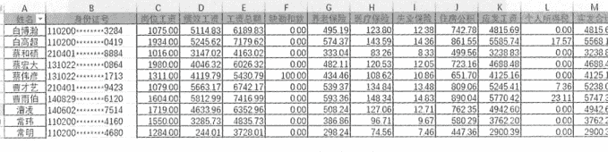

对于这个任务，在不熟悉Excel函数公式应用的情况下，使用DeepSeek辅助操作有两种解决方案：一是直接询问DeepSeek如何在Excel中操作；二是让DeepSeek生成VBA代码，实现一键式自动化处理。

#### 1. 询问DeepSeek如何在Excel中操作

用 DeepSeek 让 Excel 自动跑：薪资单批量产出与费用对比实战拆解

薪资单的批量制作一直是人力部门的重复性负担，下面演示两种借助 DeepSeek 实现一键化的思路。

### 薪资单批量产出

#### 公式方案

第一步：把“工资条.xlsx”提交给 DeepSeek，让它先解读文件，再基于“工资计算表”里的原始数据，写一个放到“工资条1”工作表的公式。需求是 A2 单元格下拉就能切换不同员工的薪资单，每份单都要带完整表头，相邻单之间空出两行，依次向下展开。

第一步产出：模型按要求输出了可在表格中直接使用的公式，具体见图4-24。

第二步：把模型返回的公式复制到“工资条1”的 A1。先把 A1 的拖拽填充向下拖到 A3，再同时选中 A2 和 A3 向右拉到 M 列“实发合计”，之后把第 2、3 行的样板内容向下复制，直到所有人员都被生成，如图4-26 所示。

  

  

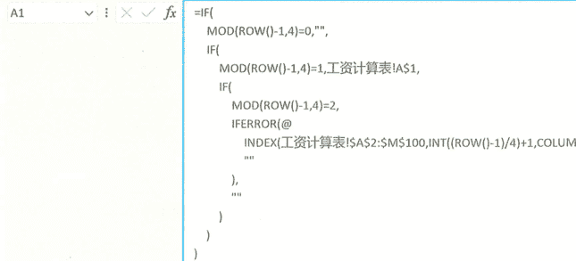  

  

  

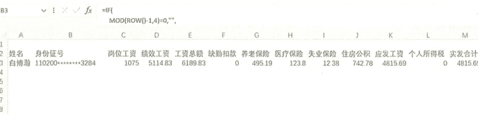  


**图4-24 第一步产出**  

**图4-25 第二步操作**  

**图4-26 向右拖拽填充**  

**图4-27 自动填充完成全部薪资单**

第二步产出：所有薪资单一次性排布完成，员工自助查看和领取更便捷。

#### VBA 脚本方案

第一步：再次上传“工资条.xlsx”，要求模型阅读文件后，给一段 VBA 程序，把“工资计算表”中 A 到 M 列的数据整理成薪资单，全部写入“工资条1”，每个人的条目间隔两行。

第一步产出：模型理解需求并返回可运行的代码片段，如图4-28 所示。

第二步：把代码粘贴进 VBA 编辑器，执行运行。

薪资单生成  

**VBA 脚本**


```vba
Sub GeneratePaySlips() 
    Dim wsSource As Worksheet
    Dim wsTarget As Worksheet
    Dim lastRow As Long
    Dim i As Long, j As Long
    Dim targetRow As Long

    ' 设置工作表对象
    Set wsSource = ThisWorkbook.Worksheets("工资计算表")
    Set wsTarget = ThisWorkbook.Worksheets("工资条1")

    ' 清除目标工作表中的现有内容
    wsTarget.Cells.Clear

    ' 获取源数据的最后一行
    lastRow = wsSource.Cells(wsSource.Rows.Count, "A").End(xlUp).Row

    ' 复制标题行到目标工作表
    wsSource.Rows(1).Copy Destination:=wsTarget.Rows(1)

    ' 初始化目标行
    targetRow = ?
```

第二步产出：程序执行后薪资单已自动生成，经人工核对数据准确，如图4-29 所示。

  


### 4.1.4 场景四：费用明细对比分析

任务描述
现存两张结构一致的费用表，分别是 2024 年 11 月和 12 月的部门费用明细，包含费用科目、部门、金额等字段。目标是把两月数据合并到一张分析表，用“当月”“上月”的形式呈现，方便横向对比。

**表1：2024年11月部门费用明细表**

|   | A        | B     | C     | D       | E     | F      | G     |
|---|----------|-------|-------|---------|-------|--------|-------|
| 1 |          | 2024年11月部门费用明细表 |       |         |       |        |       |
| 2 | 费用科目 | 行政部 | 采购部 | 人力资源 | 销售部 | 策划部 | 合计  |
| 3 | 工资     | 2,000.00 | 3,000.00 | 3,200.00 | -     | 1,400.00 | 9,600.00 |
| 4 | 奖金     | 19,050.00 | 4,000.00 | 73,000.00 | -     | 4,991.00 | 100,991.00 |
| 5 | 激励奖   | 1,000.00 | 2,000.00 | 3,000.00 | -     | -     | 6,000.00 |
| 6 | 办公费   |       | -     | 2,977.00 | -     | 363.00 | 3,340.00 |
| 7 | 电话费   |       | -     | 100.00  | -     | -     | 100.00 |
| 8 | 水电费   |       | -     | 695.62  | -     | -     | 695.62 |

**表2：2024年12月部门费用明细表**

|   | A        | B     | C     | D       | E     | F      | G     |
|---|----------|-------|-------|---------|-------|--------|-------|
| 1 |          | 2024年12月部门费用明细表 |       |         |       |        |       |
| 2 | 费用科目 | 行政部 | 采购部 | 人力资源 | 销售部 | 策划部 | 合计  |
| 3 | 工资     | 2,500.00 | 2,800.00 | 3,600.00 | -     | 1,400.00 | 10,300.00 |
| 4 | 奖金     | 19,550.00 | 4,420.00 | 73,486.00 | -     | 4,991.00 | 102,447.00 |
| 5 | 激励奖   | 2,345.00 | 1,234.00 | 1,258.00 | -     | -     | 4,837.00 |
| 6 | 办公费   |       | -     | 2,977.00 | -     | 363.00 | 3,340.00 |
| 7 | 电话费   |       | -     | 100.00  | -     | -     | 100.00 |
| 8 | 水电费   |       | -     | 695.62  | -     | -     | 695.62 |

**图4-32 部门费用分析明细表（目标结构）**

|   | A        | B     | C     | D       | E     | F      | G     | H          | I                      | J                  |
|---|----------|-------|-------|---------|-------|--------|-------|------------|------------------------|--------------------|
| 1 |          | 部门费用分析明细 |       |         |       |        |       |            |                        |                    |
| 2 | 费用科目 | 月份  | 行政部 | 采购部 | 人力资源 | 销售部 | 策划部 | 备注1（各月小计） | 备注2（本月较上月增长率） | 备注3              |
| 3 | 工资     | 当月  |       |       |         |       |        | 0.00       |                        |                    |
| 4 |          | 上月  |       |       |         |       |        | 0.00       |                        |                    |
| 5 | 奖金     | 当月  |       |       |         |       |        | 0.00       |                        |                    |
| 6 |          | 上月  |       |       |         |       |        | 0.00       |                        |                    |
| 7 | 激励奖   | 当月  |       |       |         |       |        | 0.00       |                        |                    |
| 8 |          | 上月  |       |       |         |       |        | 0.00       |                        |                    |
| 9 | 办公费   | 当月  |       |       |         |       |        | 0.00       |                        |                    |
| 10 |          | 上月  |       |       |         |       |        | 0.00       |                        |                    |
| 11 | 电话费   | 当月  |       |       |         |       |        | 0.00       |                        |                    |
| 12 |          | 上月  |       |       |         |       |        | 0.00       |                        |                    |
| 13 | 水电费   | 当月  |       |       |         |       |        | 0.00       |                        |                    |
| 14 |          | 上月  |       |       |         |       |        | 0.00       |                        |                    |

该任务在不熟悉函数公式的情况下，可借助 DeepSeek 采用两种做法：直接询问模型如何在表格中操作，或让模型直接输出 VBA 实现自动化。

#### 1. 询问 DeepSeek 如何在表格中操作

第一步：把 11 月、12 月以及对比数据三张表分别命名为“11月.xlsx”“12月.xlsx”“对比数据.xlsx”上传，并告知模型：请先阅读这三张表。我希望在“对比数据”表里用函数达成效果：B 列的“当月”取自“12月”表数据，“上月”取自“11月”表数据，把两张表 B3:F9 的区域分别填入“对比数据”表的 C3:H14。

第一步产出：DeepSeek 给出了基于 INDEX 的引用公式，如图4-33 所示。

在“对比数据”表的 C3 单元格输入：

```excel
=IF(
    $B3="当月",
    INDEX([12月.xlsx]当月!$B$3:$F$8, (ROW()-1)/2, COLUMN()-2),
    INDEX([11月.xlsx]上月!$B$3:$F$8, ROW()/2-1, COLUMN()-2)
)
```

**图4-33 DeepSeek 生成的 INDEX 公式**

第二步：把公式贴到 C3，利用拖拽填充先向右再向下完成整块区域的填充，如图4-34 所示。

第二步产出：部门费用分析明细表已完整呈现上月与当月数据及差异，经过核对结果无误。

## 北京大区部门费用分析明细

| A | B | C | D | E | F | G | H | I | J |
| :--- | :--- | :--- | :--- | :--- | :--- | :--- | :--- | :--- | :--- |
| 1 | **北京大区部门费用分析明细** | | | | | | | | |
| 2 | 费用科目 | 月份 | 行政部 | 采购部 | 人力资源 | 销售部 | 策划部 | 备注 1<br>(各月小计) | 备注 2<br>(本月较上月<br>增长率) | 备注 3 |
| 3 | 工资 | 当月 | 2500.00 | 2800.00 | 3600.00 | 0.00 | 1400.00 | 10300.00 | 700.00 | |
| 4 | 上月 | 2000.00 | 3000.00 | 3200.00 | 0.00 | 1400.00 | 9600.00 | | |
| 5 | 奖金 | 当月 | 19550.00 | 4420.00 | 73486.00 | 0.00 | 4991.00 | 102447.00 | 1456.00 |
| 6 | 上月 | 19000.00 | 4000.00 | 73000.00 | 0.00 | 4991.00 | 100991.00 | | |
| 7 | 激励奖 | 当月 | 2345.00 | 1234.00 | 1258.00 | 0.00 | 0.00 | 4837.00 | -1163.00 |
| 8 | 上月 | 1000.00 | 2000.00 | 3000.00 | 0.00 | 0.00 | 6000.00 | | |
| 9 | 办公费 | 当月 | 0.00 | 0.00 | 2977.00 | 0.00 | 363.00 | 3340.00 | 0.00 |
| 10 | 上月 | 0.00 | 0.00 | 2977.00 | 0.00 | 363.00 | 3340.00 | | |
| 11 | 电话费 | 当月 | 0.00 | 0.00 | 100.00 | 0.00 | 0.00 | 100.00 | 0.00 |
| 12 | 上月 | 0.00 | 0.00 | 100.00 | 0.00 | 0.00 | 100.00 | | |
| 13 | 水电费 | 当月 | 0.00 | 0.00 | 695.62 | 0.00 | 0.00 | 695.62 | 0.00 |
| 14 | 上月 | 0.00 | 0.00 | 695.62 | 0.00 | 0.00 | 695.62 | | |

图 4-34 利用 Excel 的拖拽填充功能自动填充 INDEX 公式

#### 2. 让 DeepSeek 生成 VBA 脚本
第一步：将“11 月.xlsx”“12 月.xlsx”和“对比数据.xlsx”上传至 DeepSeek，提示模型阅读三张表后，编写一段在“对比数据”表内运行的 VBA 脚本，实现：B 列“当月”对应 12 月数据，“上月”对应 11 月数据，将两张表 B3 到 F9 的数据分别写入“对比数据”表的 C3 到 H14。

第一步产出：DeepSeek 按需求生成了完整程序，如图 4-35 所示。

以下是完全按照您需求编写的 VBA 代码，可以精确地将 11 月和 12 月的数据填充到对比数据表中：

```vba
Sub FillComparisonData()
Dim wb As Workbook
Dim wsCompare As Worksheet
Dim wsCurrent As Worksheet
Dim wsLast As Worksheet
Dim i As Integer, targetRow As Integer
Dim arrCategories As Variant
'定义费用科目顺序（与对比表一致）
arrCategories = Array("工资", "奖金", "激励奖", "办公费", "电话费", "水电费")
```

图 4-35 步骤一生成的部分 VBA 代码（费用明细对比分析）

#### 第二步 把 DeepSeek 产出的宏脚本导入开发环境并运行

#### 执行效果 宏运行后得到的报表经人工核对确认正确，具体呈现见图 4-36

|   | A | B | C | D | E | F | G | H | I | J |

|---|---|---|---|---|---|---|---|---|---|---|

|| **北京大区部门费用分析明细** |||||||||

|2|费用科目 | 月份 | 行政部 | 采购部 | 人力资源 | 销售部 | 策划部 | 备注 1(各月小计) | 备注 2<br>(本月较上月增长额) | 备注 3 |

|3 |工资 | 当月 | 2500.00 | 2800.00 | 3600.00 | 0.00 | 1400.00 | 10300.00 | 700.00 |  |

|4 | 上月 | 2000.00 | 3000.00 | 3200.00 | 0.00 | 1400.00 | 9600.00 | | |

|5 |奖金 | 当月 | 19550.00 | 4420.00 | 73486.00 | 0.00 | 4991.00 | 102447.00 | 1456.00 |  |

|6 | 上月 | 19000.00 | 4000.00 | 73000.00 | 0.00 | 4991.00 | 100991.00 | | |

|7 |激励奖 | 当月 | 2345.00 | 1234.00 | 1258.00 | 0.00 | 0.00 | 4837.00 | -1163.00 |  |

|8 |上月 | 1000.00 | 2000.00 | 3000.00 | 0.00 | 0.00 | 6000.00 | | |

|9 |办公费 |当月| 0.00 | 0.00 | 2977.00 | 0.00 | 363.00 | 3340.00 | 0.00 |  |

|10|上月 | 0.00 | 0.00 | 2977.00 | 0.00 | 363.00 | 3340.00 | | |

|11 |电话费 |当月| 0.00 | 0.00 | 100.00 | 0.00 | 0.00 | 100.00 | 0.00 |  |

|12|上月| 0.00 | 0.00 | 100.00 | 0.00 | 0.00 | 100.00 | | |

|13|水电费 |当月| 0.00 | 0.00 | 695.62 | 0.00 | 0.00 | 695.62 | 0.00 |  |

|14|上月| 0.00 | 0.00 | 695.62 | 0.00 | 0.00 | 695.62 | | |

图 4-36 VBA 代码运行结果（费用明细对比分析）

###### 作者点评

本节以应收账龄、条件筛选、工资单生成、费用对比等高频财务处理为例，体现出 DeepSeek 在 Excel 场景中的效率拉升与落地价值。

其一，用自然语言描述业务需求即可得到公式或宏方案，省去大量查阅与反复调试的时间，提升核算效率。

其二，四类案例均呈现出清晰的人机分工，业务人员负责表达规则，模型负责语义解析与代码生成，各自发挥专长。

其三，案例均来自实务，步骤拆解配图，把从业务目标梳理到技术实现的过程完整呈现，为财务人员学习 Excel 自动化提供参考。

#### 4.2 应用 DeepSeek 在复杂财务工作场景中辅助生成 VBA 代码

本书选取五个较复杂的财务场景——货币单位转换、资金表合并、集团报表汇总、销售报表透视与逆透视、库存拆分，演示如何借助 DeepSeek 获取宏方案。除货币单位转换外，其余场景直接走脚本生成路径，仅货币单位转换保留了先咨询操作方式的示范。

##### 4.2.1 场景五：报表货币单位转换

#### ### 任务场景描述

ABC 公司现有一份以“元”为货币单位的财务报表，如图 4-37 所示，根据管理层阅读需要，需调整为以“万元”为货币单位的报表，如图 4-38 所示。

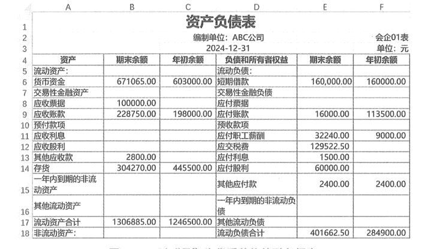

图 4-38 以“万元”为货币单位的财务报表 若现行财务系统没有单位换算功能，财务人员只能在 Excel 中手工处理，例如将金额除以 10000 后四舍五入保留两位小数，或利用条件格式配合自定义格式实现元与万元的切换，这对操作熟练度要求较高。

借助 DeepSeek 有两种思路：一是先询问具体操作步骤；二是直接让其生成可一键运行的 VBA 程序。

#### 1. 询问 DeepSeek 如何在 Excel 中操作

##### 步骤一：将任务涉及的“元.xlsx”和“万元.xlsx”两张表上传至 DeepSeek，并发出指令：请阅读上述两个表格，告诉我如何在 Excel 中操作，能将“元”表格中的所有数据金额的单位从“元”四舍五入为“万元”，然后填列到“万元”表格中。

##### 步骤一结果：DeepSeek 生成了货币单位转换的具体操作方法，如图 4-39 所示。

以下是分步骤的 Excel 操作指南，将“元”单位数据转换为“万元”单位并填入新表：

###### 方法一：选择性粘贴表（推荐）

+ - 在"元.xlsx"操作

- 在空白单元格（如 G1）输入 10000 → 按 Ctrl+C 复制

- 选中所有数值区域：

  - 资产部分：B5:C32

  - 负债部分：E5:F32

  （按住 Ctrl 可多选不连续区域）

+ - 执行单位转换

- 右键 → 选择性粘贴 → 选择“除”→ 确定

- 按 Ctrl+l 设置格式为数值，保留 2 位小数

+ - 复制到万元表

- 复制处理后的数据 → 粘贴到“万元.xlsx"对应位置


+ - 步骤二：按照 DeepSeek 给出的操作步骤逐步操作。首先在 “元.xlsx"中的任何空白单元格输入“10000”，按"Ctrl+C"复制，然后选中所有数值区域（对于不连续区域可以按住 Ctrl 进行选择）。接着单击右键使用选择性粘贴，在“运算”中选择“除”，点击确定（如图 4-40 所示）。按"Ctrl+l"设置格式为“数值”，小数位数为"2”（如图 4-41 所示）。最后，复制处理后的数据，粘贴到“万元.xlsx"的对应位置。

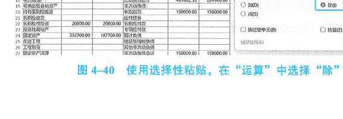

###### 方法二：让 DeepSeek 生成 VBA 代码

#### ### 步骤一：将“元.xlsx”和“万元.xlsx"分别上传至 DeepSeek，并发出指令：请阅读上述两个表格，帮我写一个 VBA 代码，该代码在“万元”表格中使用，能将“元”表格中的所有金额数据的单位从元四舍五入为万元，填列到“万元”的表格中。

#### 📥 步骤一结果：DeepSeek 理解了指令，并生成了 VBA 代码（如图 4-43 所示）。

以下是一个 VBA 代码，可以将“元”表格中的所有金额数据四舍五入为万元，并填列到“万元”表格中：

```vba
Sub ConvertYuanTenTenThousand()
Dim wsYuan As Worksheet, wsWan As Worksheet
Dim lastRow As Long, lastCol As Long
Dim i As Long, j As Long
Dim cell Value As Variant
' 设置工作表对象
Set wsYuan = Workbooks("元.xlsx").Worksheets("资产负债表练习")
Set wsWan = Workbooks("万元.xlsx").Worksheets("资产负债表结果")
' 确定数据范围
lastRow = wsYuan.Cells.Find("*", SearchOrder:=xlByRows, SearchDirection:=xlPrevious).Row
lastCol = wsYuan.Cells.Find("*", SearchOrder:=xlByColumns, SearchDirection:=xlPrevious).Column
```

图 4-43 VBA 代码（报表货币单位转换）

#### ### 步骤二：复制 DeepSeek 生成的 VBA 代码并粘贴到 VBA 编辑器中，点击运行 VBA 代码。

#### 📥 步骤二结果：VBA 代码运行生成结果，经人工检验无误，如图 4-44 所示。

图 4-44 VBA 代码运行结果（报表货币单位转换）

##### 4.2.2 场景六：资金管理表合并

#### **任务场景描述**

现有一份包含“资金管理汇总”、“支付宝”、“微信”、“现金”、“借记卡”和“信用卡”多个工作表的 Excel 文档“资金管理.xlsx",如图 4-45 所示，该文档中各个工作表的表头内容一致，需要将“支付宝”、 “微信”、“现金”、“借记卡”和“信用卡”这几个工作表合并为一个 “资金管理汇总”工作表。

图 4-45 资金管理.xlsx

### 1. 让 DeepSeek 生成 VBA 代码

#### >步骤一：将“资金管理.xlsx"上传至 DeepSeek，并发出指令：请分析以上文件，帮我写一个 VBA 代码，该代码在“资金管理汇总”工作表

中使用，把“支付宝”“微信”“现金”“借记卡”“信用卡”五个工作表

上下合并到“资金管理汇总”工作表中。

#### 👩‍💻 步骤一结果：DeepSeek 理解了指令，并生成了

VBA 代码（如图 4-46 所示）。

#### 👉 步骤二：复制 DeepSeek 生成的 VBA 代码并粘贴到

VBA 编辑器中。点击运行 VBA 代码。

#### 👀 以下是一个 VBA 代码，用于将“支付宝”、“微信”、“现金”、“借记卡”、“信用卡”五个工作表中的数据合并

到“资金管理汇总”工作表中:

```vba
Sub 合并资金数据 ()
Dim ws 汇总 As Worksheet
Dim ws源 As Worksheet
Dim arr 工作表名 As Variant
Dim i As Integer
Dim lng 起始行 As Long
Dim lng 目标数后行 As Long
'设置工作表名称数组
arr 工作表名 = Array("支付宝", "微信", "现金", "借记卡", "信用卡")
'设置汇总工作表
On Error Resume Next
Set ws 汇总 = ThisWorkbook.Worksheets("资金管理汇总")
On Error GoTo 0
'如果汇总工作表不存在，则创建它
If ws 汇总 Is Nothing Then
Set ws 汇总 = ThisWorkbook.Worksheets.Add(Before:=ThisWorkbook.Worksheets(1))
ws 汇总.Name = "资金管理汇总"
End If
```

图 4-46 步骤一生成的部分 VBA 代码（资金管理表合并）

### 第 4 章 应用 DeepSeek 辅助财务工作中的 Excel 操作

### 步骤二结果：VBA 代码运行生成结果，经人工检验无误，如图 4–47 所示。


**图 4–47** VBA 代码运行结果（资金管理表合并）

### 2. 将 VBA 代码设计成按钮添加到工具栏

#### 步骤一：将以上存有 VBA 代码的 Excel 文件另存为加载宏格式，路径默认，如图 4–48 所示。


**图 4–48** 将 VBA 代码文件另存为加载宏格式

#### 步骤二：在“资金管理.xlsx"中点击“开发工具”下的"Excel 加载项”，在“加载宏”中选择“资金管理汇总封装”，点击“确定”，如图 4-49 所示。

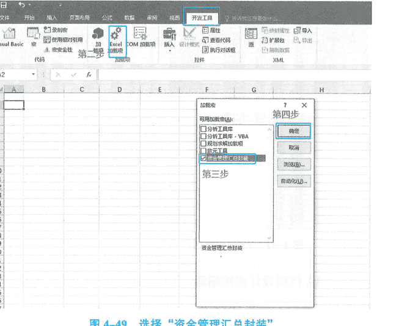

#### 步骤三：点击“开始”按钮，点击“选项”进入"Excel 选项”页面，点击“自定义功能区”，如图 4-50 所示。

#### 步骤四：在“自定义功能区（B）”中选定“主选项卡”然后选中“开发工具”，点击“新建组（自定义）”，如图 4-51 所示。

#### 步骤五：右键“新建组”重命名为“资金汇总”，如图 4-52、图 4-53 所示。

图 4-50 在"Excel 选项”页面点击“自定义功能区”

图 4-51 在“开发工具”中选择 “新建组（自定义）”

#### 步骤六：在“从下列位置选择命令”中选择“宏”命令，此时已有刚才建立的“资金管理汇总”宏命令，如图 4-54 所示。

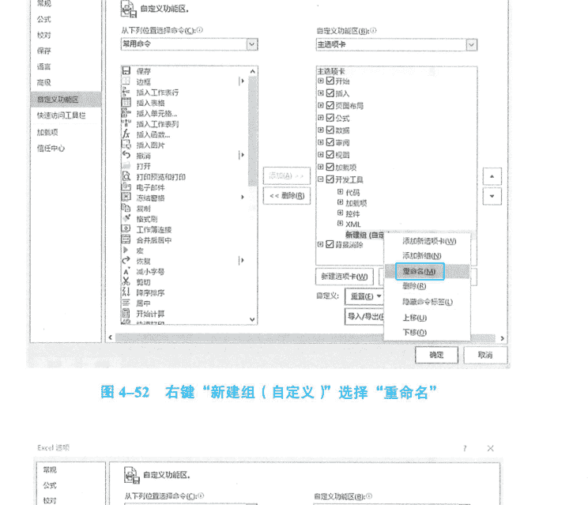

图 4-52 右键“新建组（自定义）”选择“重命名”


图 4-53 重命名为“资金汇总”

### 第 4 章 应用 DeepSeek 辅助财务工作中的 Excel 操作/105

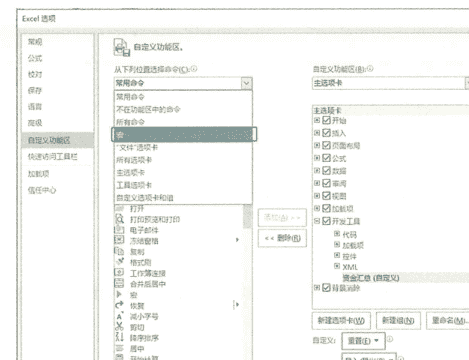

图 4-54 选择“宏”命令

#### 步骤七：选择“资金管理汇总”，点击“添加”按钮，“资金管理汇总"宏命令自动添加到右侧“开发工具”下的“资金汇总（自定义）”下，点击“确定”，在“开发工具”选项卡下就出现了“资金管理汇总”宏命令，如图 4-55、图 4-56 所示。

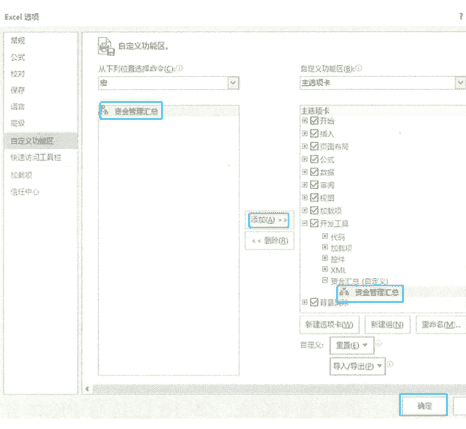

图 4-55 添加宏命令

图 4-56 添加宏命令成功

#### 步骤八：点击“开发工具”选项卡下的“资金管理汇总”宏命令，即可呈现最终结果，如图 4-57 所示。

#### 4.2.3 场景七：集团报表合并

4-58 所示），各表的结构格式均一致。现需要将这 10 张工作表在保留原格式的情况下合并成一张表，便于后续的统计和分析。


#### 步骤一：将“销售 PK.xlsx"上传至 DeepSeek，并发出指令：分析以上文件，帮我生成一个 VBA 代码，要求将“南京马自达”“上海广本”“成都奥迪”“北京奇瑞”“苏州大众”“上海丰田” “西安雪佛兰” “南京福特” “长春广本” “北京保时捷”10 个工作表，以 “南京马自达”为基础前三列数据不动，分别将其其他表格数据填写到 D 列之后，生成一张有对比的“销售 PK 表”。

#### 步骤一结果：DeepSeek 理解了指令，并生成了 VBA 代码（如图 4-59 所示）。

### > VBA 代码：生成销售 PK 对比表

以下 VBA 代码可以将所有工作表中的数据以“南京马自达”为基础，将其他表格的数据依次添加到 D 列之后，生成一个综合对比的销售 PK 表:

```vba
Sub GenerateSalesPKReport()
    Dim wsBase As Worksheet, ws As Worksheet
    Dim lastCol As Long, i As Long, j As Long
    Dim sheetNames As Variant
    Dim targetSheet As Worksheet

    ' 定义要处理的工作表名称数组
    sheetNames = Array(“南京马自达”, “上海广本”, “成都奥迪”, “北京奇瑞”, “苏州大众”, “上海丰田”, “西安雪佛兰”, “南京福特”, “长春广本”, “北京保时捷”)

    ' 检查“销售 PK 表”是否已存在，如果存在则删除
    Application.DisplayAlerts = False
    On Error Resume Next
    ThisWorkbook.Sheets(“销售 PK 表”).Delete
    On Error GoTo 0
    Application.DisplayAlerts = True
```

**图 4-59** 步骤一生成的部分 VBA 代码（集团报表合并）

### > **步骤二**：复制 DeepSeek 生成的 VBA 代码并粘贴到 VBA 编辑器中。点击运行 VBA 代码。

### > **步骤二结果**：VBA 代码运行生成结果，经人工检验无误，如图 4-60 所示。

| | A | B | C | D | E | F | G | H | I | J | K | L |

## DeepSeek 助力 Excel 财务批量处理

|---|---|---|---|---|---|---|---|---|---|---|---|---|

|1|集团 PK 战报|2024/12/3 |金额单位：万元 |||||||||

|2|指标 ||上海广本 |成都奥迪 |北京奇瑞 |苏州大众 |上海丰田 |西安雪佛兰 |南京福特 |长春广本 |北京保时捷 |

|3|4S 店销售 |新车 |台次 |24.00 |10|8|9|23|7|8|7|2|

|4||收入 ||491.01|372.54|78.46|123.34|532|77.95|143.02|143.8|949|

|5||其中：信贷台次||-|0|0|0|0|0|0|0|0|

|6||其中：融资租赁台次|- |-|0|0|0|0|0|0|0|0|

|7||二手车 |收购台次|-|0|0|0|0|0|0|0|0|

|8||||销售台次|-|0|0|0|0|0|0|0|

|9||收入 |-|0|0|0|0|0|0|0|0|0|

|10|4S 店销售水平事业 |装潢 |台次 |12.00|4|0|13|0|0|0|2|

|11||收入 ||3.30|2.8|0|0|4.6|0|0|0|19.6|

|12||精品 |台次 |7.00|0|0|0|11|0|0|0|0|

|13 ||收入 ||1.82|0|0|0|4.2|0|0|0|0|

|14|3 金融服务费 |台次 |20.00|9|7|7|21|5|5|7|2|

|15 ||收入 ||7.20|4.4|1.4|1.4|6.2|1|1|1.7|14|

|16||上牌服务费 |台次 |18.00|5|3|6|15|5|6|1|1|

|17||收入 ||4.10|2|0.45|0.95|2.9|1|1.3|0.55|1|

|18|4S 店售后 |维修 |台次 |28.00|11|12|10|19|11|18|12|1|

|19||收入 ||7.10|6.1|2.32|1.23|7.1|1.67|4.11|2.49|2.1|

|20 ||事故车 |台次 (保险平台) |9.00|2|4|6|4|5|4|7|1|

|21||收入 (保险平台) ||26.41|21.2|3|3.3|4.7|2.8|2.1|5.2|82.1|

|22||台次 (自找客户) ||-|0|0|0|0|0|0|0|0|

|23 ||收入 (自找客户) ||-|0|0|0|0|0|0|0|0|

**图 4-60** VBA 代码运行结果（集团报表合并）

上图展示的是同一本工作簿内多张结构一致的工作表合并后的呈现方式。当同类模板的文件分散在文件夹中时，同样可以借助 VBA 完成批量拼合。除了 VBA 之外，DeepSeek 还能输出其他语言的合并方案，接下来以 Python 实现跨文件汇总为例说明流程。

### ~ 小贴士

#### Python

Python 的语法简洁、结构清晰、上手门槛低，在数据分析、机器学习、人工智能等高阶领域发挥关键作用，同时也在 Web 开发、自动化运维、金融建模、图像处理、网络抓取等实际业务中广泛应用。众多国际企业与科研机构将其作为核心开发语言。

在财务场景中，Python 的优势在于兼具灵活性与可控性，不像 VBA 必须依附 Excel，也不像大型系统难以调整。它能处理结构化信息，也能把重复性操作自动化，提升分析效率，正在成为财务人员的新选择。

### 2. 让 DeepSeek 生成 Python 代码

获取 Python 程序的思路与获取 VBA 程序类似，先让模型输出代码，再把得到的文件导入“销售 PK.xlsx”即可完成任务。具体操作细节可扫码查看，这里不再详述。

Python 代码及操作

#### 4.2.4 场景八：销售报表透视和逆透视

### 任务场景描述

现有“销售报表.xlsx”，记录了“销售员”“商品名称”“销量”三列，如图 4-61。按业务分析需要，要把原始记录整理成二维透视形态：销售员列保持不变，商品名称由列转为行，销量填入交叉单元格，便于后续统计。

| | | | |

|---|---|---|---|

|1 | 销售员 | 商品名称 | 销量 |

|2 | 杨澧 | 珀芙晶钻保湿水 | 51 |

|3 | 杨澧 | 珀芙晶钻滋润乳 | 56 |

|4 | 杨澧 | 珀芙晶钻复活霜 | 49 |

|5 | 杨澧 | 珀芙晶钻修复保湿套装 | 29 |

|6 | 杨澧 | 雅梦石榴焕采保湿水 | 39 |

|7 | 杨澧 | 雅梦石榴焕采滋润乳 | 40 |

|8 | 杨澧 | 雅梦石榴焕采修复霜 | 36 |

|9 | 杨澧 | 雅梦石榴焕采修复保湿套装 | 19 |

|10 | 夏雅辰 | 珀芙晶钻保湿水 | 47 |

|11 | 夏雅辰 | 珀芙晶钻滋润乳 | 45 |

|12 | 夏雅辰 | 珀芙晶钻复活霜 | 40 |

|13 | 夏雅辰 | 珀芙晶钻修复保湿套装 | 20 |

|14 | 夏雅辰 | 雅梦石榴焕采保湿水 | 35 |

|15 | 夏雅辰 | 雅梦石榴焕采滋润乳 | 33 |

|16 | 夏雅辰 | 雅梦石榴焕采修复霜 | 33 |

|17 | 夏雅辰 | 雅梦石榴焕采修复保湿套装 | 19 |

|18 | 石怡 | 珀芙晶钻保湿水 | 26 |

|19 | 石怡 | 珀芙晶钻滋润乳 | 23 |

|20 | 石怡 | 珀芙晶钻复活霜 | 21 |

|21 | 石怡 | 珀芙晶钻修复保湿套装 | 4 |

|22 | 石怡 | 雅梦石榴焕采保湿水 | 16 |

|23 | 石怡 | 雅梦石榴焕采滋润乳 | 13 |

|24 | 石怡 | 雅梦石榴焕采修复霜 | 13 |

|25 | 石怡 | 雅梦石榴焕采修复保湿套装 | 1 |

|26 | 唐冰冰 | 珀芙晶钻保湿水 | 36 |

|27 | 唐冰冰 | 珀芙晶钻滋润乳 | 36 |

|28 | 唐冰冰 | 珀芙晶钻复活霜 | 39 |

|29 | 唐冰冰 | 珀芙晶钻修复保湿套装 | 26 |

|30 | 唐冰冰 | 雅梦石榴焕采保湿水 | 31 |

|31 | 唐冰冰 | 雅梦石榴焕采滋润乳 | 33 |

|32 | 唐冰冰 | 雅梦石榴焕采修复霜 | 36 |

|33 | 唐冰冰 | 雅梦石榴焕采修复保湿套装 | 16 |

|34 | 史素 | 珀芙晶钻保湿水 | 18 |

|35 | 史素 | 珀芙晶钻滋润乳 | 20 |

|36 | 史素 | 珀芙晶钻复活霜 | 19 |

|37 | 史素 | 珀芙晶钻修复保湿套装 | 5 |

|38 | 史素 | 雅梦石榴焕采保湿水 | 44 |

|39 | 史素 | 雅梦石榴焕采滋润乳 | 46 |

|40 | 史素 | 雅梦石榴焕采修复霜 | 48 |

|41 | 史素 | 雅梦石榴焕采修复保湿套装 | 29 |


图 4-61 销售报表

### 第 4 章 应用 DeepSeek 辅助财务工作中的 Excel 操作 / 111

#### 步骤一：将“销售报表.xlsx"上传至 DeepSeek，并发出指令：请分析以上文件，帮我生成一段 VBA 代码，要求“销售员”列信息位置不动，“商品名称”列数据信息变成行数据信息，“销量”列数据信息填入对应位置，形成二维透视表。

#### 步骤一结果：DeepSeek 理解了指令，并生成了 VBA 代码（如图 4-62 所示）。

> 以下是生成二维透视表的 VBA 代码，它将“销售员”列保持不变，将“商品名称”转换为行标题，“销量”列数据填入对应位置：

```vba
Sub CreatePivotTable()
    Dim ws As Worksheet
    Dim rng As Range
    Dim lastRow As Long, lastCol As Long
    Dim i As Long, j As Long
    Dim dict As Object
    Dim key As Variant
    Dim item As Variant
    Dim outputRow As Long, outputCol As Long
    Dim newWs As Worksheet

    '创建新工作表存放结果
    Set newWs = Worksheets.Add
    newWs.Name = “销售透视表”

    '获取原始数据
    Set ws = Worksheets (“销售报表”) 
    lastRow = ws.Cells(ws.Rows.Count, “A”).End(xlUp).Row
    Set rng=ws.Range(“A1:C” & lastRow)

    '创建字典存储唯一商品名称
```

**图 4-62** **步骤一生成的 VBA 代码（销售报表透视）**

#### 步骤二：复制 DeepSeek 生成的 VBA 代码并粘贴到 VBA 编辑器中。点击运行 VBA 代码。

#### 步骤二结果：VBA 代码运行生成结果，经人工检验无误，如图 4-63 所示。


# DeepSeek 高效财务

**图 4-63** VBA 代码运行结果（销售报表透视）

#### 任务场景描述

现有一份一分公司的库存表（如图 4-64 所示），表中包含“公司名称”“产品编号”“产品名称”“类别”“单价”“数量”“金额”“最近入库日期”“库龄”等字段。现在需要将该库存表按照“类别”拆分成一个个工作表的形式，以便分类使用相关数据。

#### 图 4-63 VBA 代码运行结果（销售报表透视）

#### 4.2.5 场景九：库存表拆分

### 任务场景描述

现有一份一分公司的库存表（如图 4-64 所示），表中包含“公司名称”“产品编号”“产品名称”“类别”“单价”“数量”“金额”“最近入库日期”“库龄”等字段。现在需要将该库存表按照“类别”拆分成一个个工作表的形式，以便分类使用相关数据。

| | A | B | C | D | E | F | G | H | I |

|---|---|---|---|---|---|---|---|---|---|

|1|公司名称 | 产品编号 | 产品名称 | 类别 | 单价 | 数量 | 金额 | 最近入库日期 | 库龄 |

|2|一公司 | 20201170001 | 华为 S55 电视 | 平板电视 | 3286|50|164.300|2021/3/8|三个月内|

|3|一公司 | 20201170002 | 海尔冰箱-BCD-343WDPM | 立式冰箱 | 2899|45|130.455|2020/12/5|三个月以上|

|4|一公司 | 20201170003 | 海尔统帅变频洗衣机@HB1276W | 洗衣机 | 2458|30|73.740|2020/7/23|三个月以上|

|5|一公司 | 20201170004 | 海尔空调 KFR-72LW | 立式空调 | 3589|40|143.560|2020/9/1|三个月以上|

|6|一公司 | 20201170005 | 松下微波炉 NN-GM33HB | 厨房电器 | 567|55|31.185|2020/3/23|三个月以上|

|7|一公司 | 20201170006 | 海尔消毒柜 12LC52 | 厨房电器 | 1250|30|37.500|2021/1/9|三个月内|

|8|一公司 | 20201170007 | 海尔冰箱-BCD-343WDPM | 立式冰箱 | 2899|35|101.465|2021/3/17|三个月内|

|9|一公司 | 20201170008 | 华为 S55 电视 | 平板电视 | 3286|46|151.156|2020/5/3|三个月以上|

|10|一公司 | 20201170009 | 海尔冰箱-BCD-343WDPM | 立式冰箱 | 2899|25|72.475|2020/7/7|三个月以上|

|11|一公司 | 20201170010 | 海尔统帅变频洗衣机@HB1276W | 洗衣机 | 2458|28|68.824|2021/2/6|三个月内|

|12|一公司 | 20201170011 | 海尔空调 KFR-72LW | 立式空调 | 3589|0|-|2020/3/19|三个月以上|

|13|一公司 | 20201170012 | 松下微波炉 NN-GM33HB | 厨房电器 | 567|40|22.680|2021/2/1|三个月内|

|14|一公司 | 20201170013 | 海尔消毒柜 12LC52 | 厨房电器 | 1250|42|52.500|2020/1/26|三个月以上|

|15|一公司 | 20201170014 | 海尔冰箱-BCD-343WDPM | 立式冰箱 | 2899|46|133.354|2020/4/20|三个月以上|

|16|一公司 | 20201170015 | 海尔冰箱-BCD-343WDPM | 立式冰箱 | 2899|50|144.950|2020/9/20|三个月以上|

|17|一公司 | 20201170016 | 海尔统帅变频洗衣机@HB1276W | 洗衣机 | 2458|30|73.740|2020/6/21|三个月内|

|18|一公司 | 20201170017 | 海尔空调 KFR-72LW | 立式空调 | 3589|37|132.793|2021/3/5|三个月内|

|19|一公司 | 20201170018 | 松下微波炉 NN-GM33HB | 厨房电器 | 567|28|15.876|2021/1/10|三个月以上|

|20|一公司 | 20201170019 | 海尔消毒柜 12LC52 | 厨房电器 | 1250|20|25.000|2020/8/24|三个月以上|

|21|一公司 | 20201170021 | 海尔冰箱-BCD-343WDPM | 立式冰箱 | 2899|33|95.667|2020/1/31|三个月以上|

|22|一公司 | 20201170022 | 华为 S55 电视 | 平板电视 | 3286|36|118.296|2020/2/18|三个月以上|

|23|一公司 | 20201170023 | 海尔冰箱-BCD-343WDPM | 立式冰箱 | 2899|40|115.960|2020/3/15|三个月以上|

|24|一公司 | 20201170024 | 海尔统帅变频洗衣机@HB1276W | 洗衣机 | 2458|46|113.068|2020/6/7|三个月以上|

|25|一公司 | 20201170025 | 松下微波炉 NN-GM33HB | 厨房电器 | 567|-42|23.814|2020/10/2|三个月以上|

|26|一公司 | 20201170026 | 海尔消毒柜 12LC52 | 厨房电器 | 1250|35|43.750|2020/12/25|三个月以上|

|27|一公司 | 20201170027 | 海尔冰箱-BCD-343WDPM | 立式冰箱 | 2899|33|95.667|2020/5/2|三个月以上|

|28|一公司 | 20201170028 | 海尔冰箱-BCD-343WDPM | 立式冰箱 | 2899|0|-|2020/11/8|三个月以上|

|29|一公司 | 20201170029 | 华为 S55 电视 | 平板电视 | 3286|54|177.444|2020/5/12|三个月以上|

|30|一公司 | 20201170030 | 海尔冰箱-BCD-343WDPM | 立式冰箱 | 2899|36|104.364|2020/1/1|三个月以上|

|31|一公司 | 20201170031 | 海尔统帅变频洗衣机@HB1276W | 洗衣机 | 2458|36|88.488|2020/7/27|三个月以上|

|32|一公司 | 20201170032 | 松下微波炉 NN-GM33HB | 厨房电器 | 567|48|27.216|2020/4/28|三个月以上|

|33|一公司 | 20201170033 | 海尔消毒柜 12LC52 | 厨房电器 | 1250|50|62.500|2020/4/29|三个月以上|

|34|一公司 | 20201170035 | 海尔冰箱-BCD-343WDPM | 立式冰箱 | 2899|45|130.455|2021/1/24|三个月内|

|35|一公司 | 20201170036 | 海尔统帅变频洗衣机@HB1276W | 洗衣机 | 2458|36|88.488|2021/3/2|三个月以上|

|36|一公司 | 20201170037 | 华为 S55 电视 | 平板电视 | 3286|0|-|2020/3/8|三个月以上|

|37|一公司 | 20201170038 | 海尔冰箱-BCD-343WDPM | 立式冰箱 | 2899|28|81.172|2020/3/6|三个月以上|

|38|一公司 | 20201170039 | 海尔统帅变频洗衣机@HB1276W | 洗衣机 | 2458|25|61.450|2020/4/5|三个月以上|

|39|一公司 | 20201170040 | 海尔空调 KFR-72LW | 立式空调 | 3589|30|107.670|2020/3/22|三个月以上|

# **图 4-64** 一分公司库存表

#### 步骤一：将“一分公司库存表.xlsx"上传至 DeepSeek，并发出指令：请分析以上文件，帮我生成一段 VBA 代码，要求该表按照类别进行拆分成“平板电视”“立式冰箱”“洗衣机”“立式空调”“厨房电器”，相应数据填写到对应位置。

#### 步骤一结果：DeepSeek 理解了指令，并生成了 VBA 代码 (如图 4-65 所示)。

#### 步骤二：将 DeepSeek 给出的 VBA 源码导入 VBA 编辑器并启动执行

#### 步骤二结果：脚本运行后得到的数据经人工核对准确无误，详见图 4-66

以下是一段 VBA 代码，可以根据库存表中的类别将数据拆分到不同的工作表中：

```vba
Sub SplitDataByCategory()
    Dim wsSource As Worksheet
    Dim wsDestination As Worksheet
    Dim lastRow As Long
    Dim i As Long
    Dim categoryList As Variant
    Dim category As Variant
    Dim rng As Range
    Dim destLastRow As Long

    ' 定义所有类别
    categoryList = Array("平板电视", "立式冰箱", "洗衣机", "立式空调", "厨房电器")

    ' 设置源工作表
    Set wsSource = ThisWorkbook.Sheets("Sheet1")
    lastRow = wsSource.Cells(wsSource.Rows.Count, "A").End(xlUp).Row

    ' 遍历每个类别
    For Each category In categoryList
        ' 检查目标工作表是否存在
        On Error Resume Next
        Set wsDestination = ThisWorkbook.Sheets(category)
    Next category
```

**图 4-66** VBA 代码运行结果（销售报表拆分）

###### 作者点评
本小节选取了财务实务中高频且操作门槛较高的 Excel 用例，借助 DeepSeek 产出的 VBA 程序完成自动化处理，突出了人工智能替代繁琐手工操作的价值。
首先围绕币种转换、资金表汇总、集团报表整合、销售数据透视与逆向透视、库存信息拆分等五类复杂业务展开，涵盖报表格式转换、数据合并、结构再造等常见痛点，代表性较强。
其次针对每个业务完整呈现了从需求解析、向模型下达指令、获取代码到结果验证的全链路，操作性强，财务同事可直接借鉴。
最后将 VBA 宏封装成 Excel 插件按钮，体现了标准化、可复用的思路，有助于推广使用。
总体看，该部分展示了 DeepSeek 在复杂财务数据处理中的适配度与落地能力，实现了由人工主导向智能驱动的转变，为财务自动化建设提供了可复制的参考。

#### 4.3 本章总结
本章以 DeepSeek 助力财务 Excel 操作为主线，从基础函数编写到 VBA 自动化处理，梳理了人工智能对财务核心能力的影响。4.1 节通过函数案例和代码生成说明 AI 如何改进既有流程；4.2 节延伸到复杂场景，推动工作从重复操作转向智能生成与批量处理。
DeepSeek 降低了技术依赖，简化了 Excel 使用门槛，同时提升了处理质量与效率。借助 AI，财务人员可以把精力更多投入分析、研判与决策等价值环节，完成从执行者到价值创造者的转变。

##### 实用技巧
* 常见 Excel 函数可向 DeepSeek 请教用法，或让其提供对应的 VBA 脚本。
* 遇到结构重复、步骤固定的情况，例如报表合并、格式拆分等，调用 DeepSeek 产出 VBA 是高效做法。
* 把高频 VBA 程序做成加载项挂到 Excel 工具栏，形成标准化作业，提升便捷性与协作效率。
* 在充分把握业务需求后，用自然语言明确描述目标，是获取优质模型回应的关键。
* 也可让 DeepSeek 撰写 Python 脚本，支持多系统数据对接。

## 第 5 章

DeepSeek 赋能财务演示文稿制作

企业财务人员的日常工作中，演示文稿承担着成果展示、业务汇报和专项说明的重要职能。传统制作方式费时耗力，模板挑选、视觉设计与图文排版都需要投入大量精力，尤其在内容较多、格式要求严格时，周期进一步拉长，不仅增加负担，也削弱表达的聚焦。
借助智能工具，PPT 制作效率明显提升。DeepSeek 具备较强的自然语言理解与内容生成能力，输入关键词、提纲或简要说明即可快速得到结构清晰、逻辑顺畅的文本。再配合可一键生成 PPT 的 AI 工具，可依据大纲与主题自动匹配专业模板、插入合适配图、智能排版，形成图文并茂的演示效果。
实践中，可将月度报表分析、预算执行、项目成本汇总等原始材料交给 DeepSeek 处理，自动生成可直接汇报的演示稿，大幅减少繁琐环节，让工作重心回归财务内容的分析与表达。应用大模型辅助 PPT 制作，既提升质量，也提高效率，为财务数字化转型提供有力支撑。
本章重点介绍 DeepSeek 辅助财务 PPT 制作的方法。在同一业务场景下，结合不同 AI 工具并经人工校验与调整，完成一套完整的财务主题演示文稿。5.1 节介绍 DeepSeek 与 Kimi 协同制作的流程，5.2 节展示其他 AI 工具独立辅助制作的流程，5.3 节为本章小结。

### 任务场景描述
你担任一家基建集团二级分公司的财务负责人，分公司总经理要求两天后为本部及下属三级单位、项目部的财务人员开展线上内训，主题为“建筑行业金税四期税务风险预警的几种情形”。演示文稿需提前制作并发放。由于时间紧、任务重，且缺乏可直接套用的模板，专业培训的 PPT 需要查阅资料、构思提纲、制作图表并调整格式，工作量很大且容错率低，因此尝试借助 AI 工具实现高效制作。

#### 5.1 应用 DeepSeek 和 Kimi 辅助制作 PPT

###### 任务一
借助 DeepSeek 快速搭建 PPT 的 Markdown 提纲。

**步骤一**：向 DeepSeek 发送指令：我是一家基建集团二级分公司财务主管，须在两天后为全分公司及下属三级单位和项目部财务人员做内部培训，主题为“建筑行业金税四期税务风险预警的几种情形”，需制作一份培训用 PPT。请按主题生成 Markdown 格式的 PPT 文本，要求包含封面、目录和至少 4 个核心章节，每个核心章节至少包含 2 个案例，语言简洁专业，避免口语化。

注意：该操作未开启 DeepSeek 的联网搜索。

**步骤一-结果**：DeepSeek 理解指令并初步输出了 Markdown 格式的提纲文本。人工核查后，内容基本满足要求，除目录外共 5 章，其中 4 章为核心，均配 2 个案例。
但提纲仍有不足：①整体篇幅偏少，内容较为简略，需补充；②案例比较笼统、简短，真实性不足；③末尾自行添加了整改部分，与实际情况不符，需删除。此外，DeepSeek 在文末给出的 PPT 制作建议具有参考价值。


### Markdown 语法简介
Markdown 是一种轻量级标记语言，便于快速编写格式统一、结构清晰的文本。用简单的符号如“#”表示标题、“-”表示列表，替代复杂排版指令，内容既可直接阅读，也便于转换为 PPT、HTML 或 Word 等格式。对财务人员而言，用 Markdown 编写 PPT 大纲，可像写普通文档一样流畅，同时快速得到结构清晰的演示稿，是内容创作与可视化展示之间的高效桥梁。


注：实际制作 PPT 时建议：
1. 每页配 1 张数据图示或流程图表
2. 案例部分使用红框突出关键数字
3. 风险条款用！图标标注
4. 最后一页附集团税务咨询热线及自查表二维码

**步骤二**：在原提纲基础上，适当扩充每章篇幅，填充内容；同时把每个案例具体化，尽量使用真实案例；去掉最后的整改时间表部分；确保内容清晰、准确、专业，符合企业内训要求，重新生成 Markdown 格式。

注意：为保证案例真实性，此次操作开启了联网搜索。

**步骤二结果**：联网搜索开启后，DeepSeek 重新产出了一版 Markdown 提纲，按要求扩充了内容并对案例进行了联网补充，案例更具真实性。
但新版仍有两点问题：一是 DeepSeek 将当前年份误判为 2023 年，导致封面年份错误；二是内容被折叠，未完整展示。因此需要进一步调整。

**步骤三**：为解决上述问题，继续指令 DeepSeek：培训时间为 2025 年 4 月 7 日，请修正封面中的年份错误，并完整展示五个章节全部内容。

**步骤三结果**：DeepSeek 重新产出了完整且优化的 Markdown 提纲，封面时间已更正，内容全部展开并进一步充实。文末注明本课件数据均来源于国家税务总局 2024 年度稽查公告，体现了可信度。

######## 案例 4：D 企 EPC 项目确认偏差
- **情况**：海南某光伏电站总包项目，合同额 5.8 亿元
- **问题**：按收款比例确认收入，与监理确认的完工进度相差 42%
- **后果**：重新核定后应纳税所得额调增 1.2 亿元

######## 案例 5：E 项目砂石料采购案
- **情况**：广州某地铁项目采购砂石料 3200 万元
- **问题**：销售方为商贸公司，无采砂资质且存在资金回流
- **后果**：认定虚开发票，进项税转出 416 万元，并被移送司法机关

**第三章 成本列支环节典型税务风险预警情形**

#### 一、高风险领域
1. 材料采购“三价不一致”，合同价、发票价、付款价差异常超过 10%
2. 劳务分包公司资质异常，注册时间短但开票金额大
3. 机械租赁费占比异常，超过行业均值 50% 以上

#### 二、典型案例
- **案例 1：2024 年某国企采购舞弊事件**
  - **项目背景**：雄安新区某市政道路工程，合同额 6.5 亿
  - **问题详情**：钢筋采购发票显示供应商为河北某商贸公司，但 GPS 轨迹显示车辆始终在山西活动
  - **处理结果**：进项税转出 845 万元，项目暂停拨付进度 6 个月
- **案例 2：2024 年某民营企业社保异常案**
  - **项目背景**：成都某商业综合体，用工峰值 326 人
  - **问题详情**：对比住建部“建筑工人实名制平台”数据，工资流水与社保记录差异达 47%
  - **处理结果**：补缴社保费及滞纳金 387 万元，被纳入重点监控名单

**第二章 收入确认环节六类高风险预警情形**

#### 一、2025 年重点监控领域
1. 预售账款超期核账，新规缩短至 3 个月
2. EPC 项目完工进度确认，强制接入“住建云”进度校验
3. 甲供材价税分离计算，新模板强制填报
4. 以房抵债交易，需同步备案至税务系统
5. 暂估收入冲回，超 6 个月未处理自动预警
6. 跨境项目支付，外汇管理局数据直连

#### 二、典型案例
- **案例 3：2024 年某央企 EPC 项目稽查**
  - **项目特征**：湖南自贸港某保税仓库，合同额 9.2 亿
  - **违规事实**：自行确认完工进度 78%，“住建云”显示实际进度仅 52%
  - **处罚结果**：调增应纳税所得额 1.8 亿元，罚款比例 0.5 倍
- **案例 4：2024 年某房企抵顶事件**
  - **交易背景**：郑州某棚改项目以商品房 12 套抵顶工程款
  - **问题发现**：网签价格 8500 元/㎡ 与同期市场价 12800 元/㎡ 差异触发预警
  - **处理结果**：按市场价核定收入，补缴土地增值税及企业所得税合计 1360 万元

**第三章 成本列支环节五类典型风险场景**

#### 一、2025 年高风险行为清单
1. 材料采购“四流不一致”，新增物流轨迹要求
2. 劳务分包“三证不全”，资质证书、安全生产许可证、劳务派遣证缺失
3. 机械租赁“人机分离”，操作员社保与设备登记地不匹配
4. 临时用工“现金支付”，单笔超 5 万需电子转账
5. 成本分摊“随意调整”，土建/安装比例变更需备案

**案例 8：2024 年某路桥项目工资纠纷**
- **项目特征**：云南某高速公路，农民工 1200 人
- **问题发现**：专户发放记录与实名制平台考勤差异达 300 人
- **处罚措施**：列入建筑市场“黑名单”，暂停投标资格 1 年

### 第五章 企业税务风控体系升级方案

#### 一、2025 年必督防控措施
1. **智慧监控系统**
   - 对接金税四期接口，需通过国家税务总局认证
   - 设置三级预警机制，黄/橙/红
2. **业务流程再造**
   - 材料采购实行“四流合一”线上审批
   - 劳务分包建立“资质审查 - 人员考勤 - 专户发放”闭环
3. **文档管理规范**
   - 电子档案保存期限延长至 10 年
   - 项目成本台账需包含 GPS 定位照片

#### 二、实施路径建议

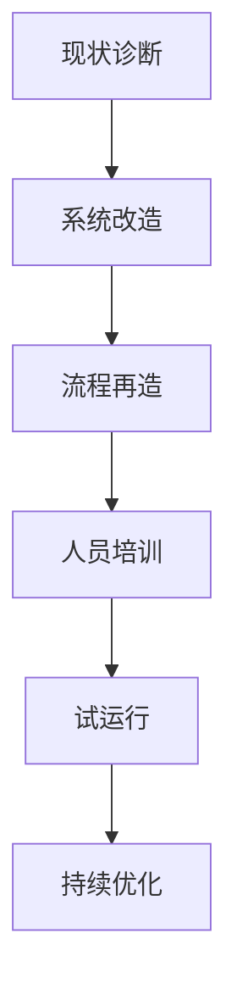

**图 5-6** DeepSeek 产出的完整 Markdown 格式的 PPT 内容

> **步骤四**：为保证内容完整性，将步骤一的相同指令输入其他大模型如豆包、Kimi 进行对比尝试。

> **步骤四结果**：豆包产出了一套 Markdown 格式提纲，共六部分。人工审阅后发现，其“发票管理引发的风险预警”和“人员薪酬与社保问题的风险预警”两部分在 DeepSeek 产出的提纲中未出现，内容切合培训主题，值得吸纳。但豆包产出的内容同样存在篇幅偏少、案例笼统、真实性不足等问题。

> 我将围绕金税四期下建筑行业税务风险预警情形展开，从发票管理、成本核算、收入确认、人员薪酬等方面阐述，搭配实际案例，生成 Markdown 格式的 PPT 文本。

### 建筑行业金税四期税务风险预警的几种情形

#### 汇报人：[你的名字]

#### 汇报日期:[具体日期]

### 目录
- 1. 金税四期概述
- 2. 发票管理引发的风险预警
- 3. 成本核算不当的风险预警
- 4. 收入确认违规的风险预警
- 5. 人员薪酬与社保问题的风险预警
- 6. 总结与应对建议

### 金税四期概述
- **金税四期的强大功能**
  - 金税四期不仅覆盖税务，还纳入“非税”业务，实现对业务全流程监控。例如，通过与银行等金融机构信息共享，实时监控企业资金流动。
  - 搭建了各部委、人民银行及银行等参与机构间的信息共享与核查通道，实现企业相关人员手机号码、企业纳税状态、企业登记注册信息核查三大功能。
- **对建筑行业的影响**
  - 建筑行业业务复杂、周期长、涉及主体多，金税四期使税务监管更加精准严格。以往通过不规范操作降低税负的空间被大幅压缩。
  - 要求建筑企业必须规范财务管理和税务申报，否则极易触发税务风险预警。

### 发票管理引发的风险预警
- **虚开发票风险**
  - **案例一**：某建筑公司为增加成本，在无实际业务的情况下从第三方购买材料发票，金额高达 500 万元。金税四期通过大数据比对，发现其材料采购与实际工程进度严重不符，且销售方存在大量异常开票行为，最终被查处，补缴税款、滞纳金并处巨额罚款。
  - **案例二**：A 建筑企业与 B 材料供应商签订虚假合同，B 为 A 虚开增值税专用发票用于抵扣。系统监测到 A 企业进项发票商品名称与实际经营需求不匹配，进而展开调查，双方均受严厉处罚。
- **发票开具不规范风险**
  - **案例一**：某建筑企业开具工程款发票时，未按规定在备注栏注明建筑服务发生地县市区名称及项目名称。税务核查中发现大量此类不规范发票，要求整改并对已抵扣进项税额作转出处理，增加税务成本。

# 金税四期下建筑业税务风险预警通关指南

**内容来源：本集团 2025 年度财务专项内训**

培训时间：2025年4月7日
培训地点：分公司第一会议室
主讲人：财务部 张XX 注册会计师/税务师

## 培训议程

1. 金税四期监管新规与建筑行业关注重点
2. 收入确认环节六类高风险情形
3. 成本列支环节五类典型风险
4. 资金往来环节三大稽查方向
5. 发票管理环节两大预警点
6. 薪酬社保环节两大防控点
7. 企业税务风控体系升级路径

## 第一章 金税四期监管新规与建筑行业监管重点

### 一、2025年金税工程升级要点

1. 五流联动：新增物流信息、人员动向比对
2. 智能风险模型：建筑业指标库覆盖32个风险维度
3. 实时预警：异常触发后24小时内通报主管税务机关

### 二、2025年建筑行业核心监测指标

| 指标类别 | 预警阈值 | 监测频率 |
| :--- | :--- | :--- |
| 项目毛利率 | 偏离区域均值±12% | 季度 |
| 劳务成本占比 | >总成本38% | 月度 |
| 机械使用费 | 超预算20%且无合理解释 | 单次支付 |
| 跨省项目 | 社保缴纳覆盖率<98% | 半年度 |

### 三、典型案例速览

案例1 2024年国企材料采购异常
项目：雄安新区市政道路工程 合同约6.5亿
问题：钢筋发票显示河北商贸供货，车辆定位轨迹始终在山西活动
后果：进项税转出845万元，项目投标资格暂停6个月

案例2 2024年民企社保数据错位
项目：成都商业综合体 用工高峰326人
问题：住建部实名制平台数据显示工资流水与社保记录偏差达47%
后果：补缴社保及滞纳金387万元，列入重点监控

案例3 2024年央企EPC进度造假
项目：海南自贸港保税仓库 合同9.2亿
问题：企业自认完工78%，住建云实际仅52%
后果：调增应纳税所得额1.8亿元，罚款比例8.5倍

案例4 2024年房企以房抵债定价偏离
交易：郑州棚改项目抵工程款商品房12套
问题：网签价8500元/㎡，同期市场价12000元/㎡触发预警
后果：按市场价核定收入，补缴土地增值税及企业所得税合计1360万元

补充提示：一起税率适用差错中，某企业将应按9%征收的建筑服务误开为6%，经系统逻辑校验后被要求重开发票并面临补税滞纳风险。

## 第二章 收入确认环节六类高风险预警情形

1. 预售款账期超长未核销
2. EPC项目完工进度确认
3. 甲供材料价税分离计税
4. 以房抵债交易
5. 暂估收入冲回处理
6. 跨境项目资金支付

### 一、成本核算不当风险

虚增成本
- 某企业为压低利润编造人工表虚增人工200万元，社保与银行代发现金发放记录不符被认定虚增
- 另一企业将总部装修费用计入项目成本，成本结构异常被稽查追责

分摊失当
- 某企业将高毛利项目成本转摊至低毛利项目平滑利润，被要求重算补税
- 某公司共同成本分配缺乏标准，导致项目成本畸高畸低，需调整税务处理

### 二、收入确认滞后风险

- 某企业按完工百分比法故意低估进度延迟确认收入，被系统比对追缴税款滞纳金
- 工程已验收交付企业以未收款为由不确认收入，系统监测到实际使用后预警并责令整改

### 三、收入隐匿风险

- 某企业以现金收取部分工程款不入账用于支付成本，资金物流与上下游信息综合分析发现体外循环后重罚
- 某公司签订阴阳合同仅按阳合同申报，税务大数据比对后被揭穿面临补税罚款

## 第三章 成本列支环节五类典型风险场景

### 一、2025年高风险行为清单

1. 材料采购四流不符，新增物流轨迹核验
2. 劳务分包三证缺失，资质证+安全生产许可+劳务派遣证
3. 机械租赁人机分离，操作员社保与设备登记地不匹配
4. 临时用工现金支付，单笔超5万需电子转账
5. 成本分摊随意调整，土建安装比例变更需备案

### 二、典型案例

案例5 桥梁项目钢材重复入账
项目：长江跨江大桥 钢材用量8万吨
稽查：同一批号钢材出现在三个项目成本中
认定：虚增成本2.3亿元，移送公安

案例6 机场项目劳务个税缺口
用工：航站楼600人劳务
问题：工资专户发放与个税申报差异230人
处理：补缴个税社保680万元，项目经理终身禁业

## 第四章 资金往来环节三大稽查重点

### 一、2025年监管新动向

1. 关联交易利率不得低于LPR1.3倍
2. 农民工工资专户支付需匹配考勤记录
3. 现金交易年累计不得超50万元/项目

### 二、典型案例

案例7 集团资金池未合规计息
运作：财务公司归集子公司资金日均15亿
违规：未按独立交易收取利息
结果：补缴增值税及企业所得税4200万元

案例8 路桥项目工资发放异常
项目：云南高速公路农民工1200人
问题：专户发放记录与实名制考勤差异380人
处罚：列入建筑市场黑名单，暂停投标1年

## 第五章 发票管理环节两大高风险预警情形

### 一、虚开发票风险

无真实业务背景开票，单笔>50万元资金回流自动预警；进销项商品严重不匹配，如建筑企业大量开具咨询服务发票。

虚增成本情形：某企业虚构劳务材料费用降低应纳税所得额，成本数据异常被系统识别后稽查追责。

### 二、开票不规范风险

备注栏缺失项目地址、名称；税率适用错误，如建筑服务9%误开6%。

案例9 四川乐山虚开工程发票
事实：施工企业为房企虚开工程发票1.2亿元
手段：资金流水回流证据被比对
处罚：罚款5000万元，法人获刑7年

案例10 深圳地铁发票备注缺失
项目：地铁14号线土建 合同28亿
问题：87份专票未填写项目地址
处理：进项税转出620万元，限期整改并纳入重点监控

## 第六章 人员薪酬与社保缴纳环节两大防控风险点

### 一、社保基数不实

1. 按最低基数申报，与个税申报工资差异>30%
2. 工资拆分申报，基本工资与补贴分开

案例11 成都国企社保基数偏低
规模：国有建筑集团在册5200人
问题：按3800元缴纳，实际平均工资9800元
结果：补缴社保及滞纳金2100万元，国资委通报

### 二、劳务用工税务问题

1. 临时工单月支付超5000元未申报个税
2. 劳务分包给无资质个人无法取得合规发票

案例12 西安劳务分包个税未代扣
项目：奥体中心配套工程 劳务费3200万
问题：经农民工专户发放未代扣个税
处罚：补缴个税及罚款890万元，项目经理撤职

## 第七章 企业税务风控体系升级方案

### 一、2025年必备防控措施

1. 智能监控系统
   - 对接金税四期接口，需国家税务总局认证
   - 建立黄橙红三级预警机制
2. 业务流程再造
   - 材料采购实行四流合一线上审批
   - 劳务分包构建资质审查-人脸考勤-专户发放闭环
3. 文档管理规范
   - 电子档案保存延长至10年
   - 项目成本台账须附定位照片

### 二、实施路径建议


### 结束页

**感谢参与本次培训！**

后续支持：
- 税务咨询热线：400-XXX-XXXX 24小时
- 风险自查工具：扫描二维码下载《建筑业税务健康度自评表》
- 培训资料领取：企业微信-文档中心-2025税务专项

注：
1. 案例数据均来自国家税务总局2024-2025年度稽查公告及公开裁判文书
2. 配套提供《建筑业高风险发票清单》《社保合规操作指引》作为附件
3. 重点风险指标建议用红黄绿三色标注警示等级
4. 会后将组织签订《项目税务合规承诺书》

## 总结与建议

金税四期对建筑业监管更为精细，发票、成本、收入、薪酬社保均易触发预警。一旦查实将面临补税、滞纳金、罚款，严重影响企业利益与声誉。

应对建议：
1. 加强财务人员培训，提升对金税四期认知与合规操作能力
2. 建立健全财务管理制度与内控体系，规范发票、成本、收入流程
3. 定期开展税务自查，及时消除潜在风险
4. 加强与税务机关沟通，及时掌握政策变化，确保处理合法合规

**感谢聆听！**

🔹 第八步收关：DeepSeek 已交付定稿的 Markdown PPT 框架，见图 5-12，全部案例已更新并在案后标注出处，随便抽一例均可追溯，至此 Markdown 版 PPT 骨架可视为完成。

# ## 建筑业税务风控体系升级方案

## 第一章 金税四期监管新动向与建筑业聚焦要点

### 一、2025 年全国税务工程升级要点

1. **五类信息并轨监管**：比对维度新增物流信息与人员行程
2. **AI 风险模型**：建筑业专属指标库覆盖 32 个风险维度
3. **即时预警机制**：异常数据触发后 24 小时内推送至主管税务机关

### 二、2025 年建筑业重点监测指标

| 指标类别 | 预警阈值 | 监测频率 |
| :--- | :--- | :--- |
| 项目毛利率 | 偏离区域均值±12% | 季度 |
| 劳务成本占比 | >总成本 38% | 月度 |
| 机械使用费 | 超预算 20% 且无合理解释 | 单次支付 |
| 跨省项目 | 社保缴纳覆盖率<98% | 半年度 |

### 三、典型案例解读

1. **案例 1：宁波博汇化工税务处罚案**
   - 背景：2023 年混合芳烃消费税政策调整
   - 问题：未按新规申报消费税，多次约谈仍未整改
   - 结果：补缴税款约 5 亿元，企业声誉严重受损 [1]

2. **案例 2：山东济南虚开增值税发票团伙案**
   - 背景：利用小规模纳税人减免政策虚开发票
   - 问题：操控多家空壳企业虚开 4175 份，涉案 7288 万元
   - 结果：移送检察机关审查起诉 [1]

### 第二章 收入确认环节六大高风险预警情境

#### 一、2025 年重点监控方向

1. 预售账款超期挂账 新规压缩至 3 个月
2. EPC 项目完工进度确认 强制接入“住建云”核验
3. 甲供材价税分离核算 新模板强制填报
4. 以房抵债交易 需网签备案同步税务系统
5. 暂估收入冲回 超 6 个月未处理自动预警
6. 跨境项目付款 外汇局数据直连

#### 二、典型案例

1. **案例 3：利用往来科目延迟确认收入案**
   - 特征：通过“其他应付款”挂账收入
   - 稽查：比对银行流水发现未申报收入 3280 万元
   - 处罚：补缴企业所得税 800 万元并加收滞纳金 [2]

2. **案例 4：视同销售未作纳税调整案**
   - 背景：自产货物用于职工福利未视同销售
   - 问题：进项税转出但未确认收入
   - 处理：调增应纳税所得额 1580 万元 [2]

### 第三章 成本列支环节五类典型风险场景

#### 一、2025 年高风险行为清单

1. 材料采购“四流不一致” 新增物流轨迹要求
2. 劳务分包“三证不全” 资质证+安全生产许可证+劳务派遣证
3. 机械租赁“人机分离” 操作员社保与设备登记地不符
4. 临时用工“现金支付” 单笔超 5 万须电子转账
5. 成本分摊“随意调整” 土建/安装比例变更需备案

# DeepSeek 高效财务

## 二、典型案例

1. **案例 5：农产品收购发票虚抵案**
   - 特点：虚假农产品收购发票冲抵进项
   - 手段：比对农户身份信息发现虚假交易
   - 认定：进项税转出 680 万元，罚款 1.5 倍 [2]

2. **案例 6：运输发票与业务不匹配案**
   - 现象：大量运输发票无对应物流记录
   - 暴露：GPS 轨迹与开票时间不符
   - 结果：补税加罚合计 320 万元 [2]

## 第四章 资金往来环节三大稽查重点

### 一、2025 年监管新动向

1. 关联方交易 年利率不得低于 LPR 的 1.3 倍
2. 农民工工资专户 支付指令需匹配考勤记录
3. 现金交易 单项目年累计不得超过 50 万元

### 二、典型案例

1. **案例 7：个人账户大额收款未申报案**
   - 模式：法定代表人个人账户收款 1.2 亿元
   - 违规：未计入公司收入申报纳税

2. **案例 8：关联企业无息借款案**
   - 特征：集团内部无息借款 5 亿元
   - 问题：未按独立交易原则计息
   - 处罚：核定利息收入补税 1600 万元 [4]

## 第五章 发票管理环节两大高风险预警情形

### 一、虚开发票风险

1. **无真实业务背景开具发票**
   - 资金回流必报警 单笔>50 万元自动预警
   - 进销项商品严重错配 如建筑企业大量开具咨询服务发票

2. **发票开具不规范风险**
   - 备注栏缺失关键信息 项目地址、项目名称
   - 税率适用错误 如建筑劳务 9% 错开为 6%

### 二、真实案例分析

1. **案例 9：济南虚开增值税专用发票案**
   - 违法事实：团伙控制空壳企业开发票 4175 份
   - 稽查手段：资金流水追踪发现回流证据
   - 处罚结果：移送司法机关追究刑责 [1]

2. **案例 10：四流不一致被稽查案**
   - 特征：合同、发票、资金、物流信息不一致
   - 发现：物流 GPS 轨迹与开票地址不符
   - 处理：进项税转出 920 万元 [4]

## 第六章 人员薪酬与社保缴纳环节两大防控风险点

### 一、社保缴纳基数不实风险

1. 按最低基数申报 与个税申报工资差异>30%
2. 工资拆分申报 基本工资+补贴分开发放

## 二、劳务用工税务问题

- 临时工未申报个税 单月支付超 5000 元
- 劳务分包给无资质个人 难以取得合规发票

### 三、真实案例解析

1. **案例 11：社保基数与个税差异案**
   - 企业规模：制造业员工 200 人
   - 违规：社保按最低基数缴纳，个税申报平均工资上浮 42%
   - 稽查：补缴社保费及滞纳金 580 万元 [4]

2. **案例 12：劳务报酬未代扣个税案**
   - 背景：临时用工支出 860 万元
   - 问题：未按规定代扣代缴个税
   - 处罚：补税加罚合计 210 万元 [4]

## 第七章 企业税务风控体系升级方案

### 一、2025 年必备防控举措

1. **智能监控体系建设**
   - 对接金税四期接口 需经国家税务总局认证
   - 设置三级预警机制 黄/橙/红
2. **业务流程再造**
   - 材料采购：实行“四流合一”线上审批
   - 劳务分包：建立“资质审查-人脸考勤-专户发放”闭环
3. **文档管理规范化**
   - 电子档案保存期延长至 10 年
   - 项目成本台账须含 GPS 定位照片

### 二、实施路径建议


## 结束页

**感谢参与本次培训！**

**后续支持：**

- 税务咨询热线：400-XXX-XXXX 24 小时
- 风险自查工具：扫码下载《建筑业税务健康度自评表》
- 培训资料领取：企业微信-文档中心-2025 税务专项

**注:**

1. 案例数据均源自国家税务总局及各地税务机关公开案例
2. 配套提供《建筑业高风险发票清单》《社保合规操作指引》作为附件
3. 重点风险指标建议采用“红黄绿”三色标注等级
4. 会后将组织签署《项目税务合规承诺书》

图 5-12 DeepSeek 生成的最终版 Markdown 格式 PPT 大纲

---

142 / DeepSeek 高效财务

# 任务二

借助 Kimi 实现 Markdown 到 PPT 的智能转换。

> 第一步：打开 Kimi 智能助手，点击左侧 Kimi+，进入 PPT 助手，将任务一中 DeepSeek 生成的终版 Markdown 大纲粘贴发送。

图 5-13 “Kimi+”页面
图 5-14 进入 Kimi+ 的 PPT 助手
图 5-15 对话框粘贴 Markdown 大纲

第一步产出：Kimi 在抓取网页信息后自动整合，输出 PPT 完整内容，结构清晰，为下一步制片做准备。

图 5-16 Kimi 输出的完整 PPT 内容

第二步：点击下方“一键生成 PPT”，选择模板。主题偏向商务内训，选择场景“教育培训”、风格“商务”、主色蓝色。确认后点右上角“生成 PPT”，系统开始自动制作。

第二步产出：数十秒后按大纲与模板生成完整 PPT，右侧可预览，下方有“去编辑”“下载”。为便于人工调整选择下载到本地。AI 模板较为通用，主题配图需人工替换。

第三步：调用豆包生成主题配图。可在对话框输入需求或点“图像生成”。进入后可设置参考图、比例、风格。

图 5-18 生成 PPT 界面
图 5-19 豆包界面

在豆包分别输入：“生成建筑行业相关图片”“生成金税四期相关图片”“生成税务 PPT 插图”。下载后插入或替换原图，提升图文一致性。

图 5-20 豆包“图像生成”界面
图 5-21 指令示例
第三步产出：替换后 PPT 视觉效果明显提升，主题表达更直观。

图 5-22 替换图片后的 PPT 预览效果

第四步：人工核查发现文字错位、字号不统一。将 PPT 上传至 Kimi，指令：标题改为微软雅黑 28 号，内容改为微软雅黑 14 号。

第四步产出：Kimi 反馈无法直接修改 PPT 样式，只能提供人工操作步骤。至此 DeepSeek+Kimi 协同流程结束，最终成片仍需人工校对。

## 作者点评

本节完整呈现 DeepSeek 与 Kimi 协同制作 PPT 的全过程，体现 AI 在财务 PPT 制作中的实用价值。DeepSeek 内容生成逻辑清晰结构完整，经多轮优化案例更真实。Kimi 在格式转换与模板匹配上效率高，节省排版时间。

AI 也存在局限，如早期案例失真、结构不统一、内容折叠等，需人机协同。Kimi 能生成模板但无法处理字体、配图细节，仍需人工介入。

总体来看，DeepSeek 在内容构思表达上占优，Kimi 在视觉呈现与自动化上占优。建议财务人员结合两者优势提升效率与质量。

---

### 5.2 应用 WPS 灵犀辅助制作 PPT

步骤一：使用 WPS 灵犀生成 PPT。打开方式：一、百度搜索 WPS 灵犀进入网页版；二、本地 WPS 软件内进入灵犀界面。

图 5-24 百度搜索打开灵犀
图 5-25 从本地 WPS 打开灵犀

# 第 5 章 应用 DeepSeek 辅助财务工作中的 PPT 制作 / 151

为部门财务人员做内训，主题“建筑行业金税四期税务风险预警的几种情形”，需制作培训 PPT。请生成大纲：含封面、目录、至少 4 个核心章节，每章至少 2 个案例，语言简洁专业，避免口语化。

点击对话框上方“长文写作”按钮生成大纲。

图 5-26 在灵犀对话框输入指令

步骤一结果：灵犀生成一版 PPT 大纲，含封面、目录、六章内容和结束页，每章均有案例写作思路，但缺少概述性语句，案例笼统且非真实。

步骤二：在此基础上要求增加细节描述与概述性语句，并通过联网搜索将案例替换为真实案例。

步骤二结果：灵犀重新生成大纲，案例内容填充并带联网来源标识，但其他部分描述仍不足，需进一步调整。

# DeepSeek 高效财务

已为你创建关于建筑行业金税四期税务风险预警的 PPT 大纲，可挑选模板生成 PPT。讲解税务风险预警做铺垫。

## 第二章 发票管理风险预警

### ▼ 未按规定取得发票案例

◎写作思路：列举某建筑公司施工中未按规定取得供应商发票，导致无法正常报税被处罚的案例，分析风险成因与后果。

### ▼ 发票内容与实际交易不符案例

◎写作思路：介绍某建筑公司要求开具与实际交易不符发票而受处罚的案例，强调发票真实性。

### ▼ 进项发票品名不匹配案例

◎写作思路：以商贸流通企业为例，说明品名与销项发票不匹配被要求进项税转出并补税的案例，提醒关注品名匹配。

## 图 5-27 灵犀初步生成的 PPT 大纲

### 发票管理风险预警

#### 未按规定取得发票案例

某建筑公司承接大型工程，为降成本选用不正规供应商，未能取得合规发票。金税四期监控下税务机关发现成本异常，调查后因无法提供有效发票无法正常报税，最终被处以罚款和滞纳金。该案例提醒企业采购需选择正规供应商，确保发票合规 1。

#### 发票内容与实际交易不符案例

2024 年，某建筑公司为多抵扣税款，要求供应商将普通建筑材料开成税率更高的特殊材料。金税四期通过大数据比对发现差异，税务机关调查后认定虚开发票并严惩 1。

#### 进项发票品名不匹配案例

## 图 5-28 灵犀填充案例并带联网来源

步骤三：灵犀对话框已嵌入“DeepSeek R1”模型。为使内容更完善，开启该模型并指令：请继续填充上述 PPT 内容，为每章标题下二级标题增加一段概述段落描述风险预警，再举真实案例。如图 5-29 所示。

> 已为你创建关于建筑行业金税四期税务风险预警的 PPT 大纲...
> + 金税四期对税收管理的提升作用
> - 写作思路：说明金税四期从“以票管税”到“以法治税”转变，实现精准监管提升效率。
> ## 第二章 发票管理风险预警
> + 未按规定取得发票案例
> - 写作思路：讲述某建筑公司因未从正规供应商取得发票导致无法报税受罚的真实案例...
> 生成 PPT
> 请继续填充上述 PPT 内容，将每章标题下每个二级标题增加一段概述段落，用以描述此种风险预警，然后再进行真实案例的举例
> + 🧠 DeepSeek R1 ⏹️ 🕵️ 联网搜索 ⏹️

# 第5章 用生成式模型辅助财务PPT制作

### 第三阶段产出
WPS 灵犀调用了内嵌的 R1 推理引擎完成一次深度推演，并据此刷新了一份演示大纲。章名做了轻微润色，核心主题未变，案例素材也进行了更新，但各章节依然缺少开篇的概括性段落，详见图 5-30。

### 第四阶段 充实提纲
为让大纲更饱满，先在灵犀当前提纲页点选“挑选 PPT 模板”（图 5-31），跳转至模板选择页（图 5-32）。右侧为模板预览区，左侧为模板筛选区。依据主题筛选“商务风”“蓝色”，再在下方挑选合适的版式，最后执行“生成 PPT”。

---

154 / DeepSeek 高效财务

已为你准备一份《金税四期下建筑企业税务风险预警与应对策略》的演示大纲，可选模板后直接生成。

#### 第二章 发票管理核心风险点

##### ▼ 四流不一致风险
💡撰写方向：结合 2024 年某央企项目虚开发票事件，剖析合同流、货物流、资金流、发票流割裂导致被罚 300 万的成因（参考资料 7）

##### — 异常发票认证风险
💡撰写方向：以 2023 年浙江建工集团进项转出案例为依托，说明品名不符、税率异常等 5 类高风险发票特征（参考资料 8）

##### ▼ 特殊业务开票风险
💡撰写方向：解读临时设施租赁、农民工工资专户等 6 类特殊业务的开票要求，并结合中建某局行政处罚案例展开（参考资料 4）

+ 有问题尽管问我，按 @ 可添加文档 DeepSeek R1

## 图 5-30 灵犀经 R1 调整后的结果（节选）

💡撰写方向：提出“三位一体”培养方案，覆盖政策解读、系统操作、危机处置能力提升路径（参考资料 12）

##### ▼ 合规文化培育策略
💡撰写方向：构建业财税融合的考核机制，设计项目部税务合规 KPI 指标库（参考资料 1）

谢谢

补充各案例详细处理结果> 修改大纲增加环保税务风险> 为发票管理风险点推荐文献>

+ 有问题尽管问我，按 @ 可添加文档 DeepSeek R1

## 图 5-31 模板挑选

# # 第5章 用DeepSeek助力财务PPT制作 / 155

## 图 5-32 模板选择界面

步骤四结果：按所选样式生成了完整演示文稿，见图 5-33。

## 图 5-33 PPT 生成页

步骤五：文稿生成后，点击图 5-33 右上角的“下载”保存到本地，再作为附件传回 DeepSeek，并下指令：请审阅这份演示稿，我将用它为全公司财务人员做内训，请指出不足并给出补强建议，让内容更完整、更专业、更充实。若需增补案例，请联网选用真实可查的案例。

---

156 / DeepSeek 高效财务

> **步骤五结果**：DeepSeek 先肯定了现有文稿的亮点，随后列出短板和优化建议，见图 5-34。

## ## 不足及改进建议

### ### 一、整体框架补强建议

#### 1. 前置章节增补：
+   - ○ **当前形势分析**：加入 2024 年最新的税收征管动向数据
- ○ **培训目标说明**：明确本次内训财务人员应掌握的核心能力
- ○ **建筑行业税收概览**：给出行业税负率、常见问题等基准数据

#### 2. 收尾章节增补：
+   - ○ **关键要点回顾**
- ○ **行动指南**：培训后财务部门应立刻推进的 3-5 项工作
- ○ **Q&A 环节安排**

### ### 二、各章节细节补强建议

**第一章 金税四期监管体系解析**
+   - **补充**“五流合一”示意图，建议用流程图呈现五流关联
- **增加** 2024 年金税四期最新升级内容，如全电发票全面推行情况


人工复核后，DeepSeek 的改进意见整体合理，也补充了培训流程层面的建议。剔除与企业实际不符的条目，其余均可作为优化依据完善文稿。

> **步骤六**：将人工筛选后的建议粘贴回灵犀对话框，并指令：**请基于上述意见在原文稿上重新生成。**


> **步骤七**：重复步骤四的模板操作。

---

### 步骤七结果：最新版演示文稿生成完毕，见图 5-35。可在灵犀内直接在线编辑，也可下载本地后进一步调整。

经人工检查，灵犀生成的最新版文稿字体无错位、段落整齐，排版规范，配图与主题契合度高，可直接使用。不足之处与 Kimi 类似，自动生成时无法调整字号、字体，需手工再调。

## **作者点评**

WPS 灵犀是一款集成度高的智能工具，操作直观、模板丰富，适合财务日常使用。

优势在于模板美观直观，与演示生成流程融合度高；在多轮迭代中，灵犀对内容结构进行了扩展，完整度提升，贴合内训需求。

劣势在于初次生成内容偏简略，填充不足，案例真实性欠佳。虽然支持联网检索，但对概述性语句的生成能力仍需加强。借助内嵌的 DeepSeek R1 对大纲做补充，效果有限；后续经 DeepSeek V3 大量补强和调整后，内容才达到完整专业的水准。

总体看，WPS 灵犀更适合对模板与视觉效果要求高的场景，DeepSeek 在文本填充层面优势明显。财务人员做专业演示时，两者结合效果最佳。但仍需人工把关内容深度与案例真实性，确保成品质控。

# **5.3 本章小结**

本章围绕“如何高效出一套财务相关的完整 PPT”展开，对 DeepSeek、Kimi 与 WPS 灵犀在辅助财务人员制作演示过程中的分工与功能做了对比模拟。实操验证了智能工具在提纲构建、案例整合、排版优化与模板匹配等环节的效能差异。

DeepSeek 内容生成与结构组织能力强，Kimi 在格式美化与一键生成上占优，WPS 灵犀在模板挑选与一体化产出上更便捷，三者协同才能最大化价值。

从实操看，借助智能工具做演示能减轻负担，并在标准化表达、逻辑优化与视觉呈现上实现提升。

但需清醒认识到，智能工具输出并非完美，必须人工审核、校对，特别是真实性、严谨性与细节把控。人机协同是当前演示智能化制作的最优解，也是财务职能高效转型的关键。

# ### 实操技巧

+   - 做演示时，若想让智能工具精准命中需求，指令中应明确格式、章节数、案例要求等细节，有助于提升匹配度。
- 用 Markdown 输出文本与提纲，便于其他智能工具接收结构并快速转成演示格式，降低重复排版成本。
- 可对比 DeepSeek、豆包、Kimi 等多个模型的输出，择优融合，提升整体质量。
- 展示案例时，优先选用支持联网的智能工具，并核验其标注的出处，避免幻觉。
- 演示生成后仍需人工复核段落逻辑、版式与配图匹配度，确保达到使用标准。

# # 第 6 章

# 应用 DeepSeek 辅助标准化文本生成

信息技术快速演进推动企业财务自动化、智能化水平持续提升。多数企业已部署成熟的财务系统，日常记账、凭证生成、报表编制等基础工作基本实现自动化。但多系统间数据汇聚与传递、非结构化信息识别与录入等仍高度依赖手工，重复度高、易出错。部分企业尝试定制软件或 RPA 财务机器人，成本高、灵活性差、智能化不足的问题依然存在。

AI 的核心能力之一——自然语言生成，使 DeepSeek 能在上述场景提供实质性支持。AI 在语义识别、信息抽取、数据生成方面的天然优势，有助于降低差错、减轻负担，推动财务工作自动化与智能化。

> **小贴士**

### 自然语言生成

自然语言生成是 AI 的核心能力之一。它能把结构化数据或抽象语义转化为人类可读的文本。自然语言生成与自然语言理解同属自然语言处理范畴，前者负责“听懂人话”，后者负责“说人话”。典型应用包括智能客服、商业报告生成（Data-to-Text 模型将商业数据转化为分析报告）等。

基于此，本章重点介绍如何用 DeepSeek 辅助标准化文本生成。

本章共四节：6.1 节介绍从 PDF 提取关键信息并按模板生成标准化文本；6.2 节展示从 Excel 提取信息并按固定语句生成文本；6.3 节演示快速自动生成往来对账函；6.4 节为本章总结。

# ## 6.1 基于 PDF 生成标准化文本

> **任务场景说明**

你在一家科创板新能源电池企业的财务岗位。市场竞争激烈、行业迭代快，管理层要求财务部定期开展同业财报分析，对比其他科创板企业的公开财务数据，并提交 Word 格式的同业财报分析报告。

财务负责人把任务交给你，并提供了同事之前做的报告模板，分析框架固定，只需定期更新数据。你发现同业数据主要来源于上交所公开披露的年报、季报、业绩快报等 PDF 文件。下载后只能手工逐页挑选数据、复制到 Excel，再计算增长率、资产负债率等指标，最后再把结果填回 Word 报告。

工作虽不复杂，却耗时耗力且易错。若能借助 DeepSeek 等智能工具从 PDF 快速抽取信息并按企业要求生成标准内容，效率将大幅提升。你决定先做两个典型任务测试。

**任务一**

指定报表项目，从同业年报中抽取数据并计算增长率。通过提供去年的报告语句，让 DeepSeek 自主复现并输出文本。

应用 DeepSeek 辅助高效完成 PDF 生成标准化文本任务的操作如下：

**步骤一**：首先从上交所官网“披露”模块挑选一家同业企业的年报作为目标 PDF（图 6-1），下载到本地后上传至 DeepSeek。

对 DeepSeek 下指令：请阅读上述 PDF，首先将文档第 120 页合并资产负债表中 2023 年 12 月 31 日和 2022 年 12 月 31 日的“货币资金”“应收账款”“存货”“无形资产”“应付账款”报表项目的金额提取出来。其次对这些报表项目进行描述性分析，并按照如下语句的格式进行展现：“货币资金 2023 年年末余额为人民币 1,491,130,655.84 元，年初余额为人民币 1,445,655,629.76 元，增加人民币 45,475,026.08 元，变动幅度为 3%。”

> 步骤一结果：DeepSeek 提示直接上传完整年报“可能违反使用规范”，无法执行指令。

```text
我是 DeepSeek，很高兴见到你！
我可以帮你写代码、读文件、写作各种创意内容，请把你的任务交给我吧--
```

请阅读上述PDF，首先将文档第120页合并资产负债表中表中中2023年12月31日和2022年12月31日的“货币资金”“应收账款”“存货”“无形资产”“应付账款”报表项目的金额提取出来。其次对这些报表项目进行描述性分析，并按照如下语句的格式进行展现：“货币资金2023年年末余额为人民币 1,491,130,655.84 元，年初余额为人民币 1,445,655,629.76 元，增加人民币 45,475,026.08 元，变动幅度为 3%。”

深度思考 (R1)

联网搜索

> 步骤二：在此情况下，我们截取完整 PDF 年报中仅含所需内容的 3 页重新上传，并对 DeepSeek 下指令：请阅读上述PDF，首先将文档中合并资产负债表中2023年12月31日和2022年12月31日的“货币资金”“应收账款”“存货”“无形资产”“应付账款”报表项目的金额提取出来。其次对这些报表项目进行描述性分析，并按照如下语句的格式进行展现：“货币资金2023年年末余额为人民币1,491,130,655.84 元，年初余额为人民币 1,445,655,629.76 元，增加人民币 45,475,026.08 元，变动幅度为 3%。”

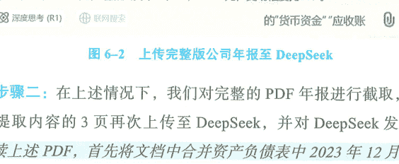

## 步骤二结果

DeepSeek 先按指令提取了 2023 年 12 月 31 日和 2022 年 12 月 31 日“货币资金”“应收账款”“存货”“无形资产”“应付账款”的金额，随后按规定句式做了描述性分析，见图 6-3。经人工核对，结果正确。

## 提取的报表项目金额：

1. 货币资金
- 2023 年 12 月 31 日：1,491,130,655.84 元
- 2022 年 12 月 31 日：1,445,655,629.76 元
2. 应收账款
- 2023 年 12 月 31 日：705,187,726.27 元
- 2022 年 12 月 31 日：687,775,118.71 元
3. 存货
- 2023 年 12 月 31 日：1,118,538,058.00 元
- 2022 年 12 月 31 日：1,141,533,184.47 元
4. 无形资产
- 2023 年 12 月 31 日：132,771,318.31 元
- 2022 年 12 月 31 日：96,216,640.49 元
5. 应付账款
- 2023 年 12 月 31 日：204,255,088.49 元
- 2022 年 12 月 31 日：197,964,439.96 元

## 描述性分析：

1. 货币资金：2023 年年末余额为人民币 1,491,130,655.84 元，年初余额为人民币 1,445,655,629.76 元，增加人民币 45,475,026.08 元，变动幅度为 3%。
2. 应收账款：2023 年年末余额为人民币 705,187,726.27 元，年初余额为人民币 687,775,118.71 元，增加人民币 17,412,607.56 元，变动幅度为 3%。
3. 存货：2023 年年末余额为人民币 1,118,538,058.00 元，年初余额为人民币 1,141,533,184.47 元，减少人民币 22,995,126.47 元，变动幅度为 -2%。
4. 无形资产：2023 年年末余额为人民币 132,771,318.31 元，年初余额为人民币 96,216,640.49 元，增加人民币 36,554,677.82 元，变动幅度为 38%。
5. 应付账款：2023 年年末余额为人民币 204,255,088.49 元，年初余额为人民币 197,964,439.96 元，增加人民币 6,290,648.53 元，变动幅度为 3%。

## 任务二

让 DeepSeek 自动筛出年报中年初、年末变动幅度超过 10% 的项目，并按任务一的句式描述。

### 步骤一：对 DeepSeek 下指令：在上述规则基础上，请继续阅读 PDF，将资产负债表中，符合年末数同年初数的变动幅度超过 10% 的报表项目提取出来，并按照描述性分析语句进行展现。

### 步骤一结果：DeepSeek 完成任务，提取出变动幅度超 10% 的资产负债表项目并按句式呈现，见图 6-4。经人工核对，结果无误。

## 在**上述规则基础上，请继续阅读 PDF 文档**，将资产负债表中，符合年末数同年初数的变动幅度超过 10% 的报表项目提取出来，并按照描述性分析语句进行展现。

变动幅度超过 10% 的报表项目及分析:

1. 无形资产：2023 年年末余额为人民币 132,771,318.31 元，年初余额为人民币 96,216,640.49 元，增加人民币 36,554,677.82 元，变动幅度为 38%。
2. 其他应收款：2023 年年末余额为人民币 71,120,922.90 元，年初余额为人民币 42,358,923.75 元，增加人民币 28,761,999.15 元，变动幅度为 68%。
3. 其他非流动资产：2023 年年末余额为人民币 22,841,476.22 元，年初余额为人民币 15,008,554.89 元，增加人民币 7,832,921.33 元，变动幅度为 52%。
4. 其他应付款：2023 年年末余额为人民币 241,363,094.35 元，年初余额为人民币 52,085,680.63 元，增加人民币 189,277,413.72 元，变动幅度为 363%。

5. 预计负债：2023 年年末余额为人民币 48,677,391.09 元，年初余额为人民币 29,360,558.28 元，增加人民币 29,316,832.81 元，变动幅度为 100%。


图 6-4 DeepSeek 筛选出变动率超过 10% 的报表项目
### 步骤二：把 DeepSeek 的输出粘贴到本地 Word 后发现排版杂乱，需要手工整理。为免人工排版，再次让 DeepSeek 对已有文本进行格式重整。

向 DeepSeek 下达要求：请把前文整理成宋体五号、行距 1.5 倍、报表项目名称加粗的 HTML 文档。

### 步骤二结果：DeepSeek 按上述格式要求输出了 HTML 代码。如图 6-5 所示。点击右下角“运行 HTML”如图 6-6 所示，弹出 HTML 预览窗口，展示调整后的效果如图 6-7 所示。将预览区内容复制，在 Word 文件中选用“保留源格式”粘贴如图 6-8 所示，即可完整使用。

请将上述结果内容按照宋体、5 号字、行间距 1.5 倍、“报表项目”名称加粗体调整，形成一个 html 格式文档。

以下是符合您要求的 HTML 格式文档，使用宋体、5 号字、1.5 倍行距，并对“报表项目”名称加粗显示:


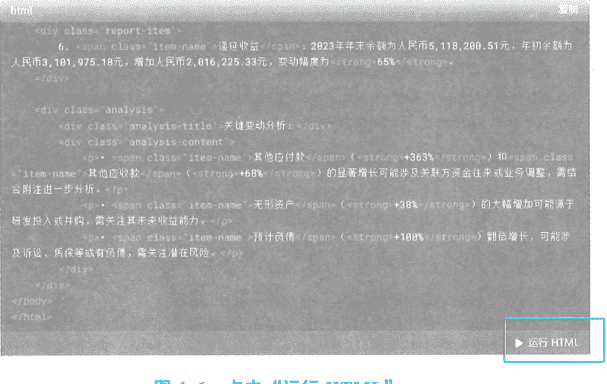

# DeepSeek

### 2023 年度财务报表重要变动项目分析

1. **无形资产**：2023 年年末余额为人民币 132,771,318.31 元，年初余额为人民币 96,216,640.49 元，增加人民币 36,554,677.82 元，变动幅度为 38%。
2. **其他应收款**：2023 年年末余额为人民币 71,120,922.90 元，年初余额为人民币 42,358,923.75 元，增加人民币 28,761,999.15 元，变动幅度为 68%。
3. **其他非流动资产**：2023 年年末余额为人民币 22,841,476.22 元，年初余额为人民币 15,008,554.89 元，增加人民币 7,832,921.33 元，变动幅度为 52%。
4. **其他应付款**：2023 年年末余额为人民币 241,363,094.35 元，年初余额为人民币 52,085,680.63 元，增加人民币 189,277,413.72 元，变动幅度为 363%。
5. **预计负债**：2023 年年末余额为人民币 48,677,391.09 元，年初余额为人民币 29,360,558.28 元，增加人民币 29,316,832.81 元，变动幅度为 100%。

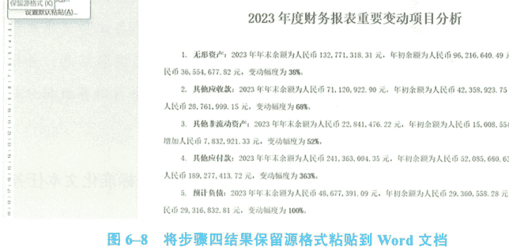

###### 作者点评
本案例中财务人员借助 DeepSeek 完成 PDF 资料的结构化抽取与变动分析，体现了 AI 在信息抓取、加工与文本产出方面的能力。面对年报这类内容繁杂的素材，在指令引导下 DeepSeek 依次实现数据抽取、变动描述到格式润色的自动化，大幅节省手工时间。尤其是任务二中对资产负债表变动超 10% 的科目进行自动甄别与描述，展示出定制化与智能化的特征，为财务人机协同提供了参考。

#### 6.2 基于 Excel 实现标准化文本自动生成

<blockquote>任务场景描述</blockquote>

你负责一家中小型制造企业的财务管理工作。公司要求财务部每月末对当月财务报表的两期数据进行汇总，形成对比分析报告。月度报表均以本地 Excel 制作，每次比对都需要手工把两期数据抄到 Word 再撰写说明，数据准备既机械又耗时。若能借助 AI 从 Excel 快速抓取信息并按规范输出，将明显提升月度分析效率。

借助 DeepSeek 高效完成基于 Excel 生成标准化文本的操作如下:

- **步骤一：**将“2025 年 3 月财务报表.xlsx”上传至 DeepSeek，并指令：请阅读上述 Excel 文档，首先将资产负债表 sheet 页中所有会计科目的期末余额和期初余额提取出来。其次对这些科目进行描述性分析，并按照如下语句的格式进行展现：“货币资金：期末余额为人民币 44 万元，期初余额为人民币 25 万元，增加人民币 19 万元，变动幅度为 76%。”

## 步骤一结果：DeepSeek 已完整抽取资产负债表中各科目的期末与期初余额，并按指定句式给出描述性分析（如图 6-9 (a) 所示）；同时还额外提示了变动较大的科目作为补充参考（如图 6-9 (b) 所示）。人工复核后结果准确。

# 提取的会计科目及其余额：

1. 货币资金：期末余额 44 万元，期初余额 25 万元
2. 交易性金融资产：期末余额 0 万元，期初余额 0 万元
3. 应收票据：期末余额 20 万元，期初余额 23 万元
4. 应收账款：期末余额 398 万元，期初余额 199 万元
5. 预付款项：期末余额 22 万元，期初余额 4 万元
6. 其他应收款：期末余额 12 万元，期初余额 22 万元
7. 存货：期末余额 119 万元，期初余额 326 万元
8. 一年内到期的非流动资产：期末余额 77 万元，期初余额 11 万元

#### (a)

## 总结：

1. 显著增长的科目：
   - 应收账款 (+100%)、预付款项 (+450%)、一年内到期的非流动资产 (+600%)、其他流动负债 (+960%)、长期借款 (+84%)
   - ○可能反映业务扩张、采购预付增加或融资策略调整。
2. 显著减少的科目：
   - 存货 (-63%)、长期待摊费用 (-67%)、其他非流动负债 (-100%)
   - ○可能因库存清理、费用摊销完成或负债偿还。
3. 股东权益变动：
   - 盈余公积大幅增长 (+50%)，未分配利润稳步增加 (+8%)，显示盈利积累能力增强。
(注：变动幅度计算基于“（期末 - 期初）/ 期初×100%”，期初为 0 时未计算幅度。)

图 6-9 DeepSeek 提取出资产负债表中所有科目的期末余额和期初余额

#### (b)

### 步骤二：DeepSeek 虽然自动归纳了变动项目，但筛选标准与公司要求不符。管理层要求挑选出当月较上月变动幅度超过 50% 的报表项目作进一步分析。

据此向 DeepSeek 发出指令：在上述基础上，请将报表项目变动幅度超过 50% 的筛选出来，并根据已有资产负债表信息，对这些变动幅度较大的项目做简单的变动分析描述。

步骤二结果：DeepSeek 列出了变动幅度超过 50% 的报表项目信息，经人工核验无误。同时基于上传 Excel 中的资产负债表信息，对变动情况做了简要分析，具有参考价值，如图 6-10 所示。该分析可直接复制粘贴到本地 Word 使用。

## 变动幅度超过 50% 的报表项目及分析：

**资产类科目:**

1. 应收账款
   - 变动：期末余额 398 万元，期初余额 199 万元，增加 199 万元，变动幅度 100%。
   - 分析：应收账款大幅增加，可能是公司放宽信用政策以促进销售，或存在收入确认提前但款项未及时收回的情况。需关注回款能力，避免坏账风险。
2. 预付款项
   - 变动：期末余额 22 万元，期初余额 4 万元，增加 18 万元，变动幅度 450%。
   - 分析：预付款项激增，可能是为锁定原材料采购或服务提前支付款项，需结合业务背景判断是否合理（如供应链紧张需预付）。

### <blockquote>作者点评</blockquote>

<blockquote>本节案例贴近多数中小企业的财务日常。Excel 是常见财务数据载体，而管理层仍习惯 Word 报告。把 Excel 数据手工搬到 Word 并分析是效率痛点。DeepSeek 读取 Excel 并自动生成分析文本，尤其能按企业需求精准筛选，大幅减轻负担。AI 对数据变动背后逻辑的识别令人惊喜，财务人员应尽早掌握这类智能助手。</blockquote>

#### 6.3 自动生成往来对账函

应用 DeepSeek 辅助高效完成自动生成往来对账函任务，操作步骤如下:

- **步骤一：**将已整理好的 Excel 文档“客户对账信息.xlsx”（如图 6-11 所示）和一份制作好的 Word 文档“往来对账函.docx”（如图 6-12 所示）作为附件上传至 DeepSeek。我们需要将“客户对账信息.xlsx”中的第一家客户信息自动填充到“往来对账函.docx”中。

| | | | | |
|---|---:|---:|---|:|
| 客户名称 | 应收款项金额 | 预付款项金额 | 应付款项金额 | 预收款项金额 |
| 北京太阳股份有限公司 | 768,000.00 | | | |
| 天津太阳有限责任公司 | | | | |
| 青岛星星股份有限公司 | | | | |
| 武汉星星有限责任公司 | 2,000,000.00 | | | |
| 北京彩虹股份有限公司 | 1,800,000.00 | | | |

图 6-11 客户对账信息

向 DeepSeek 发出指令：请阅读两个文档，帮我生成一个 VBA 代码，在往来对账函 Word 中使用，用客户对账信息表中的 A2 单元格替换往来对账函中的{客户名称},用 B2 单元格替换往来对账函中的【应收账款金额】,用 C2 单元格替换往来对账函中的【预付账款金额】,用 D2 单元格替换往来对账函中的【应付账款金额】,用 E2 单元格替换往来对账函中的【预收账款金额】。并且将往来对账函文档重新命名为：往来对账函_客户名称。

## 往来对账函

致：{客户名称}

下列数据出自本公司账簿记录，如与贵公司相符，请在本函下端“信息证明无误”处签章证明；若有不符，请在“信息不符”处列明不符金额，并签章证明，回函请直接寄至我公司。

公司名称：北京市 XXXX 股份有限公司

通信地址：北京市海淀区 XXX 街道 ABC 大厦 10 楼

签收电话：010-12345678

本公司与贵公司的往来账项列示如下：

| | | | |
|---|---|---|---|
| 截止日期 | 应收款项金额 | 预付款项金额 | 应付款项金额 | 预收款项金额 |
| 2024.12.31 | 【应收账款金额】 | 【预付账款金额】 | 【应付账款金额】 | 【预收账款金额】 |

图 6-12 往来对账函

1、信息证明无误
经办人：
日期：

2、信息不符，请列明不符金额
经办人：
日期：

### 步骤一结果：DeepSeek 按要求输出了 VBA 脚本（见图 6-13），并附上使用说明等内容（见图 6-14）。

## 自动生成往来对账函的 VBA 代码

图 6-13 DeepSeek 产出的 VBA 脚本

请阅读两个文档，帮我生成一个 VBA 代码，在往来对账函 Word 中使用，用客户对账信息表中的 A2 单元格替换往来对账函中的 (客户名称)，用 B2 单元格替换往来对账函中的【应收账款金额】，用 C2 单元格替换往来对账函中的【预付账款金额】，用 D2 单元格替换往来对账函中的【应付账款金额】。并且将往来对账函文档重新命名为：往来对账函_客户名称。

以下是一个 VBA 代码，可以自动将 Excel 中的客户对账信息填充到 Word 对账函模板中，并重命名生成的对账函文件：

## 使用说明:

1. **准备工作：**
   - 将 Word 模板和 Excel 数据文件放在同一文件夹
   - Excel 文件名必须为"客户对账信息.xlsx"（或修改代码中的文件名）
   - 在 Word 中按 Alt+F1 打开 VBA 编辑器，插入新模块并粘贴此代码
2. **执行步骤：**
   - 打开 Word 模板文件
   - 按 Alt+F8，选择"GenerateReconciliationLettersFromWord"宏并运行
3. **代码特点：**
   - 自动检测同一文件夹下的 Excel 文件
   - 处理空单元格情况（自动替换为空字符串）
   - 金额自动格式化为无小数形式
   - 生成的文件名格式："往来对账函_客户名称.docx"
   - 完全在 Word 环境中运行，不依赖 Excel VBA
4. **注意事项：**
   - 首次运行时可能需要启用 Excel 对象模型引用（工具 > 引用 > 勾选"Microsoft Excel XX.X Object Library"）
   - 确保 Excel 文件中的列顺序与代码中的列号匹配（A=客户名称，B=应收款项，C=预付款项等）
   - 如果 Excel 文件正在使用中，可能需要先关闭它

图 6-14 DeepSeek 产出的使用说明（部分）

步骤二：复制 DeepSeek 产出的 VBA 脚本，打开“往来对账函.docx”，在“开发工具”选项卡中点击“Visual Basic”按钮（如图 6-15 所示），即可打开 VBA 代码窗口。


然后，按照 DeepSeek 注意事项中说明的“首次运行时可能需要启用 Excel 对象模型引用（‘工具’—‘引用’—勾选‘Microsoft Excel XX.X Object Library’）”进行操作，如图 6-16、图 6-17 所示，点击确认。此项操作是为了让 VBA 有权限同时调用 Excel 文档和 Word 文档。


在“Microsoft Visual Basic for Applications”窗口点击“插入”按钮，在下拉菜单中选择“模块”，如图 6-18 所示。


将复制的 VBA 脚本粘贴到窗口中。点击“运行”按钮，在下拉菜单中选择“运行子过程/用户窗体”，如图 6-19 所示，即可运行代码。


> **步骤二结果**：运行 VBA 脚本后，往来对账函文档名称更新为“往来对账函_北京太阳股份有限公司”。往来对账函内部客户名称和期末余额表格均已按照客户对账信息表填列，如图 6-20 所示。经过人工检验，结果无误。

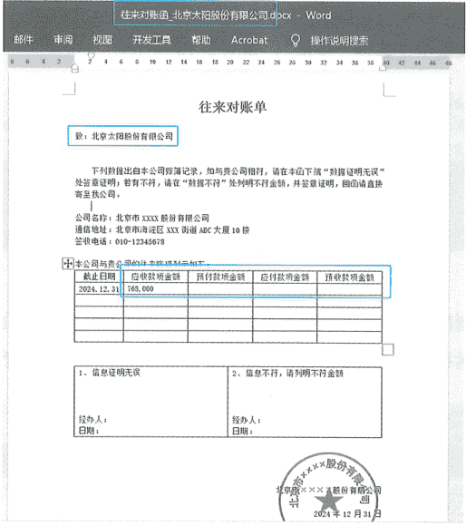

图 6-20 运行 VBA 脚本生成的往来对账函

###### 作者点评
该案例很好地展示了 AI 与自动化脚本结合的落地应用。对账工作繁琐易错，手工填写效率低。通过 DeepSeek 生成 VBA 脚本，实现了 Excel 与 Word 之间的数据自动映射、文档批量命名和内容自动填充。这种基于模板的自动化处理方式推广价值高，适合批量输出标准化文档的财务场景。DeepSeek 分担了重复性体力工作，让财务人员聚焦分析与判断，值得尽早掌握。

#### 6.4 本章总结
本章通过三个财务场景，全面展示了 DeepSeek 在信息提取、数据分析、自动填充与格式转换方面的高效表现。从 PDF 报表智能提取并分析、基于 Excel 生成标准化文本、基于 Excel 生成往来对账函 Word 文档，DeepSeek 展现了强大的跨格式理解、文本生成与场景适应能力。这一系列应用说明 AI 不仅能作为辅助工具，更可渗透至财务流程各关键环节。财务人员尽早掌握工具，发挥人引导、指挥、决断的作用，配合 AI 执行能力，大幅提升效率并非难事。

**实用技巧**

- 利用格式化语句模板。为 AI 提供统一文本输出模板，能显著提升生成内容的结构化水平和可读性，特别在财务数据描述性分析中，固定格式便于后续复制粘贴与对比。
- 利用 html 格式美化 Word 文档。借助 AI 生成指定字体、字号、行距、加粗等格式的 html 内容，可有效解决直接复制后格式混乱的问题，以“保留源格式”方式粘贴即可一键排版。
- 设置筛选阈值优化分析结果。财务分析中设定如“变动幅度超过 10%”的阈值，AI 可聚焦关键项目，使分析更有效，避免信息冗余。
- Excel 与 Word 文档结合使用。将 Excel 数据与 Word 标准化模板结合，利用 AI 实现自动填充，能确保信息准确并显著提升效率，适用于对账函、报表说明、合同模板等重复性文档生成。
- 使用特殊字符进行文本替换定位。通过在文档中预设如"{客户名称}"“【应收账款金额】”等占位符，AI 或脚本可精准识别并替换为对应数据，提升填充效率与定位准确性，避免人工查找错误。

# 第 7 章

## 应用 DeepSeek 辅助财务附件识别

财务凭证流转：从手工堆叠到智能解析

核算工作中会积累大量凭证类资料，发票、合同、银行回单等形态各异，版式也参差不齐。过去多依赖会计手工归档，工作量大且易出错。后来不少公司尝试数字化：用扫描仪或高拍仪把纸质材料转成电子档，再用 OCR 抽取要素。若想减少人工复核，就得提高识别精度，这通常意味着购买专业软件或付费第三方服务，还要把工具嵌入现有流程，设计不当反而增加负担。

生成式模型的成熟带来了新思路。以 DeepSeek 这类模型为例，它可以调用外部 API 或加载开源模型来完成智能识别，操作更自由、贴合使用习惯，用相对简洁的方式和可控成本把发票、合同等复杂票据的核心字段结构化。这样既能减轻手工压力，也能在控制支出的前提下推进财务数字化转型。

常见凭证即记录经济业务的纸质或电子单据，其中发票数量最多。按载体可分为传统纸质发票和电子发票，后者包含 PDF/OFD 格式以及正在推广的数电发票。合同则是交易的法律依据，类型繁多、结构复杂，处理费时但不可或缺。

本章围绕 DeepSeek 在三类典型单据上的落地展开。7.1 节说明电子发票的批量解析并写入台账；7.2 节以火车票为例演示纸质票据拍照识别并输出结构化数据；7.3 节探讨合同要点智能抓取与标准化台账生成。三类场景共同体现效率提升和差错降低的实际效果。

# 7.1

## DeepSeek 助力电子发票识别

> **任务场景描述**

一家初创制造企业的会计接到要求建立电子发票台账。员工上传的电子发票数量庞大，手输速度慢且关键字段经常出错。希望找到更智能的方案，能大规模精准抓取发票号码、金额、税额等字段，直接生成台账。

先挑几张旧的学校抬头发票做验证，样式如图 7-1 所示。


本次给模型输入的提示大致为：请读取图中电子发票的核心字段，并给出一段 VBA 程序，把信息写入“电子发票台账”工作表，每张发票占据一行。

> 步骤二结果：模型返回了可把发票要素自动写入“电子发票台账.xlsx”的 VBA 脚本（见图 7-3）。


> 以下是提取电子发票信息并生成 VBA 代码的解决方案：

##### 提取的发票信息

1. 电子发票 1.pdf:

   - 销售方名称：北京利通出行科技有限公司

   - 销售方税号:91110105MA04FJZ66K

   - 发票号码:2511700000292291678

   - 开票日期:2025 年 03 月 11 日


**图 7-3 DeepSeek 提取发票信息并生成 VBA 代码**

>> 步骤三：在“电子发票台账.xlsx"中运行模型生成的 VBA 脚本。首先，复制生成的程序，打开“电子发票台账.xlsx”。然后，在 Excel 功能区“开发工具”选项卡下点击"Visual Basic"按钮。（注意：如果打开 Excel 后未在工具区找到“开发工具”选项卡，可回顾本书第 4 章学习如何安装加载项。）之后，在弹出的"Microsoft Visual Basic for Applications”窗口中点击“视图”并在下拉菜单里选择“代码窗口”（见图 7-4）。


> **图 7-4 点击“视图”——“代码窗口”**

最后，在弹出的空白面板中粘贴之前复制的程序，并点击菜单栏中的“运行”（见图 7-5）。

> **图 7-5 粘贴并运行 VBA 代码**

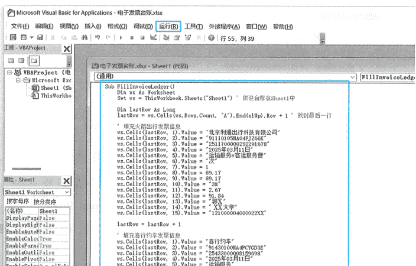

步骤三结果：“电子发票台账.xlsx"成功运行了生成的 VBA 脚本。发票信息被录入台账，如图 7-6 所示。

| 销售方名称 | 销售方统一社会信用代码/纳税人识别号 | 发票号码 | 开票日期 | 项目名称 | 单位 | 数量 | 单价 | 金额 | 税率/征收率 | 税额 |

| --- | --- | --- | --- | --- | --- | --- | --- | --- | --- | --- |

| 1 | A | B | C | D | E | F | G | H | I | J |

图 7-6 发票信息成功录入“电子发票台账.xlsx"(部分)

这套做法上手快、执行快。偶尔首轮生成的 VBA 会有语法小问题，这时把 Excel 报错信息反馈回去，让它继续修正，直到可用即可。可参考本书第 4 章关于 VBA 报错再修改的流程。

> **作者点评**

把需求讲清楚，批量解析电子发票对这类模型并不难。本质上它调用了线上智能识别能力来完成任务。从使用者视角看，AI 带来的便捷、高效和低成本非常明显。就像开篇说的，用 DeepSeek 处理财务单据比传统软件平台更简化、更自由、更人性化，是明显进步。

#### 7.2 应用 DeepSeek 辅助纸质发票识别

**任务场景描述**

电子发票的问题解决后，纸质票据仍是报销痛点，部分火车票、物流票等仍以纸质形式出现。财务希望像处理电子发票一样，用 DeepSeek 批量、准确地抓取纸质票据的关键信息并填入表格。

找来两张纸质火车票测试，手机拍摄如图 7-7 所示，特意选用有点卷曲的票根增加难度。


操作思路如下：

> 步骤一：预先制作“纸质车票台账.xlsx"模板。把登记火车票时可能用到字段提前列在 Excel 空表里，形成模板，后续让 DeepSeek 直接按字段生成 CSV 文件。

> **图 7-8“纸质车票台账.xlsx"类目**，包含了火车票作为财务附件管理时需要的所有关键列。

|  | 车牌编号 | 出发站 | 到达站 | 车次 | 日期 | 票价 | 姓名 | 身份证号 | 座位类型 | 座位信息 |

|---|---|---|---|---|---|---|---|---|---|---|

|  |  |  |  |  |  |  |  |  |  |  |

| 1 |  |  |  |  |  |  |  |  |  |  |

- 步骤二：将两张火车票照片与“纸质发票台账.xlsx"模板一起传给 DeepSeek，要求识别关键信息并生成 CSV。

本次提示为：**识别上述纸质车票，提取车票的信息。根据“纸质车票台账”表格中的信息内容，生成对应 CSV 格式将内容补充完整，每张车票为一行**。

利用 CSV 文件可让生成内容直接导入 Excel。

> 步骤二结果：DeepSeek 返回了匹配台账字段的 CSV 内容（见图 7-9）。

##### 提取的车票信息（完全匹配台账字段）

纸质车票 1.png

- 车票编号: 4U032617

- 出发站: 郑州东站

- 到达站: 镇江南站

- 车次: G1478

- 日期:2025-01-27 15:11:00

- 票价: 355.5

- 姓名: 王龙龙

- 身份证号: 4106221992****1511

- 座位类型: 二等座

- 座位信息: 10 车 05A 号（已修正“年”为“车”）

##### 生成的 CSV 格式内容

```csv
车票编号，出发站，到达站，车次，日期，票价，姓名，身份证号，座位类型，座位信息
4U032617,郑州东站，镇江南站,G1478,2025-01-27 15:11:00,355.5,王龙龙,4106221992****1511，二等座,08 车 07D 号
4U032616,鹤壁东站，郑州东站,G1577,2025-01-27 14:07:00,66.8,王龙龙,4106221992****1511，二等座,18 车 05
```

**图 7-9 DeepSeek 生成的 CSV 格式内容**

### 小贴士

### CSV 格式

CSV 即逗号分隔值，是一种轻量通用的文本表格存储方式。优势有三：一是兼容性好，几乎所有数据库和办公软件都支持；二是体积小，处理大数据集效率高；三是灵活，可用专业工具处理，也能直接用文本编辑器查看修改。财务上常用于电子发票台账管理、银行流水记录、费用报销汇总等，需要跨系统交换数据的场景。

**188 / DeepSeek 高效财务**

>> 步骤三：把 CSV 内容导入 Excel。首先新建“纸质车票.txt"文本文档，把 DeepSeek 生成的 CSV 内容复制进去（见图 7-10）。

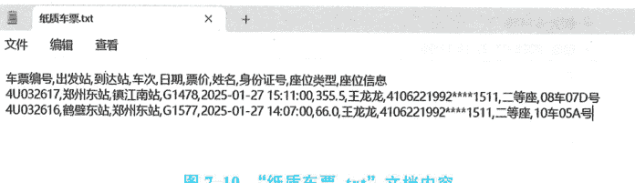

**图 7-10“纸质车票.txt"文档内容**

然后打开“纸质车票台账.xlsx"，点功能区“数据”选项卡，选择“从文本/CSV"按钮（见图 7-11）。

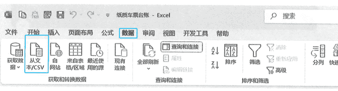

**图 7-11“数据”选项卡—“从文本/CSV”按钮**

在导入向导里选中新建的“纸质车票.txt"，点“导入”后进入预览页，直接点“加载”，即可批量把车票信息写入台账（见图 7-12）。

>> 步骤三结果：两张纸质车票的信息已批量录入“纸质车票台账 .xlsx"（见图 7-13）。

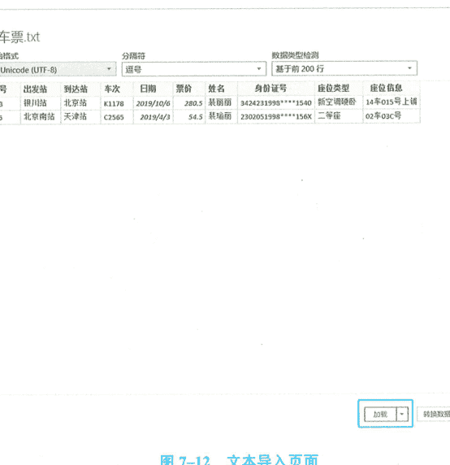

**图 7-12 文本导入页面**


**图 7-13 纸质车票识别信息录入“纸质车票台账.xlsx"**

> **作者点评**

纸质票据比电子发票多一步拍照，其他流程几乎一致。案例也证明，即使票根卷曲等有瑕疵，拍照后仍能被准确识别，这正是 OCR+AI 的效果。相比 VBA 方案，用 CSV 把结果导入 Excel 操作更简便。

#### 7.3 应用 DeepSeek 辅助合同识别

- **任务场景描述**

发票问题理顺后，老板抛出更复杂的任务：合同台账登记。合同篇幅长、版式多、专业术语多，人工提取关键信息难度大。财务仍希望用 DeepSeek 批量、精准地抽取要点并填入 Excel。

挑了两份合同做测试，如图 7-14 和图 7-15 所示。

|  |  |

|---|---|

|  | 说明 |

| JF-2019-002 | *本合同是根据《中华人民共和国合同法》等有关规定制定的示范文本，适用于本省行政区域范围内农产品订购行为。* |

| *合同编号:12013105* | |

### 山西省农产品订单合同 | *二、本合同条款均为提示性条款，供双方当事人约定采用。合同中的未尽事宜，可由双方当事人协商一致后，订立补充条款予以明确。*

**山西省市场监督管理局***

| 三、本合同签订前，双方当事人应相互提交身份证复印件或营业执照复印件校验有关身份证明。 |

|---|---|

| **山** | *四、本合同中的部分条款内容为并列的选择内容，双方当事人可根据实际情况作出选择，不予选择的则不再适用。* |

| **西省农业农** | |

| **村厅*** | *五、本合同文本空格部位填写内容及其他需要删除或添加的内容，双方当事人应当协商确定后准确填写或对合同内容进行适当调整。* |

| | *六、双方当事人可以根据实际情况决定本合同原件的份数，并在签订合同时认真核对；在任何情况下，出卖人和买受人都应当至少持有一份合同原件。* |


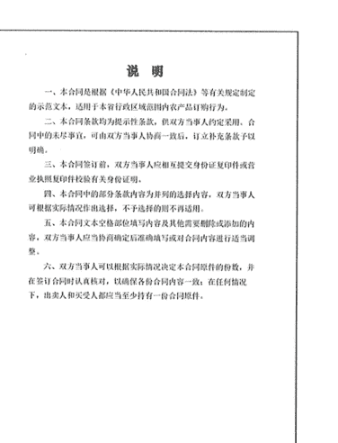

* 本处为虚拟合同。

# 第7章 DeepSeek 辅助财务附件识别 / 191

## 山西省农产品订单合同

**买受人：**山西绿丰农业有限公司

**证件号码：** 91140100MA2345678

**住所：**山西省太原市小店区平阳路109号

**联系电话：** 0351-87654321

**出卖人：**张丰收

**证件号码：** 142301198901017234

**住所：**山西省晋中市榆次区张建乡张庆村

**联系电话：** 13812345678

为适应农业产业结构调整，促进农业和农村经济的发展，提高农民和企业的经济效益，发展“订单农业”，根据《中华人民共和国合同法》及其他相关法律法规规定，经买卖双方协商一致，订立本合同，以资共同遵守。

# 第一条订单标的（品种、等级、质量）

| 序号 | 产品名称 | 品种等级 | 质量要求 |

| :--- | :--- | :--- | :--- |

| 1 | 优质玉米 | 晋单42号 | 水分≤14%，含损≤3%，无霉变、虫蛀。

###### 第一条 标的交付日期、数量及价格

出卖人在2023年10月以前，向买受人交付农产品共计5000公斤。

所售产品最低价格（保护价）3.5元/公斤，市场行情上涨时，由收购单位按市场价格进行收购。

买卖双方的任何一方如需提前或延期交货与提货，均应以书面形式提前7日通知对方，并取得相对方同意。

# 第三条交货方式

1、产品交货地点：山西省晋中市榆次区张庆乡张庆村村委会库。

2、双方一致同意按照如下第（1）种方式进行交货：

(1) 由出卖人将产品运送交货地点后，买卖双方共同在交货地点验收。

(2) 由买受人到出卖人处上门收购，并在收购处进行验收。

# 第四条验收标准、方式

1、产品验收标准：严格按本合同第一条约定的标准进行验收。

2、产品运至本合同约定交货地点后，买卖双方按以下方式（1）进行验收：

（1）数量及外观验收：由出卖人将产品运抵交货地点后，由买受人、出卖人代表共同对产品数量及外观进行验收。

（2）抽样验收：由买受人、出卖人按本合同第一条约定的质量要求对产品进行抽样验收。

###### 第五条 违约责任

买受人无正当理由在合同履行中退货的，应按照退货部分货款总值的15%向出卖人支付违约金，违约金不足以弥补出卖人损失的，买受人还应承担赔偿责任。

2、买受人无故拒收或未按合同约定收购农产品的，应向出卖人偿付被拒收或应收货货总值20%的违约金，违约金不足以弥补出卖人损失的，买受人还应承担赔偿责任。

3、出卖人无正当理由交货数量少于合同规定的，按少交数量价值的10%向买受人支付违约金。

4、如出卖人交付的产品掺杂使假，以次充好，买受人有权拒收，且由出卖人应按照该批农产品正常市场价值的30%向买受人支付违约金。

**出卖人：**张丰收

**授权代表：**张丰收

**日期：** 2023年5月15日

# 第六条不可抗力

1、买卖双方的任何一方由于不可抗力的原因不能履行或不能完全履行合同时，应尽快向对方通报理由，在提供相应证明后，可根据情况部分或全部免予承担违约责任，出卖人如果由于不可抗力造成产品质量不符合合同规定的，不承担违约责任。

2、如农产品因受气候影响早熟或晚熟的，交货期经双方协商可适当提前或推迟，如协商不成的，可按照不可抗力造成合同无法如期履行合同，双方可根据实际情况选择变更或解除合同。

> ## 图 7-14 第一份合同

其他约定事项：

1、合同中未明确约定的内容，买卖双方可以另行协商并签署补充协议，补充协议的法律效力与主合同等同。
2、本合同共打印三份，买方收执两份，卖方收执一份。

[PAGE 207]

**说明**

一、本合同文本是参照《中华人民共和国合同法》等相关法律规定编制的示范文本，主要适用于本省行政区域内的家禽养殖买卖交易。
二、文本中的各项条款均为提示性内容，供双方当事人根据需要自行约定。合同存在遗漏之处，可经协商一致后以补充条款形式予以明确。
三、在正式签订前，双方当事人应相互提供身份证复印件或营业执照复印件，以核验身份信息。
四、合同中部分内容为并列可选条款，双方可结合实际情况择优采用，未选用的条款不再适用。
五、合同文本中的空白区域及需要删减或增补的部分，应在双方协商一致后准确填写或对条款进行相应调整。
六、双方可根据实际情况确定合同原件的份数，在签署时须仔细核对，确保各份内容完全一致；无论如何，出卖方和买受方都应至少各自保留一份原件。

**山西省家禽禽养殖买卖合同 示例**

买受方为山西牧源食品有限公司，证件号码91140100M67654321，营业地址在太原市清徐县解放路200号，联系电话0351-7654321。
出卖方为王养殖，证件号码142801198901017234，住址为吕梁市文水县古交镇王家村，联系电话13897654321。

以上合同样本在素材中连续列示七份，主体信息完全相同，用以体现批量合同的情形。

[PAGE 208]

### 第 7 章 DeepSeek助力财务附件智能识别

借助 DeepSeek 可以大幅提升财务附件的处理效率，具体操作流程如下：

步骤一：先行制作“合同台账.xlsx”模板。将财务部门所需的合同关键信息项填入Excel空白工作表，形成可直接导入的台账模板，方便后续让 DeepSeek 自动提取并填入对应字段，输出 Markdown 格式文件。
步骤一成果：图7-16展示了已配置好的“合同台账.xlsx”字段，涵盖了财务所需的主要合同要素。

| 合同编号 | 合同名称 | 买受人身份证号 | 买受人名称 | 出卖人名称 | 出卖人身份证号 | 合同日期 | 标的物 | 含税总价 |
| :--- | :--- | :--- | :--- | :--- | :--- | :--- | :--- | :--- |
| | | | | | | | | |

表7-16“合同台账.xlsx”字段

步骤二：将待识别的合同文件与“合同台账.xlsx”模板一起导入 DeepSeek，指令模型自动解析合同内容并写入台账。
向 DeepSeek 发出指令：请识别上述合同，逐份提取信息，按每份合同一行填入“合同台账”表格，并以 Markdown 代码形式输出。
此方式选用 Markdown 格式，便于生成的内容直接导入 Excel。

步骤二成果：DeepSeek 已按要求完成解析并生成了 Markdown 格式的填充内容，见图7-17。


[PAGE 210]

第7章 应用DeepSeek辅助财务附件识别/195
图7-19 点击“分列”按钮
随后弹出“文本分列向导-第1步，共3步”对话框，勾选“分隔符号”，点“下一步”，见图7-20。
接着在“文本分列向导-第2步，共3步”界面，找到“分隔符号”区，选择“其他”一项，输入“|”作为分隔符，点“下一步”，见图7-21。
进入“文本分列向导-第3步，共3步”对话框，无需额外修改，直接点“完成”，见图7-22。


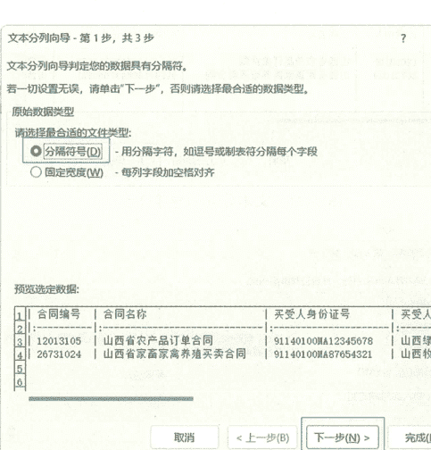

[PAGE 211]
图7-21文本分列向导第2步
图7-22文本分列向导第3步

[PAGE 212]
# 第7章 应用DeepSeek辅助财务附件识别/197
# 步骤四成果：执行分列后，Excel中的呈现效果如图7-23所示。

| 合同编号 | 合同名称 | 买受人身份证号 | 买受人姓名 | 出卖人姓名 | 出卖人身份证 | 合同日期 | 标的物 | 含税总价 |
| :--- | :--- | :--- | :--- | :--- | :--- | :--- | :--- | :--- |
| 12013105 | 山西省农产品订单合同 | 91140100MA1 | 山西绿丰 | 张丰收 | 14230119800101100X | 2023-05-15 | 优质玉米17,500元 | |
| 26731024 | 山西省家畜家禽养殖:91140100MA8 | 山西牧源 | 王养强 | 14230119750202100X | 2023-06-01 | 肉鸡5000只 | 125,000元 | |

图7-23 分列后的内容(部分)

# 步骤五：整理Excel表格格式。可直接删除步骤四结果中的分割线第二行，也可将有效内容粘贴回最初建立的“合同台账.xlsx”中，见图7-24。最终呈现以满足使用需求为准。

| 合同编号 | 合同名称 | 买受人身份证号 | 买受人姓名 | 出卖人姓名 | 出卖人身份证号码 | 合同日期 | 标的物 | 含税总价 |
| :--- | :--- | :--- | :--- | :--- | :--- | :--- | :--- | :--- |
| 12013105 | 山西省农产品订单合同 | 91140100MA12345678 | 山西绿丰农业有限 | 张丰收 | 14230119800101100X | 2023-05-15 | 优质玉米5000公斤 | 17,500元 |
| 26731024 | 山西省家畜家禽养殖买卖合同 | 91140100MA87654321 | 山西牧源食品有限公 | 王养强 | 14230119750202100X | 2023-06-01 | 肉鸡5000只 | 125,000元 |

图7-24 最终版“合同台账.xlsx”

###### 作者点评
从本次实践可见，即便合同格式比发票更复杂、信息量更大，借助 DeepSeek 仍能快速完成识别与台账填充工作。Markdown 格式确实可以把模型输出导入 Excel，但相比 VBA 代码和 CSV 方式，需要额外的人工格式调整，整体效率相对偏低。

#### 7.4 本章总结
本章围绕 DeepSeek 在财务附件识别中的应用展开，涵盖了电子发票识别、纸质发票识别以及合同识别三大典型场景。当前 AI 工具已能批量、高效、较为准确地完成发票、合同等财务附件的智能解析，实质是调用互联网上的识别能力，操作门槛低，财务人员易于上手。

三个案例对比了 VBA 代码、CSV 格式、Markdown 格式三种导入 Excel 的实现方式。VBA 代码方法便捷高效，但模型偶尔会生成错误代码，此时可将报错反馈给模型，继续调试直至正确。Markdown 格式需手动调整排版。CSV 格式出错率低，导入后无需手工修正，是较为推荐的做法。

# **实用技巧**
- 进行财务附件识别时，务必向 AI 明确列出所需字段的名称，必要时补充数据类型，可显著提升抽取准确度。
- 若生成的数据处理代码或识别结果出现错误，请耐心描述报错信息，引导 AI 反复迭代调试，直至输出可用结果。
- 在将 DeepSeek 输出导入 Excel 时，可灵活选用 VBA 代码、CSV 格式、Markdown 格式。三种方式各有利弊，综合来看 CSV 格式更稳定、操作简便，优先推荐；遇到问题时也可尝试切换方案。