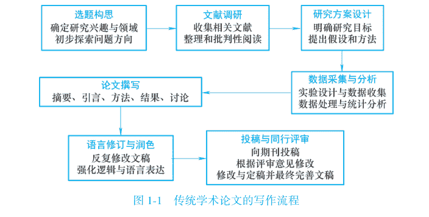
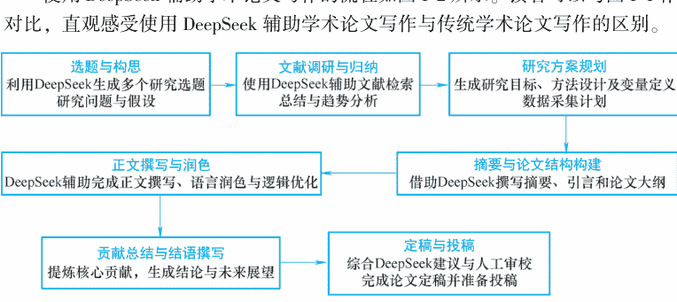
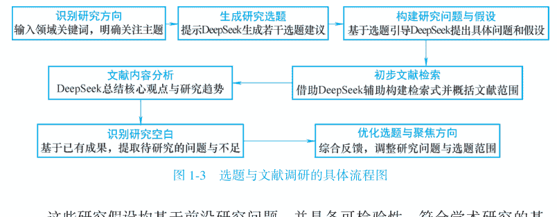
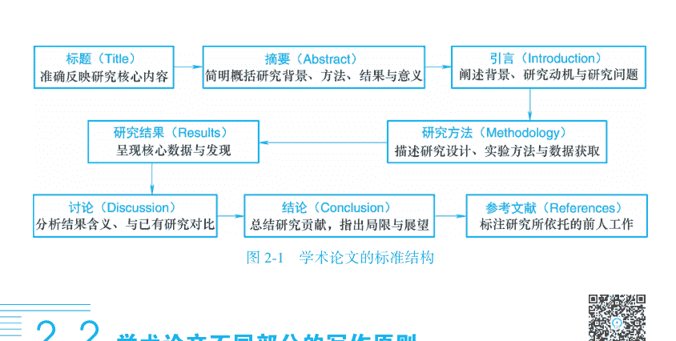

# DeepSeek 论文写作加速指南

## 主创团队

**闫河**，博士，从事人工智能教学科研多年，研究方向涵盖算法优化、时序数据挖掘、智能推荐、自然语言生成与理解。主导多项AI核心技术研发，成果落地于新零售、制造、金融等物联网溯源场景。出版专著十余部，发表论文多篇，拥有十余项发明专利，技术积累聚焦人工智能与自然语言处理前沿。

**李思**，北京大学毕业，现为辽宁理工学院信息工程学院科研副院长，AI领域资深教师，兼具世界500强企业IT从业经历与高校教学科研背景。长期关注AI在产业变革中的实践，研究侧重高等教育教学与科研创新。为多家大型企业提供AI讲座与技术指导，促进产学研融合，发表多篇论文，在AI赋能教育与产业方面具备扎实的理论与实操基础。

> 二位深谙学术写作的痛点，也清楚智能工具如何真正落地，助力科研、教学人员从灵感萌发到成果发表实现关键跃迁。

本书围绕DeepSeek展开，系统梳理科研论文全流程写作方法。全书共八章，依次覆盖模型能力总览、研究论文规范结构、选题创新与可行性论证、研究方案规划与摘要提炼、文献综述与框架搭建、公式推演与代码生成、正文起草与语言润色、结论凝练与展望撰写。每章均以真实领域案例为引，配套提示词设计、对话模拟与产出优化策略，体现工程化写作与大语言模型能力融合的价值。

本书面向高校科研人员、研究生及具备著述经验的技术人员，尤其适合希望借助大模型提升效率与质量的读者。内容兼顾可操作性、提示词通用性与学术规范适配，并附赠教学视频、提示词模板等电子资源，可作为AI协同科研写作的实践参考。

### 前言

生成式预训练模型在语言理解、推理分析与内容产出方面的能力持续攀升。科研写作本质是逻辑构建、知识整合与数据阐释的综合体现。如何将大模型合理嵌入论文写作链路，既发挥其处理效率与语言优势，又坚守规范与研究伦理，是当下科研实践的重要议题。

DeepSeek今年以来备受关注的大语言模型，在语义理解精度、语料训练基础与跨任务适应性上表现突出。与通用写作类模型相比，其在逻辑完整度、术语统一性、风格匹配度与跨学科通用性方面更具工程可控性与研究适配性，更契合专业科研写作需求。

本书将循序渐进介绍DeepSeek在论文写作中的价值与使用方式。

第1章介绍模型的技术构成与典型科研场景，厘清使用边界与适配策略，帮助读者将这一强力智能助手融入写作。

第2章拆解研究论文的标准结构，强调形式规范与表达逻辑，提供清晰严谨的写作框架。

第3章聚焦选题生成与创新论证，演示如何引导模型发现研究空白，帮助研究者在策划阶段锁定创新点。

第4章结合方案规划与摘要撰写，展示模型如何辅助设计研究方案并提炼精炼摘要，提升写作效率。

第5章围绕文献综述与框架构建，提供主题建模与结构演进思路，利于优化框架、整合文献，确保表达准确流畅。

第8章回到总结撰写与展望构建，强调闭环与价值提炼，帮助研究者概括贡献并规划后续方向。

与传统写作指导不同，本书更注重DeepSeek作为协同写作智能体的引导技巧与操作细节。每章配备模拟对话、提示词拆解与真实案例，保证内容可验证、可复现。同时坚守学术伦理，明确模型生成与人工校对的分工，避免信息幻觉与失实，确保应用可解释且合规。

本书面向接受过研究方法训练的硕博研究生、科研助理、高校教师、企业研发人员，也可作为研究生课程、人工智能科研工具实训、学术研究方法课程的配套读物。对希望提升表达质量、提高写作效率、构建自动化写作流程的专业人员，本书既提供模板，也传授提示词设计、交互优化、内容校验等进阶能力。

随着科研写作从人工主导转向人机协作，DeepSeek将为科研人员提供强有力支持。本书归纳的技术路径、工程经验与实践方法，旨在帮助科研人员建立高效、精准、可信的科研表达体系，推动成果更清晰、更快速地传播，提升整体科研水平。

我们期待读者借助本书方法论体系，持续提升科研写作能力，突破瓶颈，不断拓展创新的边界。AI协同不仅是工具升级，更是科研创新的驱动力，让我们共同借助新时代工具开启科研写作新篇章。

编 者

## 第1章 DeepSeek 打通论文写作关键环节

智能技术正快速重塑科研研究范式，深度语言模型在文稿创作中的应用已成趋势。DeepSeek是一套先进的智能写作助手，不仅能优化结构、提升表达，还可支持选题策划、文献分析、公式推演与代码生成。本章围绕其在科研著述中的主要应用展开，分析优势与限制，并提供基于AI的方法论，为高质量高效创作提供支撑。

### 1.1 模型概览与科研写作场景

科研著述对语言准确性、逻辑严密性与内容新颖性要求极高。DeepSeek属于深度语言模型，拥有强大的文本生成、优化与分析能力，可在撰写各环节提供智能支持。本节先介绍其技术特点，分析应用场景，并探讨其对质量与效率的提升作用，为后续研究奠定基础。

#### 1.1.1 技术内核与写作应用

DeepSeek是一类基于深度学习的超大预训练语言模型，整体架构以Transformer为基础，结合自回归生成与自聚焦机制实现文本理解与生成。

在科研写作情境下，经过大规模语料训练后，DeepSeek已掌握不同学科的语言习惯、逻辑结构与表达规范，可在论文各阶段提供高质量的文本生成、润色与优化。

##### 1. 关键技术点

底层由多层Transformer编码器与解码器构成，核心要点包括。

（1）自聚焦机制：通过计算序列中各词之间的关联性，保证生成文本的前后文连贯，并精准捕捉论文中的关键概念与术语。

（2）深度预训练与微调：利用大规模科研数据库进行无监督预训练，并结合特定学科微调，使其在文稿撰写、文献综述、方法描述等方面的文本质量达到科研标准。

（3）条件生成：以论文标题、摘要或研究背景等为输入，生成符合科研规范的完整文本，提升写作效率。

（4）多模态融合：部分版本支持图像、数学公式与代码文本的融合处理，可在涉及数学推演、实验结果呈现或编程相关论文中提供更全面辅助。

##### 2. 建模能力

在文稿创作中，语言建模能力主要体现为。

（1）文体适配：可按目标期刊或学科规范调整文本风格，确保用词准确、表达严谨，避免口语化或冗余。

（2）长文本生成与结构优化：支持生成结构清晰的长篇科研文本，并能依据IMRaD等基本框架优化内容组织。

（3）复杂句法理解与优化：具备强大的句法解析与优化能力，可识别冗长或结构复杂的句子并提供符合科研规范的改写建议，提升可读性。

以下通过英文写作示例，展示DeepSeek与用户的对话如何进行复杂句法的理解与优化。

用户提问如下。

> 以下句子表达复杂且冗长，如何优化？

> Due to the fact that the research findings suggest a significant correlation between the variables, it is of great importance that further studies be conducted in order to validate these results and explore additional influencing factors.

模型给出如下回复。

> 建议简化冗余表达，提高可读性，可改为如下句子。

> The research findings indicate a significant correlation between the variables, highlighting the need for further studies to validate these results and explore additional factors.

用户提问如下。

> 如何调整以下句子，使其更符合学术写作的正式风格？

> The experiment was kind of successful, but there were some issues that might have influenced the outcome.

模型给出如下回复。

> 建议去除非正式表达，使其更精准，具体如下。

> The experiment yielded partial success, though certain factors may have influenced the outcome.

（4）跨学科知识整合：凭借大规模知识库，可理解并整合不同学科信息，适用于跨学科论文撰写。

##### 3. 主要应用

DeepSeek在科研著述中的主要应用包括但不限于。

（1）标题与摘要生成：基于研究主题自动生成符合规范的标题，并撰写简洁明了的摘要，涵盖背景、方法、主要发现与贡献。

（2）文献综述支持：快速归纳大量文献核心内容，提取研究趋势、识别科研空白，为综述部分提供精准信息支持。

（3）研究方法描述优化：生成符合实验设计规范的文本，并对方法论表达进行优化。

（4）科研语言润色：检测并改善语法错误、不规范表达，增强文本学术性与逻辑流畅度。

（5）数据与实验结果撰写：结合统计分析与数据可视化，辅助生成实验数据描述并确保解读准确。

##### 4. 局限性

尽管DeepSeek在文本生成与优化上表现突出，仍存在限制。

（1）信息真实性与可验证性：生成文本依赖训练数据，可能出现信息幻觉或引用不准，仍需人工审核校对。

（2）领域知识深度理解：在前沿研究或复杂理论的深度推理上仍有限，需结合领域专家判断修订。

（3）科研伦理与原创性：科研著述要求高度原创，DeepSeek可辅助但不可直接自动成文，需作者深度思考与改写以确保学术诚信。

DeepSeek依靠先进的语言模型架构与文本处理能力，可在论文多个环节提供智能辅助，提升质量与效率，使用时仍需人工把关以确保准确、逻辑与规范。

#### 1.1.2 融合DeepSeek的高效科研写作流程

科研论文写作是系统性任务，涵盖选题、文献综述、方法设计、数据分析、撰写与润色等环节。DeepSeek的智能生成与优化能力可贯穿研究者全流程，提升效率、优化质量并降低重复劳动。结合其特性，可构建高效规范的写作流程。

##### 1. 选题与研究方向确定

科研写作首步是确定研究方向与具体选题。DeepSeek可通过分析科研热点、归纳相关文献、生成研究问题，帮助研究者锁定创新性方向。基于关键词或研究主题，DeepSeek可生成潜在研究问题并评估科研价值，为选题决策提供支持。

##### 2. 文献检索与综述撰写

文献综述阶段，DeepSeek可协助筛选、整理与总结研究成果，提高调研效率。输入核心论文摘要、关键词或参考文献，DeepSeek可自动归纳关键观点、识别空白并生成结构化综述大纲，同时优化学术表达，确保语言精准逻辑清晰。

##### 3. 研究方法与实验设计

方法描述需高度严谨清晰。DeepSeek可基于不同领域的实验方法库提供设计思路并优化流程表达。针对数据采集、实验设备、变量控制等内容，可生成规范化描述，提升可读性与可复现性。

##### 4. 论文框架与正文撰写

论文撰写是核心环节。DeepSeek可按IMRaD结构生成大纲并协助撰写各部分初稿。输入研究背景、研究问题等，DeepSeek可自动生成符合规范的引言；针对实验结果，可协助总结数据趋势、优化描述、提升解读逻辑性；并提供多轮润色，调整句式使文本更严谨流畅。

##### 5. 语言优化与科研润色

DeepSeek拥有强大的科研语言优化能力，可检测语法错误、用词不当或逻辑不清并给出改进建议。针对不同期刊要求，可调整文体风格以符合投稿规范；对摘要、引言、讨论等关键部分进行优化，提升可读性与学术影响力。

##### 6. 论文查重与内容合规性检查

科研写作需严格遵守诚信规范，避免剽窃或重复发表。DeepSeek可辅助识别重复内容并提供改写建议，使文本更合规；亦可在引用管理上提供支持，帮助确保参考文献格式准确。

##### 7. 论文最终审核与提交

完成后需进行最终审核。DeepSeek可协助检查整体逻辑、语言一致性及格式规范，确保符合目标期刊或会议要求。结合智能分析功能，研究者可进一步优化论文，提升投稿竞争力。传统科研论文的写作流程如图1-1所示。



#### 1.1.3 DeepSeek 在不同学科的应用案例

智能语言模型DeepSeek在多学科论文写作中展现出广泛适用性。其文本生成、优化、文献分析与数据解读能力，可为材料科学、环境科学、医学等领域研究者提供高效写作支持。以下以材料科学、环境科学、医学领域的摘要或陈述性文本改写为例探讨应用。

##### 1. 材料科学领域：电池正极材料研究

**应用场景：** 论文撰写、数据分析与实验描述优化。

在锂离子电池研究中，正极材料选择与优化对性能至关重要。DeepSeek可在以下方面提供支持。

（1）文献综述：在研究LiFePO₄、NCM等正极材料时，可提炼核心文献实验结果，归纳不同材料的电化学性能，提升综述逻辑性与学术深度。

（2）数据解读：在循环伏安法、恒电流充放电测试等实验部分，可辅助撰写数据分析，优化表述，提升专业性。

（3）公式推演：在描述电极材料离子扩散动力学时，可优化推演过程，使文本更清晰、符合数学表达规范。公式推演过程优化示例如下。

以下是优化前的推演过程（原始描述）。

> The LiFePO₄ cathode exhibits a specific capacity of about 160 mAh/g at 0.1 C, which is due to its unique olivine structure and stable Li-ion intercalation/deintercalation process.

优化后的推演过程（DeepSeek改写）如下。

> The olivine-structured LiFePO₄ cathode demonstrates a specific capacity of approximately 160 mAh/g at 0.1 C, attributed to its stable lithium-ion intercalation and deintercalation characteristics.

##### 2. 环境科学领域：污染物监测与治理

**应用场景：** 数据分析、论文摘要撰写与实验方法优化。

在环境科学研究中，污染物监测与治理是核心议题。DeepSeek在该领域可应用于以下方面。

（1）实验方法优化：在研究重金属污染或大气污染时，可优化研究方法部分表达，使污染物检测方法（如ICP-MS、HPLC等）的描述更清晰，便于复现。

DeepSeek：科研写作的多学科智能协作者

越来越多研究人员把 DeepSeek 嵌入到论文撰写的各个环节，从实验数据的解读到语言的精细打磨都能获得专业级的协助。

（2）可视化描述支持：在探讨水体污染或空气质量变化时，DeepSeek 能把污染物浓度随时空演进的趋势整理成流畅且具科学性的文字，让研究发现更直观、更易被接受。

（3）摘要改写服务：该模型可以为同一研究产出多版摘要，使表述更贴合期刊的规范。改写示范如下。

改写前的摘要示例：

> This study investigates the removal efficiency of heavy metals from wastewater using biochar and analyzes the effects of different pH levels and adsorbent dosages on the process.

改写后的摘要示例：

> This study evaluates biochar's efficiency in removing heavy metals from wastewater, emphasizing the influence of pH variations and adsorbent dosage on adsorption performance.

##### 3. 医学方向：诊断与生物标志物研究
**使用场景：** 临床方案设计、文献梳理、稿件润色。

医学研究常伴随海量实验数据与严谨的试验设计，DeepSeek 在以下方面可提供支持。

（1）临床研究设计：在撰写试验设计章节时，能理清思路，使试验组与对照组的表述更严谨，符合医学论文的规范要求。

（2）生物标志物探究：在癌症早期筛查等课题中，可帮助梳理相关文献，归纳已有进展并形成综述性内容。

（3）医学术语统一：能够将论文用语规范为国际通用标准，如 ICD 编码、WHO 分类，提升专业度。术语优化示范如下。

优化前的术语表述：

> The study explores the role of circulating miRNAs in the early diagnosis of lung cancer, demonstrating that miRNA-21 expression levels are significantly higher in patients compared to healthy controls.

优化后的术语表述：

> This study investigates circulating miRNAs as potential biomarkers for early lung cancer diagnosis, revealing a significant upregulation of miRNA-21 in patients relative to healthy controls.

从材料科学的实验解读，到环境科学的污染分析，再到医学领域的临床优化，DeepSeek 在不同学科的写作中均能提供专业支持。借助智能辅助，写作效率得到提升，同时学术表达的准确性与严谨性也得以保障。合理使用该工具，有助于研究者在多元学科背景下产出高质量论文。

使用 DeepSeek 辅助学术论文写作的流程如图 1-2 所示，可与图 1-1 对比，直观感受其与传统写作路径的差异。



### 1.2 DeepSeek 助力选题与文献调研

研究的质量很大程度上取决于选题的科学性与调研的充分性。优秀的选题既要具备创新价值，也要基于已有成果论证可行性。DeepSeek 凭借强大的文本生成与信息抽取能力，可辅助热点捕捉、文献解析及空白挖掘，提升选题精准度与调研系统性。本节聚焦其在选题与文献调研中的核心用法，为后续写作奠定基础。

#### 1.2.1 如何借助 DeepSeek 生成研究问题与研究假设

本小节以机械领域的多尺度切削加工算法研究为例，说明问题与假设的生成路径。

##### 1. 研究问题与研究假设在论文中的作用

研究问题 RQs 与研究假设 Hypotheses 是论文的骨架，决定研究方向、方法选择与结论走向。高质量的问题需建立在文献分析、理论框架与现实需求之上，假设则是可验证的判断。DeepSeek 能从文献中提炼现状、识别空白，并辅助生成符合规范的问题与假设。

##### 2. 机械领域的多尺度切削加工算法研究

多尺度切削涵盖宏观到微观的机理差异，优化加工参数以提升精度与效率是核心目标。当前研究主要受制于：

（1）跨尺度效应干扰：不同尺度机理相互作用导致过程难以预测。
（2）精度与效率的矛盾：高精度建模常伴随计算复杂度急剧上升。
（3）实验数据与理论建模的融合：如何用实验数据改进切削仿真仍是热点。

DeepSeek 可通过文献分析与数据驱动建模，辅助提出高质量研究问题并据此构建假设。

##### 3. 借助 DeepSeek 生成研究问题

该工具基于关键词检索、语义分析与研究总结，能自动生成符合学术标准的问题。针对多尺度切削加工算法，可生成以下示例。

（1）RQ1：如何构建统一数学模型来刻画宏观与微观切削机理的耦合？
（2）RQ2：哪些关键加工参数对不同尺度切削性能影响最大？
（3）RQ3：如何融合实验数据与机器学习优化多尺度切削仿真算法以提升预测精度？
（4）RQ4：在不同材料加工中，多尺度切削模型的适用性如何变化？

这些问题紧扣研究现状，并指向明确目标。

##### 4. 借助 DeepSeek 生成研究假设

基于上述问题，可参考已有结论提出可验证假设，具体如下。

（1）H1：引入跨尺度耦合因子可提升切削仿真模型在不同尺度下的精度。
（2）H2：特定切削参数如切削速度、进给量在不同尺度上的影响呈现非线性关系。
（3）H3：深度学习模型可基于实验数据优化多尺度切削仿真的计算效率。
（4）H4：材料属性如硬度、晶粒尺寸对多尺度切削过程的影响可通过统计建模量化。

选题与文献调研的具体流程如图 1-3 所示。



上述假设均源于前沿问题且具备可检验性，符合学术基本要求。下面展示与 DeepSeek 的高效沟通示例。

用户提问如下。

> 正在研究多尺度切削加工算法，如何提出具有研究价值的研究问题？

DeepSeek 回答如下。

> 建议先分析现有文献，确定研究空白。以下是可能的研究问题。

如何构建统一的数学模型描述不同尺度的切削机理？

关键加工参数如何影响不同尺度的切削性能？

用户提问如下。

> 如何让研究问题更具可验证性？

DeepSeek 回答如下。

> 建议围绕具体变量和方法展开。例如：

研究不同尺度切削参数对表面质量的影响是否具有一致性？

机器学习模型是否能优化多尺度切削仿真的计算效率？

用户提问如下。

> 可以基于这些研究问题生成对应的研究假设吗？

DeepSeek 回答如下。

可提出以下假设。

H1：引入跨尺度耦合因子可提高切削仿真模型的精度。

H2：切削速度与进给量在不同尺度上呈现非线性影响。

用户提问如下。

> 如何确保这些研究假设具有科学性?

DeepSeek 回答如下。

> 建议结合已有实验数据与理论建模支持假设，并明确验证方法。例如，采用实验数据与数值模拟相结合的方法检验 H1 的有效性。

总体来看，DeepSeek 在研究问题与假设生成中展现出强大的信息整合能力。通过文献分析与提炼，它能帮助研究者明确方向，确保问题的科学性与假设的可验证性。合理利用其生成的问题与假设，可提升论文研究深度，为后续设计与分析奠定基础。

#### 1.2.2 DeepSeek 辅助文献检索与阅读理解的技巧

文献检索与阅读理解是研究的基础，直接影响深度与创新性。快速获取相关文献并准确把握核心，有助于构建坚实理论基础。DeepSeek 在检索、摘要提取、信息归纳与批判性阅读方面具有明显辅助价值，能显著提升效率。

##### 1. 高效文献检索的 DeepSeek 辅助策略

检索通常依托 Google Scholar、Web of Science、Scopus 等数据库，DeepSeek 可优化检索策略，提高相关性与覆盖面。具体包括：

- (1) 关键词优化：DeepSeek 可基于研究主题生成检索词并扩展同义词与相关术语。例如研究“多尺度切削加工”时，可提供“multi-scale machining”“hierarchical cutting process”等替代词。
- (2) 构建高级检索式：DeepSeek 可依据布尔逻辑 AND、OR、NOT 生成复杂检索式，精准筛选高质量文献。例如在 Web of Science 中使用“(multi-scale machining OR hierarchical cutting) AND (simulation OR modeling)”。
- (3) 筛选高影响力文献：DeepSeek 可按发表年份、被引次数、期刊影响因子等指标推荐核心论文，避免信息冗余。

##### 2. DeepSeek 在文献阅读与理解中的应用

获取文献后，需高效提取关键信息并进行批判性分析。DeepSeek 可提供以下支持：

- (1) 自动生成文献摘要：输入论文后，可快速提取研究目标、方法、主要结论并生成精炼摘要。
- (2) 主题归纳与文献分类：可按不同角度将文献归类，如“建模方法”“实验研究”“数据分析”等，便于系统整理。
- (3) 论文内容对比：可比较多篇论文的研究方法与结论，识别差异，帮助明确现有研究的局限。
- (4) 术语解析与概念扩展：可对复杂学术术语提供解释并结合文献拓展背景，提升跨学科可读性。

##### 3. 结合 DeepSeek 提升批判性阅读能力

批判性阅读不仅是信息获取，还包括对方法科学性、数据可靠性及结论合理性的评估。DeepSeek 可提供以下辅助：

- (1) 研究方法评估：可总结论文方法并概述优缺点，帮助判断实验设计或模型构建的科学性。
- (2) 数据与结论一致性分析：可提取数据结果并与结论进行逻辑比对，识别推理漏洞或支持不足。
- (3) 研究空白挖掘：通过对比高影响力文献，可总结当前不足，辅助识别研究空白，为选题提供依据。

DeepSeek 在检索与阅读理解中的应用能有效提升研究效率，帮助更快定位核心论文、提炼关键信息并开展批判性分析。合理利用其智能功能，可优化文献综述写作，增强论文学术深度与理论支撑。

### 1.3 DeepSeek 辅助论文撰写的关键功能

学术论文写作涉及语言表达、结构规划、内容组织与格式规范，对质量与效率要求极高。DeepSeek 凭借智能生成、语言优化、逻辑调整与结构规划能力，为摘要撰写、引言优化、正文润色、语法校正提供高效支持。本节探讨其在提升文本质量、增强表达精准度及优化整体逻辑方面的实际应用。

#### 1.3.1 DeepSeek 在英语学术写作中的语法纠正与优化

本小节以社科领域论文为例，说明如何借助 DeepSeek 解决英语学术写作常见问题。

##### 1. 英语学术写作的特点与挑战

社会科学论文要求表达精准、逻辑严密并符合国际期刊规范。非母语研究者常出现语法错误、句式冗长、措辞不当及语篇不连贯等问题，影响可读性与影响力。DeepSeek 可智能校对语法、调整学术用语，使文本更符合规范。

##### 2. DeepSeek 在学术写作中语法纠正的应用

DeepSeek 能自动检测并修正语法错误，确保句法正确。常见问题及优化示例如下：

- (1) 主谓不一致 Subject-Verb Agreement

原句: The findings of this research suggests that economic policies impact social inequality.

DeepSeek 优化: The findings of this research suggest that economic policies impact social inequality.

优化解析: 主语 “findings” 为复数，谓语应为 “suggest”。

- (2) 时态错误 Tense Errors

原句: Previous studies shows that public opinion is influencing policy-making.

DeepSeek 优化: Previous studies showed that public opinion influenced policy-making.

优化解析: 描述过去研究结论，时态需统一为过去式。

- (3) 冠词误用 Article Misuse

原句: The globalization has significant effects on economy.

DeepSeek 优化: Globalization has significant effects on the economy.

优化解析: “economy” 为特指需加定冠词 “the”，“globalization” 无需冠词。

- (4) 介词搭配错误 Preposition Errors

原句：This study focuses in the impact of digital media on political behavior.

DeepSeek 优化：This study focuses on the impact of digital media on political behavior.

优化解析：动词 “focus” 后应搭配 “on”。

##### 3. DeepSeek 在学术写作中表达方式优化的应用

除语法校正外，DeepSeek 还能优化表达，使其更正式。

- (1) 避免口语化表达

原句：This study kind of explores how social movements influence policy changes.

DeepSeek 优化：This study examines how social movements influence policy changes.

优化解析：“kind of” 属于口语，应使用更正式的 “examines”。

- (2) 提升句子清晰度

原句：There is a lack of clarity in terms of how government policies address income inequality.

DeepSeek 优化：Government policies fail to clearly address income inequality.

优化解析：简化冗长结构，使句子更直接。

- (3) 调整学术词汇

原句：The author talks about the relationship between education and social mobility.

DeepSeek 优化：The author discusses the relationship between education and social mobility.

优化解析：“talks about” 口语化，“discusses” 更符合学术规范。

##### 4. DeepSeek 优化学术写作的逻辑连贯性

社科论文的逻辑连贯性至关重要。DeepSeek 可优化段落衔接，使论述更连贯。例如在比较研究中，可建议合适的学术连接词，具体如下。

原句：This study analyzes media influence on elections. There is also an examination of public perception of political candidates.

社科论文写作，DeepSeek 可以让表达更精准、结构更清晰

先看一个润色细节。把“本研究分析媒体对选举的影响。它还考察了公众对政治人物的认知。”改写为加上递进词后，语气连贯不少。该模型在社科写作中的语法修正与表达提炼能力很强，能把用词偏差拉回正轨，提升精确度，也让行文更顺。合理使用其智能润色，研究者能把稿件拉到贴近国际期刊的水准。

#### 1.3.2 用对话方式生成摘要与引言
下面以问答形式演示如何借助大模型产出社科论文的撮要和开篇。

提问示例：
写撮要时常要在简洁、完整和规范之间找平衡，需要涵盖缘起、做法、核心结果和结论，写多了拖沓，写少了缺信息。怎样快速做出符合要求的撮要？

模型回复：
撮要撰写要做到信息浓缩、思路贯通、措辞精准，可按以下路径推进。

拆解框架：通常包含四块。
问题缘起：交代议题的重要性与既有研究的不足。
方法路径：概括采用的实验、数据分析或理论模型。
核心结果：提炼研究的主要结论。
增益说明：阐述对该领域的贡献或后续方向。

自动生成：把全文要点抽取后按撮要框架重组。以“社交媒体对消费者购买决策的影响”为例，可做前后对比。

改动前只点出研究主题、问卷调查和品牌互动影响购买的结论，表述较为笼统。
改动后先指出社交媒体在决策中的作用日益凸显，但具体影响仍缺研究，随后说明采用线上问卷 N=500 分析品牌互动对偏好的作用，结果显示互动与购买意愿存在显著相关，并点明对互动式数字营销的启示。

改动后文本更聚焦，背景、做法、发现与价值都更清晰，符合撮要规范。是否需要针对特定主题再微调？

提问示例：
撮要基本达标，想进一步提升严谨性，使其更贴合期刊格式，比如去掉主观措辞、增强衔接。如何调整？

模型回复：
要让撮要更符合期刊要求，可注意三点。

去主观与修饰：使用中立客观的表述，避免“有趣的发现”“非常显著”等评价性语言。
强化衔接：选用恰当的连接词，如 however、furthermore、thus，增强句间连贯。
规范数据呈现：涉及数据时给出关键信息，如调研规模、统计指标，提升严谨度。

进阶优化示例：
先承认社交媒体在决策中已被广泛关注，但直接影响的实证仍有限。随后说明采用结构化线上问卷 N=500 检验品牌互动对购买行为的作用，回归分析显示互动与购买意愿存在统计学上的显著关联 β=0.72 p<0.001。最后指出该结果为互动式数字营销提供了实证支撑。

此版本措辞更严谨，并加入了具体指标，可信度更高。是否需要按特定期刊格式再做调整？

提问示例：
撮要已完成，引言写作同样吃力。引言需要涵盖背景、问题、目标和意义，如何高效生成规范的引言？

模型回复：
引言的核心作用是搭建研究背景、提出问题并说明必要性。通常包含三个部分。

研究缘起：介绍领域重要性并引用相关文献支撑主题。
研究疑问与目标：明确核心问题和探索方向。
研究价值：阐述如何填补空白或产生现实价值。

示例。
改动前引言仅说社交媒体对企业重要，已有研究很多，本论文看品牌互动对消费者行为的影响，信息不足。
改动后引言把数字经济下社交媒体作为品牌与用户互动关键平台的背景先行铺垫，指出既有研究多关注营销作用，但互动对购买行为的具体影响仍不足，基于数字沟通依赖加深的现实，说明厘清该关系对学界和产业都关键，本研究旨在实证检验社交媒体上品牌互动对消费者决策的影响，并为理论与实践对话提供素材。

改动后背景更饱满，目标更清晰，并突出了理论与实践价值。是否需要对研究问题部分再细化？

提问示例：
引言的背景已比较清晰，但研究问题的表达仍不够聚焦，如何使其更精准？

#### 1.3.3 大纲搭建与结构规划
论文的结构规划和大纲设计是写作的关键环节，直接决定逻辑框架和内容组织。合理的规划能提升逻辑性、可读性和规范性。大模型在此环节提供智能支持，可依据研究主题和写作需求生成符合规范的大纲并优化章节安排。

结构规划能力主要体现在以下方面。
首先，能按研究领域和论文类型自动推荐适配框架。例如实证研究论文，可按 IMRaD 框架生成大纲，使层次分明、符合国际期刊要求。
其次，可根据输入的主题和核心问题智能生成章节结构并建议小标题，让内容组织系统化。如研究人工智能在教育中的应用，可自动构建“研究背景”“方法论”“实验分析”“挑战与未来展望”等模块，保证完整性。
最后，可优化逻辑连贯性。通过分析研究目标和核心论点，推荐合理的章节顺序，避免重复或衔接断裂。例如综述论文可建议按主题、时间或方法分类归纳，使文献综述更清晰。还能基于已有大纲生成摘要和引言，提供全流程支持。

合理利用大模型进行结构规划和大纲生成，既能提高效率，也能确保逻辑严密和规范。

### 1.4 AI 辅助写作的合规边界
人工智能辅助写作提升了效率，也引发了关于学术伦理和研究诚信的关注。正确使用 DeepSeek 有助于规范表达和提升文本质量，若滥用则可能威胁原创性、可验证性和学术规范。本节围绕合规使用展开，强调技术应用与学术诚信的平衡。

#### 1.4.1 伦理风险与规范要求
生成式人工智能在写作中普及，如何在提升效率的同时维护诚信成为核心议题。DeepSeek 虽能提供语言润色、结构优化、文献梳理等功能，但生成内容的使用方式、作者责任归属和来源合规性均涉及关键伦理问题，需要明确界定。

##### 1. 学术原创性要求研究成果必须由作者自主完成
研究设计、数据分析、理论建构与论证过程都应由作者主导。若直接把模型生成的文本用于论文主体且未实质性修改和验证，可能构成虚假署名或伪造研究。此外，模型内容可能引用不存在的文献或拼凑他人表述，未经人工审校即使用易引发抄袭和引用造假。

##### 2. 责任归属问题不可忽视
模型没有法律主体资格，其输出中的错误、偏见或误导信息必须由作者承担全部责任。使用 DeepSeek 时，研究者必须充分审核、校改和事实核查，确保准确性、科学性和可追溯性。尤其在数据处理、统计推断和学术主张等关键环节，需以自身逻辑判断和实证为依据，避免模型主导结论。

##### 3. 学术规范对信息来源与引用格式有明确要求
若模型生成内容涉及他人成果，需按 APA、MLA、Chicago 等体系标明出处。模型常无法提供可验证来源，不得将其视为权威依据，也不可未经人工核查就列为正式参考文献。

多数期刊和会议要求作者在投稿时声明人工智能工具的使用情况，尤其涉及生成内容或语言修改时需如实披露。部分期刊限制模型参与撰写，强调作者应对全部内容负责，确保研究真实、可信、可复现。

总体而言，人工智能辅助写作应以维护学术诚信为前提，遵循“辅助而非替代、校核优先于接受、生成不等于创作”的原则。工具应服务于研究质量提升，而非规避学术责任。

#### 1.4.2 提升生成内容可信度的操作技巧
人工智能生成内容的准确性直接关系论文质量与合规性。语言模型基于概率生成，文本常流畅但事实可能虚构、混淆或不完整，尤其在专业术语、数据解释和引用上风险更高。使用 DeepSeek 时，需借助有效的提示策略提升输出质量。

1. 明确语境和角色定位，提高专业性
提示中应指明模型角色，例如“请以机械工程博士论文标准撰写摘要”或“作为环境科学研究者分析污染控制技术趋势”。上下文限定能显著提升学科匹配度，避免泛化。指定目标读者也能帮助把握语气与深度。
2. 指定格式与信息结构，引导完整输出
为防止结构混乱或遗漏，可要求输出格式和段落顺序，例如“按研究背景—研究问题—研究方法—主要发现—研究意义顺序撰写摘要”或“生成五个高质量研究问题并说明价值”。这有助于控制逻辑顺序和信息完整性。
3. 结合引用验证与信息回溯提示，抑制虚构
模型存在信息幻觉，可能编造作者、期刊、数据。提示中可加入“请基于可验证的已发表文献生成摘要”或“不要引用具体作者和期刊，仅总结现状”等约束。若需可追溯内容，可在提示中提供参考文献文本或 DOI，让模型在已有材料上重构而非凭空生成。
4. 采用分步提示与逐轮校正，优化质量
将复杂任务拆解，分阶段推进。例如先“概述某领域的背景和现有问题”，再“在前述基础上补充最新方法与理论依据”。每轮输出后可加入“请指出语义错误或逻辑不一致之处”的提示，用于自检。
5. 结合人工判断与事实核查形成闭环
提示优化只能提升概率，最终仍需研究者人工审核。对术语、数值、引用和专业结论逐项核对，通过查阅原始文献、数据库或教材交叉验证，确保学术可验证性和理论支撑。

#### 1.4.3 人机协作提升成稿质量
使用 DeepSeek 时，交互技巧决定输出质量。应提供清晰具体的提示，明确目标、语气、学科背景和输出格式。复杂任务可拆分为多阶段，逐步引导模型生成结构合理、逻辑严谨的内容。多轮对话可补充关键信息或提出修改建议，聚焦学术重点。输出中的术语、数据和引用需主动人工校对和事实核查，确保准确合规。人机协同优化是实现高质量学术文本的关键。

下面通过对话展示协同流程。

提问示例：
引言和方法部分的初稿已完成，逻辑看起来通顺，但可能存在用词不当、表达偏差或结构问题。如何将模型生成内容与人工复核结合，确保语言和逻辑都符合高水平期刊要求？

模型回复：
结合模型生成与人工复核是提升质量的关键。模型擅长结构组织、语言生成和初步逻辑构建，人工复核则弥补其在领域理解、数据准确性和学术规范上的不足。建议采用以下协同流程。

模型初稿生成：基于明确提示生成某一部分初稿，如“请根据以下研究背景撰写引言，包括背景、研究问题与研究意义”。此阶段应避免要求模型生成结论性或高风险判断，聚焦结构与语言。

结构与语言审查（人工复核）：人工需检查段落结构是否符合 IMRaD 规范，表达是否精准、是否存在模糊或口语化。例如引言需确认是否具备逻辑铺垫、是否清晰交代研究空白及研究动机。

# 人机协同提升论文写作的可靠度

> 方法部分的术语核验与事实校对：模型在撰写方法时容易出现概念混用或关键细节缺失。人工要把模型输出的实验参数、技术路线与真实研究对照，确认专业表述准确且上下文语义自洽。例如模型若把某算法描述为“基于支持向量回归的深度神经网络”，复核者需要判断该说法在技术上是否成立。

> 批注式多轮迭代：发现问题后，可以把具体的修改指令反馈给模型，比如“请把第二段改写为更正式的表达，剔除主观色彩”或“请删除与研究无关的描述，聚焦实验操作”。通过反复的人机往复，文本质量会明显提升。

> 该方式兼顾了模型的生成效率与人的审慎，能在逻辑、语言、术语和结构层面保障论文准确。是否需要演示一段具体的协同优化？

用户提问如下。

好的，下面是生成的引言草稿，请指出需要人工进一步审阅与修改之处。With the rapid development of urbanization, the transportation system has become more and more important. Many researchers have studied this, but there is still lack of understanding in how smart traffic models affect decision-making.

系统回应如下。

> 这段引言在正式程度、结构连贯和内容可信度上仍有改进空间，可从以下角度复核。

> 语言的正式性：
> “more and more important”属于口语化，建议改为 “increasingly critical” 或 “of growing importance”。
> “Many researchers have studied this”指代模糊，需要明确研究对象与具体内容。

> 事实描述的准确性：
> “lack of understanding in how smart traffic models affect decision-making”应限定模型类型与应用场景，“decision-making”指个人、群体还是政策层面的决策，需结合文献补充并强化逻辑。

> 逻辑衔接：
> 两句之间缺少过渡，可加入 “Although extensive studies have been conducted on urban transportation systems, the specific influence of smart traffic models on policy decision-making remains underexplored.”

> 人机协同改写示例：With the rapid progression of urbanization, transportation systems have assumed increasing importance in sustainable city planning. Although extensive studies have been conducted on traffic flow optimization and intelligent transport systems, the specific influence of smart traffic models on decision-making processes—particularly in the context of urban governance—remains underexplored.

> 人工在此主要负责厘清研究背景、消除模糊表述并确保与研究目标一致，可继续多轮聚焦具体问题。

用户提问如下。

上述修改很有帮助。接下来是方法部分的一段草稿。

“This study used simulation and machine learning. The data was collected from sensors and analyzed using Python. We evaluated performance.” 请帮忙优化语言，并指出人工审核应注意哪些方面。

系统回应如下。

> 该段信息单薄，细节不足，语言偏口语化。人工校审应重点关注：

> 方法描述的完整性：
> “simulation”指哪种模拟？多体动力学、离散元还是交通流仿真？
> “machine learning”涉及哪些具体模型？监督学习还是无监督？是否包含特征工程？

> 数据来源与处理的清晰度：
> “sensors”采集了何种数据？位置、车速、环境因素？采集周期、频率与预处理是否说明？
> “analyzed using Python”应指明使用的库与流程，如“scikit-learn用于模型训练，Pandas用于数据清洗”。

> 语言正式度与学术表达：
> “We evaluated performance”过于笼统，应具体说明评价指标，如“precision, recall, or RMSE”。

> 人机协同优化示例：This study integrates agent-based traffic simulation with supervised machine learning to analyze vehicular flow in urban intersections. Real-time sensor data—including speed, location, and vehicle density—were collected over a 30-day period and processed using Python. Data preprocessing involved normalization and noise filtering. Machine learning models (Random Forest, SVM) were evaluated based on prediction accuracy, mean absolute error (MAE), and computation efficiency.

> 人工校对不可或缺，需确保方法透明、可复现且专业。可否继续优化讨论或结论部分？

用户提问如下。

非常好。现在希望将 AI 辅助写作过程形成闭环机制，即通过 AI 提示词生成草稿、人工审核调整、再交由 AI 优化润色。这种流程是否适用于论文全文撰写？应如何在具体操作中保证有效性？

系统回应如下。

> 将模型与人工校对构成“多轮协同闭环”，是当前高质量学术写作的有效策略。可分为四个阶段并在迭代中强化质量与规范。

> - 第一阶段：模型生成结构初稿
> 输入明确提示词，如研究主题加所需章节，由模型生成框架与初稿。输出后可快速识别逻辑缺口与信息遗漏，如引言缺研究动机、方法未交代数据处理细节等。

> - 第二阶段：人工结构审查与内容校正
> 人工判断生成内容是否符合学术标准，重点审阅术语、方法、数据描述与逻辑一致性。对信息虚构、表达模糊或结构不完整之处进行标注。

> - 第三阶段：模型针对性优化与语言提升
> 将审阅意见反馈给模型，使用明确指令如“请把段落改为更正式表达”“请补充对比研究”，进行重写润色。利用模型的语言优势实现句式变化、冗余压缩与逻辑衔接。

> - 第四阶段：终稿校对与学术合规检查
> 最终版本由研究者或专业编辑校对语言、格式、引用与查重，确保合规完整。若期刊要求披露模型使用，应在致谢或方法部分说明使用方式与范围。

模型辅助学术写作的交互要点总结如下。

- 1. 明确提示目标：输入时需清晰说明写作目的、文体风格、学科领域与段落结构，避免笼统指令。例如不说“帮我写一段引言”，而说“请按社会学期刊标准撰写 200 字引言，包含背景与研究空白”。
- 2. 拆解写作任务：将复杂内容分阶段交互，先生成摘要结构，再分别撰写背景、方法、结论，有助于控制逻辑与信息完整性。
- 3. 多轮优化反馈：针对初稿提出具体修改要求，如“表达更正式”“增强衔接”“精简冗余”，通过迭代提升质量。
- 4. 控制信息生成范围：为避免虚构，可加入“请勿引用不存在的文献”“仅基于真实研究结果生成”等限制性提示。
- 5. 辅助内容审核：结合人工核查术语、数据与引用的准确性，将模型生成内容视为语言草稿而非定稿，保证学术规范。

#### 1.4.4 如何避免模型生成内容中的信息幻觉

信息幻觉是生成式模型在学术写作中最常见且风险最高的问题，指模型生成看似合理、语言流畅但实际虚假或不准确的内容。若不加控制，易出现虚构研究、伪造引用、误导性数据解释，严重损害论文可信度。

研究者应通过精确提示词控制生成范围，避免模糊输入如“总结某领域研究现状”，而应提供具体语料、研究方向或已有文献片段，要求模型仅基于输入生成信息。提示词中可加入限制，如“请勿虚构文献来源”“仅总结以下文本内容”，明确禁止非真实信息。

建议采用“先人工查证，后模型生成”模式。先完成真实文献的初步阅读与筛选，将可靠信息输入模型，由其协助组织语言、改写结构或整合段落，而非让模型独立生成学术内容。对模型给出的统计数据、作者名、文献标题必须逐条核查。

信息幻觉常在模型试图填补知识空白时出现，尤其在前沿理论、冷门领域或问题未明确时。因此应避免在训练数据不足的领域依赖其生成结论性描述。必要时采用分步生成、交叉验证与多轮人机修订，逐步澄清输出，降低幻觉风险，确保文本准确可验证。

#### 1.4.5 论文查重与模型辅助写作的合规性分析

随着模型辅助写作工具普及，查重与文本原创性成为合规核心。传统查重系统如 Turnitin、iThenticate 通过文本比对检测相似度。若直接套用模型生成的完整段落，或生成内容与公开语料高度相似，可能被判定为重复，影响通过率。

模型生成文本虽形式上“原创”，但在学术常用表达、术语搭配与结构模式上可能与训练语料高度相似，易触发高相似度提示。为避免此问题，需对模型输出人工审查并适度重写，确保语义清晰、表达具有独立性。

投稿中多家期刊与高校对模型使用提出规范，部分要求在致谢或方法部分注明模型工具使用，强调模型不可列为作者，不得替代作者的学术判断与核心撰写。大量未声明的模型生成内容可能被视为违反学术诚信。

为确保合规，应采取“模型辅助 + 人工重构”策略，将模型用于语言优化、结构建议与信息整合等非核心环节，对输出进行深度改写与查重自检，保障原创性、可追溯性与学术规范的一致性。

# 第2章 学术论文基本结构

学术论文是科研成果的主要载体，其结构体现研究的严谨性，直接影响逻辑清晰度与传播效果。规范结构有助于精准传递研究意图、方法与结论，是国际学术交流的基础。本章梳理论文标准组成部分与写作要求，并结合模型应用探讨如何借助工具提升结构合理性与表达规范性。

## 2.1 学术论文的标准结构与各部分功能

学术论文通常遵循特定结构规范，各部分承担不同逻辑功能。合理划分结构有助于清晰呈现研究过程，便于读者理解与评价。本节系统阐述标准结构构成，明确各部分功能定位。

### 2.1.1 标题（Title）：如何拟定高质量论文标题

在用模型辅助拟定学术论文标题时，提示词需明确研究对象、方法、变量关系与领域术语，才能生成精准专业且具吸引力的标题。有效交互应聚焦核心内容，逐步引导模型提炼关键词、调整风格与语言简洁度。通过多轮对话，可实现从初稿到格式、长度、术语规范的优化。建议提供研究主题、方法与创新点，并明确面向期刊、会议或项目申报等场景，示例如下。

用户提问如下。

正在撰写一篇关于“基于多尺度仿真的钛合金高速切削机理研究”的论文，涉及有限元分析与分子动力学模拟耦合方法。请帮我生成符合机械工程国际期刊规范的高质量标题，要求正式、学术性强、突出研究对象与方法。

系统回应如下。

可提炼以下要素：
研究对象：钛合金高速切削机理
研究方法：多尺度仿真，含有限元与分子动力学模拟
技术手段：耦合模拟
领域：机械工程、数值模拟
初步方案：
Multiscale Simulation of High-Speed Cutting Mechanisms in Titanium Alloys Based on Coupled FEM-MD Modeling
Investigation of Titanium Alloy Cutting Behavior via Hybrid Multiscale FEM MD Simulation Framework
Mechanistic Insights into High-Speed Cutting of Titanium Alloys Using Integrated Finite Element and Molecular Dynamics Models
若需强调具体结果或创新点，可在下一轮调整。

用户提问如下。

希望标题更具体体现研究对“剪切带演化行为”的关注，减少“framework”等抽象词，同时控制在 20 词以内，符合目标期刊格式。

系统回应如下。

强调“剪切带演化”并压缩技术方法表述后，可得：
Multiscale Investigation of Shear Band Evolution in High-Speed Cutting of Titanium Alloys
Coupled FEM MD Simulation of Shear Band Formation during Titanium Alloy Machining
Modeling Shear Band Development in Titanium Alloys under High-Speed Cutting Conditions
字数在 15~18 词，聚焦具体现象，贴近高水平期刊对信息密度与精准度的要求。是否需要进一步突出创新点或验证手段？

用户提问如下。

研究创新点在于首次实现多尺度模型对剪切带温度场与应变局部化的同步模拟，建议标题体现该技术突破，同时保持术语规范，避免歧义。

系统回应如下。

引入“synchronous modeling”“strain localization”与“thermal field”可突出亮点，同时保持严谨：
Synchronous Multiscale Modeling of Shear Band Thermal Field and Strain Localization in Titanium Alloy Cutting
Integrated FEM-MD Simulation of Thermal-Mechanical Evolution in Shear Bands during High-Speed Cutting of Titanium Alloys
Multiscale Numerical Analysis of Shear Band Temperature and Strain Localization in Machining of Titanium Alloys
这些标题兼顾方法、对象、变量与材料，表达精炼、术语严谨，体现系统性与创新性。是否考虑最终标题的可读性或期刊偏好进一步优化语言风格？

用户提问如下。

学术写作提效：用 DeepSeek 优化标题、摘要与引言

期刊对标题的偏好通常是简洁、动词驱动，强调研究行为本身而非简单罗列变量，语言要自然流畅，贴合国际工程类期刊的惯例。

DeepSeek 给出的优化思路是采用动词引导的表达方式，用 exploring、investigating、modeling 等词来组织标题逻辑，突出研究的进程与方法。参考风格如下：

Modeling Shear Band Evolution in Titanium Alloy Cutting via Synchronous Multiscale Simulation
Investigating Thermal Strain Coupling in High-Speed Cutting of Titanium Alloys through Multiscale Simulation
Exploring Strain Localization and Thermal Behavior in Titanium Alloy Machining Using Coupled FEM-MD Methods

高质量标题需要把研究对象、方法、关键变量和创新点说清楚，并通过多轮对话实现语言精简、术语规范和结构优化。借助 DeepSeek 可以在初稿生成、术语聚焦和表达调整环节快速迭代，最终得到学术性强且符合期刊要求的标题。

### 2.1.2 摘要撰写技巧：拆解结构分步打磨

撰写学术摘要时推荐采用明确结构、分步生成、多轮优化的流程。先用提示词锁定四要素：研究背景、研究方法、核心结果、研究意义。为避免信息遗漏和结构混乱，可以把摘要拆成若干子任务，每轮交互完成一段，收尾时再压缩语言、统一风格。

还可以结合目标期刊的风格要求，让模型调整语气、篇幅和术语使用。精细化指令和逐步引导是保证 AI 输出质量的关键。

以遥感图像城市地物分类为例，作者希望基于改进 U-Net 结合注意力机制，使用 WHU Aerial Building Dataset 生成英文摘要。

第一次交互要求写开头，模型建议先交代领域挑战，再引出改进模型和动机，给出正式客观的起段示例，提出提升密集城区分类精度和边界精度的目标。

第二次交互补充方法与实验设计，模型给出中间段落，说明模型在原 U-Net 框架中集成双注意力机制以捕捉长程空间依赖并增强多尺度特征表示，数据集为 WHU Aerial Building Dataset，评价指标采用总体精度 OA、F1 分数和平均交并比 mIoU，强调方法创新而不过度技术化。

第三次交互要求结果与贡献，模型提供结尾段落，量化结果为 OA 94.3%、mIoU 87.6%，相较常规 U-Net 及其他 SOTA 方法平均提升约 3.5%，注意力设计改善了复杂建筑边界和小目标的刻画，贡献在于推动城市遥感语义分割并提供可扩展的地理空间分析方案。

第四次交互要求整合成 220 词以内的完整摘要，模型输出约 219 词的精炼版本，背景、方法、评估、结果与意义衔接自然，语言统一，符合 SCI 期刊投稿规范。

整体来看，分步引导 DeepSeek 逐段生成并逐步修正术语，最终按期刊字数和格式要求整合，能高效产出高质量摘要。

### 2.1.3 引言写作方法：层层递进建立学术框架

引言的撰写需要分步完成研究背景、已有工作、问题提出和研究意义。高效交互的核心是每轮明确输出目标，用精确提示控制内容范围和表达风格。避免一次性要求生成完整引言，防止结构混乱。过程中可加入语气、术语规范和引用建议等细化指令，提升逻辑性和学术性。

以低碳交通系统优化为例：

第一部分要求写研究背景与问题提出，聚焦城市交通排放、拥堵与绿色出行。模型给出学术语气的段落，指出城市化与机动车化加剧使交通成为大都市碳排放主源，国际交通论坛数据显示交通部门约占全球二氧化碳排放近 24%，城市客运占比显著。传统缓解拥堵策略虽改善通行，却难支撑长期环境可持续目标，低碳政策在行政与技术层面整合不足，呼唤兼顾效率与减排的整体优化思路。

第二部分要求综述现状并指出不足，保持批判但中立。模型提炼近十年主流路径，涵盖交通流建模、排放敏感路径优化、激励式需求管理等，研究使用多智能体仿真、系统动力学和优化技术获得启示。但多聚焦单一目标如旅行时间或排放最小化，未能充分反映效率与环境间的动态权衡，模型简化假设多、缺乏实时交通数据接入、对用户行为异质性考虑不足，限制了实践适用性，从而凸显需要技术优化与政策实施、行为激励相匹配的集成建模框架。

第三部分要求提出研究目标、方法思路与创新点，建议采用 this study aims to… 的表达结构。模型提示段落应清晰陈述待解决问题、点明数据与建模方式、并说明相较现有工作的新颖性与理论或应用价值，形成与前文问题空间紧密衔接的落脚点。

通过分步引导、逐轮细化，DeepSeek 可帮助作者快速搭建背景扎实、批判中立、目标明确的引言框架。

低碳交通建模与AI写作实战

城市扩张和出行需求让交通碳排放持续攀升，传统调控只盯着拥堵缓解，环境协同却做得碎片化。要把运营效率和减排目标真正挂钩，需要一套能同时处理实时路网、排放特征和出行者反应的整体方案。

为此，有研究提出面向低碳城市交通的多目标优化框架。框架以交通流演化、碳排放水平和用户出行行为为三大输入，以实时路网数据、混合排放模型和多目标优化算法为计算基础，可在不同政策情境下模拟系统表现。模型内部嵌入行为响应函数和政策反馈回路，提升仿真的现实贴合度与政策参考价值。研究意图是弥合技术建模与政策落地的断层，为可持续城市出行规划提供灵活的决策支持工具。

在用AI辅助学术写作时，引言的构建可以拆成三步走。第一步点出研究动因与现实痛点，第二步梳理已有路径并指出局限，第三步明确目标、方法与创新贡献。控制语气、篇幅和术语一致性，能显著提高输出质量。最终整合时注意逻辑顺滑、语言统一，必要时用重写、压缩或风格调整的提示引导优化。

##### 1. 研究背景与问题提出
- “请用正式学术语气写一段关于【研究主题】的开场，说明当前背景与现实挑战。”
- “基于【领域数据/趋势】，生成一段英文的引出性段落，要求贴近【目标期刊名称】的风格。”

##### 2. 已有研究综述与不足归纳
- “请归纳【具体研究方向】的主流方法与代表性成果，并指出局限。”
- “请为【研究领域】写一段文献综述，突出空白与改进空间。”

##### 3. 研究目标与创新点
- “请用‘This study aims to…’开头，概述研究目标与方法，突出新颖性。”
- “请说明本研究相比现有工作的三点主要创新，保持客观中立。”

##### 4. 整合与优化引言
- “请把下面三段合并优化为约【字数范围】词的完整引言，保持学术统一。”
- “按SCI规范对以下引言进行语言精简与结构调整。”

### 2.1.4 研究方法（Methodology）：如何清晰描述实验设计
方法部分要可复现、术语规范、逻辑清晰。交互时可按材料、设计、流程、数据处理逐层展开，提示中要明确研究对象、关键步骤与技术细节，采用分步描述—补充—术语校对的循环来提升严谨性。

示例对话：
正在撰写“高镍三元正极材料 LiNi0.8Co0.1Mn0.1O2，简称NCM811”的论文，需要高温固相反应法的合成段落。起始原料为 NiSO4·6H2O、CoSO4·7H2O、MnSO4·H2O 和 LiOH·H2O，目标是获得球形前驱体。请用正式学术语言生成。

合成描述要点为：以硫酸盐为过渡金属源，氢氧化锂为锂源，按Ni:Co:Mn=8:1:1投料并额外加入5%锂补偿挥发。行星式球磨300rpm混合4小时均匀化，500℃预烧5小时去除挥发物并促成相形成，再研磨后在氧气气氛下800℃高温煅烧12小时，得到层状NCM811材料。

表征部分依次说明设备型号、参数与分析目的。
X射线衍射采用Bruker D8 Advance，Cu Kα辐射，40kV/40mA，2θ范围10°~80°，扫描速率5°/min，通过TOPAS软件Rietveld精修获得晶格参数与c/a比，评估层状结构完整性。扫描电镜使用JEOL JSM-7600F，加速电压15kV，观察二次颗粒的球形度与粒径均匀性。能谱附属SEM进行元素分布分析，绘制Ni、Co、Mn元素面分布以验证金属离子均匀掺入。

电化学性能测试包括制片、组装与测试。
工作电极以活性物质、导电碳Super P、PVDF粘结剂按80:10:10质量比混匀，用NMP做溶剂，涂覆于铝箔，120℃真空干燥12小时，冲成12mm圆片。组装CR2032扣式电池后进行循环伏安、电化学阻抗谱及恒流充放电测试，流程规范、参数明确，便于复现。

以上框架与示例可直接复用到论文写作中，通过结构化提示与分步优化，实现引言与方法部分的自动化与专业化融合。

**电化学表征细节拆解与SCI方法章AI生成实录**

CR2032型纽扣电芯的组装在充氩手套箱里完成，箱内氧气和水分均控制在0.5 ppm以下。对电极采用锂箔作参比/对电极，隔膜选用微孔聚丙烯Celgard 2400，电解液为1 mol/L LiPF6溶于碳酸乙烯酯与碳酸二甲酯体积比1:1的混合溶剂。

循环伏安测试使用CHI660E电化学工作站，扫描电位窗口为2.8 V至4.3 V，扫描速率0.1 mV/s。交流阻抗测试的频率范围覆盖100 kHz到0.01 Hz，扰动幅值取5 mV恒定。恒流充放电在LAND电池测试系统上进行，倍率跨度从0.1 C到2 C，用于评价比容量、倍率性能和循环稳定性。

这段文字把行业里最常用的电化学手段与操作参数都写清楚了，表述严谨，符合工程材料研究的规范习惯。随后提出的问题是，能否把合成、表征和电化学测试三块内容合并成一篇完整的“Materials and Methods”章节草稿，保持逻辑连贯、语言统一，总字数控制在800词左右，适配SCI材料类期刊投稿。

DeepSeek给出的整合稿约780词，语言统一、层次分明。

### Materials and Methods
NCM811正极前驱体的制备采用高温固相法。镍源选用六水合硫酸镍，钴源为七水合硫酸钴，锰源为一水合硫酸锰，锂源为一水合氢氧化锂。按Ni:Co:Mn摩尔比8:1:1称量，并额外加入5 mol%的LiOH以补偿高温挥发损失。混合粉体在行星球磨机中以300 rpm球磨4小时，球磨后先在500 ℃空气氛围中预烧5小时去除挥发物并启动相形成，再研磨后在氧气氛围中800 ℃终烧12小时得到层状NCM811材料。

物相纯度与晶体结构由X射线衍射表征，仪器为Bruker D8 Advance，Cu Kα辐射λ=1.5406 Å，工作电压40 kV电流40 mA，2θ范围10°~80°，扫描速率5°/min，晶格参数与c/a比经TOPAS软件Rietveld精修获得。形貌与粒径借助场发射扫描电镜JEOL JSM-7600F观察，加速电压15 kV。元素分布与组成均匀性通过SEM搭载的能谱仪EDS完成。

电极浆料按80 wt% NCM811活性物质、10 wt% Super P导电剂、10 wt% PVDF粘结剂配比，溶剂为N-甲基吡咯烷酮。浆料涂覆于铝箔后在真空120 ℃干燥12小时，冲切成直径12 mm圆片。CR2032硬币电池在氩气手套箱中组装，锂金属作对/参比电极，隔膜Celgard 2400，电解液同前。CV在CHI660E上于2.8~4.3 V区间以0.1 mV/s速率测试，EIS幅值5 mV频率100 kHz~0.01 Hz，恒流充放电由LAND测试系统在0.1~2 C不同倍率下进行，以评价比容量、倍率能力和循环寿命。

该版本完整覆盖合成、结构表征与性能测试全链条，表述规范，可直接用于期刊写作。方法章节的撰写思路是“模块化+分步引导”，先用精确提示词分别生成合成流程、表征手段与数据评估，再在每轮交互中强调配比、温度、设备型号、测试参数等细节，保持术语一致。最终整合时结合期刊规范压缩冗余、统一用词，确保结构清晰、逻辑完整、可复现。

### 2.1.5 结果与讨论（Results & Discussion）：数据呈现与分析方法
撰写结果与讨论时要让数据与结论呼应、图表与文字互补、理论解释深入。提示词需明确数据类型、分析方法、研究主题与讨论视角，可按“数据呈现—结果解读—机制讨论—对比分析”四步推进。

以出口贸易分析为例，用户提问是：论文研究中国2000~2020年30省份出口商品复杂度指数ECI与GDP增长的关系，使用面板模型，请写“结果与讨论”第一段，重点呈现表1回归结果并解释主效应，语气正式。

DeepSeek返回的草稿指出，表1的固定效应回归显示，在所有设定中ECI系数为正且在1%水平显著，表明出口复杂度与区域经济表现存在稳健正相关。加入资本投入、劳动参与率、基础设施指数等全部控制变量后，Model 3显示ECI每提升一个单位，GDP增长率平均提高约0.73个百分点。各模型R²在0.52到0.68之间，随着协变量增多解释力提升。结果支持贸易复杂度提升区域价值创造并促进可持续增长的理论预期。

用户随后要求继续写第二段，分析资本、劳动力、基础设施三项控制变量的影响。返回内容说明，资本投入在所有模型中系数0.21~0.27为正且显著，印证固定资产积累对经济扩张的核心作用。劳动参与率也显著为正但效应相对较小，反映部分省份的劳动密集特征。基础设施指数包含道路密度、用电可达性、互联网渗透等指标，系数为正且在5%水平显著，说明基础设施改善有助于生产效率与市场可达性。整体与区域发展文献一致，ECI系数幅值仍大于传统投入，凸显贸易复杂度对内生增长的重要性。

在得到确认后，用户要求写第三段，聚焦出口复杂度影响经济增长的潜在机制，结合创新能力提升与产业结构升级。返回的机制解释段认为，正相关可通过技术创新和产业升级两条传导路径理解。出口复杂度高的地区通常嵌入更多知识与技术含量，容易产生技能积累、研发投入与创新产出溢出效应，契合内生增长理论中知识扩散驱动生产率提升的逻辑。

其次，出口复杂度从根本上体现了区域产业结构的成长期。ECI 表现优异的省份，普遍在削弱资源导向、附加值偏低的产业比重，同时向多元化与创新驱动型赛道迁移，例如先进制造、电子器件以及高端服务业。结构升级不仅强化了出口端的竞争能力，还在就业规模、收入水平以及城市发展层面衍生出乘数式效应。换言之，观察到的统计关联很可能捕捉到的是全球化压力下各地经济在结构层面逐步演化的轨迹。

这些作用机制为实证发现提供了理论解释框架，也再次凸显了把培育高复杂度贸易结构作为区域发展政策着力点的战略价值。

该论述已完成从数据出发到机制阐释再到政策回指的闭环，逻辑较为完整。接下来是否补充跨区域的异质性考察？

用户随后提出：请继续写一段，分析东部、中部、西部在异质性上的差异，并说明为何出口复杂度对经济增长的促进作用在东部更为突出，要求逻辑严谨、理论充分。

基于此要求给出的延伸段落如下。

为了检验上述关联的稳健性，做法是按东部、中部、西部对省份进行分组回归。结果显示，出口复杂度对经济增长的拉动作用在东部最为明显，ECI 的系数不仅在统计上显著，且数值远高于中西部地区。区域差异背后存在多重结构性原因。

其一，东部普遍具备更为成熟的产业生态、更完备的创新支撑体系以及更强的知识吸收能力，能够更有效地利用复杂出口活动所蕴含的技术溢出。其二，这些地区深度嵌入全球价值链，有助于促进技术扩散、拓宽市场渠道并推动企业升级。其三，制度环境相对友好，表现为治理质量较高、监管更规范、金融服务更发达，为出口结构优化提供了制度保障。

与此相对，中西部尽管在基础设施和产业政策上已有改善，仍受制于技术储备不足和人力资本积累短板，难以充分释放复杂贸易结构带来的增长红利。结果提示，优化出口复杂度需因地制宜，并配套创新体系、教育投入和制度改革等协同举措。

该延伸段从实证现象切入，逐步展开机制解释，体现了社科研究中对空间维度与政策敏感性的把握。

在撰写结果与讨论章节时，有必要以分层、强逻辑、重机制为原则引导生成。整体思路是先呈现实证结果，再解释核心效应，随后深入机制并展开区域异质性讨论。每一次提示都应明确数据来源、分析目标与解释视角，保持术语统一与学术语气适中。以数据推导理论的链条串联实证与理论视角，确保产出具备社科研究的深度与广度，最后整合成符合期刊规范的完整章节。学术论文的标准结构见图2-1。



## 2.2 论文写作规范与原则解析

学术论文的各组成部分在功能定位、表达风格与写作策略上均有明确要求。把握这些原则能够提升论文的逻辑严谨性、表达准确性与学术可信度。本节围绕标题、摘要、引言、研究方法、结果与讨论等环节展开，强调结构统一与内容深度的协同。

### 2.2.1 构建清晰逻辑与层次的方法
结构的逻辑性与层次感是衡量学术写作质量的重要标准，直接影响内容的可读性与说服力。合理的结构不仅帮助读者把握研究脉络，也体现作者在设计与论证上的系统性。

逻辑性体现在各章节的自然衔接与内容的因果递进。引言需厘清研究背景与核心问题，方法部分应服务于研究目的，结果与讨论则需围绕研究假设逐一验证并作出解释。遵循提出问题、分析问题、得出结论的写作路径，是保持逻辑一致的基础。

层次清晰主要依靠标题体系、段落划分与过渡语句实现。每个一级标题应承担明确功能，例如研究方法聚焦流程与操作，结果与讨论聚焦解读与理论对话。段落内部避免信息堆砌，每段围绕一个子议题展开，首句点明主题，随后展开论述，最后收束或引出下文。借助连接词提升连贯性也有助于段落间的流畅。

为避免逻辑断裂或重复，建议在动笔前先制定详细提纲，并以逻辑链检验各部分的衔接。利用AI工具如DeepSeek进行结构预设也是一种有效手段，输入主题与论文类型后可先生成符合规范的框架，再由研究者据实调整，实现协同优化。

逻辑严谨与层次分明既是形式要求，也是体现研究深度与学术能力的关键。以科学方式搭建框架是撰写高质量论文的基础。

### 2.2.2 学术客观性与语言规范要求
学术写作必须保持高度客观与规范的语言，这既是专业素养的体现，也是保证论证有效性的前提。客观性要求作者以事实为依据中立陈述观点，避免主观情绪或个人倾向。规范的语言则涉及词汇选择、语法结构与语体风格，要求严谨、准确、清晰。

撰写时应回避个人化表述，如“我认为”“我们相信”，改用第三人称或被动语态，例如“结果表明”“据观察”。用数据、图表与文献支撑论断，而非依赖主观判断，是实现客观表达的核心做法。对他人研究进行比较时，也应基于事实评述方法或结果差异。

词汇层面，应避免口语化、情感化或模糊化表达，如“非常好”“很多”“显然”，改用定量或专业表述，例如“显著提升”“高度相关”。术语使用需保持一致，避免同一概念出现多种表述。

句式宜简洁严密，描述方法与结果时尤其需主谓清晰。段落结构应围绕单一核心论点展开，首句提出观点，后续展开分析，末句可总结或承接下文。

整体语言风格应遵循精确、克制、有据的原则，既体现理论与实证支撑，又避免夸大贡献或使用未经证实的假设。保持客观与学术性，有助于通过同行评审并提升可信度。

### 2.2.3 用数据支撑研究结论的做法
研究结论的有效性必须建立在可验证的数据基础之上。数据是连接假设与结论的逻辑桥梁，脱离数据的结论易流于主观推断，削弱学术说服力。因此，结论与数据分析必须保持清晰可追溯的对应。

首先，需明确指标、变量及其统计表现。实验数据、调查结果、回归输出等应通过表格、图形或文字清晰呈现。在结论或讨论中应直接引用关键统计结果，如系数大小、显著性水平或效应量，而非仅描述现象。

其次，数据呈现不应简单罗列，而应结合理论框架或假设进行分析性论述。通过对比变量关系、趋势变化或模型拟合情况，可揭示规律并提供多维度论证。同时应说明数据解释的边界，如样本范围、时间区间和方法适用性，避免过度泛化。

定性研究同样需要数据支撑，如编码频次、访谈摘录或内容分析统计，结论必须与材料高度匹配。面对复杂模型如结构方程或机器学习，更需详细说明方法与关键输出，便于读者理解结论来源。

最后，结论表述应避免模糊措辞，如“可能相关”“似乎有效”，改用基于数据的明确表达，如“在95%置信水平下，x显著影响Y”。这种写法使结论经得起检验与复现。

### 2.2.4 格式规范与引用标准
论文写作除了内容与逻辑，还需严格遵循格式与引用规范，这关乎学术标准化与诚信。常见引用风格包括APA、MLA与Chicago等，各有侧重。

APA广泛用于社科、心理、教育等领域，采用作者-年份制，正文为（作者，年份），参考文献按姓氏排序。MLA多用于人文学科，正文标注作者与页码。Chicago提供注脚-尾注与作者-日期两种体系，适用于历史、艺术或科学类期刊。

格式规范还涉及标题层级、摘要排版、行距页边距、图表编号与说明。例如APA风格要求标题居中、摘要独立成页、段落首行缩进0.5英寸。格式错误如漏页码、标点混乱、引文与文献不匹配，可能导致退稿。

借助AI工具可辅助格式处理。例如要求根据作者John Smith、文章标题Climate Policy in Europe、期刊Journal of Environmental Studies、2020年卷35期4页123-135的APA条目，模型即可生成规范引用。也可要求检查MLA第九版合规性或将脚注转换为Chicago作者-日期制。

规范引用是学术道德的体现。使用AI辅助时应坚持人工审核，确保格式标准、来源可查，保障研究合规性与可信度。

### 2.2.5 期刊论文与会议论文的结构差异
期刊论文与会议论文在结构、深度与策略上存在明显区别，理解差异有助于匹配投稿要求。

期刊论文强调系统性与理论深度。引言需详述背景、文献综述与理论依据；方法部分需完整披露设计、数据来源与变量定义，保证可重复；结果与讨论需严谨呈现分析并与理论对话，明确贡献、局限与展望。篇幅较长，对逻辑与语言要求更高。

会议论文更看重新颖性与时效性，常用于计算机、工程等领域。引言简洁，快速切入问题与创新点；方法与实验聚焦核心模型与性能指标；因篇幅限制常省略细节，将重点放在技术启示与未来工作上。

常见问题是会议稿扩展为期刊稿时理论与数据不足，或期刊稿压缩为会议稿时逻辑跳跃。AI可协助结构重构，如提示“请扩展文献综述并分析三项相关研究的不足”或“请将段落精简至150字内保留核心方法与结论”。

会议论文需突出贡献表述，期刊论文需强调理论嵌入。结合AI进行提示词优化，可提升稿件对不同平台的适配度与投稿成功率。

## 2.3 DeepSeek辅助优化论文结构的策略

一篇论文能不能让人快速抓住重点，最关键的是骨架搭得够不够稳。借助 DeepSeek 搭框架，可以在提笔前快速得到可用提纲，成稿时获得章节层面的改进建议，收尾时把控全文的连贯度。下面把在不同写作阶段怎么用这个工具提升结构，拆成几个可直接上手的做法。

### 2.3.1 用 DeepSeek 做出符合期刊口味的摘要
写摘要要抓住四个抓手：为什么做、想解决什么、怎么做的、得到了什么。DeepSeek 的多次对话很适合把复杂科研内容拆细，用明确指令分段产出再反复打磨。碰到专业门槛高、细节密集的主题，比如片上集成光学频率梳，就要先限定术语范围、研究目标和篇幅，避免输出偏离期刊预期或流于空泛。

明确摘要的框架、语气和术语标准后，模型产出的学术质感和期刊适配度会明显提升。下面以硅基微环热调谐频率梳为例看交互思路。

研究者先提出需求：正在写一篇关于片上集成光学频率梳的研究，器件基于硅基微环谐振腔，用热调控实现稳定可调，请先给出摘要的缘起与动机段，语气要对得上光学类 SCI 期刊。

模型返回一段严谨客观的开头，点出光学频率梳在精密光谱、计量和高速通信中的价值，强调紧凑低功耗可集成光源的需求，指出硅基微谐振腔具备 CMOS 兼容和可扩展性，同时点明热漂移和材料色散带来的稳定性和可调难题，最后说明本工作通过热调谐微谐振腔系统提升光谱控制与频率稳定性的思路。随后询问是否继续写方法部分。

研究者确认继续，要求补写方法与实验，覆盖器件结构、热调控机理、实验配置和测量手段，技术表达要清晰，字数限制在 150 词左右。

模型给出方法段落：器件为高 Q 硅氮化物微环集成微加热器，采用标准 CMOS 兼容工艺制备；加热器靠局域焦耳热实现谐振模式的精细热调，可动态改变梳齿间隔与光谱平坦度；用 1550 nm 连续波激光泵浦，通过分辨率 0.01 nm 的光谱仪监测梳状光谱；做一系列温控调谐循环，记录不同电功率下的实时光谱漂移，并量化调谐灵敏度、响应时间和光谱稳定性。整体呈现结构—机理—测量的闭环逻辑，符合光学工程期刊要求，并询问是否补充结果与贡献。

研究者继续要求写结果与贡献，突出调谐性能、稳定性改善以及对未来片上光子系统的意义，语言要有总结性和前瞻性。

模型返回结果段：热调控方案实现 1.2 THz 的调谐范围，灵敏度 12 MHz/mW，响应时间低于 10 μs；集成梳源在长时间运行中保持高光谱稳定，环境温度变化下 40 个通道功率波动小于 0.05 dB；对比传统无源谐振腔，该方案在不明显增加插入损耗的前提下提升了可调性和热鲁棒性，并指出其在片上光通信、可重构光子网络和便携式频率计量平台的应用潜力。随后询问是否需要整合成完整摘要并润色。

最后研究者要求把三段合并成一段完整摘要，控制在 220 词以内，保持学术性与逻辑连贯，适合 Optics Express 类期刊投稿。

模型给出约 217 词的整合版，覆盖缘起、做法、结果、意义四要素，语言严谨流畅，可直接作为终稿。

技术性摘要的生成规律可以归纳为分段、限定术语、精炼信息。首轮锁定缘起与问题并明确术语定义；中期分步描述实验手法规律与关键数据，控制篇幅和信息密度；后期通过指令实现语言统一与逻辑衔接。只要框架清晰，DeepSeek 就能产出高质量摘要，关键是用精细提示把控术语准确性和表达规范度。

高精度领域的写作需要人机多轮迭代，在结构完整性和语言学术性之间不断优化。下图 2-2 展示了利用 DeepSeek 优化文章结构的主要流程。

### 2.3.2 借助 DeepSeek 重塑论文骨架
文章骨架的合理性直接决定研究内容的呈现效果和推理连贯性。结构混乱、层次不清、内容分布失衡是导致论证薄弱、表达不清的常见原因。写作实践中，研究者常遇到章节设置不当、内容堆叠、论证路径重复或缺失的问题，尤其在从研究设计转向写作时，如何把研究流程转化为清晰、完整、符合规范的文章骨架，是提升效率与质量的关键。

DeepSeek 能有效解决架构不合理、层级不清或逻辑跳跃的困扰。骨架设计初期，可结合主题与文章类型输入精准指令，引导生成初始提纲。例如针对基于图神经网络的社交网络虚假信息识别研究，可以提示“请按计算机科学期刊规范生成文章结构提纲，包含摘要、引言、方法、实验、结果与讨论、结论，并细化子标题”。

写作中期若发现引言与背景重复、方法混入结果，可让模型重构逻辑。例如提示“请重组引言与背景部分，去除冗余并强化研究问题的聚焦性”，或“请优化方法章节安排，使其与结果部分边界清晰，避免交叉”。这种基于内容重构的交互能帮助作者跳出写作惯性，重新梳理布局。

后期审阅时可用指令进行骨架一致性检查，例如“请分析各章节结构是否合理，是否存在逻辑跳跃或内容重复，并提出修改建议”。模型可判断章节连贯性、结构错位、证据支撑不足或结论提前等问题，给出调整意见。

多章节写作中，还可借助模型生成章节间的过渡语句，提升流畅度。例如“请为方法部分结尾写一段过渡段，引出实验设置并总结方法的核心特点”。在高水平期刊中，这类连接对整体专业度影响明显。

合理设计指令并配合多轮优化，DeepSeek 既能辅助起草初始骨架，也能在结构调整、内容重组和逻辑连贯性提升上发挥作用。智能工具与人工判断结合，可实现架构与表达的协同提升，增强文章的完成度与学术规范性。

### 2.3.3 AI 一把手写出有力的研究缘起
研究缘起与动机是引言的核心，直接影响读者对研究合理性与价值的初判。实际写作中常出现表述笼统、焦点不明、逻辑链条不完整或动机与问题脱节的情况，导致引言难以支撑理论架构与研究设计。

借助智能工具生成缘起与动机描述，能显著提高效率和表达严谨性，尤其在复杂主题、跨学科整合时，结构化语言能力优势明显。

生成缘起时，给出明确的指令信息更有帮助，包括领域、技术对象、已有研究瓶颈、政策或实践需求等。例如研究绿色供应链碳排放定价机制，可提示“请撰写背景，说明该主题在全球碳中和政策下的研究意义，并指出现有研究的不足”。模型会整合国际趋势、行业痛点与学术空白，语言贴近国际期刊。

动机部分常见问题是目标模糊、论证薄弱、创新点衔接不顺。可用逻辑性指令引导，例如“请基于上述背景撰写动机段落，突出待解决的关键矛盾与研究的创新视角”，或“请把以下研究目标转化为一段正式、连贯的动机说明”。模型会提炼问题陈述，结合研究设想构建“问题存在—研究不足—切入点”的逻辑链。

跨学科主题背景容易散乱，可通过设定框架边界引导聚焦，例如“请撰写人工智能在医疗影像诊断应用的研究背景，聚焦深度学习优势及其在临床可解释性上的挑战”。这样可避免无关扩展，提升专业聚焦。

动机表达要避免模糊或主观词汇，如“这很重要”“引起关注”等。可设定表达风格指令“请用学术语气撰写动机段落，避免主观情绪化表述”，输出会更专业且具说服力。

分阶段指令与逻辑链控制下，DeepSeek 能辅助生成信息丰富、术语准确的背景与动机，并通过多次交互不断优化风格与架构。高水平写作中，模型输出需与研究者实际内容融合，经人工审核与精修，以确保内容准确、动机清晰、架构严密，实现从背景到问题的顺畅过渡。

### 2.4 论文表达：如何写得专业又好读
学术文章强调严谨、规范与客观，语言必须精准正式，避免主观化和口语化。恰当的语言技巧不仅提升可读性，也直接影响学术影响力和投稿成功率。下面系统讨论核心风格特征及常见优化策略，并结合智能工具提升语言质量。

### 2.4.1 正式语言与学术写作规范
正式语言与学术风格是高质量文章表达的基础，关乎专业水准、逻辑性和可信度。学术写作与一般写作的区别在于语言的客观、中性与严谨，要求使用标准术语、结构化表达与规范语法，避免模糊、情绪化、口语化或个人化表述。这是学术规范的体现，也是提升传播力的核心。

常见语言问题包括用日常表达替代学术术语，如用“a lot of data”代替“a large dataset”或“extensive data”；使用主观性强的表述，如“we think this method is great”；句式松散、动词力度弱、主谓不一致等。例如“ The experiment showed that the model maybe works better”应改为“The experimental results suggest that the proposed model demonstrates improved performance”。

保持正式、客观、简洁的语言习惯，配合模型润色与人工校验，是提升文章语言水准的有效路径。

借助生成式模型打磨学术语言，关键在于用指令去调节文体取向与表达强度。起草开篇或讨论部分时，可以要求模型以规范的学术英语输出，并明确禁止第一人称和情绪化表述。针对已有的草稿，可要求改写为符合自然科学期刊的表述，从而提升逻辑连贯度和用词准确度。涉及判断与推断的段落，也能通过指令来控制语气强弱，例如要求改用 indicates、suggests、demonstrates 这类推断性动词，把不确定的说法转为学术推断。

想要增强正式感，可指示模型使用被动或无主结构来弱化学者痕迹，比如把 we conducted experiments 改为 experiments were carried out，这符合学术惯例，也避免了理工科期刊对第一人称的不当使用。遇到句式失衡或行文不统一时，可以让模型对多段落进行风格对齐，使整体更学术、更流畅。

术语规范在各学科都很关键。医学写作里 adverse event 比 bad reaction 更专业，工程写作里 structural failure 也比 breakdown 更确切。通过指令让模型把口语化表达替换为相应的专业术语，就能实现风格的专业化升级。

正式表达的核心不是堆砌难词，而是表述清晰、用词准确、结构严谨。在不损害内容准确性的前提下，合理设计指令，AI 就能实质性提升论文的学术表达水平。

### 2.4.2 结论表达：如何让研究发现更有分量
结论既要收敛研究成果，也要用规范的语言呈现验证逻辑与实证依据。精准的表述是结论说服力与学术价值的基础。这部分需要保持中立客观、面向事实，避开模糊、绝对化或情绪化的说法，同时要明确指出发现适用的条件与边界。

常见的低质量写法是使用含糊评价，如 this result is good 或 our method is very effective，这类表述缺乏数据支撑，难以通过评审。更合理的写法是引入量化指标、显著性说明或相对比较，例如在相同实验条件下，所提模型相较基线算法的预测准确率提升了12.3%，既体现数据支撑，又包含对比与限定语境。

语气不当也是常见问题，如绝对化宣称 this method solves all existing problems。更审慎的说法是 this method addresses several limitations identified in prior studies 或 the results suggest a potential improvement under the tested scenarios，借助限制性词语维持学术克制。

借助模型强化结论精准度时，起草初稿可要求其依据结果描述撰写严谨且数据充分的结论段落，语言要符合自然科学论文风格，避免夸张与模糊。对已有主观或数据不足的段落，可要求调整为更客观、以结果为导向的表达，增强量化指标引用并避免绝对化。

跨学科或政策导向研究，结论还需揭示变量间的因果或相关关系。可采用结构化指令：回顾核心发现、阐明作用机制、限定适用范围、提出未来建议，从而引导生成层次分明、不碎片化的段落。

在公共政策、医学、环境等领域，还需谨慎表述外部适用性与社会意义。可提示在结论中补充现实意义并强调其基于特定样本或情境的限定性，防止过度外推。

总体而言，结论不是结果的简单罗列，而是信息提炼、逻辑整合与语言精准表达的综合体。通过与 AI 的交互并以合适指令控制结构与语气，能显著提升结论的学术说服力与传播效果。

### 2.4.3 规避常见写作失误与把关能力
学术写作的表达失误集中在语法混乱、用词不当、逻辑衔接薄弱、句式冗长含混、语气不符合规范等。这些问题会削弱可读性，甚至被审稿人视为语言质量不达标。非母语作者容易出现时态混用、主谓不一致、术语翻译偏差、连接词误用等，比如 This model prove the effectiveness in recent years、the data shows、many researches 等错误。

该模型具备较强的语法纠错与学术风格优化能力，能自动识别句法、拼写及非标准用法，并依据学术语料校正。例如把 this method maybe can help to do better result 优化为 This method may improve the overall performance，去除冗余与非规范表达，提升准确性与流畅度。

面对逻辑不清、句式断裂或表意重复等复杂问题，也能通过结构重构修正。如 The experiment was successful, which can be seen that the results are effective 可重写为 The effectiveness of the results confirms the success of the experiment，强化因果关系的主次。

指令设计上，语法与表达修正可要求对段落做语言校正并优化为正式学术表达。提升清晰度与逻辑性可要求优化句式结构，增强表达准确性并保持学术风格。针对语体问题可要求转换为自然科学论文的正式语体，删除非正式表达与冗余修饰。

做全局协调性检查时，可要求检查英文段落在术语使用、时态协调、句式长度上的规范性并统一调整，帮助段落保持统一风格，避免语气断裂。

需要强调的是，在高度专业化术语、跨语境引申义或复杂技术背景面前仍需人工复核。最佳实践是先由 AI 完成初筛改进，再结合专业判断二次校准，确保语言规范的同时准确传达研究逻辑。

### 2.4.4 写出简洁句，告别冗余累赘
句子简洁性是衡量论文语言质量的重要指标。简洁表达提升信息传递效率，增强论证力度与逻辑清晰度。冗长句式往往掩盖核心观点，增加阅读负担，在科技论文中尤为常见，成因多为术语堆砌、重复修饰、从句嵌套过多或结构不清，非母语作者更容易出现语义累赘。

例如 In order to achieve the purpose of improving the performance of the algorithm that has been proposed in the previous studies, this paper attempts to further optimize the parameters that have been designed before 可简化为 This study optimizes the parameters of a previously proposed algorithm to improve its performance，去掉多余修饰后语义更直接。

简洁不等于删减技术细节，而是在保证完整性的前提下剔除非必要修饰、冗余连接词与重复结构。优质句子常以动词为核心构建语义，避免过度名词化，如把 the realization of the improvement in accuracy 改为 to improve accuracy，可读性明显提升。

借助模型精炼，可要求在不改变原意的前提下把句子简化为简洁规范的学术表达，或要求优化段落、减少冗余并增强清晰度。处理复杂从句时，可要求把复杂句拆分为两个清晰、逻辑独立的句子，保持术语完整性与学术风格。例如 Although the model is capable of achieving a high level of accuracy, which is proven by a number of experiments, the training time is relatively long due to the high complexity of the architecture 可优化为 The model achieves high accuracy, as confirmed by multiple experiments. However, its training time remains long due to architectural complexity。

段落层面的压缩也很有用，如要求对段落做句式压缩与结构优化，控制总字数不超过80词并突出核心观点，特别适合摘要、结论或方法简述。

通过多轮精简与句式优化，再配合精确指令控制风格，能够系统性解决冗长问题，体现作者对信息结构与逻辑组织的掌控力，提升写作效率。

### 2.4.5 善用连接词，让逻辑更顺畅
连接词与逻辑过渡是组织文章结构、强化论证并提升连贯性的关键。良好的衔接使段落、句子之间的关系一目了然，增强整体可读性与严谨性。缺少恰当过渡会导致论述跳跃，文本松散。

常见问题包括连接词重复使用或错用，如多次使用 however，或把 therefore 用于并列关系。还有不少初学者省略过渡词，造成断裂。例如从 the model achieved high accuracy 直接跳到 the method is not suitable for large datasets，缺少衔接。可用 despite its effectiveness, the method faces scalability issues 来明确承接。

选用连接词应匹配逻辑关系：递进用 furthermore、in addition、moreover；转折用 however、nevertheless、on the other hand；因果用 therefore、thus、as a result；对比用 similarly、in contrast、whereas；举例强调用 for instance、notably、in particular。

模型可通过要求为段落补充合适的逻辑连接词，或要求把不恰当的连接词替换为更符合上下文逻辑的表达，来进行改进。模型会依据语义流识别句间关系，例如把方法与结果间错误的 besides 替换为 consequently 或 as a result，以增强因果逻辑。

当整段逻辑模糊时，可要求对段落结构进行优化，添加逻辑过渡语句，并使每句话间衔接自然。这有助于重构段落并在合适位置植入过渡。

逻辑过渡不仅是语言技巧，更关乎论证完整性。结合合理连接词使用与 AI 辅助识别替换，能够提升文本的组织水平，使学术表达更紧凑、清晰且具说服力。

## 2.5 以案例看论文结构如何优化
论文结构的改进离不开理论掌握，更需要通过实践案例验证。本节以典型学术论文的结构调整为例，结合 DeepSeek 在摘要撰写、章节布局、逻辑衔接与语言规范方面的重构过程，展示结构改进的实用路径与成效。

### 2.5.1 解读经典论文的结构密码
Attention is All You Need 作为自然语言处理领域的里程碑，其结构高度契合计算机科学顶会规范，逻辑清晰、条理分明，是结构改进的典范。论文于 2017 年发表于 NeurIPS，提出 Transformer 架构，摆脱了对循环神经网络的依赖，在建模、实验与表达上均体现高水平写作策略。

全文遵循“引言—背景与动机—方法—实验—结果与分析—结论”六段式。引言开篇点出序列建模的效率瓶颈与长期依赖问题，通过对比 RNN 与 CNN 的局限，引出新架构需求，问题定位准确、背景简明，是引言写作的好范例。

背景与动机部分通过 3. Background: Neural Machine Translation and Attention 系统回顾基于注意力机制的序列到序列学习，为后续提出 Transformer 奠定理论基础，并与方法部分做明确区隔，避免综述与创新内容混淆。

方法部分是核心，篇幅最大且组织严谨。先总览整体架构，再分层展开编码器—解码器、自注意力、多头注意力、位置编码等模块，采用由整体到局部的描述方式。各子模块配有公式、图示与伪代码，保证表述清晰且可复现。子小节编号如 3.2.1、3.2.2 等增强层次感与可导航性。

实验部分遵循“数据集—基准模型—实验设置—评估指标—对比结果”结构，语言规范。论文在 WMT 2014 英语—德语、英语—法语等多项公开数据集上验证，报告 BLEU 得分等指标，并在结果中补充训练速度、参数规模等工程特征，体现实证深度与应用价值。

结果部分简洁有力，总结贡献并指向未来方向，与引言形成闭环。术语、图表编号、参考文献也高度标准化。

借助模型可用分析论文章节结构与逻辑分布是否合理并指出各部分功能定位，或基于 Transformer 架构自动生成符合计算机类会议论文结构的写作大纲，来辅助结构建构。该论文的结构设计为高水平写作提供了可复用的范式。

### 2.5.2 从初稿到终稿的结构迭代思路
从初稿到终稿的写作实质是系统性的结构改进与逻辑重构。初稿多以内容堆砌和思路草拟为主，常出现结构松散、逻辑跳跃、重复冗余或信息分布不均；终稿则需在内容完整的基础上实现条理清晰、层级分明、逻辑连贯。因此结构改进的目标不仅是写完，更是写清、写准、写对。

论文从毛坯到精装：结构打磨全流程

写第一版时，很多人习惯把想法、做法、发现各自写成一段，却没先搭好整体骨架，于是出现内容打架、重点丢掉、章节职责错位。典型症状是把缘起和文献综述揉成一团，或者把实验结果提前到方法之前，读者读起来抓不住递进节奏。遇上这种状况，可以先让 DeepSeek 这类模型做一次宏观体检，比如让它判断现稿的板块顺序是否合理并给出调整思路，模型会按通行规范指出断点和逻辑空洞。

梳理框架的第一步是给每个板块定好位。开头要回答值不值得做；文献部分要交代前人做到哪一步；方法要讲清楚我们怎么推進；结果要聚焦验证是否奏效；收尾要点明贡献在哪。分工明确后就能动刀子，比如核心创新被压到第六页才出现，就应该挪到方法开头，让重心立刻凸显。

段内打磨同样重要。初稿常有段落过长、主题模糊的问题，可以请模型把一篇长段拆成两篇小段并补上衔接，或要求首句点题、中部展开、末句搭桥。配合人工来回调，递进感会更顺。

到中稿向终稿过渡时，关注点转向层级精细和衔接顺滑。一方面核对标题层级是否对称、篇幅分配是否匀称、图表位置是否合理；另一方面强化段与段的衔接，比如在引言结尾加一句本文的安排预告，提升整体连贯感。

最后一轮可以让 AI 做一次摘要式体检，提示它检查全文逻辑是否自洽、是否存在重复或偏离主线，并给出修改方向。这种高阶审视能把文章从写得通顺推进到读得舒服。

整体来看，从初稿到定稿的打磨，其实就是不断去冗余、抓重点、细层级。人工判断加上模型辅助，既能提速，也能让成稿更贴合期刊规范、逻辑更硬、表达更干净。

### 2.5.3 DeepSeek 重构润色实战案例

在重写和润色阶段，DeepSeek 的作用集中在框架校准、思路梳理、语言精炼和风格统一。高效打法可以概括为分段处理、锁定痛点、设定语感、逐步引导。不要一口气让它重写整篇，而是明确指出哪里结构模糊、哪里跳跃、哪里重复或表述不规范，再用具体指令驱动优化。先动结构再动语言，能实现从草稿到成稿的系统跃迁。

下面用一次模拟对话来演示。

用户提问如下。

> 我写了一段引言，感觉条理乱、重点不突出。原文如下。
> 
> With rapid progress in artificial intelligence, educational uses of deep learning attract more attention. Some work targets predicting learner behavior, others deal with automated marking. However, personalized feedback generation has been rarely addressed. Hence this article explores that area. Our approach uses a sequential model to process historical performance data and produce feedback sentences.
> 请帮我改写，让结构清晰、语气正式、逻辑合理，适合教育技术方向的 SCI 期刊。

DeepSeek 回答如下。

改写后的引言如下，逻辑更顺、语气更正式。

The application of deep learning in education has grown rapidly in recent years. Existing studies have focused on learner behavior prediction and automatic grading. However, generating individualized feedback from performance records remains largely unexplored. To address this gap, the current work proposes a sequence-based modeling strategy that transforms historical academic records into personalized natural language comments, aiming to provide timely and context-aware instructional support.

此版遵循背景-现状-空白-切入的经典脉络，语言规范，可直接放进引言。需要继续打磨方法部分吗？

用户提问如下。

> 需要。方法初稿很口语化，也不专业。
> We collected student scores from different courses over several semesters. Then we used them as input to a model. We chose a type of sequence model, LSTM. We trained it to learn how to write feedback sentences.
> 请让表述更学术、逻辑更紧凑，符合教育数据挖掘的写作习惯。

DeepSeek 回答如下。

优化后的方法描述如下。

To construct the feedback generation system, student performance logs from several semesters and multiple courses were assembled. Each sample consists of structured score sequences reflecting learning progression over time. These temporal sequences were fed into an LSTM network, chosen for its strength in capturing sequential dependencies. The network was trained in a supervised fashion to produce feedback sentences that align with historical learning patterns, enabling context-sensitive instructional guidance.

通过合并句式、替换口语表达、点明模型原理，学术感和完整性都有提升。要不要接着润色结果与讨论？

用户提问如下。

> 要。结果与讨论初稿重复、松散。
> The results show that our model generated feedback that was close to what teachers usually say. The accuracy was high. This shows the model is good. We also found that using longer input sequences helped. The model gave better feedback if there was more data about the student.
> 请重写，逻辑更强、语言规范，并加入量化信息。

DeepSeek 回答如下。

润色后的结果与讨论如下。

Experiments demonstrate that the LSTM-based system can produce personalized comments that closely match teacher-written responses. Quantitative assessment with BLEU and ROUGE shows strong textual similarity, with BLEU-4 reaching 0.67 on the validation set. Input length correlates positively with quality: when supplied with performance histories covering at least four terms, generated comments exhibit greater contextual relevance and syntactic coherence. These findings suggest richer historical data improves performance, underscoring the value of longitudinal learning analytics for personalized interventions.

段落兼顾发现-数据支撑-机制解释，语言严谨，可直接投稿。需要对全文做风格统一和摘要优化吗？

用户提问如下。

> 请把上述三部分合成一段摘要，约 150 词，简洁、符合国际教育技术期刊的习惯。

DeepSeek 回答如下。

> 合成摘要如下，约 147 词。
> 
> This study introduces a sequence modeling method for personalized feedback generation in education. Using longitudinal performance records from multiple semesters, an LSTM model was trained to produce context-sensitive feedback aligned with learning patterns. Evaluation on teacher-annotated responses achieved a BLEU-4 score of 0.67, indicating substantial textual similarity. Longer input sequences improved feedback quality, highlighting the importance of historical context. The results show the feasibility of deep learning for scalable automated feedback and suggest promising implications for personalized education delivery.

摘要兼顾方法-结果-意义，语言学术、结构紧凑，适合投稿。

在重构润色时，建议用结构标注-语义归类-风格控制的交互方式。先明确本次重写的目标，再把待改段落拆成功能块，每轮对话只解决一类问题，如引言逻辑、方法规范、数据表达或语言重复。提示词要明确指令重写、精简、整合或风格统一，并可加入字数、语气、目标期刊等限制参数控制输出。人机迭代能系统提升结构质量和语言专业度。

## 第3章 学术选题与创新点可行性论证

选题和创新点是论文的立意基石，直接关系到学术价值和可发表性。好的选题要源于真实问题、理论空缺或技术瓶颈，创新点的提出需要系统文献调研和可行性分析支撑。本章结合 DeepSeek 的使用场景，讨论如何构建既有学术潜力又有执行价值的研究方案。

### 3.1 研究选题的重要性与原则

选题决定了研究方向、理论根基和学术定位，是整篇论文的逻辑起点。高质量选题要兼顾前沿性、价值性和可操作性，体现出对问题本质的洞察。本节围绕标准、策略和 AI 辅助展开。

#### 3.1.1 挑课题要看哪几面

课题选择是写作中最关键的起点，其质量直接影响研究价值和发表潜力。优秀课题应具备理论意义、现实价值、可行性和创新性。

理论意义要求课题回应学科内的未解问题或模型缺陷，而非仅做经验描述。选题要能与现有学术体系对话，例如组织行为学里，“远程办公背景下员工情绪调节机制”比单纯讨论“满意度与绩效关系”更具理论连接价值。

现实价值要求问题有明确的社会、经济或产业背景。例如环境科学中，结合气候变化和城市排水政策的雨水排放模拟，比脱离背景的纯技术模拟更具紧迫性。

可行性强调数据可得性、周期可控性和技术可操作性。若缺乏语料或算力支撑的大规模多语言系统就难以落地。

创新性是核心判准。新颖之处可以是模型改进、研究对象转换、变量引入、方法替换或理论整合，不必完全原创，但需在现有基础上实质推进。

借助 DeepSeek 策划选题时，可以用提示词如“基于 [领域+关键词]，列出当前研究不足的五个热点问题”或“根据以下文献摘要，识别空白并提出可行选题”。已有想法时，可让模型评估学术性、创新性和可行性并给出修改建议。进一步可让模型把选题意向扩展为背景-问题-目标-意义的完整说明，形成后续设计框架。

科学选题需要在学术逻辑和现实路径间取得平衡，结构化评估与 AI 互动能提高选题合理性。

#### 3.1.2 如何贴合学科前沿定方向

确定方向要紧跟学科动态，准确把握热点、理论演进和技术轨迹。研究的价值往往体现在回应未解问题上，脱离主线容易导致成果边缘化。

这需要高质量文献梳理、顶刊会议跟踪和跨学科敏感度。例如人工智能中，大模型、可解释学习和多模态融合正成为焦点，仍聚焦单一数据集性能提升的研究很难获得关注。环境科学中，碳中和与气候建模不确定性传播等议题正快速扩展，围绕其构建问题更易对接政策和热点。

DeepSeek 可加速前沿识别。提示“列出 2025 年人工智能最具潜力的五个方向并简述理论基础与挑战”，模型可快速汇总参考项。细分方向可进一步提示“总结过去五年图神经网络在推荐系统中的进展与突破口”，帮助构建知识演进链。

**跨界选题，先用模型探出融合接口**

跨学科命题最容易在衔接处失焦，放手让模型先探路能省掉不少试错。举例来说公共卫生与人工智能交叉，就可以用“请罗列传染病预测与公共卫生干预中正在升温的研究方向，并点出尚未解决的核心难题”来引导。模型返回的内容可以帮助确认学术意义以及可落地的应用场景，让选题定位更立体。

若研究方向与学科对话感不足，引言里往往会留下痕迹：引用偏旧、回应不到当前讨论、目标与现实脱节。此时可用诊断式指令自检，例如让模型判断一段引言是否涵盖了本领域当下的前沿议题，若没有则补全新的问题意识与参考。把选题与学科前沿拧在一起，研究才更可能站到知识演进的主线上。借助趋势扫描、热点捕捉与背景生成，能更快把个人思路连到主流议题，提升时代感与理论增量。

### 3.1.3 打造兼顾应用价值与理论增量的课题

一篇工作能否被看见、能否产生影响，关键在实践意义与理论增益是否兼得。实践意义要求问题来自真实世界，能回应对社会、经济、技术或政策层面的诉求；理论增益则要补上空白、提出新解释、发展新模型或拓展方法范式。二者合一，才是高质量论文的底线。

实践意义体现在问题对当下环境的贴合度。教育技术里，随着混合教学与个性化学习需求上升，研究学习者行为预测与学习路径自适应调整就具备清晰的应用场景。而仅做传统课堂教师反馈频次与学生成绩关系，资料虽多，紧迫感不足，容易被忽略。医疗、能源、交通亦然，只要结合具体政策、技术变革或产业需求来锚定，应用驱动力与成果扩散性会明显增强。

理论增益必须建立在对已有成果的系统梳理上。常见的增益形式有提出新问题、改进方法、搭建新框架、在新情境中检验旧理论。若只是对已有文献做重复性分析，再扎实也难以进入高水平期刊。设计时要把“既有成果—不足—本研究的改进”讲清楚。比如前人未处理中介变量的调节作用，本研究在相似背景下引入该因子并构建嵌套模型，就形成了理论或方法的拓展。

引言或选题说明写得不准，容易出现问题模糊、聚焦不清、贡献不明。可以让模型帮忙诊断生成，例如问“请从应用价值与理论创新角度评估这个选题，并给出改进建议”，或“请重写研究目的段落，突出社会价值与学术意义”。结构化表达能快速产出逻辑清晰、表述严谨的说明。

也可以用“请梳理本选题在当前政策环境或行业趋势中的潜在应用场景”，让模型把现实连接点找出来，为引言和研究意义部分增加现实导向。

优质研究既不能只做理论建构，也不能脱离现实需求。通过梳理学科演进与实际场景，结合模型在文献对接和价值陈述上的生成能力，可以提升选题的综合质量，让研究在学术上具原创性，在实践上可转化。

### 3.1.4 文献扫描如何捕捉研究前沿

从海量文献里提炼高频主题、核心趋势和空白，需要用“关键词驱动+时间限定+领域聚焦”的策略逐步引导。可以分步推进：先拿到热点主题清单，再细化每个热点的研究逻辑与代表文献，最后锁定空白与转折点。提示词要明确领域、时间范围和用途，才能实现高精度识别。

下面以环境科学为例说明如何借助模型判断热点。

用户提问：
> 我正在准备一篇环境科学综述，时间窗口设为 2019 至 2024 年。请基于该时期高被引论文，列出环境科学的五个研究前沿，并说明各自关注的核心问题。

### 3.1.5 用 DeepSeek 做选题初筛与打磨

研究起步阶段，选题筛选与优化决定后续的理论价值和写作可行性。单靠主观经验容易导致范围过宽、聚焦不准或偏离热点。借助模型可以在早期通过知识整合和语义生成对选题意向进行系统引导、评估和重构。

初筛时常会问：“这个题目有价值吗？和现有研究的差异在哪？目标会不会太宽或太窄？”这时可以输入主题关键词让模型生成多样化方案。例如：“请基于‘遥感影像+城市热岛效应’给出 5 个可操作的研究课题，要求数据尺度可行并体现理论创新点”。

对已有想法，可让模型做逻辑优化。提示如“请评估以下初步选题在学术价值、现实意义和可行性上的优劣，并提出修改建议”，模型会从研究问题、变量设计、对象选择和预期四个层面给出分解式反馈。比如对“社交媒体使用对大学生心理健康的影响”，模型可能建议聚焦特定平台或群体，明确机制变量如情绪调节或睡眠中介效应，以提升聚焦度和可测性。

模型还能帮忙写选题说明。提示“请把下面这个选题扩展成约 300 字的说明，包含研究背景、问题提出、创新点和研究目标，语气正式、结构清晰”，即可得到符合开题或基金申请标准的框架，便于与导师讨论。

标题表达也可以优化。提示“请把下面这个选题标题改写得更具学术性和专业性，适合自然科学期刊投稿”，模型会把口语化或松散的表述调整为准确且有吸引力的学术标题。

通过多轮提示控制与内容优化，模型能拓展思路、判断合理性、指出潜在问题，帮助研究者从模糊兴趣走向精准选题，提升写作起点和整体质量。

## 3.2 创新点的提炼与论证

创新性是衡量学术成果价值的核心标准。明确、具体且能推动理论的创新点，是论文在同行评审中脱颖而出的关键。本节围绕界定标准、识别路径和论证方法展开，并结合模型说明如何系统提炼和表达创新性。

### 3.2.1 创新点的内涵与划分思路

研究创新点是指在既有成果基础上提出的新的概念、视角、方法或应用，是论文区别于他人的核心。判断创新不能只看研究对象新不新，而要看在理论体系、方法路径、实证框架或应用效果上是否带来实质性推进。创新点是原创性价值的体现，也是期刊评审的重要考量。

写作中若未明确创新点，常导致定位模糊，引言和结论里出现动机不清、对比不足或只是重复验证旧问题。以智能制造生产调度优化为例，单纯把遗传算法换成蚁群算法，若建模思路、约束条件或系统适配没有变化，很难算创新。若引入动态多目标约束机制并设计跨域调度模型，则具备方法与应用双重创新。

创新点的界定可从三大维度展开：理论创新指提出新概念、拓展现有模型或重构理论；方法创新指模型算法、实验设计、数据处理等改进；应用创新指在特定情境开展首创性实证或模型落地。研究不必三者兼具，但至少在一个维度提供超越既有成果的明确贡献。

用模型辅助识别创新点，可输入“请根据以下研究摘要提炼核心创新点并归类为理论、方法或应用创新”。例如对城市绿色交通建模的研究，模型可能输出“引入生态网络理论构建交通结构评价指标为理论创新；提出基于 LSTM 的出行模式预测算法为方法创新；在某市开展实地验证为应用创新”。

也可提问“请评估下面研究方案是否具备创新性并指出提升空间”，或“请为以下论文写一段适合放在引言结尾的学术创新说明”。明确具体的创新点，既能提升竞争力，也是构建学术影响力的基础。

### 3.2.2 从综述中挖出研究空白

识别研究空白是选题和创新提炼的核心环节。与模型交互时，先给出明确领域和关键术语，分阶段获取现有成果、主流观点及局限，再引导模型找缺失维度或未覆盖变量。建议用“主题限定+时间范围+问题导向”的提示词逐步缩小焦点。可采用列出关注点—分析不足—提出空白的三步策略。

下面以智慧医疗数据共享机制为例说明对话过程。

用户提问：
> 我想研究智慧医疗中的数据共享机制，但不了解主流文献关注了哪些方面。请基于近五年英文高水平期刊，梳理该领域的研究前沿及常用方法，用于撰写文献综述。

模型回答：
> 根据 2019-2024 年发表于 *Journal of Biomedical Informatics*、*Health Information Science and Systems*、*IEEE Journal of Biomedical and Health Informatics* 等期刊的文献，当前前沿主要集中在五方面。
> 
> 隐私保护的数据共享模型：大量研究聚焦差分隐私、联邦学习、同态加密等技术在患者数据共享中的应用，以降低泄露风险。
> 
> 区块链架构支持的数据共享平台：区块链作为去中心化信任机制被用于构建医疗数据互操作系统，重点在共识效率、不可篡改与追溯设计。
> 
> 跨机构协同的数据访问协议设计：涉及不同医院、医保系统间的数据格式转换、API 设计与安全通信协议。
> 
> 数据共享对医疗质量的影响评估：用定量实证评估共享机制对诊断准确性、资源配置效率和患者满意度的提升。
> 
> 法律法规与伦理框架研究：探讨不同法律背景下医疗数据共享的伦理约束、知情同意机制与合规边界。
> 
> 研究方法多为案例研究、多源数据建模、算法仿真与政策分析的混合范式。若需进一步细化可指定子方向。

用户提问：
> 我想聚焦区块链驱动的医疗数据共享子方向，请列出该主题下研究不足或空白，特别是理论与技术实现的断层。

模型回答：
> 当前较为成熟的有适配医疗数据结构的区块链系统架构、基于智能合约的访问控制、数据写入效率与吞吐率优化、多方身份认证与共识整合等。
> 
> 但仍存在空白：
> 
> 信任建模缺位：多依赖链上技术信任，缺乏对用户感知信任和机构间信任的社会网络建模，社会技术融合机制不足。
> 
> 可解释性缺失：区块链操作对临床医生和管理者多为黑箱，缺乏可视化反馈，不利于临床集成。
> 
> 责任追踪不完善：多数系统只管访问权限的合约管理，对数据再使用的权限延伸与责任界定缺少闭环。
> 
> 制度嵌入与区域政策异构未解决：研究多基于理想假设，未考虑跨区域政策差异的适应性。
> 
> 用户行为偏好未纳入共识设计：共识多偏向节点性能，未把用户对响应速度、资源消耗、操作复杂性的权衡纳入设计。

用户提问：
> 请把上述内容整理成综述论文的未来研究方向段落，约 300 词，学术化、结构清晰。

模型回答：
> While blockchain architectures show promise for data integrity and security in healthcare sharing, critical gaps remain. Future work should explore hybrid models that combine social trust dimensions with technical consensus protocols for holistic stakeholder representation. Interpretable blockchain mechanisms for clinical use are essential to improve usability and adoption. Responsibility tracing frameworks must evolve to cover secondary data use and ensure accountability. Institutional heterogeneity and regional policy variability pose barriers to deployment, requiring adaptable, compliance-aware designs. Integrating user-centric principles into consensus mechanisms, accounting for latency tolerance, energy sensitivity and interface complexity, can optimize responsiveness and acceptance. Addressing these gaps is pivotal for equitable, scalable and secure healthcare data ecosystems.

用户提问：
> 请基于上述方向拟定三条可投稿的具体研究问题，每个配一段约 150 词的研究动机说明。

### 3.2.3 用 DeepSeek 剖析既有研究的短板

分析已有研究局限时，重点是精准聚焦内容、方法与数据的不足，并结合背景提出改进视角。可用“指定研究对象+限定分析维度”的提示结构，引导模型从理论适用性、样本选择、方法鲁棒性、数据时效性与推广性等多层面识别不足。可通过“请评估以下研究的局限性”“请指出方法选择的潜在问题”等多轮提示逐步深化分析。

示例对话：

用户提问：
> 我在写数字孪生在智能制造中应用的论文。以下是一段已有研究的摘要，请帮我分析其在理论建构和研究方法方面的局限性，并简要说明改进方向。

摘要如下。

数字孪生调度与四足控制的可行性再梳理

前期课题以虚拟映射为核心搭建了离线仿真环境，目标是优化智能工厂的产线排程。方案能够在线接入产线传感信息，并借助规则式决策完成工单的再分配。验证仅在一条产线上展开，结果显示吞吐量和设备利用率都有提升。

DeepSeek 回复如下。

> 该成果虽展示了虚拟映射在排程优化上的前景，但在理论建构与方法设计上仍显薄弱。概念层面未提炼出清晰的机制或模型，更多依赖案例演示与工程实践，未能与生产管理理论、复杂系统调度理论建立系统关联，限制了推广性与解释力。方法层面仅以单线验证，缺少多场景多类型制造体系的对照，实证基础不足。规则式决策也限制了系统的灵活与扩展空间，未引入动态优化、机器学习等更具泛化潜力的建模手段。改进方向是理论上融合制造优化与认知决策范式，方法上构建多案例对比与仿真实验体系，增强泛化与适应能力。

用户提问如下。

> 请把上述分析改写为引言文献综述部分的批判性综述，语气正式，避免情绪化，约200字。

DeepSeek 回复如下。

> 近年研究开始关注虚拟映射技术在智能制造中的落地，但不少成果在理论与方法基础层面仍显不足。现有工作多以具体案例展示为主，未形成可迁移的模型，也未与生产系统优化等既有理论充分对话。决策机制多依赖规则，较少引入自适应算法或学习型组件，导致可扩展性与响应速度受限。验证范围大多局限于单一案例，实证稳健性与比较视野不足。这些缺口提示需要以更系统的理论主导路径，辅以多情境实证来推进研究。

用户提问如下。

> 我希望突出本研究解决这些局限的策略，请生成一段方法设计说明，说明本研究如何回应上述问题。

DeepSeek 回复如下。

为回应前述不足，本研究采用理论牵引的框架，将虚拟映射架构与动态生产控制理论相结合，以更结构化地理解任务再分配机理。与规则式决策不同，所提模型引入强化学习算法，提升系统在实时扰动下的自适应排程能力。同时，实证工作覆盖三种不同的生产环境，支持跨情境的性能比较。该设计既强化了模型的理论可推广性，也提升了其在多样化工业环境中的实用价值。

用户提问如下。

> 请基于前述讨论，再补充一段讨论部分内容，用以反思本研究对已有文献局限的回应，语言保持学术风格。

DeepSeek 回复如下。

本研究对虚拟映射应用的讨论做出了贡献，明确回应对既有文献指出的关键限制。通过引入自适应学习机制与多情境验证，摆脱了以往静态规则范式的主导。系统设计以理论框架为锚点，并在多个制造情境中进行检验，从而提升了排程系统的解释深度与实践效用。上述努力共同推动了智能制造领域虚拟映射研究的实证严谨性与理论相关性。

### 3.3 可行性分析：研究方法与资源评估

选题的落地能力直接决定论文的推进效率与完成质量。本节从方法匹配度、技术保障、数据可获性与时间成本四个维度，系统论述科学可控的可行性分析路径。

### 3.3.1 研究方法的可行性与适用性分析

方法的可行性与适用性是方案质量的核心，直接决定能否稳定产出可信结果。构建方案时需匹配研究目标，同时兼顾理论严谨性与资源条件下的可实施性。过度理想化的方法常导致实验不可复现、仿真不稳定或数据无法获取，进而影响学术可靠性。

以四足系统运动控制为例，研究者常选用深度强化学习、模型预测控制、模糊逻辑控制等进行对比优化。若目标是增强稳定性和动态适应，深度强化学习因具备自调节与策略更新能力，在仿真中易形成高性能策略，但若缺乏高性能仿真平台或超参数调优经验，落地难度会显著上升；若仿真平台不支持高频控制或接触力学不稳定，训练结果将偏离物理系统。模型预测控制对系统模型依赖强，若建模能力不足或辨识误差存在，预测偏差会导致控制失效。

方法选择前可用 DeepSeek 辅助评估匹配度。例如提示“我计划研究四足机器人在动态环境下的运动控制，请列出三种可行算法路径并分析优劣”，模型可输出原理、资源需求、实验复杂度与落地风险等要素。已有设想后，可提示“请评估以下研究方法在资源、复杂性与实现可行性上的风险，并给出备选策略”，获取风险预估与修正建议。强调创新的方案可提示“请基于以下控制目标，推荐一种理论前沿、技术成熟、资源可控的运动控制方法”，以形成高性价比技术路径。

方法可行性不仅取决于理论匹配，也受工具链、调参难度、实验平台开放性等实践条件制约。明确目标与环境约束后引导模型进行逻辑诊断，有助避免盲目建模与方法误选，为论文可执行性奠定技术基础。

### 3.3.2 数据获取与处理的可行性评估

评估数据采集与处理的可行性时，关键在于结合研究目标、实验平台、传感体系与数据结构，判断所需数据的可达性、质量稳定性与处理复杂度。与 DeepSeek 交互时应围绕数据源类型、采集方式、处理流程与工具链明确要求，分阶段识别瓶颈并优化。

提示词宜采用“研究任务+数据需求+当前条件+期望输出”结构。以四足机器人运动控制为例，数据获取涉及传感布局、采样频率设计、同步机制与状态标签精度，可逐步构建完整论证。

用户提问如下。

> 我正在开展四足机器人运动控制算法研究，目标是设计适应复杂地形的稳定控制策略，计划用深度强化学习优化策略。可用的硬件为 Unitree A1，配备惯性测量装置、立体视觉、关节位置与速度传感器。希望在实际平台上采集碎石地、坡道、草地等多种地形下的运动数据，用于训练与评估。请分析当前数据获取的可行性、可能挑战、如何建立高质量采集流程，以及数据清洗、同步、预处理策略与建议。

DeepSeek 回复如下。

基于 A1 样机开展复杂地形适应性控制研究在工程上可行，但在数据获取与处理上需系统规划。

其一，数据源构成。惯性装置提供姿态变化信息，关节传感器记录角位、角速与力矩，立体视觉辅助感知地形轮廓，三者构成强化学习状态空间的关键输入。但传感器数据结构、采样频率与接口不一致，形成整合复杂性。惯性装置与关节数据经控制板采集，可在机器人操作系统话题中发布，一致性较好；立体视觉通常以 USB 外接运行，依赖 CPU/GPU，频率波动大。若不同步，会导致状态输入与真实运动在时间轴上错位，影响策略收敛。建议统一时间戳，或使用消息过滤器的近似时间同步工具实现近似时间同步，控制最大时差小于30ms。

其二，复杂地形采集需结构化设计“场景—动作—标签”。建议为每种地形建立标准动作模板，如匀速直行、加速行走、转向爬坡等，每组记录状态—动作—奖励三元组。地形震动易干扰惯性信号，建议加入低通滤波；关节数据可用差分计算速度以减少积分误差。

其三，数据处理策略。采集时同步记录地形类型、初始姿态、外界干扰等上下文作为元数据，便于筛选与标签对齐。预处理阶段可用滑动窗口平滑噪声，结合主成分分析或 t-SNE 降维可视化数据分布。

其四，数据量评估。以每轮20秒、100Hz、20维状态计，每轮约4万条数据，DQN 类模型通常需10万组以上转移对，至少30轮稳定采集方可构成基础集。为保障多样性，建议在三种地形、五种动作下组合采集。

总体而言，平台条件可支撑采集，但需在传感器同步、动作标准化、标签一致性与信号预处理上系统设计。可借助 rosbag 记录原始数据，结合 Python 脚本清洗整理；若计划仿真到现实迁移，需保持数据格式与仿真一致以支持迁移。

用户提问如下。

> 上述分析很详尽。现在我计划将相关内容写入论文“数据获取与处理流程”一节，需包括采集设备说明、采样场景、数据结构、同步策略、处理方法与数据量评估。请基于前述讨论，生成约2200字的技术说明文本，语言符合工程学术风格，条理清晰，可直接用于论文。

DeepSeek 回复如下。

本研究在四足机器人运动控制策略训练与验证中，依托 A1 样机开展多地形实地数据采集，围绕传感器配置、场景设计、数据结构规范、时间同步、信号处理与数据量评估构建系统化流程，以支撑深度强化学习训练。

传感器配置方面，A1 配备高频惯性装置、高精度关节传感器与多轴力矩传感器，实现运动状态全维度感知。外接 Intel RealSense D435i 立体视觉获取三维点云，增强复杂场景地形感知与前馈控制。各类传感器通过机器人操作系统接口发布，惯性与关节频率100Hz，立体视觉30FPS。

采样场景覆盖碎石地、斜坡、草地三种非结构化地形，每类设置五种任务动作模板：匀速直行、加速前进、短时停止、平面转向、斜坡爬行，每组约20秒。执行过程中机器人保持自动稳定控制，确保行为可复现。每轮前后记录初始姿态、任务参数与反馈，形成完整元信息。

数据结构规范采用多线程同步机制，将惯性、关节与视觉数据经时间戳对齐整合为统一数据包。机器人操作系统近似时间同步器对惯性与关节高频同步，最大时差控制在20ms内；视觉数据采用插值映射对齐至主频率，保证时序一致。数据以 ROS Bag 保存并转存为结构化 CSV 离线处理。每条记录包含关节角度、角速度、足端位置、机身加速度与角速度、地形点云特征投影等状态变量，同时记录控制输入、任务标识与系统反馈，构成状态—动作—奖励三元组。

数据处理环节首先进行噪声滤波。惯性数据采用巴特沃斯低通滤波消除高频扰动，关节数据进行一阶差分平滑以避免积分误差。视觉数据经 RANSAC 地面拟合与三维边界提取，转换为表面轮廓特征向量用于地形编码。清洗阶段剔除设备抖动、通信中断或动作失败的异常段，确保训练数据连续性与代表性。

为保证覆盖广度，研究在三种地形与五类动作组合下共采集150组完整序列，累计状态—动作对超150万条，满足离线强化学习初始收敛需求。数据集按80%训练、20%验证划分，并构建独立验证集用于泛化评估。

最终形成具备高精度时序对齐、结构化变量划分、异常清洗与标准化标签管理的数据集体系，为基于 DQN 与 PPO 的控制策略训练提供可靠基础。

在进行数据可行性评估交互时，应采用“设备—场景—结构—处理—规模”递进策略，明确数据来源、采样方式、处理手段与应用需求的逻辑链。提示词需覆盖技术目标、传感器构成、采样频率、同步方式与数据格式，引导模型给出可执行且规范的建议，显著提升章节专业性与学术表达质量。

### 3.3.3 研究时间与成本预估

进行研究时间与成本预估时，应采用任务分解与资源量化的提示策略，引导 DeepSeek 逐步分析各阶段所需时间、人力配置、设备使用频率、场地安排与经费构成。交互中可结合研究类型与研究对象提供背景，让模型在理解逻辑后进行资源匹配与排期测算。

拿下可直接汇报的科研方案：结构化提问法

想让模型产出能直接写入项目书、开题报告或预算申报，提示的设计最好围绕研究旨归、任务拆解、人员设备配置、经费预期来组织，并要求结果具备条理清晰、语言规范、估算可信的特点。下面以四足行走平台在非平整地形下的运动控制策略优化为例，演示如何借助 AI 完成工期与费用的推演。

研究设定为：课题聚焦 Unitree A1 在不规则地形下的运动控制改进，拟用强化学习在实机上完成策略训练与验证。整体划分为仿真搭建与初验、现场数据采集与地形搭建、网络迭代与策略优化、真机部署与实测、论文撰写与资料归档五段。硬件已有，主要开销在研究助理、高性能算力、地形材料与传感器维护，周期控制在 12 个月内。要求给出各段的时间安排、核心工作、人力需求与费用构成，并点出高风险节点与改进建议。

整体判断为：12 个月排期现实，但 RL 迭代、现场搭建与实机验证会让进度高度依赖数据获取速度与网络收敛效率。编制计划需围绕阶段划分、资源匹配、关键路径、风险缓冲四个维度展开系统评估。

第一阶段 仿真搭建与初步验证 第1-2月
核心工作是搭建 Gazebo+ROS+PyBullet 的虚拟测试环境，校准平台运动参数，核查基础控制逻辑与感知数据流的准确性。包含环境建模、控制器初始化、动作序列测试。建议配置 1 名全职助理加 1 名兼职算法工程师。耗时约 6-8 周。算力可由本地工作站承担，若需高并发测试可租用 2 张 A100 云 GPU，每月约 4000 元，本阶段合计约 8000 元。硬件消耗极少，主要是 ROS 适配与驱动调试。风险在于虚拟与实机参数不一致、软件环境不稳定，建议提前建立版本控制并搭建仿真-实物调试接口做对齐。

第二阶段 现场样本获取与地形搭建 第3-4月
需在碎石区、坡地、草地等典型复杂地貌采集标准动作样本。平台单日运行不超过 4 小时以防电机过热，每种地貌建议采集至少 20 组模板，每组 30 秒，总体样本需满足 20 万+ 状态转移对以上的训练需求。耗时约 6-7 周，含搭建、测试与标注。地形材料可循环使用，费用控制在 6000 元内；采集需 2 名操作人员轮班；设备维护与备件约 3000 元；1TB 云存储与数据处理服务器租用约 3000 元。风险为地形受气候与材料损耗影响不稳定，建议准备室内半模拟场地并交错排期作为冗余。

第三阶段 网络迭代与策略优化 第5-8月
为研究核心，先用仿真数据训练再用少量实测数据微调，配合 Sim2Real 迁移与 Domain Randomization 降低实测成本。耗时约 10-12 周。费用：云 GPU A100×2 持续使用，每月约 8000 元，合计约 24000 元；本地训练服务器电费与运维约 2000 元；人力建议 2 名模型调试与评估。若包含 Sim2Real 实验，需额外约 2 周开发扰动模型与参数脚本。风险有策略震荡、样本偏移、训练效率低，建议并行建立 baseline 与 Early-Stopping 机制。

第四阶段 真机部署与实测 第9-10月
将优化策略部署到 Unitree A1，复现场景做对比实验。每种地貌重复动作不少于 30 次，记录步态稳定度、能耗、故障率等指标。耗时约 6-8 周。费用主要是 2 人轮班的人工支持与外场安全监控；地形修复与设备损耗约 4000 元；测试期间电源与数据采集服务器约 3000 元。风险包括跌倒、硬件磨损、部署误差，建议增加冗余控制脚本与限速机制，并做高频监控。

第五阶段 成果整理与归档 第11-12月
整理数据、绘图、算法描述与结果分析，完成初稿、多轮修改，代码与数据文档化归档，投稿国际会议或期刊。耗时约 8 周。人力为 1 名主笔、1 名图表整理、1 名外部语言润色；期刊处理费与润色约 5000 元；数据开放平台挂载如 OSF 约 1000 元。风险是审稿周期长、结构不匹配，建议提前准备模板与图表规范。

合计估算
GPU 资源 32000 元
地形搭建与场景材料 6000 元
设备维护与零件更换 5000 元
临时劳务支持 25000 元
论文润色与出版支持 5000 元
合计约 73000 元

进度上训练与测试占时最长，建议样本获取结束后立即并行启动训练与参数调优。最大不确定性在策略稳定性和实机反馈，需设置动态预警与定期评估节点。交互时采用“阶段-任务-人力-资源-风险”五级结构提示，能让模型在结构化推演的同时贴合科研流程。把研究旨归、资源背景与时间约束写清楚，多轮迭代可得到可控且配比合理的完整计划文本。

3.4 学术选题与创新点的模型辅助策略

借助生成式模型开展选题与创新价值提炼，已经成为提升科研效率与成果质量的重要手段。系统在选题生成、研究空白识别与创新价值表达等环节中展现出明显优势。本节聚焦模型在选题辅助与创新提炼中的应用策略与实践路径。

3.4.1 如何利用模型生成多种选题方案

要生成多种选题方案，交互的关键在于明确研究领域、技术关键词、关注问题或应用场景，并通过层层提示逐步细化主题生成路径。以水声信号处理为例，可先引导模型基于整体领域生成多个前沿方向，之后在每个方向下进一步延展研究问题、方法路径与可能的创新着力点。提示词应采用“研究对象+核心技术+关注问题+数据类型”的结构，以提升输出的针对性与深度。若已具备初步研究兴趣，还可要求模型对选题进行比较分析，进而辅助筛选最优方向。

下面以“水声信号处理”为基础研究领域，模拟研究者与 AI 围绕选题生成展开的完整交互过程。

用户提问如下。

> 我目前计划开展与“水声信号处理”相关的研究，希望结合机器学习、阵列信号处理或非平稳信号分析等前沿技术，应用于海洋环境中的目标识别、信道估计或声源定位任务。请帮我基于这些方向，生成不少于 6 个具有学术价值与现实意义的选题方案，并说明每个选题的研究目标、拟采用的技术路径、潜在创新点与可行性评估，要求适用于申请国家自然科学基金青年项目或博士论文开题阶段使用。

模型回复如下。

> 基于“水声信号处理”核心领域，并结合现代信号分析、深度学习与水下通信技术的融合趋势，可构建以下六个选题方向。每个选题均包括研究目标、方法设计、创新点说明与可行性简析，适合用于科研项目申请或博士课题规划。

选题一：基于非平稳信号特征提取的水声目标识别方法研究
研究目标：针对水声目标回波非平稳、短时突发性强的特点，设计高鲁棒性的特征提取与识别算法，用于复杂海况下的多类目标识别。
技术路径：采用经验模态分解或变分模态分解做多尺度特征提取，结合多尺度卷积神经网络进行判别建模。
创新点：引入非线性模态融合机制实现特征多样性控制；构建时-频-空间融合特征图提升识别精度。
可行性评估：相关公开数据集可支撑初步验证；已有 Matlab 与 Python 工具链支持 VMD/EMD 计算，适合低成本建模与实验。

选题二：面向动态环境下水下信道的多尺度建模与鲁棒估计方法研究
研究目标：构建一种能够适应海洋波动、温跃层变化与平台运动带来的水下信道时变特性的估计方法。
技术路径：基于循环神经网络与时变统计建模框架，建立输入为水温剖面+历史信道响应的时间序列预测模型。
创新点：构建耦合水文参数与信道估计的联合建模机制，引入注意力机制进行动态特征权重调节。
可行性评估：支持基于仿真海洋环境数据训练，具备与水下通信系统联合测试的接口潜力。

选题三：融合图神经网络的多阵列水声信号联合定位方法研究
研究目标：面向大规模分布式阵列系统，实现多个接收节点间的水声信号协同处理与声源精确定位。
技术路径：构建阵列间网络图结构，以节点间信号到达时间差为边权，采用图卷积网络进行特征聚合与位置信息回归。
创新点：引入图结构感知的信号融合方式，突破传统阵列处理的单节点建模局限。
可行性评估：适用于大型海洋监测网与水下无人平台定位系统，有多种公开 TDOA 实验数据可用于初步测试。

选题四：基于生成对抗网络的数据增强方法在水声信号分类中的应用研究
研究目标：解决水声信号数据获取困难、样本不均衡等问题，提升深度模型训练效果。
技术路径：设计条件生成对抗网络，生成高质量伪水声样本，并构建伪实融合训练流程。
创新点：引入目标类型条件引导生成器收敛，引入频谱一致性约束提升生成数据的物理合理性。
可行性评估：对样本量要求较高任务如多类舰船识别、海洋生态声源分析具备显著价值。

选题五：海洋噪声环境自适应建模与干扰抑制算法研究
研究目标：针对多变海洋背景噪声影响信号检测精度问题，构建动态噪声环境建模与抑制框架。
技术路径：利用变分自编码器建模背景噪声分布，引入信号-噪声对比学习策略提升分离效果。
创新点：首次在水声领域构建全概率建模的噪声抑制机制，实现不同海域、时段间的迁移适应。
可行性评估：具备水声对抗干扰与增强探测精度的广泛应用价值，相关算法成熟度高，便于部署。

选题六：基于低比特量化学习的水下通信信号识别方法研究
研究目标：设计一套在带宽与计算受限场景下仍具识别能力的轻量水下信号分类方法。
技术路径：构建低比特神经网络，采用二值化卷积结构，并结合知识蒸馏对轻量模型进行精度恢复。
创新点：实现模型存储压缩与实时推理协同优化，适用于水下无人平台部署。
可行性评估：理论框架成熟、硬件接口兼容性高，适用于远程边缘水下节点应用。

以上六个选题均结合信号处理理论与现代 AI 方法，具备较强的交叉融合性与论文发表潜力。是否需要进一步对某一选题进行扩展，比如撰写完整研究问题定义、目标与方法描述？

用户提问如下。

我打算围绕选题三“融合图神经网络的多阵列水声信号联合定位方法研究”展开论文写作，请基于该题目生成详细的研究背景说明、研究问题陈述、目标定义与方法概述段落，字数不少于 2200 字，语气正式，适合用于博士开题报告或基金申请书。

模型回复如下。

近年来，随着海洋开发、深海资源探测与水下安全保障等任务需求的不断增长，对高精度水声定位技术的研究已成为水下声学领域的热点方向。传统水声定位方法以单阵列系统为主，依赖于波束形成、时差估计或多普勒频移等原理，在结构简单、计算可控的条件下已广泛应用于水下目标检测、潜器导航及浮标定位等场景。然而，面对海洋复杂环境中多路径传播、信道衰落及阵列形变等实际问题，单一阵列系统所能获得的空间分辨率与抗干扰能力受到极大限制。

为提升水声定位的稳健性与系统鲁棒性，近年来逐步发展出“多阵列协同”定位技术，通过布设多个接收节点或阵列系统协同感知水下信号，实现信息融合与联合估计。这种分布式声学感知架构不仅在地理上扩大了探测范围，也通过多源数据协同显著提高了目标位置估计的空间精度与时序一致性。然而，该类方法存在多项技术瓶颈：其一，多阵列数据间存在异构性，传统融合算法难以统一处理不同节点采集信号间的时间、空间与信号特征差异；其二，协同估计过程对传输延迟、节点时钟同步等提出高要求，系统部署成本高；其三，现有多阵列算法多基于物理建模与数值优化路径，难以适应实际环境中的模型失配与动态场景变化。

图神经网络作为近年来兴起的一类结构化数据处理方法，在社交网络、交通流预测、推荐系统等领域已展现出优异的关系建模与特征传播能力。其核心优势在于能够对非欧几里得空间中的节点信息进行聚合、扩散与非线性映射，从而提取全局结构信息。将其引入水声信号处理中，可构建由阵列节点组成的图结构，以节点间的 TDOA、接收强度差、信号相干性等物理关系作为边权，引导信号信息在“声学图”中传递与融合，实现对目标位置的端到端回归估计。

本研究旨在构建一个融合图神经网络的多阵列水声信号定位框架，通过引入图结构建模机制与深度特征传播算法，在保留传统方法物理基础的同时，引入数据驱动机制提升系统适应性。具体研究目标包括：一，设计水声多阵列系统的图建模方法，明确节点与边的物理定义，并构建适用于动态海洋环境的可更新拓扑结构；二，开发基于图卷积网络与注意力机制的多阵列信号特征提取与融合策略，实现对目标位置的高精度预测；三，设计端到端训练与优化机制，结合仿真数据与实测数据进行跨场景泛化能力验证；四，在水下仿真平台与湖泊实测环境中开展系统验证，评估模型在不同环境条件下的鲁棒性与精度表现。

本研究的潜在创新点主要体现在三个方面：第一，提出多阵列声学图建模机制，突破传统方法对信号结构的线性假设，构建非线性结构建模路径；第二，融合 GNN 中图注意力机制，提升异构阵列数据融合能力，实现跨节点信息对齐与权重自适应；第三，构建“图结构感知+深度学习”融合模型，实现对信号定位任务的端到端建模，具备可迁移性与高精度响应能力。整体方法具备理论新颖性与工程适配性，适用于多阵列协同探测、水下传感器网络节点定位与海底目标追踪等应用场景。

基于现有公开数据集与本实验室自建阵列平台，研究具备良好的实验条件与验证环境。同时，算法设计充分考虑系统资源约束与部署成本，具备后续在水下机器人系统中嵌入式运行的可行性。研究预期可在信号处理、图建模与水声工程等交叉领域产生学术与应用双重价值。

在生成选题方案与拓展选题背景时，应采用“领域+技术+应用+问题”的四元提示结构，结合具体研究兴趣引导模型输出问题设定、方法构建与可行性论证。逐步细化主题背景、研究目标与核心路径，有助于模型提供内容完整、逻辑紧凑、语言规范的高质量学术输出。建议将选题生成与问题扩展阶段分开处理，并通过多轮对话精细打磨研究框架，从而实现由概念选题到论文结构设计的自然过渡。

3.4.2 通过模型评估选题的学术价值

在选题阶段评估学术价值，是确保研究成果具有理论意义与发表潜力的关键环节。选题如果看似新颖，但未能体现理论推进、方法创新或实际应用拓展，很可能在后续撰写与投稿阶段得到“研究意义不足”的评价。在水声信号处理领域，研究者常面临选题边界模糊、创新点不明、与主流学术发展脱节等问题。例如，在进行“基于神经网络的目标识别”选题构思时，若未明确其相较于传统支持向量机方法的性能提升机制，或未与当前实际场景中的噪声干扰等挑战进行结合，学术价值就难以体现。

研究者借助 AI 工具评估选题，可以利用其语言生成与语义对比能力，在多个层面检验选题质量。一方面，可借助提示词“请分析以下选题是否具备学术价值，并从理论、方法、数据和应用维度进行评价”，让模型从结构化角度出发，帮助识别选题是否能对现有研究形成实质性响应，是否能填补理论或方法空白。例如，输入提示词“构建基于图神经网络的多阵列水声目标定位模型”，模型可能反馈“该选题具有方法创新潜力，但需进一步阐明在低信噪比条件下的性能鲁棒性与模型可解释性，否则理论贡献表达不充分”。另一方面，AI 还能辅助比较多个选题方案的学术深度，通过提示词“请对以下两个选题进行学术价值对比，指出哪一个更具理论贡献与研究前景”，可以获得系统的逻辑分析结果，从而辅助选题决策。例如，在比较“基于传统匹配追踪算法的声源定位优化”与“基于生成对抗网络的水声信号增强识别”两个题目时，模型可能指出后者具备跨模态建模能力，适配深度学习研究前沿，更契合现代海洋人工智能发展的技术趋势。

AI 还可以辅助提升选题表述的学术规范性，使用提示词“请将以下选题重写为表达更为专业的论文标题”，能优化语义逻辑与领域术语使用，使选题更具学术吸引力。此外，对于选题说明部分的撰写，可提示“请撰写一段约200字的选题价值阐述，强调研究意义与理论贡献”，借助模型的语言表达能力快速形成清晰、聚焦的研究价值表述。

在水声信号处理这一交叉性强、工程背景浓的研究领域，选题的学术价值需体现为对信号建模复杂性、非线性传播机制或噪声干扰特性的新解释，或是在控制策略、目标识别、系统集成方面提供新的解决路径。通过与 AI 的高质量交互，可有效规避表面创新、重复选题或低理论深度的问题，帮助研究者更快聚焦于具备学术引领潜力的研究方向。

3.5 选题与创新点论证的案例分析

选题与创新点的价值不仅体现在构思阶段的逻辑清晰，更在于其能否经受实践检验与学术评审的多维度评估。本节将通过典型案例，系统地呈现选题提出、创新点提炼与可行性论证的全过程，展示模型在高水平研究策划中的实际应用路径。

3.5.1 成功学术研究的选题分析

在进行成功学术选题分析时，交互的核心目标在于从研究主题、理论基础、方法路径与创新贡献四个维度解构高水平论文背后的研究逻辑。通过与 AI 的对话，可以有效辅助研究者理解选题是如何形成的、为何具有学术价值，以及如何围绕创新点展开系统论证等问题。建议采用“提供研究标题或摘要+请求分析其选题优势与理论基础”的提示策略，引导模型对选题结构、研究范式及成果影响力进行多层次评估。

顶刊选题拆解：让语言学研究更具发表潜力

下面以认知语言学中一个前沿主题为样本，模拟研究者借助AI对一篇已刊发的高水平论文进行选题拆解的对话过程。

对话示例一

提问示例：
请参照 Cognitive Linguistics 2023 年刊发的一篇论文，评价其在语言学领域的价值，并从选题构思、理论增益、方法安排与成果预期四个维度说明其为何能够顺利发表并具备较高被引潜力。

论文信息：
题目：Metaphor and Embodiment Revisited: A Cross-Linguistic Corpus-Based Analysis of Motion Verbs in English and Mandarin
摘要要点：在身体化认知视角与概念隐喻理论的框架下，利用语料库手段考察英语与汉语中与运动相关动词的隐喻使用。研究聚焦物理运动经验如何被编码并向抽象层面延伸。每种语言各 500 万词的平衡语料被用于隐喻扩展、语义场与句法环境的系统考察。结果既呈现语言特有的分布，也揭示植根于感觉运动经验的共同隐喻，说明表面差异之下存在认知共性。

模型回应：
该选题兼具理论重量与数据支撑，属于理论与方法深度结合的典型。构思层面，作者以运动类动词切入隐喻与身体化认知的交叉，体现了对语言微观表征与认知机制关联的敏锐。运动动词具有强图式性、使用频率高、易于对照的特点，既能反映基础身体经验，也便于搭建跨语义的映射，为隐喻机制研究提供理想入口。研究并未停留在宽泛的跨文化隐喻比较，而是通过语义单元与句法情境双重限定，把焦点收敛到可操作的现象上，提升了聚焦度。

在理论层面，文章紧扣身体化认知与概念隐喻理论的整合检验这一主流议题。概念隐喻理论认为抽象意义由身体经验的系统性映射支撑，但既有成果多依赖个案，缺少大规模语料的检验。本文借助双语大样本进行从具体到抽象的意义迁移实证，明显扩展了理论的适用范围。尤其是对趋向中心与背离中心等空间路径在两种语言中的隐喻结构进行对照，挖掘出表面结构差异下的深层认知共通，为普遍性假设提供了多语证据。

方法层面，采用均衡语料库规避了抽样偏差。作者为英汉分别构建 500 万词样本，并辅以句法标注与语义角色标注进行统计，结合关键词提取、共现分析与 Pragglejaz 隐喻识别流程筛选隐喻单元。量化与质性结合提升了结论的可信度与可复现性。更关键的是，研究并未止步于罗列相似隐喻，而是进一步剖析语料中认知投射机制的分化表现，增强了隐喻分析在身体化理论中的解释力。

在产出层面，论文在理论与方法上形成闭环，其发现可向语言教学、跨文化交流与人工智能语义建模等应用领域转化。选题将身体化认知的语言实证推向多语认知机制比较，有望在认知语言学、类型学与语义学等多方向产生引用与延伸。成功的关键在于切口清楚、理论扎实、方法精细、数据坚实，构成高质量语言学研究的完整逻辑链。

对话示例二

提问示例：
我正准备“汉语中表达心理状态的隐喻结构”这一博士论文，请参照上例帮助评估选题价值，重点在构思、理论对接与数据支撑，使其具备发表潜力，同时保留多语延展空间。

模型回应：
“汉语中表达心理状态的隐喻结构”位于认知语言学、隐喻研究与语言心理学的交汇区，理论聚焦度与实践价值均较高。该方向可承接学界关于情感语言的身体化与语义投射机制的讨论，只要进一步细化研究对象、理论工具与语料手段，就具备较好的投稿适应性与理论建设空间。

从构思看，心理状态属于典型抽象概念，身体化认知认为人类借助身体经验建构抽象理解，因而心理状态词汇极具隐喻转化的研究潜力。如“压抑”“爆发”“陷入困境”等，均把情绪理解为物理力学过程。若从情绪空间与认知运动两类源域入手，构建一套心理状态隐喻类型学，即可为概念隐喻理论提供具体语言例证。

理论支撑上，可整合 Lakoff & Johnson 的概念隐喻理论、Evans 2009 的情绪语义建构理论与 Yu Ning 2008 的文化认知语义学，形成语义生成机制与文化制约机制的双重分析路径。该路径既能揭示词汇使用背后的经验映射，也能在跨语境比较中检验 CMT 的文化可变性，为理论修正提供依据。

数据支撑方面，建议搭建结构化的现代汉语语料，如人民日报语料库、北京大学 CCL 语料库，并借助 LTP、Stanford NLP 等句法分析工具筛选心理状态词汇与共现结构。隐喻识别可采用人工编码与语义判断结合保证质量，同时利用 Word2Vec 或 BERT 嵌入的语义距离分析实现潜在隐喻结构的自动挖掘。若条件允许，可拓展至英汉平行语料，对认知映射结构做多语对照，形成研究的延展空间。

总体看，若围绕概念隐喻结构的跨文化差异建模展开，选题将同时具备理论驱动性、方法适应性与数据支持力。可按心理状态→情绪隐喻→多语认知映射的路径推进，形成博士论文与后续国际期刊发表的多阶段成果链。

### 3.5.2 选题精炼与学术对齐策略

学术写作中，初定选题常出现覆盖过宽、理论焦点模糊、研究路径不清的问题，需要系统化调整。与模型互动时，可用提出原始意向、明确研究困境、请求精细化调整的三步法，引导优化从聚焦、对象限定、方法细化与理论匹配等角度进行。语言学前沿题涉及语义、认知、语料处理等交叉领域，若边界不清极易泛化。建议设定明确参数：语言、语料类型、理论框架、技术手段，以提升重构选题结构的能力。

下面模拟一次借助模型完成语言学选题精炼与学术对齐的过程。

提问示例：
我正在准备一项语言学研究，原始意向是“现代汉语中空间隐喻的认知机制探究”，但导师反馈选题过于宽泛、理论目标不明，且在既有研究基础上创新不足。请帮我识别当前选题的结构性问题，并给出可行的修改建议，包括范围压缩、理论路径重构与方法体系明确化，最终形成聚焦清晰、具备发表潜力的学术选题。

模型回应：
“现代汉语中空间隐喻的认知机制探究”作为初步意向，确实存在构造层面的不足，主要有三点：一是研究对象边界模糊，空间隐喻在认知语言学中已有大量论述，仅以现代汉语加空间隐喻为标签难以形成研究特异性；二是理论立场未聚焦，隐喻研究可依概念隐喻理论、整合模型，也可依语言类型学或文化认知差异切入，若路径不明确，后续分析难以建立理论逻辑；三是方法体系缺乏操作性，认知机制探究表述虽学术但缺少具体操作说明，如是否采用语料分析、实验或模型建构，可行性论证薄弱。

建议采取语义子域限定、语料数据支撑、理论模型依托三位一体的重构策略。可将选题压缩为“现代汉语中朝向性动词的空间隐喻功能与认知映射机制研究”，把空间隐喻具体限定为向前、后退、升起、下降等朝向性动词，这类词汇认知基础强、语料可提取、结构可系统化，便于构建类型框架。通过与概念隐喻理论中的路径目标图式、容器图式联动，选题从宏观现象罗列转为微观结构识别，提升聚焦度。

方法上，可引入汉语平衡语料库如北京大学 CCL 语料库进行实例提取，结合词汇共现、依存句法与语义角色标注构建朝向性动词隐喻分布模型。再依据 Lakoff 的隐喻映射一致性原则进行范畴归类，验证隐喻系统的跨结构一致性与文化表征。若资源允许，可加入多语比较，如英语 go up/down 与汉语升降的隐喻语境差异，形成理论延展。

修改后的选题“现代汉语中朝向性动词的空间隐喻系统与认知图式研究”或“基于语料的现代汉语朝向性动词隐喻机制分析”具备对象边界清晰、理论立足明确、方法可执行、结构合理的优势，既回应认知语言学对图式驱动隐喻的诉求，也契合语料语言学对自然语料语义模式的挖掘需求，有望在《语言教学与研究》《外语教学与研究》、Cognitive Linguistics 等期刊形成竞争力。

## 第4章 研究方案规划与论文摘要写作

研究方案的完整性决定论文的逻辑架构与执行可控性，摘要作为高度浓缩表达，具有概括核心内容与引导阅读的双重功能。本章围绕研究目标设定、方法设计、数据规划与摘要撰写技巧，探讨如何借助模型构建高效、规范、具备学术竞争力的研究方案与摘要，提升论文整体质量与发表潜力。

### 4.1 研究方案的核心组成部分

研究方案是论文工作的逻辑起点，是确保研究有序展开的前提。本节系统解析研究方案的核心构成，包括研究目标与问题、研究方法、数据收集与分析计划、研究变量与假设定义，为高质量学术写作提供结构化支撑。

#### 4.1.1 研究目标与问题的明确表达

撰写研究方案时，研究目标与问题的明确表述不仅是逻辑构建起点，也是学术评价中衡量选题价值、理论贡献与方法合理性的核心依据。语言学研究若目标模糊，易导致范围不清、方法漂移、成果评价标准缺失。高质量目标应具备聚焦性、可操作性与理论导向性，研究问题则需在目标下层层展开，体现具体、可验证、逻辑递进的关系。

例如，认知语言学中一项关于汉语颜色词概念隐喻功能的研讨，若目标仅为探讨颜色词隐喻用法，则过于宽泛。优化后可表述为：本研究旨在基于语料分析揭示汉语颜色词在表达情绪与评价概念中的隐喻机制，构建基于 CMT 理论的颜色认知映射框架，并对比不同颜色词的语义迁移路径。该目标锁定具体语言单位、理论参照与研究路径，便于问题构建与结果检验。

研究问题设计需将宏观目标细化为可探究子问题，如：汉语中红、黑、白等高频颜色词在语义迁移中的隐喻方向有何规律？不同颜色词在情绪表达中的共性与差异能否归纳为隐喻范畴？这些结构是否体现文化认知差异与情感编码偏好？此类递进式问题可支撑研究目标实现。

使用模型辅助优化时，建议采用层级提示策略。如先提示请基于以下选题生成三条具体研究目标，需体现理论路径与方法特征，再补充请将目标细化为 3~4 个可操作研究问题，每个问题需具备可验证性与逻辑递进。若已有草稿，可提示请优化以下研究目标，使其更符合语言学规范，增强聚焦度与学术表达强度，借助模型重构能力生成高质量文本。

在论文结构规划阶段，明确的目标与问题不仅指导文献综述取舍，也直接影响方法设计与数据采集逻辑。借助 AI 辅助进行目标问题协同构建，可显著提升研究框架清晰度与学术规范性。

#### 4.1.2 研究方法的设计与合理性分析

在方法设计与合理性分析中，借助模型的语言建模与学术逻辑生成能力，可实现方法选择、数据路径规划与理论适配性的全面审视。高效交互的关键在于明确研究目标、对象、语料类型与理论立场，引导模型结合语言学常用方法范式如语料分析、认知实验、计算建模等，评估所选方法的逻辑闭合性与适应性。建议使用递进式关键词提示，如请推荐与该研究问题匹配的方法、分析以下研究方法在语言学语境中的优劣、生成可执行的语料处理步骤，以提升输出结构完整性与学术可用性。

下面以语言学前沿为例模拟模型与研究者的真实对话，展示方法设计阶段构建高质量研究路径的过程。

提问示例：
我正在设计一项语言学研究，研究目标是探讨汉语中身体部位词在表达抽象情感概念时的隐喻机制，以概念隐喻理论为理论基础。我的疑问是：在方法层面，如何选择合适的研究路径来支撑该目标？是否应仅依赖语料分析？如果结合认知实验或构式统计，是否更能体现研究的系统性与可信度？请帮我设计一个合理的方法体系，包括方法类型、数据来源、工具选型与分析路径，并说明各部分的可行性与学术贡献点。

#### 4.1.3 数据收集与分析计划

让 DeepSeek 推动语言学研究 从灵感到成稿

在搭建语料采集和剖析方案时，DeepSeek 的知识整合与文本生成能力可以帮研究者把数据源、语料类别、抓取逻辑、标注方式、分析路径等关键节点理清。提升对话效率的要点在于把研究意图拆成结构化提示，例如一次性给出研究目的、核心语言单位、语料出处、分析预设，模型就能围绕语料库挑选、文本处理工具、统计路线等给出系统建议。语言学课题对语料质量和处理方法配合度要求很高，DeepSeek 在采集思路、预处理策略、可重复分析框架搭建上通常能提供多套可直接落地的方案。

以下以颜色词隐喻研究为例，演示如何借助该工具搭建完整的数据收集与分析流程。

研究者提出的需求是：
我想做一项语言学研究，题目是《现代汉语颜色词的概念隐喻系统建构与文化认知差异分析》。目标是通过大规模语料剖析，梳理常见颜色词在隐喻意义场中的分布规律与认知图式，并归纳其文化内涵与演化路径。重点有三：抽取高频颜色词的隐喻表达；建立颜色词和目标意义场的映射模型；比较颜色词在新闻、社交媒体、文学文本等不同文体中的分布特征。请帮我设计一份详尽的数据采集及分析方案，要包含语料选取、采集清洗流程、隐喻识别策略、意义标注方案和后续分析方法，适用于博士论文或国家级课题。

模型给出的方案如下：
针对该选题，系统化的数据采集及分析需要从数据源、采集方式、隐喻筛选、意义建模和统计剖析五个层面统筹，确保逻辑严谨、可操作、可复现。以下分框架和操作两层展开。

语料选择要兼顾跨文体、跨题材、跨风格。建议搭建三大语料库的平衡系统：一是官方书面文体，选用1990至2023年《人民日报》语料、新华社国内新闻稿以及政策文本，获取正式政治表达；二是半正式书面文体，使用豆瓣、知乎、微博等平台公开文本，反映使用者自然表达；三是文学文体，使用《现代汉语小说语料库》《中国当代文学作品集》中的小说与散文。每类控制在300万至500万字，总量保持1000万至1500万字，保证统计效度和意义剖析空间。

采集上，建议用Python脚本对公开平台进行关键词抓取，以“红”“黑”“白”“蓝”“黄”“绿”等核心色词为检索点，保留前后语境片段。对于结构化语料如人民日报，可通过CCL查询系统等工具提取含目标词的句段，统一导出为TXT文件或JSON文件，便于后续处理。

清洗分三步：先剔除网页标记、特殊符号、广告等非语言噪音；再做分句分词，推荐LTP、HanLP等中文NLP工具；最后做隐喻可能性初筛，可用搭配模式过滤，如“颜色词+抽象名词”“颜色词+心理状态词”等结构作为高概率隐喻表达的筛选条件。

隐喻识别建议混合策略。其一引入MIP隐喻识别程序，结合人工标注和判别规则做初步判定；其二构建基于BERT、Word2Vec的语境向量模型，对隐喻表达进行聚类或意义距离建模，发现结构性用法。建议采用双人标注加协商一致的方式建立金标准集，为后续监督学习训练提供依据。

意义标注要覆盖四维度：源域即颜色感知和目标域即抽象情绪、评价、社会类意义的映射对；颜色词的具体意义功能，如正向评价、中性分类、负面情绪；隐喻结构，如“黑=负性”“白=纯净”“红=强度/权力”；文体属性和文本风格标记，便于功能对比。可使用Excel表格或BRAT、INCEpTION等标注工具操作。

后续分析把隐喻表达频率、意义类型分布、文体间使用差异作为核心统计指标，用R或SPSS做卡方检验、聚类分析和因子分析。为构建“颜色—隐喻目标域”映射模型，可用Gephi、Pajek绘制意义网络，观察颜色词在不同概念域的重心和边缘化趋势。为增强文化解释，还可引入辞书、典籍、影视语料作参照，追踪历史和当代语境中的认知演变。

总体看，该方案在采集端用三类文体保证多样性，在识别层融合规则和深度意义模型，在分析端建立结构映射和语用对比，实现数据、理论、文化的三方面联动，逻辑清晰、技术稳定、可重复，适合博士论文、基金项目或跨文体意义平台建设。

随后研究者追问：
以上方案很完整，我想把它用于博士论文的“数据收集与分析方法”章节，请帮我整合成一段正式的学术表述，字数至少2200字，风格要符合方法章节的规范。

模型进一步整合的学术表述：
本研究聚焦现代汉语颜色词在概念隐喻中的表达机制和文化认知结构，拟构建以颜色词为核心的源域—目标域意义映射模型。为此，方法部分以多文体语料采集、隐喻表达识别、意义标注体系构建和分布模式分析为主线，形成系统研究路径。

在与模型交互时，可先输入“研究主题+分析任务+语料需求”式关键词，再细化为“请设计一套完整的数据采集及分析流程”。若需论文级文本，可追加提示“请把以上内容整理成博士论文方法章节”，即可获得语言正式、结构清晰的成品。连续交互、多轮细化是生成高质量方法方案的关键。

### 4.1.4 研究变量与假设的定义

变量和假设的界定是保证研究问题可操作、过程可控、结果可验证的核心。在语言学研究中，变量常涉及意义、语用、认知等抽象概念，必须通过类型划分和测量路径转化为可观测对象。界定不清易导致剖析失焦、数据混乱、统计失效，影响整体科学性。

以“汉语颜色词在不同文体中的隐喻表达差异”为例，自变量可操作化为文体类型，如新闻文本、社交媒体语料、文学作品；因变量为颜色词的隐喻类型分布，如正向情绪隐喻、负向社会评价、中性类别标记。控制变量可设为目标颜色词本身，限定为红、黑、白等，或语段长度、文本主题，以保证文体间比较的可比性。

假设应基于理论预期和既有研究形成可检验命题，例如“新闻文体中红色词汇更倾向正面隐喻结构，而社交媒体中更偏情绪化或讽刺性隐喻”。该表述包含操作定义和方向性关系，便于统计检验。若涉及跨文化，也可提出交互假设，如“黑色隐喻在汉语中多承担负面社会评价功能，在英语中兼具中性或高端象征义”。这样能形成多维比较，提升理论厚度。

使用DeepSeek辅助变量和假设设计时，可用提示“请根据研究问题定义自变量和因变量及其操作化路径”，或“请构建三条理论假设，每条包含变量名称、关系方向和检验方法”。已有初稿时可用“请检查以下变量设定是否具备可操作性和理论一致性”，让模型审查逻辑闭合度、控制充分性和表述清晰度。对隐性认知过程为主的语言学课题，DeepSeek有助于把抽象变量具体化，提升设计规范性。

总体而言，精确的变量和假设定义是连接理论构想和实证检验的桥梁，合理构建变量体系并结合语料分析或认知实验制定假设，能提升研究深度和结果可解释性。多轮匹配和结构化表述可显著提高方案质量。

### 4.2 如何撰写高质量的研究摘要

研究摘要是论文的浓缩表达，既传递核心内容，也吸引目标读者。本节围绕摘要的内容结构、语言规范和写作策略展开，强调逻辑清晰、语言准确、信息完整。

### 4.2.1 论文摘要的标准格式和基本要求

撰写学术摘要需把握结构要素和规范。有效摘要应包含研究背景、问题陈述、研究方法、核心结果和结论五个要素，在限定字数内实现内容完整和逻辑清晰。借助DeepSeek时，可采用逐层提示策略，如“请撰写研究背景段摘要”“请为研究目标生成方法描述句”，实现模块化构建和风格统一。

以下以机械结构学前沿方向“多尺度柔性关节结构的拓扑优化设计与实验验证”为例，演示如何通过分段提示完成高质量摘要生成和校对。

研究者提出的问题是：
我正在写题为“多尺度柔性关节结构的拓扑优化设计与实验验证”的论文，导师要求严格遵循学术摘要五段式：背景、问题、方法、结果、结论。但我写的版本杂乱无章，缺乏条理。请帮我梳理完整框架并逐段生成对应文本，控制在300词以内，语言正式客观，面向国际期刊，聚焦新型柔性结构优化建模和实验验证。

模型给出的思路是：
针对该主题，建议采用五段式结构。研究背景说明柔性关节在智能机械系统中的重要性，以及拓扑设计在柔性结构优化中的挑战和空白。研究问题指出当前方法在多尺度协同、力学性能保持和制造可行性方面的不足。研究方法描述构建的多尺度拓扑优化框架、数学模型如密度法或水平集法、仿真流程和实验平台。研究结果突出建模和实验对比数据、柔顺性提升率、应力集中降低等关键指标。研究结论总结方法优势、适用场景及对工程设计的启发。

生成的英文摘要约290词，结构清晰、信息完整、语言规范，符合国际期刊投稿要求。随后模型可进一步提炼关键词并翻译为中文概要，保持专业用语一致，符合工科硕博论文或国际会议中文概要写作规范，并给出五条可用于专家评审的模拟问题，用于开题答辩或盲审演练。

撰写摘要时可采用五段式拆解提示，逐段生成后再统一语言风格和术语。提示如“请生成包含研究背景的方法摘要”“请翻译摘要并提炼关键词”，可获得符合标准的中英文摘要。结构化提示加分段生成是实现精准控制的关键策略。

### 4.2.2 如何精准概括研究问题和研究方法

摘要中研究问题和研究方法是核心，概括精准度直接决定学术表达质量。在机械结构类研究中，研究问题须体现工程需求、理论挑战或设计瓶颈，并具备明确技术焦点；研究方法不仅是工具罗列，更要体现方法与问题的对应关系、模型适配性和分析路径合理性。

例如“面向极端载荷工况的多腔轻量化结构设计”，若问题仅写“如何提升抗冲击能力”，则过于宽泛。精准表述应为“当前多腔格构类轻量化结构在复杂冲击载荷下存在能量耗散路径不明确、应力集中区不稳定等问题，需构建兼顾能量扩散和结构刚度的优化设计模型”。这样既明确背景，也展示逻辑动因。

方法概括若仅写“采用有限元分析和拓扑优化”，则深度不足。应进一步描述“构建基于水平集法的双目标拓扑优化模型，将单位结构能量耗散率和最大主应力控制作为优化目标，结合显式动力学仿真迭代求解多腔结构在瞬时冲击载荷下的响应特征”。此类表述清晰呈现创新性和技术支撑力。

使用DeepSeek协助时，可分两步：先提示“请将以下研究背景转化为精准的研究问题描述，要求技术焦点明确，可直接用于摘要”；再提示“请基于以下方法路径，生成300字以内研究方法摘要，突出建模手段、算法逻辑和实验验证”，避免泛化，形成面向评审专家的技术闭环。

摘要写作的判断基准

一份摘要能否在短时间内说服审稿人，核心在于研究问题的提炼是否到位以及技术路径的呈现是否清晰。在投往国际期刊或申报科研项目时，这两项常常直接决定打分高低。工程类摘要写作的关键能力是术语规范、逻辑严密，并用精炼的语言呈现工程价值。借助 AI 进行多次打磨、局部重构与结构校对，可以明显提升效率与表达质量。

### 4.2.3 突出创新性与贡献的写作思路
要让摘要中的创新被看见，AI 的价值不仅是润色文字，更在于帮助研究者理清相较既有工作的差异、理论或方法上的新增维度、工程场景里的性能提升点。让模型准确把握学术贡献，建议采用“问题—既有局限—本项改进”的三步提问框架。提供研究主题、背景要点与预期成果，就能引导模型产出条理清楚、表述规范、契合工程期刊语体的创新段落。

以下以机械结构领域“多工况下自适应单元结构优化设计”为例，展示研究者与模型的多轮高质量互动。

研究者提问：
> 我在撰写工程力学论文，主题是多工况加载下自适应单元结构优化与性能增强建模。背景是智能结构在多方向、多形态复合载荷下，传统静力优化在多工况响应一致性上衰减明显。我基于多状态响应映射提出一种新型单元层级设计方法，并用多目标进化算法进行几何调整与拓扑微调，实现多条加载路径下的自适应稳定响应。请帮我提炼一段用于摘要的创新表述，要求点出现有研究的不足、本研究的突破及未来工程价值，语言符合机械结构国际会议或 SCI 收录期刊规范，约 200 词。

模型回复：
> 面向复杂多工况的结构优化目前存在两大瓶颈：传统设计在单极限工况下优化后，对非线性加载路径的适应性差，性能波动大；现有方案缺少对结构在多状态间几何变形一致性的整体调控手段。本研究提出基于多状态加载响应映射的自适应单元设计框架，建立多工况下的变形分布预测模型，并引入多目标进化优化，实现几何微调与拓扑形态的协同演化。相比常规静态拓扑优化，仿真显示在三种加载方向下刚度响应一致性提升超 18%，应力集中得到有效控制。实验验证表明该设计在航空机体局部减振构件和智能建筑构件中适应性良好，为复杂环境下的结构性能保持提供了新思路。

研究者进一步要求：
上述表述很实用。能否把创新点拆成“研究动机—方法创新—性能表现—工程价值”四个维度，帮我重构另一版摘要段落？同时请基于此结构推荐一个 5~7 个字的技术关键词组，用于投稿。

模型回复：
当然可以。按四个维度重构后，表述更聚焦、条理更顺。
面向复杂工况的结构稳定性需求，本文提出一种可随多加载路径变化的新型结构单元设计方法。框架融合多状态响应分析模型与多目标优化策略，利用进化算法实现结构形态的动态调整，兼顾几何与拓扑的双层级整体调控。在三维加载路径的仿真实验中，该方法显著提高了多工况下刚度一致性和应力控制能力，变形协调性和力学响应稳定性良好。较传统静态优化，性能提升超过 18%，在复合拉压剪切混合场中的响应精度优势明显。制造实验验证了该方案的工程实用性与可制造性，适用于航空航天和装备制造等高需求场景。本研究提供了一种兼顾适应性与可调控性的结构设计新路径，为新一代智能响应结构系统提供理论支撑与实践基础。

建议关键词方向：多工况载荷、结构优化、自适应单元、拓扑微调、响应一致性、智能结构、进化算法。
撰写创新贡献段落时，可结合三步或四维度框架对话，明确“现有问题—新路径—性能验证—未来价值”。常用提示如“请帮我表述方法创新点及性能优势”“请为以下研究写一段突出贡献的摘要句”，能引导模型层层展开并结构化表达。语言掌控、数据支撑和逻辑清晰是提升段落质量的关键，多版本生成也有助于适配不同期刊风格。

### 4.2.4 摘要撰写误区及改进策略
机械结构论文的摘要是评审第一印象，准确性、逻辑性和专业性直接影响学术评价。实际写作中常见结构不清、内容缺失、语言冗余或术语误用，这些都会削弱表达力度并降低录用概率。

内容结构不完整是最常见问题。结构类研究通常包含背景、建模、方法、验证与结论，但许多摘要只重背景忽略方法与结果，或只罗列数据缺乏研究动机。例如拓扑优化研究若仅写“提出一种新型优化方法并取得良好效果”，缺少技术挑战、算法框架、载荷条件和几何约束等关键信息，学术价值难以体现。

术语不精确也常被质疑。频繁使用“先进方法”“显著提升”“较好解决”等模糊表述，缺乏技术细节。诸如“结构性能提升明显”远不如“最大位移减小 17.3%，最大等效应力降低 12.5%”有说服力。工程语言应以数据支撑的客观描述为主，避免过度修饰。

逻辑混杂多因衔接不当，背景、方法、结论混写导致信息顺序混乱。建议遵循“研究动因—目标—方法—结果—结论”的学术规范，让读者 15 秒内把握全貌。

用 AI 优化摘要结构时，可用提示“请检查摘要是否符合研究论文写作规范”“请指出表达不当、结构不清或信息缺失之处”“请在不改原意下重写，使其更具工程专业性和数据支撑”“请按背景、问题、方法、结果、结论五部分重构”。这些提示能帮助识别冗余、补全关键信息或重组逻辑。

优化过程建议分段交互，先单独提炼方法“请将优化流程提炼为约 100 词摘要句”，再与结果结合“请将两段合并为风格统一的摘要”。模块化构建、多轮优化可使摘要内容完整、逻辑清晰、表达规范，达到期刊投稿要求。

### 4.2.5 AI 实战演练摘要
建议采用“结构化输入+多轮生成+局部修改”策略，先明确摘要五要素：背景、问题陈述、方法、主要结果、核心结论。避免一次性要求“写一个完整摘要”，而应分步输入各部分并指定范围和风格。例如“请根据以下研究方法写摘要中的方法段，语言客观技术性强”“请优化研究结果表述，使其更精炼数据更明确”。

以“多模式加载下蜂窝结构单元的轻量化优化设计与实验研究”为例，模拟完整对话。

研究者输入：
> 我在写硕士论文，题目是多模式加载下蜂窝结构单元的轻量化优化设计与实验研究。目标是解决航空装备中蜂窝结构在压缩、剪切、冲击多载荷下性能下降的问题，提出融合多目标优化算法与响应面建模的几何参数设计方法，实现轻量化与稳定性的协同优化。方法与仿真已完成，但摘要存在冗余、跳跃和创新不突出等问题。请按“背景—问题—方法—结果—结论”五部分帮我从头构建标准工程摘要，控制在 280 词内，语言正式简洁，适配国际工程期刊，并体现技术深度。

模型回应：
> 现代航空装备中蜂窝结构因比强度与能量吸收特性被广泛用于减重和抗冲击。但在复杂服役条件下，蜂窝单元常同时承受压缩、剪切和瞬时冲击，单一目标优化难以兼顾轻量化和多模式载荷下的稳定性，导致局部失稳、载荷不均和能量耗散不足，需建立系统性的参数设计与性能协调策略。
> 本研究提出融合多目标遗传算法与响应面建模的蜂窝单元参数优化方法，构建涵盖胞壁厚、倾角、胞径比等参数的多维设计空间，对压缩强度、剪切刚度与冲击能量吸收三目标进行并行建模与权重平衡优化，目标是多载荷下的性能协同。
> 显式有限元对比仿真显示，在同等质量约束下，优化结构轴向压缩强度提升 21.7%，剪切刚度提升 16.4%，冲击能量吸收效率提升 25.9%。实验通过增材打印制备样件，在力学试验平台上完成三种加载路径力学测试，结果与仿真预测高度一致。
> 该优化框架在提升多模式承载性能的同时有效控制质量，展现良好轻量化与鲁棒性，具备航空航天、轨道交通与高速碰撞防护领域的工程应用前景。

研究者追加需求：
请基于上述英文风格摘要，给我一段中文摘要并提炼 5 个关键词。另外，我想在会议摘要或图文摘要中使用图示元素，如何引导 AI 生成适配图文摘要的精炼语言？语言要更凝练但保留技术亮点。

模型回应：
中文摘要如下，约 300 字内，风格贴合工程期刊。
蜂窝结构因优异的比强度与能量耗散能力在航空结构中广泛应用。但在多载荷耦合作用下，传统设计难以兼顾轻量化与稳定性，存在局部屈曲、失稳和性能下降问题。本研究提出融合多目标遗传算法与响应面建模的蜂窝结构参数优化方法，建立包含壁厚、胞径比与胞角等几何参数的多维设计空间，对压缩强度、剪切刚度与冲击吸收效率进行并行优化。有限元仿真与实验验证显示，优化结构在三类工况下性能分别提升 21.7%、16.4% 和 25.9%，样件试验与仿真预测高度一致。该方法在提升多模式承载能力的同时实现质量控制，为航空及高性能装备的蜂窝结构设计提供可行路径。

关键词：蜂窝结构；多目标优化；轻量化设计；冲击吸收；结构稳定性
图文摘要建议采用信息密度高、句式紧凑的表达，并嵌入定量对比与结构亮点。可提示“请撰写一段适用于图文摘要的语言，需包含核心性能提升数据、结构名称及设计亮点，控制在 120 词内”。示例：
提出融合 MOGA 与 RSM 的蜂窝结构优化方法，实现多模式载荷下压缩强度提升 21.7%、剪切刚度提升 16.4%、能量吸收效率提升 25.9%；结构质量受控，拓扑设计具备工程可制造性，适用于航空装备与高应变速率工况。

实战建议采用分阶段生成、逐段结构控制和结果验证辅助，先输出背景、问题、方法、结果、结论再整合，避免冗余与混乱。结合“请优化摘要以适配英文会议风格”“请提炼关键术语生成技术关键词”等提示，可进一步提升语言质量与学术适配度。对图文摘要、关键词抽取等衍生任务，预设字数与用途属性是保证质量的关键。

### 4.3 AI 助力研究方案完善
研究方案是论文逻辑骨架，其完整性和清晰度直接影响研究的科学性与规范性。本节聚焦 AI 在研究目标表述、方法路径构建、数据处理流程与可行性论证中的应用。

### 4.3.1 快速生成方案初稿
生成初稿时建议用“研究主题+研究目标+核心方法+技术关键词”组合提示，引导模型构建连贯完整的框架。机械结构研究常涉及复杂工况建模、拓扑设计、性能评价，需明确研究对象、性能指标、分析手段与应用场景。采用多轮交互逐步明确背景、问题、目标、方法与预期结果，可提升技术深度与语言规范性。

以“高性能仿生蜂窝结构的多目标优化设计与实验验证”为题模拟生成过程。

研究者输入：
> 我在构思机械结构方向的研究方案，主题为高性能仿生蜂窝结构的多目标优化设计与实验验证。设想是模仿龟壳、骨组织等自然结构，设计抗压与吸能优异的仿生蜂窝结构用于航空航天缓冲吸能构件。希望建立力学建模与多目标优化框架，完成拓扑参数优化并通过仿真与物理实验验证。请帮我生成一份完整初稿，字数 1800 字以上，风格符合国家自然科学基金或工科博士开题规范，包含研究背景、研究目标、研究内容、技术路线与研究基础五部分，结构清晰，体现创新性与可行性。

模型回应：
研究背景
仿生设计是机械结构优化的重要方向，在拓扑创新、力学提升与轻量化控制上优势明显。自然界骨组织、龟壳、昆虫翅鞘等在长期进化中形成高效力学支撑网络，具有优良抗压、应力扩散与能量耗散特性，为工程结构创新提供灵感。在航空航天、高速交通与防护系统等对轻量化和安全性要求极高的领域，需发展兼顾强度、吸能与制造可行性的多功能结构单元。蜂窝结构因几何灵活性受关注，但现有单元多为规则六边形排列，拓扑单一限制性能提升。多数研究侧重单一目标优化，缺乏“吸能—强度—轻量化”多目标协同建模与调控，制约了仿生蜂窝在极端工况下的工程适配。

研究目标
本研究旨在构建融合仿生启发、力学建模与智能优化的蜂窝结构设计方法，解决现有单元在多指标下难以兼顾的问题。目标包括提取典型自然结构的拓扑演化机制，构建多参数可调的仿生蜂窝几何模型；建立多工况响应分析的力学建模与有限元方法，量化参数对刚度、吸能效率与屈曲稳定性的影响；基于多目标进化算法构建性能协同优化模型，实现轻质—强度—耗能三目标平衡；设计物理样件并开展实验验证，形成理论—仿真—实验闭环，为工程应用提供依据与路径。

研究内容
围绕目标开展四方面工作：一是仿生结构建模与参数设计。以龟壳、蜂巢及骨梁为原型，分析边界连接方式、角度变化规律与结构冗余特征，建立参数化建模平台，构造含角度、壁厚、胞径比等变量的蜂窝几何模型；二是多工况力学建模与仿真分析。构建轴压、面内剪切与冲击载荷下的响应模型，采用显式动力学有限元评估不同配置的性能；三是多目标优化算法构建与寻优。基于 NSGA-II 建立性能权重可调的目标函数，搜索强度、能量吸收与质量约束下的最优解集；四是原型制造与实验验证。采用增材制造制备样件，搭建标准化测试工装，完成静态压缩、准静态剪切与低速冲击实验，验证仿真与理论一致性。

技术路线
采用“仿生结构提取—参数化建模—多目标优化—仿真验证—物理实验”五阶段路线。第一阶段通过图像处理与形态分析提取仿生单元特征并建模；第二阶段建立参数化设计平台，实现配置自动化生成；第三阶段搭建仿真与优化集成平台，实现性能与质量耦合寻优；第四阶段通过商用有限元平台进行多工况分析；第五阶段进行样件制造与多载荷实验验证，构建理论—仿真—实验三维一致性评价体系，增强结果可信度与工程迁移性。

研究基础
课题组长期从事仿生结构设计、力学建模与结构优化，已在相关国际期刊发表论文 20 余篇。前期完成蜂窝—星形多胞元抗冲击性能优化项目，具备多目标优化算法开发、复杂几何建模与实验平台支撑。样件已通过增材制造工艺制备并在力学试验平台完成多载荷测试，为本研究提供实验基础与数据支持。

生成初稿时推荐采用“主题+目标+关键变量”提示结构，并明确语言要求与用途场景。多轮结构化提问可逐步构建适用于博士开题、项目申报或工程评估的高质量初稿。调整语气、控制字数与术语精度是提升质量的关键。

### 4.3.2 研究目标的精细化
优化研究目标时，关键在于输入具体性与输出结构性的衔接。目标表述常出现模糊、宽泛、逻辑跳跃或不可操作的问题。建议采用“研究背景+研究问题+初步目标草案”结构提示，使用“请重写以下研究目标，使其更聚焦、可检验、可分层”或“请将宽泛目标细化为三条具体子目标”，引导模型从语言准确性和技术逻辑性两方面优化。

下面以“基于多场耦合响应的结构拓扑优化方法研究及其工程应用”为例，模拟用户与模型关于研究目标优化的对话过程。

用户提问如下。

从基金申请到期刊摘要：一次AI助力的科研写作提效记录

近期在打磨博士开题材料，研究主线围绕多物理场协同作用下的结构布局优化及工程化落地。导师指出初稿表述过于宽泛，看不出明确的研究任务、理论增量、技术路线，也缺少递进逻辑。原句大致是：在热力学电复合载荷下探索高性能装备的结构优化思路，研发复杂边界条件下的布局优化算法并检验工程适用性。表述通顺但信息密度偏低、缺乏拆分。

在交流中，模型提炼出三条改进方向：第一把研究对象锚定在具体服役情境，比如高温工况、强冲击环境或电热耦合场景；第二把目标拆解为建模、算法、验证的递进链条；第三明确创新点，如新的耦合本构描述、更优的响应函数构造、先进的多目标求解策略等。基于此给出的一版优化表述为：

本课题面向航空航天与先进制造装备中常见的热力学电复合服役构件，针对极端工况下维持刚度、调控温度场、保障响应可靠性的核心需求，开展系统性的多物理场布局优化研究。拟建立兼顾热力学电协同效应的结构响应预测模型，厘清多域变量与功能指标之间的映射规律；发展可同时优化多物理场性能的高维布局优化算法，解决多目标、多约束耦合条件下的求解稳定与收敛效率问题；形成面向复杂边界条件如热源不均匀分布、电流路径受限等的工程化设计框架；搭建理论、仿真与试验三步验证体系，通过典型构件样件制造与多场测试，验证方法的工程可实施性与应用价值，为多物理场响应结构的高性能设计提供理论支撑与算法工具。

随后把总体目标拆成三条可对标研究内容的子目标，每条约百字且兼具问题导向、可验证性与可延展性，场景仍聚焦热力学电复合条件下的航空结构件与高温电子封装。

子目标一
搭建面向多域协同响应的高保真建模体系，刻画热力学电边界条件与构件性能间的非线性关联，揭示多物理场耦合作用下布局演化规律，为后续优化提供坚实的理论基础。

子目标二
研制兼具高收敛性与大范围搜索能力的多目标布局优化算法框架，融合改进型NSGA-II与自适应响应面技术，对结构刚度、热扩散能力与电流路径完整性等多项指标进行协同寻优，提升计算稳定性与设计效率。

子目标三
搭建适配高温电子封装与航空结构件设计场景的多场布局优化平台，引入结构—性能—制造工艺协同约束模型，完成仿真与样件级试验验证，评估方法在工程中的移植性与推广潜力。

三条形成建模支撑—算法路径—工程落地的闭环，每条都涵盖研究手段、解决的问题与预期效果，适配基金申请书目标—内容—路线的表达逻辑。实践中可采用总体目标与子目标双层交互的方式引导拆解，明确研究主题、痛点、核心指标与应用场景等关键变量。

### 4.3.3 AI助力厘清方法选择与论证强度

在机械结构类研究中，方法选择的合理性直接决定技术路径的科学性与成果可解释性。面对结构优化、多场仿真或新材料建模，研究者常在方法论构建阶段感到方向模糊、理论支撑薄弱、算法匹配不明。人工智能模型可以在方法构思、比选与论证上提供结构化支持。

以热力学电多物理场布局优化为例，研究者可能不确定多目标建模策略、算法适配性或仿真验证设计。通过提示“请推荐适用于热力学电耦合结构优化的高效算法路径并说明理论基础与适用场景”，可获得涵盖多目标遗传算法、响应面辅助建模、水平集法与密度法对比等内容，再用“请把以上方法表述为符合国自然申请书规范的方法论段落”快速生成规范文本。

实验设计环节亦可借助模型闭环评估，通过“请评价以下仿真方案是否支撑理论假设，并给出实验验证建议”完成方法链条的自检。常见的 AI 辅助技术还包含基于机器学习的预测模型、元模型替代仿真、强化学习驱动结构演化等，均可通过设定关键词如多目标优化、有限元降阶、多工况仿真平台引导模型输出。

### 4.4 摘要写作的模型优化思路

摘要需兼顾结构完整、语言规范与逻辑清晰。模型可在结构搭建、内容精简与术语管控上提升效率。

#### 4.4.1 借助模型自动生成论文摘要

高效交互的关键是提供研究背景、研究问题、研究方法、主要结果、研究结论五要素的清晰输入，并明确使用场景与字数限制。例如提示“请基于以下材料生成 SCI 期刊投稿摘要，结构完整控制在300词内，突出创新与实验结果”。

以非均质蜂窝结构的多尺度设计与冲击性能优化为例，研究聚焦提升高速冲击下的能量吸收能力，内容包括构建胞密度梯度与壁厚变异的多尺度模型、用有限元建立高速冲击仿真平台、引入响应面法与多目标遗传算法联合优化、用3D打印制备样件并在 MTS 落锤系统测试。结果显示较均质结构能量吸收提升约27%，最大应力峰值降低18%。

生成的英文摘要要点为：能量吸收与结构完整性对航空汽车防护至关重要，传统均质蜂窝适应性受限。本研究提出兼顾胞密度梯度与壁厚空间变异的多尺度非均质设计，采用 ABAQUS/Explicit 建立高保真有限元模型模拟冲击工况，结合响应面法与多目标遗传算法进行能量吸收与峰值应力协同优化。SLA 增材制造样件经 MTS 仪器化落锤试验验证，结果显示总能量吸收提升27.4%，峰值应力降低18.1%。该设计框架为轻质防护结构提供有效策略。

后续需要中文摘要与关键词时，基于上述内容可生成：航空航天交通防护领域结构在高速冲击下的能量吸收与完整性保持是核心目标。传统均质蜂窝拓扑单一，适应性不足。本研究提出融合胞密度梯度与壁厚变异的多尺度非均质蜂窝设计方法，构建高保真有限元模型并基于响应面法与多目标遗传算法联合优化性能，采用 SLA 增材制造制备样件并在 MTS 系统完成冲击试验。结果表明，优化结构较均质结构能量吸收提升27.4%，峰值应力降低18.1%。研究证实非均质拓扑可显著提升抗冲击能力，为高性能轻质防护结构提供路径。

关键词：非均质蜂窝结构；多目标优化；冲击吸收性能；拓扑变异；增材制造

图文摘要技术描述：提出融合密度梯度与壁厚变异的非均质蜂窝设计，能量吸收提升27.4%，峰值应力降低18.1%，为高性能轻质防护结构提供新思路。

#### 4.4.2 摘要语言的精细化打磨

摘要语言优化包括语义精准、句式可控与术语统一。避免“效果良好”“显著优于”等空泛表述，用具体指标替代，如刚度提升21.4%。长句应拆分为逻辑清晰的短句控制可读性。术语风格需前后一致，中英文摘要术语要统一。提示模型“请优化摘要术语精准度、数据表达明确性与逻辑清晰度”“请统一术语风格”可有效提升学术规范性与可检索性。

#### 4.4.3 通过模型调整摘要的逻辑层次

用 DeepSeek 提升摘要逻辑清晰度的常用做法，是把整体段落的通盘审视与单句层面的精细校对结合起来。重点关注五要素的先后次序是否合理、段落间的衔接是否顺滑、信息的主次是否分明。实际写作中易出现的毛病有：背景与方法的叙述张冠李戴、结果与结论界限模糊、关键指标与专业术语的出现位置突兀。指令要写得具体明确，比如让模型判断摘要是否符合背景—问题—方法—结果—结论的递进，或要求重写摘要使其表达更严谨、重点更突出、语言更正式。

下面以“基于功能梯度材料的高能吸收蜂窝结构设计”为例，演示一次完整的交互。

用户输入大致如下。

> 我在写的摘要主题是基于功能梯度材料的蜂窝结构高能吸能设计，应用场景是高速列车防护和航空被动缓冲。初稿已涵盖背景、方法、结果、结论，但导师反馈层次松散、衔接生硬，特别是背景与方法不够连贯，结果与结论容易混为一谈。希望帮忙梳理逻辑顺序和表述层级，突出背景提出的问题、方法解决的路径、结果提供的对比数据、结论的工程意义，语言保持学术正式，控制在 280 字左右。初稿如下：
> 
> 随着高速交通装备对结构防护的要求提升，蜂窝结构因比强度高和耗能能力好被广泛用于缓冲部件。本研究以功能梯度材料为基础，提出多参量调控的梯度蜂窝设计策略。通过参数化单胞模型结合多目标遗传算法，对壁厚、胞径分布和梯度函数进行联合优化，形成可调的梯度拓扑。采用 ABAQUS/Explicit 建立冲击载荷响应模型，并用 SLA 增材制造样件做落锤冲击测试。结果显示优化结构能量吸收效率比常规均质蜂窝提升 29%，峰值应力降低 14.7%。所提框架能有效实现蜂窝结构的冲击响应协同控制，工程适应性较强。
> 
> 请在不改动原意的前提下优化逻辑，使过渡自然、排列符合学术规范，并提升学术表达，最终输出一段条理清晰的正式摘要。

DeepSeek 的诊断：初稿要素齐全但逻辑有三处不足：背景仅做泛泛铺陈，未点出当前蜂窝结构的关键限制，动因不鲜明；方法与背景缺少桥梁，未说明为何引入功能梯度；结果与结论粘连，缺少数据到推论的递进。优化后摘要：

蜂窝结构因比强度与吸能特性，在高速列车和航空防护体系中应用广泛。面对多尺度冲击，传统均质蜂窝吸能效率受限、应力集中易致局部失效。为此，本文提出一种基于功能梯度材料的多参数协同优化方法。通过搭建壁厚、胞径与梯度分布可调的参数化单胞，结合多目标遗传算法实现拓扑与梯度功能的联合优化。利用 ABAQUS/Explicit 构建冲击响应仿真平台，分析梯度参数对吸能性能的影响，并采用 SLA 增材制造制备优化样件开展落锤冲击试验。仿真与试验均表明，优化结构能量吸收能力较传统结构提高 29.0%，最大应力下降 14.7%，冲击工况下的鲁棒性明显增强。研究证实，功能梯度蜂窝优化策略可提升极端载荷下的适应性，为高性能缓冲吸能结构提供理论依据和实践路径。

本次改写补足了背景动因，方法以“为应对上述挑战”承接背景，结果聚焦数据对比，结论明确价值，形成闭环。

用户随后提出需求：希望基于该摘要构建一份可复用的提示词模板，用于不同项目撰写摘要时直接套用，要求要素明确、可示例化，控制在 500 字内。

DeepSeek 给出的结构化模板：围绕研究背景、研究问题、研究方法、研究结果、研究结论五环展开。提示词示例：请依据下列信息生成一段适用于 SCI 期刊或工程会议的英文摘要，要求结构完整、语言正式、技术准确，词数 280~300。研究背景：说明对象应用领域与现有技术瓶颈；研究问题：点明设计或结构的具体不足；研究方法：描述设计策略、优化手段与建模流程；研究结果：给出仿真与试验的关键对比数据；研究结论：概括性能提升与工程意义。

使用示例为功能梯度蜂窝冲击优化：背景为蜂窝广泛用于高速交通防护；问题为均质结构吸能有限、应力集中严重；方法为构建多参数梯度单胞、联合 MOGA 优化并做仿真试验验证；关键数据为能量吸收提升 29%、应力下降 14.7%；结论为提升抗冲击性能，适用于列车与航空防护。

建议把摘要任务拆成五段式交互，先逐段生成再拼接，最后用“请重写以下摘要，使逻辑更清晰”整体润色，多轮校对术语与主次。

# 第5章 文献综述与论文框架构建

文献综述既是选题与创新论证的基础，也是论文逻辑体系搭建的起点。高质量综述需在梳理已有成果的基础上提炼研究空白，据此形成条理清晰、逻辑严密的框架。本章聚焦文献整理的策略与框架设计的逻辑，展示 DeepSeek 在文献筛选、观点提炼与论文组织中的应用。

## 5.1 文献综述的作用与写作方法

文献综述是连接背景与创新点的桥梁，核心在于识别现状、揭示不足并界定学术空白。本节围绕功能定位与撰写方法展开，梳理结构逻辑、评价标准与表达策略，为后续研究奠定基础。

### 5.1.1 文献综述的核心功能与学术价值

撰写综述时，精准辨识已有研究的范式、分歧与理论空白是关键。可将交互分为两类：一类用于结构搭建，如“请列出与城市人口迁移相关的三大研究范式及代表文献”；一类用于内容剖析，如“请提炼下面五篇文献的共识与分歧”。同时明确研究领域与时间范围，例如人口迁移经济效应、2013~2023 年，可提升检索指向与归纳精度。

以“人口迁移对地区经济收敛的影响”为主题的模拟对话：

用户提问：我正在撰写关于人口迁移对中国区域经济收敛效应影响的研究，文献综述需系统梳理迁移与经济增长的理论联系、实证路径与进展。导师要求综述具备功能性，包括归纳核心理论模型与范式、识别分歧与盲区、界定学术切入点与边界、明确综述对后续章节的结构支撑。目前已收集约 30 篇中英文核心期刊文献，但在组织成批判性结构上困难。请结合选题生成约 500 字的引导段，突出功能定位与研究意义，语言符合经济学期刊规范。

DeepSeek 回复：近年来随劳动力流动自由化与区域一体化推进，人口迁移对区域经济的结构性影响成为研究热点。在共同富裕与区域协调发展政策下，人口流动被视为优化要素配置、推动收敛的关键机制。但学界对理论解释与实证识别尚未一致，既有加速收敛的增长均衡论，也有因人力资本外流导致差距扩大的极化分化论。

本节拟系统梳理国内外关于迁移与区域经济收敛的进展，从理论框架、变量度量、识别策略与异质性分析等多维度整合。一方面界定人力资本再配置—要素边际产出均衡—地区生产率收敛的基础模型，阐明迁移在收敛进程中的作用；另一方面结合 Barro and Sala-i-Martin 2004、赵延东等 2019、王孝松和张车伟 2022 等代表文献，提炼共识与争议，为实证路径与理论定位提供支撑。

综述还将作为论文逻辑构建起点，通过比较各研究在变量构造、数据选择与空间处理上的差异，厘清本研究的创新边界与可比性标准，避免理论套用与方法冗余，增强实证部分的逻辑闭合。总体而言，综述不仅承担学术回顾，更在构建框架、凝练问题与支撑设计上发挥关键作用。

后续用户要求将引导段扩展为四段式框架：第一段回顾主流理论与研究逻辑；第二段梳理机制识别路径及变量处理；第三段总结实证进展与异质性结论；第四段指出局限与本研究切入点，要求每段约 450 字、文献真实引用、控制在 1800 字左右。

DeepSeek 输出的框架要点：经典增长理论与空间经济学提供基础。Solow 模型中的条件收敛逻辑强调资本积累与技术扩散的作用，新经济地理将要素流动纳入区位选择，指出迁移对市场规模与规模报酬路径的影响。国内研究多以人口红利转化为切入，探讨迁移通过劳动力再配置与人力资本积累提升生产率。从机制看，研究普遍假设迁移人口在就业、教育与健康方面产生正向外部性，进而影响人均产出与结构效率。

机制识别方面，主流采用省际或地级市层面的动态面板模型估计收敛速度与迁移强度关系。常用变量有人均 GDP 增速的 σ 收敛、β 收敛系数、净迁移率、劳动力参与率与人力资本存量。为处理内生性，多数学者引入工具变量，如迁移网络指标，或利用历史铁路密度与省界制度差异作准自然实验。近年空间计量模型被广泛使用，用以识别迁移对周边区域的扩散与溢出效应。

实证方面，部分文献发现迁移可促进低收入地区生产率提升、收敛速度加快；另一部分指出在住房制度与公共服务供给不均下，农民工迁移未实现有效人力资本转移，反而加剧人才结构分化。此外，城市层级、产业结构异质性与空间集聚常作为调节变量，揭示迁移效应在不同区域与阶段的差异。

研究仍存在不足：结构性迁移与选择性收敛的关系机制不够清晰；多变量交互未被系统纳入模型，导致政策推演存在外推偏误；样本多依赖宏观统计，缺乏追踪型微观数据。本研究聚焦迁移结构调整—收入空间错配修正—增长路径响应三阶段机制，以空间杜宾模型为核心，结合 CHIP 数据与省际统计年鉴进行动态收敛模拟与多场景政策评估。

### 5.1.2 如何选择高质量的参考文献

高质量参考文献是构建有效综述的基础，也是保证研究严谨的前提。在经济学与人口学等实证性强的领域，文献甄别不仅看期刊等级与引用量，更要看理论原创性、方法适配性与数据透明度。引用发表于 Journal of Economic Perspectives、Regional Science and Urban Economics，以及《中国工业经济》《人口研究》等权威期刊的代表性成果，能提升综述可信度。

评估文献质量时，应关注其方法是否与自身问题高度契合。例如目标是识别迁移对经济收敛的非线性效应时，应优先选择采用空间杜宾模型、门限回归或分位数回归的研究，而非仅作线性估计的早期探索。可让 DeepSeek 协助检索，如提示“请列出 2015 年以来发表于区域经济顶级期刊的关于人口迁移与经济增长的代表性文献”。

部分研究者过度依赖数据库排名，忽视文献内容与研究的关联度。可通过提示“请分析以下三篇文献是否与研究主题高度相关，并说明可在综述哪一部分引用”，引导判断关联度，避免冗余。

不同阶段文献筛选侧重点不同。选题论证阶段重在把握前沿，可用提示“近五年高被引文献中哪些问题尚未充分研究”；进入实证设计前，更需关注变量定义、建模路径与识别策略，此时可提示“请列举三篇用工具变量法处理人口迁移内生性的代表性文献并简述建模逻辑”。

### 5.1.3 文献综述的逻辑组织方式

综述的组织方式决定内容的清晰度与论文说服力。经济学与人口学研究中，不应仅堆砌文献，而应通过科学结构体现主题演化、理论分化与方法创新。常见方式包括时间线索法、主题归类法、方法演进法、问题导向法，以及模型—争议—空白三段式。

以人口迁移与区域发展为例，时间线索法适用于梳理从 Solow 模型到新经济地理再到制度治理视角的演进，有助于呈现历史连续性，但在研究分化严重的领域难以揭示争议实质。

主题归类法更适合视角多元的议题。可按要素配置效率、人力资本结构变化、地区财政负担分类，并在各主题下聚焦变量机制与实证策略。可用提示“请基于以下十篇文献归类为三类主题并为每类撰写综述段”，帮助模型自动构建主题逻辑。

方法演进法强调技术路径发展，如将早期 OLS 与面板固定效应与近年空间计量、异质性门限模型对比，既体现复杂度提升，也突出方法选择的合理性。提示“请比较以下五篇使用不同计量方法的文献在识别逻辑与结论上的差异”可帮助形成结构化方法综述。

更高阶的组织方式是问题导向的共识—争议—空白框架。先梳理学界共识，再指出公共服务可及性、制度环境调节作用等方面的争议，最后引出识别迁移结构效应与非线性门槛机制的研究需求，为后续章节导入逻辑跳板。

## 5.2 文献检索与 DeepSeek 辅助文献分析

高效检索与深度分析是高质量综述的基础，也是实现研究精准定位的前提。本节聚焦常用检索策略与 DeepSeek 在文献筛选、内容提炼与结构归纳中的应用。

### 5.2.1 如何高效使用学术搜索引擎

在经济学与人口学的研究里，让检索过程专业化是保证研究基础扎实的起点。随着文献体量持续膨胀，单一入口很难实现全覆盖，必要的做法是多库并行、相互印证。常用的中英文检索入口包含 Google Scholar、Web of Science、EconLit、CNKI 以及国家哲学社会科学文献中心。检索质量的核心在于关键词的准确度与组合逻辑的合理性。

以“人口迁移对区域收入分化的作用”为检索主题为例，直接输入 migration income inequality 会得到范围过宽的结果。更有效的做法是采用布尔逻辑组合：（migration OR population mobility） AND （income inequality OR income gap） AND China，若需限定时效可再加上 year:2015—2023。

中文数据库的歧义问题更为突出。CNKI 中检索“流动人口 收入差距 实证分析”会混入大量城市治理、住房政策等边缘文献。这时可以尝试主题与摘要联动限定，例如标题包含“收入差距”且摘要出现“流动人口”。再把来源收窄至《经济研究》《人口研究》《中国人口科学》等高水平刊物，文献的含金量会明显提升。

DeepSeek 在此环节可承担策略设计与初筛职能。让其为具体研究主题制定英文库的高效检索式并限定近五年高被引范围，能快速获得可复用的表达。拿到标题清单后，再要求其对十篇文献进行贴合度判断并给出理由，可基于摘要关键词完成初步匹配。

判断研究前沿时，可要求其列出近五年城市人口迁移与区域收敛的高被引英文文献并概括结论，以引用量与期刊影响力做交叉权衡。需要中英文对比时，可请其比较两篇文献在研究视角与数据使用上的异同。将规范化检索、语义增强的词组与 AI 初筛结合，效率与判断力都会提高，为后续综述与设计奠定基础。

### 5.2.2 利用 DeepSeek 总结文献内容与趋势
文献归纳的效果很大程度上取决于提问的结构化程度与聚焦度。先给出研究主题与已筛选的核心标题，再明确产出目标，例如归纳研究问题、方法与结论，或分析近五年的理论路径与变量演化。补充时间、区域与核心变量，能进一步提升聚焦效率。

以下以“人口迁移与地区经济收敛”为例演示交互过程。用户正在梳理综述，主题为迁移与经济收敛的关系，文献集中在 2015—2023，数据层级覆盖中国省级、地级市与城市群。英文文献包括 Barro & Sala-i-Martin（2015）对区域收敛模型的回顾、Fan & Sun（2017）关于中国人口迁移与全要素生产率的实证、Zhao et al.（2021）基于空间滞后模型识别人口集聚对收入收敛的机制。中文文献包括赵延东等（2019）用空间计量分析迁移对收敛速度的影响、周皓与李慧（2020）探讨流动人口结构与经济极化的机制、王孝松与张车伟（2022）利用 CHIP 微观数据构建城乡人力资本流动模型。用户已阅读材料但难以组织成一段 800~900 字、参照《经济研究》《人口研究》风格的趋势总结。

DeepSeek 的回应指出，该方向正从空间经济增长模型为基础、融合多层级数据与动态识别的研究体系发展。理论主线多为人口再配置—边际生产率趋同—经济收敛，以 Barro 与 Sala-i-Martin 的经典模型为起点，拓展出兼顾人口动态的空间演化与多阶段嵌套模型，部分研究引入新经济地理视角，强调迁移的结构性与非线性。

指标层面，迁移度量从净迁移率、常住人口变动率等宏观指标，转向户籍人口流动比例、流入结构异质性指数、年龄结构指数等更能反映分化的变量。收敛度量也从 β 收敛、σ 收敛扩展到分位数回归、门槛收敛、空间误差收敛，开始重视异质性与制度环境下的非线性。Zhao et al.（2021）的空间滞后模型显示邻近城市人口集聚对收敛有正向溢出，王孝松与张车伟（2022）的微观分析则发现高技能劳动力非对称流动短期会加剧区域收入差异。

共识层面，伴随市场一体化，人口迁移作为要素再配置的重要渠道，总体上有助于缩小地区差异，尤其在中西部承接东部转移人口时收敛加速明显。但机制是否持续、结构是否公平仍有分歧，部分研究认为城市群内迁移呈现收敛增强与极化并存，既提升生产率，也在城市圈内部形成新的失衡。

空白主要集中在三点：迁移类型如技能层级、代际结构、流动周期与收敛速度的细化识别不足；制度因素如户籍改革、劳动力市场门槛尚未纳入动态迁移—收敛系统建模；多数研究依赖宏观统计，缺少流动意愿与就业匹配效率的微观视角，政策解释力受限。下一步可尝试结构分解型空间计量，结合中观迁移与就业结构数据，识别差异化机制并检验制度干预的调节作用。

用户随后要求把上述内容拆为四段各约 450 字，段首加概括句并提供复用提示词。DeepSeek 给出四个模块：理论在增长模型与空间经济学融合下不断深化；变量体系向多维与非线性识别演进；主流结论认为迁移利好收敛，但结构性与长期效应仍存争议；研究局限在于制度中介识别不足、微观数据应用有限、空间异质性控制不足。提示词模板提示按理论路径发展、指标体系演进、结论共识与争议、研究空白与定位输出综述。

### 5.2.3 AI 辅助提取文献核心观点
提取核心观点时，提示应围绕研究目的、方法设计、关键结论、创新点展开。常用提问如概括研究问题、方法与核心结论，或指出创新点与前人的突破。在数据密集学科，还可补充说明数据来源与变量设定。

以“劳动力迁移对城市生产率的异质性影响”为主题演示多轮提炼。用户手中有两篇关键英文文献：Fan & Sun（2017）《Regional Science and Urban Economics》“Internal Migration and Productivity in Chinese Cities”，Zhao et al.（2021）《China Economic Review》“Spatial Spillovers of Skilled Labor Migration and Urban Productivity: Evidence from Chinese City Clusters”。需要结构化提炼视角、方法、数据基础与结论，并做对比概括用于综述，字数 900~1000 字。

DeepSeek 总结，Fan & Sun（2017）聚焦内部迁移对城市生产率的结构性促进，基于 2000~2012 年中国地级市面板，以迁移人口比例为核心解释变量，TFP 为被解释变量，控制城市规模、产业结构、外资依赖度，采用固定效应与工具变量修正内生性。理论根植于空间经济与要素错配假说，提出迁移—资源再配置—生产率提升链条。结果显示迁移占比每升 1 个百分点，TFP 平均提升约 0.4%，效应在中等规模城市与中西部更强，且主要通过劳动力资本质量提升实现。

Zhao et al.（2021）关注高技能劳动力的空间溢出，对象为中国十大城市群，2005~2018 年，构建空间滞后面板模型，核心变量为高技能迁移劳动力比重与城市生产率（工业增加值/劳动者数），控制 R&D 投入、教育支出、人均 GDP。理论基于知识溢出与城市网络，认为高技能迁移既提升迁入城市效率，也通过要素联动扩散影响邻市。发现高技能迁入比重每升 1 个百分点，本市生产率提升 0.6%，邻市提升 0.3%，效应在珠三角、长三角最显著，且仅在 R&D 投入达阈值后正效应明显。

对比显示，两篇均确认迁移对生产率的正面作用，但视角不同，前者强调广义迁移结构重组，后者聚焦高技能迁移的空间外溢；方法上前者用非空间面板固定效应与 IV，后者用空间计量与门槛设定；解释上前者突出资源再配置，后者突出知识扩散与 R&D 交互；政策含义上前者建议完善人才流动机制，后者强调城市群协同与研发投入以转化迁移红利。

用户进一步要求可重复使用的提取模板，覆盖研究背景、理论模型、数据与变量、方法路径与主要结论五方面。DeepSeek 给出简洁指令，要求输出包括背景与问题定义、理论路径、数据来源时间区间与变量、计量方法与识别策略、核心实证结论及政策含义，语言规范、结构清晰，适用于中文经济学论文综述写作。

### 5.2.4 如何基于 DeepSeek 生成文献综述大纲
生成综述大纲的关键是构建清晰、聚焦、递进的提示任务，结合主题、热点与理论脉络，引导模型完成归纳到组织的全过程。经济学与人口学方法多样、变量机制复杂，大纲需覆盖理论基础、方法路径、实证结果与研究空白。

第一步明确综述目标与范围。如探讨“人口迁移对区域收入差距的影响”，可先让模型列出近年关于迁移与收入差距的三种主要理论模型并指出代表性研究，为归类奠基。

第二步按研究路径或变量生成模块化主题，例如提示为文献综述拟定结构大纲，包含理论基础、研究变量、方法路径、实证共识、研究分歧、未来方向六部分，再细化研究变量模块下迁移指标、收入测度、控制变量。

以“流动人口与收入不平等”为主题，可得到典型提纲：一、研究背景与综述目标；二、理论基础与范式分类，含经典收敛理论与要素配置、空间计量与邻近效应、制度经济学户籍歧视模型；三、变量与数据综述，含迁移强度方向结构度量、收入差距测量指标与口径、控制变量共识与争议；四、方法路径与识别逻辑，含固定效应与工具变量、空间滞后与空间误差、多层次门槛效应；五、研究结论共识与分歧，含收敛促进与结构极化并存、区域异质性与制度调节；六、研究空白与未来方向，含结构性迁移识别不足、制度变量建模缺位、微观数据与动态模型结合待强化。

可用提示“请基于以下主题生成综述写作提纲，按理论—变量—方法—结论—空白分层，适用于经济学文献综述”实现。通过“请在第 x 部分基础上增加数据共性分析”或“请合并两个结构大纲为一份统一提纲”做迭代优化，能提升综述效率与逻辑系统性。

### 5.3 论文框架的设计与优化
论文框架承载研究逻辑的展开顺序与论证组织，是保证内容清晰、层次严谨的基础。本节围绕框架设计原则与优化策略，解析从构想到重构的关键过程，阐明 AI 辅助在逻辑调整与结构精炼中的价值。

### 5.3.1 如何构建合理的论文结构
构建合理结构的核心在于问题驱动、逻辑递进与模块匹配。先明确核心研究问题与创新点，再围绕理论—文献—方法—数据—实证—结论链条安排章节。引言需点明问题缘起、学术价值与政策意义；文献综述要梳理理论脉络、方法演进与空白定位；方法部分要阐明模型设定、识别策略与稳健性安排；实证结果要分层呈现、重点解释；结论部分要回应问题、指出局限并提出展望。借助 DeepSeek 做逆向检查与结构微调，能快速发现逻辑断点与重复，使整体论证更紧凑、易读。

好论文，先把骨架搭牢

能不能说服评审，关键看论文骨架能不能把研究思路装得下。尤其是经济学、人口学这类讲求因果检验的学科，框架既要让人一眼看清内容的版图，也要把假设是怎么推出来、识别技术怎么用的讲明白。骨架稳了，理论才连贯、方法才透明、结论才有递进感；骨架散了，整篇就容易变成拼盘，前面后边对不上。

拿一个典型的迁移与收入分化研究来举例，整篇可以围着理论搭建、资料准备、模型选择、结果解读这几条线走，让每章自然承接。开篇要把想解决的问题、背后的学术脉络、现实价值点清，并说明这篇工作的新意和贡献。文献梳理要把相关成果系统盘点，讲清楚本研究站在哪一派，然后提出可检验的假设。资料与研究方法要把变量怎么界定、数据来源是什么、样本长什么样讲明白，并且解释为什么要选用空间杜宾、门限回归这类工具。实证部分要分层给出核心发现、稳健性核查和分组差异，最后在收尾处回到开篇问题，提炼出可操作的政策启示。

写作时容易踩的坑是层级模糊、理论和做法反复说、模型描述和变量说明混在一处，导致内容混杂。可以用 DeepSeek 先做结构校对。比如让它为“迁移对城市生产率的影响”生成一份符合经济学规范的提纲，包含开篇、理论脉络、资料方法、实证、结语等；已有草稿也能让它检查连贯性并指出冗余与错位。

当研究涉及多重作用机制时，提示可以更细化。比如把实证部分拆成主效应、传导路径、分组检验三小节，并要求分别给出小标题和要点。结构设计本质上是把研究逻辑模型化，DeepSeek 的价值在于帮忙理清思路、提炼表达、提升整篇的呈现力。

### 5.3.2 章节衔接让论证顺口气

各章之间的衔接体现写作功底，也决定说服力。在因果识别、机制推演、政策含义都很重要的领域，论文需要清晰呈现“提问题—搭理论—建模型—验路径—做总结”的链条。任何跳跃、断裂或堆砌都会削弱力度。

常见问题有：理论脉络和开篇之间缺过渡，读者看不出综述怎么导出问题；方法单独展开，看不出模型选择和假设的关联；结果和研究目标脱节，缺少实证反馈和解读。比如研究流动人口对地区收入鸿沟的分段效应，开篇谈城乡分化，理论构建多阶段迁移机制，方法却突然上空间误差门限模型却不解释依据，就会割裂。需要加一句过渡：因为理论预设了区域发展水平会非线性调节迁移效应，所以才用门限模型捕捉分段特征。

好的衔接靠章首章尾的过渡句。理论部分收束时可以写：上述脉络搭建了迁移影响收入分化的逻辑，下一章在此基础上构建可检验的计量方案。 方法到结果之间也可以写：在搭建了多层级空间方案后，下一章展示实证发现并检验迁移结构在不同区域的表现。这些句子既是线索，也帮助读者快速把握论证路径。

DeepSeek 能帮忙写这类衔接语。提示“请为提纲写出章与章之间的承接句以强化流畅度”，就能得到自然的过渡段。初稿阶段也可让它检查衔接断点并给出修改建议。对于跨理论整合的研究，可以更具体：请在理论模型与方法之间加一段解释为何用分位数回归来识别不同收入群体迁移效应的过渡。结构不是章节罗列，而是思路的外化表达，细致的衔接让论文自洽。

## 5.4 DeepSeek 在综述和建框上的进阶做法

高阶综述需要信息整合，也需要对趋势、范式演进和结构逻辑的理解。DeepSeek 在分类、整合观点、建模上能提供实际帮助。

### 5.4.1 让 AI 帮你归类文献和提炼主题

建议先用结构化提示，明确研究领域和核心议题，再说明分类维度，如研究对象、理论视角、方法类型或变量机制。问它“请按研究范式把文献分组并输出每组的核心观点”，就能把文献聚到统一子主题。想看演进也可问“请识别三条主流路径并标出代表文献和核心假设”。

以“流动人口对城市经济分化的影响”为核心议题举例。

用户求助：已收集二十余篇中英文期刊文献，涉及迁移机制、极化路径、分化计量识别等，梳理时逻辑不清。希望①系统分类并明确范式与理论背景；②输出约800字的综述大纲段落，语言符合中文核心期刊要求。

文献包括 Zhang & Liu 2017、Zhou & Li 2020、Fan & Sun 2019、Wu et al. 2022、Zhao & Chen 2021、Liu & Zhao 2020、Zhang et al. 2023、Wang & He 2022。要求按“理论背景”“机制识别维度”“变量结构”“数据类型”中任意两组分类。

DeepSeek 回应：以“理论背景”与“机制识别维度”划分，可归为三大类群。

第一类是“迁移—经济极化”框架下的分化生成机制。Zhang & Liu 2017、Wang & He 2022 等用面板数据描绘流动人口与地区收入差异的协同演化，强调人口向中心集聚导致边缘滞后，形成空间极化。理论多源于新经济地理学与区域收敛理论，认为迁移提升效率的同时扩大区域分化。

第二类聚焦迁移人口结构特征对收入差异的非对称影响。Zhou & Li 2020、Zhao & Chen 2021 指出高低技能群体在城市收入层级中的分化是关键路径。该类文献用分组回归、门限回归等处理异质性，结合年龄、教育、行业等构建迁移结构测度，并借助空间计量处理溢出。

第三类强调制度与服务可及性的调节作用。Wu et al. 2022、Liu & Zhao 2020 围绕户籍、公共服务获取、社会保障覆盖等制度变量，构建制度分化指数，量化其对迁移群体收入能力的抑制，提出城市包容性治理议程。

综述逻辑建议按“主题分类—理论承接—变量方法—核心结论”组织。可直接使用的段落是：现有研究主要分三条路径，一条基于新经济地理探讨迁移在空间资源再配置中的极化机制；一条聚焦群体内部结构，强调高低技能非对称溢出推动收入分层，并用门限模型识别关键通道；一条引入制度与服务不均衡，认为户籍限制与资源配置差异放大迁移群体的收入预期差异。三类路径互补，形成“迁移—结构—制度—分化”作用链，为本研究提供框架支撑。

用户进一步要求把分类方案转为可迁移的交互模板，要求包含输入内容类型、任务目标、输出格式、适用领域，每条150字内。

模板一：输入为已读文献标题+摘要或PDF片段；任务是按“理论路径”“变量机制”“方法识别”维度分组并概括；输出为三类主题分组+代表文献+摘要性结论段；适用区域经济、人口流动、结构性分化。

模板二：输入为5~10篇代表文献清单；任务是识别研究范式并构建主题结构大纲；输出为结构化目录+分组逻辑说明+综述起笔草稿；适用政策经济、城市人口、迁移与生产率。

总之要明确分类维度、做交叉标签、限制产出形式，并结合代表文献，提示中预设分类方式与产出用途，效率会显著提升。

### 5.4.2 让 AI 拆解文献之间的对话关系

展示真实交互如何分析经济学、人口学文献间的相互关系，包括理论承接、方法演进、变量差异与结论呼应。

用户提供三篇关键文献：Zhao & Chen 2021《Urban Studies》论高技能迁移的空间分化效应；Liu & Zhao 2020《Social Sciences in China》论制度约束对迁移收入溢出的抑制；Wang & He 2022《Journal of Economic Perspectives》中文版论迁移与城市分化的长期协整。

请求分析相互联系、构建逻辑路径图、撰写700字综述段落。

DeepSeek 分析：三篇同属“人口迁移对城市经济分化的多路径作用机制”。理论上，Zhao & Chen 从要素异质性切入识别高技能迁移的结构性溢出；Liu & Zhao 在此基础上引入户籍、社会保障等制度中介，填补制度约束空白；Wang & He 将前两者整合进动态时序框架，用协整与误差修正探讨长期反馈，体现从静态识别到动态建模的演进。

方法上均用面板数据但复杂度递进。Zhao & Chen 用空间滞后模型处理外部性；Liu & Zhao 在固定效应基础上加交互项识别机制；Wang & He 引入向量误差修正与Granger因果。变量也从城市高技能迁入率，到加入制度嵌入指数，再到时间滞后与非线性门槛，形成“机制识别—制度调节—动态演化”链条。

综述段落：研究呈现从异质性识别到制度调节再到动态反馈的演化。Zhao & Chen 基于空间计量识别高技能劳动力迁移对本地及邻近城市收入结构的非线性影响；Liu & Zhao 引入制度约束视角，量化户籍壁垒对收入回报率的限制，弥补制度中介缺失；Wang & He 用向量协整捕捉两者长期互动，标志向动态演化建模迈进。三者构成理论与方法链条，为变量构建与模型方案提供参考。

用户要泛化提示模板，覆盖研究目标、模型方法、变量结构、理论联系、结论差异五要素，用于综述准备，250字内。

提示词：请阅读以下3~5篇文献，输出其在研究目标、方法路径、变量设置、理论依据与研究结论方面的异同；识别逻辑关系如继承、对话、补充或争议，并构建约700字的综述内容，用于经济学/人口学论文文献综述。语言需保持学术规范，结构逻辑清晰。

进行关系分析时应先明确理论延续性、方法递进性、变量补充性。用“请判断以下文献是否存在理论或变量路径的继承关系并撰写概括性综述段落”这类提示，能激发深度比较，适合多文献整合与链条构建。

### 5.4.3 用 DeepSeek 生成并对比多种框架方案

框架选择影响论证节奏与深度。通过让模型生成多套方案，可在构思期探索不同写作路径的优劣。

以“人口迁移对区域劳动力配置效率的影响”为例，可提示“请基于主题生成三种不同结构的论文框架，分别侧重理论机制主导型、实证路径导向型、政策影响导向型”。模型会输出完整且各有侧重的提纲，帮助判断哪种更适配研究目标，提升结构设计的科学性。

选论文骨架：三种写法对照

第一类是理论牵引型。常见排布为开篇、文献与理论铺垫、机制搭建与假设提出、资料与变量设置、计量设定与识别思路、实证呈现、机制阐释与检验、收尾与政策启示。强处在理论自洽和变量链条完整，适合以提出新解释为目标的工作。

第二类是实证推进型。典型顺序为缘起与研究动机、资料说明与变量界定、模型搭建与估计方法、基准结果与稳健检验、分群与传导检验、理论对读与文献对照、结论与延伸。思路是先从数据出发逐步展开识别与验证，更适合以经验检验为主、理论依赖较轻的选题。

第三类是政策应用型。框架常设为问题背景与争议焦点、文献回溯与空白点、研究设计与资料说明、政策变量界定与识别策略、效应评估与对照组比较、传导路径识别、结论与建议。强调应用价值、因果评估与可操作性，在公共政策评估类研究中匹配度高。

模型给出上述三种写法后，可追问“请把三种范式在适配场景、逻辑纵深、可执行性上做横向比对”。模型会输出适配性评价、章节逻辑点评与写作难度判断，便于结合个人习惯、数据条件与期刊定位决策。随后可要求“基于现有初稿给出两套优化替代方案并说明利弊”，形成从重构到评估的闭环。模型不仅输出形式化框架，还能帮助理解不同框架对研究策略与内容表达的牵引作用，从而搭建逻辑顺畅、层次分明、体系稳固的高质量论文蓝图。

5.5 文献综述与论文框架构建的案例分析

方法介绍必须配合实操案例才易落地。本节选取有代表性的学术实践，对文献综述写作与论文框架搭建全过程进行拆解，展示模型在结构组织与逻辑建模上的可用能力，帮助读者把前述策略真正运用起来。

5.5.1 文献综述结构解析

文献综述不是文献罗列，而是围绕研究问题展开的逻辑分层与理论推进。在经济学、人口学这类理论演绎与经验识别紧密结合的领域，高质量综述应具备四个特质：问题聚焦明确、理论演进清晰、方法差异可辨、研究空白可指。段落安排既要呈现现有研究的主要范式与变量设定，也要体现文献间的对话、继承或分歧，为本研究提供方法论与结构路径的支撑。

以城市人口流动与区域收入差距的关系为例，综述可沿三条线索展开：一是沿理论脉络梳理迁移与分配机制的核心模型；二是围绕方法与变量比较不同研究在指标选取、计量策略上的异同；三是聚焦研究结论与政策解释的分歧，强调制度背景与时间区间的调节作用。

示范段落：
“现有研究围绕人口迁移对区域收入差距的影响已形成较成熟的理论体系。Barro and Sala-i-Martin（2004）在经典收敛模型中引入了人口调整机制，认为劳动力自由流动可加快要素边际报酬趋同。随后 Kanbur and Venables（2005）发展空间经济模型，强调制度性障碍与空间成本对人口再配置的约束，提出迁移壁垒会加剧城市间收入差异。在此基础上，Li and Zhang（2018）运用中国地级市数据构建空间滞后模型，发现东部城市吸引的高技能迁移人口显著提升了自身收入结构，同时拉大了与周边城市的差距。这些工作构成了本研究的理论基础。”

该段落按理论—模型—实证推进，紧扣研究问题，为后续假设与模型设计奠基。

要提效，可提示模型：“请依据研究主题，生成一段学术综述，包含经典理论源起、代表性模型扩展、经验研究路径与研究空白归纳。”若要增强对比性，可设为“请比较三篇文献在理论起点、变量设定与计量方法上的主要差异并写成综述段落”。初稿完成后，还可让它“检查下列综述在逻辑结构、引用衔接与空白总结方面是否不足并润色语言”，实现二次强化。综述的核心价值是建立研究之间的逻辑链，而非信息堆砌，这正是借力语言模型提效的关键。

5.5.2 论文框架优化的实战案例

用模型优化框架时，避免一次性要完整结构，采用逐层聚焦的提示更有效：先让它识别研究问题的核心要素，如研究问题、方法路径、理论模型、变量设定，再扩展为章节组织与逻辑进程。这样能提升一致性，避免层级错位、章节混乱或内容堆砌。建议先用“请基于以下研究目标，提供两种逻辑清晰、风格不同的论文结构并说明适用场景”切入，再追问“请指出初稿中存在的逻辑断点与冗余”，逐步微调。

以数字化进程对农村劳动力再配置效率的影响为例，研究期为2010—2022年中国县域数据，关注数字基础设施如何经由劳动力结构调整提升农业转移人口要素配置效率。已完成双向固定效应与地理加权回归的异质性检验。初稿为第1章引言、第2章文献综述、第3章研究设计、第4章实证分析、第5章结论与建议。导师反馈结构模板化、理论建构不足、实证结果分布不清。

模型的诊断是：该选题属于制度变量与要素配置机制识别的应用经济学路径，应突出变量机制识别、理论路径建构与多层次实证检验。现有问题有二：一是研究设计章混同理论建模与方法设定，理论分析近乎缺位；二是实证分析呈现单一，缺少机制识别与分组分析的递进，结果堆砌且解释深度不足。

优化建议：

第1章 引言，聚焦问题动因、现实背景、数字化政策进展与城乡劳动力失衡的张力，突出现实针对性。

第2章 理论与假设构建，独立设章构建数字基础设施影响劳动力再配置的机制模型，覆盖信息匹配提升就业迁移效率、平台经济扩大就业覆盖、数字技术对技能结构的异质性作用，据此提出分层假设。

第3章 变量与资料说明，将核心解释变量数字化指数构造、被解释变量农业转移人口配置效率指数、控制变量教育水平、区位特征、地理属性及数据来源单独说明，提升计量辨识力。

第4章 方法与识别策略，说明双向固定效应、工具变量识别、GWR空间回归的选择逻辑，为结果解读提供模型基础。

第5章 实证结果与机制分析，分基准回归、机制识别、异质性分析三节，以东西部或数字化分位数分组推进，增强说服力。

第6章 结论与政策建议，保持不变，但结论需回扣研究问题与假设，政策建议要回应具体机制。

若把研究扩展为博士论文核心章节并引入印度农村数字化政策作为国际对照，结构需在保持学术聚焦的前提下纵向深化理论模型并加入制度环境差异分析，横向建立跨国比较的对称结构，核心是理论与经验相互支撑。

建议结构：

第1章 研究背景与问题界定，引入比较研究逻辑，说明中印在数字发展、农村劳动力结构、制度环境上的可比性与差异。

第2章 理论与比较机制建模，拆分为通用机制与制度环境调节两子系统，形成可识别的机制变量。

第3章 文献回顾与比较研究基础，回顾数字化与要素配置实证研究，并对中印背景下的进展做对比总结。

第4章 资料、变量与模型设计，并联呈现两国资料来源、变量定义与统一指标标准。

第5章 实证路径与识别策略，先各自国家基准模型，再并行设定机制变量与调节路径，考虑空间与制度交互项。

第6章 实证结果与机制差异，分中国结果、印度结果、机制传导对比、制度调节识别四块呈现。

第7章 综合讨论与国际经验反思，回扣理论，总结制度差异如何导致数字化路径分化，提出发展中经济体政策启示。

第8章 结论、局限与未来研究，强调机制识别贡献与方法创新，提出扩展样本、深化建模、引入动态视角等方向。

通过模块化设计避免篇幅膨胀，明确各章逻辑角色，符合高水平博士论文与SSCI期刊要求。实证表格与变量构造细节可放入附录，正文聚焦机制逻辑与识别路径。

5.5.3 如何调整论文框架以增强学术影响力

框架调整本质是内容组织、研究深度与学术逻辑的重建。影响力提升的关键在于精细化设计，使研究更具可读性、理论阐释更有张力、实证路径更有说服力。在经济学与人口学中，框架体现作者对学术范式的把握。常见问题包括理论与实证割裂、章节划分与重点不符、模型展开空间不足、结论笼统未回扣结构。

例如研究人口老龄化对城市劳动力供需结构的非线性冲击，若用引言—文献综述—研究设计—实证分析—结论，存在理论缺位与实证分层不足的问题。应把研究设计拆为理论分析与假设提出、变量构造与模型设定，把实证分析分解为基准回归、机制验证、异质性检验，使逻辑变为问题识别—理论展开—机制嵌入—结构解释。

段落表达也需同步优化。原写法“我们发现老龄化对劳动力供给显著负向影响，主要体现在劳动参与率下降”缺乏机制回扣。优化后为：“基准模型显示，60岁以上人口比重每升1个百分点，劳动参与率平均下降0.48个百分点。引入中介变量劳动年龄人口教育水平后，效应降至0.31，表明部分影响通过人力资本结构转化机制实现。”如此将结果嵌入变量机制，强化深度与一致性。

使用模型调整结构时，可提示“请分析下列提纲是否存在章节重叠与逻辑不清并建议优化后的结构”或“请基于提纲设计三种不同的实证展开路径并说明章节划分逻辑”。也可要求“请重写以下结果分析段，增加机制解释与模型路径回扣，控制在200字内”。结构调整是提升学术影响力的核心环节。

5.5.4 结合 DeepSeek 实现文献综述的精准表达

借力模型写好文献综述的关键是通过有效提示引导它提炼核心观点、构建逻辑链条并保证学术规范。以研究问题为中心组织查询，避免空泛的“写一段综述”，改用“请分析以下五篇文献在理论出发点、变量设定、研究方法上的异同，并结合研究空白撰写概括段落”。

以人口结构变动对收入分配差距长期影响为例，文献为Li and Xu（2016）、Chen et al.（2019）、Wang and He（2020）、Liu（2021）、Zhang（2023）。用户要求三项任务：分析理论模型、变量设计、识别方法与结论差异；判断是否存在理论承接或机制迭代；生成一段用于第二章的规范综述。

对比分析指出：Li and Xu基于生命周期理论与劳动供给模型，认为老龄化通过储蓄率渠道间接影响分配；Chen et al.在此基础上加入退休金替代率与公共医疗支出等制度变量，解释调节作用；Wang and He用面板协整与误差修正识别人口迁移与收入不平等的长期互动，强调城乡流动的长期贡献；Liu聚焦代际结构与技术偏向就业匹配，用动态面板提出青年人口减少与自动化同步加剧收入极化；Zhang用空间计量评估人口结构变化的邻近扩散效应，构建城市群年龄差异的空间溢出模型。整体呈现从微观机制到宏观调节再到区域互动的路径演进。

生成的综述概括了五篇研究从理论、制度、动态机制到空间扩散的多维图景，为本文建模与变量选择提供基础。随后提炼的通用提示词模板为：

“请分析以下五篇文献在理论出发点、变量设定、计量方法与研究结论方面的异同，判断是否存在路径演进或机制补充关系，并撰写一段约600字的学术文献综述段落，语言规范严谨，用于论文第二章综述部分的写作准备。”

建议把请求拆分为比较分析与概括段落两阶段，提示中嵌入理论出发点、机制变量、路径演进等关键词，可显著提升逻辑清晰度与学术可信度。

06 第6章 DeepSeek辅助公式推理与代码编写

高水平论文中，公式推理与科研代码的严谨性直接决定研究的可验证性与科学性。本章聚焦模型在复杂数学建模、符号演绎与代码自动生成方面的能力，展示其在辅助科研公式推导与高效代码编写中的核心价值。

6.1 DeepSeek-R1 在学术计算中的应用

科研工作中，数学建模与算法落地的核心关卡在于符号推演是否闭环、计算逻辑是否自洽。本部分聚焦 DeepSeek-R1 在数学表述、逻辑演绎与符号生成上的使用方式，归纳其在科研计算场景中的支撑点与实际效能。

### 6.1.1 符号推演与工程辅助能力
工程数值研究里耗时最长的是公式推导、参数辨析与数值实现。DeepSeek-R1 依托强化后的符号演绎机制与计算图构建逻辑，能够把复杂的数学式做形式化转换、变量追踪和递推校验，在工程类写作中提供高可靠的辅助。价值不仅在于结果正确，更在于把推导轨迹讲清楚，为研究者提供可解释、可规范的数学语言。

以非均质材料热传导的有限元模拟为例，研究者通常要从傅里叶定律出发建立变系数偏微分方程，再做弱式处理与有限元离散，涉及多层演绎。若希望模型帮助完成初始控制方程的变形与边界约束表达，可给出如下请求：“请对二维热传导控制方程 ∇ · (k(x,y) ∇T)+Q=0 进行弱式变换，并结合狄利克雷边界条件，输出有限元形式表达”。面对结构明确的数学指令，模型能给出积分转化、试探函数引入、对称张量处理等完整链路，帮助形成规范的推导段落。

写作中常见的失误包括公式定义不全、量纲不一致、推理跳跃。以热传导系数 k(x,y) 描述模糊为例，会影响数值分析的边界设定。DeepSeek-R1 在辅助此类段落时，能依据变量依赖关系反向识别哪些物理参数尚未说明，并给出建议文本，如“为便于计算，应对 k(x,y) 进行分区定义，例如在 Ω₁ 中设 k = 200 W/m·K，Ω₂ 中设 k = 150 W/m·K”。这类建议上下文适配性强，能与全文逻辑保持自洽。

进行符号计算与学术段落生成时，加入语义引导会更高效。变量不清或推理不完整时可问“请检查以下数学推理中变量定义是否完备，并输出建议修订表达”，或“请重写以下段落，使公式推导更符合弱式表达规范，语言保持学术风格”。通过结构化交互，模型既能理解上下文结构，又能补齐工程推演中的表达缺口。

总体看，DeepSeek-R1 在工程数值论文的数学处理上，已从纯计算延伸到符号结构建模与文本逻辑表达，为提升表达规范性、逻辑性与可复现性提供实质支持。随着提示设计的迭代，推理路径会更贴近科研表达习惯，为复杂工程问题提供可验证的推导文本。

### 6.1.2 推导链路与模型介入价值
在工程、物理、应用数学等强形式化领域，公式推导既是逻辑演绎，也是研究可信度的体现。常规流程为：确立初始物理或数学模型；做简化与变量替换；建立控制方程；按边界条件规范化；完成弱式或强式推导；最终得到可求解的标准形式。任一环节不规范、跳跃或遗漏，都会损害段落完整性与学术准确性。

该模型在此流程中具备符号级操作、微分积分变换、拉普拉斯与傅里叶建模能力，并可执行形式解与解析近似的自动化路径，显著提升推导段落的严谨度与表达效率。它能识别变量间的隐式依赖，保持量纲一致，并在控制结构转换中给出清晰的中间演绎。尤其在非线性微分方程、向量场变换、张量积分等高阶问题上，表现明显优于传统语言模型。

以板壳屈曲为例，从线性静力平衡出发推导临界载荷解析式，需构建位移函数、引入几何参数、变换边界条件并展开变分分析。若直接用自然语言要求完整推导，易出现中间步骤缺失或变量不一致。更稳妥的策略是分步控制精度，例如“请基于板长 a、宽 b，弹性模量 E 与泊松比 ν，推导简支矩形薄板受压下的临界屈曲载荷 Pcr，过程需包含能量法与 Rayleigh-Ritz 近似展开步骤”。这样模型会结合材料常数、几何边界与近似假设，输出能量泛函构建、试探函数选取、极值原理应用等细节，确保公式可验证。

在写作层面，模型还能把公式推导与解释性语言融合生成。比如原句“我们依据 Timoshenko 梁理论建立挠度方程，并施加简支约束”，经提示“请根据 Timoshenko 梁理论补充完整推导过程并生成学术段落”后，可得到“根据 Timoshenko 梁理论，梁的横向位移 w(x) 满足 EI d⁴w/dx⁴ + kGA d²w/dx² = q(x)，其中 EI 为弯曲刚度，kGA 为剪切刚度。考虑简支边界条件 w(0) = w(L) = 0，d²w/dx² | x=0 | = d²w/dx² | x=L | = 0，将该偏微分方程通过正交函数展开后，可得到……”这类兼具公式与物理解释的段落，正是科研写作难点，也是模型深度参与优化的关键。

因此撰写含公式推导的章节时，应把推导目标、变量清单、边界假设与方法路径写入提示，引导模型精确输出多层次数学演绎，再按写作风格转为规范、连贯、嵌入叙述的学术文本。DeepSeek-R1 不只是替代演算，更在重构复杂推理结构与表达形式，为科研写作提供形式规范与表达逻辑的双重支持。

### 6.1.3 符号运算与建模实操指南
工程数值与计算领域，符号运算与数学建模是关键环节。DeepSeek-R1 具备强计算与数学推理能力，可辅助研究者完成复杂符号运算与模型构建，有效提升效率与严谨性。

交互要点如下。
- 1. 明确问题表述：提供清晰具体的需求，包括已知条件、目标公式或模型及相关约束。
- 2. 分步提问：将复杂任务拆解为若干小步逐步讨论，有助于模型更准确理解并提升回答精度。
- 3. 使用专业表述：提问时采用专业术语与符号，使模型更好把握背景与需求。

符号运算与建模通常涉及控制方程构建、边界条件设定与变量形式关系推导。DeepSeek-R1 能自动识别变量依赖路径、把物理语言转为数学表达，并输出符合工程建模规范的推理过程。为高效调用该能力，用户应明确任务结构，例如“将以下热传导问题建模为微分方程形式”或“帮助定义控制变量间函数关系并简化表达”，并逐步补充材料属性、几何边界与建模目标。

以二维稳态热传导为例，可描述计算域、热流方向、材料导热特性及边界换热机制，再让模型生成控制方程并做弱式转换与离散准备，并请求识别状态变量与边界项，协助写出建模逻辑。模型会推导出热流平衡方程结构，并指出需进一步定义的中间物理量，如热导率函数、源项分布及外部交换通量等。

下一步，可要求模型把控制结构简化为便于有限元计算的矩阵表达或张量场框架，并询问非线性热导率随位置变化如何表达。此时模型可基于已有表达做变量分离、边界重构与条件归约，并建议以弱积分表达变量耦合，辅以网格划分、函数空间选取与边界处理等数值建议。

总体建议遵循“问题背景—建模目标—变量定义—边界信息—简化路径”五段式提示。模型对结构清晰、逻辑闭合的任务响应最佳，且能自动调整表达风格，适配论文对公式严谨性与表达规范性的双重要求。多轮交互先定义逻辑，再请求符号化表达，最后生成学术语言风格的推理段落，可高效完成复杂工程模型的文献表达。

## 6.2 代码编写与协同优化
科研代码是实验验证与理论实现的关键载体，其规范性、可读性与计算性能直接影响成果复现性与可信度。本节探讨 DeepSeek-R1 在科研代码编写中的协同优化能力，聚焦算法实现、结构重构与性能提升的实际表现。

### 6.2.1 科研代码编写的辅助方式
在工程数值与计算领域，DeepSeek-R1 可在科研代码编写中提供有效辅助。其强大的自然语言处理与推理能力，使其在代码生成、优化与调试上表现突出。

交互要点如下。
- 1. 明确需求：清晰描述所需功能或问题背景，有助于模型准确理解需求。例如描述具体的数值分析问题或算法需求。
- 2. 分步提问：将复杂问题分解为简单步骤，逐步讨论，以获得更精确指导。
- 3. 提供上下文：提问时提供足够背景信息，如使用的编程语言、计算环境等，帮助模型给出更贴合实际的建议。

下面是具体示例。

提问示例：
> 我正在研究有限元方法在二维热传导问题中的应用，想用 Python 编写一个简单的有限元分析程序。你能指导我如何开始吗？

模型回应：
> 有限元方法（FEM）是一种数值技术，用于求解偏微分方程（PDE）和积分方程。在二维热传导问题中，FEM 可用于计算温度分布。以下是编写 Python 程序的步骤。
> 1. 定义问题域：确定几何形状和尺寸，例如一个矩形区域。
> 2. 离散化：将区域划分为有限数量的元素，如三角形或矩形单元。
> 3. 选择形状函数：通常使用线性或二次形状函数来近似温度场。
> 4. 组装全局刚度矩阵和载荷向量：通过集成每个元素的贡献来构建全局系统。
> 5. 施加边界条件：设置 Dirichlet 或 Neumann 边界条件。
> 6. 求解线性方程组：使用数值方法，如共轭梯度法，求解温度分布。
> 在 Python 中，您可以使用库如 NumPy 和 SciPy 来处理矩阵运算和线性代数操作。

提问示例：
> 你能提供一个简单的 Python 代码示例，演示如何使用有限元方法求解二维热传导问题吗？

模型回应：
> 以下是一个简化的示例，展示如何使用有限元方法求解二维热传导问题。
> ```python
> import numpy as np
> import scipy.sparse as sp
> import scipy.sparse.linalg as spla
> 
> # 定义网格参数
> nx, ny = 10, 10            # 网格节点数
> Lx, Ly = 10, 10            # 域的尺寸
> dx, dy = Lx / (nx - 1), Ly / (ny - 1)  # 网格步长
> 
> # 生成网格节点坐标
> x = np.linspace(0, Lx, nx)
> y = np.linspace(0, Ly, ny)
> X, Y = np.meshgrid(x, y)
> 
> # 初始化全局矩阵和向量
> N = nx * ny  # 总节点数
> K = sp.lil_matrix((N, N))  # 全局刚度矩阵
> F = np.zeros(N)  # 全局载荷向量
> 
> # 材料属性
> k = 10  # 导热系数
> 
> # 组装全局刚度矩阵和载荷向量
> for j in range(ny):
>     for i in range(nx):
>         n = j * nx + i  # 当前节点索引
>         if i == 0 or i == nx - 1 or j == 0 or j == ny - 1:
>             # 边界节点，施加 Dirichlet 边界条件
>             K[n, n] = 10
>             F[n] = 0  # 边界温度
>         else:
>             # 内部节点，组装刚度矩阵
>             K[n, n] = 2 * (k / dx**2 + k / dy**2)
>             K[n, n-1] = k / dx**2
>             K[n, n+1] = k / dx**2
>             K[n, n-nx] = k / dy**2
>             K[n, n+nx] = k / dy**2
>             F[n] = 0  # 内部节点载荷
> 
> # 将 LIL 矩阵转换为 CSR 格式
> K = K.tocsr()
> 
> # 求解线性方程组
> T = spla.spsolve(K, F)
> 
> # 将解重塑为二维数组
> T = T.reshape((ny, nx))
> 
> # 可视化结果
> import matplotlib.pyplot as plt
> plt.contourf(X, Y, T, cmap='hot')
> plt.colorbar(label='Temperature')
> plt.xlabel('X')
> plt.ylabel('Y')
> plt.title('2D Heat Conduction using FEM')
> plt.show()
> ```
> 请注意，此示例为简化模型，实际应用中可能需要考虑更复杂的边界条件和网格划分。

### 6.2.2 代码优化与算法改进的应用
在现代工程数值分析与计算领域，人工智能技术的应用日益广泛。利用相关 AI 工具（如 DeepSeek-R1），可以有效地优化代码性能和改进算法设计。要想与 DeepSeek-R1 进行有效交互，需要明确的问题描述和具体的需求。清晰界定问题的背景、目标和限制条件，有助于 DeepSeek-R1 提供精确的建议和解决方案。在涉及代码优化和算法改进时，提供现有代码片段、算法描述，以及期望的改进方向，将有助于 DeepSeek-R1 更好地理解需求并提供针对性的指导。下面将通过模拟用户与 DeepSeek-R1 的对话，展示如何在工程数值分析与计算的前沿方向上，利用 DeepSeek-R1 辅助学术论文的写作与研究。

提问示例：
> 目前我正在研究工程数值分析中的有限元方法（FEM），希望优化现有的 Python 代码以提高计算效率。现有代码在处理大型稀疏矩阵时速度较慢，你能否提供一些优化建议？

模型回应：
> 在有限元方法的数值计算中，处理大型稀疏矩阵的效率至关重要。以下是一些优化建议。
> 1. 使用高效的稀疏矩阵存储格式：Python 的 SciPy 库提供了多种稀疏矩阵存储格式，如 CSR（Compressed Sparse Row）和 CSC（Compressed Sparse Column）。这些格式有助于提高矩阵运算的效率。建议将稀疏矩阵转换为适当的存储格式，以优化计算性能。
> 2. 利用专用的线性代数库：SciPy 的 scipy.sparse.linalg 模块包含专门用于处理稀疏矩阵的线性代数函数，如 spsolve、cg 等。这些函数经过优化，能够有效地求解大型稀疏线性系统。
> 3. 并行计算：对于大型问题，可以考虑使用并行计算技术。Python 的 multiprocessing 模块或使用并行计算库（如 joblib）可以在多核处理器上并行执行计算任务，从而提高计算效率。
> 4. 算法改进：重新审视算法的实现，寻找可能的改进点。例如，检查是否存在重复计算或不必要的循环，尝试采用更高效的数值方法或预处理技术。
> 5. 硬件加速：如果硬件条件允许，可以考虑使用 GPU 加速计算。库如 CuPy 可以在 GPU 上执行与 NumPy 类似的操作，从而显著提高计算速度。
> 以下是一个示例，展示如何使用 SciPy 的稀疏矩阵和线性代数模块来求解线性方程组。
> ```python
> import numpy as np
> from scipy.sparse import csr_matrix
> from scipy.sparse.linalg import spsolve
> 
> # 创建一个稀疏矩阵
> A = csr_matrix([[3,0,0],[0,4,0],[0,0,5]])
> b = np.array([1,2,3])
> 
> # 求解线性方程组 Ax=b
> x = spsolve(A,b)
> print(x)
> ```
> 在上述示例中，稀疏矩阵 A 以 CSR 格式存储，并使用 spsolve 函数高效求解线性方程组。这种方法在处理大型稀疏矩阵时具有显著的性能优势。

提问示例：
> 感谢您的建议。根据您的指导，我使用了 SciPy 的稀疏矩阵存储格式和线性代数模块，计算效率有所提升。然而，我注意到在处理特定大型问题时，求解速度仍然不理想。是否有其他高级的算法改进或优化策略可以进一步提升性能？

模型回应：
> 在处理大型稀疏矩阵的数值计算中，除了基础的优化策略外，还可以考虑以下高级方法来进一步提升性能。
> 1. 预处理技术：在求解线性方程组之前，应用预处理技术可以改善矩阵的条件数，从而加速收敛。常用的预处理方法包括不完全 LU 分解（ILU）和不完全 Cholesky 分解等。SciPy 的 scipy.sparse.linalg 模块提供了预处理器，如 spilu 和 splu，可用于构建预处理矩阵。
> 2. 自适应网格细化：在有限元分析中，自适应网格细化技术根据解的误差分布，对网格进行局部加密，从而提高计算效率和精度。这种方法可以在保持总体计算量不变的情况下，集中计算资源于关键区域。

3. 多尺度网格迭代加速
多层网格法的核心在于让误差成分在粗网格与细网格之间来回传递平滑，从而让迭代收敛更快。SciPy 生态中的 pyamg 提供了现成求解器，对大规模稀疏线性系统特别友好。

4. 代理模型降低计算开销
当高保真数值模型算力需求过高时，可以先用响应曲面、克里金这类近似代理来代替。 只在设计空间挑选有限的采样点拟合映射关系，就能对未采样位置进行快速预测，整体算力压力明显下降。

5. 并行拆分提升吞吐
针对迭代求解等计算密集段，把整体任务切分为若干相互独立的子任务，交给多线程或多进程同时执行，可有效提高整体处理速度。

6. 调用超算集群加速
在条件允许的情况下，将超大规模作业分发到 HPC 集群或超算节点协同运行，能大幅压缩等待时间。

有限元实践里，自适应网格细化会依据解的误差分布对局部区域进行加密，把有限的计算资源集中投向应力集中、梯度陡变等关键部位，在总工作量基本不变的前提下兼顾精度与效率。

### 6.2.3 公式代码同频指南
工程数值类论文里，数学表述与程序实现的对应程度直接决定研究能否被复现，也关系到可信度。 从连续理论到可执行离散形式的转化，若变量命名混乱、结构脱节、边界处理含糊，读者就难以验证推导，程序也丧失教学价值。 因此变量定义、逻辑结构、推导顺序和边界条件必须严格呼应。

典型失误是公式里用抽象符号描述连续问题，代码里却没说明这些量在离散网格上的表示方式，也没交代差分格式或有限元弱形式的落地规则。 比如二维热传导，若论文只列出标准 PDE 就直接跳到 Python 求解稀疏矩阵，却不解释偏微分如何映射为数组索引、步长和邻接关系，读者无法理解程序在做什么，这类表达与实现脱节在审稿中常被视为硬伤。

形成闭环的关键是把推导过程结构化地写进正文。 研究者也可以用明确提示让 DeepSeek-R1 回溯核对命名是否对齐，例如请其检查控制方程与代码中变量是否一一对应、指出命名或表达上的差异。 模型会做语义映射并给出修正建议。

总的来说，公式到实现的对应既是形式规范也是科研可信度的体现。 工程数值文章应通过清晰推导、统一命名、充分解释变量并借助 AI 校验等多维度建立映射。 借助 DeepSeek-R1 的多模态理解与代码生成能力，可以系统提升映射质量，减少转化失误，增强说服力与工程复现性。

### 6.2.4 DeepSeek-R1 跨语言迁移实战
实际研究中 Python、C++、Fortran、MATLAB 常共存。Python 适合快速原型，C++ 与 Fortran 在底层性能上占优，MATLAB 在教学和小规模实验中仍有影响力。 如何在不同语言间保持算法思想一致、代码结构平滑迁移，是写作与实现的难点。DeepSeek-R1 在此环节展现出较强的多语言适配能力。

撰写数值模拟论文时，常需展示同一算法在多种语言下的实现，满足不同读者背景或期刊对性能对比的要求。 例如有限元结构力学论文可能用 Python 原型说明逻辑清晰度，再在附录给出 C++ 或 Fortran 版本支撑性能论述。 此时语义统一、变量命名保持一致、边界处理对应就成为关键细节。

举例说明，提示模型把用于二维热扩散差分的 Python 程序改写为结构化 C++ 实现，要求保留变量名并在注释中解释每一步物理意义，DeepSeek-R1 能解析循环、数组和计算逻辑，生成对等的 C++ 代码，包含网格生成、初值设定、边界处理等模块，并在注释里保留物理概念，帮助读者追踪从模型思想到底层实现的迁移。

适配性还体现在数据结构与库调用差异的智能转换。 Python 中 NumPy 数组的广播在 MATLAB 中有类似行为，在 C++ 里则需显式管理内存与索引。DeepSeek-R1 能主动提出适配方案，比如把 Python 二维数组转为 C++ 嵌套 vector 或指针结构，并推荐 Eigen、Armadillo 等线性代数库以维持可读性和稳定性。

提示词设计至关重要。 避免泛化请求如“帮我把代码翻译成 C++”，应采用结构化描述，例如“请将以下二维网格热扩散模拟的 Python 代码转为 C++，变量名保持不变，左边界为固定温度、右边界为对流条件，并用注释解释每个物理步骤”。 结构化提示能提供足够上下文，使生成内容更符合论文对逻辑完整性和表达规范的要求。

在论文中，也可通过段落嵌套展示多语言一致性。 例如在方法实现部分写为：“本研究二维热扩散控制方程在 Python 中用 NumPy 离散，采用显式差分迭代。为保证跨语言一致性，同步构建 C++ 版本，用 STL vector 表达二维数据，嵌套循环完成差分运算。下述时间推进模块展示两个版本，Python 用 T[i][j] 表示温度场，C++ 用二维 vector 保持索引对应，两者数值误差控制在 1e-6 以内。” 这种写法兼顾思想阐述与跨语言对比，能增强系统性表达。

DeepSeek-R1 还支持通过语言切换提示进行连续会话控制。 例如在完成 MATLAB 代码生成后，可继续提示“将上述代码优化为适合 GPU 并行计算的 CUDA C 实现”，模型会结合已有上下文重构数据结构、识别并行区域并给出线程划分建议，提升跨平台部署能力，对涉及异构计算、高性能仿真或软件接口的论文写作很有帮助。

总体来看，DeepSeek-R1 在工程数值场景下编程语言适配性强，既能完成算法的语言级迁移，也关注跨平台表达统一与性能扩展。 配合清晰提示词设计和段落组织，可系统提升跨语言表达质量，满足期刊对多版本实现对比、性能复现、技术迁移的高标准要求，也降低研究者的多语言使用门槛。

## 6.3 DeepSeek-R1 助力调试与提速
科研代码的调试优化直接关系到数值结果的正确性与算法表现的可靠性。 本节聚焦 DeepSeek-R1 在异常识别、错误修复、性能瓶颈诊断方面的实践能力，探讨其在工程数值计算中推动高质量代码迭代的技术路径。

### 6.3.1 让 AI 参与缺陷排查
工程数值分析中，程序的正确性与运行效率至关重要。 借助智能工具自动检测错误，能明显提升质量并缩短调试周期。 DeepSeek-R1 作为先进智能助理，可在编写和调试阶段提供智能支持。

与 DeepSeek-R1 协作检测错误的常用技巧如下。
- （1）问题描述要清晰：在交流时明确说明遇到的现象或期望的功能。 例如要求指出特定报错信息或描述预期行为。
- （2）提供足够上下文：为了让模型更准确理解问题，提供相关代码片段、错误日志或输入输出示例。
- （3）分步提问：将复杂问题拆解为多个具体小问，每次聚焦一个点，以便逐一解答。

下面是一个互动示例。 提问内容为：
```
在编写用于求解偏微分方程的有限差分法代码时，程序运行后结果不符合预期。请帮助检查以下 Python 代码是否存在错误。
import numpy as np
def solve_pde(u0,dx,dt,t_max):
    nx=len(u0)
    u=u0.copy()
    for t in range(int(t_max/dt)):
        for i in range(1,nx-1):
            u[i]=u[i]+dt*(u[i+1]-2*u[i]+u[i-1])/dx**2
    return u
```
模型给出的分析如下。
> 在分析您的代码后，发现以下可能的问题。
> 边界条件处理：在有限差分法中，边界条件的处理至关重要。您的代码中未对边界点（u[0]和u[nx-1]）进行更新，可能导致结果不准确。建议在循环中添加边界条件的处理。
> 时间步长稳定性：有限差分法的稳定性条件要求时间步长 dt 和空间步长 dx 满足一定关系，即 dt <= dx^2 / (2 * D)，其中 D 为扩散系数。在您的代码中，未检查此条件，可能导致数值不稳定。建议在函数开始时添加稳定性条件的检查。
> 数组复制方式：在函数开始时，使用 u = u0.copy() 复制初始数组，但这仅是浅拷贝，可能导致意外修改 u0。建议使用深拷贝来避免此问题。
> 根据以上建议，修改后的代码如下。
```
import numpy as np

def solve_pde(u0, dx, dt, t_max):
    nx = len(u0)
    u = np.copy(u0)  # 使用深拷贝
    D = 1  # 假设扩散系数为 1
    if dt > dx**2 / (2 * D):
        raise ValueError("时间步长 dt 过大，可能导致数值不稳定。")
    for t in range(int(t_max/dt)):
        u_new = u.copy()
        for i in range(1, nx-1):
            u_new[i] = u[i] + dt * (u[i+1] - 2*u[i] + u[i-1]) / dx**2
        # 处理边界条件
        u_new[0] = u[0]  # 例如，固定边界
        u_new[nx-1] = u[nx-1]
        u = u_new
    return u
```
随后提问：
> 感谢您的建议。修改后程序运行正常，但计算速度较慢。如何优化代码以提高计算效率？
模型反馈如下。
为提高计算效率，您可以考虑以下优化措施。
- 使用向量化操作：利用 NumPy 的向量化功能，避免使用嵌套的 for 循环，从而加速计算。
- 预先分配数组：在循环外部预先分配数组，减少内存分配的开销。
- 使用 Numba 加速：Numba 是一个针对 NumPy 的即时编译器，可以将 Python 函数编译为机器码，从而提高执行速度。
根据以上建议，优化后的代码如下。
```
import numpy as np
from numba import jit

@jit(nopython=True)
def solve_pde(u0, dx, dt, t_max):
    nx = len(u0)
    u = np.copy(u0)
    D = 1  # 假设扩散系数为 1
    if dt > dx ** 2 / (2 * D):
        raise ValueError("时间步长 dt 过大，可能导致数值不稳定。")
    nt = int(t_max / dt)
    for t in range(nt):
        u[1:-1] += dt * (u[2:] - 2 * u[1:-1] + u[:-2]) / dx ** 2
        # 处理边界条件
        u[0] = u[0]  # 例如，固定边界
        u[-1] = u[-1]
    return u
```
此优化版本中使用 NumPy 的切片操作实现向量化计算，并通过 Numba 的 @jit 装饰器对函数进行加速，显著提高了计算效率。

明确问题焦点、清晰描述现象或需求，有助于智能助理准确定位问题。

协作技巧小结如下。
- （1）提供完整背景：包括代码片段、错误信息和预期结果等，便于智能助理全面理解问题背景。
- （2）逐步深入交流：从问题描述到代码优化，逐步探讨，确保每一步都有显著改善。
- （3）接受建议并验证：根据智能助理的建议修改代码后，进行验证测试，确保问题得到解决。
- （4）持续学习与反馈：通过与智能助理的互动，不断学习新的编程技巧和优化方法，提高自身能力。

研究者通过以上交互技巧，利用 DeepSeek-R1 等智能工具，可以有效地检测和修复代码错误，从而提升代码质量和开发效率。

### 6.3.2 用 AI 诊断性能瓶颈
现代工程数值分析与计算中，程序的效率与表现决定项目成败。 DeepSeek-R1 具备超长上下文处理能力，能在复杂代码优化中发挥关键作用。

常用协作技巧如下。
- （1）提供完整的代码上下文：在交流时给出完整代码片段，尤其是涉及性能瓶颈的部分，以便全面分析。
- （2）明确性能问题：清晰描述遇到的性能问题，如运行缓慢、内存占用高等，帮助定位根源。
- （3）请求具体优化建议：询问关于特定代码段的改进策略，包括算法改进、数据结构调整等。

下面是一个优化效率与表现的示例。
提问内容为：
```
我有一个用于求解大型稀疏矩阵的 Python 程序，但运行速度较慢。以下是相关代码。
import numpy as np
from scipy.sparse import csr_matrix
from scipy.sparse.linalg import spsolve

def solve_sparse_system(A_data, A_indices, A_indptr, b):
    A = csr_matrix((A_data, A_indices, A_indptr))
    x = spsolve(A, b)
    return x
请问如何优化此代码以提高性能？
```
模型给出的建议如下：
```
在分析您的代码后，提出以下优化建议。
利用专用求解器：对于大型稀疏矩阵，使用专用求解器（如 scipy.sparse.linalg.factorized）可以提高求解效率。
减少内存拷贝：确保输入的数据结构与计算所需格式一致，避免不必要的内存拷贝。
并行计算：利用多线程或多进程技术，加速矩阵运算。
根据以上建议，优化后的代码如下。
import numpy as np
from scipy.sparse import csr_matrix
from scipy.sparse.linalg import factorized

def solve_sparse_system(A_data, A_indices, A_indptr, b):
    A = csr_matrix((A_data, A_indices, A_indptr))
    solve = factorized(A)
    x = solve(b)
    return x
```
随后提问：
> 感谢您的建议。优化后，性能有所提升，但在处理超大型矩阵时内存占用过高。如何进一步优化？
模型反馈如下：
```
为进一步优化内存使用，提出以下建议。
使用内存映射文件：将大型数据存储在磁盘上，使用内存映射技术进行读取，减少内存占用。
分块处理：将大型矩阵分解为小块，逐块处理，降低内存需求。
采用更高效的数据格式：使用更紧凑的数据格式存储矩阵，减少内存占用。
根据以上建议，代码可进一步优化如下。
import numpy as np
from scipy.sparse import csr_matrix
from scipy.sparse.linalg import factorized
import numpy.memmap as memmap

def solve_sparse_system(file_path, b):
    A_data = memmap(file_path + '_data', dtype='float64', mode='r')
    A_indices = memmap(file_path + '_indices', dtype='int32', mode='r')
    A_indptr = memmap(file_path + '_indptr', dtype='int32', mode='r')
    A = csr_matrix((A_data, A_indices, A_indptr))
    solve = factorized(A)
    x = solve(b)
    return x
```
总结协作要点如下。
- （1）提供完整且相关的代码上下文：有助于 DeepSeek-R1 全面理解问题，提供精准的优化建议。

三步对话法，释放超长代码性能潜力
- 明确标注效率短板：将程序运行缓慢或卡顿的环节具体指出，帮助模型迅速锁定重点并给出改进路径。
- 采用分层推进策略：先处理基础层问题，再逐步深入，保证每次改动都有可感知的收益。
- 每次迭代都做验证：完成一次调整就执行性能测试，用数据判断优化是否真正生效。

掌握这三类交互方式，就能充分利用长上下文语义理解的能力，让超长工程代码的运行效率获得实质性提升，进而带动数值分析与计算整体效能的改善。

### 6.3.3 借助 AI 提升代码模块化与可读性

在工程数值分析与计算的科研实践中，代码的模块划分与可读性不仅关乎后续开发与复现效率，也直接影响论文技术实现部分的表述质量。高性能计算、有限元分析、并行模拟等前沿方向的代码往往体量大、嵌套深、可读性差，容易造成协作困难和学术交流障碍。引入具备长上下文建模与语义重构能力的 DeepSeek-R1，在提升可维护性与可读性方面具有明显优势。

以材料热传导模拟的有限差分程序为例，研究者常把边界条件设定、网格初始化、时间推进、结果输出全都写进同一个主函数。这种线性堆砌写法在调试阶段能快速验证功能，但在论文撰写与方法复现时弊端突出：读者难以辨析算法逻辑结构，参数稍有变动就可能导致整个函数重写，不利于实验设计与参数调优。

进行模块化重构时可以这样提问：“请参照下面这段二维热传导 Python 脚本，将边界条件处理、时间推进、初始网格定义、参数配置各自封装成独立函数，并在每个函数里补充功能说明与输入输出注释，以提升可读性和可维护性。”模型会自行识别逻辑边界、分离层次，并为各部分生成函数头、参数说明与注释。比如原本嵌套的主循环会被拆解为 initialize_grid、apply_boundary_conditions、update_temperature、run_simulation 四个函数，主程序只保留参数设定与调用顺序。这种结构在方法论写作里非常好用，可以直接用模块名称作为论文小节的逻辑标签，例如“温度更新模块采用显式差分格式，具体计算流程见图 3”。

实际操作中，提示的精确度决定重构质量。笼统地说“请优化我的代码结构”效果有限，更好的做法是明确划分边界与目标，比如提示“把代码中初始化、边界处理、时间迭代、数据保存四部分分别定义为独立函数，所有变量在主函数中统一声明并通过参数传递，函数内部使用统一注释模板描述功能”。这类结构化指令能让 DeepSeek-R1 更精准地控制模块粒度与接口规范，使输出更贴合科研写作的工程规范。

### 6.3.4 DeepSeek-R1 助力代码文档自动生成

除模块划分外，DeepSeek-R1 在提升可读性方面的表现同样突出。其基于上下文的自然语言生成能力可用于自动补充函数注释、优化变量命名、解释代码片段。以稀疏矩阵迭代求解为例，原命名若使用 A、B、x、y 等抽象符号，DeepSeek-R1 能根据上下文改写为 coefficient_matrix、rhs_vector、solution_prev、solution_next 等语义明确的名称，并在定义处补充物理含义注释。这不仅增强代码自解释力，也为论文中“算法说明”部分提供了可直接引用的技术文本。

当需要结构化文档时，可以要求模型生成符合 Sphinx 格式的接口文档，例如提示“为下面这个 Python 函数添加 Sphinx 规范的文档注释，包含参数说明、返回值描述与功能摘要”。输出会自动形成规范化文档结构，可用于学术软件发布、项目交付文档或论文附录。若希望从源码提取算法流程图或模块依赖图，也可提示“根据下列 Python 模块结构生成 PlantUML 流程图代码”，得到便于绘图的软件结构描述，对提升论文视觉表达很有帮助。

跨语言重构能力也很关键。在计算力学或多物理场模拟中，常需把核心模块从 Python 迁移到 Fortran 以提升效率，同时保持算法结构不变。此时只需提供 Python 源码并提示“请把下列模块转写为结构化 Fortran90 子程序，保持接口与逻辑一致，并加上英文注释说明”，即可生成符合科研文档规范的等价模块，便于论文中对照说明“验证阶段用 Python 原型实现，工程求解采用 Fortran 高效版本”。

在科研写作实践中，模块化后的代码还能用来构建交互式附录、教学辅助材料或开放科学平台内容。例如一篇关于有限元模拟岩土热传导的论文，附录可分别列出“材料参数定义模块”“网格划分模块”“边界条件模块”“结果可视化模块”，与正文方法部分的段落一一对应。通过代码结构支撑逻辑结构，能大幅增强论文清晰度与可复现性。

总体来看，依托 DeepSeek-R1 的模块重构、语义注释、命名优化与跨语言生成能力，研究者可以系统化提升工程代码的可读性、可维护性与文档规范度。这不仅有助于提高科研写作质量与学术交流效率，也为代码复用、项目协作与知识迁移奠定基础。合理设计提示词、明确交互目标，是实现 AI 高质量辅助模块化重构的核心。

工程数值分析与计算的科研实践里，代码文档的完整与规范已成为高水平论文评审与项目交付的关键标准。随着研究规模扩大和模型复杂度提升，算法实现正从单一函数演化为多模块协同的工程化程序。如何以清晰、可复现、可移植的方式记录实现细节，是科研写作的常见难点。借助 DeepSeek-R1 的自然语言生成与结构识别能力，能显著提升代码文档编写效率与质量，尤其在多模块算法说明、跨语言移植注释、函数接口文档化等任务中适应性很强。

以复杂材料本构模拟的有限元程序为例，研究者通常需要说明各模块的功能、输入输出参数、单位约定、边界条件处理逻辑等细节。但科研进展快、代码迭代频繁，很多文档未能及时更新甚至缺失，导致后期难以复现，也让同行难以准确理解实现方法。DeepSeek-R1 可通过结构化分析自动提取函数语义，生成符合科研写作标准的文档注释段落。

例如提示“请为下列 Python 程序生成标准的模块级文档注释，要求包含每个函数的功能说明、参数解释、返回值类型，并在模块开头添加整体用途说明”，模型会基于函数结构、变量命名与上下文语义自动生成 docstring 格式的内容。对于一个热传导模拟模块，生成结果可能类似：

该模块实现二维显式差分格式的热传导模拟，主要包括温度场初始化、边界条件设置、时间推进与结果导出。适用于矩形网格、恒定步长条件下的导热计算。主要函数如下。

initialize_temperature (grid_shape, initial_value):

创建初始温度场，返回二维数组。

apply_boundary_conditions (temperature_field, type='Dirichlet'):

对温度场边界施加指定类型的边界条件。

step_forward (temperature_field, dt, dx):

执行一次时间步推进，更新温度分布。

export_results (temperature_field, filename):

将当前温度场导出为可视化数据文件。

这类自动生成的文档结构既可用在论文“算法实现细节”部分，也可作为开源项目的说明文档发布到版本控制平台，提升可维护性与学术透明度。

面对超长函数或嵌套逻辑复杂的科研脚本，DeepSeek-R1 还能进行逐行注释生成。提示“请为以下代码添加行级注释，要求覆盖所有数组操作、循环结构与函数调用，重点解释变量的物理含义”，模型即可自动识别每行功能并结合工程背景给出面向科研人员的注释，如“计算当前节点与相邻节点的温度梯度”或“更新当前步温度值，采用显式差分格式”。这类注释有助于在论文方法部分精确对应代码实现，也能在评审中体现逻辑清晰与规范意识。

针对跨学科研究者或项目审阅者，DeepSeek-R1 还能把程序结构转为文档图示。提示“请根据以下 Python 模块生成 PlantUML 格式的流程图代码”，模型可解析函数依赖与调用顺序，输出逻辑图形脚本，便于生成论文中“研究流程”“数值方案”或“软件结构说明”部分的示意图，增强可读性和视觉层次。

在国际期刊投稿日益强调文档规范的背景下，代码说明完整性已成为评审的隐性标准。许多工程类期刊要求在 Supplementary Materials 中附上完整代码说明，包括主程序结构、模块划分、接口说明、默认参数、可调范围、典型输入输出样例与复现实验参数设置等。研究者可利用 DeepSeek-R1 生成标准化文档目录并逐步填充，如提示“请为以下模块生成代码使用说明，包括运行环境、依赖库、输入格式、输出格式、典型调用示例”“请生成一个 README 文档框架，描述项目结构、功能模块、运行方法与引用方式”“请根据以下函数输出 Sphinx 风格的 API 文档注释，便于自动化文档生成”。

另外，在对比不同算法实现或语言版本的论文中，可用 DeepSeek-R1 统一文档规范。例如项目同时存在 Python、MATLAB、Fortran 三个版本，发送提示“请将以下三段代码文档结构对齐，统一函数说明格式、输入输出注释方式与模块功能描述语句”，模型即可自动识别并统一风格，使论文附录文档更专业协调。

DeepSeek-R1 生成的代码文档可直接纳入论文正文，尤其适用于方法章节的“算法说明”“参数定义”“实现细节”段落，也可作为开源仓库的核心说明材料发布，提升项目影响力与学术传播质量。对学术团队而言，这种标准化、可批量生成的文档能力有助于构建内部代码审查与交付规范，减少科研助理与开发人员的重复劳动。

总之，DeepSeek-R1 不仅是代码辅助工具，更是科研写作与文档规范建设的有力助手。通过合理设计提示词并结合结构化段落写作，研究者可以系统性生成高质量代码说明文档，实现算法逻辑、物理模型与程序实现三者的精确映射，使数值计算类论文更具表达力、复现性与工程深度。

## 07 第7章 正文撰写与语言润色
正文是学术论文的核心载体，承接研究方法与数据分析，用以传递学术价值与逻辑推理。本章聚焦科研写作中的关键语言表达、结构安排与语料润色，结合 DeepSeek 在语义重构、学术风格调整及段落逻辑优化方面的能力，系统阐述其在提升论文表达质量与语言规范性上的实际路径。

### 7.1 论文正文撰写的关键原则
论文正文需全面呈现研究过程与核心发现，语言要严谨清晰，逻辑要层层递进，内容要真实可信。本节围绕正文的结构设计、论证规范、语言表达与常见误区，结合 AI 辅助策略，探讨构建高质量正文的关键原则与实现路径。

#### 7.1.1 正文结构构成与逻辑展开方式
在农学研究的论文写作中，正文是承载研究全过程、理论推理与实证发现的主体，其结构完整性与逻辑清晰度直接影响可读性与学术说服力。与摘要和引言的概括性不同，正文要求在内容层面逐步展开，层层递进地讲述研究的实施全过程，包括理论依据、试验设计、数据采集、分析方法、结果呈现与讨论解释，形成一个逻辑闭环。从结构看，正文通常由相互支撑的单元构成：研究背景引入、研究框架搭建、方法流程展开、结果呈现分析、理论对照讨论。这些单元以段落为单位排列，每段承载一个明确论点，段内论据紧扣主旨，段间衔接自然，最终完成从问题阐述到结论回应的完整论证链条。

以“基于遥感技术的水稻种植面积识别方法优化”为题的研究为例，正文方法部分应详述遥感影像选取标准、预处理流程、分类算法选择依据、地面验证数据获取方式等具体技术细节。若写作出现“图像预处理使用 ENVI 软件默认流程”这类模糊表述，读者难以复现或评估合理性。借助 DeepSeek-R1 可通过提示“请对以下方法段落进行语言精简与结构重写，明确各技术步骤的输入输出与软件工具名称，使之符合 SCI 农学论文标准”来重构。处理后可变为“原始遥感影像选用 Sentinel-2 MSI L2A 产品，处理流程包括辐射校正、大气校正、裁剪与重采样，采用 ENVI 5.3 操作，栅格像元分辨率统一至 10 米。预处理完成后，利用支持向量机 SVM 进行监督分类，训练样本来自田间 GPS 实测点，共 370 个样本单元。”

结果呈现部分应通过图表与文字结合说明算法识别精度、分类误差分布与区域差异。此阶段常见问题是数据陈列与讨论交叉混乱、语言重复、段落缺乏焦点。研究者可利用 DeepSeek-R1 进行语义重组，提示“请重写以下结果段落，使数据描述与对比分析清晰区分，每段聚焦一个指标或对照内容”，引导模型重新组织逻辑。例如，将原本混在一处的精度评价指标、混淆矩阵与模型稳定性讨论拆为三段，每段以明确主题句开头，后接数据支撑与图表索引，使表达逻辑清晰、主旨突出。

正文写作还需注意方法与结果之间的语言过渡。研究流程的表达不可孤立成段，而应体现从设想到操作、从操作到数据、从数据到解释的递进。段间衔接语如“基于上述预处理流程，后续分类操作中”“在精度评估基础上，进一步分析区域分布差异”，能有效串联前后段落。DeepSeek-R1 具备跨句对齐与篇章级逻辑分析能力，可提示“请优化以下段落间的逻辑过渡，使研究方法与结果自然衔接”，自动获得带有连接句的段落组合，提升整体连贯性。

在农学前沿论文中，研究对象常涉及田块、气象因子、遥感参数等多层变量，若段落结构混乱极易导致表达冗余或信息遗漏。合理划分段落主题并用结构化提示词引导 AI 重写，可显著改善信息组织。例如针对冗长缺乏焦点的原文，可提示“请对以下段落进行主题划分，每段控制在 120~150 字，主题句置于段首，保持句式正式、语言客观”，促使模型生成符合 SCI 写作习惯的段落结构，有效提升层次清晰度。

从语言风格看，论文正文应保持第三人称、被动语态、无主观色彩的表达，避免“作者发现”“本研究认为”等主观判断，同时注意术语统一、单位标准化、变量命名一致。若出现术语混用或表达模糊，可提示 DeepSeek-R1“请检查以下段落中的专业术语是否一致，并统一为农学英文学术论文规范”，使模型自动识别语义不一致项并建议修订。

总之，论文正文不仅是事实罗列，更是研究逻辑、数据解释与理论建构的表达载体。借助 DeepSeek-R1 的分段重写、语言优化、结构重组与术语规范能力，研究者可将实验流程、数据分析与研究推论以更专业、清晰、规范的方式呈现，全面提升正文表达质量与学术说服力。合理设计提示词并结合段落逻辑设计，是实现 AI 高质量辅助撰写正文的关键策略。

#### 7.1.2 保持论文严谨客观的写作策略
在农学前沿研究的学术写作中，严谨性与客观性不仅体现在语言规范上，更深层地体现在数据处理方式、结果分析路径、方法选择的理论依据以及结论陈述的适度约束上。无论是粮食作物生长模型构建、作物栽培环境因子评估，还是遥感反演植被指数与实际产量的耦合分析，都要求作者始终遵循实证原则、控制语言倾向、避免因果误导、保持证据与观点的一致性。这些要求在正文撰写中尤为突出，是区分经验报告与学术成果的根本标准。

以“基于无人机多光谱遥感的玉米氮素诊断模型优化”为案例，在正文数据分析部分，作者需阐明遥感指数 NDRE 与实测氮含量的统计关系。若写成“NDRE 高度准确地反映了氮素状况”，即使有统计支持，“高度准确”仍具主观性，应改为“NDRE 在试验区条件下与氮素含量呈显著正相关（r=0.78, p < 0.01）”。用定量指标替代模糊描述是保持客观的关键。

在此过程中，可利用 DeepSeek-R1 协助检查语言严谨性。提示“请识别以下段落中存在的主观性或过度推断表述，并建议学术化改写”，模型能自动识别“有效”“显著”“优化”等修饰词滥用，并输出符合期刊风格的替代表达。例如将“氮素诊断模型经优化后具有更强的预测能力”修改为“优化后的模型在交叉验证中表现出更高的决定系数（R² = 0.82），较基础模型提升 12%”。

严谨性还要求对引用研究进行边界限定，避免借用结论却不明确适用情境。例如描述作物生长阶段差异时，不应写“本试验与已有研究结论一致”，而应指明“与王等（2022）在黄淮海玉米主产区的研究相似，本研究也观察到拔节期 NDVI 的显著回落趋势”。借助 DeepSeek-R1 的长文本理解能力，可提示模型完成引用溯源修复，如“请补充以下段落中文献引用的研究背景与适用区域，避免过度类比”。这不仅提升文献使用精度，也增强语境意识。

在撰写假设检验、实验对照结果讨论时，保持语言限定性是客观性的核心。例如“处理 A 产量明显高于处理 B”应改为“在 2022 年田间试验中，处理 A 平均产量为 8.24 t/ha，显著高于处理 B（7.63 t/ha，p = 0.042）”。DeepSeek-R1 可依据数值内容进行措辞匹配优化，提示“请对以下结果段落进行语言规范化，使比较表述附带具体数据与统计检验”，模型会自动添加定量信息作为支撑，替代笼统判断。

农田试验通常受多种环境因子共同驱动，若在论证环节未对可能的干扰做出交代，很容易将相关关系误作因果关系来理解。以施肥强度对叶面积指数的效应为例，若不说明试验期内降水、气温等混杂因素对结果的制约作用，就容易形成片面的因果判断。借助 DeepSeek-R1，可在建模与结果讨论段落里使用提示让模型逐段筛查潜在的因果断定以及未被校正的混杂变量，并标记需要补充控制性说明的位置，从而帮助作者补齐解释链条，保持推理的闭合。

对研究边界的坦诚披露是衡量论文客观性的重要标尺。成熟的学术写作会主动划定适用范围，避免过度外推。以作物遥感识别模型为例，应明确指出该模型系依据 2022 年华北试验数据构建，尚未在其他生态区得到检验。通过提示要求为方法与讨论部分补充样本规模、地域覆盖、季节条件的约束性描述，可以借助 AI 完善文本的审慎表述，提升严谨度。

在表述层面，客观性表现为第三人称叙述、摒弃情绪化用语、节制修饰并统一术语。不宜写成“本研究显著优于以往方法”，更规范的表达是“相较文献所列方法，本法在田间条件下识别准确率更高，提升约 6.3%”。使用提示要求识别段落中的口语化或非正式表述并改写为期刊接受的学术用语，DeepSeek-R1 即可将松散的语言统一为审稿人认可的风格。

总体而言，农学论文的严谨与中性既依赖研究者对数据与逻辑的掌控，也可通过 DeepSeek-R1 的多轮校正获得增益。合理设计提示词，可在表述规范、结构逻辑、引用限定、变量校正、边界意识等层面获得针对性建议，使成文的推理更闭合、表达更中立、结构更规范。

#### 7.1.3 论文论证的逻辑性与层次结构优化
提升论证条理的关键在于与模型进行结构化对话。提示应包含段落的逻辑起点与断点、期望的层次划分，如区分理论依据、数据推演与结果延伸，并要求优化连接句与结构性过渡。诸如“请重写正文，使每段只承载一个论点，并用逻辑连接词推进推理层级”这类指令，比泛泛的“帮我优化逻辑”更有效，尤其适合研究设计复杂、解释维度多的农学实证写作。

例如，有人撰写基于施肥策略优化小麦氮素利用效率的研究，原文把实测、环境效应、模型预测混在一起，读者难以把握推理路径。原文片段提到方案甲在五处试验点氮吸收均高于方案乙，单位氮投入产出提升约11%，但在雨水充沛的两处点方案乙吸氮略高，说明降雨会调节效果；土壤氮残留显示方案甲利用率更高、环境压力更小；PLSR模拟表明方案甲在中等施肥强度下产量最大。

DeepSeek的反馈指出问题是多维度结果交叉、主旨不聚焦、缺少结构提示。建议按问题层级拆分：先呈现实测发现，再展开环境效应，最后衔接模型预测。改写思路如下。

段落一聚焦实测。五处试验点中方案甲的氮吸收均高于方案乙，平均增幅11.2%，其中三处差异达显著水平p<0.05。降雨偏多的点中方案乙吸氮略高，暗示降水条件可能对施肥效果有调节作用。

段落二聚焦环境效应。收获后土壤无机氮残留分析显示方案甲降低了氮素累积，平均残留下降9.4%。该发现说明方案甲在提高氮利用效率的同时，也起到缓解潜在环境风险的作用。

### 7.1.4 结合数据与理论支持研究结论的技巧
在结论与讨论写作中，核心在于让数据与理论形成闭环。提示应明确要求“把定量结果与农业生态学理论结合起来”或“为数据趋势补充机制解释，避免孤立罗列数值”。明确的引导能促使模型重构段落并强化推理。

一个典型提问是关于差异施氮对冬小麦氮素利用效率影响的研究。作者列出了氮肥回收率、产量、土壤残留氮和PLSR预测，但讨论时只是复述数据，未与作物生理或氮循环理论挂钩。原文结论写道方案甲回收率68.4%高于方案乙的59.1%，产量8.21 t/ha高于7.54 t/ha，土壤残留氮更低，说明施肥更合理。

DeepSeek指出段落缺乏理论支撑，难以解释“为何更好”。建议从两条路径展开：一是引入作物氮吸收与分配机制，中等施氮可在保持根系活性与减少脱氮损失间取得平衡，用以解释方案甲的优势；二是联系氮循环与环境损失路径，低残留氮意味着生态效益更优。

重写示例：方案甲的氮素回收率68.4%显著高于方案乙的59.1%，这一优势既体现在投入产出效率上，也可从小麦氮吸收转运机制解释。适中施氮维持了根际铵态氮浓度，有助于激活主动吸收通道，同时避免高氮胁迫导致的叶片早衰，进而提升光合效率和生物量转化。方案甲下土壤残留氮偏低，反映氮素供应更匹配，减少了淋失和反硝化潜力。该结果与已有报道如Zhang et al., 2021一致，显示精准施肥在产量与环境效益兼顾上具有推广价值。

另一个问法涉及氮水平对水分利用效率WUE的影响。原始描述仅说N150处理WUE为20.8 kg/ha/mm，高于N100的18.1和N200的19.3，说明适度氮素有助于更高效利用水分。

模型建议补充生理机制。适度氮供应促进叶片结构完整、气孔调控更精准，改善光合与蒸腾的协同；中氮还会刺激根系向深层扩展，增强水氮协同获取能力；可引用“水氮协同促进产出最大化”理论并对接文献。

重构后：N150下WUE达20.8 kg/ha/mm，显著优于低氮和高氮处理。从水氮互作看，适度氮素使叶面积指数适中、气孔导度调控得当，提升了蒸腾与光合的平衡，提高了单位水分转化率。同时根系分布趋深，有助于水氮协同吸收，减少浅层蒸腾浪费。该趋势与Liu et al., 2020在黄淮麦区发现的中氮优化水分吸收结论相符，进一步支持中等施氮的资源利用优势。

提示词设计上，明确指出“补充生理机制解释”“结合文献构建理论闭环”“按现象-机制-文献-结论框架重写”，能让模型自动匹配农学理论，完成从现象到机制的表达跃迁。

### 7.1.5 避免论文写作中的常见逻辑错误
逻辑漏洞常见于因果混淆、变量跳跃、结论脱离数据、段落断裂或过度泛化。审稿时这些问题易被放大。

例如写“方案甲显著提高玉米产量，说明其是最优施肥策略”，就犯了结论过度推广的错误，忽略了判定标准、环境成本、适用范围。应改为“在本次试验条件下，方案甲产量提升最明显，平均增幅13.5%。结合当前土壤养分与气候，该策略在本地有较高产出潜力，但外区适用性需进一步验证。”

数据与结论脱节也常见。若仅罗列遥感指标随施氮变化而没有解释其与氮素吸收特性的联系，就需要加入过渡，如“NDVI在N150处理下增幅最大，表明适中氮供应下冠层结构更完整，有利于光合增强，与氮素促进叶绿素积累的研究一致。”

变量跳跃的例子是“方案甲水分利用率高，因此氮肥残留也低”，中间缺少作物生长量、根系深度等中介。可 warn模型“请检查段落是否存在变量跳跃，并补充中间机制变量优化链条”来修复。

段落层次混乱时，可要求“请重构段落，使每段围绕单一核心变量展开，并在段首给出主题句并增加段间过渡”。例如把氮素回收率、产量、经济效益分开论述。

因果错位如“因N150产量高，所以增氮必然增产”，忽视了品种、年际气候等共变量，应修正为“在该年度和地块条件下N150实现最高产量，结合土壤含氮量与生育期气象，该水平可能贴合本品种氮需曲线。”

研究范围与外推矛盾也不应出现。不要在仅一地块一品种的试验后宣称“可广泛应用于不同农区”，应限定为“在华北黄土高原冬小麦区表现较好，南方双季稻区的推广仍需研究”。

检测手段上，可用提示“请排查因果混淆、变量缺失或外推过度问题并给出改写建议”“请判断分析段落逻辑链是否完整，必要时补充机制变量或过渡”。语言层面，可让模型识别“所以、因此、说明、显然、必然、证实了”等主观连接词并替换为更中性的数据支撑表达。比较基准错误也需注意，评价处理效果时应补充对照组数据并说明其科学依据。

综上，避免逻辑错误需要清晰思维，也需要借助AI的全局结构检测与语义一致性分析，配合精准提示词，才能构建严密连贯、符合学术规范的论证体系。

## 7.2 DeepSeek 辅助学术语言优化
学术语言的精准、正式与一致直接决定可读性与发表质量。DeepSeek可在语法纠正、句式重构、术语规范与风格统一上提供支持。

### 7.2.1 AI 优化论文语法、用词与表达流畅度
使用时建议明确问题类型、风格要求与学科背景，如句子结构混乱、术语不统一、时态混用，并指定“农学SCI规范、第三人称、被动语态、正式风格”等约束。提示例如“请优化以下农学段落，提升语法准确性、术语规范性和句式通顺度，保持正式严谨的学术风格”更易触发深度改写。

示例原文关于遥感估算玉米干物质积累，存在时态混用、术语重复、口语化表达等问题：“The research uses NDVI ... The result showed ... This trend indicates ... which is especially good ... Meanwhile, the usage of too high spatial resolution data will bring unnecessary computation burden.”

模型诊断后指出时态不统一、NDVI重复、表达冗余、口语化、连接不清，建议统一语态、压缩冗余、用规范术语、增强逻辑衔接。

改写后：“This study employed NDVI and related vegetation indices to estimate the dry matter accumulation of maize throughout its growth stages. NDVI values increased markedly from the jointing to the tasseling stage, corresponding with rapid biomass accumulation. This trend supports the effectiveness of NDVI in capturing biomass dynamics, particularly during mid-growth stages. However, the use of ultra-high-resolution imagery may introduce computational inefficiencies without proportionate gains in model accuracy.”

农学论文英文润色实战锦囊

上一次的改动把全篇时态统一到过去时，换上了更规范的学术动词，口语化的程度词被去掉， NDVI 与 DMA 的对应关系也表述清楚了。原本不合适的 the usage of too high spatial resolution data 被换成本领域通用的 ultra-high-resolution imagery，术语更对位。

想一次性把整篇风格对齐，可以套用下面的提示框架。

请逐段重写下述农学论文内容，使其符合 SCI 期刊语言规范，时态统一为过去时，避免术语重复、用词口语化、句式混乱，并补足逻辑衔接。

读者在后续追问

改写很到位，我还有一段结果讨论，被动用法太多，句子拖沓，推断也模糊，例如描述氮肥处理差异的一段。

希望表达更紧凑，能体现研究者的判断但不失客观，并说明如何处理被动语态泛滥的问题。

DeepSeek 的处理思路

该段存在被动句密集、同一信息重复、推测表述空泛、末尾指代不清等问题。解决方向是适当改为主动提升可读性，合并重复信息，让推测有依据且带限定。

改写示范

实验数据显示 N150 处理下的生物量积累显著高于 N100。这一提升很可能与根系发育改善和氮同化效率提高有关。不过不同生育期的差异表现不一致，提示氮素效应具有阶段特异性。

优化要点拆解

把被动的 was observed 换成主动的显示，增强句子的力度和清晰度。

将显著差异和显著提高合并，避免同义重复。

把 it is believed that 改写为很可能与...有关，保留谨慎推断同时建立在数据上。

把 significance level is not consistent 明确为差异在不同生育期表现不同，消除指代模糊。

批量定位被动密集段落可用下面的提示词。

在润色交互中先点明语法问题类型，如时态不统一、术语不统一、被动过密、语气不规范，模型就能聚焦处理。配合领域限定如农学英文论文、符合 SCI 规范、第三人称客观语态，输出会更贴合出版要求。结合批量处理、术语清单核对、段落压缩，文本风格可以统一起来。

### 7.2.2 用 DeepSeek 拆解冗长学术长句

学术写作中长句有助于表达严谨，但从句嵌套和术语堆砌会降低可读性。提示时要说明表达意图和问题类型，如主从句过长、转折不清、术语堆积，并指定目标风格，如面向农学期刊、保持正式客观。

实操案例

用户提问

我在写基于遥感预测作物氮需求的论文，经常写出信息全但读起来费劲的长句。开头一段如下，信息密集，结构复杂。

用户希望清晰准确但不口语化，请简化并解释策略。

DeepSeek 分析

句首状语拉得过长，主干谓语被推后。capable of 重复出现导致冗余。多重从句缺乏分段。植被指数的列举堆在一起，增加阅读负担。

改写后

鉴于精准施肥需求增长以及高分辨率卫星影像与机器学习技术的进展，本研究提出一个用于预测作物氮素需求的整合框架。借助 NDVI、GNDVI、RedEdge 等植被指数，该框架能够刻画不同农田中氮素吸收的时空变异，并提升生育期内的施肥决策精度。

改写说明

把冗长的背景状语压缩为 Given... and... 的简洁导入。

拆掉重复的 capable of，用两个独立主句呈现提出框架和提升决策。

植被指数单独成句，用 by leveraging 引出使用方式，减少嵌套。

动词明确化为 proposes、captures、improves，逻辑主线更清晰。

批量处理可用提示 请逐句优化以下农学段落，提升复杂句的清晰度与逻辑性，保持术语完整与学术风格。

用户追问

读起来顺多了。我还遇到句子不长但逻辑跳跃、主语不清的问题。例如一段讨论区域差异原因的句子，原因链条长、which 从句层层套，主语模糊，因果连接弱。

DeepSeek 指出

该句存在嵌套式逻辑环，土壤养分、种植历史、气候变异三个原因带出多个 which，导致修饰关系不清。处理效应与场地因素的逻辑连接弱，建议缺失行动主体。

改写

施肥处理的区域效应存在显著差异。差异可能源于土壤养分状况、先前种植制度以及年际气候条件的不同，这些因素均会影响作物对肥料的生理响应。上述场地特异性因素在制定区域化施肥建议时应明确纳入考量。

策略

先给出结果差异，锁定讨论焦点。

把三类原因并列成一句，用 all of which 引出共同作用，避免嵌套。

建议对象明确为区域化施肥建议，用 explicitly considered 替代含糊表达。

识别同类问题可用提示 请简化以下农学段落中存在多重从句的句子，理清逻辑并增强主谓一致，同时保持术语完整与表达正式。

### 7.2.3 学术英语风格的统一化处理

农学论文常出现口语化、主观化、冗余的问题。提示要具体，如请把不符合 SCI 写作风格的句子规范化，保持第三人称、词汇正式、语气客观，而不是笼统要求改成学术风格，最好补充领域背景。

案例对话

用户提问

我在写氮磷配比对花生产量品质影响的论文，担心表达太主观口语。初稿如下，存在主观判断、口语用词、模糊表述等问题。

DeepSeek 诊断

主观表达影响客观性。口语化用词不符学术规范。判断模糊缺乏量化。因果逻辑松散。

改写

在中等氮水平下提高磷施用量显著提升了花生产量，并改善了植株健康的相关表型指标。结果凸显了磷在荚果形成和籽仁发育中的关键作用。相比之下，氮量过高并未进一步提高产量，反而可能扰乱植株生理平衡。

解释

去掉我们可以明显看出等主观表述，改用数据驱动的结论动词。

把产量更好、看起来更健康等口语化表达转为专业术语。

把 super important 替换为 critical。

把 seems like...hurt the plants 改为 may have adversely affected...，保留推测但去口语。

批量优化可用提示 请将以下农学段落调整为 SCI 期刊正式学术风格，避免口语表达与主观判断，统一第三人称中性语气。

用户继续反馈

改写确实更学术了。背景介绍或文献综述里也不规范，例如引言中有如下句子，存在口语化议论、表达不确定、结论空泛的问题。

该句可改写为气候变化对花生生长的影响已成为近期关注焦点，尤其在降水波动较大的产区。部分研究认为开花期易受干扰，但结论尚不一致，值得进一步深入探讨。

我注意到原文引言里带有口语、模糊表述和主观倾向，希望将其调整为更正式、客观、层次更清晰的学术开篇。

DeepSeek 对此的判断是这样的：背景本身成立，但语言风格需要规范化。“lots of talk lately” 过于随意，建议改为“文献持续累积”或“学术关注度不断上升”；“not-so-stable rainfall” 不够正式，可换成“降雨变异”或“降水格局不稳定”；“some researchers think… others are not so sure” 结构松散、指向不清，应将学界分歧点归纳呈现；“it’s really important to look into this more” 缺乏学术语感，可转为“有必要开展深入探究”。

重写示范如下。

近期的研究越来越多地关注气候变化对花生发育的影响，尤其是在降水波动较大的情境下。部分研究指出开花期易受冲击，而另一些工作则显示不同生育期受影响程度不一。这种不一致提示我们需要对作物物候在气候演变下的响应进行更系统的探究。

思路说明：引入“降雨变异”“物候响应”等专业表述，使学科指向更明确；将原本的“有人认为…有人不确定”整合为“部分发现…另一些报道…”，保持客观陈述；用“凸显进一步研究的必要性”替代口语化的“非常重要要再研究”，语气更符合正式写作规范。

针对这类背景段落的规范化，可提示模型：“请把下面这段引言改写为正式学术英语，使用农学常用术语并提升引文表述的严谨性，避免口语与模糊表达。”

在学术风格统一任务中，提示要明确问题类型，如口语表达、模糊判断、主观用词、冗余结构，同时点出目标特征，如第三人称、中性语气、正式词汇、术语替代。结合具体段落与研究领域，如农学试验、引言综述、结果分析，能促使模型完成语言升级与结构调整，使内容客观、表达规范、风格一致。

### 7.2.4 DeepSeek 助力学术语料的撰写与润色

使用 DeepSeek 生成或润色学术语料时，先明确分工，是要全新撰写、拓展已有内容，还是仅做语法修正与风格调整。

语料生成适用于背景介绍、讨论段扩写、方法描述等场景，提示中要列清信息要素，比如研究对象、变量、数据特征、语体要求等，例如“请为农学论文引言生成一段语料，需包含作物名称、研究背景、关键变量和研究意义，语气正式，符合 SCI 英文期刊标准”。

润色任务则要指出段落的具体问题，并要求增强逻辑、统一术语、提升句式精度。精准的提示能同时实现语义丰满与表达优化，尤其适合农学前沿论文中语料不足或语言不规范的情况。

实际交互示例如下。

用户提问：
> 我在写一篇“减氮条件下生物炭提升玉米氮肥利用效率”的论文，引言部分感觉很空。希望生成约 300 字的英文引言，需涵盖：当前氮肥过量问题、生物炭的调控作用、玉米种植背景，以及本研究的必要性。语言要正式学术，适合 SCI 农学期刊。

DeepSeek 回答：
> 以下是一段符合要求的引言语料。

氮肥过量投施在集约化玉米生产系统中已较为普遍，尤其在追求高产的区域更为突出。过度施用常带来硝酸盐淋失、温室气体释放、土壤酸化等环境风险，同时作物产量提升并不成比例。在此背景下，生物炭作为一种有潜力的土壤改良剂，能够改善土壤结构、提高养分保持能力并调节微生物活性。已有工作提示生物炭可在减氮情景下降低氮素损失并提升氮肥利用效率。鉴于玉米对氮素需求高且在全球粮食体系中地位关键，构建包含生物炭的可持续施肥策略显得尤为重要。本研究考察生物炭配施对不同氮水平下玉米氮效率的影响，旨在为环境友好型生产提供依据。

该引言遵循常规学术结构：先交代问题背景——氮肥过量及环境后果，再提出调控手段——生物炭的作用机制，随后点出作物特性——玉米的高氮需求与全球地位，最后明确研究目标与价值。

提示写法可归纳为“请生成农学论文引言，包含氮肥过量、生物炭调控、玉米特性、研究目标等要素，风格正式，适用于 SCI 期刊”。此种提示可延伸至方法、结果、讨论等语料生成。

用户提问：
> 这段引言很专业。现在需要润色方法部分。原文如下，部分句子啰嗦，术语可能不准，请润色并说明思路。

The experiment was conducted over two consecutive growing seasons (2022 and 2023) in the North China Plain, where maize is the predominant summer crop. The experimental site featured fluvo-aquic soil, with an average seasonal temperature of approximately 25℃ and total precipitation of 480 mm. The experimental design included three nitrogen application rates (0, 120, and 180 kg ha⁻¹), with biochar incorporated into the 120 kg ha⁻¹ treatment. All treatments were arranged in a randomized complete block design with three replications. Soil samples (0–20 cm) were collected at four growth stages for nitrogen content analysis.

DeepSeek 回答：
该段已完整覆盖试验时间、地点、设计与采样流程，但可优化之处如下。
- 措辞冗余，如 “was done in two growing seasons in 2022 and 2023” 可精简。
- 连接词使用过多，句式不够紧凑。
- 术语不够精准，如 “biochar was added to the 120 kg/ha treatment” 表述不清。
- 主被动不一致，前文用主动，后文用被动。

润色后如下。
田间试验在华北平原连续两年 2022 与 2023 夏季玉米季开展。试验地为粉砂壤土，季均温约 25℃，季降水约 480 mm。设置三个氮水平 0、120、180 kg ha⁻¹，并在 120 kg ha⁻¹ 处理中混施生物炭。处理采用随机完全区组排列，每处理三重复。0–20 cm 土样在四个生育期采集用于氮含量测定。

润色逻辑。
- 精简表达，用 “conducted” 替代 “done”，统一学术动词。
- 术语规范化，“incorporated into” 比 “added to” 更准确。
- 数值格式统一为 kg ha⁻¹。
- 统一采用被动语态，符合方法部分规范。
- 单位与结构明确，如 “soil samples (0–20 cm)”。

批量润色可提示：“请对农学论文方法段落进行语言润色，统一术语、优化句式、保持正式风格、提升表达精度。”

语料生成与润色交互要精准设定内容要素与语言目标。生成侧重结构完整与信息密度，润色侧重句式优化、语法一致与术语精度。DeepSeek 可实现段落级重构与精炼，是提升农学论文语料质量的有效工具。

## 7.3 AI 在数据分析与结果呈现中的作用

数据分析与结果呈现是论证有效性的核心。AI 可在数据处理、趋势识别与图表描述上大幅提升效率与质量。本节聚焦 AI 辅助实现科学、准确、逻辑清晰的数据表述策略。

### 7.3.1 用 DeepSeek 生成描述性数据分析内容

农学论文中描述性分析是研究基础。提示时需说明数据来源、变量类型如产量、生物量、氮素利用率等、实验设计，并明确分析目标如识别差异、展示趋势。可用提示：“请基于以下数据生成描述性统计分析语料，包含均值、标准差、差异趋势，用正式学术语言，使其适用于农学 SCI 期刊结果部分”。结合图表可进一步提升完整性。

模拟交互如下。

用户提问：
> 我在写“不同氮肥处理对冬小麦产量和氮素利用效率影响”的论文，已完成基础统计。实验设四个处理 N0、N90、N180、N240，各三次重复，记录小区产量、地上部干物质量、氮素吸收量、氮素利用效率。希望写一段约 300 字的描述性统计作为结果开头。请根据数据生成分析性语料，要求学术语言，突出变量差异趋势，符合 SCI 农学风格。

DeepSeek 回答：
基于四个氮水平 N0、N90、N180 与 N240 的田间数据，冬小麦主要农艺性状出现明显分化。籽粒产量从 N0 到 N180 持续上升，N180 平均产量最高达 6,420 kg ha⁻¹，较对照提升 38.6%；N240 仅比 N180 略增至 6,450 kg ha⁻¹，提示出现产量平台。地上部生物量变化趋势相近，N180 累积最大。总氮吸收随氮输入增加而提高，N240 最高，但氮肥利用效率从 N90 的 46.2% 下降至 N240 的 35.7%。结果表明，适度增氮可同时改善产量与吸氮，而过量施氮并不能成比例提升效率，凸显优化氮管理的必要性。

该段按标准结果格式依次描述产量、干物质、吸氮量、氮效率的趋势，点出关键拐点如“产量平台”“效率下降”，并以正式语气总结研究含义，符合农学 SCI 期刊表述。

用户提问：
> 表述很清晰。我还有一组收获期后 0~60 cm 土层土壤硝态氮残留数据，用于评估不同施氮处理对环境氮残留的影响。N0 为 12.5 kg/ha，N90 约 27.8 kg/ha，N180 为 46.4 kg/ha，N240 达到 67.9 kg/ha。希望补充一段约 300 字的描述，突出高氮输入对残氮累积的影响，并说明写作思路。

DeepSeek 回答：

施氮过量，土壤里的硝态氮正在悄悄累积

收获后对0-60 cm土层的检测显示，随着氮肥用量增加，残留硝态氮呈现明显堆积态势。空白处理N0的残留最低，仅约12.5 kg ha⁻¹，而N90和N180处理分别攀升至27.8和46.4 kg ha⁻¹。继续提升到N240时，残留量跃至67.9 kg ha⁻¹，差不多是对照的五倍之多。这种近乎线性的增长说明，投入的氮远超作物吸收能力后，大量以硝态氮形式滞留在土壤中，淋溶风险随之抬高。结论指向一个清晰的环境警示：过量施肥会留下明显的氮素债，平衡用氮是减少收获后残留的关键。

这段结果写法体现了数据对比驱动的表达方式，通过“明显升高”“大幅增长”这类定量强化词凸显处理间差距，并在结尾自然衔接到环境风险和施肥策略讨论。段落层次分明、术语规范、立场中性，非常符合农学论文结果部分的写作习惯。

要让模型生成类似的分析语料，提示里最好把变量性质、变化规律和目标语体说清楚，比如明确要求“描述不同施肥水平下产量与氮利用效率的变化”“突出组间差异与累积效应”。提示要具体，不要只说“写一段结果”。段落里要有对比、转折和总结句，这样数据才有逻辑递进。用DeepSeek做精细化提示，能快速得到贴合科研写作规范的分析文本。

### 7.3.2 DeepSeek 助力结果与统计分析段落生成

用DeepSeek写实验结果与统计分析时，提示要把实验设计、变量类型、统计方法以及想突出的重点讲明白，比如区组设计、定量或分类变量、ANOVA、LSD、多因素方差分析等，并明确是否强调显著性、趋势或交互作用。示例提示可以是：“请根据以下处理组的产量与NUE差异结果，写一段结果描述，体现统计显著性和趋势变化，语气正式，适用于SCI农学期刊”。这样模型在逻辑、术语和表达上更容易对齐出版要求。下面模拟两段典型对话。

用户提出的研究需求如下。

> 我做了一个不同施氮水平对水稻产量和氮效率影响的田间试验。设置了N0、N80、N160、N240四个处理，每个处理3次重复，测定了产量 kg/ha、氮吸收量 kg/ha、氮利用效率NUE%。用SPSS做了单因素方差分析并做LSD多重比较，95%置信下N160的产量和NUE显著高于N80和N240。简化数据如下。
> 产量：N0=4950，N80=6020，N160=6910a，N240=6750b
> NUE：N80=40.3b，N160=46.5a，N240=38.2b
> 请帮我写一段正式、符合SCI农学风格的统计结果表述，要突出显著性、趋势和对照差异。

DeepSeek给出的表述要点如下。

不同氮水平的施用对水稻产量和氮利用效率都有显著影响p<0.05。N160处理的籽粒产量最高，达到6,910 kg ha⁻¹，显著高于N80和N240，绝对数值上与N240接近。值得注意的是，虽然N240的产量为6,750 kg ha⁻¹与N160数值相近，但NUE明显下降。NUE在N160达到峰值46.5%，显著高于N80的40.3%和N240的38.2%，说明在该施氮量下氮吸收与利用最为均衡。结果表明，超过160 kg ha⁻¹继续增施氮肥不再提升产量，反而会削弱氮利用效率，而适中施氮N160能在稳产与资源利用效率间取得平衡。

该段落采用“现象-数据-差异-结论”的框架，用“显著高于”“统计分析显示”等引导显著性，并用“值得注意的是”“这表明”等进行解释，增强学术感，最后用因果句总结优化氮管理的意义。

用户补充需求如下。

> 感谢，句式和术语都很规范。接下来我想补充不同氮处理对土壤硝态氮残留的分析。收获后测定0~60 cm土层NO₃⁻-N含量，单位kg/ha。
> N0=14.2，N80=29.8，N160=47.3，N240=72.5
> LSD分析显示N240显著高于其他组，残留随施氮水平升高呈线性增长。请写一段严谨的残留积累和显著性描述，并延伸到环境影响，语言保持SCI标准。

DeepSeek的回答要点如下。

收获后0-60 cm土层硝态氮分析显示，随着施氮量增加残留呈现清晰的累积趋势。N240处理的残留NO₃-N含量为72.5 kg ha⁻¹，显著高于其他处理p<0.05。N160和N80的中等水平分别为47.3和29.8 kg ha⁻¹，而N0最低为14.2 kg ha⁻¹。土壤硝态氮随氮投入升高而线性上升，反映出作物吸收与氮供给之间出现失衡，尤其在高量施肥下更为突出。这些结果提示，过量施氮不仅降低氮利用效率，还会提高土壤硝态氮的滞留量，若管理不当可能加剧淋溶和地下水污染。因此，需要优化氮施用阈值以兼顾产量效益与环境安全。

该段以“总述趋势-列出数据-点明显著性-解释机制-引向环境意义”的逻辑展开，使用“残留含量”“线性上升”“吸收与供给失衡”等专业表述，并将结果自然过渡到讨论层面，逻辑闭合且层次分明。

写结果与统计分析时，明确变量、显著性结论和想强调的趋势或机制很关键。提示中带上统计方法如“基于LSD分析”“95%置信水平”等，能让模型更准确地呈现显著关系。术语统一和句法层次是提升学术感的核心，可通过结构化提示如“请先述显著差异，再写趋势变化，最后说明结果含义”来引导组织。借助DeepSeek可快速得到符号统一、结构规范、术语准确的统计分析段落。

### 7.3.3 用DeepSeek打磨数据表达

在农学论文里，数据表述的优化既是技术呈现问题，也是逻辑传递和表达精度的关键。先梳理好数据背后的变量关系、变化方向和核心结论，再让模型在保留事实的基础上重构句式，能显著提升可读性和专业度。

## 7.4 论文润色：DeepSeek的高阶使用技巧

论文润色是提升表达精准度和学术规范性的重要环节。凭借多轮交互能力，DeepSeek可在语态调整、术语统一、句式重构和表达层次优化上提供稳定支持，帮助文本更贴近期刊出版的语言习惯。

### 7.4.1 语态语气优化实战

优化学术语态和语气时，提示要对语态和语气做具体限定，例如要求统一使用被动语态、避免命令式或强调语气、用中性词替代主观判断，并指明段落类型和用途。以下以真实对话示范。

用户提出的问题如下。

> 我在写稻田覆草管理对温室气体排放影响的论文讨论段，导师反馈语气太肯定、语态不规范。原文为：
> We believe that the straw mulch treatment obviously reduced methane emissions, mainly because the oxygen supply was better maintained in the upper soil layer. This shows that using mulch is a good strategy to control GHG emissions from paddy fields. We think this method should be promoted widely.
> 请帮我优化为符合SCI农业期刊规范的学术表达，并说明语言逻辑。

DeepSeek优化后的段落如下。

稻草覆盖处理下甲烷排放的降低可能归因于表层土壤氧气供应得到更好维持。该结果提示，稻草覆盖具有作为水稻田温室气体减排策略的潜力。然而，在大规模推广前仍需开展多季节、多区域的进一步研究。

优化要点如下。

- 去掉“we believe”“we think”等人称表述，改用“可能归因于”这类被动推断，使论述更客观。
- 删除“obviously”等主观修饰，用“提示”“具有潜力”表达推断关系，增强语气弹性。
- 将“should be promoted widely”改为“需进一步研究后才考虑推广”，加入条件缓冲，避免结论绝对化。
- 整体以被动结构为主，动词形态统一，更符合SCI期刊语言规范。

可用的批量提示为：“请将以下段落调整为被动语态，采用客观语气，避免主观判断和情绪化词汇，适用于农学SCI论文讨论部分。”

用户继续提问。

> 优化很到位，尤其是“suggests”“may be attributed to”的用词。接下来请优化结论段原文：
> To sum up, straw mulching is a great way to reduce GHG emissions and improve soil quality. The field data strongly prove this. The results from this study can help guide future field practices in rice production.
> “great way”和“strongly prove”语气过强，不符合SCI风格，请调整为国际农学期刊标准的表达。

DeepSeek优化后的段落如下。

总体来看，在本研究的条件下，稻草覆盖显示出降低温室气体排放并改善土壤理化性状的潜力。研究结果提供了有力的支撑证据，可为水稻种植体系的未来农艺实践提供参考。不过，要将结论推广到更广阔的农业生态区，仍需在多样化环境下进行验证。

优化说明如下。

- “great way”改为“显示出潜力”，降低语气强度，体现阶段性结论而非普适定论。
- “strongly prove”替换为“提供支撑证据”，符合科学推断逻辑，避免绝对化表述。
- 末句加入“需在多样化环境下验证”，为结论设定边界，同时体现后续研究空间，贴合SCI结论段写作习惯。
- 全文删除第一人称和情绪化形容词，句式保持一致。

推荐提示语为：“请优化以下农学论文结论段落，语气正式客观，避免绝对化词汇和主观判断，以第三人称和被动语态为主。”

农学论文语言精修实操

把控语气与语态的本质是对句法搭建和表达强度的细致调节。提示词里需要明确目标文体，比如以被动为主、维持客观中立、规避“我们认为”“显然”等主观化表述，同时结合段落功能给出层次指引，如结果段、讨论段或结论段。经由多轮交互，DeepSeek 能把初稿润色为符合国际农学刊物规范的稳定表达，学术可接受度随之提升。

### 7.4.2 句式重构与数据表述

论文中常见的问题是结构松散、层次不明。借助 DeepSeek 进行句式重构时，要明确指出需要改进的点，例如句冗、主语模糊、衔接薄弱或修饰堆积。建议采用模块化提示，说明重构目的，例如提升逻辑层次、凸显主谓、压缩嵌套，并标注语境，例如讨论段、方法段或结果段。提供修改建议时最好附带结构性说明，例如将时间状语前置、合并动词短语、拆散嵌套定语，使模型在结构解析、语言精度与段落逻辑上保持平衡。

下面以农学前沿稿件为例模拟交互。

用户提问示例。撰写减氮条件下玉米根系分布变化的讨论时，导师反馈结构不清、阅读断层、衔接差，作者自己也觉得句子过长、从句过多，请协助优化，并说明过程。

模型给出的改写思路是把原来的长句拆为三层。第一层交代在氮亏缺尤其是玉米后期生长阶段，根系出现向更深土层延伸的现象；第二层提出这种垂直延伸可能是为提高氮捕获效率的补偿性反应，使用推测性表述；第三层补充说明尽管出现该趋势，整体根系生物量仍低于常规施氮处理。拆分后每句承担单一信息，去掉了多重 which 与 although 的嵌套，动词选用更集中，语气更贴近农学论文。

数据段落的优化先要厘清变量、变化趋势与统计依据，例如产量、氮素利用、根长、叶绿素等，以及递增、显著差异、边际效应等，并提供均值加标准差、显著性标记或 p 值等信息。

提示设计要明确意图与语气，例如请把以下结果段改写，突出显著差异、趋势清晰、术语规范，符合 SCI 级农业期刊，或具体指出问题类型，如句式重复、解释不足、逻辑跳跃。

第二个模拟对话围绕小麦氮素吸收与施肥水平的关系。原文把四个处理的数据分句罗列，未体现趋势。改写后先用一句概括整体的正向响应，再以 N0 到 N180 的递进数据呈现上升，继而指出 N240 仅有边际增长，暗示 180 kg N/ha 之后出现收益递减，并引出吸收效率趋于平台的推断。语言上用递进连接词串联，用边际增益、收益递减等表述替代口语化差异描述，句式采用主干加定语再到趋势判断与推论的结构，为后续讨论施肥阈值做铺垫。

提示可简化为请提升以下农学结果段的逻辑清晰度、趋势表达力和句式多样性，保持学术语气。

第三个模拟聚焦玉米地上部干物质。原始描述为逐年罗列数值，缺乏统计解释与背景关联。改写后先点明两年均呈现对氮肥的清晰响应，再分别描述 2022 年由 N0 到 N180 明显上升，N240 仅微增；2023 年幅度相似，N180 达到峰值，N240 几乎持平。随后归纳出 180 kg N/ha 之后趋于平缓的现象，并把 2023 年整体略高的表现归因于生长条件差异，强调处理效应稳定，最后得出 180 kg N/ha 为田间最优的建议。语言使用平缓趋势、微弱增长等规范表达，逻辑由数据到趋势再到机制与建议，层级分明。

总体上，数据表述的优化要明确任务目标、数据属性与语言要求，提示强调结构提升与含义表达，借助 DeepSeek 可把罗列式结果转化为分析性论述，特别适用于结果段的学术升级。

### 7.4.3 术语与风格的统一

农学论文中术语一致与风格统一是保证专业性的关键。使用 DeepSeek 校对时，先设定领域关键词，如氮素利用、农艺性状、地上部干物质，并指定统一写法，例如用 aboveground biomass 而非 shoot dry weight，同时结合目标期刊风格如 APA 或 Elsevier。

提示可写成请统一以下段落的术语风格，使其符合 SCI 级农业期刊规范并检测不一致表达。要求模型保持逻辑不变，仅在术语与语言风格上优化，是学术性的重要保障。

模拟如下。用户整理不同栽培密度对玉米群体结构和光合参数影响的初稿，发现术语不统一。叶面积指数有时写作 leaf area index，有时写作 leaf-area-index；冠层闭合有时写作 canopy coverage；SPAD 有时用叶绿素含量，有时用相对叶绿素指数，或写成 SPAD reading。部分段落口语化，如 plants responded really well。

模型检查建议叶面积指数首次以 leaf area index (LAI) 出现，后续统一用 LAI，避免连字符写法。冠层闭合统一为 canopy closure，用于群体结构研究，避免与遥感常用的 canopy coverage 混用。SPAD 值建议首次表述为 chlorophyll content estimated by SPAD readings，后续统一为 SPAD value，不与 relative chlorophyll index 混用。

风格调整示例，原句 plants responded really well 改为 plants exhibited enhanced physiological responses under high-density cultivation，去除口语化副词。原句 The data obviously show 改为 The data clearly show... significantly higher... 替换主观副词并加入统计指向，提升严谨度。

进一步核查发现 plant population、planting density、sowing density 语义有别，前者指单位面积成苗数多用于结果，后者指试验处理多用于方法，sowing density 在 SCI 论文中较少使用，建议方法部分用 planting density，结果讨论统一为 plant population。photosynthetic rate 与 net photosynthetic rate 亦需区分，建议首次写作 net photosynthetic rate (Pn) 后续统一为 Pn，避免与毛光合速率混淆。

高级提示可设定为请检查文本是否存在术语语义重叠或混用，按农学通用规范提出统一建议，重点核查变量命名、仪器指标、处理描述。请列出歧义表达并给出统一写法，仅优化术语与语言风格，保持研究逻辑与数据结构不变。

术语统一与风格匹配应基于明确词汇标准、目标期刊语言习惯与领域通用表达，提示时需规定首现定义加后续简称、变量与处理表述分离、避免跨领域混用等规则。

DeepSeek 可依托术语抽取、文风识别与规范比对，对多章节、跨周期完成的初稿进行术语一致性校准，特别适用于整稿定稿阶段的统一润色。

# 8 第8章 贡献收束与结语撰写

学术论文尾部的贡献概括与结语承担价值提炼、问题回应与方向展望的功能。表述精准、规范且层次清晰的结尾不仅塑造整篇论文的整体观感，也能放大研究成果的传播效果。本章聚焦收尾写作的素材整合、语言优化与逻辑提升，并演示如何利用 DeepSeek 完成这三项工作。

## 8.1 贡献归纳的结构化框架

贡献归纳既体现研究价值的集中输出，也是全文要点的高度压缩。建立清晰的表述范式，可显著提升说服力与可读性。以下围绕逻辑骨架、表达技巧与常见误区展开说明。

### 8.1.1 核心贡献的精准提炼方法

把研究真正的新意提炼准确，是增强论文说服力的关键。借助 DeepSeek 时，先厘清研究背景、问题源起、方法创新与实验结果，再给出聚焦指令，例如“请基于本研究的方法创新与实验验证，概括其核心学术贡献”或“请对比已有工作，列出本研究的三个差异化亮点”。

同时可要求模型参照目标期刊的表达习惯，保持正式、简洁的语调。

以下以半导体工艺作示范。

用户输入：

> 我在撰写“基于自适应热场调控的多晶硅退火均匀性优化”论文，实验与主要结果已完成，但在贡献总结时难以区分技术新意与应用意义。初稿如下：
> 
> This paper proposes a thermal field regulation method that improves the uniformity of polycrystalline silicon annealing. The results demonstrate enhanced grain distribution and electrical performance. This method provides some reference value for chip process optimization.
> 
> 导师反馈语义笼统、贡献不明、学术表达不够规范。希望改写后能清晰呈现技术创新、对比优势与潜在工业价值，并解释改写依据。

DeepSeek 回复：

> 改写建议如下。
> 
> This work introduces an adaptive thermal-field control scheme aimed at improving annealing uniformity in polycrystalline silicon wafers. Unlike conventional fixed-field annealing, the proposed scheme dynamically adjusts spatial heat flux in real time according to in-situ surface temperature feedback, resulting in more homogeneous grain size and reduced wafer-level variation in electrical conductivity. Tests on eight-inch wafers show a 17.3% decrease in sheet resistance standard deviation, confirming effectiveness. By integrating real-time thermal regulation into batch annealing, the study advances semiconductor process optimization and offers practical guidance for scaling advanced CMOS manufacturing.

改写要点：

- 创新点明确：用“adaptive thermal-field control scheme”点出方法新颖。
- 对比更鲜明：通过“Unlike conventional...”形成对照。
- 量化支撑：加入“17.3% decrease in sheet resistance standard deviation”。
- 价值分层：从机制创新、实验验证、工艺适配三方面梳理。
- 语言正式，结构贴近 SCI 期刊贡献段写法。

提示参考：“请结合研究背景与实验数据，提炼三点核心贡献，突出方法创新、实验优势与产业价值，语气适配半导体领域的 SCI 期刊。”

用户追问：

> 改写后很清晰，量化数据很有力。能否再压缩成适合引言或结论使用的三点并列表述，像“The contributions of this work are threefold: ...”这样，并说明如何保持句式一致。

DeepSeek 回复：

> 可以。以下为适配引言的三点式贡献。

This study's contribution can be summarized in three aspects:

A thermal-field regulation architecture is developed to enable adaptive control of wafer surface temperature during annealing, mitigating spatial heat flux imbalance in traditional processes.

An in-situ infrared temperature feedback loop is embedded in the annealing flow, enhancing responsiveness and stability.

The approach is validated on eight-inch wafers with improved grain uniformity and lower sheet resistance variation, providing a scalable option for advanced chip fabrication.

格式说明：

每条遵循“动作+实现原理+价值”的路径，动词与语序保持平行。

术语使用精准，如“thermal-field regulation”“in-situ temperature feedback loop”，并把应用场景与指标融入表达。

每条控制在一到两句，避免冗长，便于快速把握亮点。

批量生成提示：“请将研究成果归纳为三条并列贡献，每条一至两句，突出方法创新、实现机制与应用结果，语言正式、结构统一，适用于引言末尾。”

提炼贡献时应聚焦原理创新、机制新意与量化成效，并通过指令明确输出结构、语境与风格，避免表达宽泛或重复。

### 8.1.2 贡献的层次化表达

准确表述重要，但分层组织更能体现学术严谨。DeepSeek 在分层提炼与结构化呈现方面优势明显。

可通过指令控制逻辑层级，例如“请将贡献划分为方法层、理论层与应用层”，引导模型区分核心创新与延伸价值，避免堆砌。

同时建议明确使用场景与输出格式，如条目式或段落式，确保表述统一与递进。

以下结合晶圆翘曲抑制作交互演示。

用户输入：

> 我的论文主题是“基于应力场动态预测的晶圆翘曲抑制策略”，构建了热-应力反馈调控机制，并经有限元仿真与工艺平台验证。导师认为贡献写得平铺直叙，未分清方法创新、理论拓展与工程验证。原文如下：
> 
> This work proposes a stress-adaptive annealing strategy that reduces wafer warpage. A feedback model was built to adjust temperature in response to in-situ stress changes. The experiments show reduced post-anneal warpage. The method can be used in large-scale chip manufacturing.
> 
> 希望优化并分层呈现贡献，并说明依据。

DeepSeek 回复：

> 基于语义解析，层次化表述如下，适用于结论部分。

Methodological Contribution：

A stress-adaptive annealing scheme is developed with a real-time feedback loop that modulates thermal profile based on in-situ stress measurements. This closed-loop control relieves non-uniform strain accumulation during high-temperature processing.

Theoretical Contribution：

A coupled thermo-mechanical prediction model is constructed to quantify wafer deformation under varying process parameters. The model connects input variables with stress field evolution, offering a predictive tool for multi-physics interaction at wafer scale.

Experimental/Applied Contribution：

The scheme is tested on 12-inch wafers, achieving a 22% reduction in post-anneal warpage. Results demonstrate practical feasibility in high-volume manufacturing and suggest a scalable path for integrating stress control into advanced CMOS lines.

优化说明：

分层清晰：采用方法/理论/应用三维度，结构易读。

句式统一：每层以“主体+谓语+功能”展开，语言对称。

信息分布合理：方法重控制策略，理论重模型机制，实验重量化结果与工程意义。

语言符合 IEEE Transactions on Semiconductor Manufacturing 等期刊规范。

若用于引言预告，可指令“请按三类层次提炼为并列表达，语言简洁、风格一致，适合引言结尾”。

用户追问：

> 这种 Method-Theory-Application 分层很清晰。若用于引言的研究价值声明，能否压缩？请生成一段供引言末尾使用的价值引导句。

DeepSeek 回复：

> 可以。以下为引言末尾的压缩式分层表述。

This work delivers a threefold contribution to wafer-scale process control. First, it proposes a stress-adaptive annealing approach using real-time feedback to mitigate thermally induced deformation. Second, it builds a thermo-mechanical model that clarifies coupling between process dynamics and stress evolution. Third, it demonstrates the method on large-diameter wafers, showing viability for high-volume manufacturing.

写作说明：

保留三层结构，采用 First/Second/Third 推进阅读节奏。

每层一句，约15-25词，完整且紧凑。

动词 proposes/builds/demonstrates 分别对应方法、理论、应用，句式均衡。

可用指令控制节奏：“请生成一段引言中描述三层贡献的文字，使用 First—Second—Third，语言紧凑、逻辑明确。”

分层总结能显著提升逻辑清晰度与学术严谨性。DeepSeek 可通过精确指令完成层次识别与结构化输出。

建议在指令中明确层级、语境、结构与风格，实现成果的有机组织与高质量表达。

### 8.1.3 在已有工作基础上凸显价值

撰写结尾或引言时，结合前人工作定位本研究价值，是增强说服力的关键。使用 DeepSeek 时，应先列出参照文献，并明确比较维度，如研究目标、方法差异、数据深度、理论覆盖等。

交互中需指定输出类型，如“请生成结论部分的对比总结”或“请基于以下文献说明本研究的独特价值”。指令中可加入语气要求，如“保持中立、专业”，确保风格符合学术规范。

以下模拟芯片封装领域的实际交互。

用户提问：

> 我在撰写“多层堆叠芯片封装过程中应力演化建模与可靠性预测”论文，开发了基于热-力耦合仿真的有限元模型，并比较了不同封装材料对应力集中的影响。准备在结论段总结价值并与代表性工作对比。参考文献如下。
> 
> Zhou et al. (2020) 建立了二维热应力模型，未考虑三维堆叠与界面分层。
> 
> Kim et al. (2021) 用实验数据预测封装变形，缺乏多物理场联动建模。
> 
> Lee et al. (2022) 在系统级封装可靠性建模上有突破，但封装结构固定，不具备跨工艺适应性。
> 
> 希望生成一段结尾总结，说明本研究在方法复杂度、结果广度或适用性方面的价值，保持学术中立，不贬低他人，只突出本研究的独特贡献。

DeepSeek 的回应如下。

三维封装应力价值的对照呈现技巧

参照近期在三维封装应力分析领域的成果，本研究在方法精度与模型普适性两方面体现出增量。Zhou 等人 2020 年给出的热应力分析框架在二维几何条件下是可行的，但没有涉及界面解耦，也未覆盖堆叠结构。当前工作把研究对象扩展到完整的三维堆叠体，能更细致地刻画层间力学梯度的变化。Kim 等人 2021 年主要依赖实验变形记录来推断可靠性，本研究则提出热机全场耦合的仿真范式，可以再现瞬态场的相互作用，在减少对经验数据依赖的同时提升预测可信度。

Lee 等人 2022 年采用的是固定结构建模思路，本框架则具备参数可调性，能够在不同的封装拓扑和材料组合之间灵活迁移。这些特点共同使该模型兼具可扩展性和跨工艺适用性，更适合面向下一代芯片级可靠性的评估需求。

写作要点拆解

先用承接句搭建逻辑，例如“基于近期文献的对比洞察…”避免对比显得生硬。
对比表述保持中立，例如用“虽然…其方法受限于…”“与…相比，本研究引入…”突出差异而不做贬低。
每段聚焦一个对比维度：Zhou 侧重几何维度，Kim 侧重对实验数据的依赖，Lee 侧重结构适应性，避免维度混杂。
专业术语选用精准，语气符合 SCI 芯片封装期刊的规范。
推荐提示词：请根据所列参考文献提炼本研究的优势，突出方法覆盖范围、模型迁移性与结果泛化能力，保持中立且符合工程类 SCI 期刊风格。

让价值段落呈现学术传承感

用户反馈原句简洁有力，尤其是“在不完全依赖经验数据集的前提下保持预测可信度”同时点出优势与建模独立性。希望加入“与既往研究不同…”“在…提出的基础上延伸…”等衔接句式，让研究显得自然延续。

示范改写：

与以往侧重几何简化或单一热建模的研究不同，例如 Zhou 等人 2020、Kim 等人 2021，本工作把分析范围扩大，构建出整合热机械场相互作用的多层仿真体系，并在真实边界约束下运行。通过在 Lee 等人 2022 讨论的耦合场原理基础上展开，提出的模型拥有更高的参数自由度与界面适应性，可应用于异质封装场景。此进步不仅弥补了早期工作的局限，也回应了行业对面向三维集成的灵活可扩展可靠性预测工具的需求。

写法说明
用“与以往研究不同…”开启差异逻辑。
用“在…讨论的耦合场原理基础上展开…”体现学术继承。
用“不仅…而且…”同时强调技术改进与工程适配的双重价值。
引文嵌入自然，不干扰主句，增强对话感与学术厚度。
批量提示词：请撰写一段基于文献承接逻辑的研究价值阐述，适用于 SCI 引言末段，用与…不同、在…基础上延伸、通过借鉴等结构引导。

8.2 论文结论部分的写作技巧

结论是论文的收束板块，需要逻辑闭合、语言凝练、观点提升，在回应研究目标的同时展现理论意义与应用前景。本节梳理结论撰写的结构规范与表达策略。

8.2.1 结论部分的核心要素与逻辑结构

撰写结论时需结合正文，回应研究目的、归纳发现、突出理论与实践意义，并引出后续方向。使用辅助工具时可设定明确逻辑提示，例如“请将以下研究内容归纳为符合 SCI 芯片制造期刊风格的结论”，并指定“开头回顾目的，中间总结结果，结尾点明意义”。

同时提醒避免引入新数据或未曾讨论的观点，确保结构闭合与逻辑一致。

以“低温退火工艺在异质集成芯片中的应力缓释机制”为例。

用户需求：提出基于原位应力感知的低温退火策略；搭建多物理场耦合模型分析热-机械-材料交互；实验对比不同温度下应力演化与互连层完整性变化。

示范结论：

本研究提出了一种面向异质集成芯片的应力响应型低温退火策略，旨在封装过程中缓解界面力学应力。通过构建耦合的热-机械-材料交互模型，研究阐明了温度调节如何动态影响多层互连中残余应力的演化规律。在不同退火条件下开展的对比实验证实，所提方法使峰值应力集中降低约 28.4%，并显著改善了层间完整性。研究结果为先进芯片制造中的工艺级应力工程提供了可行路径，对高密度异质架构的可靠性提升具有启示意义。

结构解析
首句点明目标与方法核心，“提出…旨在…”回应初衷。
中部以“阐明…”概括建模贡献。
结果部分引用定量指标，“证实…”增强说服力。
结尾以“为…提供了可行路径…”提升格局。
适合投递至 IEEE Transactions on Components, Packaging and Manufacturing Technology、Microelectronics Reliability 等期刊。

推荐提示词模板：请基于以下研究内容生成一段符合芯片制造领域 SCI 论文标准的结论，结构包括研究目标回顾、建模与机理总结、实验结果归纳、价值与应用前景，语言正式，不引入新数据。

8.2.2 研究发现的提炼与关键结论的突出

结论撰写中，有效提炼发现并突出关键结论是增强说服力的核心。可设定输出结构，如“归纳三条主要发现成段落”，风格要求“正式、客观、无第一人称”。可进一步要求“对比现有研究指出创新点”“控制句长与术语规范性”。多变量研究可用“实验观察—理论分析—意义归纳”三段式组织。

示例：相变纳米封装材料抑制高速芯片瞬态热失稳

研究内容：1) 设计纳米微腔注入结构并将相变材料集成至封装层；2) 结合热容调控与界面传热理论建立瞬态热稳定性模型；3) 结果显示相较传统聚酰亚胺封装，瞬态峰值温度控制提升 27.5%，频繁功率冲击下热响应更均匀。

结论示范突出关键数据、建模意义与工艺适配潜力，语言适配 IEEE Transactions on Advanced Packaging，避免“首先”等教学式词汇。

关于定量数据的提问

问：是否每篇结论都需加入百分比改善？理论性强、数据少的研究如何写得有力？

答：理论或模型导向研究不必强求数值，应侧重机理揭示、理论意义与模型适用范围说明。示例：多界面层薄膜应力分布建模

本工作提出一种面向异质芯片封装中常见多层薄膜界面的应力分布通用建模框架。通过把界面断裂力学与非线性热弹性分析相结合，模型能够在瞬态热载荷下捕捉空间应力梯度，具有较高的解析保真度。在多种边界条件下开展的仿真验证了模型在不同材料堆叠与层配置间的适应性。这些发现加深了对先进封装系统中应力耦合效应的理解，并为后续的工艺感知可靠性设计提供了基础工具。

策略：陈述建模目标与对象，突出适用广度；阐述理论机理构成，建立技术深度；以仿真验证替代实证数据，强调适应性与准确性；总结意义时用“基础工具”等学术表达提升话语高度。

提示词：请撰写结论段落，研究侧重理论建模与仿真，不需实验数据，体现建模机理、适用范围及理论意义，结构完整、风格符合 SCI 论文结尾要求。

结论写作应因研究类型灵活取舍：实证研究强调结果数据与应用意义；理论研究重在机理提炼与适用性说明。设定结构化提示、明确语言风格、控制信息密度与逻辑递进，避免出现正文未讨论的观点或数据，可有效提升结论的逻辑性、完整性与表达力。

给高性能芯片装上“热缓冲垫”：纳米封装里藏的相变材料让峰值温度降近三成

这项工作把相变材料嵌入到纳米级封装结构中，专门解决高性能计算芯片在瞬态工况下的温控难题。研究团队设计了一套微封装方案，用微米尺度空腔把石蜡基相变材料注入到封装层里，形成可控的相变储热单元。

在快速功率循环的测试里，这种结构对热梯度的平抑效果很明显。仿真与实测都显示，在脉冲负载下芯片结温峰值被拉低了27.5%，直接验证了封装内相变材料作为动态热缓冲的实际作用。

与此同时，研究还搭出了一套热响应预测模型。模型把界面热流调制和潜热动态耦合在一起，用来刻画瞬态热平衡的过程，为机理层面的理解提供了分析依据。

从应用角度看，这种带动态储热能力的封装思路，能够较好地适配先进的2.5D与3D集成路线，有望提升高密度电子系统在长期服役中的可靠性与良率。

用 DeepSeek 重塑科研结论与展望的写作方法

液态金属微尺度散热结构在高密度异构集成场景中的应用被提出，该方案融合了结构设计与热-流耦合协同优化策略，同时兼顾热通量分布与流动阻力控制。相较于传统微通道制冷，极端功耗超过 400 W/cm² 的工况下，芯片峰值温度可降低 32.6%。实验验证与数值仿真结果相互印证，表明所提热设计具备可靠性和高效性。此外，该结构布局与 CoWoS 封装流程相容，为先进 2.5D 集成平台的落地提供了可行性支撑。

写作拆解要点。

1) 首句以 “introduces a … architecture” 的规范句式点明研究对象，专业且信息集中。
2) 第二句将量化指标嵌入论断，增强结论的说服力。
3) 第三句借助 “consistently demonstrate” 强调仿真与实验的一致性，提升表述精准度。
4) 第四句以 “strong potential for deployment” 收束，突出工程延展价值。

提示词参考：“请把下面结论段落改写为 SCI 论文收尾段，要求涵盖设计说明、性能提升、实证依据与工程延伸，语言正式、精确，避免第一人称。”

用户进一步要求提升结论文本的高度，在不新增数据的前提下增加方法论与产业视角的升华。重构版本如下。

本工作提出一种液态金属微尺度散热方案，将结构形态与热流体协同优化相结合，为异构集成环境下的极端热负荷管理提供了可扩展路径。通过在超过 400 W/cm² 的功耗条件下实现显著降温，该方法不仅缓解了芯片级热管理的关键瓶颈，还构建了一个可迁移至未来 Chiplet 架构与高吞吐 AI 计算场景的分析框架。CoWoS 封装兼容性的验证进一步支撑了其产业转化潜力，使其有望成为下一代 2.5D 集成策略的核心要素。

结构解读。开头以 “offers a scalable approach” 将研究价值拔高，聚焦方法的可推广性；中段以 “critical bottleneck”“establishes a framework” 突出体系性与方向引领作用；结尾结合工艺可行性与系统平台战略，强化产业前景意涵。

该类表述适配 IEEE Transactions on Components, Packaging and Manufacturing Technology、ACS Applied Electronic Materials 等工程导向 SCI 期刊。

建议提示词：“请将结论内容升格为兼具方法论贡献与应用拓展性的学术收尾段，不引入新数据，保持正式凝练、无第一人称，面向工程类 SCI 论文。”

在结论优化中，先夯实逻辑清晰与术语准确，再通过提示词引导模型提升抽象层级与行业匹配度。可明确标注是否保留定量结果、是否展望产业应用、是否强调范式创新等。并限制输出风格，如禁止重复摘要、禁止新增变量、禁止使用第一人称，以确保符合出版规范。

8.4 未来研究方向

科研走向精细化与系统化时，清晰的后续路径有助于拓展理论深度与应用边界。本节聚焦于基于已有成果的延展方向，借助 DeepSeek 识别研究空白并制定可操作建议。

### 8.4.1 如何基于研究发现提出未来研究建议

撰写未来研究建议应避免空泛展望，需从当前发现与局限出发，形成逻辑连贯、可操作的路径。交互时建议明确三点：已解决的问题与现有限制、建议范围如理论拓展、实验改进或产业应用、输出需正式且不用第一人称，避免重复结论。

以多芯片集成封装应力演化建模为例。

研究构建了耦合热应力与工艺残余应力的多场仿真模型，用于预测微凸点失效演化，主要贡献为：建立含键合层、缓冲层、通孔铜柱的多层应力传导模型；考虑热循环中界面膨胀收缩对应力集中的演化影响；三维有限元分析表明高互连密度下单次应力释放后仍存残余集中趋势；实验验证显示模型对脱层起始位置与失效路径的吻合度达 92.1%。

基于此生成的未来建议段落如下。

后续工作可着眼于提升应力演化建模的时间分辨率，引入热循环长期作用下的蠕变与粘弹性效应，该因素在当前框架中尚未显式考虑。此外，将模型拓展至微凸点尺度的异质材料属性，例如晶界取向与金属间化合物的影响，有助于进一步提高失效预测精度。为缩小仿真与实验差距，后续研究亦可融合原位应力传感技术，利用运行中的实时力学数据对模型进行校准。

结构说明。首条建议承接热应力演化维度，补充时间依赖特性以增强动态预测能力；第二条建议基于微凸点尺度建模近似，补充微观材料因素以提升微尺度准确性；第三条建议从验证路径切入，提出仿真与实测融合的实时监测方向。

提示词建议：“请根据研究总结生成一段不使用第一人称的未来研究建议，包含 2~3 条基于当前成果的延伸方向，避免空泛，语言正式，适用于 SCI 论文。”

用户期望建议更具学术前沿性与工程关联度。重构版本如下。

展望中，面向系统级封装的可靠性导向 Chiplet 部署，可将多物理场应力建模与协同设计流程整合。鉴于 2.5D 与 3D 架构中垂直与侧向互连日益复杂，未来可发展跨芯片、封装、板级的分层仿真框架。进一步引入基于仿真与实验数据训练的机器学习代理模型，可在早期设计阶段实现快速可靠性筛选，加速下一代异构系统的开发周期。

解读要点。首句以 “co-design workflows” 引出建模与系统协同方向；次句从封装复杂度切入，提出分层仿真平台以连接多尺度域；第三句引入数据驱动方法，体现 AI 与传统建模融合趋势。

建议提示词：“请基于当前成果撰写未来研究建议，重点突出跨封装层级建模、系统级可靠性协同设计、数据驱动方法引入等趋势，语言正式、不使用第一人称。”

撰写建议时，先明确研究未覆盖部分与结构边界，再引导模型生成逻辑相关的延伸。建议逐项输入研究发现，并指明期望聚焦的维度，如建模精度、工艺适配、跨尺度集成、数据驱动注入等。若期刊强调工程转化或理论体系，可进一步提示“向系统设计融合”或“方法范式演化”以获得更高前沿性输出。

### 8.4.2 结合学术趋势预测潜在研究方向

预测研究方向需将当前技术定位与学术热点及工程演进对接。提示中应说明技术路线、已获成果与限制，并明确预测维度如新材料融合、AI 辅助设计、系统级优化、绿色制造等，避免笼统请求。输出风格宜为严谨学术语言配合层级清晰的建议段落。

以面向高性能 AI 芯片的低热阻异构封装建模为例，研究提出介层-凸点-基板三维耦合热阻建模框架，通过高导热填料与界面调控实现界面热阻下降约 29.3%，实验表明峰值热流密度下芯片温度降至 78.5℃，优于传统银胶或 TIM 结构。

结合趋势生成的展望如下。

随着 AI 工作负载密度与复杂度提升，未来研究预计聚焦系统级热感知协同设计，将芯片架构、封装布局与主动散热机制集成。相变互连与可重构热界面的出现可能催生自适应散热架构，使其能动态响应负载分布。此外，在异构封装平台中嵌入热传感器，有望支撑闭环热控系统，实现高吞吐环境下的实时反馈优化与预测性维护。

趋势依据。第一点由热阻建模向系统协同设计演进，因封装热优化无法独立于芯片架构进行；第二点指向相变互连与可重构界面等新材料趋势，代表自适应热通道思路；第三点基于传感与算法闭环的硬件智能化趋势，与主流厂商封装方向一致。

建议提示词：“请基于当前芯片热管理成果与学术趋势，预测未来三个研究方向，涵盖材料演进、系统协同、传感控制等维度，语言正式、结构清晰，适合 SCI 文章展望部分。”

若计划在后续研究中融合 AI 方法进行建模优化，如基于深度学习的封装参数敏感性分析与热场预测，需在文献综述阶段明确该方向的具体路径与代表性研究者机构，以实现精准选题与文献筛选。

智能散热：封装设计进入机器学习加速期

集成电路封测领域的散热优化正被机器学习推向新阶段。研究者把卷积神经网络与图神经网络嵌入温度分布建模流程，以结构参数与材料配置作为输入来输出热图。该技术路线大幅压缩了仿真耗时，并打开了逆向设计的空间，能够依据热学性能约束反推最优的层叠方案或互连几何。

与此同时，贝叶斯优化与强化学习被引入热力多目标协同设计。两种探索策略可在庞大的设计空间内高效试探，同时兼顾制造边界条件与不确定性传递，在性能与可制造性之间取得平衡。

国际前沿主要集中在少数阵地。美国佐治亚理工的 Microsystems Packaging Research Center、日本东北大学 Advanced Semiconductor Research Center 以及 IMEC 生态内的联合团队持续贡献代表性成果。2023 年 PRC 提出一种基于深度学习的代理建模框架，用于预测 3D-IC 应力场，在 100 多次仿真上保持超过 95% 的吻合度，计算开销下降数个量级。NVIDIA Research 则将热学习模块嵌入 Chiplet 封装流程，通过联合优化兼顾温度均匀性与电气时序。

文献梳理的实操建议

为提升筛选效率，可把人工智能赋能路径归为三类检索切口：temperature field prediction modeling、thermal structure inverse design、AI-simulation fusion optimization。

评估时建议聚焦三项硬指标：仿真提速倍数、设计空间遍历效率、鲁棒性提升幅度。

可用关键词组合包括：“AI-assisted thermal modeling”“surrogate simulation in IC packaging”“deep learning for heat map prediction”。

提问模板可设为：请预测人工智能与热封装建模结合的发展方向，列出方法类别、代表机构、标志性研究及可量化的评价指标，表述保持正式严谨。

做趋势研判时，最好主动给出技术演进焦点、关键研究者、方法学名词与评价指标，避免空泛。面对交叉领域，建议先拆解维度，如材料演进、建模演化、人工智能融合，再结合 3D-IC 封装、Chiplet 组装等具体场景。预测前让模型先列出近期期刊或机构的成果样本，能显著提升针对性、工程落地性与学术新颖性。

### 8.4.3 用 AI 撰写未来研究展望的思路

借助 AI 生成论文的未来展望，核心在于逻辑衔接、前沿贴合与表达分层。首先要把当前工作的边界与未解难题说清，再设定展望走向，例如方法延伸、应用外推、跨学科融合。

语言需保持客观描述，避免主观预设，整体遵循“基于已有成果→识别研究空白→提出拓展路径”的链条。结构化提示可细化为“请输出三段式展望，分别聚焦方法优化、应用拓展、长期趋势”。

以下为模拟交互。

用户问题为：近期完成一篇关于基于 liquid metal 填充结构的多芯片封装热传导增强方法的研究，论文包含：可重复的液态合金灌注工艺实现大面积封装界面热连接；构建微通道耦合模型评估非均匀热源下的稳定性；实测在多点功率密集区热扩散效率提升 28.4%；多次热循环实验验证物理稳定性与长期封装可靠性。希望展望聚焦三点：该结构能否在 Chiplet 级异构封装中实现功能与热的双重协同？是否可结合人工智能实现封装结构与参数的快速优化？未来能否推广至高频、柔性或三维立体封装场景？要求不使用第一人称、语言正式严谨、贴合研究逻辑。

模型给出的参考段落大意是：后续工作有望把 liquid metal 热界面引入 Chiplet 级异构架构，重点实现热学性能与信号完整性的协同优化。面对多芯片系统的热电耦合复杂性，基于 AI 的优化框架可加速界面结构协同设计，在特定工况下实时评估几何与材料参数。此外，将 liquid metal 增强热方案扩展到高频模块、柔性 conformal 封装和 3D 垂直集成系统具有较大潜力，有可能重塑下一代封装的热设计范式。

结构拆解为三层：第一层把 Chiplet 系统作为落地场景，强调功能与热协同；第二层引出 AI 辅助参数设计的建模演进，突出算法与工艺结合的工程趋势；第三层把应用延伸到高频、柔性、三维，展现通用性与跨维推广性。

对应的提示建议为：请为论文展望撰写一段内容，逻辑分三层，聚焦结构系统集成、AI 设计方法引入、应用外延，不用第一人称，风格正式。

用户进一步要求把展望提升到方法学或技术范式层面，不要局限于本工作的延续。模型在不编造信息的前提下给出的版本大意是：液相热界面材料与数据驱动设计方法的融合有望推动先进封装热管理的范式转变。传统界面设计依赖经验迭代与固定参数优化，常受制造离散与设计延迟制约。引入 AI 引导的预测模型与可重构热界面，可实现产品全生命周期的自适应控制与主动优化。这种新范式促进智能封装生态的形成，让材料行为、几何构型与功能需求在系统约束下动态协调，为自主化热设计平台提供路径。

结构解读：开头以技术融合切入，构建范式变迁语境；中段对比经验式设计与智能优化流程，强调效率、可变性与生命周期适应；结尾提出自主封装设计系统的远期设想，提升抽象层次。

提示词可写为：请撰写未来研究展望，强调当前方法如何演化为新设计范式，关注 AI 引导、系统协同、生命周期适应等特征，语言正式，适配 SCI 期刊结尾。

总体建议是让模型围绕已有成果、潜在方向、范式变迁形成闭环。提示目标可逐层设定：技术升级如结构协同、方法演进如 AI 设计、应用扩展如三维柔性，并要求避免主观语气、控制层次、提升抽象表达。结合目标期刊风格，能更好满足语言正式性、逻辑清晰度与研究新颖性的要求。