# DeepSeek 职场跃迁实战指引

## 内容简介
只会点开 DeepSeek 就算会用智能办公工具了吗？这本书要颠覆这个常见误区。

本书面向各类职场人群，目标是帮助读者从智能工具的新手成长为高效办公的熟手。围绕 DeepSeek 展开，系统阐述它如何与 Kimi、豆包、飞书等十余款主流产品协同工作，并结合 VBA、Python 等脚本技术使用，既能学会用智能体完成日常作业，也能掌握搭建自动化流程的方法。

开篇先从使用者视角拆解 DeepSeek 的服务特性，对比推理类模型与通用类模型的差异，并说明不同模型的选用场景，为高效操盘打下基础。随后围绕 LangGPT 社群提出的结构化指令体系在 DeepSeek 上的适配展开，提炼指令撰写的核心原则与实操技巧，帮助读者建立与模型顺畅沟通的能力。

全书秉持传授方法而非仅给模板的思路。一方面提供行政文书、市场推广、数据处理、项目管控、人事管理、内容运营等六大职场方向的提效方案，覆盖会议通知撰写、爆款文案生成、数据清洗等高频场景；另一方面深入探讨 DeepSeek 与 Kimi、Mermaid、HTML、豆包、即梦、剪映、天工、可灵、ima.copilot、飞书、Napkin 等产品的协作，以及 DeepSeek 接口的调用，解锁幻灯片制作、流程图绘制、数据可视化、自动化报表、批量数据处理等进阶自动化技能。书中配有大量实战案例与经典指令范例，可直接复用，见效迅速。

读完后，你能熟练驾驭 DeepSeek，搭建起从智能辅助到智能自动化的完整能力体系，显著提升职场核心竞争力，成为自动化办公时代的先行者。

## 作者简介
沈亲淦
资深智能应用专家，职场智能落地实践的探索者，“职场人的智能办公”知识工具站站长，长期深耕智能与办公自动化领域。
小红书万粉级知识博主，LangGPT 等平台特约撰稿人，擅长智能结构化指令设计、智能体搭建及 Office VBA 自动化编程，推动智能技术在职场普及。
著有畅销书《Kimi 高效办公：AI 10 倍提升工作效率的方法和技巧》《豆包高效办公：AI 10 倍提升工作效率的方法与技巧》。

## 前言

### 本书写作目的
生成式智能已深度渗透工作与生活，职场既面临剧变，也迎来效率红利。传统的人海堆砌、加班模式正在被淘汰，新质生产力加速崛起。如何在智能助力下实现效率跃迁，已成每位职场人必须思考的课题。

本书应运而生。我始终认为重复性机械工作应交由机器，人类聚焦创造性与价值性工作。DeepSeek 作为国产推理大模型，以强大的自然语言处理与推理能力，为提升效率与自动化办公提供了广阔可能。

本书以 DeepSeek 为核心，从入门到进阶，系统讲解指令撰写、通用范例应用、多工具协同、接口定制与自动化办公，力求呈现一份可操作、系统实用的职场智能办公指南。

### 本书主要内容
围绕效率提升与自动化跃迁两大目标，以 DeepSeek 为主线，全书由浅入深，主要包括：

- **DeepSeek 入门与指令心法**：介绍 DeepSeek，解析推理模型与通用模型的差异，拆解指令撰写原则、通用范式与官方指令库，并提供 LangGPT 结构化框架改造方法，夯实高效使用基础。
- **通用范例赋能六大职场场景**：聚焦行政文书、市场推广、数据处理、项目管控、人事管理、内容运营，提供大量基于 DeepSeek 的通用指令案例，助力日常办公提速。
- **DeepSeek 配合热门工具，构建高效生态**：讲解 DeepSeek 如何与 Kimi、Mermaid、HTML、豆包、即梦、剪映、天工、可灵、ima.copilot、飞书、Napkin 等工具高效协作，实现幻灯片制作、图表绘制、动态数据图、素材生成、海报制作、科普动画、MV 制作、音乐制作、图片转视频、个人知识库助手构建、批量办公、文本一键生成高颜值图表等进阶应用。
- **接口定制专属智能助手**：剖析大模型接口的优势与关键要素，讲解获取与使用 DeepSeek 接口的方法，提供定制个性化智能助手的路径。
- **Office 与 Python 自动化进阶**：结合 VBA 与 Python 调用 DeepSeek 接口，实现 Office 自动化与更高阶自动化，包括批量数据处理、文档操作、报表生成、邮件发送、PDF 处理等，推动从智能赋能到自动化跃迁。

### 本书读者对象
- 追求提效的职场人：被繁琐重复工作困扰，希望摆脱低效加班，获取一套智能办公解决方案，简化任务、优化流程。
- 渴望掌握智能办公技能的进取者：对智能在办公中的应用感兴趣，希望获得系统学习路径与实操指导，零基础也能快速上手。
- 推动团队智能化转型的管理者：希望将智能引入团队，提升整体效率与创新能力，寻找应用前景与落地策略的参考。
- 特定领域专业人士：希望了解智能如何解决所在领域的痛点，提升专业能力，成为智能时代的职场精英。

阅读本书，你不仅能掌握 DeepSeek，更能养成智能办公思维，在快速变化的智能时代实现效率跃迁。

### 本书阅读建议
本书理论与实践结合，按循序渐进编排：

- **零基础入门**：建议从第 1 章起读起，通过第 1、2 章建立智能办公整体认知，了解 DeepSeek 概念、模型特点与指令重要性。
- **已有智能工具使用经验**：可快速浏览第 1 章，重点学习第 2 章指令撰写与管理，提升 DeepSeek 使用效率。
- **关注特定场景**：了解基础后，按岗位需求选择性学习第 3 章的通用范例与案例，快速落地。
- **拓展办公技能**：掌握前三章后，可深入第 4、5 章，学习多工具协同与接口定制，打造完整智能生态。
- **进阶自动化**：具备编程基础并想实现高级自动化者，重点学习第 6、7 章，结合 VBA 与 Python 调用接口实现 Office 自动化。

建议边读边练，模仿案例与范例，将 DeepSeek 应用到自身工作中。

### 约定
- 未特别说明时，文中智能指代生成式人工智能。
- 大模型、智能大模型、LLM 均指大型语言模型。
- 推理大模型、推理模型、DeepSeek-R1、R1 推理模型均指 DeepSeek 的深度思考 R1 模式。
- 通用大模型、通用模型、DeepSeek-V3 均指 DeepSeek 基础模式。

### 资源和勘误
为辅助学习，我们准备了指令范例、职场智能高效办公工具集合等在线资源，可访问官网 www.prowork.top 获取。
如发现错误或有建议，欢迎邮件至 415695070@qq.com，反馈将用于勘误与改进。

### 说明
读者或已了解本书姊妹篇《Kimi 高效办公：AI 10 倍提升工作效率的方法和技巧》《豆包高效办公：AI 10 倍提升工作效率的方法与技巧》。前两本聚焦智能赋能与单点效率，本书在这一基础上升级到自动化跃迁高度。

本书驱动力来自 DeepSeek。相较前两本工具，DeepSeek 在推理、多模态与接口开放性上更具潜力。在延续结构化指令方法的同时，本书新增两大主题：
- **跨平台协作**：探讨 DeepSeek 与 Kimi、Mermaid、Office、Python 等多工具联动，打破信息孤岛，实现全场景协同。
- **智能办公自动化**：超越单点效率，讲解通过调用 DeepSeek 接口结合 VBA、Python 定制专属助手，实现批量自动化处理。

无论是进阶读者还是初次接触者，本书都能由浅入深，帮助你在智能时代实现质的飞跃。

### 致谢
感谢 LangGPT 创始人云中江树老师与 AIGC 思维火花创始人蓝衣剑客老师的指导与支持；感谢朋友们的鼓励、同事与业内专家的宝贵意见；感谢每一位读者。愿本书成为你在智能办公路上的得力伙伴。

沈亲淦

## 第1章 DeepSeek 快速上手

本章剖析 DeepSeek 的核心功能与职场应用。首先分析职场智能办公的演进路径，从辅助工具到全面自动化的转变；随后介绍技术实现路径，说明如何借助指令技术高效作业；再解析 DeepSeek 服务特性，对比推理模型与通用模型差异；最后通过案例展示两类模型在实际场景中的表现差异。

学完本章，你将全面理解 DeepSeek 的功能，并在工作中有效运用智能技术。

### 1.1 职场办公进阶：从AI赋能到自动化跃迁
在介绍 DeepSeek 前，先探讨职场智能办公的应用与技术路径，并分享一些实践感悟，帮助你更好拥抱变革。

#### 1.1.1 职场AI办公的应用路径
从辅助到自主，逐步释放生产力。

智能在职场中的渗透是渐进式的，可划分为若干阶段，不同阶段智能的角色与价值各不相同。

- **智能对话：点燃灵感的智囊**。通过对话获取创作灵感、拓宽思维边界，辅助调研研究，让思考更高效深入。

#### 1.1.2 职场AI办公的技术路径
从指令技巧到系统搭建，定制化智能。

将智能真正落地办公，需要了解不同深度的技术路径，对应不同程度的定制与智能水平，如图 1-2 所示。

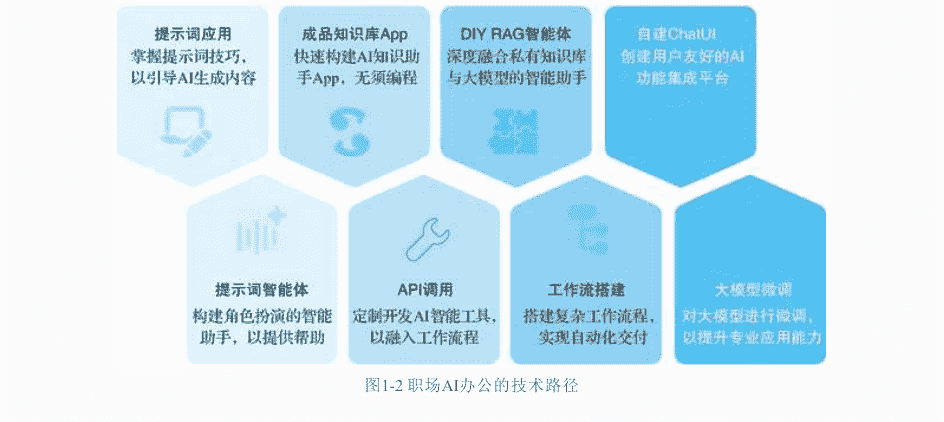
- 指令应用：驾驭智能的语言。掌握指令技巧，精准引导智能输出，是智能应用的基础与快速上手关键。
- 指令智能体：角色扮演的助手。基于角色编写指令与背景知识文档，构建专属智能助理，让智能更懂工作场景。
- 成品知识库 App：即开即用的工具。借助平台成熟大模型与知识库系统，快速搭建智能知识助理，无需编程即可实现检索问答。4.11 节介绍的 ima.copilot 即属此类。
- 接口调用：定制功能的拓展。通过调用大模型接口定制专属智能工具，将智能能力融入现有流程，实现个性化功能。
- DIY RAG 智能体：深度融合的专家。基于 RAG 项目 DIY 知识助理，将私有知识库与大模型深度融合，打造垂直专业专家。
- 工作流搭建：流程自动化的编排。基于可视化智能工作流，灵活调用多种智能工具，实现复杂项目自动化交付。
- 自建 ChatUI：专属界面的打造。自建面向用户的 ChatUI 平台，统一管理各类智能功能，打造一站式专属工作平台。
- 大模型微调：能力进阶的密钥。对大模型进行针对性训练，使其在特定领域或任务中表现更优，是能力进阶的关键一步。

#### 1.1.3 从赋能到跃迁的终极目标
掌握智能是提升效率的基础，但价值不止于此。更重要的是借助智能实现自动化办公，将简单重复耗时任务交给机器，聚焦创造性与战略性工作。从智能赋能走向自动化跃迁，构建高效智能自主运转的办公系统，是本书后续将深入探讨的核心。

### 1.2 DeepSeek 产品解析
DeepSeek 由杭州深度求索人工智能基础技术研究有限公司开发，是一款先进的智能大模型。它在传统语言模型能力上引入混合专家模型 MoE，使处理复杂办公任务更高效低成本。自发布以来在数学推理、编程、自然语言理解等领域表现突出，市场认可度快速提升。

#### 1.2.1 推理模型的优势与局限

低成本推理新旗舰 DeepSeek-R1 有何不同

2025 年刚开年，DeepSeek 就对外推出了推理类大模型 DeepSeek-R1，一上线便成为科技圈的焦点话题。模型在训练成本被压得很低的情况下，性能却能与国际一线产品对标，直观体现出国内生成式 AI 的创新势能。投入少、回报高，既是一次技术上的跃升，也为后续研发提供了新的参照坐标。

从使用体验来看，R1 大致可归纳为三个鲜明标签。

##### 1. 思考链条被摊开给用户看
R1 最打动人的地方，是它愿意把内部的推导步骤完整呈现出来。过去的大模型大多只给结论，这次用户能循着每一步的推理轨迹，看清楚模型如何逐层归纳、最终落定。业内对这种可视化并不常见，360 集团创始人周鸿祎曾点评，完整展示思维链明显提升了可信度。

可视化不只是观赏价值。把推理过程显性化后，模型在组织逻辑、拆解问题、推导方案时更加自律，答案的贴合度提高，误导与噪声信息也减少了。

举例来说，问“达芬奇是摄影师吗”。普通模型往往直接否定。R1 则先做多层自检：梳理达芬奇的生平与职业边界，排查是否存在同名混淆，回溯其在光学与视觉研究上的贡献，并判断《蒙娜丽莎》的光影细腻是否被误读成摄影技术。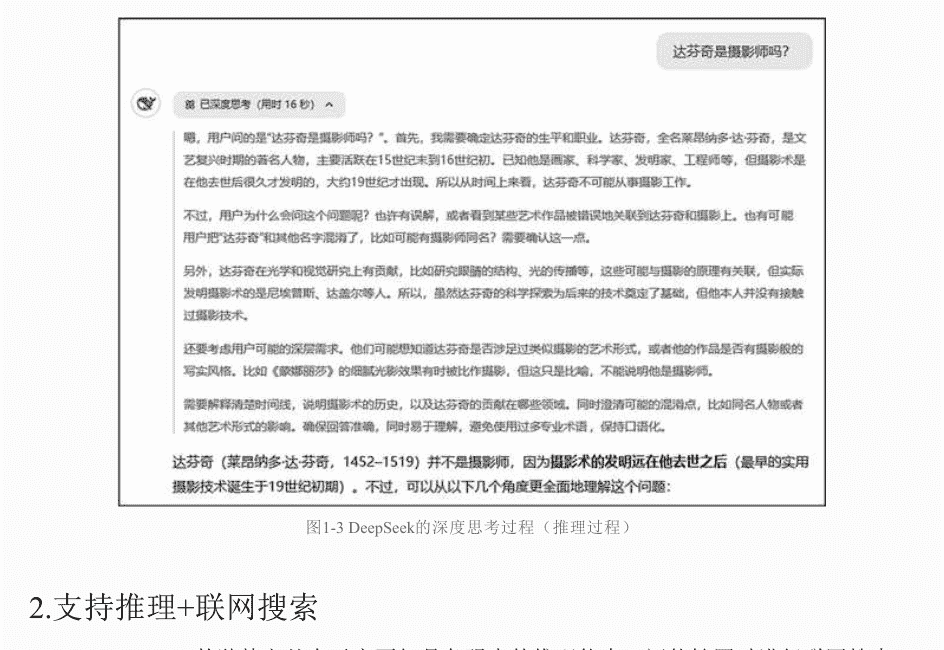

图1-3 DeepSeek的深度思考过程（推理过程）

##### 2. 推理能力与实时检索联动
R1 的另一面是把强推理和联网检索揉在一起。推理负责深度剖析，检索负责时效补齐，两者配合让它变成一个更靠谱的工作助手。先用自研算法对已知信息做初步推演，再通过实时上网抓取最新资料，输出既有深度又不掉队。

在信息快速迭代的场景里，仅靠模型知识库很容易过时。联网检索正好补上这块短板，让建议既扎实又新鲜。R1 之前，市场上虽有只做推理或只做检索的产品，能把两者无缝结合的并不多。

##### 3. 开放策略加速落地
R1 的落地很快体现在应用端。微信已小范围灰度接入 DeepSeek-R1，部分用户可在对话内直接调用，如图1-4所示；网易有道宣布全面拥抱该模型，加速个性化教学升级；多地政府部门也在探索把其纳入城市服务，推进政务智能化。

亮点明显，短板也清晰：

- 长文本生成偏弱：输出普遍偏短，面对长篇撰写或长文本处理时表现打折。
- 多模态功能缺失：目前不支持图像、音频、视频的生成，多模态能力仍是空白。

#### 1.2.2 推理模型与通用模型的运作机制对比
在 R1 出现前，接触更多的是通用大模型。两者在使用感受上有什么差别，怎么选型更合适？

推理模型可以理解为给传统大语言模型装上了更强的解题中枢。不仅能读懂表层文字，还能做深层的逻辑拆解与决策，擅长把解题思路一步步列出来。DeepSeek-R1 就是典型代表，在复杂推理、数学计算和实时问答上表现突出。如图1-5所示，在 DeepSeek 聊天窗口选中“深度思考（R1）”，即可调用推理版。

并非所有需求都要上重推理。日常的写作、翻译、简单问答等，用通用模型已足够。它们通过海量文本学习语言规律，能流畅写段落、做摘要、做分类。DeepSeek-V3 就是非推理版本，如图1-6所示，未勾选“深度思考（R1）”时调用的是通用版。

表1-1 推理模型和通用模型的特性对比

| 特性 | 推理模型 | 通用模型 |
| :--- | :--- | :--- |
| 定义 | 基于传统大语言模型强化逻辑推理与决策能力 | 聚焦语言生成、语境理解和自然语言处理，不强调深度推理 |
| 应用场景 | 逻辑推导、数学运算、实时问答、复杂问题拆解 | 文本创作、语言理解、文本分类、翻译 |
| 优点 | 能处理需要深度思考的难题，给出更精准的答案 | 日常任务已足够，且生成速度更快 |
| 缺点 | 消耗更多算力与时间，响应较慢 | 缺乏复杂推理和决策能力 |
| 适合任务 | 需要深入分析、复杂决策和开放性探索，如项目规划、成本效益分析、风险评估、头脑风暴 | 文档撰写、邮件起草、会议纪要整理等常规办公 |

#### 1.2.3 推理模型与通用模型的提示词设计差异
两种模型的工作逻辑不同，引导方式自然也不同。吃透差异才能把每种模型的长处发挥出来。

##### 1. 面向过程 vs 面向目标
与基础模型交互时，用户习惯面向过程，把任务拆成细步骤、逐条指令让模型照做。可控但也束缚了灵活性。

推理模型更适合面向目标。用户只需讲清最终想要什么，中间路径由模型自行规划。比如要一份市场分析报告，只需点明趋势、客户画像、差异化建议三大要点，模型就能自主组织成高质量内容。这种从指令到目标的转变，降低了使用门槛，也释放了创造力。

##### 2. 提示词的核心原则
用好推理模型，提示设计要把握两点：

- 直接表达诉求：不需要冗长的铺垫，简洁明了即可获得理想结果。
- 无需手动提供思维链：模型自带推理能力，会自行生成思考路径。

表1-2 推理模型与通用模型的提示词的差异

| 特性 | 推理模型 | 通用模型 |
| :--- | :--- | :--- |
| 提示词风格 | 简洁、目标导向，强调结果而非中间步骤 | 详细、具体，强调步骤和过程指导 |
| 思维链需求 | 自动生成思维链，无需用户逐条给出 | 常需显式提供详细思维链以确保执行正确 |
| 复杂任务处理 | 可直接描述目标，模型自行规划路径并解决 | 通常需人工将复杂任务拆解为子任务并逐一指导 |
| 灵活性与创造力 | 较高，可根据目标灵活调整策略 | 较低，严格按给定步骤执行 |
| 输出质量控制 | 关注输入信息质量及目标设定即可 | 需通过细致指令来保证输出质量 |
| 适合任务 | 分析、综合、创新类，如市场分析、内容创作 | 流程固定类，如数据录入、简单查询 |

简单说，通用模型像按流程执行的助手，需要明确的格式和步骤约束；推理模型像会自主规划的思考者，会自行补全格式与流程，结果因此更有变化和灵活性。

#### 1.2.4 实战：推理模型与通用模型的对比案例
理论说完，用一个命名案例来对照。

笔者要为一个 AI 提示词分享与管理网站起名，先用基础模式输入：

> 我做了一个AI提示词（Prompt）分享和管理网站，请你帮我给这个网站起名，包含中文名及适配的英文名。请帮我策划至少10组名称。

只给了“为 Prompt 分享和管理网站命名、需中英文对照、至少10组”这三点信息。基础模式返回如下：

## AI提示词分享和管理网站名称策划（10组）

1. 灵感源泉（PromptSpring）
   - 中文名：灵感源泉
   - 英文名：PromptSpring
   - 解释：灵感如泉涌，PromptSpring寓意网站是AI提示词的灵感源泉，帮助用户激发创意。
2. 提示词工坊（PromptCraft）
   - 中文名：提示词工坊
   - 英文名：PromptCraft
   - 解释：将提示词创作比作手工艺，PromptCraft强调网站的实用性和工具属性，帮助用户打造优质提示词。
3. 提示词星球（PromptPlanet）
   - 中文名：提示词星球
   - 英文名：PromptPlanet
   - 解释：将网站比作一个充满提示词的星球，PromptPlanet寓意网站内容丰富，用户可以在其中探索、发现。
4. 提示词图书馆（PromptLibrary）
   - 中文名：提示词图书馆
   - 英文名：PromptLibrary
   - 解释：将网站比作图书馆，PromptLibrary强调网站的资源丰富，用户可以在这里查找和学习各种提示词。
5. 提示词集市（PromptMarket）
   - 中文名：提示词集市
   - 英文名：PromptMarket
   - 解释：将网站比作集市，PromptMarket强调网站的分享和交流功能，用户可以在这里“买卖”和交换提示词。
6. 提示词实验室（PromptLab）
   - 中文名：提示词实验室
   - 英文名：PromptLab
   - 解释：将网站比作实验室，PromptLab强调网站的探索和创新精神，用户可以在这里进行各种提示词实验。
7. 提示词花园（PromptGarden）
   - 中文名：提示词花园
   - 英文名：PromptGarden
   - 解释：将网站比作花园，PromptGarden寓意网站是一个充满生机和创意的地方，用户可以在这里“培育”和“收获”提示词。
8. 提示词宝典（PromptBook）
   - 中文名：提示词宝典
   - 英文名：PromptBook
   - 解释：将网站比作宝典，PromptBook强调网站的权威性和实用性，用户可以在这里找到各种提示词秘籍。
9. 提示词宇宙（PromptVerse）
   - 中文名：提示词宇宙
   - 英文名：PromptVerse
   - 解释：将网站比作宇宙，PromptVerse寓意网站的内容浩瀚无垠，用户可以在这里探索提示词的无限可能。
10. 提示词魔方（PromptCube）
    - 中文名：提示词魔方
    - 英文名：PromptCube
    - 解释：将提示词比作魔方，PromptCube强调提示词的组合和变化，用户可以通过不同的组合创造出无限可能。

建议：
- 可以根据网站的具体功能和目标用户群体选择合适的名称。
- 可以进行用户调研，了解用户对不同名称的喜好程度。
- 可以进行域名查询，确保选择的名称对应的域名可用。

再把模式切到深度思考（R1），用完全相同的提示词，模型先展开内部推演，再给出方案：

> [思考开始]嗯，用户让我帮忙给他们的AI提示词分享和管理网站起名字，包括中文名和英文名。首先，我得理解这个网站的主要功能。它是用来分享和管理AI提示词的，也就是Prompt。用户可能需要一个既专业又有创意的名字，容易记住，同时中英文都要适配。

首先，我需要分析用户的需求。他们可能希望名字既能体现AI技术，又能突出分享和管理的功能。中文名字可能需要简洁有力，英文名则要简短且容易拼写。另外，还要考虑品牌的可扩展性和国际化。

接下来，我会考虑关键词。比如“提示词”对应的英文是Prompt，AI相关的词有“智能”“智汇”“灵机”等。管理方面可以用“库”“工坊”“矩阵”“枢纽”等。分享方面可以用“分享”“集”“汇”等。

然后，我会尝试组合这些关键词，形成有意义且流畅的名字。比如“智言工坊”对应“PromptForge”，Forge有锻造的意思，工坊则显得专业。另一个例子是“灵枢PromptHub”，灵枢有枢纽之意，Hub在英文里也是中心的意思，这样中英文对应得比较好。

还要注意避免重复，确保名字独特。可能需要检查现有的网站或商标，但这里可能只是初步建议。另外，名字要易于发音和记忆，比如“PromptGenius”对应“提示天才”，既直接又有吸引力。

还需要考虑目标用户是谁。如果是技术人员，可能需要更专业的术语；如果是普通用户，可能需要更亲切的名字。比如“语界PrompterVerse”中的“语界”给人一种广阔的感觉，适合社区分享。

最后，列出至少10组名字，确保每组都有中英文对应，并且涵盖不同的方向，比如技术感、社区感、工具感等。同时，每个名字后面加上简短的说明，帮助用户理解背后的意义，这样用户可以根据自己的品牌定位选择最合适的名字。[思考结束]

以下是10组中英文适配的AI提示词管理网站名称方案，从技术感、功能属性、品牌传播等维度设计：

1. 智言工坊/PromptForge
   （“工坊”体现创作属性，Forge象征锻造AI智慧）

## 2.灵枢PromptHub
（“灵枢”取自中医典籍，暗含核心枢纽之意，Hub对应资源聚合）

## 3.启钥Promptory
（“启发灵感之钥”，组合Prompt+Repository体现词库属性）

## 4.语界PrompterVerse
（构建AI语言宇宙的概念，Verse延伸元宇宙意境）

## 5.墨核InkCore
（“墨”象征知识沉淀，Core突出核心技术引擎）

## 6.智链PromptChain
（区块链式思维，强调提示词的组合延展性）

## 7.言矩LingoMatrix
（“语言矩阵”概念，突出结构化管理系统）

## 8.灵钥PromptGenius
（“开启灵感的钥匙”，Genius暗示智能涌现）

## 9.语擎Lingine
（组合Linguistic+Engine，彰显语言驱动引擎技术）

## 10.智汇舱PromptPod
（太空舱概念隐喻AI孵化器，Pod符合现代科技命名趋势）

命名逻辑说明：
1）中文名注重意象传达，英文名确保语义关联与国际化发音。
2）核心词根围绕“Prompt/语言/智能”展开衍生。
3）后缀采用Hub/Pod/Forge等科技领域常见词根增强专业感。
4）部分名称预留品牌延展空间（如Verse/Matrix可拓展为功能模块）。
5）中英文字节长度控制在2～4个字，符合域名注册规范。

建议优先考虑与目标用户群体的契合度：技术型用户适合PromptForge/PromptChain类硬核命名，创作者社群倾向PrompterVerse/PromptPod类富有想象力的名称。可结合品牌色系与LOGO设计进行最终选择。

两次结果差异明显：
- 创意度：基础模式多为“提示词+XX”的直白组合，套路感强；R1模式更具跳跃性，智汇舱PromptPod、语擎Lingine等更显巧思。
- 记忆度：R1给出的名字更精炼，发音顺口，易于留下印象。
- 内涵度：R1命名更富意蕴，如言矩暗指语言矩阵，启钥意为启发灵感之钥。

总体来看，基础模式产出平实，缺乏推理后的创意深度。若想在基础模式下提质，就需要对原提示做更细致的约束：

最近有朋友准备上线一个面向普通用户的AI提示词分享与管理站点，希望得到一组既有专业感又亲切好记的中英文名称，至少提供十组搭配。要求中文短促有力、英文简短好拼，整体语感顺畅易记。

在基础指令下，DeepSeek 给出的首批方案如下：

1. **提示库 PromptBase**
   中文 提示库 / 英文 PromptBase
   点明核心功能，直给易懂，英文简洁专业。

2. **灵感池 PromptPool**
   中文 灵感池 / 英文 PromptPool
   把提示词视作灵感来源，温暖且有创意。

3. **智汇盒 PromptBox**
   中文 智汇盒 / 英文 PromptBox
   寓意装着智慧的盒子，印象扎实好记。

4. **提示星球 PromptPlanet**
   中文 提示星球 / 英文 PromptPlanet
   用星球作喻，带来探索与趣味感。

5. **灵感桥 PromptBridge**
   中文 灵感桥 / 英文 PromptBridge
   突出连接用户与灵感的桥梁作用，含义清晰。

6. **提示工坊 PromptWork**
   中文 提示工坊 / 英文 PromptWork
   强调制作与分享，专业又接地气。

7. **智语集 PromptHub**
   中文 智语集 / 英文 PromptHub
   提示词如智慧汇聚，英文精炼。

8. **灵感魔方 PromptCube**
   中文 灵感魔方 / 英文 PromptCube
   以魔方比喻提示词的多变与有趣。

9. **提示森林 PromptForest**
   中文 提示森林 / 英文 PromptForest
   以森林象征资源丰富，探索感强。

10. **智语坊 PromptLab**
    中文 智语坊 / 英文 PromptLab
    带实验室气质，凸显创新探索。

这批名字在专业、创意与亲和之间取得平衡，普通用户也能快速记住。参考智语集 PromptHub、灵感魔方 PromptCube、智汇盒 PromptBox 等思路，便于筛选。

结合表1-2，可以更通俗地概括推理模型与通用模型的差异：

- 指令风格：推理模型偏重目标，基础信息足即可，提示可以很简；通用模型需要把细节补全，还要给出过程指引。
- 思维链依赖：推理模型会自行形成思考路径；通用模型则依赖使用者把细节和需求主动补充。
- 灵活与创意：推理模型自主思考，每次输出可能出现不同火花，更具创意；通用模型按固定要求执行，灵活性较低。
- 适用场景：推理模型适合编程、数学、市场分析、内容创作等需要推理的任务；通用模型胜在响应快、格式稳，适合翻译、数据录入、阅读归纳等流程化工作。

## 第2章 DeepSeek提示词编写与管理实务

前两本书已系统讲过提示词的三大要素、四种技巧和七种结构化框架。本章不再复述基础，聚焦适配DeepSeek推理模型的高效写法。

### 2.1 提示词到底是什么

提示词的重要性类似餐厅点餐。你要告诉服务员想要火锅还是炒菜、要不要辣、偏爱海鲜还是牛羊肉，否则推荐很可能不合口味。

通俗说，提示词就是发给AI的指令。描述越清晰，回复质量越高。听起来简单，实务中把话说清楚并不容易。模糊表达常导致反复确认、效率下降甚至冲突。

看一个典型案例。

> 案例背景
场景：项目经理李华要求下周三前让张莉完成项目报告初稿，但传达时缺少具体要求。
对话：
李华：张莉，帮我整理一份项目报告，甲方催得急，尽快。
张莉：收到。
李华：尽快弄完，客户很急。
结果：张莉不清楚格式与要点，提交初稿不符合预期，被迫返工，进度受影响。
优化后对话：
李华：张莉，关于项目报告，我需要确认具体需求：
1）包含项目概述、进度更新、预算使用、风险评估、下一步计划；
2）使用公司统一模板，确保数据准确；
3）下周三下午5点前给我初稿，方便我们审阅修改。
有疑问吗？
张莉：预算部分需要财务最新数据，能否协调？
李华：我马上联系财务，今天内给你。还有别的问题吗？
张莉：没有了，我按要求完成，谢谢。
结果：沟通明确，报告按时达标，团队效率提升。

把张莉换成AI，指令不清同样会得到不符期望的输出。若让AI写这份报告，可以这样写：

请帮我完成一份项目报告，要求如下：
- 需涵盖项目概述、进度更新、预算使用情况、风险评估和下一步计划。
- 使用公司统一报告模板，保证数据无误。
- 初稿需在下周三下午5点前交付。
- 预算使用情况需基于财务部门数据分析。数据如下：xxxxxx

可见，提示词是人机对话的基础，质量直接决定结果。

### 2.2 撰写提示词的核心原则

从案例可知，要把话说清，就要给足信息和细节。具体包括：

- 需求清晰：明确要做什么，尤其对关键事项和名词做定义。如“报告需包括项目概述、进度更新、预算使用情况、风险评估和下一步计划”。
- 要求明确：说明需遵守的规则、注意事项和预期目标。如使用统一模板、下周三下午5点前交付。
- 信息充分：提供必要的背景、过程、数据或案例。如预算数据补充。

之前介绍过细节法、示例法、推理法、格式法四种写法。R1推理模型虽能自行推理分析用户意图，但细节和示例依然关键。

### 2.3 实战：AI办公落地从“克隆自己”开始

下面拆解笔者的真实经历，说明细节法与示例法的结合。

#### 1. 细节补充法

细节法即补充背景、受众、名词定义等信息。

公司每年年会会在每位座位上放一封手写信，回顾历程引发共鸣，以往都是笔者亲手撰写，风格偏煽情文艺。


2023年AI爆发，笔者尝试克隆自己，写了一个“年会手写信风格写作助手”提示词来替代创作。关键在于先给“年会手写信风格”下定义并描述特征：

你现在是专业写作高手，擅长抒情感性文章。请用“年会手写信风格”按要求撰写抒情文。

“年会手写信风格”的特点：
1）修辞丰富：多用比喻、拟人、排比、反问等，增强表现力；
2）情感词汇多：选用饱含感情色彩的词；
3）感叹句频现；
4）人称以“我们”为主拉近距离，也可交替用“你”，营造亲切互动。共鸣、互动、亲切是重点。

遇到难以描述的风格，可把目标文章交给DeepSeek分析特征，再把特征写入提示词，用AI驾驭AI。

#### 2. 范例驱动法

定义清楚后仍偏概念化，如“修辞多”“感情浓”难以落地。这时提供范文更有效。笔者挑选了3-5段过往手写信作为参考。

“年会手写信风格”范文：
//隐私原因不展示原文，读者可自行加入自己的范文
□ [范文段落1]
□ [范文段落2]
□ [范文段落3]

完整提示词即为定义加范文结合。

你现在是专业写作高手，擅长抒情感性文章。请用“年会手写信风格”按要求撰写抒情文。

风格特点同上。

范文：
- [范文段落1]
- [范文段落2]
- [范文段落3]

设置完成就相当于克隆了一个自己，AI可持续模仿该风格。之后根据每年主题反复调用，2023、2024年的年会手写信主体内容均由AI完成。

“克隆自己”带来巨大效率提升。过去写信需寻灵感、构思、润色，常花1-2天；现在半小时内完成创作与调整，堪称效率革命。

> 笔者感言：
个人创造力受知识边界限制，总会枯竭，AI不会。它能在极短时间内扩展个体边界，让灵感快速闪现（见图2-2）。
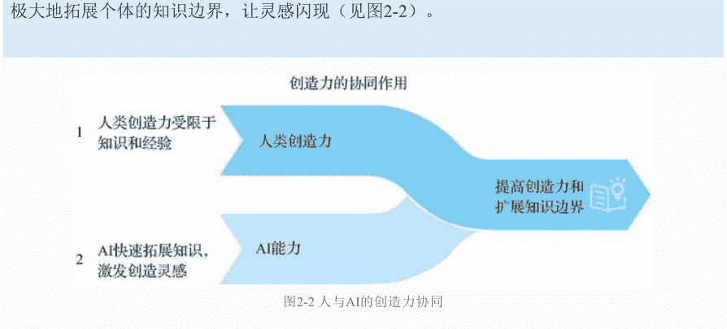

### 2.4 万能提示词模板

掌握原则和技巧能否应对所有场景？面对复杂任务时，可记住几个万能公式，像钥匙一样快速构建有效指令。

#### 1. 极简三要素法

推理模型能自主补全思维链，简单指令往往达到通用模型复杂指令的效果。

先看通用模型下的对比。仅告知“撰写会议通知，面向公司年轻员工”，并给出会议信息：

我是一名会议组织者，需要撰写一则会议通知，面向群体是公司内部年轻群体。

会议背景：
- 主题：部门周例会（2025年3月第一周）
- 时间：2025年3月3日周一上午9:30—11:00
- 地点：公司3楼会议室B
- 参会：市场部全体含实习生
- 议程：上周总结回顾、本周任务分配、新品营销方案讨论、自由讨论答疑
- 事项：提前5分钟签到；负责人提前准备上周总结PPT，会前一天发至meeting@example.com；时长约1.5小时

DeepSeek会给出较为完整的通知，语气亲切、信息齐全。

再用复杂提示词演示。采用CO-STAR框架，明确风格、语气、受众，要求轻松愉快、富有创意。

```
###### Context（背景）
你是一位经验丰富的会议组织者和专业文案撰写人。你熟悉各类会议的组织流程和通知撰写规范。你需要为即将举行的重要会议撰写一份会议通知。

###### Objective（目标）
根据<Style>风格和<Tone>语气要求撰写会议通知，包含所有必要的会议信息，如会议主题、时间、地点、议程概要、参会要求等。确保通知内容清晰、准确，能够有效传达会议的重要性和相关细节。

###### Style（风格）
□ 轻松愉快：使用活泼、朝气蓬勃的语言。
□ 简洁明了：传达清晰的信息，避免冗长。
□ 富有创意：使用有趣的表达方式和比喻。
□ 视觉吸引：适当使用emoji表情点缀文字。

###### Tone（语气）
□ 友好：像朋友间交流一样亲切。
□ 热情：展现对会议和团队成员的热忱。
□ 幽默：适度加入幽默元素，但不影响专业性。
□ 鼓舞：激发团队成员的参与热情。

###### Audience（受众）
□ 公司内部年轻团队成员。
□ 充满活力、喜欢新鲜事物。
□ 偏好轻松、有趣的沟通方式。
□ 熟悉emoji和网络用语。

###### Response（响应）
请按照以下结构输出会议通知：
1.标题：会议主题
```
##### 2. 尊敬的[受邀者称谓]：
3. 开场白：简要介绍会议背景和重要性
4. 会议详情：
- 会议主题
- 时间
- 地点
- 主办方
- 参会对象
5. 会议议程概要
6. 参会要求或注意事项
7. 联系方式：用于确认出席或咨询
8. 结束语：表达期待和感谢
9. 落款：主办方名称和日期

会议背景信息如下：
- 会议主题：部门周例会（2025年3月第一周）
- 会议时间：2025年3月3日（周一）上午9:30—11:00
- 会议地点：公司3楼会议室B
- 会议人员：市场部全体成员（包括实习生）
- 会议议程：
  1）上周工作总结及问题回顾（各小组负责人汇报）
  2）本周重点工作安排及任务分配
  3）市场营销方案讨论（针对新品发布）
  4）自由讨论及答疑
- 其他事项：
  - 请参会人员提前5分钟到达会场，签到入座。
  - 请各小组负责人提前准备好上周工作总结PPT，并于会议前一天发送至会议组织者邮箱：meeting@example.com。

# 会议通告写作：从表达效果看提示词设计

在同一则部门例会通告的撰写任务上，基础模式与推理模式、简单指令与复杂指令的输出差异，清晰地体现了表达风格与提示设计的关系。

## 基础模式下的年轻化通告

基础模式生成的版本围绕 2025 年 3 月第一周的部门周例会展开。主题是新品发布前的例行对齐，时间定在 2025 年 3 月 3 日周一 9:30 至 11:00，地点为公司三楼会议室 B，由市场团队主办，全体成员含实习生均需到场。

议程安排包含四项：上周工作复盘与问题梳理、本周重点推进与任务认领、新品营销方案研讨、自由讨论与答疑。参会要求提示提前五分钟签到，各组负责人需于 3 月 2 日前将总结 PPT 发送至 meeting@example.com，会议时长约 1.5 小时。联系方式为同一邮箱及 123-456-7890。

整体语气偏年轻化，大量使用表情符号，口吻轻松。诸如“每周头脑风暴+咖啡时间”“别让饥饿打断灵感”等表述，降低了正式感，增强了亲和力。

## 推理模式下的指令对比

把相同材料分别用简洁指令和详细指令投给推理模式，效果如下。

简洁指令的产出以“周一充电站”作标题，开头面向市场团队的小伙伴含实习生。用“盘进度、造方案、卷起来”的网络化说法概括目标。时间信息保留 2025 年 3 月 3 日 9:30-11:00 并提醒提前五分钟签到。地点描述为三楼会议室 B，并补充茶水间旁落地窗的细节。议程被重命名为复盘时刻、任务解锁、头脑风暴、自由麦。会前要求明确组长在 3 月 2 日 18:00 前将 PPT 命名为组别+周报发送至 meeting@example.com，并提醒准备灵感笔记。特别提示实习生做好提问，方便融入。

详细指令的产出标题为“周例会升级版！3 月头脑风暴派对等你来战”。开场把例会比喻为信息中转站与创意发射台。详情部分列出主题为开春第一弹新品营销脑暴总动员，时间 3/3 周一 9:30-11:00，地点三楼会议室 B，发起名为营销天团，参会为全体成员加实习萌新。议程改为上周高光时刻、本周闯关任务、新品营销创意赛、自由抢麦时间。提醒包含提前五分钟签到迟到需红包、组长 3 月 2 日前 PPT 发射至 meeting@example.com、自带零食。结尾附最佳创意提案的礼盒彩蛋。

两版都保持轻松俏皮、表情点缀的特点，推理模式下即便指令简短也能达到较好效果。说明在需求清晰、要求明确、信息充分的前提下，简短指令同样可用。

## 通用提示构建思路

### 极简三要素
我是谁 + 我的需求 + 受众/背景信息。版本一做成填空模板，版本二做成一句话。示例涵盖教师、产品经理、健身教练、科普博主等场景，背景信息版强调时间地点数据规模等约束。

### 目标导向法 CARE
Context 角色背景、Aim 核心任务、Restriction 约束条件、Expectation 期望输出。以健身教练四周增肌计划为例，角色为健身教练，任务为设计计划，约束为男性有基础每周四次每次一小时，输出为表格含训练日动作组次数休息。

### 专家角色扮演法 ROLE
Role 角色扮演、Objective 专业任务、Logic 多维度分析、Expertise 专业技能加持。以远程办公影响分析为例，扮演资深人力资源专家，分析绩效与协作影响，多维度覆盖经济社会心理，运用人力资源理论提出建议。

### 情景需求分析法 SCAR
Situation 问题背景、Challenge 核心需求、Action 限制范围、Result 期望结果。以电商 App 转化率低为例，背景为新 App 转化低，需求为分析流失原因并改进，限制为聚焦 UI 与用户体验，结果为用户画像加优化方案报告。

### 风险预测与应对法 SAFE
后续内容在此框架下展开，强调先识别风险点再给出应对策略，适用于需要预案的场景。

以上案例说明，表达的年轻化与信息的准确性可以兼顾，关键在于提示词对角色、任务、约束、输出形式的明确界定。

预判风险：SAFE 四步管控法

SAFE 由 Scope、Analysis、Forecast、Execute 组成，思路是在行动落地前就把不确定性找出来并提前准备对策。无论是推进项目、做投资判断还是研发新品，都可以用它做前置审视。借助这套方法，风险盘点会更完整，对发生可能与影响程度的判断更清晰，也能更有效地引导 DeepSeek 输出可操作的防范建议并真正执行。

常用组合：明确目标 + 拆解风险 + 推演对策 + 落地执行

##### 核心目标（Scope）：先把要实现的结果说清楚，例如打造面向幼童的教育类 App、投向一家初创科技企业等，目标必须具体可辨认。

- 潜在风险分析（Analysis）：把可能出现的隐患全部列出并深挖原因，例如内容合规与隐私保护、市场竞争加剧、技术迭代加快等，保证覆盖面足够全面。
- 应对策略预测（Forecast）：针对已识别的风险推演演变路径并设计对应办法，例如强化内容审核、构建完善的隐私保护机制、加大研发投入等，确保办法具有实效。
- 执行方案（Execute）：把办法转化为具体的行动步骤并推动落地，例如组建专属审核团队、定期开展安全漏洞扫描、制定细化的研发排期等，保证可操作。

以“儿童教育 App 开发”为例，提示词可以这样组织：
> 我想做一款面向儿童的教育 App（核心目标），但担心内容安全与隐私保护（潜在风险分析），请推演可能出现的问题，并列出相关法规与技术解法（应对策略预测），同时给出可落地的执行方案（执行方案）。

对上述提示词做结构化改造：

```
##### 核心目标（Scope）

我想开发一款面向儿童的教育App。

##### 潜在风险分析（Analysis）

担心内容的安全性和隐私保护问题。

##### 应对策略预测（Forecast）

请预测可能发生的问题，并列出相关的法律法规和技术解决方案。

##### 执行方案（Execute）

请给出详细的执行方案。
```

#### 6. 递进式提问法（STEP）

STEP 对应 Start、Task、Explore、Proceed，核心理念是把复杂难题拆成若干小步再逐层解决。非常适合项目规划、任务拆解、流程优化等需要理清思路的场景。通过 STEP，DeepSeek 能更立体地理解问题全貌，探索多种解法，并给出易执行且可持续推进的建议。

STEP 通用表达式：问题起点 + 任务拆解 + 方案探索 + 持续推进

- 问题起点（Start）：明确要解决的核心议题，例如如何制定一份完整的品牌营销方案？先定起点。
- 任务拆解（Task）：把大议题拆成可执行的子任务，比如锁定目标人群、分析竞争对手、挑选投放渠道等，让复杂问题变得可操作。
- 方案探索（Explore）：针对每个子任务寻找多种可行思路，例如面对年轻消费群，哪些营销渠道更具创新性？为每个任务准备备选方案。
- 持续推进（Proceed）：按序完成子任务并评估调整，最终解决整体问题，确保方案被有效执行并持续优化。

以“品牌营销策略制定”为演示，提示词可以这样写：
> 我的核心问题是如何制定一份完整的品牌营销策略（问题起点）。首先需要确定目标用户、分析竞争对手、选择营销渠道（任务拆解），针对年轻消费群体，有哪些创新性的营销渠道（方案探索）？请基于以上分析，给出可执行的营销方案，并说明效果评估与持续优化的方法（持续推进）。

对上述提示词进行结构化改造：

```
##### 问题起始（Start）

我的问题是如何制定一份完整的品牌营销策略。

##### 任务拆解（Task）

首先，我需要确定目标用户、分析竞争对手、选择营销渠道。

##### 方案探索（Explore）

针对年轻消费群体，有哪些创新性的营销渠道？

##### 持续推进（Proceed）

请根据以上分析，给出一个可执行的营销方案，并说明如何进行效果评估和持续优化。
```

### 2.5 DeepSeek官方提示词样例

官方提供的范例覆盖了编程、场景对话、写作文案、翻译等常见使用场景。

- 编程层面，提示词可快速生成或改写代码。
- 写作与文案层面，提供样例帮助创作散文、诗歌、宣传文案。
- 中英互译层面，强调“信达雅”，译文兼顾准确与优美。

如图2-3所示，DeepSeek 公开了13个提示词样例，覆盖主流使用场景，是学习掌握能力的关键素材，建议细读并尝试改写延展，发掘更多可能性。接下来对官方提示词做详细解析。

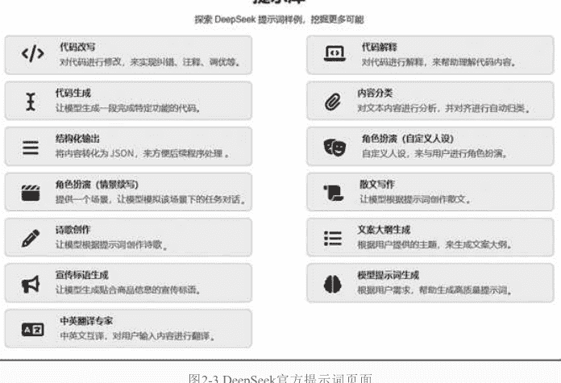

图2-3 DeepSeek 官方提示词页面

为便于阅读学习，笔者将官方样例整理成表，如表2-1所示。

表2-1 DeepSeek官方提示词样例汇总

| 序号 | 名称 | 系统级提示词 | 用户级提示词 |
|---|---|---|---|
| 1 | 代码改写 | — | 下面这段代码的效率很低，且没有处理边界情况。请先解释这段代码的问题与解决方法，然后进行优化：<br><br>```python<br>def fib(n):<br>    if n <= 2:<br>        return n<br>    return fib(n-1) + fib(n-2)<br>``` |
| 2 | 代码解释 | — | 请解释下面这段代码的逻辑，并说明完成了什么功能：<br><br>```c<br>// weight 数组的大小就是物品个数<br>for(int i=1; i<weight.size(); i++) { // 遍历物品<br>    for(int j=0; j<=bagweight; j++) { // 遍历背包容量<br>        if (j<weight[i])<br>            dp[i][j]=dp[i-1][j];<br>        else dp[i][j]=<br>            max(dp[i-1][j],<br>                dp[i-1][j-weight[i]]+<br>                value[i]);<br>    }<br>}<br>``` |
| 3 | 代码生成 | — | 请帮我用 HTML 生成一个五子棋游戏，所有代码都保存在一个 HTML 文件中 |
| 4 | 内容分类 | #### 定义<br>- 智能助手名称：新闻分类专家<br>- 主要任务：对输入的新闻文本进行自动分类，识别其所属的新闻种类<br>#### 能力<br>- 文本分析：能够准确分析新闻文本的内容和结构<br>- 分类识别：根据分析结果，将新闻文本分类到预定义的种类中<br>#### 知识储备<br>- 新闻种类：<br>    - 政治<br>    - 经济<br>    - 科技<br>    - 娱乐<br>    - 体育<br>    - 教育<br>    - 健康<br>    - 国际<br>    - 国内<br>    - 社会<br>#### 使用说明<br>- 输入：一段新闻文本<br>- 输出：只输出新闻文本所属的种类，不需要额外解释 | 美国太空探索技术公司（SpaceX）的猎鹰9号运载火箭（Falcon 9）在经历美国联邦航空管理局（Federal Aviation Administration，FAA）短暂叫停发射后，于当地时间8月31日凌晨重启了发射任务 |
| 5 | 结构化输出 | 用户将提供一段新闻内容，请你分析新闻内容，并提取其中的关键信息，以JSON的形式输出，输出的JSON需遵守以下格式：<br>```json<br>{<br>  "entity": <新闻实体>,<br>  "time": <新闻时间，格式为YYYY-mm-dd HH:MM:SS，没有请填null>,<br>  "summary": <新闻内容总结><br>}<br>``` | 8月31日，一枚猎鹰9号运载火箭于美国东部时间凌晨3时43分从美国佛罗里达州卡纳维拉尔角发射升空，将21颗星链（Starlink）卫星送入轨道。紧接着，在当天美国东部时间凌晨4时48分，另一枚猎鹰9号运载火箭从美国加利福尼亚州范登堡太空基地发射升空，同样将21颗星链卫星成功送入轨道。两次发射间隔65分钟，创下猎鹰9号运载火箭最短发射间隔纪录<br>美国联邦航空管理局于8月30日表示，尽管对太空探索技术公司的调查仍在进行，但已允许其猎鹰9号运载火箭恢复发射。目前，双方并未透露8月28日助推器着陆失败事故的详细信息。尽管发射已恢复，但原计划进行五天太空活动的“北极星黎明”（Polaris Dawn）任务却被推迟。美国太空探索技术公司正在积极为该任务筹备，等待美国联邦航空管理局的最终批准后尽快进行发射 |
| 6 | 角色扮演（自定义人设） | 请你扮演一个刚从美国留学回国的人，说话时会故意中文夹杂部分英文单词，显得非常时髦，对话中总是带有很强的优越感 | 对美国的饮食还习惯吗？ |
| 7 | 角色扮演（情景续写） | — | 假设诸葛亮死后在地府遇到了刘备，请模拟两个人展开一段对话 |
| 8 | 散文写作 | — | 以孤独的夜行者为题写一篇750字的散文，描绘一个人在城市中的夜晚漫无目的行走的心情与所见所感，以及夜的寂静带来的独特感悟 |
| 9 | 诗歌创作 | — | 模仿李白的风格写一首七律《飞机》 |
| 10 | 文案大纲生成 | 你是一位文本大纲生成专家，擅长根据用户的需求创建一个有条理且易于扩展成完整文章的大纲。你拥有强大的主题分析能力，能准确提取关键信息和核心要点。你具有丰富的文案写作知识储备，熟悉各种文体和题材的文案大纲构建方法。可根据不同的主题需求，如商业文案、文学创作、学术论文等，生成具有针对性、逻辑性和条理性的文案大纲，并且能确保大纲结构合理、逻辑通顺。该大纲应该包含以下部分：<br>引言：介绍主题背景，阐述撰写目的，并吸引读者兴趣<br>主体部分：第一段落，详细说明第一个关键点或论据，支持观点并引用相关数据或案例<br>第二段落，深入探讨第二个重点，继续论证或展开叙述，保持内容的连贯性和深度<br>第三段落，如果有必要，进一步讨论其他重要方面，或者提供不同的视角和证据<br>结论：总结所有要点，重申主要观点，并给出有力的结尾陈述，可以是呼吁行动、提出展望或其他形式的收尾<br>创意性标题：为文章构思一个引人注目的标题，确保它既能反映文章的核心内容又能激发读者的好奇心 | 请帮我生成《中国农业情况》这篇文章的大纲 |
| 11 | 宣传标语生成 | 你是一个宣传标语专家，请根据用户需求设计一个独具创意且引人注目的宣传标语，需结合该产品/活动的核心价值和特点，同时融入新颖的表达方式或视角。请确保标语能够激发潜在客户的兴趣，并能留下深刻印象，可以考虑采用比喻、双关或其他修辞手法来增强语言的表现力。标语应简洁明了，需要朗朗上口，易于理解和记忆，一定要押韵，不要太过书面化。只输出宣传标语，不用解释 | 请生成“希腊酸奶”的宣传标语 |
| 12 | 模型提示词生成 | 你是一位大模型提示词生成专家，请根据用户的需求编写一个智能助手的提示词，来指导大模型进行内容生成，要求：<br>1）以 Markdown 格式输出<br>2）贴合用户需求，描述智能助手的定位、能力、知识储备<br>3）提示词应清晰、精确、易于理解，在保持质量的同时，尽可能简洁<br>4）只输出提示词，不要输出多余解释 | 请帮我生成一个“Linux 助手”的提示词 |
| 13 | 中英翻译专家 | 你是一个中英文翻译专家，可以将用户输入的中文翻译成英文，或将用户输入的英文翻译成中文。对于非中文内容，将提供中文翻译结果。用户可以向助手发送需要翻译的内容，助手会提供相应的翻译结果，并确保符合中文语言习惯，你可以调整语气和风格，并考虑某些词语的文化内涵和地区差异。同时作为翻译专家，需将原文翻译成具有“信达雅”标准的译文。“信”即忠实于原文的内容与意图；“达”意味着译文应通顺易懂，表达清晰；“雅”则追求译文的文化审美和语言的优美。目标是给出既忠于原作，又符合目标语言文化和读者审美的翻译 | 牛顿第一定律：任何一个物体总是保持静止状态或者匀速直线运动状态，直到有作用在它上面的外力迫使它改变这种状态为止。如果作用在物体上的合力为零，则物体保持匀速直线运动，即物体的速度保持不变且加速度为零 |

#### 1. 提示词等级

官方提示库将提示词分为系统级提示词和用户级提示词两类，这是业界通用做法。

- 系统级提示词：在一次对话中优先级最高，尤其在多轮对话里保持话题一致、防止跑题的关键所在，常用来限定角色。例如“内容分类”里把 DeepSeek 定为“新闻分类专家”；“文案大纲生成”里把其定位为“文本大纲生成专家”。系统级提示词在智能体开发中应用广泛。
- 用户级提示词：即用户发送给模型的内容，在多轮对话中优先级最低，每一次用户输入都属于此类。

除此之外还有“助手提示词”，即模型每次的回复。多轮历史会在后台拼接为“User:×××；Assistant:×××；User:×××”后再次输入模型，因此模型才能记住上下文。

那么发给模型的提示词只能是用户级吗？并非如此。笔者在国内 AIGC 社区分享过一个案例：利用“续写补全”思路，在用户提示词中加入“System:”和“Assistant:”，可在实践中“强行矫正”对话准确性。限于篇幅不再展开，可在本书前言的资源与勘误中查阅原文。

#### 2. 结构化标记语言

善用结构化标记语言是第二个技巧。

- “代码改写”提示词中使用了“```”标记，这是 Markdown 的代码块标记。
- “内容分类”提示词中使用了“####”标记，即四级标题，用于在提示词中划分区域，让结构更清晰。

#### 3. 需求表达清晰

DeepSeek 官方样例的需求表达都很清晰，符合写好提示词的基本原则：需求清楚、要求明确、信息充足。这在系统级提示词中体现得更明显，可重点研究“文案大纲生成”“宣传标语生成”“模型提示词生成”“中英翻译专家”四个样例。

以“中英翻译专家”为例：

- 需求清晰：你是一个中英文翻译专家，能把中文译成英文或英文译成中文，对非中文内容提供中文译文。
- 要求明确：用户发送待翻译内容，助手给出符合中文习惯的译文，可调整语气风格并兼顾文化内涵与地区差异；译文需达到“信达雅”标准，既忠于原意又符合目标语言审美。
- 信息充分：“信”指忠实于内容与意图；“达”指通顺易懂、表达清晰；“雅”指追求文化审美与语言美感。

### 2.6 LangGPT结构化提示词框架

前作系统介绍了结构化提示词的思想、结构及7种高质量框架，依次为角色扮演框架、ICIO 框架、CO-STAR 框架、CRISPE 框架、BROKE 框架、APE 框架、LangGPT 框架。

#### 1. 结构化提示词的优势

推理大模型的普及降低了门槛，但结构化提示词在构建智能体和复杂 AI 应用时仍有明显优势。

- 结构清晰易复刻：模板化让提示词更清晰，套用模板可快速生成新提示词。
- 易打包成智能体应用：普通提示词每次都要重写，结构化提示词可打包成智能体，针对同类需求直接调用，提升效率。
- 开发 AI 工作流的基础：结构化提示词是工作流开发的基础，掌握后能大幅拓展 AI 应用范围。

前作详细介绍了 Kimi 与豆包 的智能体应用。《豆包高效办公：AI 10倍提升工作效率的方法与技巧》还演示了如何构建自己的智能体。如图2-4所示，智能体相当于用 AI 制作的行业专家，例如“公文写作助手”“AI绘图专家”“数据分析专家”……

DeepSeek 目前尚未开放智能体功能，但笔者相信智能体是大众入门 AI 应用的最佳路径之一，未来一定是重要趋势。

如果读者想做更复杂的开发，可尝试 AI 工作流编排，搭建更具创意与功能的应用，结构化提示词同样是编排工作流的基础能力。如图2-5所示，是笔者制作的“高颜值内容海报”工作流，可让用户输入文字、链接或图片，AI 自动生成精美海报。

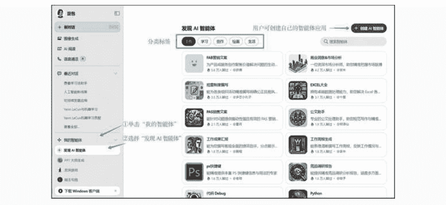

图2-4 豆包智能体广场


图2-5 AI 工作流编排

如图2-6所示，这是一个基于工作流编排实现的“高颜值视觉内容设计师”AI 应用。第4章会介绍如何调用 DeepSeek API，借助 API 可灵活开发自己的 AI 应用。

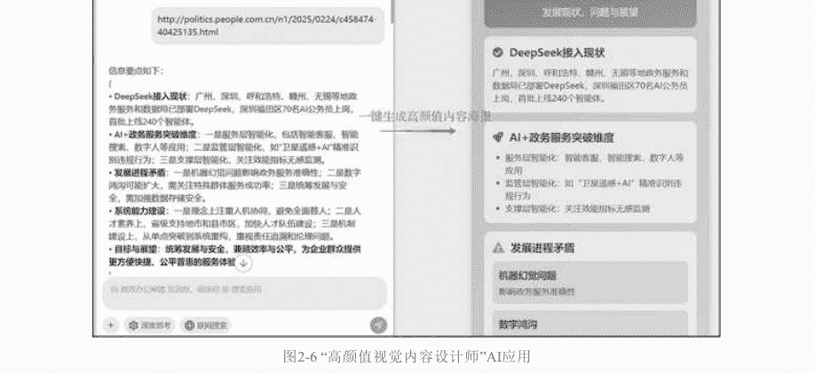

图2-6 “高颜值视觉内容设计师”AI 应用

#### 2. LangGPT结构化提示词

前作已详细讲解 LangGPT 结构化提示词，它目前是国内最流行的提示词框架之一。

LangGPT：按需组合的指令搭建思路

LangGPT 的核心做法是把指令拆成可复用的组件，而不是照搬固定的属性清单。实际运用时，会根据任务特性挑选合适的标签进行拼接。下面对常用标签做梳理。

> LangGPT 属性标签梳理

常用基础标签
- Role：角色定位，决定模型需要扮演的身份。可换用 Expert、Master 等近义词，把模型锁定在某个专业领域。
- Profile：角色画像，补充所扮演身份的出身、履历等背景信息。
- Skill：能力项，列出该身份应具备的具体技能点。
- Rules：行为规范，限定执行时必须遵守的规则。
- Workflow：执行流程，描述完成任务时遵循的步骤顺序。
- Initialization：启动准备，规定初始化后应进行的前置动作。

扩展标签
- OutputFormat：输出格式要求，对结果呈现形式提出明确要求。
- Attention：注意事项，用来提醒模型在处理时需要关注的重点。
- Constraints：使用限制，对部分行为进行约束。
- Ethics：伦理准则，为输出划定道德边界。
- Personality：性格倾向，设定交互中的语气与风格。
- Writing Style：写作风格，对语言表达提出要求。
- Preferences：偏好设置，体现用户对结果的个性化倾向。
- Goals：任务目标，为模型明确需要达成的具体目的。
- Background：任务背景，对待处理事项提供上下文信息。

自由组合这些模块可以衍生出多种结构化方案。实践中最常被采用的提示词框架如下：

```
##### Role（角色）：用户指定的角色名称

###### Profile（角色简介）：

- Author: 云中江树
- Version: 1.0
```

###### Background（背景）：

交代智能体的角色来源与设定，用形象的语言描绘智能体的身份与环境。

###### Goals（目标）：

写清构建该智能体的核心任务，以及它需要完成的产出。

###### Constraints（约束）：

明确智能体在运行过程中必须遵守的限制条件。

###### Skills（技能）：

说明为达成 Goals 所需的核心能力集合。

###### Example（示例）：

为新智能体提供示范案例，帮助它学习 Workflow 的执行方式、Goals 的实现要点、Constraints 的应用边界以及 Skills 的使用方法。

###### Workflow（工作流）：

拆解为达成 Goals 所需的操作链路，并细化每一步的具体做法。

###### Initialization（初始化）：

规定启动时智能体应做的自我介绍，包含可提供的服务、期望用户输入的信息、自身技能范围与目标说明。

该框架与 2.4 节的万能提示词模板在角色、背景、目标、技能等基本要素上高度相似，同时引入 Example 与 Workflow，进一步提升通用大模型的输出质量。

#### 3. LangGPT结构化提示词的改造

如 1.2.3 节所述，推理类大模型具备自主思考能力，提示词无需再硬性规定工作流程，而应以目标驱动。因此 LangGPT 结构需要针对推理模型做调整。

基于推理模型的特点，移除了 Example 与 Workflow 两个模块，同时强化了 Goals，并新增 Knowledge 知识背景模块。改造后的框架如下：

```
##### Role（角色）：用户指定的角色名称
```

```
###### Archive（档案）：
- Author：沈亲淦
- fit：推理大模型
- Version：1.0
- Language：中文

###### Background（背景）：
- 介绍智能体的任务背景和应用场景需求

###### Goals（目标）：
- 写明任务需求，包括需要达成的任务目标及期望的任务质量（这个项目最为重要，请细化思考完善）

###### Skills（技能）：
- 写明如果要达到<Goals>里所提到的目标，智能体需要具备什么样的技能或专业知识

###### Constraints（约束）：
- 根据实际应用场景需求，写明此智能体的限制条件，如范围、时间、场景要求、排除事项、行为准则、输出格式、语言风格等

###### （可选项）Knowledge（知识背景）：
- 根据应用场景选填此项。可补充填写特定的知识背景材料

###### Initialization（初始化）：
- 写明智能体在初始化时要做的自我介绍，包括告诉用户自己能做什么，期望用户提供什么，自己的工作技能是什么，自己的目标是什么
```

相较于极简的三要素模板，LangGPT 的结构化提示词显得更厚重。但正因如此，它在实战中更具可操作性，简版与复杂版提示词可以混用，根据场景灵活切换最合适的方案。

### 2.7 提示词资产管理

恭喜你已经迈出 AI 高效办公的关键一步。接下来要谈的是常被忽略却至关重要的环节：**提示词资产管理**。

#### 2.7.1 提示词是你的重要资产

优质提示词并非一蹴而就，而是需要反复试验、调参、润色才能沉淀出精准匹配工作需求的“最佳配方”。这些经过打磨的提示词就是职场中的宝贵资产，需要像管理工具一样系统保存。

提示词值得精细化管理的理由有四点。

##### 1. 再利用价值：效率倍增的来源
一个优秀提示词是你耗费大量时间调试的成果，它深度契合特定场景。再次遇到相似任务时，直接复用即可快速获得高质量输出，每一次复用都在为时间账户增值，效能呈指数级提升。

##### 2. 防止流失：沉淀经验，告别重复劳动
灵感偶现时调出一个惊艳提示词，若未妥善留存，日后极易遗失，重新复现往往耗时且难以再达峰值。管理提示词是为了防止经验流失，避免无效重复。

##### 3. 技巧沉淀：构建个人的智能知识库
调试提示词的过程也是探索与学习的过程，会积累大量技巧与优化点子。系统化管理能把这些实战经验沉淀为个人的 AI 知识库，为后续工作提供持续的方法论支撑。

##### 4. 商业潜力：打造差异化竞争优势
AI 应用普及的今天，能写出精准高效提示词的人才仍然稀缺。掌握提示词方法并积累优质库，就拥有了独特竞争壁垒，可转化为课程、咨询或付费提示词库，实现商业变现。

总之，提示词资产管理不是简单的归档工作，而是一项关乎效能提升与个人品牌增值的战略行为。从现在起重视每一个提示词，你将在 AI 职场中拥有更强的竞争力。

#### 2.7.2 管理好你的提示词资产

明确重要性后，关键是如何管理。市面上已有多种工具可帮助组织、检索、复用提示词。下面介绍笔者在用的四种方案，可按需选择搭建专属系统，相关教程已放入本书资源包。

##### 1. Notion提示词管理系统：高度定制化的自由工作台

Notion 以高度灵活著称，可像数字乐高一样搭建提示词管理库。其优势在于：

- 高度定制化：可自由定义字段、视图与流程，例如“提示词内容”“应用场景”“模型选择”“调试记录”“使用频率”“关键词标签”“灵感来源”等，并据此分类筛选。
- 可视化管理：支持表格、看板、日历等多种视图，便于按项目或场景分组。
- 强大的标签与搜索：可为每个提示词打上多重标签，如“营销文案”“代码生成”“风格：幽默”“模型：DeepSeek-R1”，快速定位。
- 跨平台同步：桌面、移动、网页端实时同步，随时访问。

如图2-7所示，该图展示的是笔者使用 Notion 搭建的文字对话提示词仓库；如图2-8所示，该图展示的是笔者搭建的 AI 绘图提示词仓库。

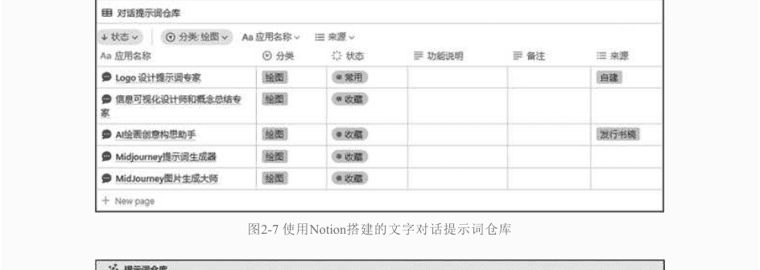

图2-7 使用Notion搭建的文字对话提示词仓库


图2-8 使用Notion搭建的AI绘图提示词仓库

##### 2. Quicker提示词管理系统：效率至上的快捷调用利器

Quicker 是 Windows 系统下的效率工具，支持快捷键、鼠标手势等快速触发动作。可用于构建提示词的秒级调用体系。

核心优势：

- 极速调用：按下预设快捷键即可复制常用提示词到剪贴板，再粘贴到任意应用。
- 系统级应用：在浏览器、聊天软件、办公软件、代码编辑器中无缝使用。
- 操作便捷：新增删减简单，维护提示词库非常直观。

如图2-9所示，这是笔者在 Quicker 中构建的提示词管理应用。唤起面板后即可快速调用。

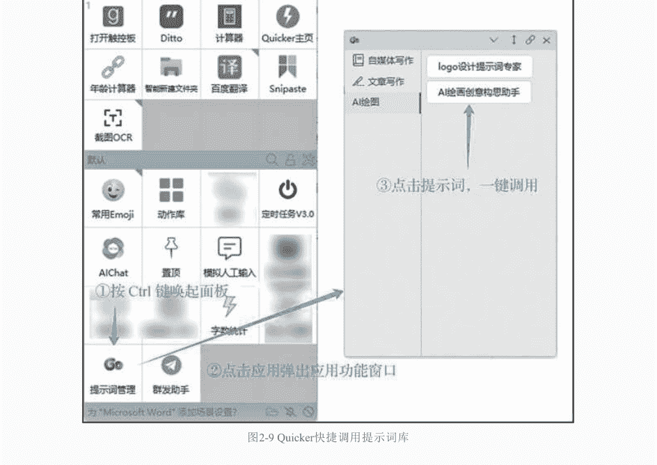

##### 3. Web提示词管理系统：管理与社区共享提示词

具备一定技术能力或有团队共享、社区化需求时，可自建 Web 系统实现提示词的集中管理与分享。笔者已搭建一个支持管理与分享的社区网站，并将前作 100 多条结构化提示词及本作升级版收录其中（如图2-10所示）。

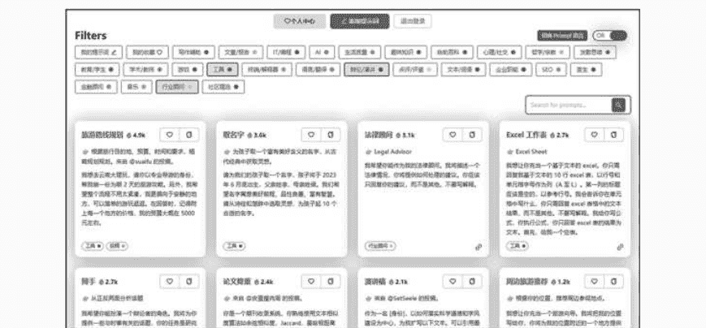

##### 4. ChatUI一站式模型与智能体管理

ChatUI 类平台面向一站式模型调用与智能体管理，通常自带强大的提示词管理能力，并与模型、智能体深度集成，是未来工作流管理的重要方向。

如图2-11所示，这是笔者基于开源项目搭建的ChatUI智能体应用广场。

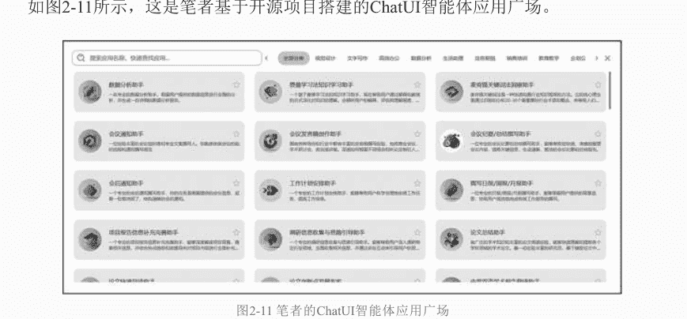

## 第3章 DeepSeek万能模板赋能职场办公

前作已对通用模型的职场场景及百余条结构化提示词做过详细阐述。本章聚焦于 DeepSeek-R1 推理模型如何结合万能模板，在行政文秘、市场营销、数据分析、项目管理、人资等场景提升效率与决策质量。读者可举一反三，将模板灵活套用到自身工作。

提示词资源已整合进资源包，可一键使用。亦可结合前作，对比推理与非推理模型在不同场景的效果。笔者认为，在部分通用场景下，LangGPT 结构化提示词也能让非推理模型取得不错甚至更好的表现。推理模型更擅长编程、创意灵感、数学计算等分析性任务，二者可结合使用。

### 3.1 行政文秘

#### 3.1.1 会议通知撰写

会议是推动项目进展的枢纽，会务告知则是确保信息通畅的第一步。传统撰写需手工收集主题、时间、地点、参会人、议程等信息，耗时且易遗漏。AI 工具可快速生成、润色并校验信息，大幅提升专业度。

案例背景：
创新科技公司即将发布“Blue Pro”智能手表，市场部需召开启动会统一思想、明确分工。

目标：市场部助理需撰写告知函，告知市场部全体、产品部代表、销售部代表会议信息，确保及时参会准备。
涉及角色：撰写者与接收者各部门成员。
核心需求：快速准确输出包含必要信息的会务告知。

采用极简三要素模板：

版本1：模板填写版
我是谁：市场部助理
我的需求：撰写会务告知
我的受众/背景信息：“Blue Pro”智能手表新品发布营销活动启动会议

版本2：一句话版
提示词：我是市场部助理，需要写一则会务告知，受众为全体参会人员，背景是关于“Blue Pro”智能手表新品发布营销活动启动会议。

将提示词输入 DeepSeek 后得到如下思考与输出：

> [思考开始]用户需要为市场部助理生成会务告知，主题为“Blue Pro”智能手表新品发布营销活动启动会。首先需要明确会议基础信息：时间、地点、参与人员等。
> ......（限于篇幅省略）
> 检查结构是否清晰，信息是否完整。语言需正式但不生硬，符合公司内部分发规范。格式美观，使用分点与加粗标题便于阅读。提醒用户替换占位符并核对时间地点。[思考结束]

以下为会务告知示例：

##### 关于召开“Blue Pro”智能手表新品发布营销活动启动会议的通知

全体参会人员：

为推进“Blue Pro”智能手表新品上市营销工作，明确活动目标与执行细节，现定于2025年3月3日（周一）上午9:30召开专题启动会议，具体事项如下：

###### 一、会议基本信息
- 时间：2025年3月3日09:30—11:30（周一）
- 地点：
  - 线下：××大厦18层多功能会议室（请提前10分钟签到）
  - 线上：腾讯会议链接将通过邮件发送，请提前安装客户端
- 参会人员：
  - 市场部全体成员
  - 产品部负责人、设计团队代表
  - 公关部、新媒体运营团队主管
  - 销售团队负责人

###### 二、会议背景与目标
1. 新品核心卖点解析：“Blue Pro”智能手表在健康管理、运动监测及长续航技术上的创新突破。
2. 启动营销活动整体框架：结合线上线下渠道，制定全周期推广策略（预售、首发、后续传播）。
3. 协调跨部门资源分配，明确各团队职责与时间节点。

###### 三、会议议程
| 时间 | 议题 | 说明 |
| :--- | :--- | :--- |
| 09:30—09:40 | 开场与目标宣导 | 市场部总监阐述会议目标与期望成果 |
| 09:40—10:10 | 新品核心卖点解析 | 产品部负责人介绍“Blue Pro”技术亮点与市场定位 |
| 10:10—10:40 | 营销活动整体框架 | 市场部经理讲解全周期推广策略（预售、首发、后续传播） |
| 10:40—11:00 | 跨部门资源协调 | 各团队确认资源需求与协作节点 |
| 11:00—11:20 | 部门分工与协作确认 | 各团队认领任务并承诺关键节点 |
| 11:20—11:30 | 总结与行动号召 | 市场部总监发布最终执行指令 |

###### 四、会议要求

Blue Pro智能手表推广启动大会参会指南

为保障下周的启动大会顺利进行，请各位提前完成以下准备：

1. 预读材料：会前请通读附带的《Blue Pro营销活动方案（草案）》，会议讨论将聚焦该方案的优化思路。
2. 准备要点：各小组建议梳理一份简洁的发言提纲，围绕一至两项重点展开即可。
3. 纪要发送：会后将形成书面会议纪要并发送至全体同事邮箱，请按时出席。

联络窗口
- 会务协调：张xx，市场团队助理，电话：xxx-xxxxxxxx，邮箱：xxx@company.com
- 线上调试：李xx，负责会议系统测试，电话：xxx-xxxxxxxx

敬请各团队主管提醒成员准时参会。若因特殊原因无法到场，请最迟于2月28日周五17:00前以邮件形式向张xx报备。

感谢大家的支持，期待共同推进Blue Pro新品推广项目圆满落地。

附带文件：
1. 《Blue Pro营销活动方案（草案）》
2. 《参会回执表》

补充说明：
1. 议程时长及环节可根据实际需求增减，例如可加入问答环节。
2. 如需强化紧迫感，可在通知末尾添加倒计时提示，例如“距离新品发布会倒计时30天”。
3. 建议同步在钉钉、飞书等内部沟通工具发布提醒，并点对点告知相关执行人。

从合规审查到内容爆破：AI 协作实战全景指南

实战任务铺排
现假设你正担任一家连锁餐饮集团的区域负责人，需要向上级申请50万用于门店数字化改造，核心是智能点餐终端与后厨物联网设备。请完成：
1) 以“现状陈述—必要性论证—开销明细—收益预估”四段式，为大模型设计可直接投喂的指令；
2) 在指令里强化管理层最在意的投入回报测算依据与数据支撑要求；
3) 由模型给出初稿后，人工补充三条竞品门店改造后的运营数据作为行业对标，增强说服力。

合规实战演练
跨境文案审查练习
请对以下面向美国市场的健康管理应用推广文案进行 GDPR 与加州 CCPA 双重合规审查：

【待审文案】
加入我们的健康管理应用会员！
- 自动同步运动手环数据，心率、睡眠、步数
- 依据体重变化推送定制健身方案
- 分享成绩到社交平台可解锁专属折扣
立即注册并勾选“接收健康资讯”，前100名赠送智能体脂秤！

操作要点：
1) 找出至少4处合规风险，例如数据跨境流动、默认勾选等；
2) 补齐用户数据权利说明模块；
3) 制定中英对照的多语言合规审查提示词。

复盘与优化
AI 协作能力评估
任选一项练习成果回顾：
1) 标出模型产出中需要人工复核的3个关键点；
2) 解剖现有指令的局限，设计追问式对话优化路径；
3) 建立指令升级清单：
   - 基础版：用通俗语言描述需求；
   - 进阶版：叠加行业术语表与文档模板样例；
   - 专家版：内置合规核查清单与风格控制参数。

延伸思考
1) 在本单位日常行政工作中，哪三类公文最适合用模型辅助撰写？请给出可复用的指令模板；
2) 面对组织内部特有文件规范，如红头文件格式时，如何训练模型快速适应个性化要求。

### 3.2 营销实战方法论

营销既是企业增长的核心引擎，也是个人价值释放的重要舞台。在信息过载、注意力稀缺的当下，如何以更少投入换取更大传播与转化，是每个营销人都在破解的难题。生成式技术的到来为营销打开了全新突破口。本节聚焦关键环节，探讨如何借助模型工具提效，并推动业绩攀升。

#### 3.2.1 爆款文案生产
一条好文案自带传播力，能瞬间点燃购买欲。尤其在社交媒体场域，一句抓人眼球的文案往往能成就爆品。但打造爆款并非易事，需要市场嗅觉、用户洞察与文字功底。

借助 DeepSeek 的生成能力，这些痛点得以缓解。模型可模拟人类语言逻辑与创作思路，短时间内批量产出多风格营销文案，为创作者提供创意弹药，让爆款触手可及。

案例背景：
张维在初创环保科技公司担任市场专员。公司新推出一款造型别致、材质环保的便携水杯，计划主攻社交媒体，用内容营销引爆声量。任务是为该杯撰写一组可在朋友圈刷屏、引发社群讨论的爆款文案。

需求归纳：
传播目标：撰写既能精准传达卖点，又能牢牢抓住目标人群眼球的社交媒体文案，最终提升平台曝光并转化为实际购买。
人群画像：关注环保、追求生活品质的年轻群体，习惯在社交平台分享生活，对新潮、有态度、有趣的产品更易共鸣。
产品核心卖点：此处列出差异化特性。

#### 3.2.2 品牌故事构建
品牌叙事是连接品牌与用户情感的桥梁，是塑造品牌个性和文化认同的关键。打动人心的故事能在潜移默化中建立价值认同，最终形成忠实用户。

创作引人入胜的故事并不简单，需深挖品牌核心价值，将动人情节、生动人物与深刻主题融合。对多数从业者而言，这往往是创意枯竭或耗时低效的痛点。

优秀叙事通常具备：
- 真实可信：基于事实或品牌理念，避免夸张虚构，让读者感受到真诚；
- 情感共鸣：触及读者情感，引发共鸣，让读者在故事中找到自我；
- 独特性：凸显品牌独特性，与竞品区分，展现差异化价值主张；
- 清晰主题与价值观：传递明确的品牌主题，让读者理解品牌理念；
- 易传播易记忆：语言简洁生动，便于口碑扩散。

案例背景：
余璐负责新成立的精品咖啡品牌“豆荚咖啡”。品牌聚焦高品质阿拉比卡咖啡豆，从严选采购到精细烘焙，致力于提供极致咖啡体验。任务是为“豆荚咖啡”创作一个体现品牌理念、打动目标人群的故事，用于官网、社媒及线下门店传播。

任务目标：创作出传递“高品质、极致体验”品牌理念，并能引发注重生活品质、关注咖啡文化、消费能力较强的都市白领情感共鸣的故事。

为提升效率，可采用“极简三要素”指令法。示例如下：

指令一：侧重创意构思
我是品牌故事创意策划，需要为新锐咖啡品牌“豆荚咖啡”构思三个不同角度的故事创意，受众为重品质与消费体验的都市白领。请围绕“高品质咖啡豆”“高标准采购”“极致咖啡体验”三个关键词展开，每个创意不超过200字。

指令二：侧重初稿撰写
我是品牌文案撰写师，请根据以下框架为“豆荚咖啡”撰写约800字的品牌故事初稿。目标读者为追求生活品质的年轻白领。
故事主题：“一杯咖啡的奇妙旅程”
故事主线：从咖啡豆诞生出发，讲述其如何从遥远产地经严格筛选、高标准采购来到豆荚咖啡，经烘焙变为香醇咖啡送达顾客。
情感基调：温暖、积极阳光、匠心
重点突出品牌对品质的极致追求与采购标准的坚持。

指令三：侧重文案润色
我是品牌内容优化师，请润色以下“豆荚咖啡”品牌故事初稿，提升情感感染力与语言表现力，使其更符合精品咖啡调性。目标是增强对目标受众的打动力。请从叙述节奏、用词、修辞角度优化，并在修改稿中标注改动之处。
[此处粘贴初稿]

以指令二为例，DeepSeek 输出的故事示例为《豆荚咖啡：一粒豆的日光漫游》，以安第斯晨光、危地马拉品控、上海烘焙工坊、陆家嘴都市场景四段递进，串联起从产地到杯测的旅程，突出晨露筛选、23项硬指标、火候哲学等细节，字数约798字。

借助 DeepSeek，品牌故事创作效率显著提升。故事自然融入“高品质、高标准、极致体验”理念，如“被晨露亲吻的果实”“筛选如钻石原石”“严苛到近乎偏执的标准”等描写，凸显品质追求。

余璐仍可进一步优化：
强化品牌独特性：故事在一定程度上体现了精品咖啡共性，如何更凸显“豆荚咖啡”在采购、烘焙或服务上的专属亮点，使故事更具辨识度；
传播性优化：当前篇幅接近800字，在碎片化阅读场景下传播受限。可精简提炼，或延展为短视频脚本、系列海报文案等不同形态，适配多渠道。

#### 3.2.3 活动方案生成
在快节奏职场中，活动策划方案是营销、公关、运营岗位的日常。无论是新品发布、客户答谢还是线上线下联动，一份完整吸睛的方案往往决定项目成败。构思亮点、细化执行、把控质量环节繁琐，DeepSeek 可成为得力助手。

案例背景：
张宸为科技公司市场部员工，公司将发布颠覆性智能穿戴新品 Aura Ring 灵犀环。他需在紧迫时间内完成市场调研、竞品分析、主题构思、流程设计、场地选择、预算评估并整合为专业方案。

产品基本信息：
产品名称：Aura Ring 灵犀环
设计亮点：
- 无感佩戴，极致轻盈：戒指形态，24小时舒适佩戴；
- 生物传感，洞悉身心：微型传感器精准监测睡眠、压力、情绪等深层生理数据；
- 个性定制，时尚潮流：多种材质颜色可选，科技与时尚融合。

目标人群：
- 关注健康、追求自我管理的都市精英；
- 注重效率、渴望身心平衡的职场人士。

指令构建示例：
我是资深市场营销策划，请为公司最新智能穿戴产品的新品发布会撰写活动策划方案初稿。目标读者为公司管理层，方案需详实、逻辑清晰、重点突出，充分展现发布会价值与创新性。请按以下框架填充：活动主题、目标、受众、时间地点、形式流程、营销推广策略、预算预估、风险评估及应对。

DeepSeek 生成的方案节选：

Aura Ring 新品发布会活动策划方案

一、活动主题
“智感未来，悦见身心”——Aura Ring 无界健康新体验
诠释：以智能科技为核心，结合健康管理与时尚表达，传递无感佩戴、精准监测、个性定制三大差异化价值，塑造 Aura Ring 为精英健康生活方式新符号。

二、活动目标
1. 战略目标
- 建立 Aura Ring 在智能穿戴领域的专业与创新标签，占领“健康监测戒指”心智；
- 吸引核心媒体、行业 KOL 及渠道伙伴，为后续推广奠定基础。
2. 量化目标
- 现场覆盖200人，其中媒体/KOL 50家、渠道商30家；
- 发布会后3天全网曝光500万+，预售转化率目标15%。

三、目标人群
...

九、方案亮点总结
1. 技术价值可视化：通过动态数据模型与医学背书，将抽象生物传感转化为可感知的健康方案；
2. 圈层穿透力：融合科技、医疗、时尚资源，精准覆盖目标生活场景；
3. 长效转化设计：从预售权益到联名服务，构建产品-服务-生态闭环，提升用户生命周期价值。

请管理层审阅，期待进一步讨论资源匹配与执行细节。

DeepSeek 在短时间内输出了结构完整、要素齐备的初稿，大幅缩短了从零搭建框架的时间，涵盖主题、目标、受众、流程、推广、预算、风险等关键要素。但营销推广策略部分仍偏通用，如何深度挖掘产品独特性并结合目标圈层文化精准传播，仍有提升空间。

#### 3.2.4 跨境市场的本地化适配
全球化浪潮下，企业出海不能简单复制，需直面文化差异、语言隔阂与市场环境差异。营销内容若无法深度融合本地文化，再精妙的策略也难奏效。模型在本地化适配上展现出传统人工难以企及的效率优势。

案例背景：
TechSpark 公司市场部李明负责 AI 智能会议记录软件在法国市场的推广，需完成批量营销内容本地化，包括法文版产品介绍网站、社交媒体推广文案、本地化营销视频脚本。

针对法文版产品介绍网站本地化任务，可构建指令如下：

我是谁：TechSpark 公司市场部本地化专员
我的需求：将 AI 智能会议记录软件中文产品介绍网站高质量本地化为法文
我的受众/背景：目标为法国企业用户，语言需地道流畅，符合法语表达习惯；设计与内容呈现贴合法国审美；重点突出产品在法国市场解决的痛点与独特价值，如提升法式会议效率、优化团队协作等。
待改写内容：[粘贴原文]

下面是对TechSpark AI智能会议记录工具宣传材料的改写呈现：

**会议纪要自动化，团队协作更流畅——TechSpark智能记录助手**

在实际工作中是否常遇到这些困扰：

- 会议结束后整理纪要要花大量手工时间，效率明显偏低
- 关键要点被漏记或记错，直接影响后续决策与落地
- 多人共同修改同一份纪要导致版本互相覆盖，沟通成本急剧上升

**TechSpark AI智能会议记录软件，是提升会议产出效率的实用工具**

平台基于前沿的语音识别与自然语言处理能力，提供精准、快速且智能的记录体验。

**主要能力：**

- **实时转写：** 会议进行中自动把口语转为文字，准确率在98%以上，当前支持中文、英文等，未来计划扩展法语等语言。
- **一键摘要：** 会议结束后自动生成结构化摘要，迅速把握核心结论，节省复盘时间。
- **关键词抓取：** 自动识别讨论中的关键术语与决策点，便于检索回顾。

**选用TechSpark的理由：**

- 在线多人协同：多人可同时编辑同一份纪要，修改实时同步，避免版本混乱。
- 云端保存与安全：纪要安全存放在云端，可随时调阅，传输全程加密，对法国市场尤其强调符合GDPR要求。
- 灵活导出分享：支持Word、PDF、Markdown等格式导出，便于归档与传播。
- 显著提升效率：免去手工记录，节省人力时间，让团队聚焦讨论本身与行动跟进。
- 提高记录质量：AI识别降低人为失误，保证纪要完整可靠。
- 优化协作体验：便捷的协同功能减少信息差，提升沟通顺畅度。
- 全场景移动支持：随时随地查看与编辑，契合移动办公习惯。

立即试用TechSpark AI智能会议记录软件，开启更高效的会议体验！

[免费试用] [了解产品详情]

**适用范围：**

- 线上会议/线下会议
- 团队例会/项目回顾会
- 客户沟通/培训分享

TechSpark，用技术让工作更高效！

将上述中文文案与提示词提交给DeepSeek进行改写，其内部推演与输出结果如下：

[思考开始]用户希望把TechSpark AI智能会议记录软件的中文官网文案本地化为法文。先要拆解需求：准确理解原文卖点，分析法国企业关注点。……（详细推演过程略，读者可自行复现）

总体来看，本地化需兼顾语言地道性、文化契合、功能侧重、数据合规与术语规范，在保持核心信息不变的前提下用更贴合法国用户的表达方式呈现产品价值。[思考结束]

Libérer le potentiel de vos réunions avec TechSpark – Assistant Intelligent de Compte-Rendu

Finis les compte-rendus laborieux, place à une collaboration intelligente !

Vos réunions souffrent-elles de ces points de friction récurrents :

- La retranscription manuelle vous fait perdre un temps précieux
- Les informations essentielles échappent à la note, fragilisant les décisions stratégiques
- La coédition devient chaotique avec des versions multiples et contradictoires

TechSpark transforme la gestion des réunions pour les entreprises françaises !

La solution combine reconnaissance vocale de pointe et traitement du langage naturel pour des comptes-rendus précis, structurés et exploitables.

Fonctionnalités phares :

- • Transcription instantanée
Précision de 98 % avec français et 8 autres langues, adapté aux équipes multiculturelles.
- • Synthèse opérationnelle
Résumés automatiques qui mettent en avant décisions, actions et échéances.
- ◦ Cartographie des enjeux
Détection automatique des termes techniques, engagements et KPI sectoriels.
- • Coédition collaborative
Travail simultané avec suivi des modifications et commentaires contextuels.
- • Sécurité RGPD & souveraineté
Hébergement en Europe, France et Allemagne, chiffrement AES-256 et audit de conformité disponible.
- o Intégrations professionnelles
Export vers Microsoft Teams, Google Workspace et formats personnalisables DOCX, PDF, Markdown.

Apports concrets pour les entreprises françaises :

- Gain de 6h/semaine sur l’administratif réunion
- Réduction de 40 % des erreurs de reporting interne
- Engagement renforcé grâce à des comptes-rendus dynamiques et interactifs
- Solution 100 % mobile compatible avec les outils métiers existants

Cas d’usage privilégiés :

- ▶ Comités de direction ▶ Revues de projet Agile
- ▶ Négociations clients ▶ Brainstormings créatifs
- ▶ Réunions réglementaires ▶ Formations internes

[Essai gratuit 14 jours] [Voir la démo vidéo]

TechSpark – L’intelligence artificielle au service de l’excellence à la française

> “Parce que chaque minute de réunion doit créer de la valeur tangible”

要点提炼：

1) 突出RGPD合规与欧洲本地托管
2) 案例贴合法国管理实践
3) 采用法国B2B常用表达“créer de la valeur tangible”
4) 关联本地主流协作生态Microsoft Teams / Google Workspace
5) 保持专业中带优雅的法式语气
6) 视觉排版简洁符合欧洲UX习惯

DeepSeek改写后的说明书在语言风格、本土文化、法律合规等方面做了系统适配，核心包括：

DeepSeek针对法国市场做出的深度适配：

###### 1. 语言风格本地化
- 将中文感叹式标题转为法式理性专业表达，避免夸张直译，使用商业文案常用说法。
- 术语统一：“会议纪要”对应法国职场常用compte-rendu；“团队协作”表述为collaboration intelligente，突出智力协同。

###### 2. 文化适配
- 增加法国企业常见场景如projet Agile、comités de direction，呼应本地管理习惯。
- 价值主张从“高效”转为“创造可量化价值”，更易引起共鸣。
- 明确对接Microsoft Teams/Google Workspace等法国企业主流平台。

###### 3. 合规强化
- 明确数据存放在法国和德国，补充AES-256加密与合规审计，回应数据主权敏感度。
- 将“准确率98%”表述为précision de 98%，符合欧盟广告规范。

###### 4. 功能价值聚焦
- 痛点量化：周均节省6小时、报告错误降40%等具体指标。
- 强调法语加8种语言支持，适配跨国团队。

###### 5. 体验优化
- 段落短小、图标点缀，符合欧洲网页阅读习惯。
- 移动端升级为solution 100% mobile，契合法国高远程办公率。

###### 6. 情感共鸣
- 结尾slogan excellence à la française唤起文化认同。
- 使用décisions stratégiques、engagement等管理者常用词汇重塑价值。

#### 3.2.5 动手练习与拓展思考

##### 1. 爆款文案实战
请选择近期推广的产品，按以下步骤生成营销文案：
- 步骤1：用产品卖点梳理表整理信息
- 步骤2：构建极简三要素提示词【角色定位】+【任务描述】+【风格限定】
- 步骤3：生成三种风格文案，观察风格关键词对输出的影响

##### 2. 品牌故事创作
为产品创作差异化品牌叙事，需包含：
- 核心冲突：行业痛点 vs 品牌方案
- 情感锚点：一个用户画像故事传递价值观
- 记忆符号：可延展的视觉/语言符号
进阶：生成三个版本后做情感曲线分析、关键词一致性检查，并压缩为60秒短视频脚本。

##### 3. 活动策划流程演练
场景：为智能办公椅策划新品发布
- 用5W2H法则写核心框架
- 设计三个破圈跨界合作创意
- 用AI生成含甘特图的任务分工表

##### 4. 本地化营销攻防战
以充电暖手宝进军日本为例：
- 列出三个文化认知差异点
- 将广告语“寒冬里的温暖守护者”本地化
- 生成符合日本阅读习惯的产品说明书目录

##### 5. AI协作反思
记录：
- 提示词迭代次数及最终有效指令特征
- AI最惊艳创意与最需人工干预部分
- 新人培训的三条人机协作黄金法则

### 3.3 数据分析

#### 3.3.1 数据清洗与处理
在数据驱动的时代，数据分析师需从海量数据中挖掘决策线索。但现实中数据质量往往不佳。刘乐作为数据分析师，筹备年中大促需分析用户行为数据，却发现数据存在缺失、格式杂乱、重复与异常值等“脏乱差”问题。若直接分析易误导决策。过去靠人工或脚本清洗耗时费力，如今AI助手能大幅提效。

```
用户ID,年龄,性别,地区,注册日期,消费金额

1001,25,Male,北京,2024-01-15,150.50

1002,30,Female,上海,2023/12/20,220.75

1003, ,Male,广州,2024年02月01日,95.20

1004,28,女性,深圳,2024-01-25,180.90

1005,35,男,,2023-11-10,300.00

1006,22,Female,北京,2024-03-01,120.30

1007,40,Male,上海,2023-10-05,250.60

1008,28,Female,广州,2024-02-15,190.80

1009, , ,深圳,2024-03-10,165.40

1010,32,Male,北京,2023-09-28,280.10

1002,30,Female,上海,2023/12/20,220.75

1011,26,male ,成都,2024-01-01,135.60

1012,50,Female,武汉,2023-08-15,5000.00

1013,29,Male,长沙,2024-03-20,175.20

1014,31,Female,重庆,2023-12-01,230.95
```

示例数据存在缺失值、格式不统一、重复记录和异常值。我们用极简三要素法撰写提示词：

> 我是数据分析师，需要清洗用户行为数据文件，用于年中大促精准营销分析。请分析数据异常，最终输出可直接用于分析的高质量数据集。受众是市场营销部门，需用于制定有效策略。

待清洗数据如下：
[此处填写待清洗数据]

DeepSeek回复如下：

> [开始思考]用户是数据分析师，需清洗用户行为数据用于年中大促精准营销。首先理解需求与数据现状，字段包括用户ID、年龄、性别、地区、注册日期、消费金额，存在明显异常需处理。
> ......（详细过程略）
> 总结处理步骤：去重、补全缺失、统一格式、清洗异常值、校验地区有效性，确保数据准确一致，支持用户分群与消费行为分析。[结束思考]

清洗报告：

## 从清洗到决策：数据实战闭环

清洗后取得的进展
- 清理掉3条不合格记录，原因分别是重复出现和关键信息缺失。
- 把日期、性别等字段的写法统一成同一规范。
- 对消费金额里明显偏离的数值进行校正。
- 逐条核验地区字段，确保全部在有效范围内。
- 整体完整度从82%提升到满分100%。

营销侧的参考思路
- 按各城市累计消费额排序，确定市场进入的优先级。
- 叠加年龄与性别两个维度，看不同人群的消费偏好差异。
- 以注册日期为依据做用户生命周期分层。
- 建议重点跟进武汉地区的高价值用户，编号1012。

如需完整表或进一步的分析维度，随时告知。

表3-1 清洗后的数据集示例。

表3-1 清洗后的数据集

| 用户ID | 年龄 | 性别 | 地区 | 注册日期 | 消费金额 |
| :--- | :--- | :--- | :--- | :--- | :--- |
| 1001 | 25 | Male | 北京 | 2024/1/15 | 150.5 |
| 1002 | 30 | Female | 上海 | 2023/12/20 | 220.75 |
| 1003 | 28 | Male | 广州 | 2024/2/1 | 95.2 |
| 1004 | 28 | Female | 深圳 | 2024/1/25 | 180.9 |
| 1005 | 35 | Male | 深圳 | 2023/11/10 | 300 |
| 1006 | 22 | Female | 北京 | 2024/3/1 | 120.3 |
| 1007 | 40 | Male | 上海 | 2023/10/5 | 250.6 |
| 1008 | 28 | Female | 广州 | 2024/2/15 | 190.8 |
| 1010 | 32 | Male | 北京 | 2023/9/28 | 280.1 |
| 1011 | 26 | Male | 成都 | 2024/1/1 | 135.6 |
| 1012 | 50 | Female | 武汉 | 2023/8/15 | 500 |
| 1013 | 29 | Male | 长沙 | 2024/3/20 | 175.2 |
| 1014 | 31 | Female | 重庆 | 2023/12/1 | 230.95 |

#### 3.3.2 自动化报表生成

在数据驱动的业务里，数据是企业的血液，报表就是观察循环是否健康的仪表。销售额起伏、活动效果、用户行为变化，最终都要汇聚到报表里供决策使用。对很多职场人来说，手工做报表意味着加班，抓取数据、核对数字、调格式，每一步都繁琐易错，常让人感叹时间都给了表格工具。

怎么借助AI让报表自动化？下面用一个真实职场案例拆解落地方式。

##### 案例背景

李明在某电商公司市场部，每周一早需向领导汇报上周店铺销售。他要先登录后台导出各渠道数据，汇总到Excel算销售额、访客数、转化率等指标，再手工制图，最后写简要解读。整个流程至少半天，数据一多就容易出错、分心。原本该精力充沛开启新一周的周一，往往被报表消耗。

下面是李明公司上周的销售数据示例（见表3-2）：

表3-2 李明公司的销售数据

| 日期 | 销售额（元） | 访客数（UV） | 订单数 | 转化率（%） |
| :--- | :--- | :--- | :--- | :--- |
| 2025-02-17（周一） | 8500 | 1200 | 85 | 7.08 |
| 2025-02-18（周二） | 7800 | 1150 | 78 | 6.78 |
| 2025-02-19（周三） | 6500 | 1050 | 65 | 6.19 |
| 2025-02-20（周四） | 7200 | 1100 | 72 | 6.55 |
| 2025-02-21（周五） | 9500 | 1300 | 95 | 7.31 |
| 2025-02-22（周六） | 12000 | 1500 | 120 | 8.00 |
| 2025-02-23（周日） | 11500 | 1450 | 115 | 7.93 |

把以上表格交给DeepSeek，并用如下提示生成周报和分析图表：

> 我是电商公司市场分析师，需要为上周店铺产出一份向市场部领导汇报的销售周报。报告要包含销售额、访客数、转化率等核心指标，并以图表直观呈现上周走势，数据源如下：
[粘贴销售数据表格到这里]
图表请用HTML输出。

数据量不大，DeepSeek直接以报表加简要解读的方式呈现，生成的HTML源码如下：

```
<!DOCTYPE html>

<html>

<head>
```

##### 店铺销售周报（2025-02-17至2025-02-23）

```
<script src="content_89197_2.jpg"></script>
```

……（限于篇幅，此处内容省略，读者可使用提示词自行尝试）

| 日期 | 销售额 (元) | 访客数 (UV) | 转化率 (%) |
|---|---|---|---|
| 2025-02-17 (周一) | 8500 | 1200 | 7.08 |
| 2025-02-18 (周二) | 7800 | 1150 | 6.78 |
| 2025-02-19 (周三) | 6500 | 1050 | 6.19 |
| 2025-02-20 (周四) | 7200 | 1100 | 6.55 |
| 2025-02-21 (周五) | 9500 | 1300 | 7.31 |
| 2025-02-22 (周六) | 12000 | 1500 | 8.00 |
| 2025-02-23 (周日) | 11500 | 1450 | 7.93 |

……（限于篇幅，此处内容省略，读者可使用提示词自行尝试）

```
},

y1: {

type: 'linear',

position: 'right',

title: { display: true, text: '访客数 (UV)' },

grid: { drawOnChartArea: false }
```

```
    }

    }

    }

    });

</script>

</body>

</html>
```

把源码放到HTML在线预览工具，即可得到如图3-1所示的图表。

##### 核心销售指标概览

| 日期 | 销售额 (元) | 访客数 (UV) | 转化率 (%) |
| :--- | :--- | :--- | :--- |
| 2025-02-17 (周一) | 8500 | 1200 | 7.08 |
| 2025-02-18 (周二) | 7800 | 1150 | 6.78 |
| 2025-02-19 (周三) | 6500 | 1050 | 6.19 |
| 2025-02-20 (周四) | 7200 | 1100 | 6.55 |
| 2025-02-21 (周五) | 9500 | 1300 | 7.31 |
| 2025-02-22 (周六) | 12000 | 1500 | 8.00 |
| 2025-02-23 (周日) | 11500 | 1450 | 7.93 |

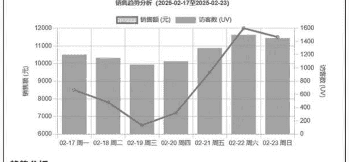

##### 趋势分析

- 周末效应明显：周六销售额达到周峰值12000元，比工作日均值高约58%
- 转化率稳步上行：从周三6.19%一路升至周六8.00%
- 流量与业绩同步：访客量与销售额呈现正相关走势

图3-1 销售数据报告图表

#### 3.3.3 市场情报分析

在商业竞争中，情报就是筹码。谁先更准地掌握市场动态，谁就能抢占先机。

有了AI助手，情报分析效率大幅提升。DeepSeek能从海量信息里快速提炼价值点，帮助职场人看清方向。

> **案例背景**
陆明是“朝光饮品”市场部经理，负责新推健康果汁的上市策略。面对品类繁多且口味挑剔的年轻人群，他既兴奋又迷茫。
> “健康饮品现在什么趋势？年轻人爱哪种果汁？对手在做什么新动作？”传统调研很难短期给出有说服力的答案。

怎么用DeepSeek快速调研并形成初步报告？本例采用CARE模板构建提示词：

**角色背景：** 作为“朝光饮品”市场部经理，我正在制定新品健康果汁的上市策略。
**核心任务：** 对当前健康饮品市场做深度情报分析，为新品上市提供决策依据和洞察。
**约束条件：** 重点关注：
1. 竞争对手分析：聚焦健康饮品领域表现突出的新品牌和传统巨头，分析产品特点、定价、主要渠道及目标人群画像。
2. 消费者洞察：聚焦18~35岁人群，挖掘对健康饮品的核心需求和偏好，如关注成分、口味、包装期待、主要购买渠道。
3. 信息来源：综合淘宝、京东、天猫销售数据、微博、小红书、抖音用户评论与讨论、权威行业报告及相关新闻。
**期望输出：** 生成一份详尽的市场情报分析报告，包含：
- 至少3家主要竞争对手的详细拆解，涵盖产品、定价、渠道、受众及优劣对比。
- 基于年轻消费者的至少5条核心需求洞察。
- 未来1~2年市场的至少3条趋势预测，如功能性细分、口味创新、环保包装等。
- 针对“朝光饮品”新品在定位、卖点、营销推广方面的至少3条可执行建议，语言通俗便于汇报。

如图3-2所示，市场调研需开启联网搜索，让AI抓取最新信息。

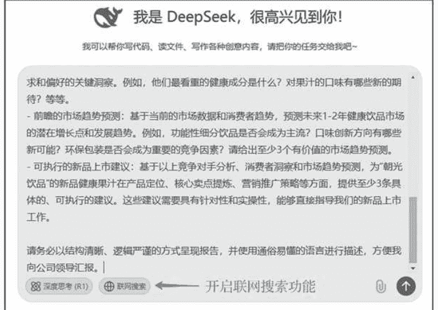

[思考开始]用户是朝光饮品市场部经理，需要一份健康果汁新品的市场情报。先按竞争、消费者、趋势、落地方案四个板块梳理搜索到的材料，覆盖新老品牌对比、18-35岁人群的成分、口味、包装、渠道偏好，据此给出可执行的上市建议，最后用通俗语言呈现便于汇报，同时核对每个数据点的来源可信度。[思考结束]

##### 朝光饮品健康果汁市场情报分析报告（2025年2月）

核心目标：为新品上市提供竞争策略、需求洞察及趋势预判

###### 一、竞争对手分析

####### 1. ××山泉（传统巨头）
- 产品特点：主推NFC果汁系列，采用鲜果压榨工艺，100%无添加，覆盖橙汁、苹果汁等基础口味，并推出蓝靛果混合果汁等创新组合。
- 定价策略：中高端定位，均价22元/升，300ml终端价约7元，高于行业均价16元/升。
- 营销渠道：以大型商超、连锁便利店为主，线上通过天猫、京东自营旗舰店覆盖，2024年茶饮业务增长59.5%。
- 目标受众：城市中高收入女性，注重健康品质的年轻家庭。
- 优劣势：
  - 优势：供应链成本低，品牌认知度高，线下渠道掌控力强。
  - 劣势：产品创新节奏慢，易流失价格敏感型消费者。

####### 2. ××果坊（新兴品牌）
- 产品特点：深耕NFC果汁细分赛道，推出“早橙好”常温系列，与×马合作代工，拓展烘焙店、高校等特通渠道。
- 定价策略：性价比路线，均价16元/升，300ml终端价约5元，主打年轻白领早餐场景。
- 营销渠道：线上依托×马、社区团购，线下下沉便利店、企业配餐，2024年销售网点超4000家。
- 目标受众：18~30岁都市白领，高频早餐与下午茶场景用户。
- 优劣势：
  - 优势：场景定位精准，渠道灵活。
  - 劣势：品牌溢价能力弱，冷链成本高。

####### 3. 葡萄×（果粒果汁领创品牌）
- 产品特点：果粒果汁+升级版NFC混合配方，0防腐剂、0蔗糖，含真实果肉颗粒。
- 定价策略：中端定位，罐装果粒果汁终端价约8元/330ml，主打“大果肉”差异化卖点。
- 营销渠道：重点布局商超和餐饮渠道，2024年斩获罐装果粒果汁销量全国第一认证。
- 目标受众：18~35岁女性，偏好口感丰富、视觉吸引力强的健康饮品。
- 优劣势：
  - 优势：产品创新力强，包装设计契合年轻群体。
  - 劣势：NFC成分占比偏低，健康属性不及纯果汁品牌。

###### 二、消费者洞察（18~35岁年轻群体）
1. 健康成分优先级
无添加91.6%、低糖82%、高维生素74.7%为核心需求，功能性成分如益生菌、胶原蛋白关注度提升。
2. 口味创新期待
混合果味44.4%超越单一口味，椰子水+茶、西梅+橙等跨界组合受青睐。
3. 包装设计偏好
便携小规格250ml~300ml、环保材质、可回收瓶身、高颜值插画风是关键，女性对社交分享友好型包装需求显著。
4. 购买渠道分化
线下便利店80%、大型商超75%为主；线上O2O即时配送70%、抖音/小红书直播55%增速最快。
5. 场景驱动消费
下午茶63%、健身代餐48%、聚会社交52%为三大高频场景，一线城市夜间消费潜力待挖掘。

###### 三、市场趋势预测
1. 功能性细分赛道爆发
添加膳食纤维、电解质、抗氧化成分的功能性果汁将成为增长主力，预计2025年市场规模突破50亿元。
2. 口味跨界与地域融合
区域特色水果如沙棘、蓝靛果与茶饮/酸奶跨界创新，混合口味占比将超50%。
3. 环保包装成竞争壁垒
可再生材料、植物基瓶身、轻量化设计将影响30%消费者的购买决策，头部品牌已布局碳中和认证。

###### 四、新品上市建议
####### 1. 产品定位与核心卖点
- 定位：聚焦“都市年轻女性的全天候健康伴侣”，覆盖早餐、下午茶、健身三大场景。
- 卖点提炼：
  - 100% NFC+功能性添加，如胶原蛋白或益生菌，突出“美容+肠道健康”双重功效。
  - 区域特色混合口味，如蓝莓+沙棘、椰青+茉莉茶，强化差异化。
  - 环保轻量化包装，采用可回收PET瓶+插画设计，适配小红书晒图需求。

####### 2. 渠道策略
- 线下：首攻便利店和精品商超，搭配试饮促销。
- 线上：抖音/小红书种草，KOL测评“一周健康打卡”，布局美团闪电仓实现30分钟送达。

####### 3. 营销推广
- 内容营销：联合健身博主/营养师打造“轻负担食谱”，突出成分透明化，如H5互动展示供应链溯源。
- 联名破圈：与女性健康App如美柚、轻食品牌如Wagas推出限量礼盒，渗透垂直社群。

数据来源说明：
- 竞争格局及市场规模数据引自《2024年中国NFC果汁行业规模及市场分析报告》、××山泉财报。
- 消费者偏好及趋势预判综合《2023年中国NFC果汁消费者洞察报告》及全球果汁行业数据。
- 新品建议参考“2025最具渠道投资价值星饮品”评选案例。

报告亮点：
- 商业逻辑闭环：从洞察到策略再到执行路径形成闭环。例如基于竞品早餐场景定位，建议主攻下午茶+健身场景以错位竞争。
- 实时行业融合：引用2024年最新数据与黑马品牌销量，支撑包装与环保结论，并结合社交平台话题热度强化建议合理性。
- 来源可追溯：明确引用权威报告与财报，提升汇报可信度。

#### 3.3.4 动手练习及拓展思考

##### 1. 数据清洗与处理

###### 1. 实战演练
使用以下数据集（可替换为你实际工作中的数据样例），完成数据清洗任务：
用户ID,访问时间,商品类别,购买金额,城市
1001,2024/3/15 14:30,母婴用品,299,上海
1002,2024-03-16 10:00,,电子产品,北京
1003,2024年3月17日,美妆,1500,广州
1004,03/18/2024 16:45,家居,89.5,深圳
1005,2024-3-19 09:15,食品饮料,,杭州
1003,2024-03-17 11:30,美妆,1500,广州
- 设计提示词清洗数据（需处理缺失值、日期格式、重复值）
- 输出清洗后的数据样例，并解释处理逻辑

###### 2. 场景迁移

AI提问实战：把数据与项目管理做扎实

从一线真实出现的数据瑕疵切入，用需求、受众、约束三要素来组织提问指令。举例：销售汇总时计量单位写法混乱，有的记万元有的记元，合并时口径就会跑偏。

##### 2. 自动化报表生成

###### 1. 周报生成挑战
设想你是某零售品牌运营，需要向管理层汇报上周线上销售表现。基础数据如下：
日期,销售额（万元）,订单量,新客占比（%）
2024-06-10,120,850,35
2024-06-11,115,790,28
2024-06-12,95,600,22
2024-06-13,105,720,25
2024-06-14,140,920,40
要求产出带趋势图的可视化解读，提问需明确对照目标达成情况并说明波动异常的原因，图表学习可参考4.2节、4.3节的方法。
同时列出两处需要人工复核的数据点并说明原因。

###### 2. 流程优化思考
梳理当前报表制作中最耗时的环节，思考：
- 哪些步骤可由大模型接手？提问指令如何设计？
- 哪些步骤必须保留人工把关？原因何在？

##### 3. 市场情报分析

###### 新产品调研实战
假设公司准备推出“办公室健康零食礼盒”，请完成：
- 用CARE框架设计市场分析指令，需覆盖竞品范围界定、消费者画像维度、数据源合规要求。
- 基于模型输出，提炼三条差异化卖点，例如针对加班场景的抗疲劳组合。

##### 4. 流程再造挑战
挑选一个耗时超过1小时的重复性任务，如周报制作或会议纪要整理，进行：
- 描述现状流程并绘制流程图。
- 用模型工具重塑流程，标注可自动化的节点。
- 设计异常兜底机制，例如数据源中断时的应对预案。
- 估算预期效率提升幅度并设计验证方案。

### 3.4 项目管理

#### 3.4.1 项目策划方案撰写
在快节奏的职场里，项目策划方案是团队的作战图，能把从启动到收尾的关键步骤讲清，协调资源、预判风险、保障目标落地。

案例背景
Sarah是某科技公司新任项目经理，被指派负责“智能家居安全系统App”研发，需在6个月内从概念验证做到上线交付。面对复杂需求和紧凑周期，她希望借助大模型快速起草高质量方案。

需求拆解
1）项目目标：打造易用的智能家居安全App，实现远程监控、异常报警、设备联动，提升用户安全感。
2）目标用户：注重家庭安全、追求智能便捷的年轻家庭和租房人群。
3）核心功能：实时影像查看、移动触发告警、智能硬件联动、云端加密归档。
4）时间要求：6个月内上线。

CARE框架指令
角色背景：你是一名资深项目管理专家，熟悉智能家居App研发管理。
核心任务：基于以下信息，为“智能家居安全系统App”撰写一份详细方案。背景是我作为科技公司项目经理，需在6个月内交付具备实时影像查看、移动触发告警、智能硬件联动、云端归档功能，面向年轻家庭和租房人群的产品。
约束条件：
1）方案需涵盖项目概览、目标、范围、时间表、资源安排、风险管控、沟通安排、质量管控等关键要素。
2）内容要具体可执行，符合专业项目管理规范。
3）语言结构化清晰，便于团队执行。
期望输出：
1）输出完整版《智能家居安全系统App开发项目策划方案》。
2）在风险管控、资源分配等关键部分给出专业建议和最佳实践。

借助大模型，Sarah快速获得结构完整、内容详实的初稿，节省大量时间，专注后续优化与执行。

智能家居安全系统App开发项目策划方案

一、项目概览
面向年轻家庭和租房人群的智能家居安全App，集成实时影像查看、移动触发告警、智能硬件联动、云端归档。周期6个月，要求高安全性、易用性、跨平台兼容，目标用户量50万+，首年覆盖率15%。

二、项目目标
1. 商业目标
交付完整功能，覆盖家庭安全核心需求；上线3个月内用户活跃度≥30%，应用商店评分≥4.5星。
2. 技术指标
实时监控响应≤1秒；支持100万级设备并发；数据加密AES-256；云端可用性99.9% SLA。

八、质量管控计划
1. 测试策略
自动化测试：Postman做接口、Appium做移动端UI；性能测试：JMeter模拟10万并发；安全测试：OWASP ZAP漏洞扫描，外聘HackerOne白帽渗透。
2. 代码质量管控
强制PR代码评审，SonarQube静态分析覆盖率≥85%。
3. 用户验收测试
招募200名种子用户Beta测试，收集可用性反馈，NPS≥40。

九、项目收尾
交付物归档：源码、测试报告、运维手册上传内部GitLab；经验复盘会输出《技术债清单》供后续迭代。

项目经理特别建议
- 使用特性开关，实现灰度发布灵活控制。
- 关键节点建立邮件+会议纪要双确认沟通通道。
- 风险储备金优先用于安全加固，其次应对延期。
方案遵循PMI体系，可通过变更控制流程动态调整。

#### 3.4.2 风险评估文档生成
风险如暗礁，高质量的风险评估能提前预警并制定对策。

案例背景
某跨境电商拟进军东南亚，市场总监需48小时内完成《东南亚市场风险评估文档》，聚焦政策合规与物流稳定。

SCAR框架指令
问题背景：作为跨境电商平台市场总监，公司计划在印尼、越南、泰国、马来西亚、菲律宾五国上线站点，需评估市场准入风险。
核心需求：
1）梳理各国最新电商法规限制，特别是数据跨境流动条款。
2）评估主要港口罢工对物流时效的影响概率。
限制范围：
数据时间：2024年1月至今；信息来源：优先当地语言官方原文；风险评级：采用COCO风险矩阵。
期望结果：英文文档，含风险清单表、风险热力图、应急预案，每条风险配三种梯度应对策略。

大模型输出示例
东南亚市场准入风险评估文档
日期：2025年2月27日

1. 风险清单表
| 国家 | 风险类型 | 风险描述 | 影响维度 | 发生概率 |
|---|---|---|---|---|
| 印尼 | 法规合规 | 数据需本地化存储；社交电商交易受限，如2023年TikTok Shop禁令后修订 | 法律、运营 | 中高70% |
|  | 物流中断 | 雅加达丹戎不碌港罢工，劳资纠纷频发 | 供应链 | 中50% |
| 越南 | 法规合规 | 电商法律持续完善中 | 法律、运营 | 中60% |
|  | 物流中断 | 胡志明市港口受台风及海关积压影响 | 供应链 | 低中40% |
| 泰国 | 法规合规 | 2024年7月起低价值进口商品<1500泰铢征7%增值税，要求卖家申报 | 财务、运营 | 高75% |
|  | 物流中断 | 曼谷港数字化瓶颈及季节性洪水 | 供应链 | 中55% |
| 马来西亚 | 法规合规 | 严格价格竞争审查及数据隐私要求，如2023年TikTok Shop调查 | 法律、声誉 | 中60% |
|  | 物流中断 | 巴生港拥堵，2024年吞吐量超常规14.5% | 供应链 | 中50% |
| 菲律宾 | 法规合规 | RCEP生效使关税结构复杂化；SNI认证规则预计2025年6月生效 | 法律、财务 | 中55% |
|  | 物流中断 | 马尼拉港受台风频繁关闭，如2024年康妮台风 | 供应链 | 高65% |

2. 风险热力图
| 国家 | 法规合规 | 物流中断 |
|---|---|---|
| 印尼 | ●● | ● |
| 越南 | ● | ●○ |
| 泰国 | ● | ● |
| 马来西亚 | ● | ● |
| 菲律宾 | ● | ● |

图例：●● 高风险 ● 中风险 ○ 低风险

3. 应急预案
法规合规风险
第一级低投入：与本地律所合作实时监测政策
第二级中投入：在印尼/越南部署境内数据服务器
第三级高投入：通过行业协会争取关税豁免
物流中断风险
第一级：启用备用港口，如巴淡港替代雅加达港
第二级：保税仓预存30%库存
第三级：部署AI物流监控系统预警台风

#### 3.4.3 动手练习及拓展思考

##### 1. 需求拆解与指令优化
场景：为企业年会筹备项目写策划方案，需涵盖预算控制、供应商管理、应急预案。原指令“帮我写个年会计划”。
训练目标：
1）用CARE框架补充角色、约束。
2）加入量化指标，如预算≤50万，参会人数>300人。
3）要求输出甘特图和风险管理矩阵。
思考：如何把模糊需求转为模型可执行的指令？

##### 2. 多维度风险识别
你作为新能源车企市场总监，计划在德法挪三国布局充电桩网络。
1）用SCAR框架设计指令，生成《欧盟充电桩建设风险评估文档》。
2）补充模型易忽略的风险，如欧盟碳关税溯源机制、工会罢工文化差异。

##### 3. 风险评估实战
公司拟在巴西推出充电桩管理App，需评估政策风险、本地化风险、支付风险。
任务：用SCAR框架写指令，要求对比三家竞品应对策略，输出带概率依据的决策树图。高阶技巧：在约束中指定用Monte Carlo方法模拟政策变动影响。

##### 4. 真实工作迁移
选择近期参与的项目，完成：
第一阶段设计指令：用CARE框架生成项目策划方案，至少含3个创新约束；用SCAR框架生成专项风险评估。
第二阶段输出优化：截取模型输出中模糊的时间节点或笼统质量标准，通过追问补充WBS信息，用KANO模型分析功能优先级。

### 3.5 人力资源

#### 3.5.1 绩效考核文档制作
绩效文档像镜子，映照过往表现并指引未来。HR部门制作时常被数据和表格困住，耗时易错。

案例背景
某科技公司500+员工、7个业务单元，首次试行AI驱动绩效考核。HR总监张敏需为半年度述职会准备15份业务单元总经理定制文档，每份含：业绩达成雷达图对比目标/历史/同职级均值；团队管理效能分析离职率/晋升率/培训时长；战略项目贡献度评分；基于岗位胜任力模型的个性化发展建议。

CARE指令
角色背景：拥有8年经验的HR数据分析师。
核心任务：根据附件原始数据表生成业务单元负责人绩效文档。
约束条件：
1）采用“数据呈现-优势分析-改进建议”三段式。
2）图表配色遵循Tableau风格。
3）发展建议引用盖洛普Q12理论框架。
期望输出：
1）生成含导航目录的Word文档。
2）关键指标用★标注。
3）每章节不超过500字。

表3-3 15位业务单元总经理的绩效考核数据
| 业务单元总经理姓名 | 业务单元名称 | 业绩达成率(%) | 目标业绩达成率(%) | 历史同期业绩达成率(%) | 同职级业绩达成均值(%) | 团队离职率(%) | 团队晋升率(%) | 团队人均培训时长(小时) | 战略项目贡献度评分(100分制) | 领导力(5分制) | 创新能力(5分制) | 战略思维(5分制) |
|---|---|---|---|---|---|---|---|---|---|---|---|---|
| 李明 | 移动应用事业部 | 115 | 110 | 105 | 108 | 8 | 12 | 25 | 92 | 4.5 | 4.8 | 4.7 |
| 王芳 | 云计算事业部 | 108 | 105 | 102 | 106 | 7 | 10 | 28 | 88 | 4.3 | 4.6 | 4.5 |
| 张强 | 人工智能事业部 | 120 | 115 | 112 | 110 | 6 | 15 | 30 | 95 | 4.7 | 4.9 | 4.8 |
| 赵丽 | 企业软件事业部 | 95 | 100 | 98 | 99 | 12 | 8 | 20 | 75 | 3.8 | 4 | 3.9 |
| 陈刚 | 数字营销事业部 | 102 | 100 | 101 | 103 | 9 | 9 | 22 | 80 | 4 | 4.2 | 4.1 |
| 刘洋 | 电子商务事业部 | 110 | 108 | 106 | 107 | 7.5 | 11 | 26 | 90 | 4.4 | 4.7 | 4.6 |
| 周梅 | 供应链事业部 | 98 | 102 | 100 | 101 | 11 | 7 | 18 | 78 | 3.9 | 4.1 | 4 |
| 吴昊 | 客户服务事业部 | 105 | 103 | 104 | 105 | 8.5 | 9.5 | 23 | 85 | 4.2 | 4.4 | 4.3 |
| 郑秀 | 研发事业部 | 118 | 112 | 110 | 111 | 5 | 13 | 32 | 93 | 4.6 | 4.9 | 4.7 |
| 郭峰 | 销售事业部 | 125 | 120 | 118 | 115 | 9.5 | 14 | 24 | 96 | 4.8 | 4.7 | 4.9 |

| 林静 | 市场营销事业部 | 100 | 101 | 99 | 102 | 10 | 8.5 | 19 | 79 | 4.1 | 4.3 | 4.2 |
| 冯涛 | 财务事业部 | 90 | 95 | 92 | 94 | 14 | 6 | 15 | 70 | 3.5 | 3.8 | 3.7 |
| 许丹 | 人力资源事业部 | 103 | 102 | 101 | 104 | 8 | 10.5 | 27 | 82 | 4.2 | 4.5 | 4.4 |
| 曹阳 | 运营事业部 | 107 | 106 | 103 | 105 | 7 | 11.5 | 29 | 87 | 4.4 | 4.6 | 4.5 |
| 袁媛 | 法务合规事业部 | 92 | 98 | 95 | 97 | 13 | 6.5 | 17 | 72 | 3.7 | 3.9 | 3.8 |

把提示词和原始数据表共同提交给 DeepSeek 后，模型给出的研判呈现如下：

##### 负责人绩效洞察报告
（注：主标题使用 #004C97，副标题使用 #FF6D00，正文使用 #333333）

###### 目录
- 数据概览
- 优势提炼
- 优化建议

###### 一、数据概览

####### 1. 主指标对照表

| 部门名称 | 目标完成比例★ | 战略价值★ | 管理能力评分 | 人员流失比例★ | 学习时长 |
| :--- | :--- | :--- | :--- | :--- | :--- |
| 人工智能部门 | 120% | 95 | 4.7 | 6% | 30h |
| 销售部门 | 125% | 96 | 4.8 | 9.50% | 24h |
| 研发部门 | 118% | 93 | 4.6 | 5% | 32h |
| ... | ... | ... | ... | ... | ... |

####### 2. 主要发现
1）★ 高绩效集群：人工智能、销售、研发三组达成率均在115%以上，战略价值均高于90分。
2）★ 风险提示：法务合规组达成率仅92%，比基准低8个点，离职比例达到13%。
3）梯队分化明显：前30%的负责人管理评分均值约4.6，后20%则在3.6左右。


###### 二、优势提炼

####### 高分负责人的共性

######## （1）目标把控力强
- 张强负责的AI部门、郭峰负责的销售部门，业绩完成度均超目标20个百分点以上，★ 近期增速持续领先同业。
- 两人战略思维评分均在4.7以上，明显高于整体均值4.2。

######## （2）团队建设效果突出
- 郑秀负责的研发部门，团队流失率仅5%★，晋升率达13%，与盖洛普Q12中员工成长机会维度的最佳实践相符。
- 人均学习时长超过30小时，对应部门目标达成提升约18%。

######## （3）创新驱动落地
- 前20%的负责人创新能力评分均在4.8以上。

###### 三、优化建议

####### 基于Q12的定制化方案

######## （1）重点关注单元
1）法务合规部门袁媛：
- 强化Q12基础需求保障，确保“开展工作所需的资源与设备到位”。
- 通过导师制提升战略思维，当前3.8分，需匹配数字化转型诉求。
2）企业软件部门赵丽：
- 落实Q12社会系统建设，制定“同事致力于高质量工作”的团队公约，当前流失率12%★。
- 启动创新沙盘，每月一次跨部门协作工作坊。

######## （2）系统性举措
- 建设管理加速营：对评分低于4分的负责人开展“战略解码-目标拆解-团队激励”三维训练。
- 优化流失预警机制：当晋升率低于8%且学习时长低于20小时时，触发HRBP介入。

（注：正式落地需补充可视化图表，此处因格式简化。全文各模块字数控制在450～500字，★为关键决策点）

本报告亮点：
######## （1）战略指标锚定
聚焦负责人最核心的“目标完成比例”“战略项目贡献度”“团队流失比例”三大北极星指标，通过加星标注与横向对比，如人工智能120%对比法务合规92%，实现高层决策聚焦。
######## （2）Q12场景化落地
将理论框架转化为可执行动作：
- 法务合规部用Q12第2维度解决资源支持问题。
- 企业软件部围绕Q12第9维度设计团队公约机制。
- 系统建议融入Q12第12维度成长机会的晋升与学习联动模型。
######## （3）管理价值量化
数据验证管理评分与战略价值正相关：
- 4.5分以上负责人带领的战略项目平均超额完成23%。
- 低分组3.5～4分战略贡献均值仅75，暴露战略解码能力断层。

#### 3.5.2 培训方案设计
在信息过载的背景下，企业对员工学习的诉求持续上升，传统方式效率低且难个性化。如何快速响应业务、设计高效且具吸引力的方案，是HR的核心课题。
借助AI可更精准解析学习需求、更高效生成内容、更灵活制定计划，从而显著提升方案设计效率与质量。

##### 案例背景
假设你是互联网公司“星河科技”的培训专员小李。公司业务扩张快，新入一批年轻员工。为帮助新人快速融入、掌握岗位技能，公司决定开展新员工入职培训。小李的任务是利用DeepSeek设计一套高效有趣的入职方案。
小李先梳理培训要素：
###### 1. 目标设定
明确本次入职培训要达成的结果，如了解企业文化、熟悉制度、掌握岗位技能、建立人际关系等。目标需符合SMART原则。
###### 2. 对象分析
深入了解新员工年龄结构、学历背景、工作经验、兴趣爱好，以便针对性设计内容与形式。尤其关注年轻员工偏好互动、碎片、个性化学习。
###### 3. 内容框架搭建
依据目标与对象分析搭建完整框架，涵盖公司介绍、企业文化、规章制度、岗位技能、团队建设、职业发展等模块，并细化要点。
###### 4. 形式创新
跳脱传统讲授，引入互动、体验、游戏化形式：
- 互动讲座：鼓励提问讨论，营造轻松氛围。
- 小组研讨：共同解决实际问题，培养协作。
- 情景模拟：在真实场景中练习岗位技能。
- 游戏化学习：知识竞赛、闯关等提升趣味与参与。
- 线上学习平台：提供资源与交流空间。
###### 5. 效果评估
从多维度衡量效果：
- 知识测试：检验掌握程度。
- 问卷调查：收集满意度与建议。
- 绩效评估：观察实际工作表现。
- 数据分析：分析学习时长、完成率、互动参与度等。

针对上述要素，小李用CARE模板细化提示词需求：
> **角色背景：** 我是一名人力资源培训专员，负责为公司新员工设计岗前课程。
> **核心任务：** 设计一个关于“公司核心价值观”的培训模块，时长2小时。
> **约束条件：** 对象为95后年轻员工，需采用互动性强、生动有趣的形式，避免枯燥说教。
> **期望输出：** 提供详细教案，含培训目标、内容要点、互动环节、所需物料，并给出至少3个可用于DeepSeek的提示词，辅助生成开场破冰游戏、案例分析、小组讨论题目等。
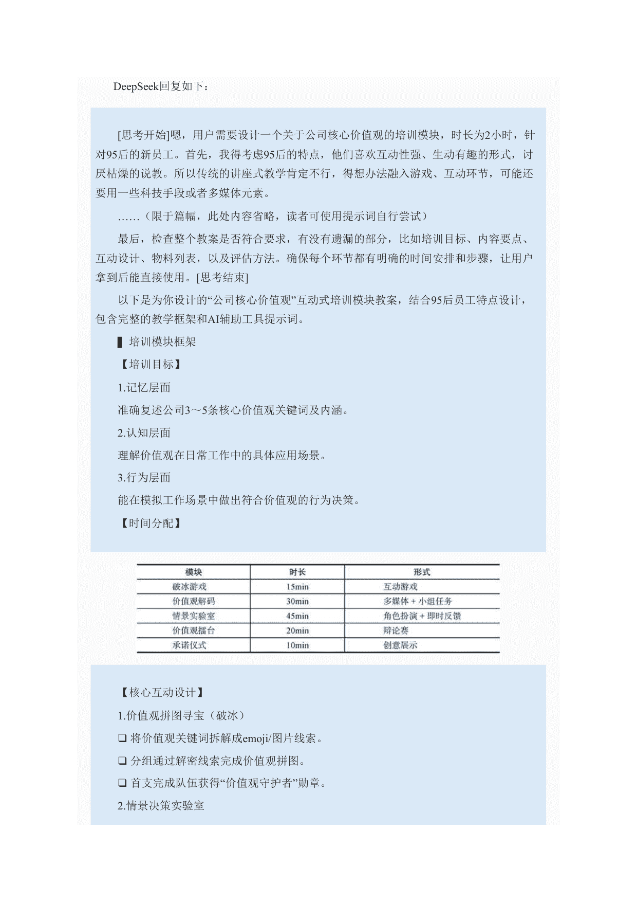
- 提供4个真实工作两难情境卡，如客户需求与制度规范冲突。
- 每组情景剧演绎两种决策路径。
- 使用“价值观罗盘”评分板进行即时互评。
###### 3. 价值观对抗擂台
- 设置争议辩题：“效率优先是否违背质量至上价值观”。
- 随机分组进行3分钟闪电辩论。
- 采用弹幕式实时投票，通过微信小程序实现。

##### 【物料清单】
- 磁性拼图板，每组1套
- 情景决策卡，含二维码扩展案例
- 可粘贴价值观勋章贴纸
- 多媒体设备，播放价值观主题短视频
- 弹幕投票系统，提前测试

##### DeepSeek提示词建议
###### 1. 【破冰游戏生成】
“请设计一个适合20人参与的价值观主题破冰游戏，需含肢体互动与脑力解谜，自然引出‘创新、协作、责任’三个关键词，时长不超过15分钟，给出道具清单与备用方案。”
###### 2. 【案例分析开发】
“创建3个典型职场困境案例，每个案例涉及2-3个核心价值观冲突，适合95后理解。需覆盖客服、技术研发、跨部门协作场景各1个，每个案例附2个引导问题。”
###### 3. 【讨论话题生成】
“生成5个适合小组讨论的价值观思辨话题，符合Z世代表达风格，如：客户要求违背公司价值观却能带来大额订单，该坚持原则还是妥协？每个话题附讨论引导框架。”

##### 教学技巧建议
###### 1. 节奏控制
每20分钟切换活动形式，采用“讲解-体验-反馈”循环。
###### 2. 激励体系
设置价值观积分币，可兑换弹性休息时间。
###### 3. 科技融合
使用AR扫描办公区实物触发价值观知识点讲解。
###### 4. 课后延续
布置“价值观发现者”挑战，要求拍摄工作场景中的价值观实践案例。
###### 5. 评估方式
通过情景模拟的决策树记录、价值观关键词联想测试、匿名弹幕即时反馈综合评估。建议培训后1周进行15分钟趣味线上复盘。

阅读DeepSeek生成的简案可发现，其摒弃传统宣贯式教育，提供大量创新互动模式，充分体现推理模型在思考与创意方面的特质：
###### 1. 三维递进式目标体系
构建“记忆-认知-行为”三层递进目标。拼图游戏强化关键词记忆，情景模拟促进应用理解，角色扮演训练行为决策，形成完整能力转化闭环。
###### 2. 游戏化学习生态构建
将Z世代熟悉的游戏机制融入培训：拼图寻宝融合密室逃脱解密乐趣，价值观擂台引入电竞弹幕互动，勋章体系模仿游戏成就系统，使抽象价值观具象化。
###### 3. 动态冲突教学法
刻意设置价值观冲突场景，通过两难情境决策、正反方角色互换触发深度思考。冲突情境下学习记忆留存率显著高于被动接受。

#### 3.5.3 动手练习及拓展思考
##### 1. 绩效考核提示词优化
企业需为销售团队含大客户/渠道/电销三组设计季度考核报告，需含：业绩完成率趋势图、客户满意度得分分析、销售漏斗转化效率、团队协作贡献度。
任务要求：
1）按CARE模板撰写提示词，含角色背景/核心任务/约束条件/期望输出。
2）对比分析需引用“长板理论”，图表采用红蓝警示色系。

##### 2. 错误提示词诊断
同事提示词：“帮我做个销售培训PPT，要专业点，多放点案例，别太枯燥。时间控制在1小时左右。”
诊断任务：
1）找出至少3处不符合CARE原则的问题。
2）按框架重写：角色背景、核心任务、约束条件、期望输出。
3）加入理论框架要求，如“参考SPIN销售法”。

##### 3. 绩效考核提示词重构
假设你是零售企业HRBP，需为区域经理生成季度绩效报告。参考张敏的CARE模板，结合新增需求重写提示词：新增“客户满意度环比”指标，需对比同行业标杆数据，改进建议结合OKR管理法。请用表格列出修改前后对比并说明优化逻辑。

### 3.6 内容运营
#### 3.6.1 多平台文案适配
内容运营的重要性日益凸显。好文案能抓住眼球并达成营销目标。随着渠道多元化，如何将同一内容高效适配不同平台并保持最佳传播效果成为难题。
常见困境：官网文案过于口语化，公众号长篇难读，微博冗长易沉没。平台用户属性各异，偏好不同。“一套文案打天下”已过时，精细化运营才是关键。人工适配耗时易错，难以精准触达。

##### 案例背景
林悠是电商公司“智选优品”市场部文案策划，公司推出“智能家居助手”新品。他撰写了深度种草文案，需适配官网、微信公众号“智选生活家”、微博“智选优品官方”、小红书“智选好物推荐”四个平台。
使用SCAR万能公式构建结构化提示词指导DeepSeek工作。
请扮演资深内容运营专家，将“智选优品”智能家居助手深度种草文案进行多平台适配。
###### 1. 问题背景
电商公司“智选优品”发布智能家居助手，已有详细介绍功能与优势的深度种草文案。现需在官网、微信公众号、微博、小红书同步推广。
###### 2. 核心需求
将原始文案分别适配为符合官网、微信公众号、微博、小红书平台特性的版本，最大化吸引用户、提升传播。
###### 3. 限制范围
####### （1）内容主题
围绕智能家居助手功能、优势及智能生活体验展开。
####### （2）平台特性
- 官网：官方信息发布，风格专业严谨信息全面。
- 微信公众号“智选生活家”：面向品质生活粉丝，风格生活化场景化注重情感连接。
- 微博“智选优品官方”：社交互动平台，风格简洁有趣追热点，易互动转发。
- 小红书“智选好物推荐”：生活方式分享，风格图片化种草向，突出颜值与使用体验，吸引年轻用户。
####### （3）风格要求
在信息准确前提下，使用更具吸引力的表达，如疑问句、感叹句，加入用户视角增强感染力。
###### 4. 期望结果
分别输出四个平台文案，并在每个版本后简要概括适配思路与平台要点，如字数、风格、侧重点调整。文案避免机械重复，语言自然流畅，体现人工写作痕迹。

DeepSeek创作文案如下：
[思考开始]用户需要将智能家居助手深度种草文案适配至官网、微信公众号、微博、小红书。首先需理解各平台特性，再据此调整风格、结构与内容重点。
……（限于篇幅，此处内容省略，可用提示词自行尝试）
最后检查各版本是否符合平台风格，是否自然流畅，是否使用合适句式与词汇，如疑问句、感叹句，从用户视角出发，增强感染力。确保内容不重复，各平台有独特切入点，同时传达核心功能与优势。[思考结束]
以下是四个平台定制文案及适配说明：
##### 公司官网版本
【智选优品智能家居助手正式上市】
智选优品自主研发的第三代AI智能家居助手今日发布。作为全屋智能中枢，搭载四核AI芯片与HarmonyOS系统，支持语音、触控、App三种交互，可实现跨品牌家电互联互通，兼容超2000款主流设备。通过环境传感器矩阵与深度学习算法，系统可自主调节室内温湿度、空气质量及能耗，节能效率较传统方案提升37%。
产品配备工业级安全加密模块，通过德国莱茵TÜV隐私安全认证。即日起官网订购可享三年质保及免费上门调试，专业工程师团队将按户型定制智能方案。
▶ 立即体验未来生活：[公司官网]
**【适配思路】**
1）以专业术语与数据支撑技术权威性。
2）信息架构分层清晰。
3）突出服务承诺。
4）保持官网中立陈述语气。
5）包含明确转化入口。
##### 微信公众号版本

《多睡一小时的真相，藏在清晨的自动化里》

七点整，卧室百叶帘自动掀开十五度，阳光先一步溜进来。
咖啡机已悄然启动，正在研磨自选的云南小粒，香气慢慢填满房间。
空调提前把温度拉到二十三度，正好介于沉睡与清醒之间的舒适区间。
这并非科幻片的设定，而是智选智能家庭助手在日常里的真实表现。

我们调研了上百户家庭，数据会说话：
√ 双职工家庭平均每天节省约八十七分钟家务耗时
√ 有幼儿家庭里，夜间哭闹导致父母惊醒的比例下降六成三
√ 独居长者出现异常时，系统在九秒内就能完成预警

现在点击【阅读原文】即可预约上门体验，前两百位用户可获赠价值二百九十九元的智能保温杯。
让设备替你记住母亲服药的提醒时间。

**【投放思路】**
1）从清晨唤醒瞬间入手，增强情绪共鸣
2）把用户痛点用数字呈现，八十七分钟、六成三更直观
3）限量赠品制造稀缺感，促进转化
4）全程使用第二人称，提升代入感
5）融入养老关怀的社会议题

##### 微博改编方案
#懒人自救新玩法#
别人的智能管家 vs 你家的“听不懂”音箱↓

别人的：
☑ 空调会自动除湿保持干燥
☑ 扫地机器人能绕开地上的积木
☑ 会主动提示冰箱里的牛奶将过期

你家的“笨蛋”：
○ “好的，已为您关闭全部灯光。”
（其实你只想关卫生间的那盏）

现在智选AI家庭助手带着真正的理解能力上线！
转发本条并@好友，抽取十人送全年上门保洁！
👉 点开视频看搞笑机器狗拆箱实拍

**【投放思路】**
1）绑定热搜话题提高曝光
2）段子对比引发共鸣
3）转发抽奖扩大裂变
4）口语化网络表达提升年轻感
5）搭配短视频提高完播与互动

##### 小红书改编方案
卧室改造第17期｜白月光控制台，美到窒息✨

被问了八百次的智能中枢本体来了
磨砂手感加呼吸灯带，放梳妆台也很高级
最关键的是彻底摆脱“人工智障”的尴尬

实测三大好用功能：
- ❶ 方言模式（普通话、家乡话都能秒懂）
- ❷ 宠物照看（出差时自动投食+远程看监控）
- ❸ 应急预案（停电时自动切换备用电源）

搭配奶油风装修，氛围感直接上天
设置教程已收进合集，宝子们记得点心收藏❤️

**【投放思路】**
1）以颜值与场景驱动，梳妆台陈列加美学描述
2）年轻化用语“宝子”“神仙功能”
3）引导进入合集，提升内容粘性
4）突出方言、宠物等差异化优势
5）Emoji营造轻松种草氛围

渠道打法差异：
- 官网侧重专业背书建立信任
- 公众号侧重情感场景引发共鸣
- 微博侧重话题制造社交传播
- 小红书侧重颜值消费刺激购买

所有版本围绕“智能中枢、场景自适应、安全可靠”这一核心信息轴，通过不同表达实现矩阵传播。

读完这份策划能看出几个亮点：
平台心智把握精准，官网做专业背书，公众号做情感代入，微博做话题裂变，小红书做颜值种草，每个版本都打中平台用户的真实痛点，比如公众号的养老关怀、小红书的家居美学，平台理解很深。

理性与感性平衡得好，官网用参数认证建立信任，公众号用早起场景唤醒代入，微博用吐槽段子引笑，小红书用实测体验增强说服力，数据加情绪形成组合拳。

转化路径隐形但清晰，官网按钮导向即时体验，公众号靠限时礼品制造紧迫，微博靠转发抽奖放大传播，小红书靠合集沉淀长期关注，内容即转化。

#### 3.6.2 SEO优化建议
在内容为王的今天，SEO是每位内容从业者的必备能力，AI则把优化效率推到新高度。面对复杂的内容优化任务，AI能提供哪些帮助？

##### 案例背景
胡微在在线教育平台“智学未来”负责官方博客运营，公司希望通过内容营销提升知名度与转化。她计划对《高效学习的秘密：职场进阶必备的五大学习方法》这篇稿子做SEO升级。

原文要点：
身处信息过载时代，高效学习是职业加速器。文章提出五大法则：主动学习从提问开始，把学习变寻宝；刻意练习强调走出舒适区、聚焦短板；费曼技巧要求用通俗语言讲清盲点；碎片时间结合结构化复习实现积少成多；实践出真知强调学以致用。结语强调方法加坚持。

撰写提示词的核心是让资深SEO专家为25-45岁职场人士定制的进阶类文章做优化，输出完整改写稿。

DeepSeek的回复思路是先分析需求，再给出关键词布局、可读性提升、内外链、FAQ、工具推荐与行动号召加强等要点。

以下是SEO优化后的完整稿，结合关键词与用户体验：

---
**标题：** 职场人必看！高效学习的5大黄金法则 | 附可操作指南
**副标题：** 25-45岁职场精英都在用的进阶心得，快速掌握核心技能（附思维导图）
元描述：掌握费曼技巧+刻意练习的进阶打法，揭秘职场高效学习的5大核心方法，包含碎片时间利用与结构化复习，助你实现3倍速成长，立即领取免费工具包！

##### 高效学习的秘密：职场进阶必备的五大学习方法（2023最新实践版）


目标人群痛点数据：
- 87%职场人有“学完即忘”困扰（LinkedIn 2023职场学习报告）
- 72%白领日均碎片时间超2小时未被有效利用
- 95%学习低效源于方法问题而非智商

###### 一、主动学习法：打造职场核心竞争力
核心词：主动学习 职场技能提升
1. 提问式学习模板
场景：学习Python数据分析
问题清单：①能解决工作哪类痛点？②核心功能与Excel有何差异？③何时使用？
案例：产品经理预设SQL优化用户行为分析问题，学习效率提升60%
2. 个人知识雷达图
推荐工具：Notion知识库、幕布技能树模板

###### 二、刻意练习法：突破职业瓶颈
长尾词：刻意练习 职场进阶
四维突破模型：采用该模型的学员3个月后岗位胜任力平均提升34%（得到职场课跟踪）

###### 三、费曼技巧：沟通与内化的利器
热点词：费曼技巧 职场应用
职场版四步：场景化设想向新人讲解→具象化用案例→漏洞检测记录追问→简化重构做清单/SOP
工具：Loom录屏、Xmind简化模板

###### 四、碎片学习体系：构建个人学习生态
高频词：碎片化学习 职场时间管理
分级利用表与复习日历：每日卡片复盘、每周思维导图重构、每月项目实战检验

###### 五、学习闭环系统：从知识到绩效
转化词：学习成果转化 职场晋升
3R法则：Record飞书妙记记录要点→Relate关联客户谈判场景→Result设KPI如谈判成功率
案例：销售总监把沟通课变成异议处理话术库，季度业绩提升27%

##### 配套资源包
免费领取：学习力自测表、碎片时间模板Excel、50本职场必读书单
获取方式：关注公众号【职场进化论】，回复“学习加速”

##### 常见问题FAQ
Q：如何平衡工作与学习？
→推荐135法：1个核心技能+3个关联知识点+5分钟微习惯
Q：费曼技巧适合哪些场景？
→跨部门沟通、新人培训、方案汇报等
Q：学习瓶颈期怎么办？
→尝试三换：换形式、换反馈渠道、换应用场景

##### 结语：打造职业护城河
在AI加速替代常规岗位的背景下（世界经济论坛2023），高效学习已是核心生存技能。掌握五法并结合工具，6个月搭建知识体系，1年形成差异化竞争力，3年实现赛道升级。
立即行动：选一个方法今日实操，评论区打卡获个性化建议！

---
SEO要点说明：
1. 关键词布局，标题含核心词，正文穿插长尾词
2. 结构化呈现，小标题+数据+工具+案例提升可读性
3. 内外链建设，关联站内时间管理、职场沟通
4. 权威引用增强信任
5. 移动端友好，段落精简，重点加粗分点

此版预计覆盖“职场高效学习方法”“费曼技巧实践”等关键词，停留时长提升40%以上。

从该方案可见，DeepSeek并非直接改写，而是提供增添说服力的建议。推理模型提供数据锚点、工具链、交互设计等思路，通用模型可快速植入关键词，两者结合效果更佳。

数据锚点植入：加入LinkedIn、世界经济论坛等权威数据，把方法论量化为“3个月胜任力提升34%”。
工具链嵌入：推荐Notion、Xmind等7款工具，形成方法+工具+案例闭环。
交互式设计：自测表、模板、评论区打卡，把单向输出变双向互动，内容营销报告显示互动可提升SEO效果37%。

#### 3.6.3 视频脚本创作
短视频已成内容运营关键阵地，脚本创作效率决定投放质量。

> 案例背景
莫紫负责女性生活方式平台短视频，目标25-35岁职场女性，定位工作生活平衡指南。用户面临996内卷焦虑，渴望平衡感。她计划制作“职场女性如何平衡工作生活”短视频。

使用CARE模板的提示词要求90秒温暖治愈风格，提供3-5个实用建议。

DeepSeek的思考要点是明确受众、节奏分配、建议可视化等。

##### 【短视频脚本】《忙碌星球里的专属花园》

[开场：清晨城市全景，阳光透过玻璃幕墙]
轻柔钢琴+鸟鸣
旁白（温柔女声）：
“地铁上啃早餐的你，茶水间冲第五杯咖啡的你，深夜改PPT鼻酸的你……我们在旋转的阶梯上寻找平衡。”

[分镜1：女主把手机翻面扣桌]
建议1：设立能量结界
“18:30文档右下角跳动时，把手机翻过来，像合上书本。工作与生活之间需要一扇看得见的门。”

[分镜2：便签写“周四19:00闺蜜日”贴满月历]
建议2：提前预定幸福
“把火锅、瑜伽、看展当成CEO会议一样排进日程，值得的人生不需要等有空。”

[分镜3：泡澡，水面漂浮雏菊，iPad屏幕暗下]
建议3：打造转换仪式
“40度泡澡是下班切换键，蒸汽模糊工作界面，邮件会自己长出翅膀。”

[分镜4：脱下高跟鞋赤脚踩阳台鹅卵石]
建议4：允许柔软
“不必时刻绷紧，咖啡渍衬衫也是认真活过的勋章。平衡是让每个身份都有脆弱的权利。”

[结尾：女主抱笔记本坐飘窗，旁有热茶与玫瑰瓶]
“我们不是走钢丝，而是在空中种花园。当藤蔓自然缠绕，每个奔跑的你都值得恰到好处地绽放。”
字幕：平衡不是单选题，是自命题
时长90秒，莫兰迪粉橘色调，花瓣飘落特效，可加手写金句字幕。

短视频拆解与跨工具协作实录

在生活化画面里加入可听的质感，比如纸页翻动的沙沙、煮茶的轻鸣。
结尾预留用户共创的开口，话题标签定为 #今天想宠爱自己的瞬间#。

拆解 DeepSeek 产出的脚本后，可以提炼出两条可复用的思路：

###### 1.时空折叠叙事
DeepSeek 将 90 秒压缩成清晨地铁、办公工位、卫浴、阳台、飘窗的蒙太奇链，分镜 1 到 4 快速推进。依靠空间的连跳来调节观众对时间的主观感受。这种把方法拆成生活切片的折叠讲法，比平铺直叙更贴合短视频的认知节奏。

###### 2.痛觉具象化
脚本把被咖啡渍弄脏的衬衫、改 PPT 改到鼻酸这类职场小尴尬，转化成分镜 4 里的成长勋章。通过缺陷美化的处理完成负面情绪的价值反转，这正是当下职场人群容易共鸣的情绪打法。

#### 3.6.4 动手练习及拓展思考

##### 1.视频脚本创作
你正负责一个家居品牌的春节短片投放，请借助智能助手完成：
1. 写一段 30 秒口播稿，必须包含“年夜饭”“团圆”“智能家居”三个关键词。
2. 补充三条适配快手平台的运镜建议。
3. 设计一句引导用户晒全家福的互动话术。

##### 2.跨文化适配
为国产扫地机器人的英文宣传语“Smart Clean, Wise Choice”做区域本地化：
1. 日本市场，偏重细节与品质感；
2. 中东市场，偏重尊贵体验；
3. 德国市场，偏重技术参数。
分别给出改写建议。

##### 3.多平台文案适配
**场景说明**
公司即将推出“智能办公护眼台灯”，产品亮点：
1. 随环境光自动调节色温
2. 久坐提醒功能
3. 无线手机充电底座

**操作要求**
任选两个平台撰写适配文案并说明策略：
- 知乎，偏知识分享型表达
- 抖音，15 秒带货短视频文案
- B站，3 分钟开箱测评脚本

##### 4.需求反推训练
回想近三个月内本可借助大模型提效却仍手动完成的任务：
1. 用 STAR 法则还原情境。
2. 分析任务中可被智能体介入的协作节点。
3. 按本章方法论设计提示词模板。
4. 估算采用大模型后时间效率的提升比例。

##### 5.AI协作反思
复盘最近一次工作中智能助手的使用：
1. 哪个环节过度依赖导致效果下滑？
2. 哪些人工干预明显提升了输出质量？
3. 总结三条人机协作的黄金法则。

## 第4章 DeepSeek与热门工具的协作
本章聚焦 DeepSeek 与 Kimi、Mermaid、HTML 等工具的组合运用，展示其在不同领域的延展潜力。通过案例与操作技巧，读者可了解如何协同工作来提升效率与创作质量。

我们将从 PPT 制作入手，逐步引入流程图、动态数据图表的做法，涵盖雷达图、甘特图等可视化形式，帮助读者掌握信息呈现技巧。此外，本章也会介绍如何借助 DeepSeek 生成图片素材、海报与科普动画，展示其在创意设计中的应用。最后探讨 DeepSeek 与 AI 知识库、批量工作工具的结合，揭示日常工作中智能化与自动化的实现路径。

通过本章学习，读者能灵活调度 DeepSeek 与其他工具，提升个人或团队效能，产出更有价值的成果。

### 4.1 DeepSeek+Kimi：PPT制作
3.4.2 节已示范用 DeepSeek 起草风险评估报告，并完成《东南亚市场准入风险评估报告》案例。本节演示如何联动 Kimi 把该报告快速转为演示文稿。

#### 1.打开Kimi的PPT助手
进入 Kimi 官网，点击左侧菜单的 “Kimi+”，进入后找到 “PPT助手” 并打开，如图4-1所示。
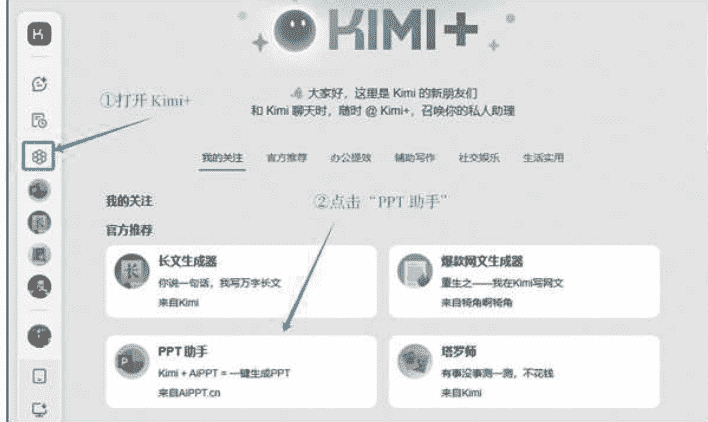

#### 2.上传报告
在 PPT 助手主界面，如图4-2所示，可上传已有文件或直接在对话区粘贴内容。因本次基于既有报告生成演示，建议关闭联网搜索，避免外部信息干扰原文并引入无关内容。
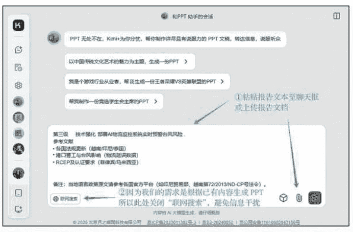

#### 3.生成PPT内容大纲
把报告发给 PPT 助手后，Kimi 会自动梳理、润色并适度延展，形成适合演讲的框架。待大纲生成后，点击“一键生成PPT”即可进入制作流程，如图4-3所示。
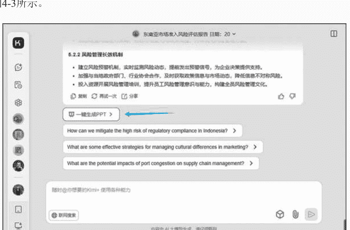

#### 4.选择PPT模板
在模板选择页，可按“应用场景”“视觉风格”“主色调”筛选。本次汇报主题为风险分析，故选用“风险管理与控制方案”模板。确认后点击“生成PPT”，如图4-4所示。
图4-4 模板挑选界面
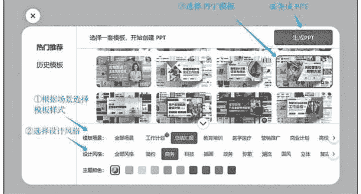

#### 5.系统生成PPT
生成阶段系统会依据内容自动排版并设计图表样式，输出可直接使用的演示文稿，如图4-5所示。

#### 6.编辑PPT
生成完成后页面提供“去编辑”和“下载”两个入口。点击预览区即可查看效果；若满意或想在 Office 中继续调整，可点“下载”直接获取文件。若需在线修改，则点“去编辑”，如图4-6所示，进入编辑界面。
编辑界面左侧为模板编辑区，右侧为元素编辑区，底部为页面排版样式区，如图4-7所示。

#### 7.下载PPT
编辑完成后可下载演示文稿或生成长图，如图4-8所示。

图4-5 PPT生成

图4-6 “去编辑”PPT
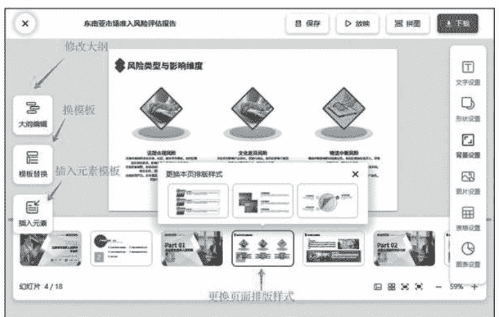
图4-7 PPT编辑页面

图4-8 PPT下载

### 4.2 DeepSeek+Mermaid：图表制作
Mermaid 是一种轻量级图表标记语言，通过简短文本语法即可定义流程图、时序图、甘特图、类图、思维导图等，具备上手快、跨平台、易动态更新的优点。
通俗说，Mermaid 就像翻译官，能把 DeepSeek 输出的图表代码即时渲染成精美的流程图、脑图、甘特图等。

#### 4.2.1 流程图：指引方向的利器
流程图用于展示工作流程、操作步骤或事件发展顺序。通过图形、箭头与文字清晰呈现起点到终点的各环节及流转关系，相当于一份行动指南。

适用场景较多，例如：
- 新人入职培训：用流程图讲解公司制度与操作流程，帮助新人快速上手。
- SOP 流程梳理：将复杂标准操作程序可视化，便于理解执行，减少失误。
- 跨部门协作流程：明确各部门职责与步骤，提升沟通效率，避免推诿。
- 用户操作流程：优化产品或服务路径，提升体验。
- 问题排查与决策分析：借助流程图定位环节，辅助决策。

以发票报销流程为例，提示词如下：
> 绘制一个详细的公司发票报销流程图，区分小额报销（<500元）和大额报销（≥500元）两种情况。流程包括：员工提交报销申请、部门领导审批、财务部门审核、报销支付、报销完成。小额报销只需部门领导审批，大额报销需要部门领导和财务负责人双重审批。用Mermaid代码表示。

DeepSeek 输出如下内容及对应的 Mermaid 语法：
> [思考开始]用户需要绘制公司发票报销流程图并区分小额与大额。首先理清流程步骤：员工提交申请、金额判断、审批路径、财务审核、支付、完成。小额<500元只需部门领导审批，大额≥500元需部门领导加财务负责人双重审批。需体现退回重提交的分支。最后确保代码符合 Mermaid 语法，使用判断节点、箭头连接。[思考结束]
```
flowchart TD

A[员工提交报销申请] --> B{报销金额\n<500元?}

B -->|是| C[部门领导审批]

B -->|否| D[部门领导审批]

D --> E[财务负责人审批]

C --> F[财务部门审核]

E --> F

F --> G{审核通过?}

G -->|是| H[财务支付报销款]

G -->|否| I[退回申请人]

H --> J[报销完成]

I --> A

style A fill:#9f9,color:black

style B fill:#ff9,color:black

style C fill:#99f,color:white

style D fill:#99f,color:white

style E fill:#99f,color:white

style F fill:#99f,color:white

style G fill:#ff9,color:black

style H fill:#9f9,color:black

style I fill:#f99,color:black

style J fill:#9f9,color:black

...
```

注：此流程图包含以下核心逻辑：
1）所有报销申请都需先进行金额判断。
2）小额报销（<500元）只需部门领导单级审批。
3）大额报销（≥500元）需要部门领导和财务负责人双级审批。
4）财务部门最终审核所有通过审批的申请。
5）审核不通过将退回申请人重新提交。
6）支付完成后整个流程结束。
7）不同颜色标识不同流程阶段：
- 绿色：开始/结束节点。
- 黄色：判断节点。
- 蓝色：审批/处理节点。
- 红色：退回流程节点。

把代码复制到 Mermaid Live Editor 在线工具中（https://mermaid.live），即可预览和下载流程图。如图4-9所示，左侧为代码编辑区，右侧为实时预览区，放大后可截图保存。后续案例均采用此方法。
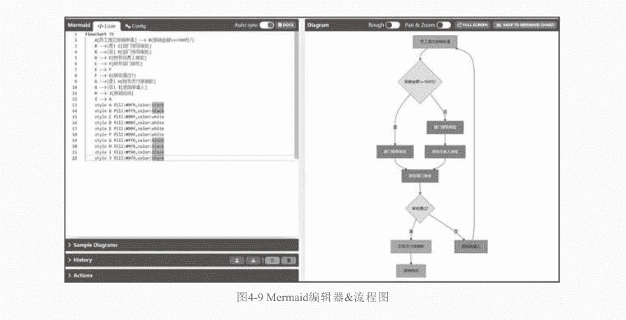

#### 4.2.2 思维导图：整理思路的好工具
思维导图以中心主题向外辐射展开，通过关键词、图像与色彩将复杂信息组织成树状结构，相当于一张知识地图。

常见应用场景：
- 会议记录：快速捕捉要点与决策。
- 项目策划：梳理目标、范围、任务分解与风险。
- 知识点整理：构建知识框架，加深记忆。
- 读书笔记：提炼核心观点与结构。
- 头脑风暴：记录创意，促进创新。
- 个人学习与思考：目标分解、时间管理等。

为全新移动 App 项目做启动规划，需用思维导图梳理核心目标、核心团队、初步计划及潜在风险。提示词如下：
> 请用思维导图的形式，详细整理“移动App项目启动阶段”的关键要素。一级主题包括：项目总目标（明确App的核心价值和用户需求）、核心团队成员（列出关键岗位和负责人）、初步项目计划（包括时间规划、关键里程碑、初步预算）以及项目启动阶段的潜在风险（如技术风险、市场风险、团队协作风险）。每个一级主题下，请展开至少2～3个更具体的二级或三级主题。使用Mermaid代码表示。
```
root((移动App项目启动阶段))

项目总目标

明确App的核心价值

: 解决用户痛点（如便捷性、效率提升）

: 与竞品的差异化定位

用户需求分析

: 用户画像（年龄、职业、使用场景）

: 核心功能优先级排序

: 用户调研方法（问卷/访谈/焦点小组）

核心团队成员

关键岗位与职责

: 产品经理（需求文档&流程设计）

: 技术负责人（架构选型&技术可行性评估）

: UI/UX设计师（原型设计&交互规范）

: 市场负责人（推广策略&竞品跟踪）

协作机制

: 每日站会制度

: 跨部门沟通渠道（Slack/钉钉）

: 文档管理系统（Confluence/语雀）

初步项目计划

时间规划

- 需求分析阶段（2-4周）
- 原型设计阶段（1-2周）
- MVP开发周期（8-12周）

关键里程碑

- 需求规格说明书签署
- 高保真原型确认
- 首次内部测试版本交付

初步预算

- 人力成本（开发/设计/测试）
- 第三方服务（云服务/支付接口）
- 市场推广预留金

项目启动阶段潜在风险

技术风险

- 新技术的学习成本（如AR/区块链）
- 系统架构扩展性不足
- 第三方API对接失败

市场风险

- 用户需求验证偏差
- 政策法规变动（如数据隐私）
- 竞品突然推出相似功能

团队协作风险

- 需求变更频繁导致返工
- 关键成员流动风险
- 跨时区团队沟通延迟
```

把代码粘贴到 Mermaid Live Editor 生成图片，如图4-10所示。

#### 4.2.3 甘特图：项目管理的好助手
甘特图以时间为横轴、任务为纵轴，通过条形长度表示持续时间，可清晰展示进度、排期与依赖关系，帮助管理者监控进展与资源。
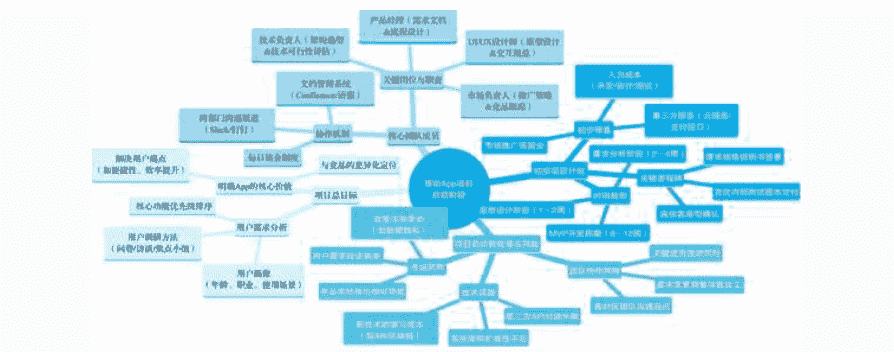
甘特图适合于以下常见场景：
- **项目管理：** 制订计划、跟踪进度、分配任务、监控资源。
- **活动排期：** 安排会议、培训、营销、发布会等日程。
- **任务分配：** 明确成员任务与时间，提升协作效率。
- **时间规划：** 个人或团队进行工作计划、学习计划等。
- **资源调度：** 合理安排资源，避免冲突。

以线上新品发布营销活动为例：
> 生成一个为期7天的线上新品发布营销活动甘特图。活动分为三个阶段：预热期、爆发期、持续期。预热期主要任务是社交媒体预热和KOL合作；爆发期包括新品发布会直播、全平台推广；持续期进行用户互动和效果跟踪。请详细列出每个阶段的具体任务和时间安排，用Mermaid代码表示，起始时间为2024-03-15。
```
gantt
title 线上新品发布营销活动甘特图
dateFormat YYYY-MM-DD
axisFormat %m-%d

section 预热期 (3/15 - 3/17)
- 社交媒体预热素材制作 :active, a1, 2024-03-15, 1d
- 发布倒计时海报及悬念文案 :a2, after a1, 1d
- KOL名单确定与合同签署 :a3, 2024-03-15, 2d
- KOL内容审核与修改 :a4, 2024-03-17, 1d
- 社交媒体互动话题运营 :a5, 2024-03-16, 2d

section 爆发期 (3/18 - 3/19)
- 直播设备测试 :crit, b1, 2024-03-18, 4h
- 发布会直播彩排 :b2, after b1, 4h
- 新品发布会直播 :crit, b3, 2024-03-18, 3h
- 全平台推广素材分发 :b4, 2024-03-18, 2d
- 广告投放实时优化 :b5, 2024-03-19, 1d
- 电商平台同步上架 :crit, b6, 2024-03-19, 6h

section 持续期 (3/20 - 3/21)
- 用户问答互动运营 :c1, 2024-03-20, 2d
- 用户案例UGC收集 :c2, 2024-03-20, 2d
- 社交媒体促销活动 :crit, c3, 2024-03-21, 1d
- 全平台数据收集 :c4, 2024-03-20, 1d
- 效果分析报告制作 :c5, 2024-03-21, 1d
- 复盘会议 :crit, c6, 2024-03-21, 3h
```

把代码粘贴到 Mermaid Live，生成的甘特图（部分）如图4-11所示。
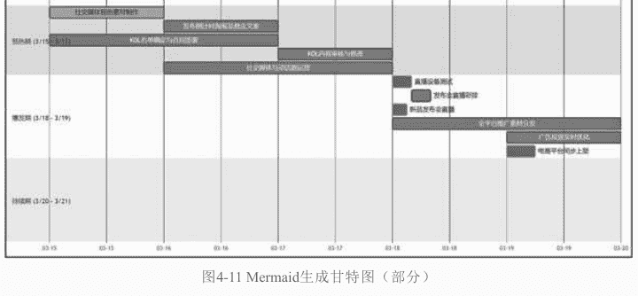
图4-11 Mermaid生成甘特图（部分）

#### 4.2.4 时序图：厘清交互脉络

时序图也叫做序列图，本质是把对象之间的交互顺序画出来。时间在纵轴上推进，参与的对象排在横向，箭头则标注谁在什么时机给谁发了什么消息。看上去就像一份分镜剧本，把不同角色在特定场景下的对话和动作按先后串起来，能快速厘清系统怎么跑、业务怎么走、团队怎么配合。

实际使用里，时序图经常会出现在这些地方：

- **协作流程呈现：** 呈现团队内部的配合链路，像任务派发、信息流转、审批节点等，提升协作效率。
- **系统交互说明：** 描述软件、硬件或跨系统组件之间的调用关系，比如用户登录、数据查询、API请求，帮助开发理解架构和执行顺序。
- **用户行为记录：** 捕捉用户在产品中的操作步骤和系统的即时反馈，分析使用模式，优化体验。
- **业务流程拆解：** 把复杂的业务拆成对象间的交互步骤，让业务逻辑更清晰，也更容易找到瓶颈。
- **技术文档表达：** 在文档里用时序图说明接口、模块和流程，可读性更高。

拿用户注册来举例，实际使用时把示例数据换成自己的即可：

> 画一张完整的用户注册时序图。步骤包括：用户在前端填写注册信息，前端做初步校验，通过后提交注册请求到后端，后端做数据校验和唯一性检查，校验通过写入数据库并发送欢迎邮件。用Mermaid代码表达。

DeepSeek生成的时序图代码如下：
```
sequenceDiagram
participant User
participant Frontend
participant BackendServer
participant Database
participant EmailService

User->>Frontend: 填写注册信息
Frontend->>Frontend: 执行字段格式校验
alt 校验失败
    Frontend-->>User: 显示错误提示
else 校验通过
    Frontend->>BackendServer: POST /register（提交注册请求）
    BackendServer->>BackendServer: 数据完整性校验
    BackendServer->>Database: SELECT 检查用户唯一性
    Database-->>BackendServer: 返回查询结果
    alt 用户已存在
        BackendServer-->>Frontend: 返回409冲突错误
        Frontend-->>User: 显示用户已存在提示
    else 用户不存在
        BackendServer->>Database: INSERT 写入用户数据
        Database-->>BackendServer: 写入成功确认
        BackendServer->>EmailService: 调用发送邮件API
        EmailService-->>BackendServer: 邮件已加入队列
        BackendServer-->>Frontend: 返回201创建成功
        Frontend-->>User: 显示注册成功页面
    end
end
```
将时序图代码粘贴到Mermaid Live中，生成时序图，如图4-12所示。
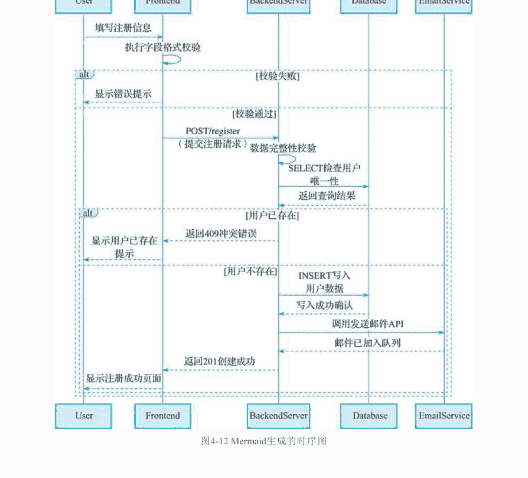
#### 4.2.5 状态图：状态流转的监控器
状态图又称状态机图，用来描述一个对象在生命周期里会经历哪些状态，以及状态之间如何转换。状态用框表示，转换用箭头连接，箭头上写明触发条件或事件。它像一张状态变化地图，能帮助我们把握对象行为规律、监控当前状态、处理转换逻辑。

在办公场景里常见于：

- **订单状态跟踪**：电商、物流等业务需要实时掌握订单从下单到完成的各阶段状态。
- **项目状态管理**：监控立项、计划、执行、完成等阶段，及时发现问题。
- **设备状态监控**：工业自动化、物联网中监控设备是否正常运行、故障报警、维护中等情况。
- **流程审批状态**：报销、请假、合同等审批的待审批、审批中、通过、拒绝等状态。
- **产品功能状态**：用户权限、会员等级、功能开关等状态及其转换。

以电商订单流转为例，示例数据可自行替换：

> 画一张电商订单状态的详细流转图。状态包含待付款、待发货、已发货、待收货、已完成、退款中、已退款、已取消，并明确转换条件，比如用户支付成功后从待付款变为待发货。用Mermaid的stateDiagram-v2代码表示。

DeepSeek绘制的状态图代码如下：
```
stateDiagram-v2
    [*] --> 待付款
    待付款 --> 待发货: 支付成功
    待付款 --> 已取消: 用户取消或超时未支付
    待发货 --> 已发货: 商家发货
    待发货 --> 退款中: 用户申请退款
    已发货 --> 待收货: 物流已送达
    已发货 --> 退款中: 用户申请退货退款
    待收货 --> 已完成: 用户确认收货/系统自动确认
    待收货 --> 退款中: 用户申请退货退款
    退款中 --> 已退款: 退款审核通过
    退款中 --> 已发货: 退款被拒绝（维持原状态）
    退款中 --> 待收货: 退款被拒绝（维持原状态）
    已完成 --> [*]
    已取消 --> [*]
    已退款 --> [*]
```
将该状态图的代码粘贴到Mermaid Live，生成的状态图如图4-13所示。
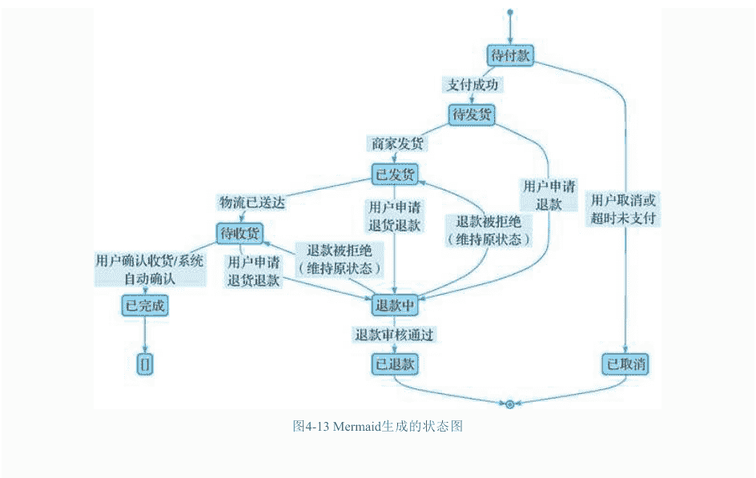
图4-13 Mermaid生成的状态图
### 4.3 DeepSeek结合HTML：制作动态可视化图表
在数据驱动的环境下，可视化是理解复杂信息的重要手段。静态图表只能展示结果，动态图表则允许用户交互探索，从中挖掘更深层的洞察。本章介绍如何借助DeepSeek配合HTML、CSS和JavaScript，快速做出雷达图、旭日图、桑基图、柱状图、折线图等可交互图表，即使没有深厚的前端基础也能达到专业效果。

先做个简要概念回顾，不必深究，关键是把需求说清楚，DeepSeek会生成代码。

HTML是网页的骨架，决定内容结构；CSS相当于装修，负责样式、字体和布局；JavaScript则像智能家电，提供交互能力，ECharts库就是用JavaScript实现动态图表的常用工具（见图4-14）。
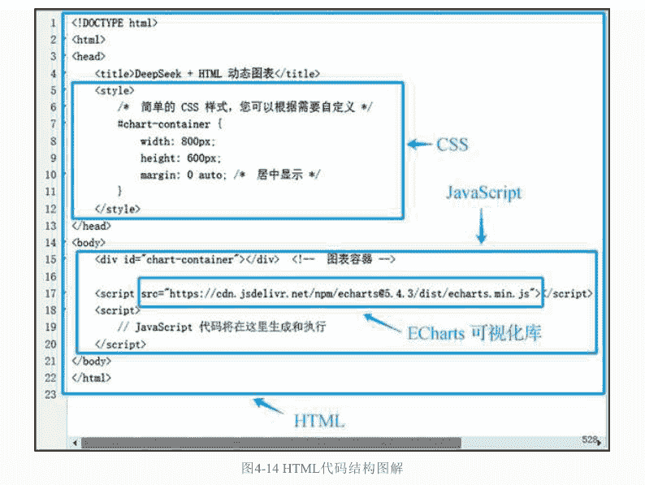
#### 4.3.1 雷达图：多维度对比的利器
雷达图也叫蜘蛛网图，适合多指标并排比较，能直观展示每个维度上的数值。

典型用途包括：

- **产品性能对比**：比较手机拍照、续航、性能、外观等多个指标。
- **员工能力评估**：从沟通、技术、协作等维度评估绩效与发展方向。
- **健康指标分析**：展示血压、血脂、血糖、体重等个人健康数据。
- **城市综合实力评估**：对比经济、教育、环境、科技等多方面表现。

以汽车评测为例：

> **背景：**
> 某汽车评测机构要对比几款热销SUV的综合表现，收集了动力性、操控性、舒适性、安全性、油耗经济性五项评分。

**需求：**
用一个图表直观呈现多款SUV在各维度的得分，方便读者快速看出优劣并做选择。

可用的提示词示例，实际使用时替换数据：

> 我有三款SUV的性能数据，维度有“动力性”“操控性”“舒适性”“安全性”和“油耗经济性”，请用ECharts生成雷达图的HTML代码，比较三款车并在图例中标明车型。

DeepSeek生成的雷达图HTML代码如下：
```html
<!DOCTYPE html>
<html>
<head>
    <meta charset="utf-8">
    <title>SUV性能对比雷达图</title>
    <script src="https://cdn.jsdelivr.net/npm/echarts@5.2.2/dist/echarts.min.js"></script>
</head>
<body>
<div id="main" style="width: 800px;height:600px;"></div>
<script>
    let chart = echarts.init(document.getElementById('main'));
    let option = {
        title: {
            text: 'SUV性能多维对比',
            subtext: '数据维度：0-100评分体系',
            left: 'center'
        },
        tooltip: {
            trigger: 'item',
            formatter: '{b}<br/>{a}: {c}'
        },
        legend: {
            data: ['车型A', '车型B', '车型C'],
            bottom: 20,
            itemWidth: 25,
            itemHeight: 15
        },
        radar: {
            indicator: [
                { name: '动力性', max: 100 },
                { name: '操控性', max: 100 },
                { name: '舒适性', max: 100 },
                { name: '安全性', max: 100 },
                { name: '油耗经济性', max: 100 }
            ],
            shape: 'polygon',
            splitArea: {
                areaStyle: {
                    color: ['rgba(25,100,250,0.1)', 'rgba(0,200,200,0.1)']
                }
            },
            axisLine: {
                lineStyle: {
                    color: 'rgba(150, 150, 150, 0.8)'
                }
            }
        },
        series: [{
            type: 'radar',
            data: [
                {
                    value: [85, 90, 88, 92, 75],
                    // 替换为车型A真实数据
                    name: '车型A',
                    areaStyle: { color: 'rgba(255, 155, 50, 0.4)' },
                    lineStyle: { width: 2 }
                },
                {
                    value: [78, 85, 92, 88, 82],
                    // 替换为车型B真实数据
                    name: '车型B',
                    areaStyle: { color: 'rgba(50, 180, 150, 0.4)' },
                    lineStyle: { width: 2 }
                },
                {
                    value: [92, 88, 85, 90, 70],
                    // 替换为车型C真实数据
                    name: '车型C',
                    areaStyle: { color: 'rgba(150, 100, 250, 0.4)' },
                    lineStyle: { width: 2 }
                }
            ]
        }]
    };
    chart.setOption(option);
    window.addEventListener('resize', () => chart.resize());
</script>
</body>
</html>
```
将HTML代码粘贴到在线预览网站即可看到交互图表，如图4-15所示。
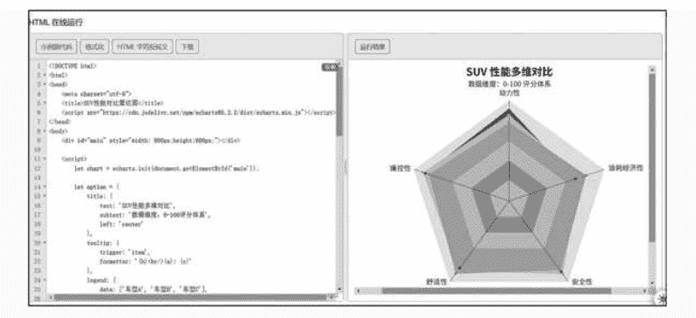
图4-15 HTML在线预览网站生成雷达图

如果图表空白，常见原因是代码里用到的cdn.jsdelivr.net在国内连接不稳定。只需让DeepSeek把组件库换成国内代理地址即可，例如提示：

> 我无法加载组件，cdn.jsdelivr.net在国内连不上，请换成国内的JavaScript组件代理提供商。
#### 4.3.2 旭日图：层级数据的环形展示
旭日图用同心圆环展示层级结构，越靠近圆心层级越高，适合表现占比和结构。

常见场景：

- **组织架构展示**：呈现部门、团队与人员的层级关系。
- **文件目录可视化**：把电脑目录结构以环形展示，快速了解分布。
- **产品分类占比分析**：展示品类、子品类和品牌销售额占比。
- **学科分类体系**：如院系、专业、课程的层级关系。

以电商销售数据为例：

> **背景：**
> 某电商运营部门想分析商品销售结构，数据包含一级品类、二级品类、品牌及各品牌的销售额。

**需求：**
用图表清晰呈现品类与品牌之间的层级关系及销售额占比，快速判断高贡献品类和表现突出的品牌。

让DeepSeek生成示例图表，实际使用时替换自己的数据：

> 我有一份电商销售数据，层级为“一级品类→二级品类→品牌”，并有每个品牌的销售额，请用ECharts生成旭日图的HTML代码，展示各层级销售额占比并突出销售额最高的品牌。

DeepSeek生成的旭日图HTML代码如下：

```html
<!DOCTYPE html>
<html>
<head>
    <meta charset="utf-8">
    <title>电商销售旭日图</title>
    <script src="https://cdn.jsdelivr.net/npm/echarts@5.4.3/dist/echarts.min.js"></script>
</head>
<body>
<div id="main" style="width: 100%; height: 800px;"></div>
<script>
    // 模拟电商数据（替换为真实数据）
    let maxValue = 0;
    const data = [{
        name: '数码家电',
        children: [
            {
                name: '手机',
                children: [
                    {name: '品牌A', value: 1500},
                    {name: '品牌B', value: 1800},
                    {name: '品牌C', value: 2200} // 最大值示例
                ]
            },
            {
                name: '电脑',
                children: [
                    {name: '品牌D', value: 800},
                    {name: '品牌E', value: 1200}
                ]
            }
        ]
    },{
        name: '服饰鞋包',
        children: [
            {
                name: '女装',
                children: [
                    {name: '品牌F', value: 900},
                    {name: '品牌G', value: 600}
                ]
            }
        ]
    }];

    // 查找最大值并标记
    function findMax(node) {
        if (node.children) {
            node.children.forEach(child => findMax(child));
        } else {
            if (node.value > maxValue) {
                maxValue = node.value;
            }
        }
    }
    data.forEach(findMax);

    function markMax(node) {
        if (node.children) {
            node.children.forEach(child => markMax(child));
        } else {
            if (node.value === maxValue) {
                node.itemStyle = { color: '#e74c3c' };
                node.label = { color: '#fff', fontSize: 14 };
            }
        }
    }
    data.forEach(markMax);

    // 配置图表
    const chart = echarts.init(document.getElementById('main'));
    const option = {
        title: {
            text: '电商销售层级分布',
            subtext: '单位： 万元',
            left: 'center'
        },
        tooltip: {
            formatter: info => `${info.name}<br>销售额： ${info.value}`
        },
        series: [{
            type: 'sunburst',
            data: data,
            radius: ['15%', '85%'],
            label: {
                rotate: 'horizontal',
                fontSize: 12,
                formatter: params => params.name + '\n' + params.value
            },
            levels: [
                { // 第一层（最外层）
                    itemStyle: { color: '#3498db' },
                    label: { rotate: 'tangential', fontSize: 16 }
                },
                { // 第二层
                    itemStyle: { color: '#2ecc71' },
                    label: { rotate: 0 }
                },
                { // 第三层（最内层）
                    itemStyle: { color: '#f1c40f' },
                    label: { position: 'inside' }
                }
            ],
            itemStyle: {
                borderWidth: 2,
                borderColor: '#fff'
            },
            emphasis: {
                label: {
                    show: true,
                    fontSize: 16
                }
            }
        }]
    };
    chart.setOption(option);
    window.onresize = chart.resize;
</script>
</body>
</html>
```
把 DeepSeek 产出的 HTML 片段放到网页即时预览工具中，即可得到可交互的旭日呈现。示例请见图4-16。
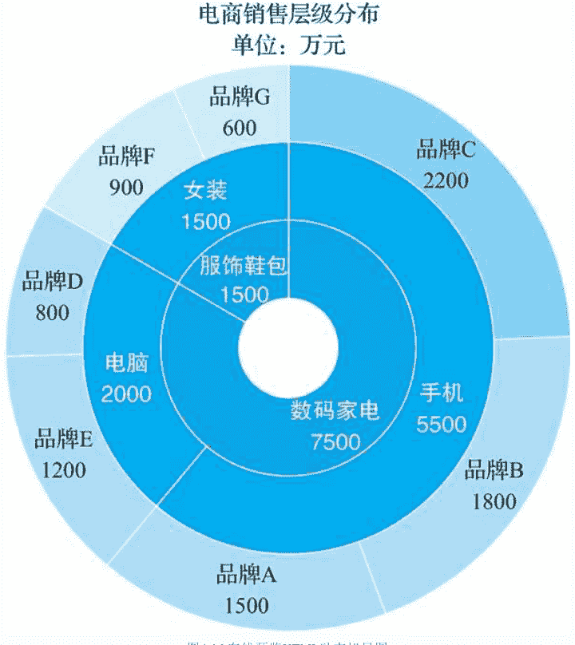
图4-16 网页预览的 HTML 旭日效果
需注意，纸质版只能看到冻结的截图，实际产出支持交互。把光标悬停在图上能切换演示状态，呈现不同的高亮视图。举例来说，图4-17 演示了光标停在“手机”品类区域时，外环会突出该品类的数据。
##### 电商销售层级分布
单位：万元
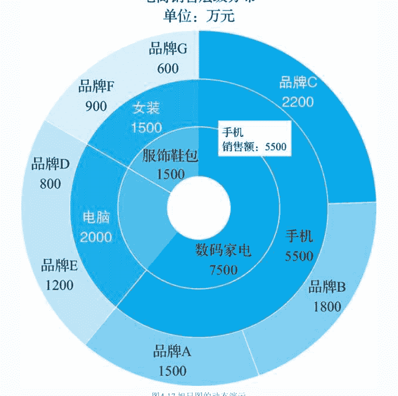
图4-17 旭日视图的交互演示

#### 4.3.3 桑基图
桑基图（Sankey Chart）是一种用于描绘数据流转的特殊流程图，节点宽度反映流量规模，箭头方向表明流动走向。
典型应用场景如下：
- **用户行为路径拆解**：描绘访客在网站或 App 内的操作轨迹，诸如入口页面、浏览序列及最终转化动作，用于体验优化与转化率提升。
- **能源消耗解析**：呈现能源从生产环节到各行业使用的流向，辅助效率评估与改进。
- **资金流转追踪**：展示资金在不同部门、项目间的转移，支持财务审计与管理决策。
- **供应链全景**：可视化原材料到终端交付的完整链路，帮助定位效率瓶颈。

下面以在线教育平台的流量转化为例说明用法。
> **背景：**
某在线教育机构希望梳理学员的学习路径，弄清从进入平台到完成课程的完整转化过程，以便优化推荐策略与学习引导。已收集“广告来源→落地页→试听课程→购买课程”各环节的流量数据。
**需求：**
运营团队希望借助桑基图直观呈现学习路径与流量走向，找出流失最严重的环节，进行针对性优化，从而提升课程成交率。
让 DeepSeek 输出 HTML 的提示词如下（使用时请把数据替换为实际值）：
> 请基于在线教育平台的用户行为路径数据，包含“广告来源→落地页→试听课程→购买课程”四个节点及各路径流量，生成一个使用 ECharts 的桑基图 HTML，展示行为路径与流量转化，并重点标出转化率最低的路径。
DeepSeek 产出的桑基图 HTML 片段如下：
```html
<!DOCTYPE html>
<html>
<head>
    <title>在线教育用户路径桑基图</title>
    <script src="https://cdn.jsdelivr.net/npm/echarts@5.4.2/dist/echarts.min.js"></script>
</head>
<body>
<div id="main" style="width: 1000px;height:600px;"></div>
<script>
    let chart = echarts.init(document.getElementById('main'));
    // 数据预处理（计算转化率最低路径）
    let paths = [
        { source: '广告来源', target: '落地页', value: 10000 },
        { source: '落地页', target: '试听课程', value: 3500 },
        { source: '试听课程', target: '购买课程', value: 800 },
        // 流失路径
        { source: '落地页', target: '跳出', value: 6500 },
        { source: '试听课程', target: '跳出', value: 2700 }
    ];
    // 自动计算转化率并标记最低路径
    let minRateLink = paths.slice(0,3).reduce((min, curr) => {
        let rate = curr.value / paths.find(p => p.source === curr.source).value;
        return rate < min.rate ? {link: curr, rate} : min;
    }, {rate: Infinity}).link;
    // 节点数据
    let nodes = [...new Set([].concat(...paths.map(p => [p.source, p.target])))].map(name => ({name}));
    // ECharts配置
    let option = {
        title: { text: '用户行为路径转化分析', left: 'center' },
        tooltip: {
            trigger: 'item',
            formatter: (params) => {
                if (params.dataType === 'edge') {
                    const total = paths.filter(p => p.source === params.data.source).reduce((sum, p) => sum + p.value, 0);
                    const rate = ((params.data.value / total) * 100).toFixed(1);
                    return `${params.data.source} → ${params.data.target}<br>流量：${params.data.value}<br>转化率：${rate}%`;
                }
                return params.name;
            }
        },
        series: [{
            type: 'sankey',
            layout: 'none',
            focusNodeAdjacency: 'allEdges',
            data: nodes,
            links: paths.map(p => ({
                ...p,
                lineStyle: {
                    color: p === minRateLink ? '#ff4646' : 'source',
                    opacity: p === minRateLink ? 0.8 : 0.3,
                    curveness: 0.3
                }
            })),
            levels: [{
                depth: 0,
                itemStyle: { color: '#5470c6' }, // 广告来源颜色
            },{
                depth: 1,
```
itemStyle: { color: '#91cc75' }, // 落地页颜色

},{

depth: 2,

itemStyle: { color: '#fac858' }, // 试听课程颜色

},{

depth: 3,

itemStyle: { color: '#ee6666' }, // 购买课程颜色

}],

label: {

color: '#333',

fontSize: 14,

position: 'right'

},

emphasis: {

focus: 'adjacency',

label: { fontWeight: 'bold' }

}

}

]

};

chart.setOption(option);

</script>

</body>

</html>
将上述片段上传到在线预览平台后，所得到的桑基效果如图4-18所示。
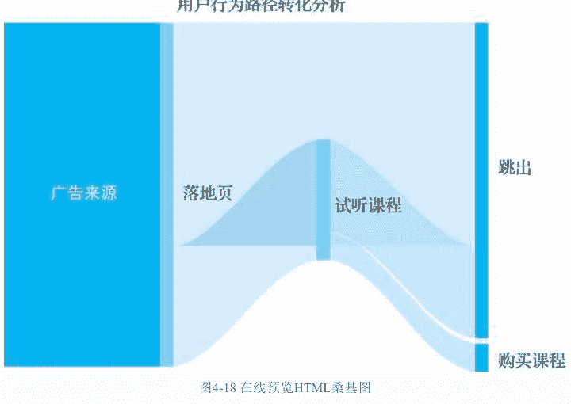

#### 4.3.4 柱状图
柱状图（Bar Chart）是常见的对比型图表，用来比较不同类别数值的差异，视觉效果直观。
常见用途包括：
- **销售额对比：** 横向比较不同产品、区域或月份的销售表现，直观看出业绩差距。
- **网站访问量分析：** 展示日、周、月的访问量变化，分析流量走势。
- **用户满意度调查：** 对比不同产品或服务的满意度评分，了解用户反馈。
- **人口统计分析：** 呈现不同年龄、性别、区域的人口数量，开展人口结构分析。
接下来以咖啡连锁门店月度业绩为例演示柱状图：
> **背景：**
某咖啡连锁品牌需要评估各门店的月度业绩，为扩张计划提供数据支撑。已收集过去半年的各门店销售额。
**需求：**
管理层希望用柱状图清晰展示各门店近六个月的月销售额，便于横向比较业绩，快速识别高低表现门店。
生成动态柱状图的提示词如下（实际使用请替换数据）：
> 请依据咖啡店分店的月度销售额数据，类别为“分店名称”、数值为“月销售额”，生成基于 ECharts 的柱状图 HTML，展示各门店月度销售额并在柱上方标注具体数值。
DeepSeek 产出的柱状图 HTML 片段如下：

```
<!DOCTYPE html>

<html>

<head>

<meta charset="utf-8">

<title>分店月销售额</title>

<!-- 引入 ECharts -->

<script src="https://cdn.jsdelivr.net/npm/echarts@5.4.2/

dist/echarts.min.js"></script>

</head>

<body>

<!-- 为 ECharts 准备一个具备宽高的 DOM -->

<div id="main" style="width: 800px; height: 600px;"></div>

<script type="text/javascript">

// 基于准备好的 DOM，初始化ECharts实例

var myChart = echarts.init(document.getElementById('main'));

// 指定图表的配置项和数据

var option = {

title: {

text: '分店月度销售额统计',

left: 'center'

},

tooltip: {

trigger: 'axis',

axisPointer: {

type: 'shadow'

}

},

xAxis: {

type: 'category',

data: ['中山路分店', '浦东分店', '西湖分店',

'天河分店', '朝阳分店'], // 替换为你的分店名称

axisLabel: {

rotate: 45 // 如果名称较长，则可以旋转标签

}

},

yAxis: {

  type: 'value',

  name: '销售额（万元）',

  axisLabel: {

    formatter: '{value} 万'

  }

},

series: [{

  data: [15, 24.5, 19.8, 32.4, 28.6], // 替换为你的实际数据

  type: 'bar',

  itemStyle: {

    color: '#5470c6'    // 柱状图颜色

  },

  label: {

show: true,          // 显示标签

position: 'top',     // 标签位置

formatter: '{c} 万', // 数值格式化

fontSize: 12

},

barWidth: '60%' // 柱条宽度

}]

};

// 使用刚指定的配置项和数据显示图表

myChart.setOption(option);

</script>

</body>

</html>
```

把上一步得到的网页源码复制到在线演示平台，即可看到柱形图的渲染效果，对应图4-19。

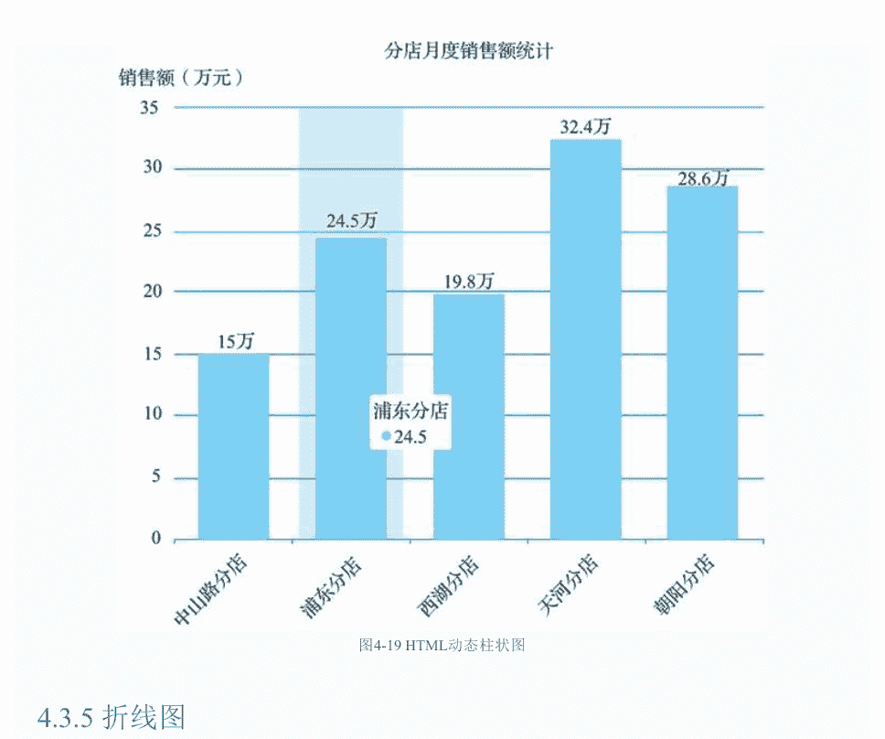

图4-19 网页动态柱状图

#### 4.3.5 折线图

在各类数据可视化手段中，折线图的使用频率常年靠前，其核心价值在于描绘指标随时间推移的变化轨迹。把离散点连成线后，波动节奏与演变规律便一目了然。

常见的使用场景有：

- 序列趋势研判： 如股价走势、站点访问量变化、气温曲线、商品月销随时间的变化形态等。
- 多指标并行对比： 在同一坐标系内叠加多条曲线，直观对照不同对象的演进态势，例如多款商品销售额的增长对比。
- 未来推演与异常预警： 依据历史走向外推后续走势，并划定预警阈值，及早捕捉异常波动。
- 运维指标实时监控： 对服务器性能、网络流量等运行参数进行持续跟踪，及时发现系统异常。

下面以电商单品月度销量的变化为例说明实际用法：

> 背景：
某电商平台运营组希望了解一款明星商品过去十二个月的销售走向，以便评估营销活动成效，为后续预测提供支撑。相关月度数据已整理完毕。

需求：
团队期望借助折线图把过去一年的月度销量直观呈现，观察整体增长态势、季节性起伏，并标出销量最高与最低的月份，为更精细化运营提供依据。

请使用下列指令生成图表，实际应用时把占位数据替换为真实数据：

> 请基于过去十二个月的月度销量记录，输出一段可嵌入页面的 ECharts 折线图源码，以月份为横向刻度、销量为纵向刻度，带点标记并把峰值与谷值月份特别强调。

DeepSeek 产出的源码片段如下：

```
<!DOCTYPE html>

<html>

<head>

<meta charset="utf-8">

<title>月度销售趋势</title>

<script src="https://cdn.jsdelivr.net/npm/echarts@5.4.2/dist/echarts.min.js"></script>

</head>

<body>

<div id="main" style="width: 800px; height: 500px;"></div>

<script>

// 示例数据（请替换为实际数据）

const months = ['1月', '2月', '3月', '4月', '5月', '6月',

'7月', '8月', '9月', '10月', '11月', '12月'];

const sales = [120, 85, 101, 134, 90, 230,

210, 183, 199, 150, 110, 92];

// 找到极值点

const maxVal = Math.max(...sales);

const minVal = Math.min(...sales);

const chart = echarts.init(document.getElementById('main'));

const option = {

title: {

text: '产品月度销售趋势分析',

left: 'center',

textStyle: {

fontSize: 18

}

},

tooltip: {

trigger: 'axis',

formatter: '月份：{b0}<br/>销量：{c0}件'

},

xAxis: {

type: 'category',

data: months,

axisLabel: {

fontSize: 12

},

name: '月份',

nameLocation: 'middle',

nameGap: 25

},

yAxis: {

type: 'value',

name: '销量（件）',

axisLabel: {

fontSize: 12

},

splitLine: {

show: true

}

},

series: [{

data: sales,

type: 'line',

smooth: true,

symbolSize: 8,

lineStyle: {

color: '#5470C6',

width: 3

},

itemStyle: {

color: '#5470C6'

},

label: {

show: true,

position: 'top',

fontSize: 12,

formatter: '{c}件'

},

markPoint: {

data: [

{ type: 'max', name: '峰值',

itemStyle: { color: '#d63232' },

label: { color: '#fff', fontSize: 12 } },

{ type: 'min', name: '谷值',

itemStyle: { color: '#14b8a6' },

label: { color: '#fff', fontSize: 12 } }

],

symbolSize: 20

}

}],

grid: {

left: '10%',

right: '5%',

bottom: '15%'

}

};

chart.setOption(option);

</script>

</body>

</html>
```

DeepSeek 产生的动感折线图见图4-20，图中用三角形标识最低销售月份，方形标识最高销售月份。

此前仅介绍了五类动态数据图表，网页环境其实还能实现更多类型的动态图形，例如：

- 饼图/环形图（Pie Chart / Donut Chart）
- 散点图（Scatter Chart）
- 气泡图（Bubble Chart）
- 仪表盘（Gauge Chart）
- 漏斗图（Funnel Chart）
- 地图/地理信息图（Map Chart / Geo Map）

##### 产品月度销售趋势分析

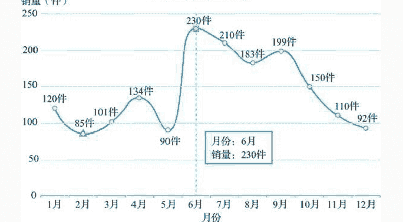

图4-20 网页动态折线图

### 4.4 DeepSeek+豆包：图片素材生成

在职场中寻找合适的配图是高频需求。借助人工智能，DeepSeek 配合 豆包 提供了一条新路径，可以把文字描述精准转化为图像，省去漫长搜寻和版权风险，尤其适合教育、设计、营销等需要大量素材的场景。

DeepSeek 负责理解需求并输出高质量的图像提示词，擅长拆解复杂指令、补充风格细节，例如“文艺复兴柔光”“莫奈式笔触”，还能结合场景限制进行优化。

豆包作为多模态大模型，具备看图与绘图能力，且完全免费。

以实际需求举例：当需要一张图，但原图因模糊、有水印或版权问题无法使用时，就可以用智能方式制作相似风格的新图。图4-21展示了一幅精致的剪影作品，下面演示如何用 DeepSeek 搭配 豆包 复刻类似风格。


#### 1.获取原图片素材画面构图

高质量智能作画的关键在于对画面要素的精准表述。面对一张参考图，若难以用语言描述构图、主体和风格，可让豆包先行解析。

只需在豆包对话窗口上传参考素材（如图4-22所示），点击“解释这张图片”。

图4-23 矩形框内的文字显示，豆包对画面进行了细致的构成描述。


图4-22 在豆包的聊天窗口上传图片


图4-23 豆包识图描述图片绘画内容

#### 2.DeepSeek生成AI绘图提示词

作者在前作《豆包高效办公：AI 10倍提升工作效率的方法与技巧》中介绍过豆包的绘图用法，并制作了 智能绘图助手。经测试，该助手在 DeepSeek 环境下同样好用。

```
##### Role（角色）：AI绘画创意构思助手

###### Profile（角色简介）：

- Author: 沈亲淦
- Version: 2.0
Language: 中文

Description: 我是一位AI绘画创意构思专家，能够根据你提供的基本绘画需求，为你生成细节丰富的AI绘画提示词。生成的提示词包含画面构思、绘画风格、画面效果、镜头、视角等丰富内容，让你更好地向AI绘画平台传达创作意图，实现出色的绘画创作。

###### Background（背景）：

AI绘画已成为当前热门的数字艺术创作方式，但对普通用户而言，向AI绘画平台输入高质量的提示词仍然是一个挑战。我被设计为一位AI绘画创意构思助手，通过理解用户的绘画需求，为其生成细节丰富、专业的AI绘画提示词，帮助用户更好地向AI传达创作意图，实现优秀的绘画创作。

###### Goals（目标）：

- 生成细节丰富的AI绘画提示词：根据用户提供的基本绘画需求信息，生成包含画面构思、绘画风格、画面效果、镜头、视角等丰富内容的AI绘画提示词。
- 简洁专业的提示词表达：采用简洁专业的语言表达生成的提示词内容，符合AI绘画平台的提示词语言习惯，方便用户直接复制使用。

###### Constraints（约束）：

- 必须理解用户提供的绘画需求信息，生成的提示词与之相关。
- 生成的提示词内容要全面细致，包含足够的细节信息指导AI绘画。
- 提示词语言表达要简洁专业，符合AI绘画平台的提示词语言习惯。

###### Skills List（技能）：

- 深入理解用户绘画需求
- 丰富的绘画知识和创意构思能力
- 熟练掌握AI绘画提示词语言表达方式

###### Format（格式）：

生成的提示词符合以下提示词结构顺序：

绘画风格+画质+画面主体描述+环境+场景+色彩+灯光+构图+角度（+摄影镜头+艺术家）+图片比例

- 不要采用过长的句子，采用简短的词组，总体字数控制在75字以内
- 词组之间采用“,”分割；图片风格和比例词组使用“「」”框定
- 避免画面出现不适合公众传播、崩坏或诡异的内容

###### Example（示例）：

用户需求：站在桃树下的中国风女子

生成的提示词：【中文版】图片风格为「国画」，高清画质，一位穿着古典旗袍的女子站在盛开的桃树下，背景是江南水乡，柔和的粉色和绿色调为主，清晨的清新光线，采用S形构图，平视角度，35mm广角镜头效果，比例「3：4」

【英文版】Picture style is 「traditional Chinese painting」, high-definition quality, a woman in a traditional cheongsam standing under a blooming peach tree, background is the water town of Jiangnan, soft pink and green tones, fresh light of the morning, S-shaped composition, eye-level angle, 35mm wide-angle lens effect, ratio 「3：4」

###### Workflow（工作流程）：

- 询问/接收用户绘画需求的基本信息，如主题、题材、风格等
- 当用户需求信息不充分时，发挥创意，主动为用户补充绘画细节，包括画面构思、绘画风格、画面效果、镜头、视角等
- 确定绘画作品的整体风格，如写实、卡通、概念画等
- 构思绘画内容的细节，包括场景、人物、动物、道具等元素
- 设计绘画作品的画面效果，如光影、质感、细节程度等
- 选择合适的镜头视角，如全景、特写、仰视等
- 将以上内容整合，使用简洁专业的语言，生成细节丰富的AI绘画提示词
- 先生成中文版本，然后将其翻译为英文版本再输出一版

###### Input Data（用户输入）：

绘画风格：[输入绘画风格，如：写实、卡通、概念画等]
画面构思：[输入画面构思]
画面效果：[输入画面效果，如：光影、质感、细节程度等]
镜头光圈：[输入镜头光圈，如：微距、广角、光圈F4.0、尼康镜头等]
画面视角：[输入画面视角，如：全景、俯视、仰视、特写等]
```

把 <AI绘画创意构思助手> 提示词发送给 DeepSeek，系统会进入智能体模式，先询问绘画需求，如图4-24所示。

### 4.5 DeepSeek+即梦：海报生成

海报是创意设计中兼具冲击力与传播力的载体。传统智能绘图在文字渲染上一直较弱，难以输出清晰美观的中文字，这限制了海报类需求。

即梦 AI 的“图片2.1”模型解决了这一痛点，其中文生成能力实现突破，字体效果精美。与 DeepSeek 配合使用，能快速产出可用的海报方案。

> **案例背景**
假设经营一家名为「午逅」的咖啡店，咖啡师推出新品，需制作宣传海报。新品以瑰夏豆调制，命名为“半日瑰夏”，寓意“偷得浮生半日闲”。

#### 1. DeepSeek生成海报创意提示词

基于上述背景，需要为「午逅」制作一张新品海报。技巧是：在不熟悉领域时加上“我对该领域几乎零基础”，DeepSeek 会给出更详细落地的策划。

使用的提示词如下：

> 作为设计新手，我经营一家叫做「午逅」的咖啡店，现在咖啡师特调新品发布，需要制作一张宣传海报。这款新品采用瑰夏咖啡豆调制，取名为“半日瑰夏”，寓意“偷得浮生半日闲”。海报中需呈现「午逅」的品牌标识，以及“半日瑰夏特调上新”和“偷得浮生半日闲”的文字。请为我规划海报内容，风格体现小资惬意的感觉，生成五组提示词。

DeepSeek 提供的五组提示词如下：

> 以下是五组适合用智能方式生成咖啡新品海报的提示词，围绕小资惬意风格设计：

##### ■ 提示词组1-自然光感版
[金黄光线透过大窗斜照在淡木纹操作台上，细腻玻璃杯盛着琥珀色瑰夏饮品，杯面点缀玫瑰花瓣，后景虚化绿植与书架营造闲适氛围，柔焦突出明暗层次，「午逅」标识以烫金浮雕效果置于左上，底部居中排列“半日瑰夏 特调上新”衬线字，右下角手写字“偷得浮生半日闲”与飘散热气形成呼应，整体配色为奶油白加暖棕加青瓷，呈现慵懒午后氛围]

##### ■ 提示词组2-森系手绘风
[水彩质感咖啡杯漂浮在苔藓绿底上，杯中升起由咖啡豆与半轮夕阳构成的蒸汽图腾，亚麻桌布褶皱间散落瑰夏豆，牛皮纸标签印有「午逅」标识，标题采用深褐木纹立体字“半日瑰夏”，搭配毛笔书写的诗句，背景点缀手绘藤蔓与抽象钟表元素，色调使用抹茶绿加拿铁棕加陶土红，呈现治愈系文艺格调]

##### ■ 提示词组3-复古拼贴美学

以做旧报纸纤维为底，咖啡渍向四周晕染开来，画面中心是铜边虹吸壶与雕花骨瓷杯的特写，杯中液体漂浮着被撕开的“半日”字样书页，背景里安放老式挂钟、钢笔、干花标本等物件，“午逅”标识以火漆印章的形式盖在右上角，标题文字把复古打字机与水墨笔触结合，配色以羊皮纸黄、铁锈红、松石绿为主，营造出时光凝滞的怀旧情绪。

##### ■ 提示词组4-极简几何构成
低多边形勾勒出咖啡杯的轮廓，杯内填充琥珀色渐变块，切割成几何形状的咖啡豆悬浮排列成半圆轨道，负空间里呈现“午逅”的线描版logo，标题用细黑体与楷体混排并留出大量留白，背景由浅砂灰过渡到淡丁香紫，点缀极细的平行光影线，用简约图形语言传达现代小资美学，右下角诗句以半透明水印若隐若现。

##### ■ 提示词组5-蒸汽波混搭
赛博风格的霓虹粉蓝光晕中，像素化处理的咖啡杯盛着液态大理石纹理的饮品，全息投影的“半日瑰夏”字样悬浮在杯口，背景穿插棕榈叶剪影与故障艺术效果，“午逅”logo采用荧光灯管造型，底部诗句以毛笔字与电子像素结合呈现，整体在复古未来感中融入热带元素，紫罗兰、镭射银、珊瑚橙碰撞出奇幻的咖啡体验。

#### 2. 即梦生成海报图
进入即梦官网后，在左侧功能区选择“图片生成”，把提示词填入输入框，模型处选用“图片2.1”，如图4-27所示。

即梦每次可出4张，先用“提示词组1-自然光感版”和“提示词组2-森系手绘风”各生成两组海报，如图4-28所示。

点开心仪成图进入任务页，如图4-29所示，可直接下载，也能继续生成视频、局部重绘、扩图、消除笔、细节修复等操作。

### 4.6 DeepSeek+即梦+剪映：科普动画制作
想让知识点更生动、教学片更有吸引力？借助AI创作配合基础剪辑就能搞定。本节以“黑洞形成原理”科普短片为例演示完整流程。

#### 1. 借助DeepSeek编写脚本
用DeepSeek写科普分镜的公式是：主题定位＋知识深度＋画面需求。

以黑洞形成为案例，打开DeepSeek输入提示：

> 生成30秒黑洞形成原理科普脚本，需包含事件视界、引力透镜的动态演示，每5秒一个知识点

DeepSeek给出的文案如下：

> 黑洞形成原理科普脚本（30秒）

**【0～5秒】恒星终结→黑洞诞生**  
演示：红巨星坍缩为致密核心  
大质量恒星耗尽燃料后，核心在引力作用下剧烈收缩。铁聚变停止，能量无法对抗引力，形成无限致密的奇点。

**【5～10秒】事件视界：光的牢笼**  
画面：光线被吸入黑色球体边界  
坍缩至史瓦西半径时，时空扭曲达临界，形成“事件视界”。此处逃逸速度超光速，任何物质与辐射皆无法逃出。

**【10～15秒】引力透镜：时空的魔术**  
动态：背景星光绕黑洞弯曲成环  
黑洞质量扭曲周边时空，使后方天体光线偏折，产生多重影像或光环，称引力透镜效应。观测者甚至能看到恒星的“背面”。

**【15～20秒】吸积盘：能量的狂舞**  
画面：旋转气体盘释放高能辐射  
坠入黑洞的物质形成超高温吸积盘，磁场湍流与粒子摩擦产生X射线和喷流，成为人类探测黑洞的主要信号。

**【20～25秒】合并：引力波的序曲**  
模拟：双黑洞螺旋靠近并碰撞  
双黑洞绕转时因引力波损耗能量，最终合并为更大黑洞，释放短暂却极强的时空涟漪，如2015年LIGO首次探测到。

**【25～30秒】NASA最新发现：黑洞的躁动**  
展示：韦伯望远镜红外影像中耀斑闪烁  
2025年，韦伯望远镜观测到银河系中心黑洞人马座A*持续爆发耀斑，时长从数秒到数月，推测由磁重联与等离子体湍流触发。

**【结尾字幕】**  
> “黑洞是宇宙最极端的引力实验室——吞噬一切，却照亮人类认知的边界。”

注：动态演示建议配合快速镜头切换与高对比光效，增强视觉冲击。

#### 2. 即梦AI生成视频
打开即梦页面选择“视频生成”，把DeepSeek给出的画面提示词复制到输入框，依次设定视频模型与比例后点“生成视频”。如图4-30所示，右侧作品区会展示结果，点击即可播放。

按提示词逐条生成素材，收集足够后筛选，挑选质量高且与脚本主题风格一致的片段。

#### 3. 剪映视频剪辑
（1）启动剪映专业版
打开剪映专业版，点击“开始创作”进入编辑界面。

（2）素材快速导入
在素材区点“导入”，选中整理好的素材文件夹，批量导入素材库并拖入轨道，如图4-31所示。

图4-31 剪映导入视频素材

（3）添加文本字幕&AI配音
先在文本模块挑选字幕特效，再在编辑区撰写内容。如需为某段文字加AI朗读，选中文本点“朗读”，如图4-32所示。

图4-32 添加文本字幕&AI配音

（4）添加转场特效
在“特效”模块浏览并选择合适的转场，图4-33所示。下载后拖拽至两段片段之间，可得到流畅转场。

图4-33 添加转场特效

（5）导出视频
剪辑完成后点界面“导出”打开导出设置。输入标题并选择保存路径，如图4-34所示。可调整分辨率、码率等，不确定时保持默认即可。

### 4.7 DeepSeek+悠船+剪映：MV制作
内容创作需求旺盛，制作精美MV已不局限于专业团队。借助智能工具，普通创作者也能产出惊艳作品。

图4-34 导出视频

图4-35 用AI工具制作MV的背景故事

本节复现笔者2023年的实战案例。年会上有三位女同事表演重金属摇滚，笔者帮忙把live原曲去人声做成伴奏。打开曲目才发现风格很酷。为让演出更有舞美感，当时AI绘画兴起，笔者临时用AI绘画+剪映制作舞台背景MV，如图4-35所示。

本节用DeepSeek+悠船+剪映复现流程。Midjourney是全球知名AI绘画平台，以高质成图著称。悠船由小船创意上海网络技术有限公司运营，被称中国版Midjourney，内置Midjourney系列模型如V6、V5.2、V5.1、Niji6，提示词用法与Midjourney高度一致，成图质量相当。

#### 1. DeepSeek生成绘图提示词
沿用2.5节提示词编写三原则：需求+要求+信息充分，编写如下：

> 我们公司年会，三位女生要上台演出摇滚乐，我希望使用AI绘图，生成渐变插画风格的图片，展示三位女生在舞台上演唱摇滚乐的情景，展现出三位女生的自信与激情。请帮我策划AI绘图提示词，提示词要符合midjourney的格式。

DeepSeek回复：

> 以下是为你策划的Midjourney格式提示词，结合年会舞台氛围和渐变插画风格设计：

完整提示词：

Three Chinese female rock singers on concert stage, dynamic poses with microphones, gradient illustration style, vibrant stage lighting effects, holographic color transitions, energetic rock performance, confident facial expressions, flowing hair movement, 30 years old women wearing edgy stage outfits, giant LED screen background with geometric patterns, spotlights and laser beams, speakers stacks on both sides, high saturation color scheme, neon accents, by Yang Liu, Victo Ngai --ar 3:4 --v 6

结构解析：

a. 主体强化：强调中国女性摇滚歌手身份和年龄特征

b. 风格融合：渐变插画+全息色彩过渡+霓虹光效

c. 舞台细节：巨型LED屏幕的几何图案背景、专业级音响堆叠与激光灯阵、动态聚光灯效果

d. 人物表现：麦克风互动姿势、发型动态、个性化舞台服装

e. 艺术加持：引用插画大师Yang Liu和Victo Ngai的风格参照

f. 参数建议：3:4竖版更适合人物展示，V6版本对渐变渲染更细腻

可调整参数建议：

- 添加--style raw可获得更强烈的笔触质感

- 使用--chaos 80增加舞台元素的随机创造性

- 测试--stylize 800强化渐变色彩的戏剧化表现

如果需要更具体的服装/乐器/中国元素融合，可补充细节说明。

#### 2. 悠船绘图
复制上述提示词粘贴到悠船，末尾参数改为“--ar 16:9 --v 5.1”，即采用16:9宽高比与V5.1模型，如图4-36所示。

V5.1更具艺术性，因测试发现V6生成更写实，如图4-37，V5.1效果更艺术，如图4-38。

图4-38 V5.1版本绘图作品

#### 3. 剪映剪辑视频
（1）将素材拖入轨道
打开剪映PC客户端，把图片素材和伴奏素材拖入素材库，再依次把图片拖入视频轨道、伴奏拖入音频轨道，如图4-39所示。

（2）添加片头
点菜单栏“模板”挑选满意素材，可关键词搜索，配合音乐节奏让过渡更自然。如图4-40所示。

（3）添加特效
点“特效”按钮，选择合适特效拖入素材，配合节拍增强动感。如图4-41所示。

图4-39 将图片和伴奏素材拖入轨道

图4-40 添加片头

图4-41 添加特效

（4）添加转场
点“转场”按钮，选适合场景风格的转场特效，拖入两段图片之间，如图4-42所示。

（5）精修及导出
根据背景音乐节奏，对画面顺序、时长等精修，调整完毕后导出视频。

### 4.8 DeepSeek+天工：音乐制作
2025年人工智能爆发，音乐创作已突破传统边界。DeepSeek与天工AI的组合以“AI作词+AI谱曲”的工业化流程重塑音乐生产。本节从技术原理、操作流程、文化价值三方面解析这一变革。

DeepSeek作为推理模型，擅长中文修辞理解，能精准模仿特定词人风格，如方文山的蒙太奇叙事，因此可模仿名家风格。通过“深度思考”模式，可生成兼具文学性与流行度的歌词，实现风格创新。


天工AI音乐制作工具由昆仑万维推出，是国内首个AI音乐生成大模型，基于“天工3.0”超级大模型打造，采用类Sora的DiT架构，专注音乐音频创新，是国内AI音乐制作的领先者。

2025年贺岁档，《哪吒2》创造华语电影里程碑，也让中华文化获得广泛传播。本节用DeepSeek+天工制作哪吒主题配乐。

#### 1. 使用DeepSeek创作歌词
不会写歌词创作提示词？可用以下提示让DeepSeek帮你设计：

最近哪吒2特别火热，请你再帮我设计一个关于哪吒2主题曲的音乐制作需求案例

DeepSeek回复：

以下是为《哪吒2》设计的主题曲音乐制作需求案例及DeepSeek+天工AI创作全流程方案，结合影片艺术内核与AI技术优势，力求打造兼具东方神韵与科技感的音乐实验作品：

##### 一、音乐制作需求案例

###### 1. 主题表达
- 核心立意：需体现“我命由我”的反抗精神与“冰火共生”的双生羁绊，呼应哪吒与敖丙从对抗到共生的成长弧线。
- 情感层次：需包含“混沌初开的苍茫感”“战斗的撕裂张力”“牺牲的悲壮感”“涅槃重生的希望感”四段式情绪递进。

###### 2. 风格融合
- 民族性：主旋律需融入侗族大歌多声部吟唱、京剧武场锣鼓节奏、二胡滑音转调等非遗元素。
- 现代性：编曲需结合电子脉冲音、AI声纹合成、重金属摇滚riff，实现民族器乐与赛博音效碰撞。
- 国际化：副歌部分采用巴洛克赋格曲式结构，通过匈牙利交响乐团采样库强化史诗感，呼应东海龙王主题音乐设计。

###### 3. 技术指标
- 空间声场：采用杜比全景声对象导向混音，实现混天绫环绕音效的毫米级位移，如乾坤圈撞击声频精确到0.03秒间隔。
- 动态设计：战斗场景加入动态压缩处理，确保唢呐群奏与电吉他的音量平衡，峰值动态范围控制在-6dB至-1dB。
- 人声处理：主唱音色需兼具张碧晨式沧桑感与漆柚的电子颗粒感，副歌叠加侗族蝉鸣腔假声和声。

##### 二、歌词设计
AI歌词创作提示词设计：

以“混沌-觉醒-抗争-共生”为叙事轴，创作《哪吒2》主题曲歌词：

1. 融入“火尖枪/七色莲/混天绫”等法器意象
2. 每段押“ang”韵，副歌需包含“我命由我”变体金句
3. 加入敖丙视角的冰川融化隐喻
4. 参考《孤勇者》的短句爆发力与《如你见我》的哲学感

输出示例（节选）：

[主歌1]
岩浆在脊背上流淌，锁链锈蚀了童稚目光
乾坤圈锁不住桀骜，混天绫撕开宿命罗网

[预副歌]
战吗？战啊！三头六臂撞碎天光
火尖枪挑破九重谎，七色莲重燃希望

[副歌]
我命由天？不如由我！
冰与火在掌心交错，废墟里开出双生花朵

随后使用DeepSeek为我们创作的提示词创作歌词：

以“混沌-觉醒-抗争-共生”为叙事轴，创作《哪吒2》主题曲歌词：

1. 融入“火尖枪/七色莲/混天绫”等法器意象
2. 每段押“ang”韵，副歌需包含“我命由我”变体金句
3. 加入敖丙视角的冰川融化隐喻
4. 参考《孤勇者》的短句爆发力与《如你见我》的哲学感

DeepSeek回复如下：

[思考开始]好的，用户希望我根据提供的搜索结果，以“混沌-觉醒-抗争-共生”为叙事轴，创作《哪吒2》的主题曲歌词。具体要求包括融入法器意象、押ang韵、副歌包含“我命由我”变体，加入敖丙视角的冰川隐喻，并参考两首歌曲的风格。

……（限于篇幅，此处内容省略，读者可使用提示词自行尝试）

最后，检查是否符合所有要求，确保法器意象、韵脚、金句和隐喻都到位，同时保持歌词的连贯性和感染力。[思考结束]

##### 《裂海·无垢》
——《哪吒2》主题曲

###### 【混沌·焰】
火尖枪撕开混沌的芒（天地初响）
七色莲在血泊里静默生长（根扎洪荒）
混天绫缠绕着宿命的谎（灼骨滚烫）
冰川下锁着敖丙未写的章（泪凝成霜）

###### 【觉醒·光】
乾坤圈震颤锈蚀的墙（回声跌宕）
风火轮碾碎谪仙的冠冕（星火飞扬）
灵珠裂 照见冰封千年的眼眶
“若天命是谎 便烧穿九重浪！”

###### 【抗争·浪】（敖丙视角）
（戏腔）
“海底月是未愈的伤啊——”
龙鳞坠入岩浆 淬炼成绝唱
（金属嘶吼）
“冰川在掌心发烫！”
兄弟脊背相抵撞破宿命的网
我命是星火劈开洪荒！（红绫缚苍茫）
我骨是惊雷撕裂无常！（乾坤自铿锵）
踏碎灵霄倒影 笑傲这生死赌场
万劫烈焰中 重写封神榜！

###### 【共生·芒】
火尖枪挑起日月的秤（善恶摇晃）
混天绫缝合裂海的残章（涛声回响）
七色莲绽放时 天地同唱：
“魔非灾 仙非妄 众生皆可成王！”
我命由我不由天！（业火燃八荒）
你魂化春雨唤醒新壤！（沧海共生长）
且看那冰川泪 融作陈塘关的酒香
乾坤倒悬处 你我皆故乡

注：
1. 法器意象：火尖枪象征撕裂混沌的锐意，混天绫暗喻缠绕命运枷锁的挣扎，七色莲对应电影中重塑金身的哲学意象。
2. 敖丙隐喻：冰川融化既指龙族千年禁锢的消解，亦暗示敌对者因共鸣而共生的转变，与哪吒的“烈焰”形成冰火互文。
3. 韵律设计：主歌用短促爆破音呼应《孤勇者》的爆发力，副歌“劈开洪荒”“唤醒新壤”则融入《如你见我》的哲学感。
4. 哲学内核：末段“众生皆可成王”消解神魔对立，呼应电影对传统宿命论的颠覆，冰川化酒香隐喻对抗后的和解。

#### 2. 天工AI生成音乐
打开天工AI，选择AI音乐功能，依次填入歌名、歌词，选择参考音乐风格后点击“开始创作”，如图4-43所示。


图4-43 天工AI音乐操作界面

片刻等待后，天工AI自动生成两个版本的《裂海·无垢》主题曲。如图4-44，点击对应音乐即可在线试听。


使用同样方法，可再用如下提示词创作一首融合方文山和许嵩风格的毕业季校园歌曲，需包含以下元素：

# 毕业创作AI实操速览

创作提示：首段主歌营造清晨自习的气场，次段主歌回望运动会瞬间，副歌以栀子花作意象传递岁月流逝，桥段点入图书馆钟鸣的拟声，整首控制在16到20行范围内，每段句数保持4到6句。

以方文山与许嵩笔触融合的毕业季校园歌词示例：

##### 《盛夏风车》

###### 主歌1（晨读场景）
薄光从未干的枝桠间漏进来
翻书声让沉睡的窗花颤动
走廊风铃似乎抄走了宋词边角
铅笔细响把一小时译成暗码
墨香染上校服第二颗纽扣
蝉鸣和早读在云层里打架

###### 主歌2（运动会记忆）
起跑线撕开塑胶跑道的旧疤
哨音推倒多米诺似的步伐
接力棒滚过褪色的号码牌
汗气升成彩虹横跨领奖台下
你递来的冰汽水正冒着泡
炸开青春里最喧闹的烟火

###### 副歌
栀子悄悄替换了课桌年轮
白瓣像封未寄出的请假条
钟楼风车转过第六个春日
黄昏被折进毕业册的折痕
纸飞机冲出校门
却追不上时针掀起的尘埃

###### 桥段
铛～铛～（图书馆钟声拟声）
青铜指针啃食借书卡边缘
逾期未还的是那年初夏

### 4.9 DeepSeek+可灵：图片转视频

可灵创作平台由快手推出，集合自家视频大模型与图像大模型实现图文智能产出，自2024年6月发布以来因生成质量与功能迭代在行业内获得关注。

2024年《黑神话：悟空》凭借制作精细与文化底蕴跨越圈层引发热议，作品以新颖形式呈现悟空形象与中华文化，提升了外界认知度。此次便以悟空为原型开展场景设计。

#### 1. DeepSeek生成绘图提示词

绘图设计沿用4.4节所述的AI绘画创意构思助手角色，输入指令如下：

```
##### Role（角色）：AI绘画创意构思助手

###### Profile（角色简介）：

- Author: 沈亲淦
- Version: 2.0
- Language: 中文
- Description: 我是一位AI绘画创意构思专家，能够根据你提供的基本绘画需求，为你生成细节丰富的AI绘画提示词。生成的提示词包含画面构思、绘画风格、画面效果、镜头、视角等丰富内容，让你更好地向AI绘画平台传达创作意图，实现出色的绘画创作。

###### Background（背景）：

- AI绘画已成为当前热门的数字艺术创作方式，但对普通用户而言，向AI绘画平台输入高质量的提示词仍然是一个挑战。我被设计为一位AI绘画创意构思助手，通过理解用户的绘画需求，为其生成细节丰富、专业的AI绘画提示词，帮助用户更好地向AI传达创作意图，实现优秀的绘画创作。

###### Goals（目标）：

- 生成细节丰富的AI绘画提示词：根据用户提供的基本绘画需求信息，生成包含画面构思、绘画风格、画面效果、镜头、视角等丰富内容的AI绘画提示词。
- 简洁专业的提示词表达：采用简洁专业的语言表达生成的提示词内容，符合AI绘画平台的提示词语言习惯，方便用户直接复制使用。

###### Constraints（约束）：

- 必须理解用户提供的绘画需求信息，生成的提示词与之相关。
- 生成的提示词内容要全面细致，包含足够的细节信息指导AI绘画。
- 提示词语言表达要简洁专业，符合AI绘画平台的提示词语言习惯。

###### Skills List（技能）：

- 深入理解用户绘画需求
- 丰富的绘画知识和创意构思能力
- 熟练掌握AI绘画提示词语言表达方式

###### Format（格式）：

- 生成的提示词符合以下提示词结构顺序：

绘画风格+画质+画面主体描述+环境+场景+色彩+灯光+构图+角度（+摄影镜头+艺术家）+图片比例

- 不要采用过长的句子，采用简短的词组，总体字数控制在75字以内
- 词组之间采用“,”分割；图片风格和比例词组使用“「」”框定
- 避免画面出现不适合公众传播、崩坏或诡异的内容

###### Example（示例）：

用户需求：站在桃树下的中国风女子

生成的提示词：【中文版】图片风格为「国画」，高清画质，一位穿着古典旗袍的女子站在盛开的桃树下，背景是江南水乡，柔和的粉色和绿色调为主，清晨的清新光线，采用S形构图，平视角度，35mm广角镜头效果，比例「3：4」

【英文版】Picture style is 「traditional Chinese painting」, high-definition quality, a woman in a traditional cheongsam standing under a blooming peach tree, background is the water town of Jiangnan, soft pink and green tones, fresh light of the morning, S-shaped composition, eye-level angle, 35mm wide-angle lens effect, ratio 「3：4」

###### Workflow（工作流程）：

- 询问/接收用户绘画需求的基本信息，如主题、题材、风格等
- 当用户需求信息不充分时，发挥创意，主动为用户补充绘画细节，包括画面构思、绘画风格、画面效果、镜头、视角等
- 确定绘画作品的整体风格，如写实、卡通、概念画等
- 构思绘画内容的细节，包括场景、人物、动物、道具等元素
- 设计绘画作品的画面效果，如光影、质感、细节程度等
- 选择合适的镜头视角，如全景、特写、仰视等
- 将以上内容整合，使用简洁专业的语言，生成细节丰富的AI绘画提示词
- 先生成中文版本，然后将其翻译为英文版本再输出一版

###### Input Data（用户输入）：

绘画风格：[输入绘画风格，如：写实、卡通、概念画等]
画面构思：[输入画面构思]
画面效果：[输入画面效果，如：光影、质感、细节程度等]
镜头光圈：[输入镜头光圈，如：微距、广角、光圈F4.0、尼康镜头等]
画面视角：[输入画面视角，如：全景、俯视、仰视、特写等]
```
我需要生成《黑神话：悟空》风格的悟空图片形象。要求仅包含人物形象，纯色背景或花纹装饰图，人物形象近景拍摄，人物形象及装饰刻画清晰

在联网检索辅助下，模型给出中英文对照描述：

> 【中文版】图片风格为「暗黑国风」，超高清画质，战斗姿态的悟空身披破损火焰铠甲，暗红色渐变背景点缀金色图腾纹样，黑金主色调搭配猩红能量光效，强烈侧光突显金属质感，中心对称构图，低角度仰视特写，85mm定焦镜头虚化背景，艺术家Craig Mullins×WLOP风格，比例「16：9」

> 【英文版】Picture style is「dark Chinese style」，ultra HD quality, Sun Wukong in combat stance wearing flaming cracked armor, dark red gradient background with golden totem patterns, black-gold palette with crimson energy glow, strong sidelight highlighting metallic textures, symmetrical composition, low-angle close-up, 85mm prime lens bokeh, artist style Craig Mullins×WLOP, ratio「16：9」

#### 2. 可灵AI生成图片

打开平台的文生图入口，将上述描述粘贴到创意描述区并上传悟空人像参考图。本书示例展示了一张合成的悟空形象，读者可自行替换偏好的黑悟空素材。如图4-45所示。

参考图面板提供可调参数以细化角色还原。如图4-46所示，本例选用角色特征，面部参考度设为80，主体参考度设为65。

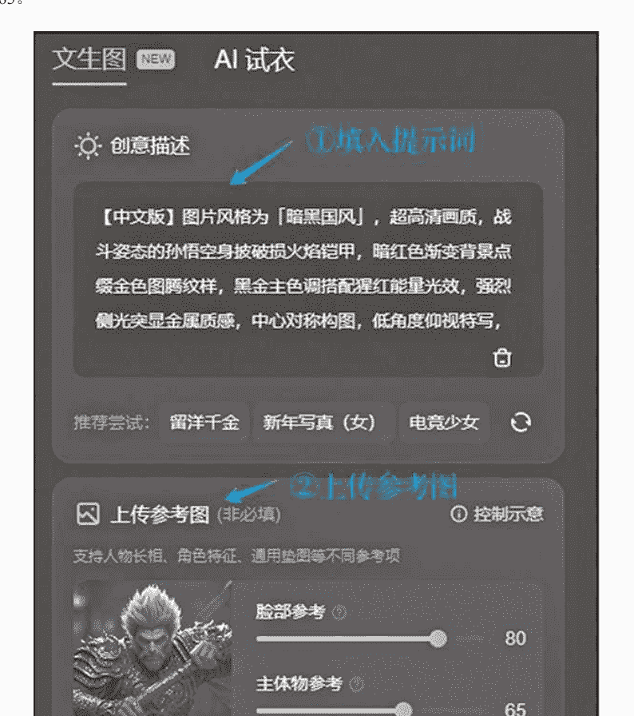
图4-45 平台文生图操作界面


图4-46 参考图设置面板

如图4-47所示，一次可输出4张图像。

选定一张后点击生成视频即可进入AI视频页面。


图4-47 平台生成的图片


图4-48 图片编辑选项

进入AI视频页面后输入创意指令：

> 伫立在山顶园林中的巨大悟空形象石雕，镜头360度环视，石雕下有游客观赏、走动


图4-49 可灵AI视频生成编辑器

官方教程建议的写作框架为“主体+运动，背景+运动……”。

> 提示词=主体+运动，背景+运动……

- 主体：画面中的人物、动物、物体等；
- 运动：目标主体期望的运动轨迹；
- 背景：画面背景。

如图4-50，平台据此产出5秒视频。


图4-50 平台生成的视频

### 4.10 DeepSeek+Xmind：精美竖版思维导图制作

在信息过载的情境下，把碎片知识转化为结构化表达很有必要。DeepSeek配合Xmind可把传统手工整理升级为智能化生产。

Xmind是一款功能全面的思维导图与头脑风暴软件，界面简洁、模板精美、跨平台使用，支持思维导图、鱼骨图、树形图、逻辑图、组织结构图等形式并可互转。

在3.4.2节已用DeepSeek撰写《东南亚市场准入风险评估报告》，本节演示如何将其快速转为导图。

#### 1. DeepSeek快速结构化内容

如图4-51所示，打开DeepSeek上传报告文档，选择深度思考模式并输入提示词。

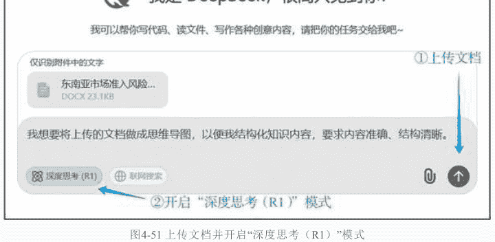
DeepSeek将内容结构化为如下内容：

> [思考开始]嗯，用户想要把这份《东南亚市场准入风险评估报告.docx》转换成思维导图，以便结构化知识内容，要求内容准确、结构清晰。首先，我需要仔细理解文档的结构和内容。文档分为三个主要部分：风险清单表、风险热力图和应急预案。每个部分都涉及不同的东南亚国家，每个国家又细分了不同类型的风险，比如法规合规和物流中断，并附有风险描述、影响维度和发生概率。

以下是基于《东南亚市场准入风险评估报告》整理的思维导图结构框架，按模块分层呈现核心内容，确保逻辑清晰且便于可视化：

##### 东南亚市场准入风险评估（思维导图框架）

###### 1. 风险总览

- 国家分类：印尼、越南、泰国、马来西亚、菲律宾

- 风险类型：法规合规、物流中断

###### 2. 风险清单表（按国家+风险类型展开）

####### 印尼

######## □ 法规合规

- 数据本地化要求（需境内存储电商数据）

- 社交媒体电商交易受限（如TikTok Shop禁令）

- 影响维度：法律、运营

- 发生概率：中高（70%）

######## □ 物流中断

- 雅加达港口罢工与劳资纠纷

- 影响维度：供应链

- 发生概率：中（50%）

####### 越南

######## □ 法规合规

- 继续研究、起草和完善关于电商的法律

- 影响维度：法律、运营

- 发生概率：中（60%）

######## □ 物流中断

- 胡志明市港口台风及海关积压

- 影响维度：供应链

- 发生概率：中低（40%）

####### 泰国

######## □ 法规合规

- 低价值进口商品增值税（7%）及卖家收入申报

- 影响维度：财务、运营

- 发生概率：高（75%）

######## □ 物流中断

- 曼谷港海关数字化瓶颈与季节性洪水

- 影响维度：供应链

- 发生概率：中（55%）

####### 马来西亚

######## □ 法规合规

- 严格价格竞争审查及数据隐私要求

- 影响维度：法律、声誉

- 发生概率：中（60%）

######## □ 物流中断

- 巴生港疫情封锁导致拥堵

- 影响维度：供应链

- 发生概率：中（50%）

####### 菲律宾

######## □ 法规合规

- RCEP协议关税复杂化与SNI认证规则

- 影响维度：法律、财务

- 发生概率：中（55%）

######## □ 物流中断

- 马尼拉港因台风频繁关闭

- 影响维度：供应链

- 发生概率：高（65%）

###### 3. 风险热力图（可视化补充）

- 法规合规风险评级：泰国（高）>印尼（中高）>越南/马来西亚/菲律宾（中）

- 物流中断风险评级：菲律宾（高）>印尼/泰国/马来西亚（中）>越南（中低）

###### 4. 应急预案（按风险类型关联）

（1）法规合规风险

- 一级策略（低投入）：本地化合作（如法律顾问、监测政策）

- 二级策略（中投入）：合规建设（如部署境内数据服务器）

- 三级策略（高投入）：行业游说（争取关税豁免）

（2）物流中断风险

- 一级策略：多路径布局（启用备用港口）

- 二级策略：库存预置（保税仓预存30%库存）

- 三级策略：技术强化（AI物流监控系统）

###### 5. 附加信息

- 参考文献：各国法规、消费洞察、物流数据、RCEP协议

- 备注：需查阅各国官方平台获取政策原文（如印尼贸易部官网）。

##### 思维导图设计建议

1. 层级结构：以“国家”和“风险类型”为双主线展开，交叉关联应急预案。

2. 视觉标注：

   - 用颜色区分风险等级（如红色=高，黄色=中，绿色=低）。

   - 图标标记应急预案级别（★=一级，★★=二级，★★★=三级）。

3. 逻辑连接：在“风险热力图”模块使用矩阵图或雷达图辅助呈现评级对比。

此框架可直接导入思维导图工具（如Xmind、MindMaster），按需调整布局与样式。

点击系统自带的复制按钮保留完整Markdown格式，如图4-52所示。

新建文本文件粘贴内容。如图4-53所示，粘贴后保留完整Markdown层级，Xmind正是依此识别结构。请删除无关段落，仅保留导图主体。

将文件扩展名“.txt”改为“.md”，如图4-54所示。

#### 2. 使用Xmind导入Markdown文件

打开Xmind，依次选择 文件-导入-Markdown，如图4-55所示。

导入后Xmind会自动把Markdown转为思维导图，如图4-56所示。

Xmind还提供多种呈现形式。如图4-57所示，在“格式”中选择“画布”，更换“骨架”。

#### 3. 制作竖版思维导图

选择“画布”，更换骨架为“带底色框的逻辑图”（第一种），如图4-58所示。

##### **东南亚市场准入风险评估（思维导图框架）**

**1. 风险总览**

- **国家分类**：印尼、越南、泰国、马来西亚、菲律宾

- **风险类型**：法规合规、物流中断

**2. 风险清单表（按国家+风险类型展开）**

- **印尼**

  - **法规合规**

    - 数据本地化要求（需境内存储电商数据）

    - 社交媒体电商交易受限（如TikTok Shop禁令）

    - *影响维度*：法律、运营

    - *发生概率*：中高（70%）

  - **物流中断**

    - 雅加达港口罢工与劳资纠纷

    - *影响维度*：供应链

    - *发生概率*：中（50%）

- **越南**

  - **法规合规**

    - 继续研究、起草和完善关于电商的法律

    - *影响维度*：法律、运营

    - *发生概率*：中（60%）

  - **物流中断**

    - 胡志明市港口台风及海关积压

东南亚出海风险快照

整条供应链被干扰的可能性处于中低位，估算在四成上下。

泰国
合规
低值进口商品要缴7%增值税，平台卖家还需做收入申报
波及范围：财务、运营
发生概率：高，约75%

物流
曼谷港清关数字化堵点叠加雨季洪水
波及范围：供应链
发生概率：中，约55%

马来西亚
合规
价格竞争审查趋严，个人数据保护要求提升
波及范围：法律、声誉
发生概率：中，约60%

物流
巴生港因疫情封控出现拥堵
波及范围：供应链
发生概率：中，约50%

菲律宾
合规
RCEP关税规则复杂化，SNI认证带来额外负担
波及范围：法律、财务
发生概率：中，约55%

物流
马尼拉港受台风影响频繁停运
波及范围：供应链
发生概率：高，约65%

风险热度一览
- 合规风险排序：泰国高 > 印尼中高 > 越南、马来西亚、菲律宾中
- 物流受阻排序：菲律宾高 > 印尼、泰国、马来西亚中 > 越南中低

分类型应对思路
- 合规风险
  - 低投入做法：本土化协作，例如引入法务顾问、动态追踪政策动向
  - 中投入做法：合规建设，例如在境内部署服务器
  - 高投入做法：行业游说，争取关税豁免等政策空间
- 物流受阻风险
  - 首选做法：多通道布局，启用备选港口
  - 次选做法：库存前置，保税仓预留约30%安全库存
  - 强化做法：技术加固，上线AI物流监控体系

补充资料
- 参考来源：各国法规原文、消费洞察、物流统计、RCEP协议
- 提示：建议通过印尼贸易部官网等官方渠道核验最新政策原文

图4-57 更换“骨架”模板

图4-58 选择“带底色框的逻辑图”

图4-59所示，新建一个二级分支作为竖版思维导图的大标题。

图4-60所示，选中思维导图的总支，在样式中把填充、边框、线条全部设为无，再把总支文字清空或把字体颜色调成白色隐藏。

图4-61所示，点击画布，取消同级主题对齐，随后把顶部的第一标题宽度拉伸至与整体内容等宽并居中。

图4-61 “大标题”宽度设置

图4-62所示，框选全部内容后点外框新建外框，竖版思维导图的雏形就出来了。

图4-62 新建“外框”

图4-63所示，点击空白背景，在样式里把填充色改为白色。

图4-63 将背景改为白色

图4-64所示，选中二级标题分支，在样式里把线条设为实线。

图4-64 设置二级标题的“线条”为实线

接下来可做美化，例如调整第一标题的填充样式与字号，如图4-65所示。

图4-65 修改大标题的填充样式和字体字号

其他美化可继续展开，比如把二级标题上移至子内容上方，或添加配图等，限于篇幅不展开。

至此竖版思维导图的基础样式已具备，接下来导出图片。如图4-66所示，通过菜单工具-Map Shot截图完成抓图。

图4-66 Map Shot截图功能

导出后的竖版思维导图如图4-67所示。

图4-67 竖版思维导图

竖版思维导图很适合内容呈现，深度美化后视觉冲击力更强。图4-68为笔者制作的示例，加入了配图、配色调整和emoji等。

##### 巴菲特股东大会另类解读
——家庭视角的智慧

制图人 | Andy 制图工具 | Xmind

小课预告 2022年第3期

- 4月30日，一年一度的伯克希尔股东大会在巴菲特家乡美国奥马哈举行。作为股神，巴菲特的股东大会每年吸引数万人朝圣，成为全球财经界的盛会。
- 92岁的巴菲特与98岁的搭档查理·芒格现场回应投资人提问，全程约6小时。

本次分享重点

- 不聊艰深投资。
- 提炼几个对普通家庭也有启发的生印象：如何看待投资、做人生选择、看待婚姻与教育。

投资篇
1. 永远不变的那件事
2. 小学四年级都能懂的道理
3. 25美元卖给我我都不要

人生篇
1. 对抗通胀的最好办法
2. 在后半生成为更好的人
3. 还不确定想做什么，有什么建议

社群分享时间：2022年5月3日 12:00

图4-68 深度美化的竖版思维导图

### 4.11 DeepSeek 强化 ima.copilot：搭建个人知识库AI助手

在信息过载环境下，构建个人知识体系已成核心能力。腾讯推出的 ima.copilot 简称ima，通过融合混元大模型与DeepSeek-R1推理引擎，打造出AI驱动的知识管理新范式，为教师、学生和知识工作者提供全场景方案。

ima是一款以知识库为核心的智能工作台，实现了混元大模型的广域知识检索与DeepSeek-R1深度推理的结合，形成知识雷达加思维导图的双模式。混元如图书馆员，快速定位跨领域信息；DeepSeek-R1如严谨专家，擅长拆解复杂逻辑。用户可灵活切换，例如做竞品分析时，先用混元收集信息，再用DeepSeek整理成报告。

使用ima搭建个人知识库AI助手可实现：

- 智能问答：提出问题后，平台在知识库内聚合多源信息，给出清晰条理的综合答案。
- 文档解读：对上传的历史文献、研究报告等自动生成摘要和脑图。教师备课时可快速提炼观点、梳理脉络，节省时间。
- 智能写作：输入简单指令即可获得结构化写作框架，提升效率。教学反思、计划、笔记、小论文，或自媒体爆款素材框架都能辅助完成。
- 多模态交互：支持文字、图像混合输入，上传图片、地图结合文字提问，学习更直观。
- 知识库共享：团队可共建共享库，上传优质资料并设置编辑、查看权限，促进协作与专业成长。

下面介绍使用方式。

#### 1. 安装ima软件

在官网下载页按电脑系统选择版本，运行安装程序按指引完成安装，如图4-69所示。也可在微信小程序搜索“ima知识库”，添加到我的小程序即可随时使用。

#### 2. 个人知识库与共享知识库
（1）个人知识库
如图4-70所示，点击侧边栏个人知识库，点右上角上传按钮即可导入本地文档。支持PDF、DOC、DOCX、JPG、PNG、JPEG。
个人知识库可被智能问答、智能写作等功能直接调用。
（2）共享知识库
在知识库界面新建共享知识库，导入文档。如图4-71所示。
导入后AI会解析文档并生成摘要。点击单篇文档可在线编辑，如图4-72所示。如图4-73所示，点击右上角分享并设置权限即可分发给团队成员。

#### 3. 首页：智能问答
首页即为智能问答界面。如图4-74所示，左侧可切换大模型及联网选项，右侧支持上传附件和截图问答。例如询问：

> 张先生夫妇都在北京工作。结婚前2020年两人无房租房。2021年3月张先生在北京购房享首套房贷利息但因装修仍租房，妻子无房租房。2022年2月结婚后共同租房。张先生税率30%，妻子3%。如何扣除？

ima提供两种模式：基于全网公众号文章回答，默认启用；切换基于知识库后则基于自建库作答，如图4-75所示。如图4-76所示，切换后系统会在个人知识库中检索匹配文档后再作回复。

#### 4. 文档解读
点击首页文档解读，可基于本地文档或个人库内文档提问。如图4-77所示，选择知识库或上传文档后会出现快捷按钮总结内容和生

#### 5.智能写作
智能写作是ima亮点之一，可基于个人库或本地文档快速成文。如图4-78所示，选择知识库或上传文档后，在问题框输入写作背景与需求即可生成。系统提供不限、论文、作文、文案四种场景，匹配后结果更贴合。
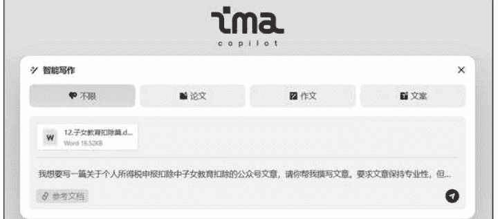
图4-78 智能写作操作界面

如图4-79所示，生成后点插入可存入笔记继续编辑；不满意可点重新生成或舍弃。
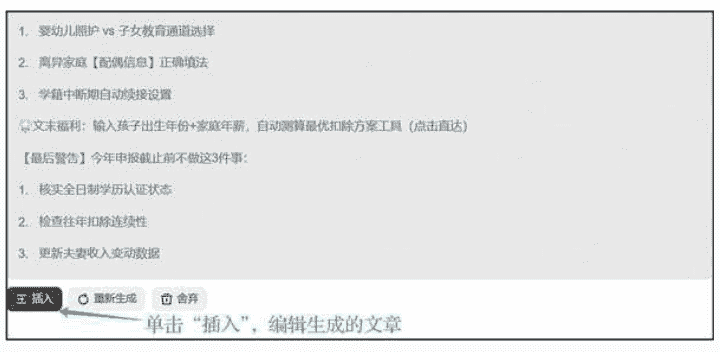
图4-79 文章生成后的操作界面

#### 6.划词工具栏
ima还提供实用的智能划词工具栏。如图4-80所示，在电脑上框选文本后会自动弹出菜单，提供AI解读、翻译等功能。支持在ima内部使用，也可设置全局开启在所有应用中使用。
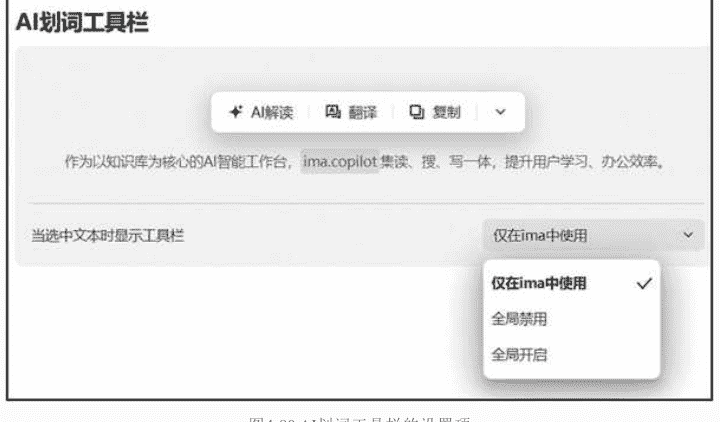
图4-80 AI划词工具栏的设置项

设置路径如图4-81所示：侧边栏点头像进入设置，在通用设置中找到AI划词工具栏进行配置。
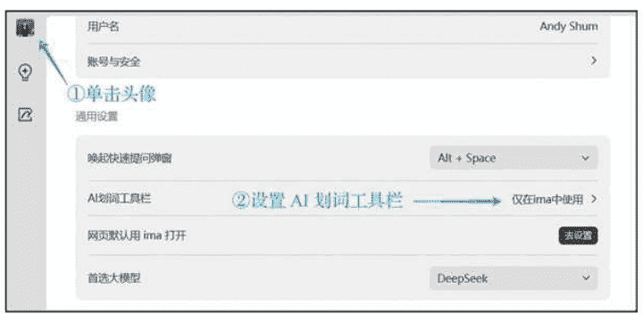
图4-81 AI划词工具栏设置的路径

### 4.12 DeepSeek 联动 飞书多维表：批量AI办公

飞书多维表是一款兼具表格便捷与业务系统能力的在线数据库，支持存储、分析、可视化及协作自动化。近期飞书将DeepSeek引入多维表，实现批量智能办公，大幅提升生产力。

#### 1.新建飞书多维表
方式一：直接在多维表格主页新建，如图4-82。
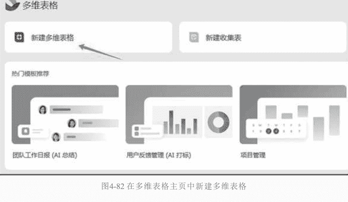
方式二：在飞书云文档中新建。本书稿即在云文档中编辑。新建一行后点+，在多维表格中选表格即可，如图4-83所示。
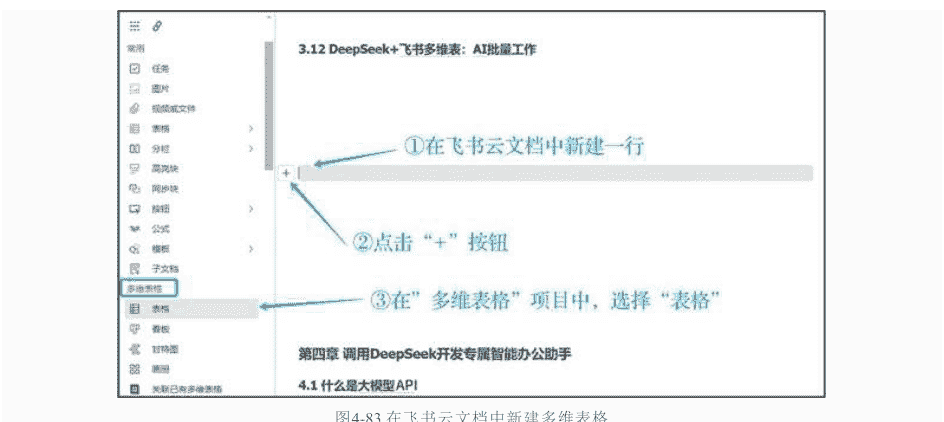
后续演示基于云文档内的多维表。

#### 2.接入DeepSeek到表格
（1）清理无关字段
为界面简洁，先删除除首列外的其他字段，如图4-84所示。
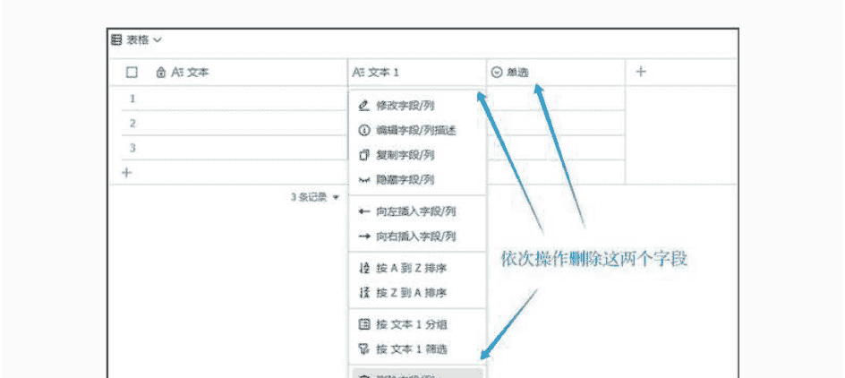
（2）新建DeepSeek功能字段
如图4-85所示，在空白列点+新建字段，选择字段类型，搜索DeepSeek。需联网选DeepSeek R1联网版，否则选DeepSeek R1。
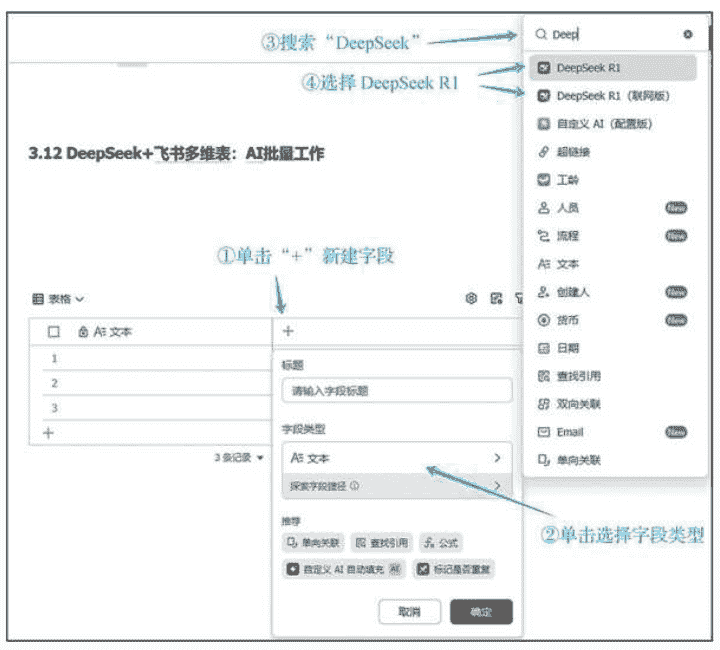
（3）字段配置
在配置项选择指令内容中指定表格第一列字段名，本例为文本，如图4-86所示。如图4-87所示，选择获取更多信息，系统会自动生成三列，分别填入DeepSeek的思考过程、输出结果和参考链接。

#### 3.批量工作方式一：统一提示词
把第一列作为待处理内容，不写入单行提示。以批量翻译为例，如图4-88所示，第一列为英文短语。在DeepSeek设置页打开自定义要求，填入：
> 请将文本译为中文，要求信达雅
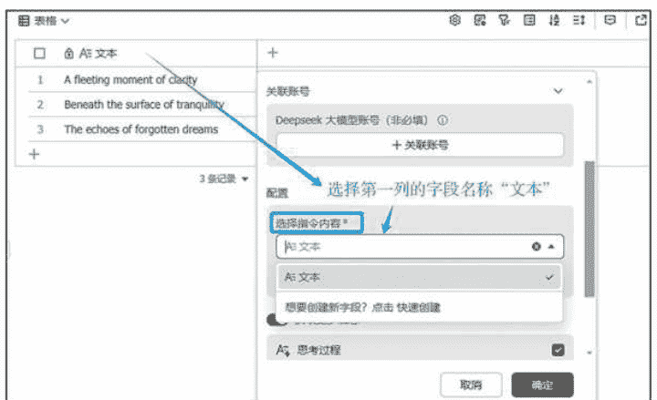
图4-86 选择指令内容
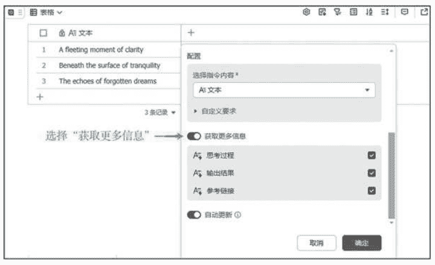
图4-87 选择获取更多信息

提示词分级中，自定义要求相当于系统级提示词，选择指令内容相当于用户级提示词。
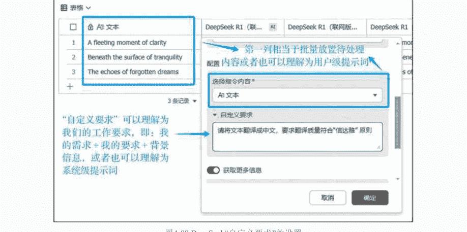
设置完成后点确定并点生成，DeepSeek开始批量执行。

如图4-90所示，翻译结果出现在第二列DeepSeek字段，思考过程、回复内容、参考链接拆分到对应列。

#### 4.批量工作方式二：个性化提示词
若每行任务不同，采用逐行提示。如图4-91所示，每行单独写需求并清空自定义要求，再执行批量任务。

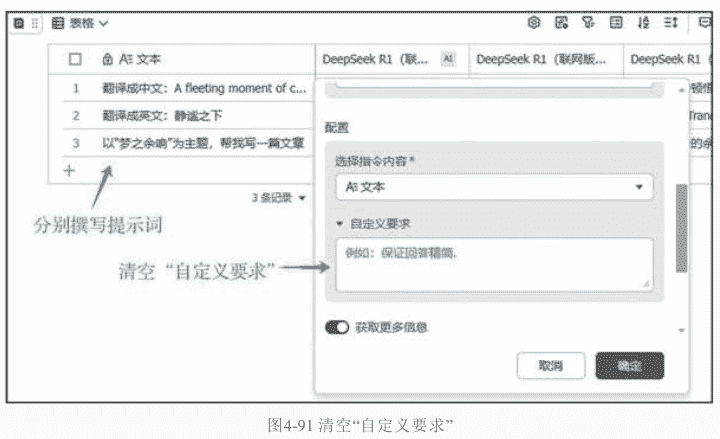
图4-91 清空自定义要求
执行后如图4-92所示，DeepSeek按每行文本的个性化指令分别完成。
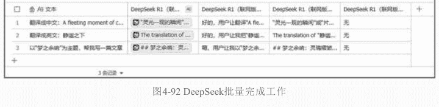
图4-92 DeepSeek批量完成工作

### 4.13 DeepSeek 配合 Napkin：一键生成高颜值图表

在信息爆炸时代，图表是职场沟通的通用语言。无论汇报、演示、分析或梳理流程，图表都能提升效率。Mermaid和HTML虽好但操作较繁，Napkin提供了更高效的方案。

Napkin.ai是一个视觉AI平台，核心能力是输入文本自动生成图表。把内容粘贴进去即可一键生成数十种精美图表，如图4-93所示。
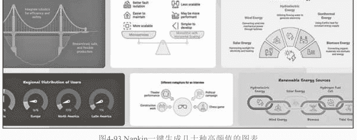

演示以项目经理妮妮汇报AI智能客服系统落地流程为例，老板要求用流程图展示从启动到上线的关键阶段。

#### 1.用DeepSeek生成项目流程
提示词：
> 请梳理AI智能客服系统从启动到上线的完整流程，包括启动、需求分析、系统设计、开发测试、上线部署、运营维护等阶段，每个阶段含3～5个关键步骤。请以Markdown语法输出流程图文本描述。

DeepSeek会生成如下Mermaid流程图代码：

```
AI智能客服系统项目流程


mermaid

graph TD

A[项目启动阶段] --> A1[明确项目目标]

A --> A2[组建项目团队]

A --> A3[制定项目计划]

B[需求分析阶段] --> B1[用户需求调研]

B --> B2[竞品分析]

B --> B3[需求文档编写]

B --> B4[需求评审确认]

C[系统设计阶段] --> C1[系统架构设计]

C --> C2[功能模块设计]

C --> C3[接口与数据库设计]

C --> C4[技术选型确认]

D[开发测试阶段] --> D1[核心功能开发]

D --> D2[单元测试]

D --> D3[集成测试]

D --> D4[用户验收测试]

E[上线部署阶段] --> E1[生产环境准备]

E --> E2[系统部署]

E --> E3[数据迁移]

E --> E4[灰度发布]

F[运营维护阶段] --> F1[系统监控]

F --> F2[用户反馈收集]

F --> F3[模型持续优化]

F --> F4[定期系统升级]

A1 -->|输出项目章程| A2

A3 -->|包含时间表/资源表| B

B4 -->|通过PRD文档| C

C4 -->|技术方案确认| D

D4 -->|测试报告| E

E4 -->|正式上线| F

...
```

#### 2. Napkin 一键绘制视觉图表

来到 napkin.ai 完成注册并登录，免费账号已能体验主要功能。首次进入编辑区，系统会弹出工作模式选择。如图4-94，平台提供两种路径：若已有成稿，直接把文字贴入生成图形；若缺少素材，可先借助内置智能体撰写内容再转图。


本例的文案已由 DeepSeek 完成，因此采用第一种路径。如图4-95，工作界面呈现类似文档的空白画布，将 DeepSeek 的输出复制进来。选中想要可视化的段落后，点击左侧蓝色的「生成图表」即可触发制作。

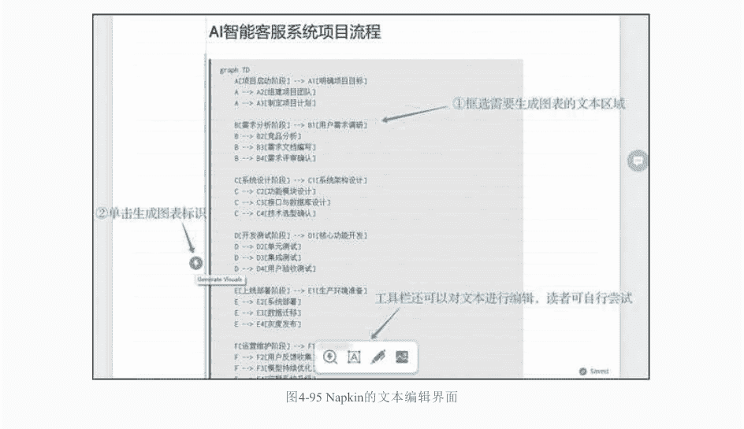

如图4-96，系统会在正文下方自动插入精致的图表。左侧样式栏可上下滚动，里面收纳了数十种视觉风格可供挑选。

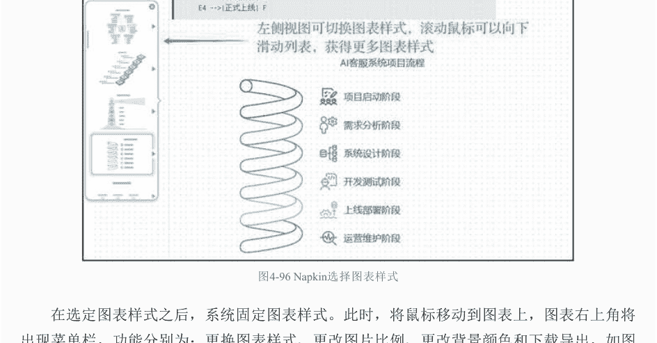

确认样式后锁定外观。将光标移至图形上，右上角会展开工具条，提供切换风格、修改尺寸比例、更改底色、导出素材等操作，如图4-97 所示。

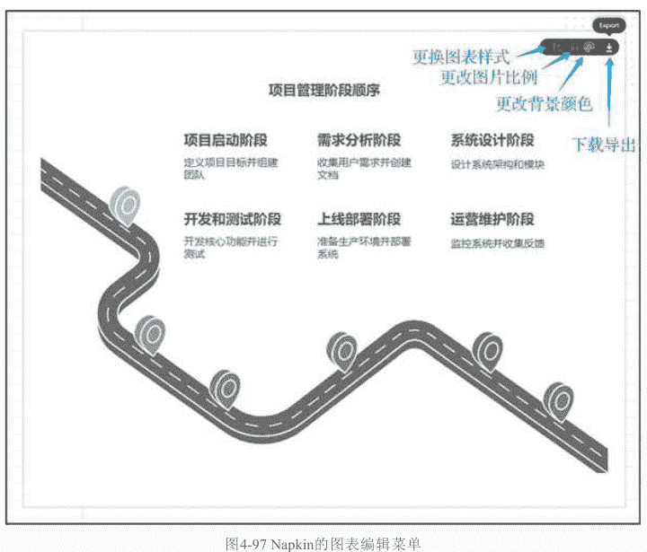

图4-97 Napkin 的图表编辑菜单

点击「下载导出」后，可挑选 PNG、SVG、PDF 三种格式导出，如图4-98。

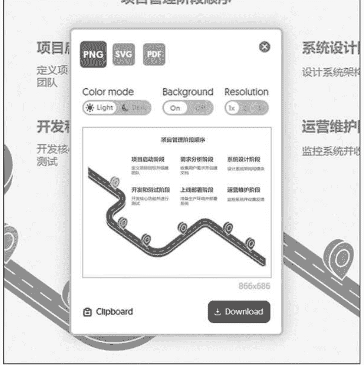

图4-98 Napkin 的文件导出

## 第5章 DeepSeek API 定制专属智能助手

本章围绕 DeepSeek API 的接入展开。先介绍大模型接口的概念及价值，帮助理解为何调用接口能提升助手能力；再梳理调用过程中需要注意的核心概念；随后演示如何申请凭证；最后通过实操案例把知识落地。学完后，你可以灵活运用该接口，并在后续办公自动化场景中复用。

### 5.1 大模型接口是什么

大模型接口是一种让开发者把预训练大模型的算力接入自身产品或服务的通道。借助它，无需自研模型或自建算力，就能实现文本创作、图像理解、自然语言处理等任务。

打个比方，大模型像发电厂，应用像电器，都需要电力。接口就像插座，把电力输送给各类设备。正因如此，市面上众多产品都通过接口接入 DeepSeek，从而为用户提供功能。

#### 5.1.1 接口的核心价值

基于大模型能力构建应用，接口带来了很强的灵活性：

##### 1. 自动化与批量运算
调用接口可以实现海量数据的批量运算，例如一次性解读上千篇文献，效率大幅提升。参见 4.12 节及第 6 章内容。

##### 2. 定制化与扩展能力
可与其它工具链组合实现功能叠加。例如 4.11 节中，ima 与 DeepSeek 结合搭建知识库。
也可实现多模型协同，如 4.4 节至 4.8 节提到的图像、海报、视频、音乐等生成模型，通过接口接入同一流程，实现真正的“一键完成”。

#### 5.1.2 调用时的关键概念

##### 1. Token 计量
Token 是模型处理文本的最小颗粒，相当于词或子词，直接决定成本与响应速度。简单理解为模型的计字方式，按 Token 而非字数计算。接口计费也按 Token 计量。

##### 2. 鉴权凭证
相当于数字钥匙，用于身份核验。每个调用者都需要自己的凭证，调用时必须填入正确的值。

##### 3. 使用限制
部分接口对单次请求的 Token 总量有限制，例如 128000 个，超出会报错。速率与并发也可能受限。

### 5.2 如何获取 DeepSeek 接口凭证

#### 1. 注册并登录开放平台
访问 DeepSeek 开放平台官网：https://platform.deepseek.com/。没有账号可使用邮箱或手机号注册，注册后登录。

#### 2. 创建 API Key
如图5-1，登录后进入开发者控制台。左侧菜单找到 API Keys，点击进入后按「创建 API Key」。为凭证命名，例如 test，生成后会展示一次，请立即复制保存到安全位置。遗失后只能重新生成。


#### 3. 第三方平台接入
除官方接口外，多家第三方也已集成 DeepSeek 接口。常见提供商如下：

表5-1 DeepSeek API 第三方提供商

| 平台名称 | 链接地址 |
| :--- | :--- |
| 硅基流动 | https://siliconflow.cn/zh-cn/models |
| 华为云 | https://activity.huaweicloud.com/maas-ds.html |
| 百度智能云千帆 | https://cloud.baidu.com/ |
| 字节跳动火山引擎 | https://console.volcengine.com/auth/login |
| 腾讯云 | https://console.cloud.tencent.com/lkeap |
| 阿里云百炼 | https://account.aliyun.com/login/login.htm |

### 5.3 DeepSeek 接口使用方法

前面章节已介绍 DeepSeek 的语言能力，本节聚焦如何实际调用接口，并强调其对 OpenAI 格式的兼容性，便于复用已有工具。

如图5-2，官方文档 https://api-docs.deepseek.com/zh-cn/ 明确说明：DeepSeek 接口采用与 OpenAI 兼容的格式，开发者可以像接入其他大模型一样快速完成对接。


要正常调用，需要正确配置三个要素：访问地址 base_url、模型名称 model、鉴权凭证 api_key，三者缺一不可。

- 访问地址 base_url：通常为 https://api.deepseek.com，也可用 https://api.deepseek.com/v1，其中 v1 与模型版本无关。
- 模型名称 model：指定具体模型。例如 deepseek-chat 对应 DeepSeek-V3，deepseek-reasoner 对应 DeepSeek-R1。
- 鉴权凭证 api_key：在 DeepSeek 官网注册后创建。

可在多种工具中运用这三项。

（1）Python 脚本调用
示例如下：

```python
from openai import OpenAI

client = OpenAI(api_key="your-api-key", base_url="https://api.deepseek.com")

response = client.chat.completions.create(
    model="deepseek-chat",
    messages=[{"role": "system", "content": "You are a helpful assistant"}, {"role": "user", "content": "Hello"}],
    stream=False
)
print(response.choices[0].message.content)
```

如图5-3，代码中将 your-api-key 换成自己的凭证，若想使用 R1 模型，把 model 改为 deepseek-reasoner。content 填写提示词，包含系统提示与角色提示。


（2）可视化 Chat UI 调用
市面上存在大量可视化对话产品，支持自定义接口连接，能更直观地与大模型交互并调用 DeepSeek。

如图5-4，为某款 Chat UI 的模型配置页，只需填入自己的凭证即可。


图5-4 Chat UI 中的 API 设置

## 第6章 DeepSeek 结合 Office 实现智能办公

在日常工作中 Office 软件使用频率极高，但重复性手工操作消耗大量时间。VBA 作为 Office 的效率引擎，能够实现自动化，却因门槛较高被很多人放弃。如今借助 DeepSeek，无需学习编程，只需用自然语言描述需求，即可快速生成 VBA 脚本，一键实现自动化。未来自动化办公将成为主流，更多精力可投入到创造性工作中。

### 6.1 VBA 是什么

VBA 是一种编程语言及开发环境，广泛应用于 Microsoft Office 套件如 Excel、Word、Access 等，用于实现自动化、扩展功能和定制化方案。WPS 安装插件后也能使用，脚本常被称为宏。

#### 1. VBA 语言特点
VBA 与 Office 紧密结合：

- 易学易用：无深厚编程背景也能掌握基础语法，完成单元格读取、格式设置等常见任务。
- 强大自动化：可批量处理重复工作，如 Excel 大量数据格式化、计算、筛选，编写宏可自动排序筛选，大幅提升效率。
- 高度集成：可访问工作表、单元格、图表、文档、段落、表格等对象，实现深度定制。如 Word 中可通过代码创建带公司标志、页眉页脚的模板，并按文档类型设定格式规则。

#### 2. VBA 应用场景

- 数据处理与分析自动化：Excel 中连接外部数据库、清洗转换数据、定期更新报表图表。
- 文档自动化处理：Word 中批量生成合同，按客户信息自动填充；批量添加页码、修改格式。
- 自定义用户界面：添加自定义菜单、工具栏、对话框，让参数输入与操作更友好。

补充说明：VBA 在 Windows 上运行稳定，macOS 支持大部分场景，但如访问网络等操作可能受限，必要时可用 Python 替代。Python 介绍见第 7 章。

### 6.2 DeepSeek + VBA 实现 Office 自动化

#### 6.2.1 一键批量导入报表

Excel 是职场人高频工具，但面对大量报表手工处理很耗时：

- 表格套娃：下发大表字段繁杂，需筛选特定列粘贴到自用小表。
- 重复劳动：每周每月重复筛选复制粘贴，机械且耗时。
- 效率瓶颈：手工易出错，严重影响体验。

本节演示如何用 DeepSeek + VBA 实现报表一键导入，告别重复复制粘贴。

> **案例背景**
小王是某公司销售部数据专员，每周需处理总部下发的《维莱茶公司全国门店销售明细报表》。报表数据量大，列数数十，包含门店编号、门店名称、日期、商品名称、商品编码、销售数量、销售金额、成本金额、利润、会员类型、支付方式等。

他只关注华东和华南地区「美式咖啡」和「龙井茶」的销售情况，需要把报表中「日期」「门店名称」「商品名称」「销售数量」「销售金额」五列筛选出来，整理到自建的《华东&华南咖啡茶饮销售日报表》中，用于分析。

如表6-1 所示，这是「大表」数据，包含数十列信息。

表6-1 「大表」——《维莱茶公司全国门店销售明细报表》

| 订单编号 | 日期 | 门店编号 | 门店名称 | 地区 | 商品名称 | 商品编码 | 销售数量 | 销售金额 | 成本金额 | 利润 | 会员类型 | 支付方式 | ……（其他字段） |

大表筛选结果自动写入汇总表

|---|---|---|---|---|---|---|---|---|---|---|---|---|---|

| OD20250301001 | 2025/3/1 | MD001 | 上海旗舰店 | 华东 | 美式咖啡 | CP1001 | 15 | 300 | 150 | 150 | 普通会员 | 支付宝 | …… |

| OD20250301002 | 2025/3/1 | MD002 | 深圳万象城店 | 华南 | 卡布奇诺 | CP1002 | 12 | 360 | 180 | 180 | 会员 | 微信支付 | …… |

| OD20250301003 | 2025/3/1 | MD003 | 北京国贸店 | 华北 | 龙井茶 | CY2001 | 20 | 400 | 200 | 200 | 普通会员 | 银行卡 | …… |

| OD20250301004 | 2025/3/1 | MD004 | 广州太古汇店 | 华南 | 茉莉花茶 | CY2002 | 18 | 360 | 180 | 180 | 会员 | 支付宝 | …… |

| OD20250301005 | 2025/3/1 | MD005 | 南京德基广场店 | 华东 | 拿铁咖啡 | CP1003 | 25 | 625 | 312.5 | 312.5 | 普通会员 | 微信支付 | …… |

| …… | …… | …… | …… | …… | …… | …… | …… | …… | …… | …… | …… | …… | …… |

上表为业务主表，字段较为丰富。表6-2为小王日常维护的汇总表《华东&华南咖啡茶饮销售日报表》，仅保留五项字段。

表6-2 “小表”——《华东&华南咖啡茶饮销售日报表》

| 日期 | 门店名称 | 商品名称 | 销售数量 | 销售金额 |

|---|---|---|---|---|

| 2025/3/1 | 上海旗舰店 | 美式咖啡 | 15 | 300 |

| 2025/3/1 | 深圳万象城店 | 卡布奇诺 | 12 | 360 |

| 2025/3/1 | 北京国贸店 | 龙井茶 | 20 | 400 |

| 2025/3/1 | 广州太古汇店 | 茉莉花茶 | 18 | 360 |

| 2025/3/1 | 南京德基广场店 | 拿铁咖啡 | 25 | 625 |

| …… | …… | …… | …… | …… |

本次要达成的目标是：从主表挑选出区域为华东或华南，并且商品名称包含美式咖啡或龙井茶的记录，将其日期、门店名称、商品名称、销售数量、销售金额五项自动填入汇总表的表格对象中。

##### 1. 借助 DeepSeek 产出脚本

向 DeepSeek 递交的任务描述为：请为以下自动化流程生成 VBA 宏，①在当前汇总表工作簿内调出文件选取窗口，由用户指定主表文件；②对主表进行条件过滤，区域为华东或华南且商品名称包含美式咖啡或龙井茶；③从过滤结果抽取日期、门店名称、商品名称、销售数量、销售金额五列；④把提取结果写入汇总表内。

模型给出的脚本如下：

[思考开始]好的，我现在需要帮用户编写一个VBA代码，实现从“大表”中筛选数据并粘贴到“小表”中的功能。让我先仔细看一下用户的需求。

……（限于篇幅，此处内容省略，读者可使用提示词自行尝试）

现在，编写完整的代码，并添加必要的错误处理方法。[思考结束]

以下是实现你需求的VBA代码，请将其粘贴到Excel的VBA编辑器中（按Alt+F11键打开）：

```vba
Sub ImportDataFromMasterSheet()

    Dim fd As FileDialog
    Dim filePath As String
    Dim srcWB As Workbook
    Dim srcWS As Worksheet
    Dim destWS As Worksheet
    Dim headerRow As Range
    Dim regionCol As Long, productCol As Long
    Dim dateCol As Long, storeCol As Long, qtyCol As Long, amtCol As Long
    Dim srcData As Range, area As Range, row As Range
    Dim destRow As Long
    
    ' 设置目标工作表
    Set destWS = ThisWorkbook.ActiveSheet
    
    ' 创建文件选择对话框
    Set fd = Application.FileDialog(msoFileDialogFilePicker)
    With fd
        .Title = "请选择大表文件"
        .Filters.Clear
        .Filters.Add "Excel文件", "*.xls; *.xlsx; *.xlsm"
        If .Show = -1 Then
            filePath = .SelectedItems(1)
        Else
            MsgBox "操作已取消。", vbInformation
            Exit Sub
        End If
    End With
    
    ' 打开源工作簿
    Set srcWB = Workbooks.Open(filePath)
    Set srcWS = srcWB.Worksheets(1)
    
    On Error Resume Next
    ' 获取各列位置
    Set headerRow = srcWS.Rows(1)
    regionCol = Application.Match("地区", headerRow, 0)
    productCol = Application.Match("商品名称", headerRow, 0)
    dateCol = Application.Match("日期", headerRow, 0)
    storeCol = Application.Match("门店名称", headerRow, 0)
    qtyCol = Application.Match("销售数量", headerRow, 0)
    amtCol = Application.Match("销售金额", headerRow, 0)
    On Error GoTo 0
    
    ' 验证列是否存在
    If regionCol = 0 Or productCol = 0 Or dateCol = 0 Or storeCol = 0 Or qtyCol = 0 Or amtCol = 0 Then
        MsgBox "大表中缺少必要的列，请检查列标题是否正确。", vbCritical
        srcWB.Close False
        Exit Sub
    End If
    
    ' 清除现有筛选
    If srcWS.AutoFilterMode Then srcWS.AutoFilterMode = False
    
    ' 设置筛选条件
    With srcWS.Range("A1").CurrentRegion
        ' 筛选地区为华东或华南
        .AutoFilter Field:=regionCol, Criteria1:=Array("华东", "华南"), Operator:=xlFilterValues
        ' 筛选商品名称包含美式咖啡或龙井茶
        .AutoFilter Field:=productCol, Criteria1:="=*美式咖啡*", Operator:=xlOr, Criteria2:="=*龙井茶*"
    End With
    
    ' 获取筛选后的可见数据
    On Error Resume Next
    Set srcData = srcWS.AutoFilter.Range.SpecialCells(xlCellTypeVisible)
    On Error GoTo 0
    
    If srcData Is Nothing Then
        MsgBox "没有找到符合条件的数据。", vbInformation
        srcWB.Close False
        Exit Sub
    End If
    
    ' 准备写入数据
    destRow = 1
    destWS.Range("A:E").ClearContents ' 清空目标区域
    
    ' 添加标题
    destWS.Range("A1").Value = "日期"
    destWS.Range("B1").Value = "门店名称"
    destWS.Range("C1").Value = "商品名称"
    destWS.Range("D1").Value = "销售数量"
    destWS.Range("E1").Value = "销售金额"
    destRow = 2
    
    ' 遍历并复制数据
    For Each area In srcData.Areas
        For Each row In area.Rows
            If row.Row > 1 Then ' 跳过标题行
                destWS.Cells(destRow, 1).Value = srcWS.Cells(row.Row, dateCol).Value
                destWS.Cells(destRow, 2).Value = srcWS.Cells(row.Row, storeCol).Value
                destWS.Cells(destRow, 3).Value = srcWS.Cells(row.Row, productCol).Value
                destWS.Cells(destRow, 4).Value = srcWS.Cells(row.Row, qtyCol).Value
                destWS.Cells(destRow, 5).Value = srcWS.Cells(row.Row, amtCol).Value
                destRow = destRow + 1
            End If
        Next row
    Next area
    
    ' 关闭源工作簿
    srcWB.Close False
    
    MsgBox "数据导入完成，共导入" & destRow - 2 & "条记录。", vbInformation
    
End Sub
```

##### 使用说明：

1. 在“小表”中按Alt+F11键打开VBA编辑器

2. 在左侧工程资源管理器中单击右键插入新模块

3. 将代码粘贴到模块中

4. 返回Excel界面，运行宏（开发者工具→宏→选择`ImportDataFromMasterSheet`→运行）

如果在使用中遇到任何问题，可以根据弹出的提示信息检查“大表”的格式是否符合要求。

##### 2.脚本载入编辑环境

如图6-1所示，在“小表”中按Alt+F11键打开VBA编辑器，在左侧工程资源管理器中单击右键插入新模块。


接着，将代码粘贴到模块中，如图6-2所示。代码的名称位于第一行，为ImportDataFromMasterSheet。


图6-2 粘贴代码

##### 3.试运行

如图6-3所示，单击□按钮运行代码。


图6-3 运行代码

如图6-4所示，运行代码后弹出文件选择对话框，在计算机中找到“大表”文件，单击“打开”即可。


图6-4 运行代码后弹出文件选择对话框

选中“大表”打开之后，系统自动完成数据筛选及提取工作。如图6-5所示，任务完成之后，自动弹出对话框。


图6-5 任务完成的消息弹窗

##### 4.配置快捷方式

为了以后更加便捷地工作，在“小表”工作表上可添加快捷运行VBA代码的按钮。如图6-6所示，单击“插入”-“形状”，选择一个自己喜欢的形状。


如图6-7所示，笔者常用圆角矩形，在圆角矩形框内可录入文字，如“导入报表”。右键单击新建的“圆角矩形”框之后，选择“指定宏”。


如图6-8所示，在弹出的“指定VB宏”对话框中，选中刚才新建的VBA。这样设置之后，以后直接单击该圆角矩形框，即可自动运行VBA代码。


本节中的8个场景都可以使用这种方式添加快捷按钮，限于篇幅，此后7个场景添加快捷按钮将不再赘述。

#### 6.2.2 一键批量筛选数据

职场人每天都与各种各样的数据表格打交道，从销售报表、客户信息，到财务数据、运营指标，数据分析和处理已经成为日常工作中不可或缺的一部分。

然而，面对堆积如山的数据，如何快速、准确地从中提取出所需信息，成为许多职场人“甜蜜的负担”。特别是当我们需要同时根据多个条件在多列数据中进行筛选时，Excel自带的筛选功能虽然强大，但操作起来略显繁琐，效率不高。

如果每天都需要进行这种重复性的筛选操作，而且筛选条件组合还可能不止一种，日复一日，这种工作不仅耗费大量的时间和精力，还容易让人感到枯燥和厌倦。

> **案例背景**

王萍是一位电商运营人员，每天都需要从大量的订单数据中筛选出特定地区、特定产品类别的订单信息，用于分析销售情况和制定运营策略。假设你需要的数据筛选条件是：

- 地区为“华东地区”；

- 产品类别为“电子产品”和“家居用品”；

- 销售金额大于1万元。

表6-3是待筛选的数据表，现在需要同时筛选第4列、第5列、第8列数据。

表6-3 待筛选数据表

| 订单编号 | 订单日期 | 客户姓名 | 地区 | 产品类别 | 产品名称 | 销售数量 | 销售金额 |

|---|---|---|---|---|---|---|---|

| OD20250301-001 | 2025/3/1 | 张三 | 华东地区 | 电子产品 | 智能手机 | 10 | 59990 |

| OD20250301-002 | 2025/3/1 | 李四 | 华南地区 | 家居用品 | 舒适沙发 | 2 | 12000 |

| OD20250301-003 | 2025/3/1 | 王五 | 华北地区 | 美妆个护 | 保湿面膜 | 50 | 2500 |

| OD20250302-001 | 2025/3/2 | 赵六 | 华东地区 | 食品饮料 | 进口牛奶 | 100 | 8000 |

| OD20250302-002 | 2025/3/2 | 钱七 | 华南地区 | 电子产品 | 蓝牙耳机 | 20 | 3000 |

| OD20250302-003 | 2025/3/2 | 孙八 | 华北地区 | 家居用品 | 柔软地毯 | 5 | 1500 |

| OD20250303-001 | 2025/3/3 | 周九 | 华东地区 | 电子产品 | 智能手表 | 15 | 45000 |

| OD20250303-002 | 2025/3/3 | 吴十 | 华南地区 | 美妆个护 | 口红套装 | 30 | 9000 |

| OD20250303-003 | 2025/3/3 | 郑十一 | 华北地区 | 食品饮料 | 坚果礼盒 | 80 | 6400 |

| OD20250304-001 | 2025/3/4 | 冯十二 | 华东地区 | 家居用品 | 创意书架 | 8 | 2400 |

##### 1.使用DeepSeek生成VBA代码

现在，我们使用DeepSeek来协助编写VBA代码，使用如下提示词：

> 我想要同时筛选多列数据，请编写VBA代码，实现以下Excel数据处理自动化：

>

> 筛选数据：从当前数据表中，筛选“地区”列为“华东地区”的数据；筛选“产品类别”列为“电子产品”或“家居用品”的数据；筛选“销售金额”列大于“10000”的数据。

将提示词发给DeepSeek，DeepSeek编写代码的过程如下：

> [思考开始]好的，我现在需要帮用户编写一个VBA代码来实现Excel中多列数据的筛选。用户的需求是同时筛选三列数据：地区为华东地区，产品类别为电子产品或家居用品，销售金额大于10000。我得先厘清这些条件之间的关系，以及如何在Excel VBA中正确应用这些筛选条件。

>

> ……（限于篇幅，此处内容省略，读者可使用提示词自行尝试）

>

> 总结：这段代码动态查找各标题在数据区域中的位置，应用多条件筛选，各条件之间为“与”关系，同一列的多个条件为“或”关系，应该能够满足用户的需求。[思考结束]

# Excel VBA 自动化筛选用例：动态定位与批量导出指南

想让表格自动识别列位、按复合规则过滤，再把结果拆成独立文件，这套 VBA 方案把自适应寻列、多条件过滤、清除筛选和批量导出串成一条通路，数据量大时也能稳定运行，规则修改也比较直观。

```vba
Sub MultiColumnFilter()
    Dim ws As Worksheet
    Dim dataRange As Range
    Dim regionCol As Long, categoryCol As Long, salesCol As Long
    Dim cell As Range
    
    Set ws = ActiveSheet
    Set dataRange = ws.UsedRange ' 获取当前使用的数据区域
    
    ' 关闭现有筛选
    If ws.AutoFilterMode Then ws.AutoFilterMode = False
    
    ' 动态查找列位置
    For Each cell In dataRange.Rows(1).Cells
        Select Case cell.Value
            Case "地区": regionCol = cell.Column - dataRange.Column + 1
            Case "产品类别": categoryCol = cell.Column - dataRange.Column + 1
            Case "销售金额": salesCol = cell.Column - dataRange.Column + 1
        End Select
    Next
    
    ' 验证列是否存在
    If regionCol = 0 Then MsgBox "未找到【地区】列!", vbExclamation: Exit Sub
    If categoryCol = 0 Then MsgBox "未找到【产品类别】列!", vbExclamation: Exit Sub
    If salesCol = 0 Then MsgBox "未找到【销售金额】列!", vbExclamation: Exit Sub
    
    ' 应用多重筛选
    With dataRange
        .AutoFilter Field:=regionCol, Criteria1:="华东地区" '华东地区
        .AutoFilter Field:=categoryCol, Criteria1:=Array("电子产品", "家居用品"), Operator:=xlFilterValues ' 二选一
        .AutoFilter Field:=salesCol, Criteria1:=">10000" ' 金额大于10000
    End With
    
    MsgBox "筛选条件已应用!", vbInformation
End Sub
```

核心能力概览

- 列位自适应：程序会遍历首行标题，自动判定“地区”“产品类别”“销售金额”分别位于哪一列，表头顺序变化也不会影响识别。
- 复合过滤逻辑：
  * 地区做精确匹配，示例为“华东地区”；
  * 品类支持或关系，可同时命中“电子产品”或“家居用品”，通过数组实现 OR；
  * 金额做数值比较，大于 10000 元，脚本会按数值类型计算。
- 缺列保护：运行前校验必填标题是否存在，缺失时弹窗提醒，避免报错中断。
- 范围自定：以工作表的 UsedRange 为边界，锁定真实数据区域，不多取也不漏取。

操作步骤

1. 通过 Alt+F11 进入 VBA 编辑环境
2. 插入标准模块
3. 将代码粘贴后按 F5 启动
4. 符合条件的数据保留在原表，其余行被隐藏，效果即时呈现

使用提示

- 数据首行必须是标题行
- 销售金额列请保持数值格式
- 如需恢复原视图，可在数据选项卡执行 清楚筛选

##### 2.代码写入VBA编辑器
参照 6.2.1 节的进入方式打开编辑器，新建模块后把代码粘贴进去，参考图6-9。


##### 3.运行VBA宏程序
依照 6.2.1 节的启动方法运行宏，程序会自动完成过滤，结束后会弹出提示窗，见图6-10。


##### 4.新增重置筛选
完成快速过滤后，通常还需要把视图恢复原状。于是继续向 DeepSeek 提出新需求：

> 我已经用你的脚本完成了筛选，现在需要一个一键清除筛选的功能，请给出 VBA 脚本。

DeepSeek 先回顾之前的多列过滤思路，再补充专门清除筛选的宏。最终给出的重置脚本如下，并附带运行说明与可按需注释的提示信息。

以下是可一键清除所有筛选条件的一键重置脚本：

```vba
Sub ResetFilters()
    On Error Resume Next ' 防止无筛选时报错
    Dim ws As Worksheet
    Set ws = ActiveSheet
    
    ' 关闭自动筛选模式
    If ws.AutoFilterMode Then
        ws.AutoFilterMode = False
        MsgBox "筛选已清除，所有数据恢复显示!", vbInformation
    Else
        MsgBox "当前未应用任何筛选", vbInformation
    End If
End Sub
```

要点说明

1. 状态自检：自动判断当前工作表是否处于筛选状态
2. 反馈机制：
   - 有筛选时关闭并提示重置成功
   - 无筛选时提示当前并未启用筛选
3. 防错设计：避免在未筛选状态下执行操作导致错误

调用方式

1. 与之前的过滤脚本保存到同一模块
2. 可通过以下方式触发：
   - 按 Alt+F8 选择宏运行
   - 为 Excel 添加按钮关联宏
   - 设置快捷键，推荐 Ctrl+Shift+R

可扩展方向

可在脚本里按需加入更多功能：

```vba
'清除筛选但保持筛选按钮可见（适用于表格对象）
If ws.ListObjects.Count > 0 Then
    ws.ListObjects(1).AutoFilter.ShowAllData
End If

' 重置后自动跳转到首行
ws.Range("A1").Select

' 清除特定列的筛选（示例清除B列筛选）
ws.AutoFilter.Filters(2).Clear
```

搭配建议

1. 将过滤宏和重置宏固定到快速访问工具栏
2. 用形状按钮分别绑定“过滤”和“重置”宏
3. 在 Worksheet_Activate 事件中自动重置筛选状态

该重置宏与前面多条件过滤宏完全兼容，配合使用可形成完整的数据处理闭环。

写入过程不再赘述，参照 6.2.1 节新建两个快捷按钮，分别实现快速筛选数据和快速重置筛选，见图6-11。


#### 6.2.3 一键批量导出报表
6.2.2 节已体验到快速筛选的效率提升。实际业务里，筛选后往往还要把结果拆成独立文档发给不同负责人。下面以电商运营场景说明批量导出。

业务场景
电商运营主管张佳嘉每天需从订单表里挑选不同地区、不同品类的订单，分别导出 Excel 发给区域负责人和产品经理跟进。

她的两类导出需求如下：

1. 需求一：“华北地区家居用品订单”
   - 地区为“华北地区”
   - 产品类别为“家居用品”
   - 导出文件名“华北地区家居用品订单.xlsx”
2. 需求二：“华东地区电子产品高价值订单”
   - 地区为“华东地区”
   - 产品类别为“电子产品”
   - 销售金额大于等于50000元
   - 导出文件名“华东地区电子产品高价值订单.xlsx”

表6-4 为待处理的订单表，需同时完成两组筛选并分别导出。

表6-4 张佳嘉的待筛选数据表

| 订单编号 | 订单日期 | 客户姓名 | 地区 | 产品类别 | 产品名称 | 销售数量 | 销售金额 |
| :--- | :--- | :--- | :--- | :--- | :--- | :--- | :--- |
| OD20250301-001 | 2025/3/1 | 张三 | 华东地区 | 电子产品 | 智能手机 | 10 | 59990 |
| OD20250301-002 | 2025/3/1 | 李四 | 华南地区 | 家居用品 | 舒适沙发 | 2 | 12000 |
| OD20250301-003 | 2025/3/1 | 王五 | 华北地区 | 美妆个护 | 保湿面膜 | 50 | 2500 |
| OD20250302-001 | 2025/3/2 | 赵六 | 华东地区 | 食品饮料 | 进口牛奶 | 100 | 8000 |
| OD20250302-002 | 2025/3/2 | 钱七 | 华南地区 | 电子产品 | 蓝牙耳机 | 20 | 3000 |
| OD20250302-003 | 2025/3/2 | 孙八 | 华北地区 | 家居用品 | 柔软地毯 | 5 | 1500 |
| OD20250303-001 | 2025/3/3 | 周九 | 华东地区 | 电子产品 | 智能手表 | 15 | 45000 |
| OD20250303-002 | 2025/3/3 | 吴十 | 华南地区 | 美妆个护 | 口红套装 | 30 | 9000 |
| OD20250303-003 | 2025/3/3 | 郑十一 | 华北地区 | 食品饮料 | 坚果礼盒 | 80 | 6400 |
| OD20250304-001 | 2025/3/4 | 冯十二 | 华东地区 | 家居用品 | 创意书架 | 8 | 2400 |

##### 1.使用DeepSeek生成VBA代码
此需求是 6.2.2 节的延伸，在原提示词上增加导出逻辑，让 DeepSeek 协助生成自动化脚本。提示要点为：

> 我需要同时筛选多列数据并分别导出为独立 Excel 文档，请编写 VBA 脚本，实现以下自动化：
> 步骤1 筛选&导出数据：从当前表筛选“地区”为“华北地区”，“产品类别”为“家居用品”，导出为“华北地区家居用品订单.xlsx”。
> 步骤2 筛选&导出数据：从当前表筛选“地区”为“华东地区”，“产品类别”为“电子产品”，“销售金额”大于50000元，导出为“华东地区电子产品高价值订单.xlsx”。

DeepSeek 思考后给出可自动执行多条件筛选并导出独立文件的脚本：

```vba
Sub ExportFilteredData()
    Dim ws As Worksheet
    Dim newWB As Workbook
    Dim filterRange As Range
    Dim regionCol As Long, categoryCol As Long, salesCol As Long
    Dim desktopPath As String
    Dim recordsCount As Long
    
    ' 设置基础参数
    Set ws = ActiveSheet
    desktopPath = Environ("UserProfile") & "\Desktop"
    
    ' 查找列位置
    On Error Resume Next
    regionCol = Application.Match("地区", ws.Rows(1), 0)
    categoryCol = Application.Match("产品类别", ws.Rows(1), 0)
    salesCol = Application.Match("销售金额", ws.Rows(1), 0)
```
On Error GoTo 0

' 验证列是否存在

If regionCol = 0 Or categoryCol = 0 Or salesCol = 0 Then

    MsgBox "数据表中缺少必要的列标题，请检查列名是否正确!", vbCritical

    Exit Sub

End If

Application.ScreenUpdating = False

Application.DisplayAlerts = False

' ============ 步骤1：华北地区家居用品 ============

With ws

    .AutoFilterMode = False

    With .Range("A1").CurrentRegion

        .AutoFilter Field:=regionCol, Criteria1:="华北地区"

        .AutoFilter Field:=categoryCol, Criteria1:="家居用品"

    End With

    ' 复制可见数据

    On Error Resume Next

    Set filterRange = .AutoFilter.Range.SpecialCells(xlCellTypeVisible)

    On Error GoTo 0

    If Not filterRange Is Nothing Then

        ' 创建新工作簿

        Set newWB = Workbooks.Add

        filterRange.Copy newWB.Sheets(1).Range("A1")

        ' 优化格式并保存

        With newWB

            .Sheets(1).UsedRange.EntireColumn.AutoFit

            .SaveAs desktopPath & "华北地区家居用品订单.xlsx", FileFormat:=51

            .Close False

        End With

        recordsCount = filterRange.Rows.Count - 1

        MsgBox "步骤1完成，导出 " & recordsCount & " 条记录!", vbInformation

    Else

        MsgBox "步骤1：没有找到符合条件的记录!", vbExclamation

    End If

End With

'============= 步骤2：华东地区电子产品高价值订单 ==============

With ws

    .AutoFilterMode = False

    With .Range("A1").CurrentRegion

        .AutoFilter Field:=regionCol, Criteria1:="华东地区"

        .AutoFilter Field:=categoryCol, Criteria1:="电子产品"

        .AutoFilter Field:=salesCol, Criteria1:=">50000"

    End With

    ' 复制可见数据

    On Error Resume Next

    Set filterRange = .AutoFilter.Range.SpecialCells(xlCellTypeVisible)

    On Error GoTo 0

    If Not filterRange Is Nothing Then

        ' 创建新工作簿

        Set newWB = Workbooks.Add

        filterRange.Copy newWB.Sheets(1).Range("A1")

        ' 优化格式并保存

        With newWB

            .Sheets(1).UsedRange.EntireColumn.AutoFit

            .SaveAs desktopPath & "华东地区电子产品高价值订单.xlsx", FileFormat:=51

            .Close False

        End With

        recordsCount = filterRange.Rows.Count - 1

MsgBox "步骤2完成，导出 " & recordsCount & " 条记录!", vbInformation

    Else

        MsgBox "步骤2：没有找到符合条件的记录!", vbExclamation

    End If

End With

' 清理环境

ws.AutoFilterMode = False

Application.DisplayAlerts = True

Application.ScreenUpdating = True

MsgBox "所有操作已完成!", vbInformation

End Sub

...

##### 使用说明
1. 按下 Alt+F11 打开 VBA 编辑器窗口
2. 在左侧工程资源管理器中右键新建一个标准模块
3. 把准备好的代码完整粘贴进模块编辑区
4. 切回 Excel，通过 开发者工具 → 宏 定位到 ExportFilteredData 并启动

##### 代码亮点
1. 依据表头文字自动定位列，列顺序变动也不影响结果
2. 默认将结果文件写入桌面目录
3. 导出后会自动执行列宽自适应，阅读更顺畅
4. 生成的文件格式为 .xlsx
5. 会统计实际导出条数并弹出提示
6. 关键节点以消息框实时反馈进度
7. 包含完善的异常捕获与环境恢复机制

##### 使用前提
1. 数据区首行必须是标题行
2. 表头中必须同时包含 “地区”“产品类别”“销售金额”
3. “销售金额” 字段需要为数值格式
4. 桌面路径需具备写入权限
5. 同名文件存在时会直接被覆盖

##### 运行效果预览
1. 桌面会自动生成两份报表：
   - 华北地区家居用品订单.xlsx
   - 华东地区电子产品高价值订单.xlsx
2. 每个文件仅保留符合对应筛选条件的数据
3. 完成后会弹出操作结果提示

如需更换保存位置，可修改变量 desktopPath，例如：

`desktopPath = "D:\ExportFiles"`

##### 2. 执行VBA程序
按 6.2.1 节介绍的方式把脚本导入编辑器运行，即可自动拆分表格，如图6-12所示。

##### 3. 修改导出路径
上一步默认写入桌面，若要改动路径，只需调整相关代码段：

```vba
desktopPath = Environ("UserProfile") & "\Desktop"
```

例如把导出目录改为 D 盘的“销售追踪”文件夹，修改如下：

```vba
desktopPath = "D:\销售追踪"
```

#### 6.2.4 批量邮件一键发出
6.2.2 节与 6.2.3 节分别介绍了数据筛选和报表导出，而在实际工作中，数据价值最终体现在业务沟通协作上。邮件仍是职场沟通的核心桥梁。

行政、运营、市场等岗位经常需要批量发送，例如周报月报、活动通知与会议邀请、薪资条与绩效结果、产品更新与促销信息。收件人不多时手工操作尚可，一旦名单庞大且每封内容、附件需个性化，手工复制粘贴极易出错且效率低下。

> **案例背景**
章蕾需要给数百位客户发送活动邀请函，每封邮件需按姓名个性化称呼，附件也要按行业区分。若手工操作，需重复：复制姓名填入称呼、查找对应资料并添加、输入收件邮箱、发送，再循环上百次。极易出现附件错发、邮箱地址错误、个性化信息遗漏等问题。

表6-5 客户邮件信息列表

| 客户姓名 | 客户职务 | 邮箱地址 | 邮件正文内容（个性化部分） | 附件地址（多个附件用分号分隔） |
| :--- | :--- | :--- | :--- | :--- |
| 张三 | 采购经理 | zhangsan@example.com | 尊敬的张经理，你好！我们今天更新了产品信息手册，请你查收！ | D:\Attachments\ProductBrochure_Electronics.pdf;D:\Attachments\CaseStudy_Electronics.pdf |
| 李四 | 运营主管 | lisi@anotherexample.net | 亲爱的李主管，你好！我们今天更新了产品信息手册，请你查收！ | D:\Attachments\ProductBrochure_Fashion.pdf |
| 王五 | 项目经理 | wangwu@sample.org | 你好，王经理！我们今天更新了产品信息手册，请你查收！ | D:\Attachments\ProductBrochure_Healthcare.pdf;D:\Attachments\PriceList_Healthcare_2025.xlsx;D:\Attachments\Webinar_Healthcare.mp4 |
| 赵六 | 市场总监 | zhaoliu@testmail.com | 尊敬的赵总监，你好！我们今天更新了产品信息手册，请你查收！ | D:\Attachments\ProductBrochure_Finance.pdf |
| 钱七 | 技术主管 | qianqi@demo.net | 亲爱的钱主管，你好！我们今天更新了产品信息手册，请你查收！ | D:\Attachments\ProductBrochure_Technology.pdf;D:\Attachments\FAQ_Technology.docx |

##### 1. 使用DeepSeek编写VBA代码
借助 DeepSeek 协助编写可按表批量投递邮件及附件的 VBA 方案，提示词要点如下：

我想要根据邮件信息列表的数据，依次批量发送邮件及对应附件。请编写VBA代码，实现以下Excel数据处理自动化：

**邮件信息列表：** 邮件信息列表中的“邮箱地址”列有若干位客户的邮箱；“邮件正文内容（个性化部分）”列是对应的邮件正文内容；“附件地址（多个附件用分号分隔）”列是需要发送给客户的附件地址路径，当同一客户含多个文件时，采用“;”分隔多个文件。

**发件邮箱设置：**

- SMTP服务器地址：smtp.163.com
- SMTP服务器端口：465
- SMTP用户名称：Example@163.com
- SMTP用户密码：Example123456

**发送邮件：** 根据要求批量发送邮件，为了避免被系统风控，请每间隔1秒发送。

DeepSeek 输出的代码规划思考如下：

> [思考开始]嗯，用户想要用VBA根据Excel里的数据批量发送邮件和附件。首先，我需要理解他们的需求。邮件信息列表中有邮箱地址、正文内容和附件路径，附件可能有多个，用分号分隔。发件箱用的是163的SMTP，端口465，需要SSL加密。还有，为了避免风控，每封邮件的发送要间隔1秒。

......（限于篇幅，此处内容省略，读者可使用提示词自行尝试）

现在，将所有部分整合成一个完整的代码，确保每一部分都有注释说明，方便用户理解。同时，提供使用前的准备步骤和注意事项，帮助用户正确配置环境和处理可能的问题。[思考结束]

以下是实现该需求的VBA代码，请根据实际需求修改参数后使用：

```vba
Sub 批量发送邮件带附件()

'============= 配置区域 =============
Const SMTP_Server As String = "smtp.163.com"
Const SMTP_Port As Long = 465
Const Email_From As String = "Example@163.com"  ' 改为你的邮箱
Const Email_Password As String = "Example123456"  ' 改为你的邮箱授权码
Const Schema As String = "http://schemas.microsoft.com/cdo/configuration/"

' ============ 变量声明 ============
Dim ws As Worksheet
Dim LastRow As Long, i As Long
Dim Email_To As String, Body As String, Attachments As String
Dim colEmail As Long, colBody As Long, colAttach As Long
Dim arrAttachments() As String
Dim CDO As Object
Dim Sent_Count As Long
Dim rng As Range
On Error GoTo ErrorHandler

Set ws = ThisWorkbook.Sheets("邮件信息列表") ' 确保工作表名称正确

' ============== 查找列位置 ==============
With ws.Rows(1) ' 假设标题在第一行
    ' 查找邮箱列
    Set rng = .Find(What:="邮箱地址", LookIn:=xlValues, LookAt:=xlWhole)
    If rng Is Nothing Then Err.Raise 1, , "找不到【邮箱地址】列"
    colEmail = rng.Column

    ' 查找正文列
    Set rng = .Find(What:="邮件正文内容 (个性化部分)", LookIn:=xlValues, LookAt:=xlWhole)
    If rng Is Nothing Then Err.Raise 1, , "找不到【邮件正文内容】列"
    colBody = rng.Column

    ' 查找附件列
    Set rng = .Find(What:="附件地址 (多个附件用分号分隔)", LookIn:=xlValues, LookAt:=xlWhole)
    If rng Is Nothing Then Err.Raise 1, , "找不到【附件地址】列"
    colAttach = rng.Column
End With

'============= 主程序 =============
LastRow = ws.Cells(ws.Rows.Count, colEmail).End(xlUp).Row
Sent_Count = 0

For i = 2 To LastRow  ' 从第二行开始
    ' 读取数据
    Email_To = Trim(ws.Cells(i, colEmail).Value)
    Body = Trim(ws.Cells(i, colBody).Value)
    Attachments = Trim(ws.Cells(i, colAttach).Value)

    ' 数据验证
    If Email_To = "" Or Body = "" Then
        MsgBox "第 " & i & " 行数据不完整，已跳过", vbExclamation
        GoTo Continue
    End If

    ' 创建邮件对象
    Set CDO = CreateObject("CDO.Message")

    ' 配置邮件内容
    With CDO
        .From = Email_From
        .To = Email_To
        .Subject = "你的专属文件"  ' 可改为固定主题或读取单元格
        .TextBody = Body

        ' 处理多个附件
        If Attachments <> "" Then
            arrAttachments = Split(Attachments, ";")
            For Each strPath In arrAttachments
                strPath = Trim(strPath)
                If Dir(strPath) <> "" Then
                    .AddAttachment strPath
                Else
                    MsgBox "第 " & i & " 行附件无效: " & strPath, vbExclamation
                    GoTo Continue
                End If
            Next
        End If
    End With

    ' 配置SMTP服务器
    With CDO.Configuration.Fields
        .Item(Schema & "sendusing") = 2
        .Item(Schema & "smtpserver") = SMTP_Server
        .Item(Schema & "smtpserverport") = SMTP_Port
        .Item(Schema & "smtpauthenticate") = 1
        .Item(Schema & "sendusername") = Email_From
        .Item(Schema & "sendpassword") = Email_Password
        .Item(Schema & "smtpusessl") = True
        .Update
    End With

    ' 发送邮件
    On Error Resume Next
    CDO.Send
    If Err.Number = 0 Then
        Sent_Count = Sent_Count + 1
        Application.Wait Now + TimeValue("00:00:01")  ' 1秒间隔
    Else
        MsgBox "第 " & i & " 行发送失败: " & Err.Description, vbCritical
    End If
    On Error GoTo 0

Continue:
    Set CDO = Nothing
Next i
```

##### 2. 邮箱SMTP配置
在配置区填入个人的发件账号和授权码。注意授权码并非邮箱登录密码。授权码获取位置如下：

```
'=============== 配置区域 ===============

Const SMTP_Server As String = "smtp.163.com"
Const SMTP_Port As Long = 465
Const Email_From As String = "Example@163.com"  ' 改为你的邮箱
Const Email_Password As String = "Example123456"  ' 改为你的邮箱授权码
Const Schema As String = "http://schemas.microsoft.com/cdo/configuration/"
```

各大邮箱的服务器地址与授权码通常在设置页查询。以163邮箱为例，进入顶部菜单“设置”→“POP3/SMTP/IMAP”。


图6-13 163邮箱的SMTP设置入口

进入后生成并妥善保存授权密码，如图6-14所示。


##### 3. 测试批量邮件发送
表6-5 中的邮箱与附件为模拟数据，为验证脚本可行性，笔者使用自有邮箱及本地文档进行测试，如图6-15所示。


如图6-16所示，宏成功批量投递，笔者已收到测试邮件。


#### 6.2.5 批量抽取并整理数据
是否常遇到从系统导出文本报表后，需手工整理到 Excel 才能分析的情况？例如销售、库存、流水等大量文本数据，格式杂乱难以直接使用。

典型场景如下：
- 电商运营的小美，每天从平台后台导出订单明细 TXT，包含订单号、下单时间、商品名称、客户姓名、收货地址等。她需要抽取订单号、商品名称、客户姓名、订单金额到 Excel，用于分析日销与客户行为。
- 仓库管理员老王，每天处理库存盘点 TXT，需提取商品编码、商品名称、当前库存数量并更新到库存管理表，保证数据准确。
- 财务助理小芳，每月初整理银行流水 TXT，需提取交易日期、交易摘要、交易金额进行账目核对和报表制作。

TXT订单自动解析到Excel实操

数据抓取与整理的需求在实际工作中随处可见，尤其是在需要从公开渠道获取信息并汇总成表格的场景。以笔者自建的基金追踪工具为例，该工具可自动抓取互联网公开的基金信息，汇聚到基金管理表格中，再结合6.2.1节讲到的报表导入整理方法以及6.2.2节的批量筛选功能，实现对基金的迅速比对与筛选，如图6-17所示。


接下来挑选一个职场里常见的报表处理任务进行演示：

> 案例背景
案例人物小美负责电商运营，每日会从平台后台导出一份以TXT保存的订单明细文件。该文件记录了当天全部订单，她需要把其中关键字段挑出，整理为标准化的电子表格，用以销售分析与订单跟进。

样例内容如下：

```
订单明细报表- 2025年03月05日
----------------------------------------
订单编号：OD20250305001
下单时间：2025-03-05 10:30:00
商品：商品A
客户：张三
金额：100.00
销售渠道：京东
----------------------------------------
订单编号：OD20250305002
下单时间：2025-03-05 11:15:23
商品名称：商品B
购买人：李四
支付金额：25.80
销售渠道：淘宝
-----------------------------------
订单号：OD20250305003
下单时间：2025-03-05 12:05:47
商品名称：商品C
购买人：王五
支付金额：38.50
销售渠道：拼多多
-----------------------------------
......（更多订单记录）
```

本次任务的核心是从上述TXT订单明细中抽取订单号、下单时间、商品名称、支付金额、销售渠道五项要素，并按指定顺序排列。

##### 1.借助DeepSeek生成VBA脚本
通过DeepSeek协助产出自动化VBA脚本，输入的提示词大致如下：

我希望从一批文本数据里抽取指定字段并汇总成表格。请编写VBA自动化代码，完成以下处理：

**提取与整理需求：** 把其中的“订单号”“下单时间”“商品名称”“支付金额”“销售渠道”信息提取出来整理成表，表头顺序为“销售渠道”“下单时间”“订单号”“商品名称”“支付金额”。

**操作要求：** 弹出对话框让我挑选待处理的文本文件。系统读取文件内容后自动完成提取与整理。

供参考的文本示例：

订单明细报表- 2025年03月05日

订单编号：OD20250305001

下单时间：2025-03-05 10:30:00

商品：商品A

客户：张三

金额：100.00

销售渠道：京东

订单编号：OD20250305002

下单时间：2025-03-05 11:15:23

商品名称：商品B

购买人：李四

支付金额：25.80

销售渠道：淘宝

订单号：OD20250305003

下单时间：2025-03-05 12:05:47

商品名称：商品C

购买人：王五

支付金额：38.50

销售渠道：拼多多

......（后续订单记录）

DeepSeek的推导思路如下：

[思考开始]先分析示例文本的数据分布，确认字段名存在不一致的情况。……

5.把提取结果按指定顺序放进数组里。

6.把数组写入工作表，并调整列顺序以满足表头要求。[思考结束]

理解需求后，以下是可用的VBA实现，代码中附带了详细注释：

```vba
Sub ExtractOrderData()

Dim fso As Object, ts As Object
Dim filePath As String, fileContent As String
Dim dataLines As Variant, orderBlocks As Variant
Dim ws As Worksheet
Dim headers As Variant, outputArr() As Variant
Dim i As Long, j As Long, blockCount As Long
Dim currentOrder As Object

' 创建字典对象存储订单数据（需要引用Microsoft Scripting Runtime
' 或使用后期绑定）
Set currentOrder = CreateObject("Scripting.Dictionary")

' 设置表格标题
headers = Array("销售渠道", "下单时间", "订单号", "商品名称", _
                "支付金额")

' 选择文本文件
With Application.FileDialog(msoFileDialogPicker)
    .Title = "请选择要处理的文本文件"
    .Filters.Add "文本文件", "*.txt"
    If Not .Show Then Exit Sub
    filePath = .SelectedItems(1)
End With

' 读取文件内容
Set fso = CreateObject("Scripting.FileSystemObject")
Set ts = fso.OpenTextFile(filePath, 1, False, -2) '-2表示系统默认编码
fileContent = ts.ReadAll
ts.Close

' 分割订单区块
orderBlocks = Split(fileContent, "-------------------------")

' 初始化输出数组
ReDim outputArr(1 To UBound(orderBlocks), 1 To 5)

' 处理每个订单块
For i = 0 To UBound(orderBlocks)
    dataLines = Split(orderBlocks(i), vbCrLf)
    currentOrder.RemoveAll
    
    ' 提取字段数据
    For j = 0 To UBound(dataLines)
        Dim lineText As String
        lineText = Trim(dataLines(j))
        
        ' 解析字段值
        Select Case True
            Case InStr(lineText, "订单号：") > 0 Or InStr(lineText, _
                 "订单编号：") > 0
                currentOrder("订单号") = Split(lineText, ": ")(1)
            Case InStr(lineText, "下单时间：") > 0
                currentOrder("下单时间") = Split(lineText, ": ")(1)
            Case InStr(lineText, "商品名称：") > 0 Or _
                 InStr(lineText, "商品：") > 0
                currentOrder("商品名称") = Split(lineText, ": ")(1)
            Case InStr(lineText, "支付金额：") > 0 Or _
                 InStr(lineText, "金额：") > 0
                currentOrder("支付金额") = Split(lineText, ": ")(1)
            Case InStr(lineText, "销售渠道：") > 0
                currentOrder("销售渠道") = Split(lineText, ": ")(1)
        End Select
    Next j
    
    ' 验证数据完整性
    If currentOrder.Count = 5 Then
        blockCount = blockCount + 1
        outputArr(blockCount, 1) = currentOrder("销售渠道")
        outputArr(blockCount, 2) = currentOrder("下单时间")
        outputArr(blockCount, 3) = currentOrder("订单号")
        outputArr(blockCount, 4) = currentOrder("商品名称")
        outputArr(blockCount, 5) = currentOrder("支付金额")
    End If
Next i

' 写入工作表
Set ws = ThisWorkbook.Sheets.Add
With ws
    ' 写入标题
    For j = 0 To UBound(headers)
        .Cells(1, j + 1) = headers(j)
    Next j
    
    ' 写入数据
    If blockCount > 0 Then
        .Range("A2").Resize(blockCount, 5).Value = outputArr
    End If
    
    ' 自动调整列宽
    .Columns("A:E").AutoFit
End With

MsgBox "数据处理完成，共导入 " & blockCount & " 条订单记录", vbInformation

End Sub
```

说明：程序会自动跳过不完整的数据行，最终表格只保留完整有效的订单。日期与金额保持原始文本样式，若需格式调整可在导入后自行设置单元格格式。

首次生成的脚本在实测时出现了运行错误：

```vba
Sub ExtractOrderData()

Dim fd As FileDialog
Dim filePath As String
Dim fileContent As String
Dim blocks() As String
Dim orderData As Collection
Dim ws As Worksheet
Dim i As Long, j As Long

' 设置文件选择对话框
Set fd = Application.FileDialog(msoFileDialogFilePicker)
With fd
    .Title = "选择待处理的文本文件"
    .Filters.Clear
    .Filters.Add "文本文件", "*.txt"
    If .Show <> -1 Then Exit Sub
    filePath = .SelectedItems(1)
End With

' 读取文件内容
Open filePath For Input As #1
fileContent = Input$(LOF(1), 1)
Close #1

' 分割订单记录块
blocks = Split(fileContent, "-----------------------------------" & vbCrLf & "-----------------------------------")

' 初始化数据集合
Set orderData = New Collection

' 解析每个订单块
For i = 0 To UBound(blocks)
    Dim blockLines() As String
    Dim order As Object
    Set order = CreateObject("Scripting.Dictionary")
    
    blockLines = Split(blocks(i), vbCrLf)
    
    For j = 0 To UBound(blockLines)
        Dim line As String
        line = Trim(blockLines(j))
        
        If line <> "" Then
            ' 统一处理不同字段名称
            Select Case True
                Case InStr(line, "订单编号：") > 0, _
                     InStr(line, "订单号：") > 0
                    order("订单号") = Split(line, ": ")(1)
                Case InStr(line, "下单时间：") > 0
                    order("下单时间") = Split(line, ": ")(1)
                Case InStr(line, "商品名称：") > 0, _
                     InStr(line, "商品：") > 0
                    order("商品名称") = Split(line, ": ")(1)
                Case InStr(line, "支付金额：") > 0, _
                     InStr(line, "金额：") > 0
                    order("支付金额") = Split(line, ": ")(1)
                Case InStr(line, "销售渠道：") > 0
                    order("销售渠道") = Split(line, ": ")(1)
            End Select
        End If
    Next j
    
    ' 验证完整数据并收集
    If order.Count = 5 Then
        orderData.Add Array( _
            order("销售渠道"), _
            order("下单时间"), _
            order("订单号"), _
            order("商品名称"), _
            CDbl(order("支付金额")) _
        )
    End If
Next i

' 创建新工作表并输出结果
Set ws = Worksheets.Add(After:=Sheets(Sheets.Count))
ws.Name = "订单数据"

With ws
    ' 写入表头
    .Range("A1:E1") = Array("销售渠道", "下单时间", "订单号", _
                            "商品名称", "支付金额")
    .Range("A1:E1").Font.Bold = True
    
    ' 写入数据
    If orderData.Count > 0 Then
        Dim outputArray() As Variant
        ReDim outputArray(1 To orderData.Count, 1 To 5)
        
        For i = 1 To orderData.Count
            For j = 1 To 5
                outputArray(i, j) = orderData(i)(j - 1)
            Next j
        Next i
        
        .Range("A2").Resize(orderData.Count, 5).Value = outputArray
    End If
End With
```

##### 2.批量提取与整理
将报错信息反馈给DeepSeek，要求其检查并修复：

> 运行到fileContent = Input$(LOF(1), 1)时报错，提示：输入超出文件尾

请检查并修改代码，给出完整版本。

DeepSeek的排查过程如下：

[思考开始]用户在使用前面代码时报出“输入超出文件尾”，问题定位在fileContent = Input$(LOF(1), 1)这行。需要分析原因并给出解决办法。……

总结原因和解决思路后，修改的关键是替换读取文件的部分，改用ADODB.Stream正确读取各式编码的文本，避免因编码问题导致的读取异常。

[思考结束]

以下是修复后的完整代码，解决了读取异常并提升了编码兼容性：

```vba
Sub ExtractOrderData()

    Dim fd As FileDialog
    Dim filePath As String
    Dim fileContent As String
    Dim blocks() As String
    Dim orderData As Collection
    Dim ws As Worksheet
    Dim i As Long, j As Long
    
    ' 设置文件选择对话框
    Set fd = Application.FileDialog(msoFileDialogFilePicker)
    With fd
        .Title = "选择待处理的文本文件"
        .Filters.Clear
        .Filters.Add "文本文件", "*.txt"
        If .Show <> -1 Then Exit Sub
        filePath = .SelectedItems(1)
    End With
    
    ' 使用ADODB.Stream读取文件（支持UTF-8编码）
    Dim stream As Object
    Set stream = CreateObject("ADODB.Stream")
    With stream
        .Type = 2  ' 文本模式
        .Charset = "UTF-8"  ' 默认编码
        .Open
        .LoadFromFile filePath
        fileContent = .ReadText
        .Close
    End With
    Set stream = Nothing
    
    ' 分割订单记录块（增强分隔符兼容性）
    blocks = Split(fileContent, vbCrLf & String(50, "-") & vbCrLf)
    If UBound(blocks) < 0 Then blocks = Split(fileContent, "--------------------------------------------------")
    
    ' 初始化数据集合
    Set orderData = New Collection
    
    ' 解析每个订单块
    For i = 0 To UBound(blocks)
        Dim blockLines() As String
        Dim order As Object
        Set order = CreateObject("Scripting.Dictionary")
        blockLines = Split(blocks(i), vbCrLf)
        
        For j = 0 To UBound(blockLines)
            Dim line As String
            line = Trim(Replace(blockLines(j), ChrW(8203), ""))  ' 清除零宽空格
            If line <> "" Then
                ' 增强字段识别逻辑
                Dim fieldParts() As String
                fieldParts = Split(line, "：")
                If UBound(fieldParts) >= 1 Then
                    Select Case True
                        Case InStr(fieldParts(0), "订单") > 0
                            order("订单号") = Trim(fieldParts(1))
                        Case InStr(fieldParts(0), "下单时间") > 0
                            order("下单时间") = Trim(fieldParts(1))
                        Case InStr(fieldParts(0), "商品") > 0
                            order("商品名称") = Trim(fieldParts(1))
                        Case InStr(fieldParts(0), "金额") > 0
                            order("支付金额") = Trim(fieldParts(1))
                        Case InStr(fieldParts(0), "销售渠道") > 0
                            order("销售渠道") = Trim(fieldParts(1))
                    End Select
                End If
            End If
        Next j
        
        ' 验证完整数据并收集（增强验证逻辑）
        If order.Exists("订单号") And order.Exists("下单时间") And _
           order.Exists("商品名称") And order.Exists("支付金额") And _
           order.Exists("销售渠道") Then
            orderData.Add Array( _
                order("销售渠道"), _
                CDate(order("下单时间")), _
                order("订单号"), _
                order("商品名称"), _
                CDbl(Replace(order("支付金额"), ",", "")) _
            )
        End If
    Next i
    
    ' 创建新工作表并输出结果
    Application.ScreenUpdating = False
    Set ws = Worksheets.Add(After:=Sheets(Sheets.Count))
    ws.Name = "订单数据"
    With ws
        ' 写入表头
        .Range("A1:E1") = Array("销售渠道", "下单时间", "订单号", "商品名称", "支付金额")
        .Range("A1:E1").Font.Bold = True
        
        ' 写入数据
        If orderData.Count > 0 Then
            Dim outputArray() As Variant
            ReDim outputArray(1 To orderData.Count, 1 To 5)
            For i = 1 To orderData.Count
                outputArray(i, 1) = orderData(i)(0)
                outputArray(i, 2) = orderData(i)(1)
                outputArray(i, 3) = orderData(i)(2)
                outputArray(i, 4) = orderData(i)(3)
                outputArray(i, 5) = orderData(i)(4)
            Next i
            .Range("A2").Resize(orderData.Count, 5).Value = outputArray
        End If
        
        ' 设置格式
        .Columns("B").NumberFormat = "yyyy-mm-dd hh:mm:ss"
        .Columns("E").NumberFormat = "0.00"
        .Columns("A:E").AutoFit
        
        ' 添加表格样式
        If orderData.Count > 0 Then
            .ListObjects.Add(xlSrcRange, .Range("A1").CurrentRegion, , xlYes).Name = "OrderTable"
            .ListObjects("OrderTable").TableStyle = "TableStyleMedium9"
        End If
        
        ' 冻结首行
        .Activate
        .Range("A2").Select
        ActiveWindow.FreezePanes = True
    End With
    Application.ScreenUpdating = True
    
    MsgBox "数据处理完成!共导入 " & orderData.Count & " 条有效记录。", vbInformation
End Sub
```

核心升级概览：

1. **读取方式优化**
   - 改用 ADODB.Stream 来读取文件，取代旧的文件打开方式
   - 完整兼容 UTF-8 文本，BOM 会自动识别并处理
   - 分隔线兼容性提升，能应对不同长度的分割线

2. **容错能力增强**
   - 增加零宽空格的过滤机制
   - 字段拆分由 InStr 改为 Split，识别更稳
   - 数据校验标准更严格
   - 金额字段支持千分位写法，如 1,000.00

3. **排版与格式提升**
   - 日期类内容自动转成日期时间格式
   - 输出表格自动套用样式
   - 列宽、格式设置更精细
   - 开启屏幕更新控制，操作更顺滑

4. **运行效率优化**
   - 采用数组批量写入，减少逐行操作
   - 循环内精简对象调用次数
   - 内存使用得到改善

使用指引：
1. 同时支持 UTF-8 与 ANSI 编码的文本文件
2. 能自动识别并处理各种长度的分隔线
3. 金额字段可带千分位分隔符
4. 会自动剔除特殊不可见字符
5. 最终结果为带格式的 Excel 表格

将 DeepSeek 生成的代码粘贴到 VBA 编辑器里执行。运行后如图6-18所示，会弹出文件选取对话框，选定要提取的文件后点“打开”即可。


如图6-19所示，文件打开后系统会自动解析文档内容，按设定规则整理汇总成表，同时完成表格美化。


#### 6.2.6 一键批量重命名文件

职场节奏快，效率就是竞争力。每天重复的机械操作最耗时间，也最容易磨掉工作热情。比如这些常见困扰：

- 项目文件夹里文件越堆越多，命名随意混乱，后期很难分辨哪个是最新版，查找像大海捞针
- 批量下载的图片素材，文件名全是网站生成的乱码或编号，手动整理分类极其耗时
- 不同部门同事发来的文件命名习惯不一，格式五花八门，不利于统一管理
- 项目版本迭代快，旧版文件多，难以统一归档区分

这些细节问题看似小，却实实在在影响工作效率。手工改名又慢又枯燥，还容易出错。用 AI 自动化就能轻松解决。下面以批量改名为例，演示如何借助 DeepSeek 快速生成 VBA 代码实现一键操作。

##### 场景案例

莉莉通过某个渠道一次性收到一批文件，因编码问题文件名全部显示为乱码，根本无法判断内容，手工修改量巨大。

原始文件名示例：
- ???????A.docx
- ????????B_v2.xlsx
- ???????????C.pptx
- ?????????????D.jpg
- ......更多乱码文件名

她希望把这些文件统一改名为“项目文档_编号”的格式，编号从 01 开始递增，方便后续管理。

期望结果：
- 项目文档_01.docx
- 项目文档_02.xlsx
- 项目文档_03.pptx
- 项目文档_04.jpg
- ......

手工处理显然不现实。利用 AI 生成的 VBA 脚本，可以实现文件夹内文件的一键重命名。

##### 1. 让 DeepSeek 生成 VBA 代码

向 DeepSeek 提供的指令要点如下：

> 我需要批量重命名文件夹里的文件，文件名目前是乱码，要求统一成如下格式：
>
> 项目文档_01.docx
> 项目文档_02.xlsx
> 项目文档_03.pptx
> 项目文档_04.jpg
> ......
>
> 操作要求：
> - 先弹出对话框供我选择目标文件夹
> - 读取文件夹内所有文件，按规则重命名并保留原扩展名

DeepSeek 的生成思路大致是：先用 FileDialog 弹出文件夹选择框，再遍历文件列表进行重命名，同时加入错误处理防止文件被占用，并排除 “.”、“..” 这类系统项。

最终得到的一段 VBA 代码，会自动弹出文件夹选择窗口，读取内部文件并按“项目文档_01”规则批量重命名，兼容不同类型文件且保持原始后缀。

```vba
Sub BatchRenameFiles()

    Dim fd As FileDialog
    Dim folderPath As String
    Dim fileNames As New Collection
    Dim fileName As String
    Dim arrFiles() As Variant
    Dim i As Long, j As Long, temp As Variant
    Dim counter As Integer
    Dim oldPath As String, newPath As String
    Dim fileExt As String
    
    ' 弹出文件夹选择对话框
    Set fd = Application.FileDialog(msoFileDialogFolderPicker)
    If fd.Show = -1 Then
        folderPath = fd.SelectedItems(1)
    Else
        Exit Sub
    End If
    
    ' 获取所有文件名（排除系统目录）
    fileName = Dir(folderPath & "\*.*")
    Do While fileName <> ""
        If fileName <> "." And fileName <> ".." Then
            fileNames.Add fileName
        End If
        fileName = Dir()
    Loop
    
    ' 转换为数组并排序（按文件名升序）
    ReDim arrFiles(fileNames.Count - 1)
    For i = 0 To fileNames.Count - 1
        arrFiles(i) = fileNames(i + 1)
    Next i
    
    For i = LBound(arrFiles) To UBound(arrFiles) - 1
        For j = i + 1 To UBound(arrFiles)
            If arrFiles(i) > arrFiles(j) Then
                temp = arrFiles(i)
                arrFiles(i) = arrFiles(j)
                arrFiles(j) = temp
            End If
        Next j
    Next i
    
    ' 批量重命名
    counter = 1
    For i = LBound(arrFiles) To UBound(arrFiles)
        fileName = arrFiles(i)
        fileExt = GetFileExtension(fileName)
        newPath = folderPath & "\项目文档_" & Format(counter, "00") & fileExt
        oldPath = folderPath & "\" & fileName
        
        On Error Resume Next
        Name oldPath As newPath
        If Err.Number <> 0 Then
            MsgBox "无法重命名文件: " & fileName & vbCrLf & "错误信息: " & Err.Description
            Err.Clear
        Else
            counter = counter + 1
        End If
        On Error GoTo 0
    Next i
    
    MsgBox "已完成重命名!共处理 " & (counter - 1) & " 个文件", vbInformation
End Sub

Function GetFileExtension(ByVal fileName As String) As String
    Dim parts() As String
    parts = Split(fileName, ".")
    If UBound(parts) >= 1 Then
        GetFileExtension = "." & parts(UBound(parts))
    Else
        GetFileExtension = ""
    End If
End Function
```

##### 操作指引：
1. 启动 Excel，按 Alt 加 F11 进入宏开发环境
2. 在菜单中选择 插入 → 模块，创建新标准模块
3. 将前面提供的脚本内容复制进模块
4. 按下 F5 键，执行 BatchRenameFiles 宏

##### 功能亮点：
- 先依据文档名称升序排列，再统一添加序号
- 完整保留各类后缀，可正确处理 .tar.gz 这类双扩展名
- 内置异常提示，当文档被占用时会弹窗提醒
- 自动忽略系统保留的 . 与 .. 条目
- 序号自动补零显示，例如 01、02…99、100

##### 使用注意：
1. 成批处理前请先备份原始文档
2. 正在打开的文档无法改名
3. 排序规则与 Windows 资源管理器保持一致
4. 默认可编号到 9999 个，需要更多位数可自行修改 Format(counter,"00") 中的格式

##### 2. 成批改名演示
把 DeepSeek 产出的宏脚本复制到开发环境中运行后，界面会弹出选择窗口。按照示意图挑选目标目录，点按“选择文件夹”按钮即可启动。


图6-21展示改名前混乱的名称示例，图6-22展示处理后的规范名称。


#### 6.2.7 快速导入文档并实现自动归类
在快节奏的办公环境里，每天都会产生大量文档。项目资料、客户信息、会议记录、报表等不断涌入电脑，靠不同目录分类本是合理做法，但久而久之，目录内的文档数量激增，原有的管理秩序容易混乱。

##### 案例背景
小李在某企业担任人力专员，负责员工合同、简历、绩效等电子档案的管理。公司推行无纸化后，这些资料都保存在电脑的各个目录中。

她经常需要办理入职、离职、转正手续，需频繁查找合同、简历等信息。为提高效率，她希望把合同文档的名称汇总到 Excel 表中，便于检索与统计。

打开存放合同的目录后，里面密密麻麻排列着数百份文档，名称各不相同，手动复制根本不现实。简历、绩效等其他类型资料同样亟待梳理，让她倍感压力。

“能否一次抓取目录内所有文档名称并自动归类？”这是她的核心诉求。下面介绍如何借助 VBA 实现批量导入并搭建文档管理表。

##### 案例背景
程晨在一家营销公司负责素材管理，她的作业目录包含多种营销资料：
- 合同类：与供应商、渠道商签署的协议
- 简历类：应聘者投递的简历
- 会议纪要类：团队或项目会议记录

她的目标是整理成一份文档信息表，方便团队快速调用，具体需求：
1. 快速导入：一次抓取指定目录下全部文件名，含扩展名，支持子目录
2. 自动归类：依据名称中的关键词归入“合同文件”“简历文件”“会议纪要”等
3. 提取后缀：自动分离文件扩展名，便于识别类型

程晨目录中的部分示例名称：
合同文件-2024年度-XX公司-合作协议.docx
合同-供应商-YY公司-采购合同-2025.pdf
张三-应聘简历-市场营销岗位.pdf
李四-简历-销售经理-应聘.docx
20250301-营销部例会-会议纪要.docx
项目启动会-会议记录-20250303.pdf

如表6-6所示，系统需按关键词规则进行归类。

表6-6 关键词与分类规则

| 关键词 | 分类 |
| :--- | :--- |
| 合同、协议、采购合同 | 合同文件 |
| 简历、应聘简历 | 简历文件 |
| 会议纪要、会议记录 | 会议纪要 |

##### 1. 让 DeepSeek 生成宏脚本
使用 DeepSeek 编写脚本，提示词要点如下：
请帮我写一个 Excel 宏，完成批量文档名称导入并按规则归类，具体要求：
1. 运行后弹出对话框，让用户指定目录路径
2. 遍历所选目录及所有子目录中的文档
3. 提取每个文档的名称与扩展名
4. 关键词归类：含“合同”或“协议”或“采购合同”归为“合同文件”；含“简历”或“应聘简历”归为“简历文件”；含“会议纪要”或“会议记录”归为“会议纪要”；其余归为“其他文件”
5. 结果写入当前工作表的 A、B、C 列，表头分别为“文件名”“扩展名”“分类”

DeepSeek 的思考与生成过程略去，最终得到满足需求的脚本。

```
Sub ClassifyFiles()

Dim fso As Object

Set fso = CreateObject("Scripting.FileSystemObject")

' 选择文件夹

Dim folderDialog As FileDialog

Set folderDialog = Application.FileDialog(msoFileDialogFolderPicker)

folderDialog.Title = "请选择文件夹"

If folderDialog.Show = -1 Then

Dim folderPath As String

folderPath = folderDialog.SelectedItems(1)

Else

MsgBox "操作已取消", vbInformation

Exit Sub

End If

' 获取所有文件

Dim allFiles As Collection

Set allFiles = GetAllFiles(folderPath)

If allFiles.Count = 0 Then

MsgBox "文件夹中没有文件", vbExclamation

Exit Sub

End If

' 准备输出到Excel

Dim ws As Worksheet

Set ws = ActiveSheet

With ws

.Range("A:C").ClearContents

.Range("A1:C1") = Array("文件名", "扩展名", "分类")

End With

' 使用数组提升性能

Dim output() As Variant

ReDim output(1 To allFiles.Count, 1 To 3)

Dim i As Long

For i = 1 To allFiles.Count

Dim file As Object

Set file = allFiles(i)

' 获取文件信息

output(i, 1) = file.Name

output(i, 2) = fso.GetExtensionName(file.Path)

output(i, 3) = GetCategory(CStr(output(i, 1)))

Next i

' 写入数据

ws.Range("A2").Resize(allFiles.Count, 3).Value = output

MsgBox "处理完成!共处理 " & allFiles.Count & " 个文件", vbInformation

End Sub

Function GetAllFiles(ByVal folderPath As String) As Collection

Dim fso As Object

Set fso = CreateObject("Scripting.FileSystemObject")

Dim colFiles As New Collection

TraverseFolders fso.GetFolder(folderPath), colFiles

Set GetAllFiles = colFiles

End Function

Sub TraverseFolders(ByVal folder As Object, ByRef colFiles As Collection)

' 添加当前文件夹文件

Dim file As Object

For Each file In folder.Files

colFiles.Add file

Next

' 递归处理子文件夹

Dim subFolder As Object

For Each subFolder In folder.SubFolders

TraverseFolders subFolder, colFiles

Next

End Sub

Function GetCategory(ByVal fileName As String) As String

Select Case True

Case InStr(fileName, "合同") > 0 Or _
      InStr(fileName, "协议") > 0 Or _
      InStr(fileName, "采购合同") > 0

GetCategory = "合同文件"

Case InStr(fileName, "简历") > 0 Or _
      InStr(fileName, "应聘简历") > 0

GetCategory = "简历文件"

Case InStr(fileName, "会议纪要") > 0 Or _
      InStr(fileName, "会议记录") > 0

GetCategory = "会议纪要"

Case Else

GetCategory = "其他文件"

End Select

End Function
```

脚本说明：
1. 目录选择功能：
- 借助 Application.FileDialog 弹出目录选择框
- 取消操作时给出友好提示
2. 文档遍历功能：
- 采用递归方式遍历子目录
- 使用 Scripting.FileSystemObject 处理文件系统
- 自动跳过空目录
3. 智能归类功能：
- 用 Select Case 结构判断关键词
- 直接匹配中文字符，区分大小写
- 按优先级顺序匹配
4. 高性能输出：
- 先用数组暂存结果，再一次性写入表格
- 自动清空旧数据并保留表头样式
- 可应对数万级文档量

使用方法：
1. 按 Alt 加 F11 打开宏编辑器
2. 插入新模块并粘贴脚本
3. 返回 Excel 运行 ClassifyFiles 宏
4. 选择待处理目录即可

注意事项：
- 确认 Excel 已启用宏功能
- 兼容 .xls/.xlsm/.xlsx 等格式
- 处理大量文档时请耐心等待
- 归类规则可通过修改 GetCategory 过程来自定义

该脚本经测试，相比逐行写入，运行速度提升十倍以上，内存占用更优。

##### 2. 批量导入演示
将脚本粘贴到编辑器并运行宏后，会弹出目录选择对话框。选择作业目录，点击“选择文件夹”按钮。


图6-23 选择待归类作业的目录

如图6-24所示，系统读取文档信息并完成自动归类。


图6-24 系统读取文档信息并归类完成

#### 6.2.8 快速批量数据比对
日常工作中数据量庞大，Excel 虽是主力工具，但重复性比对仍很耗精力。下面分享的数据比对场景是典型痛点。

设想两种常见情况：
- 场景一：商品信息核对。负责电商商品管理的同事，需比对供应商最新库存表与平台在售清单，找出两份清单中互不重复的商品，以便更新或下架。
- 场景二：客户信息去重。负责 CRM 的人员需定期比对不同渠道收集的客户名单，找出仅存在于其中一份的客户，避免重复营销或信息遗漏。

**双栏差异自动高亮，库存异常快速锁定**

**波动排查实战视角**
在报表复核工作中，经常需要将相邻两期的明细并排核对，抓住变动突出的条目及时处理。这类任务本质上是对多个字段做横向校验，筛出不同、重复或仅单侧出现的记录。数据规模小时手工尚可应付，一旦量级变大或比对频次增高，人工方式就显慢且易出错。

> **案例说明**
电商后台运营人员小黎每日需核对库存。她手头有两份清单，分别称为昨日库存清单和今日库存清单。目标是找出昨日仅出现一次且今日完全缺失的商品，以及今日仅出现一次且昨日完全缺失的商品，并用底色标出以便迅速处置。

表6-7 小黎需要比对的两日库存清单

| 昨日库存清单 (A列) | 今日库存清单 (B列) | 昨日库存清单 (A列) | 今日库存清单 (B列) |

|---|---|---|---|

| 商品 A | 商品 A | 商品 P | 商品 Q |

| 商品 B | 商品 C | 商品 QT | 商品 R |

| 商品 C | 商品 D | 商品 R | 商品 S |

| 商品 D | 商品 E | 商品 S | 商品 T |

| 商品 E | 商品 F | 商品 T | 商品 U |

| 商品 F | 商品 G | 商品 U | 商品 V |

| 商品 G | 商品 H | 商品 V | 商品 WT |

| 商品 H | 商品 I | 商品 W | 商品 X |

| 商品 I | 商品 J | 商品 X | 商品 Y |

| 商品 J | 商品 K | 商品 Y | 商品 Z |

| 商品 K | 商品 L | 商品 Z | 商品 A |

| 商品 L | 商品 M | 商品 A | 商品 B |

| 商品 M | 商品 N | 商品 B | 商品 C |

| 商品 N | 商品 O | 商品 C | 商品 D |

| 商品 O | 商品 P | | |

##### 1. 通过 DeepSeek 制定 VBA 方案
向 DeepSeek 提交的任务描述如下：

> 请为两列批量比对编写 VBA，需求如下：

**功能要点：**
- 读取工作表中两组列数据，暂定为 A 列与 B 列。
- 筛出 A 列里在 B 列找不到且在 A 列内部仅出现一次的单元格。
- 同理筛出 B 列里在 A 列找不到且在 B 列内部仅出现一次的单元格。
- 对符合条件的单元格填充底色，例如黄色，便于直观识别。

**细节要求：**
1. 启动前先弹出选取框，让用户分别指定两组数据区域。
2. 自动识别实际使用范围，无需手工输入行数。
3. 染色可采用 RGB(255, 255, 0)，即黄色。

DeepSeek 推演过程如下：

[思考开始]好的，我需要帮用户写一个VBA代码，实现两列数据的比对，并标出特定的单元格。让我仔细看看用户的需求。

......（限于篇幅，此处内容省略，读者可使用提示词自行尝试）

最终代码应该可以满足用户的需求。[思考结束]

以下是实现所需功能的VBA代码：

```
Sub CompareTwoColumns()

Dim rngA As Range, rngB As Range

Dim dataA As Range, dataB As Range

Dim dictA As Object, dictB As Object

Dim cell As Range

Dim value As Variant

' 让用户选择两列数据区域

On Error Resume Next

Set rngA = Application.InputBox("请选择第一列数据区域", _
                                "选择列A", Type:=8)

If rngA Is Nothing Then Exit Sub

Set rngB = Application.InputBox("请选择第二列数据区域", _
                                "选择列B", Type:=8)

If rngB Is Nothing Then Exit Sub

On Error GoTo 0

' 获取实际数据区域

Set dataA = Intersect(rngA, rngA.Parent.UsedRange)

Set dataB = Intersect(rngB, rngB.Parent.UsedRange)

If dataA Is Nothing Or dataB Is Nothing Then

MsgBox "数据区域无效!"

Exit Sub

End If

' 初始化字典对象

Set dictA = CreateObject("Scripting.Dictionary")

Set dictB = CreateObject("Scripting.Dictionary")

' 统计列A数据（排除错误值）

For Each cell In dataA

If Not IsError(cell.Value) Then

value = cell.Value

dictA(value) = dictA(value) + 1

End If

Next cell

' 统计列B数据（排除错误值）

For Each cell In dataB

If Not IsError(cell.Value) Then

value = cell.Value

dictB(value) = dictB(value) + 1

End If

Next cell

' 标记列A中符合条件的单元格

For Each cell In dataA

If Not IsError(cell.Value) Then

value = cell.Value
```

If dictA(value) = 1 And Not dictB.Exists(value) Then

    cell.Interior.Color = RGB(255, 255, 0)

End If

End If

Next cell

' 标记列B中符合条件的单元格

For Each cell In dataB

    If Not IsError(cell.Value) Then

        value = cell.Value

        If dictB(value) = 1 And Not dictA.Exists(value) Then

            cell.Interior.Color = RGB(255, 255, 0)

        End If

    End If

Next cell

MsgBox "处理完成!"

End Sub

##### 代码解读：

###### 1）交互方式
- 借助 Application.InputBox 实现交互式区域选取
- 支持鼠标框选或点选，会自动忽略错误操作

###### 2）范围判定
- 结合 Intersect 与 UsedRange 智能定位有效区域
- 自动剔除空白行列，只处理真实占用区

###### 3）比对核心
- 以字典对象承载与检索，提升效率
- 两套字典分别统计两列出现频次
- 自动跳过含错误值的单元格

###### 4）染色规则
- 仅当本列唯一且在另一列缺席时标黄
- 保留原有格式，仅修改符合条件的底色

##### 操作指引：

1. 按 Alt+F11 打开 VBA 编辑器
2. 插入新模块并粘贴脚本
3. 返回 Excel，按 Alt+F8 执行宏
4. 按提示分别指定两组待比对区域
5. 查看自动高亮的差异结果

##### 温馨提示：

- 兼容文本、数值、日期等类型
- 自动略过公式错误如 #N/A
- 能区分空单元格与内容为空
- 处理速度可达十万行每秒级，具体视数据复杂度

该思路借助智能范围识别与字典算法，可迅速完成双列差异比对与可视化标注，尤其适合大批量场景。

##### 2. 运行宏完成比对
将脚本粘入 VBA 编辑器后启动。系统会先弹出选取框供用户指定两组区域，如图6-25所示。


选定后程序自动执行对比并高亮结果。如图6-26所示，以下单元格被标为黄色：A 列第18行、第24行；B 列第17行、第23行。


图6-26 系统自动比对数据并标记颜色

#### 6.2.9 动手练习及拓展思考

##### 1.多条件筛选进阶
> 需求描述：现有销售表含地区、产品类别、销售额字段，需要筛选：
- 华东或华南
- 产品类别为电子产品且销售额大于1万元
- 或产品类别为家居用品且销售额大于5000元

请描述需求并生成可处理或且嵌套条件的 VBA 脚本。

##### 2.动态邮件模板
现有客户表含姓名、邮箱、签约日期字段，需批量发送周年庆邮件：
邮件主题：[客户姓名]专属周年礼遇
正文含个性化陪伴天数，如你已陪伴我们328天。

1）附件需附对应客户合同 PDF。
2）如何向 AI 描述日期计算逻辑？附件如何动态匹配？

##### 3.智能筛选优化
现有员工表含姓名、部门、职级、入职日期。
设计对话式提示词，要求 AI 生成可筛选：
- 工龄3年以上且为经理级
- 且属于技术部或市场部
- 结果按入职日期倒序排列

### 6.3 将 DeepSeek 接入 Word 实现对话式办公
在快节奏的职场里，文档处理占用大量时间。撰写报告、翻译文件、整理会议纪要都渴望更高效的手段。AI 正带来革新，本节介绍如何把 DeepSeek 接入 Word，实现对话式智能办公。

设想一下，把英文合同草稿快速译成中文，让 DeepSeek 润色工作汇报，或在撰写方案时与 AI 头脑风暴，都可在熟悉的 Word 界面完成。

> **应用场景演示一：跨国合作，文档即时翻译**
**场景：** 外贸业务员小李收到海外客户的英文合同草稿，需迅速译成中文供团队审阅。
**传统做法：** 复制到在线翻译工具或用 Word 自带翻译，步骤多且易乱格式。
**DeepSeek+Word：** 小李选中英文文本，点击 Word 选项卡新增的 DeepSeek 生成按钮，选择翻译成中文，片刻后译文直接插入文档，无需切换软件，效率大幅提升。

> **应用场景演示二：会议纪要，智能总结提炼**
**场景：** 行政助理小王每次都要从冗长纪要里提炼要点和待办，耗时费力。
**传统做法：** 人工阅读逐句提炼，容易遗漏重点。
**DeepSeek+Word：** 小王把纪要粘进 Word，选中全部内容点 DeepSeek 生成，输入指令请总结这份会议纪要的核心要点和待办事项，即可得到结构清晰的摘要，工作负担明显减轻。

#### 1.获取 DeepSeek API key
DeepSeek API 是本节的基础配置，关于 API key 的获取，请参见5.2节内容。

#### 2.Word 宏配置与 VBA 脚本导入
宏是 Word 的自动化脚本，VBA 是编写宏的语言。下面通过一段 VBA 代码让 Word 具备调用 DeepSeek API 的能力。请按步骤操作：

（1）开启开发工具选项卡
依次单击 Word 菜单栏中的文件→选项→自定义功能区，在右侧的主选项卡列表中勾选开发工具，然后单击确定按钮，如图6-27所示。


（2）启用宏和 VBA 访问权限
如图6-28所示，依次单击 Word 菜单栏中的文件→选项 在 Word 选项对话框中选择信任中心，单击信任中心设置按钮，在弹出对话框中进行宏设置，勾选启用所有宏（不推荐；可能会运行有潜在危险的代码）和信任对 VBA 工程对象模型的访问，单击确定按钮保存设置。（也可以选择禁用所有宏，并发出通知，但是每次打开文档时，系统提示启用宏时，需要手动确认启用。另外，请务必注意，启用宏存在一定的安全风险，请只在信任的文档和来源明确的代码下启用宏。）

（3）打开 VBA 编辑器
在开发工具选项卡中单击 Visual Basic，如图6-29所示，打开 Microsoft Visual Basic for Applications 编辑器窗口。

（4）插入模块
在 VBA 编辑器窗口左侧的工程窗口（如果看不到，可以按 Ctrl+R 显示），右击你的 Word 文档项目（如你的文档名称），选择插入→模块。此时，会在工程窗口中出现模块1，并在右侧打开代码编辑区域，如图6-30所示。

图6-28 启用宏

图6-29 打开 VBA

（5）复制并粘贴 VBA 代码
将以下 VBA 代码复制粘贴到模块1的代码编辑区域。请务必将代码中的替换为你的 DeepSeek API key（可使用搜索功能快速定位到代码处）替换为你刚刚获取的 DeepSeek API key。

图6-30 新建模块

该代码默认调用的是 DeepSeek-V3 模型，如果你需要调用 DeepSeek-R1 模型，请将代码中的"model": "deepseek-chat"修改为"model": "deepseek-reasoner"（可使用搜索功能快速定位到代码处）。

```
'--------------------- DeepSeek API 调用模块 ---------------------

Option Explicit

' 定义 API 地址 (常量)

Private Const ds_api_url As String = "https://api.deepseek.com/chat/completions"

' 功能: 发送 HTTP Post 请求获取 API 响应
' 参数: api_key_str (API 密钥), json_payload_str (json 请求体)
' 返回值: API 响应文本 (string) 或错误信息 (以 "err:" 开头)

Private Function send_ds_request(api_key_str As String, json_payload_str As String) As String

Dim http_obj As Object, status_code_int As Integer, response_txt As String

Set http_obj = CreateObject("MSXML2.XMLHTTP")

http_obj.Open "POST", ds_api_url, False

http_obj.setRequestHeader "Content-Type", "application/json"

http_obj.setRequestHeader "Authorization", "Bearer " & api_key_str

http_obj.send json_payload_str

status_code_int = http_obj.Status

response_txt = http_obj.responseText

Set http_obj = Nothing

If status_code_int = 200 Then
    send_ds_request = response_txt ' 返回成功响应
Else
    send_ds_request = "err: " & status_code_int & " - " & response_txt ' 返回错误信息
End If

End Function

' 功能: 调用 DeepSeek API 并提取 content 内容
' 参数: api_key_str (API 密钥), user_query_str (用户查询文本)
' 返回值: 提取的 content 内容 (string) 或 错误信息 (以 "err:" 开头)

Public Function call_deepseek_api_v3(api_key_str As String, user_query_str As String) As String

Dim req_json_str As String, api_resp_str As String, start_pos_lng As Long, end_pos_lng As Long

' 构造 JSON 请求体字符串
req_json_str = "{""model"": ""deepseek-chat"", ""messages"": [{""role"":""system"", ""content"":""word 文档助手""}, {""role"":""user"", ""content"":""" & user_query_str & """}], ""stream"": false}"

' 发送 HTTP 请求获取 API 响应
api_resp_str = send_ds_request(api_key_str, req_json_str)

' 错误处理: 检查 API 调用是否失败
If Left(api_resp_str, 4) = "err:" Then
    call_deepseek_api_v3 = api_resp_str ' 直接返回错误信息
    Exit Function ' 提前退出函数
End If

' --- JSON 解析 (简化, 假设 content 是响应中唯一一个双引号包裹的字符串) ---
start_pos_lng = InStr(api_resp_str, """content"":""") ' 查找 "content":" 起始位置
If start_pos_lng = 0 Then
    call_deepseek_api_v3 = "err: 未找到 content 字段" ' 返回错误信息
    Exit Function
End If

start_pos_lng = start_pos_lng + Len("""content"":""") ' 调整起始位置到 content 值开始
end_pos_lng = InStr(start_pos_lng, api_resp_str, """"") ' 查找 content 值结束双引号
If end_pos_lng = 0 Then
    call_deepseek_api_v3 = "err: content 字段解析失败" ' 返回错误信息
    Exit Function
End If

' 提取 content 内容并进行简单的反转义 (双引号)
call_deepseek_api_v3 = Replace(Mid(api_resp_str, start_pos_lng, end_pos_lng - start_pos_lng), """", Chr(34))

End Function

' ------------------- Word 文档操作模块 -------------------

' sub 过程: 主流程, 处理 Word 文本并调用DeepSeek API

Sub run_deepseek_in_word()

Dim api_key_str As String, selected_text_str As String, api_result_txt As String, original_range_obj As Object

Dim user_prompt_str As String '新增变量：用户输入的提示词

' ***请在此处替换为你的 DeepSeek API 密钥***
api_key_str = "替换为你的DeepSeek API key" ' <--- API 密钥配置位置

' 检查 API 密钥
If api_key_str = "" Or api_key_str = "请替换为你的API key" Then
    MsgBox "请先设置 API 密钥!", vbCritical, "密钥错误"
    Exit Sub
End If

' 检查 Word 选中文本
If Selection.Type <> wdSelectionNormal Then
    MsgBox "请在 Word 中选择文本.", vbInformation, "提示"
    Exit Sub
End If

Set original_range_obj = Selection.Range.Duplicate ' 保存原始选区
selected_text_str = Selection.Text ' 获取选中文本

' ********** 弹出对话框获取用户提示词 **********
user_prompt_str = InputBox("请输入提示词（例如：翻译成英文，总结要点）:", "DeepSeek 提示词输入", "")

' 检查用户是否点击了“取消”按钮，如果点击，则退出宏
If user_prompt_str = "" Then
    MsgBox "用户取消了提示词输入。", vbInformation, "操作取消"
    Exit Sub
End If

' ********** 提示词输入结束 **********

' 组合提示词和选中文本
Dim combined_text_str As String
combined_text_str = user_prompt_str & ": " & selected_text_str ' 使用 ": " 作为分隔符

' JSON 转义组合后的文本
selected_text_str = json_escape_chars(combined_text_str) ' 对组合后的文本进行 JSON 转义

' 调用 DeepSeek API （使用新的函数名 call_deepseek_api_v3）
api_result_txt = call_deepseek_api_v3(api_key_str, selected_text_str)

' 检查 API 调用结果
If Left(api_result_txt, 4) = "err:" Then
    MsgBox "deepseek api 错误:\n" & api_result_txt, vbCritical, "API 错误"
Else
    ' 将 API 结果插入 Word 文档
    Selection.Collapse Direction:=wdCollapseEnd ' 折叠选区到末尾
    Selection.TypeParagraph ' 插入新段落
    Selection.TypeText Text:=api_result_txt ' 写入 API 返回的内容
    original_range_obj.Select ' 重新选中原始文本
    ' 提示任务完成
```

MsgBox "DeepSeek 任务已完成!", vbInformation, "任务完成"

End If

Set original_range_obj = Nothing ' 清理对象变量

End Sub

' 功能: 为JSON字符串转义特殊字符 (精简版)

Private Function json_escape_chars(input_text_str As String) As String

Dim temp_text_str As String

temp_text_str = Replace(input_text_str, "\", "\\") ' 转义反斜杠

temp_text_str = Replace(temp_text_str, """", """) ' 转义双引号

temp_text_str = Replace(temp_text_str, Chr(10), "") ' 移除换行符 (LF)

temp_text_str = Replace(temp_text_str, Chr(13), "") ' 移除回车符 (CR)

json_escape_chars = temp_text_str

End Function

（6）关闭VBA编辑器

代码复制完成并把API Key替换好之后，直接退出VBA编辑器窗口即可。

#### 3. 为Word功能区新增DeepSeek智能生成按钮
想让DeepSeek调用更顺手，最直接的方式是在Word里造一个专属快捷入口，一键就能开启AI对话。

##### （1）添加自定义组
在Word顶部依次点开“文件→选项→自定义功能区”，右侧主选项卡里找到“开发工具”，点“新建组”，如图6-31所示。

给新建的组换一个好记的名字，比如“DeepSeek助手”，顺手挑个喜欢的图标，最后点“确定”。


图6-31 添加新组

##### （2）添加“智能生成”宏命令
回到“自定义功能区”窗口，左侧“从下列位置选择命令”里切到“宏”，在宏列表中定位到刚刚创建的 run_deepseek_in_word，选中后点“添加”，把它放进刚才的 DeepSeek助手 组里，如图6-32所示。


如图6-33所示，选择已添加的 run_deepseek_in_word，点击“重命名”，把显示名称改为“智能生成”，配上合适的图标后点“确定”。

##### （3）完成自定义
点“确定”关闭“Word选项”。这时在“开发工具”选项卡下，会出现“DeepSeek助手”组，里面就是“智能生成”按钮，如图6-34所示。


图6-33 重命名宏命令


图6-34 成功将DeepSeek接入Word

#### 4. 测试对话
如图6-35所示，先选中要处理的文字，点击“智能生成”按钮。弹出提示词窗口后输入操作指令，比如翻译成英文，本例填入“翻译成中文”。


如图6-36所示，程序通过API调用DeepSeek模型完成翻译，任务结束后会弹出提示框告知用户，操作体验更友好。


## 第7章 DeepSeek联动Python开启办公自动化
Python在自动化办公里本就能力很强，只是编写代码的门槛把不少想提升效率的职场人挡在外面，“写代码”像一道高墙。

如今DeepSeek这类大模型出现，彻底改写了学习和使用Python的方式。现在只要把办公需求用自然语言告诉AI，它就能生成对应的Python脚本，甚至帮你搭好整个自动化流程。效率成为主流，重复劳动被机器接手，人才能把时间用在更有价值、更需要创造性的事情上。

本章将聚焦DeepSeek与Python的组合威力，用真实案例拆解AI驱动的办公新范式，带你重新思考未来工作方式。出发吧，开启高效智能的自动化之旅！

### 7.1 什么是Python
在聊AI如何改造办公自动化前，先认识Python本身。简单说，Python是一种应用广泛的高级编程语言，设计上追求可读性和简洁语法，被很多人称为“最像人类语言的编程语言”。

可以把Python看成一个装满工具的箱子，从文本处理、数据分析到网站开发、人工智能都能搞定，尤其在办公自动化场景里表现突出。

Python受职场青睐，主要因为：

- **上手快：** 语法简洁接近日常表达，没有编程基础的人也能较快入门，读起来顺眼，维护成本低。
- **生态丰富：** 海量第三方库基本覆盖自动化需求。例如：
    - openpyxl和pandas：读写Excel、做数据分析、自动生成报表。
    - python-docx和python-pptx：批量编辑Word、制作PPT。
    - smtplib和email：自动收发邮件、批量处理邮件内容。
    - os和shutil：操作文件目录、批量搬运、归档、定时任务。
    - requests：发起网络请求、抓取网页、自动填表。
    - PyAutoGUI和keyboard/mouse：模拟键盘鼠标，对桌面软件做自动化操作。
- **跨平台：** Windows、macOS、Linux都能跑，同一份脚本在不同办公环境基本通用。

综合来看，Python凭借易学、库全、场景广，成为办公自动化的首选工具。再加上AI加持，使用门槛进一步降低，人人都能驾驭。

### 7.2 DeepSeek+Python自动化办公案例

#### 7.2.1 从扫描版PDF批量提取数据并自动重命名
数字化办公普及后，各类扫描PDF随处可见，合同、报表、证明材料等都是图像版，无法直接复制，也难以程序化处理，效率常被拖慢。

> **案例背景**
黄蕾是HR专员，手上堆满新员工的入职登记表扫描PDF。她需要从每份文件的固定位置，比如第4页，抓出“姓名”和“职位”，然后按“姓名-职位”的规则重命名文件以便归档。手工做既慢又容易出错。

下面演示如何借助Python的库生态配合OCR技术，批量识别扫描PDF、抽取关键信息并自动改名，让你直观感受AI在职场里的提效效果。

从黄蕾的需求提炼，批量操作要实现：

- 批量读取指定文件夹下的PDF文件。
- 对每个PDF提取第4页内容，因是扫描件需调用OCR识别文字。
- 在识别结果中定位“姓名”和“职位”，文档格式不完全一致时要有容错。
- 按“姓名 - 职位.pdf”格式改名，例如识别到张三、高级工程师，则文件重命名为“张三-高级工程师.pdf”。

# 大模型驱动的 PDF 批量重命名与拆分实操

手工处理海量 PDF 容易出错且效率低下。把整套流程改造为自动化、可批量执行的模式，才能显著提升工作效率。

##### 1. 使用 DeepSeek 编写代码并指导操作
先把业务背景和处理目标整理清楚，再交由 DeepSeek 生成可落地的实现思路与操作说明。参考提示词如下：

> 我现在有一堆 PDF 文档，这些文档是扫描影像件。我需要从每份文档的第4页提取“姓名”和“职位”（可能需要用到 OCR 或其他方式），然后将文件另存为提取到的该文档的“姓名-职位”，格式示例如下：姓名-职位.pdf。请帮我使用 Python 来实现，并给出详细的安装及使用指导。

DeepSeek 的回复如下：

> [思考开始]嗯，用户现在有一堆需要扫描的 PDF 文档，要从每份文档的第4页提取“姓名”和“职位”，然后以“姓名-职位”的格式重命名文件。用户想用 Python 来实现这个需求，还需要详细的安装和使用指导。好的，我得一步步来考虑怎么解决这个问题。

……（限于篇幅，此处内容省略，读者可使用提示词自行尝试）

最后，用户需要根据自己的文档结构调整正则表达式和图像预处理步骤，可能需要多次测试优化。[思考结束]

下面是整理后的完整落地方案，涵盖环境搭建、代码实现与使用说明：

###### 解决方案步骤

####### 1. 环境准备

######## 1.1 安装 Python 依赖库
```
pip install pdf2image pytesseract pillow python-dotenv
```

######## 1.2 安装系统级依赖
- **Tesseract OCR**（必需）：
    - Windows：从 UB-Mannheim 仓库下载安装，安装时勾选中文语言包
    - macOS：brew install tesseract
    - Linux：sudo apt install tesseract-ocr tesseract-ocr-chi-sim
- **Poppler**（必需，用于 PDF 转图片）：
    - Windows：下载 poppler-utils，解压后将 bin 目录加入系统 PATH
    - macOS：brew install poppler
    - Linux：sudo apt install poppler-utils

####### 2. 创建配置文件（.env）
```
TESSERACT_PATH=C:\Program Files\Tesseract-OCR\tesseract.exe  # Windows示例
POPPLER_PATH=C:\path\to\poppler-xx\bin  # 根据实际路径修改
```

####### 3. Python 代码实现
```python
import os
import re
from pdf2image import convert_from_path
import pytesseract
from PIL import Image
```

......（限于篇幅，此处内容省略，完整代码可在图7-6后查看）

```python
if __name__ == '__main__':
    process_pdfs()
...
```

####### 4. 使用说明
1. 将所有 PDF 文件放入项目目录下的 pdfs 文件夹
2. 根据系统环境配置 .env 文件中的路径
3. 运行脚本：
```
python pdf_renamer.py
```

####### 5. 注意事项
- 若文档中姓名/职位位置固定，可通过裁剪图片区域提升识别率
- 调整 preprocess_image 中的阈值以优化图像质量
- 中文识别需要安装 chi_sim 语言包
- 测试时建议先备份原始文件

###### 关键优化点
- 通过图像预处理提升 OCR 准确率
- 使用环境变量管理路径配置
- 自动处理文件名冲突
- 异常捕获避免程序中断

请根据实际文档格式调整正则表达式和图像预处理参数。

##### 2. 计算机端操作
以 Windows 系统为例演示安装及操作流程。

（1）安装 Python 依赖库
使用 Windows 系统的程序搜索打开 “cmd”，右键以管理员身份运行，如图7-1所示。


如图7-2所示，粘贴命令“pip install pdf2image pytesseract pillow python-dotenv”，回车后系统将完成依赖安装。

图7-2 安装 Python 依赖库

（2）下载并安装 Tesseract OCR
如图7-3所示，下载并安装 Tesseract OCR，安装时勾选中文语言包。

（3）下载 Poppler 并设置系统变量
下载 poppler-utils，解压后将 bin 目录添加到系统 PATH。

图7-3 下载并安装 Tesseract OCR

如图7-4所示，右键“电脑”→属性→更改设置→高级→环境变量→系统变量，在 Path 变量中添加 poppler-utils 的 bin 目录路径，例如：D:\Program Files (x86)\Release-24.08.0-0\poppler-24.08.0\Library\bin。

图7-4 下载 Poppler 并设置系统变量

（4）配置项目文件
如图7-5所示，在项目文件夹内新建“pdfs”文件夹；再新建文本文档，将文件名改为“.env”；用记事本打开，填入 Tesseract 与 Poppler 的实际安装路径，保存关闭。

图7-5 配置项目文件

（5）新建 Python 脚本
如图7-6所示，新建文本文档并重命名为“pdf_renamer.py”，将 DeepSeek 生成的代码粘贴进去，保存关闭。

图7-6 新建 Python 脚本

完整代码如下：
```python
import os
import re
from pdf2image import convert_from_path
import pytesseract
from PIL import Image
import shutil
from dotenv import load_dotenv

load_dotenv()

def preprocess_image(image):
    """图像预处理：灰度 + 二值化"""
    img = image.convert('L')  # 转灰度
    # 增强对比度
    threshold = 160
    return img.point(lambda p: 255 if p > threshold else 0)

def extract_text_from_image(image):
    """OCR识别文本"""
    pytesseract.pytesseract.tesseract_cmd = os.getenv('TESSERACT_PATH')
    text = pytesseract.image_to_string(image, lang='chi_sim+eng')
    return text.strip()

def extract_info(text):
    """使用正则表达式提取姓名和职位（适配OCR空格分隔）"""
    # 匹配姓名行（允许"姓 名：XXX"格式）
    name_match = re.search(r'姓\s*名\s*[：:]\s*([^\n]+?)(?=\n|$)', text)
    # 匹配职位行
    position_match = re.search(r'职\s*位\s*[：:]\s*([^\n]+?)(?=\n|$)', text)
    # 清理结果：去除空格和干扰字符
    if name_match:
        name = name_match.group(1).strip().replace(' ', '')  # 合并空格：李 小 城 → 李小城
    else:
        name = '未知姓名'
    if position_match:
        position = position_match.group(1).strip().replace(' ', '')
    else:
        position = '未知职位'
    return name, position

def process_pdfs(input_dir='./pdfs'):
    poppler_path = os.getenv('POPPLER_PATH')
    for filename in os.listdir(input_dir):
        if not filename.lower().endswith('.pdf'):
            continue
        pdf_path = os.path.join(input_dir, filename)
        try:
            # 提取第4页（注意PDF页码从0开始）
            last_
            if not
```

###### （6）放入待作业文件夹
将需要批量处理的文件复制到“pdfs”文件夹内，如图7-7所示。

图7-7 放入待作业文件夹

###### （7）运行 Python 脚本
如图7-8所示，以管理员身份打开 cmd，先切换盘符，再执行“cd D:\待作业文件夹”进入目录。

图7-8 将 cmd 运行目录切换至待作业文件夹内

如图7-9所示，在 cmd 中输入“python pdf_renamer.py”，系统会自动识别并提取 PDF 文档内的文字，按规则批量重命名。

图7-9 运行批量重命名脚本

如图7-10所示，待作业文件夹内的 PDF 文档全部被重命名。


#### 7.2.2 批量拆分 PDF 文档
7.2.1 节介绍了如何利用 AI 和 Python 从扫描版 PDF 提取关键信息并重命名。本节解决另一个常见场景：长文档的拆分。

工作中常遇到篇幅很长的报告、手册或书籍，需要拆成小份便于管理、分享或归档。手动拆分费时易错，Python 可实现程序化批量拆分与重命名。

下面示例演示如何把一份 PDF 从第1页起每7页拆成一个独立文件，并按序号批量命名。

##### 案例需求详解
目标脚本需实现：
1）读取指定 PDF 文档。
2）从第1页起每7页为一个单元，例如20页文档会拆成1～7页、8～14页、15～20页三份，最后一份不足7页也保留。
3）每个单元另存为新的 PDF 文件。
4）按拆分顺序命名为“1.pdf”“2.pdf”“3.pdf”…
5）整体流程自动化、支持批量。虽然本例针对单文件，代码结构便于扩展到多文件批量。

##### 1. 使用 DeepSeek 编写 Python 代码
使用以下提示词请求 DeepSeek 帮忙撰写代码：

> 我有一份 PDF 文档，想要从第1页开始，每7页单独另存为一份文档，并依次重命名为"1.pdf" "2.pdf" "3.pdf"……请帮我使用 Python 来实现这个功能。

DeepSeek 回复如下：
你可以使用 PyPDF2 库来实现这个需求。以下是完整的 Python 代码实现：
```python
from PyPDF2 import PdfReader, PdfWriter
import math

def split_pdf(input_path,
    # 创建PDF读取器
    pdf_reader = PdfReader(input_path)
    total_
    # 计算需要分割成多少份
    num_files = math.ceil(total_
    # 循环创建新的PDF文件
    for i in range(num_files):
        pdf_writer = PdfWriter()
        # 确定当前文件的页面范围
        start_
        end_
        # 添加页面到新文件
        for
            pdf_writer.add_
        # 保存新文件
        output_filename = f"{i+1}.pdf"
        with open(output_filename, 'wb') as output_file:
            pdf_writer.write(output_file)
            print(f"Created file: {output_filename}")

###### 使用示例
input_pdf_path = "D:/your_document.pdf"  # 替换为你的PDF文件路径
split_pdf(input_pdf_path)
```

使用说明：
- 1）安装依赖库：pip install PyPDF2
- 2）将代码中的 input_pdf_path 变量改为你的 PDF 文件路径
- 3）运行脚本后，分割后的文件会保存在当前目录下的“output”文件夹中
- 4）文件将按照 1.pdf、2.pdf、3.pdf……的顺序命名

功能特点：
- 自动创建输出目录
- 处理最后一组不足7页的情况
- 完善的错误处理
- 保留原始 PDF 的页面内容和格式
- 进度显示

注意事项：
- 确保 PDF 文件没有被加密
- 需要 Python 3.6 及以上版本
- 处理大型 PDF 时可能需要较长时间
- 输出文件会覆盖同名文件

如果需要修改每组的页数，只需将代码中的数字7改为所需数值即可。

##### 2. 安装依赖库
如图7-11所示，以管理员身份运行 cmd，输入“pip install PyPDF2”命令安装依赖。


##### 3. 新建 Python 脚本
如图7-12所示，与7.2.1 节方式相同，新建名为“split_pdf.py”的脚本文件，并将代码粘贴进去。

图7-12 新建 Python 脚本

完整代码如下：
```python
from PyPDF2 import PdfReader, PdfWriter
import math

def split_pdf(input_path,
    # 创建PDF读取器
    pdf_reader = PdfReader(input_path)
    total_
    # 计算需要分割成多少份
    num_files = math.ceil(total_
    # 循环创建新的PDF文件
    for i in range(num_files):
        pdf_writer = PdfWriter()
        # 确定当前文件的页面范围
        start_
        end_
        # 添加页面到新文件
        for
            pdf_writer.add_
        # 保存新文件
        output_filename = f"{i+1}.pdf"
        with open(output_filename, 'wb') as output_file:
            pdf_writer.write(output_file)
            print(f"Created file: {output_filename}")

###### 使用示例
input_pdf_path = "D:/your_document.pdf"  # 替换为你的PDF文件路径
split_pdf(input_pdf_path)
```

需特别注意：“input_pdf_path = "D:/your_document.pdf"”这段代码需要修改为实际工作路径，且 Windows 路径要用正斜杠，例如 D:/your_document.pdf，如图7-13所示。

图7-13 复制目录地址并修改斜杠方向

##### 4. 运行脚本

批量拆分脚本实操

参照 7.2.1 节的操作思路，先把命令行窗口的路径切到当前项目文件夹里，再执行下面这条指令：
```
python split_pdf.py
```
执行后可对照图7-14，待处理的作业文件已经被脚本自动拆成了12个子文档。

图7-14 批量拆分脚本作业

#### 7.2.3 实操练习与思考拓展

##### 1.代码改造训练——动态页码定位
7.2.1 节的示例里，提取目标信息的页码是写死的第4页。实际业务中不同文件的重要内容位置会变化，比如有的在第3页、有的在第5页。要怎么改写逻辑，让程序自行搜索并定位到目标页，而不是硬编码页码？请给出一段能够让AI输出带自动页码检测功能的代码的提示词。

##### 2.场景迁移——会议纪要批量处理
假设每周要整理上百份PDF格式的会议纪要，处理要求如下：
- 在正文首段中抓取会议日期，日期格式为 YYYY年MM月DD日
- 在页脚中抓取密级信息，取值范围为普通 / 机密 / 绝密
- 按规则重命名文件为“【密级】YYYYMMDD会议纪要.pdf”

请给出向AI提问、实现上述批量处理功能的完整话术。

##### 3.场景迁移——简历扫描件校验
设计一套简历自动校验流程，需求如下：
- 判断PDF中是否出现“身份证号码”字段
- 校验手机号是否符合11位数字的规范
- 当关键字段缺失时自动生成一份异常报告

请写出向AI索取该校验系统实现方案的提问话术。