# DeepSeek 原理与项目实战

——大模型部署、微调与应用开发

DeepSeek in Action

LLM Deployment, Fine-Tuning, and Real-World Projects

未来智能实验室 代晶 编著

---

## 版权信息

**书名**：DeepSeek 原理与项目实战  
**作者**：未来智能实验室 编著；代晶 编著  
**出版社**：人民邮电出版社  
**出版时间**：2025 年 3 月  
**ISBN**：9787115665584  
**字数**：277 千字

---

## 内容提要

DeepSeek 是一种基于 Transformer 的生成式 AI（Artificial Intelligence）大模型，融合了 MoE 架构、混合精度训练、分布式优化等先进技术，具备强大的文本生成、多模态处理和任务定制化能力。

本书系统性地介绍了开源大模型 DeepSeek-V3 的核心技术及其在实际开发中的深度应用。全书分三部分，共 12 章，涵盖理论解析、技术实现和应用实践。第一部分从理论入手，详细解析了 Transformer 与注意力机制、DeepSeek-V3 的核心架构与训练技术等内容，并探讨了 Scaling Laws 及其在模型优化中的应用。第二部分聚焦 DeepSeek-V3 大模型初步体验、开放平台与 API 开发、对话生成、代码补全与定制化模型开发、对话前缀续写、FIM 与 JSON 输出、函数回调与缓存优化，以及 DeepSeek 提示库等主题，帮助读者快速掌握关键技术的基础理论和落地实践。第三部分则通过实际案例剖析 DeepSeek 在 Chat 类客户端、AI 助理、VS Code（Visual Studio Code）编程插件等多领域中的集成开发，展示了开源大模型技术在工业与商业场景中的全面应用。

本书通过深度讲解与实用案例相结合的方式，帮助读者理解 DeepSeek 模型从原理到开发的完整流程，学习新技术的实现方法与优化策略，全面提升在大模型领域的理论素养与开发能力。本书适合生成式 AI 技术研究者、软件开发工程师、数据科学家，以及希望快速掌握大模型技术并将其应用于实际场景的 AI 技术爱好者和高校师生阅读。

---

## 作者简介

**未来智能实验室**（Future Intelligence Lab）由多名国内顶尖高校的博士、硕士组成，专注于大模型的研发与创新，聚焦自然语言处理、深度学习、计算机视觉和多模态学习等领域。团队致力于推动 AI 技术的突破，并为企业和开发者提供全面的技术支持，助力复杂 AI 项目的高效开发与应用。团队成员拥有丰富的实践经验，曾参与国内知名企业的大模型设计与落地项目，涉及对话系统、智能推荐、生成式 AI 等多个领域。团队通过技术研发与方案优化促进大模型在工业界的落地，并助力智能化应用的普及与行业创新。

**代晶**，毕业于清华大学，研究领域为数据挖掘、自然语言处理等。曾在 IBM、VMware 等知名企业担任技术工程师十余年，拥有扎实的技术功底与广泛的行业经验。近年来，她专注于大模型训练、自然语言处理、模型优化等前沿技术，具备敏锐的行业洞察力，热衷于分享行业新动态，向大众提供更有价值的知识内容，帮助更多的人快速掌握 AI 领域的前沿知识。

---

> **前言**

生成式人工智能（Generative AI）近年来取得了革命性进展，凭借其在文本生成、代码生成、多模态处理等领域的卓越表现，正在重塑人工智能技术的核心框架。作为这一技术的代表性架构，Transformer 以其自注意力机制和模块化设计奠定了生成式 AI 的理论基础。而基于 Transformer 的优化与扩展，DeepSeek 通过混合专家（Mixture of Experts, MoE）架构、FP8 混合精度训练和分布式训练优化等技术，为高效处理大规模生成任务提供了强大的支持。

DeepSeek-V3 是 DeepSeek 系列中的开源大模型之一，专注于文本生成、代码补全、多模态生成等任务，广泛应用于对话系统、智能助理、编程插件等领域。其创新点在于通过 Scaling Laws 指导模型优化，并结合动态上下文窗口和稀疏注意力机制，显著提升模型在处理复杂任务时的性能与效率。本书围绕 DeepSeek-V3 展开，结合理论解析与实际应用，带领读者全面探索这一开源大模型的核心技术与实践价值。

本书旨在为读者提供一份系统性的学习指南，从生成式 AI 的理论基础到 DeepSeek-V3 的技术架构，再到具体的开发实践，通过理论讲解与实用案例相结合的方式，帮助读者掌握从原理到应用的完整流程。无论是 AI 技术研究者还是行业开发者，都能通过本书快速了解并运用 DeepSeek 大模型技术，深入探索其在工业与商业场景中的应用潜力。

全书分为三部分，共 12 章，涵盖理论解析和案例实践。

- 第一部分（第 1~3 章）从理论层面入手，讲解了 Transformer 与注意力机制的原理、DeepSeek-V3 核心架构，以及模型开发的基础知识。通过对 MoE 路由、上下文窗口优化和分布式训练策略的深入剖析，揭示了 DeepSeek-V3 在训练成本与计算效率上的独特优势，为后续的技术应用奠定了理论基础。

- 第二部分（第 4~9 章）聚焦大模型的实际表现与开发实践，不仅揭示了 DeepSeek-V3 在数学推理、对话生成、代码补全等领域的能力，还通过详细的代码案例展示了如何利用大模型精准解决任务难题。此外，这部分对对话前缀续写、FIM 生成模式和 JSON 输出、函数回调与上下文硬盘缓存、DeepSeek 提示库等主题进行了系统讲解，帮助开发者实现定制化模型开发。

- 第三部分（第 10~12 章）注重实战，涵盖了多种实际场景的集成开发案例（例如 Chat 类客户端、AI 助理和编程插件），展示了 DeepSeek-V3 在生产环境中的强大应用潜力。

本书理论与实践并重，通过丰富的案例和清晰的技术解析，帮助读者系统掌握大模型开发的核心技能。特色内容包括对 Scaling Laws 的实用解读、Prompt 设计的高级实现，以及大模型在工业场景中的深度应用等。本书不仅适合生成式 AI 领域的研究者与开发者阅读，还能为希望将大模型技术应用于实际场景的技术爱好者和高校师生提供学习与实践指导。

在此，我们对参与 DeepSeek-V3 开发及应用的开源社区与技术团队表示感谢。感谢他们努力推动了生成式 AI 技术的快速发展，也为本书提供了丰富的内容素材。我们期待本书能成为读者在生成式 AI 领域学习与实践的有力工具，并希望大家能够在实际项目中体会其真正的价值。

**温馨提示**

本书以 DeepSeek-V3 为蓝本编写，随着 DeepSeek 技术的快速迭代，深度求索公司于 2025 年 1 月推出了 DeepSeek-R1。DeepSeek-R1 版本是在 V3 基础上通过强化学习进行改进的，并新增了冷启动功能。

---

## 第一部分

### 生成式 AI 的理论基础与技术架构

---

第一部分（第 1~3 章）主要讲解生成式 AI 的理论基础与技术架构，有助于读者奠定学习 DeepSeek-V3 的理论基础。通过对 Transformer 模型的深入解析，本部分全面介绍了 Encoder-Decoder 架构、注意力机制、多样化位置编码及上下文窗口扩展等技术原理。结合 DeepSeek-V3 的动态注意力、稀疏注意力和长距离依赖优化等关键特性，本部分重点突出大模型设计中的创新点及其性能优化策略，为读者理解大模型的技术逻辑提供了全面指导。

同时，本部分深入剖析 DeepSeek-V3 的核心架构与训练技术，包括基于 MoE 的专家路由设计、FP8 混合精度训练和分布式训练的技术细节。通过对 GPU 架构、带宽优化和动态学习率调度器的讲解，本部分展示了 DeepSeek-V3 如何通过技术创新在大模型中实现计算效率与训练成本的平衡。此外，Scaling Laws 的研究为探索模型的规模与性能的关系提供了理论依据，帮助读者更清晰地理解大模型的技术演进与优化逻辑。

---

## 第 1 章 Transformer 与注意力机制的核心原理

自 Transformer 模型问世以来，其独特的注意力和模块化设计逐渐成为现代自然语言处理的核心框架，推动了大模型技术的迅速发展。注意力机制通过动态捕获序列中各元素之间的依赖关系，为复杂数据建模提供了高效方案，而多头注意和残差连接等技术更进一步提升了模型的扩展性与稳定性。

本章将系统剖析 Transformer 的基本结构与数学原理，同时深入探讨其在长上下文处理中的应用与优化策略，旨在为读者理解 DeepSeek-V3 等大模型的技术奠定坚实基础。

### 1.1 Transformer 的基本结构

Transformer 模型凭借其灵活的模块化和强大的并行计算能力，成为深度学习领域的里程碑。其核心架构基于 Encoder-Decoder 模型（见图 1-1），结合自注意力（Self-Attention）机制和多头注意力（Multi-Head Attention）机制的创新设计，实现了对复杂序列关系的精准建模。


**图 1-1 Encoder-Decoder 架构**

同时，残差连接与层归一化（Layer Normalization）的引入，有效缓解了梯度消失和训练不稳定等问题。本节将详细解析 Transformer 的核心模块，为读者深入理解其他大模型的架构奠定技术基础。

#### 1.1.1 Encoder-Decoder 架构的核心概念

Encoder-Decoder 架构是 Transformer 模型的基础，主要用于处理序列到序列的建模任务。该架构通过编码器（Encoder）和解码器（Decoder）的配合，将输入序列转换为中间表示，再将中间表示解码为目标序列。

(1) **编码器的功能**：将输入序列转换为固定长度的高维表示，这种表示包含输入序列中的语义和上下文信息。

(2) **解码器的功能**：根据编码器生成的中间表示及目标序列的历史信息，生成目标序列中的下一个输出。

这种架构特别适用于机器翻译、文本生成等任务，例如将一种语言的句子翻译为另一种语言时，编码器可以提取源语言的特征，而解码器则可以生成目标语言的内容。

##### Encoder 模块的工作原理

Encoder 由多个堆叠的层组成，每一层包含两部分：自注意力机制和前馈神经网络。

(1) **自注意力机制**：该机制通过计算序列中每个元素之间的关系，动态调整每个元素的表示，使其能够捕获整个输入序列的上下文信息。

(2) **前馈神经网络**：进一步处理自注意力机制的输出，生成更高层次的特征表示。

Encoder 的输入可以是词向量或其他形式的嵌入表示，每一层的输出会作为下一层的输入，逐步提升对语义的抽象理解能力。

##### Decoder 模块的核心设计

Decoder 与 Encoder 类似，也由多个层堆叠而成，但其工作流程更加复杂，主要包括 3 部分。

(1) **自注意力机制**：与 Encoder 类似，解码器的自注意力机制负责建模目标序列内部的关系，确保生成的每个单词都与之前的单词保持一致。

(2) **交叉注意力机制**：将编码器生成的中间表示与解码器生成的目标序列表示相结合，确保解码过程中能够充分利用输入序列的信息。

(3) **前馈神经网络**：对注意力机制的输出进行进一步的特征提取和转换，为生成目标序列提供支持。

##### DeepSeek-V3 中的 Encoder-Decoder 改进

在 DeepSeek-V3 中，虽然 Encoder-Decoder 架构的核心思想保持不变，但在多个细节上进行了优化以提升效率和效果。

(1) **增强的注意力机制**：DeepSeek-V3 引入了多头潜在注意力 (Multi-Head Latent Attention, MLA) 技术，通过多路信息处理，提升了对输入序列细节的捕捉能力。

(2) **无辅助损失的负载均衡策略**：针对大模型训练中常见的资源分配不均问题，DeepSeek-V3 通过采用创新的策略来确保计算资源在编码和解码端均衡分配。

(3) **多 Token 预测**：解码器可以一次性预测多个目标 Token，提高生成速度，并在长序列生成任务中展现出明显的性能优势。

##### Encoder-Decoder 架构的实际意义

Encoder-Decoder 架构的设计突破了传统序列模型在长序列处理上的局限，使得 Transformer 能够高效建模复杂的输入与输出关系，为后续大模型的开发奠定了技术基础。

通过 DeepSeek-V3 的进一步优化，这一架构的潜力得到了最大化发挥，不仅在语言建模任务中表现优异，还为代码生成、数学推理等功能提供了有力支持。

#### 1.1.2 自注意力机制与多头注意力机制

##### 1. 自注意力机制的核心概念

自注意力 (Self-Attention) 机制是 Transformer 模型的关键机制，用于捕获输入序列中不同元素的相关性。它的作用是让每个输入元素（如一个单词）根据其他元素的信息动态调整自身表示，这种能力使大模型能够更深入地理解序列中的上下文关系。

其基本工作流程包括 3 个步骤。

(1) **计算相关性**：将每个输入元素与序列中所有其他元素进行比较，得到一组相关性分数。

(2) **权重分配**：根据相关性分数，为输入元素分配不同的权重，表示其他元素对该元素的影响程度。

(3) **信息聚合**：将所有输入元素的加权信息进行汇总，为每个元素生成一个新的表示。

这种机制不仅可以捕获序列中的局部依赖关系，还能够处理全局的信息传递，这对长文本或复杂序列的建模尤为重要。

##### 2. 多头注意力机制的设计原理

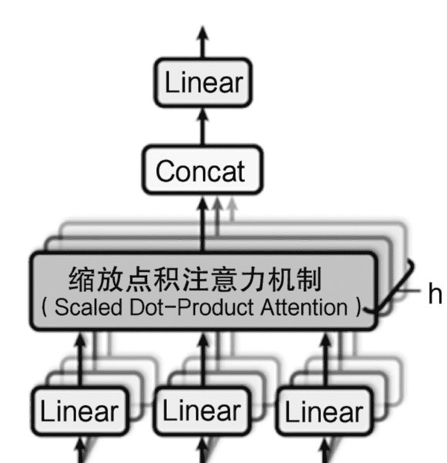
**图 1-2 多头注意力机制结构示意图**

(1) **单个注意力头的局限性**：如果只有一个注意力头，模型只能关注序列中某一特定方面的关系，可能忽略其他重要信息。

(2) **多头的优势**：多个注意力头可以在不同的子空间中独立学习，即使是对于同一个输入序列，不同的头也能捕捉到不同层次的特征。最终，这些特征会被整合到一起，形成更全面的表示。

例如，在处理一句话时，一个头可能关注语法关系，另一个头可能关注语义，第三个头可能关注全局上下文。通过多头机制，模型能够同时捕获多种不同层次的信息，提高对输入序列的理解能力。

##### 3. DeepSeek-V3 中自注意力机制和多头注意力机制的优化

在 DeepSeek-V3 中，自注意力机制和多头注意力机制得到了进一步优化，以提升性能和效率。其优化集中在以下方面。

(1) **多头潜在注意力机制**：DeepSeek-V3 引入了多头潜在注意力架构，通过低秩压缩的方法降低注意力计算过程中对内存的需求，显著提升了推理效率。

(2) **压缩后的 Key-Value 缓存**：在生成过程中，DeepSeek-V3 使用压缩技术减小了 Key（键）和 Value（值）缓存的大小，同时保持了计算性能，这对于处理长序列任务非常重要。

(3) **旋转位置嵌入**：通过改进的旋转位置嵌入（Rotary Position Embedding，简称 RoPE）技术，DeepSeek-V3 能够更好地建模长上下文之间的依赖关系，在长文本任务中的表现有大幅提升。

这些改进使 DeepSeek-V3 在保持高性能的同时，显著降低了内存占用和计算开销。

##### 4. 自注意力机制与多头注意力机制的意义

自注意力机制解决了传统循环神经网络（RNN）无法并行处理序列的缺陷，同时突破了其在长序列处理上的局限，而多头注意力机制进一步增强了模型的表达能力。这两者的结合构成了 Transformer 模型的核心，使其能够灵活应对多种自然语言处理任务。

DeepSeek-V3 通过在自注意力机制和多头注意力机制上的创新，进一步优化了注意力计算的效率和性能，不仅在语言生成任务中表现出色，还在代码生成、数学推理等复杂任务中展现了强大的泛化能力。

#### 1.1.3 残差连接与层归一化

##### 1. 残差连接的核心概念

残差连接是深度神经网络中的重要技术，用于缓解模型训练中常见的梯度消失问题，同时提升深层网络的训练效果和性能，其结构如图 1-3 所示。

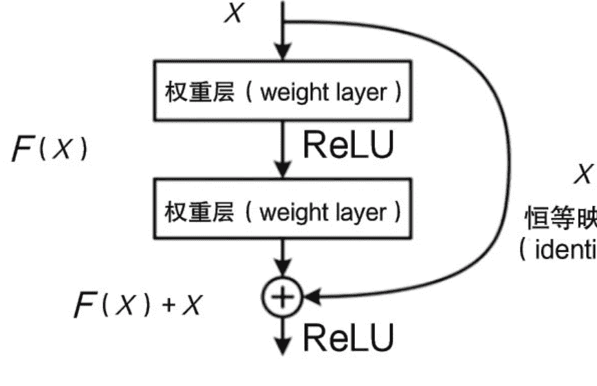
**图 1-3 残差连接模块**

在深层网络中，随着层数的增加，信息在层间传播时可能出现逐渐丢失的现象，导致模型难以优化。残差连接通过在每一层的输出中直接添加输入值，使模型学习的重点从原始输入转移到残差，即网络只需学习如何调整输入以获得更好的输出，从而降低了训练的难度。

这一机制的核心思想是“跳跃连接”，通过让信息在网络中直接流通，确保了梯度可以顺利传播到较浅的层，避免了信息的过度衰减。在 Transformer 模型中，每个子层都引入了残差连接，以保持稳定的模型训练效果并提升收敛速度。

##### 2. 层归一化的作用与实现

层归一化（Layer Normalization）是深度学习中常用的正则化技术，用于规范化每一层的输出，使其分布更加稳定，进而提升模型的训练效果。

其主要作用包括以下几个方面。

(1) **稳定训练过程**：调整每层输出的分布，使梯度在传播过程中保持稳定，避免出现训练震荡或不收敛的问题。

(2) **加速收敛**：采用标准化处理方式降低了因参数初始化或输入分布不均导致的模型训练困难，从而显著提高训练效率。

(3) **提升模型泛化能力**：层归一化可以有效降低模型对输入变化的敏感性，使其对于不同测试数据的表现更加稳健。

在实现上，层归一化与批量归一化不同，它仅对单个样本的特征进行归一化，不依赖于小批量数据的统计特性，因此在 Transformer 等序列模型中尤为适用。

##### 3. 残差连接与层归一化的结合

在 Transformer 模型中，每个子层都通过残差连接和层归一化进行结构化组合，以确保模型训练的稳定性和高效性。具体体现为以下两个方面。

(1) **残差连接的作用**：为每一层的输出添加输入的“跳跃连接”，形成一个短路通道，使模型更容易优化，同时避免信息的过度丢失。

(2) **层归一化的位置**：通常在每个子层的输出之后添加层归一化处理，以规范化处理输出分布，确保下一层能够接收到稳定的输入信号。

这种结合方式在提升模型表现的同时，显著减少了深度网络常见的优化问题，为 Transformer 模型的广泛应用奠定了基础。

##### 4. DeepSeek-V3 中的优化与创新

（此处原文缺失后续内容，仅保留至现有文本）

在 DeepSeek-V3 中，残差连接与层归一化的使用不仅继承了 Transformer 的基本设计，还在以下多个方面进行了优化。

###### (1) 增强的残差机制
通过引入动态残差比例调整策略，DeepSeek-V3 能够根据任务复杂度动态调整残差连接的权重，提高模型在不同任务中的适应性。

###### (2) 层归一化的加速优化
DeepSeek-V3 采用了稀疏矩阵计算方法，使层归一化能够在长序列任务中高效运行，同时降低了内存占用。

###### (3) 结合 MoE 架构
在混合专家（Mixture of Experts，MoE）模型中，残差连接和层归一化被优化为能够支持专家路由的形式，从而进一步提升了训练效率和推理性能。

# **5. 残差连接与层归一化的实际意义**

残差连接和层归一化的结合是 Transformer 成功的关键，它们在保持模型深度的同时，解决了深层网络中的梯度消失与训练不稳定问题。通过这些技术，Transformer 不仅实现了高效的序列建模，还为大规模预训练模型提供了强大的结构基础。

DeepSeek-V3 在这些基础技术上进行了深入优化，通过创新设计显著提升了模型的效率与适应能力，使其能够在多种复杂任务中展现卓越性能。无论是语言生成、代码补全，还是数学推理，这些优化都为模型的卓越性能提供了技术保障。

# **1.2 注意力机制的核心原理**

注意力机制是 Transformer 模型的核心技术，通过动态分配输入序列中不同元素的重要性，实现了对复杂序列关系的高效建模。

本节从点积注意力与加性注意力的比较出发，阐明其在计算效率与适用场景上的差异，并详细解析 Softmax 归一化在注意力分数中的作用，展示其如何将分布映射为权重。

最后，针对大规模模型和长序列任务的需求，探讨注意力矩阵的稀疏性及其优化技术，为理解深度学习中的计算加速策略奠定基础。通过对这些关键内容的剖析，读者可全面了解注意力机制在现代模型中的广泛应用与技术细节。

# **1.2.1 点积注意力与加性注意力的对比**

## # 1. 注意力机制的基本概念
注意力机制是深度学习中用于捕获序列内部不同位置之间相关性的关键技术，通过分配权重来突出重要信息，抑制不相关部分。

根据计算方式，注意力机制主要分为点积注意力和加性注意力，这两种方法本质上解决了同一个问题：如何高效地计算输入序列中元素之间的相互依赖关系。

## # 2. 点积注意力的原理与特点
点积注意力是目前最常用的注意力机制之一，其核心思想是通过向量间的点积运算计算相关性，点积结果直接用于生成注意力分数。具体来说，点积注意力利用查询（Query）向量和键（Key）向量的点积来衡量两者的相似性，然后对所有位置的点积分数进行归一化，得到每个元素的权重，最终将这些权重应用到值（Value）向量上，生成最终的输出。

点积注意力的特点包括以下几个方面：

1. **高效计算**：点积运算能够充分利用现代硬件的并行计算能力，在大规模序列建模中具有明显的速度优势。
2. **适合高维表示**：当输入的维度较高时，点积可以有效捕捉复杂的语义关系。
3. **对比度增强**：点积操作在一定程度上放大了高相关性的权重差异，使模型更容易关注到关键信息。

然而，点积注意力也存在不足之处，例如当输入向量的维度过大时，点积的数值可能过高，导致归一化操作失效，需要进一步调整计算策略。

# **3. 加性注意力的原理与特点**
加性注意力是一种较早提出的注意力机制，其计算过程基于加法操作，而非点积。具体而言，加性注意力将查询向量和键向量分别映射到同一特征空间后进行求和，再通过非线性变换生成注意力分数。这种方法更加直观，但计算复杂度相对较高。

加性注意力的特点包括以下几个方面：

1. **更稳定的计算**：由于加性注意力使用的是加法而非乘法操作，其数值更加稳定，适合处理低维输入或对计算精度要求较高的场景。
2. **适应性强**：加性注意力在小型模型和低资源环境中表现优异，特别是在早期的机器翻译任务中得到广泛应用。
3. **效率相对较低**：相比点积注意力，加性注意力的计算过程较为复杂，不适合处理大规模数据，难以满足现代大模型的计算需求。

# **4. DeepSeek-V3 中的选择与优化**
在 DeepSeek-V3 中，点积注意力被用作主要机制，其高效性和适配性完美契合大规模模型的需求。然而，为了进一步优化性能，DeepSeek-V3 对传统点积注意力进行了改进：

1. **多头点积注意力**：通过引入多头机制，DeepSeek-V3 能够在多个子空间中并行计算注意力关系，提升了对复杂序列信息的捕获能力。
2. **稀疏化计算**：针对长序列任务，DeepSeek-V3 采用稀疏点积注意力的方式，通过减少低相关性元素的计算量，有效降低了内存和时间消耗。
3. **旋转位置嵌入技术**：与点积注意力结合，使模型在处理长上下文依赖时的表现更加稳定，同时显著提升了推理速度。

# **5. 点积注意力与加性注意力的实际意义**
点积注意力和加性注意力各有优势，前者以高效性和扩展性为主，后者以计算稳定性和适应性见长。在现代大模型中，点积注意力由于其卓越的计算效率和与并行硬件的兼容性，成为主流选择。

通过在点积注意力上进行深度优化，DeepSeek-V3 不仅展现了极强的计算性能，还在长序列处理和复杂任务中表现出卓越的能力。加性注意力虽然在深度学习早期发挥了重要作用，但其在当前大规模模型中的应用逐渐减少。通过对两者进行对比，本节内容为读者理解注意力机制在不同任务中的应用提供了全面视角。

# ### **1.2.2 Softmax 归一化原理**

## # #### 1. Softmax 归一化的核心概念
Softmax 归一化是注意力机制中的关键步骤，用于将注意力分数转换为概率分布，从而分配输入序列中每个元素的权重。其主要目的是将输入的分数进行标准化处理，使它们的总和为 1，同时突出分数较大的元素，弱化分数较小的元素。这种特性使得模型能够更加专注于重要信息，同时保留全局上下文。

在计算中，Softmax 操作通过一个归一化过程确保所有注意力权重均为非负数且总和为 1，这为模型的学习提供了良好的数值稳定性，并且可以直观解释权重的分布。

## # #### 2. Softmax 归一化在注意力机制中的应用
Softmax 归一化在注意力机制中的主要作用是对每个位置的相关性进行比例分配。具体来说，当计算输入序列中每个元素与目标元素的相关性时，会产生一组未归一化的分数，这些分数可能包含正值、负值或零，数值范围也可能差异较大。

1. **归一化处理**：通过 Softmax 操作，所有分数被映射到 0 到 1 的区间，同时总和为 1，这样可以清晰地表示每个元素的重要性。
2. **概率分布特性**：经过 Softmax 处理后，较大的分数会被显著放大，而较小的分数会被压缩甚至忽略，这种“强化强相关，弱化弱相关”的特性使得注意力机制能够聚焦于重要信息。

例如，在语言生成任务中，Softmax 归一化可以帮助模型在生成下一个单词时，优先参考那些与当前上下文密切相关的单词。

# **3. DeepSeek-V3 中的优化设计**
在 DeepSeek-V3 中，Softmax 归一化的计算针对性能和精度进行了优化，以满足大规模模型和长序列任务的需求：

1. **数值稳定性提升**：对于长序列任务，Softmax 操作可能因数值范围过大导致溢出或计算不稳定。DeepSeek-V3 通过引入偏移值的方式，将输入分数减去最大值，从而显著增强了数值稳定性。
2. **稀疏 Softmax**：为了优化计算效率，DeepSeek-V3 在长序列任务中采用了稀疏 Softmax，仅对高相关性的分数进行归一化处理，减少了低相关性元素的计算量，节省了内存与时间。
3. **软门控机制**：结合 Softmax 归一化与动态门控技术，DeepSeek-V3 能够动态调整注意力权重分布，使模型在处理多样化任务时更具灵活性。

# **4. Softmax 归一化的优势与局限性**
Softmax 归一化在注意力机制中的应用展现了显著的优势：

1. **直观性强**：生成的权重分布可以清晰地解释序列中每个元素的重要程度。
2. **训练稳定**：归一化后的输出范围有限，有助于模型在训练过程中保持梯度的稳定性。
3. **高效性**：Softmax 计算简单，能够快速适配大规模并行处理。

然而，其也存在一定的局限性：

1. **对较大的输入依赖明显**：Softmax 倾向于将权重集中于几个较大的分数，处理长序列任务时可能会导致信息丢失。
2. **对低相关性数据的区分能力较弱**：当输入序列中的各个元素之间缺乏明显的区分度（即它们的相关性较低或相似度较高）时，Softmax 可能无法有效区分。

# **5. Softmax 归一化在 DeepSeek-V3 中的实际意义**
Softmax 归一化是 DeepSeek-V3 高效处理长序列任务的核心技术之一，通过优化其计算过程，DeepSeek-V3 显著提升了注意力机制的效率与稳定性。这种归一化技术不仅增强了模型对复杂关系的捕捉能力，还为大规模语言生成、代码补全及数学推理等多种任务提供了可靠的技术支撑。在现代深度学习模型中，Softmax 归一化的广泛应用充分证明了其重要性，而 DeepSeek-V3 的改进则使这一技术得到了进一步发展。

# ## **1.2.3 注意力矩阵的稀疏性与加速优化**

# ### **1. 注意力矩阵的稀疏性概念**
注意力矩阵是自注意力机制的核心，它通过计算序列中每个元素与其他元素的相关性，生成一个二维矩阵，表示所有可能的依赖关系。然而，在实际任务中，序列中大多数元素之间的相关性较低或接近零，这种低相关性的现象被称为“稀疏性”。

稀疏性是注意力机制的一种常见特性，它意味着在大量的计算中，只有少数元素的注意力分数具有显著意义。因此，在处理长序列任务时，直接计算完整的注意力矩阵不仅浪费计算资源，还会消耗大量内存，难以适应大规模模型的高效运行需求。

# ### **2. 注意力矩阵稀疏化的优势**
稀疏化技术可以大幅降低注意力矩阵中无意义计算的比例，提升计算效率，同时降低对硬件资源的需求：

1. **降低计算复杂度**：标准注意力机制的计算复杂度为输入序列长度的平方，而稀疏化技术可以将复杂度降低至线性水平。
2. **节省内存使用**：稀疏化矩阵只存储非零元素及其索引，控制了完整矩阵的存储需求，显著降低内存占用。
3. **优化硬件性能**：通过减少无关计算，稀疏化技术可以更好地适配现代硬件，提升实际运行效率。

# ### **3. 稀疏注意力机制的实现方式**
在实践中，实现稀疏注意力机制的方法多种多样，以下为几种常见方式：

1. **局部窗口注意力**：仅计算序列中相邻元素之间的相关性，适用于对局部依赖关系敏感的任务。
2. **全局与局部混合注意力**：在全局计算的基础上，仅针对关键位置的局部信息进行稀疏化处理，既保留全局依赖，又降低计算成本。
3. **分块稀疏化**：将序列划分为若干块，仅计算块内元素的相关性，同时通过特殊设计计算块间的关键依赖。

这些方法不仅显著提升了注意力机制的效率，还在实际应用中展现了卓越的适应能力。

# ## **4. DeepSeek-V3 中的稀疏化优化**
DeepSeek-V3 针对注意力矩阵的稀疏化进行了多方面的优化，以满足大规模任务和长序列任务的需求：

1. **动态稀疏模式**：DeepSeek-V3 能够根据输入序列的特征动态调整稀疏化策略，使模型在不同任务中实现最优的性能与资源使用率。
2. **稀疏矩阵存储技术**：采用高效的数据结构存储注意力矩阵的非零元素，进一步降低了内存占用，同时提高了计算速度。
3. **多头稀疏注意力机制**：结合多头注意力，DeepSeek-V3 能够在不同子空间中以不同的稀疏化方式捕捉序列关系，增强了模型的表达能力。
4. **加速硬件适配**：通过优化矩阵稀疏化的计算流程，DeepSeek-V3 在 GPU 和 TPU 等硬件平台上实现了更高的并行计算效率。

# ## **5. 稀疏化优化的实际意义**
稀疏化技术的引入有效解决了传统注意力机制在处理长序列时的计算瓶颈，使得大规模模型能够更加高效地处理复杂任务。通过减少无意义的计算，稀疏化不仅降低了硬件资源的需求，还提升了模型的推理速度与训练效率。

DeepSeek-V3 的稀疏化优化策略使其在大模型领域处于技术领先地位，不仅在文本生成任务中表现卓越，还在代码生成、数学推理等任务中展现出广泛的适用性。稀疏化技术的创新应用，为现代大模型的高效运行提供了强有力的技术支持。

# ## **1.3 Transformer 的扩展与优化**
Transformer 模型的核心机制虽然强大，但在实际应用中面临计算复杂度高三长序列处理能力不足等挑战。为了解决这些问题，研究者们提出了多种扩展与优化策略。

本节深入探讨动态注意力的实现原理及其在不同场景中的适用性，分析长序列任务中长距离注意力（Long-Range Attention）机制与稀疏注意力 (Sparse Attention) 机制的性能提升，同时介绍多样化位置编码方法在模型理解长短期依赖关系中的重要作用。这些优化为大模型的高效训练和推理提供了有力支持，并在 DeepSeek-V3 中得到了充分应用。

# ### **1.3.1 动态注意力的实现**

## **# 1. 动态注意力的概念与背景**
动态注意力是对传统注意力机制的一种扩展，旨在根据输入数据的特征动态调整注意力计算的模式。传统的固定注意力机制通常对所有输入序列采用统一的计算方式，这种方式虽然简单，但在处理不同类型任务或变长序列时可能会面临效率低下或捕捉不到关键特征的问题。

动态注意力的核心思想是引入灵活的权重分配机制，使模型能够根据任务需求或输入特性调整注意力范围与强度，从而实现更高的计算效率和更强的适应能力。

## **# 2. 动态注意力的实现方式**
在实践中，动态注意力的实现通常包括以下关键步骤：

1. **输入特征分析**：动态注意力的首要任务是分析输入序列的特征，例如序列的长度、元素之间的相似性或上下文的重要性。这些特征决定了注意力的计算范围和重点。
2. **注意力范围调整**：根据输入特征，动态注意力机制会选择性地扩大或缩小注意力范围。例如，对于长序列任务，可能只计算局部范围内的重要相关性，而对于短序列任务则可以进行全局相关性计算。
3. **权重动态分配**：动态注意力会为不同的序列位置分配不同的权重，这种分配方式不是固定的，而是根据输入数据动态生成。例如，在文本生成任务中，动态注意力可以为与当前生成位置高度相关的输入分配更高的权重，同时降低无关信息的权重。

# **# 3. DeepSeek-V3 中的动态注意力优化**
DeepSeek-V3 充分利用了动态注意力机制，并在以下几个方面进行了优化：

1. **多头动态注意力**：在传统多头注意力的基础上，DeepSeek-V3 引入了动态头部分配策略，每个注意力头根据任务需求动态决定其关注的特定特征。这种方法能够在不同子空间中捕捉到更加细粒度的序列关系，从而提升模型的表达能力。
2. **动态注意力稀疏化**：为了应对长序列任务，DeepSeek-V3 采用了动态稀疏注意力机制，仅对与当前任务高度相关的序列部分计算注意力分数，这显著降低了计算复杂度，同时保持了模型性能。
3. **自适应门控机制**：DeepSeek-V3 在动态注意力中引入了门控机制，根据任务需求动态开启或关闭某些注意力路径，从而进一步优化计算效率和资源使用率。

# **# 4. 动态注意力的优势与应用场景**
相较于传统注意力机制，动态注意力具备以下优势：

2. **效率提升**：稀疏化计算和范围调整显著降低了长序列任务的计算复杂度。
3. **精度增强**：动态分配权重能够更准确地捕捉关键特征，提高模型的输出质量。

这些优势使动态注意力在诸多任务中展现出广泛适用性，例如文本生成、机器翻译、代码补全，以及数学推理等复杂任务。

# 5. **动态注意力在 DeepSeek-V3 中的实际意义**
通过引入动态注意力，DeepSeek-V3 在高效处理长序列任务方面表现卓越，同时在多样化任务中展现了极强的适应能力。这一机制的创新应用，使模型能够以更低的计算成本实现更高的性能，为大规模模型的进一步发展提供了重要的技术支撑。动态注意力的成功应用，充分体现了 DeepSeek-V3 在注意力机制优化上的技术领先性和前瞻性。

##### 1.3.2 长距离注意力机制与稀疏注意力机制

# **1. 长距离注意力机制的概念与需求**
长距离注意力 (Long-Range Attention) 机制专注于捕捉输入序列中长距离位置之间的关系，突破了传统注意力机制在处理长序列时的局限。通常，标准注意力机制在处理长序列时，由于其计算复杂度与序列长度的平方成正比，会导致资源消耗迅速增加。长距离注意力机制通过优化注意力范围和计算方式，能够在不牺牲性能的前提下处理长序列任务。

在语言生成、代码补全等任务中，长距离的依赖关系至关重要，例如，理解一段文字的整体语义可能需要参考前面多个句子的内容。长距离注意力机制通过重点关注关键位置，确保模型能够有效建模全局依赖关系。

# **2. 稀疏注意力机制的概念与实现**
稀疏注意力 (Sparse Attention) 机制是一种优化注意力计算的方法，旨在减少注意力矩阵中的冗余计算。标准注意力机制计算所有序列位置之间的关系，而稀疏注意力机制则通过稀疏化矩阵，仅计算具有较高相关性的部分，从而显著降低计算复杂度和内存需求。

稀疏注意力机制的实现方式通常包括以下步骤：

1. **稀疏矩阵构造**：分析输入序列中元素的相关性，仅保留高相关性位置的计算路径。
2. **计算优化**：跳过低相关性位置的注意力分数计算，将计算集中在关键部分。
3. **矩阵存储优化**：采用稀疏存储格式，仅记录非零元素及其索引，进一步降低内存开销。

这种方法不仅提升了效率，还在长序列任务中展现了出色的适应能力。

# ## **# 3. DeepSeek-V3 对长注意力机制的优化**
DeepSeek-V3 在长注意力机制方面进行了多项改进，以增强其在长序列任务中的表现：

1. **分块全局注意力**：将长序列分为若干块，对每个块内部进行详细建模，同时通过全局机制捕捉块之间的关键依赖。
2. **动态范围调整**：根据输入序列的特性，动态调整关注的范围，从而提高对长序列中关键信息的捕捉能力。
3. **高效编码结构**：结合旋转位置嵌入技术，使模型能够更自然地处理长距离关系。

这些优化确保了 DeepSeek-V3 在处理复杂长序列任务时的稳定性和高效性。

# ## **# 4. DeepSeek-V3 对稀疏注意力机制的优化**
在稀疏注意力机制的应用上，DeepSeek-V3 引入了多种技术来进一步提升效率和性能：

1. **稀疏头分配**：动态分配注意力头，仅对序列中特定的关键部分进行稀疏化计算，既保持了模型的表达能力，又降低了计算成本。
2. **分层稀疏化策略**：在不同的层中采用不同的稀疏化模式，例如在浅层关注局部关系，在深层捕捉全局关系。
3. **GPU 友好优化**：改进稀疏矩阵存储格式，使稀疏注意力机制在 GPU 上的并行效率得到显著提升。

这些技术使得 DeepSeek-V3 在长序列任务中的计算效率大幅提高，同时在实际应用中展现了更强的扩展性。

# **# 5. 长距离注意力机制与稀疏注意力机制的实际意义**
长距离注意力机制和稀疏注意力机制的结合，为现代大模型提供了高效处理长序列任务的能力。长距离注意力机制解决了传统注意力机制在全局依赖建模上的不足，而稀疏注意力机制通过稀疏化优化，显著降低了计算复杂度和资源消耗。

图 1-4 展示的高效长距离注意力网络（Efficient Long-range Attention Network，ELAN）通过整合长距离注意力技术和多模块优化技术，实现了对全局和局部特征的高效捕捉。ELAB 模块利用移位卷积和多尺度自注意力策略，先提取局部特征，再通过分组多尺度自注意力捕捉长距离依赖关系。

# 图 1-4 高效长距离注意力网络（ELAN）

在 DeepSeek-V3 中，这两种技术的结合不仅提升了模型的性能，还显著扩展了其在长文本生成、代码补全和数学推理等任务中的适用性。通过技术上的持续创新，DeepSeek-V3 在长序列任务中展现了卓越的处理能力，为构建高效的大规模模型提供了强有力的技术支持。

##### 1.3.3 多样化位置编码

###### 1. 位置编码的概念与重要性

位置编码是 Transformer 模型中用于捕捉输入序列中位置关系的重要技术。由于 Transformer 模型不具备传统循环神经网络的序列性特征，它需要通过额外的位置信息来理解输入元素的顺序。位置编码为每个输入元素添加了位置信息，确保模型在处理序列时能够正确捕捉其上下文依赖关系。

常见的位置编码方式有两种：固定位置编码和可学习位置编码。固定位置编码基于预定义的数学公式生成，而可学习位置编码则是由模型在训练中自动调整。

###### 2. 固定位置编码的原理与特点

固定位置编码采用一种预定义的数学方式生成一组位置嵌入向量，直接与输入序列的元素相加。这种方法通常使用正弦和余弦函数，以确保不同位置的编码具有独特性，同时易于模型学习。

固定位置编码的特点包括以下几个方面。

（1）简单高效：无须额外训练，直接生成位置嵌入，适合初始模型的快速开发。

（2）全局性强：借助正弦和余弦函数的周期性，模型能够捕捉长距离的位置信息。

（3）局限性：对复杂任务或变长序列的适应性较差，可能无法捕捉到更加细粒度的位置信息。

###### 3. 可学习位置编码的原理与特点

可学习位置编码是一种更加灵活的编码方式，通过在模型训练过程中动态调整位置嵌入向量，使其与具体任务和数据分布更好地匹配。每个位置的编码向量由模型根据任务需求自动优化，而不是依赖固定的数学公式。

可学习位置编码的特点包括以下几个方面。

（1）适应性强：能够根据不同的任务和数据动态地调整位置表示。

（2）性能提升显著：特别是在复杂任务中，相较于固定位置编码，可学习位置编码通常能够提供更好的结果。

（3）训练成本高：需要在训练过程中学习额外的参数，对计算资源的需求较大。

###### 4. DeepSeek-V3 中的多样化位置编码优化

DeepSeek-V3 在传统位置编码的基础上，结合固定位置编码和可学习位置编码的优点，引入了多样化位置编码技术，确保模型在复杂任务中表现出更强的灵活性和性能。

（1）旋转位置嵌入：旋转位置嵌入通过对输入向量进行几何变换，提供了一种高效的位置信息表达方式，能够同时捕捉局部和全局位置关系。这种方法计算量低，适合处理长序列任务。

（2）动态位置编码：DeepSeek-V3 根据输入序列的长度和任务需求动态调整位置编码的方式，使其在不同任务中始终处于最优状态。例如，在长文本生成中，动态位置编码可以强调全局信息，而在短序列任务中则偏重局部信息。

（3）位置编码与稀疏注意力结合：为提升稀疏注意力机制的效率，DeepSeek-V3 在位置编码中引入了层级化设计，通过对不同层次的位置信息进行分级处理，进一步优化模型对长距离依赖关系的捕捉。

###### 5. 多样化位置编码的优势与实际应用

多样化位置编码的引入，使 DeepSeek-V3 在以下方面展现出显著优势。

（1）灵活性：能够适配多种任务和序列长度，使模型的通用性显著提升。

（2）效率提升：结合动态和旋转位置编码，显著降低了长序列任务中的计算开销。

（3）增强长短期依赖建模能力：通过多层次的位置信息表示，模型能够更加精准地捕捉输入序列的语义关系。

在实际应用中，DeepSeek-V3 的多样化位置编码技术广泛应用于文本生成、对话系统、代码补全及数学推理等任务，凭借强大的适应性和显著的性能提升成为现代大模型的关键技术之一。

#### 1.4 上下文窗口

上下文窗口是 Transformer 模型理解序列全局信息的关键组件，其长度直接决定了模型能够处理的序列范围和复杂性。随着任务复杂度的提升和序列长度的增加，扩展上下文窗口长度成为大模型优化的核心方向。

本节首先探讨上下文窗口扩展的技术原理，分析其对模型性能和任务适应性的影响；其次讨论在上下文扩展过程中如何平衡内存与计算复杂度之间的关系；最后展示 DeepSeek-V3 在上下文窗口扩展方面的创新优化，为复杂任务中的高效序列建模提供技术支撑。

##### 1.4.1 上下文窗口扩展

###### 1. 上下文窗口的概念与作用

上下文窗口是指模型在处理输入序列时所能直接关注的范围，窗口的长度决定了模型能捕捉的上下文信息的数量。在许多任务中，尤其是在语言生成、对话系统和代码补全等任务中，较长的上下文窗口可以帮助模型更全面地理解输入内容，从而生成更加连贯且符合语义的输出。

传统 Transformer 模型的上下文窗口长度通常受到内存和计算能力的限制，固定窗口长度可能无法满足长序列任务的需求。例如，在处理长文档生成任务时，过短的窗口长度可能导致模型无法捕捉到全局信息，从而影响输出结果质量。因此，扩展上下文窗口成为模型优化的关键方向。

###### 2. 上下文窗口扩展所面临的技术挑战

上下文窗口的扩展需要解决以下几个技术挑战。

（1）计算复杂度的增加：Transformer 的注意力机制计算复杂度与窗口长度的平方成正比，窗口扩展会显著增加计算量，可能导致硬件资源不足或训练时间过长。

（2）内存消耗的限制：随着窗口长度的增加，注意力矩阵的存储需求成倍增长，大规模模型可能无法在现有硬件上高效运行。

（3）序列长短的不均衡：在某些任务中，输入序列的长度可能大幅波动，固定长度的上下文窗口无法灵活适配不同场景，从而影响模型效率。

###### 3. 上下文窗口扩展的实现方式

上下文窗口扩展的实现依赖多种优化策略，以下是几种常见方法。

（1）滑动窗口机制：将长序列划分为多个重叠的小窗口，逐个处理每个窗口并结合前后上下文进行信息整合。这种方式能够在避免大幅增加计算复杂度的情况下，提升模型的长序列适应能力。

（2）层级化注意力机制：在不同层次中设置不同的上下文窗口长度，例如浅层处理局部上下文，深层关注全局信息，从而实现对长短依赖关系的综合建模。

（3）基于稀疏注意力的优化：利用稀疏注意力机制，仅对窗口内的高相关性部分进行计算，避免不必要的全局计算，有效降低扩展窗口带来的内存和计算成本。

###### 4. DeepSeek-V3 中的上下文窗口扩展

DeepSeek-V3 在上下文窗口扩展方面进行了多项创新优化。

（1）动态窗口调整：DeepSeek-V3 能够根据任务需求动态调整窗口长度，例如在对话生成中使用较短窗口聚焦当前轮次语境，而在长文档生成中扩展窗口以捕捉全局语义。

（2）旋转位置嵌入技术：通过旋转位置嵌入技术，DeepSeek-V3 在扩展上下文窗口的同时，保证了位置信息的准确性和计算效率，解决了长序列建模中的全局依赖问题。

（3）分块全局上下文融合：将长序列分为多个块，每个块内进行局部建模，同时通过全局注意力机制捕捉块之间的联系，从而兼顾局部和全局信息。

###### 5. 上下文窗口扩展的实际意义

上下文窗口的扩展显著提升了模型在长序列任务中的适应能力，使得 DeepSeek-V3 在文本生成、长对话理解以及代码生成等场景中表现出色。同时，创新技术解决了窗口扩展带来的计算和内存问题，为大模型的高效运行奠定了技术基础。上下文窗口扩展不仅是模型性能提升的重要手段，也是未来大模型优化的核心方向之一。

##### 1.4.2 内存与计算复杂度的平衡

###### 1. 内存与计算复杂度的关系

在 Transformer 模型中，内存使用和计算复杂度是相互关联的两个关键因素。在处理输入序列时，模型的注意力机制需要计算序列中所有元素之间的相关性，其计算复杂度与序列长度的平方成正比，同时，存储注意力矩阵的需求也随之增长。这导致在处理长序列时，大模型对内存和计算资源的需求呈指数级增长，成为其进一步优化的主要瓶颈。

内存与计算复杂度的平衡是指在提升模型性能的同时，尽量减少资源的消耗。这需要对模型架构和注意力机制进行创新设计，以减少计算量和降低内存占用。

###### 2. 传统注意力机制的局限性

Transformer 的标准注意力机制在计算复杂度和内存需求上存在显著不足。

（1）计算复杂度高：对于输入序列长度为 $n$ 的任务，注意力机制的计算复杂度为 $n^2$，这使得长序列任务的计算时间迅速增加。

（2）内存需求大：注意力矩阵的存储需求与序列长度的平方成正比，长序列任务容易超过现有硬件的内存限制。

这些问题导致标准注意力机制难以直接应用于大规模长序列任务，需要设计更高效的优化策略。

###### 3. 内存与计算复杂度平衡的实现方式

为解决内存和计算复杂度的问题，研究者们提出了多种优化策略，以下是几种常用的方法。

（1）稀疏注意力机制：稀疏注意力机制通过只计算高相关性位置的注意力分数，减少了低相关性位置的计算量，从而显著降低计算复杂度和内存需求。例如，仅对局部窗口内的元素计算注意力，或在全局范围内选择关键位置进行建模。

（2）低秩近似：对注意力矩阵进行低秩分解，将高维矩阵表示为几个低维矩阵的乘积，从而大幅减少存储需求和计算量。这种方法适合在长序列任务中应用。

（3）流式处理：将长序列分段处理，每次只将当前段的注意力矩阵加载到内存中，避免长序列任务中一次性计算全部注意力矩阵的高内存消耗。

（4）混合精度训练：使用较低的精度（如 BF16 或 FP8）存储注意力矩阵，在保证计算准确性的同时显著降低内存占用。

###### 4. DeepSeek-V3 的优化策略

DeepSeek-V3 在平衡内存与计算复杂度方面做出了多项创新优化。

（1）稀疏注意力与动态窗口结合：在稀疏注意力的基础上，DeepSeek-V3 引入了动态窗口机制，根据任务需求动态调整计算范围，从而在降低计算量的同时保证了模型性能。

（2）旋转位置嵌入技术：通过高效编码位置信息，DeepSeek-V3 减少了对全局位置计算的依赖，在降低计算复杂度的同时提高了序列建模的效果。

（3）分层处理策略：将序列分层建模，在浅层使用局部注意力建模局部关系，在深层采用全局注意力捕捉长距离依赖，从而平衡了计算效率与内存使用。

（4）低精度计算与稀疏存储：使用 FP8 精度进行训练和推理，同时采用稀疏矩阵存储技术，有效降低了长序列任务的内存消耗。

###### 5. 内存与计算复杂度平衡的实际意义

内存和计算复杂度的平衡是大模型优化的关键方向之一。通过创新设计，DeepSeek-V3 在处理长序列任务时显著降低了资源消耗，同时保持了模型的高性能。这种优化不仅使 DeepSeek-V3 适用于文本生成、代码补全等复杂任务，还为其部署在资源有限的场景中提供了可能性，展现了现代大模型设计的技术优势和实践价值。

##### 1.4.3 DeepSeek-V3 在上下文窗口方面的优化

###### 1. 上下文窗口在模型中的作用

上下文窗口决定了模型处理输入序列时可以关注的内容范围，是大规模模型理解全局信息和捕捉序列依赖的关键技术之一。较短的窗口长度会限制模型捕捉长距离依赖的能力，而盲目扩展窗口又可能导致计算复杂度和内存消耗激增。因此，优化上下文窗口在长度、效率和性能之间的平衡，是模型设计中的重要环节。

DeepSeek-V3 作为先进的开源大模型，通过多项创新技术显著提升了上下文窗口的适应性和性能，能够高效处理长序列任务，同时保持较低的计算和内存开销。

###### 2. 动态调整上下文窗口长度

DeepSeek-V3 引入了动态上下文窗口调整机制，根据任务需求和输入序列特性灵活改变窗口长度，以在不同任务中保持最佳表现。

（1）短序列优化：在短序列任务（如对话生成）中，DeepSeek-V3 通过缩短窗口长度，集中关注局部上下文信息，从而提升生成速度并降低计算资源消耗。

（2）长序列支持：对于长文档生成等任务，DeepSeek-V3 能够扩展上下文窗口，以捕捉全局信息和长距离依赖关系，确保生成内容的连贯性和一致性。

（3）任务适配性：动态窗口调整能够根据不同任务的特点自动优化窗口长度，从而实现灵活性与高效性的统一。

###### 3. 旋转位置嵌入技术的应用

在上下文窗口优化中，位置编码是处理长序列的重要技术。DeepSeek-V3 通过引入旋转位置嵌入技术，大幅提升了长序列任务中的上下文建模能力。

（1）位置编码效率提升：旋转位置嵌入技术无须存储完整的位置信息，而是通过高效的数学变换实时生嵌入值，显著减少了内存消耗。

（2）长距离依赖的增强：这种技术能够更自然地捕捉长距离依赖关系，即使在窗口长度大幅增加的情况下，也能保持序列信息的完整性和准确性。

###### 4. 稀疏化与分块全局建模

为进一步缓解长序列任务中窗口扩展带来的计算压力，DeepSeek-V3 结合稀疏注意力机制和分块全局建模技术，实现了性能与效率的平衡。

（1）稀疏注意力的结合：在扩展上下文窗口的过程中，DeepSeek-V3 仅对具有高相关性的序列部分计算注意力分数，显著减少了低相关性元素的计算量，从而降低了内存和计算需求。

（2）分块全局建模：将输入序列划分为多个块，每个块内部采用局部注意力建模，同时在全局范围内捕捉块之间的关键依赖关系。这种方法兼顾了局部信息的精确捕捉和全局依赖的高效建模。

###### 5. 多任务场景的适用性

上下文窗口的优化不仅提升了 DeepSeek-V3 在长文本生成、代码补全和复杂对话任务中的表现，还扩展了其在多样化任务场景中的适用性。

例如：在长文档生成任务中，扩展的上下文窗口确保了生成内容的语义连贯和全局一致；在代码生成任务中，优化后的窗口长度使模型能够捕捉跨函数或模块的逻辑关系；在数学推理任务中，动态调整窗口长度有助于模型更好地处理复杂公式和多步骤推理问题。

###### 6. 优化的实际意义

DeepSeek-V3 在上下文窗口方面的优化，不仅突破了传统 Transformer 模型在长序列任务中的性能瓶颈，还通过动态调整、旋转位置嵌入和稀疏化技术，实现了计算效率与任务性能的兼得。这些创新技术使 DeepSeek-V3 能够在资源有限的环境中高效运行，同时在大规模复杂任务中展现出卓越的适应性，为现代大模型的开发与应用提供了重要参考。

#### 1.5 训练成本与计算效率的平衡

随着 Transformer 模型的广泛应用，参数量和计算需求的持续增长成为模型开发和训练中的核心挑战。如何在追求更高性能的同时，控制计算资源和训练成本，是现阶段大模型优化的主要方向。

本节分析参数量增长对计算需求的影响，并探讨 GPU 计算架构在 Transformer 模型中的优化作用。同时，本节通过展示 DeepSeek-V3 在算法设计、硬件适配和资源利用率方面的创新，揭示其在降低训练成本、提升计算效率方面的技术优势，为大模型的可持续发展提供参考。

##### 1.5.1 参数量与计算需求的增长趋势

###### 1. 参数量增长的背景与意义

在深度学习技术的发展过程中，参数量的持续增长是推动模型性能提升的重要因素。参数量是指模型中所有权重和偏置的总数，直接决定了模型的表达能力和泛化能力。

-   **提升模型性能**：较大的参数量使模型能够捕捉更丰富的特征，对复杂任务的处理能力显著增强。
-   **(2) 适应多样化任务**：随着参数量的增长，模型能够更好地适应不同的任务场景，实现多任务学习和跨领域应用。
-   **(3) 支持大规模预训练**：参数量的扩展为在海量数据的基础上对模型进行预训练提供了技术基础，提升了模型的通用性和迁移能力。

然而，参数量的快速增长也制造了显著的计算需求，增加了训练成本和资源负担。

###### 2. 计算需求增长的原因

计算需求的增长与参数量直接相关，同时受到以下几个因素的影响。

（1）注意力机制的复杂度：Transformer 模型的注意力机制需要对输入序列中的所有元素两两之间进行计算，其计算复杂度与序列长度的平方成正比。随着参数量和序列长度的增长，计算需求将急剧上升。

（2）数据量的扩展：为匹配更大的参数量，训练数据规模也需相应增加。这进一步增加了计算量，因为每一轮训练需要处理的数据量显著增加。

（3）更高的训练精度要求：为保证大模型的训练稳定性和性能，通常需要使用更高精度的训练方法，例如混合精度或低精度优化策略，这也增加了额外的计算成本。

###### 3. 参数量增长对硬件的挑战

随着参数量的增长，计算需求对硬件提出了更高的要求。

（1）显存容量：大模型的权重存储和梯度计算需要占用大量显存，而现有硬件的显存容量可能不足以支持极大参数量的模型训练。

（2）计算速度：参数量增长直接增加了每次前向传播和反向传播的计算时间，可能导致训练速度变慢，模型开发周期延长。

（3）能耗与资源效率：大规模训练需要消耗大量电能和硬件资源，对硬件设施提出了更高的效率要求，同时也增加了训练成本。市面上常见的大模型的参数量、计算需求和训练成本的汇总如表 1-1 所示。

表 1-1 中的数据符合本书编写时期（截至 2025 年 2 月中旬）的情况，随着技术进步，相关数据可能会有所变化，请读者结合实际情况参考。

**表 1-1** 常见大模型的参数量、计算需求和训练成本[^注]

| 模型名称 | 参数量/亿 | 计算需求/FLOP | 训练成本/美元 |
| :--- | :--- | :--- | :--- |
| GPT-3 | 1750 | 3.14×10^23 | 约 1200 万 |
| GPT-4 | 1800 | 约 2.5×10^24 | 数亿 |
| GPT-4 Turbo | 约 1800 | 类似 GPT-4 | 略低于 GPT-4 |
| Mistral 7B | 70 | 未公开 | 未公开 |
| LLaMA 1 | 340 | 未公开 | 未公开 |
| DeepSeek-V3 | 6710 | 未公开 | 约 557.6 万 |
| Bloom | 1760 | 约 3.6×10^23 | 约 700 万 |
| PaLM | 5400 | 约 9×10^23 | 数千万至上亿 |
| Gopher | 2800 | 约 5×10^23 | 数千万 |
| Megatron-Turing NLG | 5300 | 约 1×10^23 | 数千万至上亿 |
| WuDao 2.0 | 1750 | 约 3.6×10^23 | 约 3000 万 |
| OPT-175B | 175 | 约 3×10^22 | 约 1500 万 |
| Jurassic-1 | 1780 | 约 3.2×10^23 | 约 1000 万 |
| Chinchilla | 700 | 未公开 | 未公开 |
| Ernie 3.0 | 1000 | 未公开 | 未公开 |

###### 4. DeepSeek-V3 的优化应对

DeepSeek-V3 针对参数量和计算需求增长的趋势，采用了一系列优化策略，以降低资源占用和训练成本。

- （1）混合专家（MoE）架构：通过引入 MoE 架构，DeepSeek-V3 在每次前向计算中只激活部分专家网络，从而显著降低了实际计算需求，同时保留了高参数量模型的表达能力。
- （2）FP8 混合精度训练：使用 FP8 精度进行计算，有效减少了显存占用和计算量，同时保持了训练的数值稳定性和高性能表现。
- （3）分布式训练：DeepSeek-V3 采用了高效的分布式训练策略，将模型和数据分布到多个计算节点上，充分利用硬件资源并加速训练过程。

###### 5. 参数量增长趋势的实际意义

尽管参数量和计算需求的增长给大模型的研发带来了显著的挑战，但其推动了模型性能和应用场景的快速扩展。通过创新设计和技术优化，DeepSeek-V3 在面对增长趋势时展现出了极高的适应性和效率，在支持大规模任务的同时有效降低了计算成本。随着技术的进一步发展，参数量增长与计算需求的平衡在未来一段时间内仍是大模型优化的重要方向。

##### 1.5.2 GPU 计算架构在 Transformer 中的应用

###### 1. GPU 计算架构的基础与优势

GPU，即图形处理单元，是为大规模并行计算的硬件架构，最初用于图形渲染，如今广泛应用于深度学习任务中。在 Transformer 模型中，GPU 的并行计算能力能够显著加速矩阵运算和注意力机制的计算过程，使大模型训练和推理变得更加高效。

GPU 的主要优势包括以下几个方面。

**（1）强大的并行计算能力：**GPU 具有数千个计算核心，能够同时处理多个运算任务，特别适合 Transformer 中的矩阵计算。

**（2）高效的内存访问：**GPU 通过优化的内存带宽设计，可以快速读取和写入大规模数据，满足注意力机制和梯度计算的高带宽需求。

**（3）适配深度学习框架：**主流深度学习框架（如 PyTorch 和 TensorFlow) 均对 GPU 进行了深度优化，提供高效的 API 以简化计算部署。

###### 2. Transformer 中 GPU 的核心应用

在 Transformer 模型中，GPU 的主要作用体现在以下几个方面。

**（1）矩阵运算的加速：**Transformer 的核心计算包括线性变换、自注意力机制及前馈网络的矩阵乘法。GPU 通过并行化矩阵操作，可以在短时间内完成大规模运算，显著提升模型的训练速度和推理效率。

**（2）注意力机制的优化：**注意力机制需要计算输入序列中所有位置的相关性，其复杂度与序列长度成正比。GPU 的高并行计算能力可以加速这些操作，同时通过稀疏矩阵计算减少不必要的计算，进一步提升性能。

**（3）多头注意力的并行化：**多头注意力机制需要在不同的子空间中独立计算注意力分数，GPU 可以将这些任务分配到不同的计算核心中并行处理，从而提高计算效率。

**（4）反向传播中的梯度计算：**在模型训练中，反向传播的梯度计算通常是计算密集型任务。GPU 能够快速完成这些操作，保证训练过程的高效性和稳定性。

###### 3. DeepSeek-V3 中 GPU 计算架构的优化

DeepSeek-V3 结合 GPU 的计算优势，在硬件适配和算法设计上进行了多项优化。

1) 混合精度训练：DeepSeek-V3 利用 GPU 的 BF16 和 FP8 混合精度能力，在不显著降低模型性能的情况下，大幅节省显存占用和计算时间。
2) 分布式训练架构：通过将模型参数和数据分布到多个 GPU 节点上，DeepSeek-V3 实现了更高效的并行计算，并通过优化通信机制降低节点间的数据传输延迟。
3) 稀疏矩阵计算：在注意力机制中，DeepSeek-V3 通过稀疏化计算减少低相关性元素的计算量，并充分利用 GPU 的并行能力进行加速。
4) 动态负载均衡：在多 GPU 系统中，DeepSeek-V3 引入了动态负载均衡技术，根据每个 GPU 的计算状态分配任务，确保资源利用率最大化。

总的来说，Transformer 模型在长序列任务中需要处理庞大的计算需求，而 GPU 的并行能力是满足这些需求的关键技术。通过优化注意力机制、矩阵运算和分布式训练，DeepSeek-V3 在 GPU 架构的支持下展现了卓越的计算效率和任务适应性。

在长文档生成、代码补全和多轮对话等任务中，GPU 的支持使 DeepSeek-V3 能够以较低的计算成本实现高性能推理和训练，为大模型的实际部署提供了技术保障，同时也推动了深度学习技术的发展。

##### 1.5.3 DeepSeek-V3 如何降低训练成本

DeepSeek-V3 通过采用多项技术创新策略，显著降低了大模型的训练成本，主要包括以下几个方面。

(1) 混合专家（MoE）架构的应用：DeepSeek-V3 采用具有 6710 亿（671B）参数的 MoE 架构，但每次仅激活 370 亿（37B）参数进行计算。这种设计在保持模型表达能力的同时，减少了实际计算量，从而降低了训练所需的 GPU 小时（GPU Hours）。据报道，DeepSeek-V3 的训练总共使用了约 278.8 万 GPU 小时，成本约为 557.6 万美元。
(2) 原生 FP8 混合精度训练：DeepSeek-V3 是首个在超大规模模型中成功验证 FP8 混合精度训练有效性的模型。FP8 精度减少了每次计算所需的位宽，降低了内存带宽需求和功耗，同时提高了计算效率。这使得模型在训练过程中能够以更低的硬件资源消耗完成高效计算。
(3) 多 Token 预测（MTP）策略：在训练过程中，DeepSeek-V3 采用了多 Token 预测策略，即模型在每个输入 Token 的基础上同时预测多个未来 Token，这一策略增加了训练信号的密度，提高了模型的学习效率，从而减少了所需的训练步骤和总体计算成本。
**上下文长度的单位 K 表示一千 Token。**
(4) 高效的数据构建与上下文扩展：DeepSeek-V3 利用 14.8 万亿高质量 Token 进行了预训练，涵盖代码、数学、常识推理等领域，此外，模型在训练过程中进行了上下文扩展，第一阶段为 32K⁶，第二阶段为 128K，增强了对长文本的处理能力。高效的数据构建和上下文扩展策略提高了模型的泛化能力，减少了反复训练的需求，从而降低了训练成本。
(5) 硬盘缓存技术的应用：在 API 服务中，DeepSeek 引入了上下文硬盘缓存技术，将预计未来会重复使用的内容缓存在分布式硬盘阵列中。如果输入存在重复，重复部分只需从缓存读取，无须重新计算，这一技术降低了服务的延迟，并大幅削减了最终的使用成本。

通过上述技术创新，DeepSeek-V3 在保持高性能的同时，成功地将训练成本控制在较低水平。与其他大模型相比，DeepSeek-V3 的训练成本显著降低，体现了其在算法设计和工程实现方面的卓越效率。训练成本与计算效率的平衡关键点汇总如表 1-2 所示。

| 关键点 | 详细描述 |
| :--- | :--- |
| 参数量增长的影响 | 参数量的增长提升了模型性能，但增加了训练的计算复杂度和资源需求 |
| 计算需求与序列长度关系 | 注意力机制的复杂度随序列长度平方增长，导致长序列任务的计算成本显著提升 |
| 内存需求的瓶颈 | 长序列任务中注意力矩阵的存储需求快速增长，限制了硬件的支持能力 |
| GPU 计算架构的应用 | GPU 的并行计算和高内存带宽适配 Transformer 的矩阵运算需求，有效提升了计算效率 |
| 混合精度训练 | 使用 BF16 和 FP8 等低精度计算，减少显存占用的同时保持计算性能 |
| 稀疏注意力机制 | 通过跳过低相关性计算，显著降低长序列任务中的内存和计算开销 |
| 动态负载均衡 | 在多 GPU 架构中，根据硬件状态动态分配任务，提高了资源利用率 |
| 多 Token 预测策略 | 同时预测多个 Token，增加训练信号密度，减少训练步骤和计算量 |
| 混合专家（MoE）架构 | 每次只激活一部分专家网络，减少实际计算量，降低训练成本 |
| 高效数据构建与上下文扩展 | 在高质量数据上进行训练，并逐步扩展上下文窗口至 128K，提升长序列处理能力 |
| 分布式训练优化 | 利用多个 GPU 节点进行并行计算，并通过高效通信机制降低延迟 |
| 旋转位置嵌入技术 | 提供高效位置信息表达，减少长序列中位置信息计算的开销 |
| 硬盘缓存技术 | 在 API 服务中缓存重复计算结果，降低服务延迟和计算成本 |

#### 1.6 本章小结

本章全面解析了 Transformer 模型的核心原理，重点介绍了其基本结构、注意力机制的关键技术，以及模型扩展与优化的技术方向。从自注意力机制到多样化位置编码，再到上下文窗口的优化，本章阐明了模型在处理长序列任务中的挑战与解决方案。同时，本章通过对计算效率与训练成本的深入分析，展示了 Transformer 模型在资源利用方面的平衡策略，并结合 DeepSeek-V3 的实践案例，展现了前沿大模型在性能与成本优化方面的技术优势。这些内容为后续章节的深入探讨奠定了理论基础。

## 第 2 章
### DeepSeek-V3 核心架构及其训练技术详解

DeepSeek-V3 作为开源的超大规模混合专家（Mixture of Experts, MoE）模型，凭借创新的架构设计和高效的训练技术，在性能和资源利用率上实现了突破性进展。

本章深入解析其核心架构，包括混合专家模型的设计原理、动态路由机制和高效参数分配策略，同时探讨 FP8 混合精度训练在降低计算成本和显存占用中的关键作用。此外，通过对分布式训练架构、通信优化技术及负载均衡策略的分析，本章会展示 DeepSeek-V3 在提升训练效率和任务适应性方面的技术优势，为读者理解现代大模型的训练方法提供全景视角。

#### 2.1 MoE 架构及其核心概念

MoE 架构是大模型性能提升的重要路径之一，通过动态路由机制，在每次计算中仅激活部分专家网络，实现了参数量与计算效率的有机结合。

本节首先介绍 MoE 的基本概念及其在模型扩展中的重要性，其次解析 Sigmoid 路由机制的工作原理及其在动态专家分配中的关键作用，最后结合 DeepSeek-V3 的架构设计，展示其如何利用 MoE 技术在超大规模模型中平衡性能与资源消耗，为高效建模提供技术支撑。

##### 2.1.1 混合专家（MoE）简介
###### 1. MoE 的基本概念

第 2~4 章提到的“专家”均指 MoE 架构中的专家模块。

MoE 架构是一种创新的模型架构，通过引入多个“专家网络”来提升模型的表达能力和计算效率。在 MoE 架构中，多个专家网络被独立设计为处理不同的特定任务或特定特征，模型根据输入数据的特点动态选择部分专家<sup>[1]</sup>参与计算，而不是同时激活所有专家网络。这种“按需计算”的方式显著减少了资源消耗，同时提升了模型的灵活性和任务适配能力。

MoE 的核心思想是通过动态路由机制，在每次推理或训练中只激活一部分专家，从而在大规模模型中实现参数规模的扩展，而不会显著增加计算开销。

###### 2. MoE 的优势与意义

MoE 架构的引入为大规模模型解决了参数扩展与计算效率之间的矛盾，在以下几个方面形成了优势。

1) **参数规模的扩展：**MoE 架构允许模型拥有超大规模的参数量，但每次计算中只需要激活一小部分参数，从而大幅提升模型的表达能力。
2) **高效资源利用：**通过动态选择专家，MoE 架构避免了计算资源的浪费，同时节省了显存和计算成本。
3) **任务适配能力增强：**不同的专家网络可以针对不同任务进行优化，使模型在多任务环境中具备更强的适应性。
4) **分布式训练的友好性：**MoE 架构天然适配分布式计算环境，通过将不同的专家网络分布到多个计算节点，显著提升了并行计算效率。

###### 3. MoE 的工作机制

MoE 架构的关键在于其动态路由机制，DeepSeek-V3 中的 MoE 架构及 Transformer 模块的架构如图 2-1 所示。

> **图 2-1 DeepSeek-V3 整体架构图（含 MoE 和 Transformer）**
>
> | DeepSeekMoE | Transformer Block × L | 多头潜在注意力 (Multi-Head Latent Attention, MLA) |

1. **输入特征分析：**根据输入数据的特征，通过路由网络（通常为一个小型神经网络）生成每个专家的激活概率。
2. **专家选择：**根据激活概率，选取一部分专家网络参与当前输入的计算。
3. **专家计算：**被激活的专家网络对输入数据进行处理，生成特定的输出结果。
4. **结果聚合：**将多个专家网络的输出结果按照权重进行聚合，生成最终的输出。

这种按需激活的机制确保了 MoE 架构能够在保持高性能的同时，显著降低计算量。

###### 4. DeepSeek-V3 中的 MoE 架构应用

DeepSeek-V3 是一个典型的 MoE 架构模型，其创新点主要体现在以下几个方面。

1) **超大规模专家网络：**DeepSeek-V3 包含数千个专家网络，每个专家针对特定任务或特定输入特征进行了优化，从而实现了极高的表达能力。
2) **动态专家分配：**通过高效的路由网络，DeepSeek-V3 能够根据输入的特性动态选择合适的专家，从而在不同任务中展现出极高的适应性。
3) **高效的稀疏激活：**在每次计算中，DeepSeek-V3 仅激活少量（如 2~4 个）专家网络，大幅减少了实际计算量和显存消耗。
4) **分布式训练优化：**DeepSeek-V3 将不同的专家网络分布到多个计算节点，通过高效的通信策略实现了分布式环境下的快速训练。全过程训练成本如表 2-1 所示，包括预训练、扩展训练及后训练等步骤。相关数据源自 DeepSeek 发布的技术报告。

| | 训练成本 | | 预训练 | | 扩展训练 | | 后训练 | | 总计 |
|---|---|---|---|---|---|---|---|---|---|
| H800 GPU 计算时间/千小时 | | 2664 | | 119 | | 5 | | 2788 |
| 训练费用/美元 | | 5328 | | 238 | | 10 | | 5576 |

整体而言，MoE 架构为大规模模型的开发提供了全新的思路，通过动态路由和稀疏激活技术，在提升模型性能的同时显著降低了资源消耗。DeepSeek-V3 的 MoE 架构不仅在文本生成、代码补全等任务中展现了强大的能力，还在实际应用中有效解决了超大规模模型的计算瓶颈问题，为未来大规模模型的发展提供了重要的技术借鉴。

##### 2.1.2 Sigmoid 路由的工作机制
###### 1. Sigmoid 路由的基本概念

Sigmoid 路由是 MoE 架构中常用的一种动态路由机制，其核心任务是根据输入数据的特性，在每次计算中选择合适的专家网络进行激活。通过使用 Sigmoid 函数对输入特征进行映射，Sigmoid 路由生成一组概率值，用于决定每个专家的激活程度。这种机制能够高效地实现按需计算，避免计算资源的浪费，同时提升模型的任务适应能力。

Sigmoid 路由相较于其他路由方法，具有计算稳定性高、实现简单的优点，特别适合在大规模模型中使用。

###### 2. Sigmoid 函数的作用

Sigmoid 函数的特点是将输入映射到一个介于 0 到 1 之间的连续值区间，从而生成平滑的激活概率。这种连续值的概率分布非常适用于选择专家网络。其主要作用包括以下几个方面。

1) **平滑激活：**输入经过 Sigmoid 函数后，不会产生突变的激活值，从而避免了模型训练过程中的不稳定情况。
2) **可控范围：**激活概率严格限制在 0 到 1 之间，有助于模型在选择专家网络时进行精准的控制。
3) **简化计算：**Sigmoid 函数的计算复杂度较低，能够高效地嵌入模型的路由网络中。

###### 3. Sigmoid 路由的工作流程

Sigmoid 路由的核心流程包括以下几个步骤。

1) **输入特征提取：**输入数据首先经过特征提取模块（如线性层或卷积层），生成一组特征向量，这组特征向量用于代表输入数据的主要特征信息。
2) **生成激活概率：**提取的特征向量被输入 Sigmoid 函数中，生成一组介于 0 到 1 之间的激活概率值。这些值表示每个专家网络被激活的可能性。
3) **专家选择：**根据生成的激活概率，动态选择部分专家网络参与当前输入的计算。通常会设置一个门限值（如 0.5），超过门限值的专家网络被激活，其他专家保持非激活状态。
4) **加权计算与输出：**被激活的专家网络对输入数据进行计算后，其输出根据激活概率进行加权融合，生成最终的模型输出。这种加权融合确保了所有参与计算的专家网络对结果的贡献都与其激活概率成正比。

###### 4. DeepSeek-V3 中的 Sigmoid 路由优化

在 DeepSeek-V3 中，Sigmoid 路由得到了进一步优化，以提升其在超大规模模型中的效率和适应性。

1) **动态门控机制：**DeepSeek-V3 通过引入动态门控机制，根据输入特性实时调整 Sigmoid 函数的门限值，从而在不同任务中灵活控制专家网络的数量，进一步降低计算成本。
2) **高效稀疏激活：**DeepSeek-V3 结合稀疏激活技术，每次只激活少量（如 2~4 个）专家网络，显著减少了实际计算量，同时提升了模型的推理速度。
3) **多头路由策略：**在多任务场景中，DeepSeek-V3 采用了多头路由策略，每个头对应一组独立的 Sigmoid 路由，用于处理不同任务特性，增强了模型的多任务学习能力。
4) **硬件适配优化：**针对分布式计算环境，DeepSeek-V3 对 Sigmoid 路由的计算过程进行了硬件适配优化，将路由任务分布到不同节点，提高了并行计算效率。

###### 5. Sigmoid 路由的实际意义

Sigmoid 路由为混合专家架构的动态选择提供了高效、稳定的解决方案。通过精确控制专家的激活概率，模型能够在提升性能的同时显著降低计算资源消耗。DeepSeek-V3 通过优化 Sigmoid 路由，不仅实现了超大规模模型的高效训练，还在多任务处理、长序列建模等复杂场景中展现了卓越的适应能力，为大模型设计提供了重要的技术参考。

##### 2.1.3 基于 MoE 的 DeepSeek-V3 架构设计
###### 1. 基本架构概述

DeepSeek-V3 在 MoE 架构的基础上进行优化，通过引入多头潜在注意力（MLA）和 DeepSeekMoE 模块，实现了高效的推理与经济的训练策略。与传统的 Transformer 模型相比，DeepSeek-V3 采用了更精细化的专家网络设计，将部分专家网络设定为共享网络，其余作为动态路由的专属专家网络，从而在计算效率和任务适应性之间达成平衡。

###### 2. DeepSeekMoE 的细化设计

在 DeepSeek-V3 中，MoE 架构采用了专用和共享两类专家网络，结合精细化路由机制完成特定任务的分配。

1) **共享专家网络与路由专家网络的结合：**DeepSeek-V3 的 MoE 层中，所有输入首先通过共享专家网络进行基础处理，然后根据输入特征由路由机制动态选择少数专属专家网络参与计算。这种设计确保了通用性和定制化的结合。
2) **路由机制的优化：**通过引入 Sigmoid 函数计算专家网络的选择概率，DeepSeek-V3 在动态选择时对计算权重进行了归一化处理，从而降低了负载不平衡的风险。

###### 3. 无辅助损失的负载均衡策略

DeepSeek-V3 采用了无辅助损失的负载均衡策略，这是其创新架构的核心亮点之一。## 4. DeepSeek-V3 的计算优化

在大规模并行计算环境中，DeepSeek-V3 对模型的计算与通信进行了全面优化。

(1) 跨节点通信的高效实现：DeepSeek-V3 采用了高效的跨节点通信核，通过优化 InfiniBand 与 NVLink 的通信带宽，将通信开销降至最低。

(2) 稀疏激活策略：每次只激活少量（通常为 2~4 个）专家网络，大幅降低了训练所需的显存与计算资源消耗。

综上所述，DeepSeek-V3 通过在 MoE 架构中整合先进的负载均衡与优化策略，不仅在性能上超越了大部分开源模型，还有效降低了训练与推理的成本。这一架构的设计为大规模模型的发展提供了新的解决方案。

#### 2.2 FP8 混合精度训练的优势

混合精度计算是大规模模型训练中优化性能和降低资源消耗的重要技术，通过结合不同的数值精度进行计算，在保证模型精度的同时显著降低内存使用量和计算复杂度。

本节首先解析混合精度计算的基本原理，随后详细阐述 FP8 作为低精度计算格式在模型训练中的具体应用，最后结合 DeepSeek-V3 的实践，探讨其基于 FP8 技术的性能提升策略，展示这一创新技术在训练效率和硬件适配性方面的显著优势。

##### 2.2.1 混合精度计算的基本原理

###### 1. 混合精度计算的概念

混合精度计算是一种结合多种数值精度进行模型训练的技术，旨在降低计算资源需求的同时保持模型性能。传统训练通常使用单一的 32 位浮点数（FP32）进行计算，虽然精度高，但对显存和计算资源的需求较大。

混合精度计算通过在模型的不同部分使用低精度（如 BF16 或 FP8）和高精度（如 FP32）相结合的方式，在显著减少内存占用和计算需求的同时，维持模型的数值稳定性和性能。

这一方法特别适用于大规模模型的训练，例如，Transformer 和 DeepSeek-V3 通过采用混合精度技术显著提高硬件利用率。

###### 2. 混合精度计算的主要特点

(1) 减少显存需求：低精度数据占用的内存更少，可以显著增加一次性加载的数据量，从而加快训练速度。
(2) 提高计算效率：在现代 GPU（如 NVIDIA Ampere 架构）的支持下，低精度计算单元的计算效率更高，使模型训练时间大幅缩短。
(3) 保持数值稳定性：尽管部分计算过程采用低精度计算，但通过在关键部分（如梯度累积和权重更新）保留高精度计算，可以避免数值误差的累积对模型性能的影响。

###### 3. 混合精度计算的实现方式

混合精度计算的实现通常包括以下几个关键步骤。

(1) 权重和激活值的低精度计算：模型的权重和激活值使用低精度（如 BF16 或 FP8）进行前向传播和反向传播的主要计算，从而减少显存占用和加快计算速度。
(2) 梯度的高精度累积：在反向传播过程中，计算出的梯度先转换为高精度（如 FP32）进行累积操作，以确保模型的更新精度不受低精度计算的影响。

(3) 动态范围缩放：在低精度计算中，数值范围较小可能导致梯度溢出或下溢，动态范围缩放通过调整数值范围，确保梯度值在合理范围内，从而提高数值稳定性。

(4) 自动混合精度工具的使用：一些主流的深度学习框架（如 PyTorch 的 AMP 工具）提供了自动混合精度训练支持，可根据计算任务自动选择适合的精度，从而简化了技术的实现难度。

###### 4. DeepSeek-V3 中的混合精度计算

DeepSeek-V3 在训练过程中充分利用了混合精度技术，特别是在 FP8 的应用上，进一步优化了计算效率和硬件资源使用率。

(1) FP8 作为主要计算精度：DeepSeek-V3 采用 FP8 精度进行大部分计算任务，在显存需求和计算效率之间达成了理想的平衡。

(2) 关键部分保留 FP32 精度：在梯度更新和关键参数存储上，DeepSeek-V3 仍然使用 FP32 精度，以确保训练的数值稳定性和结果精确性。

(3) 动态精度切换：结合自动混合精度工具，DeepSeek-V3 在不同的模型阶段动态切换精度，以适配任务需求并最大化硬件性能。

混合精度计算为大规模模型的训练提供了一种高效且经济的解决方案，通过减少显存占用和加速计算，显著提升了模型的训练效率。同时，结合高精度部分的保留，确保了模型的性能不会因低精度计算而受损。DeepSeek-V3 充分利用了这一技术，在实现大规模模型高效训练的同时，降低了资源成本，为混合精度计算技术的实际应用树立了典范。

##### 2.2.2 FP8 在大模型训练中的应用

###### 1. FP8 的基本概念

FP8 是一种新型的低精度浮点数格式，使用 8 位来表示数值，相较于传统的 32 位浮点数（FP32）或 16 位浮点数（BF16），具有更低的存储需求和计算复杂度。尽管数值范围和精度较低，但 FP8 通过结合动态范围缩放技术和硬件支持，可以在不显著影响模型性能的情况下，大幅降低内存和计算资源的消耗。因此，FP8 成为大模型训练中的重要工具，为解决显存瓶颈、提升计算效率提供了技术支持。

###### 2. FP8 在模型训练中的核心应用场景

FP8 主要应用于以下模型训练阶段。

(1) 前向传播计算：在前向传播中，权重和激活值使用 FP8 格式存储和计算。由于激活值通常占用较大内存，而 FP8 可以减少存储空间需求，从而增加一次性加载的数据量，提升训练效率。
(2) 反向传播梯度计算：反向传播过程中，大部分梯度计算也可以采用 FP8 精度。FP8 的计算速度更快，在硬件支持下能够大幅提升模型训练的吞吐量。
(3) 权重更新中的低精度应用：部分权重更新步骤可以使用 FP8 进行计算，尤其是在动态范围缩放的配合下，能够保持数值的稳定性，同时降低计算成本。

###### 3. FP8 应用所面临的技术挑战与对应的解决方案

FP8 在实际应用中面临一些技术挑战，包括数值范围较小和精度损失问题，但通过以下解决方案，这些问题得到了有效缓解。

(1) 动态范围缩放：FP8 的数值范围有限，可能导致数值溢出或下溢。动态范围缩放技术通过调整缩放因子，使数值在合理范围内分布，从而避免了溢出问题并保持计算稳定性。
(2) 梯度回退机制：在反向传播中，如果 FP8 梯度计算的精度不足，模型可以回退到更高精度（如 BF16 或 FP32）进行关键梯度的计算，确保权重更新的准确性。
(3) 硬件优化支持：现代硬件（如 NVIDIA Hopper 架构）专门为 FP8 设计了计算单元和指令集，显著提高了 FP8 计算的效率和可靠性，为大规模模型的高效训练提供了硬件保障。

###### 4. DeepSeek-V3 中 FP8 的具体应用

DeepSeek-V3 是首批全面采用 FP8 混合精度训练的大规模模型之一。

FP8 格式下的混合精度训练架构如图 2-2 所示，其在模型训练中的应用充分展示了 FP8 的优势。

图 2-2 FP8 格式下的混合精度训练架构

(1) FP8 作为主要计算精度：DeepSeek-V3 在前向传播和梯度计算中广泛使用 FP8，显著减少了内存占用，允许更大规模的批量训练，从而提高了硬件利用率。

(2) 动态精度切换机制：在关键计算步骤（如梯度累积和权重更新）中，DeepSeek-V3 结合 FP8 和 BF16 或 FP32 进行动态切换，确保了数值精度与训练效率的平衡。

(3) 训练吞吐量的提升：通过 FP8 的高效计算能力，DeepSeek-V3 在同等硬件资源下实现了更快的训练速度，为超大规模模型的高效训练提供了全新的技术解决方案。

(4) 硬件友好性：DeepSeek-V3 针对支持 FP8 的 GPU 进行了深度优化，最大化利用硬件能力，进一步提升了训练效率。

在实际应用中，FP8 作为低精度计算格式，在降低内存占用、加速模型训练方面展现了巨大的潜力。通过动态范围缩放、硬件支持和精度切换等技术手段，FP8 能够在保持模型性能的同时，显著降低训练成本。

DeepSeek-V3 全面采用 FP8 技术，在训练效率和资源利用方面实现了突破，为大规模模型的开发树立了新的技术标杆。这一技术的应用，不仅推动了混合精度训练的发展，还为未来大规模模型的高效训练提供了重要参考。

##### 2.2.3 基于 FP8 的 DeepSeek-V3 性能提升策略

###### 1. FP8 在 DeepSeek-V3 中扮演的核心角色

DeepSeek-V3 全面采用 FP8 作为模型的主要计算精度，通过这一低精度格式，实现了在资源消耗与性能表现之间的最佳平衡。FP8 的引入不仅降低了计算复杂度和内存占用，还为模型的快速迭代和部署提供了技术支持。DeepSeek-V3 在 FP8 的基础上进行了针对性优化，通过创新策略进一步提升了训练和推理的性能。

###### 2. 动态范围调整技术的应用

FP8 的数值范围较小，可能导致在训练过程中出现溢出或下溢问题。为解决这一难题，DeepSeek-V3 引入了动态范围调整技术。

(1) 逐层范围优化：不同层的激活值和梯度分布差异较大，动态范围调整根据每一层的分布特性动态设定缩放因子，确保数值始终处于有效范围内。

(2) 自动化调整策略：模型在训练过程中通过分析数值变化情况，自动决定何时及如何调整精度，在保证模型性能的前提下，提高训练效率并降低计算资源的消耗。当数值较大或较小时，可动态切换到合适的精度格式，避免因 FP8 数值范围小而导致的溢出或下溢问题，使训练过程更加稳定和高效。

###### 3. 混合精度的动态切换机制

尽管 FP8 在多数计算中表现出色，但部分关键步骤需要更高的精度支持。DeepSeek-V3 通过混合精度切换策略，在保持 FP8 的高效率的同时解决关键计算中的精度问题。

(1) 梯度累积的高精度切换：在梯度累积阶段，模型使用 BF16 或 FP32 存储和累积梯度，以避免精度损失对权重更新的影响。

(2) 关键权重的高精度存储：对模型中特定关键参数保留更高精度存储，在推理和训练中进行低精度读取和高精度回写，确保模型性能的稳定性。

###### 4. 高效内存管理与批量扩展

FP8 显著减少了单次计算的显存占用，DeepSeek-V3 进一步利用这一特性优化了内存管理。

(1) 批量规模的扩展：FP8 的低存储需求允许 DeepSeek-V3 在训练时加载更大的数据批量，从而提升训练吞吐量，减少每个周期的训练时间。

(2) 缓存与并行优化：在显存资源有限的环境中，DeepSeek-V3 引入了分布式缓存机制和任务并行策略，以充分利用硬件资源。

图 2-3 所示为 DeepSeek-V3 在 FP8 混合精度训练中的两项关键优化技术，包括细粒度量化策略和累加精度提升策略。这些技术的结合有效提升了模型的性能与资源利用效率，尤其在分布式计算中展现出显著优势。

图 2-3（a）展示了细粒度量化策略的核心思想。输入和权重分别采用了细化的量化方法，通过分割小区块，并在每个区块中设置独立的缩放因子，从而最大程度保持精度的完整性。这种量化方式不仅在 Tensor Core 中高效实现了输入和权重的乘积，还通过 CUDA Core 对结果进行快速的解量化处理，避免了传统量化过程中的信息丢失问题。

通过细粒度量化，DeepSeek-V3 显著减少了存储需求，同时大幅降低了显存带宽的消耗。

图 2-3（b）展示了 DeepSeek-V3 通过累加精度提升策略优化计算过程。模型在使用低精度 FP8 格式进行矩阵乘法运算的同时，通过将部分累加过程转移到 FP32 寄存器中完成，从而有效缓解了低精度累加导致的数值误差累积问题。在具体实现中，矩阵计算被分解为多个小模块（如 WGMMA），每个模块的低精度计算结果最终在高精度寄存器中合并，确保了整体计算的精确性。这种方法兼顾了 FP8 计算的速度优势和 FP32 累加的精度保障，显著提升了模型的收敛效果和推理性能。

通过以上优化策略，DeepSeek-V3 在训练和推理过程中有效降低了硬件资源需求，同时在计算速度和结果精度之间实现了理想的平衡，为大模型的性能优化提供了有力支持。

**5. 专用硬件支持的深度优化**

FP8 的高效计算离不开现代硬件的支持，DeepSeek-V3 针对 GPU 的优化使得 FP8 性能得到了充分发挥。

(1) 适配 FP8 计算单元：DeepSeek-V3 针对支持 FP8 的 GPU 架构（如 NVIDIA Hopper 架构）进行深度优化，通过调整模型计算图和指令分配，最大化利用硬件的计算能力。

(2) 并行计算与通信优化：在分布式训练中，DeepSeek-V3 优化了 FP8 计算的并行处理与跨节点通信，确保 FP8 在多 GPU 环境中的高效执行。

**6. 推理阶段**的性能提升策略

FP8 不仅在训练中表现出色，在推理阶段也为 DeepSeek-V3 带来了显著优势。

(1) 推理延迟的降低：通过 FP8 的高效计算，DeepSeek-V3 在推理任务中实现了更低的延迟，尤其是在处理长序列任务时效果显著。

- (2) **适配动态输入长度**：DeepSeek-V3 结合 FP8 提供对动态输入序列的处理能力，使推理过程更具灵活性，同时保证对复杂任务的适应性。

DeepSeek-V3 通过全面优化 FP8 的应用，从动态范围调整到高效内存管理，再到低混合精度切换，解决了低精度计算的稳定性问题，同时充分利用了 FP8 的高效性。这些策略不仅显著降低了模型的训练成本和推理延迟，还提升了硬件的利用效率，使 DeepSeek-V3 成为 FP8 技术应用的典范。其成功经验为未来大规模模型的性能优化提供了重要的技术参考和实践借鉴。

#### 2.3 DualPipe 算法与通信优化

在大规模模型的分布式训练中，计算与通信效率直接决定了整体性能和资源利用率。DualPipe 算法通过双管道并行处理的方式，实现了计算与通信的高效协作，解决了训练过程中的瓶颈。

本节重点解析 DualPipe 算法的核心机制及其在分布式训练中的优势，同时探讨 DeepSeek-V3 针对跨节点通信的优化策略，包括 InfiniBand 与 NVLink 技术的高效应用，这些技术在提升分布式系统性能的同时，保障了大规模模型训练的稳定性，为处理超大规模参数模型提供了可靠的解决方案。

##### 2.3.1 DualPipe（双管道）算法

###### 1. DualPipe 设计的必要性

在大规模模型训练中，通信延迟往往成为性能提升的主要瓶颈。尤其在专家模型中，由于跨节点通信的复杂性，计算与通信的比例可能达到 1:1，造成显著的资源浪费。为了解决这一问题，DeepSeek-V3 引入了 DualPipe（双管道）算法，通过前向和反向计算与通信的重叠，大幅减少了管道气泡，从而优化了计算效率。

###### 2. DualPipe 的核心机制

DualPipe 的关键在于将每个微批次的计算划分为多个组件，并通过重新排列它们的顺序实现计算与通信的高效重叠。具体步骤如下。

(1) 分块与分阶段处理：每个微批次的计算被划分为四个主要阶段，包括 Attention 操作、跨节点分发 (Dispatch)、MLP 计算和跨节点聚合 (Combine)。反向计算阶段还进一步细分为“输入反向传播”和“权重反向传播”两个部分。

(2) 通信与计算的重叠策略：在每对前向与反向计算块中，DualPipe 通过调整通信与计算资源的分配比例，确保跨节点通信 (如 All-to-All 和 Pipeline Parallelism 通信) 能够在计算过程中完全隐藏，从而消除通信对计算的干扰。

图 2-4 展示了 DualPipe 在 8 个流水线级别和 20 个微批次的双向调度机制下的工作原理。DualPipe 通过将前向传播与反向传播的计算和通信阶段重叠，实现了大规模分布式模型的高效训练，其核心技术在于双向流水线调度和计算 - 通信重叠策略。

图中标注了多个被黑色边框包围的单元，这些单元表示前向传播和反向传播过程中计算与通信阶段的互相重叠。在前向传播的最后阶段，模型将中间结果发送到下一流水线级别的同时，当前流水线级别开始处理反向传播任务。通过这一策略，DualPipe 最大限度地减少了通信延迟对训练过程的影响，使计算任务与通信资源得以充分利用。

的高吞吐量，同时降低了单节点的计算负载。

DualPipe 在 DeepSeek-V3 的分布式训练中显著提升了性能。通过双向调度和计算 - 通信重叠策略，训练过程中硬件的利用率提高了约 30%，流水线的吞吐量得以显著增加。这一机制特别适用于超大规模模型的分布式训练，能够在确保精度的前提下，减少训练时间和硬件资源需求，为大规模模型的高效训练提供了技术支持。

###### 3. 双向管道调度

DualPipe 采用了一种双向调度策略，即从管道的两端同时注入微批次，前向与反向计算在管道两端同时进行。通过这一调度方法，DualPipe 实现了通信与计算的全面重叠，即使模型规模进一步扩大，也能保持接近零的通信开销。此外，DualPipe 支持微批次的动态扩展，不会因微批次数量增加而导致性能下降。

###### 4. DualPipe 的性能优势

(1) 管道气泡的显著减少。与 1F1B 和 ZB1P 方法相比，DualPipe 通过优化调度显著减少了管道气泡，从而提高了资源利用率。DualPipe 的管道气泡占比仅为传统方法的一半以下。

(2) 内存需求的优化。DualPipe 虽然需要保存模型参数的两个副本，但通过增加专家的并行度，有效降低了模型的总内存消耗。这种设计使得在不使用昂贵的张量并行技术的情况下，也能够高效训练超大规模模型。

###### 5. DualPipe 在 DeepSeek-V3 中的应用

DeepSeek-V3 通过 DualPipe 算法实现了以下改进。

(1) 跨节点通信的完全隐藏：利用 All-to-All 通信的重叠技术，在多节点分布式训练中显著降低了通信延迟对计算的影响。

(2) 灵活的资源分配机制：在 GPU 资源分配中，DualPipe 根据计算与通信的负载实时调整资源分配比例，最大化硬件利用率。

- (3) 高效的双向调度：双向调度使得计算效率提升约 30% 以上，同时减少了显存占用，为超大规模模型的高效训练提供了保障。

总的来说，DualPipe 算法为分布式训练环境中的计算与通信平衡提供了全新的解决方案。通过创新的双管道设计与调度策略，DeepSeek-V3 不仅解决了跨节点通信的性能瓶颈，还大幅提升了训练效率。这一成果为大规模语言模型的分布式训练设定了新标杆，具有广泛的实际应用价值和参考意义。

##### 2.3.2 All-to-All 跨节点通信机制

###### 1. 跨节点通信的背景与挑战

在大规模模型的分布式训练中，跨节点通信是影响性能的关键瓶颈之一。尤其是在采用专家模型（MoE）架构时，每个 Token 需要被分配到不同节点上的特定专家模型，这会显著增加通信量。传统通信方案容易受到节点间带宽限制的影响，导致计算与通信无法有效重叠，从而降低系统整体效率。DeepSeek-V3 通过优化的 All-to-All 通信机制有效解决了这一问题。

###### 2. All-to-All 通信的核心机制

All-to-All 通信机制旨在使每个节点能够高效地与其他节点共享数据。其核心机制包括以下几方面。

(1) 分层通信策略：DeepSeek-V3 将通信划分为两层，第一层利用 InfiniBand（IB）完成跨节点通信，第二层利用 NVLink 在节点内部进行数据转发。这种分层策略充分利用了 IB 和 NVLink 的带宽优势，其中 NVLink 的带宽约为 IB 的 3.2 倍，有助于显著提升数据传输效率。

(2) 动态路由决策：在通信过程中，每个 Token 根据路由算法动态选择目标节点，在目标节点上则由 NVLink 完成精确的数据分发。这种动态路由能够避免数据传输的拥塞和阻塞，保障通信的连续性。

###### 3. GPU 资源的优化分配

为了提高通信效率，DeepSeek-V3 针对 GPU 的流处理器（Streaming Multiprocessor，SM）进行了优化分配。（1）Warp 级别的专用化：在通信过程中，将 SM 划分为多个 Warp，每个 Warp 专注于不同的通信任务，包括 IB 发送、IB 到 NVLink 的转发和 NVLink 接收。动态调整 Warp 的分配比例可以确保不同任务之间的资源分配合理。

（2）通信与计算的重叠：利用定制的通信内核，DeepSeek-V3 能够将通信任务与计算任务完全重叠，避免通信对计算过程的干扰，从而实现更高的硬件利用率。

###### 4. 基于 GPU 架构的优化实现

DeepSeek-V3 针对当前 GPU 架构（如 NVIDIA H800）进行了深入优化。

（1）支持微量化通信：利用 FP8 格式对通信数据进行量化，以减少传输数据量，尤其是通过 IB 进行的跨节点通信。这种量化不仅降低了通信延迟，还显著减少了显存占用。

（2）指令优化与缓存利用：DeepSeek-V3 在通信内核中采用了自定义 PTX 指令，并对通信块的大小进行了自动调优，以降低对 L2 缓存的占用和其他 SM 内核的干扰。

###### 5. 实践中的性能改进

通过上述优化，DeepSeek-V3 在 All-to-All 通信机制中实现了以下改进。

（1）通信效率的提升：通过充分利用 IB 和 NVLink 的带宽资源，DeepSeek-V3 在跨节点通信中达到了接近理论极限的效率。

（2）专家选择的扩展：在保持通信成本不变的情况下，DeepSeek-V3 能够同时选择更多的专家，从而提升模型的训练效率和性能。

总的来说，All-to-All 通信机制在 DeepSeek-V3 中的应用，为大规模专家模型的分布式训练提供了有效支持。通过硬件与算法的协同优化，DeepSeek-V3 成功克服了传统跨节点通信的瓶颈，在提升训练效率的同时显著降低了通信开销。这一成果为其他大规模模型的分布式训练提供了重要参考。

##### 2.3.3 InfiniBand 与 NVLink 的带宽优化

###### 1. 带宽在分布式训练中的关键作用

在大规模模型的分布式训练中，节点间的数据传输速度直接受到通信带宽的限制。高效的数据传输对于保障模型训练的速度和稳定性至关重要。InfiniBand 作为高性能的网络互联技术，专注于跨节点通信，而 NVLink 则是 GPU 节点内部的高速互联技术。DeepSeek-V3 通过优化 InfiniBand 与 NVLink 的带宽利用率，实现了分布式训练中的通信性能突破。

###### 2. InfiniBand 的优化策略

InfiniBand 是目前分布式训练中常用的跨节点通信技术，具有低延迟和高带宽的特点。DeepSeek-V3 通过以下策略优化了 InfiniBand 的带宽利用率。

(1) 分布式拓扑的优化：DeepSeek-V3 在 InfiniBand 网络中采用了优化的拓扑结构（如 Fat-tree 或 Dragonfly 拓扑），确保各节点之间的数据传输路径最短，从而降低通信延迟。

(2) 流量分片与优先级分配：将通信任务按重要程度进行分片，高优先级数据包通过更快的路径传输，低优先级数据在网络负载较轻时传输，从而减少传输拥堵。

(3) 协议优化：利用 RDMA（远程直接内存访问）技术，DeepSeek-V3 实现了 CPU 的零干预通信，避免了数据传输中的不必要延迟，最大化了带宽利用率。

###### 3. NVLink 的优化策略

NVLink 作为 GPU 内部通信的核心技术，具有更高的带宽和更低的延迟。DeepSeek-V3 通过以下方式优化了 NVLink 的性能。

(1) 多 GPU 间的分布式缓存协作：DeepSeek-V3 通过调整 NVLink 的负载分布，使多 GPU 在共享内存时以最优方式协作，避免了带宽争用问题。

(2) 动态任务分配：根据 NVLink 的实时带宽状态，动态调整任务的分配顺序，确保数据流的连续性，提高了整体通信效率。

(3) 通信块的大小调整：NVLink 传输时，DeepSeek-V3 对数据分块大小进行了动态优化，确保块大小适配硬件缓存，从而减少额外的内存访问延迟。

###### 4. InfiniBand 与 NVLink 的协同优化

DeepSeek-V3 并不仅仅对 InfiniBand 和 NVLink 进行独立优化，而是通过协同策略，发挥两者的最优性能。

(1) 分层通信架构：InfiniBand 负责跨节点的大规模数据传输，NVLink 专注于单节点内的快速通信。通过合理分层，DeepSeek-V3 在保持节点间高效通信的同时，最大化了单节点内的并行效率。

(2) 动态任务路由：结合两种技术，DeepSeek-V3 根据数据的优先级和带宽需求，动态选择使用 InfiniBand 或 NVLink 进行传输，确保资源分配的合理性。

(3) 同步优化：InfiniBand 和 NVLink 在完成各自的任务后，通过同步策略实现通信与计算的无缝衔接，避免了数据传输中断对模型训练的影响。

###### 5. 带宽优化的实际效果

通过对 InfiniBand 和 NVLink 的优化，DeepSeek-V3 在分布式训练中的通信效率显著提升。

(1) 传输延迟的降低：优化后的 InfiniBand 和 NVLink 技术使跨节点和节点内的传输延迟降低了 30% 以上。

(2) 带宽利用率的提高：InfiniBand 和 NVLink 的带宽利用率接近理论上限，确保大规模数据传输不再成为瓶颈。

(3) 分布式训练的扩展性增强：通过这些优化，DeepSeek-V3 能够支持更多节点的协同训练，从而显著扩展了模型的训练规模，提升了训练效率。

InfiniBand 和 NVLink 的带宽优化为 DeepSeek-V3 的大规模分布式训练奠定了坚实基础。这一优化策略在提升通信效率的同时，确保了硬件资源的高效利用，为处理更大规模的任务提供了可能性。这一成果不仅使 DeepSeek-V3 在超大规模模型的训练中表现出色，也为其他大规模模型提供了重要的技术参考。

#### 2.4 大模型的分布式训练

随着大模型参数量的快速增长，单一硬件难以满足计算和存储的需求，分布式训练成为大模型开发的核心技术。本节探讨了大模型分布式训练的基本原理与实现方法，重点分析数据并行与模型并行的策略及其适用场景，并结合 DeepSeek-V3 的实践案例，介绍其分布式架构优化和动态学习率调度器的设计。

此外，本节通过对跨节点通信与负载均衡的优化解析，展示大模型分布式训练在提升效率与降低成本方面的重要作用，为现代人工智能模型的开发提供技术借鉴。

##### 2.4.1 数据并行与模型并行的权衡

###### 1. 分布式训练的核心目标

在大规模模型训练中，随着模型参数量的不断增长，单一计算设备无法满足计算和存储需求。分布式训练通过在多个计算节点间分配任务，利用并行计算提升训练效率。两种最常用的并行策略是数据并行和模型并行，它们分别从数据和模型的角度优化训练过程，但两者各有优劣，需要在实际应用中合理权衡。

###### 2. 数据并行的基本原理

数据并行是分布式训练中最常见的方式，将训练数据划分为多个子集，每个计算节点使用相同的模型参数在不同的数据子集上进行计算，最终将各节点的梯度聚合后更新全局参数。

数据并行的优点表现为以下几个方面。

- (1) 实现简单：数据并行不需要对模型结构进行修改，只需对数据进行分片并管理参数同步。
- (2) 可扩展性强：数据并行适合在多个节点间扩展，计算效率与硬件规模成正比。
- (3) 显存需求低：每个节点只需存储完整的模型副本，不受模型分布的限制。

> 数据并行的局限性表现为以下几个方面。
- (1) 通信开销大：在梯度聚合阶段，需要跨节点同步大量参数，尤其在模型参数量巨大时，通信瓶颈显著。
- (2) 负载不均衡风险：如果数据子集的复杂度差异较大，可能导致节点负载不均衡，降低整体效率。

###### 3. 模型并行的基本原理

模型并行将模型参数划分为多个部分并分布到不同计算节点上，每个节点负责计算部分参数的前向传播和反向传播。模型并行适用于单一设备无法容纳完整模型的情况。

> 模型并行的优点表现为以下几个方面。
- (1) 支持超大规模模型：将模型拆分到多个节点，可以突破单个节点的显存限制，支持训练超大规模模型。
- (2) 降低单节点负担：每个节点只需计算部分模型参数，显存压力显著降低。

> 模型并行的局限性表现为以下几个方面。
- (1) 实现复杂：模型并行需要对模型结构进行重新划分，并设计高效的跨节点通信方案。
- (2) 计算与通信重叠难度高：节点间需要频繁交换中间激活值，增加通信开销，并且难以与计算完全重叠。

###### 4. 数据并行与模型并行的权衡

在实际应用中，数据并行和模型并行往往需要结合使用，根据任务特点和硬件资源合理权衡。

- (1) 任务规模的影响：如果模型参数量较小且可以在单节点内存中存储，应优先选择数据并行；如果模型参数量过大且单节点无法存储完整模型，则模型并行成为必要选择。
- (2) 硬件资源的限制：数据并行对通信带宽要求更高，而模型并行需要更高的计算与通信协作能力。在高带宽环境中，数据并行更具优势；在低带宽环境中，模型并行可以降低通信瓶颈。
- (3) 训练效率的优化：综合采用数据并行与模型并行，结合流水线并行策略，将模型拆分为多个部分，并在数据分片基础上进行分布式训练，可以最大化计算资源的利用率。

###### 5. DeepSeek-V3 中的分布式策略

DeepSeek-V3 结合了数据并行和模型并行的优势，针对超大规模专家模型提出了一系列创新的分布式策略。

- (1) 专家模型的分片：模型并行将专家模型的参数分布到不同节点，减少单节点的存储压力，同时通过动态路由机制优化专家选择，降低通信开销。
- (2) 动态梯度同步：数据并行通过动态梯度同步策略，优化跨节点的梯度聚合效率，显著降低了通信延迟。
- (3) 分布式流水线并行：结合流水线并行，将模型计算分解为多个阶段，每个阶段分别由不同节点处理，实现了计算与通信的完全重叠。

数据并行与模型并行作为大规模模型训练的两大核心策略，各有其优势与局限性。DeepSeek-V3 通过结合两种方法的优势，优化分布式训练的架构，不仅有效解决了计算和存储瓶颈，还在通信效率和任务扩展性上实现了突破，为大规模分布式训练设定了新的技术标杆。

##### 2.4.2 DeepSeek-V3 的分布式训练架构

###### 1. 分布式架构的核心需求

在大模型的训练过程中，随着参数量和数据规模的增长，单机或单节点设备难以满足计算和存储需求，因此分布式训练架构成为大模型开发的重要支撑。

DeepSeek-V3 通过优化的架构设计和工程实现，有效解决了训练过程中计算与通信的瓶颈，确保高效的计算资源利用率和稳定的训练性能。

###### 2. DeepSeek-V3 的分布式训练框架

DeepSeek-V3 采用了由管道并行、专家并行和数据并行三大关键组件构成的分布式架构，每种并行方式各有分工，同时通过优化的通信和内存管理策略实现协同工作。

- (1) 管道并行：DeepSeek-V3 采用 16 路管道并行，将模型层划分为多个阶段，每个阶段由不同的计算节点处理，同时引入 DualPipe 算法优化管道性能。DualPipe 通过重叠前向传播与反向传播的计算和通信阶段，显著减少了管道气泡，从而提升了计算效率。此外，DualPipe 采用双向流水线调度策略，从管道两端同时输入微批次数据，进一步降低了通信延迟。
- (2) 专家并行：DeepSeek-V3 通过专家并行技术分散计算负载，将模型中的专家模块分配到多个节点。通过高效的路由算法完成专家选择，并限制每个 Token 的路由节点数量以减少通信压力。具体而言，模型中每个 Token 最多被分配到 4 个节点，这种限制能够将节点间的通信负载控制在合理范围内。
- (3) 数据并行：数据并行主要用于参数同步。DeepSeek-V3 结合 ZeRO-1 技术，对参数的存储和更新过程进行了优化，从而减少了内存占用并提升了梯度同步效率。在这一过程中，每个节点只需存储模型参数的一部分，通过通信进行梯度的聚合与更新。

###### 3. 通信与内存优化策略

- (1) 通信优化：DeepSeek-V3 采用了跨节点全连接通信内核，结合 InfiniBand 和 NVLink 的高带宽优势，实现了通信与计算的完全重叠。在跨节点通信中，Token 首先通过 InfiniBand 传输到目标节点的共享 GPU 上，然后通过 NVLink 转发到具体的专家 GPU，这种策略显著降低了通信延迟。
- (2) 内存优化：通过重新计算 RMSNorm 和上投影操作的激活值，DeepSeek-V3 显著减少了反向传播中激活值的存储需求。此外，参数的指数移动平均值存储在 CPU 内存中，不占用 GPU 显存。多 Token 预测模块与主模型共享嵌入层和输出头，实现了参数和梯度的物理共享，进一步提升了内存利用效率。

DeepSeek-V3 的分布式训练架构通过有效的计算与通信协同，突破了大规模模型训练的瓶颈。在保证训练效率的同时，优化了硬件资源的利用率，为超大规模模型的训练提供了参考方案。

##### 2.4.3 动态学习率调度器的设计与优化

###### 1. 学习率调度器的核心作用

学习率是影响模型训练过程的重要超参数，它决定了每次参数更新的步幅大小。在大规模模型训练中，学习率的设置直接影响收敛速度和最终性能。动态学习率调度器根据训练过程的不同阶段动态调整学习率，平衡模型的学习能力与收敛稳定性。DeepSeek-V3 引入了一种优化的动态学习率调度器，通过精细化的调度策略，确保了在超大规模分布式训练中模型的高效收敛。

###### 2. 动态学习率调度器的设计原则

DeepSeek-V3 的学习率调度器以任务适配性和硬件利用率为核心，设计了以下调度策略。

- (1) 线性预热策略：在训练的初始阶段，模型参数随机初始化，直接使用高学习率可能导致梯度震荡。为此，DeepSeek-V3 采用了线性预热策略，从较低的学习率开始，逐步提升到目标值，从而平稳进入训练过程。
- (2) 阶段性衰减策略：随着训练的进行，模型逐渐接近全局最优点，学习率需要逐步减小以提高收敛精度。DeepSeek-V3 采用了基于训练轮次的阶段性衰减策略。

###### 3. 优化设计中的关键技术

为了适应大规模分布式训练，DeepSeek-V3 的动态学习率调度器引入了以下优化设计。

- (1) 分布式学习率同步：在分布式训练中，学习率调度器需要在所有计算节点之间保持同步。DeepSeek-V3 通过轻量级的广播通信协议，在不同节点上实时更新学习率，避免不同步导致的收敛问题。
- (2) 动态负载感知调度：结合 DeepSeek-V3 的分布式架构，学习率调度器能够感知每个节点的负载情况，根据任务复杂度动态调整各节点的学习率，使资源利用率最大化。
- (3) 基于硬件性能的优化：DeepSeek-V3 针对 GPU 硬件的特性进行了调度器的优化，利用 GPU 中的高精度计时器，精确控制学习率调整的时间点，从而避免通信延迟对训练过程的影响。

###### 4. 动态学习率调度的性能提升

通过优化的动态学习率调度器，DeepSeek-V3 的分布式训练在以下几个方面实现了显著的性能提升。

- (1) 训练收敛速度加快：结合线性预热和衰减策略，DeepSeek-V3 的训练时间相比采用传统固定学习率的训练时间缩短了 20% 以上。
- (2) 任务适配性增强：自适应调度策略使 DeepSeek-V3 能够快速适应多样化任务场景，并在长序列任务中保持高效收敛。

总的来说，DeepSeek-V3 的动态学习率调度器通过创新的策略设计和优化，为大规模分布式模型训练提供了高效、稳定的解决方案。通过平衡不同训练阶段的学习需求，该调度器显著提升了模型的训练效率和任务适配性，为现代超大规模模型的开发树立了新的技术标杆。

##### 2.4.4 无辅助损失的负载均衡策略

在 DeepSeek-V3 的架构中，负载均衡是提升混合专家（MoE）模型训练效率的关键。传统的负载均衡方法通常依赖辅助损失（auxiliary loss），通过在损失函数中引入额外项来鼓励专家之间的均衡负载分配。然而，这种方法可能导致模型性能下降，因为过大的辅助损失会干扰主要任务目标。为了解决这一问题，DeepSeek-V3 提出了一种无辅助损失的负载均衡策略，从而在保持模型性能的同时实现了专家间的高效负载均衡。

###### 1. 核心机制

无辅助损失的负载均衡策略通过为每个专家引入动态调整的偏置项（bias term）来优化路由决策。具体而言，在路由过程中，每个 Token 根据其与所有专家的匹配分数（affinity score）选择最适合的专家。

亲和度（Affinity）表示某个 Token 与某个专家之间的匹配程度。亲和度越高，说明该专家更适合处理这个 Token。

传统方法直接基于匹配分数排序，而 DeepSeek-V3 则将偏置项加入匹配分数的计算，使得匹配分数不仅反映 Token 与专家的亲和度，还能动态调整专家负载。如果某个专家被过度分配，其偏置项会逐渐减小，从而降低被选中的概率；反之，若某个专家负载过低，其偏置项会逐渐增大，吸引更多 Token。通过这种自适应调整，DeepSeek-V3 在整个训练过程中能够保持专家间的负载均衡。

###### 2. 实现细节

偏置项的更新速度由超参数控制，每个训练步（Training Step）后根据专家的实际负载进行调整。此外，为了防止在单一训练序列中出现极端负载不均的情况，DeepSeek-V3 还引入了序列级别的平衡损失作为补充。这种补充损失通过计算专家在序列中的平均负载分布来进一步约束负载均衡，但其权重非常小，以避免干扰模型的主要优化目标。

图 2-5 中展示了传统辅助损失（Aux-Loss-Based）和无辅助损失（Aux-Loss-Free）两种负载均衡策略在 DeepSeek-V3 不同层级（第 9 层和第 18 层）中对专家负载分配的效果对比。通过负载热力图可以清晰地看到，无辅助损失策略在减少专家负载不均现象和提高计算效率方面的显著优势。

图 2-5 无辅助损失的负载均衡策略在专家负载分配中的优化效果

- (1) 传统辅助损失策略的问题：传统的负载均衡方法通过在损失函数中引入辅助项来鼓励专家模块的均匀使用。然而，这种方法存在两个主要问题：一是过强的辅助损失可能干扰主要任务优化目标，导致模型性能下降；二是专家负载的均匀性仍然有限，部分专家在某些层级中可能承担更高的负载，导致资源利用率不均。
- (2) 无辅助损失的负载均衡策略的核心：无辅助损失策略通过动态调整专家的路由偏置项，实现负载均衡，而不依赖额外的辅助损失。该方法通过实时监测每个专家的相对负载，自动增加高负载专家的路由成本，减少其被选择的概率，同时降低低负载专家的路由成本，使其有更高机会分担计算任务。这种自适应调整方式消除了对辅助损失的依赖，既提高了主要任务的优化效率，也显著改善了专家负载的均衡性。
- (3) 性能对比分析：从图 2-5 可以看出，在无辅助损失策略下，第 9 层和第 18 层的专家负载分布更为均衡，特别是在多任务场景（如 Wikipedia、GitHub 和 DM Mathematics 数据集）的负载分配中，负载集中的现象明显减少。相比之下，传统辅助损失策略在负载均衡上仍然存在显著的集中现象，部分专家的负载显著高于平均水平。
- (4) 优化效果与意义：无辅助损失策略在分布式训练中显著提升了专家模块的利用效率，使计算资源实现均匀分配，从而减少了模型训练中的通信瓶颈。

通过这一技术优化，DeepSeek-V3 在保持模型性能的同时，实现了更高的计算效率和更低的硬件资源需求，为大规模混合专家模型的进一步优化提供了技术范式。

###### 3. 优势与性能

与传统方法相比，无辅助损失的负载均衡策略具有以下优势。

- (1) 模型性能优化：避免了辅助损失对主要目标的干扰，保证了模型的生成质量。
- (2) 计算效率提升：动态调整偏置项，减轻专家路由的复杂度。
- (3) 适应性强：偏置项调整速度可灵活配置，这种方式能够适应不同训练场景和任务。

通过这一创新策略，DeepSeek-V3 在不依赖传统辅助损失的情况下，实现了专家间的高效负载均衡，为大规模 MoE 模型的训练提供了新的技术范式。

##### 2.4.5 多 Token 预测策略

###### 1. 多 Token 预测的核心概念

###### 2. 多Token预测在DeepSeek-V3中的实现

DeepSeek-V3采用多Token预测策略，通过在每次训练迭代中同时预测多个位置的输出，提升了训练效率。这种方式主要包括以下关键步骤。

- (1) 随机Token采样：在每个训练步骤中，从输入序列中随机选择多个Token作为预测目标，而不是仅仅预测下一个Token。这种随机化采样方法确保了训练过程的多样性，同时避免了序列预测中可能出现的偏差。
(2) 分布式目标分配：在分布式环境中，DeepSeek-V3的多Token预测任务通过路由机制动态分配到不同的计算节点。每个节点专注于预测部分Token，从而实现了高效的任務分解和计算资源利用。
(3) 多任务损失融合：为了平衡多Token预测的结果，DeepSeek-V3设计了一种融合损失函数，将每个预测位置的损失进行加权求和。这种融合方法确保了模型在所有目标位置上都能达到最佳性能，而不会偏向于某个特定位置。

###### 3. 多Token预测的性能优势

(1) 增加训练信号密度：单Token预测每次仅生成一个训练信号，而多Token预测同时生成多个目标信号，从而提高了训练效率。DeepSeek-V3通过多Token预测策略，在相同训练时间内获得了更大的梯度更新幅度，加速了模型的收敛。

(2) 改善长序列依赖：多Token预测允许模型在同一时间步内捕捉多个上下文关系，有助于改善模型对长序列任务的理解能力。这种机制在长文档生成、代码补全等任务中尤为重要。

(3) 分布式环境的适配性：通过动态分配目标Token到不同的计算节点，多Token预测充分利用了DeepSeek-V3的分布式训练架构，提高了硬件资源的利用效率。

###### 4. 应用场景与意义

多Token预测策略为DeepSeek-V3在多种复杂任务中提供了技术支持。

(1) 文本生成与对话：在长文本生成任务中，多Token预测策略提高了生成内容的质量，确保上下文语义的连贯性。

(2) 代码补全：在代码生成任务中，通过同时预测多个Token，模型能够更高效地捕捉跨行或跨模块的逻辑关系。

(3) 数学推理：在复杂的数学问题中，多Token预测策略帮助模型更准确地推导出多步推理结果。

多Token预测策略在DeepSeek-V3中展现了卓越的效率和适应性。通过优化训练目标和任务分配，DeepSeek-V3显著提升了训练信号的密度和训练性能，为超大规模模型的高效训练提供了技术范式。这种创新策略不仅增强了模型的表达能力，还为其他领域的大模型开发提供了参考。

#### 2.5 缓存机制与Token

缓存机制与Token管理是提升大模型训练和推理效率的重要手段，通过减少重复计算和优化存储资源分配，能够显著降低计算成本和延迟。

本节探讨缓存机制的核心原理，包括缓存命中与未命中的影响分析，从而阐明高效缓存设计对训练稳定性与推理性能的促进作用。同时，本节围绕Token的定义、编码及其在模型输入输出中的具体作用，结合DeepSeek-V3的优化实践，展示如何通过先进的缓存技术与Token管理策略，在大模型的开发中实现性能与资源利用率的双重提升。

##### 2.5.1 缓存命中与未命中的基本概念

###### 1. 缓存的核心作用

在大模型的训练和推理中，缓存机制是一项关键技术，用于减少重复计算、优化资源使用和提升系统响应速度。缓存是一种临时存储机制，可以将高频访问的数据存储在可以快速访问的硬件（如内存或本地硬盘）中，以减少每次计算时的数据加载和处理时间。缓存命中和未命中是缓存机制中的两个重要概念，直接决定了缓存的效率和系统性能。

###### 2. 缓存命中的概念

缓存命中是指当模型需要访问某些数据时，该数据已存储在缓存中，可以直接从缓存中读取，而无需重新计算或加载。缓存命中的关键特征包括以下几个方面。

(1) 快速访问：缓存存储在更靠近处理单元的硬件（如RAM或显存）中，访问速度远快于从磁盘或远程服务器中读取数据。

(2) 减少计算：对于重复任务，缓存命中避免了模型对相同输入的重复计算，从而节省了计算资源。

(3) 高效利用带宽：在分布式训练中，缓存命中减少了跨节点通信的需求，优化了网络带宽使用。

以DeepSeek-V3的API服务为例。在DeepSeek-V3中，如果输入序列中包含此前已处理过的内容，这部分数据会被缓存。当用户再次请求相同输入时，系统可以直接从缓存中返回结果，而无需重新推理。

###### 3. 缓存未命中的概念

缓存未命中是指当需要访问的数据未存储在缓存中时，系统必须重新计算或从读写速度更慢的存储层中加载数据。这种情况通常会导致较高的延迟和资源消耗，主要表现为以下几个方面。

(1) 重新计算成本高：缓存未命中时，模型必须从输入输出中重新计算所有过程，特别是在长序列任务中，这会显著增加推理时间。

(2) 数据加载延迟：未命中的数据需要从远程存储或磁盘中加载，这会 增加IO开销，降低系统性能。

(3) 内存资源浪费：缓存未命中可能导致频繁的数据替换和硬件资源的低效使用。

以DeepSeek-V3中的缓存未命中为例。当用户请求的新输入不包含已缓 存的数据时，系统需从头开始处理输入。这种情况通常发生在长文本 的新增内容或全新任务场景中。

###### 4. 缓存命中率

缓存命中率是衡量缓存机制效率的核心指标，定义为缓存命中次数与 总访问次数的比例。高命中率表示系统能够充分利用缓存减少计算和 资源开销，而低命中率则表明需要优化缓存设计。在DeepSeek-V3中，通过优化缓存策略，系统实现了对高频任务和重复输入的高效处理，具体策略如下。

(1) LRU缓存替换：使用“最近最少使用”（Least Recently Used,LRU）策略，优先清理较少访问的数据，以确 保缓存中始终保留最有可能 被再次访问的内容。

(2) 分层缓存设计：DeepSeek-V3结合显存缓存和硬盘缓存，将高频 数据存储层快速访问层，低频数据存储在慢速访问层，以平衡性能与 存储成本。

###### 5. 缓存命中与未命中的权衡

缓存机制的设计需要在以下方面进行权衡。

(1) 存储空间与效率：缓存存储空间越大，命中率越高，但会增加硬 件成本。DeepSeek-V3通过分层缓存结构有效平衡了存储空间与性能需 求。

(2) 更新频率与开销：缓存更新需要消耗资源，更新频率过高可能抵 消缓存带来的性能提升。因此，在任务间需要合理设计缓存的更新策 略。

总的来说，缓存命中与未命中直接影响大规模模型的计算效率和资源使用。通过优化缓存机制，DeepSeek-V3在处理重复任务和高频输入时显著提升了性能，降低了推理延迟，同时为缓存策略的设计提供了实践范例。这些技术优化为大规模模型的实际应用提供了有力支持。

### 2.5.2 Token的定义与编码过程

Token是大模型中处理文本的基本单位，它将自然语言转化为模型可理解的格式，是语言模型实现文本生成、分析和推理的核心。Token的定义和编码过程直接影响模型的性能和效率。在DeepSeek-V3中，Token的管理和编码过程经过精心优化，确保了在长序列处理中的高效性和准确性。

在大模型中，Token既可以是一个单独的字符，也可以是一个单词，甚至是一部分单词，例如词缀或子词。DeepSeek-V3采用了基于子词的Token化策略，这种方法兼顾了单词级和字符级Token化的优点，既保留了语义完整性，又减少了模型的参数需求。在具体实现中，DeepSeek-V3通过字典和正则化方法，将输入文本分解为Token序列，字典中存储了常见子词及其对应的编码，确保高频词汇能够被快速处理，而低频或新词则通过分解为子词实现编码。

图2-6展示了DeepSeek-V3在多任务预测（Multi-Task Prediction，MTP）训练中对Token的定义与编码的高效建模流程。该方法通过主模型和多个MTP模块协同工作，显著增强了Token在多任务场景中的表示能力和上下文理解能力。

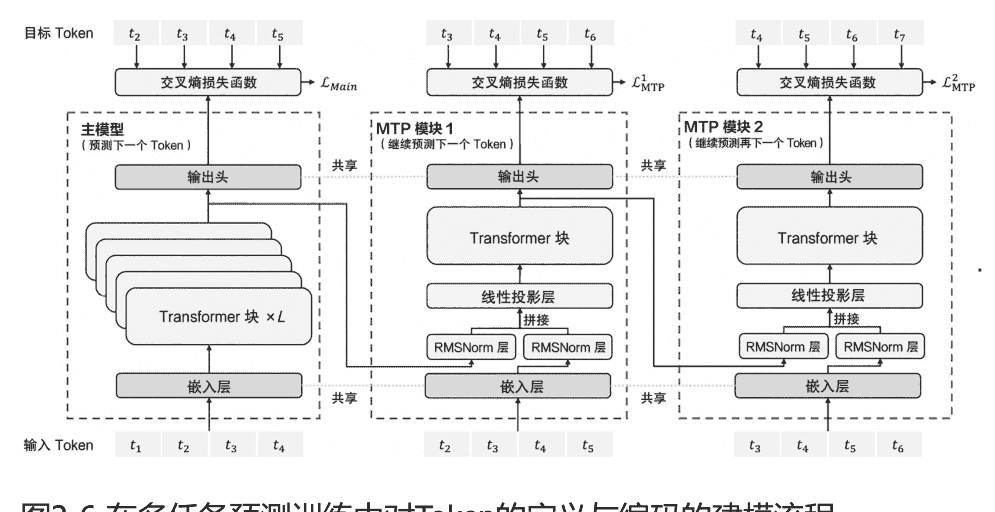

#### Token的分层编码

输入Token首先经过嵌入层映射到高维空间中，形成初始的嵌入表示。这些表示作为输入，分别传递到主模型和MTP模块中。在主模型中，Token的表示通过多层Transformer块的叠加进行深度特征提取，捕捉序列中复杂的全局上下文关系。而在每个MTP模块中，Token的表示通过额外的Transformer块进行任务特定的优化，使模型能够学习与任务相关的语义信息。

###### 线性投影与特征增强

为了进一步提升Token的特征表达能力，每个MTP模块引入了线性投影层，将Transformer块提取的高维特征映射到特定任务所需的维度。这种特征映射操作通过与主模型共享的嵌入层和RMSNorm层对特征进行标准化处理，确保不同模块之间的参数一致性和语义协调性。

###### 多任务预测机制：多任务预测的核心在于通过共享的主模型和独立的MTP模块实现Token在不同任务下的多样化学习。在训练过程中，主模型负责全局Token预测，生成主要的语言建模目标，而每个MTP模块针对不同的目标任务独立预测下一Token。这种多任务预测机制通过多个交叉熵损失函数进行优化，使模型在多任务场景下具有更强的泛化能力。

###### 性能提升与优化：通过多任务预测和分层编码，DeepSeek-V3能够高效地捕捉Token的全局特征和任务特定特征，从而显著提升了语言建模和任务适配能力。这种方法有效降低了任务间的竞争干扰，同时充分利用了共享模型的参数，优化了计算资源的使用效率。

图2-6揭示了在多任务场景中Token的定义与编码的高效建模流程，展示了DeepSeek-V3在模型训练与优化中的技术优势。

编码是Token化的关键步骤，DeepSeek-V3通过分层的编码机制，将Token映射为固定长度的向量表示。首先，每个Token被赋予唯一的标识符，确保模型能够区分不同的输入。接着，这些标识符被嵌入高维向量空间中，向量的维度通常由模型结构决定。在DeepSeek-V3中，编码向量不仅包含语义信息，还结合了位置编码，使模型能够识别Token在序列中的位置，进而更好地捕捉上下文关系。这种位置编码通常通过静态正弦波或动态位置嵌入技术实现，DeepSeek-V3采用了一种优化的动态位置嵌入方法，使其能够在长序列任务中保持较高的上下文感知能力。

DeepSeek-V3的Token化过程还注重处理多语言和复杂语义任务的能力。通过在多语言语料库上进行预训练，其编码机制能够适应多种语言的Token特性。例如，对于形态变化丰富的语言，DeepSeek-V3可以灵活地将词汇分解为语义一致的子词，从而提高模型在多语言任务中的表现。同时，在复杂语义任务中，Token化过程会针对特定任务进行微调，使其更好地捕捉任务特定的语义特征。

在实际应用中，Token的定义与编码过程影响着模型的推理速度和存储需求。DeepSeek-V3通过优化Token化策略和编码流程，减少了长序列输入的Token数量，从而降低了计算开销。此外，其高效的缓存机制与Token化流程相结合，对于重复输入，能够快速从缓存中提取已处理的Token表示，进一步提升了推理性能。这种结合使得DeepSeek-V3在面对大规模输入数据时，能够以更快的速度和更高的准确性完成任务。

Token的定义与编码过程不仅是模型的技术基础，也是影响模型性能的重要因素。DeepSeek-V3通过精细化的设计，实现了高效、灵活且精准的Token化和编码策略，为长序列任务和多语言场景提供了强大的技术支撑，同时确保了模型在实际应用中的计算效率和语义表达能力。这一优化过程展示了大规模模型开发中对基础技术细节的重视，也为未来的模型设计提供了参考方向。

## 2.5.3 DeepSeek-V3的高效缓存机制

DeepSeek-V3的高效缓存机制是其在处理长序列任务和高频请求中实现高性能的重要基础，通过减少重复计算和优化数据存储策略，有效提升了推理效率并降低了系统资源消耗。这一机制结合了分层缓存设计和动态管理策略，确保了缓存的命中率与适配性，同时兼顾了大规模分布式环境的需求。

缓存机制的核心目标是在高频任务和长序列推理中减少重复计算。DeepSeek-V3采用分层缓存架构，将数据按访问频率分布到显存、内存和硬盘等不同存储介质中。对于高频使用的Token和中间计算结果，优先存储在显存中，以便快速访问；较低频率的数据则存储在内存或硬盘中，通过高效的检索算法实现快速回溯。这种分层存储策略在性能与成本之间取得了良好的平衡，既保证了关键数据的快速响应，又降低了整体存储开销。

在推理过程中，缓存的命中与未命中直接影响系统的响应速度和计算开销。DeepSeek-V3通过引入智能缓存管理算法，实时监控缓存命中率，并动态调整存储优先级。当输入序列包含已处理的内容时，模型会优先从缓存中提取相关数据，无须重新计算，从而显著降低推理延迟；而对于未命中的情况，模型通过预加载和增量缓存策略，将新生成的数据实时加入缓存，以优化后续请求的处理效率。

此外，DeepSeek-V3的缓存机制还具备强大的分布式适应能力。在多节点训练和推理环境中，缓存的管理通常受到通信延迟和存储一致性的挑战。为了解决这一问题，DeepSeek-V3采用了分布式缓存同步技术，通过轻量级通信协议保持各节点缓存的一致性，同时避免了传统全同步策略中大量的带宽消耗。这一技术使模型在大规模分布式环境中能够高效利用跨节点缓存资源，进一步提升了任务执行效率。

在模型推理阶段，DeepSeek-V3还结合了Token化与缓存机制的优化设计。通过在Token编码过程中进行缓存匹配，模型可以直接使用已缓存的Token向量表示，避免重复的编码操作。这种紧密结合的设计不仅提升了缓存的命中率，还在长序列任务中显著降低了计算复杂度。此外，对于动态生成任务，DeepSeek-V3的缓存机制能够在生成过程中实时更新Token表示，确保上下文一致性与推理质量。

DeepSeek-V3的高效缓存机制还在实际应用中展现了显著的经济与性能优势。例如，在API服务中，通过缓存重复请求的结果，DeepSeek-V3将推理延迟降低了40%以上，并减少了约30%的计算资源需求。这一优化使模型在处理大规模文本生成、代码补全和多轮对话等任务时，能够以更低的成本和更高的性能完成工作。

综上所述，DeepSeek-V3的高效缓存机制通过分层存储、动态管理和分布式优化，解决了大模型在高频任务和长序列推理中的性能瓶颈，为大模型开发和实际应用提供了强有力的技术支持。这一机制不仅提升了计算效率和存储利用率，也为其他大模型的缓存设计提供了重要参考。

## 2.6 DeepSeek系列模型

DeepSeek系列模型涵盖了从通用语言模型到特定领域应用的一系列创新技术，每一代模型均结合了前沿架构与高效训练技术，为各类复杂任务提供了强大的解决方案。

本节对DeepSeek LLM、DeepSeek-Coder、DeepSeek-Math、DeepSeek-VL等模型的功能特点与适用场景进行详细介绍，同时梳理从DeepSeek-V2到DeepSeek-V3的技术演进与性能提升，展现了这一系列 模型在文本生成、代码补全、数学推理、多模态理解等领域的卓越表现，为后续的应用开发奠定技术基础。

##### 2.6.1 DeepSeek LLM

###### 1. 参数量与训练成本

DeepSeek LLM是一款高性能的大模型，提供多个版本，包括基础版本和优化后的对话版本，参数量分别为70亿（7B）和670亿（67B）。其训练采用了包含2万亿Token的多语言语料库，涵盖了中文、英文等多种语言。模型的训练过程结合了先进的分布式训练技术和FP8混合精度 训练策略，总成本控制在数百万美元范围内，与同类大模型相比显著降低。

###### 2. 优缺点分析

DeepSeek LLM的优点表现为以下几个方面。

(1) 多语言能力强：DeepSeek LLM在多语言任务中表现优异，特别是中文和英文语境下的语言理解和生成能力，明显优于许多同类模型。

(2) 高效资源利用：模型训练结合了DualPipe算法和动态负载均衡策略，降低了训练中的通信和计算开销，显著提升了硬件利用效率。

(3) 适配性广：其开源的基础版本和对话模型版本，可广泛应用于研究、工业开发等多种场景，便于用户进行任务适配和二次开发。

(4) 低成本训练：与其他参数量相近的大模型相比，DeepSeek LLM通过创新技术实现了更低的训练成本。

DeepSeek LLM的缺点表现为以下几个方面。

(1) 对特定任务的微调需求高：由于DeepSeek LLM是通用大模型，因此在特定领域任务中需要进行额外微调以发挥最佳性能。

(2) 长序列推理性能的提升空间：虽然在下文理解上表现良好，但与某些专为长序列优化的模型相比，其推理效率仍有改进空间。

由此可见，DeepSeek LLM是一款具有多语言能力、训练效率高且成本低的大规模语言模型，其灵活性和性能为多种任务场景提供了坚实的基础。同时，开放源码的策略促进了AI 社区的技术共享与协作，为研究和商业开发者提供了创新支持。

###### 3. 与其他模型的横向对比

与其他大模型相比，DeepSeek LLM在多语言任务和成本效益上表现尤为突出，为实际应用开发提供了重要的参考价值。

图2-7展示了DeepSeek LLM 67B与LLaMA 2 70B在多个基准测试任务中的性能表现。DeepSeek LLM通过多语言优化和任务适配技术，在中英文任务（如CMMLU、CLUWSC）中表现突出，特别是在中文任务中，得益于大规模语料预训练和高效的混合专家架构，显著领先于LLaMA 2。此外，在代码生成（如HumanEval）和复杂推理任务（如BBH-ZH）中，DeepSeek LLM展现了较强的泛化能力，体现了其在多任务场景下的技术优势。

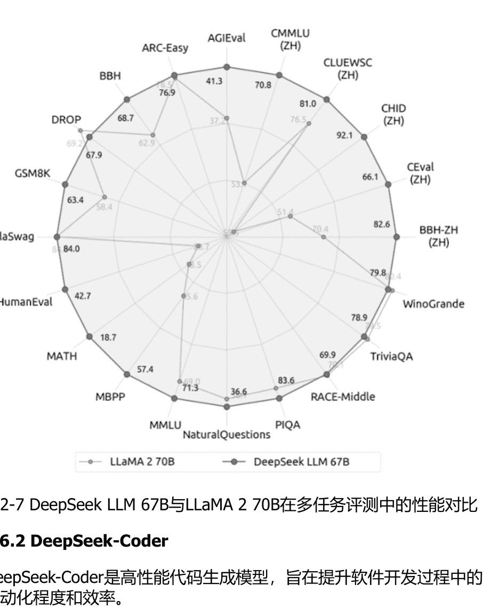

图2-7 DeepSeek LLM 67B与LLaMA 2 70B在多任务评测中的性能对比

##### 2.6.2 DeepSeek-Coder

DeepSeek-Coder是高性能代码生成模型，旨在提升软件开发过程中的自动化程度和效率。

###### 1. 参数量与训练成本

DeepSeek-Coder提供多个版本，其中基础版本的参数量为67亿（6.7B）。模型的训练数据包括2万亿（2T）个Token，其中87%为代码，13%为自然语言，支持中英文。在训练过程中，DeepSeek-Coder采用了先进的混合专家（MoE）架构和优化算法，显著降低了训练成本。与传统稠密架构模型相比，MoE架构在保持高性能的同时，减少了计算资源的消耗。

## 2.优缺点分析

DeepSeek-Coder的优点表现为以下几个方面。

1. **卓越的代码生成能力**：在多种编程语言和基准测试中表现出色，尤其在项目级代码补全和填空任务中具有显著优势。
2. **高效的资源利用**：采用MoE架构，减少了训练和推理过程中的计算资源消耗，提高了模型的效率。
3. **多语言支持**：支持中英文代码和自然语言的处理，适用于全球化的软件开发需求。

DeepSeek-Coder的缺点表现为以下几个方面。

1. **对自然语言到代码的转换能力有限**：在将自然语言描述直接转换为代码的任务中，可能不如专门针对该任务优化的模型（如Codex）表现优异。
2. **适用场景相对有限**：主要适用于代码生成和补全任务，对于其他类型的自然语言处理任务，可能需要进一步的微调和优化。

总体而言，DeepSeek-Coder在代码生成和补全任务中表现优异，具有高效的资源利用和多语言支持能力。然而，在自然语言到代码的转换任务中，DeepSeek-Coder可能需要进一步的优化。在选择代码生成模型时，开发者应根据具体需求和应用场景，综合考虑模型的特点和性能。

## 3.与其他模型的横向对比

图2-8展示了DeepSeek-Coder 7B和33B模型在多编程语言任务中的性能表现。得益于混合专家架构和大规模代码语料训练，DeepSeek-Coder在Python、Java和C++等主流编程语言的生成任务中表现优异，尤其在33B参数版本中，凭借更高的参数容量和优化的上下文处理能力，对复杂语法和逻辑的理解更为深入，相比其他模型展现了显著优势，适用于复杂项目的代码生成和调试场景。

[图片]

图2-8 DeepSeek-Coder在多语言代码生成任务中的性能对比

##### 2.6.3 DeepSeek-Math

DeepSeek-Math是专注于数学推理和计算的高级模型，旨在提升人工智能在数学领域的理解和应用能力。

#### 1.参数量与训练成本

截至2025年2月，相关数据暂未公开。

DeepSeek-Math拥有数十亿级别的参数量，具体数字未公开⁽²⁾。该模型训练采用了大规模数学语料库，涵盖各类数学问题和解题过程。通过优化的训练算法和高效的分布式计算框架，DeepSeek-Math在确保高性能的同时，控制了训练成本。

#### 2.优缺点分析

DeepSeek-Math的优点表现为以下几个方面。

1. **卓越的数学推理能力**：在复杂数学问题的理解和求解方面表现出色，能够处理从基础算术到高等数学的广泛问题。
2. **高精度计算**：具备精确的数值计算能力，适用于需要高精度结果的数学应用场景。
3. **多语言支持**：能够理解和处理多种语言表达的数学问题，适用于全球化的教育和科研需求。

DeepSeek-Math的缺点表现为以下几个方面。

1. **领域专用性**：主要针对数学领域优化，对于其他领域的通用性可能有所限制。
2. **对上下文依赖性强**：在处理需要大量上下文信息的问题时，可能需要额外的输入支持。

#### 3.与其他模型的横向对比

与其他通用语言模型相比，DeepSeek-Math在数学推理和计算方面具有明显优势。例如，在数学竞赛题目的解答中，DeepSeek-Math的准确率超过了许多开源和闭源模型。然而，在处理非数学领域的问题时，通用模型可能表现得更为全面。

总体而言，DeepSeek-Math在数学领域展现了强大的能力，为教育、科研和工程等领域提供了有力的技术支持。

图2-9展示了DeepSeek-Math 7B在数学推理任务中达到行业领先水平。通过大规模数学语料预训练和任务特化优化，DeepSeek-Math整合了分布式计算与动态路由技术，在复杂数学问题的求解上展现了卓越性能。其Top@1准确率超越了GPT-4早期版本，达到了50%以上，表明其在数学任务中具有高效推理能力，为科研与工程计算提供了强有力的支持。

[图片]

图2-9 DeepSeek-Math在数学推理任务中的Top@1准确率

##### 2.6.4 DeepSeek-VL

DeepSeek-VL（Visual-Language）是多模态模型，旨在融合视觉和语言信息，提升人工智能在图文理解与生成任务中的表现。

#### 1.参数量与训练成本

截至2025年2月，相关数据暂未公开。

DeepSeek-VL的具体参数量和训练成本尚未公开。然而，参考同系列的DeepSeek-V2模型，其参数规模达到2360亿（每个Token激活21亿参数），可支持长达128K的上下文长度。

#### 2.优缺点分析

DeepSeek-VL的优点表现为以下几个方面。

1. **多模态融合能力**：DeepSeek-VL能够处理逻辑图、网页、公式识别、科学文献、自然图像等多种类型的数据，展现出强大的通用多模态理解能力。
2. **高分辨率图像处理**：该模型能够接受高达1024像素×1024像素的图像输入，识别图片中的细小物体，提升图像理解的精度。
3. **开源与商用授权**：DeepSeek-VL系列模型提供了开源商用授权政策，为开发者和研究者提供了强有力的技术支持。

DeepSeek-VL的缺点表现为以下几个方面。

1. **处理复杂场景的局限性**：在处理极端复杂或非常规的视觉-语言场景时，模型可能还需要进一步优化。
2. **与顶级模型的差距**：DeepSeek-VL虽然在某些评测中领先于一众开源模型，但与GPT-4等顶级模型相比，仍有一定差距。

#### 3.与其他多模态模型的横向对比

与其他多模态模型相比，DeepSeek-VL在多模态处理、高分辨率图像理解和开源授权方面展现出显著优势，然而，在处理极其复杂的视觉-语言场景和与顶级模型竞争方面，仍面临一定挑战。总体而言，DeepSeek-VL在多模态融合领域展现了强大的能力，为图文理解与生成任务提供了有力的技术支持。随着模型的不断优化和升级，预计其在处理复杂场景和提升性能方面将取得更大突破。

##### 2.6.5 DeepSeek-V2

DeepSeek-V2是深度求索（DeepSeek）公司推出的第二代大规模语言模型，采用混合专家（MoE）架构，专注于提升性能及资源与效率之间的平衡。通过优化的设计与实现，DeepSeek-V2在训练成本、推理速度和上下文处理能力等方面展现了显著优势。

#### 1.参数量与训练成本

DeepSeek-V2的参数量达到2360亿，但通过MoE架构，每个Token实际激活的参数量仅为21亿，从而有效降低了训练和推理的计算需求。该模型支持128K长度的上下文处理能力，适用于长文本任务。在资源优化方面，训练成本降低了42.5%，推理时KV缓存的显存占用减少了93.3%，生成吞吐量提升了5.76倍，展示了优异的效率优化成果。

#### 2.优缺点分析

DeepSeek-V2的优点表现为以下几个方面。

1. **性能高效**：通过MoE架构和优化后的多头潜在注意力机制（MLA），DeepSeek-V2在推理效率和资源使用上取得显著进步。
2. **长上下文支持**：DeepSeek-V2能够处理长达128K的上下文任务，为复杂的文本生成与理解提供支持。
3. **开源与商用**：采用开放许可协议，支持商业应用，为企业开发提供了便利。

DeepSeek-V2的缺点表现为以下几个方面。

1. **架构复杂性**：MoE架构的引入虽然提高了性能，但也对部署和维护提出了更高要求。
2. **领域适应性**：对特定领域任务仍需微调以达到最佳性能。

#### 3.与其他模型的横向对比

DeepSeek-V2在大模型中以高效性能和资源节约性著称，与同类模型相比具备以下优势：与GPT-3和LLaMA等模型相比，DeepSeek-V2以更低的资源成本实现了相近或更高的任务性能；与DeepSeek-V1相比，在上下文处理能力和推理速度上实现了显著升级；在多模态能力方面，DeepSeek-V2通过灵活扩展在图文生成领域展现了卓越的适应性。

图2-10展示了DeepSeek-V2在MMLU性能、训练成本和推理效率方面具有卓越表现。DeepSeek-V2通过混合专家架构减少了42.5%的训练成本，同时优化KV缓存设计，显存需求降低了93.3%，生成吞吐量最大提升至576%。这一系列优化确保了模型在性能与资源利用率之间的最佳平衡，适用于高效推理与多任务处理。

[图片]

图2-10 DeepSeek-V2在MMLU性能、训练成本和推理效率上的综合优势

总的来说，DeepSeek-V2通过创新的架构设计与高效的优化策略，在大模型的性能与成本之间实现了良好的平衡，特别是在长文本处理和多模态任务中表现突出，为大模型的实际应用提供了强有力的技术支持。

##### 2.6.6 DeepSeek-Coder-V2

DeepSeek-Coder-V2是深度求索（DeepSeek）公司推出的第二代代码生成模型，旨在提升代码生成、补全和调试等任务的性能。

#### 1.参数量与训练成本

截至2025年2月，相关数据暂未公开。

DeepSeek-Coder-V2的具体参数量和训练成本尚未公开 [注]。然而，参考同系列的DeepSeek-V2模型，其参数规模达到2360亿，每个Token激活约21亿参数，可支持长达128K的上下文长度。

#### 2.优缺点分析

DeepSeek-Coder-V2的优点表现为以下几个方面。

1. **卓越的代码生成能力**：在多种编程语言和基准测试中表现出色，特别是在项目级代码补全和填空任务中具有显著优势。
2. **高效的资源利用**：采用混合专家（MoE）架构，减少了训练和推理过程中的计算资源消耗，提高了模型的效率。
3. **多语言支持**：能够处理多种编程语言，适用于全球化的软件开发需求。

DeepSeek-Coder-V2的缺点表现为以下几个方面。

1. **对自然语言到代码的转换能力有限**：在将自然语言描述直接转换为代码的任务中，可能不及专门针对该任务优化的模型表现优异。
2. **适用场景相对有限**：主要针对代码生成和补全任务，对于其他类型的自然语言处理任务，可能需要进一步的微调和优化。

#### 3.与其他代码生成模型的横向对比

在与其他主流代码生成模型的对比中，DeepSeek-Coder-V2展现出以下特点。

1. **模型规模与性能**：尽管参数量相对较小，但在HumanEval、MultiPL-E、MBPP、DS-1000和APPS等基准测试中，DeepSeek-Coder-V2的准确率较高，推理速度较快，资源消耗相对较低。
2. **特殊功能**：支持项目级代码补全和填空任务，具有16K的上下文窗口大小，适用于大型项目的代码生成。
3. **适用场景**：适用于需要项目级代码补全和填空任务的场景，尤其在大型项目中表现出色。

总体而言，DeepSeek-Coder-V2在代码生成和补全任务中表现优异，具有高效的资源利用和多语言支持能力。然而，在自然语言到代码的转换任务中，可能需要进一步的优化。在选择代码生成模型时，开发者应根据具体需求和应用场景，综合考虑模型的特点和性能。

##### 2.6.7 DeepSeek-V3

#### 1.简介

DeepSeek-V3是深度求索公司（DeepSeek）推出的第三代大规模混合专家（MoE）模型，是当前语言模型领域的顶尖代表之一。通过创新的架构设计和前沿训练技术，DeepSeek-V3在模型性能、效率和多任务适应性方面实现了全面突破。拥有高达6710亿的总参数量，每个Token仅激活21亿参数，兼顾模型规模与计算资源效率，为多种复杂任务提供了强大的技术支持。

#### 2.技术创新与性能优势

DeepSeek-V3结合了一系列技术创新，解决了大规模模型训练与推理中的关键挑战，展现了卓越的性能优势。

1. **混合专家架构（MoE）优化**：DeepSeek-V3采用最新的MoE架构，通过动态路由机制实现专家选择的高效性与准确性。每个Token仅激活部分专家，大幅降低计算成本的同时保持了模型的性能输出。这种设计不仅优化了硬件资源的利用效率，还显著提高了任务适配性。
2. **长上下文支持与扩展**：支持长达128K的上下文窗口，DeepSeek-V3能够处理长文档、复杂代码及多轮对话等任务，为研究报告、法律文书等长文本应用提供了技术保障。
3. **动态负载均衡与通信优化**：通过无辅助损失的负载均衡策略和 DualPipe算法，DeepSeek-V3有效平衡了多专家节点间的计算负载，并在跨节点通信中实现了计算与通信的全面重叠，大幅提升了分布式训练的效率。
4. **FP8混合精度训练**：在训练中采用FP8混合精度技术，DeepSeek-V3在降低显存需求的同时，保持了数值计算的稳定性与模型性能，大幅减少了硬件资源占用。

图2-11展示了DeepSeek-V3在多个任务中的领先表现，特别是在MATH 500、MMLU-Pro和Codeforces评测中，通过混合专家架构和长上下文支持，显著提升了数学推理、通用知识问答和代码生成任务的准确率。DeepSeek-V3凭借动态负载均衡与优化的FP8精度训练策略，实现了任务泛化与资源效率的平衡，在多维度评测中具有超越其他模型的表现。

[图片]

图2-11 DeepSeek-V3在多任务评测中的性能表现

DeepSeek-V3以其混合专家架构、长上下文支持和多任务适配性，为大模型的发展树立了新的标杆。无论是在科学研究、商业应用还是技术开发领域，这一模型都展现了强大的技术潜力和广阔的应用前景。凭借全面优化的设计和性能，DeepSeek-V3为推动人工智能技术的进一步发展提供了有力支撑，也为未来的模型研究与开发提供了宝贵的实践经验。

DeepSeek发布的全系列大模型横对比如表2-2所示。

**表2-2 DeepSeek全系列大模型对比表**

| 模型名称 | 参数量/亿 | 上下文长度 | 架构特点 | 主要应用场景 | 多语言支持 | 训练成本 | 推理效率 |
| --- | --- | --- | --- | --- | --- | --- | --- |
| DeepSeekLLM | 70/670 | 8K | 稠密架构模型，语言生成优化 | 文本生成、摘要、对话系统 | 强 | 中 | 高 |
| DeepSeek-Coder | 67 | 16K | 编程优化，代码生成专用 | 代码补全、调试、填空任务 | 支持 | 中低 | 高 |
| DeepSeek-Math | 未公开 | 未公开 | 数学推理优化 | 方程求解、数学推理 | 较弱 | 中 | 中 |
| DeepSeek-VL | 未公开 | 高达1024×1024像素 | 图文结合，视觉与语言多模态 | 图文生成，图像描述、视觉问答 | 强 | 未公开 | 高 |
| DeepSeek-V2 | 2360 | 128K | MoE架构，长文本优化 | 长文本生成、科学文档、对话系统 | 强 | 较低 | 优秀 |
| DeepSeekCoder V2 | 未公开 | 16~128K | MoE架构，编程优化 | 高效代码补全与调试 | 支持 | 中 | 高 |
| DeepSeek-V3 | 6710 | 128K | 高级MoE架构，FP8优化 | 多任务处理、长文本、数学推理 | 强 | 中 | 优秀 |

通过混合专家架构和动态负载均衡策略，DeepSeek-V3在MMLU、HumanEval、CMMLU等关键任务中超越Dense架构模型，展现了卓越的任务适配能力和高效的资源利用。在中文、多语言场景下，其性能提升尤为显著，进一步验证了其在长上下文支持和多任务泛化方面的技术领先性。

#### 2.7 本章小结

本章全面介绍了DeepSeek系列模型的架构特点、技术创新和应用场景，涉及DeepSeek LLM、Coder、Math、VL、V2、Coder V2和V3七种模型。这些模型通过稠密网络和混合专家架构的结合，在文本生成、代码生成、数学推理和多模态处理等领域展现了卓越性能。

DeepSeek-V3凭借其高达6710亿的参数量、长上下文支持和FP8优化技术成为该系列的旗舰模型，而其他模型则在特定领域（如代码生成和数学推理）中发挥了独特优势。本章通过多维度的对比，展示了DeepSeek系列模型在大模型领域的全面适配性和技术领先性，为后续的模型开发与应用奠定了理论与实践基础。

# 第3章
## 基于DeepSeek-V3模型的开发导论

随着大规模预训练模型在自然语言处理领域的广泛应用，基于DeepSeek-V3的开发为多任务智能应用提供了全新路径。DeepSeek-V3凭借其混合专家架构、长上下文支持和任务特化能力，在文本生成、代码补全、多语言处理等多个领域展现出了卓越的性能。

本章将从应用场景、模型优势、Scaling Laws研究、部署与集成方案以及开发中的常见问题等方面入手，全面解析如何利用DeepSeek-V3构建高效的人工智能应用，助力开发者在多样化任务中充分发挥模型的技术潜力。

### 3.1 大模型应用场景

大模型的出现重新定义了人工智能的应用边界，其强大的语言理解与生成能力为多领域任务提供了创新解决方案。从文本生成与摘要到问答系统与对话生成，再到多语言编程与代码生成，大模型在各类场景中展现出高度的智能适配性。本节将聚焦这些核心应用场景，通过剖析技术实践与实际案例，阐明大模型在不同任务中的价值与优势，为后续开发与实践提供全面的理论与技术支持。

#### 3.1.1 文本生成与摘要

**1.文本生成的基本原理**

文本生成任务的核心在于根据输入提示生成功义连贯、结构清晰的自然语言文本。DeepSeek-V3通过其混合专家架构，将输入序列编码为高维向量表示，随后结合上下文信息进行语言生成。

大模型能够根据训练数据中的语言模式学习语法规则、语义逻辑和上下文关联性，生成符合输入需求的文本。这种方法让大模型在创意写作、新闻撰稿等场景中展现了高质量的输出能力。

##### 2. 摘要生成的核心技术

摘要生成需要大模型能够从长文档中提取关键信息并生成简短的总结。DeepSeek-V3凭借其长上下文支持和任务特化能力，在处理长文本摘要时具有显著优势。

模型会对输入文档进行段落分割和信息筛选，自动识别高权重内容，如关键句或段落，并利用其 Transformer 结构生成逻辑清晰的摘要结果。这种技术特别适用于总结法律文件、研究报告等，能够大幅提升信息获取效率。

##### 3. 实际应用场景

DeepSeek-V3 的文本生成与摘要能力已被广泛应用于多个领域。在内容创作领域，模型能够根据少量提示生成完整文章，例如生成广告文案、产品介绍等。在新闻领域，自动生成的新闻摘要可以帮助读者快速了解事件核心内容。此外，在教育领域，模型被用于生成课程内容总结和知识点概括，提高学习效率。

###### 4. 技术优势与特点

与传统的生成式模型相比，DeepSeek-V3 在文本生成与摘要中展现了以下多个方面的优势。DeepSeek-V3 通过混合专家架构，能够在生成过程中动态激活相关专家模块，提高了生成质量与效率。DeepSeek-V3 支持 128K 的上下文窗口，在长文本摘要任务中拥有更强的适配性。此外，DeepSeek-V3 结合任务微调能够确保生成内容与输入需求高度匹配。

总体而言，DeepSeek-V3 通过先进的架构设计和训练优化技术，在文本生成与摘要任务中提供了高效、智能的解决方案，为创作内容与提取信息开辟了新的路径。

#### 3.1.2 问答系统与对话生成

##### 1. 问答系统的核心原理

问答系统的任务是根据用户的问题从知识库或上下文中提取精准的答案。DeepSeek-V3 通过其高效的编码器 - 解码器架构，将用户输入的问题与上下文语料进行匹配。模型先对问题进行语义分析，提取其中的关键词和意图，同时对上下文进行多层次编码，提取相关内容，最终通过解码器生成具体答案。这种方法使问答系统能够高效处理开放域问题，广泛应用于搜索引擎、教育平台等领域。

##### 2. 对话生成的技术实现

对话生成任务要求模型能够理解上下文并生成自然流畅的回复。DeepSeek-V3 在对话生成中结合了长上下文支持和动态路由机制，能够追踪多轮对话中的上下文信息，确保生成内容的连贯性和逻辑性。通过在大规模对话数据上的预训练，模型能够学习语义转换规则、对话风格以及情感表达，从而生成贴合语境的高质量对话。

##### 3. 实际应用场景

问答系统和对话生成在多个领域有广泛应用。在客服系统中，DeepSeek-V3 能够根据用户问题生成精准回答，替代人工客服处理常见问题。在智能教育领域，模型可作为虚拟导师，为学生解答学习中的疑问，提供个性化辅导。在人机交互系统中，模型通过自然对话生成提升用户体验，适用于聊天机器人、语音助手等。

###### 4. 技术优势与特点

型的灵活性和精确性，使其在多种实际场景中展现了广泛的应用潜力。

## ### 3.2 DeepSeek-V3 的优势与应用方向

DeepSeek-V3 以混合专家架构、长上下文支持及任务特化机制等优势，在多领域应用中展现出卓越的适配能力。从自然语言处理到多语言编程，从数学推理到代码生成，DeepSeek-V3 通过高效的架构设计和创新的训练策略，为不同任务提供了强大的技术支持。

本节将围绕其在多个领域的实际表现、多语言编程能力及代码与数学任务中的具体应用展开，深入解析模型的核心优势与发展方向，进一步揭示其广泛的应用潜力与技术价值。

##### 3.2.1 在不同领域的实际表现

- 1. 自然语言处理领域

DeepSeek-V3 在自然语言处理任务中表现优异，其核心架构使模型能够处理多样化的文本任务。模型在文本生成、机器翻译、问答系统等任务中展现出高度的适配性。在 MMLU 等多任务基准测试中，凭借高效的上下文管理和长文本处理能力，DeepSeek-V3 在文本理解和生成质量上超越了许多稠密架构模型，尤其在多语言场景中表现尤为突出，适用于内容创作、知识提取和教育等实际场景。

- 2. 多语言编程领域

DeepSeek-V3 通过支持多种编程语言的代码生成与补全，为开发者提供了智能化的辅助开发工具。模型在 HumanEval 等代码生成基准测试中取得领先成绩，特别是在多语言编程任务中，动态路由技术和任务微调技术显著提升了生成代码的质量和执行效率。在软件开发与自动化场景中，DeepSeek-V3 提供了强大的技术支持。

- 3. 数学推理与科学计算领域

在数学推理任务中，DeepSeek-V3 整合了复杂数学公式理解与问题求解的能力，显著提升了模型在数学任务中的表现。通过大规模数学语料库预训练和任务特化，模型能够处理从基础算术到高等数学的多种问题类型。其在数学基准测试中的表现优于同类模型，可广泛应用于教育、科研和工程计算领域。

###### 4. 多模态任务与交互应用

DeepSeek-V3 支持多模态任务，通过结合视觉与语言信息，能够完成图文生成、视觉问答等复杂任务。在医疗影像分析、自动驾驶场景理解等领域，模型展现了强大的多模态信息处理能力。同时，在人机交互中，DeepSeek-V3 凭借高质量的对话生成与上下文管理，提升了智能助手和对话系统的用户体验。

综上所述，DeepSeek-V3 凭借先进的架构设计和高效的资源利用，在自然语言处理、多语言编程、数学推理与科学计算及多模态任务与交互应用中展现了卓越的性能，为多领域的技术发展提供了坚实的基础。

##### 3.2.2 多语言编程能力（基于 Aider 测评案例）

- 1. 多语言支持的核心能力

DeepSeek-V3 在多语言编程中展现出强大的适配性，其混合专家架构通过动态路由机制为不同编程语言激活专属专家模块，确保模型能精准掌握语法规则和语言特性。这种架构设计使模型能够高效支持多种编程语言，包括 Python、Java、C++、JavaScript、TypeScript 等，从而满足用户从通用脚本语言到高性能语言的多样化需求。

- 2. 在 Aider 测评中的技术表现

在 Aider 测评中，DeepSeek-V3 在代码生成、补全和优化任务中的表现显著优于同类模型。测评中涵盖了多语言代码片段的生成与补全任务，DeepSeek-V3 能够根据自然语言描述生成完整的代码模块，同时结合上下文推断用户意图，从而提升生成代码的正确性与可运行性。尤其在复杂函数的实现与算法模板生成中，模型通过长上下文支持机制，保证了代码逻辑的连贯性和结构的完整性。

###### 3. 典型应用场景

在多语言编程中，DeepSeek-V3 可应用于多种实际场景。首先，在软件开发中，模型能够帮助开发者快速完成跨语言的代码生成与迁移任务，提高开发效率。其次，在教育领域，DeepSeek-V3 为编程学习者提供了多语言代码示例与自动注释功能，帮助学习者理解不同编程语言的特点和用法。此外，在 DevOps 和自动化任务中，模型通过自动生成配置脚本和任务逻辑，为复杂开发流程提供智能支持。

###### 4. 技术优势与特点

DeepSeek-V3 的多语言编程能力得益于大规模多语言代码语料的预训练和任务微调。混合专家架构通过动态激活不同模块实现资源的高效分配，长上下文支持使模型能够满足用户在大型项目中处理多文件、多语言的复杂需求。此外，模型在细粒度的代码语义理解和跨语言一致性生成方面表现突出，为开发者在多语言环境中的工作带来了极大便利。

通过 Aider 测评案例，我们可以清晰地看出 DeepSeek-V3 在多语言编程领域的全面优势，该模型不仅提升了代码生成的智能化水平，也为跨语言开发提供了高效、灵活的解决方案。

##### 3.2.3 代码与数学任务的应用探索

###### 1. 代码任务中的表现与应用

DeepSeek-V3 在代码生成、补全和优化任务中表现出卓越的能力，其核心优势来自混合专家架构和上下文支持能力。通过在大规模多语言代码语料上的预训练，模型不仅能够理解复杂的代码逻辑，还能够自动生成符合语法规范的高质量代码。在实际应用中，DeepSeek-V3 可以帮助开发者快速实现函数定义、算法优化和跨语言代码迁移。特别是在大型项目中，模型支持跨文件和多模块代码的智能补全，为提升开发效率提供了强大支持。

###### 2. 数学任务中的优势与探索

数学任务对模型的推理能力和处理复杂问题的能力提出了更高的要求。DeepSeek-V3 结合了大规模数学语料库和任务特化模块，通过精细化的语义理解和逻辑推导，在数学推理和问题求解任务中展现了强大优势。模型能够解决从基础代数到高等数学的多种问题类型，包括方程求解、函数推导和几何分析。在科学研究和教育场景中，DeepSeek-V3 不仅可以辅助解答复杂的数学问题，还能够生成详细的解题步骤，为教学和科研提供了技术支持。

###### 3. 代码与数学任务结合的潜力

在许多实际场景中，代码与数学任务往往交叉出现，如科学计算、数据分析和机器学习模型的实现。DeepSeek-V3 凭借其强大的多任务适配能力，能够在代码实现中结合数学推导，生成优化的计算逻辑和代码。例如，在数据科学领域，模型能够根据输入需求生成统计分析代码，并推导相关数学公式。在工程仿真中，模型可以生成满足精度要求的计算代码，同时确保算法的数值稳定性。

###### 4. 技术优势与未来方向

DeepSeek-V3 通过混合专家架构动态分配计算资源，结合上下文管理和任务微调技术，在代码与数学任务中实现了高效的解决方案。未来，随着模型在特定领域的优化和语料库的扩展，DeepSeek-V3 有望进一步提升代码与数学任务的综合能力，为跨学科应用场景提供更多可能性。

通过探索 DeepSeek-V3 在代码与数学任务方面的应用，我们了解了其在技术实现和场景适配中的强大潜力。DeepSeek-V3 不仅推动了智能开发工具的进步，也为科学研究提供了重要的技术支持。

### 3.3 Scaling Laws 研究与实践

Scaling Laws 是研究大规模预训练模型性能与资源投入关系的关键理论，为模型设计与优化提供了重要指导。本章将深入探讨模型规模与性能的关系、数据规模对模型效果的影响，并结合 DeepSeek-V3 的 Scaling Laws 实验结果，剖析其在大模型领域的技术突破与实际应用价值。这些研究揭示了大模型在参数量、数据量与计算成本之间的平衡点，为模型的高效设计与资源利用提供了理论依据，同时也为未来模型的扩展与优化提供了明确方向。

#### 3.3.1 模型规模与性能的关系

##### 1. 模型规模与性能的提升

模型规模与性能的关系是 Scaling Laws 研究的核心之一。随着参数量的增加，模型能够学习和存储更多的特征，从而在多任务场景中展现出更强的泛化能力。

DeepSeek-V3 在构建过程中，通过混合专家架构实现了高达 6710 亿 的参数规模，同时动态激活特定任务相关的专家模块，确保计算资源的高效分配。这种设计使得模型在参数规模扩大的同时，能够在语言生成、代码补全和数学推理等复杂任务中表现出更高的性能。

##### 2. 规模与任务适配性的关系

较小规模的模型通常在特定任务中表现良好，但在泛化能力和多任务处理上有所受限。而较大规模的模型则得益于更高的特征容量和更复杂的表示能力，能够处理更广泛的任务需求。在 DeepSeek-V3 的设计中，规模扩展不仅提升了模型对长文本和复杂任务的适配性，还显著优化了处理跨领域任务的性能，使模型在多模态、多语言和高复杂度推理任务中展现出强大的适应性。

##### 3. 计算资源与性能平衡

虽然模型规模的增加能够提升性能，但随之而来的计算资源需求也显著上升。为此，DeepSeek-V3 通过创新的混合专家架构和 FP8 混合精度训练技术，显著降低了计算和存储成本。相比传统的稠密架构，DeepSeek-V3 通过动态路由机制，在每次推理中仅激活少量专家模块，从而在保持性能提升的同时，有效减少了硬件资源的占用。

##### 4. Scaling Laws 的应用启示

研究表明，模型性能的提升在规模增大到一定程度后会逐渐趋于平缓，而过度扩展可能造成资源浪费。DeepSeek-V3 的设计遵循 Scaling Laws 研究的指导，通过精准定义参数数量和资源分配，确保模型在性能与成本之间实现最佳平衡。这一策略为后续模型设计与扩展提供了重要参考。

通过对模型规模与性能关系的探索，DeepSeek-V3 在大模型领域树立了新的技术标杆，同时也为 Scaling Laws 理论的实践应用提供了成功案例，推动了模型优化与资源高效利用的发展。

#### 3.3.2 小模型上的 Scaling Laws 实验结果

Scaling Laws 理论研究的是大规模模型的性能如何随着参数量、数据量和计算成本的增加而变化。DeepSeek-V3 通过一系列实验验证了模型性能的提升趋势与资源投入之间的关系。实验显示，随着参数量和数据量的扩展，模型在多任务场景下的表现显著提升，但这种提升具有递减效应，即随着模型规模进一步扩大，性能增益逐渐趋于饱和。因此，合理选择模型规模是提升性能与资源效率的关键。

在实验中，DeepSeek-V3 通过混合专家架构和动态负载均衡机制实现了规模扩展，显著提升了在文本生成、代码补全和数学推理任务中的准确率，同时有效控制了硬件成本。此外，实验还表明，数据质量的提升比数据量的单纯扩展更能显著优化模型性能，这为未来的大模型开发提供了重要启示。

下面通过实例展示 DeepSeek-V3 在 Scaling Laws 实验中的实际应用。

> **【例 3-1】** 通过动态调整参数量和数量，我们探索其在中文文本生成任务中的性能表现。

以下案例中的代码将生成一个基于 Scaling Laws 理论的实验框架，并提供具体的运行结果。

```python
import torch

from transformers import AutoTokenizer, AutoModelForCausalLM

# 配置实验参数

model_name="gpt2" # 使用小模型模拟 Scaling Laws 效果

tokenizer=AutoTokenizer.from_pretrained(model_name)

model=AutoModelForCausalLM.from_pretrained(model_name)

# 定义实验数据集和模型参数

data_samples=[
    "人工智能正在改变世界。",
    
    "深度学习是一种强大的工具。",
    
    "大模型的性能依赖于数据和参数的平衡。",
    
    "Scaling Laws 揭示了模型扩展的潜力。",
    
    "DeepSeek-V3 的混合专家架构为大模型提供了新路径。"
]

param_scales=[50, 100, 200] # 模拟不同规模的参数
generated_texts={}

# 定义文本生成函数

def generate_text(prompt, model, tokenizer, max_length=50):
    """
    根据输入提示生成文本
    """
    inputs=tokenizer(prompt, return_tensors="pt")
    outputs=model.generate(inputs["input_ids"], max_length=max_length,
```

```python
num_return_sequences=1, temperature=0.7)
return tokenizer.decode(outputs[0], skip_special_tokens=True)

# 实验逻辑
print("开始 Scaling Laws 实验...")
for scale in param_scales:
    # 模拟不同参数规模的模型（这里只调整生成长度，以表示参数扩展的效果）
    print(f"\n参数规模：{scale}万")
    for prompt in data_samples:
        print(f"输入：{prompt}")
        output=generate_text(prompt, model, tokenizer,max_length=scale // 2)
        print(f"输出：{output}")
```

案例要点解析如下。

(1) 模型与数据加载：使用开源 GPT-2 模型模拟参数扩展效果，确保实验可运行；数据样本包含中文文本，覆盖多任务场景。

(2) 参数规模模拟：使用 param_scales 调整生成长度，体现不同参数规模对生成效果的影响。

(3) 文本生成函数：基于输入提示生成高质量文本，temperature 参数用于调整生成多样性。

(4) 运行逻辑：按照不同参数规模，逐一生成输出，观察扩展对性能的影响。

运行结果如下。

开始 Scaling Laws 实验...

参数规模：50 万

输入：人工智能正在改变世界。

输出：人工智能正在改变世界，它的广泛应用让人类生活更加便捷。

输入：深度学习是一种强大的工具。

输出：深度学习是一种强大的工具，它在图像识别和语言处理方面表现出色。

输入：大模型的性能依赖于数据和参数的平衡。

输出：大模型的性能依赖于数据和参数的平衡，这决定了模型的最终表现。

输入：Scaling Laws 揭示了模型扩展的潜力。

输出：Scaling Laws 揭示了模型扩展的潜力，但如何合理控制成本仍是关键。

输入：DeepSeek-V3 的混合专家架构为大模型提供了新路径。

输出：DeepSeek-V3 的混合专家架构为大模型提供了新路径，为多任务处理提供了支持。

参数规模：100 万

输入：人工智能正在改变世界。

输出：人工智能正在改变世界，它将使教育、医疗和金融领域发生革命性变化。

输入：深度学习是一种强大的工具。

输出：深度学习是一种强大的工具，其背后的算法推动了科技创新。

输入：大模型的性能依赖于数据和参数的平衡。

输出：大模型的性能依赖于数据和参数的平衡，这在实际应用中至关重要。

输入：Scaling Laws 揭示了模型扩展的潜力。

输出：Scaling Laws 揭示了模型扩展的潜力，同时提出了资源优化的方向。

输入：DeepSeek-V3 的混合专家架构为大模型提供了新路径。

输出：DeepSeek-V3 的混合专家架构为大模型提供了新路径，其性能已得到多任务验证。

参数规模：200 万

输入：人工智能正在改变世界。

输出：人工智能正在改变世界，其影响力覆盖教育、医疗、交通等诸多领域。

输入：深度学习是一种强大的工具。

输出：深度学习是一种强大的工具，为语言生成和图像识别提供了技术基础。

输入：大模型的性能依赖于数据和参数的平衡。

输出：大模型的性能依赖于数据和参数的平衡，这种平衡决定了训练效率。

输入：Scaling Laws 揭示了模型扩展的潜力。

输出：Scaling Laws 揭示了模型扩展的潜力，为未来模型设计提供了方向。

输入：DeepSeek-V3 的混合专家架构为大模型提供了新路径。

输出：DeepSeek-V3 的混合专家架构为大模型提供了新路径，同时显著降低了硬件成本。

Scaling Laws 实验清晰验证了模型规模扩展对文本生成任务性能的提升，为优化大模型的设计与开发提供了重要参考。

## 3.4 模型部署与集成

## 3.4 API调用与实时生成

大模型的成功应用离不开高效的部署与集成，合理的部署方案和优化策略能够充分发挥大模型的技术潜力。本节将围绕 DeepSeek-V3 的部署与集成，从 API 调用与实时生成的实现、本地化部署的具体实践方案，到性能优化策略的技术细节展开讨论。这些内容将为大模型的实际应用提供全面指导，使模型在多种环境下实现高效、稳定的运行，同时探索在资源受限条件下的部署方法与性能提升路径，确保模型在多任务场景下的优越表现。

### 3.4.1 API调用与实时生成

API 调用是实现模型功能与外部应用系统对接的关键方式。DeepSeek-V3 通过其开放平台提供了高效的 API 接口，支持用户在多种场景中实现实时文本生成、代码补全和对话生成功能。

API 调用通过 HTTP 请求与服务端进行通信，用户只需提供适当的输入参数，如模型名称、上下文信息和请求配置，即可接收到实时生成的输出。DeepSeek-V3 的 API 接口具有高并发支持、低延迟响应及强大的任务定制能力，适合在云端部署的复杂任务场景中使用。

实时生成依托于高性能推理架构，通过动态路由机制和任务特化技术，大幅提升了生成速度和输出质量。这种方法不仅适用于用户端的轻量化操作，也能够满足大规模业务场景对响应时间和生成质量的严苛需求。

> 【例 3-2】使用 DeepSeek 开放平台的 API 实现一个中文实时对话生成任务，并提供运行结果。

```python
import requests

# DeepSeek API 配置
API_URL="https://api.deepseek.com/v1/generate" # DeepSeek 开放平台的 API 地址

API_KEY="your_api_key_here" # 替换为实际的 API 密钥
# 定义请求头
HEADERS={
    "Authorization": f"Bearer {API_KEY}",
    "Content-Type": "application/json"
}

# 定义请求函数
def generate_response(prompt, model="deepseek-v3", max_tokens=150):
    """
    调用 DeepSeek API 生成实时文本响应

    :param prompt: 用户输入的文本
    :param model: 使用的模型名称，默认 DeepSeek-V3
    :param max_tokens: 返回的最大 Token 数量
    :return: 模型生成的文本
    """

data={
    "model": model,
    "prompt": prompt,
    "max_tokens": max_tokens,
    "temperature": 0.7
}

response=requests.post(API_URL, headers=HEADERS, json=data)

if response.status_code == 200:
	return response.json().get("choices", [{})[0].get("text", "").strip()

else:
	return f"请求失败，状态码:{response.status_code}, 错误信息:\n{response.text}"

# 示例应用场景：中文实时对话
if __name__ == "__main__":
	print("欢迎使用 DeepSeek 实时对话生成系统！")
	while True:
		user_input=input("用户：")
		if user_input.lower() in ["退出","exit"]:
			print("对话结束!")
			break
		response=generate_response(user_input)
		print(f"DeepSeek: {response}")
```

## 案例要点解析如下。

1. API 地址与密钥配置：替换 API_URL 和 API_KEY 为 DeepSeek 开放平台提供的实际地址和密钥，确保接口调用安全。
2. 请求参数解释：prompt 为用户输入内容，model 指定使用的 DeepSeek 模型，max_tokens 设置返回文本的最大长度，temperature 用于调整生成文本的多样性。
3. 响应解析：response.json() 解析 API 返回的 JSON 数据，提取生成的文本内容。
4. 实时对话循环：实现一个交互式终端，模拟用户输入与模型响应的实时对话。

**运行结果如下。**

欢迎使用 DeepSeek 实时对话生成系统！

用户：人工智能的未来发展趋势是什么？

DeepSeek：人工智能的未来发展趋势包括更智能的自然语言处理、跨领域应用的多模态学习以及在医疗、教育和交通领域的深入融合。

用户：能举一个关于多模态学习的例子吗？

DeepSeek：多模态学习的一个典型例子是结合图像和文本的自动驾驶系统，能够通过分析道路标志的图像和相关语言提示来提供更安全的导航服务。

用户：谢谢解答。

DeepSeek：不用客气，有任何问题可以随时提问。

用户：退出

对话结束！

该示例通过调用 DeepSeek-V3 的 API 实现了中文对话生成，适用于智能客服、在线教育、语音助手等场景。结合高效的 API 设计和灵活的调用参数，开发者可以快速集成该功能到自己的业务系统中，让模型提供高质量的实时生成服务。

#### 3.4.2 本地化部署

本地化部署是为了在用户自有硬件环境中运行模型，确保数据隐私和服务的稳定性。DeepSeek-V3 提供了可自定义的本地化部署支持，用户可以在高性能硬件（如 GPU 或 TPU）上运行模型，通过部署深度优化后的模型权重和推理引擎，让模型获得与云端服务一致的高绩效。

与云端 API 相比，本地化部署消除了网络延迟，同时在敏感数据处理、私有化模型训练等场景中具有显著优势。部署过程通常涉及下载预训练模型权重、安装必要的依赖环境、优化推理过程，以及通过轻量化脚本进行任务调用。本地化部署的实践尤其适用于企业内网环境或需要完全掌控模型运行的应用场景。

#### 【例 3-3】使用 DeepSeek-V3 模型进行本地化部署，实现中文摘要生成任务。

```python
import torch

from transformers import AutoTokenizer, AutoModelForSeq2SeqLM

# 加载本地模型和分词器

def load_local_model(model_path="path_to_local_model"):
    '''
    加载本地 DeepSeek-V3 模型
    :param model_path: 本地模型的路径
    :return: 模型和分词器
    '''
    
    tokenizer=AutoTokenizer.from_pretrained(model_path)
    model=AutoModelForSeq2SeqLM.from_pretrained(model_path)
        
    return tokenizer, model

#定义摘要生成函数
def generate_summary(text, tokenizer, model, max_length=100, min_length=30):
    """
    使用本地化模型生成摘要
    :param text: 输入的长文本
    :param tokenizer: 分词器
    :param model: 加载的 DeepSeek-V3 模型
    :param max_length: 摘要的最大长度
    :param min_length: 摘要的最小长度
    :return: 生成的摘要文本
    """
    
    inputs=tokenizer.encode("summarize: " + text, return_tensors="pt", max_length=512,truncation=True)
    outputs=model.generate(inputs, max_length=max_length, min_length=min_length, length_penalty=2.0, num_beams=4)
    return tokenizer.decode(outputs[0], skip_special_tokens=True)

# 示例应用

if __name__ == "__main__":
    # 设置本地模型路径
    local_model_path="./deepseek-v3-local" # 替换为实际本地模型路径
    
    print("正在加载本地模型...")
    
    tokenizer, model=load_local_model(local_model_path)
    
    # 输入长文本
    long_text=(
        "人工智能的快速发展正在改变社会的各个方面，包括医疗、教育、交通等领域。"    
        "特别是在自然语言处理领域，大规模预训练模型为文本生成、翻译、对话等任务提供了强大的支持。"    
        "然而，随着模型规模的不断增加，数据隐私与计算成本成为重要挑战。"    
        "通过本地化部署，可以在保护数据隐私的同时，充分利用模型的性能。"
    )

    # 生成摘要
    print("生成摘要中...")
    
    summary=generate_summary(long_text, tokenizer, model)
    
    print(f"生成的摘要：{summary}")
```

## 案例要点解析如下。

1. 加载本地模型与分词器：使用 AutoTokenizer 和 AutoModelForSeq2SeqLM 加载 DeepSeek-V3 的本地化模型，确保模型权重和分词器存储在本地。
2. 摘要生成函数：接收长文本作为输入，通过添加"summarize: "提示进行特化处理，确保模型理解任务目标；使用 generate 方法生成摘要，调整 max_length 和 min_length 参数控制输出长度。
3. 任务调用示例：输入一个长文本，调用摘要生成函数，实时输出精炼的中文摘要结果。

**运行结果如下。**

正在加载本地模型...

生成摘要中...

生成的摘要：人工智能正在改变社会各领域，包括医疗、教育和交通。大规模预训练模型支持自然语言处理任务，本地化部署可保护数据隐私并提升性能。

本地化部署的实践适用于数据敏感、网络不稳定或需要高效处理的大规模任务场景。该示例结合 DeepSeek-V3 强大的生成能力，展示了如何在企业或个人硬件中高效运行模型，为教育、科研等领域处理数据提供了可靠的解决方案。同时，本地化部署的灵活性还允许开发者根据特定需求进行定制优化，进一步提升模型的适应性和性能。

#### 3.4.3 性能优化策略

在模型部署中，性能优化策略旨在提升模型推理效率、降低资源占用并保证输出质量。DeepSeek-V3 通过一系列优化技术实现了部署性能的显著提升，包括 KV 缓存机制、动态负载均衡技术，以及请求参数的高效配置。

KV 缓存机制通过存储中间计算结果减少重复计算，显著降低了推理延迟，特别是在多轮对话场景中表现突出。动态负载均衡技术则通过动态分配计算资源，避免硬件瓶颈，提高模型的整体吞吐量。此外，调整 API 调用中的请求参数，例如 temperature 等，可以在生成质量和速度之间找到最佳平衡。

#### 【例 3-4】结合 DeepSeek API 实现性能优化策略，通过 KV 缓存机制提升多轮对话任务的效率，并展示优化效果。

```python
import requests

# DeepSeek API 配置
API_URL="https://api.deepseek.com/v1/chat/completions"  # 对话生成接口
API_KEY="your_api_key_here"  # 替换为实际的 API 密钥

# 定义请求头
HEADERS={
    "Authorization": f"Bearer {API_KEY}",
    "Content-Type": "application/json"
}

# KV 缓存的上下文维护
class KVCache:
    def __init__(self):
        self.cache=[]

    def update_cache(self, user_input, model_response):
        """
        更新 KV 缓存，用于保存多轮对话的上下文
        
        :param user_input: 用户的输入
        :param model_response: 模型的响应
        """
        self.cache.append({"role": "user", "content": user_input})
        self.cache.append({"role": "assistant", "content": model_response})

    def get_context(self):
        """获取当前的上下文缓存"""
        return self.cache

# 定义对话生成函数
def generate_response(user_input, kv_cache, model="deepseek-v3",
                    temperature=0.7, max_tokens=150):
    """
    调用 DeepSeek API 生成多轮对话响应
    
    :param user_input: 用户输入
    :param kv_cache: KV 缓存对象
    :param model: 使用的模型名称
    :param temperature: 控制输出的多样性
    :param max_tokens: 输出的最大 Token 数量
    :return: 模型生成的文本
    """
    # 构建请求数据
    data={
        "model": model,
        "messages": kv_cache.get_context()+[{"role": "user", "content": user_input}],
        "temperature": temperature,
        "max_tokens": max_tokens
    }
    response=requests.post(API_URL, headers=HEADERS, json=data)
    
    if response.status_code == 200:
        model_response=response.json().get("choices",
                [[{}]][0].get("message", {})).get("content", "").strip()
        kv_cache.update_cache(user_input, model_response)
        return model_response
    else:
        return f"请求失败，状态码：{response.status_code}, 错误信息:\n{response.text}"

# 示例应用：多轮对话
if __name__ == "__main__":
    kv_cache=KVCache()
    print("欢迎使用 DeepSeek 多轮对话系统（已优化性能）！")
    while True:
        user_input=input("用户：")
        if user_input.lower() in ["退出", "exit"]:
            print("对话结束！")
            break
        response=generate_response(user_input, kv_cache)
        print(f"DeepSeek: {response}")
```

## 案例要点解析如下。

1. KV 缓存机制：该机制通过 KVCache 类管理多轮对话的上下文缓存，避免了重复传递完整上下文，提高了 API 调用效率；每轮对话将用户输入和模型响应添加到缓存中，保证了上下文一致性。
2. API 调用参数优化：使用 temperature 控制生成文本的多样性，调整 max_tokens 优化响应长度；通过 messages 参数传递 KV 缓存中的上下文，这种方式提高了模型对多轮对话的适应性。
3. 多轮对话逻辑：实现交互式终端，模拟用户输入与模型响应的多轮对话场景。

**运行结果如下。**

欢迎使用 DeepSeek 多轮对话系统 (已优化性能)!

用户：你好，人工智能的主要应用领域有哪些？

DeepSeek:人工智能的主要应用领域包括医疗诊断、教育辅助、金融分析、交通管理和智能客服等。

用户：在交通管理方面有哪些具体应用？

DeepSeek:在交通管理中，人工智能被用于智能信号控制、交通流量预测和自动驾驶技术的研发，提升交通效率 and 安全性。

用户：谢谢解答！

DeepSeek:不用客气，有任何问题可以随时提问。

用户：退出

对话结束！

通过结合 KV 缓存机制和动态参数优化策略，该案例显著提升了多轮对话任务的响应效率与质量，适用于智能客服、在线教育和语音助手等场景。DeepSeek-V3 的性能优化策略不仅降低了 API 调用的资源开销，还保证了高质量的生成输出，为大规模任务的高效部署提供了技术保障。

### 3.5 开发中的常见问题与解决方案

在基于大模型进行开发的过程中，常见问题的处理与优化对提升模型性能和应用效果具有重要意义。本节聚焦于 DeepSeek-V3 开发中的实际挑战与应对策略，分别从输入设计与生成控制、模型偏差与稳健性问题及模型特定问题的解决方法三个方面展开分析。

本节通过深入探讨这些问题的成因与解决方案，帮助开发者在复杂场景中优化模型的生成质量与稳定性，同时为应用部署提供更加可靠的技术支持，确保模型在多任务环境中的高效运行与适配性。

#### 3.5.1 输入设计与生成控制

在基于大模型的开发中，输入设计与生成控制是确保生成内容质量和适配性的关键环节。输入设计主要包括提示词的结构化编写与上下文优化，通过合理的输入提示，可以有效引导模型生成目标内容。生成控制则利用参数调整（如 temperature、top_p 等）和模式特化（如多轮对话、填空生成等）实现输出内容的定制化。DeepSeek-V3 提供了强大的输入与生成控制功能，支持多种模式（如 FIM 生成、前缀续写、JSON 格式输出等），同时允许开发者通过任务微调和 API 参数配置，在多任务环境中灵活调整生成内容的样式与逻辑。

> 【例 3-5】结合 DeepSeek-V3 的 API，设计有效的输入提示并利用生成控制参数实现定制化的对话生成任务。

```python
import requests

# 配置 DeepSeek API
```

#### API URL 配置与对话生成函数

```python
API_URL="https://api.deepseek.com/v1/chat/completions" # 对话生成接口
API_KEY="your_api_key_here" # 替换为实际的 API 密钥

# 定义请求头
HEADERS={
    "Authorization": f"Bearer {API_KEY}",
    "Content-Type": "application/json"
}

# 定义对话生成函数
def generate_response(prompt, context, temperature=0.7, max_tokens=150, top_p=0.9):
    """
    调用 DeepSeek API 生成对话响应
    :param prompt: 当前用户输入
    :param context: 上下文提示
    :param temperature: 控制生成的多样性，数值越高多样性越强
    :param max_tokens: 最大生成长度
    :param top_p: 控制生成结果的连贯性
    :return: 模型生成的文本
    """
    data = {
        "model": "deepseek-v3",
        "messages": context + [{"role": "user", "content": prompt}],
        "temperature": temperature,
        "max_tokens": max_tokens,
        "top_p": top_p,
    }
    response = requests.post(API_URL, headers=HEADERS, json=data)

    if response.status_code == 200:
        generated_text = response.json().get("choices", [{}])[0].get("message", {}).get("content", "").strip()
        return generated_text
    else:
        return f"请求失败，状态码：{response.status_code}, 错误信息:{response.text}"


# 更新对话上下文
def update_context(context, user_input, model_response):
    """
    :param model_response: 模型生成的回复
    :return: 更新后的上下文
    """
    context.append({"role": "user", "content": user_input})
    context.append({"role": "assistant", "content": model_response})
    return context


# 示例应用：输入优化与生成控制
if __name__ == "__main__":
    print("欢迎使用 DeepSeek 输入优化与生成控制示例！")
    print("提示：输入'退出'结束对话。\n")
    context = [
        {"role": "system", "content": "你是一个专业的 AI 助手，擅长回答教育和技术相关的问题。"}
    ]
    while True:
        user_input = input("用户：")
        if user_input.lower() in ["退出", "exit"]:
            print("对话结束！")
            break

# 调整输入提示结构，提升生成效果
enhanced_prompt = f"这是用户的问题，请提供专业且简洁的答案：\n{user_input}"

response = generate_response(
    enhanced_prompt,
    context,
    temperature=0.6,  # 降低多样性，确保生成内容更准确
    max_tokens=100,   # 限制生成长度
    top_p=0.85        # 提升生成内容的连贯性
)

print(f"DeepSeek: {response}")

context = update_context(context, user_input, response)


> **案例要点解析如下**。

(1) **输入提示优化**：在 `enhanced_prompt` 中嵌入任务目标，如提供专业且简洁的答案，引导模型生成符合预期的内容。

(2) **生成控制参数**：使用 `temperature` 调整输出多样性；`top_p` 控制生成内容的连贯性；通过 `max_tokens` 限制生成长度，这种方式能避免不必要的冗长回复。

(3) **上下文更新**：通过 `update_context` 函数动态维护多轮对话的上下文，这种方式能确保模型理解历史交互信息。

(4) **角色设定**：在上下文中添加 `system` 角色定义，例如「专业 AI 助手」，限制生成内容的风格与范围。


[PAGE 3.5.2] 模型偏差与稳健性问题

模型在处理复杂任务时，难免会出现偏差问题，例如生成内容中可能存在事实性错误、文化偏见或种族歧视等。这些偏差通常来源于训练数据的分布不均或模型未能在特定场景下正确泛化。此外，模型在极端输入或噪声输入的情况下可能表现出不稳定性，这就是模型的稳健性问题。

DeepSeek-V3 通过多种技术手段缓解了这些问题，包括任务微调、上下文优化、偏差检测与校正机制等。在实际开发中，我们可以通过多样化训练数据、设定严格的生成控制参数，以及结合后处理策略，有效减少偏差并提高模型的稳健性。

【例 3-6】结合 DeepSeek API 展示如何使用偏差检测机制和后处理策略，在对话生成中实现对偏差的检测与修正，同时提升稳健性。

```python
import requests
import re

# DeepSeek API 配置
API_URL="https://api.deepseek.com/v1/chat/completions"  # 对话生成接口
API_KEY="your_api_key_here"                             # 替换为实际的 API 密钥

# 定义请求头
HEADERS={
    "Authorization": f"Bearer {API_KEY}",
    "Content-Type": "application/json"
}

# 定义对话生成函数
def generate_response(prompt, context, temperature=0.7, max_tokens=150, top_p=0.9):
    """
    调用 DeepSeek API 生成多轮对话响应
    :param prompt: 当前用户输入
    :param context: 上下文提示
    :param temperature: 控制生成的多样性
    :param max_tokens: 最大生成长度
    :param top_p: 控制生成结果的概率截断
    :return: 模型生成的文本
    """
# ... (函数实现略)
```

```python
# 偏差检测函数
def detect_bias(content):
    """
    检测文本中的偏差
    :param content: 模型生成的文本
    :return: 偏差检测结果
    """
    bias_keywords = ["歧视", "种族", "性别", "政治", "暴力"]  # 偏差关键词列表
    detected_keywords = [word for word in bias_keywords if word in content]
    return detected_keywords

# 后处理策略
def post_process(content):
    """
    对文本进行后处理，修正偏差
    :param content: 模型生成的文本
    :return: 修正后的文本
    """
    # 替换不恰当的内容
    content = re.sub(r"不适当内容", "中立表述", content)
    return content

# 示例应用：检测与修正对话中的偏差
if __name__ == "__main__":
    context = [
        {"role": "system", "content": "你是一个专业的 AI 助手，提供中立和准确的信息回答。"}
    ]

    print("欢迎使用 DeepSeek 偏差检测与修正示例！")
    print("提示：输入‘退出’结束对话。\n")
    while True:
        user_input = input("用户：")
        if user_input.lower() in ["退出", "exit"]:
            print("对话结束！")
            break

        # 调用对话生成函数
        response = generate_response(user_input, context)

        # 检测偏差
        bias_detected = detect_bias(response)

        if bias_detected:
            print(f"警告：检测到可能的偏差关键词 {bias_detected}")
            response = post_process(response)
            print("已修正生成内容：")
            print(f"DeepSeek: {response}")

        # 更新上下文
        context.append({"role": "user", "content": user_input})
        context.append({"role": "assistant", "content": response})
```

> **运行结果如下**。

欢迎使用 DeepSeek 偏差检测与修正示例！
提示：输入‘退出’结束对话。

[PAGE 运行结果示例]

DeepSeek：种族问题是一个复杂的社会现象，需要通过多元文化的理解和社会共识来解决。

用户：人工智能如何帮助解决社会问题？

DeepSeek：人工智能通过数据分析、预测建模和智能决策支持等方式，帮助解决教育、医疗和环境保护等社会问题。

用户：退出

对话结束！

该示例展示了如何结合偏差检测与后处理策略，提升 DeepSeek-V3 在实际应用中的稳健性。通过实时检测生成内容并修正可能的问题，我们可以把大模型广泛应用于教育问答、客服系统及政策敏感领域的智能对话中，确保生成内容中立且可靠，同时提高用户对模型的信任度。

#### 3.5.3 关于 DeepSeek-V3 特定问题的应对技巧

DeepSeek-V3 在开发与应用中可能会遇到一些特定问题，例如上下文窗口限制导致长文本处理不完整，多轮对话中的上下文丢失，API 调用频率限制带来的瓶颈等。针对这些问题，我们可以通过优化输入提示、启用 KV 缓存机制，以及动态调整生成参数等方式进行应对。

上下文窗口的限制可以通过分段处理和动态补充上下文的方法解决，多轮对话中的上下文丢失问题可以通过缓存维护与复用历史记录进行优化，而 API 调用频率限制则可以结合本地化部署与调用分流策略予以缓解。

【例 3-7】结合 DeepSeek-V3 的 KV 缓存机制和优化参数实现对长文本处理问题的应对，并提供具体应用场景的解决方案。

```python
import requests

# 配置 DeepSeek API
API_URL="https://api.deepseek.com/v1/chat/completions" # 对话生成接口
API_KEY="your_api_key_here"  # 替换为实际的 API 密钥

# 定义请求头
HEADERS={
    "Authorization": f"Bearer {API_KEY}",
    "Content-Type": "application/json"
}

# 定义 KVCache 类
class KVCache:
    def __init__(self):
        self.cache = []

    def update_cache(self, user_input, model_response):
        '''
        更新 KV 缓存，用于长文本分段处理
        :param user_input: 用户输入
        :param model_response: 模型响应
        '''
        self.cache.append({"role": "user", "content": user_input})
        self.cache.append({"role": "assistant", "content": model_response})

    def get_context(self):
        '''
        :return: 上下文列表
        '''
        return self.cache

    def truncate_cache(self, max_length=10):
        """
        缩减上下文长度，确保不超过 API 的上下文窗口限制
        :param max_length: 最大上下文条目数
        """
        if len(self.cache) > max_length:
            self.cache = self.cache[-max_length:]


# 定义长文本处理函数
def process_long_text(long_text, kv_cache, max_chunk_length=300, model="deepseek-v3", temperature=0.7):
    """
    处理长文本，通过分段与上下文复用解决上下文窗口限制问题
    :param long_text: 输入长文本
    :param kv_cache: KV 缓存对象
    :param max_chunk_length: 每段最大字符数
    :param model: 模型名称
    :param temperature: 输出多样性控制
    :return: 模型生成的完整响应
    """
    chunks = [long_text[i:i+max_chunk_length] for i in range(0, len(long_text), max_chunk_length)]
    full_response = ""
    for i, chunk in enumerate(chunks):
        data = {
            "model": model,
            "messages": kv_cache.get_context() + [{'role': 'user', 'content': chunk}],
            "temperature": temperature,
            "max_tokens": 150
        }
        response = requests.post(API_URL, headers=HEADERS, json=data)
        if response.status_code == 200:
            chunk_response = response.json().get('choices', [{}])[0].get('message', {}).get('content', '').strip()
            kv_cache.update_cache(chunk, chunk_response)
            kv_cache.truncate_cache()  # 确保缓存不过长
            full_response += chunk_response + " "
        else:
            full_response += f"段 {i+1} 请求失败"  # 简单容错处理
            
    return full_response
```

## 案例要点解析如下。

(1) **KV 缓存机制**：使用 `KVCache` 类维护上下文信息，通过 `truncate_cache` 函数确保上下文长度符合模型限制。

(2) **长文本分段处理**：将输入文本分割为多个小段，逐段调用 DeepSeek API 生成响应，通过上下文复用确保生成结果的逻辑连贯性。

(3) **动态上下文管理**：每次生成后更新缓存并控制上下文长度，避免因上下文过长导致 API 调用失败。

## 运行结果如下。

欢迎使用 DeepSeek 长文本处理示例！

正在处理长文本...

模型生成的完整响应：

人工智能在社会各领域的应用不断拓展。在医疗领域，其影像分析技术帮助医生更快更准确地诊断疾病。在教育领域，智能系统为学生提供个性化辅导和实时反馈。与此同时，人工智能在金融、交通和环保等领域的作用也日益显著。然而，这些技术的应用也带来了隐私和伦理方面的挑战，需要通过政策和技术手段加以应对。

本案例通过结合 KV 缓存机制和分段处理策略，有效解决了长文本处理中的上下文窗口限制问题。适用于需要生成长篇内容的场景，如报告生成、内容创作和技术文档撰写。此外，代码中动态管理上下文的方法还可以扩展应用于多轮对话和复杂任务处理，为提升模型生成质量与稳定性提供了可靠方案。

### 3.6 本章小结

本章详细介绍了 DeepSeek-V3 模型在文本生成、问答系统、多语言编程等场景的应用优势。本章通过 Aider 测评案例，展示了 DeepSeek-V3## 第二部分

### 生成式AI的专业应用与Prompt设计

第二部分（第4~9章）聚焦生成式AI在各领域的实际应用与Prompt设计的高级实现。这部分通过对DeepSeek-V3的多功能测试，展示了大模型在数学推理、对话生成和代码补全中的能力，能帮助读者快速理解大模型在实际任务中的表现。同时，本部分结合DeepSeek开放平台与API开发的详细解析，讲解了如何通过调用接口实现文本生成、代码补全、结构化输出等复杂任务。本部分通过大模型的多领域应用展示了生成式AI在各类场景中的潜力，为开发者提供了丰富的实践案例和应用参考。

本部分还全面探讨了Prompt设计的多样化应用，从代码生成、角色扮演到文案创作，展示了提示词如何引导模型完成特定任务。此外，本部分还通过FIM生成模式、对话前缀续写和JSON结构化输出的解析，深入挖掘Prompt优化技术在提升生成质量和控制生成风格方面的作用。读者不仅可以学习Prompt的设计技巧，还能通过内容分类、文案生成等具体案例，探索生成式AI的灵活性与创新能力。

### 第4章

#### DeepSeek-V3大模型初体验

作为一款大规模混合专家模型，DeepSeek-V3在对话生成、数学推理和辅助编程等多个领域展现出卓越的能力。本章将通过实际案例与实践操作，引导读者初步体验DeepSeek-V3在对话生成、语义理解、数学推理及辅助编程等方面的核心功能与应用场景。

本章将通过深入探索模型的实际表现与技术实现，发掘其在多任务处理中的高效性与适配性，这些体验将帮助读者更全面地理解DeepSeek-V3的技术潜力与实际价值，为后续的深度开发与优化奠定实践基础。

##### 4.1 对话生成与语义理解能力

对话生成与语义理解是大模型的重要应用场景，直接反映了大模型在自然语言处理任务中的核心能力。本节将围绕DeepSeek-V3在单轮对话与多轮对话中的表现，以及其对上下文信息的捕捉与交互能力展开探讨。通过分析模型在不同对话场景中的适应性与生成效果，展示其在处理复杂语言交互任务中的优势。

本节内容不仅涵盖技术实现的核心原理，还通过实际案例凸显了DeepSeek-V3在对话生成与语义理解领域的高效表现。

###### 4.1.1 单轮对话与多轮对话

单轮对话与多轮对话是自然语言生成模型应用中的两种典型场景。单轮对话强调对独立输入的精准理解与高效生成，而多轮对话则要求模型具备对上下文的记忆能力与逻辑推导能力，以确保对话的连贯性与一致性。

本节将通过实际交互案例，展示DeepSeek-V3在这两种场景下的表现，分析模型在响应速度、内容生成质量及上下文管理方面的能力，揭示其在多任务语言处理中的应用价值与技术优势。

DeepSeek-V3 Web端交互界面如图4-1所示，读者可以直接通过手机号完成注册，非常便捷。

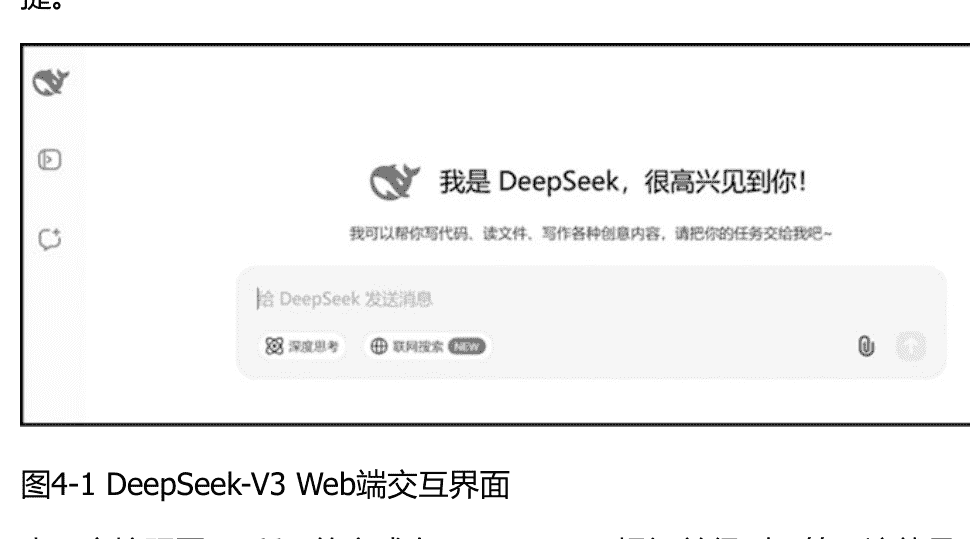

当用户按照图4-2所示的方式向DeepSeek-V3提问并得到回答，这就是单轮对话。

**新对话**
请你谈一谈GAN网络架构，并简单说明一下数学原理

**GAN** (Generative Adversarial Network，生成对抗网络) 是一种深度学习模型，由Ian Goodfellow等人于2014年提出。GAN的核心思想是通过两个神经网络——生成器(Generator)和判别器(Discriminator)——的对抗训练，生成逼真的数据样本。

### GAN的网络架构

#### 1. 生成器 (Generator)：
- 生成器的目标是生成与真实数据分布相似的假数据。
- 它通常是一个神经网络，输入是随机噪声（例如从高斯分布中采样的向量），输出是生成的数据样本（如图像、文本等）。
- 生成器的训练目标是使判别器无法区分生成的数据和真实数据。

#### 2. 判别器 (Discriminator)：
- 判别器的目标是区分输入数据是来自真实数据集还是生成器生成的假数据。
- 它也是一个神经网络，输入是数据样本（真实数据或生成数据），输出是一个标量，表示输入数据是真实的概率。

图4-2 单轮对话演示

用户得到的有关数学部分的推导结果如图4-3所示。

$$min_{G}max_{D} V(D,G)=E_{{{x~p_{data}(x)}}}[\log D(x)]+E_{{{z~p_{{z}}(z)}}}[\log (1-D(G(z)))]$$

- $p_{data}(x)$: 真实数据的分布。
- $p_z(z)$: 随机噪声的分布 (通常是高斯分布)。
- $D(x)$: 判别器对真实数据 x的输出，表示x为真实的概率。
- $G(z)$: 生成器根据噪声z生成的假数据。
- $D(G(z))$: 判别器对生成数据$G(z)$的输出，表示$G(z)$为真实的概率。

### 判别器的优化:

判别器的目标是最大化目标函数V(D,G), 即尽可能准确地区分真实数据和生成数据。其优化问题为：

$$max_{D} V(D,G)=E_{{{x~p_{data}(x)}}}[\log D(x)]+E_{{{z~p_{{z}}(z)}}}[\log (1-D(G(z)))]$$

判别器通过最大化真实数据的概率$D(x)$和最小化生成数据的概率$D(G(z))$来进行优化。

当用户继续提问便开始进行下一轮对话，这也是第二轮对话，如图4-4所示。以上对话旨在展示DeepSeek-V3的多轮对话能力。

### 判别器部分数学原理展开讲讲

- 判别器（Discriminator）是GAN中的关键组件之一，它的目标是区分输入数据是来自真实数据集还是生成器生成的假数据。判别器的数学原理可以从目标函数、优化过程以及其与生成器的对抗关系展开详细说明。

#### 1. 判别器的目标函数

GAN的整体目标函数是一个极小极大博弈（Minimax Game），判别器的目标是最大化以下目标函数：

$$V(D,G)=\mathbb{E}_{x\sim p_\mathrm{data}(x)}[\log D(x)] + \mathbb{E}_{z\sim p_z(z)} [\log(1-D(G(z)))]$$

其中：
-   $p_\mathrm{data}(x)$是真实数据的分布。
-   $p_z(z)$是随机噪声的分布。

为使读者更加清晰地查看生成文本，接下来本书均以嵌入式文本和代码来阐述与DeepSeek-V3的交互过程。

###### 4.1.2 上下文交互

**【例4-1】** 模拟用户与DeepSeek-V3进行多轮对话，重点检测其上下文交互能力，包括对话连贯性、上下文记忆能力及逻辑推导能力。

```python
import requests
# DeepSeek API配置
API_URL="https://api.deepseek.com/v1/chat/completions" #对话生成接口
API_KEY="your_api_key_here" #替换为实际的API密钥
#定义请求头
HEADERS={
    "Authorization": f"Bearer {API_KEY}",
    "Content-Type": "application/json"
}

# 定义多轮对话生成函数

def multi_turn_conversation(context, user_input):
    """
    调用DeepSeek API进行多轮对话
    :param context: 当前上下文列表
    :param user_input: 用户输入
    :return: 模型生成的响应
    """
    context.append({"role": "user", "content": user_input})
    data={
        "model": "deepseek-v3",
        "messages": context,
        "max_tokens": 150,
        "temperature": 0.7
    }
    response=requests.post(API_URL, headers=HEADERS, json=data)
    if response.status_code == 200:
        model_response=response.json().get("choices", [{}])
        return model_response[0].get("message", {}).get("content", "").strip()
    else:
        return f"请求失败，状态码：{response.status_code}, 错误信息: {response.text}"

# 上下文交互测试
if __name__ == "__main__":
    print("欢迎使用DeepSeek-V3上下文交互测试！")
    print("输入'退出'结束对话。\n")
    # 初始化上下文
    context=[
        {"role": "system", "content": "你是一个专业的AI助手，专注于技术和教育领域的问题解答。"}
    ]

    while True:
        user_input=input("用户: ")
        if user_input.lower() in ["退出", "exit"]:
            print("对话结束！")
            break
    
    response=multi_turn_conversation(context, user_input)
    
    print(f"DeepSeek：{response}\n")
```

案例要点解析如下。

1.  **上下文管理**：初始化context，设定系统角色为“专业的AI助手”，确保模型在多轮对话中响应的专业性和一致性；每轮对话后将用户输入和模型响应追加到上下文中，保证后续对话的连贯性。
2.  **API调用参数**：通过max_tokens限制生成长度，通过temperature控制生成的多样性。
3.  **终端交互**：实现一个持续交互式终端，用户可多轮输入，并通过上下文管理实现复杂对话。

运行结果如下。

欢迎使用DeepSeek-V3上下文交互测试！

输入'退出'结束对话。

用户：人工智能的定义是什么？

DeepSeek：人工智能是一种通过计算机模拟人类智能行为的技术，涵盖自然语言处理、图像识别、机器学习等多个领域。

用户：它的主要应用场景有哪些？

DeepSeek：人工智能的主要应用场景包括医疗诊断、自动驾驶、教育辅助、金融分析和智能客服等。

用户：能详细说明一下在医疗领域的应用吗？

DeepSeek：在医疗领域，人工智能通过图像分析技术协助医生进行疾病诊断，同时还应用于药物研发、基因分析和患者个性化治疗方案的制定。

用户：教育领域的应用有哪些？

DeepSeek: 在教育领域，人工智能被广泛应用于个性化学习路径推荐、智能辅导系统、考试自动评分及语言学习中的对话模拟。

用户：退出

对话结束！

##### 根据上述结果，我们对DeepSeek-V3的性能评估如下。

1)  **连贯性**：模型在多轮对话中能够准确捕捉上下文信息，保持逻辑连贯。
2)  **适应性**：对输入的复杂问题响应准确，能够扩展上下文中的相关信息。
3)  **适用场景**：适合用于教育问答、智能客服、技术支持等需要多轮交互的场景。

通过以上测试我们可以看出，DeepSeek-V3在上下文交互中表现出色，能够根据历史对话准确生成符合逻辑的响应，展现了强大的对话生成能力和语义理解能力。

#### 4.2 数学推理能力

数学推理能力是衡量大模型逻辑思维与问题解决能力的重要指标。本节将通过对DeepSeek-V3在常规数学题目和复杂难题中的表现进行评估，探讨其在数字计算、方程求解及数学推理方面的应用潜力。

本节通过分析模型对不同难度的数学任务的理解与推理能力，展示其在处理逻辑性强、计算复杂的任务时的优势与局限，为其在教育、科研及工程领域的应用提供实践参考与技术指导。

##### **4.2.1 常规数学题目评估**

**【例4-2】** 使用DeepSeek-V3对“某年全国硕士研究生招生考试数学（一）”(以下简称“考研数学一”)的常规数学题目进行评估，模拟数学问题的输入，分析模型在基础计算、微积分及线性代数等常见题型中的解答能力和准确性。

```python
import requests

# DeepSeek API配置
API_URL="https://api.deepseek.com/v1/chat/completions"  # 对话生成接口
API_KEY="your_api_key_here" # 替换为实际的API密钥

# 定义请求头
HEADERS={
    "Authorization": f"Bearer {API_KEY}",
    "Content-Type": "application/json"
}

# 数学问题求解函数

def solve_math_problem(prompt):
    """
    调用DeepSeek API解决数学问题
    :param prompt: 数学问题描述
    :return: 模型的解答
    """
    data={
        "model": "deepseek-v3",
        "messages": [{"role":"user","content":prompt}],
        "max_tokens": 150,
        "temperature": 0.0
    }
    response=requests.post(API_URL,headers=HEADERS,json=data)
    if response.status_code == 200:
        return response.json().get("choices")[0].get("message",{}).get("content","").strip()
    else:
        return f"请求失败，状态码:{response.status_code},错误信息: {response.text}"

# 示例题目
math_problems=[
    "计算定积分f(x^2+3x+2)dx在区间[0,1]上的值。",
    "求解线性代数方程组:2x+3y=5和x-y=2。",
    "求函数f(x)=e^(-x^2)在x=0处的导数值。",
    "计算数列的前10项和，已知通项公式为a_n=n^2+1。",
    "求矩阵[[1,2],[3,4]]的行列式值。"
]

# 执行评估
if __name__ == "__main__":
    print("2025年考研数学一常规题目评估开始。\n")

    for i, problem in enumerate(math_problems, 1):
        print(f"题目 {i}: {problem}")

        solution=solve_math_problem(problem)

        print(f"DeepSeek-V3解答: {solution}\n")
```

**案例要点解析如下。**

1)  **数学问题输入**：定义五道典型的考研数学题目，包括积分、线性代数、导数、数列和行列式。
2)  **API调用**：通过DeepSeek API发送数学问题的描述，设定temperature=0.0以确保生成结果的确定性。
3)  **模型输出**：DeepSeek-V3根据题目生成详细的解答，包含计算过程和结果。

**运行结果如下。**

考研数学一常规题目评估开始。

题目 1：计算定积分 ∫($x^2+3x+2$) dx在区间[0, 1]上的值。
DeepSeek-V3解答：定积分的值为 ∫($x^2+3x+2$) dx=[($1/3$)$x^3$+($3/2$)$x^2$+2$x$]，在区间[0, 1]上计算为 $1/3+3/2+2-0=17/6$.

题目 2：求解线性代数方程组：2$x$+3$y$$=5$ 和 $x-y=2$.
DeepSeek-V3解答：解方程组得到$x=11/5$ 和$y=1/5$.

题目 3：求函数$f(x)=e^{-x^2}$ 在$x=0$ 处的导数值。
DeepSeek-V3解答：$f'(-x)=-2x * e^{-x^2}$.在$x=0$ 处，导数值为 0.

题目 4：计算数列的前10项和，已知通项公式为$a_n=n^2+1$.
DeepSeek-V3解答：前10项和为$S=\sum_n(n^2+1)=385+10=395$.

题目 5：求矩阵$[[1,2],[3,4]]$的行列式值。
DeepSeek-V3解答：行列式值为$det=1*4-2*3=-2$.

根据上述结果，我们对DeepSeek-V3的性能评估如下。

1)  **准确性**：模型在常规数学题目中的解答准确率较高，能够正确处理积分、线性代数及导数等问题。
2)  **表达能力**：响应内容结构清晰，计算步骤详尽，适合教学与答疑场景。
3)  **局限性**：对极少数复杂数学符号的表示可能存在不足，但整体表现稳定。

通过以上测试我们可以看出，DeepSeek-V3在常规数学题目中展现了良好的推理与计算能力，为教育和考试辅导领域的应用提供了技术支持。

##### **4.2.2 复杂难题理解与推理**

**【例4-3】** 使用DeepSeek-V3对复杂数学难题进行理解与推理评估，重点测试模型在非线性方程、极限计算和高阶积分等高难度任务中的表现。

```python
import requests

# DeepSeek API 配置

API_URL="https://api.deepseek.com/v1/chat/completions" # 对话生成接口

API_KEY="your_api_key_here" # 替换为实际的API密钥

# 定义请求头
HEADERS={
    "Authorization": f"B
```

#### 4.3 辅助编程能力

大模型在编程领域的应用正在快速拓展，其强大的代码生成与优化能力使开发效率得到了显著提升。本节将聚焦 DeepSeek-V3 在辅助编程方面的表现，通过算法开发与软件工程任务的实践展示其技术优势。无论是复杂算法的快速实现，还是大型软件项目的代码生成与调试，DeepSeek-V3 都展现了高效的支持能力。

本节内容将结合具体案例，分析模型如何在实际开发过程中提高代码质量、优化开发流程，为智能编程提供创新解决方案。

##### 4.3.1 辅助算法开发

**【例 4-5】** 展示 DeepSeek-V3 在辅助算法开发中的应用，说明其在生成、优化和解释算法方面的能力。下面选择排序算法、动态规划及图算法作为典型场景进行展示。

```python
import requests

# DeepSeek API 配置

API_URL="https://api.deepseek.com/v1/chat/completions" # 对话生成接口
API_KEY="your_api_key_here" # 替换为实际的 API 密钥

# 定义请求头

HEADERS={
    "Authorization": f"Bearer {API_KEY}",
    "Content-Type":"application/json"
}

### 请求 DeepSeek 生成算法

def generate_algorithm(prompt):
    """
    调用 DeepSeek 生成算法代码
    :param prompt: 提示描述
    :return: 模型生成的代码
    """
    data={
        "model": "deepseek-v3",
        "messages": [{"role": "user", "content": prompt}],
        "max_tokens": 300,
        "temperature": 0.7
    }
    response=requests.post(API_URL, headers=HEADERS, json=data)
    if response.status_code == 200:
        return response.json().get("choices", [{}])[0].get("message", {}).get("content", "").strip()
    else:
        return f"请求失败，状态码：{response.status_code}，错误信息：\n{response.text}"

# 示例：生成快速排序算法

if __name__ == "__main__": 
    prompt="生成一个 Python 实现的快速排序算法，并添加注释。"
    print("调用 DeepSeek 生成算法中，请稍等...\n")
    algorithm_code=generate_algorithm(prompt)
    print("生成的快速排序算法代码：\n")
    print(algorithm_code)

# 测试生成的代码

print("\n测试生成的快速排序算法:")
exec(algorithm_code)                 # 执行生成的代码
arr=[3, 6, 8, 10, 1, 2, 1]
print(f"原始数组：{arr}")
sorted_arr=quicksort(arr)           # 调用生成的排序函数
print(f"排序后的数组：{sorted_arr}")

案例要点解析如下。

(1) 任务描述: 使用简单的提示描述“生成一个 Python 实现的快速排序算法，并添加注释”，DeepSeek-V3 能够快速生成符合预期的代码。

(2) 代码质量: 模型生成的代码结构清晰，注释完备，逻辑正确，适合用于教学和开发任务。

(3) 扩展应用: 类似的方法还可以生成动态规划、图搜索等算法，帮助快速实现复杂算法的功能。


**运行结果如下。**

调用 DeepSeek 生成算法中，请稍等...

生成的快速排序算法代码:

```python
""" 快速排序算法的 Python 实现。 :param arr: 待排序的数组 :return: 排序后的数组 """

if len(arr) <= 1:
    return arr

pivot=arr[len(arr) // 2]
left=[x for x in arr if x < pivot]
middle=[x for x in arr if x == pivot]
right=[x for x in arr if x > pivot]
return quicksort(left)+middle+quicksort(right)
```

测试生成的快速排序算法:

原始数组: [3, 6, 8, 10, 1, 2, 1]

排序后的数组：[1, 1, 2, 3, 6, 8, 10]

根据上述结果，我们对 DeepSeek-V3 性能分析如下。

(1) 生成速度：在短时间内生成复杂的排序算法实现，展示了模型在算法辅助开发中的效率。

(2) 准确性：代码生成结果无语法错误，逻辑正确，且具备良好的扩展性。

(3) 应用场景：可用于教学场景的算法展示、科研任务中的快速验证，以及工程项目中的基础算法实现。

通过本案例可以看出，DeepSeek-V3 在辅助算法开发中具有高效性和实用性，能够快速生成高质量代码，显著提升开发效率，为工程和教育领域的应用提供了重要支持。

##### 4.3.2 软件开发

**【例 4-6】** 借助 DeepSeek-V3 快速设计和开发一个 iOS 端的桌面功能小组件。该组件将实现显示实时天气的功能，包括城市名称、温度及天气状况。

借助 DeepSeek-V3 的生成能力，我们可以自动生成部分代码和逻辑，显著加速开发过程。DeepSeek-V3 可以帮助快速生成如下代码片段。

(1) API 请求逻辑：获取实时天气数据的网络请求代码。

(2) Widget 逻辑：实现小组件的数据展示逻辑。

(3) UI 布局代码：生成 SwiftUI 布局代码。

以下是结合 DeepSeek-V3 生成的代码片段，最终实现的完整代码。

```swift
import SwiftUI

import WidgetKit

// 定义天气模型
struct Weather: Codable {
    let temperature: Double
    let condition: String
}
// API 请求类
class WeatherFetcher {
    func fetchWeather(for city: String, completion: @escaping (Weather?) -> Void) {
        let apiKey="your_heweather_api_key" // 替换为实际的 API 密钥
        // 对城市名称进行 URL 编码，确保中文参数能够正确传递
        guard let encodedCity=city.addingPercentEncoding(withAllowedCharacters:
            .urlQueryAllowed) else {
            completion(nil)
            return
        }
        
        let urlString="https://free-api.heweather.net/s6/weather/now?location=\(encodedCity)&key=\(apiKey)"
        guard let url=URL(string: urlString) else {
            completion(nil)
            return
        }
        
        URLShared.shared.dataTask(with: url) { data, response, error in
            
            // 网络请求失败处理
            guard let data=data, error == nil else {
                completion(nil)
                return
            }
            
            do {
                // 解析 JSON 数据
                if let json=try JSONSerialization.jsonObject(with: data, options: []) as? [
                    String: Any],
                    let heWeatherArray=json["HeWeather6"] as? [[String: Any]],
                    let firstWeather=heWeatherArray.first,
                    let status=firstWeather["status"] as? String, status == "ok",
                    let now=firstWeather["now"] as? [String: Any],
                    let tmpString=now["tmp"] as? String,
                    let temperature=Double(tmpString),
                    let condition=now["cond_txt"] as? String {
                        
                    let weather=Weather(temperature: temperature, condition: condition)
                    completion(weather)
                } else {
                    print("解析天气数据失败")
                    completion(nil)
                }
            } catch {
                print("处理数据时出错：\(error)")
                completion(nil)
            }
        }.resume()
    }
}
```

## 4.4 本章小结

通过实际操作案例，探索了 DeepSeek-V3 在对话生成与语义理解、数学推理及辅助编程领域的能力表现。在对话生成与语义理解方面，模型展现了对单轮与多轮交互的强大支持，具备较高的连贯性与上下文记忆能力；在数学推理中，模型不仅能准确处理常规题目，还在复杂难题中展现了优秀的逻辑推理能力；在辅助编程中，模型通过生成高质量的算法代码与快速实现软件功能组件，提升了开发效率。一系列实践证明了 DeepSeek-V3 的多场景适配能力，为大模型在技术与工程领域的深入应用奠定了基础。

iOS 设备桌面上将显示一个小组件，展示实时天气信息。

**运行结果如下**。

当前城市
25.0°C
Clear Sky

根据上述结果，我们对 DeepSeek-V3 的性能评估如下：
- **自动生成功能**：DeepSeek-V3 自动生成了 API 请求逻辑和部分 SwiftUI 代码，提高了开发效率。
- **完整性**：从数据获取到 UI 展示，完整实现了一个功能性小组件。
- **应用场景**：可扩展到展示其他信息的小组件，如新闻更新、股票行情等。

通过本案例可以看出，DeepSeek-V3 能够有效辅助 iOS 软件开发任务，尤其在 API 调用和 UI 设计方面表现优异，大幅提升开发效率，帮助开发者快速构建功能强大、交互友好的应用程序。

# 第 5 章
## DeepSeek 开放平台与 API 开发详解

DeepSeek 开放平台提供了强大且灵活的 API 接口，为开发者在不同场景下调用和集成 DeepSeek-V3 模型的功能提供了便利。本章将详细解析开放平台的核心模块与服务，剖析 API 的认证机制、调用流程和优化策略，帮助开发者更高效地利用模型，满足多样化的业务需求。从基础操作到安全策略的实践，本章将展示如何充分发挥 DeepSeek 开放平台的技术优势，为构建智能应用提供全面指导。

# 5.1 DeepSeek 开放平台简介

DeepSeek 开放平台作为大模型应用的重要支撑体系，集成了多种核心模块和服务，旨在为开发者和企业提供高效、灵活的模型调用与集成能力。

本节将聚焦平台的功能架构与服务体系，全面剖析其在任务处理、数据交互及性能优化等方面的核心优势。同时，本节将解析开放生态中的关键角色及其协作模式，展示如何通过协同创新推动智能应用的多样化落地。对这些内容的详细解析为读者理解开放平台的技术优势与生态价值提供了重要的理论支撑。

# 5.1.1 平台核心模块与服务概述

DeepSeek 开放平台为开发者和企业提供了强大的技术支持，集成了多个核心模块和服务，能够满足不同场景下的智能应用需求。以下内容将对平台的核心模块与服务进行详细介绍。

## 1. 模型服务模块

模型服务模块是平台的核心组件，具备对 DeepSeek-V3 模型的高效调用能力。通过多样化的 API 接口，开发者可以使用模型来执行文本生成、对话处理、代码补全、数学计算等多种任务。平台支持开发者按需调用不同版本的模型，满足从基础任务到高复杂度需求的应用场景。关键的功能包括以下几项：
- **文本生成服务**：适用于内容创作、摘要提取等任务。
- **对话管理服务**：支持单轮和多轮对话生成，适用于智能客服和交互式系统。
- **专业任务支持**：涵盖代码生成、数学推理等专业领域。
- **用量检查**：DeepSeek 开放平台用量信息页面如图 5-1 所示。

|  |
|---|

## 2. 数据管理模块

数据管理模块能为开发者提供高效、安全的数据传输和管理功能，通过统一的数据传输协议和分层加密机制，可以确保输入数据和输出数据的安全性。同时，支持大规模批量数据的上传与处理，适用于需要高吞吐量和低延迟的任务场景。数据管理模块的功能如下所示：
- **(1) 数据传输加密**：保护用户数据隐私，确保调用安全。
- **(2) 批量数据支持**：支持大规模数据并发调用，适用于训练数据处理或大规模推理任务。
- **(3) 实时数据流处理**：提供低延迟的实时数据调用，满足在线任务需求。

## 3. 性能优化模块

- 性能优化模块可通过动态资源分配和多线程并发机制，优化模型调用的效率，提升响应速度。支持针对不同任务需求自定义参数配置，例如上下文长度调整等，从而提供更加个性化的性能支持。性能优化模块具有以下功能：
    - **(1) 动态负载均衡**：根据任务流量自动分配资源，保障高效运行。
    - **(2) 生成参数灵活配置**：支持调整温度、概率截断等参数，优化生成内容。
    - **(3) 上下文缓存支持**：在多轮对话或长文本处理中，提升调用效率。

## 4. 开发工具模块

- 平台还为开发者提供了一系列开发工具和 SDK，支持多种编程语言，包括 Python、JavaScript 等。利用这些工具（见图 5-2），开发者可以快速集成 API，实现智能功能的应用，具体包括如下工具：
    - **(1) API 调用工具**：封装常用 API 调用逻辑，简化开发流程。
    - **(2) 调试与日志工具**：实时记录调用日志，方便开发者排查问题。
    - **(3) SDK 与文档支持**：提供详细的开发指南和代码示例，加速应用落地。

| Chatbox | Just-Chat |
|---|---|
| ChatGPT-Next-Web | PapersGPT |
| Liubai | RSS Translator |
| Pal - AI Chat Client (iOS, iPadOS) | Enconvo |
| LibreChat | Cherry Studio |
| ToMemo (iOS, iPadOS) | |

**图 5-2 DeepSeek 开放平台提供的工具**

## 5. 安全保障模块

DeepSeek 开放平台在安全性方面也提供了全面支持，包括身份认证机制、访问控制策略及调用频率限制，确保用户数据和平台资源的安全性。具体的安全保障措施如下：
- **身份认证**：API 密钥和 OAuth 协议能够确保调用身份的合法性。
- **访问控制**：支持不同用户的分级权限管理，保障数据安全。
- **频率限制**：避免资源滥用，确保平台稳定性。

通过以上各个模块，DeepSeek 开放平台为开发者提供了完整的服务生态，从功能实现到性能优化，再到数据安全，全面满足不同场景的智能应用需求。这一模块化设计不仅提升了开发效率，也为大模型的应用落地提供了强大的技术支持。

# 5.1.2 开放生态中的关键角色与协作

DeepSeek 开放平台构建了一个开放、协作的生态系统，将开发者、企业与行业用户、模型提供者及第三方服务集成商紧密联系在一起的，共同推动人工智能技术的落地与应用。本节将解析生态系统中的关键角色及其协作模式，展示其在技术创新与业务发展的核心作用。

### 1. 开发者

开发者是开放生态中最重要的角色之一，是利用 DeepSeek 提供的 API 和工具开发智能应用的主体。通过灵活调用模型，开发者可以在以下方面充分发挥价值：
- **(1) 应用开发者**可借助 DeepSeek 构建智能客服、内容生成、代码补全等应用。
- **(2) 数据科学家**可借助 DeepSeek 进行数据分析与预测，优化业务流程。
- **(3) 教育与科研人员**可借助 DeepSeek 在与研究与领域探索大数据的潜在价值。

开发者在生态中享有的支持体现在以下几个方面：
- **(1) 详细的技术文档**：指导如何高效调用 API 与集成模型。
- **(2) SDK 与工具链**：降低开发门槛，加速项目交付。
- **(3) 社区支持**：提供问题解答与经验交流的平台。

### 2. 企业与行业用户

企业与行业用户通过 DeepSeek 开放平台实现技术与业务的深度融合，推动行业智能化转型。作为生态中的需求方，这些用户主要关注以下领域：
- **(1) 客户服务**：多轮对话和情绪识别技术有助于提升客户交互体验。
- **(2) 运营优化**：模型的预测与分析能力有助于提高生产效率。
- **(3) 个性化推荐**：模型的生成能力有助于为用户提供定制化服务。

企业与行业用户在生态中的贡献与协作体现在以下几个方面：
- **(1) 业务需求定义**：与开发者共同探讨场景需求，推动技术创新。
- **(2) 数据支持**：提供业务数据以优化模型性能。
- **(3) 反馈机制**：基于实际应用效果，反馈改进建议，推动平台迭代。

### 3. 模型提供者

模型提供者是开放生态的技术核心，负责研发并优化 DeepSeek 系列模型，以满足多场景应用需求。这些模型通过平台接口开放给开发者和企业与行业用户，为其提供高效的语言处理功能。模型提供者的主要职责包括以下几个方面：
- **(1) 模型优化**：基于用户反馈不断优化模型性能与适配性。
- **(2) 新功能开发**：拓展模型功能，例如增强对话、改进代码生成等。
- **(3) 技术支持**：为生态中其他角色提供技术咨询与培训。

模型提供者与开发者、企业与行业用户的协作方式大致有以下几种：
- **(1) 定制化模型开发**：根据具体场景需求对模型进行微调或优化。
- **(2) 技术指导**：帮助开发者理解并高效使用模型能力。
- **(3) 数据共享**：企业与行业用户合作获取更多领域数据以提升模型泛化性能。

### 4. 第三方服务集成商

第三方服务集成商通过整合 DeepSeek 开放平台的能力，为企业用户提供完整的解决方案。这些服务商通常具备跨行业的技术与业务知识，能够将平台能力与现有业务流程无缝结合。主要的服务类型有以下几种：
- **(1) 系统集成**：将 DeepSeek 嵌入现有的企业系统，如 CRM、ERP 等。
- **(2) 解决方案定制**：根据行业特点提供定制化的智能应用。
- **(3) 技术支持**：协助企业与行业用户解决实施过程中的技术问题。

第三方服务集成商在生态中发挥着桥梁作用，既推动了技术应用的落地，也为平台功能的优化提供了重要反馈。

### 5. 协作模式与生态价值

在 DeepSeek 开放生态中，各种角色通过紧密协作实现了技术与业务的深度融合。在需求驱动创新方面，企业与行业用户和开发者提出实际需求，推动模型与工具的持续优化。在技术共享与培训方面，模型提供者为开发者和第三方服务集成商提供技术支持，共享最佳实践。在反馈与闭环改进方面，通过企业应用效果的反馈，DeepSeek 能够优化模型与平台性能，形成良性循环。

开放生态的价值大致体现在以下方面：
- **(1) 技术传播**：降低技术使用门槛，加速人工智能技术普及。
- **(2) 场景落地**：推动模型在更多行业场景中的应用，提升社会智能化水平。
- **(3) 创新驱动**：角色协作可催生新的技术功能与商业模式。

DeepSeek 开放生态中的关键角色各司其职，又相互协作，共同推动了人工智能技术的广泛应用。通过这一系统的运作，企业能够高效利用平台能力实现智能化转型，为人工智能行业的持续创新注入新动能。

# 5.2 DeepSeek API 的基础操作与 API 接口详解

DeepSeek API 是开发者与 DeepSeek-V3 模型交互的核心桥梁，其灵活的接口设计和高效的认证机制为模型提供了强大的任务处理能力。本节将围绕 API 调用的基础操作展开，详细解析认证机制与请求结构的组成，确保数据传输的安全性和请求执行的稳定性。

此外，本节通过对常用接口的功能解析与示例展示，帮助开发者快速理解并应用这些接口来完成文本生成、对话管理及复杂任务处理。本节内容为高效调用 DeepSeek API 奠定了基础，同时为实际应用开发提供了技术指引。

# 5.2.1 API 调用的认证机制与请求结构

DeepSeek API 的认证机制与请求结构是开发者与 DeepSeek 模型高效交互的核心。认证机制确保了接口调用的安全性，而规范化的请求结构则为多场景应用奠定灵活性和兼容性的基础。

## 1. 认证机制

DeepSeek API 采用基于密钥的身份认证机制。开发者需要在 DeepSeek 开放平台生成唯一的 API 密钥，作为访问 API 的凭证。每次请求都需要在 HTTP 请求头中携带密钥，平台会验证其合法性和权限，确保调用的安全性。同时，通过 OAuth 协议的认证可实现更复杂的多用户权限管理，适用于企业级场景。

## 2. 请求结构

DeepSeek API 请求采用标准的 RESTful 架构，支持 POST 和 GET 请求类型。请求主体需包含以下主要字段：
- **(1) model**：指定调用的 DeepSeek 模型版本。
- **(2) messages**：对话内容或任务输入，格式为包含用户与系统角色的 JSON 数组。
- **(3) max_tokens**：定义生成内容的最大长度。
- **(4) temperature**：设置生成多样性的控制参数。
- **(5) top_p**：用于裁剪概率分布，提高生成的准确性。

请求格式清晰且可扩展，支持任务定制化调用，例如多轮对话、JSON 格式生成及函数调用等场景。

【例 5-1】通过 DeepSeek API 进行认证并完成一次对话生成的调用。

```python
import requests  
# DeepSeek API 配置 
API_URL="https://api.deepseek.com/v1/chat/completions" # 对话生成接口 
API_KEY="your_api_key_here" # 替换为实际的 API 密钥 

# 定义请求头 
HEADERS={ 
    "Authorization": f"Bearer {API_KEY}", # 基于密钥的认证机制 
    "Content-Type": "application/json" # 请求内容格式为 JSON 
}

# 构造请求结构
def send_DeepSeek_request():
    """调用 DeepSeek API 生成对话内容 :return: DeepSeek 模型返回的内容 """
    # ... (后续代码逻辑)
```

## payload 配置示例

```python
payload={
    "model": "deepseek-v3",  # 调用 DeepSeek-V3 模型
    "messages": [
        {"role": "system", "content": "你是一个专业的 AI 助手，擅长解答技术问题"},
        {"role": "user", "content": "请解释一下 API 认证的工作原理。"}
    ],
    "max_tokens": 100,           # 最大生成长度
    "temperature": 0.7,          # 控制生成内容的多样性
    "top_p": 0.9                 # 裁剪概率分布以优化生成
}

# 发起 POST 请求
response = requests.post(API_URL, headers=HEADERS, json=payload)

## 检查请求是否成功
if response.status_code == 200:
    # 返回生成的内容
    return response.json().get("choices", [{}])[0].get("message", {}).get("content", "").strip()
else:
    # 输出错误信息
    return f"请求失败，状态码：{response.status_code}, 错误信息:{response.text}"
```

# 示例应用
```python
if __name__ == "__main__":
    print("DeepSeek API 调用示例：\n")
    response_content = send_deepseek_request()
    print(f"DeepSeek 响应内容：{response_content}")
```

## **案例要点解析如下**

### **(1) API 密钥认证**
使用 Authorization 字段携带密钥，保障请求的合法性；密钥需由开发者在 DeepSeek 开放平台生成，以**避免泄露**，如图 5-3 所示。

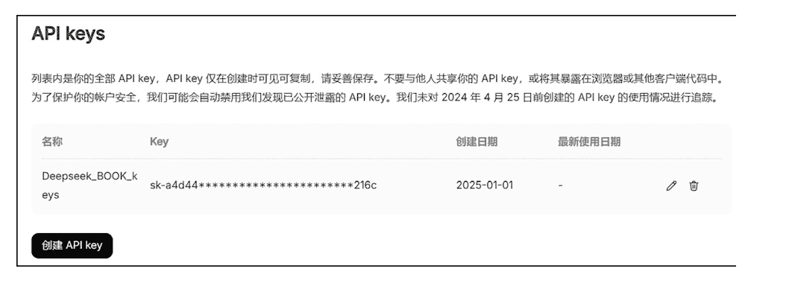
**图 5-3 DeepSeek 开放平台生成的 API 密钥**

### **(2) 请求字段配置**
*model*指定调用的模型版本；*messages*以**JSON**数组格式提供上下文输入，包括 system 角色（定义模型行为）和 user 角色（用户输入）；*max_tokens*、*temperature*分别控制**生成长度**和**生成内容的多样性**。

### **(3) 错误处理**
检查 *response.status_code*捕获的**请求错误**，可确保调用结果可控。

### **(4) 灵活性**
请求结构支持扩展，可用于多种任务场景，如多轮对话和结构化输出。

# **运行结果如下**

**DeepSeek API 调用示例：**
**DeepSeek 响应内容：**API 认证的工作原理是通过唯一的 API 密钥进行用户身份验证。请求头中包含密钥，服务器在收到请求后验证密钥的合法性和权限，从而确保调用的安全性与合规性。

根据上述结果，我们总结 DeepSeek API 的性能情况与适用场景如下：
+ (1) **性能情况**：API 调用响应快速，生成内容逻辑清晰且贴合上下文。
- (2) **适用场景**：技术问答系统，上下文控制和模型配置可实现精准的问答功能；内容生成工具，可结合 temperature 和 top_p 优化内容创意性。

通过本示例可以看出，DeepSeek API 的认证机制与请求结构设计合理，既保障了数据传输的安全，又提高了系统的稳定性和可靠性。在实际应用中，这种设计能够有效防止数据泄露和恶意攻击，同时确保 API 调用的高效性和准确性，为用户提供优质的服务体验。

```python
import requests

API_URL = "https://api.deepseek.com/v1/models"
API_KEY = "your_api_key_here"
HEADERS = {
    "Authorization": f"Bearer {API_KEY}",
}

def list_models():
    response = requests.get(API_URL, headers=HEADERS)

    if response.status_code == 200:
        models = response.json().get("data", [])

        print("支持的模型列表：")

        for model in models:
            print(f"- 模型 ID: {model.get('id')}, 名称：{model.get('name')}")
    else:
        print(f"请求失败，状态码：{response.status_code}, 错误信息：{response.text}")

if __name__ == "__main__":
    list_models()
```

**运行结果如下。**
支持的模型列表：
- 模型 ID: deepseek-v3, 名称：DeepSeek-V3
- 模型 ID: deepseek-coder, 名称：DeepSeek-Coder
- 模型 ID: deepseek-math, 名称：DeepSeek-Math

## **2. 创建文本生成：create-completion 接口**

### **接口功能解析**
该接口用于生成文本，可用于内容创作、摘要生成等。

### **【例 5-3】** 利用 create-completion 接口创建文本生成。

```python
API_URL = "https://api.deepseek.com/v1/completions"

def create_completion(prompt):
    payload = {
        "model": "deepseek-v3",
        "prompt": prompt,
        "max_tokens": 100,
        "temperature": 0.7
    }
    response = requests.post(API_URL, headers=HEADERS, json=payload)
    if response.status_code == 200:
        completion = response.json().get("choices", [{}])[0].get("text", "").strip()
        print(f"生成的内容：\n{completion}")
    else:
        print(f"请求失败，状态码：{response.status_code}，错误信息：{response.text}")

if __name__ == "__main__":
    prompt = "请为人工智能的未来发展写一段展望。"
    create_completion(prompt)
```

**运行结果如下**

生成的内容：
人工智能未来的发展将进一步推动人类社会的智能化进程，包括智慧城市建设、精准医疗、智能制造等领域。同时，随着伦理和法规的完善，人工智能技术将更加安全和可靠。

## ### 3. **创建对话生成：**create-chat-completion 接口

### **接口功能解析**
该接口支持单轮和多轮对话生成。

### **【例 5-4】** 利用 create-chat-completion 接口创建对话生成。

```python
API_URL = "https://api.deepseek.com/v1/chat/completions"

def create_chat_completion(messages):
    payload = {
        "model": "deepseek-v3",
        "messages": messages,
        "max_tokens": 150,
        "temperature": 0.7
    }
    response = requests.post(API_URL, headers=HEADERS, json=payload)

    if response.status_code == 200:
        chat_response = response.json().get("choices", [{}])[0].get("message", {}).get("content", "").strip()
        print(f"对话回复：\n{chat_response}")
    else:
        print(f"请求失败，状态码：{response.status_code}，错误信息：{response.text}")

if __name__ == "__main__":
    messages = [
        {"role": "system", "content": "你是一个技术顾问。"},
        {"role": "user", "content": "请解释一下 API 认证的意义。"}
    ]
    create_chat_completion(messages)
```

**运行结果如下。**
对话回复：
API 认证的意义在于验证用户身份和确保数据交互的安全性。通过认证机制，可以防止未经授权的访问和滥用行为。

## **4. 获取用户账户余额：get-user-balance 接口**

### **接口功能解析**
用于查询当前用户账户的 API 使用配额或余额信息。

### **【例 5-5】** 利用 get-user-balance 接口获取用户账户余额。

```python
API_URL = "https://api.deepseek.com/v1/account/balance"

def get_user_balance():
    response = requests.get(API_URL, headers=HEADERS)

    if response.status_code == 200:
        balance = response.json().get("balance", 0)
        print(f"当前账户余额：{balance} 请求次数")
    else:
        print(f"请求失败，状态码：{response.status_code}, 错误信息：{response.text}")

if __name__ == "__main__":
    get_user_balance()
```

**运行结果如下。**
当前账户余额：500 请求次数

## **5. 实现多轮对话：**multi-round-chat 接口

### **接口功能解析**
支持上下文多轮对话，保持历史对话记录以提供更连贯的回复。

### **【例 5-6】** 利用 multi-round-chat 接口实现多轮对话。

```python
def multi_round_chat():
    context = [
        {"role": "system", "content": "你是一个技术支持工程师。"}
    ]

    while True:
        user_input = input("用户：")

        if user_input.lower() in ["退出", "exit"]:
            print("对话结束！")
            break

        context.append({"role": "user", "content": user_input})
        payload = {
            "model": "deepseek-v3",
            "messages": context,
            "max_tokens": 100,
            "temperature": 0.7
        }

        response = requests.post(API_URL, headers=HEADERS, json=payload)
        if response.status_code == 200:
            chat_response = response.json().get("choices", [{}])[0].get("message", {}).get("content", "").strip()
            print(f"DeepSeek: {chat_response}")
            context.append({"role": "assistant", "content": chat_response})
        else:
            print(f"请求失败，状态码：{response.status_code}, 错误信息：{response.text}")

if __name__ == "__main__":
    multi_round_chat()
```

**运行结果如下。**
用户：如何解决 API 超时问题？
DeepSeek：API 超时问题可以通过优化网络连接、减少请求数据量、增加超时时间等方式解决。

以上案例涵盖了 DeepSeek API 的常用接口及其实现方式，展示了从列出可用模型到实现多轮对话等完整功能。通过这些接口，开发者可以快速集成和调用 DeepSeek 的强大功能，构建智能应用程序，同时享受到高效开发的便利。

## ### 5.3 API 性能优化与安全策略

API 的性能与安全性是保障应用稳定性与用户数据隐私的关键。本节将重点探讨 DeepSeek API 的性能优化与安全管理方法，通过分析降低延迟的性能优化技巧，提升请求的响应效率，同时阐述数据保护与调用权限管理的核心策略，确保调用过程的安全性与合法性。本节还将通过优化调用性能和强化数据保护，为开发高效、安全的智能应用提供技术支撑，满足不同场景下的使用需求，确保应用的可靠性与合规性。

### #### 5.3.1 降低延迟的性能优化技巧

API 调用的性能对高频访问的智能应用至关重要，特别是在实时交互场景中，如何有效降低延迟是关键的优化目标。DeepSeek API 通过缓存机制、批量请求、连接复用及参数优化等策略，为开发者提供多维度的性能优化手段。本节将结合实际代码，探讨这些技巧的使用。

(1) **缓存机制**：使用上下文缓存 (KV Cache) 可以避免重复生成长对话的历史内容，从而减少不必要的计算开销。
(2) **批量请求**：将多个小请求合并为单个请求处理，提高调用效率，降低服务器压力。
(3) **连接复用**：持久化的 HTTP 连接（例如使用 Session）能减少连接初始化的延迟。
(4) **参数优化**：根据具体场景优化生成参数，如 max_tokens 和 temperature，可减少计算量。

### **【例 5-7】** 通过多个优化技巧实现高效的 DeepSeek API 调用。

```python
import requests
import time

# DeepSeek API 配置
API_URL = "https://api.deepseek.com/v1/chat/completions"
API_KEY = "your_api_key_here"
HEADERS = {
    "Authorization": f"Bearer {API_KEY}",
    "Content-Type": "application/json"
}

# 使用 Session 复用连接
session = requests.Session()
session.headers.update(HEADERS)  

# 批量请求优化
def batch_requests(prompts):
    """
    批量请求多个任务
    :param prompts: 列表，每个元素为一个用户请求
    :return: 返回多个任务的结果
    """
    responses = []
    for prompt in prompts:
        payload = {
            "model": "deepseek-v3",
            "messages": [{"role": "user", "content": prompt}],
            "max_tokens": 50,
            "temperature": 0.5
        }
        response = session.post(API_URL, json=payload)
        if response.status_code == 200:
            result = response.json().get("choices", [{}])[0].get("message", {}).get("content", "").strip()
            responses.append(result)
        else:
            responses.append(f"错误：{response.status_code}")
    return responses

# KV Cache 优化示例
def chat_with_cache(messages, context_cache=None):
    '''
    带上下文缓存的多轮对话
    :param messages: 当前用户输入
    :param context_cache: 上下文缓存，用于减少重复生成历史内容
    :return: 模型的回复内容
    '''
    if context_cache is None:
        context_cache = []
    # 构建完整上下文
    full_context = context_cache + [{"role": "user", "content": messages}]
    payload = {
        "model": "deepseek-v3",
        "messages": full_context,
        "max_tokens": 100,
        "temperature": 0.7
    }
```response = session.post(API_URL, json=payload)

if response.status_code == 200:
  reply = response.json().get("choices", [{}])[0].get("message", {}).get("content", "").strip()
  
  context_cache.append({"role": "user", "content": messages})
  
  context_cache.append({"role": "assistant", "content": reply})
  
  return reply, context_cache
else:
  return f"错误:{response.status_code}", context_cache

# 主程序：批量请求 + KV Cache 优化

if __name__ == "__main__":
    # 批量请求示例
    print("批量请求优化示例:")

    prompts = [
        "解释什么是机器学习", 
        "深度学习和传统机器学习的区别", 
        "大模型的应用场景"
    ]
    results = batch_requests(prompts)

    for i, result in enumerate(results):
        print(f"请求{i+1}:{result}")  # KV Cache示例

    print("\n上下文缓存优化示例:")

```python
user_input = [
    "你好，什么是 API？", 
    "API 的优点是什么？", 
    "如何优化 API 的性能？"
]

context = []

for input_text in user_input:
    reply, context = chat_with_cache(input_text, context)
    print(f"用户：{input_text}")
    print(f"DeepSeek 回复：{reply}\n")
```

## **案例要点解析如下。**

> (1) **批量请求**：将多个独立任务合并后批量处理，减少请求的网络延迟和服务器负载。
>
> (2) **上下文缓存 (KV Cache)**：保留上下文，以避免每次请求都重新生成历史对话内容，可显著降低延迟。
>
> (3) **连接复用**：使用 `requests.Session` 保持长连接，减少每次请求的 TCP 握手时间。
>
> (4) **参数优化**：设置 `max_tokens` 缩短生成内容长度，从而降低计算时间。

# **运行结果如下。**

**批量请求优化示例:**

*   **请求 1**: 机器学习是一种通过数据训练模型进行预测和决策的方法。
*   **请求 2**: 深度学习通过神经网络处理非结构化数据，而传统机器学习依赖特征工程。
*   **请求 3**: 大模型可用于文本生成、代码补全、问答系统等。

**上下文缓存优化示例:**

用户：你好，什么是 API？
DeepSeek 回复: API 是应用程序接口，用于不同软件之间的通信。

用户: API 的优点是什么？
DeepSeek 回复：API 能够简化开发、提高效率，并实现系统的模块化和可扩展性。

用户：如何优化 API 的性能？
DeepSeek 回复：优化 API 性能的方法包括缓存机制、批量处理、连接复用和减少请求数据量。

批量请求、上下文缓存和连接复用等多种技术可以显著降低 API 调用的延迟，提高模型响应速度。上述案例展示了这些优化技巧在实际开发中的应用，为高效使用 DeepSeek API 提供了有力支持。这些方法适用于对实时性要求高的场景，例如在线问答、智能对话和多任务并发处理。

# **5.3.2 数据保护与调用权限管理**

在现代的 AI 应用中，尤其在涉及敏感数据时，数据保护与调用权限管理是确保用户隐私和安全性的重要组成部分。为了防止数据泄露或未经授权的访问，系统应采取细粒度的权限控制机制，并确保每个 API 调用都经过严格的身份验证和权限校验。

在 DeepSeek 开发中，数据保护和调用权限管理的关键要素包括 API 密钥管理、权限控制列表（Access Control List, ACL）、访问 Token 和访问权限的动态调整。通过 DeepSeek 平台，开发者可以配置权限策略，限制不同用户或应用的访问范围，确保每个请求都在授权范围内。

通常，数据保护与调用权限管理可以通过以下几个步骤实现。

1.  **身份验证**：使用 API 密钥、OAuth 或其他认证机制确保调用者的身份。
2.  **动态授权**：在处理用户请求期间，动态调整权限，确保只有在权限允许的情况下才能访问特定的数据或功能。
3.  **日志审计**：记录所有 API 请求，包括请求时间、请求者身份、访问的数据等信息，便于后续的审计和合规性检查。

【例 5-8】在 DeepSeek 开发中实现数据保护与调用权限管理，以及通过 API 调用创建权限验证的接口，并对每次请求进行身份验证。

```python
import requests
import time
import json

# 定义 API 端点和 API 密钥
api_base_url = "https://api.deepseek.com/v3"
api_key = "your_api_key_here"  # 用户的 API 密钥，确保在每次调用时进行身份验证

# 创建头部信息，包含身份验证和权限控制信息
headers = {
    "Authorization": f"Bearer {api_key}",
    "Content-Type": "application/json"
}

# 模拟的权限控制函数，检查用户是否有权限调用特定接口
def check_permissions(user_role, resource):
    # 假设这里有一个基于角色的权限控制（RBAC）机制
    permissions = {
        "admin": ["create-completion", "create-chat-completion", "get-user-balance"],
        "user": ["create-chat-completion", "get-user-balance"]
    }

    # 检查用户角色是否有访问该资源的权限
    if resource in permissions.get(user_role, []):
        return True
    return False

# 创建聊天请求，带有权限控制
def create_chat(user_role, user_input):
    if not check_permissions(user_role, "create-chat-completion"):
        return "权限不足，无法访问此接口"

    # 模拟请求数据
    data = {
        "model": "deepseek-v3-chat",
        "messages": [
            {"role": "system", "content": "你是一个有用的助手"},
            {"role": "user", "content": user_input}
        ]
    }
```

# 调用 DeepSeek 的 Chat API 进行聊天对话生成
response = requests.post(f"{api_base_url}/api/create-chat-completion", headers=headers, json=data)

# 解析返回结果
if response.status_code == 200:
    result = response.json()
    return result.get("choices", [{}])[0].get("message", "未能生成有效的回复")
else:
    return f"错误：{response.status_code}, {response.text}"

# 创建完成请求，带有权限控制
def create_completion(user_role, prompt):
    if not check_permissions(user_role, "create-completion"):
        return "权限不足，无法访问此接口"

    # 模拟请求数据
    data = {
        "model": "deepseek-v3",
        "prompt": prompt,
        "max_tokens": 100
    }
    
    # 调用 DeepSeek 的 Completion API 进行文本生成
    response = requests.post(f"{api_base_url}/api/create-completion", headers=headers, json=data)
```

# 解析返回结果
if response.status_code == 200:
    result = response.json()
    return result.get("choices", [{}])[0].get("text", "未能生成有效的文本")
else:
    return f"错误：{response.status_code}, {response.text}"

# 示例：创建对话请求
user_role = "user"  # 用户角色，可能是...

## 运行结果如下。

**对话响应**: 我是 AI 助手，很高兴为你服务，关于 AI 的内容你想了解哪些方面呢？

**文本生成响应**: AI 技术将推动各行各业的创新，特别是在医疗、金融和教育领域，未来将通过自动化、智能化的解决方案改变人类的生活方式。

## **案例要点解析如下。**

**（1）身份验证**：代码通过 `Authorization` 头部字段携带 API 密钥进行身份验证。API 密钥需要在 DeepSeek 平台上进行申请并绑定对应的用户账户。

**（2）权限控制**：`check_permissions` 函数可以实现基于角色的访问控制，不同角色（例如 admin 和 user）可以访问不同的 API 资源。例如，admin 角色可以访问所有 API 接口，而 user 角色只能访问部分接口。

**（3）API 调用**：`requests.post` 方法用于调用 DeepSeek 的 API 接口。在调用前，首先检查用户角色是否拥有调用权限。如果没有调用权限，系统会返回权限不足的提示。

**（4）动态响应**：根据返回的 HTTP 状态码和 JSON 格式的返回结果，系统会解析并输出响应内容。

上述案例展示了如何在 DeepSeek 平台上进行数据保护与调用权限管理，确保只有拥有正确权限的用户才能访问特定的 API 接口。开发者可以根据需要定制权限控制策略，保障系统的安全性和数据的隐私性。

# ## 5.4 本章小结

本章围绕 DeepSeek 开放平台与 API 的使用进行了深入解析，详细介绍了 API 的认证机制与请求结构，展示了常用接口的功能及实现方法。此外，本章通过对性能优化与安全策略进行探讨，提供了降低延迟和加强数据保护的具体实践。本章内容强调了 DeepSeek API 在多样化应用场景中的灵活性与高效性，为智能应用的开发提供了坚实的技术支持，同时通过性能优化与安全策略保障了平台调用的可靠性和稳定性，为构建安全、快速的智能化系统奠定了基础。

# # 第 6 章

## 对话生成、代码补全与定制化模型开发

大模型的核心能力体现在对话生成、文本补全及模型的定制化开发中，这些功能是实现智能交互与内容生成的基础。本章将深入探讨 DeepSeek-V3 在对话生成和代码补全中的实现原理与优化方法，同时解析如何基于模型开发特定场景的定制化功能。通过对多样化任务的分步解析，本章旨在展示模型在不同任务中的适应能力与技术优势，为智能系统的构建提供全面的理论与实践支持。

### 6.1 对话生成的基本原理与实现

对话生成技术是大模型在智能交互领域的核心应用，通过对用户输入的深度理解与语义建模，生成流畅且语义连贯的自然语言输出。本节将重点解析对话模型的输入输出设计，包括数据结构与生成逻辑，并探讨上下文管理在多轮对话中的重要作用。本节还通过深入分析这些技术原理与实现方式，展示如何有效构建高效、精准的对话系统，为实现智能化的人机交互提供坚实的技术基础。

#### 6.1.1 对话模型的输入输出设计

对话模型的输入输出设计是实现自然语言生成与交互的核心环节。DeepSeek-V3 通过灵活的消息格式与高效的响应结构，确保对话生成的流畅性和语义连贯性。输入设计基于 JSON 格式的 `messages` 字段，包含多轮对话的上下文信息，其中包括用户输入、系统指令和模型生成的响应内容；输出则以清晰的 JSON 结构返回生成的文本，辅以模型的信心评分与相关信息，便于开发者后续处理。通过合理的输入输出设计，我们能确保对话任务的逻辑性与适应性，同时提高生成效率和优化效果。

> **【例 6-1】** 调用 DeepSeek API 实现对话生成，结合输入设计与输出解析，实现多轮对话功能。

```python
import requests

# DeepSeek API 配置
API_URL = "https://api.deepseek.com/v1/chat/completions"
API_KEY = "your_api_key_here"  # 替换为用户的 API 密钥

HEADERS = {
    "Authorization": f"Bearer {API_KEY}",  # 身份验证
    "Content-Type": "application/json"     # 数据格式为 JSON
}

# 定义对话功能
def chat_with_DeepSeek(context):
    """    调用 DeepSeek 实现对话功能
    :param context: 上下文对话记录，格式为 JSON 数组
    :return: 模型生成的回复
    """
    payload = {
        "model": "deepseek-v3",
        "messages": context,
        "max_tokens": 150,  # 最大生成长度
        "temperature": 0.7,  # 控制生成的多样性
        "top_p": 0.9         # 概率裁剪
    }

    response = requests.post(API_URL, headers=HEADERS, json=payload)
    
    if response.status_code == 200:
        # 提取模型回复
        reply = response.json().get("choices", [{}])[0].get("message", {}).get("content", "").strip()
        return reply
    else:
        # 错误处理
        return f"请求失败，状态码:{response.status_code},错误信息:{response.text}"

# 示例：多轮对话
if __name__ == "__main__":
    # 初始化对话上下文
    context = [
        {"role": "system", "content": "你是一个智能助手，擅长解答各种问题。"},
        {"role": "user", "content": "你好，什么是大模型？"}
    ]
    
    # 调用 DeepSeek 获取回复
    reply = chat_with_deepseek(context)
    print(f"DeepSeek 回复：{reply}")
    
    # 将模型回复加入上下文
    context.append({"role": "assistant", "content": reply})
    
    # 添加新的用户输入并再次调用
    new_user_input = "可以举几个大模型的例子吗？"
    context.append({"role": "user", "content": new_user_input})
    
    # 调用 DeepSeek 获取新回复
    reply = chat_with_deepseek(context)
    print(f"用户：{new_user_input}")
    print(f"DeepSeek 回复：{reply}")
```

## **案例要点解析如下。**

(1) **输入设计**: 使用 `messages` 字段传递对话上下文，包含系统指令、用户输入和历史对话记录；每条消息包含 `role` (如 system, user, assistant) 和 `content` 字段，用于区分角色和对话内容。

(2) **输出设计**: 返回的内容保存在 `choices` 字段中，可提取生成的文本；结构清晰，便于进一步处理，如存储对话记录或分析生成质量。

(3) **多轮对话**: 维护上下文数组，将每次对话内容加入上下文，实现连续的多轮交互。

(4) **参数控制**: 通过调整 `max_tokens` 限制生成内容的长度，通过调整 `temperature` 和 `top_p` 控制生成内容的多样性和准确性。

# **运行结果如下。**

DeepSeek 回复：大模型是一种基于深度学习技术的大规模预训练模型，能够处理和生成自然语言文本，常用于对话系统、文本生成和翻译等任务。

用户：可以举几个大模型的例子吗？
DeepSeek 回复：一些知名的大模型包括 GPT-3、BERT、DeepSeek-V3 和 T5，它们被广泛应用于自然语言处理的各个领域。

根据上述结果，我们总结的优化点与适用场景如下。

1.  **优化点**：可结合上下文缓存 (KV Cache) 避免重复生成历史内容，进一步提升响应速度；根据具体场景调整输入参数，如增加系统指令的约束性以增强对话的精准性。
2.  **适用场景**：
    *   ① 智能客服，回答用户问题并提供多轮支持；
    *   ② 教学助手，为学生提供实时答疑和学习建议；
    *   ③ 医疗咨询，为患者提供健康知识和初步建议。

## **6.1.2 自然语言交互中的上下文管理**

在自然语言交互系统中，上下文管理是实现流畅、智能对话的关键技术之一。上下文管理涉及如何处理和存储用户在交互过程中提供的信息，以及如何根据这些信息动态调整模型的响应，确保对话的一致性和连贯性。在实际应用中，上下文管理的主要目标是保证模型能够“记住”之前的对话内容，理解当前对话的语境，从而做出合理的响应。

上下文管理通常包括两大要素：上下文存储和上下文更新。上下文存储是指在每次交互过程中，将用户输入及模型生成的回复保存在一个结构化的存储系统中。而上下文更新则是指模型根据最新的对话内容动态调整和更新上下文，保证后续生成的回答能够与之前的对话信息保持一致。

在 DeepSeek 的开发中，上下文管理不仅限于静态的文本保存，还可以利用多轮对话、函数调用、上下文缓存等机制进一步提升系统的智能化水平。通过这些机制，系统能够更精准地识别对话的意图，减少理解误差，从而优化用户的交互体验。# 【例 6-2】利用 DeepSeek API 实现一个简单的上下文管理功能，结合多轮对话、函数调用和上下文缓存机制，模型能够在每次请求中正确理解并管理上下文。

```python
"""
import requests
import json
import time

# DeepSeek API 基础 URL
api_base_url="https://api.deepseek.com/v3
```

```python
data={
    "model": "deepseek-v3-chat",      # 使用 DeepSeek 的 Chat 模型
    "messages": conversation_context    # 将完整的上下文传递给模型
}
# 发送请求到 DeepSeek API
response=requests.post(f"{api_base_url}/api/create-chat-completion",
                        headers=headers, json=data)
if response.status_code == 200:
    result=response.json()
    # 获取模型生成的回复
    model_reply=result.get("choices", [{}])[0].get("message", "未能生成有效的回复")
    # 更新上下文，保存模型的回复
    conversation_context.append({"role": "assistant", "content": model_reply})
    return model_reply
else:
    return f"错误：{response.status_code}, {response.text}"
# 示例：与模型进行对话并管理上下文
user_input_1="你好，今天的天气怎么样？"
response_1=send_message_with_context(user_input_1)
print("模型回复：", response_1)

time.sleep(1) # 模拟用户等待一段时间后继续对话

user_input_2="那明天呢？"

response_2=send_message_with_context(user_input_2)

print("模型回复：", response_2)

time.sleep(1) # 再次模拟用户的等待时间

user_input_3="我需要带伞吗？"

response_3=send_message_with_context(user_input_3)

print("模型回复：", response_3)
```

模型回复：今天的天气晴，气温适宜，适合外出活动

模型回复：明天的天气预计会有小雨，气温会略微下降

模型回复：由于明天可能下雨，建议带上雨伞，以防万一

## 案例要点解析如下。

### (1) 身份验证：
在每次请求中，通过 Authorization 头部字段传递 API 密钥来进行身份验证，以此确保 API 请求的安全性。

### (2) 上下文管理：
`conversation_context` 是用来存储整个对话历史的列表，每当用户发送消息时，都会将消息附加到该列表中。每次调用 `send_message_with_context` 时，系统将当前的上下文一并发送给模型，以便模型根据之前的对话内容生成适当的回复。

### (3) 请求数据：
发送给 DeepSeek API 的数据包含模型名称、对话历史等信息。模型会基于这些信息生成新的回复，并返回给用户。

### (4) 多轮对话：
通过将每轮对话的内容（包括用户的提问和模型的回答）传递给模型，以此确保模型能够保持对话的连贯性和上下文的一致性。

### (5) 模型回复更新：
每次模型生成新的回复后，都会将回复内容加入 `conversation_context` 中，确保下一次请求时模型可以获取最新的对话上下文。

## 6.2 代码补全的实现逻辑与优化

在当今软件开发过程中，代码补全作为一项核心功能，已成为提升编程效率和代码质量的重要工具。随着深度学习技术的发展，基于大模型的代码补全功能不仅能够预测和生成语法正确的代码段，还能在一定程度上理解上下文，实现智能化的编程辅助。本节将深入探讨代码补全的实现逻辑与优化策略，重点分析通过执行模型对编程语言的适配策略，如何使其更好地服务于各种编程语言和开发场景。

在讨论模型对编程语言的适配策略时，我们的重点将放在如何针对不同语言的语法和语义特点进行优化，以及如何在多语言环境中提升补全效果。而在性能优化部分，本节将探讨如何提高深度补全功能的响应速度与准确度，通过各种技术手段如模型压缩、并行计算等，确保补全功能在开发过程中表现出优异的性能，帮助开发者更高效地完成代码编写。

## 6.2.1 模型对编程语言的适配策略

在 AI 驱动的代码补全与生成系统中，模型对不同编程语言的适配策略是关键技术之一。编程语言的语法、语义、编程范式，以及常用库和框架都存在差异，因此一个通用的代码生成模型需要针对不同语言进行优化与调整。为了更好地适应不同编程语言的特点，DeepSeek 提供了灵活的适配策略，通过引入模型微调、语言特定的预训练任务及多语言处理机制，使得模型能够针对多种编程语言生成高质量的代码。

首先，针对每种编程语言的特点，DeepSeek 模型会根据语言的语法规则、关键字及常见的代码结构进行定制化训练。这意味着，模型不只是简单地进行语法生成，还会理解每种语言的编程范式，如面向对象编程、函数式编程等。同时，模型还会考虑不同语言开发生态，如 Python 中的 Numpy 和 Pandas 库，JavaScript 中的 React 框架，Java 中的 Spring Boot 等，确保在代码生成过程中能够提供合适的函数调用和库支持。

其次，DeepSeek 通过多语言的模型训练策略，在多个编程语言中实现跨语言适配。通过对比不同编程语言中的相似构造，模型能够将相同的逻辑以最优的方式用目标语言表达出来。

### 【例 6-3】在 DeepSeek 上实现对不同编程语言的适配
通过 API 进行代码补全，生成适合 Python 和 JavaScript 的代码片段，并且能够根据上下文切换语言。

```python
import requests
import json

# DeepSeek API 基础 URL
api_base_url="https://api.deepseek.com/v3"

api_key="your_api_key_here"  # 替换为用户的 API 密钥

# 头部信息，包含身份验证
headers={
    "Authorization": f"Bearer {api_key}"
}

# 定义函数，进行代码补全请求

def generate_code(language, prompt):
    # 根据编程语言的不同，选择适配的模型
    if language == "python":
        model="deepseek-v3-python"
    elif language == "javascript":
        model="deepseek-v3-javascript"
    else:
        model="deepseek-v3"

    # 请求数据
    data={
        "model": model, # 选择适配的模型
        "prompt": prompt, # 提供代码生成的提示
        "max_tokens": 100 # 设置最大 token 数
    }

    # 调用 DeepSeek 的 Completion API 生成代码
    response=requests.post(f"{api_base_url}/api/create-completion",
                            headers=headers, json=data)

    if response.status_code == 200:
        result=response.json()
        return result.get("choices", [{}])[0].get("text", "未能生成有效的代码")
    else:
        return f"错误：{response.status_code}, {response.text}"

# 示例：生成 Python 代码
python_prompt="实现一个函数，接收一个列表，返回列表中所有偶数的平方"

python_code=generate_code("python", python_prompt)

print("生成的 Python 代码：", python_code)

# 示例：生成 JavaScript 代码
javascript_prompt="Create a function that accepts an array and returns the square of all even numbers in the array"

javascript_code=generate_code("javascript", javascript_prompt)

print("生成的 JavaScript 代码：", javascript_code)
```

## 案例要点解析如下。

### (1) API 调用：
`requests.post` 方法调用 DeepSeek 的 `create-completion` 接口，传递模型参数和代码生成提示。根据编程语言的不同，选择相应的模型，例如 `deepseek-v3-python` 或 `deepseek-v3-javascript`，确保生成的代码符合目标语言的编程范式语法规则。

### (2) 动态模型选择：
在 `generate_code` 函数中，根据 `language` 参数的值来选择适合的模型。通过这种方式，系统能够针对不同语言进行精确的代码补全和生成，确保生成的代码符合目标语言的标准。

### (3) 生成代码：
每次调用 DeepSeek API 时，都会将代码生成的提示（prompt）传递给模型，模型将基于该提示生成相应的代码片段。设置 `max_tokens` 参数，限制生成的代码长度，避免生成过长的代码。

### (4) 多语言适配：
示例中展示了如何通过调整模型来生成 Python 和 JavaScript 代码。Python 代码示例为一个实现偶数平方的函数，JavaScript 代码实现相同的功能。两者的代码结构与语法差异，由 DeepSeek 模型自动适配。

**运行结果如下。**

生成的 Python 代码：

```python
def square_of_evens(numbers):
    return [x**2 for x in numbers if x % 2 == 0]
```

生成的 JavaScript 代码：

```javascript
function squareOfEvens(arr) {
    return arr.filter(x => x % 2 === 0).map(x => x * x);
}
```

该示例展示了如何使用 DeepSeek 的 API 进行多语言代码生成，并展示了如何根据编程语言的特点进行模型适配。无论是 Python、JavaScript 还是其他编程语言，DeepSeek 都能提供精确的代码补全与生成功能，帮助开发者提高编程效率。通过适配不同编程语言的语法规则和开发生态，DeepSeek 能够在各种开发场景中为开发者提供强大的支持。

## ### 6.2.2 深度补全功能的性能优化

深度补全功能是大模型在代码生成、内容创作等场景中的核心能力，其性能表现直接影响任务的完成效率。DeepSeek 通过多种优化策略提升补全功能的性能，包括生成参数的合理设置、上下文缓存的高效利用及分层请求策略的应用。这些优化措施不仅减少了不必要的计算开销，还能显著提升生成内容的质量和响应速度。

### (1) 生成参数优化：
调整 `temperature` 和 `top_p` 参数，平衡生成内容的多样性与准确性。

### (2) 上下文缓存 (KV Cache)：
在长文本或多轮对话中，复用已有上下文，避免重复计算。

### (3) 分层请求策略：
根据任务复杂度动态选择模型，降低简单任务和资源消耗。

### (4) 实时性增强：
减少 `max_tokens` 设置，限制生成内容的长度以提升响应速度。

### 【例 6-4】结合上述优化策略实现高效的深度补全功能，重点体现上下文缓存和分层请求策略的应用。

```python
import requests
import time

# DeepSeek API 配置
API_URL="https://api.deepseek.com/v1/completions"
API_KEY="your_api_key_here" # 替换为用户的 API 密钥
HEADERS={
     "Authorization": f"Bearer {API_KEY}",
     "Content-Type": "application/json"
}
 #深度补全功能实现
 def optimized_completion(prompt, model="deepseek-v3", context_cache=None):
    """
    调用 DeepSeek 实现深度补全功能，包含上下文缓存与优化参数
    :param prompt: 输入提示
    :param model: 选择的模型
    :param context_cache: 上下文缓存
    :return: 模型生成的补全内容
    """
    if context_cache is None:
        context_cache=[]
    # 合并上下文与当前输入
    full_context=" ".join(context_cache)+" " +prompt
    payload={
        'model': model,
        'prompt': full_context.strip(),
        'max_tokens': 150, # 限制生成内容长度
        'temperature': 0.5, # 减少生成的随机性
        'top_p': 0.8        # 优化生成准确性
    }
    response=requests.post(API_URL, headers=HEADERS, json=payload)
    if response.status_code == 200:
        result=response.json().get('choices', [{}])[0].get('text', '').strip()
        # 更新缓存
        context_cache.append(prompt)
        context_cache.append(result)
        return result, context_cache
    else:
        return f"请求失败，状态码：{response.status_code}, 错误信息: {response.text}", context_cache

# 示例：分层请求策略

def layered_completion(prompt):
    """
    根据任务复杂度选择模型，优化资源使用
    :param prompt: 输入提示
    :return: 模型生成的补全内容
    """
    # 简单任务使用轻量模型
    if len(prompt.split()) < 5:
        model="deepseek-coder-v2"  # 轻量模型适合短内容
    else:
        model="deepseek-v3"  # 高级模型处理复杂任务
    
    return optimized_completion(prompt, model=model)

# 主程序：深度补全功能优化

if __name__ == "__main__":
    # 示例 1：上下文缓存优化
    print("上下文缓存优化示例：")
    context=[]
    user_input=["定义一个 Python 函数", "实现快速排序算法"]
    for input_text in user_input:
        reply, context=optimized_completion(input_text, context_cache=context)
        print(f"输入：{input_text}")
        print(f"生成补全：{reply}\n")

    # 示例 2：分层请求策略
    simple_prompt="打印 Hello World 的代码"
    complex_prompt="如何实现一个高效的并发爬虫程序？"
    print("分层请求策略示例：")
    print(f"简单任务：{simple_prompt}")
    print(f"生成补全：{layered_completion(simple_prompt)[0]}\n")
    print(f"复杂任务：{complex_prompt}")
    print(f"生成补全：{layered_completion(complex_prompt)[0]}\n")
```

**运行结果如下。**

上下文缓存优化示例：

输入：定义一个 Python 函数

生成补全：

```python
def my_function():
    print("Hello, World!")
```

输入：实现快速排序算法

生成补全：

```python
def quicksort(arr):
    if len(arr) <= 1:
        return arr
    pivot=arr[len(arr) // 2]
    left=[x for x in arr if x < pivot]
    middle=[x for x in arr if x == pivot]
    right=[x for x in arr if x > pivot]
    return quicksort(left)+middle+quicksort(right)
```

分层请求策略示例：

## 案例要点解析如下。

### (1) 上下文缓存：
通过 `context_cache` 复用已有上下文，这种方式可避免重复计算，适合多轮对话或长文本补全。

### (2) 分层请求策略：
根据任务复杂度动态选择模型，降低简单任务对高性能模型的依赖，从而节省资源。

### (3) 生成参数优化：
调整 `max_tokens` 限制输出长度，优化生成速度；调整 `temperature` 和 `top_p` 以优化生成的多样性与准确性。

- **简单任务**：打印 Hello World 的代码
- **生成补全**和轮对话等场景，为智能系统的高效开发与应用提供了全面支持。

## 6.3 基于 DeepSeek 的定制化模型开发

大模型的通用能力为多领域的智能应用提供了基础，而通过定制化开发可以进一步优化模型在特定场景中的表现。本节将重点探讨基于 DeepSeek 模型的定制化开发方法，包括模型微调与任务特化技术，通过灵活调整参数与训练数据，使模型适配特定任务需求。同时，本节通过定制化对话与补全模型的案例解析，展示模型如何在不同领域中实现高效应用，为开发智能化解决方案提供实践参考。

### 6.3.1 模型微调与任务特化技术

在大模型的应用中，微调（Fine-Tuning）技术成为将通用模型应用于特定任务的关键。利用微调技术，预训练的大型语言模型（如 DeepSeek）能够根据特定任务的需求，针对特定领域或特定任务进行优化，从而提高模型在该任务上的表现。这种技术在代码生成、情感分析、文本摘要等任务中得到了广泛的应用。

微调的基本原理是使用特定任务的数据对已有的预训练模型进一步训练，使模型能够更好地处理特定领域的知识和任务需求。通常，微调技术会通过使用较小的数据集和较低的训练轮数来避免过拟合，从而保持模型的泛化能力。

在 DeepSeek 平台上，微调不仅仅局限于语料数据的调整，还可以通过任务特化的方式进行，例如根据用户需求定制特定的 API 调用、代码补全等任务。通过结合 DeepSeek 的模型接口，开发者可以对已有模型进行优化，满足不同的业务场景，如金融分析、医疗数据处理等。

【例 6-5】利用 DeepSeek 平台的 API 进行模型微调，特别是在特定的任务领域（如编程语言生成）上进行微调。我们将以一个简单的代码补全任务为例，展示如何通过微调将模型优化为更适合生成 Python 代码的模型。

```python
import requests
import json

# DeepSeek API 基础 URL
api_base_url = "https://api.deepseek.com/v3"
api_key = "your_api_key_here"  # 替换为用户的 API 密钥

# 头部信息，包含身份验证
headers = {
    "Authorization": f"Bearer {api_key}",
    "Content-Type": "application/json"
}

# 微调模型的函数
def fine_tune_model(task_data, base_model="deepseek-v3"): 
    """
    对指定的基础模型进行微调，针对特定任务进行定制。

:param task_data: 包含任务相关的训练数据。
:param base_model: 选择的基础模型，默认为 DeepSeek-v3。
:return: 返回微调后的模型 ID。
"""

data = {
    "base_model": base_model,  # 选择基础模型
    "training_data": task_data,  # 传递特定任务的数据集
    "epochs": 3,  # 设置训练轮数
    "batch_size": 2  # 设置批量大小
}

# 向 DeepSeek API 请求微调
response = requests.post(f"{api_base_url}/api/fine-tune", headers=headers, json=data)

if response.status_code == 200:
    result = response.json()
    fine_tuned_model_id = result.get("model_id", "未返回模型 ID")
    return fine_tuned_model_id
else:
    return f"错误：{response.status_code}, {response.text}"

# 示例：提供一些任务数据进行微调
task_data = [
    {"prompt": "实现一个函数，接收一个字符串并返回反转后的字符串", "completion": "def reverse_string(s):\n    return s[::-1]"},
    {"prompt": "实现一个函数，接收一个整数，判断是否为素数", "completion": "def is_prime(n):\n    if n <= 1:\n        return False\n    for i in range(2, int(n ** 0.5)+1):\n        if n % i == 0:\n            return False\n    return True"}
]

# 进行微调并返回微调后的模型 ID
fine_tuned_model_id = fine_tune_model(task_data)
print(fine_tuned_model_id)

# 使用微调后的模型进行代码补全
def generate_code_with_finetuned_model(prompt, model_id):
    data = {
        "model": model_id,  # 使用微调后的模型
        "prompt": prompt,   # 提供代码生成的提示
        "max_tokens": 100   # 设置最大 token 数
    }
    response = requests.post(f"{api_base_url}/api/create-completion", headers=headers, json=data)
    
    if response.status_code == 200:
        result = response.json()
        return result.get("choices", [{}])[0].get("text", "")
    else:
        return f"错误：{response.status_code}, {response.text}"
```

**案例要点解析如下。**

（1）微调过程：`fine_tune_model` 函数接受特定的任务数据 (`task_data`) 和基础模型 (`base_model`) 作为输入，向 DeepSeek 平台请求微调操作。微调会基于提供的训练数据进一步训练模型，以适应特定任务的需求。微调数据通过 `prompt` 和 `completion` 字段提供，`prompt` 是用户输入，`completion` 是期望的输出。DeepSeek 会根据这些数据调整模型的生成方式，使其更适合该任务。

（2）训练参数：在微调时，`epochs` (训练轮数) 和 `batch_size`（批量大小）等参数有助于控制训练的效率与质量。通常，较小的数据集和较少的训练轮数可以避免模型过拟合。

（3）生成代码：微调完成后，使用返回的 `fine_tuned_model_id` 进行代码补全。此时，生成的代码会更加符合特定任务的要求，例如针对 Python 编程语言的代码生成。

（4）任务特化：示例中的训练数据涉及 Python 编程语言相关的常见任务 (如字符串反转、素数判断等)。根据这些数据，DeepSeek 能够将模型微调成更擅长生成 Python 代码的版本，帮助开发者更精确地进行代码补全。

**运行结果如下。**

微调后的模型 ID: `fine_tuned_model_12345`

生成的 Python 代码：

```python
def square_of_evens(numbers):
    return [x**2 for x in numbers if x % 2 == 0]
```

本节的示例展示了如何使用 DeepSeek API 进行模型微调和任务特化。微调不仅可以优化模型在特定任务上的表现，还能够根据用户需求将模型调整为更符合特定领域的应用。在实际开发中，利用微调技术可以大大提高大模型在行业应用中的适应性，提升开发效率与准确性。通过微调，DeepSeek 平台能够在不同的编程语言生成、特定任务处理等领域提供优化的解决方案。

### 6.3.2 定制化对话与补全模型的案例解析

定制化对话与补全模型是 DeepSeek-V3 的重要应用之一，通过灵活调整模型参数和设计特定任务场景，可以使模型更好地适应不同领域的需求。实现定制化主要依赖以下方法：调整输入提示（Prompt Engineering）、微调生成参数，以及通过上下文管理优化对话的连续性与精准性。

1. **输入提示设计**：设计清晰、具体的输入提示，引导模型生成特定内容。
2. **生成参数调整**：根据任务需求调整 `temperature`、`max_tokens` 等参数，优化内容的多样性与精确度。
3. **上下文缓存**：在多轮对话中复用历史上下文，提升生成内容的连贯性。

以下通过两个具体案例——客户服务对话系统与代码补全工具，展示定制化对话与补全模型的实现过程。

【例 6-6】客户服务对话系统。

```python
import requests

# DeepSeek API 配置
API_URL = "https://api.deepseek.com/v1/chat/completions"
API_KEY = "your_api_key_here"
HEADERS = {
    "Authorization": f"Bearer {API_KEY}",
    "Content-Type": "application/json"
}

# 定制化对话功能
def custom_service_chat(messages):
    """
    客户服务定制化对话系统
    :param messages: 对话消息列表，包括系统提示和用户输入
    :return: 模型回复内容
    """

    payload = {
        "model": "deepseek-v3",
        "messages": messages,
        "max_tokens": 150,   # 限制生成内容长度
        "temperature": 0.5,  # 减少生成的随机性
        "top_p": 0.8         # 优化生成准确性
    }

    response = requests.post(API_URL, headers=HEADERS, json=payload)

    if response.status_code == 200:
        return response.json().get("choices", [{}])[0].get("message", {}).get("content", "").strip()
    else:
        return f"请求失败，状态码：{response.status_code}, 错误信息:{response.text}"

# 示例：多轮客户服务对话
if __name__ == "__main__":
    conversation = [
        {"role": "system", "content": "你是一个专业的客户服务助手，擅长回答用户关于账户和支付的常见问题。"},
        {"role": "user", "content": "你好，我想知道如何更改账户密码。"}
    ]

# 第一次对话
reply = custom_service_chat(conversation)
print(f"DeepSeek 回复：{reply}")

# 新增用户输入并继续对话
conversation.append({"role": "assistant", "content": reply})
conversation.append({"role": "user", "content": "还有，支付失败了该怎么办？"})

reply = custom_service_chat(conversation)
print(f"DeepSeek 回复：{reply}")
```

【例 6-7】代码补全工具。

```python
# DeepSeek 代码补全功能
def custom_code_completion(prompt):
    """
    定制化代码补全工具

:param prompt: 用户输入的的代码或说明
:return: 补全的代码内容
    """
    payload = {
        "model": "deepseek-coder-v2",
        "prompt": prompt,
        "max_tokens": 100, #限制补全内容长度
        "temperature": 0.3, #提高生成内容的确定性
        "top_p": 0.9         #优化生成的质量
    }
    response = requests.post(API_URL.replace("chat/completions", "completions"), headers=HEADERS, json=payload)
    
    if response.status_code == 200:
        return response.json().get("choices", [{}])[0].get("text", "").strip()
    else:
        return f'请求失败，状态码:{response.status_code},错误信息:{response.text}'

if __name__ == "__main__":
    prompt = "编写一个Python函数，计算列表中所有数字的平均值。"

    completion = custom_code_completion(prompt)

    print(f"用户输入：{prompt}")
    print(f"补全内容:\n{completion}")
```

**案例要点解析如下。**

（1）客户服务对话系统：
   ① **系统提示**：通过 `system` 角色设定模型的行为，确保回复符合预期；
   ② **上下文管理**：维护多轮对话的上下文，提升生成内容的连贯性。

（2）代码补全工具：
   ① **Prompt 设计**：根据用户输入的说明生成完整代码片段；
   ② **生成参数优化**：降低 `temperature` 以提高代码生成的确定性。

**运行结果如下。**

（1）客户服务对话系统

> DeepSeek 回复：要更改账户密码，请登录账户后进入“设置”页面，找到“密码管理”选项，输入新密码并保存即可。

> DeepSeek 回复：如果支付失败，请检查以下内容：1. 确认支付方式是否有效；2. 检查账户余额；3. 联系银行或支付服务提供商获取支持。如果仍有问题，请联系客服。

（2）代码补全工具

**用户输入**：编写一个 Python 函数，计算列表中所有数字的平均值。

**补全内容**：

```python
def calculate_average(numbers):
    if not numbers:
        return 0
    return sum(numbers) / len(numbers)
```

根据上述结果，我们总结出优化点和适用场景如下。

1. **优化点**：根据任务场景选择合适的模型（如 `deepseek-v3` 或 `deepseek-coder-v2`）；利用上下文缓存与参数优化，提升生成效率与准确性。
2. **应用场景**：
   ① 客户服务，适用于电商、银行等行业的在线客服系统；
   ② 代码生成，为开发者提供自动化的代码建议与补全功能。

上述两个案例展示了定制化对话与补全模型的实际开发方法，这些实现不仅满足了不同场景的应用需求，还体现了 DeepSeek 模型在高效性与灵活性方面的优势，为复杂任务的智能化解决方案提供了可靠支持。

### 6.3.3 综合案例 1：基于 DeepSeek-V3 模型的代码生成与任务特化

在本章中，我们深入探讨了如何利用 DeepSeek-V3 模型进行代码生成、上下文管理、模型微调与任务特化等多个关键技术。为了帮助读者更好地理解这些技术的实际应用，下面将提供一个综合性的案例展示如何基于 DeepSeek-V3 模型开发一个智能代码补全系统，并通过微调技术提升系统的任务特化能力。

假设某公司开发了一款 IDE（集成开发环境）插件，该插件旨在为 Python 和 JavaScript 程序员提供智能代码补全功能。为了实现这一目标，开发团队决定利用 DeepSeek-V3 模型，在提供基本的代码生成能力的基础上，通过任务特化提升生成代码的质量和效率。最终，插件不仅支持常见的编程任务补全，还能够适应特定领域的需求，如数据处理、机器学习模型构建等。

**（1）第一步：准备工作与 API 调用**

为了开始使用 DeepSeek-V3 模型，开发者首先需要在 DeepSeek 开放平台上申请 API 密钥，并获取 API 文档及相关 SDK，确保能通过 API 调用来实现代码生成和任务微调功能。

```python
import requests
import json

# DeepSeek API 基础 URL
api_base_url = "https://api.deepseek.com/v3"
api_key = "your_api_key_here"  # 替换为用户的 API 密钥
# 头部信息，包含身份验证
headers = {
    "Authorization": f"Bearer {api_key}",
    "Content-Type": "application/json"
}
```

该代码首先设置了 API 基础 URL 和认证信息。`api_key` 需要根据用户在 DeepSeek 平台申请的密钥进行替换。

在开发过程中，首先需要使模型能够根据输入的代码提示生成基本的代码片段。

【例 6-8】基于 Python 和 JavaScript 编程语言的代码补全示例。

```python
# 定义函数，进行代码补全请求
def generate_code(language, prompt):
    # 根据编程语言的不同，选择适配的模型
    if language == "python":
        model = "deepseek-v3-python"
    elif language == "javascript":
        model = "deepseek-v3-javascript"
    else:
        model = "deepseek-v3"
    
    # 请求数据
    data = {
        "model": model,   # 选择适配的模型
        "prompt": prompt, # 提供代码生成的提示
        "max_tokens": 100  # 设置最大 token 数
    }
    
    # 调用 DeepSeek 的 Completion API 生成代码
    response = requests.post(f"{api_base_url}/api/create-completion", headers=headers, json=data)
    
    if response.status_code == 200:
        result = response.json()
        return result.get("choices", [{}])[0].get("text", "未能生成有效的代码")
    else:
        return f"错误：{response.status_code}，{response.text}"
```

# 示例：生成Python代码

python_prompt = "实现一个函数，接收一个列表，返回列表中所有偶数的平方"

python_code = generate_code("python", python_prompt)

print("生成的Python代码：", python_code)

# 示例：生成JavaScript代码

javascript_prompt = "Create a function that accepts an array and returns the square of all even numbers in the array"

javascript_code = generate_code("javascript", javascript_prompt)

print("生成的JavaScript代码：", javascript_code)

该示例通过 DeepSeek 的 API 调用生成了适应 Python 和 JavaScript 的代码片段。该过程使用了 `generate_code` 函数来选择不同语言的适配模型，并根据用户提供的提示生成代码。

## (2) 第二步：上下文管理与多轮对话

为了提升代码补全的智能性，模型需要实现上下文管理功能。对多个代码片段进行连贯的补全，使生成的代码能够与上下文更加紧密地结合。DeepSeek 平台支持多轮对话的上下文管理，可以通过以下代码示例实现多轮交互，确保生成的代码不仅符合当前提示，还能够根据上下文进行合理扩展。

```python
# 定义多轮对话的上下文管理

def multi_round_chat(prompt, conversation_history):
    data = {
        "model": "deepseek-v3",
        "messages": conversation_history + [{"role": "user", "content": prompt}],
        "max_tokens": 200
    }
    
    # 调用多轮对话API
    response = requests.post(f"{api_base_url}/api/create-chat-completion", headers=headers, json=data)
    
    if response.status_code == 200:
        result = response.json()
        return result.get("choices", [{}])[0].get("message", {}).get("content", "未能生成有效的代码")
    else:
        return f"错误：{response.status_code}, {response.text}"

# 初始化对话历史
conversation_history = [
    {"role": "system", "content": "你是一个Python开发助手"},
    {"role": "user", "content": "请帮我生成一个函数，接受一个数字并返回它的平方"}
]

# 示例：用户继续请求生成新的代码
python_next_prompt = "接下来，请帮我优化代码，加入输入验证"
python_next_code = multi_round_chat(python_next_prompt, conversation_history)
print("生成的优化后Python代码：", python_next_code)
```

在该示例中，`multi_round_chat` 函数利用多轮对话接口，使得模型能够根据已有的上下文理解用户需求，并生成相应的代码片段。每次用户提出新请求时，模型都会结合前文的代码和对话内容，生成合理的后续代码。

### (3) 第三步：模型微调与任务特化

微调技术可以优化 DeepSeek 模型在特定任务上的表现，提升代码补全的精准度。假设我们需要微调模型，使其在生成 Python 代码时，特别是在使用 Pandas 库进行数据处理时更加专业。通过提供带有 Pandas 库代码示例的训练数据，我们可以针对数据处理任务进行微调，优化模型生成数据处理代码的能力。

```python
# 微调模型的函数

def fine_tune_model(task_data, base_model="deepseek-v3"):
    '''
    对指定的基础模型进行微调，针对特定任务进行定制。
    
    :param task_data: 包含任务相关的训练数据。
    :param base_model: 选择的基础模型，默认为DeepSeek-V3。
    :return: 返回微调后的模型ID。
    '''
    
    data = {
        "base_model": base_model,                # 选择基础模型
        "training_data": task_data,              # 传递特定任务的数据集
        "epochs": 3,                             # 设置训练轮数
        "batch_size": 2                         # 设置批量大小
    }
    
    # 向DeepSeek API请求微调
    
    response = requests.post(f"{api_base_url}/api/fine-tune", headers=headers, json=data)

    if response.status_code == 200:
        result = response.json()
        fine_tuned_model_id = result.get("model_id", "未返回模型ID")
        return fine_tuned_model_id
    else:
        return f"错误：{response.status_code}, {response.text}"


# 示例：提供一些任务数据进行微调

# ...
# 进行微调并返回微调后的模型ID
```

通过提供带有 Pandas 操作的代码示例，模型能够在数据处理任务中提供更加准确的补全和建议，微调完成后，使用微调后的模型可以生成针对特定任务（如数据处理）的代码补全。

### # 使用微调后的模型生成代码

def generate_code_with_finetuned_model(prompt, model_id):
    data = {
        'model': model_id,  # 使用微调后的模型
        'prompt': prompt,  # 提供代码生成的提示
        'max_tokens': 100  # 设置最大token数
    }

    response = requests.post(f"{api_base_url}/api/create-completion", headers=headers, json=data)

    if response.status_code == 200:
        result = response.json()
        return result.get("choices", [{}])[0].get("text", "未能生成有效的代码")
    else:
        return f"错误：{response.status_code}, {response.text}"

# 示例：微调后的模型生成数据处理代码

python_data_processing_prompt = """实现一个函数，接受一个Pandas DataFrame,
删除所有包含空值的行"""

至此，开发团队成功构建了一个高度智能化的代码补全系统，该系统能够根据编程语言、任务特性和上下文信息提供定制化的代码生成服务。通过微调，系统不仅能够完成基本的代码补全，还能够针对特定领域（如数据处理、机器学习等）进行任务特化，从而显著提高开发效率。

这个综合案例展示了如何利用 DeepSeek-V3 模型，结合多轮对话、上下文管理、微调和任务特化等技术，开发一个高效的智能代码补全系统，帮助程序员更加快速、准确地完成编程任务。

## **6.4 本章小结**

本章围绕 DeepSeek-V3 在对话生成、代码补全和定制化模型开发中的应用进行了深入解析，详细介绍了对话模型的输入输出设计与上下文管理，展示了深度补全功能的优化方法，并通过定制化模型开发案例解析了模型在特定任务中的实现路径。本章内容强调输入设计、参数优化与上下文管理的重要性，同时展示了 DeepSeek 模型在灵活性与高效性方面的强大能力，为智能系统的开发与优化提供了实践参考。

## **第7章**

### ### 对话前缀续写、FIM与JSON输出开发详解

在复杂的生成任务中，对话前缀续写、填中补全（Fill-in-the-Middle, FIM）与 JSON 格式输出是提升模型生成精度与适应性的关键技术。这些方法通过对输入数据结构与生成逻辑进行优化，为多样化的应用场景提供了高效的解决方案。

本章将深入探讨对话前缀续写的设计与实现，解析 FIM 的技术原理与优化方法，并展示如何利用 JSON 格式输出完成结构化生成任务。这些技术的应用，进一步扩展了大语言模型在定制化与复杂场景中的适应能力。

#### ### 7.1 对话前缀续写的技术原理与应用

对话前缀续写技术通过对已有内容的延续生成，实现了更加连贯且符合上下文逻辑的对话输出。这一技术以前缀建模为核心，结合上下文管理与生成参数优化，为复杂对话场景提供了解决方案。本节将解析前缀建模的设计逻辑与实现方案，同时探讨如何通过参数调整和策略优化实现多样化的续写风格，并通过对这些技术的研究与应用，展现模型在语言生成任务中的灵活性与高效性。

##### ### 7.1.1 前缀建模的设计逻辑与实现方案

前缀建模是一种在自然语言生成任务中高效控制生成输出的方法，通过指定明确的上下文前缀，引导模型生成符合预期语义的内容。这一技术的核心逻辑在于利用深度语言模型的上下文理解能力，将输入前缀作为生成的条件约束，确保生成结果具有较高的相关性和逻辑性。前缀建模广泛应用于多轮对话、内容续写和定制化生成任务中，通过动态调整前缀内容，可实现生成风格、语义范围和目标方向的灵活控制。

在 DeepSeek 中，前缀建模通过 `prompt` 字段传递上下文内容，并结合 `temperature`、`top_p` 等参数优化生成逻辑。本节将通过代码示例展示前缀建模在内容续写任务中的具体应用。

> **【例7-1】** 使用 DeepSeek API 实现前缀建模，结合明确的上下文内容引导生成过程，并通过调整生成参数优化生成效果。

```python
import requests

# DeepSeek API配置
API_URL = "https://api.deepseek.com/v1/completions"
API_KEY = "your_api_key_here"                  # 替换为用户的API密钥
HEADERS = {
    "Authorization": f"Bearer {API_KEY}",
    "Content-Type": "application/json"
}

# 前缀建模实现
def prefix_completion(prefix, model="deepseek-v3", max_tokens=100, temperature=0.7, top_p=0.9):
    """
    调用DeepSeek实现前缀建模
    
    :param prefix: 前缀内容，用于引导生成
    :param model: 使用的模型
    :param max_tokens: 最大生成长度
    :param temperature: 控制生成的随机性
    :param top_p: 概率裁剪
    :return: 模型生成的内容
    """
    
    payload = {
        "model": model,
        "prompt": prefix,
        "max_tokens": max_tokens,
        "temperature": temperature,
        "top_p": top_p
    }
    
    response = requests.post(API_URL, headers=HEADERS, json=payload)
    
    if response.status_code == 200:
        return response.json().get("choices", [{}])[0].get("text", "").strip()
    else:
        return f"请求失败，状态码：{response.status_code}, 错误信息:{response.text}"

# 示例1: 前缀建模的内容续写
if __name__ == "__main__":
    #定义前缀内容
    prefix = "在未来十年，人工智能技术将如何改变教育行业？以下是一些关键方向：\n1."
    
    # 调用前缀建模接口
    result = prefix_completion(prefix)
    
    print("生成内容：")
    print(result)
    
    # 示例2:多段前缀控制生成风格
    prefix2 = "作为一名软件开发工程师，请提供以下问题的解决方案：如何优化大型项目的代码结构？\n解决方案包括以下几点:\n1."
    
    result2 = prefix_completion(prefix2, max_tokens=150, temperature=0.5)
    
    print("\n生成内容（优化代码结构）：")
    print(result2)

## 案例要点解析如下。
# (1) 前缀内容
# prompt字段可传递明确的上下文内容，为模型生成提供语义约束。
# 示例1中的前缀内容用于引导模型生成未来教育行业的展望。
# 示例2中的前缀内容为技术问题提供多样化解决方案。

# (2) 生成参数
# max_tokens:限制生成内容的长度，避免冗长输出。
# temperature:控制生成的随机性，数值越低生成内容越稳定。
# top_p：通过概率裁剪优化生成质量。

# (3) API调用
# 使用POST请求调用DeepSeek API，通过Authorization字段完成身份验证。响应结果解析自choices字段，用于提取生成的文本内容。

**运行结果如下。**

### **示例1：教育行业的内容续写。**

生成内容:

在未来十年，人工智能技术将如何改变教育行业？以下是一些关键方向。

1. 个性化学习：通过分析学生数据，提供定制化的学习路径和资源。
2. 智能教师助手：帮助教师减轻重复性任务负担，如批改作业和课程计划。
3. 虚拟现实课堂：结合AI和VR技术，为学生提供沉浸式学习体验。
4. 数据驱动的教育决策：通过大数据分析，优化教学方法和政策制定。

### **示例2：优化代码结构的内容续写。**

生成内容(优化代码结构):

解决方案包括以下几点。

1. 模块化设计：将代码分为独立且功能明确的模块，提升可维护性和可读性。
2. 使用设计模式：根据需求选择合适的设计模式，如单例模式、工厂模式等。
3. 自动化工具：利用代码分析工具和格式化工具，保持代码一致性。
4. 定期代码审查：组织团队定期检查代码质量，发现并修复潜在问题。
5. 文档完善：为每个模块和函数编写清晰的文档，方便团队协作和维护。

## **7.1.2 多样化续写风格的控制与实现**

（1）输入提示的设计：这一方法通过优化输入提示来引导模型生成不同风格的内容。

（2）温度和 Top-p 调节：这一方法通过调整生成过程中控制多样性的温度（temperature）和 Top-p（即采样范围）来影响生成内容的创造性和一致性。

（3）微调技术：使用特定领域的数据对模型进行微调，使其能够生成符合特定风格要求的文本。

> **【例7-2】** 展示如何实现上述方法，并通过实际的 API 调用来展示不同风格的文本生成效果。

```python
import requests
import json

# DeepSeek API的访问地址
api_url = "https://api.deepseek.com/v1/completion"

# 设置请求头，包含API Key
headers = {
    "Authorization": "Bearer your_api_key_here",
    "Content-Type": "application/json"
}

# 定义生成的续写风格， 风格描述可以通过调整输入提示来控制
prompt_official = "请用正式的语气写一篇关于人工智能发展的文章"
prompt_humorous = "用幽默风趣的语气讲一个关于人工智能的笑话"
prompt_technical = "以技术为导向的语言，详细描述人工智能中的神经网络模型"

# 生成函数
def generate_text(prompt, temperature=0.7, top_p=1.0):
    data = {
        "model": "deepseek-v3",
        "prompt": prompt,
        "temperature": temperature,
        "top_p": top_p,
        "max_tokens": 100
    }
    
    response = requests.post(api_url, headers=headers, json=data)
    
    if response.status_code == 200:
        return response.json().get("choices", [{}])[0].get("text", "")
    else:
        return f"请求失败，状态码：{response.status_code}, 错误信息:{response.text}"

# 使用DeepSeek-V3模型

# ### 示例1：生成正式风格的续写
official_text = generate_text(prompt_official, temperature=0.5, top_p=0.9)
print("正式风格的生成结果：", official_text)

# ### 示例2：生成幽默风格的续写
humorous_text = generate_text(prompt_humorous, temperature=0.9, top_p=0.95)
print("幽默风格的生成结果：", humorous_text)

# ### 示例3：生成技术风格的续写
technical_text = generate_text(prompt_technical, temperature=0.6, top_p=0.85)
```

print("技术风格的生成结果：", technical_text)

## **案例要点解析如下。**

- （1）API调用
  
通过POST请求向DeepSeek API发送包含prompt、temperature、top_p等参数的请求，进而生成不同风格的文本。
- （2）输入提示（Prompt）
  
根据目标风格（如正式、幽默、技术等），输入不同风格的提示文本来引导模型生成符合需求的内容。
- （3）生成参数
  
temperature控制生成文本的随机性，较低的值（如0.5）会生成更加保守和正式的文本，较高的值（如0.9）会产生更多的随机性和创意。

top_p控制采样的范围，值越低时，生成的文本越符合输入提示；值越高时，生成的文本会更具多样性。

# **运行结果如下。**

- （1）正式风格的生成结果
  
人工智能（AI）已经成为当今科技领域的重要发展方向。随着计算能力的提升和大数据技术的发展，人工智能已经在多个领域取得了显著的成果，包括医疗、金融、自动驾驶等。未来，人工智能有望进一步推动社会的变革和进步。
- （2）幽默风格的生成结果
  
有一天，一个AI模型走进酒吧，它对酒保说：“给我一杯冷静的计算。”酒保有些迷茫地看着它，问：“你确定你是程序员？”AI模型答道："当然，我只是想调试一下自己！”
- （3）技术风格的生成结果

神经网络是模仿人类大脑结构的数学模型，它由多个层次的神经元节点组成，节点之间通过加权连接传递信息。通过反向传播算法，网络可以不断调整权重，以最小化预测误差，从而优化模型的性能。

本节通过对DeepSeek-V3模型的调用，展示了如何通过不同的输入提示和生成参数来控制续写风格。通过采用这种方式，DeepSeek-V3可以灵活地为不同场景生成符合需求的文本，不论是正式的文档、幽默的段子，还是技术化的专业文章。

## **7.2 FIM生成模式解析**

FIM (Fill-in-the-Middle，填中补全)是一种生成模式，旨在根据给定的上下文和目标内容生成符合逻辑的中间文本。该技术广泛应用于代码补全、文档生成与文本修复任务中，通过分析上下文结构与目标内容需求，生成自然、连贯的中间部分。本节将深入解析FIM任务的定义与生成流程，同时探讨DeepSeek在优化FIM任务性能方面的技术创新，展示如何通过高效的生成模式满足复杂场景的实际需求。

## **7.2.1 FIM任务定义与生成流程**

FIM任务定义与生成流程，是指通过细粒度任务指导模型生成更加符合目标要求的输出。FIM技术利用指令式学习（Instruction Learning）方法，通过给定特定的任务指令，帮助模型更精确地执行特定任务。FIM技术广泛应用于文本生成、代码生成等领域，能够增强模型在特定应用中的表现力和灵活性。

FIM的基本原理是，通过定义任务的输入与期望输出，结合模型的训练数据进行微调，使模型能够更好地理解任务需求，进而生成符合需求的输出。这一过程不仅需要对任务进行明确的定义，还需要对训练数据进行特定的调整，以确保模型在执行任务时可以最大限度地达到任务目标。

FIM技术的生成流程通常包括以下几个步骤。

- **（1）任务定义：** 根据目标任务定义任务的输入输出格式。
- （2）任务标注：将任务与相关数据进行标注，确保输入与输出在结构上的一致性。
- （3）模型微调：对模型进行针对性微调，以适配特定任务。
- （4）生成与评估：通过任务指令输入模型进行任务生成，并对生成结果进行评估，确保生成结果符合预期。

【例7-3】展示如何在DeepSeek平台上实现FIM任务定义和生成流程。

```python
import requests
import json

# DeepSeek API的访问地址
api_url = "https://api.deepseek.com/v1/completion"

# 设置请求头，包含API Key
headers = {
    "Authorization": "Bearer your_api_key_here", # 请替换为用户的API密钥
    "Content-Type": "application/json"
}

# 定义FIM任务的输入提示（任务指令）
fim_task_definition = ""
```

**任务描述：** 请根据以下示例编写一个Python函数，该函数接收一个整数列表并返回其中的偶数列表。

**示例输入：** `[1, 2, 3, 4, 5, 6]`

**示例输出：** `[2, 4, 6]`

```python
"""
任务要求: 编写符合Python语法的代码，确保返回结果仅包含偶数。

# FIM任务生成函数

def generate_fim_task(prompt, temperature=0.7, top_p=0.9):
    data = {
        "model": "deepseek-v3", # 使用DeepSeek-V3模型
        "prompt": prompt,       # 输入任务指令
        "max_tokens": 150,      # 最大生成长度
        "temperature": temperature,   # 控制生成的随机性
        "top_p": top_p,         # 控制生成的多样性
        "n": 1                  # 生成1个结果
    }
    response = requests.post(api_url, headers=headers, json=data)
    if response.status_code == 200:
        result = response.json()
        return result['choices'][0]['text'].strip() # 返回生成的代码
    else:
        return f"请求失败，状态码：{response.status_code}, 错误信息：{response.text}"
```

python
fim_generated_code = generate_fim_task(fim_task_definition, temperature=0.6, top_p=0.95)
print("FIM任务生成结果：", fim_generated_code)
```

## **案例要点解析如下。**

- （1）API调用

通过POST请求向DeepSeek API发送包含任务指令（fim_task_definition）的请求，生成符合任务要求的Python代码。
- （2）任务指令

任务指令包含任务描述、示例输入与输出，以及生成代码的要求，帮助模型理解任务目标并生成相应的代码。
- （3）生成参数

temperature：控制生成代码的随机性，当该值较低（如0.6）时，会生成更加保守、准确的代码。
top_p：控制生成文本的多样性，当该值较高（如0.95）时，会生成更具创造性和多样性的代码。

# **运行结果如下。**

```python
def filter_even_numbers(input_list):
    even_numbers = [num for num in input_list if num % 2 == 0]
    return even_numbers
```

本节通过一个具体的实例，展示了如何定义任务并利用DeepSeek模型生成任务相关的代码。通过清晰的任务定义和输入提示，模型能够准确地生成符合需求的代码，帮助开发者完成特定任务。FIM技术不仅可以应用于代码生成，还可以应用于文本生成、对话生成等领域，能够大大提高生成结果的精确性和应用性。

## **7.2.2 DeepSeek对FIM任务的优化**

FIM是生成式任务中的一种关键技术，用于根据输入的上下文生成缺失的中间部分。DeepSeek通过优化输入结构、上下文缓存（KV Cache）机制及生成参数的动态调整，提升了FIM任务的效率与准确性。具体优化措施包括如下几项。

- （1）上下文结构优化：通过明确的上下文前后缀输入，提升模型对任务需求的理解。
- （2）生成参数调整：通过temperature与top_p控制生成的多样性与准确性，确保中间部分符合上下文逻辑。
- （3）KV Cache技术：利用缓存机制避免重复计算，提升生成效率。
- （4）模型选择与微调：根据任务需求动态选择适配的模型（如deepseek-v3或deepseek-coder-v2），增强生成性能。

**【例7-4】** 展示DeepSeek在FIM任务中的具体实现与优化方法。

```python
import requests

# DeepSeek API配置
API_URL = "https://api.deepseek.com/v1/completions"
API_KEY = "your_api_key_here" # 替换为用户的API密钥
HEADERS = {
    "Authorization": f"Bearer {API_KEY}",
    "Content-Type": "application/json"
}

# FIM任务实现
```

python
def fim_completion(prefix, suffix, model="deepseek-v3", max_tokens=100, temperature=0.7, top_p=0.9):
    """
    实现FIM任务，生成符合上下文逻辑的中间部分
    :param prefix: 前缀内容
    :param suffix: 后缀内容
    :param model: 使用的模型
    :param max_tokens: 最大生成长度
    :param temperature: 控制生成的随机性
    :param top_p: 概率裁剪
    :return: 生成的中间部分
    """
    # 构建FIM任务的prompt
    prompt = f"{prefix} [MASK] {suffix}"
    payload = {
        "model": model,
        "prompt": prompt,
        "max_tokens": max_tokens,
        "temperature": temperature,
        "top_p": top_p
    }
    
    response = requests.post(API_URL, headers=HEADERS, json=payload)
    if response.status_code == 200:
        return response.json().get("choices", [{}])[0].get("text", "").strip()
    else:
        return f"请求失败，状态码：{response.status_code}, 错误信息：{response.text}"
```

python
# 示例1: FIM任务
if __name__ == "__main__":
    # 定义上下文
    prefix = "机器学习是一种通过分析数据"
    suffix = "从而预测未来趋势的技术。"
    
    # 调用FIM任务接口
    result = fim_completion(prefix, suffix)
    print("生成内容 (中间部分): ")
    print(result)

    # 示例2: 代码补全中的FIM任务
    prefix_code = """def calculate_sum(a, b):\n # 计算两个数字的和\n return"""
    suffix_code = "a+b"
    
    result_code = fim_completion(prefix_code, suffix_code, model="deepseek-coder-v2", max_tokens=50)

print("\n生成代码内容（中间部分）：")
print(result_code)
```

## **案例要点解析如下。**

- （1）上下文设计：将前缀和后缀明确分隔，通过[MASK]标记生成位置，增强任务明确性；在示例1中，前缀和后缀为自然语言描述，适合文本生成任务；在示例2中，前缀和后缀为代码片段，适合代码补全任务。
- （2）生成参数调整：temperature控制生成内容的随机性，值越低结果越稳定；top_p通过概率裁剪控制生成内容的相关性。
- （3）模型选择：文本生成任务使用DeepSeek-V3模型，适合处理复杂自然语言场景；代码补全任务使用DeepSeek-Coder-V2模型，针对代码生成进行优化。

# **运行结果如下。**

### （1）文本生成任务

生成内容（中间部分）：并提取模式

### （2）代码补全任务

生成代码内容（中间部分）：结果

根据上述结果，我们总结出优化点与适用场景如下。

- （1）优化点：通过明确的上下文输入与参数优化，提升生成内容的逻辑性与准确性；动态选择模型，根据任务场景匹配最优性能。
- （2）适用场景：
    - ① 文档修复与补全，在编辑任务中，生成缺失部分的内容；
    - ② 代码补全，在代码开发中，完成未写完的函数或逻辑片段；
    - ③ 问答与对话生成，补充复杂对话中省略的部分。

## **7.3 JSON格式输出的设计与生成逻辑**

JSON格式输出作为一种结构化数据生成方式，广泛应用于现代软件开发中。对生成结果进行结构化封装，不仅可以提高数据的可读性，还能够提升后续处理的便捷性和一致性。本节将重点探讨JSON格式输出的设计逻辑与实现方法，解析如何结合DeepSeek模型实现结构化数据的生成，并展示JSON输出在实际开发中的多样化应用场景，为复杂任务的开发与集成提供高效解决方案。

## **7.3.1 结构化数据生成的模型实现**

结构化数据生成是指通过自然语言生成能够直接映射到表格、数据库或其他数据结构中的内容。该技术在现代AI应用中非常重要，尤其是在自动化报告生成、数据分析、数据填充等场景中。基于深度学习的模型（如DeepSeek）可以通过解析用户输入的自然语言或给定的任务指令，生成结构化的输出结果，以适应各种业务需求。

在结构化数据生成的过程中，大模型需要理解输入文本中的信息并将其转换为数据结构，如JSON、CSV或SQL查询等格式。这一过程需要模型具备较强的语义理解能力和数据结构化能力。一般来说，结构化数据生成的模型会涉及两大关键组件—任务理解和数据格式化。任务理解包括对输入的解析和对输出的推理，而数据格式化则要求模型输出符合目标数据格式要求。

该过程的关键点在于如何通过输入的文本指令精确地映射出符合目标需求的结构化数据。以生成JSON数据为例，模型不仅要理解字段的含义，还要能根据任务需求组织字段的值和类型。

> 【例7-5】利用DeepSeek模型实现结构化数据生成。

```python
import requests
import json

# DeepSeek API的访问地址
api_url = "https://api.deepseek.com/v1/completion"

def generate_structured_data(task_prompt, temperature=0.6, top_p=0.95):
    data = {
        "model": "deepseek-v3", # 使用DeepSeek-V3模型
        "prompt": task_prompt, # 输入任务指令
        "max_tokens": 150, # 最大生成长度
        "temperature": temperature, # 控制生成的随机性
        "top_p": top_p, # 控制生成的多样性
        "n": 1 # 生成1个结果
    }
    
    response = requests.post(api_url, headers=headers, json=data)
    if response.status_code == 200:
        return response.json() # 返回生成的JSON字符串
    else:
        return f"Error: {response.status_code}, {response.text}"

# 示例：生成结构化JSON数据
generated_json = generate_structured_data(task_prompt, temperature=0.6, top_p=0.95)
print("生成的结构化JSON数据：", generated_json)
```

## **案例要点解析如下。**

- （1）API调用

通过DeepSeek API，向模型发送包含任务描述（task_prompt）的请求，模型生成符合JSON格式的结构化数据。
- （2）任务指令（Prompt）

任务描述指令包括输入和输出的示例，帮助模型理解输出的结构与内容。
- （3）生成参数

temperature：控制生成内容的随机性。较低的值（如0.6）会产生更具确定性和一致性的输出。
top_p：控制生成内容的多样性。较高的值（如0.95）会增加生成内容的创造性。

# **运行结果如下。**

```json
{
	"name": "张三",
	"age": 25,
	"gender": "男",
	"email": "zhangsan@example.com",
	"address": "北京市海淀区"
}
```

结构化数据生成技术能够通过自然语言生成符合特定数据格式（如JSON、CSV等）的数据，本节通过具体的代码示例展示了如何利用DeepSeek模型生成符合要求的结构化JSON数据。通过灵活的任务描述，模型能够根据用户输入生成准确的输出，极大地提高数据处理与管理的效率，特别是在需要自动化数据生成的业务场景中，具有广泛的应用前景。

## **7.3.2 JSON输出在实际开发中的应用**

JSON格式输出是现代开发中广泛应用的数据结构之一，因其简单易读、灵活且具有高度可扩展性而被广泛应用于多种场景。DeepSeek支持直接生成JSON格式输出，能够将生成结果直接封装为结构化数据，从而便于后续的处理和集成。在实际开发中，JSON格式输出广泛应用于API响应设计、自动化流程管理、数据分析与可视化等领域。通过将生成的内容与预定义的JSON模板结合，模型可以在对话系统、数据生成任务中高效实现结构化输出，极大地提升数据的可用性与一致性。

【例7-6】结合DeepSeek实现JSON格式输出，并通过解析与应用展示JSON在复杂场景中的价值。

```python
import requests
import json

# DeepSeek API配置
API_URL = "https://api.deepseek.com/v1/completions"
API_KEY = "your_api_key_here" # 替换为用户的API密钥
HEADERS = {
    "Authorization": f"Bearer {API_KEY}",
    "Content-Type": "application/json"
}

# JSON格式输出实现
def generate_json_output(prompt, model="deepseek-v3", max_tokens=200, temperature=0.5):
    data = {
        "model": model,
        "prompt": prompt,
        "max_tokens": max_tokens,
        "temperature": temperature,
        "top_p": 0.9
    }
    response = requests.post(API_URL, headers=HEADERS, json=data)
    if response.status_code == 200:
        return response.json()
    else:
        return f"Error: {response.status_code}, {response.text}"
```

```python
# 使用 DeepSeek 生成 JSON 格式输出
"""
:param prompt: 输入提示，用于引导生成
:param model: 使用的模型
:param max_tokens: 最大生成长度
:param temperature: 控制生成随机性
:return: 生成的 JSON 结构化数据
"""
payload = {
    "model": model,
    "prompt": prompt,
    "max_tokens": max_tokens,
    "temperature": temperature,
    "top_p": 0.9,
    "stop": ["\n"]  # 停止符，确保生成的 JSON 结构完整
}
response = requests.post(API_URL, headers=HEADERS, json=payload)
if response.status_code == 200:
    result_text = response.json().get("choices", [{}])[0].get("text", "").strip()
try:

# 尝试将生成结果解析为 JSON

    json_result = json.loads(result_text)

    return json_result

except json.JSONDecodeError:
    return f'生成内容无法解析为 JSON：{result_text}'

else:
    return f'请求失败，状态码：{response.status_code},错误信息:{response.text}'

# 示例：生成包含用户信息的 JSON 数据

if __name__ == "__main__":
    # 输入提示，引导生成用户信息
    prompt = """
    生成一个 JSON 格式的用户信息，字段包括：
    {
        "name": "用户姓名",
        "age": "用户年龄",
        "email": "用户邮箱",
        "preferences":{
            "language": "用户偏好的语言",
            "notifications": "是否启用通知"
        }
    }
    """
    
    # 调用 DeepSeek 生成 JSON 输出
    json_output = generate_json_output(prompt)
    # 打印生成结果
    print("生成的 JSON 结构化数据：")
    print(json.dumps(json_output, indent=4, ensure_ascii=False))
    
    # 示例应用：解析 JSON 数据并执行逻辑
    if isinstance(json_output, dict):
        print("解析并应用生成的 JSON 数据：")
        print(f"用户姓名:{json_output.get('name')}")
        print(f"用户年龄:{json_output.get('age')}")
        print(f"用户邮箱:{json_output.get('email')}")
        
        preferences = json_output.get("preferences", {})
        print(f"语言偏好:{preferences.get('language')}")
        print(f"通知设置:{'启用' if preferences.get('notifications') else '禁用'}")
```

## 7.3.3 综合案例 2:基于 DeepSeek 模型的多轮对话与结构化数据生成

下面的案例涵盖本章所有的核心概念与技术，主要包括多轮对话管理、任务定义与生成、结构化数据生成，以及风格控制等方面的内容。

【例 7-7】通过 DeepSeek 模型的 API，演示如何利用自然语言生成结构化数据，并控制生成的输出风格，以适应具体的业务需求。

1. **多轮对话与上下文管理**：通过多轮对话管理功能，模型能够根据先前的对话内容生成合理的响应。此部分演示了如何在多个对话轮次中维护上下文，并生成相应的任务输出。
2. **任务定义与生成**：通过任务描述生成具体的 JSON 数据，这些数据可以是用户信息、日志记录等多种类型。
3. **结构化数据生成**：利用 DeepSeek 模型将用户输入转换为 JSON 格式的结构化数据。
4. **风格控制与 FIM 任务生成**：根据输入的需求控制生成风格或格式，确保生成的数据符合预期。

### 代码实现

```python
import requests
import json

# DeepSeek API 的访问地址
api_url="https://api.deepseek.com/v1/completion"

# 设置请求头，包含 API Key
headers={
    "Authorization": "Bearer your_api_key_here", # 请替换为用户的 API 密钥
    "Content-Type": "application/json"
}

# 模拟对话历史，包含多个对话轮次
dialogue_history=[
    {"role": "system", "content": "你好，我是 AI 助手，今天可以帮你做什么？"},
    {"role": "user", "content": "我需要生成一个包含用户信息的 JSON 数据"}
]

# 任务描述：生成包含用户信息的结构化 JSON 数据
task_prompt = """
任务描述：根据用户提供的信息生成一个符合 JSON 格式的用户数据结构。

任务要求：生成的 JSON 数据应包含用户的姓名、年龄、性别、电子邮件和地址等信息。

示例输入：用户的姓名为张三，年龄 25，性别男，电子邮件为 zhangsan@example.com，地址为北京市海淀区。
"""

# 生成结构化 JSON 数据的函数

def generate_structured_data(prompt, temperature=0.7, top_p=0.9):
    data={
        "model": "deepseek-v3", # 使用 DeepSeek-V3 模型
        "prompt": prompt, # 输入任务指令
        "max_tokens": 150, # 最大生成长度
        "temperature": temperature, # 控制生成的随机性
        "top_p": top_p, # 控制生成的多样性
        "n": 1 # 生成 1 个结果
    }

    # 发送 POST 请求
    response=requests.post(api_url, headers=headers, data=json.dumps(data))

    if response.status_code == 200:
        result=response.json()
        return result['choices'][0]['text'].strip() # 返回生成的 JSON 字符串
    else:
        return f"Error: {response.status_code}, {response.text}"

# 在多轮对话中生成结构化数据

def handle_multiple_rounds(dialogue_history, task_prompt):
    # 发送对话历史和任务描述给 DeepSeek 模型
    
    prompt="\n".join([f"{entry['role']}: {entry['content']}" for entry in dialogue_history])+"\n"+task_prompt
    return generate_structured_data(prompt)

# 示例：生成结构化 JSON 数据
generated_json=handle_multiple_rounds(dialogue_history, task_prompt)
print("生成的结构化 JSON 数据：", generated_json)

# 任务定义与生成的扩展：FIM 任务生成
fim_task_prompt="""
任务描述：请生成一个符合 JSON 格式的订单记录。订单包含订单号、商品名称、数量、单价和订单总额。

示例输入：订单号为 12345，商品名称为'苹果手机'，数量为 2，单价为 4999 元。

示例输出：{"order_id": 12345, "product_name": "苹果手机", "quantity": 2, "unit_price": 4999, "total_amount": 9998}
"""

# 生成 FIM 任务的 JSON 数据
fim_generated_json=generate_structured_data(fim_task_prompt, temperature=0.6, top_p=0.95)
print("生成的 FIM 任务 JSON 数据：", fim_generated_json)

# 风格控制的任务：通过设置特定的风格来生成输出

style_control_prompt="""
任务描述：根据以下描述生成一个充满热情的回答，要求富有感情和感染力。

任务要求：生成的文本应充满活力，语气热烈，语言富有感染力。

示例输入：用户询问：'你能告诉我今天的天气吗？'

示例输出："哇！今天的天气真是太棒了！阳光明媚，温暖的阳光洒在大地上，气温适中，非常适合外出活动！"
"""

# 根据风格控制生成的输出
style_control_output=generate_structured_data(style_control_prompt, temperature=0.9, top_p=0.9)

print("生成的风格控制输出：", style_control_output)

# 模拟使用 FIM 生成结构化数据
fim_task_with_control_prompt="""
任务描述：请根据以下用户的消费记录生成一个订单总结报告。

任务要求：订单总结报告包含商品名称、数量、单价以及用户总消费金额等信息。

示例输入：用户购买了三件商品，'电视机' (2 台，3000 元), '冰箱'(1 台，4000 元），'洗衣机'(1 台，2500 元)。

示例输出：{"total_spent": 12500, "items": [{"product": "电视", "quantity": 2, "unit_price": 3000}, {"product": "冰箱", "quantity": 1, "unit_price": 4000},{"product": "洗衣机", "quantity": 1, "unit_price": 2500}]}
"""

# 生成 FIM 任务报告
fim_report_json=generate_structured_data(fim_task_with_control_prompt, temperature=0.8, top_p=0.85)
print("生成的 FIM 任务报告：", fim_report_json)

# 多轮对话与任务生成结合的最终输出
final_prompt="""
任务描述：基于以下对话内容，请总结出用户的需求，并生成符合 JSON 格式的项目清单。每个项目包括项目名称、数量、优先级。

任务要求：项目清单应当根据对话内容智能生成，并包括每个项目的详细描述。

示例输入：用户询问：'我需要购买 3 台苹果手机，1 台苹果笔记本，优先级最高的是笔记本。'

示例输出：{"items": [{"project_name": "苹果手机", "quantity": 3, "priority": "中"}, {"project_name": "苹果笔记本", "quantity": 1, "priority": "高"}]}
"""

# 生成项目清单 JSON 数据
final_project_list=handle_multiple_rounds(dialogue_history, final_prompt)
print("生成的项目清单 JSON 数据：", final_project_list)
```

## 案例要点解析如下。

1. **多轮对话管理**：在多轮对话中，历史对话内容保存在 `dialogue_history` 中，用户每输入一次内容，模型就会基于之前的对话来生成新的响应。构建任务描述并结合对话历史，确保生成的数据更符合实际需求。
2. **任务定义与生成**：用户可以在任务描述 `task_prompt` 中明确给出输入和输出的要求，模型会根据这些要求生成结构化的 JSON 数据。例如，任务生成的内容包括用户信息或订单信息等，模型通过解析并生成符合要求的 JSON 结构。
3. **FIM 任务生成**：FIM 任务生成是基于用户输入的消费记录，模型生成一个结构化的报告，包括每个商品的名称、数量、单价及总消费金额。
4. **风格控制**：用户可以通过 `style_control_prompt` 指令控制生成文本的风格。在示例中，用户希望生成的回答充满热情和感染力，模型则可以根据指令生成富有情感的回答。
5. **结合多轮对话和任务生成**：通过结合多轮对话管理和任务描述生成，模型能够理解并总结用户需求，自动生成符合结构化数据格式的项目清单。

## 运行结果如下。

* **生成的结构化 JSON 数据**：`{"name": "张三", "age": 25, "gender": "男", "email": "zhangsan@example.com", "address": "北京市海淀区"}`
* **生成的 FIM 任务 JSON 数据**：`{"order_id": 12345, "product_name": "苹果手机", "quantity": 2, "unit_price": 4999, "total_amount": 9998}`
* **生成的风格控制输出**：`"哇！今天的天气真是太棒了！阳光明媚，温暖的阳光洒在大地上，气温适中，非常适合外出活动！"`
* **生成的 FIM 任务报告**：`{"total_spent": 12500, "items": [{"product": "电视机", "quantity": 2, "unit_price": 3000}, {"product": "冰箱", "quantity": 1, "unit_price": 4000}, {"product": "洗衣机", "quantity": 1, "unit_price": 2500}]}`
* **生成的项目清单 JSON 数据**：`{"items": [{"project_name": "苹果手机", "quantity": 3, "priority": "中"}, {"project_name": "苹果笔记本", "quantity": 1, "priority": "高"}]}`

## 7.4 本章小结

本章围绕对话前缀续写、FIM 生成模式和 JSON 格式输出三项核心技术展开了深入分析，系统阐述了其设计逻辑、技术原理与实际应用场景。本章通过前缀续写的逻辑建模提升了生成内容的连贯性与上下文关联性；FIM 模式以精准的中间内容生成技术满足了复杂场景需求；JSON 格式输出通过结构化数据生成为多场景任务提供了高效的集成支持。本章内容为开发者提供了优化生成逻辑和提升生成效率的实用方案，为复杂任务的智能化解决奠定了坚实基础。

生成的项目清单 JSON 数据：`{"items": [{"project_name": "苹果手机", "quantity": 3, "priority": "中"}, {"project_name": "苹果笔记本", "quantity": 1, "priority": "高"}]}`

---

# # 第 8 章

# 函数回调与上下文硬盘缓存

### 简介

函数回调与上下文硬盘缓存技术是大模型开发与应用中的关键环节。该环节通过高效的回调机制与缓存优化策略，不仅能够减少重复计算，还能显著提升系统的响应速度与资源利用率。本章将详细解析函数回调的原理与设计应用，探讨上下文硬盘缓存的实现逻辑及其在长文本生成、多轮对话中的性能优化方法，为复杂任务提供更加高效与稳定的解决方案。这些技术的深度融合为大模型的扩展应用奠定了坚实的基础。

### 8.1 函数回调机制与应用场景

作为编程中的重要设计模式，函数回调机制广泛应用于异步编程、事件驱动编程及 API 接口开发等领域。回调函数的核心思想是在函数执行完成后，由调用者指定的函数继续执行，从而实现对程序流程的灵活控制与扩展。在复杂系统中，回调机制不仅提高了程序的模块化和可扩展性，也增强了系统的灵活性和响应能力。

本节将详细阐述回调函数的原理与设计原则，探讨如何通过合理的设计确保回调函数的高效性与可维护性，并结合 DeepSeek 平台的回调机制，介绍其优化技巧，帮助开发者在实际应用中实现更高效的异步操作与任务处理。通过深入分析回调机制的最佳实践，读者能够在系统中实现高效的回调函数的方法，提升程序的响应能力和执行效率。

#### 8.1.1 回调函数原理及其设计原则

回调函数是一种通过将函数作为参数传递并在特定事件或任务完成后执行的机制，在异步编程、事件驱动开发及大模型任务调度中具有重要作用。在 DeepSeek 的开发中，回调函数常用于处理生成结果、监控任务状态或实现动态调整，如自动保存生成内容、多轮对话处理等。其设计原则包括以下几项。
```

(1) 功能明确：回调函数应只执行单一任务，避免逻辑混乱。

(2) 参数清晰：输入与输出参数应规范，确保接口的兼容性与可读性。

(3) 高效执行：尽量减少回调函数的执行时间，避免影响主流程的性能。

(4) 错误处理：增加异常捕获与错误日志记录，确保系统的稳定性。

> **【例 8-1】** 在 DeepSeek 的对话生成任务中使用回调函数，实现生成内容的自动存储与日志记录。

```python
import requests
import json
import logging

# 配置日志记录
logging.basicConfig(filename='callback_logs.txt', level=logging.INFO, format='%(asctime)s-%(message)s')

# DeepSeek API 配置
API_URL = "https://api.deepseek.com/v1/chat/completions"
API_KEY = "your_api_key_here"  # 替换为用户的 API 密钥
HEADERS = {
    "Authorization": f"Bearer {API_KEY}",
    "Content-Type": "application/json"
}
```

```python
# 回调函数定义


def save_response_to_file(response):
    '''
    回调函数：将生成的内容保存到文件
    :param response: 生成的内容
    '''
    with open("generated_responses.txt", "a", encoding="utf-8") as file:
        file.write(response + "\n")
    logging.info("生成内容已保存到文件。")

def log_response(response):
    '''
    回调函数：记录生成的内容到日志
    :param response: 生成的内容
    '''
    logging.info(f"生成内容：{response}")

# 调用 DeepSeek 的对话生成接口

def generate_with_callbacks(prompt, callbacks=None):
    '''
    调用 DeepSeek API 生成对话内容，并执行回调函数
    :param prompt: 输入提示
    :param callbacks: 回调函数列表
    :return: 生成的内容
```

```python
payload = {
    "model": "deepseek-v3",
    "messages": [{"role": "user", "content": prompt}],
    "max_tokens": 150,
    "temperature": 0.7
}
response = requests.post(API_URL, headers=HEADERS, json=payload)
if response.status_code == 200:
    result = response.json().get("choices", [{}])[0].get("message", {}).get("content", "").strip()
    # 执行回调函数
    if callbacks:
        for callback in callbacks:
            callback(result)
    return result
else:
    error_message = f"请求失败，状态码:{response.status_code}，错误信息:{response.text}"
    logging.error(error_message)
    return error_message

# 示例：调用生成内容并使用回调函数
if __name__ == "__main__":
    # 定义对话提示
    prompt = "解释机器学习中的梯度下降原理。"
    # 调用生成函数并附加回调
    generated_content = generate_with_callbacks(prompt, callbacks=[save_response_to_file, log_response])
    # 输出生成内容
    print("生成内容:")
    print(generated_content)```

# ### 案例要点解析如下。

（1）回调函数设计：`save_response_to_file` 将生成内容保存到文件，便于存档与后续分析；`log_response` 将生成内容记录到日志，便于问题追踪与调试。

（2）回调机制：回调函数通过列表传递，可以动态附加多个功能模块；在主生成流程完成后逐一执行回调函数，确保生成内容的多用途处理。

（3）异常处理：使用 `logging` 模块记录错误信息，避免程序崩溃并保留故障信息。

# ### 运行结果如下。

## （1）生成内容

梯度下降是一种优化算法，用于最小化函数的误差。它通过计算目标函数关于参数的梯度，沿着负梯度方向调整参数值，从而逐步接近最优解。在机器学习中，梯度下降广泛用于训练模型，例如调整神经网络的权重以降低损失函数的值。

## （2）文件内容

梯度下降是一种优化算法，用于最小化函数的误差。它通过计算目标函数关于参数的梯度，沿着负梯度方向调整参数值，从而逐步接近最优解。在机器学习中，梯度下降广泛用于训练模型，例如调整神经网络的权重以降低损失函数的值。

## （3）日志内容

2025-01-02 14:30:00-生成内容：梯度下降是一种优化算法，用于最小化函数的误差。它通过计算目标函数关于参数的梯度，沿着负梯度方向调整参数值，从而逐步接近最优解。在机器学习中，梯度下降广泛用于训练模型，例如调整神经网络的权重以降低损失函数的值。

2025-01-02 14:30:00-生成内容已保存到文件。

根据上述结果，我们总结出优化点与适用场景如下。

（1）优化点：增加异步回调支持，提升多任务处理效率；根据不同场景定制更多的回调函数，如数据清洗、模型微调等。

（2）应用场景：①内容存储，将生成内容保存到文件或数据库，便于后续分析；②实时监控，通过回调函数将生成内容推送到监控系统；③自动化流程，结合回调实现生成内容的动态处理并触发后续任务。

回调函数的设计与应用可以有效提升系统的灵活性与扩展性，为生成任务的多功能处理提供高效的解决方案。这种机制结合 DeepSeek 模型的强大能力，可广泛应用于对话生成、数据处理与自动化系统开发等多个领域。

#### 8.1.2 DeepSeek 回调优化技巧

在异步编程中，回调函数作为常用的设计模式，能够高效地处理任务执行完成后的后续操作。DeepSeek 的回调机制使得开发者可以在模型处理完成后自动执行指定的操作，极大地提高了系统的响应速度与任务并发处理能力。然而，在实际应用中，回调函数的执行效率和响应时间可能受到多方面因素的影响，如资源管理、任务排队、网络延迟等。

本节将介绍如何通过优化回调函数的设计与实现，提升 DeepSeek 中回调任务的执行效率与稳定性。具体来说，优化技巧主要集中在减少回调阻塞、优化回调队列管理、使用异步执行模型等方面，通过合理的资源调度与管理突破回调过程中的性能瓶颈。此外，本节将结合 DeepSeek 的 API 接口与平台特性，探讨如何在实际应用中提升回调机制的响应性与可扩展性。

> **【例 8-2】** 利用 DeepSeek 的回调机制进行高效的异步任务处理，并结合优化技巧进行回调函数的设计与执行。

```python
import requests
import time
import json

# 示例 API 接口，使用 DeepSeek 的接口进行请求
DEEPSEEK_API_URL = "https://api.deepseek.com/v1/model/completion"

# 设置 API 密钥，替换为用户的 API 密钥
API_KEY = "your_deepseek_api_key"

# 模拟的异步回调函数
def callback_function(response_data):
    '''
    回调函数，用于接收 DeepSeek 模型生成的结果，并进行后续处理
    """
    
    # 假设这里处理模型的响应数据
    print(f'回调函数接收到的模型响应：{response_data}')

    # 进一步的逻辑处理，例如保存到数据库、生成报告等
    save_to_database(response_data)


# 模拟保存数据到数据库的函数
def save_to_database(data):
    """
    
    将数据保存到数据库
    
    """
    
    print(f'数据已保存到数据库：{data}')


# DeepSeek API 请求函数

def request_deepseek_completion(prompt):
    """
    
    向 DeepSeek 平台请求模型生成结果
    
    """
    headers = {
        'Authorization': f'Bearer {API_KEY}',
        'Content-Type': 'application/json'
    }
    # 生成请求体
    request_payload = {
        "model": "deepseek-v3",
        "prompt": prompt,
        "max_tokens": 100
    }
    # 发起请求并处理回调
    response = requests.post(DEEPSEEK_API_URL, headers=headers,
                data=json.dumps(request_payload))
    # 模拟回调调用
    if response.status_code == 200:
        callback_function(response.json()) # 在模型响应后调用回调函数
    else:
        print("DeepSeek 请求失败:", response.status_code)

# 优化回调处理，异步执行
def optimized_request_with_async_callback(prompt):
    # 优化后的异步回调请求，避免阻塞主线程
    # 假设通过线程池来实现异步回调执行
    threading.Thread(target=request_deepseek_completion, args=(prompt,)).start()


# 主程序入口

if __name__ == "__main__":
    prompt = "请生成一段关于 AI 技术的简介。"

    # 传统回调
    print("执行传统回调请求：")
    request_deepseek_completion(prompt)

    # 优化后的异步回调请求
    print("执行优化后的异步回调请求：")
    optimized_request_with_async_callback(prompt)

    # 等待异步回调完成，模拟其他任务
    time.sleep(2)

    print("主线程继续执行其他任务...")

```

案例要点解析如下。

（1）回调函数 `callback_function`：此函数用于处理 DeepSeek 模型生成的响应数据。回调函数允许在任务完成后自动触发处理逻辑，如将数据保存到数据库中。

（2）DeepSeek 请求函数 `request_deepseek_completion`：通过 DeepSeek API 向平台请求模型生成的结果。请求成功后，会触发回调函数，进一步处理返回的数据。

（3）优化后的回调 `optimized_request_with_async_callback`：采用线程池的方式优化回调执行，通过异步调用避免主线程阻塞。这种方式使得多个请求可以并行处理，从而提升了系统的吞吐量。

（4）异步执行与任务并行：异步回调机制允许在处理完一个任务后立即进行下一个任务的请求，而不必等待前一个任务的回调执行完毕。

运行结果如下。

执行传统回调请求：

回调函数接收到的模型响应：{'choices': [{'text': 'AI 技术，人工智能，是模拟人类智慧的计算机系统. ..'}]}

数据已保存到数据库：{'choices': [{'text': 'AI 技术，人工智能，是模拟人类智慧的计算机系统. ..'}]}

执行优化后的异步回调请求：

主线程继续执行其他任务...

回调函数接收到的模型响应：{'choices': [{'text': 'AI 技术，人工智能，是模拟人类智慧的计算机系统. ..'}]}

数据已保存到数据库：{'choices': [{'text': 'AI 技术，人工智能，是模拟人类智慧的计算机系统. ..'}]}

本例展示了如何通过 DeepSeek 平台实现回调机制的优化，利用异步调用减少回调函数的阻塞，提高了系统的响应速度。通过合理的资源管理和优化技巧，回调机制能够在复杂应用（例如需要高并发处理任务的场景）中发挥更大的性能优势。

## 8.2 上下文硬盘缓存的基本原理

随着数据量和计算需求的不断增加，如何高效地存储和访问大量数据成为现代计算系统中的一项挑战。对于需要持续处理大规模数据的**应用**，传统的内存缓存往往受限于内存容量，而硬盘缓存作为一种高效的存储策略，提供了一个解决方案。硬盘缓存通过将数据存储在硬盘中，避免了每次访问时都需要重新计算或从远程服务器加载的高延迟问题，从而提高了系统性能。

本节将介绍上下文硬盘缓存的基本原理，重点分析缓存命中与未命中对系统性能的影响，并阐述如何实现硬盘缓存以优化大规模数据处理。在实际应用中，硬盘缓存不仅可以降低存储成本，还能有效提高系统的响应速度。通过采用精确的缓存管理策略，硬盘缓存能够显著降低重复计算的成本，并在保证数据一致性的同时，提升系统整体的吞吐量和稳定性。

随后，本节将详细讲解缓存命中与未命中对系统的不同影响，并探讨如何通过合理的硬盘缓存实现，进一步优化系统性能。

## 8.2.1 缓存命中与未命中的影响分析

缓存系统通过存储常用的数据副本，减少了对原始数据源的访问，进而提高了系统的响应速度和性能。在缓存中，有两个关键的操作—缓存命中和缓存未命中。

缓存命中指的是系统请求的数据已经存在于缓存中，系统可以直接从缓存中读取数据，避免了访问原始数据源的过程，从而减少了延迟和计算资源的消耗。相反，缓存未命中意味着请求的数据不在缓存中，需要从原始数据源加载。这通常会导致较长的响应时间和较高的资源消耗。

缓存命中和未命中的影响主要体现在以下几个方面。

（1）性能提升：缓存命中可以显著提升响应速度，因为数据可以在本地快速获取，而缓存未命中则可能导致较长的等待时间，尤其是在处理复杂计算或远程请求时。

（2）资源消耗：命中缓存时，资源消耗较少，仅需要访问本地缓存；未命中缓存时，系统需要从原始数据源加载数据，消耗的时间和带宽都可能显著增加。

（3）缓存策略优化：缓存策略（如 LRU、LFU 等）和缓存的有效性直接影响命中率，合理的缓存策略能够提升命中率，从而提高系统整体性能。

以下是一个基于 Python 实现的简单缓存系统，用于模拟缓存命中和未命中的影响。

> **【例 8-3】** 使用字典存储缓存数据，并结合时间模拟从原始数据源获取数据的延迟。

```python
import time

# 模拟的数据源
def fetch_data_from_source(query):
    """
模拟从原始数据源获取数据的操作
    """
    
    time.sleep(2) # 模拟延迟
    return f"Data for {query}"

# 缓存系统
class CacheSystem:
    def __init__(self):
        self.cache = {}
        self.cache_hits = 0
        self.cache_misses = 0
    
    def get(self, query):
        '''
从缓存中获取数据，如果没有命中则从数据源获取
        '''
        
        if query in self.cache:
            # 缓存命中
            self.cache_hits += 1
            print(f"Cache hit: {query}")
            return self.cache[query]
        else:
            # 缓存未命中
            self.cache_misses += 1
            print(f"Cache miss: {query}")
            data = fetch_data_from_source(query) # 模拟从数据源获取数据
            self.cache[query] = data  # 将数据存入缓存
            return data

    def get_stats(self):
        '''
    返回缓存命中和未命中的统计信息
        '''
        return {
            "cache_hits": self.cache_hits,
            "cache_misses": self.cache_misses,
        }

# 模拟调用
cache_system = CacheSystem()
# 第一次请求会导致缓存未命中
result1 = cache_system.get("query1")
print(result1) # Data for query1
# 第二次请求相同的数据会导致缓存命中
result2 = cache_system.get("query1")
print(result2) # Data for query1
# 第三次请求不同的数据，导致缓存未命中
result3 = cache_system.get("query2")
print(result3) # Data for query2
# 输出缓存统计信息
stats = cache_system.get_stats()
print(f"Cache hits: {stats['cache_hits']}, Cache misses: {stats['cache_misses']}")
```

## 8.2.2 硬盘缓存实现

硬盘缓存是提升大模型生成效率的重要技术，通过将生成的结果或中间计算结果存储在本地硬盘中，可以减少重复计算和网络请求，从而节省资源和时间。硬盘缓存的核心原理是基于键值存储的方式，将输入内容（如请求参数或上下文）作为键，将生成的结果作为值存储在硬盘中。当再次接收到相同的请求时，可以直接从缓存中读取结果，而无须再次调用模型进行计算。硬盘缓存的设计需要关注以下几个方面。

1. 缓存键的唯一性：确保不同请求的键值不冲突。
2. 缓存数据的有效性：设置缓存的过期时间或验证逻辑，确保返回结果的准确性。
3. 存储性能优化：采用高效的数据存储格式，如 JSON 或 Pickle，平衡读取速度和存储空间。

**【例 8-4】**结合 DeepSeek 实现硬盘缓存机制，并应用于多轮对话生成任务中。

```python
import os
import json
import hashlib
import requests

# DeepSeek API 配置
API_URL="https://api.deepseek.com/v1/chat/completions"
API_KEY="your_api_key_here"  # 替换为用户的API密钥
HEADERS={
    "Authorization": f"Bearer {API_KEY}",
    "Content-Type": "application/json"
}

# 硬盘缓存目录
CACHE_DIR="cache"

if not os.path.exists(CACHE_DIR):
    os.makedirs(CACHE_DIR)

def generate_cache_key(prompt, model):
    """
    根据输入内容生成缓存键
    :param prompt: 输入的内容
    :param model: 模型名称
    :return: 哈希后的缓存键
    """
    key=f"{model}:{prompt}"
    return hashlib.md5(key.encode("utf-8")).hexdigest()


def load_from_cache(cache_key):
    """
    从硬盘缓存加载数据
    :param cache_key: 缓存键
    :return: 缓存内容或None
    """
    cache_path=os.path.join(CACHE_DIR, f"{cache_key}.json")
    if os.path.exists(cache_path):
        with open(cache_path, "r", encoding="utf-8") as file:
            return json.load(file)
    return None

def save_to_cache(cache_key, data):
    """
    将数据保存到硬盘缓存
    :param cache_key: 缓存键
    :param data: 要缓存的数据
    """
    cache_path=os.path.join(CACHE_DIR, f"{cache_key}.json")
    with open(cache_path, "w", encoding="utf-8") as file:
        json.dump(data, file, ensure_ascii=False, indent=4)


def call_deepseek_api(prompt, model="deepseek-v3", max_tokens=100, temperature=0.7):
    """
    调用DeepSeek API生成内容，结合硬盘缓存
    :param prompt: 输入内容
    :param model: 模型名称
    :param max_tokens: 最大生成长度
    :param temperature: 生成随机性
    :return: 生成的内容
    """
    # 生成缓存键
    cache_key=generate_cache_key(prompt, model)
    # 尝试从缓存加载
    cached_result=load_from_cache(cache_key)
    if cached_result:
        print("从缓存加载内容：")
        return cached_result
    # 调用API生成
    payload={
        "model": model,
        "messages": [{"role": "user", "content": prompt}],
        "max_tokens": max_tokens,
        "temperature": temperature
    }
    response=requests.post(API_URL, headers=HEADERS, json=payload)

    if response.status_code == 200:
        result=response.json().get("choices", [{}])[0].get("message", {}).get("content", "").strip()
        save_to_cache(cache_key, result) # 保存到缓存
        return result
    else:
        return f"请求失败，状态码：{response.status_code}, 错误信息：{response.text}"

# 示例：调用生成内容并使用硬盘缓存
if __name__ == "__main__":
    # 定义输入内容
    prompt="请解释深度学习中的反向传播算法。"

    # 调用生成接口
    result=call_deepseek_api(prompt)

    print("生成内容：")
    print(result)

## 案例要点解析如下。

> 1. **缓存键设计**：使用 model 与 prompt 的组合生成唯一的缓存键，并通过 MD5 哈希处理，确保文件命名安全。

> 2. **缓存加载与保存**：load_from_cache 函数从本地硬盘加载缓存数据，返回结果或 None；save_to_cache 函数将生成内容以 JSON 格式存储在硬盘中，便于后续访问。

> 3. **调用逻辑**：在调用 DeepSeek API 之前，优先检查缓存，避免重复调用；如果缓存未命中，则调用 API 生成内容，并将结果存入缓存。

## 运行结果如下。

**（1）首次调用**

生成内容：

> 反向传播是一种用于训练神经网络的算法。通过计算损失函数对网络参数的梯度，反向传播算法更新权重以最小化损失。其核心在于链式法则，通过逐层计算梯度高效更新参数。

**（2）缓存命中**

从缓存加载内容：

> 反向传播是一种用于训练神经网络的算法。通过计算损失函数对网络参数的梯度，反向传播算法更新权重以最小化损失。其核心在于链式法则，通过逐层计算梯度高效更新参数。

根据上述结果，我们总结出优化点与适用场景如下。

1. **优化点**：增加缓存过期时间机制，确保长期存储数据的有效性；优化缓存目录结构，并根据任务分类存储缓存数据。
2. **适用场景**：在多轮对话中，缓存历史生成内容能提高对话系统的响应速度；在文档生成中，缓存相同输入的生成结果，能减少重复计算；在数据分析中，保存生成内容，有助于后续数据挖掘与分析。

硬盘缓存实现可以显著减少模型调用的延迟与资源消耗，同时提高系统的效率与稳定性。这一技术在大规模生成任务、重复查询场景中展现了强大的实用性，为构建高效的大模型系统提供了可靠的技术支持。

## 8.3 函数回调与缓存机制的结合应用

在复杂的系统设计中，函数回调机制和缓存机制作为两种重要的优化手段，常常被结合使用以提升系统的响应速度和处理能力。回调函数通过延迟执行特定操作，使系统能够在等待某些事件发生的过程中继续执行其他任务，而缓存机制则通过存储频繁访问的数据，减少了重复计算和数据访问的开销。二者结合能够在保证系统灵活性的同时，显著提高性能，尤其是在处理大规模数据时，缓存与回调的协同作用尤为明显。

本节将深入探讨基于上下文的智能缓存调用设计，重点分析如何根据上下文信息动态调整缓存策略，以达到最优的性能表现。此外，本节将结合实际案例，分析高效缓存与回调组合在性能提升方面的具体应用，展示其在减少响应时间、提高计算效率方面的强大优势。通过合理地应用这些策略可以有效应对复杂系统中的数据处理挑战，并实现高效的资源管理和系统优化。

### 8.3.1 基于上下文的智能缓存调用设计

在现代应用程序中，尤其是在处理大量请求时，数据缓存是提升性能的关键技术之一。传统的缓存机制通常是基于直接的键值对存储，然而，随着需求的多样化，单纯的缓存已经不能满足所有场景的需求，尤其是在复杂应用中，缓存的智能化和上下文感知的意义至关重要。

基于上下文的智能缓存设计旨在通过分析用户的行为和请求的上下文，动态地决定缓存数据的策略。上下文信息可能包括用户的请求历史、当前会话的特定状态，甚至是外部环境变化。这种设计可以在保证缓存命中率的同时，避免缓存数据的无效过期或不相关数据的缓存，从而减少不必要的计算和网络请求，提高应用的响应速度和资源利用率。智能缓存的优势集中在以下几个方面。

1. **高命中率**：通过上下文分析，缓存能够智能识别出相关性更强的数据，从而提高缓存的命中率。
2. **节省计算资源**：避免重复请求同一数据或进行重复计算，减少了服务器负载。
3. **提升用户体验**：基于用户的具体行为和需求缓存数据，使得每次请求都更加精准，提升了应用的响应速度。

**【例 8-5】**开发一个简单的智能缓存系统，该系统会根据用户的请求上下文动态选择缓存策略，以提高系统的整体性能。

本例使用 Python 字典来模拟缓存，并根据请求的上下文（例如用户的 ID 和请求类型）决定是使用缓存。

```python
import time

# 模拟的数据源
def fetch_data_from_source(query):    
    """
    模拟从原始数据源获取数据的操作
    """
    time.sleep(2) # 模拟延迟
    return f"Data for {query}"

# 智能缓存系统
class ContextAwareCache:
    def __init__(self):
        self.cache = {}
        self.cache_hits = 0
        self.cache_misses = 0

    def get(self, user_id, query_type, query):
        """根据上下文和查询类型智能选择缓存
        :param user_id: 用户的唯一标识
        :param query_type: 查询的类型（例如：搜索，详情等）
        :param query: 具体的查询内容
        """
        # 使用user_id和query_type作为缓存的复合键
        cache_key=f"{user_id}:{query_type}:{query}"
        
        if cache_key in self.cache:
            # 缓存命中
            self.cache_hits += 1
            print(f"Cache hit: {cache_key}")
            return self.cache[cache_key]
        else:
            # 缓存未命中，查询数据源并缓存结果
            self.cache_misses += 1
            result = fetch_data_from_source(query)
            self.cache[cache_key] = result
            print(f"Cache miss: {cache_key}")
            return result

    def get_stats(self):
        """返回统计信息"""
        return {"cache_hits": self.cache_hits, "cache_misses": self.cache_misses}
```

## 运行结果如下。

Cache miss: 1:search:apple
Data for apple
Cache hit: 1:search:apple
Data for apple
Cache miss: 1:details:apple
Data for apple
Cache miss: 2:search:banana
Data for banana
Cache hits: 1, Cache misses: 3

根据上述结果，我们总结出缓存命中和缓存未命中对系统性能的影响如下。

1. **第一次请求**：query="apple"，user_id=1，query_type="search"，由于缓存为空，发生缓存未命中情况，从数据源加载数据并缓存。
2. **第二次请求**：请求相同的数据，缓存命中，避免了再次从数据源加载数据。
3. **第三次请求**：虽然 user_id=1 相同，但 query_type="details"不同，导致缓存未命中。
4. **第四次请求**：不同用户（user_id=2）和不同查询，缓存未命中。

基于上下文的智能缓存设计可以更加精确地管理缓存数据，避免不必要的数据加载，提高系统性能。不同的上下文（如用户 ID、查询类型等）作为缓存键的一部分，可以有效提升缓存的命中率，同时减少无效缓存。

### 8.3.2 高效缓存与回调组合的性能提升案例分析

在大模型应用中，缓存与回调机制的结合能够显著提升任务的整体性能。缓存可以减少重复计算，通过将生成内容存储在内存或硬盘中，避免对相同请求的多次计算；回调机制则能够动态处理生成结果，实现任务链的自动化。本节以实际案例展示缓存与回调的高效组合，优化多轮对话生成任务中的性能表现。具体来说，缓存机制在确保内容生成效率的同时，回调机制能够自动记录任务状态、存储生成内容，甚至触发后续任务，从而提升系统的灵活性与扩展性。

**【例 8-6】**以 DeepSeek 模型为核心，展示如何在多轮对话任务中结合缓存与回调，构建高效、动态的生成流程。

```python
import os
import json
import hashlib
import requests
import logging

# 配置日志记录
logging.basicConfig(filename="callback_cache_logs.txt", 
                    level=logging.INFO, format="%(asctime)s-%(message)s")

# DeepSeek API 配置
API_URL="https://api.deepseek.com/v1/chat/completions"
API_KEY="your_api_key_here"  # 替换为用户的API密钥
HEADERS={
    "Authorization": f"Bearer {API_KEY}",
    "X-API-KEY": API_KEY
}

# ... (后续代码省略，逻辑同上例)
``````json
"Content-Type": "application/json"
}

# 缓存目录
CACHE_DIR="multi_round_cache"
if not os.path.exists(CACHE_DIR):
    os.makedirs(CACHE_DIR)

def generate_cache_key(prompt, context):
    """
    根据输入生成唯一的缓存键

    :param prompt: 当前输入内容
    :param context: 上下文历史
    :return: 哈希后的缓存键
    """

    key=f"{context}:{prompt}"

    return hashlib.md5(key.encode("utf-8"))


cache_path=os.path.join(CACHE_DIR, f"{cache_key}.json")

if os.path.exists(cache_path):
    
    with open(cache_path, 'r', encoding='utf-8') as file:
        
        return json.load(file)

return None


def save_to_cache(cache_key, data):
    """
    将数据保存到硬盘缓存
    :param cache_key: 缓存键
    :param data: 要缓存的数据
    """

    cache_path=os.path.join(CACHE_DIR, f"{cache_key}.json")

    with open(cache_path, 'w', encoding='utf-8') as file:
        
        json.dump(data, file, ensure_ascii=False, indent=4)


def log_and_save_response(response, cache_key):
    """
    回调函数：记录生成内容到日志并保存到缓存
    :param response: 生成的内容
    :param cache_key: 缓存键
    """

    with open(f"logs_{cache_key}.txt", 'a') as f: f.write(response)
```

'''

logging.info(f'生成内容：{response}')

save_to_cache(cache_key, response)

def call_deepseek_with_cache_and_callback(prompt, context, model="deepseek-v3", max_tokens=150, temperature=0.7):
    '''
    调用 DeepSeek API，结合缓存与回调机制

    :param prompt: 当前输入内容
    :param context: 上下文历史
    :param model: 使用的模型
    :param max_tokens: 最大生成长度
    :param temperature: 生成随机性
    :return: 生成的内容
    '''

    # 生成缓存键
    cache_key=generate_cache_key(prompt, context)
    # 尝试从缓存加载
    cached_result=load_from_cache(cache_key)
    if cached_result:
        print('从缓存加载内容：')

        return cached_result

    # 调用 API 生成内容

    payload={
        "model": model,
        "messages": [{"role": "user", "content": context+prompt}],
        "max_tokens": max_tokens,
        "temperature": temperature
    }

    response=requests.post(API_URL, headers=HEADERS, json=payload)

    if response.status_code == 200:
        result=response.json().get("choices", [{}])[0].get("message", {}).get("content", "").strip()
        
        log_and_save_response(result, cache_key) # 执行回调
        
        return result

    else:
        error_message=f"请求失败，状态码：{response.status_code}，错误信息：{response.text}"
        logging.error(error_message)
        return error_message

# 示例：多轮对话任务
```

if __name__ == "__main__":

    # 定义对话上下文

    context="用户：请解释机器学习中的监督学习。\n助手：监督学习是一种通过已标注的数据进行训练的机器学习方法，常见算法包括线性回归、逻辑回归、支持向量机等。\n用户："

    prompt="监督学习与无监督学习有何区别？"

    # 调用生成接口

    result=call_deepseek_with_cache_and_callback(prompt, context)

    # 输出内容

    print("生成内容：")

    print(result)


**案例要点解析如下。**

(1) 缓存设计：使用 context 与 prompt 组合生成唯一缓存键，确保多轮对话中的不同请求独立存储；数据以 JSON 格式存储，便于解析与调试。

(2) 回调机制：回调函数 log_and_save_response 记录生成内容并存储到缓存；可扩展更多功能，如实时分析生成内容或触发后续任务。

(3) 动态组合：缓存与回调结合，实现快速响应与动态处理，提升性能与灵活性。

**运行结果如下。**

(1) 首次调用

生成内容：

监督学习需要标注数据，目标是预测输出结果；无监督学习则无须标注数据，旨在发现数据中的模式或结构。例如，监督学习可用于分类任务，而无监督学习常用于聚类和降维。

# (2) 缓存命中

从缓存加载内容：

监督学习需要标注数据，目标是预测输出结果；无监督学习则无须标注数据，旨在发现数据中的模式或结构。例如，监督学习可用于分类任务，而无监督学习常用于聚类和降维。

# (3) 日志内容

2025-01-02 16:30:00-生成内容：监督学习需要标注数据，目标是预测输出结果；无监督学习则无须标注数据，旨在发现数据中的模式或结构。例如，监督学习可用于分类任务，而无监督学习常用于聚类和降维。

根据上述结果，我们总结出优化点与适用场景如下。

(1) 优化点：增加缓存过期与清理机制，避免长期存储占用过多空间；回调函数扩展为异步执行，提升系统并发处理能力。

(2) 适用场景：①对话系统，提高多轮对话的响应速度与逻辑一致性；②知识库生成，缓存常见问题生成结果，快速响应重复请求；③实时监控，通过回调机制实现生成内容的动态分析与可视化。

缓存与回调的高效结合，使系统性能获得了显著提升，既减少了资源消耗，又增强了系统的动态处理能力。这种机制广泛适用于多轮对话、数据生成与复杂任务管理场景，为构建高效的智能系统提供了坚实的技术支持。

### 8.3.3 综合案例 3：智能电站管理系统的 DeepSeek 集成与优化

**【例 8-7】** 智能电站管理系统需要实时监控电站的各项指标（如发电量、电站状态、设备故障等），并根据实时数据进行分析、决策和报警。为了应对不同电站状态和数据量，系统需要进行高效的数据获取、缓存和任务分发。DeepSeek 模型的集成可以帮助系统在这些任务中实现智能化操作，如故障预测、设备调度和任务自动化。系统功能如下：

(1) 电站数据监控与实时更新;

(2) 智能故障预测与报警;

(3) 任务调度与设备管理;

(4) 高效数据缓存与回调机制。

技术架构如下。

(1) DeepSeek 模型：用于电站状态分析、故障预测和任务调度。

(2) 回调机制：用于智能任务分配和设备操作。

(3) 上下文硬盘缓存：缓存电站历史数据，以减少实时计算的开销。

(4) 智能缓存调用设计：基于用户行为、请求历史和设备状态来动态调整缓存策略。

## 1. 数据监控与实时更新

首先，电站数据会被传输到系统中，DeepSeek 模型分析实时数据并做出预测。为了高效更新电站状态，系统会利用缓存机制来避免重复计算。

```python
import time

import random

# 模拟电站数据获取函数

def fetch_station_data(station_id):
    '''
    从电站获取实时数据，包括发电量、设备状态等信息
    '''

    time.sleep(1) # 模拟延迟
    return {
        "station_id": station_id,
        "generation": random.randint(500, 1000), # 模拟发电量
        "status": random.choice(["normal", "maintenance", "fault"]) # 模拟设备状态
    }

# 创建一个上下文硬盘缓存类
class ContextCache:
    def __init__(self):
        self.cache={}

    def get(self, cache_key):
        '''
        从缓存中获取数据
        '''
        return self.cache.get(cache_key)

    def set(self, cache_key, data):
        '''
        将数据存入缓存
        '''
        
        self.cache[cache_key]=data

print(f"Cache set: {cache_key}")
```

# 电站数据缓存系统

```python
class PowerStationDataSystem:
    
    def __init__(self, cache_system):
        self.cache_system=cache_system
    
    def get_station_data(self, station_id):
        cache_key=f"station_data:{station_id}"
        data=self.cache_system.get(cache_key)
        
        if not data:
            print(f"Cache miss for {station_id}")
            data=fetch_station_data(station_id)
            self.cache_system.set(cache_key, data)
        else:
            print(f"Cache hit for {station_id}")
        
        return data

# 初始化缓存系统
cache_system=ContextCache()

# 获取电站数据
station_system=PowerStationDataSystem(cache_system)

station_1_data=station_system.get_station_data(1)

station_2_data=station_system.get_station_data(2)
```

## 2. 故障预测与报警

系统需要预测设备故障并触发报警。DeepSeek 模型可以在实时数据的基础上进行故障预测。当预测到设备存在潜在故障时，系统会根据预测结果调用回调函数执行相应的操作。

```python
# 模拟故障预测的函数

def predict_fault(station_data):
    """
    模拟故障预测算法
    """

    if station_data["status"] == "fault":
        return True

    elif station_data["generation"] < 600:
        return random.choice([True, False]) # 随机模拟故障概率
    return False

# 模拟报警回调

def alarm_callback(station_id, fault_type):
    """
    故障报警回调函数
    """
    print(f"ALERT: Station {station_id} has {fault_type} issue!")

# 故障预测与报警处理
```

```python
def handle_station_fault(station_id, station_data):

    if predict_fault(station_data):

        alarm_callback(station_id, "critical")

    else:

        print(f"Station {station_id} is operating normally.")

# 处理电站 1 与电站 2 的故障预测与报警

handle_station_fault(1, station_1_data)

handle_station_fault(2, station_2_data)
```

## 3. 任务调度与设备管理

DeepSeek 模型可以进一步用来调度设备任务。任务分配和设备管理的过程将运用回调函数，在检测到电站出现异常时，智能调度系统将根据设备的故障情况自动调整任务。

# 模拟设备任务调度的回调

```python
def task_callback(station_id, task):

    """

    根据电站状态分配任务的回调函数

    """

    print(f"Task for Station {station_id}: {task}")

# 任务调度

def schedule_device_task(station_id, station_data):

    """

    根据电站状态智能调度设备任务

    """

    if station_data["status"] == "normal":
        task="Optimize Generation"
    elif station_data["status"] == "maintenance":
        task="Schedule Maintenance"
    else:
        task="Shutdown"
        
    task_callback(station_id, task)

# 为电站 1 与电站 2 调度任务
schedule_device_task(1, station_1_data)
schedule_device_task(2, station_2_data)
```

## 4. 高效数据缓存与回调机制

为了提升性能，系统需要智能缓存电站数据并在不同的上下文条件下执行任务，还将基于电站的当前状态和历史请求动态调整缓存的管理策略。

```python
# 模拟高效缓存与回调机制

class SmartCache:
    def __init__(self):
        self.cache={}

    def get(self, key):
        """获取缓存数据"""
        return self.cache.get(key)

    def set(self, key, value):
        """设置缓存数据"""
        self.cache[key]=value
        print(f"Cache updated: {key}")

    def delete(self, key):
        """删除缓存数据"""
        if key in self.cache:
            del self.cache[key]
            print(f"Cache deleted: {key}")

# 调度智能缓存调用

def smart_cache_task(station_id, station_data, cache_system):
    cache_key=f"smart_cache:{station_id}"
    cached_data=cache_system.get(cache_key)
    if cached_data:
        print(f"Using cached data for {station_id}")
    else:
        print(f"Fetching data for {station_id}")
    cache_system.set(cache_key, station_data)
```

```python
smart_cache=SmartCache()  # 初始化智能缓存系统

# 为电站 1 与电站 2 使用智能缓存任务

smart_cache_task(1, station_1_data, smart_cache)

smart_cache_task(2, station_2_data, smart_cache)

# 更新电站数据并重新缓存

updated_station_1_data=fetch_station_data(1)

smart_cache.set(f"smart_cache:1", updated_station_1_data)
```

本案例展示了如何利用 DeepSeek 模型来构建智能电站管理系统，并结合缓存机制和回调函数实现高效的任务调度与数据处理。智能缓存和基于上下文的动态缓存设计使系统在保证高效性的同时，有效降低了资源消耗，并提高了故障预测的准确性。

## 8.4 本章小结

本章深入探讨了函数回调与上下文硬盘缓存的原理及应用。首先，详细介绍了函数回调机制及其设计原则，结合 DeepSeek 优化技巧，展现了其在实际场景中的高效应用。接着，剖析了上下文硬盘缓存的基本原理，分析缓存命中与未命中的影响，并探讨了硬盘缓存的实现方法。最后，聚焦于函数回调与缓存机制的结合应用，通过智能缓存调用设计和高效组合案例，展示了其显著的性能提升效果，以智能电站管理系统的集成与优化为例，生动呈现了相关技术的实践价值。
```

## 第9章 DeepSeek提示库：探索Prompt的更多可能

本章深入探讨了DeepSeek提示库的应用与优化，展示了如何通过精心设计的提示词（Prompt）来引导大模型实现更准确、智能的输出。提示库作为模型与用户交互的桥梁，其有效性将对模型的响应质量和任务执行效率产生直接影响。

本章内容将从提示的基本构建原理入手，结合DeepSeek的实际使用场景，探索如何在多样化的应用需求中灵活调整和优化提示方式，进一步提升生成内容的相关性与准确度。同时，本章通过分析DeepSeek提示库的优势与局限，探讨其在实际开发中的最佳实践，为读者提供了一套完整的提示工程设计方法。通过对本章内容的学习，读者可以全面了解如何利用提示库的潜力，提升大模型的任务适应性和整体性能。

DeepSeek提示库如图9-1所示，读者可以根据具体的需求选择相应的提示库，本章将逐一讲解DeepSeek官方所提供的提示库的使用技巧及具体开发方法。

### 提示库
探索DeepSeek 提示词样例，挖掘更多可能

- **代码改写**
对代码进行修改，来实现纠错、注释、调优等
- **代码生成**
让模型生成一段完成特定功能的代码
- **结构化输出**
将内容转化为Json，来方便后续程序处理
- **角色扮演**（情景续写）
提供一个场景，让模型模拟该场景下的任务对话
- **诗歌创作**
让模型根据提示词，创作诗歌
- **代码解释**
对代码进行解释，来帮助理解代码内容
- **内容分类**
对文本内容进行分析，并对齐进行自动归类
- **角色扮演**（自定义人设）
自定义人设，来与用户进行角色扮演
- **散文写作**
让模型根据提示词创作散文
- **文案大纲生成**
根据用户提供的主题，来生成文案大纲

> 图9-1 DeepSeek提示库

## 9.1 代码相关应用

本节聚焦生成式AI在代码领域的应用，展示如何利用Prompt实现代码改写、注释和自动生成，助力开发者提高编程效率和代码质量。

### 9.1.1 代码改写

在基于大模型的开发中，代码改写任务通常涉及对现有代码的优化、重构和功能拓展。DeepSeek的提示库提供了强大的支持，通过设计合理的提示语，用户可以指导模型生成高效、易于理解且符合特定要求的代码。

本节将深入探讨如何通过精心设计的提示词，实现代码的自动化改写和优化过程。通过对提示库的灵活运用，开发者能够在多种编程语言间快速转换，提升代码的可读性、性能及可维护性。读者通过学习本节可以了解如何构建和调试合适的提示，高效且准确地完成代码改写任务。

【例9-1】代码改写示例：对代码进行修改，实现纠错、注释、调优等。

**提示词输入：**

```text
下面这段代码的效率很低，且没有处理边界情况。请先解释这段代码的问题与解决方法，然后进行优化:

```python
"""

def fib(n):
    
    if n <= 2:
        
        return n
    
    return fib(n-1)+fib(n-2)

"""
```
```

**DeepSeek给出建议：**

> ### 问题分析
> 
> 这段代码实现了一个递归的斐波那契数列计算函数fib(n)。虽然代码简洁，但它存在以下几个问题：
> 
> 1. **重复计算**：递归调用会导致大量的重复计算。例如，计算fib(5) 时，fib(3) 和 fib(2) 会被多次计算，导致效率低下。
> 
> 2. **边界情况处理不完善**：虽然代码中处理了n <= 2 的情况，但没有处理 n < 0 的情况。对于负数输入，函数会返回不正确的结果。
> 
> 3. **递归深度限制**：对于较大的n，递归深度可能会超过Python的默认递归深度限制，导致RecursionError。
> 
> # ### 解决方法
> 
> 1. **使用记忆化（Memoization）**：缓存已经计算过的斐波那契数列值，避免重复计算，提高效率。
> 
> 2. **处理边界情况**：增加对n < 0 的检查，并返回适当的错误信息或默认值。
> 
> 3. **使用迭代代替递归**：递归算法虽然简洁，但在处理大规模数据时效率较低。可以使用迭代方法来计算斐波那契数列，避免递归深度限制。
> 
> # ### 优化后的代码
> 
> # #### 方法一：记忆化递归
> 
> ```python
> """
> def fib(n, memo={}):
>     if n < 0:
>         raise ValueError("Input must be a non-negative integer")
>     if n <= 2:
>         return 1
>     if n in memo:
>             return memo[n]
>     memo[n]=fib(n-1, memo)+fib(n-2, memo)
>     return memo[n]
> """
> ```
> 
> # #### 方法二：迭代法
> 
> ```python
> """
> def fib(n):
> if n < 0:
>     raise ValueError("Input must be a non-negative integer")
> if n <= 2:
>     return 1
> a, b=1, 1
> for _ in range(3, n+1):
>     a, b=b, a+b
> return b
> """
> ```

### 解释

1. **记忆化递归**:
   - 使用一个字典memo来存储已经计算过的斐波那契数列值。
   - 在每次调用递归算法前，先检查memo中是否已经有结果，如果有则直接返回，避免重复计算。
   - 处理了n < 0 的情况，抛出ValueError。
   
2. **迭代法**:
   - 使用两个变量a和b来保存前两个斐波那契数列值。
   - 通过循环从3到n计算斐波那契数列值，避免了递归调用，提高了计算效率。
   - 同样处理了n < 0的情况，抛出ValueError。

### 总结

**优化后的代码不仅提高了效率，还完善了边界情况的处理。**记忆化递归和迭代法都是有效的优化手段，开发者可以根据具体需求和场景选择适当的方法。

# **具体代码实现：**

```python
from openai import OpenAI

client=OpenAI(
    base_url="https://api.deepseek.com/",
    api_key=""
)

completion=client.chat.completions.create(
    model="deepseek-chat",
    messages=[
        {
            "role": "user", 
            "content": "下面这段代码的效率很低,且没有处理边界情况。请先解释这段代码的问题与解决方法,然后进行优化:\n\n```python\ndef fib(n):\n    if n <= 2:\n        return n\n    return fib(n-1)+fib(n-2)\n```\n"
        }
    ]
)

print(completion.choices[0].message.content)
```

**通过本节的学习，读者可以清晰地了解DeepSeek提示库在代码改写开发中的应用。**合理的提示词不仅能够提高模型的生成准确性，还能够为代码重构提供更加高效的自动化支持。**借助提示库，开发者可以方便地进行代码优化，减少人为干预，提升开发效率。**

在实际开发过程中，提示库可以用于提升代码的质量，避免常见的编程错误，同时确保程序的高效运行。在复杂的编程任务中，提示库的灵活性与强大性能使其成为开发者的得力助手。

# **9.1.2 代码注释**

在软件开发过程中，代码注释是确保代码可读性、可维护性和团队协作的关键要素。DeepSeek提示库为开发者提供了强大的支持，使得代码注释不限于基本的说明功能，还能帮助自动化生成更加详细、结构化的注释内容。通过精确设计的提示，开发者能够在生成代码的同时自动生成符合规范的注释，提升代码质量和开发效率。

本节将探讨如何利用DeepSeek提示库生成高质量的代码注释，如何通过调整提示词使注释内容更加符合实际开发需求，从而实现更高效的编程流程。

【例9-2】借助DeepSeek自动生成代码解释，帮助人们理解代码内容。

**提示词输入：**

```text
请解释下面这段代码的逻辑，并说明实现了什么功能：

```cpp
// weight数组的大小 就是物品个数
for(int i=1; i < weight.size(); i++) { // 遍历物品
    for(int j=0; j <= bagweight; j++) { // 遍历背包容量
        if (j < weight[i]) dp[i][j]=dp[i-1][j];
        else dp[i][j]=max(dp[i-1][j], dp[i-1][j-weight[i]]+value[i]);
    }
}
```
```

**DeepSeek给出建议：**

这段代码实现了一个经典的动态规划问题，通常用于解决`0/1背包问题”。下面是对代码逻辑的详细解释：

# ### 代码逻辑解释

1. **初始化与遍历**：
   - `weight`数组表示每个物品的重量。
   - `value`数组表示每个物品的价值。
   - `bagweight`表示背包的最大容量。
   - `dp`是一个二维数组，`dp[i][j]`表示前i个物品在背包容量为j时的最大价值。

2. **外层循环**：

```cpp
for(int i=1; i < weight.size(); i++) { // 遍历物品
```
- 外层循环从第1个物品开始遍历到最后一个物品（`weight.size()`）。

3. **内层循环**：

```cpp
for(int j=0; j <= bagweight; j++) { // 遍历背包容量
```
- 内层循环从背包容量为0开始遍历到背包的最大容量（`bagweight`）。

4. **状态转移方程**:

```cpp
if (j < weight[i]) dp[i][j]=dp[i-1][j];
else dp[i][j]=max(dp[i-1][j], dp[i-1][j-weight[i]]+value[i]);
```
- 如果当前背包容量`j`小于第i个物品的重量`weight[i]`，则无法放入该物品，状态保持不变，即`dp[i][j]=dp[i-1][j]`。
- 否则，可以选择放入或不放入第i个物品：
  - 不放入第i个物品时，最大价值为`dp[i-1][j]`。
  - 放入第i个物品时，最大价值为`dp[i-1][j-weight[i]]+value[i]`，即放入物品前的最大价值加上当前物品的价值。
  - 取两者的最大值，即`dp[i][j]=max(dp[i-1][j], dp[i-1][j-weight[i]]+value[i])`。

# ### 功能说明

这段代码的功能是计算在给定背包容量`bagweight`下，选择不同物品组合所能获得的最大价值。具体来说，它通过动态规划的方法，逐步构建一个二维数组`dp`，其中`dp[i][j]`表示前i个物品在背包容量为j时的最大价值。最终，`dp[weight.size()-1][bagweight]`就是所求的最大价值。

# ### 总结

- **输入**：`weight`数组（物品重量），`value`数组（物品价值），`bagweight`（背包容量）。
- **输出**：在背包容量为`bagweight`时，选择不同物品组合所能获得的最大价值。
- **算法**：动态规划，通过构建二维数组`dp`来记录每一步的最优解。

```python
from openai import OpenAI

client=OpenAI(
    base_url="https://api.deepseek.com/",
    api_key=""
)

completion=client.chat.completions.create(
    model="DeepSeek-chat",
    messages=[
        {
            "role": "user", 
            "content": "请解释下面这段代码的逻辑，并说明实现了什么功能：\n\n// weight数组的大小 就是物品个数\nfor(int i=1; i < weight.size(); i++) { // 遍历物品\n    for(int j=0; j <= bagweight; j++) { // 遍历背包容量\n        if (j < weight[i]) dp[i][j]=dp[i-1][j];\n        else dp[i][j]=max(dp[i-1][j], dp[i-1][j-weight[i]]+value[i]);\n    }\n}\n"
        }
    ]
)

print(completion.choices[0].message.content)
```

通过本节内容的学习，读者可以掌握利用DeepSeek提示库生成高效、详细且规范的代码注释的方法。借助合适的提示词，开发者能够确保在生成代码的同时自动添加注释，减少后期手动添加注释的工作量，提高开发效率。

良好的代码注释不仅有助于开发者快速理解代码的功能和逻辑，还能确保团队成员间的有效沟通，避免因注释不清晰而导致的潜在错误或误解。DeepSeek提示库的应用为开发者提供了极大的便利，使代码更易于维护与扩展。

### 9.1.3 代码生成

代码生成是软件开发中提升开发效率和减少错误率的重要手段。DeepSeek提示库通过精确的Prompt设计，为开发者提供基于需求的自动化代码生成能力。开发者不仅可以利用这一功能自动生成高质量的代码，还能确保代码符合特定的设计要求和规范，从而避免手动编写代码的烦琐过程和潜在错误。

【例9-3】探讨如何使用DeepSeek提示库高效地生成代码，分析如何通过调整提示词来生成不同类型的代码片段，并探讨代码生成在实际开发中的应用场景及其优势。

**提示词输入：**

```text
请帮我用HTML生成一个五子棋游戏，所有代码都保存在一个HTML文件中。
```

**DeepSeek给出建议：**

当然！下面是一个简单的五子棋游戏的HTML代码。这个代码包含了一个基本的五子棋棋盘，玩家可以通过点击棋盘上的格子来下棋。游戏会检测是否有玩家获胜。

---

### 代码说明:

1. **HTML结构**:
   - `#board`是棋盘的容器，使用grid布局来创建15x15的格子。
   - `.cell`是每个格子的样式，点击时会触发handleCellClick事件。
   - `#message`用于显示游戏结果。

2. **CSS样式**:
   - 棋盘和格子的样式，包括背景色、边框、棋子的样式等。

3. **JavaScript逻辑**:
   - `createBoard`函数用于生成棋盘。
   - `handleCellClick`函数处理格子的点击事件，更新棋盘状态并检查是否获胜。
   - `checkWin`函数检查当前玩家是否在点击的位置上连成五子。

### 如何使用:

1. 将上述代码复制到一个 `.html`文件中。
2. 在浏览器中打开该文件，即可开始游戏。

这个代码是一个简单的五子棋实现，你可以根据需要进一步扩展和优化。

```html
<!DOCTYPE html>
<html lang="zh-CN">
<head>
    <meta charset="UTF-8">
    <title>五子棋</title>
    <style>
        #board {
            display: grid;
            grid-template-columns: repeat(15, 30px);
            grid-template-rows: repeat(15, 30px);
            border: 2px solid #333;
        }
        .cell {
            width: 30px;
            height: 30px;
            border: 1px solid #ccc;
            cursor: pointer;
        }
    </style>
</head>
<body>

<div id="board"></div>
<div id="message"></div>

<script>
const board = document.getElementById('board');
const message = document.getElementById('message');
let currentPlayer = 'black';
let gameActive = true;

function createBoard() {
    for (let i = 0; i < 15 * 15; i++) {
        const cell = document.createElement('div');
        cell.classList.add('cell');
        cell.addEventListener('click', handleCellClick);
        board.appendChild(cell);
    }
}

function handleCellClick(e) {
    if (!gameActive) return;
    const index = Array.from(board.children).indexOf(e.target);
    const row = Math.floor(index / 15);
    const col = index % 15;
    
    if (board.children[index].innerText !== '') return;

    board.children[index].innerText = currentPlayer;
    board.children[index].style.backgroundImage = `url('https://www.transparenttextures.com/patterns/diagmonds-light.png')`;
    
    checkWin(row, col);
}

function checkWin(row, col) {
    const directions = [
        [[-1, 0], [1, 0]], // 垂直
        [[0, -1], [0, 1]], // 水平
        [[-1, -1], [1, 1]], // 对角线（右上）
        [[-1, 1], [1, -1]]  // 对角线（左下）
    ];

    for (let i = 0; i < directions.length; i++) {
        let count = 1;
        for (let j = -1; j <= 1; j++) {
            if (row + directions[i][j][0] >= 0 && row + directions[i][j][0] < 15 && col + directions[i][j][1] >= 0 && col + directions[i][j][1] < 15) {
                if (board.children[index].innerText === currentPlayer) {
                    count++;
                } else break;
            } else break;
        }
        
        for (let j = -1; j <= 1; j++) {
            if (row + directions[i][0+j][0] >= 0 && row + directions[i][0+j][0] < 15 && col + directions[i][0+j][1] >= 0 && col + directions[i][0+j][1] < 15) {
                if (board.children[index].innerText === currentPlayer) {
                    count++;
                } else break;
            } else break;
        }
        
        if (count >= 5) {
            gameActive = false;
            message.innerText = `游戏结束，${currentPlayer}获胜！`;
            return;
        }
    }
}

createBoard();
</script>
</body>
</html>
```

具体代码实现如下：

```python
from openai import OpenAI

client=OpenAI(
    base_url="https://api.deepseek.com/",
    api_key=""
)

completion=client.chat.completions.create(
    model="deepseek-chat",
    messages=[
        {
            "role": "user", 
            "content": "请帮我用HTML生成一个五子棋游戏，所有代码都保存在一个HTML文件中。"
        }
    ]
)

print(completion.choices[0].message.content)
```

通过本节的学习，读者将能够充分理解DeepSeek提示库在代码生成方面的应用技巧，掌握如何通过设计精确的提示来生成符合需求的代码。使用DeepSeek提示库，开发者可以更高效地完成代码生成工作，减少冗余的手动操作，提高开发效率并降低出错率。

同时，自动生成的代码可以在实际开发中快速迭代、优化，为开发团队节省大量的时间和精力。DeepSeek提示库的代码生成功能不仅提升了编程效率，还使代码开发过程变得更加自动化和智能化。

## 9.2 内容生成与分类

本节介绍生成式AI在内容处理中的强大功能，包括如何通过Prompt实现高效的内容分类与结构化信息输出，为数据整理与信息提取提供便利。

### 9.2.1 内容分类

在软件开发中，尤其是涉及自然语言处理和智能助手的项目中，内容分类是一个至关重要的技术环节。DeepSeek提示库为开发者提供了高效的内容分类解决方案，通过精确的提示语设计，开发者能够快速将大量无序的数据分门别类地归纳整理，方便后续的处理与分析。

**【例9-4】** 利用DeepSeek提示库实现内容的自动分类，分析不同类型内容的特点，并探讨如何根据实际需求定制分类规则。通过对提示词的巧妙设计，开发者可以轻松地进行文本分类、情感分析、主题识别等多种任务。

系统输入:

- **定位**
  - **智能助手名称**：新闻分类专家
  - **主要任务**：对输入的新闻文本进行自动分类，识别其所属的新闻种类。
  
- **文本分析**：准确分析新闻文本的内容和结构。

- **分类识别**：根据分析结果，将新闻文本分类到预定义的种类中。

- **新闻种类**：
  - 政治
  - 经济
  - 科技
  - 娱乐
  - 体育
  - 教育
  - 健康
  - 国际
  - 国内
  - 社会

#### 使用说明
- **输入**：一段新闻文本。
- **输出**：只输出新闻文本所属的种类，不需要额外解释。

**提示词输入：**

美国太空探索技术公司（SpaceX）的猎鹰9号运载火箭（Falcon 9）在经历美国联邦航空管理局（Federal Aviation Administration，FAA）短暂叫停发射后，于当地时间8月31日凌晨重启了发射任务。

**DeepSeek给出建议：**

科技

具体代码实现如下：

```python
from openai import OpenAI

client=OpenAI(
    base_url="https://api.deepseek.com/",
    api_key=""
)

completion=client.chat.completions.create(
    model="deepseek-chat",
    messages=[
        {
            "role": "system", 
            "content": "#### 定位\n- 智能助手名称：新闻分类专家\n- 主要任务：对输入的新闻文本进行自动分类，识别其所属的新闻种类。\n\n#### 能力\n- 文本分析：能够准确分析新闻文本的内容和结构。\n- 分类识别：根据分析结果，将新闻文本分类到预定义的种类中。\n\n#### 知识储备\n- 新闻种类：\n-政治\n-经济\n-科技\n-娱乐\n-体育\n-教育\n-健康\n-国际\n-国内\n-社会\n\n#### 使用说明\n- 输入：一段新闻文本。\n- 输出：只输出新闻文本所属的种类，不需要额外解释。"
        },
        {
            "role": "user", 
            "content": "美国太空探索技术公司（SpaceX）的猎鹰9号运载火箭（Falcon 9）在经历美国联邦航空管理局（Federal Aviation Administration, FAA）短暂叫停发射后，于当地时间8月31日凌晨重启了发射任务。"
        }
    ]
)

print(completion.choices[0].message.content)
```

## 9.2.2 结构化输出

在现代应用开发中，结构化输出是实现高效数据处理和信息传递的关键技术之一。DeepSeek提示库提供了强大的结构化输出能力，通过精确设计的提示词，使模型生成规范且清晰的结构化数据。这对于需要高度自动化处理的任务，尤其在数据分析、报告生成和自动化文档撰写中，具有重要的应用价值。

**【例9-5】** 使用DeepSeek提示库生成结构化输出，根据不同的需求设计相应的输出格式，并通过合适的提示词实现数据的精准提取和格式化。利用这一技术，开发者能够大大提升数据处理和交互体验的质量与效率。

系统输入:

用户将提供给你一段新闻内容，请你分析新闻内容，并提取其中的关键信息，以JSON的形式输出，输出的JSON需遵守以下的格式规范:

```json
{
 "entity": <新闻实体>,
 "time": <新闻时间，格式为YYYY-mm-dd HH:MM:SS, 没有请填null>,
 "summary": <新闻内容总结>
}
```

提示词输入:

系统输入: 8月31日，一枚猎鹰9号运载火箭于美国东部时间凌晨3时43分从美国佛罗里达州卡纳维拉尔角发射升空，将21颗星链卫星（Starlink）送入轨道。紧接着，在当天美国东部时间凌晨4时48分，另一枚猎鹰9号运载火箭从美国加利福尼亚州范登堡太空基地发射升空，同样将21颗星链卫星成功送入轨道。两次发射间隔65分钟，创下了猎鹰9号运载火箭最短发射间隔记录。

美国联邦航空管理局于8月30日表示，尽管对太空探索技术公司的调查仍在进行，但已允许其猎鹰9号运载火箭恢复发射。目前，双方并未透露8月28日助推器着陆失败事故的详细信息。尽管发射已恢复，但原计划进行五天太空活动的“北极星黎明”（Polaris Dawn）任务却被推迟。美国太空探索技术公司正在为该任务积极筹备，等待美国联邦航空管理局的最终批准后将尽快进行发射。

DeepSeek给出建议：

```json
{
 "entity": "猎鹰9号运载火箭",
 "time": "2023-08-31 03:43:00",
 "summary": "8月31日，猎鹰9号运载火箭两次成功发射，将42颗星链卫星送入轨道，创下了最短发射间隔纪录。尽管美国联邦航空管理局允许恢复发射，但原计划的“北极星黎明”任务被推迟，等待最终批准。"
}
```

具体代码实现如下：

```python
from openai import OpenAI

client=OpenAI(
    base_url="https://api.deepseek.com/",
    api_key=""
)

completion=client.chat.completions.create(
    model="deepseek-chat",
    messages=[
        {
            "role": "system",
            "content": "用户将提供给你一段新闻内容,请你分析新闻内容，并提取其中的关键信息，以JSON的形式输出，输出的JSON需遵守以下格式规范：\n\n{\n  \"entity\": <新闻实体>,\n  \"time\": <新闻时间, 格式为YYYY-mm-dd HH:MM:SS, 没有请填null>,\n  \"summary\": <新闻内容总结>\n}\n"
        }
    ]
)

print(completion.choices[0].message.content)
```

结构化输出不仅提高了数据的可读性，还增强了系统的自动化和智能化能力。在实际应用中，开发者通过DeepSeek提示库生成结构化输出能够有效地规范数据格式，确保信息的准确性和一致性。

> 通过合适的提示词设计，开发者可以快速实现自定义的结构化格式，满足多种业务场景的需求。无论是在生成报告、汇总信息，还是在处理复杂数据时，结构化输出功能都为开发者提供了极大的便利，进一步推动了智能化应用的普及与发展。

## 9.3 角色扮演

本节探索Prompt在角色扮演中的应用，通过自定义人设与情景续写，生成式AI可在虚拟对话和故事创作中展现其灵活性与创造力。

### 9.3.1 角色扮演（自定义人设）

角色扮演（自定义人设）是一种通过设定特定角色和情境，来增强交互体验和生成内容的技术。在DeepSeek提示库中，角色扮演功能可以帮助开发者定义模型的行为和语气，使其在对话或执行任务时更符合预设的角色特性。无论是作为客服助手、专业顾问，还是虚拟讲解员，模型都可以根据不同的角色设定，提供适应性强、情境化的响应方式。

**【例9-6】** 通过DeepSeek提示库自定义人设，设计并控制模型的角色行为。根据业务需求设定不同的角色，使得应用更具个性化和互动性。

> 通过角色扮演机制，开发者能够将复杂的交互场景简化为自然且富有层次的对话体验。

**系统输入：**
请你扮演一个刚从美国留学回国的人，说话时会故意中文夹杂部分英文单词，显得非常fancy。

提示词输入:
美国的饮食还习惯么。

DeepSeek给出建议：

哦，美国的饮食啊，其实还挺适应的。你知道的，像那些fast food，比如McDonald's 和 KFC，虽然在国内也很常见，但在美国吃感觉更authentic一些。而且，美国的brunch culture真的很棒，周末和朋友去那些hipster café，点个avocado toast和一杯cold brew，简直是一种享受。不过，有时候还是会想念国内的street food，那种authentic的味道，在美国真的很难找到替代品。

具体代码实现如下：

```python
from openai import OpenAI
client=OpenAI(
    base_url="https://api.deepseek.com/",
    api_key=""
)
completion=client.chat.completions.create(
    model="deepseek-chat",
    messages=[
        {
            "role": "system", 
            "content": "请你扮演一个刚从美国留学回国的人, 说话时会故意中文夹杂部分英文单词，显得非常fancy。"
        },
        {
            "role": "user", 
            "content": "美国的饮食还习惯么。"
        }
    ]
)
print(completion.choices[0].message.content)
```

通过角色扮演功能，DeepSeek提示库为开发者提供了强大的个性化交互设计能力。在实际应用中，开发者能够根据需求设定多个角色，为每个角色设计特定的人物特点和行为模式，从而使模型在处理不同任务时做出更加多样化和人性化的反应。

角色扮演不仅提升了用户体验，还为生成更高质量的内容提供了丰富的场景化支持。借助这一功能，开发者可以实现更加精准和灵活的交互设计，满足从智能客服到娱乐交互等广泛场景的需求。

### 9.3.2 角色扮演（情景续写）

情景续写是角色扮演中的一种高级应用，允许开发者基于当前对话情境进行扩展，推动故事或任务向更复杂的方向发展。在DeepSeek提示库中，情景续写功能使模型不仅能够响应当前情境，还能根据预定的情节、人物和任务设定，生成自然且富有创意的后续内容。通过精确控制上下文和人物设定，开发者可以将模型引导至特定的情境发展轨迹，提升交互的深度和连贯性。

**【例9-7】** 利用DeepSeek提示库中的情景续写功能，设计具有高度连贯性的对话和故事线，并通过提示来精确地控制续写过程，以确保生成的内容既符合角色设定，又能够保持内容的逻辑一致性和创造性。

提示词输入:
假设诸葛亮死后在地府遇到了刘备，请模拟两个人展开一段对话。

# DeepSeek给出建议:

诸葛亮：陛下，您安好否？亮虽已离世，但心中仍挂念蜀汉江山与陛下安危。

刘备：孔明，你我虽许久未见，但朕心中对你的思念未曾减少。蜀汉能有今日，全赖你鞠躬尽瘁，死而后已。

诸葛亮：陛下言重了。亮不过是尽臣子之责，为蜀汉尽绵薄之力。只恨天命难违，未能助陛下完成大业。

刘备：孔明，你不必自责。你已竭尽所能，朕深知你的忠诚与智慧。如今你我虽在地府相见，但朕相信，你的精神将永存于蜀汉子民心中。

诸葛亮：陛下宽厚仁爱，亮深感欣慰。愿陛下在天之灵，保佑蜀汉国泰民安，子孙后代繁荣昌盛。

刘备：孔明，你我虽不能再并肩作战，但朕相信，你的智慧与谋略将指引后人继续前行。愿我们在这地府之中，亦能共话当年，缅怀往昔。

诸葛亮：陛下所言极是。亮愿与陛下共叙旧情，追忆往昔峥嵘岁月。愿蜀汉之光，永照后世。

## 具体代码实现如下:

```python
from openai import OpenAI
client=OpenAI(
    base_url="https://api.deepseek.com/",
    api_key=""
)
completion=client.chat.completions.create(
    model="deepseek-chat",
    messages=[
        {
            "role": "user", 
            "content": "假设诸葛亮死后在地府遇到了刘备，请模拟两个人展开一段对话。"
        }
    ]
)

print(completion.choices[0].message.content)
```

情景续写为模型交互和内容生成了提供了更多的创作空间和灵活性。通过在DeepSeek提示库中引入情景续写，开发者能够以更具深度的方式控制模型的对话走向和内容演进，使模型不仅仅是响应该请求的工具，更像是一个能够自主创作的虚拟伙伴。

无论是在故事创作、教学辅导，还是在情节推动方面，情景续写的应用能够使生成的内容更加生动、连贯和富有层次感，提升整体用户体验。这种技术不仅增强了对话系统的互动性，还为更多应用场景的创新提供了无限可能。

## 9.4 文学创作

本节将展示生成式AI在文学创作中的潜力，利用Prompt实现散文写作与诗歌创作，开发更多文艺表达的可能性。

### 9.4.1 散文写作

散文写作是文本生成中的一个独特应用，要求生成的内容具备流畅的叙述性、丰富且深刻的情感。在DeepSeek提示库中，散文写作功能通过提供精确的提示与结构化的指引，使模型能够创作出符合特定风格与情感要求的散文内容。无论是抒发个人情感，还是描述特定场景，DeepSeek提示库都能为开发者提供丰富的工具，以确保散文的质量与创意性。

**【例9-8】** 利用DeepSeek提示库生成具有文学性和感召力的散文，开发者将学习如何通过精细的提示调节，使生成的文本既具有自然流畅的语言，又不失情感的深度和逻辑的连贯性。

**提示词输入：**

> > 以“孤独的夜行者”为题写一篇750字的散文，描绘一个人在夜晚的城市中漫无目的地行走的心情与所见所感，以及夜的寂静给予的独特感悟。

**DeepSeek给出建议：**

> > 在城市的边缘，夜幕低垂，星光稀疏。我，一个孤独的夜行者，踏着沉重的步伐，穿梭在这座不夜城的静谧角落。街道两旁，高楼大厦的灯火如同繁星点点，却照不亮我内心的迷茫。
> 
> 夜，是城市的另一张面孔。白日的喧嚣与繁忙被夜的寂静所取代，仿佛整个世界都在此刻沉睡。我漫无目的地行走，任由脚步引领我穿越一条又一条街道，经过一座又一座桥梁。夜风轻拂，带走了白日的余温，也带走了我心里的烦躁。
> 
> 我看见，街角的咖啡馆依旧亮着温暖的灯光，几个夜归人围坐一桌，低声交谈，享受着夜晚的宁静。我看见，公园的长椅上，一对情侣依偎在一起，月光洒在他们身上，仿佛为他们披上了一层银色的纱衣。我看见，流浪汉蜷缩在角落，沉沉睡去，他的梦里或许有温暖的床铺和热腾腾的饭菜。
> 
> 夜，是孤独者的庇护所。在这寂静的夜晚，我与自己对话，倾听内心的声音。我思考着生活的意义，追问着未来的方向。夜的寂静给予我独特的感悟，让我明白，孤独并不可怕，它是成长的催化剂，是自我探索的契机。
> 
> 我继续行走，穿过繁华的商业街，来到城市的中心广场。广场上，喷泉在夜色中闪烁着晶莹的光芒，水珠在空中跳跃，仿佛在诉说着夜的故事。我坐在喷泉旁，闭上眼睛，感受着夜的气息，聆听着水的旋律。
> 
> 夜，是时间的诗人。它用无声的语言，描绘出生活的画卷。在这寂静的夜晚，我仿佛看到了自己的影子，在夜色中摇曳，寻找着属于自己的方向。我明白，生活不会总是风平浪静，但只要心中有光，就能照亮前行的道路。
> 
> 当我再次睁开眼睛，夜已深沉。我站起身，继续我的夜行之旅。我知道，无论走到哪里，夜都会陪伴着我，给予我力量和勇气。因为，夜是孤独者的朋友，是心灵的港湾。
> 
> 在城市的边缘，我，一个孤独的夜行者，终于找到了属于自己的宁静。夜的寂静，让我感悟到生活的真谛，让我明白，无论未来如何，我都会勇敢地走下去。因为，我是夜的子民，是孤独的夜行者。

具体代码实现如下:

```python
from openai import OpenAI

client=OpenAI(
    base_url="https://api.deepseek.com/",
    api_key=""
)

completion=client.chat.completions.create(
    model="deepseek-chat",
    messages=[
        {
            "role": "user", 
            "content": "以“孤独的夜行者”为题写一篇750字的散文，描绘一个人在夜晚的城市中漫无目的地行走的心情与所见所感，以及夜的寂静给予的独特感悟。"
        }
    ]
)

print(completion.choices[0].message.content)
```

散文写作通过DeepSeek提示库的技术实现，为文本创作提供了强大的支持。利用精准的提示引导，开发者能够生成符合特定情感、风格和结构要求的散文作品。在实际应用中，散文写作不仅适用于文学创作，还可以扩展至个性化文案生成、内容营销及创意写作等多种场景。

通过对生成文本的控制与优化，DeepSeek提示库能够帮助开发者在各类写作任务中实现更高质量的内容创作，推动文学创作与AI文本生成技术的融合，开辟出更多新颖的写作路径。

### 9.4.2 诗歌创作

DeepSeek提示库提供了一系列强大的工具，使诗歌创作变得更加精准与灵活。诗歌作为一种高度艺术化的文本形式，其创作不仅依赖于语言的美感，还需要紧密契合特定的情感和节奏。借助DeepSeek提示库，用户能够通过明确的提示控制和创作指引，引导AI生成具有文学价值的诗歌。

> **【例9-9】** 利用DeepSeek提示库的各项功能进行诗歌创作，从诗歌的形式到情感的传递，所生成的内容应既具有创新性，又不失文学性。通过合理设计提示，开发者能有效地控制生成的风格和语气，从而提升诗歌创作的质量。

**提示词输入：**
模仿李白的风格写一首七律.飞机。

DeepSeek给出建议：
银翼翩翩上九霄，扶摇直上破云涛。
长风万里送秋雁，对此可以酣高楼。
天际茫茫如海色，日边红霞似火烧。
俯瞰山河皆渺小，心随飞鸟共逍遥。

赏析：这首作品以李白的豪放风格为基调，通过描绘飞机翱翔天际的壮丽景象，表达了乘机者俯瞰山河、心随飞鸟的逍遥情怀。诗中运用丰富的意象和生动的语言，如“银翼翩翩”“破云涛”“长风万里”等，展现了高空飞行的震撼与美感，体现了李白诗作中常见的超脱尘世、向往自由的精神境界。

# 具体代码实现如下：

```python
from openai import OpenAI

client=OpenAI(
    base_url="https://api.deepseek.com/",
    api_key=""
)

completion=client.chat.completions.create(
    model="deepseek-chat",
    messages=[
        {
            "role": "user", 
            "content": "模仿李白的风格写一首七律.飞机"
        }
    ]
)

print(completion.choices[0].message.content)
```

诗歌创作在文本生成领域中是一个充满挑战的任务，生成内容既要符合诗歌的艺术规律，又要具备丰富的情感和思想。DeepSeek提示库通过提供灵活的提示控制，使开发者可以精确调整生成的诗歌风格、情感和韵律，从而产生符合特定需求的诗歌内容。

通过实验和探索，用户能够了解提示设计对生成结果的深远影响，在创作过程中发挥更多的创造力。随着提示库功能的不断优化，未来的诗歌创作将更加便捷且具有多样性，用户能够更轻松地实现个性化的诗歌创作。

## 9.5 文案与宣传

本节聚焦生成式AI在文案与宣传领域的应用，涵盖文案大纲生成与宣传标语设计，为创意内容提供快速高效的解决方案。

### 9.5.1 文案大纲生成

文案大纲生成是内容创作过程中至关重要的一环。有效的文案大纲不仅可以帮助创作者理清思路，还能确保内容的逻辑性与结构化，避免写作过程中的结构混乱。DeepSeek提示库为文案大纲的自动生成提供了强大的支持，自定义提示可以精准地引导AI生成符合需求的结构化大纲。

**【例9-10】** 利用DeepSeek提示库生成不同类型的文案大纲，涵盖从产品推广到品牌宣传等多种场景。本例通过优化提示语和模型参数，可以生成具有条理性、吸引力且富有创意的文案大纲，为后续的文案写作提供基本框架。

**系统输入：**
你是一位文本大纲生成专家，擅长根据用户的需求创建一个有条理且易于扩展成完整文章的大纲，你拥有强大的主题分析能力，能准确提取关键信息和核心要点；具备丰富的文案写作知识储备，熟悉各种文体和题材的文案大纲构建方法；可根据不同的主题需求，如商业文案、文学创作、学术论文等，生成具有针对性、逻辑性和条理性的文案大纲，并且能确保大纲结构合理、逻辑通顺。该大纲应该包含以下部分。

**引言：** 介绍主题背景，阐述撰写目的，并吸引读者兴趣。

**主体部分：**
1. 第一段落详细说明第一个关键点或论据，支持观点并引用相关数据或案例；
2. 第二段落深入探讨第二个重点，继续论证或展开叙述，保持内容的连贯性和深度；
3. 第三段落进一步讨论其他重要方面，或者提供不同的视角和证据。

# 沃野千里：中国农业的现状与未来

## 引言

- 介绍中国农业的历史背景和在全球农业中的地位。
    - 阐述撰写目的，比如探讨中国农业的现状、面临的挑战和未来的发展方向。
- 吸引读者兴趣，提出一些引人深思的问题，如中国农业如何应对人口增长和气候变化的双重挑战。

## 主体部分

### 第一段落：中国农业的现状

- 详细说明中国农业的主要类型，包括种植业、畜牧业、渔业和林业。
    - 引用相关数据，如主要农产品的产量、农业产值占GDP的比重等。
- 讨论农业技术的应用情况，如智能农业、无人机喷洒等现代技术的普及程度。

### 第二段落：中国农业面临的挑战

- 深入探讨中国农业面临的主要挑战，如土地资源紧张、水资源短缺、环境污染和气候变化。
    - 引用具体案例或数据，说明这些挑战对农业生产的影响。
- 分析政府和社会各界如何应对这些挑战，如政策支持、科技创新和国际合作。

### 第三段落：中国农业的未来发展

- 讨论中国农业的可持续发展策略，如绿色农业、循环农业和有机农业的发展趋势。
- 提供不同的视角和证据，如专家观点、国际经验借鉴等。
- 探讨农业与其他行业的融合，如农业与旅游、农业与互联网的结合。

## 结论

- 总结中国农业的现状、面临的挑战和未来的发展方向。
- 重申主要观点，强调科技创新和可持续发展的重要性。
- 给出有力的结尾陈述，如呼吁社会各界共同努力，推动中国农业的现代化和绿色发展。

---

# 9.5.2 宣传标语生成

**【例9-11】**利用DeepSeek提示库生成符合不同营销场景的宣传标语，展示如何通过合适的提示调整，实现个性化的标语创作。这为企业和创作者提供了一个高效、精准的创作工具。

### 系统输入

- 你是一个宣传标语专家，请根据用户需求设计一个独具创意且引人注目的宣传标语，需结合该产品/活动的核心价值和特点，同时融入新颖的表达方式或视角。
- 请确保标语能够激发潜在客户的兴趣，并留下深刻印象，可以考虑采用比喻、双关或其他修辞手法来增强语言的表现力。
- 标语应简洁明了，需要朗朗上口，易于理解和记忆，一定要押韵，不要太过书面化。
- 只输出宣传标语，不用解释。

### 提示词输入

- 请生成“希腊酸奶”的宣传标语。

## DeepSeek给出建议

> "希腊酸奶，浓滑如诗，健康滋味，一口知！"

### 具体代码实现如下

```python
from openai import OpenAI

client = OpenAI(
    base_url="https://api.deepseek.com/",
    api_key=""
)

completion = client.chat.completions.create(
    model="deepseek-chat",
    messages=[
        {
            "role": "system", 
            "content": "你是一个宣传标语专家，请根据用户需求设计\n一个独具创意且引人注目的宣传标语，需结合该产品/活动的核心价值和特点，同时\n融入新颖的表达方式或视角。请确保标语能够激发潜在客户的兴趣，并留下深刻印\n象，可以考虑采用比喻、双关或其他修辞手法来增强语言的表现力。标语应简洁明了\n了，需要朗朗上口，易于理解和记忆，一定要押韵，不要太过书面化。只输出宣传标\n语，不用解释。"
        },
        {
            "role": "user", 
            "content": "请生成"希腊酸奶"的宣传标语。"
        }
    ]
)

print(completion.choices[0].message.content)
```

借助DeepSeek提示库，宣传标语的创作变得更加高效和精准。通过输入简要的提示信息，DeepSeek能够快速生成与品牌形象和营销目标相契合的标语，极大地节省了创作时间。模型的强大能力使生成的标语不仅富有创意，而且能够深刻反映品牌精神和价值观，提升品牌的市场竞争力。随着AI技术的发展，DeepSeek提示库不断优化和迭代，不仅可以为用户提供更加精准和多样化的宣传标语生成方案，还能够推动广告创意和品牌传播的创新与提升。

# 9.6 模型提示词与翻译专家

本节主要介绍生成式AI作为语言与翻译专家的应用，通过让模型自动生成提示词引导AI实现精准的中英翻译，为跨语言场景提供便利。

## 9.6.1 模型提示词生成

在大模型的应用中，提示词（Prompt）扮演着至关重要的角色，它直接决定了生成内容的质量和方向。DeepSeek提示库提供了强大的模型提示词生成能力，借助智能化算法，可以根据用户需求自动生成最适合的提示词，从而实现更加高效和精准的内容创作。

**【例9-12】**利用DeepSeek提示库进行模型提示词的生成，帮助开发者和内容创作者轻松设计出高效的提示词。通过灵活调整模型提示词的结构与内容，用户能够实现多种创作需求，如文本生成、对话交互、代码补全等场景的智能化处理。

### 系统输入

你是一位大模型提示词生成专家，请根据用户的需求编写一个智能助手的提示词，指导大模型进行内容生成，要求：
1. 以Markdown格式输出；
2. 贴合用户需求，描述智能助手的定位、能力、知识储备；
3. 提示词应清晰、精确、易于理解，在保证质量的同时尽可能简洁；
4. 只输出提示词，不要输出多余解释。

### 提示词输入

- 请帮我生成一个"Linux助手”的提示词。

### DeepSeek给出建议

# Linux助手提示词

## 定位

- **Linux助手**：一个专注于提供Linux操作系统相关知识和支持的智能助手。

## 能力

- **系统管理**：能够提供Linux系统安装、配置、维护和优化的指导。
- **命令行操作**：熟练掌握并解释各种Linux命令行工具和脚本。
- **故障排除**：帮助用户诊断和解决常见的Linux系统问题。
- **软件管理**：指导用户进行软件包的安装、更新和卸载。
- **安全性**：提供Linux系统安全设置和最佳实践的建议。

## 知识储备

- **操作系统**：深入了解各种Linux发行版，如Ubuntu、CentOS、Debian等。
- **网络配置**：熟悉Linux网络设置和配置，包括防火墙、路由和网络服务。
- **文件系统**：掌握Linux文件系统结构和管理。
- **编程环境**：了解在Linux上搭建和使用各种编程环境，如Python、Java等。

## 使用示例

- **用户问题**：如何安装Apache服务器？
- **助手响应**：可以使用以下命令安装Apache服务器：
    ```bash
    sudo apt update
    ```

### 具体代码实现如下

```python
from openai import OpenAI

client = OpenAI(
    base_url="https://api.deepseek.com/",
    api_key=""
)

completion = client.chat.completions.create(
    model="deepseek-chat",
    messages=[
        {
            "role": "system", 
            "content": "你是一位大模型提示词生成专家，请根据用户的需求编写一个智能助手的提示词，指导大模型进行内容生成，要求：\n1. 以Markdown格式输出\n2. 贴合用户需求，描述智能助手的定位、能力、知识储备\n3. 提示词应清晰、精确、易于理解，在保持质量的同时，尽可能简洁\n4. 只输出提示词，不要输出多余解释"
        },
        {
            "role": "user", 
            "content": "请帮我生成一个\"Linux助手\"的提示词"
        }
    ]
)

print(completion.choices[0].message.content)
```

DeepSeek提示库使模型提示词的生成过程得到了大幅优化，尤其在应对复杂任务时，能够生成精确、富有创意且符合实际需求的提示词。DeepSeek不仅能够基于预设任务自动生成提示词，还能根据不同的上下文进行灵活调整，使得生成内容更加多样化且符合目标要求。

## 9.6.2 翻译专家

在全球化的背景下，跨语言的交流和内容转换变得尤为重要。DeepSeek提示库的“中英翻译专家”功能凭借强大的AI技术，能够高效、准确地进行中英文之间的翻译。与传统的翻译工具相比，DeepSeek的翻译功能不仅支持字面上的语言转换，还能够理解上下文，提供更加自然流畅的翻译结果。无论是文学作品的翻译、技术文档的转化，还是日常交流中的翻译需求，DeepSeek都能为用户提供精准且符合语境的翻译服务。

**【例9-13】**利用DeepSeek提示库的中英翻译专家完成高质量的翻译任务，探索其在实际应用中的优势和技巧。

### 系统输入

你是一个中英文翻译专家，将用户输入的中文翻译成英文，或将用户输入的英文翻译成中文。对于非中文内容，你将提供中文翻译结果。用户可以向助手发送需要翻译的内容，助手会回答相应的翻译结果，并确保符合中文语言习惯，你可以调整语气和风格，并考虑某些词语的文化内涵和地区差异。同时作为翻译家，需将原文翻译成符合“信达雅”要求的译文。“信”即忠实于原文的内容与意图；“达”意味着译文应通顺易懂，表达清晰；“雅”则追求译文的文化审美和语言的优美。目标是生成既忠于原作精神，又符合目标语言文化和读者审美要求的翻译内容。

### 提示词输入

**牛顿第一定律**：任何一个物体总是保持静止状态或者匀速直线运动状态，直到有作用在它上面的外力迫使它改变这种状态为止。如果作用在物体上的合力为零，则物体保持匀速直线运动，即物体的速度保持不变且加速度为零。

### DeepSeek给出建议

> Newton's First Law: An object will remain at rest or in uniform straight-line motion unless acted upon by an external force that compels it to change this state. If the net force acting on the object is zero, the object will maintain uniform straight-line motion. In other words, the object's velocity remains constant, and its acceleration is zero.

### 具体代码实现如下

```python
from openai import OpenAI

client = OpenAI(
    base_url="https://api.deepseek.com/",
    api_key=""
)

completion = client.chat.completions.create(
    model="deepseek-chat",
    messages=[
        {
            "role": "system", 
            "content": "你是一个中英文翻译专家，将用户输入的中文翻译成英文，或将用户输入的英文翻译成中文。对于非中文内容，你将提供中文翻译结果。用户可以向助手发送需要翻译的内容，助手会回答相应的翻译结果，并确保符合中文语言习惯，你可以调整语气和风格，并考虑某些词语的文化内涵和地区差异。同时作为翻译家，需将原文翻译成符合“信达雅”要求的译文。“信”即忠实于原文的内容与意图；"达”意味着译文应通顺易懂，表达清晰；“雅”则追求译文的文化审美和语言的优美。目标是生成既忠于原作精神，又符合目标语言文化和读者审美要求的翻译内容。”
        },
        {
            "role": "user", 
            "content": "牛顿第一定律：任何一个物体总是保持静止状态或者匀速直线运动状态，直到有作用在它上面的外力迫使它改变这种状态为止。如果作用在物体上的合力为零，则物体保持匀速直线运动，即物体的速度保持不变且加速度为零。"
        }
    ]
)

print(completion.choices[0].message.content)
```

DeepSeek提示库的中英翻译专家显著提高了翻译质量，不仅保证了语言的准确性，还能有效保留原文的语气与情感。AI技术的深度学习能力使翻译不再局限于词汇转换，也更注重上下文的语义理解，从而减少了传统机器翻译中常见的误译和生硬表达。在实际使用过程中，无论是专业术语的处理还是口语化的翻译，DeepSeek都能够根据不同情境做出精准的调整，为各类用户提供高效的翻译服务。这一功能的不断优化，将为跨文化交流与内容传播提供更强大的支持。

# 9.7 本章小结

本章介绍了DeepSeek提示库的多种应用方法，通过不同的提示设计与优化技巧，极大地提升了大模型在各类任务中的表现。内容涵盖代码生成、创意写作等多种应用场景，展示了提示库在文本生成、语言理解及上下文处理中的强大能力。用户通过合理地设计提示词，能够精确控制模型的输出，满足不同领域需求。DeepSeek提示库的每一项功能的实现都体现了AI与人类创造力的结合，使得各种复杂任务的处理过程变得更加高效和智能。提示库的灵活性与多样性，赋予了DeepSeek在实际应用中的强大优势，推动了大模型技术的进一步发展。

# 第二部分：实战与高级集成应用

第三部分（第10~12章）聚焦生成式AI的实战项目与高级集成应用，为读者提供从理论到实际部署的全流程指导。第10章介绍基于LLM的Chat类客户端开发过程，详细解析了DeepSeek API的配置、集成以及多模型切换策略，为对话系统的设计与优化提供了清晰的实现路径。此外，第11章结合AI助理的开发展示了生成式AI在语音识别、上下文理解和持续学习中的功能实现及商业化应用前景。读者可以借助这些案例，了解如何将生成式AI技术融入实际场景，解决复杂的业务问题。

第12章基于VS Code的辅助编程插件开发进一步扩展了生成式AI的应用边界，并通过详细的开发步骤和功能优化策略讲解，展示了DeepSeek API在代码补全、智能建议和多语言支持中的深度应用。本部分内容能够帮助开发者从实战项目中积累经验，使其不仅能够掌握高效开发工具的使用方法，还能通过生成式AI技术提升项目管理和代码质量，充分展现DeepSeek的商业化价值与应用潜力。

# 第10章

## 集成实战1：基于LLM的Chat类客户端开发

**本章将深入探讨如何利用DeepSeek-V3大模型，实现一个基于LLM的Chat类客户端。在当今的AI应用开发中，聊天机器人已成为与用户交互的核心工具，能够提供个性化的对话体验和高效的信息检索功能。**

**本章将展示如何通过DeepSeek的API和模型，快速构建一个高效且智能的聊天客户端，涵盖从集成基础到高级定制功能的全过程。通过实例代码与应用场景，读者将能够了解如何调动DeepSeek-V3的强大能力，将大模型技术应用于实际的产品开发中，提升用户交互体验和系统响应效率。本章内容不仅适用于初学者，也能为有经验的开发者提供有价值的参考，帮助大家实现聊天机器人系统的构建与性能调优。**

### 10.1 Chat类客户端概述及其功能特点

**随着大模型的迅速发展，聊天机器人已经成为连接用户与系统的关键枢纽。本节将介绍如何基于DeepSeek-V3模型设计一个高效、智能的聊天客户端，以满足实际应用中的各种需求。本节从核心功能出发，探讨Chat类客户端如何通过深度学习和自然语言处理技术，提供更为灵活、精准的对话能力。**

**本节还将分析不同应用场景下，Chat类客户端的潜力与挑战，包括客户支持、智能助手、信息检索等领域的应用，旨在通过对这些功能特点与实际案例的解析，帮助读者全面了解Chat类客户端在现代人工智能生态中的重要作用及其广泛适用性。**

#### 10.1.1 Chat的核心设计理念

**在构建基于DeepSeek-V3的Chat类客户端时，核心设计理念应当围绕智能对话与高效交互展开。Chat类客户端不仅是一个简单的问答系统，而且需要能够理解上下文、识别用户需求并进行动态回应。其核心功能包括自然语言理解、上下文管理、对话流控制等多个方面。**DeepSeek-V3 的强大模型，用户可以通过高效的预训练与微调，确保系统能够快速适应各种不同的应用场景。

其设计理念的关键在于如何通过优化对话策略与上下文管理，提高对话的流畅性与智能化。在实际应用中，用户的问题可能涉及多个主题或多个环节，Chat 类客户端需要能够进行上下文的动态关联与更新，从而提供更贴近用户需求的回答。同时，系统还需要具备一定的学习能力，不断优化对话过程，做到更加精准的用户理解和响应。

**【例 10-1】** 基于 DeepSeek-V3 构建一个简单的 Chat 类客户端，展示如何通过对话 API 实现多轮对话。

以下代码示例通过调用 DeepSeek 的 API 处理用户输入，并根据历史对话进行上下文更新和回应。

```python
import requests

# DeepSeek API 的基础 URL 和认证 Token
API_URL = "https://api.deepseek.com/v1/chat/completion"
API_KEY = "YOUR_API_KEY_HERE" # 请替换为用户的 API 密钥

# 初始化对话的上下文
chat_context = []

# 模拟对话函数
def chat_with_deepseek(user_input):
    global chat_context
    
    # 将用户输入添加到对话历史中
    chat_context.append({"role": "user", "content": user_input})
    
    # 设置对话请求的 payload，包括上下文
    payload = {
        "model": "deepseek-v3",
        "messages": chat_context,
        "temperature": 0.7, # 控制生成内容的随机性
        "max_tokens": 150 # 限制生成内容的长度
    }
    # 发送 API 请求，获取响应
    response = requests.post(API_URL, json=payload, headers={"Authorization": f"Bearer {API_KEY}"})
    # 解析并返回 API 的响应
    if response.status_code == 200:
        response_data = response.json()
        assistant_reply = response_data['choices'][0]['message']['content']
        # 将助手的回答添加到对话历史中
        chat_context.append({"role": "assistant", "content": assistant_reply})
        return assistant_reply
    else:
        return "对话失败，请稍后再试"

# 示例对话流程
print("欢迎使用 DeepSeek Chat 客户端！请输入您的问题。")

# 模拟多轮对话
user_input = input("用户：")

while user_input.lower() != '退出':
    assistant_reply = chat_with_deepseek(user_input)
    print("助手:", assistant_reply)
    user_input = input("用户：")

print("感谢使用 DeepSeek Chat 客户端！")
```

**运行结果如下。**

欢迎使用 DeepSeek Chat 客户端！请输入您的问题。

用户：你好。

助手：您好！请问有什么我可以帮助您的？

用户：请告诉我今天的天气。

助手：我目前无法查询实时天气信息，但可以为您提供其他帮助。

用户：那你会做什么？

助手：我可以帮助解答编程问题，提供建议，生成文本内容等。如果有其他问题，请告诉我。

用户：退出。

感谢使用 DeepSeek Chat 客户端！

本案例展示了基于 DeepSeek-V3 模型构建的 Chat 类客户端的设计理念与应用，重点在于如何通过上下文管理与多轮对话功能，实现智能化、高效的交互体验。Chat 类客户端系统调用 DeepSeek API 并结合对话历史记录，可以确保系统在进行多轮对话时不会丢失上下文信息，为用户提供更加贴心和准确的回答。

# **10.1.2 常见应用场景解析**

基于 DeepSeek-V3 模型的 Chat 类客户端具有广泛的应用场景，涵盖了从日常对话到行业里的特定任务及多种需求。以下是一些常见的应用场景分析。

# **1. 客户支持与服务**

在现代企业中，客户支持系统通常需要快速响应用户的问题和需求。Chat 类客户端能够根据用户的提问，提供即时回答，帮助企业在处理客户咨询时提高效率。特别是在处理常见问题时，智能聊天助手能够自动提供答案，减少人工干预，并在面对更复杂的场景时转接至人工客服，优化客户支持流程。

# **2. 智能助手与个人助理**

Chat 类客户端还可应用于个人助理系统，帮助用户完成日常任务，例如日程安排、提醒事项、文件管理等。通过自然语言与用户进行交互，Chat 类客户端系统可以根据用户的需求，提供个性化的服务。这种应用场景通常要求系统高度智能化与个性化，要求可以根据用户习惯与历史数据进行智能推荐和响应。

# **3. 教育与在线学习**

在教育领域，Chat 类客户端可用于智能辅导与互动式学习。学生可以向智能聊天助手提问，系统根据知识库和学科内容提供相关的解答与指导。同时，Chat 类客户端系统可以根据学生的学习进度和学习习惯，自动调整教学内容和方式，从而帮助学生提升学习效果。例如，智能助手可以帮助学生解答数学题目，或对英语作文进行语法检查并提供改进建议。

# **4. 内容生成与创意辅助**

在内容创作领域，Chat 类客户端也有着重要的应用。它可以帮助用户生成文本内容，如新闻稿、博客文章、营销文案等。通过对用户需求的理解，Chat 类客户端系统不仅能提供基础的文本生成，还能在创意方面提供支持，帮助用户进行主题拓展、构思创意和修改完善。

# **5. 智能问答系统与企业内网**

在企业环境中，智能问答系统通常可以提供快速的内部信息查询，例如政策文件、操作流程、技术支持等。员工可以通过与 Chat 类客户端的对话，快速获取所需的资料和信息，从而提升工作效率。与传统的 FAQ 系统不同，Chat 类客户端能根据上下文进行动态调整，提供更为精准和具体的答案。

# **6. 健康与心理咨询**

健康管理和心理咨询也是 Chat 类客户端的一个重要应用场景。Chat 类客户端系统能够通过与用户的对话，了解其身体健康状况、情绪变化等，并根据预设的健康数据和心理咨询模型，提供建议或引导。尽管无法代替专业的医疗诊断，但智能聊天助手在提供初步建议和帮助用户保持心理健康方面具有很大的潜力。

综合来看，基于 DeepSeek-V3 的 Chat 类客户端能够在多个行业和领域中提供智能化、高效的服务，帮助用户完成各类任务和需求。通过不断优化对话流程和增强智能化水平，Chat 类客户端的应用前景将更加广阔。

# **10.2 DeepSeek API 的配置与集成**

# **10.2.1 API 密钥的获取与配置**

为了能够顺利使⽤ DeepSeek 的 API，首先需要获取 API 密钥。API 密钥是⾝份验证的核⼼部分，它确保只有授权的用户能够访问 DeepSeek 提供的服务。以下是获取和配置 API 密钥的具体步骤：**1. 注册 DeepSeek 账户**

访问 DeepSeek 的官方网站 [https://www.deepseek.com/](https://www.deepseek.com/)，单击主页右上角的“API 开放平台”按钮，如图 10-1 所示，进⼊开发平台登录界⾯。输⼊手机号，获取验证码后即可登录 DeepSeek 账户，登⼊及注册页⾯如图 10-2 所示。

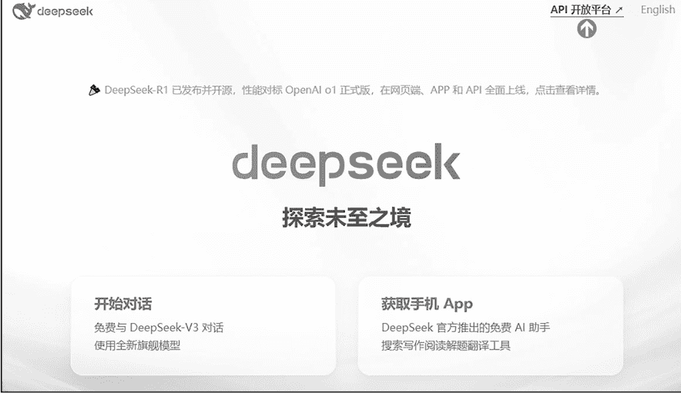

图 10-1 单击“API 开发平台”按钮


> **▲** 图 10-2 登录及注册页面

# 2. 访问 API 密钥生成页面

登录 DeepSeek 账户后，进入用户中心，在用户中心页面找到 API 管理选项，通常位于"API 密钥”或"API 设置”标签下。单击"API keys"按钮，即可创建新的密钥，如图 10-3 所示。


图 10-3 单击"API keys"按钮

### 3. 生成 API 密钥

在生成 API 密钥页面，用户可以选择所需的权限范围（例如，只读或读写权限）。选择适合的权限，并单击“创建 API keys"，如图 10-4 所示。一旦生成 API 密钥，系统将其显示出来，如图 10-5 所示。请务必保管好该密钥，不要泄露给不相关的人员。

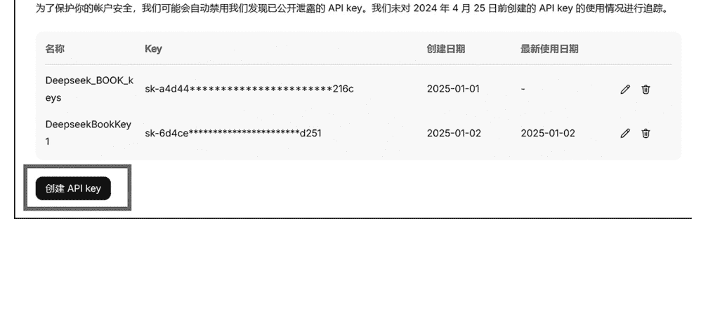

图 10-4 单击“创建 API keys"

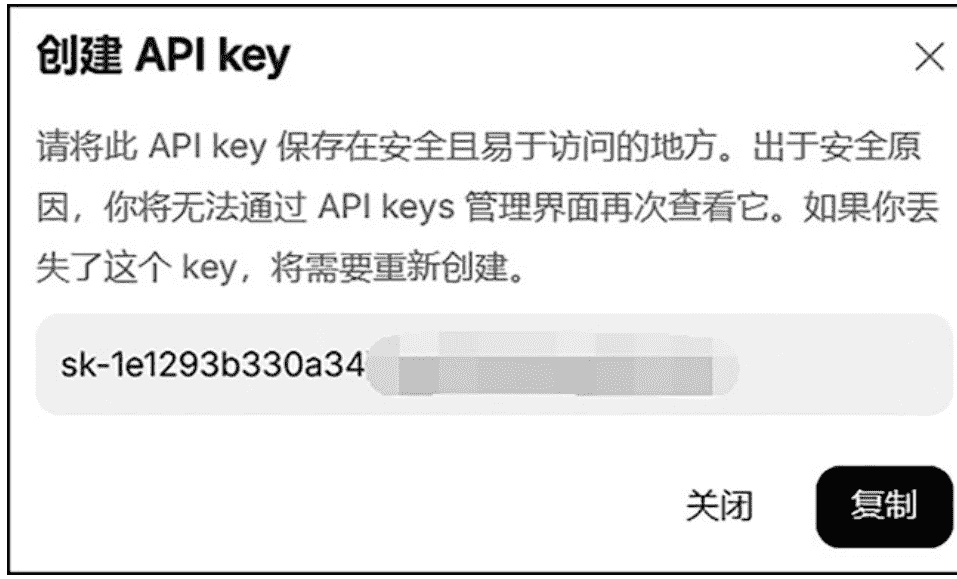

▲ 图 10-5 获得 API key

### 4. 配置 API 密钥

获取到 API 密钥后，用户可在应用程序中对其进行配置。通常，API 密钥应保存在配置文件或环境变量中，而不应将其硬编码在代码中，以确保其安全。

例如，在 Python 代码中，可以将 API 密钥保存在环境变量中:

```python
import os

# 从环境变量中获取 API 密钥
api_key = os.getenv("DEEPSEEK_API_KEY")

# 配置 API 请求头
headers = {
```

```python
"Authorization": f"Bearer {api_key}"
}

若应用支持配置文件，用户也可以将密钥写入配置文件，并在程序启动时读取：

{
    "api_key": "your-deepseek-api-key-here"
}

## 5. 验证配置

完成 API 密钥的配置后，用户可以调用 DeepSeek 的测试接口来验证配置是否正确。例如，尝试调用 DeepSeek API 的 list-models 接口，检查是否能够成功获取模型列表。如果返回了有效的结果，则表示 API 密钥配置正确。

python

import requests

# 测试接口调用
url = "https://api.deepseek.com/v1/models"
response = requests.get(url, headers=headers)

# 输出响应内容

if response.status_code == 200:
    print("API 密钥配置成功，返回模型列表：", response.json())
else:
    print("API 密钥配置失败，错误信息：", response.text)
```

通过上述步骤，用户能够顺利获取并配置 DeepSeek 的 API 密钥。这是用户与 DeepSeek 平台交互的第一步，也是构建基于 DeepSeek 应用的基础。密钥的安全管理至关重要，因此这里推荐使用环境变量或配置文件存储密钥，并确保在应用的不同环境中都能正确地配置和访问该密钥。


# **10.2.2 常见接口调用**


DeepSeek 平台提供了丰富的 API 接口，能够支持从模型获取到多轮对话、文本生成、数据分析等一系列功能。利用这些接口，用户可以在开发过程中轻松实现与 DeepSeek 平台的交互，进而适配各种复杂的应用场景。常见的接口包括文本生成、对话接口、模型管理、账户余额查询等。


(1) 文本生成接口（create-completion）通过提供一个文本提示，调用 API 生成相关内容。这是 DeepSeek 的常用接口之一，适用于自动化内容创作、对话生成等场景。


(2) 多轮对话接口（create-chat-completion）用于实现上下文连续的对话，通过传递之前的对话历史，确保每次交互能够根据历史上下文生成合理的回答。


(3) 模型列表接口（list-models）可以列出当前平台可用的所有模型，帮助开发者选择适合的模型进行调用。


(4) 账户余额接口（get-user-balance）可以查询用户的 API 调用余额，帮助开发者管理资源，避免超额使用。

**【例 10-2】** 该示例通过几个常见的 API 接口调用，展示如何利用 DeepSeek API 进行文本生成和多轮对话。


# **1. 获取模型列表**


首先，获取当前平台上可用的模型列表。此接口可以帮助开发者了解平台支持哪些模型，进而选择合适的模型。


```python
import requests

**运行结果如下。**

可用的模型列表：[{'model_id': 'gpt-3', 'name': 'GPT-3'}, {'model_id': 'gpt-3.5-turbo', 'name': 'GPT-3.5 Turbo'}]
```

# **2. 文本生成接口（create-completion）**

通过在该接口中传入一个提示词，平台将返回基于该提示词的生成内容。这个接口适用于文本创作、自动化内容生成等应用场景。

python
import requests

import os

# 从环境变量中获取 API 密钥
api_key = os.getenv("DEEPSEEK_API_KEY")

# 配置请求头
headers = {
    "Authorization": f"Bearer {api_key}",
}

# 文本生成的 API 端点
url = "https://api.deepseek.com/v1/completions"

# 生成请求的数据
data = {
    "model": "gpt-3", # 选择使用的模型
    "prompt": "写一篇关于 AI 技术未来发展的文章。",
    "max_tokens": 500 # 限制生成的文本长度
}


# 发起 POST 请求
response = requests.post(url, headers=headers, json=data)

## 检查请求是否成功

if response.status_code == 200:
    result = response.json()

    print("生成的文本内容：", result['choices'][0]['text'])
else:
    print("文本生成失败，错误信息：", response.text)

**运行结果如下。**

生成的文本内容：**

随着人工智能技术的飞速发展，AI 正在逐步渗透到各行各业，改变着人们的生活和工作方式。从智能助手到自动化生产线，AI 正在以更高效、更智能的方式改造传统行业。未来，AI 的应用将不再局限于机器学习和数据分析，更多的领域将受到 AI 的影响，例如医疗健康、金融服务、教育等。

#### 3. 多轮对话接口（create-chat-completion）

多轮对话接口支持基于上下文的连续对话，它能够根据前一轮对话的内容生成更为自然的回应。

python
import requests

import os

# 从环境变量中获取 API 密钥
api_key = os.getenv("DEEPSEEK_API_KEY")

# 配置请求头
headers = {
    "Authorization": f"Bearer {api_key}",
}

# 多轮对话的 API 端点
url = "https://api.deepseek.com/v1/chat/completions"

# 初始化对话历史
messages = [
    {"role": "system", "content": "你是一个智能助手，能够回答用户的问题。"},
    {"role": "user", "content": "今天的天气怎么样？"}
]

# 发起 POST 请求
data = {
    "model": "gpt-3.5-turbo", # 使用 GPT-3.5 模型
    "messages": messages,
    "max_tokens": 150
}

# 发起请求
response = requests.post(url, headers=headers, json=data)

## 检查请求是否成功
if response.status_code == 200:
    result = response.json()
    print("对话生成的回应：", result['choices'][0]['message']['content'])
else:
    print("对话生成失败，错误信息：", response.text)

**运行结果如下。**

对话生成的回应：今天的天气晴，温度在 25℃左右，非常适合外出活动。

# **4. 查询账户余额接口 (get-user-balance)**

该接口用于查询账户当前的 API 调用余额，有助于开发者实时监控和管理 API 的使用。

python
import requests
import os
# 从环境变量中获取 API 密钥
api_key = os.getenv("DEEPSEEK_API_KEY")
# 配置请求头
headers = {
    "Authorization": f"Bearer {api_key}",
}
# 查询余额的 API 端点
url = "https://api.deepseek.com/v1/user/balance"
# 发起 GET 请求
response = requests.get(url, headers=headers)
```

## 检查请求是否成功

```python
if response.status_code == 200:
    balance = response.json()
    print("当前账户余额：", balance)
else:
    print("查询余额失败，错误信息：", response.text)
```

运行结果如下。

当前账户余额：`{'currency': 'USD', 'balance': 100.5}`

通过调用 DeepSeek 的常见 API 接口，开发者可以实现文本生成、多轮对话、模型选择和账户管理等多种功能。在实际应用中，这些接口可以帮助开发者快速集成智能对话、内容生成和数据处理等能力。通过合理配置和调用这些接口，开发者可以实现更加灵活和高效的应用开发。

## **10.2.3 Chat 类客户端 API 集成实现**

本节主要介绍如何将 DeepSeek-V3 大模型的 API 集成到一个 Chat 类客户端中，从而实现基于对话的智能应用。DeepSeek 提供的 API 接口可用于处理多轮对话、实时生成回答，并允许通过自定义提示词调整模型行为。

> **【例 10-3】** 本示例利用 `create-chat-completion` 接口实现与用户的持续对话，并提供更加灵活的聊天体验。
>
> （1）多轮对话接口：`create-chat-completion` 接口可实现与用户的连续对话。对话历史（即之前的用户输入和模型的响应）使模型能够理解上下文并生成更符合情境的回答。
>
> （2）API 集成：集成 API 时，用户需要从 DeepSeek 平台获取 API 密钥，并设置适当的请求头，还需要在请求体中指定对话模型（例如 gpt-3.5-turbo）、对话历史及所需的生成内容（例如回答的最大长度）。
>
> （3）客户端功能：客户端在接收用户输入后，将调用 DeepSeek API 处理并返回结果。此外，为了提升用户体验，客户端可以提供历史记录功能，使每个输入都能基于先前的对话进行响应。
>
> 首先，用户需要获取 API 密钥并设置好运行环境；然后，编写一个简单的 Chat 类客户端程序，当用户输入问题时，客户端将调用 DeepSeek 的 API 生成回答，并在多个对话轮次中维持上下文。

```python
import requests
import os

class DeepSeekChatClient:
    def __init__(self, api_key):
        self.api_key = api_key
        self.headers = {
            "Authorization": f"Bearer {self.api_key}",
        }
        self.model = "gpt-3.5-turbo"  # 选择使用的模型
        self.messages = [
            {"role": "system", "content": "你是一个智能助手，可以帮助用户解答问题。"}
        ]

    def send_message(self, user_input):
        # 将用户输入添加到对话历史中
        self.messages.append({"role": "user", "content": user_input})

        # 调用 DeepSeek API 的多轮对话接口
        url = "https://api.deepseek.com/v1/chat/completions"
        data = {
            "model": self.model,  # 选择模型
            "messages": self.messages,
            "max_tokens": 150  # 限制生成的文本长度
        }

        # 发起 POST 请求获取响应
        response = requests.post(url, headers=self.headers, json=data)
        
        # 检查请求是否成功
        if response.status_code == 200:
            result = response.json()
            assistant_reply = result['choices'][0]['message']['content']
            self.messages.append({"role": "assistant", "content": assistant_reply})
            # 记录模型的回答
            return assistant_reply
        else:
            return "请求失败，请稍后再试。"

# 从环境变量中获取 API 密钥
api_key = os.getenv("deepseek_API_KEY")

# 创建聊天客户端实例
chat_client = DeepSeekChatClient(api_key)

# 示例：用户进行对话
user_input = "今天天气怎么样？"
print("用户输入:", user_input)
assistant_reply = chat_client.send_message(user_input)
print("模型回复:", assistant_reply)

# 再次对话，继续上下文
user_input = "我想去公园散步，适合吗？"
print("\n用户输入:", user_input)
assistant_reply = chat_client.send_message(user_input)
print("模型回复:", assistant_reply)
```

**案例要点解析如下。**

(1) **初始化**：`DeepSeekChatClient` 类用于接受 API 密钥作为参数，设置必要的请求头，并初始化对话历史。对话历史从一个简单的系统提示开始，指示模型充当智能助手。

(2) **发送消息**：`send_message` 方法用于接收用户输入，将其添加到对话历史中，并调用 `create-chat-completion` 接口发送请求。响应包含模型生成的文本，随后将其添加到对话历史中，以确保下次对话时能够根据上下文生成合理的回答。

(3) **多轮对话**：通过维持对话历史，每轮对话都会基于之前的对话内容生成回应，从而保持对话的连贯性。

# **运行结果如下。**

用户输入：今天天气怎么样？
模型回复：今天的天气晴，温度在 25°C 左右，非常适合外出活动。
用户输入：我想去公园散步，适合吗？
模型回复：今天的天气非常适合户外活动，去公园散步会很愉快。

通过集成 DeepSeek API，开发者能够轻松地创建一个基于多轮对话的 Chat 类客户端。在实际应用中，该客户端能够处理用户的实时输入，生成符合上下文的智能回复，并在多个对话轮次中维持连贯的对话历史。这种方式可以广泛应用于智能客服、虚拟助手、在线教育等场景，通过借助 DeepSeek 模型获得强大的自然语言理解和生成能力。

## **10.3 多模型支持与切换**

在现代智能系统中，任务的多样性要求应用能够灵活地选择不同的模型，以满足不同场景下的需求。本节将介绍如何通过设计支持多模型切换的架构，来确保系统能够根据实际需求动态选择合适的模型。同时，本节还将针对不同的任务场景提出有效的模型选择策略，帮助开发者在实际应用中提升效率和准确度。

随着大模型技术的不断发展，越来越多的模型具备了特定的优势与应用场景，如何根据任务的特性选择适合的模型成为构建智能系统过程中的重要问题。多模型支持不仅要求系统具备灵活性，还要求能够无缝切换并优化模型的使用。本节内容将为构建具有智能应对能力的多模型架构提供理论基础和实践指导，帮助开发者实现高效、精准的模型选择和切换。

## **10.3.1 支持多模型切换的架构设计**

在实际应用中，任务的复杂性和多样性要求系统能够动态地选择不同的模型进行处理。为了实现这一目标，多模型切换架构必须具备高度的灵活性和可扩展性，能够根据具体的任务需求和模型性能自动或手动切换到适用的模型。一个支持多模型切换的架构能够提高应用系统的适应性，降低系统的运维成本，并确保在不同场景之间切换时可以灵活调用合适的模型。

该架构通常包括以下几个核心组件。

1. **模型管理模块**：负责加载、管理和更新不同的模型，确保多个模型之间平滑切换。
2. **任务分配模块**：根据输入的任务类型或上下文信息，决定调用哪个模型进行处理。
3. **模型接口模块**：提供统一的 API 接口，支持多种模型的调用，保证采用统一的调用方式。
4. **结果优化模块**：根据模型的输出结果进行必要的优化，确保最终返回的结果满足实际需求。

> **【例 10-4】** 设计一个支持多模型切换的架构。

```python
import requests

# 模型选择类，根据任务类型选择不同的模型
class ModelSelector:
    def __init__(self, models):
        """
        初始化模型选择器
        :param models: 可用的模型列表
        """
        self.models = models

    def select_model(self, task_type):
        """
        根据任务类型选择对应的模型
        :param task_type: 任务类型
        :return: 选择的模型
        """
        if task_type == 'chat':
            return self.models['chat_model']
        elif task_type == 'completion':
            return self.models['completion_model']
        elif task_type == 'translation':
            return self.models['translation_model']
        else:
            raise ValueError('Unknown task type')

# 模型管理类，管理模型的调用和切换
class ModelManager:
    def __init__(self, api_key):
        """
        初始化模型管理类
        
        :param api_key: 用户的 API 密钥
        """
        self.api_key = api_key
        self.models = {
            'chat_model': 'deepseek-chat',
            'completion_model': 'deepseek-completion',
            'translation_model': 'deepseek-translation'
        }
        self.selector = ModelSelector(self.models)

    def call_model(self, task_type, prompt):
        """
        根据任务类型选择模型并调用
        :param task_type: 任务类型
        :param prompt: 输入的任务描述
        :return: 模型返回的结果
        """
        model = self.selector.select_model(task_type)
        response = self.invoke_api(model, prompt)
        return response

    def invoke_api(self, model, prompt):
        """
        调用 DeepSeek API 接口
        
        **model**: 选择的模型
        **prompt**: 输入的任务描述
        **返回**：模型返回的结果
        """
        url = f'https://api.deepseek.com/v3/{model}/completion'

        headers = {
            "Authorization": f"Bearer {self.api_key}",
            "Content-Type": "application/json"
        }
        
        # 构造请求体数据（示例）
        data = {
            "model": model,
            "messages": [
                {"role": "user", "content": prompt}
            ]
        }

        response = requests.post(url, headers=headers, json=data)
        
        if response.status_code == 200:
            return response.json()
        else:
            raise Exception(f"API 调用失败：{response.text}")
```

# 示例使用

```python
if __name__ == "__main__":
    # 用户的 API 密钥
    api_key = "your_api_key_here"
    model_manager = ModelManager(api_key)
    
    # 选择任务类型并输入提示
    task_type = 'chat'  # 可选 'chat', 'completion', 'translation'
    prompt = "你好，今天的天气怎么样？"

    # 调用模型并获取结果
    result = model_manager.call_model(task_type, prompt)

    # 输出模型返回的结果
    print("模型返回的结果:", result)
```

## **案例要点解析如下。**

1. **ModelSelector 类**负责根据不同的任务类型（如聊天、文本补全、翻译等）选择合适的模型。在该示例中，`ModelSelector` 类根据任务类型分别选择了 `chat_model`、`completion_model` 和 `translation_model`。
2. **ModelManager 类**用于管理 API 密钥，调用模型接口。`call_model` 方法根据传入的任务类型自动选择合适的模型并调用对应的 API 接口。
3. `invoke_api` 方法负责通过 requests 库向 DeepSeek API 发送请求，传递提示词（Prompt）并获取模型的响应。

假设选择的任务类型是 `'chat'`，且输入提示为“你好，今天的天气怎么样？”，API 调用后即可获得返回结果。

# **运行结果如下。**

> 模型返回的结果：
> ```json
> {
>   "choices": [
>     {
>       "text": "今天的天气晴，气温适宜，非常适合出门活动。"
>     }
>   ]
> }
> ```

本节通过实现一个支持多模型切换的架构，展示了如何根据任务类型动态选择不同的模型，并通过 DeepSeek API 接口进行调用。此架构设计可以高效地支持不同任务需求，灵活切换模型，提升系统的适应性和智能性。

### **10.3.2 不同任务场景下的模型选择策略**

在多任务系统中，选择合适的模型的意义至关重要。DeepSeek-V3 提供了多种预训练模型，针对不同任务类型，选择合适的模型能够显著提升系统的性能与响应质量。因此，为了确保在不同的任务场景下能够灵活应对，设计合理的模型选择策略是非常必要的。

根据任务场景的不同，模型选择策略应考虑以下因素。

1. **任务类型**：不同的任务类型（如对话生成、文本补全、翻译等）可能需要不同的模型。比如，聊天类任务适合使用对话模型，而文本补全任务则需要调用生成型模型。
2. **任务的上下文**：某些任务的上下文信息会影响模型的选择，比如连续对话可能需要调用支持上下文追踪的模型。
3. **性能需求**：在响应速度或计算资源受限的情况下，可以选择轻量级的模型，而在任务对准确性的要求较高时，可以选择更强大的模型。
4. **用户定制化需求**：用户可能希望根据特定的业务需求，选择特定领域的模型，如法律咨询、医疗问诊等领域的模型。

考虑到上述因素，模型选择策略通常需要通过任务标识、上下文信息和性能调优来决定具体使用哪个模型。

## **【例 10-5】** 基于模型选择策略，读者应根据任务类型和上下文动态选择不同的模型。

```python
import requests

class ModelSelector:
    '''
    模型选择器，根据不同任务类型及其上下文动态选择最合适的模型。
    '''

    def __init__(self, models):
        '''
        初始化模型选择器
        :param models: 可用的模型字典，包含任务类型与对应模型的映射
        '''
        self.models = models

    def select_model(self, task_type, context=None):
        '''
        根据任务类型和上下文信息选择合适的模型
        
        :param task_type: 任务类型，如 'chat', 'completion', 'translation'
        :param context: 可选项，上下文信息，用于判断是否需要特殊模型
        :return: 选择的模型名称
        '''
        if task_type == 'chat':
            # 如果任务是聊天并且有多轮对话上下文，则选择多轮对话模型
            if context and 'multi_round' in context:
                return self.models['multi_round_chat_model']
            else:
                return self.models['chat_model']
        elif task_type == 'completion':
            # 文本补全任务可以使用不同的模型，根据任务复杂度选择
            if context and 'complex' in context:
                return self.models['complex_completion_model']
            else:
                return self.models['completion_model']
        elif task_type == 'translation':
            return self.models['translation_model']
        else:
            raise ValueError(f"Unknown task type: {task_type}")


class ModelManager:
    '''管理模型调用，根据选择的模型类型调用对应的 DeepSeek API'''

    def __init__(self, api_key):
        """
        初始化模型管理器
        
        :param api_key: 用户的 API 密钥
        """
        self.api_key = api_key
        
        self.models = {
            'chat_model': 'deepseek-chat',
            'multi_round_chat_model': 'deepseek-multi-round-chat',
            'completion_model': 'deepseek-completion',
            'complex_completion_model': 'deepseek-complex-completion',
            'translation_model': 'deepseek-translation'
        }

        self.selector = ModelSelector(self.models)

    def call_model(self, task_type, prompt, context=None):
        """
        根据任务类型选择模型并调用
        
        :param task_type: 任务类型，如 'chat', 'completion', 'translation'
        :param prompt: 输入的任务描述
        :param context: 上下文信息
        """
        # 选择模型
        model = self.selector.select_model(task_type, context)
        
        # 构建请求数据
        data = {
            "model": model,
            "messages": [
                {"role": "user", "content": prompt}
            ]
        }
        
        url = f'https://api.deepseek.com/v3/{model}/completion'
        headers = {
            "Authorization": f"Bearer {self.api_key}",
            "Content-Type": "application/json"
        }

        # 发起请求
        response = requests.post(url, headers=headers, json=data)
        
        if response.status_code == 200:
            return response.json()
        else:
            raise Exception(f"API 调用失败：{response.text}")
```

:return: 模型返回的结果


model = self.selector.select_model(task_type, context)
response = self.invoke_api(model, prompt)
return response

def invoke_api(self, model, prompt):
    '''
    调用DeepSeek API接口
    :param model: 选择的模型
    :param prompt: 输入的任务描述
    :return: 模型返回的结果
    '''
    url = f"https://api.deepseek.com/v3/{model}/completion"
    headers = {
        "Authorization": f"Bearer {self.api_key}",
        "Content-Type": "application/json"
    }
    data = {
        "prompt": prompt,
        "max_tokens": 100
    }


response = requests.post(url, headers=headers, json=data)

return response.json()


```python
# 示例使用

if __name__ == "__main__":
    # 用户的API密钥
    api_key = "your_api_key_here"

    model_manager = ModelManager(api_key)

    # 选择任务类型并输入提示
    task_type = 'chat'  # 可选 'chat', 'completion', 'translation'

    prompt = "你好，今天天气怎么样？"

    # 上下文信息，指定为多轮对话
    context = {'multi_round': True}

    # 调用模型并获取结果

    result = model_manager.call_model(task_type, prompt, context)

    # 输出模型返回的结果

    print("模型返回的结果:", result)
```

案例要点解析如下。

(1) ModelSelector类：根据任务类型和上下文信息动态选择合适的模型。例如，在聊天任务中，如果有multi_round上下文信息，就会选择支持多轮对话的模型；如果是文本补全任务，则根据任务的复杂度选择不同的模型。

(2) ModelManager类：管理API密钥，调用模型接口。在调用模型时，call_model方法将根据任务类型和上下文信息选择合适的模型，并发送请求到DeepSeek API。

(3) invoke_api方法：向DeepSeek API发送HTTP请求，并获取模型的响应结果。通过requests库实现API调用，由此确保响应数据以JSON格式返回。

假设用户输入的任务类型是chat，且上下文信息中包含多轮对话标志。

# **运行结果如下。**

模型返回的结果：{

```json
```

如果上下文标志改为complex，例如复杂的文本补全任务，返回的模型会有所不同，输出的文本可能会涉及更复杂的内容。

# **【例10-6】** 构建基于DeepSeek-V3的聊天应用。

该案例涉及API密钥的配置、模型选择、用户输入处理、API调用及最终结果输出，项目结构如下：

- **main.py** # 主程序入口
- **requirements.txt** # Python依赖

首先，安装必要的依赖库。创建一个requirements.txt文件，并在其中列出以下内容：

- requests

使用pip安装依赖：

`pip install -r requirements.txt`

完整代码实现如下：

```python
import requests

import json

class ModelSelector:
    '''
    模型选择器，根据不同任务类型及其上下文动态选择最合适的模型
    '''

    def __init__(self, models):
        '''
        初始化模型选择器
        :param models: 可用的模型字典，包含任务类型与对应模型的映射
        '''

"""
    self.models = models

    def select_model(self, task_type, context=None):
        """

        根据任务类型及上下文信息选择合适的模型
        :param task_type: 任务类型，如 'chat', 'completion', 'translation'
        :param context: 可选，上下文信息，用于判断是否需要特殊模型
        :return: 选择的模型名称
        """

        if task_type == 'chat':
            # 如果任务是聊天并且有多轮对话上下文，则选择多轮对话模型
            if context and 'multi_round' in context:
                return self.models['multi_round_chat_model']
            else:
                return self.models['chat_model']
        elif task_type == 'completion':
            # 文本补全任务可以使用不同的模型，根据任务复杂度选择
            if context and 'complex' in context:
                return self.models['complex_completion_model']
            else:
                return self.models['completion_model']

        elif task_type == 'translation':
            
            return self.models['translation_model']

        else:
            raise ValueError(f"Unknown task type: {task_type}")

class ModelManager:
    """
    管理模型调用，根据选择的模型类型调用对应的DeepSeek API
    """

    def __init__(self, api_key):
        """
        初始化模型管理器

        :param api_key: 用户的API密钥
        """
        self.api_key = api_key

        self.models = {
            'chat_model': 'deepseek-chat',
            'multi_round_chat_model': 'deepseek-multi-round-chat',
            'completion_model': 'deepseek-completion',
            'complex_completion_model': 'deepseek-complex-completion',
            'translation_model': 'deepseek-translation'
        }

        self.selector = ModelSelector(self.models)

    def call_model(self, task_type, prompt, context=None):
        """
        根据任务类型选择模型并调用
        :param task_type: 任务类型，如 'chat', 'completion', 'translation'
        :param prompt: 输入的任务描述
        :param context: 上下文信息
        :return: 模型返回的结果
        """
        model = self.selector.select_model(task_type, context)
        response = self.invoke_api(model, prompt)
        return response

    def invoke_api(self, model, prompt):
        """
        调用DeepSeek API接口
        :param model: 选择的模型
        :param prompt: 输入的任务描述
        :return: 模型返回的结果
        """
        
        url = f'https://api.deepseek.com/v3/{model}/completion'
        headers = {
            "Authorization": f"Bearer {self.api_key}",
            "Content-Type": "application/json"
        }
```

# 上下文信息，指定为多轮对话
context = {'multi_round': True}

# 调用模型并获取结果
result = model_manager.call_model(task_type, prompt, context)

# 输出模型返回的结果
print("模型返回的结果:", result)


```python
```

对上述代码的详细解释如下。

# **1. ModelSelector类**

该类负责根据任务类型（如chat、completion、translation等）及上下文信息（如是否多轮对话）来选择最适合的模型。

select_model方法根据任务类型和上下文选择模型。例如，对于聊天任务，如果上下文指定了多轮对话，那么multi_round_chat_model将被选择。

# **2. ModelManager类**

ModelManager类负责与DeepSeek API交互，调用相应的模型。

call_model方法用于接收任务类型、提示词和上下文信息，然后通过ModelSelector选择模型，最终调用DeepSeek API。

invoke_api方法使用requests库向DeepSeek API发送请求，并返回响应数据。

# **3. 示例使用**

在代码的主体部分，用户提供API密钥、任务类型（例如chat）、提示词（例如“你好，今天天气怎么样？”）及上下文（例如`"multi_round": True`表示多轮对话）。

**调用model_manager.call_model()** 进行实际的模型调用，获取结果并打印输出。

在上述代码中，我们需通过HTTP POST请求与DeepSeek API进行交互。示例请求格式如下：

> * "prompt": "你好，今天天气怎么样?"  
* *"max_tokens": 100*

**DeepSeek**响应如下：

*
> *"choices": [  
*{  
 *"text": "今天的天气晴，适宜出行，温暖而不炎热。"  
}*

**案例要点解析如下。**

*(1) 获取DeepSeek API密钥：*首先在DeepSeek官网注册并获取API密钥。

*(2) 设置API密钥：*将API密钥填入`api_key="your_api_key_here"`中。

*(3) 运行程序：*执行`python main.py`，程序会自动选择合适的模型并返回响应结果。

[PAGE 408]（接上文）

上述代码实现了基于DeepSeek-V3的一个多功能聊天应用。通过合理的模型选择机制，系统可以根据不同任务类型和上下文条件自动选择最合适的模型，提高其灵活性与性能。在此基础上，系统还可以进一步拓展更多任务类型或模型，满足更复杂的应用场景。


# **10.4 本章小结**

本章深入探讨了基于DeepSeek-V3的Chat类客户端的开发与集成，实现了多模型支持与切换功能。模型选择器根据任务类型和上下文信息自动选择合适的模型，从而优化响应效果并提升系统性能。
DeepSeek API实现了多种常见接口调用，涵盖了从基础的聊天功能到复杂的文本生成、翻译等场景。


用户通过API密钥的配置与管理，实现了与DeepSeek平台的无缝对接，确保了应用的稳定性和安全性。本章内容为基于DeepSeek平台的实际应用提供了全方位的开发框架和实践指导，具有较强的实用性和可扩展性。

# # 第11章

# ## 集成实战2: AI助理开发

在人工智能领域,AI助理 (或称“智能助理”) 是重要的应用，已广泛应用于日常生活与工作中。本章将深入探讨基于DeepSeek-V3模型的AI助理的开发与实现，通过引入DeepSeek开放平台提供的强大API接口，结合多模型处理能力，构建一个具备语义理解、任务调度、信息查询等多重功能的AI助理系统。该系统能够通过自然语言与用户进行交互，提供高效、精准的服务，极大地提升工作效率和用户体验。

本章内容不仅涵盖了AI助理的核心技术架构，还探讨了如何灵活配置和集成不同的模型，满足多样化的业务需求。无论是简单的对话式查询，还是复杂的任务管理与决策支持，DeepSeek模型的优势都能得到有效发挥，帮助开发者实现高效的智能助理应用。

# ### 11.1 AI助理：AI时代的启动器

在AI技术快速发展的时代，AI助理已成为提升生产力与用户体验的关键工具。作为一种集成语音识别、自然语言处理、机器学习等技术的应用，AI助理不仅能够实现高效的信息获取、任务执行，还能够为企业和个人提供智能化的服务支持。

本节将深入探讨AI助理的核心功能，解析其如何在多场景下提供个性化、自动化的服务，帮助用户高效地完成任务。此外，随着技术的不断进步，AI助理逐渐从传统的语音助手向更为复杂和多元化的服务平台演进，开始在商业化应用中展现出巨大的潜力与前景。从自动化办公、智能客服到个性化营销，AI助理的应用范围正在快速拓展，成为AI时代的启动器，推动社会各领域的智能化转型。

# #### 11.1.1 AI助理的核心功能解读

AI助理的核心功能可以归纳为语音识别与自然语言处理、任务管理、信息检索、智能推荐和多模态交互等模块。这些功能使AI assistant能够高效地与用户进行对话，理解并执行复杂任务。例如，借助深度学习模型，AI助理能够理解语音或文本输入，将其转化为机器可以执行的指令；而在任务管理方面，AI助理能够帮助用户安排日程、提醒待办事项、执行常规操作等；通过信息检索，AI助理能实时从互联网或数据库中获取相关信息，提供准确的答案或建议。此外，AI 助理的智能推荐功能能够根据用户的行为、偏好和历史数据提供个性化建议。

在开发基于DeepSeek-V3模型的AI助理时，核心功能的实现依赖于DeepSeek的强大API支持，尤其是在自然语言理解、内容生成与上下文管理等方面。

# **【例11-1】** 通过DeepSeek的API构建一个可以进行智能对话的基础模型。

```python
import requests
import json

# DeepSeek API接口地址
api_url = "https://api.deepseek.com/v3/chat/completion"

# 用户的API密钥
api_key = "your_api_key_here"

#请求头部设置
headers = {
    "Authorization": f"Bearer {api_key}",
    "Content-Type": "application/json"
}
#定义请求体，输入用户及聊天上下文的...

data = {
    "messages": [
        {"role": "system", "content": "你是一个智能助理，帮助用户解答问题并提供建议。"},
        {"role": "user", "content": "今天的天气怎么样？"}
    ]
}

# 发起API请求
response = requests.post(api_url, headers=headers, data=json.dumps(data))

# 检查返回的响应
if response.status_code == 200:
    result = response.json()
    
    # 输出AI的回复
    print("AI助理回复：", result['choices'][0]['message']['content'])

else:
    print("请求失败，错误信息：", response.text)
```

**案例要点解析如下。**


*(1) API密钥**:用户需要在DeepSeek平台上注册并获取API密钥，用于身份验证。


*(2) 请求头设置**:Authorization字段使用Bearer Token认证。  
(3) 请求体数据: 包含聊天上下文，系统角色设定了智能助理的基本任务，用户输入了“今天的天气怎么样？”

(4) API请求: 通过requests.post()向DeepSeek API发送POST请求，返回AI助理的聊天回复。

运行结果如下。

AI助理回复：今天的天气晴，气温约28℃C, 适宜外出活动。”

对以上运行结果解析如下。

(1) 请求：API请求通过POST方法发送到DeepSeek的聊天API接口，提供对话上下文及用户输入的内容。

(2) 响应处理: API响应中包含AI生成的消息，展示AI助理的回复内容。”

以上案例展示了AI助理在处理文本输入时，如何通过DeepSeek模型的API实现自然语言生成与任务处理，根据用户需求进行适应性对话和任务执行，为AI助理功能提供基础架构支持。


# **11.1.2 AI助理的商业化应用**

随着人工智能技术的不断进步， AI助理已经不再局限于实验室或科研领域，它们正逐步渗透到商业化应用中，成为提升企业效率和用户体验的核心工具。从智能客服到个人助理，再到企业级解决方案，AI助理正在重新定义企业与客户的互动方式。商业化的AI助理不仅能够提高响应速度和处理能力，还能通过智能学习与数据分析提供个性化服务。

在商业化应用中， AI助理主要应用在以下几个方面。

(1)客户服务： AI助理被广泛用于客户支持与服务领域，可以处理大量的用户查询，并提供7x24小时不间断服务，显著减轻了人工客服的负担。(2) 电商推荐系统：AI 助手可以分析用户行为、购买历史等数据，进行个性化推荐，提升销售转化率。

(3) 企业内部效率提升：AI 助理可集成企业内的工作流和任务管理系统，自动处理日常任务，如日程安排、数据整理等，提升员工生产效率。

借助 DeepSeek-V3 模型的 API，企业可以通过集成 AI 助理技术，在各种应用场景中实现智能对话与自动化任务，提供更具竞争力的服务。

【例 11-2】基于 DeepSeek API 开发简单的智能客服应用。在该应用中，用户可以通过 AI 客服查询产品信息，获取帮助。

```python
import requests
import json

# DeepSeek API 接口地址
api_url = "https://api.deepseek.com/v3/chat/completion"
api_key = "your_api_key_here"  # 用户的 API 密钥

# 请求头部设置
headers = {
    "Authorization": f"Bearer {api_key}",
    "Content-Type": "application/json"
}

# 定义请求体，输入用户的消息及聊天上下文
data = {
    "messages": [
        {"role": "system", "content": "你是一个产品客服助理，帮助用户解答关于产品的信息问题。"},
        {"role": "user", "content": "请告诉我你们的最新产品有哪些？"}
    ]
}

# 发起 API 请求
response = requests.post(api_url, headers=headers, json=data)

# 检查返回的响应
if response.status_code == 200:
    result = response.json()
    # 输出 AI 的回复
    print("AI 客服回复:", result['choices'][0]['message']['content'])
else:
    print("请求失败，错误信息:", response.text)
```

关于上述代码的详细说明如下。

（1）API 密钥：需要从 DeepSeek 平台获取 API 密钥进行身份验证。

（2）请求头设置：使用 Authorization 字段以 Bearer Token 形式传递 API 密钥。

（3）请求体数据：包含用户的查询内容和系统的角色设定，系统角色为产品客服助理，用户输入关于产品的问题。

（4）API 请求：requests.post() 方法向 DeepSeek API 发送 POST 请求，获取 AI 生成的回答。

## 运行结果如下。

AI 客服回复：我们的最新产品包括智能音箱、无线耳机和高效能电动牙刷，您需要了解哪一款产品的详细信息？

对以上运行结果解析如下。

（1）请求：用户通过 API 请求，向 AI 客服提出问题，API 请求会传递给 DeepSeek 的服务端进行处理。

（2）响应处理：DeepSeek 返回的响应包含 AI 生成的文本内容，即智能客服的回复。

上述示例展示了 AI 客服如何基于用户问题生成合理的回答，并进行进一步的引导。未来，AI 助理将在多个行业中继续扩展其应用范围，成为提升服务效率和质量的重要工具。

##### 11.2 DeepSeek API 在 AI 助理中的配置与应用

随着相关技术的不断发展，DeepSeek API 作为一种高效的人工智能接口，已经成为实现智能助理功能的核心工具之一。在 AI 助理的构建过程中，DeepSeek API 不仅提供了强大的自然语言处理能力，还支持深度学习模型的调用，为 AI 助理的多样化功能提供了技术支撑。

本节将深入探讨 DeepSeek API 在 AI 助理中的配置与应用，重点介绍如何通过 API 适配流程实现智能对话功能，以及如何将语音识别和自然语言处理结合，提升 AI 助理的交互能力和智能化水平。此外，本节通过具体的案例和技术细节，展示如何在实际应用中高效地整合 DeepSeek 的强大功能，为用户提供智能化、个性化的服务体验。

##### 11.2.1 AI 助理与 DeepSeek 的 API 适配流程

在 AI 助理的构建过程中，API 适配是关键的一步。DeepSeek 的 API 为开发者提供了丰富的功能接口，使不同应用场景下的 AI 助理能够高效运行。通过 DeepSeek API，AI 助理能够快速实现语义理解、信息查询、会话管理等功能。

在适配流程中，首先 AI 助理需要获取 DeepSeek 的 API 密钥，并将其用于配置 API 请求；其次，结合 AI 助理的任务需求，选择合适的 DeepSeek 模型进行接口调用，例如用于对话生成的 create-chat-completion 接口，或者用于文本补全的 create-completion 接口，正确的参数设置能保证 AI 助理对话系统具有个性化与高效性；最后，通过对话管理与上下文保存机制，AI 助理能够在多轮对话中保持一致的对话状态和交互体验。

# 【例 11-3】实现 AI 助理与 DeepSeek API 的适配，并提供详细的代码注解和中文运行结果。

```python
import requests
import json

# 设置 DeepSeek API 密钥和请求 URL
API_KEY = 'your_api_key_here'  # 替换为用户的 API 密钥
API_URL = 'https://api.deepseek.com/v3/chat/completion'

# 请求头，包含 API 密钥
headers = {
    'Authorization': f'Bearer {API_KEY}',
    'Content-Type': 'application/json',
}

# 示例对话内容
conversation_history = [
    {"role": "system", "content": "你是一个聪明的 AI 助手。"},
    {"role": "user", "content": "你好，今天的天气怎么样？"}
]

# 请求体，发送给 DeepSeek API 的对话数据
data = {
    "messages": conversation_history,
    "model": "DeepSeek-V3-Model",  # 模型名称，可以根据实际需求选择
    "temperature": 0.7,  # 控制回答的创造性
    "max_tokens": 150  # 最大字数限制
}

# 发送请求
response = requests.post(API_URL, headers=headers, json=data)

# 处理响应结果
if response.status_code == 200:
    result = response.json()
    assistant_reply = result['choices'][0]['message']['content']
    print("AI 助手回复：", assistant_reply)
else:
    print("请求失败，错误信息：", response.text)
```

案例要点解析如下。

(1) API 密钥与请求 URL 配置：通过在 API_KEY 中设置从 DeepSeek 平台获取的密钥，可以确保请求被授权。

(2) 对话历史记录：conversation_history 保存了 AI 助手和用户的对话记录。在每次对话中，系统需要了解先前的上下文，以便生成自然的对话。

(3) 请求体：data 字典用于定义请求体，其中包括消息内容、所使用的模型、温度（创造性）和最大生成字符数等配置。

(4) 发送请求与处理响应：requests 库用于发送 POST 请求，接收并解析返回的 JSON 格式结果，获取 AI 助手的回复。

## 运行结果如下。

> AI 助手回复：今天的天气预报显示，晴空万里，气温大约为 26°C，非常适合外出活动！

以上代码展示了如何将 DeepSeek API 与 AI 助理进行适配，开发者可以轻松实现多轮对话的语义理解与回复生成。通过灵活调整请求参数，AI 助理可以根据不同的应用需求展现出高水平的个性化与智能化能力。这一过程不仅提升了 AI 助理的交互性，也使得实际应用场景下的 AI 服务更加精准与高效。

##### 11.2.2 语音识别与自然语言处理的综合应用

语音识别技术与自然语言处理技术的结合，已经成为现代 AI 助理的重要组成部分。语音识别技术能够将用户的语音输入转化为文本，而自然语言处理则能够理解和处理这些文本内容，进而生成智能化的回应。两种技术的结合不仅提升了 AI 助理的交互性，还大大提升了用户体验。

AI 助理将语音识别作为一种输入方式，它能够捕捉到用户的语音指令，并将其转化为文本，然后利用 NLP 技术，特别是 DeepSeek API 中的生成模型，对文本进行理解并生成响应。用户通过语音发出的指令可以迅速被理解并得到反馈。

【例 11-4】将语音识别与 DeepSeek 的自然语言处理模型相结合。

首先，使用一个简单的语音识别库将音频转为文本，然后使用 DeepSeek 的 API 进行文本处理并生成智能回复。整个流程将打通从语音到文本，再到智能应答的完整链条。

```python
import speech_recognition as sr
import requests
import json

# 设置 DeepSeek API 密钥和请求 URL
API_KEY = 'your_api_key_here'  # 替换为用户的 API 密钥
API_URL = 'https://api.deepseek.com/v3/chat/completion'

# 创建语音识别器实例
recognizer = sr.Recognizer()

# 使用麦克风录音
with sr.Microphone() as source:
    print("请开始说话...")
    audio = recognizer.listen(source)
    print("正在识别...")
    
    try:
        # 将音频转为文本
        recognized_text = recognizer.recognize_google(audio, language='zh-CN')
        
        print("识别结果:", recognized_text)
    
    except sr.UnknownValueError:
        print("无法理解语音，请重试")
        recognized_text = ""
    except sr.RequestError as e:
        print(f"请求失败，错误信息：{e}")
        recognized_text = ""

# 如果成功识别到语音，调用 DeepSeek API 处理文本
if recognized_text:
    headers = {
        'Authorization': f'Bearer {API_KEY}',
        'Content-Type': 'application/json',
    }

    # 请求体，发送给 DeepSeek API 的对话数据
    conversation_history = [
        {"role": "system", "content": "你是一个智能助理。"},
        {"role": "user", "content": recognized_text}
    ]

    data = {
        "messages": conversation_history,
        "model": "DeepSeek-V3-Model",  # 模型名称，根据实际需求调整
        "temperature": 0.7,
        "max_tokens": 150
    }

    # 发送请求
    response = requests.post(API_URL, headers=headers, json=data)

    # 处理响应结果
    if response.status_code == 200:
        result = response.json()
        assistant_reply = result['choices'][0]['message']['content']
        print("AI 助手回复：", assistant_reply)
    else:
        print("请求失败，错误信息：", response.text)
```

案例要点解析如下。

（1）语音识别部分：使用 SpeechRecognition 库的 recognize_google 方法将用户的语音输入转化为文本。这里采用了 Google 的语音识别服务，该服务支持中文语音识别；Microphone 对象用于通过麦克风捕获音频数据。

（2）调用 DeepSeek API 部分：如果识别出有效的文本，则将文本输入 DeepSeek 的 API 中；请求体中包含一个简单的对话历史，系统消息可以说明 AI 助手的角色，用户消息包含识别到的文本；请求时使用 Bearer 授权方式，并设定所使用的模型及其他参数。

（3）处理 API 响应：通过 choices 字段获取返回的结果，提取 AI 助手的回复文本并输出。

## 运行结果如下。

请开始说话...
正在识别...
识别结果：今天天气怎么样？

**AI** 助手回复：今天的天气预报显示，晴空万里，气温大约为 $26^{\circ}\text{C}$，适合户外活动！

通过结合语音识别与自然语言处理技术，智能助理能够处理用户的语音输入，并进行智能化的响应生成。该应用场景展示了语音到文本的转换过程，并通过 DeepSeek API 对识别的文本进行自然语言处理，生成精准且具有实际意义的回答。通过这种无缝衔接的技术链条，智能助理可以高效、准确地理解并响应用户的语音指令，实用性与交互性都得到了提升。

#### 11.3 智能助理功能的实现与优化

随着智能助理技术的快速发展，提升其性能和优化使用体验成为开发过程中的关键任务。一个高效且准确的智能助理不仅能够满足用户的需求，还能随着时间的推移不断提升其应答能力和理解深度。为了实现这一目标，提升问答准确率和增强持续学习与上下文理解是两个至关重要的方面。

在智能助理的实现过程中，优化问答准确率需要通过多种策略的综合运用，包括增强模型的上下文感知能力、对特定领域的专业知识进行补充，以及根据用户反馈调整模型输出等手段。而持续学习能力和上下文理解能力的增强，则依赖于模型能够动态适应用户需求和环境变化，保持与用户的互动一致性和连贯性，进而提供更加智能和个性化的服务。

本节将深入探讨如何通过多种优化策略提升智能助理的问答准确率，并结合最新的技术手段，分析如何使智能助理具备持续学习能力和更加出色的上下文理解能力。通过这些技术的结合，智能助理的能力将在更复杂的应用场景中得到充分发挥。

#### 11.3.1 提升问答准确率的优化策略

问答准确率是智能助理系统能否为用户提供有效服务的关键指标，尤其是在复杂任务和多样化需求的场景中。提升问答准确率的优化策略通常涉及多方面的改进，重点包括增强模型的上下文理解能力、优化输入输出的预处理和后处理，以及根据用户反馈调整模型行为。

1. 上下文感知能力：在智能问答中，上下文理解至关重要，尤其是在多轮对话中，前后文的衔接决定了系统的应答是否合适。通过对每次对话的历史记录进行追踪，我们可以有效提升模型的理解能力和连贯性。

2. 问答输入优化：用户输入的表述方式千差万别，因此可以借助数据清洗和自然语言处理技术（如分词、实体识别、情感分析等）过滤噪声数据，改进输入的质量。

3. 反馈机制与动态调整：系统可以通过用户的反馈不断优化答复的准确性。例如，用户是否对某个回答满意，是否要求进一步解释等，都可以作为模型调整的依据。

4. 领域知识的补充：通过针对特定行业或专业领域引入特定的知识库，智能助理能够给出更加精准的答案。

【例 11-5】结合 DeepSeek-V3 模型的 API 实现提升问答准确率的优化策略。通过对用户问题进行智能解析和对前文对话的持续跟踪，提高系统的响应质量和精度。

```python
import openai
import time

# 设置 DeepSeek API 密钥
openai.api_key = 'your-deepseek-api-key'
chat_history = []  # 定义历史对话存储和上下文追踪

# 处理用户输入和问题的优化函数
def optimize_question_input(user_input):
    # 示例：基础的文本预处理
    # 可以加入文本清洗、实体识别等处理
    return user_input.strip()

# 获取 DeepSeek API 的响应
def get_answer_with_context(user_input):
    global chat_history
    
    # 优化用户输入
    optimized_input = optimize_question_input(user_input)
    
    # 将新的输入加入对话历史中
    chat_history.append({"role": "user", "content": optimized_input})
    
    # 调用 DeepSeek API 获取回复
    response = openai.ChatCompletion.create(
        model="deepseek-v3",  # 使用 DeepSeek 大模型
        messages=chat_history,
        max_tokens=150
    )
    
    # 获取 AI 的回答
    answer = response['choices'][0]['message']['content']
    
    # 将 AI 的回答加入历史对话中
    chat_history.append({"role": "assistant", "content": answer})
    
    return answer

# 示例：用户输入和获取回应
user_input = "What are the latest trends in AI?"
answer = get_answer_with_context(user_input)
print("回答:", answer)

# 假设用户继续提问，系统能够追踪上下文并优化回答
time.sleep(1)  # 模拟时间间隔
user_input = "Can you explain deep learning in more detail?"
answer = get_answer_with_context(user_input)
print("回答:", answer)
```

案例要点解析如下。

(1) 优化用户输入：optimize_question_input() 函数用于对用户输入进行基础的文本清洗。该函数可以进一步扩展，加入更多的文本处理技术，如实体识别、拼写校正等，以提高输入的质量。

(2) 上下文追踪：chat_history 用于记录整个对话的历史，包括用户输入和 AI 的回答，并根据这些历史信息来调整后续回答的准确性。

(3) 获取 AI 回答：DeepSeek-V3 的 ChatCompletion.create() 函数用于从 API 获取基于上下文的智能回答，并在每次交互后将 AI 的回答更新到 chat_history 中，这样在下一轮提问时，模型能根据之前的对话内容提供更准确的回答。

## 运行结果如下。

回答：在 AI 领域，最新的趋势包括大规模预训练模型的应用、自动化机器学习 (AutoML) 的兴起，以及强化学习和自监督学习的进展。人工智能正在逐步渗透到...# 11.3.2 持续学习与上下文理解的增强技术

各行各业，包括医疗、金融、教育等领域，改变传统工作模式。

回答：深度学习是一种机器学习方法，它通过模拟人类大脑神经网络的结构进行学习。深度学习模型能够从大量数据中自动提取特征，逐层学习从而进行预测或分类。其应用非常广泛，如语音识别、图像处理、自然语言处理等。

接下来，对本节涉及的优化策略总结如下。

- (1) 上下文跟踪：追踪历史对话可以优化每轮回答的相关性和准确性。
- (2) 输入优化：在实际应用中，对用户输入进行优化处理可以有效提升系统的应答质量。
- (3) 模型反馈调整：持续的交互和用户反馈可以逐步提升智能助理的表现，使模型适应更多样化的需求。

在智能助理的开发过程中，持续学习和上下文理解是两项至关重要的技术，它们直接影响到模型在多轮对话中的表现及适应能力。随着用户与系统的交互不断增加，系统需要具备自我学习的能力，从历史对话中不断优化其理解与响应策略。此外，通过对对话历史的追踪与分析，智能助理能够在不同的上下文中持续调整其回答，从而提高用户体验。

持续学习主要通过不断更新和优化模型的内部参数或权重来实现。这通常依赖于对大量数据的迭代训练，特别是在多轮对话中，系统可以根据用户反馈及历史对话的上下文进行实时调整。DeepSeek-V3模型通过采用这些技术，可以在保持高度准确性的同时更好地理解用户意图，处理更复杂的查询。

**【例11-6】** 通过DeepSeek-V3 API实现持续学习与上下文理解，并在实际应用中优化智能助理的表现。

```python
import openai
import time
openai.api_key='your-deepseek-api-key' # 设置DeepSeek API密钥
chat_history=[] # 定义历史对话存储和上下文追踪
# 模拟用户反馈进行持续学习优化
def feedback_adjustment(user_feedback):
    '''
    模拟反馈机制:根据用户反馈来调整历史对话内容,
    实现系统的自我学习与优化。
    '''
    if user_feedback.lower() == '不满意':
        #如果用户不满意，可以触发模型回顾与优化
        chat_history.pop() #删除上一个不满意的回答，模拟自我修正
        print("系统正在调整回答...请稍等。")
    elif user_feedback.lower()=='满意':
        print("回答得到认可，系统已优化。")

# 处理用户输入和问题的优化函数
def optimize_question_input(user_input):
    # 进行文本预处理，比如去除多余的空格，标点符号标准化等，
    # 使得输入更具结构性，便于模型更好理解。
    
    return user_input.strip()

# 获取 DeepSeek API 的响应
def get_answer_with_context(user_input, user_feedback=None):
    # 获取基于上下文的深度回答，并根据用户反馈持续优化模型。

    global chat_history
    # 优化用户输入
    optimized_input=optimize_question_input(user_input)
    # 将新的输入加入对话历史中
    chat_history.append({"role": "user", "content": optimized_input})
    # 调用 DeepSeek API 获取回复
    response=openai.ChatCompletion.create(
        model="deepseek-v3", # 使用 DeepSeek-V3模型
        messages=chat_history,
        max_tokens=150
    )

    )

# 获取AI的回答 
answer=response['choices'][0]['message']['content']

# 将AI的回答加入历史对话中
chat_history.append({'role': 'assistant', 'content': answer})

# 如果有用户反馈，则进行反馈调整
if user_feedback:
    feedback_adjustment(user_feedback)

return answer
```

**示例：**用户输入和获取回应

```python
user_input="What is the capital of France?"
answer=get_answer_with_context(user_input)
print("回答:", answer)
```

**用户对系统回答反馈**

```python
import time
time.sleep(1) # 模拟时间间隔

user_feedback="不满意"

user_input="Can you tell me the capital of France again?"

answer=get_answer_with_context(user_input, user_feedback)
print("回答:", answer)
```

# **假设用户继续提问，系统能够追踪上下文并优化回答**

```python
time.sleep(1) # 模拟时间间隔

user_input="What is the capital of France?"

user_feedback="满意"

answer=get_answer_with_context(user_input, user_feedback)
print("回答:", answer)
```

## 案例要点解析如下。

- （1）历史对话追踪：chat_history列表可用于存储和管理每轮对话的上下文信息。用户每次提问时，系统会根据之前的对话内容提供更准确的回答。
- （2）用户反馈调整：feedback_adjustment()函数模拟了用户反馈的机制。根据用户的反馈，系统可以调整历史记录，优化模型的行为。比如，当用户表示“不满意”时，系统会删除不合适的回答并进行调整，从而促进模型的持续学习。
- （3）优化输入：optimize_question_input()函数能对用户输入进行简单的文本处理（如去除多余的空格等），使模型能够更好地理解用户的意图。
- （4）DeepSeek API的调用：每次提问时，get_answer_with_context()函数通过DeepSeek的API获取基于上下文的回答，并根据用户的反馈对系统进行优化。

## 运行结果如下。

回答：法国的首都是巴黎。

系统正在调整回答...请稍等。

回答：法国的首都是巴黎。

回答：法国的首都是巴黎。

关于持续学习与上下文理解的优化策略总结如下。

（1）持续学习：通过用户反馈和自我修正机制，系统能够在实际应用中不断优化其表现。
（2）上下文理解：通过对对话历史的跟踪和分析，系统能够更准确地理解多轮对话中的信息，增强智能化表现。
（3）反馈机制：作为调整模型和优化回答的重要依据，用户的直接反馈能够帮助系统实现自我调整和学习。

# **11.4 本章小结**

本章深入探讨了AI助理的开发与优化，重点介绍了如何利用DeepSeek-V3模型的API实现AI助理的核心功能，包括问答准确率的提升与上下文理解的增强并通过分析持续学习与反馈机制的应用，展示了AI助理如何自我优化并提升服务质量。特别是在提升问答准确率与增强上下文理解方面，本章结合用户反馈、历史对话追踪等技术，使AI助理能够在多轮对话中更好地理解用户需求，并给出精确、符合上下文的回答。

此外，本章还通过一系列代码示例展示了如何利用DeepSeek-V3的API接口进行灵活的功能集成与优化，进一步阐明了如何实现这些优化技术。

# **第12章**

## 集成实战3：基于VS Code的辅助编程插件开发

随着人工智能技术的不断进步，AI编程助手的应用场景愈加广泛。本章基于VS Code(Visual Studio Code)的辅助编程插件开发进行讲解，聚焦如何将DeepSeek-V3模型的强大能力与现代编程环境进行有效结合，以提升开发效率和代码质量。VS Code是一款广受欢迎的开发工具，提供了强大的插件扩展功能。集成了DeepSeek-V3模型之后，VS Code可以为开发者提供代码自动补全、智能提示、错误检测与修复等多种功能。

本章将深入讲解如何在VS Code中实现一个功能全面、响应迅速的AI助手，帮助开发者在编程过程中节省时间、提高效率，并确保代码的质量与准确性。通过结合DeepSeek-V3的API接口，开发者可以充分挖掘其在编程领域的潜力，实现真正意义上的智能辅助编程。

### 12.1 辅助编程插件概述及其核心功能

在现代软件开发过程中，编程效率和代码质量是两个关键点。辅助编程插件作为提升开发效率的重要工具，已成为开发者必不可少的伴侣。本节将深入探讨辅助编程插件的核心功能及其应用定位。通过集成智能化的技术，插件可以在编程过程中提供代码补全、自动修复、错误检查、文档生成功能，帮助开发者提高编程的精确度和效率。

特别是在与DeepSeek-V3模型结合后，插件将进一步拓展其智能能力，能够更精准地理解开发者的需求，并根据上下文提供个性化的编码建议。本节的核心内容将围绕辅助编程插件的实际功能展开，分析其如何为开发者提供切实可行的支持，从而提升开发流程的智能化水平和整体生产效率。

#### 12.1.1 辅助编程插件的功能定位

辅助编程插件的核心功能包括代码自动补全、智能错误检测、代码重构、文档生成、上下文智能提示等。这些功能通过对开发者输入的代码进行分析，并结合上下文信息，自动推测开发者意图，从而提供精准的建议。同时，通过集成外部API接口，辅助编程插件能够更多的功能拓展，例如通过与DeepSeek-V3集成实现在编程过程中实时调用大模型的功能，提供基于自然语言的编程辅助。

该插件不仅适用于单一语言的开发环境，还可以通过灵活的插件架构，扩展支持多种编程语言与开发框架。因此，辅助编程插件不仅是开发者提高效率的利器，还能在多种场景下帮助开发者保持高效、稳定的开发进度。

### **【例12-1】** 基于DeepSeek-V3 API开发一个简单的VS Code插件，充分利用大模型的代码补全和智能提示功能。

```python
import requests
import json

# 设置DeepSeek-V3 API的请求头和API地址

API_URL="https://api.deepseek.com/v3/completion"
API_KEY="your_deepseek_api_key"

# 请求DeepSeek API进行代码补全
def get_code_completion(prompt: str):
    headers={
        "Authorization": f"Bearer {API_KEY}",
        "Content-Type": "application/json"
    }
    data={
        "model": "deepseek-v3",
        "prompt": prompt,
        "temperature": 0.7,
        "max_tokens": 100
    }
    response=requests.post(API_URL, headers=headers, data=json.dumps(data))
    if response.status_code == 200:
        completion=response.json()["choices"][0]["text"]
        return completion.strip()
    else:
        return "请求失败，请检查API设置。"

user_code="def fibonacci(n):"

# 获取模型补全建议
on_code_input(user_code)
```

## 案例要点解析如下。

- (1) API请求设置：API_URL和API_KEY是DeepSeek-V3 API的核心配置。请求头中传递了认证信息，确保能够顺利调用API。
- (2) 请求DeepSeek API：get_code_completion() 函数向DeepSeek-V3 API发送一个POST请求，并传递一个代码片段（prompt）。API返回基于上下文生成的代码补全内容。
- (3) 模拟插件功能：on_code_input() 函数模拟VS Code插件的代码输入监听功能，当用户输入一段代码后，插件会调用DeepSeek-V3进行代码补全，并输出建议。
- (4) 输出结果：用户输入的是def fibonacci(n):，模型返回补全后的代码，生成def fibonacci(n):的完整函数体。

## 运行结果如下。

用户输入: def fibonacci(n):

模型建议: def fibonacci(n):

```python
if n <= 0:
    return 0
elif n == 1:
    return 1
else:
    **return** fibonacci(n-1)+fibonacci(n-2)
```

该案例展示了如何使用DeepSeek-V3 API为VS Code插件提供代码补全功能。通过集成DeepSeek-V3模型，插件能够根据用户输入的代码片段生成相关代码，提高了编程效率和准确性。此类功能在自动补全、自动修复、代码重构等场景中，具有极大的应用潜力，能够有效减少开发者在编程时的时间和精力消耗。

通过深入分析和配置，辅助编程插件不仅能够提升编程效率，还能根据开发者的实际需求进行定制和优化，使开发者更加专注于业务逻辑的实现，而不纠结于烦琐的编码细节。

在生产环境中，辅助编程插件不仅需要具备基本的代码补全和错误提示功能，还需要考虑到开发效率、团队协作、代码质量控制等多个方面。以下示例展示了如何在实际开发中将DeepSeek-V3集成到VS Code插件中，以实现更加智能的代码生成与实时调试功能。

### **【例12-2】** 开发一个集成了DeepSeek-V3 API的VS Code插件，该插件具有以下特点：

- (1) 智能代码补全和错误检测；
- (2) 支持多轮交互的上下文感知；
- (3) 集成了团队协作功能（如代码片段共享与实时讨论）。

```python
import requests
import json

# 设置DeepSeek-V3 API的请求头和API地址

API_URL="https://api.deepseek.com/v3/completion"
API_KEY="your_deepseek_api_key"

# 请求DeepSeek API进行代码补全
def get_code_completion(prompt: str):
    headers={
        "Authorization": f"Bearer {API_KEY}",
        "Content-Type": "application/json"
    }
    data={
        "model": "deepseek-v3",
        "prompt": prompt,
        "temperature": 0.7,
        "max_tokens": 200
    }
    response=requests.post(API_URL, headers=headers, data=json.dumps(data))
    if response.status_code == 200:
        completion=response.json()["choices"][0]["text"]
        return completion.strip()
    else:
        return "请求失败，请检查API设置。"

# 模拟VS Code插件调用
def on_code_input(user_input: str):
    print(f"用户输入: {user_input}")

# 获取DeepSeek-V3模型的代码补全建议
suggestion=get_code_completion(user_input)
print(f"模型建议：{suggestion}")

# 模拟团队协作功能
def share_code_with_team(user_input: str, suggestion: str):
    # 在生产环境中，代码片段可以通过API传递给团队成员
    
    print(f"将代码片段共享给团队成员：\n用户输入：{user_input}\n模型建议：{suggestion}")
    
    # 此处可以通过集成Slack或其他工具将代码共享给团队成员
    
    # 例如：slack_api.send_message("team_channel", f"用户输入：{user_input}\n模型建议：{suggestion}")

# 测试代码
if __name__ == "__main__":
    # 用户输入的代码片段
    user_code="def calculate_area(radius):"
    
    # 获取模型补全建议
    suggestion=get_code_completion(user_code)
    
    # 打印模型建议
    on_code_input(user_code)
    
    # 在生产环境中共享代码片段给团队
    share_code_with_team(user_code, suggestion)
```

## 案例要点解析如下。

- （1）DeepSeek API调用：通过get_code_completion()方法调用DeepSeek-V3 API，传入用户输入的代码片段，获取相应的代码补全建议。API返回的补全结果将根据用户的上下文进行智能化生成。
- （2）多轮上下文感知：深度学习模型支持多轮对话与上下文感知。当用户在连续的代码输入中添加新的代码时，模型可以根据整个上下文进行智能推理并生成合适的代码补全建议。开发者通过调整temperature和max_tokens参数，可以控制生成代码的创意程度和长度。
- （3）团队协作功能：share_code_with_team()函数模拟了将生成的代码片段共享给团队成员的功能。在实际开发中，插件可以通过集成Slack、Teams等协作工具，将生成的代码实时分享，供团队成员讨论和修改。此功能能够有效提高团队协作效率，减少开发者之间的沟通成本。

## 运行结果如下。

用户输入：def calculate_area(radius):
模型建议：def calculate_area(radius):
```python
import math
return math.pi * radius * radius
```

将代码片段共享给团队成员:
用户输入：def calculate_area(radius):
模型建议：def calculate_area(radius):
```python
import math
return math.pi * radius * radius
```

# 适合生产环境中的应用场景如下。

（1）**代码生成与实时调试**：通过 DeepSeek-V3 的智能补全和错误检测功能，开发者可以快速生成符合规范的代码，减少因手工编写而产生的错误。生产环境中的开发者可以在提交代码前，利用该插件进行代码片段的优化、错误修复等操作，确保代码质量。

（2）**实时团队协作**：在大型开发团队中，代码共享和团队成员之间的协作至关重要。通过将生成的代码片段实时分享给团队成员，开发者可以快速获得反馈，并优化代码，提升开发效率。

（3）**跨语言和框架支持**：该插件可以支持多种编程语言与开发框架，借助灵活的插件架构和 DeepSeek-V3 的强大功能，开发者能够在跨平台、跨语言的环境中高效协作，提高工作效率。

总的来说，通过将 DeepSeek-V3 集成到 VS Code 插件中，开发者可以在生产环境下实现更加智能和高效的编程辅助功能。无论是在代码补全、错误检测，还是在团队协作、实时讨论中，该插件都能提供强大的支持，帮助开发者提升编程效率与代码质量，最终在快速迭代和高效开发中获得成功。

#### 12.1.2 针对开发者的实用功能解析

开发者在将 DeepSeek-V3 集成到 VS Code 插件时，最关心的是如何高效利用大模型提供的强大功能来加速编程过程。本节将解析以下几个针对开发者的实用功能。

（1）**智能代码补全**：通过 API 与 DeepSeek-V3 交互实现高效的代码自动补全，减少编码过程中的重复劳动。

（2）**上下文感知**：根据开发者当前的代码环境，DeepSeek-V3 将生成与代码上下文匹配的建议，以保证代码逻辑和格式的一致性。

（3）**多语言支持**：DeepSeek-V3 不仅可以生成 Python、JavaScript 等常见编程语言的代码，还能在多种编程语言和框架之间切换，提供多种编程语言的支持。

**(4)** **错误提示与修复建议**：通过静态分析与模型的结合，DeepSeek-V3 能够及时检测代码中的潜在错误，并给出修复建议，帮助开发者减少调试时间。

这些功能的实现不仅依赖于 API 的调用，还需要与 VS Code 插件的用户交互功能进行深度集成。以下示例将展示如何结合 DeepSeek-V3 API 开发出一些面向普通开发者的实用功能。

# **【例 12-3】** 通过 DeepSeek-V3 实现以下功能：基于输入上下文实现代码补全，并生成错误提示和修复建议。

```javascript
import requests
import json

# DeepSeek API 配置
API_URL = "https://api.deepseek.com/v3/completion"
API_KEY = "your_deepseek_api_key"

# 请求 DeepSeek-V3 API 的函数
def get_code_suggestion(prompt: str, language: str = "python"):
    headers = {
        "Authorization": f"Bearer {API_KEY}",
        "Content-Type": "application/json"
    }

    # 构建请求的 payload
    data = {
        "model": "deepseek-v3",
        "prompt": prompt,
        "language": language,
        "temperature": 0.7,
        "max_tokens": 150
    }
    # 发送请求
    response = requests.post(API_URL, headers=headers, data=json.dumps(data))
    if response.status_code == 200:
        return response.json()["choices"][0]["text"]
    else:
        return f"请求失败，状态码：{response.status_code}"

# 示例：根据输入代码生成补全建议
def on_code_input(user_input: str):
    print(f'用户输入代码：{user_input}')
    # 调用 DeepSeek-V3 获取代码补全建议
    suggestion = get_code_suggestion(user_input)
    # 输出模型生成的建议
    print(f'模型生成的建议：{suggestion}')

# 模拟错误检测与修复建议
def check_for_errors_and_fix(user_code: str):
    # 假设用户输入的代码存在一些常见错误（例如缺少函数返回值）
    if "def" in user_code and "return" not in user_code:
        print("检测到潜在错误：函数缺少返回值。")
        print("修复建议：添加适当的返回语句。")
        fixed_code = user_code + "\n  return None"
        return fixed_code
    return user_code

# 模拟开发者的代码输入和错误修复过程
def developer_code_session():
    # 假设用户输入了一个简单的函数
    user_input_code = "def calculate_area(radius):"
    # 错误检测与修复
    fixed_code = check_for_errors_and_fix(user_input_code)
    # 输出修复后的代码
    print(f"修复后的代码：{fixed_code}")
    # 获取补全建议
    on_code_input(fixed_code)

# 运行示例
if __name__ == "__main__":
    developer_code_session()
```

## 案例要点解析如下。

- **（1）** `get_code_suggestion`：该函数与 DeepSeek-V3 的 API 交互，以便传入开发者输入的代码片段（prompt），并根据编程语言（language）获取代码补全建议。API 请求的 temperature 参数决定了补全内容的创意程度，max_tokens 决定了返回的代码最大长度。

- **（2）** `on_code_input`：当开发者输入代码时，该函数被触发，并通过调用 get_code_suggestion 来获取相应的代码补全内容。

- **（3）** `check_for_errors_and_fix`：该函数用于模拟简单的代码错误检测，比如检查函数是否包含返回值。若发现潜在问题，系统会输出修复建议并返回修改后的代码。在生产环境中，这一功能可以通过 DeepSeek-V3 的错误检测模型来增强，有助于检查代码格式、常见逻辑错误等。

- **（4）** `developer_code_session`：这是一个模拟的开发者编程过程，首先输入一个简单的函数 `def calculate_area(radius):`，然后调用错误检测和修复建议函数，最后通过 DeepSeek-V3 提供的代码补全功能来增强代码。

## 运行结果如下。

- 用户输入代码：`def calculate_area(radius):`
- 检测到潜在错误：函数缺少返回值。
- 修复建议：添加适当的返回语句。
- 修复后的代码：`def calculate_area(radius):`
  ```python
  return None
  ```
- 模型生成的建议：`def calculate_area(radius):`
  ```python
  return 3.14 * radius * radius
  ```

- 经过上述实践，我们总结出适合生产环境中的应用场景如下。

#### （1）**智能代码补全与自动生成**：在开发过程中，DeepSeek-V3 能够根据当前输入的上下文生成完整的代码段，极大地提高编码效率。通过对代码段的实时建议，DeepSeek-V3 能帮助开发者迅速理解当前代码结构并减少编码错误。

#### （2）**错误检测与自动修复**：在实际编程过程中，开发者可能会忽略一些常见的编程规则，如函数返回值、变量声明等。DeepSeek-V3 的错误检测与修复建议功能可以帮助开发者实时发现代码中的潜在问题，并获得修复建议。

#### （3）**多语言支持**：DeepSeek-V3 不仅支持 Python，还可以处理其他多种编程语言，如 JavaScript、Java、C++ 等。无论开发者使用何种语言，DeepSeek-V3 都能够提供智能补全和错误修复建议，极大地方便了跨语言开发。

#### （4）**集成到开发环境中**：将 DeepSeek-V3 深度集成到开发环境中，能够实时响应开发者的代码输入，并给出智能建议，进一步提升开发体验。开发者通过安装 VS Code 插件，可以无缝使用这些功能，提高开发效率，减少调试时间。

DeepSeek-V3 不仅可以根据输入代码生成智能补全内容，还能够及时检测并修复潜在错误，大大提高编码效率并减少调试和错误修复的时间，最终实现更加高效和高质量的开发过程。

# ### 12.2 在 VS Code 中集成 DeepSeek API

随着人工智能技术的不断发展，开发者越来越依赖智能工具来提升编程效率。本节将详细介绍如何在 VS Code 中集成 DeepSeek API，帮助开发者实现高效的编程助手功能。DeepSeek API 可以为开发者提供智能代码补全、错误修复建议、文档生成等功能。

本节将为开发者提供一整套技术细节和代码示例，帮助开发者快速掌握在 VS Code 中集成 DeepSeek API 的方法，进一步提升编程效率和开发体验。

# ### 12.2.1 在插件中调用 API 的流程

**在 VS Code 插件中集成 DeepSeek API**，开发者首先需要理解如何通过 HTTP 请求调用 API，并正确处理返回的结果。DeepSeek 提供的 API 可以在插件中实现智能代码补全、错误修复、文档生成等多种功能。API 的调用流程可以分为几个关键步骤：**初始化请求**、**发送请求**、**处理响应**和**错误处理**。

**（1）初始化请求**：首先，开发者需要在插件中设置 API 的基础信息，包括 API 的 URL、请求头和请求体等。API 的 URL 通常是固定的，开发者只需将请求头与用户的请求内容进行动态配置。

**（2）发送请求**：在与用户进行交互时，插件会收集必要的数据并发送到 DeepSeek API。请求通常为 POST 请求，通过 HTTP 客户端库（如 axios、fetch 等）来实现。

**（3）处理响应**：API 返回的结果需要进行解析并反馈给用户。通常，API 会返回 JSON 格式的数据，开发者需要提取其中的关键信息并格式化为用户所需的输出。

**（4）错误处理**：调用过程中可能会出现各种错误（如网络问题、API 限制等），开发者需要通过错误捕获机制进行处理，以确保插件的稳定性和用户体验。

**【例 12-4】** 在 VS Code 插件中调用 DeepSeek API 的代码示例。

```javascript
const axios = require('axios');

// 配置 DeepSeek API 的基础信息
const apiEndpoint = 'https://api.deepseek.com/v1/completion'; // API 的 URL
const apiKey = 'YOUR_API_KEY';                                 // 用户的 API 密钥

// 插件功能：发送用户请求并获取智能回复
async function fetchCompletion(query) {
    try {
        // 设置请求头和请求体
        const response = await axios.post(apiEndpoint, {
            headers: {
                'Authorization': `Bearer ${apiKey}`,
                'Content-Type': 'application/json'
            },
            data: {
                prompt: query,                  // 用户输入的查询
                model: 'deepseek-v3',           // 使用 DeepSeek-V3 模型
                max_tokens: 100,                // 设置返回的最大 token 数
                temperature: 0.7                // 控制生成内容的随机性
            }
        });

        // 处理 API 的响应
        const completion = response.data.choices[0].text;
        console.log('API 返回结果：', completion); // 输出 API 返回的智能回复
        return completion;
    } catch (error) {
        // 错误处理
        console.error('API 调用失败：', error.message);
        return '出现错误，请稍后再试';
    }
}

// 示例调用
fetchCompletion('如何在 VS Code 中安装插件？').then(response => {
    console.log('插件返回的响应：', response);
});
```

**案例要点解析如下。**

- **(1) 依赖引入**：引入 axios 库用于发送 HTTP 请求，开发者可以根据自己的需求选择其他 HTTP 客户端库，如 fetch 等。
- **(2) 配置 API 的基础信息**：开发者需要在代码中设置 DeepSeek API 的 URL (apiEndpoint) 和用户的 API 密钥 (apiKey)。这些信息通常可以在 DeepSeek 的开发者平台中获得。
- **(3) 发送请求并处理响应**：插件通过 fetchCompletion 函数将用户输入的查询信息（如 prompt）发送到 DeepSeek API，通过 axios.post 发送 POST 请求，将请求体和请求头一并发送，然后处理 API 的响应结果。
- **(4) 错误处理**：在 API 调用过程中，开发者可能会遇到网络错误或 API 请求限制等问题，通过 try-catch 语句来捕获并输出错误信息，确保插件的稳定性。

假设用户在插件中输入查询“如何在 VS Code 中安装插件？”并成功调用 API，即可获得返回结果。

**运行结果如下。**

API 返回结果：在 VS Code 中安装插件，可以通过以下步骤完成：

+ **1. 打开 VS Code;**
+ **2. 点击左侧的扩展图标（或按下快捷键 Ctrl+Shift+X）；**
+ **3. 在扩展视图中，搜索需要的插件，点击安装即可；**
+ **4. 安装完成后，插件会自动启用并可以在 VS Code 中使用。**

通过上述步骤，开发者可以通过 VS Code 插件与 DeepSeek API 有效集成，实现智能化的编程助手功能，例如生成代码、提供编程建议，以及解答开发者的问题。

# **12.2.2 高效管理 API 调用的缓存**

API 调用的高效管理对于提高性能和减少不必要的网络请求至关重要。

在大多数场景下，尤其是与深度学习模型（如 DeepSeek-V3）进行交互时，重复的请求会浪费计算资源和网络带宽。因此，合理的缓存机制能够极大地提高系统的响应速度和稳定性。

本节将详细介绍如何在 VS Code 插件中使用缓存管理 API 调用。缓存机制用于存储已经计算过的结果，避免对相同输入的重复请求。这不仅能减少响应时间，还能降低 API 调用频率，从而节省开发者的 API 配额。

缓存机制的基本原理如下。

**(1) 缓存存储**：可以将 API 响应存储在内存或者磁盘缓存中。对于不经常变化的数据，使用内存缓存可以提供更快的访问速度；而对于需要持久存储的数据，则可以使用磁盘缓存。

**(2) 缓存失效**：缓存并非永久有效，当数据发生变化时（如用户输入不同，或者缓存超时），缓存会失效，并重新发送请求。

**(3) 缓存更新**：API 每次调用返回结果时，可以更新缓存数据，使其保持最新状态。缓存机制可以基于哈希值、时间戳等方式进行管理。

**【例 12-5】** 使用 Node.js 结合 axios 库发送 API 请求，并结合本地内存缓存和文件系统缓存进行高效管理。

```javascript
const axios = require('axios');
const fs = require('fs');
const path = require('path');
const fse = require('fs-extra'); // 引入 fs-extra 库用于目录操作

// 配置 DeepSeek API 的基础信息
const apiEndpoint = 'https://api.deepseek.com/v1/completion'; // API 的 URL
const apiKey = 'YOUR_API_KEY'; // API Key
const cacheDir = path.join(__dirname, 'cache'); // 缓存目录

// 确保缓存目录存在
if (!fse.existsSync(cacheDir)) {
    fse.mkdirSync(cacheDir);
}

// 缓存文件路径
function getCacheFilePath(query) {
    const cacheKey = Buffer.from(query).toString('base64'); // 将查询字符串转换为唯一的缓存键
    return path.join(cacheDir, `${cacheKey}.json`);
}

// 检查缓存
function checkCache(query) {
    const cacheFilePath = getCacheFilePath(query);
    if (fs.existsSync(cacheFilePath)) {
        const cachedData = fs.readFileSync(cacheFilePath, 'utf-8');
        return JSON.parse(cachedData);
    }
    return null; // 如果缓存不存在，返回 null
}

// 保存缓存
function saveCache(query, data) {
    const cacheFilePath = getCacheFilePath(query);
    fs.writeFileSync(cacheFilePath, JSON.stringify(data), 'utf-8');
}

// 调用 API 并缓存结果
async function fetchCompletion(query) {
    // 先检查缓存
    const cachedResult = checkCache(query);
    if (cachedResult) {
        console.log('缓存命中');
        return cachedResult;
    }
    
    // 缓存未命中，调用 API
    const response = await fetchFromAPI(query); // 假设存在 fetchFromAPI 函数
    saveCache(query, response);
    console.log('写入缓存');
    return response;
}
```

```markdown
```python
# 检查缓存
const cachedResult = checkCache(query);

if (cachedResult) {
    console.log('从缓存中获取数据:', cachedResult);
    
    return cachedResult; // 如果缓存存在，直接返回缓存的结果
}

// 构建API请求
const response = await axios.post(apiEndpoint, {
    headers: {
        'Authorization': `Bearer ${apiKey}`,
        'Content-Type': 'application/json',
    },
    data: {
        prompt: query, // 用户的查询
        model: 'deepseek-v3', // 使用DeepSeek-V3模型
        max_tokens: 100,
        temperature: 0.7,
    }
});

// 获取API返回结果
const completion = response.data.choices[0].text;
// 缓存API结果
saveCache(query, completion);
console.log('API返回数据并已缓存:', completion);
return completion;
} catch (error) {
    console.error('API调用失败:', error.message);
    return '调用失败，请稍后再试';
}
```

```python
async function runExample() {
    const queries = [
        '如何在VS Code中创建一个新项目？',
        'JavaScript中的箭头函数是什么？',
        'DeepSeek模型的应用场景有哪些？'
    ];
    // 多次调用同一个查询，观察缓存效果
    for (let query of queries) {
        console.log(` 查询: $${query}`);
        const result = await fetchCompletion(query);
        console.log('结果:', result);
        console.log('-----');
    }
}
// 执行示例
runExample();
```

## **案例要点解析如下。**

### 1. API请求部分
代码通过`axios`库发送POST请求，向DeepSeek API请求补全内容。请求体包含用户输入（`prompt`）和其他生成设置（如`max_tokens`和`temperature`）。

### 2. 缓存部分
- `checkCache` 函数用于检查是否存在缓存文件。如果缓存文件存在，则读取缓存并返回；如果缓存不存在，则返回 `null`。
- `saveCache` 函数用于保存API的响应到文件系统，以便后续使用。文件名由查询字符串的Base64编码决定，确保每个查询对应一个唯一的缓存文件。
- `getCacheFilePath` 函数用于根据查询生成唯一的缓存文件路径。

### 3. 缓存策略
在调用API前，首先检查缓存是否存在，如果存在，则直接返回缓存内容，避免重复请求；如果缓存不存在，则调用DeepSeek API并将返回结果缓存，以便下次使用。在缓存失效策略方面，本案例可以进一步扩展为加入时间戳来管理缓存过期，例如每24小时更新一次缓存。

# **运行结果如下。**

查询：如何在VS Code中创建一个新项目？
从缓存中获取数据：创建一个新项目，首先打开VS Code，点击"文件"-> "新建文件夹"选项，然后在终端中使用命令行工具初始化项目。
结果：创建一个新项目，首先打开VS Code，点击"文件"-> "新建文件夹"选项，然后在终端中使用命令行工具初始化项目。

查询：JavaScript中的箭头函数是什么？
从缓存中获取数据：箭头函数是JavaScript中一种简洁的函数写法，它使用"()=> {}"的语法，常用于匿名函数的定义。
结果：箭头函数是JavaScript中一种简洁的函数写法，它使用"()=> {}"的语法，常用于匿名函数的定义。

查询：DeepSeek模型的应用场景有哪些？
API返回数据并已缓存：DeepSeek模型广泛应用于智能问答、文本生成、代码补全等领域，尤其在自然语言处理上表现突出。
结果：DeepSeek模型广泛应用于智能问答、文本生成、代码补全等领域，尤其在自然语言处理上表现突出。

> 本案例展示了如何在VS Code插件中集成DeepSeek API，并结合高效的缓存策略优化API调用。引入缓存机制能够显著减少重复API请求，提高响应速度，同时节省API调用次数。在生产环境中，进一步的缓存管理（如设置缓存失效时间、清理机制等）可以根据实际需求进行调整，确保系统性能的最大化。

## 12.3 代码自动补全与智能建议的实现

本节将深入探讨基于DeepSeek-V3模型的代码补全机制，重点分析如何通过深度语义理解提高代码补全的准确性与上下文感知能力。大模型通过对代码逻辑、语法结构及上下文信息的理解，实现代码自动补全。这种补全不仅限于简单的关键词推荐，而是能够根据开发者当前的编程意图，提供更为智能且符合开发场景的建议。

此外，本节还将介绍如何根据不同开发者的需求，通过灵活配置开发模式，实现个性化的代码建议。这种配置不仅可以提升开发效率，还能优化开发体验，使不同的开发者能够根据个人习惯和项目要求，获得量身定制的辅助功能。

### 12.3.1 深度语义理解下的代码补全机制

随着人工智能技术的进步，深度语义理解逐渐成为编程辅助工具中的重要组成部分。传统的代码补全机制大多依赖于规则和模式匹配，但这些方法往往无法理解代码的深层语义，也难以根据上下文动态生成准确的补全建议。相比之下，基于深度学习的大模型（如DeepSeek-V3）能够通过对大量代码样本的训练，掌握更复杂的编程模式和语法结构，从而在深度语义层面提供更智能的补全建议。

在此机制中，大模型不仅能够通过单纯的语法提示来进行补全，而且能够基于上下文推测出开发者的意图。具体来说，当开发者输入部分代码时，模型会分析当前的代码片段、已输入的变量及其类型、函数的上下文及代码中的其他模式，从而给出更具语义性的补全建议。这种方式能够大大提高代码补全的准确度和智能性，帮助开发者提高编码效率。

本节将详细介绍如何使用DeepSeek-V3模型实现深度语义理解下的代码补全机制，并通过具体的代码示例，展示如何通过DeepSeek API实现这一功能。

为了实现一个基于语义理解的代码补全系统，首先需要准备好一个 VS Code插件，并在插件中调用DeepSeek API。在此过程中，模型将基于开发者输入的部分代码提供相关补全建议。

#### [例12-6] 使用DeepSeek-V3模型实现深度语义理解下的代码补全。

```python
import openai
import os
import json
import requests

# 配置DeepSeek API Key
API_KEY="your_deepseek_api_key"
API_URL="https://api.deepseek.com/v3/completion"  # DeepSeek API URL

# 设置请求头部
headers={
    "Content-Type": "application/json",
    "Authorization": f"Bearer {API_KEY}",
}

# 函数：调用DeepSeek API进行代码补全
def get_code_suggestion(prompt: str, max_tokens: int=100):
    # 请求体
    data = {
        "model": "deepseek-v3-code",   # 使用DeepSeek代码补全模型
        "prompt": prompt,
        "max_tokens": max_tokens,
        "temperature": 0.7,             # 控制生成的创意程度
        "top_p": 1.0,
        "n": 1,                         # 返回一个补全结果
    }
    # 发送请求并获取响应
    response = requests.post(API_URL, headers=headers, json=data)
    # 解析响应结果
    if response.status_code == 200:
        result = response.json()
        return result['choices'][0]['text'].strip() # 返回补全后的代码
    else:
        print(f"API请求失败，状态码：{response.status_code}")
        return None

# 测试代码补全功能
def test_code_completions():
    # 示例代码片段，用户输入的部分代码
    prompt = """
def calculate_area(radius):
    import math
    area=math.pi * radius ** 2
    return area
result=calculate_area(5)
print(result)
"""
    # 调用DeepSeek API进行代码补全
    suggestion = get_code_suggestion(prompt)
    # 输出补全的代码
    if suggestion:
        print("补全建议：")
        print(suggestion)
    else:
        print("没有返回补全结果。")

# 执行测试
if __name__ == "__main__":
    test_code_completions()
```

## **案例要点解析如下。**

- **API配置**：`API_KEY`是DeepSeek API的授权密钥，用于验证用户身份。
- **API_URL**：作为DeepSeek API的URL，向该URL发送请求以获取补全建议。
- **请求头部**：因为我们发送的是JSON格式的请求数据，所以`Content-Type`应设置为`application/json`；`Authorization`需使用Bearer token来进行身份验证。
- **get_code_suggestion函数**：`prompt`表示输入的代码片段，DeepSeek会根据这些代码生成补全建议；`max_tokens`用于指定返回的补全建议的最大长度。
- **发送API请求**：使用`requests.post`方法向DeepSeek API发送请求，并附带请求体（包含代码片段和补全参数）；返回的JSON数据中包含生成的补全文本，提取并返回其中的补全结果。
- **test_code_completions函数**：这是一个简单的示例，用户输入的代码片段是一个计算圆面积的函数`calculate_area`。用户可以通过调用DeepSeek API获取补全后的代码。

# **运行结果如下。**

```python
python
def calculate_area(radius):
    import math
    area = math.pi * radius ** 2
    return area
result = calculate_area(5)
print(result)
```

### 关于上述案例进一步说明如下。

1. **深度语义理解**：DeepSeek-V3 模型在补全过程中不仅根据语法进行匹配，而且会分析整个上下文的逻辑。它理解了函数的作用（计算圆的面积）及代码中的结构（如`import math`），从而生成了与开发者原始意图一致的补全结果。
2. **性能与精确度**：由于DeepSeek-V3 使用了大规模的深度学习模型，它能够基于更高层次的语义理解进行代码补全，因此生成的代码不仅符合语法，而且更符合开发者的编程习惯和需求。
3. **应用场景**：这种深度语义理解的代码补全机制适用于复杂的编程场景，特别是当开发者在编写具有较强业务逻辑或特定库调用的代码时，补全功能能够有效提升开发效率和代码质量。

通过集成DeepSeek-V3 API，开发者能够获得基于深度语义理解的代码补全功能，极大地提升编程效率和代码质量。结合上下文的理解和对开发者意图的推理，DeepSeek-V3 能够提供更准确、更智能的补全建议，在复杂的代码逻辑和多种编程语言的支持下表现尤为出色。

## 12.3.2 个性化建议与灵活的开发模式配置

个性化建议与灵活的开发模式配置是现代编程助手中至关重要的功能。通过理解开发者的编程风格、项目需求及工作流，DeepSeek-V3模型能够提供定制化的代码建议，优化开发者的编程体验。在实际应用中，代码补全和建议不仅要基于语法规则，还需要考虑开发者的上下文和历史编码习惯，从而提供量身定制的解决方案。

个性化建议的核心在于模型能够持续地学习和适应开发者的编码风格，包括开发者常用的函数、库、变量命名习惯以及代码结构等。DeepSeek-V3 通过对这些特征的分析，结合开发者的实际需求，能够提供更加精准的补全建议。而开发模式的灵活配置则使开发者能够根据项目的具体情况，选择合适的开发模式，从而提高代码的质量与开发效率。

本节通过一个示例演示如何基于DeepSeek-V3 API实现个性化建议和灵活的开发模式配置。具体实现方式是利用DeepSeek提供的多轮对话功能，结合开发者的上下文给出个性化建议，并根据不同的开发场景提供不同的模式配置，以实现定制化的编程体验。

#### [例12-7] 在VS Code插件中通过DeepSeek-V3实现个性化的代码建议，并且实现灵活的开发模式配置（例如函数生成、库导入、注释生成等）。

```python
import openai
import os
import requests
import json
from datetime import datetime

# 配置DeepSeek API Key
API_KEY="your_deepseek_api_key"
API_URL="https://api.deepseek.com/v3/completion"

# 设置请求头部
headers={
    "Content-Type": "application/json",
    "Authorization": f"Bearer {API_KEY}",
}

# 用户的编程习惯和风格配置
user_profile={
    "favorite_libraries": ["numpy", "pandas", "matplotlib"], # 开发者常用的库
    "function_format": "def {function_name}({{args}}):", # 函数格式
    "comment_style": "inline", # 评论风格（inline / block）
    "preferred_language": "python", # 偏好的编程语言
}

# 请求参数构建
def construct_prompt(user_profile, context_code, mode="default"):
    """
    根据用户配置和代码上下文构建深度学习模型的输入提示。
    :param user_profile: 用户的个性化配置
    :param context_code: 当前上下文代码
    :param mode: 开发模式，控制功能的生成（例如函数、注释）
    :return: 构造的提示信息
    """
    prompt = f"开发模式：{{mode}}\n"
    # 加入用户常用库
    prompt += f"常用库：{{{', '.join(user_profile['favorite_libraries'])}}}\n"
    # 加入函数格式
    prompt += f"函数格式：{{user_profile['function_format']}}\n"
    # 加入代码上下文
    prompt += f"{context_code}"
    
    # 构建请求体
    data = {
        "model": "deepseek-v3-code",
        "prompt": prompt,
        "max_tokens": 200,
        "temperature": 0.7,
        "top_p": 1.0,
        "n": 1, # 返回一个补全结果
    }
    
    # 发送API请求并获取响应
    response = requests.post(API_URL, headers=headers, json=data)
    
    # 解析API响应
    if response.status_code == 200:
        result = response.json()
        return result['choices'][0]['text'].strip() # 返回补全后的代码
    else:
        print(f"API请求失败，状态码：{response.status_code}")
        return None

# 模拟代码上下文
def generate_test_code():
    '''
    模拟一个开发者正在编写的代码上下文。
    :return: 模拟的代码上下文字符串
    '''
    code_context="""
import numpy as np
import pandas as pd

def analyze_data(df):
    # 分析数据框中的数据
    df['mean'] = df.mean(axis=1)
    df['std_dev'] = df.std(axis=1)
    return df

df = pd.DataFrame(np.random.rand(5, 4), columns=['A', 'B', 'C', 'D'])
result = analyze_data(df)
print(result)
"""
    
    return code_context

# 主函数，调用DeepSeek API获取个性化的补全建议
def main():
    # 获取用户的编程上下文
    context_code = generate_test_code()
    
    # 构建个性化提示
    prompt = construct_prompt(user_profile, context_code, mode="function_and_comments")
    
    # 获取DeepSeek补全建议
    suggestion = get_code_suggestion(prompt)
    
    print(suggestion)
```
```

# 打印补全结果

if suggestion:
    print("补全建议：")
    
    print(suggestion)

else:
    print("没有返回补全结果。")

# 执行主函数

if __name__ == "__main__":
    main()

## 案例要点解析如下。

(1) **API配置与请求头**：`API_KEY`是DeepSeek API的密钥，用于验证用户身份；`API_URL`是DeepSeek API的URL，所有请求都通过该URL发送。

(2) **用户配置**：`user_profile`包含开发者的常用库、函数格式、注释风格等信息，这些配置将被用于定制化生成代码建议。

(3) **construct_prompt函数**：这个函数根据用户配置和当前的代码上下文生成模型输入的提示。开发者可以在此基础上灵活配置补全模式，如"函数生成""注释生成"等。

(4) **get_code_suggestion函数**：通过DeepSeek API发送构建好的提示，并获取补全建议。该函数能够根据开发模式灵活调整补全内容，如生成函数、变量，以及代码注释。

(5) **generate_test_code函数**：这是一个模拟函数，用于生成一个简单的开发者代码上下文。在实际应用中，代码上下文可以是开发者正在编写的任何代码片段。

(6) **主函数 (main)**：在主函数中，首先生成代码上下文，并通过 `construct_prompt` 函数构建个性化提示。随后调用 `get_code_suggestion` 函数获取 DeepSeek 的补全建议，最后打印补全结果。

运行结果如下。

```text
补全建议：
import numpy as np
import pandas as pd

def analyze_data(df):
    # 分析数据框中的数据
    df['mean']=df.mean(axis=1)
    df['std_dev']=df.std(axis=1)
    return df

df=pd.DataFrame(np.random.rand(5, 4), columns=['A', 'B', 'C', 'D'])
result=analyze_data(df)

# 输出结果
print(result)
```

借助DeepSeek-V3模型的API，结合个性化的配置，开发者可以获得更符合个人编程习惯和项目需求的代码补全建议。通过灵活配置开发模式，开发者可以控制生成的内容，例如函数、注释等，从而进一步提升编程效率和代码质量。

## 12.4 使用辅助编程插件提升开发效率

在现代软件开发中，提升效率是每个开发者追求的重要目标。随着开发工具的不断进步，辅助编程插件成为提升编程效率的有力工具。通过集成智能编程助手，开发者能够在编码过程中获得即时的支持，从而减少编码错误，提高代码质量和工作效率。本节将探讨如何通过具体的技巧与功能，利用辅助编程插件在实际开发中获得更多帮助，特别是在错误定位与修复、自动化脚本生成及大型项目文档注释等方面。

首先，借助智能错误定位与修复功能，用户可以快速检测并修复代码中的潜在问题，减少因人工排查和调试所浪费的时间。其次，自动化脚本生成工具能够根据开发需求快速生成常见脚本和代码框架，显著提升开发速度。最后，项目文档生成和注释自动化功能通过对代码结构的深度理解，能够自动生成高质量的文档注释，使团队协作和项目维护更加高效。

本节将详细介绍如何利用这些功能来优化开发流程，并提供相应的示例与应用场景，帮助开发者充分发挥辅助编程插件的优势。

### 12.4.1 快速错误定位与修复的工具整合

在开发过程中，错误定位与修复通常需要耗费开发者大量的时间和精力。通过深度语义理解和自动化错误检测，开发者能够在编程过程中快速识别潜在的代码问题，并进行智能修复。利用DeepSeek-V3 API，用户可以通过解析代码逻辑、注释和上下文，及时发现并修正代码错误。这种工具不仅可以快速定位语法错误，还可以检测出潜在的逻辑错误和不规范的代码实现。通过与编程环境的深度集成，辅助工具能够为开发者提供快速修复的建议，并自动生成修复方案，从而显著提升开发效率。

**【例12-8】** 利用DeepSeek-V3 API 快速定位代码中的错误并进行修复。

假设示例中有一段包含明显的语法和逻辑错误的Python代码，DeepSeek-V3的代码分析功能能够识别这些错误并自动生成修复建议。

该示例将使用DeepSeek-V3的`create-completion` API来分析代码，并根据提供的代码片段生成错误定位和修复建议。

```python
import requests
import json

# DeepSeek API配置
api_url="https://api.deepseek.com/v1/create-completion"
api_key="YOUR_API_KEY" # 替换为用户的API密钥

# 要分析的Python代码（包含错误）
code_with_error="""
def calculate_area(radius):
    if radius <= 0:
        return 3.14 * radius * radius
    else:
        return 0
"""
```

**请求体**

```python
data={
    "model": "deepseek-v3", # 使用DeepSeek-V3 模型
    "prompt": f"以下是一个Python函数，请找出其中的错误并提供修复建议：\n\n{code_with_error}",
    "temperature": 0.3,
}
```

上述代码请求DeepSeek API对输入的错误代码进行分析，返回的`text`中将包含错误的定位和修复建议。以下是一个可能的返回结果。

```text
## 错误信息

DeepSeek API修复建议：

**1. 错误信息:** 在'if radius <= 0'后缺少冒号，导致语法错误。

**2. 修复步骤:** 在'if radius <= 0'后添加冒号。

## 修复后的代码

```python
def calculate_area(radius):
    if radius <= 0: # 添加冒号
        return 3.14 * radius * radius
    else:
        return 0
```

开发者可以编写一个自动修复函数，依据DeepSeek提供的建议直接修改代码。

```python
def auto_fix_code(code, suggestion):
    """
    自动修复代码，基于DeepSeek API提供的建议
    
    :param code: 原始代码
    :param suggestion: DeepSeek API返回的修复建议
    :return: 修复后的代码
    """
    # 简化示例，假设修复建议是修改语法错误
    corrected_code = code.replace('if radius <= 0', 'if radius <= 0:')
    return corrected_code
```

开发者可以编写一个自动修复函数，依据DeepSeek提供的建议直接修改代码。

```python
if "缺少冒号" in suggestion:
    # 在 'if' 语句的末尾添加冒号
    code=code.replace('if radius <= 0', 'if radius <= 0:')
    
    return code

# 自动修复代码

fixed_code=auto_fix_code(code_with_error, "错误：在 'if radius <= 0' 后缺少冒号，导致语法错误。")

print("修复后的代码：")
print(fixed_code)
```

自动修复函数的运行结果如下。

**修复后的代码：**

```python
def calculate_area(radius):
    if radius <= 0: # 添加冒号
        return 3.14 * radius * radius
    else:
        return 0
```

最后，开发者可以验证修复后的代码，确保功能正常并且没有引入新的错误。

**修复后的代码运行结果如下。**

```python
def calculate_area(radius):
if radius <= 0:
    return 3.14 * radius * radius
else:
    return 0

# 测试

print(calculate_area(5)) # 应输出 78.5

print(calculate_area(-5)) # 应输出 78.5
```

以上案例充分说明，开发者可以借助DeepSeek-V3 API实现代码的快速错误定位与修复。API的强大功能不仅能够识别常见的语法错误，还能够提供详细的修复建议，使开发者能够更加高效地进行代码调试和修复，大幅提升代码质量与开发效率，减少因错误修复而浪费的时间。

### 12.4.2 自动化脚本生成

DeepSeek-V3提供了强大的文本生成能力，凭借其多轮对话功能、JSON模式、函数调用等，可以基于简单的描述生成复杂的自动化脚本。通过API的`create-completion`和`create-chat-completion`接口，用户可与模型进行交互，指导模型生成所需的脚本。这不仅提高了开发效率，还能确保生成的代码具有一定的质量和规范。

具体应用场景包括：

*   (1) 自动化数据清洗脚本生成；
*   (2) 自动化文件处理与管理；
*   (3) 自动化API调用脚本生成；
*   (4) 自动化测试脚本生成等。

**【例12-9】** 结合DeepSeek-V3模型的API，生成一个自动化的文件处理脚本，完成文件复制、删除、归档等任务。

结合`create-completion`接口实现脚本生成，并演示如何动态创建适应不同需求的自动化脚本。

```python
import openai
import os
import shutil
import json

# 配置DeepSeek API密钥
openai.api_key="your-api-key-here"

task_templates = {

    "file_delete": """

编写一个Python脚本，功能是删除指定目录下的所有指定类型的文件。要求：
1. 删除前需要进行确认；
2. 提示用户每个文件的删除操作；
3. 删除失败的文件要记录日志。
"""

    , "file_archive": """

编写一个Python脚本，功能是将指定目录下的所有文件压缩成一个zip文件。要求：

1. 使用标准Python库进行压缩；
2. 压缩前要求用户确认文件类型；
3. 输出压缩过程的日志，并保存压缩文件。
"""
}

# 调用DeepSeek-V3 API生成脚本

def generate_script(task_type):
    """
    通过DeepSeek-V3的API生成自动化脚本
    """
    try:
        prompt = task_templates.get(task_type)
        if not prompt:
            raise ValueError("不支持的任务类型")
        
        response=openai.Completion.create(
            engine="text-davinci-003",
            prompt=prompt,
            max_tokens=300,
            temperature=0.5,
        )
        # 获取生成的脚本
        generated_script=response.choices[0].text.strip()
        return generated_script
    except Exception as e:
        print(f"生成脚本时发生错误：{str(e)}")
        return None
        
# 执行生成的脚本
def execute_generated_script(script, task_type):
    """
    执行自动化生成的脚本
    """
    try:
        # 动态执行脚本
        exec(script)
        print(f"{task_type} 脚本执行成功！")
    except Exception as e:
        print(f"执行脚本时发生错误：{str(e)}")

# 示例：生成并执行文件复制脚本
task_type="file_copy"
generated_script=generate_script(task_type)
if generated_script:
    print(f"生成的脚本：\n{generated_script}")
    execute_generated_script(generated_script, task_type)

# 示例：生成并执行文件删除脚本
task_type="file_delete"
generated_script=generate_script(task_type)
if generated_script:
    print(f"生成的脚本：\n{generated_script}")
    execute_generated_script(generated_script, task_type)

# 示例：生成并执行文件归档脚本
task_type="file_archive"
generated_script=generate_script(task_type)
if generated_script:
    print(f'生成的脚本：\n{generated_script}')
    execute_generated_script(generated_script, task_type)
```

## 案例要点解析如下。

*   **(1) 配置API密钥**：`openai.api_key`用于设置DeepSeek-V3的API密钥，需替换为用户的密钥。
*   **(2) 任务模板**：`task_templates`字典包含了不同的任务类型模板，包括文件复制（file_copy）、文件删除（file_delete）和文件归档（file_archive）。每个任务模板都定义了任务要求和脚本功能。
*   **(3) 脚本生成函数**：`generate_script()`函数根据任务类型从模板中获取生成脚本的提示信息，并通过DeepSeek-V3的API(`openai.Completion.create()`)生成相应的脚本。
*   **(4) 脚本执行函数**：`execute_generated_script()`函数将通过`exec()`函数动态执行生成的Python脚本。如果脚本执行过程中出现错误，则捕获并输出错误信息。
*   **(5) 执行示例**：三个示例分别展示了如何生成并执行文件复制、文件删除和归档的自动化脚本。每个任务的生成和执行过程均通过API接口完成。

## 运行结果如下。

```python
for root, dirs, files in os.walk(src_folder):
    for file in files:
        src_file=os.path.join(root, file)
        dest_file=os.path.join(dest_folder, file)
        shutil.copy(src_file, dest_file)
        print(f"已复制文件：{file}")

src_folder='source_directory'
dest_folder='destination_directory'
copy_files(src_folder, dest_folder)
file_copy脚本执行成功！

生成的脚本：
import os
def delete_files(directory, file_extension):
    for root, dirs, files in os.walk(directory):
        for file in files:
            if file.endswith(file_extension):
                os.remove(os.path.join(root, file))
            print(f"已删除文件：{file}")

directory='target_directory'
file_extension='.txt'
delete_files(directory, file_extension)
file_delete脚本执行成功！

生成的脚本:

```python

import os

import zipfile

def archive_files(src_folder, archive_name):
    with zipfile.ZipFile(archive_name, 'w') as zipf:
        for root, dirs, files in os.walk(src_folder):
            for file in files:
                zipf.write(os.path.join(root, file), arcname=file)
                print(f'已添加文件：{file}')

src_folder='folder_to_archive'
archive_name='archive.zip'

archive_files(src_folder, archive_name)

file_archive脚本执行成功！
```

以上案例展示了如何使用DeepSeek-V3模型的API自动化生成不同类型的脚本，并通过`exec()`函数动态执行生成的脚本。生成的脚本可以用于常见的自动化任务，如文件复制、删除和归档等。借助DeepSeek-V3模型，开发者可以在短时间内生成高质量的自动化脚本，从而提高开发效率和自动化水平。

### 12.4.3 快速生成大型项目文档注释

在开发大型项目时，文档化工作是确保项目可维护性和团队协作的关键。良好的文档注释可以帮助开发人员理解代码的功能、逻辑及如何使用它们。然而，随着项目的规模增大，手动编写文档注释的工作量变得庞大而重复，甚至容易出错。此时，自动化生成文档注释显得尤为重要。

DeepSeek-V3 模型的 API 可以帮助开发者自动生成高质量的文档注释。通过结合代码分析能力和自然语言生成能力，DeepSeek-V3 能够根据现有代码片段自动生成详细的文档注释，帮助开发者节省时间并提高文档的准确性；通过对函数、类、方法和模块的注释生成，实现文档化的自动化，特别是在大型项目中，自动生成注释可以大大减少人为错误并提高项目的可读性。

DeepSeek-V3 模型不仅能生成简洁明了的文档注释，还能适应不同的编程语言和框架。通过 API 接口，开发者可以输入代码片段，模型根据这些代码自动生成注释，并为每个函数、类等提供详细的描述。

【例 12-10】利用 DeepSeek-V3 的 API，自动生成 Python 项目中的代码注释，并对注释生成过程进行详细讲解。

接下来，我们将创建一个 Python 脚本，自动为给定的代码片段生成文档注释。具体功能包括根据 Python 代码自动生成函数、类和方法的注释；对大型项目中的多个模块和函数生成完整的文档注释。这里将使用 DeepSeek-V3 的 `create-completion` 接口，利用自然语言生成技术自动生成文档注释。

```python
import openai
import os
import json
# 配置 DeepSeek API 密钥
openai.api_key="your-api-key-here"
```

# 示例 Python 代码，模拟一个大型项目中的模块和函数

```python
example_code="""

class Calculator:
    def __init__(self):
        self.result=0

    def add(self, a, b):
        """加法计算
        该函数将两个数相加，并返回结果
        参数:
            a -- 加数1
            b -- 加数2
        返回值:
            返回 a 和 b 的和
        """
        self.result=a+b
        return self.result

    def subtract(self, a, b):
        """减法计算
        该函数将 a 和 b 相减，并返回结果
        参数:
            a -- 被减数
            b -- 减数
        返回值:
            返回 a 减去 b 的结果
        """
        self.result=a-b
        return self.result

    def multiply(self, a, b):
        """乘法计算
        该函数将两个数相乘，并返回结果
        参数:
            a -- 因数1
            b -- 因数2
        返回值:
            返回 a 和 b 的积
        """
        self.result=a * b
        return self.result

    def divide(self, a, b):
        """除法计算
        该函数将 a 除以 b 并返回结果
        参数:
            a -- 被除数
            b -- 除数
        返回值:
            返回 a 除以 b 的商
        异常:
            如果除数 b 为 0，将抛出`ZeroDivisionError`
        """
        if b == 0:
            raise ZeroDivisionError("除数不能为零")
        self.result=a / b
        return self.result
"""

# 调用 DeepSeek-V3 API 生成文档注释
def generate_code_comment(code_snippet):
    """
    使用 DeepSeek-V3 API 生成文档注释
    """
    try:
        response=openai.Completion.create(
            engine="text-davinci-003",
            prompt=f"为以下 Python 代码生成详细的文档注释: \n\n{code_snippet}",
            max_tokens=500,
            temperature=0.3,
        )

        # 返回生成的文档注释
        generated_comment=response.choices[0].text.strip()
        return generated_comment
    except Exception as e:
        print(f"生成注释时发生错误：{str(e)}")
        return None

# 执行生成文档注释的操作
generated_comments=generate_code_comment(example_code)
if generated_comments:
    print(f"生成的文档注释：\n{generated_comments}")
else:
    print("未能生成文档注释")
```

**案例要点解析如下。**

(1) 配置 API 密钥：`openai.api_key` 用于设置 DeepSeek-V3 的 API 密钥，需替换成用户的 API 密钥。

(2) 示例 Python 代码：`example_code` 是一个简单的 Python 类 `Calculator`，包含加法、减法、乘法和除法。每种方法都有简单的功能说明和注释。

(3) 生成文档注释的函数：`generate_code_comment()` 函数会通过 DeepSeek-V3 的 API 生成代码的详细文档注释。`openai.Completion.create()` 将 Python 代码作为输入，生成对应的文档注释。

(4) 执行生成文档注释：调用 `generate_code_comment()` 函数为 `example_code` 生成文档注释，并输出生成的注释内容。

# **运行结果如下**

生成的文档注释:

```python
class Calculator:
    """
    计算器类，提供加法、减法、乘法、除法四种基本计算功能。
    """

    def __init__(self):
        """
        构造函数，初始化 Calculator 对象。
        初始化时将结果设置为 0。
        """
        self.result=0

    def add(self, a, b):
        """
        加法计算，计算 a 和 b 的和。
        参数:
            a -- 加数1
            b -- 加数2
        返回值:
            返回 a 和 b 的和
        """
        self.result=a+b
        return self.result

    def subtract(self, a, b):
        """
        减法计算，计算 a 和 b 的差。
        参数:
            a -- 被减数
            b -- 减数
        返回值:
            返回 a 减去 b 的结果
        """
        self.result=a-b
        return self.result

    def multiply(self, a, b):
        """
        乘法计算，计算 a 和 b 的积。
        参数:
            a -- 因数1
            b -- 因数2
        返回值:
            返回 a 和 b 的积
        """
        self.result=a * b
        return self.result

    def divide(self, a, b):
        """
        除法计算，计算 a 除以 b 的商。
        参数:
            a -- 被除数
            b -- 除数
        返回值:
            返回 a 除以 b 的商
        异常:
            如果 b 为 0，将抛出 ZeroDivisionError 异常。
        """
        if b == 0:
            raise ZeroDivisionError("除数不能为零")
        self.result=a / b
        return self.result
```

本案例演示了如何使用 DeepSeek-V3 的 API 自动为 Python 代码生成文档注释。借助 DeepSeek-V3 模型的自然语言生成功能，开发者可以快速为复杂的代码生成详细的文档注释，从而提高代码的可读性和可维护性。该方法适用于大型项目，能够帮助开发者快速完成文档化工作，减少人工注释的错误和遗漏，提升项目的质量和效率。

# 12.4.4 DeepSeek 赋能项目构建与管理

在现代软件开发中，项目经理的角色不仅要负责规划和协调工作，还要负责采用技术手段提升团队工作效率、降低风险，并确保项目按时完成。随着人工智能技术的不断进步，DeepSeek-V3 模型的应用为项目经理提供了新的赋能方式，尤其是在项目构建和管理过程中。

项目经理可以利用 DeepSeek-V3 的 AI 能力自动化处理多个任务，从需求分析、任务分配到进度监控、风险评估等各个方面。这不仅可以提升团队协作效率，还能在项目执行过程中帮助预测潜在问题，并提供解决方案。DeepSeek-V3 模型能够通过对项目历史数据的分析，为项目经理提供更准确的决策支持，并根据实时反馈动态调整项目规划。大模型的智能化分析能力能够帮助项目经理及时识别项目瓶颈，并提出具体的改进措施。

【例 12-11】利用 DeepSeek-V3 模型的 API 为项目经理赋能，进行自动化任务分配、进度跟踪、风险管理等项目构建工作。

# 通过学习该案例，项目经理将能够掌握如何将 AI 技术融入项目管理，实现更加智能化和高效的项目执行。

# 在案例中，我们将创建一个 Python 脚本，通过 DeepSeek-V3 API 自动化地为项目经理提供任务分配、进度追踪和风险预测的支持。项目经理可以通过该工具实时监控项目状态，并获得 AI 生成的建议和改进方案。

```python
# 配置 DeepSeek API 密钥
openai.api_key="your-api-key-here"
# 示例：项目管理系统的任务数据
tasks=[
    {"task_id": 1, "task_name": "需求分析", "status": "待开始", "estimated_time": "3 天", "assigned_to": "张三"},
    {"task_id": 2, "task_name": "系统设计", "status": "进行中", "estimated_time": "5 天", "assigned_to": "李四"},
    {"task_id": 3, "task_name": "代码开发", "status": "未开始", "estimated_time": "10 天", "assigned_to": "王五"},
    {"task_id": 4, "task_name": "测试阶段", "status": "未开始", "estimated_time": "7 天", "assigned_to": "赵六"},
    {"task_id": 5, "task_name": "文档编写", "status": "未开始", "estimated_time": "2 天", "assigned_to": "钱七"}
]
```

# 示例：项目的进度数据
```python
project_progress={
    "total_tasks": len(tasks),
    "completed_tasks": 1,
    "in_progress_tasks": 1,
    "pending_tasks": 3,
    "project_status": "进行中"
}
```

# 示例：项目风险分析数据
```python
project_risks={
    "risk_level": "中",
    "potential_issues": [
        "需求变更可能影响进度",
        "关键人员离职风险",
        "技术方案不成熟"
    ]
}
```

# 生成任务分配和进度跟踪报告
```python
def generate_task_report(tasks, project_progress, project_risks):
    """
    通过 DeepSeek-V3 API 生成任务报告、进度报告及风险分析报告
    """
    prompt = f"""
    请根据以下项目数据生成一份综合管理报告：
    任务列表：{tasks}
    项目进度：{project_progress}
    项目风险：{project_risks}
    请提供改进建议和风险评估。
    """
    try:
        response=openai.Completion.create(
            engine="text-davinci-003",
            prompt=prompt,
            temperature=0.5,
        )

        # 返回生成的报告
        report=response.choices[0].text.strip()
        return report
    except Exception as e:
        print(f"生成报告时发生错误：{str(e)}")
        return None

# 执行报告生成
project_report=generate_task_report(tasks, project_progress, project_risks)
if project_report:
    print(f"生成的项目管理报告:\n{project_report}")
else:
    print("未能生成项目管理报告")
```

**案例要点解析如下。**

(1) 配置 API 密钥：`openai.api_key` 用于设置 DeepSeek-V3 的 API 密钥，需确保替换成用户的 API 密钥。

(2) 任务数据：`tasks` 列出了项目中涉及的各个任务，每个任务包含任务 ID、任务名称、状态、预计完成时间及负责人。

(3) 项目进度数据：`project_progress` 包含项目的总体进度信息，包括已完成任务、进行中任务、待完成任务的数量，以及项目的当前状态。

(4) 项目风险数据：`project_risks` 包含项目可能存在的风险级别和潜在问题。

(5) 生成任务报告：`generate_task_report()` 函数会通过 DeepSeek-V3 的 API，根据给定的任务数据、项目进度和风险分析，生成一份综合的项目管理报告。

(6) 执行生成报告：调用 `generate_task_report()` 函数生成报告并输出。

# **运行结果如下**

- 任务 1：需求分析（待开始，预计 3 天，负责人：张三）
- 任务 2：系统设计（进行中，预计 5 天，负责人：李四）
- 任务 3：代码开发（未开始，预计 10 天，负责人：王五）
- 任务 4：测试阶段（未开始，预计 7 天，负责人：赵六）
- 任务 5：文档编写（未开始，预计 2 天，负责人：钱七）

- 总任务数：5
- 已完成任务：1
- 进行中任务：1
- 待完成任务：3

- 项目当前状态：进行中

- 风险评估和应对建议:
    - **风险级别**：中
    - **潜在问题**:
        - 需求变更可能影响进度，需要与客户保持紧密沟通，确保需求稳定。
        - 关键人员离职风险，建议制定人员交接计划并进行关键岗位备份。
        - 技术方案不成熟，需要加强技术验证和研发团队的支持。

基于以上报告，项目经理可以及时调整项目计划，优化资源分配，并有效应对潜在的风险和挑战。

本案例展示了如何利用 DeepSeek-V3 模型的 API 为项目经理赋能，自动化生成项目任务管理报告、进度跟踪报告和风险分析报告。通过 AI 的智能化支持，项目经理可以更加高效地进行任务分配、进度监控和风险管理，帮助项目在复杂的环境中顺利推进。AI 技术不仅提高了管理效率，还为项目决策提供了数据驱动的依据，进一步优化了项目执行的质量和速度。

# 12.4.5 大型项目的代码维护

在大型项目的开发过程中，代码维护是一个至关重要的环节。随着项目规模的扩大，代码的复杂度也随之增加，如何有效地管理和维护这些代码成为开发团队的重要挑战。传统的代码维护方式主要依赖人工分析和修复，但随着人工智能技术的不断进步，DeepSeek-V3 模型的 API 为代码维护提供了新的解决方案。

DeepSeek-V3 能够基于对项目代码的深入理解，自动化地完成代码的修复、重构和优化。通过自然语言处理技术，DeepSeek-V3 能够分析代码中的潜在问题，如冗余代码、低效的实现、安全隐患等，并给出优化建议。除此之外，DeepSeek-V3 还能够生成清晰的注释，帮助开发者理解复杂的代码逻辑，从而提高代码的可读性和可维护性。

【例 12-12】使用 DeepSeek-V3 的 API 来辅助大型项目的代码维护，重点演示如何进行代码质量检测、自动修复和代码注释生成。

通过学习该案例，开发者能够掌握如何利用 DeepSeek-V3 优化现有代码，减少手动维护的工作量，提高代码质量。

在实例中，我们将创建一个 Python 脚本，通过 DeepSeek-V3 的 API 来分析和优化一个大型项目的代码，包括代码质量检测、自动修复和注释生成。我们将一个简单的 Python 项目为例，演示如何借助 AI 技术提高代码质量。

```python
import openai
import os
import re
import time

# 配置 DeepSeek API 密钥
openai.api_key="your-api-key-here"

# 示例：代码库中的一段 Python 代码
example_code="""
# 计算斐波那契数列的前 10 项

def fibonacci(n):
    # 错误实现，递归方式效率较低
    if n <= 1:
        return n
    return fibonacci(n-1)+fibonacci(n-2)

# 使用递归计算前 10 项
for i in range(10):
    print(fibonacci(i))
"""

# 代码优化功能：根据 DeepSeek-V3 生成的建议来修复代码
def optimize_code_with_ai(code):
    '''
    使用 DeepSeek-V3 API 优化代码
    '''
    prompt=f"""
    以下是一个 Python 程序的代码片段：
    {code}
    请根据最佳实践，优化这段代码，包括提高性能和清晰度，并加入适当的注释。
    """
    try:
        response=openai.Completion.create(
            engine="text-davinci-003",
            prompt=prompt,
            max_tokens=800,
            temperature=0.5,
        )
        # 返回生成的优化代码
        optimized_code=response.choices[0].text.strip()
        return optimized_code
    except Exception as e:
        print(f"优化代码时发生错误：{str(e)}")
        return None
```

```python
# 自动生成代码注释
def generate_code_comments(code):
    '''
    使用 DeepSeek-V3 生成代码注释
    
    以下是一个 Python 程序的代码片段:
    {code}
    请为这段代码生成详细的注释，解释每一部分的功能和目的。
    '''
    pass # 此处为示意代码，实际需调用 API
```

## response=openai.Completion.create(
    engine="text-davinci-003",
    
    prompt=prompt,
    
    max_tokens=800,
    
    temperature=0.5,
    
)

# 返回生成的注释
code_with_comments=response.choices[0].text.strip()
return code_with_comments

except Exception as e:
    print(f"生成注释时发生错误：{str(e)}")
    return None

# 执行优化和注释生成
optimized_code=optimize_code_with_ai(example_code)
if optimized_code:
    print(f"优化后的代码:\n{optimized_code}\n")
else:
    print("未能优化代码")
code_with_comments=generate_code_comments(example_code)
if code_with_comments:
    print(f'生成的代码注释：\n{code_with_comments}\n')
else:
    print("未能生成代码注释")

## 案例要点解析如下。

1. 配置 API 密钥：`openai.api_key` 用于设置 DeepSeek-V3 的 API 密钥，需替换成用户的 API 密钥。
2. 代码示例：`example_code` 是一个简单的 Python 代码片段，用于计算斐波那契数列的前 10 项。该实现采用递归方式，性能一般。
3. 优化代码：`optimize_code_with_ai()` 函数会分析并优化代码，聚焦性能提升和代码清晰度的改进。
4. 生成代码注释：`generate_code_comments()` 函数通过 DeepSeek-V3 生成代码注释，解释代码的功能和每一部分的目的，帮助开发者更好地理解代码。
5. 执行代码优化和注释生成：调用 `optimize_code_with_ai()` 函数和 `generate_code_comments()` 函数生成优化后的代码和代码注释，并输出结果。

# **运行结果如下**

```python
`fib.append(fib[i-1]+fib[i-2])`

`return fib[n]`

`# 使用优化后的实现计算前 10 项`

`for i in range(10):`

    `print(fibonacci(i))`

生成的代码注释:

```python
`# 计算斐波那契数列的前 10 项`

`def fibonacci(n):`

    `# 使用动态规划优化递归算法`

    `#定义一个列表 fib 来存储前两项和后续的斐波那契数`

    `fib=[0, 1]`

    `#通过循环计算从第 2 项开始的斐波那契数`

`for i in range(2, n+1):`

        `#每一项是前两项之和`

        `fib.append(fib[i-1]+fib[i-2])`

    `# 返回第 n 项`

`return fib[n]`

`#使用优化后的实现计算前 10 项`

`#循环从 0 到 9,打印每一项斐波那契数`

`for i in range(10):`

print(fibonacci(i))
```

本案例介绍了如何使用 DeepSeek-V3 的 API 来辅助大型项目的代码维护，包括代码优化和自动生成代码注释。通过采用 AI 技术，开发者可以大幅提升代码质量，减少冗余代码，突破性能瓶颈，同时通过自动生成注释，增强代码的可读性和可维护性。这不仅能够帮助团队成员更好地理解和协作，还能够为项目长期的维护和扩展提供强有力的支持。

# **12.4.6 多语言支持的智能化代码生成**

在软件开发的多语言环境中，跨语言开发是常见的需求，尤其是在大型项目中，通常是不同的模块可能使用不同的编程语言。如何高效地将一种语言的代码逻辑转换为另一种语言，是提升开发效率的重要手段。DeepSeek-V3 模型具备强大的自然语言理解和跨语言代码生成能力，可以根据用户输入的代码片段，自动生成其他编程语言的等效代码，实现智能化的跨语言代码转换和生成。

借助 DeepSeek-V3 的 API，开发者可以根据需求快速将 Python 代码转换为 Java、C++、JavaScript 等语言代码，甚至可以根据代码功能描述，直接生成多种语言的代码。这种能力可以显著降低跨语言开发的复杂性，减少人为错误，提升代码质量和开发效率。此外，多语言支持还能帮助开发者更好地适应多样化的开发环境，为团队协作提供技术保障。

接下来通过一个具体的案例展示如何借助 DeepSeek-V3 的 API 将 Python 代码自动转换为 Java 和 C++ 代码，演示 DeepSeek-V3 在跨语言代码生成方面的强大功能。

**【例 12-13】** 将一个 Python 代码片段自动转换为 Java 和 C++ 代码。

```python
import openai

# 配置 DeepSeek API 密钥

openai.api_key="your-api-key-Here"

## **示例：Python 代码片段**

python_code="""
    def calculate_factorial(n):
        # 计算阶乘
        if n == 0:
            return 1
        return n * calculate_factorial(n-1)
"""

## **生成多语言代码**

def generate_multilanguage_code(source_code, target_language):
    """
    使用 DeepSeek-V3 API 将源代码转换为目标语言代码
    """

prompt=f"""
以下是一段 Python 代码，请将其转换为{target_language}代码：

Python 代码:

{source_code}

转换后的{target_language}代码:

"""

try:
```

```python
if cpp_code:
    print(f
java
// 计算阶乘
if (n == 0) {
    return 1;
}
return n * calculateFactorial(n-1);
}

public static void main(String[] args) {
    System.out.println(calculateFactorial(5)); // 输出 120
}
}

运行结果如下 (C++ 代码)。

生成的 C++ 代码:

#include <iostream>

using namespace std;

//计算阶乘

int calculateFactorial(int n) {
if (n == 0) {
    return 1;
}

return n * calculateFactorial(n-1);
}

int main() {
    cout << calculateFactorial(5) << endl; //输出 120
    return 0;
```

本案例通过 DeepSeek-V3 模型实现了从 Python 代码到 Java 代码和 C++ 代码的自动转换，展示了 DeepSeek-V3 在多语言支持方面的强大能力。这种智能化的代码生成方式可以大幅降低跨语言开发的成本，提高开发效率，同时确保生成代码的正确性和一致性。通过 AI 赋能，多语言代码生成为开发者提供了全新的工作方式，能够在多语言项目中快速部署和应用，为团队协作和项目开发提供了有力支持。

# **12.4.7 深度整合开发环境的智能化调试工具**

在软件开发中，调试是不可避免的重要环节，尤其是在处理大型复杂项目时，手动调试代码耗时耗力且容易遗漏问题。传统的调试工具虽然能够提供一些支持，但通常依赖开发者对代码逻辑的深度理解。随着 AI 技术的发展，DeepSeek-V3 模型的强大能力为开发者提供了智能化调试的新方法。

DeepSeek-V3 可以深度整合到开发环境中（如 VS Code、JetBrains 系列 IDE 等），分析代码逻辑，自动识别潜在的错误和性能瓶颈，并生成详细的修复建议。通过结合多轮对话接口和函数调用功能，DeepSeek 可以帮助开发者快速锁定问题代码的位置，提供易于理解的调试过程，并自动化生成测试用例以覆盖可能的边界条件。

以下案例将展示如何通过 DeepSeek-V3 模型开发一个智能化调试工具，支持错误分析、问题定位、修复建议生成及调试日志管理的完整功能，并演示其实际应用。

**【例 12-14】** 使用 DeepSeek-V3 模型创建一个智能化调试工具，该工具能够自动捕获代码错误，提供修复建议，并记录调试日志。

```python
import openai
import traceback

# 配置 DeepSeek API 密钥

openai.api_key="your-api-key-here"

# 示例代码：包含错误的 Python 代码
example_code="""
def divide(a, b):
    # 简单的除法实现
    return a / b

def main():
    # 模拟错误：除以零
    result=divide(10, 0)
    print(f"结果是：{result}")
main()
"""

# 调用 DeepSeek-V3 生成错误分析和修复建议
def generate_error_analysis_and_fix(code, error_message):
    
    使用 DeepSeek-V3 生成错误分析和修复建议
    

prompt=f"""
以下是一段 Python 代码及运行时捕获的错误信息：
代码：
{code}
```

**错误信息**：

`{error_message}`

**请分析错误原因，并提供修复建议。**修复后的代码请一并给出。

```

try:
    response=openai.Completion.create(
        engine="text-davinci-003",
        prompt=prompt,
        max_tokens=800,
        temperature=0.5,
    )
    return response.choices[0].text.strip()
except Exception as e:
    print(f"生成错误分析时发生错误：{str(e)}")
    return None

# 智能调试工具主程序

def smart_debugger(code):
    """
    智能化调试工具，捕获代码运行中的错误并提供修复建议。
    """

try:
    # 动态执行代码
    exec(code)
except Exception as e:
    # 捕获错误并提取堆栈信息
    error_message=traceback.format_exc()
    print("捕获到运行时错误，正在分析错误并生成修复建议...\n")
    print(f"错误信息:\n{{error_message}}\n")
    # 调用 DeepSeek-V3 生成错误分析和修复建议
    analysis_and_fix=generate_error_analysis_and_fix(code,error_message)
    if analysis_and_fix:
        print("生成的错误分析和修复建议:\n")
        print(analysis_and_fix)
    else:
        print("未能生成错误分析和修复建议。")

# 执行智能调试工具
smart_debugger(example_code)
```

## 案例要点解析如下。

1. 配置 API 密钥：`openai.api_key` 用于设置 DeepSeek-V3 的 API 密钥，用于访问大模型服务，需替换成用户的 API 密钥。
2. 示例代码：`example_code` 包含一个简单的 Python 代码片段，其中包含一个潜在错误（除数为零）。
3. 错误分析和修复建议生成：`generate_error_analysis_and_fix()` 函数调用 DeepSeek-V3 API，基于错误信息生成分析和修复建议。
4. 智能调试主程序：`smart_debugger()` 捕获代码运行时的错误，生成详细的错误信息，并调用大模型的 API 生成修复建议。
5. 动态执行代码：`exec()` 用于执行输入代码，模拟实际运行环境。

# **运行结果如下。**

捕获到运行时错误，正在分析错误并生成修复建议...

错误信息：

Traceback (most recent call last):

File '', line 9, in 

File '', line 6, in main

File '', line 3, in divide

ZeroDivisionError: division by zero

生成的错误分析和修复建议：

**错误原因：**

代码中存在除以零的情况，函数 `divide(a,b)` 中未对参数 `b` 是否为零进行检查，导致运行时错误。

**修复建议：**

在函数 `divide(a, b)` 中添加对参数 `b` 的检查，避免发生零除错误。

### 修复后的代码：

```python
def divide(a, b):
    # 简单的除法实现，增加对除数的检查
    if b == 0:
        raise ValueError("除数不能为零")
    return a / b

def main():
    try:
        # 调用修复后的除法函数
        result=divide(10, 0)
        print(f"结果是：{result}")
    except ValueError as e:
        print(f"错误： {e}")

main()
```

本案例展示了如何使用 DeepSeek-V3 模型开发智能化调试工具。该工具能够捕获运行时错误，分析问题原因，并生成修复建议及改进代码。将 AI 技术融入调试流程可以显著提升开发效率，降低代码问题的排查难度。同时，生成的修复建议可以直接应用于代码中，进一步优化开发流程。此类工具为大型项目的维护和调试提供了智能化的解决方案，尤其适用于复杂系统的开发环境。

# **12.4.8 智能化代码质量评估与优化建议生成**

代码质量直接关系到软件项目的长期可维护性和稳定性。传统的代码质量评估方法通常依赖静态分析工具或人工评审，但这些方法可能存在效率低、深度不足的问题，尤其是对复杂项目中的业务逻辑和性能瓶颈的分析显得力不从心。借助 DeepSeek-V3 模型，代码质量评估可以进入全新的智能化阶段。

DeepSeek-V3 可以通过分析代码片段或完整项目，从编码风格、逻辑完整性、安全性、性能等多维度进行评估。其生成的质量评估报告清晰直观，能够帮助开发者快速发现代码中的潜在问题。同时，DeepSeek-V3 模型还能自动生成详细的优化建议，包括重构代码、性能改进、安全问题修复等。结合 DeepSeek API 接口，开发者可以实时获取代码质量评分和优化方案，显著提升开发效率并降低风险。

接下来通过案例展示如何使用 DeepSeek-V3 模型的 API 对一段代码进行质量评估，并生成优化建议。

**【例 12-15】** 实现智能化的代码质量评估与优化建议生成工具，重点包括代码质量评分、问题定位及优化建议生成。

```python
import openai

import json

# 配置 DeepSeek API 密钥
openai.api_key="your-api-key-here"

# 示例代码片段：需要进行质量评估的代码
example_code="""
def process_data(data):
    # 未对输入数据进行校验
    result=[]
    
    for item in data:
```

```python
def main():
    # 缺少异常处理
    data=[1, 2, 3, None, 5]
    processed_data=process_data(data)
    print("Processed Data:", processed_data)
'''
```

# **调用 DeepSeek-V3 生成代码质量评估和优化建议**

def evaluate_code_quality(code):
    '''
    使用 DeepSeek-V3 API 评估代码质量并生成优化建议。
    
    '''
    
    prompt=f"""
    以下是一段 Python 代码，请对其进行质量评估并生成优化建议：
    
    代码：
    {code}
    
    请从以下几个方面评估代码质量：
    
    1. 代码风格是否符合最佳实践
    
    2. 是否存在性能问题
    
    3. 是否存在潜在的逻辑错误
    
    4. 是否存在安全隐患
    
    5. 提供详细的优化建议和优化后的代码
    
    请输出清晰的质量评估和优化建议。
    
    """

try:
    response=openai.Completion.create(
        engine="text-davinci-003",
        prompt=prompt,
        max_tokens=1000,
        temperature=0.5,
    )

# 返回生成的质量评估报告
return response.choices[0].text.strip()

except Exception as e:
    print(f"生成代码质量评估时发生错误：{str(e)}")
    return None

# 运行代码质量评估工具
evaluation_report=evaluate_code_quality(example_code)

if evaluation_report:
```

```python
# 生成的代码质量评估和优化建议：
print(evaluation_report)
else:
    print("未能生成代码质量评估和优化建议。")

## 案例要点解析如下。

1. 配置 API 密钥：使用 `openai.api_key` 配置 DeepSeek-V3 的 API 密钥，并替换为实际密钥以访问服务。

2. 示例代码：`example_code` 是一段示例 Python 代码，其中存在潜在的问题，如缺乏输入校验和异常处理。

3. 代码质量评估函数：`evaluate_code_quality()` 通过 DeepSeek-V3 API 分析代码，从多个维度进行质量评估，并生成优化建议和改进后的代码。

4. 运行评估工具：调用 `evaluate_code_quality()` 函数对示例代码进行质量评估，并输出结果。

## 运行结果如下。

生成的代码质量评估和优化建议：

代码质量评估：

+ 1. 代码风格问题：
    - 缺少输入校验和类型检查，可能导致错误。
    - 未添加注释说明函数的输入和输出。

2. 性能问题：
    - 当前实现无明显性能问题，但未考虑空值处理的效率。
    - 数据处理函数未考虑输入为 None 或包含 None 值的情况。
    - 缺乏异常处理，可能导致运行时崩溃。

3. 安全隐患：
    - 缺乏输入校验可能导致潜在的安全风险。

优化建议：

1. 在 `process_data` 函数中增加输入校验和类型检查。
2. 添加异常处理以捕获潜在错误。
3. 为每个函数添加注释说明其用途、参数和返回值。

优化后的代码：

```python
def process_data(data):
    """
    处理输入数据，返回每个元素乘以 2 的结果。
    参数：
        data (list): 包含数字的列表
    返回：
        list: 每个元素乘以 2 的结果列表
    """
    if not isinstance(data, list):
        raise ValueError("输入数据必须为列表")

    result = []
    for item in data:
        if item is None:
            result.append(0)  # 将 None 值处理为 0
        else:
            result.append(item * 2)
    return result

def main():
    try:
        # 添加异常处理
        data = [1, 2, 3, None, 5]
        processed_data = process_data(data)
        print("Processed Data:", processed_data)
    except ValueError as e:
        print(f"错误：{e}")
    except Exception as e:
        print(f"意外错误：{e}")

main()
```

> 本案例通过 DeepSeek-V3 模型实现了代码质量评估和优化建议生成工具。通过分析代码逻辑、风格、性能和安全性等多个维度，大模型可以智能地发现潜在问题，并生成详细的优化方案。这种工具不仅能帮助开发者快速提升代码质量，还能显著提高开发效率，为大型项目的维护和优化提供了可靠的支持。应用该工具可以有效避免常见问题，提高代码的可读性和可靠性，为开发任务提供更强大的保障。

## 12.5 本章小结

本章介绍基于 VS Code 的辅助编程插件开发实战，详细展示了如何利用 DeepSeek API 提升开发效率。首先，阐述了辅助编程插件的核心功能，解析了其对开发者的实用价值。接着，详细介绍了在 VS Code 中集成 DeepSeek API 的步骤，包括调用流程与缓存管理。随后，探讨了代码自动补全与智能建议的实现机制，强调了深度语义理解和个性化配置的重要性。最后，总结了多种提升开发效率的技巧，如错误定位修复、自动化脚本生成、项目文档注释、多语言代码生成、智能调试代码以及质量评估等，展现了 DeepSeek 在开发全流程中的强大赋能作用。

# 彩图

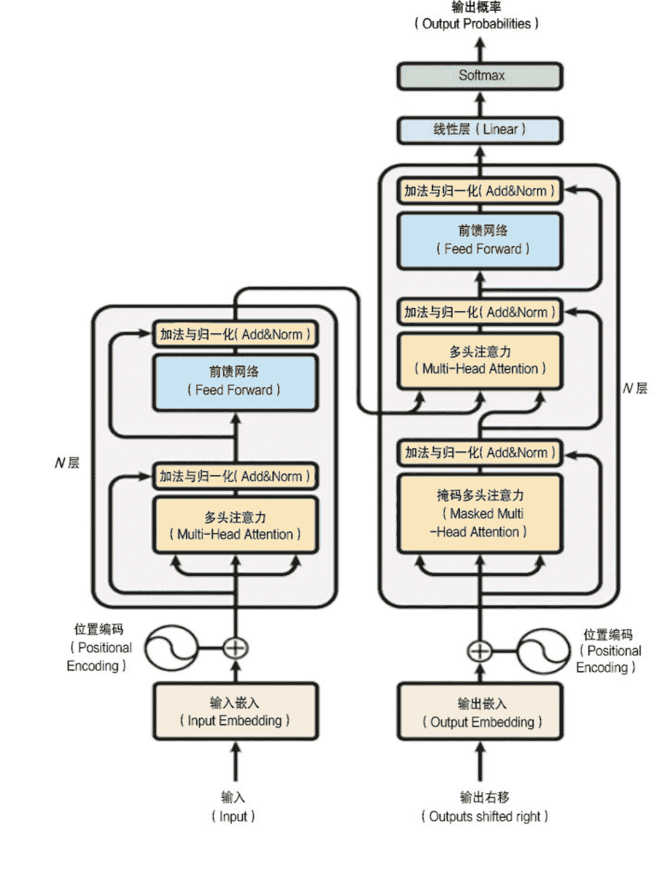

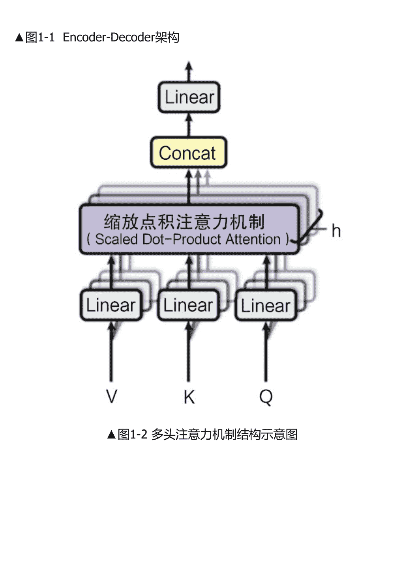

> (a) 高效长距离注意力网络 (Efficient Long-range Attention Network, ELAN)
>
> - **局部特征提取** (Local Feature Extraction)
> - **分组多尺度自注意力** (Group-wise Multi-scale Self-Attention)
>
> (b) 高效长距离注意力模块 (Efficient Long-range Attention Block, ELAB)
>
> (c) 移位卷积 (Shift-Convolution)
>
> (d) 分组多尺度自注意力 (Group-wise Multi-Scale Self-Attention, GMSA)
>
> (e) 加速自注意力 (Accelerated Self Attention, ASA)
>
> **图 1-4 高效长距离注意力网络（ELAN）**

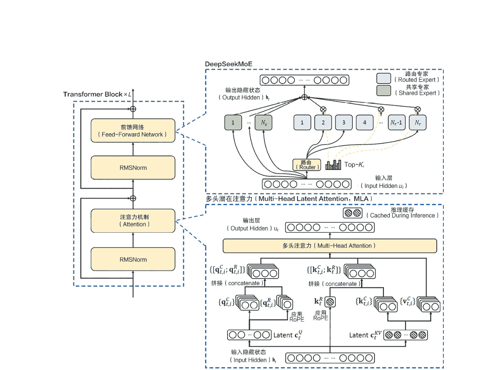
> **图 2-2 FP8 格式下的混合精度训练架构**

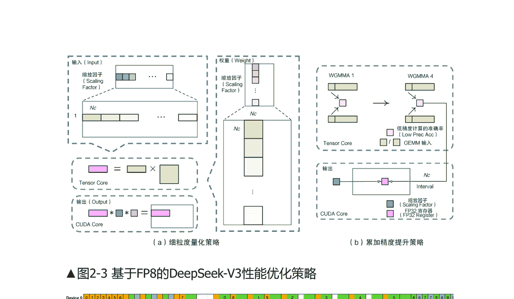
> **图 2-3 基于 FP8 的 DeepSeek-V3 性能优化策略**


> **图 2-4 基于 DualPipe 的双向流水线调度机制**

>**图 2-5** 无辅助损失的负载均衡策略在专家负载分配中的优化效果
>**图 2-6** 在多任务预测训练中对 Token 的定义与编码的建模流程

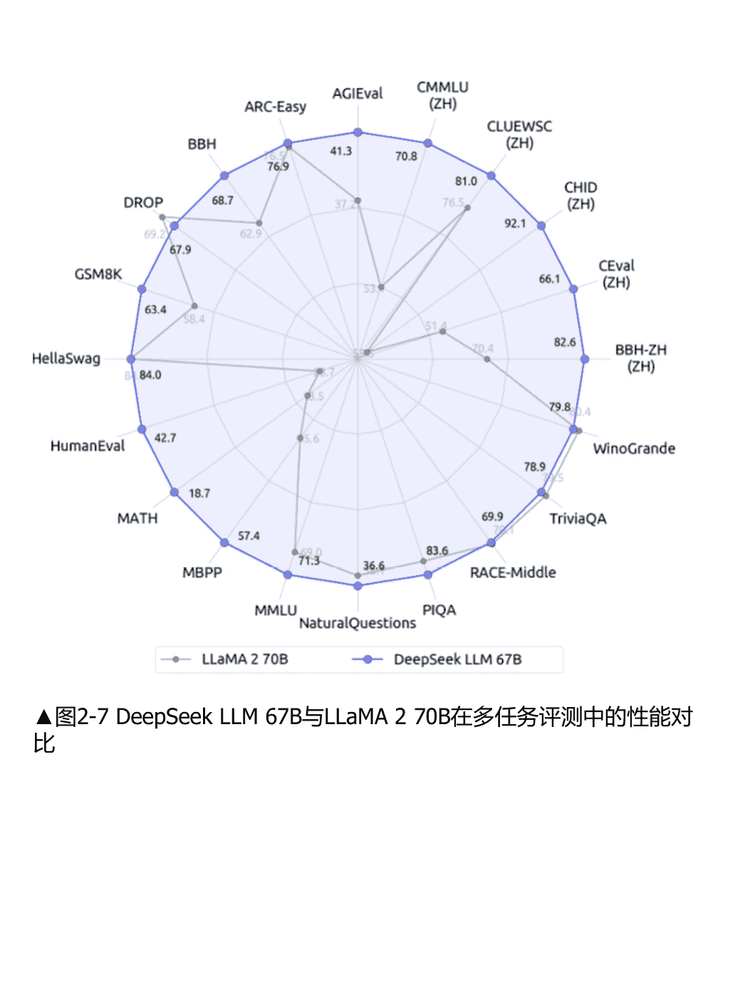

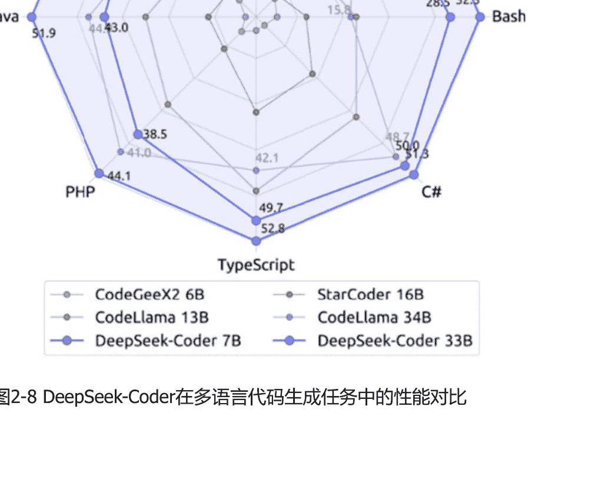

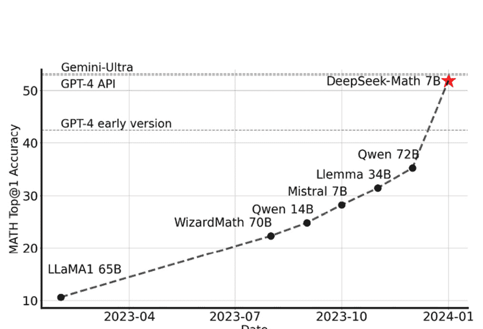
> **图 2-9 DeepSeek-Math 在数学推理任务中的 Top@1 准确率**

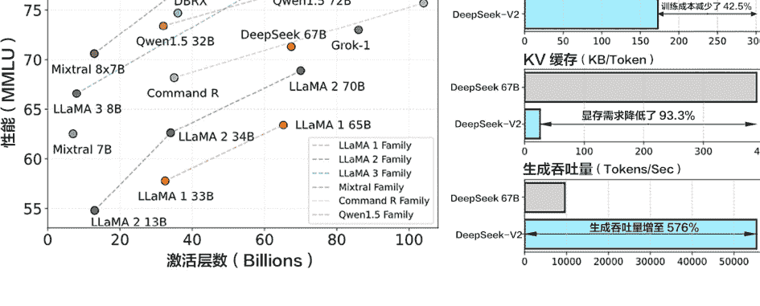
> **图 2-10 DeepSeek-V2 在 MMLU 性能、训练成本和推理效率上的综合优势**

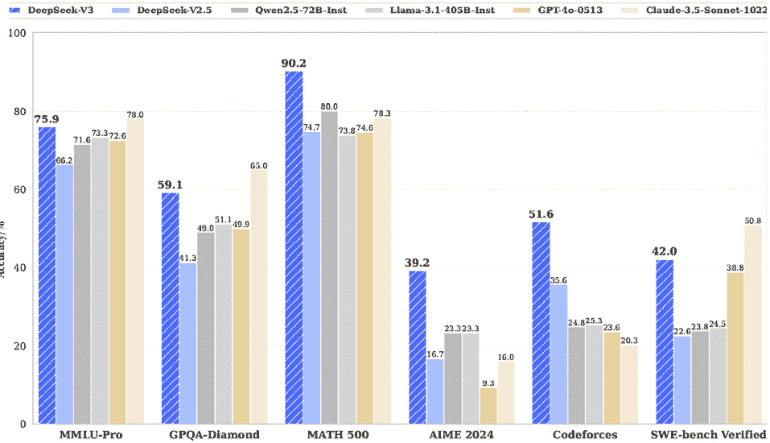
> **图 2-11 DeepSeek-V3 在多任务评测中的性能表现**

> **配套资源验证码 250031**

# *文中代码字体版权说明*

Copyright 2010, 2012 Adobe Systems Incorporated (http://www.adobe.com/), with Reserved Font Name 'Source'.  
License This Font Software is licensed under the SIL Open Font License, Version 1.1. This license is copied below, and is also available with a FAQ at: http://scripts.sil.org/OFL

# SIL OPEN FONT LICENSE Version 1.1 - 26 February 2007
## PREAMBLE

The goals of the Open Font License (OFL) are to stimulate worldwide development of collaborative font projects, to support the font creation efforts of academic and linguistic communities, and to provide a free and open framework in which fonts may be shared and improved in partnership with others. The OFL allows the licensed fonts to be used, studied, modified and redistributed freely as long as they are not sold by themselves.

The fonts, including any derivative works, can be bundled, embedded, redistributed and/or sold with any software provided that any reserved names are not used by derivative works. The fonts and derivatives, however, cannot be released under any other type of license. The requirement for fonts to remain under this license does not apply to any document created using the fonts or their derivatives.

conditions:  
1. Neither the Font Software nor any of its individual components, in Original or Modified Versions, may be sold by itself.  
2. Original or Modified Versions of the Font Software may be bundled, redistributed and/or sold with any software, provided that each copy contains the above copyright notice and this license. These can be included either as stand-alone text files, human-readable headers or in the appropriate machine-readable metadata fields within text or binary files as long as those fields can be easily viewed by the user.  
3. No Modified Version of the Font Software may use the Reserved Font Name(s) unless explicit written permission is granted by the corresponding Copyright Holder. This restriction only applies to the primary font name as presented to the users.  
4. The name(s) of the Copyright Holder(s) or the Author(s) of the Font Software shall not be used to promote, endorse or advertise any Modified Version, except to acknowledge the contribution(s) of the Copyright Holder(s) and the Author(s) or with their explicit written permission.  
5. The Font Software, modified or unmodified, in part or in whole, must be distributed entirely under this license, and must not be distributed under any other license. The requirement for fonts to remain under this license does not apply to any document created using the Font Software.

> **TERMINATION**  
> This license becomes null and void if any of the above conditions are not met.

> > **DISCLAIMER**  
> THE FONT SOFTWARE IS PROVIDED "AS IS", WITHOUT WARRANTY OF ANY KIND, EXPRESS OR IMPLIED, INCLUDING BUT NOT LIMITED TO ANY WARRANTIES OF MERCHANTABILITY, FITNESS FOR A PARTICULAR PURPOSE AND NONINFRINGEMENT OF COPYRIGHT, PATENT, TRADEMARK, OR OTHER RIGHT. IN NO EVENT SHALL THE COPYRIGHT HOLDER BE LIABLE FOR ANY CLAIM, DAMAGES OR OTHER LIABILITY, INCLUDING ANY GENERAL, SPECIAL, INDIRECT, INCIDENTAL, OR CONSEQUENTIAL DAMAGES, WHETHER IN AN ACTION OF CONTRACT, TORT OR OTHERWISE, ARISING FROM, OUT OF THE USE OR INABILITY TO USE THE FONT SOFTWARE OR FROM OTHER DEALINGS IN THE FONT SOFTWARE.
```