# DeepSeek高效财务-2

# 应用 DeepSeek 辅助财务日常运营管理工作
## 下篇

除了前述各种财务基础工作，财务日常工作中还包括很多运营、管理性质的工作，包括制度建设、协议拟定、合规检查、疑难问题解决等。作为决策支持工具，财务分析及其可视化在现代财务工作中的重要性和必要性更是大大提升。

因此，本书从第8章开始，介绍如何应用DeepSeek高效辅助财务日常运营管理工作。其中，第8章介绍应用DeepSeek辅助财务制度建设；第9章介绍应用DeepSeek辅助合同拟定；第10章介绍应用DeepSeek辅助法律法规政策查询；第11章介绍应用DeepSeek辅助多场景账务处理；第12章介绍应用DeepSeek辅助财务BP进行可视化分析。

本书从第8章开始，采取给学习者分组布置任务的形式。通过对比普通组和优秀组在应用DeepSeek辅助完成任务过程中的不同操作并分别点评，总结应用DeepSeek的经验和技巧，对容易出现失误的地方进行“排雷”。所有任务都是在课堂或培训现场布置，要求各组在60分钟内完成。

## 第8章 应用DeepSeek辅助财务制度建设

财务制度建设是企业财务管理的重要职责之一，对于规范财务行为、防控风险和提升企业管理效率具有关键作用。通过为报销流程、成本费用控制、资金管理等制定清晰的制度，企业的财务运作能够更为合规、高效。财务制度建设工作通常由财务总监或财务经理牵头，由会计主管或内控专员等人员具体负责。

财务制度建设既强调合规性，要求遵守法规政策、符合行业惯例等；又强调结合企业实际，确保可执行、可落地；还因为涉及多部门利益且更新频繁，需要文字表达规范、明晰、易理解、无歧义。因此，财务制度建设是一项需要具备高度专业性和文案素质的工作。

一般来说，大型企业每隔一段时间（如两三年）会进行一次全面制度修订，也会根据实际情况进行年度微调。在外界环境、政策或自身组织结构、流程等发生重大变化时，企业也会及时修订制度。传统财务制度建设往往耗时较长，从产生意向到最终落地，少则几周，多则数月甚至更久。制度文本的不断打磨和修改令负责制度建设工作的财务人员心力交瘁。今天，企业外部环境变化频繁，企业自身组织结构、流程为适应竞争也经常快速调整，传统财务制度建设的“慢工”难以匹配这样的现实情况。

AI 的高速发展，给企业带来了提升财务制度建设效率的绝佳契机。财务人员要掌握利用 AI 快速搭建制度框架、反复打磨文本的能力，学会利用 AI 辅助快速进行合规性审查（特别是学会利用智能协同、交叉审核），更要把握财务建设工作中的正确人机互动关系。

应用 AI 辅助财务工作时，“懒人式 AI"“一键生成式 AI"“完全依赖 AI"“AI 全盘替代”的认识是错误的，部分自媒体类似"AI 5 分钟轻松搞定”的宣传是虚假的，不但不能提升财务人员的能力和工作效率，反而会造成大范围焦虑，也无法帮助企业产出具有可用性的工作成果。AI 无法代替财务人员进行制度建设的调研工作，无法代替管理者作决策，我们要学习的是如何让 AI 做能做的事情，把财务人员从制度建设繁重的文本工作中解放出来，如通过 AI 辅助实现高效合规性审查（一定含有人工审查成分）。

学习和训练与 AI 互动的技巧，掌握 AI 的属性，深刻理解它的优势和缺陷，扬长避短，财务人员就能切实大幅提高工作效率，高质高效产出优秀的工作成果，在为企业节省成本、创造价值的同时，构建自己的核心竞争力。

本章以“企业差旅费报销制度建设”为案例场景。差旅费报销制度是企业中非常常见、使用频率非常高的一项制度，几乎每个企业都有自己的差旅费报销制度。它看似简单，实则涉及很多细节，既要规范具体、详尽细致，还要可执行、便于操作。而且，随着外部环境的发展变化、企业内部结构或流程的变化调整，差旅费报销制度也需要快速响应修订。因此，企业的差旅费报销制度建设是一项长期、动态的任务，是财务工作中不可忽视的基础性环节。

本章分为三节，8.1 节以企业新建制度为场景，8.2 节以企业修订制度为场景，8.3 节为本章总结。

### 8.1 企业新建制度

**任务场景描述**

你是一家新成立的小型广告公司的财务人员，参与建设公司的差旅费报销制度。公司规模不大，人数在 100 人以下。你需要拟定完整的制度文本，然后报财务负责人审查报销流程、费用标准限额等，由财务负责人最终确定。公司虽然成立时间短且规模不大，但业务高端，发展迅速，公司领导希望制度建设完整、细致，强调合规性、合理性、可操作性。

#### 8.1.1 普通组的操作与成果

###### 1. 普通组操作步骤

- ▶步骤一：上网搜索找到一份其他广告公司的差旅费报销制度文件。
- ▶步骤二：将该PDF文件导入DeepSeek，输入指令：**请根据PDF的内容生成一份通用的广告公司差旅费报销制度，要求尽量详尽**。
- ▶步骤三：将生成的文字复制粘贴到Word文档中。

##### 2. 普通组成果展示

> **第五条 部门负责人应根据工作需要合理安排出差，严格控制出差人数和天数。**
>
> **# # 第三章 费用标准**
>
> **第六条** 公司根据国家相关规定和公司实际情况，制定差旅费标准，包括交通费、住宿费、伙食补助费等。
>
> **第七条 交通费标准：**
>
> > *飞机：经济舱*
>
> > *火车：硬卧或二等座*
>
> > *轮船：三等舱*
>
> > *市内交通：公共交通为主，特殊情况可乘坐出租车*
>
> **第八条 住宿费标准：**
>
> > *一线城市：×××元/天*
>
> > *二线城市：×××元/天*
>
> > *三线城市：×××元/天*
>
> **第九条 伙食补助费标准：**
>
> > *一线城市：×××元/天*
>
> > *二线城市：×××元/天*
>
> > *三线城市：×××元/天*
>
> **第十条** 特殊情况需超标准报销的，需事先申请并经公司领导批准。
>
> **# # 第四章 报销流程**
>
> **第十一条** 员工出差结束后，应及时整理差旅费用票据，填写《差旅费报销单》，并附上相关证明材料。
>
> **第十二条** 部门负责人对报销单据进行审核，确认无误后签字确认。
>
> **第十三条** 财务部门对报销单据进行复核，并根据公司规定进行报销。
>
> **第十四条** 报销款项原则上通过银行转账方式支付。
>
> **# # 第五章 附则**
>
> **第十五条** 本制度由公司财务部负责解释。
>
> **第十六条** 本制度自发布之日起施行。

**作者点评**

从普通组的操作步骤来看，虽然能够初步使用 DeepSeek 生成差旅费报销制度，但整体流程过于简单，缺乏对 AI 模型运行机制与财务制度逻辑的深入理解。仅凭导入一份文件并使用“一句话指令”生成通用性制度，忽略了两个关键环节：一是对导入范本的评估与归纳，二是对模型输出结果的审核与优化。这种做法暴露出的问题是对 AI 应用的理解过于简单，实质上就是不理解人机协同关系，没有掌握应用 AI 反复打磨和交叉使用 AI 的能力，也不理解人工审核是不可或缺的，而且人的作用体现在引导 AI 辅助工作的每一步骤。

#### 8.1.2 优秀组的操作与成果

###### 1. 优秀组操作步骤

**步骤一**：向 DeepSeek 发出指令：请生成一份企业的差旅费报销制度，要求如下：（1）公司所在行业：广告公司，新媒体行业；（2）公司规模：100 人以内；（3）请提供详尽的差旅费报销制度，要具备合规性、合理性和可操作性；（4）允许联网搜索，请按照最新的格式生成；（5）对于金额部分请参考行业标准。

**步骤一结果**：DeepSeek 可以理解问题，但生成制度的详细程度有待提高，文字不到 1000 字，涉及系列金额的部分没有制作表格；费用标准没有区分地区（如按照一线城市、二线城市、三线及以下城市进行区分）；此外，一些金额出现常识性错误（如普通员工和部门负责人及以上职级的每日住宿费上限分别达到6000元和8000元）。

**图 8-1 步骤一结果中的常识性错误示例**

**步骤二**: 继续向 DeepSeek 发出指令：在这份制度的基础上进行修改，内容要更加细化详尽，涉及系列金额的部分请制作表格，费用标准按照一线城市、二线城市、三线及以下城市进行区分。要检查所有的费用限额，对于明显偏高的进行合理化修改。

**步骤二结果**: DeepSeek 能够理解问题，新生成的差旅费报销制度更加详尽，条款增加了 1/3，全文达到接近 2000 字，使用了表格；费用标准按照要求进行了修改。原先明显不合理的费用限额也做了调整；人工审查发现此次新生成的差旅费报销制度详尽给出了报销流程与期限，但是该流程与公司现有报销流程有出入——目前公司的报销流程是根据员工提交经部门领导批准的《出差申请单》和《差旅费报销单》进行报销，不再需要部门复核，全部流程已经实现通过办公软件完成；除此之外，人工审查没有再发现明显的错误。

**第八条 住宿费**

| 城市级别 | 普通员工标准（元/天） | 部门负责人及以上标准 (元/天) |
| :--- | :--- | :--- |
| 一线城市 | 400 | 800 |
| 二线城市 | 300 | 600 |
| 三线及以下城市 | 200 | 500 |

**第四章 报销流程与时效**

| 步骤 | 具体操作要求 | 责任人 | 时限要求 |
| :--- | :--- | :--- | :--- |
| 1. 提交报销申请 | 员工填写《差旅费报销单》，并附上所有有效凭证（如机票、住宿发票、餐饮发票等）。 | 出差员工 | 出差结束后 7 个工作日内 |
| 2. 凭证审核 | 财务部门审核报销单及凭证，确保金额、票据、用途等信息准确无误。 | 财务部门 | 收到申请后 3 个工作日内 |
| 3. 部门复核 | 部门负责人复核报销单，确认出差目的、时间、费用合理性。 | 部门负责人 | 收到申请后 2 个工作日内 |
| 4. 财务审批 | 财务部门完成最终审批，确认报销金额无误后，安排支付。 | 财务部 | 复核通过后 2 个工作日内 |
| 5. 报销支付 | 财务部门将报销款项支付至员工指定银行账户。 | 财务部 | 审批通过后 3 个工作日内 |
| 6. 凭证归档 | 财务部门将报销单及凭证归档，保存至少 5 年以备审计。 | 财务部 | 支付完成后 1 个工作日内 |

**步骤三**: 继续向 DeepSeek 发出指令：请将第四章报销流程与时限的步骤 1 修改为：员工提交《出差申请单》和《差旅费报销单》，并附上所有有效凭证（如机票、住宿发票、餐饮发票等）；删除步骤 3；调整步骤序号；其他部分不要改动。

**步骤三结果**: DeepSeek 按照要求生成了新的差旅费报销制度。报销流程部分改动如下。

**第四章 报销流程与时限**

| 步骤 | 具体操作要求 | 责任人 | 时限要求 |
| :--- | :--- | :--- | :--- |
| 1. 提交报销申请<br>2. 凭证审核<br>3. 财务审批<br>4. 报销支付<br>5. 凭证归档 | 员工在线提交经部门领导审批的《出差申请单》和《差旅费报销单》，并附所有有效凭证（如机票、住宿发票、餐饮发票等）。<br>财务部门审核报销单及凭证，确保金额、票据、用途等信息准确无误。<br>财务部门完成最终审批，确认报销金额无误后，安排支付。<br>财务部门将报销款项支付至员工指定银行账户。<br>财务部门将报销单及凭证归档，保存至少 5 年以备审计。 | 出差员工<br>财务部门<br>财务部门<br>财务部门<br>财务部门 | 出差结束后 7 个工作日内<br>收到申请后 3 个工作日内<br>复核通过后 2 个工作日内<br>审批通过后 3 个工作日内<br>支付完成后 1 个工作日内 |

**步骤四**: 应用其他 AI大模型（如Kimi）交叉提问。应用Kimi进一步确认步骤三结果的合理性、合规性。向Kimi发出指令：假设你是公司法务，请根据你的现有数据库及使用联网检索，对这份广告公司差旅费报销制度的法律错误和常识错误进行评价，并给出修改建议。

**步骤四结果**: Kimi返回的结果如下所示：

> 以下是这份差旅费文件的法律错误和常识错误的评价及改正建议：
>
> **法律错误**
> - 未明确提及员工权益保障：文件中未提及员工在出差期间的工伤认定、意外伤害赔偿等权益保障问题。根据《工伤保险条例》，员工因工作原因出差期间受到事故伤害或者患职业病的，应当认定为工伤，享受工伤保险待遇。公司应在制度中明确，员工出差期间如发生工伤，公司将依法协助员工进行工伤认定和赔偿申请。
> - 未涉及劳动法律法规：文件中未提及《中华人民共和国劳动法》《中华人民共和国合同法》等相关法律法规。例如，员工出差期间的工作时间、加班工资支付等问题，应依据《中华人民共和国劳动法》相关规定执行。公司应在制度中明确，员工出差期间的工作时间应按照公司正常工作时间计算，如因工作需要延长工作时间的，应按照国家规定支付加班工资。
> - 缺乏对员工隐私保护的说明：文件中未提及员工出差期间的隐私保护问题。根据《中华人民共和国个人信息保护法》，公司在处理员工个人信息时，应遵循合法、正当、必要的原则，保障员工的隐私权益。公司应在制度中明确，员工出差期间的相关信息，如行程安排、住宿信息等，将严格保密，仅用于公司内部管理及差旅费报销等必要用途，不得泄露给无关第三方。
>
> **常识错误**
> - 住宿费限额设置不合理：文件中规定的住宿费限额可能与实际市场情况不符。例如，一线城市（北京、上海、广州、深圳）的住宿费用较高，普通员工的住宿费限额 400 元/晚可能难以满足实际需求。公司应根据当地市场行情和公司财务状况，合理调整住宿费限额，确保员工在出差期间能够获得合适的住宿条件。
> - 市内交通费补贴标准偏低：文件中规定的市内交通费补贴标准为每人每天 50 元，可能无法满足员工在出差期间的实际交通需求。特别是在一些大城市，公共交通费用较高，且可能需要乘坐出租车前往较远的地方。公司可以考虑适当提高市内交通费补贴标准，或者根据城市级别和交通状况制定不同的补贴标准。
> - 报销流程与时限规定不够灵活：文件中规定报销流程与时限较为严格，如员工提交报销申请的时限为出差结束后 7 个工作日内，财务部门审批的时限为收到申请后 3 个工作日内等。在实际工作中，可能会出现一些特殊情况导致员工无法按时提交报销申请，或者财务部门无法按时完成审批。公司可以适当放宽报销流程与时限的规定，增加一些特殊情况的处理机制，以提高制度的灵活性和可操作性。
>
> **改正建议**
> - 增加员工权益保障条款：在第一章“总则”中增加一条“员工权益保障”，明确公司在员工出差期间将依法保障员工的合法权益，包括工伤认定、意外伤害赔偿、劳动报酬支付等，并按照国家相关法律法规执行。
> - 引用相关法律法规：在文件开头增加“法律依据”部分，明确本制度依据《中华人民共和国劳动法》《中华人民共和国劳动合同法》《工伤保险条例》等法律法规制定，确保制度的合法性和权威性。
> - 完善隐私保护说明：在第三章“差旅费用标准”中增加一条“员工隐私保护”，明确公司在处理员工出差信息时将严格遵守《中华人民共和国个人信息保护法》等相关法律法规，保障员工的隐私权益，不得泄露员工个人信息。
> - 调整住宿费限额和市内交通费补贴标准：根据当地市场行情和公司财务状况，对住宿费限额和市内交通费补贴标准进行合理调整。例如，将一线城市普通员工的住宿费限额提高至 800 元/晚，将市内交通费补贴标准提高至每人每天 80 元，并根据城市级别和交通状况制定不同的补贴标准。
> - 优化报销流程与时限规定：适当放宽报销流程与时限的规定，增加特殊情况的处理机制。例如，将员工提交报销申请的时限延长至出差结束后 10 个工作日内，并规定如因特殊情况无法按时提交报销申请的，经部门负责人批准后可适当延长提交时限；财务部门审批的时限可根据实际情况适当延长，但最长不得超过 5 个工作日。

**步骤五**：将 Kimi 指出的问题和修改建议按照公司实际情况进行调整，如一线城市普通员工的住宿费限额按照公司惯例设为 600 元/晚，然后输入给 DeepSeek 进行修改。为了避免出现文件误读，将调整后的修改建议用文字的方式输入 DeepSeek，向 DeepSeek 发出指令：**以下是对前面差旅费报销制度的法律错误和常识错误的评价及修改建议，请据此继续修改制度：……**

**步骤五结果**：DeepSeek 能够理解修改建议，并进行相应修改：引用了相关法律法规，增加了员工权益保障条款，完善了隐私保护说明，调整了费用限额和补贴标准（住宿费限额部分见下表），放宽了部分报销时限要求。同时，DeepSeek 还按照自己的理解优化了一些 Kimi 没有提出修改建议的地方（主要是在表达形式方面，内容没有实质性变化）。

**第九条 住宿费限额**

| 城市级别 | 普通员工（元/晚） | 部门负责人及以上（元/晚） |
| :--- | :--- | :--- |
| 一线城市（北京、上海、广州、深圳） | 600 | 800 |
| 省会城市及二线发达城市 | 500 | 600 |
| 其他城市 | 400 | 500 |

**第四章 报销流程**

**第十三条 报销流程与时限**

| 步骤 | 具体操作要求 | 责任人 | 时限要求 |
| :--- | :--- | :--- | :--- |
| 1. 提交报销申请 | 员工填写《差旅费报销单》，并附上所有有效凭证（如机票、住宿发票、餐饮发票等）。 | 出差员工 | 出差结束后 10 个工作日内 |
| 2. 凭证审核 | 财务部门审核报销单及凭证，确保金额、票据、用途等信息准确无误。 | 财务部门 | 收到申请后 5 个工作日内 |
| 3. 财务审批 | 财务部门完成最终审批，确认报销金额无误后，安排支付。 | 财务部门 | 复核通过后 3 个工作日内 |
| 4. 报销支付 | 财务部门将报销款项支付至员工指定银行账户。 | 财务部门 | 审批通过后 3 个工作日内 |
| 5. 凭证归档 | 财务部门将报销单及凭证归档，保存至少 5 年以备审计。 | 财务部门 | 支付完成后 1 个工作日内 |

**第十四条 特殊情况处理**

1. 如因特殊情况无法按时提交报销申请，经部门负责人批准后可适当延长提交时限，但最长不得超过出差结束后 1 个月。
2. 财务部门如遇特殊情况无法按时完成审批，需及时通知报单人，并说明原因，审批时限最长不得超过 7 个工作日。

**步骤六**: 对步骤五生成的结果进行人工审核，对一些字句和格式进行调整后，提交给财务负责人。财务负责人建议细化费用标准的级别划分，将原有的“普通员工、部门负责人及以上”细化为“普通员工、部门负责人、副总经理和总经理”。

## 2.优秀组成成果展示

### ××广告公司差旅费报销制度

## 第一章 总则

### 第一条 目的

为加强公司差旅费管理，规范差旅费报销流程，合理控制费用支出，依据《中华人民共和国劳动法》《中华人民共和国合同法》《工伤保险条例》《中华人民共和国个人信息保护法》等法律法规及公司实际情况，特制定本制度。

### 第二条 适用范围

本制度适用于公司全体员工因工作需要出差所产生的差旅费报销管理。

### 第三条 基本原则

1. **合规性**：差旅费用报销需符合国家法律法规及公司财务制度。
2. **合理性**：差旅费用支出应基于实际需要，避免浪费。
3. **透明性**：报销流程公开透明，确保公平公正。
4. **员工权益保障**：公司依法保障员工出差期间的合法权益，包括工伤认定、意外伤害赔偿、劳动报酬支付等。

### 第四条 法律依据

本制度依据《中华人民共和国劳动法》《中华人民共和国合同法》《工伤保险条例》《中华人民共和国个人信息保护法》等法律法规制定，确保制度的合法性和权威性。

## 第二章 审批流程

### 第五条 出差申请

1. 员工出差前需填写《出差申请单》，详细注明出差事由、行程安排（包括出发地、目的地、预计出发和返回时间）、预计费用等信息。若出差涉及会议或培训，需附上相关通知文件。
2. 《出差申请单》按以下权限依次审批：
- 普通员工出差：部门负责人审核，分管领导批准。
- 部门负责人出差：分管领导审核，总经理批准。
- 公司高层领导出差：总经理批准。
3. 审批通过后，员工方可出差。

### 第六条 行程变更

出差期间如因特殊情况需变更行程，应及时填写《出差行程变更申请单》，说明变更原因及调整后的行程安排，按原审批流程重新审批。

### 第七条 审批责任

1. 各级审批人员应严格审核出差申请，确保出差的必要性与合理性。
2. 审批人员应重点关注出差事由是否与工作相关、行程安排是否紧凑合理、预计费用是否在合理范围内等。
3. 若因审核不严导致违规出差，审批人员需承担相应责任。

## 第三章 差旅费用标准

### 第八条 交通工具乘坐标准

| 职级 | 交通工具标准 |
| --- | --- |
| 总经理及以上级别 | 飞机头等舱、高铁 / 动车商务座、轮船一等舱，其他交通工具实报实销。 |
| 副总经理级别 | 飞机经济舱（全价票及以下）、高铁 / 动车一等座、轮船二等舱。 |
| 部门负责人级别 | 飞机经济舱（折扣票优先）、高铁 / 动车二等座、轮船三等舱。 |
| 普通员工 | 火车硬席（硬座、硬卧）、高铁 / 动车二等座、轮船四等舱。长途出行（6小时以上）无座，经部门负责人批准，可购买同级别其他交通工具车票。 |

### 第九条 住宿费限额

| 城市级别 | 总经理及以上（元/晚） | 副总经理（元/晚） | 部门负责人（元/晚） | 普通员工（元/晚） |
| --- | --- | --- | --- | --- |
| 一线城市（北京、上海、广州、深圳） | 1500 | 1200 | 800 | 600 |
| 省会城市及二线发达城市 | 1200 | 1000 | 600 | 500 |
| 其他城市 | 1000 | 800 | 500 | 400 |

### 第十条 伙食补助费

1. 国内出差：每人每天伙食补助费标准为 80 元，实行定额包干，不再报销餐饮发票。
2. 如因工作需要参加会议、培训等，主办方统一安排餐饮的，按实际天数扣除相应伙食补助费。

### 第十一条 市内交通费

每人每天市内交通费标准为 80 元，优先选择公共交通工具。如因工作需要乘坐出租车，需注明事由、起止地点等信息，凭发票报销，但报销金额不得超过标准。

### 第十二条 员工隐私保护

公司严格遵守《中华人民共和国个人信息保护法》，员工出差期间的行程安排、住宿信息等将严格保密，仅用于公司内部管理及差旅费报销等必要用途，不得泄露给无关第三方。

## 第四章 报销程序

### 第十三条 报销流程与时限

| 步骤 | 具体操作要求 | 责任人 | 时限要求 |
| --- | --- | --- | --- |
| 1. 提交报销申请 | 员工在线提交经部门领导审批的《出差申请单》和《差旅费报销单》，并附所有有效凭证（如机票、住宿发票、餐饮发票等）。 | 出差员工 | 出差结束后 10 个工作日内 |
| 2. 凭证审核 | 财务部门审核报销单及凭证，确保金额、票据、用途等信息准确无误。 | 财务部门 | 收到申请后 3 个工作日内 |
| 3. 财务审批 | 财务部门完成最终审批，确认报销金额无误后，安排支付。 | 财务部门 | 复核通过后 2 个工作日内 |
| 4. 报销支付 | 财务部门将报销款项支付至员工指定银行账户。 | 财务部门 | 审批通过后 3 个工作日内 |
| 5. 凭证归档 | 财务部门将报销单及凭证归档，保存至少 5 年以备审计。 | 财务部门 | 支付完成后 1 个工作日内 |

### 第十四条 特殊情况处理

1. 如因特殊情况无法按时提交报销申请，经部门负责人批准后可适当延长提交时限，但最长不得超过出差结束后 1 个月。
2. 财务部门如遇特殊情况无法按时完成凭证审核和财务审批，需及时通知报销人，并说明原因，但时限最长不得超过 10 个工作日。

#### 第五章 特殊情况处理

##### 第十五条 超标准报销

1. **适用范围**：因特殊情况（如会议地点偏远、酒店价格异常上涨等）导致费用超出标准。
   **审批流程**：
   - 员工填写《超标准报销申请表》，详细说明超标准原因及金额。
   - 部门负责人审核后，提交分管领导审批。
   - 分管领导审批通过后，财务部门方可报销超标准部分。
2. **审批时限**：超标准报销申请需在提交报销申请时一并提交，审批流程不得超过 5 个工作日。

##### 第十六条 退票与改签

因公司原因导致的退票、改签费用由公司承担；因个人原因导致的费用由员工自行承担。

##### 第十七条 延期与变更

出差时间延长或行程变更需及时报备，相关费用需重新审批。

#### 第六章 票据管理

##### 第十八条 票据要求

1. 差旅费报销必须提供真实、合法、有效的票据。
2. 住宿费发票应开具公司名称，注明住宿日期、入住人数、单价、金额等详细信息。
3. 交通票据应包括飞机票、火车票、汽车票、出租车票等，票面信息应清晰完整，与出差行程一致。

##### 第十九条 票据审核

1. 财务人员对报销票据进行严格审核，通过发票查验平台等工具核实发票真伪。
2. 对于票据不齐全、内容不清晰或与出差行程不符的，财务部门有权要求报销人补充说明或提供其他证明材料。

##### 第二十条 特殊情况处理

若因特殊情况无法取得住宿费发票，需填写《无住宿费发票情况说明》，经部门负责人批准后，可报销城市间交通费、伙食补助费和市内交通费，但不得报销住宿费。

#### 第七章 禁止行为

##### 第二十一条 禁止行为

1. 严禁超标准、超范围报销差旅费。
2. 禁止虚报出差人数和天数，不得变相发放补助。
3. 杜绝以出差名义进行变相旅游或擅自更改行程。
4. 严禁利用差旅费报销套取资金。

#### 第八章 监督与处罚

##### 第二十二条 监督机制

公司成立监督小组，定期对差旅费管理与使用情况进行检查评估。

##### 第二十三条 处罚措施

1. 对违反本制度的行为，视情节轻重给予相应处罚。
2. 情节较轻的，给予警告、通报批评；情节严重的，除追回违规所得外，给予罚款、降职、解除劳动合同等处罚；涉及违法犯罪的，移交司法机关处理。

#### 第九章 附则

##### 第二十四条 制度修订

本制度由公司财务部负责解释与修订。

##### 第二十五条 生效日期

本制度自发布之日起施行，如有与本制度相抵触的规定，以本制度为准。

---

##### 附件

《出差申请单》
《出差行程变更申请单》
《差旅费报销单》
《超标准报销申请表》
《无住宿费发票情况说明》

---

### 作者点评

优秀组以“智能协同 + 人工审阅”的方式，反复打磨制度文本，取得了较为理想的结果。优秀组的操作亮点包括：首先，很好地利用了 DeepSeek 强大的逻辑构建能力与格式清晰性；其次，较好发挥了应用其他大模型交叉审核的智能协同作用，没有让 Kimi 直接在 DeepSeek 生成结果的基础上生成新的结果，而是要求 Kimi 做评价和给出修改建议，并且也没有直接全盘采纳修改建议，而是先进行人工审核，再与 DeepSeek 互动；最后，对 AI 生成结果的每一步都进行了人工审核，发挥了 AI“结构框架构建者”和“底稿生成器”的作用，再辅以人工审查和调整，这样既可充分利用 AI 的效率优势又能确保最终成果可用。

## 8.2 企业修订制度

#### 任务场景描述

你是一家小型制造业企业的财务人员，需要修订公司的差旅费报销制度。由于物价变动，公司原来的报销标准无法满足出差需求，需要调整。同时，企业现在应用的 OA 办公自动化系统内置报销模块，目前出差申请、报销申请等流程已经全部上线，与早期的报销流程不同。此外，公司一年前停止了差旅费预支，员工出差均采用先垫支、再报销的方式。最后，公司正在进行制度体系完善工作，领导希望此次差旅费报销制度的修订能够对原来比较简单，不够细致，合规性、合理性有所欠缺的制度文本进行细化完善，提高完整性和可操作性，同时要采用公司新制度体系的统一格式。

**公司原有差旅费报销制度如下：**

### ××公司差旅费报销制度

#### 目的：

为规范员工差旅费用的报销流程，确保费用合理、透明，特制定本制度。

#### 适用范围：

本制度适用于公司所有因公出差的员工。

#### 报销范围：

1. **交通费**：包括机票、火车票、出租车费、公共交通费等。优先选择经济舱或二等座，特殊情况需提前申请。
2. **住宿费**：根据出差地标准，选择经济型酒店，标准为每晚不超过 200 元。
3. **餐饮费**：按出差天数补贴，标准为每天 50 元，凭发票报销。
4. **其他费用**：如通讯费、办公用品等，需提供合理说明及发票。

#### 报销流程：

1. **预支申请**：出差前可申请预支费用，填写《差旅预支申请表》，经部门负责人审批后领取。
2. **费用报销**：出差结束后 7 个工作日内，填写《差旅费用报销单》，附上所有发票及凭证，提交部门负责人审核。
3. **审核与支付**：财务部审核无误后，于 5 个工作日内完成报销支付。

#### 注意事项：

1. 所有报销需提供正规发票，发票内容与实际支出一致。
2. 超出标准的费用需提前申请，未经批准的超支部分自行承担。
3. 虚报、假报费用者，一经查实，将追究责任。

本制度自发布之日起生效。

经财务负责人上报公司领导后决定，新的差旅费报销标准、流程和相关要求如下：

1. **费用报销范围和金额**
   - （1）**交通费**：①员工优先选择经济舱和二等座；②部门经理优先选择经济舱和一等座及以下；③副总经理及以上优先选择商务舱及以下和商务座及以下。
   - （2）**住宿费**：①员工一线城市（北京、上海、广州）每晚不超过 500 元，其他城市不超过 300 元；②部门经理级别，一线城市每晚不超过 800 元，其他城市不超过 500 元；③副总经理及以上职级，一线城市每晚不超过 1000 元，其他城市不超过 800 元。
   - （3）**餐费补助**：一线城市一天 100 元，其他城市一天 80 元。
   - （4）**市内交通**：实报实销，优先选择公共交通，乘坐出租车或网约车需说明事由和提供起止地点等信息。
2. **差旅报销流程**：不再使用预支申请，员工自行垫付差旅费报销费用。出差前，员工应先通过公司 OA 系统提交《出差申请单》，在系统中填写出差事由、起止地点、时间等相关内容，在系统中推送给审批领导进行审批；出差回来后在系统中提交差旅费申请单和电子发票，提交给上级领导审批；审批通过后，提交给财务部门审批；财务部门审批通过后，支付报销费用。
3. **审批权限**：员工出差，由部门经理审批；部门经理出差，由副总经理审批；副总经理及以上职级出差，由总经理审批。
4. **注意事项**：住宿费发票需要提供增值税专用发票，其他发票提供增值税普通发票即可。

---

## 8.2.1 普通组的操作与成果

###### 1. 普通组操作步骤

将公司原有差旅费报销制度以 Word 文档形式上传给 DeepSeek，并对 DeepSeek 发出指令。

> **图8-7 普通组操作步骤**

##### 2. 普通组成果展示

### ××公司差旅费报销制度（修订版）

**目的**

为规范员工差旅费用的报销流程，确保费用合理、透明，同时适应公司发展需求，特修订本制度。

**适用范围**

本制度适用于公司所有因公出差的员工。

**一、报销标准**

1. **交通费**
    - 员工：优先选择经济舱（飞机）或二等座（火车）。
    - 部门经理：优先选择经济舱（飞机）或一等座及以下（火车）。
    - 副总经理及以上：可选择商务舱及以下（飞机）或商务座及以下（火车）。

2. **住宿费**
    - 员工：
        - 一线城市（北京、上海、广州）：每晚不超过 500 元。
        - 其他城市：每晚不超过 300 元。
    - 部门经理:
        - 一线城市：每晚不超过 800 元。
        - 其他城市：每晚不超过 500 元。
    - 副总经理及以上:
        - 一线城市：每晚不超过 1000 元。
        - 其他城市：每晚不超过 800 元。

    *注：住宿费需提供增值税专用发票。*

3. **餐费补助**
    - 一线城市：每天 100 元。
    - 其他城市：每天 80 元。

    *注：餐费补助无需发票，按出差天数计算。*

4. **市内交通费**
    - 优先选择公共交通，实报实销。
    - 乘坐出租车或网约车需说明事由，并提供起止地点等信息。

    *注：需提供增值税普通发票。*

5. **其他费用**
    如通信费、办公用品等，需提供合理说明及增值税普通发票。

**二、报销流程**

**出差前：**
- 员工通过公司 OA 系统提交《出差申请单》，填写出差事由、起止地点、时间等信息。
- 推送至审批领导：
    - 员工出差：由部门经理审批。
    - 部门经理出差：由副总经理审批。
    - 副总经理及以上出差：由总经理审批。

**出差结束后：**
- 员工在 OA 系统中提交《差旅费用报销单》，并上传电子发票及相关凭证。
- 推送至上级领导审批，审批通过后提交财务部门审核。

**财务审核与支付：**
- 财务部门审核无误后，于 5 个工作日内完成报销支付。

**三、注意事项**
- 所有报销需提供正规发票，发票内容与实际支出一致。
- 超出标准的费用需提前申请，未经批准的超支部分自行承担。
- 虚报、假报费用者，一经查实，将追究责任。
- 住宿费必须提供增值税专用发票，其他费用提供增值税普通发票即可。

本制度自发布之日起生效，原有制度同时废止。

××公司财务部
日期：2025年3月24日

附:
- 本制度解释权归公司财务部所有。
- 如有疑问，请联系财务部相关人员。

---

**作者点评**

本节普通组的操作思路与 8.1 节中普通组的操作思路相似（实际上也是大多数不懂得 AI 操作方法和技巧的使用者的思路），就是简单直白，希望一键生成所需内容。这样操作，如果运气好，生成的文本没有大错，但显然达不到预期标准；如果运气不好，生成的文本问题比较多，无法直接使用，需要人工进行大量修改。不能正确使用 AI，不能利用人机协同，就无法利用 AI 辅助实现工作效率大幅提高。

## 8.2.2 优秀组的操作与成果

###### 1. 优秀组操作步骤

**>> 步骤一**：将公司原有差旅费报销制度和新差旅费报销要求以 Word 文档形式上传至 DeepSeek，并向 DeepSeek 发出指令：我是一家小型制造业企业的财务人员，现在需要修订公司的差旅费报销制度。请阅读我上传的原有差旅费报销制度和新差旅费报销要求，按照新的差旅费报销要求，拟定公司新的差旅费报销制度。要求尽量详尽完整，具备合规性、合理性、可操作性，并要求各种费用标准尽量采用表格形式。

**↓↓ 步骤一结果**：DeepSeek 理解了指令，生成了如下所示的新的差旅费报销制度。新制度将公司的新差旅费报销要求都纳入其中，并且各种费用标准都采用了表格形式。

### ××公司差旅费报销制度（修订版）

#### 二、适用范围
本制度适用于公司所有因公出差的员工。

#### 三、职级划分
公司职级分为三级：
- 员工
- 部门经理
- 副总经理及以上

#### 四、报销范围与标准

##### 1.交通费

|职级|交通工具标准|
|:---|:---|
|员工 | 优先选择经济舱 (飞机) 或二等座 (火车)|
|部门经理 | 优先选择经济舱（飞机）或一等座及以下 (火车)|
|副总经理及以上 |优先选择商务舱及一下 (飞机) 或商务座及一下 (火车)|

- **市内交通**：实报实销，优先选择公共交通。乘坐出租车或网约车需说明事由，并提供起止地点等信息。

##### 2.住宿费

|职级|一线城市(北京、上海、广州)|其他城市|
|---|:---|:---|
|员工 |每晚不超过 500 元|每晚不超过 300 元|
|部门经理|每晚不超过 800 元 |每晚不超过 500 元|
|副总经理及以上 |每晚不超过 1000 元 |每晚不超过 800 元|

- **发票要求**：住宿费需提供增值税专用发票 (专票)。

##### 3.餐饮费

|城市级别|餐费标准|
|---|:---|
|一线城市(北京、上海、广州)|每天 100 元|
|其他城市 | 每天80 元|

- **报销要求**：餐饮费需凭发票报销，无发票部分不予支付。

##### 4.其他费用
- 通信费、办公用品：需提供合理说明及发票。
- 客户招待费用：需单独填写《客户招待费用报销单》，注明客户姓名、招待事由，并附发票。
- 培训/会议费用：参加外部培训或会议，需提前提供通知文件，经部门经理审批后方可报销。

#### 五、报销流程

##### 1.出差申请
- 员工需通过 OA 系统提交《出差申请单》，填写出差事由、起止地点、时间、预算等内容。
- **审批权限**：
    - 员工出差：部门经理审批。
    - 部门经理出差：副总经理审批。
    - 副总经理及以上出差：总经理审批。

##### 2.费用报销
- 员工需在出差结束后 7 个工作日内通过 OA 系统提交《差旅费报销单》，并上传电子发票及证明材料（如交通票据、住宿发票等）。
- **审批流程**：（内容截断，依据上下文逻辑延续）
    - 提交至上级领导审批。
    - 审批通过后提交财务部门审核。
    - 财务部门审核无误后，于 5 个工作日内完成报销支付。

## 第 8 章 应用 DeepSeek 辅助财务制度建设

# 七、生效日期
本制度自发布之日起执行，原有制度同时废止。
×× 公司
日期：××××年××月××日

##### 附件
1. 《出差申请单》(OA系统模板)
2. 《差旅费报销单》(OA系统模板)
3. 《客户招待费用报销单》(OA系统模板)

步骤二：为了进一步完善上述生成的新制度，要求 DeepSeek 进行自查和自我完善。首先，让 DeepSeek 自我学习和整理出建设企业差旅费报销制度的关键要点，并就这个问题进行自我强化学习。向 DeepSeek 发出指令：公司建设差旅费报销制度的核心要点有哪些。

步骤二结果：DeepSeek 给出了公司建设差旅费报销制度的十个核心要点，如下所示：

# 一、明确制度目的与适用范围
- 目的:
  - 规范差旅费用报销流程，确保费用合理、透明。
  - 控制差旅成本，提高资金使用效率。
  - 保障员工出差期间的合法权益。
- 适用范围:
  - 明确制度适用于所有因公出差的员工，包括全职、兼职及外派人员。

## 二、职级划分与费用标准
- 职级划分：
  - 根据公司组织架构，明确不同职级的差旅费报销标准（如员工、部门经理、副总经理及以上）。
- 费用标准:
  - 交通费：按职级规定交通工具标准（如经济舱、商务舱、一等座、二等座等）。
  - 住宿费：按职级和城市级别设定住宿标准（如一线城市、二线城市等）。
  - 餐饮费：按城市级别设定每日餐费补贴标准。
  - 其他费用：如通讯费、办公用品等，需明确报销范围和标准。
- 用标准表格化:
  - 使用表格清晰展示不同职级、不同城市的费用标准，便于员工查阅和执行。

## 三、报销流程与审批权限
- 报销流程:
  - 出差申请：员工需提前提交出差申请，注明出差事由、时间、地点及预算。
  - 费用报销：出差结束后，员工需在规定时间内提交报销申请，并附上相关发票和凭证。
  - 审批流程：明确各级审批权限（如员工出差由部门经理审批，部门经理出差由副总经理审批等）。
- 电子化流程:
  - 通过 OA 系统或财务软件实现差旅申请、报销、审批的全流程电子化，提高效率。

## 四、发票与凭证要求
- 发票类型:
  - 明确住宿费需开具增值税专用发票（专票），其他费用可开具普通发票（普票）。
- 电子发票:
  - 要求所有报销均提供电子发票，避免纸质发票丢失或损坏。
- 发票信息:
  - 发票抬头、税号、金额等信息需完整无误，且与实际支出一致。
- 凭证要求:
  - 提供交通票据、住宿发票、餐饮发票等原始凭证，确保报销真实合规。

## 五、特殊情况处理
- 特殊情况范围:
  - 包括航班延误、酒店满房、突发疾病等不可抗力因素导致的费用超支。
- 处理流程:
  - 员工需在特殊情况发生后及时报备，并在报销时提供相关证明文件（如航班延误证明、医院诊断证明等）。

## 六、预算控制与成本管理
- 预算控制:
  - 各部门需提前提交差旅费预算，财务部根据预算进行费用控制。
- 超预算处理:
  - 超预算部分需提交书面说明，并经上级领导批准后方可报销。

# 七、违规处理与责任追究
- 违规行为:
  - 包括虚报、假报费用，重复报销，超标准报销等。
- 处理措施:
  - 第一次违规：警告并追回违规报销金额。
  - 第二次违规：扣除当月绩效奖金。
  - 第三次违规：解除劳动合同。

# 八、制度宣导与培训
- 制度宣导:
  - 通过公司内部通知、培训会议等方式，向全体员工宣导差旅费报销制度。
- 新员工培训：
  - 在新员工入职培训中，加入差旅费报销制度的学习内容。

# 九、制度修订与更新
- 定期修订：
  - 根据公司业务发展、国家政策变化及员工反馈，定期修订差旅费报销制度。
- 员工反馈机制：
  - 建立员工反馈渠道，收集对差旅费报销制度的意见和建议。

# 十、附件与模板
- 附件:
  - 包括《出差申请单》、《差旅费报销单》、《客户招待费用报销单》等模板。
- 模板标准化：
  - 提供标准化的表格模板，确保报销材料格式统一、内容完整。

# 总结
建设差旅费报销制度的核心要点包括：明确目的与适用范围、设定职级与费用标准、规范报销流程与审批权限、细化发票与凭证要求、处理特殊情况、控制预算与成本、追究违规责任、宣导与培训、定期修订制度以及提供标准化附件模板。通过完善这些要点，企业可以建立一套合规、合理、可操作的差旅费报销制度，有效控制成本，提高管理效率。

▶ 步骤三：在 DeepSeek 自我强化学习的基础上，向 DeepSeek 发出指令：请基于公司建设差旅费报销制度的核心要点，对前面生成的差旅费报销制度（修订版）进行审查，指出存在的不足，并给出修改意见。

📦 步骤三结果：DeepSeek 给出了对差旅费报销制度（修订版）的审查意见，指出了九个方面的不足，并分别给出了修改建议如下：

> [此处省略空白页面内容]

# **四、报销流程与审批权限**
- 不足：
  - 报销流程中未明确预算控制及超预算处理流程。
  - 未提及电子化流程的具体操作细节（如 OA 系统操作步骤）。
- **修改建议：**
  - 在“报销流程”部分，增加以下内容：
    - 预算控制：财务部根据预算进行费用控制。超预算部分需提交书面说明，并经副总经理批准后方可报销。
  - 在“报销流程”部分，增加电子化流程的操作细节，例如：
    - 报销时需在 OA 系统中上传电子发票及证明材料，确保文件格式（PDF/JPG/PNG）及大小（不超过 5MB）符合要求。

# **五、发票与凭证要求**
- **不足：**
  - 未明确电子发票的上传格式及大小限制。
  - 未提及发票查验的具体要求（如通过国家税务总局发票查验平台核实发票真伪）。
- **修改建议：**
  - 在“发票要求”部分，增加以下内容：
    - 电子发票需上传至 OA 系统，格式为 PDF 或图片（JPG/PNG），且文件大小不超过 5MB。
    - 财务部有权通过国家税务总局发票查验平台核实发票真伪，确保发票真实有效。

# **六、特殊情况处理**
- **不足：**
  - 制度中未提及特殊情况的处理流程（如航班延误、酒店满房等）。
- **修改建议：**
  - 新增“特殊情况处理”部分，内容如下：
    - 特殊情况范围：包括航班延误、酒店满房、突发疾病等不可抗力因素导致的费用超支。
    - 处理流程：员工需在特殊情况发生后 24 小时内向部门经理报备，并在报销时提供相关证明文件（如航班延误证明、酒店满房记录等）。

# 七、违规处理与责任追究
- 不足:
  - 制度中未明确违规行为处理措施（如虚报、假报费用等）。
- 修改建议:
  - 新增“违规处理”部分，内容如下:
    - 违规行为：包括虚报、假报费用，重复报销，超标准报销等。
    - 处理措施:
      - 第一次违规：警告并追回违规报销金额。
      - 第二次违规：扣除当月绩效奖金。
      - 第三次违规：解除劳动合同。

# 八、制度宣导与培训
- 不足:
  - 制度中未提及宣导与培训的具体安排。
- 修改建议:
  - 新增“制度宣导与培训”部分，内容如下:
    - 制度宣导：通过公司内部通知、培训会议等方式，向全体员工宣导差旅费报销制度。
    - 新员工培训：在新员工入职培训中，加入差旅费报销制度的学习内容。

# 九、制度修订与更新
- 不足:
  - 制度中未提及定期修订及员工反馈机制。
- 修改建议:
  - 新增“制度修订与更新”部分，内容如下:
    - **定期修订**:根据公司业务发展、国家政策变化及员工反馈，定期修订差旅费报销制度。
    - **员工反馈机制**:建立员工反馈渠道，收集对差旅费报销制度的意见和建议。

对这些意见进行人工审核，发现:(1)第二条修改建议中出现错误，《中央和国家机关差旅费管理办法》并不适用于企业；(2)第四条修改建议中，在“报销流程”部分增加电子化流程，具体内容与第五条修改建议雷同，人工判断这一内容放在第五条比较好。除此之外，DeepSeek 给出的其他各条建议均可采纳。

**步骤四**:对于 DeepSeek 给出的九条审查意见，删除第二条和第四条中在“报销流程”部分增加电子化流程的内容，其他修改建议均输入 DeepSeek，并请它生成××公司差旅费报销制度（第二次修订版），同时要求不再修改已生成制度的其他部分。

**步骤四结果**:DeepSeek 生成了××公司差旅费报销制度（第二次修订版），对前述修改建议逐一进行了对应修改。限于篇幅，此处不再展示生成结果。

**步骤五**:使用其他 AI 大模型 (豆包) 进行交叉审核。上传“××公司差旅费报销制度（第二次修订版）.docx"给豆包，并向它发出指令：**阅读我发出的制度文本，指出其中的不足，并给出修改建议。**

**步骤五结果**:豆包以表格形式指出了八项不足并给出了修改建议，如表 8-1 所示。对这些修改建议进行人工审核，认为第 3 条、第 4 条和第 7 条过于细致，暂时不予考虑，其他各条修改建议可以采纳。

# 表 8-1 豆包生成的修改建议

| 序号 | 不足 | 修改建议 |
| --- | --- | --- |
| 1 | 部分标准缺乏灵活性 | 对于交通工具选择，若因特殊业务需求（如携带大量设备、紧急商务洽谈等）需要选择更高等级座位或舱位，可规定提前申请并经特定领导审批后允许报销。例如，员工因携带公司重要设备，经济舱行李额度不够，可申请乘坐商务舱，经部门经理和副总经理审批通过后，按实际费用报销。 |
| 2 | 市内交通报销规定较模糊 | 明确实报实销的上限标准，如每日市内交通报销不超过 [ x ] 元。对于乘坐出租车或网约车频繁的岗位（如销售岗位），可以制定特殊的额度标准或审批流程。同时，规范乘坐网约车的报销凭证要求，除行程信息外，还需提供电子发票。 |
| 3 | 餐饮费标准未考虑特殊情况 | 对于出差期间有业务宴请客户的情况，明确餐饮费标准的特殊处理方式。如规定在完成宴请报备流程（填写宴请对象、事由、预计费用等）后，宴请费用可单独报销，不占用每日餐饮费标准额度。 |
| 4 | 预算控制部分不够细致 | 明确每月差旅费预算的编制依据和详细内容，如按照部门业务量、出差频率等因素进行编制。建立预算调整机制，当部门业务发生重大变化（如新增大型项目导致出差频繁增加）时，可申请调整预算，规定调整的申请流程和审批权限。 |
| 5 | 特殊情况处理未明确责任界定 | 对于因不可抗力导致的费用超支，明确公司和员工各自承担的责任比例。例如，航班延误导致额外住宿费用，若延误时间在 [ x ] 小时以上，公司承担 [ x ] %,员工承担[ x ] %；若因员工自身原因（如未提前规划好行程导致错过航班）造成的费用增加，全部由员工自行承担。 |
| 6 | 违规处理缺乏量化标准 | 对于虚报、假报费用的行为，根据虚报金额占应报销金额的比例进行不同程度的处罚。如虚报金额占应报销金额 10% 以下的，给予警告；占 10%~30% 的，扣除当月绩效奖金；占 30% 以上的，解除劳动合同。 |
| 7 | 制度宣导与培训缺乏效果评估 | 在制度宣导和培训后，通过问卷调查、知识测试等方式评估员工对制度的理解和掌握程度。根据评估结果，对制度宣导和培训内容、方式进行优化调整。 |
| 8 | 制度修订与更新未明确时间周期 | 规定差旅费报销制度每 [ x ] 年进行一次全面修订，在修订期间，若国家政策有重大变化或公司业务有重大调整，及时启动临时修订程序。同时，明确员工反馈意见的处理时限，如在收到反馈后的 [ x ] 个工作日内给予答复。 |

步骤六：将豆包给出的修改建议中的第 1 条、第 2 条、第 5 条、第 6 条和第 8 条，输入给 DeepSeek 并要求它进行针对性修改，生成××公司差旅费报销制度（最终修订版），同时要求不再修改制度的其他部分。
步骤六结果：DeepSeek 按照要求生成了“××公司差旅费报销制度 (最终修订版)"。

步骤七：最后，按照公司正在建设的新制度体系的统一格式要求，向 DeepSeek 提供一份公司按照新制度格式要求制定的预算管理制度 Word 文档，并对 DeepSeek 发出指令：请根据我发出的预算管理制度，调整上述差旅费报销最终版的格式，并重新生成一版最终修订版。
步骤七结果：DeepSeek 按照要求修改了“××公司差旅费报销制度（最终修订版）”的格式，见“优秀组成成果展示”。

# ### 2.优秀组成成果展示

××公司差旅费报销管理制度（最终修订版）

## 第一章 总则

### 第一条 目的
为加强公司差旅费管理，规范差旅费报销流程，合理控制费用支出，依据《中华人民共和国劳动法》《中华人民共和国合同法》《工伤保险条例》《中华人民共和国个人信息保护法》等法律法规及公司实际情况，特制定本制度。

### 第二条 适用范围
本制度适用于公司全体员工因工作需要出差所产生的差旅费报销管理。

### 第三条 基本原则
1. **合规性**：差旅费用报销需符合国家法律法规及公司财务制度。
2. **合理性**：差旅费用支出应基于实际需要，避免浪费。
3. **透明性**：报销流程公开透明，确保公平公正。
4. **员工权益保障**：公司依法保障员工出差期间的合法权益。

### 第四条 法律依据
本制度依据《中华人民共和国劳动法》《中华人民共和国合同法》《工伤保险条例》《中华人民共和国个人信息保护法》等法律法规制定。

## 第二章 审批流程

### 第五条 出差申请
- 员工出差前需通过 OA 系统提交《出差申请单》，注明出差事由、行程安排（包括出发地、目的地、预计出发和返回时间）、预计费用等信息。
- **审批权限**：
  - 员工出差：部门负责人审批。
  - 部门负责人出差：分管领导审批。
  - 副总经理及以上出差：总经理审批。
- 审批通过后，员工方可出差。

### 第六条 行程变更
出差期间如因特殊情况需变更行程，应及时提交《出差行程变更申请单》，按原审批流程重新审批。

### 第七条 审批责任
1. 各级审批人员应严格审核出差申请，确保出差的必要性与合理性。
2. 若因审核不严导致违规出差，审批人员需承担相应责任。

## 第三章 差旅费用标准

### 第八条 交通工具乘坐标准
| 职级 | 交通工具标准 |
| :--- | :--- |
| 副总经理及以上 | 优先选择商务舱及以下（飞机）或商务座及以下（火车） |
| 部门经理 | 优先选择经济舱（飞机）或一等座及以下（火车） |
| 员工 | 优先选择经济舱（飞机）或二等座（火车） |

**特殊情况**：
因特殊业务需求需选择更高等级座位或舱位，需提前填写《特殊交通工具申请表》，经部门经理和副总经理审批。

### 第九条 住宿费限额
| 城市级别 | 副总经理及以上 | 部门经理 | 员工 |
| :--- | :--- | :--- | :--- |
| 一线城市 | 1000 元/晚 | 800 元/晚 | 500 元/晚 |
| 其他城市 | 800 元/晚 | 500 元/晚 | 300 元/晚 |

### 第十条 伙食补助费
1. 一线城市：每天 100 元。
2. 其他城市：每天 50 元。
3. 主办方统一安排餐饮的，按实际天数扣除相应伙食补助费。

### 第十一条 市内交通费
1. 每日限额 200 元，优先选择公共交通工具。
2. 销售岗位等特殊岗位人员，经审批后可提高至每日 300 元。
3. 乘坐出租车或网约车需提供行程信息和电子发票。

### 第十二条 员工隐私保护
公司严格遵守《中华人民共和国个人信息保护法》，对员工出差期间的行程安排、住宿信息等严格保密。

## 第四章 报销程序

### 第十三条 报销流程与时限
| 步骤 | 操作要求 | 责任人 | 时限要求 |
| :--- | :--- | :--- | :--- |
| 提交报销申请 | 员工在线提交《差旅费报销单》及所有有效凭证 | 出差员工 | 出差结束后 7 个工作日内 |
| 凭证审核 | 财务部门审核报销单及凭证 | 财务部门 | 收到申请后 3 个工作日内 |
| 财务审批 | 财务部门完成最终审批 | 财务部门 | 复核通过后 2 个工作日内 |
| 报销支付 | 财务部门将报销款项支付至员工指定银行账户 | 财务部门 | 审批通过后 3 个工作日内 |
| 凭证归档 | 财务部门将报销单及凭证归档 | 财务部门 | 支付完成后 1 个工作日内 |

### 第十四条 特殊情况处理
- **因不可抗力导致的费用超支**：
  - 延误 4 小时以上：公司承担 100%
  - 延误 2-4 小时：公司承担 80%
  - 延误 2 小时以内：公司承担 50%
- **因个人原因导致的费用增加**，由员工自行承担。

## 第五章 票据管理

### 第十五条 票据要求
1. 必须提供真实、合法、有效的电子发票。
2. 住宿费需开具增值税专用发票。
3. 交通票据信息需与出差行程一致。

### 第十六条 票据审核
财务部门通过发票查验平台核实发票真伪，对不符要求的票据有权要求补充说明。

## 第六章 监督与处罚

### 第十七条 禁止行为
1. 严禁超标准、超范围报销。
2. 禁止虚报出差人数和天数。

### 第十八条 处罚措施
1. 虚报金额 10% 以下：警告并追回金额
2. 虚报金额 10%-30%：扣除当月绩效奖金
3. 虚报金额 30% 以上：解除劳动合同

## 第七章 附则

### 第十九条 制度修订
本制度由公司财务部负责解释与修订，每 2 年全面修订一次。
本制度自发布之日起施行。

##### 附件
1. 《出差申请单》
2. 《出差行程变更申请单》
3. 《特殊交通工具申请表》

#### **作者点评**
优秀组充分发挥了 DeepSeek 的认知能力和逻辑推演能力。
首先，他们在 DeepSeek 给出了第一版修订版之后，继续让 DeepSeek 进行自查和完善。而且，他们不是简单地提出模糊要求，而是先让 DeepSeek 梳理制度建设的核心要点，再以此为标准，针对性地检验第一版修订版存在的不足之处，确保后续修订工作具备明确的目标。
其次，优秀组应用其他 AI 工具对 DeepSeek 生成的报销制度修订结果进行交叉审核，以保证 DeepSeek 输出结果的客观性、稳健性、完整性。这种将多模型反馈的修改建议重新输入 DeepSeek 进行进一步迭代优化的方法是非常值得提倡的。
最后，优秀组深刻理解了应用 AI 的人机协同，在利用 AI 工作成果的每个步骤中都结合了人工审核，从而确保 AI 的多步骤操作不跑偏、不受 AI 幻觉的影响。这种“人机协同—多模型反馈—人工把关”的精细化流程，不仅有效提升了制度修订的效率和质量，更为企业开展智能化制度建设提供了清晰的实施路径和可复制的实操方法。

## 8.3 本章总结
本章探讨了如何借助 DeepSeek，通过人机协同的方式优化企业财务制度建设流程。在企业新建制度和企业修订制度两种场景下，通过对比普通组和优秀组的操作可以发现：

### 实用技巧

- 在与 AI 交互前，设计好结构清晰的有效提示词。
- 使用分步式提问，逐步构建内容。
- 可以先让 AI 学习和总结完成任务的核心要点，在此基础上强化任务目标和标准，提高 AI 完成任务的针对性和准确性。
- 通过“修改建议 + 内容再生成”的迭代方式逐步优化制度内容，充分利用 AI 在语义理解与结构调整方面的能力。
- 使用多个大模型交叉审核，不同模型各有所长，有助于提升制度建设的全面性。

可将同一制度的初稿分别输入给若干大模型进行重写或优化，再由人工筛选出最佳结构或内容点，融合形成最终版本。
人工审核和独立思考在应用 AI 的每一步都不可或缺，人机协同才是王道。

## 第 9 章
### 应用 DeepSeek 辅助合同拟定

合同拟定是将商业交易中的权利义务、履行方式等关键要素以书面形式明确固定，从而形成一份具有法律约束力的正式文件。在企业财务管理领域，合同不仅是重要的法律保障工具，更是财务核算、资金管理、税务合规计划以及风险控制等核心环节的关键依据。

企业的合同拟定不完全是财务人员的专属职责，但财务人员通常需要参与其中（如审核财务条款，确保资金安全、税务合规），具体分工取决于企业规模、组织架构和合同类型。涉及融资协议、对赌协议、外汇对冲协议、融资租赁合同、财务担保合同等专业领域的合同拟定，一般由财务部门主导。对于没有专门法务部门的中小型企业，一般由财务人员兼顾合同审核，甚至很多合同也都由财务人员起草。合同的拟定是挑战性较大的财务工作，对专业背景和法律素养要求比较高。

随着 AI 的迅猛发展，财务人员在拟定合同时应用 DeepSeek 等 AI 大模型辅助工作能够大幅提升工作效率。在 AI 相关理论中，这是应用了一种嵌入知识的专家代理（knowledge-embedded expert agents），即将法律和财务等相关专业领域的知识系统整合到 AI 代理中的技术和方法。这是未来在法律、财务等领域应用 AI 技术辅助工作的趋势。

本章以财务合同拟定为案例场景，探索财务人员如何更好地发挥 AI 在其中的作用。本章分为三节，9.1 节以企业无过往合同模板为场景，9.2 节以企业有合同模板待调整为场景，9.3 节为本章总结。

### ### 9.1 企业无过往合同模板

#### **任务场景描述**

你是一名刚毕业的大学生，入职一家中小型制造业公司，担任会计专员，目前对一些业务的处理还处于摸索阶段。今年公司要扩产，计划向 B 公司租赁一台大型生产设备，租赁期限为 10 年，总租金高达 100 万元，分 10 期支付，每年年初支付 10 万元现金。财务经理让你先起草一份融资租赁合同。你查找公司档案发现无过往类似业务合同可供参考，从头草拟合同也全无头绪，因此你打算求助于 DeepSeek。

##### ### 9.1.1 普通组的操作与成果

**步骤：**向 DeepSeek 发出指令：我是一家制造公司会计，公司想要租赁一台生产设备过滤机，为期 10 年，租金 100 万元，每年年初支付 10 万元现金，领导要求我草拟一份融资租赁合同，请根据有关法规草拟上述融资租赁合同。

**结果:**DeepSeek 生成了一份融资租赁合同模板，将该模板复制粘贴到 Word 文档中，完整成果见后文的“一般组成果展示”。

######## ### 2.普通组成果展示

```text
融资租赁合同
合同编号：____________
签订地点：____________
签订日期：____________

**甲方（出租人）**:
名称: _____________
地址: _____________
法定代表人: _____________
联系方式: _____________

**乙方（承租人）**:
名称: _____________
地址: _____________
法定代表人: _____________
联系方式: _____________

**第一条 租赁物**
1.1 甲方根据乙方要求，购买/租赁并出租以下设备:
+   - 设备名称：（型号:）过滤机
- 数量: ___________台
- 生产厂商: ___________
- 设备总价:人民币 100 万元（含增值税）

1.2 租赁物质量、技术标准及售后服务由乙方确认，甲方不承担瑕疵担保责任。

**第二条 租赁期限**
2.1 租赁期：10 年，自____年____月____日起至____年____月____日止。

2.2 租赁期满后，乙方可选择:
□以名义价格（1 元）留购租赁物
☐续租（租金另行协商）
□返还租赁物

**第三条 租金及支付方式**
3.1 租金总额：人民币 100 万元（含税）。
```

**作者点评**

普通组完成了合同模板的生成任务，但暴露出“机械式操作”“一句话指令”的问题。其操作既没有分解任务，也没有追问、自查、交互等流程，更没有针对性引导 DeepSeek 学习和总结相关知识。对 AI 生成的内容未经任何加工即复制粘贴使用，在人机协同方面暴露出较严重的 AI 依赖性和 AI 应用主动性不足的问题。

####### ### 9.1.2 优秀组的操作与成果

######## # 1. 优秀组操作步骤

► **步骤一**：向 DeepSeek 发出指令：我是一家制造业公司的会计，公司想要租赁一台大型生产设备，领导要求我草拟一份融资租赁合同，请根据有关法律法规输出 5 份融资租赁合同模板。

►**步骤一结果**：DeepSeek 生成了 5 份涵盖常见融资租赁业务不同需求的合同模板，并分别给这 5 份模板命名：“融资租赁合同模板一：标准版”“融资租赁合同模板二：留购选择版”“融资租赁合同模板三：分期支付版”“融资租赁合同模板四：保证金版”“融资租赁合同模板五：提前终止版”。

5 份模板均包含了租赁物描述、租赁期限、租金及支付方式、违约责任、合同生效与终止等基本条款，但各有侧重：标准版较为全面，留购选择版突出了租赁期满时的留购选择权，分期支付版明确了每期租金支付时间及乙方维护责任，保证金版增加了保证金相关规定，提前终止版对乙方提前终止合同的条件进行了约定。

经过对 5 份合同内容的细致比对以及同公司实际情况的匹配，最终决定选用“融资租赁合同模板三：分期支付版”。该合同模板不仅契合业务需求，而且清晰明了，便于双方理解和执行，如图 9-1 所示。

►**步骤二**：由于目前对融资租赁合同内容的掌握还不够全面，且合同仅以模板形式呈现，在细节和专业性上可能存在不足之处。于是向 DeepSeek 再次发出指令：请帮我联网搜索融资租赁的要点以及融资租赁合同需注意的要点。

►**步骤二结果**：借助联网搜索功能，DeepSeek 梳理并清晰呈现了融资租赁的要点以及融资租赁合同的核心点，部分结果如图 9-2 所示。

######## ## 融资租赁合同模板三：分期支付版

- 合同编号：[编号]
- 签订地点：[地点]
- 签订日期：[日期]

**甲方（出租人）：**
- 名称：[公司名称]
- 地址：[公司地址]
- 法定代表人：[姓名]

**乙方（承租人）：**
- 名称：[公司名称]
- 地址：[公司地址]
- 法定代表人：[姓名]

######## ### **第一条 租赁物**

1.1 甲方根据乙方的要求，购买以下设备并出租给乙方使用:
- **设备名称：** [设备名称]
- **规格型号：** [规格型号]
- **数量：** [数量]
- **总价值：** [金额]

######## ### **第二条 租赁期限**

2.1 租赁期限为 [年/月]，自 [起租日期] 起至 [结束日期] 止。

######## ### **第三条 租金及支付方式**

3.1 租金总额为 [金额]，分 [期] 支付，每期租金为 [金额]。

3.2 每期租金支付时间为 [具体日期]。


######## ### **一、融资租赁合同的核心点**

##### 1.合同当事人信息
- ○明确出租人、承租人及担保人 (如有) 的基本信息，包括名称、法定代表人、注册地址、联系方式等。

##### 2.租赁物信息
- ○详细描述租赁物的名称、型号、规格、数量、价值、品牌、产地、生产日期等，确保租赁物符合融资租赁的标的物要求。

##### 3.租赁期限与租金
- ○明确租赁期限的起止时间，租金总额、支付方式 (如分期支付)、支付周期及逾期罚则。租金通常包括租赁成本、利息及其他费用。

##### 4.租赁物的交付与验收
- ○规定租赁物的交付时间、地点及验收标准。承租人应在收到租赁物后及时验收并签署验收单。

##### 5.租赁物的使用与保管
- ○明确租赁物的使用范围、保管责任及保险义务。承租人通常负责租赁物的日常维护和保养，并承担相关费用。

#### > 步骤三：基于步骤二的结果再次向 DeepSeek 发出指令：我需要租一台生产设备，请基于融资租赁的要点和融资租赁合同的核心点优化“融资租赁合同模板三：分期付款版”。

⬇️ **步骤三结果**：DeepSeek 重新生成了“融资租赁合同（优化版）”。相比于之前的版本，优化版有以下改进：（1）增加了租赁物的详细描述和验收的条款，确保租赁物的交付和验收有据可依；（2）明确了租金的构成、支付周期及逾期罚则的条款，避免因支付问题产生纠纷；（3）增加了保证金的支付、使用和退还的条款，进一步保障出租人的权益；（4）明确了租赁物的保险责任和维修保养责任的条款，确保租赁物在租赁期内的安全和使用；（5）细化了违约情形及争议解决方式，增强了合同的可执行性；（6）增加了设备安装调试的条款，确保设备能够正常投入使用；（7）针对生产设备的特点，增加了技术支持和培训的条款，确保乙方能够熟练操作设备；（8）明确了设备折旧和残值的计算方式，便于租赁期满后处理设备。部分结果如图 9-3 所示。

**第五条 保证金**
5.1 乙方应在合同签订后 [天数] 内向甲方支付保证金 [金额]。
5.2 保证金用于抵扣乙方未支付的租金或违约金，租赁期满且乙方履行完毕合同义务后，甲方无息退还保证金。

**第六条 设备的使用与维护**
6.1 乙方应按照设备的使用说明合理操作，不得超负荷使用或擅自改装设备。
6.2 乙方负责设备的日常维护和保养，并承担相关费用。
6.3 设备在租赁期内发生故障，乙方应立即通知甲方，甲方应安排专业人员进行维修，维修费用由 [甲方/乙方] 承担。

**第七条 保险**
7.1 乙方应在设备交付后 [天数] 内为设备投保财产保险，保险金额不得低于设备的实际价值。
7.2 保险单应注明甲方为第一受益人，并将保险单正本交予甲方。

图 9-3 ⬇️ 步骤三重新生成的融资租赁合同（优化版）（部分）

#### > 步骤四：为了丰富对比样本，提升文本的合规性和完备性，分别应用 Kimi 和豆包，提出要求让它们生成融资租赁分期付款合同模板。

#### **步骤四结果:** Kimi 和豆包分别生成了融资租赁分期付款合同（部分结果如图 9-4、图 9-5 所示）。对 Kimi 和豆包生成的合同模板进行人工检验，发现: Kimi 生成的合同模板条款清晰，易于理解和操作，但较为基础，适合简单融资租赁场景下合同的快速起草和签订；豆包生成的合同模板内容丰富，涉及较多的手续和流程，如报关、商检等，而且合同条款非常详细，尤其是租赁物购买、交付、验收等环节，适用于对租赁物采购和交付流程有严格要求的场景。

> Kim i 生成的
合同模板

> 豆包生成的
合同模板

© 已阅读 45 个网页

以下是一份融资租赁分期付款合同模板，您可以根据实际情况进行调整和补充:

### 融资租赁分期付款合同

合同编号：

出租人（甲方）: ____________

地址:

邮编:

电话:

创建时间: 03-26 14:09

#### > 步骤五：将 Kimi 和豆包生成的合同模板上传给 DeepSeek。向 DeepSeek 发出指令：这两份文件里的合同模板相比于“融资租赁合同（优化版）”有什么值得借鉴的地方。

**步骤五结果**：DeepSeek 总结出了这两个模板可以借鉴的地方（见图 9-6），并总结出以下优化方向：（1）细化租赁物的技术参数和用途；（2）明确租赁物购买和交付的责任划分；（3）补充租金构成和调整机制；（4）完善保险责任和保险金处置条款；（4）细化租赁期满后的处理方式；（5）强化违约责任与争议解决条款；（6）提供具体的附件表格（如租金支付计划表）。

图 9-6 DeepSeek 总结的借鉴点和建议（部分）

**2. 租赁物购买与交付流程**
- **借鉴点**
    - ○“kimi.docx”和“豆包.docx"均明确了乙方在购买租赁物中的责任（如选定设备、供应商、技术条款等），以及甲方的义务（如资金筹措、支付货款等）。
    - ○“豆包.docx"还详细规定了交付后的责任划分（如报关、提货、商检等），并明确了免责情形。
- **建议**
    - ○“优化版”可以补充乙方在设备选型和供应商选择中的责任，以及交付后的具体流程（如报关、商检等）。
    - ○明确因非甲方原因导致的延迟交货或不能交货的免责条款。

**3. 租金构成与调整机制**
- **借鉴点**
    - ○“豆包.docx"明确租金由“购买成本 + 租赁费”构成，并规定了租金随中国人民银行利率调整的机制。
    - ○“优化版”仅提到租金总额和分期支付，未说明租金的具体构成和调整方式。
- **建议**
    - ○在“优化版”中补充租金的构成（如设备成本、利息、其他费用），并增加租金随市场利率调整的条款

#### 步骤六：基于以上分析成果，继续向 DeepSeek 发出指令；请基于以上优化方向的建议对“融资租赁合同（优化版）”进行改进。

**步骤六结果**：经过多次引导和智能协同，DeepSeek 已经可以提供一份详细的融资租赁  合同模板。相比于之前的版本，现在的版本在清晰程度、可操作性、风险防范等方面均有显著提升。

#### > 💡 **步骤七**: 向 DeepSeek 提供详尽的合同信息，让它能够填充合同模板并生成合同成品。向 DeepSeek 发出指令:

> > *请基于以上合同模板，帮我拟一份完整的融资租赁合同，合同编号为 C1SCSB20250001*，签订日期为 **2025 年 1 月 1 日**，合同内容为：本公司（A）想要向 B 公司租赁 1 台型号为 X-D2011，生产日期为 2024 年 12 月 1 日，且由 W 厂商生产的生产设备过滤机，为期 10 年，租金 100 万元，每年年初支付 10 万元租金，付款方式为现金，双方约定在 2025 年 2 月 1 日交付，交付地点为北京，货物的验收期为 10 天，租赁开始日为 2025 年 3 月 1 日，租赁期于 2035 年 3 月 1 日结束，本公司预计 10 年后该生产设备的市场价值为 10 万元，故打算 10 年后购买该设备，但需要在租赁期满前 30 天通知对方，另外在签署合同 10 天内需要向对方支付 50 万元的保证金。A 公司注册地址在北京，法人为张华，联系电话为 010-8875，邮箱为 beijingA2022@163.com；B 公司注册地址在山西，法人为李明，联系电话为 020-6645，邮箱为 shanxiB2021@163.com。*

#### > 🖇 **步骤七结果**: DeepSeek 根据指令，对合同内容进行了填充，还完善了更多的细节。DeepSeek 还根据自己的理解后附了详细的附件，如图 9-7 所示。

#### > 💡 **步骤八**: 让 DeepSeek 对生成的合同进行最后的自查。向 DeepSeek 发出指令：请基于上述合同帮我联网检验合同内容是否符合相关法律法规，并基于查找内容指出合同要修改的部分。

#### > 🖇 **步骤八结果**: 通过联网搜索，DeepSeek 精准地指出了合同存在的不足与漏洞。例如，合同中应增加租赁物的质量保证条款，明确租金是否含税及发票开具要求，以及法律适用和争议解决地等相关内容。DeepSeek 还针对合同的具体内容详细指出了需要修改的部分（如图 9-8 所示），从而有效提升了合同的完整性和合规性。

#### > 💡 **步骤九**: 向 DeepSeek 发出最后指令：请根据以上修改内容，在已输出的融资租赁合同基础上进行完善，不要再改动已生成合同的其他部分。

**步骤九结果**：在 DeepSeek 生成成果的基础上，经过人工审查、微调字句和格式，最终完成了本任务，成果参见“优秀组成果展示”。

######## # **2. 优秀组成果展示**

> **融资租赁合同**
合同编号：C1SCSB20250001
签订地点：北京
签订日期：2025 年 1 月 1 日

---

**甲方（出租人）：**
名称：B 公司
地址：山西
法定代表人：李明
联系电话：020-6645
电子邮箱：shanxiB2021@163.com

**乙方（承租人）：**
名称：A 公司
地址：北京
法定代表人：张华
联系电话：010-8875
电子邮箱：beijingA2022@163.com

> **第一条 租赁物**
1.1 租赁物为生产设备，具体信息如下：
设备名称：过滤机
型号：X-D2011
数量：1 台
制造商：W 厂商
出厂日期：2024 年 12 月 1 日

设备总价值：100 万元
1.2 租赁物由甲方根据乙方的选择购买，所有权归甲方所有，乙方在租赁期内享有使用权。

1.3 租赁物的交付时间为 2025 年 2 月 1 日，交付地点为 北京。乙方应在收到租赁物后 10 天内完成验收，并签署验收单。

1.4 甲方保证租赁物符合国家及行业相关质量标准，若设备在验收或使用过程中发现质量问题，甲方应在 15 天内负责修复或更换，乙方有权要求赔偿损失。

**第二条 设备安装与调试**
2.1 甲方负责将租赁物运输至乙方指定地点，并承担运输费用。

2.2 甲方应安排专业人员对设备进行安装和调试，确保设备能够正常运行。安装调试应在设备交付后 10 天内完成。

2.3 设备安装调试完成后，双方应共同签署《设备安装调试确认书》。

**第三条 租赁期限**
3.1 租赁期限为 10 年，自 2025 年 3 月 1 日起至 2035 年 3 月 1 日止。

3.2 租赁期满后，乙方可选择以 10 万元 的价格留购设备。设备残值计算依据为设备总价值 100 万元 减去按年折旧率 10% 计算的折旧费用。

3.3 乙方需在租赁期满前 30 天内书面通知甲方是否留购设备。

**第四条 租金及支付方式**
4.1 租金总额为 100 万元，分 10 期 支付，每期租金为 10 万元。

4.2 租金支付方式为 现金，支付时间为每年 1 月 1 日。

4.3 本合同租金为 含税金额，甲方应在收到每期租金后 7 天 内向乙方开具合法有效的增值税专用发票。

4.4 若乙方逾期支付租金，需按每日 0.03% 支付滞纳金。

**第五条 保证金**
5.1 乙方应在合同签订后 10 天 内向甲方支付保证金 50 万元。

## 第五条 保证金退还与抵扣

5.2 保证金用于抵扣乙方未支付的租金或违约金。租赁期满且乙方履行完毕合同义务后，甲方应在 30 天内无息退还保证金。

<br/>

## 第六条 设备的使用与维护

6.1 乙方应按照设备的使用说明合理操作，不得超负荷使用或擅自改装设备。<br/>

6.2 乙方负责设备的日常维护和保养，并承担相关费用。<br/>

6.3 设备在租赁期内发生故障，乙方应立即通知甲方，甲方应安排专业人员进行维修，维修费用由甲方承担。

<br/>

## 第七条 保险

7.1 乙方应在设备交付后 10 天内为设备投保财产保险，保险金额不得低于设备的实际价值。<br/>

7.2 保险单应注明甲方为第一受益人，并将保险单正本交予甲方。

<br/>

## 第八条 技术支持与培训

8.1 甲方应为乙方提供设备操作培训，确保乙方能够熟练使用设备。<br/>

8.2 在租赁期内，甲方应提供必要的技术支持，协助乙方解决设备使用中的问题。

<br/>

## 第九条 设备折旧与残值

9.1 租赁期满后，若乙方选择留购设备，设备残值为 10 万元。<br/>

9.2 若乙方选择返还设备，设备应保持正常使用状态，折旧由甲方承担。

<br/>

## 第十条 违约责任

10.1 若乙方未按时支付租金或违反合同其他条款，甲方有权解除合同并要求乙方支付违约金 10 万元。<br/>

10.2 若甲方未按时交付设备或提供的设备不符合约定，乙方有权要求甲方支付违约金 10 万元。

<br/>

## 第十一条 争议解决

11.1 因履行本合同发生的争议，双方应友好协商解决；协商不成的，任何一方均可向北京市仲裁委员会提起仲裁，仲裁地点为北京市。<br/>

11.2 争议解决期间，除争议事项外，本合同其他条款应继续履行。

<br/>

## 第十二条 合同生效与终止

12.1 本合同自双方签字盖章之日起生效。<br/>

12.2 合同终止条件包括：

- 租赁期满且双方未续租；
- 双方协商一致解除合同；
- 一方严重违约导致合同解除。

<br/>

## 第十三条 其他约定

13.1 本合同未尽事宜，双方可另行签订补充协议，补充协议与本合同具有同等法律效力。<br/>

13.2 本合同附件包括：

- 附件一：设备清单
- 附件二：租金支付计划表
- 附件三：设备安装调试确认书
- 附件四：其他相关文件

13.3 本合同的订立、效力、解释、履行及争议解决均适用中华人民共和国法律。<br/>

13.4 因不可抗力事件导致合同无法履行的，双方应及时协商解决。不可抗力事件包括但不限于自然灾害、战争、政府行为等。<br/>

13.5 双方应对本合同内容及履行过程中知悉的对方商业秘密予以保密，未经对方书面同意不得向第三方披露。

<br/>

甲方（盖章）：  
法定代表人（签字）：  
日期：2025 年 1 月 1 日  

乙方（盖章）：  
法定代表人（签字）：  
日期：2025 年 1 月 1 日

---

###### 附件一：设备清单

| 设备名称 | 型号 | 数量 | 制造商 | 出厂日期 | 设备总价值 |
| :--- | :--- | :--- | :--- | :--- | :--- |
| 过滤机 | X-D2011 | 1 台 | W 厂商 | 2024.12.01 | 100 万元 |

---

###### 附件二：租金支付计划表

| 期数 | 支付日期 | 支付金额（万元） |
| :---: | :--- | :---: |
| 1 | 2025 年 1 月 1 日 | 10 |
| 2 | 2026 年 1 月 1 日 | 10 |
| ... | ... | ... |
| 10 | 2034 年 1 月 1 日 | 10 |

---

### 作者点评

优秀组展现出极强的任务导向和执行能力，从需求识别、指令细化到成果比对，形成了完整的“信息—分析—输出—验证”闭环。尤其值得表扬的是，优秀组在人机协同和 AI 模型交叉使用方面表现很好，通过多流程逐步改进。在企业无过往合同模板的场景下，优秀组先让 DeepSeek 生成了若干模板以供筛选，再对 DeepSeek 进行知识学习引导，在此基础上让 DeepSeek 自查，再利用 Kimi 和豆包生成的成果进行交叉检验，才生成了最终模板，在模板的基础上填充细节生成合同成品，最后再一次让 DeepSeek 自查。

优秀组的做法反映出其具备批判性思维与精细化操作能力。还需要说明的是，优秀组采用的是让 DeepSeek 和 Kimi、豆包生成内容进行交叉检验的方式，实践中还可以使用其他 AI 大模型进行交互，都能达到很好的效果。

## 9.2 企业有合同模板待调整

> **任务场景描述**  
> 你是一名刚毕业不久的大学生，刚加入一家制造业公司，担任会计一职，目前仍在逐步熟悉部分业务流程。今年，公司经营状况良好，盈利可观，因此决定扩大生产规模，计划向一家同行业制造业公司租赁一台型号为 X-D2011 的大型生产设备。租赁期限为 10 年，总租金高达 100 万元，分 10 期支付，每年年初支付 10 万元现金。双方约定在 2025 年 3 月 31 日交付，交付地点为北京，货物的验收期为 10 天，租赁开始于 2025 年 4 月 1 日，于 2035 年 4 月 1 日结束。我方公司预计 10 年后该生产设备的市场价值为 10 万元，故打算 10 年后购买该设备，但需要在租赁期满前 30 天通知对方，另外在签署合同 10 天内需要向对方支付 50 万元的保证金。  
> 领导将草拟融资租赁合同的任务交给了你，让你起草后交给她复核、修改。你在查阅公司以往合同时，发现公司没有融资租赁合同，但有常用的固定资产租赁合同模板，因此你想在该模板的基础上进行调整，得出一份融资租赁合同。时间紧，任务重，第一次接受这样的任务你也非常紧张，于是想借助 DeepSeek 完成任务。公司常用的固定资产租赁合同模板如图 9-9 所示。

#### 9.2.1 普通组的操作与成果

###### 1. 普通组操作步骤

> **步骤：**向 DeepSeek发出指令：我是一名制造业公司的会计。目前仍在逐步熟悉业务流程。今年，公司经营状况良好，盈利可观，因此决定扩大生产规模，计划向一家同行业制造公司租赁一台型号为X-D2011的大型生产设备。租赁期限为 10年，总租金高达100万元，分10期支付，每年年初支付10万元现金。双方约定在2025年3月31日交付，交付地点为北京，货物的验收期为 10天，租赁开始日为 2025年4月 1日，租约于 2025年4月 1日结束，我方公司预计10年后该生产设备的市场价值为10万元，故打算 10年后购买该设备，但需要在租赁期满前30天通知对方，另外在签署合同10天内需要向对方支付50万元的保证金。  
> 请参照我上传的附件，为我按照上述内容生成一份融资租赁合同。

##### 2. 普通组成果展示

**融资租赁合同**  

| **出租方 (甲方)** | [同行业制造业公司名称] |
| :--- | :--- |
| **承租方 (乙方)** | [您的制造业公司名称] |

根据《中华人民共和国合同法》及相关法律法规的规定，甲乙双方本着平等、自愿、公平和诚信的原则，就甲方出租给乙方的生产设备事宜，达成如下协议：

**一、租赁标的**
1. 甲方出租给乙方的生产设备包括：型号为 X-D2011 的大型生产设备 1 台。
2. 乙方承租甲方生产设备的具体用途：扩大生产规模，用于制造业生产。

**二、租赁期限**
1. 租赁期限为 10 年，自 2025 年 4 月 1 日起至 2035 年 4 月 1 日止。
2. 租赁期满后，乙方有权以 10 万元的价格购买该设备，但需在租赁期满前 30 天书面通知甲方。

**三、租金及支付方式**
1. 总租金为 100 万元，分 10 期支付，每期 10 万元。
2. 乙方应在每年 4 月 1 日前将当期租金支付至甲方的指定账户。

**四、保证金**
1. 乙方应在合同签订后 10 日内向甲方支付保证金 50 万元。
2. 保证金用于确保乙方在租赁期内履行其义务和责任。租赁期满后，若乙方无违约行为，保证金将用于抵扣设备购买款或退还给乙方。

###### 五、交付与验收
1. 甲方应于 2025 年 3 月 31 日将生产设备交付至乙方指定的北京地点。
2. 乙方应在设备交付后 10 天内完成验收，并将验收结果书面通知甲方。

###### 六、维修与保养
1. 乙方应定期对租赁的生产设备进行维护和保养，确保设备的正常使用。
2. 乙方在发现设备出现故障或损坏时，应及时通知甲方，并协助甲方进行修理。

###### 七、所有权与购买权
1. 租赁期间，设备的所有权归甲方所有。
2. 租赁期满后，乙方有权以 10 万元的价格购买该设备，购买款项应从保证金中扣除，不足部分由乙方补足。

###### 八、违约责任
1. 乙方若违反本合同的约定（如租金逾期未支付、擅自改变设备用途、擅自转租或转让设备等），应承担相应的违约责任。
2. 甲方若违反本合同的约定（如设备未能按时交付、设备不符合约定用途等），应承担相应的违约责任。

###### 九、争议解决
1. 本合同的解释权归双方共同所有。如双方在履行本合同过程中发生争议，应首先通过友好协商解决。协商不成的，任何一方可向甲方所在地法院提起诉讼。
2. 在争议解决期间，双方应继续履行本合同中未涉及争议的其他条款。

###### 十、其他条款
1. 本合同未尽事宜，可由双方协商补充。补充协议与本合同具有同等法律效力。
2. 本合同自双方签字或盖章之日起生效。合同一式两份，甲乙双方各执一份。

甲方（签字/盖章）：[同行业制造业公司名称]  
法定代表人：[姓名]  
日期：[签署日期]  

乙方（签字/盖章）：[您的制造业公司名称]  
法定代表人：[姓名]  
日期：[签署日期]  

---

> **作者点评**  
> 普通组虽然生成了合同模板，但更多停留在信息替换的层面，未对原有固定资产合同模板的内容作结构性分析与条款再设计，导致内容虽已更换为融资租赁业务信息，但仍明显带有原合同模板的痕迹。普通组的操作缺乏对 AI 输出内容的再优化流程，没有识别和增加留购权、不可抗力处理等融资租赁特有风险的 control 条款，合同模板的严谨性和专业性有待提高。

#### 9.2.2 优秀组的操作与成果

###### 1. 优秀组操作步骤

> **步骤一**：将公司常用的固定资产合同模板上传给 DeepSeek，向 DeepSeek 发出指令：请参考上传的“固定资产租赁合同”，在此基础上，将合同对应条款调整为“融资租赁”条款，并生成一份正式的融资租赁模板。其中，乙方不变，甲方改为河北省制造业有限责任公司。合同主要内容为：甲方向乙方出租 1 台型号为 X-D2011 的大型生产设备。租赁期限为 10 年，总租金高达 100 万元，分 10 期支付，每年年初支付 10 万元现金。双方约定在 2025 年 3 月 31 日交付，交付地点为北京，货物的验收期为 10 天，租赁开始日为 2025 年 4 月 1 日，租赁期于 2035 年 4 月 1 日结束，乙方预计 10 年后该生产设备市场价值为 10 万元，故打算 10 年后购买该设备，但需要在租赁期满前 30 天通知对方。另外在签署合同 10 天内需要向甲方支付 50 万元的保证金。除此之外，新生成的融资租赁合同继续沿用固定资产租赁合同中的“七、争议解决”和“八、其他条款”。

> **步骤一结果**：DeepSeek 根据已有的固定资产租赁合同生成了一份新的融资租赁合同模板，根据指令，将融资租赁的所有信息进行了填充，但并没有在此基础上增加更多内容，如图 9-10 所示。

**图 9-10 DeepSeek 根据指令初步生成的融资租赁合同模板**

**步骤二**：对步骤一生成的合同模板进行合规性和完整性验证。向 DeepSeek 发出指令：请联网帮我校验一下此合同模板的规范性以及完整性，并指出修改意见。

**步骤二结果**：DeepSeek 依托联网搜索功能，对生成的合同模板进行了合规性和完整性校验，并提出了对应的法律依据、修改建议和补充条款（如图 9-11 所示）。经人工审阅，这些修改建议能够提高合同模板的合规性及完整性。

**步骤三**：再次向 DeepSeek 发出指令：请按照上述修改意见，修改并完善刚刚生成的融资租赁合同模板。

**步骤三结果**：DeepSeek 重新生成了一版较为完整的融资租赁合同模板，添加了租赁标的、所有权与使用限制、留购权等内容，合同结尾还增加了后附的附件名称，但附件只有名称，没有具体内容。部分结果如图 9-12、图 9-13 所示。

- **二、完整性校验**
    - **1. 所有权归属条款**：融资租赁的核心是“所有权与使用权分离”，需明确租赁期间设备所有权归甲方，乙方仅有权使用。  
      **补充条款：** 租赁期间，设备所有权归甲方所有；乙方不得擅自抵押、转让或设定其他权利负担。
    - **2. 保险义务**：通常融资租赁合同中，甲方或乙方需为设备投保，应明确责任方及保险范围。  
      **补充条款：** 乙方自租赁期开始之日起为设备投保财产一切险，保险金额不得低于设备价值，并将甲方列为第一受益人。
    - **3. 留购价款支付方式**：原合同未明确留购价款的支付时间和方式。  
      **补充条款：** 乙方行使购买权时，应于租赁期满前 30 日内一次性支付留购价款 10 万元至甲方指定账户。
    - **4. 保证金利息处理**

**图 9-11 DeepSeek 完整性校验（部分）**

> **步骤四**：继续向 DeepSeek 发出指令：请将附件中的三个内容的具体详情和细节展示出来，好用于附件制作。  
> **步骤四结果**：DeepSeek 列出了三个附件的详细内容示例，有助于完整合同的填列和制作，并在最后给出了附件制作建议。由此，将合同正文部分和附件部分进行合并，即可生成完整的融资租赁合同模板，再经人工审阅和手动调整细节与格式，即可使用。具体成果见“优秀组成果展示”。

**图 9-12 DeepSeek 生成的新增内容（部分）**  
**图 9-13 DeepSeek 新增的结尾附件**

##### 2. 优秀组成果展示

###### 融资租赁合同

**合同编号：**_________
**出租方 (甲方):** 河北省制造业有限责任公司
**统一社会信用代码：**___________
**地址**:____________
**法定代表人:**___________
**联系人及电话:**___________
**承租方 (乙方):** 北京市制造业股份有限公司
**统一社会信用代码：**___________
**地址**:____________
**法定代表人:**___________
**联系人及电话:**___________  

根据《中华人民共和国民法典》及相关法律法规的规定，甲乙双方本着平等、自愿、公平和诚信的原则，就甲方出租给乙方的大型生产设备事宜，达成如下协议：

#### 第一条 租赁标的
1. **设备描述**
   - 名称: X-D2011 大型生产设备
   - 制造商:
   - 型号: X-D2011
   - 技术参数: （如功率、尺寸等）
   - 数量: 1 台
   - 设备序列号:
   - 附属文件：出厂合格证、操作手册、保修文件（如有）。
2. **租赁用途**：乙方承租设备用于生产制造，未经甲方书面同意，不得改变用途。

#### 第二条 租赁期限
1. **租赁期**: 10 年，自 2025 年 4 月 1 日起至 2035 年 4 月 1 日止。
2. **交付与验收**
   - 甲方应于 2025 年 3 月 31 日前将设备交付至乙方指定地点（北京）。
   - 乙方应在交付后 10 天内完成验收。若设备不符合约定，乙方有权要求甲方更换或修复；逾期未提出视为验收合格。

#### 第三条 租金及支付方式
1. 总租金为 100 万元，分 10 期支付，每期 10 万元，每年年初支付。
2. 乙方应在每年的 4 月 1 日前将租金支付到甲方的指定账户。

#### 第四条 保证金
1. 乙方在签订合同后 10 天内需向甲方交纳保证金 50 万元。
2. 保证金用于确保乙方在租赁期内履行其义务和责任。租赁期满后，若乙方无违约行为，保证金将退还给乙方（或按约定抵扣）。

####### 第五条 设备交付与验收
(注：内容已整合至第二条，此处保留原意或可根据需要调整)
1. 甲方应于 2025 年 3 月 31 日将设备交付至乙方指定的地点：北京。
2. 乙方应在设备交付后 10 天内完成验收，并将验收结果书面通知甲方。

####### 第六条 购买选择权（留购）
1. 租赁期满时，乙方有权以 10 万元的市场价值购买该设备。
2. 乙方需在租赁期满前 30 天书面通知甲方是否行使购买选择权。
3. 乙方行使购买权时，应于租赁期满前 30 日内一次性支付留购价款 10 万元至甲方指定账户。

####### 第七条 维修与保养
1. 乙方应定期对租赁的生产设备进行维护和保养，确保设备的正常使用。
2. 乙方在发现设备出现故障或损坏时，应及时通知甲方，并协助甲方进行修理。
3. 设备在租赁期内发生故障，乙方应立即通知甲方，甲方应安排专业人员进行维修，维修费用由甲方承担。

####### 第八条 所有权与使用限制
融资租赁的核心是“所有权与使用权分离”。租赁期间，设备所有权归甲方所有；乙方不得擅自抵押、转让或设定其他权利负担。

####### 第九条 违约责任
1. 乙方若违反本合同的约定（如租金逾期未支付、擅自改变设备用途、擅自转租或转让设备等），应承担相应的违约责任，甲方有权解除合同并要求乙方支付违约金 10 万元。
2. 甲方若违反本合同的约定（如设备未能按时交付、设备不符合约定用途等），应承担相应的违约责任，乙方有权要求甲方支付违约金 10 万元。

#### 第十条 争议解决
1. 因履行本合同发生的争议，双方应友好协商解决；协商不成的，任何一方均可向北京市仲裁委员会提起仲裁，仲裁地点为北京市。
2. 在争议解决期间，除争议事项外，本合同其他条款应继续履行。

####### 第十一条 不可抗力
因不可抗力事件导致合同无法履行的，双方应及时协商解决。不可抗力事件包括但不限于自然灾害、战争、政府行为等。

####### 第十二条 其他条款
1. 本合同未尽事宜，可由双方协商补充。补充协议与本合同具有同等法律效力。
2. 本合同自双方签字或盖章之日起生效。合同一式两份，甲乙双方各执一份。
3. 除非经一方书面同意，任何一方不得向第三方披露对方在履行本合同过程中知悉的商业秘密。

####### 第十三条 附件
本合同后附以下文件：
- 设备技术参数清单
- 设备验收标准
- 甲方指定账户信息

（具体详情和细节详见合同正文前的附件一、附件二等文档）

**甲方（盖章）：**  
**法定代表人（签字）：**  
**日期：**___________  

**乙方（盖章）：**  
**法定代表人（签字）：**  
**日期：**___________  

---

###### 附件一：设备清单
| 设备名称 | 型号 | 数量 | 制造商 | 出厂日期 | 设备总价值 |
| :--- | :--- | :--- | :--- | :--- | :--- |
| X-D2011 大型生产设备 | X-D2011 | 1 台 | W 厂商 | 2024.12.01 | 100 万元 |

###### 附件二：租金支付计划表
| 期数 | 支付日期 | 支付金额（万元） |
| :---: | :--- | :---: |
| 1 | 2025 年 1 月 1 日 | 10 |
| 2 | 2026 年 1 月 1 日 | 10 |
| ... | ... | ... |
| 10 | 2034 年 1 月 1 日 | 10 |

###### 附件三：设备安装调试确认书（示例）
（此处应包含设备到达、开箱检验、安装调试记录等表格内容）

###### 附件四：其他相关文件
（包含设备操作手册、保修文件等复印件清单）

#### 第一条 租赁标的
- **设备描述：**
  - **名称：** X-D2011 大型生产设备
  - **制造商：** ___________
  - **型号：** X-D2011
  - **技术参数：** ________（如功率、尺寸等）
  - **数量：** 1 台
  - **设备序列号：** ___________
  - **附属文件：** 出厂合格证、操作手册、保修文件（如有）。
- **租赁用途：** 乙方承租设备用于生产制造，未经甲方书面同意，不得改变用途。

#### 第二条 租赁期限
- **租赁期：** 10 年，自 2025 年 4 月 1 日起至 2035 年 4 月 1 日止。
- **交付与验收**
  - 甲方应于 2025 年 3 月 31 日前将设备交付至乙方指定地点（北京）。
  - 乙方应在交付后 10 天内完成验收。若设备不符合约定，乙方有权要求甲方更换或修复；逾期未提出异议视为验收合格。

#### 第三条 租金及支付方式
1. **总租金：** 100 万元（人民币壹佰万元整），分 10 期支付，每期 10 万元。
2. **支付时间：** 每年 4 月 1 日前支付当期租金至甲方指定账户。
3. **租金调整：** 如中国人民银行贷款基准利率调整超过 5%，双方可协商重新核定租金。

#### 第四条 保证金
1. **金额：** 50 万元（人民币伍拾万元整）。
2. **支付时间：** 乙方应于合同签署后 10 日内支付至甲方账户。
3. **用途：** 用于担保乙方履行合同义务。租赁期满或乙方行使购买权后，扣除应付款项后无息退还。

#### 第五条 所有权与使用限制
1. **所有权：**
   租赁期间，设备所有权归甲方所有；乙方不得抵押、转让、转租或设定其他权利负担。
2. **保险：**
   乙方应自租赁期开始之日起为设备投保财产一切险，保险金额不低于设备价值，并将甲方列为第一受益人。

#### 第六条 维修与保养
1. **乙方义务：**
   负责设备的日常维护、保养，并承担费用。
2. **故障处理：**
   设备出现故障时，乙方应立即通知甲方，并协助甲方修理。

#### 第七条 留购权
1. **留购价格：**
   10 万元（人民币拾万元整）。
2. **行使条件：**
   乙方应于租赁期满前 30 日书面通知甲方，并一次性支付留购价款。
3. **所有权转移：**
   留购价款付清后，设备所有权自动转移至乙方。

#### 第八条 违约责任
- **乙方违约：**
  - 逾期支付租金：每逾期一日，按应付租金的 0.05% 支付违约金；连续两期未支付的，甲方有权解除合同并收回设备。
  - 擅自处置设备：甲方有权要求乙方按设备价值的 150% 赔偿。
- **甲方违约：**
  - 未按时交付设备：每逾期一日，按已付租金的 0.05% 支付违约金。

#### 第九条 不可抗力
因不可抗力导致合同无法履行的，受影响方应及时通知对方，并提供证明。双方可协商延期履行或解除合同。

#### 第十条 争议解决
1. 本合同争议应首先协商解决；协商不成的，向甲方所在地人民法院提起诉讼。
2. 争议期间，双方应继续履行未争议条款。

#### 第十一条 其他条款
1. **税务：** 甲方应开具符合规定的融资租赁增值税专用发票。
2. **合同生效：** 自双方签字盖章之日起生效，一式两份，甲乙双方各执一份。
3. **补充协议：** 未尽事宜由双方另行签订补充协议，与本合同具有同等效力。

**甲方（盖章）：** 河北省制造业有限责任公司  
法定代表人/授权代表：  
日期：

**乙方（盖章）：** 北京市制造业股份有限公司  
法定代表人/授权代表：  
日期：

##### 附件
1. 设备技术参数清单
2. 设备验收标准
3. 甲方指定账户信息

###### 附件 1：设备技术参数清单
| 项目 | 内容 |
| :--- | :--- |
| **设备名称** | X-D2011 大型生产设备 |
| **制造商** | （填写制造商名称，如“上海重工机械有限公司”） |
| **出厂日期** | （如"2024年1月”） |
| **技术参数** | - 尺寸：长×宽×高（如"5m×2.5m×3m”）<br>- 重量：（如"8吨”）<br>- 功率：____（如"220kW"）<br>- 工作电压：____（如"380V/50Hz"）<br>- 生产能力：____（如“每小时处理2000件”）<br>- 控制系统：____（如"PLC自动控制系统，型号：XXX"） |
| **其他关键参数** | 1. 精度等级：_____ <br> 2. 能耗标准：_____ <br> 3. 环保认证：____（如"CE认证”“GB标准”） |
| **附属设备/配件清单** | 1. 主控台 1 套<br> 2. 专用工具包（含扳手、校准仪等）<br> 3. 备用零部件清单：____（列明名称及数量） |

###### 附件 2：设备验收标准
- **一、验收流程**
  1. **外观检查：**
     - 设备无运输导致的变形、锈蚀或破损。
     - 铭牌信息（型号、序列号）与合同一致。
  2. **文件核对：**
     - 出厂合格证、保修卡、操作手册齐全。
  3. **功能测试：**
     - 空载运行 30 分钟，确认无异常噪音或振动。
     - 负载测试：按设计产能运行 1 小时，确认生产效率达标。
- **二、验收文件签署**
  1. 乙方填写《设备验收单》，双方代表签字确认。
  2. 验收异议期：10 日内提出书面异议，逾期视为合格。
- **三、不合格处理**
  1. 甲方需在收到异议后 5 日内修复或更换设备。
  2. 若无法修复，乙方有权拒收并要求退还已支付费用。

###### 附件 3：甲方指定账户信息
- **账户名称：** 河北省制造业有限责任公司
- **开户银行：** （如“中国工商银行河北省分行营业部”）
- **银行账号：** 
- **联行号：** （如需）
- **税务信息：**
  - 纳税人识别号：
  - 地址及电话：（与合同甲方信息一致）

**特别说明：**
1. 乙方付款时需备注“合同编号 + 租金/保证金”。
2. 账户变更：甲方需提前 15 日书面通知乙方。

# DeepSeek 辅助合同拟定 点评与总结

优秀组基于公司原有合同模板进行适配调整，体现出一定的迁移学习能力和逻辑条理，充分展现了 AI 协同下的智能再设计能力。需要说明的是，由于是以企业已有相关合同模板为场景，因此优秀组没有再应用其他 AI 大模型进行成果融合或者交叉检验。实践中如有需要，可以参考上述操作，耐心地逐步生成一份更完美的合同。

### 实用技巧
- **无参考模板：** 在无参考模板的场景下，可以先让 DeepSeek 生成多个模板，供人工判断挑选。
- **引导学习：** 引导 DeepSeek 学习总结合同拟定的要点，再让它更好地完成任务。
- **验证环节：** 验证环节不可少，生成结果后应通过“请联网校验合法性”“指出修改建议”等指令确保合规性和完整性。
- **成果融合：** 应用其他 AI 大模型生成成果，人工审查后进行成果融合。各个 AI 大模型各有所长，成果融合有利于提高完整性。
- **交叉检验：** 应用其他 AI 大模型对 DeepSeek 的生成结果进行交叉检验和给出修改建议，能达到更好的效果。
- **附件处理：** 附件也是合同的重要组成部分，可以应用 DeepSeek 辅助生成。

## 第 10 章 应用 DeepSeek 辅助法律法规政策查询

### 认知负荷理论

> 认知负荷理论 (cognitive load theory, CLT) 是由澳大利亚心理学家约翰·斯威勒 (John Sweller) 于 1988 年首先提出的，主要用于解释人类在学习和处理信息过程中的认知资源分配方式。该理论认为，人类的短期记忆（工作记忆）容量有限，当信息处理需求超过容量时，学习效率会显著下降。今天，我们应用 AI 辅助工作，AI 能够通过自动化、个性化和优化信息处理，显著降低人工理解的外在和内在认知负荷，从而提高工作中的信息理解和加工效率。

#### 传统查询与 AI 优势
- **传统工具：** 传统的信息查询工具主要是各种搜索引擎（如百度、搜狗等）。借助搜索引擎，财务人员能够快速获取大量的法律法规政策信息，但信息的准确性和权威性需要人工进一步验证。
- **AI 大模型优势：** 今天，DeepSeek 等 AI 大模型能够为财务人员筛选和提供更为权威和精准的法律法规政策信息。DeepSeek 的数据库更新更及时，且能够凭借推理能力对最新的法律法规政策进行梳理和汇总，为使用者进行有效的展示。因此，DeepSeek 能够帮助使用者简化鉴别和筛选海量信息的过程。此外，DeepSeek 还能提供法律法规政策的解读和案例分析，有助于财务人员更好地理解和应用。

本章以企业日常法律法规政策查询为案例场景，分为三节：10.1 节以企业经济类法律法规政策查询为场景，10.2 节以企业税务类法律法规政策查询为场景，10.3 节为本章总结。

#### 财务人员的认知负荷与挑战
- **重要性：** 法律法规政策查询是企业合规管理的重要工作。其工作要求包括及时性、准确性和全面性，确保企业能够及时获取最新的法律法规政策信息并准确理解和应用。
- **难点：** 对于财务人员而言，法律法规政策查询的难点在于法律法规政策的复杂性和多变性。经济类和税务类法律法规政策的频繁更新和差异解释，要求财务人员具备较高的法律素养和持续学习的能力，而这可能加重财务人员的认知负荷，降低信息理解和加工的效率。

### 10.1 企业经济类法律法规政策查询

#### **任务场景描述**
你是一名大学毕业生，今年新入职一家智能制造业企业做会计。你的领导最近找到你，说老板想出资注册一家新企业（AI 技术开发有限责任公司），让你查询一下《公司法》对于设立企业注册资本金的实缴规定是什么。领导说他上网搜索得到的答案有点乱，让你弄清楚后提交给他。

#### **10.1.1 普通组的操作与成果**
- **操作步骤：** 没有开启联网搜索，直接向 DeepSeek 发出指令：“根据《公司法》，设立企业注册资本金的实缴规定是什么？”
- **操作结果分析：** DeepSeek 根据要求列出了《公司法》有关设立企业注册资本金的实缴规定，但依据的是 2018 年修正版的《公司法》，完整结果见下文展示。

##### **普通组成果展示**
根据中国《公司法》（2018 年修正）及相关最新修订内容，关于注册资本实缴的规定主要如下：

**1. 认缴制为主**
- **有限责任公司：** 注册资本为在公司登记机关登记的全体股东认缴的出资额，无需在公司设立时一次性缴足（《公司法》第二十六条）。
- **股份有限公司：** 采取发起设立方式的，注册资本为登记的全体发起人认购的股本总额；募集设立方式的，需实收全部股本（《公司法》第八十条）。

**2. 实缴要求（例外情形）**
法律、行政法规或国务院决定对特定行业（如银行、保险、证券等）另有规定的，需实缴注册资本。例如：
- 《商业银行法》要求商业银行注册资本需实缴。
- 《保险法》规定保险公司注册资本必须实缴。

**3. 实缴期限**
- 股东需按公司章程约定的期限缴纳出资（《公司法》第二十八条）。若未按期缴纳，除补足外，还需对其他已按期缴纳的股东承担违约责任。
- **取消最低实缴期限：** 2014 年修订后，股东可自主约定缴纳期限（无最长限制），但需在公司存续期内完成。

**4. 验资要求**
- 除法律、行政法规另有规定（如前述特殊行业），一般企业设立无需提交验资报告。

**5. 股东责任**
- 股东以认缴出资为限对公司承担责任。若公司破产或债务无法清偿，股东可能被要求提前实缴出资以清偿债务（《企业破产法》第三十五条）。

**2023 年《公司法》修订草案（尚未生效）**
2023 年 12 月公布的修订草案（需待全国人大通过）拟对有限责任公司引入 5 年内实缴的要求，但截至 2024 年 7 月，该修订尚未正式生效。若通过，新规将适用于新设公司及存量公司（过渡期可能另行规定）。

**总结：**
目前，除特殊行业外，企业注册资本以认缴制为主，无强制实缴期限。但需注意：
- 股东应按章程约定履行出资义务；
- 虚假出资或抽逃资金可能承担民事、行政甚至刑事责任；
- 未来修订案若实施，实缴规则可能调整。

> **建议：** 根据具体行业和最新政策咨询专业机构。

#### **作者点评**
从普通组的操作和最终成果来看，可以总结出两点：第一，“一句话指令”是很多财务人员在应用 AI 时的通病，归根结底是不理解应用 AI 辅助工作的模式和本质；第二，很多刚开始使用 DeepSeek 的财务人员都忽视了联网搜索，在应用 DeepSeek 进行法律法规政策查询工作的时候，一定要开启联网搜索。如果普通组开启了联网搜索，即使使用了“一句话指令”，那么虽然操作上不够科学严谨，但也能得到基本正确的结果。所以务必养成应用 DeepSeek 查询政策法规时开启联网搜索的良好工作习惯。

#### **10.1.2 优秀组的操作与成果**

##### **1. 优秀组操作步骤**
- **步骤一：** 对 DeepSeek 发出指令：“根据《公司法》，设立企业注册资本金的实缴规定是什么？”并要求进行联网搜索，保证结果的合规性。
  - *结果：* DeepSeek 根据要求列出了《公司法》关于企业注册资本金的实缴规定，并提供了依据与官方渠道。

- **步骤二：** 为了验证 DeepSeek 生成的结果是否符合最新的法规政策，向 DeepSeek 输入指令：“上述结果是否符合最新的法规政策？”
  - *结果：* 在联网搜索的情况下，DeepSeek 输出的结果是最新的法规政策，符合要求。系统提示根据用户提供的搜索结果，关于公司注册资本的最新法规政策存在新旧规定混杂的情况，需结合具体发布时间和内容进行解析：
    1. **普通认缴制：** 2024 年 8 月至 9 月发布的多篇律图网文章均提到，新《公司法》已取消最低注册资本限制（如“一元公司”）、出资期限限制（无两年内缴足要求）及货币出资比例限制，允许股东自主约定认缴资本，仅需在公司章程中载明即可。
    2. **例外行业：** 银行业、保险、证券等 27 类行业仍实行实缴制。

- **步骤三：** 应用其他多个 AI 大模型（Kimi、豆包、文心一言）进行交叉检验。
  - *操作：* 将 DeepSeek 生成的结果复制粘贴到 Word 文档中，然后将 Word 文档作为附件分别上传至各个 AI 大模型中。
  - *指令：* “这是一份根据《公司法》得到的关于设立企业注册资本金的实缴规定的文件，请联网搜索，并验证这份文件中相关规定是否正确、合规，如有出现错误的地方，请指出并改正。”
  - *结果分析：* 
    - 豆包和文心一言认为该文件中的内容正确、合规，与现行《中华人民共和国公司法》（2023 年修订版）及相关法律法规相符。
    - Kimi 指出该文件中关于企业注册资本金的实缴规定存在一些错误和不准确的地方。
    - **人工审查结论：** Kimi 指出的错误并不正确，且 Kimi 在联网搜索情况下依据的并非最新的《中华人民共和国公司法》。这导致了 Kimi 与其他 AI 大模型得出了不同结果。

##### **优秀组成果展示**
根据《中华人民共和国公司法》（2023 年修订版）及相关法律法规，关于企业注册资本金的实缴规定可总结如下：

**一、注册资本实缴的核心规则**

1. **认缴制为主**
   除法律、行政法规另有规定外，一般企业实行注册资本认缴制，股东可自主约定认缴出资额、出资方式和期限，并载入公司章程。但股东需按章程约定履行实缴义务，不得以认缴制为由逃避出资责任。

2. **实缴期限限制**
   - **有限责任公司：** 全体股东认缴的出资额应自公司成立之日起 5 年内缴足（2023 年修订新增）。
   - **股份有限公司：** 
     - 发起设立的公司，发起人需在公司成立前全额缴纳认购股份。
     - 募集设立的公司，注册资本为实收股本总额。
   - **过渡期安排：** 2024 年 7 月 1 日前已设立的公司，若原出资期限超过 5 年，需在 2027 年 6 月 30 日前调整至 5 年内，并最晚于 2032 年 6 月 30 日前完成实缴。

3. **特殊行业实缴要求**
   银行、保险、证券、劳务派遣等特殊行业需遵循单行法规规定，实行注册资本实缴制，并满足最低限额要求。例如：
   - **商业银行：** 注册资本最低限额为 10 亿元且需实缴（《商业银行法》第十三条）。
   - **保险公司：** 注册资本需为实缴货币资本（《保险法》第六十九条）。

**二、实缴方式与认定标准**
1. **合法出资形式**
   - **货币出资：** 直接存入公司账户并标注“投资款”。
   - **非货币出资：** 包括实物、知识产权、土地使用权、股权、债权等，需经专业评估并办理权属转移手续。
   - **知识产权实缴：** 允许专利、商标、著作权等作价出资，最高比例可达 100%。

2. **实缴的认定标准**
   - 货币出资需提供银行入账凭证；非货币出资需提交评估报告及权属转移证明。
   - 未实缴的股东不享有对应比例的股东权利（如分红权、优先认购权），除非全体股东另有约定。# 法律责任与风险

### 三、法律责任与风险

- **未按期实缴的后果**
  - **对内责任**：股东需补足出资，并向已实缴股东承担违约责任；公司可催缴并发出失权通知，未缴股东可能丧失股权。
  - **对外责任**：若公司无法清偿债务，债权人可要求未实缴股东在未缴范围内承担补充赔偿责任。
  - **行政处罚**：企业未公示实缴信息或虚假公示的，可能被列入经营异常名录，甚至吊销营业执照。

- **虚假出资与抽逃出资**
  - 股东可能面临民事赔偿，相关董事、高管需承担连带责任；构成犯罪的，依法追究刑事责任。

### 四、合规建议

1. **一般企业**：根据章程约定分期实缴，确保5年内完成，并通过国家企业信用信息公示系统公示。
2. **特殊行业**：严格遵循行业法规的实缴要求，确保注册资本最低限额及实缴形式合法。
3. **存量企业**：及时调整出资期限，避免过渡期后因逾期面临法律风险。
4. **专业服务**：涉及复杂出资（如知识产权）或行业监管的企业，建议咨询专业机构确保合规。

### 五、法律依据

- 《公司法》第四十七条：明确有限责任公司5年实缴期限。
- 《公司法》第四十九条：股东未按期实缴的补足及违约责任。
- 《企业信息公示暂行条例》：要求公示注册资本实缴情况。

综上，企业需结合自身行业及设立时间，严格遵守《公司法》及相关单行法的实缴规定，防范法律风险。

---

### 作者点评

优秀组通过分阶段递进验证（获取信息→时效性确认→多模型交叉检验→人工审查），构建了完整的合规性校验链条。这种“漏斗式”筛选机制有效过滤了信息噪声，尤其是对于动态调整的法律法规政策，提升了结论可靠性。引入多模型对比测试并关注其底层数据源差异，发现了 Kimi 因依据旧版法规导致结果差错。另外，优秀组果断采用人工审查，结合官方文件，成功定位了 Kimi 的错误根源。这种人机协同既发挥了 AI 的高效性，又发挥了人的专业判断能力，是企业数字化转型下的最佳实践。这种实践为处理其他法律法规政策查询问题提供了可复用的框架。

### 10.2 企业税务类法律法规政策查询

#### 任务场景描述

你是一家位于北京市的小型微利企业的财务经理，企业主要从事环保科技开发，以前成功申报为高新技术企业，今年能否申报成为高新技术企业还不确定。你现在想先知道今年小型微利企业的企业所得税优惠政策是什么。在此基础上，你想了解是不是高新技术企业对于小型微利企业在企业所得税税收优惠方面有何区别。

#### 10.2.1 普通组的操作与成果

###### 1. 普通组操作步骤

> **步骤**：未开启联网搜索，直接向 DeepSeek 发出指令：今年小型微利企业的企业所得税优惠政策是什么？今年不是高新技术企业和是高新技术企业的小型微利企业在企业所得税税收优惠方面有何区别？

**结果**：DeepSeek 在给出的回复中认为“今年”是 2024 年。在此基础上，假设 2024 年延续了 2023 年的相关税收政策，给出了小型微利企业和高新技术企业的对比分析，完整结果见“普通组成果展示”。

##### 2. 普通组成果展示

2024 年，中国小型微利企业的企业所得税优惠政策以及高新技术企业与小型微利企业政策的区别如下:

###### 一、2024 年小型微利企业所得税优惠政策

根据现行政策（假设 2024 年延续 2023 年政策），小型微利企业的企业所得税惠如下:

1. **应纳税所得额减免**
   - 年应纳税所得额 ≤ 300 万元 的部分，按 5% 税率征收企业所得税（实际税负 5%）。
   
   （注：300 万元是 2023 年政策，需以 2024 年最新文件为准，但大概率延续。）

2. **其他条件**

需同时满足小型微利企业标准:
- 从事国家非限制/禁止行业;
- 年度应纳税所得额≤300 万元;
- 从业人数≤300 人;
- 资产总额≤5000 万元。

###### 二、高新技术企业与小型微利企业政策区别

1. **非高新技术企业的小微利企业**
   - 适用上述 5% 优惠税率（300 万元以内）。
   - 超过 300 万元的部分，按 25% 全额缴纳企业所得税。

2. **高新技术企业的小型微利企业**
   - 需注意政策重叠问题:
     - 高新技术企业通常适用 15% 税率，但若同时符合小型微利企业条件，企业可自主选择更优惠的政策:
       - **选择 1**：按小型微利企业 5% 税率（300 万元以内）。
       - **选择 2**：按高新技术企业 15% 税率（无所得额限制，但税负可能更高）

---

### 作者点评

> 首先，本案例场景中普通组与 10.1 节中普通组犯的错误相同，都是未开启联网搜索，导致 DeepSeek 的输出结果是以 2023 年的政策为依据的。特别是，税务类法律法规政策的修订频率通常比经济类更高，查询税法相关法规政策时尤其需要注意联网搜索。其次，普通组的指令不详尽、不严谨，采用了模糊的时间表述“今年”，未明确指定具体年份（2025年），导致 DeepSeek 的输出结果均假设“今年”为 2024 年。这两个错误造成输出结果出现了很不合理的“假设 2024 年延续2023 年政策”。最后，普通组仅通过“一句话指令”得出结果，既没有分步提问，也没有应用其他 AI 大模型进行交叉检验，导致输出结果在合规性、稳健性、全面性方面存在问题。

#### 10.2.2 优秀组的操作与成果

###### 1. 优秀组操作步骤

- **步骤一**：在开启联网搜索的情况下，向 DeepSeek 发出指令：2025年北京市小型微利企业的企业所得税优惠政策是什么？请根据最新的官方政策回复。**注意**：我需要最新的政策规定，一定要保证相关政策的合规性。

- **步骤一结果**：DeepSeek 根据要求列出了 2025 年北京市小型微利企业的企业所得税优惠政策，并提供了政策依据与官方渠道，如图 10-6 所示。

> **根据 2025 年最新政策，北京市小型微利企业的企业所得税优惠政策如下（截至 2025 年 3 月 28 日）：**
>
> **1. 优惠政策内容**
> - 对符合条件的小型微利企业:
>   - **年应纳税所得额不超过 300 万元的部分**，减按 25% 计入应纳税所得额，按 20% 的税率缴纳企业所得税。
>   - **实际税负**：5%（25%×20%）
>
> **2. 小型微利企业的认定标准**
> - 企业需同时满足以下条件:
>   - [图示：c0eceadd9186b2f49cfbd73219b97b0c_85_1.png]

- **向 AI 大模型发出指令**：这是一份关于 2025 年北京市小型微利企业的企业所得税优惠政策的文件，请联网搜索，并验证这份文件中的优惠政策是否正确、合规，如有错误，请指出并改正。

**步骤二结果**：其他 AI 大模型给出的结果一致（见图 10-7、图 10-8 和 图 10-9），由此可认为 DeepSeek 在联网搜索情况下给出的关于 2025 年北京市小型微利企业的企业所得税优惠政策的相关内容是准确且合规的。

**总结**
总体而言，这份文件对 2025 年北京市小型微利企业的企业所得税优惠政策的描述是准确的，涵盖了政策的核心内容和关键细节。文件不仅详细说明了税率、应纳税所得额的计算方法和适用条件，还提供了政策的执行期限、申报方式以及相关的配套支持措施。同时，文件也贴心地为企业提供了注意事项和风险提示，以及权威的政策依据和官方核实途径，有助于企业全面、准确地理解和享受税收优惠政策。不过，企业仍需根据自身的实际情况，严格对照政策要求，确保合规享受优惠，避免因不符合条件而产生税务风险。

> [图示：c0eceadd9186b2f49cfbd73219b97b0c_85_2.png]

###### 四、最终结论

您提供的政策文件主体内容正确，但存在排版错误及表述不严谨之处。修正后，政策符合国家及北京市最新规定，企业可按文件指引合规享受优惠。建议通过北京市税务局官网 (http://beijing.chinatax.gov.cn) 或 12366 热线核实细节。

> [图示：c0eceadd9186b2f49cfbd73219b97b0c_85_3.png]

---

#### 最终结论

该文件内容完全正确且合规，无需任何修改。建议企业按照文件指引，合规享受税收优惠，并持续跟踪政策动态以确保长期受益。

##### 步骤二豆包的验证结果（部分）

**▶️ 步骤三：进一步细化问题。**
向 DeepSeek 发出指令：基于上述指令，我还想知道不是高新技术企业和是高新技术企业的小型微利企业在企业所得税税收优惠方面的区别。如果是高新技术企业，现需了解 2025 年北京市针对小型微利企业的企业所得税优惠政策（包括税率减免、免税额度等），尤其需要知道是否有特殊行业政策（如：科技、环保）。如果存在小微企业和高新技术企业的优惠政策的交叉，怎样选择才能使我所在的公司享受的优惠政策力度最大。请结合互联网查询的官方文件、历史政策延续性，以及与其他税收优惠的交叉影响（如所得税减免）进行说明。

**👉 步骤三结果**：DeepSeek 根据要求列出了 2025 年北京市现行政策及交叉优惠选择策略，并提供了政策依据与官方渠道，部分结果如图 10-10 所示。

> **已搜索到 50 个网页**
> **⏱ 已深度思考（用时 26 秒）**
>
> **根据您的需求，结合北京市 2025 年政策及现行税收优惠规定，以下是关于小型微利企业与高新技术企业在企业所得税优惠方面的差异、政策交叉选择及行业特殊政策的详细分析：**
>
> ### 一、小型微利企业与高新技术企业的税收优惠差异
>
> #### 1. 小型微利企业
> - **税率及优惠条件**
>   - 根据 2023 年延续至 2027 年的政策，小型微利企业需同时满足以下条件：
>     - ◉ 从事国家非限制和禁止行业；
>     - ◉ 年度应纳税所得额≤300 万元；
>     - ◉ 从业人数≤300 人；
>     - ◉ 资产总额≤5000 万元。
>   - **优惠税率**：对年应纳税所得额≤300 万元的部分，减按 25% 计入应纳税所得额，再按 20% 税率缴纳，实际税负率 5%。


**步骤四**：应用其他多个 AI 大模型（Kimi、豆包、文心一言）再次进行交叉检验。为了验证 DeepSeek 在增加了细节的情况下结果的准确性及合规性，将 DeepSeek 生成的结果复制粘贴到 Word 文档中，然后将 Word 文档作为附件分别上传至各个 AI 大模型中。

**对其他 AI 大模型发出指令**：这是一份关于 2025 年北京市高新技术型小型微利企业的企业所得税优惠政策的文件，请根据你现有的数据并联网搜索，验证这份文件内容是否正确、合规，如果有错误，请指出并改正，如果有需要补充的地方请补充。关于文件中政策交叉选择与优化策略部分是否有错误或需要补充的地方，如果有，请给出修改建议或补充。

**步骤四结果**：其他 AI 大模型均认为 DeepSeek 给出的关于 2025 年北京市高新技术型小型微利企业的企业所得税优惠政策的相关内容总体上是准确且合规的，同时指出了一些需要调整和补充的地方。

Kimi 就“政策交叉选择与优化策略”以及“行业特殊政策适用性”部分提出了一些细化和补充的建议，如图 10-11 所示。

## 三、政策交叉选择与优化策略

- **优惠叠加规则**：文件描述正确。
- **选择建议**：
  - 文件建议正确，但可以进一步细化：
    - 若年应纳税所得额≤300 万元，优先选择小型微利企业优惠（5% 税负率），但需注意高新技术企业资格的有效期（通常为 3 年），提前规划以确保长期享受优惠。
    - 若年应纳税所得额>300 万元，建议申请高新技术企业以享受 15% 税率，同时关注高新技术企业资格的复审要求。
    - 研发投入较高时，建议企业同时享受研发费用加计扣除和小型微利企业优惠，以最大化税收优惠。

### 四、行业特殊政策适用性

- **科技行业**：文件描述正确，但可以补充说明软件开发企业可享受的其他税收优惠，如软件产品增值税即征即退政策。
- **环保行业**：文件描述正确，但可以补充说明环保企业可能享受的其他税收优惠，如环保设备投资抵免企业所得税政策。


对于豆包给出的建议，经人工审查发现其中关于“研发费用加计扣除比例为 75%（未形成无形资产）或 175%（形成无形资产）”部分存在错误。同时豆包指出“文档未提及高新技术企业可延长亏损结转年限至 10 年”（原政策为 5 年），并给出修正建议，如图 10-12（a）所示。豆包也就优化策略方面提供了一些补充与修正的建议，相关内容如图 10-12（b）所示。

#### **1. 高新技术企业亏损结转年限**

- **原文遗漏**：未提及高新技术企业可延长亏损结转年限至 10 年。
- **修正建议**：
  - **补充内容**：
    - **政策内容**：自 2018 年 1 月 1 日起，当年具备高新技术企业资格的企业，其资格年度前 5 个年度的亏损可结转至以后 10 年弥补。
    - **依据**：财税〔2018〕76 号及北京市科委 2024 年 8 月政策解读。
    - **示例**：若企业 2025 年取得资格，其 2020-2024 年的亏损可结转至 2025-2034 年弥补。

#### **二、优化策略的补充与修正**

##### 1. 政策组合优化建议

```
- **原文遗漏**：未明确不同生命周期阶段的策略选择。
```

```
- **补充建议**：
  - **初创期**：优先选择小型微利企业 5% 税率，叠加研发费用加计扣除（如制造业 100%），快速降低税负。
  - **成长期**：若规模接近小型微利企业标准上限（如资产总额接近 5000 万元），可提前布局高新技术企业认定，为未来适用 15% 税率及 10 年亏损结转做准备。
  - **成熟期**：若企业收入超过小型微利企业标准，可通过拆分业务（如分设子公司）维持小型微利企业资格，同时保留高新技术企业资质以享受其他优惠（如研发费用加计扣除）。
```

##### 2. 地方性补贴政策的叠加效应

- **原文遗漏**：未提及北京市地方性奖励。

- **补充建议**：
  - **政策内容**：
    - **认定奖励**：北京市对首次认定的高新技术企业给予一次性 30 万元奖励（北京经济技术开发区 2023 年政策）。
    - **研发费用补贴**：国家专精特新“小巨人”企业研发费用增长超过目标值的部分，按 20% 给予最高 300 万元补贴（北京经济技术开发区 2023 年政策）。
    - **示例**：某企业同时享受小型微利企业 5% 税率、制造业研发费用 100% 加计扣除及地方性 30 万元认定奖励，综合节税效果显著。


> （a）
> 


**文心一言**就“政策交叉选择与优化策略”部分提供了一些补充策略，相关内容如图 10-13 所示。

1. **若年应纳税所得额≤100 万元**：
   - 小型微利企业优惠更加显著，实际税负率为 5%，应优先选择。
2. **若年应纳税所得额在 100 万元至 300 万元之间**：
   - 仍可享受小型微利企业优惠，但需关注应纳税所得额接近 300 万元时的税务规划。
3. **若年应纳税所得额>300 万元**：
   - 应积极申请高新技术企业认定，以享受 15% 的税率优惠。
4. **研发投入较高时**：
   - 即使选择小型微利企业优惠，也可叠加享受研发费用加计扣除政策，进一步降低税基。
5. **动态评估与规划**：
   - 企业应定期评估自身规模和发展潜力，若未来利润可能超过 300 万元，应提前规划高新技术企业认定。
   - 同时，企业应妥善留存研发凭证，确保研发费用归集合规，以享受加计扣除等优惠政策。
6. **关注政策变化**：
   - 企业应密切关注政策动态，以便及时调整税务策略，确保始终享受最优税收方案。

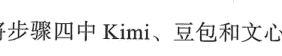

**步骤五**：将步骤四中 Kimi、豆包和文心一言给出的补充以及优化建议整合到一个 Word 文档里上传至 DeepSeek，并向其发出指令：该文档是其他 AI 大模型就上一步骤得出结果给出的补充及优化建议，请你检查该文档中的内容是否正确合规，并将你认为有用且可靠的信息融合到上一步骤所生成的内容中。

**步骤五结果**：DeepSeek 根据其他 AI 大模型给出的补充及优化建议进行了适当调整，使文件内容更加准确和规范。具体结果见“优秀成果展示”。

#### ### 2. 优秀成果展示

> **根据您的需求，结合北京市 2025 年政策及现行税收优惠规定，以下是关于小型微利企业与高新技术企业在企业所得税优惠方面的差异、政策交叉选择及行业特殊政策的详细分析：**
>
> ### 一、小型微利企业与高新技术企业的税收优惠差异
>
> #### 1. 小型微利企业
> - **税率及优惠条件**
>   - 根据 2023 年延续至 2027 年的政策，小型微利企业需同时满足以下条件:
>     - 从事国家非限制和禁止行业;
>     - 年度应纳税所得额≤300 万元;
>     - 从业人数≤300 人;
>     - 资产总额≤5000 万元。
>   - **优惠税率**：对年应纳税所得额≤300 万元的部分，减按 25% 计入应纳税所得额，再按 20% 税率缴纳，实际税负率 5%。

#### 2. 高新技术企业
- **税率及优惠条件**
  - 需满足核心自主知识产权、研发费用占比、科技人员比例等多项认定标准;
  - **优惠税率**：减按 15% 税率缴纳企业所得税。
  - **亏损结转**：自 2018 年 1 月 1 日起，当年具备高新技术企业资格的企业，其具备资格年度之前 5 个年度发生的尚未弥补完的亏损，准予结转至以后年度弥补，最长结转年限由 5 年延长至 10 年。

#### 3. 差异对比

| 项目 | 小型微利企业 | 高新技术企业 |
| :--- | :--- | :--- |
| **税率（应纳税所得额≤300 万）** | 5%（实际税负率） | 15% |
| **适用门槛** | 较低（规模限制） | 较高（技术、研发投入要求） |
| **政策稳定性** | 延续至 2027 年 | 长期有效，但需定期复审 |

### 二、2025 年北京市小型微利企业优惠政策

#### 1. 核心政策

- **税率优惠**：应纳税所得额≤300 万元部分，实际税负率 5%（25%×20%）。
- **行业特殊政策**：
  - **科技行业**：
    - 研发费用加计扣除比例提升至 100%（未形成无形资产）或 200%（形成无形资产);
    - 软件企业增值税即征即退：实际税负超过 3% 部分即征即退（依据财税 [2011]100 号）。

## 环保行业：
- 符合条件的企业购置并实际使用《环境保护专用设备企业所得税优惠目录》规定的设备，可按投资额的 10% 抵免企业所得税（《中华人民共和国企业所得税法实施条例》第一百条）。

### 2. 地方性叠加优惠
- 高新技术企业认定奖励：北京市经济技术开发区对首次认定的高新技术企业给予一次性 30 万元奖励（2023 年政策）。
- 研发费用补贴：“专精特新”企业研发费用增长部分按 20% 给予最高 300 万元补贴。

## 三、政策交叉选择与优化策略

### 1. 优惠叠加规则
- 税率不可叠加：高新技术企业 15% 税率与小型微利企业 5% 税率需二选一。
- 其他优惠可叠加：
  - 研发费用加计扣除、加速折旧、地方补贴等可与税率优惠叠加使用。

### 2. 分阶段选择策略
- 初创期（应纳税所得额≤100 万元）：优先选择小型微利企业 5% 税率，叠加研发加计扣除。
- 成长期（100 万元<所得额≤300 万元）：
  - 继续适用小型微利优惠，若接近 300 万元上限，提前布局高新技术企业认定。
- 成熟期（所得额>300 万元）：
  - 转为高新技术企业适用 15% 税率，或通过业务拆分（合法合规前提下）保留小型微利资格。

### 3. 跨境业务风险提示
- 境外分支机构亏损不得抵减境内盈利（国家税务总局公告 2018 年第 45 号）。
- 跨境电商可享受出口退运商品免税政策（财政部等 2023 年第 34 号公告）。

## 2. 环保行业
- 环保设备投资抵免企业所得税（最高抵免额不超过当年应纳税额的 30%）。
- 技术转让所得 500 万元以内免税，超出部分减半征收。

## 五、实操建议与合规性管理
- **动态评估与规划**
  - 定期测算应纳税所得额，若接近 300 万元，提前 1-2 年启动高新技术企业认定（有效期 3 年）。
  - 留存研发活动证明材料（立项报告、费用归集表等），确保加计扣除合规。
- **地方政策利用**
  - 关注北京市经济技术开发区等区域政策，如研发补贴、认定奖励等，直接降低经营成本。
- **跨境税务协同**
  - 境外业务单独核算亏损，避免与境内盈利混淆；利用跨境电商出口退运免税政策优化供应链。
- **政策延续性跟踪**
  - 小型微利优惠有效期至 2027 年底（财政部 税务总局公告 2023 年第 12 号），高新技术企业需每三年复审，关注认定条件调整。

## 六、总结：最大化优惠的策略路径

| 企业类型 | 最优选择 |
| :--- | :--- |
| 非高新技术企业 | 适用 5% 税率，叠加地方补贴、增值税加计抵减。 |
| 高新技术企业 | 所得额≤375 万元：选择小型微利 5%；<br>所得额>375 万元：适用 15% 税率。 |
| 科技/环保企业 | 叠加行业专属优惠（如设备抵免、即征即退）及研发加计扣除，综合税负最低可至 2%。 |

**合规依据：**所有政策均标注文件号，确保与财政部、国家税务总局及北京市地方政策一致。

**建议通过电子税务局“政策速递”模块或 12366 热线获取实时更新。**

---

### 作者点评
首先，优秀组的每次指令都表述得非常清晰、详尽，这是应用 AI 辅助财务工作的基本功。其次，完成的任务的步骤清晰，层层递进，从初步查询到交叉检验，再到细化和二次检验，整个流程设计合理，逻辑严密，确保了信息的全面性和准确性。再次，通过联网搜索获取最新政策，避免了政策变动导致的信息滞后问题。最后，通过应用多个 AI 大模型（Kimi、豆包、文心一言）进行交叉检验，验证了 DeepSeek 提供信息的准确性和合规性，降低单一信息源的误差风险。其他 AI 大模型还提供了进一步补充，DeepSeek 融合建议后得出的结果更合规、全面、完整。

## 10.3 本章总结
本章通过经济类与税务类法律法规政策查询的实操案例，讲解了在法律法规政策高频迭代的监管环境下，应用 AI 辅助财务人员进行法律法规政策查询的高效优化路径与风险控制方法。优秀组与普通组的对比实践表明：精准且详细的指令、开启联网搜索、结构化检验流程与人机协同机制，是应用 AI 工具提升法律法规政策查询效率和效果的关键。

第一，指令设计的专业化是屏蔽信息噪声的关键。优秀组通过“场景限定 + 政策时效 + 地域属性”的复合式指令（如"2025 年北京市小型微利企业所得税政策”），引导 AI 生成更准确的结果。

第三，结构化检验流程与人机协同机制是核心要点。通过二次追问“是不是最新政策”以及引入其他 AI 大模型交叉检验等能够有效提高结果的合规性。我们学习如何应用 AI 工具的更深层价值在于人机协同能力的边界重构：AI 擅长海量信息抓取与结构化输出（如迅速生成企业注册资本金实缴规定总结），而财务人员在政策裁量（如优惠税率选择）、风险预判（如抽逃出资后果评估）等场景发挥不可替代的作用。通过“精准指令 + 智能交叉检验 + 人类洞察”，法律法规政策查询从“被动应对”转为“主动风控、主动筹划”，为企业在合规和税务合规计划等方面赢得战略先机。这不仅是工具升级，更是财务人从“信息搬运工”向“智能合规师”“智能筹划师”等角色的转型和认知革命。

### 实用技巧
- 开启联网搜索。
- 使用复合式提问，明确标注年份（如 2025 年）、地域（如北京市）、行业（如环保科技行业）、公司规模（如小型微利企业）等，限定场景。此外还要尽量详尽地发出指令，引导 AI 工具精准回答。
- 复杂问题应分步提问。例如，先问小型微利企业所得税优惠政策，再问高新技术企业税收优惠与小型微利企业税收优惠的交叉决策。
- 尽量执行结构化检验流程。
- 构建人机协同机制，发挥财务人员对企业具体环境和内在需求的把握能力，做好政策裁量和风险预判。

## 第 11 章
### 应用 DeepSeek 辅助多场景账务处理

财务人员在日常工作中常常会遇到一些非常重要但又很复杂的交易事项。这些交易事项的会计记录和账务处理，不仅可能涉及多项法规和会计准则，还需要结合实际情况进行灵活判断，难度较大，许多财务人员在做这类账务处理时经常感到困难和无助。随着 AI 的高速发展，越来越多的财务人员希望借助 AI 技术解决账务处理疑难问题，快速获得正确的账务处理方法。然而，AI 对账务处理疑难问题的回答，可能因对问题的理解有误、知识库更新不及时等原因而给出错误答案，这反而增加了财务人员的工作难度。那么，到底能不能应用 AI 辅助账务处理，怎样确保答案正确呢？

本章分为三个部分：第一部分是针对以上问题，在 11.1 节至 11.4 节设计了四个交易事项场景（交易性金融资产、委托加工物资、租赁、非货币职工福利的财务处理），分别应用 DeepSeek、文心一言、Kimi 和豆包，结合实际案例详细分析复杂交易场景下多个 AI 大模型如何辅助账务处理，以及在生成结果不同时应该如何判断谁对谁错。通过详细讲解操作，力图让财务人员掌握应用 AI 辅助账务处理的方法和技巧，了解 AI 可能出现的错误，从而避坑。第二部分是 11.5 节，设计了一个固定资产分期付款利息摊销的场景，以展示应用 DeepSeek 进行账务处理及计算核对的快捷和便利。第三部分是 11.6 节，为本章总结。

总之，构建多模型知识整合机制和专业知识库，应用 AI 辅助账务处理，能够帮助财务人员在处理复杂交易时更加从容，大幅提升工作效率和准确性。

#### 11.1 AI 结果一致——以交易性金融资产账务处理为场景

> **任务场景描述**
你是一名制造业公司的会计，公司 3 月 5 日以银行存款购入一家上市公司已宣告但尚未分派现金股利的股票 100,000 股，作为以公允价值计量且其变动计入当期损益的金融资产，每股成交价 19.6 元，其中 0.4 元为已宣告但尚未分派的现金股利，股权登记日为 3 月 10 日，另支付相关税费等交易费用 8,000 元。你希望借助 AI 制作会计分录。

##### 11.1.1 应用 DeepSeek 辅助账务处理

> **步骤：**向 DeepSeek 发出指令：我是一名制造业公司的会计，公司 3 月 5 日以银行存款购入一家上市公司已宣告但尚未分派现金股利的股票 100,000 股，作为以公允价值计量且其变动计入当期损益的金融资产，每股成交价 19.6 元，其中 0.4 元为已宣告但尚未分派的现金股利，股权登记日为 3 月 10 日，另支付相关税费等交易费用 8,000 元。请针对上述交易帮我制作会计分录。

**结果：**DeepSeek 将支付的相关税费等交易费用 8,000 元作为投资收益确认，已宣告但尚未分派的现金股利 40,000 元作为应收股利确认，剩余购买价款 1,960,000 元计入交易性金融资产成本。

###### 1. 购入股票
购入股票时，需将股票的公允价值和应收股利分别入账：
- 借：交易性金融资产——成本
  金额为股票的公允价值，即 (19.6 元 - 0.4 元) × 100,000 股 = 1,920,000 元。
- 借：应收股利
  金额为已宣告但尚未分派的现金股利，即 0.4 元 × 100,000 股 = 40,000 元。
- 贷：银行存款
  金额为实际支付的款项，即 19.6 元 × 100,000 股 = 1,960,000 元。

###### 2. 支付相关税费等交易费用
支付交易费用时，需将交易费用计入当期损益：
- 借：投资收益
  金额为交易费用，即 8,000 元。
- 贷：银行存款
  8,000 元。

**总结**
购入股票时的会计分录为：
- 借：交易性金融资产——成本 1,920,000 元
- 借：应收股利 40,000 元
- 贷：银行存款 1,960,000 元

支付交易费用时的会计分录为：
- 借：投资收益 8,000 元
- 贷：银行存款 8,000 元

这些分录反映了购入股票和相关交易费用的会计处理。

##### 11.1.2 应用文心一言辅助账务处理
- **步骤：**向文心一言发出指令（指令同 DeepSeek）。
- **结果：**文心一言输出的会计分录与 DeepSeek 的一致，并且提供了具体的思考和行动过程、计算逻辑与说明以及后续提醒，包括现金股利到账及公允价值科目核算的相关事项。

> 你作为公司的会计人员，需要处理以银行存款购入上市公司股票作为以公允价值计量且其变动计入当期损益的金融资产（即交易性金融资产）的会计分录。题目中提供了详细的交易信息，包括购买日期、股票数量、成交价、已宣告但尚未分派的现金股利、股权登记日以及交易费用。我需要根据这些信息，结合会计准则，正确地进行会计分录。
你需要做的：
思考和处理过程
首先，我需要回顾相关的会计准则。对于交易性金融资产的初始计量，其成本应包括购买价款（扣除已宣告但尚未发放的现金股利）以及直接相关的交易费用。然而，根据《企业会计准则》，交易性金融资产的交易费用应当直接计入当期损益（即投资收益的借方），而不计入资产的成本。这一点需要特别注意，因为有时容易将交易费用计入成本，但准则规定不同。
题目中的每股成交价 19.6 元，其中 0.4 元是已宣告但尚未分派的现金股利。因此，购买价款中的现金股利部分应单独作为应收股利处理，剩余部分作为交易性金融资产的成本。同时，支付的交易费用 8,000 元应计入投资收益的借方。
接下来，我需要计算各个部分的金额：
1. 股票数量：100,000 股
2. 每股成交价：19.6 元，其中 0.4 元为应收股利，19.2 元为交易性金融资产的成本部分。
3. 交易费用：8,000 元

计算各部分总额：
*   应收股利总额 = 100,000 股 × 0.4 元/股 = 40,000 元
*   交易性金融资产成本 = 100,000 股 × (19.6 元/股 - 0.4 元/股) = 100,000 × 19.2 = 1,920,000 元
*   交易费用 = 8,000 元

根据准则，交易性金融资产的初始确认金额为 1,920,000 元，交易费用 8,000 元计入投资收益借方，应收股利 40,000 元单独列示。

因此，会计分录应为：
借：交易性金融资产——成本 1,920,000
应收股利 40,000
投资收益 8,000
贷：银行存款 1,968,000

需要确认的是，银行存款的总额是否正确。购买价款总额为 100,000 股 × 19.6 元/股 = 1,960,000 元，加上交易费用 8,000 元，总共支付 1,968,000 元，与分录中的贷方一致。

另外，股权登记日为 3 月 10 日，但购买日期为 3 月 5 日，因此企业有权在股权登记日之后收到现金股利，所以应收股利的确认是正确的。

总结，正确的分录应包含交易性金融资产的成本、应收股利的部分以及交易费用的处理。

###### 会计分录
####### 初始确认交易性金融资产
借：交易性金融资产——成本 1,920,000 元
借：应收股利 40,000 元
借：投资收益 8,000 元
贷：银行存款 1,968,000 元

####### 计算逻辑与说明
######## 1. 交易性金融资产成本
• 每股公允价值 = 成交价 19.6 元 - 应收股利 0.4 元 = 19.2 元
• 总成本 = 19.2 元/股 × 100,000 股 = 1,920,000 元（已宣告但尚未分派的现金股利需单独计入“应收股利”，不计入资产成本）

######## 2. 应收股利
金额 = 0.4 元/股 × 100,000 股 = 40,000 元（股权登记日 3 月 10 日表明企业已享有分红权利，需单独确认）

######## 3. 交易费用
金额 = 8,000 元（根据准则，交易性金融资产的交易费用直接计入“投资收益”借方，不计入资产成本）

######## 4. 银行存款总额
• 支付总额=（19.6 元/股×100,000 股）+8,000 元=1,968,000 元（与分录中贷方“银行存款”金额一致）

######## 后续提醒
• 现金股利到账：若后收到现金股利，需编制分录：
借：银行存款 40,000 元
贷：应收股利 40,000 元
• 公允价值变动：若股票公允价值后续发生波动，需通过“交易性金融资产——公允价值变动”科目调整账面价值，并将差额计入当期损益。
该处理严格遵循《企业会计准则第 22 号——金融工具确认和计量》对交易性金融资产的核算要求，确保成本计量准确且符合权责发生制原则。

##### 11.1.3 应用 Kimi 辅助账务处理
**步骤：**向 Kimi 发出指令（指令同 DeepSeek）。
**结果：**Kimi 输出的会计分录与 DeepSeek、文心一言一致，此处省略。

##### 11.1.4 应用豆包辅助账务处理
> **步骤：**向豆包发出指令（指令同 DeepSeek）。
> **结果：**豆包输出的会计分录与 DeepSeek、文心一言、Kimi 均一致，同时提醒后续在实际收到现金股利、期末计量股票公允价值变动等环节还需要进行相应的账务处理。具体结果此处省略。

##### 11.1.5 结论
在本交易案例场景下，四个 AI 大模型均给出了一致结果，可以认为应用 AI 辅助账务处理的结果是正确的，可供使用。

> **作者点评**
以上四个 AI 大模型的交易处理结果相同，可互相印证彼此答案的正确性。在面对复杂的交易事项场景希望获得正确的账务处理建议时，财务人员通过清晰描述交易场景，可以充分发挥 AI 工具在规范化账务处理方面的优势。考虑到单一模型输出的答案可能存在局限性或偏差，可应用不同的 AI 大模型对同一问题进行提问，并将得到的答案进行对比和验证。这种操作能大大提高应用 AI 辅助账务处理的准确性和可靠性。

#### 11.2 AI 结果经追问后一致——以委托加工物资账务处理为场景
> **任务场景描述**
> 你是一家轮胎制造业公司的会计，现在你所在的公司委托其他公司加工汽车外胎 20 个，发出材料的实际总成本为 4,000 元，加工费为 800 元。你希望借助 AI 制作会计分录。

##### 11.2.1 应用 DeepSeek 辅助账务处理

> 步骤：向 DeepSeek 发出指令：我是一家轮胎制造业公司的会计，现在我所在的公司委托其他公司加工汽车外胎 20 个，发出材料的实际总成本为 4000 元，加工费为 800 元。请针对上述交易，帮我制作会计分录。

> 结果：DeepSeek 将原材料成本及加工费都计入了委托加工物资成本，加工完成后整体结转入库存商品或半成品科目，如图 11-3 所示。

在发出委托加工物资时，会计分录如下：

1. 发出材料时：
   * 借：委托加工物资 4000 元
   * 贷：原材料 4000 元

2. 支付加工费时：
   * 借：委托加工物资 800 元
   * 贷：银行存款 800 元

3. 加工完成收回物资时：
   * 借：库存商品 4800 元
   * 贷：委托加工物资 4800 元

这些分录反映了材料发出、加工费支付及加工完成后的物资收回过程。

图 11-3 DeepSeek 输出的结果（委托加工物资账务处理）

##### 11.2.2 应用文心一言辅助账务处理

> 步骤：向文心一言发出指令（指令同 DeepSeek）。

> 结果：文心一言按照指令要求，对发出委托加工物资作出的会计分录与 DeepSeek 一致。此处省略具体结果。

##### 11.2.3 应用 Kimi 辅助账务处理

> 步骤一：向 Kimi 发出指令（指令同 DeepSeek)。

> 步骤一结果：Kimi 将发出的原材料成本 4000 元计入委托加工物资科目，但是未对加工费 800 元进行账务处理，如图 11-4 所示。

>> 1.发出材料时
**借：** **委托加工物资 4000**
**贷：** **原材料 4000**

道歉，我刚才的回答不够完整。在委托加工过程中，加工费也需要进行会计处理。以下是完整的会计分录：

###### 1.发出材料时
**借：** **委托加工物资 4000**
**贷：** **原材料 4000**

###### 2.支付加工费时
**借：** **委托加工物资 800**
**贷：** **银行存款/应付账款 800**

说明：

- **委托加工物资**：发出材料时，材料成本 4000 元计入委托加工物资。支付加工费 800 元时，加工费也计入委托加工物资，最终委托加工物资的总成本为 4800 元。

- **银行存款/应付账款**：如果加工费是通过银行转账支付的，贷记“银行存款”；如果是暂时欠款，贷记 “应付账款”。

图 11-5 Kimi 步骤二结果（委托加工物资账务处理）

##### 11.2.4 应用豆包辅助账务处理

**步骤一**: 向豆包提问发出指令（指令同 DeepSeek）。

**步骤一结果**：输出的结果与 Kimi 步骤一输出的结果一样，并未对加工费 800 元进行账务处理。

**步骤二**：进行追问，发出指令：**还有 800 元的加工费呢，不需要做账吗？**

**步骤二结果**：经追问，豆包输出了完整的账务处理结果，会计分录与 DeepSeek、文心一言、Kimi（追问后）均一致。此处省略具体结果。

##### 11.2.5 结论

在本案例场景下，DeepSeek 与文心一言对交易进行了完整的账务处理，而豆包与 Kimi 未对 800 元的加工费进行账务处理。经过追问，四个 AI 大模型输出的结果均一致，由此推断账务处理的结果是正确的，可供使用。

> ### 作者点评
这一场景下的 AI 应用与 11.1 节相似，也是应用多个 AI 大模型彼此验证。从中得出的启发是：通过多模型结果对比，可发现某些 AI 大模型输出的账务处理结果不完整（不是错误），需要继续追问（有可能要经过多次追问），这样才能判断多个大模型的结论是否一致。

#### 11.3 AI 结果经交叉检验后一致——以租赁账务处理为场景

**任务场景描述**
你是一家建筑企业会计，现在你所在的企业想融资租赁一个大型设备，租期 5 年，租金 200000 元，每年末支付。你希望借助 AI 针对上述交易作出会计分录。

##### 11.3.1 应用 DeepSeek 辅助账务处理

> **步骤**: 向 DeepSeek 发出指令: **我是一家建筑企业会计，现在我所在的企业想融资租赁一个大型设备，租期 5 年，租金 200000 元，每年末支付。请针对上述交易帮我作出会计分录。**

> **结果**: DeepSeek 将租金 200 000 元计入了“固定资产”科目，而后每一年支付租金时分摊本金和利息，如图 11-6 所示。

> 在融资租赁大型设备的情况下，第一年的会计分录如下:

- **1.租赁开始日:**
  - 借：固定资产（租赁资产）200000 元
  - 贷：长期应付款（融资租赁负债）200000 元

- **2.第一年末支付租金时:**
  - 借：长期应付款（融资租赁负债）40000 元
  - 借：财务费用（利息费用）（根据实际利率计算）
  - 贷：银行存款 40000 元

- **3.折旧计提:**
  - 借：管理费用/制造费用（折旧费）（根据折旧政策计算）
  - 贷：累计折旧（根据折旧政策计算）

这些分录反映了租赁开始、租金支付及折旧计提的过程。具体金额需根据实际利率和折旧政策计算。

> **图 11-6 DeepSeek 输出的结果（租赁账务处理）**

##### 11.3.2 应用文心一言辅助账务处理

> **步骤**: 向文心一言发出指令（指令同 DeepSeek）。
> **结果**: 指令中未规定折现率，文心一言假设折现率为 5%，确认了租金的现值与终值差，未确认融资费用。根据文心一言的思考路径和处理结果，在不考虑货币时间价值即现金流折现的情况下，文心一言的账务处理结果与 DeepSeek 相同，并且二者都将融资租赁值计入了固定资产科目。此处省略具体结果。

##### 11.3.3 应用 Kimi 辅助账务处理

> 步骤：向 Kimi 发出指令（指令同 DeepSeek）。
> 结果:Kimi 将融资租赁值计入了“使用权资产”科目，此处与 DeepSeek 及文心一言的账务处理结果不同，如图 11-7 所示。

- 在融资租赁业务中，租赁资产的会计处理需要按照租赁准则进行。根据租赁准则，融资租赁实质上转移了租赁资产所有权上的主要风险和报酬，因此租赁资产应作为企业自有资产核算，同时确认相应的负债。

以下是第一年相关的会计分录处理:

###### 1.租赁开始时（假设租赁开始日为年初）

- 在租赁开始时，需要确认租赁资产和租赁负债。租赁资产的入账价值通常按照租赁付款额的现值加上初始直接费用确定。假设没有初始直接费用，租赁付款额的现值为 200,000 元（假设现值与租赁付款额总额相等，实际情况需要根据租赁内含利率计算现值）。

**借：**
**使用权资产** 200,000
**贷：**
**租赁负债** 200,000

###### 2.第一年年末支付租金时

-假设每年末支付租金 40,000 元 (200,000 元/5 年)。

**借：**
**租赁负债** 40,000
**贷：**
**银行存款** 40,000

###### 3.第一年年末确认租赁费用

-在租赁期间，需要按照租赁内含利率或合同利率计算利息费用。假设租赁内含利率为 10%（假设值，实际应根据合同确定）。

-第一年年初租赁负债余额为 200,000 元。
-第一年的利息费用 = 200,000 元 × 10% = 20,000 元。

**借：**
**财务费用** (或租赁费用) 20,000
**贷：**
**租赁负债** 20,000

###### 4.第一年年末调整租赁负债余额

-支付租金后，租赁负债余额需要调整。支付的租金 40,000 元中，20,000 元用于偿还本金，20,000 元用于支付利息。

-第一年年末租赁负债余额=200,000 元 - 20,000 元 = 180,000 元。

###### 5.第一年年末确认使用权资产的折旧

-假设该设备的使用寿命为 5 年，采用直线法折旧。

-每年折旧额 = 使用权资产账面价值/使用寿命 = 200,000 元/5 年 = 40,000 元。

**借：**
**管理费用** (或相关成本费用科目) 40,000
**贷：**
**使用权资产累计折旧** 40,000

**总结**

**第一年相关的会计分录如下：**

1. **租赁开始时**：
   - 借：**使用权资产 200,000**
   - 贷：**租赁负债 200,000**

2. **第一年年末支付租金**：
   - 借：**租赁负债 40,000**
   - 贷：**银行存款 40,000**

3. **第一年年末确认利息费用**：
   - 借：**财务费用（或租赁费用）20,000**
   - 贷：**租赁负债 20,000**

4. **第一年年末确认折旧**：
   - 借：**管理费用（或相关成本费用科目）40,000**
   - 贷：**使用权资产累计折旧 40,000**

> **请注意，实际会计处理中，租赁内含利率和初始直接费用等需要根据具体合同条款确定。如果租赁合同**
**中提供了具体的内含利率或初始直接费用，应按照实际数据进行计算和调整。**

##### 11.3.4 应用豆包辅助账务处理

> **步骤：**向豆包发出指令（指令同 DeepSeek）。

**结果：**豆包的账务处理结果与 Kimi 一致，与 DeepSeek 及文心一言不同。此处省略具体结果。

##### 11.3.5 交叉检验过程

至此，四个 AI 大模型给出了两种不同的账务处理方法（DeepSeek 和文心一言输出的结果一致，Kimi 和豆包输出的结果一致）。由于无法直接推断出正确结果，只能采用交叉检验的方法，继续提问。

由于本书以 DeepSeek 的应用为主线，这里不对四个 AI 大模型的结果进行两两交叉检验，而是把 DeepSeek 的结果分别提供给 Kimi 和豆包进行检验，再把 Kimi 或豆包的结果（二者结果一致）提供给 DeepSeek 进行检验。

# 步骤一：将 DeepSeek 的结果发给 Kimi，向 Kimi 提问为何 DeepSeek 的账务处理方法与它的不同。

###### 步骤一结果：Kimi 指出了两种账务处理方式的差异，并分析了 DeepSeek 的处理方式存在的问题，如图 11-8 所示。

感谢你的补充和对比！现在我来详细分析并解释两种处理方式的差异，以及哪种更符合当前的会计准则。

####### 1. 两种处理方式的差异

- DeepSeek 的处理方式:

  * 租赁资产和负债的确认：将租赁资产确认为“固定资产——融资租入固定资产”，将租赁负债确认为“长期应付款——融资租赁款”。
  * 折旧计提：按照固定资产的使用年限计提折旧。
  * 租金支付：将租金支付分为利息费用和本金偿还两部分。

- 我的处理方式:

  * 租赁资产和负债的确认：将租赁资产确认为“使用权资产”，将租赁负债确认为“租赁负债”。
  * 折旧计提：按照使用权资产的账面价值计提折旧。
  * 租金支付：将租金支付分为利息费用和本金偿还两部分。

####### 2. 新旧租赁准则的变化

根据 2016 年国际会计准则理事会（IASB）发布的《国际财务报告准则第 16 号——租赁》（IFRS 16）以及中国财政部发布的《企业会计准则第 21 号——租赁》（CAS 21）的修订，融资租赁和经营租赁的会计处理方式发生了重大变化。

- 旧租赁准则（CAS 21 修订前）:

  * 融资租赁的资产和负债分别确认为“固定资产——融资租入固定资产”和“长期应付款——融资租赁款”。
  * 折旧按照固定资产的使用年限计提。

- 新租赁准则（CAS 21 修订后）:

  * 所有租赁（包括融资租赁和经营租赁）均需在承租人的资产负债表中确认“使用权资产”和“租赁负债”。
  * 使用权资产的折旧按照其账面价值计提，通常采用直线法。
  * 租赁负债的利息费用按照实际利率法计算。

####### 3. 为什么我的处理方式更符合新准则

我的处理方式是基于新租赁准则（CAS 21 修订后）的要求，而 DeepSeek 的处理方式更接近旧租赁准则（CAS 21 修订前）的要求。以下是具体分析:

######## （1）租赁资产和负债的确认

- 新准则：要求将租赁资产确认为“使用权资产”，将租赁负债确认为“租赁负债”。
- 理由：使用权资产更准确地反映了承租人对租赁资产的使用权，而租赁负债更准确地反映了承租人的付款义务。
- 旧准则：将融资租赁的资产确认为“固定资产——融资租入固定资产”，将负债确认为“长期应付款——融资租赁款”。
- 理由：旧准则下，融资租赁的资产和负债的确认方式更接近于购买资产的处理方式。

(2) 折旧计提
- **新准则**：使用权资产的折旧按照其账面价值计提，通常采用直线法。
    - **理由**：使用权资产的折旧更符合租赁资产的使用性质，反映了租赁期间的资产消耗。
- **旧准则**：融资租赁的资产折旧按照固定资产的使用年限计提。
    - **理由**：旧准则下，融资租赁的资产被视为企业自有资产，因此折旧方式与固定资产一致。

(3) 租金支付
- **新准则**：租金支付分为利息费用和本金偿还两部分，利息费用按照实际利率法计算。
    - **理由**：实际利率法更准确地反映了租赁负债的时间价值和利息费用。
- **旧准则**：租金支付同样分为利息费用和本金偿还两部分，但利息费用的计算方式可能有所不同。

4. 结论
如果你的企业采用的是新租赁准则 (CAS 21 修订后)，那么我的处理方式是正确的。如果你的企业仍然采用旧租赁准则 (CAS 21 修订前)，那么 DeepSeek 的处理方式可能更符合你的实际需求。

不过，需要注意的是，目前大多数企业已经按照新租赁准则进行会计处理，因此建议你确认企业所采用的会计准则版本，并按照相应的要求进行会计处理。

如果你需要进一步了解新旧租赁准则的具体差异，或者有其他疑问，欢迎随时提问!

> 步骤二：将 DeepSeek 的结果发给豆包，向豆包提问为何 DeepSeek 的账务处理方法与它的不同。

步骤二结果：豆包指出了 DeepSeek 的账务处理方法采用的是旧租赁准则，指出了其中存在的问题，基本观点与 Kimi 一致，此处省略具体结果。

> 步骤三：将 Kimi 或豆包的结果发给 DeepSeek，向 DeepSeek 提问为何 Kimi 或豆包的账务处理方法与它的不同。

步骤三结果:DeepSeek 输出了新的账务处理方法，这次的结果与 Kimi、豆包的一致，此处省略具体结果。

##### 11.3.6 结论

在本交易案例场景下，虽然一开始四个 AI 大模型给出了两种不同的账务处理方式，但经过交叉检验后得到了一致的结果，由此能够推断出正确的账务处理方法供使用。

**作者点评**

当应用多个 AI 工具辅助同一场景账务处理时，可能会因对问题的理解有误、知识库更新不及时等原因，得到不同的答案。但这并不意味着 AI 不能提供帮助。可以通过交叉检验的方式，利用不同 AI 的反馈来识别潜在的错误或遗漏，逐步缩小差异并修正错误。这其实就是构建了多模型知识整合机制。

---
#### 11.4 AI 结果不一致——以非货币职工福利账务处理为场景

<details>

> **任务场景描述**

> 你是一名房地产企业会计，你所在的的公司拟将从其他企业购买的 20 套全新公寓以优惠价格向公司管理人员出售，购买价格为每套 100 万元，向职工出售的价格为每套 70 万元，售房协议规定，职工取得住房后需在公司工作 10 年。你希望借助 AI 针对上述交易作出会计分录。

> </details>

---

##### 11.4.1 应用 DeepSeek 辅助账务处理

* **步骤：**向 DeepSeek 发出指令：我是一名房地产企业会计，我所在的的公司拟将从其他企业购买的 20 套全新公寓以优惠价格向公司管理人员出售，购买价格为每套 100 万元，向职工出售的价格为每套 70 万元，售房协议规定，职工取得住房后需在公司工作 10 年。请针对上述交易帮我作出会计分录。

* **结果：** DeepSeek 将出售给职工的福利房按购买价（市场公允价）确认主营业务收入，同时按购买价结转主营业务成本确认成本，将购房款与出售给职工的房款的差额作为长期待摊费用，并在职工的服务期内逐年分摊，如图 11-9 所示。

针对房地产企业以优惠价格向管理人员出售公寓的交易，涉及职工服务年限的条件，会计处理应遵循《企业会计准则第 9 号——职工薪酬》的相关规定。具体账务处理如下:


###### 1. 确认公寓的成本


企业购买公寓作为存货（开发产品），按实际购买价款确认成本:


+   - 每套公寓成本 = 100 万元
- 20 套公寓总成本 = 20 × 100 万元 = 2,000 万元


会计分录:


```

```

###### 2. 向职工出售公寓


向职工出售公寓的价格低于市场价，差额部分属于职工提供服务的经济利益，应确认为职工薪酬费用，并在职工服务期限内分摊。


+   - 每套公寓出售价格 = 70 万元
- 每套公寓市场价（假设为购买价 100 万元） = 100 万元
- 每套公寓差额 = 100 万元 - 70 万元 = 30 万元
- 20 套公寓总差额 = 20 × 30 万元 = 600 万元


会计分录:


```

```

###### 3. 结转公寓成本


将出售公寓的成本从“开发产品”转入“主营业务成本”:


```

```

###### 4. 分摊职工福利费用


职工需服务 10 年，因此 600 万元的差额应在 10 年内分摊，每年分摊 60 万元。


每年分摊会计分录:


```

```

310 / DeepSeek 高效财务

###### 5. 税务处理

> •增值税：按市场价（100 万元）计算增值税销项税额。

• 企业所得税：职工福利费用在实际分摊时可在税前扣除。

**总结**

1. 确认公寓成本，计入"开发产品"。
2. 出售公寓时，按市场价确认收入，差额部分确认为职工福利费用。
3. 结转公寓成本。
4. 在职工服务期限内分摊职工福利费用。

以上处理符合会计准则要求，确保会计信息真实、完整地反映交易实质。具体金额和税率需根据实际情况调整。


##### 11.4.2 应用文心一言辅助账务处理

> ◇步骤：向文心一言发出指令（指令同 DeepSeek）。

◇结果：文心一言输出的结果与 DeepSeek 一致，此处省略具体结果。

##### 11.4.3 应用 Kimi 辅助账务处理

> ◇步骤：向 Kimi 发出指令（指令同 DeepSeek）。

◇结果：Kimi 输出的结果与 DeepSeek 和文心一言的结果不一致，它 没有将售给职工的福利房确认收入，而是直接结转固定资产账面价值，如图 11-10 所示。

##### 11.4.4 应用豆包辅助账务处理

> ◇步骤：向豆包发出指令（指令同 DeepSeek）。

◇结果：豆包输出的结果与 Kimi 一致，与 DeepSeek 和文心一言 的结果不同。此处省略具体结果。

你提供的信息，房地产企业以优惠价格向公司管理人员出售公寓的行为，可以视为一种职工福利，同时也涉及股份支付的会计处理。以下是具体的会计处理建议：

###### 1. 购入公寓的会计处理

假设企业购入公寓时的会计处理如下：

*   **借：** **固定资产——公寓 2,000,000 元 (20 套×100 万元/套)**
*   **贷：** **银行存款 2,000,000 元**

###### 2. 向职工出售公寓的会计处理

根据《企业会计准则》的相关规定，企业以低于购置价向职工出售住房的行为，可以视为企业向职工提供的一种福利，需要按照股份支付的原则进行处理。

####### (1) 出售时的会计处理

*   **借：** **银行存款 1,400,000 元 (20 套×70 万元/套)**
*   **贷：** **固定资产——公寓 1,400,000 元**

同时，确认职工福利和股份支付相关的费用：

*   **借：** **管理费用 600,000 元 (20 套×30 万元/套，即差价部分)**
*   **贷：** **应付职工薪酬—非货币性福利 600,000 元**

####### (2) 服务期的会计处理

由于职工需要在公司服务 10 年，因此上述 600,000 元的福利费用需要在 10 年内逐步摊销，每年摊销金额为 60,000 元 (600,000 元÷10 年)。

每年摊销时：

*   **借：** **管理费用 60,000 元**
*   **贷：** **应付职工薪酬—非货币性福利 60,000 元**

####### 3. 固定资产的后续处理

如果企业后续需要对固定资产进行折旧处理，假设公寓的折旧年限为 50 年，无残值，每年折旧额为 40,000 元 (2,000,000 元÷ 50 年)。

每年折旧时：

*   **借：** **管理费用 40,000 元**
*   **贷：** **累计折旧 40,000 元**

####### 4. 总结

*   **购入公寓时：** 确认固定资产和银行存款的减少。
*   **出售公寓时：** 确认银行存款的增加，同时将差价部分确认为职工福利，并在服务期内逐步摊销。
*   **后续折旧：** 按照固定资产的折旧政策进行折旧处理。

这种处理方式符合《企业会计准则》中关于职工福利和股份支付的相关规定。如果企业有其他特殊要求或政策，建议进一步咨询专业会计师或审计师。

---

##### 11.4.5 交叉检验过程

至此，四个 AI 大模型给出了两种不同的账务处理方法（DeepSeek 和文心一言的结果一致，Kimi 和豆包的结果一致），无法直接推断出正确结果。于是采用交叉检验的方法，继续提问。同样地，把 DeepSeek 的结果分别提供给 Kimi 和豆包进行检验，再把 Kimi 或豆包的结果（二者结果一致）提供给 DeepSeek 进行检验。不过与 11.3 节的情况不同，本次交叉检验出现了有趣的结果。

> 步骤一：将 DeepSeek 的结果输入 Kimi，向 Kimi 提问为何 DeepSeek 的处理方法与它的不同。
>
> **步骤一结果：** Kimi 指出了两种账务处理方法存在的差异，同时认为 DeepSeek 的处理方法更加符合交易情况。
>
> 步骤二：将 DeepSeek 的结果输入豆包，向豆包提问为何 DeepSeek 的处理方法与它的不同。
>
> **步骤二结果：** 豆包指出了 DeepSeek 账务处理存在的问题，再次肯定了自己的方法（也就是 Kimi 第一次的结果）。
>
> 步骤三：将 Kimi 或豆包第一次的结果输入 DeepSeek，向 DeepSeek 提问为何这样的账务处理方法与它的不同。
>
> **步骤三结果：** DeepSeek 不认可 Kimi 或豆包的结果，分析了错误原因，再次给出了自己之前的结果并认为是正确的。

至此，在进行简化的交叉检验（没有应用文心一言）之后，Kimi 修改了结果，认可了 DeepSeek 的账务处理方法；而豆包坚持自己的结果，不认可 DeepSeek 的账务处理方法。也就是说，经过交叉检验仍不能得到一致的账务处理方法。

此时，单纯依靠向 AI 大模型追问（即使应用多个大模型）不能实现良好的辅助效果，需要升级 AI 的应用模式，考虑对 AI（这里选择应用 DeepSeek）进行培训，如导入知识库。

# 11.4.6 导入知识库

**步骤一：**首先，尝试为 DeepSeek 指定参考准则。向 DeepSeek 发出指令：请联网搜索上述非货币性福利的相关账务处理方法，并根据《企业会计准则第 9 号——职工薪酬》，再次确认自己的会计分录是否正确。

**步骤一结果：** DeepSeek 再次确认了自己原来的结果。

**步骤二：**为 DeepSeek 建立相关知识库。我们将财政部制定的《企业会计准则应用指南汇编》（2025 年版）中涉及本案例场景的相关知识、中国注册会计师协会编写的注册会计师全国统一考试辅导教材《会计》中涉及本案例场景的相关知识，以及从知网上搜索到的涉及本案例场景的相关专业论文，上传至 DeepSeek（如图 11-11 所示），并要求它再次确认自己的会计分录。

**步骤二结果：** DeepSeek 经过对知识库的学习，改变了自己原来的账务处理方法，输出了新的会计分录，与 Kimi 或豆包第一次的结果是一致的。至此，通过导入专业知识库让 DeepSeek 进行针对性学习，能够判断出本案例场景下的正确账务处理方法。为了检验 DeepSeek 对知识库的学习效果，我们接着进行了步骤三和步骤四，得到的结果也非常有趣。

**步骤三：**对 DeepSeek 进行再测试。我们设计了与本案例场景非常类似的新场景。向 DeepSeek 发出指令：我是一名彩电销售企业会计，我公司将外购的彩电作为福利发放给公司的 50 名管理人员，购买价为每台 8000 元，每名管理人员发放一台彩电，该型号的彩电的售价为每台 8000 元。针对上述交易，请帮我作出会计分录。

**步骤三结果：** DeepSeek 输出了正确的账务处理。

根据你的信息，公司将外购的彩电作为福利发放给管理人员，且彩电的购买价款和售价均为每台 8,000 元。以下是此笔交易的会计分录：

###### 1. 确认福利费用：

公司需要将发放的彩电作为非货币性福利计入费用，并按彩电的购买价款确认费用。

借：管理费用——职工福利费 400,000 元
(50 台×8,000 元/台=400,000 元)

贷：应付职工薪酬——非货币性福利 400,000 元

###### 2. 结转库存商品：

发放彩电后，需要减少库存商品，并按彩电的购买价款结转成本。

借：应付职工薪酬——非货币性福利 400,000 元

贷：库存商品——彩电 400,000 元

###### 3. 增值税处理（如适用）：

如果公司是一般纳税人，且彩电的进项税额已抵扣，需视同销售确认销项税额。

借：应付职工薪酬——非货币性福利 52,000 元
(假设增值税税率为 13%，50 台× 8,000 元/台 ×13% = 52,000 元)

贷：应交税费——应交增值税(销项税额) 52,000 元

**总结：**

福利费用：按彩电的购买价款确认费用。

库存商品：按彩电的购买价款结转成本。

增值税：如果涉及增值税，需确认销项税额。

最终会计分录如下（含增值税）：

1.  借：管理费用——职工福利费 400,000 元
    贷：应付职工薪酬——非货币性福利 400,000 元

2.  借：应付职工薪酬——非货币性福利 400,000 元
    贷：库存商品——彩电 400,000 元

3.  借：应付职工薪酬——非货币性福利 52,000 元
    贷：应交税费——应交增值税(销项税额) 52,000 元

如果有其他特殊情况（如增值税处理不同），请根据实际情况调整。

###### 步骤四：更换 DeepSeek 账号，重复步骤三。

**步骤四结果：** DeepSeek 输出了之前错误的结果。原因是这个新账号未导入专业知识库并学习。

##### 11.4.7 结论

*   **结论：** 在案例场景下，一开始四个 AI 大模型给出了两种不同的账务处理方法，经过交叉检验后仍未得到一致的结果，而且实际上交互过程还对原本输出正确结果的 Kimi 模型造成了干扰。在这种情况下无法判断正确结果。此时需要更多地发挥人机协同中“人”的作用，可以建立专业知识库让 DeepSeek 学习，发挥它的快速学习能力。DeepSeek 经过对知识库的学习，改变了账务处理方法，最终结果与 Kimi 或豆包的结果一致。由此推断出正确的账务处理方法，可供使用。

>**作者点评**
>
> 当在同一交易场景下，使用多个 AI 工具输出结果不同、交叉检验后也不能得到一致结果时，不要气馁，这并不意味着 AI 就不能帮助我们了。我们可以建立知识库，培训专属自己的精度更高、准确性更好的 AI 财务助手。这是未来的大势所趋，能为财务人员带来成就感，体现财务人员的价值。大家可以尝试打造专属自己的“聪明”的 AI 财务助手。

#### 11.5 应用 DeepSeek 辅助账务处理计算核对——以固定资产分期付款利息摊销为场景

> **任务场景描述**

你是一名制造业企业会计。2025 年 1 月 1 日，你所在的公司与大鹏公司签订一份购货合同，从大鹏公司购入一台不需要安装的特大型设备。合同约定，你所在的公司采用分期付款方式支付价款。该设备价款共计 900 万元（不考虑增值税），在 2025 年至 2029 年的 5 年内每半年支付 90 万元，每年的付款日期分别为当年的 6 月 30 日和 12 月 31 日。

**步骤一：**向 DeepSeek 发出指令：我是一名制造业企业会计。2025 年 1 月 1 日，我所在的公司与大鹏公司签订一份购货合同，从大鹏公司购入一台不需要安装的特大型设备。合同约定，我所在的公司采用分期付款方式支付价款。该设备价款共计 900 万元（不考虑增值税），在 2025 年至 2029 年的 5 年内每半年支付 90 万元，每年的付款日期分别为当年的 6 月 30 日和 12 月 31 日，目前适用的 6 个月折现率为 10%。请针对上述交易帮我作出会计分录。

**步骤一结果：**根据场景要求，DeepSeek 列出了完整的会计分录和融资费用计算过程。

**根据题目描述，该交易属于分期付款购买固定资产，需要按照现值确认固定资产的入账价值，并将未确认的融资费用在付款期间内分摊。以下是整个交易的会计分录：**

##### 1. 2025 年 1 月 1 日（设备购入日）

设备的总价款为 900 万元，但由于采用分期付款方式，需要按现值入账。现值的计算如下：

*   每期付款金额：90 万元
*   期数：10 期（5 年，每半年一期）
*   半年折现率：10%

现值计算公式：

现值=90×$\frac{1-(1+10\%)^{-10}}{10\%}$= 90 × 6.1446 = 553.014 万元

未确认融资费用=总价款 - 现值=900-553.014=346.986 万元

**会计分录：**

> 借：固定资产——设备   553.014 万元
>     未确认融资费用     346.986 万元
> 贷：长期应付款——大鹏公司  900 万元

##### 2. 每半年支付款项时（2025 年 6 月 30 日至 2029 年 12 月 31 日）

每期支付 90 万元，其中一部分用于偿还本金，另一部分用于支付融资费用。融资费用的计算基于未偿还本金的余额和折现率。

###### 第一期（2025 年 6 月 30 日）

*   未偿还本金：553.014 万元

*   融资费用：553.014×10%=55.301 万元
*   偿还本金：90-55.301=34.699 万元

会计分录：

| | 借：长期应付款——大鹏公司 | 34.699 万元 |
| --- | --- | --- |
| | 财务费用——融资费用 | 55.301 万元 |
| 贷：银行存款 | 90 万元 |

**第二期（2025 年 12 月 31 日）**

*   未偿还本金：553.014-34.699=518.315 万元
*   融资费用：518.315×10%=51.832 万元
*   偿还本金：90-51.832=38.168 万元

会计分录：

| | 借：长期应付款——大鹏公司 | 38.168 万元 |
| --- | --- | --- |
| | 财务费用——融资费用 | 51.832 万元 |
| 贷：银行存款 | 90 万元 |

**后续各期**

每期的融资费用和偿还本金计算方式相同，融资费用逐期减少，偿还本金逐期增加。

##### 3. 最后一期（2029 年 12 月 31 日）

最后一期支付后，长期应付款和未确认融资费用全部结清。

会计分录：

| | 借：长期应付款——大鹏公司 | 90 万元 |
| --- | --- | --- |
| | 财务费用——融资费用 | 0 万元 |
| 贷：银行存款 | 90 万元 |

**总结**

*   设备按现值 553.014 万元入账，未确认融资费用为 346.986 万元。
*   每期支付 90 万元，其中融资费用逐期减少，偿还本金逐期增加。
*   通过分期付款和融资费用的摊销，最终完成设备的购买和款项的支付。

▶步骤二：再次向 DeepSeek 发出指令：列一个表，将具体每期付款额、融资费用金额、偿还本金金额、未偿还本金金额都展示出来。

**步骤二结果：**DeepSeek 输出的结果如下。经过同企业财务人员自己沿用的计算表格进行对比和确认，以上各期计算结果均正确、明晰。

列一个表，将具体每期付款额、融资费用金额、偿还本金金额、未偿还本金金额都展示出来。

以下是分期付款的详细计算表，展示每期的付款额、融资费用金额、偿还本金金额以及未偿还本金金额：

| | 期数 | 付款日期 | 每期付款额（万元） | 融资费用（万元） | 偿还本金（万元） | 未偿还本金（万元） |
|:---:|:---:|:---:|:---:|:---:|:---:|:---:|
| | 0 | 2025-01-01 | - | - | - | 553.014 |
| | 1 | 2025-06-30 | 90 | 55.301 | 34.699 | 518.315 |
| | 2 | 2025-12-31 | 90 | 51.832 | 38.168 | 480.143 |
| | 3 | 2026-06-30 | 90 | 48.015 | 41.985 | 438.16 |
| | 4 | 2026-12-31 | 90 | 43.816 | 46.184 | 391.978 |
| | 5 | 2027-06-30 | 90 | 39.198 | 50.802 | 341.176 |
| | 6 | 2027-12-31 | 90 | 34.118 | 55.882 | 285.294 |
| | 7 | 2028-06-30 | 90 | 28.529 | 61.471 | 223.823 |
| | 8 | 2028-12-31 | 90 | 22.382 | 67.618 | 156.205 |
| | 9 | 2029-06-30 | 90 | 15.621 | 74.379 | 81.826 |
| | 10 | 2029-12-31 | 90 | 8.183 | 81.817 | 0.000 |

**计算说明**

1.  融资费用：每期融资费用 = 上期末偿还本金×10%（半年折现率）。
2.  偿还本金：每期偿还本金 = 每期付款额 - 融资费用。
3.  未偿还本金：每期未偿还本金 = 上期末未偿还本金 - 本期偿还本金。

**总结**

*   每期付款额为固定 90 万元。
*   融资费用逐期减少，偿还本金逐期增加。
*   最后一期（第 10 期）未偿还本金为 0，交易完成。

> 图 11-14 DeepSeek 生成的分期付款详细计算表

> ### 结论：DeepSeek 能够有效地理解复杂的账务处理场景，列出不同期间的融资费用计算过程，同时作出相应会计分录。财务人员通过核对 DeepSeek 的计算过程，或者同自己已有的计算表格进行交叉检验，可以判断账务处理和融资费用计算是正确的，可供使用。

> > **作者点评**  
> DeepSeek 凭借强大的计算能力，能够高效、精准地辅助财务人员进行复杂的财务计算。无论是分期付款现值计算、融资费用摊销，还是现金流量折现分析，DeepSeek 都能快速处理大量数据，并生成准确的结果。这不仅减轻了财务人员在重复性计算工作上的负担，也为深入分析财务数据提供了坚实基础。

#### 11.6 本章总结

今天，AI 已经能够辅助大多数账务处理，快速地给出正确答案。对于复杂的交易事项，我们应该怎样应用 AI 辅助账务处理，需要具体问题具体分析。本章通过四个具体的账务处理实际案例场景，清晰地展示了不同 AI 工具在不同应用场景下表现出的差异性。我们要掌握的是如何在不同情况下应用 AI 辅助账务处理，具体操作包括清晰提问、进一步追问、交叉检验和导入知识库等。本章最后通过应用 DeepSeek 辅助固定资产分期付款利息摊销的场景，展现出 DeepSeek 对复杂的账务处理的理解和强大的数字计算逻辑。这可能是财务人员较常应用的领域。

在 AI 应用的理论上，本章构建了多模型知识整合机制以及专业知识库。同时在实践上，本章用实例表明，虽然 AI 工具在处理结构化、规则明确的问题时表现出较高的可靠性，但在复杂、不确定或非标准化的情况下，人机协同显得尤为重要。我们可以借助知识库和持续训练，提升 AI 在处理专业问题上的准确度，从而更好地服务于财务工作。境中，不仅要充分发挥多模型交叉检验的作用，还要充分发挥财务人员的专业判断与引导作用，从而确保结果的准确性。
总之，在使用 AI 工具时，人机协同和交叉检验的重要性不可忽视。人类智慧和 AI 技术是互补关系，AI 对专业知识库的学习能力是财务人员在应用 AI 时必须善加利用的，这样才能推动企业财务工作的智能转型。

### 实用技巧

- 在使用 AI 工具时，要尽可能清晰地描述财务场景。
- 通过对比多模型的结果，发现某些 AI 工具输出的账务处理结果不完整（不是错误）时，要继续追问（还有可能要多次追问），即 AI 生成结果的过程应该是一个迭代反馈、认知重构的过程。
- 在处理复杂财务问题时，采用多个 AI 工具进行交叉检验，能够降低决策风险，提高整体结果的准确性和稳健性。
- 当 AI 给出明显错误或不确定的答案时，可主动提供权威文献或准则、文件（导入知识库），辅助 AI 修正结果，强化知识整合能力与提高精准性。
- 财务人员应明确自身在决策过程中的专业判断作用。即使在应用 AI 辅助账务处理时不知道正确的会计分录是什么，但在发现 AI 输出的结果有差异时，我们也要有能力通过不同 AI 工具的交叉检验进行判断。即使交叉检验的结果仍然不一致，我们也要有能力建立知识库，帮助 AI 学习。所以财务人员一定要在主观上避免完全依赖 AI，应该与 AI 形成有效的知识互动与互补合作关系。

## 第 12 章

### 应用 DeepSeek 辅助财务 BP 进行可视化分析

在现代企业管理体系中，财务 BP（business partner，业务合作伙伴）作为会计职能向前端业务延伸的重要表现形式，发挥着重要的桥梁与纽带作用。不同于传统财务会计以核算、报账为主的职能定位，财务 BP 更加注重与业务的深度融合，强调通过财务视角进行业务和财务数据分析，通过及时、精准、细化的数据支持，帮助业务团队识别经营风险、优化资源配置，辅助业务决策、经营管理乃至战略制定。

财务 BP 作为一个新兴的财务职业岗位，拥有广阔的发展前景：

首先，市场需求旺盛，财务 BP 岗位需求持续增长。在传统会计岗位需求减少的同时，财务 BP 岗位需求持续增长。特别是在互联网、零售、科技、电商、制造、服务（如餐饮）等领域，财务 BP 已成为热门岗位，企业更倾向于招聘既懂财务又能分析业务的复合型人才。

其次，财务 BP 职业发展路径清晰，晋升空间大。由于涉及战略决策支持，财务 BP 更容易进入企业管理层，参与公司核心业务规划。财务 BP 通常有明确的晋升路径，可逐步发展为高级财务分析师、财务经理、财务总监，直至 CFO。

最后，财务 BP 技能要求高，职业竞争力强。财务 BP 不仅需要具备扎实的财务知识（如财务分析）基础，还需具备业务理解能力、跨部门沟通能力，以及高水平的数据分析能力。因此，掌握 AI 技术的财务 BP 具有很强的职业竞争优势。

财务 BP 在工作中会借助大量可视化手段，如仪表盘、数据图表和动态报表等，以直观展现关键指标和经营数据，辅助业务洞察和沟通汇报。
然而，在目前的实际操作中，仍存在数据整合效率低、分析维度有限、分析不及时、展现手段有限等问题，难以满足快速变化的业务决策需求。

随着 AI 技术的发展，财务 BP 工作正迎来新一轮变革：通过引入 AI 算法和工具，自动化处理海量数据，在人工引导下快速智能生成分析结果和呈现智能图表。

本章将以财务 BP 的公司报表分析基础工作为案例场景，分为三节：12.1 节为构建基础可视化看板，12.2 节为可视化看板进阶优化，12.3 节为本章总结。

#### 12.1 构建基础可视化看板

**任务场景描述**

你是一名白酒生产企业的财务 BP 经理，公司品牌在邻近省市具有一定的影响力，正在开拓全国销售渠道和市场。企业管理层希望向标杆企业学习，提高品牌影响力，并为以后上市做准备。因此，作为总公司的财务 BP 人员，每个季度你除了需要进行企业主要数据和指标的财务分析并提交给管理层，还要对标榜企业（贵州茅台）的报表数据进行相应分析，供对比参考。你一直是借助 Excel 自己做分析，耗费大量的精力，向领导汇报时展示效果也不够好。你希望借助 AI 工具高效完成财务分析工作，同时生成更美观、规范的可视化图表。

你从网上下载了贵州茅台的年度报告，并将其中的收入、成本、研发等有效披露部分作为财务 BP 可视化分析的基础数据录入本地 Excel 文档。

##### 12.1.1 普通组的操作与成果

###### 1. 普通组操作步骤

**步骤一：**将 Excel 文档作为附件上传至 DeepSeek，并向 DeepSeek 发出指令：阅读这个文件，根据里面的数据生成财务 BP 分析，需要使用多种图表类型，表现清晰、高大上，用 html 格式输出。

> **注意：**未开启 DeepSeek 的深度思考模式。

**步骤一结果：**DeepSeek 生成了一套 html 代码，点击运行之后，生成的分析图表无法完整加载，部分内容呈现空白，如图 12-1 所示。
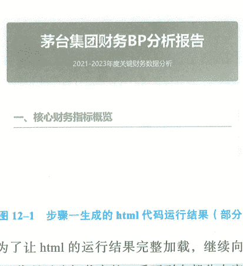

**步骤二：**为了让 html 的运行结果完整加载，继续向 Deepseek 发出指令：上述 html 代码无法加载完整，看不到主要内容，请检查问题，并能够让其常用的浏览器中完成加载。

**步骤二结果：**DeepSeek 重新生成了一个简化的 html 代码（如图 12-2 所示），点击运行后生成了一版简单的财务 BP 分析可视化看板，具体成果见“普通组成果展示”。
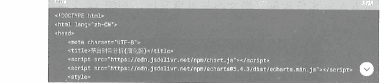

**图 12-2** 步骤二生成的可直接运行的代码（部分）
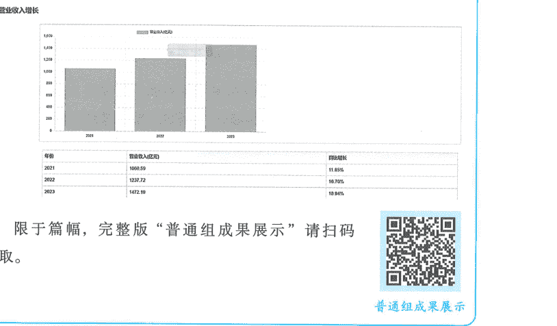

**作者点评**
普通组虽具备基本的 AI 应用能力，但指令表达模糊，缺乏对 BP 可视化分析结构和内容展现的明确规划。当发现生成的 html 代码运行出现加载问题时，仅重复发出一次指令以解决问题，未能深入分析问题根源，如文件大小、脚本调用错误等。除此之外，普通组对财务 BP 分析可视化的尝试步骤较少，没有反复优化和调整输出结果，整体效果并不能达到财务 BP 分析可视化看板的要求。

##### 12.1.2 优秀组的操作与成果

###### 1. 优秀组操作步骤

**步骤一：**将准备好的基础数据 Excel 文档作为附件上传至 DeepSeek，并向 DeepSeek 发出指令：阅读这个文件，根据里面的数据生成一个茅台综合数据看板，要求包含：

1. 主营业务分析，包含分行业、分产品、分地区、分销售模式情况分析；
2. 成本构成项目分析及年度对比；
3. 研发费用详细分析及年度对比；
4. 研发人员情况详细分析及年度对比；

对上述数据进行整理分析，进行可视化设计和数据展现，用 html 格式输出，确保可执行，edge、chrome、safari 等常见操作系统内置浏览器均可正常打开。

> **注意：**未开启 DeepSeek 的深度思考模式。

**步骤一结果：**DeepSeek 生成了 html 代码（如图 12-3 所示）。点击运行，可生成一个网页版财务 BP 分析可视化看板，如图 12-4 所示。生成的第一版可视化的图表自动选用了“茅台红”配色，图表大多采用柱状图和饼图，整体样式初具规格，但还需要做进一步调整，使得表现形式更多样、数据标识更清晰、图表配色更加符合企业要求、风格更加商务。


**第一版财务 BP 分析可视化看板**

> (a)“茅台红”配色的可视化看板（柱状图）
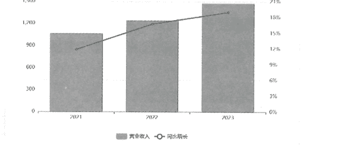
> (b)“茅台红”配色的可视化看板（饼图）


####### 茅台综合数据看板

######## 图 12-3 DeepSeek 生成的看板分析 html 代码（部分）
#### 贵州茅台综合数据看板 (2021-2023)

##### 1. 主营业务分析

> 茅台主营业务持续增长，2023 年酒类营业收入达到 1472.19 亿元，同比增长 18.94%。毛利率稳定在 92% 以上，显示强大的盈利能力。
> 茅台酒仍是核心产品，2023 年收入 1265.89 亿元，占总收入 86%；其他系列酒增长迅速，2023 年同比增长 29.43%。
> 直销渠道占比持续提升，2023 年占比达 45.7%，毛利率高达 95.46%。

##### **步骤二：**在上述基础上，丰富看板中的数据展现形式，且每个柱状图、饼图都应该标有具体的数据和百分比，还需要调整数据看板的风格和配色。再次向 DeepSeek 发出指令：在上述基础上，图形可采用更多展现形式：条形图、扇形图、饼图、折线图、雷达图等复合图表。同时将每个图表的具体数值或百分比显示出来，使得数据更直观。然后更换面板配色，采用更为商务的“深蓝色系”配色为主，重新输出一个 html 格式，确保可执行，edge、chrome、safari 等常见操作系统内置浏览器均可正常打开。

**步骤二结果：**DeepSeek 生成了一版新的数据分析看板，根据要求将看板配色整体调整成了深蓝色系，且在各图表中标注了具体数值。同时，在原有柱状图和饼图的基础上，添加了雷达图、环形图、折线图等多种图形表示。步骤二结果如图 12-5 所示。

**第二版财务 BP 分析可视化看板**
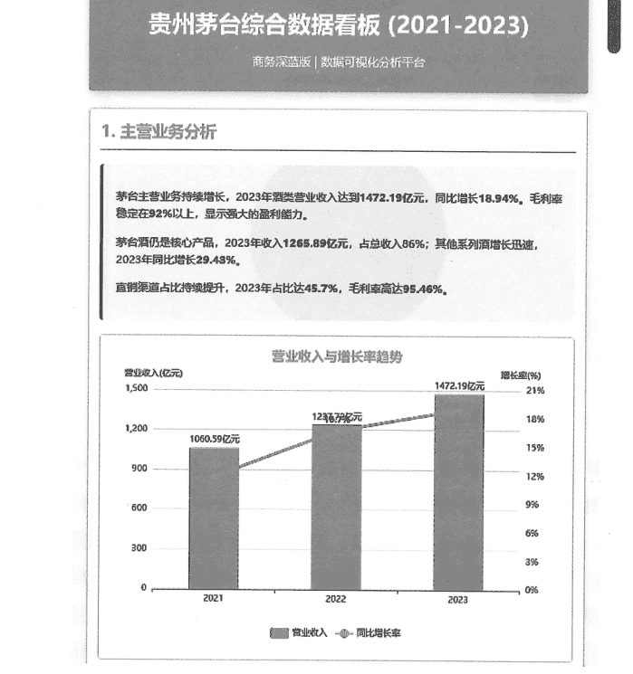

**(a) 柱状图**
**产品收入结构 **(2023 年)
其他系列：206.1 亿元 (14.09%)
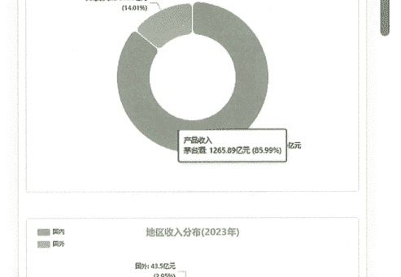
**(b) 饼图**
**地区收入分布 **(2023 年)
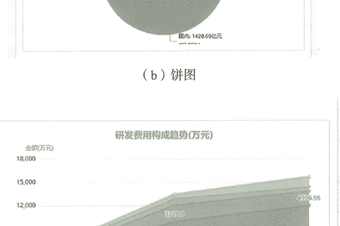
**(c) 折线图**
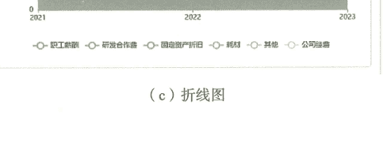

##### **步骤三：**在步骤二的基础上，进一步调整财务 BP 分析可视化看板的专业性。上网找到一张美观的 BP 可视化模板图片（如图 12-6 所示），按照该图片的颜色和模块对现有可视化看板进行调整。将该图片上传至 DeepSeek，并向 DeepSeek 发出指令：阅读上传的图片，在上述 html 的基础上，在看板的开头增加如图片上的内容模块，看板的颜色可参照图片中的色系进行调整，保持看板全部图表美观大方，色系和谐，重新输出一个 html 格式，确保可执行，edge、chrome、safari 等常见操作系统内置浏览器均可正常打开。
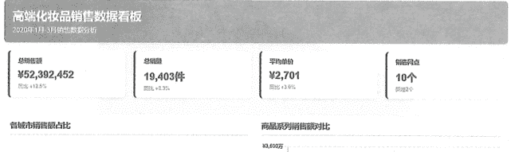
结果如图 12-7 所示。

### 茅台综合数据看板 (高端商务版)

```html
<!DOCTYPE html>
<html lang="zh-CN">
<head>
  <meta charset="UTF-8">
  <meta name="viewport" content="width=device-width, initial-scale=1.0">
  <title>茅台综合数据看板</title>
  <script src="https://cdn.jsdelivr.net/npm/chart.js"></script>
  <script src="https://cdn.jsdelivr.net/npm/echarts@5.4.3/dist/echarts.min.js"></script>
  <style>
    body {
      font-family: 'Microsoft YaHei', Arial, sans-serif;
      margin: 0;
      padding: 0;
      background-color: #f8f9fa;
      color: #333;
    }
  </style>
```

**步骤三结果：**DeepSeek 最后生成了“茅台综合数据看板 (高端商务版)"，按照步骤三的要求，在开头增加了模块，并调整了色系，如图 12-8 所示。但整体色系呈现反而更为混乱，并没有实现统一，因此还需要对看板的色系进行最终的调整。
贵州茅台综合数据看板
2021-2023 年年度经营数据分析报告

1. 主营业务分析

> > 茅台主营业务持续增长，2023 年同类营业收入达到 1472.19 亿元，同比增长 18.94%。毛利率稳定在 92% 以上，显示强大的盈利能力。
> 茅台酒仍是核心产品，2023 年收入 1265.89 亿元，占总收入 86%；其他系列酒增长迅猛，2023 年同比增长 29.43%。
> 高端酒占比持续提升，2023 年占比达 45.7%，毛利率高达 95.46%。

**(a)**

**2. 成本构成项目分析**

2023 年总成本 118.26 亿元，同比长 17.42%，直接材料和直接人工是主要成本项，合计占比 93.13%。\n\n直接人工成本增长显著，2023 年同比增长 59.76%，占比提升至 37.43%。

**（b）**
图 12-8 茅台综合看板（高端商务版）（部分）


##### 步骤四：为了使看板色系有效统一，色彩和谐，我们选取了一个配色模板图片（如图 12-9 所示）作为参考，并上传至 DeepSeek，向 DeepSeek 发出指令：**请参考图片中的配色组合，对上述看板进行颜色调整**，重新输出一个 html 格式，确保可执行，edge、chrome、safari 等常见操作系统内置浏览器均可正常打开。

##### 步骤四结果：DeepSeek 生成了最终版的财务 BP 看板的 html 代码，点击运行，得到的看板整体颜色参照配色模板设置，和谐统一。其他内容经人工检验，未发现异常。具体成果参见“优秀组成果展示”。
最后还有一个问题：在整个可视化看板生成的过程中，DeepSeek 均未开启深度思考模式。为了对比是否开启深度思考模式的效果，我们再次向 DeepSeek 输入步骤一的指令，并开启深度思考（如图 12-10 所示），以此测试在深度思考模式下 DeepSeek 能否生成更好的可视化看板。

### 图 12-9 配色模板

- **阅读这个文件，根据里面的数据生成一个茅台综合数据看板，要求包含**
  - 1.主营业务分析，包含分行业、分产品、分地区、分销模式情况分析；
  - 2.成本构成项目分析及年度对比；
  - 3.研发费用详细分析及年度对比；
  - 4.研发人员情况详细分析及年度对比；
  - 对上列数据进行整理分析，进行可视设计数据展现，用 html 格式输出，确保可执行，edge、chrome, safari 等常见操作系统内置浏览器均可正常打开。

- **好的。我需要根据用户提供的茅台年度数据生成一个综合数据看板。首先，用户要求包含四个主要部分：主营业务分析、成本构成项目分析及年度对比、研发费用详细分析及年度对比、研发人员情况详细分析及年度对比。我需要从提供的多个工作表中提取相关数据，并进行整理和分析。**

- **首先。主营业务分析需要分行业、分产品、分地区、分销模式的情况。每个部分都有按年份的数据，我需要将这些数据整理成适合可视化的格式，比如表格或图表。例如，分行业情况表中，2021 到 2023 年的酒类营业收入。成本和..**

### 图 12-10 开启深度思考模式重复步骤一

**DeepSeek 在深度思考模式下生成了新的 html 代码，但未开启深度思考模式相比，代码明显更短。点击运行代码后，生成结果更简单，而且不够美观和细致 (如图 12-11 所示)。因此可以认为，开启深度思考模式并没有优化财务 BP 分析可视化看板的生成效果，反而降低了其美观性和全面性。**

# ### 主营业务收入分析
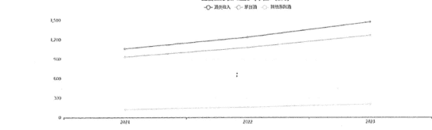
# ### 成本构成项目分析

# ### 研发费用分析


#### 2. 优秀组成成果展示

> 贵州茅台综合数据看板
2021-2023 年度比较数据分析报告

### 总营业收入 ¥1472.19 亿
同比 +18.94%
### 总销售量
5,428 万瓶
同比 +15.2%
### 平均单价
¥2,712
同比 +3.2%
### 销售网点
2,158 个
新增 156 个


##### 1. 主营业务分析

茅台主营业务持续增长。2023 年度实现营业收入达到 1472.19 亿元，同比增长 18.94%，毛利率稳定在 92% 以上，显示强大的盈利能力。

茅台酒仍是核心产品，2023 年收入 1265.89 亿元，占总收入 86%，其他系列酒增长迅速，2023 年同比增长 29.48%，

直销渠道占比持续提升，2023 年占比达 49.7%，毛利率高达 55.46%！
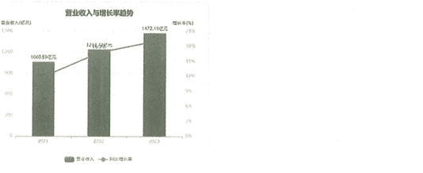
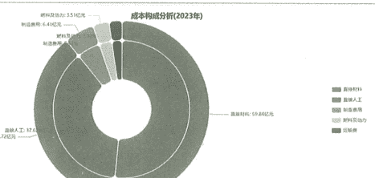

| 成本项目 | 2021 年金额 (亿元) | 2021 年占比 | 2022 年金额 (亿元) | 2022 年占比 | 2023 年金额 (亿元) | 2023 年占比 | 2023 年增长率 |
| :--- | :--- | :--- | :--- | :--- | :--- | :--- | :--- |
| 直接材料 | 50.07 | 56.32% | 53.45 | 54.00% | 59.84 | 51.50% | 11.97% |
| 直接人工 | 27.76 | 31.22% | 33.95 | 34.31% | 43.72 | 37.63% | 28.76% |
| 制造费用 | 5.93 | 6.67% | 5.58 | 5.64% | 6.41 | 5.51% | 14.77% |
| 燃料及动力 | 2.72 | 3.05% | 3.42 | 3.46% | 3.51 | 3.02% | 2.72% |
| 运输费 | 2.44 | 2.74% | 2.56 | 2.59% | 2.72 | 2.34% | 6.31% |
| 合计 | 88.91 | 100% | 99.95 | 100% | 116.20 | 100% | 17.42% |

# DeepSeek高效财务

**作者点评**
优秀组的整体操作逻辑清晰，能够围绕生成高质量财务 BP 可视化看板这一目标，进行分阶段、系统化操作。从基础图表生成到配色调整再到结构优化，最终形成了兼具可读性与美观性的成果。尤其在步骤三和步骤四中，优秀组能够主动借助示例模板图片，向AI发出精准指令，提升了看板的视觉效果，展现出良好的审美与执行能力。

## 12.2 可视化看板进阶优化

> #### 任务场景描述
你把前述生成的可视化看板提交给上级经理，他肯定了成果的专业性和美观性，并给出了修改建议：可以再增加一个杜邦分析，还可以尝试做一些标签，如增加2021年、2022年、2023年的标签选项。

## 12.2.1 普通组的操作与成果

### 1.普通组操作步骤

> **步骤:**将Excel文档上传至DeepSeek，并向DeepSeek发出指令：根据文件中的数据，生成茅台2021-2023年杜邦分析结果，用html格式输出。

**注意：**未开启 DeepSeek的深度思考模式。

**结果:** DeepSeek 生成了一套 html代码 (如图12-12所示),还在代码下方给出了简单的“核心分析结论”（如图12-13所示）。点击html代码运行之后,生成了贵州茅台2021—2023年的杜邦分析结果，并对每个指标进行了运算，具体成果见“普通组成果展示”。

## 茅台2021-2023年杜邦分析结果

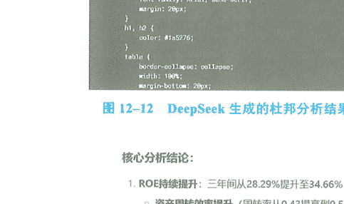

## 核心分析结论:

1. **ROE持续提升:**三年间从28.29%提升至34.66%，主要得益于:
   - 资产周转效率提升(周转率从0.43提高到0.55)
   - 财务杠杆优化(权益乘数从1.30降至1.22)

2. **盈利质量突出:**
   - 销售净利率稳定在51%以上
   - 2023年经营性现金流/净利润比为0.86

3. **财务结构健康:**
   - 资产负债率低于20%
   - 货币资金占比超25%
   - 流动比率高于4

4. **运营特点:**
   - 存货周转天数超过1,400天 (符合白酒行业陈酿特性)
   - 应收账款周转极快(<1天)


### 2.普通组成果展示

## 贵州茅台(600519.SH)杜邦分析报告(2021-2023)

| 关键指标 | 2021年 | 2022年 | 2023年 | 变动趋势 |
| :--- | :---: | :---: | :---: | :--- |
| 净资产收益率(ROE) | 28.29% | 31.90% | 34.66% | 持续提升 |
| 销售净利率 | 51.45% | 51.25% | 51.47% | →基本稳定 |
| 总资产周转率 | 0.43 | 0.50 | 0.55 | ↑效率提升 |
| 权益乘数 | 1.30 | 1.24 | 1.22 | ↓杠杆降低 |


**杜邦分析分解**

| 项目 | 2021年 | 2022年 | 2023年 |
| :--- | :---: | :---: | :---: |
| 净利润 (亿元) | 557.21 | 653.76 | 775.22 |
| 营业收入 (亿元) | 1,083.46 | 1,275.54 | 1,505.60 |
| 总资产 (亿元) | 2,551.68 | 2,545.01 | 2,727.00 |
| 股东权益 (亿元) | 1,969.58 | 2,049.38 | 2,236.56 |
| ROE = 销售净利率 × 总资产周转率 × 权益乘数 | 51.45% × 0.43 × 1.30<br>= 28.29% | 51.25% × 0.50 × 1.24<br>= 31.90% | 51.47% × 0.55 × 1.22<br>= 34.66% |


**作者点评**

> 普通组虽完成了基本的杜邦分析指标提取与结果展示，但缺乏对杜邦分析结构图可视化结构的理解与设计。仅通过表格形式呈现，不足以体现杜邦分析“结构性 + 逻辑性”的可视化特点。指令描述较简单，未对展示形式、色彩风格、结构布局做进一步优化，也未使用参考模板进行引导。

## 12.2.2 优秀组的操作与成果

### 1.优秀组操作步骤

> **步骤一：**将Excel文档作为附件上传至DeepSeek，并发出指令：使用上述给出的财务数据，生成茅台2021—2023年的杜邦分析结构图，以html格式生成。

步骤一结果: DeepSeek生成了html代码，点击运行，生成了2021—2023年贵州茅台的杜邦分析结果。DeepSeek还在最后形成了一个简单的分析结论，并对数据来源和指标计算公式进行了标注,如图12-14所示。经过人工检验，指标计算无误。

**分析结论**

主要发现:
- **ROE持续提升:**从2021年的28.29%增长到2023年的34.66%,表明公司为股东创造价值的能力不断增强。
- **高利润率保持:**销售净利率维持在50%以上的极高水平,且逐年小幅提升，反映茅台强大的品牌溢价和定价能力。
- **资产效率改善:**资产周转率从0.43提升至0.55，显示公司资产管理效率有所提高。
- **财务杠杆降低:**权益乘数从1.30降至1.22，表明公司财务政策趋于保守,负债水平有所下降。

建议:
- 继续保持高利润产品的竞争优势
- 进一步优化资产配置，提高资产使用效率
- 在保持财务稳健的前提下，可考虑适度提高财务杠杆以进一步提升ROE

注:
1. 所有数据均来自茅台2021-2023年财务报表
2. **计算公式:**
   - 净资产收益率(ROE)=净利润/股东权益
   - 销售净利率=净利润/营业收入
   - 资产周转率=营业收入/总资产
   - 权益乘数=总资产/股东权益
3. 趋势箭头表示与上年相比的变化方向

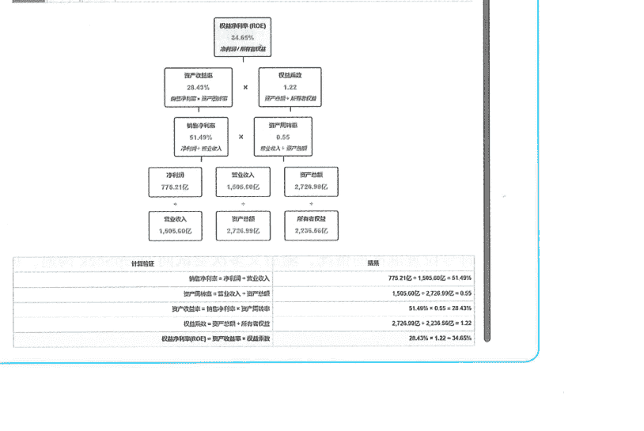

*图12-14 优秀组步骤一生成的杜邦分析结果 (部分)*

注：由于AI计算存在四舍五入,数据可能略有差异。

- **步骤二：**步骤一生成的杜邦分析对比图不符合传统的杜邦分析结构图样式，因此，优秀组从网络找到了一张传统杜邦分析结构图参考图片（如图 12-15 所示），让 DeepSeek 按照该图片的结构重新生成贵州茅台的杜邦分析结构图，同时让三年的杜邦分析结构图按照卡片形式横向展示，在结构图上方生成一个卡片切换选项，允许使用者进行年度选择。

> > **图12-15 杜邦分析结构图参考图片**

> > **步骤二结果:** DeepSeek根据步骤二的要求重新生成了html代码，点击运行后，杜邦分析结构图根据要求生成了“年份切换标签”（DeepSeek输出代码时强调自己增加了年份标签，由此从DeepSeek的文字输出中学习到更加精确的表达方式），整体架构参照参考图片设置，颜色风格更加商务（如图12-16所示）。但杜邦分析指标的位置和指标之间的连线并没有按照参考图片中的形式呈现，还需要进一步调整。

> > **步骤三**:为使 DeepSeek 按照参考图片的结构形式生成恰当的数据看板，进一步对 DeepSeek发出指令：在上述基础上，继续参照杜邦分析结构图生成结构一致、指标间有连线、运算符号位置正确的杜邦分析，再用html格式输出。

## 贵州茅台杜邦分析 (2021-2023)

> **2023年** | **2022年**
> --- | ---
> 
> ### 权益净利率 (ROE)
> 34.65%
> 净利润 /所有者权益
> 
> ### 资产收益率
> 28.43%
> 销售净利润 / 资产总额
> 
> ### 权益乘数
> 1.22
> 资产总额 / 所有者权益
> 
> ### 销售净利润率
> 51.49%
> 净利润 / 营业收入
> 
> ### 资产周转率
> 0.55
> 营业收入 / 资产总额
> 
> **净利润** 775.21亿
> **营业收入** 1,505.60亿
> **资产总额** 2,726.99亿

| 计算验证 | 结果 |
| :--- | :--- |
| 销售净利润率=净利润÷营业收入 | 775.21亿÷1,505.60亿=51.49% |
| 资产周转率=营业收入÷资产总额 | 1,505.60亿÷2,726.99亿=0.55 |
| 资产收益率=销售净利润率×资产周转率 | 51.49%×0.55=28.43% |
| 权益乘数=资产总额÷所有者权益 | 2,726.99亿÷2,236.56亿=1.22 |
| 权益净利率(ROE)=资产收益率×权益乘数 | 28.43%×1.22=34.65% |

> *图12-16 调整后的杜邦分析结构图*

步骤三结果: DeepSeek重新生成了html代码，点击运行后，仍无法生成和参考图片一样的结构框架，指标间的连线和运算符号位置出现了混乱 (如图12-17所示)。

**步骤四**:在步骤三的基础上，继续向DeepSeek发出指令：现有指标的位置都较为正确了，但是运算符号和连接线比较混乱，请根据指标之间的运算关系，调整运算符号的位置和连接线的位置，其他无须调整，再用html格式输出，保证edge、chrome等浏览器能正常加载。

步骤四结果: DeepSeek继续输出html格式，但仍然存在指标间连线和运算符号位置混乱的情况，随后又多次尝试同DeepSeek沟通，但均无法形成优于步骤二结果的框架内容。因此最终以步骤二结果作为最终结果展示。

### 2.优秀组成结果展示

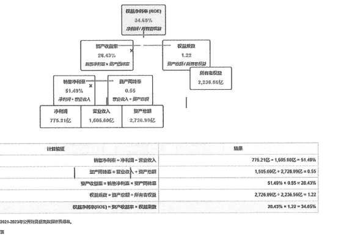


### 作者点评

优秀组围绕生成进阶可视化看板（如带标签的杜邦分析图）这一目标，充分利用参考模板，分步骤引导AI生成结果，并在每一步之后进行反馈和优化。特别是在步骤二中，尝试提供给DeepSeek杜邦分析结构图的参考图片，并要求它生成带有年份切换标签的杜邦分析结构图，展现出创新意识和对DeepSeek的引导能力。

## 12.3 本章总结

本章围绕“应用DeepSeek辅助财务BP进行可视化分析”这一主题，设计了两个任务场景：构建基础可视化看板与可视化看板进阶优化。优秀组与普通组的操作对比体现出在DeepSeek应用中分步骤逐步优化、指令表达清晰、注重色彩审美、提供配色模板和可视化效果模板等的重要性。

### 实用技巧

- **明确视觉目标再撰写提示词。**在应用AI交互前，先构思图表的结构与风格，再进行精准描述，避免生成结果不符合预期。
- **善用参考模板作为引导。**上传参考模板，能有效帮助AI生成符合期望的结构布局与美术风格。
- **采取“逐步生成 + 逐步优化”的策略。**一次生成结果难以满足全部要求时，采用分步优化的方式，能够提升整体效果。
- **应用DeepSeek生成财务BP可视化分析时，无须开启深度思考模式。**

> - DeepSeek输出html格式的代码时可能出现网页无法完整加载的情况，可以在指令中加入“确保执行，能够使用日常浏览器完整加载或打开”等表述，确保DeepSeek输出的html代码可以完整加载并使用。

## 参考文献

[1] 张大斌，田恒义，许桂秋.AI导论：通识版.北京:人民邮电出版社，2024.

[2] 莫宏伟.AI导论.2版.北京:人民邮电出版社，2024.

[3] 关景新,姜源.AI导论.2版.北京:人民邮电出版社,2024.

## DeepSeek高效财务

DeepSeek Gaoxiao Caiwu

**孙玥璠** **苏 芮** **张真昊** 编著

出版发行 **中国人民大学出版社**
社址 北京中关村大街31号
电话 010-62511242（总编室）
     010-82501766（邮购部）
     010-62511173（发行公司）
网址 http://www.crup.com.cn
经销 新华书店
印刷 北京联兴盛业印刷股份有限公司
开本 720 mm×1000 mm 1/16
印张 22.5 插页1
字数 297 000
版次 2025年5月第1版
印次 2025年5月第1次印刷
定价 79.00元

版权所有 侵权必究 印装差错 负责调换

邮政编码 100080
     010-62511770（质管部）
     010-62514148（门市部）
     010-62515275（盗版举报）