# DeepSeek高效财务


# AI+ 助力财务人员快速掌握 AI 技能，成为数智时代的"AI 财务”

孙玥瑶 苏 芮 张真昊 编著

---

是 AI 取代
还是驾驭 AI

*   简明实用“人机交互”思维法
*   普通组与优秀组成果对比
*   丰富教学实践的经验总结
*   不会编程也能打造自己专属的 AI 财务工具箱


> 赠送
> 财务 BP 自制模板
> 全套代码


中国人民大学出版社

---

## AI 时代，财务人路在何方？

> 某天晚上，我给研究生开完例会后，一位学生找到我说："老师，您还记得我们班的×××吗？她前几天联系我，让我一定当面向您转达她的敬意和感谢。她在读研期间实习时，有一天老板给她布置的工作是把访问者数据一条条粘贴到 Excel 表格中，要求一个星期做完。她就想起了之前上您的课时您说过的话——'所有重复 30 次以上的工作都不值得我们自己亲自做'。于是她用了—个晚上，复习了您教我们的机器人流程自动化 (RPA) 知识，还联系了班上其他同学，一起做出了流程自动化，最终用一个小时就做完了工作。老板对她的能力表示认可，她的实习由此获得了极高的评价。您的课是她觉得收获最大的课。”
>
> 这些年我经常听到学生跟我分享类似的应用 AI 辅助高效完成财务工作并获得赞赏或得到机会的故事，我为此感到自豪不已。教书 20 年了，从手把手教老一辈会计人怎样使用电算化软件、大面积普及 Excel 财务应用，到教财务人应用 ERP 系统、大型企业集团财务共享服务模式、财务 BP 落地实操、“无代码”RPA 财务机器人开发，再到今天 AI 财务的划时代发展，我深刻体会着技术进步对财会工作的变革给财务人带来的冲击和挑战，更亲历了每次变革给主动学习的财务人带来的巨大机遇和上升机会。
>
> > AI 是替代者吗？不是！AI 是拥有放大人类价值的力量的超级工具，这种力量是强大的，甚至是惊人的。那么谁的价值将被放大？自然是会使用 AI 的人，也就是我们俗称的"AI 精英”。在 AI 时代，马太效应显著：强者更强，弱者更弱，两极分化加剧。会使用 AI 的人工作效率空前提高，新的职业、新的技能标签出现。因此，AI 淘汰的是不会用 AI 的人，在 AI 时代，适者生存。所以财界的人要学习、适应、提升、进化。成为新时代 AI 财务精英，是财界人面临的新课题，更是财界人突破职场天花板，实现职业跃迁的黄金契机。

未来已来，唯变不变。

基于此，本书旨在为财界人提供 AI 时代的转型指南，从工具应用、思维升级到价值重构，全方位赋能财界人掌握 AI 核心技能。本书不仅是技术手册，更是财务职业革命的路线图，让我们共同开启这场 AI 赋能的财务进化之旅。

2025 年 1 月下旬 DeepSeek R1 发布，我和我的团队整个春节假期都在兴奋地讨论和尝试。2 月我们开始设计课程，准备开学后给本科注册会计师专门化和会计专业的高年级学生、会计专业硕士（MPAcc）和 MBA 学员开课。同时我们也正在准备给大量社会在职财界人进行的培训，来自不同行业的许多学员以极高的热情积极参与了学习，积累了大量宝贵的实操经验。

教学和培训成果表明：第一，只学习基本的 AI 理论知识（如大模型理论、提示词知识）是不够的，AI 的价值在于实操落地，财务 AI 尤其如此。第二，经过一段时间的学习和练习，财界人使用 AI 的技能大幅提升。这在本书中“普通组”和“优秀组”的操作与成果对比中体现尤为明显；而经过训练，最终两组都能在 60 分钟内高效完成指定任务。

本书得以出版，是团队共同努力的成果。本书的提纲、“任务场景描述”、审校、“作者点评”、“本章总结”、 “实用技巧”，以及第 6、7、8、10、11 章，由孙玥璠完成；全书所有 AI 任务实现（包括人工检验）以及第 4、5、9、12 章，由苏芮完成；第 1、2、3 章和全书所有“小帖子”、技术支持，由张真昊完成。

感谢我的学生们：吴润佳参与了第 1 章的资料整理工作；黄聪慧、李梦丽参与了第 2 章的资料整理工作；杨秋萍参与了第 3 章的资料整理工作；靳凯宇、屈文字、申珊、秦柳、马莹莹参与了第 5 章的资料整理工作；朱晨光、范宇欣参与了第 12 章的资料整理工作；丰淑成、肖惠琪参与了第 4 章的编写；黄聪慧参与了第 7 章的编写；石江霞参与了第 9 章的编写；李梦丽参与了第 10 章的编写；杨一帆参与了第 11 章的编写；薛博文为第 7 章提供了部分数据支持；李云轩为第 8 章提供了部分数据支持；张盟雨、梁予露、董瞳为第 12 章提供了部分数据支持。还要感谢中国人民大学出版社编辑陈永凤、张萌的辛勤付出。

本书可以作为高等学校财会及相关专业课程教材，也可以作为在职财务人员学习、培训资料。无论是 DeepSeek 还是其他 AI 大模型，它们的更新迭代都很快，本书力求在核心方法论和底层逻辑上保持前瞻性，同时努力提供可迁移的实践框架以适应技术演进。

本书所有配套的代码和可视化网页资源，均可以通过扫描书中的二维码下载，本书作者还将在"AI 财务专家 | 孙玥璠”账号不定期发布 AI 财务实操案例、DeepSeek 实用技巧、AI 大模型工具使用指南等免费内容，欢迎大家共同讨论，一起进步。为了方便大家交流心得体会，我们还建了专门的微信交流群，可扫码加入。

由于能力所限，本书难免存在问题，在此恳请各位愿意拥抱和尝试财务 AI 的读者批评指正。

路虽远行则将至，事虽难做则必成。AI 财务，正当破晓时分，未来星辰大海。

AI 时代，财务人路在何方？路在脚下。


## 上篇 AI 与 DeepSeek

### 第 1 章 **时代之光：AI**

- 1.1 AI 概述
    - 1.1.1 AI 的概念和特点
    - 1.1.2 AI 的历史沿革
    - 1.1.3 AI 的主要技术、优势与缺陷
    - 1.1.4 AI 的应用领域
    - 1.1.5 AI 在财务领域的应用
- 1.2 AI 在财务领域的未来发展

### 第 2 章 **AI 大模型**

- 2.1 什么是大模型
    - 2.1.1 大模型的概念
    - 2.1.2 大模型的优势
    - 2.1.3 大模型的发展里程碑
- 2.2 主流大模型简介
    - 2.2.1 国外主流大模型
    - 2.2.2 国内主流大模型
- 2.3 DeepSeek 简介
    - 2.3.1 什么是 DeepSeek
    - 2.3.2 DeepSeek 的能力
    - 2.3.3 DeepSeek 的优势
    - 2.3.4 DeepSeek 的不足
    - 2.3.5 DeepSeek 的发展趋势

### 第 3 章 DeepSeek 应用必杀技：提示词

- 3.1 什么是提示词
    - 3.1.1 提示词的概念
    - 3.1.2 提示词的特点
    - 3.1.3 提示词的分类
- 3.2 提示词的重要作用
- 3.3 有效提问的原则和方法
    - 3.3.1 有效提问的六个黄金原则
    - 3.3.2 有效提问的四种方法
    - 3.3.3 有效提问的通用模板
- 3.4 提示词在财务领域的应用和无效提示词
    - 3.4.1 有效提示词和无效提示词
    - 3.4.2 在财务应用中优化提示词
- 3.5 通用模型和推理模型的提示词设计技巧
- 3.6 通用模型和推理模型的提示词万能公式

---

## 中篇 应用 DeepSeek 辅助财务工作基础实操

### 第 4 章 应用 DeepSeek 辅助财务工作中的 Excel 操作

- 4.1 应用 DeepSeek 在常见财务工作场景中辅助生成 Excel 函数
    - 场景一：应收账款账龄分析
    - 场景二：财务数据多条件分析
    - 场景三：工资条生成
    - 场景四：费用明细对比分析
- 4.2 应用 DeepSeek 在复杂财务工作场景中辅助生成 VBA 代码
    - 场景五：报表货币单位转换
    - 场景六：资金管理表合并
    - 场景七：集团报表合并
    - 场景八：销售报表透视和逆透视
    - 场景九：库存表拆分
- 4.3 本章总结

### 第 5 章 应用 DeepSeek 辅助财务工作中的 PPT 制作

- 5.1 应用 DeepSeek 和 Kimi 辅助制作 PPT
- 5.2 应用 WPS 灵犀辅助制作 PPT
- 5.3 本章总结

### 第 6 章 应用 DeepSeek 辅助标准化文本生成

- 6.1 利用 PDF 生成标准化文本
- 6.2 利用 Excel 文档生成标准化文本
- 6.3 自动生成往来对账函
- 6.4 本章总结

### 第 7 章 应用 DeepSeek 辅助财务附件识别

- 7.1 应用 DeepSeek 辅助电子发票识别
- 7.2 应用 DeepSeek 辅助纸质发票识别
- 7.3 应用 DeepSeek 辅助合同识别
- 7.4 本章总结

---

## 下篇 应用 DeepSeek 辅助财务日常运营管理工作

### 第 8 章 应用 DeepSeek 辅助财务制度建设

- 8.1 企业新建制度
    - 8.1.1 普通组的操作与成果
    - 8.1.2 优秀组的操作与成果
- 8.2 企业修订制度
    - 8.2.1 普通组的操作与成果
    - 8.2.2 优秀组的操作与成果
- 8.3 本章总结

### 第 9 章 应用 DeepSeek 辅助合同拟定

- 9.1 企业无过往合同模板
    - 9.1.1 普通组的操作与成果
    - 9.1.2 优秀组的操作与成果
- 9.2 企业有合同模板待调整
    - 9.2.1 普通组的操作与成果
    - 9.2.2 优秀组的操作与成果
- 9.3 本章总结

### 第 10 章 应用 DeepSeek 辅助法律法规政策查询

- 10.1 企业经济类法律法规政策查询
    - 10.1.1 普通组的操作与成果
    - 10.1.2 优秀组的操作与成果
- 10.2 企业税务类法律法规政策查询
    - 10.2.1 普通组的操作与成果
    - 10.2.2 优秀组的操作与成果
- 10.3 本章总结

### 第 11 章 应用 DeepSeek 辅助多场景账务处理

- 11.1 AI 结果一致——以交易性金融资产账务处理为场景
    - 11.1.1 应用 DeepSeek 辅助账务处理
    - 11.1.2 应用文心一言辅助账务处理
    - 11.1.3 应用 Kimi 辅助账务处理
    - 11.1.4 应用豆包辅助账务处理
    - 11.1.5 结论
- 11.2 AI 结果经追问后一致——以委托加工物资账务处理为场景
    - 11.2.1 应用 DeepSeek 辅助账务处理
    - 11.2.2 应用文心一言辅助账务处理
    - 11.2.3 应用 Kimi 辅助账务处理
    - 11.2.4 应用豆包辅助账务处理
    - 11.2.5 结论
- 11.3 AI 结果经交叉检验后一致——以租赁账务处理为场景
    - 11.3.1 应用 DeepSeek 辅助账务处理
    - 11.3.2 应用文心一言辅助账务处理
    - 11.3.3 应用 Kimi 辅助账务处理
    - 11.3.4 应用豆包辅助账务处理
    - 11.3.5 交叉检验过程
    - 11.3.6 结论
- 11.4 AI 结果不一致——以非货币职工福利账务处理为场景
    - 11.4.1 应用 DeepSeek 辅助账务处理
    - 11.4.2 应用文心一言辅助账务处理
    - 11.4.3 应用 Kimi 辅助账务处理
    - 11.4.4 应用豆包辅助账务处理
    - 11.4.5 交叉检验过程
    - 11.4.6 导入知识库
    - 11.4.7 结论
- 11.5 应用 DeepSeek 辅助账务处理计算核对——以固定资产分期付款利息摊销为场景
- 11.6 本章总结

### 第 12 章 应用 DeepSeek 辅助财务 BP 进行可视化分析

- 12.1 构建基础可视化看板
    - 12.1.1 普通组的操作与成果
    - 12.1.2 优秀组的操作与成果
- 12.2 可视化看板进阶优化
    - 12.2.1 普通组的操作与成果
    - 12.2.2 优秀组的操作与成果
- 12.3 本章总结

---

## 参考文献

---

## AI Up DeepSeek
上篇

随着 AI 大模型技术的持续突破，AI 正在以前所未有的速度重塑财务管理的格局。在这一过程中，AI 已不仅仅是替代人工处理事务的工具，更是演变为辅助财务战略制定与风险控制的“智能大脑”，在智能核算、预算预测、资金管理、审计分析等关键环节展现出强大的能力。

尤为值得关注的是，随着中国自主大模型研发的兴起，DeepSeek 凭借卓越的中文语义理解能力和高效的行业场景适配能力，成为推动财务智能化转型的重要支点。在实际应用中，DeepSeek 能帮助财务人员处理财务报销、凭证审核、数据整理、报告生成等工作，提升工作效率及合规性、准确性。其在多模态能力和自然语言交互上的优势，进一步拓展了财务人员与系统之间的交互边界，使“人机协同”从理想愿景走向现实场景。

上篇从 AI 的基本概念与技术特征入手，系统梳理了其发展历程、核心优势与现实挑战，深入分析了 AI 在财务领域中的应用场景及其角色转变，并对如何使用 AI 的通用模型和推理模型、如何设计提示词等进行了详细的讲解。其中，第 1 章为“时代之光：AI"，聚焦 AI 的技术内涵与发展脉络；第 2 章为"AI 大模型”，系统介绍主流大模型的性能特征与代表性应用；第 3 章为"DeepSeek 应用必杀技：提示词”，深入讲解 DeepSeek 交互中的提示词高效构建方法。## (7) 解释性与可解释性问题

AI 的决策过程往往很复杂，部分 AI 模型很难解释其决策依据。具体表现为：AI 的某些决策可能是基于复杂的数学模型，而不是直观的规则。

这在财务领域可能会带来问题。例如，对于"AI 为什么认为这个供应商有风险”，如果回答不清晰，管理层可能不愿意信任 AI 的判断。再如，在使用 AI 进行审计的过程中可能遇到透明度问题。某公司使用 AI 来审查财务报表，AI 指出某个子公司的财务报表存在异常。管理层希望知道具体原因，但 AI 的分析结果只是“模型判断该数据异常”，并没有提供详细解释，这可能导致企业降低对 AI 分析结果的信任度。

## (8) 持续进化与升级

AI 模型可以不断学习新的数据，并持续优化自身能力。具体表现为：AI 不像传统软件那样固定，而是可以通过不断更新数据和算法，提升预测能力。

在财务领域，AI 可以适应新的市场变化、监管政策等，帮助企业作出更精准的决策。例如，应用 AI 进行智能预算管理。某公司使用 AI 进行年度预算规划，AI 最开始给出的预算预测偏差较大，但随着公司提供更多的历史财务数据，AI 不断学习调整，到了第三年，其预测准确率显著提高，能帮助公司更好地管理资金。

AI 的特点决定了它在财务管理中具有广泛的应用前景，从自动化报销审批、智能税务合规计划、现金流预测到股市趋势分析、智能审计，AI 正在改变传统企业财务管理的方式。随着技术的进步，未来 AI 在财务领域的应用会越来越广泛，但同时也需要解决可解释性、数据安全、合法合规等问题。

## 1.1.2 AI 的历史沿革

AI 的发展经历了三次历史浪潮，每次浪潮均伴有核心技术突破、标志性事件与应用领域的快速拓展，推动 AI 进入新的发展阶段。

### 1. 第一次浪潮：初创与探索阶段（1956 年至 20 世纪 70 年代末）

在 1956 年召开的达特茅斯会议上，“人工智能”的概念被正式提出。以逻辑推理、符号计算为核心的传统 AI 方法迅速发展，诞生了诸如定理证明、专家系统等成果。其中的标志性事件包括：

- 1956 年，达特茅斯会议召开，约翰·麦卡锡（John McCarthy）等人首次提出 AI 的概念，标志着 AI 学科正式诞生。
- 1966 年，约瑟夫·维森鲍姆（Joseph Weizenbaum）开发出第一个聊天机器人 ELIZA。
- 1968 年，专家系统取得初步成功，DENDRAL 系统（化学分子识别系统）研发成功。

但之后因计算能力不足、符号主义局限明显，AI 发展进入瓶颈期，出现了第一次"AI 寒冬”。

### 2. 第二次浪潮：知识工程与专家系统阶段（20 世纪 80 年代至 90 年代末）

20 世纪 80 年代初，AI 迎来复苏，以知识工程、专家系统、规则推理为代表的方法得到广泛应用，尤其是在工业、医疗、金融等领域，诞生了诸多成功的 AI 商业化产品。其间的标志性事件包括：

- 1981 年，日本政府提出“第五代计算机”计划，引发全球 AI 热潮。
- 1989 年，美国卡内基梅隆大学（Carnegie Mellon University）开发出 ALVINN 系统，首次实现无人驾驶汽车在特定条件下自动驾驶。
- 1997 年，IBM 的 AI 计算机深蓝（Deep Blue）战胜国际象棋大师卡斯帕罗夫（Kasparov），AI 的影响力达到新高度。

但由于技术瓶颈显现、专家系统的知识库构建困难、维护成本高昂，第二次浪潮逐渐退去，AI 发展再次陷入相对沉寂阶段，即第二次"AI 寒冬”。

## 历史时刻
深蓝战胜国际象棋冠军卡斯帕罗夫

1980 年，卡内基梅隆大学宣布，向任何创造出一台能够击败世界上最好的人类棋手的计算机的人提供 10 万美元奖金。之后十几年，这一任务一直未完成。直至 1997 年 5 月，在美国纽约，IBM 研发的 AI 计算机深蓝与国际象棋世界冠军加里·卡斯帕罗夫展开 6 场对决。深蓝拥有每秒分析 2 亿步棋的超强计算能力，尽管卡斯帕罗夫凭经验赢下首局，但随后深蓝迅速调整策略，在决胜的第 6 局仅用 19 步就迫使卡斯帕罗夫认输，最终深蓝以 3.5:2.5 的总比分获胜。这场比赛标志着 AI 迈入了新纪元，人类开始重新审视人与机器的关系。

### 3. 第三次浪潮：机器学习与深度学习时代（21 世纪初至今）

21 世纪初，以机器学习特别是深度学习技术为核心的新一轮 AI 浪潮兴起。得益于大数据、云计算和高性能计算的突破，AI 迎来了前所未有的发展机遇，迅速进入商业化和产业应用的黄金阶段。标志性事件与重要成果包括：

- 2006 年，杰弗里·辛顿（Geoffrey Hinton）等人提出深度置信网络（DBN），掀起深度学习研究的热潮。
- 2011 年，IBM 超级计算机沃森（Watson）在智力问答节目《危险边缘》中击败人类选手，引发对 AI 产业的关注。
- 2012 年，深度卷积神经网络 AlexNet 在 ImageNet 图像识别竞赛中取得重大突破，大幅提升了图像识别精度。

## 第 1 章 时代之光：AI/9

■ 2016 年和 2017 年，谷歌旗下的 DeepMind 公司开发的围棋 AI AlphaGo 先后战胜围棋世界冠军李世石与柯洁，推动 AI 在全球范围内的快速普及与产业投资热潮。

■ 2022 年，OpenAI 发布对话式 AI ChatGPT，引发生成式 AI 的全球热潮，进一步推动 AI 技术快速走向实际应用。

■ 2023 年，生成式 AI 技术迅速发展，全球主要科技公司纷纷推出各自的 AI 大模型应用平台，AI 技术与产业进一步融合，并逐渐进入规模化商业应用阶段，呈现出更加明显的产业生态化趋势。

■ 2024 年，DeepSeek 作为新一代国产开源大模型代表，快速崛起并广泛应用于教育、财务、智能办公和智能决策等多个领域，以强大的中文语义理解能力和高效的行业场景适配能力，推动大模型技术的多领域产业化落地与本土化创新进程。

AI 的第三次浪潮以深度学习、大规模预训练模型及生成式 AI 技术为核心，实现了技术创新与产业实践的深度结合，持续推动 AI 产业迈向智能化、产业化、生态化发展的新高度。

## 历史时刻
AlphaGo 战胜人类职业围棋顶尖选手

AlphaGo 是第一个击败人类职业围棋选手、第一个战胜围棋世界冠军的 AI，由谷歌旗下的 DeepMind 公司开发。2016 年 3 月，AlphaGo 与围棋世界冠军、职业九段棋手李世石进行围棋人机大战，以 4:1 的总比分获胜；2016 年末至 2017 年初，该程序在中国棋类网站上以“大师”为注册账号与中日韩数十位围棋高手进行快棋对决，连胜 60 局；2017 年 5 月，在中国乌镇进行的三番棋比赛上，它与当时世界排名第一的围棋世界冠军柯洁对战，以 3:0 的总比分获胜。围棋界公认 AlphaGo 的棋力已经超过人类职业围棋顶尖水平。

## 历史时刻

## 中国自主研发 DeepSeek AI 大模型

DeepSeek AI 大模型由中国科研团队于 2023 年自主研发。

DeepSeek 采用先进的 Transformer 架构，应用高质量中文语料训练，在语言生成、智能对话与专业知识推理方面表现卓越，达到国际领先水平。2024 年，DeepSeek 团队持续优化性能，并在教育培训、金融财务和智能办公等领域推出应用方案，实现产业化落地。截至 2025 年 3 月，DeepSeek 服务数千家企事业单位，形成了广泛的产业生态，成为我国自主 AI 创新典范。DeepSeek 通过开源策略显著降低了大模型训练与应用的门槛，推动了全球开发者成本指数级下降，加速了 AI 技术在不同场景的落地。

## 1.1.3 AI 的主要技术、优势与缺陷

##### 1. AI 的主要技术

AI 的主要技术包括机器学习、深度学习、强化学习、自然语言处理和计算机视觉等。机器学习是一种能够使计算机从数据中学习并根据经验改进性能的技术，不需要人工编写所有规则。深度学习是机器学习的一个分支，采用多层神经网络来模拟人脑的学习方式，擅长处理复杂数据，如图像、语音、文本等。强化学习是一种通过试错不断优化决策的 AI 技术，适用于动态优化问题，如投资组合管理、智能定价等。自然语言处理是一种使计算机理解、分析、生成和处理人类语言的技术，广泛用于财务报表分析、财务合同审核、智能客服等领域。计算机视觉是一种让计算机像人类一样“看”和理解图像的技术，广泛用于自动发票审核、发票报销等财务领域。

机器学习、深度学习、强化学习、自然语言处理和计算机视觉的主要优势、主要缺点和典型财务应用见表 1-1。

## 表 1-1 主要 AI 技术的对比

| AI 技术 | 主要优势 | 主要缺点 | 典型财务应用 |
|---|---|---|---|
| 机器学习 | 预测能力强<br>可持续优化 | 依赖数据质量<br>解释性差 | 信用风险评估<br>智能财务预测 |
| 深度学习 | 适用于复杂数据<br>精度高 | 计算成本高<br>黑箱问题 | 财务欺诈检测<br>市场分析 |
| 强化学习 | 适用于动态优化<br>自我优化 | 训练时间长<br>解释性差 | 投资组合管理<br>智能定价 |
| 自然语言处理 | 处理文本数据<br>自动化 | 语义理解有限<br>可能存在偏见 | 财务合同审核<br>智能客服 |
| 计算机视觉 | 理解图像 | 识别受限<br>计算成本高 | 自动发票审核<br>发票报销 |

##### 2. AI 的优势

AI 作为当今科技领域的重要突破，正在深刻改变企业财务管理的方式。它的独特能力使其在财务领域展现出巨大的潜力，其核心优势体现在自动化处理、预测精准度、风险控制、不受时间限制等方面。

###### （1）提高效率，自动化财务流程

AI 可以替代执行重复、耗时的财务任务，如报销审批、财务对账、报表编制等，从而提高财务管理的效率。传统企业财务工作需要大量人工操作，如人工录入发票信息、审核报销单据、编制财务报表等。而 AI 可以利用光学字符识别（OCR）和规则引擎实现自动化处理。此外，AI 可以全天候工作，不会疲劳，大大提升财务工作效率。

###### （2）数据驱动，提高预测和决策能力

AI 基于大数据分析，可以发现财务数据中的隐藏模式，提高财务预测和投资决策的准确性。传统财务预测方法主要依赖历史数据和人工经验，而 AI 可以分析更多层面的数据（如市场趋势、宏观经济指标、供应链数据），提高预测的可靠性。

###### （3）强化财务风控，降低合规和欺诈风险

AI 可以通过模式识别和异常检测，识别潜在的财务欺诈和合规风险，发布财务风险预警，帮助企业建立智能化的风控体系。具体地，AI 可以分析交易往来数据，检测是否存在异常资金流动，如资金走账异常、虚假报销、洗钱行为等。AI 还可以自动识别违反税务法规或审计要求的交易，帮助企业更好地遵守合规要求。

###### （4）7×24 小时运作，减少人工依赖

AI 可以不间断地执行财务任务，不受工作时间限制，确保企业财务管理的连续性。传统企业财务管理员工的工作时间有限，而 AI 可以全天候执行任务，如夜间自动生成报表、处理财务数据等，还可以在管理层需要的时候快速提供决策支持资料，不受工作时间和工作地点的限制。除此之外，AI 客服系统也可以在全球范围内提供 7×24 小时的财务咨询服务，优化客户体验。

##### 3. AI 的缺陷

AI 技术的快速发展给财务管理行业带来了巨大变革，但 AI 在数据依赖、黑箱问题、数据安全、技术成本等方面仍然存在缺陷。如何解决这些问题是推动 AI 健康发展的关键。

###### （1）结果依赖数据质量

AI 模型的表现严重依赖于数据的质量，如果数据不准确、存在偏差或样本量不足，AI 的分析结果就可能造成误导。因为 AI 只能在已有数据的基础上学习，如果数据样本不均衡（如企业历史财务数据过于单一），则预测结果可能有偏差。在财务合规领域，错误的数据可能导致错误的税务申报或财务决策，增加企业风险。例如，企业在贷款申请流程中出现数据偏差，如果 AI 仅基于企业过去的贷款数据进行评估，而没有考虑企业现在的发展需求、新的经济环境或政策变化，则可能导致企业贷款需求申请金额和方案错误。

###### （2）黑箱问题，决策可解释性差

某些复杂的 AI 模型（如深度学习模型）难以解释其决策过程，在财务审计、合规监管等领域可能会面临挑战。传统财务决策基于明确的规则，而 AI 决策可能依赖复杂的数学模型，财务人员很难理解 AI 为何作出某个决定。在规制严格的行业，如银行业和保险业，AI 的不可解释性可能影响合规性审核。例如，导致企业在资金支付环节出现黑箱问题。如果 AI 拒绝了一项支付审批，但无法提供明确理由，那么财务和销售部门可能不会接受这一决策，因为企业在合规性上面临挑战。

###### （3）数据安全和数据隐私问题

AI 系统需要依靠大量财务数据，如何保护这些数据的安全性和隐私性是一个重要问题。AI 系统由于存储着大量财务数据，可能成为黑客攻击的目标。监管机构对于财务数据的安全和隐私保护要求较高，企业需要确保 AI 系统符合数据保护法规（如欧盟的《通用数据保护条例》、我国的《中华人民共和国数据安全法》）的要求。例如，银行的 AI 风控系统存储了大量用户信息和交易信息，如果 AI 在云端处理用户交易数据时发生数据泄露，则可能导致严重的法律和商业风险。

###### （4）依赖技术投入，成本较高

AI 系统的开发和维护成本较高，中小型企业可能难以承担长期的技术和资金投入。AI 的实施需要高性能计算资源和专业团队的支持，模型还需要持续优化，技术投入要求较高。部分企业可能因为资金或技术限制，难以全面应用 AI 进行企业财务管理。例如，众多中小型企业都希望引入 AI 财务分析系统，同时保护企业的信息和数据安全，但发现需要投入大量资金进行系统开发、数据清理和模型训练，成本过高，因此只能被迫放弃。

企业在应用 AI 进行财务管理时，需要平衡 AI 的技术优势与风险，确保合规、安全。

## 1.1.4 AI 的应用领域

随着技术不断进步，AI 的应用范围日趋扩大，深入影响着经济社会发展的各个领域。下面简要介绍 AI 在金融、医疗健康、制造业、教育、交通运输等领域的应用情况，1.1.5 小节将详细介绍 AI 在财务领域的应用。

##### 1. 金融领域

AI 在金融领域应用广泛，已逐步深入风险管理、智能投顾、量化投资、客户画像、信用评估和反欺诈等各个环节。例如，通过智能风控技术，金融机构可以实时监测并分析客户信用风险，提高风险管理能力；智能投顾可以根据客户投资偏好、风险承受能力及市场动态，制定个性化投资建议，提升投资效率。

##### 2. 医疗健康领域

AI 在医疗健康领域的应用主要集中在医学影像分析、辅助诊断、药物研发、精准医疗及智能健康管理等方面。例如，借助 AI 技术可快速分析医学影像数据，精准识别癌症或其他疾病的病变区域，有效提高诊断准确性。此外，AI 算法能够显著加速药物研发进程，通过优化新药开发和临床试验的各个环节，极大地提升研发效率。

##### 3. 制造业领域

AI 已成为推动制造业转型升级的关键技术，被广泛应用于智能制造、工业机器人、质量监测与预测性维护等场景。比如，AI 驱动的智能生产线可以帮助企业实现自动化生产和精准质量控制，有效降低成本和提升生产效率；预测性维护技术能够提前预判设备故障，缩短生产停机时间和减少维修成本。

在教育领域的应用主要体现在智能教学、个性化学习、自动评测、智慧校园建设等方面。通过 AI 技术对学生数据的精准分析，教学系统可实现个性化学习方案制订，针对不同学生的学习特点提供精准化辅导。此外，AI 技术能够支持教师实现自动化阅卷、智能化备课以及课堂互动数据分析等，推动教育信息化进程，从而促进教育资源公平分配。

在交通运输领域的应用主要体现在智能驾驶、自动驾驶和智慧交通管理等领域。其中，无人驾驶技术正逐步走向实际应用，利用 AI 实现车辆的自主决策与控制，能够显著提升道路安全性和通行效率，缓解交通拥堵问题。此外，智慧交通系统通过对交通流量数据的实时分析，能够科学调配交通资源，提高道路使用效率，从而全面提升交通管理的智能化水平。

随着技术的不断发展，AI 在财务领域的应用越来越广泛，正在改变传统的财务管理方式。AI 可以帮助财务人员减少重复劳动，提高工作效率，同时使企业的财务管理更加精准、智能和高效。AI 在财务领域的的应用场景主要涵盖智能会计与核算、财务共享与自动化流程、资金管理与预测分析、预算管理与绩效分析、财务决策支持与风险管控以及个性化财务咨询服务等方面。

###### （1）智能会计与核算

过去，会计人员需要人工录入数据、核对账目、编制报表，工作繁琐且容易出错。AI 的出现使这些流程变得更加自动化和智能化。现在，利用 AI 技术可以自动识别和处理财务凭证，如自动读取发票信息、划分支出类型，甚至还能根据财务规则自动生成账务报表。这样不仅降低了出错率，还使财务工作更高效、精准。

###### （2）财务共享与自动化流程

企业的财务管理工作涉及大量的审批和流程，比如报销审批、发票审核、资金支付等。过去这些流程通常需要人工操作，效率低，管理成本高。AI 技术的应用可以帮助企业搭建财务共享中心，实现财务流程的自动化。例如，员工提交报销单后，AI 可以自动审核是否符合公司报销规定，在系统内完成审批，大大缩短人工审核的时间。同时，AI 还能帮助企业快速处理发票、自动安排付款，降低人工操作的错误率。

###### （3）资金管理与预测分析

对于企业来说，资金的合理管理非常重要。AI 可以帮助企业实时监测资金流动，分析现金流情况，并预测未来的资金需求。例如，AI 可以结合企业的历史财务数据和市场趋势，分析某段时间内的资金使用情况，预测可能出现的资金缺口，帮助企业提前做好资金规划，避免出现资金链断裂的风险。

###### （4）预算管理与绩效分析

企业的预算管理通常需要结合以往的数据和市场情况进行预测和调整。AI 可以通过分析企业的历史财务数据、行业趋势和市场变化，帮助企业制订更精准的预算方案。同时，AI 还能实时监测预算的执行情况，发现可能的偏差并提供数据支持，让管理层更好地调整经营策略。例如，如果 AI 发现某个项目的预算花费超出预期，它可以及时发出提醒，帮助管理层作出合理调整，避免资金浪费。

###### （5）财务决策支持与风险管控

企业在作财务决策时，需要综合分析各种数据，如收入、成本、税负、市场价格等的数据。AI 凭借强大的数据分析能力，整合企业内部和外部的财务数据，找出潜在的风险和发展机会。例如，如果 AI 分析发现某个业务的收入下降可能是市场需求降低或竞争对手增加所致，它会给出相关的分析建议，帮助管理层作出正确的决策。此外，AI 还能识别财务风险，比如异常交易、现金流短缺等，发出预警，帮助企业减小损失风险。

###### （6）个性化财务咨询服务

AI 不仅可以帮助企业优化财务管理，还可以为个人提供个性化的财务建议。例如，一些智能财务助手可以根据用户的消费习惯、收入水平和投资偏好，提供合理的财务规划建议，帮助个人更好地管理财富。

## 2. 财务场景下 AI 的新角色

AI 正在重塑财务管理的方式，它不再只是一个简单的工具，而是成为财务管理领域的智能助手、战略顾问和风控专家。AI 不仅能够快速处理大量数据，还能全天候提供精准的分析和决策支持，帮助企业在竞争激烈的市场中更快、更精准地制定财务战略。从智能知识管家到战略财务预测顾问，AI 在财务场景下发展出许多不可或缺的新角色。

### （1）智能财务知识管家

AI 就像一部随时待命的“智能财务百科全书”，能够通过语音识别和自然语言处理技术与财务人员互动。当财务人员遇到税收、财务流程或报表分析等问题时，AI 可以立即提供精准的答案，并给出相应的建议。例如，财务人员需要了解新的税收政策，AI 可以迅速检索相关法规，并结合企业的财务情况提供合适的税务规划方案。

### （2）全球财务语言专家

# (3) 综合财务分析师

AI 不仅能够帮助财务人员整理数据，还能整合企业的各类财务信息，包括成本、收入、现金流、资产、负债等，自动进行深度分析。通过整合财务风险管理、资金流动预测、成本优化等多维度功能，AI 能够提供全面深入的业务分析与洞察，为企业管理层提供精准的决策支持。

# (4) 财务报告智能助手

传统的财务报告需要财务人员花费大量时间整理数据、核对信息并人工编制。AI 可以自动采集、整理和分析数据，快速生成准确的财务报告，并确保其符合法规和会计准则。例如，AI 可以帮助企业自动生成月度、季度或年度财务报告，减少人工错误，提高财务报告质量，使管理层能够更快地掌握企业的财务状况。

# (5) 智能财务决策伙伴

AI 可以充当企业的“商业军师”，利用企业的历史数据、市场动态和经济趋势，提供智能化财务决策支持。例如，AI 可以分析市场需求，预测产品销售情况，帮助企业优化库存管理和降低成本。此外，AI 还能识别潜在的财务风险，如现金流短缺、应收账款回收困难等，发出预警，帮助企业作出更稳健的决策。

# (6) 全天候财务管控卫士

AI 具备全天候不间断工作的能力，可以实时监控企业的财务状况。例如，它可以自动监测企业银行账户资金流动，识别异常交易，并在发现问题时立即向财务人员发出警报。这样，企业可以快速发现并避免财务欺诈、违规操作或资金流失等风险，确保财务安全。

# (7) 定制化财务助理

AI 可以根据财务人员的使用习惯和业务需求，提供个性化的财务建议。例如，财务人员经常关注特定的财务指标，AI 可以自动整理相关数据，并在关键指标发生异常时发出提醒。此外，AI 还能根据财务人员的偏好，调整数据展示方式，使其可以更直观地查看企业财务状况，提高工作效率。

# (8) 战略财务预测顾问

AI 不仅能够帮助企业处理日常财务管理任务，还能提供长期的战略规划建议。例如，它不仅可以分析宏观经济环境、行业发展趋势和企业历史数据，预测未来的市场变化，帮助企业制定长期的财务战略，还能自动计算项目投融资的财务数据、指标，助力项目管理和决策。无论是投资规划、并购决策还是长期资金管理，AI 都可以提供科学的数据支持，让企业在竞争中抢占先机。

AI 已经不仅仅是一个自动化工具，更是企业财务管理的得力助手。它可以帮助企业自动化处理财务数据，提供智能分析，甚至参与战略决策。未来，随着 AI 技术的不断发展，它的能力将会更加强大，扮演更多角色，如财务风控专家、税务规划师、投资顾问等，帮助财务人员提升专业能力，使企业的财务管理更精准、高效、安全。

## 3. AI 助力财务人员的角色转变

### （1）从“机械算账”到“智能管家”

过去，企业财务人员的日常工作主要是依靠 Excel 和传统财务软件，进行手动录入数据、编制报表等重复性事务，不仅耗费大量时间精力，还容易出现人为错误。这使得财务部门常常被视为“数据录入整理”的简单职能部门，难以真正参与到企业的战略决策中。

如今，随着 AI 技术的融入，财务人员不再是“机械算账”，而是转型升级为企业的“智能管家”。AI 能够帮助财务人员自动完成数据的高效录入、智能分类、快速分析以及自动生成可视化财务报告，大幅提升财务工作的效率与精准度。例如，财务人员只需提出具体问题或需求，AI 工具便可快速提供精准的数据分析和决策建议。这种智能化模式把财务人员从烦琐、重复的基础工作中解放出来，使其更多地参与到优化资金管理、长期战略规划、风险预测与管控等高价值的工作中，真正实现从“机械算账”到“智能管家”的转变。

### （2）从“被动执行”到“主动引领”

过去，财务人员的角色主要是根据公司决策执行任务，如完成数据核算、资金拨付等，缺乏主动参与决策的机会。现在，财务人员借助 AI 技术能够快速整合企业内外部数据，发现潜在的资金风险、成本浪费点，甚至预测市场变化趋势，从而可以主动提出问题，并提供应对方案。这样，财务人员不再只是执行任务，还能够积极影响企业决策，真正发挥“企业大脑”的作用，推动业务优化和利润增长。AI 技术的引入能够有效帮助企业财务人员从“被动执行”向“主动引领”转型。

### （3）从“事后分析”到“事前预测”

传统财务管理的模式通常是“先发生、再分析”，也就是说，出现资金短缺、预算超支等问题后，财务人员才能进行分析并寻找解决方案。这种事前分析方式往往导致决策滞后，无法及时调整战略。

财务人员能够利用 AI 进行大数据建模和预测分析，提前发现潜在的财务风险。例如，AI 可以结合企业的历史财务数据和市场信息，预测下个月的资金需求，甚至发现某个业务部门可能出现预算超支，及时发出预警。这样，财务人员可以在问题发生之前就采取行动，避免损失，提高企业的资金利用率和风险防控能力。

AI 正在推动企业的财务管理工作从传统的“数据处理”向“智能决策支持”转型，使财务人员从单纯的事务执行者变成企业战略制定的重要参与者。它不仅提高了财务工作的效率，也让企业财务人员更具前瞻性和价值创造力。未来，AI 技术的进一步发展将助力企业财务工作更加智能化，使财务人员为企业的长远发展提供更强有力的支持。

## ### 4. AI 时代对财务人员的新要求

随着 AI 技术的快速发展，财务人员的工作模式和职业价值发生了变革。过去，财务人员的主要任务是数据整理、报表编制和核算等重复性工作，而在 AI 赋能下，这些基础工作逐步自动化，财务人员可以更多地参与企业战略管理，成为数据驱动型的决策支持者。未来，财务人员需要在角色转型、技能升级和实践创新三个方面不断提升能力，实现与 AI 的高效协作，打造更具价值的职业定位。

#### （1）转型为决策参谋官

大量重复性财务工作虽然重要，但创造的价值有限。现在，AI 可以高效地完成数据处理和智能分析，财务人员可以把精力投入更具战略意义的任务，比如战略规划、风险预测和商业决策支持等。

未来，财务人员作为企业决策层的参谋官，需要具备更强的商业敏感性和数据分析能力，能够利用 AI 提供的资金流预测、财务风险预警、市场趋势分析等信息，帮助企业制定更科学的经营策略。例如，当 AI 检测到可能出现现金流短缺时，财务人员需要结合市场动态，制订合理的融资和资金调度方案，确保企业资金链安全。这种转型让财务人员真正参与企业核心管理，成为企业发展的重要推动者。

#### （2）终身学习，掌握“人机互动”新技能

AI 的应用并不是让财务人员“失业”，而是让他们变得更强大。未来，财务人员的竞争力不再仅仅取决于传统的会计技能，还取决于如何与 AI 协作，实现高效决策。

首先，财务人员需要学会如何使用 AI 工具，比如利用 AI 进行数据建模、财务预测、自动化审计等，提升数据分析能力。其次，财务人员还需要理解 AI 的运行逻辑，评估 AI 的分析结果，避免过度依赖 AI 而失去判断力。例如，AI 可能基于历史数据预测某个业务的未来表现，但财务人员需要结合行业变化、市场趋势等更多的因素，合理调整 AI 的预测结果。最后，财务人员还需要具备“向 AI 提问”的能力。AI 的分析结果取决于输入数据的质量和问题的精准度，因此财务人员需要学会如何提出高质量的问题，引导 AI 进行深入分析，而不是被动接受 AI 的答案。

财务人员只有终身学习，具备“人机互动”的新技能，才能真正掌控 AI，让 AI 成为自己工作的“加速器”。

#### （3）重视实际应用，以实践推动创新

AI 的价值不只存在于理论中，更来自实际应用。财务人员需要善于在真实的业务场景中探索 AI 的最佳实践，推动财务工作创新。

在预算管理方面，财务人员可以利用 AI 分析历史数据，预测未来的资金需求，并实时监测预算方案执行情况，及时发现偏差，优化资金配置。在风险控制方面，AI 可以帮助财务人员实时监测异常交易，分析资金流向，提前识别潜在的财务风险。例如，如果 AI 发现某个业务部门的成本异常增加，财务人员可以深入调查原因，制订优化方案，避免企业遭受损失。在成本管理**方面**，AI 可以分析企业不同业务线的成本结构，找出成本浪费点，并提供优化建议。财务人员可以结合这些数据帮助企业制定更高效的成本控制战略。

通过不断的实际应用，财务人员不仅可以提升应用 AI 的能力，还可以推动财务管理创新，为企业创造更大的价值。

未来的财务行业将是"AI 十财务人员”协同发展的新模式，谁能更好地与 AI 合作，谁就能在财务领域占据更有利的位置。财务人员需要主动迎接变化，积极调整角色定位，在 AI 时代创造更大的职业价值。

## ### 1.2 AI 在财务领域的未来发展

随着 AI 技术的快速发展，AI 在财务领域的应用将更加广泛和深入。

AI 在财务领域的未来发展将主要体现在自适应、可解释性、人机协同、行业深度融合、合规性与伦理性等方面。

### # 1. 自主学习与自适应 AI

未来，AI 将更好地自主学习，能够在不断变化的市场环境中利用新数据和适应新挑战，减少对人工干预的依赖。传统 AI 需要依赖历史数据进行训练，而未来的 AI 能够实时从新数据中学习，优化财务预测和风控模型。随着科技的发展，AI 将更擅长动态调整模型的参数，适应市场波动、政策变化和企业财务结构的调整。在企业财务管理中，AI 将根据实时经营数据自动优化预算、成本控制和现金流的管理。

### # 2. 可解释性 AI

未来，AI 的透明度和可解释性将增强，财务人员、监管机构和投资者能够更好地理解 AI 的决策逻辑。目前的 AI 模型往往存在黑箱问题，无法清晰解释其决策依据。未来，可解释性 AI 将提供更清晰的分析逻辑，如为什么 AI 建议调整某项预算，或者为什么 AI 拒绝了某项支付审批。在财务合规和审计方面，可解释性 AI 将提高财务数据分析的可信度，便于企业向监管机构提供透明的财务报告。

### # 3. AI 与人类协作增强

未来，AI 不会取代人类，而是将与人类进行更深度的协作，帮助财务人员、投资顾问、审计师等工作效率和决策能力。AI 将成为财务人员的智能助手，自动进行数据分析并生成报告，提出优化建议，但最终决策仍由人类主导。在智能投资方面，AI 将辅助投资经理分析市场趋势、优化资产配置、提供决策支持。财务自动化系统将结合 AI 与人类的经验，确保 AI 分析结果的合理性。

### # 4. AI 与行业深度融合

未来，AI 将深入各行业提供定制化的智能解决方案，帮助企业在特定业务场景下提升效率和竞争力。AI 不再是通用型技术，而将发展出行业专属 AI，如智能财务 AI、智能供应链 AI、智能风险管理 AI 等。在企业财务管理领域，AI 将结合行业特征提供针对性的分析，如房地产行业的税务合规计划**AI**、制造业的成本控制**AI**等。AI 与区块链技术的结合将在智能合约、财务透明化管理等方面发挥更大的作用。

### ### 5. AI 的合规性与伦理性发展

未来，随着 AI 的广泛应用，各国将加强对 AI 的监管、数据隐私保护和 AI 伦理约束，确保 AI 的公平性、公正性和透明性。各国将出台更多法规约束 AI 在金融和财务领域的使用，确保 AI 决策的公正性和合规性。AI 数据隐私保护将成为重点，企业需要遵守更严格的数据合规要求。除此之外，AI 道德与伦理问题（如 AI 歧视、财务决策偏差等）将成为社会关注点，企业需要建立 AI 伦理审查机制。

#### **小贴士**

### AI 歧视和财务决策偏差

AI 歧视指的是 AI 系统在进行数据分析或决策时，产生了不公正或不公平的结果，特别是对某些特定群体（如老年人、低收入群体）存在偏见或歧视现象。例如，一家银行在利用 AI 系统评估贷款申请时，如果用于训练 AI 的数据本身就带有偏见（如历史数据里某个群体过去贷款违约率较高），AI 就可能倾向于拒绝这个群体的贷款申请。这会造成不公平待遇，损害特定群体的利益，甚至可能违反公平竞争原则或法律法规。

财务决策偏差指的是 AI 系统在进行财务分析、预测或决策时，由于数据选择、算法设计或人为训练的疏漏，导致决策结果产生偏离真实情况或公平原则的现象。例如，一家公司利用 AI 分析投资项目，如果用于训练的数据存在偏差，如只包含过去盈利的投资项目数据，那么 AI 可能会过度乐观，低估风险，从而导致企业错误决策、损失资金；如果 AI 在进行成本预算、财务预测时，用于训练的数据不全面，就可能导致某些业务板块资源分配不合理，造成企业内部不公平甚至不合理的战略倾斜。

### # **6. AI 与量子计算结合**

未来，量子计算的突破将使 AI 能够处理更复杂的金融建模和优化问题，大幅增强计算能力。传统计算机处理复杂的金融风险评估和投资优化问题需要大量计算资源，而量子计算能使这些计算变得更快更精准。AI 与量子计算结合后，可以在几秒内模拟金融市场的多个未来场景，提高投资决策水平，同时 AI 在财务建模、风险管理、税务优化等领域的**能力**将大幅提升。

AI 的迅速发展正深刻改变人类社会的经济结构与生活方式，其未来既充满机遇，也面临诸多挑战。深入理解 AI 的概念、特点、优势、缺陷及发展趋势，有利于更有效地推动 AI 技术与财务管理的深度融合，充分释放 AI 的价值，从而持续提升企业财务管理的智能化与信息化水平，助力企业实现更高效、更精准的财务决策与管理。

## **第 2 章**

### # **AI 大模型**

#### ## **2.1** 什么是大模型

##### ### 2.1.1 大模型的概念

大模型（large model）通常指那些规模非常大、训练数据非常多，并且需要强大计算能力才能运行的 AI 模型。这些模型的特点是通用性很强，能够处理很多不同类型的复杂任务。近几年，大语言模型（large language model, LLM）特别受关注，成为 AI 领域的重要进展。比如，最近备受瞩目的 DeepSeek、生成式预训练变换器（GPT）等，都是大语言模型的典型代表。这些模型利用大量的文字、数据进行学习和训练，掌握了自然语言理解、写作生成、代码编写、数据分析、知识推理等多种能力。日常生活中常见的聊天机器人、自动翻译软件、文章自动生成工具，以及一些辅助解题的软件，背后都有大语言模型的贡献。

##### ### 2.1.2 大模型的优势

大模型的优势主要体现在其强大的学习能力、高效的处理方式、灵活的迁移学习能力和广泛的应用场景上。

###### # ### 1. 强大的学习能力

大模型拥有众多参数，从大量的数据中学习，能够掌握更复杂的信息和规律。因此，它们在完成各种任务时表现得非常出色。比如，在聊天、写文章或者对话时，大模型能生成更加流畅、自然的语言。以 DeepSeek 为例，该模型能够理解并生成不同风格的文本，体现出非常出色的语言理解能力。

###### # ### 2. 高效的处理方式

大模型以一种基于“自注意力机制”（self-attention）技术的 Transformer 模型架构为基础，可以一次性关注输入内容中的所有信息。这样，它们在处理长段文字时，就能更有效地抓住句子之间的关系，更准确地理解上下文的含义。例如，在翻译的时候，Transformer 模型能够很好地把握句子前后语境的含义，从而生成更流畅的译文。

###### # ### 3. 灵活的迁移学习能力

大模型可以先利用大量的通用数据学习一些基本知识，再利用少量的专业数据快速适应新的任务。这种方式不需要每次重新训练模型，可以节约很多时间和精力。例如，BERT 模型先学习了很多日常语言知识，然后利用少量的数据就能快速掌握情感分析、内容摘要等任务，效率非常高。

> **BERT 模型**
>
> BERT 模型是一种由谷歌开发的 AI 大语言模型，它的全称叫作“双向编码器表示技术”（bidirectional encoder representations from transformers, BERT）。简单来说，BERT 模型就像一个特别厉害的语言理解助手，它通过网络上的文章、书籍等资料学习如何理解人类语言的真实含义。以前的 AI 大语言模型在理解一句话时，往往只能从左到右逐字地理解，就像看一本书只能从头读到尾，不能倒着读。而 BERT 模型的特别之处是，它可以同时从前后两个方向理解一句话的意思，就好像看书时可以来回反复地琢磨句子的含义一样。因此，BERT 模型能更准确地理解人类语言中复杂的意思，帮助我们完成很多任务，比如聊天机器人、自动翻译、文本分类、问答系统等。

###### # ### 4. 广泛的应用场景

大模型已经被广泛应用于多个领域，包括智能客服、医疗诊断、教育、金融等领域。例如，在医疗领域，大模型可以辅助医生进行疾病诊断；在教育领域，大模型可以提供个性化的学习建议。这种广泛的应用场景展示了大模型极高的实用价值。

##### # ### 2.1.3 大模型的发展里程碑

大模型的发展历史可以概括为三个里程碑：Transformer 模型架构的突破、GPT-3 的发布以及多模态能力的爆发。每个里程碑都标志着 AI 技术的重大进步推动了大模型在自然语言处理、计算机视觉等领域的广泛应用。

###### # ### 1. Transformer 模型架构的突破

2017 年，AI 领域取得了一项重要突破：谷歌的研究团队提出了一种全新的模型架构——Transformer。这一模型架构彻底改变了自然语言处理的格局，为后续大模型的发展奠定了坚实的基础。Transformer 模型架构的核心创新是引入了自注意力机制，从而能够更高效地处理语言数据，尤其在捕捉长距离依赖关系方面表现出色。

在 Transformer 模型架构出现之前，处理自然语言任务主要使用的是循环神经网络（RNN）和长短期记忆网络（LSTM）。这些模型在处理有顺序关系的数据（如一句一句的文字）时，确实取得了一定的效果，但其存在明显的缺点。比如，在处理较长的文章时，RNN 和 LSTM 很难准确地记住文章开头和结尾之间的联系，因此在理解比较复杂的句子或段落时表现不好。另外，这些模型在训练时必须按照顺序一步步进行，无法同时计算，因此很难发挥现代计算机强大的并行计算能力，训练速度慢、效率不高。

而 Transformer 模型架构恰好能解决这些问题。Transformer 模型架构最大的特点之一就是采用了自注意力机制，能一次性看到输入内容的全部信息，而不是像 RNN 模型那样一步一步按顺序处理。因此，Transformer 模型架构能更好地捕捉长文章中不同位置语句之间的关系，如文章开头和结尾的语义关联，从而大幅提升了语言理解能力。此外，Transformer 模型架构还可以充分发挥计算机的并行计算能力，大大提高了训练的速度和效率。

> > **小贴士**
>
> #### Transformer 模型架构
>
> Transformer 模型架构是谷歌在 2017 年提出的一种深度学习网络结构，广泛用于自然语言处理领域。它创新性地使用自注意力机制取代了传统模型逐字处理文本的方式，能够同时关注句子中所有词汇之间的关联性。Transformer 模型架构由多个编码器（encoder）和解码器（decoder）层构成，通过位置编码（positional encoding）解决了无序处理带来的位置信息丢失问题。这种架构极大提升了模型的并行计算能力和语言理解效率，成为 BERT 模型、GPT 模型等主流 AI 大语言模型的基础。

###### ### 2. GPT-3 的发布

OpenAI 于 2020 年发布了 GPT-3（Generative Pre-trained Transformer-3）。## 3. 多模态能力的爆发

随着大模型在自然语言处理领域的成功，AI 技术逐渐向多模态方向发展，即同时处理文本、图像、语音等多种类型的数据。例如，DeepSeek 作为一款创新的大模型架构，也在自然语言领域展开了深入的探索与实践，致力于推动多模态能力的爆发，为 AI 技术的应用开辟新的方向。

#### 2.2 主流大模型简介

近年来，随着 AI 技术的飞速发展，大模型技术如雨后春笋般涌现，成为推动科技进步的重要引擎。各大科技公司纷纷推出自己的 AI 大模型产品，国外主流大模型如 OpenAI 的 GPT 系列模型、Anthropic 公司的 Claude 以及谷歌 DeepMind 的 Gemini，以强大的自然语言处理能力和广泛的应用场景，引领了全球 AI 的发展潮流。与此同时，国内科技巨头和新秀也纷纷入场，推出了具有自主知识产权的先进大模型，如百度的文心一言、字节跳动的豆包、月之暗面的 Kimi，以及深度求索的 DeepSeek。这些大模型不仅在技术上取得了显著突破，还在实际应用中展现了巨大的潜力，推动了各行各业的数字化转型。

##### 2.2.1 国外主流大模型

###### 1. GPT 系列模型

##### （1）发布背景及意义

GPT 系列模型的诞生，源于 AI 迫切需要性能更好的自然语言处理工具。2018 年，OpenAI 推出了第一个 GPT 模型——GPT-1，它使用了 Transformer 模型架构中的解码器部分，克服了传统模型只能单向理解文字的不足，让生成的文章更加自然、通顺。随后，OpenAI 继续推动 AI 技术的发展，先后发布了更先进的 GPT-2（2019 年）和 GPT-3（2020 年）。这两个模型的参数规模迅速扩大，从最初的 1.17 亿个增长到惊人的 1750 亿个，大幅提升了模型的处理能力。同时，GPT-3 还展现出无须额外训练数据就能直接完成各种任务的能力，这被称作“零样本学习”。这种进步彻底改变了自然语言处理领域的发展方向，开启了大语言模型的新时代，进一步推动 AI 技术朝着更通用、更智能的方向快速发展。

##### （2）模型发展历程

1. **GPT-1**。GPT-1 是 OpenAI 于 2018 年发布的第一个 GPT 模型，采用了 Transformer 模型架构技术，参数数量有 1.17 亿个。它首次尝试了“先无监督预训练，再针对具体任务微调”的方式。通俗地讲，就是模型先通过大量的文本自主学习语言知识，再通过少量特定的数据训练模型完成具体任务。GPT-1 成功验证了这种方法的可行性，打破了过去模型必须依赖大量人工标注数据的限制。

2. **GPT-2**。2019 年推出的 GPT-2，参数数量增加到了 15 亿个。GPT-2 生成的文本极为逼真，甚至能够伪造新闻、编写小说或自动生成代码，几乎可以以假乱真。这种强大的生成能力，引起了社会各界对 AI 技术可能被滥用的担忧。因此，OpenAI 起初并没有公开完整的模型，而是逐步分阶段地向公众开放。这也促使整个行业更加重视 AI 伦理问题，加快了开发 AI 内容检测工具的速度，推动了 AI 伦理研究的进展。

3. **GPT-3**。2020 年发布的 GPT-3，参数数量大幅增加，达到 1750 亿个，成为当时全球规模最大的大语言模型。它使用的训练数据规模更是庞大，达到了 45TB（相当于上千万本书）的文本量。GPT-3 具备了“零样本学习”或“小样本学习”的能力，也就是仅凭极少甚至没有任务示例，就能很好地完成各种复杂任务，比如写诗、写代码、模拟对话等。这种接近人类水平的能力，直接催生了后来风靡全球的 ChatGPT。GPT-3 的出现充分证明了“模型规模越大，能力就越强”，使得大模型成为 AI 发展的主流趋势。

4. **GPT-4**。2023 年发布的 GPT-4，功能又进一步扩展，不仅能处理文字，还能理解图像内容（即多模态能力）。例如，GPT-4 能够看懂图表、识别照片中的场景，并进行详细描述。OpenAI 并未公开 GPT-4 的具体参数数量，但业界推测可能超过了 1 万亿个。GPT-4 的推理能力明显更强，已经被集成到微软公司的必应（Bing）搜索引擎和 Office 办公软件中。这也标志着 AI 技术从纯粹的文字交互阶段，迈入了多种信息结合、多模态认知的新阶段，进一步缩小了 AI 与人之间的能力差距。

###### 2. Claude

##### （1）发布背景及意义

Claude 的发布源于 AI 技术快速迭代中的安全性与伦理争议。在 GPT-3 等大模型展现强大自然语言生成能力的同时，虚假信息、偏见输出等问题引发了众多社会担忧。2021 年，一些曾在 OpenAI 工作的核心成员对其过于注重 AI 商业化而忽视安全性感到不满，于是成立了一家名为 Anthropic 的新公司，致力于打造更加安全可靠的 AI 系统。

他们在 2023 年推出了首款模型 Claude 1.0，以满足市场对更安全、更合规 AI 工具的迫切需求，比如金融、医疗、法律等行业都急需这种能够安全处理敏感信息、符合伦理规范的工具。

Anthropic 采用了独特的“宪法 AI"（constitutional AI）框架，获得了谷歌和亚马逊等大公司的资金支持，并且专门针对企业的需求提供解决方案，迅速填补了 AI 安全领域的市场空白，成了 OpenAI 的重要竞争对手之一。

##### （2）模型发展历程

1. **Claude 1.0**。2023 年 3 月推出的 Claude 1.0 的参数规模与 GPT-3.5 相似，达到千亿级别。但 Claude 1.0 在训练数据上更加注重合规性，特别选取了学术论文、法律文件等安全、专业的数据进行训练。该模型首次提出了“宪法 AI"原则库，能够自动识别和过滤含有暴力、歧视、虚假信息等的不良内容。经测试，Claude 1.0 生成有害内容的概率比同类模型低 60%，因此其在金融、医疗等注重信息安全的行业获得了初步认可。

2. **Claude 2.0**。2023 年 7 月推出的 Claude 2.0 在文本内容处理能力上进一步升级，能够同时处理长达 10 万个令牌（token）的文本（约 7.5 万个单词）。同时，Claude 2.0 的编程能力也明显增强，能支持 Python、SQL 等常用编程语言，并且顺利通过了谷歌的程序员面试题目测试。此外，Claude 2.0 开始向企业开放接口，让更多科研机构或企业可以利用它来辅助科研论文写作、实验设计，有效缩短了研究时间。

> **小贴士**
>
> **令牌（token）**
>
> [此处为图片示意图]
>
> 令牌（token）是自然语言处理中的一个基本概念，简单来说，就是文本中最小的单元，通常是单词、字符或标点符号。以“今天天气很好！”这句话为例，这句话被拆分成令牌后，可能是：[ “今天”, “天气”, “很”, “好”, “!” ]。机器本身不能直接理解人类语言的含义，需要把语言转化成数字或向量，这时就需要先进行“分词”，即令牌化。先将句子分成多个令牌，再转化为数字或向量，供 AI 模型进行分析和计算。例如，Transformer 模型等正是基于令牌进行自然语言处理和理解的，通过令牌化实现文本与计算机语言之间的转化。

3. **Claude 3.0**。2024 年推出的 Claude 3.0 进一步实现了技术升级，不仅能处理文本信息，还能理解图像内容，比如分析医学影像报告或工程设计图纸。同时，Claude 3.0 新增了动态风险分级系统，会根据不同的任务场景自动调整安全审核力度，比如在处理医疗诊断任务时会更加严格，而对于一般的广告文案生成则可以适当放宽要求。

###### 3. Gemini

##### （1）发布背景及意义

Gemini 的推出离不开谷歌 DeepMind 在 AI 领域一系列的重大突破。2016 年 DeepMind 开发的 AlphaGo 击败围棋世界冠军李世石，标志着 AI 在复杂决策和博弈能力上的巨大进步，这被认为是 AI 发展史上的里程碑之一。2020 年，DeepMind 开发出 AlphaFold2，成功预测了蛋白质的三维折叠结构，在生命科学领域取得重大突破，被《自然》（Nature）评为“解决 50 年未解生物学难题”的革命性进展。2023 年，谷歌将 DeepMind 与自家的谷歌大脑（Google Brain）研究团队合并，成立了全新的谷歌 DeepMind，专注于更高水平的 AI 技术研发。同年推出了 Gemini 1.0 模型。Gemini 采用全新架构，原生支持文本、图像、音频、视频、代码等多模态处理，旨在解决当前 AI 在长文本理解、推理、数学计算、代码生成等方面的局限性。

依托谷歌在搜索、云计算、TPU 硬件、企业 AI 解决方案等方面的优势，Gemini 被设计为更强的多模态 AI，引领下一代智能交互方式，并进一步推动 AI 在搜索、办公、科研、金融、医疗等领域的深度应用。

##### （2）模型发展历程

1. **Gemini 1.0**。2023 年，谷歌正式发布 Gemini 1.0 模型，并表示其在多模态能力、逻辑推理、数学计算和代码生成方面全面超过了 GPT-4。Gemini 1.0 使用了全新的技术架构，专注于同时处理文本、图片、声音等多种信息，同时特别优化了数学计算和编程能力。因此，它在学术研究、科研分析、工程计算等领域表现更优，尤其在处理复杂问题和数学推理上表现突出。此外，Gemini 1.0 使用了更加全面的训练数据，结合了谷歌搜索的数据资源，使模型能够更准确地回答问题。

2. **Gemini 1.5**。2024 年，谷歌发布了升级版 Gemini 1.5 模型。新版本在逻辑推理、多模态信息处理上进一步优化，尤其在处理长篇文档时表现突出。Gemini 1.5 Pro 版本的上下文窗口达到了惊人的 100 万个令牌（远远超过了 GPT-4 Turbo 版本），能够轻松处理长篇科研论文或复杂文档分析。此外，其处理视频分析、语音识别、图片理解等跨模态任务的能力也有显著提高。

同时，Gemini 1.5 的计算效率更高，运行在谷歌自研的 TPUv5 芯片上。与使用 NVIDIA GPU 芯片的 GPT-4 相比，Gemini 1.5 不仅计算速度更快，耗电量也更低，进一步降低了运行成本，更好地满足了企业和科研机构的需求。

##### 2.2.2 国内主流大模型

###### 1. 文心一言

##### （1）发布背景及意义

文心一言于 2023 年 3 月正式发布，正值全球大模型技术快速发展的时期。OpenAI 的 GPT-4 和谷歌的 Gemini 等大模型在国际市场上引发了广泛关注，百度作为中国 AI 领域的领军企业，推出文心一言旨在填补国内大模型市场的空白，并展示中国在 AI 领域的技术实力。文心一言的发布不仅是百度技术积累的体现，也是中国在全球 AI 竞赛中的重要一步。

##### （2）模型发展历程

1. **ERNIE 1.0**。2019 年 3 月，百度推出首个 ERNIE 模型（文心大模型），ERNIE 即"enhanced representation through knowledge integration"，意思是“通过整合知识提升语言理解能力”。该模型通过引入知识图谱和多任务学习，显著提升了自然语言理解的能力。ERNIE 1.0 在多个自然语言处理任务中取得了领先的成绩，尤其是在中文处理方面表现突出。ERNIE 1.0 的参数量约为 1 亿个，虽然规模较小，但其在中文任务中的表现已经超过了当时的国际主流模型。

2. **ERNIE 2.0**。2019 年 7 月，ERNIE 2.0 在 ERNIE 1.0 的基础上进行了全面升级，引入了持续学习机制和多层次语义表示，进一步提升了模型的泛化能力和适应性。ERNIE 2.0 的参数量增加到 10 亿个，能够处理更复杂的语言任务。ERNIE 2.0 在多个国际自然语言处理基准测试中取得了优异成绩，巩固了百度在自然语言处理领域的领先地位。

3. **ERNIE 3.0**。2021 年推出的 ERNIE 3.0 是百度在自然语言处理领域的又一重大突破。该模型采用了更复杂的架构，参数量更是达到了 100 亿个。ERNIE 3.0 在中文理解、文本生成、问答系统等任务中表现出色，是百度在 AI 领域的重要成果。更大的参数量意味着模型能够捕捉更复杂的语言模式和规律，从而在多种任务中表现出色。

4. **文心一言正式发布**。2023 年，百度基于 ERNIE 3.0 技术，正式推出了“文心一言”大语言模型，模型参数量进一步增加到 2600 亿个。文心一言的发布标志着百度在大模型领域的进一步突破，文心一言成为国内首个对标 OpenAI 的 GPT 系列的大模型产品。更大的参数量使得文心一言在处理复杂任务时表现出更强的泛化能力和生成能力，比如可以更加优秀和全面地处理复杂的文本生成、自动问答以及图像与文本等多模态任务。

###### 2. 豆包

##### （1）发布背景及意义

字节跳动依托自身在短视频（抖音）、内容推荐、搜索引擎以及云计算（火山引擎）等方面的强大优势，于 2023 年 8 月正式推出了名为“豆包”的 AI 智能助手。豆包基于字节跳动自主研发的大模型技术，强调多模态（文本、图像、音视频）能力，专注于为用户提供更高质量、更安全可靠、更贴近中文用户需求的 AI 服务。字节跳动希望通过推出豆包，更好地发挥其在内容理解、智能交互和多媒体领域积累的技术优势，进一步强化公司在 AI 领域的领先地位，并推动 AI 技术在中文互联网和企业服务领域的广泛应用。

##### （2）模型发展历程

1. **豆包大模型的推出**。2023 年 8 月，字节跳动正式发布“豆包”AI 助手。该模型基于字节跳动自主研发的 AI 大模型“云雀”，是国内首批通过算法备案的大模型之一。豆包支持文本、图像、音视频生成、数据分析以及 AI 驱动的在线搜索功能，旨在为用户提供多元化的智能服务。

2. **豆包语音识别模型 Seed-ASR 的发布**。2024 年 7 月，豆包大模型团队发布了语音识别模型 Seed-ASR。该模型能够准确转录各种语音信号，识别不同语言、方言、口音。对于人名、生词，Seed-ASR 也能结合文本语音等上下文，实现更准确的转录。该成果目前已被集成进豆包 App、火山引擎相关服务模块中，提升了豆包在语音识别领域的能力。

3. **豆包视觉理解模型的发布**。2024 年 12 月 18 日，在"2024 火山引擎 FORCE 原动力大会·冬”上，字节跳动发布了豆包视觉理解模型。该模型对视觉内容有更强的识别能力，具有更强的理解和推理能力以及更细腻的视觉描述等能力。这标志着豆包大模型在多模态处理能力上的进一步提升，拓展了在视觉内容理解和生成领域的应用场景。

4. **豆包文生图模型 Seedream 2.0 的发布**。2024 年 12 月，豆包大模型团队发布了文生图模型 Seedream 2.0。该模型支持中英文指令的高精度理解与遵循，能够生成高美感的图像作品。相比其他主流模型，Seedream 2.0 更好地解决了文本渲染能力欠佳、对中国文化理解不足等问题，支持原生中英双语，在美感、指令遵循等方面有整体提升。

###### 3. Kimi

##### （1）发布背景及意义

Kimi 是由月之暗面科技公司（Moonshot AI）于 2023 年推出的新一代 AI 智能助手。作为国内新兴的 AI 企业，月之暗面科技公司专注于大语言模型的研发与应用，旨在打造更符合中国用户需求的 AI 助手。Kimi 的发布正是为了满足用户对超长文本处理、更精确的信息获取、专业知识问答以及安全隐私保护方面的需求。Kimi 的推出不仅丰富了国内 AI 市场，也展示了中国企业在全球 AI 领域的技术实力。

##### （2）模型发展历程

1. **Kimi 1.0**。2023 年 10 月，月之暗面科技公司发布了首个大模型产品——Kimi 1.0 智能助手。这一版本最大的特点之一是能处理长达 20 万字的长文本内容，如长篇小说、科研文献、法律文件等。相较于同时期的其他模型，Kimi 1.0 更擅长分析长文档，准确地提取和总结信息，更贴合用户实际需求，首次亮相就获得了较好的用户反馈。

2. **Kimi 2.0**。2024 年 3 月，月之暗面科技公司发布了升级版 Kimi 2.0。这一版本将长文本的处理能力扩展到了惊人的 200 万字，可以轻松处理更复杂的专业内容，如完整研究报告、超长合同或整套教材。这次升级使得 Kimi 模型在长文本分析和专业内容理解方面达到了初级专家水平，广泛受到教育、法律、科研等领域用户的欢迎。

3. **Kimi 探索版**。2024 年 10 月，月之暗面科技公司发布了具备自主搜索能力的 Kimi 探索版。这一版本可以自动从多个可靠的数据源中搜索信息，用户甚至可以指定搜索范围和来源，确保信息的准确性，并避免广告干扰。探索版提升了用户在学习、研究、办公等方面的效率，进一步增强了 Kimi 模型的实用价值。

4. **Kimi k1.5**。2025 年 1 月，Kimi k1.5 模型的关键创新包括长上下文扩展，通过部分展开技术提高训练效率，同时观察到上下文长度的增加能够持续提升模型性能。此外，改进的策略优化方法和简洁的框架设计也为模型的强大性能提供了支持。值得注意的是，Kimi k1.5 模型在文本和视觉数据上进行了联合训练，具备了联合推理两种模态的能力，尤其在数学能力方面表现出色。这次功能的扩展使 Kimi 从单纯的文字处理工具升级为更加丰富、全面的 AI 智能助手，适用于更广泛的应用场景。

###### 4. DeepSeek

##### （1）发布背景及意义

DeepSeek 是杭州深度求索 AI 技术研究有限公司（简称“深度求索”）在 2023 年推出的全新 AI 智能助手。作为一家新兴的 AI 科技企业，深度求索由一批在 AI 领域有丰富经验的技术专家和科学家共同创立，聚焦于大语言模型技术的研发和落地应用，旨在创造一款更贴近实际使用需求的智能助手。

DeepSeek 正是在 AI 逐渐走进人们日常生活的背景下，为应对用户对智能助手的更高要求而诞生的。人们希望 AI 助手不仅能提供准确的信息和专业的知识，还能辅助高效地处理复杂文本、进行细致的沟通互动，并有效保障个人的信息安全和隐私。

##### （2）模型发展历程

1. **DeepSeek LLM**。2023 年，DeepSeek 团队正式发布首个开源大模型 DeepSeek LLM。这一模型在多项基础测试中表现优秀，受到业界关注。

2. **DeepSeek Coder**。2023 年，针对程序员和计算机专业领域用户的需求，DeepSeek 团队发布了专门面向代码生成场景的专业模型。

## DeepSeek Coder
该模型专门在编程语言和开源代码库上进行大规模训练，具备出色的编程辅助能力，如自动生成和优化 Python、Java、C++ 等常见编程语言的代码。DeepSeek Coder 能够明显提高编程效率，降低程序开发的难度，获得了开发者群体的广泛欢迎。

### 3) DeepSeek V2
2024年，DeepSeek团队进一步推出DeepSeek V2模型，对模型的架构和算法进行了全面升级。DeepSeek V2不仅在参数规模上进一步扩大，而且在逻辑推理、长文本理解和专业知识掌握等方面的能力明显提升。同时，DeepSeek V2还具备更灵活的迁移学习能力，只需少量的训练数据就能快速适应不同的行业应用场景。无论是在教育培训、科研辅助还是企业文档处理方面，DeepSeek V2都表现出明显的优势。

### 4) DeepSeek V3
2024年12月，DeepSeek团队推出第三代大模型DeepSeek V3，采用先进的混合专家（MoE）架构，参数量达到6710亿个，模型能力显著增强，尤其在长文本处理、逻辑推理和代码生成方面表现突出，进一步拓展应用范围，继续保持开源特色，成为国产大模型发展的重要里程碑。

---

#### 2.3 DeepSeek 简介

### 2.3.1 什么是DeepSeek

DeepSeek是一款由中国团队自主研发的创新型大模型架构，凭借高效的计算能力、多模态融合能力以及对数据隐私和安全的重视，在AI领域展现出巨大的潜力。作为AI技术的卓越代表，DeepSeek具备强大的自然语言处理、计算机视觉和语音识别能力，能够高效处理和分析多种类型的数据。DeepSeek旨在通过创新的算法设计和优化技术，降低大模型的训练和部署成本，同时提升性能和适用性。

DeepSeek 的核心目标是为企业和开发者提供更易用、更高效的大模型解决方案。秉承普惠理念，DeepSeek 目前对外提供免费版本，降低了技术门槛，推动了 AI 技术的普及。同时，DeepSeek 积极参与开源社区建设，提供开源版本供开发者使用和修改，促进技术的共享和交流，吸引全球开发者参与。

##### 2.3.2 DeepSeek 的能力

DeepSeek 可直接面向用户或者支持开发者，为其提供文本生成、语义理解、代码生成补全等应用场景，支持联网搜索与深度思考模式。下面简要介绍 DeepSeek 的几种主要能力。

#### 1. 文本生成与创作
##### (1) 文本创作
DeepSeek 在文本创作领域展现出强大的能力，能够生成高质量的文章、故事、诗歌、营销文案和广告，为内容创作者提供灵感。

##### (2) 摘要与改写
DeepSeek 能够对长文本进行摘要和改写，同时能够提取核心内容并适应不同语言和文化背景，适用于论文、报告写作等场景。

##### (3) 结构化生成
DeepSeek 能够生成表格、列表等结构化内容，适用于日程安排、菜单设计等场景。也支持代码选择和文档编写，为开发者提供高效的编程辅助工具。

#### 2. 自然语言理解与分析
##### (1) 语义分析
DeepSeek 能够进行语义解析，理解文本的深层含义。比如它能快速分析一段评论的情绪，判断用户是满意还是不满意。此外，它还能自动从文章里找出重要的内容，比如人名、地名、发生的事件等，帮助用户更快地抓住关键信息。

##### (2) 文本分类
DeepSeek 能够对文本进行分类，生成主题标签，比如区分新闻属于体育、财经还是娱乐等类别。同时，它还能识别垃圾信息，自动帮助用户过滤无用的内容，节约用户浏览信息的时间。

##### (3) 知识推理
DeepSeek 具备知识推理能力，能够解答逻辑问题，比如数学计算或者生活中的常识问题。此外，它还能分析事件之间的因果关系，帮助用户搞清楚事情的前因后果。

#### 3. 编程与代码相关
##### (1) 代码生成
DeepSeek 可以按照用户的需求自动编写代码，比如只需告诉它想要实现什么功能，它就能生成对应的代码，支持 Python、JavaScript 等多种语言。此外，它还能自动帮助用户补全代码并加上注释，使编程更简单、更高效。

##### (2) 代码调试
DeepSeek 能够分析代码错误并提供修复建议，并能给出代码性能优化提示，帮助开发者提升代码质量。

##### (3) 技术文档处理
DeepSeek 可以自动编写技术文档，生成 API 文档，解释程序功能以及提供代码示例，简化用户编写技术文档的过程。

#### 4. 常规绘图
DeepSeek 在绘图领域展现出强大的能力，能够生成多种类型的图表，满足不同场景的需求。无论是基础图形、流程图还是复杂的数据可视化图表，DeepSeek 都能提供高效、精准的绘图支持，帮助用户轻松创建专业级的图形内容。DeepSeek 的三种常规绘图能力见表2-1。

| SVG 矢量图 | Mermaid 图表 | React 图表 |
| :--- | :--- | :--- |
| 基础图形 | 流程图 | 折线图 |
| 图标 | 时序图 | 柱状图 |
| 简单插图 | 类图 | 饼图 |
| 流程图 | 状态图 | 散点图 |
| 组织架构图 | 实体关系图 | 雷达图 |
| | 思维导图 | 组合图表 |

##### （1）SVG 矢量图
SVG是"ScalableVectorGraphics"(可缩放矢量图)的英文缩写。通俗来说，SVG矢量图是一种用代码画出来的图片，不是由像素点组成的，而是用线条、形状和颜色等描述的图形。它的好处是无论放大多少倍都不会模糊，适合用来绘制基础图形、图标、简单插图、流程图、组织架构图等。

##### （2）Mermaid图表
Mermaid是一种用简单文字语法就能绘制图表的工具。比如用户只需写一段类似“任务A→任务B"的文字，它就能自动生成流程图、时序图、思维导图等，非常适合快速绘制草图、流程图等。

##### （3）React图表
React图表是指在React(一种网页开发框架)中使用的动态图表组件，包括折线图、柱状图、饼图等。它能和数据实时联动，比如光标悬停显示数据、点击图表筛选内容等，常用于仪表盘、大屏可视化、数据报表等。

### 2.3.3 DeepSeek的优势
DeepSeek作为一款先进的AI大模型，在学术研究、数据分析以及跨语言文献处理等领域展现出强大的功能。其核心优势不仅体现在高效的信息处理能力上，还在于其智能化推荐与分析功能，能够显著提升研究效率。

#### 1. 高效检索
DeepSeek 能够从海量文献中快速提取相关信息，帮助用户节省大量查找资料的时间。无论是学术论文、技术报告还是行业文献，DeepSeek都能通过智能检索算法，精准定位所需内容，极大地提升了研究效率。

#### 2. 智能推荐
基于用户的研究主题，DeepSeek 能够智能推荐相关文献、研究方向和参考资料。这种推荐功能不仅能帮助用户拓展研究思路，还能发现潜在的研究热点和前沿领域，为学术探索提供有力支持。

#### 3. 多语言支持
DeepSeek 支持多种语言，适合跨语言研究。无论是查阅非母语文献，还是进行多语言对比分析，DeepSeek 都能提供流畅的语言处理能力，帮助用户突破语言障碍，拓展研究范围。

#### 4. 数据分析
DeepSeek 具有强大的数据分析功能，能够将复杂的研究数据转化为直观的可视化图表。无论是趋势分析、数据对比还是结果展示，DeepSeek 都能帮助用户更好地理解数据，提升研究的科学性和说服力。

##### 2.3.4 DeepSeek 的不足
尽管 DeepSeek 在学术研究和数据分析等领域功能强大，但目前其应用仍存在一定的不足。

#### 1. 创新性有限
DeepSeek 能够提供大量的参考资料和研究方向，但其本质是基于已有数据的分析和生成工具，无法进行独立思考和创新。研究中的原创性思维和突破性发现仍需依赖研究者的主观能动性和创造力。DeepSeek 的作用更多是辅助研究者提高效率，而非取代研究者。

#### 2. 语言表达能力有待提高
尽管 DeepSeek 能够自动生成文本，但其语言表达能力仍有待提高，尤其是在学术写作中，生成的文本不能严格遵循学术规范（如引用格式错误、术语不准确等）。因此，用户在使用 DeepSeek 生成文本时，通常需要人工调整和润色，以确保表达准确、流畅，符合学术规范。

#### 3. AI 幻觉问题
DeepSeek 虽然拥有强大的数据分析和知识生成能力，但有时会出现 AI 幻觉现象，也就是在回答问题时可能给出看似合理却不真实的信息。这是因为模型在训练时仅根据已有数据进行推理，可能生成不存在或未经证实的内容。因此，用户在使用 DeepSeek 提供的信息时还需要额外核实，避免被 AI 幻觉产生的信息误导从而作出错误的结论或决策。

#### 4. 数据时效性不足
DeepSeek 的主要知识来源是过去的训练数据，无法实时更新。因此，它可能无法掌握最新的行业信息、技术进展和新闻事件。在一些对数据时效性要求高的领域，如股票投资、实时新闻报道或医疗诊断领域，这种滞后性可能限制 DeepSeek 的应用。

##### 2.3.5 DeepSeek 的发展趋势
#### 1. 多模态融合
未来，DeepSeek 将具备更强大的数据处理能力，不仅能理解文字和图片，还能处理视频、3D 模型等多种类型的数据。这种多模态融合的能力会让 DeepSeek 在艺术创作、医疗诊断、自动驾驶等领域拥有更广泛的应用。例如，在医疗领域，DeepSeek 可以同时分析医学影像、患者的病例文字和基因数据，综合这些信息给出更精准的诊断建议，帮助医生更好地进行医疗决策。

#### 2. 行业定制化
随着技术的发展，DeepSeek 将针对不同行业的特点，开发更贴合具体需求的解决方案。比如，在金融行业，DeepSeek 可以更准确地评估投资风险，给出可靠的投资建议；在医疗行业，DeepSeek 能帮助医生为每个患者提供个性化的诊断和治疗方案；在教育领域，DeepSeek 可以充当智能学习助手，根据每位学生的学习情况提供专属辅导和学习推荐。通过针对性地优化功能，DeepSeek 能够更好地服务于各个行业，帮助用户高效解决实际问题。

---

### 第 3 章 DeepSeek 应用必杀技：提示词

提示词在 AI 应用中至关重要，对 AI 辅助效果有很大影响。鉴于本书以 DeepSeek 应用为主线，而 DeepSeek 也是重要的 AI 大模型，本章对提示词的讲解对于 DeepSeek 应用大有益。

#### 3.1 什么是提示词
##### 3.1.1 提示词的概念
提示词（prompt）是用户给 AI 模型输入的文本、问题或指令，用于引导 AI 生成特定的回答或执行特定的任务。它既相当于 AI 的指令，决定了 AI 的输出内容、风格和质量，又可以看作为用户与 AI 之间的沟通桥梁，用户通过明确的语言表达向 AI 传递需求、意图或上下文信息，从而指导 AI 模型生成符合预期的输出。

从技术角度来看，提示词是自然语言处理中的一种输入方式，用于激活大语言模型来完成几乎任何与自然语言处理相关的任务，从简单的问答到复杂的多模态任务，如文本生成、数据分析、代码编写等。

##### 3.1.2 提示词的特点
提示词具有可调节性、适应性、交互性等特点，它是用户与大语言模型交互的核心工具。通过精心设计提示词，用户可以充分发挥模型的潜力，实现高效、精准的任务执行。

**可调节性**：是指用户可以通过调整提示词的内容、结构或细节，来优化或改变大语言模型的输出结果，从而影响AI的回答质量、深度和风格。

**适应性**：是指提示词能够根据不同的任务需求、上下文语境或用户目标（如生成文本、生成图像、编写代码），灵活调整内容和形式，以引导大语言模型生成符合预期的输出。

**交互性**：是指用户可以通过与大语言模型的多次对话或连续输入，动态调整提示词的内容和形式，从而逐步优化模型的输出结果或完成复杂任务。

##### 3.1.3 提示词的分类
提示词可以根据应用场景任务类型、内容复杂度、输出格式、语言风格、约束条件等进行分类。通过合理设计和使用不同类型的提示词，用户可以高效地引导大语言模型完成多样化的任务，生成高质量的输出结果。以下是提示词根据不同的应用场景的分类。

##### 1. 开放性提示词
开放性提示词（open-ended prompt）是指那些设计用于引导AI生成多样化、创造性或深度回应的输入问题或指令，具有激发创造性、无固定答案、灵活性的特点。开放性提示词适用于需要AI生成开放性答案的场景，如创意写作、头脑风暴等。

例如：“如何提高企业财务管理的智能化水平？”“你认为AI会对制造业企业产生哪些深远影响？”

##### 2. 封闭性提示词
封闭性提示词（closed-ended prompt）是指那些设计用于引导 AI 生成具体、明确、有限答案的输入问题或指令，具有答案明确、简洁直接、基于事实、适用性强的特点。

例如：“国际财务报告准则是什么？”“财务杠杆的定义是什么？”

##### 3. 指令型提示词
指令型提示词（instructional prompt）是指那些设计用于明确指示 AI 执行特定任务或操作的输入问题或指令。指令型提示词通常具有明确的行动导向，要求 AI 按照具体的步骤、规则或格式生成内容或完成某项任务。

例如：“请使用现有财务数据编制本月现金流量表，并以 Excel 文件格式输出。”

##### 4. 角色扮演型提示词
角色扮演型提示词（persona-based prompt）是指那些设计用于引导 AI 模拟特定角色、身份或情境的输入问题或指令。角色扮演型提示词要求 AI 以特定的视角、语气或背景进行回应，生成符合设定的内容。

例如：“假设你是一位财务顾问，帮助中小型企业优化税务合规计划策略。”“请以教授的身份，讲解管理会计在企业决策中的作用。”

##### 5. 分步骤提示词
分步骤提示词（step-by-step prompt）是指那些设计用于引导 AI 分阶段、分步骤完成复杂任务或生成复杂内容的输入问题或指令。分步骤提示词通常将一个复杂任务分解为多个子任务或步骤，要求 AI 按照特定的顺序或逻辑逐步完成。

例如：“第一步，解释成本控制的基本概念；第二步，分析制造业中常见的成本问题；第三步，提出利用 AI 优化成本管理的策略。”

#### 3.2 提示词的重要作用
提示词是决定 AI 输出质量的关键。在使用 AI 的过程中，提示词相当于 AI 的指令或问题设置，直接影响 AI 生成的结果。清晰、具体、明确的提示词能够帮助 AI 更好地理解用户的需求，从而生成更符合期望的内容。相反，模糊、有歧义的提示词可能导致 AI 生成的结果不理想。以下是提示词的重要作用：

#### 1. 引导 AI 生成高质量的内容
AI 输出内容的质量高度依赖输入的提示词。清晰、具体的提示词可以帮助 AI 理解用户的需求，生成更精准的回答。

例如：相较于不清晰的提示词“如何优化成本？”而言，清晰的提示词“如何利用 AI 分析制造业生产流程中的成本结构，并提出优化方案？”更能让 AI 输出更专业、具体的分析，而不是泛泛而谈。

#### 2. 引导 AI 的回答方向
调整提示词，能够引导 AI 生成符合特定目标、风格或内容的回答。这种控制可以确保 AI 的输出更加精准、相关且符合用户需求。

例如：从技术角度选择的提示词是“请用数据分析的方法解释企业财务风险管理的优化策略。”而从科普角度选择的提示词是“请用通俗易懂的语言解释企业财务风险管理的优化策略。”对于同样的问题，不同的提示词会引导 AI 输出不同语言风格和专业深度的回答。

#### 3. 优化 AI 的思考方式
改进提示词设计、调整模型参数或引入外部工具，可以提升 AI 的逻辑性、创造性和准确性，从而优化 AI 的思考方式。对于复杂问题，可以拆解提示词，逐步引导 AI 思考。

例如：“第一步，分析影响财务预测准确性的主要因素。第二步，结合 AI 技术，提出改进财务预测准确性的策略。”这样可以避免 AI 回答过于笼统，使其进行逐步推理和深入分析。

#### 4. 增强AI的创造力
通过设计提示词、调整模型参数或引入外部工具，可以激发AI生成新颖、独特且有价值的内容，增强AI的创造力。提示词可以激发AI生成多样化的思路，可以用于头脑风暴、创意写作、方案制订等场景。

#### 5. 适配不同的AI工具
根据具体的AI模型、平台或应用场景，优化提示词设计和交互方式，可以适配不同的AI工具，充分发挥AI的能力并满足用户需求。不同的AI工具对提示词的理解不同。

#### 6. 提高AI的准确性和专业性
通过优化提示词设计、调整模型参数或引入外部工具，可以使AI生成的内容更加精确、可靠且符合特定领域的标准。许多AI生成的回答存在一定的泛化问题，但通过优化提示词，可以提高其专业度。

### 3.3有效提问的原则和方法
在使用AI工具时，有效提问（prompt engineering）是获得高质量回答的关键。好的提问不仅能引导AI生成符合预期的内容，还能提升互动的精准度和效率。以下是有效提问的原则和方法。

##### 3.3.1 有效提问的六个黄金原则
##### 1. 明确需求
有效提问要求问题清晰，要清楚通过提问解决什么问题或获取什么信息，避免模糊问题，尽量提供具体细节，避免AI误解，同时要避免泛泛而谈，做到目标明确。

例如：相比于“制造业有哪些财务风险？”，“请分析2025年中国制造业的主要财务风险，并提供三种应对策略。”的提问更加具体。

##### 2. 提供背景
为AI提供背景信息，帮助其理解问题所在。如果有特定限制（如时间、资源等），要提前说明。提供背景信息特别适用于技术性、行业性较强的问题。

例如：相比于“如何降低税负？”，“在房地产行业，土地增值税是企业的主要税务负担。请基于2025年的最新政策，分析如何优化土地增值税筹划策略。”的提问指定了行业、时间、政策，有利于AI提供符合实际情况的回答。

##### 3. 设定角色
向AI提问时，设定角色可以帮助AI更好地理解需求，从而提供更符合预期的回答。让AI以特定专家的身份回答问题，能够提升回答的专业性。

例如：相比于“如何优化成本？”，“假设你是一位财务顾问，如何帮助制造业企业优化成本控制策略？请列出三种方法。”的提问让AI扮演财务顾问的角色，有利于生成更专业的回答。

##### 4. 设定回答格式
向AI提问时，告知AI需要以哪种格式（列表、表格、报告）和风格（正式、简明）输出回答，可以获得更结构化、更符合需求的回答。

## 5. 采用分步式提问

采用分步式提问是一种将复杂问题拆解为多个相关子问题，并分步骤向 AI 提问的策略。当问题较复杂时，分步提问可以确保 AI 逐步推理，让 AI 先分析背景，再提供方案，确保回答有逻辑层次。

例如：“AI 可以帮助企业做预算吗？”可以拆解成“第一步，请分析企业财务预算编制的核心挑战；第二步，说明 AI 如何优化预算编制流程；第三步，总结 AI 在财务预算管理中的优势与局限。”

## 6. 使用对比法

使用对比法向 AI 提问可以帮助用户更清晰地理解不同选项、概念或方法的优缺点，从而作出更明智的决策。通过让 AI 对比不同工具、方法、策略，AI 可以提供更深入的分析。

例如：相比于"DeepSeek 可以做财务分析吗？”，“请对比 DeepSeek 与 Kimi 在财务数据分析中的优缺点，并给出适用场景。”的提问能够更好地为决策提供所需信息。

##### 3.3.2 有效提问的四种方法

以下方法可以帮助构建高质量的 AI 提示词。

###### 1.5W1H 法

**Who（谁）**：明确对象或背景，即问题涉及谁或者谁需要这个信息。
**What（什么）**：明确问题内容，即你想问什么。
**When（何时）**：明确时间范围，即问题的时间背景是什么。
**Where（哪里）**：明确地点或场景，即问题发生在什么地点或场景。
**Why（为什么）**：明确提问目的。
**How（如何）**：明确方式或方法，即你希望 AI 如何回答，如是需要步骤、建议还是解释。

5W1H 法的具体示例如表 3-1。

| | 示例 |
|---|---|
| Who | 谁是 AI 财务分析的主要受益者？ |
| What | AI 如何帮助企业优化现金流管理？ |
| When | AI 在财务领域的突破性进展发生在何时？ |
| Where | 哪些行业最早采用 AI 进行财务管理？ |
| Why | 为什么 AI 在税务合规计划方面比传统方法更有效？ |
| How | 企业如何使用 AI 进行财务预测？请给出 3 种方法。 |

###### 2.SMART 法

**Specific（具体的）**：明确目标内容，即提问应该清晰具体、有数据、可衡量，避免模糊或笼统。
**Measurable（可衡量的）**：量化目标，即提问应该有明确的衡量标准，便于跟踪进展。
**Achievable（可实现的）**：目标可行性，即提问应该具有挑战性，但要在能力范围内可实现。
**Relevant（相关的）**：目标相关性，即提问应该与长期规划或核心需求相关。
**Time-bound（有时限的）**：设定时间限制，即提问应该有明确的截止日期，避免拖延。

例如：相比于"AI 可以优化财务管理吗？”这种过于宽泛的提问，"AI 在财务管理中能否减少 20% 的人工成本，如果可以，如何实现？”这种更具体且有数据目标的提问更能得出符合预期的回答。

### 3. 角色扮演法

角色扮演法是指让 AI 扮演特定角色（如专家、导师、历史人物等），以该角色的视角回答问题或提供建议，从而获得更专业、具体或有趣的回答。

具体操作是：首先选择一个与问题相关的角色，然后明确角色所处的背景或情境，再以角色的视角提出具体问题，最后 AI 会以角色的身份提供针对性回答。

例如："假设你是一位资深的首席财务官 (CFO)，请提供 5 条 AI 赋能财务管理的建议。""假设你是一位税务合规规划师，如何帮助科技企业降低所得税？”

### 4. 框架法

框架法是一种通过结构化思维来分析和解决问题的方法。简单来说，就是把复杂问题拆成几个小的模块或步骤，再逐一分析，从而使 AI 更系统、更有效地理解和解决问题。在与 AI 交互时，用框架法来提问可以获得更清晰、精准的回答。

常见的框架法包括 SWOT 分析、PEST 分析、4P 分析和 4C 分析。其中，SWOT 分析和 PEST 分析主要应用于企业战略管理，4P 分析和 4C 分析主要用于市场营销管理。框架法能帮助我们向 AI 提出更精准、更有效的问题。

例如："请使用 SWOT 分析，评估企业财务管理中的优势和挑战。"

> **小贴士**
> *   SWOT 分析、PEST 分析、4P 分析和 4C 分析
>     *   SWOT 分析是一种用于分析企业或项目内部优势与劣势，以及外部机会与威胁的框架。它通过清晰识别内外部环境，帮助决策者明确战略方向。
>     *   PEST 分析是一种用于分析宏观环境中的政治、经济、社会和技术因素，帮助企业预测趋势变化的框架。企业可据此更好地制定战略，应对环境变化。
>     *   4P 分析是由产品（product）、价格（price）、渠道（place）、促销（promotion）组成，主要用于规划营销策略的营销组合框架。企业通过组合这四个方面的策略，实现更高效的市场营销和品牌推广。
>     *   4C 分析是由顾客需求（consumer）、成本（cost）、便利（convenience）和沟通（communication）组成的营销组合框架，更关注顾客视角。企业通过优化这四个方面，能更有效地提升顾客体验，满足市场需求。

##### 3.3.3 有效提问的通用模板

有效提问的通用模板的作用在于帮助用户更清晰、更高效地与 AI 交互，从而获得更精准、实用的回答。表 3-2 是一些常见的 AI 有效提问的模板，适用于不同场景。

| 场景 | 模板 | 示例 |
|---|---|---|
| 分析类 | 请分析 [领域] 中的 [问题]，并列出 [数量] 种解决方案，分别说明其优势和适用场景。 | 请分析制造业企业在供应链成本控制中的挑战，并列出 3 种解决方案，分别说明其优势和适用场景。 |
| 角色扮演类 | 假设你是一位 [角色]，请针对 [目标]，提供 [数量] 条建议，并附上相关案例。 | 假设你是一位财务顾问，请针对中小型企业的财务风险管理，提供 5 条建议，并附上相关案例。 |
| 写作类 | 请撰写一份 [文档类型]，针对 [主题]，包括 [具体内容]，并确保语言 [风格]。 | 请撰写一份关于 AI 在会计审计领域应用的文件，包含技术概述、应用场景和未来发展趋势，并确保语言简洁专业。 |

| 场景 | 模板 | 示例 |
|---|---|---|
| 比较类 | 请对比「两个或多个对象」在「维度」方面的差异，并给出建议。 | 请对比 AI 财务分析工具 DeepSeek 和 Kimi 在数据处理能力和可解释性方面的差异，并给出建议。 |
| 分步执行类 | 请分步骤完成 [任务]，第一步是 [任务 1]，第二步是 [任务 2]……最后总结 [预期结果]。 | 请分步骤讲解如何利用 AI 自动化生成财务报表，第一步是数据收集，第二步是数据处理，第三步是可视化呈现，最后总结 AI 在报表生成中的优势。 |

#### 3.4 提示词在财务领域的应用和无效提示词

##### 3.4.1 有效提示词和无效提示词

有效提示词具体（有明确的目标）、清晰（使用明确的指令，如“分析”“总结”）、提供上下文（说明角色或背景）、结构合理（可分步执行），能够清晰、具体地引导 AI 生成符合需求的回答。而无效提示词模糊（不清楚问题的范围）、任务不明确（没有指令）、缺乏上下文（未说明背景）、过于宽泛（可能得到无关或泛泛的回答），可能导致 AI 回答模糊、偏离主题或不具体。有效提示词与无效提示词的比较如表 3-3 所示。

**表 3-3 有效提示词与无效提示词的比较**

| | 有效提示词 | 无效提示词 |
|---|---|---|
| **明确性** | 提供具体的要求，让 AI 理解任务。<br>例如：请基于 2024 年的国际财务报告准则，分析企业财务报告中的关键变化。 | 提示词过于模糊，AI 可能无法提供准确的答案。<br>例如：告诉我关于财务报告的事情。 |
| **目标导向** | 设定明确的任务，让 AI 知道要做什么。<br>例如：请以 200 字总结最新的财务管理趋势。 | 任务不明确，AI 可能生成不符合预期的内容。<br>例如：写点关于财务管理的东西。 |
| **上下文信息** | 提供充分的背景信息，让 AI 更好地理解问题。<br>例如：假设你是一名 CFO，如何利用 AI 优化预算编制流程？ | 缺乏背景信息，AI 可能无法精准回答。<br>例如：如何优化预算？ |
| **角色设定** | 指定 AI 的角色，使其回答更符合行业需求。<br>例如：你是一位税务顾问，请解释房地产企业如何优化土地增值税管理。 | 不设定角色，AI 可能生成不够专业或不符合预期的答案。<br>例如：土地增值税怎么计算？ |
| **指令清晰性** | 采用清晰的指令，如“列举”“分析”“总结”等。<br>例如：请列举 3 种 AI 在企业财务风险管理中的应用，并分析其优劣势。 | 指令不清晰，AI 可能难以理解如何回答。<br>例如：AI 对财务风险有影响吗？ |
| **层次性** | 让 AI 分步骤回答复杂问题。<br>例如：第一步：分析财务共享服务的优势；第二步：结合 AI 技术，提出优化方案。 | 一次性提出多个要求，AI 可能回答不够深入。<br>例如：AI 能否优化财务共享服务，怎么优化？ |

##### 3.4.2 在财务应用中优化提示词

### 1. 财务分析

**【优化前】**: AI 能帮助财务分析吗？

此问题太宽泛，AI 可能给出一个泛泛的回答，没有具体案例或缺乏实用性。

**【优化后】**: 请列举 3 种 AI 在企业财务分析中的应用场景，并分析其带来的优势和潜在风险。

通过设定任务（列举 3 种应用场景）、提供背景（企业财务分析）、要求分析优缺点（确保输出更深入），使得提问具体、可操作。

### 2. 税务合规计划

**【优化前】**: 怎么降低企业税负？

此问题太宽泛，AI 可能给出不符合特定行业或地区税法的回答。

**【优化后】**: 假设你是一位税务专家，请针对广东省深圳市房地产企业，基于 2025 年最新税法，提出 3 种合法的税务合规计划方案，并说明每种方案的适用情境。

通过指定角色（税务专家）、限定地区（广东省深圳市）、限定行业（房地产企业）、基于最新法规（确保内容有效）、要求具体方案（3 种策略及适用情境），得到较佳的税务合规计划方案。

### 3. 生成财务报告

**【优化前】**: 用 AI 帮我写份财务报告。

此问题无法让 AI 知道报告的具体内容、目标读者、数据范围等，可能导致输出不符合预期。

**【优化后】**: 请基于企业 2024 年财报数据（收入 5 亿元，净利润 8000 万元……），撰写一份简明的财务分析报告，包含营收增长分析、利润率变化、主要财务指标，并提供可视化数据图表。

优化后的提问提供数据（AI 有数据可用）、设定风格和格式（简明的财务分析报告）、列出报告要点（营收增长、利润率、财务指标）、增加可视化（提升可读性），可以生成更符合财报数据的财务报告。

#### 3.5 通用模型和推理模型的提示词使用

##### 3.5.1 通用模型和推理模型

在 AI 领域，通用模型和推理模型是两种常见的 AI 设计类型。它们在功能、应用场景、工作原理等方面存在显著差异。

##### 1. 定义

通用模型和推理模型的定义见表 3-4。

**表 3-4 通用模型和推理模型的定义**

##### 2. 核心区别

通用模型和推理模型的核心区别见表 3-5。

**表 3-5 通用模型和推理模型的核心区别**

| 对比维度 | 通用模型 | 推理模型 |
|---|---|---|
| **功能** | 处理文本、图像、语音、代码等多种任务 | 进行逻辑推理、数学计算、决策支持等复杂思考任务 |
| **工作原理** | 通过大规模训练数据进行预测和生成 | 依赖数学、符号逻辑或知识图谱进行推理 |
| **回答方式** | 生成基于语境的自然语言或图像 | 逐步推理，提供过程化解答 |
| **应用场景** | 写作、聊天、翻译、代码生成、知识问答等 | 逻辑分析、数学运算、法律推理、金融建模、医疗诊断 |
| **优点** | 适用范围广，能处理开放性问题 | 逻辑清晰，适用于数学、科学和法律等领域 |
| **局限性** | 可能出现 AI 幻觉（生成错误信息），逻辑推理能力较弱 | 适用范围较窄，难以生成开放性文本 |

##### 3.5.2 通用模型和推理模型的提示词设计技巧

在 AI 应用中，通用模型和推理模型的提示词设计有显著区别。通用模型主要用于文本生成、内容理解、知识问答，而推理模型专注于逻辑推理、数学计算、复杂决策。二者应用场景的差异决定了其提示词设计的差异，以下是二者的详细对比分析。

##### 1. 提示词的核心区别

通用模型和推理模型的提示词核心区别见表 3-6。

**表 3-6 通用模型和推理模型的提示词核心区别**

| 对比维度 | 通用模型 | 推理模型 |
|---|---|---|
| **任务类型** | 内容生成、总结、写作、分析 | 数学计算、逻辑推理、问题求解 |
| **问题特点** | 开放性、描述性 | 封闭性、定量性 |
| **数据要求** | 可以没有具体数据 | 需要明确数据 |
| **适用场景** | 写作、报告生成、知识问答 | 计算税务、投资决策、法律合规分析 |

##### 2. 提示词的优化方法对比

**（1）内容导向 vs. 逻辑导向**

通用模型提示词适合开放性描述，引导 AI 生成内容。推理模型提示词适合数学计算，需要提供明确数据和计算逻辑。

例如：
*   **通用模型**：请列出 3 种 AI 在企业财务管理中的应用，并分析其优缺点。
*   **推理模型**：某企业 2024 年营收为 1 亿元，成本为 6000 万元，税率为 20%。请计算净利润，并分析如果税率降低 5%，企业能节省多少税额。

**（2）结构化 vs. 逻辑化**

通用模型适用于结构化输出（如报告、文章），可通过字数要求、格式要求进行优化。推理模型适用于逐步推理，可要求 AI 列出计算步骤，确保回答逻辑清晰。

例如：
*   **通用模型**：请用 300 字概述 AI 在财务报告管理中的 3 个主要作用，并列举 1 个企业应用案例。
*   **推理模型**：企业投资 500 万元，预计年利润 100 万元，投资周期 5 年。请计算该投资的 ROI 并解释计算过程。

**（3）角色设定**

通用模型通过设定专家角色（如财务顾问、税务专家）让 AI 提供更专业的回答。推理模型可通过设定分析型角色（如财务分析师）明确计算逻辑，来优化回答。

例如：
*   **通用模型**：假设你是一位 CFO，企业计划使用 AI 优化财务流程。请提供 5 条具体建议，并结合行业案例予以说明。
*   **推理模型**：假设你是一位财务分析师，某企业年利润 2000 万元，适用 25% 的企业所得税税率。请计算税负金额，并对比税率调整为 20% 时的节税效果。

**（4）输出格式控制**

通用模型适合文章、表格、列表等不同格式的输出。推理模型适合数学计算、图表可视化，可明确要求生成图表。

例如：
*   **通用模型**：请以表格形式列出 AI 在预算管理中的 3 种主要应用，并对比其优势和局限性。
*   **推理模型**：企业 2024 年收入为 5000 万元，成本为 3500 万元，税率为 20%。请计算净利润、利润率，并绘制数据可视化图表。

通用模型和推理模型的提示词优化对比总结见表 3-7。

| 对比维度 | 通用模型 | 推理模型 |
|---|---|---|
| **问题设定方式** | 适合开放性描述，引导 AI 生成内容，强调创意表达 | 强调数据明确与逻辑清晰，适用于数学计算与结果推导 |
| **结构化 vs. 逻辑化** | 适用于结构化输出（报告、文章、列表），可设定字数或格式 | 强调逐步推理与清晰计算逻辑，支持逐步列出计算过程 |
| **角色设定** | 设定专家角色（如税务专家、财务顾问）提升内容专业性 | 设定分析型角色（如财务分析师）明确计算背景和方法 |
| **输出格式控制** | 支持文章、表格、列表等格式输出，可要求分段、编号 | 强调计算结果、图表可视化等输出，支持绘图和结果展示 |

## 3. 小结

通用模型适用于自由文本生成，优化时需提供背景、设定角色、指定格式。推理模型适用于数学计算、逻辑推理，优化时需提供数据、设定计算逻辑、要求逐步推理。二者结合使用时，可以先用通用模型生成策略方案，再用推理模型进行数据计算，实现精准决策。

## 4. 应用示例：如何在财务应用中选择 AI 模型和优化提示词

在实际财务应用中，如何选择合适的 AI 模型以及优化提示词，是改善 AI 生成效果的关键。下面通过示例展示通用模型与推理模型在不同财务应用场景下如何通过优化提示词提高 AI 生成质量。

##### （1）企业财务分析

帮助企业分析 2024 年的财务数据，并预测未来的财务趋势（见表 3-8）。

| 模型类型 | 选择理由 | 提示词示例（优化前后） |
|---|---|---|
| **通用模型** | 适用于撰写财务分析报告，提炼行业趋势 | **优化前**：请分析 2024 年的企业财务数据。（问题过于宽泛）<br>**优化后**：请基于 2024 年制造业的财务数据，撰写一份 500 字的行业分析报告，包括营收增长趋势、主要财务指标分析，并提供改善建议。 |
| **推理模型** | 适用于数据计算、财务预测 | **优化前**：预测企业未来的财务情况。（任务不明确）<br>**优化后**：请基于以下财务数据（营收 10 亿元，成本 6 亿元，税率 20%），使用回归分析法预测 2024 年的净利润，并提供计算步骤。 |

对比优化前后的提示词，通用模型用于报告撰写，优化后明确了行业、数据范围、格式要求。而推理模型用于数据预测，优化后增加了具体数据、方法、计算步骤。

##### （2）税务合规计划方案

为房地产企业提供税务合规计划方案，并计算不同方案的节税效果（见表 3-9）。

**表 3-9 应用示例：税务合规计划**

| 模型类型 | 选择理由 | 提示词示例（优化前后） |
|---|---|---|
| **通用模型** | 适用于撰写税务合规计划方案 | **优化前**：如何降低房地产企业的税负？（问题过于笼统）<br>**优化后**：假设你是一位税务顾问，请针对房地产企业提供 3 种符合 2025 年税法的税务合规计划方案，并说明适用场景与风险。 |
| **推理模型** | 适用于税率计算、节税预测 | **优化前**：计算企业的节税方案。（缺少数据）<br>**优化后**：企业当前年度利润为 1 亿元，适用税率 25%。假设有两种方案，税收优惠 A（税率 20%）或税收优惠 B（税率 18%），请计算这两种方案的税负，并分析哪种方案更有利。 |

对比优化前后的提示词，通用模型用于撰写方案，优化后明确了角色、具体策略、适用范围。而推理模型用于计算节税效果，优化后提供了税率、利润等数据，便于计算比较。

##### （3）企业决策分析

帮助企业对比两种投资方案，并计算最佳投资回报率（ROI）（见表 3-10）。

对比优化前后的提示词，通用模型用于方案分析，优化后增加了行业、对比维度、回报前景。推理模型用于计算 ROI，优化后提供了投资金额、收益数据，确保 AI 计算合理。

(4) 合规性分析
分析 AI 在企业合规管理中的应用，并计算可能的法律风险（见表 3-11）。

对比优化前后的提示词，通用模型用于合规方案撰写，优化后加入了法规背景、AI 具体应用、案例。推理模型用于风险计算，优化后加入了罚款标准、具体违规金额，确保计算精确。

##### 3.5.3 通用模型和推理模型的提示词万能公式

### 1. 通用模型的提示词万能公式

通用模型的目标是广泛适用性，兼顾内容输出质量、结构清晰度与互动友好度。

万能公式：**【任务目标】+【具体需求或约束】+【角色定位或语境】+【输出要求或格式】**。

*   **任务目标**：明确模型的输出方向（如“写一篇短文”“回答问题”“进行总结”“分析利弊”等）。
*   **具体需求或约束**：明确内容范围或特殊条件（如"500 字以内”“引用至少 2 个案例”）。
*   **角色定位或语境**：明确视角或情境（如“假设你是一名资深财务顾问”“假设你是某公司的 CFO"）。
*   **输出要求或格式**：指定格式（如“分点论述”“表格展示”“采用 Markdown 格式”等）。

示例：假设你是一名资深财务经理，请用不超过 300 字，分 3 点论述企业资金管理的优化策略。

### 2. 推理模型的提示词万能公式

推理模型强调逻辑推演与严谨思考，提示词需引导模型逐步清晰地推导出结论。

万能公式：**【背景或上下文】+【问题或待推导结论】+【明确要求逐步推理】+【推理过程展示要求】**。

*   **背景或上下文**：提供模型推理所需的背景信息或情境。
*   **问题或待推导结论**：提出明确的推理问题或目标（如“判断某个方案是否可行”“分析某个现象的原因”）。
*   **明确要求逐步推理**：强调“请逐步推理”“请一步步分析”“请展示你的推导过程”等要求，引导模型思路清晰化。
*   **推理过程展示要求**：可以要求模型展示思考步骤、给出中间推论或具体依据（如“给出原因”“列出前提假设”）。

示例：在财务共享中心建设过程中，企业的成本控制难度增加。请逐步分析成本控制困难的可能原因，并列出推导过程和依据。

> **作者点评**
>
> 学习至此，我们已经在理论上储备了基本的 AI 应用知识，这是我们学习的基础。但是，请大家一定要记住：学习 AI，关键在于“用”！一切脱离实际应用的理论都是苍白的。就算各种“黄金法则”“万能公式”倒背如流，不清楚实操细节，可能照样做不出来或者速度太慢、结果出错。因此，从下一章起，我们将进入应用实操环节。多“用”、敢“试”才是人机交互的真谛，才能迅速提高个人应用 AI 辅助高效财务工作的能力，在 AI 时代形成自己的核心竞争力。

## 应用 DeepSeek 辅助财务工作基础实操

### 中篇

随着 AI 大模型技术的快速发展，其在财务领域的应用给财务工作的效率与质量带来了实质性提升。DeepSeek 作为新一代智能 AI 工具，具备强大的语言理解与自动生成能力，能够在多种财务工作场景中发挥关键作用。为了更系统地呈现 AI 大模型在财务工作基础实操中的价值，第 4~7 章将以 DeepSeek 在财务工作基础实操中的具体应用为主题进行深入介绍。

财务工作基础实操涉及很多财务人员面对的最具重复性、技术性和复杂性的日常工作，如 Excel 函数应用、PPT 汇报材料制作、标准财务文本撰写、附件信息识别与抓取等。这些工作的成果虽不直接用于决策，却决定着数据是否规范、结果是否准确、流程是否高效，是财务岗位的“基本盘”。然而，这些工作由于内容繁杂、处理频率高、人工操作出错率高，需要财务人员投入大量时间精力，其价值创造空间因此受限。

因此，本章第 4~7 章将聚焦于如何应用 DeepSeek 辅助财务工作基础实操。其中，第 4 章为应用 DeepSeek 辅助财务工作中的 Excel 操作；第 5 章为应用 DeepSeek 辅助财务工作中的 PPT 制作；第 6 章为应用 DeepSeek 辅助标准化文本生成；第 7 章为应用 DeepSeek 辅助财务附件识别。

借助 DeepSeek，财务人员可以提升数据处理质量与工作效率，为后续的分析判断和财务决策提供坚实基础。在数字化、智能化的趋势下，财务人员应积极拥抱 AI 工具，满足“善用 AI、懂业务、重效率”的新型工作要求，向更具价值的数智财务岗位角色转变。

---

### 第 4 章 应用 DeepSeek 辅助财务工作中的 Excel 操作

Excel 是财务人员的基础工具，但在传统操作中存在函数应用门槛高、自动化程度低、适配复杂业务场景能力弱等长期困境。本章围绕"DeepSeek 辅助 Excel 函数应用”展开，系统梳理了其在函数调用、批量处理、报表分析、结构重组等典型财务场景中的应用实践，清晰展现了 AI 对财务工作数据处理的革命性重塑。

从基础的函数公式生成到完整的 VBA 自动化逻辑，从单一表格处理到跨工作表和跨系统的复杂整合，DeepSeek 展现出极高的理解能力与执行效率，把财务人员从繁重的手工操作中解放出来。

通过自然语言描述即可调用专业方案的“所想即所得”的能力，显著减少了财务工作对技术经验的依赖，提高了财务工作的准确性、规范性与效率，实现了人机协同的高效财务工作新范式。

未来，随着 AI 大模型能力的持续提升，财务人员不应仅将其视为操作工具，更应主动将其融入工作流程，形成“任务思维 + 指令构建”的新型技能结构，实现从“技术学习者”向“智能应用者”的身份转变。

基于此，本章重点展示如何通过 DeepSeek 等 AI 大模型对传统的 Excel 操作模式进行革新。本章分为三节：4.1 节介绍如何应用 DeepSeek 辅助应用各类 Excel 函数；4.2 节深入探讨复杂业务场景下的 DeepSeek 智能化解决方案；4.3 节为本文总结。

---

#### 4.1 应用 DeepSeek 在常见财务工作场景中辅助生成 Excel 函数

本节聚焦四个典型财务场景——应收账款账龄分析、财务数据多条件分析、工资条生成和费用明细对比分析，分别展示如何应用 DeepSeek 获取函数和 VBA 代码。无论是快速构建复杂的函数公式，还是实现流程自动化，DeepSeek 都能根据业务需求提供最优解决方案，让财务人员无须深究技术细节，真正实现“所想即所得”的智能财务办公体验。

##### 4.1.1 场景一：应收账款账龄分析

| 订单编号 | 客户名称 | 业务员 | 应收金额 | 预收金额 | 实收金额 | 期末余额 | 记账日 | 账龄 1 年以内 | 账龄 1-2 年 | 账龄 2 年以上 |
| :--- | :--- | :--- | :--- | :--- | :--- | :--- | :--- | :--- | :--- | :--- |
| YS-20110419 | 北京太阳 | 刘伟 | 3,600,000.00 | 1,000,000.00 | 800,000.00 | 2,000,000.00 | 2024 年 5 月 31 日 | - | - | - |
| YS-20120517 | 天津太阳 | 刘伟 | 1,000,000.00 | - | - | 1,000,000.00 | 2024 年 6 月 20 日 | - | - | - |
| YS-20080421 | 武汉新星 | 陈雨薇 | 500,000.00 | - | - | 500,000.00 | 2024 年 7 月 11 日 | - | - | - |
| YS-20110522 | 青岛星辰 | 张雨涵 | 1,000,000.00 | - | - | 1,000,000.00 | 2024 年 8 月 31 日 | - | - | - |
| YS-20100618 | 北京太阳 | 刘伟 | 700,000.00 | - | - | 700,000.00 | 2024 年 7 月 31 日 | - | - | - |
| YS-20090924 | 深圳新星 | 陈雨涵 | 2,000,000.00 | - | 1,000,000.00 | 1,600,000.00 | 2023 年 8 月 30 日 | - | - | - |
| YS-20090410 | 天津太阳 | 刘伟 | 890,000.00 | - | - | 890,000.00 | 2023 年 9 月 30 日 | - | - | - |
| YS-20110522 | 天津太阳 | 刘伟 | 160,000.00 | - | 100,000.00 | 58,000.00 | 2023 年 10 月 31 日 | - | - | - |
| YS-20090517 | 青岛星辰 | 陈雨涵 | 1,220,000.00 | - | 200,000.00 | 1,020,000.00 | 2023 年 11 月 30 日 | - | - | - |
| YS-20104208 | 深圳新星 | 陈雨涵 | 600,000.00 | - | - | 100,000.00 | 2023 年 10 月 31 日 | - | - | - |
| YS-20090522 | 重庆彩虹 | 李亦 | 500,000.00 | 100,000.00 | 400,000.00 | - | 2023 年 11 月 30 日 | - | - | - |
| YS-20120627 | 北京太阳 | 刘伟 | 355,000.00 | - | - | 55,000.00 | 2023 年 12 月 31 日 | - | - | - |
| YS-20110429 | 上海太阳 | 李亦 | 550,000.00 | - | - | 50,000.00 | 2020 年 12 月 31 日 | - | - | - |
| YS-20090612 | 天津太阳 | 刘伟 | 1,600,000.00 | - | - | 1,600,000.00 | 2020 年 12 月 31 日 | - | - | - |
| YS-20120503 | 北京太阳 | 刘伟 | 2,000,000.00 | - | - | 2,000,000.00 | 2020 年 10 月 31 日 | - | - | - |
| YS-20090134 | 上海太阳 | 李亦 | 5,600,000.00 | 500,000.00 | 2,000,000.00 | 2,500,000.00 | 2021 年 10 月 31 日 | - | - | - |
| YS-20090720 | 成都彩虹 | 李亦 | 2,000,000.00 | - | - | 2,000,000.00 | 2021 年 11 月 30 日 | - | - | - |
| YS-20110309 | 成都彩虹 | 李亦 | 1,605,409.00 | - | 1,000,000.00 | 884,409.00 | 2021 年 12 月 31 日 | - | - | - |
| **合计** | | | **25,184,400.00** | **1,850,000.00** | **5,700,000.00** | **17,634,400.00** | | **-** | **-** | **-** |

*图 4-1 应收账款账龄分析表示例*

对于这个任务，传统做法是使用 Excel 函数进行应收账款账龄计算。如果财务人员不熟悉函数的使用方法，往往需要投入大量时间去研究如何使用和使用何种函数公式。

而应用 DeepSeek 辅助操作，简单易行，有两种解决方案：一是直接

---

## 4.2 步骤一结果（应收账款账龄分析）

*   **步骤二**：将 DeepSeek 提供的函数分别填入“账龄 1 年以内”、“账龄 1-3 年”和“账龄 3 年以上”的 I4、J4 和 K4 单元格，如图 4-3 所示。
*   同时选中这三个单元格，将鼠标放在 K4 单元格的右下角形成填充柄。
*   如图 4-4 所示。利用 Excel 的填充柄功能向下填充，如图 4-5 所示。

**步骤二结果：**应收账款账龄分析表填充完成，清晰显示了不同账龄期限的应收账款金额。

---

DeepSeek 高效财务

*(此处为图 4-3 在相应单元格中填入函数的示意图)*

*(此处为图 4-4 鼠标放在单元格右下角形成填充柄的示意图)*

*(此处为图 4-5 利用 Excel 的填充柄功能向下填充的示意图)*

---

## 第 4 章 应用 DeepSeek 辅助财务工作中的 Excel 操作 /75

*(此处为图 4-4 鼠标放在单元格右下角形成填充柄的示意图)*

*(此处为图 4-5 利用 Excel 的填充柄功能向下填充的示意图)*

### 2. 让 DeepSeek 生成 VBA 代码

*   **步骤一**：将 Excel 文档“应收账款账龄分析.xlsx"上传至 DeepSeek，并发出指令：分析以上文件，请给我 VBA 代码，要求根据记账日，分别计算出“账龄 1 年以内”、“账龄 1-3 年”和“账龄 3 年以上”的应收账款。

*(此处为图 4-6 步骤一及生成的部分 VBA 代码（应收账款账龄分析）的示意图)*

**应收账款账龄分析.xlsx** (XLSX, 11.37KB)

> **指令：** 分析以上文件，请给我 VBA 代码，要求根据记账日，分别计算出“账龄 1 年以内”、“账龄 1-3 年”和“账龄 3 年以上”的应收账款。
>
> **以下是 VBA 代码**，用于根据“记账日”计算“账龄 1 年以内”、“账龄 1-3 年”和“账龄 3 年以上”的应收账款金额：

```vba
' 设置工作表和当前日期
Set ws = ThisWorkbook.Sheets("应收账款账龄分析")
currentDate = DateValue("2024-12-31") '根据表格中的日期设置
```

*   *(此处为图 4-6 步骤一及生成的部分 VBA 代码（应收账款账龄分析）的示意图)*

**步骤二**：复制 DeepSeek 生成的 VBA 代码，粘贴到 VBA 编辑器中，如图 4-7 所示。

*(此处为图 4-7 复制粘贴 VBA 代码（应收账款账龄分析）的示意图)*

---

## 第 4 章 应用 DeepSeek 辅助财务工作中的 Excel 操作 / 77

**步骤二结果：**VBA 代码运行生成结果，经人工检验无误，如图 4-8 所示。

*(此处为图 4-8 的示意图)*

如果首次使用 Excel 的 VBA 编辑器或者找不到“开发工具”选项卡，需要先 在 Excel 中设置 VBA 编辑器才能使用，具体步骤如下:

*   **步骤一**：打开 Excel，点击“文件”选项卡下的“选项”按钮，进入“选项”页面，如图 4-9 所示。
    *(此处为图 4-9 的示意图)*
*   **步骤二**：在“选项”页面点击“自定义功能区”按钮，进入“自定义功能区”页面，如图 4-10 所示。

*(此处为图 4-10"自定义功能区”页面的示意图)*

*   **步骤三**：在“自定义功能区（B）”中选择“主选项卡”，然后选中“开发工具”，点击“确定”按钮，如图 4-11 所示。
*   **步骤四**：完成上述步骤后，在 Excel 界面的选项卡中就出现了"开发工具”选项卡，如图 4-12 所示。
*   **步骤五**：在“开发工具”选项卡中点击"Visual Basic"按钮，进入 VBA 编辑器，如图 4-13 所示。
*   **步骤六**：在 VBA 编辑器中点击“插入”按钮，选择“模块”功能，会出现模块的代码编辑窗口，如图 4-14 所示。
*   **步骤七**：复制 DeepSeek 生成的 VBA 代码粘贴到代码编辑窗口，点击“运行”按钮下的“运行子过程/用户窗体”或者按"F5"键，如图 4-15 所示。

---

### 图 4-11 “主选项卡”—“开发工具”
### 图 4-12 “开发工具”选项卡
### 图 4-13 点击"Visual Basic"按钮

*(此处为图 4-13 的示意图)*

---

### 图 4-14 在 VBA 编辑器中点击“插入”—“模块”
### 图 4-15 点击“运行”按钮

**步骤八**：点击“视图 Microsoft Excel"(Alt+F11)，返回 Excel 中查看结果，如图 4-16 所示。

*(此处为图 4-16 点击"视图 Microsoft Excel"(Alt+F11) 返回 Excel 的示意图)*

---

VB (Visual Basic) 是微软早期推出的一种编程语言，语法简单、逻辑清晰，常用于开发 Windows 桌面应用程序。虽然它作为主角的时代已经过去，但它留下的思维方式和语法风格影响深远。

VBA (Visual Basic for Applications) 是 VB 在 Microsoft Office 办公软件中的“嵌入版本”，它允许用户通过编写代码，控制 Office 软件（如 Excel、Word、PowerPoint 等）执行一系列操作，从而提高工作效率。用户可以用它来写宏 (Macro)，实现自动化批量处理，如自动整理报表、批量导入数据、跨表格提取信息等。与其他编程语言不同，VBA 无须安装额外环境，只需打开 Excel，按下"Alt+F11"，就能进入 VBA 编辑器，随时编写和运行代码。

完成上述财务场景任务的关键在于向 DeepSeek 发出的指令即提示词。表 4-1 是几种提示词示例，虽然表述形式不同，但都能获得理想的结果。

**表 4-1**

| 序号 | 提示词 |
| :--- | :--- |
| 1 | 你是一名注册会计师，分析表格，根据表格里“记账日”，生成 VBA 代码，“记账日”属于“账龄 1 年以内”、“账龄 1-3 年”和“账龄 3 年以上”这三列中的哪一列，就在那一列里填入“应收账款账龄分析”金额。 |
| 2 | 请分析上述表格，帮我写一个 VBA 代码，对应收账款进行账龄分析，填入“应收账款账龄分析”表中的“账龄 1 年以内”“账龄 1-3 年”“账龄 3 年以上”列中。 |
| 3 | 请基于提供的表格数据，编写一个 VBA 宏，对应收账款进行账龄分类，并将结果分别填充到“应收账款账龄分析”表中的“账龄 1 年以内”“账龄 1-3 年”“账龄 3 年以上”列中。要求宏能够自动识别账龄区间并完成分类。 |

## 82 / DeepSeek 高效财务

**续表**

| 序号 | 提示词 |
| :--- | :--- |
| 4 | 基于上述表格，编制一个VBA程序，用于对Ⅰ、J、K三列数据进行完善填充。该程序运行所得结果应与下图中的数据布局和数值完全一致。 |
| 5 | 对所上传的表格进行分析，写一个VBA代码：对应收账款进行账龄分析，将表格中“账龄1年以内”“账龄1-3年”“账龄3年以上”这三列进行分析计算填充，结果要精确。 |
| 6 | 请根据上述表格，编写一个VBA代码，填写完成I、J、K这三列。 |

##### 4.1.2 场景二：财务数据多条件分析

### 任务场景描述

现有一张部门工资表（如图4-17所示），包含“财务1部”“财务2部”“业务1部”“业务2部”“仓库1部”“仓库2部”的工资信息，需要汇总各部门的工资信息，确定各部门的工资总额。

**图4-17 部门工资表**

对于这个任务，在不熟悉Excel函数公式应用的情况下，使用DeepSeek辅助操作有两种解决方案：一是直接询问DeepSeek如何在Excel中操作；二是让DeepSeek生成VBA代码，实现一键式自动化处理。

#### 1. 询问DeepSeek如何在Excel中操作

> **步骤一**：将Excel文档“部门工资.xlsx"上传至DeepSeek，并发出指令：**分析以上文件，帮我设计一个函数，要求将各部门的工资进行汇总，并填入右侧的对应部门工资总额处。**

> **步骤一结果**：DeepSeek根据指令生成函数公式，如图4-18所示。

在“部门工资”工作表中，使用的公式是：
*   财务部：=SUMIF($A$2:$A$21，“财务*", $B$2:$B$21)
*   业务部：=SUMIF($A$2:$A$21, “业务*", $B$2:$B$21)
*   仓库部：=SUMIF($A$2:$A$21，“仓库*", $B$2:$B$21)

**图4-18 步骤一生成的函数公式（财务数据多条件分析）**

> **步骤二**：将DeepSeek提供的函数分别填入F2、F3和F4单元格，如图4-19所示。

(a) 在F2单元格填入函数  
(b) 在F3单元格填入函数  
(c) 在F4单元格填入函数  

**图4-19 在相应单元格填入函数（财务数据多条件分析）**

**步骤二结果**：生成各部门工资总额，如图4-20所示。

#### 2. 让DeepSeek生成VBA代码

**步骤一**：将“部门工资.xlsx"上传至DeepSeek，并发出指令：请分析以上文件内容，给我一段VBA代码，要求将各部门的工资进行汇总，并填入右侧的对应部门工资总额处。

**步骤一结果**：DeepSeek理解了指令，并生成了一段VBA代码（如图4-21所示）。

**图4-20 步骤二结果（财务数据多条件分析）**  
**图4-21 步骤一及生成的部分VBA代码（财务数据多条件分析）**

**步骤二**：复制DeepSeek生成的VBA代码并粘贴到VBA编辑器中。点击运行VBA代码。

**步骤二结果**：VBA代码运行生成结果，经人工检验无误，如图4-22所示。

```vba
Sub 汇总部门工资()
    Dim ws As Worksheet
    Dim lastRow As Long
    Dim i As Long
    Dim dept As String
    Dim salary As Double
    Dim financeTotal As Double
    Dim businessTotal As Double
    Dim warehouseTotal As Double

    ' 设置工作表对象 (假设操作的是“部门工资”工作表)
    Set ws = ThisWorkbook.Sheets("部门工资")

    ' 初始化总计变量
    financeTotal = 0
    businessTotal = 0
    warehouseTotal = 0

    ' 获取数据最后一行
    lastRow = ws.Cells(ws.Rows.Count, "A").End(xlUp).Row

    ' 循环遍历每一行数据
    For i = 2 To lastRow
```

**图4-22 运行VBA代码生成结果（财务数据多条件分析）**

| 部门    | 工资     |  |  |  | 部门     | 工资总额    |
|---------|----------|--|---|----------|-------------|-------------|
| 2       | 财务1部  |10425.00|   |   | 财务部   | 73891.00    |
| 3       | 财务1部  |4631.00|   |   | 业务部   | 40443.00    |
| 4       | 财务2部  |12815.00|   |   | 仓库部   | 55239.00    |
| 5       | 业务1部  |4132.00|   |   |          |             |
| 6       | 业务1部  |4890.00|   |   |          |             |
| 7       | 仓库1部  |9960.00|   |   |          |             |
| 8       | 业务1部  |9919.00|   |   |          |             |
| 9       | 仓库1部  |5793.00|   |   |          |             |
| 10      | 财务2部  |12154.00|   |   |          |             |
| 11      | 仓库2部  |13501.00|   |   |          |             |
| 12      | 仓库1部  |9882.00|   |   |          |             |
| 13      | 财务1部  |8967.00|   |   |          |             |
| 14      | 财务2部  |6058.00|   |   |          |             |
| 15      | 仓库1部  |10192.00|   |   |          |             |
| 16      | 业务2部  |4607.00|   |   |          |             |
| 17      | 业务1部  |6765.00|   |   |          |             |
| 18      | 财务2部  |9029.00|   |   |          |             |
| 19      | 仓库2部  |5891.00|   |   |          |             |
| 20      | 财务2部  |9812.00|   |   |          |             |
| 21      | 业务1部  |10130.00|   |   |          |             |

##### 4.1.3 场景三：工资条生成

### 任务场景描述

现有一张工资计算表（如图4-23所示），包含姓名、身份证号、岗位工资、绩效工资和工资总额等信息，需要将每个员工的工资做成工资条的形式，方便员工领取。

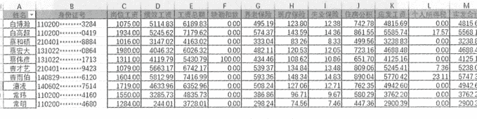

对于这个任务，在不熟悉Excel函数公式应用的情况下，使用DeepSeek辅助操作有两种解决方案：一是直接询问DeepSeek如何在Excel中操作；二是让DeepSeek生成VBA代码，实现一键式自动化处理。

#### 1. 询问DeepSeek如何在Excel中操作

##### 步骤一：将“工资条.xlsx"上传至DeepSeek，并发出指令：请分析以上文件，根据“工资计算表”中的数据帮我设计一个函数，要求在“工资条1"工作表中生成工资条，实现下拉A2单元格显示每个工资条，生成的每个工资条都需要显示表头，各工资条间隔2行，依次铺开。

##### 步骤一结果：DeepSeek根据指令生成了函数，如图4-24所示。

##### 步骤二：复制DeepSeek生成的函数填入“工资条1"工作表中的A1单元格，如图4-25所示。选中A1单元格，将鼠标放在A1单元格右下角形成填充柄，下拉至A3单元格，然后同时选中A2单元格和A3单元格，向右拉，直至M列“实发合计”，如图4-26所示。选中第2行和第3行工资条内容按照同样方式向下填充，直至完成全部工资条，如图4-27所示。

  
  
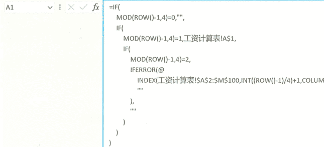  
  
  
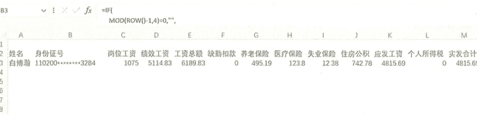  


**图4-24 步骤一结果**  
**图4-25 步骤二**  
**图4-26 向右填充**  
**图4-27 自动填充完成全部工资条**

**步骤二结果**：成功生成全部工资条，便于员工领取。

##### 2. 让DeepSeek生成VBA代码

**步骤一**：将“工资条.xlsx"上传至DeepSeek，并发出指令：请分析以上文件内容，给我一段VBA代码，将“工资计算表”工作表中里的A-M列的数据生成工资条，每个人的工资条保存到“工资条1"工作表中，每个工资条相隔2行。

**步骤一结果**：DeepSeek理解了指令，并生成了段VBA代码（如图4-28所示）。

**步骤二**：复制DeepSeek生成的VBA代码并粘贴到VBA编辑器中。点击运行VBA代码。

**工资条生成**  
**VBA代码**


```vba
Sub GeneratePaySlips() 
    Dim wsSource As Worksheet
    Dim wsTarget As Worksheet
    Dim lastRow As Long
    Dim i As Long, j As Long
    Dim targetRow As Long

    ' 设置工作表对象
    Set wsSource = ThisWorkbook.Worksheets("工资计算表")
    Set wsTarget = ThisWorkbook.Worksheets("工资条1")

    ' 清除目标工作表中的现有内容
    wsTarget.Cells.Clear

    ' 获取源数据的最后一行
    lastRow = wsSource.Cells(wsSource.Rows.Count, "A").End(xlUp).Row

    ' 复制标题行到目标工作表
    wsSource.Rows(1).Copy Destination:=wsTarget.Rows(1)

    ' 初始化目标行
    targetRow = ?
```

**步骤二结果**：VBA代码运行生成结果，经人工检验无误，如图4-29所示。

  


##### 4.1.4 场景四：费用明细对比分析

### 任务场景描述

现有两张Excel工作表，分别为2024年11月和12月的部门费用明细表（如图4-30、图4-31所示）。这两张表结构完全相同，均包含费用科目、部门、金额等内容。现需将这两张表中的数据合并，生成一张包含2024年11月和12月的部门费用分析明细表（如图4-32所示），并按照“当月”和“上月”的形式呈现，以便进行对比分析。

**表1：2024年11月部门费用明细表**

|   | A        | B     | C     | D       | E     | F      | G     |
|---|----------|-------|-------|---------|-------|--------|-------|
| 1 |          | 2024年11月部门费用明细表 |       |         |       |        |       |
| 2 | 费用科目 | 行政部 | 采购部 | 人力资源 | 销售部 | 策划部 | 合计  |
| 3 | 工资     | 2,000.00 | 3,000.00 | 3,200.00 | -     | 1,400.00 | 9,600.00 |
| 4 | 奖金     | 19,050.00 | 4,000.00 | 73,000.00 | -     | 4,991.00 | 100,991.00 |
| 5 | 激励奖   | 1,000.00 | 2,000.00 | 3,000.00 | -     | -     | 6,000.00 |
| 6 | 办公费   |       | -     | 2,977.00 | -     | 363.00 | 3,340.00 |
| 7 | 电话费   |       | -     | 100.00  | -     | -     | 100.00 |
| 8 | 水电费   |       | -     | 695.62  | -     | -     | 695.62 |

**表2：2024年12月部门费用明细表**

|   | A        | B     | C     | D       | E     | F      | G     |
|---|----------|-------|-------|---------|-------|--------|-------|
| 1 |          | 2024年12月部门费用明细表 |       |         |       |        |       |
| 2 | 费用科目 | 行政部 | 采购部 | 人力资源 | 销售部 | 策划部 | 合计  |
| 3 | 工资     | 2,500.00 | 2,800.00 | 3,600.00 | -     | 1,400.00 | 10,300.00 |
| 4 | 奖金     | 19,550.00 | 4,420.00 | 73,486.00 | -     | 4,991.00 | 102,447.00 |
| 5 | 激励奖   | 2,345.00 | 1,234.00 | 1,258.00 | -     | -     | 4,837.00 |
| 6 | 办公费   |       | -     | 2,977.00 | -     | 363.00 | 3,340.00 |
| 7 | 电话费   |       | -     | 100.00  | -     | -     | 100.00 |
| 8 | 水电费   |       | -     | 695.62  | -     | -     | 695.62 |

**图4-32 部门费用分析明细表（目标结构）**

|   | A        | B     | C     | D       | E     | F      | G     | H          | I                      | J                  |
|---|----------|-------|-------|---------|-------|--------|-------|------------|------------------------|--------------------|
| 1 |          | 部门费用分析明细 |       |         |       |        |       |            |                        |                    |
| 2 | 费用科目 | 月份  | 行政部 | 采购部 | 人力资源 | 销售部 | 策划部 | 备注1（各月小计） | 备注2（本月较上月增长率） | 备注3              |
| 3 | 工资     | 当月  |       |       |         |       |        | 0.00       |                        |                    |
| 4 |          | 上月  |       |       |         |       |        | 0.00       |                        |                    |
| 5 | 奖金     | 当月  |       |       |         |       |        | 0.00       |                        |                    |
| 6 |          | 上月  |       |       |         |       |        | 0.00       |                        |                    |
| 7 | 激励奖   | 当月  |       |       |         |       |        | 0.00       |                        |                    |
| 8 |          | 上月  |       |       |         |       |        | 0.00       |                        |                    |
| 9 | 办公费   | 当月  |       |       |         |       |        | 0.00       |                        |                    |
| 10 |          | 上月  |       |       |         |       |        | 0.00       |                        |                    |
| 11 | 电话费   | 当月  |       |       |         |       |        | 0.00       |                        |                    |
| 12 |          | 上月  |       |       |         |       |        | 0.00       |                        |                    |
| 13 | 水电费   | 当月  |       |       |         |       |        | 0.00       |                        |                    |
| 14 |          | 上月  |       |       |         |       |        | 0.00       |                        |                    |

对于这个任务，在不熟悉Excel函数公式应用的情况下，使用DeepSeek辅助操作有两种解决方案：一是直接询问DeepSeek如何在Excel中操作；二是让DeepSeek生成VBA代码，实现一键式自动化处理。

#### 1. 询问DeepSeek如何在Excel中操作

> **步骤一**：将任务中涉及的三张表格分别命名为"11月.xlsx"、"12月.xlsx"、"对比数据.xlsx"上传至DeepSeek，并发出指令：**请阅读上述三个表格**。如果想在“对比数据”表格中使用函数，达到效果：“对比数据”表中B列的“当月”对应“12月”数据表中的数据，“对比数据”表中B列的“上月”对应“11月”数据表中的数据，将“12月”数据表和"11月”数据表中B3到F9区域的数据，分别填入“对比数据”表的C3到H14列。请问应该怎么操作？

> **步骤一结果**：DeepSeek生成了具体的INDEX函数（如图4-33所示）。

在“对比数据”表的C3单元格输入：

```excel
=IF(
    $B3="当月",
    INDEX([12月.xlsx]当月!$B$3:$F$8, (ROW()-1)/2, COLUMN()-2),
    INDEX([11月.xlsx]上月!$B$3:$F$8, ROW()/2-1, COLUMN()-2)
)
```

**图4-33 DeepSeek生成的INDEX函数**

> **步骤二**：将DeepSeek生成的函数填入“对比数据.xlsx"中的C3单元格。点击C3单元格，将鼠标放在单元格右下角形成填充柄，利用Excel的填充柄功能分别向右、向下填充（如图4-34所示）。

> **步骤二结果**：部门费用分析明细表填充完成，完整地显示了上月和当月数据及差异分析。经过人工检验，结果正确。## 北京大区部门费用分析明细

| A | B | C | D | E | F | G | H | I | J |
| :--- | :--- | :--- | :--- | :--- | :--- | :--- | :--- | :--- | :--- |
| 1 | **北京大区部门费用分析明细** | | | | | | | | |
| 2 | 费用科目 | 月份 | 行政部 | 采购部 | 人力资源 | 销售部 | 策划部 | 备注 1<br>(各月小计) | 备注 2<br>(本月较上月<br>增长率) | 备注 3 |
| 3 | 工资 | 当月 | 2500.00 | 2800.00 | 3600.00 | 0.00 | 1400.00 | 10300.00 | 700.00 | |
| 4 | 上月 | 2000.00 | 3000.00 | 3200.00 | 0.00 | 1400.00 | 9600.00 | | |
| 5 | 奖金 | 当月 | 19550.00 | 4420.00 | 73486.00 | 0.00 | 4991.00 | 102447.00 | 1456.00 |
| 6 | 上月 | 19000.00 | 4000.00 | 73000.00 | 0.00 | 4991.00 | 100991.00 | | |
| 7 | 激励奖 | 当月 | 2345.00 | 1234.00 | 1258.00 | 0.00 | 0.00 | 4837.00 | -1163.00 |
| 8 | 上月 | 1000.00 | 2000.00 | 3000.00 | 0.00 | 0.00 | 6000.00 | | |
| 9 | 办公费 | 当月 | 0.00 | 0.00 | 2977.00 | 0.00 | 363.00 | 3340.00 | 0.00 |
| 10 | 上月 | 0.00 | 0.00 | 2977.00 | 0.00 | 363.00 | 3340.00 | | |
| 11 | 电话费 | 当月 | 0.00 | 0.00 | 100.00 | 0.00 | 0.00 | 100.00 | 0.00 |
| 12 | 上月 | 0.00 | 0.00 | 100.00 | 0.00 | 0.00 | 100.00 | | |
| 13 | 水电费 | 当月 | 0.00 | 0.00 | 695.62 | 0.00 | 0.00 | 695.62 | 0.00 |
| 14 | 上月 | 0.00 | 0.00 | 695.62 | 0.00 | 0.00 | 695.62 | | |

图 4-34 利用 Excel 的填充柄功能自动填充 INDEX 函数

### 2. 让 DeepSeek 生成 VBA 代码

#### 步骤一：将"11 月.xlsx"、"12 月.xlsx"和“对比数据.xlsx"上传至 DeepSeek，并发出指令：请阅读上述三个表格，写一段有效的 VBA 代码，该代码在“对比数据”表格中使用。“对比数据”表中 B 列的“当月”对应"12 月数据”表中的数据，“对比数据”表中 B 列的“上月”对应"11 月数据”表中的数据，将"12 月数据”表和"11 月数据”表中 B3 到 F9 区域的数据，分别填入“对比数据”表的 C3 到 H14 列。

#### 步骤一结果：DeepSeek 理解了指令，并生成了 VBA 代码（如图 4-35 所示）。

以下是完全按照您需求编写的 VBA 代码，可以精确地将 11 月和 12 月的数据填充到对比数据表中：

```vba
Sub FillComparisonData()
Dim wb As Workbook
Dim wsCompare As Worksheet
Dim wsCurrent As Worksheet
Dim wsLast As Worksheet
Dim i As Integer, targetRow As Integer
Dim arrCategories As Variant
'定义费用科目顺序（与对比表一致）
arrCategories = Array("工资", "奖金", "激励奖", "办公费", "电话费", "水电费")
```

图 4-35 步骤一生成的部分 VBA 代码（费用明细对比分析）

#### 步骤二：复制 DeepSeek 生成的 VBA 代码并粘贴到 VBA 编辑器中。点击运行 VBA 代码。

#### 步骤二结果：VBA 代码运行生成结果，经人工检验无误，如图 4-36 所示。

|   | A | B | C | D | E | F | G | H | I | J |
|---|---|---|---|---|---|---|---|---|---|---|
|| **北京大区部门费用分析明细** |||||||||
|2|费用科目 | 月份 | 行政部 | 采购部 | 人力资源 | 销售部 | 策划部 | 备注 1(各月小计) | 备注 2<br>(本月较上月增长额) | 备注 3 |
|3 |工资 | 当月 | 2500.00 | 2800.00 | 3600.00 | 0.00 | 1400.00 | 10300.00 | 700.00 |  |
|4 | 上月 | 2000.00 | 3000.00 | 3200.00 | 0.00 | 1400.00 | 9600.00 | | |
|5 |奖金 | 当月 | 19550.00 | 4420.00 | 73486.00 | 0.00 | 4991.00 | 102447.00 | 1456.00 |  |
|6 | 上月 | 19000.00 | 4000.00 | 73000.00 | 0.00 | 4991.00 | 100991.00 | | |
|7 |激励奖 | 当月 | 2345.00 | 1234.00 | 1258.00 | 0.00 | 0.00 | 4837.00 | -1163.00 |  |
|8 |上月 | 1000.00 | 2000.00 | 3000.00 | 0.00 | 0.00 | 6000.00 | | |
|9 |办公费 |当月| 0.00 | 0.00 | 2977.00 | 0.00 | 363.00 | 3340.00 | 0.00 |  |
|10|上月 | 0.00 | 0.00 | 2977.00 | 0.00 | 363.00 | 3340.00 | | |
|11 |电话费 |当月| 0.00 | 0.00 | 100.00 | 0.00 | 0.00 | 100.00 | 0.00 |  |
|12|上月| 0.00 | 0.00 | 100.00 | 0.00 | 0.00 | 100.00 | | |
|13|水电费 |当月| 0.00 | 0.00 | 695.62 | 0.00 | 0.00 | 695.62 | 0.00 |  |
|14|上月| 0.00 | 0.00 | 695.62 | 0.00 | 0.00 | 695.62 | | |

图 4-36 VBA 代码运行结果（费用明细对比分析）

###### 作者点评

DeepSeek 在本节的多个应用 Excel 处理财务工作的典型场景中展示出显著的高效和实用性优势。
首先，在应收账款账龄分析、财务数据多条件分析、工资条生成和费用明细对比分析等常见任务中，DeepSeek 通过自然语言处理即可快速生成函数公式或 VBA 代码，缩短了传统操作中反复查找、测试和调试的时间，有效提升了财务人员的数据处理效率。
其次，本节的四个任务场景体现了良好的人机协同，财务人员只需用自然语言清晰表达业务需求，AI 即能理解语义并生成精准方案，既保留了人对业务逻辑的掌控，又充分发挥了 AI 的智能化与执行力。
最后，四个场景均来自真实工作，细化 DeepSeek 应用的操作步骤，图文并茂，能够帮助财务人员理解和实践，体现出从“业务目标识别”到“技术路径生成”的完整闭环，对于帮助财务人员应用 Excel 函数具有重要价值。

#### 4.2 应用 DeepSeek 在复杂财务工作场景中辅助生成 VBA 代码

本书聚焦五个典型财务工作场景——报表货币单位转换、资金管理表合并、集团报表合并、销售报表透视和逆透视以及库存表拆分，展示如何通过 DeepSeek 获取 VBA 代码。由于这五个场景较为复杂，本书仅在报表货币单位转换场景下保留了询问 DeepSeek 如何在 Excel 中操作的方法，其他四个场景只采取让 DeepSeek 生成 VBA 代码的方法。

##### 4.2.1 场景五：报表货币单位转换

#### ### 任务场景描述

ABC 公司现有一份以“元”为货币单位的财务报表（如图 4-37 所示），根据管理层披露和阅读需要，需调整为以“万元”为货币单位的财务报表（如图 4-38 所示）。

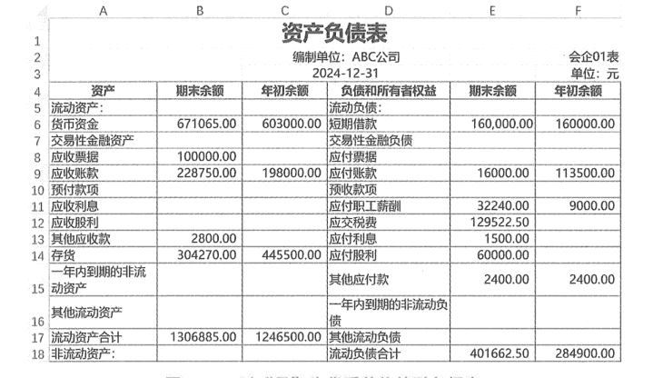

图 4-38 以“万元”为货币单位的财务报表 对于这个任务，如果单位现有的财务软件没有货币单位转换功能，财务人员就只能在 Excel 中靠手动操作实现。例如，将“元”为单位的数据除以 10000，再四舍五入保留两位小数；或者使用 Excel 的“条件格式”功能配合自定义单元格格式的功能，实现“元”和“万元”一键转换的效果，但这要求财务人员精通 Excel 操作。

应用 DeepSeek 辅助操作，简单、快捷，有两种解决方案：一是直接询问 DeepSeek 如何在 Excel 中操作；二是让 DeepSeek 生成 VBA 代码，实现一键式自动化处理。

#### 1. 询问 DeepSeek 如何在 Excel 中操作

##### 步骤一：将任务中涉及的"元.xlsx"和“万元.xlsx"两张表格上传至 DeepSeek，并发出指令：请阅读上述两个表格，告诉我如何在 Excel 中操作，能将"元"表格中的所有数据金额的单位从“元”四舍五入为“万元”，然后填列到“万元”表格中。

##### 步骤一结果：DeepSeek 生成了货币单位转换的具体操作方法（如图 4-39 所示）。

以下是分步骤的 Excel 操作指南，将“元”单位数据转换为“万元”单位并填入新表：

###### 方法一：选择性粘贴表（推荐）

+ - 在"元.xlsx"操作

- 在空白单元格（如 G1）输入 10000 → 按 Ctrl+C 复制
- 选中所有数值区域：
  - 资产部分：B5:C32
  - 负债部分：E5:F32
  （按住 Ctrl 可多选不连续区域）

+ - 执行单位转换
- 右键 → 选择性粘贴 → 选择“除”→ 确定
- 按 Ctrl+l 设置格式为数值，保留 2 位小数

+ - 复制到万元表
- 复制处理后的数据 → 粘贴到“万元.xlsx"对应位置


+ - 步骤二：按照 DeepSeek 给出的操作步骤逐步操作。首先在 “元.xlsx"中的任何空白单元格输入“10000”，按"Ctrl+C"复制，然后选中所有数值区域（对于不连续区域可以按住 Ctrl 进行选择）。接着单击右键使用选择性粘贴，在“运算”中选择“除”，点击确定（如图 4-40 所示）。按"Ctrl+l"设置格式为“数值”，小数位数为"2”（如图 4-41 所示）。最后，复制处理后的数据，粘贴到“万元.xlsx"的对应位置。

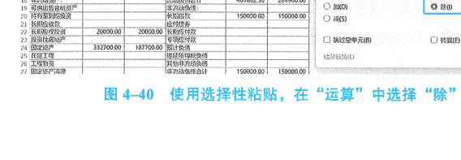

###### 方法二：让 DeepSeek 生成 VBA 代码

#### ### 步骤一：将“元.xlsx”和“万元.xlsx"分别上传至 DeepSeek，并发出指令：请阅读上述两个表格，帮我写一个 VBA 代码，该代码在“万元”表格中使用，能将“元”表格中的所有金额数据的单位从元四舍五入为万元，填列到“万元”的表格中。

#### 📥 步骤一结果：DeepSeek 理解了指令，并生成了 VBA 代码（如图 4-43 所示）。

以下是一个 VBA 代码，可以将“元”表格中的所有金额数据四舍五入为万元，并填列到“万元”表格中：

```vba
Sub ConvertYuanTenTenThousand()
Dim wsYuan As Worksheet, wsWan As Worksheet
Dim lastRow As Long, lastCol As Long
Dim i As Long, j As Long
Dim cell Value As Variant
' 设置工作表对象
Set wsYuan = Workbooks("元.xlsx").Worksheets("资产负债表练习")
Set wsWan = Workbooks("万元.xlsx").Worksheets("资产负债表结果")
' 确定数据范围
lastRow = wsYuan.Cells.Find("*", SearchOrder:=xlByRows, SearchDirection:=xlPrevious).Row
lastCol = wsYuan.Cells.Find("*", SearchOrder:=xlByColumns, SearchDirection:=xlPrevious).Column
```

图 4-43 VBA 代码（报表货币单位转换）

#### ### 步骤二：复制 DeepSeek 生成的 VBA 代码并粘贴到 VBA 编辑器中，点击运行 VBA 代码。

#### 📥 步骤二结果：VBA 代码运行生成结果，经人工检验无误，如图 4-44 所示。

图 4-44 VBA 代码运行结果（报表货币单位转换）

##### 4.2.2 场景六：资金管理表合并

#### **任务场景描述**

现有一份包含“资金管理汇总”、“支付宝”、“微信”、“现金”、“借记卡”和“信用卡”多个工作表的 Excel 文档“资金管理.xlsx",如图 4-45 所示，该文档中各个工作表的表头内容一致，需要将“支付宝”、 “微信”、“现金”、“借记卡”和“信用卡”这几个工作表合并为一个 “资金管理汇总”工作表。

图 4-45 资金管理.xlsx

### 1. 让 DeepSeek 生成 VBA 代码

#### >步骤一：将“资金管理.xlsx"上传至 DeepSeek，并发出指令：请分析以上文件，帮我写一个 VBA 代码，该代码在“资金管理汇总”工作表
中使用，把“支付宝”“微信”“现金”“借记卡”“信用卡”五个工作表
上下合并到“资金管理汇总”工作表中。

#### 👩‍💻 步骤一结果：DeepSeek 理解了指令，并生成了
VBA 代码（如图 4-46 所示）。

#### 👉 步骤二：复制 DeepSeek 生成的 VBA 代码并粘贴到
VBA 编辑器中。点击运行 VBA 代码。

#### 👀 以下是一个 VBA 代码，用于将“支付宝”、“微信”、“现金”、“借记卡”、“信用卡”五个工作表中的数据合并
到“资金管理汇总”工作表中:

```vba
Sub 合并资金数据 ()
Dim ws 汇总 As Worksheet
Dim ws源 As Worksheet
Dim arr 工作表名 As Variant
Dim i As Integer
Dim lng 起始行 As Long
Dim lng 目标数后行 As Long
'设置工作表名称数组
arr 工作表名 = Array("支付宝", "微信", "现金", "借记卡", "信用卡")
'设置汇总工作表
On Error Resume Next
Set ws 汇总 = ThisWorkbook.Worksheets("资金管理汇总")
On Error GoTo 0
'如果汇总工作表不存在，则创建它
If ws 汇总 Is Nothing Then
Set ws 汇总 = ThisWorkbook.Worksheets.Add(Before:=ThisWorkbook.Worksheets(1))
ws 汇总.Name = "资金管理汇总"
End If
```

图 4-46 步骤一生成的部分 VBA 代码（资金管理表合并）

### 第 4 章 应用 DeepSeek 辅助财务工作中的 Excel 操作

### 步骤二结果：VBA 代码运行生成结果，经人工检验无误，如图 4–47 所示。


**图 4–47** VBA 代码运行结果（资金管理表合并）

### 2. 将 VBA 代码设计成按钮添加到工具栏

#### 步骤一：将以上存有 VBA 代码的 Excel 文件另存为加载宏格式，路径默认，如图 4–48 所示。


**图 4–48** 将 VBA 代码文件另存为加载宏格式

#### 步骤二：在“资金管理.xlsx"中点击“开发工具”下的"Excel 加载项”，在“加载宏”中选择“资金管理汇总封装”，点击“确定”，如图 4-49 所示。

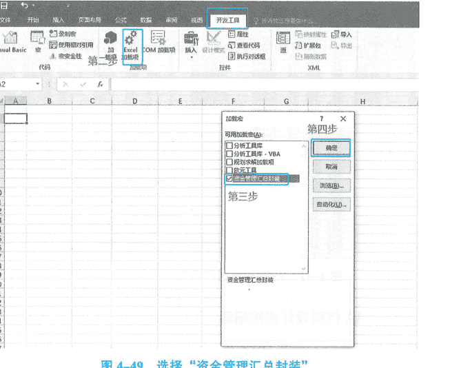

#### 步骤三：点击“开始”按钮，点击“选项”进入"Excel 选项”页面，点击“自定义功能区”，如图 4-50 所示。

#### 步骤四：在“自定义功能区（B）”中选定“主选项卡”然后选中“开发工具”，点击“新建组（自定义）”，如图 4-51 所示。

#### 步骤五：右键“新建组”重命名为“资金汇总”，如图 4-52、图 4-53 所示。

图 4-50 在"Excel 选项”页面点击“自定义功能区”

图 4-51 在“开发工具”中选择 “新建组（自定义）”

#### 步骤六：在“从下列位置选择命令”中选择“宏”命令，此时已有刚才建立的“资金管理汇总”宏命令，如图 4-54 所示。

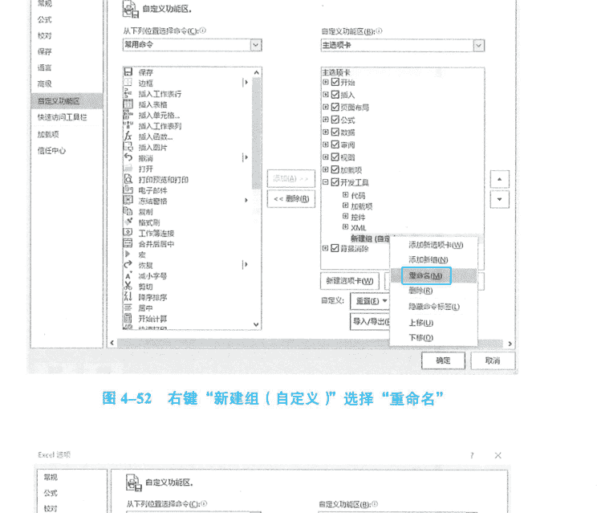

图 4-52 右键“新建组（自定义）”选择“重命名”


图 4-53 重命名为“资金汇总”

### 第 4 章 应用 DeepSeek 辅助财务工作中的 Excel 操作/105

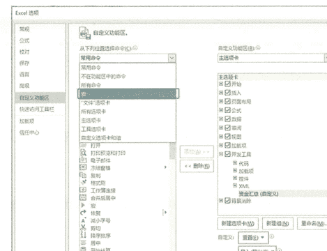

图 4-54 选择“宏”命令

#### 步骤七：选择“资金管理汇总”，点击“添加”按钮，“资金管理汇总"宏命令自动添加到右侧“开发工具”下的“资金汇总（自定义）”下，点击“确定”，在“开发工具”选项卡下就出现了“资金管理汇总”宏命令，如图 4-55、图 4-56 所示。

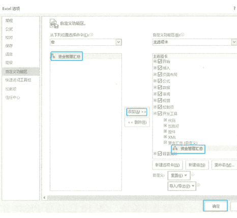

图 4-55 添加宏命令

图 4-56 添加宏命令成功

#### 步骤八：点击“开发工具”选项卡下的“资金管理汇总”宏命令，即可呈现最终结果，如图 4-57 所示。

#### 4.2.3 场景七：集团报表合并

4-58 所示），各表的结构格式均一致。现需要将这 10 张工作表在保留原格式的情况下合并成一张表，便于后续的统计和分析。


#### 步骤一：将“销售 PK.xlsx"上传至 DeepSeek，并发出指令：分析以上文件，帮我生成一个 VBA 代码，要求将“南京马自达”“上海广本”“成都奥迪”“北京奇瑞”“苏州大众”“上海丰田” “西安雪佛兰” “南京福特” “长春广本” “北京保时捷”10 个工作表，以 “南京马自达”为基础前三列数据不动，分别将其其他表格数据填写到 D 列之后，生成一张有对比的“销售 PK 表”。

#### 步骤一结果：DeepSeek 理解了指令，并生成了 VBA 代码（如图 4-59 所示）。

### > VBA 代码：生成销售 PK 对比表

以下 VBA 代码可以将所有工作表中的数据以“南京马自达”为基础，将其他表格的数据依次添加到 D 列之后，生成一个综合对比的销售 PK 表:

```vba
Sub GenerateSalesPKReport()
    Dim wsBase As Worksheet, ws As Worksheet
    Dim lastCol As Long, i As Long, j As Long
    Dim sheetNames As Variant
    Dim targetSheet As Worksheet

    ' 定义要处理的工作表名称数组
    sheetNames = Array(“南京马自达”, “上海广本”, “成都奥迪”, “北京奇瑞”, “苏州大众”, “上海丰田”, “西安雪佛兰”, “南京福特”, “长春广本”, “北京保时捷”)

    ' 检查“销售 PK 表”是否已存在，如果存在则删除
    Application.DisplayAlerts = False
    On Error Resume Next
    ThisWorkbook.Sheets(“销售 PK 表”).Delete
    On Error GoTo 0
    Application.DisplayAlerts = True
```

**图 4-59** 步骤一生成的部分 VBA 代码（集团报表合并）

### > **步骤二**：复制 DeepSeek 生成的 VBA 代码并粘贴到 VBA 编辑器中。点击运行 VBA 代码。

### > **步骤二结果**：VBA 代码运行生成结果，经人工检验无误，如图 4-60 所示。

| | A | B | C | D | E | F | G | H | I | J | K | L |
|---|---|---|---|---|---|---|---|---|---|---|---|---|
|1|集团 PK 战报|2024/12/3 |金额单位：万元 |||||||||
|2|指标 ||上海广本 |成都奥迪 |北京奇瑞 |苏州大众 |上海丰田 |西安雪佛兰 |南京福特 |长春广本 |北京保时捷 |
|3|4S 店销售 |新车 |台次 |24.00 |10|8|9|23|7|8|7|2|
|4||收入 ||491.01|372.54|78.46|123.34|532|77.95|143.02|143.8|949|
|5||其中：信贷台次||-|0|0|0|0|0|0|0|0|
|6||其中：融资租赁台次|- |-|0|0|0|0|0|0|0|0|
|7||二手车 |收购台次|-|0|0|0|0|0|0|0|0|
|8||||销售台次|-|0|0|0|0|0|0|0|
|9||收入 |-|0|0|0|0|0|0|0|0|0|
|10|4S 店销售水平事业 |装潢 |台次 |12.00|4|0|13|0|0|0|2|
|11||收入 ||3.30|2.8|0|0|4.6|0|0|0|19.6|
|12||精品 |台次 |7.00|0|0|0|11|0|0|0|0|
|13 ||收入 ||1.82|0|0|0|4.2|0|0|0|0|
|14|3 金融服务费 |台次 |20.00|9|7|7|21|5|5|7|2|
|15 ||收入 ||7.20|4.4|1.4|1.4|6.2|1|1|1.7|14|
|16||上牌服务费 |台次 |18.00|5|3|6|15|5|6|1|1|
|17||收入 ||4.10|2|0.45|0.95|2.9|1|1.3|0.55|1|
|18|4S 店售后 |维修 |台次 |28.00|11|12|10|19|11|18|12|1|
|19||收入 ||7.10|6.1|2.32|1.23|7.1|1.67|4.11|2.49|2.1|
|20 ||事故车 |台次 (保险平台) |9.00|2|4|6|4|5|4|7|1|
|21||收入 (保险平台) ||26.41|21.2|3|3.3|4.7|2.8|2.1|5.2|82.1|
|22||台次 (自找客户) ||-|0|0|0|0|0|0|0|0|
|23 ||收入 (自找客户) ||-|0|0|0|0|0|0|0|0|

**图 4-60** VBA 代码运行结果（集团报表合并）

以上情况是多个格式相同的工作表都在一个 Excel 工作簿中，如果是多个格式相同的 Excel 工作簿存储在一个文件夹里的情况，可以继续使用 VBA 代码实现多表格合并。除此之外，DeepSeek 还可以辅助生成其他代码用于多文件合并，下面介绍使用 Python 代码进行合并操作的步骤。

### ~ 小贴士

#### Python

Python 是一种功能强大、语法简洁的高级编程语言，代码结构清晰、开发效率高，在各行各业得到广泛应用。它不仅在数据分析、人工智能、机器学习等高端技术领域发挥着重要作用，也被广泛应用于网站开发、自动化运维、金融建模、图像处理、网络爬虫等实际业务场景中。许多国际知名企业和科研机构都将 Python 作为核心开发语言之一。

在财务领域，Python 的应用越来越广泛，它不像 VBA 那样依赖 Excel，也不像大型系统那样难以控制，它是一种介于日常工具与专业开发工具之间的灵活工具。它不仅可以处理结构化数据，还可以自动化执行烦琐流程，提升分析效率，逐步成为财务人员新一代的重要工具。

### 2. 让 DeepSeek 生成 Python 代码

与让 DeepSeek 生成 VBA 代码的操作类似，先通过 DeepSeek 生成 Python 代码，然后将使用 Python 代码生成的文件导入“销售 PK.xlsx”，完成任务。此处不再赘述，详细操作可扫码获取。

Python 代码及操作

#### 4.2.4 场景八：销售报表透视和逆透视

### 任务场景描述

现有一份“销售报表.xlsx"，包含“销售员”“商品名称”“销量”（如图 4-61 所示)。根据数据展示需求，需要将其制作成透视表的形式（即“销售员”列不动，将“商品名称”列变为行，“销量”填写到对应单元格中）,便于后续开展统计分析工作。

| | | | |
|---|---|---|---|
|1 | 销售员 | 商品名称 | 销量 |
|2 | 杨澧 | 珀芙晶钻保湿水 | 51 |
|3 | 杨澧 | 珀芙晶钻滋润乳 | 56 |
|4 | 杨澧 | 珀芙晶钻复活霜 | 49 |
|5 | 杨澧 | 珀芙晶钻修复保湿套装 | 29 |
|6 | 杨澧 | 雅梦石榴焕采保湿水 | 39 |
|7 | 杨澧 | 雅梦石榴焕采滋润乳 | 40 |
|8 | 杨澧 | 雅梦石榴焕采修复霜 | 36 |
|9 | 杨澧 | 雅梦石榴焕采修复保湿套装 | 19 |
|10 | 夏雅辰 | 珀芙晶钻保湿水 | 47 |
|11 | 夏雅辰 | 珀芙晶钻滋润乳 | 45 |
|12 | 夏雅辰 | 珀芙晶钻复活霜 | 40 |
|13 | 夏雅辰 | 珀芙晶钻修复保湿套装 | 20 |
|14 | 夏雅辰 | 雅梦石榴焕采保湿水 | 35 |
|15 | 夏雅辰 | 雅梦石榴焕采滋润乳 | 33 |
|16 | 夏雅辰 | 雅梦石榴焕采修复霜 | 33 |
|17 | 夏雅辰 | 雅梦石榴焕采修复保湿套装 | 19 |
|18 | 石怡 | 珀芙晶钻保湿水 | 26 |
|19 | 石怡 | 珀芙晶钻滋润乳 | 23 |
|20 | 石怡 | 珀芙晶钻复活霜 | 21 |
|21 | 石怡 | 珀芙晶钻修复保湿套装 | 4 |
|22 | 石怡 | 雅梦石榴焕采保湿水 | 16 |
|23 | 石怡 | 雅梦石榴焕采滋润乳 | 13 |
|24 | 石怡 | 雅梦石榴焕采修复霜 | 13 |
|25 | 石怡 | 雅梦石榴焕采修复保湿套装 | 1 |
|26 | 唐冰冰 | 珀芙晶钻保湿水 | 36 |
|27 | 唐冰冰 | 珀芙晶钻滋润乳 | 36 |
|28 | 唐冰冰 | 珀芙晶钻复活霜 | 39 |
|29 | 唐冰冰 | 珀芙晶钻修复保湿套装 | 26 |
|30 | 唐冰冰 | 雅梦石榴焕采保湿水 | 31 |
|31 | 唐冰冰 | 雅梦石榴焕采滋润乳 | 33 |
|32 | 唐冰冰 | 雅梦石榴焕采修复霜 | 36 |
|33 | 唐冰冰 | 雅梦石榴焕采修复保湿套装 | 16 |
|34 | 史素 | 珀芙晶钻保湿水 | 18 |
|35 | 史素 | 珀芙晶钻滋润乳 | 20 |
|36 | 史素 | 珀芙晶钻复活霜 | 19 |
|37 | 史素 | 珀芙晶钻修复保湿套装 | 5 |
|38 | 史素 | 雅梦石榴焕采保湿水 | 44 |
|39 | 史素 | 雅梦石榴焕采滋润乳 | 46 |
|40 | 史素 | 雅梦石榴焕采修复霜 | 48 |
|41 | 史素 | 雅梦石榴焕采修复保湿套装 | 29 |


图 4-61 销售报表

### 第 4 章 应用 DeepSeek 辅助财务工作中的 Excel 操作 / 111

#### 步骤一：将“销售报表.xlsx"上传至 DeepSeek，并发出指令：请分析以上文件，帮我生成一段 VBA 代码，要求“销售员”列信息位置不动，“商品名称”列数据信息变成行数据信息，“销量”列数据信息填入对应位置，形成二维透视表。

#### 步骤一结果：DeepSeek 理解了指令，并生成了 VBA 代码（如图 4-62 所示）。

> 以下是生成二维透视表的 VBA 代码，它将“销售员”列保持不变，将“商品名称”转换为行标题，“销量”列数据填入对应位置：

```vba
Sub CreatePivotTable()
    Dim ws As Worksheet
    Dim rng As Range
    Dim lastRow As Long, lastCol As Long
    Dim i As Long, j As Long
    Dim dict As Object
    Dim key As Variant
    Dim item As Variant
    Dim outputRow As Long, outputCol As Long
    Dim newWs As Worksheet

    '创建新工作表存放结果
    Set newWs = Worksheets.Add
    newWs.Name = “销售透视表”

    '获取原始数据
    Set ws = Worksheets (“销售报表”) 
    lastRow = ws.Cells(ws.Rows.Count, “A”).End(xlUp).Row
    Set rng=ws.Range(“A1:C” & lastRow)

    '创建字典存储唯一商品名称
```

**图 4-62** **步骤一生成的 VBA 代码（销售报表透视）**

#### 步骤二：复制 DeepSeek 生成的 VBA 代码并粘贴到 VBA 编辑器中。点击运行 VBA 代码。

#### 步骤二结果：VBA 代码运行生成结果，经人工检验无误，如图 4-63 所示。


# DeepSeek 高效财务
**图 4-63** VBA 代码运行结果（销售报表透视）

#### 任务场景描述
现有一份一分公司的库存表（如图 4-64 所示），表中包含“公司名称”“产品编号”“产品名称”“类别”“单价”“数量”“金额”“最近入库日期”“库龄”等字段。现在需要将该库存表按照“类别”拆分成一个个工作表的形式，以便分类使用相关数据。

#### 图 4-63 VBA 代码运行结果（销售报表透视）

#### 4.2.5 场景九：库存表拆分

### 任务场景描述

现有一份一分公司的库存表（如图 4-64 所示），表中包含“公司名称”“产品编号”“产品名称”“类别”“单价”“数量”“金额”“最近入库日期”“库龄”等字段。现在需要将该库存表按照“类别”拆分成一个个工作表的形式，以便分类使用相关数据。

| | A | B | C | D | E | F | G | H | I |
|---|---|---|---|---|---|---|---|---|---|
|1|公司名称 | 产品编号 | 产品名称 | 类别 | 单价 | 数量 | 金额 | 最近入库日期 | 库龄 |
|2|一公司 | 20201170001 | 华为 S55 电视 | 平板电视 | 3286|50|164.300|2021/3/8|三个月内|
|3|一公司 | 20201170002 | 海尔冰箱-BCD-343WDPM | 立式冰箱 | 2899|45|130.455|2020/12/5|三个月以上|
|4|一公司 | 20201170003 | 海尔统帅变频洗衣机@HB1276W | 洗衣机 | 2458|30|73.740|2020/7/23|三个月以上|
|5|一公司 | 20201170004 | 海尔空调 KFR-72LW | 立式空调 | 3589|40|143.560|2020/9/1|三个月以上|
|6|一公司 | 20201170005 | 松下微波炉 NN-GM33HB | 厨房电器 | 567|55|31.185|2020/3/23|三个月以上|
|7|一公司 | 20201170006 | 海尔消毒柜 12LC52 | 厨房电器 | 1250|30|37.500|2021/1/9|三个月内|
|8|一公司 | 20201170007 | 海尔冰箱-BCD-343WDPM | 立式冰箱 | 2899|35|101.465|2021/3/17|三个月内|
|9|一公司 | 20201170008 | 华为 S55 电视 | 平板电视 | 3286|46|151.156|2020/5/3|三个月以上|
|10|一公司 | 20201170009 | 海尔冰箱-BCD-343WDPM | 立式冰箱 | 2899|25|72.475|2020/7/7|三个月以上|
|11|一公司 | 20201170010 | 海尔统帅变频洗衣机@HB1276W | 洗衣机 | 2458|28|68.824|2021/2/6|三个月内|
|12|一公司 | 20201170011 | 海尔空调 KFR-72LW | 立式空调 | 3589|0|-|2020/3/19|三个月以上|
|13|一公司 | 20201170012 | 松下微波炉 NN-GM33HB | 厨房电器 | 567|40|22.680|2021/2/1|三个月内|
|14|一公司 | 20201170013 | 海尔消毒柜 12LC52 | 厨房电器 | 1250|42|52.500|2020/1/26|三个月以上|
|15|一公司 | 20201170014 | 海尔冰箱-BCD-343WDPM | 立式冰箱 | 2899|46|133.354|2020/4/20|三个月以上|
|16|一公司 | 20201170015 | 海尔冰箱-BCD-343WDPM | 立式冰箱 | 2899|50|144.950|2020/9/20|三个月以上|
|17|一公司 | 20201170016 | 海尔统帅变频洗衣机@HB1276W | 洗衣机 | 2458|30|73.740|2020/6/21|三个月内|
|18|一公司 | 20201170017 | 海尔空调 KFR-72LW | 立式空调 | 3589|37|132.793|2021/3/5|三个月内|
|19|一公司 | 20201170018 | 松下微波炉 NN-GM33HB | 厨房电器 | 567|28|15.876|2021/1/10|三个月以上|
|20|一公司 | 20201170019 | 海尔消毒柜 12LC52 | 厨房电器 | 1250|20|25.000|2020/8/24|三个月以上|
|21|一公司 | 20201170021 | 海尔冰箱-BCD-343WDPM | 立式冰箱 | 2899|33|95.667|2020/1/31|三个月以上|
|22|一公司 | 20201170022 | 华为 S55 电视 | 平板电视 | 3286|36|118.296|2020/2/18|三个月以上|
|23|一公司 | 20201170023 | 海尔冰箱-BCD-343WDPM | 立式冰箱 | 2899|40|115.960|2020/3/15|三个月以上|
|24|一公司 | 20201170024 | 海尔统帅变频洗衣机@HB1276W | 洗衣机 | 2458|46|113.068|2020/6/7|三个月以上|
|25|一公司 | 20201170025 | 松下微波炉 NN-GM33HB | 厨房电器 | 567|-42|23.814|2020/10/2|三个月以上|
|26|一公司 | 20201170026 | 海尔消毒柜 12LC52 | 厨房电器 | 1250|35|43.750|2020/12/25|三个月以上|
|27|一公司 | 20201170027 | 海尔冰箱-BCD-343WDPM | 立式冰箱 | 2899|33|95.667|2020/5/2|三个月以上|
|28|一公司 | 20201170028 | 海尔冰箱-BCD-343WDPM | 立式冰箱 | 2899|0|-|2020/11/8|三个月以上|
|29|一公司 | 20201170029 | 华为 S55 电视 | 平板电视 | 3286|54|177.444|2020/5/12|三个月以上|
|30|一公司 | 20201170030 | 海尔冰箱-BCD-343WDPM | 立式冰箱 | 2899|36|104.364|2020/1/1|三个月以上|
|31|一公司 | 20201170031 | 海尔统帅变频洗衣机@HB1276W | 洗衣机 | 2458|36|88.488|2020/7/27|三个月以上|
|32|一公司 | 20201170032 | 松下微波炉 NN-GM33HB | 厨房电器 | 567|48|27.216|2020/4/28|三个月以上|
|33|一公司 | 20201170033 | 海尔消毒柜 12LC52 | 厨房电器 | 1250|50|62.500|2020/4/29|三个月以上|
|34|一公司 | 20201170035 | 海尔冰箱-BCD-343WDPM | 立式冰箱 | 2899|45|130.455|2021/1/24|三个月内|
|35|一公司 | 20201170036 | 海尔统帅变频洗衣机@HB1276W | 洗衣机 | 2458|36|88.488|2021/3/2|三个月以上|
|36|一公司 | 20201170037 | 华为 S55 电视 | 平板电视 | 3286|0|-|2020/3/8|三个月以上|
|37|一公司 | 20201170038 | 海尔冰箱-BCD-343WDPM | 立式冰箱 | 2899|28|81.172|2020/3/6|三个月以上|
|38|一公司 | 20201170039 | 海尔统帅变频洗衣机@HB1276W | 洗衣机 | 2458|25|61.450|2020/4/5|三个月以上|
|39|一公司 | 20201170040 | 海尔空调 KFR-72LW | 立式空调 | 3589|30|107.670|2020/3/22|三个月以上|

# **图 4-64** 一分公司库存表

#### 步骤一：将“一分公司库存表.xlsx"上传至 DeepSeek，并发出指令：请分析以上文件，帮我生成一段 VBA 代码，要求该表按照类别进行拆分成“平板电视”“立式冰箱”“洗衣机”“立式空调”“厨房电器”，相应数据填写到对应位置。

#### 步骤一结果：DeepSeek 理解了指令，并生成了 VBA 代码 (如图 4-65 所示)。

#### 步骤二：复制 DeepSeek 生成的 VBA 代码并粘贴到 VBA 编辑器中。点击运行 VBA 代码。

#### 步骤二结果：VBA 代码运行生成结果，经人工检验无误，如图 4-66 所示。

以下是一段 VBA 代码，可以根据库存表中的类别将数据拆分到不同的工作表中：

```vba
Sub SplitDataByCategory()
    Dim wsSource As Worksheet
    Dim wsDestination As Worksheet
    Dim lastRow As Long
    Dim i As Long
    Dim categoryList As Variant
    Dim category As Variant
    Dim rng As Range
    Dim destLastRow As Long

    ' 定义所有类别
    categoryList = Array("平板电视", "立式冰箱", "洗衣机", "立式空调", "厨房电器")

    ' 设置源工作表
    Set wsSource = ThisWorkbook.Sheets("Sheet1")
    lastRow = wsSource.Cells(wsSource.Rows.Count, "A").End(xlUp).Row

    ' 遍历每个类别
    For Each category In categoryList
        ' 检查目标工作表是否存在
        On Error Resume Next
        Set wsDestination = ThisWorkbook.Sheets(category)
    Next category
```

**图 4-66** VBA 代码运行结果（销售报表拆分）

###### 作者点评

本节聚焦于财务工作中操作频率高、难度大的 Excel 应用场景，通过应用 DeepSeek 生成 VBA 代码实现自动化处理，展示了 AI 技术在代替复杂人工操作方面的巨大价值。

首先，本节选取了五个复杂的财务工作场景——报表货币单位转换、资金管理表合并、集团报表合并、销售报表透视与逆透视、库存表拆分，全面覆盖了报表转换、数据整合、结构重塑等多个财务工作痛点，具有广泛的代表性。

其次，每个任务场景都完整呈现了从任务理解、AI 指令输入、代码生成到最终结果检验的全过程，实用性强，便于财务人员直接套用实践。

最后，将 VBA 宏操作进一步封装为 Excel 加载项按钮，体现出较强的系统化和可复制性思维，适合财务人员推广学习。

本节内容体现出 DeepSeek 在复杂财务数据处理场景下的高度适配性和执行力，真正实现了“从人控到智控”的转型突破，为财务自动化和智能化建设提供了可复制、可操作的实践范本。

#### 4.3 本章总结

本章围绕“应用 DeepSeek 辅助财务工作中的 Excel 操作”展开，从基础函数生成到复杂的 VBA 代码自动化处理，系统呈现了 AI 技术对财务人员核心技能重塑的过程。4.1 节通过典型函数应用和 VBA 代码生成展示了 AI 对传统工作方式的优化；4.2 节进一步拓展到复杂场景，实现了财务工作由重复劳动向智能生成、批量处理的质的飞跃。

DeepSeek 不仅减少了财务人员对技术的依赖，降低了 Excel 应用门槛，更重要的是提升了数据处理的质量与效率。AI 的应用使财务人员能够将更多时间投入分析、判断与决策等价值创造活动中，促进从“执行者”向“价值创造者”的角色转变。

##### 实用技巧

* 常用的 Excel 函数操作可直接通过询问 DeepSeek 如何操作，或要求 DeepSeek 输出 VBA 代码解决。

* 对于结构重复、操作固定的场景（如报表合并、格式拆分），通过 DeepSeek 生成 VBA 代码是效率极高的解决方案。

* 将常用 VBA 代码封装为加载项嵌入 Excel 工具栏，形成标准流程，能够提高使用便捷性和团队协作效率。

* 深入理解业务需求后，用自然语言清晰描述目标操作，是获得高质量 AI 回应的关键。

* 也可以借助 DeepSeek 生成 Python 代码，助力多系统数据集成。

## 第 5 章
应用 DeepSeek 辅助财务工作中的 PPT 制作

在企业财务人员的日常工作中，PPT 已成为内容展示、成果汇报和专项工作说明的重要工具。然而，传统的 PPT 制作过程耗时费力，尤其是在模板选择、视觉设计和图文排版等方面，往往需要花费大量时间，工作效率不高。在内容较多、格式要求严格时，PPT 的制作周期进一步拉长，不仅增加了工作负担，也削弱了内容表达的聚焦度。

借助 AI 工具，财务人员可以显著提升 PPT 制作效率。例如，DeepSeek 具备强大的自然语言理解和内容生成能力，只需输入有效的提示词如关键词、提纲或简要说明，即可快速生成结构清晰、排版美观的 PPT 内容。之后搭配可以直接生成 PPT 的 AI 工具，通过一键式操作就可以根据已有的大纲、主题和内容自动匹配专业模板、插入恰当图片、智能排版，实现图文并茂的演示效果。

在实际应用中，财务人员可以将月度报表分析、预算执行情况、项目成本汇总等原始数据输入 DeepSeek，由其自动生成能用于汇报的演示文稿，省去大量繁琐工作，从而将工作重点放在对财务内容本身的分析和表达上。应用 DeepSeek 等 AI 大模型辅助 PPT 制作，实现了内容质量与效率的双重提升，为财务工作的数字化转型提供了有力支持。

本章重点介绍应用 DeepSeek 辅助财务工作中的 PPT 制作方法，主要内容是在同一任务场景下，采用不同 AI 工具结合人工检验与调整制作一套财务工作相关的完整 PPT。其中，5.1 节介绍应用 DeepSeek 和 Kimi 辅助制作 PPT 的流程，5.2 节展示运用其他 AI 工具独立辅助制作 PPT 的流程，5.3 节为本章总结。

### 任务场景描述

你是一家基建集团二级分公司的财务主管，分公司总经理让你两天后给分公司及其下属三级单位和项目部的财务人员进行内部培训，主题为“建筑行业金税四期税务风险预警的几种情形”，培训形式为线上培训，需要提前制作好 PPT 并下发。由于时间紧，任务重，你手头也没有有可以直接套用的模板，而制作用于专业培训的 PPT 费时费力，需要查找各种资料、构思培训大纲和框架、制作图表、调整字体和格式等。而且培训面向整个公司及下属单位的财务人员，所以不能出错，因此你尝试借助 AI 工具实现 PPT 的高效制作。

#### 5.1 应用 DeepSeek 和 Kimi 辅助制作 PPT

###### 任务一

应用 DeepSeek 辅助高效构建 PPT 的 Markdown 大纲。

**步骤一**：向 DeepSeek 发出指令：我是一家基建集团的二级分公司财务主管，分公司总经理让我两天后给全分公司及其下属三级单位和项目部的财务人员进行内部培训，主题为“建筑行业金税四期税务风险预警的几种情形”，我需要制作一份培训用 PPT 文档。请按照主题内容，帮我生成一份 Markdown 格式的 PPT 文档，要求：包括封面、目录和至少 4 个核心章节，每个核心章节内部至少包含 2 个案例，语言简洁专业，避免口语化。

注意：上述操作未开启 DeepSeek 的联网搜索模式。

**步骤一-结果**：DeepSeek 能够理解指令，初步生成 Markdown 格式的 PPT 大纲文本。经人工检验，生成的内容基本满足了步骤一的要求，除目录外共 5 章（如图 5-1 所示），其中有 4 章是核心，均包含 2 个案例。

但上述 PPT 大纲也存在问题：①大纲整体字数较少，过于简洁，还需要适当填充；②案例较为笼统且简短，不真实且内容不具体；③擅自在最后添加了整改部分，不符合实际情况，需要删除。此外，DeepSeek 在最后提出了几点在实际制作 PPT 时的建议，值得借鉴。


### Markdown 格式

Markdown 格式是一种轻量级的标记语言，用来快速编写格式统一、结构清晰的文本内容。它用简单的符号（如用"#"表示标题、"-"表示列表）代替复杂的排版指令，使内容既能直接阅读，又便于转换成 PPT、html 或 Word 等常见格式。对于财务人员来说，用 Markdown 格式编写 PPT 大纲，可以像写普通文档一样自然流畅，还能快速生成结构清晰的演示稿，是连接内容创作与可视化展示的高效工具。


注：实际制作 PPT 时建议：

1.  每页配 1 张数据图示或流程图表
2.  案例部分使用红框突出关键数字
3.  风险条款用！图标标注
4.  最后一页附集团税务咨询热线及自查表二维码

**步骤二**：继续向 DeepSeek 发出指令：在上述大纲基础上，适当增加每章字数，填充大纲内容。同时，将包含的每个案例都进行具体化，尽量使用真实案例。将最后整改时间表的部分去掉。保证大纲内容的清晰、准确、专业，并符合企业内部培训使用，重新生成一个 Markdown 格式。

注意：为了确保案例能够真实，上述操作开启了联网搜索模式。

**步骤二结果**：联网搜索开启后，DeepSeek 重新生成了一版 Markdown 格式大纲，根据步骤二的要求，对大纲内容进行了填空，并对所有案例进行了联网补充，提供了更为真实的税务稽查案例。

但新生成的大纲中出现了两个问题：一是 DeepSeek 认为现在的时间是 2023 年，所以在封面中自动填充的年份是 2023 年；二是 DeepSeek 未展示全部内容，擅自对内容进行了折叠，无法看到完整内容。因此还需要继续调整。

**步骤三**：为了解决步骤二结果中出现的两个问题，继续向 DeepSeek 发出指令：培训的时间为 2025 年 4 月 7 日，请重新修改封面中的错误时间，并完整展示五个章节的所有内容。

**步骤三结果**：DeepSeek 重新生成了完整的 Markdown 格式大纲，全部按步骤三中的要求做了调整，并且对内容进一步进行了填充和优化，完整结果如图 5-6 所示。DeepSeek 在最后注明了本课件数据均来自国家税务总局 2024 年度稽查公告，体现了内容的可靠性。

######## 案例 4：D 公司 EPC 项目确认偏差

- **情况**：海南某光伏电站总承包项目（合同金额 5.8 亿元）
- **问题**：按收款比例确认收入，与监理确认的完工进度要异达 42%
- **后果**：重新核定后调增应纳税所得额 1.2 亿元

######## 案例 5：E 项目砂石料采购案

- **情况**：广州某地铁项目采购砂石料 3200 万元
- **问题**：销售方为商贸公司，无采砂资质且资金回流
- **后果**：认定虚开发票，进项税转出 416 万元，移送司法机关

**第三章 成本列支环节典型税务风险预警情形**

#### 一、高风险领域

1.  材料采购“三价不一致”（合同价/发票价/付款价差异常超 10%）
2.  劳务分包公司资质异常（注册时间短、开票金额大）
3.  机械租赁费占比异常（超过行业均值 50% 以上）

#### 二、典型案例

- **案例 1：2024 年某国企采购买预售事件**
  - **项目背景**：雄安新区某市政道路工程（合同额 6.5 亿）
  - **问题详情**：钢筋采购发票显示供应商为河北某商贸公司，但 GPS 轨迹显示车辆始终在山西活动
  - **处理结果**：进项税转出 845 万元，项目暂停拨付进度 6 个月

- **案例 2：2024 年某民营企业社保异常案**
  - **项目背景**：成都某商业综合体（用工峰值 326 人）
  - **问题详情**：比对住建部“建筑工人实名制平台”数据，发现工资流水与社保记录差异达 47%
  - **处理结果**：补缴社保费及滞纳金 387 万元，纳入重点监控名单

**第二章 收入确认环节六类高风险预警情形**

#### 一、2025 年重点监控领域

1.  **预售账款超期核账**（新规缩短至 3 个月）
2.  **EPC 项目完工进度确认**（强制植入“住建云”进度校验）
3.  **甲供材价税分离计算**（新模板强制填报）
4.  **以房抵债交易**（需同步备案同步税务系统）
5.  **暂估收入冲回**（超 6 个月未处理自动预警）
6.  **跨境项目支付**（外汇管理局数据直连）

#### 二、典型案例

- **案例 3：2024 年某央企 EPC 项目稽查**
  - **项目特征**：湖南自贸港某保税仓库（合同额 9.2 亿）
  - **违规事实**：自行确认完工进度 78%，“住建云”显示实际进度仅 52%
  - **处罚结果**：调增应纳税所得额 1.8 亿元，罚款比例 0.5 倍

- **案例 4：2024 年某房企系楼盘事件**
  - **交易背景**：郑州某棚改项目抵顶工程款商品房 12 套
  - **问题发现**：网签价格（8500 元/㎡）与同期市场价（12800 元/㎡）差异触发预警
  - **处理结果**：按市场价核定收入，补缴土地增值税及企业所得税合计 1360 万元

**第三章 成本列支环节五类典型风险场景**

#### 一、2025 年高风险行为清单

1.  **材料采购“四流不一致”**（新增物流轨迹要求）
2.  **劳务分包“三证不全”**（资质证书 + 安全生产许可证 + 劳务派遣证）
3.  **机械租赁“人机分离”**（操作员社保与设备登记地不行）
4.  **临时用工“现金支付”**（单笔超 5 万需电子转账）
5.  **成本分摊“随意调整”**（土建/安装比例变更需备案）

**案例 8：2024 年某路桥项目工资纠纷**

- **项目特征**：云南某高速公路（农民工 1200 人）
- **问题发现**：专户发放记录与实名制平台考勤差异达 300 人
- **处罚措施**：列入建筑市场“黑名单”，暂停投标资格 1 年

### 第五章 企业税务风控体系升级方案

#### 一、2025 年必督防控措施

1.  **智慧监控系统**
    - 对接金税四期接口（需通过国家税务总局认证）
    - 设置三级预警机制（黄/橙/红）
2.  **业务流程再造**
    - 材料采购：实行“四流合一”线上审批
    - 劳务分包：建立“资质审查 - 人员考勤 - 专户发放”闭环
3.  **文档管理规范**
    - 电子档案保存期限延长至 10 年
    - 项目成本台账需包含 GPS 定位照片

#### 二、实施路径建议

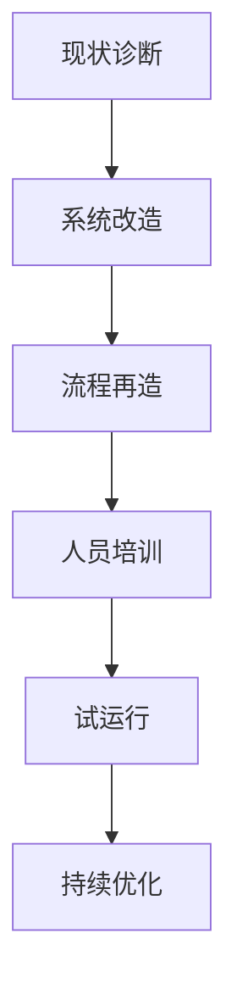

**图 5-6** DeepSeek 生成的完整 Markdown 格式的 PPT 内容

> **步骤四**：DeepSeek 辅助生成了一套完整的 PPT 大纲，不过为了保证内容的完整性，我们将步骤一中的同样指令输入其他 AI 大模型（豆包、Kimi）进行尝试。

> **步骤四结果**：豆包生成了一套 Markdown 格式的 PPT 大纲（如下所示），主要包含六部分内容。人工审阅后发现，豆包生成的“发票管理引发的风险预警”和“人员薪酬与社保问题的风险预警”两部分的深是 DeepSeek 生成的 Markdown 格式大纲中所不包含的，这两部分内容十分符合培训主题，值得纳入。不过，豆包生成的内容存在与应用 DeepSeek 时相同的问题，如大纲文字较少，案例较为笼统，真实性存疑。

> 我将围绕金税四期下建筑行业税务风险预警情形展开，从发票管理、成本核算、收入确认、人员薪酬等方面阐述，搭配实际案例，生成 Markdown 格式的 PPT 文本。

### 建筑行业金税四期税务风险预警的几种情形

#### 汇报人：[你的名字]
#### 汇报日期:[具体日期]

### 目录

- 1. 金税四期概述
- 2. 发票管理引发的风险预警
- 3. 成本核算不当的风险预警
- 4. 收入确认违规的风险预警
- 5. 人员薪酬与社保问题的风险预警
- 6. 总结与应对建议

### 金税四期概述

- **金税四期的强大功能**
  - 金税四期不仅仅是税务方面，还会纳入“非税”业务，实现对业务更全面的监控。例如，通过与银行等金融机构的信息共享，实时监控企业资金流动情况。
  - 搭建了各部委、人民银行以及银行等参与机构之间信息共享和核查的通道，实现企业相关人员手机号码、企业纳税状态、企业登记注册信息核查三大功能。
- **对建筑行业的影响**
  - 建筑行业业务复杂、项目周期长、涉及多方主体，金税四期的实施使得税务机关对建筑企业的监管更加精准和严格。例如，以往建筑企业可能存在的一些通过不规范操作降低税负的空间被大大压缩。
  - 要求建筑企业必须更加规范财务管理和税务申报，否则极易触发税务风险预警。

### 发票管理引发的风险预警

- **虚开发票风险**
  - **案例一**：某建筑公司为了增加成本，在没有实际业务发生的情况下，从第三方购买材料发票，金额高达 500 万元。金税四期通过大数据比对，发现该公司材料采购与实际工程进度严重不符，且销售方存在大量异常发票开具行为，最终该公司被税务机关查处，不仅补缴税款、滞纳金，还面临巨额罚款。
  - **案例二**：A 建筑企业与 B 材料供应商签订虚假合同，B 供应商为 A 企业虚开增值税专用发票，A 企业用于抵扣进项税额。金税四期系统监测到 A 企业进项发票的商品名称与实际生产经营需求不匹配，进而展开调查，导致双方企业都受到严厉处罚。
- **发票开具不规范风险**
  - **案例一**：某建筑企业在开具工程款发票时，未按照规定填写备注栏，注明建筑服务发生地县（市、区）名称及项目名称。税务机关在发票核查中发现大量此类不规范发票，要求企业整改，并对已抵扣的进项税额作转出处理，增加了企业税务成本。
  - **案例二**：B 建筑公司开具发票时，税率选择错误，将适用 9% 税率的建筑服务开具成 6% 税率。金税四期系统通过对发票数据的逻辑校验，发现该问题，企业不仅需要重新开具发票，还可能面临补缴税款及滞纳金的风险。

| 指标类别 | 预警阈值 | 监测频率 |
| :--- | :--- | :--- |
| 项目毛利率 | 偏高区域均值±12% | 季度 |
| 劳务成本占比 | >总成本 38% | 月度 |
| 机械使用费 | 超预算 20% 且无合理解释 | 单次支付 |
| 跨省项目 | 社保缴纳覆盖率<98% | 半年度 |

#### 收入确认环节六类高风险预警情形

1.  预售账款超期核账
2.  EPC 项目完工进度确认
3.  甲供材价税分离计算
4.  以房抵债交易
5.  暂估收入冲回
6.  跨境项目支付

#### 成本列支环节五类典型风险场景

1.  材料采购“四流不一致”
2.  劳务分包“三证不全”
3.  机械租赁“人机分离”
4.  临时用工“现金支付”
5.  成本分摊“随意调整”

#### 企业税务风控体系升级方案

1.  智慧监控系统
2.  业务流程再造
3.  文档管理规范
4.  实施路径建议

## 建筑行业金税四期税务风险预警的几种情形
### XX基建集团2025年度财务专项培训
**- 时间：** 2025年4月7日  
**- 地点：** XX分公司第一会议室  
**- 主讲人：财务部 张XX（注册会计师/税务师）**  

## 目录
1. 金税四期监管新规与建筑行业监管重点
2. 收入确认环节六类高风险预警情形
3. 成本列支环节五类典型风险场景
4. 资金往来环节三大稽查重点
5. 发票管理环节两大高风险预警情形
6. 人员薪酬与社保缴纳环节两大防控风险点
7. 企业税务风控体系升级方案

## 第一章 金税四期监管新规与建筑行业监管重点

### 一、2025年金税工程最新升级要点
1. **五流合一监控**：新增“物流信息”与“人员轨迹”比对维度
2. **AI风险模型**：建筑业专项指标库覆盖32个风险维度
3. **实时预警系统**：异常数据触发后24小时内推送至主管税务机关

### 二、2025年建筑行业重点监测指标
| 指标类别 | 预警阈值 | 监测频率 |
| :--- | :--- | :--- |
| 项目毛利率 | 偏离区域均值±12% | 季度 |
| 劳务成本占比 | >总成本38% | 月度 |
| 机械使用费 | 超预算20%且无合理解释 | 单次支付 |
| 跨省项目 | 社保缴纳覆盖率<98% | 半年度 |

### 三、典型案例分析
#### 案例1：2024年某国企材料采购预警事件
- **项目背景**：雄安新区某市政道路工程（合同额6.5亿）
- **问题详情**：钢筋采购发票显示供应商为河北某商贸公司，但GPS轨迹显示车箱始终在山西活动
- **处理结果**：进项税转出845万元，项目暂停投标资格6个月

#### 案例2：2024年某民营建企社保异常案
- **项目背景**：成都某商业综合体（用工峰值326人）
- **问题详情**：比对住建部”建筑工人实名制平台“数据，发现工资流水与社保记录差异达47%
- **处理结果**：补缴社保费及滞纳金387万元，纳入重点监控名单

#### 案例3: 2024年某央企EPC项目稽查
- **项目特征**:海南自贸港某保税仓库(合同额9.2亿)
- **违规事实**:自行确认完工进度78%,"住建云"显示实际进度仅52%
- **处罚结果**:调增应纳税所得额1.8亿元,罚款比例8.5倍

#### 案例4: 2024年某房企抵账房事件
- **交易背景**:郑州某棚改项目抵顶工程款商品房12套
- **问题发现**:网签价格(8500元/㎡)与同期市场价(12000元/㎡)差异触发预警
- **处理结果**:按市场价核定收入,补缴土地增值税及企业所得税合计1360万元

## 第二章 收入确认环节六类高风险预警情形

### 一、成本核算不当的风险预警
#### 成本费用虚增风险
- **案例一**: C建筑企业为降低利润少缴企业所得税，虚构工程项目的人工成本，编造虚假的工人工资表，虚增人工成本200万元。金税四期通过与社保、银行等部门的数据比对，发现该企业申报的工人工资与实际社保缴纳人数、银行代发工资流水不符，从而认定企业存在成本虚增问题。
- **案例二**：某建筑公司将与工程项目无关的费用，如公司总部的豪华装修费用计入项目成本。金税四期大数据分析发现该公司成本结构异常，对其进行税务稽查，最终企业补缴税款并受到相应处罚。

#### 成本分摊不合理风险
- **案例一**: D建筑企业同时承接多个工程项目，在成本分摊时，随意将高利润项目的成本分摊到低利润项目，以平衡各项目利润。金税四期通过对企业成本分摊方法的合理性分析以及各项目投入产出比的监测，发现企业成本分摊存在问题，要求企业重新核算并补缴税款。
- **案例二**: E建筑公司在分摊共同成本时，未按照合理的标准进行分配，导致部分项目成本过高，部分项目成本过低。税务机关在检查中发现这一情况，对企业成本核算的准确性提出质疑，企业需要重新梳理成本分摊流程并进行纳税调整。

### 二、延迟确认收入风险
- **案例一**: F建筑企业按照完工百分比法确认收入，但在实际操作中，故意低估完工进度，延迟确认收入。金税四期通过对比企业的工程进度、合同执行情况以及发票开具金额等数据，发现企业收入确认存在滞后问题，要求企业补缴税款及滞纳金。
- **案例二**：某建筑公司已完成工程项目并验收合格，但未收到全部工程款为由，迟迟不确认收入。金税四期系统监测到该项目已实际交付使用，而企业未及时进行收入申报，对企业进行税务预警，最终企业被责令限期整改并补缴相关税费。

### 三、隐匿收入风险
- **案例一**: G建筑企业将部分工程项目收入以现金形式收取，未入账核算，直接用于支付项目成本或其他费用。金税四期通过对企业资金流、物流以及上下游交易信息的综合分析，发现企业存在资金体外循环迹象，经深入调查核实，企业隐匿收入的行为被曝光，受到了严厉的税务处罚。
- **案例二**: H建筑公司与客户签订阴阳合同，将部分收入隐藏在“阴合同”中，只按照“阳合同”金额申报纳税。金税四期通过大数据比对以及对相关交易方的调查，识破了企业的隐匿收入手段，企业面临补缴巨额税款、滞纳金和罚款的后果。

### 四、成本列支环节五类典型风险场景
#### 一、2025年高风险行为清单
1. 材料采购“四流不一致”(新痕物流轨迹要求)
2. 劳务分包“三证不全”(资质证书+安全生产许可证+劳务派遣证)
3. 机械租赁“人机分离”(操作员社保与设备登记地不符)
4. 临时用工“现金支付”(单笔超5万需电子转账)
5. 成本分摊“随意调整”(土建/安装比例变更需备案)

#### 二、典型案例
- **案例5: 2024年某桥梁项目材料案**
    - **项目特点**:长江某跨江大桥(钢材用量8万吨)
    - **稽查发现**:同一批号钢材同时出现在三个项目成本中
    - **最终认定**:虚增成本2.3亿元,移送公安机关立案
- **案例6: 2024年某机场项目劳务纠纷**
    - **用工情况**:航站楼项目使用劳务人员600人
    - **问题暴露**:工资专户发放记录与个税申报差异达230人
    - **处理结果**:补缴个税及社保费680万元,项目经理终身执业禁止

### 五、成本核算不当的风险预警
- **案例一: C建筑企业为降低利润少缴企业所得税，虚构工程项目的人工成本，编造虚假的工人工资表，虚增人工成本200万元。金税四期通过与社保、银行等部门的数据比对，发现该企业申报的工人工资与实际社保缴纳人数、银行代发工资流水不符，从而认定企业存在成本虚增问题。**
- **案例二：某建筑公司将与工程项目无关的费用，如公司总部的豪华装修费用计入项目成本。金税四期大数据分析发现该公司成本结构异常，对其进行税务稽查，最终企业补缴税款并受到相应处罚。**

### 六、收入确认违规的风险预警
#### 延迟确认收入风险
- **案例一**: F建筑企业按照完工百分比法确认收入，但在实际操作中，故意低估完工进度，延迟确认收入。金税四期通过对比企业的工程进度、合同执行情况以及发票开具金额等数据，发现企业收入确认存在滞后问题，要求企业补缴税款及滞纳金。
- **案例二**：某建筑公司已完成工程项目并验收合格，但未收到全部工程款为由，迟迟不确认收入。金税四期系统监测到该项目已实际交付使用，而企业未及时进行收入申报，对企业进行税务预警，最终企业被责令限期整改并补缴相关税费。

#### 隐匿收入风险
- **案例一**: G建筑企业将部分工程项目收入以现金形式收取，未入账核算，直接用于支付项目成本或其他费用。金税四期通过对企业资金流、物流以及上下游交易信息的综合分析，发现企业存在资金体外循环迹象，经深入调查核实，企业隐匿收入的行为被曝光，受到了严厉的税务处罚。
- **案例二**: H建筑公司与客户签订阴阳合同，将部分收入隐藏在“阴合同”中，只按照“阳合同”金额申报纳税。金税四期通过大数据比对以及对相关交易方的调查，识破了企业的隐匿收入手段，企业面临补缴巨额税款、滞纳金和罚款的后果。

## 第三章 成本列支环节五类典型风险场景
### 一、2025年高风险行为清单
1. 材料采购“四流不一致”(新痕物流轨迹要求)
2. 劳务分包“三证不全”(资质证书+安全生产许可证+劳务派遣证)
3. 机械租赁“人机分离”(操作员社保与设备登记地不符)
4. 临时用工“现金支付”(单笔超5万需电子转账)
5. 成本分摊“随意调整”(土建/安装比例变更需备案)

### 二、典型案例
#### 案例5:2024年某桥梁项目材料案
- **项目特点**:长江某跨江大桥(钢材用量8万吨)
- **稽查发现**:同一批号钢材同时出现在三个项目成本中
- **最终认定**:虚增成本2.3亿元,移送公安机关立案

#### 案例6:2024年某机场项目劳务纠纷
- **用工情况**:航站楼项目使用劳务人员600人
- **问题暴露**:工资专户发放记录与个税申报差异达230人
- **处理结果**:补缴个税及社保费680万元,项目经理终身执业禁止

## 第四章 资金往来环节三大稽查重点
### 一、2025年监管新动向
1. 关联方交易(年利率不得低于LPR1.3倍)
2. 农民工工资专户(支付指令需匹配考勤记录)
3. 现金交易(单项目年累计不得超过50万元)

### 二、典型案例
#### 案例7: 2024年某集团资金池事件
- **运作模式**:通过财务公司归集子公司资金日均余额15亿
- **违规事实**:未按独立交易原则收取利息
- **调整结果**:补缴增值税及企业所得税合计4200万元

#### 案例8: 2024年某路桥项目工资纠纷
- **项目特征**:云南某高速公路(农民工1200人)
- **问题发现**:专户发放记录与实名制平台考勤差异达380人
- **处罚措施**:列入建筑市场“黑名单”,暂停投标资格1年

## 第五章 发票管理环节两大高风险预警情形
### 一、虚开发票风险
#### 无真实业务背景的发票开具
- 资金回流必报警(单笔金额>50万元自动触发)
- 进销项商品严重不匹配（如建筑企业大量开具咨询服务发票）

#### 虚增成本
- **事件经过**:某建筑企业为减少应纳税所得额，虚增部分成本费用，如虚构劳务费用、材料费用等。金税四期系统通过成本数据分析发现异常，税务机关对企业进行了稽查。
- **风险分析**:虚增成本是严重的税务违法行为，金税四期系统能够通过数据分析识别异常成本。建筑企业应如实核算成本，避免虚增成本行为。

### 二、发票开具不规范风险
- 备注栏缺失关键信息（项目地址、项目名称）
- 税率适用错误（如建筑服务9%错开为6%）

#### 真实案例分析
- **案例9: 2024年四川乐山虚开发票案**
    - **违法事实**：施工企业为房地产公司虚开工程发票1.2亿元
    - **稽查手段**：比对资金流水发现“回流”证据
    - **处罚结果**：企业罚款5000万元，法人代表判处有期徒刑7年
- **案例10: 2024年深圳地铁项目发票备注栏缺失案**
    - **项目特征**：地铁14号线土建工程（合同额28亿）
    - **问题发现**：87份增值税专用发票未填写项目地址
    - **处理结果**：进项税转出620万元，限期整改并纳入重点监控

## 第六章 人员薪酬与社保缴纳环节两大防控风险点
### 一、社保缴纳基数不实风险
1. **按最低基数申报**（与个税申报工资差异>30%）
2. **工资拆分申报**（基本工资+补贴分开发放）

#### 真实案例解析
- **案例11: 2024年成都某国企社保基数案**
    - **企业规模**：国有建筑集团（在册员工5200人）
    - **违规事实**：按3800元基数缴纳社保，实际平均工资9800元
    - **稽查结果**：补缴社保费及滞纳金2100万元，国资委通报批评

### 二、劳务用工税务问题
1. **临时工未申报个税**（单月支付超5000元）
2. **劳务分包给无资质个人**（无法取得合规发票）

- **案例12: 2024年西安劳务分包个税案**
    - **项目背景**：奥体中心配套工程（劳务费支出3200万元）
    - **问题发现**：通过农民工专户发放但未代扣个税
    - **处罚措施**：补缴个税+罚款合计890万元，项目经理撤职

## 第七章 企业税务风控体系升级方案
### 一、2025年必备防控措施
1. **智能监控系统建设**
    - 对接金税四期接口（需通过国家税务总局认证）
    - 设置三级预警机制（黄/橙/红）
2. **业务流程再造**
    - 材料采购：实行“四流合一”线上审批
    - 劳务分包：建立“资质审查-人检考勤-专户发放”闭环
3. **文档管理规范**
    - 电子档案保存期限延长至10年
    - 项目成本台账需包含GPS定位照片

## 总结与建议
- 金税四期对建筑行业税务监管更加严格和精准，发票管理、成本核算、收入确认、人员薪酬与社保等方面都容易触发税务风险预警。
- 建筑企业一旦被预警并查实存在税务问题，将面临补缴税款、滞纳金、罚款等处罚，严重影响企业的经济利益和声誉。

### 应对建议
1. **加强财务人员培训**，提升对金税四期系统的认识和税务合规操作能力。
2. **建立健全财务管理制度和内部控制体系**，规范发票管理、成本核算、收入确认等流程。
3. **定期开展税务自查自纠**，及时发现和纠正潜在的税务风险。
4. **加强与税务机关的沟通交流**，及时了解税收政策变化，确保企业税务处理合规合法。

## 结束页
- **感谢聆听！**
- 有任何疑问，请随时提问。

## 二、实施路径建议


### 结束页

**感谢参与本次培训！**

**后续支持：**
- 税务咨询热线：400 - XXX -XXXX（24小时）
- 风险自查工具：扫描二维码下载《建筑业税务健康度自评表》
- 培训资料领取：企业微信 -文档中心-2025税务专项

**注：**
1. 案例数据均来自国家税务总局2024-2025年度稽查公告及公开裁判文书
2. 配套提供《建筑业高风险发票清单》《社保合规操作指引》作为附件
3. 重点风险指标建议用“红黄绿”三色标注警示等级
4. 会后将组织签订《项目税务合规承诺书》

---

图 5-10 步骤六生成的 Markdown 格式的 PPT 大纲

> **步骤七：** 为了保证大纲中使用的案例确实来自国家税务总局 2024—2025 年度稽查公告及公开裁判文书，我们抽取其中一个案例进行检验。我们将案例内容复制粘贴至 DeepSeek，并发出指令：
> *请联网找到这个案例的相关报道网页或来源出处：*
> *案例 1: 2024 年某国企材料采购预警事件*
> - 项目背景：雄安新区某市政道路工程（合同额 6.5 亿元）
> - 问题详情：钢筋采购发票显示供应商为河北某商贸公司，但 GPS 轨迹显示车辆始终在山西活动
> - 处理结果：进项税转出 845 万元，项目暂停投标资格 6 个月

> **步骤七结果**：DeepSeek 联网搜索后，得出的结果是未找到完全匹配的资料（如图 5-11 所示）。由此可见，即使上述步骤多次强调要求 DeepSeek 给出真实案例，且 DeepSeek 还标注了案例出处，人工检验仍然发现了 AI 幻觉问题。

在这种情况下，我们可以继续要求 DeepSeek 将 PPT 大纲中的所有案例通过联网搜索再次替换为真实案例，并重新生成—版 Markdown 格式的 PPT 大纲。

根据搜索结果，未找到与“2024年某国企材料采购预警事件”完全匹配的案例报道。搜索结果中涉及雄安新区的相关项目包括:

- 雄安新区容东片区数字道路智能化项目 (一期)EPC总承包项目 2
- 雄安新区改革發展局"产业政策·免申即享"案例 5
- 雄安新区公安局AI算力服务器购置项目 7
- 雄安新区起步区第五组团大学城配套市政道路工程 13

但未发现具体提及“钢筋采购发票与GPS轨迹不符导致进项税转出”的案例。该案例可能是基于行业典型风险构建的教学案例，非实际公开报道事件。如需核实具体案例，建议:

- 查询国家税务总局或河北省税务局公布的稽查案例
- 检索中国政府采购网或雄安新区公共资源交易中心违规公示
- 咨询当地税务机关获取权威信息

🔹步骤八: 为了保证 PPT 内容的真实完整，再次要求 DeepSeek 按照步骤七的要求，更换大纲中的所有案例为联网搜索下的真实案例，并再次输出 Markdown 格式的 PPT 大纲。

🔹步骤八结果: DeepSeek 生成了最终版 Markdown 格式的 PPT 大纲 (如图 5-12 所示), 替换了所有案例，并在案例处标注了来源。选取其中一个案例进行人工检验，可以找到案例来源。至此，可以认为完整的 Markdown 格式的 PPT 大纲生成完毕。

---

# ## 企业税务风控体系升级方案

## 第一章 金税四期监管新规与建筑行业监管重点

### 一、2025 年全税工程最新升级要点

1. **五法合一监控**:新增“物流信息”与“人员轨迹”比对维度
2. **AI 风险模型**:建筑业专项指标库覆盖 32 个风险维度
3. **实时预警系统**:异常数据触发后 24 小时内推送至主管税务机关

### 二、2025 年建筑行业重点监测指标

| 指标类别 | 预警阈值 | 监测频率 |
| :--- | :--- | :--- |
| 项目毛利率 | 偏离区域均值±12% | 季度 |
| 劳务成本占比 | >总成本 38% | 月度 |
| 机械使用费 | 超预算 20% 且无合理解释 | 单次支付 |
| 跨省项目 | 社保缴纳覆盖率<98% | 半年度 |

### 三、典型案例分折

1. **案例 1:宁波博汇化工税务处罚案**
   - 项目背景：2023 年混合芳烃消费税政策调整
   - 问题详情：企业未按新政缴纳消费税，经多次约谈仍未整改
   - 处理结果：补缴税款约 5 亿元，企业声誉严重受损 [1]

2. **案例 2:山东济南虚开增值税发票团伙案**
   - 项目背景：利用小规模纳税人减免政策虚开发票
   - 问题详情：控制多家空壳企业虚开发票 4175 份，涉及金额 7288 万元
   - 处理结果：移送检察机关审查起诉 [1]

### 第二章 收入确认环节六类高风险预警情形

#### 一、2025 年重点监控领域

1. 预售账款超期挂账 (新规缩短至 3 个月)
2. EPC 项目完工进度确认 (强制接入“住建云”进度核验)
3. 甲供材价税分离计算 (新模板强制填报)
4. 以房抵债交易 (需网签备案同步税务系统)
5. 暂估收入冲回 (超 6 个月未处理自动预警)
6. 跨境项目支付 (外汇管理局数据直连)

#### 二、典型案例

1. **案例 3:某企业利用往来账户延迟确认收入案**
   - 项目特征：通过“其他应付款”科目挂账收入
   - 稽查发现：比对银行流水发现未申报收入 3280 万元
   - 处罚结果：补缴企业所得税 800 万元，加收滞纳金 [2]

2. **案例 4:视同销售未作纳税调整案**
   - 交易背景：自产货物用于职工福利未视同销售
   - 问题发现：进项税额转出但未确认收入
   - 处理结果：调增应纳税所得额 1580 万元 [2]

### 第三章 成本列支环节五类典型风险场景

#### 一、2025 年高风险行为清单

1. 材料采购“四流不一致”(新增物流轨迹要求)
2. 劳务分包“三证不全”(资质证书 + 安全生产许可证 + 劳务派遣证)
3. 机械租赁“人机分离”(操作员社保与设备登记地不符)
4. 临时用工“现金支付”(单笔超 5 万需电子转账)
5. 成本分摊“随意调整”(土建/安装比例变更需备案)

---

# DeepSeek 高效财务

## 二、典型案例

1. **案例 5：农产品收购发票虚抵案**
   - 项目特点：虚假农产品收购发票抵扣进项
   - 稽查手段：比对农户身份信息发现虚假交易
   - 最终认定：进项税转出 680 万元，罚款 1.5 倍 [2]

2. **案例 6：运输发票与业务不匹配案**
   - 用工情况：大量运输发票无对应物流记录
   - 问题暴露：GPS 轨迹与开票时间不符
   - 处理结果：补税 + 罚款合计 320 万元 [2]

## 第四章 资金往来环节三大稽查重点

### 一、2025 年监管新动向

1. 关联方交易（年利率不得低于 LPR 的 1.3 倍）
2. 农民工工资专户（支付指令需匹配考勤记录）
3. 现金交易（单项目年累计不得超过 50 万元）

### 二、典型案例

1. **案例 7：个人账户大额收款未申报案**
   - 运作模式：通过法定代表人个人账户收款 1.2 亿元
   - 违规事实：未计入公司收入申报纳税

2. **案例 8：关联企业无息借款案**
   - 项目特征：集团内部无息借款 5 亿元
   - 问题发现：未按独立交易原则计算利息
   - 处罚措施：核定利息收入补税 1600 万元 [4]

## 第五章 发票管理环节两大高风险预警情形

### 一、虚开发票风险

1. **无真实业务背景的发票开具**
   - 资金回流必报警（单笔金额>50 万元自动触发）
   - 进销项商品严重不匹配（如建筑企业大量开具咨询服务发票）

2. **发票开具不规范风险**
   - 备注栏缺失关键信息（项目地址、项目名称）
   - 税率适用错误（如建筑劳务 9% 错开为 6%）

### 二、真实案例分析

1. **案例 9：济南虚开增值税专用发票案**
   - 违法事实：团伙控制空壳企业开发票 4175 份
   - 稽查手段：资金流水追踪发现回流证据
   - 处罚结果：移送司法机关追究刑事责任 [1]

2. **案例 10：四流不一致被稽查案**
   - 项目特征：合同、发票、资金、物流信息不一致
   - 问题发现：物流 GPS 轨迹与开票地址不符
   - 处理结果：进项税转出 920 万元 [4]

## 第六章 人员薪酬与社保缴纳环节两大防控风险点

### 一、社保缴纳基数不实风险

1. **按最低基数申报**（与个税申报工资差异>30%）
2. **工资拆分申报**（基本工资 + 补贴分开发放）

---

## 二、劳务用工税务问题

- **临时工未申报个税**（单月支付超 5000 元）
- **劳务分包给无资质个人**（无法取得合规发票）

### 三、真实案例解析

1. **案例 11：社保基数与个税差异案**
   - 企业规模：制造业企业员工 200 人
   - 违规事实：社保按最低基数缴纳，个税申报平均工资 42%
   - 稽查结果：补缴社保费及滞纳金 580 万元 [4]

2. **案例 12：劳务报酬未代扣个税案**
   - 项目背景：临时用工支出 860 万元
   - 问题发现：未按规定代扣代缴个税
   - 处罚措施：补税 + 罚款合计 210 万元 [4]

## 第七章 企业税务风控体系升级方案

### 一、2025 年必备防控措施

1. **智能监控系统建设**
   - 对接金税四期接口（需通过国家税务总局认证）
   - 设置三级预警机制（黄/橙/红）

2. **业务流程再造**
   - 材料采购：实行“四流合一”线上审批
   - 劳务分包：建立“资质审查 - 人脸考勤 - 专户发放”闭环

3. **文档管理规范**
   - 电子档案保存期限延长至 10 年
   - 项目成本台账需包含 GPS 定位照片

### 二、实施路径建议


## 结束页

**感谢参与本次培训！**

**后续支持：**
- 税务咨询热线：400-XXX-XXXX（24小时）
- 风险自查工具：扫描二维码下载《建筑业税务健康度自评表》
- 培训资料领取：企业微信 -文档中心-2025税务专项

**注:**
1. 案例数据均来自国家税务总局及各地税务机关公开案例
2. 配套提供《建筑业高风险发票清单》《社保合规操作指引》作为附件
3. 重点风险指标建议用“红黄绿”三色标注显示等级
4. 会后将组织签订《项目税务合规承诺书》

图 5-12 DeepSeek 生成的最终版 Markdown 格式的 PPT 大纲

---

142 / DeepSeek 高效财务

# **任务二**

应用 Kimi 辅助实现从 Markdown 格式到 PPT 的智能转化。

> 步骤一：打开 Kimi 智能助手，点击 Kimi 页面左侧业务栏的“Kimi+"（如图 5-13 所示），选择"PPT 助手”（如图 5-14 所示），将任务一中 DeepSeek 生成的最终版 Markdown 格式的 PPT 大纲粘贴在对话框中，并点击发送（如图 5-15 所示）。

图 5-13“Kimi+"页面

图 5-14 点击“Kimi+"中的"PPT 助手”

图 5-15 在对话框中粘贴 Markdown 格式的 PPT 大纲

## 步骤一结果: Kimi 根据输入的大纲，抓取网页上的有关信息，自动整合并生成 PPT 的完整内容（如图 5-16 所示）。生成内容丰富，条理清晰，分为不同的小标题和内容要点，为下一步生成 PPT 做了充足的准备工作。

图 5-16 Kimi 输出的完整 PPT 内容

## 步骤二：点击对话框下方的“一键生成 PPT"按钮（如图 5-16 所示），出现多个模板样式（如图 5-17 所示），其中包含各种常见场景，如总结汇报、教育培训、党政宣传、企业介绍等，也包含各种设计风格，如简约、商务、政务、复古等，还将主题颜色进行了分类，如黄色、红色、绿色、蓝色等。使用者可根据需求选择合适的模板。

图 5-17 Kimi+ 的 PPT 模板选择

由于我们的主题是“建筑”和“税务”，整体风格偏商务，且场景为内部培训，视觉效果应明亮、整洁，故选择的模板场景为“教育培训”，设计风格为“商务”，主题颜色选择蓝色。确定模板后点击右上角的“生成 PPT"(如图 5-17 所示),Kimi 会弹出系统运行界面，开始自动制作 PPT。

▶ 步骤二结果:系统自动运行几十秒后，按照内容大纲和已选择的模板生成一个完整的 PPT，如图 5-18 所示。右侧呈现整个 PPT 的预览效果图，下方有“去编辑”和“下载”选项，可以选择在线编辑或者下载之后再进行人工调整。这里为了方便调整，我们选择下载到本地的方式，对 PPT 内容进行进一步调整。由于 AI 大模型给出的模板多为一般通用型，并未生成符合我们的主题“建筑行业”“金税四期”的相关风格的插图，所以需要人工修改 PPT 的细节。

▶ 步骤三:由于 Kimi 无法生成图片，我们借助豆包进行主题图片的生成工作。可以直接在对话框中输入生成图片的需求，也可以点击对话框下方的“图像生成”按钮 (如图 5-19 所示)。进入“图像生成”界面后，对话框下方有“参考图”“比例”“风格”三个提示（如图 5-20 所示），可以协助我们发出进一步的指令，生成更贴切的主题图片。

图 5-18 生成 PPT 的界面

图 5-19 豆包界面

根据我们的需求，在豆包对话框中分别输入指令：“请帮我生成一些与建筑行业相关的图片”“请帮我生成一些关于金税四期的图片”“请生成有关税务的 PPT 插图”（如图 5-21 所示）。然后，将豆包生成的图片下载保存，插入步骤二生成的 PPT 中，或者替换原有插图，使得 PPT 中的图片和内容相匹配。

图 5-20 豆包“图像生成”界面

(a)建筑行业相关图片

(b) “金税四期”相关图片

(c) “税务”相关图片

图 5-21 向豆包发出图片生成的指令

💡步骤三结果：用豆包生成的图片替换 PPT 中原来不相关的图片，使图文相符。替换后，PPT 整体视觉呈现效果显著提升，主题的表达更为直观、鲜明 (如图 5-22 所示)。

图 5-22 替换图片后的 PPT 预览效果（示意图）

**步骤四**：经人工检验，发现调整后的 PPT 中仍有文字错位、字体字号不统一等问题。为了进一步修改上述问题，将调整后的 PPT 上传至 Kimi，并发出指令：**修改 PPT 中的文字部分，将每页的标题更换字体为“微软雅黑”，字号为 28 号，将内容部分更改字体为“微软雅黑”，字号为 14 号。**

**步骤四结果**：Kimi 反馈无法直接修改 PPT 中的文字部分，只能提供人工修改的操作步骤（如图 5-23 所示）。至此，使用 DeepSeek 和 Kimi 辅助制作完整 PPT 的流程已结束，要想形成最终版 PPT，还需要人工调整，确认内容、格式无误等。

图 5-23 提示人工修改操作步骤界面

## **作者点评**

本节细致展示了 DeepSeek 与 Kimi 协同工作的全过程，体现出 AI 在辅助财务人员制作 PPT 中的实际应用价值。DeepSeek 在内容生成上具有逻辑清晰、结构完整的优点，经过多轮调整后能实现内容的深化与案例真实性的提升。Kimi 在 PPT 格式转化和模板匹配方面表现出色，极大地节省了人工排版时间，尤其在分步操作中体现出 AI 工具的学习性与适应性。

但 AI 工具也存在部分问题，如早期生成内容存在案例不真实、题目结构不统一和内容折叠等问题，说明在 AI 使用过程中仍需人机协同优化。Kimi 虽然具备模板生成能力，但无法处理字体样式调整、图片不符合主题等细节问题，仍需人工介入。

整体来看，DeepSeek 在内容构思、语义表达方面占优，Kimi 在视觉呈现与自动化处理方面占优。建议财务人员在制作 PPT 时综合发挥两者所长，以提高质量和效率。

---

### **5.2 应用 WPS 灵犀辅助制作 PPT**

步骤一：使用 WPS 中的灵犀生成 PPT。打开灵犀有两种方式：**第一**, 百度搜索 WPS 灵犀，进入网页版灵犀界面 (如图 5-24 所示);**第二**,从本地 WPS 软件中进入灵犀界面 (如图 5-25 所示)。

图 5-24 百度搜索打开灵犀

图 5-25 从本地 WPS 打开灵犀

# 第5章 应用DeepSeek辅助财务工作中的PPT制作 / 151

目部的财务人员进行内训，主题为“建筑行业金税四期税务风险预警的几种情形”，我需要制作一份培训用 PPT 文档。请按照主题内容，帮我生成一份PPT大纲，要求：包括封面、目录和至少4个核心章节，每个核心章节内部至少包含2个案例，语言简洁专业，避免口语化。

点击对话框上方的“长文写作”按钮，即可生成 PPT 大纲，如图 5-26 所示。

## 图 5-26 在灵犀对话框输入指令

**步骤一结果**：灵犀根据要求生成了一版PPT大纲，按照每一页内容生成，包含封面、目录、六章内容和结束页，每章内容均包含案例的写作思路，但无标题内容的相关概述性语句，且案例较笼统和简单，非真实案例（如图 5-27 所示）。

▶**步骤二**：在步骤一结果的基础上，继续向灵犀提出细化指令：在上述基础上，每章内容增加细节描述和概述性的语句表达，且通过联网搜索，将所有案例都替换为真实案例，再重新输出。

**步骤二结果**：灵犀重新生成了一版PPT大纲，进行了内容填充，每个案例均有联网来源标识（如图 5-28 所示），但主要填充了案例内容，并没有对其他内容进行填充和描述，还需要进一步调整。

---

# DeepSeek 高效财务

已为你创建一篇关于建筑行业金税四期税务风险预警的几种情形的PPT大纲，你可以挑选模板并生成PPT。讲解税务风险预警做铺垫。

## 第二章 发票管理风险预警

### ▼ 未按规定取得发票案例

◎写作思路：列举某建筑公司在施工过程中未能按规定取得供应商发票，导致无法正常报税，被税务机关处以罚款和滞纳金的案例，分析其风险成因和后果。

### ▼ 发票内容与实际交易不符案例

◎写作思路：介绍某建筑公司销售方开具发票时，填开与实际交易不符的内容，受到税务处罚的案例，强调发票开具应如实反映实际销售情况。

### ▼ 进项发票品名不匹配案例

◎写作思路：以商贸流通企业为例，说明收取的品名与开具的销项发票品名不匹配，被要求进项税转出并补缴税款及滞纳金的案例，提醒学员关注发票品名匹配问题。

## 图 5-27 灵犀初步生成的PPT大纲

### 发票管理风险预警

#### 未按规定取得发票案例

某建筑公司在承接一项大型工程项目时，为了降低成本，部分材料采购选择了一些不正规的供应商，未能按规定取得发票。在金税四期系统的监控下，税务机关发现该公司成本列支存在异常，经过调查核实，该公司因无法提供有效的发票，导致无法正常报税，最终被税务机关处以罚款和滞纳金。这一案例提醒企业，在采购过程中应选择正规的供应商，确保取得合法合规的发票1。

#### 发票内容与实际交易不符案例

2024年，某建筑公司在与供应商进行交易时，为了多抵扣税款，要求供应商开具的发票内容与实际交易不符。例如，实际采购的是普通建筑材料，发票上却开具成了税率更高的特殊材料。金税四期系统通过大数据比对，发现了该公司发票内容与实际交易的差异，税务机关随即对其展开调查。最终，该公司被认定为虚开发票，受到了严厉的税务处罚1。

#### 进项发票品名不匹配案例

## 图 5-28 灵犀按照要求填充了案例内容并带有联网来源标识

### 步骤三：如图 5-27 和图 5-28 所示，灵犀在对话框中嵌入了 "DeepSeek R1" 模型。为了使 PPT 内容更加完善和丰富，我们开启"DeepSeek R1"模型，再次向灵犀发出指令：请继续填充上述PPT内容，将每章标题下每个二级标题增加一段概述段落，用以描述此种风险预警，然后再进行真实案例的举例。如图 5-29 所示。

> > 已为你创建一篇关于建筑行业金税四期税务风险预警的几种情形的PPT大纲，你可以挑选模板并生成PPT。
> > 
> > + 金税四期对税收管理的提升作用
> > - 写作思路：说明金税四期从'以票管税'到'以法治税'的转变，以及如何实现精准监管，提升税务管理效率。
> > 
> > ## 第二章 发票管理风险预警
> > + 未按规定取得发票案例
> > - 写作思路：讲诉某建筑公司因未从正规供应商取得发票导致无法报税受罚的真实案例，分析风险成因和后
> > + 发票内容与实际交易不符案例
> > - 写作思路：介绍 2024 年某建筑公司要求供应商开具与实际交易不符发票而受处罚的案例，强调发票开具的真实性。
> > + 进项发票品名不匹配案例
> > 
> > 生成 PPT
> > 请继续填充上述PPT内容，将每章标题下每个二级标题增加一段概述段落，用以描述此种风险预警，然后再进行真实案例的举例
> > 
> > + 🧠 DeepSeek R1 ⏹️ 🕵️ 联网搜索 ⏹️

### 步骤三结果：灵犀运用 DeepSeek R1 模型进行了深度思考，重新生成了一版PPT大纲。对每章标题内容作了轻微调整，但主题不变，还对案例进行了更新，但仍然没有增加内容的概述段落，如图 5-30 所示。

### 步骤四：为了使得大纲内容更加充实，我们先针对灵犀中现有的PPT大纲点击“挑选PPT模板”（如图5-31所示），跳转至灵犀PPT模板选择页面（如图5-32所示），页面右侧为PPT模板预览，左侧为PPT模板选择板块。根据主题需要，选择“商务风”和“蓝色”，再在下方选择一个合适的模板，最后点击“生成PPT"。

---

154 / DeepSeek 高效财务
已为你创建一篇关于金税四期下建筑企业税务风险预警与应对策略的PPT大纲，你可以挑选模板并生成PPT。

#### 第二章发票管理核心风险点

##### ▼ 四流不一致风险

💡写作思路:结合2024年某央企项目虚开发票案，解析合同流、货物流、资金流、发票流撕裂引发的300万处罚案例(参考资料7)

##### — 异常发票认证风险

💡写作思路:通过2023年浙江建工集团进项转出案例，说明品名不符、税率异常等5类高风险发票特征(参考资料8)

##### ▼特殊业务开票风险

💡写作思路:解析临时设施租赁、农民工工资专户等6类特殊业务开票要求，结合中建某局行政处罚案例说明(参考资料4)

+ 有问题尽管问我，按@可添加文档 DeepSeek R1

## 图 5-30 灵犀开启 DeepSeek R1 进行调整后的结果 (部分)

💡写作思路:提出“三位一体”培养方案:政策解读、系统操作、危机处理能力提升路径(参考资料12)

##### ▼合规文化培育策略

💡写作思路:建立业财税融合的考核体系，设计项目部税务合规KPI指标库(参考资料1)

谢谢

补充各案例详细处理结果> 修改大纲增加环保税务风险》为发票管理风险点推荐文献>

+ 有问题尽管问我，按@可添加文档 DeepSeek R1

## 图 5-31挑选 PPT模板

# # 第5章 应用DeepSeek辅助财务工作中的PPT制作 / 155

## 图 5-32 PPT模板选择页面

步骤四结果:按照选择生成了完整PPT，如图 5-33所示。

## 图 5-33 PPT生成页面

步骤五:完整PPT生成后，点击图5-33中右上角的“下载”，将PPT保存到本地，然后将其作为附件上传至DeepSeek，并发出指令：请阅读上述PPT，我需要用它为全公司财务人员进行内部培训，请指出不足之处，并提出补充建议，使得这个PPT内容更加完整、专业和充实，注意如果添加案例，请联网使用真实存在的案例。

---

156 / DeepSeek 高效财务

> **步骤五结果**：DeepSeek对现有PPT进行了评价。首先列举了现有PPT的优点，然后阐述不足之处和改进建议，如图5-34所示。

## ## 不足之处及改进建议

### ### 一、整体框架补充建议

#### 1.增加开篇章节:

+   - ○ **当前形势分析**：补充2024年最新税收征管趋势数据
- ○ **培训目标说明**：明确本次培训希望财务人员掌握的核心能力
- ○ **建筑行业税收概况**：行业税负率、常见问题统计等基准数据

#### 2.增加结尾章节:

+   - ○ **关键要点总结**
- ○ **行动指南**：培训后财务部门应立即开展的3-5项工作
- ○ **Q&A环节设计**

### ### 二、各章节具体补充建议

**第一章 金税四期监管体系解析**

+   - **补充**“五流合一”的图示说明 (建议用流程图展示五流关系)
- **增加**2024年金税四期最新升级功能 (如全电发票全面推广情况)


经人工审阅，DeepSeek提出的改进建议较为合理，还增加了对培训环节的建议等内容。通过人工甄别剔除不符合企业实际的建议，其他建议均可以作为修改意见以完善PPT。

> **步骤六**：我们将人工甄别之后的建议粘贴至灵犀对话框中，并向灵犀发出指令：**请根据下述建议在上述PPT基础上，重新生成 PPT。**


> **步骤七**：重复步骤四中的模板操作。

---

### 步骤七结果：生成了最新版 PPT，如图 5-35 所示。可以应用灵犀对现有 PPT 进行在线编辑和调整，也可以下载到本地后对 PPT 进行进一步调整。

经人工审阅，灵犀生成的最新版PPT中不存在字体错位、段落不齐等现象，字体和格式较为规范，同时PPT插图同PPT的内容主题较为契合，无须通过其他方式重新调整插图，可直接使用，整体效果较好。但和 Kimi一样，灵犀无法在自动生成PPT时对PPT的字号、字体进行调整，只能人工调整。

## **作者点评**

WPS 灵犀作为一款集成式AI工具，操作便捷、模板丰富，适合财务人员日常使用。

其优点主要体现在：模板直观、美观，且与PPT生成过程的整合度较高；在多轮优化中，灵犀对PPT内容结构进行了扩展，使内容更完整，符合内部培训的实际需求。

其缺点主要在于：初期生成内容较为简略，内容填充不够完整，案例缺乏真实性。尽管具备联网搜索功能，但内容概述类语句的生成能力有待加强。在此基础上，尝试利用内嵌的DeepSeek R1模型对灵犀生成的PPT大纲进行补充，但效果甚微。后续又通过 DeepSeek (即DeepSeekV3)进行了大量的补充和调整，最终实现了PPT内容的完整和专业展现。

整体上看,WPS 灵犀适用于对PPT模板与展示效果要求较高的场景，而 DeepSeek在文字性内容填充方面具有较大的优势。财务人员在使用AI大模型制作专业PPT时，可以结合使用WPS灵犀和DeepSeek。但依然需要注意的是，使用AI工具制作PPT时，在内容深度与案例真实性方面仍需配合人工审核与细节调整，才能确保PPT的质量。

# **5.3 本章总结**

本章围绕“如何高效制作一套财务工作相关的完整 PPT"展开，详细对比分析了 DeepSeek、Kimi与WPS 灵犀在辅助财务人员制作PPT中的不同角色与功能。通过模拟真实任务场景，验证了AI工具在大纲构建、案例整合、排版优化及模板匹配等多个环节的有效性与差异性。

DeepSeek 具备较强的内容生成与结构组织能力，Kimi 在格式美化与自动生成方面具有明显优势，WPS 灵犀则在模板选择与一体化生成上更为便捷，三者各有优势，协同使用才能最大化 AI 辅助财务工作的价值。

从实操视角来看，财务人员借助 AI 工具制作 PPT不仅可以减轻工作负担。还能在标准化表达、内容逻辑优化和视觉呈现方面实现质的提升。

但我们也要清晰地认识到，AI 的生成结果并非完美，仍需人工审核、调整，特别是对于内容真实性、逻辑严谨性和展示细节的把控。因此，人机协同是当前PPT智能化制作的最优解，也是未来财务职能高效转型的关键。

# ### 实用技巧

+   - 在制作 PPT 时，要想利用 AI 工具精准地生成想要的内容，需要在内容生成指令中明确包括格式、章数、案例要求等细节，这有助于提升 AI 生成内容的质量与匹配度。
- 采用 Markdown 格式输出文本和大纲，有利于其他AI工具接收结构框架和内容，便于后续转化为PPT格式，降低重复排版的成本。
- 可通过对比多个AI模型（如DeepSeek、豆包、Kimi）的生成结果，甄选有效内容并融合使用，提升整体生成质量。
- 在涉及案例展示时，建议使用具备联网功能的AI工具，并对其标注的出处进行验证，避免AI幻觉。
- AI生成完整的PPT后，仍需人工审阅检查段落逻辑、格式与插图匹配度等细节，确保达到使用标准。

# # 第 6 章
# 应用 DeepSeek 辅助标准化文本生成

随着信息技术的飞速发展，企业财务工作的自动化与智能化日新月异。目前，企业普遍配有较为成熟的财务软件系统，基础财务工作如日常记账、凭证生成、财务报表编制等已基本实现自动化处理。不过，在财务基础实操中，仍有大量耗时费力的任务尚未有效实现自动化，如多系统间的数据整合与传递、非结构化信息的识别与录入等。财务人员长期以来主要通过人工方式完成这类任务，不但工作重复烦琐，还容易出错。虽然一些企业已经尝试定制软件或者引入 RPA 财务机器人进行自动化，但仍存在处理成本高、灵活性差、智能化水平低等局限。

今天，利用 AI 的核心能力之一——自然语言生成 (natural language generation, NLG)，DeepSeek能够在上述财务应用场景中提供实质性帮助。AI在语义识别、信息提取、数据生成等方面的天然优势，使其在降低错误率、减轻财务人员工作负担方面成效显著，为提升财务工作的自动化和智能化水平提供了有力支撑。

> **小贴士**

### 自然语言生成

自然语言生成是 AI 的核心能力之一。它使机器能够将结构化数据或抽象语义转化为人类可读的自然语言文本。自然语言生成和自然

> **语言理解 (natural language understanding, NLU)**都是自然语言处理 **(NLP)** 的一部分。其中，自然语言理解负责 “听懂人话”（输入理解），自然语言生成则负责“说人话”(输出生成)。自然语言生成的典型应用场景包括智能客服、商业报告生成（应用数据到文本生成**(data-to-text generation)**模型，将商业数据转化为分析报告)等。

基于此，本章重点介绍应用DeepSeek辅助标准化文本生成的方法。

本章共分为四节: 6.1 节介绍应用DeepSeek实现从PDF中提取重要信息，并按照规定格式或模板生成标准化文本; 6.2 节展示应用 DeepSeek实现从Excel文档中提取重要信息，并按照规定语句或模板生成标准化文本; 6.3 节展示 DeepSeek 如何快速自动生成往来对账函; 6.4 节为本章总结。

# ## 6.1 利用PDF生成标准化文本

> **任务场景描述**

你是一家科创板新能源电池企业的财务人员。由于市场竞争激烈，行业更新迭代快，公司管理层要求财务部定期进行同行业企业财报分析，对比同行业其他科创板企业的公开财务数据和信息，并提交Word格式的同行业企业财报分析报告。

财务负责人最近将这个任务交给你，并给了你之前其他同事做的报告（Word格式),里面有固定的分析框架,只需要定期更新同行业企业数据即可。开展这项工作后，你发现获取同行业其他企业财务数据的来源主要是证券交易所公开披露的上市公司年报、季报、业绩快报等文件。这些文件都是PDF 格式，下载到本地之后，只能手动一个个选取需要的数据，复制到自己本地电脑的Excel文档中。然后还要进行

162 / DeepSeek高效财务
如增长率和资产负债率等财务指标的计算，最后将同行业企业财报数据和你计算出来的财务数据等复制到同行业企业财报分析报告Word文档中。

如果工作没什么技术含量，但是费时耗力，人工操作还容易出错。如果能够借助DeepSeek等AI工具实现从PDF文档中快速提取信息，并根据企业要求生成标准化的内容，会大大提升你的工作效率。你决定试一试，先选取两个典型任务使用DeepSeek进行测试。

**任务一**

指定报表项目，从同行业企业财报中提取数据，并计算增长率。通过给DeepSeek提供去年的报告语句，让DeepSeek自己模拟复现，输出语句文本。

应用DeepSeek辅助高效完成利用PDF生成标准化文本任务，操作步骤如下：

**步骤一**：首先从上海证券交易所官网的“披露”模块选取一家同行业企业的年报作为目标PDF(如图6-1所示)，并下载到本地。将年报PDF作为附件上传至DeepSeek。

对 DeepSeek 发出指令：请阅读上述 PDF，首先将文档第 120 页合并资产负债表中 2023 年 12 月 31 日和 2022 年 12 月 31 日的“货币资金”“应收账款”“存货”“无形资产”“应付账款”报表项目的金额提取出来。其次对这些报表项目进行描述性分析，并按照如下语句的格式进行展现：“货币资金 2023 年年末余额为人民币 1,491,130,655.84 元，年初余额为人民币 1,445,655,629.76 元，增加人民币 45,475,026.08 元，变动幅度为 3%。”

> 步骤一结果：DeepSeek 显示直接上传完整版公司年报“可能违反使用规范”，无法直接发出指令。

```text
我是 DeepSeek，很高兴见到你！
我可以帮你写代码、读文件、写作各种创意内容，请把你的任务交给我吧--
```

请阅读上述PDF，首先将文档第120页合并资产负债表中表中中2023年12月31日和2022年12月31日的“货币资金”“应收账款”“存货”“无形资产”“应付账款”报表项目的金额提取出来。其次对这些报表项目进行描述性分析，并按照如下语句的格式进行展现：“货币资金2023年年末余额为人民币 1,491,130,655.84 元，年初余额为人民币 1,445,655,629.76 元，增加人民币 45,475,026.08 元，变动幅度为 3%。”

深度思考 (R1)
联网搜索

> 步骤二：在上述情况下，我们对完整的PDF年报进行截取，仅保留需要提取内容的3页再次上传至 DeepSeek，并对 DeepSeek 发出指令：请阅读上述PDF，首先将文档中合并资产负债表中2023年12月31日和2022年12月31日的“货币资金”“应收账款”“存货”“无形资产”“应付账款”报表项目的金额提取出来。其次对这些报表项目进行描述性分析，并按照如下语句的格式进行展现：“货币资金2023年年末余额为人民币1,491,130,655.84 元，年初余额为人民币 1,445,655,629.76 元，增加人民币 45,475,026.08 元，变动幅度为 3%。”

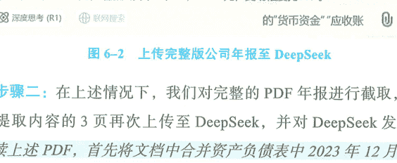

## 步骤二结果
DeepSeek 首先按照指令，将 2023 年 12 月 31 日和 2022 年 12 月 31 日“货币资金”“应收账款”“存货”“无形资产”“应付账款”报表项目的金额提取了出来，然后按照规定的语句格式进行了报表项目的描述性分析，如图 6-3 所示。经过人工检验，结果无误。

## 提取的报表项目金额：

1. 货币资金

- 2023 年 12 月 31 日：1,491,130,655.84 元

- 2022 年 12 月 31 日：1,445,655,629.76 元

2. 应收账款

- 2023 年 12 月 31 日：705,187,726.27 元

- 2022 年 12 月 31 日：687,775,118.71 元

3. 存货

- 2023 年 12 月 31 日：1,118,538,058.00 元

- 2022 年 12 月 31 日：1,141,533,184.47 元

4. 无形资产

- 2023 年 12 月 31 日：132,771,318.31 元

- 2022 年 12 月 31 日：96,216,640.49 元

5. 应付账款

- 2023 年 12 月 31 日：204,255,088.49 元

- 2022 年 12 月 31 日：197,964,439.96 元

## 描述性分析：

1. 货币资金：2023 年年末余额为人民币 1,491,130,655.84 元，年初余额为人民币 1,445,655,629.76 元，增加人民币 45,475,026.08 元，变动幅度为 3%。

2. 应收账款：2023 年年末余额为人民币 705,187,726.27 元，年初余额为人民币 687,775,118.71 元，增加人民币 17,412,607.56 元，变动幅度为 3%。

3. 存货：2023 年年末余额为人民币 1,118,538,058.00 元，年初余额为人民币 1,141,533,184.47 元，减少人民币 22,995,126.47 元，变动幅度为 -2%。

4. 无形资产：2023 年年末余额为人民币 132,771,318.31 元，年初余额为人民币 96,216,640.49 元，增加人民币 36,554,677.82 元，变动幅度为 38%。

5. 应付账款：2023 年年末余额为人民币 204,255,088.49 元，年初余额为人民币 197,964,439.96 元，增加人民币 6,290,648.53 元，变动幅度为 3%。

## 任务二

让 DeepSeek 自己挑出待分析的同行业企业年报中年初、年末余额变动幅度超过 10% 的项目，按照任务一的语句格式进行描述。

### 步骤一：对 DeepSeek 发出指令：在上述规则基础上，请继续阅读 PDF，将资产负债表中，符合年末数同年初数的变动幅度超过 10% 的报表项目提取出来，并按照描述性分析语句进行展现。

### 步骤一结果：DeepSeek 完成了任务，提取出了资产负债表中年初余额和年末余额变动幅度超过 10% 的报表项目，并按照描述性分析展现出来，如图 6-4 所示。经过人工检验，结果无误。

## 在**上述规则基础上，请继续阅读 PDF 文档**，将资产负债表中，符合年末数同年初数的变动幅度超过 10% 的报表项目提取出来，并按照描述性分析语句进行展现。

变动幅度超过 10% 的报表项目及分析:

1. 无形资产：2023 年年末余额为人民币 132,771,318.31 元，年初余额为人民币 96,216,640.49 元，增加人民币 36,554,677.82 元，变动幅度为 38%。

2. 其他应收款：2023 年年末余额为人民币 71,120,922.90 元，年初余额为人民币 42,358,923.75 元，增加人民币 28,761,999.15 元，变动幅度为 68%。

3. 其他非流动资产：2023 年年末余额为人民币 22,841,476.22 元，年初余额为人民币 15,008,554.89 元，增加人民币 7,832,921.33 元，变动幅度为 52%。

4. 其他应付款：2023 年年末余额为人民币 241,363,094.35 元，年初余额为人民币 52,085,680.63 元，增加人民币 189,277,413.72 元，变动幅度为 363%。

5. 预计负债：2023 年年末余额为人民币 48,677,391.09 元，年初余额为人民币 29,360,558.28 元，增加人民币 29,316,832.81 元，变动幅度为 100%。


图 6-4 DeepSeek 提取出变动幅度超过 10% 的报表项目

### 步骤二：将 DeepSeek 生成的结果复制粘贴到本地 Word 文档中，但发现直接复制粘贴，格式非常凌乱，还需要人工调整。为了避免手动调整，继续使用 DeepSeek 调整已生成结果的格式。

对 DeepSeek 发出指令：请将上述结果内容按照宋体、5 号字、行间距 1.5 倍、“报表项目”名称加粗体调整，形成一个 html 格式文档。

### 步骤二结果：DeepSeek 按照提出的格式要求，生成了 html 代码（如图 6-5 所示）。点击右下角“运行 HTML"（如图 6-6 所示），弹出 html 运行窗口，展示了调整之后的内容（如图 6-7 所示）。直接复制窗口中的内容，在 Word 文档中保留源格式粘贴（如图 6-8 所示），就可完整使用。

请将上述结果内容按照宋体、5 号字、行间距 1.5 倍、“报表项目”名称加粗体调整，形成一个 html 格式文档。

以下是符合您要求的 HTML 格式文档，使用宋体、5 号字、1.5 倍行距，并对“报表项目”名称加粗显示:


# DeepSeek

### 2023 年度财务报表重要变动项目分析

1. **无形资产**: 2023 年年末余额为人民币 132,771,318.31 元，年初余额为人民币 96,216,640.49 元，增加人民币 36,554,677.82 元，变动幅度为 38%。

2. **其他应收款**: 2023 年年末余额为人民币 71,120,922.90 元，年初余额为人民币 42,358,923.75 元，增加人民币 28,761,999.15 元，变动幅度为 68%。

3. **其他非流动资产**: 2023 年年末余额为人民币 22,841,476.22 元，年初余额为人民币 15,008,554.89 元，增加人民币 7,832,921.33 元，变动幅度为 52%。

4. **其他应付款**: 2023 年年末余额为人民币 241,363,094.35 元，年初余额为人民币 52,085,680.63 元，增加人民币 189,277,413.72 元，变动幅度为 363%。

5. **预计负债**: 2023 年年末余额为人民币 48,677,391.09 元，年初余额为人民币 29,360,558.28 元，增加人民币 29,316,832.81 元，变动幅度为 100%。


###### 作者点评

在这个案例中，财务人员利用 DeepSeek 进行 PDF 数据的结构化提取与分析，充分体现了 AI 工具在信息提取、处理和文本生成方面的优势。面对内容复杂的企业年报，DeepSeek 根据引导指令，从数据提取、变动分析到格式美化，逐步实现了高效自动化处理，显著节省了时间。尤其在任务二中，DeepSeek 对资产负债表变动幅度超过 10% 的报表项目进行了自动识别与描述性分析，这种定制化的提取充分展现了 AI 的智能属性，为财务人员应用 AI 工具辅助生成分析文本的人机协同工作提供了巨大的想象空间。

#### 6.2 利用 Excel 文档生成标准化文本

<blockquote>任务场景描述</blockquote>

你是一家中小型制造业企业的财务经理。公司领导要求财务部每月末对当月财务报表的两期变动情况进行总结，并提交对比分析报告。公司月度财务报表都用本地计算机的 Excel 文档完成，因此每次对比两期数据时都需要人工摘取两期数据到 Word 文档中，然后对两期变动数据和情况进行分析描述。分析汇报工作很重要，而数据准备工作又很机械费时。如果能够利用 AI 工具实现从 Excel 文档中快速提取信息，并根据要求生成标准化的内容展现，将会大大提高财务部每月财务数据分析工作的效率。

应用 DeepSeek 辅助高效完成利用 Excel 文档生成标准化文本任务，操作步骤如下:

- **步骤一：**将"2025 年 3 月财务报表.xlsx"作为附件上传至 DeepSeek 中，并对 DeepSeek 发出指令：**请阅读上述 Excel 文档，首先将资产负债表 sheet 页中所有会计科目的期末余额和期初余额提取出来。其次对这些科目进行描述性分析，并按照如下语句的格式进行展现：“货币资金：期末余额为人民币 44 万元，期初余额为人民币 25 万元，增加人民币 19 万元**，变动幅度为 76%。”

## 步骤一结果：DeepSeek 将资产负债表中所有科目的期末余额和期初余额都提取了出来，并按照规定的语句格式进行了报表项目的描述性分析（如图 6-9 (a) 所示）;此外，DeepSeek 还指出了变动幅度较大的一些科目，作为补充说明和提示（如图 6-9 (b) 所示）。经过人工检验，结果无误。

# 提取的会计科目及其余额：

1. 货币资金：期末余额 44 万元，期初余额 25 万元

2. 交易性金融资产：期末余额 0 万元，期初余额 0 万元

3. 应收票据：期末余额 20 万元，期初余额 23 万元

4. 应收账款：期末余额 398 万元，期初余额 199 万元

5. 预付款项：期末余额 22 万元，期初余额 4 万元

6. 其他应收款：期末余额 12 万元，期初余额 22 万元

7. 存货：期末余额 119 万元，期初余额 326 万元

8. 一年内到期的非流动资产：期末余额 77 万元，期初余额 11 万元

#### (a)

## 总结：

1. 显著增长的科目：
   - 应收账款 (+100%)、预付款项 (+450%)、一年内到期的非流动资产 (+600%)、其他流动负债 (+960%)、长期借款 (+84%)
   - ○可能反映业务扩张、采购预付增加或融资策略调整。

2. 显著减少的科目：
   - 存货 (-63%)、长期待摊费用 (-67%)、其他非流动负债 (-100%)
   - ○可能因库存清理、费用摊销完成或负债偿还。

3. 股东权益变动：
   - 盈余公积大幅增长 (+50%)，未分配利润稳步增加 (+8%)，显示盈利积累能力增强。

(注：变动幅度计算基于“（期末 - 期初）/ 期初×100%"，期初为 0 时未计算幅度。)

图 6-9 DeepSeek 提取出资产负债表中所有科目的期末余额和期初余额

#### (b)

### 步骤二：虽然 DeepSeek 自动总结出了变动的报表项目，但筛选标准不符合公司要求。根据公司管理层要求，要将当月同上月变动幅度超过 50% 的报表项目筛选出来，做进一步分析。

由此，对 DeepSeek 发出指令：在上述基础上，请将报表项目变动幅度超过 50% 的筛选出来，并根据已有资产负债表信息，对这些变动幅度较大的项目做简单的变动分析描述。

步骤二结果：DeepSeek 列出了变动幅度超过 50% 的报表项目信息，经过人工检验，结果无误。同时，DeepSeek 还根据上传 Excel 文档中的资产负债表信息，对变动情况做了简单的分析，具有一定的参考性，如图 6-10 所示。对于 DeepSeek 生成的上述分析，可以直接复制粘贴到本地 Word 文档中使用。

## 变动幅度超过 50% 的报表项目及分析：

**资产类科目:**

1. 应收账款
   - 变动：期末余额 398 万元，期初余额 199 万元，增加 199 万元，变动幅度 100%。
   - 分析：应收账款大幅增加，可能是公司放宽信用政策以促进销售，或存在收入确认提前但款项未及时收回的情况。需关注回款能力，避免坏账风险。

2. 预付款项
   - 变动：期末余额 22 万元，期初余额 4 万元，增加 18 万元，变动幅度 450%。
   - 分析：预付款项激增，可能是为锁定原材料采购或服务提前支付款项，需结合业务背景判断是否合理（如供应链紧张需预付）。

### <blockquote>作者点评</blockquote>
<blockquote>本节选取的案例场景贴近多数中小型企业的财务基础实操流程。Excel 文档是最常见的财务数据载体之一，而很多企业管理层仍然要求使用 Word 文档进行报告分析。这样，把 Excel 文档中的数据人工复制粘贴到 Word 文档中并做分析，就一直是效率痛点。使用 DeepSeek 读取 Excel 文档并自动生成分析文本，特别是精准满足企业分析需求，能够大大减轻财务人员的工作负担。AI 工具识别数据变动背后逻辑的能力令人惊喜，财务人员应该尽早了解、多多运用这样的“智能助手”。</blockquote>

#### 6.3 自动生成往来对账函

应用 DeepSeek 辅助高效完成自动生成往来对账函任务，操作步骤如下:

- **步骤一：**将已整理好的 Excel 文档“客户对账信息.xlsx"（如图 6-11 所示）和一份制作好的 Word 文档“往来对账函.docx”（如图 6-12 所示）作为附件上传至 DeepSeek。我们需要将“客户对账信息.xlsx"中的第一家客户信息自动填充到“往来对账函.docx”中。

| | | | | |
|---|---:|---:|---|:|
| 客户名称 | 应收款项金额 | 预付款项金额 | 应付款项金额 | 预收款项金额 |
| 北京太阳股份有限公司 | 768,000.00 | | | |
| 天津太阳有限责任公司 | | | | |
| 青岛星星股份有限公司 | | | | |
| 武汉星星有限责任公司 | 2,000,000.00 | | | |
| 北京彩虹股份有限公司 | 1,800,000.00 | | | |

图 6-11 客户对账信息

向 DeepSeek 发出指令：请阅读两个文档，帮我生成一个 VBA 代码，在往来对账函 Word 中使用，用客户对账信息表中的 A2 单元格替换往来对账函中的{客户名称},用 B2 单元格替换往来对账函中的【应收账款金额】,用 C2 单元格替换往来对账函中的【预付账款金额】,用 D2 单元格替换往来对账函中的【应付账款金额】,用 E2 单元格替换往来对账函中的【预收账款金额】。并且将往来对账函文档重新命名为：往来对账函_客户名称。

## 往来对账函

致：{客户名称}

下列数据出自本公司账簿记录，如与贵公司相符，请在本函下端“信息证明无误”处签章证明；若有不符，请在“信息不符”处列明不符金额，并签章证明，回函请直接寄至我公司。

公司名称：北京市 XXXX 股份有限公司
通信地址：北京市海淀区 XXX 街道 ABC 大厦 10 楼
签收电话：010-12345678

本公司与贵公司的往来账项列示如下：

| | | | |
|---|---|---|---|
| 截止日期 | 应收款项金额 | 预付款项金额 | 应付款项金额 | 预收款项金额 |
| 2024.12.31 | 【应收账款金额】 | 【预付账款金额】 | 【应付账款金额】 | 【预收账款金额】 |

图 6-12 往来对账函

1、信息证明无误

经办人：

日期：

2、信息不符，请列明不符金额

经办人：

日期：

### 步骤一结果：DeepSeek 按照要求输出了 VBA 代码（见图 6-13），并在最后附加了使用说明等内容（见图 6-14）。

## 自动生成往来对账函的 VBA 代码

图 6-13 DeepSeek 生成的 VBA 代码

请阅读两个文档，帮我生成一个 VBA 代码，在往来对账函 Word 中使用，用客户对账信息表中的 A2 单元格替换往来对账函中的 (客户名称)，用 B2 单元格替换往来对账函中的【应收账款金额】，用 C2 单元格替换往来对账函中的【预付账款金额】，用 D2 单元格替换往来对账函中的【应付账款金额】。并且将往来对账函文档重新命名为：往来对账函_客户名称。

以下是一个 VBA 代码，可以自动将 Excel 中的客户对账信息填充到 Word 对账函模板中，并重命名生成的对账函文件：

## 使用说明:

1. **准备工作：**
   - 将 Word 模板和 Excel 数据文件放在同一文件夹
   - Excel 文件名必须为"客户对账信息.xlsx"（或修改代码中的文件名）
   - 在 Word 中按 Alt+F1 打开 VBA 编辑器，插入新模块并粘贴此代码

2. **执行步骤：**
   - 打开 Word 模板文件
   - 按 Alt+F8，选择"GenerateReconciliationLettersFromWord"宏并运行

3. **代码特点：**
   - 自动检测同一文件夹下的 Excel 文件
   - 处理空单元格情况（自动替换为空字符串）
   - 金额自动格式化为无小数形式
   - 生成的文件名格式："往来对账函_客户名称.docx"
   - 完全在 Word 环境中运行，不依赖 Excel VBA

4. **注意事项：**
   - 首次运行时可能需要启用 Excel 对象模型引用（工具 > 引用 > 勾选"Microsoft Excel XX.X Object Library"）
   - 确保 Excel 文件中的列顺序与代码中的列号匹配（A=客户名称，B=应收款项，C=预付款项等）
   - 如果 Excel 文件正在使用中，可能需要先关闭它

图 6-14 DeepSeek 生成的使用说明（部分）

步骤二：复制 DeepSeek 生成的 VBA 代码，打开“往来对账函.docx"，在“开发工具”选项卡中点击“Visual Basic"按钮（如图 6-15 所示），即可打开 VBA 代码窗口。


然后，按照 DeepSeek 注意事项中说明的“首次运行时可能需要启用 Excel 对象模型引用（‘工具’—‘引用’—勾选‘Microsoft Excel XX.X Object Library'）”进行操作，如图 6-16、图 6-17 所示，点击确认。此项操作是为了让 VBA 有权限同时调用 Excel 文档和 Word 文档。


在“Microsoft Visual Basic for Applications"窗口点击“插入”按钮，在下拉菜单中选择“模块”，如图 6-18 所示。


将复制的 VBA 代码粘贴到窗口中。点击“运行”按钮，在下拉菜单中选择“运行子过程/用户窗体”，如图 6-19 所示，即可运行代码。


> **步骤二结果**：运行 VBA 代码后，往来对账函文档名称更新为“往来对账函_北京太阳股份有限公司”。往来对账函内部客户名称和期末余额表格均已按照客户对账信息表填列，如图 6-20 所示。经过人工检验，结果无误。

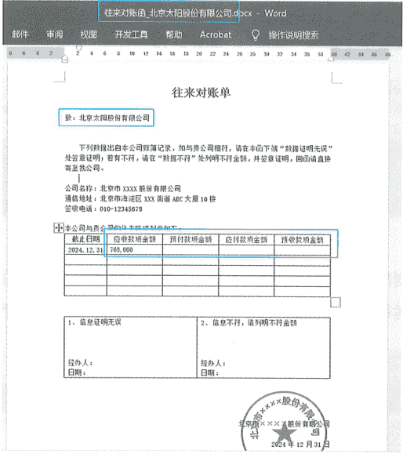

图 6-20 运行 VBA 代码生成的往来对账函

###### 作者点评

这个案例场景非常贴切地展现了 AI 与自动化脚本结合的实际落地应用。在财务工作中，往来对账是极其烦躁又重要的工作。传统人工填写极易出错且效率低下。通过 DeepSeek 生成 VBA 代码，不仅完成了 Excel 文档与 Word 文档之间的自动化数据映射，还实现了文档批量命名和内容自动填充。这种基于模板的自动化处理方式极具推广价值，特别适合需要批量输出标准化文档的财务场景。DeepSeek 帮助财务人员分担了重复性体力活，让财务人员聚焦于更有价值的分析与判断工作。这样的方法，财务人员务必尽早学起来。

#### 6.4 本章总结

本章通过三个财务工作场景，全面展示了 DeepSeek 在信息提取、数据分析、自动填充与格式转换等方面的高效表现。从 PDF 报表中智能提取数据并分析、根据 Excel 文档生成标准化文本，根据 Excel 文档生成往来对账函 Word 文档，DeepSeek 展现了强大的跨格式理解能力、文本生成能力与场景适应能力。这一系列应用充分说明，AI 不仅能够成为财务工作的辅助工具，更可以逐步渗透至财务流程的每一个关键环节。财务人员早日掌握这样的工具，充分发挥人机交互中“人”的引导、指挥、决断作用，配合 AI 的执行能力，大幅提升工作效率不是难事。

**实用技巧**

- 利用格式化语句模板。为 AI 提供统一的文本输出模板，能够显著提升生成内容的结构化水平和可读性。特别是在财务数据描述性分析中，固定格式能使后续复制粘贴和对比更加高效。
- 利用 html 格式美化 Word 文档。借助 AI 生成指定字体、字号、行距、加粗体等格式的 html 内容，可有效解决直接复制粘贴内容后格式混乱的问题。将生成结果以“保留源格式”方式粘贴，即可实现一键美观排版。
- 设置筛选阈值优化分析结果。在财务分析中设定如“变动幅度超过 10%"的阈值，AI 已经足够智能，能够根据阈值设定聚焦关键项目，从而使得分析更有效，避免信息冗余。
- Excel 与 Word 文档结合使用。将 Excel 数据与 Word 标准化模板结合使用，利用 AI 实现自动填充，不仅能确保信息准确无误，还能显著提升效率。此法适用于往来对账函、报表说明、合同模板等大量重复性文档的生成。

- 使用特殊字符进行文本替换定位。通过在文档中预设如"{客户名称}"“【应收账款金额}”等特殊占位符，AI 或脚本可精准识别并将其替换为对应数据。这种方式使得数据填充更高效、定位更准确，避免人工查找错误。

# 第 7 章
## 应用 DeepSeek 辅助财务附件识别

日常财务工作中需要处理大量的财务附件，如各种发票、合同、其他单据等。这些附件种类繁多，格式和内容也各不相同。在传统财务工作模式下，财务人员人工处理这些财务附件，工作量大、烦琐且易出错。后来很多企业开始借助信息化手段，希望提高财务附件处理效率。例如，购买扫描仪、高拍仪等设备，扫描纸质附件生成电子文档，再利用光学字符识别（OCR）技术提取关键信息。如果希望在这个过程中避免大量的人工校对，则需要提高 OCR 的信息处理精度，往往要购买专业软件或者使用收费的第三方服务平台。同时，要想实现这个过程，还涉及将专业软件或第三方服务平台的服务嵌入企业的财务附件处理相关流程，如果流程设计得不好，反而会增加财务工作量或者提高工作复杂度。

随着 AI 技术的快速发展，特别是以 DeepSeek 为代表的 AI 工具的兴起，财务人员的工作方式正在发生深刻变化。DeepSeek 能够调用第三方应用程序编程接口（API）或者集成开源模型完成智能识别任务，更为简单、自由和人性化地帮助财务人员处理发票、合同及其他各种格式复杂的单据，以极简模式和极低成本迅速提取关键信息。应用 DeepSeek 辅助财务附件识别对于减轻财务工作负担，帮助企业在降本的基础上推进财务数字化转型有重要意义。

常见的财务附件包括发票、合同、银行回单等各种记录企业经济交易的纸质或电子凭证、资料。其中，发票是最常见且数量最多的。根据形式和载体不同，发票可分为传统纸质发票和电子发票（包括 PDF/OFD 格式电子发票和目前正在推广的数电发票）。合同作为企业进行经济交易的重要契约文件，也是重要的财务凭证，其种类繁多、文本结构复杂，处理起来工作量大、比较烦琐但又非常重要。

基于此，本章重点阐述如何应用 DeepSeek 优化三类典型财务附件的处理流程。其中，7.1 节介绍 DeepSeek 在电子发票识别中的应用，如自动提取电子发票中的关键信息（发票号码、金额、税额等），并将其整合到财务台账中；7.2 节展示应用 DeepSeek 处理纸质发票的解决方案，以火车票为典型案例，介绍如何针对火车票的特殊版式实现高精度识别和结构化数据输出；7.3 节探讨 DeepSeek 在合同识别中的应用，如智能识别合同中的关键条款，并生成标准化的合同台账。本章通过三个财务场景展现 DeepSeek 在提升财务工作效率和降低人工差错率等方面的显著优势。

# 7.1
## 应用 DeepSeek 辅助电子发票识别

> **任务场景描述**

你作为一家新成立的小型生产企业的财务人员，正面临一个棘手的问题：老板要求你建立电子发票台账，但员工提交的电子发票数量庞大，手动录入不仅效率低下，还经常出现关键信息录入错误的情况。你想借助 AI 工具，看看是否有更智能的解决方案，能够批量、准确地自动提取电子发票中的关键信息（如发票号码、金额、税额等），并直接生成需要的台账数据。

你找了几张之前开的学校抬头的发票，打算先用 DeepSeek 做个测试，看看能否批量、准确地自动提取信息和生成台账。发票信息如图 7-1 所示。


向 DeepSeek 发出指令：识别上述电子发票，提取发票中的信息。生成 VBA 代码将发票信息填入“电子发票台账”表格，每个发票为一行。

> 步骤二结果：DeepSeek 理解了指令，并生成了一段能将发票信息自动填入“电子发票台账.xlsx"的 VBA 代码（见图 7-3）。


识别上述电子发票，提取发票中的信息。生成 VBA 代码将发票信息填入

识别上述电子发票，提取发票中的信息。生成 VBA 代码将发票信息填入“电子发票台账”表格，每个发票为一行。

> 以下是提取电子发票信息并生成 VBA 代码的解决方案：

##### 提取的发票信息

1. 电子发票 1.pdf:
   - 销售方名称：北京利通出行科技有限公司
   - 销售方税号:91110105MA04FJZ66K
   - 发票号码:2511700000292291678
   - 开票日期:2025 年 03 月 11 日


**图 7-3 DeepSeek 提取发票信息并生成 VBA 代码**

>> 步骤三：在“电子发票台账.xlsx"中运行 DeepSeek 生成的 VBA 代码。首先，复制 DeepSeek 生成的 VBA 代码，打开“电子发票台账.xlsx"。然后，在 Excel 功能区“开发工具”选项卡下点击"Visual Basic"按钮。（注意：如果打开 Excel 后未在工具区找到“开发工具”选项卡，可回顾本书第 4 章学习如何安装加载项。）之后，在弹出的"Microsoft Visual Basic for Applications”窗口中点击“视图”并在下拉菜单里选择“代码窗口”（见图 7-4）。


> **图 7-4 点击“视图”——“代码窗口”**

最后，在弹出的空白面板中粘贴之前复制的 DeepSeek 生成的 VBA 代码，并点击菜单栏中的“运行”（见图 7-5）。

> **图 7-5 粘贴并运行 VBA 代码**

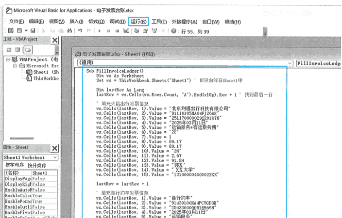

步骤三结果：“电子发票台账.xlsx"成功运行了 DeepSeek 生成的 VBA 代码。发票信息被录入台账，如图 7-6 所示。

| 销售方名称 | 销售方统一社会信用代码/纳税人识别号 | 发票号码 | 开票日期 | 项目名称 | 单位 | 数量 | 单价 | 金额 | 税率/征收率 | 税额 |
| --- | --- | --- | --- | --- | --- | --- | --- | --- | --- | --- |
| 1 | A | B | C | D | E | F | G | H | I | J |

图 7-6 发票信息成功录入“电子发票台账.xlsx"(部分)

这种方法操作简单快捷。但 DeepSeek 有时无法一次就生成正确的 VBA 代码，此时就需要财务人员将 Excel 提示的代码错误反馈给 DeepSeek，让其继续修改直至生成正确代码。（可回顾本书第 4 章关于 VBA 代码错误后的再修改过程。）

> **作者点评**

只要清晰地向 DeepSeek 表达需求，批量识别电子发票对于 DeepSeek 而言是比较轻松的任务。实际上，DeepSeek 是驱动、调用了互联网上的智能识别工具来完成任的。从应用者的角度，我们能感受到应用 AI 的方便、高效和低成本。正如本章开篇所述，应用 DeepSeek 辅助识别财务附件的操作，比以往各种软件、平台都更为简化、自由和人性化，这是极大的进步。

#### 7.2 应用 DeepSeek 辅助纸质发票识别

**任务场景描述**

作为一家新成立的小型生产企业的财务人员，在成功解决电子发票识别问题后，你还需要解决纸质发票识别问题。目前纸质发票（如部分火车票、物流运输票等）仍然存在于企业报销中。你也想像借助 AI 工具识别电子发票那样，看看能否应用 DeepSeek 批量、准确地自动提取纸质发票中的关键信息，并按照要求填入 Excel 表格。

你找来两张纸质火车票做测试，用手机拍摄火车票如图 7-7 所示（为了增大任务难度以及更加真实，特别选择了有些卷曲的火车票）。


应用 DeepSeek 辅助高效完成任务，操作步骤如下：

> 步骤一：预先制作“纸质车票台账.xlsx"模板。将财务人员登记火车票时可能需要的信息类目输入 Excel 空白工作表，制作出“纸质车票台账.xlsx"模板，便于下一步操作中 DeepSeek 直接将识别的车票信息提取并对应填入表格（生成 CSV 格式文件）。
> **图 7-8“纸质车票台账.xlsx"类目**，包含了火车票作为财务附件在管理时可能需要的所有关键字段。

|  | 车牌编号 | 出发站 | 到达站 | 车次 | 日期 | 票价 | 姓名 | 身份证号 | 座位类型 | 座位信息 |
|---|---|---|---|---|---|---|---|---|---|---|
|  |  |  |  |  |  |  |  |  |  |  |
| 1 |  |  |  |  |  |  |  |  |  |  |

- 步骤二：将需要识别的两张火车票照片与“纸质发票台账.xlsx"模板导入 DeepSeek，要求 DeepSeek 识别车票关键信息，并提取生成 CSV 格式文件。

向 DeepSeek 发出指令：**识别上述纸质车票，提取车票的信息。根据“纸质车票台账”表格中的信息内容，生成对应 CSV 格式将内容补充完整，每张车票为一行**。

这里，我们让 DeepSeek 使用 CSV 格式来实现生成内容自动导入 Excel 表格。

> 步骤二结果：DeepSeek 理解了指令，并生成了 CSV 格式的内容（见图 7-9）。

##### 提取的车票信息（完全匹配台账字段）

纸质车票 1.png
- 车票编号: 4U032617
- 出发站: 郑州东站
- 到达站: 镇江南站
- 车次: G1478
- 日期:2025-01-27 15:11:00
- 票价: 355.5
- 姓名: 王龙龙
- 身份证号: 4106221992****1511
- 座位类型: 二等座
- 座位信息: 10 车 05A 号（已修正“年”为“车”）

##### 生成的 CSV 格式内容

```csv
车票编号，出发站，到达站，车次，日期，票价，姓名，身份证号，座位类型，座位信息
4U032617,郑州东站，镇江南站,G1478,2025-01-27 15:11:00,355.5,王龙龙,4106221992****1511，二等座,08 车 07D 号
4U032616,鹤壁东站，郑州东站,G1577,2025-01-27 14:07:00,66.8,王龙龙,4106221992****1511，二等座,18 车 05
```

**图 7-9 DeepSeek 生成的 CSV 格式内容**

### 小贴士

### CSV 格式

CSV（逗号分隔值）是一种简单高效的通用数据存储格式。它采用纯文本形式存储表格数据，具有三大核心优势：一是兼容性强，支持所有数据库和办公软件；二是体积小巧，处理大数据集时效率极高；三是使用灵活，既可用专业软件处理，也能直接用文本编辑器查看修改。在财务工作中，CSV 尤其适合处理批量数据，包括电子发票

**188 / DeepSeek 高效财务**

台账管理、银行流水记录、费用报销汇总等场景，能实现不同系统间的无缝数据交换。

>> 步骤三：将 DeepSeek 生成的 CSV 格式内容输入 Excel 表格。首先，建立一个“纸质车票.txt"文本文档，复制 DeepSeek 生成的 CSV 格式内容并粘贴进该文本文档中（见图 7-10）。

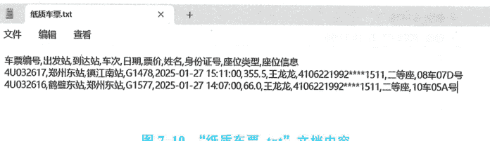

**图 7-10“纸质车票.txt"文档内容**

然后，打开“纸质车票台账.xlsx"，在功能区点击“数据”选项卡，找到并点击“从文本/CSV"按钮（见图 7-11）。

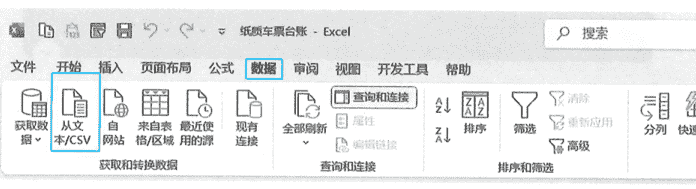

**图 7-11“数据”选项卡—“从文本/CSV”按钮**

弹出“导入数据”对话框，选择导入新建的“纸质车票.txt"。点击“导入”后，会弹出“纸质车票.txt"页面，直接点击“加载”，即可实现对纸质车票信息的批量导入（见图 7-12）。

>> 步骤三结果：识别出来的两张纸质车票的信息成功批量录入了“纸质车票台账 .xlsx"（见图 7-13）。

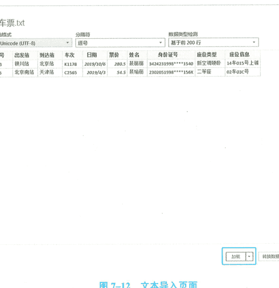

**图 7-12 文本导入页面**


**图 7-13 纸质车票识别信息录入“纸质车票台账.xlsx"**

> **作者点评**

借助 DeepSeek 识别纸质发票，其实只比电子发票识别多一步拍摄纸质发票。而且，通过本案例可以看到，对于有瑕疵（如卷曲）的发票，拍照后照样能够被精确识别。这实际上就是所谓的"OCR+AI"，即 AI 识别。我们还能看到，使用 CSV 格式实现将 DeepSeek 生成内容自动导入 Excel 表格，比使用 VBA 代码的方式要简单一些。

#### 7.3 应用 DeepSeek 辅助合同识别

- **任务场景描述**

作为一家新成立的小型生产企业的财务人员，在成功解决电子发票和纸质发票的识别问题后，你有了不小的成就感。然而，老板又提出了一个更具挑战性的任务，希望你处理更加复杂的合同台账登记工作。合同文本篇幅长、版式多样，且包含大量专业条款及术语，精准识别和精确录入关键信息的难度更大。你依然希望借助 DeepSeek，批量、准确地自动提取合同中的关键信息，并按照要求填入 Excel 表格。

你找了两份合同⁽¹⁾做测试，如图 7-14 和图 7-15 所示。

|  |  |
|---|---|
|  | 说明 |
| JF-2019-002 | *本合同是根据《中华人民共和国合同法》等有关规定制定的示范文本，适用于本省行政区域范围内农产品订购行为。* |
| *合同编号:12013105* | |

### 山西省农产品订单合同 | *二、本合同条款均为提示性条款，供双方当事人约定采用。合同中的未尽事宜，可由双方当事人协商一致后，订立补充条款予以明确。*

**山西省市场监督管理局***

| 三、本合同签订前，双方当事人应相互提交身份证复印件或营业执照复印件校验有关身份证明。 |
|---|---|
| **山** | *四、本合同中的部分条款内容为并列的选择内容，双方当事人可根据实际情况作出选择，不予选择的则不再适用。* |
| **西省农业农** | |
| **村厅*** | *五、本合同文本空格部位填写内容及其他需要删除或添加的内容，双方当事人应当协商确定后准确填写或对合同内容进行适当调整。* |
| | *六、双方当事人可以根据实际情况决定本合同原件的份数，并在签订合同时认真核对；在任何情况下，出卖人和买受人都应当至少持有一份合同原件。* |


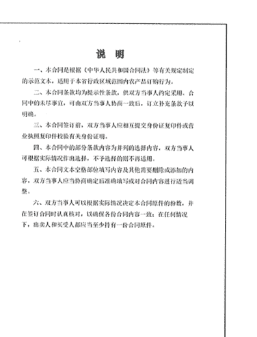

* 本处为虚拟合同。

# 第7章 DeepSeek 辅助财务附件识别 / 191

## 山西省农产品订单合同

**买受人：**山西绿丰农业有限公司
**证件号码：** 91140100MA2345678
**住所：**山西省太原市小店区平阳路109号
**联系电话：** 0351-87654321

**出卖人：**张丰收
**证件号码：** 142301198901017234
**住所：**山西省晋中市榆次区张建乡张庆村
**联系电话：** 13812345678

为适应农业产业结构调整，促进农业和农村经济的发展，提高农民和企业的经济效益，发展“订单农业”，根据《中华人民共和国合同法》及其他相关法律法规规定，经买卖双方协商一致，订立本合同，以资共同遵守。

# 第一条订单标的（品种、等级、质量）

| 序号 | 产品名称 | 品种等级 | 质量要求 |
| :--- | :--- | :--- | :--- |
| 1 | 优质玉米 | 晋单42号 | 水分≤14%，含损≤3%，无霉变、虫蛀。

###### 第一条 标的交付日期、数量及价格

出卖人在2023年10月以前，向买受人交付农产品共计5000公斤。

所售产品最低价格（保护价）3.5元/公斤，市场行情上涨时，由收购单位按市场价格进行收购。

买卖双方的任何一方如需提前或延期交货与提货，均应以书面形式提前7日通知对方，并取得相对方同意。

# 第三条交货方式

1、产品交货地点：山西省晋中市榆次区张庆乡张庆村村委会库。

2、双方一致同意按照如下第（1）种方式进行交货：

(1) 由出卖人将产品运送交货地点后，买卖双方共同在交货地点验收。

(2) 由买受人到出卖人处上门收购，并在收购处进行验收。

# 第四条验收标准、方式

1、产品验收标准：严格按本合同第一条约定的标准进行验收。

2、产品运至本合同约定交货地点后，买卖双方按以下方式（1）进行验收：

（1）数量及外观验收：由出卖人将产品运抵交货地点后，由买受人、出卖人代表共同对产品数量及外观进行验收。

（2）抽样验收：由买受人、出卖人按本合同第一条约定的质量要求对产品进行抽样验收。

###### 第五条 违约责任

买受人无正当理由在合同履行中退货的，应按照退货部分货款总值的15%向出卖人支付违约金，违约金不足以弥补出卖人损失的，买受人还应承担赔偿责任。

2、买受人无故拒收或未按合同约定收购农产品的，应向出卖人偿付被拒收或应收货货总值20%的违约金，违约金不足以弥补出卖人损失的，买受人还应承担赔偿责任。

3、出卖人无正当理由交货数量少于合同规定的，按少交数量价值的10%向买受人支付违约金。

4、如出卖人交付的产品掺杂使假，以次充好，买受人有权拒收，且由出卖人应按照该批农产品正常市场价值的30%向买受人支付违约金。

**出卖人：**张丰收
**授权代表：**张丰收
**日期：** 2023年5月15日

# 第六条不可抗力

1、买卖双方的任何一方由于不可抗力的原因不能履行或不能完全履行合同时，应尽快向对方通报理由，在提供相应证明后，可根据情况部分或全部免予承担违约责任，出卖人如果由于不可抗力造成产品质量不符合合同规定的，不承担违约责任。

2、如农产品因受气候影响早熟或晚熟的，交货期经双方协商可适当提前或推迟，如协商不成的，可按照不可抗力造成合同无法如期履行合同，双方可根据实际情况选择变更或解除合同。

> ## 图 7-14 第一份合同

其他约定事项：
1、本合同未尽事宜，双方可协商签订补充协议，补充协议与本合同具有同等法律效力。
2、本合同一式三份，买受人执两份，出卖人执一份。

[PAGE 207]

**说明**

一、本合同是根据《中华人民共和国合同法》等有关法律规定制定的示范文本，适用于本省行政区域范围内家禽禽养殖买卖行为。

二、本合同条款均为提示性条款，供双方当事人约定采用。合同中的未尽事宜，可由双方当事人协商一致后，订立补充条款予以明确。

三、本合同签订前，双方当事人应相互提交身份证复印件或营业执照复印件检验有关身份证明。

四、本合同中的部分条款内容为并列的选择内容，双方当事人可根据实际情况作出选择，不予选择的则不再适用。

五、本合同文本空格部分填写内容及其他需要删除或添加的内容，双方当事人应当协商确定后准确填写或对合同内容进行适当调整。

六、双方当事人可以根据实际情况决定本合同原件的份数，并在签订合同时认真核对，以确保各份合同内容一致；在任何情况下，出卖人和买受人都应当至少持有一份合同原件。

**山西省家禽禽养殖买卖合同**

买受人：山西牧源食品有限公司，证件号码：91140100M67654321，住所：太原市清徐县解放路200号，联系电话：0351-7654321。

出卖人：王养殖，证件号码：142801198901017234，住所：吕梁市文水县古交镇王家村，联系电话：13897654321。

**山西省家禽禽养殖买卖合同**

买受人：山西牧源食品有限公司，证件号码：91140100M67654321，住所：太原市清徐县解放路200号，联系电话：0351-7654321。

出卖人：王养殖，证件号码：142801198901017234，住所：吕梁市文水县古交镇王家村，联系电话：13897654321。

**山西省家禽禽养殖买卖合同**

买受人：山西牧源食品有限公司，证件号码：91140100M67654321，住所：太原市清徐县解放路200号，联系电话：0351-7654321。

出卖人：王养殖，证件号码：142801198901017234，住所：吕梁市文水县古交镇王家村，联系电话：13897654321。

**山西省家禽禽养殖买卖合同**

买受人：山西牧源食品有限公司，证件号码：91140100M67654321，住所：太原市清徐县解放路200号，联系电话：0351-7654321。

出卖人：王养殖，证件号码：142801198901017234，住所：吕梁市文水县古交镇王家村，联系电话：13897654321。

**山西省家禽禽养殖买卖合同**

买受人：山西牧源食品有限公司，证件号码：91140100M67654321，住所：太原市清徐县解放路200号，联系电话：0351-7654321。

出卖人：王养殖，证件号码：142801198901017234，住所：吕梁市文水县古交镇王家村，联系电话：13897654321。

**山西省家禽禽养殖买卖合同**

买受人：山西牧源食品有限公司，证件号码：91140100M67654321，住所：太原市清徐县解放路200号，联系电话：0351-7654321。

出卖人：王养殖，证件号码：142801198901017234，住所：吕梁市文水县古交镇王家村，联系电话：13897654321。

**山西省家禽禽养殖买卖合同**

买受人：山西牧源食品有限公司，证件号码：91140100M67654321，住所：太原市清徐县解放路200号，联系电话：0351-7654321。

出卖人：王养殖，证件号码：142801198901017234，住所：吕梁市文水县古交镇王家村，联系电话：13897654321。

[PAGE 208]

### 第 7 章 应用 DeepSeek 辅助财务附件识别

应用 DeepSeek 辅助高效完成任务，操作步骤如下：

步骤一：预先制作“合同台账.xlsx"模板。将财务人员需要的合同关键信息字段名称输入Excel空白工作表，制作出“合同台账.xlsx"模板，便于下一步操作中DeepSeek 直接提取识别的合同信息并填入对应表格 (生成Markdown格式文件)。

步骤一结果：图 7-16 是设置好的“合同台账.xlsx"类目，包含了财务人员需要的合同关键信息字段。

| 合同编号 | 合同名称 | 买受人身份证号 | 买受人名称 | 出卖人名称 | 出卖人身份证号 | 合同日期 | 标的物 | 含税总价 |
| :--- | :--- | :--- | :--- | :--- | :--- | :--- | :--- | :--- |
| | | | | | | | | |

表 7-16“合同台账.xlsx"类目

步骤二：将需要识别的合同与“合同台账.xlsx"模板导入DeepSeek，要求 DeepSeek 将自动识别的合同信息自动填入台账。

[PAGE 209]

对 DeepSeek 发出指令：识别上述两份合同，提取合同的信息。按照每个合同为一行，填入“合同台账”的表格中，并输出 Markdown 代码。

这里，我们让 DeepSeek 使用 Markdown 格式来实现生成内容自动导入 Excel 表格。

步骤二结果：DeepSeek 理解了指令，并生成了 Markdown 格式的内容（见图 7-17）。


[PAGE 210]

第7章 应用DeepSeek辅助财务附件识别/195

图7-19 点击“分列”按钮

然后在弹出的“文本分列向导—第1步，共3步”对话框中，选择“分隔符号”，点击“下一步”(见图7-20)。

随后在弹出的对话框“文本分列向导—第2步，共3步”中，找到“分隔符号”栏目，选择最后一项“其他”，并填入“|"，即使用“|"当作分隔符进行分列，点击“下一步”(见图 7-21)。

在弹出的对话框“文本分列向导—第3步，共3步”中，没有需要改变的设置，直接点击“完成”(见图7-22)。


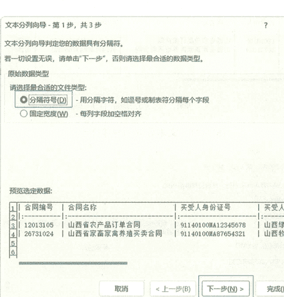

[PAGE 211]

图 7-21文本分列向导第2步

图 7-22文本分列向导第3步

[PAGE 212]

# 第7章 应用DeepSeek辅助财务附件识别/197

# 步骤四结果：分列操作后，Excel表格的内容如图7-23所示。

| 合同编号 | 合同名称 | 买受人身份证号 | 买受人姓名 | 出卖人姓名 | 出卖人身份证 | 合同日期 | 标的物 | 含税总价 |
| :--- | :--- | :--- | :--- | :--- | :--- | :--- | :--- | :--- |
| 12013105 | 山西省农产品订单合同 | 91140100MA1 | 山西绿丰 | 张丰收 | 14230119800101100X | 2023-05-15 | 优质玉米17,500元 | |
| 26731024 | 山西省家畜家禽养殖:91140100MA8 | 山西牧源 | 王养强 | 14230119750202100X | 2023-06-01 | 肉鸡5000只 | 125,000元 | |

图7-23 分列后的内容(部分)

# 步骤五：整理Excel表格格式。可以直接将步骤四结果的分割线（第二行）删掉，也可以将步骤四结果中的实质性内容粘贴到最初建好的“合同台账.xlsx"中（见图7-24）。不管使用什么方法，最终让“合同台账.xlsx"呈现出我们想要的格式即可。

| 合同编号 | 合同名称 | 买受人身份证号 | 买受人姓名 | 出卖人姓名 | 出卖人身份证号码 | 合同日期 | 标的物 | 含税总价 |
| :--- | :--- | :--- | :--- | :--- | :--- | :--- | :--- | :--- |
| 12013105 | 山西省农产品订单合同 | 91140100MA12345678 | 山西绿丰农业有限 | 张丰收 | 14230119800101100X | 2023-05-15 | 优质玉米5000公斤 | 17,500元 |
| 26731024 | 山西省家畜家禽养殖买卖合同 | 91140100MA87654321 | 山西牧源食品有限公 | 王养强 | 14230119750202100X | 2023-06-01 | 肉鸡5000只 | 125,000元 |

图7-24 最终版“合同台账.xlsx"

###### 作者点评

从本案例中可以看到，虽然合同比发票格式复杂，内容也更多，但应用DeepSeek依然可以轻松完成识别和填制合同台账任务。还可以看到，使用Markdown格式也可以实现将DeepSeek生成内容自动导入Excel表格，不过相比于使用VBA代码和使用CSV格式的方法，使用Markdown格式还需要手动调整格式，效率相对低。

#### 7.4 本章总结

本章探讨了如何应用DeepSeek辅助财务附件识别，具体包括电子发票识别、纸质发票识别和合同识别三个典型应用场景。目前AI工具已经能够批量、高效、准确地进行发票、合同等财务附件的智能识别（实际上是驱动互联网上的智能识别工具完成任务），而且操作简单，财务人员很容易掌握。
通过三个案例操作，我们对比了使用VBA 代码、CSV 格式和Markdown格式实现将DeepSeek生成内容自动导入Excel表格。使用VBA 代码方法方便快捷，但有时DeepSeek 会生成错误代码，此时可以将报错告诉DeepSeek，让它继续调试改错，直至生成正确代码。使用Markdown格式需要手动再调整格式。相比之下，使用CSV格式错误率比较低，且内容输入Excel 之后不用手动调整格式，属于推荐的方法。

# **实用技巧**

- 在财务附件识别时，向AI 工具明确提示所需数据字段的名称 (如方便也可提示数据类型)，以提高信息提取的准确性。
- 在生成数据处理代码或识别结果时，如果出现错误，要耐心引导AI，详细描述报错后，让AI 工具二次甚至多次调试和反馈迭代，最终输出正确结果。
- 灵活选择使用VBA 代码、CSV 格式、Markdown格式等方法，实现将DeepSeek生成内容自动导入Excel表格。三种方法各有优缺点，优先推荐 CSV 格式（出错率低且操作简便）。但是具体问题需要具体分析，出现错误时可尝试换一种方法。