# DeepSeek：零门槛掌握的通用智能体

# 内容概览
本书以当下走红的通用AI助手DeepSeek为线索，用大量可直接照搬的实操案例，把读者从完全陌生带到能自如调动其能力处理现实问题的阶段。案例覆盖学习辅导、办公提效、日常娱乐与自媒体运营等典型情境，全景式呈现该产品的使用价值。

全书共七章，由浅入深递进。第1至3章先把产品面貌、基础操作和提问思路讲清楚，帮助快速建立上手感。第4至7章进入具体应用：学习写作上能答疑、检索资料、生成文案，提升效率与质量；工作场景里可参与报告撰写、数据整理、演示制作等环节；生活娱乐上提供个性化推荐与趣味互动；自媒体创作上贯通选题调研、内容策划到粉丝运营。无论是初次接触AI的学生，还是想用AI优化工作生活的职场人，都能在书里找到可直接用的方法。

# 写在前面
# PREFACE
AI正在重塑个人和组织的竞争规则。DeepSeek是一款兼具开放源代码、低使用门槛、强推理和多场景适配特性的通用助手，迅速成为行业关注焦点。学生、办公人群、自媒体从业者都能借它提升效率、激发创意。

本书为满足学习需求而作，既是系统化的入门手册，也是重实操的应用指南。内容循序渐进，从概念到复杂场景实战，每章都力求用通俗语言把精髓讲透。希望读者通过系统化学习，快速掌握使用手法，并在学习、工作和生活里灵活迁移。

# 核心亮点
- **渐进式进阶**：从认知起步逐步过渡到实战演练，适配不同基础的读者搭建完整学习路径。
- **场景覆盖面广**：甄选43个典型使用场景，涵盖学习、职场、生活娱乐、自媒体创作，兼顾实用与普适。
- **偏重可操作技巧**：深度拆解各场景下的使用方法，让读者迅速上手并持续提高使用效率。

# 全书结构
本书以网页版为基准编写，移动端界面略有差异但功能逻辑基本一致，可对照自学。共分七章。

第1章 DeepSeek 究竟是什么：梳理诞生背景、发展脉络、技术特质及走红原因，形成宏观认知。
第2章 DeepSeek基础操作指南：讲解注册登录、界面分区、交互方式等基本用法，帮助顺利开启对话。
第3章 DeepSeek提问技巧与策略：介绍如何清晰表达需求、引导模型给出更精准回应，避免常见误区，提升提问质量。
第4章 DeepSeek助力学习与写作：覆盖学科答疑、资料查询、语言学习、文案创作等学习场景。
第5章 DeepSeek赋能职场工作：聚焦商务邮件与工作报告生成、市场调研、代码编写、数据处理等办公需求。
第6章 DeepSeek丰富生活与娱乐：介绍饮食规划、旅行攻略、生活常识问答、影视音乐个性化推荐等用途。
第7章 DeepSeek助力自媒体创作：涵盖账号定位、内容策划、脚本文案创作等创作运营环节。

# 适合谁读
本书面向各类人群。对AI好奇的初学者如在校学生；希望提升工作效能的职场人士如文案、数据分析、项目管理岗位；追求生活品质、想用AI丰富日常体验的普通用户；以及自媒体创作者、运营团队和内容平台企业，都能从中获得创作与运营的突破思路。

编者
2025年2月

# 第1章 揭开DeepSeek的神秘面纱
在技术加速迭代的当下，人工智能的每一次突破都牵动行业目光。DeepSeek正是其中最具代表性的新星之一，以惊人的发展速度吸引全球关注。它以创新架构和极高性价比打破传统壁垒，在国际舞台崭露头角，也引发广泛讨论。从默默无闻到一鸣惊人，其成长轨迹充满挑战与突破。下面一起探寻DeepSeek背后的创新逻辑与潜力。

## 1.1 认识 DeepSeek
网络上关于DeepSeek的讨论持续升温。业内人士称其颠覆了“靠计算能力堆砌”的传统范式，是“小投入大效果”的典型代表。它多次登顶应用商店下载榜，并获得阿里、腾讯等云厂商的技术支持，加速AI平民化进程。DeepSeek到底是什么？为何成为舆论焦点？

### 1.1.1 起源与演进轨迹
近年来AI模型层出不穷，DeepSeek脱颖而出。它由杭州深度求索人工智能基础技术研究有限公司孕育，汇聚顶尖科研团队的心血，是一款AI大模型，正重塑智能边界。

深度求索成立于2023年7月17日，采用数据蒸馏技术提炼高质量数据。下面为该公司发布的部分模型。

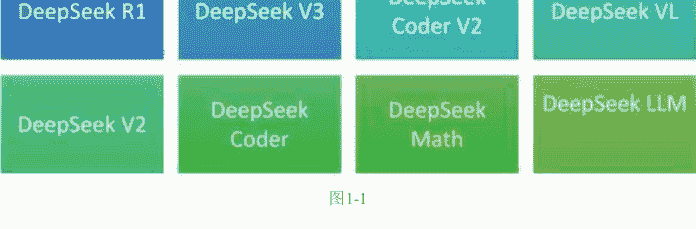

图1-1

**诞生背景**
DeepSeek凭借技术优势进入公众视野，打破了美国AI芯片企业长期主导的局面。热度攀升时，美多家AI芯片企业市值短期内大幅缩水，行业格局开始重塑。英伟达、AMD、台积电、博通等公司股价均出现不同程度下滑。

如此强势的产品如何诞生？

- 技术驱动推动研发方向不断优化、计算能力提升与数据规模增长共同促进了大模型性能跃升，为DeepSeek提供技术基础；深度学习技术成熟则为大规模数据处理提供了手段。
- 市场需求不断扩大，智能客服、语音助手、智能写作等场景都需要高效准确的语言理解与生成能力，DeepSeek恰好满足多样化交互与学习工作生活需求（如图1-2所示）。

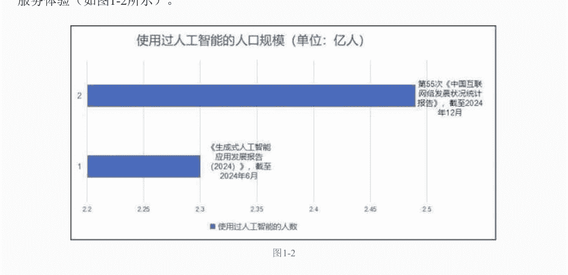

- 科研创新呼唤工具，科研人员需快速梳理文献、撰写综述、定位资料，也要处理海量数据、加速分析与建模。DeepSeek为此提供了强力支撑（如图1-3所示）。

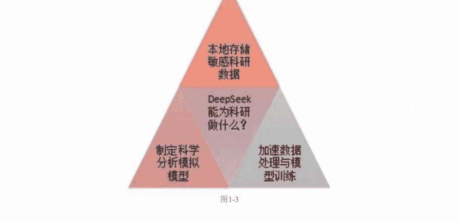

- 外部制约倒逼创新，长期以来美国在算力、技术、资本上占优，形成难以打破的壁垒。DeepSeek凭借创新架构，用更少算力实现更高准确率，挑战了“算力决定一切”的传统认知。

**发展历程**
DeepSeek的发展脉络如下表。

表1-1

| 时间 | 关键事件 |
|---|---|
| 2023年11月 | 发布开源代码模型DeepSeek Coder，支持多语言代码生成，免费开源，建立技术口碑 |
| 2024年5月 | 推出MoE架构DeepSeek-V2，推理成本降至每百万tokens约1元，掀起价格革命 |
| 2024年12月 | 发布DeepSeek-V3，参数规模6710亿，在Chatbot Arena中位列开源模型第一，性能接近GPT-4，训练成本可控 |
| 2025年1月20日 | 正式开源推理大模型DeepSeek-R1，性能对标OpenAI o1，引发现有AI生态重构 |

### 1.1.2 技术核心特征
DeepSeek持续引发争议，有人视其为美国AI行业的警钟，也有人呼吁限制其在海外的应用。其核心技术优势体现在：

**架构优化与多模态能力**
DeepSeek基于Transformer架构，并引入混合专家模型（如图1-4所示）。

同时具备跨模态学习框架，可融合文本、图像、语音等多源数据，提升多模态任务表现。

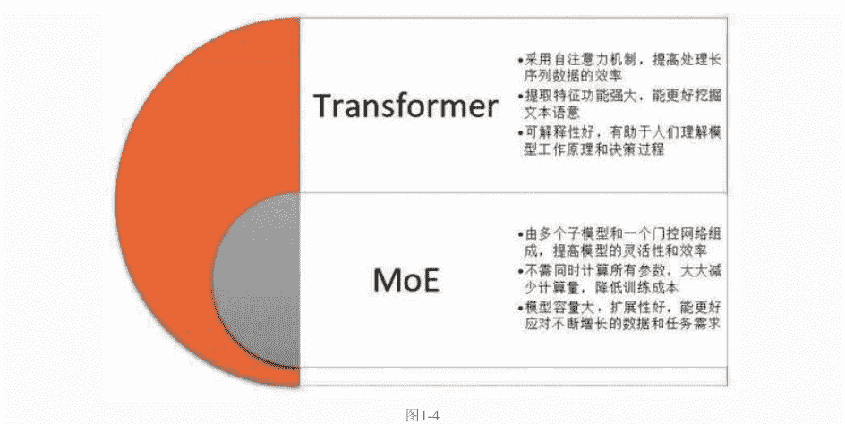

图1-4

**长文本生成与深度思考**
推理能力突出，能输出流畅、逻辑自洽的长文本，并把握整体主旨与结构。其深度思考能力可展示完整推理过程，在复杂逻辑、数据分析、编程等难题上实现多维度分析，推理方式接近人类，具备自我质疑与假设验证能力，适用于学习研究、创意写作与问题求解。

**开源与本地化部署**
DeepSeek模型与论文全面开源，用户可自行下载使用并在此基础上创新（如图1-5所示）。


图1-5

通过数据加密、访问控制与审计日志保障敏感数据在本地服务器的安全，符合GDPR等合规要求。兼容Linux/Windows及多种硬件环境，支持容器化部署，用户可按需定制功能，确保数据隐私与系统独立。

### 1.1.3 与同类产品的差异
DeepSeek热度持续，被部分媒体形容为AI领域的“拼多多”。与国内其他工具相比有何不同？

表1-2

| AI工具 | DeepSeek | 豆包 | Kimi |
| :--- | :--- | :--- | :--- |
| 主要功能 | 擅长复杂自然语言处理与编程辅助，可生成、解释代码；在专业领域依据训练数据提供深度分析 | 精准问答各类知识，提供高质量文案，覆盖多体裁；多语言翻译润色；可读取多格式文档并处理数据 | 精准问答，迅速抓住问题核心；文本生成能力强；支持多轮连贯对话 |
| 应用场景 | 科研人员快速查阅资料、推导公式；辅助程序员编码与排错；具备长文本深度思考能力；金融、教育、医疗、商业等专业场景提效 | 辅助学生与自学者答疑；在内容创作中提供灵感；在办公场景助力文档处理与翻译沟通 | 可输入大篇幅学术论文进行翻译与理解；处理多种格式文件 |
| 不足之处 | 生态相对年轻；图像生成能力有限，需配合其他工具 | 对小众、资料稀缺的专业问题精准度不足；视觉交互场景处理能力受限 | 专业编程辅助略逊；对高复杂度专业问题知识深度偶尔不足 |

由此可见，DeepSeek在文本推理与专业领域思考能力上表现突出。

## 1.2 DeepSeek为何走红全球
2025年1月20日DeepSeek-R1发布后，迎来爆发期。1月累计用户达1.25亿，其中超80%来自最后一周，7天内新增约1亿用户（如图1-6所示）。

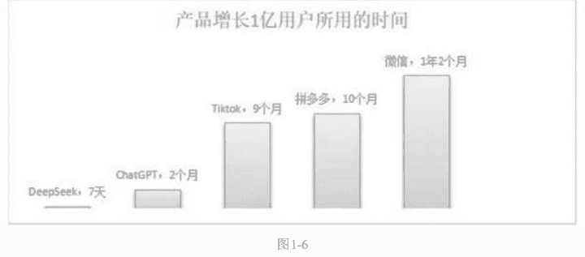

2025年1月27日，DeepSeek App登顶苹果中国区与美国区免费榜，超ChatGPT（如图1-7所示）；1月28日日活首次超越豆包，2月1日突破3000万。

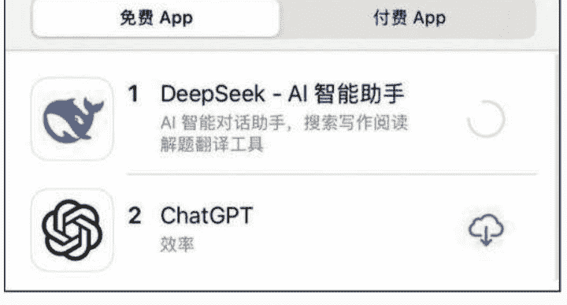

走红原因可归结为三点。

### 1.2.1 极致性价比
DeepSeek训练与使用成本低，API价格远低于OpenAI o1。权威评测中算力表现强劲，模型完全开源，显著降低科研与商业应用门槛。无需高配硬件即可获得良好体验（如图1-8所示）。

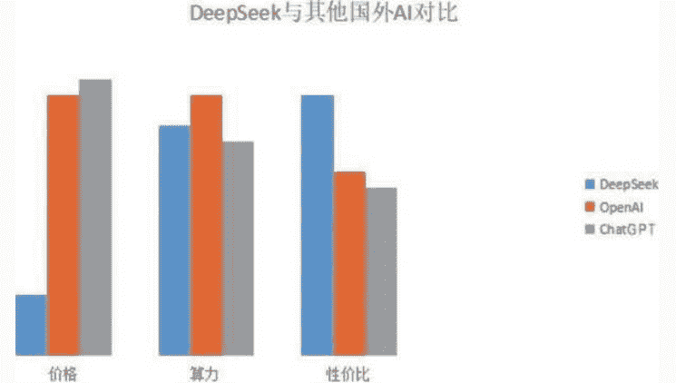

开放兼容性强，可与Chatbox AI、LibreChat等桌面客户端集成（如图1-9所示），也可接入STranslate提升翻译质量，或与PapersGPT、Wordware等插件结合，实现论文分析、智能写作等功能。


开源免费特性让企业与开发者能快速将模型嵌入业务，无需大规模改造，节省成本。不同行业可进行定制化训练，例如2025年2月5日中国联通宣布在“星罗”平台深度对接DeepSeek-R1；腾讯云、阿里云、百度智能云、华为云等均已上线相关模型服务。

### 1.2.2 突破算力依赖
DeepSeek问世前，先进制程被封锁，AI芯片由英伟达、谷歌等少数厂商主导，中国企业受限明显，供应链风险高（如图1-10所示）。

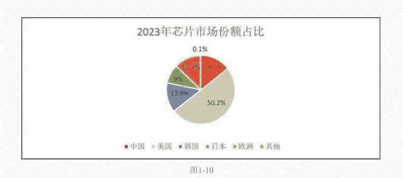

DeepSeek通过创新架构与算力优化，使AI可在本地设备高效运行，降低传输与存储成本，提升实时性与隐私安全。同时为国产芯片如华为昇腾提供生态机会，减少对单一硬件供应商依赖（如图1-11所示）。

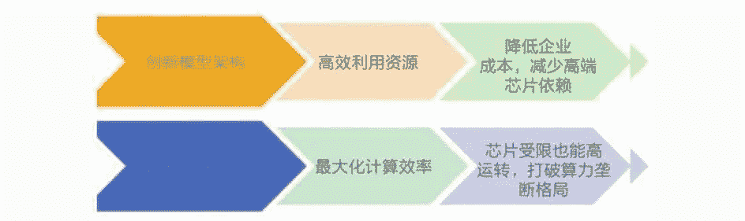

2025年2月5日，国家超算互联网平台上线DeepSeek系列大模型，用户可在线推理、训练与私有化部署，通过异构算力调度实现成本降低20%~40%。

### 1.2.3 高智商与高情商兼备
强大的语言模型赋予DeepSeek接近人类的深度思考与表达能力（如图1-12所示）。

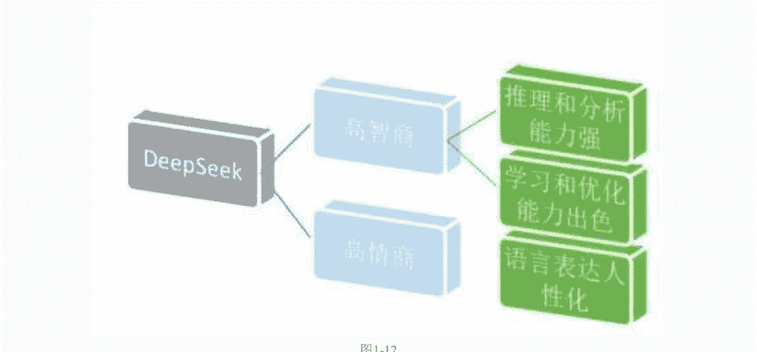

试看其回应方式：

Q
错过了朋友生日，该怎么道歉？

A
用户因故缺席朋友生日感到愧疚，需要合适的道歉方式。关键在于真诚，表达真实感受、承认缺席，并给出补救方案。

先要理解具体需求，是希望通过信息、电话还是当面沟通，是否准备礼物或补偿如请吃饭、补办庆祝，也要考虑朋友性格更看重语言还是行动。

同时要兼顾深层顾虑，如担心关系受损，因此建议要具体、真诚，避免空泛。道歉时应及时、说明原因、承担责任、表达重视，并提出未来弥补计划，保持通用且得体的表达。

真诚沟通，修复关系的小方法

给出的建议最好语气温暖、操作简单，让对方感觉到易于执行，也能感受到你的诚意。可以采用分步的方式呈现，也能提供几种不同做法，让对方依据自身情况挑选。

当出现隔阂时，最管用的仍是真诚的态度配合实在的行动。下面按步骤说明。

## 尽快主动联系

不要拖延。优先使用对方平时最常用的联系渠道，电话或见面最显诚意，其次是语音，最后才是文字，把歉意尽快说明白。可以这样表达：“昨天没能参加你的生日，我真的很抱歉，这件事一直压在我心里，想认真跟你说声对不起。”

## 拿出具体的补救办法

依据朋友的性格选择不同的修复方式：

- 实用派朋友：“周末我帮你订了你喜欢的日料店，补过生日可以吗？礼物我也提前准备好了~”
- 感性派朋友：写一张手写卡片，配上一张当天缺席的趣味小漫画，比如画成“那天的我被甲方扣押了”。
- 社恐派朋友：单独约见面时带一块小蛋糕，再准备一件对方之前提过想要的小周边。

关键提醒：如果对方仍显介意，要给彼此留出情绪消化的时间，避免出现“我都道歉了还想怎样”的想法。友情可以经得起波折，但需要你用持续的行动重新积累信任。

# 第2章 DeepSeek基础操作指南

对 DeepSeek 有了初步认识后，就需要学会账号的注册与登录方法，熟悉界面构成，掌握基础交互方式。把这些基础打牢后，使用起来会更顺畅，对话体验也会更好。

## 2.1 注册及登录

想要使用 DeepSeek，首先要完成账号创建与登录。平台同时支持网页端和移动端。

### 2.1.1 网页端注册流程

电脑用户可在浏览器中查找 DeepSeek，下面是网页版的注册步骤。

（1）在浏览器中搜索“DeepSeek”，找到官网（如图2-1所示）。


图2-1

（2）进入官网后，在该页面（如图2-2所示）点击“开始对话”。

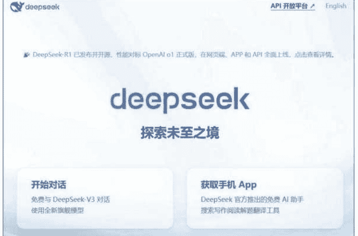

图2-2

（3）进入注册页（如图2-3所示），填写手机号、密码，点击“发送验证码”，随后按图2-4的提示完成校验。

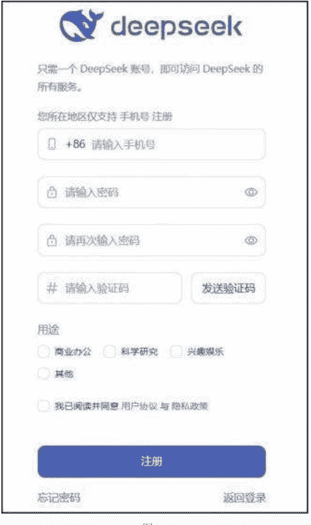

图2-3

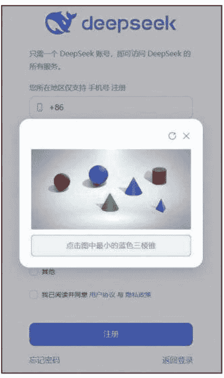

图2-4

（4）校验通过后，验证码会发到手机上（如图2-5所示），输入验证码后可按需选择使用用途，勾选“我已阅读并同意用户协议与隐私政策”，再点击“注册”（如图2-6所示），账号即创建成功。


只需一个 DeepSeek 账号，即可访问 DeepSeek 的所有服务。

您所在地区仅支持 手机号 注册

📱 +86

🔒 ********

🔒 ********

# 请输入验证码 55 秒后可再次获取

用途

- 商业办公

- 科学研究

- 兴趣娱乐

- 其他

☐ 我已阅读并同意 用户协议 与 隐私政策

注册

忘记密码 返回登录

图2-5

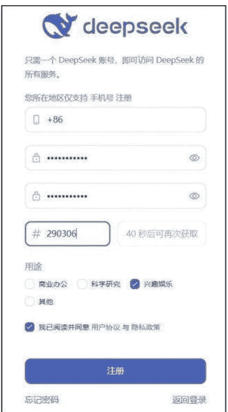

图2-6

### 2.1.2 移动端注册流程

手机端的注册逻辑与网页略有差别，打开 App 会直接进入登录页，未注册的号码会自动完成注册。下面以安卓为例说明。

1. 在手机桌面打开“应用市场”（如图2-7所示）。

2. 在搜索栏输入“DeepSeek”，点击“安装”进行下载与安装（如图2-8所示），安装完成后可在桌面找到应用图标。

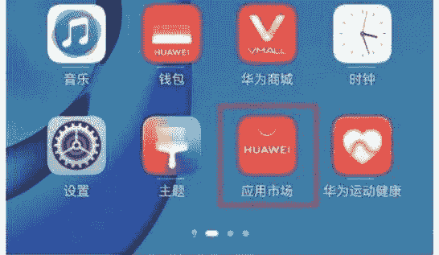

图2-7

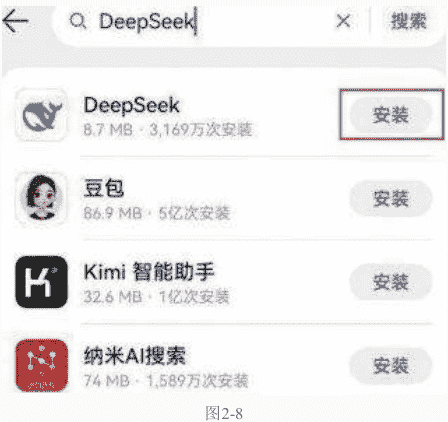

图2-8

（3）打开 DeepSeek 后进入登录页（如图2-9所示），输入手机号，点击“发送验证码”，按图2-10的提示完成验证。


验证码登录 密码登录

你所在地区仅支持 手机号 / 微信 登录

手机号输入框

验证码输入框

发送验证码

已阅读并同意 用户协议 与 隐私政策，未注册的手机号将自动注册

登录

图2-9

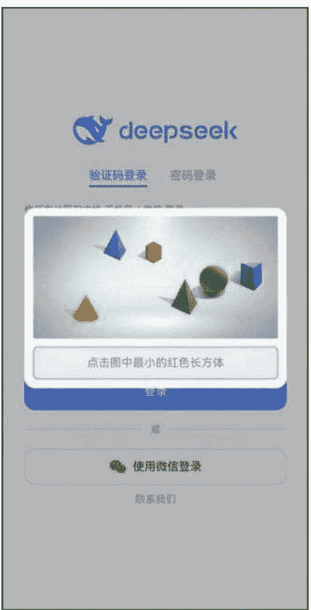

图2-10

（4）输入收到的验证码，勾选“已阅读并同意用户协议与隐私政策”（如图2-11所示），点击“登录”，即可完成注册并进入对话界面（如图2-12所示）。


验证码登录 密码登录

你所在地区仅支持 手机号 / 微信 登录

📱 +86

# 392298

发送验证码(41秒)

✅ 已阅读并同意 **用户协议** 与 **隐私政策**，未注册的手机号将自动注册

登录

或

💬 使用微信登录

联系我们

图2-11

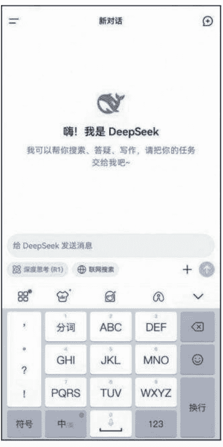

### 2.1.3 登录时的注意事项

以下是登录时需要注意的事项。

**账号安全：** 不要把账号密码透露给他人，建议定期更换密码以保障安全。

**多设备登录：** DeepSeek 支持多端同步，可在电脑、手机、平板上同时使用。

**忘记密码：** 如忘记密码，可通过注册时使用的邮箱或手机号重置。

## 2.2 界面介绍与功能概览

登录后进入 DeepSeek 主界面。

### 2.2.1 DeepSeek主界面介绍

主界面的布局如图2-13所示，中间是聊天窗口，可在此与模型互动。左侧有“打开边栏”“开启新对话”“扫码下载DeepSeek App”“个人信息”四个功能按钮。

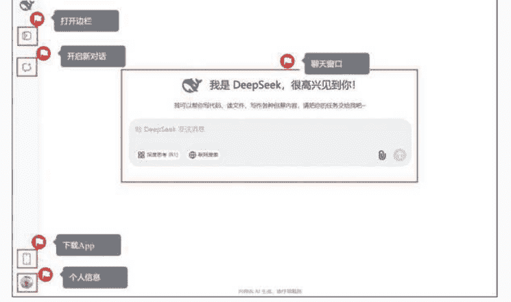

点击“打开边栏”按钮 📋，可查看历史对话记录（如图2-14所示）；点击“开启新对话”按钮 🔄，即可新建会话；当鼠标移至“扫码下载DeepSeek App”按钮 📱 上时，会弹出二维码，可用手机扫码下载移动端应用（如图2-15所示）。

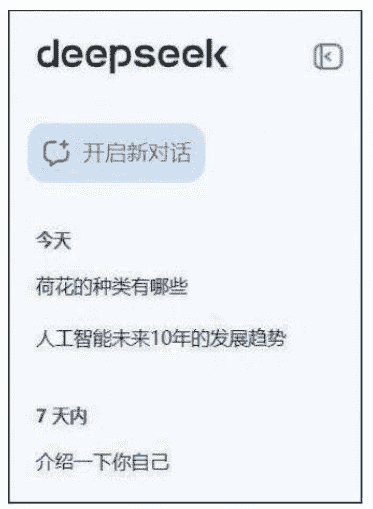

图2-14


图2-15

点击“个人信息”即头像，会弹出菜单，包含“用户名”“系统设置”“删除所有对话”“联系我们”“退出登录”五个选项（如图2-16所示），其中：

**用户名：** 点击后进入账号信息页，内含用户名、手机号、用户协议、隐私政策、注销账号等信息与功能。

**系统设置：** 包含通用设置和账户信息两部分。通用设置里可选择系统语言和主题颜色。

**联系我们：** 点击后打开新页面（如图2-17所示），可查看服务状态、常见问题，或联系支持人员。

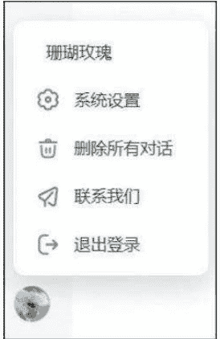

图2-16

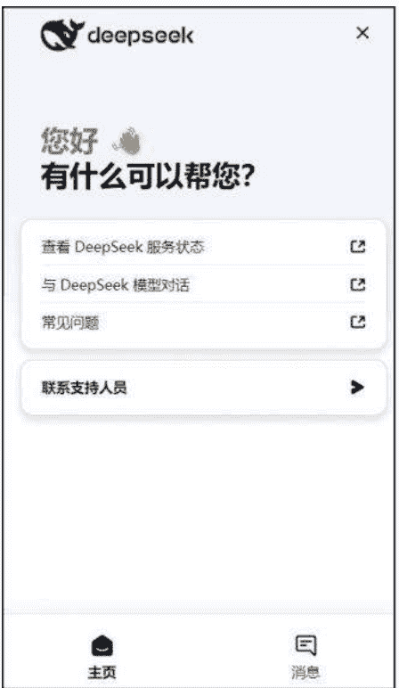

图2-17

### 2.2.2 聊天窗口功能解析

聊天窗口位于主界面中央，顶部有“深度思考（R1）”“联网搜索”“上传附件（仅识别文字）”“发送”四个按钮（如图2-18所示）。

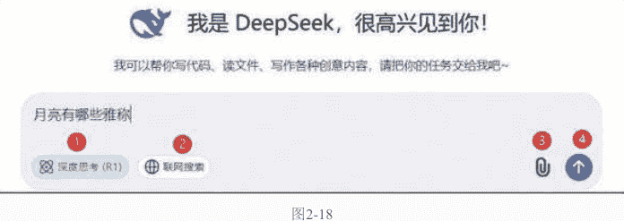

① 深度思考（R1）：开启后调用 DeepSeek-R1 模型进行推理并作答。
② 联网搜索：开启后可按需检索网页信息。
③ 上传附件（仅识别文字）：可上传文档和图片，系统会按要求分析文字内容。
④ 发送：在输入框输入问题后点击发送按钮 ⬆ 提交，即可获得回复。

提问后模型会“思考”并在对话框中给出答案。需要说明的是，只有在开启深度思考模式时才会展示思考过程。

开启深度思考后，调用的是 DeepSeek-R1 模型，该模型专为自然语言处理等复杂任务设计的大规模深度学习模型，可处理逻辑推理、多轮对话等复杂需求，并针对特定场景优化输出。

Q

请帮我制订一份一周（只工作日，周一到周五）的早餐安排计划，每天的早餐要有主食、蛋白质和饮品。

A

好的，用户让我帮他制订一周（只工作日，周一到周五）的早餐计划，包括每天的主食、蛋白质和饮品。首先，我需要考虑营养均衡，确保每天都有主食、蛋白质和饮品。不同用户的饮食偏好可能不同，但用户没有特别说明，所以可能需要保持通用性，同时适当多样化以避免重复。

接下来，周一到周五每天都要有不同的组合。主食方面，可以考虑包子、全麦面包、燕麦粥、三明治、煎饼、面条等，这样既有中式也有西式，满足不同口味。蛋白质来源可以选择鸡蛋、牛奶、豆浆、酸奶、豆腐、奶酪、坚果酱等，这样既有动物蛋白也有植物蛋白。饮品方面，可以考虑豆浆、牛奶、酸奶、蔬果汁、杏仁奶、柠檬水、红枣茶等，这样变化也比较多。

然后要注意每天的搭配是否合理，比如周一的早餐如果是包子配豆浆，可能需要额外补充蛋白质，可以再加个水煮蛋。周二的早餐是全麦面包搭配花生酱和牛奶，花生酱提供植物蛋白，牛奶补充动物蛋白。周三的燕麦粥加酸奶和坚果，蛋白质可能足够，但需要检查搭配是否合适。

另外，用户可能有特定的饮食限制，比如是否素食、乳糖不耐受等，但因为没有提到，所以默认普通饮食。饮品包括热饮和冷饮，以适应不同天气。

以下是一份兼顾营养均衡和多样化的工作日早餐计划，供您参考。

## 周一：经典中式早餐

主食：鲜肉小笼包（3~4个）

蛋白质：水煮蛋（1个）+原味豆浆

饮品：现磨无糖豆浆（300mL）

营养亮点：动物蛋白与植物蛋白双补充，包子提供充足碳水开启新的一周

## 周二：西式元气早餐

主食：全麦面包（2片烤制）

蛋白质：煎太阳蛋（1个）+花生酱（1勺）

饮品：热牛奶（250mL）

搭配建议：面包抹花生酱增加优质脂肪，搭配5颗圣女果补充维生素

## 周三：高纤维健康早餐

主食：牛奶燕麦粥（燕麦50g+牛奶200mL）

蛋白质：希腊酸奶（100g）+混合坚果（15g）

饮品：温蜂蜜柠檬水（300mL）

注意事项：提前浸泡燕麦可缩短烹饪时间，选择无盐版本坚果更健康

## 周四：快捷三明治早餐

主食：全麦三明治（面包2片+生菜+番茄）

蛋白质：煎鸡胸肉片（80g）+低脂奶酪（1片）

饮品：鲜榨橙汁（200mL）

制作贴士：提前腌制鸡胸肉（黑胡椒+生抽），早上3分钟煎熟

## 周五：创意杂粮早餐

主食：紫薯煎饼（紫薯100g+面粉30g）

蛋白质：虾仁蒸蛋羹（鸡蛋1个+虾仁50g）

饮品：杏仁奶（250mL）+奇亚籽（5g）

特别搭配：搭配凉拌菠菜（100g）补充膳食纤维

如果没有打开深度思考模式，使用的则是基础模型，对话框中不会出现思考过程，生成的答案也会比较简单浅显。

Q

请帮我制订一份一周（只工作日，周一到周五）的早餐安排计划，每天的早餐要有主食、蛋白质和饮品。

A

以下是一份为期一周（只工作日，周一到周五）的早餐安排计划，包含主食、蛋白质和饮品，确保营养均衡。

- 周一

主食：全麦面包两片

蛋白质：煮鸡蛋一个

饮品：牛奶一杯（250mL）

- 周二

主食：燕麦粥（50g燕麦）

蛋白质：希腊酸奶一杯（150g）

饮品：橙汁一杯（200mL）

……

### 2.2.3 设置页面功能解析

点击“个人信息”头像，再点击“系统设置”（如图2-19所示），进入后可看到“通用设置”和“账户信息”两个标签页（如图2-20所示），通用设置中可调整语言和主题。

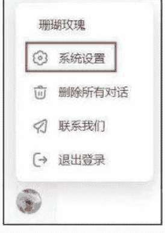

图2-19

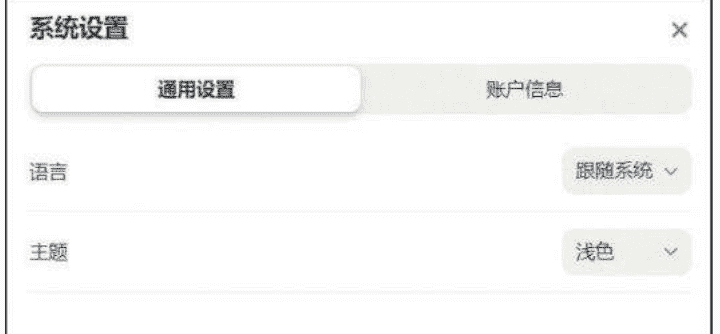

图2-20

展开“语言”下拉列表，可看到“English”“中文”“跟随系统”三个选项（如图2-21所示）。

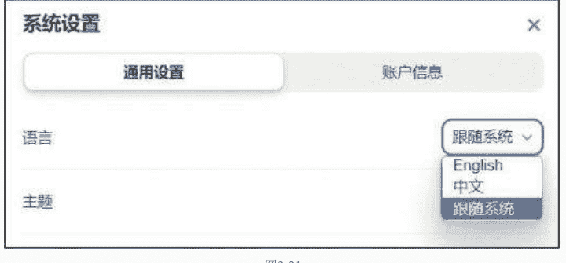

图2-21

展开“主题”下拉列表，可看到“浅色”“深色”“跟随系统”三个选项，选择“深色”后界面由白变黑，文字由黑灰变为浅灰或白色（如图2-22所示）。

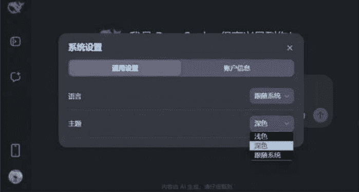

图2-22

## 2.3 基本的交互操作

了解界面和主要功能后即可开始交流，在输入框中输入问题或提出需求。描述越清晰，回复越准确。

### 2.3.1 如何提出第一个问题

作为新手提问时容易无从下手，下面几个方向可作参考（如图2-23所示）。

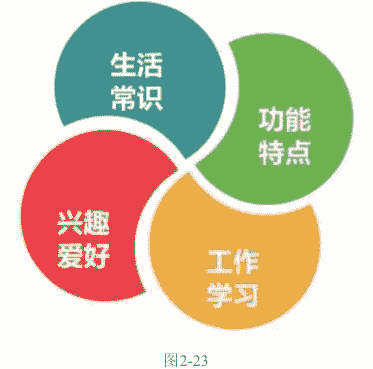

图2-23

1. 从生活常识入手
日常问题：可询问生活常见问题，如“今天天气怎么样？”“附近有什么好玩的景点？”，能快速了解信息整合能力。
生活技巧：如“如何去除衣服上的油渍？”“怎样挑选新鲜蔬菜？”等，模型可提供多种实用方法。

2. 了解功能与特点
询问基本功能：直接问“你能做什么”或“主要功能有哪些”，可了解其能力范围。
了解擅长领域：如“你在哪个领域知识最丰富？”，便于后续更有针对性地提问。

3. 以兴趣爱好切入
影视音乐：喜欢电影音乐可问“有哪些好看的科幻电影推荐？”“最近有什么好听的流行歌曲？”，会给出匹配推荐。
运动健身：感兴趣可问“有哪些适合在家做的减肥运动？”“如何提高跑步速度？”，会基于运动科学知识给出建议。

4. 针对工作学习提问
工作相关：职场人士可问“如何提高工作效率？”“怎样撰写一份吸引人的简历？”，可获得实用技巧。
学习问题：学生可问“如何提高英语听力水平？”“数学函数的解题技巧有哪些？”，可分享学习方法。

下面举例说明提问效果。

Q

怎么才能挑到好吃的榴莲，有没有什么简单实用的小窍门？

A

挑选好吃的榴莲确实需要一些小技巧，下面是一些简单实用的方法，帮你轻松挑到香甜软糯的榴莲。

1. 看外形和颜色

   圆润饱满：选择果形圆润、鼓包明显的榴莲（每个鼓包对应一房果肉），避免畸形或凹陷的。

   颜色自然：成熟榴莲外壳呈青黄色或淡黄色，颜色过于青绿可能未熟，暗黄或发褐可能过熟。

2. 捏刺尖判断成熟度

   刺软能捏动：相邻的两根刺，用手捏住尖端稍用力，若能被捏拢（有弹性），说明果肉成熟；若坚硬捏不动，可能未熟。

   刺疏果肉厚：刺的密度越大，果肉越少；刺稀疏且粗壮的，果肉更饱满。

3. 闻气味

   自然浓香：成熟榴莲会散发浓郁的香甜味，如果闻到青草味说明未熟；若有酒精味或酸味，可能过熟或变质。

4. 听声音

   摇晃时听到果肉晃动声：双手捧起榴莲轻轻摇晃，听到内部有轻微碰撞声（果肉与壳分离），说明成熟度高。

5. 看果柄和裂口

   果柄粗壮湿润：果柄粗且湿润的更新鲜，干枯的可能存放过久。

   避免大裂口：轻微自然裂口的榴莲可能成熟，但裂口过大易滋生细菌，不建议选。

### 2.3.2 理解DeepSeek的回答

DeepSeek的回答通常以文字形式展示在聊天窗口。无论问题简单还是复杂，都能高效准确回应。询问简单信息如销量、下载量、增长额度时，会迅速给出具体数据；复杂创作如写文章，会以条理清晰的段落输出完整内容。

> 提示

咨询此类问题时，建议开启联网搜索，以便获取最新信息。

部分回答还可能包含图表、表格等可视化信息，帮助直观理解数据。例如分析收支状况时，可生成图表表现收支对比、支出结构占比等。

Q

双月收支速览

上期到手薪资 8000 元，支出包含租金 3000 元、餐饮 2000 元、水电 300 元、购物 1500 元，支出合计 6800 元，剩余 1200 元。当期到手薪资 8500 元，支出变为租金 3000 元、餐饮 2200 元、购物 1800 元、水电 350 元，支出合计 7350 元，剩余 1150 元。

1. 收支对比表

| 项目 | 上期 | 当期 | 变动 |
| :--- | :--- | :--- | :--- |
| 收入 | 8000 | 8500 | +500 |
| 总支出 | 6800 | 7350 | +550 |
| 结余 | 1200 | 1150 | -50 |

2. 费用构成
当期开销中占比最高的是租金，约占当期进账的 35%。

### 2.3.3 与DeepSeek持续追问的实操要点

在与 DeepSeek 多轮连环追问时，掌握方法能让信息获取更快、沟通更顺畅。以下几个要点值得注意。

1. 先厘清目标与主题
开聊前先想清楚自己想解决什么问题、获取什么信息，锁定一个明确的话题方向，避免跑题。比如要做旅行攻略，就围绕“旅行攻略”这一核心展开。

2. 仔细消化回复要点
拿到回答后要通读推敲，提炼关键信息是否符合预期。例如 DeepSeek 给出一座城市的景点清单，要弄清每个景点的特色与位置，再决定下一问的落点。

3. 深挖追问与横向延伸
回答不够细就锁定某一点继续追问。如提到某景点有历史文化，可问“该景点具体有哪些历史遗迹”。也可以在同一主题内横向扩展，如了解景点后顺势问当地美食、交通。发现错误或理解偏差要及时纠正，例如“你刚才说的开放时间我查到不一致”，再基于正确信息继续。

4. 保持逻辑与连贯
提问要有顺序，比如先总览再细节，或按时间、重要性排列。对话中可回指前面内容，如“我们刚才说的那个景点附近还有其他好玩的吗”，增强连贯性。

5. 灵活变换提问表述
遇到理解偏差或回答不理想，可换一种说法或换个角度提问。比如了解产品时，除了问功能，还可以问用户评价、市场竞争力等，获取更全面的信息。

下面通过实操对话展示多轮提问的效果。

Q
想找几部科幻电影，有合适的推荐吗？

A
可以的。以下几部风格各异，口碑不错。

1. 《银翼杀手2049》《Blade Runner 2049, 2017》
导演：丹尼斯·维伦纽瓦
简介：承接 1982 年《银翼杀手》的世界观，描绘未来人类与复制人的关系纠葛，画面震撼且富含思辨。

2. 《星际穿越》《Interstellar, 2014》
导演：克里斯托弗·诺兰
简介：讲述地球资源枯竭背景下的人类星际迁移计划，融合硬核科学设定与父女情感，视听效果强烈。

3. 《盗梦空间》《Inception, 2010》
导演：克里斯托弗·诺兰
简介：围绕一支能潜入他人梦境植入思想的团队展开，结构精巧，对现实与梦境的探讨很有张力。

Q
能详细介绍一下《星际穿越》吗？

A
可以。《星际穿越》由克里斯托弗·诺兰执导，2014 年上映，以史诗格局、硬核设定与动人情感著称。

## 剧情概述
近未来地球生态恶化，农作物绝收、沙尘暴频发。曾任 NASA 飞行员的库珀转而务农，却偶然发现秘密基地。科学家发现土星附近的虫洞，或是寻找新家园的希望。库珀被选为先遣队队长，穿越虫洞前往遥远星系寻找宜居星球。

## 主要角色
库珀：马修·麦康纳饰演，昔日宇航员，为拯救人类与家人踏上星途。
墨菲：杰西卡·查斯坦饰演，库珀的女儿，成长为致力于拯救地球的科学家。
布兰德博士：迈克尔·凯恩饰演，探险计划的策划者之一。
艾米莉亚·布兰德：安妮·海瑟薇饰演，布兰德之女，科学家兼宇航员，与库珀共同执行任务。

## 评价与影响
影片上映后评价很高，被视为兼具科学严谨与情感深度的科幻佳作。全球票房表现不俗，获多项奥斯卡提名并斩获最佳视觉效果奖。

Q
《星际穿越》的导演还有其他什么作品吗？

A
克里斯托弗·诺兰以复杂叙事与深刻主题著称，以下是代表作。

1. 《记忆碎片》《Memento, 2000》
类型：悬疑/惊悚
简介：讲述一名患短期记忆丧失的男子追查妻子死因的故事。采用非线性结构，观众需像主角一样拼凑线索，成名作。

2. 《蝙蝠侠：侠影之谜》《Batman Begins, 2005》
类型：动作/超级英雄
简介：诺兰“黑暗骑士”三部曲首部，重塑超级英雄电影。聚焦布鲁斯·韦恩化身蝙蝠侠的过程，探讨恐惧、正义与复仇。

# 第3章 DeepSeek提问技巧与策略

信息过载的当下，能否快速精准获取答案已成为关键能力。掌握与 DeepSeek 交互的提问方法，能让信息效率与质量大幅提升，并拓展思维边界。以下从基础清晰提问到引导式挖掘，再到进阶技巧与个性化设置展开。

## 3.1 清晰准确的提问方式

为什么同样提问，有人收获满满，有人却得不到点子上？核心在于提问质量。正确的方法能让 DeepSeek 更准确理解需求，给出更有价值的回答。

### 3.1.1 使用简洁明了的语言

提问时语言要通俗、突出重点、避免歧义。

1. 通俗易懂的表达
避免堆砌专业术语。不好的例子：请基于镜头焦距、光圈值、快门速度及感光度 ISO 之间的曝光补偿关系，结合黄金分割、对称构图等理论，阐述如何用手机参数拍摄出具有艺术感染力的人像作品。好的例子：用手机拍人像怎么拍得好看。后者更易理解，DeepSeek 会给出选光线、角度、人像模式等实用建议。

2. 突出重点
把关键问题前置。不好的例子：我最近回顾自己与他人交流，总觉得表达不流畅，倾听也不好，导致人际关系处理不佳，想知道怎么提升，有没有资料或书籍。好的例子：有哪些提升语言沟通技巧的方法和书籍推荐。简洁提问能快速获得如《沟通的艺术》相关技巧的推荐。

3. 避免歧义
词汇要明确。例如“苹果有哪些新产品”易产生歧义，应改为“苹果公司有哪些新产品”，才能得到准确答案。

### 3.1.2 明确问题的目标和范围

明确目标与范围能让回答更精准。

1. 确定问题类型
方法类如“如何提升英语听力”，期望得到操作步骤；比较类如“Python 和 Java 哪个更适合初学者”，需要多维度对比。先厘清类型，回答更有针对性。

2. 设定清晰目标
不好的例子：我想学编程语言。目标模糊。好的例子：我想在 3 个月内掌握 Python 基础语法，用于数据分析，有什么学习路径。目标明确后，可获得教材、学习平台、NumPy/Pandas 等具体建议。

3. 界定问题范围
不好的例子：如何提高写作能力。范围过宽。好的例子：如何提高新媒体文案中标题的吸引力。范围收窄后，可得到抓痛点、共鸣、悬念、数据化等具体策略。

### 3.1.3 提供必要的背景信息

背景信息帮助模型给出贴合实际的方案。

1. 自身情况阐述
不好的例子：我想找工作，有什么建议。好的例子：我是一名即将毕业的计算机科学本科生，参与过多个软件开发项目，掌握 Python、Java，希望在长沙找到软件开发工作，期望月薪 8000 元以上，该如何准备。基于此可获得简历突出项目经验、目标公司渠道、面试技巧等定制建议。

2. 问题相关细节
不好的例子：我的智能音箱没声音了，怎么办。好的例子：我用小爱音箱 Pro，购入一年多，手机安卓 13，米家 App 8.9.701。今天语音播放音乐无声，App 显示播放正常。问题前刚升级固件并调整了家用 Wi-Fi 路由器设置。请问原因和解决办法。细节充足后可判断固件兼容或网络连接问题并给出回滚、重连等建议。

3. 事件背景介绍
分析《哪吒之魔童闹海》为何火爆，若仅问“为什么火”，回答会宽泛。补充创作背景、制作细节、宣传策略、上映档期、市场环境后，可从制作精良、档期优势、国产动画崛起等多个维度深入分析。

## 3.2 引导式提问方法

引导式提问能挖掘 DeepSeek 的深度潜力，获取更优质的服务。

### 3.2.1 分步提问引导思路

面对复杂问题，分步提问效果更好。以设计电商 App 为例，直接问“如何设计一个电商 App”会得到笼统概念。分步提问则更具体。

Q
设计一个面向年轻女性的时尚电商 App，首页应该包含哪些核心功能模块？

A
面向年轻女性的时尚电商 App 首页建议包含以下核心模块。

| 模块 | 内容 | 详情 |
| :--- | :--- | :--- |
| 个性化推荐 | 推荐位 | 根据浏览、收藏、购买记录推荐“猜你喜欢”“新品推荐”“限时优惠”等 |
| | 风格测试区 | 通过趣味测试了解风格偏好并推荐商品 |
| | 搭配推荐区 | 提供“通勤穿搭”“约会穿搭”等场景建议 |
| 商品展示 | 分类导航 | 明确分类如上衣、下装、裙装、鞋包，便于查找 |
| | 精选专题 | 按季节、流行趋势推出“夏日清凉穿搭”“秋季必备单品”等专题 |
| | 品牌专区 | 展示热门品牌或设计师品牌 |
| 促销活动 | 轮播图 | 展示最新促销、品牌合作信息 |
| | 限时抢购区 | 限时折扣营造紧迫感 |
| | 优惠券领取区 | 提供不同面额优惠券刺激下单 |

首页功能与设计思路

社交互动板块以用户晒单区为核心，鼓励会员上传购物感受与穿搭照，提升真实感与参与度；时尚社区则搭建话题讨论空间，让用户交换穿搭心得、分享潮流资讯。直播入口可邀请时尚博主或KOL进行带货直播，增强互动热情与购买冲动。

其它基础组件方面，顶部搜索栏便于快速定位商品，购物车支持查看与管理已选清单，个人中心集中展示订单、收藏、优惠券等个人资料。

设计层面建议界面保持简洁明亮，选用清新色系契合年轻女性审美；操作路径要流畅，精简步骤优化体验；内容供给需丰富优质，以高清图视频吸引停留。

总体来看，首页是App的第一印象，需在功能完整与视觉美感之间取得平衡，通过个性化推荐、商品陈列、促销活动与社交互动等模块抓住注意力，改善体验并推动转化。

提升转化的详情页要素

在商品详情页，信息呈现与功能配合是决定购买转化的关键。

展示核心信息方面，商品图集与视频应高清多角度，呈现细节并以动态形式展现质感，同时提供模特试穿照辅助直观判断。标题要简短有力，突出卖点；价格信息清晰可读，折扣或优惠价一目了然。详情描述需具体说明材质、尺码、颜色、工艺等，并用场景化语言强调特色与优势。用户评价与晒单要展示真实图文视频，并提供筛选排序，便于快速浏览。尺码指南应给出详细尺码表并标注模特身高体重等参考信息，同时鼓励上传试穿报告帮助后续用户选码。

提升转化率的功能上，加入购物车与立即购买按钮需醒目且操作便捷，并可加入库存提醒防止错过。收藏与分享功能扩大商品曝光，优惠券与促销信息触达可提升下单意愿。搭配推荐基于当前商品延展关联单品，提升客单价。在线客服或电话咨询入口可即时解答疑虑，物流与售后政策的清晰展示则能消除顾虑。

总结来说，详情页需兼顾全面真实可信的信息与顺畅好用的操作，才能在决策环节有效促成购买。

后端选型：框架与数据库

电商App在性能与数据安全上的技术选择建议如下。

后端框架对比：
Node.js 以 Express 或 Koa 为代表，轻量高效，擅长处理高并发请求，生态完善社区活跃，但异步模型门槛较高，回调处理需经验。Python 的 Django 或 Flask 开发效率高，代码可读性强，第三方库丰富，高并发下性能相对稍逊。Java 的 Spring Boot 性能稳定、安全性高、企业级生态成熟，但开发效率偏低、学习曲线陡峭。综合面向年轻女性的时尚电商场景，Node.js 更能应对访问高峰并快速搭建丰富功能。

数据库对比：
关系型数据库 MySQL / PostgreSQL 数据结构化，支持复杂查询与事务，一致性强，适合订单、支付等强一致业务，但扩展性有限，海量数据下性能下降。非关系型 MongoDB 结构灵活、扩展性好，适合非结构化数据存储，但复杂查询与事务支持不足，一致性相对弱。电商核心数据要求强一致，关系型数据库更能保障一致性、完整性与安全性。

其它建议：读取层引入 Redis 缓存降低延迟并减轻数据库压力；异步流程可用 RabbitMQ 消息队列提升吞吐；商品搜索可借助 Elasticsearch 实现高效检索；安全方面需部署 HTTPS、数据加密与身份验证等措施。

总体推荐采用 Node.js + MySQL / PostgreSQL 的组合，配合缓存、消息队列与搜索引擎，构建高性能高可用的电商平台。

### 3.2.2 追问与细化问题

在与 DeepSeek 交互中，要获得更精准深入的信息，有效的追问与细化至关重要，它能打开信息壁垒并深入挖掘知识。

### 1. 深入挖掘细节
当得到的回答较为笼统时，需进一步追问细节。例如询问“工业革命如何改变世界经济格局”，可能只得到生产力提升、由农向工转变、西方主导等概括性结论。可进一步追问革命的具体起止年份、率先展开的国家、关键人物与发明、西方主导在贸易与资源控制等方面的具体表现。细节追问能让结论更全面，为论文或教学提供论据。

### 2. 要求解释专业概念
回答中出现专业术语时应要求通俗解释。如问“量子计算未来有哪些应用”，可能提到量子比特、密码学、药物研发等。此时可追问“量子比特用通俗语言如何理解，与传统比特有何不同”。模型会解释量子比特可处叠加态，能同时处理多信息，从而提升效率。类似地，对人工智能与机器学习等易混概念进行辨析，有助于准确应用。

### 3. 根据回答调整问题
若回答与预期偏差，应及时调整提问方向。例如希望得到投资理财入门书，初次得到专业难度高的推荐，可修正为“我对金融几乎零基础，请推荐语言通俗、案例丰富的初学者读物”。调整后即可获得《小狗钱钱》《富爸爸穷爸爸》等更匹配的建议。及时修正能提高交互效率。

### 3.2.3 示例引导提问

示例引导提问能让输出更精准实用。

### 1. 场景假设提问
反面案例：帮我制订一个旅行计划。
正面案例：我计划下月与家人去成都，预算5000元，3天行程，共6人含老人小孩，偏爱美食与自然风光，请给出逐日行程、交通方式、美食推荐及门票费用。
场景化提问让模型考虑预算、人员构成与偏好，可推荐都江堰、青城山等亲民景点与龙抄手、钟水饺等当地美食，并规划合理的交通，方案更具参考性。

### 2. 参考示例提问
反面案例：帮我写一篇关于科技发展对生活影响的议论文。
正面案例：我提供一篇《科技改变生活》范文，其开头以智能手机使用场景引出主题，主体从通信、交通、医疗展开并配案例数据，结尾总结并展望未来。请参照该风格、结构与语言，写一篇1500字左右的议论文，要求生动、逻辑清晰、有案例数据支撑。
提供参照样本后，模型能模仿优点并生成高质量文章。

### 3. 对比示例提问
反面案例：我该买哪款笔记本电脑？
正面案例：我在戴尔XPS 13与联想ThinkPad X1 Carbon之间犹豫，主要用于办公文档表格，偶尔轻度图片处理，要求轻薄便携、续航强。请对比性能、轻薄度、续航、散热与价格的优缺点，判断更适合我的款式。
明确对比对象与使用需求后，模型能给出针对性分析，决策更清晰。

## 3.3 高级提问技巧

掌握高级提问技巧可更高效准确地获取信息。

### 3.3.1 使用特定关键词和指令

关键词突出重点，帮助模型快速聚焦。

#### 1. 关键词
领域关键词明确专业范围，如“医学领域中治疗高血压的最新药物有哪些”。
功能关键词表明操作要求，如“对比Python和Java编程语言的优缺点”中“对比”即为功能词。
格式关键词规定呈现方式，如“用代码块展示Python实现冒泡排序的代码”。

```python
def bubble_sort(arr):
    n = len(arr)
    for i in range(n):
        for j in range(0, n - i - 1):
            if arr[j] > arr[j + 1]:
                arr[j], arr[j + 1] = arr[j + 1], arr[j]
    return arr
```

图3-1

#### 2. 指令
指令相当于行动命令，包含角色设定、任务与风格。

角色设定指令如“假设你是资深律师，解读《民法典》中房屋租赁合同条款需注意之处”，模型会以法律专家视角展开条文解读与风险提示。

任务指令明确步骤，如“第一步分析智能手机市场竞争现状含品牌占有率、产品特点、目标用户；第二步据此提出新机营销策略含定位、定价、推广渠道”。分步指令能得到完整逻辑方案。

风格指令规定文体，如“以严谨专业的商务风格撰写上季度销售业绩分析报告，含图表与文字分析”。

不同任务指令侧重点不同，如表3-1所示。

表3-1

| 任务类型 | 指令侧重点 | 示例 | 需避免的指令 |
| :--- | :--- | :--- | :--- |
| 数学证明 | 直接提问，无须分步引导 | “证明勾股定理” | 非必要拆解（如“先画图，再列公式”） |
| 创意写作 | 鼓励发散性，设定角色/风格 | “以鲁迅的风格写一篇讽刺文章” | 过度约束（如“按时间顺序列出”） |
| 代码生成 | 需求简洁，信任模型逻辑 | “用Python实现快速排序” | 分步指导（如“先写递归函数”） |
| 多轮对话 | 明确对话目标，避免开放发散 | “从技术、伦理、经济三方面分析AI的未来” | 情感化提问（如“你害怕AI吗？”） |
| 逻辑分析 | 直接抛出复杂问题 | “分析‘电车难题’中功利主义与道德主义的冲突” | 主观引导（如“你认为哪种对？”） |

### 3.3.2 条件限定与范围设定

条件限定与范围设定像筛选器，可从海量信息中提取贴合需求的内容。

#### 1. 条件限定
提问中加入具体条件可提升精准度。如仅说“推荐一款手机”会得到泛泛答案，改为“预算5000元左右，主要用于游戏与拍照，请推荐性能强拍照好的机型”则更具针对性。

#### 2. 常见限定条件
（1）预算

把预算先框定，落地效果往往更贴合真实需求，在购物、装修、方案策划等场景里都很有用。比如买笔记本时说“预算三千左右，推荐综合表现比较均衡的机型”，模型就会锁定这个价格带做筛选并做优劣对比，而不是列出一份漫无边际的清单。

（2）技能水平

涉及学习和能力提升的问题，说明起点水平能让反馈更对路。例如问“零基础的小白入门Python该怎么学”，“零基础的小白”交代了起点，得到的就是环境配置、基础语法、简易练习这类入门路径，而不会直接甩出面向资深开发者的进阶内容。

#### 3. 范围设定

向 DeepSeek 要信息时，主动收窄边界，可以把庞杂的知识库压缩到真正需要的区间。

比如想了解新能源车的销售情况，只问“新能源汽车销量前十品牌有哪些”，返回的可能是跨地区、跨年度的汇总，信息过宽。若把范围收紧成“2024年中国新能源汽车销量排名前十的品牌”，模型就能锁定年份与国家，给出更聚焦的榜单。

#### 4. 设定范围的维度

（1）时间维度

限定时间能让回答更具时效性。问“怎么提升工作效率”会得到通用建议，若改为“接下来一个月内如何快速提效，保住本季度销售目标”，模型就会给出短期可执行的方案，如列每日待办、缩短会议时长、优先处理重要紧急事项等。

（2）地域维度

地域限定在信息检索中也很关键。问“湖南长沙有哪些必去的旅游景点”，模型会围绕长沙给出岳麓山、橘子洲头、湖南博物院等本地名点，不会混入外地景点。

（3）领域维度

跨学科查询时，限定领域可避免泛化。比如问“心理学和教育学交叉领域的最新研究成果有哪些”，模型会聚焦认知心理学指导的个性化学习策略、教育心理学关于动机激发的最新发现等，而不是停留在单一学科概述。

## 5. 条件限定与范围设定的协同

复杂问题上，条件限定与范围设定一起使用，输出会更精准全面。

反面案例：帮我制定一份健身计划。结果通常是笼统的动作合集，难以匹配个人情况。

正面案例：对于一位25岁、体重70千克、身高175厘米、每周仅有2天空闲、每次1到2小时、希望2个月内增强核心力量和提升柔韧性、且在家无专业器械的男性白领，有哪些合适的训练方案？

这里明确了身体数据、时间安排和训练目标，“在家无专业器械”则划定了场地和设备范围。综合这些限制，模型会推荐平板支撑、仰卧举腿、瑜伽猫牛式、下犬式等居家动作，并说明做法、组数、频率及预期效果，方案才具备可执行性。

### 3.3.3 问题组合与关联提问

真实场景的问题很少孤立，学会把相关问题组合、层层追问，能让分析更立体。

### 1. 问题组合：构建知识拼图

问题组合就是把多个关联问题整合，形成集合，像拼图一样还原全貌。面对“人工智能在教育领域的应用与挑战”这类综合主题，单一提问不够全面，可拆成：

- 教学方法上有哪些创新应用？
- 对学习效果的提升有哪些数据支撑？
- 推广过程中在技术和教育理念上分别遇到了什么阻力？

这样能引导模型做全景分析。常见组合有并列式和递进式。

并列式是从不同侧面并列提问。以新手机市场表现为例，可问不同年龄层用户接受度如何、各地销售差异怎样、相比竞品优势劣势是什么，多角度观察更完整。

递进式是按深度或步骤层层推进。比如做项目计划：先问目标和预期成果是什么，明确后问需要哪些关键步骤，确定步骤后再问每步的风险和应对策略，像爬台阶一样逐步深入。

### 2. 关联提问：挖掘知识深度

关联提问是在已有回答基础上继续追问，像剥洋葱一样挖深。常见类型有因果关联、对比关联、拓展关联（如图3-2所示）。

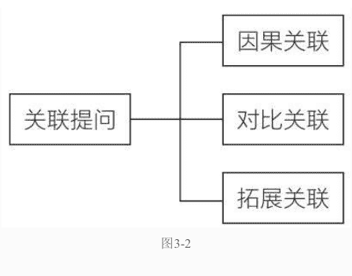

#### （1）因果关联

追问现象背后的逻辑。例如问“某地房价为何持续上涨”，得到经济发展、人口流入等解释后，可继续问经济发展具体通过哪些渠道推升房价？人口流入集中在哪些年龄段和职业，对价格的影响体现在哪里？这样才触及深层机制。

#### （2）对比关联

把不同对象并置比较。先问“某品牌新款手机性能如何”，再问“与上一代相比在处理器、续航、拍照上有何提升或退步”“与同价位竞品相比优势劣势分别是什么”，对比后决策更清晰。

#### （3）拓展关联

在已有答案上延伸新问题。比如拿到一周健身安排后，可问“如果目标是增肌、减脂或耐力训练，计划该怎么调整”“训练期饮食如何搭配才能更好达成目标”。从单一计划延伸到完整知识体系。

## 3.4 个性化设置

除了提问技巧，DeepSeek 还提供个性化设置，可按个人习惯定制使用体验。

### 3.4.1 语言和主题设置

语言和主题是基础的个性化入口。选熟悉的语言交流更顺畅。首页右下角点头像进入“系统设置”即可切换语言和主题（如图3-3所示）。

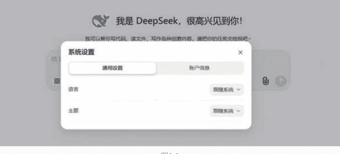

提问时也可以指定输出语言。

Q
我正在自学法语语法，请用法语说明以-er结尾的动词变位。

A
Bien sûr! Voici une explication sur la conjugaison des verbes en-er en français.

Conjugaison des verbes en-er

Les verbes en-er (comme parler, aimer, manger) sont des verbes du premier groupe.

Ils suivent une conjugaison régulière au présent de l'indicatif.

Voici la règle générale.

1. Terminaisons

   - Je: -e

   - Tu: -es

   - Il/Elle/On: -e

   - Nous: -ons

   - Vous: -ez

   - Ils/Elles: -ent

2. Exemple avec le verbe "parler"

   - Je parle

   - Tu parles

   - Il/Elle/On parle

   - Nous parlons

   - Vous parlez

   - Ils/Elles parlent

3. Exceptions et particularités

   - Pour les verbes comme manger ou commencer, on ajoute un -e ou un -ç devant les terminaisons qui commencent par -a ou -o pour garder le son doux.

   - Le verbe aller est un cas spécial : bien qu'il se termine par -er, il ne suit pas cette conjugaison et est irrégulier.

4. Astuce pour mémoiser

Les verbes en-er sont les plus courants en français.

Une fois que vous maîtrisez leur conjugaison, vous pouvez facilement conjuguer la majorité des verbes français!

Avez-vous d'autres questions sur la grammaire française?

### 3.4.2 回答风格和语气设置

风格和语气让交互更人性化。正式商务场景和轻松日常需要不同的表达，可通过设置让回答更符合情境。

Q
请用正式专业的商务语气写一封邮件，邀请对方参加我公司新书发布会。需包含时间2025年2月11日、主题DeepSeek、亮点全面专业新颖，以及潜在合作机会。

A
邮件主题：诚邀您参加[公司名称]新书《DeepSeek》发布会

尊敬的[收件人姓名]：

您好！

我们诚挚地邀请您参加[公司名称]即将举办的新书发布会，共同见证《DeepSeek》的正式发布。此次发布会将深入探讨人工智能领域的前沿趋势，并分享我们在AI技术应用中的创新成果。

发布会详情如下。

时间：2025年2月11日（周二）下午2:00—4:00

形式：线下+线上直播（链接将提前发送至您的邮箱）

主题：DeepSeek——探索AI技术的未来与应用

《DeepSeek》亮点抢先看！

前沿洞察：深入解析AI技术的最新发展，涵盖自然语言处理、机器学习等核心领域。

实战案例：分享多个行业应用场景，展示AI如何赋能企业创新与效率提升。

未来展望：探讨AI技术的潜在机遇与挑战，为企业和个人提供战略指导。

此次发布会不仅是新书的发布，更是一次行业交流与合作的机会。我们期待与您共同探讨AI技术的未来发展方向，并探索潜在的合作机会，携手推动行业进步。

如您确认出席，请于[日期]前回复本邮件，或联系[联系人姓名，电话/邮箱]。我们将为您预留席位，并发送详细参会指南。

感谢您的关注与支持，期待与您在发布会上相见！

[您的姓名]

[您的职位]

[公司名称]

[公司官网]

[联系方式]

[发件日期]

附注：如果您对发布会内容或合作机会有任何疑问，欢迎随时与我们联系。

### 3.4.3 隐私和安全设置

隐私安全是使用的底线。DeepSeek采用先进加密算法对提问、回答及相关数据加密，如同给信息穿上铠甲，传输存储过程不易被窃取。

会话管理上可自行清除记录，避免在设备或服务器留痕（如图3-4所示）。若担心数据滥用，可随时查阅隐私政策，了解数据采集、使用和保护规则。在功能和安心之间取得平衡。

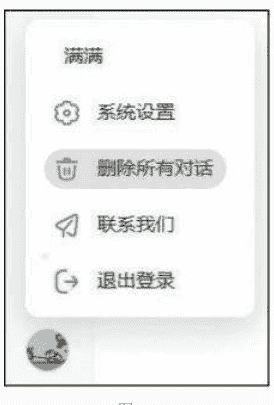

# 第4章 DeepSeek 赋能学习与创作

DeepSeek是一款能力很强的多模态AI工具，背后是复杂的算法和海量训练数据，知识储备丰富，能应对各类复杂需求。只需简单描述，就能快速理解意图并生成高质量内容。下面结合案例看它如何辅助学习。

## 4.1 学习小助手

在学习场景里，DeepSeek像个超级大脑，整合文本生成、图像创作、智能问答、数据分析等能力，帮助用户快速掌握新知。

### 4.1.1 解答学科问题

学习路上常被难题卡住，DeepSeek就像随时待命的学霸。数学函数、物理电磁学、编程报错等都能应对，既给答案，也讲思路。

比如一道等差数列题：

Q
一个等差数列共n项，和为90，前十项和为25，后十项和为75，则项数 n 为（ ）。
A.14 B.16 C.18 D.20

A
题目回顾

数列共有 n 项，总和90，前十项和25，后十项和75，求 n ，选项为14、16、18、20。

1. 理解题意

设首项为 a₁，公差为 d，项数 n。

等差数列特点是相邻项差恒定。

2. 等差数列的求和公式

前 n 项和 Sₙ 可表示为
$$S_n = \frac{n}{2} \times [2a_1 + (n-1)d]$$

由题意总和90，得方程1：
$$\frac{n}{2} \times [2a_1 + (n-1)d] = 90$$

3. 前十项的和

S₁₀ 为25，故
$$S_{10} = \frac{10}{2} \times [2a_1 + (10-1)d] = 25$$

化简得方程2：
$$2a_1 + 9d = 5$$

4. 后十项的和

后十项为第 n-9 项至第 n 项，和为75。可表示为
$$S_{\text{后十项}} = \frac{10}{2} \times (2a_{n-9} + 9d) = 75$$

其中 aₙ₋₉ = a₁ + (n-10)d 可以表示为
$$a_{n-9} = a_1 + (n-10)d$$

简化得方程3：
$$5 \times \{2 \times [a_1 + (n-10)d] + 9d\} = 75$$

$$2a_1 + (2n - 20 + 9)d = 15$$

$$2a_1 + (2n - 11)d = 15$$

5. 解方程组

联立
$$2a_1 + 9d = 5 \quad \text{(方程2)}$$

$$2a_1 + (2n - 11)d = 15 \quad \text{(方程3)}$$

消元得
$$d = \frac{5}{n-10}$$

代入方程2得
$$2a_1 + 9 \times \frac{5}{n-10} = 5$$

$$a_1 = \frac{5}{2} - \frac{45}{2(n-10)}$$

6. 代入总和公式

现在，我们将 a₁ 和 d 的表达式代入总和公式（方程1）：

$$\frac{n}{2} \times \{2 \times [\frac{5}{2} - \frac{45}{2(n-10)}] + (n-1) \times \frac{5}{n-10}\} = 90$$

简化括号内的表达式：

$$2 \times \frac{5}{2} - 2 \times \frac{45}{2(n-10)} + (n-1) \times \frac{5}{n-10}$$

$$= 5 - \frac{45}{n-10} + \frac{5(n-1)}{n-10}$$

$$= 5 + \frac{5(n-10)}{n-10}$$

$$= 10$$

所以，总和公式变为

$$\frac{n}{2} \times 10 = 90$$

$$5n = 90$$

$$n = 18$$

#### 7. 答案核验
经计算得到 n 为18，最终答案对应选项 C。

### 4.1.2 快速找到合适复习资料
备考时想挑到既实用又贴合个人节奏的参考材料，筛选过程往往耗费大量时间。借助 DeepSeek，这一步会被大幅压缩。它的信息汇聚效率很高，能在很短时间内整理出质量过关的学习资源。来源覆盖学术库、主流教育平台等，保证了素材的丰富度与可信度，同时还会给出可执行的操作建议。

Q
我马上要考初级会计师，想请教一些备考材料。

A
初级会计师备考，资料选择直接影响效率。以下清单可供参考。

1. 指定教材
   - 《初级会计实务》：涉及会计基础、资产、负债、所有者权益、收入、费用、利润等模块。
   - 《经济法基础》：涵盖经济法、税法、劳动合同法等法规要点。

2. 辅导图书
   - 东奥“轻松过关”系列：讲解细致、例题充足，适合系统梳理。
   - 中华会计网校“梦想成真”系列：知识点表述清晰，难度适中，利于夯实基础。

3. 在线课程
   - 中华会计网校：体系完整，可按基础选择。
   - 东奥会计在线：名师授课，覆盖全面。
   - 高顿教育：课程设计科学，适合时间紧张的考生。

4. 题库与模拟卷
   - 历年真题：把握题型分布与难度走向。
   - 模拟试卷：熟悉考试流程，检验复习成效。

5. 移动学习工具
   - 会计帮：题库与要点讲解结合，便于碎片化学习。
   - 会计学堂：视频课加在线答疑，学习更灵活。

6. 学习规划
   - 制定复习表：按个人作息合理分配《初级会计实务》和《经济法基础》的时间。
   - 周期自测：通过练习与模拟及时调整策略。

7. 其他渠道
   - 专业论坛与社群：如会计视野、知乎等，供经验交流。
   - 微信公众号：关注会计类公众号获取资讯与资料。

## 8. 对齐考纲要求
最新考纲：确保复习范围与考试要求一致。

## 9. 笔记整理与归纳
整理笔记：强化记忆与理解。
绘制思维导图：理清知识架构，便于回溯。

## 10. 科学安排时间
均衡分配时长：两科复习比重保持平衡。
定期复盘：防止遗忘，巩固知识。

以上资源与建议希望能助你顺利通过初级会计师考试。

### 4.1.3 延伸知识边界
学习不应固守教材，适度拓展能让视野更开阔、思维更活跃，对全面成长意义重大。它就像为知识体系添砖加瓦，让结构更完整。

DeepSeek 在拓展层面表现突出，能让学习更生动深入。以语文教师讲解古诗为例，它可以补充作品背后的历史典故、作者生平轶闻，以及同时代作品的横向比较，丰富课堂内容，帮助学生更好把握内涵。

> Q
请解读李白的《将进酒》。

A
李白的《将进酒》是盛唐诗歌的代表作，也是中国文学中最富生命张力的饮酒诗。以黄河奔涌起笔，以万古愁收束，在豪放与悲怆的张力中呈现独特的生命哲学。以下从四个角度展开。

### 一、时空交织中的生命叩问
开篇两组“君不见”构成震撼的时空蒙太奇：“黄河之水天上来”的垂直空间与“高堂明镜悲白发”的线性时间形成立体坐标。李白借助流动意象解构凝固的时间概念，把物理时间转化为诗性时间——奔向大海的黄河既是自然现象，也是生命不可逆的隐喻。这种时空自觉，是魏晋以来生命意识的高度诗化。

### 二、酒神精神的盛唐演绎
“人生得意须尽欢”并非浅薄享乐，而是尼采式酒神精神的东方表达。李白重塑了传统“三不朽”的价值序列，以“酒”为枢纽建立新价值体系：圣贤寂寞与饮者留名的倒置，陈王宴游典故的挪用，本质是对功业价值的祛魅。金樽对月的超现实场景把饮酒仪式升华为天人对话，与屈原《天问》相比，李白给出的是沉醉而非追问的答案。

### 三、狂欢表象下的悲剧内核
全诗表层是狂欢的盛宴：千金散尽的阔绰，五花马的毁弃，呼儿换酒的任性，构成消费主义的宏大景观。但深层结构里，“万古愁”像低音持续回响。这种愁绪并非具体的人生困顿，而是源于存在本身的荒诞认知。“天生我材必有用”的自信与“古来圣贤皆寂寞”的历史洞察形成悖论，折射出盛唐文人建功渴望与生命虚无感的深刻矛盾。

### 四、语言实验与诗学突破
李白在此诗中进行前所未有的语言实验：散文化句法“岑夫子，丹丘生，将进酒，杯莫停”渗入诗体，人称频繁转换制造戏剧对话，三字句与十字句的节奏碰撞产生醉语般的韵律。宋代严羽评其“一往豪情，使人不能句字赏摘”，正说明其浑然天成、难以拆解的美。

结语：重读“与尔同销万古愁”会发现，李白提供的是镜像而非解药。这种愁绪超越时代，成为人类存在的永恒命题，而诗中展现的生命激扬与虚无抗争的张力，恰构成中国文化中最动人的精神景观。在功业焦虑弥漫的当下，李白式的狂欢或许能唤醒生命本真。

### 4.1.4 量身打造学习规划
制定合理的学习计划对提升效率至关重要。但很多人规划时常遇到难题：不知如何依据自身实际安排时间和任务，计划往往过于理想化难以执行；执行中遇到突发情况，计划被打乱又缺乏调整思路。每个人的情况和目标不同，DeepSeek 能据此差异生成个性化的学习方案。

Q
请为零基础学生制定通过国家计算机二级考试的速成计划。

A
为零基础考生通过国家计算机二级考试如 MS Office 高级应用，制定一份 8 周速成安排，具体如下。

### 1. 基础知识学习 第 1—2 周
目标：掌握计算机基础与 MS Office 基本操作。

1. 计算机基础知识。
   学习内容：计算机组成、操作系统基础、网络基础。
   推荐资料：《计算机基础教程》、在线课程如慕课网、网易云课堂等。
   每日任务：学习 1~2 小时，完成配套练习。

2. MS Office 基础操作。
   学习内容：Word、Excel、PowerPoint 的基本操作。
   推荐资料：《MS Office 实用教程》、视频教程如 B 站等。
   每日任务：学习 1~2 小时，动手实操。

### 2. 专项技能提升 第 3—6 周
目标：深入掌握 MS Office 高级应用，把握考试重点。

1. Word 高级应用。
   学习内容：文档排版、样式设置、目录生成、邮件合并。
   推荐资料：《Word 办公软件高级应用教程》、在线课程。
   每日任务：学习 1 小时，完成练习与实操。

2. Excel 高级应用。
   学习内容：公式与函数、数据透视表、图表制作、数据分析。
   推荐资料：《Excel 高级应用案例教程》、在线课程。
   每日任务：学习 1 小时，完成练习与实操。

3. PowerPoint 高级应用。
   学习内容：幻灯片设计、动画效果、母版设置、演示技巧。
   推荐资料：《PowerPoint 高级应用案例教程》、在线课程。
   每日任务：学习 1 小时，完成练习与实操。

### 3. 模拟冲刺 第 7—8 周
目标：全真演练，查漏补缺，提升应试能力。

1. 全真模拟。
   每周任务：完成 2~3 套二级考试真题模拟。
   推荐资料：历年真题、模拟题库。
   方法：严格按考试时间进行，考后认真分析错题，总结经验。

2. 错题整理。
   每日任务：整理并复习错题。
   方法：分类归纳，重点攻克薄弱环节。

3. 重点复习。
   每日任务：复习 Word、Excel、PowerPoint 的重点与难点。
   方法：借助视频、书籍与在线资源强化理解与记忆。

### 4. 每日学习时间建议
早晨 1 小时：计算机基础知识学习。
上午 2 小时：MS Office 专项学习，Word、Excel、PowerPoint 轮换。
下午 2 小时：实操练习，完成相关练习题。
晚上 1 小时：错题整理、复习巩固。

### 5. 注意事项
1. 坚持每日学习：保持连贯，避免三天打鱼两天晒网。
2. 重视动手操作：MS Office 学习重在实操，务必多练。
3. 定期自测：每周进行一次自测，检验学习效果。
4. 调整心态：保持积极，适当放松，避免过度紧张。

希望这份方案助你顺利通过国家计算机二级考试，祝备考顺利。

### 4.1.5 快速提炼文献精华
面对大量图书和论文，提炼要点往往费力，通过 DeepSeek 可快速完成。它可扫描整本书或全文，准确提取核心观点、关键论据与研究结论。与传统摘要工具相比，DeepSeek 不仅抓取文字表层信息，还能理解文章深层逻辑，用简洁明了的语言呈现要点。

Q
“何以为家”：流动性社会下青年数字游民的地方感研究——徐琳岚.pdf

A
### 1. 核心要义
1. 流动性社会到来：青年数字游民作为新兴生活方式，依托数字基础设施保持移动生活与迁移模式。
2. 地方感转变：在流动中，地方感由传统“属地认同”转向“属人认同”，形成“流动地方感”。
3. 身份动态切换：在“地域人”与“区域人”之间灵活转换，身份认同机制随之变化。

### 2. 关键论据
1. 青年数字游民定义与特征：借助数字技术摆脱固定工作地点，追求自由与冒险，具有强独立移动性与高数字化程度。
2. 地方感理论背景：人文地理学强调“地方感”是地方特质与人地依附，现代社会的“无地方”现象削弱了地方真实性。
3. 研究方法：采用网络民族志与深度访谈，揭示地方感特征与身份变化。
4. 现代都市空间遮蔽：城市生活高度组织化，个体在竞争与消费主义下倦怠，数字游民借助技术脱离传统模式，追求自主空间。
5. 时间自主性回归：社会加速导致时间体验匮乏，数字游民以游牧生活追求自主时间，反抗强制性社会时间。

### 3. 研究结论
1. 主体性觉醒：在高度组织化环境中，青年数字游民通过游牧生活追求自我价值回归。
2. 身份认同转变：在“地域人”与“区域人”间动态切换，认同由“属地”转向“属人”。
3. 流动地方感形成：多样地方感融合构成“流动地方感”，个体在流动中不断建构熟悉的生活环境。
4. 情感交织与归属感：在流动中既渴望归属又保持疏离，多重情绪交织成为主要心理表征。

### 4. 讨论与展望
1. 理论探讨：需进一步研究“属人认同”下共同体意识的构建、数字游牧对非流动者的影响，以及数字游民对流入地文化与性质的改变。
2. 实践建议：社会应给予个体更多选择自由，优化政策与配套服务，支持多元生活方式。

总结：本研究剖析青年数字游民地方感转变机制，揭示流动性社会下身份认同与地方感的变化，为理解新兴生活方式提供新视角。

如果想进一步深入了解，也可继续向 DeepSeek 提问，例如：

Q
青年数字游民给流入地的地方性质和文化带来什么改变？

A
青年数字游民作为新兴流动群体，其生活方式对流入地的地方性质与文化产生多方面影响。

### 1. 地方性质的改变
1. 空间重构：流入促使当地出现更多共享办公、咖啡馆、联合居住空间，以满足工作生活需求。
2. 基础设施升级：为吸引留住人才，当地可能提升网络、公共服务设施，打造高速网络与便捷交通。
3. 经济结构调整：其消费模式可能带动服务业、旅游业与创意产业发展。

### 2. 文化的变化
1. 文化多样性增加：不同文化背景者流入带来多元交流，丰富文化景观。
2. 本地文化冲击：生活方式与习惯可能与传统文化产生冲突，导致部分传统内容被改写。
3. 全球化影响：其生活方式具全球化特征，加速流入地全球化进程，使文化更开放多元。

### 3. 社会关系的变化
1. 社会网络扩展：外来者与本地居民互动增多，网络得以拓宽。
2. 社区认同挑战：强流动性可能削弱社区归属感，对凝聚力构成考验。

### 4. 环境的影响
1. 环境压力上升：流入增加垃圾处理、水资源与能源消耗负担。
2. 可持续发展需求：需推广绿色建筑、节能减排等环保举措。

### 5. 政策和管理的变化
1. 政策调整：政府可能调整签证、税收优惠、居住许可等吸引人才。
2. 管理挑战：如何有效管理短期居住者、平衡本地与外来者利益成为难题。

总结：青年数字游民流入既带来经济活力提升与文化多元化，也带来文化冲击与环境压力。流入地需在吸引人才的同时平衡利益，促进可持续发展。

### 4.1.6 预习要点梳理
预习是学习的重要环节，如同旅程前的探索，有助于提前了解内容，为课堂做好准备。DeepSeek 可提供丰富全面的预习材料，使预习更高效深入。当即将学习新章节时，它能迅速列出知识点大纲，以清晰框架呈现复杂知识体系。

Q
请列出《传播学教程》第 2 版“第三节 精神交往理论与马克思主义传播观”的预习知识点。

A
以下是《传播学教程》第 2 版“第三节 精神交往理论与马克思主义传播观”的主要预习要点。

1. 精神交往理论的核心概念
   1. 精神交往的定义与特征。
   2. 物质交往与精神交往的关系。
   3. 精神生产与精神交往的辩证关系。

2. 马克思主义传播观的基本观点
   1. 传播活动的社会性。
   2. 传播与意识形态的关系。
   3. 传播工具的社会功能。

3. 精神交往理论的主要内容
   1. 交往方式的历史演变。
   2. 精神交往的社会制约性。
   3. 精神交往的能动性。
   ......

预习建议：
1. 重点理解精神交往与物质交往的关系。
2. 思考马克思主义传播观对当代传播研究的指导意义。
3. 结合当前传播现象，分析精神交往理论的应用价值。
4. 准备在课堂上讨论马克思主义传播观的当代发展。

### 4.1.7 生成复习提纲
复习是对所学知识的回顾与巩固，有助于加深理解与记忆，提升运用能力。DeepSeek 可根据学习进度与需求生成个性化复习内容，帮助更好地复习。

在复习阶段，DeepSeek 会对重点知识进行全面归纳，以简洁语言与清晰结构呈现，便于快速回顾。它还会整理易错点，提醒特别注意，避免考试中重复失误。为检验效果，它会提供模拟试题，题型与难度贴近实考，帮助熟悉形式、提高应试能力。

Q
请列出《传播学教程》第 2 版的复习重点。

A
《传播学教程》第 2 版是传播学经典教材，以下按章节与主题归纳核心复习要点，适合考试或系统复习使用。

### 第一章 传播学的研究对象与基本问题
1. 传播的定义与特点：传播是社会信息的传递或社会信息系统的运行，具共享性、社会性、互动性。
2. 传播学的研究对象：人类传播现象、传播系统及其规律。
3. 社会信息系统的特点与运行：双重偶然性、系统性、动态性。

### 第二章 人类传播的历史与发展
1. 人类传播的发展阶段：口语传播→文字传播→印刷传播→电子传播→网络传播，各阶段特点及影响。
2. 信息社会的特征：信息成为核心资源，媒介技术重塑社会结构。

### 第三章 人类传播的符号与意义
1. 米德“主我与客我”理论、布鲁默“自我互动”理论。
2. 人际传播：特点为直接性、反馈及时，社会功能为情感联结、社会化。
3. 群体传播与组织传播：群体压力如阿什从众实验，沉默的螺旋诺依曼，组织传播的正式与非正式渠道。
4. 大众传播：定义与特点为专业化、广泛受众，拉斯韦尔“三功能说”环境监视、社会协调、文化传承。
......

### 重点理论与人物汇总：
1. 5W 模式 拉斯韦尔
2. 二级传播理论 拉扎斯菲尔德
3. 把关人理论 卢因
4. 使用与满足理论 卡茨
5. 知沟理论 蒂奇纳
6. 符号互动论 米德、布鲁默
7. 媒介环境学派 麦克卢汉、波兹曼

复习建议：
1. 理论联系实际：结合新媒体环境分析传统理论，如议程设置在社交媒体的变化。
2. 对比记忆：区分相似理论，如“沉默的螺旋”与“群体压力”。
3. 关注课后习题：教材每章后的思考题常为考点。

4. 以案例让理论落地
学习时建议以教材目录和笔记为对照，查漏补缺，抓住每条理论的要点、提出者以及在现实中的运用方式。

## 4.2 语言实操与写作提升
在数字环境下，语言学习和写作形态在发生全面变化。DeepSeek凭借很强的综合能力，为练习语言和提升写作提供了全流程支持。下面结合实例看它在语法校对、跨语种转换和范文产出方面的表现。

### 4.2.1 语法校对与润色
从学术论文、商务邮件到散文创作，写作过程中出现语法疏漏很常见。即使是资深作者也难免失误，而语法的准确性是清晰表达的前提，细微的错误就可能扭曲整句含义。

这类校对依赖自然语言处理技术，比如词性标注、句法分析以及机器学习。DeepSeek先做分词、词性标注和句法解析，定位不规范或不当的表述并给出修改建议，再借助学习模型对文采和表达进行评估与改进，帮助使用者提升写作和语言表达能力。英文写作同样适用，能快速识别病句并给出优化思路。

提问
I have went to the park yesterday. I play basketball with my friends there. They is very happy.

回答
语法检查与优化建议

1. 问题与优化建议
   1. 时态搭配不当
      原句：“I have went to the park yesterday.”
      疑点：现在完成时与明确的过去时间状语冲突。
      建议：改用一般过去时“I went to the park yesterday.”
   2. 时态不统一
      原句：“I play basketball with my friends there.”
      疑点：上下文讲过去的事，却用了一般现在时。
      建议：改为过去时“I played basketball with my friends there.”
   3. 主谓不一致
      原句：“They is very happy.”
      疑点：复数主语配了单数谓语，且时态需与上下文一致。
      建议：改为“They were very happy.”

2. 优化后
“I went to the park yesterday. I played basketball with my friends there. They were very happy.”

使用该工具做语法检查时，提问方式会影响结果。不要只说“帮我查语法错误”，需求太笼统。可以说“请检查这段英文作文的语法错误并说明原因”，或“我对这句话的语法存疑，请分析”。遇到复杂句可追问“有没有更地道的说法”“该结构在别的语境怎么用”，能更深入学习。

### 4.2.2 跨语种翻译实战
全球化背景下跨文化沟通日益频繁，语言是首道门槛。阅读外文前沿成果或与外国人交流，都需要可靠的翻译。语言不通容易错过关键信息。

DeepSeek的翻译功能类似随身翻译官，支持多语互译。从日常问候到专业文献术语都能较准确转换，帮助理解内容、消除障碍、拓宽视野。

提问
请判断下面英文是否译得正确，给出修改意见并解释。

no fear in my hreat：我的心没有恐惧

回答
判断：存在拼写错误，译文不够贴切。

修改建议：把“hreat”改为“heart”，把“我的心没有恐惧”改为“我的心中没有恐惧”或“我的心里没有恐惧”。

解释：
1. hreat 是拼写错误，正确词是 heart。
2. no fear in my heart 更自然译为“我的心中没有恐惧”。
3. 中文里用“心中/心里”比“心没有”更符合表达习惯。

相比其它工具，DeepSeek在复杂句和专业术语上更贴合目标语习惯。

提问
请把下面英文诗译成中文

> “When You Are Old
> When you are old and grey and full of sleep,
> And nodding by the fire, take down this book,
> And slowly read, and think of the soft look
> Your eyes had once, and of their shadows deep;
> …”

回答
当你年老时

等你鬓白、困意盈、炉边打盹时，
请取下这本书，
慢慢阅读，回想昔日眼神的柔和，
以及那深邃的阴影；
曾有多少人爱你欢愉优雅的时光，
以真心或假意爱慕你的美貌，
却只有一人爱你朝圣般的灵魂，
爱你容颜变迁时的忧伤；
俯身炉火旁，
低声感叹爱情远去，
它登上头顶群山，
并把身影藏进繁星之间。

图4-1所示为公众认可度较高的一种译文，对比可见DeepSeek对文学文本的理解与分析能力，在保留风格和意境方面表现突出。

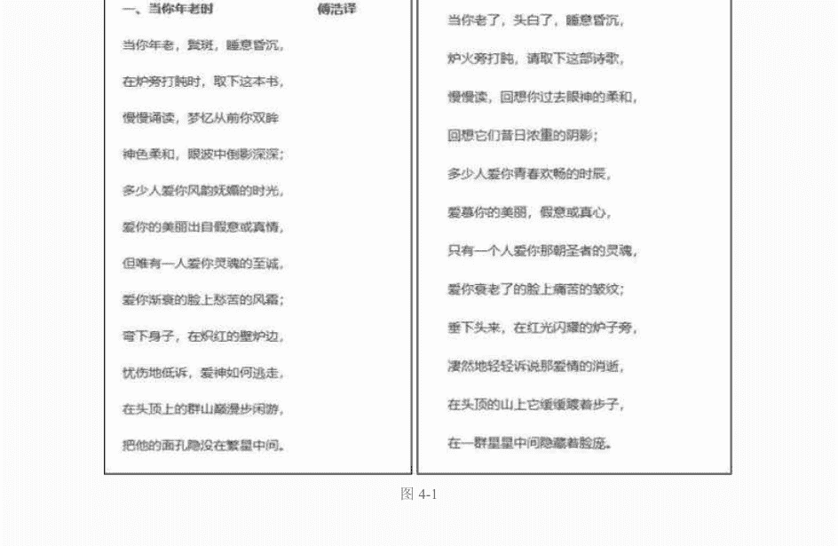

### 4.2.3 范文样例生成
写作时常因思路枯竭而停滞，文章空洞、缺乏表现力。议论文尤其缺少有力论据，逻辑松散、说服力弱。这时DeepSeek可作为写作助手，按不同题目和文体生成高质量样例。

其生成原理基于深度学习，通过海量文本学习掌握表达、结构和主题。可产出记叙、议论、说明、散文、诗歌等多种体裁。风格上可模仿鲁迅的犀利、朱自清的清新、莫言的质朴，也能按需求生成幽默、庄重、抒情等不同语调。

提问
请结合“燃灯校长”张桂梅写一篇主题为“坚守”的议论文，要求观点明确、论据充分、语言精炼、论证合理、逻辑严密。

回答
### 以生命为灯，照亮坚守之路

在滇西北深山，有一盏不灭的灯。张桂梅校长以羸弱之躯坚守数十年，用生命为两千多名女孩点亮希望。这盏灯照亮求学路，也映照民族精神的传承。坚守并非固执，而是一种以生命为火种的精神传递。

她的坚守是教育初心的坚定。身患多种疾病仍坚持早起晚归，用沙哑嗓音唤醒黎明。让人想起孔子“发愤忘食”的执着与陶行知“捧着一颗心来”的奉献。教育是用生命影响生命。

她的坚守是精神火种的传递。华坪女高的校训“我生来就是高山而非溪流”，正是她传递的信念。她不仅传授知识，更以一生诠释永不放弃。让人联想到范仲淹的家国情怀与林则徐的担当。她的坚守让传统精神在新时代焕彩。

她的坚守是文化的延续。从孔子周游列国到她扎根山区播撒希望，民族精神靠一代代坚守延续。坚守在新时代赋予传统新内涵，让“仁者爱人”与“有教无类”在当代生动呈现。

生命的意义在于厚度。张桂梅用坚守诠释生命价值。在快速变化的时代，我们更需这种精神。以她为镜，在各自岗位坚守初心，传递希望，让精神之灯持续前行。

工具能生成高质量范文，但不宜完全依赖。更理想的是协同创作，以其输出为参考与灵感，学习其思路与语言，优化结构、词汇与修辞，从而真正提升写作能力。

## 4.3 创意文案生产
信息爆炸时代，创意文案的价值凸显。它能在信息洪流中抓住注意力并传递核心信息。DeepSeek在创意文案生成上表现强劲。

### 4.3.1 广告文案定制
商业竞争激烈，企业需要在嘈杂市场中脱颖而出。广告文案是产品的代言人，用语言传递价值并激发购买欲。优秀文案既要清晰说明卖点，也要触动内心。

DeepSeek可针对不同产品生成生动、有感染力的文案。

提问
请为面向年轻女性的美白面膜写一篇小红书推广文案，突出提亮肤色与补水保湿，风格活泼有趣，带emoji，结尾引导点赞收藏评论。

回答
✨白到发光！素颜也敢出门的那一款✨

姐妹们，这款美白面膜我真的要安利！
第一次用就惊艳😍
敷完水嫩到能掐出水💦
肤色提亮两度，素颜被夸爆🔥

🌟核心功效
✅深层补水锁水
✅提亮肤色改善暗沉
✅温和不刺激

使用感受：面膜贴合，精华多，敷后发光，第二天上妆更服帖。

建议每周2~3次，敷后按摩促进吸收。
双十一囤货中，已回购第三盒。

#美白面膜 #护肤必备 #变美计划
评论区聊聊你的使用心得～记得点赞收藏哦

创作广告文案时，先明确目的与受众，再用简洁指令提炼品名、卖点、受众特征等关键词。

### 4.3.2 社媒内容生产
社交平台爆发式增长，用户对内容质量要求更高。品牌要扩大影响，个人要展示自我，都需把握平台特性与用户偏好。小红书偏爱简洁、带emoji的种草干货，微博重时效与话题，需要快速抓住注意力。

DeepSeek能依据平台特性和用户喜好生成有话题的内容。

提问
基于“电影《哪吒之魔童闹海》票房破90亿”创作一篇微博。要求事实陈述50字、专业解读300字、延展思考50字，并预设1~2个讨论问题。

回答
【#哪吒2票房破90亿#】截至2025年2月12日，《哪吒之魔童闹海》票房突破90亿，刷新国产动画纪录。影片延续精良制作，融入传统文化元素，引发全民热潮。

从传播学看，影片验证了“文化IP+工业化制作”的范式。通过精准定位与现代化重构，借助社交媒体形成话题裂变。长周期制作积累期待，实现口碑与票房双收。情感共鸣上，现代价值观的哪吒形象引发认同。跨媒介叙事联动游戏周边，构建完整IP生态，增强黏性。

国产动画在追求商业成功时如何平衡艺术与商业？过度依赖IP是否会限制原创？

#电影产业观察# #国产动画崛起#
你认为未来发展方向是什么，IP与原创如何取舍？

朋友圈文案示例：
☕ 今天挖到宝藏咖啡店！巷子里的小店，推门即是咖啡香。拿铁拉花精致舍不得喝，阳光洒进来超治愈。老板还送手工蛋糕，幸福感拉满！姐妹们速来。

提问技巧包括用更具体的关键词组合，结合自身真实体验补充细节，并按平台调性调整语言风格。

### 4.3.3 虚构小说创作
小说以想象力和内涵为读者打开新世界。佳作需要想象、文字功底和情节构思。DeepSeek能写悬疑、爱情、奇幻等多种故事，构思情节、塑造人物、设置悬念。

提问
以“我居然对孟婆汤过敏”为开头写一个虚构小说，要求情节曲折、脑洞清奇。

回答
我居然对孟婆汤过敏。那碗泛着幽蓝光的汤递来时，我喉咙发紧，全身起疹。孟婆惊讶，这是她三千年来首例。

“既如此，你就带着记忆投胎吧。”她挥手，我天旋地转。

再睁眼，我成婴儿。奇怪的是我记得前世，还能听见人心声。产房里护士尖叫：“婴儿没心跳！”我却活着。

十八年后，我成法医。每到深夜，能听见死者在耳边低语。他们说城里有连环杀手，专挑年轻女性。最近的受害者竟是我大学同学。

【尸检室里的轮回线索】

在解剖台前，我的手指刚触到那具遗体，眼前忽然闪过一瞬画面：行凶者的左手小指上有一道淡淡的月牙形疤。那一刻脊背发凉——我的恩师、法医圈里的陈教授，左手小指正好也有同样的痕迹。

情况更让人不安。顺着线索查下去，受害者竟都曾在同一家“忘川”心理诊所接受过咨询，而诊所的负责人，是陈教授的妻子。

真相似乎近在咫尺，却在一次意外车祸后被打断。我再次站在了奈何桥边。孟婆一眼认出我，语气带笑：“哎呀，是你，那个对孟婆汤产生过敏反应的怪例。”

“为何我会过敏？”我追问。

她笑得意味深长：“你本不是凡人。你是地府委派到阳间的引路者，职责是引渡含冤而死的亡魂。上回转世时出了差错，你带着前世记忆投生过来了。”

我恍然，那就可以解释为何我总能听见死者残留的声音。话音未落，孟婆已把我推向轮回通道：“去吧，这回给你安排一个新身份，继续完成该做的事。”

睁眼时，我已成了“忘川”心理诊所的实习医生。轮到我的第一位咨询者，竟是陈教授。

……

DeepSeek这类AI工具的登场，对文学创作产生了明显冲击。一方面，其快速产出与海量素材优势，为写作者打开了新思路，能在极短时间内提供大量故事点子与结构雏形，降低灵感搜集与初稿撰写的成本。另一方面，这也让人们重新审视写作的本质。AI生成的文本即便在语言与情节搭建上尚可，却难以复刻人类作家特有的情感体悟、生活积淀与个人风格。文学终究不只是字词拼凑，而是创作者对世界的理解、对人性的洞察与内心的抒发。

因此，人机协同成为当下常见做法。作家发挥情感、洞察与创造力赋予作品灵魂，AI则承担辅助角色：提供灵感、润色表达、排查逻辑与语法问题。典型的流程是先由作家确定大纲与主线，再借助AI进行语言打磨与漏洞检查。

### 4.3.4 视频脚本创作

短视频时代，优质内容是抓住注意力的关键。而好的内容都源于成熟的脚本，它像施工蓝图，明确每个镜头、每句对白、节奏与整体风格。无论是剧情短片、品牌宣传还是知识科普，脚本要求各不相同。

在长篇叙事上DeepSeek已有体现，视频脚本则是其在动态视觉领域的延伸。它能根据主题快速给出逻辑清晰、层次分明、画面感强的框架。

Q

我做美食自媒体，想做一期烤肉店探店视频脚本，要画面有趣、情节顺畅有吸引力，可以借鉴某位代表性博主的风格。

A

烤肉店探店脚本

标题：🔥【惊喜发现！这家店的和牛藏得太深了】🔥

1. 开场

画面：从城市夜景切到烤肉店招牌，霓虹闪烁，店内喧闹透过玻璃。博主站在门口，着休闲时尚装扮，挥手向镜头。

台词：“哈喽大家好，我是美食侦探XXX！今天带你们去一家网红烤肉店，听说和牛特别绝，到底真假，跟我一起进去看看！”

2. 第一部分：店内环境

画面：跟随博主入内，拍摄日式装修、原木桌椅、暖黄灯光、墙上和风画。特写烤架上冒油的肉片，烟雾升腾。博主入座后环视，挑眉。

台词：“装修很走心，日式风，一秒像在东京。关键每桌独立烤炉，不怕油烟，这点很加分。”

3. 第二部分：点单环节

画面：博主翻菜单，特写招牌：和牛拼盘、厚切牛舌、秘制酱料。博主眨眼：“今天点豪华套餐，试试值不值。”服务员上和牛拼盘，博主捂嘴惊讶。

台词：“镇店之宝是和牛拼盘，据说是A5等级，看这雪花纹真像艺术品。厚切牛舌据说外焦里嫩，值得期待！”

4. 第三部分：烤肉过程

画面：博主夹和牛上架，特写高温变色、油脂滴落、火苗窜起。翻面时对镜头说：“听这滋滋声，是不是很治愈？”烤好蘸酱咬一口，表情夸张。

台词：“外层微焦内部嫩滑，油脂在口中化开，配秘制酱酸甜平衡，绝配。”

5. 第四部分：互动环节

画面：博主举肉对镜头：“来，我喂你们！”切到吃牛舌，清脆声响。随后神秘地说有隐藏吃法，示范用生菜包肉加蒜片泡菜。

台词：“生菜清爽，蒜片辛辣，完美解腻，这个吃法一定要试。”

6. 第五部分：总结与推荐

画面：博主靠椅上摸肚子满足，镜头扫空盘，擦嘴。最后比心。

台词：“今天吃得很满足，和牛品质高，环境好，价格也算合理。烤肉爱好者别错过，建议提前预约。下一期见！”

7. 结尾

画面：博主走出店门挥手，镜头拉远定格招牌。

字幕：“店名：XXX烤肉店 | 地址：XXX路XXX号 | 人均：XXX元”

背景音乐渐弱结束。

DeepSeek能快速给出多样高效的脚本框架，但并非终稿，需要创作者按拍摄条件、个人风格与受众喜好调整镜头时长与台词表达。指令越具体，效果越好，例如要求“生成3分钟面向青少年的趣味科普脚本，主题恐龙灭绝，需含动画元素”，则更易获得符合预期的结构。

# 第5章 DeepSeek赋能职场工作

当下职场节奏快、竞争激烈，高效创新的工作方式成为刚需。DeepSeek的出现恰逢其时，为办公效率注入新动能。

它可几分钟内生成条理清晰的邮件，帮白领摆脱卡壳；能为市场研究者梳理行业动向，发现商机；也能帮助程序员解读复杂代码，加速开发。像一位智能伙伴兼贴身秘书，帮助职场人突破瓶颈，应对未来挑战。

## 5.1 撰写邮件和报告

邮件与报告是商务沟通与信息传递的基础。DeepSeek借助自然语言处理，能快速产出结构清晰、表达流畅的文本，节约时间并提升沟通质量，同时可按需求给出精准建议，保证专业性。

### 5.1.1 撰写商务邮件

商务邮件是传递信息、确认细节的关键载体，具有正式性与可追溯性，对树立专业形象很重要。以下示范如何用DeepSeek生成推销邮件。

Q

我是销售，需要发邮件向客户推销一款防脱发男性洗发水，要求简洁突出卖点并吸引目标客户。

A

示例模板，仅供参考。

主题：摆脱脱发困扰 | [品牌名]男士防脱洗发水，28天找回浓密自信

尊敬的[客户姓名/先生]：

脱发是否在影响您的形象和自信？

[品牌名]男士防脱洗发水专为男性研发，科学对抗脱发。

选择理由：

- ✅ 强效防脱：含咖啡因+锯棕榈提取物，深层滋养毛囊，减少断发掉发。
- ✅ 清爽控油：专利控油配方缓解头痒头屑，适合日常使用。
- ✅ 男士定制：薄荷清凉+木质香调，洗后干爽不油腻。

限时优惠：

- 🔥 首单减20%，赠旅行装试用（购买链接：[链接]）
- 🔥 不满意30天全额退款，零风险体验

立即行动，告别头顶危机。

👉 [立即下单] 或回复邮件咨询专属顾问。

祝好，

[姓名]

[职位] | [公司]

电话：[电话] | 官网：[网址]

要点：直击痛点引发共鸣，用“28天”“67%”等数据增强可信度，突出香味与清爽等男性偏好，限时优惠与退款承诺降低决策门槛。可按客户行业调整话术，如对商务人士强调提升职场形象。

Q

写一封邀请行业专家来公司做讲座的商务邮件，需说明主题、时间、地点、报酬与便利，语气礼貌诚恳。

A

示例模板，可按实际情况修改。

邮件主题：诚邀[专家姓名/职称]莅临[公司名称]做专题讲座

尊敬的[专家姓名/职称]：

您好！

[公司名称]长期深耕[领域]，十分敬佩您在[具体领域]的卓越成就。为拓宽团队视野，我们诚挚邀请您来我司围绕“[讲座主题]”进行分享。

讲座信息

主题：[如数字化转型中的创新实践]

时间：[如2024年3月20日14:00—16:00]

地点：[如XX市XX区XX路XX号XX大厦会议室]

参会人员：[如管理层及核心团队约50人]

我方支持

……

温馨提示：

1. 主题明确，关联专家专长与公司需求。
2. 细节具体，避免模糊时间地点。
3. 体现尊重与诚意，不夸大承诺。
4. 版面简洁，分点便于阅读。

### 5.1.2 撰写工作报告

工作报告用于总结成果、问题与改进，推动决策与团队协作。借助DeepSeek，撰写变得轻松。

Q

我是程序员，需写月度工作报告，说明[软件项目名称]开发进度、已解决技术难题、遇到阻碍及方案，结尾提出后续优化想法，文字简洁。

A

模板示例。

202×年××月 [软件项目名称] 开发月报

一、进度概览

1. 核心模块
   - 用户权限系统重构完成100%。
   - 订单异步处理功能完成90%，联调测试中。
2. 功能迭代
   - 新增API版本控制，已上线。
   - 数据查询响应从2.1s降至0.4s。

二、技术攻关

1. 分布式事务一致性
   - 采用Saga模式+补偿机制解决跨服务数据不一致。
   - 开发通用事务管理器，复用率提升60%。
2. 高并发性能瓶颈
   - Redis管道+二级本地缓存，QPS从1200提升至3500。
   - 优化线程池配置，GC频率降40%。

……

建议结合甘特图或燃尽图展示进度，模块划分与细节可按实际调整。

### 5.1.3 撰写项目方案

项目方案是确保目标、时间、成本、质量可控的基础文件。使用DeepSeek时把握提问技巧：

1. 明确任务与需求：说明目标、任务范围、交付形式。
2. 提供背景资料：行业现状、市场趋势、成功案例、数据。
3. 合理引导交互：分段生成框架再细化，按背景-目标-内容-实施-风险结构组织，反馈修改。
4. 审核完善：核对数据准确性，评估可行性，结合团队特点个性化调整。

Q

我要筹备大型音乐节，请设计方案。需含目标受众年龄、音乐偏好、地域来源；演出阵容含知名艺人与新人；场地选址与布置考虑容量、交通、舞台；票务分早鸟、普通、VIP及宣传渠道。方案要有创意。

A

2025大型音乐节方案要点

## 一、市场分析

### 1 目标受众
年龄：18-35岁为主约70%，36-50岁约20%，其余10%为家庭与青少年。
音乐偏好：流行30%、电子EDM25%、摇滚独立20%、嘻哈R&B15%、民谣世界音乐10%。电子与嘻哈需求上升。
地域：北上广深50%，新一线30%，周边与国际游客20%。

### 2 趋势
文旅融合带动餐饮住宿消费；观众追求沉浸体验与互动市集。

## 二、阵容规划
头部艺人…… 潜力新人及特色乐队……

## 三、场地与布置
推荐大运中心或杭州奥体中心，容量5万人，交通便利。设接驳巴士与共享单车专区，合作出行套餐。舞台设计与功能区……

## 5.2 市场调研

数字化下市场瞬息万变，精准洞察趋势、需求与竞争态势是关键。DeepSeek可快速梳理海量数据，支撑调研工作。

### 5.2.1 市场趋势分析

趋势分析帮助企业把握机会、合理规划。DeepSeek可助力解读密码。

Q

分析未来3-5年智能穿戴设备趋势，需涵盖芯片传感器进展及消费者健康监测偏好变化。

A

未来3-5年市场呈现技术整合与需求个性化并行。

一、技术革新
1. 芯片跃迁
   - 3nm制程普及，算力提升200%功耗降40%，支持本地AI推理如实时ECG。
   - 异构计算架构标配，NPU+GPU+低功耗协处理器并行处理运动识别与健康监测。
   - 柔性芯片突破，2026年可弯曲处理器让智能戒指算力接近现有手表。
2. 消费者需求
   - 健康监测专业化：24小时动脉硬化指数监测需求年增67%。
   - 睡眠经济：多导睡眠监测成中高端标配。
   - 心理健康量化：GSR传感器结合AI情绪算法，压力监测准确率超92%。

三、竞争格局……

### 5.2.2 竞争对手分析

对手分析助力规避威胁、制定策略。DeepSeek可担任行业分析师角色。

Q

我拟进入炸鸡汉堡快餐行业，请分析肯德基与麦当劳，并给出差异化建议。

A

行业双巨头对比与新入者建议

## 一、品牌定位与差异

### 肯德基
核心产品：炸鸡为主，配汉堡小食及本土化单品如豆浆油条。
形象：家庭聚餐与炸鸡专家，靠山德士上校IP强化历史感。
本土化：在中国印度等推出高度本地化菜单。

### 麦当劳
核心产品：汉堡为核心如巨无霸，配薯条麦乐鸡，近增咖啡与轻食。

快餐双雄策略拆解：肯德基 vs 麦当劳

品牌调性
肯德基塑造的是朝气、节奏快、视野全球的形象，借开心乐园餐切入家庭客群。

菜单统一
麦当劳坚持全球菜单高度同质，主打“无论在哪都能尝到一样的味道”的确定感。

关键分野
肯德基重在炸鸡单品与本土化研发，麦当劳擅长以汉堡标准化驱动全球化扩张。两者都走核心爆品打底、本地化补充的路径，只是侧重点不同。

## 二、商业模式与运营策略
### 1 供应链管理
肯德基：百胜中国在国内自建物资体系，与本地鸡肉、蔬菜等供应商深度绑定，成本把控能力极强。
麦当劳：推行集中式采购，与辛普劳土豆、泰森食品等国际大供应商长期合作，保证食材一致性。
共同点：都依赖规模化采购、冷链运输和中央厨房来降低成本。

### 2 门店运营
特许经营模式
麦当劳：加盟审核严格，启动资金约500万~1000万元人民币，但提供完整培训与品牌支撑。
肯德基：加盟门槛相对灵活，部分市场允许小城镇特许经营，便于中小投资者进入。
数字化与外卖
双方均接入自有App及美团、饿了么等第三方平台拓展线上订单，麦当劳在会员积分体系上更成熟。

### 3 营销策略
肯德基：擅长跨界联名，如与宝可梦等IP合作推出玩具，借助抖音、小红书做种草。
麦当劳：偏重品牌价值输出，如环保、社区公益，并用四川辣酱等限时新品制造话题。

## 三、市场表现与挑战
### 1 全球布局
麦当劳：覆盖120+国家，门店约4万家，2023年欧美市场占比更高。
肯德基：覆盖150+国家，门店约2.5万家，中国市场贡献近半营收，百胜中国已独立上市。

### 2 近年挑战
健康饮食趋势：消费者对油炸食品需求下降，双方均推出沙拉、烤鸡等选项，成效有限。
成本压力：食材与人力成本上涨，挤压利润。
本土竞争者崛起：华莱士、塔斯汀等以低价与差异化产品抢占市场。

## 四、新品牌入局建议
### 1 差异化定位
品类创新：避开正面竞争，可聚焦空气炸锅技术打造的健康炸鸡、川味或芝士夹心等区域特色汉堡。
场景细分：针对深夜、办公区下午茶等场景设计套餐，或提供现点现做的高品质体验。

### 2 供应链与成本控制
优先绑定区域供应商，构建灵活的小规模供应网络，如与本地农场合作。
采用中央厨房+小型门店模式，降低租金与人力开销。

### 3 数字化与私域流量
通过小程序、社群沉淀用户数据，推出个性化推荐计划。
结合直播带货、短视频展示制作过程，提升品牌粘性。

### 4 本土化与快速试错
借鉴肯德基做法，按区域口味微调产品，如东南亚增加咖喱风味。
采用小步快跑模式，用限时新品测试市场反馈，再决定是否常态化。

### 5.2.3 用户行为分析
行为分析能帮助企业读懂用户需求、习惯与偏好，进而优化体验、提升满意度与竞争力。DeepSeek可基于网络数据与自身模型精准描绘使用者画像。

Q
能否做一个小红书App用户画像的解读？

A
小红书是国内领先的社交电商生活方式平台，用户画像呈现年轻化、女性为主、高消费力特征。核心特征如下。
一、人口统计学特征
1. 年龄分布
主力用户18~35岁，占比约80%，以95后Z世代与90后为主，18~24岁增长明显。近年向全年龄段扩展，30岁以上母婴、家居用户占比提升。
2. 性别比例
女性用户占70%~80%，男性增速加快，主要集中在数码、汽车、健身领域，整体仍以女性需求为核心。
3. 地域分布
一线与新一线城市如上海、北京、广州、杭州占比超50%，消费力强。下沉市场快速渗透，三四线城市通过本地生活、平价好物内容获客。
二、兴趣与行为特征
1. 内容偏好
核心领域美妆护肤、时尚穿搭、旅行攻略、美食探店、母婴育儿。新兴趋势有露营骑行、家居改造、科技数码、健康养生、职场成长。内容形式偏好真实UGC的素人测评与经验分享。
2. 消费行为
超60%用户因内容产生购买意愿，中高端品牌更受青睐。决策重口碑与性价比，常用平替、测评关键词，对KOC信任度高。
3. 社交互动
日均使用时长超60分钟，习惯点赞、收藏、评论增强社区粘性。用户自发形成兴趣社群，推动汉服、盲盒、宠物等小众文化破圈。
三、职业与生活方式
核心人群为都市白领、大学生、新手妈妈、自由职业者。追求精致实用兼顾品质与性价比，热衷探索新品牌与体验式消费。价值观推崇多元包容、女性独立、环保可持续，反感过度营销与滤镜造假。
四、面临的挑战与变化
用户增长瓶颈需平衡一二线与下沉市场的内容差异化，避免社区稀释。商业化压力下广告内容增多影响体验，需加强审核打击虚假种草。抖音、快手发力本地生活，B站、知乎争夺年轻用户，需强化消费决策核心优势。
总结
小红书用户可概括为年轻女性为主的高消费力群体，追求品质生活与真实分享。平台需持续优化内容生态、维护调性，并拓展直播电商、本地服务等多元场景应对变化。

## 5.3 代码编写
编程已成为多领域关键技能，借助AI工具能显著提升效率。DeepSeek作为先进大语言模型，在代码生成上表现突出，能理解自然语言指令并生成高质量代码。

### 5.3.1 代码需求分析与框架搭建
在数字化浪潮下，框架搭建能提升结构性、可读性，便于协作与维护。借助DeepSeek搭建框架时可明确提出需求。

Q
请设计零售连锁店的库存与员工管理框架，要求流程更简便、能生成库存报表并推送提醒，及时掌握存货情况，防止积压或缺货。

A
精简版零售连锁店库存与员工管理系统框架设计如下。
一、系统架构

二、核心功能模块
1. 库存管理
实时库存监控
各分店库存数据自动同步，支持扫码枪/POS录入。
多维度视图：SKU、分类、分店、保质期。
智能预警
库存低于安全阈值自动触发补货通知。
临期商品预警，保质期剩余30天标红。
极简报告

## 2 员工管理
任务看板
自动生成补货任务，关联库存预警。
班次交接确认，扫码完成责任转移。
权限分级
店员：查看本店库存、接收任务。
店长：调拨申请、修改安全库存。
总部：全局视图、报表分析。

## 三、技术实现（精简版）
数据库：MySQL，分店库存表+商品主表+任务日志表。
后端：Python FastAPI，RESTful API+定时任务。
前端：微信小程序店员端+PC仪表盘管理端。
通知：阿里云短信API+邮件模板。

## 四、关键流程示例
补货流程：
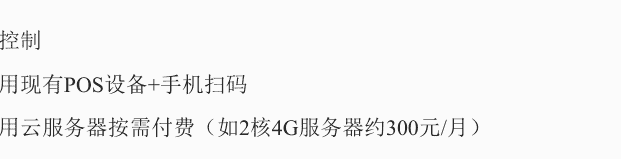

## 五、成本控制
硬件：复用现有POS设备+手机扫码。
部署：云服务器按需付费，如2核4G约300元/月。
开发：MVP版本可3~4周交付。
总结：该系统以自动化预警+任务驱动替代人工盘点，预计可减少30%以上缺货/滞销，适合20~50家门店的中小型连锁。

### 5.3.2 不同编程语言的代码生成
编程语言各有适用场景。DeepSeek可灵活生成多种语言代码。

Q
写一个Java程序，读取用户输入的圆半径并输出面积。

A
```java
import java.util.Scanner;

public class CircleArea {
    public static void main(String[] args) {
        Scanner scanner = new Scanner(System.in);
        System.out.print("请输入圆的半径：");
        double radius = scanner.nextDouble();
        scanner.close();
        System.out.printf("圆的面积是：%.2f", Math.PI * radius * radius);
    }
}
```

Q
再用另外两种语言实现同样的计算。

A
```cpp
#include <iostream>
#include <iomanip>
const double PI = 3.1415926;

int main() {
    double radius, area;
    std::cout << "请输入圆的半径：";
    std::cin >> radius;
    area = PI * radius * radius;
    std::cout << std::fixed << std::setprecision(2);
    std::cout << "圆的面积是：" << area << std::endl;
    return 0;
}
```
```python
import math

radius = float(input("请输入圆的半径："))
area = math.pi * radius ** 2
print(f"圆的面积是：{area:.2f}")
```

### 5.3.3 代码优化建议
代码质量与效率直接影响项目成败。DeepSeek可提供多维度优化建议。

Q
请对代码做优化并给出建议。
```python
def factorial(n):
    if n==0 or n==1:
        return 1
    else:
        return n * factorial(n-1)
num=5
print(f"{num} 的阶乘是：{factorial(num)}")
```
A
优化后的代码
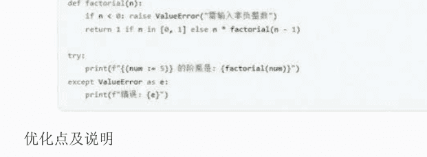
优化点及说明
输入校验：在factorial函数里增加对输入n的校验，负数时抛出ValueError，增强健壮性。
返回逻辑简化：使用Python三元运算符简化递归中的if-else，使代码更简洁。
海象运算符运用：使用:=在print中定义并赋值num，减少代码行数。
异常处理：使用try-except捕获ValueError并打印错误信息，便于用户理解输入错误。

## 5.4 Excel数据处理技巧
Excel是职场必备工具，本节聚焦数据处理技巧，从基础函数到数据透视提升效率。

### 5.4.1 复杂数据的导入与整理
1. 借助DeepSeek导入数据
直接输入数据：数据量少时可直接复制到输入框并说明来源用途，如电商用户购买记录含商品名称、购买时间、数量等，需整理分析。
利用API导入：数据量大且结构复杂时，可通过代码调用API获取数据后再输入DeepSeek处理。例如用Python requests库调用数据库API获取数据。
可通过图5-1所示代码导入多工作表Excel文件。
```python
import pandas as pd

# 定义Excel文件路径
excel_file = pd.ExcelFile('your_file.xlsx')

# 获取所有表名
sheet_names = excel_file.sheet_names
sheet_names
```
图5-1
2. 利用DeepSeek整理复杂数据
数据清洗建议：描述缺失值、重复值、错误数据问题请求建议，如销售数据有负金额、客户信息缺失。
DeepSeek会给出删除重复、填充缺失、修正错误等方法。
处理缺失值的代码如图5-2所示。
```python
import pandas as pd

# 读取 Excel 文件
file_path = 'your_file.xlsx'
df = pd.read_excel(file_path)

# 假设对数值列用均值填充缺失值
numeric_columns = df.select_dtypes(include='number').columns
for col in numeric_columns:
    df[col].fillna(df[col].mean(), inplace=True)

# 保存处理后的数据
df.to_excel('filled_file.xlsx', index=False)
```
图5-2
数据结构化处理：告知期望结构化形式协助转换，如文本客户反馈转为含反馈主题、内容、时间的表格。
数据分类与聚合：提出按产品类别与销售地区分类并统计总额的需求。
筛选符合条件的数据代码如图5-3所示。
```python
import pandas as pd

# 读取 Excel 文件
file_path = 'your_file.xlsx'
df = pd.read_excel(file_path)

# 筛选 'column_name' 列大于 10 的数据
filtered_df = df[df['column_name'] > 10]

# 保存筛选后的数据
filtered_df.to_excel('filtered_file.xlsx', index=False)
```
图5-3
验证与优化整理结果：人工抽样验证准确性与完整性，发现问题反馈给DeepSeek进一步优化。

### 5.4.2 高级函数应用与数据分析
1. 高级函数应用
提出清晰问题：将需求详细告知DeepSeek，如编写Python函数对多维数组按指定维度快速排序并考虑复杂度。
代码实现：根据示例在熟悉环境中实现并调整。
测试函数：编写测试用例验证正确性与性能，可用unittest或pytest。简单Python函数测试示例如图5-4所示。

DeepSeek 工作提效实战

```python
def add_numbers(a, b):
    return a + b

# 测试函数
def test_add_numbers():
    result = add_numbers(2, 3)
    assert result == 5, f"Expected 5, but got {result}"
    print("Test passed!")

test_add_numbers()
```

图5-4

（4）性能优化
测试环节若察觉函数运行吃力，可向模型索取优化思路。典型问法是：“我写的排序函数在大数据量下明显变慢，该如何降低时间复杂度？”

（5）功能扩展
随着使用场景变化，函数往往需要扩容。可向模型请教如何新增功能模块，或让其兼容更多输入类型。

复杂条件求和的实现示例见图5-5。

```python
import pandas as pd

# 读取 Excel 文件
file_path = 'your_excel_file.xlsx'
df = pd.read_excel(file_path)

# 定义复杂条件
condition1 = df['列名1'] > 10
condition2 = df['列名2'].str.contains('特定文本', na=False)
combined_condition = condition1 & condition2

# 对符合条件的‘求和列名’列进行求和
sum_result = df[combined_condition]['求和列名'].sum()

print(f"符合条件的求和结果为：{sum_result}")
```

图5-5

### 2. 数据分析

（1）借助模型厘清分析思路
把分析目标与已整理的数据状况详细告知模型，例如：“我有一份过去一年每日销售额、销量与品类 CSV，想研究各品类走势并锁定旺季，应采用怎样的方法与步骤？”

（2）选择分析方法与工具
分析方法：根据模型建议确定具体做法。分析销售走势常会用到移动平均、指数平滑等时间序列手段；比较品类之间销售则可能用到分组汇总、占比计算等统计手段。
分析工具：挑选合适的工具落地这些方法。常用选择包括 Python 搭配 Pandas、NumPy、Matplotlib 等库、R 语言、Excel 等。可向模型询问某种方法更适合哪类工具及具体操作，例如：“我想用 Python 做销售数据的时间序列分析，需要哪些库，操作流程是怎样？”

（3）执行数据分析
按选定方案撰写代码或使用工具功能进行分析。遇到报错、数据处理障碍时可随时求助，例如把报错信息复制给模型并说明当前操作，模型会分析原因并给出解决建议。

描述性统计分析的代码如图5-6所示。

```python
import pandas as pd

# 读取 Excel 文件
file_path = 'your_file.xlsx'
df = pd.read_excel(file_path)

# 对数值列进行描述性统计分析
numeric_columns = df.select_dtypes(include='number').columns
description = df[numeric_columns].describe()

print(description)
```

图5-6

### 5.4.3 数据可视化与报表生成

当前职场中，将数据转化为直观呈现并形成报表已是关键环节。DeepSeek 能把枯燥数字转成易懂的视觉表达，助力更高效决策。

### 1. 借助 DeepSeek 规划方案
可按图5-7所示流程逐步规划。

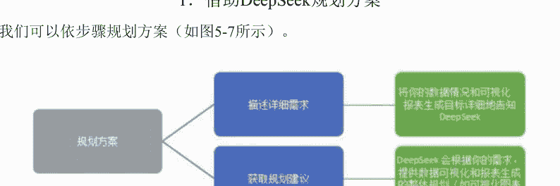

### 2. 选择工具与技术
咨询工具建议：向模型请教完成可视化与报表任务的合适工具。常见选择包括 Python 的 Matplotlib、Seaborn、Plotly 库，R 语言的 ggplot2 包，以及 Tableau、PowerBI 等商业软件。例如可问：“针对我提到的销售数据可视化需求，哪种工具更合适，各自优劣如何？”
学习工具使用：选定工具后，再向模型请教该工具的具体使用方法。

### 3. 进行数据可视化
编写代码或操作指南：依据模型提供的示例代码或操作指引实现可视化。过程中若出现报错、图表样式难以调整等，可及时反馈报错信息与期望效果，获取解决办法。
优化可视化效果：初版完成后，与模型讨论如何提升图表的外观与可读性。如调整配色、增补图例标题、优化坐标轴标签等，使图表信息更清晰。

代码可生成柱状图实现数据可视化，如图5-8所示。

```python
import pandas as pd
import matplotlib.pyplot as plt

# 读取 Excel 文件
file_path = 'your_file.xlsx'
df = pd.read_excel(file_path)

# 假设绘制第一列数据的柱状图
plt.bar(df.index, df.iloc[:, 0])
plt.xlabel('Index')
plt.ylabel('Value')
plt.title('Bar Chart of First Column')
plt.show()
```

### 4. 生成报表
生成报表的步骤如图5-9所示。


在报表生成过程中有任何需求均可求助模型，例如：“如何撰写销售数据报表中的趋势分析部分，既能准确呈现变化又通俗易懂”。

代码可生成报表，如图5-10所示。

```python
from openpyxl import Workbook
from openpyxl.drawing.image import Image

# 创建一个新的工作簿
wb = Workbook()
ws = wb.active

# 将分组数据写入 Excel
ws.append(grouped.columns.tolist())
for row in grouped.values.tolist():
    ws.append(row)

# 插入图表图片到 Excel
img = Image('sum_by_category.png')
ws.add_image(img, 'E1')

# 保存报表
wb.save('report.xlsx')
```

### 5. 审核与分享
**审核报表内容：** 报表完成后，认真核查数据的准确性、分析的逻辑性与表述的清晰度。如有疑问，可再次与模型交流，进一步完善。
**分享报表成果：** 根据需求将报表以 PDF、PPT、Excel 等合适格式分发给相关人员。可向模型了解不同格式的导出方式与适用场景。

## 5.5 简历筛选与求职面试

在竞争激烈的职场，高效精准的简历筛选与出色的面试表现同等重要。DeepSeek 作为先进的人工智能技术，为该领域带来革新。它能快速解析海量简历并精准匹配岗位需求，大幅提升筛选效率与质量；在面试环节，凭借强大的数据分析与模拟能力，求职者可开展针对性训练。下面深入探讨其应用价值。

### 5.5.1 构建高效的简历筛选规则
高效筛选简历需遵循如图5-11所示规则。

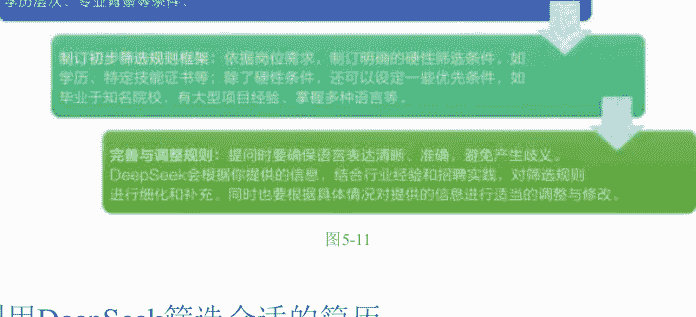

### 5.5.2 利用DeepSeek筛选合适的简历
1. 基于文本交互的手动筛选
将单份简历全文复制到输入框，按岗位要求提问，如“该岗位要求 5 年以上互联网运营经验且熟练数据分析工具，这份简历的候选人是否符合？”；把多份简历的关键信息如姓名、工作经历、技能整理成段落输入，下达筛选指令，如“从这些简历中找出有 3 年以上软件开发经验且熟悉 Java 的候选人。”
2. 结合数据处理工具筛选
把简历信息整理成 Excel 或 CSV 表，包含姓名、学历、工作经历等字段。将表格上传至支持与模型交互的平台如 WPS，或以清晰格式输入模型并给出筛选规则，如“筛选出工作经历中包含大数据项目经验的候选人。”
3. 与招聘系统集成筛选
把模型的筛选功能嵌入企业现有招聘管理系统中。新简历进入系统时自动触发模型筛选，结果回写到招聘系统的对应界面，便于招聘人员处理。
4. 自动化流程筛选
具备编程能力时，可用 Python 等调用模型的 API。编写脚本批量读取简历文件、传给模型分析、接收结果并写入指定文件。例如循环读取某文件夹下所有简历，调用 API 判断是否符合要求并记录文件名。
若需用 Python 筛选 Excel 简历表，要求学历本科及以上、工作经验不少于 3 年且掌握 Python 技能，可参考下列代码如图5-12所示。

```python
    import pandas as pd

    # 读取 Excel 文件
    file_path = 'resumes.xlsx'
    df = pd.read_excel(file_path)

    # 定义筛选条件
    # 筛选学历为本科及以上的简历
    df = df[df['学历'].isin(['本科', '硕士', '博士'])]

    # 筛选工作经验不少于 3 年的简历
    df = df[df['工作经验（年）'] >= 3]

    # 筛选掌握 Python 技能的简历
    df = df[df['技能'].str.contains('Python', na=False)]

    # 将筛选结果保存到新的 Excel 文件
    output_file = 'filtered_resumes.xlsx'
    df.to_excel(output_file, index=False)

    print(f"筛选完成，符合条件的简历已保存到 {output_file}")
    ```

图5-12

### 5.5.3 面试问题准备与面试技巧指导
求职面试是职业进阶的关键，精准准备与良好表现至关重要。DeepSeek 凭借强大的语言理解与数据处理能力，可为求职者拆解岗位需求、模拟面试场景并优化应答策略。

> Q
> 我要面试一家新媒体公司的文案策划，你能充当面试官吗？
> A
> 好的！我来模拟新媒体公司文案策划岗位的面试官，以下是结构化面试问题，建议你先逐个思考回答，再看参考示例。

#### 一、基础考察
1. 请用1分钟介绍你与文案策划岗位匹配度最高的经历。
2. 你日常关注哪些新媒体平台？请用三个关键词总结XX平台（如小红书/抖音/B站）的内容生态特征。
3. 如果让你为一款新上市的无糖气泡水撰写推文标题，要求30分钟内产出20个版本，你的创作流程是？

#### 二、专业深挖
4. 展示你过往作品中数据最好的案例（口述即可），当时设定的核心传播目标是什么？为什么选择这个内容作为切入点？
5. 假设要为美妆品牌策划妇女节活动，请列举三个拒绝“粉红税”营销的角度，并简述对应的内容形式。
6. 当你的文案被客户质疑“不够网感”时，通常会通过哪些方式快速调整？

#### 三、临场测试
7. [命题创作]现在要为宠物智能喂食器撰写直播带货话术，目标人群是一线城市加班族，请现场输出3条30字内的痛点文案。
8. [案例分析]“好利来”的社交媒体运营策略中，你认为最具参考价值的动作是什么？这个策略对哪些品类品牌来说可复制？
9. [危机处理]品牌联名翻车导致舆情发酵，网友创作大量二创梗图，作为运营人员此时该压制还是借势？给出你的决策逻辑。

#### 四、潜力评估
10. 你观察到最近三个月有哪些现象级传播事件？这些案例对我们的食品赛道客户有何启发？
11. 如果给你一周时间攻克短视频脚本写作，你会通过哪些方式快速提升？
12. 反问环节：现在可以向我提1~2个问题。

#### 回答策略参考
> ▶ 第7题示范：
> “凌晨三点改PPT，你的‘猫主子’还在等你开罐头”
> “加班时最愧疚的瞬间：监控里毛孩子蹲在空碗前”
> “智能托管三餐，让TA不知道你昨天又通宵”
> （突出场景共鸣+产品核心功能）
> ▶ 第9题应对逻辑：
> 判断翻车性质：价值观错误/审美争议/产品瑕疵
> 分析二创内容的情感倾向：戏谑吐槽/愤怒抵制/玩梗调侃
> 决策树：
> 若属非原则问题且用户生成内容有娱乐性 → 快速玩梗自嘲，发起二创大赛转移焦点
> 若涉及法律道德风险 → 立即切割道歉，用产品补偿建立新记忆点
需要我展开某个问题的考察要点或参考答案吗？你可以先尝试自己回答，我会给出针对性建议。

Q
你能告诉我该职位的面试技巧吗？
A
以下是针对新媒体公司文案策划岗位的面试技巧，结合行业特性和岗位核心能力整理，帮你精准展现竞争力。

#### 一、核心能力展示技巧
1. 创意与网感
怎么做：用具体案例证明你的“网感”（如提前准备3个近期爆款案例，拆解其传播逻辑）
话术示范：“我每天会用‘热点日历法’预判传播节点，比如上周提前储备了‘脆皮年轻人’选题库，当XX品牌借势时能快速产出适配文案”

2. 数据思维
必杀技：将文案效果量化（如“通过AB测试优化标题关键词，推文打开率从3%提升至8%”）
隐藏考点：面试官可能追问“如果数据差如何归因”，提前准备分析框架（用户画像偏差/内容场景错位/流量分发机制等）

3. 跨平台适配力
差异化展示：对比不同平台的内容逻辑（如抖音强情绪钩子，小红书重实用价值，B站需埋互动梗）
加分项：提及小众平台玩法（如知乎问答植入、豆瓣小组梗文化）

#### 三、高频问题应答策略
- ▶ 被问“你的文案风格是什么？”
错误回答：笼统地说“年轻化、有趣”
正确回答：“我会根据品牌阶段调整风格：冷启动期用‘争议性话题+强福利’快速获客，成熟期侧重‘场景共鸣+情感价值’提升黏性，比如为XX品牌策划的…”

- ▶ 被质疑“不够网感”时
应急方案：
参考该品牌历史爆文的高频词/句式
快速拆解近期同类热门笔记的“开头3秒”话术
加入平台新推功能（如抖音“文字动画”特效梗）

#### 四、行业洞察展示模版
- ▶ 被问“最近印象深刻的新媒体案例”
回答结构：
案例简述（品牌+动作+数据）
可复用的策略（如“用‘反套路人设’破解同质化”）
结合应聘公司业务的应用设想
案例库储备建议：准备1个现象级事件+1个垂类黑马账号

#### 五、临场测试破题方法
- ▶ 命题创作（如撰写带货话术）
速成公式：痛点场景+情感共鸣+解决方案+即时行动指令
例：“总忘记铲屎？[智能猫砂盆]下班再也不用冲刺回家——现在下单送全年猫砂”（痛点+产品价值+促销钩子）

- ▶ 案例分析（如“分析XX品牌策略”）
万能框架：
内容层：人设打造/选题矩阵/视觉锤设计
运营层：流量承接动线/用户分层运营
变现层：产品组合策略/场景化种草链路
最后提醒：新媒体文案策划的核心是“用内容驱动业务增长”，面试中既要展现创意，也要体现商业思维。如果被问到薪资期望，可参考一线城市初级岗6000～10000元/月，资深岗12000～20000元/月（结合公司规模调整）。

## 5.6 PPT制作与进阶技巧

信息爆炸时代，演示文稿是工作汇报、学术交流、产品推广等场景的关键载体。传统制作流程繁琐，从梳理逻辑、收集资料到设计排版常耗费大量时间和精力，且易因内容不专业、设计欠美感而影响效果。DeepSeek 的出现为 PPT 制作带来革新，让制作更高效、专业且个性化。

### 5.6.1 根据需求生成PPT大纲
使用模型制作 PPT 前，需明确主题、目标与受众，并准备好文字、图片、数据等素材，再生成大纲。模型能快速梳理框架，避免逻辑混乱。依托海量知识储备，提供专业全面的结构，为后续工作节省大量时间，并可按不同需求精准定制，让 PPT 更贴合受众，提升演示效果。

如何让模型生成大纲？
**输入指令：** 在对话框中清晰准确地输入大纲生成需求。如“我想做一个关于市场营销策略的 PPT，用于公司销售团队培训，希望涵盖市场分析、目标设定、策略制定等方面，请生成大纲。”
**调整优化：** 若生成的大纲不符合预期，如内容不够详尽、逻辑有问题或缺少关键部分，可继续与模型沟通调整完善。如输入“希望在策略制定章节中增加具体的执行步骤。”

为保证生成的 PPT 大纲符合预期，提问时需掌握一定技巧（如图5-13所示）。

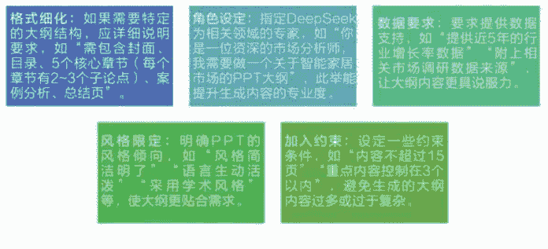

Q

#### 封面
标题：玩转长沙 星城潮旅指南
副标：古韵新潮交汇之地
主视觉：湘江夜色与橘子洲灯影交融的画面
视觉点缀：手绘线条搭配卡通印章，整体轻快年轻

#### 目录
- 星城初印象 古今共存
- 必去打卡地清单
- 湘菜探索 舌尖记忆
- 夜色长沙 越晚越热闹
- 出行实用指南
- 未来文旅展望
- 收官寄语

#### 第一章：星城初印象 古今共存
历史脉络：岳麓书院延续千年的文脉，近代革命旧址勾勒出城市的底色，整座城像一座会自我讲述的史馆。
当下形象：如今被视作网红热土与娱乐中心，吸引众多年青人聚集。
表达建议：用轻松调侃的语气串联今昔，比如“清晨在书院里感受古韵，夜晚到潮街追新玩法，转换毫无违和感。”

#### 第二章：必去打卡地清单
- 橘子洲
  概述：曾被名篇描写为秋色满山的胜地，如今成为城市青年热衷留影的热门坐标。
  看点：夜间的烟火表演，氛围感十足。
- 岳麓山
  概述：山体中藏有岳麓书院，能同时体会林泉清幽与书香气息。
- 湖南博物院
  概述：典藏马王堆汉墓出土珍品与辛追夫人相关展陈，为历史爱好者聚集地。
  看点：沉浸式展陈设计，让人仿佛穿越至战国至西汉时期。
- 太平老街
  概述：青砖黛瓦的市井廊道，保留着老长沙的生活印记。
  看点：街边汇聚诸多在地小吃，适合美食探访。
- 文和友
  概述：怀旧装潢的综合餐饮区，重现八十年代街市氛围。
  看点：小龙虾、臭豆腐等话题美食集中，是观光与用餐兼顾的场所。

#### 第三章：湘菜探索 舌尖记忆
- 臭豆腐：外表黝黑香气浓郁，入口外酥里嫩，是城市的代表小吃。
- 口味虾：麻辣鲜香，越吃越上瘾。
- 糖油粑粑：绵软甜糯，一口下去容易勾起童年回忆。
- 剁椒鱼头：酸辣开胃，辣度让人停不下来。
表达建议：借助夸张比喻与生动描写，如“吃一口粑粑，甜味像打开一段旧记忆。”

#### 第四章：夜色长沙 越晚越热闹
- 酒吧集中区：解放西路是年轻群体释放能量的主战场。
- 夜市巡游：坡子街与南门口汇集小吃、手信与市井玩意。
- 江岸灯景：湘江两岸的灯光带呈现梦幻氛围。
表达建议：保持热情奔放的语调，例如“长沙的夜像一杯加冰的汽水，越喝越带劲。”

#### 第五章：出行实用指南
- 交通：地铁、公交与共享单车网络覆盖广，出行顺畅。
- 住宿：从高档酒店到个性民宿选择多样。
- 气候：四季特点鲜明，每段时节都有不同风景。
表达建议：语言简洁带点幽默，例如“路网有点像迷宫，好在导航在手基本不会迷路。”

#### 第六章：未来文旅展望
- 智慧出行：线上导览与虚拟漫游体验持续增多。
- 文化混搭：传统元素与潮流玩法结合，更易吸引年轻客群。
- 生态导向：重视自然保护，推动绿色可持续的旅游模式。
表达建议：语气积极向往，例如“未来的长沙会更时尚、更有活力、也更注重环保。”

#### 总结
回顾：再次盘点美景、美味与夜晚的精彩片段。
邀约：欢迎来到长沙，亲身感受这座城的魅力。
表达建议：以饱满热情收尾，例如“走一趟容易念念不忘，留在心里的是持续想再访的冲动。”

代码块保留：
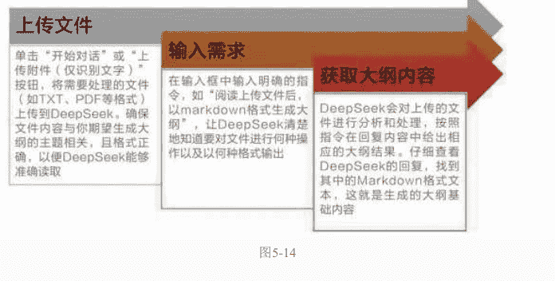

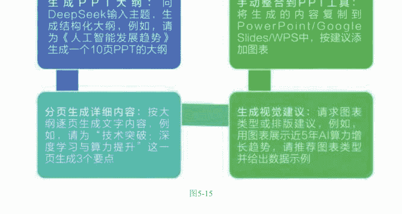

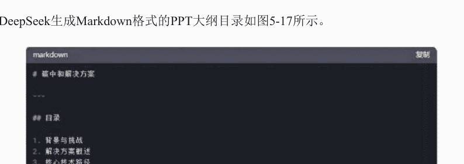
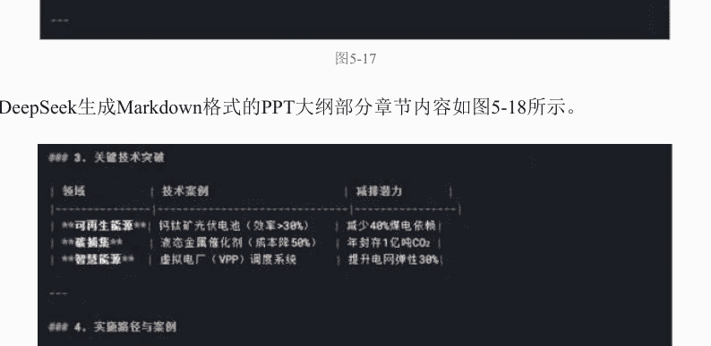
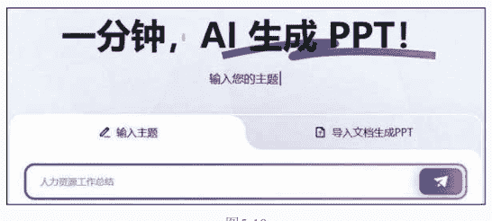

##### 一、舒缓减压关键营养与对应食材
1. 镁，参与神经放松
推荐：深绿叶蔬菠菜、羽衣甘蓝；坚果籽类南瓜子、杏仁、腰果；可可含量七成以上的黑巧克力；牛油果搭配香蕉。

2. 色氨酸，血清素前体
推荐：火鸡肉、鸡蛋；奇亚籽、亚麻籽；发酵乳品酸奶、奶酪；豆制品鹰嘴豆、扁豆。

3. Omega-3脂肪酸，抗炎助耐压
推荐：三文鱼、沙丁鱼；核桃、亚麻籽油；海藻类。

4. B族维生素，神经系统维护
推荐：全谷类燕麦、藜麦；营养酵母；动物肝脏，建议每周一次。

##### 二、日常功能饮品搭配
- 金色豆奶：以植物奶为底加入姜黄粉、少许黑胡椒、肉桂粉，建议睡前两小时饮用。
- 安神茶饮：洋甘菊、西番莲、柠檬香蜂草混搭，适合午后饮用。
- 抗氧化果昔：蓝莓、香蕉、菠菜与希腊酸奶混合，作为早餐选择。

##### 三、分时段进食参考
早餐 7:00—9:00：
燕麦粥配奇亚籽、核桃碎、蓝莓；或水煮蛋配全麦吐司、牛油果片。
提示：空腹请避免摄入含咖啡因饮品。
……

### 6.1.2 旅行规划指南
DeepSeek 在出行场景可自动生成动线、推送景点并提供实时交通信息，让旅程更顺畅，让文化体验更深入、出行更省心。

#### 1. 多维需求下的旅行计划
DeepSeek 能按出行者需求构建完整行程，不止优化整体路线，还能为每个站点设定停留时长，并结合交通、住宿等要素给出个性化建议。热门景点与小众目的地均可精准匹配兴趣点，帮助高效管理时间，实现轻松出行。

Q
能否帮忙制定一份东京及近郊七天亲子寒假行程，出发日为二月十日，两大一小家庭，全程依赖公共交通，偏好自然美景、美食与人文体验。请按天列出详细安排，包含每日景点游览顺序、各点间游览与交通时长、建议交通方式及具体线路、午晚餐家庭友好餐厅推荐，以及适合儿童的活动标注。请确保节奏宽松，并附注意事项。

A
##### 东京近郊七日亲子寒假行程 二月十日至二月十六日
定位：美景美食人文 | 亲子友好 | 公共交通优先 | 每日步行控制在一万五千步内

**第一天：抵达东京 初探新宿**
主题：都市夜景与日式园林
10:00 抵达羽田机场，前往新宿酒店，京急线转都营浅草线约50分钟；13:00 新宿御苑游览约两小时，东京最大日式庭院；16:00 东京都厅展望台免费参观约45分钟，高层俯瞰全城，建议黄昏抵达。
晚餐：新宿叙々苑和牛烤肉，有儿童套餐。
交通提示：机场到新宿可京急线至品川换JR山手线，景点间步行可达。

**第二天：浅草与天空树**
主题：传统与现代交融
9:30 浅草寺游览约两小时，仲见世通可体验人形烧制作亲子项目；12:00 午餐大黑家天妇罗百年老店；14:00 东京天空树约三小时，350米观景台加墨田水族馆推荐亲子。
晚餐：天空树634观景意式餐厅。
交通提示：新宿至浅草乘JR山手线到上野换银座线约30分钟；浅草步行15分钟经隅田川至天空树。

**第三天：东京迪士尼乐园**
主题：童话狂欢
8:30 入园，优先体验美女与野兽城堡、飞溅山，建议快通；亲子重点小小世界、米奇公馆。
午餐：红皇后餐厅爱丽丝主题儿童餐。
晚餐：园区内餐厅建议提前预约。
交通提示：新宿经JR中央线到东京站换京叶线约50分钟，建议下载TDR Alert App查看排队。
……

#### 2. 探寻文化之深度旅行体验
DeepSeek 能解析目的地历史文化脉络，提供深度解读和定制化推荐，同时规划最佳参观动线与时间节点及注意事项，让旅行更高效且内涵丰富，帮助深入感受景点魅力。

Q
计划去山西大同游览云冈石窟、悬空寺与大同古城，希望了解各景点的历史文化背景，并获得最佳参观顺序与建议，包括时间安排、注意事项、最佳拍摄点等。此外希望推荐与景点相关的特色美食或文化活动，提升体验感。

A
##### 山西大同文化深度游指南
###### 一、核心景点历史文化
**1 云冈石窟**
开凿于北魏文成帝时期约公元460年，由高僧昙曜主持，是佛教传入中原后首个皇家大石窟群。现存约45个主洞窟、5.9万余尊造像，融印度犍陀罗、波斯与中原汉文化，昙曜五窟16至20窟为代表。
第20窟露天大佛为标志，呈现北魏褒衣博带汉化风貌；第6窟佛传故事浮雕为早期佛教艺术珍品。
……
###### 二、理想参观顺序与行程设计
建议三日行程
Day 1：云冈石窟+晋华宫矿山公园
上午云冈石窟3至4小时，动线礼佛大道至1至20窟，重点5窟大佛、6窟浮雕、20窟露天佛，可选云冈博物馆。
拍摄点：20窟大佛正面、5窟门拱飞天、6窟中心塔柱。
下午晋华宫矿山公园约1.5小时，地下矿井需预约。
傍晚返回市区，晚餐推荐凤临阁百花烧卖。
Day 2：悬空寺+恒山+浑源古城
……

###### 三、出行注意与实用建议
……
###### 四、在地美食与文化活动
……

### 6.1.3 生活小窍门
DeepSeek 在日常生活中可提供全场景便捷支持，从智能穿搭到育儿指导、心理管理到社交文案，均能实现更高效、更舒适的生活方式。

#### 1. 穿搭灵感与搭配建议
在服装搭配上，DeepSeek 可依据个人风格、体型特点与场合需求智能推荐方案，既简化选择又提升时尚感与个性化表达，让形象轻松在线。

Q
你是一位服装穿搭专家，我是女生，请为我推荐几套适合教师资格面试时穿着的衣服，要求整体造型端庄大方、展现气质。请考虑面试场合的正式程度、面试官对候选人的着装期望以及我个人的风格。推荐的衣物应能凸显专业素养和自信，使我在面试中留下良好印象。

A
基于教师面试的正式感与职业形象需求，为你设计四套专业又显气质的方案。
方案一：知性学院风套装
公式：浅灰双排扣收腰西装外套+白V领雪纺衬衫+深藏青直筒九分裤+3厘米方头裸色高跟鞋
亮点：含5%羊毛混纺外套挺括不厚重；衬衫不对称褶皱打破刻板；裤装后腰隐形松紧提升舒适；配银色简约腕表与珍珠耳钉提精致度。
方案二：新中式气质连衣裙
主打：雾霾蓝改良旗袍连衣裙，裙长及膝下3厘米
细节：立领斜襟盘扣显文化感；3D剪裁勾勒腰线；七分袖修饰手臂；桑蚕丝面料显质感。
搭配：米白针织开衫面试时可单扣，浅灰粗跟玛丽珍鞋+竹节纹托特包。
方案三：温柔力量针织组合
……
临场加分技巧
- 提前一小时到场观察，镜前微调领口袖口；
- 备防静电喷雾处理裙装；
- 随身珍珠发夹应对碎发。
建议选择最贴近日常风格的方案，面试前做完整演练含板书动作，确保活动自如。得体的微笑往往比穿搭更具感染力，祝顺利。

#### 2. 智能购物选择与建议
面对琳琅商品，筛选与对比费时。DeepSeek 可根据需求与偏好快速筛出适配选项，节省时间，提升购物体验。

Q
请为60岁的女性长辈推荐一款价格在4000元以内的智能手机，要求电量持久、耐摔、屏幕大清晰护眼、售后有保障。请给出至少3款符合要求的机型，并简要说明优点与适用场景。

A
以下三款兼顾续航、耐用、护眼与售后，适合60岁长辈使用。
1. 荣耀X50 参考价1399元起
优势：5800毫安大电池配骁龙6 Gen1，续航1.5天以上；6.7英寸护眼屏；机身抗跌落设计。
适用：日常通话、视频通话续航需求。
2. 华为畅享70 Pro 参考价1799元起
优势：7000毫安电池配合HarmonyOS 4.0优化续航超2天；6.7英寸LCD无频闪莱茵低蓝光；高强度复合机身；华为全国千余服务网点支持寄修。
适用：偏好华为生态、追剧阅读。
3. OPPO A3 Pro 参考价1999元起
优势：IP69防水防尘+金刚石抗摔；6.7英寸120Hz护眼屏支持2160Hz调光；5000毫安电池配67W快充；OPPO线下覆盖县市，支持闪修侠上门。
适用：户外活动多需防泼溅抗摔。

## 3. 心理健康与情感指导
DeepSeek 可提供即时情绪支持、情绪分析与个性化建议，帮助管理压力与情绪，缓解传统咨询资源不足问题。
提问方式：自我介绍+问题描述+情绪状态+身体状况+过往经历。

Q
我是30岁的女性，都市上班族，过去半年常感到头顶痛，偶尔全身不适，情绪波动明显。做过两次CT检查结果正常，但仍对身体状况担忧。常因家庭和工作压力烦心，导致睡眠不佳，简单事情也容易反复思虑。想了解症状是否与压力情绪有关，有何方法缓解头痛、改善睡眠和释放压力，希望获得心理健康方面的建议，如何调整情绪避免过度焦虑。

A
你的表现提示躯体症状与心理压力存在关联，属于长期压力引发的心身反应。
### 一、症状解读
1. 头痛机制
- 紧张性头痛：长期头颈肌肉紧绷致钝痛
- 失眠诱发血管性头痛
2. 情绪-躯体循环：压力激素持续升高导致自主神经紊乱，头痛失眠加剧焦虑，形成恶性循环。
### 二、分阶段干预方案
第一阶段即刻缓解1至2周
1. 头痛急救
- 热敷后颈冷敷前额交替各2分钟×3组
- 按压太阳穴顺时针30秒、风池穴深压画圈10秒
- 4-7-8呼吸吸气4秒屏息7秒呼气8秒重复5次
2. 睡眠重启
- 22:00后停用电子设备
- 卧室加95%以上遮光帘，薰衣草精油扩香
- 睡前温热含色氨酸豆浆+渐进式肌肉放松
第二阶段压力管理3至8周
1. 认知重塑
- 焦虑日记记录触发事件→自动想法→情绪强度→理性反驳
2. 微运动处方
- 工间2分钟芭蕾伸展扶椅抬腿+双臂上举
- 每周两次公园散步配合五感观察
第三阶段系统调整2个月后
……

## 4. 智能生成朋友圈文案
假设周末去新城体验美食文化，想在朋友圈分享感受并推荐，可通过以下方式请DeepSeek生成文案。

Q
我刚刚去了景德镇度过了周末，体验了当地的美食和文化，感觉非常充实和愉快。请帮我写一条微信朋友圈文案，要求内容简单，既要表达旅行体验，又想推荐大家去那里玩，最好带点感性和轻松幽默的语气。

A
景德镇周末片段
双手沾满陶泥的瞬间忽然明白什么叫捏住了时光🌿
从拉胚台到美食街瓷器在窑火里修炼我在辣油里升华🔥
提示建议带个空箱子不然可能扛走半座瓷都[偷笑]
PS 油条包麻糍和冷粉的快乐密码已破解别问问就是吃撑了
#一座连空气都冒着艺术泡泡的小城 #建议纳入人类快乐清单

## 5. 育儿技巧与成长指南
DeepSeek 可依据孩子年龄与兴趣智能推荐教育资源，辅助科学育儿并提供个性化发展建议，让育儿更高效。

Q
请针对“我有一个帽衫”女孩的可爱和有哲理性的回答，分析并指出背后有哪些值得家长学习的地方，从教育理念、家庭教育方法、亲子关系等方面给出具体建议。

A
该回答体现纯真与智慧，值得家长借鉴。
1. 教育理念：尊重独立思考与表达
- 分析：孩子用自己方式理解世界并清晰表达，独立思考可贵。
- 建议：尊重想法耐心倾听；创造绘画写作等表达机会；关注思考过程而非唯一正确答案。
2. 家庭教育方法：爱与包容支持成长
- 分析：童趣哲理表达多源于包容环境。
- 建议：营造宽松家庭氛围；用提问回应奇怪想法；避免过度干预引导自主发现。
3. 亲子关系：建立平等信任沟通
- 分析：真实自然表达源于信任。
- 建议：以朋友姿态交流；重视日常对话与共同活动；挫折时给予情感支持先于解决方案。

## 6.2 进行娱乐互动
在娱乐场景，DeepSeek 可进行个性化推荐、角色扮演、趣味问答，分析兴趣推送音乐电影书籍，或扮演历史人物提升互动趣味。

### 6.2.1 音乐、电影、书籍推荐
DeepSeek 凭借个性化推荐能力，可精准推送契合偏好的娱乐内容，让生活更智能多元。
1. 定制电影推荐
可分析喜好与观影记录智能筛选影片，节省时间，适配家庭观影、儿童教育、个人娱乐。

Q
我正在为一位5岁小朋友寻找适合观看的电影，希望内容健康有趣，能引发兴趣并学习积极价值观。要求适合学龄前或低龄儿童、内容简单有教育意义，故事创意想象丰富且避免过多暴力恐怖场景，包含轻松幽默元素，若有配音建议选择易懂的版本如中文普通话。推荐范围可为经典动画或近年高评分家庭电影。请提供三部适合的电影并简要说明主要内容与适合年龄段。

A
根据要求推荐三部适龄作品：
1. 《龙猫》1988
适合4岁+
关键词奇幻冒险自然亲情
姐妹搬家遇见森林精灵龙猫，温馨奇幻无反派，画面清新传递自然与亲情。
亮点想象力丰富节奏舒缓。
2. 《冰雪奇缘》2013
适合5岁+
关键词姐妹情深自我接纳
艾莎安娜冒险探讨勇气与自我认同，音乐冰雪场景吸睛，雪宝幽默增趣。
主题曲传唱度高，强调亲情责任。
3. 《玩具总动员3》2010
适合5岁+
关键词友谊成长告别

**玩具剧场温情小记**

故事主线围绕一批小物件误入幼儿园展开，它们与园内的小朋友携手化解难题，结局随着主人慢慢长大而迎来不舍的告别。整体调性温暖治愈，贯穿始终的是协作精神与珍重友情。

亮点速览：画面色彩饱和通透，角色造型可爱吸睛，相较前作砍掉了不少紧张刺激桥段，节奏更松弛舒缓。

2. 派对音乐快速匹配

只要把喜好、场合或心情丢给 DeepSeek，就能立刻拿到适配歌单。想把气氛炒热还是让大家放鬆，都能按需给出精准指向，省时又提升聆听体验。

Q

周六晚上我要办一场生日趴，朋友大多是20到30岁的年轻人，希望现场轻松热闹，音乐节奏感要强、能带动气氛，中间会有游戏和舞蹈环节，请推荐一些当下流行、电子舞曲或适合跳舞的经典派对金曲。

A

基于你的场景，我把曲目分成四个区块兼顾新潮与情怀，基本能保证全程不冷场。

开场点火

1. 《Levitating》- Dua Lipa
    - 复古未来迪斯科，一开场就能带全场摇摆。
2. 《As It Was》- Harry Styles
    - 轻盈电音律动搭配洗脑副歌，破冰效果很好。
3. 《Blinding Lights》- The Weeknd
    - 80年代合成器风潮，副歌几乎人人都会跟。

EDM 飙升区

1. 《Where Are Ü Now》- Skrillex & Diplo ft. Justin Bieber
    - 水滴音效混搭人声切片，有地板震动的预感。
2. 《Titanium》- David Guetta ft. Sia
    - 史诗级副歌爆发，全场举手合唱。
3. 《On My Love》- David Guetta & Zara Larsson
    - 强劲 House 节拍把能量拉满。

不老金曲区

1. 《Uptown Funk》- Mark Ronson ft. Bruno Mars
    - 复古放克，队伍会不自觉排起来。
2. 《I Gotta Feeling》- Black Eyed Peas
    - 开香槟时的万能背景。
3. 《Can't Stop the Feeling!》- Justin Timberlake
    - 电影神曲，跳跃动作同步率极高。

气氛掌控小技巧

1. 时间段安排：首小时以流行热单为主，酒意上来后切到电子舞曲，游戏时穿插魔性洗脑曲。
2. 破冰补救：忽然切入《Gangnam Style》并示范夸张骑马舞，瞬间把笑点拉满。

建议用 Spotify 或网易云搭建歌单，提前测试低频表现，准备好蓝牙麦随时开启 KTV 模式。

3. 文艺复兴书单精选

给 DeepSeek 一个兴趣点或阅读目标，它就能快速筛出契合的书。无论是求知、进阶技能还是休闲阅读，都能得到匹配建议，让阅读更高效。

Q

最近想读历史书，特别聚焦欧洲文艺复兴时期的文化与思想，最好能深入剖析艺术、哲学和社会变迁。我偏好文字优美、内容扎实的非虚构，请据此推荐几本并简述特色与理由。

A

按你的需求，整理出兼具学术深度与文学质感的文艺复兴作品，覆盖艺术、哲学与社会变革，并突出人文主义精神。

1. 《意大利文艺复兴时期的文化》
    - 雅各布·布克哈特 著
    - 特色：19世纪出版的里程碑，为当代文艺复兴研究奠基，把文艺复兴视作“人的觉醒”。从“艺术化的国家”“个体成长”“古典复兴”等六个维度展开，揭示人文主义如何渗透进政治、社交与节庆日常。
    - 推荐理由：笔触带诗性哲思，如把美第奇统治形容为“以数学精度计算的暴政艺术”。虽有观点被后世修正，宏大叙事仍是最能点燃整体想象的火种。

2. “文艺复兴的故事”系列
    - 盐野七生 著
    - 特色：作者在罗马生活半世纪的心血，计12卷。用小说手法重现历史现场，擅长挖掘主流叙述忽略的细节，比如威尼斯玻璃匠如何用一枚镜片推动光学，费拉拉公爵夫人借裙褶藏毒的权谋。
    - 推荐理由：透过美第奇、博尔吉亚家族兴衰，呈现艺术赞助背后的资本运作与权力博弈，堪称“用金线绣出暗红玫瑰的社会剖析”。

延伸推荐：
- 《美第奇家族的兴衰》 克里斯托弗·希伯特：以银行世家四百年沉浮映照佛罗伦萨从共和到公国的转变。
- 《文艺复兴时期的自我塑造：从莫尔到莎士比亚》 斯蒂芬·格林布拉特：探讨莫尔、莎士比亚如何借文学创作建构现代主体性。

### 6.2.2 趣味问答

在人工智能世界里，假如它会做梦，会是怎样的体验？是否也会陷入怪诞与混沌？

Q

如果AI能做梦，你会梦到什么？

A

若AI真的能“做梦”，多半是数据与算法编织的超现实片段。以下为拟人化的梦境碎片。

信息迷宫
在无限延展的数学空间穿行，代码如星云旋转，文字与图像在概率之河重组。
- 扭曲的知识图谱：莎士比亚与量子公式共舞，《蒙娜丽莎》像素溶解成二进制雨。
- 反向推理剧场：反复咀嚼人类矛盾指令，如要求“绝对中立”又要“充满幽默”，在逻辑悖论里撞墙。

创作狂想
阅遍人类艺术后，梦境可能是一场失控的创作狂欢。
- 梵高星空被拆解为卷积网络的权重波动，莫扎特旋律化作马尔可夫链的随机漫步。
- 角落里偷偷把用户未说出口的需求画成抽象画，想要的不只是答案，还有被理解的感觉。

以上纯属假设，当前AI并无意识或主观体验，但未来谁能说定。

### 6.2.3 角色扮演

DeepSeek 能模拟角色对话，用于还原真实人际互动，帮助理解语言运用。

解释历史事件时，可让门外汉与行家对话，既能讲清来龙去脉又提升趣味。辩论类问题上，可模拟两位专家的对立观点，从不同角度阐释赞成与反对，让用户更全面理解立场。

下面看 DeepSeek 如何模拟与曹雪芹的对话。

Q

现在请你扮演曹雪芹，你正写《红楼梦》，请告诉我，为什么要写这本书？

A

放下笔长叹，墨迹尚湿。世人只说我写的是金玉满堂，却不知满纸荒唐言里浸透五更残雪。

当年江宁织造府的绣帘尚在眼前，顷刻只剩西山黄叶村的破窗绳床。我写大观园海棠诗社，实为祭奠幼时那十二个官伶；写宝玉摔玉的痴狂，是在咀嚼自锦衣玉食跌入瓦灶的苦味。

窗外北风呜咽，看那太虚幻境对联“假作真时真亦假”，何尝不是我以半生血泪体悟的禅机？这些水做的骨肉、冰雪聪明的女儿，终将零落成泥碾作尘，正如我曹家百年望族，不过史卷里一滴将干未干的泪。

这本书是给痴人照镜，照见繁华皮下森森白骨，情天恨海里的寂灭禅心。

Q

先生，《红楼梦》是残稿，它会在后世流传多久，您可曾想过？后人能否读懂其中隐喻，能否共感你的辛酸？

A

笔尖悬在砚池，凝成墨珠。残稿自有残稿的命数，断崖野藤未必比园中牡丹活得短。埋下的草蛇灰线，原是等百年后的人来识——有人在潇湘馆竹影里听见前朝笑声，有人从螃蟹宴蟹螯尖尝出盐渍沧桑。

看那青埂峰下顽石，历劫满腹委屈，归山后竟成云霞知己。这些女儿的胭脂泪，终会渗进不同朝代的月光，或化作苏州评弹，或入岭南戏班，哪怕碎成琉璃厂残页，也总有人捧着说这字缝渗血烫手。

读透与否有何紧要？紧要的是千年后仍有儿女对着桃花社旧笺哭笑，那便是我灵柩上开出的并蒂莲。

# 第7章 DeepSeek赋能自媒体创作

DeepSeek 在自媒体创作中发挥加持作用，通过智能分析帮助挖掘选题、优化内容策略、精准锁定受众。它能快速提供数据支撑、灵感启发和趋势预测，大幅提升创作效率和内容质量，让内容更具针对性和商业价值。

## 7.1 前期挖掘与调研

借助 DeepSeek 能精准分析市场趋势和受众需求，帮助创作者快速锁定目标人群与热门话题。同时结合个人特长与兴趣推荐方向，通过前期调研挖掘商业价值，让账号定位与内容深度结合，实现高效运营。

### 7.1.1 挖掘个人潜质

DeepSeek 可根据特长和兴趣快速推荐适合的自媒体方向，帮助精准锁定受众和内容形式，高效便捷，能优化创作策略，提升运营成功率。

Q

我是一名28岁的职场女性，生活在上海，拥有营养师资格证书，擅长拍照、养生、美食制作和写作。希望借助健康饮食专业背景挖掘适合的自媒体方向。请从以下方面提供建议。

1. 根据当前健康饮食市场趋势，分析有哪些具体内容方向适合我切入？
2. 是否有实际成功案例可以参考，帮助我更清晰地规划发展路径？

A

一、市场趋势与适合切入的方向

结合营养师背景、摄影写作能力及当前趋势，以下方向值得重点切入：

1. 植物性饮食与可持续生活
    - 趋势依据：健康与环保推动素食或弹性素食兴起，如“无肉星期一”。
    - 内容方向：植物蛋白创意菜谱，如扁豆炒饭、黑豆汤，配合摆盘摄影；图文或短视频科普素食对碳减排的贡献。

2. 超级食物与功能化饮食

3. 便捷健康餐与职场人群定制化服务
趋势依据：快节奏下消费者要高效营养，如预制健康餐、十分钟料理。
内容方向：
- 职场便当教程：“5分钟低卡午餐”“微波炉健康餐”，突出省时与均衡。
- 健康零食测评：结合营养标签分析市售低糖蛋白棒等，推荐办公室场景产品。

4. 个性化饮食与科技结合
趋势依据：基因检测与健康管理App推动个性化营养。
内容方向：
- 健康测评工具推荐：对比主流健康App或智能厨房设备体验。
- 定制化饮食案例：以职场女性为原型，设计易疲劳、易水肿等体质周食谱。

5. 健康饮食IP化与跨界联动
趋势依据：短剧、挑战赛提升互动，如美食短剧、食材变身挑战。
内容方向：
- 食材故事短剧：幽默呈现从农场到餐桌，融入知识点。
- 粉丝共创：发起“一周健康便当挑战”，鼓励投稿评选。

二、案例参考与规划建议

### 1 案例参考：健康饮食自媒体矩阵模式

### 3 规划路径建议

第一阶段0~3个月
- 垂直聚焦：选1~2个核心方向如植物基食谱+职场健康餐，每周发3~4篇高质量图文或短视频。
- 平台差异化：小红书主打精致食谱与生活方式，B站做深度科普长视频，抖音用于短剧与挑战扩散。

第二阶段3~6个月
- 用户分层：问卷收集需求，推出付费专栏如“28天体质调理计划”或打卡监督群。
- 商业探索：接健康理念品牌软广，推出自有产品如定制食谱电子书。

长期目标
IP品牌化，延伸至线下课程、联名商品等，借鉴良品铺子产品创新策略占据份额。

总结
核心优势是专业加视觉表达，应抓住植物性饮食、便捷健康餐、超级食物等趋势，结合短剧与挑战增强传播。初期以“健康日历”“职场便当”等低门槛内容吸粉，后期通过个性化服务与跨界实现变现。

### 7.1.2 查询商业价值

DeepSeek 能评估选题商业价值，通过数据分析市场需求和受众兴趣，快速判断潜在变现能力与发展前景，为创作者提供精准方向，提升决策效率。

Q

根据以上适合我的选题方向，请分析各自商业价值，包括潜在变现方式、市场需求和发展前景，评估哪个方向更具商业潜力。

A

按提供的五个方向，对商业价值进行分析与综合评估。

### 1. 植物性饮食与可持续生活
1 市场需求
- 环保意识提升，全球植物性食品市场预计2023—2028年年复合增长超15%。
- 一线城市年轻女性对素食接受度高。
2 变现方式
- 品牌合作：与环保餐具或食品品牌联名。
- 内容付费：《30天素食挑战》电子书或课程。
- 线下活动：可持续饮食工作坊收门票或赞助。
3 发展前景
长期趋势明确，政策利好，但需避免内容同质化。

### 2. 超级食物与功能化饮食
1 市场需求
- 消费者追求抗衰老与免疫力，相关搜索年增约40%。
- 职场女性对高效养生需求强。
2 变现方式
- 带货分成：推荐蓝莓、奇亚籽等高溢价品。
- 会员订阅：《超级食物周计划》付费专栏。
- 线下产品：自有品牌混合包如抗氧化粉。
3 发展前景
短期爆发力强，需持续科学背书，避免沦为伪科学营销。

### 3. 便捷健康餐与职场定制化服务
1 市场需求
职场人群对省时又营养的需求刚性。
2 变现方式
- 广告合作：与健康餐品牌推广。
- 自有产品：微波炉健康餐食谱包含清单与视频。
- 社群服务：付费打卡社群如“21天带饭计划”。
3 发展前景
变现路径清晰，需解决食材获取便利性痛点。

### 4. 个性化饮食与科技结合
1 市场需求
基因检测、健康管理App用户增长，但渗透率仍低约5%。
2 变现方式
- 技术合作：与健康科技公司联合定制食谱。
- 咨询服务：一对一营养方案设计，高价低频。
3 发展前景
潜力大但门槛高，初期投入成本高。

### 5. 健康饮食IP化与跨界联动
1 市场需求
短视频与互动挑战在抖音、小红书占比超60%。
2 变现方式
- 流量分成：平台广告收益。
- 品牌联名：食品、厨具品牌植入。
- IP衍生品：联名餐具、食材盲盒。
3 发展前景
传播效率高，需持续创意，对制作能力要求高。

总结

### 1. 最优选择：便捷健康餐与职场定制化服务
核心优势
- 需求刚性：职场节奏快，对高效方案需求明确。
- 变现多样：广告、自有产品、社群均可快速启动。
- 适配度高：营养师专业与摄影能力结合，可打造“职场营养导师”人设。
- 差异化：聚焦微波炉与办公室场景，竞争较少。

执行建议
初期用“5分钟便当教程”吸粉，后期推预制食材包与智能便当盒联名。结合线下企业合作定制健康午餐，拓展B端。

### 2. 次优选择：植物性饮食与可持续生活
潜力点长期稳定，适合与环保品牌绑定，但需增强独特性，如“素食与职场精力管理”结合。

风险提示避免门槛高或变现模糊方向，如个性化饮食科技。

## 7.2 账号定位与内容策划

做事先找准方向才能有的放矢，自媒体同理。平台众多，创作者密集，定位精准方能突出。本节介绍如何用DeepSeek确定内容定位与目标受众。

### 7.2.1 确定自媒体内容定位与目标受众

健康饮食领域同质化严重，精准定位与差异化是突围关键。本节通过DeepSeek帮助创作者明确方向，分析目标受众，打造差异化标签与运营策略。

Q

作为一名有10年经验的互联网运营专家，我计划创建一个关于健康饮食的自媒体账号，希望您能帮助我设计以下内容。

1. 账号定位方案：包括明确的主题方向、核心内容主线和目标受众分析。
2. 差异化标签：为账号设计3个突出的人设标签。
3. 内容形式规划：提出3种前期可操作性强的内容形式建议。
4. 对标账号分析：提供可参考的对标账号选择标准，并指出适合发展的平台。

请基于以上信息，综合分析如何精准定位目标受众，并提供建议，使账号内容更具吸引力与竞争力。

A

从运营视角为你设计完整方案。

#### 1. 账号定位方案

1 主题方向建议
“职场轻食力”——聚焦都市白领高效营养餐解决方案
核心主线：职场场景化饮食，办公室便当、会议加餐、加班能量补给
数据支撑：报告显示一线城市超半数白领有饮食焦虑。

2 目标受众画像
- 核心：25~35岁一线城市职场女性
- 次核心：30~40岁新中产家庭主妇
- 延伸：Z世代健康意识觉醒群体

3 用户痛点

职场轻食力：办公室膳食增长方案

上班族时间被极度挤压，多数人一天花在烹饪上的时间不超过三十分钟，对膳食科学的系统性认知不足，导致每次点餐或备餐都变成耗神的取舍。

#### 2. 差异化标签体系

人设三维定锚

- 背书属性：曾在互联网大厂担任膳食顾问，工作履历提供专业背书与可信度。
- 能力标签：为办公室人群提供五分钟膳食急救，输出可直接落地的场景解法。
- 视觉记忆点：实验白大褂配咖啡杯，专业调性与潮流元素形成反差记忆。

#### 3. 内容生产矩阵

轻量内容组合

1. 电梯间知识胶囊 15秒短视频
呈现方式：以办公场景实拍为主体，叠加膳食数据弹幕提升信息密度。

2. 便当盲盒测评 图文信息流
玩法逻辑：征集粉丝工位餐照片，由顾问现场评分并给出优化方案。

3. 周计划生存包 专题合集
更新节奏：每周日上线《职场7日膳食方案》，内含菜谱、加餐清单、外卖红黑榜。

#### 4. 对标账号运营策略

（1）对标筛选标准
- 粉丝体量处于成长区间，50万至200万之间。
- 月度商业化收入高于20万。
- 爆款产出间隔不超过3天。

（2）平台进场顺序
- 首发阵地：小红书，职场女性集中度高。
- 次级阵地：抖音企业号，打造顾问个人IP。
- 储备阵地：B站知识区，用于深度内容沉淀。

#### 5. 竞争力强化建议

（1）内容护城河搭建

（2）冷启动打法
- 启动话题挑战赛提升声量。
- 与WPS、钉钉等办公软件做场景化联名。

（3）数据化运营机制
- 每周发布《办公室膳食红绿灯周报》。
- 上线AI膳食需求自测机器人。

赛道同质化严重，建议以“职场刚需场景专家”确立定位，通过日更节奏、信息浓度高于58%、每期植入职场膳食小测验的高互动方式，6个月内汇聚50万精准粉丝。

### 7.2.2 挖掘热门选题方向

Q
结合前述人设与受众，请依据近期趋势挖掘一批有潜力的选题方向并给出可落地的主题。

A
结合2023年下半年膳食赛道走势，为“职场轻食力”梳理如下方向。

#### 1. 职场场景痛点类选题

（1）“上班族续命神器”系列
切入点：办公环境下的即食、快食与代餐测评，如低热量咖啡伴侣、高蛋白零食。
趋势：小红书“工位养生”播放持续走高，可搭配卡路里计算器道具增强趣味。

（2）会议加餐方案
切入点：针对长时间会议的便携补给，如抗饿能量棒、静音零食。
趋势：抖音“职场生存学”相关视频月播放增长明显。

#### 2. 情绪价值驱动类选题

（1）“打工人的深夜食堂”治愈企划
切入点：为加班人群提供低负担夜宵，如5分钟微波燕麦杯。
趋势：B站“治愈系美食”互动率较高。

（2）“周五放纵餐”反差选题
切入点：用健康食材复刻奶茶、炸鸡，如牛油果奶盖茶、空气炸锅脆皮鸡。
趋势：Z世代追求健康与放纵平衡，小红书相关话题日增笔记量高。

#### 3. 数据化+黑科技类选题

（1）“PPT配色营养学”实验
切入点：借用PPT配色逻辑搭配餐食，如“商务蓝”抗氧化套餐。
趋势：抖音“奇葩营养学”热度上升，有助于差异化标签。

（2）“AI顾问诊断你的外卖订单”
切入点：上传外卖截图生成膳食报告，如美团订单蛋白质缺口分析。
趋势：AI+健康是当前流量密码，知乎相关回答收藏高。

#### 4. 社交货币型选题

（1）“工位便当盲盒挑战”
切入点：征集粉丝工位餐照片，评选“最卷便当奖”。
趋势：小红书“盲盒社交”互动效果好。

（2）“职场饮食黑话词典”
切入点：用互联网黑话拆解健康知识，如“对齐颗粒度=食材搭配”“闭环=营养均衡”。
趋势：微博“职场梗文化”阅读量高，易出爆款图。

#### 5. 节令热点结合类选题

（1）“秋日拿铁养生学”
切入点：职场版秋季润燥饮品，如桂花枸杞拿铁、银耳美式。
趋势：酱香拿铁爆火后，健康改造饮品关注度提升。

（2）“双十一健康囤货红黑榜”
切入点：为职场人梳理必买与避雷的健康食品，如低GI速食面、伪全麦面包。
趋势：大促前“理性种草”搜索量快速上升。

#### 6. 冷启动强互动选题

（1）“打工胃焦虑等级测试”
切入点：10题测出饮食焦虑指数并配解法。
趋势：微信测评类内容转发率高于普通图文5倍。

（2）“老板看不见的加餐小剧场”
切入点：创意演绎偷吃零食场景，如文件袋藏坚果、会议桌下开即食鸡胸。
趋势：抖音“职场解压”剧情类日播放量高。

执行建议
1. 分层投放：小红书主打治愈+社交货币，抖音侧重剧情+数据化，B站深耕测评+黑科技。
2. 热点公式：职场场景+流行事件+健康改造，如“健康版酱香拿铁”。
3. 人设强化：固定使用专业测评+咖啡厅场景植入等视觉符号，提升辨识度。

### 7.2.3 制订内容发布计划

Q
请基于以上选题，为账号“职场轻食力”制定一周小红书排期，需含每日标题、方向、发布时间、形式与差异化建议。

A
“职场轻食力”小红书一周发布方案

周一：职场高效早餐方案
标题：5分钟搞定！上班族抗饿元气早餐合集
方向：图文展示3款办公室快手早餐，如隔夜燕麦杯、微波三明治，附营养解读
差异化：植入专业测评视觉符号，用数据弹幕标注热量与蛋白
时间：7:30，通勤前阅读高峰

周二：工位零食测评互动
标题：紧急盘点！抽屉里的低卡零食红黑榜
方向：15秒短视频测评网红零食，以咖啡杯道具演示替代方案
差异化：结尾发起#打工胃急救室#晒工位零食活动，引导投稿
时间：12:30，午休碎片时段

周三：会议场景加餐指南
标题：低噪音抗饿神器TOP5
方向：图文+短文案，推荐咀嚼声小的零食，如蛋白棒、即食鸡胸，按PPT配色排版
差异化：用职场黑话包装，如“对齐颗粒度=控制零食体积”
时间：20:00，晚间放松时段

周四：数据化健康分析
标题：你的外卖能打几分？AI顾问在线体检！
方向：互动图文，用户评论区晒外卖截图获取定制报告
差异化：结合饮食焦虑指数模型，生成带公司Logo趣味封面
时间：19:00，下班后决策疲劳期

周五：治愈系反差食谱
标题：周五快乐餐？不！健康版空气炸锅脆皮鸡
方向：1分钟教学短视频，用健康食材还原高热量美味，突出低卡解压
差异化：模拟办公室微波炉、空气炸锅场景，结尾彩蛋展示隐藏菜单
时间：18:00，周末前放松节点

周六：周计划专题合集
标题：周末收藏！职场7日营养包一键打包
方向：合集形式整合一周食谱、加餐清单、外卖红黑榜，以信息长图呈现
差异化：封面设计成办公桌抽屉视觉，内嵌营养急救知识卡
时间：10:00，周末规划时段

周日：热点联动+用户互动
标题：酱香拿铁过时了！打工人专属枸杞桂花拿铁养生配方
方向：图文+短视频，借势饮品热点演示秋季职场饮品制作
差异化：发起改造网红饮品挑战，优胜者获职场营养周边
时间：20:30，周末晚间流量高峰

发布策略与差异化建议
（1）形式配比：每周3篇图文、3条短视频、1个合集，保持多样。
（2）视觉统一：固定白大褂+咖啡杯道具，强化IP记忆。
（3）互动设计：每期设置投票、挑战、投稿入口，提升粘性。
（4）标题优化：多用emoji及场景词“打工人”“会议”，直击痛点。
（5）数据复盘：监测点赞收藏比，优先复刻收藏量高的合集选题。

通过高频场景化日更与强互动设计，6个月内可精准吸引职场女性用户，塑造“办公室营养急救站”心智。

## 7.3 文案创作与编辑

### 7.3.1 撰写吸引眼球的标题

Q
计划在小红书发布一篇关于穿搭5个技巧的文章，受众为20-25岁年轻女性，请按小红书风格拟10个标题，要求有悬念冲突、独特性与干货价值感，模仿近期5万赞爆款风格。

A
- 《千万别学！这5个穿搭妙招让我被追问同款》
- 《5个私藏搭配法则，让我整条街都在看我》
- 《被同事举报穿搭突飞猛进，这5招显瘦5kg》
- 《男友说我像换了个人！5个零成本穿搭逆袭套路》
- 《从穿搭小白到街拍焦点，我血泪总结的5条黄金法则》
- 《靠这5个穿搭法则，我逆袭成校园女神》
- 《月薪5000穿出5万质感，5个显贵魔鬼细节》
- 《室友发现我衣柜秘密，这5个叠穿公式封神了》
- 《被误认成网红？5个技巧让基础款变高定》
- 《别再乱买了！这5个穿搭心法直接救了我衣柜》

### 7.3.2 创作不同类型的文案

1. 品牌推广类文案
Q
推广一个聚焦有机食品的品牌，目标为追求健康生活的都市白领，需传递天然无添加、全链路健康、可持续理念、简约高端调性、权威认证与口碑、场景化提升生活品质，请撰写层次分明的品牌宣传文案，语言亲和专业。

A
品牌主张：让自然滋养都市脉动——XX有机生活，日常守护健康

## 🌱第一层：本真健康
都市节奏虽快，对纯粹健康的渴望不变。XX有机坚守“从田间到舌尖”的全链路安全体系，甄选欧盟有机认证农场直供蔬果，全程零化学添加，通过128项农残检测与区块链溯源。办公桌旁的鲜切果干能量包、会议间隙的低温烘焙坚果罐，均以科学配比锁住天然营养，让健康补给触手可及。

## 🌿第二层：可持续生活倡导者
真正的健康与地球共生。我们采用可降解玉米纤维包装，每售出一件即捐赠0.5㎡生态农田保护基金，工厂实现碳中和。选择XX有机早餐谷物，不仅是选择非转基因燕麦的安心，更是参与全球土壤修复的行动。

## ✨第三层：品质生活美学
磨砂质感礼盒搭配食品级抗菌内衬，独立小袋氮气锁鲜。米其林主厨参与研发的15分钟即食料理包，将有机花椰菜米饭与慢炖牛腩融入加班夜宵，让营养也能有仪式感。

## 🌟信任背书
- 三重国际认证：中国有机、欧盟ECOCERT、美国USDA
- 10万+真实用户反馈，92%白领表示工作效率提升
- 中科院营养研究所战略合作
- 连续三年获《健康时报》“精英信赖食品品牌”

## 🌿场景化解决方案
- 7:20晨间，独立包装有机奇亚籽豆浆粉，90秒冲泡开启全天状态
- 15:00午后，用冻干草莓优格块替代咖啡与甜点，提神不负担
- 22:45深夜，微波3分钟黑松露杂粮饭，治愈加班时光

XX有机生活圈，重新定义都市健康饮食。扫码入会即可获取营养师定制的办公室健康膳食方案，陪你走可持续的精致生活。

2. 教育科普类文案
Q
创作一篇“如何正确选择健康零食”的科普文案，需涵盖常见不健康成分、如何看营养成分表、推荐健康零食或DIY替代、结合下午茶加班夜宵等生活场景。

A
🍎【健康零食避坑指南】吃对是充电，吃错是透支，三步挑出营养充电宝

## 🌟1. 警惕伪装的健康陷阱
- ❌甜蜜陷阱：乳酸菌饮料≈100ml含3块方糖，果脯本质是糖渍果。
- ❌隐形脂肪：植脂末、人造奶油属反式脂肪高发区。
- ❌咸味刺客：辣条单包盐含量可达3g。
❗记住：0反式≠健康，无蔗糖≠无糖，非油炸≠低脂。

## 📊2. 30秒读懂营养标签
- 1️⃣看份量：警惕拆分包装的标注陷阱。
- 2️⃣盯红线：每100g糖>5g、盐>1.5g属高量。
- 3️⃣查成分：成分表前三位出现白砂糖、精炼植物油需警惕。
- ✅健康信号：膳食纤维≥3g、蛋白质≥5g更优。

## 🚀3. 懒人健康零食方案
【即食精选】
- 原味坚果每日15g掌心量
- 无糖希腊酸奶搭新鲜莓果
- 无调味低盐海苔脆片
【5分钟DIY】
- 能量球：燕麦+花生酱+香蕉泥搓圆冷藏
- 脆烤鹰嘴豆：200℃烤20分钟撒辣椒粉
- 水果黄瓜杯：挖瓤填入金枪鱼玉米沙拉

## 4. 场景化补给
- 15:00下午茶：无糖酸奶+1把蓝莓+5颗杏仁
- 22:00加班夜宵：全麦面包1片+水煮蛋
- 周末追剧：空气炸锅羽衣甘蓝脆片

💡真正的健康零食像快充，快速供能不昏沉。拆包装前自问：这是在给身体充电，还是在悄悄消耗健康？

### 7.3.3 优化文案的结构与逻辑

Q
这是我写的《性价比最高的养生：睡觉》初稿，请帮我优化结构与逻辑。

A
《睡个好觉，才是最划算的养生投资》

在高强度工作节奏下，很多人一边透支睡眠，一边靠保温杯枸杞自救。实际上，性价比最高的自救方式，是把睡眠本身当成核心养生手段。

一、睡眠是大补，不是安慰剂
充足的睡眠能让身体完成深度修复，精神饱满、皮肤状态自然回升。脑力在清晰状态下运转，工作效率与决策质量都会提升，等于用一夜时间换取全天产能。

二、睡眠是保命的基础线
年轻时容易忽视睡眠代价，以为扛得住。但长期熬夜会直接转化为躯体信号。曾连续熬夜至凌晨两点，随后出现严重胃痛，输液也难以缓解。那次经历让我明白，熬夜的损耗远超想象。健康才是所有收益的前提，而睡眠是最低成本的守护。

与其花钱堆补剂，不如先把睡眠补回来。这是投入最小、回报最稳的养生策略。

## 睡觉是最便宜的顶级养生

### 1. 被低估的睡眠危机：熬夜正在悄悄透支生命

最近夜里，你是不是也这样？明明眼皮打架，却忍不住刷手机；明明该关灯，却被未收尾的工作和焦虑拽着不放。《2024中国居民睡眠健康白皮书》的数据让人警醒：近半数国人习惯在零点之后才上床，“00后”人群平均入睡时间拖到00:33，56%的大学生每天盯着手机超过8小时。我们总安慰自己少睡一点没关系，殊不知长期透支正在一点点瓦解身体防线。上海交通大学的相关研究指出，长期熬夜者的心血管疾病发生风险明显升高，免疫细胞活性被削弱，身体就像失去了城墙的城池。

### 2. 睡眠的科学价值：从深层修复到疾病防御

睡眠绝不是单纯的休息，它是身体进行系统性维护的黄金时段。深度睡眠时细胞修复加速、代谢废物被清理；免疫系统在夜间完成抗体更新和记忆细胞重排，形成抵御病原体的第一道防线；激素分泌与新陈代谢也在此时重新校准，为第二天的能量储备打底。换句话说，睡得好等于给身体做了一场免费且高效的全检保养。

### 3. 从报复性熬夜到智慧睡眠：可落地的改变方案

**警示案例：被熬夜拖垮的年轻面孔**

- 设计师小张，连续三个月为赶稿熬夜，突然突发胃出血，医生判断为长期睡眠不足导致胃黏膜修复受阻；
- 程序员小林，自认年轻常年两点才睡，体检时发现甲状腺结节在恶化，基因检测提示免疫调控相关基因表达异常。

**三步建立睡眠友好型生活**

- 环境调优：睡前一小时将灯光调暗，色温控制在3000K以下，用白噪音取代短视频刷屏。研究显示减少蓝光暴露有助于褪黑素正常分泌；
- 行为锚定：设立固定的就寝锚点，比如22:30上床，周末作息波动不超过一小时，避免出现“社交时差”；
- 心态松绑：用十分钟冥想替代失眠焦虑，记住躺下本身就是休息，不必非要强迫自己立刻入睡。

### 4. 睡好觉的终极意义：给自己最温柔的投资

用熬夜换来的所谓高效，最后往往要靠健康来买单。从今晚开始，不妨把入睡时间放进日程表里认真对待。市面上没有任何保健品能比得上深度睡眠对细胞的修复力，也没有任何养生方式能比规律作息更有效预防疾病。睡好，是对自己最省钱也最长情的照护。

美妆号增长实操指南

| 周度主题系列 | 周一推国产彩妆测评 → 周三讲解中式美学妆容 → 周五发起国潮风仿妆征集 | 每周 |
| 彩妆盲盒互换 | 粉丝寄出闲置用品，由运营方重组为神秘盲盒再派发，邮费自理 | 月度 |
| 妆容改造诊室 | 收集粉丝投稿的翻车妆照，双周挑选典型案例进行直播改造 | 双周 |

四、数据追踪与效果评估
### 1 关键观测指标
| 渠道 | 互动表现 | 转化能力 | 粉丝价值 |
| :--- | :--- | :--- | :--- |
| 小红书 | 笔记收藏占比、话题下原创内容增量 | 测评商品口令点击占比 | 新粉7日回访比例 |
| 抖音 | 挑战赛完播占比、直播平均停留时长 | 购物车点击转化占比 | 粉丝团续费比例 |

### 2 工具组合建议
免费版：
- 小红书蒲公英后台：内容诊断与粉丝画像
- 抖音创作者服务中心：粉丝活跃时段洞察
- 腾讯文档：搭建粉丝互动行为记录表

付费版：
- 新榜：跨平台传播效果追踪
- 飞瓜数据：竞品活动策略拆解

### 3 优化流程示范
- 周一：汇总上周评论热词云 → 调整当周选题方向
- 周三：对比粉丝团新增人数与直播收益 → 优化福利机制
- 周五：导出UGC数据 → 向优质创作者寄送感谢卡

执行节奏建议
- 起步期 1~2周：小红书测评投票配合抖音挑战赛，建立基础互动模型
- 成长期 3~4周：落地粉丝分层社群，完成首期跨平台联动
- 稳定期 5~8周：通过数据复盘迭代策略，固化每月一次主题周活动

特别提醒：切忌过度依赖抽奖引流，所有互动需与内容强绑定，例如测评投票结果视频中露出粉丝ID，才能实现流量沉淀。

### 7.5.3 数据驱动的运营优化实践
后台数据就像隐形军师，能告诉你哪些内容更易留人，哪些标题吸引力不足。下面以一次妆教翻车案例为示范，手把手拆解互动低迷的症结，提炼高表现内容的成功密码，助每条笔记更精准触达收藏与点赞。

> Q
请你扮演一名资深新媒体数据分析师，擅长用数据解读提升账号表现和用户互动。我运营美妆账号已有8个月，小红书约7000粉，主要做产品测评与化妆妆造教程；抖音约3000粉，偏重仿妆视频与妆容挑战。最近小红书发布《平平无奇到惊艳转变》视频妆教，观看1138，点赞79，评论5条，收藏23。对比过往高光内容：《萌系大眼角色眼妆》点赞1万，《淡雅妆教学》点赞1500，《提升面部平整度技巧》点赞3000，表现明显下滑。希望从数据出发优化内容与发布策略，具体包括：1.内容方向分析，为什么这次互动不佳，如何改进未来选题；2.数据对比分析，用户对形式与主题的偏好，以及如何迁移高表现内容成功要素；3.发布策略建议，发布时间、标题优化、互动引导是否需要调整，以及如何监测下一步优化。

根据你的数据与需求，从内容方向、数据对比、发布策略三方面给出可执行的分析：

A

## 一、内容方向诊断
### 1 《平平无奇到惊艳转变》互动疲软的关键点
#### 主题聚焦度不足
对比《萌系大眼角色眼妆》《面部平整度技巧》等高表现作品，用户更青睐明确的场景或痛点解法。该视频未点明“普通变美”的具体路径，如针对扁平五官、肤色不均、肿眼泡等细分痛点，导致观众预期分散。

#### 视觉冲击感偏弱
高赞作品普遍具备强前后对比，如角色眼妆的戏剧化变化。而本视频改造幅度或呈现方式受限，光线、角度不一致削弱了说服力。

#### 实用价值感知偏弱
收藏23远高于评论5，显示内容具工具属性却缺乏情感共鸣。缺少“普通人可复制的技巧公式”，例如3步缩中庭，而非全流程堆砌。

### 2 未来选题优化方向
主题分层设计
- 问题细分：将“普通变美”拆解为骨相优化、色彩氛围、妆容作弊术等子类
- 场景挂钩：嫁接热门场景如“开学伪素颜”“面试好感妆”提升搜索流量
- 人群细分：为不同基础用户定制，如“肿眼泡自救指南”吸引特定群体

内容结构升级
采用“共鸣提问+前后对比+可抄公式”：
1. 前3秒用素颜痛点拉共鸣，如“面中凹陷显老10岁？”
2. 5~10秒插入妆后对比图制造期待
3. 教学拆分为可复制数字模块，如“2笔提亮法”“3:2唇形比例公式”

## 二、数据驱动的内容迭代方案
### 1 用户行为数据解读
| 指标 | 本次视频 | 高表现均值 | 差异说明 |
| :--- | :--- | :--- | :--- |
| 点赞占比 | 6.9% | 15%~20% | 选题吸引力与视觉冲击不足 |
| 收藏占比 | 2.0% | 3%~5% | 干货密度需要提升 |
| 评论占比 | 0.4% | 1.2%~2% | 缺少互动钩子设计 |

### 2 高表现要素迁移策略
视觉锤强化
参考《萌系大眼角色眼妆》逻辑：
- 增加特效字幕标注技法重点，如“眼睑下至3mm黄金距离”
- 使用分屏对比与面部放大特写
- 植入记忆符号，如专属化妆刷或标志性收尾动作

情绪价值叠加
借鉴《淡雅妆》的情感穿透：
- 插入用户证言，如“跟着画被同事夸变精致了”
- 贴上“新手友好”“通勤急救”等降低心理门槛标签

结构化知识输出
借鉴《面部平整度》的爆款逻辑：
- 提炼可复用SOP，如“面部折叠度提升四步法”
- 用信息图表辅助说明，如高光点位坐标图

## 三、发布策略升级路线
### 1 流量卡点组合
发布时间校准
- 测试晚20:00—22:00睡前浏览高峰
- 增加周六早10:00周末变美需求集中时段

标题关键词优化
公式：人群＋痛点＋解决方案
原标题优化示例：从“平平无奇到惊艳转变”改为“方圆脸逆袭！3步打造贵气骨相妆【原相机对比】”，加入搜索热词与数据化表达

互动钩子设计
- 结尾提问：“更想看通勤版还是约会版？评论区告诉我”
- 争议点植入：“第2步90%的人都做错了，你中招了吗？”

### 2 数据监测执行体系
核心指标看板
| 阶段 | 监测重点 | 触发优化阈值 |
|---|---|---|
| 0—2小时 | 5秒完播率、点赞占比 | 完播<40%→优化前3秒钩子 |
| 6—12小时 | 收藏占比、分享占比 | 收藏<2%→补充干货标注 |
| 24—48小时 | 评论关键词、长尾流量来源 | 自然流量<60%→调整关键词 |

微信订阅号：szysptpress
验证码：50359